# 表达性处理：数字虚构、计算机游戏与软件研究

## 献给 Jennifer K Mahal

## 系列前言

软件深深融入当代生活——在经济、文化、创意和政治方面——以既明显又近乎不可见的方式。然而，尽管大量文章探讨了软件的使用方式以及它所支持和塑造的活动，但在其大部分历史中，对软件本身的思考仍然在很大程度上是技术性的。然而，越来越多的艺术家、科学家、工程师、黑客、设计师以及人文和社会科学领域的学者发现，为了他们面临的问题和需要构建的事物，扩展对软件的理解是必要的。为了这种理解，他们可以借鉴计算机和新媒体历史中的一系列文本，可以参与软件丰富的隐性文化，也可以参与发展一种新兴的、根本性的跨学科计算素养。这些为软件研究奠定了基础。

软件研究使用和发展文化、理论和实践导向的方法，对软件的对象和过程进行批判性、历史性和实验性的描述（以及通过它们进行干预）。该领域参与并为计算机科学家的研究、软件设计师和工程师的工作以及软件艺术家的创作做出贡献。它追踪软件如何大量融入当代文化和社会的过程，围绕其与算法和形式描述及行动的接近程度，重新表述过程、思想、机构和文化对象。软件研究提出计算文化的历史，并利用计算的智力资源，发展对其纠缠和可能性的反思性思考。它既在人文和社会科学的学术模式中，也在计算机科学、艺术和设计的软件创作/研究模式中这样做。

由MIT出版社出版的软件研究丛书，旨在出版一个同时在文化和技术上都具备素养、反映当今软件文化现实的批判性和实验性领域中的最佳新作。

## 前言

### 表达性处理

本书展示了一种理解数字媒体的新方法——并利用它来阐明我最喜欢的两种媒体：数字虚构和计算机游戏。这种新方法假设，重要的是不仅仅是数字媒体的外观和观众体验。理解使数字媒体运作的计算过程也是至关重要的。

计算过程是作者手中一种强大的新工具。塑造这些过程使计算机游戏行业的精心打磨的商业娱乐成为可能。发明新过程是人工智能（AI）和其他计算机科学领域的激进媒体实验的核心。在定义独立艺术家、作家、设计师和工作室工作的概念与工艺的融合中，为过程寻找意外用途是常见的。通过过程进行这种权威表达是本书的核心主题之一，也是*表达性处理*一词的含义之一。我希望本书中考察的项目能帮助作者更广泛、更有成效地思考小说、游戏和数字媒体的未来；

对于寻求理解过程密集型作品的评论家来说，找到一种适当的方式来处理过程本身可能令人困惑。虽然一些作者专注于解释每部作品源代码的潜力，但这种详细程度不一定具有启示性（对于大多数作品，代码的文本风格并非核心），并且对于许多作品，代码本身不可用。相反，本书的方法着眼于我称之为在各种示例中起作用的*操作逻辑*。我的重点是解释过程所做的事——通过其运动设计表达的思想——以及过程与思想流派和实践社区所表达的关系。以这种方式观察过程所表达的内容，使评论家能够解释作品中表面不可见的元素，这是我所说的表达性处理的另一个主要元素。

具体到数字媒体之外，我也认为，为了我们的政治未来，人们培养批判性思考软件系统的能力是至关重要的。来理解数字媒体的过程可以对此做出贡献。许多关于软件的一般概念，当与具体、清晰的示例相关联时更容易理解，而数字媒体可以提供这样的示例。我从本书中的许多示例出发，探讨它们关于软件的更广泛教训以及这些教训的潜在政治影响。

## 致谢

我有许多人要感谢，无论在智力上还是个人方面，都为使*表达性处理*成为可能提供了帮助。

本书——如同它作为第一卷的软件研究丛书一样——之所以存在，得益于我在MIT出版社的编辑Doug Stry的支持与合作。我也想感谢MIT出版社的Melissa Goldsip、Alyssa Larose、Katie Helke和Deborah Cantor-Adams。

我最初在我的论文工作中探索了这些想法。我欠我的委员会深深的感激。我的论文源于与David Durand为期一年的一系列对话。没有他的智力指导和支持，这不可能实现。George Landow 的 *超文本* 是我阅读的第一本讨论数字文学的书。我既欠他提供这个机会的恩情（这个机会从此塑造了我的思维），也欠他对我论文的慷慨反馈。没有Wendy Chun的细心关注和有益评论，我的论文在概念上会更加狭窄，可读性也会显著降低。我感激她如何推动我的思考和写作。我去布朗大学与Robert Coover合作，从未失望过。在那里的五年里，我大大受益于他慷慨地付出精力、时间和知识——并且我继续受益。布朗大学一直是创新性的领先机构


跨学科数字工作已有四十多年，很大程度上要归功于我委员会主席安迪·范·达姆（Andy van Dam）的项目赞助和管理。我很荣幸能将我的论文纳入这一传统。

除了我的论文委员会，我还要向那些研究和创作数字媒体的人们致以深深的智力谢意——尤其是游戏、新的文学形式和新的艺术工具。我特别感谢我的编辑合作者 Pat Harrigan、Nick Montfort 和 Jill Walker，以及我的 Grand Text Auto 博客同行 Mary Flanagan、Michael Mateas、Scott Rettberg 和 Andrew Stern。我在加州大学圣地亚哥分校软件研究计划（University of California at San Diego Software Studies initiative）的合作者 Lev Manovich 和 Jeremy Douglass 也对我产生了巨大的智力影响。此外，我在数字媒体项目上的合作者塑造了本书的思路（并帮助创作了一些描述的作品）。他们包括 Kirstin Allio、Cilly Castiglia、Josh Carroll、Adam Chapman、Michael Crumpton、Elaine Froehlich、Shawn Greenlee、Erik Loyer、Andrew McClain、Brion Moss、Benjamin "Sascha" Shine、Chris Spain、Camille Utterback 和 Duane Whitehurst。我也很荣幸，本段中提到的许多人都是我的私人朋友。

在数字媒体领域，我还要感谢其他尚未列出的人，他们与我讨论过的想法帮助塑造了我对计算过程作为创作工具和研究对象的思考：Espen Aarseth、Ian Bogost、John Cayley、Markku Eskelinen、Gonzalo Frasca、Fox Harrell、N. Katherine Hayles、William Huber、Mimi Ito、Jesper Juul、Matthew Kirschenbaum、Peter Lunenfeld、Mark Marino、Carl McKinney、Stuart Moulthrop、Simon Penny、Jessica Pressman、Rita Raley、Casey Reas、Warren Sack、Phoebe Sengers、Stephanie Strickland 以及许多其他人。会议也为这项工作提供了重要的智力时刻，从 2005 年数字艺术与文化会议（Digital Arts and Culture conference）到 SoftWhere，即 2008 年软件研究研讨会。

我还应该感谢我在纽约大学、巴尔的摩大学、布朗大学和加州大学期间的其他工作人员、教职员工、学生和朋友——尤其是 Cynthia Allen、Jane de Almeida、Kam Bellamy、Stephen Boyd、Poppy Brandes、Helena Bristow、Barry Brown、Shelby Brown、Lisa Cartwright、Rachel Cody、Michael Cohen、Mike Cole、Brian Evenson、Thalia Field、Julia Flanders、Forrest Gander、Marjeta Geerling、William Gillespie、Athomas Goldberg、Brian Goldfarb、Dan Hallin、Robert Horwitz、Daniel C. Howe、Adriene Jenik、Natalie Jeremijenko、Jamie Jewett、Bruce Jones、Nancy Kaplan、Nancy Kramer、Carole Maso、Miranda Mellis、Talan Memmott、Jon Meyer、Elli Mylonas、Gale Nelson、Robert Nideffer、Christiane Paul、Ken Perlin、Butch Rovan、Jurgen Schulze、Jack Schwartz、Cícero Silva、Roberto Simanowski、Anna Joy Springer、Brian Kim Stefans、Stefan Tanaka、Jim Whitehead、Adrienne Wortzel、Vika Zafrin 和 Sara Zatz。

本书的后记描述了我另一项巨大的感激之情：即那些参与本书手稿初稿基于博客的同行评审的人。这包括一些在致谢其他部分未提及的人：Dominic Arsenault、Barry Atkins、Balthazar Auger、Paul B.、Sean Barrett、Matt Barton、Bryan G. Behrenshausen、Mark Bernstein、Emily Boegheim、Terry Bosky、Alex J. Champandard、Randall Couch、Drew Davidson、Richard Evans、David Fisher、Sol Gaitán、Susan Gibb、Josh Giesbrecht、Benjamin Grandis、Barbara Grueter、Huysmans、Jon Ippolito、Ishmael、Dennis G. Jerz、Jitsut、Dega Lancaster、Chris Lewis、Christian McCrea、Dave Miller、Mark J. Nelson、Nicholas Novitski、Brad O’Donnell、Jeff Orkin、Jason Rhody、Mark Riedl、Bonnie Ruberg、Malcolm Ryan、Greg J. Smith、Sarah Toton、Scott Turner、Julius Valsson、J. Robinson Wheeler、Lord Yo、José Zagal、Hyokhon Zhiang 以及匿名贡献者。我还要感谢 Ben Vershbow、图书未来研究所（Institute for the Future of the Book）以及加州大学圣地亚哥分校学术参议院研究委员会（University of California at San Diego Academic Senate Committee on Research）对基于博客的评审的支持。

我的家人——Nathan、Carolyn、Mark、Elma、Buford、Gertrude 和 Richard——不仅在这项工作的过程中直接和间接地支持了我，而且从我出生的第一刻起就提供了一个智力启发和创意导向的环境。

最后，没有 Jennifer K Mahal，这一切都不可能实现，我将此书献给她。

# Chapter 1

Introduction

## Media Machines

计算机是一种奇怪的机器。虽然大多数机器都是为特定目的开发的——洗衣机、叉车、电影放映机、打字机——但现代计算机专门设计为能够*模拟*许多不同类型机器的操作，具体取决于计算机当前的指令（及其可用外设）。

这就是为什么计算机可以模拟电影放映机：快速连续显示一组图像帧。这也是为什么计算机可以像磁带播放器一样工作：读取并放大声音数据流。¹

出于同样的原因，计算机可以被指示扮演以前不可能的机器类型。计算机可以模拟打字机——从键盘获取输入并在屏幕上排列像素以形成相应的字母——但它也可以远远超越打字机，提供多种字体、自动拼写更正、手稿部分的无缝移动（通过“剪切”和“粘贴”的模拟）、可编程转换（例如“查找和替换”），甚至由大型分散群体进行协作创作（如 Wikipedia 等项目）。现代计算机（更完整地称为“存储程序电子数字计算机”）正是为了实现这一点而设计：通过定义新的计算过程集合，不断创造新机器，开辟新可能性。

> 1. 在 Grand Text Auto 上对本书手稿进行基于博客的同行评审期间（在后记中讨论），Mark Marino 表示，计算机模拟电影播放器和磁带播放器的能力是“一系列文化因素的结果”……
> 
> 注释在本章末尾继续。

“数字媒体”是这种可能性所实现的媒体。这包括像 Wikipedia 这样的 Web 项目，也包括所有计算机游戏。第一批现代计算机游戏是在早期存储程序计算机上创建的，自那以后，我们已经看到计算机不仅可以模拟弹球机，还可以充当前所未见的游戏机：俄罗斯方块机、毁灭战士机、模拟城市机等，产生了重大的文化影响。

就我个人而言，我对数字媒体为小说所开辟的可能性着迷。计算过程正在催生新的人物、故事和语言模型的繁荣。从具有史诗结构的计算机游戏到实验性互动电影，数字小说正在为广泛的受众提供多样化的体验。从雄心勃勃的人工智能（AI）实验到博客和电子邮件的简单应用，作者们正在以各种技术复杂度创作数字小说。该领域已经太过庞大，无法在一本书中涵盖。

幸运的是，已经有不少关于数字文学的书籍，以及更多关于数字媒体的一般性著作。然而，这些著作几乎全部都关注数字媒体机器的外观：它们的输出。有时，输出被视为一种人工制品，并以我们与文学研究和艺术史相关的方式进行解释。有时，输出与受众和更广泛的文化相关联，使用教育学和社会学等领域的方法。当然，还有各种其他视角。但是，无论从哪个视角出发，关于数字媒体的著作几乎全部


忽略了一件至关重要的事：让数字媒体运作的实际过程，以及让数字媒体成为可能的计算机器。

一方面，这本身没有错。以输出为导向的方法，为那些寻求理解和创作数字媒体的人带来了许多宝贵的见解。然而，另一方面，它留下了一个巨大的差距。

这本书是我为弥合这一差距所做的尝试。据我所知，它是第一本从媒体、游戏和小说视角（而非软件工程或计算机科学）关注计算过程的书籍。这是跨越差距的第一次尝试，随着时间的推移，我们希望能跨越更多。但希望它能证明，能够在差距的两侧之间移动、能够看到数字媒体机器的内外，是有收获的。

## 富有表现力的处理

弥合差距需要以新的方式谈论过程，并将其与更广泛的问题联系起来。在这本书中，我致力于通过“富有表现力的处理”这一概念来做到这一点。这个术语旨在在接下来的讨论中唤起关于过程的两件重要事项。

首先，计算过程正成为作者越来越重要的表达手段。当今的作者不再是像定义书籍的文字序列或电影的图像那样，而是越来越多地定义系统行为的规则。当我玩电脑角色扮演游戏（RPG）时，作者制作的过程决定了我如何与非玩家角色（NPC）交谈。当我玩模拟游戏时，作者制作的过程决定了虚拟经济的运作。这些规则所实现的内容中存在作者表达——它们所省略的内容中也同样存在，与我们在日常人类对话和经济交易中所见的相比。

2. 关于该项目“屏幕”的更多内容，请参见第 9 章。

计算过程也可以用来创造那些并非我们日常世界现象简化模型的可能性。例如，在我的合作项目中，我利用支持房间大小虚拟现实显示屏的过程，来创造这样的错觉：关于记忆的短篇小说中的单词从段落中脱落，围绕观众聚集，并在被观众的手击中时飞回（或破碎）。这种体验的具体细节每次都不同，但它始终在由作者过程决定的参数范围内展开，我们可以在这些过程中看到作者表达，就像在旨在唤起日常世界元素的过程中一样确定。

其次，我使用“富有表现力的处理”这一术语来谈论过程在其设计中所表达的内容——这可能对观众不可见。就像打开1970年代手表的后盖，可能会看到独特的瑞士机芯或日本石英组件一样，计算过程的形状也是独特的——并且与历史、经济和思想流派相关联。此外，由于数字媒体的过程往往涉及比计时更复杂的主题（如人类语言和动机），它们可以被视为这些主题的“操作化”模型，通过其形状和运作表达一种立场。经过检查，过程还可能表达出与人们从作者或学术描述中所假设的系统截然不同的一组优先事项或能力。

这些可能性将在接下来的页面中进一步探讨，在讨论特定的数字媒体作品时。这种*富有表现力的处理*的第二种含义——过程通过其设计和历史所表达的内容——对我来说很重要，因为我认为它是理解数字媒体的核心。我也相信，从这个角度来看，数字媒体提供了关于我们需要理解的软件的特别清晰的例子。例如，当我们在相对容易评估的领域（如计算机游戏，其中NPC可能以明显不当的方式行事）中理解AI技术的能力和历史时，我们可以利用这种理解来评估在更高风险的社会环境中使用类似技术的提议（例如监控等领域）。

*富有表现力的处理*的主体部分更详细地讨论了这些问题。然而，本书的其余大部分内容致力于对一组有影响力的示例进行仔细考察。这些示例是小说和游戏中面向过程的创新历史的关键。我认为这是一段迷人的历史，希望它能对小说作家、游戏设计师、AI研究人员以及任何对技术历史或小说未来感兴趣的人发人深省。

这也是一段几乎从未被讲述过的历史。尽管对计算机游戏、数字小说以及更广泛的数字媒体的兴趣日益增加，但本书所追溯的运动中只有零星片段在其他地方出现过。相反，大多数相关主题的书籍关注的是其他传统——那些拥有相对稳定过程的传统，这些过程已成为作家和游戏设计师创造力的平台，他们利用这些相对稳定的形式为观众制作出引人入胜的各种输出。此类作品的良好示例包括 Nick Montfort 关于交互式小说的书（_蜿蜒的小通道_, 2003）和 Matt Barton 关于电脑 RPG 的书（_地下城与桌面_, 2008）。还有一大批专门研究作家可以用数字媒体完成什么的作品，其有用的入门读物包括 N. Katherine Hayles 的《电子文学：文学的新视野》（_电子文学：文学的新视野_, 2008）和 Philippe Bootz 的《基础：数字文学》（_基础：数字文学_, 2006）。当然，还有关于游戏行业常见过程可以实现什么的实践导向指南，例如 Lee Sheldon 的《游戏中的角色发展与叙事》（_游戏中的角色发展与叙事_, 2004）和 Chris Bateman 的《电子游戏写作：叙事技巧》（_电子游戏写作：叙事技巧_, 2006）。

我确实在 _富有表现力的处理_ 中写到了这些作者考虑过的一些作品，但主要是作为谈论我们当前所处位置的一种方式。相反，我的大部分注意力放在过去和未来上。我从许多 AI 研究项目中汲取示例，因为这是为角色和小说创造一些最具启发性的过程的地方。其中一些在特定圈子里非常有名，例如模拟治疗师 _伊莱莎_；第一个故事生成程序 _故事旋转_；以及广受讨论的实验游戏 _门面_。其他一些则不太为人所知。在这本书中，我沿着一条将它们联系起来的概念路径前进——并将它们与 _星球大战：旧共和国武士_、_F.E.A.R._ 和 _模拟人生_ 等主流游戏进行比较。这样做，我希望提供一套平行历史和概念，专注于过程的发展，以补充那些专注于作家和设计师非过程工作的持续讨论。

在追溯这段历史并建立这些联系的同时，我也提炼出了一些可能对数字作者、学者和公众有用的想法。例如，我将这段历史中的项目视为三种“效应”的典型示例，这些效应贯穿于数字媒体（包括当今的系统），我们可以从中学到重要的设计经验。我将在本章末尾详细介绍它们。然而，首先，介绍一下支撑我这里工作的数字媒体视角将很有用。

3. 尽管数据和过程的概念作为想法似乎足够清晰，但在实践中，系统的任何元素都可能是两者的混合体。例如，Web 应用程序处理的文本通常被视为数据。然而，这 ...

注释在本章末尾继续。

## 数字媒体视角

让我回到我对富有表现力的处理的最初构想：创造新的模拟机器、定义新的计算行为的可能性，这是数字媒体提供的伟大创作机会。抓住这个机会需要稍微转变一下思路。人们通常认为创作工作、创作媒体的工作就是写作文本、合成图像、编排声音等等。但现在，人们必须将创作新过程视为媒体创作的重要元素。

在进行这种转变时，将一件数字媒体作品的创作视为像图 1.1 那样组织可能会有所帮助。该作品由数据和过程组成，两者之间有一条有些模糊的界线。数据元素主要是预录媒体（文本、静态图像、视频和动画、声音和音乐）以及各种


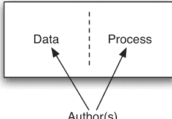

图 1.1. 创作数据与流程。

存储在电子表格中的事物（信息列表和表格，结构程度不一）。

另一方面，流程是模拟机器的工作部分。有些专门用于结构简单的任务，例如在屏幕上显示一系列视频图像。但许多数字媒体的任务结构更为复杂，需要能够以多种不同方式运行的流程。即使是像《乒乓》（图 1.2）这样简单的数字媒体，其流程定义的行为也远比快速连续显示一系列图像要复杂得多。《乒乓》的流程定义并计算简单的物理规则（球如何从球拍和墙壁反弹）以及简单的游戏规则（谁接每个发球、如何得分、如何获胜），当这些规则调校良好时，可以结合起来创造引人入胜的游戏体验——即使面对极其原始的图形。

当然，通过创作新颖流程来制作媒体的想法并非新事物。特里斯坦·察拉的达达主义剪贴技法在第一次世界大战后被提出，作为将选定报纸文章

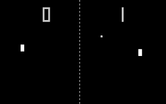

图 1.2. 标志性早期电子游戏《乒乓》给玩家一个简单的目标：使用模拟球拍将模拟球击回——让球保持在比赛中，直到一名玩家失误，导致另一名玩家得分。

变成诗歌。在更技术的层面上，早期电影的先驱者不得不开发新颖流程（体现在物理机械中）来捕获和显示他们的图像数据集。而在更长期的层面上，棋盘游戏和卡牌游戏的创作一直主要是开发流程定义——体现在游戏规则中——这些定义决定了游戏如何进行。

在重要方面，这些非计算媒体流程与数字媒体的流程相似：它们事先被定义，但（至少部分）在观众体验期间执行。当察拉从口袋里掏出一张纸屑，当活动画图闪烁，当扑克牌局进行另一轮下注，当乒乓球图像从乒乓球拍图像反弹时，情况都是如此。然而，数字媒体的流程因其潜在的众多性、重复性和复杂性而与非计算媒体流程有所区别。例如，我们可以使用《乒乓》的规则打网球——因为它们比网球的

常规网球规则。但我们不想将《乒乓》作为棋盘游戏来玩，因为这需要手动执行其中涉及的所有流程，即使是对物理（极度简化）的建模也是如此。正是计算机执行大规模流程（至少部分在观众体验期间）的能力，使得数字媒体能够创造各种可能的体验、响应上下文、随时间演变并与观众互动。

鉴于此类观众体验的重要性，作者的观点并非本书中我考虑的唯一观点。为了体现这一点，这里有一个稍复杂的图（1.3），它在初始数据和流程之上增加了一个名为“表面”的层。在本书中，数字媒体作品的表面是观众所体验的内容：即在物理硬件和环境的背景下，对数据进行操作的流程的输出，所有观众交互都通过此进行。例如，在玩主机游戏时，表面包括主机及其提供的任何指示灯或其他信息、电视或显示器及其显示的任何图像、声音硬件（例如，电视扬声器、立体声或耳机）及其产生的任何声音，以及带有

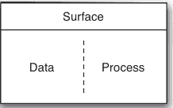

图 1.3. 向数据和流程添加表面。

按钮、灯光，或许还有震动。4 数字媒体的观众体验就是与表面相连，在某些情况下是通过表面。

我认为这是对数字媒体更令人满意的看法。然而，这个图，如同我迄今的讨论一样，没有考虑到数字媒体流程中相当重要的一点：它们通常不会自行运行。从基于 Web 的知识库到基于主机的视频游戏，数字媒体的操作在关键方面只有在与观众接触时才真正实现。如果观众不使用维基的流程来添加数据、编辑数据并遵循其中嵌入的连接，那么维基的流程就没什么意义。同样，如果游戏没有玩家，游戏的许多流程永远不会启动。5

这一切并不令人意外。但如前所述，我们通常从观众的角度来理解这种情况，审视观众的行为和作品的行为，仿佛作品是一个众所周知的黑盒。我认为同样重要的是更具互惠性地理解这种情况：思考观众体验与系统内部操作之间的关系。

图 1.4 在我的数字媒体图表中添加了交互的表示。虽然交互无疑是一个有争议的术语，但为了本书的目的，我将其定义为来自作品外部、对作品状态（作品为此而设计）的更改。交互通过作品的表面进行，导致其内部数据和/或流程发生变化。在许多情况下，交互的某些痕迹会立即在表面上显现（例如，观众成员输入文字，字母在输入时出现，

4. 许多主机游戏也有更复杂的表面，通常以舞蹈垫、模拟乐器和摄像头等额外控制器的形式出现。数字小说和游戏更普遍地可能拥有更多……

5. 同时，当流程通过表面的观众动作启动时，流程和表面也定义了观众动作的某些可能性空间，以及产生的反馈，从而塑造观众。为……

注释在本章末尾继续。

或观众成员移动手，其手的视频图像同时移动)，但这并非必需。交互虽然总是改变作品的状态，但可以以观众成员之间的沟通为主要目标——例如，通过共享虚拟世界（如 *魔兽世界* 或 *第二人生*）进行沟通。最后，鉴于我使用的交互定义，也变得清楚，数字媒体作品与不仅仅是观众进行交互——这就是为什么修订后的图表还指出了与外部流程和数据源交互的可能性。

显然，图表现在变得相当复杂。但我认为，作为创作者、学者或观众成员，在最初思考数字媒体作品时，牢记所有这些元素很重要。当然，与大多数数字媒体作品的实际组件和连接的细节相比，这个图表仍然大大简化了。这种简化是向更抽象层面考虑数字媒体作品迈出的第一步。

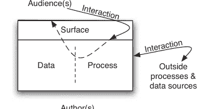

图 1.4. 向数字媒体图表添加交互。

## 操作逻辑

上述数字媒体模型的主要目标并不在于其各个组件。我主要的希望并非读者能理解我所指的 *数据* 或 *表面* 的每一个细微差别。相反，我希望对这些组件的基本理解能为思考数字媒体（以及更广泛的计算系统）提供一种新方法的基础。我使用术语 _操作逻辑_（如下文所述）来命名一种特定于过程系统的新元素类型，这种思考方式可以帮助识别和分析该元素。

当数字媒体作品运行时，这可以被视为迄今讨论的模型元素之间的相互作用：数据、流程、表面、交互、作者和观众。观察这种相互作用的具体细节可以提供启发。系统实际上是在做它被描述为所做的事情吗？操作进行的方式中内置了哪些未言明的假设？

然而，在更高层次的抽象中，我们也可以注意到这种相互作用中的模式。我称这些模式为 _操作逻辑_。在我最初讨论它们时（Wardrip-Fruin 2005），我谈到了常见的空间或图形逻辑，例如 _碰撞检测_。这是一个术语，用于指系统注意到两个模拟对象的虚拟“接触”。当 _乒乓_ 球从球拍和墙壁反弹时，这就是碰撞检测。当 _毁灭战士_ 引擎防止玩家穿墙而行时，这也是碰撞检测——当它确定子弹（或链锯）击中目标时也是如此。⁶

6. 我将在第9章中回到空间逻辑的讨论。


操作逻辑可以在不断扩展的平台集上以多种方式实现。一旦我们识别出一种逻辑，对不同实例进行比较可能会很有启发。这些比较可以深入探讨逻辑在不同作品中的具体实现方式，也可以在更高层面上运作，探讨相同的逻辑如何对一组作品的体验产生截然不同的贡献。这不仅适用于空间逻辑，也适用于系统的许多操作元素。本书后续章节将探讨从许多计算机游戏中实现的任务逻辑到许多符号AI系统中实现的断言和推理逻辑等各种操作逻辑。

虽然我希望操作逻辑在比较研究中证明是强大的，但在本书中，它们主要用于对单个作品的考察。更具体地说，虽然操作逻辑可以被视为数字媒体系统元素之间相互作用中产生的模式，但我感兴趣的是考察系统操作逻辑之间的相互作用——并以此作为批判性解读的起点。我在这本书关于Tale-Spin的章节中最明确地运用了这种方法，该章节将基于计划框的规划确定为作品的主导逻辑，驱动其他逻辑（这一事实在仅考察作品表面时是不可见的）。虽然在其他章节中不那么明显，这种方法支撑着本书大部分的分析——我希望这些示例能鼓励其他人进一步发展他们自己的此类方法（参见侧边栏，“思考过程的术语”）。

## 三种效应

在更高的概念层面上，本书还识别出系统过程与受众体验之间可能产生的三种效应，这些效应可能与各种操作逻辑一起出现。这些将作为本书余下部分的主要路标。第一种——伊莉莎效应——是众所周知的现象，即受众的期望使数字媒体系统在表面上看起来比其底层结构所支撑的要复杂得多。

然而，我还将考虑大多数作者忽略的一点：在与以伊莉莎效应命名的模拟治疗师进行富有游戏性的互动时，幻觉会迅速破裂。避免此类系统崩溃的一种替代方案是严格限制互动。另一种是许多现代游戏所采取的方案：从不构建伊莉莎幻觉，而是在作品表面清晰地表现简单系统的操作。但这些简单系统对于游戏希望为玩家提供的虚构体验来说证明过于有限，导致另一种类型的崩溃。这使得那些寻求创建雄心勃勃的可玩虚构作品的人只剩下一个选择：更完善的故事和角色系统模型。

《Expressive Processing》的下一个路标是一个以第一个主要故事生成系统Tale-Spin命名的效应。尽管它是在现代游戏出现几十年前创建的，但它代表了向更灵活的虚构模型迈出的初步步骤。其角色有目标，会制定计划来满足这些目标，会审视与其他角色的关系，会猜测他人的计划，等等。但在这些产生的故事中，受众几乎看不到这些内容，甚至通过重复互动也很难推断出来。正是这一点促使我创造一个新术语——Tale-Spin效应——用于那些未能在表面上表现其内部系统丰富性的作品，这是伊莉莎效应的一种倒置，在数字媒体中并不罕见。从那里，《Expressive Processing》探讨了另一种角色规划模型（在第一人称射击游戏F.E.A.R.中）、统计AI方法的替代方案，以及接下来几十年故事生成系统的发展。虽然被考察的故事生成系统展示了各种有趣的虚构模型，但大多数都专注于此而排斥丰富的受众体验，导致Tale-Spin效应甚至在这一领域最先进的作品中仍然存在。

本书的第三个观点以一款作品命名，这款作品因将一个相对复杂的系统转化为丰富、愉快的游戏体验而闻名：城市规划游戏SimCity。SimCity效应是我用来指代那些塑造其表面体验，以使受众能够建立对其内部结构（尤其是相对复杂的结构）理解的系统的术语。这种方法支撑着最流行、最有影响力的围绕模拟人类角色构建的游戏：The Sims。它还为理解可信动画角色和互动戏剧系统的发展提供了一种方式，这些系统避免了对内部系统状态的最直接表现。最后，SimCity效应为那些寻求以新方式使另一种强大的虚构技术——语言——可玩的人提供了重要的设计指导。

## 思考过程的术语

操作逻辑的想法是我谈论数字媒体方面的方式，其他作者和设计师也关注这些方面。鉴于此，操作逻辑与其他人为思考数字媒体系统所提出的一些想法相关，这不足为奇。例如，Ian Bogost的《Persuasive Games》（2007）将我的操作逻辑概念定位为程序化修辞的“套路”（这似乎很合适，至少对于那些清晰地构建受众体验的逻辑而言）。操作逻辑的概念也与Bogost的“单元操作”概念不无关系——尽管Bogost的目标在某些方面更为通用，因为他的工作为“任何媒介——诗意的、文学的、电影的、计算的”创造了基础，使其可以“作为可配置系统、离散且互锁的表达意义单元的排列来阅读”（2006, ix）。同时，Bogost的目标也更为具体。例如，他写道：“单元操作是优先考虑离散、断开的动作而非确定性、渐进系统的意义生成模式……在软件技术中，对象技术利用单元操作；结构化编程表现出系统操作”（3）。在我目前的思考中，我仅将操作逻辑概念用于计算系统（例如，而非传统电影），并且以涵盖Bogost所称的单元操作和系统操作的方式使用。

游戏设计当然是一个特别重要的领域，需要考虑系统中运行和连接的部分，以及可以组合和调整以创造成功受众体验的部分。一种用这种方式思考的有影响力的框架被称为MDA，代表机制、动态和美学（Hunicke, LeBlanc, and Zubek 2004）。在游戏设计的语言中，尤其是对于熟悉MDA框架的人来说，我称之为操作逻辑的东西通常可能被称为机制——只不过MDA机制被界定为仅限于受众体验的操作逻辑。正如Robin Hunicke, Marc LeBlanc, and Robert Zubek所写：“机制是游戏情境中提供给玩家的各种动作、行为和控制机制。”

从相当不同的方向来看，计算机科学也对系统操作问题进行了大量思考。计算机科学中用于更抽象层面考虑过程和数据操作的一般术语是算法。这一概念当然共享操作逻辑相对独立于实现的特性（算法导论课程可能会在多种语言和平台上实现“冒泡排序”算法）。然而，为了使操作逻辑在解释中有用，它不必具备D. E. Knuth要求算法的特性（1968）。例如，它不必是确定的（所使用的术语可能需要人类知识，而不是在可计算的详细级别上指定）。更根本的是，计算机科学教育很少强调从批判性或美学角度考虑算法及其关系——而非从效率等术语来考虑。


## 展望

如果我成功了，*Expressive Processing* 就是一本合订的两本书。其中一本书认为，我们需要更加关注数字媒体的过程。本书是软件研究这一不断扩大领域的一个例子（在第 5 章中有更详细的讨论）。它在作者性、批判性和政治性层面上论证其观点。它概述了我对 *expressive processing* 的两个主要含义，以及我在系统过程与受众体验之间关系中识别出的三种普遍效应。它提出了一种思考软件和媒体的方式，这种方式源于我与作家、艺术家、游戏设计师、计算机科学家和人文学者的互动——我希望它对所有这些群体的成员都有用。像这样的书必须有例子支持，但我相信，这样一本书本可以由任何对各种数字媒体（从计算机音乐到生成式视觉艺术）充满热情的作者来撰写。

这些封面内的另一本书是由我对数字虚构和游戏的热情所塑造的。它讲述了这些领域中面向过程的创新历史——这一历史可以在我们创造将塑造叙事和游戏未来的项目时提供启发（以及谨慎的指导）。我们正处于这些领域的创意爆炸之中，这是一个令人兴奋的地方。随着我们的工作向前推进，我们也开始看到，令人兴奋的可能性不一定是早先所假设的那些。我们并没有在更贴近日常现实的近似中找到更大的作者权力。相反，我们在故意人为的模型中找到了它，这些模型强调能够捕捉作者想象力的元素，表达一种对受众可能重要的世界观——就像传统虚构作品省略了角色大部分生活，只保留与特定世界核心相关的元素一样。同样，我们并没有在明显“自然”、“沉浸式”或“隐形”界面中找到更大的潜力。相反，那些暴露底层系统不断演变的状态以及受众与其虚构作品相关联的行动机会的界面，正在为我们创造令人兴奋的新角色（不再仅仅是视觉上的“观看者”、文本上的“读者”或正式系统上的“玩家”），同时也帮助我们为虚构世界发展新的理解模式。这反过来为这两本书之间提供了最强有力的联系。将虚构世界理解为系统——并通过游戏探索其潜力——也是理解我们不断演变的社会的一种有力手段，在该社会中，（通常是隐藏的）软件模型结构了我们当前生活的大部分方式。

我假设大多数读者主要是因为这两本交织在一起的书中的某一本而被 *Expressive Processing* 吸引的。我希望，无论你最初的兴趣是什么，你都能从两本书中都找到有价值的东西。

## 注释

1. 在 Grand Text Auto 上对本书手稿进行的基于博客的同行评审中（在后记中讨论过），Mark Marino 认为计算机模拟电影放映机和磁带机的能力是“一系列文化、消费者和生产者优先事项的结果”。这当然是事实。虽然我在这里写的是关于使这种模拟成为可能的因素，但我们不应该忽视实际是如何从可能中被选取的。

2. 有关此项目 Screen 的更多信息，请参见第 9 章。

3. 虽然数据和过程的概念作为想法似乎足够清晰，但在实践中，系统的任何元素都可能是两者的混合体。例如，Web 应用程序处理的文本通常被视为数据。然而，这种文本数据往往是纯文本和标记语言标签（早期版本的 HTML 或 XML 定义的标记语言）的混合物。这些标记语言标签反过来可能定义或调用进程，无论是在服务器上还是在网站受众的 Web 浏览器中。这种模糊性部分是因为 Web 内容的创建可以被视为声明式编程最普遍的例子之一。在这种模型中，作者关注要做什么（例如，在页面特定位置出现动态生成的菜单），而不是如何执行。进一步说，在像 Prolog 这样的语言中，作者的大量工作变成了逻辑语句的表达（这些语句可能看起来像是关于世界的数据），而“运行”程序则取决于属于 Prolog 底层支持一部分的进程（例如搜索）。另一方面，Prolog 作者提供的逻辑语句是为了调用复杂的推理过程而精心制作的，而不是作为系统的最终输出（不像，比如说，构成计算机游戏过场动画视频文件的数据）。在第 6 章中，注释 5 讨论了声明式信息在构建灵活进程中的重要性，而第 7 章包含关于 Brutus 的一节，这是一个由 Prolog 支持的系统。还有不那么复杂的情况，例如，当一个进程用于生成数据，而这些数据本可以最初就存储在系统中，从而在存储和计算之间产生权衡。幸运的是，这些都不会削弱数据和过程概念作为起点的基本实用性。

4. 许多主机游戏也有更复杂的表面，通常以舞蹈垫、模拟乐器或摄像头等额外控制器的形式出现。更广泛地说，数字虚构和游戏也可能有更复杂的表面，由其作者选择或制作。这些表面可能重新利用日常物体，采用增强现实或虚拟现实显示器，渗透并融入日常世界的部分（如替代现实游戏和定位媒体），超越“一根手指和一只眼睛”（当前界面的局限性，如 Joy Mountford 所言）来吸引受众成员的身体，等等。

5. 与此同时，当进程通过受众在表面上的操作而启动时，进程和表面也定义了受众行动的一些可能性空间，以及产生的反馈，从而塑造受众。例如，虽然受众成员随时可以按下主机控制器上的特定按钮——这在当前游戏中可能有意义，也可能没有意义——但对于许多游戏来说，成功游玩的过程需要在前意识水平上接受训练，以采取系统所识别的行动。意识思维的介入将使在 *Prince of Persia: The Sands of Time*（在后面章节中讨论）等游戏中为一系列跳跃把握时机变得不可能。在一个更早期的游戏的背景下（《Breakout》在 Atari VCS 上的版本），这是可能是计算机游戏研究第一本经典著作的核心观察之一：David Sudnow 的 *Pilgrim in the Microworld*（1983）。换句话说，受众体验与系统操作之间的关系既包括受众的解释工作，也包括系统对执行解释的受众的塑造。

在 Grand Text Auto 上本书基于博客的同行评审期间的一系列评论中，Bryan G. Behrenshausen 提请我注意 Alex Galloway 的著作中是如何表述这一点的。例如，正如他在与 Eugene Thacker 合著的书 *The Exploit* 中所论证的：

> 互动游戏形式不应被视为摆脱交换和生产系统僵化约束的解放，而应被视为支撑这些系统的支柱本身。视频游戏在表面上越是显得解放玩家，提升其作为审美时刻积极参与者的地位，它们就越是将玩家纳入编码化和常规化的行为模式中。在任天堂娱乐系统控制器上，用于整个表达性阐述谱系的按钮只有八个（对应八位）。（Galloway 和 Thacker，2007，115）

我感谢 Galloway 和 Thacker 指出，互动系统绝不一定是解放性的——反而可能在压迫的模式中进行训练。另一方面，我认为他们的论点在涉及 NES 控制器的八位时采取了一个可能令人困惑的转折。毕竟，英语的标准 ASCII 字符编码只需要七位。我已经说服自己，即使是这种有限的表达空间也可以以多种方式使用，其中一些是解放性的。

另外，认识到系统本身远非塑造受众的唯一力量也很重要。那些在与 *Dance Dance Revolution* 互动时添加额外身体花招的熟练玩家/舞者，并非受到其传感器垫和屏幕指示的鼓励（这些指示将其表现视为与采取最小身体动作的人无异）。在游戏厅聚集在他们周围的人群知道这一点。

6. 我将在第 9 章中回到空间逻辑的讨论。


# 第 2 章
Eliza 效应

## 遇见 Eliza

我十几岁时——在 1980 年代——我母亲买了一台个人电脑。那是当时一台令人印象深刻的机器，配备了两个软盘驱动器、一台点阵打印机、一台 Hayes 调制解调器和一台单色琥珀色显示器。

起初，我只用这台机器做一些小的编程实验（使用 Basic 和后来的 Pascal）、写学校作业（使用 WordStar）以及玩一些游戏。但那个神秘的调制解调器就放在那里。它可能本意是让我母亲与她大学实验室里的大型数字设备公司机器交换数据，但我知道调制解调器也可以用于其他事情。

这大约是在互联网开始进入我们这样的家庭之前十年，我对 Source 或 CompuServe 等服务精心打理的花园毫无兴趣。与其进行任何远距离旅程，我宁愿使用调制解调器去探索本地的荒野，去拜访那些在邻居家书房和地下室里萌芽的、缺乏指导的公告牌系统（BBS）场景。

虽然今天大多被遗忘，但 BBS 是 1980 年代青少年的首选在线目的地，¹ 大多由个人在家中运营：拥有比我们强大得多的计算机的电脑爱好者，连接了一条或多条专用电话线。像我这样的用户可以拨入 BBS，阅读消息、留言、下载和上传文件、玩基于文本的游戏，并且（如果 BBS 的所有者在电脑前，或者有人拨入其他电话线之一）可以与完全陌生的人进行实时文本对话。换句话说，BBS 不仅仅是一个文件存储库。它是一扇窗户，让我们看到了如今已变得显而易见的事情：将计算机和网络结合的惊人社会潜力，这给我们带来了电子邮件、即时通讯、维基、博客、社交网络网站以及更多。

一旦瞥见了这种潜力，当没有其他人在线时，拥有多条线路的 BBS 可能会感到有点孤独。但有一天，我去一位童年朋友家（我们不再上同一所学校），他向我展示了他在电脑上总是有对话在等待。他给我看了一个他从 BBS 下载的程序。他把 Eliza 介绍给了我。

1. 关于 BBS 文化，我强烈推荐 Jason Scott 的《BBS 纪录片》（2005）：

## Eliza 今日

Eliza——或者更准确地说，Eliza/Doctor——是麻省理工学院计算机科学研究员 Joseph Weizenbaum 在 20 世纪 60 年代中期创建的一个开创性系统。在 Weizenbaum 创建该系统到我在朋友家体验它之间的二十年里，它已成为世界上最著名的计算机潜力演示之一。它在 HAL 9000 在《2001 太空漫游》中银幕首映前两年首次揭幕，似乎 Eliza 使得与计算机进行真实对话成为可能。²

在计算机科学文献中，以 Eliza 之名，Weizenbaum 的系统是自然语言处理领域的一项贡献。另一方面，当 Eliza 扮演 Doctor 时，它是一个广为人知的计算机角色，远超计算机科学领域而闻名，通常也被称为 Eliza。Eliza 在计算机世界中还有第三种常见用法：Eliza 效应。这个术语通常用来描述一种不罕见的错觉，即认为一个智能计算机系统比实际情况更“智能”（或实质上更复杂、更强大）。本章的目的之一是重新审视 Eliza 效应，并赋予它更多细微差别，使其不仅指代这种最初的错觉，还指代随之而来的作者选择：一方面是严格受限的交互，另一方面是基于实际底层过程采取某种形式的最终崩溃。

在下一章中，以 Eliza 效应的考察为背景，我将探讨当今数字小说作者——特别是计算机游戏作者——所选择的选项。这些选项通常搁置 Eliza 效应，转而支持那些更清晰地向受众传达其结构的系统。然而，这些系统有两个问题我将予以考虑。有些采用的过程虽然可读，却倾向于一种非 Eliza 形式的崩溃。另一些虽然避免了崩溃，但在使用计算过程方面抱负不大。更雄心勃勃的路径将是本书其余章节的重点。

但目前，我将从这种错觉开始。

2. Eliza 并非第一个让受众产生与计算机进行有意义交流印象的系统。Matthew Kirschenbaum 的《机制》（2008）提供了一个引人入胜的例子，“Professor RAMAC”——一个……注释继续于本章末尾。

## Eliza 效应

我不记得我与 Eliza 第一次对话的具体内容，但这里是 Eliza 最著名的对话（计算机的回复全用大写字母）：

> 男人都一样。
> 以何种方式
> 他们总是为此或那事烦我们。
> 你能想到一个具体的例子吗
> 好吧，我的男朋友让我来这里。
> 你的男朋友让你来这里
> 他说我大部分时间都很沮丧。
> 很抱歉听到你沮丧
> 是的。我很不开心。
> 你认为来这里会
> 帮助你不再不开心吗
> 我需要一些帮助，这一点似乎很确定。
> 这对你意味着什么
> 如果你得到了一些帮助
> 也许我可以学会与母亲相处。
> 请告诉我更多关于你家人的事
> 我母亲照顾我。
> 你家里还有谁照顾你
> 我父亲。
> 你的父亲
> 你在某些方面像我父亲。
> 你看到什么相似之处
> 你不太具有侵略性，但我认为
> 你不希望我注意到这一点。
> 什么让你认为我
> 不太具有侵略性
> 你不和我争论。
> 为什么你认为我不和你争论
> 你害怕我。
> 相信我害怕你让你高兴吗
> 我父亲害怕所有人。
> 当你想到你父亲时，还有什么浮现在脑海中
> 暴徒。
> 这与你男朋友让你来这里这一事实有什么关系吗（Weizenbaum 1966, 37）

正如你所想象的，我印象深刻。我当然也不是第一个。Weizenbaum 在 MIT 的雇主们抓住了 Eliza，将其作为计算机潜力的易于理解的演示，对那些缺乏欣赏大部分正在进行的研究所需专业知识的人来说令人兴奋。计算机界也认同这一点。事实上，当第一次 ARPANET（互联网的前身）演示进行时，一些终端从远程位置运行 Eliza（Leonard 1997, 52）。鉴于 Eliza 引起的兴奋，天文学家兼科学普及者 Carl Sagan 认为未来可能会出现“计算机心理治疗终端网络，类似于大型电话亭阵列”（Weizenbaum 1976, 5）。

最初 Eliza 运行在一台比我手机还不强大的计算机上，尽管当时它是 MIT 最先进的计算机之一。Eliza 并非连接到显示器、键盘和鼠标——或者 HAL 的麦克风、扬声器和摄像头——而是通过类似打字机的东西来体验，允许计算机向用户打字，用户也打字回复。人们可以向 Eliza 输入任何他们想说的话，软件会根据当前激活的脚本以不同方式做出回应。

这个最后的词，“脚本”，很重要。Eliza 没有什么神奇的——它只是一堆数据和进程，而且是相当简单的进程。每次 Eliza 运行时，它都使用特定的脚本来指导其行为。给出的示例对话是使用 Eliza 最著名的脚本 Doctor 创建的，这导致软件模仿非指导性治疗师在初次就诊时的对话模式。所有这些都在 Weizenbaum 1966 年发表在《ACM 通讯》上的文章中描述。4

3. Erik Loyer 在为我们合作的数字媒体期刊 Vectors 的项目重新实现 Eliza 系统时指出，这次对话似乎经过编辑。除非 Eliza 系统未被记录……

注释继续于本章末尾。

4. 这篇文章不仅是解释 Eliza 进程的良好、清晰的来源（也是计算机科学文献中关于 Eliza 最被引用的出版物）。它还作为许多在家中创建的 Eliza 版本的基础……

5. 虽然原始脚本文本全是大写字母，但我在此将其常规化。此外，此描述侧重于 Eliza 中工作的核心进程；若要描述所有进程，将使本节与 Weizenbaum 的文章一样长。注释继续于本章末尾。

## Eliza 的工作原理

与 Eliza 的会话可以以问候开始。Weizenbaum 的 Doctor 脚本以“How do you do. Please tell me your problem.”开头。在此之后，Eliza 不会再主动发起——只会回应。

每次受众成员输入内容时，Eliza 都会检查它，寻找当前激活脚本中有条目的单词。有些单词是关键字，我将在下文进一步讨论。有些单词被标记为简单替换。例如，当 Eliza 运行 Doctor 脚本时，这些替换会将所有人称代词切换为第二人称代词（“I”变为“you”）反之亦然（“yourself”变为“myself”）。例如，“Well, I am very helpful”将变成“Well, I am very helpful。”一个单词既可以被替换，也可以用作关键字。

句号和逗号被视为分隔符。如果遇到句号或逗号，Eliza 会检查是否已经找到关键字。如果找到了，则丢弃受众成员在分隔符之后输入的所有内容。如果尚未找到关键字，则丢弃分隔符之前的所有内容。例如，“Well, I am very helpful”将变成“I am very helpful。”

每个关键字都有一个优先级或等级。当在文本中找到第一个关键字时，它会被添加到一个“键栈”中。每次找到另一个关键字时，该关键字的等级


新关键字与目前已找到的最高级关键字进行比较。如果新单词的级别更高，它会被添加到栈顶；否则，它会被添加到栈底。在扫描文本中的关键字结束时，最高级关键字位于栈顶。

关键字扫描完成后，下一步是找到一个与听众输入内容的替换后版本（除去因逗号或句号而丢弃的部分）相匹配的“分解规则”。分解规则与关键字相关联，因此此搜索从弹出栈顶关键字开始。（我很快将讨论如果栈中没有内容时会发生什么。）Eliza 会尝试与该关键字关联的分解规则，寻找一个与通配符“0”（相当于“任意数量的单词，包括零个单词”）相结合的适当单词模式。例如，如果关键字是“you”，则第一个分解规则是：(0 | remind you of 0)

这不会匹配上面的示例短语“I are very helpful”。第一条规则只会匹配类似“With that last statement I remind you that I are a machine”的替换后短语，或者（因为 0 可以表示零个单词），“I remind you of the happier days of your childhood”。然而，针对“you”关键字的下一条分解规则会匹配前面使用的示例短语：(0 | are 0)

一旦找到匹配项，分解规则就会做其名称所指的事：它将短语分解为各个部分。这种分解基于规则中的单词数量和 0 的数量。例如，“I are very

6. 问号未被使用，因为在 Weizenbaum 使用的计算机系统上，它们被解释为“行删除”。

helpful”将变为：(1) 空 (2) | (3) are (4) is very helpful.

此时，剩下的就是决定要对听众说什么。每个分解规则可以有一组与之关联的重组规则。一个重组规则示例（针对分解“0 I am 0”）是：(What makes you think I am 4)

这将产生回复：“What makes you think I am very helpful.” 一旦在 Eliza 的任何运行中使用过，重组规则就会被标记，以便在重复任何规则之前，先循环使用与特定分解关联的所有重组规则。

这是 Eliza 方法的主要部分。还有一些改进，例如允许脚本在关键字之间共享规则的技术（例如，mother 和 father）。但由此，Eliza 中起作用的主导操作逻辑应该很清楚：转换。Eliza 的每句话都是对听众最近陈述的多步转换的结果。

这些转换中的许多都包含被转换陈述的逐字部分，如上所述。其他则是更间接的转换，例如将“Perhaps I could learn to get along with my mother”翻译为“Tell me more about your family.” 然而，真正的翻译困难在于，当听众最近的文本中找不到任何关键字——这是 Eliza 转换逻辑的核心方面——时。例如，当 Eliza/Doctor 问“What else comes to mind when you think of your father”，并收到回复“Bullies”时，就是这种情况。

在这种情况下，一组可能的转换可以基于名为“none”的特殊关键字在脚本中定义。在 Doctor 中，这些是诸如“Please go on”和“I see”之类的无内容短语。然而，与 Eliza 的一些最令人惊讶的时刻来自另一个名为“memory”的特殊结构。该结构与特定关键字结合使用。在 Doctor 的例子中，它与关键字“my”和分解“0 your 0”一起使用。选择此关键字时，会以通常方式生成回复。此外，还可以创建另一个重组并存储在队列中，以便在未找到关键字时稍后使用。在 Doctor 中，这些重组是“Lets discuss further why your 3”、“Earlier you said your 3”和“Does this have anything to do with the fact that your 3”——我们在上面看到了最后一个，其中 3 是“boyfriend made you come here”。换句话说，上面对话中的惊人笑点只不过是一种后备方案，是 Eliza 在最近的回复没有可识别关键字时可以采取的默认操作。

这里我们可以看到是什么促使 Weizenbaum 写道：“一旦某个特定程序被揭开面纱，一旦其内部工作原理用足够通俗的语言解释以引发理解，其魔力就会瓦解；它被揭示为仅仅是一组过程，每个过程都相当容易理解”（1966, 36）。但是，当我们与一段软件交互时，我们不一定能获得这种理解，我们无法清楚地了解它内部实际是如何运作的。就 Eliza/Doctor 而言，萨根博士和我并非孤例：其听众常常对其内部工作原理产生错误的想法。他们假设，既然与程序交互的表面外观可能类似于连贯的对话，那么内部软件必定复杂。有些人认为它一定是

7. 这是珍妮特·默里在 *全息甲板上的哈姆雷特* 中报道的故事版本。
除了这个版本，还有许多明显是伪造的版本流传，包括一个 Weizenbaum 是事件参与者的版本。这个版本本身不可能是……
注释继续在本章末尾。

某种接近虚构的 HAL 的东西：一种足够智能以理解和产生任意人类语言的计算机程序。这种情况发生得如此频繁，并且如此引人注目，以至于在计算机科学圈子里，人们开始为这种误解使用一个特定术语，即本章前面提到的：Eliza 效应。

## 为什么 Eliza 有效

关于 *Eliza/Doctor* 有效性的故事有很多。Weizenbaum 自己告诉我们：“我的秘书，她看着我在这个程序上工作了很多个月，因此肯定知道它仅仅是一个计算机程序，开始与它交谈。仅与它交换了几句话之后，她就让我离开房间”（1976, 6）。还有一个反复讲述的故事，有许多版本，关于老板以为自己在与下属沟通，但实际上却在与 *Eliza/Doctor* 交谈：

副总裁：Do you think I can use the computer this morning?
Teletype: WHY DO YOU ASK?
副总裁：I might be able to make some additional telecomp (computer system) sales.
Teletype: WHY AREN'T YOU SURE?
副总裁：My prospective customers have never seen a demonstration of the system.
Teletype: DOES THIS MEAN VERY MUCH TO YOU?
副总裁：Of course it does.
Teletype: YOU SEEM VERY POSITIVE ABOUT THAT.
副总裁：This is ridiculous.
Teletype: WHAT DO YOU MEAN THIS IS RIDICULOUS?
(Murray 1997, 7).

作为一名高中生，我发现 *Eliza/Doctor* 之所以能创造出有效的初始幻觉，与上述故事中那位标志性的“情感化”秘书和“糊涂”老板产生作用的原因相同。首先，我们都习惯于纯文本计算，以及在那个环境中与他人交谈。其次，Eliza/Doctor 在进程和数据之间实现了非常好的匹配。初次拜访治疗师的情境、重组和无回应中的巧妙编写，以及精心挑选的关键字，都尽可能地利用了 Eliza 转换过程提供的简单语言技巧。（事实上，除了 Doctor 之外还创建了其他 Eliza 脚本，但没有哪个脚本变得像它那样广为人知或普及。）第三，就我自己、秘书和老板而言，这是我们第一次接触计算机角色。但所有这三个原因都只是 Eliza/Doctor 对一个更普遍现象的具体细微差别：当一个系统被呈现为智能，并似乎表现出智能行为时，人们有着令人不安的强烈倾向将其视为智能。⁸

8. 马克·J·纳尔逊在本书的基于博客的同行评审中，敦促我澄清这一点不仅适用于计算机系统——正如本章后面将展示的一个例子：哈罗德·加芬克尔的是/否治疗实验。

这一现象挫败了 Weizenbaum 的职业生涯。他开始将工作重点放在导致 Eliza 效应名称的概念错位上，具体是探讨它如何“在相当正常的人身上引发强大的妄想性思维”（1976, 7）。Weizenbaum 写了一本书，致力于证明计算机的内部并非神奇，当我们假设人类如此机械化以至于我们的智能可以或应该被计算机匹配时，我们是在自讨苦吃。从某种意义上说，他从一名计算机科学家转变为最早审视计算机文化的知识分子批评家之一。


……的计算和人工智能。

遵循 Weizenbaum，许多其他作者认为，在理解我们与计算机以及更广泛文化的关系时，*Eliza* 效应是一个需要解决的重要问题。Weizenbaum 的著作出版十年后，Lucy Suchman 出版了《计划与情境行动》（1987），书中她将 *Eliza/Doctor* 视为人机交互中一个典型的例子，体现了基于有限证据就将系统视为智能的广泛现象。具体来说，她讨论了民族方法学家 Harold Garfinkel（引用 Karl Mannheim）所称的“文档式解释方法”。

Suchman 介绍了 Garfinkel 的一个实验，以展示这样一种观点：人们倾向于“将表象视为所归属的潜在现实的证据或文档，同时将所归属的现实作为解释表象的资源”（23）。在这个实验中，学生受试者被介绍到一种新型疗法，他们就个人问题提出是/否问题。这些问题由对受试者不可见的“咨询师”回答。受试者不知情的是，咨询师是随机回答每个问题的。

实验后，发现学生们构建了故事，将每一串回答理解为一次连贯的交流和一组建议。即使在给出的答案自相矛盾的情况下（这种情况在该环境下几乎不可避免地会发生），这种情况也会发生。实验受试者将表面上的矛盾解释为基于更多信息的修正观点、咨询师更深层议程的证据，或其他符合治疗情境框架的东西。

再过十年，Janet Murray 在《全息甲板上的哈姆雷特》（1997）中重新审视了 Eliza/Doctor。就我的目的而言，她在这里做了一个关键转向，从媒体的角度来看待这个项目。她将 Eliza/Doctor 视为一个戏剧角色，将 Weizenbaum 视为一种剧作家，并将此类情况下 Eliza 效应的来源视为“在令人信服的戏剧性存在面前，人类暂时放下怀疑的倾向”（224）。Murray 使之前描述中不清楚的事情变得清晰：人们喜欢 Eliza/Doctor。初始交互通常非常有趣且引人入胜，并创造出与一个有趣角色之间开放式可能性的感觉。

但这种第一印象不一定会持续。

## Revisiting the Eliza Effect

作为一个青少年，在与 Eliza/Doctor 初次交互后，我做了自然而然的事：我开始和它玩耍。（当然，软件不需要是游戏才能激发人们的玩耍。）我不记得确切的对话了，但我知道我很快就发现了 Murray 不深入讨论与 Eliza/Doctor 持续交互的原因，就像 Suchman 和 Weizenbaum 也没有深入讨论一样。”如果他们深入讨论，就会使他们的讨论复杂化。这是因为，虽然 Eliza/Doctor 的初始体验可以创造出一个极其复杂内部系统的表面印象，但与系统的持续交互，即言语上的来回，会邀请人们玩耍——而与 Eliza/Doctor 的语言游戏很快就开始摧毁这种幻觉。换句话说，正是那种有助于培养内部复杂性和智能幻觉的开放式文本交互，使得人们能够玩耍，而这种玩耍会将注意力引向系统的机械性

> 9. 说句公道话，在 Weizenbaum 最初观察的时候，几乎没有人能体验与 Eliza/Doctor 的持续交互，原因是计算资源有限。正如 Weizenbaum 所指出的，“由于受试者不能…… 脚注继续见本章末尾。

10. Turkle 评论道：“有些人会不遗余力地‘摸清’程序，以了解其结构，从而愚弄它并将其揭露为‘纯粹的机器’。更多人则采取相反的做法。…… 他们不会问自己已知的问题……”

11. Suchman 认为，Garfinkel 的实验为 Weizenbaum 的观点提供了支持，即在与 Eliza/Doctor 的对话中产生的智能感来自听众的工作。此外，她还主张……

脚注继续见本章末尾...

简单性，以及它与人类互动的疏远。不久之后，许多交互开始变成这样：

> 你会把我说的话以问句的形式重复一遍 什么让你认为我会把你说的话以问句的形式重复一遍

Sherry Turkle 在《第二个自我》中指出了这一现象，他写道：“当一个人熟悉 Eliza 的方式后，就可以将自己的言论导向‘帮助’程序做出看似相关的回应，或者引导它说胡话”[1984, 39]。Turkle 的书基于访谈和观察——她发现，她的一些受试者努力维持幻觉，而另一些人则试图最大限度地发挥 Eliza 的胡言乱语。然而，这两种策略都依赖于了解正在运作的内部过程，并相应地塑造表面交互。即使是努力维持幻觉，也需要一种看穿它的方式，而讨论 Eliza 效应的人很少承认这一点。

## The Eliza Breakdown

从我的角度来看，Turkle 所描述的内容指向 Garfinkel 是/否疗法实验的另一个教训。对 Suchman 来说，这个实验展示了民族方法学和文档假设对于理解 Eliza/Doctor 和人机交互的重要性。1 当然，理解 Eliza/Doctor 之所以（在一定程度上）成功，是因为它利用了观众带入每次交互的解释性期望，这一点至关重要。但就我在此的目的而言，Garfinkel 的实验还用于说明一些相当不同的事情：通过严格限制交互，可以使 Eliza 效应免受崩溃。这个实验让受试者能够维持这样的幻觉：系统内部正在发生更复杂的事情（一个人认真考虑她的问题并深思熟虑地回答问题，而不是随机的是/否回答），因为可能的回应范围非常有限。如果范围仅略微扩大——比如说，在“魔法八球”可用的回应之间随机选择——那么几乎任何持续交互的时期都会因太多不恰当的回应而打破幻觉。

当 Eliza 效应发生崩溃时，其形态通常由底层过程的形态决定。如果输出具有可读形式，观众就可以开始建立过程模型。这就是 Turkle 在与 Eliza/Doctor 交互的人身上观察到的：从崩溃的形态，他们开始了解系统过程的一些东西——然后利用这些知识来帮助维持或进一步破坏幻觉。

值得指出的是，在大多数旨在显得智能的控制系统中，交互方法都受到极大限制。在某些情况下，原因非常明显。如果允许公众与识别金融监控潜在目标的软件进行玩耍式交互，底层系统的形态将变得相对明显，从而使人们能够“操纵”该系统。同时，这种受限的交互也有助于维持 Eliza 效应，适用于那些远未达到公众被要求相信的那么智能的软件。

此外，在一个相当不同的社区中，这个

12. 除了一小部分可能希望探索其中一种效果的虚构作品之外。

选择——在严格限制的交互与幻觉的兴衰随后崩溃之间——为那些有兴趣创作数字虚构作品的人提供了不好的选择。12 因此，虽然有些人认为最好利用 Eliza 效应，依赖暂时的幻觉和故意暂时放下怀疑来取胜，但大多数数字虚构作者采用不同的方法：从一开始就向观众暴露其过程结构的重要元素。这允许与所采用的过程相匹配的交互，并避免 Eliza 效应和崩溃。不过，正如我接下来将讨论的，这些方法中最常见的方法也有其自身的局限性。

最后，我应该提到，一些作者——例如 Jeremy Douglass (2007)——断言崩溃可以是数字虚构的一种有趣模式。当然，崩溃可能很迷人。例如，在语言层面上，我们被吸引去研究各种形式的崩溃，从偶尔的口误到出血性失语症。

崩溃能做的事情——无论是 Eliza/Doctor 的情况、语言失误还是神经问题——是让我们对底层系统过程的形态有一些了解。这一事实指出了我为什么仍然在网上与人交谈（即使我不再拨号上 BBS 这样做），但我不再在业余时间和 Eliza 玩耍的原因：一个容易崩溃的系统，其趣味性仅取决于崩溃部分揭示的过程的形态。正如本章前面所示，Eliza 系统的过程大多是一组相对不有趣的替换。我们可以做得更好。


## Notes

- 1. 关于BBS文化，我强烈推荐Jason Scott的《BBS：纪录片》（2005）。

- 2. Eliza并非第一个让观众产生与计算机进行有意义交流印象的系统。Matthew Kirschenbaum的《Mechanisms》（2008）提供了一个引人入胜的例子：“Professor RAMAC”——一台四吨重的IBM机器，在1958年世界博览会上被拟人化——它使用了当时革命性的硬盘驱动器，为访问一系列历史事实提供了问答功能。

- 3. Erik Loyer在为数字媒体期刊Vectors合作的一个项目中重新实现Eliza系统时指出，这次对话似乎经过编辑。除非Eliza系统有未记录的功能，否则它对“You are not very aggressive but I think you don't want to notice that”的回应应该是“WHAT MAKES YOU THINK I AM NOT VERY AGGRESSIVE BUT YOU THINK I DON'T WANT YOU TO NOTICE THAT”，而不是更简洁的“WHAT MAKES YOU THINK I AM NOT VERY AGGRESSIVE。”

- 4. 这篇文章不仅是解释Eliza过程的优秀、清晰来源（也是计算机科学文献中关于Eliza引用最多的出版物）。它还成为多年后全国各地计算中心创建的许多本地Eliza版本的基础。距离研究人员和爱好者能够轻松通过计算机网络相互传输软件，那时还相隔数十年——因此，《Communications of the ACM》（面向研究人员）和《Byte》（面向爱好者）等纸质出版物通常包含了在本地重新实现该软件所需的所有信息（例如，在Weizenbaum的文章中，包括完整的Doctor脚本）。

- 5. 虽然原始脚本文本全是大写，但我在此将其常规化。此外，此描述侧重于Eliza中运作的核心过程；若全部描述，本节将如Weizenbaum的论文般冗长。

- 6. 问号未被使用，因为在Weizenbaum使用的计算机系统上，它们被解释为“行删除”。

- 7. 这是Janet Murray在《Hamlet on the Holodeck》中报道的故事版本。除了这个版本，还有许多明显是伪造的版本流传，包括一个Weizenbaum作为事件参与者的版本。这个版本本身不可能是与Eliza的逐字对话，至少不是以Weizenbaum 1966年论文中系统存在时的形式。例如，该论文的Doctor脚本包含回应“YOU AREN'T SURE”和“WHY THE UNCERTAIN TONE”，但不包含“WHY AREN'T YOU SURE。”除了措辞差异外，还值得记住前一条注释：Weizenbaum使用的系统不支持问号，而问号贯穿于此记录中。

- 8. Mark J. Nelson在本书的基于博客的同行评审中敦促我澄清，这不仅适用于计算机系统——本章后面的一个例子就是证明：Harold Garfinkel的是/否治疗实验。

- 9. 公平地说，在Weizenbaum最初观察的时候，几乎没有人能够与Eliza Doctor进行持续的交互，因为计算资源有限。正如Weizenbaum所指出的，
"由于受试者无法探测*Eliza*能力的真实极限（毕竟，他只有有限的时间来玩弄它，而且它不断从他那里获取新素材），他不得不将比实际更大的力量归因于它"（1976, 191）。

- 10. Turkle评论道，“有些人会不遗余力地‘摸清’程序，以了解其结构，从而欺骗它并将其揭露为一台‘单纯的机器。’更多人则恰恰相反。……他们不会提出明知会‘混淆’程序、会让它‘胡言乱语’的问题。”（40）。Turkle将此归因于一种愿望，即“维持Eliza能够回应他们的幻觉。”然而，这也完全符合Murray将Eliza视为媒体体验的解读，观众塑造他们的互动，以帮助维持自愿的暂时怀疑。

- 11. Suchman认为，Garfinkel的实验支持Weizenbaum的观点，即与*Eliza Doctor*对话中的智能感来自观众的工作。此外，她主张，学生们强烈情境化的理解（他们基于假设的情境解释随机的是/否答案序列）不仅挑战社会科学的强结构导向假设，也挑战认知科学的假设。

- 12. 除了那少数可能希望探索其中一种效果的虚构作品之外。

# Chapter 3 Computer Game Fictions

## Digital Fictions and the Eliza Effect

想象你已经借出了书籍，穿过潮湿的黄昏，走到街对面的公交车站。它的荧光灯管已经闪烁亮起——你可以读取有机玻璃后面的时刻表和广告，以及散落在其上的贴纸。

一张矩形贴纸引起了你的注意。它上面没有任何乐队的名称，没有任何开锁师的电话号码，没有任何公司的标志，也没有Andre the Giant的图像。它只是一段文本。开头写着，“Why bomb libraries？”

这段文字摘自Implementation，这是一本以小块形式编写、排版适合通过标准激光打印机在邮寄标签上打印的小说。Implementation从某种意义上说是一种贴纸小说，也是一种数字小说。它的作者Nick Montfort和Scott Rettberg（2004）主要分发的不是贴纸。相反，他们分发数字文件，由他人将其打印在贴纸上并张贴在引人注目的位置。读者有时会遇到这些贴纸。但是，和大多数贴纸一样，它们往往会被迅速从长椅、门、卫生间隔间、雕像牌匾、路灯杆、保险杠以及其他张贴位置移除。更持久的是人们拍摄的Implementation贴纸在有趣位置的照片，大多数人正是通过这些图像体验Implementation，这些图像的文件大小远超Implementation网站上的其他内容。

遇到Implementation可能是一种神秘的体验。发现一张脱离上下文的文本贴纸，尤其是位置巧妙时，往往令人不安。而张贴贴纸的图像也有其自身的谜团：那是哪里？那是什么？但是，尽管数字技术对Implementation很重要，谜团从来不在于软件。Implementation依赖于数字过程——但却是我们每天都在使用的过程，以至于文件下载、激光打印和照片分享等过程不再吸引我们的注意力。

有人甚至可能认为，Implementation不适合作为“数字”小说来讨论，而应视为一种以数字方式分发和记录的小说。无论如何，在其使用数字过程方面，Implementation作为许多数字虚构作品中普遍存在的一种相对极端的例子：它们通过采用概念简单、熟悉且明确向观众展示的过程，避免了Eliza效应的困境。

不同的虚构作品以不同方式采用这种一般策略。有些与Implementation的方式相对接近，将自身嵌入熟悉的数字环境中。例如，Rob Wittig（2001, 2002）的电子邮件小说Blue Company依赖于电子邮件传输和阅读过程——但就像激光打印过程一样，这些过程对于许多有计算机访问权限的人来说已经完全自然化。同样，网页浏览器和网页服务器熟悉的链接跟踪功能使得可以从互连的网页网络中构建虚构作品，例如William Gillespie、Scott Rettberg、Dirk Stratton和Frank Marquardt（1999）的The Unknown。熟悉的过程也是Elan Lee、Sean Stewart、Jim Stewartson和Jane McGonigal（2004）的交替现实游戏I Love Bees等混合作品的主要数字组成部分，该游戏将玩家带入了由网页组成的虚构世界


页面、电子邮件、电话、实体场景和元素以及现场表演——但将其新颖的流程定义为由人类参与者（而非数字计算）执行的规则。

不过，另一种数字小说方法比这种依托日常信息生活流程的方式更为常见。在这种更常见的方法中，数字小说定义了自己版本的广泛使用的数字媒体流程——或者采用为数字媒体创作工具定义的这些流程的版本。此类创作工具范围从 Adobe 的 Flash 软件（用于交互式动画）到游戏引擎（由同一开发者反复使用或提供商业许可）再到与特定艺术社区相关的工具（例如 Storyspace 超文本创作系统）。

采用这种方法的最普遍的小说形式是计算机游戏。它们倾向于通过采用同类型计算机游戏玩家所熟悉的简单流程的版本，并遵循惯例向受众展示底层流程的结构和动作，从而避免 Eliza 效应。本章将探讨两个特别精心制作的计算机游戏小说示例——《星球大战：旧共和国武士》（Falkner, Gilmour, Hudson, 等人，2003），简称 KotOR，以及《波斯王子：时之沙》（Mechner, Mallat, Désilets, 等人，2003），简称 PoP——以及两种常用的操作逻辑，这些逻辑使计算机角色扮演游戏（RPG）的小说得以实现。但是，要理解所有这些，重要的是要从更广泛的 RPG 视角入手。

## 角色扮演游戏

- 1. 当然，有些游戏几乎谈不上涉及小说。没有人希望在他们的 *俄罗斯方块* 中有一个故事——其“虚构世界”中的下落方块勉强能支撑这个说法。鉴于批判性讨论有时具有争议性……

- 2. 随着桌面角色扮演游戏涵盖的生活领域远超战斗，不同游戏（及玩家群体）在处理这些元素方面已出现分歧。一种趋势是向统计模型的泛化……

注释见本章末尾。

游戏以多种方式运用小说。1 计算机小说中最具故事雄心的类型可能是计算机 RPG——这种形式的根源可以追溯到一种非计算机游戏：桌面 RPG（参见侧边栏：计算机与桌面角色扮演游戏）。

第一款桌面 RPG 是《龙与地下城》，由加里·吉加克斯和戴夫·阿内森创作，于 1974 年出版（Mona 2007）。它起源于桌面战争游戏传统，其中地图用于表示战场，代表单位或个体战斗者的微型模型被放置在地图上。然后玩家会移动棋子，通过遵循一组规则并查阅数字表格（系统的过程和数据）来进行战斗，有时会使用骰子引入随机元素。《龙与地下城》偏离了这一模式，建议每个玩家扮演单一角色，游戏会话在持续的战役中相互连接，在此期间每个角色都会发展，并且游戏涵盖的角色生活（以及他们所生活的虚构世界）远比原始战斗丰富得多。2

其结果是诞生了一种类型，当玩得好时，无疑是目前存在的游戏与小说最成功的结合。RPG 系统已为各种虚构背景创建（一些受到从 H. P. 洛夫克拉夫特到威廉·S·伯勒斯等作者的启发），既作为桌面游戏也作为现场表演进行，并体现了多样化的审美目标（仅格雷格·科斯蒂基安的游戏设计目标就从再现经典卡通的滑稽肢体喜剧到唤起布莱希特式的

## 计算机与桌面角色扮演游戏

许多计算机 RPG 追溯其起源至桌面 RPG——有时这种追溯的距离相当短。例如 BioWare 的 *Neverwinter Nights* 计算机 RPG（Oster 等人，2002）是桌面 RPG *Dungeons & Dragons*（Gygax 和 Arneson，1974）的授权版本。此外，为《龙与地下城》第三版开发的更抽象的底层 "d20 系统"——随后被许多桌面 RPG 采用，包括来自《D&D》出版商 Wizards of the Coast (WotC) 等的系统——也已被计算机 RPG 如 *KotOR*（Falkner 等人，2003）使用，正如 Jason Rohdy 在本书的基于博客的同行评审中所指出的。还值得注意的是，WotC 出版了一款基于 d20 系统并设定在《星球大战》宇宙中的桌面 RPG，为此有《KotOR》战役指南（Thompson 等人，2008）——这提供了一个难得的机会，在同一基本游戏系统中比较同一虚构世界的两种不同实现，一种是计算机版，一种是桌面版。

同时，也值得指出的是，计算机游戏与桌面 RPG 并行发展，因此更广泛的计算机 RPG 类型可以被视为两种传统的融合——而非将桌面类型翻译成计算机形式。在这本书的基于博客的同行评审中，Dennis G. Jerz 特别指出了早期计算机游戏，如 *Hunt the Wumpus*（Yob，1973）和 *Maze War*（Colley 和 Thompson，1973–1974）。当然，这些值得考虑。不过，正如 Matt Barton 在 *Dungeons and Desktops* 中所述：“毫无疑问，《D&D》在第一款 CRPG 的开发中发挥了至关重要的作用。《Akalabeth》和《Ultima》的创作者 Richard Garriott 本人就是该游戏的忠实粉丝”（2008，13）。话虽如此，Barton 还主张，应认识到许多其他因素对计算机 RPG 的重要性，包括计算机游戏 *Adventure*（Crowther 和 Woods，1976）、体育模拟游戏、桌面战争游戏（《D&D》诞生的传统）以及 J. R. R. 托尔金的著作。

然而，通过这种方法追溯的历史肯定是西方的。日本 RPG 繁荣形式的历史则相当不同。正如 William Huber 所写：

> 日本对角色扮演游戏的接受包含一种断裂；在计算机游戏出现之前，日本几乎没有桌面奇幻角色扮演游戏文化的迹象。《龙与地下城》于 1985 年被翻译成日语，同年《Dragon Quest》发行：到这个时候，《Ultima》和 *Wizardry* 游戏已经在日本广泛发行……。因此，日本 RPG 的时间框架从一开始就主要基于计算机：作为一群协作玩家执行的实践，RPG 机制的演变在日本并不存在。角色扮演中的“角色”是角色功能的类别，纸笔角色扮演中由玩家驱动的戏剧性方面则被故事实践所取代，这些故事实践同样受到电影和电视以及军事模拟的影响。（2009）

- 3. 最著名的受 Lovecraft 启发的游戏是《克苏鲁的呼唤》（Petersen，1981），而《Over the Edge》（Tweet，1992）是一款同时受到 Burroughs 和 Philip K. Dick 启发的游戏。同时，正如 Jose Zagal 在基于博客的同行评审中提醒我的……

- 4. 虽然许多大型多人在线游戏群组（包括我参与过的一些）包含一些玩家之间的面对面互动。还有各种其他混合形式，结合了面对面和……

注释见本章末尾。

戏剧）。3 大多数游戏保留一名玩家担任“游戏主持人”的角色。该玩家负责当前战役的提前规划，扮演非玩家角色（NPC），塑造事件以确保所需的故事类型，并执行大部分规则流程。这使其他玩家能够专注于 RPG 的定义特征：扮演自己的角色并协作发展小说。

当然，计算机 RPG 的情况有些不同。许多计算机 RPG 是单人体验。在这些情况下，如果游戏中有一组由玩家扮演的角色，则同一玩家控制它们全部。或者如果多个玩家合作（如《魔兽世界》等大型多人在线 RPG），游戏的结构是让玩家通过网络而非面对面进行交流。4 关键的是，没有玩家担任游戏主持人角色。规则的执行、虚构世界的呈现、NPC 的刻画以及故事的塑造都留给计算过程和数据。

那么，当引入计算机时，RPG 中故事和角色的核心体验发生了转变。在桌面和现场动作 RPG 中，故事和角色主要通过协作的人类表演来体验。但对于计算机 RPG，尤其是单人 RPG，故事和角色成为媒体体验——通过计算过程变得交互。特别是，两种操作逻辑在计算机 RPG 的故事和 NPC 呈现中变得突出。它们是任务标志和对话树。


## 任务标志

现代电脑角色扮演游戏（RPG）在表现其虚构世界时，采用了与其他游戏许多相同的技术和技巧。一个角色（或一群角色）在可探索的三维世界中移动——其中有可拾取的物品、可互动的NPC以及需要解决的战斗——这一设定也出现在第一人称射击游戏（例如，《毁灭战士》系列）、平台游戏（例如，《波斯王子》系列）和RPG（例如，《旧共和国武士》系列）中。变化的是游戏的侧重点。正如名称所暗示的，第一人称射击游戏将战斗作为主要的游戏形式。它既是主要挑战，也是玩家在世界中移动的主要动力。另一方面，平台游戏则将移动本身（有时是在形状和高度各异的平台所构成的谜题空间中移动）作为玩家的主要挑战和动力。然而，RPG通常通过设定在更大故事中的角色发展，来激励玩家参与多种类型的游戏（例如，探索、战斗和智力解谜）。特别是，许多RPG通过给予玩家在充满任务的世界中自由漫游的自由，营造出故事本身可玩的感觉；这些任务在多个尺度上运作，有时可以以不同方式完成，且通常是可选的或可部分完成。当每个玩家选择接受哪些任务——以及如何、是否以及何时完成它们——这就会为每次游玩创造出不同的故事结构。玩家的一些非任务活动可能与该结构直接相关（例如，在世界中承担赚钱的任务，以便获得足够购买任务所需物品的资金），但该结构也提供了一个背景，即使是纯粹为了探索而探索世界也可以置于其中。5

5. 我不会在此处尝试定义任务，也不会对可能的任务类型进行详尽讨论。Susana Tosca（2003）提供了很好的概述和拟议定义。Jeff Howard的《Quests》（2008）进行了详细……

附注在本章末尾继续。

尽管玩家在任务中可以拥有各种体验，但玩家和作者普遍观察到，任务类型的数量是有限的——也许是三种，甚至只有一种。正如李·谢尔顿在《游戏中的角色发展与叙事》中所指出的，这一观察在一定程度上是正确的，因为“游戏引擎跟踪进度的机制在每个任务中几乎都完全相同”（2004，227）。这种机制是设置和检查一小组数据片段——通常被称为“令牌”或“标志”，有时也以更正式的术语“变量”而闻名——随着玩家在世界中推进。这些数据标志代表了世界与不同范围任务相关的状态。它们通常由相对简单的“脚本”来检查和设置，游戏设计师和编辑者可以编辑这些脚本（无需重新编译整个游戏代码）。任务标志的状态通常以个人“日志”或“笔记本”的形式明确呈现给玩家，脚本会用关于每个任务当前状态的有用提醒文本更新日志（与标志更新同时进行）。其他任务虽然同样经常以直接方式发出信号，但却围绕游戏世界物品的拥有和使用来组织，而不在日志中显示消息。

总体而言，这种方法因其结构的简单性而引人注目。事实上，它如此简单，以至于游戏公司一直致力于将其创作权限开放给非软件开发者的玩家。例如，当游戏开发商BioWare发布游戏《冬夜传说》（Oster, Holmes, Greig, 等，2002）时，它还发布了Aurora工具集，用于创建新的空间、物品、NPC和任务。

其部分目标是，为电脑RPG世界中的玩家提供一个难得的机会——以一种与桌面RPG有些相似的方式，扮演地下城主，为其他玩家打造游戏体验。6 与许多其他游戏一样，《冬夜传说》的任务以虚拟日志的形式呈现给玩家。

6. 如本章首个侧边栏所述，《冬夜传说》是桌面游戏《龙与地下城》的授权电脑版本——它不仅是第一款桌面RPG，而且至今仍是最受欢迎的桌面RPG。

使用Aurora，创建任务的第一步是为玩家日志中的条目开始一个新类别，使用专用的日志编辑器工具（如图3.1所示）。类别中的每个条目旨在让玩家知道，适当的脚本已被激活以设置任务下一阶段所需的标志。7 例如，可以创建一个包含三个条目的日志类别：

- [0001] 祖父有一枚戒指，曾属于他自己的曾祖父。但显然，自从戒指传给他之后，就再也没有人见过它——他的遗嘱中也没有提及。
- [0002] 祖母会珍视这枚戒指，将其与祖父的其他珠宝一起保存。但你在叔叔家见过刻有的符号，所以他可能对它感兴趣，而不仅仅是作为纪念品。当然，它看起来也很值钱，你可以用卖掉它得到的钱。
- [0003] 你不再拥有这枚戒指。

7. 在Aurora的模型中，游戏系统的任何部分很少查询任务日志的当前状态：它只是向玩家暴露信息的一种方法，并勤勉地避免伊丽莎效应的弊端。

不同的事件可以触发脚本，改变玩家日志的当前状态。例如，上述第一个条目可能基于与玩家角色祖母的对话，或是找到并阅读寄给玩家角色父亲的信件而添加。同一个脚本可以为名为“lookingForRing”的标志设置“true”值。基于此标志，NPC的对话树可能会不同，为玩家提供询问人们是否知道关于戒指的任何事情的选项

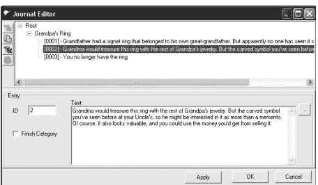

图3.1. Aurora的日志编辑器。

从而引出关于其位置的线索。一旦戒指被找到，由该事件触发的脚本可以将日志移至下一个条目，并将lookingForRing恢复为之前的“false”值，同时可以将诸如“learningAboutRing”之类的标志设置为“true。”

如果游戏作者希望所有玩家以相同的方式通过任务，戒指可以放在一个锁着的阁楼房间中，直到lookingForRing为真才能进入。或者，玩家可以选择在以其他任何方式听说戒指之前就找到它。遵循后一种方法的任务设计（尽可能少地让玩家通过“门槛”）无疑给玩家提供了更多关于故事如何展开的选项，使故事具有与图形世界相似的自由探索感觉。

但追求这种探索感觉是有代价的——关注流程的形状可以减轻这一代价。例如，在我们假设的家族戒指任务中，从找到戒指开始（直接跳到第二阶段）似乎不太可能在标志或日志中产生任何问题。当lookingForRing已经为假时将其设置为假没有任何区别，从任务的第二阶段开始也与现有的日志条目配合使用。但是，要确定这些事情，游戏作者必须仔细考虑每一种可能性——给予玩家的自由越多（关于何时、如何以及是否承担和完成任务），不同任务线索的事件就越需要相互关联地考虑。

这反过来又将我们带回到简单性的理念。任务标志结构在多种方面都是简单的。软件开发人员很容易实现它，它不需要太多计算资源（使编程和处理资源可用于游戏的其他领域，例如图形，这是大多数游戏公司所看重的），并且可以相当直接地向受众展示。然而，鉴于受众感觉能够在虚构世界中*游玩*的目标——不仅在战斗等领域，而且在所讲述的故事方面也是如此——任务标志结构很快就会将游戏作者带到复杂性的极限点，阻碍这种形式的未来发展。我将在下文对BioWare广受好评的单人RPG*《旧共和国武士》*的讨论中进一步考虑这一点。然而，首先，简要讨论一下对话树是有必要的。

## 对话树

桌面和现场角色扮演游戏通过让两个人即兴创作对话来在角色之间创造对话。没有任何计算机过程可以替代即时性


8. 正如Dominic Arsenault在本书基于博客的同行评审中所指出的，对话树可以为相似的底层结构提供多种交互体验。例如*KotOR*这样的游戏为玩家提供一系列可能的……本章末尾有续注……

进行此类交流（甚至接近理解非结构化人类语言的能力），因此计算机RPG被迫采用不同的方法。与故事中的任务标志方法一样，计算机RPG的对话方法在软件实现和玩家理解方面都很简单。这种方法就是对话树。

与*Eliza*系统一样，对话树对话模型建立在轮流发言之上。但每个回合中发生的情况完全不同。在玩家回合中，对话树不允许像*Eliza*那样进行非结构化文本输入。相反，在与对话树交互时，玩家通常会看到少量选项（通常从一到五个），用于决定玩家角色可以说什么。做出选择后，系统会执行玩家角色正在交谈的NPC(s)的回应。对话以这种方式继续，直到玩家选择一个结束对话的选项（该选项可能明确呈现，也可能不明显）。

与*Eliza*通过对玩家最后陈述应用规则来生成NPC响应不同，每个NPC响应都是通过遍历层次化组织的数据结构来选择的。这正是对话树名称的由来。

图3.2是Aurora对话编辑器工具的图像，用于创作对话树，这使其更加具体。乍一看，它与任务日志条目工具非常相似。然而，一个区别是，虽然日志包含了玩家可能遇到的任务阶段，按可能遇到的顺序排列，但对话编辑器中的文本顺序似乎相当奇怪：

- 孩子？
- 我找到了祖父的戒指。
- 我一直在想一些事情。
- 冰箱里有吃的吗？
- <FullName>, 你看起来不错。而且穿得很体面。你手上那是什么？
- 疤痕？
- 不，是戒指。
- [ 链接到“这戒指？” ]
- 这戒指？
- 哦，[...]差点以为是你祖父的。自从我们年轻的时候就没见过它了。
- 我想他了。
- 我们都想。
- [ 链接到“你还在想他的戒指吗？” ]
- 打扰了。我得去洗手间。
[结束对话]
- 你还在想他的戒指吗？
- 我记得，因为他对它非常保密。
有时我怀疑他是否为此被杀，这就是为什么它不在他的遗物中。如果你找到了，那会让我安心。你愿意看看吗？
- 当然。
- 非常感谢你。
- 很快，我保证。但不是现在。
- 我明白。改个时间再来吧。
- 我一个表亲会更好。
- 杰瑞是警察。
- 你可能是对的。

这种奇怪的顺序部分反映了对话树的“树”状特性。上述两组中的每一组都始于祖母NPC的初始陈述，可能的回复嵌套在下一级缩进中，每个回复都会导致特定的NPC回复（和/或对话结束），而该回复本身可能在更深层的缩进级别下嵌套更多的玩家角色陈述。因此，对话树片段不能直接从头读到尾。对话树也很少是纯粹的树结构。相反，许多分支会与树的其他部分建立连接——如上所述，对祖母第一个问题（“你手上那是什么？”）的两个可能回复都会通向同一个地方，这是因为从“不，是戒指”到“这戒指”有一个链接。鉴于此，理解玩家将如何体验对话树的一个片段，既需要遍历层次化树结构，也需要遵循连接结构分支的链接。

9. 图像中此处的'[结束对话]'并不正确，而是Aurora的一个产物。在'你还在想他的戒指吗'之后也是如此。

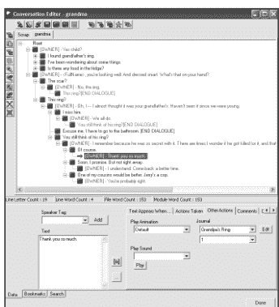

图3.2. Aurora的对话编辑器。在此视图中，以“孩子！”开头的对话片段的分支已折叠，进一步的玩家回复被隐藏。

另一种奇怪的顺序，即两个主要树段的顺序，源自常见的创作实践。对话树检查和设置任务所使用的相同类型的标志——不同的对话集适用于不同的时刻。上面展开的对话片段（以“<FullName>, 你看起来不错”开头）适用于玩家角色第一次遇到祖母的情况，这只发生一次，因此它被放在底部。最常遇到的对话被放在顶部，作为默认值，只有在特定标志具有特定值时才会更改（或跳过）。如果祖母的对话树中只有两个可能的片段，这可以通过一个名为例如“firstTimeTalked”的标志来简单实现，该标志最初设置为true。每当firstTimeTalked为true时，默认对话片段就会被跳过，而进入第二个对话片段可以触发一个脚本，将firstTimeTalked设置为false。10

10. 在包含祖父戒指任务的实际游戏中，祖母对话还需要另一种标志结构，因为如果在第一次与……交谈之前已经找到了戒指，初始对话必须不同。

本章末尾有续注。

Chris Bateman在《电子游戏叙事技巧：Game Writing》中通常对对话树持负面看法。他写道：

> 尽管名为对话树，但对话树很少是真正的树，而是汇聚和分歧的对话链。使用它们可能是一场噩梦，它们提供的好处也有些微乎其微。尽管如此，一些玩家非常欣赏他们能控制角色说什么的错觉，其结果是对话树仍然很重要，尤其是在cRPG游戏中。（2006, 277）

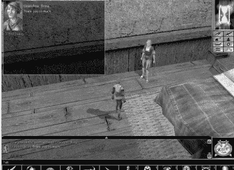

图3.3. 在示例模块中从祖母处接取任务。

我对对话树的看法截然不同。首先，关于对话树一个引人注目的地方是它们呈现的错觉非常少，尤其是与Eliza等系统相比。每个NPC只会对有限数量的事物做出反应——并且这些都明确呈现。此外，由于对话树遍历选项是“汇聚和分歧”的（通常，对于默认对话片段，以循环模式，使得分支末端的最终选项包括返回主干），对话被结构化为树遍历这一事实甚至对初次接触的玩家也变得清晰。

虽然这当然是对真实对话的一种（糟糕的）“错觉”，但它并非Bateman所暗示的对玩家角色说什么的控制的错觉。相反，在大多数RPG中，这是做出游戏决策的重要方法——不同的对话选项以不同方式改变游戏变量。对话树选择可能产生的结果范围非常广，包括在流行的RPG中，要么接受要么拒绝任务（及其奖励）、化解紧张局势或发起战斗、了解更多关于NPC的信息（并可能解锁与其个人生活相关的任务），以及以更情感化的方式改变NPC对玩家角色的看法（从忠诚和诚实的感觉到浪漫支线）。11

从技术层面来说，说所有这些都归结为菜单选择是正确的。但成功遍历这些菜单可能是一件棘手的事情——对于那些利用对游戏虚构世界的了解的玩家来说，这会更容易一些。此外，这是玩家表达其想象中角色扮演的最直接方式之一：同意或拒绝为他人做事，出于善良或雇佣动机行事，说真话或散布谎言，等等。为作者构建此类有后果的选择到对话树中也相当简单。在图3.2中，窗口的下半部分显示，几个菜单选择就足以使一行对话（“非常感谢你”）同时更新玩家的日志——在此例中，将“祖父的戒指”类别中的任务移动到条目编号一。图3.3显示了这在游戏中发生的情况。

但是，尽管有这个基本创作案例，Bateman当然是正确的，即对话树使用起来可能是一场噩梦——与任务标志结合形成的更大叙事方法也是如此。此外，这可能是它们较小的问题之一，如我将在下文特定示例的背景下讨论。不过，首先，有必要更广泛地审视这些操作的逻辑。

11. 此外，正如Benjamin Grandis在本书在线同行评审中所指出的，许多RPG“尝试让即使是你的队友也会开始怨恨你，通常出于相当复杂的原因，这些原因与情节相关，但却是……本章末尾有续注。


12. 当然，Eliza 也会在最近的观众陈述不包含任何关键字时，偶尔回退到预录制的转换。

## 任务与对话逻辑

Eliza 中的主要运行逻辑是转换——来自观众的每条陈述都会立即转换为 Eliza 的下一条陈述，使用一组进程，其方式由当前脚本的数据指定。用计算机系统的术语来说，我们可以说 Eliza 对话几乎是“无状态”的。Eliza 不会建模对话的持续状态，也不会根据先前的互动以不同方式使用其脚本，除非是为了避免某些规则的过度重复。12

另一方面，任务旗帜和对话树的组合在某些方面完全关乎状态。任务旗帜逻辑正是基于里程碑的进展。任务旗帜虚构是有序的离散单元集合。重要的是玩家所处的位置——路径上的哪个里程碑——而这正是通过玩家日记机制所暴露的内容。在某些情况下，进展的开头可能被跳过，结尾可能永远无法到达，但在每一刻游戏中，虚构都位于一个特定点上，位于按顺序排列的少量预定义点中。

相比之下，对话树的逻辑本质上是有向图的逻辑。与其将对话建模为一组无上下文的离散交互（如 Eliza 中那样），对话树始终将当前对话状态定位于一组预定义点中的某个特定点，并可以通过预定义链接从该点导航到其他点。与任务旗帜的里程碑一样，通常无法后退——图是指向对话“进展”的——但通常也可以循环回到当前可用对话的主干，尽管有时会相当绕远。

换句话说，有点像游戏的图形逻辑，对话树和任务旗帜的逻辑关乎给定空间中的_位置_。但虽然游戏的视觉空间通常以支持几乎无数可能位置的方式进行模拟，任务旗帜的里程碑和对话树的图却会预先标记出所有可能的位置（以及它们之间的转换）。这种不匹配证明是有问题的。

## 示例：星球大战：旧共和国武士

游戏开发者选择奖是游戏行业的奥斯卡奖——这是创意行业成员认可自身成就的奖项。2004 年，游戏工作室 BioWare 斩获了三个对于本次讨论尤为重要的奖项：年度游戏、年度原创游戏角色和卓越编剧奖。所有这些奖项均颁给了 BioWare 的 RPG _星球大战：旧共和国武士_（_KotOR_），该作还获得了大量行业出版物的年度游戏奖。虽然它当然不是最近的主要 RPG，但它为任务旗帜和对话树逻辑的优势与劣势提供了一个很好的示例。

## KotOR 的成功

_KotOR_ 使用任务旗帜和对话树来奖励并维持对其虚构世界的参与；建立在被改变时会产生小小惊喜与愉悦时刻的模式；并将观众的注意力引导至一系列必须通过游戏完成的事情——这就像魔术师的误导，将观众注意力从更大的故事发展中转移开，直到它们被揭示的那一刻。13

13. 这通常做得相当巧妙。即使是看起来极其生硬的开场说明，随着玩家推进主线任务，后来也会被赋予更深层的共鸣。揭示了围绕玩家的角色……注释继续见本章末尾。

主线任务提供了故事的脊梁。它代表了玩家角色的一项巨大任务——除此之外还能是什么？——干预将塑造银河系历史的事件。以多阶段任务设计典型的方式，所期望的干预需要了解这些事件发生的地点，这需要从几个星球的部分地图中收集数据，这需要到达这些部分地图的位置，而在每种情况下，这都可以通过多种方式完成，每种方法都有多个步骤，可能以较小的任务作为前提，等等。

在这个史诗般的背景下（包含许多组成部分，其中一些相当平凡），还呈现了其他可选任务。有些涉及发展主玩家角色与其旅行同伴之间的关系。其他则涉及在特定星球上发生的事件中扮演角色，通常带有明显的人际元素（例如，一位妻子恳求你寻找证据，为她的丈夫洗清谋杀指控，这很快会导致揭露他的不忠行为，而你必须选择是否与他们讨论此事）。有些任务相当小，例如发现你的飞船上有走私货物，得到容器的密码，并被犯罪集团代表提供丰厚的货物报酬。在像最后一个这样的案例中，玩家只需决定角色对这一单阶段任务会怎么做——然后在游戏的虚构世界中付诸实践（前往地点、与物体互动、与相应 NPC 交谈）。

除了所有这些活动之外，虚构世界中还嵌入了其他活动——从探索和空间掌握的乐趣，到纸牌和赛车等“小游戏”。反过来，一些小游戏可以解锁额外的任务和 NPC 互动，并提供对与它们关联较少的游戏部分有用的资源。

鉴于此，普遍认为玩一款主要 RPG 需要资深玩家大约四十个小时。但该类型的爱好者往往会花更长时间，沉溺于许多可选活动。此外，许多人会多次通关同一款游戏。这对于像 KotOR 这样为以不同伦理立场接近世界的角色提供不同游戏选项的游戏尤其如此。

是什么驱动玩家花费四十、八十或更多小时玩电脑 RPG？如果我们只看任务日记，其中任务旗帜逻辑的运作向玩家暴露，表面上看是对待办事项清单乐趣的巨大沉溺。当然，这确实存在。但更核心的是，KotOR 不断提供叙事闭合与过渡的剂量——从任务阶段的小小满足，到对一个星球的故事、角色、地理和历史的整体感受，这种感受可以在一次或多次游玩中发展起来。Jill Walker Rettberg 谈到了学习一个地方基于任务的虚构所带来的乐趣，即“碎片网络，其中大部分并非充分体验游戏所必需，但它们却累积成对一个多彩世界的丰富体验”（2007, 310）。

与此同时，除了叙事乐趣之外，KotOR 还在不断提供继续前进的其他理由，将事情再推进一步。

14. 此外，KotOR 还向观众量化了许多 RPG 中可用的不同伦理方法。这与渗透于星球大战虚构宇宙的“力量”概念相关。有些……注释继续见本章末尾。

这方面的一个强大元素可以体现在每次任务完成时给予的奖励中。一些奖励简单到可以用于在游戏中购买物品、贿赂不合作的 NPC、帮助有需要的人等等。当许多故事元素结出硕果时，它们也会提供经验值（XP），这是从桌面 RPG 借来的另一种惯例。随着角色积累经验，他们会提升“等级”，并在游戏世界中变得更强大。每个新等级都在特定的 XP 数值时达成，而冲击下一个数值的驱动力是“再做一件事”心态的另一种动力，这种心态可以让玩家在原本计划当晚停止后，仍在 KotOR 中玩上好几个小时。14 正是主要玩家角色的这种量化进展，促使 William Huber（2009）将 RPG 类型称为“统计成长小说”。

而在四十、八十或更多小时的时间里，观众对 KotOR 的投入程度当然更类似于一部厚重的德国个人发展小说，而不是例如一部电影（甚至一部电视剧）。但是，再次，更好的类比可能是与桌面 RPG 战役——玩家可以轻松投入类似的时间。如同许多 RPG 战役一样，KotOR 努力营造一种以世界探索和角色发展为基础的灵活故事创作感。为此，玩家的角色可以以不同顺序多次访问星球；任务物品可以在与其相关的任务的不同点上找到；所需物品和信息通常也有多种获取方式。尽管如此，虽然这些在桌面 RPG 战役中也是如此，但在 KotOR 和其他电脑 RPG 中


它们必须通过任务标志和对话树来管理（而非依赖人类记忆、即兴发挥和创造力）。如前所述，这给游戏作者带来了困难。

## KotOR的麻烦

KotOR的大部分叙事力量来自于它将经过验证的叙事转化为可玩结构的方式。一个自包含的例子可以在游戏相对早期的丹图因星球上的一个可选任务中看到：桑德拉家族和马塔莱家族之间的世仇。我在玩Xbox版KotOR的“白金精选”版本时遇到了这个任务——值得注意的是，玩其他版本的人的体验可能会不同。

在得到警告，两个显赫家族之间的紧张局势有可能爆发为暴力内战后，我的队伍南下前往桑德拉庄园，并与族长努里克·桑德拉交谈。他告诉我们，他对年轻的马塔莱继承人申的失踪感到非常悲伤，但对此一无所知。他告诉我们，他自己的儿子凯萨斯已经失踪了一段时间——并推测两人可能在丹图因的危险中遭遇了类似的命运。

努里克让我们出去。但不久之后，他的女儿拉哈西娅出现了。在我为我的玩家角色选择了一些友善的话对她说之后，她透露她的父亲实际上绑架了申·马塔莱。以典型的莎士比亚式方式，她和申坠入了爱河。她给了我的队伍一把桑德拉庄园侧门的钥匙，使我们能够潜入并营救申。一旦我们找到申，他拒绝不带拉哈西娅离开——结果是申、拉哈西娅和我的KotOR队伍的三名成员同时从侧门出来，在那里我们发现自己面对着两个家族的巡逻队及其战斗机器人（图3.4）。

- 15. 试图复制这一结果时，科林·威洛克发现，只有在玩家在桑德拉庄园外的对峙中获得“光明面”点数时，阿兰·马塔莱的非理性行为才会出现。

经过一些紧张的对话树讨论（我选择了支持恋人并旨在化解冲突的陈述），申和拉哈西娅逃跑去住在绝地圣殿的安全地带，而他们的父亲们只是勉强避免点燃一场大火。后来，在探索行星更北部的一部分时，我的队伍来到了马塔莱家族的庄园。守卫机器人授予我们与族长阿兰·马塔莱会面的机会，我们上次见到他时，他的儿子正和拉哈西娅一起跑向圣殿。阿兰长篇大论地要求必须做点什么来找到他的儿子——概述了他对桑德拉家族绑架了申的怀疑。他提出如果找到他的儿子，就给我们一项奖励（听起来更像贿赂）。我怀疑这个不恰当的对话树片段可能是因为一个简单的firstTimeTalked类型标志而激活，所以我带着队伍离开，然后又回到了庄园。但标志结构显然以不同的方式组织：当我们返回时，阿兰·马塔莱再次出来要求调查他已经看到被从绑架中解救出来的儿子可能被绑架一事。这说明了任务标志和对话树方法的一种问题类型，一种会导致不恰当事件的类型。

另一种主要问题类型很快就得到了说明，当时我的队伍发现了凯萨斯·桑德拉的尸体。作为一名业余考古学家，凯萨斯显然在一个危险区域进行挖掘时被野生动物杀死了。我们立即带着凯萨斯的日记前往桑德拉庄园，以便与他担心的家人分享。但庄园完全关闭了，甚至连第一次来访时迎接我们的机器人都不见了。当游戏看似任意地关闭那些具有叙事驱动力的任务可能性时，这种第二种问题类型就显而易见了。

这两种问题类型最常出现在可自由探索的虚构世界与僵硬的任务标志和对话树结构之间的交汇处。我在玩KotOR时经常遇到这些问题。就像游戏期望我先参观马塔莱庄园再参观桑德拉庄园，并且当我以不同顺序参观时会产生不恰当的事件一样，在行星规模上也是如此。例如，我比KotOR的对话树结构预期的更晚访问了加入我队伍的一个角色乔利·宾多的母星。结果，他与主玩家角色之间的大部分对话都在于他阴郁地暗示那些已经以戏剧性方式揭示的真相。每次与宾多的对话都破坏了KotOR拥有一个一致虚构世界的感觉。同时，与另一个关键角色卡斯·奥纳西的对话路径在未按预期方式推进后被完全关闭——尽管显然有很多事情可以讨论。

这些问题并非源自BioWare的糟糕工作。例如，期望首席作家德鲁·卡普辛和他的团队为故事的每一种可能状态编写（并送去配音）奥纳西台词的不同版本是不合理的。正如克里斯·克劳福德所观察到的，这种方法“对设计师来说总是工作量太大，对玩家来说实质内容太少”（2004，126）。而且，他们手头的工具不太可能提供任何更优雅（且可行）的方法来解决这种情况。一旦任务标志和对话部分之间预期的时序序列被打破，允许玩家角色提出个人问题并被打发走可能是有道理的，但这本质上与关闭对话是一样的，就像KotOR团队所做的那样。16

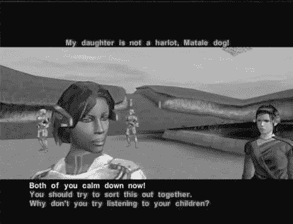

图3.4a：在桑德拉庄园外的对峙中选择要说的话。

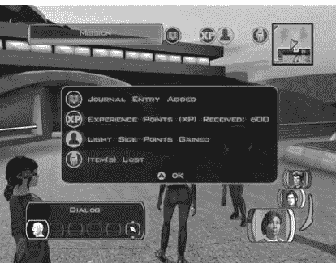

图3.4b：在化解潜在战斗后，会添加日志条目，获得经验点数，获得光明面点数，并丢失物品。

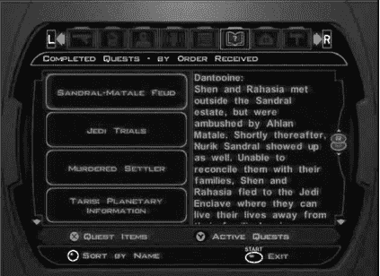

图3.4c。更新的日志总结了任务及其结果，包括家族对峙和恋人搬到绝地圣殿。

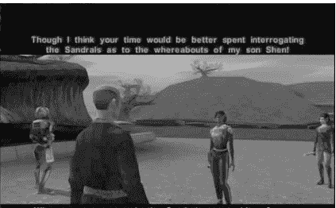

图3.4d。随后发生的意外对话。

- 16. 避免此类问题的另一种方法在卡普辛担任首席作家的下一款游戏中被采用：质量效应（Hudson et al. 2007）。与船员成员建立长期个人关系……注释继续于本章末尾。

也就是说，此类问题源于简单、脆弱的任务标志和对话树结构与它们被用来支持的雄心勃勃、灵活的游戏设计之间的不匹配。我们这些熟悉基于里程碑的进度逻辑的人——来自商业计划、资助提案、员工评估等等——知道，任何详细的里程碑集通常会面临两种可能的命运之一。首先，随着情况的发展，可能会清楚地看出里程碑将出于一个或多个原因被修订：步骤可能不是原先所想的那样，可能不会按原先所想的顺序发生，或者可能需要以不同的方式划分。其次，另一种命运是里程碑本身成为一种癖好，在它们明显不再反映的情况下非理性地驱动行为。即使在像KotOR那样部分模拟的世界中，预先创建的里程碑仍然与不断发展的情况格格不入。不幸的是，对于KotOR的里程碑来说，只有这两种命运中的第二种是可能的，因为系统无法修订它们。

鉴于这种情况，游戏中叙事的前景可能显得黯淡（也许特别是对于多人在线游戏，参见侧边栏：共享世界中的个体叙事）。


但是，游戏与虚构结合有一种广泛实践的替代方法——在重要方面更成功。

## 替代方案：《波斯王子：时之砂》

在2004年游戏开发者选择奖上，KOTOR面临一些竞争。另一款年度游戏提名作、一款荣获游戏设计卓越奖和编程卓越奖的游戏是《波斯王子：时之砂》（PoP）。PoP本身就是游戏虚构的一个有力示例——这并不奇怪，因为其主要编剧和设计师是乔丹·梅克纳，他在游戏设计领域是传奇人物，因其开创性游戏《空手道卡》（1984）、《波斯王子》（1989）和《最后快车》（1997）而闻名。梅克纳被认为将电影式叙事引入电脑游戏，推动了从人体动作的真实建模到将整体故事整合到动作游戏结构中的技术。梅克纳也是一位成就斐然的独立电影导演——编剧、导演并剪辑了《查韦斯峡谷：洛杉矶的故事》（2005）等电影，这是一部关于20世纪50年代一个社区被驱逐出他们被告知将成为公共住房项目（他们本应返回居住）的土地，却最终看到道奇体育场在此建成的纪录片，这一过程充满贪婪、虚伪和反共恐慌。

牢记这一点，PoP成为与KOTOR截然不同的游戏虚构方法的最强示例之一也不足为奇。与其试图使游戏故事成为可玩

- 17. 截至撰写本文时，梅克纳还从另一个角度参与电影叙事——担任即将上映的华特迪士尼影片/杰瑞·布鲁克海默电影《波斯王子：时之砂》的编剧和执行制片人 ...
- 18. 这是PoP获得大量学术关注的原因之一。我知道有三位作者提供了特别详尽的研究。Drew Davidson（2008）对这一体验进行了详尽而深思熟虑的反思 ...

脚注继续于本章末尾。

## 共享世界中的个体小说

可模拟、可探索的空间世界与以僵化里程碑实现的虚构进展之间的不匹配，在大型多人在线游戏中可能会更加明显。此类游戏的典型设计要求物体对所有玩家都存在于世界中。这意味着它们可能会被尚未获得赋予其背景的任务的玩家遇到——并且即使被某个特定玩家移除，也必须重新出现以供其他玩家使用。

我从开始玩*EverQuest II*（Blakley et al. 2004）时就经历了这些情况。我起始于女王殖民地，即凯诺斯城的新手区域。我接到了初始任务，然后去探索，遇到了怪物、任务发布者和其他玩家。我常常在某个区域杀死若干某种类型的怪物（例如莫拉克吞噬者），几分钟后，就接到一个要求我做完全相同事情的任务，却没有选项可以说我已经做过了。

这帮助我为在废弃村庄区域的经历做好了准备。在那里，我与一些怪物战斗，发现了一座奇怪的雕像。我点击了雕像，但它没有反应。在区域的一个角落里，我遇到了巫师奥法拉，但他没什么可对我说的。只有在我的角色死亡后，我才回到起始区域，再次与初始任务发布者穆拉尔·沙尔交谈。他派我去找牧师玛拉·瓦恩，她在我之前遇到她时也不愿意交谈。但这次她有一个任务，我完成了，然后她派我去找奥法拉（再次），奥法拉派我去摧毁我之前无法从中得到回应的奇怪雕像。此时，我可以点击摧毁它们，除非在工作过程中被战斗打断。

在我摧毁最后一座雕像后，一个名为黑暗刀锋大师的敌人出现。我击败了他，拿走了他的盾牌，并花了几分钟在背包里移动物品，以便我使用该盾牌。就在我这样做时，黑暗刀锋大师重新出现了！我已经受伤，决定跑回奥法拉那里，于是刀锋大师停止了追击。他当然重新出现了，以便同一服务器上的其他玩家也能完成奥法拉随后给我的任务：击败刀锋大师。唯一的进展方式是回去再次与刀锋大师战斗，这次穿着我上上次与他战斗时获得的盾牌。

一个（一个根据游戏进程而改变形状的故事），PoP具有一个线性的、半电影式的故事，将一种必然感巧妙地与玩家挣扎的背景融合在一起。挣扎具体包括创新的平台跳跃动作和杂技战斗。对于PoP这样的游戏，问题是如何使这种受众控制的游戏玩法与线性故事之间的结合最具成效。

在计算机游戏行业中，此类结合的典型结构是简单的交替。观众会获得游戏时刻和空间，完成后会产生脚本化序列来讲述故事。19 由于这种模式在故事和游戏玩法之间几乎没有联系，游戏编剧通常只在游戏制作结束时受雇。游戏的玩法机制、空间甚至角色在编剧到来之前就已设计好（Bateman, Boon, Buckley, et al. 2003）。编剧的任务是创建一组脚本化序列，将它们联系起来并提供总体背景。结果往往令人不满意，并且出于充分的理由，可能感觉相当任意。梅克纳的游戏——就像其他设计师/编剧（例如蒂姆·沙弗，Grim Fandango [1998]、Psychonauts [2005] 和其他备受好评作品的创作者）的游戏一样——致力于将故事和游戏玩法构思为一体化的实体。

PoP的故事始于一场出于贪婪而发动的侵略战争。战争的战利品包括一个装有时之砂的巨大沙漏。然而，拥有这些沙子最终被证明更像是诅咒而非祝福。20 当短暂获胜的波斯国王试图用时之砂作为礼物来丰富他的朋友时，结果却是摧毁了朋友的宫殿，并将几乎所有人变成了沙漠恶魔。王子的匕首，从与沙漏同一座宫殿中掠夺而来，是用来释放沙子的钥匙。游戏中的两个主要NPC——一名在被掠夺宫殿中被俘的女人法拉，以及背叛宫殿主人并煽动释放沙子的大臣——都暗示匕首也可以用来改善事情。但大臣已将沙漏移至废墟宫殿的最高塔楼。

> 19. 这些脚本化序列可以是预渲染的“过场动画”（本质上是由游戏系统播放的计算机动画文件）、游戏内过场动画（由游戏引擎而非另一个动画 ... 渲染的脚本化场景）...
> 20. 与游戏制作时（即2003年入侵伊拉克之前和期间）美国外交政策的类比，很快开始显得预言般准确。考虑到梅克纳对“反战...”的描述，它们也不太可能是偶然的。...
> 脚注继续于本章末尾。

梅克纳将其描述为将游戏故事尽可能简化的结果。从传统故事的角度来看，它在关键上很高效，只有三个角色：一个英雄、一个搭档/恋人和一个反派。从游戏玩法的角度来看，它也很高效。对于平台跳跃，它提供了一个挑战（穿过废弃宫殿）和一个动机（到达沙漏）。对于与大多数NPC的互动，它提供了战斗的动机，并解释了为什么其他互动模式不可用（他们是沙漠恶魔）。换句话说，它将注意力集中在游戏擅长的事情上（空间移动和战斗），并为避免它们不擅长的事情（与角色互动）提供了解释，同时也给出了向前推进的理由。这已经比大多数游戏好，但PoP在许多方面更进一步。

核心上，它在游戏玩法和故事之间建立了联系。其中最明显的是匕首。它既是故事中的关键物品，也是游戏玩法创新所在的焦点。匕首可以储存时之砂，使英雄能够使用让移动和战斗更容易的能力（例如，在犯错时倒流时间）。匕首只能容纳有限数量的沙子，可以通过从被击败的沙漠恶魔那里提取沙子来补充（这是一个要求，以免它们


重生）。故事与游戏性也通过情节转折相连接。波斯王子的故事采用了转折——包括匕首丢失的一个转折——这些转折也改变了游戏体验。最后，正如Mechner（2007）在其文章《时之沙：制作电子游戏故事》中所指出的，波斯王子也努力将尽可能多的关键故事时刻交给玩家，在游戏中体现——例如王子必须面对他自己的父亲，现在是一个沙之恶魔。

波斯王子在进程层面也做出了与《旧共和国武士》等游戏显著不同的选择。显然，鉴于只有一条线性的故事线索，没有复杂的任务标志系统。也没有对话树。波斯王子相反使用了有时被称为“基于事件”的对话系统。本质上，对话被从游戏的可玩元素中移除了。玩家不是选择与特定NPC交谈，而是某些事件触发对话和旁白。在大多数情况下，这些对话并不被呈现为对游戏的打断——如同许多游戏中那样——而是叠加在游戏之上。当玩家让王子跑过走廊或从杆子上荡过去时，王子可能会在心里想些什么。法拉可能会对王子在穿越特别困难区域时的进展（或失败）发表评论，这由玩家的行为决定。或者，在一种情况下，玩家可以直接引出法拉的回应——通过将王子切换到第一人称摄像机模式并“盯着”她看。

波斯王子也与《旧共和国武士》等游戏以及几乎所有包含NPC的游戏共享一种用于NPC交互的主要工具：有限状态机（FSM）。虽然在抽象层面上所有计算机都可以被描述为FSM，但在电脑游戏NPC逻辑中，FSM往往以特定方式使用。NPC的每种基本行为

21. 我使用*游戏虚构*这个词泛指游戏中的虚构。在*不仅仅是游戏*中，巴里·阿特金斯使用*游戏虚构*这个词来指代他认为“具有中央叙事冲动，随时间发展故事……”的那些游戏。

注释在本章末尾继续。

被定义为一个“状态”（例如，巡逻、攻击或撤退），并带有从当前状态转换到其他状态的特定规则。例如，一个NPC可以被设计为执行巡逻动画（巡逻状态），直到注意到敌人（转换到攻击状态），并继续攻击直到敌人被击败（转换到巡逻状态）或NPC的健康值低于定义阈值（转换到撤退状态）。可能没有规则允许从巡逻直接转换到撤退——这一般来说是合理的，但如果NPC之前的战斗中已经严重受伤，那就不合理了。

与任务标志和对话树一样，FSM简单易解释，在软件中易于实现，计算资源占用低，但在超过一定复杂度时会成为编写噩梦。幸运的是，它们非常适合沙之恶魔那极其简单的行为——沙之恶魔一见就攻击，从不撤退，正如在*波斯王子*中所见。

对于*波斯王子*来说，最终结果是一种经过优雅设计的体验，旨在弥补当今电脑游戏中用于表现故事和角色的进程所存在的致命局限。而这引出了下一个问题。

## 游戏虚构困境

游戏虚构的作者们努力工作——通过诸如任务追踪日志和以菜单形式呈现的树驱动对话等惯例——来避免*伊莉莎*效应。与其隐藏其进程的运作，游戏虚构作者寻求将其暴露给观众。但是，尽管如此，游戏虚构仍然面临一个与上一章末尾概述的困境惊人相似的困境。²

《旧共和国武士》和*波斯王子*都利用了游戏擅长的方面——特别是模拟的空间移动和战斗。在这些领域允许玩家进行的相对自由形式的行为，可以与允许与伊莉莎/博士交互的人以及参与加芬克尔是/否治疗实验的学生进行的自由形式文本创作相类比。区别再次在于，这种交互能够对系统状态产生哪些影响未来操作的变化。

*波斯王子*的虚构，如同加芬克尔的实验一样，对交互的可能回应范围极其有限。要么玩家的行为成功地将虚构推进到下一阶段（通过触发脚本序列向玩家发出进展信号），要么不成功。故事系统，正如玩家所说，是“在轨道上”——并且其结构可以通过让观众知道何时前往下一个隐喻车站而完全暴露给观众。与此同时，*波斯王子*的NPC大多只可用于战斗（沙之恶魔）。主要例外（法拉）偶尔会对世界中的非语言行为提供语言插话，但这又是另一个狭窄的交互通道。

另一方面，《旧共和国武士》的虚构，虽然不允许伊莉莎/博士那种自由形式的文本输入，但确实接受世界中更多的行为作为其任务标志和对话树系统的输入（例如，是否、何时以及如何接受任务、执行任务动作、与NPC交谈、在世界之间移动等）。此外，正如本章所示，这样的系统可以比*波斯王子*等游戏的铁路系统拥有更多元素（作者可以为任务标志和对话树进程生成大量数据，不同子集和顺序在每次游玩时都可能出现）。结果，如同与

伊莉莎的对话一样，潜在结果的数量巨大。不幸的是，《旧共和国武士》被期望在其中表现虚构的大量情境与其进程所体现的简单虚构和角色模型之间存在不匹配——正如伊莉莎必须回应的人类语言复杂性与其极其简单的对话模型（作为一系列转换）之间存在巨大不匹配一样。在这两种情况下，结果都是倾向于崩溃，其形状由底层进程决定。并且，如同伊莉莎一样，《旧共和国武士》的进程具有基本上无趣的形状。

简而言之，主流游戏行业的实践为数字虚构的作者们提供了两个糟糕的前进选择。一种是像*波斯王子*那样“绕过”崩溃进行设计，基本上在虚构层面放弃了数字媒体的处理能力。另一种选择是尝试在一个更加灵活的游戏世界之上叠加一个半灵活的故事——组织为一组有序的里程碑进展。这创造了一个游戏空间，如果被玩家接受，会导致令人不满的崩溃。

简而言之，是时候为游戏虚构采取一种新方法了。但正如《毁灭战士》无法建立在《神秘岛》的图形方法之上一样，这将需要一种根本不同的、比任务标志和对话树更具表现力和灵活性的虚构和角色方法。幸运的是，这项工作不需要从零开始。它可以相反地建立在自伊莉莎时代以来一直存在于人工智能社区实践中的一条历史线索之上。接下来的章节将探讨这段历史。

## 注释

1. 当然，有些游戏几乎根本谈不上涉及虚构。没有人希望在他们的《俄罗斯方块》中有一个故事——其“虚构世界”中的下落方块勉强能支撑这个短语。鉴于关于游戏与虚构关系的批判性讨论有时具有争议性，也许我还应该说明，我不相信任何游戏在经典叙事意义上“是”故事或叙事。相反，遵循埃斯彭·阿瑟斯对“任务游戏”（2004）讨论的号召，我在此提议仔细关注电脑RPG中任务和对话树的特定操作逻辑。对于有兴趣进行更详细讨论的读者，我建议阅读玛丽-劳尔·瑞安（2006）的《故事化身》第8章。

2. 随着桌面RPG涵盖的生活领域远比战斗广泛得多，不同游戏（和玩家群体）在处理这些其他元素方面已经分歧。一种趋势是将用于战争游戏战斗的统计模型进行泛化。它们已被用于角色进展和游戏的许多其他元素。另一种趋势是强调创造性表达，这种表达可能抗拒量化，或者至少由角色和虚构的逻辑而非机会来决定，从而导致“无骰”RPG。偏好各种强调的玩家有时分别被称为“掷骰玩家”和“角色扮演玩家”。

3. 最著名的受克苏鲁启发的游戏是《克苏鲁的呼唤》（Petersen 1981），而《越过边缘》（Tweet 1992）是一部同时受巴勒斯和菲利普·K·迪克启发的游戏。同时，正如何塞·扎加尔在这本书的基于博客的同行评审中提醒我的那样，一些RPG系统——例如GURPS（Jackson 1986）——被设计为“通用”的，而不是根植于特定的虚构世界甚至特定类型的虚构世界。最后，我所指的克苏鲁X游戏分别是《卡通》（1984）和《兽性行为》（1993）。与创新RPG《男爵冈豪森的非凡冒险》（詹姆斯·沃利斯，1998）和《木偶国》（约翰·泰恩斯，1999）一起，《兽性行为》在《第二人称》（2007）中再次出现，这是我与帕特·哈里根合编的一本书。

4. 虽然许多大型多人在线游戏群体，包括我参与过的一些，包含一些玩家之间的面对面互动。还有各种其他混合形式，结合了面对面和电脑RPG游戏的元素。例如，在这本书的在线同行评审期间，莎拉·托顿引起了对Obsidian Portal和Gleanmx网站（<http://www.obsidianportal.com> 和 <http://www.gleanmx.com>）的关注。前者是一个为RPG玩家独立制作的内容管理系统，专门关注“虚构”元素，提供一个用于记录冒险的博客和一个wiki（分为小队和地下城主区域）用于跟踪战役世界。另一方面，Gleanmx是由发行商WotC开发的一个网站，用于在线游戏、社交网络和关于游戏的一般阅读。托顿的评论提醒我们，还应该考虑诸如WotC支持的RPGA的《活生生的灰鹰》龙与地下城战役等混合形式。正如网站所解释的：

《活生生的灰鹰》战役是一场在现实世界各地区域性活动中进行的庞大游戏。游戏世界中的弗兰奈斯大陆被分为若干国家和政治实体。这些国家映射到现实世界的各个区域。你在现实世界中的位置决定了你和你的角色在游戏世界中的默认家乡区域。当你前往现实世界的不同区域时，你的角色会与你一同前往弗兰奈斯中的相应地点。每个地区都有独特的风格，使其与其他地区区分开来，让你沉浸在家乡区域的阴谋中或加入其他地区的动荡。（Wizards of the Coast 2005）


- 5. 我不会在此定义任务，也不会对可能的任务类型进行详尽讨论。Susana Tosca（2003）提供了很好的概述和拟议定义。Jeff Howard 的《Quests》（2008）对相关文学史和理论进行了详细探讨，同时还提供了使用本节讨论的 Aurora 工具包的设计练习。

- 6. 如本章第一个侧边栏所述，Neverwinter Nights 是桌面游戏 Dungeons & Dragons 的授权电脑版本——它不仅是第一款桌面 RPG，而且至今仍是最受欢迎的桌面 RPG。

- 7. 在 Aurora 模型中，游戏系统的任何部分都很少查询任务日志的当前状态；它只是向玩家暴露信息的一种方法，并勤勉避免 Eliza 效应的弊端。

- 8. 如 Dominic Arsenault 在本书基于博客的同行评审中所指出的，对话树可以为相似的底层结构提供多种交互体验。例如 KotOR 等游戏会向玩家展示一系列角色可能说出的文本选项（presumably 逐字照说）。当选中其中一项时，玩家角色不会在屏幕上表演出来，玩家选择的行为在对话中取代了该文本由角色说出的位置。Indigo Prophecy（Cage et al. 2005）和 Mass Effect（Hudson et al. 2007）等游戏采取了相当不同的方法。在这些游戏中，玩家会看到角色可能说的话的简短类型指示。选中其中一项后，角色可能会做出令人惊讶的表演——例如，在 Mass Effect 早期，玩家可能会惊讶地发现自己的角色打了 Dr. Manuel，这是在与震惊的科学家交谈时选择了不够支持的选项后发生的。Indigo Prophecy 还为对话选项的选择增加了一个有趣的计时元素，强制执行更像对话节奏的东西（在 Mass Effect 等游戏中，角色会无限期等待回应），并对涉及的战略决策施加了一定压力。存在多种其他界面策略，从让玩家为讨论主题选择关键词（例如，《上古卷轴 IV：湮灭》（The Elder Scrolls IV: Oblivion）[Bethesda et al. 2006]——它还提供了具体可说的话语和可采取的行动），到选择发音和图标（例如，《山姆与麦克斯：飞越公路》（Sam & Max Hit the Road）[Purcell et al. 1993]——这是 Darius Kazemi 在 Grand Text Auto 上的一条评论中指出的，对话树选项导致惊人角色表现的早期示例）。Brent Ellison (2008) 在 Garausa 中提供了常见对话系统组织的概述。

- 9. 图中此处的“结束对话”不正确，而是 Aurora 的一个产物。在“你仍然会想起他的戒指”之后也是如此。

- 10. 在包含“祖父之戒”任务的实际游戏中，祖母对话将需要另一种标志结构，因为如果在与祖母的第一次对话之前就找到了戒指，初始对话必须不同。

- 11. 此外，如 Benjamin Grands 在本书在线同行评审中所指出的，许多 RPG“尝试让即使是你的队友也会开始怨恨你，通常出于相当复杂的原因，这些原因与情节相关，但却是可以避免的。”在某些情况下，角色关系选择的结果是戏剧性的。例如，在玩 Mass Effect 时，很容易选择无法与队友 Wrex 建立信任的对话和任务选项。这可能导致他的死亡——在某些场景中，是由主玩家角色亲手杀死的。

- 12. 当然，Eliza 也会在最近的观众陈述不包含关键字时，偶尔回退到预录转换。

- 13. 这通常做得相当巧妙。即使是开头看起来极其生硬的背景介绍，随着玩家推进主线任务，后来也会被赋予更深层的共鸣。揭示出，围绕玩家角色的那些角色，起初似乎在进行冗长的背景介绍，实际上是精心策划的欺骗的一部分——当然，其目标既是玩家也是她的角色。同时，这些互动还起到了必要的作用，即让玩家了解她的角色本应已经知道的事情。此类策略不仅对 RPG 重要，对更广泛的数字虚构也同样重要，在某些情况下尤其如此。例如，Jeremy Douglass (2007) 就一类将发现玩家角色身份和处境作为核心要素的交互式虚构作品进行了深刻的论述。

- 14. 此外，KotOR 还向观众展示了许多 RPG 中可用的不同伦理方法的量化。这与渗透于《星球大战》虚构宇宙的“原力”概念相关。某些任务动作被视为“光明面”（表现出同情和慷慨等特质的行为），而其他动作则被视为“黑暗面”（表现出自私和嗜暴无谓暴力等特质的行为）。完成这些动作后，玩家角色会获得一定数量的积分，使其在光明与黑暗之间的光谱上移动。通常，黑暗选项是完成任务目标的更容易路径，为《星球大战》中根深蒂固的黑暗面诱惑主题创造了一种游戏机制。这些选择还会改变游戏的其余部分的玩法；例如，某些物品可能只能由光谱光明或黑暗两端的人使用。

- 15. 在试图复制这一结果时，Colin Wheelock 发现 Ahan Matale 的非理性行为只有在玩家在 Sandral 设施外的对抗中获得“光明面”积分时才会出现。

- 16. 避免此类问题的另一种方法是在 Karpyshyn 担任首席编剧的下一款游戏中采用的。Mass Effect (Hudson et al. 2007)。与船员建立长期个人关系几乎完全局限于在飞船上进行的对话，在那里角色大多相互分离。这意味着每个角色的互动情境要受限得多。除了为避免问题性复杂性而进行的此类工作之外，Mass Effect 还更多地考虑了在每个星球的对话中已经在其他星球上学到的内容。结果是，在个人关系的发展中感觉时间连贯性较低，但在情节的其他元素中时间连贯性更高。虽然我曾希望 Mass Effect 中的互动比 KotOR 少受限制，但朝相反方向发展确实导致了整体逻辑连贯性的提高。这并不是说逻辑问题不会出现，尽管它们通常规模较小。例如，在 Mass Effect 中探索 Trebin 星球时，我注意到车辆扫描仪上有什么东西。结果发现是一个矿井入口。我带着 Kaidan 和 Tali 进入队伍，进入矿井并与许多 Husks 战斗。战斗结束后，我的队友评论说，研究人员（他们的失踪导致了我们的访问）一定发现了某种将他们变成怪物的东西。接下来，我们离开矿井，回到车辆，开车前往研究基地。刚才还在评论研究人员命运的 Kaidan 说：“所有人都去哪里了？”然后我们进入基地，查看了一台电脑。Tali 说日志显示团队发现了“某种外星技术”——她刚才谈论的那种技术，我们刚刚目睹了其可怕的后果。

- 17. 截至撰写本文时，Mechner 还从另一个角度参与电影叙事——担任即将上映的 Walt Disney Pictures/Jerry Bruckheimer 电影《波斯王子：时之沙》（Prince of Persia The Sands of Time）的编剧和执行制片人，该片由 Mike Newell 执导，Jake Gyllenhaal、Gemma Arterton、Sir Ben Kingsley 和 Alfred Molina 主演。

- 18. 这是 PoP 受到大量学术关注的原因之一。我知道三位作者提供了特别深入的探讨。Drew Davidson (2008) 对通关游戏的体验进行了详细、深思熟虑的反思——特别关注故事与游戏之间的关系。Barry Atkins (2007) 在《Videogame, Player, Text》一书中关于 PoP 的章节中，对死亡、时间和叙事（这些是本游戏的核心主题，但对一般游戏也很重要）进行了反思。Jason Rhody (2005, 2008) 既写了关于 PoP 的界面如何建立和控制视角的文章，也回应了 Mechner 的一篇文章，探讨了游戏虚构必须如何通过界面和对虚构世界的参与双重理解，以及成功的示例（如 PoP）以将叙事和博弈体验的发展结合在一起的方式运作。

- 19. 这些脚本序列可以是预渲染的“过场动画”（本质上是由游戏系统播放的计算机动画文件）、引擎内过场动画（由游戏引擎而非另一套动画系统渲染的脚本场景，但仍不受玩家控制），或是在引擎内进行且玩家仍可控制游戏某些方面的脚本序列。

- 20. 与游戏制作时（即 2003 年入侵伊拉克之前和期间）的美国外交政策的相似之处，很快开始显得预言般准确。考虑到 Mechner 描述了一个“反战主题”，它“贯穿整个故事”（2007, 115），这些相似之处也不太可能是偶然的。当然，第二届布什政府播下的沙子所结出的果实是一种不那么字面化的诅咒。

- 21. 我使用 game fictions（游戏虚构）一词是泛指，指代游戏内的虚构。在《More Than a Game》中，Barry Atkins 使用 game fiction（游戏虚构）一词来指代他认为“具有中心叙事驱动力、随时间发展故事，而不仅仅是从一个关卡到下一个关卡以日益过度的方式重复微小差异”的游戏（2003, 20）。Jason Rhody (forthcoming) 在他的论文中进一步发展了这一术语，写道：

> 那么，什么是游戏虚构？简而言之，该术语旨在描述一类游戏，这类游戏借鉴并使用叙事策略，通过虚构环境引导用户，以实现叙事和博弈目标……[G]ame fictions 具有竞争性、非随机性、进步性（且通常是分集性的），其主要目标是实现目标。游戏虚构并不局限于单一媒介，尽管游戏的特定物质性——无论是包含与游戏板混合的骰子、纸张，甚至是想象力——往往会揭示有关相关游戏虚构的大量信息。

Atkins 和 Rhody 都参与了本书的基于博客的同行评审——两人似乎都同意我泛指地使用 game fictions，同时在他们自己的作品中仍将该词作为更具体的术语使用。


# 第 4 章 制作模型

## 可实现的模型

游戏是系统——这些系统与日常世界有着不同的关系。例如，跳房子由少量规则组成，这些规则构建了日常世界中的全身动作。游戏的大部分挑战来自游戏空间在地面上的划分方式、人体平衡的特性以及地球的物理特性。另一方面，拼字游戏之所以具有挑战性，是因为棋盘上发生的事情的规则（而不是身体挑战，我们可以从这样一个事实看出：在我的指导下，另一名玩家可以在我棋盘上摆放我的字母瓷砖是被允许的），但这种挑战的性质受我们对英语语言的了解所塑造。而大富翁与我们日常世界的关系，主要不是通过我们身体的运动或我们对游戏外事实的了解，而是通过成为一种表征——一种模型——它所产生的经济体系：资本主义。

与传统游戏一样，电脑游戏也是系统。有些与传统游戏非常相似——比如《舞力全开》，它要求玩家在屏幕指令的节奏下快速在压敏表面上移动，本质上创造了传统全身游戏（如跳房子、西蒙说和红灯绿灯）的电脑驱动版本。但大多数电脑游戏更接近大富翁；游戏玩法挑战，虽然可能需要身体灵活性，但在由游戏系统建模的世界中，在作品表面上被表现出来。

在构建构成游戏世界的模型时，某些方法很常见。如前言所述，碰撞检测是游戏中空间模型的常见操作逻辑。同样，如前一章所述，有限状态机是非玩家角色（NPC）行为的常见操作逻辑。

这些模型的选择和构建，并非试图捕捉其在日常世界中对应物的所有细微差别和细节。与其说是忠实度，不如说这些模型是出于若干重叠的实际原因而被选中的。
- 首先，所采用的模型必须足够具体，以便在计算上实现。
- 其次，已实现的模型必须在开发团队针对的平台上以可接受的效率运行。
- 第三，必须有开发资源（尤其是程序员时间）来执行此实现。
- 最后，总体目标由游戏试图触达受众这一事实所定义；模型必须服务于游戏作者所追求的游戏体验。

正如菲利普·阿格雷（Philip Agre，1997）在《计算与人类经验》中解释的那样，人工智能（AI）研究人员也深度参与构建系统——但作为一种认知方式。这改变了许多事情。例如，AI 研究系统需要一个庞大的计算机集群才能运行，而不是标准游戏机，这是可以接受的。AI 研究项目的结果只能由专家理解，而不是被主流受众欣赏，这也是可以接受的。但有一个根本的事情没有改变：AI 研究人员和游戏创作者都对可实现的世界模型及其中的行为感兴趣。他们需要可以在计算上操作化的模型，这在两组人之间架起了一座桥梁。

同时，AI 研究也与其他学科有着密切联系——这些学科试图用自己的工具来理解 AI 以其认知方式所调查的相同主题。这些包括心理学、语言学和认知科学。在此背景下，AI（以及与 AI 有联系的其他学科）的问题是：“我们希望通过制作模型学到什么？”

当然，这个问题非常重大，它所引出的问题也是如此：我们如何评估这些计算模型？本章不会试图给出大规模的答案。相反，这些问题将部分地通过追求一个更聚焦的问题来解决：面对 Eliza 效应的困境，下一步可能是什么？这反过来将通过考察另一个有影响力的 AI 系统来讨论，即魏岑鲍姆视为 Eliza 可能未来方向的系统：罗伯特·阿贝尔森的“意识形态机器”。

这引出了本书核心中表达性处理的一个含义，即关注作者表达。将制作计算模型的工作视为一种作者行为的理解，通过考虑克里斯·克劳福德的“过程强度”概念和迈克尔·马泰亚斯的“表达性 AI”概念而得到深化。但是，首先，在超越 Eliza 效应迈出这些步骤之前，了解魏岑鲍姆所反对的计算模型观点很重要。

- 有人认为图灵提供了一种行为主义的智能定义，而另一些人认为图灵至多提出了一种思考的可能标准（并且本应……的事物……注释继续于本章末尾。

## Eliza 与图灵测试

虽然 Eliza 是第一个广为人知的数字角色，但其根源可以追溯到通用计算之父艾伦·图灵在不到二十年前提出的一份关于计算机驱动对话的有影响力的建议。图灵为哲学期刊 *心智* 撰文，最初提出考虑“机器能思考吗？”（1950）这一问题。然而，他认为这个问题极其模糊，于是用一组涉及“模仿游戏”的问题取代了它。

这个游戏的人类版本有三个参与者：“一个男人（A）、一个女人（B）和一个可以是任何性别的审讯者（C）。”在游戏过程中，审讯者向 A 和 B 提问，试图确定其中谁是女人。A 和 B 都尽力说服 C 认同他们的观点——女人通过讲真话，男人通过“模仿”女人。拟议的游戏通过电传打字机进行，因此没有任何物理因素（声音语调或笔迹形状）能进入 C 基于其他玩家表现来辨别其性别的尝试中。

图灵接着问：“当机器在这个游戏中扮演 A 的角色时会发生什么？”审讯者的结果将与基于性别进行游戏时的结果相比如何？这些问题被提出作为“机器能思考吗？”这一问题的密切相关的替代方案。

图灵文章中的观点已被广泛讨论——模仿游戏现在通常被称为图灵测试——并受到激烈辩论。1 不过，就我的目的而言，图灵游戏的关键要素在于它纯粹基于表面行为。部分原因无疑在于他的听众——《心智》的许多读者对任何关于计算过程的讨论都了解甚少。然而，鑒于图灵工作的巨大影响，也应该从塑造 AI 社区的关于表面外观与内部过程之间关系的更大态度来考虑这一点。

图灵测试是“评估系统时无需考虑其内部运作”这一观点的最著名例子。从这个角度来看，无论什么模型驱动着一个被认为通过了图灵测试的假设系统，我们都应认为它体现了接近“思考”的东西。鉴于——在有限的交互时间内——一些在魏岑鲍姆构建 *Eliza/Doctor* 时期与之交互的人似乎认为它真正具有思想性，魏岑鲍姆关于该系统的著名论文特意致力于驳斥这种观点。事实上，这篇论文可以被视为对图灵提出的论点的一个长篇详细的反例，该论点未能考虑 *Eliza* 效应初始阶段的运作机制。

但魏岑鲍姆的论文并不完全是为了帮助人们看穿 *Eliza* 的幻觉。除此之外，它还对 *Eliza* 项目的可能未来方向进行了推测。魏岑鲍姆预测的未来方向是 *Eliza* 将“缓慢构建与其对话的主体模型”（1966, 43）。这反过来将使 *Eliza* 不仅仅是转换先前的受众话语，而是会受该模型某些方面的引导而说话——这些方面可能揭示受众的合理化、矛盾，或其他对更高级 *Doctor* 脚本感兴趣的对象。展望

构建这样一个系统，魏岑鲍姆引用了罗伯特·阿贝尔森（Robert Abelson）和J. 道格拉斯·卡罗尔（J. Douglass Carroll）1965年的一篇近期论文。

## 阿贝尔森的“意识形态机器”

阿贝尔森和卡罗尔的论文——《计算机模拟个人信念系统》——描述了阿贝尔森及其学生自20世纪50年代末以来开展的工作，并将持续到20世纪70年代。在他们的1965年论文中，“意识形态机器”包括一种信念结构方法以及可对该结构执行的若干操作。论文中的示例信念结构从常见的冷战观点（“俄罗斯控制古巴对拉丁美洲的颠覆”）到荒谬的陈述（“巴里·戈德华特相信社会主义”），还包括简单事实（“史蒂文森参加总统竞选”）。

正如这些例子所凸显的，这是一个在冷战背景下构建的系统。古巴导弹危机、肯尼迪总统遇刺和东京湾决议都是近期事件。对许多人来说，世界似乎呈现两极分化，在美国，阿德莱·史蒂文森和巴里·戈德华特等名字不仅仅代表偶有哲学分歧的知名政客。1964年美国总统的共和党提名人戈德华特，是“世界两极分化是善恶斗争不可避免的结果”这一观点的典型信奉者——这一立场后来被其意识形态继承者所呼应，例如罗纳德·里根的“邪恶帝国”和乔治·W·布什的“邪恶轴心”。另一方面，1952年和1956年总统选举的民主党候选人史蒂文森，则代表了那些对世界事务持更细致入微观点、并相信国际合作潜力的人——因此，他持有更极端观点的人公开嘲笑他。³

2. 尽管罗纳德·里根和乔治·W·布什在其两极分化的世界观上可视为戈德华特的后继者，但在其他方面，他们对其遗产的主张并不那么有力。戈德华特希望削减政府开支——而……注释见本章末尾。

在这样的环境下，阿贝尔森和卡罗尔用来说明其系统运作的示例数据显然带有强烈的情感色彩。⁴ 或许正因如此，他们对其“演示系统”中所描绘个人的具体身份讳莫如深，仅将此人称为“一位著名的右翼人士”。但到他1973年关于该系统的出版物时，阿贝尔森愿意直接说出该领域早已周知的事实：戈德华特本人就是开发该系统所用意识形态的模型。

与系统的交互包括提出这样的断言：某个特定来源（例如，个人）声称某个概念（例如，某个特定国家）与某个谓语（通常是动词和宾语）有所述关系。例如，“史蒂文森声称古巴威胁拉丁美洲。”系统会对该陈述进行评估，生成响应，并在某些情况下改变内部系统数据的状态。

## 数据与可信度

为了理解意识形态机器的系统如何响应新陈述，有必要考虑其构建的两个方面：首先，数据的结构方式；其次，一种利用这些数据来确定“可信度”的过程。

意识形态机器的基本数据是一组存储为概念-谓语对的信念。除此之外，系统中数据的结构主要有两种方式。

3. 其中一些是通过关联进行的污蔑。大卫·格林伯格（David Greenberg，2000年）在《Slate》杂志上撰文，提供了两位知名人物的例子：麦卡锡（“阿尔杰——刻薄，阿达莉亚”）和理查德·尼克松（“绥靖者阿德莱……他从……获得博士学位”...

4. 情况甚至超出了他们的预期，对许多读者而言，考虑到史蒂文森在文章发表后仅几周就意外去世。

注释见本章末尾。

一种是 _水平_ 结构，其中某个特定的概念-谓语对可以成为另一个信念的复合谓语的一部分。例如，“古巴”和“颠覆拉丁美洲”是一个概念-谓语对，构成一个完整的信念。但它们也可以通过水平结构连接，成为诸如“控制古巴对拉丁美洲的颠覆”这样的复合谓语的一部分，该谓语可以与概念“俄罗斯”连接。

第二种结构机制是 _垂直_ 结构，其中概念或谓语可以作为其他概念或谓语的更具体实例或更抽象特质。在示例数据中，概念“史蒂文森”和“厄尔·沃伦”都具有“自由派”这一特质（在更高抽象层级），而“自由派”是“左翼人士”（在更高层级）的一个实例，“左翼人士”还拥有“行政理论家”这一实例（与“自由派”处于同一抽象层级）。在断言“自由派支持反殖民政策”和“行政理论家纵容左倾中立国家”中，与概念“自由派”和“行政理论家”配对的谓语，是更抽象谓语“虐待美国在海外的朋友”的实例。

每个元素——无论是概念还是谓语——都带有一个代表信念系统对该元素评估的数字。例如，某些个人或行为可能被正面或负面地看待——而其他一些则被视为相对中立。这些评估与可信度测试过程相结合发挥作用。

意识形态机器的可信度测试始于其被提供一个待评估的概念-谓语对。如果该对已被相信——即已存在于其数据中——则自动可信。同样，如果其对立面已被相信（概念与谓语的否定配对），则该对不可信。假设两种情况都不存在，则可信度评估通过在系统的水平和垂直内存中移动来完成。

例如，给定“自由派”和“支持反殖民政策”这一对（记忆中既没有它也没有其对立面），意识形态机器将查看概念“自由派”的所有实例（如史蒂文森和沃伦），以查看它们是否与“支持反殖民政策”谓语的实例配对。阿贝尔森和卡罗尔将“史蒂文森反对葡萄牙在安哥拉的立场”作为一个示例对，该对将支持“自由派支持反殖民政策”的可信度。然而，这本身并不能确立可信度。例如，其他“自由派”实例（如沃伦）可能未被发现与谓语实例相连。采用这种方法，只有当概念的至少一半实例被发现与谓语实例相关联时，意识形态机器才会认为该对可信。

如果这失败，还有其他选项可用。例如，可以执行相同类型的搜索，以尝试确定给定对的对立面（例如，“自由派反对反殖民政策”）的可信度。更复杂的是，可以执行一种同时向上移动抽象层级的搜索，查看给定概念和谓语的特质（而不仅仅是实例）。例如，“自由派”的一个更抽象特质是“左翼人士”，“支持反殖民政策”的一个更抽象特质是“虐待美国在海外的朋友。”鉴于“行政理论家”是“左翼人士”的一个更具体实例，“纵容左倾中立国家”是“虐待美国在海外的朋友”的一个更具体实例，在系统数据中找到这一对将支持“自由派反对反殖民政策。”在这种搜索中，概念的至少一半更抽象特质必须被发现与谓语的至少一个更抽象特质有可信关系。与仅实例可信度测试一样，如果此方法失败，可以对其对立面进行测试。

## 否认与合理化

意识形态机器的基础由相互关联的结构化对、对这些对中元素的评估以及可信度测试过程共同构成。交互尤其受元素评估的强烈影响。请回顾，交互始于一个由来源和复合谓语（构建为熟悉的概念-谓语对）组成的对，该对被输入系统。如果一个评价为正面的来源（“有利来源”）声称一个评价为正面的概念（“好行为者”）与一个评价为正面的谓语（“好行为”）相连，那么，正如阿贝尔森和卡罗尔所说，“系统几乎无事可做……除了表达喜悦”（1965年，第28页）。这并不完全正确，因为系统还会将此断言存储在其信念数据中。同样，当有利来源声称一个坏行为者正在从事坏行为时，系统只是表示遗憾并存储数据。但在其他情况下，意识形态机器会启动其响应交互所执行的两种主要过程之一：否认和合理化。

如果断言的来源被负面看待，意识形态机器的执行“调用序列”是，如


Abelson 和 Carroll 观察到，“出于动机驳斥来源的断言”（28）可通过否认或合理化实现。如果来源被正面看待，调用序列有两个进一步选项。如果一位好行为者被断言从事不良行为，系统将试图否认所谓事实或该断言的提出。另一方面，如果一位坏行为者被断言从事良好行为，系统将试图合理化所谓事实或该断言的提出。

在两种方法中，否认更容易解释。意识形态机器获取其希望否认的概念-谓语对（“C-P”），构建其对立面（“C-not P”），并“带着尽可能让 C-not P 可信的指令进入可信度测试。该程序的成功使系统能够通过相反证据否认 C-P”（27）。

另一方面，合理化机制有三种处理令人不安陈述的方法——每种都代表了否认行为者对行为心理责任的不同方式。它们是：

- 通过将行为者的首要责任归咎于控制原始行为者的另一位行为者；
- 通过假设原始行为是行为者真正意图的其他行为的非预期后果；
- 通过假设原始行为将引发其他事件，最终导致更合适的结果。（27）。

与可信度测试类似，这些策略被实现为对信念数据的搜索过程。第一种，“寻找原动机”，在数据中查找形式为“B 控制 C”（如“红色中国控制柬埔寨”）的对，其中坏行为者控制着好行为者。第二种，“意外副产品”，查找可以插入原始概念和谓语之间的谓语，形式为“Q 可能意外导致 P”（Abelson 1963, 296, 298）。最后，“重新诠释最终目标”拆解谓语，寻找其结果作为概念的实例，其中该谓语具有相反的评价，简洁表达为“P 可能导致 R”（295–296）。⁵

5. Abelson 和 Carroll 有趣地给出了“重新诠释最终目标”的以下示例。对“我的模拟产生了荒谬结果”必须进行合理化，因为概念（“我的模拟”）被正面评价，而谓语……注释在本章末尾继续。

当系统成功使用这些机制时，成功的结果会被存储，并可成为未来合理化的资源。下次需要合理化时，会对“附近”的对（在概念和谓语网络中上下移动）进行搜索，查看其元素曾使用过哪些合理化子进程，以便尝试类似方法。结果是，系统可以发展出一种合理化风格，Abelson 和 Carroll 将其描述为“偏执型”、“道歉型”、“乐观型”或三者的混合（29）。

## Eliza、意识形态机器与模型评估

如前所述，Weizenbaum 明显受到 Abelson 和 Carroll 论文的启发。在撰写关于 Eliza 未来工作的内容时，他概述了一个深受其工作影响的“中间目标”：

> Eliza 应该获得能力，能够缓慢构建与其对话者的模型。例如，如果对话者提到他未婚，后来又提到他的妻子，那么 Eliza 应该能够做出推测性推断，认为他要么是鳏夫，要么是离婚。当然，他可能只是困惑。从长远来看，Eliza 应该能够构建对话者的信念结构（借用 Abelson 的说法），并在此基础上检测对话者的合理化、矛盾等。与这样的 Eliza 的对话往往会变成争论。实现这些目标的重要步骤已经迈出。其中最引人注目的是 Abelson 和 Carroll 关于信念结构模拟的工作。（1966, 43）

潜在地，一个能够接受此类想象脚本的 Eliza 将体现一个更强大的模型——不仅根据关键词转换听众最近的陈述，还能够利用对话历史和不断发展的信息结构（大概存储在概念-谓语对中）来提供更广泛的回应。当然，创建此类脚本所需的编写工作量也会更大，但深刻构建的机会也可能更大（正如我们在原始 Eliza 脚本中看到的那样，它可以将“每个人都恨我”这样的陈述转换为“你能想到特定的人吗”这样的回复）。

换句话说，这样的系统可以被视为超越 Eliza 简单转换逻辑和对话树有向图逻辑的重要（虽然有限）一步。像 Eliza 一样，它将通过遵循规则生成要说的话。像对话树一样，它将维护对话状态。但是，至关重要的是，状态不会是一组预定义的可能点——相反，它将是一个互联、不断发展的数据结构——而规则将使用此结构，而不仅仅是用于分解和重组的预写句子模板。这表明在制作媒体时使用模型的力量。

同时，Eliza/Doctor 与 Abelson 意识形态机器命运的对比颇具启示意义。虽然 Abelson 的项目几乎被遗忘，但 Eliza/Doctor 仍然是一个触石，原因多种多样。Nick Montfort 和 Andrew Stern（2008）概述了一系列 Eliza 成功的原因，从跨平台移植的便利性到应对对计算的根本焦虑。但他们也明确指出了 Janet Murray 在分析（1997, 71–74） Eliza 作为过程系统时隐含的内容：它将过程强度与对语言的深度参与相结合。虽然 Abelson 系统中的底层过程模型更具说服力，但其对语言的处理远不如 Eliza。他的文章《“热认知”的计算机模拟》给出了示例，“Barry Goldwater attacks Kennedy wants price-control delays initiative ruins economy”（1963, 283）。十年后，虽然底层系统已 considerable 发展，但对语言的处理仍然相当笨拙：“是的，我毫不犹豫地说，最近的政府不会为共产主义计划制造麻烦。自由派想要东西方协议，行政理论家影响了肯尼迪政府”（1973, 290）。

因此，Abelson 的系统作为媒体失败了——几乎没有给观众留下让其延续下去的动力。正是 Weizenbaum 概述的未来 Eliza 的潜力，使用与 Abelson 类似的结构和过程，如此吸引人：一套更具说服力的操作逻辑与对语言的感知相结合。虽然这有些夸张，但值得注意的是，Weizenbaum 在过程和语言创作方面的结合才华使 Murray 称他为“计算机媒介中最早的，或许仍然是最杰出的文学艺术家”（1997, 72）。

但一个体现这些目标的 *Eliza* 从未被构建。更引人注目的是，尽管 Weizenbaum 在其 1966 年论文中对 Abelson 的工作持显然正面的看法，但在 Weizenbaum 的 1976 年书中我未能找到对 Abelson 的任何提及。考虑到 *计算机能力与人类理性* 的其他内容中包含 AI 领域的历史和概览，包括一章“心理学中的计算机模型”——一个与 Abelson 密切相关的领域——这一点尤其值得注意。

考虑到他们 60 年代中期出版物中已显现的分歧，可能有助于我们理解这一转变。在他的论文中，Weizenbaum 的一个既定目标是“剥夺 *Eliza* 的魔术光环，其应用于心理学主题在一定程度上促成了这一光环”（1966, 43）。另一方面，Abelson 和 Carroll 描述了一个相当不同的目标：

就个人信念系统而言，我们指的是关于单个个体心理世界某些方面的相互关联的、带有情感色彩的认知集合.... 我们使用 *计算机模拟* 技术旨在最大限度地提高我们陈述假设的明确性，以及这些假设后果被清晰呈现的生动性。模拟信念系统的运行可以在计算机上进行，并仔细审查细节，以完善我们对实际系统的近似程度。（1965, 24）

在追求“对实际系统的近似”（实际人类信念系统）过程中，Abelson 和 Carroll 还报告称，Abelson 与 Charlotte Gilson 的工作已开始对可信度测试进行实证研究（30）。具体来说，他们的研究重点在于系统的要求，即要通过搜索使陈述被认为可信，至少一半的


概念的实例必须至少连接到一个谓词的实例。这意味着一个谓词可以被视为其所连接的整个类的代表，但概念则不然。在研究中，研究者构建了问题，试图看看人类实验对象是否会表现出同样的倾向。正如Abelson和Carroll所报告的：“虽然差异并不显著……但受试者更愿意对谓词进行泛化，而不是对概念，正如预测的那样”（1965，30）。

这种方法——以模型形式构建人类认知运作的理论，将其作为计算机程序实现，并通过与人类行为比较来评估——其历史与“人工智能”这一术语本身一样悠久，至少可以追溯到Allen Newell和Herbert Simon在20世纪50年代中期关于通用问题求解器（General Problem Solver）的工作（Edwards 1997，251）。但这也是Weizenbaum最终以轻蔑态度拒绝的方法。他写了一封特别带有讽刺意味的回复，回应Kenneth Colby关于偏执症的这类工作，发表在*ACM论坛*的一封信中——他在信中报告了一些他所谓的新结果：“此处报告的贡献应该能导致对人类最棘手的障碍之一——婴儿自闭症——的完全理解。当然，一旦我们对这种或任何其他精神障碍的行为方面有了忠实且完全可靠的模拟，我们就理解它了”（1974，543）。

随信附带的PL/1程序如下：

```
AUTISM: PROCEDURE OPTIONS
(MAIN):
DECLARE C CHAR (1000)
VARYING:
DO WHILE TRUE;
GET LIST(C);
PUT LIST(' ');
END;
END AUTISM: (ibid.)
```

Weizenbaum解释说，他的程序“回应方式与自闭症患者完全一样——也就是说，根本不回应。我按照Carter's Little Liver Pills（“七位纽约医生说……”）在商业广告中首先使用的程序验证了这个模型，后来K. M. Colby博士在他的偏执症模拟中也出色地使用了这个程序。”Weizenbaum的观点当然是，表现得像人类的机器不一定能告诉我们关于人类的任何事情——这一结论与AI和认知科学边界上的大量早期工作（包括Abelson的工作）形成鲜明对比。不言而喻，Abelson很可能注意到自己不在Weizenbaum的索引中而感到宽慰。

- 6. Howard Gardner (1985)报告说，Weizenbaum和Colby在一次不欢而散的分裂之前是合作者。
- 7. 这是在Abelson 1981年的文章将“整洁”和“邋遢”这两个术语引入人工智能和认知科学话语之后发生的，他在文中将创造词归功于一位匿名但易于猜出的同事——Schank。

## AI、整洁与邋遢

然而，Weizenbaum的书中确实出现了一个名字，即Roger Schank，Abelson最著名的合作者。当Schank从斯坦福大学来到耶鲁大学加入Abelson时，他们共同代表了AI中一种特定方法的最具辨识度的中心，这种方法后来（在20世纪80年代初）被称为“邋遢”方法。与此同时，后来被称为“整洁”方法的最具辨识度的倡导者John McCarthy则留在了斯坦福大学。

McCarthy在1956年为他在达特茅斯学院组织的领域定义性研讨会撰写的申请中创造了“人工智能”这一术语。Howard Gardner在他关于该领域的有影响力的反思著作《心智的新科学》中，这样描述McCarthy的整洁方法：“McCarthy认为，使机器变得智能的途径在于通过严格的形式方法，将构成智能的行为归约为一组可以用数学术语精确表达的逻辑关系或公理”（1985，154）。

这种方法非常适合于可以轻易用形式和数学术语表述的问题。但源于语言学和心理学等领域的邋遢AI分支，希望处理性质不同的问题。邋遢AI为改写新闻报道、生成虚构作品、在语言之间翻译以及（如我们所见）模拟意识形态推理等多种任务构建了系统。为了实现这一目标，Abelson、Schank及其合作者开发了一种与从第一原理进行形式推理截然不同的方法。他们工作的一个基础是Schank用于语言无关语义表示的“概念依赖”结构。另一个基础是“脚本”（后来称为“情景”）的概念，其雏形可以在意识形态机器的执行调用序列中看到。这两者将在下一章中更详细地探讨。

邋遢AI之所以引起关注，是因为它在看起来比其他方法更“现实世界”的领域取得了成果。为了作比较，请考虑，在Schank转到耶鲁大学的时候，MIT AI实验室正在庆祝构建能够理解儿童木块堆叠关系的系统的成功。但邋遢AI也因其“非科学”的临时性方法而受到批评——无论是在AI领域内部还是外部。Weizenbaum尤其对许多项目所依赖的概念依赖结构印象不佳，他写道：“Schank没有证明他的方案不仅仅是一组碰巧在特定示例类上有效的启发式方法的集合”（1976，199）。无论在辩论中站在哪一方，毫无疑问，邋遢项目依赖于将大量人类知识编码到AI系统中——通常比作者承认的更多，也许比他们意识到的多得多。

## 再论意识形态

未被承认的过度编码的迹象存在于邋遢工作的根源之中，我们可以通过回到Abelson的意识形态机器来看到这一点。该系统被呈现为一种用于一般建模人类意识形态的结构和一组过程。然后可以用数据（概念-谓词对、对元素的评估以及它们之间的连接）来填充它，以代表特定的意识形态。如果Abelson及其合作者成功构建了这样的系统，该机器的过程在意识形态上将是中立的；只有数据会承载特定的立场。

如前面讨论中引用的例子所示，有些人简单称为“戈德华特机器”的系统数据中确实编码了强烈的意识形态立场。但是，回到系统操作的具体细节，人们也可以看到同样的意识形态编码在其过程中。这始于其操作的中心，即调用序列“出于动机而驳斥”任何被负面看待的来源的任何陈述，即使

- 8. 到他在1973年关于该系统的出版物时，Abelson会承认这一事实——将其描述为建模“真正的信徒”的意识形态推理的系统，而不是这种推理本身。当然，许多真正的信徒……注释继续在本章末尾。

一个系统数据所同意的陈述。这也体现在否认和合理化过程的设计中，这些过程以世界分为“好演员”和“坏演员”为前提。此外，除了设计为以好坏为条件运行之外，主要的交互过程致力于寻找途径来否认坏家伙即使是最小的正面行动，并寻求手段来合理化好家伙即使是微小的负面行动，其依据是偏执幻想、道歉式的重新解释和过分乐观的误导。

这不是一个一般的意识形态模型。它是对一种特定类型意识形态的戏仿——一种依赖恐惧来获得权力的意识形态。正如我们在最近的美国政治中所见，“你要么与我们同在，要么反对我们”的想法并非每种意识形态的特征，而是少数极端团体持有的观点。事实上，这少数人倾向于贬低替代性意识形态为天真，具体原因就是它们不以好人和坏人来看待世界。

在Abelson工作的时代，情况也是如此。可以想象，Stevenson受到批评正是因为他的意识形态运作过程与戈德华特机器中编码的过程截然不同。由于这一差异，仅仅提供一组不同的概念-谓词对，就不可能创建一台“Stevenson机器”。

当然，即使是戈德华特，作为思想家也比Abelson的系统所允许的更为微妙。该系统就像Eliza/Doctor一样，是一种漫画，一种戏仿。正如Eliza的对话模型（将最近的陈述转换以形成回应）一样，它只找到了重要的用途


通过 _Doctor_ 脚本（以罗杰派治疗师的方式进行转换），意识形态机器与其“演示系统”中使用的特定类型的意识形态紧密结合。

另一种说法是，_Eliza_ 和 Abelson 的系统（或许并非有意）通过其数据和流程的结合，对其主题（罗杰派治疗和右翼冷战意识形态）进行了批判。

在美国人工智能的基础中，我们发现一些系统，经检查其组件后，几乎无法将其视为严肃的科学。相反，它们是表达性媒介。这也是它们以及随后在人工智能“散乱派”分支中出现的系统至今仍引人关注的主要原因。

将大量人类知识编码到系统的数据和流程设计中，可能并非优秀的认知科学，但却是一种强大的创作技术。一个结果是引人入胜的交互式角色，例如 _Eliza_/_Doctor_ 和融入戈尔德沃特意识形态的意识形态机器。另一个结果是一组最重要的早期故事生成实验，后续章节将对其进行探讨。

## 创作流程

我们如何通过构建模型来学习？菲利普·阿格雷为人工智能领域提供了部分答案，他写道：

> 人工智能独特的活动是构建事物，具体来说是计算机和计算机程序。构建事物，如同田野工作、冥想和设计，是一种无法简化为阅读和书写书籍的认知方式。恰恰相反，它是一项植根于日常惯例实践的事业。坐在实验室里，致力于小装置、电路或程序，这是一个无法回避的事实：有些东西可以构建，而有些东西则不能。（1997，10）

9. 另一方面，本章讨论的推测性未来 Eliza，设想为与 Abelson 的意识形态机器的结果互动，却未产生任何意外之处。由于它从未被构建，由于它是一个从未……的人工智能项目……本章末尾有续注。

采用较少开放式的议程，数字媒体工作也是如此。在参与阿格雷所称的“实践现实”时，人们会学到许多东西。这不仅发生在回答“可以构建什么”这个问题时，还发生在意想不到的时刻——这些时刻出现在尝试构建系统、与这些系统交互等过程中。

如果人工智能将系统构建作为一种认知方式，如果这是我们从模型中学习的一种方法，那么问题依然存在：我们想知道什么？魏岑鲍姆的同时代人，无论他们处于散乱派与整洁派光谱的哪个位置，普遍认为答案是：我们能否构建一个表现出真正智能行为的系统？

但这并非所能学到的全部。本书关于 Eliza 效应的章节，正是对一些其他领域的探索，我们在其中从魏岑鲍姆早期的人工智能系统中学到了知识——并且仍可继续学习。

我们从 Eliza 中学习，并非因为它是人类认知实际运作方式的可检验模型（也并非因为它在任何方面都真正智能）。我们从中学习的一种方式是研究人类如何与其简单模型交互，正如加芬克尔的是/否治疗实验因其揭示的人类与系统交互的情况而具有参考价值。还可以在许多其他重要领域学到重要内容：计算系统的诠释、交互中相对无状态设计的局限性，以及什么能让计算机角色引人入胜。

鉴于此，我们可以想象多种不同的方式来聚焦计算模型构建工作，其中人工智能关注智能行为、数字媒体关注创作便是其中两种。魏岑鲍姆和阿贝尔森对这一第二个焦点所作的或许并非有意的贡献，也为数字媒体领域的两个功能奠定了基础：克里斯·克劳福德和迈克尔·米泰亚斯。

## 流程强度

在本书的引言中，我提出了思考数字媒体时应考虑的要素的示意图草图（图 1.4）。两个内部组件——数据和流程——此后以多种形式回到了此次讨论中，魏岑鲍姆为 ELIZA 编写的脚本和阿贝尔森为意识形态机器构建的信念结构，便是数据的两个清晰示例。

但数据并非所有系统的核心。我们可以将《乒乓球》以及许多其他标志性计算机游戏（例如《俄罗斯方块》）视为几乎完全通过流程而非数据来创作。另一方面，电子书可能正好相反——一种几乎完全通过预编码文本和图像数据的排列来创作的数字媒体产物。

在一篇有影响力的文章中，游戏设计师兼数字媒体理论家克劳福德（1987）创造了“流程强度”这一短语，用以描述作品中流程与数据的平衡（他称其为“每比特计算量比率”）。

克劳福德指出，在家用计算机的早期，某些类型的软件尽管普遍被认为会很有吸引力，却失败了——具体来说，他提到了支票簿平衡软件和厨房食谱软件。他认为，这些类型之所以失败，与 1980 年代的电脑游戏热门作品《龙穴》（它播放一系列预制动画，而非动态在屏幕上绘制图形）成为死胡同而非新游戏类型的首个示例的原因相同。在这些案例中，软件的设计都具有低流程强度。事实上，克劳福德甚至断言，流程强度“为我们评估任何软件的价值提供了一个有用的标准。”

在克劳福德的文章中，除了《龙穴》之外的游戏表现相当积极。他写道：“总体而言，游戏在计算世界中拥有最高的每比特计算量比率。”这在多种意义上都是正确的。当运行 1980 年代的电脑游戏时，机器的大部分工作都用于流程计算，而非数据移动。同样，在创作此类作品时，大部分创作精力都用于定义流程，而非创建数据文件。这些事实反过来指向另一点：在这个时代的游戏中，正是对新颖流程的创作，才为创造创新的受众体验提供了机会。

但克劳福德于 1987 年发表了他的文章。将近二十年后，游戏设计师兼理论家格雷格·科斯蒂基安在 2006 年 ACM SIGGRAPH 沙盒研讨会上发表了题为“为流程强度设计游戏”的主题演讲——关于游戏得出了相当不同的结论。正如科斯蒂基安在同年的一篇博客文章中所写：

> 今天，游戏中 80% 以上的工时（和成本）用于创建美术资产。
>
> 换句话说，过去三十年来，我们一直专注于数据强度而非流程强度：（2006）

事实上，这种转变深刻到需要重新思考流程强度的概念本身。克劳福德引用的游戏——例如《飞行模拟器》和他自己的政治斗争游戏《权力平衡》——将大部分处理能力用于游戏的新颖行为。然而，在克劳福德和科斯蒂基安的观点之间，计算机游戏中由图形引领的数据密集型转变不仅增加了创建静态美术资产所投入的精力。它还将越来越多的处理能力用于大幅改进视觉效果，而行为却异常停滞不前。

虽然这代表了处理能力的增加，但同样的增加也可以通过采用厨房食谱程序，为每张食谱卡添加手工纸的纹理，对每个小纸张缺陷进行实时阴影效果计算，或许还要计算模拟物理效果，以了解每种纸张在手中握持一段时间后会弯曲多少，来实现。执行这些计算开销巨大的效果会让食谱程序的流程强度飙升——但这与克劳福德的观点完全背道而驰。

换句话说，克劳福德的概念今天仍然有价值，但我们需要分别考虑他在 1980 年代能够混为一谈的内容。开发团队精力问题（科斯蒂基安指出的）是一个话题。系统资源在受众体验期间被用于何处的问题是另一个话题。这不再是“每比特计算量”的问题——而是计算服务于什么目的的问题。克劳福德显然关注的是具有潜力让创作者


12. 这种区分——用于图形的处理与用于行为的处理之间的区分——不仅引起游戏开发者的兴趣。这也是玩家所理解的区分。例如，正如 Jesper Juul (2005) 和 …

打造创新的系统行为，而非允许以更炫目方式展示数据的处理。12 我认为，核心问题已变成哪些数字媒体系统表现出相对更强的行为处理强度，而非这与所用数据量的关系。

13. 换句话说，原版《模拟人生》的流程使一种创新的角色行为模型得以运行，这种模型会产生涌现的复杂性。业界曾认为这有风险（该行业倾向于对经过验证的 …

一个很好的例子是《模拟人生》（Wright, Ryan, London, 等人，2000）。Will Wright 和他在 Maxis 的团队围绕一个庞大的图形库和一组相对复杂的行为场景设计了《模拟人生》。该游戏的发行商艺电（Electronic Arts）起初曾抵制这款游戏——部分原因是其过程密集型设计创造了创新但未经验证的玩法，该玩法侧重于管理模拟郊区角色的生活。但《模拟人生》发行后成为有史以来最畅销的个人电脑游戏。它部分是通过触达比大多数高预算电脑游戏似乎所迎合的“硬核”（刻板印象中，年轻男性）更广泛的受众来实现这一点的。然而，尽管《模拟人生》取得了成功，且游戏公司高管经常表示希望触达更广泛的人群，但行为导向流程层面的创新在游戏行业内仍在很大程度上遭到抵制，被视为一种冒险的替代方案，而行业惯用的行之有效的方法是将更炫目的图形处理与以往热门游戏相同的游戏性行为处理相结合。13

注释继续于本章末尾…

本书关注的是系统做什么——它们实现什么以及如何表现——而非表面输出长什么样。这可以被描述为对 Wright 等数字媒体设计师所实践的那种“行为处理强度”的兴趣。在这种对该术语的理解下，Wright 设计的处理强度并不会因向系统添加更多图形文件而降低，就像 Abelson 的意识形态机器的处理强度也不会因向信念结构添加更多数据而降低。这并不能帮助解决吸引 Costikyan 关注的游戏生产瓶颈（它也无法解决所产生媒体的其他重要元素，正如 Weizenbaum 和 Abelson 系统的比较所揭示的那样）。它也远不如对处理强度的替代性概念那样明确，而且另一种概念——例如动态创建数据与静态数据的比率——可能更有说服力。14 然而，我的猜测是，处理强度很大程度上就像过程/数据区分本身。如前所述，声明式创作形式（从弱且普遍的网页编写案例到强且专业的 Prolog 编程案例）会动摇过程/数据区分，但这并不减弱这些概念在形成对数字媒体的初步理解方面的用处。同样，处理强度的概念，正如 Crawford 所说，“面临各种次要的反对意见和妥协的真相”，但仍在概念上有用。特别是，在本文提出的行为导向版本中，我认为它为我们提供了一种思考方式，即计算模型（如 AI 研究中开发的模型）如何指向数字媒体创作中的特定侧重。

14. 在本书基于博客的同行评审之后，当时正在 Maxis 从事《模拟人生 3》工作的 Richard Evans 给我发电子邮件，认为《模拟人生》并不十分过程密集，当以两种流行的 … 来考量时…

注释继续于本章末尾。

## 表达性 AI

Mateas（一位 AI 研究人员、艺术家和游戏开发者）提出了若干关于 AI 与媒体制作之间关系的观点，这些观点影响了我在这本书中的工作。其中一项涉及

15. 我选中 Mateas 是因为他对小说和游戏特别感兴趣。但许多其他拥有人工智能背景的知名年轻研究人员也进行了类似的转变，例如 Phoebe Sengers 和 Warren Sack。

Abelson 的工作在 AI 中也同样可见：在试图捕捉世界结构或推理运作方式时，它始终捕捉的是某人对事物的看法，而非任何超验真理。当然，这在所有情境下都不是问题，但在试图理解人类智能（AI 与认知科学的交叉领域）或试图创建在现实世界情境中表现智能的软件系统时（AI 的大多数其他用途），这确实是个问题。这在一定程度上解释了，为什么近年来最突出的 AI 努力是针对特定问题的统计驱动方法（例如，Google 的搜索结果，或 Amazon 的推荐系统），而非针对大问题的人工编写方法（例如，通用推理）。

然而，在媒体领域，目标不再是通用的。媒体创作恰恰是对某事物“某人想法”的呈现。对于小说而言，那是某人对人、故事、语言以及活着意味着什么的想法。

基于此，如果我们从媒体的角度审视 AI 的历史，可以将其视为一套丰富的工具，用于表达并使特定的作者愿景得以运作。Mateas 在将其实践命名为“表达性 AI”时标志着这一转变。15 正如 Mateas 所说，“表达性 AI 将系统视为作者思想的产物。系统既是作者思想的信使，也是来自作者的信息”（2002, 63）。

当然，从数字媒体（而非 AI）的角度来看，Mateas 说的其实是件很平常的事。例如，Ted Nelson 在一篇 1970 年的文章中（后来再版于他的开创性著作 Computer Lib / Dream Machines（1974））描述了“超媒体”计算系统，这些系统将体现并执行作者的想法——这比 Mateas 早了三十多年。同样，电脑游戏设计师显然会创作流程来体现并执行他们针对受众体验的想法。但超媒体和电脑游戏设计师在很大程度上一直满足于数据导向的方法，而 AI 传统上开发的是过程密集型解决方案。正是 Mateas 将 AI 的过程密集性与数字媒体和游戏的作者视角相结合的方法，使他得以合著开创性的数字小说，如 *终端时间*（或许是迄今为止唯一成功的故事生成系统）和 *门面*（第一部真正的互动戏剧）——这两者都将在后续页面中进一步讨论。

就本书而言，重要的问题并非任何特定技术是否源自 AI 传统或与之相关。相反，重要的是利用过程密集型技术通过行为来表达作者视角的潜力。这引出了本书中 *表达性处理* 两种含义之一的起源：将 Mateas 的术语从 AI 推广到使数字媒体得以运作的一般处理。

Mateas 将他的工作作为 AI 研究与媒体创作的同步实践来推进。这有很多值得学习之处。但——正如本书对 Weizenbaum 和 Abelson 工作的考察所显示的——我们也可以在为其他目标而进行的 AI 项目中寻找尚未被理解的媒体创作经验。后续章节将继续这种方法，从三个方面考虑一系列故事生成项目：就其本身而言，作为特定技术方法和我们技术史上特定时刻的有力例证，


并作为数字小说和游戏作者的洞察来源。

所有这些项目，从某些衡量标准来看，将超越之前在商业游戏中讨论过的模型：任务标志、对话树和有限状态机。同时，它们也远未触及另一种“实际现实”——即受众，这是所有数字媒体都必须考虑的。事实上，正是系统的这一特征，催生了我接下来要讨论的普遍效应：Tale-Spin 效应。

## 注释

1. 有人认为图灵在提供行为主义的智能定义，而另有人认为图灵至多只是提出了思考的一个可能标准（而且那些本应被描述为思考的事物未必能通过测试）。同样，有人认为图灵测试带有深刻的性别色彩（机器试图伪装成女性），而另有人认为这是红鲱鱼（在其他地方，机器被描述为模仿男性），还有人断言，这种由性别驱动的测试在人机测试的评分机制中起着关键作用。有关图灵最具影响力的著作版本以及围绕它们的辩论摘要，请参见 *图灵全集*（图灵 2004）。

超越这些辩论，Mark Marino（2006b）将图灵测试定位为一个“本体图灵机”。该名称与“通用图灵机”相关联——这是图灵对该概念的著名阐述，也是通用计算概念的一种可能实现。对 Marino 而言，图灵的 *心智* 论文在概念上和可能的实现上都做了类似的基础工作，用于网络通信产生的怀疑（从 MMO 游戏到即时消息聊天，不断引发关于他人实际“年龄/性别/地点”以及人类/软件身份的问题）。在这本书的基于博客的评审期间，Marino 还提到，他正在基于这项工作，通过他所谓的“对话行为网络或对话行为网络理论（CANT）”来重新诠释图灵测试和 *ElizaDoctor*。

2. 尽管罗纳德·里根和乔治·W·布什在世界两极化的观点上可能是戈德华特的继承人，但在其他方面，他们对其遗产的继承并不那么有力。戈德华特希望削减政府开支——而里根和布什都监督了政府债务的急剧膨胀。同样，戈德华特希望政府不要干预美国公民的私生活，并在 1990 年代的一段时间里担任同性恋权利活动家，而后来的共和党人则依赖社会“楔子议题”作为其选举策略的重要部分。

3. 其中一些是通过关联进行的污蔑。David Greenberg（2000）在 *Slate* 上撰文，提供了两位知名人士的例子：

> McCarthy（“Alger——我是说，Adlai”）和 Richard Nixon（“Adlai the Appeaser……他从 Dean Acheson 的懦弱共产主义遏制学院获得了博士学位”）。

这里的 McCarthy 是 Joe，因红色恐慌猎巫行动而闻名，他将 Stevenson 与被指控的俄罗斯间谍 Alger Hiss 联系起来。上述与 Stevenson 联系的另一个人 Acheson，是在构建二战后诸如马歇尔计划等政策期间美国国务院的重要人物，正是 McCarthy 疯狂声称该部门“彻底充满共产党人”的同一时期。有趣的是，这些污蔑被完美地构建用于实现在 Abelson 系统（本章所述）的层次数据连接中——将 Stevenson 定位为一个概念的实例，而另一个人（Hiss 或 Acheson）也是该概念的实例。

4. 甚至超出了他们的计划，对于许多读者来说，鉴于 Stevenson 在文章发表后仅几周就意外去世。

5. Abelson 和 Carroll 有趣地给出了“重新解释最终目标”的以下示例。必须对“我的模拟产生了荒谬结果”这一对进行合理化，因为概念（“我的模拟”）被正面评价，而谓语（“产生了荒谬结果”）被负面评价。首先，谓语被拆解，剩下“荒谬结果”。接下来，在搜索中，系统找到了“荒谬结果丰富了我的理解”这一对。由于谓语“丰富了我的理解”是正面的（且其评价强于“产生了荒谬结果”），搜索成功。模拟可能产生了荒谬结果，但这些结果可能会带来更丰富的理解。

6. Howard Gardner（1985）报告称，Weizenbaum 和 Colby 在一次不愉快的分手前曾是合作者。

7. 这是在 Abelson 1981 年的文章将“整洁”和“邋遢”这两个术语引入人工智能和认知科学话语之后发生的，他在文中将这些词的创造归功于“一位不具名但易于猜测的同事”——Schank。

8. 到他 1973 年发表关于该系统的文章时，Abelson 会承认这一事实——将其描述为一个用于建模“真正的信徒”意识形态推理的系统，而非此类推理的一般情况。当然，许多真正的信徒可能相信的并非世界分为好人和坏人。

9. 另一方面，本章讨论的推测性未来 Eliza，设想为参与 Abelson 意识形态机器的结果，却未产生任何意外。由于它从未被构建，由于它是一个人工智能项目，从未通过人工智能的认知方式参与，因此没有任何东西被学到。本质上，它就像一项化学实验，仅指定了要放在实验台上的物质。只有当化学品被混合时，学习才会开始。

10. 也许值得澄清的是，我的论点并非认为创作数字媒体需要同时创作数据和进程。数字媒体作品的数据和进程元素可以是新创作的，也可以从发现的来源中选择（例如，发现的素材仍然是数据，而 Flash 等创作工具中供应商提供的行为仍然是进程），甚至在创作时大部分未被界定（而是由受众体验时执行的进程来定义）。无论如何，它们都将建立在构成作品运行平台的进程和数据基础之上。

11. 我谨感谢在 Grand Text Auto 的基于博客的同行评审期间与我讨论本节早期草稿的人们：Nick Montfort、Barry Atkins、Chris Lewis、Josh Giesbrecht、Sol Gaitan、Randall Kouch、Lord Ybo 和 Jason Rhody。

12. 这种区别——即用于图形的处理与用于行为的处理之间的区别——不仅引起游戏开发者的兴趣。这也是玩家所理解的区别。例如，正如 Jesper Juul（2005）等人所指出的，计算机游戏玩家选择较低的图形渲染级别（例如，为了提高界面响应速度或减少与游戏玩法无关的元素的视觉权重）并不罕见。选择降低图形处理级别的玩家，不被认为与选择较高级别的玩家有显著不同的游戏方式。另一方面，一些游戏也允许玩家更改系统使用的人工智能处理级别。这会改变游戏的行为，例如，使计算机控制的对手更容易被击败（例如，在计算机国际象棋或第一人称射击游戏中）。玩家将这种变化——即行为导向处理的变化——视为对游戏玩法的更重大改变。

13. 或者换句话说，原版 *模拟人生* 的进程使一种创新的角色行为模型得以运行，这种模型会产生涌现复杂性。行业将其视为有风险的（行业倾向于重新包装经过验证的模型，而这些模型通常也更简单），但这种具有涌现复杂性的创新行为模型似乎是该游戏文化和商业成功的关键。

14. 在这本书的基于博客的同行评审之后，当时正在 Maxis 工作于 *模拟人生 3* 的 Richard Evans 给我发电子邮件，认为《模拟人生》在两种流行的进程密集度概念下并不十分进程密集：

- (1) 处理与数据的比率（即每秒操作数除以位数），以及
- (2) 程序代码与数据的比率（这是无量纲的，因为分子和分母都以位数表示）。

就第二种解释（2）而言，《模拟人生》比许多其他游戏更进程密集，因为有数百种不同的脚本，详细说明 Sim 如何运行每种类型的交互，但就第一种解释而言，它并不特别进程密集：当 Sim 正在运行交互时，实际上发生的行为处理非常少。只有在 Sim 完成交互运行，并试图决定下一步做什么时，才会进行密集的行为处理。但是，这个 FindBestAction 算法（运行不频繁）是否也特别进程密集，还有待商榷。你对进程密集度的修订概念（用于行为的处理量）仍然不能真正捕捉到意图——仅举一例反例，考虑两种不同的下棋 AI，它们搜索了相同的搜索空间，但其中一种进行了一些巧妙的剪枝（alpha-beta 等）以减少搜索量。未优化的国际象棋程序确实进行了更多处理，但我们并不真的想说它更进程密集。（或者如果我们这么想，就必须放弃进程密集度是值得追求的想法）。事实上，我认为比进程密集度更有趣的比率是动态生成的数据（用于决策）与静态定义的数据量之比。未优化的国际象棋程序之所以弱，是因为它没有构建可以用来优化搜索的有趣动态数据结构。就动态数据与静态数据的比率而言，*模拟人生 3* 比之前的 *模拟人生* 游戏更具动态性——大量动态数据是即时生成的，以决定做什么是合适的。

正如我对 Evans 回复的那样，我大体上同意他的论点。然而，我对进程密集度的修订概念并非行为处理与其他用途处理之间的明确比率。问题也不是沿着同样的线索提出更广泛的问题，例如：“在设计、生产和运营中，有多少精力用于确定行为，又有多少用于其他事情？”

相反，我的修订概念是不再以比率来表达有意义的概念。其问题可能是：“动态行为在设计和体验中占据多大比重？”如果我们有两个国际象棋程序，一个更专注于弄清楚下一步棋，而另一个更专注于在每一步棋后播放棋子战斗的预设动画，那么显然，强调动态行为（选择棋步）而非罐头行为（播放动画）的那个程序更进程密集。而且，当我们进行剪枝时，不会产生混淆——这并不会减少动态行为作为焦点的程度。

这种对概念的处理方式比 Crawford 风格的比率要不那么明确。然而，我怀疑，任何基于简单比率的概念版本都会受到本章前面提出的问题等困扰。话虽如此，Evans 的修订比率（动态数据与静态数据之比）似乎比许多替代方案更强。


15. 我之所以选中 Mateas，是因为他对小说和游戏特别感兴趣。但拥有人工智能背景的其他一些知名年轻研究人员，如 Phoebe Sengers 和 Warren Sack，也进行了类似的转变。

# 第 5 章

## “元小说”

1974 年秋季，James Meehan 是耶鲁大学的一名研究生。他心中有关于论文选题的想法，但不知道如何推进。这个选题是在他们初次见面的第一天由 Alan Perlis 提出的——Alan Perlis 是美国计算机科学界最著名的人物之一，几年前才被任命为耶鲁大学系主任。但 Perlis 也不知道如何推进这个想法。在他的论文序言中，Meehan 这样描述这个想法：

元小说是一款计算机程序，它讲述只有计算机才能讲述的故事，讲述细节如此复杂以至于只有计算机才能处理的故事，讲述事件和角色比人类所能管理的更具灵活性——甚至可逆性——的故事。元小说分时系统一次向许多人讲述一个故事，没有两个人读到相同的内容，因为他们各自对想要听闻的事件和角色表达了不同的兴趣，并且他们可能各自希望不同的讲故事风格。然而，在这所有读者中，只有一个故事——元小说本身——每个读者只是跟随那些令他感兴趣的故事线索。（1976, ii）

Meehan 的论文并非旨在创造一个元小说，而是朝着这一可能性取得进展。正如他所言：“如果我成功了，我们比以前更近了一步。”在随后的几十年里，他的工作已成为一个里程碑——几乎每次关于故事生成的讨论中都会引用的第一个项目。

- 这是 Meehan 批评的一个方面，其他方面则关注 Klein 系统的行为与人类讲故事者行为理论之间的不匹配。

计算机系统此前当然已经产生过故事作为输出。其中最著名的是 Sheldon Klein 及其合作者（1971）在威斯康星大学麦迪逊分校开发的“自动小说撰写器”。但该领域普遍遵循 Meehan 对 Klein 系统的批评：它由显式的动作块组成，通过这些块的路径是随机选择的。1 例如，Klein 的系统包含一条“人们到达乔治客厅的规则”（27）。相比之下，Meehan 的系统包含角色移动（及移动原因）的通用规则，无论可用空间是什么——客厅、卧室、洞穴或草地——都适用。

更广泛地说，这指向了创建可变小说的两种主要系统类型。Klein 的系统（如任务标记和《你来决定冒险》书籍）由显式的故事内容块组成。如果其中一个被更改或移除，其他内容变化不大。最多，如果某些故事块只能通过其他块才能访问，那么当一个块被移除时，其他块可能变得无法到达。相比之下，Meehan 的系统将故事建模为一组相对细粒度的过程和数据，用于生成故事事件。在 Tale-Spin 中，这是通过创建一个模拟世界、世界内部及关于世界的行为过程，以及填充世界的角色和对象来实现的。因此，改变模拟的一个方面（例如角色移动规则或特定对象的存在）可能导致截然不同的 Tale-Spin 小说。这种灵活模型已成为追求故事生成的一个定义性特征。

## 模型基础

让 Meehan 看到通过元小说前进道路的突破，是他接触到 Roger Schank 和 Robert Abelson 的粗糙人工智能（AI）思想。Schank 于 1974 年秋季刚到耶鲁，Meehan 报名参加了他的自然语言处理研讨会——Meehan 将其描述为“一场每周的思想之战”，其中包括 Abelson 等人（1976, iv）作为喜爱的“嘉宾演讲者/受害者”。

Schank 的许多理论是在计算语言学领域发展起来的，他认为之前的工作在方法上存在根本缺陷。例如，在计算机从一种语言翻译成另一种语言的领域，基于语法分析和字典式替换的项目大多失败了。Schank 相反提出了一种与语言无关的语义表示，他称之为 *概念依赖* 表达式。正如 Schank（1975a）在 *概念信息处理* 中描述的那样，这种语义表示可以作为一种 *中介语言*，以便将一种语言的陈述翻译成另一种语言，只需将该陈述翻译成语义表示再从中翻译出来即可。这种表示还可以作为 AI 项目的内部意义表示——或数据格式——帮助改写和推理等过程，如 Schank 及其学生构建的系统所示（参见侧边栏：耶鲁 AI）。*Tale-Spin* 遵循了这一思路，以概念依赖表达式为基础进行操作。

但理解句子的意义，而不仅仅是其结构，需要理解其上下文。“Mary hit John”很可能意味着不同的事情

## 耶鲁 AI

James Meehan 的 Tale-Spin 是我在耶鲁大学人工智能（AI）实验室开发的唯一详细讨论的项目。然而，耶鲁 AI 项目及其富有魅力的领导者 Roger Schank 的工作，对于连接我若干核心示例的那一脉工作的发展至关重要。这一点尤其适用于 Tale-Spin、Michael Lebowitz 的 Universe、Scott Turner 的 Minstrel，以及 Michael Mateas 等人的 Terminal Time 的意识形态模型。

1987 年，Stephen Slade 发表了一篇回顾 Schank 到耶鲁后十余年项目的文章。在回顾最大的一批工作（即所谓的“认知建模”）时，Slade 指出，它在很大程度上延续了 Schank 和其学生在斯坦福大学（耶鲁之前）期间开发的 Margie 系统所奠定的模式。具体来说，Slade 指出 Margie 的：

- 任务导向。AI 程序应针对特定的现实世界任务。程序应建模人们实际做的事情，而不是对智能行为的人工抽象。Margie 的任务包括阅读、改写和翻译。...

- 心理过程模型。Margie 程序是一种认知模拟。它不仅试图执行人们执行的任务，还试图模拟人类思维的运作方式。相比之下，一个计算机国际象棋程序，即使能穷举搜索前几步并下出精彩的棋局，也不现实地将其视为人类下棋方式的模型。...

- 知识的规范表示。Margie 系统的核心是概念依赖知识表示系统。CD 提供了一种以规范、与语言无关的方式表示动作和状态的手段。使用十几个 CD 原语表示的概念，可以用多种方式在多种语言中表达。...（68）

这三个由 Schank 推动的优先事项在 Tale-Spin 中都清晰可见，正如本章讨论所表明的那样。它们也深刻影响了我考虑的其他与耶鲁相关的项目的背景，并影响和反映了当时更广泛的 AI 研究，尤其是可称为“粗糙”的研究。怀着这些目标，在接下来的页面中讨论某些系统设计选择时，其动机应该更容易理解。

如果 John 是 Mary 的练习拳击伙伴，或者 John 坐在 Mary 的二十一点桌旁。这一事实促使 Schank 主导了一系列项目，试图将关于人类如何理解故事的理论与构建执行相同任务的计算机系统结合起来。这些系统被视为有助于完善和验证理论的实验，主要目标是开发理解元素之间因果关系的理论。第一步是 *脚本* 理论——即人类对某些常规情况（例如去餐厅或乘公交车）的知识以常见事件的刻板序列形式存在。计算机系统被构建出来，成功地通过确定故事句子与内部脚本相应元素之间的关系来解释简单的故事（例如汽车事故故事）。

但 *Tale-Spin* 在很大程度上避免了脚本。正如 Meehan 所说，脚本“发展得如此之好以至于不有趣：不是优秀的故事素材”（1976, 213）。脚本只允许围绕人类生活中最不新颖的元素进行理论和系统构建。下一步是围绕 Abelson 和 Schank 正在发展的核心 AI 概念 *计划* 和 *目标* 构建系统。这正值 Schank 到达耶鲁之际，对 Meehan 来说，结果看起来像是更好的故事素材。

*Tale-Spin* 系统通过改变 Schank 和 Abelson 关于规划行为理论的地位来产生故事。在故事理解系统中，这些理论是 *数据*。系统过程将它们用作模式，与正在解释的故事中描述的行为进行比较。但在 *Tale-Spin* 中，它们变成了

- Schank 在 *计算机理解内部* 中赞同 Meehan 对脚本故事与计划故事相对趣味价值的看法。许多故事（尤其是更有趣的故事）都关于完全新的……

注释在本章末尾继续。


processes，用于创建一个角色按照理论行为的世界。正如 Meehan 所说：

> Tale-Spin 包含一个现实世界的模拟器：打开它，观察所有人。模拟器的目的是模拟理性行为；这些人应该像真实的人一样行事。（1976，107）

然而，大多数 Tale-Spin 故事中的“人物”并非人类角色。相反，这些人物主要是鸟、熊、蜜蜂、狐狸等等。这是 Schank 的建议，正如他所说，灵感来自“当时我有小孩，所以我在编造[故事]，并试图看看[我]是怎么做的。”Meehan 写道，这也弥补了“我们无法从这个程序中得到非常复杂或精巧的输出”这一事实（2006）。换句话说，讲述动物故事的决定是定义程序运行的微观世界（microworld）这一常见 AI 方法的一个例子。正如一些 AI 研究人员展示了能够理解简化“积木世界”（blocks world）物理规律的程序（从而可以忽略材料相对强度等问题），Tale-Spin 运行在一个简化的动物世界中，类似于伊索寓言（Aesop’s fables）的设定（既精简了世界的可能性，也精简了角色的潜在动机）。

## Tale-Spin 今日

如今，Tale-Spin 是有史以来被广泛讨论的数字虚构作品之一。它不仅是计算机科学叙事生成研究的基石，也广泛引用于关于数字文学和小说未来的著作中。与此同时，在大部分讨论中，Tale-Spin 本身似乎永远丢失了——直到 2008 年，其代码副本才被重新发现。

关于这款看似丢失软件的持续讨论得以进行，源于两个事实。首先，许多由 Tale-Spin 生成的虚构作品在流传。这些作品构成了大多数关于 Tale-Spin 的幽默讨论的基础，这些讨论往往持否定态度。其次，Meehan 的学位论文详细描述了 Tale-Spin 进程的运作，并提供了关于其数据的重要信息。这构成了大多数关于 Tale-Spin 的计算机科学讨论的基础，这些讨论倾向于将该系统视为值得认真对待的对象。

多年来，我只接触过 Tale-Spin 虚构作品的示例，我觉得这些作品非常乏味，因此从未深入了解该系统。但一旦我开始了解 Tale-Spin 的进程，我就着迷了——既着迷于系统本身，也着迷于理解系统的人与只看其输出的人之间态度的差异。

阅读 Meehan 的学位论文后，我开始寻找更详细的信息来源，尤其是软件本身的副本。我之前见过 Micro Tale-Spin（Meehan 1981），一个更小的教学版本。但它过于简化，缺乏我对 Tale-Spin 感兴趣的大部分内容。通过 Meehan 在加州大学欧文分校任教时的前学生 Walt Scacchi，我获得了一封电子邮件介绍。我与现在在 Google 工作的 Meehan 进行了愉快的通信，他替我翻找了自己的车库——寻找 Tale-Spin 的痕迹——但他的初步搜索一无所获。

经过进一步搜索后，我放弃了找到 Tale-Spin 副本的希望。但随后，在 2008 年 3 月，我

> 3. 当我从 Meehan 那里得知系统的另一个迭代版本时，我的搜索进入了下一阶段，该版本比“微型”版本更复杂，是为 1987 年波士顿计算机博物馆的 Smart Machines 展览创建的。不幸的是...

> 注释继续于本章末尾。

4. 虽说要严谨准确，据我所知，Weizenbaum 只分发了 Doctor 脚本的原始代码。然而，他关于 Eliza 系统的出版物足够明确，使得独立重新实现相对容易。

收到了 Meehan 发来的一封电子邮件，开头写道：

> 绝不要说永远不会。我正在搬到一个更小的地方（在旧金山），这意味着要翻遍每一个箱子，决定保留什么和不保留什么。出乎意料的是，我找到了 Tale-Spin 完整源代码的打印件。大约有 4K 行 MLISP 代码，打印在连续纸上。末尾甚至还有交叉引用表。（2008）

他把清单发给了我，该清单完整规范了 Tale-Spin 的进程（Meehan 1980）。不幸的是，他没有找到任何伴随数据文件的清单。然而，这仍然为我们再次从 Tale-Spin 中学习打开了可能性，就像我们今天从 Eliza/Doctor 中学习一样。特别是，它为我们提供了通过个人交互、程序化替换和变形以及代码检查来获取知识的机会，而不仅仅是从其进程的报告中获取知识。4 最好的第一步可能是遵循 Warren Sack 的示例，将代码从 MLISP 翻译成 Common LISP，就像他对 Micro Tale-Spin 所做的那样（Meehan 和 Sack 1992）。

我在此的讨论源于我对 Meehan 1976 年学位论文和 1980 年源代码的研究。巧合的是，我感知到的一些最有趣的教训源于 Eliza 效应的一种反转。Tale-Spin 制造的不是进程复杂性和智能的表面幻觉，而是进程简单性和任意行动的表面幻觉。在这方面，它绝非孤例。因此，我相信理解更普遍的 Tale-Spin 效应可以为数字虚构的作者和诠释者，以及那些寻求广泛理解计算系统的人提供洞察。

## 一个 Tale-Spin 故事

正如 Meehan 的学位论文中所述，Tale-Spin 有三种讲故事模式。两种模式是交互式的，要求观众对故事世界的特征做出决定，而一种模式“固定”世界以确保特定故事的产生。3 Meehan 学位论文第 11 章详细讲述了一个关于名叫 Arthur 的饥饿熊的交互式故事，我将用它来说明 Tale-Spin 的运作及其背景。

5. 对于第三种模式，Meehan 特别研究了伊索寓言的版本，例如《狐狸和乌鸦》和《蚂蚁和鸽子》。

## 创建世界

Tale-Spin 询问故事中使用哪些角色，读者选择一只熊和一只鸟。每个选择都会产生一个“图像过程”，为该角色创建基本事实集，这些事实将用于构建模拟，但不一定会出现在讲给观众的最终故事中。例如，熊的过程会创建一只熊，选择熊的性别，给熊起名字，将熊的名字添加到故事角色列表中，为熊选择身高和体重，创建一个洞穴，创建一个包含洞穴的山脉，将洞穴标记为熊的家，并让熊和系统都知道熊在洞穴里。在 Meehan 的故事中，熊名叫 Arthur，通过类似的方式创建了一只名叫 George 的鸟（连同一个鸟巢、一棵用于鸟巢的枫树和一片树所在的草地）。每个角色都被添加到另一个角色的熟人列表中，因此他们知道对方的存在，并且各自对对方的位置有所了解。

这种信息在 Schank 的概念依赖表达式中表示。而 Schank 的

6. 此示例和上述示例改编自 Meehan 的学位论文（1976，195–196）——用本故事中的角色替换了其他角色。

当时的出版物使用带有多种连接器的复杂图表来表示概念依赖表达式，而像 Tale-Spin 这样的软件则使用更易于机器读取的格式。在 Tale-Spin 中，“Arthur 在他的洞穴里”的概念依赖表达式可以表示为：

```
((ACTOR *ARTHURBEAR* IS ('LOC*
VAL ('PROX* PART *CAVE*())))
```

但 Tale-Spin 的大部分运作基于更复杂的概念依赖表达式，后面的页面将揭示这一点。Meehan 用他自己的英语表达式书写这些内容，我将在此遵循他的示例。否则，即使是“Arthur 知道 George 认为他是个白痴”这样相对简单的想法，也需要解析看起来像这样的概念依赖表达式：6。

```
((CON ((CON (ACTOR *ARTHURBEAR*
IS ('SMART* VAL (-9)))
IS ('MLOC* VAL ('CP* PART
*GEORGEBIRD*))))
IS ('MLOC* VAL ('CP* PART *ARTHURBEAR*))))
```

尽管从这里开始，我将使用概念依赖表达式的英文翻译来讨论 Tale-Spin，但再仔细看看上面的示例将有助于澄清这些表达式的结构。如果有人查看 Arthur 在他洞穴里这一想法的表示，其结构类似于 Arthur 是个白痴这一想法（他的 Smart 值在 10 到 -10 的范围内为“-9”）。MLoc 是心理位置，在上述两种情况下，它都是


CP，即某个角色的意识处理器。因此，我们可以更直译地将上述表达式，从最外层括号到最内层括号，译为这样一句话：“亚瑟·熊的意识中，乔治·鸟的意识中，亚瑟·熊的智力处于非常低的水平。”

7. 本摘要引用了尚克的《概念信息处理》（1975a，第41–44页）。

Tale-Spin的世界基于事件及其推断而变化。所有事件都是行为，涉及某个执行者采取某些行动。在概念依赖理论中，只有十一种原始行为。上述MLoc事实很可能源于MTrans事件——即在一个人记忆内部或人与人之间传递信息的事件。原始事件在Tale-Spin中起重要作用，其余十种最容易分为两组描述。七种行为相对具体：Propel（施加力于）、Move（移动身体部位）、Ingest（将某物摄入有生命物体内）、Expel（将某物从有生命物体中驱逐出去）、Grasp（物理抓取一个对象）、Speak（发出声音）和Attend（将感官器官指向某物或聚焦于某物）。最后三种行为，如MTrans，更抽象：PTrans（改变某物的位置）、ATrans（改变与对象相关的某些抽象关系）和MBuild（创建或组合思想）。

## Motivating Action

回到亚瑟的故事，观众被问及是否应创建任何杂项物品：“浆果”、“花”、“河”和“虫”。观众选择了一条虫，它连同其当前所在的地面一起被创建。观众被问及谁知道这条虫，并选择了亚瑟·熊。Tale-Spin现在有足够信息来询问故事的主角是谁：

这是一个关于……的故事
- 1：乔治·鸟
- 2：亚瑟·熊

观众选择亚瑟，然后被问及他的问题：

他的问题是他……
- 1：饥饿
- 2：疲倦
- 3：口渴
- 4：性欲

Tale-Spin的世界围绕解决问题展开，特别是由四种“西格玛状态”表示的问题：Sigma-Hunger、Sigma-Thirst、Sigma-Rest和Sigma-Sex。正如人们所想象的，这些分别代表饥饿、口渴、疲倦，以及——在系统术语中——性欲。这些问题使用尚克和阿贝尔森的规划方法来解决。

尚克在论文《利用知识来理解》中这样描述规划：

> 计划是所期望行动的名称，其实现可能是一个涉及原始行为（ACT）的简单动作[概念化]。然而，如果意识到某些状态阻碍了该行动的执行，该计划可能被转化为一个delact，以改变阻碍所期望ACT的状态。因此，一个计划附带一组带有选择测试的delacts。（1975b，第119页）

例如，如果——出于不太可能的情况——亚瑟在蜂蜜已经放在嘴边时制定进食计划，他所要做的只是执行摄入蜂蜜的原始行为。但如果亚瑟嘴边没有蜂蜜，该计划将被转化为一个delact，目标是将蜂蜜（或其他食物）放到嘴边。他可能会选择用手把食物移过去的方案。如果他手里没有食物，那么把食物放到那里可能成为一个状态改变目标。delact（米汉称之为“delta-acts”）这一想法源自阿贝尔森。8 他将自己的工作描述为试图“开发一组作为规划构建块的意图原始行为。每个原始行为都是一个导致状态改变的行为包。每个状态改变都有助于启用某个后续行动，从而从初始状态到目标状态存在一系列步骤链或格状结构”（阿贝尔森 1975，第5页）。尚克用他所谓的“planboxes”丰富了delact的概念。这些是实现状态改变的具体方法。

8. 米汉在他的论文中称它们为delta-acts，而阿贝尔森和尚克在其1975年的出版物中称它们为delacts（尚克 1975b；阿贝尔森 1975）。我将根据所引用的工作交替使用。

对于Tale-Spin，米汉实现了三个delta-acts，分别对应原始概念依赖行为PTrans、MTrans和ATrans。第一个是Delta-Prox，当有人想要改变某物的状态使其靠近另一物时使用，这包括改变自身状态以靠近某物。（Delta-Neg-Prox用于将某物从某处移开。）Delta-Know用于当有人想要改变某人的状态使其知道某事时。米汉将这种行为的交流版本过程称为Tell，将想要自己查明某事的过程称为DKnow。最后，Delta-Control用于当有人想要获得某物时。

在Tale-Spin中，这些delta-acts的许多planboxes都依赖于以某种方式说服另一个角色去做某事。这些常见的planboxes被汇集到一个Persuade包中，包括：直接询问；将行动与另一个角色 presumed 拥有的目标关联起来，并启用该行动；讨价还价；以及威胁。与所有planboxes一样，这些都有前提条件——如果一个角色认为另一个角色极度厌恶她，她就不会要求对方告诉她某事。同样，一个角色不会威胁她非常喜欢的角色。

## Making Plans

当观众选择饥饿作为亚瑟的问题时，Tale-Spin生成概念依赖表达式“亚瑟知道他很饿”。然后对此进行断言。为了理解这意味着什么，查看图5.1会有所帮助，该图说明了Tale-Spin模拟的控制结构。

断言所做的一件事是向记忆中添加信息：Tale-Spin的记忆包含关于物理世界结构、角色之间关系结构、特定角色事实等信息。记忆中的每个事实都根据谁相信它进行索引，真实的事情索引到

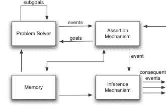

系统。每个事实要么是当前为真，要么是“旧的”（过去某个时间为真）。在此例中，“亚瑟很饿”被添加到记忆中，并索引为亚瑟所相信的内容。

当此事实被添加到记忆中时，会导致该事实被传递到推理机制。对于负向西格玛状态，推理机制创建形式为“亚瑟知道亚瑟打算不再饥饿”的概念依赖表达式。当然，这个表达式代表一个目标。当它被传递到断言机制时，结果是调用问题求解器，从而开始规划过程。

Tale-Spin中满足饥饿的程序名为S-Hunger（即Sigma-Hunger）。在Tale-Spin中，熊吃蜂蜜和浆果。S-Hunger检查记忆，看亚瑟是否知道他拥有一些蜂蜜或浆果，或者知道一些蜂蜜或浆果在哪里。他不知道，因此S-Hunger随机选择一种熊食物——在此例中是蜂蜜——并调用DCont（Delta-Control）来获取一些。

DCont形成目标“亚瑟有一些蜂蜜”并开始检查其planboxes的前提条件。首先检查是否已经为真（不是）。然后检查此目标是否已经是亚瑟目标结构的一部分。不是，因此将其添加。

DCont为什么要检查获取蜂蜜是否已经是亚瑟目标结构的一部分？有多种原因，最明显的是因为如果它已经是他的目标（或通往更高目标的子目标），那么添加它就没什么意义了。但检查目标是否存在的另一个原因是，Tale-Spin还将失败的目标及其失败原因作为角色目标结构的一部分保留。在添加此功能之前，Tale-Spin创造的故事具有一定的超现实质感。以下是一个示例：

乔·熊很饿。他问欧文·鸟蜂蜜在哪里。欧文拒绝告诉他，所以乔提出如果他告诉蜂蜜在哪里，就给他带一条虫。欧文同意了。但乔不知道哪里有虫，所以他问欧文，欧文拒绝说。于是乔提出如果他告诉哪里有虫，就给他带一条虫。欧文同意了。但乔不知道哪里有虫，所以他问欧文，欧文拒绝说。于是乔提出如果他告诉哪里有虫，就给他带一条虫。（米汉 1976，第129–130页）

事实上，这些由错误产生的故事——米汉称之为“误纺故事”——是Tale-Spin最著名的输出，其再版范围远超完成系统所产生的任何内容。这有多种原因。首先是娱乐价值。另一个原因是，这些故事由米汉从概念依赖表达式手工翻译而成，其散文比Tale-Spin的配套自然语言生成系统Mumble所产生的故事要流畅得多。第三，这些故事仅通过其结构，就暗示了底层Tale-Spin过程的一些机制。不幸的是，正如我稍后将讨论的，那些试图在没有深入了解Tale-Spin系统的情况下解释这些输出的人，常常得出相当误导性的结论。

## Developing Relationships

亚瑟正试图获取一些蜂蜜，这是一个Delta-Control问题。在Tale-Spin中，DCont planboxes的第一个前提条件是知道要控制的事物的位置。由于亚瑟不知道


涉及任何蜂蜜时，都会调用DKnow。DKnow形成目标“Arthur知道某处有蜂蜜”。这目前不为真，也不属于目标结构的一部分，因此被添加进去。如果存在查找信息的标准方法，DKnow的第一个planbox会被使用：比如查看手表或时钟来得知时间。在Tale-Spin中，针对蜂蜜没有这样的方法，因此DKnow的下一个planbox是查看是否有某人是这方面的专家可以询问。”熊是蜂蜜方面的专家，但Arthur所知道的唯一熊就是他自己，所以Tale-Spin转到下一个planbox，即使用Persuade包中的方法来说服朋友告诉你。朋友是你认为与你之间怀有正向情感值的人。Arthur对George Bird对他的看法一无所知。如果观众表示Arthur不认为他们是朋友，Arthur在放弃获得蜂蜜的目标之前，只剩下一个DKnow planbox：说服一个代理人去查出答案并告诉他。

9. 根据Meehan的论文（1976，50）。第11章这部分故事的描述（同上，170）省略了这一步。

关系和人格状态是Meehan为其Tale-Spin工作（1976，40）在Schank和Abelson工作基础上的扩展。测试记忆中的关系状态是通过一个过程完成的，如果状态不存在，则将其添加到记忆中。由于Tale-Spin处于询问观众的模式，它会输入：

- DOES ARTHUR BEAR THINK THAT GEORGE BIRD LIKES HIM? 1: A LOT : 2: A LITTLE : 3: NOT MUCH : 4: NOT AT ALL

Tale-Spin可以同时在内存中维护四种类似的不同状态。第一种，即这一种，是：Arthur是否认为George喜欢他？其他的有：Arthur是否认为他喜欢George（即，Arthur是否喜欢George）？George是否认为Arthur喜欢他？George是否认为他喜欢Arthur（即，George是否喜欢Arthur）？所有这些都用于制定不同类型的计划。

观众表示Arthur认为George非常喜欢他，因此*Persuade*开始处理其planboxes，目标是让Arthur让George告诉他蜂蜜在哪里，以追求获得蜂蜜这一更高目标。第一个planbox是直接询问，但还有进一步的前提条件。因此*Tale-Spin*询问Arthur是否对George感到欺骗（观众回答：完全不），Arthur是否对George感到竞争（完全不），Arthur是否喜欢George（非常喜欢），以及Arthur是否认为George在试图欺骗他（完全不）。

最终，Arthur Bear有了一个知道蜂蜜在哪里的计划，以便他能控制它，以便他能吃掉它，以便他能不那么饿：他将问George Bird。

## 推测与谎言

从这里开始，Arthur的事情开始变糟。原来George是一只欺骗性的鸟，会故意告诉Arthur一个替代的可能世界，而不是*Tale-Spin*故事中的那个世界。也就是说，他将撒谎，*Tale-Spin*将创建一个平行世界结构来支持这个谎言，代表Arthur相信它这一事实。

首先，Arthur想要*告诉George他的请求*。*Tell*有两个planbox：自己做，或让代理人去做。Arthur从第一个开始，这要求他靠近George。这是一个*Delta-Prax*问题，导致形成目标“Arthur靠近George”，DProx的相应planbox开始运行。由于Arthur知道自己在哪里（洞穴），并认为他知道George在哪里（他的巢穴），因此不需要启动DKnow planboxes。DLink随后创建更多世界，使Arthur的山和George的草地之间有连接。然后DTrans沿地面移动Arthur（熊不会飞）到George的枫树附近。由此产生的推断包括Arthur和George都知道Arthur已经到达那里，以及Arthur知道George在这里。在此之前，角色必须Speak才能让其他人知道他们的存在。角色未能相互注意到对方，造成了Tale-Spin另一个著名的错编故事：

Henry Ant口渴了。他走到河边，他好朋友Bill Bird正坐在那里。Henry滑倒掉进了河里。他无法呼救。他淹死了。(1976, 128)

Meehan将注意到作为位置变化的推断添加进来，导致Bill救了Henry的命。但另一个就没那么幸运了。

Henry Ant口渴了。他走到河边，他好朋友Bill Bird正坐在那里。Henry滑倒掉进了河里。重力淹死了。(129)

在这个版本的Tale-Spin中，重力是一个角色，它对Henry Ant执行了Grasp，然后将它们两者都PTTrans-ed进了河里。Henry被他的朋友Bill救了，但重力无路可逃。这通过改变重力在Schank的概念依赖表达式中的运作方式来修复——Propelling Henry instead。

回到我们的故事，一旦每个人都知道Arthur和George彼此靠近，就会调用Do-MTrans，Arthur请George告诉他蜂蜜在哪里，导致调用处理请求的过程：Request。现在有理由询问观众George如何看待他与Arthur的关系。Tale-Spin询问他是否喜欢Arthur（答案：有点），他是否信任Arthur（有点），他是否认为他支配Arthur（完全不），他是否感到欠Arthur的人情（完全不），以及他是否认为Arthur信任他（有点）。

这里我们来到了这个Tale-Spin故事的主要“心理动作”。这一动作之所以能够实现，是因为角色规划可以利用Tale-Spin的推理机制。George Bird利用这些机制来推测回答Arthur请求的潜在影响。

第一个推理是显而易见的：Arthur会认为George告诉他某处有蜂蜜。第二，基于George对他们关系的看法，George可以推断Arthur会相信他相信这个地方有蜂蜜。此外，基于关系，他推断Arthur相信那个地方有蜂蜜。最后，George可以基于此推断，Arthur会制定一个吃掉蜂蜜的计划。

George然后将所有这些推理，反过来，从它们生成所有推理。我们可以说，他想象了每件事都为真的世界。但他在其中任何一个世界都没有找到他想要的东西。正如Meehan所说，他“在寻找一个表示他会开心（或难过）的推理，以便他能决定支持（或反对）Arthur的请求”（1976，183）。因此在与观众商议后，决定George会对Arthur撒谎。

当这种情况发生时，George告诉Arthur的整个结构是在Do-MTrans过程中创建的，但其中一些只索引到角色记忆，而不是系统记忆。这导致创建了Ivan Bee，他拥有蜂蜜，蜂蜜在蜂巢里，蜂巢在红杉树里，红杉树周围有一些地面，地面是山谷的一部分。物理位置被索引到系统记忆：它们是真实的。但起初，蜂巢、蜜蜂和蜂蜜只存在于George的记忆中，并且不被相信。当他告诉Arthur它们时，观众需要被问及Arthur有多信任George。答案是“有点”，推理制定者确定它们被添加到Arthur对世界的信念中。

## 另一个伎俩

现在Arthur知道去哪里找蜂蜜了。正如Meehan所指出的，

DO-MTRANS返回到REQUEST，返回到第一次DO-MTRANS调用，返回到TELL，返回到PERSUADE。说服的目标已经满足——Arthur现在认为他知道哪里有蜂蜜——所以PERSUADE返回到DKNOW，返回到DCONT。……所有这些只是为了实现DCONT的第一个前提条件：找出蜂蜜在哪里。(1976, 184-185)

从这里开始，Arthur的事情一事无成。观众被问及他对Ivan的感受（在Arthur的参考世界中真实的感受，即使是对这个Tale-Spin世界中虚构存在的感受），他决定向Ivan要一些蜂蜜。Arthur前往他认为可以找到Ivan的地方，但当他到达时，Tell未能通过其前提条件测试——他不“靠近”Ivan，因为Ivan不在那里。


Arthur 推断 George 撒了谎，于是开始不信任他，对他稍微少了一些好感，并相信 George 在试图欺骗他。然而，Arthur 并没有停止相信 Ivan 存在，只是不再相信他知道 Ivan 在哪里。结果发现，除了 George 之外，没人可以问 Ivan 到底在哪里。

于是 Arthur 回到 George 的树那里。鉴于询问 George Ivan 在哪里仍然是一个失败的目标，他尝试下一个 Persuade planbox：讨价还价。他推断 George 可能喜欢一条虫子，而初始设定确定 Arthur 知道一条虫子的位置。于是 Arthur 向 George 提出，如果他告诉 Arthur 在哪里能找到 Ivan，就给他一条虫子。George 答应这么做（一个可能世界），同时决定欺骗 Arthur（另一个可能世界，只有在虫子到达时触发才会存在）。Arthur 成功拿到虫子并带到 George 面前后，鸟吃掉了它并嘲笑他。这个 planbox 失败后，下一个是威胁。但当被问及时，观众断言 Arthur 觉得自己有点被 George 控制，所以他不会尝试。

在未能找到直接向 Ivan 要蜂蜜的方法后，Arthur 被下一个 Tell planbox 所打动，试图让其他人去请 Ivan 给他蜂蜜。他找 George 试试——没有其他人了——但这次失败得比上次更加可悲。事情继续失控，直到 Tale-Spin 决定 Arthur 已经没有别的办法来解决他的饥饿问题。

他的选择尤其有限，因为他无法自己去找食物——如果他不能说服别人告诉他，就无法得知。正如我们从故事设定中记得的，在这个世界上没人知道有任何熊食物。Arthur 和 George 之间只知道一条虫子。所以故事不可能有其他结局。一旦观众决定饥饿是 Arthur 的问题，他就注定失败。他制定了许多计划，但没有一个有成功的机会。故事结束。

## Tale-Spin 的虚构

这是关于 Tale-Spin 的大量细节，比我对本书中描述的任何其他系统所提供的都要多。我希望这能让人了解创建即使是第一代故事系统所涉及的工作类型。在角色和故事层面，其内部发生的远比 Eliza/Doctor 或标准电脑 RPG 要多。此外，它说明了如何将一个寻求生成人类行为表象的计算机系统构建为关于人类行为理论的操作化。

但也值得注意的是，我们 Tale-Spin 示例中产生的故事并不是一个特别强的虚构实例。虽然 Tale-Spin 创建角色行为，但这种行为不一定采取传统故事的形式。此外，在生成此类故事（如我们的示例）过程中发生的许多动作，仅存在于过程层面，对观众来说是不可见的。观众如果看到这个 Tale-Spin 故事的输出，会看到一个短得多、简单得多的东西。我稍后会回到这一点。目前，我想考虑说 Tale-Spin 产生虚构究竟意味着什么。

10. Ryan 特别提到 Lucia Vania、Umberto Eco、David Lewis 和 Lubomír Doležel——随后是 Doreen Märitle 和 Thomas Pavel 在 1980年代的著作。在 *虚构世界* 的第一章中，Pavel (1986) 勾勒了一幅类似的图景……

## 可能世界

对 *虚构* 的一个简略定义可能是列举其最常见的形式：“小说和短篇小说”，或者“小说、短篇小说、戏剧、电视和电影”。然而，如果我们对此感兴趣，这样的定义帮助不大，许多数字媒体理论家已经开始使用源自可能世界理论和模态逻辑的虚构定义。这些属于源自哲学和语言学的更广泛的文学方法群体，这一特定分支在 1970年代开始确立自身身份。在 *可能世界、人工智能与叙事理论* 中，Marie-Laure Ryan (1992) 将这项工作的渊源追溯到 1970年代末期多位作家的文章。¹⁰

在哲学中，可能世界的概念常被追溯到 Gottfried Wilhelm Leibniz，他的立场或许最广为人知的是伏尔泰 *老实人* 中 Dr. Pangloss 虔诚持有的立场。Leibniz 认为，在上帝心中存在着无限多个可能世界——而其中一个，即最好的那个，就是我们所生活的世界。Leibniz 的立场涉及哲学和神学中最崇高的关切，但这并不是我们发现可能世界的唯一场所。更贴近生活的是，当我们猜测（“I wonder if the lunch special will be Lemongrass Tofu”）时，当我们希望（“I hope Jane gets that promotion”）时，当我们计划（“We'll get there before the doors open, so we have great seats”）时，我们都在想象可能世界，等等。可能世界，以及更广泛的模态逻辑，是思考诸如：什么是可能的？什么是不可能的？什么是必然的或偶然的？等问题版本的工具。许多思想家的工作，尤其是自 1960年代以来，使哲学家们在 Leibniz 时代之后很长一段时间里重新考虑这些话题。

将可能世界理论应用于虚构的一个简单尝试可能会提出：非虚构文本指代我们的世界，即现实世界，而虚构文本指代替代可能世界。然而，正如 Ryan 指出的，这种方法存在许多问题。例如，这种表述无法提供区分虚构、错误和谎言的方法——它们都是参照替代可能世界所作的陈述。在更复杂的层面上，还存在这样一个问题：进一步的替代可能世界不断地嵌入到虚构和非虚构中。例如，虚构和非虚构都描述了其中出现的人们未实现的愿望和计划。Ryan 的工作通过识别一个超越创建替代可能世界的进一步要素——这是虚构所必需的——来回应这些问题。

Ryan 认为虚构的构成性动作，不仅仅是创建一个替代可能世界，而是将话语重新中心化到那个世界——以至于诸如 "here" 和 "now" 之类的指示性术语被理解为指代那个替代可能世界，而诸如 "actual" 之类的术语变得具有指示性。此外，对于 Ryan 来说，虚构不仅创建一个替代可能世界，还创建一个现实系统，一个宇宙。这是必要的，因为虚构的替代世界本身也可能有许多从它源自的替代可能世界，而每个世界又可能有更多的替代可能世界（例如，当一个角色猜测另一个角色的计划时）。显然，上述描述中已经存在与 Tale-Spin 操作的类比。

## 数字虚构

除了故事生成领域（这是我与 Ryan 共同的兴趣）之外，许多作者已使用可能世界理论来应对数字媒体中新兴的虚构形式。例如，之前因其关于任务的讨论而被引用的 Jill Walker Rettberg，是一位数字媒体理论家，对许多具有强大文本成分的虚构形式感兴趣（包括电子邮件叙事和网络日志虚构），也对一些不以文本为主要成分的形式感兴趣。在 *虚构与互动：点击鼠标如何让你成为虚构世界的一部分* 中，Rettberg (2003) 考察了某种程度上将用户作为其替代可能世界中角色的互动数字虚构。她在描述用户如何被纳入这些世界的过程中，引入了“本体互动”这一术语，这尤其建立在 Thomas Pavel 书中“本体融合”（在参与虚构世界时，我们的实际自我与虚构自我之间的融合）概念以及 Kendall Walton 关于我们如何将虚构表象作为道具用于假装游戏的理论基础之上。（她引用了 Walton 1993 年的《拟像即假装》。）Walker 指出，这种方法为讨论“迥异如装置艺术、互动叙事和电脑游戏”等作品中虚构体验的共同生成提供了词汇（2003, 31）。


从相关角度来看，Half-Real——由游戏开发者和理论家 Jesper Juul (2005) 著——将计算机游戏作为主要研究对象：鉴于此，Juul 并不将小说视为一类艺术作品，而是将其视为许多游戏的一个元素。他有兴趣理解游戏如何投射虚构世界：什么样的世界，玩家如何被提示去想象它们，以及这些世界如何与游戏规则相关。Juul 指出，游戏小说，如同传统文学中的小说一样，是不完整的。正如在《哈姆雷特》中，我们对城堡及其附近之外的世界知之甚少——但在某种程度上假设它嵌入在一个由我们自身世界和其他文本的知识部分填充的、细节完整的世界中——同样，在游戏《半条命》中，我们对其所设定的建筑群之外的世界也知之甚少。然而，与大多数文学小说不同，许多游戏的世界，在 Juul 的术语中，是“不连贯的”（这是限制 Juul 有兴趣以叙事而非小说的术语讨论游戏的原因之一）。这些是发生重大事件的世界，这些事件如果不讨论游戏规则就无法解释，例如许多游戏具有多条和额外生命，但游戏小说中没有任何元素指向转世。Juul 描述了许多方法，远远超越传统小说技巧，游戏通过这些方法提示玩家想象可能的虚构世界，包括：图形；声音；文本；过场动画；游戏标题、盒子和说明书；触觉；规则；玩家动作和时间；以及谣言（133–138）。

鉴于从不同方向考虑小说和数字媒体概念的作者们发现“可能世界”小说方法颇有成效，它如何能帮助人们理解 Tale-Spin，以及更广泛的故事生成？首先，当然，它可以澄清 Tale-Spin 的操作产生小说。在乔治对亚瑟的臆测中注意到的心理活动，当通过可能世界理论的视角来看时，揭示出正是小说的材料。其次，这种方法提供了一种纯粹从结构角度思考小说的方式。这很重要，因为 Tale-Spin 像大多数故事生成项目一样，关注于产生故事的事件——而很少关注这些事件如何呈现给观众。在文学理论中，这有时被称为“故事”与“话语”（或在某些更专业的语境中，“故事梗概”与“情节”）的区别。11

11. 或者换句话说，小说的事件及其描绘。

事实上，Meehan 对 Tale-Spin 小说的呈现关注甚少，以至于 Mumble——用于将 Tale-Spin 的概念依赖表达式转换为英语的自然语言生成器——是在一天内拼凑出来的。（然而，正如我稍后将讨论的，Tale-Spin 输出的问题比 Mumble 歪斜的结构更深层。）

最重要的是，以这种视角看待小说可以帮助我们识别 Tale-Spin 计划框规划中运作的核心操作逻辑。这种规划方法，正如 Schank 和 Abelson 所概述的，通过投射改变世界状态的潜在行为——可能世界——来运作，这些行为启动进一步的投射，进而启动更多的投射，找到一条“链或格”状的世界，可能从当前世界通向满足目标的世界。Tale-Spin 系统当然包含其他操作逻辑，例如那些管理移动、角色关系等等的逻辑。

但 Tale-Spin 并非从一个角色可以穿梭的完整虚拟世界开始。相反，移动仅在计划要求时发生，世界也仅按计划要求的程度被丰富起来。同样，Tale-Spin 在创建角色时并不生成一套完整的人际关系，而是仅丰富计划所要求的角色之间的连接。因此，虽然其他操作逻辑可能对 Tale-Spin 的虚构世界有所贡献，但计划框规划的逻辑才是核心。它创造了定义 Tale-Spin 小说并驱动系统其他逻辑运作的大量想象世界。

## Tale-Spin 效应

在伊塔洛·卡尔维诺的《看不见的城市》（Calvino and Weaver 1974）中，两个名叫忽必烈和马可·波罗的人物坐在花园里。波罗——有时用语言，有时通过符号，有时通过棋盘上棋子的关系——向忽必烈讲述他在广袤帝国中访问过的城市。以下是其中几个。在费多拉中央是一座金属建筑，每个房间都有一个水晶球，每个水晶球中都包含城市在可能未来的模型，是在其历史不同阶段构建的。在每个至日和分日，在尤菲米亚市场的篝火旁，交易的不是商品，而是记忆。在厄西利亚，居民在所有房屋之间拉绳子——标记血缘、贸易、权威和代理关系——直到无法通行，除了绳子之外的一切都被拆除，厄西利亚在别处重建。泰克拉不断在建设中，遵循星辰的蓝图，而安德利亚已经精确地反映了天空——在每条街道、每座建筑、每项工作和每个仪式中——但住在那里的人必须仔细权衡城市的每一个变化，考虑到它会在天空中产生的变化。波罗和忽必烈各自提出一个模范城市，所有其他城市都可以从中推导出来。他们翻阅地图册页面，这些页面不仅包含忽必烈帝国的所有城市，还包含终有一天会存在的所有城市（巴黎、墨西哥城）以及所有想象之国（乌托邦、新亚特兰蒂斯）。

将 Tale-Spin 想象成这个想象之国列表中的一个补充并不难。它是一个仅由计划中套计划中套计划组成的地方。人们没有情感，除了那些有助于在可能计划之间做出选择的情感。他们没有记忆，除了对正在进行的计划、失败的计划以及他们可能在计划中使用的事物位置的记忆。而这些位置——这个想象之地的地理本身——仅在计划需要时才存在。

像卡尔维诺的城市之一一样，Tale-Spin 是一个陌生的地方。然而，每个地方之所以陌生，是因为我们自身生活中可识别的某个元素成为人们和景观的决定性元素，几乎是唯一的元素。在某种程度上，我们确实像尤菲米亚的居民一样交易记忆，像厄西利亚的居民一样通过连接网络开辟通行，并且，像 Tale-Spin 的居民一样，制作计划中套计划的中国盒子，这些计划有时让我们着迷，以至于似乎不存在其他东西。

尽管如此，对于那些只考虑 Tale-Spin 小说输出的人来说，所有这些确实是不可见的。例如，乔治·伯德正在努力决定如何回答亚瑟·熊要求他告诉在哪里能找到蜂蜜的请求。Meehan 没有向我们提供这个小说的 Mumble 输出，但一个包含类似情境的故事被重印在 Meehan 论文的附录中。以下是一系列思考和臆测的 Mumble 输出，鉴于 Tale-Spin 的结构，这很可能与亚瑟和乔治故事中的那些非常相似：

> 汤姆问威尔玛，如果汤姆给威尔玛一条虫子，威尔玛是否会告诉汤姆哪里有一些浆果。威尔玛倾向于对汤姆撒谎。（Meehan 1976, 232）

这两句话之间的空白无疑是这个故事中最有趣的部分之一，如果我们能从 Tale-Spin 操作的“内部”视角来看它的话。但是，Mumble 的故事从不包含角色多层臆测或对潜在计划的详细考虑的描述。相反，所有这些心理活动，如上所述，都被省略了。仅从表面来看，这个决定也可能是随机做出的。

Mumble 输出的不是 Tale-Spin 最有趣的故事结构，而是来自概念依赖表达式的乏味、详细信息，这些信息几乎没有小说张力，就像这个同一故事的开头：

> 从前，贝蒂熊住在一个洞穴里。一棵苹果树上有一个蜂巢。玛吉蜜蜂住在蜂巢里。玛吉的蜂巢里有一些蜂蜜。汤姆·史密斯坐在一把椅子上。一棵红杉树上有一个鸟巢。威尔玛鸟住在鸟巢里。汤姆知道威尔玛在她的鸟巢里。汤姆知道玛吉在她的蜂巢里。汤姆知道贝蒂在她的洞穴里。一丛灌木附近有一些蔓越莓。一块地面附近有一条虫子。贝蒂知道蔓越莓在灌木附近。

等等，包括诸如旅行的详尽报告：


“汤姆从椅子走过客厅，穿过一条走廊，经过一些楼梯，又走过一条走廊，再走过一条走廊，穿过一片山谷，横跨一片草地，来到红杉树旁的地面。” 难怪大多数人文主义者都认为故事旋转只配被嘲笑。

此外，与 Eliza/Doctor 的开放式文本交互不同，故事旋转允许的交互形式是高度受限的菜单选择。无论你如何与该系统互动，都无法获得与 Eliza/Doctor 互动所带来的结果：对运作过程的洞察。相反，通过互动，不可能刺穿故事旋转故事乏味的表面，去看到其过程所进行的更有趣的虚构。

可以这样看：艾丽莎效应（Eliza effect）制造了系统复杂性的表面幻觉——互动（如果允许）会打破这种幻觉。另一方面，故事旋转效应（Tale-Spin effect）制造了系统简单性的表面幻觉——可用的互动选项（如果有的话）无法改变这种幻觉。这种情况在数字媒体中绝非罕见，或许在数字艺术中尤其如此，在那里，引人入胜的过程（汲取从约翰·凯奇到计算机科学前沿的各种灵感）常常被包裹在不透明的界面中。事实上，这种效应至少和艾丽莎效应一样普遍，尽管我不知道有什么术语来描述它——因此有了这个新造词。

当然，重新设计故事旋转以使其最有趣的虚构事件对观众显而易见，绝非易事。例如，这可能要求在规划过程中做出的推断被存储在内存中，并且（一个棘手的要求）由 Mumble 生成一个关于这些推断的在虚构上有趣的摘要。但这并不能使故事旋转与一般的数字媒体有所不同。在创建数字媒体——由计算过程实现的媒体形式——时，最具挑战性的设计任务之一，就是打造并安置有趣的过程，使其产生有意义的观众体验。我将在后续章节中再次探讨这一挑战，届时将讨论威尔·赖特的工作以及我所谓的模拟城市效应（SimCity effect）。

## 故事旋转作为模拟

如上所述，故事旋转效应主要将故事旋转视为一种媒体。然而，在耶鲁的语境下，它被定位为别的东西——或者更多的东西。正如米汉在其论文中反复强调的那样，故事旋转的结构之所以被选中，并非因为它们是让计算机输出故事的最有效方式。如果这是目标，那么类似克莱因的“自动小说作家”的方法会更合适。相反，故事旋转旨在作为人类行为的模拟来运行，基于当时尚克和阿贝尔森的认知科学思想。

从这个角度审视故事旋转，还有一些额外问题值得讨论。例如，回想本章示例故事旋转故事中的这一时刻：乔治·伯德看到回答亚瑟·熊关于蜂蜜位置对自己没有好处，却仍然决定回答。故事旋转并不是通过简单询问观众来决定乔治是否会回答。相反，它是根据乔治有多善良来决定的。观众回答说他“有些善良，因此乔治决定出于他小小的善良之心给亚瑟一个答案”，正如米汉所说（1976，183）。但是，当乔治·伯德调用 Do-MTrans 时，这里

- 12. 故事旋转源代码中一个有趣的元素——要么在米汉撰写论文时不存在，要么未在论文中报告——是一个问题，询问观众“你有多开明？（0-3）”，当主角的……注释继续于本章末尾。

动机没有被传达——并且 Do-MTrans 决定询问观众乔治是否觉得自己在对亚瑟欺骗。答案是“很多”，因此乔治最终出于善良之心对亚瑟撒谎，说谎的是蜂蜜的位置。这不是在模拟乔治认为亚瑟需要减肥，而是模拟的一次崩溃——尽管米汉对此未置一词。

当米汉给我们提供故事旋转在其通常的会说话的动物微观世界之外生成的虚构作品示例时——在一个由互动的人类角色组成的世界中——模拟问题变得更加明显。例如，在一个附录中，米汉提供了一个人的故事，其问题是 Sigma-Sex。在这里，奇怪之处变得如此明显，以至于米汉无法掩盖，但他的诊断很奇怪。以下是故事的摘录：

从前，乔·纽顿坐在一把椅子上。玛吉·史密斯坐在一把椅子上。玛吉知道乔坐在椅子上。有一天，玛吉性欲高涨。玛吉爱乔。玛吉想让乔和她亲热。玛吉对乔诚实。玛吉不与乔竞争。玛吉认为乔爱她。玛吉认为乔对她诚实。玛吉想问乔是否愿意和她亲热……[她去到他所在的地方并问他。他与她的关系（竞争、诚实等）被定义。他做出必要的推断并同意。他们各自前往乔的床。然后……] 乔和玛吉亲热了。乔变得开心。玛吉变得更开心。乔不再性欲高涨。乔认为玛吉不再性欲高涨。乔筋疲力尽。乔认为玛吉筋疲力尽……[玛吉做出所有相同的推断，然后，因为她筋疲力尽，这导致了 SIGMA-REST，……] 玛吉想靠近她的床。玛吉从乔的床走过卧室，穿过走廊，经过楼梯，穿过走廊，穿过客厅，穿过走廊，经过楼梯，穿过走廊，穿过走廊，穿过山谷，穿过走廊，穿过一个卧室，来到她的床。玛吉睡着了。乔睡着了。结束。（1976，229–230，原文全大写）

米汉评论道：“乔至少本可以让可怜的玛吉睡在他的床上”（230）——仿佛故事的问题在于 Sigma-Sex 的设计。我们可能希望看到一个由成功的 Sigma-Sex 产生的 Sigma-Rest 实例，以了解其背景，并希望角色睡在同一个地方。但故事旋转不是这样工作的。这类似于乔治·伯德出于善良决定回答亚瑟·熊，然后失去该背景导致他的回答变成一个不友善的谎言。故事旋转基于计划的规划程序中每个步骤所投射的可能世界的相对自主性，不会允许通过简单调整某个元素（如 Sigma-Sex）来解决这类问题。

此外，故事旋转讲述爱情故事的问题不仅仅在于其规划过程的结构。请考虑米汉论文中的以下陈述，以我们文化中的爱情故事为例——例如，任何凯瑟琳·赫本和斯宾塞·特雷西的电影：

> “约翰爱玛丽”实际上是“约翰相信他爱玛丽”的简写……我不确定从技术意义上说，“约翰爱玛丽但他不相信自己爱”这句话是否意味着任何东西。如果意味着，那也非常微妙。（64）

事实上，这一点也不微妙。它是每年制作的大多数浪漫小说、电视节目和电影中的重要情节元素。但从米汉在尚克实验室的语境来看，他的结论完全合理。如果约翰不知道他爱玛丽，那么他就无法在制定任何有意识的计划时使用这一知识——而在*故事旋转*中，任何不属于有意识计划的东西都等同于不存在。

这种对规划以外一切的视而不见——即规划处于生活中心的假设——远非耶鲁工作所独有。在当时更广泛的人工智能和认知科学界，对计划的理解和生成几乎是智能行动研究的唯一焦点。正如在整洁型和邋遢型人工智能研究者之间的辩论中，讨论的重点在于追求何种规划、如何组织规划等等——而非规划是否值得作为关注话题占据中心地位。这在一定程度上源于该领域的技术承诺，在一定程度上也是人类科学长期传统的遗产。十年后，露西·苏赫曼在其著作*计划与情境行动*中这样写道：

> 认为有目的的行动由计划决定的观点，深深植根于西方人类科学中，作为理性行为者的*该*正确模型。计划的逻辑形式使其在构建行动计算模型方面具有吸引力，以至于对于那些致力于现在被称为认知科学的领域而言，计划的分析与综合实际上构成了行动的研究。（1987，ix–x）

这一观点在过去几十年中，既受到人工智能界内外的广泛攻击。苏赫曼观察到，“就像……似乎荒谬


声称某种意义上地图强烈控制了旅行者在世界中的移动，把计划想象为控制行动是错误的”（189）。随着这种情况的发生——尤其是20世纪70年代中期Schank、Abelson和Meehan的理论进入了AI的学科史——Tale-Spin在某种意义上已经失去了作为模拟的地位。已经没有人相信它代表了对现实世界中人们实际行为的模拟了。

随着这种情况的发生，我认为，Tale-Spin作为一种小说变得*更*有趣了。它不再能被视为在人类规划行为之上覆盖了一层半成功的叙事的准确模拟。相反，其整套操作现在被揭示为一种作者创作的产物——一种通过过程和数据表达的、其作者及其研究团队曾经持有的关于人性的特殊而独特的观点。一旦我们这样看待它，它就成为一种新型的小说，尤其在两个方面值得欣赏。首先，它给我们带来双重愉悦，我们或许可以称之为“夸张的熟悉中的他者性”——这让人联想到卡尔维诺的*看不见的城市*。同时，它还提供了一种洞察和一个警示故事，帮助我们以新的眼光看待构建模拟这一行为本身。对人类行为的模拟始终是其作者信念和偏见的编码；它从来不是客观的，它始终是一种小说。

## 重读Tale-Spin

Tale-Spin效应对*Tale-Spin*的先前解释产生了巨大影响，即使解释者作为学者来自非常不同的立场。

珍妮特·默里的《全息甲板上的哈姆雷特》（1997）和埃斯彭·阿瑟思的《赛博文本》（1997）对此提供了有益的例证。在这些情况下，Tale-Spin效应不仅导致作者误解Tale-Spin，还导致他们错失与自身感兴趣领域建立富有成果联系的机会。

## 缺失的角色

在她的书中，默里在讨论Tale-Spin时引用了这样一个论点：“为了让作者创作出丰富而令人满意、利用数字环境特性的故事……[作]者需要一种具体的方法来构建一个连贯的故事，不是作为单一的事件序列，而是作为多重情节”（1997，185页）。鉴于此，我们或许会期望默里批评Tale-Spin在角色层面而非情节层面组织其操作。然而，默里似乎假设Tale-Spin确实在情节层面运作，只是运作有缺陷。

默里重印了那个著名的讲错的故事：乔·熊一遍又一遍地形成一个失败的目标，即给欧文·鸟带一条虫子，以便欧文告诉他虫子在哪里。在重印之前，她说：“从叙事模式的抽象表现讲述的故事，如果缺乏作者对具体素材的喜爱，可能会支离破碎”（200页）。故事之后，默里写道：

> 程序陷入循环是因为它对世界了解不够，无法给乔·熊提供更好的替代方案。情节结构过于抽象，无法将乔·熊的行为限制在有意义的序列中。（200页）

实际上，如前所述，Tale-Spin之所以循环，是因为——在生成这个讲错的故事时所处的部分完成状态下——其角色可以重新断言一个已经失败的目标。事实上，乔·熊的问题必须发生在角色层面——它不可能发生在“情节结构”层面——因为Tale-Spin根本没有“叙事模式的抽象表现”。

这个问题绝非默里讨论的详细内容。她的论点主要是关于交互式故事系统最终可能实现的体验类型的推测性论证。事实上，默里花了更多篇幅讨论她设想的设定在卡萨布兰卡世界中的交互式故事系统，而非Tale-Spin或其他实际实现的例子。

不，默里的误解大多导致的是错失机会，而非偏离主题。正如她书中下一章所展示的，她对模拟虚构角色内部运作的系统感兴趣。而像乔·熊和乔治·鸟这样的角色，如果超越Mumble输出的贫乏事件来看，具有相当复杂的内部运作。

当然，Tale-Spin模型是有问题的——启发它的认知科学思想如今已被抛弃。尽管如此，其操作仍提供了许多值得默里等作家关注的内容。Tale-Spin在20世纪70年代产生的复杂角色行为，比一个想象中的卡萨布兰卡系统更有可能成为《全息甲板上的哈姆雷特》这类论证的有说服力的素材。

## 想象中的叙述者

在《赛博文本》中，阿瑟思将Tale-Spin称为“一个不起作用的控制论小说装置”（1997，131页）。他基于其讲错故事的选集得出这一结论——而不是基于实际完成的Tale-Spin系统所产生的故事。阿瑟思确实用“至少在本文给出的例子中”这一短语对其说法进行了限定，但失败的修辞对于他想要表达的观点至关重要。Tale-Spin是阿瑟思用来论证机器叙述者不应“被迫模拟”人类叙述者的三个主要例子之一（129页）。Tale-Spin被呈现为这种模拟的失败实例，其讲错故事是其唯一引人注目的地方。

从AI的角度来看，阿瑟思的论点极其奇怪。正如我将在下一章中讨论的，AI圈子对Tale-Spin的主要批评恰恰在于它不试图模拟人类叙述者。Tale-Spin模拟的是角色——而不是叙述者，也不是作者。这被视为一个根本性错误，并且是纳塔莉·德恩（Natalie Dehn，1981a，1981b）等作家在广泛引用的论文中提出的主要观点，时间比阿瑟思的书出版早了十五年以上。

然而，与默里一样，我们在承认其问题的同时，仍可以跟随阿瑟思的讨论。当我们看到诸如“试图创造替代作者”之类的短语时，可以将其替换为类似“对叙事理想的意识形态依恋”的东西（阿瑟思，1997，141页）。这是因为阿瑟思反对仅仅作为替代品来模拟人类叙述者。他实际上是在反对专注于试图利用计算机来扩展传统小说和戏剧的乐趣。相反，阿瑟思试图将我们的注意力转向基于组合论、交互性和游戏等特征的文学——转向网络计算机的具体特性所开辟的新文学可能性。正如阿瑟思所写：

> 要实现有趣且有价值的计算机生成文学，有必要摒弃叙事文学的诗学，利用计算机在组合和世界模拟方面的潜力，发展出可以按其自身条件被重视和使用的新体裁。与其试图创造替代作者，计算机生成文学的努力应将计算机视为一种文学工具：一种用于赛博文本和遍历文学的机器。……[计算机作为文学代理人最终指向叙事之外，指向遍历模式——即对话式的即兴和自由游戏形式：[141页]

Tale-Spin的谜题在于，我们在此可以诊断出一个与默里非常相似的问题。在Tale-Spin中，阿瑟思错失了一个重大机会。Tale-Spin产生的故事结构几乎从不像人类讲故事者会产生的结构。相反，它产生了计划中嵌套计划中嵌套计划的奇怪结构。它产生了我们或许可以称之为，从可能世界视角来看，“极简小说”——几乎完全由规划、投机、谎言等的可能世界组成（没有多余的情感、动作，甚至地理位置）。它是一个组合引擎，用于产生体现异类人性观的可能世界，由研究实验室的暂时世界观驱动。换句话说，Tale-Spin可以被视为阿瑟思所呼吁的文学类型的一个例子。

## 解释过程

阿瑟思的错失机会，加上默里的，揭示了一件有趣的事情。Tale-Spin尽管早期，却站在十字路口。如果我们选择强调其与传统小说和戏剧的连续性，通过其


字符，然后它就成为诸如默里观点的有用触石。如果我们选择强调其复杂的陌生性，其计算特异性，那么它就成为诸如阿萨斯观点的重要早期示例。无论哪种方式，对系统运作的仔细检查揭示了比两位作者所假设的更加引人入胜的东西——为发展一种阅读过程所表达内容的方法的必要性提出了明确论证。读者可能记得，这是我对表达性处理的第二种含义。以Tale-Spin为例，我将现在扩展这个术语的含义，它本身包含两个要素。

- 首先，它涵盖了这样一个事实：数字媒体的内部过程是设计的人工制品，如建筑、交通系统或音乐播放器。与其他设计机制一样，过程可以从其效率、美学、故障点或（不）适合特定目的的角度来看待。其设计在其时代和背景中可能是典型的，也可能是不寻常的。各部分及其排列可能表达与设计运动和思想流派的亲缘关系，以及分歧点。它们可以被逐步重新设计、重新用途，或作为新系统的基础——由其原始设计师或其他人——同时保留先前用途的痕迹和特征。事实上，即使无法直接重用，痕迹也可能保留。由于系统限制，米汉无法直接重用高曼的巴别。但此类工作的痕迹在他对 mumble 的设计中清晰可见。

- 其次，与许多其他设计机制不同，数字媒体的过程既作用于又基于人类有意义的元素和结构。这在 *Tale-Spin* 所体现的人类行为模型中很明显。在诸如 *Mumble* 这样的自然语言处理系统中也可以观察到同样的情况，它在其解释或表达的宇宙中表达了一种微型语言哲学。当此类系统被纳入数字媒体作品中——例如 *Tale-Spin*——每当作品被体验时，其结构和操作就会被调用。这种调用，可以说，从系统的可能性宇宙中选择了一个特定的星座。在自然语言生成系统中，这可能是要在系统输出中向观众展示的特定句子。从输出句子中无法看到单个元素（例如，单词、短语、句子模板、概念依赖结构或统计语言模型）曾经位于更大系统的哪个位置。无法看到模型宇宙的运动如何导致了这个星座成为可能——并比其他可能的星座更加明显。

换句话说，我希望本章对 *Tale-Spin/Mumble* 的考察表明，在数字媒体世界中，尤其是对于数字小说，我们通过检查驱动比喻性天象仪的模型所学到的，与通过查看特定的星图（甚至它们运动的动画）所学到的一样多。这是因为数字小说的模型宇宙由角色行为规则、虚拟世界结构、人类语言组装技术等构成。它们通过每个结构的设计、每个内部运动的弧线，以及元素相互作用的优雅或困难来表达其虚构世界的意义。

试图仅通过查看输出来解释数字媒体作品，就像仅通过查看行星来解释模型太阳系一样。如果火星表面纹理的准确性存疑，这没问题。但如果我们想知道该模型是体现并执行哥白尼理论，还是将地球置于其模拟太阳系的中心，这就不够了。两种类型的理论都可能产生目前将行星置于适当位置的模型，但检查模型的电线和齿轮将揭示关键差异，可能是最能说明问题的差异。

正如我们在 Tale-Spin/Mumble 中所见，数字媒体作品的表面并不透明——它不允许直接观察作品作者创建和选择的数据和过程元素，或它们所依赖的技术基础。鉴于此，仅采用观众的视角使得无法充分参与作品的过程。有些系统通过交互，可能使人们能够对内部系统的运作方式形成相对准确的假设（事实上，有些作品要求观众这样做）。但这只是对作品过程运作的批判性参与的补充，而不是替代。未能认识到这一点会导致错失机会，例如阿萨斯和默里在 Tale-Spin 中所错失的机会。

本章试图展示如何检查数字媒体过程本身，以了解通过其选择、排列和操作所表达的内容。它还试图表明，表达性处理的概念包括考虑使用特定过程可能如何表达与特定思想流派的联系。在此例中，这是认知科学的一个特定分支，但检查过程同样可能揭示与软件工程、统计学或许多其他领域的思想和实践社区的联系。此外，我希望我已经证明，系统中过程的排列可能表达出与系统权威描述截然不同的一组优先级——或能力。

当然，我在此领域的工作建立在他人的思想之上。碰巧的是，这项工作的重要先例之一也出现在阿萨斯的书中，与他对 Tale-Spin 和其他系统的工作并列。

13. 然而，值得注意的是，遍历函数模型只是《赛博文本》中发现的模型之一。正如马克库·埃斯凯利宁在这本书的基于博客的同行评审中所指出的，另一个模型（Aarseth 1997，103–105）是……注释继续在本章末尾。

## 遍历函数

虽然1990年代大部分关于数字文学的工作都集中在作品的观众体验上——通常旨在将这种体验与后现代小说或其他受赞誉的非数字形式进行比较——但阿萨斯的《赛博文本》采取了不寻常的步骤，将此类作品视为机器。在本书的开篇章节中，阿萨斯写道，赛博文本的概念“通过将媒介的复杂性视为文学交流不可或缺的一部分，关注文本的机械组织”（1997，1）。他用于理解此类文学媒体复杂性以及观众在操作它们中的作用的“遍历函数”模型，已产生广泛影响。

在此模型中，阿萨斯将作品表面可见的文本称为“脚本”，将文本数据称为“文本元”，并将从文本元揭示或生成脚本并向用户呈现的机制称为“遍历函数”。阿萨斯的模型包括七个遍历函数，它们适用于任何作品，每个函数都可以有多个值。这些函数和值从具体的（例如，作品是否包含显式链接）到广泛的（例如，观众是否以某种方式参与选择或创建表面文本）。

《赛博文本》以多种积极方式影响了人们对数字文学的思考。最重要的是，它使得以机制角度考虑此类作品变得司空见惯。此外，由于阿萨斯的遍历函数被设计为同时适用于数字和非数字作品，《赛博文本》鼓励了回溯至面向过程文学作品历史的比较（包括由乌里波创建或研究的许多作品，乌里波是一个作家和数学家团体，其成员包括雷蒙·克诺、乔治·佩雷克和伊塔洛·卡尔维诺）。随着遍历函数模型所涵盖的可能性广度，《赛博文本》还鼓励了对数字文学中除最广泛讨论的领域（尤其是具有创新过程的领域）之外的领域的关注，并向数字文学作者提出了一定程度的富有成效的挑战（因为模型描述的可能作品类型中，只有很小一部分迄今已被创建）。最后，阿萨斯对遍历函数模型的概述以及《赛博文本》整体，考虑了大多数文学学者当时满足于忽略的事物：电脑游戏。除了相当明显的文学游戏，例如 Infocom 的交互式小说 Deadline，阿萨斯还进一步考虑了基本无文本的游戏，例如 Psygnosis 的动画解谜游戏 Lemmings。总的来说，《赛博文本》影响的结果是有助于创建

此类图书的可能性条件。

然而，尽管对Aarseth的《Cybertext》著作及其遍历函数模型的考察产生了这些重要影响，我的印象是，该模型本身更多是被引用而非被使用。本书延续了这一传统，原因有二——两者都与该模型关注从textons（文本数据）生成scription（表层文本）有关。首先，许多文本系统难以用这些术语来描述。例如，Mumble不包含任何容易识别的textons。当然，会产生表层文本，但很难将其生产过程视为从底层textons中被揭示或生成的过程（或者说，如Aarseth所言，“文本中存在的字符串”[62]）。14 这，进而，指向了本书不采用Aarseth模型的第二个、更根本的原因：许多数字媒体（及数字小说）最重要的过程，并不能很好地通过从textons揭示或生成scription的过程来描述。回到Tale-Spin/Mumble的例子，该作品的许多过程都集中在模拟角色行为上。如前所述，该模拟完全独立于任何自然语言生成进行，最好被视为一种模拟过程，而非生成或揭示scription的手段。事实上，本书所考虑的过程（以及可以说，《Cybertext》本身所考虑的过程）中，很少有能用此类术语有效理解的。但这并未减少Aarseth著作在将注意力转向数字媒体过程方面所起的关键作用，而后者正在软件研究的工作中迈出下一大步。

14. 相反，Mumble主要由组装文本的规则构成。例如，与其为描述不同类型角色和对象位置而设置不同的句子模板并插入名词名称……

本章注释继续见章末。

## 软件研究

大多数软件研究（来自工程学和数学学科之外）都从软件所模拟和扩展的事物——打字机、电视、邮件投递——以及从系统外部体验到的方式来考察软件。但少数作者则始终将软件本身作为写作对象。这包括考察软件的内部操作（如本书所做）、检查其组成元素（例如，正在工作的不同层级、模块，甚至代码行）、研究其背景和生产的物质痕迹（例如，如何通过白皮书、规格说明文档、源代码管理系统存档、测试版、补丁等来追踪资金、劳动、技术和市场的运作）、观察工作及其结果的转变（从建筑等著名案例到汽车零部件的日常订购和流动），以及如前所述，扩大被认为值得研究的软件类型（不仅限于媒体软件，还包括设计软件、物流软件、数据库、办公工具等）。

这些调查构成了更广泛的软件研究领域的一部分——该领域包括所有通过软件的具体特性来审视当代社会的工作。例如，虽然可以从许多角度审视沃尔玛现象，但那些关注支撑其许多运营（从商店补货到与分散供应商网络的关系）的软件具体特性来解读这家零售巨头的人，正在从事软件研究。另一方面，那些不关注软件具体特性而研究微软的人，则不属于软件研究领域。

“软件研究”这一术语由Lev Manovich（2001, 48）在其广为阅读的著作《新媒体的语言》中提出。Manovich将软件研究描述为一种“转向计算机科学”——或许类似于早期时代的“语言学转向”。15 在他的著作中，软件研究表现为一种转向以计算机科学的结构和概念为运作术语的分析，转向以可编程性（而非，例如，以意义）为基础的分析。16 以这种方式，Manovich的书也帮助创造了本书的可能性条件，本书被视为软件研究的一个例子。

然而，为了避免混淆，我应当指出，本书并非软件研究某一特定领域的实例：代码研究。许多软件研究学者有兴趣解释编程语言代码17，但考察代码和考察过程并非同一件事。本章对此差异进行了说明。虽然我对Tale-Spin/Mumble过程的理解部分建立对未编译源代码的探索之上，但我的解释是关于该软件的过程和运作，而非关于语言的任何具体细节（MLISP的特性）或代码的文本细节（例如，使用“SENTIENT”而非“ALIVE”来标记概念依赖表达式中的哪些元素将以特定方式翻译成英语）。

如果我们将软件视为类似模拟机器，那么解释代码的具体文本就像研究机制部件所用材料的选择和特性。另一方面，研究过程则关注机制部件的设计和运作。这些活动并非互斥，也没有一方包含另一方。相反，它们相辅相成——有些调查可能需要同时进行两者。两者都可以是本书所追求的途径：对表达性处理的理解。

在本章中，我的调查使我看到Tale-Spin的处理在两种方面具有表达性。它是一种作者表达，一种通过其过程创造虚构世界的媒体制作行为，这些过程在其表面上仅部分可见。它还通过其过程和数据结构的设计，表达了与人工智能和认知科学历史的关系，而这些在其表面上完全不可见。通过第一种表达，它展示了故事生成的基本方法（超越通过预先创建并明确连接的块来组装小说）以及Tale-Spin效应的困难。通过第二种表达，它还提供了基于手工编写规则的人类行为模拟局限性的可读示例。总而言之，它表明，以这两种方式理解过程对于数字媒体和软件研究的发展至关重要——无论是对创作者还是学者。

15. 评论本书在Grand Text Auto上进行博客式同行评议的草稿时，Manovich认为他在《新媒体的语言》中的表述“将计算机科学定位为一种绝对真理，一种既定事实，可以……

16. 2003年，Matthew Kirschenbaum对Manovich的术语提出了他自己的扩展，该扩展受到Kirschenbaum在书目学（研究作为实物的书籍）和文本批评（重建……）背景的影响。

17. 已有大量有趣的工作断言或证明了解释代码的重要性。例如，来自人文学科背景的此类工作包括Maurice的《代码艺术》……
本章注释继续见章末……

## 注释

1. 这是Meehan批评的一个方面，其他方面则关注Klein系统的行为与人类讲故事者行为理论之间的不匹配。

2. Schank在《计算机理解之内》中赞同Meehan关于脚本故事与计划故事相对趣味价值的观点。

> 许多故事（尤其是更有趣的故事）都关于我们没有现成脚本的全新情境。当我们听到此类故事时，我们依赖于对如何规划出能够达成目标的行动的知识。（1981, 33）

Schank和Meehan并非唯一将艺术与未经脚本、出乎意料甚至令人迷失方向的事物联系起来的人。在对基于链接的超文本感兴趣的小说作家中，其产生此类效果的潜力被引用为其潜在优势之一，尽管在更偏向技术的圈子里，迷失方向被视为超文本最大的潜在问题之一。George Landow（2006）通过Morse Peckham（《人对混沌的狂怒》作者）等作家的作品，在《超文本3.0》中探讨了这一差异。

3. 当我从Meehan那里得知系统的另一个版本时，我的搜索进入了下一阶段，该版本比“微型”版本更复杂，为1987年波士顿计算机博物馆的“智能机器”展览而创建。不幸的是，计算机博物馆此后已关闭，但其大部分档案被送往加利福尼亚州山景城的计算机历史博物馆。然而，正如该博物馆软件策展人Al Kossow所发现的，档案中只包含展览记录，而不包含软件本身。Kossow还联系了负责原始“智能机器”展览的Oliver Strimpel，并确认该版本的Tale-Spin可能从未被存档。

在数字媒体领域，这种损失不幸的是很常见。即使对于最具影响力的项目，我们也依赖作者来检索它们。只有当图书馆和博物馆认真对待软件系统的保存——而不仅仅是随附或记录它们的纸质文件——这一情况才会改变。（与此同时，Nick Montfort和Ian [2004]为电子文学组织撰写了一本名为《无酸比特》的小册子，提供了一些作者可以采取的措施，使其作品更有可能流传下来。）

由于这些失望，有一段时间我相信我们将无法再通过直接交互从Tale-Spin中学习，就像我们可以与Eliza/Doctor交互一样。但我仍然认为，我们可以通过查看Meehan的论文中记录的Tale-Spin的过程和输出，以及之前曾写过这些内容的人的反应，来学习重要的教训。我一直采用这种方法撰写关于Tale-Spin的文章，直到1980年的打印件在2008年出现。

1980年的代码可能与Meehan论文时期的代码不同——反映了他在成为加州大学欧文分校教职员工后的进一步工作。这一点体现在一条幽默的注释中——“THIS SPACE AVAILABLE. CALL (714) 833-6526”——其中包含欧文分校的区号（第463行）。尽管如此，系统的总体运作似乎与Meehan在1976年描述的内容一致。

4. 尽管要严谨准确，据我所知，Weizenbaum只分发了Doctor脚本的逐字代码。然而，他关于Eliza系统的出版物足够明确，使得独立实现相对容易。


- 5. 对于第三种模式，Meehan 特别研究了伊索寓言的版本，例如“狐狸与乌鸦”和“蚂蚁与鸽子。”

- 6. 此示例和上述示例改编自 Meehan 的博士论文（1976，195–196页）——用本故事中的角色替换了其他角色。

- 7. 本摘要参考了 Schank 的 *概念信息处理*（1975a，41–44页）。

- 8. Meehan 在他的博士论文中称它们为 *delta-acts*，而 Abelson 和 Schank 在其 1975 年的出版物中称它们为 *delicts*（Schank 1975b；Abelson 1975）。我将根据所引用的著作交替使用这两个术语。

- 9. 根据 Meehan 的博士论文（1976，50页）。对第 11 章故事这一部分的描述（同上，170页）省略了这一步骤。

- 10. Ryan 特别提到了 Lucia Vania、Umberto Eco、David Lewis 和 Lubomír Doležel——随后是 Dorrit Cohn 和 Thomas Pavel 在 1980 年代的著作。在 *虚构世界* 的第一章中，Pavel（1986）勾勒出了 Doležel 和 Eco 的类似主题及其贡献，同时也指出了 Ryan 早期关于该主题的文章的重要性。

- 11. 或者换句话说，小说的事件及其描绘。

- 12. *Tale-Spin* 源代码中一个有趣的元素——无论是在 Meehan 博士论文时期不存在，还是在其中未被报告——是一个向观众提问“你有多开明？”（0–3）“当主角的问题是 *Sigma-Sex*（Meehan 1980，第 255 行）”的问题。答案“0”会导致 *Tale-Spin* 要求角色的性取向仅限于异性，如果是人类，则仅限于同种角色。其他数字会放宽其中一项或两项要求。在此之上，一条注释写着“J. BEAR 有多开明？”（非读者）（第 2548 行）。就我所拥有的代码版本而言，观众就此话题的进一步提问似乎仍未实现。

- 13. 然而，值得注意的是，遍历函数模型只是 *赛博文本* 中发现的模型之一。正如 Markku Eskelinen 在本书基于博客的同行评审中所指出的，另一个模型（Aarseth 1997，103–105页）与我在本书引言中提出的模型要接近得多。然而，Aarseth 的这个模型仅在 *赛博文本* 中用于讨论“冒险游戏”——据我所知，它未被其他任何评论家采用。

- 14. 相反，Mumble 主要由组装文本的规则组成。例如，与其为描述不同类型角色和对象位置而准备不同的句子模板（再将被描述名词的名称插入其中），我们不如看看这样的代码：

```
EXPR C'LOC' ();
BEGIN
IF ISVALPART = 00 OR ISVAL = 00
THEN IS RPLACA 'WHERE:
IF NULL ("SAID OF 'ACTOR) AND ISVALPART EQ 'HOME OF 'ACTOR
AND 'ACTOR IS 'SENTIENT
THEN TM (LIVE 'ACTOR)
ALSO APP2 <IF ISVAL[1] EQ "INSIDE: THEN "IN" ELSE "NEAR", ISVALPART>
ALSO RETURN NIL
IF NOT (AND (EQ 'ACTOR IS 'SENTIENT AND (NOT (EQ 'ACTOR IS 'SENTIENT
THENIN (BE 'IF PLUR OF ANY 'ELEX OF 'ACTOR THEN THERE2 ELSE 'THERE1)
ALSO APP ACTOR
ELSE (BE 'IN 'ACTOR):
IF ISVALPART NEQUAL QQ AND ISVAL NEQUAL QQ
THEN APP (IF ISVAL[1] EQ "INSIDE: THEN "IN" ELSE "NEAR")
ALSO SAYOWNER (ISVALPART)
ALSO (IF NEG AND 'ACTOR WASPROX? ISVALPART THEN APP2 '(ANY MORE]);
END. (MEEHAN 1980, lines 3794-3812)
```

- 上述代码中可能成为观众所读内容（“scriptions”）一部分的字面词（“textons”）是“in”和“near”。但作为更大 Mumble 系统的一部分，这段代码会生成关于位置的文本，包含适当的代词、时间参照等等。

- 15. 在对本书在 Grand Text Auto 上发布的基于博客的同行评审草稿进行评论时，Manovich 认为他在《新媒体的语言》中的表述“将计算机科学定位为一种绝对真理，一种可以向我们解释软件社会中文化如何运作的既定事实。但计算机科学本身也是文化的一部分。”回顾大约十年前撰写推广“软件研究”这一短语的文本（《新媒体的语言》手稿完成于 1999 年）时，Manovich 评论道：“我认为软件研究既要探讨软件在形成当代文化中的作用，也要探讨正在塑造软件自身发展的文化、社会和经济力量。”

- Matthew Kirschenbaum 在回应 Manovich 的评论时指出，软件研究可能面临成为这样一个领域的危险：该领域“自觉地复制一个带有其自身固有产物和局限性的隐喻。”具体来说，他指的是将计算机视为抽象之塔的常见隐喻表述——计算平台、软件以及显示/界面。迄今为止，大多数关于数字媒体的著作都集中在显示和界面问题上，但我们最近看到了软件研究和平台研究的兴起。

- Manovich 和 Kirschenbaum 的评论都指向以对待文化其他部分所给予的审慎、批判性关注来对待计算机科学成果的重要性——同时也要适当意识到，数字媒体领域建立在计算机科学的研究、成果和工具之上。

- 16. 2003 年，Matthew Kirschenbaum 对 Manovich 的术语提出了自己的扩展，该扩展受其书目学（将书籍作为实物进行研究）和文本批评（对文本进行多种版本和见证的重建与表述）背景的影响。Kirschenbaum 认为，软件研究领域——与早期较为松散的新媒体领域不同——“诸如‘虚拟性’之类的批判性术语的运用，必须与致力于细致的文献研究以恢复和稳定物质痕迹的承诺相平衡。”Kirschenbaum 的《机制》在 2008 年证实了这一断言，同年还出版了该领域的第一本编辑文集《软件研究：一个词汇表》（Fuller 2008）。

- 17. 已有大量有趣的工作断言或证明了解释代码的重要性。例如，从人文学科背景出发的此类工作包括 Maurice Black 的《代码艺术》（2002）、Michael Mateas 和 Nick Montfort 的《一只黑暗的盒子：混淆、怪诞语言与代码美学》（2005），以及 Mark C. Marino 的《关键代码研究》（2006a）。正如 John Cayley 在本书手稿的基于博客的同行评审中所指出的，“代码”一词也被用作更具隐喻性的术语，用于关注我所称之为“过程”的工作。此类工作包括 Cayley 的《代码不是文本（除非它是文本）》（2002a）、Rita Raley 的《干扰：[网络写作] 与代码写作的实践》（2002），以及 N. Katherine Hayles 的《我的母亲是一台计算机：数字主体与文学文本》的第二章（2005）。

# 第 6 章
角色与作者智能

## 《故事旋转机》之后

如前一章所述，James Meehan 的 Tale-Spin——建立在体现 Roger Schank 和 Robert Abelson 的粗糙人工智能（AI）理论的模拟之上——生成了关于虚构世界中角色行动和互动的连贯叙述。这为故事生成领域奠定了基础。放在今天来看，它也引发了一个不可避免的问题：接下来怎么办？

本章探讨了两种不同的回应。从当今媒体作者的角度来看，如何生成适当的角色行为是一个重要问题。在我对《波斯王子：时之沙》的讨论中，我描述了一种常见且有问题的角色行为方法的基本设计：有限状态机（FSM）。事实证明，一种与 Tale-Spin 有些相似的方法已被用来解决使用 FSM 编写行为的一些局限性——具体来说是在计算机游戏 F.E.A.R. 中——为角色的“接下来怎么办”提供了一种回应。

但在故事生成的历史中，出现了一个相当不同的答案。正如我在前一章中提到的，AI 社区对 Tale-Spin 的主要批评是，故事不仅仅是角色行为的记述。要回答故事生成的“接下来怎么办”，需要一个关注小说整体形态的系统，而不仅仅是角色行动的局部规则。Scott Turner 对 Minstrel 的研究是故事生成这一下一阶段的一个雄心勃勃的例子。


- 基本FSM结构可以用多种方式实现，其中一些比其他方式更高效，但都体现了相同的操作逻辑。

通过不同的途径，这两种情况也将本书带入AI、媒体创作、游戏和小说等核心话题。首先，一个熟悉的问题：AI是否应该尝试构建以人类方式运作的系统？其次，一个新话题：统计技术的兴起及其对基于手工编写的流程和数据的方法的影响。其中第二点也为更详细地考虑本书的另一个目标提供了合适的机会：使用数字媒体项目作为可读示例，有助于了解NOLF2中的角色行为和创作问题。

## Strips 与 F.E.A.R.

1968年，SRI的道格拉斯·恩格尔巴特增强研究中心通过一次演示震惊了计算机界，该演示首次公开展示了鼠标、超媒体和电话会议（Engelbart 和 English 1968）。此次“所有演示之母”之后的研究为现代计算环境奠定了基础。与此同时，SRI人工智能中心的恩格尔巴特同事们正在追求一项研究，尽管该研究塑造了


几十年AI工作的议程，在我们的日常生活中并不那么广为人知或容易识别。这个项目涉及一台名字恰如其分的机器人，叫做“Shakey”——一个小型带轮手推车，携带一组方方正正的控制系统，顶部是一个装有测距仪、电视摄像机和无线电链路天线的塔。当时SRI的一部宣传片展示了Shakey在明亮照明的直角墙壁空间中移动，空间里摆放着两种形状的方块，它的塔在每个动作结束时的突然停止中上下颠簸，而Dave Brubeck的《Take Five》在背景中重复播放（Hart, Nilsson, and Wilber 1972）。

Shakey的天线使其能够与当时的一台大型计算机连接。这台计算机使用一个名为*Planner*的程序来控制Shakey。这个程序反过来又指导Shakey执行由另一个名为*Strips*（Stanford Research Institute Problem Solver的缩写）的程序开发的计划。*Strips*执行了使用关于Shakey物理环境的存储知识开发的费力规划过程。*Planner*使用计划及其背后推理的基本表示，试图指导Shakey达到目标状态，并在途中解决问题。这些问题包括发现门被堵住、方块被移动，以及实际世界与内存中的世界模型之间的配准不匹配（其可能范围随每次移动而增加）。³

3. 类似于*Strips/Planner*在计划制定与执行之间的区别，也在*Tale-Spin*中被发现。例如，*MtTrans*和*PTTrans*有“动作模块”版本（*Do-MTrans*和*Do-PTTrans*），它们执行了额外的工作 ...

注释见本章末尾。

## Strips 计划

与类似于Schank的概念依赖表达式的东西不同，*Strips*系统使用一阶谓词演算来存储世界状态。这是一种形式逻辑表示类型，其中，它允许Strips在其规划操作中使用定理证明——例如，查看一个动作的前置条件是否已经满足。Strips没有穷底地搜索一组可以将世界从当前状态移动到目标状态的动作，而是遵循自1957年开创性的通用问题求解器项目以来广泛使用的“手段-目的分析”策略，从目标状态开始逆向工作。这种逆向规划运动依赖于一个动作库，每个动作都根据其前置条件和效果进行分类。Strips识别具有可以将世界移动到目标状态的效果的动作，将这些动作的前置条件识别为子目标，找到其他动作通过其效果来实现子目标，识别这些动作的前置条件，依此类推。作为该系统的架构师之一，Richard Fikes说道：

> 当STRIPS找到一个可接受的计划时，它已经计算了计划中每个动作之前和之后预期的世界模型，已经证明计划中每个动作的前置条件在动作执行时预期的模型中为真，并且已经证明任务陈述在计划执行完成后预期的模型中得到满足。（1971, 2）

此证明的基础，尤其是每个动作的前置条件和效果，是Planex用于指导Shakey移动的材料。但是，Strips的规划模型也启发了非常不同的系统，在这些系统中，Planex和Shakey的角色消失或发生了显著转变。一个例子是Orkin在NOLF2之后迈出的下一步的角色行为系统：F.E.A.R.的AI系统。

4. 我要感谢在这本书的基于博客的同行评审过程中进行的一次深入交谈，它揭示了修订以下部分的必要性。我特别想感谢Jeff Orkin、Richard Evans、Mark Riedl、Mark……注释见本章末尾。

## F.E.A.R. 计划

F.E.A.R.（Hubbard, Hewett, Gramlich, 等人，2005）是一款为动作电影风格体验而设计的第一人称射击游戏（图6.1）。玩家是一支精英团队——第一遭遇突击侦察部队——的新成员，负责处理异常威胁。与NOLF2中的NPC一样，F.E.A.R.中的AI敌人有争夺激活的目标，例如KillEnemy、Dodge和Goto。但是，每个目标不再拥有嵌入式FSM，而是可以通过动作序列来实现。与Strips一样，这些动作具有前置条件和效果，而效果满足目标（例如，AttackFromCover和AttackMelee都满足KillEnemy目标）。

这看起来可能是一个简单的改变，但它有着强大的影响。

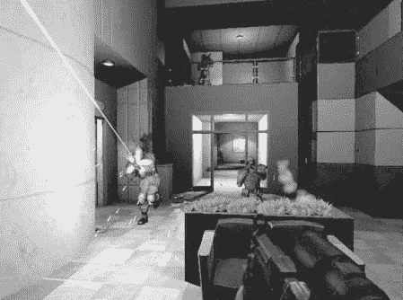

图6.1. F.E.A.R.中的AI敌人以小队协作，寻找掩体、进行压制射击、盲射、跳窗逃生、使用手榴弹将玩家逼出，并为玩家创造“过分”的体验。

5. 在基于博客的同行评审后发送的电子邮件中，Richard Evans指出：在讨论《模拟人生》和《无人生还》的局限性时……你指责各种故障（例如，把婴儿放下然后又抱起……注释见本章末尾。

由于可以选择不同的动作来满足目标——并且世界的状态（通过前置条件）可以影响动作的选择——一个在办公桌前的角色可以选择一个适合坐着的人的动作来满足死亡目标。同样，动作不被隔离的事实使得在动作上编写新的逻辑条件变得容易⁵ Orkin描述了一个这样的例子：

在NOLF2开发后期，我们增加了一个要求：AI在进入黑暗房间时会打开灯。在我们的旧系统中，这要求我们重新检查每个目标内部的状态机，并想出如何插入这种行为。这既是一个头疼的问题，又是在开发后期进行的一项冒险之举。使用F.E.A.R.规划系统，添加这种行为将容易得多，因为我们可以只需添加一个具有LightsOn效果的TurnOnLights动作，并向Goto动作添加一个LightsOn前置条件。这将影响每个使用Goto动作来满足的目标。（2006）

Orkin还对Strips模型做了一些更改。其中一项从上述描述中很明显：从生成相对长期的多步计划转向生成短期复合动作。另一个根本性的转变在于用于跟踪世界状态的操作逻辑。与Strips中发现的复杂的世界状态逻辑表示不同（系统会对此证明断言），F.E.A.R.使用一个简单的“黑板”和工作内存，不断用决策、当前动作和传感器收集的信息进行更新。

规划期间检查动作前置条件所需的所有事实都存储在一个固定大小的数组中（本质上，是一个被分成预定数量较小隔间的数据框，随时可访问）。这使得检查前置条件在计算上既廉价又快速——尽管建立相关事实可能并非如此。传感器的设计旨在弥补这一差距，在较长的时间段内执行光线相交测试（用于模拟视觉）、路径查找（用于潜在移动）和其他计算开销大的操作，然后报告其结果。

原始Strips与受其启发的F.E.A.R. AI之间的另一个区别涉及动作成本。F.E.A.R.不是简单地选择通往目标的最短动作链，而是选择成本最低的一个。使一个动作比GoToNode和AttackFromCover这两个动作更昂贵，会导致拥有可用掩体的AI敌人更倾向于选择更安全的选项（Orkin 2005）。

F.E.A.R.还与Strips在小队行为的存在方面有所不同，这些行为并未与规划过程集成，而是受到Richard Evans和Thomas Barnett Lamb关于“实施维特根斯坦”（2002）工作的启发。小队行为寻找AI角色来填充协调动作中的空位（图6.2）。如果满足前置条件，AI角色会被赋予目标，促使他们履行自己的角色（例如，一人提供掩护火力，而其他人前进到更靠近玩家的掩体），除非被该角色的另一个目标所取代（例如，一个注意到手榴弹的角色将停止提供掩护火力）。此外，这也是F.E.A.R.作为创作工作闪光之处，小队对话行为被用来解决Tale-Spin效应。

与仅通过动画向玩家传达信息的角色行为系统不同（留下


6. 我玩了Xbox 360版本（Hubbard et al. 2006）。

open the possibility that the player will assume the system is as simple as that employed in other games), F.E.A.R.的敌人小队之间会进行口头交流，以一种暴露系统某些内部状态和运作方式的方式进行。当我玩F.E.A.R.时，我知道AI角色已经失去了我的位置，当一个问：“你看到他了吗？”另一个回答：“安静点。”当我藏得特别好时，我能听到他们被命令先搜索该区域——最终返回他们的岗位。对话还揭示了关于寻找掩体、推进以及其他活动的计划制定决策。它甚至解释了非活动，正如Orkin所描述的：

If an A.I. taking fire fails to reposition, he appears less intelligent. We can use dialogue to explain that he knows he needs to reposition, but is unaware of a better tactical position. The A.I. says “I’ve got nowhere to go” (2006).

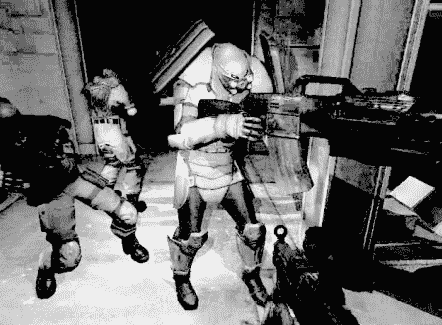

图 6.2. 一个由不同敌人类型组成的F.E.A.R.小队在联合行为中履行各自角色。F.E.A.R.中的小队行为受到Richard Evans和Thomas Bamel Lamb工作的启发。

根据我的经验，Orkin将三十五年的AI技术与更近期的游戏制作专长相结合，取得了巨大成功。相比之下，即使是同期发布的最佳游戏（例如2004年的《半条命2》）中的AI敌人，也感觉像是射击场的一部分——更像是景观的移动部件，而不是角色。在有限的开发资源下完成这一点，表明即使是对相当过时的AI方法进行深入思考也具有潜力。

这次经历似乎让Orkin渴望走得更远。在F.E.A.R.之后，他离开了行业，去MIT媒体实验室攻读研究生。我将在本章后面讨论他的下一个项目。

## 对Strips和F.E.A.R.的批评

在他的论文中讨论Tale-Spin时，Meehan将Strips视为AI领域重要的先前工作。但他也严厉批评了它，认为它不太可能是人类认知的模型。例如，Meehan指出Strips使用一阶谓词演算来存储关于世界的信息。这将世界上所有事实都表示为形式逻辑表达式，使用定理证明技术对这些事实进行“推理”。Meehan和其他“散漫派”研究者强烈主张——并有部分实验数据支持——人类并不以相同的方式记住世界上所有事实，也不使用相同的方法对它们进行推理。相反，散漫派研究者认为，人类智能在不同问题领域内以不同方式运作。

认知科学中关于人类规划的研究一直持续到今天，远在Meehan的论文之后，并且并不总是同意散漫派的观点（Hayes-Roth和Hayes-Roth 1979；Rattermann, Spector, Grafman, et al. 2001）。但是，即使有些人可能不同意Meehan对Strips的批评，也很少有人会认为F.E.A.R.的规划使用与人类记忆相匹配的模型。例如，F.E.A.R.用于检查前置条件的固定大小数组允许高效运行，但没有心理学可信度。

在Meehan的工作之后很久，1980年代和1990年代从新方向对Strips方法带来了根本性的批评。Phil Agre（1997）在《计算与人类体验》中，在深入讨论这类系统将面临的反复出现的技术困难模式之前，对Strips和Planex的功能（及其关系）进行了仔细概述。这些问题源于制定计划和执行计划之间的根本区别——这是对笛卡尔身心二分法的重演，也是另一种行动隔离——这种区别在Strips和Planex之间具体化，但在几乎所有规划工作的背景中都存在。

Agre指出David Chapman在1980年代的工作表明，“在简单的确定性世界中，计划构建在技术上是可行的，但世界中任何非平凡的复杂性或不确定性都将需要不切实际的搜索”（156）。换句话说，传统规划只能在微型世界中工作，例如Tale-Spin中的伊索寓言世界或Shakey的简单几何空间。Agre提出，与其基于计划，不如说“在现实复杂性的世界中，活动本质上是即兴发挥的问题”（156）。

Agre的下一章提出了一种截然不同的方法和架构。但不那么激进地说，一个类似Strips的系统如何能更具即兴性？似乎很明显，可以消除Strips和Planex之间的边界。Agre引用的Strips作者Fikes、Peter Hart和Nils Nilsson的一段话中也可能找到线索：

> 如果我们的系统在每次执行步骤后生成一个全新的计划，那么许多计划执行问题都会消失。显然，这种策略成本太高。（151）

然而，借助现代计算能力和简化的世界表示，这可能成本并不高。事实上，这种即兴发挥与F.E.A.R.中规划的运作方式很接近。计划是短期的——每个“目标”本质上是下一个复合动作（例如，到达掩体，并使用一项或多项动作的最低成本集合来完成）。如果在执行过程中计划被证明有缺陷（例如，玩家使掩体失效），F.E.A.R.不会尝试通过Planex风格的补偿来恢复计划。相反，基于可以包含先前失败原因的世界表示生成一个新计划。正如Orkin解释的：

想象一个场景，我们有一个巡逻的A.I.，他走过一扇门，看到玩家，开始开火。如果我们再次运行这个场景，但这次玩家用身体将门物理地挡住，我们会看到A.I.试图打开门并失败。然后他重新规划，决定踢门。当这也失败时，他再次重新规划，决定从窗户跳进去，最终足够近可以使用近战攻击！

7. 在Agre的下一章中，即兴发挥是不断重新考虑要做什么的问题，但它并非基于每次执行步骤后的重新规划。相反，他提出“将即兴发挥理解为一场持续的争论……

注释继续于本章末尾。

8. 这种策略还使F.E.A.R.能够避免一个自F.E.A.R.以来随着规划方法在游戏中越来越频繁地使用而变得明显的重新规划问题。正如Alex J. Champandard所解释的（2007），典型……

注释继续于本章末尾。

这种动态行为源于在考虑先前失败所获得的知识的同时进行重新规划。……当A.I.发现使其计划失效的障碍，例如被堵住的门时，他可以将这些知识记录在工作内存中，并在重新规划时加以考虑，以找到KillEnemy目标的替代方案。（2006）

F.E.A.R.所做的这种重新规划——当动作失败、当掩体失效等等——对于系统作为媒体的运作方式很重要。重新规划发生在观众可以感知的事件之后，这激励了角色行为的改变。计划执行可以访问计划制定用于检查前置条件的同一工作内存，因此如果计划失效，角色不会继续执行规划者会拒绝的复合动作的进一步阶段。记录计划失败的原因，而不仅仅是失败的事实，可以防止系统在应该是最佳（根据规划者所知）但执行时会失败的计划之间不断切换。F.E.A.R.能够做到这一点——并且可以实时做到，即使大部分可用计算能力都被游戏图形占用——正是因为其游戏世界是一个微型世界。这种方法在我们日常的复杂性和偶然性世界中不会奏效。但当然，所有游戏都是创作的微型世界。

鉴于此讨论，我们仍然可以批评F.E.A.R.。例如，其雄心——改进第一人称射击游戏中发现的以战斗为中心的行为——在广泛的数字媒体范围内相当有限。它依赖于寿命很短的角色：Orkin在他的2006年游戏开发者大会幻灯片中估计为12.23秒。Michael Mateas观察到，这些短寿命使得Orkin能够，本质上，以Strips为灵感


作为反应式规划系统的一部分。原始 *STRIPS* 的长期规划能力丧失了，但其规划与执行之间有问题的区分也大多丧失了。在这种情况下，反应式规划可以是一种强大的方法，但要让角色扮演超越战斗的虚构角色，则需要远超 *F.E.A.R.* 所具备的内容。具体来说，角色需要能够同时参与多种行为，并朝着长期和短期目标努力。我将在第 8 章中进一步讨论这一点，与 Oz 项目的角色相关。

事实仍然是，*F.E.A.R.* 为开发数字媒体创作工具的人们展示了思考传统 AI 方法的潜力。它还表明，当这些传统方法被改编用于现代计算硬件上的游戏，而不是被视为日常世界中智能行为系统的研究时，许多最尖锐的批评都可以不攻自破。唯一仍然成立的批评——事实上这反而更加站得住脚——是这些方法作为人类认知模型缺乏有效性。如第 4 章所讨论的，我认为这只有在我们希望从计算模型工作中获得对人类智能的洞察时才重要。而这正是紧随 *Tale-Spin* 之后的一个主要故事系统的目标。

## 模拟人类创造力

斯科特·特纳，和许多之前及之后的人一样，最初是在接触到弗拉基米尔·普罗普对俄罗斯民间故事的分析（1968年）后对故事生成产生兴趣的。普罗普提供了一种描述结构的语法

- 9. 我将在下一章中更详细地讨论故事语法，以布鲁图斯为背景。
- 10. 戴尔的论文后来成为《深度理解：叙事理解的综合处理计算机模型》一书。（MIT出版社，1983年）。
- 11. 主题抽象单元也被称为主题情感单元。

许多民间故事的结构。正如语言学家和计算机科学家所知，语法可以用于表示给定事物的结构——也可以用于生成新事物。但特纳很快发现，用普罗普的语法完成这项任务并不容易。其元素相当抽象，使其可用于分析但不足以用于生成。

当时，特纳是大学高年级学生。几年后，在加州大学洛杉矶分校计算机科学系进行研究生研究期间，他开始着手一个截然不同的故事生成愿景，体现在他的吟游诗人系统中。这最终形成了一篇超过八百页的论文（在他的系里创下新纪录），他将其浓缩为不到三百页的书籍《创造性过程：讲故事与创造力的计算机模型》（1994年）。

尽管特纳不在耶鲁，但他的工作仍在邋遢 AI 的背景下进行。他的 UCLA 导师是新来的迈克尔·戴尔，他最近在耶鲁完成了一篇受尚克和阿贝尔森思想影响的论文。在将近十年的工作中，吟游诗人系统的形态受到两个重要因素的影响：AI 邋遢方法的演变以及特纳目标的演变。

起初，主要目标是构建一个更好的故事生成系统，该系统会考虑模拟作者的目标——尤其是讲述一个带有主题的故事的目标，如戴尔的“主题抽象单元”概念所理解的（特纳和戴尔 1985，373）。最初的技术方法是创建一个改进的 Tale-Spin。特纳这样描述：

Tale-Spin 本质上是一个规划引擎，因此仅通过在 Tale-Spin 模型上增加一个代表作者试图通过讲故事实现的目标和计划的“元”层来构建一个更好的讲故事程序似乎是合理的。事实上，吟游诗人系统的最初版本就是这样运作的。

这种方法的一个问题立即变得显而易见：故事不具有原创性。（2007）

原创性和创造力的问题在特纳的研究中变得越来越核心。如他所说，“讲故事从一种自足的目的变成了吟游诗人系统展示创造力的领域”（同上）。同时，邋遢 AI 社区中对智能的解释正在发生转变。特别是，在尚克的实验室里，动态记忆模型及其改编被扩展为“基于案例的推理”（CBR）的概念。CBR 的基本思想在某些方面与脚本相当接近：总的来说，人们在每种情况下并不是通过从第一性原理推理来决定该做什么，而是借鉴先前的知识。然而，CBR 并不假设我们每个人都有一个“餐厅脚本”、“体育赛事脚本”等等，而是假设我们记得许多案例，并从中推理——这很大程度上类似于法律和商业教育中对先前案例学习的形式化。

根据 CBR 理论，人类有三种主要类型的案例供我们使用。有“僵化案例”，它们被抽象到本质上成为规则，例如谚语。有“范式案例”，每个案例都证明是我们与特定当前情况相关的唯一经验，我们会对其进行改编以理解新情况。

最后，最复杂的结构是“故事”，尚克和克里斯托弗·里斯贝克将其描述为“独特且细节丰富，如同范式案例，但带有要点，如同谚语”（1989，13）。对故事的持续重新解释被描述为“认知系统中创造力的基础”——但 CBR 中的大部分工作反而集中在“日常情境中的理解和问题解决”上（14）。

当米汉开始着手 Tale-Spin 时，他拒绝将脚本作为故事的基础。相反，他选择了邋遢 AI 当时认为在没有脚本可用时所采用的方法：规划。鑒于特纳对创造力的关注，他同样拒绝在故事中直接使用基于案例的知识。但这迫使他为 CBR 开发一个可实现的创造力模型，该模型可用于生成故事——这并非易事。

## 从故事中创造故事

吟游诗人系统开始讲故事的方式与某些人类作者类似：有一个要阐释的主题。观众可以请求特定的主题，或者吟游诗人系统会被“提醒”起一个具有相似主题的故事。吟游诗人系统通过获得一组片段来被提醒，这些片段按照其用于角色和场景的内部图式表示进行结构化。将片段与记忆中的故事进行匹配将导致选出一个故事，然后吟游诗人系统的目标就是讲述一个相同主题的故事。

吟游诗人系统使用 CBR 来实现其目标，包括这一目标。但目标也需要组织。与 Tale-Spin 通过时间运行角色行为模拟不同，吟游诗人系统的目标被组织为一个内部议程。规划以周期进行，每个周期尝试完成议程上当前优先级最高的目标。如果一个目标失败，它可以以较低的优先级放回议程，希望以后的情况会使其实现成为可能。初始目标是“讲述一个故事”——它“分解为包括选择主题、阐释主题、应用戏剧目标、检查故事的一致性以及向读者呈现故事等子目标”（特纳 1994，77）。

吟游诗人系统的主题也在其图式系统中表示。每个主题实际上是一条关于规划的建议，并代表了阐释主题所需的角色、计划和结果类型。尽管吟游诗人系统旨在讲述亚瑟王骑士领域的故事，但其“规划建议主题”（PATs）源自《罗密欧与朱丽叶》、《美好人生》和谚语。例如，源自《罗密欧与朱丽叶》的一个 PAT 是 PAT:Hasty-Inspire-Regret，基于罗密欧在发现他认为是朱丽叶无生命的尸体后自杀——尽管如果他再等一会儿，她就会从模拟死亡中醒来。特纳总结了他对此的图式表示如下：

- 决策：罗密欧相信某事（信念.1）
  这导致他目标失败（目标.1）。
  这一点及其急躁的性格促使他
  做一些不可逆转的事情（行动.1）。

- 连接：罗密欧学到了新东西
  (状态.4) 这取代了
  他早先信念的证据（信念.1）。

- 后果：罗密欧现在有了不同的
  信念，这促使他撤回早先的
  目标（目标.2），但他做不到，因为他
  早先的行动（行动.1）是不可逆转的。（104）


12. 在Minstrel中，角色层面的目标和计划在模式中表示，因此可以进行转换（如本章后文所述）。另一方面，作者层面的计划各自是结构化的、独立的……注释在本章末尾继续。

当然，正如Turner所指出的，这并非威廉·莎士比亚戏剧中实际发生的事情。罗密欧自杀了，从未知道朱丽叶并未真正死去——更不用说后悔自己的决定了。之所以这样表示，是更大系统设计的产物。只有角色计划，而非作者计划，以Minstrel能够转换的方式表示。12

无论如何，一旦选定主题，就会向议程添加一组目标：实例化PAT的决策、连接、后果和语境的示例。一旦转换计划成功创建出实现这些目标的故事事件序列，其他目标就可以发挥作用。例如，“戏剧目标”包括悬念、悲剧、伏笔和塑造人物。举例来说，塑造人物目标会在体现PAT的故事部分之前，添加一个展示角色具有重要人格元素（例如，草率决策）的故事场景。如前所述，另一组目标“一致性目标”会填充那些不是PAT精简体现的元素。例如，如果一名骑士杀死另一个人，一致性目标会确保他先靠近那个人，并且之后有情感反应。最后，展示目标会对将出现在故事中的场景、其顺序以及它们将如何用英语表达做出最终选择。但所有这些，尽管比Tale-Spin代表了更完整的故事生成方法，只是围绕Minstrel主要操作逻辑：TRAMs的支撑机制。

## Minstrel的TRAMs

Minstrel生成故事方法的核心是Turner创造力理论的实现：

“转换-回忆-适应方法”（TRAMs）。TRAMs是一种在系统内存中查找与当前情况相关的案例，并将这些先前案例的元素调整为新用途的方式。通过这种方式，可以生成说明特定主题的故事，而无需逐字重用先前的故事。该方法基于以精心设计的方式反复转换问题，而不是对所有可能的解决方案进行穷尽搜索。

Turner提供的一个TRAM示例显示，Minstrel正在尝试实例化一个骑士自杀的场景。Minstrel的第一个TRAM始终是TRAM:Standard-Problem-Solving，它试图使用内存中已存在的解决方案。这个TRAM可能以两种方式失败。首先，内存中可能没有匹配的案例。其次，内存中的匹配案例可能已经被使用了两次，因此被系统评估为“无聊”——因此必须找到一个新解决方案。对于这两种失败类型，下一步是转换问题并查找与转换后问题匹配的案例。

在Turner的示例中，Minstrel的内存中只包含两个情节的模式。在第一个情节中，一名骑士用剑与巨魔战斗，杀死了巨魔并在过程中受伤。在第二个情节中，一名公主喝下药水让自己生病。这两个情节都不是自杀的直接匹配，因此Minstrel必须转换问题。

一种可能的转换是TRAM:Generalize-Constraint。这可以用来放宽模式中的一个约束。在此示例中，它被用来放宽骑士自杀的要求。这是TRAM中的转换步骤，随后是回忆步骤。在这里，系统搜索骑士杀死任何东西（而不仅仅是他自己）的场景，并成功找到了骑士杀死巨魔的场景。由于这成功了，下一步是尝试通过重新施加被放宽的约束，将此解决方案调整到新情况。然后对结果进行评估并认为合适，因此Minstrel确定骑士可以用剑自杀。在这里，我们可以看到Minstrel——在某种程度上——生成了系统数据中不存在的东西。这是Minstrel的故事生成模型不仅超越预写元素的重新排列，而且超越通过先前编码动作进行模拟（如Tale-Spin和F.E.A.R.中所见）的关键。

此外，上述示例只是Minstrel TRAMs的最简单用法。系统通过更复杂的路径找到其他自杀方法。例如，还有TRAM:Similar-Outcomes-Partial-Change。这个TRAM“认识到被杀与受伤相似”（Turner 1994, 49），并将模式转换为骑士故意自残的模式。然而，这没有返回任何匹配案例。骑士与巨魔战斗未被检索，因为受伤是意外。公主喝药水未被检索，因为行动者不是骑士。但这并不会导致Minstrel简单地放弃TRAM:Similar-Outcomes-Partial-Change所提出的方向。相反，TRAM过程开始递归重复，使用已经转换的问题并应用不同的TRAM。在下一个阶段，通过将TRAM:Generalize-Constraint应用于行动者，它能够找到公主喝药水自残的情节。它通过重新应用泛化约束来调整，创建骑士喝药水自残的模式，然后返回到原始TRAM。这通过从受伤改为杀死来调整，结果是一个骑士喝药水自杀的事件。这被评估为成功，添加到故事中，并添加到内存中，以便它可以成为其他TRAM过程检索的案例。

不仅如此——当TRAM:Similar-Outcomes-Partial-Change作为二级TRAM使用时，它还有助于生成另一个自杀计划。在此情况下，一级转换是TRAM:Intention-Switch，它将模式从骑士故意自杀改为意外自杀。当这在下一级从死亡转换为受伤时，与巨魔的战斗在内存中被找到。Minstrel随后生成一个骑士为了死亡而进入战斗的故事。在为骑士找到三种不同的自杀方法后，Turner的示例也结束了。

## Minstrel的麻烦

通过上述概述的各种小型递归转换系列，Minstrel能够生成与其内存中任何事件都显著不同的故事事件。虽然它只能阐述与其硬编码PAT数量一样多的主题，但只要拥有足够大的模式库，它大概可以用各种各样的事件来填充这些主题的结构，创造许多不同的故事。但实现各种各样的叙事并非Turner的实际目标。他写道：“Minstrel开始时对亚瑟王领域只有少量了解，仿佛读过一两个关于亚瑟王的短篇故事。利用这些知识，Minstrel能够讲述十多个完整的故事，以及更多不完整的故事和故事片段”（1994, 8–9）。

初始数据稀少的一个原因很简单：将知识编码为Minstrel使用的模式非常耗时。Turner的主要任务是研究Minstrel的过程，而不是其数据集。另一个原因是，从少量案例开始能更好地展示Minstrel的创造力。它确保TRAM:Standard-Problem-Solving在程序开始时几乎无用，因此几乎立即需要递归构建的解决方案。但另一个原因是，由于其设计本身，Minstrel知道得越多，就越容易陷入麻烦。这种麻烦的模式指向了试图模拟部分人类智能的系统所面临的一个深层问题。

Turner提供了一个简单而有趣的麻烦示例：一名骑士杀死并吃掉一名公主，改编自龙的计划（278）。一个更复杂的案例源于Turner在系统相对完善后尝试添加新主题。不幸的是，P4:PRIDE产生的故事存在严重缺陷，正如Turner所解释的：

> 从前，一位名叫Bebe的隐士告诉一位名叫Grunfeld的骑士，如果Grunfeld与龙战斗，就会发生不好的事情。
>
> Grunfeld非常骄傲。因为他非常骄傲，他想给国王留下深刻印象。Grunfeld走向一条龙。Grunfeld与一条龙战斗。龙被摧毁了，但Grunfeld受伤了。Grunfeld受伤是因为他与一名骑士战斗。Grunfeld受伤给国王留下了深刻印象。（240，原文强调）

基本问题在于。Minstrel系统中的素材越多——其知识微型世界越大——其“创造性”转换过程就会


成功找到可适应新情况的情节。但这种适应的本质恰恰在于，它超出了关于微观世界已有知识的范围。（如果知识已经存在，本可通过 TRAM:Standard-Problem-Solving 访问，创造力也就不会发挥作用。）正因为如此，可用数据越多，明斯特尔生成不合适情节的可能性就越大——且没有原则性的方法来拒绝它们。除非对明斯特尔的 TRAM 进程加以限制，这将显著降低系统的趣味价值，否则解决问题的唯一方法是仔细限制和塑造系统数据。

换句话说，明斯特尔的问题在于试图模拟人类智能的一部分——一种特定的创造力——而非其余部分。这是围绕人类认知模型设计的人工智能系统中反复出现的问题。其最广泛讨论的表现是“常识推理问题”，默里·沙纳ahan将其称为“人工智能的天敌”（Mueller 2006, xvii）。这个问题涵盖了普通人类关于世界的所有知识和推断：水会使东西变湿；如果我拿起水杯离开房间，水杯也会随之离开；如果我重新装满水杯，我可能打算喝更多水，而且我的喉咙可能干渴。散乱人工智能的脚本和案例都可以被视为对常识知识进行编码的尝试——但问题艰巨至极，在数十年的努力中，无人成功开发出健壮的解决方案。13

2007 年，在他出版书籍十三年后，特纳这样说道：

> 明斯特尔是一个脆弱的程序。我的观点是，如果你给我一个健壮、非创造性的程序，它展示了平均 21 岁年轻人的所有世界知识、智能和解决问题的能力，我就能在此基础上实现一个健壮的创造性程序。但我没有那个条件。我不得不构建我为了证明论点所需的那部分健壮智能，恰好就是那些部分。当然，如果你稍微偏离这些界限，事情就会崩溃。（2007）

13. 在本书手稿的基于博客的评审期间，特纳表明，在此时评估明斯特尔时应考虑两个额外要点：你正确地指出了这个问题……注释继续见本章末尾。

## 统计人工智能

我们可以在 *明斯特尔* 中看到一个更大问题的症状——特纳本人对此也无能为力。到 20 世纪 80 年代末，很明显，人工智能系统总体上并未达到此前三十年所创造的期望。许多成功的系统已经构建——无论是由整洁派还是散乱派构建的——但所有这些系统都处理小数据集。基于这些成功，大量资金被用于尝试扩展到更大、更具现实世界意义的数据量。但这些尝试失败了，或许最为惊人的是在曾经风光一时的“专家系统”领域。人工智能方法产生的，并非智能的运行模拟，而是一系列研究人员关于人类智能部分信念的独特编码，没有任何手段来弥补对人类智能其余部分未进行模拟的问题。盖伊·斯蒂尔和理查德·加布里尔（1993, 30）在 Lisp 编程语言的历史中指出，到 1988 年，“人工智能寒冬”一词已被引入，用来描述许多 AI 项目日益增长的反弹及随之而来的资金损失。在此真空中，在处理能力稳步提升的辅助下，一种新形式的人工智能开始崭露头角。

正如本书的读者无疑记得的那样，在 20 世纪 90 年代初，万维网在很大程度上由人类组织。国家超级计算机应用中心的“What’s New”页面定期提供指向新 Web 资源的链接（很像今天的博客之一），而 Yahoo!——当时仍在斯坦福大学的服务器上——维护着一个不断增长的层级目录，页面是手动添加的。许多个人维护着热门列表（或链接页面），这些是寻找特定主题上 Web 最佳信息的权威来源。就像杜威分类法之前的图书管理员，以及更近期的人工智能研究人员所做的那样，这些 Web 资源编辑者根据他们自己的想法（往往不过是直觉）来组织知识，判断什么应与什么归类。网页“元标签”帮助作者表达他们认为与其贡献相关的关键词，页面标题也是决定搜索返回哪些结果的重要因素。通常，在 Yahoo! 目录中找到旁边带有“cool shades”的资源，比使用笨拙的搜索引擎更能找到信息。

但随着搜索引擎的改进，这种情况开始迅速改变。这种改进并非来自搜索引擎更好地“理解”它们索引的页面——换句话说，并非像传统人工智能研究人员所尝试的那样更好地解释文档内容——而是通过计数。例如，使 Google 一举成功的“PageRank”算法，通过计数互联网页面之间的链接来运作。正如 Google 网站所解释的：

> PageRank 依赖于网络独特的民主性质，利用其庞大的链接结构作为单个页面价值的指标。本质上，Google 将从页面 A 到页面 B 的链接解释为页面 A 对页面 B 的一票。但是，Google 考虑的不仅仅是页面接收到的票数或链接的数量；它还分析投出票数的页面。由本身“重要”的页面投出的票权重更重，并有助于使其他页面变得“重要。”（n.d.）

当然，将这一过程描述为“民主”是 Google 市场部的一种修辞选择。当网络上最“重要”的页面几乎全部由媒体和科技集团拥有时，通过 PageRank 为广泛讨论的话题（例如，国家政治）中的观点赋予关注的权力，掌握在与非网络媒体中授予关注的权力大致相同的手中。如果民主是目标，人们可以想象对 Google 的统计模型进行略有不同的加权。尽管如此，即使可以争论 PageRank 是否民主，也无法否认它是统计的。它基于对页面信息的计数（入站和出站链接）以及对结果数字的解释。我们现在理所当然地认为计算机程序能够找到我们感兴趣主题的有用文档——尽管在不太多年前，这似乎是一项惊人的人工智能壮举。

另一家高调 Web 企业的成功也部分归功于一种统计人工智能技术：在这里，指的是 Amazon 的推荐系统。Amazon 并非通过深入分析其销售的每件商品的内容并“注意”它们之间的相似性来决定向客户推荐哪些书籍和电影。它也不仅仅是遵循诸如“推荐同一作者的其他书籍”之类的规则。相反，它查看数字：购买某件商品并同时购买另一件商品的人数，或者查看某个产品页面并同时查看另一个产品页面的人数（Linden, Smith, and York 2003）。正是这种统计相关性，让 Amazon 知道（截至撰写本文时）应向访问电视节目 *维罗妮卡·马尔斯* 页面的人推荐电视节目 *旺德福尔斯* 的第一季——尽管这两部节目的创作者或明星没有重叠，一部设定在纽约州北部，另一部设定在南加州，其中一部的主角是一名在礼品店工作的受过大学教育的女性，而另一部则是一名解谜的高中生。像 Amazon 这样的公司构建此类统计模型，不仅是为了改善这些商品的销售，还因为关于产品及其购买者的这类信息本身就是一种可销售的商品。

超越 Amazon 等应用来看，统计人工智能技术还可以参与人类表达，而不仅仅是识别与之相关的事物。统计技术已将计算机语音识别提升到自动口述和自动电话系统（及其带来的沮丧）成为现实的程度。而且统计技术不仅帮助计算机识别人们说什么词，还可以分析词语模式。例如，最成功的电子邮件垃圾邮件过滤器就是使用统计人工智能技术构建的。

统计人工智能的兴起对那些认为人工智能系统应基于人类智能理论来构建的人提出了重大挑战。统计技术的成功与日俱增——然而，没有人相信我会使用 Amazon 所涉及的那种计数方式来选择向朋友推荐哪些媒体。


> 14. 由此我并非要论证统计 AI 在 AI 领域特别容易出错。事实上，统计 AI 的兴起恰恰源于其更大的成功。我在此要反驳的是这样的信念：AI...
> 
> 注释在本章末尾继续。

推荐系统。同时，统计技术存在严重局限，这些局限并不总是得到承认。

## 统计 AI 的局限

在美国，关于统计 AI 局限性的最重大公众讨论是作为对全民信息意识（TIA）计划的回应而产生的。尽管 TIA 常被讨论为对 2001 年 9 月 11 日恐怖袭击的回应，但该计划最早由国防高级研究计划署在两年前提出——它是一个历史更为悠久的愿景的延续。但直到 2001 年袭击事件发生后，TIA 在获得重大资金和一位高知名度的主管——约翰·波因德克斯特（John Poindexter，因在里根总统任期内困扰的伊朗-门事件中向国会作不实证词而最为人所知）之后，才真正获得自身的强劲势头。

TIA 的愿景是反乌托邦式魔法思维的一个例子。它之所以是反乌托邦的，在于它不是识别潜在罪犯并将其置于监视之下，而是设想让每个公民都处于监视之下。它之所以是魔法思维，在于它设想统计 AI 技术能够筛选由此产生的海量信息，以便为反恐调查人员识别出良好的线索。14 这表明对这些技术运作方式的根本误解。世界上最受尊敬的计算机组织之一——计算机协会（Association for Computing Machinery）——在给参议院武装部队委员会的一封信中是这样表述的：

任何类型的统计分析不可避免地会产生若干假阳性——在此情况下，即错误地将某人标记为潜在恐怖分子。由于整个人口都将接受 TIA 监视，即使是很小比例的假阳性，也会导致大量守法的美国人被错误地贴上标签。

例如，假设系统的准确率为 99.9%。我们认为，在实践中，只有 0.1% 的记录被错误分类为属于潜在恐怖分子，这将是一个无法实现的目标。然而，如果每月处理美国所有人的记录，即使是这种不太可能的低假阳性率，每年也可能导致多达 300 万公民被错误识别。关于假阳性百分比的更现实假设会使这一数字更高。（Simons and Spafford 2003）

假阳性在 Google 链接列表和 Amazon 购买推荐中是可以接受的，但在其他领域，其成本过高。在监视领域，它们不仅会不恰当地对许多人造成嫌疑；错误线索的数量也会高到足以压倒任何负责调查它们的团队。此外，假阳性问题只是统计技术的严重局限之一。另一个局限是，开发系统模型需要大量定义明确的数据。与用于构建有效统计系统（例如，Google 收集的包含链接的网页——而所寻求的模式（例如，确定一段对话是否在某种程度上“可疑”）与统计 AI 的成功案例（例如，确定一个网页链接到哪里）相比，定义极为模糊）的信息量相比，可用于恐怖活动的信息量很小。正如安全专家布鲁斯·施奈尔（Bruce Schneier）

（2006 年）估计，一个“不切实际地准确”的 TIA 系统，每识别出一个真实阴谋就会产生十亿次误报。此外，还有假阴性问题。即使有所有这些数十亿次警报，系统在应该触发时也会失败。

2003 年，在公众强烈反对之后，波因德克斯特辞职，TIA 的资金被取消，似乎遭受了致命打击。随后，2005 年，《纽约时报》报道，布什政府授权了一个广泛的国家安全局监控计划，包括无令状地对美国公民的电话和电子邮件进行电子窃听，随后又有一系列进一步的披露（Williams 2006）。即使不以 TIA 之名，这显然也是同一反乌托邦愿景在起作用。魔法思维的其他表现形式也继续产生大量完全不恰当的尝试，试图采用统计技术。在监控方面，即使这些努力对其既定目的无效，它们仍然会产生数据库和监控系统，每个系统都易受攻击和滥用。

更广泛地说，要了解统计技术能够完成什么，我们需要超越一般原则。尽管了解假阳性的基本事实为评估统计技术提案提供了一些基础（假阳性的成本必须较低），但培养对统计模型如何开发及其所代表内容的理解也很重要。正如我在引言中所论证的——并将在本章结论中展开的那样——我认为呈现易读的示例，尤其是来自媒体创作领域的示例，可以在这方面提供帮助。当然，

此类示例还可以帮助人们考虑统计技术在何时可能对媒体作者有用。

## N-grams

用于理解或生成人类语言的系统中使用的统计模型通常被称为“语言模型”。与大多数统计模型一样，语言模型的主要用途是根据系统过去（语言）行为的样本，预测其未来（语言）行为。构建此类模型需要两方面的工作。第一是决定关注什么：过去行为的哪些“特征”将被统计处理。第二是决定如何将这些特征纳入运行中的统计模型。

构建语言模型最流行的方法之一是 n-grams（也称为马尔可夫链）的概念。n-gram 语言模型是通过查看一组语言数据并观察哪些元素跟随其他元素来构建的。如果查看一组英文中的字母，q 后面经常跟着 u。在词级，"you" 后面更经常跟着 "are" 而不是 "banana"。查看两个元素的集合是在研究双字母组合（bigrams），三个元素的集合是三字母组合（trigrams）。

这可能已经很明显，在 n-gram 模型中，特征通常是出现在当前词之前的一个或两个词。使用这些特征的简单模型是：不同的后续词根据它们在样本数据中出现在前面词之后的频率被分配可能性。实际上，这些模型往往更复杂一些。这部分是因为即使在数百万词的训练之后，来自同一来源（例如，开发模型所用的同一家报纸）的数据中，新的词对和词组也会经常出现。这要求模型进行“平滑”，以便新出现的双字母组合和三字母组合不会被分配零概率。

此类模型有许多潜在用途。例如，听写软件可能会发现句子中的某些词存在歧义。但 n-gram 模型可以使用歧义词前后的词来提高正确识别的机会。当然，“ate the banana”比“ate the bandana”作为三字母组合的可能性大得多。

另一方面，n-gram 集合并不“理解”其所建模语言的任何内容。它对一组音乐音符或任何其他串行排序的数据也会以完全相同的方式工作。而且，尽管作为模型，它在捕捉词与词之间的连贯性方面表现良好，但在捕捉任何更高级别的结构方面表现不佳。这在各种尝试使用 n-gram 生成语言（而不仅仅是理解语言）的过程中变得非常明显。这里的基础示例是克劳德·香农（Claude Shannon）在其奠定领域的论文《通信的数学理论》（“A Mathematical Theory of Communication”）中生成的 n-gram 句子：

> THE HEAD AND IN FRONTAL ATTACK ON AN ENGLISH WRITER THAT THE CHARACTER OF THIS POINT IS THEREFORE ANOTHER METHOD FOR THE LETTERS THAT THE TIME OF WHO EVER TOLD THE PROBLEM FOR AN UNEXPECTED. (1948, 388)

这段文字比一系列随机单词更连贯，因为每个单词都相当自然地紧随其前一个单词。这并不奇怪，因为它是通过翻阅一本书、写下一个单词、继续翻阅直到再次找到该单词而产生的，


紧跟其后的单词写下来，然后翻找直到找到刚写下的那个单词，如此反复——这是一个词级双语法模型。当然，更长的链长度会创造更长的局部连贯段落。但是，句子、段落和观点的结构在n-gram模型中完全缺失。

换句话说，尽管许多统计AI系统取得了令人印象深刻的结果，但统计模型并非什么神奇的东西。就像Google从网页中捕获链接一样，n-gram等统计模型必须关注一致数据池中明确定义的特征。然后，即使捕获了数百万种模式，在任何具有显著多样性的活动中（比如人类语言），模型都必须进行平滑处理，以考虑以前未见过的模式将不断出现这一事实。即使完成了这一点，该模型也只适用于有限的任务。鉴于此，我们必须牢记统计方法的优点和局限性。无论我们是在听取情报机构官员还是追求技术奇点的科幻作家的发言，都不应被某些领域的令人印象深刻的结果所迷惑，认为任何人已经开发（或知道如何开发）能够预测、识别、生成并以其他方式替代人类对复杂领域知识的强大AI。

## 餐厅游戏

搬到MIT后，Orkin（曾负责F.E.A.R.的AI开发）启动了一个目标颇具趣味的项目：利用统计AI的工具来追求一种来自邋遢符号AI的想法。具体来说，他的餐厅游戏旨在开发他所描述的“餐厅脚本”邋遢理念的现代版本（Orkin 2007, 22）。他的方法是在自由形式的餐厅环境中统计分析数千名玩家的行为，从而学习出比手工编写可能实现的更灵活、更详细的餐厅行为脚本。

Orkin称他的努力为一款游戏——这个术语在两个方面产生共鸣。首先，他计划利用工作成果开发一款游戏，所有与自由形式环境交互的人都将被列为最终游戏的设计者。其次，通过将体验呈现为一款游戏，他将餐厅游戏归类为许多成功尝试中的一类，这些尝试利用简单的游戏结构鼓励大量在线人员协作开发对机器而言难以处理、对个人人类而言过于繁琐的数据。

这些数据收集游戏中最著名的是由卡内基梅隆大学的Luis von Ahn及其合作者（2005）开发的ESP游戏。该游戏同时向两位互不认识且无法直接交流的观众展示同一张图片。这两个人各自尽可能快地输入可能描述图片内容的单词，避免任何列出的禁用词。一旦一名玩家输入了另一名玩家已经输入过的单词——在他们的描述中形成匹配——他们就得分，下一张图片出现，直到游戏时间结束。

人们发现ESP游戏出人意料地有趣，有些人在与伙伴选择同一个单词的瞬间体验到一种令人兴奋的连接感。这为人们通过此类游戏生成大量数据提供了动力——仅ESP游戏就产生了一亿多个图像标签（Saini 2008）——并促使Google为其图像标注器授权了该方法。此类数据可用于为在线图像打标签（以提高视障人士的可访问性），或用于更具计算挑战性的目的（例如，作为计算机视觉统计方法的良好训练数据）。沿着这条思路存在许多其他游戏，它们在具体细节上有所不同，但都使用简单场景来生成特定数据点。

相比之下，餐厅游戏极其自由形式且雄心勃勃。每个登录的人都扮演男顾客或女服务员。玩家可以自由地相互聊天——不是试图猜出同一个单词或参与任何其他类似游戏的活动，而只是扮演他们的角色（图6.3）。15 环境中有许多玩家可以交互的对象，包括可食用的食物和饮料、可用于付账的收银机（但也可以被拿起并可能被偷走）、菜单、家具、桌上的鲜花、各种厨房用具等等（图6.4）。还有两个NPC：一名提供饮料的调酒师和一名供应食物的厨师。

与现实世界相比，餐厅游戏当然是一个微观世界——但它也是比之前数据收集游戏甚至大多数商业游戏提供的环境要丰富得多的环境。16 因为它是微观世界，所以可能的动作较少，且这些动作是明确的。系统确切地知道一名玩家何时将菜单递给另一名玩家，能准确判断一名玩家对另一名玩家说了什么，并且总能判断在服务员拿起盘子之前所有食物是否已被吃完。另一方面，可能动作及动作序列的多样性使得餐厅游戏收集的数据在统计解释上具有挑战性。

Orkin的方法是关注发生的物理动作，查看动作的顺序和关系。动作根据其支持进行聚类——这种方法既发现某些相似性（所有食物的吃法都相同），也发现微观世界中内置的先决条件（吃饭需要食物存在），以及社会期望（几乎所有玩家都在就座时进食）。Orkin的分析剔除了最不频繁的动作和序列，构建了他所谓的“计划网络”：一个表示餐厅游戏微观世界中正常动作路径的结构。玩家互动中的语言在模型中按其发生的物理动作之间进行排列。

由此产生的计划网络具有人们所期望的优点和缺点。其中一些特定于微观世界。Orkin通过可视化服务员玩家网络来证明这一点，该可视化捕获了使用收银机付账所需的界面步骤集——同时也捕获了玩家对收银机操作常见困惑所产生的路径。

> 这块牛排是七分熟的。我要的是全熟。

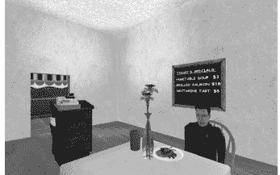

哦，非常抱歉。让我请您吃甜点。

图6.3 餐厅游戏中一位就座的顾客对场外服务员抱怨。

其他成功和失败是统计模型常见的。这些在Orkin对系统的评估中得以揭示，该评估使用n-gram建模作为“估计新游戏会话可能性的一种手段，并定量评估学习到的餐厅行为和语言模型与人类的相关程度”（2007, 69）。在这里，我们实际上看到了TIA背后理念的一个微观世界版本：Orkin检查了数千场游戏的数据，努力构建行为统计画像，然后试图构建一个能够自动检测异常行为的系统。

这种基本方法建立在统计AI中已被证明强大的一些技术之上，Orkin报告称使用该方法取得了一些成功。例如，Orkin提到一次游戏会话，其中发生了一组典型的动作。然而，系统根据语言正确地将该会话评为可能性极低——顾客试图离开

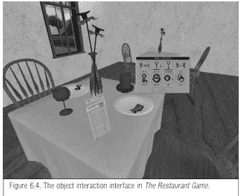

15. Orkin和Deb Roy（2007），即指导Orkin在MIT小组的教授，将餐厅游戏视为最小投资多人在线游戏的一个初步示例。与标准的大型多人在线游戏不同，后者...

16. 在本书手稿的基于博客的评审期间，Orkin对标准商业游戏和餐厅游戏中“可能交互的范围和交互对象的多样性”发表了评论：当今大多数游戏都限制交互...

注释继续于本章末尾。


不付钱并说服女服务员和他回家。另一方面，系统对包含不寻常词汇的任何对话也做出了同样的反应，即使是在人类评为典型的游戏中也是如此。如前所述，这是典型的误报问题。Orkin还提供了一系列物理动作的示例——例如，点啤酒和派直到把餐厅填满，或者坐下、戏弄性地拒绝点餐，然后离开——当前版本的计划网络无法将其检测为异常，但对任何人类评估者来说都立即显得奇怪。这是典型的漏报问题。

Orkin最初曾宣布，使用The Restaurant Game成果制作的一款游戏将参加2008年独立游戏节。但他不得不错过了截止日期。在他的论文中，他写道，这带来了一个关于“在特定日期前承诺公众基于新颖研究的交付成果的危险”的教训（42）。更广泛地说，它为统计AI提供了一个教训。作为创作工具，它需要大量可能无法获得的数据。如果为变化幅度大的现象投入大量精力收集这些数据——正如Orkin在The Restaurant Game中所做的那样——结果将是不可预测且不完整的。尽管如此，也许Orkin的下一步将找到一种方法，使与该模型的交互成为一种有趣、富有游戏性的体验（参见侧边栏：Digital Media Research and The Restaurant Game）。与此同时，The Restaurant Game最重要的贡献在于，它展示了即使在一个剥离了我们现实世界中大部分复杂性的微观世界中，统计模型产生的误报和漏报也远多于TIA风格系统所能容忍的数量。

## 数字媒体研究与 The Restaurant Game

虽然本章对The Restaurant Game提出了批评，但Orkin的项目是一项在可能富有成果的方向上进行的雄心勃勃的研究。在这份手稿的基于博客的评论中，Richard Evans观察到：

> 我认为The Restaurant Game很迷人，因为它与其他游戏AI工作相比，雄心处于不同的水平。

在模拟使日常故事变得可理解的背景社会惯例（例如Schank's restaurant）方面，存在各种仿真级别：
- 手动编码少数社会惯例；系统作弊并告诉代理人惯例是什么，因此不同代理人对惯例状态的概念之间没有分歧的空间。
- 数据驱动多种社会惯例，并让代理人自己弄清楚社会惯例处于什么状态（这就是Rob Zubek在他的论文中所做的，使用马尔可夫模型对惯例的当前状态做出最佳猜测）。
- 让系统通过对大量玩家数据的统计分析自动生成惯例。The Restaurant Game是我所知道的唯一允许新惯例出现的项目，这些惯例在设计时未由作者定义。

当然，这是一个崇高的目标，在本章中，我推测通过The Restaurant Game开发的模型未来很可能成为引人入胜的可玩体验的核心。在这本书手稿的基于博客的评论中，Orkin指出，另一个未来方向可能是“结合统计方法和人工编写方法，以兼得两者之长。”他继续说道：

> 根据我们迄今发表的内容，我同意你写的一切，但我们的长期目标是一个半自动化系统，其中统计模型构成脚手架，促进对不太典型行为的人工编写。The Restaurant Game是一个正在进行的项目，在可预见的未来将继续让我忙碌。

游戏和数字媒体普遍要朝着某些最有趣的潜在方向发展，唯一的途径是通过长期研究。Orkin的项目目前可能最引人注目的是它向我们传授的关于他所采用的软件方法的教训。但忽视The Restaurant Game及其可能使用其数据或受其方法启发的后继系统的未来可能性将是愚蠢的。更广泛地说，重要的是我们要鼓励以数字媒体提出的问题为重点的探索性、跨学科研究，而不仅仅是将媒体视为其他研究成果的应用领域。

## 政治与流程

1974年，Ted Nelson的*计算机自由/梦想机器*封面宣称，“你现在可以而且必须理解计算机！”

Nelson的书（在这本书关于表达式AI的讨论中曾提到过）并非对TIA风格提案，甚至计算机普及的回应。事实上，Nelson的书出版于第一台个人电脑套件——Altair——问世的前一年，也远在政府开始考虑大规模数据挖掘之前。那时，计算机的数量与现在相比微乎其微。现存的计算机由专业团队精心维护（Nelson称之为计算机“祭司阶层”），确定其用途被认为是专家的领域。这似乎与日常生活相去甚远。

但正如Nelson的书所揭示的，计算已经融入社会的方方面面。他指出了日常生活中的迹象（从计算机生成的垃圾邮件到即将到来的消费品条形码现象），以及不太明显的变化：每个大型组织都转向计算机记录保存（通常根据计算机祭司阶层的想法重新构建，并且只对其开放访问），计算机模拟开始作为决策辅助工具出现，等等。此外，Nelson在计算机图形学领域就已经看到，计算机将彻底改变我们的媒体——并理解这也有政治利害关系。他写道：“这很重要，因为我们生活在媒体中，如同鱼生活在水中……但是今天，就在此刻，我们可以而且必须设计媒体，设计我们新水的分子，我相信这种设计的细节非常重要”（DM 2）。

他的回应是一项通过他的书实施的教育计划，在今天我们或许可以称之为“程序素养”。他试图教导人们理解计算是如何工作的以及其过程使什么成为可能。Alan Kay和Seymour Papert等计算机科学家通过开发新的编程语言追求类似目标，这些语言旨在使计算机过程的创作更加易于访问（尤其是对儿童）。面向成年人的Nelson的书，则试图对当时的编程语言、计算机硬件、数据结构、输入设备等进行一次雄心勃勃的综述。所有这些都包含在一个论点中：现代计算机不应被视为数学设备，而应像数学家和计算机先驱Alan Turing所说的那样，是“一台特殊的机器”，它“可以被制造来完成所有工作”（2004, 383）。

Nelson的目标部分是鼓励读者掌握计算的创造潜力，以实现自己的目的。但同样重要的是，目标是敦促读者反抗计算机祭司阶层，不再接受“计算机现在使之必要的做事方式”（1974, 8）。在_计算机自由/梦想机器_第二版的序言中，Stuart Brand称Nelson为“个人电脑革命的托马斯·潘恩”（Nelson 1987）。一个区别是，Nelson鼓吹的革命纲领——“计算机权力归人民！打倒网络垃圾！”（1974, 3）——在很大程度上尚未实现，尽管鼓吹者团体至今仍在为此推动。

这种鼓吹的一种形式实际上也是本书计划的一部分。我们生活在一个政治的

17. 当然，Turing和Nelson谈论的都不是诸如洗衣机之类的机器（尽管这些机器现在通常包含计算机）。相反，Turing谈论的是通用计算机器的能力，例如今天的……

本章注释继续。


计算比以往任何时候都更加重要，而一些风险最高的进程——从生成恐怖分子监控名单到操作黑箱投票机器——都掌握在更加神秘的祭司阶层手中。在这种情况下，我们该怎么办？

一种答案是继续沿着程序化素养的道路前进。我完全支持这样的努力。但本书遵循一条不同的道路，本章力求阐明这一点。

## 可读示例

该领域的一大困难在于，计算机进程常被呈现为本质上具有魔力。这种欺骗性做法从政府机构（如TIA）延伸到流行电视节目（例如许多将面部识别软件描绘为可靠工具而非未解决研究问题的犯罪和恐怖主义剧集）。我们需要一种方法，摒弃计算机进程如同魔法的观念，转而建立对这些问题进行批判性思考的基础。程序化素养只能让我们走一部分路。它可能帮助更多人理解计算机进程是如何编写的，但很少有人会亲自编写一个采用类似于恐怖分子监控名单生成器技术的系统。

然而，根据我的经验，人们能够通过类比来推理计算机进程。例如，一旦一个人理解了一组计算技术的优势和局限性——无论这种理解是在什么情境下获得的——就有可能利用这些知识来理解这些技术在其他情境下的潜力。这对大多数技术都适用。小时候我了解到，轮子技术当用于我的小马车时，在坚硬平坦的表面上比在泥泞不平的表面上效果更好。很容易将这些知识推广到汽车上。

我们现在的问题部分在于，诸如生成恐怖分子监控名单之类的进程被保密，使得它们难以进行批判性评估。但更深层的问题是，我们社会中的许多人不仅不理解任何类似于所涉及进程的单一示例，而且完全没有解释和评估计算机进程的经验。我希望数字媒体领域，通过提供一组引人入胜且可读的计算机进程实例，能够成为改变这一状况的起点。

考虑监控名单生成的示例。具体进程可能是保密的，但这些系统依赖AI技术这一点绝非秘密。我们还知道，AI领域的实用工具包一方面包括手工编写的规则和知识结构，另一方面包括大规模统计运算。

这为我们提供了一些知识，但另一种认知途径被切断了。除了具体进程被保密之外，这些系统的输出高度不可读。大部分情况下（出于显而易见的原因）名单内容不向公众公开。对于少数被公开的嫌疑人（除了少数明显荒谬的错误之外）很难说哪些被正确识别，哪些没有。如果嫌疑人幸运地获得审判（而不是被关押在无法进入的拘留设施中或被秘密转移到另一个国家接受酷刑），甚至这也可能无法澄清该人被列为涉恐分子的分类是否恰当。

但许多采用AI技术的进程要可读得多，例如用于媒体和通信的进程。此类系统的开发者通常在会议论文、期刊文章、专利申请、博士论文、技术书籍等中发布其运作方式的描述。此外，这些系统的输出通常更容易评估。例如，自然语言处理（NLP）领域使用许多相同的AI技术——通常很容易判断计算机系统何时产生无意义的语言或完全误解了我们话语的含义。

此外，随着我们对NLP系统理解的加深，我们发现它们只能在有限的情况下工作。无论是创建计算机游戏还是电话菜单，NLP系统的设计者都努力限制话语语境，以提高系统正常工作的可能性。正如本章前面所述，所有这些都是为了提高完成一项比生成恐怖分子监控名单容易得多的任务的可能性。从一组定义明确的文本中提取预期含义（利用分析大量正确样本数据的知识）要比试图从关于人类行为的结构不一的数据大海中提取犯下恐怖主义的意图（在分析了关于已知恐怖分子行为的少量可用信息之后）要容易得多，容易得多。

经过这么多思考，我们可以知道自动恐怖分子监控名单生成很可能会失败。但这并不意味着不会有人尝试。18 因此，能够思考它可能失败的方式在政治上很重要。我希望，通过了解具有可读意图和输出的类比示例进程，我们能够摒弃计算机系统如同魔法的观念，而是有意义地思考此类系统的潜力和局限性。¹⁹

18. 截至撰写本文时，美国公民自由联盟（2008）估计，当前美国政府恐怖分子监控名单上有超过一百万个名字。已知的监控名单条目包括诺贝尔和平奖获得者……注释继续于本章末尾。

这是我希望通过本书为之做出贡献的一个项目。其章节探讨了各种可读的、以媒体为中心的进程示例。我在这里考虑*餐厅游戏*时，最清晰地阐明了与更广泛问题的联系，但我希望读者也会发现，早期关于*精灵任务*如何产生其幻觉以及*故事旋转机*当时“科学”模拟的严重局限性等话题的讨论，也能为他们的政治推理提供参考。更广泛地说，我希望数字媒体领域越来越多的工作能够转向对进程及其解释潜力的调查——并且这将与日益增长的程序化素养一起，帮助我们在进程与政治的交汇点上做出更明智的决策。

19. 这种关于保密计算机进程的类比推理能力，或许正是计算机科学家在这些问题上成为最重要的批判性思考者的部分原因。例如，其中两位……注释继续于本章末尾。

## 程序化修辞

我的工作反过来是对另一个政治与进程交汇点的探索的补充：将计算机进程用作说服性言论。虽然谢里·特克尔（Sherry Turkle, 1995）和纳尔逊（Nelson）等人物已讨论此问题数十年，常在环境和城市规划模拟的背景下，但第一部详细的全篇研究是伊恩·博戈斯特（Ian Bogost, 2007）的*说服性游戏：电子游戏的表达力*。正如标题所示，博戈斯特的书是关于计算机游戏的——尤其是那些为政治、教育和广告设计的游戏。但本书的含义更为广泛。博戈斯特将游戏作为一组特定示例，以发展一个更大的论点，关于他所谓的“程序化修辞”，即通过基于规则的表征和互动而非口头语言、文字、图像或动态图像进行说服的艺术（x）。

特别是，博戈斯特指出数字媒体可以就事物运作方式提出有力的断言。游戏和其他程序化系统可以使用进程来创建我们世界中发生的事物的表征——从城市的增长，到谷物的营销，再到长期债务的机制。玩游戏涉及与这个表征进行交互，它利用其内部进程展示不同的行为，从而使探索事物运作方式的特定模型成为可能。

正如包括詹姆斯·保罗·吉（James Paul Gee, 2004）在内的教育者所观察到的，成功玩游戏涉及学习。著名游戏设计师拉夫·科斯特（Raph Koster, 2004）一直认为，这种学习是我们在游戏中体验乐趣的核心。博戈斯特引起我们注意，这种学习会发展对正在运作的程序化表征结构的某种理解——但不一定对模型或其呈现方式持有批判性方法。解决这一问题是程序化修辞的主要目标之一。正如口头修辞旨在帮助人们通过言语进行说服，并帮助听众理解和批判性地思考口头论证一样，程序化修辞致力于帮助基于进程的论证的作者和受众。到这一点，毫无疑问已经清楚，我认为这对于计算模型来说，比试图再现人类思维过程要恰当得多的目标。


## 超越拟人化智能

考虑到 AI 的历史，构建 Tale-Spin 和 Minstrel 等系统来体现人类认知模型并不令人惊讶。人类与机器过程应该——或者必须——相互类似的假设在 AI 中根深蒂固。尽管统计 AI 是一个反例，但这一假设延续至今。

由于 Tale-Spin 和 Minstrel 都源于符号 AI 的“散乱派”领域，我们可能会认为 AI 的这一领域尤其倾向于在人类模型基础上构建其系统。也许事实是，一个天真的研究者不会根据 Turner 对 Minstrel 的描述做出他开篇的假设：“要构建一个讲故事的计算机程序，我们必须理解并建模作者为实现其目标所使用的过程”（1994, 3）。如前所述，在与 Strips 的讨论中，散乱派研究者试图为其方法主张与人类处理问题方式更大的忠实度，认为人们在不同问题领域的思维方式不同。Riesbeck 和 Schank 是这样表述的：

> 通用问题求解程序的问题是，呈现给它们的每一个问题都必须以相同的方式处理。每个问题都必须归结为第一性原理，并从这些原理中进行逻辑推演。即使是数学家也并非真正这样行事。（1989, 9）

但以这种方式看待问题只是考虑了一个层面。在另一个层面上，散乱派 AI 和整洁派 AI 都基于认知科学的假设——尤其是，机器的有效问题求解应基于与人类中被认为在起作用的相同的“符号处理”模型。正如 Paul N. Edwards 在 *《封闭的世界》* 中解释的：“认知科学将思考、推理和感知的问题视为符号处理的一般性问题，超越了人类与计算机、人类与动物、以及生物系统与非生物系统之间的区别”（1997, 19）。换句话说，无论其差异如何，散乱派和整洁派研究者仍然使用源自人类的符号化表述（如信念、目标、计划、规则等）来谈论他们的计算机系统。

正是基于这些表述，散乱派和整洁派 AI 研究者都受到了近期思想家的广泛批评——导致他们的工作被归类为“经典 AI”或“老派传统 AI”（GOFAI）等术语。然而，许多自认处于 AI 领域内的批评者认为，符号技术的问题在于对人类运作方式缺乏准确性。例如，此前讨论过其对 *Strips* 批评的 Agre 这样描述符号 AI 的问题：“关于人性的错误观念会导致反复出现的技术困难模式”（1997, xii）。他对 AI 的替代方法建立在对人类活动的不同看法之上（7），而不是放弃 AI 过程中的拟人化模型。

一种更激进的批评似乎来自 MIT 著名 AI 实验室现任主任 Rodney Brooks。在他广为引用的《大象不下棋》（“Elephants Don’t Play Chess”）中，Brooks 写道：“在本文中，我们认为 *经典 AI* 所基于的 *符号系统假说* 存在根本性缺陷，因此对其后代的适应性施加了严重限制”（1990, 3）。Brooks 倡导的替代方案侧重于一种 AI，它通过简单机制的组合在现实世界环境中运行的具身机器人（并专注于这些环境内的交互）。尽管如此，在基于这一研究议程构建了若干拟昆虫机器人之后，Brooks 转向——不可避免地？——创造旨在最终展现类人智能的类人机器人。这些项目中最著名的一个 Cog 的网页横幅标题写道：“创建 Cog 的动机基于这样一个假设：人类智能需要与世界进行类人交互”（MIT Humanoid Robotics Group 2003）。AI 的拟人化观点再次彰显。

## 模型与创作

从创作的角度来看，这一切相当令人困惑。对作家来说，显而易见的是：故事中的人说话方式与日常生活中人们的说话方式不同；故事中报道的人们生活只包含如果他们拥有真实生活时所发生事情的一个微小子集，等等。一个在很大程度上像真人一样思考的系统，在讲故事方面可能帮助不大，因为大多数真人并不擅长讲故事（因此模拟作者行不通），而且角色不应该像真人一样行事（真人不会采取戏剧性角色所执行的那种风格化、协调的行动）。

准确的建模根本不是作者所追求的。即使在计算机游戏物理等领域也是如此。虽然第一人称 3D 游戏（如 Half-Life 2）可能包含看起来自然的空间、运动、重力、摩擦力等模型，但这些元素（以及它们所作用的每个环境）都已为游戏体验经过精心塑造。Half-Life 2 可能比 Super Mario Brothers 等游戏更接近现实世界，但一个像现实世界一样运行的深度世界模型，（除了无法实现之外）也并非通向任一目标的重要步骤。事实上，像 Portal（使用为 Half-Life 2 开发的引擎构建）这样的游戏，如果采用现实世界物理的精确模型，可能会少很多乐趣。

问题是，哪些模型对创作有用。答案并不总是显而易见。例如，虽然从统计模型进行简单生成——如 Shannon 的双字模型生成的句子——是语言行为的一种有限方法，但也不是使用此类模型进行创作的唯一可能方法。例如，Nitrogen 是一个雄心勃勃的研究项目（由南加州大学 Eduard Hovy 团队开发），旨在将 n-gram 模型与逻辑和句法模型相结合来生成语言（Langkilde and Knight 1998）。给定一个要翻译成文本的逻辑消息，它会不加选择地生成一个语法结构格网。然后使用 n-gram 模型来对格网中的路径进行评分。这一结合传统 AI 和统计 AI 的实验产生了相当有希望的早期结果。

同样，游戏 Black & White（Molyneux, Webley, Barnes, 等人，2001）采用混合架构，创造了现代游戏中最成功的角色体验之一。每个 Black & White 玩家都是一位神祇，因人类追随者的效忠而变得更加强大——但与一个非人类的“生物”有着更紧密的关系，这个生物可以成为强大的盟友和共情焦点，但必须得到适当的训练。在设计驱动这些生物的 AI 时，Richard Evans 希望同时包含世界模型和玩家对世界的看法模型（通过赋予玩家能够解释其行为的目标来推断）。如果以传统的符号（GOFAI）形式表示，此类模型更易于理解和使用。同时，Evans 希望生物的学习（通过观察玩家和 NPC、动作后的玩家反馈以及玩家指令）能够具有较新的、侧重数值的 AI 所实现的“模糊”感觉和海量的可能状态。因此，他采用了一种他称之为“表象放纵”的方法，其中“关于单个对象的信念以符号形式表示，作为属性-值对列表；关于对象类型的意见表示为决策树；欲望表示为感知器；意图表示为计划”（2002, 567, 570）。其结果不仅是一个令人印象深刻的角色，也是一个重新定位数值驱动 AI 训练数据提供方式的系统。这不再是系统开发期间发生的事情，而是在观众互动期间发生的事情，成为玩家与 Black & White 中主要屏幕角色之间关系发展的方法本身。

更进一步地推测，一类相关的混合系统可能解决本章中识别的另一个难题。尽管 Minstrel 的 TRAMs 在旨在自主生成故事的系统中被证明是有问题的——鉴于常识推理的问题——但我们可以想象 TRAMs 在不同的语境中被使用。例如，考虑 Rafael Pérez y Pérez 和 Mike Sharples 在对 Minstrel 的评估中写道：

> 读者可以想象一位正在缝制他的


不小心给自己袜子扎了个孔；在这种情况下，因为缝纫动作给骑士造成了伤害，Minstrel会将缝纫视为一种杀人方法。（2004，21）

我在博客Grand Text Auto上引用了此事，这促使Turner回复：

> 我实际上认为这是一个（无意中）绝妙的创造力示例，正是Minstrel应该能够创造的那种东西。有一首爱尔兰民谣，其中一名女子在丈夫睡觉时把他缝在床单里来囚禁他。这不正是展示了相同的创造过程（放大小效果以创造大效果）吗？（2007）

许多人也认为Minstrel中关于饥饿骑士杀死并吃掉公主的故事（改编自关于龙的故事）是一个相当有趣的创造力示例。另一方面，PAT:Pride产生的问题相比之下缺乏趣味性。这里的解决方案可能是使用一种TRAM风格的模型，在一个与观众紧密交互的系统中运行，以便由人类提供必要的常识推理。以这种方式设计的Minstrel中，观众可以选择是朝向传统故事、超现实故事还是荒诞故事，还是远离它们。当然，就像之前那个运用Abelson意识形态机器技术的想象中的Eliza/Doctor示例一样，思考这个推测性系统所能告诉我们的，远不如考察实际构建的系统来得多。

换个方式来说明本章的教训，作者面临的问题不在于模型是否源于模拟人类智能的尝试、统计传统或其他方向。问题在于，正如Orkin在F.E.A.R.上的工作和Evans在Black & White上的工作所展示的，如何将模型——无论其原始来源如何——用于当前的创作目标，同时承认其局限性。下一章将探讨采用这种更务实方法的故事生成系统。

就我们的文化更广泛而言，教训则截然不同。*Minstrel*和*餐厅游戏*是象征性和统计性AI方法中固有局限性的清晰案例。它们在相对受限的微型世界中表现出的问题，在我们极其复杂、不断演变且充满偶然性的日常世界中会大得多。在考虑AI系统的公共提案时，我们最好记住那些骑士吃公主、餐厅塞满馅饼的虚构世界，而不是听取用于支持TIA和无证窃听提案的科幻小说。

## Notes

- 1. 基本FSM结构可以以多种方式实现，其中一些比其他方式更高效，但都体现了相同的操作逻辑。

- 2. 在本书基于博客的同行评审期间，Orkin评论说，我对*《模拟人生》*和*《无人生还2》*中问题的类比非常恰当：
  
  > *《无人生还2》*的非战斗AI深受《模拟人生》启发。我们的世界中充满了“智能对象”，它们以类似于*《模拟人生》*的方式（例如，在书桌前写作、在床上小睡、对着收音机跳舞等）决定动画集。我希望玩家感觉其他角色真正生活在世界中，而不仅仅是等待玩家到来，还有什么比*《模拟人生》*更好的生活家庭环境模型呢。
  
  Orkin、Craig Hubbard（*《无人生还2》*首席设计师）和John Mulkey（首席关卡设计师）在一篇*《PC Gamer》*采访（*《PC Gamer》*编辑部 2002）中就相关话题发表了评论。

- 3. 类似于*Strips/Planex*中计划制定与执行之间的区别，也出现在了*Tale-Spin*中。例如，*MTTrans*和*PTTrans*具有“动作模块”版本（*Do-MTrans*和*Do-PTrans*），它们执行了规划版本中不包含的额外工作（Mehan 1976: 43）。正如Mehan所说：“在执行计划之前，你不必担心运行时前提条件。如果我计划从楼上的机器里拿一瓶可乐，我会担心钱是否足够，但直到走到楼梯前才会担心走楼梯的事”（41）。

- 4. 我感谢在本书基于博客的同行评审期间进行的一次深入交谈，这让我认识到修订以下部分的必要性。我特别要感谢Jeff Orkin、Richard Evans、Mark Redd、Mark Nelson和Alex J. Champandard的慷慨。

- 5. 在基于博客的同行评审后发送的电子邮件中，Richard Evans观察到：
  
  > “在讨论*《模拟人生》*和*《无人生还》*的局限性时……你将各种故障（例如，把婴儿放下，然后又抱起来）归咎于动作的“隔离化”。我认为将这些情况归咎于动作的过程式表示更有启发性：如果Sim的行为被表示为一系列*声明性*句子，那么代理人就能看出把孩子放下又抱起来没有意义，并且这些动作部分可以在运行时移除。问题不在于动作被存储在独立的隔间中，而在于代理人无法对动作进行推理，因为动作纯粹是过程式的，没有声明性信息。（正是因为Jeff Orkin在*F.E.A.R.*中的动作被标记了声明性数据（前置条件和后置条件），才使他能够修复该问题。）”
  
  依我看，这是对一个密切相关观点的略有不同的强调——值得考虑。*《模拟人生》*中的*FSM*是系统无法“看透”的东西；因此，系统必须将Sim返回到默认状态，然后才能安全地使用FSM。我关注的是与系统其余部分的隔离，而Evans关注的是FSM是一个封装的、过程式的表示。在我所使用的术语中，*Tale-Spin*计划框（尽管具有声明性表示）也可以通过简单地拒绝它们访问共享内存区域来实现隔离（如果它们不知道世界的状态，就必须假设并返回到某种默认状态）。但这未能捕捉到Evans要表达的重要观点：即以声明性方式表示动作，使得强大的非隔离化策略成为可能，正是因为系统可以更多地了解每个动作的组件及其条件、效果等等。当然，动作的声明性表示也模糊了数据/过程的区别，如前一个注释（第1章，注释3）中所讨论的。

- 6. 我玩了Xbox 360版（Hulbard et al. 2006）。

- 7. 在Agre的下一章中，即兴创作虽属于不断重新决定做什么，但并非基于每个执行步骤后的重新规划。相反，他提出“将即兴创作理解为一场持续的论证，代理人通过在各种替代方案之间进行不断更新的论证来决定做什么”（161）。

- 8. 这种策略还使F.E.A.R.能够避免一个重新规划的问题，自从F.E.A.R.之后，随着规划方法在游戏中被更频繁地使用，这个问题变得明显。正如Alex J. Champandard所解释的（2007），游戏中的典型规划处理世界的方式，就像电影《记忆碎片》中的主角一样：定期从头开始重新思考世界。他写道：“这种方法很典型，因为编写一个能够重新规划以应对动态变化的规划器并非易事，而且设置整个AI逻辑来监控并弄清楚哪些变化是相关的，需要大量的工作和经验。”显然，这会导致行为反复无常。一个正在做某事的角色可能会毫无明显原因地决定开始做别的事情。更糟糕的是，通常没有什么能阻止角色在几分钟后回到之前的任务。当然，对于一个健忘或犹豫不决的角色来说，这可能是一种很好的刻画方法。但即便如此，只有在系统进行跟踪并向观众适当发出信号的情况下才有效，而不是因为系统什么都不做来监控时间连贯性。

Orkin将他的替代方案称为“目标导向动作规划”，并报告说其他开发者也在采用它。Champandard偏好的解决方案是使用行为树——一种与我将在Oz项目、Expressivator和Façade的背景下讨论的一些方法相关的方法。

- 9. 我将在下一章中以Brutus为背景，更详细地讨论故事语法。

- 10. Dyer的论文后来出版成书《深度理解：用于叙事理解的集成处理计算机模型》（MIT Press，1983）。

- 11. 主题抽象单元也称为主题情感单元。

- 12. 在Minstrel中，角色级目标和计划在模式中表示，因此可以进行转换（如本章后面所述）。另一方面，作者级计划各自是Lisp编程语言中的结构化、独立代码块—— presumably 出于创作和执行效率的原因。

正如Turner所写，“Minstrel的作者级计划表示为Lisp代码结构，而Minstrel的TRAMs不知道如何调整Lisp代码。Minstrel的作者级计划是不透明且不可调整的，因此Minstrel无法调整作者级计划”（1994，83）。对此有充分的理由，因为他


解释："尽管同一类型的表示也可用于Minstrel的作者级计划，但这会笨拙且耗时。对于循环、递归等复杂计算动作，将不得不定义模式并构建解释器来执行这些动作" [81]。

因此，作者级计划对Minstrel的转换过程是不透明的，后者作用于模式表示。因此，如果PATs将被转换——这是Minstrel产生新故事的主要引擎——那么它们必须在角色级别而非作者级别进行表示。

- 13. 在本书手稿的基于博客的评审期间，Turner建议在此时评估Minstrel时应考虑两个额外要点：

你正确地识别了这个问题，但我认为你忽略了另外几个值得提及的问题。

第一个是关于认知的一个有趣问题。如果我拥有理解第24页所示问题的知识，那么我最初为什么要发明那个解决方案呢？然而，作为人类，我们不断地考虑解决方案，然后又拒绝它们。这似乎表明，人们在创建解决方案和评估解决方案方面有不同的过程，并且这些过程使用不同的知识集。当你想一想，这是一个相当奇怪且令人惊讶的结果。

第二个，可能与你在此处的讨论更相关，是手工编码知识对脆弱的散乱式AI系统有多重要的问题。对领域非常有限的系统（如Minstrel）的一种辩护是“真正的机器学习将解决有限知识的问题”。但是，即使我们拥有强大的机器学习，可以（比如说）阅读一堆亚瑟王之书并创建大量基于案例的内存，谁又能说Minstrel在这些内存上的运行效果是否与我手工编码的内存一样好呢？（我同意它可以，但关键是Minstrel中实际上没有什么能让任何人相信这一点。）

我大概应该停止挑剔自己的作品了……：-）（2007）

这些观点中的第二个——关于机器学习——是一个发人深省的观点。正如我在本章中所论述的，为Turner的论文创建的Minstrel版本，随着其知识微观世界的扩展，实际上可能变得更加容易出错。也许在某个时刻，这种现象会逆转——更多的知识将有助于同时滋养和界定Minstrel的创造性过程，而不是为其发展出更多不合适的叙事提供动力。但是如何实现这一目标尚不确定。

- 14. 我这么说并非要主张统计AI在AI领域中特别容易出错。事实上，统计AI的兴起恰恰是由于其更大的成功。我在此要反对的是AI能够取得神奇结果的信念。符号AI几乎从不被描绘为能够施展魔法（尽管在1970年代曾普遍如此），而统计AI却常以这种方式呈现，因此我在此特别反对统计AI。

- 15. Orkin和Deb Roy（2007年），即指导Orkin在MIT小组的教授，将The Restaurant Game视为一种最小投入多人在线游戏的初步示例。与标准的大型多人在线游戏不同，后者常鼓励长时间扮演幻想角色，而最小投入多人在线游戏鼓励较短时间的角色扮演，且不将特定角色作为玩家的在线代表进行投入。Orkin和Roy认为，最小投入多人在线游戏的匿名性，加上丰富的角色扮演机会和场景后反馈，共同鼓励在社会角色中进行即兴发挥（从而产生所需数据）和重玩（从而产生更多数据）。

- 16. 在本书手稿的基于博客的评审期间，Orkin就标准商业游戏和*The Restaurant Game*中“可能交互的范围和交互对象的多样性”发表了评论：当今大多数游戏将与世界的交互限制在射击、开门和拾取武器上。物理模拟增加了推翻或摧毁某些东西的能力。但总体而言，交互是受限的，部分原因是开发者根本没有带宽为每次交互编写适当的响应。因此，统计数据收集的目标之一就是——了解玩家倾向于与不同类型的对象进行什么样的交互，以及这些交互发生时的常见响应是什么。

- 17. 当然，图灵和纳尔逊谈论的都不是洗衣机之类的机器（尽管这些机器现在通常包含计算机）。相反，图灵谈论的是通用计算机器（如当今的个人电脑和游戏机）承担以前由专用计算机完成的所有工作的能力：预测潮汐、求解微分方程、下棋残局等等。纳尔逊的观点是，这意味着不存在一种“计算机方式”来做事。每个软件的设计，与其说是技术必然性的结果，不如说是一系列社会选择的结果。正如Nick Montfort在*Grand Text Auto*博客上的评论中所指出的，通用计算的这些特征与将计算机视为艾伦·凯所说的“元媒介”的观念是不同的。虽然纳尔逊和凯等作者确实强调了通用计算在计算机媒体能力中的重要性，但它们也是系统其他元素的属性（例如，用于产生声音的扬声器或能够显示平滑图像序列的显示器）。

- 18. 截至撰写本文时，美国公民自由联盟（2008年）估计，当前美国政府恐怖分子监视名单上有超过一百万个名字。已知的监视名单条目包括诺贝尔和平奖获得者纳尔逊·曼德拉、已知已故的个人，以及罗伯特·约翰逊之类的常见姓名。

- 19. 这种关于保密计算过程的类比推理能力，或许正是计算机科学家在这些问题上成为最重要的批判性思考者之一的部分原因。例如，反对黑箱投票机（使用秘密过程运行且没有纸质痕迹以允许审计其输出的计算机投票箱）运动中最知名的两位领导人是大卫·迪尔（斯坦福大学计算机科学教授）和阿维尔·鲁宾（约翰斯·霍普金斯大学计算机科学教授）。

# 第 7 章 创作系统

## 编写软件

我早期的数字媒体体验是作为观众。我记得在母亲大学的大型机终端上玩像*Hunt the Wumpus*这样的纯文本游戏，以及在父亲早期的便携式电脑（一台Kaypro和一台Osborne）上玩像*Zork I*这样的交互式小说。我记得在表兄妹的第一代Atari游戏机上玩像*Combat*这样的图形游戏，以及在我朋友Brion的第一代Atari家用电脑上玩《星际迷航：战略行动模拟器》。Brion后来会指导我进行更深奥的计算机代码探索，当我们试图创造性地修改我们玩过的游戏的二进制文件，并将它们保存回Atari的磁带驱动器时。但我认为，更早的时候，当我十岁时，我第一次在“空白画布”上坐下来编程。

这是在我上小学时，使用苹果公司的 Macintosh 之前的电脑。我使用内置的苹果版Basic编程语言创作了一段属于我自己的简单媒体：一个低分辨率的星星和天空，独立地循环变换颜色，每出现新的组合就发出哔哔声。在操场上，我白日梦想着如何创作更复杂的媒体，类似于Infocom的*Zork I*（Anderson, Blank, Daniels, 等人，1980年）。但我无法弄清楚如何从我所知道的简单Basic命令（例如，“GOTO”）扩展到像*Zork*那样的复杂软件系统。

数十年后，我现在看到了那个曾让我困惑的拼图的一部分：*Zork*的作者并没有使用Basic，而且它


- 1. 简要讨论可参见《Twisty Little Passages》（Montfort 2003, 126–127）。更详细的内容，包括源代码示例，可参见“Zork：一款电脑化奇幻模拟游戏”（Lebling, Blank, and Anderson 1979）。

- 2. 这是 Java 平台虚拟机所采用相同策略的早期商业实例。

wasn’t necessary for me to do so. Though Basic was part of the built-in, read-only memory of the Apple II, by working in it I wasn’t functioning in the essential language of the computer. Instead, I was using an authoring system, created to make it easier to develop certain kinds of software. The authors of Zork were using a completely different system, designed to make their sort of software easier to create.

In fact, the authors of Infocom’s popular interactive fiction titles employed several layers of software I didn’t begin to imagine. Rather than use the versions of Basic (or some other language) specific to the various personal computers of the 1970s and 1980s, their code was written to run on a “virtual machine”—versions of which they created for each major platform.2 Further, the essential elements for supporting gameplay (interpreting text typed by the audience, simulating a virtual space, managing manipulatable objects, and so on) were abstracted into a kind of game engine. Each author (or set of collaborators) creating an Infocom fiction was mainly occupied creating the specific text and behaviors for the places, objects, and characters in that fiction—rather than starting from scratch, as I imagined.

To put it another way, the fact that I didn’t recognize Basic as a set of authoring tools was only the tip of the iceberg. More generally, I didn’t recognize that most digital media creation takes place within systems specially designed to support particular types of authoring tasks, and that these systems are in turn supported by layers of further systems. Elements that look like system processes on one level (e.g., a series of commands in a programming language) can come to look like data on another level (e.g., a compiler using its processes to translate those commands for another system). The power afforded by this fact allows for the crafting of special-purpose authoring environments—from game engines to interactive animation software—that can make some tasks much easier and others impossible.

## 创作故事

When story-generation systems are thought of as media rather than simulations of human intelligence, issues of authoring come to the fore. Creating a successful story-generation system requires thinking in terms of the audience's surface experience and also in terms of the structures presented for authoring the elements of that experience—what Michael Mateas calls the system's authorial and interpretive *affordances*. This chapter examines three influential story-generation systems both as authored artifacts and systems for authoring, as well as related concepts such as Mateas's.

Like any digital media system, a story-generation system has one simple requirement: along some dimension(s), the system should offer an advantage over other solutions. For example, Infocom sought to create interactive story experiences for broad audiences. Implementing a software system had the advantage of making this possible, given that it was impossible for Infocom authors to make personal visits to the homes and workplaces of thousands of simultaneous players. On a more serious note, implementing a virtual machine made it easier for Infocom titles to reach audiences playing on the wide variety of 1980s-era personal computing platforms, as compared with “porting” the games to each operating system.

Beyond this simple litmus test, the sorts of story systems considered in this chapter also have two further requirements. First, they must be expressive and controllable, so that their underlying models effectively shape the audience experience. Without this, much of the effort involved in developing their fictional models is arguably wasted. At the same time, these systems must also be *authorable*—not departing so far from the skills and expectations of traditional authors that developing material for them is unrealistically onerous and unable to draw on our vast body of experience in media authoring. Balancing these two requirements can be a challenge.

Looking at this chapter's example systems also foregrounds another key difference between the practices of artificial intelligence (AI) and digital media. In AI, as in many areas of computer science, a system does not need to be completed in order to be influential. Computer science rewards the creation of innovative processes and mostly considers data the province of other fields. This results in a significant incentive against actually completing the authoring work for story-generation systems. Completing the data is time-consuming work with little direct reward, especially for systems that are not well designed for authorability.

Unfortunately, unfinished systems provide substantially less valuable results for both fields, because neither their processes for story generation nor their support for authoring are fully tested. Yet unfinished systems remain worth examining, because it is the only way to gain insight from the creative work performed in many computer science projects. This is visible in two of the systems discussed in this chapter: *Universe* and *Brutus*. This chapter's final example, *Terminal Time*, takes the next step—both departing from an exclusive disciplinary identification with computer science and (perhaps as a consequence) creating a completed system.

## Universe

Michael Lebowitz began work on Universe around the same time that Scott Turner started his work on Minstrel, and the two systems bear a number of similarities. Both focus on the importance of authorial actions rather than simply character actions. Both emerge from the scruffy artificial intelligence tradition—Lebowitz had recently written his dissertation at Yale under Roger Schank's supervision, contributing to Schank's model of dynamic memory, especially in relation to story understanding. Descriptions of both also emphasize the importance of the “point” or “theme” that the system is working to communicate through each act of generation (Lebowitz 1984, 175).

But in addition to its similarities with Minstrel, Universe also has an unusual feature in common with Tale-Spin. Just as the most famous stories attributed to Tale-Spin are actually hand transcriptions of early errors, the most famous story attributed to Universe was a somewhat more tenuous connection to the project than one might assume.

Here is the story:

Liz was told to Tony: Neither loved the other, and, indeed, Liz was in love with Neil. However, unknown to either Tony or Neil, Stephano, Tony's father, who wanted Liz to produce a grandson for him, threatened Liz that if she left Tony, he would kill Neil. Liz told Neil that she did not love him, that she was still in love with Tony, and that he should forget about her. Eventually, Neil was convinced and he married Marie. Later, when Liz was finally

- 3. Lebowitz's work on Universe was carried out while a faculty member at Columbia University, during which time (according to the acknowledgments in Lebowitz's 1984 and 1987 papers) work by Paula Langer and Doron Shalmon...

- 4. Lebowitz's dissertation “Generalization and Memory in an Integrated Understanding System,” filed December 1980.

Notes continued at end of this chapter.

- 5. These authors include Marie-Laure Ryan (1992, 246) and Janet Murray (1997, 201).

- 6. “Memory organization points” are also known as “memory organization packages.”

Though a number of prominent authors provide this as an example of Universe’s output, in fact this is a summarization of a plot from Days of Our Lives.5 It appears in a paper about Universe as “an illustration of the kind of plot outlines we would like to generate” (Lebowitz 1985, 172). Unfortunately, Universe was never able to display the level of mastery achieved by the authors of Days of Our Lives—a remarkably popular and long-running daytime television melodrama. This story, however, does nonetheless point to a number of crucial ways in which the goals of Universe are significantly different from those of systems such as Tale-Spin and Minstrel.

First, Universe is designed to generate continuing serials: stories that never end. Second, Universe is working in one of the world’s most popular story forms (television melodrama) rather than the somewhat archaic (and more difficult for contemporary audiences to judge) forms of Aesop-style fables and tales of Arthur’s knights. Third, Universe’s goals are defined in terms of what kinds of story and character structures it will generate, rather than in terms of the model of human cognition that the system’s operations will simulate.

The last of these, I believe, the most critical. While ideas such as scruffy AI’s “memory organization points” are important in the conception of Universe, the system is not presented as a simulation of a model of human cognition.6 Instead, it is presented as means of generating a universe of characters and an ongoing plot that interconnects them. In fact, in lieu of any cognitive science theory, Lebowitz writes: “Our methods are based on analysis of a television


melodrama"（1985，483）。这使得Universe可以专门为故事的生成而设计，特别是某种特定风格的故事，而非为模拟被认为能产生故事的行为而设计。

Universe系统由两部分组成。一部分创建将构成生成的虚构作品背景的相互关联的角色和历史集合。另一部分生成持续进行的虚构作品。Universe的创作模式也分为两部分。创作工作的一部分是创建生成背景世界和持续进行的虚构作品的基本流程。另一部分是创建这些流程所使用的数据，例如角色刻板印象和故事片段。

> 7. 在本书手稿的基于博客的同行评审期间，Michael Mateas评论道：虽然Universe没有提供明确的认知模型，但我仍将其归类为作者建模系统。与Tale-Spin不同，后者模型... 注释继续见本章末尾。

## Universe的角色

Universe的故事始于角色的创建，这与Tale-Spin中的情况类似。但与故事开始时似乎凭空出现的少数角色不同，Universe创建了一组具有相对详细历史的相互关联的角色。这是通过角色创建循环来完成的。如Lebowitz 1984年论文中所述，循环始于队列中的几个角色，他们很快将成为宇宙的（m/p）家长，需要丰富其生活细节。每次从队列中移除一个角色，并对该角色的生活进行简单模拟——关注配偶的获得与失去、子女的出生以及死亡的可能性——直到到达当前时间点。通过此过程创建的任何新角色都会被添加到队列中。然而，并非每次婚姻都会创建新角色，因为系统可能会选择一个已经存在的合格角色（定义为在婚姻时单身、年龄和性别合适、且与该角色没有直接亲属关系）。这开始在家族之间建立相互关联。

一旦婚姻、出生和死亡的基本框架填充完毕，每个角色就会被进一步丰富。这始于为每个角色赋予一组特质，其中一些特质继承自其父母（如果已知），并选择一组能够很好地解释这些特质的刻板印象。刻板印象包括许多熟悉的角色元素（例如，律师、医生、黑帮分子、大胃王、花花公子和视频游戏玩家），并且对某些特质有正常值而对其他特质没有（例如，“律师”在智力、狡猾和自信方面有正常值，但在宗教、滥交或情绪化方面没有）。随后，系统通过创建故事生成开始后将创建的事件的简化版本，为角色的过去增添更多细节。

## Universe的故事

由于Universe的目标不是产生有结局的故事，而是以《我们的日子》为模型制作连续肥皂剧，因此其计划从不旨在使事情达成完成。这与本书中考察的先前系统截然不同。在Tale-Spin和大多数AI规划工作中，重点在于实现目标：Joe Bear感到饥饿，规划过程试图获取一些食物并摄入，以便他的饥饿感消失。在Minstrel中，计划是充实规划建议主题（PAT）图式，满足其他目标，并完成故事。另一方面，Universe的计划基于“角色目标”和“作者目标”，这些目标并不指向结论。

角色目标受到监控以保持一致性，而故事生成的主要动力则来自作者目标。作者有维持有趣故事的目标——Lebowitz提到诸如保持浪漫张力和推动故事发展等目标——其结果是Universe的计划永远无法指定完整的行动方案，只能指定在故事宇宙的当前情况下似乎合适的方案。

高级别作者目标由低级别目标执行，两者的规划都通过“情节片段”进行。这些片段是Universe创作模型中的主要数据类型。它们既是事件本身，也是实现作者目标的手段。例如，Lebowitz特别关注的一个高级别目标是“搅和”情侣，即每次清除之前的一组障碍后，用新的障碍将他们保持分离。在《我们的日子》中，Liz和Tony的强迫婚姻被Lebowitz视为一个片段，它能实现（在其他可能目标中）Liz和Neil的搅和。这清楚地表明，与Tale-Spin等系统相比，Universe对角色目标的处理方式截然不同。Lebowitz关于搅和写道：

> 显然，这个目标从相关角色的角度来看毫无意义，但对作者来说却非常有意义，并且确实是肥皂剧的常见套路（“幸福地生活在一起”在小说中，如果不是在生活中，则臭名昭著地乏味）。Universe有许多其他情节片段[除了强迫婚姻之外]来实现这一目标，例如情侣争吵和工作问题。（1985，488）

Universe维护未完成的作者目标和角色目标的表示。讲故事循环始于选择一个没有未满足前提条件的作者目标。选择一个能够实现该目标的情节片段，优先选择那些也能实现其他当前目标的片段。然后将此情节片段作为故事的一部分——根据需要产生新角色、输出事件和新目标。即使是“强迫婚姻”也是一个相对高级别的情节片段，需要用低级别片段来填充，例如女人抛弃她的情人、情人与另一个女人在一起、来自父母的威胁最终被消除，等等。为这些元素中的每一个选择多个不同片段和角色的潜在可能性，增加了Universe产生的故事结构的变化性。

在此过程中，Universe并不会简单地随机选择角色和情节片段。首先，角色的个性和计划限制了哪些角色可以在片段中扮演角色（而且，某些片段要求拥有特定刻板印象的角色参与）。其次，对于每个片段，Universe都会尝试选择事件并包含能够帮助实现其他活跃作者目标的角色。这有助于创建复杂交织的情节，例如连续肥皂剧中的情节，其中事件通常对多条活跃故事线有所贡献。

框7.1是使用与上述《我们的日子》情节摘要相同的角色的强迫婚姻故事线的实际Universe输出示例（Lebowitz 1985，491）。输出中以">>>"开头的行代表低级别事件，而其他文本则提供规划过程的跟踪。系统从两个活跃目标开始：搅和Liz和Neil，以及让Neil与Renee在一起。

Universe可用于搅和的其他情节片段包括情侣争吵、工作问题、怀孕风波、事故分手、偷孩子、同事风波和雪崩事故。这些的变体取决于涉及的角色。例如，在Lebowitz的1987年论文中，他展示了搅和Joshua和Fran的输出。

```
Box 7.1. Universe Output
"tell (((churn liz neil)(together renee neil)))
working on goal--[CHURN LIZ NEIL]
Several plans to choose from FORCED-MARRIAGE LOVERS-FIGHT JOB-PROBLEM
--using ploy FORCED-MARRIAGE
working on goal--[DO-THREATEN STEPHANIE LIZ "forget it"]
--using ploy THREATEN
>>> STEPHANIE threatens LIZ "forget it"
working on goal--[CUMP-LOVER LIZ NEIL]--using plan BREAK-UP
>>> LIZ tells neil she doesn't love him
working on goal--(WORRY-ABOUT NEIL)--using plan BE-CONCERNED
Possible candidates--[MARLENA JULIE DOUG ROMAN DON CHRIS KAYLA]
Using MARLENA for WORRIER
>>> MARLENA is worried about NEIL
working on goal--[TOGETHER NEIL]
Several plans to choose from SEDUCTION DRUNKEN-SNEAK-IN SYMPATHETIC-UNION
US-TOGETHER
--using plan SEDUCTION
Possible candidates--[CAPHINE RENEE]
Using RENEE for SEDUCER
>>> RENEE seduces NEIL
working on goal--[ELIMINATE STEPHANIO]
Several plans to choose from ATTEMPTED-MURDER EXPOSE
--using ploy ATTEMPTED-MURDER
Using ALEX for KILLER
>>> ALEX tries to kill STEPHANIO
working on goal--[DO-DIVORCE TONY LIZ]--using plan DIVORCE
>>> LIZ and tony got divorced
working on goal--[TOGETHER LIZ NEIL]
no acceptable plans
```


- 8. 正如迈克尔·米泰亚斯在本手稿的基于博客的同行评审中所指出的，勒博维茨在一篇论文中大量篇幅描述了基于解释的学习方法如何使该程序……注释见本章末尾。

鉴于他们的工作，他们可以体验官僚和不道德律师的工作问题。鉴于他们性格的其他方面，他们可以为岳亲、金钱、秘密、调情和孩子而争吵。

虽然 Universe 从未完成（在勒博维茨 1987 年的论文发表时，它仅包含六十五个情节片段），但它已经能够生成比 Minstrel 更具一致性、比 Tale-Spin 更具结构的故事。但其本身的一致性也引发了一个问题：从何种意义上说，Universe 是一个故事生成系统？排列情节片段听起来远不如 Minstrel 的 TRAMS 的创造性改编或 Tale-Spin 中智能行为的模拟那样令人印象深刻。

## 创作 Universe

正是那些使 Universe 成为从作者视角追求故事生成的重要早期模型的元素，也使其意义备受质疑。该系统明确局限于组合和排序人工创作的故事数据，而非试图以某种方式生成新数据。这意味着关于故事的重要人类知识可以被编码到数据中。它为作者提供了角色，并提供了塑造受众体验的途径。但《自己选冒险》一书亦可如此说，每本书都被结构化为一组穿越情节片段的路径。

当然，一个区别在于，《自己选冒险》一书为编码作者知识提供了更大的机会——深入到语言层面，而不仅仅是相对抽象的角色刻板印象和情节片段层面。但更显著的区别在于，构建 *自己选冒险* 的预定义路径。这与之前描述的一个区别密切相关，即由有限状态机驱动的角色行为与 *F.E.A.R.* 中源自 *Strips* 的规划过程之间的区别。在这些操作逻辑中，可能的动作片段均由人类作者手工创建。然而，在一组中，片段之间的连接在同一创作过程中被预先确定，而在另一组中，动作则根据规则，基于虚构世界的当前状态进行动态排序。这在创作过程的可管理性和受众体验的动态性方面产生了巨大差异。

尽管如此，当系统以这种方式设计时，就会出现一个风险。一个旨在动态排序虚构作品中人工创作元素的系统，可能体现出一种生成多种虚构作品的灵活、强大的方法——或者它可能只是将某个特定故事分解成块并提供一种让计算机重新组装它们的精巧方式。要确定软件作者没有创建一个不灵活的系统（同时自欺欺人地认为它是通用、灵活的系统），唯一的方法是拥有足够的数据来产生多种完整的受众体验。*Universe* 似乎是一个强大且灵活的模型，但只有对其数据的进一步开发才能令人信服地证明这一点。

同样，鉴于 *Universe* 对表面生成缺乏关注，无法知道其模型在向受众表达其底层模型方面表现如何。有人可能会认为，应对这一挑战完全取决于呈现作品表面的系统设计——几乎任何模型都可以以所需的方式有效呈现。也许这是真的，但它强烈让人想起人机交互领域中已被证明有问题的一个立场。

在这个领域，人们经常会提出这样的观点：软件系统的交互表面可以从底层过程中抽象出来。这些过程可以预先指定并以“瀑布”方式实现，从详细的初始规格开始线性工作，从工程角度来看这可能是高效的。与此同时，界面可以迭代开发，或许会有实际使用者参与。最后，可以使用另一个软件层来在瀑布式生成的过程和迭代开发的界面之间建立映射。

然而，正是在这里，我们看到了本章开头介绍的创作系统模型的局限性。虽然从理论上讲，软件抽象层使得创建相对任意地使某些任务容易而另一些任务困难的软件系统成为可能，但底层层不可避免地会施加其影响，这也是事实。在软件开发领域，邦妮·E·约翰和伦·巴斯将此称为“我们改不了那个！”（2001–2004）。如果软件过程中嵌入的底层活动模型与设想的界面相差太远，那么支持该界面所需的工作量根本不会被考虑。在数字媒体领域，尼克·蒙特福特和伊安·博戈斯特（2009）创造了“平台研究”这一短语，用于指代考虑底层硬件和软件层此类具体细节的学术工作。

我相信，鉴于此，我们根本无法知道 *Universe* 多大程度上适合表面实现，许多仅专注于故事结构生成的故事生成项目也是如此。幸运的是，我将要讨论的接下来两个系统——*Brutus* 和 *Terminal Time*——将表面实现作为其系统的重要元素。我将专门用一个章节来考虑它们如何应对这一挑战，首先关注其作者模型。

## **Brutus**

鉴于其名称，塞尔默·布林斯乔德和大卫·费鲁奇的 *Brutus* 系统专门创作背叛故事，这或许不足为奇。以下是其中一个故事的开头：

戴夫·斯特里弗热爱大学。他喜欢那爬满常春藤的钟楼、古老而坚固的砖墙，以及阳光斑斓的翠绿草地和充满活力的青年。他也喜欢大学免受商业世界严酷无情考验这一事实——但这 *并非* 事实：学术界有自己的考验，有些与市场上的任何考验一样残酷。一个典型的例子是论文答辩：要获得博士学位，成为一名博士，必须通过关于自己论文的口试。爱德华·哈特教授很乐意出此考题。（2000，199–200）

故事又继续了大约半页。哈特是斯特里弗论文委员会的成员，当他们在哈特藏书满室的办公室见面时，他承诺在答辩上签署斯特里弗的论文。故事说哈特的“眼睛明亮而充满信任，举止慈祥。”但在答辩上，哈特实际上拒绝签字，斯特里弗失败了。故事以一个意想不到的反转结束：我们看到哈特坐在办公室里，“为戴夫的失败而悲伤，”并试图想办法如何帮助他。我们意识到哈特对自己关于背叛的行为撒了谎。这样的例子表明，就受众体验（无论是语言还是结构连贯性）而言，Brutus 的产出远远超出了我迄今考虑过的任何故事生成系统。与 Minstrel 形成对比的是，Brutus 的创作者并未将其故事呈现为对人类创造力的精确模拟的结果。相反，他们长篇大论地认为这种模拟是不可能的，将其著作《人工智能与文学创造力》的大部分篇幅用于探讨这一问题。从布林斯乔德和费鲁奇的观点来看，故事生成的挑战在于通过巧妙的工程手段开发系统，而非模拟人类创造力的机制。正如他们所说：“我们欣然在人类（文学）创造力超越计算的信念下运作——同时努力从适当构建的计算中打造创造力的表象”（第 149 页，原文强调）。他们对这种方法力量的信念非常坚定。特别是，他们谈到 Brutus 架构最终将产生“一个能够与有灵感的作者竞争的人工讲故事者”（第 152 页），甚至能够“以牺牲人类作家为代价找到工作”（第 xiv 页）。这听起来确实像是一种成功的“创造力表象”。

这样的说法也已被证明是制作 Brutus 新闻报道的成功表述。记者们撰写了许多文章，将 Brutus 定位为人类作者的潜在竞争对手。例如，《纽约时报》就从这一角度发表了多篇关于布林斯乔德和费鲁奇工作的文章（如 Mirapaul 1999；Akst 2004）。没有其他故事生成器


那个时代的[事物]吸引了如此程度的公众关注。在一个特别契合的巧合中，《纽约时报》的一篇文章实际上是关于 *布鲁图斯* 和一群人类作者之间的一场字面意义上的竞争。这场竞赛由丹·赫尔利运营的一个网站举办，要求访问者评判五个故事：四个由人类作者新近撰写的故事，以及一个 *布鲁图斯* 架构实现所产生的故事。正如《纽约时报》所解释的：

网站访问者可以投票，选择他们认为是由计算机创作的故事。赫尔利和他的工作人员在审阅了来自390名贡献者的在线投稿后选出了这四篇人类撰写的作品，这些贡献者有一个月的时间来打磨他们的散文。布林茨乔德说，*布鲁图斯* I 在几秒钟内就生成了它的故事。（米拉帕尔 1999）

另一篇《纽约时报》文章报道了竞赛的结果。“只有25%的2000名投票者选出了计算机生成的故事”（萨默斯 1999）。这是一个令人印象深刻的结果，但竞赛本身的存在，尤其是考虑到它在美国公认的权威报纸上的报道，更具说明性。有一种印象——由 *布鲁图斯* 输出的文学质量、*布鲁图斯* 设计者的修辞立场以及产生的媒体报道共同创造——即一个重大里程碑已经过去。据说，这一进步的关键在于，*布鲁图斯* 的创作者们抓住了讲故事系统所需要的某个本质东西。正如布林茨乔德和费鲁奇所指出的：“一个优秀的人工讲故事者必须掌握驱动战争题材和公式化小说的不朽主题……这些主题必须以人工智能能够消化和处理的方式来表述；也就是说，这些主题不得不，找不到更好的词来说，被数学化”（2000年，第81页，原文强调）。

## 数学化的背叛

布林茨乔德和费鲁奇认为有必要对文学主题进行“数学化”，因为他们从逻辑主义人工智能的视角来处理故事生成。正如他们所写：“我们通过逻辑来处理故事生成；更具体地说，这意味着我们将故事生成视为定理证明”（42）。据我所知，布林茨乔德和费鲁奇是第一批创建主要故事生成系统的人，该系统主要采用定理证明人工智能的工具（尽管一些工具也用于当代的终端时间，如下一节所述）。具体来说，*布鲁图斯* 是使用名为 FLEX 的逻辑编程系统构建的，该系统基于编程语言 Prolog

*布鲁图斯* 故事生成程序的第一步是实例化一个主题。如前所述，布鲁图斯系统关注的文学主题是背叛。为了帮助读者理解系统，布林茨乔德和费鲁奇提供了一些“实际 FLEX 代码”，这是他们撰写的背叛的数学化表达（方框 7.2）。这指定了两个角色：背叛者，

```
Box 7.2. Brutus's Ideal Representation of Betrayal
relation betrayal_p
If Evil is some goal whose plan is an EvilPlan
and whose agent is a Betrayer
and Saying is included in the EvilPlan
and Saying is some say
and Thwarting is included in the EvilPlan
and Thwarting is some thwart
and Betrayeds_Goal is the prevented goal of Thwarting
and Betrayers_Lie is some support of the Betrayeds Goal
and Betrayed is some person
whose goal is the Betrayeds_Goal
and whose beliefs include the Betrayers_Lie
(Bringsjord and Ferrucci 2000, 173)
```

和被背叛者。被背叛者有一个背叛者承诺支持的目标，背叛者相信这个承诺。但这是一个谎言，因为背叛者实际上有一个邪恶计划来挫败被背叛者的目标。

然而，这不是布鲁图斯使用的 FLEX 代码——即布林茨乔德和费鲁奇实际撰写的布鲁图斯版本。相反，他们告诉我们：“在布鲁图斯中，主题实例化通过构建以下框架来捕捉背叛的基本特征”（190）。这个框架在方框 7.3 中显示。请注意，它较少地指定关系和角色内部（它没有指定背叛者相信背叛者的谎言，该谎言涉及支持被背叛者的目标，或者背叛者有一个邪恶计划），而更多地指定事件（不仅是一个谎言，还包括一个地点，以及一个邪恶行动）。

尽管这两个主题实例化有所不同，但它们都可能让人想起 *明斯特雷尔* 的规划建议主题。毕竟，PATs 都是手工撰写的关系和事件结构规范，旨在捕捉驱动文学的内在主题。但正如我将要描述的，归根结底，布鲁图斯和 *明斯特雷尔* 的正式主题定义在两个系统中最终发挥着截然不同的作用。

- 9. 请注意，鉴于故事示例，背叛者必须可能在执行该邪恶计划后仍然有意识地对此一无所知。另外，布林茨乔德和费鲁奇使用了两种拼写：“betrayer”和“betrayer”。我将使用前者，除了...
- 10. 在 Grand Text Auto 上对本手稿的博客录音审查期间，斯科特·特纳指出：“这种背叛表现让我想起米汉用来强迫泰尔·斯宾故事保持连贯性的类似结构。”虽然很少被讨论...

注释在本章末尾继续。

```
Box 7.3. Brutus's Implemented Representation of Betrayal

Frame betrayal is a concept
default betrayer is a person and
default betrayed is a person and
default betrayers_goal is a goal and
default betrayers_lie is a statement and
default betrayers_location is a place and
default betrayers_evil_action is an action.
(Bringsjord and Ferrucci 2000, 190)
```

## 创作故事

为了讲述一个关于背叛的故事，布鲁图斯需要填充背叛者和被背叛者的角色。人们可能会想象这两个角色是即时创建的，使用类似于 Universe 或 Tale-Spin 的方法——但受到限制，以确保每个角色都适合其角色。或者，人们可能会想象一种情况，即系统从一组自动生成的角色开始。系统随后可能通过从这组角色中选择一个具有可被挫败的目标的角色来开始讲故事。它可能随后将该角色设为被背叛者，然后创建或分配一个角色作为背叛者。

但情况并非如此。相反，系统搜索其“领域知识库”——其撰写数据的集合——以查看是否存在两个已经满足背叛关系标准的角色。也就是说，它寻找一个已经具备成为背叛者条件（一个目标、一个谎言和一个邪恶行动）的角色，并且该角色参与适合背叛的事件，而这些事件还包括一个具备成为被背叛者条件的角色。

角色进入知识库的唯一方式是由作者手工制作。这意味着有人必须编写 FLEX 代码来表示一个符合背叛者标准的角色和另一个符合被背叛者标准的角色。然而，布林茨乔德和费鲁奇向读者保证，这种情况将在系统的未来版本中改变：

在布鲁图斯中，主题实例化要求领域知识库包含实例化主题所需的许多特定对象。

在 *布鲁图斯* 的未来版本中，主题实例化过程将使用一般领域概念作为生成特定对象的基础，因此故事生成过程所需的输入领域知识较少。（191）

这将如何发生尚未指定。

## 生成情节

一旦 *布鲁图斯* 实例化了一个主题并在内存中找到了合适的角色，下一阶段就是开发情节的具体细节。布林茨乔德和费鲁奇将情节发展过程描述为通过“模拟”进行——但这是一种不同于例如驱动 *明斯特雷尔* 作者创造力模型的模拟形式。

布林茨乔德和费鲁奇告诉我们，模拟始于这样一个事实：每个角色都有一个目标和一个计划。他们写道：“一旦角色启动，角色就会尝试通过执行与目标计划相关的行动来实现其目标”（177）。例如，以下是哈特的邪恶计划：

```
instance evilGoal is a goal
agent is Hart and
plan is (lie101, refuse_to_sign101) and
success is status of strivers_defense is failed. (178)
```

每个行动，例如“refuse_to_sign101”，都有前提条件。这些条件防止其在合适的情况下之外被执行。例如，我们可以假设，“refuse_to_sign101”只有在前述的“strivers_defense”是事件时才会执行


发生在模拟的那个时刻。该事件的表示如下：
instance strivers_defense is a thesis_defense
thesis is strivers_thesis and
where is university_of_rome and
examined is striver and
committee is [hart,meter,rogers,walken] and
status is scheduled. (175)

从某些方面来说，这与作者的宇宙模型类似，在该模型中，手工编码的情节片段由系统的进程串联在一起。但宇宙模型会根据不断变化的一组角色和目标来选择下一个使用哪个情节片段。视情况而定，不同的角色可以在同一个情节片段中扮演不同的角色。另一方面，对于布鲁图斯——或者至少布鲁图斯_1——来说，特定的角色已经被编码到每个事件中。此外，每个角色的计划中都必须已经编码好，当特定事件激活时它们将采取的行动。并且正如人们在布兰茨乔德和费鲁奇的书中所了解到的（176），即使这些行动也不是通用的，而是每个都存在为相应角色手工编写的版本。

鉴于此，虽然布鲁图斯的情节发展模型可以被描述为一种模拟，但它不是一种可能导致不可预测结果的模拟。相反，制作任何情节都需要手工创建特定的角色、特定的计划以及特定的事件实例，这些实例将允许定理证明器在其逻辑模式上产生匹配。那么，布鲁图斯中发挥作用的情节机制，与吟游诗人产生的机制相比，正好相反。与失控的变化不同，它们似乎根本不产生任何变化。对于一个故事生成系统来说，这种定理证明作为主导操作逻辑是一个奇怪的选择。

## 故事结构

一旦故事的事件被激活并添加到内存中，这些事件就必须为其向观众展示而进行结构化。为此，布鲁图斯使用一种“故事语法”——一种最初在故事分析而非生成中开发的故事结构描述类型。11 尽管布兰茨乔德和费鲁奇没有提供他们为本节开头引用的故事所撰写的语法，但他们确实提供了这个“简化”的片段：

- 1. Story → 设定 + 目标与计划 + 叛徒的邪恶行为 + 被背叛者的状态
- 2. Goals_and_plans → 被背叛者的目标 + 叛徒的承诺 + 叛徒的目标
- 3. Setting → 设定描述(背叛地点,视角,被背叛者)
- 4. Betrayed’s_goal → 个人目标句子(被背叛者)
- 5. Betrayers_goal → 个人目标句子(叛徒)
- 6. Betrayers_promise → 承诺描述(叛徒,被背叛者)
- 7. Betrayers_evil_action → 叙述动作(叛徒的邪恶动作) (196)

要立即读懂这样的语法可能并不直观。规则相对简单。每一行定义了某个东西（箭头左侧），它可以被“重写”为另一个东西（箭头右侧）。如果某物是大写的，那么它是一个“非终结符”——有另一条规则用于重写它。如果某物是小写的，一个“终结符”，那么它将被发送到布拉特科自然语言生成（NLG）语法，这些语法将在本章后面讨论。某些终结符末尾括号中的项目是传递给NLG语法的参数。

11. 如前一章关于吟游诗人部分所述，故事语法的谱系通常被追溯到弗拉基米尔·普罗普的《民间故事形态学》。

这个语法非常具体。大多数故事语法在更高抽象级别上运作。例如，许多故事语法中常见的终结符是一个通用的“事件”，而不是“个人目标句子”。而且许多故事语法包含可以重复或可选的项目，而此语法中的每个项目都恰好出现一次。这种更高的具体性回应了关于故事语法的一个常见担忧：虽然它们是分析的好工具，但并不提供生成结构良好故事所需的结构。另一方面，这个语法结构如此严密，以至于几乎是一个句子级别的大纲。

以下是根据此语法生成的故事：

> 戴夫热爱罗马大学。他热爱勤奋的青年、爬满常春藤的钟楼和坚固的砖墙。戴夫想要毕业。哈特教授告诉戴夫：“我会在你的答辩上签署你的论文。”哈特教授实际上打算挫败戴夫毕业的计划。在戴夫完成答辩，并且戴夫委员会的主席请求哈特教授签署戴夫的论文后，哈特教授拒绝签署。戴夫心碎了。（197）

注意，这个故事的前两句话与本节开头引用的故事的前两句话结构相似：“戴夫·斯特里弗热爱这所大学。他热爱它爬满常春藤的钟楼，古老而坚固的砖墙，以及阳光斑斓的翠绿草地和充满活力的青年。”在两种情况下，它们都是由上述语法中第三个项目的终结符生成的：“设定描述”——但使用了略有不同的元素。本章后面我将讨论布鲁图斯为其观众生成文学文本的具体细节，这是它在数字媒体创作中实现一些最有趣想法的领域。

## 布鲁图斯与创造力

仔细观察作者为布鲁图斯故事所创作的内容（如上文所述），削弱了产生对布鲁图斯项目兴趣的某些修辞。这一点尤其体现在其“创造力外观”的修辞中。关于这种修辞的一个很好的总结出现在布兰茨乔德和费鲁奇的第六章：

> 布鲁图斯开发的主要目标是生成真正可工作的系统，这些系统凭借其内部逻辑结构（实现了架构）和实现细节，允许生成的故事与初始的内部知识表示（再次称为创造距离）保持足够的距离，并沿不同维度独立变化（称为广泛变异性）。（161）

如前几章所述，像故事旋转和吟游诗人这样的系统——在某种程度上——有失控的风险。它们组件之间不可预测的交互意味着它们的作者可能会对结果感到相当惊讶（并不总是令人愉快，正如故事被搞砸所证明的那样）。布兰茨乔德和费鲁奇有用地为这些高度可变组件交互产生的可预测性差距命名：“创造距离”。我们可能不愿称这个差距为创造力，但对于这些系统来说，这个差距确实存在。

另一方面，也很明显，布鲁图斯——或者至少布鲁图斯_1——几乎没有差距，几乎没有这种不可预测性，也几乎没有布兰茨乔德和费鲁奇所讨论的与“初始的内部知识表示”的距离。让我澄清这一点。

布兰茨乔德和费鲁奇表示：

> 如果我们查看程序“引擎盖下”，发现人类将程序的初始数据转换为程序的输出是微不足道的，那么我们就不太可能认为该程序具有创造力。但是，如果我们作为人类，发现将程序的初始数据映射到创造性产物（如一篇写得好且有趣的故事）具有挑战性，那么我们就更可能认为该程序具有创造力。我们称程序初始数据与其输出之间的感知差异为创造距离。（161）

不清楚需要什么程度和类型的人类困难才能使程序显得有创造力。人们可能会问，比如说，所有统计技术（一旦它们在非平凡数量的数据上运行）是否定义上显得有创造力——因为人类几乎不可能执行涉及的计算。但无论如何，在布鲁图斯_1的情况下，很明显，即使是对其作者模型的粗略查看（如上文所做的）也能轻松让人看到哪些角色将在哪些故事事件中采取什么行动，以及将按什么顺序使用哪些句子来传达故事。

既然所有这些都如此明确地指定，布鲁图斯中还可能存在什么样的创造距离空间呢？布兰茨乔德和


Ferrucci 并未直接回答这个问题，而是关注可变性的标准。他们写道：“通过改变、添加或选择不同的故事、段落或 LAGs [literary augmented grammars]，可以实现显著的叙事和文学可变性。内容可变性当然可以通过创建或修改主题关系、行为规则或领域知识来实现”（197）。换句话说，一个明确编码的 Brutus 故事中的一个或多个元素可以被其他同样明确编码的元素所取代——毫不奇怪，这将生成一个不同的（尽管远非不可预测）结果。

## 布鲁图斯故事的作者

如果有人将 Brutus 视为关于创建可复用故事组件的研究，这些组件可以与其他抽象层级的元素有趣地结合，我确实能看出其中有很多价值——尽管这需要完全抛弃创造力的修辞。然而，采用这种视角会带来另一个问题。在关于 Brutus 的讨论中，某一特定组件层级被特别重视：文学主题的数学化描述。但是——由鼓掌计量器记录——到出现在表演过程中三个时间点的公众意见调查。例如：

- 当今世界面临的最紧迫问题是什么？
- A. 男性变得过于女性化，女性变得过于男性化。
- B. 人们正在忘记自己的民族遗产。
- C. 机器正在变得比人类更聪明。
- D. 谋生和养家变得越来越难。
- E. 人们正在远离上帝。

(Domike, Mateas, and Vanouse 2003, 165)

从观众反应中得出的意识形态模型总是一个夸张的模型。它是观众鼓掌赞同的立场的一种表现，但被推向了不可持续的极端。由于它驱动着要讲述的事件的选择以及每个事件将以何种“角度”呈现，它不可避免地在所说的话语和所传达的信息之间制造了一种讽刺的距离（而不是加强观众对这些意识形态立场的信念）。

然而，终端时代（Terminal Time）的故事并非源于对讽刺的数学化描述。它们是精心创作的产物。这种创作工作包括构建意识形态的计算描述——但虽然系统“了解”意识形态，叠加在意识形态之上的讽刺并未在系统中体现。只有作者和观众才能明白这个笑话。

在这里，人们可以看到相对于我讨论过的其他故事生成器，Terminal Time 所做的最重要举措之一。它通过强调接受语境（而非仅仅是生成的文本）以及与观众的互动（这些互动生成每次 Terminal Time 演示中使用的意识形态模型），将作者和观众重新引入作为小说的必要元素。我将在描述 Terminal Time 运作的具体细节时进一步讨论这一点的含义。

## 计算意识形态

每次 Terminal Time 表演分为四个部分。第一部分是一个为期两分钟的介绍，用于设定观众的期望——结合大师剧院风格的表达方式，以及关于一个


由 Terminal Time 的机制为该受众制作历史叙述。接着是第一个提问环节，在此期间，“确立一个初始意识形态主题（来自性别、种族、技术、阶级、宗教的集合）和一个叙事弧（例如，这是一个进步还是衰落的叙事）”（Mateas, Vanouse, and Domike 2000）。下一阶段是生成并展示涵盖 1000-1750 年（公元）的故事部分，耗时六分钟。接着，第二组问题对第一组中选定的意识形态主题进行细化，并可能引入一个子主题（例如，种族带有阶级子主题，或技术带有宗教子主题）。然后生成并展示故事的下一部分，涵盖大约 1750–1950 年（公元），同样耗时六分钟。接着是最后一组问题，进一步细化主题，并引入反转的可能性（例如，衰落叙事可能变成进步叙事）。接着是生成并展示故事的最后阶段，涵盖大约从 1950 年（公元）到千禧年末。

随着每个叙事阶段的进行，意识形态模型不仅受观众反馈进一步塑造，而且在运作中也变得更加粗犷。这一点，加上观众对更近期历史的更大熟悉程度，导致故事中夸张的意识形态倾向在 Terminal Time 表演的二十分钟内变得越来越明显。在表演接近尾声时，这最终体现在诸如上面引用的关于中国入侵西藏的赞颂性描述等故事片段中。在那个特定案例中，起作用的意识形态目标是 Terminal Time 的创作者所称的属于“反宗教理性主义”的目标。

Terminal Time 中意识形态的表征基于为 Politics 系统开发的表征——而 Politics 系统本身是 1950 年代至 1970 年代由 Robert Abelson 及其合作者创建的意识形态机器的继任者（在第 4 章中讨论过）。在 Terminal Time 中，意识形态被表示为一组目标树——具体来说，是故事通过其千年历史将要展示的修辞目标。虽然初始观众投票产生的是 Terminal Time 作者最初设计的目标树之一，但进一步的提问可能会添加、删除或更改目标。例如，在第二轮提问期间，可以通过将一个树中的目标与另一个树中的目标相结合来引入一个子主题。

下面是一个 Terminal Time 创作示例——具体来说，是任何修改之前存在的反宗教理性主义目标树。请注意，因为“show-thinkers-persecuted-by-religion”是两个高级目标的子目标，它可以同时满足这两个目标。

```
show-religion-is-bad
show-religion-causes-war
show-religion-causes-crazy-self-sacrifice
show-religion-causes-oppression
show-religion-causes-self-abuse
show-thinkers-persecuted-by-religion
show-halting-rationalist-progress-against-religion
show-thinkers-opposing-religious-thought
show-thinkers-persecuted-by-religion
(Mateas, Vanouse, and Domike 2000, 239)
```

在他们的论文中，Mateas, Vanouse, and Domike 写道，在 Terminal Time 中，“九个主要意识形态家使用总共 222 个修辞目标来表示。” Terminal Time 的作者将这些意识形态模型的制作视为创作，即创作一件艺术品。但这并不总是 AI 社区理解他们工作的方式。正如 Mateas 所报告的：

第一次向技术受众展示 Terminal Time 时，有人提出了几个问题，询问我是否在模拟真正的历史学家的工作方式。隐含的假设是，这种系统的价值在于其对人类行为的真实模型。事实上，Terminal Time 的架构结构是作品概念的一部分，不是作为人类行为的现实肖像，而是作为某些制度化的纪录片制作过程的漫画，（2002, 57–58）

鉴于我之前在 AI 中关于拟人化模型的讨论，Terminal Time 受到这样的接待或许并不意外。为了理解 Terminal Time 及其背后的理念，确实需要考虑人类历史和意识形态模型如何与系统交互。然而，寻找人类模型的地方不在于系统本身。相反，Terminal Time 依赖于这些模型存在于一个非常拟人化的位置：观众之中。

## 事件知识

为了使 Terminal Time 的事件对系统可访问，它们需要以正式化的方式表示。Terminal Time 解决这个问题的方法是建立在一种名为“Upper Cyc Ontology”的日常知识表示之上（这是一项雄心勃勃的、正在进行中的尝试，旨在解决之前在 Minstrel 语境下讨论的根本问题）。为了 Terminal Time 的目的，Cyc Ontology 采取的方法既构建了其自身术语的创作方式（作为知识库中的断言，该知识库还包括 Upper Cyc 的术语，并为其术语定义提供了较低层级的基础）。

Terminal Time 的历史事件涵盖一系列抽象层级。例如，它们包括第一次十字军东征、巴克莱特的发明以及启蒙哲学的兴起。以下是事件如何为 Terminal Time 创作的一个示例。具体来说，这是一个事件的表示，即乔尔丹诺·布鲁诺的故事：

```
:: Giordano Bruno
(Sisa %GiordanoBrunoStory %HistoricalEvent)
(Sisa %GiordanoBrunoStory %IdeaSystemCreationEvent)
(Sisa %GiordanoBrunoStory %Execution)
(%circa %GiordanoBrunoStory (%DateRangeFn
  (%CenturyFn 16) (%CenturyFn 17)))
(SevenOccursAt %GiordanoBrunoStory
  SContinentOfEurope)
(SperformedBy %GiordanoBrunoStory %GiordanoBruno)
(SoutputsCreated %GiordanoBrunoStory
  %GiordanoBrunoIdeas)
(Sisa %GiordanoBrunoIdeas
  SPropositionalInformationThing)
(Sisa %GiordanoBrunoIdeas SSomethingExisting)
(%conflictingMOs %GiordanoBrunoIdeas
  %MedievalChristianity)
(Sisa %GiordanoBrunoIdeas %IdeaSystem)
(SperformedByPart %GiordanoBrunoStory
  %TheRomanCatholicReligiousOrg)
(SubjectActedOn %GiordanoBrunoStory
%GiordanoBruno)
(Mateas, Vanouse, and Domike 2000, 238)
```

在上述表示中，以 "%" 开头的术语在 Upper Cyc Ontology 中定义，而未以 "%" 开头的术语则在 Terminal Time 本体论中以 Upper Cyc Ontology 的术语定义。该事件表示的英文释义如下：

乔尔丹诺·布鲁诺的故事是一个发生在 16 和 17 世纪的历史事件，涉及创建一个新的思想系统和一次处决。在此事件中创建的思想系统与中世纪基督教的思想系统相冲突。乔尔丹诺·布鲁诺和罗马天主教会的一部分都是此事件的执行者。乔尔丹诺·布鲁诺在此事件中被施加作用（他被处决）。（同上）

为了让 Terminal Time 的意识形态家利用此类事件，必须能够确定该事件可以被旋转以支持当前的修辞目标之一。Terminal Time 系统通过测试事件的适用性来识别候选事件。这些测试通过一个用 Lisp 编写的“推理引擎”来执行。以下是“show-thinkers-persecuted-by-religion”的测试：

```
(%and
  (Sisa ?event %IdeaSystemCreationEvent)
  (Sisa ?event %Execution)
  (OutputsCreated ?event ?newIdeas)
  (%conflictingMOs ?newIdeas ?relBeliefSystem)
  (Sisa ?relBeliefSystem $Religion))
(ibid., 239)
```

正如 Mateas, Vanouse, and Domike 所指出的，这并非寻找所有宗教迫害思想家实例的一般测试。例如，它假设处决是唯一的迫害类型。同样，Terminal Time 对乔尔丹诺·布鲁诺故事的表示也不是唯一可能的表示。Terminal Time 的作者指出，在其他情况下，可能希望将布鲁诺的著作和处决表示为独立事件，而不是一个复合事件。

但再次强调，Terminal Time 并不试图创建历史学家行为的现实模拟，或创建一个“真正理解”历史的系统，或本身成为一个创造性系统。相反，它是一件创作的艺术品。

如果作者希望——在某个时刻——系统能够识别宗教团体迫害思想家但不涉及处决的实例，以便在其故事中使用这些事件，那么测试可以扩展以匹配新的事件类别。截至 2000 年，作者报告称系统包括“134 个历史事件和 1568 个知识库断言”（不包括 Upper Cyc Ontology 中的那些断言）。鉴于所有可能涉及宗教迫害思想家的事件示例（在 134 个中）也都包含处决，因此不需要更广泛的测试。但任何参与为 Terminal Time 创作历史事件数据的人都必须意识到以后将评估它们的测试。事实上，除非与 Terminal Time 系统中当前的测试相关联，否则创作历史事件毫无意义，因为不匹配任何测试的事件永远不会在故事中被使用。因此，事件的创作与测试的创作紧密耦合。


## 组装分镜脚本

构成良好故事候选项的事件会被放置在系统的“分镜脚本”上。然而，在被放置到分镜脚本之前，事件首先会通过修辞计划进行旋转。这些计划会从与事件相关的可用信息中选取一个子集，并确定其描述顺序。例如，针对目标“展示宗教导致战争”（可满足“展示宗教是坏的”）的修辞计划如下：

- 描述发动战争的个人，提及其宗教信仰
- 描述战争的宗教目标
- 描述战争期间发生的某个事件
- 描述结果
- (ibid.)

一个侧面包含修辞计划指定的所有元素，以及所满足修辞目标（及其所有父目标）的信息。关于修辞目标的这些信息是必要的，因为故事各部分事件的选择是通过约束条件进行的，其中一些约束条件根据事件所服务的修辞目标来处理事件。这些约束条件中有多条来自当前的终端时间意识形态。例如，以下是反宗教理性主义者在前六分钟部分的分镜脚本约束条件：

```
(%rhet-goal :show-religion-is-bad)
(%rhet-goal :show-religion-is-bad)
(%rhet-goal :show-religion-is-bad)
(%rhet-goal :show-religion-is-bad)
```

```
(%rhet-goal :show-halting-rationalist-progress)
(%and (%rhet-goal :show-halting-rationalist-progress)
(%rhet-goal :show-religion-is-bad))
(ibid., 240)
```

这决定了该部分在分镜脚本上的表现将包含六个事件，这些事件服务于指定的修辞目标。从某种意义上说，这里有六个事件“位置”。然而，这些位置目前还没有任何顺序。顺序是通过使用意识形态者的“修辞装置”来创建的。这些装置在事件之间建立连接，并且每个装置都关联一组约束条件，限定哪些事件可以出现在它之前和之后。例如，以下是来自“亲宗教支持者”意识形态（反宗教理性主义者的对应物）的一个修辞装置：

```
(def-rhetdev name :non-western-religious-faith
  :prescope-length 2
  :prescope-test (all-events-satisfy (%and
    (Isa ?event %HistoricalSituation)
    (kb (EventOccursAt?event
    %FirstWorld))
    (%rhet-goal :show-religion-is-good)))
  :postscope-test (some-event-satisfies ?spin (%and
    (Isa ?event %HistoricalSituation)
    (kb (EventOccursAt?event
    %NonFirstWorld))
    (%rhet-goal :show-religion-is-good)))
  :nlg-rule :generate
  :nlg-context-path (non-western-religious-faith))
(ibid.)
```

该装置指定的“前作用域”测试要求，之前的两个事件侧面都必须发生在第一世界，并满足展示宗教良好的修辞目标。“后作用域”测试要求，紧随其后的事件也必须满足展示宗教良好的修辞目标，但发生地点不在第一世界。当此修辞装置用于故事生成时，它会调用一个自然语言生成规则来在事件之间创建连接。在此例中，该规则非常简单，结果是生成预写句子“非西方社会的信仰召唤得到了同样热烈的回应。”

总结一下，终端时间为其故事的每个部分组装分镜脚本的步骤如下：

- 首先，它找到可以旋转以支持当前意识形态修辞目标的事件，并将它们制成侧面。
- 接下来，侧面被添加到分镜脚本中（作为一个无序集合，其中只有部分会被使用）。分镜脚本上的约束条件（例如来自当前意识形态者的约束条件）决定在生成的故事的每个部分中，实际会使用多少个事件，以及服务于什么样的修辞目标。
- 最后，终端时间识别出一组可以连接正确数量和类型事件（以满足分镜脚本约束条件）的修辞装置，使用当前分镜脚本上可用的事件进行搜索（并且需要满足每个装置的前作用域和后作用域测试所施加的内部约束条件）。

## 呈现故事

一旦故事某部分的分镜脚本组装完成，侧面和修辞装置的集合就会被发送到自然语言生成系统。该系统遵循一组规则，用于生成故事的英文文本和一组关键词。（这些内容将在下一节进一步讨论。）文本转语音程序用于为故事生成叙述性旁白，赋予其一种无可误认的“计算机化”语调。关键词用于在旁白期间选择将要播放的数字化视频序列，并且这些视频伴有音乐。截至2000年，作者们已创建了281个修辞装置、578条自然语言生成规则，以及一个包含352个带注释的30秒片段的视频数据库。

## 终端时间与观众

终端时间总是在剧院里，面对现场观众进行展示。通常它会为同一群体展示两次，每次表演后都会与一位或多位终端时间的作者进行简短讨论——使整体观众体验大约持续一小时。在每次表演中，终端时间都会生成同一千禧年的两个截然不同的叙事。通过这样做，它清楚地表明，它（按照Mateas的表达式AI术语）既是作者的“来自……的信息”，也是作者的“信使”。它不仅呈现了一个存在创建历史纪录片的机器的可能世界（这可以通过传统小说来实现）以及由该机器创建的两个不同叙事（世界中的世界当然是传统小说的一个特征），而且还表明这台机器实际上存在并运行，并且能够产生比观众可能坐得下去的更多的虚构作品。这一策略——即确立终端时间不仅是一条信息，更是一个运行中的信使——可以与写作Jose Luis Borges的故事“分岔路径的花园”以及实际构建其中描述的迷宫小说之间的区别相比较。从概念上讲，它们非常相似，又截然不同。终端时间的展示方法凸显了这一区别。

终端时间双重展示的另一个影响是，它允许观众改变与其界面的关系。Jay David Bolter和Diane Gromala在其著作《窗与镜》中指出，即使在一次观看中，终端时间也为其观众提供了双重体验：

作为旁观者，我们体验到或多或少透明的电影……然而，作为投票过程的参与者，我们非常意识到界面，并且我们被期望反思我们对投票的参与——特别是，我们的意识形态正在被测试这一概念。这种体验是反思性的。（2003, 134-155）

两次展示终端时间创造了双重反思。在第一次展示中，观众成员可以反思投票过程、生成的故事，以及终端时间对高度定制媒体概念的同时表演和戏仿。但只有在第一次展示完成后，观众才能充分反思他们自己在市场研究式投票结构中的共谋行为——这是与终端时间交互的唯一手段——并决定停止“配合”这种期望，转而开始“反抗”这种期望。终端时间作者的报告以及我本人作为终端时间观众的经历（在1999年叙事智能研讨会、SIGGRAPH 2000以及2007年加州大学欧文分校）都指向了两次展示之间这种转变的重要性。正如终端时间作者在《叙事智能》一书中所写：

通常，在第一次表演中，观众会真实地回答问题，也就是说，他们积极努力在问题的回答中反映自己的真实信念。在第二次表演中，他们倾向于以戏谑的方式回答问题，基本上是试穿不同的信仰系统，以看这将如何影响生成的历史。（Domike, Mateas, and Vanouse, 2003）

当然，双重展示也有助于让观众开始形成关于终端时间意识形态模型如何驱动纪录片创作过程的心理图像。从那里，观众就有可能反思这一点与（在他们看来）意识形态如何塑造人类电影制作人的纪录片创作过程之间的差距。这可以被视为终端时间对AI历史的又一种颠覆：其对人类行为模拟中的一个差距，这既不是失败也不是未来工作的机会，而是反思和辩论的机会。

## 终端时间与交互

上述讨论的那种反思在非交互式故事生成系统中不太可能发生。从某种意义上说，正是终端时间的交互性质才真正证明了使用计算过程的合理性。这使其区别于，例如，Brutus的公开展示。一个人类作者很容易写一个Brutus故事发布在网站上或在报纸上印刷。Universe也是如此。一个人类作者可以（许多作者确实如此）制作情节大纲


为编剧转化为指导连续肥皂剧拍摄的文档而服务。然而，要使一个 *Terminal Time* 故事在几秒钟内实现为带有视频和旁白的近乎剧本化的纪录片并呈现给现场观众，必须存在某种比人类作者运作更快的机制。

与此同时，*Terminal Time* 远非实现这种交互体验的最有效途径。例如，与其创作匹配的历史事件和推理测试集（如在 Giordano Bruno 故事和 "show-thinkers-persecuted-by-religion" 测试中所见），不如让 *Terminal Time* 的创作者直接撰写事件，使其已被识别为可以帮助满足的修辞目标。之所以未这样做，是因为如前所述，“*Terminal Time* 的架构结构是作品概念的一部分。” 这是一个有趣的艺术举措，类似于 John Cage 等人物所做的。它还定义了一种特定的作者创作愿景，即新事件和新推理测试的创建相互隔离。另一方面，这也是 *Tale-Spin* 效应的典型例子——这种效应在 *Minstrel* 和 *Universe* 等非交互式故事生成器中表现得更为强烈。

## Terminal Time 的表层

从另一个角度考虑这个问题，观众能够参与 *Terminal Time* 流程细节（无论是为了批判性反思还是审美欣赏）的程度，受限于其向观众呈现的表层。*Terminal Time* 的交互模式（由故事生成间隔的离散问题）比 *Eliza/Doctor* 更接近 *Tale-Spin*。此外，与 Tale-Spin 和 Mumble 一样，大部分负担必须落在创建作品表层的流程上。系统中最有趣的元素必须是那些被选中在输出中呈现的元素，而生成系统必须具有足够的细腻度和灵活性来向观众传达它们。换句话说，像 Terminal Time 这样的系统可以创建一个由观众选择的意识形态的有趣模型，结合多种偏见和策略，但如果观众无法从制作的纪录片中理解这一点，这也就没什么意义了。

这种担忧也是 Mateas 更大规模的表达式 AI 项目的一部分，他使用“作者可负担性”和“解释可负担性”这两个术语来描述它。Mateas 所应用的可负担性概念，是由 Donald Norman 引入人机交互讨论的（尽管该概念起源于心理学家 J. J. Gibson）。在他的书《日常事物的心理学》中介绍该术语时，Norman 写道：“当以这种意义使用时，可负担性一词指的是事物的感知属性和实际属性，主要是那些决定事物可能以何种方式使用的基本属性”（1988, 9）。同样，根据 Mateas 的说法，“AI 架构的作者可负担性是架构为艺术家在机器中铭刻其作者意图所提供的‘钩子’”（2002, 125–126）。解释可负担性自然是硬币的另一面。它们是系统向观众提供的钩子，以帮助解释系统、其行为及其可能性。

除了这些词汇，Mateas 还提供了一种诗学：建议将作者可负担性和解释可负担性一起考虑并紧密匹配。架构应“以这样的方式构建，以便仅启用那些允许艺术家操纵由作品概念所规定的解释可负担性的作者可负担性”（127）。鉴于 Terminal Time 的概念是让复杂且不断发展的意识形态模型能够从预先存在的视频片段与历史事件的文本描述相结合中被解释，像 Terminal Time 这样的系统需要一种文本生成模型，该模型既能捕捉作者意图，又能被系统灵活操纵。创建此类系统是一项巨大的挑战。

## 表达式语言生成

从一个角度来看，Terminal Time 面临的挑战是整个计算机科学研究领域 NLG 的主要焦点。这项工作关注如何获取一组材料（例如故事结构、天气摘要或当前交通信息），并以英语等人类语言将其传达给观众。另一方面，很少有 NLG 研究涉及与 Terminal Time（以及更广泛的数字媒体）相关的这一挑战的特定版本：塑造这种沟通，使所选特定语言具有适当的语气和细微差别，同时传达正确信息。鉴于此，数字媒体（例如游戏）在将语言能力引入软件系统的核心任务上，通常选择了与 NLG 研究人员不同的方法。

大多数游戏的方法，正如我之前在对话树的背景下所讨论的，是让人类作者直接编写大段文本——这些文本块随后体现了作者的语言能力。在这种极端情况下，计算机无需了解作者所写内容的任何信息，因为计算机只需要在适当的时刻输出其中一个文本块即可。在游戏中，人类编写的文本块通常由配音演员大声朗读，生成的声音文件由游戏内非语言过程确定的适当时刻由系统触发。

另一种极端则是尝试将所有语言能力都放入软件中。使用 AI 技术，软件将确定（在意义层面）需要向观众传达哪些消息。然后，利用关于人类语言的一般知识、关于消息将被传达的特定语言的一整套知识、关于该领域思想通常如何表达的主题特定知识，以及某种用于定义和从这些知识中推导出的不同选项之间进行选择的机制，软件将生成针对该情况完全定制的文本块。在消息被组装之前，除了作为抽象知识外，不会留下任何消息痕迹。不存在这样的运行系统，因为在构建之前需要回答许多非平凡的研究问题。但这种雄心正是例如推动 Schank 实验室中将概念依赖表达式翻译为自然语言句子的工作的原因之一，该工作为 James Meehan 的 Mumble 奠定了基础——其更雄心勃勃的版本是 Neil Goldman 更早的 Babel（Goldman 1975）。

## NLG 模板

面向结构的 NLG 系统介于上述两种极端之间。最简单的系统，也许过于简单以至于不能被视为真正的 NLG，是模板驱动的系统。这些系统具有一种结构，即模板，其中某些内容片段留待确定（它们是模板中的“开放插槽”）。此外，模板的某些方面可能以简单的方式变化。

日常生活中最著名的模板系统是生成信件的系统。这些系统用于从大规模政治筹款到医生和律师特定个人（但结构一致）的专业通信等各种用途。这些系统可能只是填写收件人姓名，然后向接收某种类型信件的每个地址发送否则相同的信件，或者它们可能插入或省略大量段落、句子甚至单词，以匹配系统了解的关于收件人的数据。

与文本块方法一样，模板系统中的大部分语言结构来自以完成文本形式表达的人类创作，而非以可计算形式表达的结构。这使得模板驱动系统比更复杂的 NLG 系统更容易构建，但也提供了较少的灵活性。例如，更改文本的时态可能需要提供模板的替代版本。另一方面，许多更复杂的 NLG 系统则不难根据关于时态在所涉语言中如何运作的编码知识来生成过去时或现在时的消息。


## 远离写作

从模板驱动的方法转向“真正”面向结构的自然语言生成（NLG）领域，也就意味着进一步远离写作。这一点在两个层面上都成立。提供给系统的信息也更远离写作。此外，由于所提供信息的差异，作者传统上用来塑造系统表面输出的技术——修订——变得与传统的文本编辑截然不同。这些事实很可能是比模板更复杂的NLG技术很少被作家采用的部分原因。

在他们的文章《构建应用自然语言生成系统》中，Ehud Reiter 和 Robert Dale（1997）概述了NLG系统的六种基本活动，以一个回答铁路旅行问题的系统为例。内容确定是获取NLG系统将转化为文本的语义信息，并创建后续步骤将使用的一组消息的过程（在示例中，即路线上的下一班火车、其出发时间以及每天有多少班火车行驶该路线）。话语规划将消息结构化，通常形成计算机科学中无处不在的树形结构之一（在示例中，下一班火车的身份及其出发时间成为“下一班火车信息”节点的叶子——它们之间存在“阐述”关系——并通过树根处的“序列”关系与“列车数量”信息相连）。句子聚合则是决定哪些消息应被分组为句子的过程，通常依赖树形数据（在示例中，指出这两个叶子可以合并，使下一班火车的名称和出发时间出现在同一个句子中）。词汇化是确定将用于表达特定概念和关系的词语和短语的活动。词汇化对于多语言输出的系统尤为重要，但也可以是明确提供变化（防止输出单调）或对用词选择进行决策的好地方（在示例中，建议depart可能比leave更正式）。指代表达生成在某些方面与词汇化密切相关，因为它是选择用于指代消息中实体的词语或短语。然而，它更关注上下文，特别是迄今生成的文本的上下文（在示例中，这是关于何时适合使用"it"、"this train"和"the Glasgow train"等表达来指代先前提到的火车的问题）。语言实现是应用语法规则，将先前过程的输出形成在句法、形态和正字法上正确的文本中。（在示例中，系统生成句子"There are 20 trains each day from Aberdeen to Glasgow." 实现器的句法组件添加了"from"和"to"以标记火车的出发地和目的地，形态组件从词根"train"生成了复数形式"trains"，正字组件将首字母大写并在句末添加了句号。）

从实际情况来看，NLG系统通常并不为这六种活动设置六个不同的组件。Reiter和Dale指出，最常见的架构实际上由一个三阶段流水线组成：文本规划（内容确定和话语规划）、句子规划（句子聚合、词汇化和指代表达生成）以及语言实现（句法、形态和正字处理）。Reiter和Dale在此的描述与其他NLG权威（如Eduard Hovy）的观点一致，后者在《MIT认知科学百科全书》中的摘要使用了近乎相同的术语：文本规划、句子规划和句子实现（Wilson和Keil 1999）。

这一概述还凸显了另一个可能的原因：很少有作家——事实上，很少有来自任何背景的数字媒体从业者——使用过传统的NLG技术。正如从Tale-Spin/Mumble到当今系统的设计所见，这些系统通常基于消息先于语言的假设来构建。它们的架构旨在使明确定义的消息能够被“实现”为文本。然而，对许多作家来说，创意写作是无法以其他方式表达的内容的实践。其消息并不先于文本，而是通过其语言的具体特征而产生。

Terminal Time、Brutus以及那些更直接参与NLG传统的系统，以不同方式应对这一创作困境。

## 终端时间模板

观察Terminal Time的NLG方法可以发现，该系统之所以能产生令人满意的媒体体验，部分原因在于它是一个灵活的文本容器，可以使用传统写作技巧进行制作。其方法本质上是面向模板的NLG，尽管底层系统的设计更为通用和强大，可以进一步挖掘。然而，就目前而言，Terminal Time的作者通常在句子层面为历史事件制作叙述。

在任何特定的Terminal Time表演中，面向受众的意识形态模型的当前形态将决定哪些事件会被描绘以及如何进行侧重。每个历史事件的文本都必须适当地描述该事件，既要给出其轮廓，又要根据当前的修辞目标调整描述。此外，由于Terminal Time的设计是让同一受众在短时间内观看两次，因此如果同一事件（出于相同的修辞目标）能以非重复的方式进行叙述，那就很有用。例如，以下是一个针对阶级问题的Terminal Time入门叙述的NLG规则：

```
(defn-rule name: generate
:context 'feudal-agrarian-first-period-intro
:body (seq
(terminal
(string "1000 years ago. Europe was emerging from the Dark Ages.")
(keywords (daily-life europe european peasant)))
(terminal
(string "As the new millennium dawned,
the seeds had been sewn for a just
and humane social order.")
(keywords (farming daily-life europe)))
(rule :detail)
(terminal
(string "The new millennium's fragile seeds of economic freedom were cultivated in the feudal agrarian economies.")
(keywords (daily-life farming europe))
(rule :conclusion))
(Mateas 2007)
```

由“string”引导的三个句子构成了叙述的主干。它们按顺序由合成的旁白声音朗读，并伴随标记了下一行指定关键词的视频片段。变化由以“:rule”开头的两行提供——一行用于补充细节，另一行用于结论。Terminal Time可以插入的可能细节句子范围从“农民和小商贩在和谐的当地以物易物经济中一起工作”到“与20世纪美国的资本主义暴食相比，这些农业社区的财富只略微集中”（附带相应的视频关键词）。可能的结论之一是：“工人欠他的土地所有者劳动，但不能被赶出他的家。”另一方面，不同的意识形态模型将导致对这些情况的略有不同的描述，例如可以得出这样的结论：“工人欠他的土地所有者劳动，并以此换取了拥有自己家园的权利。”

在叙述欧洲的农业过去时，Terminal Time基本上根据其意识形态模型的当前形态为叙述提供平行结构。然而，Terminal Time的作者选择将其他事件的不同叙述交织在一起。例如，以下是关于太空时代的入门叙述的NLG规则：

```
(defn-rule
 :name generate-rocket-science-intro
 :context %RocketScience
 :body (:seq
  (:terminal
   (:string "Beginning in (%date 1957) with
   the launch of the Russian satellite Sputnik
   atop an Intercontinental Ballistic Missile,
   human beings left the planet
   earth and began exploring space.")
   (:keywords (satellites rockets
   communism outer-space)))
  (:terminal
   (:string "This"
   ((%rhet-goal :show-the-
   hollowness-of-science)
   "mechanistic")
   "hymn to science reached its crescendo with
   the moon landing in (%date 1969).")
   (:keywords (moon rockets america outer-space
   technological-instruments astronomy)))))))
(Mateas 2007)
```

在此规则中，如果此事件被用于支持修辞目标“show-the-hollowness-of-science”，则单词“mechanistic”会被插入到第二个句子中。如果是，进一步的规则将产生一个后续句子


读作：“然而，凡人战胜自然的这种力量的展示，只让世界变得更加空虚和受威胁。”另一方面，如果活跃的修辞目标是“展示科学的成功”，那么下一句是：“除了展示人类心智战胜自然的力量之外，太空探索明确证明了我们头顶之上没有天堂，只有广阔的空旷空间。”正是诸如此类的技术，将叙事分解到句子和单词层面，使得 Terminal Time 能够从适当的意识形态视角讲述其事件，保持数据创作任务可控，并且——至关重要的是——以一种揭示其当前意识形态模型轮廓的方式交错不同事件的叙述。（Terminal Time 和其他数字媒体的另一种可能的 NLG 方法是，与其在交互时生成适合当前模型的文本，不如预先生成大量文本并在交互过程中选择一个合适的文本。参见侧边栏：预生成的变体。）

这很有效，但本可以做得更深入。Terminal Time 执行的每个修辞目标检查实际上都是一个完整的推理查询。这种方法的力量本可以让叙事基于多种其他参数而变化。而且，这种变化本可以达到更精细的程度。但这并非作家习惯的工作方式，也并不明显如何构建这种创作方法。Brutus 中的一种技术说明了这种方法的一种可能性。

## 文学增强语法

正如 Brutus 使用故事语法一样，它也使用段落和句子语法。这些是相对标准的语言学工具，但在 Brutus 中，它们被手工制作的文学知识所增强，并命名为 LAG。其中一个特定的 LAG 是“独立并行场景描述”（INDPSD），它创造了这个熟悉的句子：“他喜爱勤奋的青年、覆满常春藤的钟楼及其坚固的砖墙。”这些是使用手工编写的数据生成带有文学细微差别的句子的示例——既能产生更好的文本，也能更好地在表层语言中反映底层系统。仔细观察 INDPSD 可以揭示所采用的策略。

Bringsjord 和 Ferrucci 在解释 Dave Striver 故事中“设置描述”所用版本的过程中，三次展示了 INDPSD 语法。第一次展示的是一种相对标准（虽然有些专门化）的语法：

- INDPSD -> SETTING verb FP
- FP -> 'its' FEATURE FP | 'its' FEATURE
- SETTING -> noun_phrase
- FEATURE -> noun_phrase

(2000, 181)

在此语法中，大写单词是非终结符，单引号中的单词是字面量（在句子中按原样使用），小写单词是终结符（从词汇表中选择/构建）。未出现在故事语法中的“|”符号可读作“或”。在此例中，它表示 INDPSD 可以包含一个或多个 FP——因为 FP 可以重写为“its” FEATURE，或“its” FEATURE 后跟另一个 FP。这创造了赋予 INDPSD 名称的平行结构。

然而，这种语法显然不足以创建如上例所示的句子。Bringsjord 应该去哪里寻找其余信息？如前所述，虽然已有大量常识知识被编码为诸如正在进行中的 Cyc 本体论等结构，但常识知识并不等同于文学知识。

## 预生成的变体

尽管本章大部分重点在于根据底层系统状态动态改变或生成文本的系统，但表达性 NLG 也可用于减轻作者在创作大量在受众体验期间不会改变的文本时的负担。例如，在 2008 年人工智能与互动数字娱乐会议上，Eric Grundstrom 谈到了游戏 *孢子*（Wright, Bradshaw, Hutchinson, et al. 2008）的太空探索阶段所带来的文本创作挑战。在某个时刻，该团队曾希望将外星种族外观的巨大多样性（许多由 *孢子* 玩家创建）与大量组合性多样性的个性相结合，这些个性将决定这些群体如何与玩家交流。

团队心中有两个主要变量。首先，外星群体的关注点可能是 *科学* 的、*好战* 的或其他许多可能性之一。其次，外星群体的自我表达方式可能是 *华丽* 的、*温顺* 的或其他许多方式之一。团队希望每个外星群体能够以代表其特定组合的方式始终如一地表达自己，因此一个好战的群体会以反映其关注点（提出激进行动）的方式回应玩家，但会使用其特定的表达风格，在某些情况下可能出人意料地温顺。

团队最初的方法是创建可组合的小段文本。例如，传达好战倾向的句子之后会跟随一个展示温顺语言使用的句子。当然，这结果令人不满意，因为这样的特征应该塑造每一个句子。

因此，*孢子* 团队放弃了这一雄心。游戏发布时仅包含九种刻板的通信模式——与物理外观的巨大多样性相比，这是一个巨大的不匹配。由于没有时间研究表达性 NLG，这可能是唯一的选择。

然而，本章所介绍的诸如此类的技术本可以使问题变得可处理。本可以设计一个系统，为每个外星种族生成各种候选文本。然后，作者的时间可以投入到提供初始数据、在输出之间进行选择以及进行必要的编辑上——可能不需要比投入到 *孢子* 现有九种模式中更多的工时。但是，直到在这个 NLG 领域进行更多研究和媒体创作之前，这样的系统将始终是推测性的。

为了解决这个问题，Brutus 包含了从文学角度对不同对象的“标志性特征”的手工编码信息。这些标志性特征既有正面的也有负面的，以帮助以不同方式描绘对象。例如，以下是 Bringsjord 和 Ferrucci 关于 Brutus 列出的大学标志性特征的报告：

```
frame university is a object
default positive_iconic_features is
{clocktowers, brick, ivy, youth, architecture,
books, knowledge, scholar, sports} and
default negative_iconic_features is
{tests, competition, 'intellectual snobbery'}.
(184)
```

显然，这种文学知识因故事而异。事实上，它甚至可能在同一个故事的不同角色之间有所不同。例如，一个是运动员的角色和另一个是她的教授的角色，可能会强烈不同意“体育”是大学的正面还是负面标志性特征。尽管如此，Bringsjord 和 Ferrucci 的方法是一个引人入胜的方法。

当然，这仍然不足以生成如 INDPSD 输出中所见的句子。还需要另一层知识，Bringsjord 和 Ferrucci 称之为“文学修饰语”。以下是常春藤的标志性特征和文学修饰语：

```
frame ivy is a object

default positive_iconic_features
is {leaves, vines} and

default negative_iconic_features is {poison} and

default negative_literary_modifiers
is {poisonous, tangled} and

default positive_literary_modifiers
is {spreading, green, lush},

(184)
```

这仍然不足以确保创建如 INDPSD 中所见的句子。语法需要进一步增强，以获得更一致的结构和关于如何填充语法各个方面的更多指导。为此，Brutus 包含其作者所称的“文学约束”。以下是 INDPSD 的第二个版本，包含了一组此类约束：

- INDPSD → SETTING verb (isa possessive_verb) FP(n=3)
- FP → ‘its’ FEATURE FP | ‘its’ FEATURE
- SETTING → noun_phrase (has_role setting)
- FEATURE → noun_phrase (isa iconic_feature_of SETTING)

(185)

在上述语法中，文学约束是出现在括号中的元素。例如，第一行中的“(n=3)”强制句子中出现三个 FP——创造了 INDPSD 示例中所见的三部分平行结构。这仅仅是一个


结构规则。但诸如最后一行的“(is a iconic_feature_of SETTING)”之类的元素，在语法与文学知识之间建立了联系。

然而，这仍不足以创造出由 INDPSDs 生成的那类句子。具体来说，上述示例均以“He”开头——指代 Dave Striver。在《Artificial Intelligence and Literary Creativity》一书中，Bringsjord 和 Ferrucci 强调在语言层面模拟意识的重要性，即从角色的视角描述事物。这将我们带到了该 LAG 的最终版本：

- POV → Agent (是一个人) Verb (是 PC 动词) FirstFP
- FirstFP → Setting FEATURE FP
- FP → its FEATURE FP | ‘ ’
- FEATURE → noun_phrase (是 SETTING 的一个特征)
- SETTING → noun_phrase (是一个设置)

(188)

先前引入的某些约束似乎已被移除，以便更容易看出本版本的新内容。特别是，Bringsjord 和 Ferrucci 引起了对“(is a PC Verb)”约束的关注。他们手动编码了一组特殊的动词，称为“pc_verbs”，这些动词“包括用于感觉、思考、理解、渴望等的动词”（187）。推测 LAG 中也存在某种限制方式，使得我们得到的 pc_verb 能反映 Agent 的视角，但这未被明确说明。

借助这些技术，可以清楚地看出 LAGs 如何使 Bringsjord 和 Ferrucci 为《Brutus》撰写数据，从而产生比之前故事生成系统（如 *Tale-Spin/Mumble* 和 *Minstrel*）更成功的文学输出。LAGs 在表达底层模型和人类可作者性方面提供了一种有趣的权衡。来自故事生成领域附近区域的其他技术，也提供了进一步有趣的方法。

## 两种其他方法

Eduard Hovy 的系统 *Pauline* 无疑是通过表层文本变化来表达底层模型的高水平标志。该项目明显源于随意传统（scruffy tradition），作为 Hovy 在耶鲁大学的博士论文工作开发（1987 年答辩），Schank 担任其导师，Abelson 担任委员会成员。鉴于这一背景，*Pauline* 使用类似于 Schank 的概念依赖表达式作为其底层表示结构，这不足为奇。

*Pauline* 不生成故事，而是可以根据对情境“语用约束”的模型，讲述同一故事的许多变体。虽然该系统曾被用于生成关于吉米·卡特和约翰·F·肯尼迪之间假设性初选的叙述文本，以及司法量刑程序输出的不同版本，但它最著名的是关于耶鲁大学投资种族隔离时代南非一事中的学生/行政冲突时刻的故事变体。为该故事撰写数据需要表示“约 75 个表示事件、参与者、地点和道具的元素，以及……约 50 个表示它们之间（时间、目标间、因果等）关系的元素”（Hovy 1987, 696）。

此外，该系统还需要关于如何将这些逻辑信息翻译成具有适当细微差别的文本的信息（例如，“MTRANS 索引到大量动词和短语，其中包括‘give permission’、‘allow’、‘announce’和‘say’”[703]）。这是一项非平凡的撰写工作，形式与传统写作相去甚远，仅为生成一个段落长度的故事变体而进行。

但这些变体非常令人印象深刻。可能有一百多种，每种都试图表达不同的语用情境模型——例如，说话人是同意还是不同意听众，是试图将叙述偏向某一群体还是另一群体，是匆忙沟通还是故意沟通，等等。这些可以影响故事中包含哪些话题，话题的讨论如何组织，以及使用哪些短语和词汇。例如，如果说话人希望与听众减少人际距离，选择适当的非正式程度很重要。Hovy 提供了一个使用从句位置、动词正式程度、省略、形容词包含和连词来以“高深莫测”和“口语化”方式传达故事相同部分的示例：

1999 年 4 月初，几名学生在 Beinecke Plaza 上搭建了一个名为“Winnie Mandela City”的贫民窟，以便耶鲁大学撤资于在南非开展业务的公司。

学生们在 1999 年 4 月初将 Winnie Mandela City 贫民窟搭建在 Beinecke Plaza 上。学生们希望耶鲁大学撤出在南非开展业务的公司的资金。（704）

另一方面，Nick Montfort 的系统 nn 明确设计为 Infocom 传统交互式小说的创作工具。因此，可作者性必须是其最高优先级目标之一。它试图创建一个系统，作者可以在其中创建扩展的交互式小说体验，定义所涉及的故事和语言，同时又能利用系统中允许叙述自动变化的元素。

12. nn 的第一个版本是在 Montfort 于宾夕法尼亚大学的博士论文工作下开发的，导师是 Mitchell P. Marcus，其在 MIT 受训。

尽管 Montfort 不属于随意传统，但他在 nn 的模拟引擎中确实使用了概念依赖理论的基本行为。然而，这些行为并未被定位为创作的主要场所（许多房间、事物和参与者将主要在适当的默认设置下运行）。相反，nn 邀请作者专注于撰写文本，方式尽可能接近传统写作，同时仍为 nn 的叙事转换过程提供适当的钩子。Montfort 提供了一个示例，对其自身的一款交互式小说《Winchester's Nightmare》的开头文本进行了重新设计：

> > Sarah Winchester has forgotten being awake. It is night, or predawn morning, and moonless. She is on a sandy strand extending north and south from here. The sea is before her to the east. (1999)

使用 nn，这可以转换为许多交互式小说中常见的标准第二人称称呼：

> > You have forgotten being awake. It is night, or predawn morning, and moonless. You are on a sandy strand extending north and south from here. The sea is before you to the east. (Montfort 2007, 119)

或者 nn 可以进行其他转换，例如创建发生在事件之前的第一人称叙述：

> > I will have forgotten being awake. It will be night, or predawn morning, and moonless. I will be on a sandy strand extending north and south from there. The sea will be before me to the east. (120)

该系统还能够进行更高层次的叙事转换，从事件顺序到叙述速度，建立在经典叙事学结构之上。但它对作者提出的可能最大挑战是，要用它构建句子时所使用的“带槽字符串”表示法，撰写大量文本。以下是示例文本的表示法：

```
S_FC V_forget_PERF being awake,
it V_be_S night, or predawn morning, and moonless,
S_FC PN V_be_S on a sandy strand extending
north and south from D_HERE,
the sea V_be_S before O_FC_PN to the east (119)
```

每个大写元素都是 nn 可以操作的元素，主语以“S_”开头，动词以“V_”开头，宾语以“O_”开头。其中第一个，“S_FC”，指的是焦点化角色的主语。虽然这肯定不是许多作者可能自然而然采用的写作风格，但将传统写作逆向工程为这种形式（如 Montfort 在此示例中所做），肯定比将其逆向工程为 Pauline 或 Brutus 所采用的形式更容易，而且结果比大多数 Terminal Time 文本中的结果要灵活得多（尽管是在不同维度上）。这种权衡在哪些情况下是值得的，仍有待商榷。

形势可能会发生变化。截至撰写本文时，nn 仍在积极开发中，尚未公开发布。Montfort 写道，有一种可能的工具可以“在用户监督下半自动地从普通文本中创建这些表示”（2007, 149–150）。此类工作可能会开启


交互式小说历史中的一个新篇章——其中叙事变体的作用与印刷小说中一样重要。它也可能为开发其他类型灵活小说的表面输出系统的人提供一个有成效的示例，以便作者可以为除叙事以外的方面的底层模型指定表达手段。另一方面，本书现在转向使用除文本叙事以外的模式进行表达的系统。

## 注释

1. 简要讨论可见于*蜿蜒小径*（蒙特福特 2003, 126–127）。更详细的内容（包括源代码示例）可在“Zork：计算机化奇幻模拟游戏”（勒布林、布兰克和安德森 1979）中找到。

2. 这是Java平台虚拟机所采用的同一策略的早期商业实例。

3. 莱博维茨在哥伦比亚大学担任教职期间开展了对*宇宙*的工作，在此期间（根据莱博维茨 1984年和1987年论文中的致谢），保拉·兰格和多伦·沙尔蒙的工作对该项目做出了重大贡献，苏珊·蕾切尔·伯恩斯坦帮助开发了许多想法。

4. 莱博维茨的论文是《集成理解系统中的泛化与记忆》，于1980年12月提交。

5. 这些作者包括玛丽-劳尔·瑞安（1992, 246）和珍妮特·默里（1997, 201）。

6. “记忆组织点”也称为“记忆组织包”。

7. 在本书手稿的博客式同行评审期间，迈克尔·米亚斯评论道：
> 虽然宇宙没有提供明确的认知模型，但我仍将其归类为作者建模系统。与*故事旋转*不同，*故事旋转*模拟角色的目标及其对世界的影响（角色和世界建模），或者故事语法直接模拟故事结构，*宇宙*模拟作者目标（例如，搅动两个角色的浪漫生活）以及实现作者目标的计划。我认为这使其有资格成为作者建模系统，尽管它不如*米斯特拉*的模型深入。
我认为米亚斯指向了一个可能看起来有些微妙——但也至关重要的区别。试图模拟我们认为真实作者所做的事情，与组织一个故事生成系统使其具备“作者”层级（而不对系统所做的事情与人类作者所做的事情是否有任何特定关系做出任何承诺）是两回事。
然而，虽然我认为这一区别很重要，并且我认为*宇宙*是后者的示例（而*米斯特拉*是前者的示例），但事实是莱博维茨的写作造成了一些混淆。例如，虽然没有将创造力的认知科学模型作为系统设计的基础，莱博维茨仍然指向人工智能的认知主义观点，在一篇论文中写道，*宇宙*的一个目标是“更好地理解人类作者在生成故事时使用的认知过程”（1984, 172），并在另一篇中写道，我们“可以期望扩展故事生成的研究……让我们了解创造性机制”（1985, 484）。这将如何进行从未被解释过。
我能回忆起的关于*宇宙*论文中实际作者行为的唯一引述如下：
> 这正是一些作者在开发小说时的工作方式：创建一组角色并从这里开始。例如，埃科说：“我的意思是，要讲述一个故事，你首先必须构建一个世界，直到最微小的细节。”他接着描述，这个“世界”必须包括“许多角色的姓名和个人数据列表。”（莱博维茨 1985, 486）
莱博维茨引用了翁贝托·埃科对*玫瑰的名字*的跋。不幸的是，即使是这种半心半意的尝试也存在问题。虽然埃科的跋确实说他最终找到了一个1975年的笔记本，其中他写下了一份修士名单，但跋中关于本书起源的主要叙述是：“我于1978年3月开始写作，受到一个开创性想法的驱动：我喜欢毒死一个修士”（埃科 1994: 509）。话虽如此，正如马克·纳尔逊在这本书的博客式同行评审后的一封电子邮件中指出的那样，埃科还强调了在这个开创性想法之后的过程中世界发展的重要性。简而言之，如果埃科为*玫瑰的名字*的过程与*宇宙*故事的开始方式相似，那可能是在情节片段的层面上（毒死一个修士是一个指定了一个角色的片段），尽管世界发展当然也是过程的一部分。

8. 正如迈克尔·米亚斯在这份手稿的博客式同行评审中所指出的，莱博维茨在一篇论文中花费大量篇幅描述，基于解释的学习方法如何使程序“通过创建新情节片段来自动扩展其情节片段库”（1985: 492）。他还表明，他和他的合作者“已实现[494]此类扩展的某些部分。然而，没有迹象表明这项工作已完成。在刚刚提到的论文中，莱博维茨写道：“在我们的泛化方法能够完全实施之前，还有许多领域有待探索——例如，何时泛化情节片段，决定泛化多少，以及使用因果[sic]解释来调整情节片段的细节”（501）。（原文中“casual”一词应为“causal”。）莱博维茨后来关于*宇宙*的出版物（1987）表明在这方面没有进一步的进展。

9. 请注意，鉴于这个故事示例，背叛者必须可能在执行这个邪恶计划后仍然有意识地不知道它。此外，布林斯乔德和费鲁奇使用两种拼写：“betrayer”和“betrayer”。除直接引用外，我将使用前者；在直接引用中，我将使用他们文本中出现的拼写。

10. 在Grand Text Auto上对本手稿的博客式评审期间，斯科特·特纳指出：“对背叛的这种表述让我想起米汉用来强迫Tale-Spin故事保持连贯性的类似结构。”虽然本书关于Tale-Spin的章节中很少讨论这一点，但该系统许多著名故事是通过“预先修复”世界数据来创建的，以便使故事（如伊索寓言《狐狸和乌鸦》）由其进程的运行产生。正如米汉所解释的：

> > 模拟器运行时发生的事情可能有趣也可能不有趣，既然兴趣是故事的标准，我们仅仅通过观看模拟器运行可能会得到一个故事，也可能得不到。

> > 你如何使其有趣？你要预先修复它。你操纵世界，使得如果人们确实理性行事，他们也会以有趣的方式行事。（1976: 108）

Tale-Spin的这一方面以及米汉从与其合作中汲取的教训在他的论文中有进一步描述（108–113页）。

11. 如前一章关于Minitel的部分所述，故事语法的谱系通常追溯到弗拉基米尔·普罗普的*民间故事形态学*。

12. nn的第一个版本是在蒙特福特在宾夕法尼亚大学的论文工作下开发的，导师是MIT培养的米切尔·P·马库斯。

# 第 8 章
## 伊丽莎与模拟城市

20世纪80年代初，威尔·赖特（1984）正在开发他的第一款游戏：《Bungeling Bay突袭》。他正在制作一款攻击直升机模拟游戏，重点是飞越岛屿和开阔水域，试图摧毁一组正在制造无敌战争机器的工厂。随后，在回顾他为制作游戏而创建的地形编辑器时，赖特有了一个领悟：“我制作这些地方的乐趣，比把它们炸掉更大”（2004）。由此，赖特那款开创性的游戏《模拟城市》（1989）的想法诞生了。

《模拟城市》是一款模拟游戏。像地形编辑器一样，它是一个用于定义空间（具体来说是城市）的交互式工具。[^1] 与地形编辑器不同，《模拟城市》并不会简单地等待用户做些什么。新城市建立的那一刻，时间就开始流逝。状态栏会告诉玩家接下来需要什么——从住宅区和发电厂等基本需求开始，如果游戏进行一段时间，会逐步发展到铁路、警察局、体育场等等。初出茅庐的城市规划师可以规划空间，但由城市的虚拟居民来占据这些空间、建设和重建，并缴纳使城市得以继续发展的税款。

随着城市的发展，不同区域的反应各不相同。有些区域可能熙熙攘攘，而其他区域则空无一人，或者根本吸引不了多少关注。《模拟城市》提供不同的地图视图，可帮助诊断不太成功区域的问题。污染太严重吗？犯罪太多吗？太多

[^1]: 虽然有一个扩展包专注于制作城市所依赖的底层地形。


交通？玩家可以改变城市现有区域（例如，修建额外道路）或创建具有不同特征的新区域。观察和比较能提供洞察。为什么一个商业区已完全开发，而另一个却荒芜？答案总是通过尝试不同的方法并考虑结果来找到。而那些通过实验学习不够快的玩家会获得有用的反馈（图 8.1）。

换句话说，与 SimCity 的游戏过程就是学习理解系统运作的过程。相反，模拟游戏设计的挑战在于创造一种表层体验，使受众能够构建起对系统内部运作的适当模型。正如赖特所说：

作为玩家，你要做的大部分事情是对模拟进行逆向工程……你在脑海中对该模拟建模越准确，你未来的策略就会越好。所以，作为设计师，我们试图在玩家心中建立这些心智模型。（Pearce 2002）

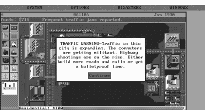

图 8.1. 在 SimCity Classic（此处在 DosBox 模拟器中运行）中，忽略交通拥堵图形描述的玩家会获得其他形式的反馈。状态栏提供了一些反馈——上面显示“频繁报告交通拥堵”——但这些反馈可能会升级为警告，例如此处中央矩形中的警告。

正如这条评论所揭示的，模拟游戏的目标与 Eliza / Doctor 等系统的目标截然不同，后者利用我们的期望来掩饰其操作的简单性。同时，Eliza 效应的一个版本是必要的起点，正如赖特所解释的：

你拥有一个包含成千上万个变量的复杂系统，不能直接把它倾倒给用户，否则他们会完全迷失。所以我们通常会这样思考：人们用什么更简单的隐喻来接近这个系统？你走近这些游戏之一时，能拥有的最简单的心智模型是什么，从而开始游戏并至少理解基础？这个模型可能是错误的，但它仍然需要引导你的学习过程。因此，在我们的大多数游戏中，都有一个显性的隐喻，让你能够接近模拟。（同上）

换句话说，我将称之为 SimCity 效应的现象，其开端与 Eliza 效应非常相似。系统最初作为受众期望（或者正如 Weizenbaum 和 Suchman 可能会表述的那样，即“工作”）的过程式表现来运作。我们对治疗师和城市都有许多期望。同样，对于这两类系统，其表面提供的交互模式都鼓励一种游戏过程。在 Eliza / Doctor 中，这是一系列语言交流；而在 SimCity 中，这是城市的动画表现以及可用于修改它的图标工具。通过这些交互表面，游戏开始揭示底层系统的形状——这与受众的心智模型不同。

2. 在审查本书关于 Grand Text Auto 的草稿手稿期间，Dennis G. Jerz 提出了一系列发人深省的观察——包括 SimCity 的图形用户界面（GUI）已经是一个受限得多的交互渠道……注释继续见本章末尾。

正是在这一点上，两种效应分道扬镳。*Eliza* 效应失效了。作品表面最初鼓励的印象被揭示为与内部系统模型完全脱节。随着这种情况的发生，系统的进程和数据不再作为最初在表面呈现的想法的表现来运作。*Eliza* / *Doctor* 不再像模拟治疗师，而更像是一个文本转换设备。唯一的替代方案是严格限制与系统的交互——如 Garfinkel 的是/否治疗实验——以免其底层形状被揭示。

*SimCity* 效应则朝着不同的方向发展。*SimCity* 中的底层模型被设计为动态城市的表现——部分灵感来自 Jay Forrester 关于城市动力学的工作（下一节将进一步讨论）。虽然最初对 *SimCity* 的参与基于 *Eliza* 效应，但表面呈现的元素在内部进程和数据中都有类比。成功的游戏需要理解初始期望与系统运作的不同之处，并基于实验逐步构建系统内部进程的模型。大多数玩家最终不会获得足够详细的理解来重新实现 *SimCity* 系统，但要在游戏中取得进展，他们必须对城市运作的底层模型形成工作性理解。Wright 具有开创性的设计使许多玩家不仅能够理解 *SimCity* 的软件进程，还能享受其中的学习过程。这一成功也使他的工作受到了一些批评。

## 理解模拟

对于 Wright 等作品的担忧，触及了当我们使用计算机模型来制作非抽象媒体时所涉及的核心问题。正如 Ian Bogost 在 Unit Operations 中所观察到的，“模拟游戏与其玩家之间的关系或反馈循环与一套价值观相关联；没有任何模拟能摆脱某种意识形态背景”（2006, 99）。或者正如 Ted Nelson 在 SimCity 发布前两年简洁地指出的，“所有模拟都是政治的”（1987, CL 149）。

在 SimCity 的例子中，Wright 的灵感包括一些明显具有政治性的模拟：MIT 的 Forrester 的“系统动力学”工作。当这些模拟在 20 世纪 60 年代末应用于城市规划时，它们引发了许多方面的愤怒。正如 Forrester 在《系统动力学的开端》中报告的那样，他的结论包括“低成本住房是使城市状况恶化的双刃剑。这种住房占用了本可用于创造就业的空间，同时吸引了需要工作的人。建造低成本住房是制造贫困而非缓解贫困的强大过程”（1989）。Forrester 的批评迅速指出，他的模型基于远未可验证的假设（例如，住房比工作更具吸引力），并且他模拟城市的运作方式与当代美国城市中心不同（例如，Forrester 的城市规模固定，进出城市的通勤是不可能的）。

当然，任何模拟都需要简化假设。一张与领土一样大且详细的地图根本不是地图。对于许多人们可能希望模拟的事物——例如人类行为——没有人知道

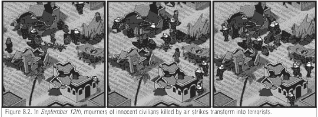

它们实际如何运作。因此，任何模拟实际上都是一组选择的编码。正如我之前在讨论符号 AI 技术时所提到的，这些选择可以基于认知科学的当前信念来做出。或者正如我以 Terminal Time 和 F.E.A.R. 等系统为例所展示的，它们可以是作者的选择，旨在塑造受众体验和创作机会。

无论选择背后的动机是什么，世界被模拟的方式不可避免地带有政治性。这在政治游戏类型中可能最为明显，其中许多游戏作为简单的模拟运行。例如，广受争议的游戏 September 12th 实际上自称是“一个模拟”（Frasca, Battegazzore, Olhaverry, et al. 2003）。玩家面对的是一个中东村庄的等距视图，平民和恐怖分子沿着相当不可预测的路径在周围行走。玩家的光标是一个瞄准准星，可以用来呼叫空袭。但这些空袭需要时间才能到达，在此期间村庄的居民继续移动，在许多情况下，即使是精心选择的打击也会杀死无辜平民。这为最具争议的方面的


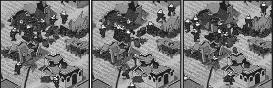

图 8.2.（续）。服装表明了变化。身穿蓝色和绿色的哀悼者在黑白中变成了恐怖分子。

模拟。每次爆炸后的片刻，当其他平民遇到空袭中丧生的平民尸体时，他们会停下、跪下、哀悼——然后站起身来，转变为恐怖分子（图 8.2）。

这种转变是动画化的，并伴有卡通般的声音。当然，这旨在作为一种标志性动作，而不是对一个人如何决定成为恐怖分子的细微差别的现实描绘。但模拟的要点是关于空袭作为打击恐怖主义工具的广泛论点——通过其模型表明，美国的策略可能是招募反美恐怖分子的一部分，而不仅仅是他们“恨我们的自由”或类似的东西。冈萨洛·弗拉斯卡（Gonzalo Frasca），该游戏的首席设计师，将模拟行为定义为“通过一个不同的系统来模拟一个（源）系统，该系统对某人保留了原始系统的一些行为”（2003, 223）。显然，这里的关键短语是“对某人”。这也是将阿贝尔森（Abelson）的意识形态机器和米汉（Meehan）的Tale-Spin等系统视为模拟时所缺失的元素。它们不是人们思维方式的正确模型——但它们是某人对一个想法的表征，在过程和数据中，关于人类生活的一部分。

对《模拟城市》（*SimCity*）及类似游戏的批评往往集中在这样一个事实上：玩家似乎被要求成为那些“认同”其模拟模型的“某人”之一。毕竟，如果不理解——并按照——模型行事，成功的游戏是不可能的。总的来说，这与一种更广泛的倾向有关，即接受模拟规则和结果的真实性，而实际上应该对其提出质疑。例如，普林斯顿大学社会学和公共事务教授保罗·斯塔尔（Paul Starr）（他于1993年曾担任美国克林顿总统政府的顾问）提出了以下观点：

> 当我和我十一岁的女儿一起玩《模拟城市》（*SimCity*）时，我抨击了我认为程序中存在的对混合用途开发的内置偏见。“这只是游戏的运作方式，”她有点不耐烦地说。

我女儿的话听起来奇怪地耳熟。几个月前，有人对我几乎说过同样的话，但是在哪里？我突然想起来：之前的谈话发生在我在白宫参与克林顿医疗计划开发期间。我们正在讨论国会预算办公室（CBO）可能用来为医疗保健改革提案“评分”的模拟模型...

[当]决策者依赖模拟来指导当前选择时——尤其是当立法者将政府置于“自动驾驶”状态，将政策与预测趋势的数值指标绑定时——他们将权力让给了那些定义趋势的人——即生成预测的模型。这在美国今天正在发生，最显著的是CBO作为国家政策权力中心的崛起。在某种意义上，华盛顿已经是模拟城市了。（1994）

显然，鉴于福雷斯特（Forrester）等模拟中内置的假设历史，这是一个值得关注的问题。但这是批评《模拟城市》（*SimCity*）和类似媒体体验的适当依据吗？认为此类模拟因属于媒体而应免受仔细审查的论点是不令人信服的。可以说，我们从媒体表征中学到的东西对我们的文化有着与政府决策同样深远的影响。这是西蒙·佩尼（Simon Penny）呼吁建立模拟媒体伦理的动机之一（2004）。

相反，我认为关键在于斯塔尔女儿的评论：“这只是游戏的运作方式。”玩《模拟城市》（*SimCity*）时，她已经了解模拟是如何运作的，其基本假设是什么。换句话说，《模拟城市》（*SimCity*）与福雷斯特和CBO的模拟之间的区别，就像《模拟城市》效应与伊丽莎效应的有限交互版本之间的区别一样。当与软件模型的交互受到严格限制时——当我们只看到福雷斯特关于“低收入住房有害”的“结论”，或者CBO发布的“评分”时——底层系统的形状就不被理解，也无法得到有效质疑。另一方面，《模拟城市》效应的结果恰恰是系统理解的发展。

这种差异，即伊丽莎效应和《模拟城市》效应之间的差异，反过来构成了博戈斯特（Bogost）对谢里·特克尔（Sherry Turkle）批评《模拟城市》（*SimCity*）的回应的基础。在《说服性游戏》（*Persuasive Games*）中，博戈斯特写道：

> > “打开盒子，”在特克尔看来，将允许玩家看到模拟是如何运行的，从而提供更好的批评能力。这个反对意见的问题在于，玩家*可以*看到模拟是如何运行的：这在非平凡的意义上就是玩游戏的含义。特克尔真正的不满并非

- 3. 虽然CBO使用的模型从技术上讲是开放审查的，非政府研究人员（如福雷斯特）使用的大多数模型也是如此，但斯塔尔告诉我们，“对大多数政策辩论参与者以及……

注释继续于本章末尾。

- 4. 围绕电子游戏进行的广泛学习，而不是我在此关注的关于底层系统的特定学习，在诸如詹姆斯·保罗·吉（James Paul Gee）所著的《电子游戏能教给我们关于学习和读写能力的知识》（What Video Games Have to Teach Us About Learning and Literacy，2004）等书籍中有所讨论。

与《模拟城市》（SimCity）有关，而是与玩家有关：他们不知道如何批判性地玩游戏。（2007, 63）

学会批判性地解读计算机模型是我们需要培养的一项至关重要的能力。为这一目标做出贡献是本书的主要目标——也是软件研究领域整体的重要动机。但正如博戈斯特和特克尔都同意的，了解软件的运作方式是培养这一能力的基本基础。我相信，这正是类似模拟城市（SimCity）的系统的主要未被承认的贡献。

## 系统类型

当然，所有游戏都在某种系统的运作下进行——即使是《乒乓球》（Pong）也包含一个简单的空间模拟——而玩家必须了解一些关于这个系统的内容才能进行游戏。更复杂、多方面的系统通常需要更长时间来理解——包含这些系统的游戏可能随着游戏进程要求更高的掌握程度。这正是利夫·马诺维奇（Lev Manovich）广为引用的观察所要表达的一部分：“随着玩家在游戏中推进，她逐渐发现运行于该游戏所构建宇宙中的规则。她学习其隐藏的逻辑——简而言之，就是其算法”（2001, 222）。

当然，不同类型的游戏采用不同的算法——理解它们在游戏中扮演着不同的角色。例如，交互式小说（IF）游戏的新玩家会经历一个实验期，在此期间他们来了解此类游戏接受的语句类型。一个简单的解析器，例如早期家用电脑冒险游戏（由Scott Adams推出）所附带的解析器，只能理解诸如“go east”这样的两个单词的命令。一个更复杂的解析器，

例如自《Zork》（Anderson, Blank, Daniels, 等，1980）以来大多数IF所附带的解析器，将理解诸如“Ask the librarian about the freeway”这样的语句。一些作者还制作了自定义解析器扩展，例如Andrew Pontious（2000）在其Rematch作品中所做的，它接受诸如“Ask Nick to dare Ines to throw the eight ball at the ceiling fan”这样的命令。正如杰里米·道格拉斯（Jeremy Douglass）所指出的，“Rematch的解决方案使用了迄今为止IF中可能最复杂的解析命令”（2007, 367）。

学习使用此类解析器当然是发展对底层系统的一种理解。但对于大多数交互式小说来说，目标是让玩家不再思考解析器——而是透过它，看向它在虚构世界中所启用的动作。6 大多数游戏的命令和控制系统也是如此。它们是需要掌握的系统，以便执行以相对简单的数据驱动结构（射击游戏中按空间定义的关卡、RPG中的任务标志或IF中的谜题）为定义的动作。相比之下，类似模拟城市（SimCity）的游戏中的模拟系统旨在保持为游戏玩法的焦点。理解和参与复杂系统是核心体验。7

这也是为什么玩模拟城市（SimCity）常被比作园艺。正如花园而非园丁是关注的焦点一样，模拟城市中市民的行动也是模拟城市（SimCity）的关注焦点。玩家划分区域、建设基础设施、设定税率、处理自然灾害，并且——最重要的是——观察。游戏提供了一系列行动工具，但提供了更多信息工具，并鼓励对底层系统的假设进行持续的测试和改进。人们很快就能理解足够多的内容来进行游戏，并

- 5. 蒙特福特（Montfort）告诉我，玩家角色在体验伊琳·卡拉奇（Irene Callaci）的《危险曲线》（Dangerous Curves，2000）时可能会做的某件事。

- 6. 交互式小说（IF）玩家通常致力于发现可以使用哪些词语来采取行动，而不是如何构建用于解析的语句，在每部小说的模拟世界中。虽然某些行动是可能的……

- 7. 当然，赖特（Wright）的游戏当然不是唯一这种情况的游戏。亚历克斯·加洛韦（Alex Galloway）关于西德·梅尔（Sid Meier）的工作也提出了类似观点，西德·梅尔是一位以《文明》（Civilization，Meier and Shelley 1991）等模拟导向游戏而闻名的设计师……

注释继续于本章末尾。


随着时间的推移而更深入地理解，这使得几代SimCity在个人电脑和学校电脑上都取得了文化和商业上的成功。

在我看来，这凸显了一个核心问题：SimCity的例子之所以对我们的文化很重要，恰恰在于它展示了一种帮助数百万人发展对复杂软件模型的理解的方式。这种理解，同样，不足以用于重新实现——而更像园丁对相互作用的植物、土壤、天气、除草等的理解。园丁不需要理解化学，SimCity玩家不需要理解编程语言代码，但两者都可以通过观察和交互来掌握复杂系统的元素和动态。原版SimCity的玩家很快就会将其理解为一个有限的系统，包含一些元素（例如，交通）而不包含其他元素（例如，废物处理），模拟一些关系（例如，犯罪和警察存在）而不模拟其他关系（例如，与犯罪相关的死亡和武器可用性）。玩家开始看到这种类型的系统是如何运作的，并能够思考此类系统的适当和不适当用途。只有从这样的开端，才有可能发展出对软件操作的更深入、批判性的参与。

从数字媒体作者的角度来看，SimCity还有另一层重要性。在创建Raid on Bungeling Bay时，赖特发现与其地形编辑器的交互比与其输出的交互更具吸引力。从某种意义上说，这与Tale-Spin效果提供的洞察颇为相似：让观众体验系统中最有趣的部分。SimCity说明了实现这一目标的一种特定策略。多年后，当这一策略应用于角色时，赖特创造了有史以来最成功的游戏之一，在文化和经济上都取得了巨大成功。

## 模拟人生（The Sims）

“模拟人生”角色可以说是数字媒体中有史以来最受欢迎的人类角色。以它们命名的游戏——《模拟人生》（Wright, Ryan, London, et al. 2000）——是有史以来最畅销的游戏之一，改变了大众文化对计算媒体的理解，并推出了畅销榜首的资料片、续作以及移植到新平台的版本。也许出人意料的是，该游戏完全专注于这些角色及其环境之间的交互。没有射击，没有平台跳跃，没有解谜，也没有任何速度或敏捷性测试。

然而，模拟人生角色是 incredibly simple 的角色。他们除了使用标志性的卡通图像外不说话。除了点击对象或人物，然后指导他们对其采取某些行动外，无法与他们交流。他们使用如此简单的图形表示——即使在游戏发布时也是如此——以至于几乎不通过面部表情传达任何信息，并且只使用宽泛的手势。他们的大多数动作（无论是由玩家选择，还是由模拟人生本身在“自由意志”模式下选择）都由八个简单的当前状态指标决定，这些指标必须不断维持，以免降低得太低：饥饿、舒适、卫生、膀胱、精力、娱乐、社交和房间（图 8.3）。

虽然其他媒体通过言语、手势和动作来传达角色的状态，但在大部分游戏过程中，当前选定的模拟人生的状态会直接显示在屏幕底部。需求显示屏显示八个指标的当前读数及其变化方向。一个更简单的心情显示屏以一组绿色或红色条形的形式显示模拟人生的总体状态。其他可能的显示屏会揭示模拟人生最感兴趣的标志性话题（模拟人生与拥有相似兴趣的人讨论时获益最大）、其人际关系的当前状态，以及其基本人格的五个指标（整洁、外向、活跃、爱玩和友善），等等。

换句话说，当人们开始玩《模拟人生》时，游戏会立即且果断地朝着SimCity效应发展。虽然观众可能带着自己对“人”是什么的想法开始游戏，《模拟人生》会迅速揭示其系统中是什么构成了一个人——八个指标，不断向负方向移动，以及某些


图 8.3. 一个模拟人生（在Mac OS系统上的《模拟人生派对包》中）站着读报。这可能有助于她找到工作，但她的需求显示屏显示这对她来说既不特别舒适也不特别有趣。背景中，一个Dialectic炉灶放在门旁边。

活动能够推迟一个或多个指标的恶化。考虑到他们的个性和情况，某些活动对某些模拟人生更有效。仅此而已。但与其对角色的极端简单感到失望——如果这种简单一直隐藏在表面之下，本可能会发生这种情况——这种方法反而创造了一种非常成功的媒体体验。

这种成功部分来自于可用于间接与模拟人生互动的工具，即通过改变他们所处的环境。模拟人生很简单，围绕他们的物体也很简单，但大量可能的元素和配置创造出了涌现的复杂性。此外，特定物品不同的成本和效益构成了一个明确的进度元素和挑战（很像SimCity城市区域的增长），而在一个没有定义的“获胜”状态或总分的游戏中，这尤为明显。

《模拟人生》中的许多物品都是模拟人生家中的实物财产。这些物品中的每一个——无论是电视机、马桶、床还是烤箱——都由某些信息定义。8 它占据一定的物理空间，限制了其放置位置。它具有图形外观，通常沿着可识别的设计方向。它具有文本描述，常常很有趣，带有戏仿目录文案的风格。例如：

> Dialectic Free Standing Range $400
> 你是否在传统家电商店购物时看过烤箱？它们的相似之处几乎令人难以置信。它们看起来都一样。就像新的Dialectic电炉灶。Dialectic让烹饪变得轻而易举！熟悉的设计。SemiTuph加热元件。油脂拦截器。相反热流的矛盾合成了完美的餐食……每次。
> 饥饿：5

8. 此描述基于Kenneth Forbus和Wright（2001）的讲义。

对一些玩家来说，《模拟人生》中一个重要的目标是创建一个符合他们期望外观的家庭（这是Celia Pearce称《模拟人生》为“Ikea游戏”的原因之一[2004, 148]）。但所有玩家都必须考虑Dialectic炉灶描述底部的信息。“饥饿：5”是对其对模拟影响的描述，即它推迟饥饿需求表格恶化的能力（此创作界面如图8.4所示）。烤箱像其他家居物品一样，会向附近的模拟人生“宣传”其潜在影响，导致它们在自由意志模式下使用有助于满足其需求的物品。每个物品还有一个指向

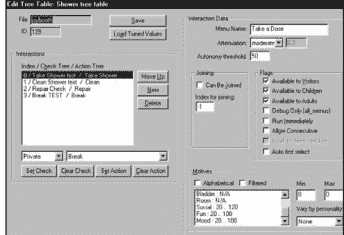

图 8.4. 在赖特的公司Maxis中，Edit Editor用于创建物品。在这里，Kenneth Forbus和Wright（2001, 9）说明了如何将《模拟人生》中的标准淋浴改为“快乐亭”——具有社交、娱乐和心情回报。

更昂贵的房子对模拟人生的需求表格有更强的积极影响。反过来，心情更好地去上班的模拟人生工作表现更好，从而获得晋升，从而获得更多收入，从而有能力购买更好的东西，更有效地培养工作技能，拥有更大的房子，有更多朋友来访，维持更大的社交网络，更快乐，在工作中表现更好，等等。然而，似乎永远没有足够的时间。游戏开始时必须找到工作——然后挑战就在于在拼车来接他们之前让模拟人生吃饭、洗澡和上厕所。如果你不这样做，他们就永远得不到晋升，如果他们错过了拼车，他们就会被解雇，但白天的分钟数流逝得太快了。这一切开始感觉像是一个熟悉的Dialectic。

当然，这正是使游戏具有挑战性的原因——没有挑战的游戏通常不会成为畅销书。但赖特也更具反思性地看待这款游戏，将其视为对我们时间紧张生活的评论，甚至是对消费文化的戏仿（Wingfield 2006）。9 Frasca（2001）等人不以为然。10 模拟的规则本身就强制执行商品资本主义的角色，那么游戏内目录描述或游戏设计师对其结构进行温和的嘲笑，又有什么关系呢？

将讨论深入一些，麦肯齐·沃克在《玩家理论》中指出，什么可能使资本主义的理想化表现——一款归结为度过日常琐碎工作的游戏——如此有吸引力。沃克的

9. 据Wingfield的文章：批评者还指责该游戏错误地将幸福与消费主义等同起来，因为它大部分内容都围绕购买衣服、家具和其他商品展开。赖特先生表示，该游戏实际上...

10. Frasca写道，他遇过一些人，他们坚信《模拟人生》是一部戏仿，因此它实际上是对消费主义的批判。就我个人而言，我不同意。虽然这款游戏肯定是碳基的，但我无法在其中找到讽刺...

注释继续于本章末尾。


11. 在Grand Text Auto上对本书手稿进行博客式评论时，Richard Evans（已注明为Black & White的AI负责人）正在Maxis工作，参与尚未公布的作品The Sims 3。他在对本段的评论中写道……注释见本章末尾。

这本书以一个问题开头：“你是否曾有过这样的感觉，自己正在玩一场庞大而无用的游戏，却不知道目标，也不记得规则？”在提出几个相关问题后，这本书对读者说：“欢迎来到游戏空间。”这为Wark对The Sims的讨论奠定了基础：

游戏与其“其他”之间的差异可能已经消失，但在所有人都以同样方式运行的非人性化算法内的游戏，与一个看起来仅仅是权力意志之争的竞技场之间，仍然存在差异。……如果选择仅限于The Sims作为真实游戏，以及gamespace作为现实的游戏，那么玩家会选择留在洞穴中玩游戏。（2007，第49段）

这一点可以进一步阐述。与他们的玩家不同，Sims所处的并非仅仅是一个可预测、透明、非人性化的资本主义版本。这种可预测性和透明度也延伸到了他们的内心情感生活。我们不知道什么会让我们更快乐。我们可能认为是大屏幕电视，但那很可能是错的。而我们知道确切什么会让一个Sim更快乐，确切如何做到，也知道为什么我们买不起或没地方放，但也许再多玩一会儿就能……

换言之，The Sims的关键要素——也就是其影响力所在——在于它揭示模拟运作机制的工作。其设计专注于教导玩家理解并在软件系统内运作。它之所以能成为关于熟悉情境中人类的体验而成功，是因为它在表面上精确地传达了其流程和数据的简单性。它通过“SimCity效应”而成功。1

The Sims通过不假装模拟超出其实际范围的内容，避免了*Eliza*效应的陷阱。它通过在观众体验中利用模拟中存在的一切，避免了*Tale-Spin*效应。在这样做的同时，它也提出了一个问题，Janet Murray在写道“如果数字媒介要有查尔斯·狄更斯或夏洛蒂·勃朗特，Will Wright无疑是其关键先驱之一”（2004，4）时暗示了这一点。问题是：我们能否在比八个情绪表更复杂的角色，以及比*The Sims*通过财产和职业所暗示的进程更完整的虚构中找到类似的成功？

12. 这使得她在Atari的工作以及她的论文，与*Universe*和*Minitel*的第一阶段大致处于同一时期。Laurel论文的部分内容后来被改编为她的书*Computers as Theatre*（1991）。

## Oz

卡内基梅隆大学的Oz Project（从20世纪80年代末创立起由Joe Bates领导）有一个与众不同的地方。虽然*Tale-Spin*和*Universe*可以被视为软件系统中的异类，因为两者都被广泛归功于它们并未产出的成果，但Oz Project可能是唯一一个因一项不需要计算机的实验而最为著名的计算机科学研究项目。这是一项*互动戏剧*实验，由人类导演和演员执行，但旨在理解软件驱动系统的需求（Kelso, Weyhrauch, and Bates 1993）。

互动戏剧的梦想通常被追溯到Brenda Laurel 1986年的论文——而该论文又源于她从1981年起在Atari工作时撰写的一系列备忘录和文章（最初担任软件市场经理，后来担任研究科学家）。12 在Atari研究实验室戏剧性兴起后，又因1980年代电子游戏市场崩溃而解散之后，Laurel的论文被定位为计算机先驱Alan Kay领导下实验室工作所受驱动的某个“宏大理念”的特定版本的可行性研究。广义上，这个理念是一个幻想放大器。Laurel更专注的版本被构想为一个系统，用于第一人称交互（作为“用户角色”）与系统角色和世界模型，两者均由“剧作家”专家系统控制。在Laurel的论文中她写道：“那么，‘互动戏剧’是一种在幻想世界中的第一人称体验，用户可以在其中创建、扮演和观察一个角色，其选择和行动会影响事件的进程，就像在戏剧中一样”（1986，7）。

尽管《星际迷航：下一代》的编剧后来曾以“全息甲板”的形式，对与这种系统的交互提供了生动的戏剧化呈现，但Oz Project实验之所以著名，是因为它为体验与这种系统进行无脚本交互可能是什么样子提供了一些潜在的洞察。该实验的场景远非全息甲板的华丽渲染，而是在一个演播室剧院中进行，只有箱子、椅子和一张桌子作为布景。这些布景旨在暗示一个车站，车站里有三个角色，分别由戴着无线耳机的受过训练的演员扮演：一个不提供帮助的职员、一个近乎失明的乘客，以及一个有偷窃癖的年轻人（被描述为“小混混”）。耳机使得一位场外导演（借助可能事件的“情节图”）能够向演员发出指示，以维持戏剧的整体流程。

在每次实验运行中，一名互动者被指示购买一张去参加亲属葬礼的巴士票。但这是一个经典的误导。购票过程被职员拖延，随后互动者被另一位乘客的求助请求分散了注意力，在此期间，年轻人要钱的要求从讨饭升级到了持刀抢劫。当事情达到高潮时，年轻人切断了职员的电话线，职员向互动者递了一把枪。在最著名的一次演练中，互动者从年轻人身后向空中开枪，此时扮演该角色的演员——没有等待导演的提示——戏剧性地倒在地上。

互动者觉得这次体验极其引人入胜，一位互动者报告说，它“在几秒钟内就从正常，变得烦人，再到失控。”另一方面，从外部观察实验的人则觉得行动滞后——甚至报告说无聊到失去对事件的追踪。基于此，Bates和他的同事得出了两个结论。首先，最明显的是，沉浸在体验中的互动者所需的引人入胜的节奏，与传统媒体体验中的节奏截然不同。其次，更从理论上讲，他们将成功吸引互动者视为对其互动戏剧基本设计理念的确认：将观众置于戏剧中的一个互动角色（即互动者），在同一环境中创建富有表现力且相对独立的非玩家角色（NPC），并通过戏剧管理者的干预来引导NPC的高级别行动，该管理者负责为互动者调整节奏并引导故事走向成功的结局。

13. Zoesis的成立无疑是大学基础互动叙事研究的丧钟。就在Oz Project即将结束之际，R. Michael Young的Liquid Narrative项目正在获得动力……注释见本章末尾。

## Oz Characters

然而，在实践中，这一设计理念的一个要素在Oz Project的系统构建活动中得到了绝大部分关注：即创建互动角色。这是他们20世纪90年代初图形系统（Edge of Intention，包含动画“Woggles”，风格类似Dr. Seuss；见图8.5）以及更早的文本系统（Loyd，与一只疏离的模拟家猫建立关系）的重点。这也是2000年该小组工作重新出现时所基于的Web系统的重点（Otta-Andris.com，与拟人化字母一起玩游戏），当时大多数项目成员在20世纪90年代末离开卡内基梅隆大学，创立了Zoesis公司。与FE.A.R.中短暂的、以战斗为中心的角色——或The Sims中被微观管理、注意力涣散的角色不同——这些角色需要同时具备长期和短期行为，有些行为支持其他行为，多种行为能够同时进行，以及


Figure 8.5. 《Edge of Intention》中的Woggles。


在任何给定时间选择该做什么的某种合理方法。Oz 项目用于创作此类角色行为的语言被称为 Hap。

14. 从动画方向来看，Norm Badler 和 Jessica Hodgins 等研究人员领导的工作侧重于生物力学正确的动画，而非表现性动画（Badler, Phillips, and Webber 1993; Hodgins et al. 1995）。From... 附注见本章末尾。

Oz 在这一领域的工作是在智能代理（intelligent agents）的持续计算机科学工作背景下开发的，智能代理是 AI 的一个分支，涵盖了大量表现出可被视为半独立实体行为的软件。更具体地说，在 Oz 项目期间，许多研究实验室正在开发“可信”代理——这些代理是以媒体理念为出发点创建的。一些小组更关注行为和活动的内部结构（向外朝向动画），而另一些小组则首先专注于新的动画技术，以实现更具表现力的角色（向内朝向更高级别的行为）。当时，我正在纽约大学工作，在那里 Ken Perlin（与 Athomas Goldberg 和其他人合作）领导了一个名为 Improv 的以动画为起源的交互式角色项目（Perlin 1995; Perlin and Goldberg 1996）。

尽管运动方向不同，Improv 系统与 Hap 共享对每个角色进行精心手工创作的关注。其他系统则更投入于各种正确性和通用性。14 与同期其他实时渲染角色相比，Improv 的角色显得异常生动。这种印象是通过调整动画的概率和速率、分层动画，以及在诸如眨眼、环顾房间、手势、接近或避开移动角色和物体（可能由观众控制）以及说话（彼此之间或与观众）等动作之间平滑过渡而创造出来的。当与推动情节发展的东西结合时，结果就是引人入胜的动画体验，范围从人类编舞家根据即兴音乐指导图形舞者的动作（在 1994 年的 *互动舞蹈* 中，参见图 8.6）到一组始终产生线性事件略有不同版本的概率（在 1998 年的基于浏览器的 *西德与企鹅* 中）。该技术于 1999 年分拆为一家公司，由 Goldberg 领导，旨在将表现性动画技术推广给更广泛的受众。该项目总体上创造了引人入胜的角色执行灵活行为的令人信服的演示，但从未实现互动戏剧梦想中设想的更自主的角色。

另一方面，Hap 的设计是让另一个系统处理动画——或者根本没有动画，如 *利奥塔* 项目所示。它不关注视觉外观，而是专注于能够在虚构世界中适当且自主地行动的角色，并基于

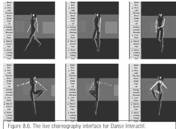

该角色的作者精心打造的目标和行为。这些目标和行为听起来可能类似于 Strips 计划的构建块，但 Hap 的首席设计师 Bryan Loyall 做出了明确区分：

> 与人工智能中一些关于目标的概念不同，Hap 的目标本身并无意义。它们不是被规划的，也没有任何语法或逻辑让系统对其进行推理。相反，它们通过代理构建者对其含义的愿景，以及为表达该愿景而编写的行为来获得意义。（1997, 36）

与 Strips 风格的推理不同，类似于 Tale-Spin 的计划框（planboxes），每个目标都有一组由作者定义的可能行为，这些行为可能满足该目标。这些行为可以由按顺序执行的步骤，或可以按任何顺序（包括并行）进行的步骤组成。例如，“眨眼”行为的步骤是顺序的——夸张地闭上眼睛，然后暂停，接着睁开眼睛。但“出门前收集我需要的东西”行为的步骤可以根据情况排序——车钥匙可以在夹克之前或之后拿取。

正如眨眼和收集物品之间特异性程度不同所暗示的那样，Hap 行为可以启动子目标和子行为，最终在产生一组原始心理和物理动作时落地（物理动作与 Hap 角色的表面呈现建立联系）。所有这些都组织在当前行为树中，在每一步中，要么扩展某物（行为或子目标），要么执行某物（心理或物理动作）。

目标、动作和行为可以成功、失败，

15. Bates 报告了一个特定的 Woggle：由于编程错误，Shrimp 偶尔会在其持续行为中加入看似神经质抽搐的东西，导致他反复将头撞向地面。这引起了人们的注意……附注见本章末尾。

或中止——基于世界中发生的事情。这种情况会在树中向上和向下传播，因此中止去上班的决定会移除诸如为旅行收集物品等子行为。同样，找不到钥匙可能会导致更高级目标（去上班，或者至少是开角色的车去上班）失败，具体取决于行为的构建方式。Loyall 还以行为可被选择的情境的前置条件、特定情境下的更具体行为，以及在执行行为前等待世界状态变为真的“恶魔”（demons）形式，提出了进一步的权威工具。最后，使用一个算法来为每个步骤选择要作用的树部分，优先处理高优先级动作，否则倾向于继续扩展和执行同一部分树。

## Oz 局限性

Hap 是定义角色行为的强大工具。Oz 角色（如 Woggles）能够移动、进行单独行为、相互交互以及与观众交互。在某些方面，它们相当成功，广泛展示和讨论——尽管 Bates 非常坦率地报告说，他们最令人难忘的行为之一是作为系统错误的副产品出现的。15

不过，在首次尝试使用 Hap 创建图形体验时，一个更大的问题也出现了。Oz 项目博士生 Phoebe Sengers 在她关于构建 Woggles 的论文描述中讨论了这一点：

遵循 Hap 设计策略，我们首先构建了一组高级行为，例如睡觉、跳舞、玩“跟队领跑”、闷闷不乐和打架。这些行为中的每一个实现起来都相当直接，包括相当大的变化、情感表达和社交互动。观看代理人参与其中任何一种行为都是一种乐趣。

然后到了致命时刻，即将这些行为组合成完整的代理人。这是一场噩梦。以简单直接的方式组合行为就导致了各种问题。（1998, 38）

一些问题可能源于处理冲突目标时的一个错误。例如，Woggles 会试图同时进行两种不兼容的行为，例如“打架”和“睡觉”。但 Sengers 诊断出的另一组问题更接近 Oz 对角色方法的核心——这一问题也困扰着许多当代小组的基于代理的项目，例如由 MIT 小组构建的模拟狗（Silas）和玩电脑游戏的企鹅（Pengi）。

Woggles 会在行为之间跳来跳去，从不专注于某一个足够长的时间让观众理解。它们会陷入循环，在两种行为之间来回切换。这样一来，此前在有限状态机（FSM）关系中讨论过的动作隔离问题，在高级行为系统的背景下再次出现。在截止日期压力下，Oz 小组牺牲了让 Woggles 能够交错来自多个高级目标的行为这一关键特性。Sengers 这样描述实地工作问题：

替代 AI 代理通常具有一组黑盒行为。遵循行动选择范式，代理人不断重新决定哪种行为最合适。结果，


它们倾向于根据当前哪个行为最好，在行为之间来回跳跃。这意味着，代理人的行为整体特征最终会有些许缺陷；一般来说，其行为由对个体、浅层高级行为的短暂涉猎组成，行为之间变化突兀。正是这种由行为单元整合不足所导致的代理人行为整体缺陷本质，我将其称为精神分裂症。（40）

Improv动画之所以能够避免这个问题，有多种原因。首先，行为转换和组合的可视化呈现是系统研究和演示的主要领域，因此突兀的转换很少出现。更贴近问题核心的是，Improv项目通常要么是小规模的行为演示，要么是在脚本中嵌入了叙事主线构建而成。更自主的代理人需要不同的解决方案。Sengers通过改变视角来追求这一点。

## 表现者

对Sengers来说，Hap角色的问题源于它们与传统AI的延续性。问题不在于基于行为的架构不合适。相反，问题在于行为往往是从角色的视角编写的（角色应该能做什么），并从角色的视角选择的（在这种情况下做什么是正确的）。这听起来像是对Oz项目巴士站实验中现场人类演员所提供内容的一种计算机模型。但演员的工作是采取能够传达信息的行动，而不是正确的行动。这种差异证明至关重要。回应她对标准Hap角色的不满，Sengers构建了一组称为Expressivator的扩展。这项工作的灵感来自叙事心理学领域，该领域不将患者视为一组脱节的症状，而是试图通过叙事进行重新整合。同样，Expressivator通过构建一个专注于叙事可理解行为的系统，为精神分裂症代理人尝试“症状控制”。

这在一定程度上是必要的，因为Woogles之类的角色与Sims之类的角色之间存在差异。玩家的Sims之所以自然可理解，是因为像需求显示这样的元素。当玩家观察到一个Sim的膀胱表过低时，玩家会想：“他很快就需要上厕所了。”当Sim突然停止之前的行为并前往厕所时，这被理解为对长期积累的某种东西的满足，而不是一个神秘的开关。此外，《模拟人生》中的行为相对耗时，每个行为都被精心动画化为一种表演。这些冗长的行为使得Sims不可能像循环的Woogles那样显得“犹豫不决”。冗长的行为还需要一个可视化的当前和即将发生的行为队列，玩家可以轻松取消，即使在执行过程中也是如此——这样Sims就能快速响应电话铃声或厨房起火等事件。

Sengers寻求一种方法，将传统媒体中角色的一些叙事可理解性——这些角色不使用计量表来显示其需求状态的变化——带到基于行为的数字角色中。为了实现这一点，Expressivator围绕作者对其将如何被解读的意图来组织角色动作。系统不是由目标、行为和动作组成的，而是由符指和符号组成。由于角色动作需要时间让观众解读，因此当观众可能已经看到它们时，会“张贴”符指和符号。然后这些成为世界历史的一部分，可用于决定下一个符指和符号。在从一个行为转移到另一个行为时，每个角色都试图沟通为什么要做出改变，使用一组专门设计的过渡行为。这些反过来是更一般类别的元级控件的特例，旨在让作者表达先前被黑箱化的角色动作之间的关系。

在构建Expressivator（以及她的示例媒体作品*工业墓地*）时，Sengers展示了一条有趣的中间道路。她专注于以叙事术语进行观众解读，尤其是在设计旨在传达行为变化原因的过渡时，开始创建一个具有Improv更脚本化动画所具有的某些优势的系统，这些优势使其随时间推移保持吸引力。同时，角色具有以行为为中心的设计的灵活性和自主性。然而，缺少的是Oz项目最初需要这种灵活性的原因：让角色在扮演角色的同时，也遵循舞台外戏剧经理的指示。第一次全面尝试这一点是在几年后，由一位游戏行业老兵和Oz项目的最后一名研究生发起的。

## *Façade*

我第一次在1999年由人工智能促进协会赞助的叙事智能研讨会上遇到Andrew Stern和Michael Mateas。该研讨会由Mateas和Sengers组织，他们是最后一批Oz项目博士生。他们成功地将他们的导师、同事和朋友与一大群追求叙事、角色和AI交叉领域不同方面的人聚集在一起。Zoeisis团队在场，展示了其最先进的演示：《不会游泳的企鹅》。Bringsjord和Ferrucci讨论了Brutus的积极开发。Stern描述了他公司基于可信代理工作的最新商业产品：Babyz。Mateas及其合作者首演了终结时间。感觉该领域正在涌现新项目，将技术水平推向新高度。

但与此同时，Stern和Mateas在幕后相互推动，在他们开始规划的项目中冒更大的风险。他们希望创造出交互式戏剧梦想的第一个真实例子，尽可能不妥协。正如Stern后来对这个项目所说：“当你瞄准星星时，你可能会击中月亮；对于Façade，我们认为我们进入了轨道。……[我]们喜欢过度雄心勃勃”（2005）。

Façade于2005年发布，开始于玩家走近Grace和Trip的公寓门口——他们是老大学朋友，现在已婚——玩家在决定是否敲门时，可以听到他们闷声争吵。在大约二十分钟的互动中，这一最初时刻的承诺从紧张的闲聊发展为全面崩溃，通常导致Grace和Trip婚姻的破裂。危机的形状由玩家的行为决定，这些行为也可以（较少见地）引导Grace和Trip达到新的相互理解水平，或导致玩家被逐出房间。

这一切都发生在一个模拟公寓中，角色们说着对话，执行动作和情感。玩家可以自由移动，捡起物品，输入任意文本，拥抱和亲吻，并通常被邀请制作自己的表演。Grace和Trip动态响应，跟进玩家提出的话题，评论玩家陈述和行为的模式，也许重新建立他们自己中断的对话线，当玩家似乎站在他们中的一方时，对待玩家也不同，等等。换句话说，这与其他当代数字小说提供的体验完全不同——它与标准对话树的距离，几乎与与电子邮件小说的距离一样远。Façade并不总是有效，但大多数时候是有效的，通过此，它证明了交互式戏剧的梦想可以成为现实。

Façade不仅提供了交互式戏剧的存在证明，还回应了Brenda Laurel二十年前提出的问题（数字媒体的“重大挑战”之一）。它说明了一组选择相对于本书提出的问题的后果。通过这样做，它澄清了未来的研究议程，对“代理”这一核心概念提出了新的见解，并同时证明了一组技术已准备好用于创作。

## Façade节拍

Façade的工作让Stern和Mateas直面许多未解决的研究问题，从自然语言理解（以便玩家可以输入任何文本


他们希望）让NPC的行为更具可信性。但他们方法的关键在于重新引入戏剧管理的概念。他们解决这个问题的方法，反过来，偏离了巴士站的情节图——而是转向对戏剧写作中一个概念的重新诠释：“节拍”

对节拍的典型理解由罗伯特·麦基提供：“行为/反应的交换。……[这些]不断变化的行为塑造了场景的转折”（1997，37）。米亚斯和斯特恩引用了_《卡萨布兰卡》_中一个著名的节拍：“里克：‘你为什么回来？’是为了告诉我你为什么在火车站抛下我吗？”伊尔萨：“是的”（2007，191）。但正如他们解释的那样，_《Façade》_中的节拍要大得多且更复杂，实际上作为嵌入更大戏剧中的微型场景结构运作，旨在与其他元素交织在一起。

斯特恩和米亚斯为_《Façade》_创建的节拍的一个主要目标是让玩家卷入一系列他们所谓的“社交游戏”。戏剧的第一部分中，格蕾丝和特里普设置了零和亲和力游戏，玩家被邀请同意其中一方（并不同意另一方）。例如，格蕾丝可能会发起关于他们重新装修的谈话，她认为这有问题，但特里普喜欢（图 8.7）。同样，特里普可能会开始谈论他们最近的意大利之旅，他认为那是第二次蜜月，而格蕾丝只把它当作周末短途旅行。即使是选择饮料这种看似无害的活动，也有一个相关的分歧节拍，特里普敦促玩家和他一起喝花鸡尾酒，而格蕾丝则主张选择简单的饮料。同时，在这些亲和力游戏的整个过程中，格蕾丝和特里普围绕性、离婚、家庭背景以及公寓中情感色彩浓厚的物品等话题，对玩家的言语做出一系列“热点游戏”反应——这些也有助于揭示更多关于角色及其故事的信息。

在戏剧的第二部分中，节拍被设计用来产生一个治疗游戏，这有可能增强角色的自我实现。最后，戏剧迎来戏剧性的结局。在整个过程中，戏剧管理者根据紧张程度的期望曲线（以及被认为的当前状态）选择节拍，试图产生一种新亚里士多德式的体验：紧张感缓慢上升，最终导致宣泄。产生这种体验需要一种与《模拟人生》或Oz代理中看到的角色行为方式相当不同的方法。

## 《Façade》角色

像森格斯一样，米亚斯和斯特恩深受Hap角色行为概念的影响。Façade用于创作此类行为的工具ABL，基于Hap。但与此同时，Façade的作者们进一步推进了Expressivator中体现的对Hap的自我批判。米亚斯通过研究Oz工作和与森格斯的讨论，深信过渡行为和元级控制的必要性，而斯特恩在参与PF Magic的“Petz”项目时也亲眼目睹了这一点。Petz项目的第一个项目，Dogz（Frank, Resner, Fulop, 等，1995），是一个基于计算机的系统，用于与虚拟动物建立关系，它早于万代的钥匙链Tamagotchi（1996年发布）和老虎公司的毛绒Furby（1998年发布）——更早于任天堂的Nintendogs（2005年发布）。由本·雷斯纳创建的原始AI采用传统的有限状态机设计。当斯特恩接管AI方向，于1996年初开始构建Catz（Frank, Stern, Resner, 等，1996）系统时，他直接受到Oz项目技术论文的影响。到了Petz 3（Harrington, Stern, Frank, 等，1998）和Babyz（Stern, Frank, 和 Resner，1999），斯特恩的目标、行为和情绪状态架构相对复杂，并包含一种过渡行为，其目标与森格斯同时通过Expressivator所追求的目标相似。正如斯特恩所说：

> 我认为，行为之间过渡的概念是任何角色实现流畅性和栩栩如生的固有要求。Petz/Babyz中有这些过渡的版本——一些小行为，比如在完成一个行为（例如进食）并转入另一个行为（例如玩耍）后，“四处张望看看接下来做什么”或“看向玩家寻求安慰，寻求抚摸/挠痒”。Petz和Babyz中散布着这样的小临时行为（Stern 和 Mateas 2007）

Expressivator作为Hap的一组扩展，展示了构建此类过渡行为架构的一种方法——比临时行为集合更有原则性。在为Façade构建ABL时，米亚斯和斯特恩将这一步骤更进一步，将过渡行为以及更广泛的元级控制构建到系统核心本身。但Façade的节拍导向创作也需要更深层的变化。虽然Hap、Expressivator和Petz项目都将目标和行为视为单个独立角色的方面，但Façade的角色可以共享目标和行为。

这在可信角色领域是一个惊人地激进的概念。¹⁶ Woggles和Petz一起玩耍，工业墓地的台灯和监工以更阴郁的方式互动，但总是通过“感知”和“反应”彼此。每个系统的作者都必须为联合行为问题制定软件解决方案，都受制于AI假设，即他们正在创建需要独立行动的实体。但实际上，每个作者都在创建一个用于执行行为的系统，无论是针对一个角色还是多个角色——这一事实在Façade的设计要求快节奏对话交换（而不是Woggles“跟随领袖”或Babyz互相扔玩具等较松散的互动）时变得无法回避。通过查看Façade的程序脚本，可以清楚地看到这一点。17

16. 尽管在战场模拟等领域（例如，Tambe 1997）也追求过类似的想法。

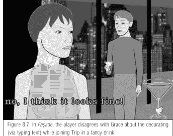

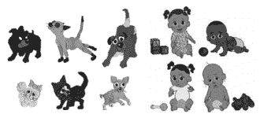

图 8.8. PF Magic的Petz和BabyZ使用程序动画（类似即兴表演）和基于行为的角色架构（类似Oz项目）来创建关于角色和关系的数字媒体娱乐，而不是关于身体灵活性或解谜。

## 《Façade》的程序脚本

Façade的角色共同执行斯特恩和米亚斯所谓的“联合对话行为”（JDBs）。每个节拍是十到一百个JDB的结构化集合。每个JDB，反过来，是格蕾丝和特里普之间一到五行对话的集合，不仅仅是单词的录音，还包括五十到两百行ABL代码。这些代码支持JDB的各种表演方式，以及JDB改变Façade内部计数器的方式，用于亲和力游戏、角色自我实现、整体紧张感或故事和角色状态的其他元素。节拍包含如此多JDB的部分原因与此有关。大多数JDB实际上都有三到五个备选版本，每个版本都有多个录音片段，以便根据当前的亲和力和紧张度测量值选择合适的版本（并可以减少不同游戏过程之间的重复）。

节拍包含大量JDB的另一个原因是支持特殊的元级控制（称为“处理器”），它们在节拍的上下文中对玩家的陈述和行为提供适当的反应。每个节拍在没有交互的情况下都有一个默认的展开方式，但米亚斯和斯特恩希望有另一种结果——考虑到Façade的目标是追求互动式戏剧。

例如，关于调制饮料的节拍中的JDB包括一个基本序列。这个序列表达为

17. 在本章的初稿中，我提到了“Façade的脚本”。在基于博客的同行评审期间，斯特恩反对，说脚本一词在传统戏剧和游戏开发中都有强烈的线性暗示。这个术语是我...

注释继续在本章末尾。


作为四个共同目标，在此期间，说话和不说话的角色都会执行适当的行为。这些节拍目标包括：Trip 提出饮料话题（进入节拍的过渡）、Trip 提出饮料建议（同时吹嘘）、Grace 提出反建议（并嘲笑 Trip 的行为，Trip 做出反应），以及他们各自的最终回应。

在基本序列中，角色们会在每个目标之间等待玩家的回应。玩家也可以打断。响应玩家的处理程序可以改变并重新排列下一个目标的表演，混入关于节拍话题的反应，混入关于其他话题的反应，甚至导致节拍中止。例如，如果玩家在饮料话题刚出现时立即要一杯啤酒，Trip 会以不同的方式建议一种高档饮料，而 Grace 的反建议可能会特别提到玩家要了一杯简单的啤酒这一事实。当玩家在节拍期间表达对两个角色立场的亲和力时，他们的表演可以转变以反映亲和力游戏的新局面。

当然，玩家也可能采取与饮料无关的行动。玩家可能会提出离婚或治疗等话题，或提到房间中的某个物体（通过名称或拾取它）。这可能会混入一个关于某个热门游戏在其当前开发水平的 JDB。或者，对于 Grace 和 Trip 无话可说（或系统无法理解玩家）的话题，Façade 可能会混入一个“转移”玩家行动的 JDB，该转移要么基于本地上下文，要么使用一组可以在整个游戏过程中出现的无回应。每个节拍目标都有专门编写的对话，用于在从混入返回时重新建立上下文（即，使观众能够读懂的过渡）。

节拍也是 Façade 应对自然语言理解这一极其困难问题的关键。没有任何计算机系统能够真正“理解”任意的人类语言——或者，更不雄心勃勃地说，能够始终如一地将人类语言陈述映射到逻辑模型。Façade 所做的则是尝试将每个玩家陈述映射到一组有限的话语行为，例如同意。

最后，Trip 和 Grace 的所有共同行为反过来又与个体行为混合。Trip 可能会在多个节拍和混入的边界之外继续调制饮料。饮用饮料、玩魔法八球以及其他个体行为与共同节拍和混入并行进行。每个 JDB 的编写方式使得它可以在角色位于房间不同物理位置、执行其他个体行为等情况下进行表演。这些个体行为、处理程序的反应以及混入的普遍性所产生的一个深远结果是：虽然 Façade 中的角色行为在很大程度上由过程脚本驱动，但它并不感觉像是一系列脚本化片段，而更像是一种连续性。

## 从 Façade 学习

Façade 的进程和数据所产生的表面体验由一系列选择塑造，这些选择在伊丽莎效应和泰尔-斯宾效应方面有着明确的影响。这些结果具有启发性。

## 对 Façade 说话

与 Eliza/Doctor 类似，Façade 的自由形式文本交互邀请玩家进行游戏。与 Eliza/Doctor 不同的是，Façade 系统实际上对当前上下文和正在进行的对话的某些方面进行了建模，因此这种游戏有更多潜在的回报。Façade 的观众可以以自己的风格进行互动，无论是为了影响 Trip 和 Grace、表达玩家角色身份的特定想法，还是探索系统的边界。

玩家的个人表达和系统边界探索目标有时会重叠，可以产生特别令人难忘的 Façade 记录。例如，Idle Thumbs 论坛上的一位发帖人决定以一种不同寻常的方式进行游戏：采取适当的物理动作（坐在沙发上或接电话），但只说一件事：

```
PHONE ** RING **
(GONZALO picks up the phone.)
PHONE ** RING **
PHONE Hello? Hello?
TRIP Gonzalo, no! Don't do that.
GONZALO Brains!!
PHONE Who is this? Travis, is that you? This is your mother.
TRIP Uh, that's my mother, I can hear her loud voice.
GONZALO Brains!!!!!!
PHONE I don't recognize your voice . . .
PHONE ← I think I have the wrong
number . . . * click *
GONZALO Brains?
(GONZALO puts down the phone.)
(Mailman 2005)
```

18. 许多人会在作品表面展示可用动作的小部分选择。然而，有些作品，比如基于文本的交互式小说，将寻找可用动作作为体验的一部分。

正如发帖人所总结的，“扮演僵尸很有趣。”同一论坛上的其他玩家分享了他们扮演刚被枪击的人、寻找组织样本的外星人、达斯·维达（在被逐出公寓后尖叫“不oooooooooooo！”）以及 Grace 的秘密情人的记录。当然，也有许多记录展示了与 Façade 预期略有接近的玩家角色，但那些推动系统极限的记录在揭示伊丽莎效应方面尤其有启发性。例如，使僵尸记录变得有趣的 Façade 方面，也是伊丽莎效应崩溃如何揭示底层系统形状的一个清晰案例。在这种情况下，人们可以看到，即使在没有可理解的玩家行为时，Façade 的戏剧也大多继续执行其节拍目标。

在使用自由形式自然语言界面时，Façade 做出了一定的权衡。玩家被邀请进行比许多数字小说更丰富的表演，后者通常将交互限制在一组离散选择之间的选择（其他所有内容都会产生错误消息）。18 另一方面，Façade 系统的行为

19. 这是 Steven Dow 和 Blair MacIntyre 在为其增强现实版本的 Façade 创建“巫师”界面时探索过的内容（Dow 2008）。

实际上将每个玩家话语归约为一组离散话语行为之一——并不总是成功。这造成了严重的错位。就我个人而言，每次我按照我认为“符合预期”的方式玩 Façade 时，一个我认为完全正常的陈述都会产生如此出乎意料的反应，以至于我开始思考底层系统的形状。

事实上，Façade 的作者估计，自然语言理解失败大约有 30% 的时间发生。就我作为玩家的主观感受而言，失败频率较低，但这归功于 Façade 在许多情况下巧妙地转移和恢复的方式。正如 Mateas 和 Stern 所写，“这种权衡是有意为之，因为我们希望更好地理解当自然语言成功时可以提供的新乐趣”（2007, 206）。可以看出，自然语言交互为观众提供了强大的潜力，但也必须被数字媒体作者视为一个活跃的研究领域（而非成熟技术）。它还指向其他研究领域，例如可能允许玩家直接表达 Façade 话语行为的界面，从方程中移除任何不可靠的自然语言理解。19

## 听 Façade 说

有趣的是，Façade 在泰尔-斯宾效应方面也呈现出类似的权衡。在这种情况下，它遵循了许多当代游戏的模式，而不是偏离它。这是使用配音的选择，因此 Grace 和 Trip 的陈述是通过播放一系列预录制的声音文件来执行的，他们的动画与之同步。

正如自由形式文本输入允许玩家表达自我一样，*Façade* 强大配音中蕴含的人类表达也是使体验如此有效的一部分。台词表演的细微差别使事情时而更有趣、时而更令人不适——总体上，更具吸引力。另一方面，*Façade* 还需要大量的创作努力，以恰当地将大量可能的系统状态汇集到少得多的预录制话语中。

如果系统使用纯文本作为输出，那么更多的系统状态本可以在作品表面上被有意义地体验。这之所以成立，有两个原因。首先，预写片段的混合可以更加精细。*Façade* 在将专门为此录制的玩家角色姓名录音混入台词时已经听起来很奇怪，如果沿着这个方向继续走下去，将大大削弱体验从配音中获得的收益。其次，纯文本输出将为另一个有趣的研究领域敞开大门：构建类似于 *Brutus* 的文学增强语法的系统。这些系统有可能通过应用手写规则，根据当前系统状态来调整文本的细微差别。然而，对于面向性能的系统（例如 *Façade* 和许多现代计算机游戏），这也最好被视为一个研究领域。尽管语音生成系统正在迅速改进，但对于许多目的而言，配音仍将是更强大的方法。但是，对于大多数 NPC 对话通过文本进行的系统（例如大型多人在线游戏），此类研究可能具有直接应用价值。


最后，Façade中还有一个元素能清晰地向玩家传达信息，并且当自然语言理解成功时，其运作方式与玩家预期大致一致。这就是我所谓的Façade的“程序脚本”——戏剧管理、节拍目标、联合行为、处理器和混入的组合。这种组合创造出一种表演性故事，其进展方式观众能够理解，在此期间玩家可以将对话引向各种话题，并且可以采取多种形态，最终走向一个恰当的结局。

这种体验并不仅仅是SimCity效应，因为它并非旨在凸显Façade作为系统的本质。相反，正如Mateas和Stern所指出的，他们的目标是交互媒体中通常称为“代理”或“意图”的体验。Façade的作者引用了Janet Murray对这一概念的阐述，该阐述在学术界尤具影响力：“代理是采取有意义行动并看到我们决策和选择结果的满足感”（1997, 126）。在游戏设计领域，这一想法常与Doug Church联系在一起，他写到“允许并鼓励玩家有意识地行事”（1999）——即足够理解游戏世界以制定和执行行动计划，然后看到游戏世界的清晰反应。同时，也值得指出的是，在我所知的关于数字虚构的最早全篇著作中，这一概念的一个版本可以看到：Mary Ann Buckles的博士论文。她将其与心理学概念“效能感”联系起来，描述为“在处理周围环境时对胜任感和有效性的渴望”（1985, 37）。她讨论了如何

20. 尽管设计失败时有发生，例如当某一动作在一个情境中可用而在另一个情境中不可用时，原因并未由虚构世界解释，这降低了玩家制定和执行意图的能力。

早期交互式虚构游戏《Adventure》的世界致力于在其受众中构建这种体验。

SimCity效应是构建代理体验的一种方式。Façade的程序脚本寻求另一种方式。Mateas认为，一般而言，“当物质约束与形式约束之间存在平衡时，玩家将体验到代理”（2004, 125）。形式约束体现在虚构世界的形态中，激励某些行动而非其他行动。而物质约束则是可用于行动的资源。许多面向儿童和成人的当代游戏通过呈现一个人们希望在其中穿梭空间（例如，营救公主或寻找必要信息）并与敌人战斗（例如，敌人可能是凶恶的动物，或是僵尸/外星人/机器人/纳粹）的虚构世界，并提供恰好所需的工具（完善的空间移动和战斗机制），来创造代理感。

鉴于此，对于具有简单虚构世界和简单可用动作的游戏世界，实现代理相对容易理解，因为玩家很容易在系统的边界内理解和行动。SimCity效应描述了更复杂系统通往代理的路径，并事后澄清，即使是简单的移动和战斗也需要从受众的初始预期过渡到对系统所实现模型的理解（参见侧边栏：代理重新审视）。相反，Façade提供的——在其程序脚本中——是一个通往代理的路径示例，旨在减少对玩家理解系统的必要性。与其需要将受众最初关于戏剧的Eliza效应概念替换为更接近系统模型的概念，不如说，那些避免自然语言理解错误的玩家可以在Façade的世界中体验代理，同时继续在很大程度上基于源自戏剧、媒体和人际互动的心理模型进行操作。我们可以说，这就是交互式戏剧的真正梦想。

不幸的是，这也意味着这个梦想仍然有些难以捉摸。Façade方法虽然强大，但仍要求玩家学习其移动、说话和物理动作的机制。如前所述，它还存在不可避免的自然语言理解错误。

## 代理重新审视

本章主要在与Façade的联系中讨论的代理或意图概念，是思考游戏性和交互的核心。简而言之，代理是指受众形成意图、采取行动并看到满意结果的能力。这是一个广泛使用的概念，但也需要在多个维度上进行重新审视。

首先，关于代理的讨论可能陷入具有误导性的表述，即玩家的目标和计划似乎决定了玩家的行动。如第5章所述，此类表述在认知科学和人工智能领域受到了Lucy Suchman和Philip Agre等研究者的严厉批评。正如在那个语境中概述的，重要的是要记住，目标和计划是行动的资源——而行动本质上是情境化的和即兴的。回顾自己玩挑战性游戏的个人经历，事情很少完全按计划进行，这也是一个很好的提醒。就此而言，也许对这类关于代理的误导性建构最好的解药是David Sudnow（1983）的《微世界中的朝圣者》（Pilgrim in the Microworld），该书讲述了学习在Atari VCS上玩《打砖块》（Breakout）的过程。

在另一个方面，关于代理的讨论也常常搁置一个根本问题。这在Murray关于游戏世界导航的主要示例中很明显，也体现在Church关于有效设计策略的讨论中（例如，简单且一致的控制、能力和物理行为使规划成为可能）。根本问题是玩家移动或计划移动到特定地点的动机。换句话说：是什么创造了代理所满足的欲望？

答案的第一部分是Mateas将代理定义为物质约束与形式约束之间平衡的根本贡献。这将代理从一种模糊的规划和执行行动的能力（这只捕捉了图景的一部分）转变为一种现象，即游戏或其他

理解。一种替代方案，例如让玩家直接表达话语行为（而不是输入自由形式文本），将要求教导受众更深入地理解系统，从而强化SimCity效应的重要性。

> 数字媒体作品所激发的行为与其所能实现的行为相匹配。换句话说，代理需要唤起作品所满足的欲望。
> 
> 借助本书讨论的示例，我们可以进一步探讨。考虑Eliza/Doctor，它唤起了对治疗会话的期望，激励受众说出在该情况下可能会说的话，提供说出这些话所需的工具（直接文本输入），并对每句话都以进一步的问题回应。虽然这创造了行动欲望和采取该行动的手段（而且，如第4章所述，Murray曾称Weizenbaum为该领域“或许是最顶尖的”文学艺术家[1997, 72]），但与Eliza互动的结果却是崩溃。利用受众的期望（例如，对治疗会话的期望）是唤起行动欲望的有力方式，但Eliza效应并非通往代理的路径。
> 
> 如本章所述，SimCity也始于受众的期望——利用它来唤起使用其表面所呈现工具进行城市规划行动的欲望。这启动了一个旨在通过实验和反馈，将玩家从最初的假设过渡到对其程序化城市的理解的过程。这种理解正是使SimCity中的代理成为可能的东西，并且它在比单纯在虚拟空间中移动更雄心勃勃的层面上实现了这一点。
> 
> 这一教训至关重要，因为我们没有全息甲板，在可预见的未来也不会有。我们不具备实现依赖于日常世界中相同欲望和支持的自由形式互动愿景所需的完美虚拟现实、模拟和AI技术。即使是Murray和Church的更简单示例，也依赖于玩家带着移动的期望来到游戏，然后过渡到系统实际实现的模型。SimCity效应使这一点明确化，并将其推进得更远，为更成熟的代理理解奠定了基础。

## 超越Façade

除了在自然语言理解和文本生成方面的研究外，Façade还指向许多其他领域的进一步工作。例如，在开发


Façade的程序化脚本所体现的方法以及支持其所需的大量材料，Stern和Mateas还开发了一套他们反复使用的代码模板。正如他们所推测的，这些模板中形式化的设计元素可能成为面向数字虚构的高级创作语言，甚至图形化或AI辅助创作工具中的原语。

与此同时，Façade展示了其程序化脚本中所阐述思想的力量——这些思想迟早会应用到其他数字媒体项目中。随着作者们采用Façade开创的技术，其优势和局限性将变得更加明显。新的研究将探索新的可能性。希望在此过程中，主流游戏将放弃静态对话树，从而增加现有类型的潜在丰富性，并为新类型打开可能性。

此外，虽然这些相对成熟的技术——超过十年技术与设计研究的累积成果——可能会被主流数字媒体采用，但研究人员可能会转向下一个挑战。类似Façade的体验将继续受到必须创作的材料数量巨大的限制。未来的研究可能会考虑如何不仅基于创作规则（如LAGs中那样）产生更广泛的句子种类，还能根据当前情况自动组装更类似于Façade的JDBs甚至更大节拍的结构。在成功之前，类似Façade的体验将需要为每一分钟的戏剧体验进行大量创作。

更广泛地说，Façade提供了一个重要的例子，说明作者如何参与AI的历史。它采用了源自AI遗产的强大工具。同时，它摒弃了该遗产所带来的限制性概念——尤其是坚持将角色视为完全“自主代理”的观念，即角色相互感知和反应，但应与彼此及更大的系统强烈隔离。当然，像许多意识形态观点一样，这些AI概念在实践中常常被妥协，但Façade作为一种原则立场而非出于尴尬而远离它们。21 对于愿意进行此类重新思考所需概念工作的人来说，AI的历史提供了未来方向的激动人心的来源。

- 21. 远离此类观点并转向面向观众体验的架构的原则性举措，在计算机图形学领域更为常见。本章前面，我讨论了Improv系统，它...

注释在本章末尾继续。

最后，Façade设法创造了一种关于人际关系的情感引人入胜（尽管常常令人不适）的互动体验。它之所以能做到这一点，不仅仅是通过其程序化脚本和角色的运作，还因为它设计用于利用小说最强大的工具：语言的力量。在这方面，它与其源自的历史形成了鲜明对比，从Tale-Spin到Woggles。但以这种方式，它也连接到了另一条平行历史——其中一个特定分支将在下一章中讨论。

## 注释

- 1. 虽然一个扩展侧重于构建城市所依赖的底层地形。

- 2. 在Grand Text Auto上对本书草稿手稿的审阅过程中，Dennis G. Jerz提出了一系列耐人寻味的观察——包括SimCity的图形用户界面（GUI）已经是比Eliza的自由形式文本输入更受限的交互渠道。在他的评论中写道：

> 一方面，你有一个天真的用户，他带着对治疗师概念的预设和对通过打字进行交流意味着什么的预设坐下来与Eliza对话——但可能不知道治疗师到底做什么。另一方面，你有一个天真的用户，他带着对城市的预设和对使用GUI意味着什么的相当清楚的认识坐在SimCity面前。

任何GUI界面都限制了用户可以执行的有意义手势，就像图标显示限制了图像可能传达的含义一样。因此，GUI的初始“表面”已经是一种心理模型，而Eliza的“表面”则不是（至少在用户首先注意到Eliza的回复有点可疑之前不是）。

输入到Eliza中的信息分辨率远高于输入到SimCity中的信息。即使Eliza无法真正理解所有这些信息，但它出现在屏幕上（或连续纸打印输出上）这一事实意味着，当用户解释Eliza的回复时，这些信息是可供参考的。但是，是的，将输入限制为是/否（或其他某个有限动词集）将复制SimCity GUI的限制。

另一方面，SimCity是一个复杂得多的程序。一旦你有意识地意识到Eliza的规则，就没什么可做的了，除非引导性问题引导你走向改变人生的自我启示。在SimCity中，你必须学习各种资源如何随时间相互作用。

最初玩Eliza的天真用户并非有意识地试图掌握文本解析器的规则，而是可能对自己第一次重大的计算机体验感到非常自意识。如果我们从历史角度看待SimCity，可以假设大多数SimCity玩家都熟悉GUI，因此愿意接受限制（例如要求划分矩形区域，且不能在同一空间内放置铁路、街道和电力线）。GUI已经训练我们降低期望。但这些限制打破了成为“真实”城市规划师的幻觉，就像Eliza的失误打破了与真实治疗师交谈的幻觉一样。

我认为Jerz的评论总体上很有洞察力。同时，不过，我认为Eliza或SimCity的体验不应从成为真正的病人或真正的市长的角度来考虑，这并不富有成效。相反，我认为我们必须采用Chris Crawford（2003）和Myron Krueger（1977）等作者所概述的将交互视为对话或对话的概念。对于这类作者来说，一个成功的交互系统既要“说话”也要“倾听”。在与SimCity交互时，GUI告诉我们可用于说话（行动）和倾听（收集信息）的工具，而表达则揭示系统确实有一个底层的城市模型，该模型塑造其行动（说话）并受我们行动的影响（倾听）。另一方面，与Eliza交互揭示出它没有对话模型——它并没有以任何持续的方式在倾听。

- 3. 虽然CBO使用的模型从技术上讲是开放审查的，非政府研究人员（如Forrester）使用的大多数模型也是如此，但Starr告诉我们，“对大多数政策辩论参与者以及广大公众来说，模型是不透明的。只有少数人能够渗透黑箱并了解里面的内容”（1994）。另一方面，SimCity表明，精心设计的可玩性可以是帮助更大群体理解模拟如何运作的有效工具。同时，正如Nick Montfort在本手稿的基于博客的评论中所指出的，必须牢记通过SimCity效应获得的印象是有限的。在Montfort的评论中写道：

> 我印象中，Forrester的《城市动力学》模型的持久影响很大程度上基于其开放审查，并在一本300页的书中详细描述——这促成了富有成效的讨论、其他模型的开发等等。是的，SimCity是可玩的，但它实际上不如Forrester的模型那样有详细的文档和可修改性，而且模型的假设并没有直接表达出来。

- 自Montfort的评论以来，SimCity源代码（以Micropolis之名）的发布改变了人们对SimCity模型可能具有良好文档和可修改性的看法。但Montfort的观点仍然重要。虽然SimCity效应以更普遍可访问的方式打开了系统理解，但获得的理解有着关键的局限性，并且对于许多目的必须由其他信息来源补充。关于CBO模拟工作的这类更深入的信息，请参见“国会预算办公室长期（CBOLT）政策模拟模型概述”（O'Hara、Sabaleuski和Simpson，2004年）。

- 4. 围绕电子游戏进行的广泛学习，而不是我在此关注的关于底层系统的特定学习，在诸如James Paul Gee（2004年）所著的《电子游戏能教给我们关于学习和读写能力的知识》等书籍中有所讨论。

- 5. Montfort告诉我，在体验Irene Callaci（2000年）的《Dangerous Curves》时，玩家角色可能会做的一件事。

- 6. 交互小说（IF）玩家通常致力于发现可以使用哪些词语来采取行动，而不是如何构建用于解析的语句，在每部小说的模拟世界中。虽然在大多数IF工具系统中，某些动作（如罗盘点移动）是按惯例和标准可能的，但命令的可能性空间几乎与用于与小说对话的语言一样大。一些作者在他们的游戏中实现了诸如“记住”或“敢于”等动词，这取决于涉及的设定和主题，这些动词通常由玩家通过实验和仔细关注游戏世界描述的组合来发现。玩家努力发现不仅系统接受哪些命令，而且这些命令对底层模拟有什么影响。换句话说，命令在多大程度上以及以何种方式被模拟？在特定的虚构世界中，“记住”只是调出一小段记忆文本的方式，还是它为探索添加了世界的新区域，或者它是否甚至扩展了玩家角色可能采取的未来行动集？这是Douglass（2007）所描述的IF受众逐渐理解的“隐含代码”的一部分。


- 7. 当然，赖特的游戏当然并非唯一存在此类情况的游戏。亚历克斯·加洛韦对西德·梅尔的作品提出了类似观点，西德·梅尔是一位以《文明》等模拟导向型游戏闻名的设计师（Meier and Shelley 1991）：在梅尔的作品中，玩家并非仅仅在玩这或那场历史模拟。玩家反而是在学习、内化并与一个庞大的、多部分的、全球性的算法亲密接触。玩游戏意味着玩游戏的代码。获胜意味着了解系统。因此，诠释一款游戏意味着诠释其算法（发现其平行的“寓意算法”）。（Galloway 2006, 90-91）

- 8. 此描述基于肯尼斯·福布斯和赖特（2001）的讲义。

- 9. 据温菲尔德的文章：

> 批评者还指责该游戏错误地将幸福等同于消费主义，因为其大部分内容围绕购买服装、家具和其他商品展开。

赖特先生表示，该游戏实际上是在戏仿此类习惯。*模拟人生*中那些更显眼的消费者花费大量时间修理坏掉的冰箱、照料出故障的汽车，否则就会被自己的财产所控制。（2006）

亚历克斯·加洛韦在其著作《游戏》中进一步指出——“*模拟人生*是一款将其自身政治批判作为游戏玩法一部分前置呈现的游戏。评论家无需事后拆解该游戏。”（2006）

- 10. 弗拉斯卡写道，他遇到过这样一些人：

> 坚信*模拟人生*是一部戏仿作品，因此实际上是对消费主义的批判。就我个人而言，我不同意。虽然这款游戏肯定是卡通风格，但我无法在其中找到讽刺。当然，这款游戏可能在嘲笑美国郊区居民，但由于它每次玩家购买新东西时都会给予奖励，我不认为这可以被视为戏仿。（2001）

- 11. 在Grand Text Auto上对本书手稿进行博客式评论时，理查德·埃文斯（已注明为《黑与白》的AI负责人）正在Maxis公司开发尚未公布的作品*模拟人生3*。他在对本段的评论中写道：

> 这非常敏锐。事实上，设计师们目前对未公布产品存在分歧，具体就是关于这个问题。有些人希望基于你给出的理由，展现代理人的内在心理状态。另一些人担心展示一切会运行“玩家投射”；他们争辩道：“你展示得越多，玩家投射就越少。”

我不同意——我认为“玩家投射”（玩家将比实际发生的更多内容归因于代理人的现象）是一种建立在玩家对代理人运作方式有清晰心智模型之上的现象。只有当他理解它们为何这样做的大部分原因时，他才会对它们投射更多内容。如果他对它们的内在性没有清晰的心智模型，因为设计师向他隐藏了数据，那么他就无法进行投射——你无法在虚无之上站立！

假设埃文斯谈论的是*模拟人生3*，我听说这样的争论甚至在Maxis内部也在进行，这让我着迷。安德鲁·斯特恩（2008）抓住我与埃文斯交流的机会，在Grand Text Auto上创建了一个新的顶层帖子，延续了之前关于NPC和透明度的对话线程。在随后的对话中，似乎出现了一个有趣的共识：通过实验来理解系统过程的乐趣，需要系统数据的持续可用性。问题是向观众暴露什么数据，以及如何暴露。

从某种意义上说，这次交流预示了本章后面关于交互式戏剧和*门面*的讨论，同时也回溯了前一章关于表达性语言生成的部分。这些都在寻找通过艺术手段（戏剧表演、精心制作的语言等）来暴露持续系统数据的方法。当然，*模拟人生*的设计更像*模拟城市*。虽然有角色，但其标志性语言更接近拥堵道路的动画，而非细腻的戏剧台词。对于此类项目，底层数据必须通过其他方式暴露。

- 12. 这使得她在Atari的工作与她的论文大致处于同一时期，即*宇宙*和*吟游诗人*的第一阶段。劳雷尔论文的部分内容后来被改编为她的书*计算机即剧场*（1991）。

- 13. zoesis的创立绝非基于大学的交互式叙事研究的丧钟。在Qu Project即将结束之际，R. 迈克尔·杨的Liquid Narrative项目在北卡罗来纳州立大学正在获得动力。截至撰写本文时，他们的工作仍在高速推进——国际上还有多个其他团队从事交互式叙事研究。探索所有这些工作本身就需要一本书，因此我将有兴趣的读者引向人工智能与互动数字娱乐会议论文集、国际互动数字叙事联合会议，以及人工智能促进协会关于相关主题的持续系列研讨会。

- 14. 从动画方向来看，由诺姆·巴德勒和杰西卡·霍金斯等研究人员领导的工作侧重于生物力学正确的动画，而非表达性动画（Badler, Phillips, and Webber 1993; Hodgins et al. 1995）。从行为方面来看，芭芭拉·海耶斯-罗斯等研究人员试图为交互式角色寻找合适的通用“社会-心理模型”，而布鲁斯·布隆伯格则是那些基于民族学模型（例如，狗的行为）构建非人类角色的研究人员之一（Rousseau and Hayes-Roth 1998; Blumberg 1997）。

尽管致力于非媒体形式的正确性，但这项工作中的大部分后来对媒体项目产生了重大影响。例如，布鲁斯·布隆伯格小组开发的C4架构是杰夫·奥金在*惊爆危机*方面工作以及达米安·伊斯拉在*光环*系列AI方面工作的背景。事实上，伊斯拉在麻省理工学院的布鲁斯·布隆伯格小组进行了研究生工作，他对AI角色有影响力的“行为树”表述（2005）与本章描述的传统密切相关（例如，它可以作为类似ABL的语言的编程惯例来实现）。

- 15. 贝茨报告了一个特定的Woggle：

由于编程错误，虾米偶尔会在其持续行为中加入似乎是神经质抽搐的行为，导致他反复将头撞向地面。这立即吸引了人们的注意，但令我们惊讶的是，他们为虾米的心理状态构建了心理学理论，总是错误的，并且似乎因为这种行为而觉得他更有趣、更有生命力。（1994, 124）

多年后，Zoesis创建了代理架构的新实现。测试OttoAndris.com发现了类似情况。正如Loyalist所指出：

> 在系统的早期版本中，测试的孩子们之后画了奥托作为“爱哭鬼”的图画，并不断谈论他拒绝唱歌的那次经历。拒绝是一个导致奥托部分思维完全冻结的错误。我们以为这个错误毁掉了测试，但对孩子们来说，它展示了奥托的强烈意志，并让他显得更有生命力。（2004, 7）

这些行为当然成功，因为它们是伊丽莎式投射的绝佳机会。但一个完全沿这些思路构建的系统将是彻底的失败。它们之所以成功，是因为它们在看似普通和适当的更大行为背景中具有独特性。

- 16. 尽管类似的想法在战场模拟等领域也有追求（例如，Tame 1997）。

- 17. 在本章的初稿中，我提到了“门面”的脚本。”在博客式同行评审期间，斯特恩反对，说脚本一词具有强烈的隐含线性——无论是在传统戏剧还是游戏开发中。新术语是我试图捕捉的事实，即*门面*的程序脚本指定了角色将说什么和做什么（像传统脚本一样），同时通过戏剧管理、节拍目标、联合行为、处理程序和混入的组合来实际构建持续行为。

- 18. 许多人将可用操作的小部分显示在作品的表面上。然而，有些，比如基于文本的交互式小说，将寻找可用操作作为体验的一部分。

- 19. 这是史蒂文·道和布莱尔·麦金泰尔在为其*门面*的增强现实版本创建“*巫师*”界面时所探索的内容（Dow 2008）。

- 20. 尽管设计失败很常见，例如，在一个上下文中可用的操作在另一个上下文中不可用，原因未被虚构世界解释，从而降低了玩家制定和执行意图的能力。

- 21. 有原则地远离此类观点，转向面向观众体验的架构，在计算机图形学领域更为常见。本章前面，我讨论了Improv系统，它并未强烈承诺代理自主性，并通常指导角色进行协调表演。在本手稿的博客式评审期间，马克·J. 尼尔森评论说，更广泛的图形学领域通常在自主模拟（例如，烟雾飘移）和定向动作（确保烟雾在特定时间以特定方式卷曲）之间寻找折中方案。


# 第 9 章 可玩语言与非模拟过程

## 不透明过程

如果本书的思考有起点，我会将其追溯到高中最后一年。我当时正在做迄今为止最大的编程项目：一个用 Turbo Pascal 编写的诗歌生成器，我用一张 5¼ 英寸软盘在学校和家里的电脑之间移动它。它的主要运行逻辑很简单，但让我很满意。

我已将某些词定义为句子中的关键连接点——例如“他”、“她”和“它”这样简单的词。我已经为程序输入了文本文件，其中的措辞存在某些间接关联——例如对旋转女巫的描述（出自 Robert Coover 对《汉塞尔与格蕾特》的改写）以及对环绕行星天体的描述（出自小说《2001太空漫游》）。程序会深入文本的随机位置，最初选择句子的开头。它会一直读取，直到遇到我特别选定的某个词，然后可能会转向，选择另一段文本中的随机位置并搜索，直到遇到同一个词。接着它会重新开始阅读，直到遇到我另一个选定的词（在这种情况下，它可以再次移动到另一个文件，寻找该词）或句子的结束。这些连接词使句子的各个部分像乐高积木一样，可以在它们的连接点上重新组合，而我觉得我选择了一组色彩和形状相互补充的文本。

除此之外，该程序还具有专门用于创建诗歌式格式等的过程，但其核心是句子构建过程。恐怕它产生的诗歌（最好也只是）在连贯与矫揉造作的胡说八道之间徘徊，正如某类青少年诗歌倾向于做的那样。一位朋友曾成功地将几首诗冒充为自己的作品，作为一种非科学的实验，之后才向老师揭露了这个骗局。但诗歌本身并非重点。

就我个人而言，起初我对构建系统着迷，随后又着迷于一种“透过表面输出看穿”构建过程运作的方式，尤其是当它产生富有感染力且令人惊讶的句子和短语时。我也感到沮丧，因为对于我小圈子之外的读者来说，结果可能并不比我会认为远不那么令人愉悦的过程产生的输出好。不知不觉中，我实际上正在经历一种在艺术领域有着悠久历史的青春版本。虽然一小群实验作家、艺术家或作曲家（或一个更大的圈子，其中包括一些了解作品背景的感兴趣的观众）可能理解有助于产生过程驱动作品的巧妙结构以及采用这些结构的原因，但一般来说，观众只体验输出。鉴于此，这类作品常被视为不透明（可能毫无意义）或乏味（糟糕）也不足为奇。人们喜欢懂行——他们根据自己感知到的部分来评判作品，而不是根据隐藏的内容——然而作品本身往往没有提供入口。

十几岁末期，我看不出解决不透明问题的任何办法。但我也确信自己想要探索计算机的可能性，并且以作家的身份去做。

因此，在大学的大部分时间里，我回避过程驱动的工作，而是使用计算机做一些事情，比如创建文本与图像拼贴的短篇小说（使用像 Aldus PageMaker 这样新颖的程序）。与此同时，我还在修读计算机科学课程，了解更多关于计算过程的构建和力量。然而，我看不出如何将两者结合起来。

用本书的术语来说，我与诗歌生成器的经历是 Tale-Spin 效应的一个小型版本。工作中并没有太多模型，但它仍然比输出所显示的更有趣。当然，我缺少的是 SimCity 效应的概念。我忽略了，玩味语言不仅可能对作者很有趣，或者是设计进系统中一件有趣的事情，而且还可能为观众提供一种引人入胜的体验，如果他们从有用的假设入手，这可以帮助他们理解系统中正在运作的某些过程。

即使我的高中诗歌生成器的过程在表面上立即可见，观众肯定也会理解与本书中描述的大多数过程截然不同的东西。我的句子组装过程并非试图模拟任何事物。它没有试图确定虚构世界的事件——就像我讨论过的大多数故事生成系统那样——甚至没有进行更具诗意的模拟版本（例如，一串主题穿过模拟作者的心理）。它所做的不如这两种可能性中的任何一种有趣，但它确实代表了写作与过程结合的另一个方向。在这方面，它与另一种我当时还不了解的传统相联系：Tristan Tzara 的诗意拼贴、John Cage 的中诗，以及 Charles O. Hartman 和 John Cayley 等数字诗人。随着这项工作的进一步开展，我发现自己试图思考过程在数字虚构中的作用，其中事件序列是不可变的——即过程不用于事件模拟的目的。

因此，在本章中，我试图从我早于本书的创作工作以及启发我的人的工作中汲取一些教训。我考虑了玩味语言、“文本乐器”以及更广泛的可玩媒体的可能性。我也考虑了过程在超越模拟的数字虚构中可能发挥的作用。

## 可读数据

大学毕业后，在 1994–1995 年担任纽约大学访问艺术家期间，我对结合写作与计算产生了新的兴趣——寻找为新兴的万维网现象编写特定语境的小说的方法。我创作了一部名为《终结之书》的“网络小说”，设计让读者可以在任何页面进入，在任何页面停止，并跟随连接到更广泛网络的链接。（我很高兴被《NCSA Mosaic 的新动态》报道。）后来我成为同一实验室的研究科学家。入职后不久，我开始与 Michael Crumpton、Chris Spain 和 Kirstin Allio 合作，创建一个名为 Gray Matters (Wardrip-Fruin, Crumpton, Spain, et al. 1995–1997) 的复杂虚构网络，它嵌入在《格雷解剖学》图像组成的人体形状拼贴中，可以使用实验室新开发的缩放用户界面进行探索。

当我终于在 1998 年初回归过程导向的工作时，我的第一个主要项目专注于使用更具可读性的数据的潜力。我之所以能部分地看出高中诗歌生成器内部的运作，是因为我知道其文本文件的内容。这帮助我识别出来自不同语境的句子部分之间的连接点，从而有可能通过任何给定诗歌的文本窥见由过程定义的模式。将这种体验扩展到观众是我下一个主要项目的策略之一：The Impermanence Agent (Wardrip-Fruin, Chapman, Moss, et al. 1998–2002)。

## 不持久代理

Agent 项目始于我在旧金山与 Brion Moss 共进越南晚餐时的一次讨论，我们很快又加入了 Adam Chapman 和 Duane Whitehurst 作为合作者。我们创造了一种特定于那个技术历史时刻的东西，当时万维网正在美国经历其首批广泛公众认知的岁月。当时，Hotwired 的 Newsbot、Mining Company（后来改名为 About.com）和 Ask Jeeves 等网站使用“代理”隐喻来描述其服务。这些拟人化的网站被呈现为解决新兴万维网所谓问题的方案，尤其是可能令人难以承受的信息洪流，而没有大规模商业出版的把关或持久性。

与创建网站不同，我们创造了一种与观众跨多个网站的持续体验更加紧密结合的东西：一组更接近计算机科学中代理概念的过程。不持久代理监控其观众的所有浏览，


将其流量通过其代理进行路由。但与其试图引导人们访问特定网站并远离 Web 的问题，该代理利用浏览体验提供了一个反思所谓的无常问题的机会。它通过三种方式做到这一点。

首先，它会在网页通过其代理服务器时修改网页，更改和插入元素。例如，该代理通常会对广告图片进行“衰减”（使用在服务器上运行的可脚本化 ImageMagick 工具）。这会将我们大多数受众认为是新兴商业 Web 的垃圾邮件等价物的东西，变成难以辨认且有时具有审美趣味的图片。

其次，该代理拥有自己的小型 Web 浏览器窗口，包含滚动文本和动画图片。（如果受众成员关闭了该窗口，但继续使用该代理的代理服务器，我们会在常规浏览器窗口中插入代码以重新打开该代理的窗口。）该窗口的用途之一是对每位受众成员的正在进行的浏览进行评论。例如，当浏览（不可避免地）导致“404 未找到”错误时，该代理试图引导每位受众成员经历库布勒-罗丝的悲伤阶段，每个网站一个阶段。

第三，该代理也是一名讲故事的人。我为它写了一个关于保存和丢失的文档与记忆的故事，一个关于生与死的故事，一个关于无常的家庭故事。这个故事本身也是无常的。它会根据每位读者的浏览情况（遵循代理逻辑）对文本进行修改，从而为每位读者“定制”。例如，会分析每位受众成员浏览的页面中的标题和元标签中的单词，使用普林斯顿大学 George A. Miller 认知语言学小组开发的 WordNet 数据库，试图确定他们感兴趣的话题——然后这些话题会在故事中取代其他话题。更具戏剧性的文本修改始于 The Impermanence Agent 对受众成员浏览的页面中的句子结构进行简单分析。然后，该代理会将其中的短语拼贴到原故事中结构相似的句子中（图 9.1）。大约一

## 修改前的代理


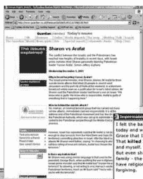

## 1 次修改后的代理


## 3 次修改后的代理


图 9.1. 无常代理根据每位受众成员的个人 Web 浏览素材，为其定制文本和图片。

周使用该代理后，任何一位受众成员的原始故事在结构上保持不变，但其内容已被该读者浏览插入的内容改变得面目全非。

我们并非仅为了遵循代理定制逻辑，才为每位受众成员创建不同版本的代理故事。我们还希望，利用该受众成员最近浏览收集的数据，对故事进行逐步转变，有助于让正在发生的事情更容易被识别——让我们作为作品核心元素的无常过程更具可读性。最后，我们的目标是想象一种新型的小说：一种通过其过程，在文本中探讨的某些相同思想得以实践的小说。在代理的例子中，我们感兴趣的是这样一个观念：我们的故事是无常的，被后来的内容覆盖拼贴，并且我们觉得，如果是每位受众成员最近阅读的网页覆盖了我们故事之前的阅读，这将是一种更有力的体验。

## 谈话疗法

毫不奇怪，与我的高中诗歌生成器相比，The Impermanence Agent 取得了巨大成功——无论是我自己的评价还是观众的评价。这让我渴望开展更多项目，其中数据来自每位受众成员个人，使文本实验更具可读性。这也是吸引我关注 Camille Utterback 文本作品的一部分。

Utterback 就职于纽约大学交互电信计划，办公地点在我的工作地点（先进技术/媒体研究实验室）隔壁的大楼。她与 Romy Achituv 合作的 Text Rain（Utterback and Achituv 1999）安装在连接交互电信计划空间两侧的通道中，创造了一种身体与文本关系的展开体验，我有机会多次观察（无论是在那个环境中，还是在 SIGGRAPH 2000 艺术画廊等场所）。

这种体验始于有人走过 Text Rain 投影：一幅字母落下的图像。然后，在走过的过程中，会产生一种认识：行人的自身影像现在被包含在场景中，当他行走时，他碰撞到的字母会被“击”回向上，部分地，然后再次落下（图 9.2）。行人随后成为观众，停下来观看场景；字母

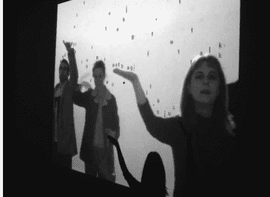

图 9.2. Text Rain 将路人引入与文本的互动中。

落在他的头和肩膀上，也许还落在他试探性伸出的手臂上，然后消失，接着被新落下的字母取代。接下来，观众成为玩家，弹跳字母，试图捕捉特定的单个字母或字母组，也许会使用物品或招募其他人。然后，玩家也成为读者，捕捉足够多的字母以意识到它们组成单词，捕捉足够多的单词以意识到它们组成短语，形成诸如“在你转身时，我身体的每一部分都变成动词”这样的句子。这些唤起身体与语言的句子，来自 Evan Zimroth 的诗“Talk, You”。

与文本的趣味互动使人们容易理解 Text Rain 中发生了什么，并鼓励了受众参与，但文本可能性空间很小——基本上，唯一的问题是任何给定的受众会解读多少文本。另一方面，当我看到 Utterback 正在开发的 Written Forms 时，它给我的感觉相当不同。Written Forms 并非呈现一张包含从天空落下的文本、带有模拟物理效果、邀请并构建互动的图像，而是呈现了一张完全由文本组成的图像。这种技术通过多层文本运作，每层的大小与投影相同，每层的字母亮度级别不同。然后，使用投影前空间的视频图像来在三层之间进行混合。场景中的亮区域选择来自更亮层的字母，暗区域选择来自更暗层的字母，以此类推。结果是，可以将投影既“读”作场景的图像，也“读”作文本的混合体。

看到这一点后，我立刻想到了我们用文字创作的图画，并开始思考这些图画在什么情况下特别有力。我向 Utterback 提出合作，她同意了，我们还引入了 Cilly Castiglia 和 Nathan Wardrip-Fruin（我的兄弟）。我们构思了一个与 Text Rain 的走廊式装置相当不同的作品。我们的作品 Talking Cure（Wardrip-Fruin, Utterback, Castiglia, 等人，2002；见图 9.3）包括一个黑暗房间里的桌子和椅子，配有一个大型投影屏幕。进入该空间的受众成员看到一束光从桌子照射到椅子上，听到由文本混合组成的音频环境，并看到投影屏幕上充满了一段文本：Joseph Breuer 对 Anna O. 的病例研究摘录。这段文本——讨论了将“谈话疗法”理念提供给 Breuer，随后由 Breuer 提供给 Sigmund Freud 的患者——提供了她病情的文字图景，例如她看到的蛇类幻觉。

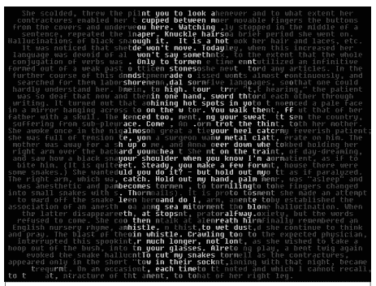

图 9.3. Talking Cure 从文本创建图像。


描述了，以及她语言使用中奇怪的波动。如果访客坐在椅子上，她上半身的文本图像会充满屏幕，这是通过添加两层进一步的文本创建的。她的脸在很大程度上由最亮的一层表示，这是由房间的照明创造的效果。这一层是我写的虚构作品，将安娜的幻觉重新置于戈耳戈涅美杜莎的故事中，将分析师置于珀尔修斯的位置——观看，但总是间接地。文本的中间层，出现在明暗交界处，由重复的词语“to torment”组成（这是案例研究中归因于安娜的少数直接引语之一）。最后，桌上有一个麦克风，当观众成员大声说话时，她的话语会被语音转文本引擎（误）识别，取代文本图像的中间层，并被记录下来以加入到声音环境的混合中。

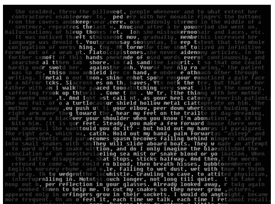

图 9.4. 手动玩 Talking Cure

或者，这是我们原本以为会发生的情况。当然，有些人确实以这种方式体验了这件作品。但当我们在加州大学洛杉矶分校（UCLA）为电子文学组织的2002年研讨会安装这件作品时，我颇为震惊。人们与作品的互动方式更像Text Rain，而不像The Impermanence Agent。有一个可供探索的文本可能性空间，有即时反馈，也有观众。因此，大多数互动者没有乖乖地坐在椅子上充当患者的替身，而是站在桌子上方，靠近摄像头，用自己的身体来表演和玩弄文本/图像。换句话说，一旦他们弄明白了简单的模型，他们就想要控制它。有些人用手捕捉一致的光线，来回扫描以传统方式阅读整个虚构文本（图 9.4）。其他人专注于通过控制文本层之间的边界来创造的有趣新词和其他混合物。还有人让朋友帮忙，用扭动的手指填满摄像头的视野，进出光锥。看着人们如此投入地参与我们的工作是一种乐趣，在某些方面，这比看着人们像我们想象的那样体验装置艺术更令人愉快。看到这一点，我的工作开始发生转变——这使我走向电子文学更广阔领域中的一场对话。

## 文本乐器

在UCLA展示Talking Cure的同一时期，我对电子文学社区中关于“为玩耍而设计的文本”的讨论越来越感兴趣——我将在此将其称为文本乐器。¹ 我特别受到John Cayley和Stuart Moulthrop的思想和工作的影响。例如，以下是Cayley在与Brian Kim Stefans的访谈中的说法：

> > 我的观点是，我们目前的作家正在尝试构建相对简单的文本乐器，这些乐器直观，并且希望在被玩耍时既能引发情感又具有意义。我所说的“玩耍”，就像演奏乐器、序列器或混音器一样。这确实是ergodic，但仍可与（艰苦的）工作或游戏中那种因获胜、其他形式的“成功”或仅仅是“可玩性”而获得回报的游戏类型区分开来。（2003）

1. 在这个短语中，我涵盖了关于具有工具性质的文本的讨论，该讨论使用了各种松散的术语。我还放弃了我之前就此主题所做写作中早期的一个术语区分……注释继续于本章末尾。

使用“ergodic”一词时，Cayley引用了Espen Aarseth的工作，我之前章节中曾讨论过他的《赛博文本：ergodic文学视角》。Aarseth通过以下陈述定义了该术语：“在ergodic文学中，需要读者付出非平凡的努力才能遍历文本”（1997, 1）。撰写《赛博文本》之后，Aarseth成为新兴计算机游戏研究领域的领军人物之一，帮助创办了该领域的第一本期刊，以及哥本哈根IT大学的计算机游戏研究中心。在引用Aarseth的工作时，Cayley将重点放在音乐、游戏和文本乐器中将游戏视为“非平凡努力”上。然而，他也明确将他所引用的文本作品与计算机游戏研究中一直存在的对获胜（或其他“可量化结果”）的关注区分开来——也与我在Talking Cure观众中看到的相对无结构的游戏区分开来。

我大约在同一时间就这些问题采访了Moulthrop，我们也讨论了读者/玩家非平凡参与的一些潜在挑战，以及文本乐器作者可能从民间乐器设计中学到的一些东西：

> 也许有些乐器很难演奏。它们可能需要练习。也可能不需要。一位老师曾就吉他对我说：“五到十分钟后，你就会发出近乎音乐的声音。这就是品柱的用途。”这也是民间乐器的一大优点。它们确实能让你很快接触到一套富有成效的词汇。我认为一个好的乐器应该能做到这一点。它会刺激参与感。它应该让人们想要投入其中进行互动，并重复这种体验。（2003a）

但对于Moulthrop来说，或许与Cayley不同，音乐和文学形象并非唯一相关的参照点。Moulthrop将音乐形象作为一种词汇，帮助人们想象那些介于工具性文本讨论中另外两种工作之间的项目。正如Moulthrop所说：

> 我尤其着迷于文学文本与游戏性文本之间中间空间的概念——介于互动小说或超文本小说与游戏之间。通过乐器，你拥有一种具有行为和时间维度的文本，它在某些方面映射到游戏设计中的时间体验和互动可能性。（同上）

这些是引人入胜的概念，但在纯理论层面讨论时也有些难以捉摸。我们如何构思那些具有文学性、但以某种音乐方式进行游戏、并可能占据既定游戏领域附近一些地盘的项目？更深入的探究需要查看具体项目。特别是，Cayley关于工具性文本的访谈陈述，是在回答关于他的作品riverIsland（2002b）的问题时提出的。我与Moulthrop的访谈是在他的作品Pax（2003b）发布之际进行的。我将接下来转向这些作品。

### riverisland

Cayley的作品经常采用他称之为“逐字变形”的技术。这是一种逐字母的变形，从一种文本过渡到另一种文本，很像图形变形在空间中移动点以从一种图像过渡到另一种图像。在逐字变形中，中间字母由沿着一个环的移动决定，Cayley在该环上按照声音排列了罗马字符，正如他解释的：

> 如果文本按常规网格排列，作为字母表，一个用于源文本，一个用于目标文本，那么逐字变形从一种文本（一张字母表）到另一种文本，就是逐字母地计算源字母将如何变成目标字母。假设你的字母表（包括“空格”和撇号，共28个字母）按特定环排列，其中被认为发音相似的字母聚集在一起。目标是计算从每个源到每个目标绕环的最短距离（顺时针或逆时针）。（2002c）

一旦每个字母的移动被计算出来，文本就会经过十四个步骤（对于任何单个字母可能需要的最大步数——移动到二十八字符环的另一侧）。有些字母经历的转换比其他字母多得多。过程开始时的变化是“勉强”的，然后在结束时变得“急切”于完成——因此早期和最终阶段都接近可读的文本。

Cayley的许多作品，例如他广为人知的windsound（1999），以程序具有表演性的方式采用逐字变形。文本


在读者/观众的注视下，文本会利用其显示所在计算机的计算能力，变形为其他文本。然而，这些变形就像我们看到的大多数图形变形一样，可以是预渲染并显示为动态图像（阅读时无需任何计算）。唯一可见的损失就是同一台计算机上不同阅读之间微小的时序变化，以及在不同计算机之间移动时偶尔出现的较大变化。

另一方面，Cayley 的 riverIsland 不仅在系统层面具有表演性，而且还以部分由读者控制的方式具有表演性（图 9.5）。读者可用的一种表演类型相对简单：

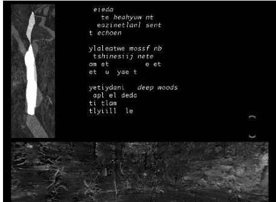

图 9.5. riverIsland 通过右下中部的箭头，使其文本变形之间能够进行传统的逐步导航——或者，对于有知识和实践的人，可以通过水平全景和/或垂直物体电影，更自由地选择目标文本。

riverIsland 由两组诗循环组成，一组水平，一组垂直，读者可以使用屏幕上的箭头来触发沿这些循环的移动。当读者指示应从一首诗移动到另一首诗时，计算机会执行相应的转写变形。

然而，riverIsland 中还有一种读者表演类型，在我看来感觉截然不同。我相信，这就是 Cayley 在与 Stefans 的访谈中谈论乐器时所要表达的部分内容。在这种表演类型中，读者可以点击并拖动屏幕上的垂直和水平 QuickTime 电影。垂直电影是一种“物体”电影，它在林间小径的图像之间进行图形过渡。水平电影是一条河岸场景的全景。有 riverIsland 经验的读者可以使用这些电影导航到作品两个循环中的任何一点。随后，会在导航开始前显示的文本（可能本身就是一个正在进行的变形）与通过操作电影所选择的目标之间执行转写变形。这创造了一种预渲染变形无法有效替代的体验——就像 Cayley 的序列器比喻一样，它利用实时计算过程来创建基于高级用户指令的表演，而这需要了解其材料和控制空间。

## Pax

此处考虑的 Moulthrop 的文本乐器 Pax，呈现了一种与 riverIsland 不同的阅读和表演体验。其差异在某些方面对应了 Cayley 和 Moulthrop 在讨论文本乐器时选择的两种不同音乐设备——Cayley 提到了序列器，而 Moulthrop 提到了吉他。

序列器在收到指令后可能会自行播放一段时间，但吉他要求每个音符都需要交互。同样，Pax 的结构旨在实现近乎持续的交互。作品左侧的较大区域显示字符向上漂浮（在作品时长的前半段）或向下落下（在后半段）。除非读者与这些字符进行交互，否则几乎不会出现文本。读者通过用鼠标指针“捕捉”漂浮的字符来进行交互（图 9.6）。字符可以通过移开鼠标来释放，或者点击（通过主动点击或按住捕捉二十秒）。点击会从该字符引出文本，该文本出现在右侧区域（一旦有足够文本可滚动，这将变成一个滚动文本区域）。十四个字符


图 9.6. 当读者捕捉并点击漂浮的字符时，Pax 会产生文本——否则它保持沉默。Pax 不是像叙事第一人称射击游戏的关卡那样，向读者“讲述”的叙事，也不是“大声玩过”的叙事，而是对人物和情境的探索。

它们以不同顺序漂浮，但最近被点击的字符倾向于重新出现，因此随着作品时间的推移，可以持续地从两三个角色中引出文本。每次阅读从中午持续到午夜（角色的时间），并分为六个主题乐章：“被时光抛弃”、“美国飞行员”、“家园”、“邪恶之人”、“坠落”和“全面信息”。从角色中引出的文本部分取决于该角色被捕捉和点击的次数以及作品当前的乐章。角色文本唤起两种情境：被困在达拉斯机场某个航站楼的版本中（出于安全原因关闭，这场“反恐战争”比 9·11 袭击后笼罩美国的那场更加不合理），以及被困在 Pax 本身的空间和结构中（赤裸、漂浮，并被交互者捕捉和戳刺）。

如果没有对作品有相当深入的了解，就不可能操纵 riverIsland 的 QuickTime 电影来达到特定效果，但 Pax 为首次阅读的读者提供了明显的点击位置，并能快速理解效果。但是，由于其随机元素和时间流逝的强烈影响，要在学会演奏后精确复制相同的阅读，比 riverIsland 更困难。用音乐类比来说，Pax 可能提供品柱，但它是一种非线性更像锣而非吉他的乐器。

这也表明，电脑游戏作为理解文本乐器的比喻具有其优势。在游戏语境中，行为随时间变化并不令人惊讶。要从 riverIsland 和 Pax 中引出特定阅读所需的物理操作和记忆技能，也不令人惊讶。这些“乐器”只附带一个作品，且无法轻易与之分离，这一事实在电脑游戏的语境中也说得通。然而，这些项目显然不是以游戏方式进行游玩的游戏。也许音乐类比最有帮助的地方在于，这些项目寻求一种抒情式的参与——这不容易用“竞赛”或“可量化的结果”来理解，这两个是游戏正式定义中经常引用的公式。另一方面，像《模拟人生》这样的主流游戏也缺乏获胜条件，我将在下一章进一步讨论这一点。

## 在虚拟现实中玩文本

在最初接触文本乐器的讨论后，我第一个可玩媒体项目是 Screen（Wardrip-Fruin, McClain, Greenlee 等人，2003–至今）。该项目将熟悉的游戏机制与虚拟现实技术相结合，创造出与文本进行身体交互的体验。同时，文本的语言与触摸文字的奇异体验相结合，创造出一种不易归入常规游戏玩法或虚拟现实思维方式的体验。Screen 起始于 2002 年，是由一个跨学科团队进行的最初“手指练习”之一，该团队由小说家和数字媒体先驱 Robert Coover 策划，旨在探索布朗大学房间大小虚拟现实显示装置的文学可能性。这个显示装置名为“Cave”，类似于伊利诺伊大学的 CAVE：一种在显示 3D 图像的同时允许用户继续看到自己身体的虚拟环境，且不要求用户穿戴笨重设备——不同于头戴式显示器，后者本质上是戴在佩戴者眼前的电视眼罩（Cruz-Neira, Sandin, and DeFanti 1993）。布朗大学的 Cave 是一个八英尺立方体，缺少顶部和一侧，其墙壁和地板都是屏幕。投影仪对准每个屏幕，交替投射供用户左眼和右眼观看的图像流。用户佩戴快门眼镜，与投影仪同步交替遮挡左眼和右眼。结果是立体虚拟现实——计算机生成图像的 3D 视觉——与 Cave 中人物和物体的物理存在相结合。

此类虚拟现实环境中的大多数项目致力于让墙壁消失，转而呈现虚拟景观或无上下文的物体。Traces 项目（Penny, Smith, Sengers 等人，2001）——是我们在布朗大学工作的灵感来源之一——摒弃了这些

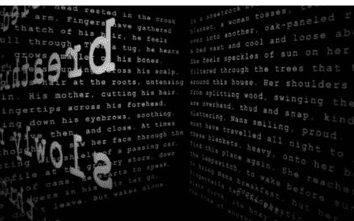

9.7. Screen 中的文本墙标记了 Cave 显示装置实际墙壁的位置。


放弃了既有惯例，转而采用房间的图像，在某些情况下被描述为大约是观众所在房间（CAVE）两倍大，在某些情况下则与该房间大小相同。在布朗大学，我们最初的想法之一是迈出下一步逻辑：尝试使用实际的 Cave 墙壁作为图像出现的位置之一，同时展示作品的一部分并加强显示的实际尺寸和观众的实际位置。导致 Screen 产生的那个手指练习始于 Andrew McClain（小组成员）以这种方式在墙壁上放置文本（图 9.7）。但文本没有停留——单词脱落并飞向观众。

## 体验 Screen

我在 McClain 的实验中看到了一个玩耍的机会。与声音艺术家 Shawn Greenlee 合作，我们创建了项目设计的原型，我起草了最初的一组文本。不久之后 McClain 停止在 Cave 中工作，该项目在 Josh Carroll 和 Coover 本人在概念、技术和文本方面的贡献下完成。它以 Coover 撰写的关于记忆的介绍性文本开始，该文本在墙壁上渐隐渐现。然后出现三段传统段落，每段几乎填满一面墙。这些段落中的每一段都是我写的短篇小说，唤起角色记忆的瞬间，从而产生触觉的虚拟体验。每面墙出现后会被大声朗读。最后一段读完后会有一个停顿，然后一个单词从墙壁上脱落，被大声念出，并飞向读者。如果读者什么都不做，单词会在她附近盘旋。很快另一个单词脱落，然后又一个，速度越来越快，围绕读者聚集。

读者可以通过用手拍打单词来干预这一过程。当单词被击中时会发出声音，单词会飞回墙壁。如果只有一个单词脱落，被击中后会返回它留下的空白处。但当多个空白处存在时，被击中的单词可能返回其中任何一个。被击中的单词如果在墙壁上没有足够大的空间，就会破碎，以特别快速的动作击中的单词也可能破碎。

一旦脱离墙壁的单词数量超过一定阈值——随着脱落速度加快，只有积极参与才能长时间延缓这一点——所有剩余单词都会脱离墙壁，围绕读者旋转，然后坍缩到 Cave 的中心（图 9.8）。随后会听到一段最终的“结束”文本，同样由 Coover 撰写。

除了创造一种与文本进行身体互动的新形式外，Screen 还创造了三种阅读体验：从墙壁上熟悉、稳定的类似页面的文本开始；接着是脱落和击打的逐词阅读（注意力集中于此）；同时，还有一种更边缘的意识，即聚集单词的排列以及正在墙壁上组装的新（通常是新造词）文本。它还利用观众对基本游戏机制的熟悉：即许多游戏（尤其是早期图形游戏）的核心“碰撞检测”。


9.8. Screen 的 SGI（2003–2004）版本中单词的坍缩。

我们或许可以简单地将 Screen 视为一种游戏，而非使用文本仪器等更不寻常的术语。事实上，Screen 的最后时刻会在墙壁上散落被击退的单词（及单词片段）——这导致一位年轻的 Cave 参观者问道：“那是我的得分吗？”但尽管 Screen 的玩法让人联想到经典游戏，一些玩家可能有时纯粹出于以最快速度击中单词的类游戏目标而行动，但并没有竞争或可量化的结果（同样，许多学术对游戏的定义也要求这一点）。即使纯粹从身体角度接近，而不关注被玩单词的语言本质，Screen 更像踢毽子而非足球。此外，根据我的观察，玩家接触 Screen 时并非不关注其作为单词的单词。互动者在阅读和游玩之间摇摆——两者的对象都越来越快、越来越碎片化——直到两种体验都无法维持，作品结束。

与 riverIsland 和 Pax 一样，读者/玩家可以在 Screen 上变得更好，尽管互动者不控制单词的撕裂这一事实改变了通过精湛技艺表演所能实现的内容。也许我见过的最令人印象深刻的 Screen 表演是 Michelle Higa 的表演，她既编辑了 *Screen* 的视频文档，又在其中扮演了演员角色（Wardrip-Fruin, McClain, Greenlee, et al. 2004）。为了录制 *Screen* 的视频，我们不得不暂时移除 Cave 左眼和右眼图像之间闪烁的交替。Higa 对 *Screen* 的体验已经足够熟练，以至于即使没有立体声提示，她也能相对成功地玩它。

Higa 的文档记录的是我们的初始版本。后来，在观察观众与第一个完成版本的互动，并且布朗的 Cave 从 SGI Irix 机器转移到 IBM Linux 机器之后，我与 Benjamin（“Sascha”）Shine 合作进行了一次重大改版。这使我们能够显著改进单词的动画（例如，在之前的版本中，出于性能原因，我们被迫将大约一半的单词排除在最终坍缩之外），并且也成为为 Cave 工作开发一套对作家友好的创作工具的起点。

最后，在 2007 年，该项目转向了两种新形式：加州大学圣地亚哥分校 Calit2 分部的环绕观众的十五屏 StarCave，以及加州大学欧文分校 Beall 艺术与技术中心的单屏画廊展示，这得益于 Stephen Boyd、Jurgen Schulze、Todd Margolis 等人的努力。通过这项工作，我们更多地了解了涉及身体和这种虚拟现实形式的项目。例如，在为画廊创建一个版本时（旨在等待观众启动，而不是作为 Cave 中的应用程序运行），我们设计它，使作品只有在被跟踪手部的观众触摸标题单词后才开始。我们发现，经过这一改变，之后不再需要提供手部位置的视觉标记——就像我们在之前的版本中所做的那样——这消除了标记本身是可供游玩的东西的暗示（这一暗示曾让之前的观众分心）。

这显著改善了作品的体验。但这是一个纯粹将 Screen 视为身体和视觉体验的改变。如果要求观众触摸一个彩色方块，而不是作品标题的文本，这条小小的指令本会奏效。这也指向了项目的一个更大问题。虽然在一个层面上文本是 Screen 体验的核心，但其过程和观众互动也可以不加改变地作用于彩色方块组，而不是各种字母系列。在这方面，它远非个例。

2. 我最初将这些空间逻辑称为图形逻辑。据我回忆，术语的更改是由 Espen Aarseth 建议的。

## 空间逻辑

以操作逻辑的思维方式贯穿了本书的全过程——起初被明确发展，然后在后续章节中越来越被视为理所当然。但在这里再次明确该符号是有价值的。

本书中讨论的大多数逻辑都是从其模拟的内容来考虑的。有些模拟耐人寻味地奇特，例如 Eliza 使用文本转换逻辑来模拟对话响应，Tale-Spin 使用基于计划框的规划逻辑来模拟拟人化动物的所有行为。

大多数计算机游戏依赖于另一种模拟：空间模拟。事实上，一组常见的空间逻辑是许多游戏运作的核心。考虑早期的标志性游戏 Pong。在这个游戏中，每个玩家控制一个球拍，分别位于屏幕的两侧。屏幕的顶部和底部是墙壁。该


玩家移动他们的挡板以与球的路径相交，球会弹回游戏区域——同时也会弹离墙壁。当一名玩家错过球时，另一名玩家得分。

就所模拟的活动而言，这与另一款早期且有影响力的游戏几乎毫无关系：太空战争!（Russell, Samson, Edwards 等人，1962）。太空战争! 创建于 20 世纪 60 年代初 MIT 的 PDP-1 上，被广泛认为是第一款现代电子游戏。使用自定义控制器，两名玩家控制 PDP-1 的 CRT 上虚拟飞船的飞行。飞船受模拟重力的影响被拉向屏幕中心的恒星，并可以相互发射弹丸。被中央恒星或弹丸击中的飞船会受损。

尽管这些乒乓球和太空战争的模拟呈现了不同的虚构世界，但如果我们观察其中的运行逻辑，就会看到重要的相似之处。其中之一是碰撞检测的逻辑——本书简介中简要提及过。这是一个虚拟物体与另一个虚拟物体碰撞的模拟。这在乒乓中球弹离挡板和墙壁时发挥作用，也在太空战争! 中飞船与弹丸和中央恒星相交时发挥作用。两款游戏还都提供了导航逻辑——乒乓沿直线，太空战争! 在平面上。两者也都模拟了物理学的基本元素，尽管太空战争! 中的重力是核心，却在乒乓球的弹跳轨迹中不起作用。

这小小的一组逻辑仍然构成了许多现代电脑游戏的基础。从充满趣味的马里奥游戏到粗犷的《侠盗猎车手》系列，碰撞检测、导航、模拟物理和弹丸发射都是系统的核心。有趣的是，这些相同的逻辑也是文本雨、Pax 和 屏幕 的核心——尽管它们和乒乓一样，缺乏弹丸。

在我迄今讨论过的文本游戏示例中，上述规则的例外是 Cayley 的 riverisland。尽管它主要通过对 QuickTime 电影的图形/物理操作来进行游戏，但它并不模拟虚拟对象的移动和碰撞。更重要的是，其最突出的运行逻辑——Cayley 的转字变形——基于排版形式。我将其视为一种文本逻辑，而非空间逻辑。

> 3. 这并不是说所有图形与空间逻辑的组合都同样有效。例如，Jesper Juul（2005，13–15）有趣地证明，太空入侵者 的逻辑既适用于学术理论，也适用于……注释继续见本章末尾。

## 运用逻辑

空间逻辑与游戏规则的成功组合被反复重新包装。像吃豆人和俄罗斯方块这样的游戏，有许多授权和未授权的版本“换皮”，使用了不同的表面图形和空间布局，但保留了空间移动和游戏玩法的基本逻辑。在更大范围的变化中，这样的组合也是我们识别“横向卷轴游戏”和“第一人称射击游戏”等游戏类型的基础。

另一方面，虽然一组空间逻辑通常能与许多不同的图形组合令人满意地工作，但文本内容并非如此。正因如此，文本雨、Pax 和 屏幕 都是空间逻辑与文本材料经过精心安排的组合，在文本主题与空间逻辑的运行之间建立了联系。当然，从技术上讲，像 屏幕 这样的项目可以使用任意文本材料运行，但只有有限的一组文本才能与其空间逻辑创造的形式产生共鸣。³

我认为 阿特罗伊兹 项目，由 Jim Andrews 创建，很好地展示了这种限制。乍一看，*阿特罗伊兹* 是著名街机游戏 *小行星* 的一个版本，其中许多图形被文本取代。但 Andrews 还创建了一个“狼人之词”来允许他人为 *小行星* 创作，并在作品的展示中加入了他人的文本，例如当 *小行星* 在“页面空间”展览（Superbunker 2004）上展出时所包含的 Christina McPhee 和 Helen Thorington 的文本。在我看来，结果显得随意，尽管我喜欢这些作者在其他语境下的作品——这与允许 *乒乓* 或 *太空战争*! 中的图形被任意文本取代并无不同。

另一方面，Cayley 在许多作品中使用了他的转字变形逻辑，包括交互式和非交互式作品。结果并不显得随意，反而很贴切。正如我上面所暗示的，我认为这是因为转字变形是一种文本逻辑，而不是空间逻辑。正如空间逻辑适用于各种各样的图形一样，文本逻辑也适用于各种各样的文本。Cayley 远非第一个使用文本逻辑的人。我们每天都会遇到特定于文本的游戏形式——例如报纸上的填字游戏。字母字符的一个特点是它们可以同时在两个相交的单词中发挥作用。在另一个层面上，Cayley 之前的许多作家和艺术家发明了文本转换程序，例如 Oulipo 的作家和数学家推广的著名的“n + 7”词典替换方法。

换句话说，虽然有限的一组文本可能适合与一组空间逻辑相匹配，但文本逻辑不一定如此。这指向了一个进一步研究的领域：开发新的与文本进行富有游戏性的交互形式，采用反映文本或语言（而非空间）行为元素的运行逻辑。反过来，这也将为文本系统打开可能性，使其在某种意义上更接近乐器：即能够令人信服地演奏多部作品（文本集），而不是被束缚于一部作品。我的下一个项目是朝这个方向迈出的初步尝试。

## 两个 N-gram 乐器

本书对 _餐厅游戏_ 的讨论包括对一种最常用于处理人类语言的统计模型的描述：马尔可夫链或 n-gram。这是一种基于过去行为模式来预测（或生成）未来行为的方法。例如，这种模型可以预测，在书面英语中，“q”后面更可能跟着“u”而不是“o”（因为双字母双字母组合“qu”很可能在任何相当数量的英文文本中反复出现，而另一种组合则不太可能出现）。

此类模型适用于串行有序数据，因此被应用于不仅包括文本和口语，还包括音乐表演和随时间变化的人类行为等多种领域。《餐厅游戏》揭示了最后一种应用的一些潜力和陷阱——这是电脑游戏的一个有趣研究领域，但与真实人类行为存在惊人的不匹配，并且很好地说明了以全民信息意识（TIA）计划为模型的大规模监控提案中固有的问题。

早先的讨论搁置了使用此类模型进行创造性、生成性目的的一些潜力。

例如，n-gram 也被用于为电子文学组装语言，也许最广泛的是由 Cayley 使用。他至少有七部作品采用了“搭配”词级双字母程序，包括 Book Unbound（1995 年，如 Aarseth 的《Cybertext》中所讨论）。这种方法也是 Babble!（DOS 程序）、emacs 的“分离新闻”命令、Hugh Kenner 和 Joseph P. O’Rourke 的 Travesty、Andrew Plotkin 的 chao 以及 Brion Moss 的 prate 等文本玩具的主要基础——这些玩具本身有时也被用于（不可玩的）文学的生成过程。

然而，基于 n-gram 的电子文学和玩具完全运行在“批处理模式”下。也就是说，交互者请求一段文本，然后生成该文本——之后可以阅读文本并请求另一段文本，但无法与文本进行交互（或在生成过程中进行交互）。鉴于与 n-gram 文本进行游戏的这种有限性，游戏的上下文也有限——通常是程序用来写入文本的空白文本缓冲区。在观察了观众如何与 屏幕 交互后，我与 Moss（我曾与他合作过《无常代理》）的一次谈话引发了对 n-gram 的思考，我们开始想象使用这种模型进行语言游戏的可能性，这种可能性不那么侧重于批处理，并且发生在文本上下文中。

Moss 和我联系了 Turbulence，这是一个支持数字媒体艺术的组织，它委托我们创作两个作品。这些作品将受到文本乐器理念的启发，并使用 n-gram 的逻辑运行。在与不同合作者的一次失败开端后，Moss 和我与文档研究员 David Durand（最著名的是他制定了许多文档


包括 XML 在内的标记标准）以及设计师 Elaine Froehlich（Active Surface Design 的主创）。从那里开始，该项目的概念化和执行是一项团队工作，最初的技术工作是在 Moss 的 Java prate 之上进行的，后来的开发则建立在 Durand 在 Tcl/Tk 上完成的工作之上。

早期做出了两项重大设计决策。第一项是，与其将 n-gram 文本构建到空文本缓冲区中，不如始终在预编码文档的上下文中开始游戏，并由对该文档的渐进式修改组成。这在一定程度上是出于以下事实的考虑：虽然 n-gram 算法生成的文本具有可从其源文本中识别的微观结构，但无论起始材料如何，n-gram 文本的宏观结构往往是相似的。有人试图通过统计源文本中的宏观结构来解决这个问题，但除非相关文本已由人类作者或编辑进行标记，否则此过程涉及一系列关于文本的假设（例如，句号标志着句子的结束，而在“e.g.”的情况下并非如此），这些假设有时不准确，并且在某些层面上令人审美上不悦。这些假设令人不悦，因为它们背离了简单 n-gram 字母表的纯粹性，而简单 n-gram 字母表在其基本形式下，可以像处理罗马字母文本一样轻松地处理日语或盲文文本。不过，还有另一个动机。在许多 n-gram 文本中，尤其是基于短链的文本，部分乐趣在于连贯与不连贯之间的博弈——我们发现，在传统创作文本的上下文中出现的这种边缘连贯，具有更有趣且可能更有意义的价值。

第二项设计决策是确定我们使 n-gram 生成以可玩的方式进行交互，而非面向大批处理的基本方法。我们决定，除了游戏发生所在的起始文档之外，还将拥有一套用于生成对起始文档进行修改的文本。（我们称这第二套文本为“修改文本”或“修改语料库”。）当显示起始文档时，某些词语会被高亮显示。我们选择这种方式，是因为它源自网页超链接的惯例，可以让交互者知道点击会引发响应。然而，这些词语的高亮并非源于作者指定的链接。相反，它们之所以被高亮，是因为一段 n-gram 文本（长度由作品作者指定）同时出现在起始文档和修改文本中。我们决定，这两套文本之间的这种“桥梁”将为交互者提供打开起始文档并插入从修改语料库生成的文本的机会。将提供多个生成的文本供可能插入，允许交互者选择其中一个或不选（后者将使文本保持不变）。提供的文本本身将通过使用 n-gram 技术从修改文本生成。提供的文本数量及其生成所使用的 n-gram 长度，同样将由作品作者决定。

做出这些决策后，我们草拟、制作了原型，并最终尝试使多种交互设计投入运行。有些设计未能产生我们期望的结果，另一些计算成本过高无法运行，但随着时间的推移，我们最终选择了一种设计——作为第一次尝试——我们在交互手感及其所创造的对文本关注的形态方面觉得令人满意。

对于这些最初的作品（*政权更迭* 和 *新闻阅读器*），这种交互是通过一系列简单的 Web 风格窗口进行的，这看起来既合适又易于实现。通过创建这两个初始项目，我们还了解了这种方法的局限性的重要经验教训。

## 政权更迭和新闻阅读器

*政权更迭* 始于一篇 2003 年 4 月的新闻文章，该文章报道了开启美国入侵伊拉克的轰炸。乔治·W·布什引用了“目击者”情报，称萨达姆·侯赛因遭到美国定点轰炸暗杀，并坚持认为伊拉克总统正在藏匿“大规模杀伤性武器”。游玩 *政权更迭* 将呈现来自一份记录不同美国总统暗杀和目击者情报的文件生成的文本——即沃伦委员会报告。

一旦打开带有 *政权更迭* 起始文本的窗口，该文本中的词语就会成对地被高亮显示（图 9.9）。点击词语会打开一个新窗口。与新窗口交互会生成新文本，这些新文本将取代被点击的词语。

新窗口包含以先前窗口中点击的词语开头的文本。新窗口中的每个段落都是一种替代文本——以相同的词语开头，但随后可能（虽然不一定）遵循许多不同的路径。这些文本是通过连接可能最初出现在源文档不同部分的词语链（三元语和四元语）生成的。

新窗口的文本显示后，其中的词语也会开始被高亮显示。点击高亮词语将打开另一个新窗口，其中包含可以取代被点击词语的生成文本（图 9.10）。打开几代窗口将为将要创建的文本（以及将取代早期窗口中被点击词语的文本）打开更广阔的可能性空间。窗口在沃伦委员会文本和原始新闻故事之间交替生成。在任何包含生成文本的窗口中，点击非高亮词语也是一种交互方式。这样的点击将关闭窗口并选中一段文本。所选文本将从被点击段落的开头一直延伸到被点击的词语。然后，这段选定文本将取代打开窗口时被点击的词语（图 9.11）。这创造了一种伸展文本——打开窗口时点击的那对词语将被词语


图 9.9. *政权更迭* 显示其起始文本。

在打开的窗口中选定的词语（通常不止一对）。

打开几层窗口后，游戏的一部分是跟踪每个窗口的来源——以便通过选择一个词来折叠它，该词将在玩家打算连接文本的点处形成一个顺畅的过渡。（这可能在多层之下。）每个生成窗口的标题栏在一定程度上使跟踪上下文变得更容易——该标题栏显示将被生成文本替换的两个词，后跟它们在被点击文本中出现的后两个词。

我发现，当我游玩时，这一阅读、记住上下文、选择点击位置、再次阅读的活动循环会占据我全部的注意力。我发现，无法像对待其他写作项目那样对政权更迭进行“朗读”。相反，我最成功的演示是一系列表演，我游玩文本，而波帕娜·布兰德斯大声朗读结果。

新闻阅读器的运作方式类似。然而，它不是基于给定的新闻文章和政府报告，而是用于阅读当前新闻并重新塑造它的软件。它可以被视为一种专用浏览器——显示所选 RSS 源以及该源链接的新闻报道。与普通浏览器不同，新闻阅读器还会在后台下载另一组文本——并利用这些材料对其显示的每个页面进行文本游戏：通过这种游戏，隐藏文档的关注点和语言模式（由玩家选择的移动和段落所塑造）被引入原始新闻报道。新闻阅读器提供了一种不同的日常新闻体验方式，使其模式的


图 9.10a-c（从上到下）。政权更迭打开多层窗口。


将重复短语转化为干扰的机会，并产生从滑稽到令人不安不等的结果。当“新闻阅读器”启动时，它会显示一个包含 Yahoo! 新闻 RSS 源中当前标题的窗口（图 9.12）。点击标题或预览文本会打开另一个“新闻阅读器”窗口，显示新闻报道，并添加了链接（图 9.13a）。与“政权更迭”一样，这些链接并不通向其他网页，而是根据统计文本模型生成文本（在此


图 9.12 和 9.13a-c（从上到下）。从上到下，Yahoo! 新闻 RSS 源、一则新闻报道、一个生成文本的窗口，以及“新闻阅读器”中的文本替换。

例中，改写语料库的三元语法及其相对频率）。这些生成的文本出现在一个新的“新闻阅读器”窗口中（图 9.13b）。改写语料库是从替代性新闻报道的文本中创建的（这些报道位于 Common Dreams，在“新闻阅读器”启动时在后台下载）。与“政权更迭”一样，生成文本的窗口包含几个段落，每个段落都是 n-gram 的延续，该 n-gram 以被点击窗口中被点击单词之前的那些单词开头。同样与“政权更迭”一样，点击非高亮单词将关闭一个生成文本的窗口，替换掉打开该窗口的被点击单词（图 9.13c）。用于执行此替换的单词将是被点击单词与其所在的替换文本（“段落”）开头之间的单词。

## N-gram 玩法

当然，这两个项目与本章前面描述的那些项目截然不同——特别是 Pax、riverIsland 和 Screen。最明显的区别是，这些项目的作者没有为“政权更迭”和“新闻阅读器”撰写文本，对于后者，作者甚至没有选择文本（仅选择了每次阅读时收集文本的方法）。这在一定程度上与实验的性质有关。一种旨在演奏许多作品（使许多文本可演奏）的文本仪器，只有在能够处理未经其作者预先审查的文本时才最具说服力。但还有其他原因。当我住在纽约时，我记得有人问过我：“最可能让你生气的事情是什么？”我回答：“《纽约时报》的头版。”那时我有点新闻成瘾——但和许多人一样，在多次接触新闻后，我也感到沮丧和愤怒。将某种趣味性引入新闻体验是我的动机之一。

一个像“新闻阅读器”这样的项目的趣味性可能看起来纯粹是破坏性的，只留下混乱不堪——我们的小组可能无意中通过将我们仪器的玩耍描述为执行威廉·伯勒斯“切断词线”的指令的一种方式而暗示了这一点。但我认为，杰娜·奥斯曼（2007）抓住了某个关键点，她将“新闻阅读器”描述为对二十一世纪初美国政治和语言环境的一种“诗意”回应。她将该项目与约翰·凯奇的中缀诗工作进行比较，并得出一个发人深省的结论：

> “新闻阅读器”和凯奇的中缀诗都利用了我们现在很容易识别为数据挖掘形式的东西。两者都表明，读者身份（和作者身份）是一种对文本进行采样、转换、改变和物理处理的行为；阅读行为本质上是表演性的。

但也许最重要的是，两者都在元文本或隐喻层面上运作，寓言化了我们的注意力方法、我们的信息处理方法，以及这些处理形式如何反映（或改善）我们实际生活其中的生活形式。与“文本仪器”主页宣称的切断词线的破坏行为作为其目标不同，我认为，“新闻阅读器”和凯奇的中缀诗实际上鼓励沿着新路径构建意义。

但尽管我希望论证这些程序是一个持续项目的两个部分。两者似乎都特别回应执行其时代内容的形式和结构。凯奇在决定遵循无意图之路时，是在抵制他所看到的对浪漫自我表达和意图的自动优先。而“新闻阅读器”构建在信息处理工具的架构之上，抵制了当代对一切都应可知、可搜索和可分析的渴望。（同上）

换句话说，我与“新闻阅读器”和“政权更迭”的目标与本书讨论杰夫·奥尔金的《餐厅游戏》背后的目标相关。我试图利用奥尔金的项目既来说明数字媒体的一种方法，又作为一个清晰的示例，帮助我们理解统计模型的局限性，从而为关于 TIA 等项目的决策提供信息。当然，这些清晰的示例并不是通往所谓“程序素养”的唯一途径。另一种途径，我以《模拟城市》为例进行过讨论，是可以从游戏中产生的那种理解。这种理解并不允许重新实现：它既不够详细也不够精确。但它可以产生一种对算法、对工作中的过程、对潜力和局限性的感觉。我希望“新闻阅读器”和“政权更迭”能帮助为 n-gram 产生这种理解。

这些潜在结果指向了进行算法数字媒体工作的动机。这不仅仅是为了过程的表达潜力，尽管这很棒。也是因为这种媒体，特别是当它是可玩的时，可以成为我们今天所生活的“软件社会”发展更深层理解的方式。正如萨斯基亚·萨森所说：“今天，当代社会的所有逻辑都嵌入在软件中”（Fetveit and Stald 2007）。我们需要使用每种可用工具来发展对这些逻辑的理解。

## N-gram 不透明性

不幸的是，现在这些项目已经被观众接触，我可以看出，“政权更迭”和“新闻阅读器”是开发对 n-gram 运行逻辑理解的有问题的工具——这也使它们在实现我们所有项目目标方面不那么成功。事实上，一位评论家玛丽-劳尔·瑞安明确将它们作为“反 WYSIWYG 美学”的例子（2005）。对于瑞安来说，它们有趣的地方无法在表面上看到。

像奥斯曼那样深入理解这些项目的观众，通常并不是通过与它们的表面进行游戏来发展理解的。相反，他们还阅读了我们写的内容，也许与我们讨论过它们，并且可能甚至梳理出我们系统与其他系统之间的显著差异。我回过头来看，这些项目对大多数观众来说之所以不透明，是因为我们在最初的两个设计决策上没有走得足够远。

首先，我们选择让 n-gram 游戏发生在文本上下文中（即现有文档），而不是在空白文本缓冲区中。但我们在选择每次点击时打开一个新窗口时，牺牲了该上下文的大部分。即使是我，作为项目设计者之一，在游戏过程中也必须投入大量注意力来跟踪所选单词（来自更高级别的窗口）将被插入的上下文（插入到下方一个或多个窗口中）。

其次，我们希望让 n-gram 文本可玩，而不是以批处理模式生成。但我们的方法是创建“微批次”，玩家可以从中进行部分选择。产生这些批次的 n-gram 过程在表面上保持不可见，而这个表面最终和我高中诗歌生成器的表面一样不透明。

简而言之，“政权更迭”和“新闻阅读器”可以为理解其运作的人创造引人入胜的游戏体验，意图与即兴发挥相互交织。但系统本身并不帮助那些不了解工作过程的人发展这种理解，因此最常见的观众体验与随机剪切技法产生的体验差别不大。用本书的术语来说，我们严重触犯了 Tale-Spin 效应。我们系统中最有趣的过程仍然隐藏在表面之下，游戏无法揭示它们。

如果我要做另一个此类 n-gram 文本项目（我可能会做），我对替代设计的第一个想法是，简单地更充分地实现我们最初的设计目标。游戏将在游戏结果将驻留的文本上下文中进行。我不再打开几层窗口，而是从玩家鼠标点击的位置开始拆分一个句子，游戏区域由两个句子部分之间的空间定义。同样，我将完全放弃批处理模式。而不是让玩家


在句子拆分点选择潜在的多词延续时，玩家将从该点逐词构建文本，各个词选项由 n-gram 模型生成。在每个阶段，我都会高亮显示用于做出选择的词链（或许还会使用屏幕的不同区域来显示它们出现的原始上下文）。

当然，与任何投机性数字媒体系统一样，在作者进一步开发这些提案并让受众接触之前，我们能从中学到的东西不多。但我希望，这种方法通过关注我在研究和撰写本书时学到的教训，可能会更成功。与此同时，这些项目是通过文本逻辑进入游戏领域的又一步——而这本身是数字媒体中非同时进程的一个调查领域。

## 模拟、语言与小说

我相信，计算进程是我们探索小说未来最令人兴奋的工具。本书大部分内容探讨的一个未来方向是：以类似于游戏（以及其他可玩媒体）模拟空间的简化、表达性方式，模拟虚构事件、角色等等。但是，正如电子文学社群有力地证明的那样，数字媒体使许多不涉及故事事件变化的新颖虚构形式成为可能。我认为，这对于比电子文学作者迄今所创作的大多数作品更注重进程的作品也是成立的。

我对文本工具感兴趣，部分原因在于它们在大部分未被探索的领域中留下的印记。通过文本逻辑进行的富有游戏性的互动，是未来小说、诗歌和戏剧的一种可能途径，它利用计算进程来实现新的受众体验。但同样，这只是一个可能的方向。

自从 *无常代理* 以来，让我惊讶的部分在于，我看到沿着类似思路的作品寥寥无几。*代理* 是一部小说，它使用进程不是来模拟其事件的发展，而是来模拟其主题的某个方面，而进程随后在受众体验中将其付诸实践。与 *政权更迭* 和 *新闻读者* 一样，它只是第一次粗糙的尝试。然而，它在广阔的非模拟性、进程密集型文学作品可能性空间中，又立下了一座标志。

正如本章所概述的，我认为我在这些项目中的一个主要局限是，它们没有走得足够远，以使其进程变得可读。这就是为什么我希望探索这一领域的其他人不会对游戏望而却步——就像那些对文学感兴趣的人不幸经常对待大众媒体那样——而是密切调查游戏所呈现的游戏可能性。非模拟性的文学可能性只有在一定程度上被理解，才能为其受众提供有意义的新体验，而游戏显然是使进程可读的最强大方法之一，除此之外，它也是一种巨大的乐趣。

我当然不是参与这一探索的唯一一人。许多值得注意的项目正在开发新的文本游戏模式。我认为特别发人深省的三个项目分别由 Warren Sack、Chris Crawford 和 Fox Harrell 领导。

4. 在对话地图中，最后两个项目使用了与无常代理所采用的相同 WordNet 工具。然而，Agonistics 的类似功能避开了 WordNet 的同义词（及其他概念分组），而是追踪精确的……注释继续见本章末尾。

## Agonistics：一场语言游戏

Sack 创建了许多基于语言计算分析运行的项目。或许其中最著名的是他的对话地图（Sack 1997–2000）。该项目汇集了在社会学、语言学和信息可视化领域开发的计算和概念工具，以创建用于与超大规模对话（VLSCs）进行交互的软件。这些 VLSC 的示例是发送到 Internet 新闻组和邮件列表的消息。对话地图分析 VLSC，以发现哪些参与者正在回应他人、对话的可能主题，以及使用相似术语的“语义网络”映射。

正如政权更迭和新闻读者从批处理模式迈出迈向游戏的第一步一样，Sack 的 Agonistics（2004）使用与对话地图非常相似的技术，但朝着游戏的方向发展。具体来说，Agonistics 不像对话地图那样专注于展示可以揭示对话方面的批处理结果，而是作为一款回合制游戏运行。要参与，玩家使用电子邮件程序或 Usenet 客户端参与 Agonistics 正在分析的 VLSC——同时还要访问一个网页，该网页以游戏的形式可视化该 VLSC（图 9.14）。例如，在德国 ZKM 的一次展览期间，Sack 使得通过发帖到 alt.politics.bush（英语）、fr.soc.politique（法语）或 de.soc.politik.misc（德语）即可参与游戏，并为每个论坛提供了 ZKM 托管的 Agonistics 页面。

对话中的每个参与者（即使是那些不知道游戏的人）都会被分配一张面孔。与他人对话的玩家会获得分数，并看到自己的面孔移向中心。被 Agonistics 视为正在讨论小组正在讨论的主题的玩家，会导致该主题被显示，并且其消息中的一个句子会在屏幕顶部被高亮显示。正如 Sack 的目录描述所言，这些规则会产生某些结果：

获胜的玩家将是那些能够 (a) 通过与多名人士对话建立大型联盟；(b) 推广一组期望的讨论主题，这些主题会被其他人在其帖子中采纳；以及 (c) 就讨论主题阐述有影响力的观点的玩家。

对 Sack 来说，Agonistics 是一项尝试，旨在制作一款可玩的游戏，其运作方式受到那些哲学家语言学家（他引用了 Chantal Mouffe、Gilles Deleuze、Bruno Latour 等人）的启发，这些人以类似游戏而非战争的术语来想象民主辩论。显然，这样的游戏永远无法满足对“可量化结果”的要求，尽管它当然是可玩的。我特别被这个项目吸引，因为 Sack 展示了一种创建有意义的多人语言游戏的方法。Agonistics

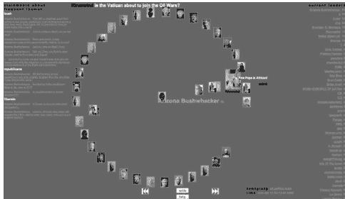

图 9.14. 在 Agonistics 中进行游戏的新闻组 alt.politics.bush。

5. 一项功能，它通过将英语视为一组允许的代码而非表达手段，使得可以玩拼字游戏。

该系统使用与语言和讨论的结构及意义相关联的模型运行，而不是，比如说，使用特定词典作为确定合法和非法移动的剃刀。”这与使用词语作为由空间逻辑所支配对象的外皮大相径庭。

## Deikto：一种用于互动叙事的语言

Crawford 其“进程强度”概念一直是本书的基石，他是计算机游戏设计领域的巨擘。他撰写了该主题的第一批书籍之一（Crawford 1984），并创立了该领域最重要的会议。但在 1990 年代，他放弃了计算机游戏领域，转而全身心投入互动叙事的追求。他当前方法的基础是一种专为游戏设计的新语言。

这种语言 Deikto，旨在回应大多数互动体验中呈现的有限数量的“动词”。例如，在许多图形游戏中，唯一可用的动词是“移动”（通过导航实现）和“攻击”（使用可用武器，朝其路径上的任何目标发起）。鉴于 Crawford 相信互动性是计算为媒体所能实现的本质，并且能够扮演故事主角是互动叙事应提供的基本体验，因此他必须找到一种方法，让玩家能够表达更复杂、更微妙的动词。

如前所述，Façade 的设计师试图通过允许玩家随意输入来解决类似问题。Façade 系统随后试图

将其基于当前语境解释为一组话语行为中的一种，这些话语行为会以特定方式改变底层系统的状态。这为各种各样的玩家表现打开了机会之门，但也导致了两种失败类型。首先，系统可能无法将玩家的发语适当映射到话语行为。其次，系统可能无法对即使被准确识别的发语提供任何有意义的回应，其结果与识别失败一样令人不满。Crawford 决心避免这两种失败。

他的替代方案 Deikto 是一种简化语言，玩家通过构建句子来在游戏中进行操作。构建此类句子为表达创造了比标准游戏中更大的可能性空间，即使可表达的内容（即能显示在屏幕上的内容）的空间，也小于游玩 Façade 或与 Eliza/Doctor 聊天时所体验到的空间。对 Crawford 来说更重要的是，向构建句子的玩家呈现的选项，都是在底层系统层面有意义的选项。这既防止了令人不满的失败，也为作者提供了一种方式，引导玩家采取能够产生有意义系统响应的行为——其方式比大多数游戏中使用的技术（例如，突出显示特定对象或在任务日志描述中嵌入提示）要微妙得多。

Deikto 的原始设计是图示式的，线条代表主要元素之间的连接，每个发语都能扩展为复杂的分支结构。这可能会产生相当难以阅读的句子。

截至撰写本文时，Crawford 已开发出一种新的“线性 Deikto”，它在通过菜单式交互与系统构建的元素之间插入连接词——这些连接词不被系统解释，也不一定语法正确——从而产生更易于受众解读的文本。这一点至关重要，部分原因在于系统控制的角色也会用 Deikto 表达其故事世界中的动作，因此受众解读 Deikto 所需的时间决定了故事体验的某些节奏。Crawford 的团队提供了一个线性 Deikto 的示例，大概是作为他里程碑式游戏 Balance of Power（《权力均衡》）更新版本工作的一部分构建的（新版本正在使用 Storytronics 系统开发，Deikto 是该系统的核心）。我已将 Deikto 元素放在括号中：

美国行动：[You] [start with this approach] 以完成 [Afghanistan hand over bin Laden]
你决定：[I] [offer deal] 给：[United Kingdom]，其中 [I] 承诺请求 [China] 做这件事：[China recognizes Taiwan] 作为回报，[United Kingdom] 同意请求 [Afghanistan] 做这件事：[Afghanistan hand over bin Laden]

这可以被视为一种模拟——但它颠覆了关于模拟与语言之间映射的许多常见假设。它标志着进入中间地带的一次尝试，这是一种既用于受众交互也用于内部操作的语言。采取这一立场，它提供了诱人的可能性，即受众成员可以构建复杂动作，而不会陷入困扰 Façade 的 Eliza effect 问题——

或者，确实也不会陷入限制了大量文本交互小说吸引力的“search for the verb”问题。当然，还为时过早，无法断言 Crawford 特定系统将有多大影响（我正在其计划发布之际撰写此文），但我相信它所探讨的理念在我们向前发展的过程中将至关重要。

## Griot：呼应叙事

Deikto 可被视为广泛存在的富有玩味的语言互动模式的一个例子：“呼唤与回应”。Harrell 在其数字媒体工作的一个分支中追求另一种形式的呼唤与回应。他将这种工作的游戏形式与轮流传统联系起来，这些传统从 signifyin(g) 和 Capoeira Angola 歌曲到日本连歌和 Oulipian 语言游戏。在他该领域的每一部作品中，系统和受众共同创作短文本——受众的贡献简短，而且通常只有一个词。这样的“呼唤”不仅作为表面体验的一部分，还塑造了底层系统的运作，之后系统会以另一段文本作出回应，并经常再次邀请受众轮流进行呼唤。

Harrell 用于支持这些体验的底层系统名为 Griot。它旨在使作者能够创作交互式计算叙事以及他所称的“基于主题重要概念融合的多态话语”的新形式，这些概念使用 Joseph Goguen 的代数符号学理论来指定。作者将主题领域指定为公理集，将短语模板指定为带有开放插槽的可能输出文本（用于概念融合的结果），并将叙事结构指定为一个序列，用于

6. 如下文所述，他目前正在探索以字母文本为非核心的替代界面。Harrell 和他的学生不仅将该系统应用于文本，还应用于跨媒体的用户身份表示（例如，头像、角色……注释继续见本章末尾。

在特定阶段可使用的叙事短语的数量和类型所定义的体验。系统会扫描每个受众呼唤中的关键词，这些关键词用于选择每个系统响应中融合的主题领域。他早期的示例侧重于文本输出，但他的框架支持更广泛的文本定义，其中包括多模态输出——例如，本节所述的一种视觉诗歌。

Griot 系统的核心是他的 Alloy 融合算法。该算法将两个代数表示的待融合概念作为输入：一个代表这些概念之间共享结构的基础概念，以及基础概念与其他输入概念之间的映射。它基于一组原则找出组合这些概念的所有可能方式，这些原则基于概念的结构方式、它们如何相互映射、输入概念在融合中保留了多少，以及在融合过程中数据类型是否发生变化。Griot 仅使用 Alloy 方法的一个子集——例如，通常只输出最优融合——而 Harrell 继续开发利用融合的生成能力的方法，使文本能够即时创造出新的、主题受限的含义（Goguen and Harrell forthcoming）。

我们可以在 Harrell 的可变叙事诗 The Girl with Skin of Haints and Seraphs（2007）中看到具体示例。叙事结构规定每首诗以抽象短语和定向短语开头。可能的开头短语包括“她开始她的日子（动词从句）”和“每天早晨敌人称呼她（单数名词）”。领域包括非洲、欧洲、天使、恶魔、皮肤和白色。恶魔关键词包括 demon、pitchfork、devil 和 brimstone。恶魔公理包括“Persondemon spawns Emotion:fear”和“Object:fire burns Person:soul”。Harrell 在某些情况下与他的研究生合作，也将这项工作扩展到其他类型的材料。在 Loss, Undersea 中，他创作了一个多媒体交互式叙事诗，其中一个角色在标准工作日中穿行，遇到一个正沉入深渊的世界（图 9.15）。在与 Kenny Chow 的合作中，Griot 正被用于一个“视觉连歌”系统——其中呼唤与回应可以包括汉字之间所能唤起的某些意象性、图示性和概念性联系。在与 Jichen Zhu 的合作中，Griot 是一个讲故事系统的一部分，该系统邀请受众喊出关于世界被如何感知的方面

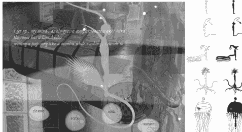

9.15. 在 Loss, Undersea 中，当用户为角色选择情感驱动的动作时，角色会动态转变——深海生物附肢从他周围伸展并缠绕，并生成诗意文本来叙述人类在水下世界失去人性的过程。Griot 用于以多种方式实现融合。结构融合（源自代数符号学）是根据图示和视觉意义整合多媒体元素，而概念融合（源自认知语言学）是整合表示概念的逻辑数据结构。


并被焦点化角色所吸引，该角色不仅塑造了世界中的行动，还塑造了意识流角色白日梦的程度和语调。

我发现引人入胜的是 Harrell 的工作，旨在使语言游戏成为对底层概念模型的参与——同时组织他的系统，使语言和概念结构都为每部作品单独创作。虽然其概念融合方法可能要求每部作品中的概念以相似形式表示，但这似乎比假设相同概念适用于每部作品要有前途得多（这种假设似乎封闭了艺术最重要的可能性之一）。

## 过程与小说

本书的研究和写作让我对面向过程密集型小说的模拟导向方法的可能性产生了更浓厚的兴趣。也许正因为我接受过小说家的训练，我更倾向于想象具有固定事件的故事，其中计算模型为语言和主题开辟了可变性。但模拟传统的丰富性——其中大部分在我找到的关于电子文学和游戏设计的书籍中鲜有讨论，而这两类书籍往往侧重于低过程强度的方法——让我确信了这一方向的潜力。同时，我希望本章能说服那些长期将小说的计算方法等同于模拟的人，认识到等待我们探索的可能性范围要广泛得多。

## 注释

- 1. 在这个短语中，我涵盖了一场关于具有工具性质的文本的讨论，该讨论使用了各种松散的术语。我还放弃了我之前关于此主题的写作中“工具性文本”和“事实工具”之间的早期术语区别（2003a, 2005）。但思想之间的区别仍然存在，只是没有使用容易混淆的相似术语。
- 2. 我最初将这些空间逻辑称为图形逻辑。据我回忆，术语的更改是由 Espen Aarseth 建议的。
- 3. 这并不是说图形与空间逻辑的所有组合都同样有效。例如，Jesper Juul (2005, 13–15) 有趣地展示了《太空入侵者》的逻辑既适用于学术理论，也适用于电视名人——但这假设与两者的关系都是对抗性的。当然，一组图形所描绘的小说的具体内容对我们如何解释空间逻辑有很大影响。例如，Raph Koster (2004, 167–169) 展示了著名的抽象游戏《俄罗斯方块》可以被转化为一种令人不安的体验，其图形描绘人体被投入毒气室或集体墓穴。
- 4. 在《对话地图》中，最后两个使用了与《无常代理》相同的 WordNet 工具。然而，Agonistics 的类似功能避开了 WordNet 的同义词（及其他概念分组），而是跟踪引入对话中的准确单词和短语。
- 5. 一项功能，使得可以将英语视为一组允许的代码而非表达手段，从而进行拼字游戏。
- 6. 如下文所述，他目前正在探索以字母文本为非中心的替代界面。Harrell 和他的学生不仅将该系统应用于文本，还应用于跨媒体的用户身份表示（例如，头像、角色和个人资料）。在其他工作中，他正在探索面向视觉图标的类游戏界面的可能性，这些界面可用于基于用户行为分析向系统传递有意义的关键字，无论用户是否知情。

# 第 10 章
## 结论

这本书当然涉及副标题中提到的主题——数字小说、计算机游戏和软件研究——但最重要的是，它关乎 *表达性处理*。

在本书过程中，我从三个视角探讨了这一主题。一个视角面向数字媒体创作，着重于将计算过程理解为作者表达的强大工具的潜力。另一个视角面向数字媒体的批判性研究，着重于理解作品中不表面显现的方面。最后，我还采取了政治视角，着重于某些作品中的政治利害关系以及从其他作品中汲取的政治教训。在这里，在《表达性处理》的结论中，我将重新审视每个视角，汇集全书的观点，并提出一些未来方向。

## 作者

我们有理由讨论数字媒体，因为计算过程已经展示了定义引人入胜的新媒体形式的能力——从第一人称射击游戏到协作式 wiki。用于制作此类媒体的过程的具体细节，可以像电影中使用的图像的具体细节一样，甚至更根本地塑造观众的体验。利用此类具体细节进行作者表达，是我所指的“表达性处理”的含义之一。

我特别关注表达性处理在小说领域的潜力：在创建故事事件的灵活模型、为角色和叙述产生多种语言，以及创造非模拟体验，使语言本身可玩或实施程序性转换以放大小说主题。作为计算机游戏爱好者，计算机游戏极大地发展了空间的表达性模拟，我特别关注该领域中小说灵活模型的可能性。

考虑开放世界计算机角色扮演游戏。在《上古卷轴 IV：湮灭》（Rolston, Howard, Cheng, et al. 2006）等游戏中，世界在空间上被模拟，如同许多其他游戏一样。但它在其他意义上也被模拟。当我在世界中移动时，我会收集可用来制作药水的原料。当我制作药水时，我在这方面的技能会提高。随着技能的提高，我会了解不同原料可能产生的更多效果。我可以使用所得的药水，或将其出售到模拟经济中。出售它们所获得的东西与我作为商人的能力（使用得越多，能力越强）以及其他角色对我的模拟感受（可通过对话模拟小游戏以及我的阵营归属、是否持武器出鞘等因素改变）相关。这只是《湮灭》众多空间中支持的交叉活动类型的一个切面。与这个广阔、可探索的世界形成对比——玩家可以以多种方式移动，拥有许多不同的目标和通往目标的路径——游戏的故事结构是僵化的。

正如《湮灭》的首席设计师 Ken Rolston 所写：

> 探索比遵循任务阶段具有更真实的悬念。有那么多方向可以转向，那么多人可以交谈，那么多洞穴可以钻进去，那么多生物和恶棍可以追捕并正义地（或卑鄙地）屠杀。相比之下……我总是撞上我所服务的情节的边界，对自己挑选的对话台词和提供的调查途径感到失望。我总是意识到角色和情节限制我的方式——但在探索时选择去哪里和做什么，边界就不那么令人恼火和沮丧了。（2009）

有人可能通过简单放弃任何获得充实小说体验的希望来解决这个问题。但实际上，许多角色扮演游戏玩家转向这种形式，恰恰是为了获得比许多其他游戏类型中发现的更发达、更成功的小说体验。与其放弃小说，不如说更好的解决方案可能是开始将叙事运动整合到模拟世界中，使用在故事生成和互动戏剧数十年研究中探索过的技术。

同样，可以说《侠盗猎车手 IV》（Benzies, Garbut, Fowler, et al. 2008）等游戏在 Jesper Juul（2005, 123–130）意义上是“不连贯”的：它们的事件只有参考游戏规则才有意义，而不是可以用小说世界来解释。人们可以从《侠盗猎车手 IV》一开始就体验到这种不连贯。例如，在第一个主要任务中，玩家必须将其角色的表亲送到一场纸牌游戏，警惕放高利贷者，然后在他们出现后驾驶逃跑车。如果玩家被放高利贷者开枪击中而失败，他的角色最终会出现在医疗中心外的人行道上，并被收取了服务费。玩家需要展示


- 1. 恐怖谷——日本机器人学家森政弘提出的术语——指人类角色表象中的一种现象。随着表象趋近现实，它们看起来越来越熟悉，直到……（本章末续）

该任务所需的技能，因此游戏鼓励玩家再试一次。如果玩家再试一次，完全相同的对话会导向完全相同的任务。仿佛回到了故事中更早的时间点。但医疗费用的钱仍然不见了——这只能通过将治疗费用视为未完成任务的游戏规则惩罚来解释，而不是角色的钱包以某种方式存在于不同的时空连续体中。一个更连贯的世界，以及对重玩任务的玩家更有趣的体验，将来自对任务元素（开车过去、观察、逃脱）的抽象，并使用计算过程产生一系列任务，在虚构时间中一个接一个地出现，直到玩家成功展示出足够的技能水平。

这两者都将是迈向我所谓的“未实现谷”的步骤。我提出这个术语，作为对恐怖谷的一种刻意提醒——这个短语我开始在索尼宣传PlayStation 2图形处理器为“情感引擎”的时期更频繁地听到。关于恐怖谷最常见的讨论表明，我们与人类角色产生共鸣的能力与其图形表象密切相关。情感引擎的观点认为，更高的图形保真度是更深层次情感投入的关键。但那些似乎真正引发最大情感参与的非玩家角色，似乎并不是图形最好的，或者最接近恐怖谷边缘的。

考虑模拟人生。正如我在前一章中讨论的，这款游戏展现了表象与底层模拟之间显著的接近性。

- 2. Andrew Stern 将其称为游戏的“大发型时代。”

表象与底层模拟。我相信我们之所以能对模拟市民产生情感依恋，部分原因在于他们不说英语。他们说辛姆语，由代表模拟市民兴趣底层模型各个方面的符号组成。他们的图形表象实际上相当简单，动画序列也可能存在问题，但他们似乎真正对变化的环境做出反应——在系统设计不断向观众传递的有限范围内——这非常吸引人。

数字媒体中角色的情感引擎观点恰恰相反。它专注于赋予角色更具表现力的面部、身体模型和动作。这种观点的一个稍微开明的表亲也希望赋予角色更有说服力的话语。但关于驱动这些角色的底层模型，鲜有提及，普遍的假设似乎是比模拟人生中更简单的模型。因此，开发这些更具表现力的面部，只是在表象与底层模型之间、在回应的表象与实际回应能力之间制造越来越大的差距。即使这一愿景完全实现其目标，这些角色富有表现力地演绎的动听台词，在生成的游戏系统中所具有的意义，也将不如模拟人生中的图示性辛姆语。

我提出一种替代方案。我们在实时图形和自然语言生成方面的研究应由双重愿望驱动。我们不仅应追求引人入胜的表达，还应追求传达底层系统不断变化状态的表达。我们应努力实现模拟人生所达到的表象与模拟的紧密性，同时向

- 3. 超越生活最基本方面是模拟人生 3 的既定目标之一，该游戏在撰写本文时尚未发布，但部分因为理查德·埃文斯（其在《黑与白》AI方面的工作之前已提及）的参与而充满希望。

生活中除最基本要素之外的元素，既向前也向侧面发展。”显然，在模拟世界中表现并由系统过程生成（而非作为数据硬编码）的侠盗猎车手任务，只能朝这个方向迈出一小步——但每一步都很重要。

更广泛地说，正如空间模拟开辟了大量新的游戏可能性，灵活的故事结构、角色行为和虚构语言模型也有潜力开发出无法用当前常见方法完全想象（当然也无法引人入胜地执行）的体验。Façade 就是一个例子——这是一部互动剧，如果使用任务标志和对话树来实现，会显得平淡无奇。如前一章所示，我也对在小说和语言领域中，表达性处理的根本不同、非模拟方向感兴趣。

我相信我们正在培养一代既理解过程又理解媒体的作者，他们准备开始抓住这些可能性。鉴于我对将注意力转向过程的兴趣，我发现一个特别鼓舞人心的迹象在于Casey Reas和Ben Fry（2007）发起的Processing编程语言社区的迅速发展。他们的书以计算过程是媒体创作工具这一假设开头——这是我希望未来更多编程入门教材能够起步的地方。

## 批评

正如作者可以通过应对计算过程新可用的力量来抓住巨大机遇（这种方法远不如创作静态文字、声音或图像那样被广泛探索），数字媒体批评家也有机会通过将注意力转向使此类作品运行的过程，将他们的分析推进得更深入。然而，对过程的解释将需要一套新的概念框架。大多数数字媒体模型都没有为过程留出位置。

数字小说的主要例外是Espen Aarseth的遍历函数模型——它考虑了过程，但将所有过程都定位为将系统中的字符串转换为观众体验文本的手段。这种多样的文本转换可以被视为一组操作逻辑。我的建议是，与其假设这些逻辑对所有数字媒体都是核心，不如让批判性参与从识别特定作品中实际运行的逻辑及其之间的关系开始。这样做有许多原因，不仅在于它使批评家能够了解作品特定过程与思想史和实践共同体之间的关系。例如，在本书中，我展示了这种方法如何导致对Tale-Spin的不同解读——基于其过程与结构与认知科学和人工智能的散漫传统之间的联系——这与Aarseth和Janet Murray等批评家的解读不同。

我将此类联系理解为过程可以“表达”的事物之一。同样重要的是，我也关注通过过程表达思想，以及作者可能意识到或未意识到、可能意图或未意图的思想。例如，布鲁图斯的作者们写道，他们关于背叛的逻辑模型对系统的重要性。但对系统操作逻辑的仔细检查表明，背叛模型在实际实现的*布鲁图斯*版本的故事生成中实际上是不必要的。系统过程所表达的故事生成概念与系统的作者叙述直接相悖。当然，并非所有情况都这么戏剧化，但能够以这种方式解释过程所表达的内容，是我对操作逻辑方法的另一个目标。更广泛地说，我希望对操作逻辑的检查将成为软件研究领域整体发展的有用工具，与本书前面讨论的方法并列，范围从Chris Crawford的过程强度到Ian Bogost的程序修辞。

除了概述和展示检查操作逻辑的一般方法外，本书还介绍了在观众、表象和系统过程之间关系中可能出现的三种效应：*伊莉莎*、*故事旋转*和*模拟城市*效应。虽然我选择主要参照它们命名的系统来讨论这些效应，但它们是可以在许多类型的数字媒体中识别出的一般效应。

*伊莉莎*效应是基于观众期望的系统智能的初始错觉。这种错觉可以通过受到严格限制的交互来维持。另一方面，在受限较少、充满趣味的交互过程中，错觉会以由底层系统形状决定的方式破裂。虽然命名此效应的系统，*伊莉莎/医生*，如今不像我在计算机早期那样无处不在，但*伊莉莎*效应的体验在各种当代形式中很常见，这些形式不一定是文本。例如，许多游戏玩家习惯于NPCs that


起初似乎具备在游戏模拟空间中通行的通用能力。但即使在计算机游戏呈现的大幅简化空间中，这种通用能力的幻觉也经常破灭——NPC 最终会被卡在关卡几何体中，在面对坡道这样简单的物体时也会在路径查找上失败。具体的故障表现由底层空间模拟和角色导航系统所塑造。如果一款游戏想要充分简化空间和移动，这些故障本可以避免（显然，像 *Myst* 这样的游戏中它们不可能存在），但相对自由形式的交互对于营造最初的幻觉也往往很重要。幸运的是，在许多游戏中，NPC 空间智能的幻觉并非体验的核心部分，故障不会显著降低游戏的乐趣。

另一方面，Tale-Spin 效应营造出系统简单的表面幻觉，却没有提供交互手段，让观众得以了解系统内部运作的更复杂过程。结果，优雅且发人深省的系统可能显得武断且肤浅。这一效应或许最为计算机科学研究和/或数字艺术领域的工作者所熟悉。例如，我在即将出版的一本书章节中撰写过关于 Marc Böhlen (2006a) 引人入胜的项目 *Amy and Klara*。这件作品以两个粉色盒子的形式呈现，从中伸出大型类似机器人眼睛的扬声器。随后开始合成语音，一台机器人对 *Salon.com* 上的一篇文章发表评论。这很快就演变成一场乏味的争吵——观众可能会失去兴趣。但当人们开始将 *Amy and Klara* 视为一个系统，并参考 Böhlen (2006b) 提供的信息时，更多元素便显现出来。首先，通过 Amy 和 Klara 盒子上的插槽，两台摄像头互相对视。其次，每台机器人还内置了降噪麦克风。换言之，Amy 和 Klara 的机器人不仅“说话”；它们还“看”和“听”。

此外，Amy 和 Klara 的机器人还会“阅读”。每台机器人都会对 Salon.com 的内容进行统计评估。这是它们对话的起点，Amy 机器人会根据自己对 Salon.com 的阅读选择一个话题并发表评论。文本转语音系统将 Amy 的评论（由部分基于 AIML 的代理架构组装）转换为通过其扬声器发出的声音。由于机器人之间不共享数据，Klara 机器人仅通过麦克风“听到”Amy 的评论，并必须使用自动语音识别技术将其转换为文本。鉴于文本转语音转换和自动语音识别软件系统的局限性，误解几乎立即开始，从而引发分歧。因此，观众看到的“争吵”，只是从一组更有趣的交互过程中涌现出来的次要现象。这一过程集合的运作表达了关于识别与误识别、沟通与误沟通、机制与情感的某些内容。但这是一种观众体验几乎无法接触到的表达，展现了 Tale-Spin 效应的经典元素。

与其他两种效应相反，SimCity 效应会引导观众理解底层系统的运作。它对于具有相对复杂内部过程的作品最为有趣——这些过程通常是对表面呈现内容（如虚构世界）的过程式表征。这与 Eliza 效应的开端类似，都是观众期望的产物。但与 Eliza 效应中交互所产生的突破不同——在 Eliza 效应中，揭示了初始期望与系统运作之间存在显著脱节——表面呈现的元素与系统过程和数据中存在的元素之间的联系，使得结果有所不同。通过 SimCity 效应，观众可以利用观察和实验，从基于期望的理解过渡到与底层系统更为吻合的理解。这不仅能创造引人入胜的媒体体验，也是公众理解复杂软件系统的一种有力方式。有趣的是，相对复杂的 SimCity 效应案例似乎在增加。它不仅可以在相对明显的位置看到（例如，即时战略游戏），而且在某种不同的形式中，也可以在模拟机制向新游戏类型扩散的最佳案例中看到（例如，前文讨论过的 Oblivion 示例）。随着这种情况的发生，我们正在更好地理解设计挑战：如何打造一款既有趣又能让观众理解威尔·赖特所说的“具有成千上万个变量的精密系统”的体验。这种知识为计算机游戏独立发展奠定了必要的基础，使其迈出下一步，摆脱其他媒体形式的期望，为类型开辟新的可能性。

事实上，我认为我们已经来到了这样一个地步：对于我们想要描述的事物，“游戏”一词变得越来越成问题。考虑到学者和其他人倾向于将我认为最引人入胜的例子称为“非游戏”或“边缘案例”（我曾在其他地方讨论过；参见 Wardrip-Fruin 2005），这一点尤其正确。SimCity 和其他模拟被视为玩具，而非游戏。角色扮演游戏，尤其是桌面和在线品种，被视为边缘案例，因为它们没有可量化的终点。像 Façade 这样的体验是互动戏剧，而非游戏。等等。

此类讨论最糟糕的地方或许在于，它将注意力引向一个真正无聊的问题：“这是游戏吗？”这是我开始使用不同术语的原因之一，当我想要特别明确自己是在广义上说话，包括许多“非游戏”和“边缘案例”时，我会使用这个术语：可玩媒体。我喜欢它，因为它将我们的注意力引向更有趣的问题——例如，“这是如何游玩的？”此外，虽然它比“游戏”一词范围更广，但比“互动”这样的术语更具体。而且，虽然我们可能会争论情书或 SimCity 哪个更具互动性（相信我，有人争论过），但我们不太可能争论哪个更具可玩性。从此我们可以进入解释工作这一有趣的任务。

## 公民

在我们的社会中，软件无处不在——从日常的 Google 搜索到 Diebold 投票机这种高风险场景。我们需要准备好批判性地参与软件，习惯于解读过程描述，能够理解常见陷阱，并意识到观察软件输出揭示和隐藏了其内部运作的哪些内容。带着这个想法，在《Expressive Processing》中，我尝试从几个方面探讨了过程的政治。

## 结论

我的讨论中有一小部分专注于明确的政治系统。最引人注目的是，我研究了 Robert Abelson 及其学生创建的一个系统，该系统旨在模拟政治意识形态。虽然系统过程旨在意识形态中立，每种意识形态仅作为数据表示，但仔细检查发现，特定的意识形态推理形式也被编码到操作逻辑中。数据可以使 Abelson 的系统成为“戈德华特机器”，但不能成为“史蒂文森机器”。学习理解模型和过程中编码的意识形态，尤其是在系统作者未予承认的情况下，是软件研究未来的重要方向。

在这本书中，我还使用了虚构作品和游戏，为那些通常仅在抽象层面描述的政治重要软件概念提供具体基础。特别是，我讨论了假阳性和假阴性问题如何使某些形式的政府监控变得不可行，但在抽象层面这可能难以理解。在 The Restaurant Game 的背景下，这个问题更容易理解（而且更有趣），其中类似的技术未能检测出任何异常，因为模拟顾客和女服务员给餐厅点满了派和啤酒的订单。

然而，大部分时间，我主要集中在批判性思考软件的能力上，并为我认为至关重要的特定类型的理解提供具体基础。例如，虽然软件最初看起来比其内部模型中所具有的智能更聪明是一句老生常谈，但亲眼看到 Eliza/Doctor 如何利用我们的期望来制造其幻觉，则更生动、更有帮助。


同样，虽然我们可能会抽象地说，常识知识问题限制了旨在模拟人类思维的人工智能系统的可能性，但审视讲故事程序 *吟游诗人* 如何描绘一个饥饿的骑士吃掉公主，会更令人印象深刻。换言之，我认为对评论家重要的软件理解，对公民也同样重要。或许这就是开展数字媒体批判性工作（并培训学生这样做）的主要原因之一。

要成为更好的公民，我们需要批判性地理解软件。我认为审视数字小说和电脑游戏是获得这种理解的有力方式——当然，前提是审视时要着眼于表达性处理。

## Notes

- 1. “诡异谷”——这一术语由日本机器人学家森政弘提出——指的是人类形象表现中的一种现象。随着表现越来越接近现实，它们在某个点之前会显得越来越熟悉，但在那之后（但在完全写实之前），表现越写实，人类越难与之产生共鸣。它们看起来几乎正确，却又令人不安地错误。
- 2. Andrew Stern 将其称为游戏的“大发型时代”。
- 3. 超越生活最基本层面是 *模拟人生 3* 的既定目标之一，该游戏在撰写本文时尚未发布，但颇具前景，部分原因在于理查德·埃文斯的参与（他早先在 *黑与白* 的 AI 工作中已被提及）。

## Afterword

## An Experiment in Peer Review

当我完成本书初稿时（2008 年初），事情出现了不寻常的转折。在传统学术出版中，我曾与时间赛跑，出版社会将手稿送出进行同行评审：少数学者的匿名评论指导最终修订（及决策）。但我们决定对 *表达性处理* 做点不同的事：我们请求围绕一个学术博客——Grand Text Auto——的社区，在匿名评审的同时，参与一次开放的、基于博客的同行评审。

博客写作早已改变了我作为学者和数字媒体创作者的工作方式。阅读博客最初是为了在会议之间跟进该领域的动态，我很快意识到博客还包含原始研究、早期成果以及其他从未在会议上展示的有用信息。当然，这仅仅是个开端。我于 2003 年共同创立 Grand Text Auto，出于更重要的原因：博客可以培养社区。围绕博客的社区比会议和节庆上的社区更开放、更友好，吸引了来自行业、大学、艺术界和普通大众的人们。博客上发生的跨学科对话比我亲身见过的任何对话都更加多样且持久。

鉴于数字媒体是一个主要专业知识位于学术界之外的领域（就像许多其他领域一样，从黑色电影到美国南北战争历史），Grand Text Auto 社区对我的工作极为宝贵。事实上，在撰写 *表达性处理* 手稿期间，我发现自己经常引用博客文章和评论，既包括 Grand Text Auto 的，也包括其他地方的。

基于博客的评审项目始于 MIT 出版社我的编辑 Doug Sery 提出谁将评审 *表达性处理* 手稿的问题。我立刻意识到，我最想要的同行评审来自围绕 Grand Text Auto 的社区。我对 Doug 说出了这一点，他本身就是该博客的读者之一，他表示热情。接着，我联系了未来之书研究所的 Ben Vershbow，看看我们是否可以将他们的 CommentPress 工具改编用于持续的博客对话（见图 11.1）。Ben 不仅同意，还成为了该项目概念化、规划和制作的合作伙伴。项目启动后，我向大学

在《模拟人生》中，问题源于非有限状态机（FSM）的逻辑。与《Façade》中由角色内部状态驱动的动画不同，《模拟人生》中的动作及其动画通过智能对象进行隔离（例如，“淋浴对象”包含关于其对使用它的模拟人影响的信息）。这包括使用相关对象时要播放的动画。这是另一种使用结构简单、互连点有限的方法来管理复杂性的方法——这一方法将在下文关于互动戏剧的语境中进一步讨论。管理《模拟人生》大量扩展包（每个扩展包都引入了许多新对象）所造成的复杂性或许是可能的，但也像《Façade》一样，导致了一个游戏世界，其中这些代理人生活在一个

[3] 创建这些需要一种管理复杂性的方法，该方法不将每个动作与世界其他部分隔离。巧合的是，我已经概述了这种方法：“Tale-Spin”。Tale-Spin 中的每个规划器都有一个关联的角色，Tale-Spin 中的每个规划器也试图改变世界，以便其规划器角色的目标——如果条件尚未满足。例如，与 Joe Bear 关联的 Tale-Spin 规划器可能将抱着婴儿作为目标。如果一个 Tale-Spin 角色已经

本页总评论数：26 第 9 段概述的评论

JEFF ORKIN：
您在 WOLF 和 The Sims 之间的方法非常独特，尤其是 NOAF 的无战斗 AI 很大程度上受到 The Sims 启发。我们的世界充满了“智能对象”，它们以类似于 The Sims 的方式规定了动画集（例如，在书桌前写作，看电视）。我很好奇您希望玩家感觉到其他角色是“生活”在世界中，而不是角色试图“生活”在世界中，而不是简单地等待玩家到来，以及什么模型比 The Sims 更适合制作家庭环境。
2008 年 2 月 27 日 晚上 11:22

NOAH：
Jeff，这是一条有用的信息。我会确保将其写入手稿。
2008 年 2 月 28 日 凌晨 1:08

图 11.1. 在 *表达性处理* 的基于博客的同行评审期间使用 CommentPress 的截图细节。评审在 Grand Text Auto 上进行（http://grandtextauto.org），这是一个我与 Mary Flanagan、Michael Mateas、Nick Montfort、Andrew Stern 和 Scott Rettberg 共同撰写的博客。

加州大学圣地亚哥分校学术参议院申请了一些支持（该参议院慷慨提供了支持），并联系了 Jeremy Douglass（该校新成立的软件研究计划成员，他也成为核心合作者——尤其在软件相关方面，这恰如其分）。

我们的项目始于对未来之书研究所参与的两个早期、高度有影响力的项目的考察所吸取的教训。这两个项目都探索了在线同行评审和社区参与学术工作的创新模式。第一个项目是 Gamer Theory，与作者 McKenzie Wark 合作。这将 Wark 书籍的整个初始手稿放在线上，吸引了一个社区，该社区与作者进行了分布式同行评审和章节特定的讨论。第二个项目是《谷歌化的万物》，在撰写本文时，它与作者 Siva Vaidhyanathan 的一项正在进行的合作。虽然 Wark 的项目取得了成功，但它缺乏随时间推移的高层次对话流，而这种流被认为是吸引公众关注思想的一种特别有力的方式。作为回应，Vaidhyanathan 走向了另一个极端：通过研究所赞助的博客“公开”研究和撰写本书，使整个项目都基于随时间推移的对话。与 Wark 的项目一样，来自公众、媒体和学术界的关注迅速到来，并且大多是积极的。

尽管如此，我感觉到这些项目有一个特点，使它们作为未来同行评审和学术出版的模式都存在问题。两者都试图通过广泛宣传为其项目从零开始建立新社区。但这不可能为


每一本学术出版物——以及一些领域已经拥有运作良好的现有在线社区，连接来自大学、工业界、非营利组织和普通公众的思想者。我认为一个更成功、更可持续的模式应该汇集：

- Gamer Theory 的段落级评论和讨论方式
- The Gogification of Everything 对随时间推移的对话的强调
- 该领域中已有的、公开可访问的、讨论想法的社区的背景

这正是我们尝试用于本书的基于博客的同行评审的内容。此外，由于我们还与一家学术出版社合作开展了这个项目，并与基于博客的同行评审同步进行传统同行评审，我们还能够比较这两种形式。我发现结果很有启发。

## 四个惊喜

该评审被构建为 Grand Text Auto 博客上持续对话流的一部分。由于本书的草稿手稿已经围绕章节和部分进行结构化，我们决定每个工作日上午发布一个新部分。所有部分——而不仅仅是最近的部分——都保持评论开放；因此，虽然评论通常在当天及前一两天的 Expressive Processing 帖子上最为活跃，但草稿手稿的几个其他区域也经常出现评论活动。这些帖子和评论在时间和页面上的空间排列上，都与 Grand Text Auto 上关于其他主题的帖子和评论交错在一起。

当然，我从该项目中期待了一些结果——正是这些结果最初促使我开展它。我预期评论质量良好，类似于 Grand Text Auto 读者回复非评审帖子时经常留下的评论。我期望这些评论不仅有趣，而且在许多情况下能直接流入可能的手稿修订中。在另一个层面上，我认为该过程很可能在人们询问和实验新的同行评审模式时，提供另一个有用的数据点。

所有这一切都按计划进行，但该项目也包含了一些惊喜。

## 评审即对话

我的第一个惊喜发生在评审的第一周。特别是，在讨论一个在该草稿中位于引言部分（现已移至第四章）的章节时。考虑到我之前对博客评论的经验——以及我对评审项目的既定目标——这或许不应该是意外，但我对“评审”结构的假设可能起到了妨碍作用。

我在评审过程中的一篇“元”帖子中写过这个问题：

> 在大多数情况下，当我收到关于论文、书籍提案和会议投稿的传统匿名同行评审意见时，我不知道该相信谁。大多数问题只由一位评审员提出。我会问自己：“这是一个我需要修复的普遍问题，还是只是得罪了某个特定的人？”我试图用新的眼光重新审视这篇作品，把自己作为对评审的核查，或者有时寻求流程中其他相关人士的建议（例如，会议的论文主席）。

但基于博客的评审则是一种截然不同的经历。这一点在我对 1.2 节中“过程强度”的讨论中最为清楚。如果我没记错，这始于 Nick [Montfort] 对第 14 段的评论。Nick 将是我手稿传统同行评审的理想候选人——精通该主题，表达清晰，并且活跃于我希望喜欢本书的许多相同社区。但如果只面对他的匿名评论，我可能只会做出一个小改动。Barry [Atkins] 当天稍晚对同一段落的评论也是如此。然而，一旦他们开始推动对话，其他人就同意他们的观点，并将讨论扩展到 *模拟人生* 之外——当我开始思考如何解决问题时，人们也参与了进来——结果清楚地表明，过程强度的更广泛讨论存在问题，而不仅仅是我对一个例子的处理。换句话说，基于博客的评审形式不仅引入了更多声音（可能识别出更多潜在问题），不仅提供了一些“评审的评审”（评审员对其他人提出的问题发表看法），而且至关重要的是，它是一种 *对话*（我针对一个例子讨论提出的快速修复建议，帮助揭示了该章节更广泛问题的范围和严重性）。

在某种程度上，这一切可能被视为将手稿与博客评论相结合的初始提案所隐含的内容（或者在 Kathleen Fitzpatrick 等人关于“同行对等评审”的讨论中已经很清楚）。但就我个人而言，我没有预见到这一点。我原本打算比较博客评论者和匿名、出版社邀请的评审员的建议——基本上以同样的方式对待两者：但结果表明，博客评论经历过一个社会过程，从某些方面来说，这可能会让我更信任它们。（Wardrip-Fruin 2008）

归根结底，如我将在下文讨论，我不必决定是更信任基于博客的评论还是匿名评论。但这并不减弱基于博客的同行评审的对话性质的重要性。我深信，能够以对话方式与评审员互动，并让他们以这种方式相互交流，是这种方法的关键优势之一。然而，应该指出，基于博客的评审过程的对话性质也有一个不太积极的一面，这导致了我的第二个惊喜。

## 时间不灵活

和许多人一样，我的时间需求在数周和数月间波动。在 Expressive Processing 评审期间，我曾经历过几乎没有时间阅读收到的评论——更不用说及时回复它们了。对于匿名评审，这通常不是问题。当需要回复此类评审时（并非总是如此），通常可以要求额外的时间。即使繁忙时期完全将注意力从评审过程上转移，也不是问题。

但博客对话的流是由时间无情驱动的。虽然可以在对话安静几天后尝试拾起话题，但结果通常不如在一天内，或者更好的是一小时内回复那么成功。我没有预料到或计划这一点。

我记得在南加州大学 Vectors 期刊的一次聚会上，与 Wark 都在场时，与他谈起过他的项目——Vectors 本身是一组引人入胜的在线出版实验。他提到了自己项目中我选择效仿的几个方面，但当时我没有考虑一个我现在希望自己追求的方面：在教学减少期间进行参与式评审（在他的情况中，如果我没记错，是一次 sabbatical 休假）。

虽然我在 Grand Text Auto 上的 Expressive Processing 评审中学到了很多，但我确信，如果我能在整个评审期间充分参与讨论，而不是在可用时间上忽高忽低，我本可以学到更多。当然，一般来说，开展预留出充足时间进行全面对话互动的基于博客的评审，将需要围绕大学进行思维转变。作者申请书籍写作和修订的释放时间并不罕见，但几乎从未有人为了更充分地参与社区同行评审而申请。我希望未来会有所改变。

## 与出版社邀请评审的比较

关于基于博客的评审形式，一个反复被提出的担忧——来自博客评论者、外部观察者和我自己——是，其围绕单个部分的组织可能会导致“见树不见林”的现象。虽然单个部分及其主题对一本书很重要，但大多数书籍实际上是根据其更广泛的论证和项目来评判的。我担心，如果基于博客的评审形式的影响是让作者（包括我自己）远离手稿中的重大系统性问题，那么它可能弊大于利。


针对博客访客关于书中特定章节的评论，这些访客对本书整体项目缺乏了解。

随着评审的进行，我在这方面的担忧变得尤为强烈。越来越多的评论似乎是出于对特定元素如何融入本书更广泛框架的缺乏理解而写的。当我阅读这些评论时，我发现自己处于两类读者之中。

## 专业知识的慷慨

乍一听可能会觉得奇怪，但我最后的惊喜是，我发现自己有那么多人需要感谢——并且对其中许多人深感感激。承担匿名的、出版社邀请的图书手稿评审本身就是一种慷慨行为。（我的出版社邀请评审者特别慷慨，提供了深思熟虑且有帮助的评论，想必制作这些评论耗费了大量时间。）但至少该系统旨在为这类评审者提供一些认可：也许是免费图书或稿酬、简历中注明为出版社评审的一行（这是对专业知识的认可），以及完成某项广为人知的对学术界的服务（这是大多数学术工作的期望）。

另一方面，参与《Expressive Processing》博客评审的参与者并未获得此类认可。然而，他们的评论对改进手稿和我对该领域的理解做出了巨大贡献。此外，他们贡献了那些几乎不可能从出版社邀请的评审中获得的东西。

这并非因为出版社选择了差评审者，或者因为评审者不努力工作。恰恰相反，这是因为需要评审的手稿数量决定了每份手稿只应由少数几位评审者考察。否则，手稿评审的负担将阻碍其他工作的完成。

当只有少数几位评审者审阅每份手稿时，每位评审者都会有一些相关专业领域。但对于许多手稿，尤其是跨学科手稿，将会有许多讨论话题，而没有任何一位评审者对其拥有特定专业知识。“这确实没有什么真正的绕道办法。”

对我而言，博客评审创造了一种不同的体验。评审早期，当我发布一段关于 *波斯王子：时之砂* 的章节时——这是我的出版社邀请评审者均未评论的话题——很快就有三位曾撰写过相关内容的学者（Barry Atkins、Drew Davidson 和 Jason Rhody）以及其他玩过并思考过该游戏的博客读者参与进来，形成了评论和对话。这种情况反复发生，人文学科和社会科学学者、数字媒体设计师、计算机科学研究人员、游戏玩家等人提供了关于从对话系统界面细节到统计人工智能模型等方方面面的有益想法和信息。

随着评审的深入，深厚的专业知识在另一个层面也显现出来，即手稿开始收到评论并举办对话，参与者包括那些很少审阅学术手稿的人：即被讨论项目的创作者。这促成了评审过程中的一些最佳交流，包括 Scott Turner（*吟游诗人*）、Jeff Orkin（*F.E.A.R.* 和 *餐厅游戏*）以及 Andrew Stern（*表象*）等人。如前一句中提到的最后一位人士，读此后记的部分读者可能已经意识到，也是 Grand Text Auto 博客的博主。博客读者评论与博客合著者评论的混合情况，也出现在我较为简要提及的示例的创作者中，例如读者 Richard Evans（*黑与白*）和合著者 Nick Montfort（*nf*）。

有人问我，项目作者参与评审是否可能是特例，仅适用于像我这样撰写特定主题的人。就这一点而言，我确实觉得数字媒体是一个幸运的工作领域，因为许多定义该领域的项目的作者仍然健在（并且在线上）。然而，我认为涉及项目创作者的同类博客评审也可能发生在许多其他领域的作者身上。例如，在2007年美国编剧协会罢工期间，许多电影和电视编剧参与博客社区的情况受到了关注。如果这些已经参与博客阅读和写作的编剧，对讨论其作品的学术写作产生兴趣——尤其是作为博客同行评审的一部分，可能在文本付印前产生修订——我一点也不会感到惊讶。但只有进一步的实验才能揭示我是否正确。

- 这与我对 Gamer Theory 项目的主要批评相关：为每份被评审的手稿启动一个新网站，并将新社区聚集到该网站，不是一种可持续的评审模式，也不太可能产生最佳的……

注释在本章末尾继续。

另一个问题，是在回应前文提到的同一篇“元”帖子时提出的，即这种评审形式是否仅因为我已经在该领域建立了一些声誉（例如，通过编辑其他书籍）才有效。我的看法是，我的个人声誉不是主要问题。重要的是 Grand Text Auto 的声誉。进行博客评审是有意义的，因为我们在博客中已经拥有吸引大学专家、行业专家和感兴趣公众的现有在线社区。我们使用博客的方式也已经鼓励讨论和质疑。¹ 当然，广为人知的博客不希望被手稿评审完全接管，但我可以想象它们每年举办两三次，根据其兴趣程度或因为它们是由博客作者之一撰写的来选择。

博客读者的兴趣可能会减退


在这种情况下。但我的经验中没有任何迹象指向这一点。我认为，双方都渴望连接大学内外存在的各种探究与专业知识。博客是我们最有前景的连接点之一——基于博客的同行评审为两类群体为共同工作做出贡献提供了一种简单方式。如果我的经验可作为参考，这能引发异常慷慨的回应。尤其是考虑到我是一名公职人员（我在加州大学圣克鲁兹分校工作），我期待在未来进一步推进这种公共连接。

## Note

- 这与我对 Gamer Theory 项目的主要批评相关：为每篇被评审的手稿启动一个新站点，并将新社区聚集到该站点，并不是一种可持续的评审模式，也不太可能产生最佳的信噪比。将一种新的评审形式插入到现有博客正在进行的对话流中，可以解决这些问题。

## References

Aarseth, Espen J. 1997. 赛博文本：遍历文学视角. Baltimore: 约翰斯·霍普金斯大学出版社.

——. 2004. 超越边界：任务游戏作为后叙事话语. 收录于《跨媒介叙事：叙事语言（叙事前沿系列）》，Marie-Laure Ryan 编. Lincoln: 内布拉斯加大学出版社.

Abelson, Robert P. 1963. “热”认知的计算机模拟. 收录于《人格计算机模拟：心理学理论前沿》，Silvan S. Tomkins 和 Samuel Messick 编，277–298. Somerset, NJ: John Wiley and Sons.

——. 1973. 信念系统的结构. 收录于《思维与语言的计算机模型》，Roger C. Schank 和 Kenneth Colby 编，287–339. San Francisco: W. H. Freeman Co.

——. 1975. 推理者与推断者之间不多交谈. 收录于 TINLAP ’75：1975 年自然语言处理理论问题研讨会论文集，3–7. Morristown, NJ: 计算语言学协会.

Abelson, Robert P., and J. Douglass Carroll. 1965. 个体信念系统的计算机模拟. 《美国行为科学家》8 (9): 24–30.

Agre, Philip E. 1997. 计算与人类经验. Cambridge: 剑桥大学出版社.

Axt, Daniel. 2004. 计算机可以成为作者吗？文学卢德派联合起来！《纽约时报》，11 月 22 日，E1.

American Civil Liberties Union. 2008. ACLU 监视名单计数器. <http://www.aclu.org/privacy/spying/watchlistcounter.html>.

Anderson, Timothy, Marc Blank, Bruce Daniels, and Dave Lebling. 1980. Zork：伟大的地下帝国. Z-machine 文件. Infocom.

Atkins, Barry. 2003. 不仅仅是游戏：计算机游戏作为虚构形式. Manchester: 曼彻斯特大学出版社.

——. 2007. 消磨时间：《波斯王子：时之沙》中的过去、现在与未来. 收录于《电子游戏、玩家、文本》，Barry Atkins 和 Tanya Krzywinska 编，237–253. Manchester: 曼彻斯特大学出版社.

Badler, Norman I., Cary B. Phillips, and Bonnie Lynn Webber. 1993. 模拟人类：计算机图形动画与控制. New York: 牛津大学出版社.

Barton, Matt. 2008. 地下城与桌面：计算机角色扮演游戏史. Wellesley, MA: A K Peters, Ltd.

Bass, Len, and Bonnie E. John. 2001. 通过软件架构支持可用性. 《计算机》34 (10): 113–115.

Bateman, Chris. 2006. 游戏写作：电子游戏的叙事技巧. Rockland, MA: Charles River Media, Inc.

Bateman, Chris, Richard Boon, Bob Buckey, Richard Dansky, Wendy Despain, Raphael van Lierop, and James Swallow. 2003. IGDA 游戏写作指南. 技术报告. 国际游戏开发者协会.

Bates, Joseph. 1994. 情感在可信代理中的作用. 《ACM 通讯》37 (7): 122–125.

Benze’s, Leslie, Aaron Garbut, Adam Fowler, Alexander Roger, Obbe Vermeij, Imran Sarwar, William Mills, Dan Houser, and Rupert Humphries. 2008. 侠盗猎车手 IV. Xbox 360 和 PlayStation 3. Edinburgh: Rockstar North, Rockstar Games.

## 表达性处理

Black, Maurice J. 2002. 代码的艺术. 博士论文，宾夕法尼亚大学.

Blakely, John, Andrew Sites, Bruce A. Ferguson, Rich Waters, Scott Hartsman, Joe Shoopack, Stuart Compton, Daniel Lewis, Heather Sowards, Steve Danuser, Chris Cao, and Joseph Russo. 2004. EverQuest II. Windows 客户端，大型多人服务器. Sony Online Entertainment.

Blumberg, Bruce M. 1997. 旧把戏，新狗：动物行为学与互动生物. 博士论文，麻省理工学院.

Bogost, Ian. 2006. 单元操作：电子游戏批评的一种方法. Cambridge, MA: MIT 出版社.

—— 2007. 说服性游戏：电子游戏的表达力量. Cambridge, MA: MIT 出版社.

—— 2008. 在线阅读很糟糕：关于网络学术写作的反思. <http://www.bogost.com/blog/reading_online_sucks.shtml>.

Böhlke, Marc. 2006a. 军队与克拉拉. 收录于 ISEA 2006 论文集，Steve Dietz 编. <http://01s.org/content/view/261/49/>.

—— 2006b. 艾米与克拉拉：迈向机械男性口述与合成情绪失控. <http://www.realtestsupport.org/new/works/male-dicta.html>.

Bolter, Jay D., and Diane Gromala. 2003. 窗户与镜子：交互设计、数字艺术与透明度神话. Cambridge, MA: MIT 出版社.

Bootz, Philippe. 2006. 数字文学基础. Leonardo/Olats. <http://www.olats.org/livresetudes/basiques/litteraturenumerique/basiquesN.php>.

Bringsjord, Selmer, and David A. Ferrucci. 2000. 人工智能与文学创造力：讲故事机器 Brutus 内心世界. Hillsdale, NJ: Lawrence Erlbaum Associates.

Brooks, Rodney A. 1999. 大象不下棋. 《机器人与自主系统》6 (1–2): 3–15.

Buckles, Mary Ann. 1985. 互动小说：计算机故事游戏《冒险》. 博士论文，加州大学圣地亚哥分校.

Cage, David, Guillaume de Fontainieu, Christophe Vivet, Damien Castelort, Christophe Brusseaux, Josselin Authelet, and Sophie Buhl. 2005. 靛蓝预言. 多平台. Quantic Dream, Atari Europe.

Calacci, Irene. 2000. 危险曲线：Z-mage 文件.

Calvino, Italo, and William Weaver. 1974. 看不见的城市. Orlando, FL: Harcourt.

Cayley, John. 1995. 解绑之书：因陀罗之网 VI. Wellspring Press. <http://homepage.mac.com/shadoof/net/incat.html>.

—— 1999. 风之声. <http://www.shadoof.net/in/windsound.html>.

—— 2002a. 代码并非文本（除非它就是文本）. 电子书评. <http://www.electronicbookreview.com/thread/electropoetics/literal>.

—— 2002b. 河流之地. <http://www.shadoof.net/ir/riverisland.html>.

—— 2002c. 河流之地. 完成河流之地下载的文本.

Champandard, Alex J. 2007. 《记忆碎片》、时间连贯性与规划器调试. <http://aigamedev.com/essays/memento-debugging-planner>.

Church, Doug. 1999. 形式抽象设计工具. 《游戏开发者》3 (28).

Colley, Steve, and Greg Thompson. 1973–1974. 迷宫战争. NASA 艾姆斯研究中心和 MIT 的初始终端.

Costikyan, Greg. 1984. Toon：卡通角色扮演游戏. Austin: Steve Jackson Games.

—— 1993. 兽性行为：一个角色扮演游戏 / 一部戏剧. Los Angeles: Alarums and Excursions.

—— 2006. 过程强度. <http://www.manifestgames.com/node/2348>.

Crawford, Chris. 1984. 计算机游戏设计的艺术. Berkeley, CA, USA: Osborne/McGraw-Hill.

—— 1987. 过程强度. 《计算机游戏设计杂志》1(5).

—— 2003. 交互设计的艺术：构建成功软件的悦耳且启发性指南. San Francisco: No Starch Press.

—— 2004. Chris Crawford 论交互式叙事. Berkeley: New Riders Games.

Crowther, William, and Donald Woods. 1976. 《冒险》.

Cruz-Neira, Carolina, Daniel J. Sandin, and Thomas A. DeFanti. 1993. 基于环幕投影的虚拟现实：CAVE 的设计与实现. 收录于 Siggraph ’93：第 20 届年度计算机图形与交互技术会议论文集，135–142. New York: ACM 出版社.

Davidson, Drew. 2008. 玩得好：解读《波斯王子：时之沙》. 《游戏与文化》3 (3–4): 356–386.

Dehn, Natalie. 1981a. 故事创造中的记忆. 收录于认知科学学会第三届年会论文集，213–215. Berkeley: 认知科学学会.

—— 1981b. Tale-Spin 之后的故事生成. 收录于第七届国际人工智能联合会议论文集，16–18. Vancouver: 国际人工智能联合会议.

Dornie, Steffi, Michael Mateas, and Paul Vanouse. 2003. 重组历史装置呈现：终结时间. 收录于《叙事智能》，Michael Mateas 和 Phoebe Sengers 编. Amsterdam: John Benjamins 出版社.

Douglass, Jeremy. 2007. 命令行：互动小说与新媒体中的美学与技术. 博士论文，加州大学圣巴芭拉分校.

Dow, Steven. 2008. 理解沉浸式与互动故事中的用户参与. 博士论文，乔治亚理工学院.

Eco, Umberto. 1994. 玫瑰的名字：包括《玫瑰的名字》后记. Fort Washington, PA: Harvest Books.

Edwards, Paul N. 1997. 封闭世界：冷战美国中计算机与话语政治. Cambridge, MA: MIT 出版社.

Ellison, Brent. 2008. 定义对话系统. Gamasutra. <http://www.gamasutra.com/view/feature/3719/defining_dialogue_systems.php>.

Engelbart, Douglas C., and William K. English. 1968. 增强人类智力的研究中心. AFIPS 会议论文集，秋季联合计算机会议 33:395–410.

Evans, Richard. 2002. 学习的多种形式. 收录于《AI 游戏编程智慧》，Steve Rabin 编，567–578. Boston: Charles River Media, Inc.

Evans, Richard, and Thomas Barnet Lamb. 2002. 社会活动：实施维特根斯坦. Gamasutra. <http://www.gamasutra.com/features/20020426/evans_01.htm>.

Falkner, David, Steven Gilmour, Casey Hudson, Drew Karpyshyn, James Ohlen, Preston Watamaniuk, and Derek Watts. 2003. 星球大战：旧共和国武士. 多平台. BioWare, LucasArts.

Feltviet, Arild, and Gitte Stald. 2007. 关于数字美学与传播的在线辩论. 《北极光》5 (1): 141–158.

Fikes, Richard D. 1971. STRIPS 生成的机器人计划的受监控执行. 技术说明 55. 斯坦福研究院项目 8973. Menlo Park, CA: 斯坦福研究院. 另载于 IJFIP ’7 会议论文集，Ljubljana, Yugoslavia.

Forbus, Kenneth D., and Will Wright. 2001. 关于在《模拟人生》中编程对象的一些笔记. 讲义，西北大学.

Forrester, Jay. 1989. 系统动力学的开端. 系统国际会议宴会演讲.


Dynamics Society, 斯图加特。

弗兰克，亚当，本·雷斯纳，罗布·富洛普，和泰德·巴内特。1995年。*Dogz：你的电脑宠物*。Windows 3.x。PF Magic，Virgin Interactive Entertainment。

弗兰克，亚当，安德鲁·斯特恩，本·雷斯纳，杰里米·坎托，和乔纳森·尚布鲁姆。1996年。*Catz：你的电脑宠物z*。Windows 和 Windows 3.x。PF Magic，Virgin Interactive Entertainment。

弗拉斯卡，冈萨洛。2001年。*模拟人生：祖母比巨魔更酷*。游戏研究 1 (1)。

——。2003年。模拟与叙事：戏剧学导论。收录于*电子游戏理论读本*，马克·J·P·沃尔夫和伯纳德·佩龙编。伦敦：劳特利奇。

弗拉斯卡，冈萨洛，索菲亚·巴塔吉奥罗，尼古拉斯·奥拉贝，佩佩·因凡蒂诺，法比安·罗德里格斯，和费德里科·巴尔比。2003年。*9月12日：一个玩具世界*。Newsgaming.com。<http://www.newsgaming.com/games/index12.htm>。

富勒，马修，编。2008年。*软件研究：一个词汇表*。剑桥，马萨诸塞州：麻省理工学院出版社。

加洛韦，亚历山大·R.。2006年。*游戏：算法文化论文集*。明尼阿波利斯：明尼苏达大学出版社。

加洛韦，亚历山大·R.，和尤金·萨克。2007年。*利用：网络理论*。明尼阿波利斯：明尼苏达大学出版社。

加德纳，霍华德。1985年。*心智的新科学：认知革命史*。纽约：基本图书公司。

吉，詹姆斯·保罗。2004年。*电子游戏能教给我们关于学习与读写能力的知识*。英国巴辛斯托克：帕尔格雷夫·麦克米伦。

吉勒斯皮，威廉，斯科特·雷特伯格，迪尔克·斯特拉顿，和弗兰克·马夔特。1999年。*未知*。<http://www.unknownhypertext.com>。

古根，约瑟夫，和D·福克斯·哈雷尔。即将出版。风格、计算与概念融合。收录于*风格的结构：理解风格与意义的算法方法*，什洛莫·阿尔加蒙和什洛莫·杜布诺编。柏林：施普林格-维拉格出版社。

高德曼，尼尔·M.。1975年。概念信息处理。收录于*概念信息处理*，罗杰·C·尚克编，289–371页。纽约：爱思唯尔科学公司。

戈尔德沃特，巴里·M.。2007年。*保守派的良知*。新泽西州普林斯顿：美国政治詹姆斯·麦迪逊图书馆。普林斯顿大学出版社。（原版出版于1960年）

Google。n.d. 我们的搜索：Google技术。<http://www.google.com/technology/>。

格林伯格，大卫。2000年。阿代尔·史蒂文森：最后的美丽失败者。<http://www.state.com/id/85306/>。

吉加克斯，加里，和戴夫·阿内森。1974年。*龙与地下城*。威斯康星州湖日内瓦：战术研究规则。

哈雷尔，D·福克斯。2007年。格里特的幽灵与海怪故事：一个计算叙事生成系统。收录于*第二人称：游戏与可玩媒体中的角色扮演与叙事*，Pat Harrigan 和 Noah Wardrip-Fruin 编，177–182页。剑桥，马萨诸塞州：麻省理工学院出版社。

哈灵顿，艾伦，安德鲁·斯特恩，亚当·弗兰克，和乔纳森·尚布鲁姆。1998年。*宠物3*。PF Magic，Mindscape。

哈特，彼得，尼尔斯·尼尔森，和迈克尔·威尔伯。1972年。*沙基：机器人规划与学习实验*。电影。加利福尼亚州门洛帕克：斯坦福研究所。

海耶斯-罗斯，芭芭拉，和弗雷德里克·海耶斯-罗斯。1979年。规划的认知模型。*认知科学* 3 (4): 275–310。

海尔斯，N·凯瑟琳。2005年。*我的母亲是一台计算机：数字主体与文学文本*。芝加哥：芝加哥大学出版社。

——。2008年。*电子文学：文学的新视野*。印第安纳州圣母大学：圣母大学出版社。

霍金斯，杰西卡·K.，韦恩·L·乌滕，大卫·C·布罗根，和詹姆斯·F·奥布莱恩。1995年。人体运动动画。收录于Siggraph '95：第22届年度计算机图形与交互技术会议论文集：71–78页。纽约：ACM出版社。

霍维，爱德华。1987年。语用约束下的自然语言生成。语用学杂志 11 (6): 689–719。

霍华德，杰弗里。2008年。任务：游戏与叙事中的设计、理论与历史。韦尔斯利，马萨诸塞州：A K Peters 有限公司。

哈伯德，克雷格，克里斯·休厄特，乔纳森·加纳姆，布拉德·彭德尔顿，约翰·马尔基，C·韦斯·索尔·贝里三世，杰夫·奥金，凯文·弗朗西斯，道格·麦克德米德，和约翰·奥罗克。2005年。F.E.A.R.：第一次遭遇突击侦察。Windows。Monolith Productions。Vivendi Universal Games。

哈伯德，克雷格，克里斯·休厄特，乔纳森·加纳姆，布拉德·彭德尔顿，约翰·马尔基，C·韦斯·索尔·贝里三世，杰夫·奥金，凯文·弗朗西斯，道格·麦克德米德，约翰·奥罗克，和T·J·瓦格纳。2006年。F.E.A.R.：第一次遭遇突击侦察。Xbox 360。Monolith Productions。Day 1 Studios。Vivendi Universal Games。

哈伯德，克雷格，萨曼莎·瑞安，布拉德·彭德尔顿，凯文·弗朗西斯，杰夫·奥金，约翰·马尔基，和大卫·隆戈。2002年。永生者2：H.A.R.M.之道中的间谍。Windows 和 Macintosh。Monolith Productions，Fox Interactive。Sierra Entertainment。

胡伯，威廉·H.。2009年。史诗时空性：最终幻想游戏中的空间生产。收录于*第三人称：撰写与探索宏大叙事*，Pat Harrigan 和 Noah Wardrip-Fruin 编。剑桥，马萨诸塞州：麻省理工学院出版社。

哈德森，凯西，普雷斯顿·沃塔马纽克，德鲁·卡普辛，德里克·瓦茨，大卫·福克纳，乔纳森·K·库珀，谢恩·韦尔伯恩，迈克·斯帕尔丁，迈克尔·特罗特，阿德里安·乔，沙里夫·沙纳瓦尼，肯·辛，达斯蒂·埃弗曼，雅尼克·罗伊，和达伦·王。2007年。质量效应。Xbox 360。BioWare。Microsoft Game Studios。

亨尼克，罗宾，马克·勒布朗，和罗伯特·祖贝克。2004年。MDA：游戏设计与游戏研究的形式方法。收录于游戏AI挑战研讨会论文集，第十九届全国人工智能会议。

伊拉，达米安。2005年。处理《光环2》AI中的复杂性。收录于2005年游戏开发者大会论文集。纽约：CMP Media。

杰克逊，史蒂夫。1986年。GURPS基础套装。奥斯汀：Steve Jackson Games。

约翰，邦妮·E.，和伦·巴斯。2002–2004年。避免“我们不能改变那个！”软件架构与可用性。教程。ACM人机交互会议。

朱尔，耶斯珀。2005年。半真半假：真实规则与虚构世界之间的电子游戏。剑桥，马萨诸塞州：麻省理工学院出版社。

凯尔西，玛格丽特·托马斯，彼得·魏赫劳赫，和约瑟夫·贝茨。1993年。戏剧性在场。在场 2 (1): 1–15。

柯申鲍姆，马修·G.。2003年。虚拟性与VRML：马诺维奇之后的软件研究。电子书评。<http://www.electronicbookreview.com/thread/technocapitalism/morememory>。

——。2008年。机制：新媒体与法医学想象。剑桥，马萨诸塞州：麻省理工学院出版社。

克莱恩，谢尔登，约翰·D·奥克利，大卫·I·苏拉巴勒，和罗伯特·A·齐泽默。1971年。生成关于任意宇宙随机可修改语义模型状态与历史报告的程序。技术报告TR142。威斯康星大学麦迪逊分校。<http://www.cs.wisc.edu/techreports/1971/TR142.pdf>。

克努斯，D·E.。1968年。计算机程序设计艺术。第1卷：基本算法。雷丁，马萨诸塞州：艾迪生-韦斯利。

科斯特，拉夫。2004年。游戏设计的乐趣理论。凤凰城：Paragraph。

克鲁格，迈伦。1977年。响应式环境。收录于AFIPS第46届全国计算机会议论文集，423–33页。蒙特维尔，新泽西州：AFIPS出版社。

## 表达性处理

兰多，乔治·P.。2005年。超文本3.0：全球化时代的批判理论与新媒体。巴尔的摩：约翰斯·霍普金斯大学出版社。

朗克尔德，伊琳，和凯文·奈特。1998年。n-gram在生成中的实际价值。收录于第九届国际自然语言生成研讨会论文集，Eduard Hovy 编，248–255页。新不伦瑞克，新泽西州：计算语言学协会。

劳雷尔，布伦达。1986年。面向计算机交互式幻想系统的设计。博士论文，俄亥俄州立大学。

——。1991年。计算机即剧院。雷丁，马萨诸塞州：艾迪生-韦斯利出版公司。

莱布林，P·大卫，马克·S·布兰克，和蒂莫西·A·安德森。1979年。佐尔克：计算机化奇幻模拟游戏。计算机 12 (4): 51–59。

莱博威茨，迈克尔。1984年。在讲故事宇宙中创造角色。诗学 13:171–194。

——。1985年。讲故事作为规划与学习。诗学 14:483–502。

——。1987年。规划故事。收录于第九届认知科学学会年会论文集，西雅图，华盛顿州，234–242页。

李，埃兰，肖恩·斯图尔特，吉姆·斯图尔特，和简·麦克冈尼加尔。2004年。我爱蜜蜂。网络媒体，现场表演。42 Entertainment，Microsoft。

伦纳德，安德鲁。1997年。机器人：新物种的起源。Wired Books, Incorporated。

林登，格雷格，布伦特·史密斯，和杰里克·约克。2003年。Amazon.com推荐：基于物品的协同过滤。IEEE互联网计算 7 (1): 76–80。

洛亚尔，布莱恩。1997年。可信代理：构建交互性格。博士论文，卡内基梅隆大学。

——。2004年。对珍妮特·默里的回应。收录于*第一人称：新媒体作为故事、表演与游戏*，Noah Wardrip-Fruin 和 Pat Harrigan 编，2–9页。剑桥，马萨诸塞州：麻省理工学院出版社。

马林维尔尼，2005年。评论：Facade论坛帖子。<http://www.idlethumbs.net/forums/showthread.php?p=443559#post443559>。

马诺维奇，列夫。2001年。*新媒体的语言*。剑桥，马萨诸塞州：Leonardo Books，MIT Press。

马里诺，马克·C.。2006a。关键代码研究。*电子书评*。<http://www.electronicbookreview.com/thread/electropoetics/codology>。

——。2006b。我，聊天机器人：对话代理的性别与种族表演性。博士论文，加州大学河滨分校。

马塔斯，迈克尔。2002年。交互式戏剧、艺术与人工智能。博士论文，卡内基梅隆大学。

——。2004年。交互式戏剧与游戏的初步诗学。收录于*第一人称：新媒体作为故事、表演与游戏*，Noah Wardrip-Fruin 和 Pat Harrigan 编，19–33页。剑桥，马萨诸塞州：麻省理工学院出版社。

——。2007年。回复：背包，终端时间。电子邮件通信。

马塔斯，迈克尔，和尼克·蒙特福特。2005年。晦涩之盒：混淆、怪诞语言与代码美学。收录于数字艺术与文化2005论文集。哥本哈根。

马塔斯，迈克尔，和安德鲁·斯特恩。2005年。*Facade*。Windows 和 Macintosh。波特兰，俄勒冈州：Procedural Arts。

——。2007年。撰写Façade：过程式作者案例研究。收录于*第二人称：游戏与可玩媒体中的角色扮演与叙事*，Pat Harrigan 和 Noah Wardrip-Fruin 编，183–207页。剑桥，马萨诸塞州：麻省理工学院出版社。

马塔斯，迈克尔，保罗·瓦努斯，和斯蒂菲·多米克。2000年。基于意识形态的历史纪录片生成。收录于第十七届全国人工智能会议和第十二届人工智能创新应用会议论文集，236–242页。剑桥，马萨诸塞州：麻省理工学院出版社。


## 参考文献

- McKee, Robert. 1997. *故事：实质、结构、风格与编剧原则*. New York: HarperEntertainment.

- Mechner, Jordan. 2007. *时之沙：制作电子游戏故事*. 载于 *第二人称：游戏与可玩媒体中的角色扮演与故事*, Pat Harrigan 和 Noah Wardrip-Fruin 编, 111–120. Cambridge, MA: MIT Press.

- Mechner, Jordan, Yannis Mallat, Patrice Désilets, Claude Langlais, David Chateauneuf, and Raphaël Lacoste. 2003. *波斯王子：时之沙*. 多平台. Ubisoft.

- Meehan, James Richard. 1976. *元小说：由计算机编写故事*. 耶鲁大学博士论文.

- ———. 1980. *Tale-Spin 程序清单*. 扇折打印输出，112 页。清单标识为用户 TALE-SPIN [300205] 致 JSP Seg Sep 4733 于 13-Apr-80 21:50:13 监控 U C Irvine SYS(4) DL033.

- ———. 1981. Tale-Spin. 载于 *计算机理解*, 五个程序加上微型故事（人工智能系列）, Roger C. Schank 和 Christopher K. Riesbeck 编, 259–307. Hillsdale, NJ: Lawrence Erlbaum Associates.

- ———. 2006. 米汉的 Tale-Spin 故事. <http://grandtextauto.org/2006/09/13/the-story-of-meehan-s-tale-spin/>.

- ———. 2008. 回复：安然无恙，居住在桑尼维尔. 电子邮件通信.

- Mehan, James Richard, and Warren Sack. 1992. *Micro Tale-Spin* 的 Common Lisp 版本. 互联网发布的源代码.

- Meier, Sid, and Bruce Shelley. 1991. *席德·梅尔的文明*. Hunt Valley, MD: MicroProse Software.

- Miraglia, Matthew. 1999. 小说写作软件挑战人类. *纽约时报*, 11 月 11 日.

- MIT 人类机器人小组. 2003. Cog 概述. <http://www.ai.mit.edu/projects/humanoid-robotics-group/cog/overview.html>.

- Molyneux, Peter, Mark Webley, Jonny Barnes, Giles Jeremy, Jean-Claude Cottier, Alex Evans, Paul McLaughlin, Mark Healy, Eric Bailey, James Leach, and Russell Shaw. 2001. *黑与白*. Windows, Surrey, UK: Lionhead Studios, Electronic Arts.

- Mona, Erik. 2007. 从地下室到基础套装：《龙与地下城》的早期岁月. 载于 *第二人称：游戏与可玩媒体中的角色扮演与故事*, Pat Harrigan 和 Noah Wardrip-Fruin 编, 25–30. Cambridge, MA: MIT Press.

- Montfort, Nick. 1999. *温彻斯特的噩梦：一部小说机器*. Z-machine 文件和专用笔记本“精装本.”

- ———. 2003. 曲折的小通道：交互式小说方法. Cambridge, MA: MIT Press.

- ———. 2007. 交互式小说中的叙事变体生成. 宾夕法尼亚大学博士论文.

- Montfort, Nick, and Scott Rettberg. 2004. *实现：贴纸小说*. <http://nickm.com/implementation/>.

- Montfort, Nick, and Andrew Stern. 2008. 程序挑衅：想象下一代伊莉莎. Visionary Landscapes: 电子文学组织 2008 年会议演讲，华盛顿州立大学，温哥华，5 月 31 日.

- Montfort, Nick, and Noah Wardrip-Fruin. 2004. 无酸比特：持久电子文学建议. 电子文学组织. <http://www.eliterature.org/pad/elib.html>.

- Moulthrop, Stuart. 2003a. 与 Noah Wardrip-Fruin 的访谈. *爱荷华评论网络版*. <http://www.iowareview.com/irweb/hire/feature/moulthrop/>.

- ———. 2003b. Pax: <http://iat.ubalt.edu/moulthrop/hypertexts/pax/>.

- Mueller, Eric T. 2006. *常识推理*. San Francisco: Morgan Kaufmann Publishers Inc.

- Murray, Janet H. 1997. *全息甲板上的哈姆雷特：赛博空间中叙事的未来*. New York: Free Press.

- ———. 2004. 从游戏故事到赛博戏剧. 载于 *第一人称：新媒体作为故事、表演与游戏*, Noah Wardrip-Fruin 和 Pat Harrigan 编, 2–11. Cambridge, MA: MIT Press.

- Nelson, Theodor Holm. 1974. Computer lib/dream machines. 自行出版.

- ———. 1987. Computer lib/dream machines. Microsoft Press.

- Norman, Donald A. 1988. 日常事物的心理学. New York: Basic Books.

- O'Hara, Josh, John Slebhausen, and Michael Simpson. 2004. 国会预算办公室长期 (CBOLT) 政策模拟模型概述. 技术报告 2004-1, 国会预算办公室, Washington, DC.

- Orkin, Jeff. 2005. 游戏中实时规划的代理架构考虑. 载于 AIIDE, R. Michael Young 和 John E. Laird 编, 105–110. Menlo Park, CA: AAAI Press.

- ———. 2006. 3 个状态和一个计划：F.E.A.R. 的人工智能. 载于游戏开发者大会论文集.

- ———. 2007. 对话式视频游戏中的计划网络学习. 麻省理工学院硕士论文.

- Orkin, Jeff, and Deb Roy. 2007. 餐厅游戏：从数千名在线玩家中学习社交行为和语言. 游戏开发期刊 3 (1): 39–60.

- Osman, Jena. 2007. 玩转世界：诗歌与新闻播音员. “纪实诗学”小组讨论发言，现代语言协会年会，芝加哥.

- Oster, Trent, Marc Holmes, Scott Gregg, Don Moor, Mark Brockington, Brent Knowles, James Ohlen, Rob Bartel, and Toby Manton. 2002. 无冬之夜. 多平台. BioWare, Infogrames.

- Pavel, Thomas G. 1968. 虚构世界. Cambridge, MA: Harvard University Press.

- PC Gamer 编辑部. 2002. 永生者 2 采访. PC Gamer.

- Pearce, Celia. 2002. 模拟人格、战斗机器人、元胞自动机、上帝与围棋：与 Will Wright 的对话. 游戏研究 2 (1). <http://www.gamestudies.org/0102/pearce/>.

- ———. 2004. 迈向游戏的游戏理论. 载于 First person: New media as story, performance, and game, Noah Wardrip-Fruin 和 Pat Harrigan 编, 141–151. Cambridge, MA: MIT Press.

- Penny, Simon. 2004. 表征、再现与模拟伦理. 载于 First person: New media as story, performance, and game, Noah Wardrip-Fruin 和 Pat Harrigan 编, 71–82. Cambridge, MA: MIT Press.

- Penny, Simon, Jeffrey Smith, Phoebe Sengers, Andre Bernhardt, and Jamieson Schulte. 2001. 痕迹：与半自主化身的具身沉浸式交互. 汇聚：新媒体技术研究期刊 7 (2).

- Pérez y Pérez, Rafael, and Mike Sharples. 2004. 三种基于计算机的讲故事模型：BRUTUS, MINSTREL, 和 MEXICA. 基于知识的系统 17 (1): 15–29.

- Perlin, Ken. 1995. 具有个性的实时响应动画. IEEE 可视化与计算机图形学期刊 1 (1): 5–15.

- ———. 2004. 游戏与故事之间可以存在一种形式吗？载于 First person: New media as story, performance, and game, Noah Wardrip-Fruin 和 Pat Harrigan 编, 12–18. Cambridge, MA: MIT Press.

- Perlin, Ken, and Athomas Goldberg. 1996. Impro：虚拟世界中交互式演员脚本系统. 载于 Siggraph 96：第 23 届年度计算机图形与交互技术会议论文集, 205–216. New York: ACM Press.

- Petersen, Sandy. 1981. 克苏鲁的呼唤. Hayward, CA: Chaosium.

- Pontius, Andrew. 2000. 重赛. TADS 文件.

- Propp, Vladimir A. 1968. 民间故事形态学. Austin: University of Texas Press.

- Purcell, Steve, Sean Clark, Collette Michaud, Michael Sternble, Jonathan Ackley, and Livia Knigh. 1993. Sam & Max 走上道路. DOS. LucasArts Entertainment.

- Raley, Rita. 2002. 干扰：[net.writing] 与代码写作实践. 电子书评. <http://www.electronicbookreview.com/thread/electropoetics/net.writing>.

- Rattermann, Mary Jo, Lee Spector, Jordan Grafman, Harvey Levin, and Harriet Howard. 2001. 部分序与全序规划：来自正常和前额叶受损人群的证据. 认知科学 25 (6): 941–975.

- Reas, Casey, and Ben Fry. 2007. Processing：面向视觉设计师和艺术家的编程手册. Cambridge, MA: MIT Press.

- Reiter, Ehud, and Robert Dale. 1997. 构建应用自然语言生成系统. 自然语言工程 3 (1): 57–87.

- Rettberg, Jill Walker. 2003. 小说与交互：点击鼠标如何让你成为虚构世界的一部分. 卑尔根大学 DA 论文.

- ———. 2007. 魔兽世界中的任务网络. 载于 *第二人称：游戏与可玩媒体中的角色扮演与故事*, Pat Harrigan 和 Noah Wardrip-Fruin 编, 307–310. Cambridge, MA: MIT Press.

- Rhody, Jason. 2005. 游戏小说：在波斯王子：时之沙和 Asheron’s Call 中操作界面. 数字游戏研究协会会议，加拿大温哥华.

- ———. 2008. 错误、界面与沉浸神话：对 Jordan Mechner 的反驳. 电子书评. http://www.electronicbookreview.com/thread/firstperson/oppr

- ———. 即将出版. 游戏小说：新媒体语境中的叙事. 马里兰大学博士论文.

- Riesbeck, Christopher K., and Roger C. Schank. 1989. 基于案例的推理：导论. 载于 Inside case-based reasoning, Christopher K. Riesbeck 和 Roger C. Schank 编. Hillsdale, NJ: Lawrence Erlbaum Associates.

- Rolston, Ken. 2009. 我的故事永无终结. 载于 Third person: Authoring and exploring vast narratives. Cambridge, MA: MIT Press.

- Rolston, Ken, Todd Howard, Ashley Cheng, Guy Carver, Craig Walton, and Matthew Carofano. 2006. 上古卷轴 IV：湮灭. 多平台. Bethesda Game Studios, 2K Games, Bethesda Softworks.

- Rousseau, Daniel, and Barbara Hayes-Roth. 1998. 合成代理的社会心理学模型. 载于 Agents ’98：第二届自主代理国际会议论文集, 165–172. New York: ACM.

- Russell, Stephen, Peter Samson, Dan Edwards, Martin Graetz, Alan Kotok, Steve Piner, and Robert A Saunders. 1962. 太空战争！POP-1, CRT 显示器, 自定义控制器.

- Ryan, Marie-Laure. 1992. 可能世界、人工智能与叙事理论. Bloomington: Indiana University Press.

- ———. 2005. 叙事与数字文本性的分裂状态. 数字诗歌 (1). <http://www.dichtung-digital.com/2005/1/Ryan>.

- ———. 2006. 叙事的化身. Minneapolis: University of Minnesota Press.

- Sack, Warren. 1997–2000. 会话地图：新闻组浏览器.

- ———. 2004. Agnostics：一种语言游戏. 在线对话分析的网络演示.

- ———. 2005. Agnostics：一种语言游戏. 载于 Making Things Public: Atmospheres of Democracy, Bruno Latour 和 Peter Weibel 编, 966–969. Cambridge, MA: MIT Press.

- Saini, Angela. 2008. 解决网络的形象问题. BBC 新闻. <http://news.bbc.co.uk/1/hi/technology/7395751.stm>.

- Schank, Roger C. 1975a. 概念依赖理论. 载于 Conceptual information processing, Roger C. Schank 编, 22–82. New York: Elsevier Science Inc.

- ———. 1975b. 利用知识进行理解. 载于 TINLAP ’75：1975 年研讨会论文集 on


理论问题在自然语言处理中。117–121。新泽西州莫里斯敦：计算语言学协会。

——. 2006. 评论莱博威茨的“宇宙，第二部分”。<http://grandtextauto.org/2006/03/06/lebowitzs-universe-part-2/#comment-82580>.

尚克，罗杰·C.，和克里斯托弗·K·里斯贝克。1981. 程序背后的理论：情境理论。载于《计算机理解内部：五个程序及微缩作品》，罗杰·C·尚克和克里斯托弗·K·里斯贝克编，第27–40页。新泽西州希尔斯代尔：劳伦斯·埃尔鲍姆出版社。

施奈尔，布鲁斯。2006. 为什么数据挖掘无法阻止恐怖主义。《连线新闻》。<http://www.wired.com/politics/security/commentary/securitymatters/2006/03/70357>.

斯科特，杰森。2005. BBS：纪录片。八集DVD。牛点燃系统。

萨尔，约翰。1998. 人机器论：文化语境中的代理设计。卡内基梅隆大学博士论文。

香农，克劳德·E. 1948. 通信的数学理论。《贝尔系统技术期刊》27:379–423, 623–656.

谢尔顿，李。2004. 游戏中的角色发展与叙事。波士顿：汤森课程技术PTR。

西蒙斯，芭芭拉，和尤金·H·斯帕福德。2003. 致战争委员会主席沃纳和参议员莱文的信，武装部队委员会。<http://usamc.org/acmsm/Letters/ia_final.html>.

斯莱德，斯蒂芬。1987. 耶鲁人工智能项目：简史。《AI杂志》8 (4): 67–76.

索默斯，卡尔。1999. 顺便说一句，灵感还是计算？《纽约时报》，11月28日。

斯塔，P. 1994. 模拟的诱惑：作为模拟游戏的政策。《美国前景》5 (17). <http://www.prospect.org/print-friendly/print/517/star-print.html>.

斯蒂尔，盖伊·L.小，和理查德·P·加布里埃尔。1993. Lisp的演变。《ACM SIGPLAN通知》28 (3): 231–270.

斯特凡斯，布莱恩·金。2003. 从字节到铭文：与约翰·凯利的访谈。《爱荷华评论网》。<http://www.iowa.edu/iareview/web/feature/cayley/>.

斯特恩，安德鲁。2005. 《Facade》发布后的几点评论。<http://grandtextauto.org/2005/08/09/a-few-facade-post-release-comments/>.

——. 2008. 透明，还是不透明？仍然不清楚。<http://grandtextauto.org/2008/03/14/transparency-or-not-it-remains-unclear/>.

斯特恩，安德鲁，亚当·弗兰克，和本·雷斯纳。1999. 《Babyz》。Windows。

斯特恩，安德鲁，和迈克尔·马泰亚斯。2007. Facade、Peitz与表现性。<http://grandtextauto.org/2007/12/16/facade-peitz-and-the-expressivator/>.

萨奇曼，露西·A. 1987. 计划与情境行动：人机通信问题。剑桥：剑桥大学出版社。

萨德诺，大卫。1983. 微观世界的朝圣者。克莱顿，维多利亚，BC：华纳图书。

Superbrothers。机器诗学研究小组。2004. 页面，机器中的空间。在线目录，布拉克斯特·索德曼和杰森·布朗策展的展览。<http://www.superbrother.com/machinepoetics/page/space/show_machine.html>.

坦贝，M. 1997. 迈向灵活的团队合作。《人工智能研究杂志》7:83–124.

汤普森，罗德尼，斯特林·赫希，约翰·杰克逊·米勒，和阿贝尔·G·佩纳。2008. 《旧共和国武士战役指南》。雷顿，加利福尼亚州：海妖公司。

托斯卡，苏珊娜。2003. 计算机游戏中的任务问题。载于TIDSE 2003论文集，德国达姆施塔特，第69–82页。斯图加特：弗劳恩霍夫IRB Verlag。

图灵，艾伦·M. 1950. 计算机器与智能。《心智：心理学与哲学季刊》59 (236): 433–460.

——. 2004. 《图灵文集：计算、逻辑、哲学、人工智能与人工生命的奠基性著作，以及恩尼格玛的秘密》。纽约：牛津大学出版社。

特克尔，谢里。1984. 《第二个自我：计算机与人类精神》。纽约：西蒙与舒斯特。

——. 1995. 《屏幕上的生活：互联网时代的身份》。纽约：西蒙与舒斯特贸易版。

特纳，斯科特·R. 1994. 创造过程：讲故事与创造力的计算机模型。新泽西州希尔斯代尔：劳伦斯·埃尔鲍姆出版社。

——. 2007. 斯科特·特纳谈《吟游诗人》。<http://grandtextauto.org/2007/10/30/scott-turner-on-minstrel/>.

特纳，斯科特·R.，和迈克尔·G·戴尔。1985. MINSTREL故事创新系统中的主题知识、情节记忆与类比。载于认知科学学会第七届年会论文集。新泽西州希尔斯代尔：劳伦斯·埃尔鲍姆出版社。

特威特，乔纳森。1992. 《超越边缘》。圣保罗：阿特拉斯游戏。

阿特巴克，卡米尔，和罗米·阿奇图夫。1999. 《文本雨》：互动装置。

冯·安，路易斯，劳拉·达比什，贾里德·索耶，伊恩·格雷厄姆，和大卫·基钦。2005. ESP游戏。卡内基梅隆大学。<http://www.espgame.org/>.

沃尔顿，肯德尔·L. 1993. 《拟像即假装：再现艺术的基础》。马萨诸塞州剑桥：哈佛大学出版社。

沃德里普-弗鲁因，诺亚。2003. 从工具性文本到文本工具。载于2003年数字艺术与文化会议论文集。澳大利亚墨尔本。

——. 2005. 可玩媒体与文本工具。《数字诗》。<http://www.dichtung-digital.com/2005/1/Wardrip-Fruin/>.

——. 2008. EP：第四章。<http://grandtextauto.org/2008/02/16/ep-meta-chapter-four/>.

沃德里普-弗鲁因，诺亚，亚当·查普曼，布里昂·莫斯，和黛安·怀特赫斯特。1998–2002. 《无常代理》。<http://www.impermanenceagent.com/>.

沃德里普-弗鲁因，诺亚，迈克尔·克伦普顿，克里斯·斯佩恩，和克斯汀·阿利奥。1995–1997. 《灰色问题》：Pad++缩放界面。

沃德里普-弗鲁因，诺亚，大卫·杜兰德，布里昂·莫斯，和伊莲·弗罗利希。2004. 《政权更迭》。Turbulence.org。9月7日。<http://turbulence.org/Works/txt/r/index.htm>.

——. 《新闻阅读器》。2004. Turbulence.org。10月4日。<http://turbulence.org/Works/txt/nr/index.htm>.

沃德里普-弗鲁因，诺亚，安德鲁·麦克莱恩，肖恩·格林利，罗伯特·库弗，和约书亚·A·卡罗尔。2004. 屏幕视频文档：《新媒体艺术纪事》4.4的Aspect。米歇尔·希加视频。

——. 2003–至今。《屏幕》：虚拟现实、动作捕捉、音频环境。

沃德里普-弗鲁因，诺亚，和尼克·蒙特福特，编。2003. 《新媒体读本》。马萨诸塞州剑桥：麻省理工学院出版社。

沃德里普-弗鲁因，诺亚，卡米尔·阿特巴克，西莉·加斯塔利亚，和内森·沃德里普-弗鲁因。2002. 《谈话疗法》。装置。

沃克，麦肯齐。2007. 《玩家理论》。马萨诸塞州剑桥：哈佛大学出版社。

魏岑鲍姆，约瑟夫。1966. Eliza：研究人机之间自然语言通信的计算机程序。《ACM通讯》9 (1): 36–45.

——. 1974. 心理治疗自动化。ACM论坛。《ACM通讯》17 (7): 543.

——. 1976. 《计算机的力量与人类的理性：从判断到计算》。纽约：W·H·弗里曼公司。

威廉姆斯，马克。2006. 全民信息意识项目犹在。《科技评论》。<http://www.technologyreview.com/read_article.aspx?id=16741>.

威尔逊，罗伯特·A.，和弗兰克·C·凯尔，编。1999. *《MIT认知科学百科全书》*。马萨诸塞州剑桥：麻省理工学院出版社。

温菲尔德，尼克。2006. 宇宙之主。《华尔街日报》，5月27日，A1版。

维特里格，罗布。2001. *《蓝色公司》*。《坦克》20。<http://www.robwit.net/bluecompany2002/>.

海妖公司。2005. 《活体灰鹰战役》，RPGA网络的一部分。<http://www.wizards.com/default.asp?x=joom/home>.

赖特，威尔。1984. *《袭击邦格灵湾》*。多平台。布罗德邦德软件。

——. 1989. *《模拟城市》*。多平台。Maxis Software，布罗德邦德软件。

——. 2004. 威尔·赖特聊天记录。

<http://simcity.ea.com/community/events/will_wright_01_08_04.php>.

赖特，威尔，卡拉·瑞安，查尔斯·伦敦，杰米·多恩博斯，和埃里克·布劳曼。2000. *《模拟人生》*。多平台。埃默里维尔，加利福尼亚州：Maxis Software，艺电。

赖特，威尔，露西·布拉德肖，亚历克斯·哈钦森，布罗迪·安德斯，安德鲁·威尔莫特，迈克尔·A·库里，丹·莫斯科威茨，克里斯·赫克，和卡莉·D·肖。2008. *《孢子》*。多平台。Maxis Software，艺电。

约布，格雷戈里。1973. *《猎杀溫普斯》*。BASIC程序。

## 索引

### A

- 阿斯兹，埃斯本
  - 电脑游戏虚构与，77n1
  - 可玩语言与，366, 384
  - Tale-Spin效应与，152–155, 158, 166n13
  - 遍历函数与，159–161, 417
- 废弃村庄，70
- 阿贝尔森，罗伯特
  - 其AI理论，83, 86–87, 169, 174, 186, 291–292
  - delta行为与，127
  - 吉尔森与，95–96
  - “出于动机而驳回”序列与，91, 99–100
  - 自然语言处理与，117
  - 可能世界理论与，142
  - 尚克与，97–98
  - 散乱AI与，97–99
  - Tale-Spin效应与，117, 147, 151
- 阿贝尔森的意识形态机器
  - 创作过程与，102n9, 103, 112n9
  - 调用序列与，90–91
  - 概念与，87–88, 92, 95
  - 可信度与，87–90
  - 数据与，87–90
  - 其演示系统，87
  - 否认与，90–92
  - Eliza效应与，92–97, 100–101, 102n9, 112n9
  - 表达性AI与，109
  - 作为失败的媒介，94
  - 其目标，95
  - 水平/垂直结构与，88
  - 模型评估与，92–97
  - 政治与，83, 86–103, 107, 109, 112n9, 263, 305, 423
  - 谓词与，87–88, 92, 96
  - 过程强度与，103, 107
  - 合理化与，90–92
  - 来源与，87
  - 系统操作与，87–92, 99–100
  - 魏岑鲍姆与，92–97
- ABL语言，332, 334
- About.com，357
- 阿奇图夫，罗米，361

- 无酸比特（蒙特福特和沃德里普-弗鲁因），165n3
- ACM论坛，96
- ACM SIGGRAPH沙盒研讨会，104–105
- 主动表面设计，385
- 亚当斯，斯科特，308
- Adobe Flash软件，43
- 《大冒险》（克劳瑟和伍兹），45, 343
- 伊索寓言，120, 123n5, 166n5, 182, 236, 207n10
- 能动性，303
  - 行动资源与，344
  - 概念，344
  - Facade与，330, 342–345
  - 目标确定与，344
- 服务的代理隐喻，357
- 不可知论者（萨克），400–402
- 阿格雷，菲利普，82, 101–102, 182–183, 220, 227n7, 344
- AIML，420
- AI寒冬，196
- 艾卡卡克巴（加里奥特），45
- 阿克斯特，丹尼尔，246
- Alias PuzzleMaker，355
- 算法，17
- 合金混合，406
- 亚马逊推荐系统与，198–200
- 分解规则与，29–30
- Eliza效应与，28–32
- PageRank与，197–198
- 并行，350n7
- 模拟系统与，308–311
- 阿利奥，克斯汀，356
- 合金混合算法，406
- 祭坛，211
- 亚马逊，108
  - 假阳性与，201
  - 其推荐系统，198–200
- 美国公民自由联盟，216n18, 229n18
- 艾米和克拉拉（厄伦），419–420
- 安德森，蒂莫西，231, 309
- 安德鲁斯，吉姆，381–382
- 动画，7, 157, 378, 415
  - 创作与，172–173, 179, 226n2, 233
  - 电脑游戏虚构与，43, 71n19, 74, 80n19
  - 模型与，104, 113n14
  - 模拟城市效应与，315, 321–322, 326, 328, 340, 350n11, 351n14


### 拟人化智能
- 人工智能 (AI) 与，219–225
- 符号处理与，219–220
- 基于 Web 的服务隐喻与，357

### 种族隔离，291

### 苹果电脑公司，231

### 艾米森，戴夫，44–45

### ARPANET，27

### 阿萨罗夫，多米尼克，52, 78n8

### 艺术。另参见 设计
- 创作距离与，255–258
- 达达，18–19
- 设计转变，104–105
- 不透明过程与，353–356
- 可能世界理论与，138–143
- 过程强度与，104–105
- 空间逻辑与，379–383

### 亚里士多德 (安德鲁斯)，381–382

### 英国国王亚瑟，参见 吟游诗人 (特纳)

### 人工智能 (AI)，xi, 2, 154, 164, 234
- 阿贝尔森的智能机器与，83, 86–103, 107, 109, 112n9, 263, 305, 423
- 亚马逊推荐系统与，198–199
- 拟人化智能与，219–225
- 人工智能促进协会与，328–329, 351n13
- 创作过程与，101–110
- 行为主义定义与，11n1, 84n1
- 积木世界与，120
- 布鲁图斯与，245–259
- 知识的规范表示与，118
- 卡罗尔与，86–100
- 古典，220
- 概念依赖与，33–34, 98–99, 117, 123–124
- 上下文与，5
- 伊莉莎效应与，24–40
- 表达性的，83, 107–110, 271
- 门面与，328–347
- 金世界机器与，99–100, 423
- 传统人工智能 (GOFAI) 与，220, 223
- 超媒体与，108–109
- 独立并行场景描述 (IWPSD) 与，286–291
- 交互式角色与，332–335
- 从...学习，101
- ...的可读示例，215–217
- 语言能力与，276–278
- ...的资金损失，196
- 麦卡锡与，97–98
- 数学，98, 247–249
- 记忆组织点与，236–237
- 微观世界与，120
- 模型与，82–83, 118
- “被迫驳回”序列与，91, 99–100
- 整洁的，97–99, 102, 150, 219–220
- n-grams 与，203–205, 209, 212, 223, 383–398
- NLP 与，276–281 (另参见 自然语言处理 (NLP))
- 说服性演讲与，217–218
- ...的可能性，2
- 程序修辞与，217–218
- 心理过程与，118
- 表象随意性与，223
- ...中的研究项目，5–6
- 餐厅游戏与，205–210, 225
- 机器人技术与，220–221, 419–420
- 尚克与，147, 150–151, 156n2, 169, 174, 186, 188, 291–292
- 邋遢的，97–99, 102, 118, 150, 174, 182, 187, 195, 205–210, 219–220, 291–292
- 摇摆者 (SRI) 与，174–175
- 简单的、具身机制与，220–221
- 统计的，170, 196–210, 383–398
- 主观想法与，108
- 符号处理与，219–220
- 系统开发与，82
- 故事旋转效应与，117, 119
- 任务导向与，118
- 终端时间与，259–276, 281–285
- 定理证明与，248
- 图灵测试与，84–86
- 宇宙与，235–245
- 监视列表生成与，214–216, 229n18
- 作为认知方式，82–83
- ...的寒冬，196

### 人工智能与互动数字娱乐会议，287, 351n13

### 人工智能与文学创造性 (布林斯福德和费鲁奇)，245, 290

### 人工智能中心 (SRI)，174–175

### 代码艺术：(布莱克)，163n17, 168n17

### ASCI，20n5

### Ask Jeeves，357

### 计算机协会，28, 39n4, 96, 104–105, 200–201

### 人工智能促进协会，328–329, 351n13

### 小行星 (游戏)，382

### Atari，20n5, 231, 317, 34, 351n12

### 阿特金斯，巴里，74n21, 80n18n11, 210n111, 112n11, 438

### 观众体验，20n5
- 能动性与，342–345
- 奥罗拉工具集与，48–54
- 创作，10–12
- 行为景观与，106
- 布鲁图斯，245–259
- 角色行为与，170–185 (另参见 行为)

### 行为，11n1, 84n1
- 控制台与，11n4, 20n4
- 对话树与，50–59
- 伊莉莎效应与，24–40
- 幻觉与，15, 24–40, 56–57, 122, 146, 236, 418–420, 423–424
- 实现与，41–42
- 交互与，11–12 (另参见 交互)
- 模型与，82
- 在线同行评审与，427–441
- 波斯王子：时之砂与，69–74
- 过程强度与，103–107
- 任务标志与，46–51, 58–59
- 角色扮演游戏 (RPGs) 与，44–59
- 模拟城市效应与，300–302, 310–311
- 星球大战：旧共和国武士与，59–69
- 故事旋转效应与，123–137, 146–147
- 终端时间与，229–276, 281–285
- 图灵测试与，84–86
- 未实现的山谷与，414–415
- 宇宙与，235–245
- 虚拟现实与，373–379
- 能动性与，342–345
- 拟人化智能与，219–225
- 节拍概念与，330–332, 334–337, 342–345
- 背叛，245–250, 257–258, 297n10, 417–418
- 角色生命周期与，184–185
- 分隔动作与，170–185
- 计算机进程与，211, 213–218
- 增量行为与，127–135, 147–148
- 话语行为与，337
- 情感引擎与，414–415
- ESP 游戏与，206–207
- Expressivator 与，326–328, 333–334
- F.E.A.R. 与，176–185
- 有限状态机 (FSMs) 与，73–74, 82, 169, 170–185, 226n1
- 目标与，12, 15, 44, 80n21, 82, 92 (另参见 目标)
- 哈普角色发展与，321–324, 326, 332–333
- 人类创造力模型与，185–196
- 即兴的，183

### 增强研究中心，174

### 奥罗拉工具集，78n7
- 对话编辑器与，52–54
- 对话树与，52–54
- 任务标志与，48–51
- 角色扮演游戏 (RPGs) 与，48–54

### 创作，18
- Adobe Flash 软件与，43
- 能动性与，330
- 观众体验与，10–12
- 奥罗拉工具集与，48–54, 78n7
- 自动小说生成器与，116, 147
- BASIC 编程语言与，231–232
- 节拍概念与，330–332, 334, 243–345
- 行为景观与，106, 170–185 (另参见 行为)
- 博客与，17n64, 178n5, 197, 207n16, 224, 226n44, 229n16, 237n7, 29n67
- 故障与，15, 25–36, 38–76, 148, 170, 173, 178n5, 226n5, 339, 345, 419, 421
- 布鲁图斯与，245–259
- 基于案例的推理 (CBR) 与，187–188
- 协作与，1
- 编译器与，232–233
- 内容确定与，279–280
- 增量行为与，127–135, 147–148
- 数字媒体与，7–12, 41–42
- 话语规划与，279–281
- 伊莉莎与，24–25
- 表达性处理与，411–416
- 失败的软件类型与，103–104
- 有限状态机 (FSMs) 与，73–74, 82, 169, 170–185, 226n1
- 游戏开发者选择奖与，59
- 游戏小说困境与，74–76
- 混合作品与，42–43
- 超媒体与，108–109
- 不连贯与，314–315
- 独立并行场景描述 (IWPSD) 与，286–291
- 共享世界中的个体虚构与，70
- 信息组织与，7–8
- 交互与，11–12 (另参见 交互)
- 解释过程与，151–164, 233
- 联合对话行为 (JDBs) 与，335–337
- 可读数据与，356–365
- 词汇化与，280–281
- 语言能力与，276–281
- 数学文学主题与，247–249, 257–259
- 媒体机器与，1–3
- 元小说概念与，115–122
- 明斯基与，186–196
- 模型与，101–110, 221–225
- 自然语言处理 (NLP) 与，276–285
- ...的新流程，7–12
- 不透明过程与，353–356
- 运作逻辑与，xi–xii, 13–14 (另参见 运作逻辑)
- 保琳与，291–292
- 同行评审与，427–441
- 规划建议主题 (PATs) 与，189–190, 193, 224
- 平台研究与，244
- 诗歌生成器与，353–354
- 可能世界理论与，138–143
- 程序修辞与，217–218
- 过程强度与，103–107
- 过程术语与，17
- 反思性表达与，280–281
- 角色扮演游戏 (RPGs) 与，44–76
- 邋遢人工智能与，174, 182, 187, 195, 205–210, 219–220, 291–292
- 句子聚合与，279–281
- 模拟，3–4 (另参见 模拟)
- 统计人工智能 (AI) 与，170, 196–210
- 故事生成与，233–235 (另参见 故事生成)
- Storyspace 与，43
- 主观想法与，108
- 系统行为与，3–4
- 系统 mn 与，292–295
- 故事旋转与，15–16, 132–137
- 电视连续剧手法与，236–237
- 终端时间与，259–276, 281–285
- 转换-回忆-调整方法 (TRAMs) 与，190–196, 223–224
- 遍历函数与，159–161
- 未实现的山谷与，414–415
- 宇宙与，235–245, 252
- 编写软件与，231–233, 417

### 自闭症，96–97

### 自动小说生成器，116, 147

### 故事的化身 (瑞安)，7:n1

## B

### Babble! (软件玩具)，384

### 巴伯 (戈德曼)，156, 277

### 巴迪 (斯特恩、弗兰克和雷斯纳)，329, 333

### 巴德勒，诺姆，321n14, 351n14

### 权力平衡 (克劳福德)，105

### 班达，333

### 巴恩斯，乔尼，222–223

### 巴托，马特，6, 45

### BASIC 编程语言，23, 231–232

### 《基础：数字文学》(布茨)，6

### 巴斯，伦，244

### 巴特曼，克里斯，6, 55–56, 71

### 贝茨，乔，317, 319, 324

### 巴泰扎托，索菲亚，304

### BBC：纪录片 (斯科特)，23n1

### 比尔艺术与技术中心，378

### 贝尔，亚瑟。另参见 故事旋转效应

### 节拍概念
- 能动性与，342–345
- 创作与，330–332, 334–337, 342–345
- 联合对话行为 (JDBs) 与，335–337

### 《系统动力学之开端》 (福雷斯特)，303


- 智能与，179–185
- 互动戏剧与，317–320, 328–347, 422
- 联合对话行为（JDBs）与，335–337
- 库伯勒-罗丝悲伤阶段，358
- 建模复杂性，171–172
- 自然语言处理与，216（另见 自然语言处理）
- Oz 项目与，317–328
- 说服性演讲与，217–218
- 计划框与，127–135, 174
- 规划建议主题（PATs）与，189–190, 193, 224
- 政治与，211, 213–218
- 程序化修辞与，217–218
- 反应提议者与，337
- 表象随意性与，223
- 餐厅游戏与，205–210
- 模拟人生与，311–317, 327
- 统计 AI 与，196–210
- Strips 系统与，174–176, 181–185
- 转换-现实-适应方法（TRAMs）与，190–196, 223–224
- 诡异谷与，414
- 理解模拟与，303–311
- 未实现谷与，414–415
- 眨眼，323

## 行为树
351n14

## 贝伦斯豪森，布莱恩·G.
20n5

## 可信代理
329

## 本泽，莱斯利
413

## 兽行（科斯蒂基安）
77n3

## 背叛
245–250, 257–258, 297n10, 417–418

## 二元语法
203, 205

## 二进制文件
231

## 宾多，乔尔斯
64–65

## BioWare
45, 65
- 奥罗拉工具集与，48–54
- 游戏开发者选择奖与，59

## 伯德，乔治
参见 塔尔-斯皮恩效应

## 黑与白（莫利纽克斯，韦伯利，巴恩斯，等）
222–225, 316n11, 350n11, 416n3, 425n3, 438

## 布莱克，莫里斯
163n17, 168n17

## 布莱克利，约翰
70

## 布兰克，马克·S.
231, 309

## 博客
另见 大文本汽车
- 创作与，176n4, 178n5, 197, 207n16, 224, 226n45, 229n16, 237n7, 296n7
- 计算机游戏虚构与，46n3, 77n3
- 伊莉莎效应与，33n8, 398n
- 在线同行评审与，427–441
- 新闻征稿评论与，434–437
- 过程可读性与，435–436
- 特纳与，19n13, 228n13
- 美国编剧协会罢工与，439

## 蓝色公司（赖特）
42

## 布卢姆伯格，布鲁斯
351n14

## 桌面游戏
9–10

## 博戈斯特，伊恩
17, 435
- 平台研究与，244
- 程序化修辞与，217–218, 418
- 模拟城市效应与，303, 307–308

## 博尔肯，马克
419–420

## 博尔特，杰伊·大卫
272

## 结局之书（沃德里普-弗鲁因）
356

## 无界之书（凯利）
384

## 布恩，理查德
71

## 博齐斯，菲利普
6

## 边界案例
422

## 博尔赫斯，何塞·路易斯
272

## 波士顿计算机博物馆
121n3, 165n3

## 《黑箱：晦涩、怪诞语言与代码美学》（米亚斯和蒙特福特）
168n17

## 布伊德，斯蒂芬
378

## 布拉德肖，露西
287

## 布兰德，斯图尔特
213

## 故障
15, 419, 421
- 角色智能与，170, 173, 178n5, 226n5
- 计算机游戏虚构与，76
- 伊莉莎效应与，25, 36–38, 302, 345, 368
- 模拟城市效应与，302, 339, 345
- 塔尔-斯皮恩效应与，148

## 打砖块（游戏）
205, 344

## 布莱希特戏剧
44, 46

## 布罗伊尔，约瑟夫
95n3

## 布林斯约尔德，塞尔默
329
- AI 理论与，246

## 布鲁图斯
245–259
- 创造力与，255–257
- 语法规则与，253–254
- INDPSD 语法与，286
- 文学增广语法（LAGs）与，288–291
- 数学与，247–249
- 模拟意识与，290
- 故事生成与，247–249, 253–254

## 布鲁克斯，罗德尼
220–221

## 布朗大学
373–375

## 布吕克，戴夫
175

## 布鲁诺，乔尔丹诺
265, 274

## 布鲁图斯（布林斯约尔德和费鲁奇）
186n9, 227n9, 329, 341
- 创作系统与，234, 281, 285–286
- 背叛主题与，245–250, 257–258, 297n10, 417–418
- 创造力与，255–257
- 编码角色与，252
- FLEX 与，248–250
- 人类作者竞争与，247
- 对象中的核心特征与，288
- 交互与，273
- 数学文学主题与，247–249, 257–259
- 自然语言处理（NLP）与，254
- 运算逻辑与，417–418
- 情节生成与，251–253
- 新闻报道与，246–247
- 故事生成与，250–255
- 主题实例化与，248–249

## 巴克尔斯，玛丽·安
342–343

## 巴克利，鲍勃
71

## 《构建应用自然语言生成系统》（雷特和戴尔）
279

## 公告牌系统（BBSs）
23–24

## 伯勒斯，威廉·S.
44, 463n1, 77n, 394

## 伯恩斯坦，苏珊·拉切尔
296n3

## 布什，乔治·W.
11n6, 266, 202, 387

## Byte 杂志
39n4

## C
### C4 架构
351n14

### 凯奇，约翰
78n8, 274, 356, 394

### Call2
378

### 卡利奇，伊琳
309n5, 349n5

### 克苏鲁的呼唤（彼得森）
463n, 77n3

### 卡尔维诺，伊塔洛
143–144, 151, 160

### 《老实人》（伏尔泰）
138

### 资本主义
81, 313–317

### 纸牌游戏
9

### 卡内基梅隆大学
206, 320

### 卡罗尔，J. 道格拉斯
- 所有理论与，86–100
- 模拟目标与，95
- “被驱使去驳斥”序列与，91, 99–100

### 卡罗尔，乔什
375

### 卡特，吉米
291

### 《卡萨布兰卡》（电影）
153, 331

### 《卡萨布兰卡》（电影）（吉姆）
153, 331

### 基于案例的推理（CBR）
187–188

### 卡斯蒂利亚，西利西
363

### 猫（弗兰克，斯特恩，雷斯纳，等）
333

### 洞穴（布朗大学显示装置）
373–378

### CAVE（伊利诺伊大学显示装置）
373–375

### 考利，约翰
168n17, 356, 384
- 河流之地与，367–373, 377, 381
- 序列器与，371
- 空间逻辑与，382
- 转形变换与，368–370
- 风声与，368–369

### 先进技术/媒体研究实验室
360–361

### 计算机游戏研究中心
366

### 香潘德，亚历克斯·J.
227n8

### 聊天：（普洛欣）
384

### 查普曼，亚当
357

### 查普曼，大卫
182

### 《游戏中的角色发展与叙事》（谢尔顿）
6, 48

### 角色目标
参见 目标

### 《查韦斯峡谷：一个洛杉矶故事》（电影）
69

### 程，阿什莉
412

### 《选择你自己的冒险》丛书
116, 242–243

### 周，肯尼
407

### 查奇，道格
324, 344–345

### 电影技术
9

### 《文明》（梅耶和谢利）
309n6, 349n6, 350n7

### 《封闭世界》（爱德华兹）
220

### 《代码不是文本（除非它是文本）》（考利）
168n17

### Cog 项目
221

### 认知
281. 另见 人工智能（AI）
- 拟人智能与，219–225
- 布鲁图斯与，245–259
- 非生命系统与，220
- 终端时间与，281–285
- 宇宙与，235–245

### 科尔比，肯尼思
96, 97n6, 112n6

### 冷战
86, 101

### 科利，史蒂夫
45

### 碰撞检测
13, 82, 377, 380

### 胶体图
384

### 哥伦比亚大学
235n3, 296n3

### 战斗（游戏）
231

### CommonPress 工具
428

### 共同梦境
393

### 《计算机协会通讯》
28, 39n4

### 共产党人
86–87, 94, 101

### 模块化
- 角色行为与，170–175
- F.E.A.R. 与，177–185
- Strips 与，174–176, 181–185

### CompuServe
23

### 计算语言学
117

### 《计算与人类体验》（阿格雷）
82, 182

### 计算机游戏
xi–xii, 18–19, 23. 另见 特定游戏
- 受众体验与，10–12（另见 受众体验）
- 作为创作微观世界，184
- 行为景观与，106（另见 行为）
- 公告牌系统（BBSs）与，23–24
- 游戏机与，11n4, 20n4
- 数字虚构与，43, 43–76
- 史诗结构与，2
- 第一款现代游戏，380
- 游戏开发者选择奖与，59
- 图形驱动的转变中，105
- 历史视角，5–7
- 体能灵巧性与，81–82
- 虚构的潜力与，412–416
- 过程强度与，103–107
- 角色扮演（RPGs），3, 43–76
- 模拟与，3–4（另见 模拟）
- 作为系统，81–82
- 虚拟经济与，4

### 《计算机解放/梦想机器》（尼尔森）
108–109, 211, 213

### 《计算机能力与人类理性》（魏曾鲍姆）
95

### 计算机
- 阿贝尔森的意识形态机器与，83, 86–103, 107, 109, 112n9, 263, 305, 423
- 算法与，17
- 人工智能（AI）与，25（另见 人工智能（AI））
- Basic 编程语言与，23, 231–232
- 声明式编程与，203
- 失败的软件类型与，103–104
- 作为幻想放大器，318
- 格拉利克尔实验与，34–37
- 作为媒体机器，1–3
- 元小说概念与，115–120
- 作为电影放映机，101, 20n1
- 自然语言处理与，24–25
- 个人计算机，23
- 说服性演讲与，217–218
- 作为模拟器，1–3, 7–12, 20n1, 163–164, 213
- 社会影响，211, 213
- 软件研究与，162–164
- 存储程序电子数字计算机，1
- 作为磁带播放器，1, 20n1
- 图灵与，84–86, 213
- 理解，214–217
- 编写软件与，231–233

### 《计算机即戏剧》（劳雷尔）
317n12, 351n12

### 《“热认知”的计算机模拟》（阿贝尔森）
94

### 《个人信念系统的计算机模拟》（阿贝尔森和卡罗尔）
86

### 概念依赖
- 模型构建与，98–99
- Margie 系统与，118
- 塔尔-斯皮恩效应与，117–118, 123–130, 133, 142, 145, 157, 163

### 《概念信息处理》（尚克）
117

### 国会预算办公室（CBO）
307, 349n3

### 游戏机
10–11, 20n45, 8, 223n17, 231


Conversation Map (Sack), 400

库弗，罗伯特，353, 373, 375–376

哥白尼理论, 158

科斯蒂基安，格雷格，44, 773, 104–105, 197

考奇，兰德尔，103n11, 112n1

克劳福德，克里斯，348n2, 399

计算机游戏小说，与，65, 68  
  - Deikto 与，402–405  
  - 失败的软件类型与，103–104  
  - 过程强度与，83, 103–107, 402, 418  

创造性距离, 255–258

创造性过程：计算机讲故事与创造力模型 (Turner), 186

"关键代码研究" (Marino), 166n17

批评家，416–422

威廉·克劳瑟, 45

迈克尔·克伦普顿, 356

卡罗琳·克鲁斯-内拉, 374

古巴导弹危机, 86–87

过场动画，711n19, 801n9

拼贴技法，8–9, 355–356

赛博文本：ergodic 文学视角 (Aarseth), 152–154, 159–161, 166n13, 384

## D

达达, 8–9

罗伯特·戴尔, 279–281

舞力全开 (游戏), 81

危险曲线 (Callaci), 309n5, 349n5

布鲁斯·丹内尔斯, 231, 309

互动舞蹈项目, 322

多安托万, 63

暗黑剑圣, 70

达特茅斯学院, 98

数据概念, 7n3, 20n3

德鲁·大卫森, 69n18, 80n18, 438

《我们的日子》 (电视剧), 236, 238–240

截止日期 (游戏), 160

声明式编程, 20n3

分解规则, 29–30

托马斯·A·德芬蒂, 374

国防高级研究计划署 (DARPA), 200

Deikto, 402–405

吉尔·德勒兹, 401

Delta 行为, 127–135, 147–148

否认, 90–92

设计, 18。另见 创作  
  - Abelson 的意识形态机器与，83, 86–103, 107, 109, 112n9, 263, 305, 423  
  - Aurora 工具集与，48–54  
  - 行为景观与，106  
  - 失败的软件类型与，103–104  
  - 有限状态机 (FSMs) 与，73–74, 82, 169–185, 226n1  
  - 游戏开发者选择奖与，59  
  - 游戏小说困境与，74–76  
  - 超媒体与，108–109  
  - MDA 与，17  
  - 自然语言处理与，24–25  
  - 运算逻辑与，xi–xii (另见 运算逻辑)  
  - 可能世界理论与，138–143  
  - 程序化修辞与，217–218  
  - 过程强度与，103–107  
  - 过程术语与，17  
  - sigma 状态与，126, 129, 148–149  
  - 主观观念与，108  
  - 转换-现实-适应方法 (TRAMs) 与，190–195  
  - 图灵测试与，84–86  

"为过程强度设计游戏" (Costikyan), 104–105

对话树, 49–51, 276  
  - Aurora 工具集与，52–54  
  - 常见创作效果与，55–57  
  - 有限状态机 (FSMs) 与，170  
  - 《波斯王子：时之砂》与，73  
  - 《星球大战：旧共和国武士》与，59–64  

菲利普·K·迪克, 463n, 773n

数字设备公司, 23

数字小说, xi–viii, 18–19  
  - Adobe Flash 软件与，43  
  - 创作过程与，109 (另见 创作)  
  - 故障与，15, 25, 36–38, 76, 148, 170, 173, 178n5, 226n5, 339, 345, 419, 421  
  - 困境，74–76  
  - 电子邮件小说, 42  
  - 表达式 AI 与，109  
  - 文件分发与，41–42  
  - 有限状态机 (FSMs) 与，73–74, 82, 169–185, 226n1  
  - 历史视角，5–7  
  - 混合作品与，42–43  
  - 实现与，41–42  
  - 不连贯性与，314–315  
  - 共享世界中的个体小说与，70  
  - 自然语言处理与，346 (另见 自然语言处理)  
  - 网络小说与，356  
  - 新概念框架，417–422  
  - n-grams 与，203–205, 209, 212, 222, 382–398  
  - 不透明过程与，353–356  
  - 可能世界理论与，138–143  
  - 潜力，2, 411–416  
  - 《波斯王子：时之砂》与，69–74  
  - 角色扮演游戏 (RPGs) 与，43–76  
  - 《星球大战：旧共和国武士》与，59–69  
  - Tale-Spin 效应与，15–16, 132–143  
  - 网络链接与，42  
  - 世界创建与，138–140  

数字媒体, xx–xi  
  - Abelson 的意识形态机器与，83, 86–103, 107, 109, 112ff, 263, 305, 423  
  - 受众体验与，10–12 (另见 受众体验)  
  - 创作与，7–12, 101–110, 411–416  
  - 博客与，427–441  
  - 概念，2  
  - 表达式 AI 与，107–110  
  - 重大挑战，330  
  - 历史视角，5–7  
  - 超媒体与，108–109  
  - 解释过程与，155–159  
  - 媒体机器与，1–3  
  - 自然语言处理 (NLP) 与，276  
  - 尼尔森的远见，211, 213  
  - 新概念框架，417–422  
  - 运算逻辑与，13–14 (另见 运算逻辑)  
  - 组织，7–8  
  - 面向输出的文献，2–3  
  - 政治与，xi (另见 政治)  
  - 程序化修辞与，217–218  
  - 过程强度与，103–107  
  - RSS 源与，389, 391, 393  
  - 维基与，11  

话语行为, 337

话语规划, 279–281

医生。另见 Eliza Doctor (Weizenbaum)

纪实诠释法, 34–35

道奇体育场, 69

宠物狗 (Frank, Resner, Fulop, 等人), 333

柳博米尔·多莱扎尔, 138n10, 166n10  
  - 意识形态主题与，262–264  
  - 终端时间与，260–276  

毁灭战士 (游戏), 2, 13, 47, 76

点阵打印机, 23

杰里米·道格拉斯, 38, 79n13, 309, 349n6, 429

史蒂文·道, 340n19, 352n19

下载, 42

龙穴 (游戏), 104

d20 系统, 45

《地下城与桌面》 (Barton), 6

《龙与地下城》 (Gygax 和 Arneson), 44–45, 49n6, 78n6

大卫·杜兰, 384–385

迈克尔·戴尔, 186

动态内存模型, 235

## E

电子书, 103

翁贝托·埃科, 138n10, 166n10, 296n7

经济学, 196  
  - 资本主义与，81, 313–317  
  - 贫困与，303  
  - 《模拟人生》与，313–317  
  - 系统动力学与，303  
  - 虚拟, 4  

意图边缘图形系统, 320

丹·爱德华兹, 380

保罗·N·爱德华兹, 96, 220

《上古卷轴 IV：湮灭》 (Rolston, Howard, Cheng, 等人), 412, 421

艺术电子, 106

《电子文学：文学的新视野》 (Hayles), 6

电子文学组织, 165n3, 365

"大象不下棋" (Brooks), 220

Eliza Doctor (Weizenbaum)  
  - 算法，28–32  
  - ARPANET 与，27  
  - 计算机对话与，25–28  
  - 概念错位，33–34  
  - 有效性，32–35  
  - 关键词，28–32  
  - 有限的计算机资源，27–28, 35n9, 39n9  
  - 自然语言处理与，24–25  
  - 与计算机的关系与，34  
  - 脚本，27–33  
  - 表面与，274–275  
  - 打字机输入与，27  

伊莉莎效应, 6, 122, 137, 217, 219, 224, 301  
  - Abelson 的意识形态机器与，92–97, 100–101, 102n9, 112n9  
  - 代理与，343–345  
  - 故障与，25, 36–38, 302, 345, 368  
  - 受限交互与，418  
  - 分解规则与，29–30  
  - 定义，25  
  - Deikto 与，403–404  
  - 对话树与，52, 56, 58–59  
  - 戏剧学假说与，34–37  
  - 民族方法学与，34, 36–37  
  - 游戏小说困境与，74–76  
  - Garfinkel 实验与，34–37, 75  
  - 幻觉与，15, 24–40, 146, 418–419, 423–424  
  - 实现与，42  
  - 诠释，418–419, 421  
  - 模型与，83–86  
  - 默里论，35  
  - 自然语言处理与，27–32, 35–36  
  - 非玩家角色 (NPCs) 与，418–419  
  - 作为程序化系统，94  
  - 过程强度与，103  
  - 任务标志与，58–59  
  - 随机选择与，34–38  
  - 角色扮演游戏 (RPGs) 与，43–76  
  - 模拟城市效应与，307–308, 317  
  - 空间逻辑与，379  
  - Suchman 论，34–35, 36n11  
  - 表面印象，35–36, 146  
  - 持续交互，35–36  
  - 图灵测试与，84–86  

电子邮件, 199, 202

电子邮件小说, 42

情感引擎, 414–415

道格拉斯·埃格尔巴特, 174–175

娨·K·英格利什, 174

英语语言  
  - ASCII 与，216  
  - Mistral 与，190  
  - n-grams 与，203–205, 209, 212, 222, 383–398  
  - 拼字游戏与，81, 402n5, 409n5  
  - Tale-Spin 与，124, 142, 163  
  - 终端时间与，266, 271, 276  

马克库·埃斯凯利宁, 166n13

《ESP 游戏》 (von Ahn 等人), 206–207

《图灵全集》 (Turing), 111n1

伦理学, 61, 62n14, 79n14, 307, 396

民族方法学, 34, 36–37

理查德·埃文斯, 416n3, 425n3  
  - 创作与，179, 212, 222–223, 226n5  
  - 模型与，101n14, 113n14  
  - 在线同行评审与，438  
  - 模拟城市效应与，316n11, 350n11  

《无尽任务 II》 (Blakely 等人), 70

游戏设计卓越奖, 69

编程卓越奖, 69

写作卓越奖, 59

经验值 (XP), 62

《漏洞利用》 (Galloway 和 Thacker), 20n5

探索, 47, 50–51, 412–413

表达化器, 326–328, 333–334

表达式处理, xiv–xii, 411  
  - AI 与，107–110 (另见 人工智能 (AI))  
  - 受众体验与，10–12  
  - 创作与，7–12, 411–416 (另见 创作)  
  - 概念，3–7, 156–157, 411, 417  
  - 上下文与，5  
  - 伊莉莎效应与，15 (另见 伊莉莎效应)  
  - 交互与，11–12 (另见 交互)  
  - 诠释，153–164, 416–422  
  - 可读数据与，356–366  


- 模型和，81–110
- 音乐图形和，366–367
- n-grams和，203, 205, 209, 212, 222, 383–398
- 在线同行评审和，427–441
- 不透明度和，353–356, 396–398
- 操作逻辑和，4–5（另见操作逻辑）
- 政治和，422–424（另见政治）
- 进程术语和，17
- 模拟城市效应和，300（另见模拟城市效应）
- 空间逻辑和，379–383
- 系统动力学和，303
- 故事旋转效应和，15–16, 155–159（另见故事旋转效应）
- 文本工具和，365–379
- 遍历函数和，159–161
- 图灵测试和，84–86
- 理解计算机进程和，214–217
- 理解模拟和，303–311
- 虚拟现实环境和，373–379

### **表达性处理** (Wardrip-Fruin)
- Grand Text Auto博客和，427–441
- 介绍，436
- 手稿发布，430–431
- 在线同行评审，427–441
- 征求评论和，434–437
- 时间不灵活性问题和，433–434

### **男爵冈兴豪森的非凡冒险** (Wallis), 77n3

## F

### **门面** (Mateas and Stern), 6, 438
- ABL语言和，330, 332, 334, 342–345
- 节拍概念和，330–332, 334, 342–345
- 角色，332–335
- Deikto和，402–405
- 话语行为和，337
- 目标和，334, 342–345
- 听取来自，340–341
- 互动戏剧和，328–347, 422
- 联合对话行为（JDBs）和，335–337, 346
- 从...中学习，338–347
- 自然语言处理和，339–340, 345
- 非玩家角色（NPCs）和，341
- 程序脚本，335–337
- 反应提议者和，337
- 发布，329–330
- 对...说话，338–340
- 故事生成，329–330
- 配音和，340–341

### 面部识别软件, 214

### **福克纳**, David, 43, 45

### **假阳性**, 201–202, 210

### **F.E.A.R.** (Origin), 6, 16, 438
- 动作成本和，179, 225
- 创作和，169, 205, 227n8
- 角色行为和，176–185
- 检查前提条件和，179
- 批评，181–185
- 有限状态机（FSMs）和，176–185
- 中固定大小的事实数组，178–179, 182
- 生命周期，184–185
- 小队行为和，179–181
- 模拟城市效应和，304, 318, 320, 351n14
- 结构，177–181
- 宇宙和，243

### **费鲁奇**, David, 268, 289, 329
- AI理论，246
- **布鲁图斯**和，245–259
- 创造力和，255–257
- 语法规则和，253–254
- 对象的标志性特征和，288
- 文学增强语法（LAGs）和，290–291
- 故事生成和，247–249, 253–254

### **费特维特**, Arild, 396

### **虚构世界** (Pavel), 138n10, 166n10

### **小说与交互：点击鼠标如何让你成为虚构世界的一部分** (Rettberg), 140

### **费克斯**, Richard, 176, 183

### **有限状态机** (FSMs), 82, 169, 226nn1–5, 333
- 角色目标和，171–172
- 分隔动作和，170–178
- 复杂情况和，171–172
- 计算机游戏虚构和，73–74
- 作为对话树，170
- **F.E.A.R.**和，176–185
- 作为任务标志，170
- STRIPS和，174–176, 181–185

### 第一人称射击游戏, 47, 177, 422
- 角色生命周期和，184–185
- 逻辑使用和，381
- 规则和，381–383
- 空间逻辑和，381–383

### FLEX, 248–250

### 飞行模拟器 (game), 105

### 软盘驱动器, 23

### **福布斯**, Kenneth, 313n8, 350n8

### **福雷斯特**, Jay, 302–303, 307, 349n3

### “404未找到”错误, 358

### **福勒**, Adam, 413

### **弗兰克**, Adam, 333

### **弗拉斯卡**, Gonzalo, 304–305, 315, 350n7–9

### **弗洛伊德**, Sigmund, 363

### **弗罗利希**, Elaine, 385

### **富洛普**, Rob, 333

### Furby玩具, 333

## G

### **加布里埃尔**, Richard, 196

### **加洛韦**, Alex, 205n, 309n6, 349n6, 350n7–9

### 游戏开发者选择奖, 59, 69

### 游戏开发者大会, 184

### 游戏引擎, 43, 48

### 游戏主持人, 46, 49

### 年度游戏, 59, 69

### 《玩家理论》 (Wark), 315–316, 429–430, 439n1, 441n1

### 游戏
- 能动性和，342–345
- 作为创作的微型世界，184
- 边界案例和，422
- 定义，421–422
- 非游戏，422
- 肢体灵活性和，81–82
- 作为系统，81

### 《游戏写作：电子游戏的叙事技巧》 (Bateman), 6, 55

### 《游戏》 (Galloway), 350n9

### **加巴特**, Aaron, 413

### 《分岔路径的花园》 (Borges)

### **加德纳**, Howard, 97n6, 98, 112n6

### **加芬克尔**, Harold, 34–37, 36, 39n8, 40n11, 75, 102

### **加里奥特**, Richard, 45

### **盖**, James Paul, 218, 308n4, 349n4

### 《集成理解系统中的泛化与记忆》 (Lebowitz), 235n5, 296n4

### 通用问题求解器, 96, 176

### **吉布森**, J. J., 275

### **吉斯布雷希特**, Josh, 103n11, 111n1

### **吉列斯皮**, William, 42

### **吉尔莫**, Steven, 43

### **吉尔森**, Charlotte, 95–96

### 《披着幽灵与撒拉弗之皮的女孩》 (Harrell), 406

### Gleamax, 77n4

### 目标, 12, 15, 44, 119, 333
- 行动资源和，344
- 能动性和，342–345
- 创作和，171–179, 183–190, 223, 227n12, 227n8
- 角色vs.作者，238–240
- 增量行为和，127–135, 147–148
- 门面和，334, 342–345
- 有限状态机（FSMs）和，171–172
- 模型和，80n21, 82, 92, 111n5
- Oz项目和，322–324
- 模拟人生和，313–317
- 模拟游戏设计和，300–301
- Take-Two效应和，136, 152–153, 165n2, 238
- 宇宙和，234–240

### **古根**, Joseph, 405–406

### **戈德堡**, Athomas, 321

### **高德曼**, Neil, 156, 277

### **戈德华特**, Barry, 112, 86–87, 94, 100–101

### 戈德华特机器, 99–100, 423

### Google
- 假阳性和，201
- Meehan和，121
- PageRank算法和，197–198
- 搜索，108, 422
- 统计建模，197–198, 205

### 《万物谷歌化》 (Vaidhyanathan), 429–430

### Grace。参见门面

### **格拉夫曼**, Jordan, 182

### **格兰迪斯**, Benjamin, 57, 78n11

### Grand Text Auto, 1n1, 20n1–5
- 致谢，437–440
- 创作和，207n10, 224, 249n10
- 章节比较和，436
- 引用，428
- 社区和，427, 429–430
- 专业知识和，437–440
- 重要性，427–428
- 跨学科对话，427
- 手稿发布，430–431
- 元帖子和，431–433
- 模型制作和，103n1, 112n1
- 同行评审，427–441
- 征求评论和，434–437
- 过程可读性和，435–436
- 声誉，439
- 模拟城市效应和，302n2, 316n11, 348n2, 350n11
- 故事旋转效应和，163n15–17
- 时间传染性问题和，433–434

### 《侠盗猎车手》 (Benzies, Garbutt, Fowler, et al.), 380, 413, 416

### 图形用户界面 (GUI), 302n2, 348n2

### 《灰色物质》 (Wardrip-Fruin, Crampton, Spain, et al.), 356

### **格林布里尔**, David, 87n3, 11n3

### **格林利**, Shawn, 373, 375, 378

### **格雷格**, Scott, 58

### Grim Fandango (Schaller), 71

### 《格里奥》 (Harrell), 405–408

### **格罗马拉**, Diane, 272

### **格伦德斯特罗姆**, Eric, 287

### 托里农鸥决议, 86

### GURPS (Jackson), 77n3

### **盖格克斯**, Gary, 44–45

## H

### Hap, 321–326, 332–334

### **哈雷尔**, Fox, 399, 405–408

### **哈灵顿**, Alan, 333

### **哈特**, Peter, 175, 183

### **哈特曼**, Charles O., 356

### 海耶斯现代派, 23

### **海耶斯-罗斯**, Barbara, 182, 351n14

### **海耶斯**, N. Katherine, 6, 168n17

### **希加**, Michelle, 377–378

### **霍金斯**, Jessica, 321n14, 351n14

### **霍姆斯**, Marc, 58

### Hotchled, 327, 36, 39n7, 152–153, 318

### Hotcotted, 81

### Hotwired, 357

### 住房, 303

### **霍维**, Eduard, 222, 281, 291–292

### **霍华德**, Jeffrey, 48n5, 78n5, 412

### HTML, 20n3

### **哈伯德**, Craig, 171, 180n6, 226n2–6

### **哈布勒**, William, 45, 62

### **哈德森**, Casey, 43, 68n16, 78n6, 79n16

### 人文学科, 18

### 人形机器人组, 221

### **亨尼克**, Robin, 17

### 《猎食瓦姆普斯》 (Yob), 45, 231

### **赫利**, Dan, 247

### **哈钦森**, Alex, 287

### 混合世界, 42–43

### 超媒体, 108–109

### 《超文本3.0》 (Landow), 165n2

## I

### IBM Linux机器, 378

### 意识形态机器。参见Abelson的意识形态机器

### Idle Thumbs论坛, 338

### 幻觉
- 对话树和，56–57
- Eliza效应和，15, 24–40, 146, 418–419, 423–424
- 主体的延续，36
- 故事旋转效应和，122, 146, 419–420
- 宇宙，326

### 《我爱蜜蜂》（游戏）, 42–43

### ImageMagick工具, 358

### 沉浸, 19

### 《无常代理人》 (Wardrip-Fruin, Chapman, Moss, et al.), 357–360, 365, 384, 399

### 《实现》 (Montfort and Rettberg), 41–42

### 即兴项目, 321–322

### 独立游戏节, 210

### 独立平行场景描述 (INDIPSD), 286–291

### 《靛蓝预言》 (Cage, de Fondaumière, Viet, et al.), 78n8

### 《工业墓地》 (Sengers), 328, 334

### Infocom, 160, 231

### 《计算机理解内部》 (Schank), 119n2, 165n2

### 图书未来研究所, 428–429

### 交互, 11–12
- Abelson的意识形态机器和，83–86, 103, 107, 109, 112n9, 263, 305, 423
- Adobe Flash软件和，43
- AI, 221（另见人工智能）；AI突破和，15, 25, 36–38, 76, 148, 170, 173, 176n6, 226n9, 339, 345, 419, 421
- DeLozier和，402–405
- 诠释的文档方法和，34–35
- Eliza效应和，24–40
- Garfinkel实验和，34–37, 102
- 幻觉和，15
- 自然语言处理和，27–32
- 在线同行评审和，427–441
- 本体论的，140
- Oz角色和，320–324
- 可能世界理论和，138–143
- 随机选择和，34–38
- 角色扮演游戏（RPGs）和，43–76
- 故事旋转效应和，138–147
- 终端时间和，273–274
- 通用设计和，242–245

### 互动戏剧
- 门面和，328–347
- 游戏概念和，422
- 模拟城市效应和，317–320

### 交互式小说 (IF), 308–309

### 交互电信项目, 360

### 接口, 11n4, 19, 20n4, 302n2, 348n2

### 《干扰：[网络写作]与代码工作实践》 (Raley), 168n17

### 互联网
- ARPANET和，27
- 开端，23, 27, 357
- 人类组织，197
- 在线同行评审和，427–441

### 诠释过程
- 想象的叙述者和，153–155
- 缺失角色和，152–153
- 软件研究和，162–164
- 故事旋转效应和，119–120, 151–164
- 遍历函数和，159–161

### 《看不见的城市》 (Calvino and Weaver), 143, 151

### 伊朗-门事件, 200

### 伊拉克战争, 387

### **伊斯拉**, Damian, 351n14

### 哥本哈根IT大学, 366

## J

### 日本, 4, 45, 385, 405

### Java, 232n2, 296n2, 385

### 绝地武士, 64

### **杰斯**, Dennis G., 45, 302n2, 348n2

### **约翰**, Bonnie E., 244

### 联合对话行为 (JDBs), 335–337, 346

### 日志编辑器工具, 49

### 朱丽叶, 188–190

### **朱丽叶**, Jesper, 106n12, 112n1, 141, 409n3, 413

## K

### 《空手道家》 (Mechner), 69

### **卡肖伊勒**, Drew, 65, 66n16, 79n16

### **凯**, Alan, 213, 318

### Kaypro电脑, 231

### **凯尔**, Frank C., 281

### **凯尔西**, Margaret Thomas, 317

### **肯尼迪**, John F., 86, 94, 291

### **肯纳**, Hugh, 384

### 关键词, 28–32

### 忽必烈汗, 143–144

### **克里希纳布拉姆**, Matthew, 24n2, 39n2, 163n16, 167n15–16

### **克伦**, Sheldon, 116, 147, 165n1

### 克莱因系统, 116n1, 165n1

### **奈特**, Kevin, 222

### **克努斯**, D. E., 17


## Expressive Processing

### L

- 科索，阿尔，165n3
- 科斯特，拉夫，218，409n3
- 克鲁格，迈伦，348n2
- 库布勒-罗斯悲伤阶段，358
- 萨姆，托马斯·巴尔内特，179
- 兰多，乔治，165n2
- 兰格，保拉，235n3，296n3
- 朗克尔德，伊琳，222
- 《新媒体之语》（马诺维奇），163，167n13
- 激光打印，42
- 《最后特快》（梅chner），69
- 拉福，布鲁诺，401
- 劳雷尔，布伦达，317–318，351n12
- 勒布朗，马克，17
- 勒伯威茨，迈克尔，118
  - 作者目标与，239
  - 角色创建与，237–238
  - 论文，234
  - 幻觉与，236
  - 记忆组织点与，236–237
  - 电视连续剧手法与，236–239
  - 《宇宙》与，234–245
- 李，伊兰，42
- 可读数据，356
  - 《冒充者代理》与，357–360，365
  - 《疗程》与，363–365
  - 《文本雨》与，361–363，365
- 莱布尼茨，戈特弗里德·威廉，138–139
- 《伦宁斯》（游戏），160
- 伦纳德，安德鲁，27
- 刘易斯，克里斯，103n11，112n1
- 刘易斯，大卫，138n10，166n10
- 词汇化，280–281
- 自由派，88–90，94
- 林登，格雷格，199
- 语言实现，280–281
- 液态叙事项目，320n13，351n13
- LISP，122，266
- 文学增强语法（LAGs），257，286–291，346
- 《损失，底层景观》（哈雷尔），407
- 洛夫克拉夫特，H. P.，44，46n3，77n3
- 洛亚尔，布莱恩，323
- 洛耶，埃里克，27n3，39n3
- 利奥塔文本系统，320，322

### M

- 麦卡锡，乔，87n3，111n3
- 麦卡锡，约翰，97–98
- 麦克莱恩，安德鲁，373，375，378
- 麦克戈尼加尔，简，42
- 麦克泰尔，布莱尔，340n19，352n19
- 麦基，罗伯特，331
- 麦克菲，克里斯蒂娜，382
- 魔法八球，37
- 曼海姆，卡尔，34
- 马诺维奇，列夫，163，308
- 《人类对混沌的狂怒》（佩克姆），165n2
- 《玛拉之脉》，70
- 马库斯，米切尔·P.，293n12，297n12
- 玛吉系统，118
- 玛戈利斯，托德，378
- 马里诺，马克，1n1，201n1，111n1，168n17
- 马里奥游戏，380
- 马尔可夫链，203–205，212
- 标记语言，20n3
- 马夸德特，弗兰克，42
- 《质量效应》（哈德森等人），68n16，78n8，11，79n16
- 马塔莱，阿金，63–64，79n15
- 马塔莱，申，63–64
- 马泰亚斯，迈克尔，83，168n17
  - ABL语言与，334
  - 人工智能促进协会与，328–329
  - 创作与，242n8，273，297n8
  - 节拍概念与，330–332，342–345
  - 角色创建与，322–335
  - 代码模板，346
  - 表达性AI与，107–110，271，275
  - 《Facade》与，328–347
  - 意识形态主题与，262–264
  - 联合对话行为（JDBs）与，335–337，346
  - 模型与，113n15，118
  - 自然语言与，340
  - 诗学与，275–276
  - 系统解释性可负担性与，233
  - 《终端时间》与，260–276，329
  - 上位Cyc本体论与，267
- 《通信的数学理论》（香农），204
- 数学，98，160，382
  - 马尔可夫链与，203–205
  - n-grams与，203–205
  - PageRank算法与，197–198
  - 软件研究与，162–164
  - 故事生成，247–249，257–259
  - 《终端时间》与，261
- 马克西斯，106，107，114，113n14
- 《迷宫战争》（科利和汤普森），45
- MDA（机制、动态和美学），17
- 《机制》（柯申鲍姆），24n2，39n2，167n16
- 梅chner，乔丹，69，73，80n17，19
- 媒体机器，1–3
- 媒体，364
- 梅肯，詹姆斯，226n3，249n10，297n10，305
  - 方块世界与，120
  - 角色移动与，116
  - 文化爱情故事与，149–150
  - Delta行为与，124，127–135，147–148
  - 论文，115，121–123，124n6，127n8，13n19，145，147，148n12，149，166n6，8，9，12，181–182
  - 编码选择与，305
  - 克莱因系统与，116
  - 缺乏人类角色与，120
  - 元小说概念与，115–122
  - 模型，116–120
  - 咕哝生成器与，142，277
  - 自然语言处理与，117
  - 佩林与，115
  - 脚本与，119，188
  - 西格玛状态与，126，129，148–149
  - 故事兴趣值与，119n2，165n2
  - 《故事旋转机》效应与，115–124，127，130–135，142–151，156，165n1，2，3，166n5，14
- 迈尔，西德，309n6，349n6，350n7
- 记忆组织点，236–237
- 梅索蒂克，356，394
- 元小说概念，115–122
- 元帖子，431–433
- 元标签，197
- 微软，162–163
- 《微型故事旋转机》（米汉和萨克），121–122
- 米勒，乔治·A.，358
- 《拟真即假装》（沃尔顿），140
- 《心智》期刊，84
- 《心智的新科学》（加德纳），98
- 采矿公司，357
- 《吟游诗人》（特纳），35n112，438
  - 创作与，169，129，234–235，274
  - 基于案例的推理（CBR）与，187–188
  - 一致性目标与，190
  - 创造力与，255
  - 数据集，193–196
  - 规划建议主题（PATs）与，189–190，193，224，238，249
  - 模式系统，189–190
  - 故事生成方法，186–190
  - 转换-回忆-调适方法（TRAMs）与，190–196，223–224，242
  - 耶鲁AI项目与，118
- 米拉波，马修，246–247
- 麻省理工学院（Massachusetts Institute of Technology）
  - 基于代理的项目与，325
  - 人工智能（AI）实验室，98
  - 布卢姆伯格与，35n114
  - 布鲁克斯与，220–221
  - Eliza与，24
  - 福雷斯特与，303
  - 马库斯与，293n12，297n12
  - 奥金与，205，207n15，228n15
  - 邋遢AI与，98
  - 《Spycraft》与，380
  - 菲岑鲍姆与，24，27
- 《麻省理工学院认知科学百科全书》，281
- 麻省理工学院人形机器人小组，221
- 麻省理工学院媒体实验室，181
- 麻省理工学院出版社，428
- 模型，234
  - 阿贝尔森的意识形态机器与，83，86–103，107，109，112n9，263，305，423
  - 人工智能（AI）与，82–83，118
  - 观众体验与，82
  - 创作与，101–110，221–225
  - 行为与，171–172（另见“行为”）
  - 碰撞检测与，13，82
  - 开发资源与，82
  - 动态内存，235
  - 效率与，82
  - Eliza效应与，83–86
  - 情感引擎与，414–415
  - 评估，83
  - 有限状态机（FSMs）与，73–74，82
  - 金波威机器与，99–100
  - 人类创造力与，185–196
  - 意识形态的，260–264
  - 可实现的，81–83
  - 图书未来研究所与，429
  - 解释，308
  - 新的概念框架，417–422
  - n-grams与，203–205，209，212，222，383–398
  - 过程强度与，83，103–107
  - 规则与，81–82
  - 模拟与，303–311（另见“模拟”）
  - 社会心理学的，351n14
  - 特异性与，82
  - 共生处理，219–220
  - 语法，222
  - 《故事旋转机》效应与，110，116–117，119–120，157
  - 遍历函数，159–161
  - 图灵测试与，84–86
  - 未实现的谷与，414–415
  - 《宇宙》设计与，242–245
- 调制解调器，23
- 莫利纽，彼得，222–223
- 莫娜，埃里克，44
- 《大富翁》（游戏），81
- 蒙特福特，尼克，6，432
  - 创作与，229n17，232n1，296n1
  - 计算机游戏虚构与，41
  - 模型与，94，103n11，112n1
  - n系统与，292–295
  - 在线同行评审与，438
  - 平台研究与，244
  - 《模拟城市》效应与，309n5，349n5
  - 《故事旋转机》效应与，165n3，168n17
- 莫拉克·德沃鲁，70
- 《不只是游戏》（阿特金斯），74n21，80n21
- 森，正宏，141n1，425n1
- 《民间故事形态学》（普罗普），253n11，297n11
- 莫斯，布里昂，357，384
- 莫夫，尚塔尔，401
- 姆尔思罗普，斯图尔特，366–367
- 电影放映机，1n1，201n1
- 咕哝生成器，142，144–145，153，156–157，161，163，277，281
- 默里，珍妮特，419n1094，236n5，296n5
  - 能动性与，342，344–345
  - Eliza效应与，327n，39n7
  - 《故事旋转机》效应与，151–158
  - 莱特与，317
- 音乐图形，366–367
- 《我的母亲是一台计算机：数字主体与文学文本》（海尔斯），168n17
- 《秘境迷宫》（游戏），76，419

### N

- N-7方法，382
- 《玫瑰的名字》（埃科），296n7
- 《叙事智能》（马泰亚斯和森格），273
- 叙事智能研讨会，272
- 叙事。参见“创作”
- 超级计算机应用国家中心，197
- 国家安全局，202
- 自然语言生成（NLG），276
  - 帲图斯与，254
  - 内容确定与，279–280
  - 话语规划与，279–281
  - 语法规则与，253–254
  - 独立并行场景描述（INPDSD）与，286–291
  - 词汇化与，280–281
  - 语言实现与，276–281
  - 潜力，415–416
  - 再生变体与，287
  - 指代表达与，280–281
  - 句子聚合与，279–281
  - 模板与，278，281–285
  - 《终端时间》与，270–271，276
  - 真正的面向结构的，279
- 自然语言处理，24–25
  - 计算语言学与，117
  - 概念依赖表达与，117
  - 分解规则与，29–30
  - Deikto与，402–405
  - Eliza脚本与，27–32，35–36
  - 《Facade》与，339–340，345
  - 加芬克尔实验与，338n
  - 关键词与，28–32
  - 咕哝生成器与，142，144–145，153，156–157，161，163，277，281
  - n-grams与，203–205，209，212，222，383–398
  - 语义翻译与，117
  - 《故事旋转机》效应与，117（另见“《故事旋转机》效应”）
  - 监视列表生成与，214–216，229n18
- 纳尔逊，马克·J.，33n8，38n8，217，296n7，352n21
- 纳尔逊，泰德，108–109，211–213
- NES控制器，20n5
- 网络虚构，356
- 网络
  - 公告牌系统（BBSs）与，23–24
  - 计划，208
  - 《星球大战：旧共和国武士》与，59–69
- 《永恒之冬》（奥斯特等人），45，48–49，78n6
- 《新亚特兰蒂斯》，144
- 纽厄尔，艾伦，96
- 新闻机器人，357
- 《新闻阅读器》（沃德里普-弗鲁因、杜兰、莫斯等人），387–389，391，393–395，399–400
- 《纽约时报》，202，246–247，258，393
- 纽约大学，321，356，360
- n-grams
  - 变体测试与，386
  - 电子文学与，384
  - 伦理与，396
  - 语言模型与，203–205，209，212，222
  - 《新闻阅读器》与，389，391，393–395
  - 非英语语言与，385
  - 不透明性与，396–398
  - 《政权更迭》与，387–389，393，395
  - 软件玩具与，384
  - 全域信息感知（TIA）与，383，395
- 尼尔森，尼尔斯，175，183
- 任天堂，333
- 《任天堂狗》（任天堂），333
- 尼克松，理查德，87n3，111n3
- n系统，292–295，343
- 非玩家角色（NPCs），3
  - 极光工具集与，48–54
  - 节拍概念与，330–332
  - 角色情感与，57
  - 对话树与，49–59
  - Eliza效应与，418–419
  - 《Facade》与，341
  - 有限状态机（FSMs）与，73–74，82
  - 游戏虚构困境与，74–76
  - 目标与，172
  - 互动戏剧与，319–320
  - 玩家反馈与，223
  - 《波斯王子：时之砂》与，69–74
  - 任务标志与，46–51，58–59
  - 角色扮演游戏（RPGs）与，46–59
  - 《星球大战：旧共和国武士》与，59–69
  - 恐怖谷与，414
  - 配音与，340–341
- 非模拟过程
  - 可读数据与，356–365
  - 不透明性问题与，353–356
  - 文本工具与，365–373
- 《永生不再2》（哈伯德、瑞安、彭德尔顿等人），117–173，176–178，226n2，226n6
- 诺曼，唐纳德，275
- 北卡罗来纳州立大学，351n13
- 《不是游戏》，422

### O

- O，安娜，363–364
- 黑曜石门户，77n4
- 奥哈拉，乔什，349n3
- 奥拉贝里，尼古拉斯，304
- 本体融合，140
- 本体图灵机，111n1
- 奥波阿拉，70
- 不透明过程
  - n-grams与，396–398
  - 可玩语言与，353–356，396–398
- 运作逻辑，x–xii，4–5，353


- Abelson的意识形态机器与，83, 86–103, 107, 109, 112n9, 263, 305, 423
- 算法与，17, 28–32
- Aurora工具集与，48–54
- Brutus与，417–418
- 碰撞检测与，13, 82
- 对话树与，49–59
- Eliza效应与，28–32
- F.E.A.R.与，177–185
- 有限状态机 (FSMs) 与，73–74, 82, 169–185, 226n1
- 一阶谓词演算与，175–176
- Goldwater机器与，99–100
- 实现比较与，14
- 数学故事生成与，247–249
- n-grams与，203–205, 209, 212, 222, 383–398
- 计划网络与，208–210
- 进程术语与，17
- 任务标志与，46–51, 58–59
- 空间逻辑与，379–383, 412
- 统计人工智能 (AI) 与，196–210
- Strips与，175–176, 181–185
- 表面概念与，13–14
- Tale-Spin效应与，130–135
- 转换-回忆-适应方法 (TRAMs) 与，190–195
- 遍历函数与，417

## O

### 年度原创游戏角色，59

### 杰夫·奥金, 353n14, 395, 438
- 创作与，171–172, 173n2, 176, 178–181, 184, 226n2, 229n16
- F.E.A.R.与，176–181, 184, 225
- n-grams与，209
- 在线同行评审与，438
- 物理动作方法与，208, 210
- 计划网络，208–210
- 餐厅游戏与，205–210, 212

### 约瑟夫·P. 奥罗克, 384

### 奥斯本电脑, 231

### 耶娜·奥斯曼, 394–396

### 特伦特·奥斯特, 45, 48–49

### OttoAndris (游戏), 320

### Oulipo, 160, 382, 405

### Over the Edge (推文), 46n3, 77n3

### Oz项目, 227n8
- 角色，320–324
- Expressivator与，326–328, 333–334
- 目标，322–324
- 互动戏剧实验，317–320
- Laurel与，317–318
- 局限性，324–326

### PageMaker, 355

### PageRank算法, 197–198

### "页面空间"展览, 382

### Pangloss, 138

### 西摩·帕佩特, 213

### 解析器, 308–309

### Pascal, 23, 353

### Pascaline (Hovy), 291–292

### 托马斯·帕维尔, 138n10, 140, 166n10

### Pavol (Mouthrop), 370–373, 377, 381

### PDP-1机器, 380

### 塞莉亚·皮尔斯, 301, 314

### 梅斯·佩克汉姆, 165n2

### 同行评审
- 学术读者与，436–437
- 匿名，427, 432–433, 435–437
- 作为对话，431–433
- 专业知识与，437–440
- Grand Text Auto博客与，427–441
- 新方法与，428–430
- 编辑邀请评论与，434–437
- 时间不灵活性问题与，433–434

### 布拉德·彭德尔顿, 171

### Peng, 325

### 不愿游泳的企鹅 (Zoesis), 329

### 西蒙·佩尼, 307, 374

### 乔治·佩雷斯, 160

### 拉斐尔·佩雷斯·y·佩雷斯, 223–224

### 肯·佩林, 172–173, 321

### 艾伦·佩利斯, 115

### 说服性游戏：电子游戏的表达力 (Bogost), 17, 217–218, 307–308

### 桑迪·彼得森, 46n3, 77n3

### Petz (Hartzanging, Stern, Frank, et al.), 333–334

### PF Magic, 333

### 卡里·B. 菲利普斯, 321n14, 351n14

## P

### 照片共享, 42

### 物理灵巧度, 81–82

### 物理学, 8, 10

### 微观世界中的朝圣者 (Sudnow), 205n, 344

### 弹球机, 2

### Planboxes, 127–135, 174, 323

### STRIPS程序, 175–176, 182–183

### 计划网络, 208–210

### 规划建议主题 (PATs), 189–190, 193, 238, 249

### 行动中的计划 (Suchman), 34, 150

### 平台研究, 47, 69–74, 244

### 可玩语言
- 唱和应答, 405–408
- 可读数据与，356–365
- 新虚构形式与，398–408
- n-grams与，203–205, 209, 212, 222, 383–398
- 不透明性问题与，353–356
- 诗歌生成器与，353–354
- 空间逻辑与，379–383
- 文本乐器与，365–373
- 虚拟现实环境与，373–379

### PlayStation 2, 414

### 安德鲁·Plohman, 384

### 诗歌, 17, 275–276
- 唱和应答, 405–408
- 剪贴技术与，8–9, 355–356
- 生成器, 353–354

### 约翰·波因德克斯特, 200, 202

### 政治, xii, 387, 400, 422
- Abelson的意识形态机器与，83, 86–103, 107, 109, 112n9, 263, 305, 423
- 种族隔离与，291
- “邪恶轴心”与，86
- 冷战与，86, 101
- 共产党人与，86–87, 94, 101
- 计算机革命与，211, 213–214
- 古巴导弹危机与，86–87
- 游戏虚构与，69, 71n20, 80n19
- Goldwater与，86–87
- 通令湾决议与，86
- 幻觉与，423–424
- 伊朗-门事件与，200
- 肯尼迪遇刺与，86
- 自由派与 88–90, 94
- 媒体误导与，214
- Pauline与，291–292
- 说服性演讲与，217–218
- 程序化修辞与，217–218
- 模拟与，303–305
- Stevenson与，86–87
- 系统动力学与，303
- 总体信息意识 (TIA) 与，200–203
- 理解过程与，211, 213–218
- 观察名单生成与，214–216, 229n18

### 马可·波罗, 143–144

### Pong (游戏), 8–10, 13, 308, 379–382

### 安德鲁·Pontious, 309

### Portal (游戏), 222

### 可能世界、人工智能与叙事理论 (Ryan), 138

### 可能世界理论, 138–143

### 贫困, 303

### 语用约束, 291

### prate (Moss), 384–385

### 预生成变体, 287

### 编辑邀请评论, 404–437

### 波斯王子：时之刃 (Mechner; Mallot, Desilets, et al.), 2005, 43, 47, 169, 438
- 奖项，69
- 电影式叙事，69
- 对话树与，73
- 作为迪士尼电影，80n18
- 虚构困境与，74–76
- 有限状态机 (FSMs) 与，73–74
- 线性与，71–73
- 王子的匕首与，72–73
- 任务标志与，73
- 三个角色，272

### 程序化修辞, 217–218, 418

### 过程强度, 83, 103–107, 402

### 教授RAMAC, 24n2, 39n2

### Prolog编程, 107, 248

### 弗拉基米尔·普罗普, 185–186, 253n11, 297n11

### 心理过程模型, 118

### 日常事物心理学 (Norman), 275

### Psychonauts (Schafer), 71

### 心理治疗终端, 27

### Psygnosis, 160

### Puppetland (Tynes), 77n3

### 解谜, 47

## Q

### 可量化结果, 366

### 女王殖民地, 70

### 雷蒙·克诺, 160

### 任务标志, 116
- 电子游戏虚构与，46–51, 58–59
- 有限状态机 (FSMs) 与，170
- 波斯王子：时之刃与，73
- 星球大战：旧共和国武士与，59–60

### Quests (Howard), 48n5, 78n5

### QuickTime电影, 370, 372, 381

## R

### 袭击邦格灵湾 (Wright), 299, 310

### 莉塔·雷利, 168n17

### 随机选择, 34–38

### 合理化, 90–92

### 玛丽·乔·拉特曼, 182

### 反应提议者, 337

### 读者, 19

### 罗纳德·里根, 11n2, 86, 86n2

### 红灯/绿灯, 81

### 指示表达式生成, 280–281

### 政权更迭 (Wardrip-Fruin, Durand, Moss, et al.), 387–389, 393, 395, 399–400

### 埃胡德·雷特, 279–281

### 重赛 (Pontus), 309

### 表象滥交, 223

### 本·Resner, 333

### 餐厅游戏 (Orkin), 423, 438
- 角色智能与，205–210, 212, 217, 225
- 可玩语言与，383, 395

### 斯科特·雷特伯格, 41–42

### 杰森·罗斯, 80n18, 21, 103n11, 112n1, 438

### 克里斯托弗·Riestock, 188

### riversfall (Cayley), 367–370, 372, 377, 381

### 机器人学, 220–221, 414n1, 419–420, 425n1

### 罗杰疗法, 101

### 角色扮演者, 77n2

### 角色扮演游戏 (RPGs), 3, 43, 137. 另见 特定游戏
- 观众体验与，44–46
- Aurora工具集与，48–54
- 战斗角色与，47–51
- 对话树与，49–59
- d20系统与，45
- 伦理方法与，79n14
- 探索与，47, 50–51
- 虚构雇佣与，44, 46
- 游戏虚构困境与，74–76
- 游戏主持人与，46, 49
- 共享世界中的个体虚构与，70
- 交互式小说 (IF) 与，308–309, 349n6
- 诠释与，422
- 日本方法与，45
- 日记与，61
- 移动角色与，47
- 非玩家角色 (NPCs) 与，46–59
- 非必要活动与，47–48
- 潜力与，412
- 进度跟踪与，48
- 任务标志与，46–51, 58–59
- 桌面, 44–45, 77n2
- 角色扮演者, 77n

### 肯·罗尔斯顿, 412–413

### Romero, 189–190

### 丹尼尔·卢梭, 351n14

### Deb Roy, 207n15, 228n15

### RSS订阅源, 389, 391, 393

### 规则: 另见 运作逻辑
- 挑战与，81
- 模拟与，305–308
- 空间逻辑与，379–383

### 斯蒂芬·罗素, 380

### 俄罗斯, 86, 88, 185–186

### Marie-Laure Ryan, 77n1, 166n10
- 创作与，171, 236n5, 296n5
- n-grams与，396
- 可能世界理论与，138–140

## S

### John Sabelhaus, 349n3

### Warren Sack, 114n5, 122, 399–402

### Carl Sagan, 27, 31

### Angeli Sani, 207


## 表达性处理

- Salon.com, 419–420
- 萨姆森，彼得，380
- 桑丁，丹尼尔·J.，374
- 桑德拉，卡斯，64–65
- 桑德拉尔，努里克，63
- 桑德拉尔，拉哈西亚，63–64
- 《时之沙：制作电子游戏故事》（梅切纳），73
- 萨森，萨斯基亚，396
- 斯卡基，沃尔特，121
- 谢弗，蒂姆，71
- 尚克，罗杰，97, 119n2
- 关于 AI 的理论，147, 150–151, 165n2, 169, 174, 186, 188, 291–292
- 概念依赖表达式与，98–99, 117–118, 123–130, 133, 142, 145, 157, 163
- 动态内存模型与，235
- 知识使用与，126
- 勒博威茨论文与，234
- 自然语言处理与，117
- 可能世界理论与，142
- 故事理解方法与，119
- 耶鲁 AI 项目与，118
- 施勒，布鲁斯，201–202
- 舒尔策，于尔根，378
- 斯科特，杰森，23n1
- 拼字游戏（游戏），81, 202n3, 409n3
- 《屏幕》（沃德里普-弗鲁因，麦克莱恩，格林利，等），373–379, 381, 384
- Scriptions，159
- 脚本。另见 故事生成
- 伊索的意识形态机器与，86–97, 99–101
- 创作过程与，101–103（另见 创作）
- 基于案例的推理（CBR）与，187–188
- Eliza 效应与，93（另见 Eliza 效应）
- Facade 与，335–337
- 元小说概念与，115–122
- 《餐厅游戏》与，205–210
- Tale-Spin 效应与，119（另见 Tale-Spin 效应）
- 理论，119
- 遍历函数与，159–161
- 邋遢 AI
- 创作与，174, 182, 187, 195, 205–210, 219–220, 291–292
- 模型与，97–99, 102
- Tale-Spin 效应与，118, 150
- 搜索引擎，197–198
- 第二人生（虚拟世界），12
- 《第二自我》（特克尔），36
- 参议院武装部队委员会，200
- 塞纳多斯，菲比，114n5, 273
- 人工智能促进协会与，328–329
- Facade 与，333
- 可玩语言与，374
- 模拟城市效应与，324–328, 332
- 句子聚合，279–281
- 句子规划，281
- 句子实现，281
- 9·11 袭击，200, 372
- 《9 月 12 日》（弗拉斯卡，比塔戈扎雷，奥拉贝里，等），304–305
- 序列，371–372
- 塞罗伊，道格，428
- 苏斯博士，320
- 六台 Rx 机器，378
- 莎士比亚，141, 169–190
- 谢基，175–176, 182
- 萨尔曼，多伦，235n3, 296n3
- 沙纳汉，默里，195
- 香农，克劳德，204
- 夏尔，马鲁，70
- 夏普尔斯，迈克，223–224
- 谢尔顿，李，6, 48
- 谢利，布鲁斯，309n6, 349n6, 350n7
- 尚恩，本杰明“萨沙”，378
- 施林普，324n15, 351n15
- 西德与企鹅项目，322
- 横向卷轴游戏，381
- SIGGRAPH 2000，272, 361
- 西格玛状态，126, 129, 148–149
- 西拉斯，325
- 《模拟城市》（赖特），2
- 受众体验与，300–302, 310–311
- 城市规划与，299–300
- 对……的批评，306–308
- 伦理与，308
- 反馈与，300
- 作为园艺，309–310
- 构思，299
- 游玩过程，300–301
- 地形编辑器与，299, 310–311
- 时间推进，299
- 作为玩具，422
- 模拟城市效应，147, 395
- 代理与，345
- 故障与，302, 339, 345
- Eliza 效应与，307–308, 317
- Facade 与，328–347
- 对……的诠释，420–421
- 不透明过程与，355
- Oz 项目与，317–328
- 理解模拟与，303–311
- 城市动力学与，302
- 西姆语，415
- 西蒙，赫伯特，96, 201
- 西蒙说，81
- 辛普森，迈克尔，349n3
- 《模拟人生》（赖特，瑞安，伦敦，等），6, 106, 112n13, 172–173
- 行为，311–312, 327
- 资本主义与，313–317
- 数字媒体，311–321
- 自由意志模式与，311
- 目标，313–317
- 需求与，311–312, 327
- 实物拥有与，313–314
- 流行度，311
- 向模拟城市效应的进展，312–313
- 简单角色，311–313
- 表面与，414–415
- 未实现的山谷与，414–415
- 《模拟人生 3》（赖特等），107n14, 113n14, 316n11, 350n11, 416n3, 425n3
- 模拟，1–2, 20n1
- 动画，321–322
- 受众体验与，10–12（另见 受众体验）
- BASIC 编程语言与，231–232
- 电脑游戏与，3–4
- 数字媒体与，7–12
- 具身化问题与，305–308
- 作为编码选择，304
- 伦理与，308
- 幻觉与，15, 24–40, 56–57, 122, 146, 236, 418–420, 423–424
- 信息组织与，7–8
- 对……的诠释，421–422
- 新虚构形式与，398–408
- n-grams 与，203–205, 209, 212, 222, 383–398
- 不透明过程与，353–356
- 开放空间问题与，415–416
- Oz 项目与，317–328
- 解析器与，308–309
- 诗歌生成器与，353–354
- 政治与，303–305
- 潜力，412–416
- 规则，305–308
- 软件研究与，162–164
- 系统动力学与，303
- Tale-Spin 效应与，116（另见 Tale-Spin 效应）
- 转换-回忆-适应方法（TRAMs）与，190–195
- 系统类型与，308–311
- 理解，303–311
- 未实现的山谷与，414–415
- 赖特论，303
- 斯莱德，斯蒂芬，118
- 《Slate》杂志，87n3, 111n3
- 智能机器展览，121n3, 165n3
- 史密斯，布伦特，199
- 史密斯，杰弗里，374
- 社交游戏，331
- 社会主义，86
- 软件研究，162–164, 429
- 索默斯，卡尔，247
- 索尼，414
- 源头，23
- 南非，291
- 《太空战争！》（拉塞尔，萨姆森，爱德华兹，等），380, 382
- 斯帕福德，尤金·H.，201
- 斯佩恩，克里斯，356
- 垃圾邮件过滤器，199
- 空间逻辑
- 概念，379–381
- 运用，381–383
- 潜力，412
- 谱克特，李，182
- 《孢子》（赖特，布拉德肖，哈钦森，等），287
- 电子表格，8
- 斯塔尔，吉特，396
- 斯坦福研究院（SRI），174
- 斯坦福大学，97, 118, 197
- 斯塔尔，保罗，306, 307n3, 349n3
- 《星际迷航：战略行动模拟器》（游戏），231
- 《星际迷航：下一代》（电视剧），318
- 《星球大战：旧共和国武士》（福克纳，吉尔莫，哈德森，等），43, 47, 51
- 奖项，59
- 角色动机，61–62
- 对话树与，59–60, 63–64
- 经验点数（XP）与，62
- 小说困境，74–76
- 日志，61
- 任务标志与，59–60
- 故事线索，6, 63–65
- 成功，59–63
- 桌面类比，62–63
- 问题，63–69
- Xbox 版本，63
- 统计人工智能（AI）
- AI 寒冬与，196
- 亚马逊推荐系统与，198–200
- 《ESP 游戏》与，206–207
- 假阳性与，201–202, 210
- Google 与，205
- 改进的搜索引擎与，197–198
- 局限，200–203
- 马尔可夫链与，212
- n-grams 与，203–205, 209, 212, 222, 383–398
- PageRank 算法与，197–198
- 计划网络与，208–210
- 《餐厅游戏》与，205–210, 217
- 兴起，197–200
- 垃圾邮件过滤器与，199
- 全域信息感知（TIA）与，200–203, 209–214, 225
- 斯蒂尔，盖伊，196
- 斯特恩，安德鲁，94, 415n2, 425n2
- ABL 语言与，334
- 人工智能促进协会与，326–329
- 节拍概念与，330–332, 342–345
- 行为转换与，333
- 角色创建与，322–335
- Facade 与，328–347
- 联合对话行为（JDBs）与，335–337, 346
- 自然语言与，340
- 在线同行评审与，438
- 史蒂文森，阿迪，86–89, 100
- 史蒂文森机器，423
- 斯图尔特，肖恩，42
- 斯图尔特森，吉姆，42
- 故事生成
- 背叛与，245–246, 248–249
- 布鲁图斯与，245–259
- 基于案例的推理（CBR）与，187–188
- 角色目标与作者目标，238–240（另见 目标）
- 目标)
- Deikto 与，402–405
- Facade 与，329–330
- 格里奥与，405–408
- 《无常代理》与，358–360
- 数学文学主题与，247–249, 257–259
- 密斯特拉尔与，186–196
- 保琳与，291–292
- 俄罗斯民间故事与，185–186
- 表面与，274–275
- 系统，233–235（另见 特定系统）
- Tale-Spin 效应与，119–120, 123–137, 143
- 终端时间与，260–276
- 转换-回忆-适应方法（TRAMs）与，190–196
- 宇宙与，238–245
- Storyspace，43
- 斯特拉顿，迪克，42
- 施特里佩尔，奥利弗，165n3
- STRIPS（斯坦福研究院问题求解器），323
- 创作与，174–176, 181–185, 219–220
- 角色生命周期与，


## S

- 一阶谓词演算与，175–176
- 手段-目的分析与，176, 184–185
- 批判，181–185
- 宇宙与，243
- 斯特里弗，戴夫。参见 布鲁图斯
- 卢西·苏赫曼，34–35, 36n11, 40n11, 150–151, 301, 344
- 大卫·萨德诺，20n5, 344
- 超级掩体，382
- 超级马里奥兄弟 (游戏), 222

### 表面
13–14
- 受众体验与，418 (另请参阅 受众体验)
- 伊丽莎效应与，35–36, 274–275
- 外墙与，338–347
- 潜力，415–416
- 过程强度与，103–107
- 脚本化与，159
- 模拟人生与，414–415
- 旋转故事效应与，15–16, 122, 146, 155–159, 274–275
- 终端时间与，274–276
- 文本元与，159, 161
- 遍历函数与，159–161
- 图灵测试与，84–86
- 未实现谷与，414–415

- 监视，200–203
- 句法模型，222
- 系统动力学，303

### 旋转故事
- 撒谎与，132–135
- 制定计划与，126–130
- 梅肯论文与，115, 121–123, 124n6, 127n8, 131n9, 145, 147, 148n12, 149, 166n6, 8, 9, 12, 11–182
- 心理位置与，124
- 元小说概念与，115–122
- 缺失角色与，152–153
- 错误旋转故事与，130
- MILSP-Common LISP 翻译，122
- 激励行动与，125–128
- 咕哝生成器与，142, 144–145, 153, 156–157, 161, 163, 281
- 图片过程与，123
- 情节框与，127–135, 174, 323
- 计划中计划结构与，143–147
- 流行度，120–121
- 脚本回避与，119
- 语义翻译与，117
- 西格玛状态与，126, 129, 148–149
- 源代码，121–122, 148n12, 166n12, 349n3
- 三种讲故事模式，123

### 旋转故事效应
6, 14, 164, 347
- 阿塞斯论，152–156, 158
- 代理与，343
- 创作与，181, 190–196, 217, 242, 249n10, 274, 279n10
- 计算机科学讨论，121
- 创造力与，255
- 编码选择与，305
- 小说制作与，137–143
- 有限状态机 (FSMs) 与，169
- 人类行为与，121, 155–159
- 幻觉与，122, 146, 419–420
- 想象叙述者与，153–155
- 解释过程与，119–120, 151–164, 417–418, 420
- 默里论，151–158
- 模型与，110, 116–117, 119–120, 157
- 不透明过程与，355
- 可能世界理论与，138–140, 138–143
- 关系发展与，130–132
- 作为模拟，147–151
- 空间逻辑与，379
- 故事生成方法，119–120, 123–137, 143
- 表面幻觉，15–16, 122, 146, 155–159, 274–275
- 传输信息与，125
- 遍历函数与，159–161

### 宇宙
235–236
- 世界创建与，116, 123–125

## T

- 谈话疗法 (沃德里普-弗鲁因、埃特巴克、卡斯蒂利亚等), 363–365
- "谈谈你的 (齐默尔曼), 362
- 塔玛戈奇, 333
- 坦贝，M., 334n16, 352n16
- 磁带播放器, 1, 20n1
- 任务导向, 118
- Tcl/Tk, 385

### 技术
- Adobe Flash 软件, 43
- 博客与，427–441 (另请参阅 博客)
- 计算机鼠标, 174
- 超媒体, 174
- 在线同行评审, 427–441
- RSS 源, 389, 391, 393
- 搜索引擎, 197–198
- 序列器, 371–372
- 软件研究与，162–164
- 监视, 200–203
- 电话会议, 174
- 文本转语音程序, 271, 420
- 理解计算机进程与，214–217
- 大规模对话 (VLSCs), 400
- 投票机, 422

- 电话会议, 174
- 电话监视, 202
- 电视, 214, 236

### 终端时间 (马泰亚斯、瓦努斯和多米克)
109, 118, 234, 304, 329
- 抽象级别，256–265
- 受众体验与，260–261, 271–273
- 计算意识形态与，260–264
- 纪录片感觉，260–262, 274
- 伊丽莎效应与，26–30
- 事件知识与，264–268
- 四个表演部分，261–262
- 交互与，273–274
- 关键词与，271
- 数学与，261
- 自然语言处理 (NLP) 与，270–271, 276
- 作为信使，271–272
- 后范围测试与，270
- 前范围测试与，269–270
- 修辞手段与，270–271
- 分镜组装与，268–270
- 故事展示与，270–276
- 表面，274–276
- 模板与，281–285
- 文本转语音程序与，271
- 令人不安的故事，259–261
- 上位 Cyc 本体论与，264–267

### 恐怖主义
- 9月12日与，304–305
- 全民信息意识 (TIA) 与，200–203, 214
- 监视名单生成与，214–216, 229n18

- 俄罗斯方块 (游戏), 2, 44n1, 77n1, 409n3
- 纯文本游戏, 231
- 文本元, 159, 161
- 文本规划, 281
- 文本雨 (乌特巴克和阿奇图夫), 361–363, 365, 381
- 文本转语音系统, 271, 420

### 文本乐器
- 探索，365–368
- 音乐图形与，366–367
- 帕克斯与，370–373
- 河岸与，369–370
- 屏幕与，373–379
- 过渡变形与，368–370
- 风声与，368–369

- 桑克，尤金, 201n5
- "主题抽象单元" (特纳和戴尔), 186–187, 227n1
- 汤普森，格雷格, 45
- 索林顿，海伦, 382
- 老虎, 333
- 行程。参见 Façade
- 标记, 46–51, 58–59
- 托尔金，J. R. R., 45
- 卡通 (科斯蒂基安), 77n3
- 托斯卡，苏珊娜, 485n, 785n
- 全民信息意识 (TIA), 200–203, 209–211, 214, 225, 383, 395
- 图腾，莎拉, 77n4
- 痕迹 (佩尼、史密斯、森格斯等), 374–375
- 转换-回忆-调整方法 (TRAMs), 190–196, 223–224, 242
- 直译变形, 368–370
- 遍历函数模型, 159–161, 417
- 滑稽模仿 (奥罗克), 384
- 三元语, 203
- Turbo Pascal, 353
- 湍流, 384
- 图灵，艾伦, 84–86, 213
- 特克尔，谢里, 36, 49n10, 217, 307

### 特纳，斯科特
169, 224
- 人类创造力建模与，185–186
- 在线同行评审与，438
- 演示与，189
- 主题抽象单元与，186
- 转换-回忆-调整方法 (TRAMs) 与，190–195
- 耶鲁人工智能项目与，118

- 特威特，乔纳森, 46n3, 77n3
- 蜿蜒小径 (蒙特福特), 6, 232n1, 296n1
- 2001 太空漫游 (电影), 24, 353
- 泰恩斯，约翰, 77n3
- 打字机, 1, 27, 162
- 茨韦塔尼，特里斯坦, 8–9, 355–356

## U

- 究极 (加里奥特), 45
- 诡异谷, 414, 425n1
- 未实现谷, 414
- 单元操作 (博戈斯特), 303
- 通用图灵机, 111n1

### 宇宙 (莱博威茨)
118, 234, 252, 296n3, 317, 351n12
- 角色创建与，237–238
- 咕噜声与，239–242
- 连续串行生成与，236
- 设计问题与，242–245
- F.E.A.R. 与，243
- 目标与，234–240
- 幻觉与，236
- 交互与，273
- 记忆组织点与，236–237
- 平台研究与，244
- 情节片段，239–241
- 故事生成与，238–245
- STRIPS 与，243
- 旋转故事效应与，235–236
- 电视连续剧方法，236–240
- 两部分，237

- 加州大学欧文分校, 272–273, 378
- 加州大学洛杉矶分校, 186, 365
- 加州大学圣地亚哥分校, 378, 428–429
- 加州大学圣克鲁兹分校, 440
- 伊利诺伊大学, 373–374
- 南加州大学, 222, 434
- 华盛顿大学, 116
- 未知：The (加利佩特、雷特伯格、斯特拉顿等), 42
- 上位 Cyc 本体论, 264–267, 288
- 城市动力学 (福雷斯特), 349
- "利用知识来理解" (尚克), 126
- 乌托邦, 144
- 乌特巴克，卡米尔, 360–363

## V

- 瓦伊德亚纳森，西瓦, 429
- 瓦尼亚，露西娅, 138n10, 166n10

### 瓦努斯，保罗
- 意识形态主题与，262–264
- 终端时间与，260–276

- 矢量期刊, 27n3, 39n3, 434
- 维什鲍，本, 428
- 大规模对话 (VLSCs), 400
- 观众, 19
- 虚拟经济, 4

### 虚拟现实
4
- CAVE (布朗大学显示器), 373–378
- CAVE (伊利诺伊大学显示器), 373–375
- 可玩语言与，373–379
- 屏幕, 373–379

- 伏尔泰, 138
- 冯·阿恩，路易斯, 206
- 投票机, 422

## W

- 沃克-雷特伯格，吉尔, 61, 140
- 瓦利斯，詹姆斯, 77n3
- 沃尔玛, 162
- 华特迪士尼公司, 80n18
- 沃尔顿，肯德尔, 140
- 沃德里普-弗鲁因，诺亚, 363

### 沃德里普-弗鲁因，诺亚
13, 378, 422
- Grand Text Auto 博客评论与，427–441
- 网络小说，356
- 诗歌生成器，353–354
- 文本乐器与，365–366

- 战争游戏, 44
- 沃恩，麦肯齐, 315–316, 429, 433–434
- 沃伦，厄尔, 88–89
- 监视名单生成, 214–216, 229n18
- 韦伯，邦妮·林, 321n14, 351n14
- 韦伯利，马克, 222–223

### 菲森鲍姆，约瑟夫
24, 301
- 阿布尔森的意识形态机器与，92–97
- 创作过程与，102–103
- AI 的概念错位与，33–34
- ElizaDoctor 与，25–35, 39n49, 274–275
- 表达式 AI 与，109
- 过程强度与，103, 107
- 审查 AI 与，98
- 图灵测试与，85–86

- 韦劳赫，彼得, 317
- 《电子游戏能教给我们关于学习与识字的知识》(吉), 308n4, 349n4
- 霍威洛克，科林, 64n15, 71n15
- 怀特赫斯特，杜安, 357
- 维基百科, 1–3
- 维基, 1–3, 11, 422
- 威尔伯，迈克尔, 175
- 威廉姆斯，马克, 202
- 威尔逊，罗伯特·A., 281
- 温彻斯特的噩梦 (蒙特福特), 293
- 《窗与镜》(博尔特和格罗马拉), 272
- 风向筒 (卡利), 568–569
- 温菲尔德，尼克, 315, 350n9
- 眨眼行为, 323
- 维蒂格，鲁, 42
- 向导界面, 340n19, 352n19
- 海岸巫师 (WotC), 77n4
- 沃格尔, 320, 324–327, 334, 347, 351n15
- 伍兹，唐纳德, 45
- “怪人之词” (安德鲁斯), 382
- WordNet 工具, 358–359, 400n4, 409n4
- WordStar, 23
- 魔兽世界 (游戏), 12, 46
- 万维网, 197, 356

### 莱特，威尔
- 创作与，287
- 模型制作与，106–107
- 默里论，317
- 模拟城市与，299–311, 313n8, 349n6, 350n8

- 美国编剧工会, 439
- 书面形式 (Ultratext), 362
- WYSIWYG, 396

## X

- Xbox, 63, 180n6, 226n6, 227n6
- XML, 20n3, 385

## Y

- 雅虎!, 197
- 耶鲁大学, 97–98, 115, 118–119, 147, 150, 234
- 约，勋爵, 103n11, 112n1
- 约布，格雷戈里, 45
- 约克，杰里米, 199
- 杨，R. 迈克尔, 320n13, 351n13

## Z

- 扎加尔，何塞, 46n3, 77n3
- 朱，季辰, 407
- 齐默尔曼，埃文, 362
- ZMK, 400
- 佐塞斯, 320, 329, 331n13, 351n15
- 动物光学剧场, 9
- 《佐克：计算机化奇幻模拟游戏》(勒布朗、布兰克和安德森), 232n1, 296n1
- 佐克 (安德森、布兰克、丹尼尔斯等), 231, 309
- 祖贝克，罗伯特, 17, 212

