# Faul, A：机器学习简明入门指南 (Chapman & Hall／CRC 机器学习与模式识别)


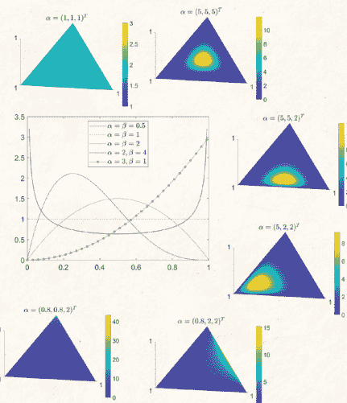


献给 Helmut 和 Marilouise，以及他们关怀的爱，尤其是他充满爱意的照顾。


## 前言

机器学习有许多名称，例如机器学习、人工智能、模式识别、数据挖掘、数据同化和大数据，仅举几例。它在许多科学领域平行且独立地发展，例如物理学、工程学、计算机科学和数学。例如，它被用于垃圾邮件过滤、光学字符识别（OCR）、搜索引擎、计算机视觉、自然语言处理（NLP）、广告、欺诈检测、机器人技术、数据预测、材料发现；天文学。这有时使得在文献中找到特定问题的解决方案变得困难，仅仅是因为相同的概念使用了不同的词语和短语。

本书旨在缓解这一问题。一个常见概念，但在多个学科中以不同名称为人所知，将使用数学作为通用语言进行描述。读者会发现索引很有用，可以按其熟悉的方式查找特定主题。索引全面，使查找所需信息变得容易。希望本书能作为参考证明有用，并成为任何使用机器学习技术的人书架上的必备之书。

在机器学习教学中，通常强调“什么？”和“怎么？”的问题，而忽略了“为什么？”的问题。然而，在我看来，这是最重要的问题。只有理解算法成功的原因，才能正确应用它。另一方面，如果不理解它如何得出结果，这些结果就不可信。

算法通常并列教授，而不展示它们之间的相似性和差异。本书通过介绍共同点来解决这个问题。大多数技术试图在有限低维空间中找到生成数据的近似模型。它们在如何找到该近似模型的解以及如何选择模型空间方面有所不同。这种方法有助于保持书籍简洁，同时仍提供彻底而深入的处理。在某些地方，如果认为进一步的细节超出了本书的范围，读者将被引荐到进一步的阅读材料。

技术通过 MATLAB® 实现进行说明。主要目的是展示方法的内部工作原理，以培养直觉。在大多数情况下，代码清单已印在书中，但所有代码均可在 https://www.crcpress.com/A-Concise-Introduction-to-Machine-Learning/Paul/9780815384106 在线获取，作为 K339637_Downloads.zip 包的一部分。

MATLAB 和 Simulink 是 The Mathworks, Inc. 的注册商标。如需产品信息，请联系：

The Mathworks, Inc.
3 Apple Hill Drive
Natick, MA 01760-2098 USA
Tel: 508-647-7000
Fax: 508-647-7001
E-mail: info@mathworks.com
Web: https://www.mathworks.com

如何购买：https://www.mathworks.com/store 查找您当地的办事处：https://www.mathworks.com/company/worldwide

## 致谢

首先，我要特别感谢 Nikos Nikiforakis 博士和 James Elliot 教授，他们决定将我排除在大多数活动之外，从而腾出时间开发额外的教学材料。本书基于在英国剑桥大学科学计算硕士课程中讲授的课程以及额外材料。在剑桥数学科学中心讲授，因为讲授此课程未得到科学计算硕士课程主任的批准。感谢 James Ferguson 博士使额外讲座成为可能。

其次，我也要感谢我的博士导师 Mike Powell 教授，他不幸于 2014 年 4 月去世。从他身上我学到，应该追求理解和简单。我更常看到他拿着笔和纸推导算法，而不是坐在电脑前。他想知道某个特定算法为何成功。尤其是，当机器学习系统变得越来越复杂时，继续追求理解很重要。

当然，我也要感谢所有参加讲座的研究生，他们的问题和对进一步理解的追求改进了本书。

我还要向剑桥大学以及塞尔温学院的工作人员和院士表示感谢，感谢他们营造了如此美妙的学习和教学氛围。

如果没有私人生活中许many人的支持，本书就不会写成，首先是我的父母 Helmut 和 Marieleuse Faul，他们在我心中种下了对知识的热爱，并教导我珍视诚信的价值，尤其是科学的诚信。

A.C. Faul


## 引言

在思考机器学习时，从思考我们如何学习开始似乎是明智的。腓特烈二世（1194 年 12 月 26 日 - 1250 年 12 月 13 日）是 13 世纪的神圣罗马帝国皇帝和西西里国王。腓特烈国王是科学和艺术的热心赞助人。他会说六种语言：拉丁语、西西里语、德语、法语、希腊语和阿拉伯语。他希望确定“上帝赋予”的语言。意大利方济各会修士 Salimbene de Adam 在他的《编年史》[25]中写道，腓特烈命令“乳母和保姆喂养、沐浴和清洗孩子，但绝不要与他们说话或咿呀学语；因为他想知道他们是否会说希伯来语（最初的语言）、希腊语、拉丁语、阿拉伯语，或者也许是他们父母的语言。但他白费力气，因为孩子们没有拍手、手势、面容欢快和甜言蜜语就无法生存。”换句话说，孩子们的生理需求得到了满足，但他们在没有任何人际互动的情况下长大。这是否是真实的记录尚存疑问，因为这是唯一的记录，而 Salimbene 是腓特烈二世的政治对手。尽管如此，没有人怀疑感官刺激和经验对于任何方面的学习都是必不可少的。

Blakemore 和 Cooper [4] 对小猫进行了实验。小猫在黑暗的房间里长大，只在特定时间被带出来，然后被放置在只有水平线或只有垂直线的环境中。在水平环境中长大的小猫对垂直线没有反应。没有大脑活动。确实，当水平线的倾斜度逐渐改变为垂直线时，大脑活动变得越来越少。

实验表明，只有大脑从环境中接收到的东西才会被学习。这是为未来做的高效准备。这也适用于人类视觉。澳大利亚原住民拥有有史以来测得的最敏锐的视力，大约比白种人好四倍。这意味着他们可以在六米外清晰地看到物体，而普通白人只能在 1.5 米外看清，仅为四分之一

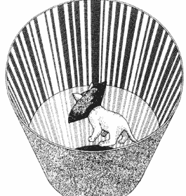

图 1.1：垂直环境。经 Macmillan Publishers Ltd: Nature [4] 许可转载，版权所有 (1970)。

of the distance。视力常常会随着年龄增长而下降。眼科医生 Fred Hollows 教授 [22] 通过眼镜将一位年迈的澳大利亚原住民的视力矫正回普通白人的视力水平。他的反应是：“谢谢你的尝试，但这毫无希望。我以前能看得好得多。”澳大利亚内陆是一片广阔开阔的景观，良好的远距离视力对生存至关重要。

我们可以得出结论，需要经验。然而，机器如何“体验”？我们可以将我们的感官视为进行测量，而我们的大脑解释这些测量并得出结论。机器可以进行各种测量然后执行计算，但它能模拟人类大脑的能力吗？

也许为了回答这个问题，我们需要退后一步，不看我们如何学习，而看我们如何教学。传统教学是从教室前面进行的。学生们得到一组特殊的指令，并被期望复制这些指令。这与过程式编程非常相似，其中指令流被编码。面向对象编程是进一步的发展，其中指令取决于数据的性质。

然而，当我们的大脑拥有发现的积极体验时，它能更好地保留信息。因此，常常存在教师主导的学习。伽利略在他的著作《关于两门新科学的对话与数学证明》[15]中精彩地说明了这一点（图 1.2）。这两门科学是运动科学以及材料和建筑科学。这些思想通过三个人物 Salviati、Sagredo 之间的对话来发展。


和西普利齐奥。后者被描绘成一个傻瓜，是需要教导的学生。在运动科学中，起点是这样的观察：尽管物体质量不同，但它们同时到达地面。然而，这很难量化，因为过程太快了。因此，伽利略开发了斜面实验，他这样描述：

> “我们取了一根木制镶边或条木，长约12肘，宽半肘，厚三指宽；在其边缘上切出一条宽度略超过一指的凹槽；将这条槽做得非常笔直、光滑、抛光，并用羊皮纸衬里，也尽可能光滑抛光，我们沿着它滚动一个坚硬、光滑且非常圆的青铜球。将这块木板放置在倾斜位置，将一端抬高一两肘高于另一端，我们像刚才所说的那样，沿着凹槽滚动球，以即将描述的方式记录下降所需的时间。我们重复这个实验不止一次，以测量时间，其精度使得两次观察之间的偏差从不超过一脉搏的十分之一。执行此操作并确认其可靠性后，我们现在只让球滚动凹槽长度的四分之一；测量其下降时间后，我们发现正好是前一半的一半。接着我们尝试了其他距离，将整个长度的时间与一半、三分之二、四分之三，或者任何分数的时间进行比较；在这样的实验中，重复了一整百次，我们总是发现所经过的空间彼此之间如同时间的平方之比，这对于平面（即我们滚动球的凹槽）的所有倾斜度都成立。我们还观察到，对于平面的各种倾斜度，下降时间彼此之间正好呈现出那个比率，正如我们稍后将看到的，作者对此进行了预测和证明。”

为了测量时间，我们使用一个放置在高处的大容器；在该容器底部焊接了一根小直径的管子，产生一股细水流，我们在每次下降期间（无论是凹槽的整个长度还是部分长度）将其收集在一个小玻璃杯中；每次下降后，收集的水在非常精确的天平上称重；这些重量的差异和比率给出了时间的差异和比率，并且精度如此之高，尽管操作重复了很多很多次，结果中没有可察觉的差异。”

19世纪，为此实验制造了一套装置，现在可以在意大利佛罗伦萨的伽利略博物馆看到。这个实验被反复


图 1.2：《关于两门新科学的对话与数学证明》 图片属于公有领域。

由世界各地的学童反复进行，他们堆叠书籍来创建一个斜面。只有秒表取代了水钟。这是受监督学习和一个回归问题。在回归中，我们试图找出两个或多个参数之间的关系。在这里，它是距离 d 和时间 t。

请注意，这两个参数（距离和时间）之间的关系不是线性的。事实上，

```
$$ \frac{d_1}{d_2} = \frac{t_1^2}{t_2^2} $$
```

我们可以这样重新表述：距离和时间是主要参数，时间的平方是次要参数。然后，我们在主要参数（距离）和次要参数（时间的平方）之间找到了一个线性关系。在讨论核技巧时，我们会再次遇到这一点。另一种看待方式是将其视为深度学习的一个实例，因为平方增加了另一层抽象。深度学习试图揭示隐藏的关系。

然而，伽利略是如何得出这个实验的？请记住，起点是这样的观察：不同质量的物体同时到达地面。他意识到空气阻力是一个因素，对于极轻且空气阻力很大的物体（如羽毛）来说，它变得占主导地位。因此，他需要使他的实验尽可能独立于空气阻力

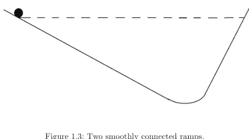

尽可能独立，并最终选用了一个青铜球。更重要的是，他需要减慢实验速度以进行准确测量。伽利略注意到，一个球沿着斜坡滚下，该斜坡平滑地连接到一个向上的斜坡，它将到达基本上与起点相同的高度。由于摩擦和空气阻力，它会来回滚动直到停止。如果两个斜坡的倾斜度相同，这并不令人惊讶，但即使第二个斜坡陡得多，球也会到达相同的高度。图 1.3 说明了这一点。让第二个斜坡越来越陡，我们就接近一个垂直斜坡。这意味着下落球的实验和滚动球的实验是等价的。在后者中，运动较慢，因此可以获得测量值。

这是无监督学习的一个实例。伽利略自己意识到，所有实验都属于同一类，与两个斜坡的角度无关。

回到单个斜坡的实验。伽利略表明，不同重量的球在相同的时间内会行进相同的距离。因此，他证明重量不是影响实验的参数。然而，相同距离的下降时间取决于平面的倾斜度。平面越陡，实验结束得越快。因此，倾斜角度是影响结果的参数。这是特征检测的一个示例，我们试图找出哪些参数（换句话说，哪些特征）是相关的。

人类学习是所有这些的结合：

- 特征检测：我们的感官体验周围的世界。在布莱克福德·库珀的实验中，那只猫从未体验过垂直线的特征。
- 无监督学习：在这里，我们试图理解自己的经验。
- 深度学习：我们将经验置于更广泛的背景下并得出结论。
- 受监督学习：在这里，我们有一些外部输入，但也被允许自己发现事物。
- 教学：这完全由外部输入控制。

一旦我们学会了某事，就能识别异常。低于某个年龄的孩子不会对漂浮表演印象深刻。然而，一旦它发现了重力（尽管比伽利略的方式更原始），它就会一遍又一遍地想要对其进行实验，就像任何为孩子从高脚椅上掉落的玩具捡起千次的家长所证明的那样。

机器学习就是将我们在这里识别的各种学习模式转移到机器上。我们已经非常擅长编写过程式或面向对象的程序，以这种方式教导机器。但其他模式呢？

## 2. 概率论

介绍了机器学习所需的概率论概念。这些包括独立性、概率规则、辛普森悖论、概率质量和密度函数、累积分布函数，以及期望、方差和矩的定义。贯穿全书使用的概率质量和密度函数得以介绍，并解释了它们之间的联系。还探讨了随机变量的进一步函数以及概率分布的共轭性及其在先验和后验概率分布中的应用。本章以随机变量及其依赖关系和参数的图形表示结束。

### 2.1 独立性、概率规则和辛普森悖论

在引言中，我们已经看到，如果没有从重复实验中获得的经验，学习是不可能的。为了形式化这一点，我们需要量化实验的不同结果，而概率论正好适合此目的。Ross 在 [36] 中给出了非常好的介绍。给出了一个公平骰子的例子；每个数字出现的概率相等，均为 1/6。抛硬币时出现正面或反面的概率相等，均为 1/2。在这里，硬币和骰子是随机变量。它们是离散变量，因为只有有限个不同的结果。也就是说，重复实验时，可能出现不同的结果。为了描述更复杂的情况，概率被组合在一起。例如，同时出现正面并掷出数字 3 的概率是 1/2 × 1/6 = 1/12。这被称为硬币和骰子的联合概率，可以用网格表示。

| | ⚀ | ⚁ | ⚂ | ⚃ | ⚄ | ⚅ |
|---|---|---|---|---|---|---|
| 正面 | 1/12 | 1/12 | 1/12 | 1/12 | 1/12 | 1/12 |
| 反面 | 1/12 | 1/12 | 1/12 | 1/12 | 1/12 | 1/12 |


请注意，行之和为 1/2，即硬币的边缘概率，而列之和为 1/6，即骰子的边缘概率。“边缘”一词源自边缘化，即使另一个随机变量无关紧要。

在学习过程中，我们可以重复一个带有随机变量的实验 N 次，并记录随机变量取某个值的实验次数。例如，设 X 和 Y 为两个随机变量，X 可取值 x1 ... xM，Y 可取值 y1, ... yL。概率表示为 $p(X = x)$ 和 $p(Y = y)$，而联合概率表示为 $p(X = x, Y = y)$。

然而，这种记法比较繁琐，因此我们改用 p(x)、p(y) 和 p(x, y)。在上述示例中，X 是硬币，Y 是骰子，例如 p(heads) = 1/2、p(3) = 1/6 和 p(heads, 3) = 1/12。

硬币和骰子不能相互影响，但其他随机变量可以，例如人的身高和体重。我们预期个子很高的人不会非常轻。当然，也有反例证明这一预期是错误的。当两个随机变量不相互影响时，它们被称为独立，否则称为依赖。两个随机变量 X 和 Y 独立，当且仅当

$p(X, Y) = p(X)p(Y)$ (2.1)

对所有可能的结果 xi，i = 1, ... M 和 yj，j = 1, ... L 成立。

在从实验中学习时，我们不在网格中记录概率，而是记录某个特定结果出现的频率。设 nij 为结果 X = xi 且 Y = yj 的次数。我们用 mi 表示 X = xi 出现的次数（不考虑 Y），用 lj 表示 Y = yj 出现的次数（无论 X 为何）。网格如下所示：

| | y1 | ... | yj | ... | yL | |
|---|---|---|---|---|---|---|
| x1 | n11 | ... | ... | n1L | m1 | |
| ... | ... | ... | ... | ... | ... | |
| xi | ... | ... | nij | ... | ... | mi |
| ... | ... | ... | ... | ... | ... | |
| xM | nM1 | ... | ... | ... | nML | mM |
| | l1 | ... | lj | ... | lL | |

我们可以看到

$$m_i = \sum_{j=1}^L n_{ij} \text{ 且 } l_j = \sum_{i=1}^M n_{ij},$$ (2.2)

因为对一个随机变量进行边缘化意味着对另一个随机变量的所有可能结果求和。

我们现在可以将概率估计为总实验次数 $N$ 的分数：

$$p(x_i) = \frac{m_i}{N}, p(y_j) = \frac{l_j}{N} \text{ 且 } p(x_i, y_j) = \frac{n_{ij}}{N}.$$

结合 (2.2)，我们可以看到

$$p(x_i) = \sum_{j=1}^L p(x_i, y_j)$$ (2.3)

方程 (2.3) 称为概率的加法规则。随机变量 $Y$ 被边缘化。

如果我们只考虑 $X$ 的结果为 $x_i$ 的实验，那么其中 $Y$ 的结果为 $y_j$ 的比例写作 $p(y_j|x_i)$，称为给定 $x_i$ 时 $y_j$ 的*条件概率*。观察网格的第 $i$ 行，它可以计算为

$$p(y_j|x_i) = \frac{n_{ij}}{m_i}.$$

另一方面，我们有

$$p(x_i, y_j) = \frac{n_{ij}}{N} = \frac{n_{ij}}{m_i} \frac{m_i}{N} = p(y_j|x_i)p(x_i).$$

这称为概率的乘法规则。用随机变量表示，概率的加法规则和乘法规则为

$$p(X) = \sum_Y p(X, Y) \text{ 且 } p(X, Y) = p(Y|X)p(X),$$

其中求和是对 $Y$ 的所有可能实例进行。

根据 (2.1) 中独立性的定义，如果对于所有结果条件概率等于边缘概率，则 $Y$ 独立于 $X$。也就是说，$X$ 的结果完全不影响 $Y$ 的结果。

两个随机变量的联合概率是对称的。即

$$p(X, Y) = p(Y, X).$$

将其与乘法规则结合得到 \(p(Y|X)p(X) = p(X|Y)p(Y)\)。两边同时除以 \(p(X)\) 得到贝叶斯规则，也称为贝叶斯定律或定理，它将随机变量的条件概率相互关联：

\(p(Y|X) = \frac{p(X|Y)p(Y)}{p(X)}\)。

贝叶斯规则在机器学习中发挥着重要作用，催生了许多贝叶斯分支。McGrayne 在 [28] 中很好地阐述了其历史影响。

在机器学习中，随机变量 \(X\) 通常是可用数据，这些数据要么已被收集，要么由实验生成。\(X\) 可以是多维的，因为一个数据点可以给出不同种类的信息。另一方面，随机变量 \(Y\) 包含我们认为会影响数据的变量。同样，这也可以是多维的。概率 \(p(Y)\) 给出我们的先验信念。这可以是经验或专家意见，或从其他实验中推导得出。先验具有争议的作用，因为它量化了主观意见。条件概率 \(p(X|Y)\) 在某种程度上是衡量不同 \(Y\) 选择解释 \(X\) 有多好的指标。它有时被称为似然，是 \(Y\) 的函数。数据 \(X\) 的总体概率由 \(p(X)\) 给出。它可以使用加法规则和乘法规则的组合计算得出：\(p(X) = \sum_Y p(X|Y)p(Y)\)。

我们可以看到，它是贝叶斯规则分子对所有 \(Y\) 实例的求和。因此，它有时也被称为归一化因子，因为它确保

\(\sum_Y p(Y|X) = 1\)。

所有实例上的概率之和始终必须等于一。最后，概率 \(p(Y|X)\) 量化了我们在观察并考虑数据后的后验信念。人类的等价做法是在有了一些经验后修改自己的观点。虽然许多其他因素会影响人类是否修改观点（例如，他们的固执），但贝叶斯规则是一种数学过程，用于实现这一点。如果存在不同的假设及其相关变量 \(Y\) 来解释数据，\(p(Y|X)\) 可用于选择一个假设。此时它也被称为证据。关于贝叶斯方法论的更多内容可参见 [35]，而 [28] 给出了许多关于反复应用贝叶斯规则解决现实世界问题的示例。

然而，收集数据时需要小心，如 [1] 中 Appleton、French 和 Vanderput 的示例所示，当出现辛普森悖论时。他们收集了七十年代吸烟行为的数据，并在二十年后进行了跟踪。他们将视角限制在最初研究时从未吸烟或当时是当前吸烟者的女性身上。共有

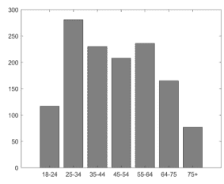

图 2.1：[1] 中参与者在不同年龄组中的分布。

582 名吸烟者，其中 139 人死亡，死亡率为 139/582 ≈ 23.9%。在非吸烟组中，732 人中有 230 人死亡，死亡率为 230/732 ≈ 31.4%。这与健康专业人士告诉我们的相矛盾。

设 \(Y\) 为取值 {smoker, non-smoker} 的随机变量，设 \(X\) 为取值 {died, alive} 的随机变量。我们的网格如下所示：

| | smoker | non-smoker | |
|---|---|---|---|
| died | 139 | 230 | 369 |
| alive | 443 | 502 | 945 |
| | 582 | 732 | 1314 |

当更仔细地查看数据并考虑女性在最初研究时的年龄时，解释便显现出来。她们被分为七个年龄组：18-24、25-34、35-44、45-54、55-64、65-74 和 75 岁以上。我们现在让变量 \(Y\) 有 14 个可能值，即年龄组加上她们是否吸烟（\(S\)）或不吸烟（\(NS\)）。表格现在变为

| | 18-24 S | 18-24 NS | 25-34 S | 25-34 NS | 35-44 S | 35-44 NS | 45-54 S | 45-54 NS | 55-64 S | 55-64 NS | 65-74 S | 65-74 NS | 75+ S | 75+ NS |
|---|---|---|---|---|---|---|---|---|---|---|---|---|---|---|
| died | 2 | 1 | 3 | 5 | 14 | 7 | 27 | 12 | 51 | 40 | 29 | 101 | 13 | 64 |
| alive | 53 | 61 | 121 | 152 | 95 | 114 | 103 | 66 | 64 | 81 | 36 | 129 | 13 | 64 |
| | 55 | 62 | 124 | 157 | 109 | 121 | 130 | 78 | 114 | 121 | 36 | 129 | 13 | 64 |

首先需要注意的是，参与者在不同年龄段中的分布不均匀。这可以通过绘制研究中参与者按年龄组分布的直方图来可视化，如图 2.1 所示。理想情况下，我们希望数据*均匀分布*。即每个类别的可能性相同。如果采集足够多的样本，那么每个类别


应该包含大约相同数量的样本。这是一个很大的“if”。在许多实际情况下，特别是当参与者是自愿选择时，这是不可能的。这就是为什么白人学生在心理学实验中被过度代表，因为参与者是从实验所在大学的学生群体中招募的。关于这些数据的另一个奇特之处是，除了最年轻和最年长的年龄段外，所有年龄段都涵盖十年。当然，这有实际原因，因为对于最年轻的年龄段，只有法定成年人才能参与，而在年龄范围的另一端，需要确保最年长的年龄段有足够的参与者。这些只是收集数据时需要注意的一些示例。

除上述情况外，在本示例中，吸烟者的百分比随年龄段而异：

| | 18 - 24 | 25 - 34 | 35 - 44 | 45 - 54 | 55 - 64 | 65 - 74 | 75+ |
|---|---|---|---|---|---|---|---|
| 吸烟者 | 47% | 44% | 47% | 63% | 49% | 22% | 17% |

非吸烟者在两个最年长的年龄段中被不成比例地过度代表，而这两个年龄段在未来二十年内自然更有可能死亡。这使得总体死亡率偏向吸烟者。当数据被汇总为仅吸烟者和非吸烟者两个群体时。

我们现在可以估计每个年龄段中吸烟者和非吸烟者的死亡率。换句话说，给定年龄段以及是否吸烟的情况下死亡的估计条件概率，p(died|Y)：

| | | 死亡率 |
|---|---|---|
| 18-24 | 吸烟者 | 3.6% |
| | 非吸烟者 | 1.6% |
| 25-34 | 吸烟者 | 2.4% |
| | 非吸烟者 | 3.2% |
| 35-44 | 吸烟者 | 12.8% |
| | 非吸烟者 | 5.8% |
| 45-54 | 吸烟者 | 20.8% |
| | 非吸烟者 | 15.4% |
| 55-64 | 吸烟者 | 44.3% |
| | 非吸烟者 | 33.1% |
| 65-74 | 吸烟者 | 80.6% |
| | 非吸烟者 | 78.3% |
| 75+ | 吸烟者 | 100% |
| | 非吸烟者 | 100% |

现在，死亡率反映了给出的健康建议。除了两个年龄段外，所有年龄段中吸烟者的死亡率都更高。吸烟者平均死亡年龄更小，这在一定程度上可以解释他们在两个最年长年龄段中代表性不足的原因。

Simpson 悖论是由于另一个影响数据但隐藏的变量引起的。这被称为 *混杂变量*。在此例中，它是原始研究中女性的年龄以及不同年龄段内吸烟者和非吸烟者的分布。每当人口（原始研究中的女性）在不同部分（不同的年龄段）内的分布不同时，数据分析就必须谨慎进行，并考虑到这些变化。

Simpson 悖论的另一个例子是价格与需求之间的相关性。在这里，混杂变量是时间。如果不考虑时间，价格和需求可能呈现正相关，而实际上它们呈负相关，当将需求和价格都与时间绘图时，这变得明显。

### 2.2 概率密度、期望、方差和矩

在前面的章节中，随机变量是离散的。然而，其中之一，年龄，如果被视为自出生以来经过的时间，本质上是一个连续变量。它通过考虑年龄组被 *离散化*。如何离散化的选择也会影响解释。我们已经看到，完全不进行离散化会导致对死亡率的错误解释，即吸烟者比非吸烟者不太可能死亡。另一方面，离散化不应过于精细，因为这样每个类别中的样本数量会变得太小，无法进行解释。这也被称为 *过拟合*，其中模型对数据拟合得太过精确，无法推广到未见的数据。例如，假设我们将年龄离散化得非常精细，以至于每个年龄组中只有一个女性，或者可能没有。然后，我们要么对研究中的新参与者不做任何预测（如果该年龄组为空），要么根据该年龄组中那一个女性的死亡率进行预测，这可能完全错误。

离散化是处理连续实值变量 $x$ 的概率的一种方法。另一种方法是在 $x$ 上使用 *概率密度函数* (*pdf*) $f(x)$ 来描述分布。从形式上讲，它由 $f(x)\Delta x$ 定义，即样本落在区间 $(x, x + \Delta x)$ 内的概率，当区间大小 $\Delta x$ 趋近于零时。概率密度函数始终是非负的。它可以被视为将离散化推向极限。对于 $x$ 落入任何区间 $(a, b)$，都有一个有效的概率值，其由

\(p(x \in (a, b)) = \int_a^b f(x) dx.\)

给出。

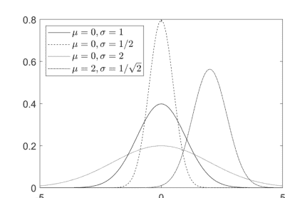

图 2.2：各种 \(\mu\) 和 \(\sigma\) 值的正态概率密度函数。

如果 \(a = -\infty\) 且 \(b = \infty\)，即对 \(x\) 的所有可能值进行积分，则概率必须为 1。

由于连续变量可以离散化，离散变量可以被视为连续变量。在此例中，\(f(x)\) 被称为 *概率质量函数* (*pmf*)，因为 \(x\) 的每个离散可能值的概率集中为这些值上的点质量。对于 \(x\) 的所有其他值，概率为零。

概率密度函数的一个著名例子是正态分布（也称为高斯分布 \(x \sim \mathcal{N}(\mu, \sigma^2)\)）的 *钟形曲线*，其中 \(\sim\) 表示“服从分布”。其概率密度函数由

\[
\mathcal{N}(x|\mu, \sigma^2) = \frac{1}{\sqrt{2\pi}\sigma} \exp \left( - \frac{1}{2\sigma^2}(x-\mu)^2 \right). \quad (2.4)
\]

给出。

其位置和形状由参数 \(\mu\)（称为 *均值*）和 \(\sigma^2\)（称为 *方差*）决定。方差的平方根 \(\sigma\) 称为 *标准差*。图 2.2 说明了均值和方差各种值的钟形曲线形状。当 \(\mu = 0\) 且 \(\sigma = \sigma^2 = 1\) 时，它被称为 *标准正态分布*。

有一个常见的误解，即“正常”意味着常见。高斯引入了“正常”这一命名，指的是规范，如第 8.4 节中讨论的普通最小二乘法。最小化规范的一种技术是求解“正常”方程，这就是高斯在用词选择时所指的。多年来，“正常”获得了“通常”的含义。

正态分布确实相当常见。Lyon 在 [27] 中对此进行了详细阐述。*中心极限定理*经常被引用。它指出，如果 $x_1, ..., x_n$ 是一组均值为 0、方差为 $\sigma^2$ 的 *独立同分布* (i.i.d.) 随机变量，那么归一化和

$$S_n = \frac{x_1 + ... + x_n}{\sqrt{n}}$$

在 $n$ 足够大时服从接近正态分布。当 $n$ 趋于无穷大且 $S_n \to S$ 时，它趋近于正态分布 $\mathcal{N}(S|0, \sigma^2)$。无论 $x_1, ..., x_n$ 的分布最初是什么样，只要它们是独立同分布的，这都成立。然而，这就是整个解释的关键所在。

虽然我们想要用概率密度函数描述的一些现象可能是独立同分布加数的结果，但许多现象受到不同因素的影响，所有这些因素都有其自身独特的分布。以人的身高为例。其生长潜力由其遗传构成决定，其中不同基因也起作用。这是先天部分。接下来是后天部分。营养、污染、疾病等都是因素。所有这些都不是独立同分布的，但身高仍然服从正态分布。

另一种解释涉及概率密度 $f(x)$ 的 *熵*，定义为

$$-\int_{-\infty}^{\infty} f(x) \log f(x) \, dx,$$

其中，当 $f(x) = 0$ 时，$f(x) \log f(x)$ 为零。更改对数的底数会导致熵的缩放。只要始终使用相同的底数，就可以比较不同分布的熵。信息理论家倾向于使用底数 2，以与比特保持一致。由于 $0 \le f(x) \le 1$，熵是非负的。熵通常被解释为无序度、随机性或信息缺乏的度量。熵越大，无序度越高，信息越少。例如，如果 $x$ 只有一个概率为 1 的可能值，那么在那里 $\log f(x) = 0$，积分到处都是零。因此，熵为零。信息值是完美的，因为结果是确定的。许多物理系统随时间努力最大化熵。对于给定的均值 $\mu$ 和方差 $\sigma^2$，$f(x) = \mathcal{N}(x|\mu, \sigma^2)$ 最大化熵。因此，这种选择反映了自然过程。此外，如果除了这些之外一无所知，选择信息最少的分布也是明智的。

为了证明正态分布积分为 1，我们考虑

$$\int_{-\infty}^{\infty} \frac{1}{\sqrt{2\pi}\sigma} \exp \left( -\frac{1}{2\sigma^2} (x-\mu)^2 \right) \, dx.$$

令 $x - \mu = \sigma y$，则有 $dx = \sigma dy$。变量变换后积分范围不变。因此我们得到

$$\frac{1}{\sqrt{2\pi}} \int_{-\infty}^{\infty} \exp \left( -\frac{y^2}{2} \right) \, dy.$$


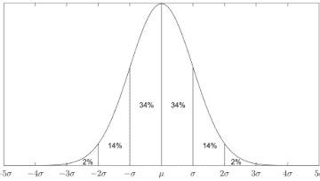

图 2.3: 落在由 $\sigma$ 决定的范围内的数据的近似百分比。

接下来我们考虑积分的平方：

```
\left( \frac{1}{\sqrt{2\pi}} \int_{-\infty}^{\infty} \exp\left(-\frac{y^2}{2}\right) dy \right)^2 = \frac{1}{2\pi} \left( \int_{-\infty}^{\infty} \exp\left(-\frac{y^2}{2}\right) dy \right) \times \left( \int_{-\infty}^{\infty} \exp\left(-\frac{z^2}{2}\right) dz \right)
= \frac{1}{2\pi} \int_{-\infty}^{\infty} \int_{-\infty}^{\infty} \exp\left(-\frac{y^2+z^2}{2}\right) dydz.
(2.5)
```

转换为极坐标，$y = r \cos \theta, z = r \sin \theta$ 且 $dydz = r dr d\theta$，得到

```
\frac{1}{2\pi} \int_0^{2\pi} \int_0^{\infty} \exp\left(\frac{-r^2(\cos^2 \theta + \sin^2 \theta)}{2}\right) r dr d\theta = \frac{1}{2\pi} \int_0^{2\pi} \int_0^{\infty} r \exp\left(\frac{-r^2}{2}\right) dr d\theta,
(2.6)
```

where we used $\cos^2 \theta + \sin^2 \theta = 1$. The integrand is independent of $\theta$. Thus the integral with respect to $\theta$ evaluates to $2\pi$, the length of the interval, which cancels with the denominator. The integrand is the derivative of $\exp\left(-\frac{r^2}{2}\right)$ with respect to $r$ which evaluates to 0 at the upper limit $\infty$ and -1 at the lower limit 0 which we subtract. Hence the integral of the normal distribution is one as required.

The standard deviation entered mainstream news in 2012, when the discovery of the Higgs boson was announced as a significance of five sigma. This means that the data observed in the particle colliders did not fall within five standard deviations to the left or right of the mean of the distribution describing the *null hypothesis*. The null hypothesis assumes that the particle does not exist. In other words, the data falls in the extremes at the end of the bell curve. The probability of data that extreme or even more is very low. Figure 2.3 shows the bell curve and gives the rough percentages of how

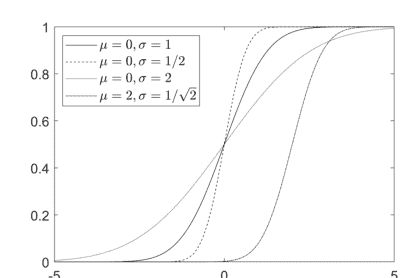

Figure 2.4: The normal cumulative distribution function for various values of \(\mu\) and \(\sigma\).

much data falls into each region. The following table gives more accurate percentages:

| interval | expected percentage of data inside interval |
|---|---|
| \((\mu - \sigma, \mu + \sigma)\) | 68.26895% |
| \((\mu - 2\sigma, \mu + 2\sigma)\) | 95.44997% |
| \((\mu - 3\sigma, \mu + 3\sigma)\) | 99.73002% |
| \((\mu - 4\sigma, \mu + 4\sigma)\) | 99.99366% |
| \((\mu - 5\sigma, \mu + 5\sigma)\) | 99.99994% |

The probability of the observed data (or even more extreme data) occurring by chance under the null hypothesis is known as the p-value. In the case of five sigma significance, the probability of data outside this region is \(1 - 0.9999994 = 6 \times 10^{-7}\). There is a subtlety here, because it is equally likely for data to be in either the high or low tail of the bell curve. So the probability is halved to give a p-value of \(3 \times 10^{-7}\) or approximately 1 in 3.5 million. This is _not_ the probability that the Higgs boson does not exist. It is the probability that the data would be observed, if it does not exist. The scientific story of the discovery of the Higgs boson is described in [38].

Setting the level of significance in terms of the standard deviation sigma is one way. Another way is to set it to an arbitrarily pre-defined threshold value \(\alpha\), for example \(\alpha = 0.05, 0.01, 0.005\), or \(0.001\). The chosen value depends on the field of research. High-energy physics requires a threshold of \(3 \times 10^{-3}\) to announce there is evidence of a particle, and a threshold of \(3 \times 10^{-7}\) to claim a discovery. This stringent threshold is due to the "look elsewhere effect". The probability that I win the lottery is quite small; the probability that somebody wins the lottery is, however, quite large. So when a lot of experiments are conducted and data gathered, it is not unusual to see a few statistical anomalies.

Associated with any probability density function is its _cumulative distribution function (cdf)_ given by

$$F(x) = \int_{-\infty}^{x} f(t)dt.$$

It gives the probability of $t$ falling into the interval $(-\infty, x)$. Hence the probability of $t$ falling into the interval $(a, b)$ can be calculated as $F(b) - F(a)$. The derivative of the cumulative distribution function satisfies $\frac{d}{dx}F(x) = F'(x) = f(x)$ by the _Fundamental Theorem of Calculus_. The cumulative distribution functions of the normal distribution for the same values of $\mu$ and $\sigma$ as in Figure 2.2 are shown in Figure 2.4. All approach one as the argument increases, since the probability for $t$ falling into the interval $(-\infty, \infty)$ is one.

The rules for probability also hold for continuous variables and probability density functions:

- sum rule       \( f(x) = \int_{-\infty}^{\infty} f(x, y)dy, \)
- product rule   \( f(x, y) = f(x|y)f(y), \)
- Bayes' rule    \( f(y|x) = \frac{f(x|y)f(y)}{f(x)} \).

For a formal derivation of these rules see [13].

When dealing with a random variable, it is useful to know the average value it takes. This is known as the _expectation_, _mean_ or _first moment_ of the probability distribution, and is defined as

$$\mathbb{E}[x] = \int_{-\infty}^{\infty} f(x)x dx.$$

When $x$ is discrete, integrating over the point masses at the possible values $x$ can take reduces the expression to a sum,

$$\mathbb{E}[x] = \sum_{x} f(x)x.$$

Equally, it is useful to know how much we can _expect_ the values to differ from the average. This is the _variance_ or _second central moment_,

$$\text{var}[x] = \mathbb{E}[(x - \mathbb{E}[x])^2].$$

Using the definition for the expectation this becomes

$$\text{var}[x] = \int_{-\infty}^{\infty} (x^2 - 2x\mathbb{E}[x] + \mathbb{E}[x]^2)f(x)dx$$
$$= \int_{-\infty}^{\infty} x^2 f(x) dx - 2\mathbb{E}[\int_{-\infty}^{\infty} x f(x) dx + \mathbb{E}[x]^2 \int_{-\infty}^{\infty} f(x) dx$$
$$= \mathbb{E}[x^2] - \mathbb{E}[x]^2,$$

since $f(x)$ integrates to one and \(\int_{-\infty}^{\infty} x f(x) dx = \mathbb{E}[x]\). This formula also holds for discrete probability distributions with point masses.

We see that this formula involves the expectation of \(x^2\). This is known as the *second raw* or *crude* moment. The \(i^{th}\) raw (crude) moment is defined as

\(\int_{-\infty}^{\infty} f(x)x^r dx,\)

while the \(i^{th}\) central moment is given by

\(\int_{-\infty}^{\infty} f(x)(x - \mathbb{E}[x])^r dx.\)

The normalized \(i^{th}\) central moment is the \(i^{th}\) central moment divided by \(\text{var}[x]^i\). The normalized central moments are invariant to any linear change of random variable \(x\). This means if \(y = ax + b\), the normalized central moments of \(x\) and \(y\) are the same. The normalized central moments are used to quantify the shape of a probability density.

The third normalized central moment is known as *skewness* and measures the asymmetry around the mean of a probability distribution. If the distribution is symmetric, the skewness is zero. If more probability mass lies to the left of the mean, the skewness is negative, and positive, if more probability mass is to the right of the mean.

The fourth normalized central moment is the *kurtosis* and measures how heavy tailed the probability distribution is. It is derived from the Greek word for “arching”. A large value of the kurtosis means that extreme values of the random variable are more likely, while a small value of kurtosis means outliers are rare.

The moments can be used to inform the choice of which probability density function should be chosen for the distribution of a random variable.

More generally, often the random variable itself is not of interest, although a derivation \(g(x)\) of it, which in itself is a random variable, is. In this case, the expectation and variance are written as \(\mathbb{E}[g]\) and \(\text{var}[g]\).

If there are more than one random variable, a subscript is used to indicate with respect to which variable the expectation is taken. For example, in

\(\mathbb{E}_y[g(x, y)]\)

the expectation is taken with respect to \(y\), and the result is a function of \(x\). The expectation with respect to \(x\) can then be taken. Since the order does not matter when integrating, the result is the same if the expectation with respect to \(x\) is taken first and then with respect to \(y\), if \(x\) and \(y\) are independent, that is \(f(x, y) = f(x)f(y)\).

Returning to the normal distribution, we calculate its expectation (first moment) as

\(\mathbb{E}[x] = \int_{-\infty}^{\infty} \frac{x}{\sqrt{2\pi}\sigma} \exp \left( -\frac{(x-\mu)^2}{2\sigma^2} \right) dx\)


令 $y = x - \mu$ 且 $dy = dx$，作此变量代换后，积分范围保持不变，

$$
\mathbb{E}[x] = \int_{-\infty}^{\infty} \frac{y + \mu}{\sqrt{2\pi}\sigma} \exp\left(-\frac{y^2}{2\sigma^2}\right) dy
= \int_{-\infty}^{\infty} \frac{y}{\sqrt{2\pi}\sigma} \exp\left(-\frac{y^2}{2\sigma^2}\right) dy + \mu \int_{-\infty}^{\infty} \frac{1}{\sqrt{2\pi}\sigma} \exp\left(-\frac{y^2}{2\sigma^2}\right) dy.
$$

第一个积分的被积函数是奇函数，即 $f(-y) = -f(y)$。奇函数在关于原点对称的区间上的积分为零。如上文所示，第二个积分的值为一。因此，对于正态分布，$\mathbb{E}[x] = \mu$。

对于方差，我们计算

$$
\text{var}[x] = \int_{-\infty}^{\infty} \frac{(x - \mu)^2}{\sqrt{2\pi}\sigma} \exp\left(-\frac{(x - \mu)^2}{2\sigma^2}\right) dx.
$$

再次令 $y = x - \mu$（如前所述），我们有

$$
\text{var}[x] = \int_{-\infty}^{\infty} \frac{y^2}{\sqrt{2\pi}\sigma} \exp\left(-\frac{y^2}{2\sigma^2}\right) dy.
$$

该积分可通过*分部积分法*计算，该方法可被视为求导乘法则的逆运算，即

$$
\frac{d(uv)}{dy} = \frac{du}{dy}v + u\frac{dv}{dy}.
$$

*分部积分法*为

$$
\int_a^b u dv = [uv]_a^b - \int_a^b v du.
$$

令 $u = y$ 且 $dv = y \exp\left(-\frac{y^2}{2\sigma^2}\right) dy$，则 $du = dy$ 且 $v = -\sigma^2 \exp\left(-\frac{y^2}{2\sigma^2}\right)。由此可得

$$
\text{var}[x] = \left[ \frac{-\sigma^2 y}{\sqrt{2\pi}\sigma} \exp\left(-\frac{y^2}{2\sigma^2}\right) \right]_{-\infty}^{\infty} - \int_{-\infty}^{\infty} \frac{-\sigma^2}{\sqrt{2\pi}\sigma} \exp\left(-\frac{y^2}{2\sigma^2}\right) dy.
$$

当自变量趋于 $\pm\infty$ 时，第一个表达式由指数项主导，因此为零。被积函数是均值为 0、方差为 $\sigma^2$ 的正态分布概率密度函数乘以 $-\sigma^2$。概率密度函数从 $-\infty$ 到 $\infty$ 的积分为一。因此，对于正态分布，$\text{var}[x] = \sigma^2$。

至于第三阶中心矩，对于正态分布它为零，因为被积函数再次成为奇函数。这意味着偏度也为零。

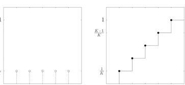

图 2.5：离散均匀概率质量函数及其累积分布函数。

正态分布的第四阶中心矩可通过与方差计算类似的分部积分法计算，其值为 $3\sigma^4$。因此，正态分布的峰度为 3。通常将其他分布的峰度与此值进行比较。若峰度更大，该分布称为尖峰分布。若峰度更小，则称为平峰分布。若假设底层为正态分布但数据不支持此假设，两者均会带来各自的困难。对于尖峰分布，极端事件的风险被低估，且未做好充分准备。金融理论的历史中可找到此类例子。平峰分布中极端事件罕见。然而，若这些事件具有灾难性，否认其可能性可能会致命。

### 2.3 离散概率质量函数示例

下面我们对常用概率分布作简要概述，从离散变量开始。我们在抛硬币或掷骰子的实验中已接触过均匀分布。只要骰子和硬币公平，所有结果的可能性均相等。若有 K 种可能结果，则每种结果的概率为 1/K。图 2.5 将离散均匀概率密度表示为点质量。累积概率密度函数是一个阶梯函数，其中每个阶梯的左端点包含在内，但右端点不包含。

接下来我们考虑二元变量，用于实验只有两种可能结果的情况，例如是或否、真或假、正面或反面、0 或 1。这些变量也称为布尔变量。为简化起见，我们使用结果 0 和 1。$x = 1$ 的概率记为 $0 \le \mu \le 1$。那么 $x = 0$ 的概率为 $1 - \mu$。该分布称为伯努利分布 $x \sim \text{Bern}(\mu)$。其概率质量函数由

```
Bern(x|μ) = μ^x(1 − μ)^(1−x).
```

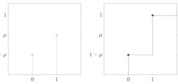

图 2.6：伯努利概率质量函数及其累积分布函数。

该公式可能看起来令人生畏，但请记住，它仅对 $x = 0$ 或 $1$ 进行求值，因为不可能出现其他结果，因此

Bern(0|\mu) = \mu^0(1-\mu)^1 = 1 - \mu \text{ and } Bern(1|\mu) = \mu^1(1-\mu)^0 = \mu.

在图 2.6 中，概率质量函数是两个点质量，而累积分布函数是一个简单的阶梯函数。

伯努利分布的期望和二阶原点矩由

\mathbb{E}[x] = \mu \times 1 + (1 - \mu) \times 0 = \mu,

\mathbb{E}[x^2] = \mu \times 1^2 + (1 - \mu) \times 0^2 = \mu.

由此我们可以计算方差

\text{var}[x] = \mathbb{E}[x^2] - \mathbb{E}[x]^2 = \mu^2 - \mu^2 = \mu(1 - \mu).

伯努利分布描述的是结果为二元的实验。我们现在可以考虑在 N 次实验集合中有多少次成功（$x = 1$）的问题。在考虑 m 次成功时，第一次成功有 N 种可能性，第二次有 N - 1 种，依此类推，直到最后一次成功有 N - m + 1 种可能性。得到的数 N(N - 1)...(N - m + 1) 是 m 排列的数量。它给出了从大小为 N 的集合中选择大小为 m 的有序集合的可能性数量。然而，在我们的情况中顺序无关紧要，因此我们除以大小为 m 的可能排列数量，即阶乘 m! = m(m - 1)...1。在 N 次实验中实现 m 次 $x = 1$ 的可能性数量由二项式系数给出，

\binom{N}{m} = \frac{N(N - 1) \cdots (N - m + 1)}{m(m - 1) \cdots 1}.

它读作 "N 选 m"，是 $(1 + a)^N$ 展开中 $a^m$ 项的系数。

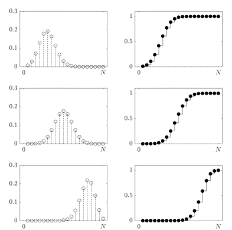

图 2.7：二项分布概率质量函数及其累积分布函数，适用于 \( N = 20 \) 和 \( \mu = 0.3 \)（第一行）、\( \mu = 0.5 \)（第二行）和 \( \mu = 0.8 \)（第三行）。

这导致了_二项分布_ \( m \sim \text{Bin}(N, \mu) \)，其概率质量函数为

```
\(\text{Bin}(m|N, \mu) = \binom{N}{m} \mu^m (1-\mu)^{N-m},\) (2.7)
```

该分布取决于实验次数 \( N \) 和成功概率 \( \mu \)。图 2.7 显示了 \( \mu = 0.3, 0.5 \) 和 \( 0.8 \) 时的二项分布概率质量函数及其累积分布函数。如果 \( x = 1 \) 的概率较小，则获得大量成功的概率也较小。随着 \( \mu \) 增大，该概率增加。

二项分布的期望为

```
\(\mathbb{E}[m] = \mu N,\)
```

因为我们期望由 \( \mu \) 给出的 \( N \) 的部分会成功。另一方面，方差为

```
\(\text{var}[m] = \mu(1 - \mu)N.\)
```

它是单次实验方差的 \( N \) 倍。

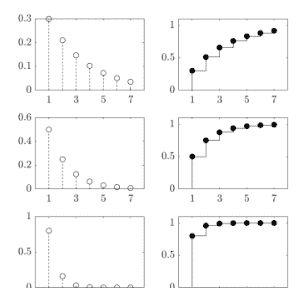

图 2.8：几何分布概率质量函数及其累积分布函数，适用于 \(\mu = 0.3\)（第一行）、\(\mu = 0.5\)（第二行）和 \(\mu = 0.8\)（第三行）。

另一个问题是，成功需要多少次尝试 \(m \ge 1\)。这由_几何分布_ \(m \sim \text{Geo}(\mu)\) 描述。其概率质量函数为

\(\text{Geo}(m|\mu) = \mu(1-\mu)^{m-1}.\)

其期望为

\(\mathbb{E}[m] = \frac{1}{\mu}.\)

这意味着 \(\mu\) 越小，成功所需的尝试次数越多。另一方面，方差由

\(\text{var}[m] = \frac{1-\mu}{\mu^2}.\)

有时，例如在 MATLAB 中，几何分布被定义为第一次成功前的失败次数 \(\tilde{m} = m-1\)。在这种情况下，概率质量函数为 \(\mu(1-\mu)^{\tilde{m}}\)，期望为 \(\mathbb{E}[\tilde{m}] = (1-\mu)/\mu\)，而方差保持不变。

与使用成功概率不同，可以使用某个时间间隔内事件发生的速率 \(\lambda\)。它通常给定为正数，但不需要是整数。它需要在时间间隔的上下文中。\(\lambda\) 的示例包括每小时呼叫中心的电话数量或每天通过交通检查站的汽车数量。


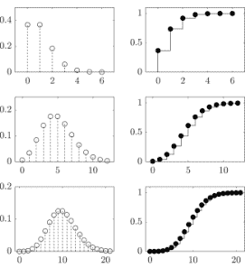

图 2.9: 泊松概率质量函数及其累积分布函数，\(\lambda = 1\)（顶行），\(\lambda = 5\)（中行），和 \(\lambda = 10\)（底行）。

泊松分布 \(m \sim \text{Po}(\lambda)\) 给出了在给定时间间隔内发生 \(m\) 个事件的概率。概率质量函数为

\(\text{Po}(m|\lambda) = \frac{\lambda^m \exp(-\lambda)}{m!}.\) (2.8)

其期望和方差均等于 \(\lambda\),

\(\text{E}[m] = \text{var}[m] = \lambda.\)

当然，我们不仅关心结果为二元的实验，还关心结果可以是 \(K\) 个可能且互不相同结果中的任何一个的实验。例如，掷骰子就是一此类实验。结果可以表示为 \(\langle 1, 2, 3, 4, 5, 6 \rangle\) 或 \(\langle \blacksquare, \blacksquare, \blacksquare, \blacksquare, \blacksquare, \blacksquare \rangle\)。然而，惯例是通过使用 1-of-\(K\) 表示来标准化表示。即，随机变量 \(\mathbf{x}\) 将结果描述为一个 \(K\) 维向量，其中恰好有一个元素 \(x_k\) 等于 1，其余均为零。例如，如果在掷骰子实验中 \(x_4 = 1\)，则 \(\mathbf{x} = (0, 0, 0, 1, 0, 0)^T\)，这意味着掷出了四。转置 \(^T\) 被使用，因为在整个文档中所有向量变量都是列向量，但写行向量更容易。任何具有类别性质的实验都可以以这种方式描述。

获得第 \(k\) 个可能结果（即 \(x_k = 1\)）的概率记为 \(\mu_k\)。所有概率汇总在向量 \(\boldsymbol{\mu} = (\mu_1, \dots, \mu_K)^T\) 中。

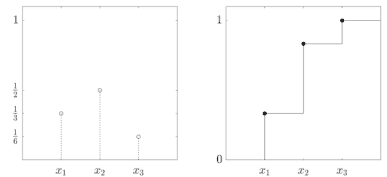

图 2.10: 类别概率质量函数及其累积分布函数，\(\boldsymbol{\mu} = (1/3, 1/2, 1/6)^T\)。

所有结果的概率之和必须为一，

\(\sum_{k=1}^K \mu_k = 1.\)

这定义了 *类别分布*，记为 \(\mathbf{x} \sim \text{Cat}(\boldsymbol{\mu})\)，其概率密度函数为

\(\text{Cat}(\mathbf{x}|\boldsymbol{\mu}) = p(x_k = 1|\boldsymbol{\mu}) = \prod_{k=1}^K \mu_k^{x_k}.\) (2.9)

请注意，在乘积中，除一个因子外，所有因子均为 1，因为在 \(\mathbf{x}\) 中，除一个元素外，所有元素均为 0，而该元素为 1。类别分布可以视为伯努利分布的推广。均匀分布是它的特例，其中 \(\mu_1 = \cdots = \mu_K = 1/K\)。

图 2.10 说明了 \(\boldsymbol{\mu} = (1/3, 1/2, 1/6)^T\) 时类别分布的概率质量函数。累积分布函数是一个不规则的阶梯函数。两者均根据 \(\mathbf{x}\) 中的索引绘制。如果 \(\mathbf{x}\) 中可能结果的顺序不同，图形也会不同。

类别分布的期望计算如下

\(\mathbb{E}[\mathbf{x}] = \sum_{\mathbf{x}} \text{Cat}(\mathbf{x}|\boldsymbol{\mu})\mathbf{x} = \boldsymbol{\mu},\)

其中求和对 \(\mathbf{x}\) 可取的所有可能值进行。请注意，这里我们进入了 *多元分布* 的领域，因为 \(\mathbf{x}\) 是一个向量，尽管其中除一个元素外所有元素均为零，而该元素为一。

回顾，随机变量 \(x\) 的 *一元分布* 方差由 \(\text{var}[x] = \mathbb{E}[(x - \mathbb{E}[x])^2] = \mathbb{E}[x^2] - \mathbb{E}[x]^2\) 给出。其多元对应形式为

\(\text{var}[\mathbf{x}] = \mathbb{E}[(\mathbf{x} - \mathbb{E}[\mathbf{x}])(\mathbf{x} - \mathbb{E}[\mathbf{x}])^T] = \mathbb{E}[\mathbf{x}\mathbf{x}^T] - \mathbb{E}[\mathbf{x}]\mathbb{E}[\mathbf{x}]^T.\) (2.10)

结果是一个矩阵，其中第 \(k\) 个对角线元素给出了 \(x_k\) 围绕均值 \(\mu_k\) 的变化程度。非对角线元素衡量 \(\mathbf{x}\) 的不同组件相互影响的程度。

现在，\(\mathbf{x}\) 是一种 1-of-K 表示。如果 \(\mathbf{x}\) 中 \(x_k = 1\)，则 \(\mathbf{x}\mathbf{x}^T\) 是一个矩阵，除第 \(k\) 个对角线元素（其值为 1）外，所有元素均为零。由此

\(\text{var}[\mathbf{x}] = \sum_{\mathbf{x}} \text{Cat}(\mathbf{x}|\boldsymbol{\mu})\mathbf{x}\mathbf{x}^T - \boldsymbol{\mu}\boldsymbol{\mu}^T = \text{diag}(\boldsymbol{\mu}) - \boldsymbol{\mu}\boldsymbol{\mu}^T\)

得出，其中 \(\text{diag}(\boldsymbol{\mu})\) 表示一个矩阵，其非对角线元素为零，对角线由 \(\boldsymbol{\mu}\) 的元素给出。

请注意，\(\text{var}[\mathbf{x}]\) 的第 \(k\) 个对角线元素为 \(\mu_k - \mu_k^2 = \mu_k(1 - \mu_k)\)。这是伯努利分布的方差，其中成功定义为结果为 \(x_k = 1\)，失败定义为 \(x_k = 0\)。第 \((k, l)\) 个非对角线元素称为第 \(k\) 个和第 \(l\) 个元素之间的协方差 \(\text{cov}[x_k, x_l]\)，其值为 \(-\mu_k\mu_l\)。这表明第 \(k\) 个和第 \(l\) 个组件以负向方式相互影响，因为如果一个为 1，另一个必须为 0。

与二元变量一样，当实验重复 \(N\) 次时，我们也可以询问不同结果组合的分布。每次实验给出一个结果向量 \(\mathbf{x}_n, n = 1, \dots, N\)。设 \(m_k\) 为实验结果为 \(x_{nk} = 1\) 的次数。由于 \(x_{nk}\) 否则为零，我们有

\(m_k = \sum_{n=1}^N x_{nk}\)

我们关注长度为 \(K\) 的元组 \(\mathbf{m} = (m_1, \dots, m_K)^T\) 的分布。实际上其长度为 \(K - 1\)，因为数字 \(m_k\) 受以下约束

\(\sum_{k=1}^K m_k = N,\) (2.11)

因此 \(m_K\) 由 \(m_K = N - m_1 - \dots - m_{K-1}\) 给出。生成特定元组的可能性数量由 *多项式系数* 给出，

\(\binom{N}{m_1 \dots m_K} = \frac{N!}{m_1! \dots m_K!}\)

从组合论角度看，这是将 \(N\) 个球放入 \(K\) 个箱子的方式数，其中箱 1 包含 \(m_1\) 个球，箱 2 包含 \(m_2\) 个对象，依此类推。这里 \(0!\) 定义为 1。二项式系数是 \(m_1 = m\) 和 \(m_2 = N - m\) 时的多项式系数。

然后，*多项分布* \(\mathbf{m} \sim \text{Mult}(N, \boldsymbol{\mu})\) 的概率密度函数为

\(\text{Mult}(\mathbf{m}|N, \boldsymbol{\mu}) = \binom{N}{m_1 \dots m_K} \prod_{k=1}^K \mu_k^{m_k}.\) (2.12)

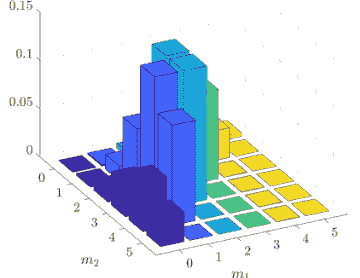

图 2.11: \(N=5\) 和 \(\boldsymbol{\mu} = (1/3, 1/2, 1/6)^T\) 时的多项概率质量函数。

图 2.11 以柱状图形式显示了 \(N=5\) 和 \(\boldsymbol{\mu} = (1/3, 1/2, 1/6)^T\) 时多项分布的质量函数。图表仅针对 \(m_1\) 和 \(m_2\) 绘制，因为 \(m_3 = N - m_1 - m_2\) 是隐式给出的。在右侧，我们可以看到，每当 \(m_1 + m_2 > 5\) 时，概率质量为零，这是 2.11 中给定的约束所要求的。在零之后，最小概率对应于元组 \((0, 0, 5)^T\)，其值为 \(1/6^5\)。最大概率出现三次，分别对应元组 \((2, 2, 1)^T\)、\((2, 3, 0)^T\) 和 \((1, 3, 1)^T\)，因为

\(\frac{5!}{2!2!1!} \left(\frac{1}{3}\right)^2 \left(\frac{1}{2}\right)^2 \left(\frac{1}{6}\right)^1 = \frac{5!}{2!3!0!} \left(\frac{1}{3}\right)^2 \left(\frac{1}{2}\right)^3 \left(\frac{1}{6}\right)^0\)

\(= \frac{5!}{1!3!1!} \left(\frac{1}{3}\right)^1 \left(\frac{1}{2}\right)^3 \left(\frac{1}{6}\right)^1 = \frac{5}{6^2}.\)

多项分布的期望为

\(\mathbb{E}[\mathbf{m}] = N\boldsymbol{\mu},\)

因为我们期望 \(\mu_k N\) 次实验会产生结果 \(x_k = 1\)。另一方面，方差为

\(\text{var}[\mathbf{m}] = N \text{diag}(\boldsymbol{\mu}) - \boldsymbol{\mu} \boldsymbol{\mu}^T.\)

它是单次实验方差的 \(N\) 倍，单次实验由类别分布描述。


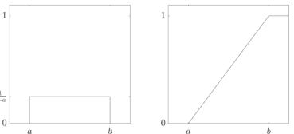

图 2.12：均匀概率密度函数及其累积分布函数。

### 2.4 连续概率密度函数示例

与离散分布一样，最简单的连续概率密度函数是均匀分布。随机变量 $x$ 可以在区间 $(a, b)$ 内取任意值，且概率相同，$x \sim \text{Unif}(a, b)$。由于概率在区间上积分必须等于 1，因此其值必须为 $1/(b - a)$。均匀密度函数由下式给出：

```
\(\text{Unif}(x|a, b) = \left\{ \begin{array}{ll} \frac{1}{b-a} & \text{for } a < x < b \\ 0 & \text{otherwise} \end{array} \right.\)
```

而累积分布函数为

```
\(\left\{ \begin{array}{ll} 0 & \text{for } x < a \\ \frac{x-a}{b-a} & \text{for } a \le x \le b \\ 1 & \text{for } x > b \end{array} \right.\)
```

图 2.12 给出了图形说明。连续均匀密度函数可以看作其离散对应物的极限，当所有可能结果的集合包含区间 $(a, b)$ 上的每个点时。其期望由下式给出：

```
\(\mathbb{E}[x] = \int_a^b \frac{1}{b-a} x dx = \left[ \frac{x^2}{2(b-a)} \right]_a^b = \frac{b^2 - a^2}{2(b-a)} = \frac{a+b}{2}.\)
```

另一方面，其方差为

```
\(\text{var}[x] = \int_a^b \frac{1}{b-a} \left( x - \frac{a+b}{2} \right)^2 dx = \left[ \frac{1}{3(b-a)} \left( x - \frac{a+b}{2} \right)^3 \right]_a^b = \frac{1}{12}(b-a)^2.\)
```

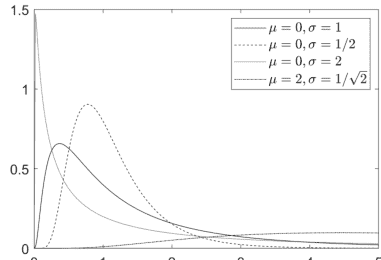

图 2.13：各种 \(\mu\) 和 \(\sigma$ 值下的对数正态概率密度函数。

我们在公式 (2.4) 中已经遇到过一元正态分布，其概率密度函数和累积分布函数分别在图 2.2 和图 2.4 中给出。其多元对应物具有如下概率密度函数

```
f(\mathbf{x}) = \frac{1}{\sqrt{(2\pi)^\Sigma}} \exp \left( -\frac{1}{2} (\mathbf{x} - \mu)^T \Sigma^{-1} (\mathbf{x} - \mu) \right),
```

其中 \(|\cdot|$ 表示行列式，\(^{-1}$ 是矩阵 \(\Sigma$ 的逆。多元正态分布的均值为 \(\mu$，而其方差为 \(\Sigma$。

若随机变量 \(x$ 的对数服从正态分布，即 \(y = \log x$ 服从正态分布，则称 \(x$ 服从对数正态分布，也称为加尔顿分布。同样，由于 \(x = \exp y$，正态分布变量的指数服从对数正态分布。由于指数始终为正，\(x$ 只取正值。

许多增长过程由百分比变化来描述。例如，全球人类人口的年增长率在 1.1% 左右波动。设 \(z_1$ 为第 1 年的实际增长率，\(z_2$ 为第 2 年的增长率，以此类推。如果 \(a$ 是初始人口规模，那么经过 \(N$ 年后，人口规模将为

```
x = a \prod_{n=1}^N z_n.
```

对两边取对数得到

$$y = \log a + \sum_{n=1}^N \log z_n.$$

因此，人口规模对数的变化是一组独立同分布变量的和，即 \(\log z_n$。根据中心极限定理，这样的和倾向于服从正态分布，与 \(\log z_n$ 的分布无关。加上 \(\log a$ 仅会移动该分布的均值。因此人口规模的对数 \(y$ 服从正态分布。因此人口规模 \(x$ 服从对数正态分布。除了让年份数量增长外，还可以通过考虑越来越小的时间间隔来达到极限。不过需要注意的是，此时百分比增长的方差会增加，因为较长的时间间隔具有平均效应。

增长在生物学、医学和经济学等领域起着重要作用。有许多其他例子使用了对数正态分布。例如，在线内容的停留时间和在线评论的长度服从对数正态分布，国际象棋对局的长度也是如此。用于期权定价的 *布莱克-舒尔斯模型* 假设股票收益率服从对数正态分布。然而，这一假设是有缺陷的，因为极端价格变化（如股市崩盘时）需要一个峰度更大的分布。在实践中，此类极端事件发生的可能性比对数正态分布所指示的更大。

如果 \(\mu$ 和 \(\sigma^2$ 是相关正态分布的均值和方差，则 \(x \sim \log \mathcal{N}(\mu, \sigma^2)$ 的对数正态密度函数由下式给出

$$
\log \mathcal{N}(x|\mu, \sigma^2) = \frac{1}{x\sigma\sqrt{2\pi}} \exp\left(-\frac{(\log x - \mu)^2}{2\sigma^2}\right).
$$

如图 2.13 所示，而图 2.14 描绘了各种 \(\mu$ 和 \(\sigma$ 值下的累积分布函数。对于 \(\mu=0$ 和 \(\sigma=2$，密度函数在非常接近零的地方达到峰值。看不出它在原点处为零。

期望计算如下

$$
\mathbb{E}[x] = \int_0^\infty \frac{x}{x\sigma\sqrt{2\pi}} \exp\left(-\frac{(\log x - \mu)^2}{2\sigma^2}\right) dx.
$$

\(x$ 的因子与密度函数中的分母抵消。我们令 \(y = \log x$ 或等价地 \(x = \exp y$。这样一来，\(dx = \exp y dy$，积分范围变为 \((-\infty, \infty)\)。

\(\begin{aligned}
\mathbb{E}[x] &= \int_{-\infty}^\infty \frac{1}{\sqrt{2\pi}\sigma} \exp\left(-\frac{(y-\mu)^2}{2\sigma^2}\right) \exp y \, dy \\
&= \int_{-\infty}^\infty \frac{1}{\sqrt{2\pi}\sigma} \exp\left(\frac{-(y-\mu)^2 + 2\sigma^2 y}{2\sigma^2}\right) dy.
\end{aligned}\)

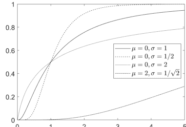

图 2.14：各种 \(\mu$ 和 \(\sigma$ 值下的对数正态累积分布函数。

我们现在使用一种称为 *配方法* 的技术：

```
\(-(y-\mu)^2 + 2\sigma^2 y = -y^2 + 2y\mu - \mu^2 + 2\sigma^2 y = -y^2 + 2(\mu + \sigma^2)y - \mu^2\)
\(= -(y - (\mu + \sigma^2))^2 + (\mu + \sigma^2)^2 - \mu^2\)
\(= -(y - (\mu + \sigma^2))^2 + 2\mu\sigma^2 + \sigma^4.\)
```

有了这个，期望变为

```
\(\mathbb{E}[x] = \int_{-\infty}^{\infty} \frac{1}{\sqrt{2\pi}\sigma} \exp \left( \frac{-(y - (\mu + \sigma^2))^2 + 2\mu\sigma^2 + \sigma^4}{2\sigma^2} \right) dy\)
\(= \exp \left( \mu + \frac{\sigma^2}{2} \right) \int_{-\infty}^{\infty} \frac{1}{\sqrt{2\pi}\sigma} \exp \left( \frac{-(y - (\mu + \sigma^2))^2}{2\sigma^2} \right) dy.\)
```

该积分的值为 1，因为被积函数是均值为 \(\mu + \sigma^2$、方差为 \(\sigma^2$ 的正态概率密度函数。因此期望为

```
\(\mathbb{E}[x] = \exp \left( \mu + \frac{\sigma^2}{2} \right).\)
```

方差可以类似地计算，得到

```
\(\text{var}[x] = (\exp(\sigma^2) - 1) \exp(2\mu + \sigma^2).\)
```

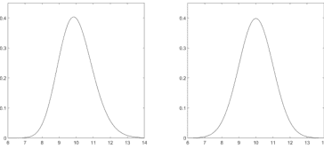

图 2.15：左侧为期望 E[x] = 100 且方差 var[x] = 1 的对数正态密度函数，右侧为具有相同期望和方差的正态密度函数。

如果已知对数正态分布的方差 var[x] 和期望 E[x]，则相关正态分布的均值和方差可以计算为

```
\(\mu = \log \left( \frac{\mathbb{E}[x]^2}{\sqrt{\text{var}[x] + \mathbb{E}[x]^2}} \right)\)
\(\sigma^2 = \log \left( 1 + \frac{\text{var}[x]}{\mathbb{E}[x]^2} \right).\) (2.13)
```

在使用对数正态分布时，我们已经提醒过这一点。一般来说，假设一个潜在分布是一个非常强的假设，需要充分证明和传达，以防新数据使该假设失效。图 2.15 显示了左侧期望 E[x] = 100 且方差 var[x] = 1 的对数正态密度函数，以及右侧具有相同期望和方差的正态密度函数。它们基本上无法区分。

对数正态概率密度在 \(\exp(\mu - \sigma^2)$ 处有其唯一的最大值。这也称为其众数。对数正态分布和正态分布都是 *单峰的*，因为它们只有一个最大值。如果一个概率密度函数有几个可以取不同值的局部最大值，则称为 *多峰的*。对于正态分布，众数与均值重合。对数正态概率密度函数越接近正态分布，当众数越接近期望（即均值）时。使用公式 (2.13)，众数可以计算为

```
\(\exp(\mu - \sigma^2) = \exp \left[ \log \left( \frac{\mathbb{E}[x]}{\sqrt{1 + \frac{\text{var}[x]}{\mathbb{E}[x]^2}}} \right) - \log \left( 1 + \frac{\text{var}[x]}{\mathbb{E}[x]^2} \right) \right]\)
\(= \left( 1 + \frac{\text{var}[x]}{\mathbb{E}[x]^2} \right)^{-3/2} \mathbb{E}[x].\)
```


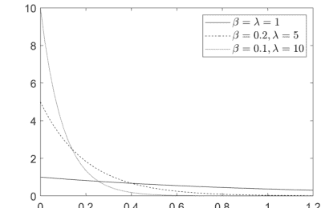

图 2.16: 泊松分布图 2.9 对应的各种 \(\beta = 1/\lambda\) 值的指数概率密度函数。

如果方差远小于期望，则众数与期望之比非常接近 1。在我们的例子中，E[x] = 100 且 var[x] = 1，该比值约为 0.99985。

重要的是，底层假设必须清晰并有文档记录，如以下示例所示。在 2G 移动电话网络中，每个移动终端被分配自己的频率，并由一个天线服务。如果它移出当前天线的覆盖区域并进入另一个天线的覆盖区域，它可能会跳频到另一个频率。如果当前连接的天线需要服务更多移动终端，它也可能从更远的另一个天线获得新频率。为了评估大区域移动网络的覆盖情况，会在此区域模拟移动电话使用情况，包括天线之间的切换。当初次编写模拟代码时，程序员没有包含那些可能但不太可能发生的情况的代码路径。随着移动电话使用量增加，概率发生了变化。将这些现在必要的代码路径插入到大量且通常缺乏文档的代码中引发了一些问题。这个故事的寓意是，所有情况，即使是不太可能的情况，都需要编码和文档化。甚至明智地包括那些不可能的情况，因为某处某人会修改代码，使它们成为可能。

指数分布，x ~ Exp(\(\beta\))，具有概率密度函数

```
Exp(x|\beta) = \left\{ \begin{array}{ll} \frac{1}{\beta} \exp \left( - \frac{x}{\beta} \right) & \text{for } x \ge 0, \\ 0 & \text{for } x < 0, \end{array} \right. \quad (2.14)
```

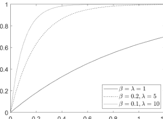

图 2.17: 泊松分布图 2.9 对应的各种 \(\beta = 1/\lambda\) 值的指数累积分布函数。

它由尺度参数 \(\beta\) 参数化。其逆数 \(\lambda = 1/\beta\) 是速率参数。它与定义在方程 (2.8) 中、速率参数为 \(\lambda = 1/\beta\) 的泊松分布相关，因为它描述了由泊松分布描述的事件发生之间的时间。

累积分布函数在 \(x < 0\) 时为零，对于 \(x \ge 0\) 由以下公式给出

```
F(x) = p(t \le x) = \int_{-\infty}^x \text{Exp}(t|\beta) dt = \int_0^x \frac{1}{\beta} \exp \left( - \frac{t}{\beta} \right) dt = 1 - \exp \left( - \frac{x}{\beta} \right).
```

它给出了事件在此时间范围内已经发生的概率。另一方面，\(1 - F(x) = \exp \left( - \frac{x}{\beta} \right) = p(t > x)\) 是事件尚未发生的概率。

各种 \(\beta\) 值的概率密度函数和累积分布函数示例分别在图 2.16 和 2.17 中给出。

在已经过去 \(x\) 时间量的情况下，等待时间为 \(x+y\) 的概率由乘法规则给出

```
p(t > x + y | t > x) p(t > x) = p(t > x + y \text{ and } t > x) = p(t > x + y).
```

求解 \(p(t > x + y | t > x)\)，我们得到

```
p(t > x + y | t > x) = \frac{p(t > x + y)}{p(t > x)} = \frac{\exp(-\frac{x+y}{\beta})}{\exp(-\frac{x}{\beta})} = \exp \left( - \frac{y}{\beta} \right) = p(t > y).
```

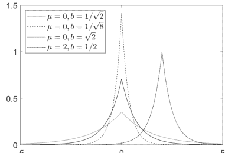

图 2.18: 各种 \(\mu\) 和 \(b\) 值的拉普拉斯概率密度函数，选择使得均值和方差与图 2.2 相同。

从实际意义上讲，这意味着等待事件所花费的时间完全不受已经等待时间长短的影响。这意味着指数分布是无记忆的，这一性质与几何分布共有。指数分布是几何分布的连续等价物，几何分布描述二元实验成功所需的尝试次数。与其思考失败和成功，不如思考状态的改变更为方便。\(\lambda\) 给出单位时间间隔内的变化率，指数分布描述了状态改变前经过多长时间的概率。恒定的变化率是一个关键假设，现实世界中的过程往往不满足此假设。例如，周五和周六晚上紧急呼叫率会增加，人员配置水平需要相较于其他时间进行调整。如果速率是恒定的，它在排队论中被使用。指数分布不适合模拟生物体或技术设备的整体寿命，其中死亡或故障事件取决于迄今为止的寿命。

使用分部积分，期望由以下公式给出

```
\mathbb{E}[x] = \int_0^\infty \frac{x}{\beta} \exp\left(-\frac{x}{\beta}\right) dx
= \left[ \frac{x}{\beta} \left( -\beta \exp\left(-\frac{x}{\beta}\right) \right) \right]_0^\infty + \int_0^\infty \exp\left(-\frac{x}{\beta}\right) dx
= \left[ -\beta \exp\left(-\frac{x}{\beta}\right) \right]_0^\infty = \beta.
```

方差可以类似计算，为

```
\text{var}[x] = \beta^2.
```

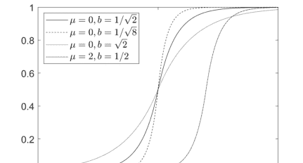

图 2.19: 各种 \(\mu\) 和 \(b\) 值的拉普拉斯累积分布函数，选择使得均值和方差与图 2.2 相同。

如果将指数概率密度函数的正部分关于零处的垂直轴镜像，并进行平移和缩放使其积分为一，则它成为如图 2.18 所示的拉普拉斯概率密度函数。拉普拉斯分布 \(x \sim \text{Laplace}(\mu, b)\) 的概率密度函数由以下公式给出

```
Laplace(x|\mu, b) = \frac{1}{2b} \exp \left( - \frac{|x - \mu|}{b} \right),
```

其中 \(\mu\) 称为位置参数，\(b\) 是一个称为 *多样性* 的尺度参数。

其期望为 \(\mathbb{E}[x] = \mu\)，方差为 \(\text{var}[x] = 2b^2\)。累积分布函数示例见图 2.19。它们可以与图 2.2 和 2.4 进行比较，后两图说明了正态分布，因为均值相同且 \(b\) 被选择使得方差也相同。

接下来，我们考虑一种称为 *β 分布* 的概率密度，\(x \sim \text{Beta}(\alpha, \beta)\)。它定义在区间 (0, 1) 上，其概率密度函数为

```
Beta(x|\alpha, \beta) = \frac{\Gamma(\alpha + \beta)}{\Gamma(\alpha)\Gamma(\beta)} x^{\alpha-1} (1-x)^{\beta-1},
```

其中 \(\alpha\) 和 \(\beta\) 是正实数。函数 \(\Gamma(z)\) 称为 *伽马函数*，定义为

```
\Gamma(z) = \int_0^\infty x^{z-1} \exp(-x) dx.
```

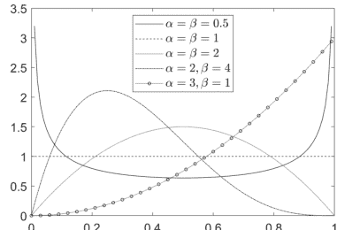

图 2.20: 各种 \(\beta\) 和 \(\alpha\) 值的 β 分布概率密度函数。

使用分部积分，我们可以计算

```
$$\Gamma(z+1) = \int_0^\infty x^z \exp(-x) dx = [-x^z \exp(-x)]_0^\infty + \int_0^\infty z x^{z-1} \exp(-x) dx.$$
```

第一项消失，因为在零处我们有零的正幂，而当 \(x\) 趋于无穷大时，\(\exp(-x)\) 趋于零的速度快于 \(x\) 的任何幂。因此，

```
$$\Gamma(z+1) = z \int_0^\infty x^{z-1} \exp(-x) dx = z \Gamma(z), \quad (2.15)$$
```

它被视为阶乘到正实数的扩展。确实，如果 \(z=n\) 是整数，那么反复使用上述关系会导致

```
$$\Gamma(n+1) = n \Gamma(n) = n(n-1) \Gamma(n-1) = n(n-1) \cdots 1 \Gamma(1) = n!,$$
```

因为 \(\Gamma(1) = 1\)。

分数

```
$$B(\alpha, \beta) = \frac{\Gamma(\alpha)\Gamma(\beta)}{\Gamma(\alpha + \beta)}$$
```

称为 β 函数，赋予分布其名称。它可以被视为二项式系数倒数的扩展。确实，如果 \(\alpha=m\) 和 \(\beta=n\) 是整数，那么

```
$$\frac{1}{B(m,n)} = \frac{(m+n)!}{m!n!} = \binom{m+n}{m} = \binom{m+n}{n}.$$
```


考虑到这一点，我们可以看到 beta 密度函数具有与 (2.7) 中二项分布的概率密度函数相似的函数形式。主要区别在于，在二项分布中随机变量是成功次数 m，而在 beta 分布中随机变量是 x。它取代了成功概率。因此，beta 分布常被视为概率或比例上的分布。它给出了观察到某个概率 x 的概率。我们将在 2.6 节中看到如何利用这种函数相似性。

图 2.20 显示了不同 \(\alpha\) 和 \(\beta\) 选择下的 beta 密度函数，涵盖了多种不同的形状。当 \(\alpha = \beta = 1\) 时，beta 分布成为均匀分布。当 \(\alpha\) 或 \(\beta\) 小于 1 时，密度函数在区间的相应边缘将趋于无穷大。

期望计算如下

```
\mathbb{E}[x] = \int_0^1 x \text{Beta}(x|\alpha, \beta) dx = \frac{\Gamma(\alpha+\beta)}{\Gamma(\alpha)\Gamma(\beta)} \int_0^1 x^\alpha (1-x)^{\beta-1} dx
= \frac{\Gamma(\alpha+\beta)\Gamma(\alpha+1)\Gamma(\beta)}{\Gamma(\alpha)\Gamma(\beta)\Gamma(\alpha+1+\beta)} \int_0^1 \text{Beta}(x|\alpha+1, \beta) dx
= \frac{\alpha}{\alpha+\beta},
```

这里我们使用了 2.15 中给出的伽马函数性质，以及任何概率密度函数在其范围内的积分为 1 这一事实。方差由

```
\text{var}[x] = \frac{\alpha\beta}{(\alpha+\beta)^2(\alpha+\beta+1)},
```

给出。当 \(\alpha = \beta\) 时，期望始终为 1/2，而方差为 \((4(2\alpha+1))^{-1}\)。因此，这些值的概率密度函数图像关于 1/2 对称，而图 2.21 中累积分布函数的图像通过 (1/2, 1/2)。

beta 分布可以被视为二元结果实验概率上的分布，其中 \(x\) 是成功概率，\(1-x\) 是失败概率。如果 \(x\) 服从分布 \(\text{Beta}(x|\alpha, \beta)\)，则 \(1-x\) 服从分布 \(\text{Beta}(1-x|\beta, \alpha)\)。

正如我们从二元变量的伯努利分布过渡到多个互斥结果实验的分类分布一样，我们将 beta 分布扩展到 \(K\) 个概率 \(0 \le x_k \le 1, k = 1, \dots, K\) 的分布，这些概率之和必须为 1，

```
\sum_{k=1}^K x_k = 1.
```

这些概率被收集在随机变量向量 \(\mathbf{x} = (x_1, \dots, x_K)^T\) 中。由于约束，\(\mathbf{x}\) 只能位于

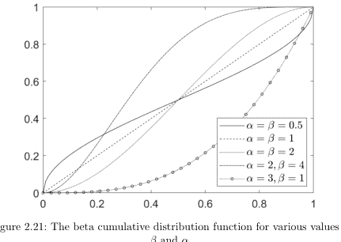

长度为 $K$ 的向量空间的一个子集中。对于 $K=3$，这在图 2.22 中有所说明。\(\mathbf{x}$ 位于所示三角形的面上。推广到更高维度称为 *单纯形*。

该分布称为 *狄利克雷分布*，适用于 \(\mathbf{x} \sim \text{Dir}(\boldsymbol{\alpha})\)，其概率密度函数由

```
\(\text{Dir}(\mathbf{x}|\boldsymbol{\alpha}) = \frac{\Gamma(\alpha_1 + \dots + \alpha_K)}{\Gamma(\alpha_1) \cdots \Gamma(\alpha_K)} \prod_{k=1}^K x_k^{\alpha_k - 1}.\) (2.16)
```

给出。参数 $\boldsymbol{\alpha} = (\alpha_1, \dots, \alpha_K)^T$ 称为 *浓度参数*。它们均为正数。当 $K=2$ 时，狄利克雷分布即为 beta 分布。

图 2.23 显示了单纯形上各种 $\boldsymbol{\alpha}$ 值的三维狄利克雷概率密度函数。密度函数的取值由颜色指示。

当 \(\alpha_1 = \cdots = \alpha_K\) 时，该分布称为 *对称狄利克雷分布* 或 平坦 *狄利克雷分布*。后一种命名具有误导性，因为只有当所有浓度参数都取值 1 时它才是平坦的。此时狄利克雷分布成为单纯形上的均匀分布。在这种情况下，

```
\(\text{Dir}(\mathbf{x}|\boldsymbol{\alpha}) = \frac{\Gamma(K)}{\Gamma(1) \cdots \Gamma(1)} \prod_{k=1}^K x_k^0 = (K-1)!,\)
```

这是单纯形体积的倒数。对于 $K=3$，三角形的面积为 1/2。

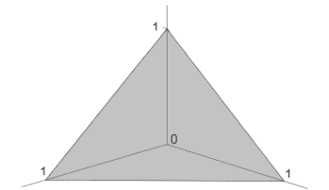

图 2.22: 由于其元素的约束，x 可能位置的单纯形。

我们在图 2.23 中看到，对于 \(\boldsymbol{\alpha} = (5, 5, 5)^T$，概率质量集中在中心，而对于 \(\boldsymbol{\alpha} = (5, 5, 2)^T$，它集中在与最小浓度参数所在角相对的边缘。对于 \(\boldsymbol{\alpha} = (5, 2, 2)^T$，概率质量集中在最大浓度参数所在的角。

当某个浓度参数 \(\alpha_k\) 小于 1 时，概率密度函数将在相应的边缘 \(x_k = 0\) 处趋于无穷大。在图 2.23 中，这对于 \(\boldsymbol{\alpha} = (0.8, 2, 2)^T\) 是可见的，但对于 \(\boldsymbol{\alpha} = (0.8, 0.8, 2)^T\) 则几乎不可见。

清单 2.1 提供了计算狄利克雷分布概率密度函数的实现。

我们分别计算 \(\mathbf{x}\) 各分量的期望。令

```
\(\alpha_0 = \sum_{k=1}^K \alpha_k.\)
```

注意积分是在 \(\mathbf{x}$ 所在的单纯形上进行。

```
\(\begin{aligned} \mathbb{E}[x_j] &= \int x_j \text{Dir}(\mathbf{x}|\boldsymbol{\alpha}) d\mathbf{x} = \frac{\Gamma(\alpha_0)}{\Gamma(\alpha_1) \cdots \Gamma(\alpha_K)} \int_{x_j} \prod_{k=1}^K x_k^{\alpha_k - 1} d\mathbf{x} \\ &= \frac{\Gamma(\alpha_0)}{\Gamma(\alpha_1) \cdots \Gamma(\alpha_K)} \frac{\Gamma(\alpha_1) \cdots \Gamma(\alpha_j+1) \cdots \Gamma(\alpha_K)}{\Gamma(\alpha_0 + 1)} \\ &\quad \int \text{Dir}(\mathbf{x}|\alpha_1, \dots, \alpha_{j-1}, \alpha_j + 1, \alpha_{j+1}, \dots, \alpha_K) d\mathbf{x} \\ &= \frac{\alpha_j}{\alpha_0}, \end{aligned}\)
```

这里我们再次使用了方程 2.15 中给出的伽马函数性质，以及任何概率密度函数在其

```
function y = dirpdf(x,a)
% Dirichlet probability density function.
% y = dirpdf(x,a) returns the Dirichlet probability density
% function with concentration parameters in the row vector a
% for each row of x. x must have the same number of columns
% as a or one less. y is a column vector with the same number
% of elements as rows in x.
%
if nargin ~= 2
    error('Exactly two input arguments are required.');
end
[ra,ca] = size(a);
[rx,cx] = size(x);
if ra ~=1
    error('Second argument needs to be a row vector.');
end
if any(a<0)
    error('Second argument needs to be positive.');
end
if ca == cx+1
    % create last column of x
    x(:,cx+1) = 1 - sum(x,2);
    cx = cx+1;
end
if ca~=cx
    error('Number of columns mismatch');
end
% find rows of x which do not sum to 1 or have elements out of bounds
xOut = sum(x,2)~=1 | any(x<0|x>1,2);
xIn = ~xOut;
% Initialize y to zero.
y = zeros(rx,1);
% Since the gamma function increases quickly it is safer to use its
% logarithm and the implementation avoiding underflow or overflow.
y(xIn) = prod(x(xIn,:).^(a(1,:)-1),2).*exp(gammaln(sum(a(:,1),2))...
    -sum(gammaln(a(1,:)),2));
y(xOut) = NaN;
```

清单 2.1: 狄利克雷概率密度函数。

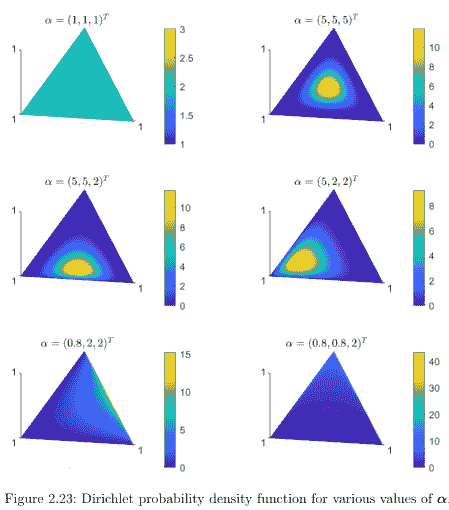

范围内的积分为 1 这一事实。方差由

\(\text{var}[x_j] = \frac{\alpha_j(\alpha_0 - \alpha_j)}{\alpha_0^2(\alpha_0 + 1)},\)

给出，而对于 \(j \neq k\) 的协方差为

\(\text{cov}[x_j, x_k] = \frac{-\alpha_j \alpha_k}{\alpha_0^2(\alpha_0 + 1)},\)

正如我们在分类分布中所见，影响是负的，因为如果一个分量增加，由于 \(\mathbf{x}$ 上的约束，另一个分量必须减少。

再次查看图 2.23，我们看到浓度参数 \(\alpha_k$ 与其和 \(\alpha_0$ 的相对大小决定了大部分概率


质量集中在单纯形内。因此，在某些文献中，狄利克雷分布的参数表示为 \(\alpha \mu\)，其中

\(\alpha = \alpha_0 = \sum_{k=1}^K \alpha_k,\)
\(\mu = \left( \frac{\alpha_1}{\alpha_0}, \dots, \frac{\alpha_K}{\alpha_0} \right)^T.\)
(2.17)

在这种情况下，\(\alpha\) 称为（单一）*浓度参数*，而 \(\mu\) 是*基分布*。它也是分布的期望，并满足约束

\(\sum_{k=1}^K \mu_k = 1.\)

采用此记法，

\(\text{var}[x_j] = \frac{1}{\alpha + 1} \mu_j (1 - \mu_j),\)
\(\text{cov}[x_j, x_k] = \frac{1}{\alpha + 1} \mu_j \mu_k.\)

我们已经看到，如果 \(\alpha = 1\)，狄利克雷分布就是均匀分布。这意味着所有分布 \(\mathbf{x}\) 都同样可能。如果 \(\alpha\) 趋向于无穷大，那么只有那些本身近似均匀分布的分布才可能。狄利克雷概率密度函数在由 \(\mathbf{x} = (1/K, \dots, 1/K)^T\) 给出的均匀分布周围变得无限尖锐。在图 2.23 中，当 \(\alpha = (5, 5, 5)^T\) 时 \(\alpha_0 = \alpha\) 最大，概率质量集中在 \((1/3, 1/3, 1/3)\) 附近，这描述了三种可能结果的均匀分布。

如果 \(\alpha\) 趋向于零，设 \(\mu_k\) 为最大的分量，即对于所有 \(j \neq k\) 都有 \(\mu_k > \mu_j\)。那么狄利克雷分布趋向于在单纯形的这个角上达到峰值。如果有多个分量具有相同的最大值，它趋向于在这些角上达到峰值，而在其他地方为零。

贝塔分布和狄利克雷分布都可以用*波利亚 urn 模型*来说明。想象一个包含 \(K\) 种不同颜色球的罐。对于贝塔分布，这些是两种颜色。最初，罐中包含 \(\alpha_1\) 个颜色 1 的球，\(\alpha_2\) 个颜色 2 的球，依此类推。如方程 2.17 所示，球的总数是浓度 \(\alpha\)，初始比例由基分布 \(\mu\) 给出。

现在，每次从罐中抽出一个球并放回，同时再加入一个相同颜色的球，直到罐中包含 \(N\) 个球。由于抽出的颜色是随机的，每种颜色的最终球数是一个随机变量。然而，它受球的初始比例影响。如果最初只有一种颜色的球，那么结果是确定的，因为罐将继续只包含一种颜色的球。如果那一种颜色的球数量不成比例地多，我们也会预期该颜色的球在最终集中也会更多，

```
function y = polya(alpha,N)
% Polya urn simulation function
% alpha is a vector containing the initial number of balls of
% each colour. The number of colours is the length of alpha.
% After N=sum(alpha) draws, y contains the final number of
% balls of each colour in the urn.

if nargin ~= 2
    error('Exactly two input arguments are required.');
end

[ra,ca] = size(alpha);
if ra > 1 && ca>1
    error('First argument needs to be a vector.');
end

y = alpha;

for n=1:N-sum(alpha)
    % calculate proportions
    p = y/sum(y);
    % randomly pick a ball
    idx = randsample(length(p),1,true,p);
    y(idx) = y(idx)+1;
end
```

### Listing 2.2: Polya urn simulation.

在最终集中，因为这种颜色被抽中的可能性更大，然后由于添加了该颜色的球，它变得更加可能。这被称为*富者愈富*。然而，这是期望。其他比例也是可能的，只是可能性较小。事实上，当 $N$ 趋向于无穷大时，球比例向量 \(\mathbf{x}\) 的可能性服从狄利克雷分布 Dir(\(\mathbf{x}|\alpha\))。这可能看起来反直觉。想象最初只有一个黑球和一个白球，$K=2$ 且 \(\alpha_1 = \alpha_2 = 1\)。那么，罐最终包含相同数量的黑球和白球的可能性，与除了最初的黑球外只包含白球的可能性是相等的。

列表 2.2 中的函数模拟了波利亚罐实验。它被调用了 10000 次以生成图 2.24 中的直方图，其中罐中球的最终数量为 $N=100$。水平线是颜色 1 的球的数量，而直方图中的每个柱显示在 10000 次实验中出现的次数。如果柱按 100/10000 缩放，因为 10000 次实验分布在 100 个 bin 中，直方图与图 2.20 中的曲线吻合良好。

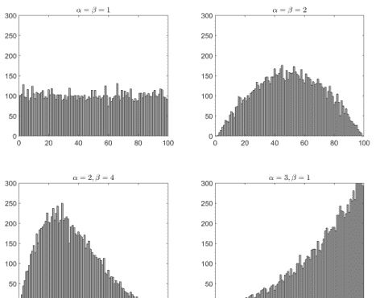

图 2.24：不同 \(\alpha\) 和 \(\beta\) 值的波利亚罐实验直方图。

### 2.5 连续随机变量的函数

如果 \(x\) 是具有概率密度函数 \(f_x(x)\) 的连续随机变量，那么对于连续函数 \(g\)，\(y = g(x)\) 也是一个连续随机变量，但其概率密度函数 \(f_y(y)\) 是什么？我们加上下标以明确概率密度函数和累积分布函数指的是哪个随机变量。

我们首先将注意力限制在 \(g\) 为一对一变换的情况。即每个 \(x\) 的值生成恰好一个 \(y\) 的值，每个 \(y\) 的值由恰好一个 \(x\) 的值生成。因此，存在一个逆函数 \(g^{-1}\)，使得 \(x = g^{-1}(y)\)。由于 \(g\) 是连续的，它必须是严格递减或严格递增。

首先考虑严格递增的情况，我们可以使用累积分布函数 \(F_x\) 和 \(F_y\) 来推导概率密度函数。给定一个值 \(y\)，则

\(F_y(y) = p(g(x) \le y)\)。

现在，由于 $g$ 是严格递增的，如果 $g(x) \le y$，则同时 $x \le g^{-1}(y)$。因此，

```
$F_y(y) = p(x \le g^{-1}(y)) = F_x(g^{-1}(y)) = \int_{-\infty}^{g^{-1}(y)} f_x(x) dx.$
```

使用变量代换积分，我们得到

```
$F_y(y) = \int_{-\infty}^{y} f_x(g^{-1}(t))(g^{-1})'(t) dt.$
```

要找到概率密度函数，我们对 $y$ 求导。根据微积分基本定理

```
$f_y(y) = f_x(g^{-1}(y))(g^{-1})'(y).$
```

严格递减情况的推导以相同的方式开始。然而，由于 $g$ 是递减的，$g(x)$ 小于或等于 $y$ 当且仅当 $x \ge g^{-1}(y)$。因此，

```
$F_y(y) = p(x \ge g^{-1}(y)) = 1 - F_x(g^{-1}(y)) = 1 - \int_{-\infty}^{g^{-1}(y)} f_x(x) dx.$
```

同样，通过变量代换积分并对 $y$ 求导得到

```
$f_y(y) = -f_x(g^{-1}(y))(g^{-1})'(y).$
```

由于 $g$ 是递减的，$g^{-1}$ 也是递减的，因此其导数为负。这使得整个表达式为正。

由于在严格递增的情况下，$g^{-1}(y)$ 的导数始终为正，两种情况可以总结为

```
$f_y(y) = f_x(g^{-1}(y)) |(g^{-1})'(y)| = |f_x(g^{-1}(y))| \left| \frac{dx}{dy} \right|, \quad (2.18)$
```

最后一个方程使用了常见的简写记法。这被称为*变量代换技术*，因为在其推导中我们改变了积分中的变量。另一个名称是*直接变换方法*。

我们先用一个例子来说明 $g$ 不是一对一变换的情况。设 \(x\) 服从标准正态分布 \(\mathcal{N}(0, 1)\)，并设 \(y = x^2\)。虽然 \(-\infty < x < \infty\)，但我们有 \(0 \le y < \infty\)。每个 \(y\) 的值由两个值 \(x_1 = -\sqrt{y}\) 和 \(x_2 = \sqrt{y}\) 生成。采用与之前相同的方法

```
$F_y(y) = p(x^2 \le y) = p(-\sqrt{y} \le x \le \sqrt{y}) = F_x(\sqrt{y}) - F_x(-\sqrt{y})$
```

```
$= \int_{-\infty}^{\sqrt{y}} f_x(x) dx - \int_{-\infty}^{-\sqrt{y}} f_x(x) dx$
```

```
$= \int_{-\infty}^{\sqrt{y}} f_x(\sqrt{t}) \frac{1}{2\sqrt{t}} dt - \int_{-\infty}^{y} f_x(-\sqrt{t}) \frac{-1}{2\sqrt{t}} dt,$
```


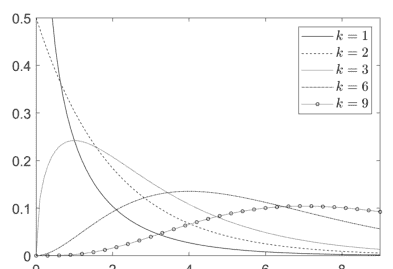

图 2.25: 各种自由度 \(k\) 下的 \(\chi^2\) 概率密度函数。

最后一行是变量代换积分，但对每个积分使用了不同的代换。对 \(y\) 求导后，我们有:

\(f_y(y) = \frac{1}{2\sqrt{y}} [f_x(\sqrt{y}) + f_x(-\sqrt{y})] .\)

利用 \(f_x(x) = \exp(-x^2/2)/\sqrt{2\pi} = f_x(-x)\)，我们得到

\(f_y(y) = \frac{1}{\sqrt{2\pi y}} \exp(-y/2) .\)

这是 *卡方分布*，也记作 \(\chi^2\)-*分布*，自由度为 1。更一般地，自由度为 \(k\) 的 \(\chi^2\)-分布的概率密度函数由下式给出

\(\chi_k^2(x) = \frac{1}{2^{k/2}\Gamma(k/2)} x^{k/2-1} \exp(-x/2) .\)

均值位于 \(k\)，方差为 \(2k\)。上述 \(k=1\) 的结果源自 \(\Gamma(1/2) = \sqrt{\pi}\)。图 2.25 和 2.26 给出了各种自由度下的概率密度函数和累积分布函数示例。

若 \(g\) 是 *多对一映射*，即一个 \(y\) 值可能由多个 \(x\) 值生成，则求 \(f_y(y)\) 的一般方法是:

- 找出所有使 \(g(x)\) 小于或等于 \(y\) 的 \(x\) 区间 \((a_1(y), b_1(y)), \dots, (a_l(y), b_l(y))\)（注意 \(a_1\) 可能为 \(-\infty\)，\(b_l\) 可能为 \(+\infty\)），

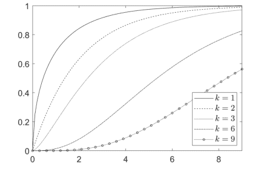

图 2.26: 各种自由度 \(k\) 下的 \(\chi^2\) 累积分布函数。

- 将 \(F_y(y)\) 计算为这些区间上的和，

\(F_y(y) = \sum_{i=1}^I \left[ \int_{-\infty}^{b_i(y)} f_x(x)dx - \int_{-\infty}^{a_i(y)} f_x(x)dx \right] ,\)

- 使用变量代换积分，
- 对 \(y\) 对 \(F_y(y)\) 求导。

在上述示例中，只有一个区间，其中 \(a_1(y) = -\sqrt{y}\) 且 \(b_1(y) = \sqrt{y}\)。

这可以扩展到 \(y\) 是多个随机变量 \(x_1, ..., x_K\) 的函数的情况，这些变量汇总为 \(\mathbf{x} = (x_1, ..., x_K)^T\) 并服从联合概率分布 \(f_{\mathbf{x}}(\mathbf{x})\)。第一步是找到区域 \(\mathcal{R}(y)\)，其中 \(\mathbf{x} \in \mathcal{R}(y)\) 导致 \(g(\mathbf{x}) \le y\)。然后计算

\(F_y(y) = \int_{\mathcal{R}(y)} f_{\mathbf{x}}(\mathbf{x}) d\mathbf{x},\)

并对 \(y\) 求导。然而，这项任务可能并不直接，因为涉及的多维积分可能不存在闭式解。我们通过一些示例来说明。

令 \(y = g(x_1, x_2) = x_1 + x_2\)，其中 \(x_1\) 和 \(x_2\) 是独立变量。由于独立性，情况简化为 \(f_{\mathbf{x}}(\mathbf{x}) = f_{x_1}(x_1)f_{x_2}(x_2)\)。条件 \(g(x_1, x_2) = x_1 + x_2 \le y\) 可写为 \(x_1 \le y\) 和 \(x_2 \le y - x_1\)，其中

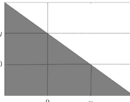

图 2.27: 阴影区域表示给定 \(y\) 下 \(x_1 + x_2 \le y\) 的位置。

所有不等式必须同时成立。虽然 \(x_1\) 的区间仅取决于 \(y\)，但 \(x_2\) 的区间同时取决于 \(y\) 和 \(x_1\)。图 2.27 中的阴影区域显示了 \(x_1\) 和 \(x_2\) 位于何处以使 \(x_1 + x_2 \le y\)。

我们现在可以计算

\(F_y(y) = \int_0^y f_{x_1}(x_1) \int_0^{y-x_1} f_{x_2}(x_2) dx_2 dx_1,\)

其中所有与 \(x_2\) 无关的项已被提取到内层积分之外。首先，令 \(x_1\) 和 \(x_2\) 在 0 到 \(\infty\) 之间，但两者都服从 *指数分布*，\(x_1, x_2 \sim \text{Exp}(\beta)\)，其概率密度函数如 2.14 定义。为简单起见，我们令 \(\beta = 1\)。则

$$
\begin{aligned}
F_y(y) &= \int_0^y \exp(-x_1) \int_0^{y-x_1} \exp(-x_2) dx_2 dx_1 \\
&= \int_0^y \exp(-x_1) [-\exp(-x_2)]_0^{y-x_1} dx_1 \\
&= \int_0^y \exp(-x_1) [1 - \exp(-y + x_1)] dx_1 \\
&= \int_0^y \exp(-x_1) - \exp(-y) dx_1 \\
&= [-\exp(-x_1) - x_1 \exp(-y)]_0^y \\
&= [1 - \exp(-y) - y \exp(-y)].
\end{aligned}
$$

对 \(y\) 求导得到

\(f_y(y) = \exp(-y) - (\exp(-y) - y \exp(-y)) = y \exp(-y).\)

这个概率密度函数描述了参数为 \(\alpha = 2\) 和 \(\beta = 1\) 的 *伽马分布*，\(y \sim \text{Gamma}(\alpha, \beta)\)。更一般地，伽马分布的概率

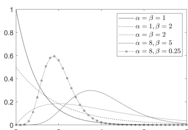

图 2.28: 各种 \(\alpha\) 和 \(\beta\) 选择下的伽马分布概率密度函数。当 \(\alpha = 1\) 时，它也是指数概率分布。

密度函数定义为

\[
\text{Gamma}(x|\alpha,\beta) = \left\{ \begin{array}{ll} \frac{1}{\Gamma(\alpha)\beta^\alpha} x^{\alpha-1} \exp \left( - \frac{x}{\beta} \right) & \text{for } x \ge 0, \\ 0 & \text{for } x < 0. \end{array} \right.
\]

参数 \(\alpha\) 称为 *形状参数*，而 \(\beta\) 和 \(1/\beta\) 分别称为 *尺度参数* 和 *速率参数*（如同指数分布）。均值由 \(\alpha\beta\) 给出，方差为 \(\alpha\beta^2\)。指数分布是伽马分布的一个特例，其中 \(\alpha = 1\)。自由度为 \(k\) 的 \(\chi^2\)-分布也是一个特例，其中 \(\alpha = k/2\) 且 \(\beta = 2\)。其次，令 \(x_1\) 和 \(x_2\) 位于 \(\mathbb{R}\) 的所有范围内，且两者都服从标准正态分布。则

\[
F_y(y) = \frac{1}{2\pi} \int_{-\infty}^y \exp(-x_1^2/2) \int_{-\infty}^{y-x_1} \exp(-x_2^2/2) dx_2 dx_1. \quad (2.19)
\]

内层积分是累积分布函数 \(F_{x_2}(y-x_1)\)，而外层积分是关于概率密度函数 \(f_{x_1}(x_1)\) 的函数 \(F_{x_2}(y-x_1)\) 的期望。没有直接的方法来计算这个。需要使用近似。我们将在第 3 章关于采样的内容中探讨一些一般技术。

在本节开头，我们使用了函数 \(g\) 的逆函数。然而，通过将两个实数相加得到 \(y\) 有无限多种可能性。即使划分区域，也无法生成逆函数。

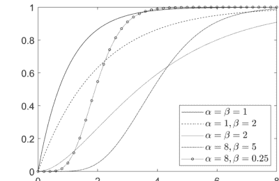

图 2.29: 各种 \(\alpha\) 和 \(\beta\) 选择下的伽马累积分布函数。当 \(\alpha = 1\) 时，它也是指数概率分布。

然而，并非全无希望，如果我们引入另一个随机变量。令 \(y_1 = g_1(x_1, x_2) = x_1 + x_2\) 如之前，并令 \(y_2 = g_2(x_1, x_2) = x_1 - x_2\)。向量形式为

\(\mathbf{y} = (y_1, y_2)^T = \mathbf{g}(\mathbf{x}) = \mathbf{g}(x_1, x_2) = (g_1(x_1, x_2), g_2(x_1, x_2))^T .\)

我们可以用 \(y_1\) 和 \(y_2\) 表示 \(x_1\) 和 \(x_2\)，

\(x_1 = \frac{y_1 + y_2}{2}\)
\(x_2 = \frac{y_1 - y_2}{2} . \quad (2.20)\)

我们可能没有 \(\mathbf{g}\) 各个分量的逆函数，但我们有 \(\mathbf{g}\) 的逆函数，记作 \(\mathbf{g}^{-1}\)。

假设我们想要计算 \(\mathbf{y}\) 落在由 \(\mathcal{Y}\) 定义的区域内的概率。被 \(\mathbf{g}\) 映射到该区域的 \(\mathbf{x}\) 集合由 \(\mathbf{g}^{-1}(\mathcal{Y})\) 给出。因此，概率由下式给出

\(\int_{\mathbf{g}^{-1}(\mathcal{Y})} f_{\mathbf{x}}(\mathbf{x}) d\mathbf{x}.\)

多元变量代换积分得出

\(\int_{\mathcal{Y}} f_{\mathbf{x}}(\mathbf{g}^{-1}(\mathbf{y})) |J_{\mathbf{g}^{-1}}(\mathbf{y})| d\mathbf{y},\)

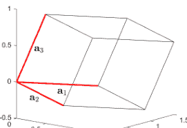

图 2.30: 由向量 \(\mathbf{a}_1\)、\(\mathbf{a}_2\) 和 \(\mathbf{a}_3\) 张成的平行六面体，它们是 3×3 矩阵 A 的列。

在此处，\(|\cdot|\) 表示在 \(\mathbf{y}\) 处计算的 \(\mathbf{g}^{-1}\) 的雅可比矩阵 \(J_{\mathbf{g}^{-1}}(\mathbf{y})\) 的行列式模。一般来说，如果 \(f(\mathbf{x})\) 是从 \(\mathbb{R}^b\) 到 \(\mathbb{R}^a\) 的函数，则雅可比矩阵 \(J_f(\mathbf{x})\) 是包含所有分量偏导数的 \(a \times b\) 矩阵，

\[
J_f(\mathbf{x}) = \begin{pmatrix} \frac{\partial f_1}{\partial x_1}(\mathbf{x}) & \dots & \frac{\partial f_1}{\partial x_b}(\mathbf{x}) \\ \vdots & \ddots & \vdots \\ \frac{\partial f_a}{\partial x_1}(\mathbf{x}) & \dots & \frac{\partial f_a}{\partial x_b}(\mathbf{x}) \end{pmatrix}.
\]

若 \(a = b\)，该矩阵的行列式称为雅可比行列式。令人困惑的是，矩阵和行列式通常都简称为雅可比。矩阵可对任意 \(a\) 和 \(b\) 计算，而行列式仅在 \(a = b\) 时定义。

雅可比行列式的模给出了在 \(f\) 的变换下体积收缩或扩张的因子。为直观理解，三维单位立方体在 3×3 矩阵 A 下的像是由 A 的列张成的平行六面体。例如，令

\(\mathbf{a}_1 = \begin{pmatrix} 1 \\ 1/2 \\ 0 \end{pmatrix}, \mathbf{a}_2 = \begin{pmatrix} 0 \\ 1 \\ -1/2 \end{pmatrix}, \mathbf{a}_3 = \begin{pmatrix} 1/2 \\ 0 \\ 1 \end{pmatrix}\)

作为图 2.30 中看到的 A 的列。该平行六面体的体积是 A 行列式的模，也是标量三重积 \((\mathbf{a}_1 \times \mathbf{a}_2)^T \mathbf{a}_3 = 7/8\)。

我们现在可以推导多元变量变换技术。如果 \(\mathbf{g} : \mathbb{R}^K \to \mathbb{R}^K\) 是一个可逆且可微的函数，且 \(\mathbb{R}^K\) 中的 \(\mathbf{x}\) 是具有概率密度函数 \(f_{\mathbf{X}}(\mathbf{x})\) 的随机变量，那么 \(\mathbb{R}^K\) 中的 \(\mathbf{y} = \mathbf{g}(\mathbf{x})\) 也是一个随机变量，其概率密度函数为

\[
f_{\mathbf{Y}}(\mathbf{y}) = f_{\mathbf{X}}(\mathbf{g}^{-1}(\mathbf{y})) |J_{\mathbf{g}^{-1}}(\mathbf{y})|.
\]


回到我们的示例，逆矩阵 $\mathbf{g}^{-1}$ 由方程 (2.20) 给出。偏导数矩阵为

$$ \begin{pmatrix} \frac{1}{2} & \frac{1}{2} \\ \frac{1}{2} & -\frac{1}{2} \end{pmatrix} $$

其行列式的模为 1/2。假设 $x_1$ 和 $x_2$ 均为独立且服从标准正态分布。因此，

$$ f_Y(y) = \frac{1}{\sqrt{2\pi}} \exp \left( - \left( \frac{y_1 + y_2}{2} \right)^2 / 2 \right) \frac{1}{\sqrt{2\pi}} \exp \left( - \left( \frac{y_1 - y_2}{2} \right)^2 / 2 \right) \frac{1}{2} = \frac{1}{4\pi} \exp \left( \frac{y_1^2 + y_2^2}{4} \right) = \frac{1}{\sqrt{2}\sqrt{2\pi}} \exp \left( \left( \frac{y_1}{\sqrt{2}} \right)^2 / 2 \right) \frac{1}{\sqrt{2}\sqrt{2\pi}} \exp \left( \left( \frac{y_2}{\sqrt{2}} \right)^2 / 2 \right). $$

因此，随机变量 $y_1$ 和 $y_2$ 独立。两者均服从均值为 0、标准差为 $\sqrt{2}$ 的正态分布。换句话说，方差为 2，即 $x_1$ 和 $x_2$ 方差之和。

更一般地，如果 $y$ 是独立正态分布变量的线性组合，即 $y = c_1 x_1 + \cdots + c_K x_K$，其中 $x_k \sim \mathcal{N}(\mu_k, \sigma_k^2)$，则 $y$ 服从均值为

$$ \mu = c_1 \mu_1 + \cdots + c_K \mu_K. $$

和方差

$$ \sigma^2 = c_1^2 \sigma_1^2 + \cdots + c_K^2 \sigma_K^2. $$

至此，我们已探讨了不同的概率分布以及如何推导随机变量函数的概率密度函数。在下一节中，我们将探讨如何将此与数据联系起来。

### 2.6 共轭概率分布

前几节关注概率及其描述方法。然而，我们有兴趣用概率来描述数据。为此，让我们回到抛硬币实验，或者更一般地，回到具有两种可能结果并服从伯努利分布 $\text{Bern}(x|\mu)$ 的实验，其中 $\mu$ 未知。设 $x_1, \dots, x_N$ 为该实验的 $N$ 次观测。观测到数据 $\mathcal{D} = \{x_1, \dots, x_N\}$ 的概率为

$$ p(\mathcal{D}|\mu) = \prod_{n=1}^N \text{Bern}(x_n|\mu) = \prod_{n=1}^N \mu^{x_n} (1-\mu)^{1-x_n} = \mu^{\sum_{n=1}^N x_n} (1-\mu)^{\sum_{n=1}^N (1-x_n)}. $$

这被称为数据 $\mathcal{D}$ 的 *似然*。现在，$x_n$ 仅取值 0 和 1。如果在 $N$ 次试验中 $x_n = 1$ 出现的次数为 $m$，则

$$ p(\mathcal{D}|\mu) = \mu^m (1-\mu)^{N-m}. $$

\(\mu\) 的值可以通过最大化关于 \(\mu\) 的似然来估计，因为我们希望选择最能解释数据的 \(\mu\)。

最大化等价于最大化对数，这是有效的，因为对数是单调递增函数。这是对数似然：

\(\log p(\mathcal{D}|\mu) = m \log \mu + (N - m) \log(1 - \mu).\)

极大值点处关于 \(\mu\) 的导数为零。导数为

\(\frac{d}{d\mu}p(\mathcal{D}|\mu) = \frac{m}{\mu} - \frac{N - m}{1 - \mu}.\)

令其为零，两边乘以 \(\mu(1 - \mu)$ 并求解 \(\mu$ 得到最大似然估计量

\(\mu_{\text{ML}} = \frac{m}{N}.\)

回到抛硬币实验，如果在三次抛掷中连续三次出现反面（\(x_n = 0$），则最大似然估计量为 \(\mu_{\text{ML}} = 0$。其解释是，在所有未来的抛掷中我们将继续看到反面。同样，如果连续三次出现正面（\(x_n = 1$），则最大似然估计量为 \(\mu_{\text{ML}} = 1$。两种情况都很现实，但结论并不现实，这是由试验次数少引起的。一般来说，要为任何参数获得良好的最大似然估计量，需要许多观测。

然而，在实际应用中，如此丰富的数据可能是一种奢侈。如果我们在数学上描述我们对 \(\mu$ 的“相信”，然后使用贝叶斯规则来修改我们的“相信”，则估计参数 \(\mu$ 所需的数据较少。它是成功的概率，因此 \(\mu \in [0, 1]$。因此，β分布 $\text{Beta}(\mu|\alpha, \beta)$ 适合用来描述 \(\mu$，其中 \(\alpha$ 和 \(\beta\) 被称为 *超参数*，并设置为一些合理的初始值。这是 *先验分布*。在接下来的内容中，我们将看到这些参数如何随数据的出现而更新。

\(\mu$ 和 \(m$ 的联合概率密度函数是似然与先验的乘积

$$ f(\mu, m|N, \alpha, \beta) = p(\mathcal{D}|\mu)\text{Beta}(\mu|\alpha, \beta) = \mu^m(1-\mu)^{N-m} \frac{\Gamma(\alpha+\beta)}{\Gamma(\alpha)\Gamma(\beta)} \mu^{\alpha-1}(1-\mu)^{\beta-1}. \tag{2.21} $$

\(\mu$ 的后验密度函数 \(f(\mu|m, N, \alpha, \beta)$ 根据贝叶斯定理与联合分布成正比。在使用比例关系 \(\propto$ 时，可以舍去常数因子，因此

$$ f(\mu|m, N, \alpha, \beta) \propto \mu^{m+\alpha-1}(1-\mu)^{N-m+\beta-1}. $$

它具有另一个不同的β分布的函数形式。插入适当的因子以确保分布上的积分为1，得到

$$ f(\mu|m, N, \alpha, \beta) = \frac{\Gamma(N + \alpha + \beta)}{\Gamma(m + \alpha)\Gamma(N - m + \beta)} \mu^{m+\alpha-1} (1 - \mu)^{N-m+\beta-1}. $$

观察到 \(m$ 次成功和 \(N - m$ 次失败会改变先验分布的形状，从而得到后验分布。成功和失败的顺序无关紧要。

考虑到数据 \(\mathcal{D}$ 后，成功的概率 \(p(x=1|\mathcal{D})$ 是多少？数据由 \(N$ 和 \(m$ 充分指定。\(\mu$ 不再是单一值，而是 \(\mu$ 上的后验分布。通过积分考虑所有可能值

$$ \begin{aligned} p(x=1|\mathcal{D}) &= \int_0^1 p(x=1|\mu) f(\mu|m, N, \alpha, \beta) d\mu \\ &= \int_0^1 \mu f(\mu|m, N, \alpha, \beta) d\mu = \mathbb{E}(\mu|m, N, \alpha, \beta) \\ &= \frac{m + \alpha}{N + \alpha + \beta}. \end{aligned} \tag{2.22} $$

由于包含了 \(\alpha$ 和 \(\beta$，概率永远不会变为 0，即使 \(m=0$，也不会变为 1，即使 \(m=N$，这与最大似然估计量相反。它包含了仅观察有限数据集所引起的不确定性。

上述结果不再依赖于 \(\mu$。它是隐变量或潜变量的一个示例。

图 2.31 显示了随着观测到更多数据，β分布如何从 \(\alpha = \beta = 2$ 的先验分布发生变化。如果 0 代表抛硬币时的反面，第二至第七个图说明了连续三次反面接着三次正面的序列。随着观察到更多反面，分布的均值向左移动，但随着观察到更多正面，它又向右移回中心。最后一个图是在 100 次抛掷后，观察到相同数量的正面和反面。后验分布在 1/2 附近变得更加尖锐。随着 \(N$ 的增加，\(\alpha$ 和 \(\beta$ 相对于它变得相对较小，且 \(p(x=1|\mathcal{D})$ 对于这个 \(\mathcal{D}$ 趋近于最大似然估计量 \(p_{ML}$。

如图 2.31 所示，这种方法可用于实时学习，其中数据按顺序到达，并在获得更多知识时更新预测。它也可用于大型数据集，在这种情况下无法一次性将所有数据加载到内存中。

β分布被称为伯努利分布和二项分布的 *共轭* 分布。其动机在于选择一个适当的先验分布来描述未知参数（\(\mu$）。这也有数学动机，因为在这种情况下由贝叶斯规则产生的后验分布与先验分布具有相同的函数形式，因此可以以封闭形式确定。情况并非总是如此。在选择适当的分布来描述数据时，数学便利性应相对于数据和专家知识起次要作用。


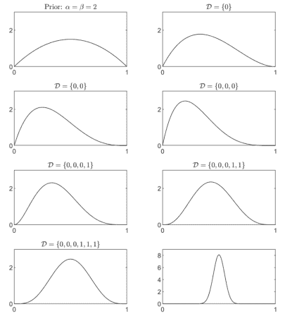

图 2.31：一些观测后的先验（左上）和后验β概率分布。右下角显示了0和1数量相等后的β分布。

如果数据在性质上是分类的，则结果使用1-of-K表示法来描述，并遵循如(2.9)所示的分类分布。设$\mathcal{D} = \{\mathbf{x}_1, \dots, \mathbf{x}_N\}$为$N$次实验的结果。则该数据的似然为

```
$p(\mathcal{D}|\boldsymbol{\mu}) = \prod_{n=1}^N \text{Cat}(\mathbf{x}_n|\boldsymbol{\mu}) = \prod_{n=1}^N \prod_{k=1}^K \mu_k^{x_{nk}} = \prod_{k=1}^K \mu_k^{\sum_{n=1}^N x_{nk}}.$
```

由于每个$\mathbf{x}_n$都是1-of-K表示，设$m_k$为$n=1,\dots,N$时出现$x_{nk}=1$的次数。则似然变为

```
$p(\mathcal{D}|\boldsymbol{\mu}) = \prod_{k=1}^K \mu_k^{m_k}.$
```

同样，可以通过最大化似然（或等价地其对数）来找到\(\mu\)的估计量。然而，此任务不如前那么直接，因为\(\mu\)必须满足约束

\(\sum_{k=1}^K \mu_k = 1 \quad \text{且} \quad 0 \le \mu_k \le 1, k=1, \dots, K.\)

因此，这是一个约束优化问题。

设\(i\)为\(\{1,\dots,K\}\)中的任意索引。我们通过注意到来纳入第一个约束

\(\mu_i = 1 - \sum_{k=1, k \neq i}^K \mu_k.\)

经过此修改，对数似然为

\(\log p(\mathcal{D}|\mu) = \sum_{k=1}^K m_k \log \mu_k + m_i \log \left( 1 - \sum_{k=1, k \neq i}^K \mu_k \right).\)

设\(j \neq i$为任何其他索引。参数\(\mu_j$出现在两个求和中，对\(\mu_j$的导数为

\(\frac{d}{d\mu_j} \log p(\mathcal{D}|\mu) = \frac{m_j}{\mu_j} - \frac{m_i}{1 - \sum_{k=1, k \neq i}^K \mu_k} = \frac{m_j}{\mu_j} - \frac{m_i}{\mu_i}.\)

令其为零，我们看到\(\mu_i$与\(\mu_j$的比率必须与$m_i$与$m_j$的比率相同。由于$i$和$j$是任意选择的，$\mu$中任何一对分量的比率必须与$\mathbf{m} = (m_1, \dots, m_k)^T$中对应一对的比率相同。$\mu_k$的唯一可能选择（同时也满足第二个约束）是最大似然估计量

\(\mu_k = \frac{m_k}{m_1 + \dots + m_K} = \frac{m_k}{N}, \quad k=1, \dots, K.\)

与之前一样，如果$N$不够大，这可能是一个较差的估计。

约束优化问题在机器学习中经常出现。一种通用技术使用*拉格朗日乘数*，我们将在第4.6节中遇到。有关优化的更多背景知识请参见[2]。

不同结果的概率向量\(\mu$需要被估计。狄利克雷分布\(\text{Dir}(\mu|\alpha)$被选为$\mu$的共轭先验，其中$\alpha$被适当选择。后验密度函数与似然和先验（即联合分布）的乘积成正比：

\(f(\mu|\mathbf{m}, \alpha) \propto \prod_{k=1}^K \mu_k^{m_k + \alpha_k - 1},$ 由于比例符号，所有常数因子均被舍去。后验再次具有狄利克雷分布的函数形式。纳入使后验积分为一的因子后得到

```
f(\mu|\mathbf{m}, \alpha) = \frac{\Gamma(\alpha_0 + N)}{\Gamma(\alpha_1 + m_1) \cdots \Gamma(\alpha_K + m_K)} \prod_{k=1}^K \mu_k^{m_k + \alpha_k - 1} = \text{Dir}(\mu|\mathbf{m} + \alpha),
```

其中\(\alpha_0 = \alpha_1 + \cdots + \alpha_K$。

与之前β分布的情况一样，实验获得的知识由$\mathbf{m}$给出，并修改了分布的位置、均值和形状。先验β分布中的参数$\alpha$和$\beta$以及先验狄利克雷分布中的参数$\alpha$可以被视为对真实分布的初步猜测，或由专家知识和经验所依据的虚构试运行。

特定结果$x_k = 1$的概率为

```
p(x_k = 1|\mathcal{D}) = \int p(x_k = 1|\mu) f(\mu|\mathbf{m}, \alpha) d\mu,
```

其中积分是在$\mu$必须位于的单纯形上进行。由于$p(x_k = 1|\mu) = \mu_k$，这变为

```
p(x_k = 1|\mathcal{D}) = \mathbb{E}[\mu_k|\mathbf{m}, \alpha] = \frac{m_k + \alpha_k}{N + \alpha_0}. \quad (2.23)
```

随着$N$的增长，$p(x_k = 1|\mathcal{D})$趋近于最大似然估计量。同样，上述结果不再依赖于$\mu$，因此$\mu$是一个隐变量。

我们已经看到两个共轭概率分布的示例，还将看到更多。例如，如果正态分布的均值是未知参数，则共轭先验也是正态分布。有关共轭性的更详细处理请参见[16]。

### 2.7 图形表示

在上一节中，使用了遵循贝叶斯规则的联合概率分布，以实现对特定结果的更好预测。在以下内容中，我们说明如何可视化随机变量和参数之间的依赖关系。

图的元素是节点，也称为*顶点*，以及*边*，也称为*链接*或*弧*。在图形表示中，每个节点代表一个随机变量，可以是向量、一组随机变量、参数或一组参数。如果节点之间存在关系，则它们通过边连接。如果节点之间存在因果关系，则边带有由箭头指示的方向。这则是一个*有向图*。

设\(\mathcal{D} = \{x_1, \dots, x_n\}\)为一组观测到的二元变量。在(2.21)中，数据$\mathcal{D}$由隐变量$\mu$控制，而$\mu$又由参数$\alpha$和$\beta$控制。相应的图为：

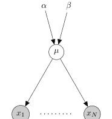

随机变量的节点是圆圈，而参数的节点是空心的。观测到的随机变量被阴影覆盖，而未观测到的隐变量则没有阴影。观测值$x_1, \dots, x_N$性质相同。当将这些写为单独节点时，图可能会变得非常杂乱。它们被总结为一个代表节点$x_n$，周围有一个称为板（plate）的方框，标记为$N$，表示有$N$个这样的节点。

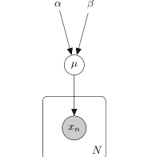

方程(2.22)给出了考虑数据$\mathcal{D}$后$x=1$的概率。图形上，这描绘为

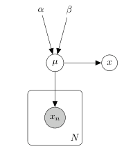

请注意，(2.22)中的最终等式不涉及\(\mu$，因为\(\mu$是隐变量，但涉及$N$和$m$，它们指定了$\mathcal{D}$。图形上，参数$\alpha$和$\beta$以及数据$\mathcal{D}$的信息在节点$\mu$中结合，以告知节点$x$。

分类情况下的图非常相似，只是现在我们有一个参数向量$\alpha$，$\mu$是向量值的，且$\mathbf{x}_1, \dots, \mathbf{x}_N$和$\mathbf{x}$是1-of-\(K\)表示：

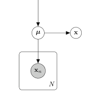

另一个主要区别是，底层先验和后验分布不再是β分布，而是狄利克雷分布。

遵循贝叶斯范式，$\alpha$、$\beta$和$\alpha$不会是待选参数，而也会被视为带有自身先验分布的随机变量，如[16]中讨论的，称为*超先验*。这将扩展图。各种随机变量和参数之间复杂的相互依赖关系可以图形化可视化。有关良好的入门教材，请参阅[24]。


Taylor & Francis
Taylor & Francis Group
http://taylorandfrancis.com

## 3. 采样

采样是必要的，因为在机器学习中，描述概率分布的封闭形式通常无法获取，但可以对分布进行采样。本章以直观的方式解释了标准采样技术，如逆变换采样、拒绝采样和重要性采样，以及马尔可夫链和马尔可夫链蒙特卡洛。

在上一章中，我们已经看到如何使用数据通过贝叶斯规则来估计生成数据$\mathcal{D}$的假设底层分布的参数。例如，设$\theta_1$为控制分布的所有参数向量，$\theta_2$为控制参数$\theta_1$的先验分布的所有超参数向量。则后验由

```
$$f(\theta_1|\mathcal{D}, \theta_2) = \frac{p(\mathcal{D}|\theta_1)f(\theta_1|\theta_2)}{\int p(\mathcal{D}|\theta_1)f(\theta_1|\theta_2)d\theta_1}.$$ (3.1)
```

给出。除非我们处理的是共轭概率分布，否则可能不存在封闭解。可能无法计算分母中的积分。

请注意，根据乘法规则，被积函数是给定$\theta_2$下$\mathcal{D}$和$\theta_1$的联合概率密度函数，即$f(\mathcal{D}, \theta_1|\theta_2)$。这意味着分母是边缘分布函数$f(D|\theta_2)$。

解释积分的另一种方式是，它是关于由概率密度函数$f(\theta_1|\theta_2)$描述的分布的函数$p(D|\theta_1)$的期望。我们在方程(2.19)中已经遇到过类似情况，当时试图推导一个由两个其他随机变量函数组成的随机变量的概率密度函数。外层积分可以解释为关于外层积分中的概率密度函数的内层积分给出的函数的期望。

更一般地，期望

```
$$\mathbb{E}[h] = \int h(x)f(x)dx$$
```


对于某个函数 $h$ 的 $x$ 需要被计算，这种情况经常出现，但解析积分过于复杂。采样方法用于估计由概率密度函数 $f$ 描述的期望。期望近似为

$\mathbb{E}[h] \approx \frac{1}{N} \sum_{n=1}^N h(x_n)$。

需要确保所有样本都是独立的。如果有些样本是依赖的，则需要增加样本量 $N$ 以抵消某些样本可能不提供任何新信息的影响。

$h(x_n)$ 与 $f(x_n)$ 的相对大小也会使结果偏斜。例如，当 $h(x_n)$ 在 $f(x_n)$ 较小的区域较大，反之亦然时就会发生这种情况。那么期望将由少数几个较大的 $h$ 值主导，尽管该区域的概率密度很小。同样，需要有足够大的样本量 $N$ 来抵消这种情况。

在本章中，我们介绍一些通用的采样方法。更详细的内容见 [10]。

### 3.1 逆变换采样

我们需要能够生成概率密度函数 $f(x)$ 的样本。假设我们有一个可用的算法，能够在区间 (0, 1) 上生成均匀分布的随机数。累积概率密度函数由

$F(x) = \int_{-\infty}^x f(t) dt$。

我们假设它在区间 $[a, b)$ 上是连续且严格单调递增的，对于 $x \le a$ 为 0，对于 $x \ge b$ 为 1。它的取值范围是区间 $[0, 1]$。设 $y$ 从 (0, 1) 上的均匀分布中抽取。那么在 $(a, b)$ 中存在一个唯一的数，使得 $F(x) = y$，换句话说，$x = F^{-1}(y)$。那么 $x$ 是一个具有累积分布函数 $F(x)$ 且因此具有概率密度函数 $f(x)$ 的连续随机变量。这种技术称为逆变换采样。它也被称为逆变换、逆采样、逆概率积分变换和 Smirnov 变换。

我们需要证明，对于 $x = F^{-1}(y)$，对于给定的值 $\hat{x}$，确实有 $p(x \le \hat{x}) = F(\hat{x})$。首先，

$p(x \le \hat{x}) = p(F^{-1}(y) \le \hat{x})$

根据 $x$ 的定义。接下来，由于 $F$ 及随后的 $F^{-1}$ 是严格单调递增的，因此 $F^{-1}(y) \le \hat{x}$ 当且仅当 $y \le F(\hat{x})$。最后，由于 $y$ 来自 (0, 1) 上的均匀分布，$y$ 小于或等于 $F(\hat{x})$ 的概率实际上就是 $F(\hat{x})$ 本身，从而得出结论。

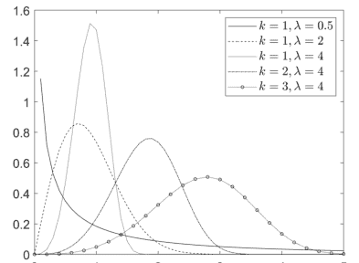

图 3.1：不同 $k$ 和 $\lambda$ 选择下的魏布尔分布概率密度函数。对于 $k=1$，它是指数概率分布。

作为示例，考虑 *魏布尔分布*，$x \sim \text{Weibull}(\lambda, k)$。其概率密度函数为

```
\text{Weibull}(x|\lambda, k) = \begin{cases} \frac{k}{\lambda} \left(\frac{x}{\lambda}\right)^{k-1} \exp \left( - \left( \frac{x}{\lambda} \right)^k \right) & \text{for } x \ge 0, \\ 0 & \text{for } x < 0, \end{cases}
```

其中 $k > 0$ 是 *形状参数*，$\lambda > 0$ 是尺度参数。其均值为 $\lambda \Gamma(1+1/k)$，而方差为 $\lambda^2 [\Gamma(1+2/k) - (\Gamma(1+1/k))^2]$。图 3.1 和 3.2 分别给出了概率密度和累积分布函数的示例。对于某些参数选择，形状会接近正态分布。

对于 $k=1$，魏布尔分布变为指数分布。魏布尔分布用于可靠性工程和失效分析。在那里，参数 $k$ 的解释如下。如果 $k > 1$，则失效率随时间增加，因为随着时间推移零件更可能失效。如果 $k=1$，失效率是常数，系统稳定且没有老化过程。如果 $k < 1$，失效率随时间减少。通俗地说，这意味着如果到目前为止它没有失效，那么未来失效的可能性就更小。有关统计质量控制的更多信息见 [31]。

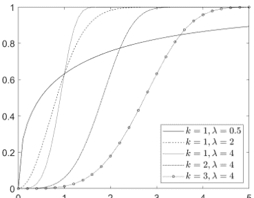

图 3.2：不同 $k$ 和 $\lambda$ 选择下的魏布尔累积分布函数。对于 $k=1$，它是指数概率分布。

由于概率密度函数仅在 $x \ge 0$ 时非零，计算累积分布函数时积分的下限为 0，

```
F(x) = \int_0^x \frac{k}{\lambda} \left( \frac{t}{\lambda} \right)^{k-1} \exp \left( - \left( \frac{t}{\lambda} \right)^k \right) dt
= \left[ -\exp \left( - \left( \frac{t}{\lambda} \right)^k \right) \right]_0^x = 1 - \exp \left( - \left( \frac{x}{\lambda} \right)^k \right).
```

将其设为 $y$ 并求解 $x$ 得到

```
x = \lambda [-\log(1-y)]^{1/k}
```

如果 $y$ 从 (0, 1) 上的均匀分布中抽取，则这是一个服从魏布尔分布的随机变量。现在，$z = 1-y$ 也同样从 (0, 1) 上的均匀分布中抽取。因此，该变换通常表述为

```
x = \lambda [-\log z]^{1/k}.
```

只要累积分布函数已知且可逆，就可以使用此技术。但并非总是如此，正态分布就是一个典型的例子。在以下内容中，我们推导 Box–Muller 变换，以从一对均匀分布的随机变量生成一对服从标准正态分布的随机变量。

我们结合方程 (2.5) 和 (2.6) 得到

```
\int_{-\infty}^{\infty} \int_{-\infty}^{\infty} \exp \left( - \frac{x_1^2 + x_2^2}{2} \right) dy dz = \int_0^{2\pi} \int_0^\infty r \exp \left( - \frac{r^2}{2} \right) dr d\theta,
```

其中 $x_1$ 和 $x_2$ 是两个标准正态随机变量，且 $x_1 = r \cos \theta$，$x_2 = r \sin \theta$。从上述内容可以看出，$\theta$ 服从区间 $(0, 2\pi)$ 上的均匀分布，即单位圆的周长，而 $r$ 在区间 $(0, \infty)$ 上具有概率密度函数 $r \exp(-r^2/2)$。要从均匀随机变量生成 $r$，我们使用上述方法。首先，我们计算

$$F(r) = \int_0^r t \exp \left( \frac{-t^2}{2} \right) dt = \left[ -\exp \left( \frac{-t^2}{2} \right) \right]_0^r = 1 - \exp \left( \frac{-r^2}{2} \right).$$

设 $q$ 为从 $(0, 1)$ 上的均匀分布中抽取的随机变量。令 $F(r) = q$ 并求解 $r$，得到 $r = \sqrt{-2 \log(1-q)}$。由于 $1-q$ 也在 $(0,1)$ 上均匀分布，可以改写为

$$r = \sqrt{-2 \log q}.$$ (3.2)

总结，我们通过从 $(0,1)$ 上的均匀分布中抽取两个变量 $y_1$ 和 $y_2$，并令

$$x_1 = \sqrt{-2 \log y_1} \cos(2\pi y_2),$$ $$x_2 = \sqrt{-2 \log y_1} \sin(2\pi y_2).$$

来生成服从标准正态分布的随机变量 $x_1$ 和 $x_2$。

这是 Box-Muller 变换的基本形式。

```
function [y1,y2] = BoxMullerTrig(x1,x2)
% Transforms a bivariate uniform random variable in [0,1] x [0,1] to a
% bivariate normally distributed variable.
if nargin < 2
error('Two input arguments needed.')
elseif x1<0 || x1>1 || x2<0 || x2>1
error('Input arguments must be in [0,1].')
end
y1 = sqrt( - 2 * log(x1) ) * cos( 2 * pi * x2 );
y2 = sqrt( - 2 * log(x1) ) * sin( 2 * pi * x2 );
end
```

清单 3.1：基本 Box—Muller 变换。

为了避免正弦和余弦，我们注意到 $\cos \theta = x_1/r$ 和 $\sin \theta = x_2/r$。这导出了 Box-Muller 变换的极坐标形式。首先，我们通过令 $z_i = 2y_i - 1$（其中 $y_i$ 在 $(0,1)$ 上均匀分布）生成均匀分布的随机数 $z_1, z_2 \in (-1,1)$，直到 $s = z_1^2 + z_2^2 < 1$。然后我们设

$$\cos \theta = \frac{z_1}{\sqrt{s}},$$ $$\sin \theta = \frac{z_2}{\sqrt{s}}.$$

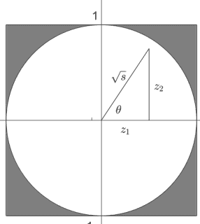

图 3.3：极坐标 Box–Muller 方法。

概率 \(p(s \le \hat{s})\) 是半径为 \(\sqrt{\hat{s}}\) 的圆的面积，即 \(\pi \hat{s}\)，除以单位圆的面积 \(\pi\)。因此 \(p(s \le \hat{s}) = \hat{s}$，且 $s$ 在 (0, 1) 上服从均匀分布。因此，$s$ 可用于生成服从 $r$ 分布的随机变量。总结一下，

```
x_1 = \sqrt{-2 \log s} \frac{z_1}{\sqrt{s}} = z_1 \sqrt{\frac{-2 \log s}{s}},
x_2 = \sqrt{-2 \log s} \frac{z_2}{\sqrt{s}} = z_2 \sqrt{\frac{-2 \log s}{s}}
```

服从所需的分布。另一种看待此技术的方式是：单位圆内的一个随机点 \((z_1, z_2)\) 映射到单位圆上的点 \((z_1/\sqrt{s}, z_2/\sqrt{s})\)。然后将该点乘以一个遵循方程 (3.2) 中所需分布的半径。图 3.3 说明了这一点。

此方法的优点是避免了正弦和余弦的计算。另一方面，需要生成更多随机数，因为有 \(1 - \pi/4$ 的比例因位于单位圆外而被拒绝。大多数软件包包含各种底层分布的随机数生成器实现。尽管如此，清单 3.1 和 3.2 是示例实现。


```
function Y = BoxMuller(N)
% Generates N bivariate normally distributed variables avoiding the
% use of the trigonometric functions.
Y = zeros(N,2);
for n = 1:N
    % Generate random number within the unit circle.
    while w >= 1
        x1 = 2.0 * rand - 1.0;
        x2 = 2.0 * rand - 1.0;
        w = x1 * x1 + x2 * x2;
    end
    w = sqrt( (-2.0 * log( w ) ) / w );
    Y(n,1) = x1 * w;
    Y(n,2) = x2 * w;
end
```

清单 3.2: 极坐标 Box-Muller 变换。

### 3.2 拒绝采样

我们现在考虑一种情况：概率密度函数 f 可用且可计算，但累积分布函数 F 不可用，且逆变换采样不是一种选择。设 g 为概率密度函数，使得对某个有限常数 c > 1，所有 x 都有 f(x) <= cg(x)。设 G 为相关的累积分布函数。我们还假设，我们有一种从 G 给定的分布中抽取样本的方法。也就是说，g(x) 是一个更简单的概率密度函数，cg(x) 是 f(x) 的一个包络。图 3.4 显示了针对具有两个峰值的概率密度函数 f 的三种 cg(x) 选择。第一种选择是在 f 的支撑集上的均匀分布。即 f(x) 非零的 x 的范围。对于另外两种，g 服从正态分布。对于第二种选择，g 的均值与 f 的一个峰值位于同一位置，而对于第三种选择，均值位于两个峰值之间。我们看到，g 有无限多种可能性。

拒绝采样，也称为接受-拒绝方法，步骤如下：

- 1. 按照 g 给定的分布绘制随机变量 $x$；
- 2. 从 $(0, 1)$ 上的均匀分布中绘制随机变量 $u$；
- 3. 如果
  $$u \le \frac{f(x)}{cg(x)},$$ (3.3)
  接受 $x$ 作为来自 f 给定分布的样本。否则返回步骤 1。

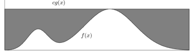

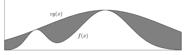


图 3.4: 具有两个峰值的概率密度函数 \( f(x) \) 及三种包络函数 \( cg(x) \) 的选择。

直观地说，该方法在 \( cg \) 下方的区域内均匀采样点，并丢弃落在 \( cg \) 和 \( f \) 曲线之间的阴影区域内的点。保留点的 \( x \) 位置是受 \( f \) 控制分布的样本。为了使丢弃点的数量保持较低，阴影区域必须尽可能小。换句话说，\( cg \) 和 \( f \) 下方面积的比率需要尽可能接近 1。这个比率是 \( c \)，因为 \( g \) 和 \( f \) 都积分为 1。如果 \( cg \) 下方的面积是 \( f \) 下方面积的两倍，我们预计会丢弃一半的样本。

该过程生成遵循由 \( g \) 定义且受不等式 (3.3) 约束的概率分布的样本。累积分布函数由

```
\( p \left( x \le \tilde{x} | u \le \frac{f(x)}{cg(x)} \right) = \frac{p \left( u \le \frac{f(x)}{cg(x)}, x \le \tilde{x} \right)}{p \left( u \le \frac{f(x)}{cg(x)} \right)} \)
```

对于分母，我们知道当固定 \( x = \tilde{x} \) 时

```
\( p \left( u \le \frac{f(x)}{cg(x)} | x = \tilde{x} \right) = \frac{f(\tilde{x})}{cg(\tilde{x})} \)。
```

使用乘积法则并进行边缘化，我们得到

```
\(\begin{aligned} p \left( u \le \frac{f(x)}{cg(x)} \right) &= \int_{-\infty}^{\infty} p \left( u \le \frac{f(x)}{cg(x)} | x = \tilde{x} \right) p(x = \tilde{x}) d\tilde{x} \\ &= \int_{-\infty}^{\infty} \frac{f(\tilde{x})}{cg(\tilde{x})} g(\tilde{x}) d\tilde{x} = \frac{1}{c}. \end{aligned}\)
```

在分子中，联合概率分布可以计算为

```
\(\begin{aligned} p \left( u \le \frac{f(x)}{cg(x)}, x \le \tilde{x} \right) &= \int_{-\infty}^{\tilde{x}} p \left( u \le \frac{f(x)}{cg(x)}, x = t \right) dt \\ &= \int_{-\infty}^{\tilde{x}} p \left( u \le \frac{f(x)}{cg(x)} | x = t \right) g(t) dt \\ &= \int_{-\infty}^{\tilde{x}} \frac{f(t)}{cg(t)} g(t) dt = \frac{F(\tilde{x})}{c}, \end{aligned}\)
```

其中我们使用了乘积法则。结合这两个结果，我们可以看到

```
\( p \left( x \le \tilde{x} | u \le \frac{f(x)}{cg(x)} \right) = F(\tilde{x}) \)
```

样本遵循所需的分布。

绘制一个我们接受的样本需要多少次尝试？

这由几何分布控制，其中 \( \mu = p \left( u \le \frac{f(x)}{cg(x)} \right) = 1/c \)。

期望是 \( 1/\mu = c \)，这与 cg 和 f 下方面积的比率一致。因此，我们预计需要从 g 给定的分布中进行 c 次抽取，才能从 f 给定的分布中生成一个样本。在图 3.4 的示例中，从上到下 c 的值分别约为 2.45、2.09 和 1.67。因此，底部的包络优于其他两个。

生成样本的这一过程也适用于方程 (3.1) 中出现的情况，其中分母（即归一化常数）未知。更一般地，我们假设概率密度函数由

```
\( f(x) = \frac{1}{c_f} \tilde{f}(x) \),
```

给出，其中

```
\( c_f = \int_{-\infty}^{\infty} \tilde{f}(x) dx \)
```

是归一化常数。与其寻找 c 和 g 使得 cg(x) 是 f 的包络，不如要求 \( \tilde{c}g(x) \) 是 \( \tilde{f} \) 的包络。归一化常数 c_f 被吸收在 c 中。必要的尝试次数可以估计为 c/c_f，要不是因为 c_f 未知的话。

如果 f 是凹函数，可以将包络迭代构建为分段线性函数。如果对于其图上任意两点 f(x) 和 f(y)，连接它们的直线位于图下方，则函数 f 是凹函数。因此，如图 3.5 所示，所有切线都位于图上方，图中绘制了三条切线。通过 (x1, f(x1)) 和 (x2, f(x2)) 的切线形成一个三角形。其面积约为 1.2，因此 c ≈ 1.2。这已经意味着不会拒绝太多样本。但是，可以进一步改进。如果 x3 碰巧是一个被拒绝的样本，则在 (x3, f(x3)) 处绘制另一条切线，样本被拒绝的区域减少为浅阴影区域。每增加一条新切线，拒绝概率就会降低。这种方法称为自适应拒绝采样 (ARS)。

如果概率密度函数 f 是对数凹的，即 log(f) 是凹函数，也可以采用这种方法。许多概率密度函数都是对数凹的。假设图 3.5 中描绘的函数是 log(f(x))。通过应用指数函数，分段线性包络可以转换回 f 的空间。结果如图 3.6 所示。包络是一个分段指数函数。可以使用指数分布和逆变换采样从中获得样本。

由于维度灾难，拒绝采样不适用于高维问题。接受样本所需的尝试次数随维度数量呈指数增长，因为需要探索的空间更大。在下一节中，介绍了一种专注于被认为重要的空间区域的技术。

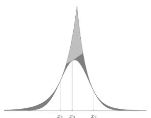

图 3.6: 对数凹概率密度函数自适应拒绝采样的示意图。

### 3.3 重要性采样

采样的一个原因是，通过

```
\(\mathbb{E}[h] = \int h(\mathbf{x})f(\mathbf{x})d\mathbf{x} \approx \frac{1}{N} \sum_{n=1}^N h(\mathbf{x}_n),\)
```

来近似随机变量向量 $\mathbf{x}$ 的某个函数 $h$ 的多维期望，其中 \(\mathbf{x} \in \mathbf{R}^d\) 和 \(\mathbf{x}_n \in \mathbf{R}^d, n=1, \dots, N\) 是从概率密度 \(f\) 中抽取的样本。但是，当采样不可能或计算成本过高时，这不适用。一种可能的解决方案不是采样，而是用 \(f(\mathbf{x}_n)\) 对每个评估 \(h(\mathbf{x}_n)\) 进行加权，

```
\(\mathbb{E}[h] \approx \sum_{n=1}^N f(\mathbf{x}_n)h(\mathbf{x}_n),\)
```

其中 \(\mathbf{x}_n, n=1, \dots, N,\) 以某种方式选择。一种天真的方法是均匀选择它们。首先，在这种情况下，\(N\) 随维度数量 \(d\) 呈指数增长才能获得良好的近似。其次，这忽略了这样一个事实：在许多情况下，感兴趣的区域，即概率密度函数集中其质量的区域，相对较小。

重要性采样使用一个提议分布 \(g\)，该分布将注意力集中在感兴趣的区域上，并且可以轻松采样。它不需要


是 $f$ 的包络函数。样本 $\mathbf{x}_1, \dots, \mathbf{x}_n$ 从提议分布中绘制。然后

$$
\mathbb{E}_f[h] = \int h(\mathbf{x})f(\mathbf{x})d\mathbf{x} = \int h(\mathbf{x})\frac{f(\mathbf{x})}{g(\mathbf{x})}g(\mathbf{x})d\mathbf{x} = \mathbb{E}_g[hf/g] \approx \frac{1}{N}\sum_{n=1}^N \frac{f(\mathbf{x}_n)}{g(\mathbf{x}_n)}h(\mathbf{x}_n),
$$

其中下标用于指示期望是相对于哪个概率密度函数计算的。与拒绝采样不同，所有生成的样本都被使用。因子 $f(\mathbf{x}_n)/g(\mathbf{x}_n)$ 称为 *重要权重*。它们是对从错误分布采样的一种修正。例如，如果在某个区域 $g$ 跟随 $f$，则该因子为 1，无需修正。然而，如果在 $f$ 较小的区域 $g$ 较大，则在那里评估 $h$ 的贡献需要被降低。另一方面，如果在 $f$ 较大的区域 $g$ 较小且我们碰巧在那里采样，则 $h$ 在那里的值需要被放大。

在以下情况下

$$
f(\mathbf{x}) = \frac{1}{c_f}\hat{f}(\mathbf{x}) \text{ and } g(\mathbf{x}) = \frac{1}{c_g}\hat{g}(\mathbf{x})
$$

和归一化常数

$$
c_f = \int \hat{f}(\mathbf{x})d\mathbf{x} \text{ and } c_g = \int \hat{g}(\mathbf{x})d\mathbf{x}
$$

未知，计算变为

$$
\mathbb{E}_f[h] = \int h(\mathbf{x})f(\mathbf{x})d\mathbf{x} = \frac{c_g}{c_f} \int h(\mathbf{x})\frac{\hat{f}(\mathbf{x})}{\hat{g}(\mathbf{x})}g(\mathbf{x})d\mathbf{x} = \frac{c_g}{c_f}\mathbb{E}_g[h\hat{f}/\hat{g}] \approx \frac{c_g}{c_f}\frac{1}{N}\sum_{n=1}^N \frac{\hat{f}(\mathbf{x}_n)}{\hat{g}(\mathbf{x}_n)}h(\mathbf{x}_n).
$$

尽管归一化常数未知，我们可以估计它们的比率。在 $g(\mathbf{x})$ 非零的地方使用 $c_g = \hat{g}(\mathbf{x})/g(\mathbf{x})$，我们有

$$
\frac{c_f}{c_g} = \frac{1}{c_g} \int \hat{f}(\mathbf{x})d\mathbf{x} = \int \frac{\hat{f}(\mathbf{x})}{\hat{g}(\mathbf{x})}g(\mathbf{x})d\mathbf{x} = \mathbb{E}_g[\hat{f}/\hat{g}] \approx \frac{1}{N}\sum_{n=1}^N \frac{\hat{f}(\mathbf{x}_n)}{\hat{g}(\mathbf{x}_n)}.
$$

基于此结果，期望估计为

$$
\mathbb{E}_f[h] \approx \frac{1}{\sum_{k=1}^N \hat{f}(\mathbf{x}_k)/\hat{g}(\mathbf{x}_k)} \sum_{n=1}^N \frac{\hat{f}(\mathbf{x}_n)}{\hat{g}(\mathbf{x}_n)}h(\mathbf{x}_n).
$$

重要权重为

$$
w_n = \frac{\hat{f}(\mathbf{x}_n)/g(\mathbf{x}_n)}{\sum_{k=1}^N \hat{f}(\mathbf{x}_k)/g(\mathbf{x}_k)} = \frac{\hat{f}(\mathbf{x}_n)/g(\mathbf{x}_n)}{\sum_{k=1}^N \hat{f}(\mathbf{x}_k)/g(\mathbf{x}_k)}, \quad (3.4)
$$

由于 $g$ 和 $\tilde{g}$ 仅相差一个乘法常数。注意，如果提议分布与 $f$ 重合，则 $w_n = 1/N$。

与拒绝采样一样，提议分布的选择至关重要。最重要的是，它在 $f$ 较大的区域不应太小。只有当从该区域实际绘制出样本时，加权才能进行修正。

采样-重要性-重采样（SIR）结合了拒绝采样和重要性采样的思想。首先，从提议分布 $g$ 中绘制 $N$ 个样本 $\mathbf{x}_1, \dots, \mathbf{x}_N$。与拒绝其中一些不同，权重根据 (3.4) 计算。然后，根据 $w_1, \dots, w_N$ 给出的概率，从离散样本 $\{\mathbf{x}_1, \dots, \mathbf{x}_N\}$ 中绘制 $N$ 个样本。因此，如果某个样本的权重大于其他样本的权重，它可以在最终集合中出现多次。如果 $g = f$，则所有权重都等于 $1/N$，所有样本被绘制的可能性相同。

### 3.4 马尔可夫链

马尔可夫链是一类采样算法的重要构建模块，该类算法可应用于许多不同的分布，并且随维度良好扩展。

马尔可夫链是一系列随机变量 $\mathbf{x}_1, \dots, \mathbf{x}_N$。索引与时间序列相关。阶数为 $m$ 的马尔可夫链满足以下性质

\( p(\mathbf{x}_n|\mathbf{x}_{n-1}, \mathbf{x}_{n-2}, \dots, \mathbf{x}_1) = p(\mathbf{x}_n|\mathbf{x}_{n-1}, \mathbf{x}_{n-2}, \dots, \mathbf{x}_{n-m}) \)

对于 $n = m + 1, \dots, M$。这意味着第 $n$ 个随机变量仅依赖于前 $m$ 个变量。特别是，一阶马尔可夫链满足

\( p(\mathbf{x}_n|\mathbf{x}_{n-1}, \mathbf{x}_{n-2}, \dots, \mathbf{x}_1) = p(\mathbf{x}_n|\mathbf{x}_{n-1}) \)

每个随机变量仅依赖于其前驱。我们将只考虑一阶马尔可夫链，因为任何阶数为 $m$ 的马尔可夫链都可以通过令 $\mathbf{y}_{n-m+1}$ 为元组 $(\mathbf{x}_n, \dots, \mathbf{x}_{n-m+1})$ 来转写为一阶马尔可夫链，然后由于 $p(\mathbf{y}_k|\mathbf{y}_{k-1}, \dots, \mathbf{y}_1) = p(\mathbf{y}_k|\mathbf{y}_{k-1})$。

概率 $T_n(\mathbf{x}_{n-1}, \mathbf{x}_n) = p(\mathbf{x}_n|\mathbf{x}_{n-1})$ 称为转移概率。如果它们对所有 $n$ 都相同，即对所有 $n$ 都有 $T_n(\mathbf{x}_{n-1}, \mathbf{x}_n) = T(\mathbf{x}_{n-1}, \mathbf{x}_n)$，则该马尔可夫链称为齐次。

图形上，一阶马尔可夫链可以表示为

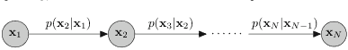

$\mathbf{x}_n$ 的可能值构成状态空间。我们区分离散且可数（可能是有限）的状态空间和连续状态空间（有时称为一般状态空间）。对所有可能的状态 $\mathbf{x}_{n-1}$ 求和或积分给出 $\mathbf{x}_n$ 的边缘概率，

\(p(\mathbf{x}_n) = \sum_{\mathbf{x}_{n-1}} p(\mathbf{x}_n | \mathbf{x}_{n-1}) p(\mathbf{x}_{n-1})\) or \(p(\mathbf{x}_n) = \int p(\mathbf{x}_n | \mathbf{x}_{n-1}) p(\mathbf{x}_{n-1}) d\mathbf{x}_{n-1}\).

为此，需要知道 $\mathbf{x}_{n-1}$ 的边缘概率。从初始分布 $p(\mathbf{x}_1)$ 开始，可以计算所有边缘分布。

对于齐次马尔可夫链，转移概率可以通过指出 T 作用于状态空间不同元素的方式来完全描述，即对所有状态 $\mathbf{x}$ 和 $\hat{\mathbf{x}}$ 的 $T(\mathbf{x}, \hat{\mathbf{x}})$。

如果从状态 $\hat{\mathbf{x}}$ 到达状态 $\mathbf{x}$ 的概率在有限步数内对所有状态 $\mathbf{x}$ 和 $\hat{\mathbf{x}}$ 都非零，则马尔可夫链称为 *不可约*。换句话说，任何状态都可以从任何其他状态在有限步数内到达。

由概率质量函数或概率密度函数 $f$ 指定的分布相对于马尔可夫链称为 *不变* 或 *平稳*；如果 $\mathbf{x}_{n-1}$ 服从该分布，则对于所有 $n$，$\mathbf{x}_n$ 也服从该分布。换句话说，如果 $\mathbf{x}_0$ 服从该分布，则整个链也服从该分布。分布在每一步后保持不变。注意，若干分布可以相对于给定的马尔可夫链不变。例如，在退化情况下

\(T(\mathbf{x}, \hat{\mathbf{x}}) = \begin{cases} 1 & \text{if } \hat{\mathbf{x}} = \mathbf{x}, \\ 0 & \text{otherwise,} \end{cases}\)

我们有 $\mathbf{x}_1 = \mathbf{x}_2 = \cdots = \mathbf{x}_N$。每一步的转换都是恒等变换。在这种情况下，任何分布都是不变的。

对于齐次马尔可夫链，由 $f$ 指定的分布是不变的，如果

\(f(\hat{\mathbf{x}}) = \sum_{\mathbf{x}} T(\mathbf{x}, \hat{\mathbf{x}}) f(\mathbf{x})\) or \(f(\hat{\mathbf{x}}) = \int T(\mathbf{x}, \hat{\mathbf{x}}) f(\mathbf{x}) d\mathbf{x}\),

其中求和或积分是在状态空间上进行。

可以构建具有转移概率的马尔可夫链，使给定的 $f$ 不变。为了实现这一点，转移概率需要对所有状态对 $\mathbf{x}$ 和 $\hat{\mathbf{x}}$ 满足 *详细平衡* 性质：

\(T(\mathbf{x}, \hat{\mathbf{x}}) f(\mathbf{x}) = T(\hat{\mathbf{x}}, \mathbf{x}) f(\hat{\mathbf{x}})\).

注意，对于 $\mathbf{x} = \hat{\mathbf{x}}$，上述方程自然成立。如果满足详细平衡，则马尔可夫链称为 *可逆*。不变性由以下等式表明：

\(\sum_{\mathbf{x}} T(\mathbf{x}, \hat{\mathbf{x}}) f(\mathbf{x}) = \sum_{\hat{\mathbf{x}}} T(\hat{\mathbf{x}}, \mathbf{x}) f(\hat{\mathbf{x}}) = f(\hat{\mathbf{x}}) \sum_{\mathbf{x}} p(\mathbf{x} | \hat{\mathbf{x}}) = f(\hat{\mathbf{x}})\),

因为状态空间上条件概率的和为一。对于连续概率密度函数 $f$ 的计算使用积分，且是类似的。

转移概率可以构建为基转移概率 $B_1, \dots, B_M$ 的线性组合，


$T(\mathbf{x}, \hat{\mathbf{x}}) = \sum_{m=1}^M b_m B_m(\mathbf{x}, \hat{\mathbf{x}})$

其中 \(b_1, \dots, b_M\) 被称为 *混合系数* 且满足 \(b_m \ge 0\) 和 \(\sum_{m=1}^M b_m = 1\)。如果每个基转换都满足详细平衡，则其线性组合也满足。通常，基转换被选择为每个只改变 \(\mathbf{x}\) 中的一个子集分量。

如果状态空间是有限的，则可以用一个1-of-\(K\)向量表示。即随机变量 \(\mathbf{x}_n\) 取第 \(k^{\text{th}}\) 状态是一个 \(K\) 维向量，其中恰好一个元素 \(x_{n,k}\) 等于1，其余均为0。转移概率 \(p_{kl} = p(x_{n+1,l} = 1 | x_{n,k} = 1)\)，即 \(\mathbf{x}_n\) 在状态 \(k\) 下生成 \(\mathbf{x}_{n+1}\) 在状态 \(l\)，可以用矩阵形式表示

\[P = \begin{pmatrix} p_{11} & \cdots & p_{1K} \\ \vdots & \ddots & \vdots \\ p_{K1} & \cdots & p_{KK} \end{pmatrix} \]

这被称为 *转移矩阵*。\(P\) 的每一行之和为1。因此它是一个 *右随机矩阵*，与每一列之和为1的 *左随机矩阵* 相对。一个 *双随机矩阵* 是指其列和行之和均为1的矩阵。例如，如果 \(P\) 是对称的，即从状态 \(k\) 到状态 \(l\) 的转移概率与从状态 \(l\) 到状态 \(k\) 相同，则会出现这种情况。

从状态 \(k\) 到状态 \(l\) 在 \(m\) 步内转移的概率是 \(P^m\) 中的 \((k, l)\) 项。如果返回状态 \(k\) 只发生在 \(m\) 时间步的倍数上，则状态 \(k\) 具有 *周期* \(m\)。更正式地说，周期 \(m\) 是所有使得概率 \(p(x_{n+1,k} = 1 | x_{1,k} = 1)\) 非零的数 \(n\) 的最大公约数。如果 \(m = 1\)，则该状态称为 *无周期*。例如，如果转移到自身的概率非零，则会发生这种情况。如果每个状态都是无周期的，则马尔可夫链是 *无周期* 的。一个不可约马尔可夫链，即从任何状态都可以到达任何其他状态的链，只需要一个无周期状态即可成为无周期。这是因为利用这个唯一的无周期状态，可以在任意步数（为任意质数）内返回任何状态，而多个质数的最大公约数为1。

如果初始分布 \(\mathbf{p}(1)\) 由 \(\mathbf{p} = (p_1, \dots, p_K)\) 给出，则 \(\mathbf{x}_{n+1}\) 的分布由 \(\mathbf{p}P^n\) 给出。

转移矩阵可以用 *状态图* 表示。例如，如果有 \(K=3\) 个状态，则图为

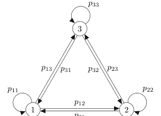

状态图不应与马尔可夫链的图形表示混淆。

如果从一个状态到另一个状态的转移概率为零，则该箭头在状态图中省略。例如。

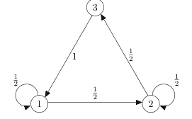

```
P = \begin{pmatrix} \frac{1}{2} & \frac{1}{2} & 0 \\ 0 & \frac{1}{2} & \frac{1}{2} \\ 1 & 0 & 0 \end{pmatrix}
```

状态1以概率1/2保持为状态1，或以概率1/2变为状态2。同样，状态2以概率1/2保持为状态2，或以概率1/2变为状态3。状态3总是变为状态1。

由此转移矩阵生成的马尔可夫链是不可约的，因为所有状态都可以从每个其他状态到达。状态1和2显然是无周期的，使得马尔可夫链无周期。

要找到不变的概率质量函数 $f$，设 $f_i$ 为状态 \(i\) 的概率，\(\mathbf{f} = (f_1, f_2, f_3)\)。我们需要求解 \(\mathbf{f}P = \mathbf{f}\)，

$$\frac{1}{2}f_1 + f_3 = f_1, \\ \frac{1}{2}f_1 + \frac{1}{2}f_2 = f_2, \\ \frac{1}{2}f_2 = f_3.$$

这给出 \(f_1 = f_2 = 2f_3\)。概率也需要之和为1，即 \(f_1 + f_2 + f_3 = 1\)。由此，\(\mathbf{f} = (2/5, 2/5, 1/5)\) 描述了不变分布。

另一个方向，即构建对给定分布 \(\mathbf{f}\) 不变的马尔可夫链，具有更多自由度，因为转移矩阵有九个元素，受所有行之和为1的约束。设 \(\mathbf{f} = (f_1, f_2, f_3)\) 定义随机变量分别处于状态1、2或3的概率。详细平衡性质导出三个方程，

$p_{12}f_1 = p_{21}f_2 \\ p_{13}f_1 = p_{31}f_3 \\ p_{23}f_2 = p_{32}f_3.$

一旦选定非对角元素，对角元素 \(p_{11}, p_{22}\) 和 \(p_{33}\) 可以通过使用

$$\sum_{j=1}^3 p_{ij} = 1,$$

确定，其中 \(i = 1, 2, 3\)。

更具体地说，设 \(\mathbf{f} = (1/10, 2/5, 1/2)\)。详细平衡方程为

$$\frac{1}{10}p_{12} = \frac{2}{5}p_{21} \\ \frac{1}{10}p_{13} = \frac{1}{2}p_{31} \\ \frac{2}{5}p_{23} = \frac{1}{2}p_{32}.$$

由于我们有一定的选择自由度，可以设 \(p_{12} = 1\)。这意味着 \(p_{21} = 1/4\)。不可能设 \(p_{21} = 1\)，因为这会导致 \(p_{12}\) 大于1。由于一行中的概率之和必须为1，我们有 \(p_{11} = p_{13} = 0\)。第二个方程随后导致 \(p_{31} = 0\)。这确定了转移矩阵的第一行和第一列。再次利用我们的选择自由度，我们设 \(p_{23} = 3/4\)，这意味着 \(p_{22} = 0\)。最后一个方程确定 \(p_{32} = 2(3/4)(2/5) = 3/5\)。最后 \(p_{33} = 2/5\)，因为最后一行必须之和为1，因此

$$P = \begin{pmatrix} 0 & 1 & 0 \\ \frac{1}{4} & 0 & \frac{3}{4} \\ 0 & \frac{3}{5} & \frac{2}{5} \end{pmatrix}.$$

状态图为

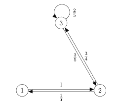

我们可以检查从初始状态 \(x_1\)（分布为 \(p = (p_1, p_2, p_3)\)）转移 \(n\) 次后 \(x_{n+1}\) 的分布。回顾这由 \(pP^n\) 给出。对于 \(n = 20\)，在我们的示例中，我们有

| 0.1006 | 0.3984 | 0.5011 |
|---|---|---|
| 0.0996 | 0.4012 | 0.4992 |
| 0.1002 | 0.3994 | 0.5004 |

假设 \(P^n\) 收敛于

| f1 | f2 | f3 |
|---|---|---|
| f1 | f2 | f3 |
| f1 | f2 | f3 |

当 \(n\) 趋于无穷时。那么 \(x_{n+1}\) 的分布收敛于

$pF = (f_1(p_1 + p_2 + p_3), f_2(p_1 + p_2 + p_3), f_3(p_1 + p_2 + p_3)) = f$，

因为 \(p_1 + p_2 + p_3 = 1\)。因此，我们可以通过使用一个使 \(f\) 不变的马尔可夫链生成样本，无论初始分布如何，来为给定分布 \(f\) 生成近似样本。

收敛性源于遍历定理，这超出了本文的范围，但 [33] 对马尔可夫链进行了详细的处理。如果有限状态马尔可夫链是不可约且无周期的，那么 \(x_n\) 的分布将趋于不变分布 \(f\)，无论初始分布如何。该不变分布随后称为平衡。

更一般地，任何形式的矩阵

| 1 - (\alpha + \beta) | \alpha | \beta |
|---|---|---|
| \frac{\alpha}{4} | 1 - \frac{\alpha + \gamma}{4} | \gamma |
| \frac{\beta}{5} | \frac{4\gamma}{5} | 1 - \frac{\beta + 4\gamma}{5} |

都满足 $fP = f = (1/10, 2/5, 1/2)$。所有元素都必须是有效概率，因此 \(\alpha, \beta, \gamma \in [0, 1]\) 且 \(\alpha + \beta \le 1\)，\(\alpha + 4\gamma \le 4\) 以及 \(\beta + 4\gamma \le 5\)。

如果 \(\alpha, \beta\) 和 \(\gamma\) 中的任意两个都为零，则对角线上有一个1，这意味着无法离开该状态。该状态称为 *吸收态*。如果每个状态到达该状态都有非零概率，则该马尔可夫链是一个 *吸收马尔可夫链*。这里不是这种情况，因为另外两个状态相互转换，但不转换到吸收态。这也意味着链不是不可约的，因为吸收态无法从另外两个状态到达。因此在这种情况下，\(\mathbf{x}_n\) 的分布不会收敛到不变分布，马尔可夫链不能用于生成近似样本。

另一方面，如果 \(\alpha, \beta\) 和 \(\gamma\) 中最多有一个为零，则马尔可夫链是不可约且无周期的，可以用于为不变分布 \(f\) 生成近似样本。

整数状态空间上的马尔可夫链的一个例子是 *醉汉随机游走*，醉汉站在标记为0的酒吧，每次迈步时，要么以概率1/2向前迈步（\(x_{n+1} = x_n + 1\)），要么以概率1/2向后迈步（\(x_{n+1} = x_n - 1\)），与他之前如何到达这里无关。所有其他整数的概率均为零。这是 *随机游走* 的一个例子。转移矩阵将是无限的，对角线为0，次对角线和超对角线为1/2。状态图为

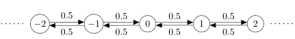

\(\mathbb{E}[x_n]\) 的期望为0，因为每个单独步骤的期望是醉汉原地不动。另一方面，\(\mathbb{E}[x_n^2] = n\)，这意味着从酒吧出发的距离的数量级为 \(\sqrt{n}\)。醉汉的伴侣会在酒吧附近找到他们。这也表明这种随机游走在探索整数状态空间方面相对无效。

然而，如果随机游走无限期地进行下去，它将无限多次到达每个整数。这一性质称为 *水平穿越现象、复现* 或 *赌徒破产*。后者是因为一个拥有有限资金的赌徒与拥有无限资金的银行进行公平游戏，最终会输光，因为他拥有的金额遵循随机游走，并且会在某个时刻穿过零，游戏结束。

目标是构建一个马尔可夫链，使给定的具有概率质量函数或概率密度函数 \(f\) 的分布是不变的，这样当 \(n\) 足够大时，马尔可夫链的元素就是给定分布的样本。


### 3.5 马尔可夫链蒙特卡洛

令

```
f(\mathbf{x}) = \frac{1}{c_f} \tilde{f}(\mathbf{x})
```

描述我们希望从中采样的分布，其中归一化常数 $c_f$ 的值不一定已知。我们通过使用提议分布 $g(\mathbf{x}, \hat{\mathbf{x}})$ 构建一个马尔可夫链，该分布描述了在给定 $\mathbf{x}$ 时绘制 $\hat{\mathbf{x}}$ 的概率。也就是说，马尔可夫链中的下一个元素 $\mathbf{x}_{n+1}$ 是从分布 $g(\mathbf{x}_n, \mathbf{x})$ 中绘制的，其中 $\mathbf{x}_n$ 是马尔可夫链中的当前元素。只有当 $g(\mathbf{x}, \hat{\mathbf{x}})$ 与 $\mathbf{x}$ 无关时，马尔可夫链才是齐次的。

此外，如果提议分布是对称的，即对于所有 $\mathbf{x}$ 都有 $g(\mathbf{x}, \hat{\mathbf{x}}) = g(\hat{\mathbf{x}}, \mathbf{x})$，则从提议分布中绘制一个候选 $\mathbf{x}^*$，并以以下概率接受：
```
min \left( 1, \frac{f(\mathbf{x}^*)}{f(\mathbf{x}_n)} \right) = min \left( 1, \frac{\tilde{f}(\mathbf{x}^*)}{\tilde{f}(\mathbf{x}_n)} \right).
```

注意，如果 $\tilde{f}(\mathbf{x}^*) \ge \tilde{f}(\mathbf{x}_n)$，则候选肯定会被保留。如果接受候选样本，则 $\mathbf{x}_{n+1} = \mathbf{x}^*$，否则 $\mathbf{x}_{n+1} = \mathbf{x}_n$。这被称为 Metropolis 算法。

复制样本与拒绝采样形成对比。在实际实现中，不会存储样本的额外副本。相反，会更新一个计数器，记录样本被绘制的次数。例如，在计算期望时，此计数器充当权重。只要 $\tilde{f}$ 在整个状态空间上非零，就始终存在 $\mathbf{x}_{n+1} = \mathbf{x}_n$ 的非零概率，因此马尔可夫链是无周期的。此外，如果 $g(\mathbf{x}, \hat{\mathbf{x}})$ 在整个状态空间上非零，则马尔可夫链显然是不可约的。

在大多数情况下，马尔可夫链的元素 $\mathbf{x}_1, \mathbf{x}_2, \dots$ 不是独立样本，因为如果 $g(\mathbf{x}, \hat{\mathbf{x}})$ 依赖于 $\mathbf{x}$，则连续样本高度相关。事实上，该链代表了在状态空间中的随机游走。出于实际目的，仅从链中取每个 $m^{th}$ 元素即可在 $m$ 足够大时近似独立。这种做法称为稀疏。

例如，可以通过让 $g(\mathbf{x}, \hat{\mathbf{x}})$ 描述均值为 $\mathbf{x}$ 且方差为 $\sigma^2$ 倍单位矩阵的正态分布来实现 $g(\mathbf{x}, \hat{\mathbf{x}})$ 的对称性，因为在这种情况下
```
g(\mathbf{x}, \hat{\mathbf{x}}) = \frac{1}{\sqrt{|2\pi\sigma^2\mathbf{I}|}} \exp \left( \frac{1}{2\sigma^2} (\hat{\mathbf{x}} - \mathbf{x})^T (\hat{\mathbf{x}} - \mathbf{x}) \right) = g(\hat{\mathbf{x}}, \mathbf{x}).
```

这种提议分布的选择很常见，因为生成标准正态分布样本的技术（如 Box--Muller 变换）现成可用，这些样本只需按 $\sigma^2$ 缩放并按 $\mathbf{x}$ 平移即可。

```matlab
target_mean = [2 3];
target_variance = [1 1.5; 1.5 3];
% Create function handle to unnormalized probability density.
target = @(x) exp(-0.5*(x-target_mean)/target_variance * ...
    (x-target_mean)');
% The variances of the components are given by the eigenvalues
% of the variance matrix.
e = eig(target_variance);
figure;
hold on;
% Set variance of the proposal distribution to the identity matrix
% times the smallest variance of the target distribution.
proposal_variance = e(1) * eye(2);
N = 300; % Length of Markov chain.
% Set first element of the Markov chain.
start = target_mean;
samples = target_mean;
% Evaluate the target distribution for the last element.
last = feval(target,start);
counter = [1];
total = 1;
accepted = 1;
while total < N
    % Generate candidate from normal distribution with mean
    % samples(end,:) and variance proposal_variance.
    samples = [samples; mvnrnd(samples(end,:),proposal_variance)];
    candidate = [samples(end,:) accepted(1)];
    % Evaluate the target distribution for the candidate.
    new = feval(target,candidate);
    % Evaluate acceptance probability.
    accept_prob = min(1,new/last);
    if rand < accept_prob
        % Draw random walk.
        line([samples(accepted,1) candidate(1)],...
            [samples(accepted,2) candidate(2)],...
            'Color','k');
        % Update Markov chain.
        samples = [samples; candidate];
        counter = [counter; 1];
        accepted = accepted + 1;
        % Update evaluation of target distribution for the last element.
        last = new;
    else
        % Plot rejected candidate.
        plot(candidate(1),candidate(2),'+k');
        % Update counter for this state.
        counter(accepted) = counter(accepted)+1;
    end
    total = total +1;
end
% Calculate acceptance rate.
rate = accepted/total
axis equal
```

清单 3.3：Metropolis 采样示例。

我们通过一个示例来说明，生成来自均值和方差为正态分布的目标分布的样本

\(\mu = \begin{pmatrix} 2 \\ 3 \end{pmatrix}, \quad \Sigma = \begin{pmatrix} 1 & 3/2 \\ 3/2 & 3 \end{pmatrix}\)

清单 3.3 为此示例实现了 Metropolis 算法。问题是，\(\sigma^2\) 应如何选择？这里，分布的单变量方差取决于考虑的方向而有很大差异。最小和最大方差由 \(\Sigma\) 的特征值给出，分别为 \(\sigma^2_{\min} \approx 0.2\) 和 \(\sigma^2_{\max} \approx 3.8\)。提议分布的方差 \(\sigma^2\) 应与最小方差的数量级相同。换句话说，提议分布的标准差应大约等于目标分布的最小标准差，\(\sigma = \sigma_{\min}\)。这种选择确保不会因为在最小标准差方向上太远而拒绝太多候选。最大标准差的方向通过随机游走来探索。清单 3.3 对 \(\sigma\) 做出了这种选择。

马尔可夫链的起点也需要仔细选择，以确保在相对较少的步骤内探索状态空间。称为 burn-in（预烧）的技术会丢弃马尔可夫链的前几个元素，并从链到达的状态重新启动链。严格来说，这不是必要的。只要链足够长，马尔可夫链的元素将是一组良好的样本。清单 3.3 将第一个元素设置为目标分布的均值 \(\mu\)。当然，只有在了解目标分布的情况下，才能对 \(\sigma\) 和 \(\mathbf{x}_1$ 做出这些选择。无论如何，对这些参数的良好估计都是必要的。

图 3.7 说明了这些考虑因素，该图描绘了（+）生成的随机游走以及被拒绝的候选（-）和不同选择下目标分布的 95% 置信椭圆。置信椭圆给出了目标分布 95% 样本预期所在的区域。

图 3.7a 使用了 \(\mathbf{x}_1 = \mu\) 和 \(\sigma = \sigma_{\min}\)。状态空间得到了很好的探索。大约三分之二的候选被接受。这意味着三分之一的样本与另一个样本重合。在图 3.7b 中，起始位置移动到了 \((0,0)'\)。接受率与之前差不多，但状态空间探索得不够充分。算法需要运行更长时间。图 3.7c 使用了 \(\sigma = 2 \times \sigma_{\min}\)。大约 87% 的候选被接受，但算法在状态空间中移动得更慢。同样，它需要运行更长时间才能探索状态空间。在图 3.7d 中，与图 3.7a 相比，提议分布的标准差加倍了。接受率下降到 43%。这意味着一半以上的样本共享其位置。如果要计算期望并应用适当的权重，这无关紧要。但是，如果目标是探索状态空间，则更高的接受率更可取。


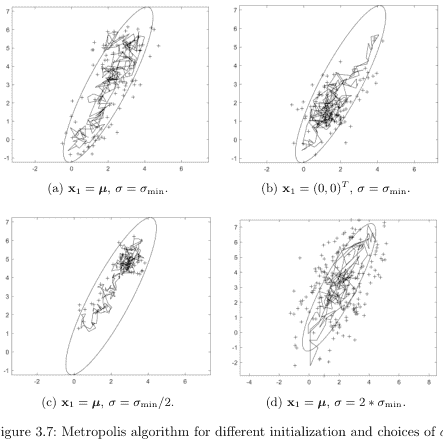

Metropolis-Hastings算法将Metropolis方法扩展到使用非对称的提议分布。在这种情况下，候选x*的接受概率计算为

```
\min \left( 1, \frac{f(\mathbf{x}^*) g(\mathbf{x}^*, \mathbf{x}_n)}{f(\mathbf{x}_n) g(\mathbf{x}_n, \mathbf{x}^*)} \right) = \min \left( 1, \frac{\hat{f}(\mathbf{x}^*) g(\mathbf{x}^*, \mathbf{x}_n)}{\hat{f}(\mathbf{x}_n) g(\mathbf{x}_n, \mathbf{x}^*)} \right).
```

从x到x̃的转移概率由以下给出

```
T(\mathbf{x}, \tilde{\mathbf{x}}) = g(\mathbf{x}, \tilde{\mathbf{x}}) \min \left( 1, \frac{\hat{f}(\tilde{\mathbf{x}}) g(\tilde{\mathbf{x}}, \mathbf{x})}{\hat{f}(\mathbf{x}) g(\mathbf{x}, \tilde{\mathbf{x}})} \right).
```

我们现在可以检查$f$是否满足详细平衡。为此，

\(\begin{aligned} f(\mathbf{x})T(\mathbf{x}, \hat{\mathbf{x}}) &= \frac{\hat{f}(\mathbf{x})}{c_f} g(\mathbf{x}, \hat{\mathbf{x}}) \min \left( 1, \frac{\hat{f}(\hat{\mathbf{x}})g(\hat{\mathbf{x}}, \mathbf{x})}{\hat{f}(\mathbf{x})g(\mathbf{x}, \hat{\mathbf{x}})} \right) \\ &= \frac{1}{c_f} \min \left( \hat{f}(\mathbf{x})g(\mathbf{x}, \hat{\mathbf{x}}), \hat{f}(\hat{\mathbf{x}})g(\hat{\mathbf{x}}, \mathbf{x}) \right) \\ &= \frac{1}{c_f} \min \left( \hat{f}(\hat{\mathbf{x}})g(\hat{\mathbf{x}}, \mathbf{x}), \hat{f}(\mathbf{x})g(\mathbf{x}, \hat{\mathbf{x}}) \right) \\ &= \frac{\hat{f}(\hat{\mathbf{x}})}{c_f} g(\mathbf{x}, \hat{\mathbf{x}}) \min \left( 1, \frac{\hat{f}(\mathbf{x})g(\mathbf{x}, \hat{\mathbf{x}})}{\hat{f}(\hat{\mathbf{x}})g(\hat{\mathbf{x}}, \mathbf{x})} \right) = f(\hat{\mathbf{x}})T(\hat{\mathbf{x}}, \mathbf{x}). \end{aligned}\)

因此，满足详细平衡，这是生成由$f$描述的分布的近似样本所必需的。

Metropolis-Hastings算法是被称为马尔可夫链蒙特卡罗（MCMC）的一类算法的示例。一般来说，蒙特卡洛方法是指依赖重复随机采样进行计算的算法，在无法获得闭式解或闭式解成本过高的情况下使用。它们最初在洛斯阿拉莫斯国家实验室开发。由于工作是保密的，蒙特卡洛（指摩纳哥的蒙特卡洛赌场）被用作代号。

当从x的条件分布中采样比从x本身的分布中采样更容易时，使用吉布斯采样。设$\mathbf{x}_n = (x_{n,1}, ..., x_{n,D})^T$，其中D是状态空间的维度。然后通过D步构造下一个元素$\mathbf{x}_{n+1}$，即按顺序从条件概率$p(x|x_{n+1,1}, ..., x_{n+1,d-1}, x_{n,d+1}, ..., x_{n,D})$中绘制$x_{n+1,1}$，其中$d = 1, ..., D$。这意味着一旦某个分量被绘制，它就会在下一次绘制中使用。另一个版本随机选择下一个要更新的分量。

由x的概率密度函数f描述的分布对每个采样步骤是不变的，原因如下。首先，$\mathbf{x}_{-d} = (x_1, ..., x_{d-1}, x_{d+1}, ..., x_D)$的边缘分布是不变的，因为这些分量在dth步中都不会改变。其次，dth分量是从正确的条件分布中采样的，因此也是不变的。因为联合分布（即x的分布）由这些边缘分布和条件分布决定，所以它也是不变的。如果此外在状态空间的任何地方条件概率都不为零，则可以应用遍历定理。因此，生成的马尔可夫链将产生来自所需分布的样本。

吉布斯采样可以用Metropolis-Hastings算法来表述。设当前样本为x。注意，这可能是马尔可夫链的一个元素或中间步骤之一。候选x*与前一个样本x仅在一个分量上不同。设此为dth分量。因此$\mathbf{x}_{-d} = \mathbf{x}_{-d}$。x*的dth分量是从$p(x|\mathbf{x}_{-d})$中绘制的。这定义了提议分布

\(g(\mathbf{x}, \mathbf{x}^*) = p(x_d^*|\mathbf{x}_{-d}).\)


图3.8：由吉布斯采样生成的随机游走。

为了确定接受概率，我们需要计算

```
\frac{f(\mathbf{x}^*)g(\mathbf{x}^*, \mathbf{x})}{f(\mathbf{x})g(\mathbf{x}, \mathbf{x}^*)} = \frac{f(\mathbf{x}^*)p(x_d|\mathbf{x}^*_{-d})}{f(\mathbf{x})p(x_d^*|\mathbf{x}_{-d})}
=
\frac{f(x_1, \dots, x_{d-1}, x_d^*, x_{d+1}, \dots, x_D)p(x_d|\mathbf{x}_{-d})}{f(\mathbf{x})p(x_d^*|\mathbf{x}_{-d})}.
```

现在使用乘积法则

```
f(\mathbf{x}) = p(x_d|\mathbf{x}_{-d})p(\mathbf{x}_{-d})
f(x_1, \dots, x_{d-1}, x_d^*, x_{d+1}, \dots, x_D) = p(x_d^*|\mathbf{x}_{-d})p(\mathbf{x}_{-d})
```

我们可以看到该分数的值为1。因此，中间步骤中的每个样本都被接受。

图3.8显示了与图3.7中的示例相同的正态分布下，由吉布斯算法步骤生成的随机游走。由吉布斯算法生成的样本高度相关。为了近似样本之间的独立性，可以使用稀疏化（thinning）。另一种技术是阻塞（blocking），即不使用单个分量的条件概率，而是使用多个分量集合的条件概率，这些集合可以重叠。


Taylor & Francis

Taylor & Francis Group

http://taylorandfrancis.com

## 4. 线性分类

本章将线性分类介绍为对线性子空间的简单投影。它阐述了最大化分离的思想，推导出Fisher的判别分析和线性判别分析。这一思想扩展到多类。感知机和在线学习被解释为根据所见数据样本将分离线向不同方向拉动。证明了感知机是一个简单的神经网络。最后，支持向量机被推导为最大化类间边界。

### 4.1 特征

区分对象被称为*分类*。在出生前，我们就在子宫中学会区分不同的声音，并且继续轻松地学习和区分不同的对象、不同的情况和不同的概念。事实上，我们与他人不同或相似的方式是我们自我意识的基础。人类在分类领域具有非凡的能力。例如，尽管犬种繁多且视觉差异巨大，我们仍然轻易地将一只狗识别为狗。家猫在视觉上彼此更加相似。孩子不会被告知猫和狗之间的区别。他被告知这是猫，那是狗。最多被告知，这喵喵叫，那汪汪叫。基于这些例子，它必须自己弄清楚如何区分它们。什么是猫的特征，什么是狗的特征？更正式地说，特征有三个不同的类别。*布尔*或*二元*特征只能有两个值。它们与可以用是或否回答的问题相关。例如：它是红色的吗？这个人高吗？我们有暴风雨吗？*离散*特征采取*分类*也称为*序数*值。例如：它是什么颜色？这个人是矮、中等还是高？博福特风力等级的风力等级是多少？最后还有*连续*——即*实值*特征。这里回答的问题例如：是什么


图4.1：花萼长度与花萼宽度的散点图。

颜色的波长是什么？这个人的身高是多少？风速是多少？

日常生活中有许多分类示例。垃圾邮件过滤是文本分类的一个应用。图像中的人脸检测和光学字符识别是机器视觉领域的示例。对于企业，市场细分非常重要，而我们每个人都希望信用卡公司的欺诈检测算法有效。

分类并不新鲜。最常用的示例之一可以追溯到1936年，当时Ronald Fisher测量了三种不同鸢尾花（Iris setosa、iris versicolor和iris virginica）的花瓣长度和宽度以及花萼长度和宽度，每种有50个样本。因此，有四个连续特征。

接下来，我们将首先只考虑两个物种，即我们标记为\(C_0\)和\(C_1\)的两个类。这也被称为*二元分类*。设\(N_0\)为类\(C_0\)中的样本数，\(N_1\)为类\(C_1\)中的样本数。因此，样本总数为\(N\)。查看数据的可视化表示很有帮助，如图4.1所示，我们选择了两个特征进行显示，即花萼长度和花萼宽度。这被称为散点图。


### 4.2 子空间上的投影

每个样本有两个特征，我们可以将这些写成向量。

$$\mathbf{v}_1 = \begin{pmatrix} v_{11} \\ v_{12} \end{pmatrix} \quad \text{and} \quad \mathbf{v}_2 = \begin{pmatrix} v_{21} \\ v_{22} \end{pmatrix}$$

向量的长度是坐标平方和的平方根。

$$\|\mathbf{v}_2\| = \sqrt{v_{21}^2 + v_{22}^2}.$$

这也被称为欧几里得范数或 $L_2$ 范数。两个向量之间可以定义内积，也称为标量积或点积：

$$\mathbf{v}_1 \bullet \mathbf{v}_2 = \langle \mathbf{v}_1, \mathbf{v}_2 \rangle = v_{11}v_{21} + v_{12}v_{22}.$$

更一般地，这可以被视为第一个向量的转置与第二个向量之间的矩阵乘积。

$$\mathbf{v}_1 \bullet \mathbf{v}_2 = \mathbf{v}_1^T \mathbf{v}_2 = \begin{pmatrix} v_{11} & v_{12} \end{pmatrix} \begin{pmatrix} v_{21} \\ v_{22} \end{pmatrix} = v_{11}v_{21} + v_{12}v_{22}.$$

一个 $1 \times 2$ 矩阵乘以一个 $2 \times 1$ 矩阵是一个 $1 \times 1$ 矩阵。

一种常见的技术是将高维问题降维到低维问题，以便更容易求解。特别是，我们通过将二维问题投影到一条经过 0 并沿向量 $\mathbf{w}$ 方向的直线上，将其降为一维问题。向量 $\mathbf{v}$ 在 $\mathbf{w}$ 上的投影公式由

$$\text{proj}_{\mathbf{w}}(\mathbf{v}) = \frac{\mathbf{w}^T \mathbf{v}}{\|\mathbf{w}\|^2} \mathbf{w}$$

图 4.2 说明了这一点。

然后我们寻找一个分离阈值 $b$，也称为偏置，使得对于 $\mathbf{v}$

- $\mathbf{w}^T \mathbf{v} < b \Rightarrow \mathbf{v} \in C_0$,
- $\mathbf{w}^T \mathbf{v} > b \Rightarrow \mathbf{v} \in C_1$。

在图 4.2 中，偏置恰好为 0，使得 $\mathbf{v}_1$ 属于类 $C_0$，$\mathbf{v}_2$ 属于类 $C_1$。

任务是找到方向 $\mathbf{w}$ 和分离阈值 $b$。$\mathbf{w}$ 也称为权重向量。垂直于 $\mathbf{w}$ 并经过 $b$ 的直线应分离类别。在三维中，一个平面分离数据，而在更高维中，它是一个超平面。天真地选择坐标轴是不合适的，如图 4.3 所示。一个想法是使用每个类别的样本均值所在的直线以及样本均值之间的中点作为分离阈值。类 $C_i$ 的样本均值为

$$\mu_i = \frac{1}{N_i} \sum_{\mathbf{v} \in C_i} \mathbf{v}, \quad i = 0, 1. \tag{4.1}$$


图 4.2: v1 和 v2 在 w 上的投影。

通过样本均值的直线则参数化为

$l(a) = \mu_0 + a(\mu_1 - \mu_0)$。

对于 $a \in [0, 1]$，我们在样本均值之间的线段上，因此中点在 $a = 1/2$ 时给出，因此 $b = \frac{1}{2}(\mu_0 + \mu_1)$。

这种方法在图 4.4 中说明，其中投影直线和垂直于投影直线并通过样本均值中点的分离直线都显示出来。然而，它没有考虑每个类别内部的方差，即样本与均值的差异程度和方式。在图 4.4 中，我们还绘制了 95% 置信椭圆及其轴。这意味着 95% 的样本位于椭圆内。

天真地，可以将分离阈值移动到置信椭圆的交点。然而，这是主观的，不同的置信值，例如 99%，会移动这个点。另外，由于两个椭圆的轴处于不同的角度，这意味着一个类别的样本投影比另一个类别的样本投影更分散。

目标是找到一条投影直线，使得：

- 每个类别的投影均值尽可能远，
- 每个类别的投影样本尽可能近。

在下一节中，我们将看到 Fisher 如何解决这个问题。


图 4.3: 投影到坐标轴。

### 4.3 Fisher's 和线性判别分析

回顾，$C_i$ 的样本均值为

$$\mu_i = \frac{1}{N_i} \sum_{v \in C_i} v.$$

为了考虑样本的变化，我们定义 $C_i$ 的 *样本协方差* 为

$$\Sigma_i = \frac{1}{N_i} \sum_{v \in C_i} (v - \mu_i)(v - \mu_i)^T. \tag{4.2}$$

上述最后一个表达式是一个 *外积*。在二维中，它在两个向量 $\mathbf{v}_1$ 和 $\mathbf{v}_2$ 之间定义为

$$\mathbf{v}_1 \mathbf{v}_2^T = \begin{pmatrix} v_{11} \\ v_{12} \end{pmatrix} (v_{21} \ v_{22}) = \begin{pmatrix} v_{11}v_{21} & v_{11}v_{22} \\ v_{12}v_{21} & v_{12}v_{22} \end{pmatrix}$$

它可以被视为矩阵乘积。一个 $2 \times 1$ 矩阵乘以一个 $1 \times 2$ 矩阵是一个 $2 \times 2$ 矩阵。

如果 $M$ 是特征的数量（在我们的例子中 $M = 2$），那么 $\mu_i$ 是一个具有 $M$ 个元素的向量，第 $j$ 个元素是类 $C_i$ 中样本的第 $j$ 个特征的均值。另一方面，$\Sigma_i$ 是一个 $M \times M$ 矩阵。$(j, j)$ 对角元素是类 $C_i$ 中样本的第 $j$ 个特征的方差。方差描述了特征值的分散程度。$(j, k)$ 非对角元素


图 4.4: 通过直线和垂直于样本均值连线的 95 直线以及 95% 置信椭圆进行分离。

是类 $C_i$ 中样本的第 $j$ 个和第 $k$ 个特征之间的协方差。协方差描述了不同特征相互影响的程度。协方差矩阵通常是 *正定的*，因为

$$\vec{v}^T \Sigma \vec{v} = \frac{1}{N_i} \sum_{v \in C_i} \vec{v}^T (v - \mu_i) (v - \mu_i)^T \vec{v} = \frac{1}{N_i} \sum_{v \in C_i} [(v - \mu_i)^T \vec{v}]^2 \ge 0.$$

平方和不太可能等于零，因为这意味着所有由均值偏移的样本都位于与 $\vec{v}$ 正交的空间中。在这种情况下，特征空间的一个维度是冗余的，应该先进行降维。正定性意味着矩阵是非奇异的且可以求逆，这是我们稍后将使用的一个属性。

设 $\mathbf{w}$ 为投影直线的方向。投影直线的位置可以忽略，因为它在计算中会被抵消。类 $C_i$ 中投影样本的均值由 $\mathbf{w}^T \mu_i$ 给出，而类 $C_i$ 中投影样本的方差由 $\mathbf{w}^T \Sigma_i \mathbf{w}$ 给出。我们寻找 $\mathbf{w}$ 使得

$$\|\mathbf{w}^T \mu_0 - \mathbf{w}^T \mu_1\|^2 = \mathbf{w}^T (\mu_0 - \mu_1) (\mu_0 - \mu_1)^T \mathbf{w}$$

尽可能大。也就是说，投影均值尽可能远。这被称为投影样本的 *类间散布*。同时，我们希望

$$\mathbf{w}^T \Sigma_0 \mathbf{w} + \mathbf{w}^T \Sigma_1 \mathbf{w} = \mathbf{w}^T (\Sigma_0 + \Sigma_1) \mathbf{w}$$


图 4.5: Fisher's 判别分析。

尽可能小，因为这样投影样本就接近投影均值。这被称为投影样本的 *类内散布*。取决于 $\mathbf{w}$，Fisher 定义了 $\mathbf{w}$ 实现的分离为

$$s(\mathbf{w}) = \frac{\mathbf{w}^T(\boldsymbol{\mu}_0 - \boldsymbol{\mu}_1)(\boldsymbol{\mu}_0 - \boldsymbol{\mu}_1)^T\mathbf{w}}{\mathbf{w}^T(\boldsymbol{\Sigma}_0 + \boldsymbol{\Sigma}_1)\mathbf{w}}.$$

这个函数需要最大化。换句话说，我们最大化投影类别之间的方差与投影类别内部方差之比。

函数 s(w) 在 *梯度* 向量消失时取得最大值。梯度 $\nabla s(\mathbf{w})$ 是由 s(w) 关于 $\mathbf{w}$ 的每个分量的导数组成的向量。使用微分的商法则、附录 A.2.3 中给出的公式以及协方差矩阵和外积的对称性，梯度由

$$2 \frac{(\mathbf{w}^T(\boldsymbol{\Sigma}_0 + \boldsymbol{\Sigma}_1)\mathbf{w})(\boldsymbol{\mu}_0 - \boldsymbol{\mu}_1)(\boldsymbol{\mu}_0 - \boldsymbol{\mu}_1)^T\mathbf{w} - ((\boldsymbol{\mu}_0 - \boldsymbol{\mu}_1)^T\mathbf{w})^2(\boldsymbol{\Sigma}_0 + \boldsymbol{\Sigma}_1)\mathbf{w}}{(\mathbf{w}^T(\boldsymbol{\Sigma}_0 + \boldsymbol{\Sigma}_1)\mathbf{w})^2} = 2 \frac{(\boldsymbol{\mu}_0 - \boldsymbol{\mu}_1)^T\mathbf{w}}{\mathbf{w}^T(\boldsymbol{\Sigma}_0 + \boldsymbol{\Sigma}_1)\mathbf{w}}(\boldsymbol{\mu}_0 - \boldsymbol{\mu}_1) - 2 \left( \frac{(\boldsymbol{\mu}_0 - \boldsymbol{\mu}_1)^T\mathbf{w}}{\mathbf{w}^T(\boldsymbol{\Sigma}_0 + \boldsymbol{\Sigma}_1)\mathbf{w}} \right)^2 (\boldsymbol{\Sigma}_0 + \boldsymbol{\Sigma}_1)\mathbf{w}.$$

将其设为零并重新排列，我们得到：

$$\mathbf{w} = \frac{\mathbf{w}^T(\Sigma_0 + \Sigma_1)\mathbf{w}}{(\boldsymbol{\mu}_0 - \boldsymbol{\mu}_1)^T\mathbf{w}}(\Sigma_0 + \Sigma_1)^{-1}(\boldsymbol{\mu}_0 - \boldsymbol{\mu}_1)$$


由于我们只关心 \(\mathbf{w}\) 的方向，其长度可以任意选择。因此，当 \(\mathbf{w}\) 是向量 \((\Sigma_0 + \Sigma_1)^{-1}(\mu_0 - \mu_1)\) 的倍数时，分离最大。对 \(\mathbf{w}\) 作此选择后，\(\mathbf{w}\) 公式中的缩放因子为 1。

清单 4.1 中的 MATLAB 代码按上述方式计算 Fisher 判别，得到的投影线和分离线如图 4.5 所示。除一个离群点外，所有样本均被正确分离。

在假设 \(\Sigma_0 = \Sigma_1 = \Sigma\) 下，计算将简化。这称为 _线性判别分析 (LDA)_。向量 \(\mathbf{w}\) 设置为 \(\Sigma^{-1}(\mu_0 - \mu_1)\)，因为缩放可以忽略不计，且分离阈值是均值中点的投影：

\(b = \mathbf{w}^T \frac{1}{2} (\mu_0 + \mu_1) = \frac{1}{2} (\mu_0^T \Sigma^{-1} \mu_0 - \mu_1^T \Sigma^{-1} \mu_1).\)

在迄今为止考虑的鸢尾花示例中，各类别的协方差不相同。

### 4.4 多类

我们现在考虑多于两个类别，同时继续假设它们具有相同的样本协方差矩阵。设 \(K\) 为类别数量。对于每个类别 \(C_i\)，我们计算均值 \(\mu_i\)。设 \(\mu\) 为类别均值的均值

\(\mu = \frac{1}{K} \sum_{i=1}^K \mu_i.\)

类间散度定义为

\(\Sigma_b = \frac{1}{K} \sum_{i=1}^K (\mu_i - \mu) (\mu_i - \mu)^T.\)

在 \(\mathbf{w}\) 方向上类别之间的分离度由以下公式给出

\(s(\mathbf{w}) = \frac{\mathbf{w}^T \Sigma_b \mathbf{w}}{\mathbf{w}^T \Sigma \mathbf{w}}.\)

要分离 \(K\) 个类别，我们需要找到 \(K-1\) 个方向 \(\mathbf{w}_1, \dots, \mathbf{w}_{K-1}\)，使得 \(s(\mathbf{w})\) 达到最大。这等价于最大化

\(S(\mathbf{W}) = \frac{|\mathbf{W}^T \Sigma_b \mathbf{W}|}{|\mathbf{W}^T \Sigma \mathbf{W}|},\)

其中 \(\mathbf{W}\) 表示其列为向量 \(\mathbf{w}_1, \dots, \mathbf{w}_{K-1}\) 的矩阵，\(|\cdot|\) 表示矩阵的行列式。如果特征数量 \(M\) 大于或等于类别数量 \(K\)，可以证明 \(S(\mathbf{W})\)

```
load fisheriris;
% mean the first species in row 1 to 50, the second species
% in row 51 to 100, and the third species in rows 101 to 150, while
% the columns give the measurements of sepal length, sepal width,
% petal length and petal width in this order.
% Extract two species and two attributes.
m = meas([1:100,1:2]);
s = species([1:100]);
% calculate the mean for each species.
mean0 = mean(m(s==1,:));
mean1 = mean(m(s==2,:));
% Calculate the covariance for each species.
cov0 = cov(m([1:50,:]));
cov1 = cov(m([51:100,:]));
% Find w such that w'*x is on the projection line.
w = ((cov0 + cov1) \ (mean0 - mean1)');
% Find vector perpendicular to direction.
perp = transpose(null(w));
% Find midpoint between means.
mid = mean0 + 0.5 * (mean1 - mean0);
% Plot data.
figure;
h(1:2) = gscatter(m(:,1), m(:,2), s, 'rg','os');
hold on;
% Plot means.
h(3) = scatter(mean0(1),mean0(2),[],'*','filled');
h(4) = scatter(mean1(1),mean1(2),[],'g','filled','s');
% Plot projection line.
templ = mid + 0.2 * w;
temp2 = mid - 0.2 * w;
plot([templ(1) temp2(1)], [templ(2) temp2(2)], 'k');
% Plot separation line.
templ = mid + 0.5 * perp;
temp2 = mid - 2.5 * perp;
plot([templ(1) temp2(1)], [templ(2) temp2(2)], 'k');
% Label graph.
legend(h,{'Setosa','Versicolor','Setosa mean','Versicolor mean',...
xlabel('Sepal length');
ylabel('Sepal width');
axis([4 7.3 1.5 4.5]);
```

清单 4.1: Fisher 判别、投影线和分离线。


图 4.6: 使用不同特征进行分类。

当 \(\mathbf{w}_1, \dots, \mathbf{w}_{K-1}\) 是广义特征值问题

$\Sigma_B w = \lambda \Sigma_W w.$

中 K-1 个最大广义特征值对应的广义特征向量时，\(S(\mathbf{W})\) 达到最大。

这在 MATLAB 中实现为

```
ClassificationDiscriminant.fit
```

还有其他多类分类策略。这些策略基于二分类器。

第一种称为 One vs Rest (OvR) 或 One vs All (OvA)。构建 K 个二分类器，每个分类器为样本属于第 k 个类别（k = 1, ..., K）给出一个置信度得分。样本被标记为置信度得分最高的类别。存在两个缺点。首先，置信度得分需要相互校准。其次，二分类器寻求不平衡分布，因为第 k 个类别中的样本数量远小于不属于第 k 个类别的样本数量。

另一种称为 One vs One (OvO)。对于每对类别，训练 K(K-1)/2 个分类器。样本被标记为获得最多分类器投票的类别。需要处理两个或多个类别获得相同票数的情况。

如图 4.6 所示，某些特征比其他特征更适用于分类。在讨论特征选择时，我们将进一步探讨这一点。


图 4.7: 阶跃函数 sgn。

### 4.5 在线学习与感知机

迄今为止，我们考虑的是训练数据预先可用的学习任务。这称为批量学习或离线学习。相比之下，在在线学习中，训练数据是按顺序变得可用的。

回顾，我们寻找一个方向向量 w 和分离阈值 b，使得对于样本 v

- w^T v < b => v ∈ C_0
- w^T v > b => v ∈ C_1

通过将向量 w 扩展为 w~ = (-b, w) 以及 v 扩展为 v~ = (1, v)，这可以重新表述为

- w~^T v~ = w^T v - b < 0 => v ∈ C_0
- w~^T v~ = w^T v - b > 0 => v ∈ C_1

这样，偏置 b 成为权重向量的一部分。

如图 4.7 所示，我们定义阶跃函数

```
sgn(x) = {
  -1 if x < 0
   0 if x = 0
   1 if x > 0
}
```

然后对于样本 v

- sgn(w~^T v~) = -1 => v ∈ C_0
- sgn(w~^T v~) = 1 => v ∈ C_1

感知机由 Rosenblatt 于 1957 年发明，并于 1958 年作为图像识别的物理机器构建。它包含 400 个光电池，而


图 4.8: 感知机。

权重被实现为电位计，并由电动机更新。具体来说，感知机初始化 \(\hat{\mathbf{w}}_0 = 0\)，并使用每个新训练样本 \(\mathbf{v}_i\) 更新向量 \(\hat{\mathbf{w}}_{i-1}\)，方式为

\(\hat{\mathbf{w}}_i = \hat{\mathbf{w}}_{i-1} + \frac{\alpha}{2} (c_i - \text{sgn}(\hat{\mathbf{w}}_{i-1}^T \hat{\mathbf{v}}_i)) \hat{\mathbf{v}}_i,\)

其中 \(c_t\) 是 \(\mathbf{v}_t\) 的类别标签，即如果 \(\mathbf{v}_i \in C_0\) 则 \(c_i = -1\)，如果 \(\mathbf{v}_i \in C_1\) 则 \(c_i = 1\)。参数 \(0 < \alpha \le 1\) 是 *学习率*，由用户设置。如果学习率选得太大，任何变化都过于剧烈并会出现振荡。注意，如果类别标签确定正确，\(\hat{\mathbf{w}}_i\) 与 \(\hat{\mathbf{w}}_{i-1}\) 相同。如果类别标签确定错误，分离线会被拉向这样一个方向，使得样本在未来更有可能被正确标记。\(c_i - \text{sgn}(\hat{\mathbf{w}}_{i-1}^T \hat{\mathbf{v}}_i)\) 的符号决定分离线被拉向哪个方向。在任何阶段，权重向量 \(\hat{\mathbf{w}}_i\) 都是迄今导致分离线发生变化的所有样本的线性组合。

感知机在 MATLAB 的神经网络框架中被实现为单层神经网络（图 4.8 和清单 4.2）。在考虑非线性分类时，我们将更深入地研究神经网络。

感知机需要看到足够多的样本，使分离线稳定下来。一个 epoch 是将数据完整呈现给算法一次。图 4.9 显示了感知机看到一定量数据后的不同分离线。未见的数据用 \(\times\) 标记。学习率设置为 1。由于这个较大的值，在看到 90% 和完整数据集之间，分离线的位置会发生相当剧烈的变化。经过 100 个 epoch 后，感知机除一个离群点外正确分类了所有样本。感知机还需要几百个更多的 epoch 才能正确分类该样本。给定随机数生成器的不同种子，从而改变数据呈现的顺序，会导致不同的分离线。


```matlab
load fisheriris;
% meas contains the first species in rows 1 to 50, the second species
% in rows 51 to 100, and the third species in rows 101 to 150, while
% the columns give the measurements of sepal length, sepal width,
% petal length and petal width in this order.
% Extract two species and two attributes.
m = meas([1:100,1:2]);
s = species(1:100);
% Plot data.
figure;
gscatter(m(:,1), m(:,2), s,'gr','os');
hold on;
% Generate binary true/false class labels. First 50 samples belong to
% class one, next 50 to class 1
t = [zeros(1,50), ones(1,50)];
% Generate random permutation matrix, so that the samples arrive in
% a random order
P = eye(100);
% Create a random stream.
s = RandStream('mt19937ar','Seed',1);
idx = randperm(s,100);
P = P(idx,:);
% Permute data.
m = m*P;
s = s*P;
t = t*P;
% Fit linear separation line using the Perceptron
PerceptronModel = perceptron;
PerceptronModel = configure(PerceptronModel,m(:,1),s(1));
% Use all samples for training.
PerceptronModel.divideFcn = 'dividetrain';
% Set learning rate to 1.
PerceptronModel.trainParam.lr = 1;
% Specify maximum number of epochs.
PerceptronModel.trainParam.epochs = 1000;
% Train the perceptron.
PerceptronModel = train(PerceptronModel,m,s);
% Plot separation line.
w = PerceptronModel.IW{1,1};
b = PerceptronModel.b{1};
h = plot(w,b);
set (h, 'Color','k');
% Label graph.
xlabel('Sepal length');
ylabel('Sepal width');
axis([4 7.3 1.5 4.5]);
```

### 清单 4.2: 感知机.


### 4.6 支持向量机

将学习率 $\alpha$ 视为一种选择是粗糙的。一切都应由数据决定。当所有样本都被正确分类时，即 $c_n = \text{sgn}(\hat{\mathbf{w}}^T \hat{\mathbf{v}}_n)$，间隔定义为

$$
\min_{n=1,\dots,N} c_n \frac{\hat{\mathbf{w}}^T \hat{\mathbf{v}}_n}{\|\hat{\mathbf{w}}\|} > 0.
$$

支持向量机（SVM）试图最大化两类之间的间隔。

请注意，间隔与 $\hat{\mathbf{w}}$ 的任何重新缩放无关，因为我们除以了 $\hat{\mathbf{w}}$ 的长度。我们利用重新缩放 $\hat{\mathbf{w}}$ 的自由度，使得对所有 $n = 1 \dots N$ 都有 $c_n \hat{\mathbf{w}}^T \hat{\mathbf{v}}_n - 1 \ge 0$，且至少对一个样本取等号。因此，我们对 $\hat{\mathbf{w}}$ 施加了一些约束。对于取等号的样本，这些约束被称为 *活跃*。对于其他样本，它们是 *非活跃*。在受这些约束限制的情况下，最大化间隔等价于最大化 $\|\hat{\mathbf{w}}\|^{-1}$。因此，等价问题是：最小化 *目标函数* $\|\hat{\mathbf{w}}\|^2/2$，受约束 $c_n \hat{\mathbf{w}}^T \hat{\mathbf{v}}_n - 1 \ge 0$ 对所有 $n = 1 \dots N$ 成立。这被称为 *二次规划问题*。下面将说明原因，这被称为 *原始优化问题*。

图 4.10 说明了二次规划问题。圆是 $\|\hat{\mathbf{w}}\|^2/2$ 的 *等值线*，即取常数值的线。在白色区域，没有约束被满足；在浅灰色区域，一个


### 图 4.10: 目标函数、约束和梯度。

约束被满足，而在中灰色区域，两个约束被满足。在深灰色区域，所有约束都被满足。这被称为 *可行集*。受约束的最小值位于可行集中最靠近圆心的点。在图 4.10 的示意图中，两个约束是活跃的，一个是非活跃的。在此点，\(\|\tilde{\mathbf{w}}\|^2/2\) 的梯度是活跃约束梯度的线性组合。在图 4.10 中，垂直于约束的箭头是约束梯度乘以 \(\alpha_n\) 后的结果。虚线说明这些梯度相加形成了受约束最小值处目标函数的梯度向量。

拉格朗日函数将目标函数和约束合并为一个函数，由下式给出

$$
L(\tilde{\mathbf{w}}, \boldsymbol{\alpha}) = \frac{1}{2}\|\tilde{\mathbf{w}}\|^2 - \sum_{n=1}^N \alpha_n \left(c_n \tilde{\mathbf{w}}^T \tilde{\mathbf{v}}_n - 1\right)
$$

其中 \(\boldsymbol{\alpha} = (\alpha_1, ..., \alpha_N)^T$ 称为 *拉格朗日乘数*，要求非负。对于特定的 \(\tilde{\mathbf{w}}$，如果约束 \(c_n \tilde{\mathbf{w}}^T \tilde{\mathbf{v}}_n - 1 \ge 0$ 以等号形式满足，则它不对求和做出贡献。如果以严格不等式满足，我们从原始目标函数中减去它；但如果不满足，我们则加上它。因此，如果 \(\tilde{\mathbf{w}}$ 位于可行集之外，它将受到惩罚。

函数

$$
L(\boldsymbol{\alpha}) = \min_{\tilde{\mathbf{w}}} L(\tilde{\mathbf{w}}, \boldsymbol{\alpha})
$$


### 图 4.11: 权衡训练样本与新样本之间的关系。

称为原始优化问题的 *对偶函数*。请注意，在可行集中，\(L(\boldsymbol{\alpha})$ 始终是 \(\|\hat{\mathbf{w}}\|^2/2$ 的下界。我们通过关于 \(\boldsymbol{\alpha}$ 最大化来找到最大下界。

当乘数 \(\alpha_n$ 为零时（如果约束非活跃），否则为正，我们恢复原始最大化问题。正式地，这写作
\(\alpha_n (c_n \hat{\mathbf{w}}^T \hat{\mathbf{v}}_n - 1) = 0\)。

此属性称为 *互补性*。如果是这种情况，最大下界和受约束的最小值相同。解是 \(L(\hat{\mathbf{w}}, \boldsymbol{\alpha})$ 的驻点，即其导数消失。使用附录 A.2.1 和 A.2.2，\(L(\hat{\mathbf{w}}, \boldsymbol{\alpha})$ 关于 \(\hat{\mathbf{w}}$ 的导数为
\(\frac{d}{d\hat{\mathbf{w}}} L(\hat{\mathbf{w}}, \boldsymbol{\alpha}) = \hat{\mathbf{w}} - \sum_{n=1}^N \alpha_n c_n \hat{\mathbf{v}}_n\)。

将其设为零等价于目标函数的梯度是约束梯度的线性组合。

将
\(\hat{\mathbf{w}} = \sum_{n=1}^N \alpha_n c_n \hat{\mathbf{v}}_n, \quad (4.3)\)

代入拉格朗日函数，我们寻求最大化对偶函数的 \(\boldsymbol{\alpha}$，该函数由
\(L(\boldsymbol{\alpha}) = \sum_{n=1}^N \alpha_n - \frac{1}{2} \sum_{i=1}^N \sum_{n=1}^N \alpha_i \alpha_n c_i c_n \hat{\mathbf{v}}_i^T \hat{\mathbf{v}}_n. \quad (4.4)\)

给出。


### 图 4.12: 支持向量机分类。

受约束 $\alpha_n \ge 0$ 和 $\alpha_n (c_n \hat{\mathbf{w}}^T \mathbf{v}_n - 1) = 0, n = 1, \dots, N$ 限制。这是最大间隔问题的 *对偶表示*。

在形成权重向量 \(\hat{\mathbf{w}}$ 的线性组合中，$\alpha_i \neq 0$ 的样本称为 *支持向量*。这塑造了该技术现在所知的名称。它于 1964 年由 Vapnik 和 Lerner 发明，称为 *广义肖像法*。广义肖像一词指的是包含属于某一类但不包含其他类的模式的球体的中心。也就是说，它是该类的代表。

回顾 $\hat{\mathbf{w}} = (-\mathbf{b}, \mathbf{w})$ 以及 $\mathbf{v}$ 到 $\bar{\mathbf{v}} = (1, \mathbf{v})$。将其代入 (4.3) 和 (4.4)，偏置 $b$ 由 $-\sum_{n=1}^N \alpha_n c_n$ 给出，而权重向量为

$$
\mathbf{w} = \sum_{n=1}^N \alpha_n c_n \mathbf{v}_n.
$$

对偶最大化问题变为

$$
L(\boldsymbol{\alpha}) = \sum_{n=1}^N \alpha_n - \frac{1}{2} \sum_{i=1}^N \sum_{n=1}^N \alpha_i c_i \alpha_n c_n \left(1 + \mathbf{v}_i^T \mathbf{v}_n\right).
$$

其解仅取决于样本之间的内积。分类根据
$$
\hat{\mathbf{w}}^T \hat{\mathbf{v}} = \sum_{n=1}^N \alpha_n c_n \hat{\mathbf{v}}_n^T \hat{\mathbf{v}} = \sum_{n=1}^N \alpha_n c_n \left(1 + \mathbf{v}_n^T \mathbf{v}\right) = -b + \sum_{n=1}^N \alpha_n c_n \mathbf{v}_n^T \mathbf{v} = -b + \mathbf{w}^T \mathbf{v}.
$$
的符号。


同样，这仅取决于训练样本与新样本之间加权的内积，权重为 \(\alpha_n\)。内积可被视为衡量两个样本之间关系的指标。通过乘以 \(c_n\)，一个类别的加权内积相加，而其他类别的则相减。取决于天平向哪一边倾斜（图 4.11），新样本被认为与某一类别的样本更相关，而非另一类别，并据此进行分类。

由于 \(\alpha_n\) 仅在支持向量上非零，因此重要的是新样本与支持向量的关系。这是支持向量机的一大优势，因为它使得类别的模型具有稀疏性。未来的分类仅需要支持向量。

我们将在考虑非线性分类和核技巧时，通过重新审视问题并考察样本之间的关系来了解其优势。在此，样本之间的内积为关系赋予一个数值。内积是一种反直觉的度量。对于给定的样本向量，所有位于其正交线上的样本在此关系中被赋予值零。位于该线与给定样本同一侧的样本被赋予正值，而位于另一侧的样本被赋予负值。绝对值随与该线的距离增加而增大。

如我们稍后将看到，可以为关系选择不同的度量。

清单 4.3 中的 MATLAB 代码使用支持向量机实现来计算支持向量并绘制分离线。结果可见于图 4.12。

```matlab
load fisheriris;
% meas contains the first species in rows 1 to 50, the second species
% in rows 51 to 100, and the third species in rows 101 to 150, while
% the columns give the measurements of sepal length, sepal width,
% petal length and petal width in this order.
% Extract two species and two attributes.
m = meas([1:100 1:2]);
y = species([1:100 1:2]);
% Fit linear classification line using the Support Vector Machine.
SVMModel = fitcsvm(m,y);
% Retrieve support vectors.
sv = SVMModel.SupportVectors;
% Retrieve classes of support vectors.
class = SVMModel.ClassNames;
% Retrieve Lagrange multipliers.
alpha = SVMModel.Alpha;
% Calculate vector of weights as linear combination of support vectors
% with the coefficients being the Lagrange multipliers times the class
% labels.
w = (alpha.*y)'*sv;
% Retrieve bias.
b = SVMModel.Bias;
% ...
figure
% Scatter plot of the data.
gscatter(m(:,1),m(:,2),[],'rg','os');
hold on
% Mark support vectors.
plot(sv(:,1),sv(:,2),'kx')
% Plot separation line.
x = linspace(4,7);
y = -b./w(2) - x.*w(1)./w(2);
plot(x,y,'b-');
% Label colors.
set(gca,'ColorOrder',
legend('Setosa','Versicolor', ...
    'support vector','separation line','Location','northeast')
xlabel('Sepal length');
ylabel('Sepal width');
axis([4 7 1.5 4.5]);
hold off
```

清单 4.3：支持向量机。


Taylor & Francis

Taylor & Francis Group

http://taylorandfrancis.com

## 5. 非线性分类

本章首先通过推导两个正态分布类别之间的边界来介绍二次判别分析。随后表明，这在更高维空间中是一条直线，从而引出核技巧。还涵盖了诸如 k 近邻和决策树等启发式方法。对于后者，定义了不纯度，并给出了基尼多样性指数等示例。神经网络被进一步探讨为一组条件，即由网络参数确定的直线左侧或右侧的条件。本章最后介绍了提升和级联，作为从弱分类器构建强分类器并考虑成本的方法。

### 5.1 二次判别分析

迄今我们假设数据可以由一条直线分隔。然而，线性分类的这一假设非常局限。不过，在深入探讨之前，我们需要回顾两个关键概念：*概率*和*似然*之间的微妙差别。概率回答的问题是：类 \(C_i\) 的样本具有这些特征的可能性有多大？而似然回答的问题是：具有这些特征的样本属于类 \(C_i\) 的可能性有多大？

设类 \(C_i\) 中样本的特征服从均值为 \(\mu_i\)、方差为 \(\Sigma_i\) 的正态分布，\(i = 0, 1\)。设 \(\mathbf{v}\) 为特征向量。给定 \(\mathbf{v}\) 属于类 \(C_i\) 的概率为：

$p(\mathbf{v}|\mathbf{v} \in C_i) = \frac{1}{\sqrt{(2\pi)^M |\Sigma_i|}} \exp \left( -\frac{1}{2} (\mathbf{v} - \mu_i)^T \Sigma_i^{-1} (\mathbf{v} - \mu_i) \right)$.

已知其特征 \(\mathbf{v}\)，\(\mathbf{v} \in C_i\) 的似然为：

\(\mathcal{L}(\mathbf{v} \in C_i | \mathbf{v}) = \frac{1}{\sqrt{(2\pi)^M |\mathbf{\Sigma}_i|}} \exp \left( -\frac{1}{2} (\mathbf{v} - \mathbf{\mu}_i)^T \mathbf{\Sigma}_i^{-1} (\mathbf{v} - \mathbf{\mu}_i) \right)\)

这是同一个公式，但解释不同。

可以构建一个分类器：如果 \(\mathbf{v}\) 属于 \(C_0\) 的似然大于其属于 \(C_1\) 的似然，则将 \(\mathbf{v}\) 分配给类 \(C_0\)。类别之间的边界由以下公式给出

\(\mathcal{L}(\mathbf{v} \in C_0 | \mathbf{v}) = \mathcal{L}(\mathbf{v} \in C_1 | \mathbf{v}).\)

这通常表示为似然比

\(\frac{\mathcal{L}(\mathbf{v} \in C_0 | \mathbf{v})}{\mathcal{L}(\mathbf{v} \in C_1 | \mathbf{v})} = \frac{\sqrt{(2\pi)^M |\mathbf{\Sigma}_1|} \exp \left( -\frac{1}{2} (\mathbf{v} - \mathbf{\mu}_0)^T \mathbf{\Sigma}_0^{-1} (\mathbf{v} - \mathbf{\mu}_0) \right)}{\sqrt{(2\pi)^M |\mathbf{\Sigma}_0|} \exp \left( -\frac{1}{2} (\mathbf{v} - \mathbf{\mu}_1)^T \mathbf{\Sigma}_1^{-1} (\mathbf{v} - \mathbf{\mu}_1) \right)} = 1.\)

取对数，我们得到

\(\log \frac{\mathcal{L}(\mathbf{v} \in C_0 | \mathbf{v})}{\mathcal{L}(\mathbf{v} \in C_1 | \mathbf{v})} = \frac{1}{2} \log \frac{|\mathbf{\Sigma}_1|}{|\mathbf{\Sigma}_0|} - \frac{1}{2} (\mathbf{v} - \mathbf{\mu}_0)^T \mathbf{\Sigma}_0^{-1} (\mathbf{v} - \mathbf{\mu}_0) + \frac{1}{2} (\mathbf{v} - \mathbf{\mu}_1)^T \mathbf{\Sigma}_1^{-1} (\mathbf{v} - \mathbf{\mu}_1) = \frac{1}{2} \left( \log \frac{|\mathbf{\Sigma}_1|}{|\mathbf{\Sigma}_0|} + \mathbf{\mu}_1^T \mathbf{\Sigma}_1^{-1} \mathbf{\mu}_1 - \mathbf{\mu}_0^T \mathbf{\Sigma}_0^{-1} \mathbf{\mu}_0 \right) + \mathbf{v}^T \left( \mathbf{\Sigma}_0^{-1} \mathbf{\mu}_0 - \mathbf{\Sigma}_1^{-1} \mathbf{\mu}_1 \right) + \frac{1}{2} \mathbf{v}^T \left( \mathbf{\Sigma}_1^{-1} - \mathbf{\Sigma}_0^{-1} \right) \mathbf{v} = 0.\)

因此，类别之间的边界由以下形式的二次式给出

\(\mathbf{v}^T \mathbf{A} \mathbf{v} + \mathbf{v}^T \mathbf{b} + c = 0\)

其中

- \(\mathbf{A} = \frac{1}{2} \left( \mathbf{\Sigma}_1^{-1} - \mathbf{\Sigma}_0^{-1} \right)\)
- \(\mathbf{b} = \mathbf{\Sigma}_0^{-1} \mathbf{\mu}_0 - \mathbf{\Sigma}_1^{-1} \mathbf{\mu}_1\)
- \(c = \frac{1}{2} \left( \log \frac{|\mathbf{\Sigma}_1|}{|\mathbf{\Sigma}_0|} + \mathbf{\mu}_1^T \mathbf{\Sigma}_1^{-1} \mathbf{\mu}_1 - \mathbf{\mu}_0^T \mathbf{\Sigma}_0^{-1} \mathbf{\mu}_0 \right)\).

这就是*二次判别分析（QDA）*。

在两个特征的特殊情况下，边界是圆锥曲线，即直线、圆、椭圆、抛物线或双曲线。清单 5.1 中的 MATLAB 代码将二次判别分析应用于 MATLAB 的鸢尾花数据集，结果可见于图 5.1。

回顾一下，我们通过假设 \(\mathbf{\Sigma}_0 = \mathbf{\Sigma}_1 = \mathbf{\Sigma}\) 得到了线性判别分析。在这种情况下，

- \(\mathbf{A} = 0\)
- \(\mathbf{b} = \mathbf{\Sigma}^{-1} (\mathbf{\mu}_0 - \mathbf{\mu}_1)\)
- \(c = \frac{1}{2} \left( \mathbf{\mu}_1^T \mathbf{\Sigma}^{-1} \mathbf{\mu}_1 - \mathbf{\mu}_0^T \mathbf{\Sigma}^{-1} \mathbf{\mu}_0 \right).


```matlab
load fisheriris;
% extract two attributes
pl = meas(:,3); % petal length
pw = meas(:,4); % petal width
figure;
h1 = gscatter(pl, pw, species,'rgb','os');
legend('Setosa','Versicolor','Virginica','Location','best')
hold on
X = [pl,pw];
cls = ClassificationDiscriminant.fit(X,species,...
    'DiscrimType','quadratic');
% plot the classification boundaries
% retrieve the coefficients for the quadratic boundary between
% the first and second class (setosa and versicolor).
c = cls.Coeffs(1,2).Const;
l = cls.Coeffs(1,2).Linear;
q = cls.Coeffs(1,2).Quadratic;
% plot the curve c + [x1,x2]'*l + [x1,x2]*q*[x1,x2]' = 0;
F = @(x1,x2) c + l(1,1).*x1 + l(1,2).*x2 + q(1,1).*x1.^2 + ...
    (q(1,2)+q(2,1)).*x1.*x2 + q(2,2).*x2.^2;
h2 = ezplot(F,[.9 7.1 0 1]);
set(h2, 'Color', 'k');
% retrieve the coefficients for the quadratic boundary between
% the first and third class (versicolor and virginica).
c = cls.Coeffs(2,3).Const;
l = cls.Coeffs(2,3).Linear;
q = cls.Coeffs(2,3).Quadratic;
% plot the curve c + [x1,x2]'*l + [x1,x2]*q*[x1,x2]' = 0;
F = @(x1,x2) c + l(1,1).*x1 + l(1,2).*x2 + q(1,1).*x1.^2 + ...
    (q(1,2)+q(2,1)).*x1.*x2 + q(2,2).*x2.^2;
h3 = ezplot(F,[.5 7.0 0 2.5]);
set(h3, 'Color', 'k');
xlabel('Petal length');
ylabel('Petal width');
axis([0 8 0 3]);
title('');
```

清单 5.1: 二次判别分析.


图 5.1: 二次判别分析.

这正是线性判别分析中直线的方程。在下一节中，我们将通过引入人工特征并以这种方式扩展特征空间，从另一个角度来探讨二次判别分析.

### 5.2 核技巧

在二次

$$v^T A v + v^T b + c = 0$$

矩阵 A 是对称的，因为 A 是协方差矩阵的差，而协方差矩阵是对称的。假设 M = 2 并写成

$$A = \begin{pmatrix} A_{11} & A_{12} \\ A_{12} & A_{22} \end{pmatrix}, \quad b = \begin{pmatrix} b_1 \\ b_2 \end{pmatrix},$$

边界方程可以写成

$$A_{11} v_1^2 + 2 A_{12} v_1 v_2 + A_{22} v_2^2 + b_1 v_1 + b_2 v_2 + c = 0.$$

现在我们可以将其重排为

$$( A_{11} \quad 2A_{12} \quad A_{22} \quad b_1 \quad b_2 ) \begin{pmatrix} v_1^2 \\ v_1 v_2 \\ v_2^2 \\ v_1 \\ v_2 \end{pmatrix} + c = 0.$$


图 5.2: 线性不可分数据及其向更高维空间的变换.

令 $\mathbf{w}^T = ( A_{11} \quad 2A_{12} \quad A_{22} \quad b_1 \quad b_2 )$ 和 $\tilde{\mathbf{v}} = \begin{pmatrix} v_1^2 \\ v_1 v_2 \\ v_2^2 \\ v_1 \\ v_2 \end{pmatrix}$，这描述了五维特征空间中的线性边界

$$\mathbf{w}^T \tilde{\mathbf{v}} + c = 0.$$

换句话说，我们通过三个人工特征扩充了特征空间

- $v_1^2$
- $v_1 v_2$
- $v_2^2$

这被称为 *核技巧*。特征被转换到更高维的特征空间，其中类别是线性可分的。我们将在下面看到，在实践中从不执行此变换。

图 5.2 显示了人工数据，这些数据无法被一条直线分开，以及它们向更高维空间的变换，在该空间中它们可以被一个平面分开。我们设置 $v_3 = \sqrt{v_1^2 + v_2^2}$，平面位于 $v_3 = 1$。回到二维，$v_3^2 = v_1^2 + v_2^2 = 1$ 是 $v_1, v_2$ 平面上的单位圆。

为了形式化这种方法，回顾一下，支持向量机根据

$-b + \sum_{n=1}^N \alpha_n c_n \mathbf{v}_n^T \mathbf{v}_i$

的符号进行分类，其中偏置 $b$ 由 $- \sum_{n=1}^N \alpha_n c_n$ 给出，且 $c_i = \pm 1$ 是样本 $\mathbf{v}_i$ 的类标签。对于 $i = 1, \dots, N$ 的 $\alpha_i \ge 0$ 最大化函数

$L(\boldsymbol{\alpha}) = \sum_{n=1}^N \alpha_n - \frac{1}{2} \sum_{i=1}^N \sum_{n=1}^N \alpha_i \alpha_n c_i c_n (1 + \mathbf{v}_i^T \mathbf{v}_n).$

令 $\phi : \mathbb{R}^M \to \mathbb{R}^{\hat{M}}$ 为从原始 $M$ 维特征空间到更高 $\hat{M}$ 维特征空间的映射。我们现在将支持向量机应用于此更高维空间中的数据；即我们需要最大化

$L(\boldsymbol{\alpha}) = \sum_{n=1}^N \alpha_n - \frac{1}{2} \sum_{i=1}^N \sum_{n=1}^N \alpha_i \alpha_n c_i c_n \left( 1 + \phi(\mathbf{v}_i)^T \phi(\mathbf{v}_n) \right).$

令 $k : \mathbb{R}^M \times \mathbb{R}^M \to \mathbb{R}$ 定义为

$k(\mathbf{x}, \mathbf{y}) = \phi(\mathbf{x})^T \phi(\mathbf{y}).$

这被称为 *核函数* 或简称 *核*。使用此记号，要最大化的目标函数变为

$L(\boldsymbol{\alpha}) = \sum_{n=1}^N \alpha_n - \frac{1}{2} \sum_{i=1}^N \sum_{n=1}^N \alpha_i \alpha_n c_i c_n \left( 1 + k(\mathbf{v}_i, \mathbf{v}_n) \right),$

受限于 $\alpha_i \ge 0, i = 1, \dots, N$。分类根据

$-b + \sum_{n=1}^N \alpha_n c_n \phi(\mathbf{v}_n)^T \phi(\mathbf{v}) = -b + \sum_{n=1}^N \alpha_n c_n k(\mathbf{v}_n, \mathbf{v}).$

的符号进行。

我们看到映射 $\phi$ 从不需要被评估，在最大化和分类中只需要核函数 $k$。

核技巧可以应用于所有线性分类方法，以分离线性不可分的数据。所有方法都归结为核函数 $k$ 的评估。

核函数源自更高维的内积。在前一章中，我们将内积视为不同样本之间关系的度量。一个新样本根据它是否更相关于某一类的支持向量而非另一类来分类。核函数给出一个描述两个样本之间关系的数值。

可以构造此类描述样本之间关系的函数。此类函数适合我们目的的必要且充分条件是：$N \times N$ 矩阵 $\mathbf{K}$（其 $(m, n)$ 项等于 $k(\mathbf{x}_m, \mathbf{x}_n)$）对于任何 $N$ 和任何集合 $\{\mathbf{x}_1, \dots, \mathbf{x}_N\}$ 都是半正定的。它被称为 *Gram* 或 *Gramian 矩阵*。对于正数 $c$，常数函数 $k(\mathbf{x}, \mathbf{y}) = c$ 是一个有效的核，因为对于任何向量 $\mathbf{v} = (v_1, \dots, v_n)^T$

$$\mathbf{v}^T \mathbf{K} \mathbf{v} = c \left( \sum_{n=1}^N v_n \right)^2 \ge 0.$$

如果核函数是通过更高维空间中的内积定义的，那么 K 也具有半正定性，因为

$$\mathbf{v}^T \mathbf{Kv} = \sum_{m,n=1}^N v_m \phi(\mathbf{x}_m)^T \phi(\mathbf{x}_n) v_n = \left( \sum_{m=1}^N v_m \phi(\mathbf{x}_m) \right)^T \left( \sum_{n=1}^N v_n \phi(\mathbf{x}_n) \right) = \| \sum_{n=1}^N v_n \phi(\mathbf{x}_n) \|^2 \ge 0.$$

因此内积本身是一个有效的核。

如果 A 是一个对称、半正定的 \(M \times M\) 矩阵，那么由

$$k(\mathbf{x}, \mathbf{y}) = \mathbf{x}^T \mathbf{Ay}$$

定义的函数是一个有效的核函数，因为在这种情况下

$$\mathbf{v}^T \mathbf{Kv} = \sum_{m,n=1}^N v_m \mathbf{x}_m^T \mathbf{A} \mathbf{x}_n v_n = \left( \sum_{m=1}^N v_m \mathbf{x}_m \right)^T \mathbf{A} \left( \sum_{n=1}^N v_n \mathbf{x}_n \right) \ge 0.$$

类似地，如果 \(f : \mathbb{R}^M \to \mathbb{R}$ 是任意函数且 \(k : \mathbb{R}^M \times \mathbb{R}^M \to \mathbb{R}$ 是一个有效的核，那么

$$\sum_{m,n=1}^N v_m f(\mathbf{x}_m) k(\mathbf{x}_m, \mathbf{x}_n) f(\mathbf{x}_n) v_n = \mathbf{w}^T K \mathbf{w} \ge 0, \quad (5.1)$$

其中 \(\mathbf{w} = ((f(\mathbf{x}_1)v_1, \dots, f(\mathbf{x}_N)v_N)^T$。因此，由 \(f(\mathbf{x})k(\mathbf{x}, \mathbf{y})f(\mathbf{y})\) 定义的函数是一个核函数。

将有效核乘以正常数显然是一个核，两个有效核的和也是如此。另外，两个有效核的乘积也是一个核。令 \(\{\mathbf{x}_1, \dots, \mathbf{x}_N\}$ 为任意集合。令 \(\mathbf{K}$ 表示核乘积的 Gram 矩阵。由于两个核（作为因子）的 Gram 矩阵是对称且半正定的，它们可以分别写成乘积 \(\mathbf{A}^T \mathbf{A}$ 和 \(\mathbf{B}^T \mathbf{B}$。因此，它们的 \((m, n)$ 项分别由

$$\sum_{i=1}^N A_{mi} A_{ni} \quad \text{and} \quad \sum_{j=1}^N B_{mj} B_{nj}$$

分别给出。现在，对于任意向量 \(\mathbf{v} = (v_1, \dots, v_n)^T$，

$$\mathbf{v}^T \mathbf{Kv} = \sum_{m,n=1}^N v_m K_{mn} v_n = \sum_{m,n=1}^N v_m \left( \sum_{i=1}^N A_{mi} A_{ni} \right) \left( \sum_{j=1}^N B_{mj} B_{nj} \right) v_n = \sum_{i,j=1}^N \left( \sum_{m=1}^N v_m A_{mi} B_{mj} \right) \left( \sum_{n=1}^N v_n A_{ni} B_{nj} \right) = \sum_{i,j=1}^N \left( \sum_{m=1}^N v_m A_{mi} B_{mj} \right)^2 \ge 0.$$


因此，K 是半正定的，两个核的乘积也是一个核。由此我们可以推断，如果 $p$ 是一个具有非负系数的多项式，那么 $p(k(\mathbf{x}, \mathbf{y}))$ 是一个有效核，前提是 $k(\mathbf{x}, \mathbf{y})$ 是一个有效核函数。同样，$\exp(k(\mathbf{x}, \mathbf{y}))$ 也是一个有效核，作为具有正系数多项式的极限。

由于半正定性必须对任意点集成立，因此它也必须对 $\{\psi(\mathbf{a}_1), \dots, \psi(\mathbf{a}_N)\}$ 成立，其中 $\psi: \mathbb{R}^e \rightarrow \mathbb{R}^M$ 是任意映射，$\{\mathbf{a}_1, \dots, \mathbf{a}_N\}$ 是 $\mathbb{R}^e$ 中的任意集合。因此，如果 $k(\mathbf{x}, \mathbf{y})$ 是一个有效核，那么 $k(\psi(\mathbf{a}), \psi(\mathbf{b}))$ 在 $\mathbb{R}^e \times \mathbb{R}^e$ 上也是有效核。特别是，$\psi$ 可以是 $\mathbf{x}$ 分量子集上的限制。令 $\mathbf{x}_a, \mathbf{y}_a \in \mathbb{R}^e$ 和 $\mathbf{x}_b, \mathbf{y}_b \in \mathbb{R}^e$ 为这样的限制。它们不一定需要互不相交或使用 $\mathbf{x}$ 的所有分量。令 $k_a(\mathbf{x}_a, \mathbf{y}_a)$ 和 $k_b(\mathbf{x}_b, \mathbf{y}_b)$ 为通过限制得到的核；则

$$k(\mathbf{x}, \mathbf{y}) = k_a(\mathbf{x}_a, \mathbf{y}_a) + k_b(\mathbf{x}_b, \mathbf{y}_b) \quad \text{and} \quad k(\mathbf{x}, \mathbf{y}) = k_a(\mathbf{x}_a, \mathbf{y}_a)k_b(\mathbf{x}_b, \mathbf{y}_b)$$

是在 $\mathbb{R}^M \times \mathbb{R}^M$ 上的有效核。

因此，构建核有许多可能性。一些流行的核示例如下：

- **线性（平凡）核** $k(\mathbf{x}, \mathbf{y}) = \theta_1^2 + \theta_2^2 \mathbf{x}^T \mathbf{y}$.

- **二次核** $k(\mathbf{x}, \mathbf{y}) = (\theta_1^2 + \theta_2^2 \mathbf{x}^T \mathbf{y})^2$.

- **多项式核（次数 d）** $k(\mathbf{x}, \mathbf{y}) = (\theta_1^2 + \theta_2^2 \mathbf{x}^T \mathbf{y})^d$.

- **双曲正切（Sigmoid）核** $k(\mathbf{x}, \mathbf{y}) = \tanh(\theta_1^2 + \theta_2^2 \mathbf{x}^T \mathbf{y})$.

加法常数和乘法常数必须为正。为确保这一点，选择平方参数。这在参数优化时也有帮助，因为此时这是一个无约束优化问题，否则将是一个有约束优化问题。

考虑给定向量 $\mathbf{x}$ 的内积 $\mathbf{x}^T \mathbf{y}$，位于与 $\mathbf{x}$ 正交的直线上的向量 $\mathbf{y}$ 对此关系的值为零。位于该直线与 $\mathbf{x}$ 同一侧的样本被赋予正值，而位于另一侧的样本被赋予负值。绝对值随与该直线的距离增加而增大。加法常数 $\theta_1$ 移动零线，而乘法常数 $\theta_2$ 控制这种增加的速率。对于线性核，平移被吸收在偏置中。因此，在此上下文中将 $\theta_1$ 设为零即可。

双曲正切核解决了内积的绝对值随离零线距离增加而增大的问题。当双曲正切的自变量趋向正负无穷时，结果分别趋向 +1 或 -1。图 5.3 说明了不同乘法常数 $\theta_2$ 下双曲正切的值，但固定 $\mathbf{y} = (1, 1)^T$ 和 $\theta_1 = 0$。对于较小的 $\theta_2$，从 -1 到 +1 的变化不那么迅速。加法常数和乘法常数是需要针对特定应用进行优化或调整的参数。在调整时，使用验证集  以确保得到的分类器能很好地推广到未见数据。需要注意的是，对于某些 \(\theta_1\) 和 \(\theta_2\) 的选择，双曲正切不是有效核。例如，对于 \(\theta_1 = \theta_2 = 1\) 和 \(\mathbf{x}_1 = (0.5, 0)^T\) 以及 \(\mathbf{x}_2 = (1, 0)\)，Gram 矩阵为

```
\(\mathbf{K} = \begin{pmatrix} \tanh(1.25) & \tanh(1.5) \\ \tanh(1.5) & \tanh(2) \end{pmatrix}\)
```

并且有一个负特征值，因此不是半正定的。尽管如此，双曲正切核在实践中仍被使用。Burges 在 [7] 中推导了基于内积的函数成为有效核的必要条件，并对核的构建提供了见解。

在某些情况下，可以恢复映射 \(\phi\)。为了说明这一点，令 \(M = 2\) 并考虑二次核：

```
\(k(\mathbf{x}, \mathbf{y}) = (\theta_1^2 + \theta_2^2 \mathbf{x}^T \mathbf{y})^2\)
\(= (\theta_1^2 + \theta_2^2 x_1 y_1 + \theta_2^2 x_2 y_2)^2\)
\(= \theta_1^4 + \theta_2^4 x_1^2 y_1^2 + \theta_2^4 x_2^2 y_2^2 + 2\theta_1^2 x_1 y_1 x_2 y_2 + 2\theta_1^2 \theta_2^2 x_1 y_1 + 2\theta_1^2 \theta_2^2 x_2 y_2\)
\(= \left( \theta_1^2, \theta_2^2 x_1^2, \theta_2^2 x_2^2, \sqrt{2}\theta_2^2 x_1 x_2, \sqrt{2}\theta_1 \theta_2 x_1, \sqrt{2}\theta_1 \theta_2 x_2, \right.\)
\(\left. \sqrt{2}\theta_2^2 y_1 y_2, \sqrt{2}\theta_1 \theta_2 y_1, \sqrt{2}\theta_1 \theta_2 y_2 \right)\)
\(= \phi(\mathbf{x})^T \phi(\mathbf{y})\).
```

因此，在此情况下，二次核是对六维空间的隐式映射。

更直观的做法是让样本之间的关系取决于它们之间的距离，即它们差的欧几里得范数（\(L_2\) 范数），\(\|\mathbf{x} - \mathbf{y}\|\)。这导致了径向基函数（RBF）核类。

- **高斯核** \(k(\mathbf{x}, \mathbf{y}) = \theta_1^2 \exp \left( -\frac{\|\mathbf{x} - \mathbf{y}\|^2}{2\theta_2^2} \right)\).

- **指数核** \(k(\mathbf{x}, \mathbf{y}) = \theta_1^2 \exp \left( -\frac{\|\mathbf{x} - \mathbf{y}\|}{\theta_2} \right)\).

- **多四边形核** \(\theta_1^2 \left( 1 + \frac{\|\mathbf{x} - \mathbf{y}\|^2}{2\theta_2^2} \right)^{1/2}\).

- **逆多四边形核** \(\theta_1^2 \left( 1 + \frac{\|\mathbf{x} - \mathbf{y}\|^2}{2\theta_2^2} \right)^{-1/2}\).

- **有理二次核** \(\theta_1^2 \left( 1 + \frac{\|\mathbf{x} - \mathbf{y}\|^2}{2\alpha\theta_2^2} \right)^{-\alpha}, \alpha > 0\).

- **薄板样条核** \(\theta_1^2 \|\mathbf{x} - \mathbf{y}\|^2 \log(\|\mathbf{x} - \mathbf{y}\|) + \theta_2^2\).

作为示例，我们展示高斯核是一个有效核。首先，\(\|\mathbf{x} - \mathbf{y}\|^2 = \mathbf{x}^T \mathbf{x} - 2\mathbf{x}^T \mathbf{y} + \mathbf{y}^T \mathbf{y}\)

核可以写成

```
\(k(\mathbf{x}, \mathbf{y}) = \theta_1 \exp \left( -\frac{1}{2\theta_2^2} \mathbf{x}^T \mathbf{x} \right) \exp \left( \frac{1}{\theta_2^2} \mathbf{x}^T \mathbf{y} \right) \theta_1 \exp \left( -\frac{1}{2\theta_2^2} \mathbf{y}^T \mathbf{y} \right)\)
\(= f(\mathbf{x}) \exp \left( \frac{1}{\theta_2^2} \mathbf{x}^T \mathbf{y} \right) f(\mathbf{y}).\)
```

这是一个有效核，因为它是内积的指数乘以一个正常数，并且根据方程 (5.1)。

高斯核也称为平方指数核或指数化二次核。它是一个直观的相似度量。如果样本 \(\mathbf{y}\) 正好与样本 \(\mathbf{x}\) 相同，高斯核的值为 \(\theta_1^2\)，即其最大值。\(\theta_1\) 称为信号标准差。随着样本之间欧几里得距离的增加，高斯核给出的相似度量会降低，降低速率由 \(\theta_2\) 决定，\(\theta_2\) 是特征长度尺度。

图 5.4 给出了两个高斯核示例，针对不同的 \(\theta_2\) 选择。\(\theta_2\) 的选择对核的性能至关重要，因为它决定了核的宽度。\(\theta_2\) 越大，核的底座越宽。核以支持向量为中心。如果宽度选择得太窄，核对于除靠近支持向量的样本外的所有样本都将评估为近乎零。如果选择得太宽，核将评估为彼此相似的值，因为斜率角度很小。此时很难区分样本。


### 图 5.4：高斯核。


### 图 5.5：指数核。

指数核也是一种直观的相似度量。然而，与高斯核相比，它更强调 x 和 y 的相等性，且指数核在零点处呈陡峭峰值。图 5.5 给出了 $\theta_2$ 不同取值的两个示例。

图 5.6 展示了其他一些核。多四边核和薄板样条核是反直觉的相似度量，因为它们的值随 x 和 y 之间距离的增加而增加。此外，它们的Gram矩阵不一定是半正定的。通过添加多项式核，可以使它们变为正定（例如参见 [6]）。

有理二次核中的参数 $\alpha$

```
$k(\mathbf{x}, \mathbf{y}) = \theta_1^2 \left( 1 + \frac{\|\mathbf{x} - \mathbf{y}\|^2}{2\alpha\theta_2^2} \right)^{-\alpha}$
```

被称为 *尺度混合参数*。随着 $\alpha$ 增大，在近似中

```
1 + \frac{\|\mathbf{x} - \mathbf{y}\|^2}{2\alpha \theta_2^2} = \exp \left( \frac{\|\mathbf{x} - \mathbf{y}\|^2}{2\alpha \theta_2^2} \right) + O(\alpha^2)
```

对于固定的 $\mathbf{x}$ 和 $\mathbf{y}$ 会减小。因此，当 $\alpha$ 趋于无穷大时，有理二次核变为高斯核。利用展开，有理二次核可以看作具有不同特征长度尺度的高斯核的无穷和。径向基函数具有许多可影响其性能的理论特性；例如参见 [6]。

迄今为止，核定义中所有特征维度都被平等对待。然而，某个特征可能比另一个更分散。解决这一问题的一种可能性是，不使用特征长度尺度 $\theta_2$，而是为每个特征维度 m = 1, ..., M 设置一个单独的长度尺度 $\theta_{m+1}$。也就是说，不使用 $\|\mathbf{x} - \mathbf{y}\|^2 / \theta_2^2$，而是有

```
\left( \frac{x_1 - y_1}{\theta_2} \right)^2 + \dots + \left( \frac{x_M - y_M}{\theta_{M+1}} \right)^2 .
```


- (a) 多四边核，y = (0, 0)，\theta_1 = \theta_2 = 1。


- (b) 逆多四边核，y = (0, 0)，\theta_1 = \theta_2 = 1。


- (c) 有理二次核，y = (0, 0)，\theta_1 = 10，\theta_2 = 1，\alpha = 2。


- (d) 薄板样条核，y = (0, 0)，\theta_1 = 0.1，\theta_2 = 1。

### 图 5.6：径向基函数核。


### 图 5.7：使用高斯核的支持向量机分类。

然而，最好避免增加需要选择的参数数量。相反，训练数据会被 *标准化*。对于每个特征维度，训练数据 $\mathbf{v}_1, \dots, \mathbf{v}_N$ 会按均值平移并按标准差缩放。令 $\mathbf{v}_m = (v_{1m}, \dots, v_{Nm})^T$，对于 $m = 1, \dots, M$ 我们计算

```
$$\mu_m = \frac{1}{N} \sum_{n=1}^N v_{nm} \text{ and } \sigma_m^2 = \frac{1}{N} \sum_{n=1}^N (v_{nm} - \mu_m)^2.$$
```

标准化后的训练数据为 $\tilde{\mathbf{v}}_1, \dots, \tilde{\mathbf{v}}_N$，其中

```
$$\tilde{v}_{nm} = \frac{v_{nm} - \mu_m}{\sigma_m}.$$
```

核研究是一个活跃的领域，正在为特定应用开发新的核。它们的有用性在于，它们不需要定义在 $\mathbb{R}^M \times \mathbb{R}^M$ 上，而是可以定义在不同类别的对象上。例如字符串核 [37] 和图核 [32]。归根结底，就是要在对象之间定义一个合适的相似度量。

清单 5.2 中的 MATLAB 代码使用高斯核将核支持向量机应用于 Fisher 的鸢尾花数据集。结果可见于图 5.7。

```
load fisheriris
% extract two attributes
pl = meas(:,3); % petal length
pw = meas(:,4); % petal width
X = [pl,pw];

% determine classes
classes = unique(species);
% classifiers are constructed on the principle of One versus All
% as many classifier as classes are needed
SVMModels = cell(numel(classes),1);
rng(1); % seeding the random number generator for reproducibility

for j = 1:numel(classes)
    % train binary classes for each classifier
    idx = strcmp(species,classes{j});
    % create classifier
    SVMModels{j} = fitcsvm(X,idx,'ClassNames',[false true],...
        'Standardize',true,...
        'KernelFunction','gaussian'); % specifying the kernel
end

% lay grid over the region
d = 0.01;
[x1Grid,x2Grid] = meshgrid(0.8:d:7,0:d:3);
XGrid = [x1Grid(:), x2Grid(:)];
N = size(XGrid,1);
Scores = zeros(N,numel(classes));

% for each grid point calculate the score of each classifier
for j = 1:numel(classes)
    % predict both returns the predicted class labels as well as a
    % score indicating the likelihood of the negative class (false)
    % and positive class (true)
    [~,score] = predict(SVMModels{j}, XGrid);
    Scores(:,j) = score(:,2); % second column contains positive
end % class scores

% classify according to the maximum score
[~,maxScore] = max(Scores,[],2);

% plot classification regions
figure
h(1:3) = gscatter(XGrid(:,1),XGrid(:,2),maxScore,...
    [0.5 0.5 0.5; 0.7 0.7 0.7; 0.9 0.9 0.9]);
hold on
% plot data
h(4:6) = gscatter(pl, pw, species,'rgb','os^');
xlabel('Petal length');
ylabel('Petal width');
legend({'Setosa region','Versicolor region','Virginica region',...
    'Setosa','Versicolor','Virginica'},...
    'Location','Northwest');
axis([0.8 7 0 3])
hold off
```

### 清单 5.2：使用高斯核的支持向量机。


### 图 5.8：k 近邻分类。

### 5.3 k 近邻

在前一章中，我们考虑了根据样本与训练集中样本的关系来对样本进行分类。这种关系是使用核来量化的。一个简单的想法是，根据训练集中其邻居所属的多数类别来对新样本进行分类。这里邻居被定义为关于欧几里得范数（也称为 L2 范数）最近的样本。考虑的邻居数量用 k 表示。分类器取决于 k 的选择。如果选择少量邻居，则类别之间的边界更不规则；而如果选择较大的 k，边界则更平滑。该技术称为 k 近邻（k-NN）。清单 5.3 创建一个 k 近邻分类器并用其对整个区域进行分类。调整指定邻居数量的参数会显示不同的结果。还会生成三个新样本点，标记它们的 k 个最近邻，并在最近邻周围绘制椭圆。图 5.8 显示了结果。

### 5.4 决策树

另一种直观的分类方法是决策树。这些是由节点和叶子（也称为终端节点）组成的二叉树。每个非终端节点有两个分支。样本从顶部的根节点进入树。在每个节点，根据单个特征的值做出决策。如果

```
```matlab
load fisheriris

% Extract two attributes.
pl = meas(:,3); % petal length
pw = meas(:,4); % petal width
X = [pl pw];

% Create classifier.
k = 5
knnModel = fitcknn(X,species,...
    'NumNeighbors',k,...
    'Standardize',true); % standardize data

% Lay grid over the region.
d = 0.01;
[x1Grid,x2Grid] = meshgrid(0:d:7,0:d:3);
XGrid = [x1Grid(:),x2Grid(:)];
N = size(XGrid,1);

% For each grid point calculate the score of each class.
% 'predict' returns the predicted class labels corresponding to the
% minimum misclassification cost, the score (posterior probability)
% and the cost of the expected misclassification cost for
% each class.
[~,score,~] = predict(knnModel,XGrid);

% Classify according to the maximum score.
[~,maxScore] = max(score,[],2);

% Plot classifier regions.
figure
h(1:3) = gscatter(XGrid(:,1),XGrid(:,2),maxScore,...
    [0.5 0.5 0.5; 0.7 0.7 0.7; 0.9 0.9 0.9]);
hold on

% Plot data.
h(4:6) = gscatter(pl, pw, species,'rgb','o*^');
xlabel('Petal length');
ylabel('Petal width');
legend(h,{'Setosa region','Versicolor region','Virginica region',...
    'Setosa','Versicolor','Virginica'},...
    'Location','Northwest');
axis([0.8 7.0 0 3])

% Plot new points with ellipses containing nearest neighbours.
newpoints = [2.5 .75;...
    5 2;...
    2 1.4];
plot(newpoints(:,1),newpoints(:,2),'xk','linewidth',1.5);

% Find nearest neighbours.
[idx,d] = knnsearch(X,newpoints,...
    'K',k,...
    'Distance','seuclidean'); % Euclidean distance on standardized data

% Mark neighbours.
plot(newpoints(idx,1), newpoints(idx,2),'markersize',10);

% Plot ellipses.
for i=1:3
    a = knnModel.Sigma < -d(i,end) % scale standardized coordinates
    newpoints(i,:) = a % corner of rectangle containing ellipse
    % Draw an ellipse around the nearest neighbours.
    h = rectangle('position',[c,x2s(1),x2s(2),...
        'curvature',[1 1],'LineStyle','--');
end
hold off
```
```

### 清单 5.3：k 近邻。


特征是连续的，决策基于数值是大于还是小于某个阈值的问题。样本沿树向下遍历直到到达一个叶节点。每个叶节点关联一个类别。因此，样本被分配给其最终到达的叶节点的类别。

决策树是从训练集递归生长的。树的生长方式有很多种。在每个节点，到达该节点的训练样本集被分成两部分。这两个子集分别沿着其中一条分支传递给子节点。在每个节点，我们需要选择用于划分的特征以及阈值。为此，会考虑每个特征的所有可能划分，并选择最优划分。最优性基于不同的可能准则。

在讨论准则之前，我们需要引入一些符号。令 $t = P, L$ 或 $R$ 分别指代与父节点、左子节点或右子节点相关的量。例如，$N_P$ 是到达父节点的样本数量，而 $N_L$ 和 $N_R$ 分别是到达左子节点和右子节点的样本数量。令 $N_{tk}$ 是到达节点 $t$ 的类别 $k$ 的样本数量，其中 $k = 1, \dots, K$。我们定义 $p_{tk}$ 为节点 $t$ 中属于类别 $k$ 的样本比例。即

$$p_{tk} = \frac{N_{tk}}{N_t},$$

and we have

$$\sum_{k=1}^K p_{tk} = 1.$$

父节点的比例与子节点的比例以如下方式相关：

$$p_{Pk} = \frac{N_{Pk}}{N_P} = \frac{N_{Lk} + N_{Rk}}{N_P} = \frac{N_L p_{Lk} + N_R p_{Rk}}{N_P}.$$ (5.2)

如果一个节点只包含一个类别的样本，则称为*纯*节点。这自然成为一个叶节点。然而，并非所有叶节点都是纯节点，因为每个叶节点样本数量少的树可能会过拟合数据，并且对未见数据的泛化能力较差。因此，在包含混合类别样本的叶节点中，一些训练样本会被误分类。

我们将节点*不纯度* $i(t)$ 定义为类别比例的函数

$$i(t) = \phi(p_1, \dots, p_k).$$

我们将稍后讨论 $\phi$ 的具体选择。一个好的决策划分应优化纯度，换句话说，即最小化不纯度。由于两个子节点的大小可能不同，我们定义不纯度的变化 $\Delta i$ 为父节点的不纯度减去子节点不纯度的加权平均：

$$\Delta i = i(P) - \left( \frac{N_L}{N_P} i(L) + \frac{N_R}{N_P} i(R) \right).$$


Figure 5.9: 两个类别的不同节点不纯度。

最佳可能的划分最大化了所有特征的所有可能划分中的不纯度变化。如果没有可能的划分使得变化为正，则该节点不进行划分，并成为一个叶节点。

在考虑 $\phi$ 的具体选择之前，它需要满足某些属性。如果只存在一个类别，不纯度应为零。也就是说，$i(t) = 0$ 当且仅当某个 $k$ 的 $p_{tk} = 1$，而其他所有类别的比例为零。另一方面，当所有类别以相等比例混合时，即 $p_{t1} = \dots = p_{tK} = 1/K$，不纯度应为最大。此外，如果类别被重新标记，它也应是对称的。

不纯度 $i(t) = \phi(p_{t1}, \dots, p_{tK})$ 的一个常用选择是*基尼多样性指数 (gdi)*

$$i(t) = \sum_{k=1}^K p_{tk}(1 - p_{tk}) = 1 - \sum_{k=1}^K p_{tk}^2,$$

since $\sum_{k=1}^K p_{tk} = 1$。如果某个 $k$ 的 $p_{tk} = 1$，而其他所有类别的比例为零，则它消失。图 5.9 显示了两个类别的情况下，$i(t)$ 作为 $p_{t1}$ 的函数（或等价地 $p_{t2} = 1 - p_{t1}$）。

使用此选择，不纯度的变化为

$$\Delta i = \left( 1 - \sum_{k=1}^K p_{Pk}^2 \right) - \frac{N_L}{N_P} \left( 1 - \sum_{k=1}^K p_{Lk}^2 \right) - \frac{N_R}{N_P} \left( 1 - \sum_{k=1}^K p_{Rk}^2 \right)$$
$$= \sum_{k=1}^K \frac{N_R}{N_P} p_{Rk}^2 + \frac{N_L}{N_P} p_{Lk}^2 - p_{Pk}^2 ,$$

where we used \(N_L + N_R = N_P\). Inserting (5.2), gives

$$\Delta i = \sum_{k=1}^K \frac{N_R}{N_P} p_{Rk}^2 + \frac{N_L}{N_P} p_{Lk}^2 - \frac{(N_L p_{Lk} + N_R p_{Rk})^2}{N_P^2}$$
$$= \frac{1}{N_P^2} \sum_{k=1}^K N_R N_L (N_L + N_R) p_{Rk}^2 + N_L (N_L + N_R) p_{Lk}^2 - N_L^2 p_{Lk}^2 - 2 N_L N_R p_{Lk} p_{Rk} - N_R^2 p_{Rk}^2$$
$$= \frac{N_R}{N_P} \frac{N_L}{N_P} \sum_{k=1}^K (p_{Lk} - p_{Rk})^2 .$$

我们可以看到，如果子节点中的比例彼此相似，那么不纯度的变化将很小。然而，如果比例相当不同，那么 \(\Delta i\) 将会很大。

类似地，另一种称为*双分 (twoing)* 的可能性选择最大化以下内容的划分

$$\Delta i = \frac{N_L N_R}{N_P N_P} \left( \sum_{k=1}^K |p_{Lk} - p_{Rk}| \right)^2 .$$

当类别较多时，即 \(K\) 较大时，它常被使用。

\(i(t)\) 的另一种选择是*偏差*，也称为*交叉熵*

$$i(t) = - \sum_{k=1}^K p_{tk} \log p_{tk} .$$

它也在图 5.9 中绘制。在这种情况下，我们有

$$\Delta i = - \sum_{k=1}^K p_{Lk} \log p_{Lk} + \frac{N_L}{N_P} \sum_{k=1}^K p_{Lk} \log p_{Lk} + \frac{N_R}{N_P} \sum_{k=1}^K p_{Rk} \log p_{Rk} .$$

使用 \(p_{tk} = N_{tk} / N_t\) 和 \(N_{Pk} = N_{Lk} + N_{Rk}\)，这可以重写为

$$\Delta i = \frac{1}{N_P} \sum_{k=1}^K N_{Lk} \log \frac{p_{Lk}}{p_{Pk}} + N_{Rk} \log \frac{p_{Rk}}{p_{Pk}} .$$

如果子节点中的比例与父节点中的比例保持相似，那么不纯度的变化将很小，因为分数接近于一，且对数在那里取值为零。然而，如果比例与父节点中的比例不相似，尤其是当它们接近零或一时，那么 \(\Delta i\) 会更大。

有人可能会将节点误差作为 \(i(t)\) 的一种可能性。如果一个节点被分配给在该节点上训练样本比例最大的类别，则节点误差是误分类样本的比例：
\(i(t) = 1 - \max_k p_{tk}.\)

图 5.9 以图形方式说明了这一点。比较 \(gdi\)、\(deviance\) 和 \(node\) \(error\) 的图表，在类别具有相似平衡性的节点中，在 \(gdi\) 和 \(deviance\) 下被认为比在 \(node\) \(error\) 下更不纯。这导致 \(node\) \(error\) 不倾向于创建更纯的子节点。要看清这一点，请考虑
\(\Delta i = (1 - \max_k p_{Pk}) - \frac{N_L}{N_P}(1 - \max_k p_{Lk}) - \frac{N_R}{N_P}(1 - \max_k p_{Rk})\)
\(= 1 - \max_k \frac{N_{Pk}}{N_P} - \frac{N_L}{N_P} + \frac{N_L}{N_P} \max_k \frac{N_{Lk}}{N_L} - \frac{N_R}{N_P} + \frac{N_R}{N_P} \max_k \frac{N_{Rk}}{N_R}\)
\(= \frac{1}{N_P} \left( \max_k N_{Lk} + \max_k N_{Rk} - \max_k N_{Pk} \right),\)

where we used \(N_L + N_R = N_P\). Thus, the change in impurity is solely dependent on the sum of the numbers of largest classes in the child nodes. This number can be kept constant for different splits, while the purity of the child nodes is very different. [5] gives a numerical example: Suppose there are only two classes and at the parent node they have equal parity, \(N_{P1} = N_{P2} = 400\). One possible split is \(N_{L1} = 100, N_{L2} = 300, N_{R1} = 300, N_{R2} = 100\), while another one is \(N_{L1} = 200, N_{L2} = 400, N_{R1} = 200, N_{R2} = 0\). Both result in \(\Delta i = (600 - 400)/800 = 1/4\). However, the second split is preferable, since there the right node is pure, and thus a leaf. For the first split, both child nodes are impure and need to grow branches.

图 5.10a 显示了我们之前的示例，这次区域是由决策树分类的。图 5.10b 显示了相应的决策树。每个节点对应于某个区域的划分。第一个节点沿着 2.45 处的垂直线划分整个区域。这条线右侧的区域随后沿着 1.75 处的水平线进行划分。最后一个节点沿着 4.95 处的垂直线划分位于这条线下方且位于第一条线右侧的区域。可以看出，这个决策树可以通过让水平划分稍微低一些（例如 1.65）来改进。这将导致唯一一个被误分类的 virginica 样本被正确分类。

决策树的深度由三个参数控制：允许的分支节点划分的最大数量，需要在要划分的节点中的最小样本数，以及每个叶节点的最小样本数。在图 5.10 的示例中，叶节点中的最小样本数


(a)


(b)

图 5.10：决策树分类。

最初设置为 2。将其设置为 1 会导致进一步的分割。事实上，最后一个区域在 1.65 处水平分割，这使得被错误分类的维吉尼卡样本被正确分类。这增加了决策树的深度。如果决策树的深度不受控制，它对未见数据的泛化效果会更差，因为它过于贴合训练数据。

清单 5.4 为数据交错的更具挑战性的情况生长了一棵决策树。区域根据决策树进行分类。图 5.11a 显示了当正在分割的节点中最小样本数设置为 10 时的结果，而对于图 5.11b，此值设置为 5。后者会产生更多子区域，如图 5.13 所示的结果树比分割节点中最小样本数较大时（图 5.12）产生的树更深。

```
load fisheriris
% Extract two attributes.
sl = meas(:,1); % sepal length
sw = meas(:,2); % sepal width
X = [sl,sw];

% Create classifier.
% The depth of a decision tree is governed by three arguments:
% Maximum number of branch node splits; a large value results in a
% deep tree.
MaxNumSplits = size(X,1) - 1;
% Minimum number of samples per branch node; a small number results in
% a deep tree.
MinParentSize = 5;
% Minimum number of samples per leaf; a small number results in a deep
% tree.
MinLeafSize = 1;
treeModel = fitctree(X,species,...
    'MaxNumSplits',MaxNumSplits,...
    'MinLeafSize',MinLeafSize,...
    'MinParentSize',MinParentSize);
view(treeModel,'mode','graph') % visualization

% Lay grid over the region
d = 0.01;
[x1Grid,x2Grid] = meshgrid(4:d:8.2,1.5:d:4.5);
xGrid = [x1Grid(:),x2Grid(:)];
N = size(xGrid,1);

% For each grid point calculate the score of each class.
% 'predict' returns the predicted class labels corresponding to the
% minimum misclassification cost, the score (posterior probability)
% for each class as well as the predicted node number and class
% number.
[~,score,~,~] = predict(treeModel,xGrid);

% Classify according to the maximum score.
[~,maxScore] = max(score,[],2);

% Plot classification regions
figure
h(1:3) = gscatter(xGrid(:,1),xGrid(:,2),maxScore,...
    [0.5 0.5 0.5; 0.7 0.7 0.7; 0.9 0.9 0.9]);
hold on

% Plot data.
h(4:6) = gscatter(sl, sw, species,'rgb','os^');
xlabel('Sepal length');
ylabel('Sepal width');
legend({'Setosa region','Versicolor region','Virginica region',...
    'Setosa','Versicolor','Virginica'},...
    'Location','Southeast');
axis([4 8.2 1.5 4.5])
```

清单 5.4：决策树。


(a) 每个分割节点的最小样本数设置为 10。


(b) 每个分割节点的最小样本数设置为 5。

图 5.11：决策树分类。


图 5.12：每个分割节点的最小样本数设置为 10 的决策树。


图 5.13：每个分割节点的最小样本数设置为 5 的决策树。

### 5.5 神经网络

已经提到过，感知机实际上是一个简单的单层神经网络。在以下内容中，我们更一般地描述神经网络。神经网络是以非线性、分布式、并行和局部处理为特征的动态系统。神经网络由 *神经元*（也称为 *节点* 或 *单元*）和连接神经元的 *突触* 组成。神经元组织为三种类型：

- **输入**：每个特征是一个输入神经元。
- **隐藏**：每个神经元是一个（可能是复杂的）数学函数，用于创建预测器。
- **输出**：神经元收集预测并生成最终结果。

突触不仅连接神经元，还存储权重。作为示例，我们考虑具有两个特征 \(v_1\) 和 \(v_2\) 的数据。回顾，感知机根据 \(\text{sgn}(\vec{w}^T \vec{y})\) 进行分类。相应的神经网络是


请注意，这里偏置被实现为连接一个始终具有值 1 的虚拟输入神经元的突触的权重。

在神经网络文献中，关于什么被视为一层存在一些差异。有时，每组隐藏神经元被视为一层。在此上下文中，上述网络没有层。有时，输入和输出神经元的集合以及隐藏神经元的集合被计为层。那么上述网络是一个两层神经网络。然而，重要的是突触的权重。因此，我们遵循这样的约定：一层是两组神经元之间的连接。根据此定义，上述网络是一个单层神经网络。权重由所选的学习过程更新。本章不会深入具体的学习过程，而是将此留给第 9 章特征学习，届时我们将重新讨论神经网络。

输出神经元


由两个元素组成：

- 由 \(\hat{\mathbf{w}}^T\mathbf{v}\) 给出的传播函数，它以加权方式将信息传递给下一个神经元。
- 以及激活函数，也称为传递函数

\(h(x) = \text{sgn}(x)\)。

有时偏置被建模为传播函数的一部分。在这种情况下，不会有带有偏置作为权重的突触的虚拟输入神经元。在从不同来源学习神经网络时，了解这两种不同的约定非常重要。

在神经网络初创时期，曾有人问它们是否可以建模基本逻辑运算，因为可以通过基本逻辑算子的组合构建更复杂的演绎系统。令 0 代表逻辑假，1 代表逻辑真。

神经网络能够实现逻辑 AND

| v1 | v2 | AND |
|---|---|---|
| 0 | 0 | 0 |
| 0 | 1 | 0 |
| 1 | 0 | 0 |
| 1 | 1 | 1 |

因为这等同于将属于真类的点 \((1, 1)\) 与属于假类的点 \((0, 0)\)、\((0, 1)\) 和 \((1, 0)\) 分开。图 5.14 中的任何红色线条都可以。每条线由 \(w_1 v_1 + w_2 v_2 - b = 0\) 描述。对于任何线条，右侧的点应输出 1，而左侧的点应输出 0。


图 5.14：逻辑 AND 的可能实现。

Heaviside 阶跃函数定义为

$$H(x) = \begin{cases} 0 & \text{if } x \le 0 \\ 1 & \text{if } x > 0 \end{cases}$$

它也称为硬限制传递函数。将其用作激活函数，得到的神经网络可能是：


请注意，学习过程可能得出了 $w_1$、$w_2$ 和 $b$ 的不同选择。

同样，逻辑 OR

| v1 | v2 | OR |
|---|---|---|
| 0 | 0 | 0 |
| 0 | 1 | 1 |
| 1 | 0 | 1 |
| 1 | 1 | 1 |

可以如图 5.15 所示实现。再次使用 Heaviside 阶跃函数，得到的神经网络的一种可能性是


图 5.15：逻辑 OR 的可能实现。


沿着这个主题，可以实现逻辑 AND NOT = NAND，例如：

| v1 | v2 | NAND |
|---|---|---|
| 0 | 0 | 1 |
| 0 | 1 | 1 |
| 1 | 0 | 1 |
| 1 | 1 | 0 |


然而，简单的神经网络无法实现异或 = XOR（一个或另一个，但不能两者都有）。

| v1 | v2 | XOR |
|---|---|---|
| 0 | 0 | 0 |
| 0 | 1 | 1 |
| 1 | 0 | 1 |
| 1 | 1 | 0 |

图 5.16 说明评估为真的区域需要与评估为假的区域在两侧分开。


图 5.16：图形区分 XOR。


一个可能的解决方案是一个分两步的激活函数，例如

$$h(x) = \begin{cases} 0 & \text{if } x \le 0.25 \\ 1 & \text{if } 0.25 < x < 0.75 \\ 0 & \text{if } x \ge 0.75 \end{cases}$$ (5.3)


同样，学习过程可能选择了不同的权重。事实上，有许多不同的激活函数在使用中。其中一些是：

- 线性
  $$h(x) = x$$ (5.4)
  ![线性函数图像]

- 逻辑 sigmoid
  $$h(x) = \frac{1}{1 + \exp(-a(x - c))}$$ (5.5)
  ![逻辑 sigmoid 函数图像]

- 双曲正切
  $$h(x) = \tanh(x)$$
  ![双曲正切函数图像]

- 高斯

\( h(x) = \exp\left( -\frac{(x-c)^2}{2a^2} \right) \)


- 多重二次

\( h(x) = \sqrt{(x-c)^2 + a^2} \)


- 逆多重二次

\( h(x) = \frac{1}{\sqrt{(x-c)^2 + a^2}} \)


参数 \(a\) 和 \(c\) 需要针对手头的任务进行调整。

如果感知机中的 sgn 激活函数被逻辑 sigmoid 函数替换，则输出被解释为样本属于正类 \(C_1\) 的概率。属于负类 \(C_0\) 的概率为 1 减去输出。这随后被称为 _逻辑回归_。虽然它在解决分类任务，但回归是名称的一部分，因为它试图在特征空间上建模属于正类的概率函数。

对于多类分类尤其重要的激活函数是 _softmax_ 函数，也称为 _归一化指数_ 函数。它与其他激活函数的不同之处在于，它会考虑其他神经元的传播函数结果。设 \(a_j\) 为第 \(j\) 个神经元的传播函数结果：\(a_j = \tilde{\mathbf{w}}_j^T \mathbf{v}\)。如果神经元数量为 \(K\)，则 softmax 函数将 \(K\) 维向量 \(\mathbf{a} = (a_1, \dots, a_K)^T\) 映射到 \(K\) 维向量 \(\sigma(\mathbf{a})\)，其中 \(\sigma(\mathbf{a})\) 的第 \(j\) 个元素为

\( \sigma(\mathbf{a})_j = \frac{\exp(a_j)}{\sum_{k=1}^K \exp(a_k)}. \) (5.6)

显然，\(\sigma(\mathbf{a})\) 的元素之和为 1。softmax 函数最常用于最终层，其中突触数量与类别数量 \(K\) 相同。它为通过神经网络的样本属于哪个类别提供了概率解释。

然而，像 (5.3) 这样构建特定激活函数并不符合机器学习的精神，即尽可能多的任务应由机器完成。观察图 5.16，我们可以看到该区域实际上可以描述为：细线右侧和粗线左侧的点应输出 1。XOR 是更简单构建块的组合。可以通过引入一组 *隐藏* 神经元来实现。我们用 \(z_1\) 和 \(z_2\) 表示 *隐藏* 变量，也称为 *潜在变量*。这是一个两层神经网络，因为一层是从一组神经元到另一组神经元的突触。


例如：


\(z_1\) 表示一个 OR，相当于图 5.16 中细线右侧，而 \(z_2\) 表示 NAND，或等效地表示粗线左侧。输出神经元用 AND 组合这两个结果，因为两者必须同时成立。

使用多组隐藏神经元，并在必要时使用多层，任何区域都可以描述为多条直线（或高维空间中的超平面）右侧或左侧的组合。这使得神经网络在分类任务中特别强大。在第 9 章中，我们将看到当使用连续非线性激活函数时，它们的性能如何得到增强。

神经网络的结果对以下选择敏感：

- 层数，
- 连接模式，
- 权重初始化以及
- 激活函数及其参数。

这些通常由用户选择。不同的选择会在验证集上进行验证，以找到一组使神经网络对未见数据泛化效果最好的参数。

列表 5.5 生成一个包含 10 个隐藏神经元的神经网络。输出层有 3 个神经元，因为类别数为 3。隐藏神经元使用 heaviside 阶跃函数作为激活函数，而输出神经元使用 softmax 函数。图 5.18 给出了神经网络的示意图。使用了 MATLAB 默认的权重和偏置初始化。这在一定程度上是随机的。因此，单独运行会导致不同的结果。该列表包含同时使用所有数据进行训练、使用一定比例进行训练、另一比例进行验证以及第三比例进行测试的代码。结果见图 5.17。

### 5.6 提升与级联

我们区分弱学习器和强学习器。弱学习器仅略好于随机猜测，而强学习器大多数时候能提供正确的分类。在本节中，我们考虑一组弱学习器是否可以创建一个单一的强学习器这一问题。

为简化问题，我们考虑二分类。我们还假设两个类以相等的比例存在，即每个类中的样本数量相同。目标是生成一个分类器 C，其中输出的符号决定类别，输出的绝对值给出对该预测的置信度。

C 的总误差 E 定义为每个训练样本上的指数误差之和

```
E(C) = \sum_{i=1}^N \exp(-c_i C(\mathbf{v}_i)) ,
```

其中 \(c_i = \pm 1\) 是 \(\mathbf{v}_i\) 的类标签。如果 C 以很高的置信度正确预测了 \(\mathbf{v}_i\) 的类标签，则 \(c_i\) 和 \(C(\mathbf{v}_i)\) 将具有相同的符号。高置信度意味着 \(C(\mathbf{v}_i)\) 的绝对值较大，因此

```
load fisheriris
% Extract two attributes.
pl = meas(:,3); % petal length
pw = meas(:,4); % petal width
% Prepare data.
X = [pl,pw];
y = species;
classes = unique(species);
t = [ ];
for j = 1:length(classes)
    t = [t; strcmp(species,classes{j})];
end
t = t';

% Create classifier.
hiddenModel = {10}; % row vector of one or more hidden layer sizes
netModel = patternnet(hiddenSizes);
% Use all samples for training.
netModel.divideFcn = 'dividetrain';
netModel.trainParam.epochs = 1000; % 15% for validation, 15% for testing.
netModel.divideFcn = 'dividerand';
netModel.divideParam.trainRatio = 0.7;
netModel.divideParam.valRatio = 0.15;
netModel.divideParam.testRatio = 0.15;
% Set transfer function of the set of hidden neurons to the hard-limit
% transfer function. This is equivalent to a particular hidden neuron
% giving a positive score to the left or right of the
% line given by the weights.
netModel.layers{1}.transferFcn = 'hardlim';
% Set transfer function of the last layer is set to the
% softmax function. Depending upon which sides of the lines produced
% in the first layer a sample lies, a probability score for each class
% is given.
netModel = train(netModel,X,t);

% Lay grid over the region.
d = 0.01;
[x0Grid,x1Grid] = meshgrid(0.8:d:7,0:d:3);
XGrid = [x0Grid(:) x1Grid(:)];
N = size(XGrid,1);

% For each grid point calculate the score of each class.
score = netModel(XGrid');

% Classify according to the maximum score.
[yMaxScore] = max(score,[],1);

% Plot classifier regions.
hold on
h(1:3) = gscatter(x0Grid(:,1),x1Grid(:,2),yMaxScore,...
[0.5 0.5 0.5; 0.7 0.7 0.7; 0.9 0.9 0.9])
hold on
% Plot data.
h(4:6) = gscatter(pl, pw, species,'rgb','os*')
ylabel('Petal width');
xlabel('Petal length');
legend('h',{'Setosa region','Versicolor region','Virginica region',...
    'Setosa','Versicolor','Virginica'},...
    'Location','Northwest')
axis([0.8 7 0 3])
```

### 列表 5.5：神经网络。


(a) 所有样本均用于训练。


(b) 70% 的样本用于训练，15% 用于验证，15% 用于测试。

图 5.17: 使用 heaviside 阶跃函数的十个隐藏神经元的两层神经网络分类。


图 5.18: 具有两个输入神经元、十个使用 heaviside 阶跃函数的隐藏神经元和三个使用 softmax 函数的输出神经元的两层神经网络。

exp (-c_i C(v_i)) 对总误差的贡献非常小，因为指数是一个很大的负数。如果 C 以很大的置信度错误地预测 v_i 的类标签，则 exp (-c_i C(v_i)) 会对总误差产生很大贡献，因为 c_i 和 C(v_i) 符号相反，且指数是一个很大的正数。如果 C 以很大的置信度正确预测，并且在出错时对预测几乎没有信心，则我们认为 C 是一个强分类器。

AdaBoost（自适应增强的缩写）迭代生成一系列分类器 C_m。每次迭代通过专注于被错误分类的元素来改进当前分类器。每个分类器都比其前身更强。它由仅返回 ±1 的简单弱分类器 k_j 的线性组合生成。感知机可能是其中之一。该线性组合中的系数为正。每个系数给出对弱分类器的置信度。

首先，C_1 初始化为误分类训练样本最少的弱分类器 k_1(v)。其系数 alpha_1 选取以最小化

```
E(C_1) = \sum_{i=1}^N exp (-c_i \alpha_1 k_1(v_i))
= \sum_{c_i \neq k_1(v_i)} exp (\alpha_1) + \sum_{c_i = k_1(v_i)} exp (-\alpha_1),
```

这里我们使用了 c_i 和 k_1(v_i) 仅取 +1 或 -1 的事实。对 alpha_1 求导得

```
\frac{dE(C_1)}{d\alpha_1} = \sum_{c_i \neq k_1(v_i)} exp (\alpha_1) - \sum_{c_i = k_1(v_i)} exp (-\alpha_1).
```

设 N 为样本数，N_C 为被正确分类的样本数。则有

```
\frac{dE}{d\alpha_1} = (N - N_C) exp (\alpha_1) - N_C exp (-\alpha_1).
```

为求极值，令其为零并求解 \(\alpha_1\)：

```
\exp(2\alpha_1) = \frac{N_C}{N - N_C}
\alpha_1 = \frac{1}{2} \log \frac{N_C}{N - N_C}.
```

因此 \(\alpha_1\) 是正确分类样本数与误分类样本数之比的对数的一半。如果 \(N_C = N/2\)，则 \(\alpha_1 = 0\)，意味着我们对分类没有信心，因为这等同于随机猜测。请注意 \(N_C\) 不能小于 \(N/2\)，因为弱分类器需要优于随机猜测，即它们需要正确分类超过 \(N/2\) 个样本。\(N_C\) 越大，置信度越高。

在第 \(m\) 次迭代中，我们将 \(\mathcal{C}_m\) 生成为 \(\mathcal{C}_{m-1} + \alpha_m k_m\)。总误差为

```
E(\mathcal{C}_m) = \sum_{i=1}^N \exp(-c_i \mathcal{C}_{m-1}(\mathbf{v}_i) - c_i \alpha_m k_m(\mathbf{v}_i))
= \sum_{i=1}^N \exp(-c_i \mathcal{C}_{m-1}(\mathbf{v}_i)) \exp(-c_i \alpha_m k_m(\mathbf{v}_i))
= \exp(-\alpha_m) \sum_{c_i = k_m(\mathbf{v}_i)} w_{i,m} + \exp(\alpha_m) \sum_{c_i \neq k_m(\mathbf{v}_i)} w_{i,m}, \quad (5.7)
```

这里我们定义了权重 \(w_{i,m} = \exp(-c_i \mathcal{C}_{m-1}(\mathbf{v}_i))\)。因此，权重 \(w_{i,m}\) 是当前分类器在对样本 \(\mathbf{v}_i\) 分类时产生的指数误差。总误差可以重写为

```
E(\mathcal{C}_m) = \exp(-\alpha_m) \sum_{i=1}^N w_{i,m} + (\exp(\alpha_m) - \exp(-\alpha_m)) \sum_{c_i \neq k_m(\mathbf{v}_i)} w_{i,m}.
```

只有最后一项求和取决于弱分类器 \(k_m\)。为使 \(E(\mathcal{C}_m)\) 变小，应选择误分类元素上的权重和最小的弱分类器。即，该分类器能将大权重样本大部分正确分类。

在选择 \(k_m\) 后，我们对 5.7 的最后一行关于 \(\alpha_m\) 求导并令其为零，求解 \(\alpha_m\)。这得到

```
\alpha_m = \frac{1}{2} \log \frac{\sum_{c_i = k_m(\mathbf{x}_i)} w_{i,m}}{\sum_{c_i \neq k_m(\mathbf{x}_i)} w_{i,m}}.
```

\(k_m\) 正确分类的大权重样本越多，\(\alpha_m\) 和对 \(k_m\) 的置信度就越大。另一方面，\(k_m\) 错误分类小权重样本影响很小，因为小权重表明 \(\mathcal{C}_{m-1}\) 已正确分类该样本。

以上内容依赖于类别平衡的事实。类别不平衡有其自身的挑战。例如，如果一个类别的样本数是另一个类别的 9 倍，则一个始终分配第一个类别的分类器有 90% 的时间是正确的。然而，它始终错误地分类第二个类别。有关处理类别不平衡的更多信息，例如参见 [21]。

迄今我们未考虑获取特征的成本。成本来源可能多种多样。例如，在考虑计算成本时，可能与简单算法相关的低成本。在规模的另一端是计算密集型算法，它们还需要大量存储。还有廉价和昂贵诊断工具之间的差异。检查汽车机油水平既容易又便宜，除此之外，通常需要汽车修理工，其时薪是一笔可观的成本。还有人力成本。侵入性程序对患者造成的负担远大于简单的医学检测。

级联是一种考虑成本的程序化方法。分类器级联的每个阶段使用预测能力和成本逐渐增加的特征。例如，在医疗诊断中，全科医生首先进行一项简单廉价的测试，可以排除某项诊断。然而，如果测试揭示潜在健康问题的可能性，患者可以被转诊进行进一步检查。

设类 $C_0$ 为 *负类*，类 $C_1$ 为 *正类*。$C_0$ 中的样本数通常记为 N，而 $C_1$ 中的样本数记为 P。

*混淆矩阵* 通过列出 $C_0$ 中被正确分类的样本数（称为 *真负例*，TN）、$C_0$ 中被误分类的样本数（即假 *正例*，FP）以及 $C_1$ 中被正确分类的样本数（*真正例*，TP）和 $C_1$ 中被误分类的样本数（*假负例*，FN）来可视化分类器的优劣：

| TN | FN |
|---|---|
| FP | TP |

此概念可轻松扩展到多类。矩阵中的 $(i, j)$ 项包含类 $C_i$ 中被分类为属于类 $C_j$ 的样本数。例如，图 5.19 显示了图 5.18 所描绘数据的神经网络的混淆矩阵。使用验证集和测试集的神经网络总共只误分类了四个样本。

从这些数字中，我们可以计算 *灵敏度*，也称为 *召回率*、*真正率*（TPR）和 *检测概率*，即被正确分类的正样本的比例：

```
$$\text{TPR} = \frac{\text{TP}}{\text{P}}.$$
```

*特异性* 或 *真负率*（TNR）是被正确识别的负样本的比例：

```
$$\text{TNR} = \frac{\text{TN}}{\text{N}}.$$
```


(a) 所有样本均用于训练。


(b) 70% 的样本用于训练，15% 用于验证，15% 用于测试。

图 5.19: 图 5.18 的神经网络的混淆矩阵。

假负率（也称为漏检率）由下式给出：

FNR = \frac{FN}{P} = 1 - TPR.

它量化了正样本被忽略的百分比。未能识别患有潜在健康问题的患者可能对该患者产生灾难性后果。另一个常用术语是脱落率或假正率（FPR）：

FPR = \frac{FP}{N} = 1 - TNR.

这是负样本被登记为正样本的百分比。在这种情况下，患者会不必要地担心。但是，只要后续检查避免不必要的程序，在某些情况下这是可以接受的。

完美的分类器将是 100% 灵敏（所有正样本都被正确识别）和 100% 特异（没有负样本被错误分类）。在级联中，我们希望所有阶段都具有高灵敏度，以便尽可能少地忽略有健康问题的患者。高特异性是可取的，以免患者接受昂贵（无论是财务成本还是人力成本）的程序。然而，在早期阶段，较低的特异性是可以接受的。在某个阶段被分类为负的样本不会在后续阶段中考虑，从而降低总成本。


## 6. 聚类

聚类被介绍为一种排序过程，其中控制排序的标准是未知的。它从启发式 K 均值聚类入手，总体解释混合模型，并具体说明高斯混合模型。期望-最大化技术被展示为一种通用的迭代技术，用于最大化数据似然。接下来，探索并用中国餐馆过程说明了贝叶斯混合模型。本章以狄利克雷过程结束，该过程进行了详细解释并通过示例说明。

迄今为止，我们研究的是带有类标签的数据。任务是从每个数据样本的特征中学习类别成员身份，以便将来对未见数据进行分类。在本章中，我们研究无标签数据。与之前一样，我们用 v 表示特征向量。设 v1, ..., vN 为 N 个数据样本的特征向量。特征的选择或特征组合很重要。


图 6.1：糖果分类。

例如，一项让儿童运用观察和分类技能的流行练习是让他们对糖果进行分类。很明显，有许多区分特征。首先是大小，然后是颜色，或者糖果可能是多色的。它们有各种形状。接下来，我们可能会考虑主要成分，可能是巧克力、果冻、甘草或完全不同的东西，或者可能是不同成分的组合，或者有馅料。家长可能更感兴趣的是保持总糖摄入量低，而牙医可能感兴趣的是糖果是否会粘在牙齿上。根据他们的口味和偏好，不同的人会对每个特征给予不同的重视。

在分析新数据集时，聚类通常是第一步。如果对数据还不太了解，查看数据是否自然地分为不同组是有用的。目标是找到聚类，其中一个聚类内的数据样本比其他聚类中的数据样本更相似。我们将在接下来看到不同算法中“相似”的含义。

应用领域很多。例如，聚类用于查找内容相似或涉及同一主题的新闻文章。同样，搜索引擎使用聚类算法。我们在流媒体网站上根据过去的偏好收到的建议也基于聚类。图像分割是另一个应用领域，即有损数据压缩，其中用数据所属的聚类来表示数据就足够了。它还用于生物信息学来分析各种生物数据。

### 6.1 K 均值聚类

K 均值聚类一开始就确定由 $K$ 表示的聚类数量，并且每个数据样本被分配到恰好一个聚类。这被称为硬聚类。目标是找到聚类中心 $\mu_1, \dots, \mu_K$，使每个数据样本到其最近聚类中心（即其被分配到的中心）的平方距离之和最小。这里的“最近”是指关于欧几里得范数（$L_2$ 范数）。因此目标函数是

\( J = \sum_{n=1}^N \min_k \| \mathbf{v}_n - \mu_k \|^2. \)

这个优化问题是 NP 难的。也就是说，没有已知算法能在多项式时间内求解。这是因为随着聚类中心移动，每个样本的最近聚类会发生变化。该算法通过引入隐藏（潜在）变量 $\mathbf{z}_n$（每个数据样本 $\mathbf{v}_n$ 一个）来分离这种相互依赖，从而找到近似解。潜在变量是二进制变量，即 $\mathbf{z}_n \in \{0, 1\}^K$，其中只有一个条目可以是 1，其他条目必须为 0。这被称为 1-of-K 表示。第 \(k^{th}\) 个条目中的 1 表示 $\mu_k$ 是 $\mathbf{v}_n$ 的最近聚类中心。设 \(z_{n,k}\) 为 \( \mathbf{z}_n \) 的 \( k^{\text{th}} \) 个分量。目标函数可以重写为

\( J = \sum_{n=1}^N \sum_{k=1}^K z_{n,k} \| \mathbf{v}_n - \boldsymbol{\mu}_k \|^2 \).

这关于 \( \boldsymbol{\mu}_k \) 是二次的。通过对每个 \( k \) 对 \( \boldsymbol{\mu}_k \) 求导并使用附录 A.2.1 和 A.2.2，将其设为零来找到最小值，

\( 2 \sum_{n=1}^N z_{n,k} (\mathbf{v}_n - \boldsymbol{\mu}_k) = 0 \).

这给出了所有 \( k \) 的新中心位置

\( \boldsymbol{\mu}_k = \frac{\sum_{n=1}^N z_{n,k} \mathbf{v}_n}{\sum_{n=1}^N z_{n,k}} \). (6.1)

然而，现在中心已经移动，指示向量 \( \mathbf{z}_n \) 必须进行调整。这可以看作是对所有 \( \mathbf{z}_n \) 最小化 \( J \)。这反过来又会导致中心再次移动。算法在移动中心 \( \boldsymbol{\mu}_k \) 和重新计算 \( \mathbf{z}_n \) 之间交替进行。当移动中心后，没有任何指示向量发生变化时，算法终止。

观察 (6.1)，请注意 \( \sum_{n=1}^N z_{n,k} \) 给出了 \( \mu_k \) 是最近中心的数据样本数量，而 \( \sum_{n=1}^N z_{n,k} \mathbf{v}_n \) 是这些样本的总和。因此 \( \mu_k \) 是分配给该特定聚类的样本的均值。

该算法收敛到 \( J \) 的一个局部最小值。然而，这绝不一定是全局最小值。事实上，解高度依赖于聚类中心的初始化。这些中心可以在开始时随机选择，或者样本可以被随机分配聚类，初始聚类中心计算为这些随机分配的均值。为了应对对初始值的依赖，算法会用许多不同的初始化运行（可能并行）。收敛后，选择 \( J \) 值最低的结果。

使用了样本与聚类中心之间差值的平方欧几里得范数。该算法可以推广为使用任意两个特征向量之间的不相似度量，就像内核被用作第 5.2 节中描述的内核技巧的相似度量一样。在这种情况下，该方法称为 \( K \)-medoids 算法。然而，关于 \( \mu_k \) 的最小化可能要复杂得多。这取决于不相似度量的可微性，以及是否可能找到导数消失的地方。如果不可能，通常的做法是要求每个聚类中心必须是数据样本之一。关于 \( \mu_k \) 的最小化则变成在分配给第 \( k^{\text{th}} \) 聚类的数据样本中进行搜索。

有损数据压缩是通过选择合适的聚类数量并存储中心的特征向量 \( \mu_k \) 来实现的。对于每个数据样本，只存储其所属的聚类。这可以应用于图像。通常，图像通过为每个像素存储三个值来表示，每个 


(a) K = 4，压缩比 8.3%。

(b) K = 16，压缩比 16.7%。

图 6.2：K 均值压缩。

值为一个字节。由于一个字节是 8 位，存储 N 个像素的图像需要 24N 位。如果我们改为使用 K 个聚类对像素进行聚类，则需要存储每个聚类中心的像素值，这需要 24K 位。聚类编号可以用 $\log_2 K$ 位编码，并且需要为每个像素存储。例如，对于 K = 4，需要两位。聚类编号存储为 00,01,10,11。当 K = 16 时，需要四位。图 6.2 说明了这一点。使用 4 个聚类会产生由浅棕色和深棕色组成的图像，这意味着聚类中心没有偏离红、绿、蓝分量相等的灰度轴太远。16 个聚类在 16.7% 的压缩比下似乎是充分的表示。颜色更加真实。

清单 6.1 读取一张用苏木精和伊红染色的组织图像，以便区分不同的组织类型（图片由约翰斯·霍普金斯大学的 Alan Partin 提供）。使用三个聚类，其中一个识别细胞核。

我们在两个图像处理示例中使用了 K 均值聚类。这是一个非常庞大的持续研究领域，有针对特定应用定制的算法。全面的概述可以在 [18] 中找到。

### 6.2 混合模型

让我们改变观点，说指示变量 $\mathbf{z}_n$ 不指示样本 $\mathbf{v}_n$ 属于哪个聚类，而是显示哪个过程生成了该数据样本，并且我们假设有 K 个不同的过程生成数据。设 $p_k(v)$ 为第 k 个过程生成的样本的概率分布。设 $\pi_k$ 为过程 k


### 代码清单 6.1：生物图像处理。

```matlab
% Read image.
original = imread('beastain.png');
% Display image.
figure;
imshow(original);
nrows = size(original,1);
ncols = size(original,2);
% Reshape the image to obtain data vector.
% The features there are red, green and blue colour values
% converted to doubles.
data_vector = reshape(double(original),nrows*ncols,3);
% Choose the number of clusters.
nClusters = 3;
% Maximum number of repetition to avoid local minima
nRepeats = 3;
% Perform the clustering using the Euclidean distance.
[cluster_labels, cluster_centres] = kmeans(data_vector,nClusters,...
    'distance', 'sqEuclidean', 'Replicates', nRepeats);
% Construct segmented image finding all pixels belonging to a specific
% cluster and giving them the colour of the centre of the cluster it
% belongs to.
segmented = zeros(nrows*ncols, 3);
for i = 1:nClusters
    segmented(cluster_labels == i,:) = repmat(cluster_centres(i,:), ...
    size(segmented(cluster_labels == i,:),1),1);
end
figure;
segmentedim = uint8(reshape(segmented, nrows, ncols, 3));
imshow(segmentedim);
% Only show specific cluster from image.
for i = 1:nClusters
    removed = data_vector;
    removed(cluster_labels ~= i,:) = 255;
    figure;
    removedim = uint8(reshape(removed, nrows, ncols, 3));
    imshow(removedim);
end
```

generates a sample. Thus we have

```
0 \le \pi_k \le 1 \text{ and } \sum_{k=1}^K \pi_k = 1.
```

This can be interpreted as that the latent variables \(\mathbf{z}_1, \dots, \mathbf{z}_N\) are drawn from a probability distribution \(p(\mathbf{z})\). Since \(\mathbf{z}\) has a 1-of-K representation, \(\mathbf{z}\) is uniquely identified by specifying which component is 1. Therefore it is often written as

```
p(z_k=1) = \pi_k.
```

Now, the probability of a feature vector \(\mathbf{v}\) given an indicator variable \(\mathbf{z}\) is the conditional probability distribution

```
p(\mathbf{v}|\mathbf{z}) = p(\mathbf{v}|z_k=1) = p_k(\mathbf{v}).
```

The joint probability of \(\mathbf{v}\) and \(\mathbf{z}\) is given by the product rule as \(p(\mathbf{v}, \mathbf{z}) = p(\mathbf{v}|\mathbf{z})p(\mathbf{z})\). We obtain the probability distribution for \(\mathbf{v}\) by *marginalizing* over \(\mathbf{z}\). This means summing the joint distribution over all possible values of \(\mathbf{z}\):

```
\begin{aligned}
p(\mathbf{v}) &= \sum_{\mathbf{z}} p(\mathbf{v}, \mathbf{z}) = \sum_{\mathbf{z}} p(\mathbf{v}|\mathbf{z})p(\mathbf{z}) \\
&= \sum_{k=1}^K p(z_k=1)p(\mathbf{v}|z_k=1) = \sum_{k=1}^K \pi_k p_k(\mathbf{v}).
\end{aligned}
```

This is called a *mixture distribution*. The probabilities \(\pi_k\) are known as *mixing coefficients*.

For a given feature vector \(\mathbf{v}\), we can calculate the probability that it was generated by process \(k\). This is the conditional probability \(p(z_k=1|\mathbf{v})\), whose value can be calculated using *Bayes' Rule*. This is given by

```
P(A|B) = \frac{P(B|A)P(A)}{P(B)},
```

where \(A\) and \(B\) are events. \(P(A)\) and \(P(B)\) are the probabilities of \(A\) and \(B\) without regard to each other, \(P(A|B)\) is the *conditional probability* of A given that B is true, and \(P(B|A)\) is the conditional probability of B given that A is true. Applying Bayes' rule here leads to

```
p(z_k=1|\mathbf{v}) = \frac{p(z_k=1)p(\mathbf{v}|z_k=1)}{p(\mathbf{v})} = \frac{\pi_k p_k(\mathbf{v})}{p(\mathbf{v})}.
```

We see that for a particular \(\mathbf{v}\) the probability that it was generated by process \(k\) is the mixing coefficient \(\pi_k\) adjusted by the ratio of the probability \(p_k(\mathbf{v})\) to the overall probability \(p(\mathbf{v})\). \(p(z_k=1|\mathbf{v})\) is known as the *responsibility* process \(k\) takes for explaining the sample \(\mathbf{v}\).

Using (6.2), we deduce

```
\sum_{k=1}^K p(z_k=1|\mathbf{v}) = \frac{\sum_{k=1}^K \pi_k p_k(\mathbf{v})}{p(\mathbf{v})} = 1.
```

Thus the responsibilities, i.e. the probabilities of the processes generating a particular sample, sum to one.

In particular, for the data samples \(\mathbf{v}_n, n=1, \dots, N\), we can now make cluster assignments according to the values \(p(z_{n,k}=1|\mathbf{v}_n)\) for \(k=1, \dots, K\). This is called *soft clustering*, since our belief is quantified by probabilities. It is possible for a particular sample the probabilities are the same for two (or even more) values of \(k\). These are samples which lie between clusters.

Before we can however calculate any probabilities for cluster membership, we need to determine \(\pi_k\) and \(p_k(\mathbf{v})\) for \(k=1, \dots, K\). To this end we consider the joint likelihood under this model of the data samples \(\mathbf{v}_1, \dots, \mathbf{v}_n\) which is given by

```
\prod_{n=1}^N p(\mathbf{v}_n) = \prod_{n=1}^N \sum_{k=1}^K \pi_k p_k(\mathbf{v}_n).
```

We obtain values for \(\pi_k\) and the parameters describing \(p_k(\mathbf{v})\), by maximizing this likelihood, or alternatively its logarithm, known as the *log likelihood*

```
\mathcal{L} = \sum_{n=1}^N \log p(\mathbf{v}_n) = \sum_{n=1}^N \log \left( \sum_{k=1}^K \pi_k p_k(\mathbf{v}_n) \right). \quad (6.3)
```

When maximizing with respect to the mixing coefficients \(\pi_k\), it is important to remember the constraint that they sum to one. This can be incorporated into the maximization problem using a *Lagrange multiplier* \(\lambda\). That is we maximize

```
\sum_{n=1}^N \log \left( \sum_{k=1}^K \pi_k p_k(\mathbf{v}_n) \right) + \lambda \left( \sum_{k=1}^K \pi_k - 1 \right).
```

Differentiating with respect to \(\pi_k\) and setting to zero gives

```
\sum_{n=1}^N \frac{1}{\sum_{k=1}^K \pi_k p_k(\mathbf{v}_n)} p_k(\mathbf{v}_n) + \lambda = 0. \quad (6.4)
```

We first solve for \(\lambda\) by multiplying through by \(\pi_k\) and summing over all \(k\). The right hand side remains zero, while the left hand side becomes

```
\sum_{n=1}^N \frac{\sum_{k=1}^K \pi_k p_k(\mathbf{v}_n)}{\sum_{k=1}^K \pi_k p_k(\mathbf{v}_n)} + \sum_{k=1}^K \pi_k \lambda = N + \lambda.
```

Hence, we find \(\lambda = -N\). Inserting this result into (6.4) and again multiplying by \(\pi_k\), we have

```
0 = \sum_{n=1}^N \frac{\pi_k p_k(\mathbf{v}_n)}{\sum_{k=1}^K \pi_k p_k(\mathbf{v}_n)} - N \pi_k = \sum_{n=1}^N \frac{\pi_k p_k(\mathbf{v}_n)}{p(\mathbf{v}_n)} - N \pi_k
= \sum_{n=1}^N p(z_{n,k} = 1 | \mathbf{v}_n) - N \pi_k.
```

Therefore,

```
\pi_k = \frac{1}{N} \sum_{n=1}^N p(z_{n,k} = 1 | \mathbf{v}_n). \quad (6.5)
```

Thus the mixing coefficient \(\pi_k\) is the average responsibility that all data samples are generated by process \(k\).

We need to emphasize here that this is not a closed form solution, since the responsibilities \(p(z_{n,k} = 1 | \mathbf{v}_n)\) depend on \(\pi_k\) itself. However, an iterative scheme can be derived from this, where the mixing coefficients \(\pi_k\) and the parameters of the probabilities \(p_k(\mathbf{v})\) are initially estimated, then the mixing coefficients are updated according to (6.5). The next step is to maximize with respect to the parameters. The method alternates between these two steps.

In the following sections, we will see different techniques of maximizing with respect to the parameters. A note of caution is however appropriate at this point, and this is in relation to outliers in the data. Assume that \(K = 2\) and that all data samples are roughly grouped together apart from one outlier. In a maximization procedure \(\pi_1\) will tend to \((N-1)/N\) while \(\pi_2\) will tend to \(1/N\). \(p_1(\mathbf{v})\) will roughly describe the distribution of \(N-1\) samples. The problem comes with \(p_2(\mathbf{v})\). The likelihood can be increased again and again by concentrating the probability mass of \(p_2(\mathbf{v})\) more and more tightly around the outlier. Hence, the evaluation of \(p_2(\mathbf{v})\) at the outlier will tend to infinity, while the area where \(p_2(\mathbf{v})\) is non-zero tends to zero. This in turn leads to the likelihood tending to infinity. Heuristics are used to identify such degenerate cases. For example, such outliers could be identified and removed from the data set during the maximization procedure. Or \(K\) is reduced such that it is not possible for outliers to be assigned their own cluster.

Something else to be aware of is that any solution actually has \(K!\) equivalent solutions. These arise by just relabeling the clusters by permutations of \(1 \dots K\). This equivalence is known as *identifiability*, and is important when comparing and interpreting models. In this context, however, this is of no importance, since just any one of the equivalent solutions needs to be found.

### 6.3 Gaussian Mixture Models

It is common to choose the distributions \(p_k(\mathbf{v}), k=1, \dots, K\) in the mixture model given in (6.2) from the same family of distributions. As an example we


考虑正态分布 $\mathcal{N}(\mu_k, \Sigma_k)$. 即

$$ p_k(\mathbf{v}) = \frac{1}{\sqrt{|2\pi \Sigma_k|}} \exp \left( - \frac{1}{2} (\mathbf{v} - \mu_k)^T \Sigma_k^{-1} (\mathbf{v} - \mu_k) \right), \quad (6.6) $$

其中 $|\cdot|$ 表示矩阵行列式。$p_k(\mathbf{v})$ 对 $\mu_k$ 的导数由以下给出

$$ \frac{\partial}{\partial \mu_k} p_k(\mathbf{v}) = p_k(\mathbf{v}) \Sigma_k^{-1} (\mathbf{v} - \mu_k), $$

其中我们使用了链式法则、附录 A.2.3 以及 $\Sigma_k$ 的对称性。因此，对 (6.3) 关于 $\mu_k$ 求导得到

$$ \begin{aligned} \frac{\partial}{\partial \mu_k} \mathcal{L} &= \sum_{n=1}^N \frac{1}{p(\mathbf{v}_n)} \pi_k \frac{\partial}{\partial \mu_k} p_k(\mathbf{v}) \\ &= \sum_{n=1}^N \frac{1}{p(\mathbf{v}_n)} \pi_k p_k(\mathbf{v}) \Sigma_k^{-1} (\mathbf{v}_n - \mu_k) \\ &= \sum_{n=1}^N p(z_{n,k}=1|\mathbf{v}_n) \Sigma_k^{-1} (\mathbf{v}_n - \mu_k). \end{aligned} $$

为了近似极值，我们将其设为零，并乘以 $\Sigma_k$，因为它是协方差矩阵，所以是非奇异的：

$$ \sum_{n=1}^N p(z_{n,k}=1|\mathbf{v}_n) (\mathbf{v}_n - \mu_k) = 0. $$

我们定义

$$ N_k = \sum_{n=1}^N p(z_{n,k}=1|\mathbf{v}_n), $$

这与簇 $k$ 中样本的期望数量可比。根据此定义

$$ \mu_k = \frac{1}{N_k} \sum_{n=1}^N p(z_{n,k}=1|\mathbf{v}_n) \mathbf{v}_n. \quad (6.7) $$

我们可以看到，$\mu_k$ 是数据集中所有样本的加权平均值，权重是样本由过程 $k$ 生成的责任度。这让人联想到样本均值的公式 (4.1)。

为了最大化关于协方差 $\Sigma_k$，我们需要 $p_k(\mathbf{v})$ 对 $\Sigma_k$ 的导数。使用乘积法则和链式法则以及附录 A.2.4 和 A.2.8 中给出的求导规则，我们有

$$ \frac{\partial}{\partial \Sigma_k} p_k(\mathbf{v}) = -\frac{1}{2} p_k(\mathbf{v}) \left[ \Sigma_k^{-1} - \Sigma_k^{-1} (\mathbf{v} - \mu_k) (\mathbf{v} - \mu_k)^T \Sigma_k^{-1} \right], $$

因为 $\Sigma_k^{-1}$ 是对称的。由此我们推导出 (6.3) 中给出的对数似然的导数为

$$\frac{\partial}{\partial \Sigma_k} \mathcal{L} = \frac{1}{2} \sum_{n=1}^N p(z_{n,k} = 1 | \mathbf{v}_n) [\Sigma_k^{-1} - \Sigma_k^{-1} (\mathbf{v}_n - \mu_k)(\mathbf{v}_n - \mu_k)^T \Sigma_k^{-1}].$$

与之前一样，我们通过将导数设为零并两边乘以 $\Sigma_k$ 来近似极值：

$$\sum_{n=1}^N p(z_{n,k} = 1 | \mathbf{v}_n) [\Sigma_k - (\mathbf{v}_n - \mu_k)(\mathbf{v}_n - \mu_k)^T] = 0.$$

求解 $\Sigma_k$，我们得到

$$\Sigma_k = \frac{1}{N_k} \sum_{n=1}^N p(z_{n,k} = 1 | \mathbf{v}_n) (\mathbf{v}_n - \mu_k)(\mathbf{v}_n - \mu_k)^T. \quad (6.8)$$

该公式与样本协方差的公式 (4.2) 非常相似。主要区别在于求和是对所有样本进行的，并且每一项都由过程 $k$ 生成该样本的责任度加权。

总结一下，高斯混合算法的步骤如下

- 选择 $K$ 和收敛阈值。
- 对于 $k = 1, \dots, K$，初始化均值 $\mu_k$、协方差 $\Sigma_k$ 和混合系数 $\pi_k$，并根据 (6.3) 计算对数似然的初始值。
- 对于 $n = 1, \dots, N$ 和 $k = 1, \dots, K$，计算所有责任度 $p(z_{n,k} = 1 | \mathbf{v}_n)$。
- 根据方程 (6.7)、(6.8) 和 (6.5)，使用这些责任度更新 $k = 1, \dots, K$ 的均值 $\mu_k$、协方差 $\Sigma_k$ 和混合系数 $\pi_k$。
- 评估对数似然的变化，如果低于收敛阈值则终止。否则返回步骤 3。

或者，如果所有参数的变化低于收敛阈值，则算法收敛。通常使用 K-means 算法来获得良好的初始化。均值初始化为 K-means 过程得到的簇中心，而协方差设置为各簇的样本协方差，混合系数最初是分配给特定簇的数据样本比例。

```
% Number of samples to be generated.
N = 100;
% Array of means.
MU = [ 1 1; -4 -1; 1 -2];
% Concatenated array of co-variance matrices.
SIGMA = cat(3,[2 0; 0 0.5],[1 0.5; 0.5 1],[1 0; 0 1]);
% Mixing coefficients.
p = [0.4 0.5 0.1];
% Gaussian mixture model.
GModel = qdistribution('MIX',SIGMA,p);
% Generate and display data.
num = 1000 % for reproducibility
[V,idx] = gmixrnd(GModel,num);
scatter(V(:,1),V(:,2),idx,'bgr','.',...,[10 10]);
```

### 列表 6.2：从高斯混合模型生成数据样本。

列表 6.2 使用具有三个分量的二维高斯混合模型，混合系数为 \(\pi_1 = 0.4, \pi_2 = 0.5\) 和 \(\pi_3 = 0.1\) 来生成数据样本。均值为

\(\mu_1 = \begin{pmatrix} 1 \\ 1 \end{pmatrix}, \mu_2 = \begin{pmatrix} -4 \\ -1 \end{pmatrix}, \mu_3 = \begin{pmatrix} 1 \\ -2 \end{pmatrix},\)

而协方差矩阵由以下给出

\(\Sigma_1 = \begin{pmatrix} 2 & 0 \\ 0 & 0.5 \end{pmatrix}, \Sigma_2 = \begin{pmatrix} 1 & 0.5 \\ 0.5 & 1 \end{pmatrix}, \Sigma_3 = \begin{pmatrix} 1 & 0 \\ 0 & 1 \end{pmatrix}.\)

结果可以在图 6.3a 中看到，每个数据样本根据生成它的过程着色。由于给出了样本和隐变量，这有时被称为 *完整* 数据集。在图 6.3b 中，颜色的视觉线索已被移除。没有这个，更难判断存在多少个簇。两个簇是另一种可能性。当没有给出隐变量的信息时，数据集有时被称为 *不完整*。

列表 6.3 拟合高斯混合模型并给出相关均值和协方差。当拟合两个分量时，混合系数的估计为 \(\pi_1 = 0.49\) 和 \(\pi_2 = 0.51$，均值为

\(\mu_1 = \begin{pmatrix} 1.09 \\ 0.43 \end{pmatrix}, \mu_2 = \begin{pmatrix} -3.98 \\ -1.05 \end{pmatrix},\)

和协方差

\(\Sigma_1 = \begin{pmatrix} 1.87 & 0.11 \\ 0.11 & 2.10 \end{pmatrix}, \Sigma_2 = \begin{pmatrix} 0.91 & 0.47 \\ 0.47 & 1.05 \end{pmatrix}.\)

图 6.3c 的图形表示是合理的。

```matlab
load('MixtureData.mat');
% See
% Section 2
% for number of components.
% For Gaussian mixture distribution using the EM algorithm.
GMModel = fitgmdist(V,K);
% Posterior probabilities of each data sample to be generated by
% each component.
P = posterior(GMModel,V);
% Posterior means, covariances and mixing coefficients of each
% component.
MixtureMeans = GMModel.mu;
MixtureCovariances = GMModel.Sigma;
MixtureProportions = GMModel.PComponents;
for k = 1:K
    MixtureMeans(:,:)
    MixtureCovariances(:,:,k)
    MixtureProportions(k)
end
% Colour coordinated plot for K=2 or K=3. The posterior probabilities
% are interpreted as red, green, blue colour proportions.
% if k=2, the blue proportion is set to zero.
if K==2 || K==3
    P = cat(2,P, zeros(length(P),1));
end
figure;
scatter(V(:,1), V(:,2),10,P,'filled');
end
```

### 列表 6.3：拟合高斯混合模型。


### 图 6.3：高斯混合模型。

对于三个分量，我们有 \(\pi_1 = 0.399, \pi_2 = 0.507\) 和 \(\pi_3 = 0.093\) 以及

\(\mu_1 = \begin{pmatrix} 1.07 \\ 1.02 \end{pmatrix}, \mu_2 = \begin{pmatrix} -3.99 \\ -1.06 \end{pmatrix}, \mu_3 = \begin{pmatrix} 1.06 \\ -2.02 \end{pmatrix},\)

和协方差

\(\Sigma_1 = \begin{pmatrix} 2.10 & 0.06 \\ 0.06 & 0.64 \end{pmatrix}, \Sigma_2 = \begin{pmatrix} 0.90 & 0.44 \\ 0.44 & 1.02 \end{pmatrix}, \Sigma_3 = \begin{pmatrix} 1.16 & 0.11 \\ 0.11 & 0.78 \end{pmatrix},\)

这与生成数据的高斯混合模型很接近。在图 6.3c 和 6.3d 中，每个样本都被赋予一种颜色，该颜色是根据责任度混合红、绿、蓝得到的。也就是说，如果两个责任度为零而第三个为一的样本会被赋予纯色，而如果两个责任度为 0.5 且第三个为 0 的样本会被赋予两种原色的混合色，例如紫色。


### 6.4 期望-最大化算法

在本节中，我们介绍一种更通用的技术来最大化

$$\mathcal{L} = \sum_{n=1}^N \log p(\mathbf{v}_n) = \sum_{n=1}^N \log \left( \sum_{k=1}^K \pi_k p_k(\mathbf{v}_n) \right).$$

我们首先考虑高斯混合模型中 \(\boldsymbol{\mu}_k, \boldsymbol{\Sigma}_k\) 和 \(\pi_k\) 的更新公式 (6.7)、(6.8) 和 (6.5)。在混合系数之和为一的约束下，对 \(\boldsymbol{\mu}_k, \boldsymbol{\Sigma}_k\) 和 \(\pi_k\) 求极大的函数

$$\begin{aligned}\widehat{\mathcal{L}} &= \sum_{n=1}^N \sum_{k=1}^K p(z_{n,k}=1|\mathbf{v}_n) [\log \pi_k + \log p_k(\mathbf{v}_n)] \\&= \sum_{n=1}^N \sum_{k=1}^K p(z_{n,k}=1|\mathbf{v}_n) \left[ \log \pi_k - \frac{1}{2} \log |2\pi \boldsymbol{\Sigma}_k| \right. \\\quad \left. - \frac{1}{2} (\mathbf{v}_n - \boldsymbol{\mu}_k)^T \boldsymbol{\Sigma}_k^{-1} (\mathbf{v}_n - \boldsymbol{\mu}_k) \right]\end{aligned}$$

得出相同的更新公式。

为了验证这一点，我们首先考虑导数。

$$\begin{aligned}\frac{\partial}{\partial \boldsymbol{\mu}_k} \widehat{\mathcal{L}} &= \sum_{n=1}^N p(z_{n,k}=1|\mathbf{v}_n) \boldsymbol{\Sigma}_k^{-1} (\mathbf{v}_n - \boldsymbol{\mu}_k), \\\frac{\partial}{\partial \boldsymbol{\Sigma}_k} \widehat{\mathcal{L}} &= -\frac{1}{2} \sum_{n=1}^N p(z_{n,k}=1|\mathbf{v}_n) \left[ \boldsymbol{\Sigma}_k^{-1} - \boldsymbol{\Sigma}_k^{-1} (\mathbf{v}_n - \boldsymbol{\mu}_k) (\mathbf{v}_n - \boldsymbol{\mu}_k)^T \boldsymbol{\Sigma}_k^{-1} \right],\end{aligned}$$

引用附录 A.2.3、A.2.4 和 A.2.8。将这些导数置零并分别求解 \(\boldsymbol{\mu}_k\) 和 \(\boldsymbol{\Sigma}_k\)，即可得到这些参数的更新公式。

为了找到 \(\pi_k\) 的最优值，我们需要引入拉格朗日乘数。

$$\frac{\partial}{\partial \pi_k} \left[ \widehat{\mathcal{L}} + \lambda \left( \sum_{k=1}^K \pi_k - 1 \right) \right] = \sum_{n=1}^N p(z_{n,k}=1|\mathbf{v}_n) \frac{1}{\pi_k} + \lambda.$$

为了求得 \(\lambda = -N\)，我们将导数置零，两边乘以 \(\pi_k\) 并对 \(k\) 求和，利用特定样本的责任度和混合系数之和均为 1 这一事实。随后 \(\pi_k\) 的更新公式直接得出。

目标函数 \(\mathcal{L}\) 和 \(\widehat{\mathcal{L}}\) 之间有何关系？为什么它们的导数消失处的参数会重合？

重写

$$\widehat{\mathcal{L}} = \sum_{n=1}^N \sum_{k=1}^K p(z_{n,k}=1|\mathbf{v}_n) \log \left( p(z_{n,k}=1) p(\mathbf{v}_n | z_{n,k}=1) \right),$$

我们可以看出，\(\hat{\mathcal{L}}\) 是完整数据似然对数的期望

\(\sum_{n=1}^N \log p(\mathbf{v}_n, \mathbf{z}_n),\)

其中期望是关于责任度（即隐变量的后验概率）取的。在接下来的部分，我们将推导一个下界，以展示 \(\mathcal{L}\) 和 \(\hat{\mathcal{L}}\) 之间的关系。

利用概率乘法法则，完整数据似然对数也可写为

\(\sum_{n=1}^N \log p(\mathbf{v}_n, \mathbf{z}_n) = \sum_{n=1}^N \log p(\mathbf{v}_n) + \log p(\mathbf{z}_n|\mathbf{v}_n).\)

等式两边均可视为随机变量 \(\mathbf{z}_n\) 的函数，并可对任意分布 \(q(\mathbf{z}_n)\) 取期望。由于 \(\mathbf{z}_n\) 是 1-of-K 表示，期望通过对 \(\mathbf{z}_n\) 的所有可能取值求和来计算：

\(\begin{aligned} \sum_{k=1}^K \sum_{n=1}^N q(z_{n,k}=1) \log p(\mathbf{v}_n, z_{n,k}=1) \\ = \sum_{k=1}^K \sum_{n=1}^N q(z_{n,k}=1) \log p(\mathbf{v}_n) + \sum_{k=1}^K \sum_{n=1}^N q(z_{n,k}=1) \log p(z_{n,k}=1|\mathbf{v}_n) \\ = \underbrace{\sum_{n=1}^N \log p(\mathbf{v}_n)}_{\mathcal{L}} + \sum_{k=1}^K \sum_{n=1}^N q(z_{n,k}=1) \log p(z_{n,k}=1|\mathbf{v}_n), \end{aligned}\)

由于 \(\sum_{k=1}^K q(z_{n,k}=1) = 1\)。整理后，我们发现数据似然对数由以下公式给出：

\(\begin{aligned} \mathcal{L} = \sum_{n=1}^N \log p(\mathbf{v}_n) = \sum_{k=1}^K \sum_{n=1}^N q(z_{n,k}=1) \log p(\mathbf{v}_n, z_{n,k}=1) \\ - \sum_{k=1}^K \sum_{n=1}^N q(z_{n,k}=1) \log p(z_{n,k}=1|\mathbf{v}_n). \end{aligned}\)

在等式右侧减去并加上项

\(\sum_{n=1}^N \sum_{k=1}^K q(z_{n,k}=1) \log q(z_{n,k}=1)\)

方程保持不变，我们得到

\(\mathcal{L} = \sum_{k=1}^K \sum_{n=1}^N q(z_{n,k}=1) \log \frac{p(\mathbf{v}_n, z_{n,k}=1)}{q(z_{n,k}=1)} + \sum_{n=1}^N \sum_{k=1}^K q(z_{n,k}=1) \log \frac{q(z_{n,k}=1)}{p(z_{n,k}=1|\mathbf{v}_n)}, \quad (6.9)\)

现在，最后一行中每个对 \(k = 1, ..., K\) 的求和都是从离散分布 \(p(\mathbf{z}_n|\mathbf{v}_n)\) 到离散分布 \(q(\mathbf{z}_n)\) 的 Kullback-Leibler 差异（KL 差异）。

更一般地，给定两个离散概率分布 \(P\) 和 \(Q\)，从 \(Q\) 到 \(P\) 的 Kullback-Leibler 差异定义为

\(D_{KL}(P||Q) = \sum_i P(i) \log \frac{P(i)}{Q(i)}.\)

为避免除以零，仅当 \(Q(i) = 0\) 蕴含 \(P(i) = 0\) 时才有定义。在这种情况下，求和中的该项被解释为零，因为 \(\lim_{x \to 0} x \log x = 0\)。如果两个分布相同，则 Kullback-Leibler 差异为零。它也是非负的，因为 \(\log x \le x - 1\)，因此

\(\begin{aligned} D_{KL}(P||Q) &= - \sum_i P(i) \log \frac{Q(i)}{P(i)} \ge - \sum_i P(i) \left( \frac{Q(i)}{P(i)} - 1 \right) \\ &= - \sum_i Q(i) + \sum_i P(i) = 0, \end{aligned}\)

因为概率之和需要为 1。

(6.9) 的最后一行始终非负，因此第一行是数据似然对数的一个下界。我们可以将这个下界重写为

\(\begin{aligned} \tilde{\mathcal{L}} &= \sum_{k=1}^K \sum_{n=1}^N q(z_{n,k}=1) \log \frac{p(\mathbf{v}_n, z_{n,k}=1)}{q(z_{n,k}=1)} \\ &= \overbrace{\sum_{k=1}^K \sum_{n=1}^N q(z_{n,k}=1) \log \left( p(z_{n,k}=1) p(\mathbf{v}_n|z_{n,k}=1) \right)}^{\tilde{\mathcal{L}}} \\ &- \sum_{k=1}^K \sum_{n=1}^N q(z_{n,k}=1) \log q(z_{n,k}=1). \end{aligned}\)

如果 \(q(\mathbf{z}_n)\) 等于 \(p(\mathbf{z}_n|\mathbf{v}_n)\)，则下界与数据似然对数 \(\mathcal{L}\) 具有相同的值，因为此时 Kullback-Leibler 差异为零。

(6.9) 的最大值通过在关于 \(q(\mathbf{z}_n)\) 的下界最大化与关于 \(\pi_k = p(z_k = 1)\) 及 \(p_k(\mathbf{v}) = p(\mathbf{v}|z_k = 1)\) 的参数（\(k = 1, \dots, K\)）的最大化之间交替进行来估计。前者意味着将 \(q(\mathbf{z}_n)\) 设置为 \(p(z_n|\mathbf{v}_n)\)，其中责任度使用 \(p_k(\mathbf{v})\) 的当前参数进行评估。然而，对于这种 \(q(\mathbf{z}_n)\) 的选择，下界的第一项正好变为 \(\tilde{\mathcal{L}}\)。第二项与 \(p_k(\mathbf{v})\) 的参数无关，因此与最大化无关。无论是最大化 \(\tilde{\mathcal{L}}\) 还是 \(\bar{\mathcal{L}}\)，最大值的位置都是相同的。


图 6.4：最大化步骤示意图。

图 6.4 说明了这一点。横轴代表由 \(\pi_k = p(z_k = 1)\) 和 \(p_k(\mathbf{v}) = p(\mathbf{v}|z_k = 1)\) 的参数（\(k = 1, \dots, K\)）构成的空间。通常，它具有很高的维度。数据样本的联合似然对数，即目标函数 \(\mathcal{L}\)，以黑色绘制。菱形标记出 \(\pi_k\) 和 \(p_k(\mathbf{v})\) 参数（\(k = 1, \dots, K\)）的特定选择。如果将 \(q(\mathbf{z}_n)\) 设置为针对这些选择计算出的责任度 \(p(\mathbf{z}_n|\mathbf{v}_n)\)，则 \(\mathcal{L}\) 和 \(\tilde{\mathcal{L}}\) 具有相同的值。对于 \(q(\mathbf{z}_n)\) 的两种不同选择，下界 \(\tilde{\mathcal{L}}\) 以蓝色绘制。其曲线在菱形处与 \(\mathcal{L}\) 的曲线相切。这表示关于 \(q(\mathbf{z}_n)\) 的最大化。完整数据似然对数的期望 \(\bar{\mathcal{L}}\) 以红色绘制。请注意，\(\tilde{\mathcal{L}}\) 和 \(\bar{\mathcal{L}}\) 的最大值位置相同，由垂直线指示，在该位置上对 \(\pi_k\) 和 \(p_k(\mathbf{v})\) 的参数（\(k = 1, \dots, K\)）进行了最大化。

上述内容导出了最大化数据似然对数的以下算法：

- 1. 选择 \(K\) 和收敛阈值。

- 2. 初始化 \(p_k(\mathbf{v}) = p(\mathbf{v}|z_k = 1)\) 的所有参数和混合系数 \(\pi_k = p(z_k = 1)\)。


- 3. E步：计算责任度 \(p(z_{n,k} = 1 | \mathbf{v}_n)\)，其中 \(n = 1, \dots, N\)，\(k = 1, \dots, K\)。

- 4. M步：最大化

```
\(\sum_{k=1}^K \sum_{n=1}^N p(z_{n,k} = 1 | \mathbf{v}_n) \log \left( p(z_{n,k} = 1) p(\mathbf{v}_n | z_{n,k} = 1) \right)\)
```

关于参数 \(p_k(\mathbf{v}) = p(\mathbf{v} | z_{n,k} = 1)\) 和混合系数 \(\pi_k = p(z_k = 1)\)。

- 5. 如果所有变化均低于收敛阈值，则终止。否则返回步骤 3。

这种方法称为期望-最大化算法，或简称 EM 算法。每一步都会增加数据似然的对数。清单 6.3 使用了在拟合高斯混合模型时调用的 MATLAB 中 EM 算法的内部实现。我们在回归的背景下重新探讨了期望-最大化技术，其中我们考虑连续隐变量。EM 算法被广泛使用并有许多扩展。有关这些扩展的概述，请参见 [29]。

### 6.5 贝叶斯混合模型

前几节将混合系数 \(\pi_k\) 和第 \(k\) 个过程（\(k = 1, \dots, K\)）的概率分布 \(p_k\) 的参数视为常数未知参数，其值需要通过最大化似然来确定。我们现在采用贝叶斯方法。

先验假设是向量 \(\pi = (\pi_1, \dots, \pi_K)\) 服从参数为 \(\alpha = (\alpha/K, \dots, \alpha/K)^T\) 的狄利克雷分布。例如，如果 \(\alpha = K\)，则 \(\alpha = (1, \dots, 1)^T\)，且概率分布是 \(\pi\) 所在单纯形上的均匀分布。因此，\(\pi\) 的所有可能性都等可能。随着 \(\alpha\) 增加，得到的狄利克雷概率密度函数在 \(\pi = (1/K, \dots, 1/K)^T\) 处变得越来越尖锐，而任何其他向量都变得不太可能。该效果在图 6.5 中说明。在图 6.5a 和 6.5b 中，当 \(\alpha = K\) 时，簇的大小可能非常不同。随着 \(\alpha\) 增加（图 6.5c 和 6.5d），簇的大小变得相似。它们的大小趋近于 \(N/K\)。

同样，概率分布 \(p_k\) 本身是从一个概率分布中抽取的。这是一个分布上的分布，称为基分布 \(G_0\)。例如，如果每个过程是具有自身均值 \(\mu_k\) 和协方差矩阵 \(\Sigma_k\) 的正态分布，则这些可以从正态逆 Wishart 分布中抽取，该分布有四个参数：

- 位于特征空间中的位置向量 \(\mathbf{m}\)，
- 均值比例 \(\lambda\)，
- 逆尺度矩阵 \(\Psi\)，必须是对称正定的，
- 以及 \(\nu\)，必须至少为特征空间的维数 \(d\) 并调节自由度。

记法为 \((\mu_k, \Sigma_k) \sim \text{NIW}(\mathbf{m}, \lambda, \Psi, \nu)\)。


### (a) \(\alpha = K = 3\)。


### (b) \(\alpha = K = 3\)。


### (c) \(\alpha = 10\)。


### (d) \(\alpha = 100\)。

图 6.5：各种 \(\alpha\) 值下生成的数据，固定 \(K=3, N=1000\)。

这种生成数据的方式可以图形化表示为


协方差矩阵 \(\Sigma_k\) 遵循由 \(\Psi\) 和 \(\nu\) 给出的逆 Wishart 分布，\(\Sigma_k \sim \mathcal{W}^{-1}(\Psi, \nu)\)。它具有概率密度函数

$$\mathcal{W}^{-1}(\Sigma_k | \Psi, \nu) = \frac{|\Psi|^{\nu/2}}{2^{\nu d/2} \Gamma_d(\frac{\nu}{2})} |\Sigma_k|^{-(\nu+d+1)/2} \exp \left( -\frac{1}{2} \text{tr}(\Psi \Sigma_k^{-1}) \right), \quad (6.10)$$

其中 \(|\cdot|\) 表示行列式，\(\text{tr}(\cdot)\) 表示矩阵的迹。\(\Gamma_d\) 是多元伽马函数。

逆 Wishart 分布的期望由以下给出

$$\mathbb{E}[\Sigma_k] = \frac{\Psi}{\nu - d - 1}.$$

\(\Sigma\) 中每个元素 \(\Sigma_{ij}\) 的方差计算为

$$\text{var}[\Sigma_{ij}] = \frac{(\nu - d + 1)\Psi_{ij}^2 + (\nu - d + 1)\Psi_{ii}\Psi_{jj}}{(\nu - d)(\nu - d - 1)^2(\nu - d - 3)} = \text{var}[\Sigma_{ji}],$$

由于 \(\Psi\) 是对称的。在对角线上，即 \(i = j\) 时，这简化为

$$\text{var}[\Sigma_{ii}] = \frac{2\Psi_{ii}^2}{(\nu - d - 1)^2(\nu - d - 3)}.$$

由于 \(\nu\) 在分母中出现多次，并且它控制生成的协方差的变异性，进而控制生成的不同数据集的变异性。随着 \(\nu\) 增加，变异性降低。图 6.6 和 6.7 显示


### (a)


### (b)


### (c)


### (d)

图 6.6：\(\nu = 2\) 时生成的数据。

\(\nu = 2\)（最小可能选择）和 \(\nu = 10\) 时生成的数据集的差异，适用于 \(\alpha = 10K, \mathbf{m} = (0,0)^T, \lambda = 1\) 以及

```
\(\Psi = \left( \begin{array}{cc} 1 & 3/2 \\ 3/2 & 1 \end{array} \right).\)
```

观察图 6.6 中坐标轴的范围，生成的数据集在性质上确实非常不同。另一方面，在图 6.7 中，特别是 6.7a 和 6.7d，数据似乎来自由 \(\mathbf{m}\) 和 \(\Psi\) 指定的基分布，如果不是因为过程之间的区别的话。

逆 Wishart 分布 \(W^{-1}(\Sigma|\Psi, \nu)\) 是具有已知均值的多元正态分布的协方差矩阵 \(\Sigma\) 的共轭先验。我们可以假设该分布的均值为零，因为可以通过从所有样本中减去均值将数据重新中心化到零。


图 6.7：\(\nu = 10\) 时生成的数据。

设 \(\mathcal{D} = \{ \mathbf{v}_1, \dots, \mathbf{v}_N \}\) 为从 \(\mathcal{N}(\mathbf{0}, \Sigma)\) 中抽取的样本。该数据的似然由以下给出

```
\(\prod_{n=1}^N \frac{1}{\sqrt{(2\pi)^d |\Sigma|}} \exp \left( -\frac{1}{2} \mathbf{v}_n^T \Sigma^{-1} \mathbf{v}_n \right) = (2\pi)^{-dN/2} |\Sigma|^{-N/2} \exp \left( -\frac{1}{2} \sum_{n=1}^N \mathbf{v}_n^T \Sigma^{-1} \mathbf{v}_n \right).\)
```

根据贝叶斯法则，\(\Sigma\) 的后验分布与似然和先验概率密度函数（如 (6.10) 所给出）的乘积成正比。由于成正比关系，我们在两者中都丢弃所有乘法常数。这些因子是 \((2\pi)^{-dN/2}\)、\(|\Psi|^{\nu/2}\)、\(2^{-\nu d/2}\) 和 \(1/\Gamma_d(\nu/2)\)。因此，后验分布与以下成正比

```
\(|\Sigma|^{-N/2} \exp \left( -\frac{1}{2} \sum_{n=1}^N \mathbf{v}_n^T \Sigma^{-1} \mathbf{v}_n \right) |\Sigma|^{-(\nu+d+1)/2} \exp \left( -\frac{1}{2} \text{tr}(\Psi \Sigma^{-1}) \right).\)
```


图 6.8：各种 \(\lambda\) 值下生成的数据。

为了简化此表达式，我们使用行列式和矩阵迹的性质。两个矩阵的行列式之积是矩阵乘积的行列式。因此，\(|\Sigma|^{-N/2}|\Sigma|^{-(\nu+d+1)/2} = |\Sigma|^{-(N+\nu+d+1)/2}\)。表达式 \(\mathbf{v}_n^T \Sigma^{-1} \mathbf{v}_n\) 是一个标量，标量的迹就是它本身。此外，迹对乘法顺序的循环置换不变。因此，\(\mathbf{v}_n^T \Sigma^{-1} \mathbf{v}_n = \text{tr}(\mathbf{v}_n^T \Sigma^{-1} \mathbf{v}_n) = \text{tr}(\mathbf{v}_n \mathbf{v}_n^T \Sigma^{-1})\)。使用这些恒等式，后验分布与以下成正比

```
\(\begin{aligned} |\Sigma|^{-(N+\nu+d+1)/2} \exp \left( -\frac{1}{2} \left[ \sum_{n=1}^N \text{tr}(\mathbf{v}_n \mathbf{v}_n^T \Sigma^{-1}) + \text{tr}(\Psi \Sigma^{-1}) \right] \right) = \\ |\Sigma|^{-(N+\nu+d+1)/2} \exp \left( -\frac{1}{2} \text{tr} \left( \left( \Psi + \sum_{n=1}^N \mathbf{v}_n \mathbf{v}_n^T \right) \Sigma^{-1} \right) \right), \end{aligned}\)
```

由于矩阵迹之和等于矩阵之和的迹。除了归一化常数外，这正是 \(\mathcal{W}^{-1}(\Sigma | \Psi + \sum_{n=1}^N \mathbf{v}_n \mathbf{v}_n^T, \nu + N)\) 的概率密度函数。总结一下，在观察到数据后，逆尺度矩阵更新为 \(\Psi + \sum_{n=1}^N \mathbf{v}_n \mathbf{v}_n^T\)，自由度变为 \(\nu + N\)。由于这一点增加，看到的数据样本越多，描述 \(\Sigma\) 的分布的估计器就越紧。先验中 \(\nu\) 的最不具信息性的选择是 \(\nu = d\)。

在抽取 \(\Sigma_k\) 后，\(\mu_k\) 从均值为 \(\mathbf{m}\)、协方差矩阵为 \(\frac{1}{\kappa} \Sigma_k\) 的正态分布中抽取。参数 \(\lambda\) 控制生成均值 \(\mu_k\) 的间距。图 6.8 说明了 \(\lambda = 1, 1/3, 1/5\) 的效果，适用于 \(\alpha = 10K, \mathbf{m} = (0, 0)^T\)。采用了先前的 \(\Psi\) 和 \(\nu = 6\)。随着 \(\lambda\) 减小，簇分离。随着 \(\lambda\) 增加，它们越来越重叠。图 6.5 到 6.8 是使用清单 6.4 中的函数生成的。

总结一下，数据遵循以下分布生成：

```
\(\begin{aligned} \mathbf{v}_n | \mathbf{z}_n \sim \mathcal{N}(\mu_k, \Sigma_k) \\ p(z_n = k) = \pi_k, \\ \pi \sim \text{Dir}(\alpha), \\ \mu_k, \Sigma_k \sim G_0 = \text{NIW}(\mathbf{m}, \lambda, \Psi, \nu). \end{aligned}\)
```


```
function [V,idx,MU,SIGMA] = BayesianMixture(N,K,alpha,mu0,...
    lambda,Psi,nu)
% Input:
% N:   number of data points to be generated,
% K:   number of clusters
% alpha: concentration parameter,
% mu0: location vector,
% lambda: mean fraction,
% Psi:   Inverse scale matrix,
% nu:    degrees of freedom,
% Output:
% V:   data vector,
% idx: index vector which process generated the sample,
% MU:  array of the means of all processes,
% SIGMA: array of the covariance matrices of all processes.
% Generate vector of mixture coefficients from Dirichlet
% distribution given by alpha and K using the Gamma distribution.
a = alpha/K*ones(1,K);
PI = gamrnd(a,1);
PI = PI/sum(PI);
% Generate latent indicator variable for cluster membership.
idx = randsample(K,N,true,PI);
% Generate distribution for each cluster.
SIGMA = zeros(2,2,K);
MU = zeros(2,K);
for k=1:K
    sigma = iwishrnd(Psi,nu);
    SIGMA(:,:,k) = sigma;
    MU(:,k) = mvnrnd(mu0,sigma/lambda);
end
% Generate data.
V = zeros(N,2);
for n=1:N
    v = mvnrnd(MU(:,idx(n)),SIGMA(:,:,idx(n)));
    V(n,:) = v;
end
```

清单 6.4: 从固定数量的簇的分布的分布中生成数据。

这可以在不涉及隐性变量 z_n 的情况下来看待。想象一个分布 G，定义在所有可能的 (μ, Σ) 对的集合上，这些对可以从 G_0 生成。由于只有有限数量的簇，G 在除特定对 (μ_k, Σ_k) 以外的所有地方都为零，在这些特定对上它具有点概率质量 π_k。

使用此分布 G，数据的生成可以描述为：

```
\mathbf{v}_n \sim \mathcal{N}(\mu_k, \Sigma_k)
\pi \sim \text{Dir}(\alpha),
\mu_k, \Sigma_k \sim G.
```

基分布 G_0 间接地是分布 G 的一部分，因为 G 非零的点是从 G_0 中绘制的，而这些点上的概率质量是从 Dir(α) 中绘制的。

在探索了数据的生成方式后，我们现在来看从数据中推断簇成员身份。首先，设 D = {v_1, ..., v_N} 为一组从均值为 μ、协方差矩阵为 Σ 的多元正态分布中抽取的数据样本，其中 μ 和 Σ 本身是从正态逆 Wishart 分布中抽取的。我们假设一个带有参数 m、λ、Ψ 和 ν 的先验正态逆 Wishart 分布。后验也是正态逆 Wishart 分布。设

```
\bar{\mathbf{v}} = \frac{1}{N} \sum_{n=1}^N \mathbf{v}_n
```

作为样本均值，以及

```
\mathbf{S} = \sum_{n=1}^N (\mathbf{v}_n - \bar{\mathbf{v}})(\mathbf{v}_n - \bar{\mathbf{v}})^T
```

作为缩放的样本协方差矩阵。后验随后具有参数

```
\mathbf{m}^{\text{post}} = \frac{\lambda \mathbf{m} + N \bar{\mathbf{v}}}{\lambda + N},
\lambda^{\text{post}} = \lambda + N,
\nu^{\text{post}} = \nu + N,
\Psi^{\text{post}} = \Psi + \mathbf{S} + \frac{\lambda N}{\lambda + N}(\bar{\mathbf{v}} - \mathbf{m})(\bar{\mathbf{v}} - \mathbf{m})^T.
```

特别是，如果 N = 1，我们只有一个单一数据点 v，且 \bar{v} = v 且 S = 0。在此基础上，

```
\mathbf{m}^{\text{post}} = \frac{\lambda \mathbf{m} + \mathbf{v}}{\lambda + 1},
\lambda^{\text{post}} = \lambda + 1,
\nu^{\text{post}} = \nu + 1,
\Psi^{\text{post}} = \Psi + \frac{\lambda}{\lambda + 1}(\mathbf{v} - \mathbf{m})(\mathbf{v} - \mathbf{m})^T. \tag{6.11}
```

因此，数据样本可以一次一个地考虑，后验是按顺序计算的。

然而，上述内容未考虑样本属于特定簇的概率，这些概率由参数为 \(\alpha = (\alpha/K, \dots, \alpha/K)^T\) 的 Dirichlet 先验分布控制。我们从指示变量 \(\mathbf{z}_1, \dots, \mathbf{z}_N\) 的随机分配开始。对于每个单独的簇 \(k\)，我们设 \(N_k\) 为在此特定分配下其中的样本数量。然后，我们计算每个簇的后验正态逆 Wishart 分布的参数 \(\mathbf{m}_k, \lambda_k, \Psi_k\) 和 \(\nu_k\)，并从此分布中抽取 \(\mu_k\) 和 \(\Sigma_k\)。

Gibbs 采样用于以随机顺序将样本重新分配到簇中。为此，随机选择一个样本 \(\mathbf{v}_n\)。设 \(l\) 为其当前的簇分配。考虑不含此样本的数据集 \(\mathcal{D} \setminus \{\mathbf{v}_n\}\)。需要通过返回第 \(l\) 个簇的正态逆 Wishart 分布的先验参数，将其从簇 \(l\) 中移除。逆向使用 (6.11)，我们看到

```
\begin{aligned}
\mathbf{m}_l^{\text{prior}} &= \frac{\lambda_l \mathbf{m}_l - \mathbf{v}_n}{\lambda_l - 1}, \\
\lambda_l^{\text{prior}} &= \lambda_l - 1, \\
\nu_l^{\text{prior}} &= \nu_l - 1, \\
\Psi_l^{\text{prior}} &= \Psi_l - \frac{\lambda_l}{\lambda_l - 1}(\mathbf{v}_n - \mathbf{m}_l)(\mathbf{v}_n - \mathbf{m}_l)^T.
\end{aligned}
```

请注意，这与样本被分配到簇的顺序无关。从此分布中抽取新的均值 \(\mu_l\) 和协方差矩阵 \(\Sigma_l\)，并将 \(N_l\) 替换为 \(N_l - 1\)。

我们计算对于 \(k = 1, \dots, K\)，在给定所有其他数据样本及其分配的情况下，\(\mathbf{v}_n\) 属于簇 \(k\) 的概率，

```
\begin{aligned}
p(z_{n,k} = 1 | \mathbf{v}_n, \mathcal{D} \setminus \{\mathbf{v}_n\}, \alpha, \mathbf{m}, \lambda, \Psi, \nu) = \\
p(z_{n,k} = 1 | \mathcal{D} \setminus \{\mathbf{v}_n\}, \alpha) p(\mathbf{v}_n | \mathcal{D} \setminus \{\mathbf{v}_n\}, z_{n,k} = 1, \mathbf{m}, \lambda, \Psi, \nu)
\end{aligned}
```

遵循乘法规则。这里 \(\mathcal{D} \setminus \{\mathbf{v}_n\}\) 表示样本集及其分配。

第一个因子是 \(\mathbf{v}_n\) 属于簇 \(k\) 的概率，该概率由后验 Dirichlet 分布控制，给定先验 Dirichlet 分布和所有其他簇分配。从关于共轭分布导致方程 (6.23) 的讨论中，这是

```
\(\frac{N_k + \alpha/K}{N - 1 + \alpha}.\)
```

(6.12) 中的第二个因子是在给定 \(\mathcal{D} \setminus \{\mathbf{v}_n\}, z_{n,k} = 1\) 以及该簇的后验正态逆 Wishart 分布参数的情况下，观察到样本 \(\mathbf{v}_n\) 的似然。这由均值为 \(\mu_k\)、协方差矩阵为 \(\Sigma_k\) 的正态分布近似。因此，\(p(\mathbf{v}_n | \mathcal{D} \setminus \{\mathbf{v}_n\}, z_{n,k} = 1, \mathbf{m}, \lambda, \Psi, \nu)\) 近似为

```
\(\frac{1}{\sqrt{|2\pi \Sigma_k|}} \exp \left( -\frac{1}{2} (\mathbf{v}_n - \mu_k)^T \Sigma_k^{-1} (\mathbf{v}_n - \mu_k) \right)\)
```

```
function [idx,MU, SIGMA] = InferBayesianMixture(V, K, alpha, m,...
lambda, Psi, nu, iter)
% Input:
% V: data
% K: number of clusters
% alpha: prior concentration parameter,
% m: prior location vector,
% lambda: prior mean fraction,
% Psi: prior inverse scale matrix,
% nu: prior degrees of freedom,
% iter: number of iterations
% Output:
% idx: index vector of cluster assignments,
% MU: array of the means sampled from the posterior normal
% Wishart distributions for each cluster,
% SIGMA: array of the inverse Wishart distributions sampled from the posterior
% normal inverse Wishart distributions for each cluster.
%
N = size(V,1);
% Start with random cluster assignments.
idx = randi([1,K],N);
% For each cluster store its size, posterior location vector,
% posterior mean fraction, posterior inverse scale matrix,
% degrees of freedom.
nk = zeros(1,K);
M = zeros(2,K);
LAMBDA = zeros(1,K);
PSI = zeros(2,2,K);
NU = zeros(1,K);
% For each cluster store a draw from the posterior normal,
% inverse Wishart distribution.
SIGMA = zeros(2,2,K);
MU = zeros(2,K);
% For each cluster initialize these for the initial random cluster
% assignments and draw MU and SIGMA from that posterior normal,
% inverse Wishart distribution.
for k=1:K
    v = V(idx == k,:);
    nk(k) = size(v,1);
    sampleM = mean(v);
    sampleS = (nk(k)-1) * cov(v);
    M(:,k) = (lambda*m(:,1) + nk(k)*sampleM(:))/(lambda + nk(k));
    LAMBDA(k) = lambda + nk(k);
    PSI(:,:,k) = sampleS + ...
    lambda*nk(k)*(sampleM - m(:,1))'*(sampleM - m(:,1)) ...
    % Store Cholesky factorization to maintain positive definiteness.
    PSI(:,:,k) = chol(PSI);
    NU(k) = nu + nk(k);
    SIGMA(:,:,k) = iwishrnd(PSI(:,:,k) * PSI(:,:,k), NU(k));
    MU(:,k) = mvnrnd(M(:,k),SIGMA(:,:,k)/LAMBDA(k));
end
```

6.5a: 贝叶斯规则和 Gibbs 采样确定固定数量簇的混合模型 - 初始化。


### 6.5b: 贝叶斯规则与吉布斯采样确定固定簇数的混合模型 - 迭代。

```matlab
for i = 1:iter
    % Consider the data in a random order.
    for n = randperm(N)
        v = [n,:];
        l = idx(n);
        % Remove this sample from the data set and update the cluster
        % it was assigned to.
        priorlambda = LAMBDA(1,:);
        % Rank one update on the Cholesky factorization to preserve
        % positive definiteness.
        update = sqrt(LAMBDA(1,:)/priorlambda) * (v' - M(:,l));
        PSI(:,:,l) = cholupdate(PSI(:,:,l),update,'-');
        M(:,l) = (LAMBDA(1,:)*M(:,l,:) - v(:))/priorlambda;
        NU(1) = NU(1)-1;
        LAMBDA(1,:) = priorlambda;
        SIGMA(:,:,l) = iwishrnd(PSI(:,:,l)'* PSI(:,:,l),NU(1));
        MU(:,1) = mvnrnd(M(:,l),SIGMA(:,:,l)/LAMBDA(1));
        nk(l) = nk(l)-1;
        % Calculate cluster assignment probabilities.
        p = zeros(1,K);
        for k = 1:K
            p(k) = (nk(k) + alpha/K)/(N-1+alpha) ...
                mvnpdf(v',MU(:,k),SIGMA(:,:,k));
        end
        p = p/sum(p);
        % Sample new indicator variable.
        l = randsample(K,1,true,p);
        idx(n) = l;
        % Update the cluster the sample is now assigned to.
        postlambda = LAMBDA(1,l);
        % Rank one update on the Cholesky factorization to preserve
        % positive definiteness.
        update = sqrt(LAMBDA(1,l)/postlambda) * (v' - M(:,l));
        PSI(:,:,l) = cholupdate(PSI(:,:,l),update,'+');
        M(:,l) = (LAMBDA(1,l)*M(:,l,:) + v(:))/postlambda;
        NU(1) = NU(1)+1;
        LAMBDA(1,l) = postlambda;
        SIGMA(:,:,l) = iwishrnd(PSI(:,:,l)'* PSI(:,:,l),NU(1));
        nk(l) = nk(l) + 1;
    end
end
```


**(a)** 初始随机簇分配。

**(b)** 5次迭代后的簇分配。

**(c)** 100次迭代后的簇分配。

**图 6.9:** 贝叶斯规则与吉布斯采样确定固定簇数的混合模型。

鉴于 \(\mathcal{D} \setminus \{\mathbf{v}_n\}\)、当前分配和先验。根据这些结果，

\[
p(z_{n,k}=1 \mid \mathbf{v}_n, \mathcal{D}\setminus\{\mathbf{v}_n\}, \alpha, \mathbf{m}, \lambda, \mathbf{\Psi}, \nu) \approx
\frac{n_k + \alpha/K}{N-1+\alpha}
\frac{1}{\sqrt{2\pi \Sigma_k}}
\exp\left(-\frac{1}{2}(\mathbf{v}_n - \mu_k)^T \Sigma_k^{-1} (\mathbf{v}_n - \mu_k)\right)
\]

由于这些是近似值，我们需要除以概率之和以确保它们加起来为一。我们使用这些概率为 \(\mathbf{v}_n\) 抽取新的指示变量 \(z_n\)。

将样本 \(\mathbf{v}_n\) 分配给新簇 \(m\) 后，该簇的所有参数都需要按照 (6.11) 进行更新。从该后验分布中抽取新的均值 \(\mu_m\) 和协方差矩阵 \(\Sigma_m\)。\(N_m\) 增加 1。这完成了 \(\mathbf{v}_n\) 的簇重新分配。

如果所有样本都已按随机顺序考虑，则一次迭代完成。该过程重复固定次数的迭代。这种吉布斯采样形式有时称为坍缩吉布斯采样，因为在为 \(\mathbf{v}_n\) 采样 \(z_n\) 时，没有显式使用其他样本的簇分配。它们间接编码在每个簇的后验正态逆Wishart分布的参数中。这将影响采样的参数减少到 \(K\) 的倍数。

列表 6.5 是实现此聚类算法的函数。有些实现不从后验正态逆Wishart分布中抽取，而是设置 \(\mu_k = m_k\) 和 \(\Sigma_k = \Psi_k\)。

图 6.9 显示了当该方法应用于与图 6.3a 和 6.3b 相同的数据时的结果。算法初始化为 \(\alpha = K\)、\(\lambda = 1\)、\(\nu = 2\)。参数 \(m\) 设置为所有数据的样本均值，而 \(\Psi\) 设置为所有样本到均值的平均平方距离除以维数乘以单位矩阵。

图 6.9a 显示了初始随机簇分配。在 6.9b 中，簇在五次迭代后开始分离。320个样本被分配了错误的（直到重新标记）分配。随着迭代次数增加，这个数字会减少。在一百次迭代后，53个样本属于错误的簇。完美的结果

**(a)** 原始数据。

**(b)** 最终簇分配。

**图 6.10:** 错误的簇分配。

通常是不可能的；因为对于某些样本，两个簇的后验概率 \(p(z_{n,k} = 1 | \mathbf{v}_n, \mathcal{D} \setminus \{ \mathbf{v}_n \}, \alpha, \mathbf{m}, \lambda, \mathbf{\Psi}, \nu)\) 可能非常相似，没有明确的最大概率。在这些情况下，返回后验概率向量而不是簇分配更有用。尽管指定了簇的数量，但这并不意味着使用了该数量的簇。它是一个上界。图 6.10 显示该算法将两个簇合并为一个。由于数据生成和簇推断都由概率控制，算法总是有出错的可能。

### 6.6 中餐馆过程

在上述所有情况中，簇的数量在算法开始时是固定的。然而，这是不希望的，因为通常事先不知道有多少个簇。理想情况下，簇的数量应由数据确定。

重新审视我们关于数据生成方式的假设是有帮助的。以前，新数据样本是通过选择 \(K\) 个过程中的一个，然后根据该过程的概率分布生成样本得到的。我们现在认为，样本有可能由一个完全新的过程生成，该过程与生成先前样本的过程不同。

采样生成的顺序视角更方便。对于第一个样本，生成一个过程及其分布。第二个样本可以从与第一个样本相同的分布生成，也可以从一个新分布生成。我们需要为这两种情况定义概率。设 \(\alpha\) 为控制此概率的额外参数。它被称为分散参数、浓度参数、缩放参数或强度。第二个样本由第一个过程生成的概率是 \(1/(1 + \alpha)\)，而由新过程生成的概率是 \(\alpha/(1 + \alpha)\)。如果 \(\alpha = 1\)，这两个概率相同，均为一半。如果 \(\alpha\) 大于 1，则偏好新过程，而对于 \(\alpha < 1\)，已存在的过程更有可能用于生成第二个样本。


**(a)** \(\alpha = 0.5\)

**(b)** \(\alpha = 1\)

**(c)** \(\alpha = 2\)

**(d)** \(\alpha = 2\)

**图 6.11:** 各种 \(\alpha\) 值生成的数据。

生成第 \(n^{\text{th}}\) 个样本时，它由以下方式生成：

\[
\begin{cases}
\text{process } k \text{ with probability } \frac{n_k}{n - 1 + \alpha} \\
\text{a new process with probability } \frac{\alpha}{n - 1 + \alpha}
\end{cases}
\]

其中 \(n_k\) 表示迄今由过程 \(k\) 生成的样本数量。当对所有过程求和每个过程生成的样本时，结果为 \(n - 1\)。因此这些概率之和为 1。

请注意，随着特定过程 \(k\) 生成的样本越来越多，该过程生成更多样本的可能性就越大，因为 \(n_k/(n - 1 + \alpha)\) 相对于其他概率增加。这再次是 *富者愈富* 现象。

列表 6.6 按此方式生成数据。各种 \(\alpha\) 值的结果如图 6.11 所示。每个簇的分布是抽取的

```matlab
function [V,idx,MU,SIGMA] = CRP( N, alpha, mu0, lambda, Psi, nu)
% Input:
% N: number of data points to be generated,
% alpha: concentration parameter,
% mu0: mean location,
% lambda: mean fraction,
% Psi: inverse scale matrix,
% nu: degrees of freedom.
% Output:
% V: data vector,
% idx: input vector which process generated the sample,
% MU: array of the means of all processes,
% SIGMA: array of the covariance matrices of all processes.
% Generate distribution of first process.
SIGMA(:,:,1) = rwishrnd(Psi,nu);
MU = mvnrnd(mu0,lambda * SIGMA);
V = mvnrnd(MU,SIGMA);
% The vector n_k tracks the number of samples generated by the k-th
% process, where k is the vector index.
n_k = 1;
for i = 2:N
% Calculate probabilities which process generates the next sample.
p = n_k/(i-1+alpha);
% Append the probability that a new process is generated.
p = cat(1,p,alpha/(i-1+alpha));
% Sample which process generates the next data point is taken or
% whether a new process is created.
compidx = randsample(length(p),1,true,p/sum(p));
if compidx < length(p)
% Generate new sample from existing process indicated by
% compidx.
V = cat(1,V,mvnrnd(MU(compidx,:),SIGMA(:,:,compidx)));
idx = cat(1,idx,compidx);
% Update vector n_k of the number of samples generated by each
% process.
n_k(compidx) = n_k(compidx)+1;
else
% New process is generated.
sigma = iwishrnd(Psi,nu);
mu = mvnrnd(mu0,lambda * sigma);
V = cat(1,V,mvnrnd(mu,sigma));
idx = cat(1,idx,compidx);
% Append mean and covariance matrix of new process to arrays
% of means and covariances.
MU = cat(1,MU,mu);
SIGMA = cat(3,SIGMA,sigma);
% Update vector n_k of the number of samples generated by each
% process.
n_k = cat(1,n_k,1);
end
end
```

列表 6.6: 从分布的分布生成数据，其中簇的数量是可变的。


来自参数为 \(\mathbf{m} = (0, 0)^T\)、\(\lambda = 3\)、\(\nu = 6\) 以及

\(\Psi = \begin{pmatrix} 1 & 3/2 \\ 3/2 & 1 \end{pmatrix}.\)

的正态-逆 Wishart 分布。

它们说明了“富者越富”的特性，某些簇占据主导地位。随着 \(\alpha\) 增大，簇的数量增加，因为生成新过程的概率更大。不同的运行会产生看起来可能截然不同的数据集，如图 6.11c 和 6.11d 所示。最后这张图还显示，两个过程可能具有非常相似的分布。如果不知道哪个过程生成了哪个数据，这些数据样本看起来似乎是从同一个过程生成的。

这种数据生成方式被称为 *中国餐馆过程*（CRP）。许多中国餐馆设有可旋转中心的圆桌。各种菜肴放在那里，食客可以通过旋转中心来共享。数据生成可以类比为一家假设的中国餐馆，拥有无限数量的桌子，每张桌子可以容纳所需数量的食客。第一位顾客进来，在第一张桌子坐下，点了一些食物。这决定了分布。他们吃自己喜欢的东西，这对应于一个特定的数据样本。第二位顾客可能选择坐在同一张桌子旁。他们会从同一组食物中取餐，但不完全和第一位顾客一样。他们尝试第二组不同的食物。另一方面，他们可能选择在一张新桌子旁坐下，点一组不同的菜肴，这构成了第二个过程的分布。随着新顾客的到来，他们要么坐在已经打开的桌子旁，要么打开一张新桌子。

由于最终顾客数 N 是有限的，桌子数 K 也是有限的。一旦达到最终配置，它就是唯一的，只是桌子的标签可能不同。这意味着达到该配置有 K! 种等价方式。反过来，这意味着顾客到达的顺序无关紧要。如果在不同的顺序中，第一位顾客坐在另一张桌子旁，该桌子变成第一张桌子，我们只需将此桌子重新标记为 1 并更改所有后续标签。

### 6.7 狄利克雷过程

在考虑了数据生成过程之后，我们需要改变视角，从数据中推断簇的数量以及哪些样本属于哪个簇。与之前的贝叶斯混合模型一样，我们选择一个 *浓度参数* \(\alpha\) 和先验概率分布，并使用坍塌吉布斯采样从数据中推断后验概率。然而，现在 K 是 *当前* 簇的数量，并且是可变的。正态-逆 Wishart 分布，参数为 \(\lambda, \lambda, \Psi\) 和 \(\nu\)，用作先验分布进行说明。

在初始化阶段，样本 \(\lambda, \lambda, \Psi\) 和 \(\nu\) 按随机顺序考虑。设 \(\mathbf{v}_1\) 为第一个考虑的样本。它也构成第一个簇。该簇的后验正态-逆 Wishart 分布从先验计算得出，如下：

\(\mathbf{m}_1 = \frac{\lambda \mathbf{m} + \mathbf{v}_1}{\lambda + 1},\)
\(\lambda_1 = \lambda + 1,\)
\(\nu_1 = \nu + 1,\)
\(\mathbf{\Psi}_1 = \mathbf{\Psi} + \frac{\lambda}{\lambda + 1}(\mathbf{v}_1 - \mathbf{m})(\mathbf{v}_1 - \mathbf{m})^T.\)

从该分布中为该簇绘制一个协方差矩阵 \(\Sigma_1\) 和均值 \(\mu_1\)。

设 \(\mathbf{v}_n\) 为第 \(n^{th}\) 个考虑的样本，并令 \(\mathcal{D}_n = \{\mathbf{v}_1, \dots, \mathbf{v}_{n-1}\}\)。也就是说，\(\mathcal{D}_n\) 是迄今考虑的所有样本及其簇分配的集合。

对于 \(k = 1, \dots, K\)，其中 \(K\) 是当前簇的数量，我们计算 \(\mathbf{v}_n\) 属于簇 \(k\) 的概率，给定 \(\mathcal{D}_n\) 中的样本及其簇分配，

\(p(z_{n,k} = k | \mathcal{D}_n, \alpha, \mathbf{m}, \lambda, \mathbf{\Psi}, \nu) =\)
\(p(z_{n,k} = k | \mathcal{D}_n, \alpha) p(\mathbf{v}_n | \mathcal{D}_n, z_{n,k} = 1, \mathbf{m}, \lambda, \mathbf{\Psi}, \nu)\)

根据乘法法则。现在，根据中国餐馆过程，

\(p(z_{n,k} = k | \mathcal{D}_n, \alpha) = \frac{n_k}{n - 1 + \alpha},\)

其中 \(n_k\) 是当前分配给簇 \(k\) 的样本数量。另一方面，

\(p(\mathbf{v}_n | \mathcal{D}_n, z_{n,k} = 1, \mathbf{m}, \lambda, \mathbf{\Psi}, \nu) \approx\)
\(\frac{1}{\sqrt{(2\pi)^n |\Sigma_k|}} \exp \left( \frac{1}{2} (\mathbf{v}_n - \mu_k)^T \Sigma_k^{-1} (\mathbf{v}_n - \mu_k) \right).\) (6.13)

因此，数据 \(\mathcal{D}_n\) 和当前簇分配并非直接使用，而是通过当前的 \(\mu_k\) 和 \(\Sigma_k\) 间接使用。

我们还计算 \(\mathbf{v}_n\) 属于一个迄今未见的空簇的概率。它是

\(p(z_{n,K+1} = 1 | \mathcal{D}_n, \alpha, \mathbf{m}, \lambda, \mathbf{\Psi}, \nu) =\)
\(p(z_{n,K+1} = 1 | \mathcal{D}_n, \alpha) p(\mathbf{v}_n | \mathcal{D}_n, z_{n,K+1} = 1, \mathbf{m}, \lambda, \mathbf{\Psi}, \nu).\)

第一个因子是

\(p(z_{n,K+1} = 1 | \mathcal{D}_n, \alpha) = \frac{\alpha}{n - 1 + \alpha}\)

根据中国餐馆过程。数据集 \(\mathcal{D}_n\) 仅通过其当前大小 \(n - 1\) 影响此概率。另一个因子是 \(\mathbf{v}_n\) 属于空簇的概率。由于该簇仍然为空，其分布完全由先验确定。因此，

\(p(\mathbf{v}_n | \mathcal{D}_n, z_{n,K+1} = 1, \mathbf{m}, \lambda, \Psi, \nu) = \frac{1}{\sqrt{2\pi |\Psi|}} \exp \left( \frac{1}{2} (\mathbf{v}_n - \mathbf{m})^T \Psi^{-1} (\mathbf{v}_n - \mathbf{m}) \right). \quad (6.14)\)

计算这些 \(K + 1\) 个概率后，用它们来采样 \(\mathbf{v}_n\) 属于哪个簇，要么是现有簇之一，要么是空簇。如果是前者，需要更新该簇的后验正态-逆分布，并从中绘制新的协方差矩阵和均值。如果是后者，该簇将不再为空，需要计算后验正态-逆 Wishart 分布的参数 \(\mathbf{m}_{K+1}, \Lambda_{K+1}, \Psi_{K+1}\) 和 \(\nu_{K+1}\)。从该分布中绘制一个协方差矩阵 \(\Sigma_{K+1}\) 和均值 \(\mu_{K+1}\)。

一旦所有样本都被考虑，初始化即完成。此阶段可能导致非常不同的结果。在图 6.12a 和 6.13a 中，将相同的初始化程序应用于图 6.3a 和 6.3b 的数据。结果非常不同；在图 6.12a 中，三个簇占主导地位，而在 6.13a 中，两个簇占主导地位。

初始化后，进行多次迭代，在每次迭代中，所有样本都按随机顺序考虑。设 \(K\) 为当前簇的数量，\(N_k\) 为簇 \(k\) 中当前的样本数，\(k = 1, \dots, K\)，\(\mathbf{v}_n\) 为正在考虑的样本。首先，\(\mathbf{v}_n\) 从数据集及其当前分配的簇中移除，遵循与贝叶斯混合模型中描述的相同步骤。如果此移除导致空簇，则该簇被完全移除，\(K\) 变为 \(K - 1\)。

\(\mathbf{v}_n\) 属于簇 \(k\) 的后验概率，给定 \(\mathcal{D} \setminus \{\mathbf{v}_n\}\) 中的样本及其簇分配，为

\(p(z_{n,k} = 1 | \mathcal{D} \setminus \{\mathbf{v}_n\}, \alpha, \mathbf{m}, \lambda, \Psi, \nu) = p(z_{n,k} = 1 | \mathcal{D} \setminus \{\mathbf{v}_n\}, \alpha) p(\mathbf{v}_n | \mathcal{D} \setminus \{\mathbf{v}_n\}, z_{n,k} = 1, \mathbf{m}, \lambda, \Psi, \nu).\)


(a) 初始簇分配。(b) 10 次迭代后的簇分配。(c) 20 次迭代后的簇分配。

图 6.12：狄利克雷过程方法示例。


在此情况下，我们有

\(p(z_{n,k} = 1 | \mathcal{D} \setminus \{\mathbf{v}_n\}, \alpha) = \frac{N_k}{N - 1 + \alpha}\)

而 \(p(\mathbf{v}_n | \mathcal{D} \setminus \{\mathbf{v}_n\}, z_{n,k} = 1, \mathbf{m}, \lambda, \Psi, \nu)\) 如方程 (6.13) 所示。

\(\mathbf{v}_n\) 属于空簇的可能性为

\(p(z_{n, K+1} = 1 | \mathcal{D} \setminus \{\mathbf{v}_n\}, \alpha, \mathbf{m}, \lambda, \Psi, \nu) =\)
\(p(z_{n, K+1} = 1 | \mathcal{D} \setminus \{\mathbf{v}_n\}, \alpha) p(\mathbf{v}_n | \mathcal{D} \setminus \{\mathbf{v}_n\}, z_{n, K+1} = 1, \mathbf{m}, \lambda, \Psi, \nu),\)

其中

\(p(z_{n, K+1} = 1 | \mathcal{D} \setminus \{\mathbf{v}_n\}, \alpha) = \frac{\alpha}{N - 1 + \alpha}\)

而 \(p(\mathbf{v}_n | \mathcal{D} \setminus \{\mathbf{v}_n\}, z_{n, K+1} = 1, \mathbf{m}, \lambda, \Psi, \nu)\) 如方程 (6.13) 所示。

样本 \(\mathbf{v}_n\) 被分配到现有簇之一或一个空簇。无论哪种情况，都需要计算后验正态-逆 Wishart 分布，并为该簇绘制协方差矩阵和均值的新样本。清单 6.7 实现了此算法。图 6.12 和 6.13 是对同一数据的两次运行。

回顾一下，当 \(K\) 固定时，数据生成描述为

\(v_n \sim N(\mu_k, \Sigma_k)\)
\(\pi \sim \text{Dir}(\alpha),\)
\(\mu_k, \Sigma_k \sim G.\)

其中 \(G\) 是一个分布，除了从基分布 \(G_0 = \text{NIW}(m, \lambda, \Sigma, \nu)\) 生成的 \(K\) 对 \((\mu_k, \Sigma_k)\) 之外，处处为零，并且这些 \(K\) 对的概率质量服从参数为 \(\alpha\) 的狄利克雷分布。


```
function [idx,K,MU,SIGMA] = InferDP(V,alpha,m,lambda,Psi,nu,iter)
% Input:
%   V:        data,
%   alpha:    prior concentration parameter,
%   m:        prior location vector,
%   lambda:   prior mean fraction,
%   Psi:      prior inverse scale matrix,
%   nu:       prior degrees of freedom,
%   iter:     number of iterations
% Output:
%   idx:      index vector of cluster assignments,
%   K:        number of clusters
%   K:        array of the means sampled from the posterior normal
%   MU:       inverse Wishart distributions for each cluster,
%   SIGMA:    array of the covariance matrices sampled from the posterior
%             normal inverse Wishart distributions for each cluster.
%
N = size(V,1);    % Number of samples.
K = 0;            % Number of clusters.
idx = zeros(N,1); % Vector cluster assignments.
nk = [];          % Vector of cluster sizes.
%
% For each cluster:
M = [];           % Posterior location vector.
LAMBDA = [];      % Posterior mean fraction.
Psi = [];         % Cholesky factorization of posterior inverse
                  % scale matrix.
NU = [];          % Posterior degrees of freedom.
SIGMA = [];       % Covariance matrix draw.
MU = [];          % Mean draw.
%
% Use Cholesky factorization of Psi to ensure positive definiteness.
Psi = chol(Psi);
%
% Consider samples in a random order.
order = randperm(N);
% Initialize cluster assignments.
for n = 1:N
    v = V(order(n),:);
    % Calculate cluster assignment probabilities.
    p = zeros(1,K+1);
    for k = 1:K
        p(k) = nk(k)/(n-1+alpha)*mvnpdf(v',MU(:,k),SIGMA(:,:,k));
    end
    p(K+1) = alpha/(n-1+alpha)*mvnpdf(v',m,Psi);
    p = p/sum(p);
    % Sample new indicator variable.
    l = randsample(K+1,true,p);
    idx(order(n)) = l;
end
if 1 <= K
    % Update the cluster the sample is now assigned to.
    postlambda = LAMBDA(:,:);
    % Rank one update on the Cholesky factorization to preserve
    % positive definiteness
    update = sqrt(LAMBDA(1)/postlambda(1) * (v' - M(:,1)));
    PSI(:,:,1) = cholupdate(PSI(:,:,1),update,'+');
    M(:,1) = (LAMBDA(1)*M(:,1) + v(:))/postlambda;
    NU(1) = NU(1)+1;
    LAMBDA(1) = postlambda;
    SIGMA(:,:,1) = iwishrnd(PSI(:,:,1)' * PSI(:,:,1),NU(1));
    MU(:,1) = mvnrnd(M(:,1),SIGMA(:,:,1)/LAMBDA(1));
    nk(1) = nk(1)+1;
else % Create new cluster.
    LAMBDA = cat(2,LAMBDA,lambda+1);
    update = sqrt(LAMBDA(:,lambda+1)) * (v - m');
    PSI = cat(3,PSI,cholupdate(PSI,update,'+'));
    M = cat(2,M,m' + v' ./ (LAMBDA(1)));
    NU = cat(2,NU,nu);
    SIGMA = cat(3,SIGMA,iwishrnd(PSI(:,:,1)' * PSI(:,:,1),NU(1)));
    MU = cat(2,MU,mvnrnd(M(:,1),SIGMA(:,:,1)/LAMBDA(1)'));
    nk = cat(2,nk,1);
    K = K+1;
end
end

for i = 1:iter
    % Consider the data in a random order.
    for n = randperm(N)
        v = V(n,:);
        L = idx(n);
        % Remove this sample from the data set and update the cluster
        % it was assigned to.
        nk(L) = nk(L)-1;
        if nk(L) == 0
            % Remove empty cluster.
            nk(L) = [];
            PSI(:,:,L) = [];
            M(:,L) = [];
            NU(L) = [];
            LAMBDA(L) = [];
            MU(:,L) = [];
            SIGMA(:,:,L) = [];
            % Adjust cluster numbering.
            temp = idx+1;
            idx(temp) = idx(temp)-1;
            K = K-1;
        else
            priorlambda = LAMBDA(L)-1;
            % Rank one update on the Cholesky factorization to
            % preserve positive definiteness.
            update = sqrt(LAMBDA(L)/priorlambda) * (v' - M(:,L));
            PSI(:,:,L) = cholupdate(PSI(:,:,L),update,'-');
            M(:,L) = (LAMBDA(L)*M(:,L) - v(:))/priorlambda;
            NU(L) = NU(L)-1;
            LAMBDA(L) = priorlambda;
            SIGMA(:,:,L) = iwishrnd(PSI(:,:,L)' * PSI(:,:,L),NU(L));
            MU(:,L) = mvnrnd(M(:,L),SIGMA(:,:,L)/LAMBDA(L));
        end
        % Calculate cluster assignment probabilities.
        p = zeros(1,K+1);
        for k=1:K
            p(k) = nk(k) / (N-1+alpha) * mvnpdf(v',MU(:,k),SIGMA(:,:,k));
        end
        p(K+1) = alpha/(N-1+alpha) * mvnpdf(v',m',Psi);
        p = p/sum(p);
        % Sample new indicator variable.
        l = randsample(K+1,1,true,p);
        idx(n) = l;
        if l <= K
            % Update the cluster the sample is now assigned to.
            postlambda = LAMBDA(l)+1;
            % Rank one update on the Cholesky factorization to
            % preserve positive definiteness.
            update = sqrt(LAMBDA(l)/postlambda) * (v' - M(:,l));
            PSI(:,:,l) = cholupdate(PSI(:,:,l),update,'+');
            M(:,l) = (LAMBDA(l)*M(:,l) + v(:))/postlambda;
            NU(l) = NU(l)+1;
            LAMBDA(l) = postlambda;
            SIGMA(:,:,l) = iwishrnd(PSI(:,:,l)' * PSI(:,:,l),NU(l));
            MU(:,l) = mvnrnd(M(:,l),SIGMA(:,:,L)/LAMBDA(l));
            nk(l) = nk(l)+1;
        else
            % Create new cluster.
            LAMBDA = cat(2,LAMBDA,lambda+1);
            update = sqrt(LAMBDA(1)/(lambda+1)) * (v - m');
            PSI = cat(3,PSI,cholupdate(PSI,update,'+'));
            M = cat(2,M,m' + v' ./ (lambda+1));
            NU = cat(2,NU,nu);
            SIGMA(:,:,K+1) = iwishrnd(PSI(:,:,1)' * PSI(:,:,1),NU(1));
            MU(:,K+1) = mvnrnd(M(:,K+1),SIGMA(:,:,K+1)/LAMBDA(K+1)');
            nk = cat(2,nk,1);
            K = K+1;
        end
    end
end
```

### 6.7b: 狄利克雷过程方法

狄利克雷过程将该概念扩展到未知的可变数量的聚类 \(K\)。记法为

\(\mathbf{v}_n \sim \mathcal{N}(\mu_k, \Sigma_k)\)
\(\mu_k, \Sigma_k \sim G,\)
\(G \sim \text{DP}(\alpha, G_0).\)

最后一行意味着 \(G\) 是从参数为 \(\alpha\) 和 \(G_0\) 的狄利克雷过程中绘制的。狄利克雷过程是分布的分布。对于对 \((\mu, \Sigma)\) 有无限多种可能性，向量 \(\pi\) 通常被描述为无限的，为每个对赋予概率质量。概念上，无限很难处理。在实践中，聚类数量 \(K\) 最多为样本数量 \(N\)，即每个聚类至少包含一个样本。因此 \(G\) 为从基分布 \(G_0\) 中绘制的最多 \(N\) 个对 \((\mu, \Sigma)\) 赋予 \(N_k/(N-1+\alpha)\) 的概率质量，并将 \(\alpha/((N-1+\alpha))\) 的概率分配给所有其他可能对的集合。\(G\) 是定义在所有对 \((\mu, \Sigma)\) 空间的有限分区上的离散分布，该空间记为 \(S\)。

更正式地说，如果对于 \(S\) 的任何有限不相交分区 \(S_1, \dots, S_L\)（其中 \(L\) 可以是任何有限数），向量 \((G(S_1), \dots, G(S_L))^T\) 服从参数为 \(\alpha G_0(S_1), \dots, \alpha G_0(S_L)\) 的狄利克雷分布，则分布 \(G\) 是从参数为 \(\alpha\) 和 \(G_0\) 的狄利克雷过程中绘制的。在我们的示例中，

\(G_0(S_l) = \int_{S_l} \text{NIW}(\mu, \Sigma | \mathbf{m}, \lambda, \Psi, v) d\mu d\Sigma\)
\(= \int_{S_l} \mathcal{N}(\mu | \mathbf{m}, \frac{1}{\lambda}) \Sigma^{-1} W^{-1}(\Sigma | \Psi, v) d\mu d\Sigma.\)

同样，\(G(S_l)\) 可以从 \(G\) 在分区上取的值计算得出，我们确实有

\((G(S_1), \dots, G(S_L))^T \sim \text{Dir}(\alpha G_0(S_1), \dots, \alpha G_0(S_L)).\)

狄利克雷过程方法通过改变对 \((\mu_k, \Sigma_k)\) 的数量 \(K\) 及其位置，从数据中推断 \(G\)。它属于称为 *贝叶斯非参数* 的方法家族，即在无限维参数空间上运行的贝叶斯模型。在我们的情况中，这是所有可能对 \((\mu, \Sigma)\) 的空间。要深入了解贝叶斯非参数，请参阅 [17]。

## 7. 降维

虽然样本可以由许多特征描述，但本质上定义样本的特征通常很少，许多特征只是以不同方式表达这少数特征。本章探讨寻找这些特征的技术，从主成分分析开始，将其作为几何概念介绍。接着，它采用概率视角，通过最大化数据似然性得出相同结论。期望-最大化算法被展示为最大化数据似然性的另一种方法。该方法推广到因子分析。最后，核主成分分析处理位于非线性流形上的数据样本。

在前面的章节中，特征被视为给定的。核技巧通过将特征空间映射到更高维空间来引入，在该空间中数据样本更容易分离。这个更高维空间可以被视为通过某种方式组合给定特征来创建新特征。然而，通常数据样本位于特征空间的较低维子集中。

例如，在8位灰度图像中，每个像素的值在0（黑色）和255（白色）之间。因此，标准尺寸为1280乘720像素的图像编码为921,600字节或接近一兆字节。然而，人类视觉系统并不太在意精确细节。换句话说，人类非常擅长解释图像中的缺失信息。联合图像专家组（JPEG）于1992年利用这一事实创建了有损图像压缩标准。

图像首先被分成8 x 8块。对于上面的示例尺寸，这得到14,400个块。与其为每个块存储64个像素值，不如通过用适当权重叠加图7.1中的块来构建每个块。权重只允许具有整数值。许多权重将为零，因为图像中很少有块具有高变化；大多数


图 7.1: JPEG 标准的离散余弦变换基。

像素之间会有中等程度的变化，有些像素大部分是一种平滑的灰色。通过将关注点从单个像素转移到像素组（即块），编码图像所需的字节更少。

在数学上，这表示基的变换。在块中存储每个像素的值，相当于使用一个所有值都为零但一个值非零的基，且该非零像素的位置遍历整个块。该基的权重是各个像素值，且大部分为非零。另一个基如图 7.1 所示。在该基中表示块时，只需要少数几个非零权重。

在本章中，我们介绍寻找数据样本不同但更少特征的表示的技术。

### 7.1 主成分分析

主成分分析寻找特征空间中给定维度 K 的子空间，使得数据样本投影到该子空间上后尽可能分散。如果数据样本组之间有空间，这在聚类或分类时有优势。该子空间称为主子空间。

设 \(\mathcal{D} = \{v_1, ..., v_N\}\) 为一组数据样本。我们首先考虑向量 w 定义的一维子空间上的投影。与线性分类的情况一样，重要的是向量的方向，而不是其长度。长度选择为 \(\|w\| = 1\)，因此样本 \(v_n\) 的投影计算为 \(w^T v_n\)。

样本均值由以下给出

```
\(\mu = \frac{1}{N} \sum_{n=1}^N v_n,\)
```

而样本协方差矩阵为

\(\mathbf{\Sigma} = \frac{1}{N} \sum_{n=1}^N (\mathbf{v}_n - \boldsymbol{\mu})(\mathbf{v}_n - \boldsymbol{\mu})^T, \quad (7.1)\)

它是对称的。

投影样本的方差为

\(\frac{1}{N} \sum_{n=1}^N (\mathbf{w}^T \mathbf{v}_n - \mathbf{w}^T \boldsymbol{\mu})^2 = \frac{1}{N} \sum_{n=1}^N \mathbf{w}^T \mathbf{v}_n \mathbf{v}_n^T \mathbf{w} - 2 \mathbf{w}^T \mathbf{v}_n \boldsymbol{\mu}^T \mathbf{w} + \mathbf{w}^T \boldsymbol{\mu} \boldsymbol{\mu}^T \mathbf{w} = \mathbf{w}^T \left[ \frac{1}{N} \sum_{n=1}^N (\mathbf{v}_n - \boldsymbol{\mu})(\mathbf{v}_n - \boldsymbol{\mu})^T \right] \mathbf{w} = \mathbf{w}^T \mathbf{\Sigma} \mathbf{w}.\)

目标是在约束 \(\|\mathbf{w}\|^2 = \mathbf{w}^T \mathbf{w} = 1\) 下最大化此值。拉格朗日函数由以下给出

\(L(\mathbf{w}, \lambda) = \mathbf{w}^T \mathbf{\Sigma} \mathbf{w} - \lambda(\mathbf{w}^T \mathbf{w} - 1).\)

\(L(\mathbf{w}, \lambda)\) 的驻点是约束优化的最大值。使用附录 A.2.3 和 A.2.2，\(L(\mathbf{w}, \lambda)\) 对 \(\mathbf{w}\) 的导数为

\(\frac{d}{d\mathbf{w}} L(\mathbf{w}, \lambda) = \mathbf{\Sigma} \mathbf{w} - \lambda \mathbf{w}.\)

令其为零，得到

\(\mathbf{\Sigma} \mathbf{w} = \lambda \mathbf{w},\)

因此 \(\mathbf{w}\) 是 \(\mathbf{\Sigma}\) 的特征向量。

使用 \(\mathbf{w}^T \mathbf{w} = 1\)，特征值为

\(\lambda = \lambda \mathbf{w}^T \mathbf{w} = \mathbf{w}^T \mathbf{\Sigma} \mathbf{w},\)

这是投影数据的方差。因此，如果选择 \(\mathbf{w}\) 为 \(\mathbf{\Sigma}\) 具有最大特征值的特征向量，投影数据将尽可能分散。

作为协方差矩阵，\(\mathbf{\Sigma}\) 具有非负特征值。由于 \(\mathbf{\Sigma}\) 是对称的，其特征向量相互正交。因此，投影数据具有最大方差的维度 \(K\) 的主空间，是由 \(K\) 个最大特征值的特征向量张成的子空间。这些被称为 *主成分*。

我们在手写数字 MNIST 数据集 [26] 上说明这一点。该数据集包含 60,000 个大小为 \(28 \times 28\) 像素的手写数字图像。我们首先专注于区分数字零和一。图 7.2a 显示了数据集中这些数字的一些示例，而图 7.2b 和 7.2c 显示了仅使用两个或三个主成分的相同图像的表示。在 7.2b 中，原始数字在


图 7.2: 两个数字的 PCA。

大多数情况下可以模糊辨认，但在 7.2c 中似乎与原始数字几乎没有相似之处。然而，图 7.2d 和 7.2e 分别显示了样本在由两个或三个主成分张成的空间中的位置。请注意，零和一的集合是分开的。目标不是重建图像，而是分离数字。要在所有情况下完美重建图像，需要 28 * 28 = 784 个像素或主成分。即使是相当好的重建也需要比两个或三个主成分多得多的主成分。

图 7.3 和 7.4 分别对三个或四个数字做了同样的处理。如图 7.3d 所示，三个数字可能可以使用两个主成分分离，但数据集之间存在一些重叠。如图 7.3e 所示，使用三个主成分分离效果更好。如图 7.4d 所示，使用两个主成分无法分离四个数字。如图 7.4e 所示，使用三个主成分进入三维是一种改进，但建议使用更多主成分。请注意，


图 7.3: 三个数字的 PCA。

对于图 7.2、7.3 和 7.4 中的每个图，主成分都不同，因为包含进一步数字的数据样本会改变协方差矩阵 \(\Sigma\)，因此不同数据集的特征向量也不同。

特征空间的原始维度是 \(D = 784\)，即像素数量。设 \(\mathbf{w}_1, \dots, \mathbf{w}_p\) 为 \(\Sigma\) 的完整一组标准正交特征向量，对应特征值 \(\lambda_1, \dots, \lambda_D\) 按特征值递减大小排序。这也是特征空间的一个基。每个样本 \(\mathbf{v}_n\) 可以在此基中表示为

```
\(\mathbf{v}_n = \sum_{d=1}^D (\mathbf{v}_n^T \mathbf{w}_d) \mathbf{w}_d,\)
```

而其在主子空间上的投影由以下给出

```
\(\sum_{d=1}^K (\mathbf{v}_n^T \mathbf{w}_d) \mathbf{w}_d.\)
```


图 7.4: 四个数字的 PCA。

因此，样本与其投影之间的平方距离为

```
\| \sum_{d=K+1}^D (\mathbf{v}_n^T \mathbf{w}_d) \mathbf{w}_d \|^2 = \left( \sum_{d=K+1}^D (\mathbf{v}_n^T \mathbf{w}_d) \mathbf{w}_d \right)^T \left( \sum_{d=K+1}^D (\mathbf{v}_n^T \mathbf{w}_d) \mathbf{w}_d \right)
= \sum_{d=K+1}^D (\mathbf{v}_n^T \mathbf{w}_d)^2
```

这是由于 \(\mathbf{w}_1, \dots, \mathbf{w}_D\) 是标准正交的。

将其对所有样本求和并除以 \(N\)，得到当将表示限制在主子空间时样本移动的平均平方距离，

```
\(\frac{1}{N} \sum_{n=1}^N \sum_{d=K+1}^D (\mathbf{v}_n^T \mathbf{w}_d)^2 = \sum_{d=K+1}^D \mathbf{w}_d^T \left( \frac{1}{N} \sum_{n=1}^N \mathbf{v}_n \mathbf{v}_n^T \right) \mathbf{w}_d\)
\(= \sum_{d=K+1}^D \mathbf{w}_d^T (\Sigma + \mu \mu^T) \mathbf{w}_d\)
\(= \sum_{d=K+1}^D \lambda_d + (\mu^T \mathbf{w}_d)^2\)
```

我们使用方程 (2.10) 作为协方差矩阵的替代计算。第一部分是 \(\Sigma\) 的 \(D-K\) 个最小特征值之和，第二部分是均值及其投影之间的平方距离。因此，随着更多特征向量被用作主成分，样本与其投影之间的平均平方距离变小。这意味着重建变得更准确。我们将在 8.8 节介绍主成分回归时再次讨论这一点。

\(\Sigma\) 的特征值和特征向量可用于执行称为 *白化* 或 *球形化* 数据的技术。这将数据转换到不同的特征空间，其中样本具有零均值且协方差为单位矩阵。如果不同特征的测量值在量级上有所不同，或不同特征的变异性差异悬殊，则这可能变得必要。

但是，经过这种转换后，协方差矩阵的所有特征值都为一。主成分分析以及任何依赖于样本协方差矩阵不同特征值的其他技术不再适用。对于 \(\mathbf{v}_n\)，转换后的值为

```
\(\tilde{\mathbf{v}}_n = \Lambda^{-1/2} \mathbf{W}^T (\mathbf{v}_n - \mu),\)
```

其中 \(\mathbf{W}\) 是由特征向量 \(\mathbf{w}_d\) 作为列形成的正交矩阵，\(\Lambda^{-1/2}\) 是对角线上为 \(\lambda_d^{-1/2}\) 的对角矩阵。如果 \(\Sigma\) 没有零特征值，则此定义良好，当数据样本互不相同且 \(N > D\) 时即为这种情况。由于减去了 \(\mu\)，\(\tilde{\mathbf{v}}_1, \dots, \tilde{\mathbf{v}}_N\) 的均值为零。另一方面，转换数据的协方差矩阵为

```
\(\frac{1}{N} \sum_{n=1}^N \tilde{\mathbf{v}}_n \tilde{\mathbf{v}}_n^T = \frac{1}{N} \sum_{n=1}^N \Lambda^{-1/2} \mathbf{W}^T (\mathbf{v}_n - \mu) (\mathbf{v}_n - \mu)^T \mathbf{W} \Lambda^{-1/2}\)
\(= \Lambda^{-1/2} \mathbf{W}^T \Sigma \mathbf{W} \Lambda^{-1/2} = \Lambda^{-1/2} \Lambda \Lambda^{-1/2} = \mathbf{I}.\)
```

这一切都依赖于寻找特征值和特征向量的稳定且高效的方法。有关一些算法，请参见示例 [12]。牢记数据集的维度和大小很重要。为了说明这一点，设 \(\mathbf{V}\) 为第 \(n^{\text{th}}\) 行是 \(\mathbf{v}_n - \mu\)（即由样本均值移动的数据样本）的矩阵。那么

```
\(\Sigma = \frac{1}{N} \mathbf{V}^T \mathbf{V},\)
```


特征向量方程为

\(\frac{1}{N} \mathbf{V}^T \mathbf{V} \mathbf{w}_d = \lambda_d \mathbf{w}_d.\)

两边同时乘以 \(\mathbf{V}\) 得到

\(\frac{1}{N} (\mathbf{V} \mathbf{V}^T) \mathbf{V} \mathbf{w}_d = \lambda_d \mathbf{V} \mathbf{w}_d.\)

所以 \(\mathbf{V} \mathbf{w}_d\) 是 \(\mathbf{V} \mathbf{V}^T / N\) 的一个特征向量。如果 \(D > N\)，与其寻找 \(\mathbf{\Sigma}\) 的 \(K\) 个最大特征值和特征向量，不如寻找 \(\mathbf{V} \mathbf{V}^T / N\) 的 \(K\) 个最大特征值和特征向量，然后将这些特征向量变换回来并归一化。如果数据位于一个需要被发现的远低维子空间中，这很有道理。

### 7.2 概率视角

思考生成数据的过程是有帮助的。假设 \(\mathbf{v} \in \mathbb{R}^D\) 通过线性映射与 \(\mathbf{u} \in \mathbb{R}^K\) 相关。更正式地说，我们试图找到一个满秩的 \(D \times K\) 矩阵 \(\mathbf{W}\) 和 \(\mathbf{m} \in \mathbb{R}^D\)，使得

\(\mathbf{v} = \mathbf{W} \mathbf{u} + \mathbf{m} + \boldsymbol{\epsilon}.\) (7.2)

我们可以假设 \(\mathbf{W}\) 的列互相正交。如果不是，可以通过例如使用 [12] 中的 Gram-Schmidt 算法和 \(\mathbb{R}^K\) 中的合适基变换来实现正交列。\(\boldsymbol{\epsilon}\) 是均值为零、协方差矩阵为 \(\sigma^2 \mathbf{I}\) 的正态分布噪声。这被称为各向同性或 *球形协方差矩阵*。噪声解释了为什么数据样本并不精确地位于一个低维子空间中。此外，我们假设 \(\mathbf{u}\) 服从均值为 \(\bar{\mathbf{m}}\)、协方差矩阵为 \(\mathbf{S}\) 的正态分布。

如果对 \(\mathbf{u}\) 假设更一般的分布，那么由此产生的技术被称为 *独立成分分析（ICA）*。这种更一般的分布可以是因式分解为

\(p(\mathbf{u}) = \prod_{k=1}^K p(u_k),\)

其中每个 \(u_k\) 遵循由以下给出的分布

\(p(u_k) = \frac{2}{\pi(\exp(u_k) + \exp(-u_k))}.\)

该分布的峰度大于正态分布，在现实世界应用中经常出现。独立成分分析的详细处理见 [23]。然而，在本文中，我们继续假设 \(\mathbf{u}\) 服从正态分布。

正态分布变量的线性变换也是正态分布，其均值为 \(\mathbf{m} + \mathbf{W} \bar{\mathbf{m}}\)，协方差矩阵为 \(\mathbf{W} \mathbf{S} \mathbf{W}^T\)。由于 \(\mathbf{S}\) 是对称的，它可以由正交矩阵 \(\mathbf{Q}\) 对角化，使得 \(\mathbf{S} = \mathbf{Q} \mathbf{D} \mathbf{Q}^T\)，其中 \(\mathbf{D}\) 是一个对角矩阵，其对角元为正数，因为 \(\mathbf{S}\) 作为协方差矩阵是正定的。协方差矩阵可以写成 \((\mathbf{WQD}^{1/2})(\mathbf{WQD}^{1/2})^T\)。因此，我们可以不失一般性地假设 \(\mathbf{S} = \mathbf{I}\)，因为这个假设只会导致找到不同的 \(\mathbf{W}\)。由于 \(\mathbf{Q}\) 是正交矩阵，我们可以继续假设 \(\mathbf{W}\) 的列是正交的。同样，我们可以假设 \(\mathbf{u}\) 的均值为零，因为任何非零均值都可以被吸收在 \(\mathbf{m}\) 中。考虑到这一点，我们有

\(\mathbf{v} \sim \mathcal{N}(\mathbf{m}, \mathbf{W}\mathbf{W}^T + \sigma^2 \mathbf{I}).\)

令 \(\mathbf{C} = \mathbf{W}\mathbf{W}^T + \sigma^2 \mathbf{I}\)。数据集 \(\mathcal{D} = \{\mathbf{v}_1, \dots, \mathbf{v}_N\}\) 的似然度由以下给出

\(\prod_{n=1}^N \frac{1}{\sqrt{(2\pi)^C}} \exp \left( -\frac{1}{2} (\mathbf{v}_n - \mathbf{m})^T \mathbf{C}^{-1} (\mathbf{v}_n - \mathbf{m}) \right).\)

与其最大化似然度，不如最大化其对数，即 *对数似然度*，更为方便，

\(\mathcal{L} = -\frac{ND}{2} \log(2\pi) - \frac{N}{2} \log |\mathbf{C}| - \frac{1}{2} \sum_{n=1}^N (\mathbf{v}_n - \mathbf{m})^T \mathbf{C}^{-1} (\mathbf{v}_n - \mathbf{m}).\)

使用附录 A.2.3，对 \(\mathbf{m}\) 的导数为

\(\frac{\partial}{\partial \mathbf{m}} \mathcal{L} = \sum_{n=1}^N \mathbf{C}^{-1} (\mathbf{v}_n - \mathbf{m}) = \mathbf{C}^{-1} \left[ \sum_{n=1}^N (\mathbf{v}_n - \mathbf{m}) \right].\)

这只有在

\(\mathbf{m} = \frac{1}{N} \sum_{n=1}^N \mathbf{v}_n = \boldsymbol{\mu}.\)

时才能为零。

因此，\(\boldsymbol{\mu}\) 是 \(\mathbf{m}\) 的最大似然估计，我们将其代回 \(\mathcal{L}\) 的表达式中。

现在，\((\mathbf{v}_n - \boldsymbol{\mu})^T \mathbf{C}^{-1} (\mathbf{v}_n - \boldsymbol{\mu})\) 是标量，因此等于其迹。三项乘积的迹对循环置换不变。因此，

\(\mathcal{L} = -\frac{ND}{2} \log(2\pi) - \frac{N}{2} \log |\mathbf{C}| - \frac{1}{2} \sum_{n=1}^N \text{tr}(\mathbf{C}^{-1} (\mathbf{v}_n - \boldsymbol{\mu}) (\mathbf{v}_n - \boldsymbol{\mu})^T)\)

\(= -\frac{ND}{2} \log(2\pi) - \frac{N}{2} \log |\mathbf{C}| - \frac{1}{2} \text{tr} \left( \mathbf{C}^{-1} \sum_{n=1}^N (\mathbf{v}_n - \boldsymbol{\mu}) (\mathbf{v}_n - \boldsymbol{\mu})^T \right),\)

因为迹的和等于矩阵之和的迹。使用样本协方差矩阵的定义 (7.1)，这变为

\(\mathcal{L} = -\frac{N}{2} \left[ D \log(2\pi) + \log |\mathbf{C}| + \text{tr} \left( \mathbf{C}^{-1} \boldsymbol{\Sigma} \right) \right].\)

这需要对 \(\mathbf{W}\) 进行最大化。

设 \(\mathbf{w}_1, \dots, \mathbf{w}_K\) 为 \(\mathbf{W}\) 的列，则

\(\mathbf{C} = \sigma^2 \mathbf{I} + \sum_{k=1}^K \mathbf{w}_k \mathbf{w}_k^T.\)

\(\mathbf{C}\) 的逆为

\(\mathbf{C}^{-1} = \sigma^{-2} \left( \mathbf{I} - \sum_{k=1}^K \frac{\mathbf{w}_k \mathbf{w}_k^T}{\sigma^2 + \mathbf{w}_k^T \mathbf{w}_k} \right). \quad (7.3)\)

通过将两个表达式相乘并利用 \(\mathbf{W}\) 的列互相正交的事实，可以轻松验证这一点。

我们考虑对第 \(j\) 列 \(\mathbf{w}_j\) 的导数。为此，令

\(\mathbf{C}_{-j} = \sigma^2 \mathbf{I} + \sum_{k \neq j}^K \mathbf{w}_k \mathbf{w}_k^T.\)

则 \(\mathbf{C} = \mathbf{C}_{-j} + \mathbf{w}_j \mathbf{w}_j^T\)。使用附录 A.1.4 中的 *Sherman-Morrison 公式* 和附录 A.1.5 中的 *矩阵行列式引理*，\(\mathbf{C}\) 的逆和行列式为

\(\mathbf{C}^{-1} = \mathbf{C}_{-j}^{-1} - \frac{1}{1 + \mathbf{w}_j^T \mathbf{C}_{-j}^{-1} \mathbf{w}_j} \mathbf{C}_{-j}^{-1} \mathbf{w}_j \mathbf{w}_j^T \mathbf{C}_{-j}^{-1}, \quad |\mathbf{C}| = |\mathbf{C}_{-j}| (1 + \mathbf{w}_j^T \mathbf{C}_{-j}^{-1} \mathbf{w}_j).\)

\(\mathbf{C}_{-j}\) 的逆与 (7.3) 中 \(\mathbf{C}\) 的逆形式相同，只是求和中缺少第 \(j\) 项。因此，\(\mathbf{C}_{-j}^{-1} \mathbf{w}_j = \sigma^{-2} \mathbf{w}_j\)，因为 \(\mathbf{w}_j\) 与其他列向量正交。上述表达式变为

\(\mathbf{C}^{-1} = \mathbf{C}_{-j}^{-1} - \frac{1}{1 + \sigma^{-2} \mathbf{w}_j^T \mathbf{w}_j} \sigma^{-4} \mathbf{w}_j \mathbf{w}_j^T = \mathbf{C}_{-j}^{-1} - \frac{\sigma^{-2}}{\sigma^2 + \mathbf{w}_j^T \mathbf{w}_j} \mathbf{w}_j \mathbf{w}_j^T, \quad |\mathbf{C}| = |\mathbf{C}_{-j}| (1 + \sigma^{-2} \mathbf{w}_j^T \mathbf{w}_j).\)

有了这个，我们可以简化 \(\mathcal{L}\) 中的项。首先，

\(\log |\mathbf{C}| = \log |\mathbf{C}_{-j}| + \log(1 + \sigma^{-2} \mathbf{w}_j^T \mathbf{w}_j). \quad (7.4)\)

使用附录 A.2.1 对其关于 \(\mathbf{w}_j\) 求导，得到

\(\frac{\partial}{\partial \mathbf{w}_j} \log |\mathbf{C}| = \frac{1}{1 + \sigma^{-2} \mathbf{w}_j^T \mathbf{w}_j} 2 \sigma^{-2} \mathbf{w}_j = \frac{2}{\sigma^2 + \mathbf{w}_j^T \mathbf{w}_j} \mathbf{w}_j.\)

另一方面，

\(\text{tr} \left( \mathbf{C}^{-1} \Sigma \right) = \text{tr} \left( \mathbf{C}_{-j}^{-1} \Sigma \right) - \frac{\sigma^{-2}}{\sigma^2 + \mathbf{w}_j^T \mathbf{w}_j} \text{tr} \left( \mathbf{w}_j \mathbf{w}_j^T \Sigma \right) = \text{tr} \left( \mathbf{C}_{-j}^{-1} \Sigma \right) - \frac{\sigma^{-2} \mathbf{w}_j^T \Sigma \mathbf{w}_j}{\sigma^2 + \mathbf{w}_j^T \mathbf{w}_j},\)


图 7.5: 二维数据的概率主成分分析。

where we again used the cyclic permutation property of the trace. Using the product rule, Appendices A.2.1 and A.2.3, the derivative with respect to $\mathbf{w}_j$ is

\[
\frac{\partial}{\partial \mathbf{w}_j} \text{tr}(\mathbf{C}^{-1} \mathbf{\Sigma}) = - \frac{\sigma^{-2}}{(\sigma^2 + \mathbf{w}_j^T \mathbf{w}_j)^2} [(\sigma^2 + \mathbf{w}_j^T \mathbf{w}_j) 2 \mathbf{\Sigma} \mathbf{w}_j - (\mathbf{w}_j^T \mathbf{\Sigma} \mathbf{w}_j) 2 \mathbf{w}_j].
\]

Therefore, the derivative of the log likelihood with respect to $\mathbf{w}_j$ is

\[
\frac{\partial}{\partial \mathbf{w}_j} \mathcal{L} = - \frac{\sigma^{-2} N}{\sigma^2 + \mathbf{w}_j^T \mathbf{w}_j} \left[ \left( \sigma^2 + \frac{\mathbf{w}_j^T \mathbf{\Sigma} \mathbf{w}_j}{\sigma^2 + \mathbf{w}_j^T \mathbf{w}_j} \right) \mathbf{w}_j - \mathbf{\Sigma} \mathbf{w}_j \right].
\]

This vanishes, if $\mathbf{w}_j$ is an eigenvector of $\Sigma$ with eigenvalue $\lambda_j$ and the length of $\mathbf{w}_j$ is such that

\[
\sigma^2 + \frac{\mathbf{w}_j^T \mathbf{\Sigma} \mathbf{w}_j}{\sigma^2 + \mathbf{w}_j^T \mathbf{w}_j} = \lambda_j.
\]

Using $\mathbf{\Sigma} \mathbf{w}_j = \lambda_j \mathbf{w}_j$, we arrive at $\mathbf{w}_j^T \mathbf{w}_j = \lambda_j - \sigma^2$, or equivalently $\sigma^2 + \mathbf{w}_j^T \mathbf{w}_j = \lambda_j$. Since $\mathbf{\Sigma}$ is symmetric, it has a set of mutually orthogonal eigenvectors and hence this agrees with our assumption.

Figure 7.5 shows two-dimensional data and the principal component $\mathbf{w}_1$ is drawn as the red arrow with length $\sqrt{\lambda_1 - \sigma^2}$ starting at the sample mean, where $\lambda_1$ is the larger eigenvalue of the sample covariance matrix. In the following we will see that choosing the largest eigenvalues is the right choice to maximize the log likelihood.

Letting all $\mathbf{w}_k$, $k = 1, \dots, K$, be some eigenvectors of $\Sigma$ with squared length $\mathbf{w}_k^T \mathbf{w}_k = \lambda_k - \sigma^2$ and inserting this into (7.4), we get

\[
|\mathbf{C}| = |\mathbf{C}_{-j}|(1 + \sigma^{-2}(\lambda_j - \sigma^2)) = \sigma^{-2}\lambda_j |\mathbf{C}_{-j}| = \dots
= (\sigma^{-2})^K \prod_{k=1}^K \lambda_k |\sigma^2 \mathbf{I}| = (\sigma^2)^{D-K} \prod_{k=1}^K \lambda_k.
\]

Equally using this in (7.3), we arrive at

\[
\mathbf{C}^{-1} = \sigma^2 \left( \mathbf{I} - \sum_{k=1}^K \frac{\mathbf{w}_k \mathbf{w}_k^T}{\lambda_k} \right),
\]

and

\[
\text{tr}(\mathbf{C}^{-1} \mathbf{\Sigma}) = \sigma^{-2} \left( \text{tr}(\mathbf{\Sigma}) - \sum_{k=1}^K \frac{\text{tr}(\mathbf{w}_k \mathbf{w}_k^T \mathbf{\Sigma})}{\lambda_k} \right)
= \sigma^{-2} \left( \text{tr}(\mathbf{\Sigma}) - \sum_{k=1}^K \mathbf{w}_k^T \mathbf{w}_k \right) = \sigma^{-2} \left( \text{tr}(\mathbf{\Sigma}) - \sum_{k=1}^K \lambda_k \right) + K,
\]

where we used the cyclic permutation property of the trace and the fact that $\mathbf{w}_k$ is an eigenvector of $\mathbf{\Sigma}$.

With these two results, the expression for the log likelihood is

\[
\mathcal{L} = -\frac{N}{2} \left[ D \log(2\pi) + (D-K) \log \sigma^2 + \sum_{k=1}^K \log \lambda_k + \sigma^{-2} \left( \sum_{k=K+1}^D \lambda_k \right) + K \right],
\]

since the trace of a matrix is the sum of its eigenvalues. We differentiate this with respect to $\sigma^2$ in order to optimize with respect to the noise variance.

\[
\frac{\partial}{\partial \sigma^2} \mathcal{L} = -\frac{N}{2} \left( (D-K)(\sigma^2)^{-1} - (\sigma^2)^{-2} \sum_{k=K+1}^D \lambda_k \right).
\]

This will be zero for

\[
\sigma^2 = \frac{1}{D-K} \sum_{k=K+1}^D \lambda_k.
\]

In other words, $\sigma^2$ is the average of all the other eigenvalues apart from $\lambda_1, \dots, \lambda_K$. As mentioned before, $\sigma^2$ explains the data protruding beyond the $K$-dimensional subspace of the feature space. This needs to be as small as possible. Therefore $\lambda_1, \dots, \lambda_K$ are chosen to be the $K$ largest eigenvalues of $\mathbf{\Sigma}$. The value of $K$ itself is chosen such that $\sigma^2$ is acceptably small. The log likelihood takes the value

\[
\mathcal{L} = -\frac{N}{2} \left[ D \log(2\pi) + (D-K) \log \left( \frac{1}{D-K} \sum_{k=K+1}^D \lambda_k \right) + \sum_{k=1}^K \log \lambda_k + D \right].
\]


(a) Viewing the plane spanned by two principal components.

(b) Viewing the data along one of the principal components.

Figure 7.6: Probabilistic Principal Component Analysis for three-dimensional data.

Figure 7.6 illustrates the concepts. The data is viewed from two angles, firstly looking onto the plane spanned by the two principal components and secondly looking along one of the principal components. The latter angle shows that not all data points lie in the plane of the two principal components. The noise variance $\sigma^2$ explains this deviation and is equal to the smallest eigenvalue of the sample covariance matrix of this data.

### 7.3 Expectation-Maximization

The previous section was based on the assumption that the data samples $\mathbf{v}_1, \dots, \mathbf{v}_N$ are related to vectors in a lower dimensional space via a linear mapping given by (7.2) with additive Gaussian noise with zero mean and covariance matrix $\sigma^2\mathbf{I}$. Therefore, each $\mathbf{v}_n$ follows a conditional normal distribution with mean $\mathbf{W}\mathbf{u}_n + \mathbf{m}$ and covariance matrix $\sigma^2\mathbf{I}$, where $\mathbf{u}_n$, $n = 1, \dots, N$, are hidden latent variables following the standard multivariate distribution. The solution in the previous section effectively calculated the marginal distribution from which the $\mathbf{v}_n$ are drawn by marginalizing the latent variables. The likelihood of the data set was then maximized to find $\mathbf{m}$, $\mathbf{W}$ and $\sigma^2$. The likelihood takes a maximum with respect to $\mathbf{m}$, when $\mathbf{m} = \boldsymbol{\mu}$, the sample mean which is easily obtained. The maximization with respect to $\mathbf{W}$ and $\sigma^2$, however, involves finding the $K$ largest eigenvalues and eigenvectors of the sample covariance matrix which is in itself a computationally expensive problem. Firstly, calculating the covariance matrix is of complexity $O(ND^2)$. The computational complexity of then finding the $K$ largest eigenvalues is $O(KD^2)$ (see for example [12]).

In the following, we will use the result $\mathbf{m} = \boldsymbol{\mu}$ and we employ the Expectation-Maximization technique introduced in Section 6.4 to find $\mathbf{W}$ and $\sigma^2$, making use of the joint distribution of $\mathbf{v}$ and $\mathbf{u}$ and the distribution of $\mathbf{u}$ conditioned on $\mathbf{v}$. Note that while in Section 6.4 the latent variables are discrete, here they are continuous. The principles remain the same though.

By the product rule, the joint probability is given by

\[
p(\mathbf{v}, \mathbf{u}) = p(\mathbf{u})p(\mathbf{v}|\mathbf{u})
= (2\pi)^{-K/2}\exp \left(-\frac{1}{2}\mathbf{u}^T\mathbf{u}\right) \times
(2\pi\sigma^2)^{-D/2}\exp \left(-\frac{1}{2}\sigma^{-2}(\mathbf{v} - \mathbf{Wu} - \boldsymbol{\mu})^T(\mathbf{v} - \mathbf{Wu} - \boldsymbol{\mu})\right).
\]

Gathering the terms in the exponential gives

\[
-\frac{1}{2}\sigma^{-2}\left[(\mathbf{v} - \boldsymbol{\mu})^T(\mathbf{v} - \boldsymbol{\mu}) - (\mathbf{v} - \boldsymbol{\mu})^T\mathbf{Wu} - \mathbf{u}^T\mathbf{W}^T(\mathbf{v} - \boldsymbol{\mu}) + \mathbf{u}^T(\mathbf{W}^T\mathbf{W} + \sigma^2\mathbf{I})\mathbf{u}\right]. \tag{7.5}
\]

This can be written as

\[
-\frac{1}{2} \begin{pmatrix} \mathbf{v} - \boldsymbol{\mu} \\ \mathbf{u} \end{pmatrix}^T \sigma^{-2} \begin{pmatrix} \mathbf{I} & -\mathbf{W} \\ -\mathbf{W}^T & \mathbf{W}^T\mathbf{W} + \sigma^2\mathbf{I} \end{pmatrix} \begin{pmatrix} \mathbf{v} - \boldsymbol{\mu} \\ \mathbf{u} \end{pmatrix}.
\]

Hence the mean of the joint normal distribution is $(\boldsymbol{\mu} \quad \mathbf{0})^T$, while the matrix with the scalar factor $\sigma^{-2}$ is the *precision matrix*, i.e. the inverse of the covariance matrix. Therefore, using the inversion formula for a block matrix in Appendix A.1.1, the covariance matrix of the joint distribution is

\[
\begin{pmatrix} \sigma^2 \mathbf{I} + \mathbf{W} \mathbf{W}^T & \mathbf{W} \\ \mathbf{W}^T & \mathbf{I} \end{pmatrix}.
\]

Using the formula for the calculation of the determinant of a block matrix in Appendix A.1.2, the determinant of the joint covariance matrix is $(\sigma^2)^D$ which agrees with the factor of the joint probability distribution.

Also the conditional distribution $p(\mathbf{u}|\mathbf{v})$ can be deduced from (7.5) by treating $\mathbf{v}$ as a constant. The quadratic term in $\mathbf{u}$ is

\[
-\frac{1}{2} \sigma^{-2} \mathbf{u}^T(\mathbf{W}^T\mathbf{W} + \sigma^2\mathbf{I})\mathbf{u},
\]

and thus the covariance matrix of $p(\mathbf{u}|\mathbf{v})$ is

\[
\mathbf{\Sigma}_{\mathbf{u}|\mathbf{v}} = \sigma^2(\mathbf{W}^T\mathbf{W} + \sigma^2\mathbf{I})^{-1}, \tag{7.6}
\]

which is independent of $\mathbf{v}$.

The linear term in $\mathbf{u}$ is

\[
-\frac{1}{2}\sigma^{-2}(-2\mathbf{u}^T\mathbf{W}^T(\mathbf{v} - \boldsymbol{\mu})) = \mathbf{u}^T\sigma^{-2}\mathbf{W}^T(\mathbf{v} - \boldsymbol{\mu}).
\]

This needs to be equal $\mathbf{u}^T\mathbf{\Sigma}_{\mathbf{u}|\mathbf{v}}^{-1}\mathbf{\mu}_{\mathbf{u}|\mathbf{v}}$. Therefore, the mean of the conditional distribution is

\[
\mathbf{\mu}_{\mathbf{u}|\mathbf{v}} = \mathbf{\Sigma}_{\mathbf{u}|\mathbf{v}}\sigma^{-2}\mathbf{W}^T(\mathbf{v} - \boldsymbol{\mu}) = (\mathbf{W}^T\mathbf{W} + \sigma^2\mathbf{I})^{-1}\mathbf{W}^T(\mathbf{v} - \boldsymbol{\mu}), \tag{7.7}
\]


它取决于 $\mathbf{v}$。

期望-最大化算法计算关于隐性变量 \(\mathbf{u}_1, \dots, \mathbf{u}_N\) 的条件概率分布下联合数据似然对数的期望。联合数据似然的对数为

\(\mathcal{L} = \log \prod_{n=1}^N p(\mathbf{v}_n, \mathbf{u}_n) = -\frac{1}{2} \sum_{n=1}^N \left[ (K+D) \log(2\pi) + D \log(\sigma^2) + \mathbf{u}_n^T \mathbf{u}_n + \sigma^{-2} (\mathbf{v}_n - \boldsymbol{\mu})^T (\mathbf{v}_n - \boldsymbol{\mu}) - 2\sigma^{-2} \mathbf{u}_n^T \mathbf{W}^T (\mathbf{v}_n - \boldsymbol{\mu}) + \sigma^{-2} \mathbf{u}_n^T \mathbf{W}^T \mathbf{W} \mathbf{u}_n \right].\)

在对隐性变量取期望时，我们有

\(\mathbb{E}[\mathbf{u}_n] = \boldsymbol{\mu}_{\mathbf{u}|\mathbf{v}_n}.\) (7.8)

为了求 \(\mathbf{u}_n\) 与自身内积的期望，我们利用迹的循环置换性质以及计算迹与期望运算可交换的事实，

\(\mathbb{E}[\mathbf{u}_n^T \mathbf{u}_n] = \mathbb{E}[\text{tr}(\mathbf{u}_n^T \mathbf{u}_n)] = \mathbb{E}[\text{tr}(\mathbf{u}_n \mathbf{u}_n^T)] = \text{tr}(\mathbb{E}[\mathbf{u}_n \mathbf{u}_n^T]).\)

同样，

\(\mathbb{E}[\mathbf{u}_n^T \mathbf{W}^T \mathbf{W} \mathbf{u}_n] = \mathbb{E}[\text{tr}(\mathbf{u}_n^T \mathbf{W}^T \mathbf{W} \mathbf{u}_n)] = \mathbb{E}[\text{tr}(\mathbf{W}^T \mathbf{W} \mathbf{u}_n \mathbf{u}_n^T)]\)
\(= \text{tr}(\mathbf{W}^T \mathbf{W} \mathbb{E}[\mathbf{u}_n \mathbf{u}_n^T]).\)

然后可以使用 (2.10) 计算

\(\mathbb{E}[\mathbf{u}_n \mathbf{u}_n^T] = \boldsymbol{\Sigma}_{\mathbf{u}|\mathbf{v}} + \mathbb{E}[\mathbf{u}_n] \mathbb{E}[\mathbf{u}_n]^T = \boldsymbol{\Sigma}_{\mathbf{u}|\mathbf{v}} + \boldsymbol{\mu}_{\mathbf{u}|\mathbf{v}_n} \boldsymbol{\mu}_{\mathbf{u}|\mathbf{v}_n}^T.\) (7.9)

因此，联合数据似然对数的期望为

\(\mathbb{E}[\mathcal{L}] = -\frac{1}{2} \sum_{n=1}^N \left[ (K+D) \log(2\pi) + D \log(\sigma^2) + \text{tr}(\mathbb{E}[\mathbf{u}_n \mathbf{u}_n^T]) + \right.\)
\(\left. \sigma^{-2} \|\mathbf{v}_n - \boldsymbol{\mu}\|^2 - 2\sigma^{-2} \mathbb{E}[\mathbf{u}_n]^T \mathbf{W}^T (\mathbf{v}_n - \boldsymbol{\mu}) + \right.\)
\(\left. \sigma^{-2} \text{tr}(\mathbf{W}^T \mathbf{W} \mathbb{E}[\mathbf{u}_n \mathbf{u}_n^T]) \right].\)

现在，利用迹的循环置换性质、附录 A.2.6 和 A.2.9 中给出的公式以及 \(\mathbb{E}[\mathbf{u}_n \mathbf{u}_n^T]\) 的对称性，关于 \(\mathbf{W}\) 的导数为

\(\frac{\partial}{\partial \mathbf{W}} \mathbb{E}[\mathcal{L}] = -\frac{1}{2} \sum_{n=1}^N \left[ -2\sigma^{-2} (\mathbf{v}_n - \boldsymbol{\mu}) \mathbb{E}[\mathbf{u}_n]^T + 2\sigma^{-2} \mathbf{W} \mathbb{E}[\mathbf{u}_n \mathbf{u}_n^T] \right].\)

将其设为零并求解 $\mathbf{W}$，得到其更新公式，

$$ \mathbf{W}_{\text{new}} = \left[ \sum_{n=1}^N (\mathbf{v}_n - \boldsymbol{\mu}) \mathbb{E}[\mathbf{u}_n]^T \right] \left[ \sum_{n=1}^N \mathbb{E}[\mathbf{u}_n \mathbf{u}_n^T] \right]^{-1}. \quad (7.10) $$

请注意，这确实是一个更新公式，因为它通过 (7.9) 和 (7.8) 中给出的公式，间接依赖于 (7.6) 和 (7.7) 中给出的条件均值和协方差矩阵中的 $\mathbf{W}$。

另一方面，对 $\sigma^2$ 求导得到

$$ \frac{\partial}{\partial \sigma^2} \mathbb{E}[\mathcal{L}] = -\frac{1}{2} \sum_{n=1}^N \left[ \frac{D}{\sigma^2} - \frac{1}{(\sigma^2)^2} (\|\mathbf{v}_n - \boldsymbol{\mu}\|^2 - 2 \mathbb{E}[\mathbf{u}_n]^T \mathbf{W}^T (\mathbf{v}_n - \boldsymbol{\mu}) + \text{tr}(\mathbf{W}^T \mathbf{W} \mathbb{E}[\mathbf{u}_n \mathbf{u}_n^T])) \right]. $$

$\sigma^2$ 的更新公式如下

$$ \sigma^2_{\text{new}} = \frac{1}{ND} \sum_{n=1}^N \left[ \|\mathbf{v}_n - \boldsymbol{\mu}\|^2 - 2 \mathbb{E}[\mathbf{u}_n]^T \mathbf{W}^T (\mathbf{v}_n - \boldsymbol{\mu}) + \text{tr}(\mathbf{W}^T \mathbf{W} \mathbb{E}[\mathbf{u}_n \mathbf{u}_n^T]) \right]. \quad (7.11) $$

在更新 $\sigma^2$ 时，通常使用已更新的值 $\mathbf{W}_{\text{new}}$。使用 (7.9)，更新可以写为

$$ \sigma^2_{\text{new}} = \frac{1}{ND} \sum_{n=1}^N \|\mathbf{v}_n - \boldsymbol{\mu} - \mathbf{W}_{\text{new}} \mathbb{E}[\mathbf{u}_n]\|^2 + \frac{1}{D} \text{tr}(\mathbf{W}_{\text{new}}^T \mathbf{W}_{\text{new}} \boldsymbol{\Sigma}_{\text{u}|\text{v}}). $$

这可以解释为：衡量在 $\mathbf{W}_{\text{new}}$ 给出的映射下，$\mathbb{E}[\mathbf{u}_n]$ 平均而言与样本 $\mathbf{v}_n - \boldsymbol{\mu}$ 有多接近，以及 $\mathbf{W}_{\text{new}}^T \mathbf{W}_{\text{new}}$ 与条件协方差矩阵的逆有多接近；也就是说，它与精度矩阵有多接近。

方程 (7.11) 的另一种解释如下。由于迹之和等于和的迹，我们可以在迹内求和。使用 (7.10) 中的 $\mathbf{W}_{\text{new}}$，和与其逆抵消。此外，利用迹的循环置换性质以及标量的迹仍为标量这一事实，更新公式简化为

$$ \sigma^2_{\text{new}} = \frac{1}{ND} \sum_{n=1}^N \left[ \|\mathbf{v}_n - \boldsymbol{\mu}\|^2 - \mathbb{E}[\mathbf{u}_n]^T \mathbf{W}_{\text{new}}^T (\mathbf{v}_n - \boldsymbol{\mu}) \right] = \frac{1}{ND} \sum_{n=1}^N (\mathbf{v}_n - \boldsymbol{\mu} - \mathbf{W}_{\text{new}} \mathbb{E}[\mathbf{u}_n])^T (\mathbf{v}_n - \boldsymbol{\mu}). \quad (7.12) $$

因此，噪声方差是 $\mathbf{v}_n - \boldsymbol{\mu}$ 与 $\mathbf{v}_n - \boldsymbol{\mu}$ 和 $\mathbb{E}[\mathbf{u}_n]$ 在 $\mathbf{W}_{\text{new}}$ 下的像之差的平均内积，按维度数 $D$ 缩放。求和中的每一项如果 $\mathbf{W}_{\text{new}} \mathbb{E}[\mathbf{u}_n]$ 接近 $\mathbf{v}_n - \boldsymbol{\mu}$，或者差值与 $\mathbf{v}_n - \boldsymbol{\mu}$ 几乎正交，则该项较小。它衡量了 $\mathbf{W}_{\text{new}} \mathbb{E}[\mathbf{u}_n]$ 平均而言与 $\mathbf{v}_n - \boldsymbol{\mu}$ 在 $\mathbf{W}_{\text{new}}$ 的列所张成的子空间上的正交投影有多接近。

$\mathbf{W}_{\text{new}}$ 和 $\sigma^2_{\text{new}}$ 的这些更新公式构成了期望-最大化算法的 M 步。它们是长度为 N 的求和，其中求和中的每个元素可以用 O(KD) 次操作计算。因此，M 步的总复杂度为 O(KDN)。

E 步通过 (7.7) 和 (7.8) 计算 E[u_n]，并使用 (7.6) 和 (7.9) 计算 E[u_n u_n^T]。E 步需要计算一个矩阵的逆，但该矩阵的大小为 K x K，因此复杂度为 O(K^3)。计算该矩阵本身的复杂度为 O(K^2 D)。一旦求得逆，计算 E[u_n] 为 O(KD)，计算 E[u_n u_n^T] 为 O(K^2) = O(KD)，因为 K <= D。这些需要对 n = 1, ..., N 进行计算，E 步的复杂度为 O(KDN)。然而，可以对每个数据点并行进行，因为 E[u_n] 和 E[u_n u_n^T] 可以相互独立地计算。

虽然期望-最大化算法是一个迭代过程，但如果 K << D，每次迭代的操作数量要少得多。这可以抵消因迭代而产生的额外时间，与直接最大化对数似然（复杂度为 O(ND^2)）相比。

在本节迄今为止，K 是选定的，而不是由数据确定的。关于确定 K 的贝叶斯主成分分析处理，请参见 [30]。

### 7.4 因子分析

迄今为止，噪声被建模为 \sigma^2 I，这意味着所有方向都被平等对待。一个更合适的模型是让噪声方差为一个对角矩阵 D，这样每个方向都可以单独处理。D 的对角元素称为独特度，而 W 的列称为因子载荷。

与前一节类似的计算，联合分布 p(v, u) 由以下给出

```
(2\pi)^{-(K+D)/2} |\mathbf{D}|^{-1/2} \exp \left( -\frac{1}{2} \begin{pmatrix} \mathbf{v} - \boldsymbol{\mu} \\ \mathbf{u} \end{pmatrix}^T \begin{pmatrix} \mathbf{D}^{-1} & -\mathbf{D}^{-1}\mathbf{W} \\ -\mathbf{W}^T\mathbf{D}^{-1} & \mathbf{W}^T\mathbf{D}^{-1}\mathbf{W} + \mathbf{I} \end{pmatrix} \begin{pmatrix} \mathbf{v} - \boldsymbol{\mu} \\ \mathbf{u} \end{pmatrix} \right).
```

与之前一样，联合正态分布的均值为 ( \boldsymbol{\mu} 0 )^T，其中 \boldsymbol{\mu} 是样本均值。分块矩阵的逆公式给出联合协方差矩阵为

```
\begin{pmatrix} \mathbf{D} + \mathbf{W}^T\mathbf{W} & \mathbf{W} \\ \mathbf{W}^T & \mathbf{I} \end{pmatrix}.
```

附录 A.1.2 中用于计算分块矩阵行列式的公式表明，联合协方差矩阵的行列式为 |D|。


联合数据似然的对数是

$$\mathcal{L} = \log \prod_{n=1}^N p(\mathbf{v}_n, \mathbf{u}_n) = -\frac{1}{2} \sum_{n=1}^N \left[ (K+D) \log(2\pi) + \log(|\mathbf{D}|) + \mathbf{u}_n^T \mathbf{u}_n + (\mathbf{v}_n - \boldsymbol{\mu})^T \mathbf{D}^{-1} (\mathbf{v}_n - \boldsymbol{\mu}) - 2\mathbf{u}_n^T \mathbf{W}^T \mathbf{D}^{-1} (\mathbf{v}_n - \boldsymbol{\mu}) + \mathbf{u}_n^T \mathbf{W}^T \mathbf{D}^{-1} \mathbf{W} \mathbf{u}_n \right].$$

与之前一样，我们对隐变量 $\mathbf{u}_n$ 求期望，得到

$$\mathbb{E}[\mathcal{L}] = -\frac{1}{2} \sum_{n=1}^N \left[ (K+D) \log(2\pi) + \log(|\mathbf{D}|) + \text{tr}(\mathbb{E}[\mathbf{u}_n \mathbf{u}_n^T]) + (\mathbf{v}_n - \boldsymbol{\mu})^T \mathbf{D}^{-1} (\mathbf{v}_n - \boldsymbol{\mu}) - 2\mathbb{E}[\mathbf{u}_n]^T \mathbf{W}^T \mathbf{D}^{-1} (\mathbf{v}_n - \boldsymbol{\mu}) + \text{tr}(\mathbf{W} \mathbb{E}[\mathbf{u}_n \mathbf{u}_n^T] \mathbf{W}^T \mathbf{D}^{-1}) \right],$$

这里使用了迹的循环置换性质。

使用附录 A.2.6 和 A.2.9，对 $\mathbf{W}$ 求导得到

$$\frac{\partial}{\partial \mathbf{W}} \mathbb{E}[\mathcal{L}] = -\frac{1}{2} \sum_{n=1}^N \left[ -2 \mathbf{D}^{-1} (\mathbf{v}_n - \boldsymbol{\mu}) \mathbb{E}[\mathbf{u}_n]^T + 2 \mathbf{D}^{-1} \mathbf{W} \mathbb{E}[\mathbf{u}_n \mathbf{u}_n^T] \right].$$

将其置零，左乘 $\mathbf{D}$ 并求解 $\mathbf{W}$，得到更新公式

$$\mathbf{W}_{\text{new}} = \left[ \sum_{n=1}^N (\mathbf{v}_n - \boldsymbol{\mu}) \mathbb{E}[\mathbf{u}_n]^T \right] \left[ \sum_{n=1}^N \mathbb{E}[\mathbf{u}_n \mathbf{u}_n^T] \right]^{-1}, \quad (7.13)$$

这与之前完全相同。

为了对 $\mathbf{D}$ 求导，我们首先利用迹的循环置换性质重写联合对数似然期望的表达式，

$$\mathbb{E}[\mathcal{L}] = -\frac{1}{2} \sum_{n=1}^N \left[ (K+D) \log(2\pi) + \log(|\mathbf{D}|) + \text{tr}(\mathbb{E}[\mathbf{u}_n \mathbf{u}_n^T]) + \text{tr} \left( [(\mathbf{v}_n - \boldsymbol{\mu})(\mathbf{v}_n - \boldsymbol{\mu})^T - 2(\mathbf{v}_n - \boldsymbol{\mu}) \mathbb{E}[\mathbf{u}_n]^T \mathbf{W}^T + \mathbf{W} \mathbb{E}[\mathbf{u}_n \mathbf{u}_n^T] \mathbf{W}^T] \mathbf{D}^{-1} \right) \right].$$

这样我们就可以使用附录 A.2.4、A.2.7 和 A.2.10 中的求导公式。因此，对 D 的导数为

$$\frac{\partial}{\partial \mathbf{D}} \mathbb{E}[\mathcal{L}] = -\frac{1}{2} \sum_{n=1}^N \left[ \frac{1}{|\mathbf{D}|} \mathbf{D}|\mathbf{D}|^{-1} \mathbf{D}^{-1} \text{diag}\left( (\mathbf{v}_n - \boldsymbol{\mu})(\mathbf{v}_n - \boldsymbol{\mu})^T \right. \right. \\
\left. \left. -2(\mathbf{v}_n - \boldsymbol{\mu}) \mathbb{E}[\mathbf{u}_n]^T \mathbf{W}^T + \mathbf{W} \mathbb{E}[\mathbf{u}_n \mathbf{u}_n^T] \mathbf{W}^T \right] \mathbf{D}^{-1} \right].$$

将其置零，左右分别乘以 D 并求解 D，得到以下更新公式

$$\mathbf{D}_{\text{new}} = \text{diag}\left( \frac{1}{N} \sum_{n=1}^N (\mathbf{v}_n - \boldsymbol{\mu})(\mathbf{v}_n - \boldsymbol{\mu})^T \right. \\
\left. -2 \frac{1}{N} \sum_{n=1}^N (\mathbf{v}_n - \boldsymbol{\mu}) \mathbb{E}[\mathbf{u}_n]^T \mathbf{W}^T \right. \\
\left. + \frac{1}{N} \mathbf{W} \sum_{n=1}^N \mathbb{E}[\mathbf{u}_n \mathbf{u}_n^T] \mathbf{W}^T \right).$$

在更新 D_new 时，通常使用已更新的 W_new。将公式 (7.13) 代入最后一行左侧时，关于 E[u_n u_n^T] 的求和（n=1,...,N）与其逆抵消，最后一行与上一行合并。因此，更新公式为

$$\mathbf{D}_{\text{new}} = \frac{1}{N} \sum_{n=1}^N \text{diag} \left( (\mathbf{v}_n - \boldsymbol{\mu})(\mathbf{v}_n - \boldsymbol{\mu} - \mathbf{W}_{\text{new}} \mathbb{E}[\mathbf{u}_n])^T \right).$$

这可以看作是 (7.12) 的 D 维版本。

这些更新通过在 E 步中计算的期望，依赖于 D 和之前的 W。为此，给定 v 的隐变量 u 的条件概率分布 p(u|v) 的方差为

$$\mathbf{\Sigma}_{\mathbf{u}|\mathbf{v}} = (\mathbf{W}^T \mathbf{D}^{-1} \mathbf{W} + \mathbf{I})^{-1},$$

它与 v 无关，均值为

$$\boldsymbol{\mu}_{\mathbf{u}|\mathbf{v}} = \mathbf{\Sigma}_{\mathbf{u}|\mathbf{v}} \mathbf{W}^T \mathbf{D}^{-1} (\mathbf{v} - \boldsymbol{\mu}).$$

它依赖于 v。因此，构成 E 步的两个计算是

$$\mathbb{E}[\mathbf{u}_n] = \mathbf{\Sigma}_{\mathbf{u}|\mathbf{v}} \mathbf{W}^T \mathbf{D}^{-1} (\mathbf{v}_n - \boldsymbol{\mu})$$

并使用 (2.10)

$$\mathbb{E}[\mathbf{u}_n \mathbf{u}_n^T] = \mathbf{\Sigma}_{\mathbf{u}|\mathbf{v}} + \mathbb{E}[\mathbf{u}_n] \mathbb{E}[\mathbf{u}_n]^T.$$

### 7.5 核主成分分析

前三个部分依赖于这样的假设：数据样本通过如 (7.2) 定义的线性映射与低维空间中的隐变量相关。从几何上看，这意味着数据靠近一条直线、平面或超平面，如图 7.5 和 7.6 所示。然而，这一假设在许多实际应用中是不现实的。

数据样本可能靠近一个 K 维流形。流形是一组局部类似欧氏空间的点集。二维流形的一个例子是球体。平地论者受到这样的印象：局部地球看起来确实是平的。球体局部类似平面。然而，从全局来看并非如此，因为沿一个方向连续行进会回到起点。在平面上这是不可能的。图 7.7a 给出了数据靠近单位球面的例子。浅色阴影的数据点位于球面背后。

可以选择一个映射 \(\phi : \mathbb{R}^D \rightarrow \mathbb{R}^D\) 到更高维空间，使得数据随后与 K 维子空间中的隐变量呈线性关系。在图 7.7b 中，数据首先被映射到四维空间，方法是让第四个分量为其他三个分量的平方和。由于数据近似位于单位球面上，因此所有数据样本的第四个分量都接近 1。因此，数据位于一个超平面上。找到前两个主成分后，数据被投影到由这两个主成分确定的平面上。如图 7.7b 所示。两个数据集分别聚集在顶部或底部，这意味着它们可以沿一个主成分分离。

然而，如同 5.2 节中的核技巧，避免显式执行映射。相反，计算的所有步骤都使用核（或简称核）\(k : \mathbb{R}^D \times \mathbb{R}^D \rightarrow \mathbb{R}\)，定义为

\(k(\mathbf{x}, \mathbf{y}) = \phi(\mathbf{x})^T \phi(\mathbf{y})\).

设 \(\mathbf{E}\) 为每个元素都等于 1 的 \(N \times N\) 矩阵。该矩阵可用于通过以下方式对向量 \(\mathbf{a}^T = (a_1, \dots, a_N)\) 进行均值中心化

\(\mathbf{a}^T (\mathbf{I} - \frac{1}{N} \mathbf{E}) = \left( a_1 - \frac{1}{N} \sum_{n=1}^N a_n, \dots, a_N - \frac{1}{N} \sum_{n=1}^N a_n \right)\).

它也可用于平移数据样本，使其均值为零。设 \(\phi(\mathbf{v}_1), \dots, \phi(\mathbf{v}_N) \in \mathbb{R}^D\) 为映射 \(\phi\) 下数据样本 \(\mathbf{v}_1, \dots, \mathbf{v}_N \in \mathbb{R}^D\) 的像，称为原像。此外，设 \(\mathbf{\Phi}\) 为列向量为 \(\phi(\mathbf{v}_1), \dots, \phi(\mathbf{v}_N)\) 的 \(D \times N\) 矩阵，则

\(\mathbf{\Phi} (\mathbf{I} - \frac{1}{N} \mathbf{E}) = \left( \phi(\mathbf{v}_1) - \frac{1}{N} \sum_{n=1}^N \phi(\mathbf{v}_n), \dots, \phi(\mathbf{v}_N) - \frac{1}{N} \sum_{n=1}^N \phi(\mathbf{v}_n) \right)\),

因为，对于 \(\mathbf{\Phi}\) 中每一行的每个元素，都减去该行的均值。

回顾，主成分分析计算数据样本的协方差矩阵 \(\mathbf{\Sigma}\)。在此语境下，这意味着协方差矩阵


- (a) 数据样本大致位于两组的单位球面上。


- (b) 在转换到四维空间后，投影到两个主成分上。

图 7.7: 流形上的主成分分析。

移位的图像，这是 \(\Phi(\mathbf{I} - \frac{1}{N}\mathbf{E})\) 的第 \(n\) 列与其转置的外积的平均值。可以写成

\[
\Sigma = \frac{1}{N} \sum_{n=1}^N \Phi(\mathbf{I} - \frac{1}{N}\mathbf{E})\mathbf{e}_n \mathbf{e}_n^T (\mathbf{I} - \frac{1}{N}\mathbf{E}) \Phi^T,
\]

其中 \(\mathbf{e}_n\) 是第 \(n\) 个标准单位基向量，所有元素均为零，除了第 \(n\) 个元素为一。

现在，\(\Phi(\mathbf{I} - \frac{1}{N}\mathbf{E})\) 及其转置在求和中与 \(n\) 无关，可以移到求和符号之外。对所有 \(n = 1, \dots, N\) 求和 \(\mathbf{e}_n \mathbf{e}_n^T\) 得到单位矩阵。此外，矩阵 \(\mathbf{I} - \frac{1}{N}\mathbf{E}\) 是 *幂等的*，这意味着它的任何幂都是它本身，因为 \(\mathbf{E}^2 = N\mathbf{E}\) 且

\[
(\mathbf{I} - \frac{1}{N}\mathbf{E})(\mathbf{I} - \frac{1}{N}\mathbf{E}) = \mathbf{I} - \frac{2}{N}\mathbf{E} + \frac{2}{N^2}\mathbf{E}^2 = \mathbf{I} - \frac{1}{N}\mathbf{E}.
\]

因此，协方差矩阵可以表示为

\[
\Sigma = \frac{1}{N} \Phi(\mathbf{I} - \frac{1}{N}\mathbf{E}) \Phi^T.
\]

我们寻求 \(\Sigma\) 的最大特征值 \(\lambda_k\) 及其对应的特征向量 \(\mathbf{w}_k, k = 1, \dots, K\)。使用上面的 \(\Sigma\) 表达式，这些向量满足

\[
\Phi(\mathbf{I} - \frac{1}{N}\mathbf{E}) \Phi^T \mathbf{w}_k = N \lambda_k \mathbf{w}_k.
\]

从左侧乘以 \((\mathbf{I} - \frac{1}{N}\mathbf{E}) \Phi^T\) 并利用 \(\mathbf{I} - \frac{1}{N}\mathbf{E}\) 的幂等性，得到

\[
(\mathbf{I} - \frac{1}{N}\mathbf{E}) \Phi^T \Phi (\mathbf{I} - \frac{1}{N}\mathbf{E}) (\mathbf{I} - \frac{1}{N}\mathbf{E}) \Phi^T \mathbf{w}_k = N \lambda_k (\mathbf{I} - \frac{1}{N}\mathbf{E}) \Phi^T \mathbf{w}_k.
\]


图 7.8: 核主成分分析。

因此向量

\[
\tilde{\mathbf{w}}_k = (\mathbf{I} - \frac{1}{N}\mathbf{E})\mathbf{\Phi}^T \mathbf{w}_k \tag{7.14}
\]

是 \(N \times N\) 对称矩阵 \((\mathbf{I} - \frac{1}{N}\mathbf{E})\mathbf{\Phi}^T \mathbf{\Phi}(\mathbf{I} - \frac{1}{N}\mathbf{E})\) 的特征向量，特征值为 \(\tilde{\lambda}_k = N \lambda_k\)。注意，由于 \(\mathbf{I} - \frac{1}{N}\mathbf{E}\) 是幂等的，我们有 \((\mathbf{I} - \frac{1}{N}\mathbf{E})\mathbf{w}_k = \mathbf{w}_k\)。因此，\(\tilde{\mathbf{w}}_k\) 的分量之和为零。

\(\mathbf{\Phi}^T \mathbf{\Phi}\) 的 \((i,j)\) 项是内积

\[
\phi(\mathbf{v}_i)^T \phi(\mathbf{v}_j) = k(\mathbf{v}_i, \mathbf{v}_j).
\]

\(\mathbf{K} = \mathbf{\Phi}^T \mathbf{\Phi}\) 称为核矩阵。核主成分分析计算 \((\mathbf{I} - \frac{1}{N}\mathbf{E})\mathbf{K}(\mathbf{I} - \frac{1}{N}\mathbf{E})\) 的特征值 \(N \lambda_k\) 和特征向量 \(\tilde{\mathbf{w}}_k\)。

从左侧乘以 \(\mathbf{\Phi}/N\) 对方程 (7.14)，得到

\[
\frac{1}{N}\mathbf{\Phi}\tilde{\mathbf{w}}_k = \frac{1}{N}\mathbf{\Phi}(\mathbf{I} - \frac{1}{N}\mathbf{E})\mathbf{\Phi}^T \mathbf{w}_k = \mathbf{\Sigma} \mathbf{w}_k = \lambda_k \mathbf{w}_k.
\]

因此，\(\mathbf{w}_k\) 是图像 \(\phi(\mathbf{v}_1), \dots, \phi(\mathbf{v}_N)\) 的线性组合，因为

\[
\mathbf{w}_k = \frac{1}{N\lambda_k} \sum_{n=1}^N \hat{w}_{kn} \phi(\mathbf{v}_n),
\]

其中 \(\hat{w}_{k,n}, n=1, \dots, N\) 是 \(\hat{\mathbf{w}}_k\) 的分量。然而，在实践中，此计算从不执行，因为我们只关心将任何数据点 \(\mathbf{v}\) 用主成分构成的基表示，即投影的值

\[
\mathbf{w}_k^T \phi(\mathbf{v})^T = \frac{1}{N\lambda_k} \hat{\mathbf{w}}_k^T \mathbf{\Phi}^T \phi(\mathbf{v}) = \frac{1}{N\lambda_k} \hat{\mathbf{w}}_k^T \begin{pmatrix} \phi(\mathbf{v})^T \phi(\mathbf{v}_1) \\ \vdots \\ \phi(\mathbf{v})^T \phi(\mathbf{v}_N) \end{pmatrix}
\]
\[
= \frac{1}{N\lambda_k} \hat{\mathbf{w}}_k^T \begin{pmatrix} k(\mathbf{v}, \mathbf{v}_1) \\ \vdots \\ k(\mathbf{v}, \mathbf{v}_N) \end{pmatrix}.
\]

还需要指定 \(\hat{\mathbf{w}}_k\) 的长度。主成分长度为一。这转化为对 \(\hat{\mathbf{w}}_k\) 长度的条件，

\[
1 = \mathbf{w}_k^T \mathbf{w}_k = \frac{1}{(N\lambda_k)^2} \hat{\mathbf{w}}_k^T \mathbf{\Phi}^T \mathbf{\Phi} \hat{\mathbf{w}}_k
\]
\[
= \frac{1}{(N\lambda_k)^2} \hat{\mathbf{w}}_k^T (\mathbf{I} - \frac{1}{N}\mathbf{E}) \mathbf{K} (\mathbf{I} - \frac{1}{N}\mathbf{E}) \hat{\mathbf{w}}_k = \frac{1}{N\lambda_k} \hat{\mathbf{w}}_k^T \hat{\mathbf{w}}_k,
\]

因为 \(\hat{\mathbf{w}}_k = (\mathbf{I} - \frac{1}{N}\mathbf{E})\mathbf{w}_k\) 是特征值为 \(N\lambda_k\) 的特征向量。因此，\(\hat{\mathbf{w}}_k\) 必须具有长度 \(\sqrt{N\lambda_k}\)。

核函数不需要通过映射 \(\phi\) 和更高维空间中的内积来定义。第 5.2 节给出了几个核函数的示例。图 7.8 显示了对图 7.7a 中的数据应用各种核选择的核主成分分析结果。从视觉上看，结果相当不同，但它们的共同点是两个数据集分别向左或向右聚集。这意味着它们可以沿一个主成分分开。


Taylor & Francis

Taylor & Francis Group

http://taylorandfrancis.com

## 8. 回归

回归发展自插值，并被介绍为构建生成数据的过程模型，其中构建块是被选择的。第一种构建块选择是多项式。普通最小二乘法被介绍为源自假设正态分布噪声的最简单方法。过拟合和欠拟合的概念使用多项式次数作为模型空间复杂度的描述符来解释。偏差和方差是模型预期误差的两个贡献者。交叉验证是决定模型优劣的方法。如果构建块彼此过于相似，多重共线性将成为一个问题。主成分回归确保构建块之间的相关性较小，而偏最小二乘法则强调与数据的强相关性。正则化控制模型复杂度。本章以贝叶斯回归形式的概率观点结束，导向高斯过程。

在回归中，我们试图找到变量之间的关系。回归与曲线拟合、插值和数据预测相关。作为示例，我们考虑色觉。如图 8.1 所示，谱色由单一波长引起。随着波长的变化，颜色连续变化。物理颜色是纯谱色的组合。因此有无限多的可能性。


图 8.1: 谱色。

大约在 1854 年，James Clerk Maxwell [8] 表明所有颜色都可以通过三种原色（红、绿、蓝）的不同组合混合而成。他通过使用一个可以在图 8.2 中看到的颜色混合陀螺来实现这一点，该陀螺由三张不同重叠量的彩色纸盘组成。一个较小的中央圆盘包含一个颜色样本的楔形。亮度可以通过楔形的宽度进行调节。当陀螺旋转时，外部颜色会混合，可以调节每种颜色的贡献量，直到它与中心的颜色匹配。


图 8.2: Maxwell 的颜色混合陀螺。

照片由剑桥大学 John Mollon 教授提供。

对此有生物学解释。人眼只有三种测量装置来感知颜色——锥细胞。图 8.3 显示不同类型的锥细胞对哪些波长敏感。蓝色峰值与红色和绿色峰值分离良好。人们认为红色和绿色之间的分离在进化上相对较新，并且这些曲线会随着时间的推移而进一步分开。在大多数情况下，色盲是由于一种锥细胞缺失或功能障碍引起的。通过三种测量，人眼可以区分一千万种颜色。这是回归的一个示例，并展示了我们的大脑有多么强大。仅从三种测量中，我们的大脑就能推断出数百万种颜色。

这些不仅仅是谱色，还包括非谱色。品红是一种非凡的颜色。它是原色红和蓝的混合物，这两种颜色在颜色光谱中相距很远。当白光的绿色成分被吸收时，它会在自然界中出现，因为它是绿色的互补色。事实上，品红直到 1859/60 年才作为染料存在，当时由 François-Emmanuel Verguin (Lyon)、Chambers Nicolson 和 George Maule (London) 发明。它是一种苯胺染料，以马杰塔战役命名。它引起了一场时尚狂热，那些负担得起的人穿着品红色衣服炫耀，其中一些可以在伦敦、英格兰的维多利亚和阿尔伯特博物馆看到。

不同动物和昆虫具有不同数量的锥细胞类型。请参阅表 8.1 以获取概述。


### 图 8.3：锥细胞敏感度。

### 表 8.1：色觉类型

| 色觉类型 | 锥细胞类型 | 大致可感知颜色数量 | 示例 |
|---|---|---|---|
| 单色觉 | 1 | 100 | 海洋哺乳动物 |
| 二色觉 | 2 | 10,000 | 大多数陆地哺乳动物 |
| 三色觉 | 3 | 1000万 | 人类、类人猿、某些昆虫 |
| 四色觉 | 4 | 1亿 | 大多数爬行动物、两栖动物、鸟类和昆虫，人类罕见 |
| 五色觉 | 5 | 100亿 | 某些昆虫（蝴蝶），某些鸟类（鸽子）。 |

我们无法想象蝴蝶如何看待世界。我们的大脑从未体验过这些额外信息，因此也没有学会如何解释它们。

有三种原色：红色、绿色和蓝色。所有其他颜色都是由这些颜色混合而成的。在计算机成像中，它们表示为取值范围在 0 到 255 之间的字节数组：[r, g, b]，其中红色 = (255, 0, 0)，绿色 = (0, 255, 0)，蓝色 = (0, 0, 255)。线性化意味着允许乘以一个数字和相加。例如

- 红色 + 绿色 = (255, 255, 0) = 黄色，
- 红色 + 0.5 * 绿色 = (255, 128, 0) = 橙色，
- 红色 + 0.5 * 蓝色 = (255, 0, 128) = 粉色，
- 0.6 * 红色 + 0.8 * 蓝色 = (153, 0, 204) = 紫色。

在回归分析中，我们估计变量之间的关系。换句话说，给定某些样本的红、绿、蓝强度，强度值与颜色之间是什么关系？我们能否根据强度值预测颜色，就像我们的眼睛和大脑所做的那样？回归分析的应用包括

- 计算机视觉：例如图像压缩和恢复，
- 工程：例如机器退化，
- 医学：例如流行病学、乳腺X线摄影，
- 金融：例如波动性预测、定价模型，
- 计量经济学：例如成本和收益优化，
- 水文学：例如流量预测、地下水位预报，
- 地震学：例如土壤液化、地震勘探。

### 8.1 问题描述

给定标量测量值 \(t_1, \dots, t_N\)，每个测量值都依赖于已知参数 \(\mathbf{x}_1, \dots, \mathbf{x}_N\)，即前例中的红、绿、蓝强度。这些是可以通过多或少的努力测量的量，例如通过光电池、地震检流仪、水听器、PET 和 MRI 神经成像、EEG 技术等。它们也被称为机器学习技术在创建模型任务中必须实现的 *目标*。在以下内容中，假设测量值是 *去中心化的*，即 \(1/N(t_1 + \cdots + t_N) = 0\)。这消除了模型中对偏置的需求。*偏置* 是一个常数，加到所有测量值上使它们去中心化。

测量值还依赖于我们不知道的参数。任何现实世界的应用都依赖于无法测量的因素。否则，这些测量将不成比例地困难、昂贵或具有侵入性。

我们假设测量值是遵循某些定律的底层过程的结果。在某些应用中，尤其是物理应用中，这些定律是已知的，例如由偏微分方程描述，但具体参数未知。有时一无所知，我们必须尝试找出这些信息。对于涉及人类交互的应用，例如金融市场，推断底层过程本质上是困难的。

例如，波的物理学已被很好地理解。然而，它们取决于波传播的介质混合物、材料及其特性以及它们的界面。这些是该过程的未知参数。

如果我们有底层过程的解，我们可以从函数 \(t(\mathbf{x})\) 预测测量值，如下所示

```
\(t_n = t(\mathbf{x}_n),\)
```

其中函数的参数取决于该过程。另一方面，如果我们有一组候选函数 \(d_1(\mathbf{x}), \dots, d_M(\mathbf{x})\)，我们可以尝试哪个拟合测量值，从而推断底层过程。我们说函数 \(d_1(\mathbf{x}), \dots, d_M(\mathbf{x})\) 构成一个 *字典*，并令

```
\(f(\mathbf{x}) = \sum_{m=1}^M c_m d_m(\mathbf{x}),\)
```

作为 \(t(\mathbf{x})\) 的近似，其中 \(c_1, \dots, c_M\) 是需要确定的系数。字典定义了一个模型空间，理想情况下真实解 \(t(\mathbf{x})\) 位于其中。也就是说，底层过程可以完全由字典描述。在不太理想的世界中，在模型空间中获得的近似 \(f(\mathbf{x})\) 应该足够接近真实解。我们将把 \(f(\mathbf{x})\) 称为描述数据的模型。

### 8.2 线性回归

通常，线性回归一词指的是将直线拟合到数据上。更一般地说，线性一词意味着模型是带有合适系数的构建块之和，即线性组合。这使我们在选择构建块方面具有灵活性。它们可以是非线性函数。它还使我们在选择噪声模型和确定系数的方法方面具有灵活性。

线性回归在多个领域中发展起来。因此术语各不相同。首先是标量函数值 \(t\)，也称为因变量、内生变量、响应变量、测量变量、准则变量、回归和量或目标。在前例中，这是颜色。

The \(d_1(\mathbf{x}), \dots, d_M(\mathbf{x})\) 称为自变量、外生变量、输入变量、解释变量、预测变量或回归量。请记住，\(d_m\) 不是向量的坐标。它是一个基函数。

系数 \(c_1, \dots, c_M\) 也称为参数向量或权重向量，也称为效应、回归系数。它们也可以被视为潜在变量。回归通过各种技术确定这些系数。

测量值之间的关系是

```
t_n = f(x_n) + \epsilon_n,
```

其中 \(\epsilon_n\) 是测量过程固有的噪声，假设服从正态分布 \(N(0, \sigma^2)\) 的独立同分布（i.i.d.）。这称为同方差性。请注意，假设每个测量值都有相同的常数噪声方差可能出于两个原因而不正确。首先，噪声可能有不同的来源，产生不同的影响。在这种情况下，噪声应由概率分布的混合来建模。其次，对数据的限制可能使不同的噪声分布成为必要。例如，如果已知数据始终为正，则较小值的噪声方差必须更小，以确保预测值为正。

现在

```
t_n = f(x_n) + \epsilon_n = \sum_{m=1}^M c_m d_m(x_n) + \epsilon_n,
```

让 \(\mathbf{D}\) 为具有以下条目的矩阵

```
D_{n,m} = d_m(x_n)
```

并令 \( t^T = (t_1, \dots, t_N) \)，\( \mathbf{c}^T = (c_1, \dots, c_M) \) 和 \( \boldsymbol{\epsilon}^T = (\epsilon_1, \dots, \epsilon_N) \)，则

```
\(\mathbf{t} = \mathbf{Dc} + \boldsymbol{\epsilon}.\)
```

回归问题已变成一组线性方程组。这些方程的解已得到广泛研究；例如参见 [12]。然而，它与标准线性方程组不同，因为它包含噪声模型。

\( N \times M \) 矩阵 \(\mathbf{D}\) 称为 *设计矩阵*。挑战在于找到基函数的字典和系数。一旦找到这些，就可以通过以下方式对新的未见数据 \(\mathbf{x}\) 进行预测

```
\( t = \sum_{m=1}^M c_m d_m(\mathbf{x}). \)
```

或者，通过定义 \(\mathbf{d}(\mathbf{x})^T = (d_1(\mathbf{x}), \dots, d_M(\mathbf{x}))\)，

```
\( t = \mathbf{d}(\mathbf{x})^T \mathbf{c}. \)
```

在以下内容中，我们假设基函数的字典以及因此的设计矩阵是固定的。

### 8.3 多项式回归

多项式回归可以追溯到拉格朗日（1805 年）和高斯（1809 年）。将直线拟合到数据是多项式回归的一个特例，其中多项式是线性的。这里 \( t \) 被建模为 \( M-1 \) 次多项式。字典是 \( d_1(x) = 1, d_2(x) = x, \dots, d_{M-1}(x) = x^{M-2}, d_M(x) = x^{M-1} \)，它们构成 \( M-1 \) 次多项式的基。设计矩阵是

```
\(\mathbf{D} = \begin{pmatrix} 1 & x_1 & \cdots & x_1^{M-2} & x_1^{M-1} \\ \vdots & \vdots & \ddots & \vdots & \vdots \\ 1 & x_N & \cdots & x_N^{M-2} & x_N^{M-1} \end{pmatrix}\)
```

假设没有噪声，如果 \( N = M \)，则解是唯一的。

图 8.4 显示了 \( y = \sin(x) \) 的多项式回归，适用于各种多项式次数和在 \([0, 2\pi]\) 上等间距的测量数量。在图 8.4a 中，回归解是一条过零的水平线。这是因为测量位置选择不当。对于 \( N = 1 \)，测量点位于 \( \pi \)，即间隔中间，此时 \(\sin(\pi) = 0\)；而对于 \( N = 2 \)，测量点位于间隔两端，同样 \(\sin(0) = \sin(2\pi) = 0\)。对于 \( N = 3 \)，使用了间隔的两端点和中点。随着测量点增多，从而多项式次数更高，重建效果会改善。看来五次多项式足以充分描述正弦函数，尽管这是奇数项的无穷和


图 8.4: y = sin(x) 的多项式回归（红色）。黑色曲线是回归解。

幂次，因此位于无限模型空间中：

```
sin(x) = \sum_{n=0}^{\infty} \frac{(-1)^n}{(2n+1)!} x^{2n+1}
```

然而，之所以如此，是因为我们考虑的是区间 [0, 2\pi]，在此区间内无穷级数的收敛性能很好，因为分母中的阶乘使得级数中的项迅速变小。仅三项后，对真实值 sin(x) 的近似就已足够。然而，例如当 x = 20 时，幂次首先增长得比阶乘快得多。级数中的第 26 项是第一个绝对值小于一的项。这里的解决方案是利用恒等式 sin(x \pm 2\pi) = sin(x) 将自变量移至收敛良好的区域。然而，这使用了关于底层过程的知识，在许多现实世界应用中是不可用的。有时它以专业经验的形式存在，难以量化。

这表明，测量的种类和位置是回归中需要考虑的重要因素。

我们在设计阶段是否可以通过利用问题知识来更聪明一些？首先，sin(0) = 0。这意味着常数 1 作为回归项不是必需的。其次，sin(x) 是奇函数，即 sin(-x) = -sin(x)。因此回归项也应为奇多项式。因此，偶次幂多项式不是必需的。更好的选择可能是

$$
\mathbf{D} = \begin{pmatrix} x_1 & x_1^3 & \cdots & x_1^{2M-3} & x_1^{2M-1} \\ \vdots & \vdots & & \vdots & \vdots \\ x_N & x_N^3 & \cdots & x_N^{2M-3} & x_N^{2M-1} \end{pmatrix}
$$

仍为 M 个回归项，但可能具有更高的精度。因此，回归项的选择取决于问题。

### 8.4 普通最小二乘法

回顾，我们假设基函数字典是固定的。如何最好地求解 t = Dc + \(\epsilon\)？一种方法是考虑噪声的概率性质。请记住，\(\epsilon_i\) 是独立同分布的正态随机变量，均值为零，方差为 \(\sigma^2\)。给定由 D、c 和 \(\sigma^2\) 指定的模型，观察到 t 的似然度为

$$
\mathcal{L}(\mathbf{t}|\mathbf{D}, \mathbf{c}, \sigma^2) = (2\pi\sigma^2)^{-N/2} \exp \left( -\frac{1}{2\sigma^2} (\mathbf{t} - \mathbf{Dc})^T (\mathbf{t} - \mathbf{Dc}) \right).
$$

似然度量化了预测值 Dc 与目标值 t 之间的差异是否可以由噪声解释。

由于公式涉及指数函数，考虑似然的对数（即对数似然）是合理的：

$$
\log \mathcal{L}(\mathbf{t}|\mathbf{D}, \mathbf{c}, \sigma^2) = -\frac{N}{2} \log 2\pi\sigma^2 - \frac{1}{2\sigma^2} (\mathbf{t} - \mathbf{Dc})^T (\mathbf{t} - \mathbf{Dc}) \quad (8.1)
$$

c 的合适选择是使对数似然最大化的那个。由于第一项与 c 无关，这等价于最小化

$$
(\mathbf{t} - \mathbf{Dc})^T (\mathbf{t} - \mathbf{Dc}) = \|\mathbf{t} - \mathbf{Dc}\|^2 = \sum_{n=1}^N r_n^2 = \sum_{n=1}^N (t_n - \mathbf{d}(\mathbf{x}_n)^T \mathbf{c})^2,
$$

其中 \(\| \cdot \|\) 表示欧几里得范数或 \(L_2\) 范数，且 \(\mathbf{d}(\mathbf{x}_n)^T = (d_1(\mathbf{x}_n), \dots, d_M(\mathbf{x}_n))^T\)。表达式 \(r_n = t_n - \mathbf{d}(\mathbf{x}_n)^T \mathbf{c}\) 称为第 \(n\) 个残差。它是第 \(n\) 个目标值与其预测值之间的差异。请注意，\(\mathbf{d}(\mathbf{x}_n)^T\) 是 D 的第 \(n\) 行。该和称为残差平方和（SSR）、误差平方和（ESS）或残差平方和（RSS）。该技术称为普通最小二乘法（OLS），因为最小化的是平方和。


图 8.5: y = x - 0.5 的多项式回归示例。

### 推导

```
(t - Dc)^T(t - Dc) = c^T D^T Dc - 2c^T D^T t + t^T t,
```

我们可以使用附录 A.2.3 对 c 求导并令其为零以找到极值，

```
D^T Dc = D^T t. (8.2)
```

由于 D 是 N×M 矩阵，D^T D 是 M×M 矩阵。如果逆矩阵 (D^T D)^-1 存在，则 c 的选择为

```
c = (D^T D)^-1 D^T t.
```

然而，即使逆矩阵存在，求逆也可能条件数不佳，导致较大的数值误差。数值分析提供了许多安全求解方程 (8.2) 的方法；参见示例 [12]。

我们现在有了由 D 和 c 指定的数据模型。对于 x1, ..., xN，预测值 f = (f1, ..., fN)^T 由以下给出

f = Dc = D(D^T D)^{-1} D^T t.

几何上，这是 t 到 D 列所张成空间的投影。如果 t 已经位于该空间中，则 f = t。在这种情况下，回归项非常适合预测数据。对于 c 的最小值，误差平方和取值为

\sum_{n=1}^N r_n^2 = (t - D(D^T D)^{-1} D^T t)^T (t - D(D^T D)^{-1} D^T t) = t^T t - t^T D(D^T D)^{-1} D^T t = t^T (t - Dc).

这是 t 与模型在预测数据时产生的误差之间的内积。

回归问题可以看作是在由基函数张成的有限维空间中寻找近似解，在某一意义上，该近似解最接近可能为无限维空间中的真实解。投影给出了关于欧几里得范数 ||.||（也称为 L2 范数）的最近解。

### 8.5 欠拟合与过拟合

图 8.5 显示了使用从简单直线 y = x - 0.5 添加噪声生成的数据进行的各次多项式重构。噪声被建模为两种概率的混合，以生成异常值。清单 8.1 中的 MATLAB 代码详细说明了数据的生成方式。

用于拟合多项式的技术是普通最小二乘法。训练数据用 ◦ 标记。故意选择了大小为 10 的小训练集以说明各种效应。还生成了 90 个测试数据，用 + 标记。可以看出，有些重构比其他更可取。

欠拟合发生在没有足够的解释变量来解释数据时。这可以在图 8.5a 和 8.5b 中看到，使用的是 0 次多项式。请注意，水平线位于训练数据的均值处，该均值接近 0，因为这是真实解的均值。由于数据来自一次多项式，描述它至少需要 1 次多项式。如果不是这样，预测器就无法捕捉底层过程的复杂性。解决方案是修改基函数字典。

```
function [x,y] = data(f,x1,x2,N,s,sigma0,sigma1)
% This function creates N noisy data pairs (x,y) from a function f
% in the interval [x1,x2] with added noise where the noise is a
% mixture of zero mean normal distributions with variances sigma0
% and sigma1 with probability s and 1-s.
% Input arguments
% f function handle
% x1,x2 end points of interval
% N number of data pairs to be generated
% s mixing probability of error distributions
% sigma0 standard deviation of first error distribution
% sigma1 standard deviation of second error distribution
% Output arguments
x = linspace(x1,x2,N) ;
y = zeros(1,N) ;
for i = 1:N
    r = rand;
    if (r<s)
        y(i) = f(x(i)) + randn*sigma1;
    else
        y(i) = f(x(i)) + randn*sigma0;
    end
end
end
```

清单 8.1: 生成带噪声的数据。

问题是，我们选择的字典应该有多复杂？换句话说，模型空间的维度应该是多少？复杂度过高时，其他效应就会出现。一种称为 _过拟合_ 的效应是同时对噪声和过程进行建模。在图 8.5 中，高阶多项式试图更紧密地拟合训练数据，为此它们有时必须弯曲更多，使曲线远离真实解。这在图 8.5b 中的 5 次多项式上尤其明显。

如果回归项选择不当，还会出现进一步问题。例如，高次多项式不合适，因为解会偏离真实解，尤其是在区间末端，如图 8.5a 右侧所示。每个训练数据点都可以被视为信息载体。如果评估区间中间的近似值，它受益于信息从两侧的训练数据点流动。在区间末端，信息只能从一侧到达。高次多项式在区间末端会偏离真实解。距离训练数据越远，这种效应越明显。图 8.5b 中 4 次及以下次数的近似值受益于每个区间末端附近都有训练数据点这一事实。

在此背景下，_简约法则_ 表明，如果两个模型同样好地解释数据，则应选择复杂度较低的那个。这也被称为 _奥卡姆剃刀_。William Ockham（也称为 Occam）在 [34] 中写道


```
% This script generates noisy data from a polynomial and splits this
% into test and training data. It fits polynomials of various degrees
% to it using least squares regression. The line, training and test
% errors are plotted along with the fitted polynomials. The absolute
% training and test errors together with their variances are also
% plotted.
%
pt = [1 -0.5]; % target polynomial
t = poly2sym(pt);
t = matlabFunction(t);
x = linspace(0,1);
x2 = [];
N1 = 100; % number of data pairs
sigma0 = 0.2; % mixing probability of error distributions
sigma1 = 0.05; % standard deviation of first error distribution
sigma2 = 0.05; % standard deviation of second error distribution
[t,x1] = training_data(x,N1,sigma0,sigma1,sigma2);
[x,y] = data(t,x1,x2,N,sigma0,sigma1);
% choose training set
R = 10; % size of training set
trainindex = x(randsample(length(x1),R));
trainx = (x(trainindex));
trainy = (y(trainindex));
% choose test data set
testx = x;
testy = y;
testx(trainindex) = [];
testy(trainindex) = [];
testy(trainindex) = [];
figure;
plot(t,x1,'k*','DisplayName','truth');
hold on;
plot(trainx, trainy, 'ko', 'DisplayName','training data');
plot(testx, testy, 'k+', 'DisplayName','test data')
D = 6; % D-1 highest order of fitted polynomial
trainmean = zeros(1,D);
trainvariance = zeros(1,D);
testmean = zeros(1,D);
testvariance = zeros(1,D);
for d = 1:D
    p = polyfit(trainx,trainy,d-1); % returns the coefficients for a
    % polynomial p of degree d-1 that
    % is a least squares fit to the data
    % in the sense that it minimizes
    trainerror = (trainy - polyval(p,trainx)).^2; % squared error
    trainmean(d) = mean(trainerror);
    trainvariance(d) = var(trainerror);
    testerror = (testy - polyval(p, testx)).^2;
    testmean(d) = mean(testerror);
    testvariance(d) = var(testerror);
    y1 = polyval(p,x);
    plot(x,y1,'DisplayName',['degree ' num2str(d-1)]);
end
legend('show', 'Location', 'southeast');
figure;
errorbar(trainmean,trainvariance, 'Displayname', 'training error');
hold on;
errorbar(testmean,testvariance, 'Displayname', 'test error');
legend('show');
hold('off');
ticklabels('0:0.1:1');
xlim([0 D+1]);
```

### 清单 8.2：多项式回归。


(a)


(b)

图 8.6：图 8.5 中示例的平均平方测试误差及其标准差。

> > 切勿在非必要时引入多重性。
> > (多重性绝不应在没有必要时被假定。)

该剃刀指的是“剃除”不必要的复杂性。为了决定什么是必要的，什么是不必要的，或者甚至对良好重建有害，采用了测试误差。清单 8.2 中的 MATLAB 代码生成数据，对不同多项式次数执行多项式 OLS 回归，并绘制平均平方训练误差和测试误差及其方差。

图 8.6 显示了图 8.5 中给出的示例的平均平方训练误差和测试误差及其方差，随多项式次数变化，多项式次数作为复杂性的描述符。更一般地说，模型空间的维度描述了复杂性。图 8.6a 清楚地表明，引入超出线性多项式的任何进一步复杂性在未见测试数据上泛化效果很差，而在图 8.6b 中，一、二、三或四次多项式哪种最佳并不那么明确。

### 8.6 偏差与方差

前一节中的两个示例数据集均由同一底层过程生成。它们是该过程的两个不同快照。重建结果无法得出应选择哪个模型空间的明确结论。拍摄许多快照后，图像会变得更清晰。例如，运行生成带噪声数据并拟合各种次数多项式的实验 100 次，得到以下平均平方训练误差和测试误差及其方差：

| 多项式次数 | 平均平方训练误差 | 平方训练误差的方差 | 平均平方测试误差 | 平方测试误差的方差 |
|---|---|---|---|---|
| 0 | 0.82 | 8.6 * 10^-3 | 1.0 | 13 * 10^-3 |
| 1 | 0.076 | 0.14 * 10^-3 | 0.1 | 0.24 * 10^-3 |
| 2 | 0.066 | 0.11 * 10^-3 | 0.15 | 1.3 * 10^-3 |
| 3 | 0.057 | 0.083 * 10^-3 | 0.62 | 0.27 |
| 4 | 0.045 | 0.064 * 10^-3 | 7.5 | 100 |
| 5 | 0.038 | 0.053 * 10^-3 | 24 | 156 * 10^3 |

可以看出，线性多项式的模型空间对未见数据的泛化效果最好，因为这里的平均平方测试误差最小。还可以看出，平均平方测试误差的方差随复杂性（即多项式次数）的增加而显著增加。

由于我们对 100 次实验取了平均，可以查看拟合的平均多项式。它们如图 8.7 所示。可以清楚地看到，高次平均多项式在区间边缘处发散。平均多项式的系数如下表所示：

| 次数 | x^5 | x^4 | x^3 | x^2 | x | 1 |
|---|---|---|---|---|---|---|
| 0 | 0 | 0 | 0 | 0 | 0 | -0.011 |
| 1 | 0 | 0 | 0 | 0 | 1.0 | -0.501 |
| 2 | 0 | 0 | 0 | 0.079 | 0.92 | -0.49 |
| 3 | 0 | 0 | 0.50 | -0.61 | 1.1 | -0.49 |
| 4 | 0 | -1.5 | 4.8 | -4.2 | 2.3 | -0.61 |
| 5 | -63 | 163 | -164 | 81 | -19 | 1.5 |

线性平均多项式的系数几乎是正确解 x - 0.5，即使是二次多项式也以相对较小的 x^2 系数接近真实解。值得查看系数的方差：

| 次数 | x^5 | x^4 | x^3 | x^2 | x | 1 |
|---|---|---|---|---|---|---|
| 0 | 0 | 0 | 0 | 0 | 0 | 0.0092 |
| 1 | 0 | 0 | 0 | 0 | 0.011 | 0.0035 |
| 2 | 0 | 0 | 0 | 0.42 | 0.51 | 0.033 |
| 3 | 0 | 0 | 0.50 | 31.9 | 9.03 | 0.3 |
| 4 | 0 | 1227 | 5030 | 2869 | 324.1 | 5.36 |
| 5 | 338000 | 2016000 | 1829000 | 395848 | 20873 | 182.1 |

随着模型空间复杂性的增加，给定数据集的模型变得非常不同，这表明模型对训练数据的小变化很敏感。有两个相互竞争的原则在起作用：良好拟合模型和避免过多复杂性（后者会导致过拟合和模型的大方差）。这些可以形式上分开。

我们需要推广到所有可能的数据集。这意味着查看特定模型空间产生的预期误差。给定一个模型空间，令 f(x) 为由 t(x) 描述的生成数据的底层过程的近似。通常查看预期平方误差，

```
\(\mathbb{E} \left[ (t - f(\mathbf{x}))^2 \right],\)
```

其中 t = t(x) + \epsilon。在以下内容中，这被分解为不同的误差分量。

现在 t(x) 是一个确定性过程，因此 \mathbb{E}[t(\mathbf{x})] = t(\mathbf{x})，这意味着

E[t] = E[t(x) + \epsilon] = t(x), since the noise has zero mean. Similarly,
var[t] = E[(t - E[t])^2] = E[(t - t(x))^2] = E[((t(x) + \epsilon - t(x))^2)] = E[\epsilon^2] = var[\epsilon] + E[\epsilon]^2 = \sigma^2.

与 t(x) 相反，f(x) 不是确定性的，因为它取决于用于计算模型的数据集。然而，它与噪声 \epsilon 独立，这导致

E[(t - f(x))^2] = E[t^2 + f(x)^2 - 2tf(x)]
= E[t^2] + E[f(x)^2] - 2E[tf(x)]
= var[t] + E[t]^2 + var[f(x)] + E[f(x)]^2 - 2E[f(x)]^2 - 2E[tf(x)]
= \sigma^2 + t(x)^2 + var[f(x)] + E[f(x)]^2 - 2t(x)E[f(x)]
= \sigma^2 + var[f(x)] + (E[f(x)] - t(x))^2.

第一项是由于数据中的噪声而产生的不可约误差。它也是可实现的最小误差。第二项是方差。它给出了来自不同数据快照的不同解围绕其均值变化的程度。换句话说，模型对特定数据集的敏感程度。最后一项是偏差的平方。偏差表示所有快照上的平均预测与真实过程之间的差异程度。换句话说，小偏差表示生成的模型与过程拟合良好，而小方差表示模型对数据的扰动具有鲁棒性。一般来说，使其中一个变小会增加另一个。这称为偏差-方差权衡。

请注意，迄今为止的分析仅关注一个特定的未见数据点 x。为了对模型的优劣做出一般性陈述，我们需要对 x 取期望。

\int E[(t - f(x))^2] p(x) dx = \int (\sigma^2 + var[f(x)] + (E[f(x)] - t(x))^2) p(x) dx.

如果 p(x) 是均匀分布，这会大大简化。也就是说，在各处进行测量的可能性相等。

一般来说，无法计算 E[f(x)] 和 var[f(x)]。但是，如果可以进行多次实验运行，则可以估计它们。对于上面的 100 次运行，近似积分平方偏差、积分方差及其总和如下表所示：

| 次数 | 积分平方偏差 | 积分方差 | 总和 |
|---|---|---|---|
| 0 | 83.5 * 10^3 | 0.047 * 10^-9 | 83.5 * 10^3 |
| 1 | 2.7 * 10^-6 | 7.4 * 10^-9 | 2.75 * 10^-6 |
| 2 | 35.8 * 10^-16 | 0.78 * 10^-16 | 36.6 * 10^-16 |
| 3 | 0.23 * 10^-3 | 0.14 * 10^-3 | 0.37 * 10^-3 |
| 4 | 3.4 * 10^-3 | 0.11 | 0.11 |
| 5 | 0.23 | 309 | 309 |


### 图 8.8：平均多项式逼近。

这些结果还表明，线性多项式是正确的模型空间选择，因为在那里，集成平方偏差与方差之和最小。

总结来说，高偏差和低方差表明模型空间无法捕捉底层过程且过于受限。低偏差和低方差表明模型空间充分描述了底层过程，并且对不同的数据集也是如此。低偏差和高方差意味着在训练数据分布良好的情况下，预测效果较好，但其他训练数据可能导致预测效果较差。高偏差和高方差完全不可取。

如前所述，训练数据集被故意设得较小，仅用于说明目的。在我们的实验中，将训练数据集大小加倍至 20 会导致绘制时度数为 1 或更高的平均多项式逼近更接近 x - 0.5（见图 8.8），尤其是在区间中间。多项式逼近在区间两端会变差，因为在局部，来自一侧的信息越来越少，而大部分信息来自另一侧，从而使预测产生偏差。下表给出了系数。

| 度数 | x^5 | x^4 | x^3 | x^2 | x | 1 |
|---|---|---|---|---|---|---|
| 0 | 0 | 0 | 0 | 0 | 0 | -0.006 |
| 1 | 0 | 0 | 0 | 0 | 1.007 | -0.506 |
| 2 | 0 | 0 | 0 | -0.011 | 1.017 | -0.507 |
| 3 | 0 | 0 | -0.118 | -0.189 | 0.918 | -0.494 |
| 4 | 0 | 0.1143 | -0.103 | -0.019 | 1.046 | -0.514 |
| 5 | -3.325 | 7.935 | -6.383 | 1.870 | 0.952 | -0.539 |

### 8.7 交叉验证

上一节的分析依赖于实验可重复，因此数据可以轻松生成的事实。然而，数据获取通常伴随着巨大成本，因此必须合理利用数据。在交叉验证中，可用数据被划分为互补的子集，一个用于训练，一个用于验证。会进行多轮交叉验证，并对各轮结果取平均。这样可以评估模型的优劣。交叉验证有两种类型：穷举式和非穷举式。前者考察将原始数据集划分为训练集和验证集的所有可能方式。

顾名思义，留p法交叉验证会将 p 个样本留出用于验证。会考虑从 n 个样本中选择 p 个验证样本的所有可能性。这意味着回归算法需要运行 \(\frac{n!}{p!(n-p)!}\) 次，即使对于中等的 n 和 p 也可能变得计算上不可行。留一法交叉验证是留p法交叉验证的一种特例，其中 p = 1。在这种情况下，算法需要运行 n 次。

在 k 折交叉验证中，数据集被随机划分为 k 个大小相等的子集。其中一个子集用作验证集，其余 k - 1 个子集构成训练数据集。模型生成重复 k 次（即各折），每个子集恰好用一次作为验证集。然后对 k 个结果取平均以进行评估。所有数据样本都用于训练和验证，且每个样本恰好用一次作为验证集。当 k = n 时，k 折交叉验证与留一法交叉验证相同。

### 8.8 多重共线性与主成分回归

当一个或多个预测变量高度相关时，就会出现多重共线性这一问题。在这种情况下，某个基函数可以由其他基函数建模。模型空间的一个维度是冗余的。高度相关会增加系数的方差，因为不同的模型是等价的。它们都对测量值进行建模，但在系数上有所不同。因此，输入数据的微小变化可能导致模型发生巨大变化。完全多重共线性意味着回归变量线性相关，即其中一个可以由其他变量精确表示。在这种情况下，(D^T D)^{-1} 不存在。

在良好的回归模型中，回归变量之间相关性最小，但每个回归变量都与被解释变量高度相关。目标是找到少数回归变量的线性组合，以在不丢失太多信息的情况下总结和解释数据。本节和下一节展示了如何从字典中获取新的回归变量。

*主成分回归*使用 **D** 的主成分作为回归变量，而不是 **D** 的列。具体来说，设 **d**<sub>1</sub>, ..., **d**<sub>M</sub> 表示 **D** 的列。即 **d**<sub>i</sub> 是在 **x**<sub>1</sub>, ..., **x**<sub>N</sub> 处计算的第 i 个基函数。在以下内容中，我们假设列是标准化的；即它们的均值为 0，长度为 1。第一个假设是有效的，因为测量值已去均值，第二个假设也是有效的，因为回归变量对缩放不变。任何缩放都会被吸收在乘数系数中。

因此，在第 i 个和第 j 个回归变量在 N 个测量点处计算出的相关性为

$$
\mathbf{d}_i^T \mathbf{d}_j.
$$

所有回归变量的相关矩阵是 **D**<sup>T</sup>**D**。一组新的回归变量是作为字典中基函数的线性组合生成的，例如

$$
v_1 d_1(\mathbf{x}) + ... + v_M d_M(\mathbf{x}).
$$

在 N 个采样点处计算此式，我们得到 **D** 列的一个线性组合，

$$
v_1 \mathbf{d}_1 + ... + v_M \mathbf{d}_M = \mathbf{Dv},
$$

其中 **v** = (v<sub>1</sub>, ..., v<sub>M</sub>)<sup>T</sup> 被选择使得 **Dv** $\neq$ 0。零向量会成为一个非常糟糕的回归变量。两个这样的线性组合之间的相关性为

$$
\frac{\mathbf{v}_1^T \mathbf{D}^T \mathbf{D} \mathbf{v}_2}{||\mathbf{Dv}_1|| ||\mathbf{Dv}_2||},
$$

其中 **v**<sub>1</sub> 和 **v**<sub>2</sub> 满足 **Dv**<sub>1</sub> $\neq$ 0 且 **Dv**<sub>2</sub> $\neq$ 0。这里需要除以长度，因为 **Dv**<sub>1</sub> 和 **Dv**<sub>2</sub> 不再具有长度 1。

现在，矩阵 **D**<sup>T</sup>**D** 是对称半正定的。因此它有 M 个非负特征值和对应的标准正交特征向量。因此，选择 **v**<sub>1</sub> 和 **v**<sub>2</sub> 作为 **D**<sup>T</sup>**D** 的特征向量，新的回归变量不相关，因为

$$
\mathbf{v}_1^T \mathbf{D}^T \mathbf{D} \mathbf{v}_2 = \lambda_2 \mathbf{v}_1^T \mathbf{v}_2 = 0.
$$

选择对应于 K 个非零特征值的特征向量。新的设计矩阵 $\hat{\mathbf{D}}$ 的列为 **Dv**<sub>1</sub>, ..., **Dv**<sub>K</sub>。相应的函数张成原始模型空间的一个 K 维子空间，并且不相关。

设 **V** 为列为 **v**<sub>1</sub>, ..., **v**<sub>K</sub> 的矩阵。则 $\hat{\mathbf{D}} = \mathbf{DV}$。预测为

$$
\mathbf{f} = \hat{\mathbf{D}}(\hat{\mathbf{D}}^T \hat{\mathbf{D}})^{-1} \hat{\mathbf{D}}^T \mathbf{t} = \mathbf{DV}(\mathbf{V}^T \mathbf{D}^T \mathbf{DV})^{-1} \mathbf{V}^T \mathbf{D}^T \mathbf{t}.
$$

现在，$\mathbf{D}^T \mathbf{D} \mathbf{V}$ 是列为 $\lambda_1 \mathbf{v}_1, \dots, \lambda_K \mathbf{v}_K$ 的矩阵，因为 $\mathbf{v}_1, \dots, \mathbf{v}_K$ 是 $\mathbf{D}^T \mathbf{D}$ 的特征向量。由此，根据 $\mathbf{v}_1, \dots, \mathbf{v}_K$ 的标准正交性，可得

$$
(\mathbf{V}^T \mathbf{D}^T \mathbf{D} \mathbf{V})^{-1} = \begin{pmatrix} \frac{1}{\lambda_1} & 0 & \cdots & 0 \\ 0 & \ddots & & \vdots \\ \vdots & & \ddots & \\ 0 & \cdots & 0 & \frac{1}{\lambda_K} \end{pmatrix}.
$$

有了这个结果，我们得到

$$
\mathbf{f} = \begin{pmatrix} \mathbf{D}\mathbf{v}_1 & \cdots & \mathbf{D}\mathbf{v}_k \end{pmatrix} \begin{pmatrix} \frac{1}{\lambda_1} & 0 & \cdots & 0 \\ 0 & \ddots & & \vdots \\ \vdots & & \ddots & \\ 0 & \cdots & 0 & \frac{1}{\lambda_K} \end{pmatrix} \begin{pmatrix} (\mathbf{D}\mathbf{v}_1)^T \\ \vdots \\ (\mathbf{D}\mathbf{v}_K)^T \end{pmatrix} \mathbf{t} = \sum_{k=1}^K \frac{(\mathbf{D}\mathbf{v}_k)^T \mathbf{t}}{\lambda_k} \mathbf{D}\mathbf{v}_k.
$$

几何上，这是将被解释变量 $\mathbf{t}$ 投影到新设计矩阵 $\tilde{\mathbf{D}}$ 的列所张成的空间上的投影。在这个模型中，新回归变量 $\mathbf{D}_i$ 的系数为 $c_i = (\mathbf{D}\mathbf{v}_i)^T \mathbf{t} / \lambda_i$。

为了分析 $\mathbf{f}_i$，我们将被解释变量 $\mathbf{t}$ 分解为位于 $\mathbf{D}\mathbf{v}_1, \dots, \mathbf{D}\mathbf{v}_K$ 张成的子空间中的一部分和一个余项，

$$
\mathbf{t} = \sum_{k=1}^K a_k \mathbf{D}\mathbf{v}_k + \mathbf{a},
$$

其中 $\mathbf{a}$ 与 $\mathbf{D}\mathbf{v}_1, \dots, \mathbf{D}\mathbf{v}_K$ 正交。于是我们有

$$
c_i = \frac{1}{\lambda_i} (\mathbf{D}\mathbf{v}_i)^T \left( \sum_{k=1}^K a_k \mathbf{D}\mathbf{v}_k + \mathbf{a} \right) = \frac{1}{\lambda_i} \sum_{k=1}^K a_k \mathbf{v}_i^T \mathbf{D}^T \mathbf{D} \mathbf{v}_k = a_i,
$$

如预期。

我们可以计算 $\mathbf{t}$ 与 $\mathbf{f}$ 之间的距离，

$$
\|\mathbf{t} - \mathbf{f}\|^2 = \mathbf{t}^T \mathbf{t} - 2 \left( \sum_{i=1}^K \frac{(\mathbf{D}\mathbf{v}_i)^T \mathbf{t}}{\lambda_i} \mathbf{D}\mathbf{v}_i \right)^T \mathbf{t} + \sum_{i,j=1}^K \frac{(\mathbf{D}\mathbf{v}_i)^T \mathbf{t}}{\lambda_i} \frac{(\mathbf{D}\mathbf{v}_j)^T \mathbf{t}}{\lambda_j} (\mathbf{D}\mathbf{v}_i)^T \mathbf{D}\mathbf{v}_j = \mathbf{t}^T \mathbf{t} - \sum_{i=1}^K \frac{((\mathbf{D}\mathbf{v}_i)^T \mathbf{t})^2}{\lambda_i} = \|\mathbf{a}\|^2,


我们利用了 \((\mathbf{Dv}_i)^T \mathbf{Dv}_j = \lambda_i\) 当 \(i = j\) 时成立，否则为零这一事实。因此，当使用所有非零特征值对应的特征向量时，预测最接近。利用 \(\mathbf{t}\) 的分解，我们有

```
\((\mathbf{Dv}_i)^T \mathbf{t} = \sum_{k=1}^K a_k \mathbf{v}_i^T \mathbf{D}^T \mathbf{D} \mathbf{v}_k + \mathbf{v}_i^T \mathbf{D}^T \mathbf{a} = a_i \lambda_i,\)
```

我们再次利用了正交性。将其代入 \(\mathbf{t}\) 与 \(\mathbf{f}\) 之间的距离，我们得到

```
\(\|\mathbf{t} - \mathbf{f}\|^2 = \mathbf{t}^T \mathbf{t} - \sum_{i=1}^K a_i^2 \lambda_i.\)
```

如果需要稀疏性且无法使用所有特征向量，则应选择 \(a_i^2 \lambda_i\) 最大的那些。然而，这隐含地通过系数 \(a_i\) 依赖于数据 \(\mathbf{t}\)，并可能导致模型对未见数据的泛化能力不佳。为避免这种情况，通常选择特征值最大的特征向量。应当注意，确定矩阵的特征向量和特征值本身并非易事，尤其是当 \(M\) 很大时。

请注意，生成新回归器等同于生成新特征。这些新特征是原始特征的线性组合。

主成分回归不处理与被回归变量的相关性。下一节介绍的方法可以做到这一点。

### 8.9 偏最小二乘法

_偏最小二乘法（PLS，Partial Least Squares)_ 旨在最大化回归器与被回归变量之间的相关性。这一次，一组新的回归器是作为原始回归器的线性组合迭代生成的；在第一次迭代中，假设

```
\(z_1 \mathbf{D}_1 + \dots + z_M \mathbf{D}_M = \mathbf{Dz}.\)
```

不失一般性，我们可以假设 \(\|\mathbf{Dz}\| = 1\)，因为回归器对缩放不变。

矩阵 \(\mathbf{D}^T \mathbf{t} \mathbf{t}^T \mathbf{D}\) 是一个对称的正半定 \(M \times M\) 矩阵，因为

```
\((\mathbf{D}^T \mathbf{t} \mathbf{t}^T \mathbf{D})^T = \mathbf{D}^T \mathbf{t} \mathbf{t}^T \mathbf{D} \text{ and } \mathbf{v}^T \mathbf{D}^T \mathbf{t} \mathbf{t}^T \mathbf{D} \mathbf{v} = (\mathbf{v}^T \mathbf{D}^T \mathbf{t})^2 \ge 0.\)
```

它有 \(M\) 个非负特征值及其对应的标准正交特征向量 \(\mathbf{v}_1, \dots, \mathbf{v}_M\)，其中特征向量按对应特征值从大到小排序。

现在 \(\mathbf{z} \in \mathbb{R}^M\)，因此可以表示为这些特征向量的线性组合：

```
\(\mathbf{z} = \hat{z}_1 \mathbf{v}_1 + \dots + \hat{z}_M \mathbf{v}_M.\)
```

t 与新回归器 Dz 之间相关系数的平方为

```
\left( \frac{t^T Dz}{||t|| ||Dz||} \right)^2 = \frac{1}{||t||^2} z^T D^T t t^T D z = \frac{1}{||t||^2} (\lambda_1 \hat{z}_1^2 + ... + \lambda_M \hat{z}_M^2).
```

当 \(\hat{z}_2 = ... = \hat{z}_M = 0\) 时，此值最大，因为 z 的长度由条件 \(\|\mathbf{Dz}\| = 1\) 固定。因此第一个新回归器是 \(t_1 = \mathbf{Dv}_1 / \|\mathbf{Dv}_1\|\)。我们知道 \(\mathbf{Dv}_1 \neq 0\)，因为否则 \(\mathbf{D}^T \mathbf{t} \mathbf{t}^T \mathbf{D}\) 将只有零特征值，而 \(\lambda_1\) 是非负特征值中最大的。生成 \(t_1\) 后，我们计算

```
D_1 = (I - t_1 t_1^T) D.
```

### 注

```
D_1 v_1 = (I - t_1 t_1^T) D v_1 = (I - t_1 t_1^T) D v_1 = (I - t_1 t_1^T) D v_1 = (I - t_1 t_1^T) ||D v_1|| t_1 = ||D v_1|| (1 - ||t_1||^2) t_1 = 0.
```

这意味着 \(\mathbf{D}_1\) 的秩小于 \(\mathbf{D}\) 的秩，因为一个先前未被映射为零的向量（\(\mathbf{v}_1\)）现在被映射为零。

现在，设 \(\mathbf{v}_2\) 为 \(\|\mathbf{v}_2\| = 1\) 且对应于 \(\mathbf{D}_1^T \mathbf{t} \mathbf{t}^T \mathbf{D}_1\) 最大特征值的特征向量。第二个新回归器是 \(\mathbf{t}_2 = \mathbf{D}_1 \mathbf{v}_2\) 并归一化使得 \(\|\mathbf{t}_2\| = 1\)。同样，相关性最大。

```
D_2 = (I - t_2 t_2^T) D_1,
```

该过程持续进行，直到 \(\mathbf{D}_r\) 成为零矩阵，即其秩为零。这将被实现，因为 \(\mathbf{D}_j\) 将 \(\mathbf{v}_j\) 映射为零，但 \(\mathbf{D}_{j-1} \mathbf{v}_j\) 非零，因此 \(\text{rank}(\mathbf{D}_j) \le \text{rank}(\mathbf{D}_{j-1}) - 1\)。

PLS 可用于多元回归；也就是说，被回归变量有多个分量，在 \(x_1, \dots, x_N\) 处的测量会产生一个具有 \(N\) 行的矩阵 \(\mathbf{t}\)。然而，这超出了本文的范围。更多信息可见 [20]。

### 8.10 正则化

回顾，我们试图找到合适的系数 \(\mathbf{c}\) 以最小化 \(\|\mathbf{t} - \mathbf{Dc}\|^2\)，同时避免导致过拟合的不必要复杂性。这是通过引入惩罚项 \(\Omega(\mathbf{c})\) 并最小化

```
\frac{1}{2} ||t - Dc||^2 + \lambda \Omega(c),
```

其中，对所有 \(\mathbf{c}\) 都有 \(\Omega(\mathbf{c}) \ge 0\) 且 \(\Omega(\mathbf{0}) = 0\)。

惩罚项 \(\Omega(\mathbf{c})\) 也称为熵度量。参数 \(\lambda\) 控制拟合数据与降低复杂性之间的权衡，需要选择得当。通常，针对 \(\lambda\) 的不同选择得到模型，并在验证集上评估模型的优劣。请注意，如果

$\lambda = 0$，我们得到普通最小二乘解；而如果 $\lambda = \infty$，则 \(\mathbf{c} = 0\)。零系数向量是最不复杂的。对于介于这两个极端之间的 \(\lambda\)，我们在拟合线性模型和保持模型复杂度较小之间取得平衡。请注意，我们仍然探索与之前相同的模型空间，但引入 \(\Omega(\mathbf{c})\) 使模型空间的某些区域更受青睐。参数 \(\lambda\) 控制这种偏好的强度。

在以下内容中，与欧几里得范数（\(L_2\) 范数）不同的范数通过下标区分。\(\Omega(\mathbf{c})\) 的选择有很多：

| $\Omega(\mathbf{c})$ | 回归方法 |
| :--- | :--- |
| $\|\mathbf{c}\|_0 = \text{非零元素个数 in } \mathbf{c}$ | $L_0$ 正则化 |
| $\|\mathbf{c}\|_1 = \sum_{m=1}^M |c_m|$ | $L_1$ 正则化 最小绝对收缩与选择算子（LASSO） |
| $\frac{1}{2}\|\mathbf{c}\|^2 = \frac{1}{2} \sum_{m=1}^M c_m^2$ | $L_2$ 正则化 岭回归 |
| $\lambda\|\mathbf{c}\|_1 + \frac{1-\lambda}{2}\|\mathbf{c}\|^2$ | 弹性网正则化 |

\(L_0\) 正则化是一个 NP-hard 问题。这意味着没有已知算法能在多项式时间内求解。\(L_0\) 正则化的目标是得到一个稀疏系数向量，即许多项为零的向量。也就是说，\(\mathbf{c}\) 的只有少数分量非零。如果已知 \(\mathbf{c}\) 是 1-稀疏的，即只有一个分量非零，则有 \(\binom{M}{1}\) 种可能，每种都需要检查是否为最小值。同样，如果已知 \(\mathbf{c}\) 是 \(k\)-稀疏的，则需要检查 \(\binom{M}{k}\) 种可能。然而，我们事先不知道有多少个分量非零。因此，需要检查 \(k\) 的所有 \(M\) 个可能值。由此产生的复杂度为

\(\sum_{k=1}^M \binom{M}{k} = 2^M - 1.\)

由于问题规模 \(M\) 出现在指数中，复杂度是指数级的。求解所需时间随输入规模呈指数增长。在研究 8.13 节的贝叶斯学习时，我们会遇到另一种获得稀疏解的方法。

\(L_0\) 正则化与贝叶斯信息准则（BIC）和赤池信息准则（AIC）相关。这些准则用于选择模型结构，\(k\) 是待选的模型参数。更多信息见 [9]。

\(L_1\) 正则化的缺点在于，在完全多重共线性的情况下，不存在唯一的最小值，而是一连串的最小值。例如，如果两列 \(\mathbf{d}_i\) 和 \(\mathbf{d}_j\) 相同，且 \(c_i\) 和 \(c_j\) 是最小解中的非零系数，那么对于任何 \(a \in [0, 1]\)，将 \(c_i\) 替换为 \(a(c_i + c_j)\) 并将 \(c_j\) 替换为 \((1-a)(c_i + c_j)\) 也是最小的。

如果 \(\mathbf{D}\) 的列是正交的，那么它们也是标准正交的，因为我们假设它们已标准化。这意味着 \(\mathbf{D}^T\mathbf{D}\) 是单位矩阵。在这种情况下，\(L_1\) 正则化的解可以通过 *软阈值法* 得到。我们最小化

\(\frac{1}{2}\|\mathbf{t} - \mathbf{Dc}\|^2 + \lambda\|\mathbf{c}\|_1 = \frac{1}{2}\mathbf{t}^T\mathbf{t} - \mathbf{c}^T\mathbf{D}^T\mathbf{t} + \frac{1}{2}\mathbf{c}^T\mathbf{c} + \lambda\|\mathbf{c}\|_1.\)

由于 \(\mathbf{t}^T\mathbf{t}\) 与感兴趣的变量无关，第一项可以舍去。此外，设 \(\mathbf{c}^{\text{OLS}}\) 为普通最小二乘解

\(\mathbf{c}^{\text{OLS}} = (\mathbf{D}^T\mathbf{D})^{-1}\mathbf{D}^T\mathbf{t} = \mathbf{D}^T\mathbf{t}.\)

因此，最小化等价于最小化

\(-\mathbf{c}^T\mathbf{c}^{\text{OLS}} + \frac{1}{2}\mathbf{c}^T\mathbf{c} + \lambda\|\mathbf{c}\|_1 = \sum_{m=1}^M -c_m c_m^{\text{OLS}} + \frac{1}{2}c_m^2 + \lambda|c_m|,\)

其中每一项都可以单独最小化。也就是说，对每个 \( m \)，我们最小化

\(-c_m c_m^{\text{OLS}} + \frac{1}{2}c_m^2 + \lambda|c_m| = -c_m c_m^{\text{OLS}} + \frac{1}{2}c_m^2 + \lambda \text{sgn}(c_m)c_m,\)

其中

\(\text{sgn}(c_m) = \begin{cases} +1 & \text{if } c_m > 0, \\ 0 & \text{if } c_m = 0, \\ -1 & \text{if } c_m < 0. \end{cases}\)

如果 \( c_m^{\text{OLS}} = 0 \)，则 \( c_m = 0 \) 是最小的。否则，最小的 \( c_m \) 必须与 \( c_m^{\text{OLS}} \) 具有相同的符号，因为否则可以翻转符号并获得更小的值。因此，等价于最小化

\(-c_m c_m^{\text{OLS}} + \frac{1}{2}c_m^2 + \lambda \text{sgn}(c_m^{\text{OLS}})c_m.\)

对 \( c_m \) 求导并令其为零，得到

\(c_m = c_m^{\text{OLS}} - \lambda \text{sgn}(c_m^{\text{OLS}}) = \text{sgn}(c_m^{\text{OLS}})(|c_m^{\text{OLS}}| - \lambda).\)

为确保 \( c_m \) 与 \( c_m^{\text{OLS}} \) 具有相同的符号，如果 \( |c_m^{\text{OLS}}| < \lambda \)，则令 \( c_m = 0 \)。这实际上剪枝了相应的基函数。对于 \(\lambda = 0\)，我们恢复普通最小二乘解。如果 \(\lambda\) 选得太大，则所有系数都设为零。


图 8.9: 各种 \( L_p \) 范数的等高线。

对于 \( L_2 \) 正则化，我们最小化

```
\(\frac{1}{2}\|\mathbf{t} - \mathbf{Dc}\|^2 + \frac{1}{2}\lambda\|\mathbf{c}\|^2 = \frac{1}{2}\mathbf{t}^T\mathbf{t} - \mathbf{c}^T\mathbf{D}^T\mathbf{t} + \frac{1}{2}\mathbf{c}^T(\mathbf{D}^T\mathbf{D} + \lambda\mathbf{I})\mathbf{c}.\)
```

该函数的梯度为

```
\(-\mathbf{D}^T\mathbf{t} + (\mathbf{D}^T\mathbf{D} + \lambda\mathbf{I})\mathbf{c}.\)
```

将梯度设为零，我们得到最小值

```
\(\mathbf{c} = (\mathbf{D}^T\mathbf{D} + \lambda\mathbf{I})^{-1}\mathbf{D}^T\mathbf{t},\) (8.3)
```

由于矩阵 \(\mathbf{D}^T\mathbf{D} + \lambda\mathbf{I}\) 是正定的。如果 \(\mathbf{D}^T\mathbf{D}\) 接近奇异，在每个对角线项上添加 \(\lambda\) 将使其远离奇异性。因此，岭回归稳定了普通最小二乘法。

考虑正交归一基函数的情况（\(\mathbf{D}^T\mathbf{D} = \mathbf{I}\)）很有趣。此时，\( L_2 \) 正则化将普通最小二乘解的每个分量乘以因子 \((1+\lambda)^{-1}\) 进行缩减。另一方面，\( L_1 \) 正则化将每个分量向零移动 \(\lambda\)。如果分量比 \(\lambda\) 更接近零，则将其设为零。弹性网正则化结合了这两种效果。

岭回归在 MATLAB 中实现为 `ridge`，而 LASSO 实现为 `lasso`。后者还包含弹性网正则化，因为当 $\lambda = 1$ 时，弹性网变为 LASSO。

更一般地，$L_p$ 范数定义为

$$\|c\|_p = \left( \sum_{m=1}^M |c_m|^p \right)^{1/p}.$$

图 8.9 显示了不同 \( p \) 选择的等高线。\( L_2 \) 正则化不偏好任何轴，而对于减小的 \( p < 2 \)，\( L_p \) 正则化偏好更靠近轴的点。在极限情况下，\( L_0 \) 范数将解捕捉到轴上。这使得轴选择的重要性更加明显。理想情况下，应选择与主成分对齐的轴。这也使算法更加稳定。

### 8.11 贝叶斯回归

我们已经看到，通过最小化 \(\|\mathbf{t} - \mathbf{Dc}\|^2 = \|\epsilon\|^2\) 来寻找满足 \(\mathbf{t} = \mathbf{Dc} + \boldsymbol{\epsilon}\) 的合适系数 \(\mathbf{c}\)，会导致噪声被建模并产生过拟合。通过最小化 \(\|\mathbf{t} - \mathbf{Dc}\|^2 + \Omega(\mathbf{c})\)（其中 \(\Omega(\mathbf{c})\) 为某个惩罚函数）可以缓解这一问题。这会“微调”模型以偏好较不复杂的模型。我们现在要问的问题是，这种“微调”是否可以形式化。

为此，我们使用 *贝叶斯规则*，回顾如下

$P(A|B) = \frac{P(B|A)P(A)}{P(B)}$.

通常，该关系表示为 $P(A|B) \propto P(B|A)P(A)$，其中 \(\propto\) 表示两边成正比。因此，除以 \(P(B)\) 被省略。

将此应用于当前场景，

$p(\mathbf{c}|\mathbf{t}) = \frac{p(\mathbf{t}|\mathbf{c})p(\mathbf{c})}{p(\mathbf{t})}$.

换句话说，我们回答了这个问题：给定观测数据，系数的概率是多少？

由于噪声是 i.i.d. 正态分布，均值为 0，方差为 \(\sigma^2\)，给定设计矩阵 \(\mathbf{D}\)、系数 \(\mathbf{c}\) 和噪声方差 \(\sigma^2\)，\(\mathbf{t}\) 的概率可以写为

$p(\mathbf{t}|\mathbf{D}, \mathbf{c}, \sigma^2) = (2\pi)^{-N/2}\sigma^{-N} \exp \left( - \frac{\|\mathbf{t} - \mathbf{Dc}\|^2}{2\sigma^2} \right)$.

我们使用除数据本身之外的所有信息为 \(\mathbf{c}\) 定义一个 *先验分布*，量化我们对系数的信念。例如，一个简单的假设是每个系数 *先验* 服从均值为零、方差为 \(\alpha^{-1}\) 的正态分布。\(\mathbf{c}\) 的多元分布由以下给出

\(p(\mathbf{c}|\alpha) = \left(\frac{\alpha}{2\pi}\right)^{M/2} \exp\left(-\frac{\alpha}{2}\mathbf{c}^T\mathbf{c}\right).\)

在没有任何其他知识的情况下，这是一种可能的假设。\(\alpha\) 是一个超参数，被称为分布的精度。如果 \(\alpha\) 变得非常大，分布在其均值处变得尖锐，我们对该值的信心比 \(\alpha\) 很小且分布宽度很大时更大。

在观察到因变量 \(\mathbf{t}\) 的 \(N\) 个样本后，系数 \(\mathbf{c}\) 的 *后验分布* 由以下给出

\(p(\mathbf{c}|\mathbf{t}, \mathbf{D}, \alpha, \sigma^2) \propto p(\mathbf{t}|\mathbf{D}, \mathbf{c}, \sigma^2)p(\mathbf{c}|\alpha).\)

可以通过选择使后验分布或等价地其对数最大的 \(\mathbf{c}\) 来获得 \(\mathbf{c}\) 的估计，

\(\log p(\mathbf{c}|\mathbf{t}, \mathbf{D}, \alpha, \sigma^2) \propto \log p(\mathbf{t}|\mathbf{D}, \mathbf{c}, \sigma^2) + \log p(\mathbf{c}|\alpha).\)

第一项正是对数似然（8.1），当 \(\|\mathbf{t} - \mathbf{D}\mathbf{c}\|^2\) 最小时取得最大值。第二项 \(-\frac{\alpha}{2}\|\mathbf{c}\|^2 + \text{常数}\)，可以视为惩罚项的负值。事实上，对后验分布取负对数然后最小化而非最大化，重新得出了岭回归。

更一般地，设 \(\boldsymbol{\alpha}\) 包含控制联合分布 \(p(\mathbf{t}, \mathbf{c}|\mathbf{D}, \boldsymbol{\alpha}, \sigma^2)\) 的所有参数。通过对系数 \(\mathbf{c}\) 进行积分来消除对隐变量的依赖，从而对所有可能的解进行平均。这称为对 \(\mathbf{c}\) 进行 *边缘化*，其结果是 *边缘似然*

\(\mathcal{L}(\mathbf{t}|\mathbf{D}, \boldsymbol{\alpha}, \sigma^2) = \int p(\mathbf{t}, \mathbf{c}|\boldsymbol{\alpha}, \sigma^2) d\mathbf{c},\)

我们的目标是最大化它。\(\boldsymbol{\alpha}\) 的最大似然估计（*MLE*）是使 \(\mathcal{L}(\mathbf{t}|\mathbf{D}, \boldsymbol{\alpha}, \sigma^2)\) 最大化的值。在下一节中，我们将介绍一种寻找最大值的技术。

### 8.12 期望-最大化

在以下内容中，我们省略模型对设计矩阵 \(\mathbf{D}\) 的依赖。期望-*最大化*（*EM*）算法通过在两个步骤之间交替，迭代地达到最大值。推导需要一些展开。

根据链式法则，也称为 *乘法规则*，我们有

\(p(\mathbf{t}, \mathbf{c}|\boldsymbol{\alpha}, \sigma^2) = p(\mathbf{c}|\mathbf{t}, \boldsymbol{\alpha}, \sigma^2)p(\mathbf{t}|\boldsymbol{\alpha}, \sigma^2).\)

对两边取对数，得到

```
\log p(\mathbf{t}, \mathbf{c} | \boldsymbol{\alpha}, \sigma^2) = \log p(\mathbf{c}|\mathbf{t}, \boldsymbol{\alpha}, \sigma^2) + \log p(\mathbf{t}|\boldsymbol{\alpha}, \sigma^2).
```

两边都可以看作随机变量 c 的函数，因此我们可以对任何分布 q(c) 取期望。

```
\int q(\mathbf{c}) \log p(\mathbf{t}, \mathbf{c} | \boldsymbol{\alpha}, \sigma^2) d\mathbf{c} = \int q(\mathbf{c}) \log p(\mathbf{c} | \mathbf{t}, \boldsymbol{\alpha}, \sigma^2) d\mathbf{c}
+ \int q(\mathbf{c}) \log p(\mathbf{t} | \boldsymbol{\alpha}, \sigma^2) d\mathbf{c}
= \int q(\mathbf{c}) \log p(\mathbf{c}|\mathbf{t}, \boldsymbol{\alpha}, \sigma^2) + \log p(\mathbf{t}|\boldsymbol{\alpha}, \sigma^2),
```

由于 \(\int q(\mathbf{c}) d\mathbf{c} = 1\)。整理得到

```
\log p(\mathbf{t}|\boldsymbol{\alpha}, \sigma^2) = \log \mathcal{L}(\mathbf{t}|\boldsymbol{\alpha}, \sigma^2) = \int q(\mathbf{c}) \log p(\mathbf{t}, \mathbf{c} | \boldsymbol{\alpha}, \sigma^2) d\mathbf{c}
- \int q(\mathbf{c}) \log p(\mathbf{c} | \mathbf{t}, \boldsymbol{\alpha}, \sigma^2) d\mathbf{c}.
```

我们可以在右边减去并加上项 \(\int q(\mathbf{c}) \log q(\mathbf{c}) d\mathbf{c}\)，从而得到

```
\log \mathcal{L}(\mathbf{t}|\boldsymbol{\alpha}, \sigma^2) = \int q(\mathbf{c}) \log \frac{p(\mathbf{t}, \mathbf{c} | \boldsymbol{\alpha}, \sigma^2)}{q(\mathbf{c})} d\mathbf{c} - \int q(\mathbf{c}) \log \frac{p(\mathbf{c} | \mathbf{t}, \boldsymbol{\alpha}, \sigma^2)}{q(\mathbf{c})} d\mathbf{c} \quad (8.4)
```

利用对数的性质。\(\log \mathcal{L}(\mathbf{t}|\boldsymbol{\alpha}, \sigma^2)\) 也称为对数证据。

第二项（包括负号）是分布 q(c) 与后验分布 p(c|t, alpha, sigma^2) 之间的库尔贝克-莱布勒散度（KL 散度）。它也被称为歧视信息、信息散度和信息增益，因为通过观察 t 获得了信息。对于两个概率密度函数 p 和 q，库尔贝克-莱布勒散度定义为

```
D_{KL}(p||q) = - \int p(x) \log \frac{q(x)}{p(x)} dx = \mathbb{E}_p \left[ - \log \frac{q(x)}{p(x)} \right],
```

其中 \(\mathbb{E}_p\) 表示相对于分布 p 的期望。使用 Jensen 不等式，

```
D_{KL}(p||q) \ge - \log \mathbb{E}_p \left[ \frac{q(x)}{p(x)} \right] = - \log \int p(x) \frac{q(x)}{p(x)} dx = - \log \int q(x) dx = 0,
```

由于 \(\log 1 = 0\)（有关证明的更多细节，例如参见 [3]）。因此，库尔贝克-莱布勒散度始终为正，并且当且仅当 \(p(\mathbf{c}|\mathbf{t}, \boldsymbol{\alpha}, \sigma^2) = q(\mathbf{c})\) 几乎处处相等时为零。


因此，(8.4) 中的第一项，
\(\int q(c) \log \frac{p(t, c | \alpha, \sigma^2)}{q(c)} dc,\)
是 \(\log \mathcal{L}(t | \alpha, \sigma^2)\) 的下界。下界的最大化是通过交替地对 \(q(c)\) 和 \(\alpha\) 进行最大化来实现的。

令 \(\alpha^{(k)}\) 为 \(\alpha\) 的当前最大估计值。当 Kullback-Leibler 散度为零时，即 \(q(c) = p(c | t, \alpha^{(k)}, \sigma^2)\) 时，下界对 \(q(c)\) 取得最大值。下一步是通过最大化
\(\int p(c | t, \alpha^{(k)}, \sigma^2) \log \frac{p(t, c | \alpha, \sigma^2)}{p(c | t, \alpha^{(k)}, \sigma^2)} dc = \int p(c | t, \alpha^{(k)}, \sigma^2) \log p(t, c | \alpha, \sigma^2) dc - \int p(c | t, \alpha^{(k)}, \sigma^2) \log p(c | t, \alpha^{(k)}, \sigma^2) dc.\)
来求得 \(\alpha^{(k+1)}\)。第二项与 \(\alpha\) 无关。因此，只有第一项与最大化相关。

注意：第一项是关于后验分布当前估计的联合概率对数的*期望*。因此得名*期望-最大化*算法。

### 8.13 贝叶斯学习

作为具体示例，设 \(c_i\) 的先验分布为均值为零、方差为 \(\alpha_i^{-1}\) 的正态分布。换句话说，每个权重都有自己的超参数。我们的出发点是不同权重之间没有协方差。也就是说，权重之间互不影响。多元先验分布由
\(p(c | \alpha) = (2\pi)^{-M/2} \prod_{m=1}^M \alpha_m^{1/2} \exp \left( - \frac{\alpha_m c_m^2}{2} \right) = (2\pi)^{-M/2} |\mathbf{A}|^{1/2} \exp \left( - \frac{1}{2} c^T \mathbf{A} c \right),\)
给出，其中 **A** 是对角矩阵，其元素为 \(A_{mn} = \alpha_m\)，\(|\mathbf{A}|\) 表示行列式。

多元后验分布 \(p(t | c, \mathbf{D}, \alpha, \sigma^2)\) 由贝叶斯法则给出，与先验分布和似然函数的乘积成正比：
\(p(t | c, \mathbf{D}, \alpha, \sigma^2) = \frac{p(c | \alpha) \mathcal{L}(t | \mathbf{D}, c, \sigma^2)}{\int p(c | \alpha) \mathcal{L}(t | \mathbf{D}, c, \sigma^2) dc}.\) (8.5)

现在，
$$ p(\mathbf{c}|\alpha)\mathcal{L}(t|\mathbf{D}, \mathbf{c}, \sigma^2) = (2\pi)^{-M/2}|\mathbf{A}|^{1/2} \exp \left( -\frac{1}{2}\mathbf{c}^T\mathbf{A}\mathbf{c} \right) (2\pi\sigma^2)^{-N/2} \exp \left( -\frac{1}{2\sigma^2}(\mathbf{t} - \mathbf{D}\mathbf{c})^T(\mathbf{t} - \mathbf{D}\mathbf{c}) \right). $$
分数中的乘法常数相消，我们专注于指数中的项：
$$ -\frac{1}{2} \left[ \mathbf{c}^T (\mathbf{A} + \sigma^{-2}\mathbf{D}^T\mathbf{D}) \mathbf{c} - 2\sigma^{-2}\mathbf{c}^T\mathbf{D}^T\mathbf{t} + \sigma^{-2}\mathbf{t}^T\mathbf{t} \right] $$

考虑平方项可知，后验分布的协方差矩阵必须为
$$ \mathbf{\Sigma} = (\mathbf{A} + \sigma^{-2}\mathbf{D}^T\mathbf{D})^{-1}, \quad (8.6) $$
它是对称正定的。通过引入均值 \(\mu\) 来配方：
$$ -\frac{1}{2} \left[ (\mathbf{c} - \mu)^T \mathbf{\Sigma}^{-1} (\mathbf{c} - \mu) + 2\mathbf{c}^T \mathbf{\Sigma}^{-1} \mu - \mu^T \mathbf{\Sigma}^{-1} \mu - 2\sigma^{-2}\mathbf{c}^T\mathbf{D}^T\mathbf{t} + \sigma^{-2}\mathbf{t}^T\mathbf{t} \right] $$
关于 \(\mathbf{c}^T\) 的线性项需要相消；也就是说，我们需要 \(\mathbf{\Sigma}^{-1}\mu = \sigma^{-2}\mathbf{D}^T\mathbf{t}\)。因此，后验分布的均值为
$$ \mu = \sigma^{-2}\mathbf{\Sigma}\mathbf{D}^T\mathbf{t}. \quad (8.7) $$

指数中所有剩余项关于 \(\mathbf{c}\) 都是常数。由于指数的存在，它们是乘法常数并在分数中相消。剩下的就是计算分母，消去后为
$$ \int \exp \left( -\frac{1}{2}(\mathbf{c} - \mu)^T \mathbf{\Sigma}^{-1}(\mathbf{c} - \mu) \right) d\mathbf{c}. $$
然而，已知
$$ \int (2\pi)^{-M/2} |\mathbf{\Sigma}|^{-1/2} \exp \left( -\frac{1}{2}(\mathbf{c} - \mu)^T \mathbf{\Sigma}^{-1} (\mathbf{c} - \mu) \right) d\mathbf{c} $$
的值为 1，因为它是正态概率分布函数的积分。因此，分母的积分为 \((2\pi)^{M/2}|\mathbf{\Sigma}|^{1/2}\)。

总之，后验分布为正态分布，
\(p(\mathbf{c}|\mathbf{t}, \mathbf{D}, \alpha, \sigma^2) \sim \mathcal{N}(\mu, \mathbf{\Sigma})\)
其中 \(\mu\) 和 \(\mathbf{\Sigma}\) 分别由 (8.7) 和 (8.6) 给出。

回顾一下，普通最小二乘法计算系数为
\(\mathbf{c} = (\mathbf{D}^T\mathbf{D})^{-1}\mathbf{D}^T\mathbf{t}\)，
而岭回归将其确定为
$$ \mathbf{c} = (\lambda \mathbf{I} + \mathbf{D}^T \mathbf{D})^{-1} \mathbf{D}^T \mathbf{t} $$
其中 \(\lambda\) 是一个需要适当选择的参数。将 (8.6) 代入 (8.7) 得到
$$ \boldsymbol{\mu} = (\sigma^2 \mathbf{A} + \mathbf{D}^T \mathbf{D})^{-1} \mathbf{D}^T \mathbf{t} $$
加上 \(\sigma^2 \mathbf{A}\) 可以防止 \(\mathbf{D}^T \mathbf{D}\) 可能为奇异矩阵。贝叶斯学习的主要区别特征在于：首先，它不返回特定的系数向量，而是为 \(\mathbf{c}\) 给出一个多元后验概率分布。其次，\(\mathbf{A}\) 的元素，即超参数 \(\alpha_1, \dots, \alpha_M\) 通过最大化边缘似然来优化，如下文所示。

一旦找到系数的后验分布，数据 \(\mathbf{x}_n\) 的测量值 \(t_n\) 就可以进行概率解释。回顾一下，我们假设 \(t_n\) 由一个过程生成，
$$ t_n = \mathbf{d}(\mathbf{x}_n)^T \mathbf{c} + \epsilon_n $$
其中 \(\mathbf{d}(\mathbf{x}_n)^T\) 是 \(\mathbf{D}\) 的第 \(n\) 行。现在，\(\mathbf{d}(\mathbf{x}_n)^T \mathbf{c}\) 是正态分布变量 \(\mathbf{c}\) 的线性变换，因此也服从正态分布。另一方面，\(\epsilon_n\) 是正态分布噪声。因此，\(t_n\) 是两个正态分布变量的和。\(t_n\) 的概率解释是，它服从均值和方差如下的一元正态分布：

| | |
|---|---|
| 均值 | \(m_n = \mathbf{d}(\mathbf{x}_n)^T \boldsymbol{\mu}\) |
| 方差 | \(\sigma_n^2 = \sigma^2 + \mathbf{d}(\mathbf{x}_n)^T \mathbf{\Sigma} \mathbf{d}(\mathbf{x}_n)\) |

如果方差较小，则表明在此点模型对数据的解释良好。如果方差较大，则模型在此点不充分。这可能表明基函数字典不适合这些数据，需要进行修改。

超参数的最合适值是通过最大化边缘似然 \(\mathcal{L}(\mathbf{t}|\boldsymbol{\alpha}, \sigma^2)\) 找到的，它正是 (8.5) 的分母。保留乘法常数（在前面的分析中被消去），边缘似然为
$$ \mathcal{L}(\mathbf{t}|\boldsymbol{\alpha}, \sigma^2) = |\mathbf{A}|^{1/2} (2\pi \sigma^2)^{-N/2} |\mathbf{\Sigma}|^{1/2} \exp \left( -\frac{1}{2} \sigma^{-2} \mathbf{t}^T \mathbf{t} + \frac{1}{2} \boldsymbol{\mu}^T \mathbf{\Sigma}^{-1} \boldsymbol{\mu} \right) $$
我们首先考虑指数中的项。代入 (8.7)，这变为：
$$ -\frac{1}{2} [\sigma^{-2} \mathbf{t}^T \mathbf{t} - \boldsymbol{\mu}^T \mathbf{\Sigma}^{-1} \boldsymbol{\mu}] = -\frac{1}{2} [\sigma^{-2} \mathbf{t}^T \mathbf{t} - \sigma^{-4} \mathbf{t}^T \mathbf{D} \mathbf{\Sigma} \mathbf{\Sigma}^{-1} \mathbf{\Sigma} \mathbf{D}^T \mathbf{t}] $$
$$ = -\frac{1}{2} \mathbf{t}^T [(\sigma^2 \mathbf{I})^{-1} - (\sigma^2 \mathbf{I})^{-1} \mathbf{D} \mathbf{\Sigma} \mathbf{D} (\sigma^2 \mathbf{I})^{-1}] \mathbf{t} $$
其中 \(\mathbf{I}\) 是 \(N \times N\) 单位矩阵。使用 \(\mathbf{\Sigma} = (\mathbf{A} + \mathbf{D}^T (\sigma^2 \mathbf{I})^{-1} \mathbf{D})^{-1}\) 和附录 A.1.3 中的 Woodbury 矩阵恒等式，这简化为
\(-\frac{1}{2} \mathbf{t}^T (\sigma^2 \mathbf{I} + \mathbf{D} \mathbf{A}^{-1} \mathbf{D})^{-1} \mathbf{t}.\)

因此，边缘似然的均值为零，其协方差矩阵为
\(\mathbf{C} = \sigma^2 \mathbf{I} + \mathbf{D} \mathbf{A}^{-1} \mathbf{D}^T.\)
我们需要检查乘法常数是否与此一致。为此，注意
\(|\mathbf{\Sigma}| = |\mathbf{A} + \mathbf{D}^T (\sigma^2 \mathbf{I})^{-1} \mathbf{D}|^{-1}.\)

使用附录 A.1.5 中的*矩阵行列式引理*，我们得到
\(|\mathbf{\Sigma}| = |\sigma^2 \mathbf{I} + \mathbf{D} \mathbf{A}^{-1} \mathbf{D}^T|^{-1} |\mathbf{A}|^{-1} |\sigma^2 \mathbf{I}| = |\mathbf{C}|^{-1} |\mathbf{A}|^{-1} (\sigma^2)^N.\)

将此结果与其他乘法常数结合，我们得到
\(\mathcal{L}(\mathbf{t} | \boldsymbol{\alpha}, \sigma^2) = (2\pi)^{-N/2} |\mathbf{C}|^{-1/2} \exp \left( -\frac{1}{2} \mathbf{t}^T \mathbf{C}^{-1} \mathbf{t} \right).\)

与其最大化这个，不如最大化边缘似然的对数，即*证据对数*。在下文中，我们将用以下符号表示这个*目标函数*：
\(\mathcal{L}(\boldsymbol{\alpha}) = -\frac{1}{2} (N \log 2\pi + \log |\mathbf{C}| + \mathbf{t}^T \mathbf{C}^{-1} \mathbf{t}).\)

我们想要关于超参数最大化这个函数。为此，我们分离出单个超参数的贡献。首先注意，由于 \(\mathbf{A}\) 是对角矩阵，\(\mathbf{C}\) 可以重写为
\(\mathbf{C} = \sigma^2 \mathbf{I} + \sum_{m=1}^M \frac{1}{\alpha_m} \mathbf{d}_m \mathbf{d}_m^T.\)
令
\(\mathbf{C}_{-i} = \sigma^2 \mathbf{I} + \sum_{m=1, m \neq i}^M \frac{1}{\alpha_m} \mathbf{d}_m \mathbf{d}_m^T = \mathbf{C} - \frac{1}{\alpha_i} \mathbf{d}_i \mathbf{d}_i^T\)
和 \(\boldsymbol{\alpha}_{-i} = (\alpha_1, \dots, \alpha_{i-1}, \alpha_{i+1}, \dots, \alpha_M)^T\)。使用附录 A.1.4 中的*Sherman-Morrison 公式*，我们有
\(\mathbf{C}^{-1} = \mathbf{C}_{-i}^{-1} - \frac{\mathbf{C}_{-i}^{-1} \mathbf{d}_i \mathbf{d}_i^T \mathbf{C}_{-i}^{-1}}{\alpha_i + \mathbf{d}_i^T \mathbf{C}_{-i}^{-1} \mathbf{d}_i}.\)

另一方面，附录 A.1.5 中的*矩阵行列式引理*给出
\(|\mathbf{C}| = |\mathbf{C}_{-i}| (\alpha_i + \mathbf{d}_i^T \mathbf{C}_{-i}^{-1} \mathbf{d}_i) \frac{1}{\alpha_i}.\)


结合这两点，我们可以写出

$$
\mathcal{L}(\boldsymbol{\alpha}) = -\frac{1}{2} \left( N \log(2\pi) + \log |\mathbf{C}_{-i}| + \mathbf{t}^T \mathbf{C}_{-i}^{-1} \mathbf{t} - \log \alpha_i \right. \\
\left. + \log(\alpha_i + \mathbf{d}_i^T \mathbf{C}_{-i}^{-1} \mathbf{d}_i) - \frac{\mathbf{t}^T \mathbf{C}_{-i}^{-1} \mathbf{d}_i \mathbf{d}_i^T \mathbf{C}_{-i}^{-1} \mathbf{t}}{\alpha_i + \mathbf{d}_i^T \mathbf{C}_{-i}^{-1} \mathbf{d}_i} \right) \\
= \mathcal{L}(\boldsymbol{\alpha}_{-i}) + \frac{1}{2} \left( \log \alpha_i - \log(\alpha_i + \mathbf{d}_i^T \mathbf{C}_{-i}^{-1} \mathbf{d}_i) + \frac{(\mathbf{d}_i^T \mathbf{C}_{-i}^{-1} \mathbf{t})^2}{\alpha_i + \mathbf{d}_i^T \mathbf{C}_{-i}^{-1} \mathbf{d}_i} \right) \\
= \mathcal{L}(\boldsymbol{\alpha}_{-i}) + \ell(\alpha_i).
$$

因此，我们已将对 $\alpha_i$ 的依赖分离到 $\ell(\alpha_i)$ 中，而 $\mathcal{L}(\boldsymbol{\alpha}_{-i})$ 包含与 $\alpha_i$ 无关的对数证据部分。

我们定义以下量

$$s_i = \mathbf{d}_i^T \mathbf{C}_{-i}^{-1} \mathbf{d}_i \quad \text{and} \quad q_i = \mathbf{d}_i^T \mathbf{C}_{-i}^{-1} \mathbf{t},$$

它们与 $\alpha_i$ 无关。根据此定义

$$\ell(\alpha_i) = \frac{1}{2} \left( \log \alpha_i - \log(\alpha_i + s_i) + \frac{q_i^2}{\alpha_i + s_i} \right).$$

对数证据对 $\alpha_i$ 的导数由以下给出

$$
\frac{\partial \mathcal{L}(\boldsymbol{\alpha})}{\partial \alpha_i} = \frac{\partial \ell(\alpha_i)}{\partial \alpha_i} = \frac{1}{2} \left( \frac{1}{\alpha_i} - \frac{1}{\alpha_i + s_i} - \frac{q_i^2}{(\alpha_i + s_i)^2} \right) \\
= \frac{1}{2} (\alpha_i + s_i)^{-2} \left( s_i - q_i^2 + \frac{s_i^2}{\alpha_i} \right), \quad (8.8)
$$

因为 $\mathcal{L}(\boldsymbol{\alpha}_{-i})$ 与 $\alpha_i$ 无关。

如果 $s_i - q_i^2$ 非负，则导数始终为正，因为 $\alpha_i$ 为正，且 $\ell(\alpha_i)$ 单调递增。另一方面，如果 $s_i - q_i^2$ 为负，则方程 (8.8) 在以下情况下为零

$$\alpha_i = \frac{s_i^2}{q_i^2 - s_i}, \quad (8.9)$$

其中 $\ell(\alpha_i)$ 取得最大值。图 8.10 说明了这两种情况。在第一种情况中设置 $\alpha_i = \infty$，并在第二种情况中将 $\alpha_i$ 调整为 (8.9) 给出的值，会增加边缘似然的对数。对于 $\alpha_i = \infty$，$\mathbf{c}_i$ 的概率密度函数在零处变得无限尖锐。在实践中，这意味着 $d_i(\mathbf{x})$ 被视为对解释数据没有贡献，因此可以从模型中排除。这在模型中引入了 *稀疏性*。

为了避免出现许多不同的矩阵 $\mathbf{C}_{-i}$，定义以下内容很方便

$$
Q_i = \mathbf{d}_i^T \mathbf{C}^{-1} \mathbf{t}, \\
S_i = \mathbf{d}_i^T \mathbf{C}^{-1} \mathbf{d}_i.
$$

对于无穷大的 $\alpha_i$，我们有 $q_i = Q_i$ 和 $s_i = S_i$，因为在这种情况下 $\mathbf{C} = \mathbf{C}_{-i}$。而对于有限的 $\alpha_i$，

```
$s_i = \mathbf{d}_i^T \mathbf{C}_{-i}^{-1} \mathbf{d}_i = \mathbf{d}_i^T (\mathbf{C} + \mathbf{d}_i(-\alpha_i)^{-1} \mathbf{d}_i^T)^{-1} \mathbf{d}_i$
$= \mathbf{d}_i^T [\mathbf{C}^{-1} - \mathbf{C}^{-1} \mathbf{d}_i (-\alpha_i + \mathbf{d}_i^T \mathbf{C}^{-1} \mathbf{d}_i)^{-1} \mathbf{d}_i^T \mathbf{C}^{-1}] \mathbf{d}_i$
$= S_i + \frac{S_i^2}{\alpha_i - S_i} = \frac{\alpha_i S_i}{\alpha_i - S_i}.$
```

同样地，

```
$q_i = \frac{\alpha_i Q_i}{\alpha_i - S_i}.$
```

让我们更仔细地检查 $Q_i$。矩阵 $\Sigma$ 和 $\mathbf{C}$ 通过附录 A.1.3 中的 Woodbury 矩阵恒等式相关，

```
$\mathbf{C}^{-1} = (\sigma^2 \mathbf{I} + \mathbf{D} \mathbf{A}^{-1} \mathbf{D}^T)^{-1}$
$= \sigma^{-2} \mathbf{I} - \sigma^{-2} \mathbf{D} (\mathbf{A} + \mathbf{D}^T \sigma^{-2} \mathbf{D})^{-1} \mathbf{D}^T \sigma^{-2}$
$= \sigma^{-2} (\mathbf{I} - \sigma^{-2} \mathbf{D} \Sigma \mathbf{D}^T).$
```

使用此公式和 (8.7)，

```
$\mathbf{C}^{-1} \mathbf{t} = \sigma^{-2} (\mathbf{t} - \mathbf{D} \mu).$
```

然而，$\mathbf{D}\mu$ 正是我们对 $\mathbf{t}$ 的预测概率分布的均值。因此，$\mathbf{C}^{-1} \mathbf{t}$ 给出了每个样本的目标与预测均值之差，按噪声方差缩放。如果这个值很小，我们的当前模型足以解释数据。如果不是，我们将 $\mathbf{C}^{-1} \mathbf{t}$ 视为需要移除的误差。计算 $Q_i = \mathbf{d}_i^T \mathbf{C}^{-1} \mathbf{t}$ 检查 $\mathbf{d}_i$ 与此误差的对齐程度。如果正交，则 $\mathbf{d}_i$ 无法帮助移除此误差。如果对齐良好，则将 $\mathbf{d}_i$ 包含在模型中将是有益的。因此 $Q_i$ 被称为 *质量因子*。

另一方面，$S_i$ 被称为稀疏因子，因为，如下文所示，它有助于评估 $\mathbf{d}_i$ 与其他基函数的共线性程度。量 $s_i$ 是与基函数 $d_i$ 相关的惩罚项。它量化了 $d_i$ 能被其他基函数建模的程度。另一方面，$q_i$ 是一个质量项，衡量在当前模型下 $d_i$ 对解释数据的贡献程度。$s_i$ 和 $q_i$ 都依赖于 $\mathbf{C}_{-i}$，而 $\mathbf{C}_{-i}$ 又依赖于 $\alpha_{-i}$。因此，随着其他超参数 $\alpha_{-i}$ 的调整，$\alpha_i$ 的最优值会发生变化。

能够逐个优化超参数的可能性催生了以下算法。它用单个基函数及其最优超参数值初始化模型，并将其他超参数显著设置为无穷大。在算法开始时，当模型中只有一个基函数时，$\mathbf{D}$ 只有一列，$\Sigma$ 是一个 $1 \times 1$ 矩阵。$\mathbf{C}$ 是 $\sigma^2 \mathbf{I}$ 加上该单个基函数在样本点处与自身的外积。其逆矩阵可以使用附录 A.1.4 中的 Sherman-Morrison 公式轻松计算。然后找到基函数 $d_i(\mathbf{x})$，其中


将其超参数 \(\alpha_i\) 设置为最优值（给定当前模型）可使边缘似然获得最大增加，并相应更新模型。

当无法再实现边缘似然对数的显著增加时，算法收敛。由于 \(\alpha_i\) 的最优值可以是有限或无穷大，因此有三种可能的更新。如果 \(d_i(\mathbf{x})\) 不在模型中且最优 \(\alpha_i\) 是有限的，则将其添加到模型中。如果 \(d_i(\mathbf{x})\) 在模型中且最优 \(\alpha_i\) 是无穷大的，则将其从模型中删除。第三种情况是 \(d_i(\mathbf{x})\) 在模型中且最优 \(\alpha_i\) 是有限的，在这种情况下，\(\alpha_i\) 更新为此值。请注意，当最优 \(\alpha_i\) 是无穷大且 \(d_i(\mathbf{x})\) 已从模型中排除时，无需采取任何操作。在所有三种情况下，\(\mathbf{\Sigma}\) 和 \(\mu\) 都必须更新，因为 \(A\) 已更改。

矩阵 $\mathbf{D}$ 和 $\mathbf{\Sigma}$ 在算法运行期间大小会发生变化。然而，与字典中基函数的数量 $M$ 和样本数量 $N$ 相比，它们仍然相对较小。矩阵 $\mathbf{C}$ 在添加、删除基函数或重新估计其超参数时会发生秩 1 更新。这些秩 1 更新是基函数在样本点处与自身的外积的加法或减法，系数由超参数更新推导得出。然而，在实践中，$\mathbf{C}$ 及其逆矩阵并不被计算。

这里应当注意，候选基函数的字典不需要是静态的。新的候选基函数可以在任何时间点创建、评估，并可能添加到模型中。

在下面的更新公式中，边缘似然对数的变化用 \(\Delta \mathcal{L}\) 表示，更新后的量用波浪号表示（例如 \(\tilde{\mu}\)）：


### 加法：在这种情况下，

$$
2\Delta \mathcal{L} = \frac{Q_i^2 - S_i}{S_i} + \log \frac{S_i}{Q_i^2},\\
\tilde{\mathbf{\Sigma}} = \left( \begin{array}{cc} \mathbf{\Sigma} + \sigma^{-1} \mathbf{\Sigma} \mathbf{d}_i^T \mathbf{d}_i \mathbf{\Sigma} & -\sigma^{-2} \mathbf{\Sigma}_i \mathbf{\Sigma} \mathbf{D}^T \mathbf{d}_i \\ -\sigma^{-2} \mathbf{\Sigma} \mathbf{D}^T \mathbf{d}_i^T \mathbf{\Sigma} & \Sigma_{ii} \end{array} \right),\\
\tilde{\mathbf{\mu}} = \left( \begin{array}{c} \mathbf{\mu} - \sigma^{-2} \mu_i \mathbf{\Sigma} \mathbf{D}^T \mathbf{d}_i \\ \mu_i \end{array} \right),
$$

其中 $\Sigma_{ii} = (\alpha_i + S_i)^{-1}$ 且 $\mu_i = \Sigma_{ii} Q_i$。

删除：索引 $j$ 表示需要从 $\mathbf{D}$ 中移除的列，当 $d_i$ 从当前模型中移除时。$\mathbf{\Sigma}_j$ 是 $\mathbf{\Sigma}$ 的第 $j$ 列，$\Sigma_{jj}$ 是第 $j$ 个对角元素。$\mathbf{\mu}$ 的第 $j$ 个元素是 $\mu_j$。

$$
2\Delta \mathcal{L} = \frac{Q_j^2}{S_i - \alpha_i} - \log \left( 1 - \frac{S_i}{\alpha_i} \right),\\
\tilde{\mathbf{\Sigma}} = \mathbf{\Sigma} - \frac{1}{\Sigma_{jj}} \mathbf{\Sigma}_j \mathbf{\Sigma}_j^T,\\
\tilde{\mathbf{\mu}} = \mathbf{\mu} - \frac{\mu_j}{\Sigma_{jj}} \mathbf{\Sigma}_j.
$$

这些更新之后，需要从 $\tilde{\mathbf{\Sigma}}$ 中移除第 $j$ 行和第 $j$ 列，并从 $\tilde{\mathbf{\mu}}$ 中移除第 $j$ 个元素。

### 重新估计：定义

$$
\kappa_j = (\Sigma_{jj} + (\tilde{\alpha}_i - \alpha_i)^{-1})^{-1}
$$

与删除情况中的 $\Sigma_{jj}$ 和 $\mathbf{\Sigma}_j$ 相同，我们有

$$
2\Delta \mathcal{L} = \frac{Q_j^2}{S_i + (\tilde{\alpha}_i^{-1} - \alpha_i^{-1})^{-1}} - \log(1 + S_i(\tilde{\alpha}_i^{-1} - \alpha_i^{-1})),\\
\tilde{\mathbf{\Sigma}} = \mathbf{\Sigma} - \kappa_j \mathbf{\Sigma}_j \mathbf{\Sigma}_j^T,\\
\tilde{\mathbf{\mu}} = \mathbf{\mu} - \kappa_j \mu_j \mathbf{\Sigma}_j.
$$

我们已经指出，可以随时创建并评估新的候选基函数，以将其纳入模型。当新数据样本到达时，模型也可以自适应。因此，这种技术也适用于在线学习。当添加数据样本 $(t_*, \mathbf{x}_*)$ 时，我们可以计算当前模型边缘似然对数的变化。这意味着向设计矩阵 $\mathbf{D}$ 添加一行，得到

$$
\mathbf{D}_* = \begin{pmatrix} \mathbf{D} \\ \mathbf{d}(\mathbf{x}_*)^T \end{pmatrix}.
$$

我们随后有

$$
\mathbf{C}_* = \sigma^2 \mathbf{I} + \begin{pmatrix} \mathbf{D} \\ \mathbf{d}(\mathbf{x}_*)^T \end{pmatrix} \mathbf{A}^{-1} \left( \mathbf{D}^T \quad \mathbf{d}(\mathbf{x}_*) \right) = \begin{pmatrix} \mathbf{C} & \mathbf{v} \\ \mathbf{v}^T & v \end{pmatrix}
$$

其中 \(\mathbf{v} = \mathbf{D}\mathbf{A}^{-1}\mathbf{d}(\mathbf{x}_*)\) 且 \(v = \mathbf{d}(\mathbf{x}_*)^T \mathbf{A}^{-1} \mathbf{d}(\mathbf{x}_*) + \sigma^2\)。注意 \(\mathbf{C}_*\) 是对称的。

使用分块矩阵公式，我们有

$$
|\mathbf{C}_*| = |\mathbf{C}| |v - \mathbf{v}^T \mathbf{C}^{-1} \mathbf{v}|
$$

和

$$
\mathbf{C}_*^{-1} = \begin{pmatrix} \mathbf{C}^{-1} + \frac{\mathbf{C}^{-1} \mathbf{v} \mathbf{v}^T \mathbf{C}^{-1}}{v - \mathbf{v}^T \mathbf{C}^{-1} \mathbf{v}} & -\mathbf{C}^{-1} \mathbf{v} \frac{1}{v - \mathbf{v}^T \mathbf{C}^{-1} \mathbf{v}} \\ -\mathbf{v}^T \mathbf{C}^{-1} \frac{1}{v - \mathbf{v}^T \mathbf{C}^{-1} \mathbf{v}} & \frac{1}{v - \mathbf{v}^T \mathbf{C}^{-1} \mathbf{v}} \end{pmatrix}
$$

令 \(\mathbf{t}_*^T = (t_1, ..., t_N, t_*)\)，我们可以计算

$$
\mathbf{t}_*^T \mathbf{C}_*^{-1} \mathbf{t}_* = \mathbf{t}^T \mathbf{C}^{-1} \mathbf{t} + \frac{1}{v - \mathbf{v}^T \mathbf{C}^{-1} \mathbf{v}} (\mathbf{v}^T \mathbf{C}^{-1} \mathbf{t} - t_*)^2
$$

因此边缘似然的对数 \(\log \mathcal{L}(\mathbf{t}|\mathbf{x}, \sigma^2)$ 为 \(\mathcal{L}(\mathbf{t}|\mathbf{x}, \sigma^2) + \Delta \mathcal{L}$，其中

$$
\Delta \mathcal{L} = -\frac{1}{2} \left[ \log 2\pi + \log |v - \mathbf{v}^T \mathbf{C}^{-1} \mathbf{v}| + \frac{1}{v - \mathbf{v}^T \mathbf{C}^{-1} \mathbf{v}} (\mathbf{v}^T \mathbf{C}^{-1} \mathbf{t} - t_*)^2 \right] .
$$

这种变化可以从概率角度解释。再次使用附录 A.1.3 中的 Woodbury 矩阵恒等式，\(\mathbf{\Sigma}$ 与 \(\mathbf{C}^{-1}$ 的关系为

$$
\mathbf{\Sigma} = \mathbf{A}^{-1} - \mathbf{A}^{-1} \mathbf{D}^T \mathbf{C}^{-1} \mathbf{D} \mathbf{A}^{-1} ,
$$

\(t_*$ 的预测分布具有方差和均值

$$
\begin{aligned}
\sigma_*^2 &= \sigma^2 + \mathbf{d}(\mathbf{x}_*)^T \Sigma \mathbf{d}(\mathbf{x}_*) \\
&= \sigma^2 + \mathbf{d}(\mathbf{x}_*)^T (\mathbf{A}^{-1} - \mathbf{A}^{-1} \mathbf{D}^T \mathbf{C}^{-1} \mathbf{D} \mathbf{A}^{-1}) \mathbf{d}(\mathbf{x}_*) \\
&= \sigma^2 + \mathbf{d}(\mathbf{x}_*)^T \mathbf{A}^{-1} \mathbf{d}(\mathbf{x}_*) - \mathbf{v}^T \mathbf{C}^{-1} \mathbf{v} = v - \mathbf{v}^T \mathbf{C}^{-1} \mathbf{v}, \quad (8.10)
\end{aligned}
$$

$$
m_* = \mathbf{d}(\mathbf{x}_*)^T \mu = \sigma^{-2} \mathbf{d}(\mathbf{x}_*)^T \Sigma \mathbf{D}^T \mathbf{t} = \mathbf{v}^T \mathbf{C}^{-1} \mathbf{t} ,
$$

其中我们使用了 \(\mathbf{D} \mathbf{A}^{-1} \mathbf{D}^T = \mathbf{C} - \sigma^2 \mathbf{I}$ 的事实。因此 \((\mathbf{v}^T \mathbf{C}^{-1} \mathbf{t} - t_*)^2$ 是样本测量值与当前模型预测均值之差的平方。

因此，证据对数的变化是

$$
\begin{aligned}
\Delta \mathcal{L} &= -\frac{1}{2} \left[ \log 2\pi + \log \sigma_*^2 + \frac{(m_* - t_*)^2}{\sigma_*^2} \right] \\
&= \log \frac{1}{\sqrt{2\pi \sigma_*^2}} \exp \left( - \frac{(m_* - t_*)^2}{2 \sigma_*^2} \right) .
\end{aligned}
$$

因此，该变化是在预测概率分布 \(\mathcal{N}(m_*, \sigma_*^2)\) 下，新数据值 \(t_*\) 在 \(\mathbf{x}_*\) 处的似然的对数。由于 \(\sigma_* \ge \sigma\)，该变化介于 \(-\infty\) 和 \(\log(2\pi\sigma^2)^{-1/2}\) 之间。它可以是正的。在这种情况下，新样本验证了模型。如果数据的似然较小，边缘似然会降低，表明模型应得到改进。为此，所有量都需要先包含新数据进行更新。

### 新数据样本：在这种情况下，

$$
\Delta \mathcal{L} = \log \frac{1}{\sqrt{2\pi\sigma_*^2}} \exp \left( - \frac{(m_* - t_*)^2}{2\sigma_*^2} \right),
$$

$$
\bar{\Sigma} = \Sigma - \frac{1}{\sigma_*^2} \Sigma \mathbf{d}(\mathbf{x}_*) \mathbf{d}(\mathbf{x}_*)^T \Sigma,
$$

$$
\bar{\mu} = \mu - \frac{m_* - t_*}{\sigma_*^2} \Sigma \mathbf{d}(\mathbf{x}_*).
$$

然后，算法可以通过依次考虑基函数来继续改进模型。

稀疏贝叶斯学习为 \(t_*\) 推断出一个预测分布，即 \(\mathcal{N}(m_*, \sigma_*^2)\)，其均值和方差如 (8.10) 所示。这个预测分布高度依赖于模型，因为它依赖于 \(\mathbf{d}(\mathbf{x}_*)\)，即在 \(\mathbf{x}_*\) 处计算的模型中包含的基函数。通常为词典选择在远离其中心时快速衰减的基函数，或者具有有限紧支撑的基函数。因此，可能出现退化情况，即 \(\mathbf{d}(\mathbf{x}_*)\) 接近甚至等于零，在这种情况下预测概率分布变为 \(\mathcal{N}(0, \sigma^2)\)，这是无意义的。我们对预测所抱有的信心应仅由数据决定，并与基函数词典无关。

令 \(\mathcal{S}\) 为样本的一个子集。这可以是所有样本，也可以是 \(\mathbf{x}_*\) 的一个合适邻居集合。我们估计 \(t_*\) 的概率分布为正态分布，其均值和方差为

$$
\bar{m} = \max_{\mathbf{x}_i \in \mathcal{S}} \{t_i\},
$$

$$
\bar{\sigma} = \max_{\mathbf{x}_i \in \mathcal{S}} \{t_i\}.
$$

使用这个估计，考虑 \(\mathbf{x}_*\) 时证据对数的期望变化为

$$
\begin{aligned}
\mathbb{E}[\Delta \mathcal{L}] &= \int_{-\infty}^{\infty} \left[ \log \frac{1}{\sqrt{2\pi\sigma_*^2}} - \frac{(t_* - m_*)^2}{2\sigma_*^2} \right] \\
&\quad \frac{1}{\sqrt{2\pi\sigma^2}} \exp \left( - \frac{(t_* - \bar{m})^2}{2\sigma^2} \right) dt_* \\
&= \log \frac{1}{\sqrt{2\pi\sigma_*^2}} - \frac{\sigma^2 + (\bar{m} - m_*)^2}{2\sigma_*^2}.
\end{aligned}


第二项是重要的那一项。如果预测概率分布与邻域数据估计的概率分布不匹配，则边缘似然对数的预期变化为负。这种预期变化创建了一个不确定性图，其中最大的负值对应最不确定的区域。不确定性图可以指导数据收集，告知我们在哪里需要额外样本。

接下来我们考虑共线性问题。当基函数被添加到模型时，可能会引入共线性。在这种情况下，D 的列变得线性相关或近似线性相关。从实际角度来看，这意味着存在无数个同样好地解释数据的模型，因为基函数的线性组合可以相互交换。例如，假设基函数是由核 k : R^d x R^d -> R 推导而来。即

$d_i(\mathbf{x}) = k(\mathbf{x}, \mathbf{x}_i).$

因此，模型空间依赖于数据。如果两个采样点靠得很近，那么对应的基函数非常相似，D 的对应列近似线性相关，因为基函数在相同的采样点上求值。在以下部分，我们推导一种在算法执行过程中检查共线性的技术。

由于初始化时只使用一个基函数，D 的列在初始化时是线性无关的。假设 D 的列一直保持线性无关，且 d_i(x) 是待添加到模型的候选基函数。由于 D 的列是线性无关的，d_i 可以唯一地分解为两个向量，一个位于 D 的列所张成的空间中，另一个位于该空间的正交补空间中：

$\mathbf{d}_i = \mathbf{Da} + \mathbf{b},$

其中 $\mathbf{D}^T\mathbf{b} = 0.$

如果 $\|\mathbf{b}\| > 0$，则 $\mathbf{d}_i$ 与 D 的列线性无关，可以添加到模型中。我们还希望避免近似线性相关，换句话说，就是避免 $\|\mathbf{b}\|$ 的小值。

由于分解是正交的，我们有

$\|\mathbf{d}_i\|^2 = \|\mathbf{Da}\|^2 + \|\mathbf{b}\|^2.$

虽然 $\mathbf{d}_i$ 的长度是已知的，但 $\mathbf{Da}$ 和 $\mathbf{b}$ 的长度却是未知的。

考虑

$$
\begin{aligned}
\sigma^2 S_i &= \sigma^2 \mathbf{d}_i^T \mathbf{C}^{-1} \mathbf{d}_i = \mathbf{d}_i^T (\mathbf{I} - \sigma^{-2} \mathbf{D} \mathbf{\Sigma} \mathbf{D}^T) \mathbf{d}_i \\
&= (\mathbf{a}^T \mathbf{D}^T + \mathbf{b}^T) (\mathbf{I} - \sigma^{-2} \mathbf{D} \mathbf{\Sigma} \mathbf{D}^T) (\mathbf{D} \mathbf{a} + \mathbf{b}) \\
&= \mathbf{a}^T \mathbf{D}^T \mathbf{D} (\mathbf{I} - \sigma^{-2} \mathbf{\Sigma} \mathbf{D}^T \mathbf{D}) \mathbf{a} + \mathbf{b}^T \mathbf{b},
\end{aligned}
$$


图 8.11：几何示意。

由于正交性。使用 \(\sigma^{-2}\mathbf{\Sigma} = (\sigma^2\mathbf{A} + \mathbf{D}^T\mathbf{D})^{-1}\)，我们可以简化第一项的一部分

\[
\begin{aligned}
\mathbf{I} - \sigma^{-2}\mathbf{\Sigma}\mathbf{D}^T\mathbf{D} &= \mathbf{I} - (\sigma^2\mathbf{A} + \mathbf{D}^T\mathbf{D})^{-1} (\sigma^2\mathbf{A} + \mathbf{D}^T\mathbf{D} - \sigma^2\mathbf{A}) \\
&= \mathbf{\Sigma}\mathbf{A}.
\end{aligned}
\]

结合最后两个结果，我们得到

\[
\sigma^2 S_i = \mathbf{a}^T\mathbf{D}^T\mathbf{D}\mathbf{\Sigma}\mathbf{A}\mathbf{a} + \|\mathbf{b}\|^2.
\]

然而，右边的第一个量是未知的。

为了克服未知数，请注意我们可以按因子 \(\alpha\) 缩放向量 \(\mathbf{D}\mathbf{a}\)，使得

\[
\|\alpha\mathbf{D}\mathbf{a}\|^2 = \mathbf{a}^T\mathbf{D}^T\mathbf{D}\mathbf{\Sigma}\mathbf{A}\mathbf{a}.
\]

由于 \(\alpha\mathbf{D}\mathbf{a}\) 和 \(\mathbf{b}\) 是正交的，向量 \(\alpha\mathbf{D}\mathbf{a} + \mathbf{b}\) 长度的平方为

\[
\begin{aligned}
\|\alpha\mathbf{D}\mathbf{a} + \mathbf{b}\|^2 &= \|\alpha\mathbf{D}\mathbf{a}\|^2 + \|\mathbf{b}\|^2 \\
&= \mathbf{a}^T\mathbf{D}^T\mathbf{D}\mathbf{\Sigma}\mathbf{A}\mathbf{a} + \|\mathbf{b}\|^2 = \sigma^2 S_i.
\end{aligned}
\]

图 8.11 几何地说明了各向量及其长度之间的关系。根据正弦定理

\[
\frac{\sin\theta}{\sin\phi} = \frac{\sigma\sqrt{S_i}}{\|\mathbf{d}_i\|} = \sigma\sqrt{\frac{\mathbf{d}_i^T\mathbf{C}^{-1}\mathbf{d}_i}{\|\mathbf{d}_i\|^2\|\mathbf{d}_i\|}}.
\]

由于 \(\sin\phi \le 1\)，\(\sigma\sqrt{S_i}/\|\mathbf{d}_i\|\) 是 \(\sin\theta\) 的上界。如果此值过小，则认为 \(\mathbf{d}_i\) 与 \(\mathbf{D}\) 的列近似线性相关，并且即使 \(Q_i^2 > S_i\) 指示用此基函数增强模型会增加边缘似然的对数，\(d_i(\mathbf{x})\) 也不会被添加到模型中。因为 \(\mathbf{d}_i\) 可以由 D 的列的线性组合紧密逼近。通过更新这些系数可以实现类似的增加。

请注意，在此阶段不包括 \(d_i(\mathbf{x})\) 并不意味着它完全被排除在模型之外。由于算法也会从模型中删除基函数，线性相关性在后续阶段可能不存在。

当 \(d_i(\mathbf{x})\) 已在模型中且 \(\alpha_i\) 为有限值时，可以推导出类似的共线性检查。在这种情况下，如果 \(\sigma / \sqrt{\|\mathbf{d}_i\|}\) 过小，则认为 \(\mathbf{D}\) 的列近似线性相关。这种共线性检查用于推迟基函数的重新估计，以支持其他更新，因为近似线性相关性可能在算法的后续步骤中得到解决。这提高了稳定性。否则，算法可能会陷入对线性相关基函数进行重新估计的循环。这些基函数的超参数通常较小，表明这些基函数系数的概率分布较宽，因此存在不确定性。其他策略可能包括在一个步骤中更新一组基函数，或从一组函数中创建新的基函数。

总结来说，贝叶斯学习提供了一个框架，其中模型不再是系数向量，而是获得了 \(\mathbf{c}\) 的后验概率分布。这反过来又导致对目标和未见数据样本的预测概率分布。对于未见数据样本，可以计算新数据样本引起的 log-evidence 的变化。如果此变化为正，则它肯定了模型；否则，它表明模型应得到改进。通过使用数据样本的经验分布，可以计算新点处似然变化的期望，从而创建与当前模型无关的预测不确定性图。该框架能够处理通过管道到达的新数据样本。它还提供了即时向模型添加新基函数的可能性，同时纳入了避免共线性的机制。

### 8.14 高斯过程

在前面的章节中，我们通过指定有限的基函数字典来选择模型所在的函数空间，并且模型 \(f(\mathbf{x})\) 是这些基函数的线性组合。这具有局限性。本节的目标是在不可数无限的函数空间中寻找模型。更具体地说，模型是该空间上的一个分布。

在狄利克莱过程中，当我们面对聚类参数的无限可能性时，无限性得到了处理，因为只观察到有限的数据集。数据大小给出了必要参数的最大数量。所有其他无限可能性被赋予一个联合概率。同样在这里，无限可能性是可管理的，因为只观察到有限的数据集。

随机过程是函数 \(f(\mathbf{x})\) 上的概率分布，其中 \(\mathbf{x} \in \mathbb{R}^D\)，使得在任意点集 \(\mathbf{x}_1, \dots, \mathbf{x}_N\) 上求值时，值 \(f(\mathbf{x}_1), \dots, f(\mathbf{x}_N)\) 遵循特定的联合多变量概率


分布。如果该分布是正态分布，那么它是一个高斯过程。如果 D = 2，它也被称为高斯随机场。

回顾，目前为止模型指定为

$$f(\mathbf{x}) = \sum_{m=1}^M c_m d_m(\mathbf{x}).$$

设 \(\mathbf{x}_1, \dots, \mathbf{x}_N\) 为任意点集，并将 \((f(\mathbf{x}_1), \dots, f(\mathbf{x}_N))^T\) 记作 \(\mathbf{f}\)。则

$$ \mathbf{f} = \mathbf{Dc}, $$

其中 \(\mathbf{D}\) 是设计矩阵，\(\mathbf{c}\) 是如前所述的系数向量。假设 \(\mathbf{c}\) 服从正态分布。由于 \(\mathbf{f}\) 是 \(\mathbf{c}\) 的线性变换，它也服从正态分布。因此，目前为止的模型都是高斯过程。

先验假设是 \(\mathbf{c}\) 的均值为零，因此 \(\mathbf{f}\) 的均值也为零。我们考虑了两种情况：\(\mathbf{c}\) 的先验协方差矩阵要么是 \(\alpha^{-1}\mathbf{I}\)，即所有系数具有相同的精度 \(\alpha\)；要么是对角矩阵 \(\mathbf{A}^{-1}\)，即每个系数都有其自身的精度。此时 \(\mathbf{f}\) 的协方差矩阵为

$$ \text{var}[\mathbf{f}] = \mathbb{E}[\mathbf{f}\mathbf{f}^T] = \mathbb{E}[\mathbf{Dc}\mathbf{c}^T\mathbf{D}^T] = \mathbf{D}\mathbb{E}[\mathbf{c}\mathbf{c}^T]\mathbf{D}^T = \begin{cases} \alpha^{-1}\mathbf{D}\mathbf{D}^T \\ \mathbf{D}\mathbf{A}^{-1}\mathbf{D}^T . \end{cases} $$

请注意，\(\mathbf{f}\) 的协方差矩阵通过设计矩阵依赖于点集 \(\mathbf{x}_1, \dots, \mathbf{x}_N\)。因此，不同的点集将导致 \(\mathbf{f}\) 的不同多变量分布。定义 \(\mathbf{d}(\mathbf{x}_i)^T = (d_1(\mathbf{x}_i), \dots, d_M(\mathbf{x}_i))\) 为在特定点 \(\mathbf{x}_i\) 处所有基函数的取值向量，协方差矩阵的 \((i, j)\) 项为

$$ \alpha^{-1}\mathbf{d}(\mathbf{x}_i)^T\mathbf{d}(\mathbf{x}_j) \quad \text{or} \quad \mathbf{d}(\mathbf{x}_i)^T\mathbf{A}^{-1}\mathbf{d}(\mathbf{x}_j). $$

高斯过程中出现的协方差矩阵完全由在 \(\mathbf{x}_i\) 和 \(\mathbf{x}_j\) 处计算的核函数给定，即 \(k(\mathbf{x}_i, \mathbf{x}_j)\)，从而完全确定 \((i, j)\) 项。此时协方差矩阵即为格拉姆矩阵，并且是正定的。上述内容是两种特定的核选择。核函数的选择取决于应用。关于核的可能选择，请参见第 5 章第 5.2 节。

清单 5.3 实现了六个核函数，并说明了如何使用给定核从高斯过程生成四个样本。虽然高斯过程的一个样本作为一个函数，该清单生成间距密集的点值。这些是具有所需协方差矩阵的分布的一个样本，该协方差矩阵是给定核和点 \(\mathbf{x}_1, \dots, \mathbf{x}_N\) 的格拉姆矩阵 \(\mathbf{K}\)。计算其 Cholesky 分解 \(\mathbf{K} = \mathbf{L}\mathbf{L}^T\)。从标准多变量正态分布中抽取长度为 \(N\) 的向量 \(\mathbf{v}\)。我们设置 \(\mathbf{f} = \mathbf{Lv}\)，它随后是来自多变量正态分布的随机向量，具有

```
x= (-5:0.1:5)'; % Each row is a sample.

k = kGaussian(x,x, [1 1]);
% Note that it is necessary to add i=15*eye(size(x,1))
% to K to ensure positive definiteness due to rounding errors.
L = chol( K + lower );
figure
plot( x, randn(0,1)', size(x,1),1);
plot( x, k, 'k--' );
hold on;
F2 = kNormrnd(0,1, size(x,1),1);
plot( x, F2, 'k--' );
F3 = kNormrnd(0,1, size(x,1),1);
plot( x, F3, 'k--' );
F4 = kNormrnd(0,1, size(x,1),1);
plot( x, F4, 'k--' );

% Each row of x and y is one data sample. The functions below
% calculate the covariance matrix for a specific kernel.

% Constant kernel.
function k = kConst(x,y, params)
k = params(1)* ones(size(x,1), size(y,1));
end

% Linear kernel.
function k = kLinear(x,y, params)
% The matrix of the inner products of each row of x and each row of y
% is given by x*y'.
k = params(1)^2 + params(2)^2*x*y';
end

% Quadratic kernel.
function k = kQuadratic(x,y, params)
k = (params(1) + params(2)*x*y').^2;
end

% Gaussian kernel.
function k = kGaussian(x,y, params)
% Calculate squared distance as the sum of the inner product of one
% row of x with itself and one row of y with itself minus twice the
% inner product of x with itself.
sd = repmat(dot(x,x,2)',size(y,1)) + ...
repmat(dot(y,y,2)',size(x,1)) - 2*x*y';
k = params(1)^2 * exp(-sd./params(2)^2);
end

% Exponential kernel.
function k = kExponential(x,y, params)
sd = repmat(dot(x,x,2)',size(y,1)) + ...
repmat(dot(y,y,2)',size(x,1)) - 2*x*y';
k = params(1)^2 * exp(-sqrt(sd)/params(2));
end

% Inverse multiquadric kernel.
function k = kInverseMQ(x,y, params)
sd = repmat(dot(x,x,2)',size(y,1)) + ...
repmat(dot(y,y,2)',size(x,1)) - 2*x*y';
k = params(1)^2 ./sqrt(1+sd./(params(2)^2));
end
```

清单 8.3：不同核的高斯过程样本。


协方差矩阵 \(\mathbf{K}\)。\(\mathbf{f}\) 的点值作为函数绘制。图 8.12 显示了每个实现核的四个样本的结果。

考虑在我们的模型中 \(d_1(\mathbf{x}) = 1\) 且 \(d_{d+1}(\mathbf{x}) = x_d\)（即 \(\mathbf{x}\) 的第 \(d\) 个分量，\(d = 1, \dots, D\)）的情况。这意味着该模型是一个线性多项式。

在这种情况下，
\(\alpha^{-1}\mathbf{d}(\mathbf{x}_i)^T \mathbf{d}(\mathbf{x}_j) = \alpha^{-1}(1 + \mathbf{x}_i^T \mathbf{x}_j).\)

因此，这是线性核，其中 \(\theta_1 = \theta_2 = \alpha^{-1}\)。

另一方面，如果核是内积的平方，则

$$
k(\mathbf{x}_i, \mathbf{x}_j) = (\mathbf{x}_i^T \mathbf{x}_j)^2 = \left( \sum_{d=1}^D x_{i,d} x_{j,d} \right) \left( \sum_{e=1}^D x_{i,e} x_{j,e} \right)
= \sum_{d,e=1}^D (x_{i,d} x_{i,e}) (x_{j,d} x_{j,e})
= \sum_{d=1}^D d_{d,e}(\mathbf{x}_i) d_{d,e}(\mathbf{x}_j) = \mathbf{d}(\mathbf{x}_i)^T \mathbf{d}(\mathbf{x}_j),
$$

若我们定义 \( M = D^2 \) 个基函数为任意两个分量的乘积，\( d_{d,e}(\mathbf{x}) = x_d x_e \)。换句话说，基函数是所有 \( D \) 维二次单项式。

更一般地，包含内积 \(a\) 次幂的项意味着 \(a\) 次单项式属于模型空间。由于单项式的数量随次数快速增加，核是一种紧凑的表达这些项的方式。一般来说，核与基函数之间的对应关系并不那么直接。

如果核包含一个正的加性常数，则可以假设高斯过程的均值为零，因为正的加性常数对应于包含在模型空间中的常数基函数，也称为 *偏置*。

这结束了从高斯过程绘制函数的描述。现在我们将注意力转向从高斯过程的后验中绘制函数，一旦观察到一些数据对 \( (\mathbf{x}_1, t_1), \dots, (\mathbf{x}_N, t_N) \)。设 \( \mathbf{x}_* \) 为任意且与 \( \mathbf{x}_n, n=1, \dots, N \) 不同。回顾我们看到的测量值具有均值为零、方差为 \(\sigma^2\) 的加性正态分布噪声，即

$$
t_n = f(\mathbf{x}_n) + \epsilon_n \quad \text{as well as} \quad t_* = f(\mathbf{x}_*) + \epsilon_*.
$$

我们假设 \( f \) 是来自核为 \( k \) 且均值为零的高斯过程的样本。因此，向量 \( (t_1, \dots, t_N, t_*) \) 服从均值为零且协方差矩阵为

$$
\left( \begin{array}{ c c }
\mathbf{C} & \mathbf{k}(\mathbf{x}_*) \\
\mathbf{k}(\mathbf{x}_*)^T & c(\mathbf{x}_*)
\end{array} \right),
$$

的正态分布，其中向量 \( \mathbf{k}(\mathbf{x}_*) \) 的元素为 \( n=1, \dots, N \) 时的 \( k(\mathbf{x}_n, \mathbf{x}_*) \)，\( c(\mathbf{x}_*) = k(\mathbf{x}_*, \mathbf{x}_*) + \sigma^2 \)，且 \(\mathbf{C}\) 的 \((i,j)\) 项为

$$
C_{ij} = k(\mathbf{x}_i, \mathbf{x}_j) + \sigma^2 \delta_{ij},
$$

其中 \(\delta_{ij}\) 在 \(i \neq j\) 时为零，在 \(i=j\) 时为一，并被称为 *克罗内克 delta*。


使用附录 A.1.1 中分块矩阵的逆公式，联合分布的精度矩阵为

\(\left( \begin{array}{cc} C^{-1} + C^{-1}k(\mathbf{x}_*)k(\mathbf{x}_*)^T C^{-1} & -C^{-1}k(\mathbf{x}_*) \\ c(\mathbf{x}_*) - k(\mathbf{x}_*)^T C^{-1} k(\mathbf{x}_*) & \frac{-C^{-1}k(\mathbf{x}_*)}{c(\mathbf{x}_*) - k(\mathbf{x}_*)^T C^{-1} k(\mathbf{x}_*)} \\ \frac{c(\mathbf{x}_*) - k(\mathbf{x}_*)^T C^{-1} k(\mathbf{x}_*)}{1} & \frac{c(\mathbf{x}_*) - k(\mathbf{x}_*)^T C^{-1} k(\mathbf{x}_*)}{c(\mathbf{x}_*) - k(\mathbf{x}_*)^T C^{-1} k(\mathbf{x}_*)} \end{array} \right).\)

我们可以推断，给定 \(\mathbf{t}\) 时 \(t_*\) 的条件概率服从正态分布，其方差和均值为

\(\sigma^2(\mathbf{x}_*) = c(\mathbf{x}_*) - k(\mathbf{x}_*)^T C^{-1} k(\mathbf{x}_*) = \sigma^2 + k(\mathbf{x}_*, \mathbf{x}_*) - k(\mathbf{x}_*)^T C^{-1} k(\mathbf{x}_*),\)
\(m(\mathbf{x}_*) = k(\mathbf{x}_*)^T C^{-1} \mathbf{t}.\)
(8.11)

由于 \(\mathbf{x}_*\) 是任意选择的（\(\mathbf{x}_1, \dots, \mathbf{x}_N\) 除外），这指定了一个函数上的分布。

设 \(\mathbf{x}_1^*, \dots, \mathbf{x}_{N^*}^*\) 为要进行预测 \(\mathbf{t}^* = (t_1^*, \dots, t_{N^*}^*)^T\) 的 \(N^*\) 个点。\((\mathbf{t}, \mathbf{t}^*)\) 的联合分布的协方差矩阵为

\(\left( \begin{array}{cc} \mathbf{C} & \mathbf{K} \\ \mathbf{K}^T & \mathbf{C}^* \end{array} \right),\)

其中 \(\mathbf{C}\) 与之前相同，\(\mathbf{K}\) 是一个由 \(k(\mathbf{x}_n, \mathbf{x}_m^*)\) 给出的 \(N \times N^*\) 矩阵，\(\mathbf{C}^*\) 的 \((i, j)\) 项为 \(k(\mathbf{x}_i^*, \mathbf{x}_j^*) + \sigma^2 \delta_{ij}\)。给定 \(\mathbf{t}\) 时 \(\mathbf{t}^*\) 的条件概率分布的均值和方差为

\(\mathbf{m}^* = \mathbf{K}^T \mathbf{C}^{-1} \mathbf{t},\)
\(\mathbf{\Sigma}^* = \mathbf{C}^* - \mathbf{K}^T \mathbf{C}^{-1} \mathbf{K}.\)

与之前一样，我们可以从此分布中抽取点值并将其作为函数绘制，以说明后验高斯过程的样本。图 8.13 说明了使用各种核的四个样本，以及来自函数 \(1 + x + \sin x\) 的四个训练数据点，该函数以红色绘制。条件分布的均值以蓝色绘制，并伴有两个标准差的灰色带。参数保持为 \(\theta_1 = \theta_2 = 1\)。噪声方差设置为 0.00001。分布在训练数据附近变得收紧，而在远离训练数据点时不确定性增加。在两个训练点之间的范围内，不确定性在中间最大。如右侧所示，远离训练数据时，分布变为高斯过程的先验分布（例如高斯核的图 8.12d），并添加了噪声，因为 \(\mathbf{K}\) 的项趋近于零，因为高斯核随点间距离的增加而减小。

将 (8.11) 与 (8.10) 进行比较，我们发现当核被选择为 \(k(\mathbf{x}, \mathbf{y}) = \mathbf{d}(\mathbf{x})^T \mathbf{A}^{-1} \mathbf{d}(\mathbf{y})\) 时，结果一致。然而，在上一节中，\(\mathbf{A}\) 的项是通过最大化对数证据确定的。同样，


(a) 高斯核，\(\theta_1 = \theta_2 = 1\)


(b) 指数核，\(\theta_1 = \theta_2 = 1\)


(c) 反多二次核，\(\theta_1 = \theta_2 = 1\)

图 8.13：不同核的后验高斯过程样本。

\(\theta_1\) 和 \(\theta_2\) 可以通过最大化训练数据的对数似然来选择，其由以下公式给出

\(\mathcal{L} = -\frac{1}{2} \left[ \log |\mathbf{C}| + \mathbf{t}^T \mathbf{C}^{-1} \mathbf{t} + N \log(2\pi) \right].\)

使用附录 A.2.4 和 A.2.7 中关于矩阵行列式和逆导数的公式，当矩阵的项依赖于一个变量时，我们得到

\(\frac{\partial}{\partial \theta_i} \mathcal{L} = -\frac{1}{2} \left[ \text{tr} \left( \mathbf{C}^{-1} \frac{\partial \mathbf{C}}{\partial \theta_i} \right) - \mathbf{t}^T \mathbf{C}^{-1} \frac{\partial \mathbf{C}}{\partial \theta_i} \mathbf{C}^{-1} \mathbf{t} \right].\)

\(\mathbf{C}\) 对 \(\theta_i\) 的导数的 \((m,n)\) 项为

\(\frac{\partial}{\partial \theta_i} (k(\mathbf{x}_m, \mathbf{x}_n) + \sigma^2 \delta_{mn}) = \frac{\partial}{\partial \theta_i} k(\mathbf{x}_m, \mathbf{x}_n).\)


(a) 高斯核，\(\theta_1 \approx 2.81, \theta_2 \approx 2.85\)


(b) 指数核，\(\theta_1 \approx 1.75, \theta_2 \approx 1.66\)


(c) 反多二次核，\(\theta_1 \approx 3.21, \theta_2 \approx 4.74\)

图 8.14：不同核的后验高斯过程样本。

因此，需要核关于其参数的导数。对于高斯核

```
\(k(\mathbf{x}, \mathbf{y}) = \theta_1^2 \exp \left( - \frac{\|\mathbf{x} - \mathbf{y}\|^2}{2\theta_2^2} \right),\)
```

```
\(\frac{\partial}{\partial \theta_1} k(\mathbf{x}, \mathbf{y}) = 2\theta_1 \exp \left( - \frac{\|\mathbf{x} - \mathbf{y}\|^2}{2\theta_2^2} \right) = \frac{2}{\theta_1} k(\mathbf{x}, \mathbf{y}),\)
\(\frac{\partial}{\partial \theta_2} k(\mathbf{x}, \mathbf{y}) = \frac{\|\mathbf{x} - \mathbf{y}\|^2}{\theta_2^3} \theta_1^2 \exp \left( - \frac{\|\mathbf{x} - \mathbf{y}\|^2}{2\theta_2^2} \right) = \frac{\|\mathbf{x} - \mathbf{y}\|^2}{\theta_2^3} k(\mathbf{x}, \mathbf{y}).\)
```

将 \(\mathcal{L}\) 的梯度设为零并求解参数通常并不直接。然而，由于梯度已知，可以用它来迭代逼近最大值（参见例如 [2]）。


图 8.15：优化参数的线性核与高斯核之和。

图 8.14 显示了各种核的后验高斯过程的均值和两个标准差，其中参数已优化，以及四个样本。当使用高斯核时，数据点附近的拟合非常出色。反多二次核也表现良好，而指数核似乎不合适。

后验高斯过程的均值由于核的选择而在远离数据点时返回到零，尽管它比使用原始参数选择时更慢。因此，我们将高斯核与线性核结合。也就是说，核由以下公式给出

```
k(\mathbf{x}, \mathbf{y}) = \theta_1^2 + \theta_2^2 \mathbf{x}^T \mathbf{y} + \theta_3^2 \exp \left( - \frac{\|\mathbf{x} - \mathbf{y}\|^2}{2\theta_4^2} \right).
```

优化后，参数约为 \(\theta_1 \approx 10^{-5}, \theta_2 \approx 0.90, \theta_3 \approx 1.13\) 和 \(\theta_4 \approx 1.65\)。近似优劣在图 8.15 中在更宽的范围内得到说明。虽然均值偏离了真实函数，但一般趋势被保留。通过更多数据可以获得更好的近似。应使用哪种核的组合取决于应用，并且是活跃的研究领域，正在为特定用途开发新的核。


泰勒与弗朗西斯

泰勒与弗朗西斯集团

http://taylorandfrancis.com

## 9. 特征学习

本章专注于推导构建充分数据模型所必需的构建模块。神经网络被重新审视，并解释了其众多变体，特别是激活（传播函数）和误差函数等设计选择如何取决于手头的任务。误差反向传播被普遍推导为对不同误差函数求导时链式法则的应用。自编码器被引入为非常简单的网络架构，并通过一个广泛的示例进行说明，展示神经网络如何为数据创建模型空间。探索了与其他技术的关系，以直观理解工作中的机制。本章以对模型空间推导的贝叶斯处理结束，并以印度自助过程为例进行说明。

在上一章中，模型空间的选择在很大程度上仍由用户决定，用户选择要使用的基函数或核。数据可以为这些选择提供信息或优化基函数或核的参数。如果基函数是以数据为中心的核，数据也以这种方式具有影响。然而，形状仍在很大程度上取决于用户选择。

在本章中，我们探讨数据决定模型空间的可能性。为此，需要许多来自同一过程生成的数据示例。例如，[26] 的 MNIST 数据集，其中生成过程是人们书写数字，包含 60,000 个手写数字图像，尺寸为 28 x 28 像素。目标是一种技术，它生成一个模型空间，其中如果重建是目标，则所有样本都得到同样好的表示，或者如果分类是目标，则被分离。

一个缺点是，只有在看到足够可靠的数据时才有可能实现。虽然可以有一些样本，其中某些特征未给出或给出了非可忽略的误差，但需要有足够多的样本，其中这些特征具有可靠的值。这被称为 _可信度_，是大数据四个 _V_ 之一。其他三个是 _体量_、_速度_ 和 _多样性_。


一方面，需要大量数据来应对数据中缺失或损坏的部分。另一方面，处理如此大量的数据本身就是一项挑战。欧洲空间局的哨兵卫星预计最终每天将收集四太字节的数据。这些仅仅是环绕地球运行的4000多颗卫星中的十二颗。

CERN的大型强子对撞机每秒产生20,000,000次碰撞。因此，新数据以惊人的速度到达。每秒只有400次被记录为有趣的。这导致每年产生3,000太字节的数据。

汽车中的电子控制单元（ECUs）大约每四分之一秒记录几千个信号。这些信号涉及许多不同的量和状态，每个都有其自身的含义和解释。需要从各种数据中提取关键信息。

有时这会采用意想不到的形式，如MNIST数据集中手写数字主成分表示的图7.3和图7.4所示。然而，那里的目标是使数字可由机器识别，而非由人类识别。我们将在本章中再次使用此数据集。

### 9.1 神经网络

与之前一样，我们给定数据对(x1, t1), ..., (xN, tN)，其中xn ∈ RD且xn的每个分量是一个特征。此外，tn可以是多维的，即tn ∈ RK。

回顾一下，神经网络由一组输入神经元、一组输出神经元和可能的几组隐藏神经元组成。xn的每个分量被传递到一个输入神经元。因此，输入神经元的数量是D。在训练期间，输出神经元的结果与tn进行比较。因此，输出神经元的数量是K。连接一组神经元到另一组神经元的突触是一个层。

更具体地说，设L为层数。这意味着有L-1组隐藏神经元。第l组隐藏神经元的大小是Ml。隐藏神经元的隐性变量用zml表示，l = 1, ..., L-1，m = 1, ..., Ml。在第l层，连接左侧第i个神经元到右侧第j个神经元的突触权重用wji(l)表示。该神经网络如图所示：


虚线连接表示任何隐藏神经元和层的组合都是可能的。

对于 \( l \neq 1, L \)，传播函数的结果是激活

\( a_j^{(l)} = \sum_{i=1}^{M_{l-1}} w_{ji}^{(l)} z_i^{(l-1)} = \mathbf{w}_j^{(l)T} \mathbf{z}^{(l-1)}. \)

这被传递到该层的激活函数（也称为传递函数）\( h_l \) 以生成隐性变量

\( z_j^{(l)} = h_l(a_j^{(l)}) = h_l\left(\mathbf{w}_j^{(l)T} \mathbf{z}^{(l-1)}\right). \)

对于 \( l = 1 \)，我们有

\( a_j^{(1)} = \mathbf{w}_j^{(1)T} \mathbf{x} \quad \text{且} \quad z_j^{(1)} = h_1\left(\mathbf{w}_j^{(1)T} \mathbf{x}\right). \)

对于 \( l = L \)，计算输出变量 \( y_1, \dots, y_K \)，

\( y_k = h_L(a_k^{(L)}) = h_L\left(\mathbf{w}_k^{(L)T} \mathbf{z}^{(L-1)}\right). \)

可能的激活函数列表在5.5节中给出。选择取决于当前问题：

- 对于回归问题：输出层使用恒等函数，即线性激活函数 \( h_L(x) = x \)。

- 对于二分类，\(K=1\)且\(t_n\)取值0或1，取决于具有特征\(\mathbf{x}_n\)的样本分别属于负类还是正类。只有一个输出神经元，最终层的激活函数是*逻辑Sigmoid*函数 \(h_L(x) = (1 + \exp(-x))^{-1}\)。输出被解释为具有特征\(x_1, \dots, x_D\)的输入属于正类的概率。

- 如果对相同数据有\(K\)个独立的二分类任务，则\(\mathbf{t}_n\)是一个零和一组成的向量。第\(k\)个分量指示第\(k\)个分类任务的类别成员身份。有\(K\)个输出神经元。每个输出神经元可以类比为使用逻辑Sigmoid函数的二分类器。

- 对于多类，\(\mathbf{t}_n\)是一个1-of-\(K\)表示。这意味着\(\mathbf{t}_n\)的\(K\)个分量中只有一个是1，其余都是0。第\(k\)位为1表示具有特征\(\mathbf{x}_n\)的样本属于第\(k\)类。输出激活函数是*softmax*函数。它将\(K\)维激活向量\(\mathbf{a} = (a_1, \dots, a_K)^T\)映射到\(K\)维向量\(\sigma(\mathbf{a})\)，其中\(\sigma(\mathbf{a})\)的第\(j\)个元素为

\(\sigma(\mathbf{a})_j = \frac{\exp(a_j)}{\sum_{k=1}^K \exp(a_k)}.\)

第\(k\)个输出被解释为具有特征\(\mathbf{x} = (x_1, \dots, x_D)^T\)的样本属于第\(k\)类的概率。

如果所有神经元的激活函数都是逻辑Sigmoid，则该神经网络通常称为*多层感知机*。然而，这是一个误称，因为感知机使用图4.7所示的不连续阶跃函数sgn作为激活函数。在反向传播部分，我们将看到连续性带来的优势。因此，逻辑Sigmoid函数是更好的选择。为了增加混淆，当使用任意激活函数以及用于分类或回归任务时，现在正在使用多层感知机这一术语。由于定义的这种稀释，如果使用多层感知机这一术语，则无法推断神经网络的形式。

神经网络是一个将输入\(\mathbf{x} = (x_1, \dots, x_D)^T\)映射到输出\(\mathbf{y} = (y_1, \dots, y_K)^T\)的函数。通过网络的输入称为前向传播。不允许存在信息可能向后传递的循环。架构是严格*前馈*的。

由于隐性变量可以重新标记，这意味着神经元相互交换，因此存在\(\prod_{l=1}^L M_l!\)个等效神经网络，它们给出输入到输出的相同映射。另一种等效源于隐藏神经元的激活函数是偶函数，即\(h(-x) = h(x)\)，或奇函数，即\(h(-x) = -h(x)\)。如果进入特定隐藏神经元的所有突触的权重符号都被翻转，那么，如果激活函数是偶函数，输入到输出的映射保持不变，而如果激活函数是奇函数，翻转从此隐藏神经元出发的所有突触的符号也保持映射不变。如果所有隐藏神经元都可能进行这种符号翻转，那么这意味着存在等效神经网络。这些被称为权重空间对称性。

总共有\(\prod_{l=1}^{L-1} 2^{M_l} M_l!\)个对称性。

并非所有可能的突触都需要存在。如果突触数量较少，该网络被称为稀疏网络。排除某些突触是一个设计决策。一个例子是卷积神经网络。如果在学习过程中某个突触的权重变为零，即它实际上不贡献于最终输出，这意味着该突触携带的信息被视为不重要。虽然生成的映射与排除该突触相同，一个是设计决定，另一个是通过学习从数据中确定的。突触也可能跨越两层。这被称为跳层连接。

突触数量越多，训练网络所需的训练数据就越多，因为我们需要足够的信息来决定权重的值。

神经网络的训练包括调整权重，直到训练数据的输出被认为足够好。同样，优劣的衡量标准取决于当前任务。

- 回顾一下，对于回归，我们假设数据是带有额外均值为零、方差为\(\sigma^2\)的正态分布噪声的底层过程的结果。在此背景下，该过程由神经网络建模。即，**t**服从均值为输入**x**的输出**y**、方差为\(\sigma^2 \mathbf{I}\)的正态分布，其中**I**是\(K \times K\)单位矩阵。均值**y**还取决于网络中所有突触的权重，我们用向量**w**表示，简写为**y**(**x**, **w**)。给定网络的数据似然可以计算为

\(\mathcal{L} = \prod_{n=1}^N (2\pi\sigma^2)^{-K/2} \exp \left( - \frac{1}{2\sigma^2} \| \mathbf{t}_n - \mathbf{y}(\mathbf{x}_n, \mathbf{w}) \|^2 \right).\)

权重通过最大化似然来确定。这等同于最小化似然的负对数

\(- \log \mathcal{L} = \frac{NK}{2} \log \sigma^2 + \frac{NK}{2} \log(2\pi) + \frac{1}{2\sigma^2} \sum_{n=1}^N \| \mathbf{t}_n - \mathbf{y}(\mathbf{x}_n, \mathbf{w}) \|^2.\)


通常将此表述为最小化误差函数

$$E(\mathbf{w}) = \frac{1}{2} \sum_{n=1}^N \|\mathbf{y}(\mathbf{x}_n, \mathbf{w}) - \mathbf{t}_n\|^2$$

称为误差平方和（ESS）。

- 对于二分类，如果具有特征 $\mathbf{x}_n$ 的样本属于负类，则 $t_n$ 为零，否则为一。由于神经网络的单个输出被解释为属于正类的概率，在这种情况下似然函数由以下给出

$$\mathcal{L} = \prod_{n=1}^N y(\mathbf{x}_n, \mathbf{w})^{t_n} (1 - y(\mathbf{x}_n, \mathbf{w}))^{1-t_n}.$$

取负对数得到交叉熵误差函数

$$E(\mathbf{w}) = - \sum_{n=1}^N t_n \log y(\mathbf{x}_n, \mathbf{w}) + (1 - t_n) \log (1 - y(\mathbf{x}_n, \mathbf{w})).$$

- 如果网络在相同数据上处理 $K$ 个独立的二分类任务，则误差函数为

$$E(\mathbf{w}) = - \sum_{k=1}^K \sum_{n=1}^N t_{n,k} \log y_k(\mathbf{x}_n, \mathbf{w}) + (1 - t_{n,k}) \log (1 - y_k(\mathbf{x}_n, \mathbf{w})) ,$$

其中 $t_{n,k}$ 是 $\mathbf{t}_n$ 的第 $k^\text{th}$ 个分量，$y_k(\mathbf{x}_n, \mathbf{w})$ 是当 $\mathbf{x}_n$ 为输入时第 $k^\text{th}$ 个神经元的输出。它是 $K$ 个独立二分类任务误差的总和。

- 对于 $K$ 个多类，$y_k(\mathbf{x}_n, \mathbf{w})$ 被视为具有特征 $\mathbf{x}_k$ 的样本属于第 $k^\text{th}$ 类的概率，$\mathbf{t}_n$ 是 1-of-$K$ 表示。数据的似然为

$$\mathcal{L} = \prod_{n=1}^N \prod_{k=1}^K y_k(\mathbf{x}_n, \mathbf{w})^{t_{n,k}}.$$

与之前一样，取负对数得到误差函数

$$E(\mathbf{w}) = - \sum_{k=1}^K \sum_{n=1}^N t_{n,k} \log y_k(\mathbf{x}_n, \mathbf{w}).$$

这与上面的非常相似，但现在 $t_{n,k}, k = 1, \dots, K$ 中只有一个非零。

我们通过训练一个具有三个隐藏神经元的两层神经网络来表示函数 1+x-sin x，以说明神经网络的能力。偏置通过始终值为一的哑神经元显式建模。网络图如下


第一层的激活函数是以下形式的双曲正切

$$h_1(x) = \frac{2}{1 + \exp(-2x)} - 1,$$

也称为 _tan-sigmoid_ 激活函数，因为这种实现更快。在第二层中，它是线性激活函数。使用了二十一个等间距训练点。一旦神经网络训练完成，就可以对任何输入 x 进行评估。图 9.1a 显示了结果，真实函数为红色，预测为蓝色，偏置 b 为黑色。它还显示了 \(z_1 w_1^{(2)}\)、\(z_2 w_2^{(2)}\) 和 \(z_3 w_3^{(2)}\)，它们都是输入 x 的函数。隐变量 \(z_1, z_2\) 和 \(z_3\) 可以解释为神经网络从数据构建的基函数。预测是这些及偏置的加权和。训练点处的误差在 9.1b 中显示。由于权重随机初始化且优化过程可能收敛到局部最优而非全局最优，不同运行的训练结果可能非常不同。Listing 9.1 中脚本的多次运行说明了这一点。通过例如增加隐藏神经元的数量或训练点的数量和选择来修改脚本，可以获得更多洞察。只要有足够多的隐藏神经元和训练数据来计算权重，这种两层神经网络可以以任意精度逼近有限区间上的任何连续函数。

```
clear;
x = -5:0.5:5;
% True function.
t = 1 + x + sin(x);
% Construct two layer network with 3 hidden neurons.
net = fitnet(3);
% Remove normalization and de-normalization.
net.inputs{1}.processFcns = { };
net.outputs.processFcns = { };
% Train the neural network.
[net,tr,~] = train(net,x,t);
% Weights in the first layer.
IW = net.IW{1,1};
% Biases in the first layer.
b1 = net.b{1};
% Bias weight in the second layer.
b2 = net.b{2};
% Weights in the second layer.
LW = net.LW{2,1};

X = -5:0.1:5;
T = 1 + X + sin(X);
% Predictions.
Y = b2 + LW * tansig( b1 + ones(1,length(X)) * IW * X );
% Constructing basis function.
Phi = [b1 + ones(1,length(X)) * IW * X ];
figure;
% Plot true function.
plot(X,T,'r--')
hold on
% Plot predictions.
plot(X,Y,'b--')
% Plot basis.
plot(X,basis(1,length(X)),'k--')
% Plot basis functions with coefficients.
plot(X,basis(1,:)'*IW,'k--')
plot(X,LW(2,:)*(2.*X),'k--')
plot(X,LW(3)*z(3,:),'k--')
legend('true function', 'prediction', 'bias', 'Location', 'northwest')
% Plot error at training data.
figure
plot(Xe,'ko', 'MarkerFaceColor', 'k', 'MarkerSize', 3)
hold on
plot(X, zeros(1,length(X)), 'k--')
```

列表 9.1：两层神经网络回归。


(a) 真实函数、预测、偏置和构建的基函数。


(b) 训练点处的误差。

图 9.1：带有三个隐藏神经元集合的两层神经网络回归。

### 9.2 误差反向传播

对于所有神经网络，都需要最小化误差函数 E(w)。最小化的必要条件是梯度 \(\nabla E(\mathbf{w})\) 消失，其中梯度是由 E(w) 关于 w 的每个分量（即每个 \(w_i^{(l)}\)）的导数组成的向量。因此，一种可能的技术是计算梯度，将其设为零并求解权重。在大多数情况下这不可行。另一方面，迭代技术利用这样一个事实：在特定 w 处计算的梯度指向最陡上升方向。因此，其负值给出了函数下降最快的方向。最简单的迭代技术是梯度下降，它沿负梯度方向更新当前权重向量 w，步长为

```
\mathbf{w}^{new} = \mathbf{w} - \eta \nabla E(\mathbf{w}),
```

其中步长 $\eta > 0$ 称为学习率。它也称为 *最陡下降*。还有更复杂的方法，如 *共轭梯度法* 和 *拟牛顿法*。然而，优化并非本文的目的。有关此主题的更多信息可在 [14] 中找到。

误差函数都涉及对训练数据的求和，可以写成

$E(\mathbf{w}) = \sum_{n=1}^N E_n(\mathbf{w})$.

由于求和的导数是导数之和，因此

$\nabla E(\mathbf{w}) = \sum_{n=1}^N \nabla E_n(\mathbf{w})$.

现在有几种更新权重向量 $\mathbf{w}$ 的可能性。

- 对所有 $n$ 计算 $\nabla E_n(\mathbf{w})$ 并在所选优化方法中使用 $\nabla E(\mathbf{w})$ 称为批量方法。

- 当使用仅训练数据子集 $\mathcal{S}$ 更新 $\mathbf{w}$ 时，即在优化方法中使用 $\sum_{\mathcal{S}} \nabla E(\mathbf{w})$，则这些称为 *小批量方法*。批量大小和小批量的选择是设计选择。通常训练数据被随机划分多次。如果优化方法是梯度下降，这称为 *小批量梯度下降*。

- 如果在更新 $\mathbf{w}$ 时仅使用一个 $\nabla E_n(\mathbf{w})$，则该方法称为 *在线*、*序列* 或 *随机*。算法要么遍历训练数据，要么有放回地随机选择训练样本。如果优化方法是梯度下降，则称为 *在线梯度下降*、*序列梯度下降* 或 *随机梯度下降*。

小批量和随机方法的优势在于，单个 $E_n(\mathbf{w})$ 或集合 $\sum_S E(\mathbf{w})$ 的局部最小值，对于不同的 $n$ 或 $\mathcal{S}$ 选择通常不会是局部最小值。因此，它能逃离局部最小值。它们在训练集中存在重复项时也更高效，因为每次更新只看到一部分训练数据，而当使用所有训练数据时，重复项会增加计算开销。

要计算 $\nabla E_n(\mathbf{w})$，多次使用链式法则，因为输出是应用线性传播函数与激活函数交替链的结果。

我们首先考虑回归任务。在这种情况下，

$E_n(\mathbf{w}) = \frac{1}{2} \|\mathbf{y}(\mathbf{x}_n, \mathbf{w}) - \mathbf{t}_n\|^2 = \frac{1}{2} \sum_{k=1}^K (y_k(\mathbf{x}_n, \mathbf{w}) - t_{nk})^2$
$= \frac{1}{2} \sum_{k=1}^K \left(a_k^{(L)}(\mathbf{x}_n, \mathbf{w}) - t_{nk}\right)^2$,


由于使用了线性激活函数。激活 \(a_k^{(L)}\) 对 \(\mathbf{x}_n\) 和 \(\mathbf{w}\) 的依赖通过写成 \(a_k^{(L)}(\mathbf{x}_n, \mathbf{w})\) 而变得明确。

对 \(w_{ji}^{(l)}\) 求导，我们得到

```
\(\frac{\partial}{\partial w_{ji}^{(l)}} E_n(\mathbf{w}) = \sum_{k=1}^K (a_k^{(L)}(\mathbf{x}_n, \mathbf{w}) - t_{nk}) \frac{\partial}{\partial w_{ji}^{(l)}} a_k^{(L)}(\mathbf{x}_n, \mathbf{w})\)
\(= \sum_{k=1}^K (y_k(\mathbf{x}_n, \mathbf{w}) - t_{nk}) \frac{\partial}{\partial w_{ji}^{(l)}} a_k^{(L)}(\mathbf{x}_n, \mathbf{w}).\)
(9.1)
```

这是输出神经元中误差的加权和，其中权重是相应激活对 \(w_{ji}^{(l)}\) 的导数。请注意，在这个导数中也需要使用链式法则，除非 \(l=L\)，在这种情况下 \(a^{(L)}\) 直接依赖于 \(w_{ji}^{(l)}\)。我们稍后将详细探讨这一点。首先，我们来看看其他可能的机器学习任务。

如果神经网络执行二分类，则只有一个输出神经元。我们在 \(n^{\text{th}}\) 误差函数中明确地求解前向传播的最后一步，即应用最终激活函数，

```
\(E_n(\mathbf{w}) = -t_n \log \frac{1}{1 + \exp(-a^{(L)}(\mathbf{x}_n, \mathbf{w}))}\)
\(-(1 - t_n) \log \left( 1 - \frac{1}{1 + \exp(-a^{(L)}(\mathbf{x}_n, \mathbf{w}))} \right)\)
\(= t_n \log \left( 1 + \exp(-a^{(L)}(\mathbf{x}_n, \mathbf{w})) \right)\)
\(-(1 - t_n) \log \frac{\exp(-a^{(L)}(\mathbf{x}_n, \mathbf{w}))}{1 + \exp(-a^{(L)}(\mathbf{x}_n, \mathbf{w}))}\)
\(= \log \left( 1 + \exp(-a^{(L)}(\mathbf{x}_n, \mathbf{w})) \right) + (1 - t_n) a^{(L)}(\mathbf{x}_n, \mathbf{w}).\)
```

对 \(w_{ji}^{(l)}\) 求导得到

```
\(\frac{\partial}{\partial w_{ji}^{(l)}} E_n(\mathbf{w}) = \frac{\exp(-a^{(L)}(\mathbf{x}_n, \mathbf{w}))}{1 + \exp(-a^{(L)}(\mathbf{x}_n, \mathbf{w}))} \frac{\partial}{\partial w_{ji}^{(l)}} (-a^{(L)}(\mathbf{x}_n, \mathbf{w}))\)
\(+ (1 - t_n) \frac{\partial}{\partial w_{ji}^{(l)}} a^{(L)}(\mathbf{x}_n, \mathbf{w})\)
\(= \left( \frac{1}{1 + \exp(-a^{(L)}(\mathbf{x}_n, \mathbf{w}))} - 1 \right) \frac{\partial}{\partial w_{ji}^{(l)}} a^{(L)}(\mathbf{x}_n, \mathbf{w})\)
\(+ (1 - t_n) \frac{\partial}{\partial w_{ji}^{(l)}} a^{(L)}(\mathbf{x}_n, \mathbf{w})\)
\(= (y(\mathbf{x}_n, \mathbf{w}) - t_n) \frac{\partial}{\partial w_{ji}^{(l)}} a^{(L)}(\mathbf{x}_n, \mathbf{w})\)
```

它与 (9.1) 具有相同的函数形式，其中 \(K=1\)。

利用 \(K\) 个同时进行的二分类任务的误差函数是各个二分类问题误差函数之和这一事实，对于这个误差函数，第 \(n^{\text{th}}\) 项对 \(w_{ji}^{(l)}\) 的导数也采用 (9.1) 的形式。

最后，我们来看看对 \(K\) 个多类进行分类，当 \(\mathbf{t}_n\) 具有 1-of-\(K\) 表示时。令 \(k_n\) 为 \(\mathbf{t}_n\) 中等于 1 的分量的索引。由于所有其他分量都是零，误差函数的第 \(n^{\text{th}}\) 项为

$E_n(\mathbf{w}) = -\log \frac{\exp(a_{k_n}^{(L)})}{\sum_{s=1}^K \exp(a_s^{(L)})} = \log \left( \sum_{s=1}^K \exp(a_s^{(L)}) \right) - a_{k_n}^{(L)}.$

对 \(w_{ji}^{(l)}\) 的导数为

$\frac{\partial}{\partial w_{ji}^{(l)}} E_n(\mathbf{w}) = \frac{\sum_{r=1}^K \exp(a_r^{(L)}) \frac{\partial}{\partial w_{ji}^{(l)}} a_r^{(L)}}{\sum_{s=1}^K \exp(a_s^{(L)})} - \frac{\partial}{\partial w_{ji}^{(l)}} a_{k_n}^{(L)} = \sum_{r=1}^K y_r(\mathbf{x}_n, \mathbf{w}) \frac{\partial}{\partial w_{ji}^{(l)}} a_r^{(L)} - t_{nr} \frac{\partial}{\partial w_{ji}^{(l)}} a_r^{(L)} = \sum_{r=1}^K (y_r(\mathbf{x}_n, \mathbf{w}) - t_{nr}) \frac{\partial}{\partial w_{ji}^{(l)}} a_r^{(L)},$

其中我们使用了 \(\mathbf{t}_n\) 的 1-of-\(K\) 表示。这与 (9.1) 具有相同的函数形式。

所有误差函数的第 \(n^{\text{th}}\) 项的导数都得到 (9.1) 这一事实，被称为输出激活函数与误差函数之间的 *规范链接*。

需要使用链式法则，直到我们到达对 \(w_{ji}^{(l)}\) 有直接依赖的层。令 \(s\) 为任何大于或等于 \(l\) 的层索引。我们将通过逆向归纳法证明

\(\frac{\partial}{\partial w_{ji}^{(l)}} E_n(\mathbf{w}) = \sum_{m=1}^{M_s} \delta_m^{(s)} \frac{\partial}{\partial w_{ji}^{(l)}} a_m^{(s)}(\mathbf{x}_n, \mathbf{w})\) (9.2)

对于适当选择的 \(\delta_m^{(s)}\)。

对于 \(s=L\)，根据方程 (9.1)，如果设置 \(M_L = K\) 并定义

\(\delta_k^{(L)} = y_k(\mathbf{x}_n, \mathbf{w}) - t_{nk},\)

这已经是这种情况了，这是第 \(k^{\text{th}}\) 输出的误差。

我们假设 (9.2) 对某些 \(s > l\) 成立，并证明它对 \(s-1\) 也成立。由于

$a_m^{(s)}(\mathbf{x}_n, \mathbf{w}) = \sum_{r=1}^{M_{s-1}} w_{mr}^{(s)} z_r^{(s-1)} = \sum_{r=1}^{M_{s-1}} w_{mr}^{(s)} h_{s-1} \left( a_r^{(s-1)}(\mathbf{x}_n, \mathbf{w}) \right),$

对 \(w_{ji}^{(l)}\) 的导数为

\(\frac{\partial}{\partial w_{ji}^{(l)}} a_m^{(s)}(\mathbf{x}_n, \mathbf{w}) = \sum_{r=1}^{M_{s-1}} w_{mr}^{(s)} h'_{s-1}(a_r^{(s-1)}) \frac{\partial}{\partial w_{ji}^{(l)}} a_r^{(s-1)}(\mathbf{x}_n, \mathbf{w}),\)

其中 \(h'_{s-1}\) 是 \(h_{s-1}\) 的导数。

将其代入 (9.2)，我们得到

\(\frac{\partial}{\partial w_{ji}^{(l)}} E_n(\mathbf{w}) = \sum_{m=1}^{M_s} \delta_m^{(s)} \sum_{r=1}^{M_{s-1}} w_{mr}^{(s)} h'_{s-1}(a_r^{(s-1)}) \frac{\partial}{\partial w_{ji}^{(l)}} a_r^{(s-1)}(\mathbf{x}_n, \mathbf{w})\)
\(= \sum_{r=1}^{M_{s-1}} \underbrace{h'_{s-1}(a_r^{(s-1)}) \sum_{m=1}^{M_s} \delta_m^{(s)} w_{mr}^{(s)}}_{\delta_r^{(s-1)}} \frac{\partial}{\partial w_{ji}^{(l)}} a_r^{(s-1)}(\mathbf{x}_n, \mathbf{w}),\)

这具有所需的形式。

误差 \(\delta^{(s-1)}\) 定义为 \(\delta^{(s)}\)、第 \(s^{\text{th}}\) 层的权重以及在第 \(s-1\) 层的激活值处计算的该层激活函数导数的函数。它们可以通过从一组神经元向下一组神经元在网络中向后传播来计算。这被称为 _误差反向传播_

一旦我们到达第 \(l^{\text{th}}\) 层，我们有

\(\frac{\partial}{\partial w_{ji}^{(l)}} E_n(\mathbf{w}) = \sum_{m=1}^{M_l} \delta_m^{(l)} \frac{\partial}{\partial w_{ji}^{(l)}} a_m^{(l)}(\mathbf{x}_n, \mathbf{w}),\)

并且 \(a_m^{(l)}\) 通过

\( a_m^{(l)} = \sum_{s=1}^{M_{l-1}} w_{ms}^{(l)} h_s^{(l-1)}.\)

直接依赖于 \(w_{ji}^{(l)}\)。

求导很简单，我们得到

\(\frac{\partial}{\partial w_{ji}^{(l)}} a_m^{(l)}(\mathbf{x}_n, \mathbf{w}) = \begin{cases} 0 & \text{for } m \neq j \\ z_i^{(l-1)} & \text{for } m = j \end{cases}.\)

误差的第 \(n^{\text{th}}\) 项的导数变为

\(\frac{\partial}{\partial w_{ji}^{(l)}} E_n(\mathbf{w}) = \delta_j^{(l)} z_i^{(l-1)}.\)

这是第 \(l^{\text{th}}\) 组神经元中第 \(j^{\text{th}}\) 个神经元的误差（将输出神经元视为第 \(L^{\text{th}}\) 组）乘以前一组神经元中的第 \(i^{\text{th}}\) 变量，如果突触将神经元 \(i\) 连接到神经元 \(j\)。请注意，如果 \(l = 1\)，则这些变量是输入变量，而当 \(l > 1\) 时，它们是隐变量。示意图如下


在训练神经网络的过程中，权重首先被初始化，通常是随机初始化。在前向传播中，训练样本被传递通过神经网络，计算所有中间激活和隐变量，以及每个样本的输出。然后，通过网络的后向传递计算每个训练点的误差。之后，计算每个训练样本对误差函数的贡献相对于网络中每个权重的导数。这些构成了梯度，可以是批量、小批量或随机梯度。权重由所选的优化方法更新。

为了对正在发生的事情有所了解，考虑二分类。我们用 \(w^{(L)}\) 表示最后一层的权重，因为只有一个输出神经元。由于 \(a^{(L)} = \sum_{k=1}^{M_{L-1}} w_{k1}^{(L)} z_k^{(L-1)}\)，误差和的第 \(n\) 项相对于最后一层权重的导数为

\(\frac{\partial}{\partial w_{ki}^{(L)}} E_n(\mathbf{w}) = (y(\mathbf{x}_n, \mathbf{w}) - t_n) z_i^{(L-1)}\)

由于 \(y(\mathbf{x}_n, \mathbf{w})\) 被解释为 \(\mathbf{x}_n\) 属于正类的概率，当 \(t_n = 1\) 时，如果网络正确地将 \(x_n\) 分类为属于正类，则差值位于区间 \((-0.5, 0]\) 中，否则位于 \([-1, -0.5)\) 之间。另一方面，如果 \(t_n = 0\)，如果网络错误地将此样本放入正类，则差值位于 \((0.5, 1]\) 中，否则位于区间 \([0, 0.5)\) 中。这意味着，当权重被更新时


图 9.2: 使用逻辑Sigmoid激活函数的三个隐藏神经元的两层神经网络。

由梯度向量的这个分量，如果样本属于负类，则沿正方向调整；如果属于正类，则沿负方向调整。调整量由 \(z_i^{(L-1)} \ge 0\) 和学习率 \(\eta > 0\) 加权。如果网络当前将样本分类错误，则调整量更大。\(y(\mathbf{x}_n, \mathbf{w})\) 越接近 \(t_n\)，调整量越小。

这与感知机更新类似。在那里，当样本被误分类时，会拉动一条直线、平面或超平面。方向使得如果样本再次出现，更有可能被正确分类。如果隐藏神经元集采用连续的非线性激活函数，则引入非线性，权重的调整会导致曲线或流形的调整。

我们通过训练一个具有三个隐藏神经元的两层神经网络，使用逻辑Sigmoid作为激活函数来对Fisher鸢尾花数据集的三个类别进行分类，以此说明这样的曲线。生成的边界曲线可以在图 9.2 中看到。这是运行清单 5.5 的结果，将Heaviside激活函数替换为逻辑Sigmoid，并将隐藏神经元数量减少到三个。所有数据都用于训练。

### 9.3 自动编码器

在本节中，我们将研究一组被称为*自动编码器（AE）*的神经网络。主要特征是输出神经元的数量 \(K\) 等于输入神经元的数量 \(D\)，即 \(K = D\)，目的是重构输入数据，即 y ≈ x。层数 \(L\) 是偶数，意味着隐藏神经元集的数量是奇数。前 \(L/2\) 层对数据进行编码。编号为 \(L/2\) 的隐藏神经元集的隐变量表示编码后的数据。最后 \(L/2\) 层对这些隐变量进行解码以得到输入。编码器函数 \(\phi\) 将输入 \(\mathbf{x} = (x_1, ..., x_D)^T\) 映射到隐变量 \(\mathbf{z}^{(L/2)} = (z_1^{(L/2)}, ..., z_{M_{L/2}}^{(L/2)})^T\)，而解码器函数 \(\psi\) 将隐变量 \(\mathbf{z}^{(L/2)}\) 映射回 \(\mathbf{x}\)。

虽然可以使用始终值为 1 的哑神经元来实现每层的偏置，但通常将其显式表示为 $\mathbf{b}^{(l)} = (b_1, ..., b_{M_l})^T$。它表示在由权重 $w_{ji}^{(l)}$ 给出的线性变换后的平移，其中 $i = 1, ..., M_{l-1}$ 且 $j = 1, ..., M_l$。这里 $M_0 = M_L = D$。每层的权重存储在权重矩阵 $\mathbf{W}^{(l)}$ 中，$(j, i)$ 项为 $w_{ji}^{(l)}$。激活向量 $\mathbf{a}^{(l)} = (a_1, ..., a_{M_l})^T$ 然后为
\(\mathbf{a}^{(l)} = \mathbf{W}^{(l)}(\mathbf{a}^{(l-1)} + \mathbf{b}^{(l)}),\)

其中 $\mathbf{z}^{(0)} = \mathbf{x}$。符号 $h^{(l)}(\mathbf{a}^{(0)})$ 用于表示将激活函数 $h^{(l)}$ 逐元素应用于 $\mathbf{a}^{(0)}$ 的项。

自动编码器的误差函数通常是均方误差，

\(E(\mathbf{w}) = \frac{1}{N} \sum_{n=1}^N \|\mathbf{x}_n - \psi(\phi(\mathbf{x}_n))\|^2.\)

自动编码器有几种变体，它们以特定目标调整误差函数。

首先，有去噪自动编码器（DAE），其目标是即使样本被噪声损坏，仍能获得样本的良好表示。为此，训练样本 $\mathbf{x}_1, ..., \mathbf{x}_N$ 首先经过一个概率损坏过程，得到损坏的训练样本 $\tilde{\mathbf{x}}_1, ..., \tilde{\mathbf{x}}_N$。然后使用误差函数训练自动编码器

\(E(\mathbf{w}) = \frac{1}{N} \sum_{n=1}^N \|\mathbf{x}_n - \psi(\phi(\tilde{\mathbf{x}}_n))\|^2.\)

损坏的数据被编码和解码，并将结果与未损坏的数据进行比较。

其次，我们有稀疏自动编码器（SAE）。在这里，目标是只有特定数量的隐变量非零。一种可能性是在前向传播期间只保留特定隐藏神经元集中 $k$ 个最大的隐变量，并将其他变量设为零。反向传播仅通过隐变量非零的隐藏神经元进行。这被称为 $k$-稀疏自动编码器。

第 \(l\) 组隐藏神经元中第 \(m\) 个神经元的平均激活定义为
\(p_m^{(l)} = \frac{1}{N} \sum_{n=1}^N z_m^{(l)}(\mathbf{x}_n).\)

换句话说，当样本 \(\mathbf{x}_1, \dots, \mathbf{x}_N\) 通过网络时，它对隐变量取的所有值求平均。目标是保持此值较低，使得 \(z_m^{(l)}\) 对大多数输入为零或接近零，并且仅对输入的一个子集具有非可忽略的值。这意味着神经元只对少量输入做出反应，或"触发"，从而识别具有共同特征的子集。误差函数包含所有隐藏神经元的惩罚项，如果 \(p_m^{(l)}\) 与预定义的稀疏比例 \(p\) 不同，则该项较大；如果 \(p_m^{(l)}\) 接近 \(p\)，则较小；如果相等，则为零。\(p\) 与 \(p_m^{(l)}\) 之间的Kullback-Leibler散度具有所需的属性。

更具体地说，稀疏正则化惩罚项

```
\(\Omega_s = \sum_{l=1}^{L-1} \sum_{m=1}^{M_l} D_{KL}(p||p_m^{(l)}) = \sum_{l=1}^{L-1} \sum_{m=1}^{M_l} \left( p \log \frac{p}{p_m^{(l)}} + (1-p) \log \frac{1-p}{1-p_m^{(l)}} \right)\)
```

以合适的权重 \(\beta\) 添加到误差函数中。可以通过监控收敛和重构行为或通过验证集来选择 \(\beta\) 或 \(p\) 的合适值。

但是，添加此惩罚时，隐变量可能会变小，而后续层中的权重会变大，从而抵消该效应。为了避免这种情况，还添加了另一个惩罚项，即作用于权重的 \(L_2\) 正则化项，

```
\(\Omega_w = \frac{1}{2} \sum_{l=1}^{L} \sum_{j=1}^{M_{l-1}} \sum_{i=1}^{M_l} w_{ji}^{(l)2},\)
```

其中 \(M_0 = M_L = D\)。如前所述，这由合适的参数 \(\lambda\) 加权。该项惩罚权重的增长。

另一种变体是*收缩自动编码器*。设编码器函数为 \(\phi(\mathbf{x}) = (\phi_1(\mathbf{x}), \dots, \phi_{M_{L/2}}(\mathbf{x}))^T\)。其雅可比矩阵是

```
\(J_\phi(\mathbf{x}) = \begin{pmatrix} \frac{\partial \phi_1}{\partial x_1}(\mathbf{x}) & \dots & \frac{\partial \phi_1}{\partial x_D}(\mathbf{x}) \\ \vdots & \ddots & \vdots \\ \frac{\partial \phi_{M_{L/2}}}{\partial x_1}(\mathbf{x}) & \dots & \frac{\partial \phi_{M_{L/2}}}{\partial x_D}(\mathbf{x}) \end{pmatrix}.\)
```

如果 \(M_{L/2} = D$，即雅可比矩阵是方阵，则其行列式的模是 \(\phi\) 变换下 \(\mathbb{R}^D\) 中体积收缩或扩张的因子。目标是控制这种体积变化，倾向于体积减小，因此得名收缩自动编码器。但是，通常 \(M_{L/2} \neq D\)。事实上，希望远小于 \(D\) 的数量。*Frobenius范数*是在这种情况下变化的度量。

对于一般实 \(a \times b\) 矩阵 \(\mathbf{A}\)，其项为 \(A_{ij}\)，Frobenius范数定义为

```
\(\|\mathbf{A}\|_F = \sqrt{\text{tr}(\mathbf{A}^T \mathbf{A})} = \sqrt{\sum_{i=1}^a \sum_{j=1}^b A_{ij}^2}.\)
```


(a) 在 \(3 \times 3\) 矩阵 \(\mathbf{A}\) 作用下的三维单位立方体及其四条空间对角线的图像。

(b) 在 \(3 \times 4\) 矩阵 \(\mathbf{A}\) 作用下的四维单位超立方体的图像。

图 9.3: 从 \(\mathbb{R}^3\)（左）和 \(\mathbb{R}^4\)（右）到 \(\mathbb{R}^3\) 的映射下单位超立方体的图像。红色边是标准基向量的图像。

为了说明这是变化的度量，考虑 $a = b = 3$。此时平方Frobenius范数是由 \(\mathbf{A}\) 的列张成的平行六面体的空间对角线平方长度的平均值。图 9.3a 给出了以下示例

```
$$
\mathbf{A} = \begin{pmatrix}
1 & 0 & 1/2 \\
1/2 & 1 & 0 \\
0 & -1/2 & 1
\end{pmatrix}.
$$
```

这个平行六面体是 \(\mathbf{A}\) 作用下单位立方体的图像。空间对角线是连接不在同一面上的两个向量的线段。它们由以下向量给出

- $\mathbf{d}_1 = \mathbf{a}_1 + \mathbf{a}_2 + \mathbf{a}_3$
- $\mathbf{d}_2 = \mathbf{a}_1 + \mathbf{a}_2 - \mathbf{a}_3$
- $\mathbf{d}_3 = \mathbf{a}_2 + \mathbf{a}_3 - \mathbf{a}_1$
- $\mathbf{d}_4 = \mathbf{a}_3 + \mathbf{a}_1 - \mathbf{a}_2$。

计算 $(d_1^T d_1 + d_2^T d_2 + d_3^T d_3 + d_4^T d_4)/4$ 得到 $\mathbf{a}_1^T \mathbf{a}_1 + \mathbf{a}_2^T \mathbf{a}_2 + \mathbf{a}_3^T \mathbf{a}_3$，这正是 \(\mathbf{A}\) 的Frobenius范数的平方。

图 9.3b 说明了 \(3 \times 4\) 矩阵对四维超立方体的作用。结果是一个多面体。特别是，矩阵是

```
$$
\mathbf{A} = \begin{pmatrix}
1 & -1 & -1 & 1 \\
1 & 1 & -1 & -1 \\
1 & 1 & 1 & 1
\end{pmatrix}.
$$
```

红色边是 \(\mathbf{A}\) 的列，它们张成多面体。所有其他顶点都是这些向量的和。


对于契约自编码器，惩罚项

```
$\Omega_F = \frac{1}{2} \sum_{n=1}^N \| J_\phi(\mathbf{x}_n) \|_F^2 = \sum_{n=1}^N \text{tr}(J_\phi(\mathbf{x}_n)^T J_\phi(\mathbf{x}_n)) = \sum_{n=1}^N \sum_{m=1}^{M_{L/2}} \sum_{d=1}^D |\frac{\partial \phi_m}{\partial x_d}(\mathbf{x}_n)|^2$
```

被添加到误差函数中，再乘以一个权重 $\lambda$。

目前为止的自编码器，一旦训练完成，会确定性地产生隐变量 $\mathbf{z}^{(L/2)}$，输出也以确定性方式从中计算得出。变分自编码器采用了不同的方法。假设数据是从某个分布 $p(\mathbf{x})$ 中采样的，其中

```
$p(\mathbf{x}) = \int p\left(\mathbf{x}|\mathbf{z}^{(L/2)}\right) p\left(\mathbf{z}^{(L/2)}\right) d\mathbf{z}^{(L/2)}.$
```

此外，假设 $p(\mathbf{x}|\mathbf{z}^{(L/2)})$ 服从均值为 $\psi(\mathbf{z}^{(L/2)})$、方差为 $\sigma^2 \mathbf{I}$ 的正态分布，其中 $\mathbf{I}$ 是 $D \times D$ 单位矩阵。$\mathbf{z}$ 的先验概率分布是标准多元正态分布。$p(\mathbf{x})$ 的总体概率可以通过采样许多值 $\mathbf{z}_1^{(L/2)}, \dots, \mathbf{z}_K^{(L/2)}$ 然后计算来估计

```
$p(\mathbf{x}) = \frac{1}{K} \sum_{k=1}^K p(\mathbf{x}|\mathbf{z}_k^{(L/2)}) = \frac{1}{K} \sum_{k=1}^K (2\pi\sigma^2)^{-D/2} \exp\left(-\frac{1}{2\sigma^2} \|\mathbf{x} - \psi(\mathbf{z}^{(L/2)})\|^2\right).$
```

完整数据似然估计为

```
$\prod_{n=1}^N p(\mathbf{x}_n) = \prod_{n=1}^N \frac{1}{K} \sum_{k=1}^K (2\pi\sigma^2)^{-D/2} \exp\left(-\frac{1}{2\sigma^2} \|\mathbf{x}_n - \psi(\mathbf{z}^{(L/2)})\|^2\right).$
```

最大化这相当于最小化负对数。然而，由于估计 $p(\mathbf{x}_n)$ 产生的求和，这不再像以前那样得到方便的平方和。另一个计算困难是，$K$ 可能需要很大（尤其是在高维中）才能获得良好的估计。此外，采样不是连续操作，因此不可微。所以不能应用误差反向传播。

变分自编码器解决了这些问题。第一步是通过选择 $p(\mathbf{z}^{(L/2)})$ 来减少 $K$，使得只采样那些可能产生 $\mathbf{x}$ 样本的 $\mathbf{z}^{(L/2)}$ 值。换句话说，目标是找到 $p(\mathbf{z}^{(L/2)}|\mathbf{x})$。为此，使用编码器。为了在记号上明确这一点，编码器给出一个估计 $p_\phi(\mathbf{z}^{(L/2)}|\mathbf{x})$ 作为多元正态分布。函数 $\phi$ 不返回 $\mathbf{z}^{(L/2)}$，而是

```
$(\boldsymbol{\mu}(\mathbf{x}), \boldsymbol{\Sigma}(\mathbf{x})) = \phi(\mathbf{x}).$
```

为了保持变量数量可控，$\boldsymbol{\Sigma}(\mathbf{x})$ 被限制为对角矩阵，即 $\boldsymbol{\Sigma}(\mathbf{x}) = \text{diag}(\sigma_1^2, \dots \sigma_{M_{L/2}}^2)$。因此，$\phi(\mathbf{x})$ 计算 $2M_{L/2}$ 个隐变量。

为了使用反向传播，采样被移动到输入神经元，其中向量 \(\eta = (\eta_1, \dots, \eta_{M_{L/2}})^T\) 从 \(M_{L/2}\) 维的标准正态分布中采样。有了这个，

```
\(\mathbf{z}^{(L/2)} = \boldsymbol{\mu}(\mathbf{x}) + \mathbf{\Sigma}^{1/2}(\mathbf{x})\boldsymbol{\eta} = \begin{pmatrix} \mu_1(\mathbf{x}) + \sigma_1(\mathbf{x})\eta_1 \\ \vdots \\ \mu_{M_{L/2}}(\mathbf{x}) + \sigma_{M_{L/2}}(\mathbf{x})\eta_{M_{L/2}} \end{pmatrix}.\)
```

示意图如下


为清晰起见，输入神经元被阴影处理为灰色。与以前一样，虚线表示任何隐藏神经元、层和传递函数的组合都是可能的，利用神经网络建模任何函数的能力。

误差函数是所有训练数据 \(\mathbf{x}_n\) 上的 \(-\log p(\mathbf{x}_n)$ 与 \(p_\phi(\mathbf{z}^{(L/2)}|\mathbf{x}_n)$ 和 \(p(\mathbf{z}^{(L/2)}|\mathbf{x}_n)$ 之间的库尔贝克-莱布尔偏差之和。该和的一项由以下给出

```
\(E_n = -\log p(\mathbf{x}_n) + D_{KL}(p_\phi(\mathbf{z}^{(L/2)}|\mathbf{x}_n)||p(\mathbf{z}^{(L/2)}|\mathbf{x}_n))\)
\(= \int p_\phi(\mathbf{z}^{(L/2)}|\mathbf{x}_n) \left[ -\log p(\mathbf{x}_n) - \log \frac{p(\mathbf{z}^{(L/2)}|\mathbf{x}_n)}{p_\phi(\mathbf{z}^{(L/2)}|\mathbf{x}_n)} \right] d\mathbf{z}^{(L/2)}.\)
```

使用贝叶斯规则

```
\(p(\mathbf{z}^{(L/2)}|\mathbf{x}_n) = \frac{p(\mathbf{x}_n|\mathbf{z}^{(L/2)})p(\mathbf{z}^{(L/2)})}{p(\mathbf{x}_n)},\)
```

这简化为

```
E_n = \int p_a(\mathbf{z}^{(L/2)}|\mathbf{x}_n) \left[ -\log \frac{p(\mathbf{z}^{(L/2)})}{p_a(\mathbf{z}^{(L/2)}|\mathbf{x}_n)} - \log p(\mathbf{x}_n|\mathbf{z}^{(L/2)}) \right] d\mathbf{z}^{(L/2)}
= D_{KL}(p_a(\mathbf{z}^{(L/2)}|\mathbf{x}_n) \| p(\mathbf{z}^{(L/2)}))
- \int p_a(\mathbf{z}^{(L/2)}|\mathbf{x}_n) \log p(\mathbf{x}_n|\mathbf{z}^{(L/2)}) d\mathbf{z}^{(L/2)}.
```

第一项是均值为 \(\boldsymbol{\mu}(\mathbf{x}_n)$、方差为 \(\boldsymbol{\Sigma}(\mathbf{x}_n)$ 的正态分布与作为 \(\mathbf{z}^{(L/2)}$ 先验的标准正态分布之间的库尔贝克-莱布尔偏差。这由以下给出

```
D_{KL}(p_a(\mathbf{z}^{(L/2)}|\mathbf{x}_n) \| p(\mathbf{z}^{(L/2)})) =
\frac{1}{2} [\text{tr}[\boldsymbol{\Sigma}(\mathbf{x}_n) + \boldsymbol{\mu}(\mathbf{x}_n)^T \boldsymbol{\mu}(\mathbf{x}_n)] - M_{L/2} - \log |\boldsymbol{\Sigma}(\mathbf{x}_n)|] =
\frac{1}{2} \sum_{m=1}^{M_{L/2}} [\sigma_m^2(\mathbf{x}_n) + \mu_m^2(\mathbf{x}_n) - \log \sigma_m^2(\mathbf{x}_n)] - \frac{M_{L/2}}{2},
```

其中最后一个方程是由于选择方差为对角形式。

第二项是关于 \(\mathbf{z}^{(L/2)}$ 的 \(\log p(\mathbf{x}_n|\mathbf{z}^{(L/2)})$ 的负期望。现在 \(\mathbf{z}^{(L/2)} = \boldsymbol{\mu}(\mathbf{x}_n) + \boldsymbol{\Sigma}^{1/2}(\mathbf{x}_n)\boldsymbol{\eta}$，其中 \(\boldsymbol{\eta}$ 服从标准正态分布并在额外的输入神经元中采样。因此，习惯于用从标准正态分布中抽取的样本丰富训练样本，以得到新的训练样本 \(\mathbf{x}_{nk} = (\mathbf{x}_n, \boldsymbol{\eta}_k)^T$，其中 \(n=1, \dots, N$ 和 \(k=1, \dots, K$ 为某个适当选择的 \(K$。第二项随后估计为

```
-\log p(\mathbf{x}_n|\boldsymbol{\mu}(\mathbf{x}_n) + \boldsymbol{\Sigma}^{1/2}(\mathbf{x}_n)\boldsymbol{\eta}_k) =
\frac{D}{2} \log(2\pi\sigma^2) + \frac{1}{2\sigma^2} \|\mathbf{x}_n - \boldsymbol{\psi}(\boldsymbol{\mu}(\mathbf{x}_n) + \boldsymbol{\Sigma}^{1/2}(\mathbf{x}_n)\boldsymbol{\eta}_k)\|^2.
```

在对 \(k$ 求和中的每一项在误差函数中单独处理。去除常数项后，需要最小化的误差函数的 \(nk^{\text{th}}$ 项由以下给出

```
E_{nk} = \frac{1}{2} \sum_{m=1}^{M_{L/2}} [\sigma_m^2(\mathbf{x}_n) + \mu_m^2(\mathbf{x}_n) - \log \sigma_m^2(\mathbf{x}_n)]
+ \frac{1}{2} \|\mathbf{x}_n - \boldsymbol{\psi}(\boldsymbol{\mu}(\mathbf{x}_n) + \boldsymbol{\Sigma}^{1/2}(\mathbf{x}_n)\boldsymbol{\eta}_k)\|^2.
```

这是连续的，因此可以使用误差反向传播来计算梯度，用于最小化，如第 9.2 节所述。

### 9.4 自编码器示例

我们将稀疏自编码器应用于 [26] 的手写数字 MNIST 数据集，并将此方法与我们已经遇到的技术进行比较和关联。对于此数据，D = 784，x 的组件是单个像素值。

最简单的自编码器有两层。示意图表示为


在这种情况下，编码器和解码器函数为

\(\phi(\mathbf{x}) = h^{(1)}(\mathbf{W}^{(1)}\mathbf{x} + \mathbf{b}^{(1)}) \quad \text{and} \quad \psi(\mathbf{z}) = h^{(2)}(\mathbf{W}^{(2)}\mathbf{z} + \mathbf{b}^{(2)}).\)

如果 \(\mathbf{W}^{(2)} = \mathbf{W}^{(1)^T}$，则权重是绑定的。然而，在本示例中，我们不强制执行此操作，而是让它们相互独立。

\(h^{(1)}$ 和 \(h^{(2)}$ 都选择逐元素应用的逻辑 sigmoid。由于逻辑 sigmoid 的输出范围是 [0, 1]。自编码器重建输入，输入图像的像素值需要作为预处理步骤重新缩放到 0 和 1 之间。

通过可视化激活和隐变量在空间上的分离，可以获得宝贵的见解。对于 M = 1、2 或 3，这很容易实现。在以下内容中，我们展示了一种针对较大 M 的实现技术。

输出层的激活由以下给出

\(\mathbf{W}^{(2)}\mathbf{z} + \mathbf{b} = z_1\mathbf{w}_1^{(2)} + \dots + z_M\mathbf{w}_M^{(2)} + \mathbf{b},\)

其中 \(\mathbf{w}_1^{(2)}, \dots, \mathbf{w}_M^{(2)}$ 是 \(\mathbf{W}^{(2)}$ 的列。第 \(m$ 列的元素是连接第 \(m$ 个隐藏神经元到输出神经元的突触权重。由于激活显然是 ... 的线性组合


图 9.4: 将两个隐藏神经元应用于两个数字的自动编码器。

列和偏置，列可以被视为生成数据的模型空间的基函数。偏置是数据空间中的一个偏移，对于重建所有训练数据是必要的。如果数据是 *均值中心化*，则不需要这样的偏移，偏置为零。应用转移函数确保输出再次位于与输入相同的范围内。

```
E(\mathbf{w}) = \frac{1}{N} \sum_{n=1}^N ||\mathbf{x}_n - \psi(\phi(\mathbf{x}_n))||^2 + \beta \Omega_\lambda + \lambda \Omega_w,
```

其中，*稀疏性正则化器* \(\Omega_\lambda\) 和 \(L_2\) *正则化器* \(\Omega_w\) 是惩罚项，用于确保稀疏性并控制权重的增长。经过一些尝试后，\(\beta\) 设置为 4，而 \(\lambda = 0.004\)。\(\Omega_\lambda\) 还取决于 *稀疏比例* \(p\)，其值选为 0.15。

在神经网络中，选择隐藏神经元的数量小于输入数据的维度是可取的，但假设是它需要足够大，以便捕捉数据中的区分特征。然而，什么是足够大？为了理解算法的内部工作原理，查看较小的问题是有帮助的。因此，在我们的第一个实验中，我们只考虑数字零和一。由于只需要区分两个类别，我们将隐藏神经元的数量 M 设置为两个。图 9.4 显示了结果。

首先，在图 9.4a 中可以看到训练数据的激活被分开了。这是一个二维空间，因为有两个隐藏神经元。这个空间接近于由训练数据的前两个主成分张成的空间，因为在那里数据最容易被分开，这也是编码器的目标。转移函数强调了这种分离，如图 9.4b 所示。

其次，潜在空间由图 9.4c 和 9.4d 中看到的两个基张成。每个像素位置的数值由颜色条指示。第一个基类似于写在零上的倾斜的一，而第二个基类似于零上的直的一。偏置类似于零。不同的运行可以得到基和偏置的不同配置，因为神经网络是随机初始化的。

由于自动编码器努力重建输入，它选择的基函数在人眼看来类似于数字或叠加的数字，而主成分分析关注最大特征值，主成分不类似于数字，生成的重建也不类似于数字。

在图 9.5 中，又包含了一个数字，但设置保持不变。图 9.5g 中的重建是可辨识的，而图 7.3b 中则不然，图 7.3b 中的重建是使用主成分分析进行的。人们可能会在图 9.5c 中想象一个二，在图 9.5d 中想象一个一，并在图 9.5e 中将零作为偏置。图 9.5b 中数字零和二的分离不清晰，而在图 9.5a 中它们仍然分离良好。这主要是由于零在水平轴上的位置，因为对于零，逻辑斯谛函数的值为 0.5，使得两个类别的可能性相等。然而，一和二的样本大多存在于那里，并且沿垂直轴分离。可以通过将激活向右移动来改善分离，使得水平轴的零点位于数字零和二分离的位置。

或者，可以将隐藏神经元的数量增加到三个。结果如图 9.6 所示。重建良好，基函数类似于数字的元素。在图 9.6b 中，数字零的潜在变量集中在单位立方体的 (0, 0, 0) 角，而数字一的潜在变量则沿着连接 (0, 1, 0)、(0, 1, 1)、(0, 0, 1) 和 (1, 0, 1) 角的边缘分布。因此它们被分开了。

为了进一步研究这一点，我们考虑所有十个数字，并将 M 增加到十个。为了可视化分离，图 9.7a 到 9.7j 显示了每个数字沿着十个


图 9.5: 将两个隐藏神经元应用于三个数字的自动编码器。

模型空间的维度。虽然数字集合作为一个整体似乎在每个维度上围绕一个均值中心，但有些数字会远离这个中心。例如，在图 9.7a 中，数字二、三和八在这个维度上更靠右，而在图 9.7c 中则是数字二和六。在图 9.7f 中，右侧的数字大多是一。应用逻辑斯谛函数将右侧的激活映射到接近一，而左侧的激活映射到接近零。图 9.7k 和 9.7l 显示了在每个对应于隐藏神经元的十个维度中，映射到接近零和一的数字的比例。虽然几乎所有数字都出现在接近零的位置，但在接近一的位置，有些数字是主导的。这意味着这些神经元对特定数字“发火”。

下表指示单个神经元对哪些数字“发火”。


图 9.6: 将三个隐藏神经元应用于三个数字的自动编码器。

| 神经元 \ 数字 | 0 | 1 | 2 | 3 | 4 | 5 | 6 | 7 | 8 | 9 |
|---|---|---|---|---|---|---|---|---|---|---|
| 1 | | | | x | x | | | | | x |
| 2 | x | | | x | | x | | | | x |
| 3 | | | x | | | x | x | | | |
| 4 | | x | | | | | | | x | |
| 5 | x | | | | | | | x | | |
| 6 | x | | | | | x | | | x | |
| 7 | x | | | | x | | x | x | | |
| 8 | | | | | x | | | | | x |
| 9 | | x | x | | | | | | | |
| 10 | | | | | | | x | | | x |

该表也可以反向阅读，告诉我们构造特定数字需要来自哪些神经元的输入。例如，数字四主要由来自第八个神经元的输入构造，数字七主要由来自第十个神经元的输入构造，而数字九是第八个和第十个神经元的混合。我们现在可以将其与图 9.8 中给出的每个神经元对应的基函数进行比较。特别是在这些示例中，基函数在图 9.8h 和 9.8k 中显示，确实可以在这些图中看到数字四、七和九。同样，数字一可以在图 9.8d 和 9.8i 中看到。其他基函数与特定数字的关联不那么明确，但必须牢记，要求是数字可以由基函数的线性组合重建，而不是单个基函数对应一个数字。

偏置在图 9.8k 中显示。它可以被解释为所有样本共有内容的摘要。由于数字在图像中居中，偏置就是这个中心。


图 9.8: 具有十个隐藏神经元的自动编码器的基函数和偏置。

### 9.5 与其他技术的关系

在本节中，我们将研究神经网络与我们之前见过的一些技术之间的关系。我们在 5.5 节中已经就分类问题涉及过这一点，其中神经网络将不同的区域描述为位于一组直线不同侧的点集。

在第 8 章中，假设所有样本都是由如下形式的底层过程生成的

```
t = Dc + ε,
```

其中 ε 是零均值和方差 σ² 的加性高斯噪声，D × M 矩阵 D 是设计矩阵，c 是系数向量，它既依赖于 D 也依赖于 t。

回顾普通最小二乘解的预测，其中 D 是预先选择的，为：

```
Dc = D(DᵀD)⁻¹Dᵀt.
```


示意图中，这可以可视化为


这让人联想到一个具有两组隐藏神经元的三层神经网络，每个神经元中的线性激活函数是恒等函数。从输入神经元到第一组隐藏神经元的突触权重由矩阵 \(\mathbf{D}^T\) 的元素给出，而从第一组到第二组隐藏神经元的突触权重由矩阵 \((\mathbf{D}^T \mathbf{D})^{-1}\) 的元素给出。最后，从第二组隐藏神经元到输出神经元的权重由矩阵 \(\mathbf{D}\) 给出。第二组隐藏神经元的变量是系数 \(c_1, \dots, c_M\)。

然而，在神经网络中，突触权重是在学习过程中迭代更新的，直到输出与输入足够相似。在普通最小二乘法中，一切完全由设计矩阵 \(\mathbf{D}\) 决定，该矩阵仅取决于所选的基函数，而不取决于 \(t_1, \dots, t_D\)。但是，如果有一组训练数据 \(\mathbf{t}_1, \dots, \mathbf{t}_N\) 可用，可以将它们输入此神经网络。预测与输入之间的误差平方和为

\[
E(\mathbf{D}) = \sum_{n=1}^N (\mathbf{t}_n^T \mathbf{t}_n - \mathbf{t}_n^T \mathbf{D} (\mathbf{D}^T \mathbf{D})^{-1} \mathbf{D}^T \mathbf{t}_n) ,
\]

因为它是普通最小二乘解。关于 \(\mathbf{D}\) 的元素 \(D_{ij}\) 的导数为

\[
\frac{\partial}{\partial D_{ij}} E(\mathbf{D}) = \sum_{n=1}^N ((\mathbf{D}^T \mathbf{D})^{-1} \mathbf{D}^T \mathbf{t}_n)_j (\mathbf{D} (\mathbf{D}^T \mathbf{D})^{-1} \mathbf{D}^T \mathbf{t}_n - \mathbf{t}_n)_i ,
\]

其中括号的下标表示括号内向量的分量。这是训练数据上，当第 n 个训练样本通过网络时，第二组隐藏神经元中第 \(j^{th}\) 个神经元的隐变量与第 i 个输出神经元的误差之乘积的总和。由此获得的梯度可用于更新 D 的元素。请注意，这实际上意味着只更新最后一层的权重以得到新的矩阵 D，因为其他层的权重由 D^T 和 (D^T)^{-1} 给出。这个逆矩阵可能不存在，这是普通最小二乘法的固有问题，可以通过脊回归（如公式 8.3 所示）来解决。因此，如果有足够的数据样本 t_n，可以从数据中推断设计矩阵。

矩阵 DD^T 是对称半正定的。它可以由正交矩阵 Q 对角化，使得 DD^T = QPQ^T，其中 P 是非负元素的对角矩阵。因此预测为

\[
D(D^T D)^{-1} D^T t = D(QP^{1/2} P^{1/2} Q^T)^{-1} D^T t
= (DQP^{-1/2})(P^{-1/2} Q^T D^T) t
= (DQ P^{-1/2})(DQ P^{-1/2})^T t.
\]

这是一个以线性层作为激活函数的权重绑定的两层自编码器。第一层的权重由 (DQ P^{-1/2})^T 的元素给出，第二层的权重由 DQ P^{-1/2} 给出。这再次说明了自编码器权重与模型空间之间的联系，该模型空间最初定义为 D 的列是在采集数据样本的点上计算的函数。P^{-1/2} 的应用是隐藏变量的不同缩放，而 Q 要么是旋转要么是反射，因为它是正交矩阵。

沿着这个思路，第 8.13 节中 t 的预测分布的均值由以下公式给出

\[
\mathbf{D}\mu = \sigma^{-2} \boldsymbol{\Sigma} \mathbf{D} \mathbf{D}^T \mathbf{t}.
\]

示意图中，这可以绘制为


同样，这可以被视为具有两组隐藏神经元的神经网络。与之前一样，从输入神经元到第一组隐藏神经元的权重由 \(\mathbf{D}^T\) 的元素给出，从第二组隐藏神经元到输出神经元的权重由 \(\mathbf{D}\) 的元素给出。两组隐藏神经元之间的权重由 \(\sigma^{-2}\boldsymbol{\Sigma}\) 的元素给出。由于 \(\boldsymbol{\Sigma} = (\mathbf{A} + \sigma^{-2}\mathbf{D}^T\mathbf{D})^{-1}\) 且 \(\mathbf{A}\) 的元素通过最大化 \(\mathbf{t}\) 的对数证据来确定，隐藏神经元之间的权重可能同时取决于设计矩阵 \(\mathbf{D}\) 和 \(t_1, \dots, t_D\)。每组中的隐藏神经元数量 \(M\) 可以动态变化，这相当于基函数的添加和删除。同样，如果在以前未见过的位置采集样本，输入和输出神经元的数量可以增加。

与普通最小二乘法之前一样，一组训练数据 \(\mathbf{t}_1, \dots, \mathbf{t}_N\) 可用于推断 \(\mathbf{D}\) 的元素。每当 \(\mathbf{D}\) 更新时，\(\mathbf{A}\) 需要通过再次最大化 \(\mathbf{t}\) 的对数证据来更新。

### 9.6 印度自助餐过程

上一节提出了一种推断可变维度模型空间的技术。在本节中，我们考虑与第 6.6 节中的中国餐馆过程类似的数据生成过程，其中簇的数量未知。现在隐特征空间的维度未知。

与前一节一样，设 \(\mathbf{t}_1, \dots, \mathbf{t}_N\) 为 \(D\) 维空间中的一组数据样本。我们假设对于 \(n = 1, \dots, N\)
\(\mathbf{t}_n = \mathbf{D}\mathbf{c}_n + \boldsymbol{\epsilon}_n,\)

其中 \(\boldsymbol{\epsilon}_n\) 是特定于该数据样本的均值为零、方差为 \(\sigma^2\mathbf{I}\) 的加性高斯噪声，\(D \times M\) 矩阵 \(\mathbf{D}\) 的列表示隐特征，\(\mathbf{c}_n\) 是样本特定的系数向量。

通常，这表示为
\(\mathbf{T} = \mathbf{C}\mathbf{D}^T + \mathbf{E},\)

其中 \(\mathbf{T}\) 是数据样本的 \(N \times D\) 矩阵，每行是一个样本，\(\mathbf{C}\) 是系数的 \(N \times M\) 矩阵，\(\mathbf{E}\) 是一个 \(N \times D\) 矩阵，每个元素都从均值为零、方差为 \(\sigma^2\) 的正态分布中抽取。在此上下文中，\(\mathbf{D}\) 是因子载荷矩阵，其列是因子载荷，而 \(\mathbf{C}\) 是坐标矩阵。

从数据生成的角度来看，我们允许 \(\mathbf{C}\) 中的列数和 \(\mathbf{D}^T\) 中的行数（即 \(M\)）为无限。虽然无限在概念上是一个难以处理的概念，但可以通过强制 \(\mathbf{C}\) 的每行中只有有限且少量的元素非零来处理。从实际角度来看，这意味着我们只看到有限数量的数据，每个数据样本都是作为特征的有限线性组合生成的。无限集合中的其他特征是我们在数据中尚未遇到的那些特征。

为此，矩阵 C 用二进制指示矩阵 Z 和权重矩阵 W 表示。即

\(C = Z \odot W,\)

其中 \(\odot\) 表示逐元素的 Hadamard 乘积。

数据生成与顾客从印度自助餐中选择菜肴相关联，因此得名印度自助餐过程（IBP）。顾客按 \(1, \dots, n, \dots, N\) 索引。有无限多道菜肴，但并非所有菜肴都已被选择。这些是由 \(m\) 索引的隐特征。\(M\) 是迄今为止被选择的不同菜肴的数量。

第一位顾客选择的菜肴数量 \(i_1\) 服从速率为 \(\lambda\) 的泊松分布，这是每位顾客选择的菜肴的期望数量。在矩阵 Z 中，第一行的前 \(i_1\) 个元素设置为 1 且 \(M = i_1\)。\(M\) 是迄今为止被选择的不同菜肴的数量。他从每道菜中取的量记录在矩阵 W 的第一行中。

第 \(n^{th}\) 位顾客以概率 \(j_m/n\) 从之前的顾客已经选择过的 \(M\) 道菜肴中进行选择，如果菜肴 \(m\) 已被选择 \(j_m\) 次。换句话说，\(j_m\) 是矩阵 Z 中第 \(n^{th}\) 行以上第 \(m\) 列的非零元素数量。如果他选择特定菜肴 \(m\)，则在 Z 的第 \(n^{th}\) 行第 \(n^{th}\) 列放置一个 1。他还尝试 \(i_n\) 道新菜肴，其中 \(i_n\) 服从速率为 \(\lambda/n\) 的泊松分布。这些由第 \(n^{th}\) 行中列号为 \(M+1, \dots, M+i_n\) 的 1 表示。\(M\) 更新为 \(M+i_n\)。同样，每道菜的量记录在 W 的第 \(n^{th}\) 行中。

由于 \(\lambda/n\) 随每位新顾客而减少，他选择哪怕只有一道新菜肴的概率会降低，但不会变为零。这意味着，如果我们的模型空间没有足够的特征来解释数据，则存在非零概率来创建一个有助于解释数据的特征。

在每一行中，非零元素的期望数量为 \(\lambda\)。对于第一行这是成立的，因为泊松分布的期望由速率 \(\lambda\) 给出。假设行 \(1, \dots, n-1\) 的非零元素期望数量为 \(\lambda\)。第 \(n^{th}\) 行的非零元素期望数量为

\[
\begin{aligned}
\mathbb{E}[\sum_{m=1}^M \frac{j_m}{n}] + \frac{\lambda}{n} &= \frac{1}{n} \mathbb{E}[\sum_{m=1}^M \sum_{k=1}^{n-1} Z_{km}] + \frac{\lambda}{n} \\
&= \frac{1}{n} \sum_{k=1}^{n-1} \mathbb{E}[\sum_{m=1}^M Z_{km}] + \frac{\lambda}{n} \\
&= \frac{(n-1)\lambda}{n} + \frac{\lambda}{n} = \lambda,
\end{aligned}
\]

其中 \(Z_{km}\) 表示矩阵 Z 中的 \((k, m)\) 元素。通过归纳法，这证明了每行中非零元素的期望数量为 \(\lambda\)。

由于选择特定菜肴的概率取决于它之前被任何顾客选择的次数，我们再次


会遇到富者愈富现象。由于顾客数量 \(N\) 是有限的，因此最终被采样的菜品数量 \(M\) 也是有限的。被许多顾客选择的菜品与大多数数据样本中常见的特征相关。这些有时被称为 *全局特征*，而仅被少数顾客选择的菜品则表明 *局部特征*，可用于区分数据样本。

生成数据的过程与顾客到达的顺序无关。不同的顾客顺序意味着将 \(\mathbf{Z}\) 从左侧乘以一个置换矩阵，这会改变行顺序。随后我们从右侧乘以一个置换矩阵，交换列，使得每列中前导零的数量从左到右递增，因为每个后续顾客都可以选择新菜品。这种置换等同于重新标记菜品。权重矩阵 \(\mathbf{W}\) 与 \(\mathbf{Z}\) 以相同的方式从左和右乘以相同的置换矩阵。这些置换并未显式执行，但用于说明生成样本的顺序选择不会影响最终结果。

上一段表明了菜品的首选顺序。更具体地说，给定顾客顺序（\(\mathbf{Z}\) 的行），\(\mathbf{Z}\) 的列根据其二进制特性进行排序。每个顾客被解释为一个二进制数，最高有效位位于第一行，最低有效位位于最后一行。列按这些二进制数的大小递减顺序排列。两列可能表示完全相同的二进制数。这意味着两道菜品被完全相同的顾客集合选择。在这种情况下，我们可以自由选择表示相同二进制数的列的顺序。这被称为 *二进制矩阵的左排序*。

菜品共有 \(M!\) 种可能的标记方式。我们需要将其除以可能的等价类数量。设 \(K\) 为不同列的数量，设 \(m_k\) 为不同列 \(k\) 出现的次数，其中 \(k = 1, 2, ..., K\)。即

\(M = \sum_{k=1}^K m_k.\)

重新标记中可能的等价类数量为

\(\prod_{k=1}^K m_k!.\)

因此，相同数据可能被生成的不同方式数量为

\(\frac{M!}{\prod_{k=1}^K m_k!}.\)

上述内容描述了先验分布 \(p(\mathbf{Z})\)。还需要为 \(\mathbf{W}\) 指定先验分布。这是通过为 \(\mathbf{W}\) 的元素指定分布来完成的。可能的选择包括，例如，如图 2.2 所示的正态分布或如图 2.18 所示的拉普拉斯分布。最后，需要为 D 的每一列定义先验分布。

学习过程根据数据更新这些分布的参数，并采样特定实例。更具体地说，在更新 Z 和 W 的分布时保持 D 固定。在采样 Z 和 W 的实例后，保持它们固定并更新 D 的分布。需要多次遍历数据。

该过程与第 6.7 节中描述的狄利克雷过程相似。然而，具体工作原理超出了本书的范围。介绍和综述可见 [19]。图像处理中的一个示例由 [11] 提供，其中构成图像的构建块是从图像本身推断出来的，这与图 7.1 中所示的工程化构建块形成对比。

## 附录 A：矩阵公式

### A.1 行列式与逆矩阵

#### A.1.1 分块矩阵求逆

对于一个 \( m \times m\) 可逆方阵 \(\mathbf{A}\)，一个 \( n \times n\) 可逆方阵 \(\mathbf{D}\)，一个 \( m \times n\) 矩阵 \(\mathbf{B}\) 和一个 \( n \times m\) 矩阵 \(\mathbf{C}\)，有

\(\begin{pmatrix} \mathbf{A} & \mathbf{B} \\ \mathbf{C} & \mathbf{D} \end{pmatrix}^{-1} = \begin{pmatrix} \mathbf{A}^{-1} + \mathbf{A}^{-1}\mathbf{B}\mathbf{E}^{-1}\mathbf{C}\mathbf{A}^{-1} & -\mathbf{A}^{-1}\mathbf{B}\mathbf{E}^{-1} \\ -\mathbf{E}^{-1}\mathbf{C}\mathbf{A}^{-1} & \mathbf{E}^{-1} \end{pmatrix} = \begin{pmatrix} \mathbf{F}^{-1} & -\mathbf{F}^{-1}\mathbf{B}\mathbf{D}^{-1} \\ -\mathbf{D}^{-1}\mathbf{C}\mathbf{F}^{-1} & \mathbf{D}^{-1} + \mathbf{D}^{-1}\mathbf{C}\mathbf{F}^{-1}\mathbf{B}\mathbf{D}^{-1} \end{pmatrix},\)

其中 \(\mathbf{E} = \mathbf{D} - \mathbf{C}\mathbf{A}^{-1}\mathbf{B}\) 和 \(\mathbf{F} = \mathbf{A} - \mathbf{B}\mathbf{D}^{-1}\mathbf{C}\) 需为非奇异矩阵。

#### A.1.2 分块矩阵行列式

对于如上述矩阵，

\(\left| \begin{array}{cc} \mathbf{A} & \mathbf{B} \\ \mathbf{C} & \mathbf{D} \end{array} \right| = |\mathbf{A}||\mathbf{D} - \mathbf{C}\mathbf{A}^{-1}\mathbf{B}| = |\mathbf{A} - \mathbf{B}\mathbf{D}^{-1}\mathbf{C}||\mathbf{D}|.\)

#### A.1.3 Woodbury 恒等式

对于一个 \( m \times m\) 可逆方阵 \(\mathbf{A}\)，一个 \( n \times n\) 可逆方阵 \(\mathbf{C}\)，一个 \( m \times n\) 矩阵 \(\mathbf{B}\) 和一个 \( n \times m\) 矩阵 \(\mathbf{D}\)，有

\((\mathbf{A} + \mathbf{B}\mathbf{C}\mathbf{D})^{-1} = \mathbf{A}^{-1} - \mathbf{A}^{-1}\mathbf{B}(\mathbf{C}^{-1} - \mathbf{D}\mathbf{A}^{-1}\mathbf{B})^{-1}\mathbf{D}\mathbf{A}^{-1}.\)

#### A.1.4 Sherman-Morrison 公式

特别是，在上述 Woodbury 恒等式中，若 \( n = 1 \)，则 \( C = c\) 为标量，\(\mathbf{B} = \mathbf{b}\) 和 \(\mathbf{D} = \mathbf{d}^T\) 为向量。该恒等式变为

\((\mathbf{A} + c\mathbf{b}\mathbf{d}^T)^{-1} = \mathbf{A}^{-1} - \frac{1}{1/c - \mathbf{d}^T\mathbf{A}^{-1}\mathbf{b}}\mathbf{A}^{-1}\mathbf{b}\mathbf{d}^T\mathbf{A}^{-1},\)

称为 Sherman-Morrison 公式。为使其成立，需要 \(1/c - \mathbf{d}^T \mathbf{A}^{-1} \mathbf{b} \neq 0\)。

#### A.1.5 矩阵行列式引理

对于如上述 Woodbury 恒等式中的矩阵，行列式可计算为

$$|\mathbf{A} + \mathbf{BCD}| = |\mathbf{C}^{-1} - \mathbf{D}\mathbf{A}^{-1}\mathbf{B}||\mathbf{C}||\mathbf{A}|.$$

### A.2 导数

#### A.2.1 平方范数的导数

设 \(\mathbf{x}\) 为一般向量；则平方欧氏范数的导数为

\(\frac{\partial}{\partial \mathbf{x}} \|\mathbf{x}\|_2^2 = \frac{\partial}{\partial \mathbf{x}} \mathbf{x}^T \mathbf{x} = 2\mathbf{x}\)。

#### A.2.2 内积的导数

设 \(\mathbf{x}\) 为一般向量，\(\mathbf{a}\) 为同长度的常向量；则它们之间内积的导数为

\(\frac{\partial}{\partial \mathbf{x}} \mathbf{x}^T \mathbf{a} = \frac{\partial}{\partial \mathbf{a}} \mathbf{x}^T \mathbf{a} = \mathbf{a}\)。

#### A.2.3 二阶向量乘积的导数

设 \(\mathbf{x}\) 为长度 \(m\) 的一般向量，\(\mathbf{b}\) 和 \(\mathbf{e}\) 为长度 \(n\) 的常向量。进一步设 \(\mathbf{A}\) 和 \(\mathbf{D}\) 为 \(m \times m\) 的常方阵，\(\mathbf{C}\) 为 \(n \times n\) 的常矩阵；则

\(\frac{\partial}{\partial \mathbf{x}} (\mathbf{Ax} + \mathbf{b})^T \mathbf{C} (\mathbf{Dx} + \mathbf{e}) = \mathbf{A}^T \mathbf{C} (\mathbf{Dx} + \mathbf{e}) + \mathbf{D}^T \mathbf{C}^T (\mathbf{Ax} + \mathbf{b})\)。

#### A.2.4 行列式的导数

设 \(\mathbf{X}\) 为方阵，\(|\cdot|\) 表示行列式。则

\(\frac{\partial}{\partial \mathbf{X}} |\mathbf{X}| = |\mathbf{X}| (\mathbf{X}^{-1})^T\)。

设 \(\mathbf{X}\) 依赖于变量 \(x\)，则

\(\frac{\partial}{\partial x} |\mathbf{X}| = |\mathbf{X}| \text{tr} \left( \mathbf{X}^{-1} \frac{\partial \mathbf{X}}{\partial x} \right)\)。

其中 \(\text{tr}(\cdot)\) 表示迹。

#### A.2.5 矩阵乘以向量的导数

设 \(\mathbf{X}\) 为 \(m \times n\) 矩阵，\(\mathbf{a}\) 和 \(\mathbf{b}\) 分别为长度 \(m\) 和 \(n\) 的常向量。则

$$ \frac{\partial}{\partial X}(\mathbf{a}^T \mathbf{Xb}) = \mathbf{ab}^T. $$

#### A.2.6 转置矩阵乘以向量的导数

设 \(\mathbf{X}\) 为 \(m \times n\) 矩阵，\(\mathbf{a}\) 和 \(\mathbf{b}\) 分别为长度 \(n\) 和 \(m\) 的常向量。则

$$ \frac{\partial}{\partial X}(\mathbf{a}^T \mathbf{X}^T \mathbf{b}) = \mathbf{b} \mathbf{a}^T. $$

#### A.2.7 逆矩阵的导数

设 \(\mathbf{X}\) 为可逆矩阵，其元素依赖于变量 \(x\)。则

$$ \frac{\partial}{\partial x} \mathbf{X}^{-1} = -\mathbf{X}^{-1} \frac{\partial \mathbf{X}}{\partial x} \mathbf{X}^{-1}. $$

#### A.2.8 逆矩阵乘以向量的导数

设 \(\mathbf{X}\) 为可逆 \(n \times n\) 矩阵，\(\mathbf{a}\) 和 \(\mathbf{b}\) 为长度 \(n\) 的常向量，则

$$ \frac{\partial}{\partial X}(\mathbf{a}^T \mathbf{X}^{-1} \mathbf{b}) = -(\mathbf{X}^{-1})^T \mathbf{b} \mathbf{a}^T (\mathbf{X}^{-1})^T. $$

#### A.2.9 二阶乘积迹的导数

设 \(\mathbf{X}\) 为一般 \(m \times n\) 矩阵，\(\mathbf{A}\)、\(\mathbf{B}\) 和 \(\mathbf{C}\) 为尺寸分别为 \(k \times m\)、\(n \times n\) 和 \(m \times k\) 的常矩阵。则

$$ \frac{\partial}{\partial X}(\mathbf{A} \mathbf{X} \mathbf{B} \mathbf{X}^T \mathbf{C}) = \mathbf{A}^T \mathbf{C}^T \mathbf{X} \mathbf{B}^T + \mathbf{C} \mathbf{A} \mathbf{X} \mathbf{B}. $$

#### A.2.10 与对角矩阵乘积的迹的导数

设 \(\mathbf{A}\) 为常方阵，\(\mathbf{X}\) 为同维度的对角矩阵。\(\text{tr}(\cdot)\) 表示迹。则乘积迹的导数为

$$ \frac{\partial}{\partial X} \text{tr}(\mathbf{AX}) = \text{diag}(\mathbf{A}), $$ 

其中 \(\text{diag}(\mathbf{A})\) 是与 \(\mathbf{A}\) 具有相同对角线的对角矩阵。


## Taylor & Francis

Taylor & Francis Group

http://taylorandfrancis.com

## 参考文献

- [1] D.R. Appleton, J.M.French, and M.P.J. Vanderpump. 忽略协变量：Simpson悖论的一个例子. The American Statistician, 50(4):340–341, 1996.
- [2] D. Bertsimas and J.N. Tsitsiklis. 线性优化导论. Athena Scientific, 1997.
- [3] C.M. Bishop. 模式识别与机器学习. Springer, 2007.
- [4] C. Blakemore and G.F. Cooper. 大脑的发展取决于视觉环境, 第228卷. Nature, 1970.
- [5] L. Breiman, J. Friedman, R. Olshen, and C. Stone. 分类与回归树. Wadsworth and Brooks, 1984.
- [6] M.D. Buhmann. 径向基函数. Cambridge University Press, 2003.
- [7] C.J.C. Burges. 基于核的方法中的几何与不变性. Advances in Kernel Methods - Support Vector Learning, MIT Press, pages 89–116, 1999.
- [8] L. Campbell. 詹姆斯·克勒克·麦克斯韦生平. Andesite Press, 2015.
- [9] B. Chen, Y. Zhu, J. Hu, and J.C. Principe. 系统参数辨识. Elsevier, 2013.
- [10] L. Devroye. 非均匀随机变量生成. Springer, 1986.
- [11] M. Zhou et al. 针对噪声和不完整图像分析的非参数贝叶斯字典学习. IEEE Transactions on Image Processing, 21(1):130–144, 2012.
- [12] A.C. Faul. 数值分析简明介绍. CRC Press, 2016.
- [13] W. Feller. 概率理论及其应用导论, 第2卷. Wiley, 第二版, 1966.
- [14] R. Fletcher. 优化实用方法. John Wiley & Sons, 第二版, 2000.
- [15] G. Galilei. *关于两门新科学的对话*. Dover Books on Physics, 2003.
- [16] A. Gelman, J.B. Carlin, H.S. Stern, D.B. Dunson, A. Vehtari, and D.B. Rubin. *贝叶斯数据分析*. CRC Press, 第三版, 2013.
- [17] J.K. Ghosh and R.V. Ramamoorthi. *贝叶斯非参数统计*. Springer, 2003.
- [18] R.C. Gonzalez and R.E. Woods. *数字图像处理*. Prentice Hall, 2008.
- [19] T. L. Griffiths and Z. Ghahramani. 印度自助过程：导论与综述. *机器学习研究期刊*, 12:1185–1224, 2011.
- [20] M. Haeinlein and A. Kaplan. 偏最小二乘分析入门指南. *理解统计学*, 3(4):283–297, 2004.
- [21] H. He and Y. Ma. *不平衡学习：基础、算法与应用*. Wiley, 2013.
- [22] F. Hollows and P. Corris. *弗雷德·霍洛斯：自传*. Kerr, 1991.
- [23] A. Hyvärinen, J. Karhunen, and E. Oja. *独立成分分析*. Wiley-Interscience, 第一版, 2001.
- [24] M.I. Jordan. 概率图形模型导论. http://people.eecs.berkeley.edu/ jordan/prelims/, 2004. 访问日期: 2018-10-22.
- [25] J.R. Kane, G. Baglivi, and J.L. Baird. *萨林本内·德·亚当编年史*. Binghamton, N.Y., Medieval & Renaissance Texts & Studies, 1986.
- [26] Y. LeCun, C. Cortes, and C.J.C. Burges. 手写数字MNIST数据库. http://yann.lecun.com/exdb/mnist/, 1998. 访问日期: 2018-10-22.
- [27] A. Lyon. 为什么正态分布是正态的？ *科学哲学英国期刊*, 3(4):283–297, 2014.
- [28] Sharon Bertsch McGrayne. *不会消亡的理论：贝叶斯法则如何破解恩尼格玛密码、追捕俄罗斯潜艇，并在两个世纪的争议中胜出*. Yale University Press, 2012.
- [29] G. McLachlan and T. Krishnan. *EM算法及其扩展*. Wiley-Interscience, 2008.
- [30] T.P. Minka. PCA的自动维度选择. Advances in Neural Information Processing Systems, 13:598–604, 2001.
- [31] D.C. Montgomery. 统计质量控制导论. John Wiley & Sons, 第七版, 2012.
- [32] M. Neuhaus and H. Bunke. 弥合图编辑距离与核机器之间的差距. Series in machine perception and artificial intelligence. World Scientific Publishing Company Pte Limited, 2007
- [33] J.R. Norris. 马尔可夫链. Cambridge University Press, 1998.
- [34] William of Ockham. Quaestiones et decisiones in quattuor libros Sententiarum. Johannes Trechsel, 1495.
- [35] C.P. Robert. 贝叶斯选择：从决策论基础到计算实现. Springer, 2007.
- [36] S. Ross. 概率论初步. Pearson, 第八版, 2008.
- [37] K.P. Soman, R. Loganathan, and V. Ajay. 基于SVM及其他核方法的机器学习. PHI Learning, 2009.
- [38] R. Wolf. 大强子对撞机上的希格斯玻色子发现. Springer, 2015.


## Taylor & Francis

Taylor & Francis Group

http://taylorandfrancis.com

## 索引

- 1-稀疏, 235
- p值, 17
- 1-of-K表示, 25, 77, 150, 266
- 大数据的4V, 263
- 先验, 239
- 吸收, 81
- 吸收型马尔可夫链, 81
- 接受-拒绝, 69
- 激活, 265
- 平均, 278
- 激活函数, 133, 265
    - 高斯, 135
    - 双曲正切, 135
    - 反多重二次, 136
    - 线性, 135, 265
    - 逻辑Sigmoid, 135, 266
    - 多重二次, 136
    - 归一化指数, 136
    - softmax, 136, 266
    - 正切Sigmoid, 269
- 活跃, 102
- AdaBoost, 138
- 自适应提升, 138
- 自适应拒绝采样, 72
- AE, 277
- AIC, 235
- 赤池信息量准则, 235
- AND, 133
- 非周期, 77, 82
- 弧, 59
- ARS, 72
- 自编码器, 277
    - 收缩, 279
    - 去噪, 278
    - k-稀疏, 278
    - 稀疏, 278
    - 变分, 281
- 平均激活, 278
- 基分布, 44, 166
- 批, 272
- 批学习, 99
- 贝叶斯法则, 10, 18, 154, 238
- 贝叶斯定律, 10
- 贝叶斯定理, 10
- 贝叶斯, 10
- 贝叶斯信息量准则, 235
- 贝叶斯非参数统计, 188
- 钟形曲线, 14
- 伯努利分布, 21
- β分布, 37
- β函数, 38
- 类间散度, 94
- 偏差, 91, 99, 105, 113, 132, 216, 226, 228, 257
- 偏差-方差权衡, 228
- BIC, 235
- 大数据, 263
- 二进制, 21, 89
- 二分类, 90
- 二元指示矩阵, 294
- 二元矩阵
    - 左序, 295
- 二项式系数, 22
- 二项分布, 23
- Black-Scholes模型, 31
- 分块矩阵行列式, 202, 297
- 分块矩阵求逆, 202, 258, 297
- 分组, 87
- 布尔, 21, 89
- 提升, 138
    - 自适应, 138
- Box-Muller变换, 66
    - 基本, 67
    - 极坐标, 67
- 烧入, 84
- χ²分布, 48, 51
- CAE, 279
- 规范链接, 274
- 级联, 138, 141
- 类别, 25, 57, 89
- 类别分布, 26, 57
- cdf, 18
- 中心极限定理, 14, 31
- 中心矩, 19
    - 归一化, 19
- 居中
    - 均值, 216
- 链式法则, 239
- 变量代换技术, 47, 53
- 特征长度尺度, 118
- 卡方分布, 48, 51
- 中餐厅过程, 181
- 分类, 89
    - 二分类, 90
    - 线性分类, 89
    - 非线性分类, 109
- 聚类, 149
- 系数, 217
- 坍缩Gibbs采样, 177
- 互补性, 104
- 完备, 159
- 配方, 32
- 凹, 71
- 浓度, 40, 44, 178, 181
- 条件概率, 9, 154
- 置信椭圆, 84, 92
- 混淆, 13
- 混淆矩阵, 142
- 共轭性, 59
- 共轭, 56
- 共轭分布, 56
- 共轭梯度, 272
- 约束
    - 活跃, 102
    - 非活跃, 102
- 约束优化, 58
- 连续, 89
- 收缩自编码器, 279
- 坐标矩阵, 293
- 相关性, 231
- 协方差, 27
    - 样本, 93
- 协方差矩阵
    - 各向同性, 196
    - 球形, 196
- 准则, 217
- 交叉熵, 127, 268
- 交叉验证, 230
    - 穷举, 230
    - k折, 230
    - 留p外, 230
    - 留一外, 230
    - 非穷举, 230
- CRP, 181
- 原始矩, 19
- 累积分布函数, 18
- 维度灾难, 73
- 曲线拟合, 213
- DAE, 278
- 决策树, 123
- 深度学习, 4, 6
- 去噪自编码器, 278
- 依赖, 8, 217
- 设计矩阵, 218
- 详细平衡, 76, 79
- 偏差, 127
- 字典, 216
- 降维, 189
- 有向, 59
- 狄利克雷分布, 40, 58, 166
    - 平坦, 40
    - 对称, 40
- 狄利克雷过程, 188
- 离散, 89
- 离散变量, 7
- 离散化, 13


- 判别分析
- 费舍尔的，93
- 线性，93, 96
- 二次，110
- 歧视信息，240
- 离散度，178
- 分布，57
- 基，44
- 伯努利，21
- 贝塔，37
- 二项，23
- χ², 48, 51
- 类别，26, 57
- 卡方(d), 48
- 共轭，56
- 狄利克雷，40, 58
- 指数，34, 50, 51, 72
- 平坦狄利克雷，40
- 加尔顿，30
- 伽马，50
- 高斯，14
- 几何，24
- 拉普拉斯，36
- 对数正态，30
- 多项，27
- 多元，26
- 正态，14
- 泊松，25, 294
- 标准正态，14
- 对称狄利克雷，40
- 均匀，11
- 一元，26
- 韦伯，65
- 点积，91
- 双随机矩阵，77
- 醉汉步行，81
- 对偶，104
- 对偶表示，105
- E步，166
- 边，59
- 效应，217
- 弹性网正则化，235
- EM，166, 239
- 内生的，217

- 熵，15
- 熵度量，234
- 平衡，80
- ergodic定理，80
- 误差
- 指数，138
- 误差反向传播，275
- 误差平方和，220, 268, 291
- ESS，220, 268
- 欧几里得范数，91, 117, 123, 150, 220, 222, 235
- 证据，10
- 穷举交叉验证，230
- 外生的，217
- 期望，18
- 期望最大化，166, 239
- 解释性，217
- 指数分布，34, 50, 51, 72
- 指数误差，138
- 指数核，118
- 指数二次核，118
- 因子
- 归一化，10
- 因子载荷矩阵，293
- 因子载荷，205, 293
- 阶乘，22, 38
- 脱落率，142
- 假，133
- 假阴性率，142
- 假阴性，142
- 假阳性率，142
- 假阳性，142
- 可行集，103
- 特征
- 全局，295
- 局部，295
- 特征检测，5
- 特征学习，263
- 特征，89
- 前馈，266
- 一阶矩，18
- 费舍尔判别分析，93
- 平坦狄利克雷分布，40

- 折，230
- 前向传播，266
- FP，142
- FPR，142
- 弗罗本尼乌斯范数，279
- 微积分基本定理，18
- 伽利略
- 伽利略，2
- 加尔顿分布，30
- 赌徒破产，81
- 伽马分布，50
- 伽马函数，37
- 高斯激活函数，135
- 高斯分布，14
- 高斯核，118
- 高斯混合，156
- 高斯过程，254
- 高斯随机场，254
- gdi，126
- 广义肖像法，105
- 几何分布，24, 71
- 吉布斯采样，86
- 坍缩，177
- 基尼多样性指数，126
- 全局特征，295
- 梯度，95
- 梯度下降，271
- 小批量，272
- 在线，272
- 序列，272
- 随机，272
- 格拉姆矩阵，114, 254
- 格拉米安矩阵，114
- 图
- 有向，59
- 哈达马德积，294
- 硬聚类，150
- 硬限制传递函数，133
- 希维赛阶跃函数，133
- 隐藏，56, 132, 137, 150
- 直方图，11
- 齐次，75

- 同方差性，217
- 超先验，61
- 双曲正切，135
- 双曲正切核，116
- 超参数，239
- 超参数，55
- 超平面，91
- 假设
- 零，16
- i.i.d.，15, 217, 238
- IBP，294
- ICA，196
- 幂等，209
- 可识别性，156
- 重要性采样，73
- 重要性权重，73
- 不当，125
- 非活跃，102
- 不完整，159
- 独立，8, 217
- 独立同分布，15, 217
- 独立成分分析（ICA），196
- 印度自助餐过程，294
- 信息准则
- 赤池，235
- 贝叶斯，235
- 信息差异，240
- 信息增益，240
- 内积，91
- 输入，132, 217
- 分部积分，20, 21, 36, 37
- 插值，213
- 不变，76
- 反多重二次，136
- 反多重二次核，118
- 反概率积分变换，64
- 反尺度矩阵，167
- 反变换采样，64
- 反变换，64
- 反Wishart分布，168
- 反演采样，64

- 不可约，76, 82
- 等值线，102
- 各向同性协方差矩阵，196
- 雅可比，53
  - 行列式，53
  - 矩阵，53
- 联合概率，7
- K-means聚类，150
- K-medoids，151
- K最近邻，123
- k-NN，123
- k折交叉验证，230
- k-稀疏，235
- k-稀疏自编码器，278
- 核，114, 208
  - 指数，118
  - 指数二次，118
  - 高斯，118
  - 双曲正切，116
  - 反多重二次，118
  - 线性，116
  - 多重二次，118
  - 多项式，116
  - 二次，116
  - 有理二次，118
  - Sigmoid，116
  - 平方指数，118
  - 薄板样条，118
  - 平凡，116
- 核矩阵，210
- 核技巧，4, 106, 113
- KL散度，164, 240
- 克罗内克三角函数，257
- Kullback-Leibler散度，164, 240, 279, 282
- 峰度，19, 31, 196
- L0正则化，235
- L1正则化，235
- L2范数，91, 117, 123, 150, 220, 222, 235
- L2正则化，235
- Lp范数，238
- L2正则化，279, 285

- 拉格朗日乘数，58, 103, 155
- 拉格朗日，103
- 拉格朗日函数，191
- 拉普拉斯分布，36
- LASSO，235
- 潜在，56, 59, 60, 137, 150, 217
- 简约法则，223
- LDA，96
- 叶子，123
- 学习者
  - 强，138
  - 弱，138
- 学习
  - 深度，4, 6
  - 监督，4, 6
  - 无监督，5
- 学习率，100, 272
- 最小绝对收缩和选择算子，235
- 最小二乘
  - 普通，220
- 留p-out交叉验证，230
- 留一交叉验证，230
- 左随机矩阵，77
- 左序，295
- 尖峰，21
- 最小二乘
  - 偏，233
- 显著性水平，17
- 水平交叉现象，81
- 似然，10, 54, 109, 110, 220
  - 边缘，239
- 线性，4
- 线性激活函数，135, 265
- 线性分类，89
- 线性组合，217
- 线性判别分析，93, 96, 110
- 线性核，116
- 线性回归，217
- 链接，59
- 位置参数，37
- 位置向量，166
- 对数凹，72
- 对数证据，240, 244

- 对数似然，55, 155, 197, 220
- 对数正态分布，30
- 逻辑回归，136
- 逻辑Sigmoid，135, 266
- 看其他地方效应，17
- 有损数据压缩，151
- m-排列，22
- M步，166
- 流形，208
- 多对一，48
- 边界，102
- 边缘，8
- 边缘似然，239
- 边缘化，8, 154, 239
- 马尔可夫链，75
- 吸收，81
- 非周期，77
- 不可约，76
- 马尔可夫链蒙特卡洛，86
- 质量函数，14
- 矩阵行列式引理，198, 244, 298
- 最大似然估计器，55, 58
- 最大似然估计，239
- 马克斯韦
- 詹姆斯·克勒克，213
- MCMC，86
- 均值，14, 18
- 样本均值，93
- 均值中心化，208, 216, 285
- 均值分数，166
- 均方误差，278
- 测量，217
- 无记忆，36
- 直接变换法，47
- 大都会，82
- 大都会-黑斯廷斯，85
- 小批量，272
- 小批量梯度下降，272
- 漏检率，142
- 混合系数，77, 154
- 混合，154
- MLE，239

- 众数，33
- 模型，217
- 矩
- 中心，19
- 原始，19
- 一阶，18
- 归一化中心，19
- 原始，19
- 二阶中心，18
- 二阶原始，19
- 二阶原始，19
- 单项式，257
- 蒙特卡洛，86
- 多重共线性，230
- 完全，230
- 多层感知机，266
- 多峰，33
- 多项式系数，27
- 多项分布，27
- 多重二次，136
- 多重二次核，118
- 多元分布，26
- NAND，134
- 负例，141
- 假，142
- 真，142
- 神经网络，132
- 神经元，132
- 神经元
- 隐藏，132
- 输入，132
- 输出，132
- 节点，59, 123, 132
- 终端，123
- 噪声，217
- 非穷举交叉验证，230
- 非线性分类，109
- 范数
- 欧几里得，222
- 弗罗本尼乌斯，279
- 正态分布，14
- 标准，14
- 正态逆Wishart分布，166

- 归一化中心矩，19
- 归一化指数，136
- 归一化因子，10
- NP-hard，150, 235
- 零假设，16
- 面向对象编程，2
- 目标函数，102, 150, 244
- 奥卡姆剃刀，223
- 离线学习，99
- OLS，220
- 一对所有，98
- 一对一，98
- 一对其余，98
- 一热编码，25, 266
- 一对一，46
- 在线，272
- 在线梯度下降，272
- 在线学习，99
- 优化
- 约束，58
- OR，134
- 序数，89
- 普通最小二乘，220, 242
- 外积，93
- 输出，132
- OvA，98
- 过拟合，222, 223
- OvO，98
- OvR，98
- Pólya urn，44
- 悖论
- 辛普森，10
- 参数向量，217
- 简约，223
- 偏最小二乘，233
- PCA，190
- pdf，13
- 感知机，99
- 周期，77
- 平面，91
- 板，60
- 平峰，21
- PLS，233
- pmf，14
- 泊松分布，25, 294
- 多项式核，116
- 正定，94
- 正例，141
- 假，142
- 真，142
- 后验，10, 239
- 原像，208
- 精度，239
- 精度矩阵，202, 258
- 预测器，217
- 原始，102, 104
- 主成分，191
- 主成分分析，190
- 主成分回归，230
- 主成分，231
- 主子空间，190
- 先验，10, 55, 238
- 概率，7, 109
- 条件，9, 154
- 联合，7
- 规则，9, 18
- 概率密度函数，13
- 概率质量函数，14
- 检测概率，142
- 过程式编程，2
- 积
- 点，91
- 内，91
- 外，93
- 标量，91
- 乘法则，9, 18, 239
- 微分乘法则，20
- 编程
- 面向对象，2
- 过程式，2
- 投影，91
- 传播函数，133, 265
- 纯，125
- QDA，110
- 二次判别分析，110
- 二次核，116


- 二次规划问题, 102
- 质量因子, 246
- 拟牛顿, 272
- 径向基函数, 118
- 随机变量, 7
- 随机游走, 81
- 速率参数, 35, 51, 72
- 有理二次核, 118
- 原点矩, 19
- RBF, 118
- 召回率, 142
- 递推, 81
- 被解释变量, 217
- 回归, 4, 213
  - 线性, 217
  - 岭, 235, 239
- 解释变量, 217
- 正则化, 234
  - 弹性网, 235
  - L0, 235
  - L1, 235
  - L2, 235
- 拒绝采样, 69
- 残差, 220
- 残差平方和, 220
- 响应, 217
- 责任度, 154
- 可逆的, 76
- 富者愈富, 45, 179, 295
- 岭回归, 235, 239, 243
- 右随机矩阵, 77
- 根, 123
- RSS, 220
- 规则
  - 贝叶斯, 10, 18
  - 链, 239
  - 乘积, 9, 18, 239
  - 求和, 9, 18
- 概率规则, 9, 18
- SAE, 278
- 样本协方差, 93
- 样本均值, 93
- 采样, 63
  - 自适应拒绝, 72
  - 重要性, 73
  - 逆变换, 64
  - 反演, 64
  - 拒绝, 69
  - 采样-重要性-采样, 75
- 标量积, 91
- 标量三重积, 53
- 尺度参数, 35, 37, 51
- 尺度混合参数, 120
- 缩放, 178
- 散布
  - 类间, 94
  - 类内, 95
- 二阶中心矩, 18
- 二阶粗矩, 19
- 二阶矩
  - 中心, 18
  - 粗, 19
  - 原点, 19
- 二阶原点矩, 19
- 灵敏度, 142
- 分离阈值, 91
- 序列, 272
- 序列梯度下降, 272
- 形状参数, 51, 65
- Sherman-Morrison 公式, 198, 244, 297
- Sigmoid 核, 116
- 信号标准差, 118
- 单纯形, 39
- Simpson 悖论, 10, 13
- SIR, 75
- 偏度, 19
- 跳跃层, 267
- Smirnov 变换, 64
- 软聚类, 155
- 软阈值, 236
- softmax, 136, 266
- 稀疏, 106, 235, 267
- 稀疏自编码器, 278
- 稀疏性, 245
- 稀疏比例, 279, 285
- 稀疏正则化, 279, 285
- 特异度, 142
- 球形化, 195
- 球形协方差矩阵, 196
- 平方指数核, 118
- SSR, 220
- 标准差, 14
- 标准正态分布, 14
- 标准化, 121
- 状态, 75
- 状态图, 77
- 平稳, 76
- 最速下降, 272
- 随机, 272
- 随机梯度下降, 272
- 随机矩阵
  - 双随机, 77
  - 左随机, 77
  - 右随机, 77
- 随机过程, 253
- 强度, 178
- 强, 138
- 残差平方和, 220
- 求和规则, 9, 18
- 监督学习, 4, 6
- 支持, 69
- 支持向量, 105
- 支持向量机, 102
- 生存参数, 72
- SVM, 102
- 对称狄利克雷分布, 40
- 突触, 132
- tan-sigmoid, 269
- 目标, 217
- 目标, 216
- 教学, 2, 6
- 薄板样条, 118
- 稀疏化, 82, 87
- 阈值
  - 软, 236
  - 权重绑定, 284
- TN, 142
- TNR, 142
- TP, 142
- TPR, 142
- 传递函数, 133, 265
- 变换
  - 逆概率积分, 64
  - Smirnov, 64
- 转移矩阵, 77
- 转移概率, 75
- 转置, 91
- 平凡核, 116
- 真, 133
- 真负率, 142
- 真负, 142
- 真正率, 142
- 真正, 142
- 元组, 27
- twong, 127
- 欠拟合, 222
- 均匀分布, 11
- 单峰, 33
- 特异性, 205
- 单元, 132
- 一元分布, 26
- 无监督学习, 5
- VAE, 281
- 验证集, 230, 234
- 变量
  - 混杂, 13
  - 因变量, 8, 217
  - 离散变量, 7
  - 内生变量, 217
  - 外生变量, 217
  - 解释变量, 217
  - 隐变量, 56
  - 自变量, 8, 217
  - 输入变量, 217
  - 潜变量, 56, 217
  - 预测变量, 217
  - 随机变量, 7
- 方差, 14, 18, 92, 226, 228
- 变分自编码器, 281
- 多样性, 263
- 向量
  - 权重向量, 217
  - 参数向量, 217
- 向量长度, 91
- 速度, 263
- 真实性, 263
- 顶点, 59
- 体积, 263
- 弱, 138
- Weibull 分布, 65
- 权重矩阵, 294
- 权重空间对称性, 267
- 权重
  - 绑定, 284
- 白化, 195
- 类内散布, 95
- Woodbury 恒等式, 297
- Woodbury 矩阵恒等式, 244
- XOR, 134
