# 撒哈拉以南非洲肥料使用优化

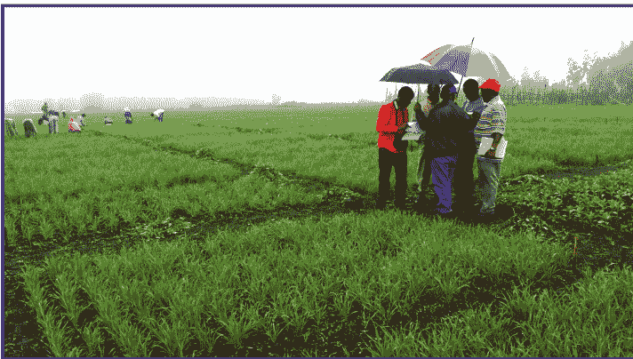

## 前言

土壤肥力低下每年导致非洲农民因减产损失40亿美元。这通常导致收入低下和生计困难。问题的一部分在于该大陆的化肥使用量仅约12 kg/ha/yr。

非洲的小农户大多非常贫穷，缺乏投资于化肥等投入品的财务能力。然而，他们通常对被认为风险小、利润高的机会反应积极。增加化肥使用的关键是在风险小的情况下提高其使用的盈利能力。实现这一点将使农民有机会减轻财务约束的严重性，并逐步改善作物管理。

大多数非洲国家为某些作物提供了肥料建议，但这些建议往往是几十年前的统一建议，涵盖大片区域甚至整个国家，缺乏田间研究的充分支持，更侧重于实现高产量而非高农民利润。

由AGRA资助的项目“在综合土壤肥力管理框架内制定和细化肥料建议”，缩写为非洲肥料建议优化（OFRA），旨在制定肥料使用优化的基础，即更盈利的肥料使用。

通过OFRA，13个撒哈拉以南非洲国家的国家研究机构联合起来，并与CABI和内布拉斯加大学林肯分校合作，开发肥料使用优化决策所需的基于田间研究的信息。过去的研究和OFRA支持的研究结果被汇编并系统分析。这些信息被应用于确定13个国家中67个农业生态区（AEZ）或建议领域内重要粮食作物的作物营养响应函数。当考虑一个AEZ的多个响应函数时，很明显，利润潜力因施用哪种营养素到哪种作物以及施用率而异。因此，特别是对于资金受限的农民，作物-营养素-施用率的选择对于最大化盈利能力非常重要。肥料类型的选择可能包括混合肥，但最大化利润潜力需要充足供应单一营养素（如尿素和三过磷酸钙）和多营养素复合肥料（如磷酸二铵和氯化钾）。

各国团队将作物营养响应函数整合到使用线性规划来确定特定于农民情境的建议的决策工具中，旨在最大化肥料使用带来的利润（参见第1章和国家章节4–16）。这些决策工具称为OFRA肥料优化工具（FOT）；有计算机版本，也有纸质版本，以便在没有计算机时使用。FOT考虑农民的财务能力、作物选择和土地分配、作物价值和肥料成本，以确定预期能最大化农民肥料使用利润的作物-营养素-施用率选择。

随着名为OFRA推断工具的GIS工具的开发，跨国共享研究结果得到了加强。该工具使用非洲土壤信息服务（AfSIS）的土壤属性GIS图层，以及HarvestChoice的气候属性、海拔、纬度和作物，在生长条件相似的地区之间进行国内及跨国的研究结果地理转移（参见第2章）。

肥料使用优化是在综合土壤肥力管理框架内进行的，推荐的肥料施用率根据土壤属性信息和互补措施的使用进行调整（参见第3章）。

在使农民及其顾问能够实现肥料使用优化方面已取得很大早期进展，但这仍需要巨大的努力和大量利益相关者的支持。更多的政府和非政府推广人员以及投入品零售商需要接受培训，以指导农民进行肥料使用优化。农民需要接受纸质FOT的使用培训，以便根据营养素管理的4Rs（正确类型、施用率、施用时间和施用方法）并进行正确的施用设备校准来做出肥料使用选择。推广培训资源已开发并应用，许多顾问已接受培训。第17章对此进行了阐述，并总结了经验教训，以便未来取得更有效的进展。AGRA对13国OFRA合作伙伴关系的成功感到高兴，在于：

- 开发强大的作物营养响应数据库，同时认识到还需要更多研究来解决次要和微量营养素、间作和轮作，并进一步细化现有信息，
- 为67个建议领域提供计算机和纸质FOT，
- 有效应用GIS在建议领域和国家之间共享研究结果，
- 在本书的17个章节中收录了大量适用于综合土壤肥力管理框架内肥料使用优化的信息，以及
- 培训许多推广人员和其他利益相关者，认识到还需要更多这样的培训才能在整个撒哈拉以南非洲实现肥料使用优化。

**雷比·哈拉瓦,**
代理负责人，农民解决方案计划，
非洲绿色革命联盟

**巴希尔·贾马·阿丹,**
部门经理，伊斯兰开发银行（及
此前土壤健康计划负责人，非洲
绿色革命联盟）

## 1. 肥料使用优化：原则与方法

Kayuki C. Kaizzi¹ kckaizzi@gmail.com, Mohammed Beshir Mohammed² and Maman Nour³
¹ 国家农业研究实验室，P.O. Box 7065, 坎帕拉, 乌干达
² 阿巴明奇大学，P.O. Box 21, 埃塞俄比亚
³ 尼日尔国家农业研究所，BP 240 马拉迪, 尼日尔

### 1.1 引言

撒哈拉以南非洲（SSA）的土壤退化，养分有效性低。这部分是由于清理和耕作土地、极少使用外部养分来源导致的侵蚀、淋溶和耗竭（Stoorvogel et al., 1993; Bekunda et al., 1997）。土壤肥力下降速度取决于土壤侵蚀、收获中的养分移除、通过使用[无机]肥料和有机肥料将养分归还土壤的速率，以及土壤矿物和有机质养分的矿化速率。

本章中，小农户肥料使用优化是指通过最佳作物-营养素-施用率组合选择，实现农民投资净回报最大化。然而，决定施肥作物的选择和每种营养素的施用量非常复杂。除了农民对不同作物的土地分配、产品价值、肥料使用成本和可用于肥料使用的资金外，还需要考虑作物对施用营养素的响应。

土壤肥力养分耗竭的经济后果重大，导致农场生产和粮食安全下降。农业生产力及其经济乘数效应下降，减缓了社区、地区和国家层面的经济增长。农场就业减少和贫困增加可能驱使人们迁移到基础设施和就业机会不足的城市地区（Homer-Dixon et al., 1993）。

撒哈拉以南非洲国家的肥料使用量低，部分原因是农民没有认识到可接受风险下的充足利润机会。不幸的是，大多数国家都有统一的肥料使用建议，这些建议往往未能考虑农民的利润潜力。财务状况良好的农民可以承担在所有农田施用肥料以最大化每公顷利润。小农户通常有一些使用肥料的财务能力，但需要对其小额投资获得高回报。高回报通常会减少财务约束，使他们能够在接下来的季节投入更多用于肥料使用。小农户的资金机会成本很高，六到12个月内的收益成本比为二通常不足以证明投资的合理性；有限财务能力的替代用途可能带来更好的回报或更好地满足紧急需求。

### 1.2 什么是优化？

优化是识别使函数值最小化或最大化的解决方案的过程，其中函数代表实现所需收益所需的投资（Kumar 2013）。所有优化问题都受到资源稀缺或成本的限制，最大化或最小化某个目标函数始终受到一个或多个约束的制约。

优化的两种常见技术是线性规划（LP）和非线性规划。当目标函数f（应最大化或最小化的函数）为线性，且约束（资源限制）仅使用线性等式和不等式指定时，应用线性规划。当目标函数、约束或两者包含非线性组件时，应用非线性规划。其他优化技术包括整数随机规划、动态规划、爬山法和模拟退火（Kumar 2013）。

线性规划解决所有约束和目标都表示为使用决策或活动变量及有限目标函数的线性函数的优化问题。决策或活动变量是指为有限资源与其他变量竞争的活动。例如，肥料购买由a

农民可能需要为购买种子、食品开支、学费支付或自行车修理支付费用。

线性规划需要一个明确定义、无歧义的有限目标函数进行优化，该函数可表示为决策变量的线性函数。例如，一名为肥料使用分配预算的农民可能致力于最大化利润或产量。因此，对于特定农民而言，最大化产量/利润或最小化损失均为有限目标函数。

### 1.3 肥料使用优化

针对非资金受限肥料使用的利润导向建议通常致力于最大化所有耕地的平均边际回报率。许多小农户缺乏购买足够肥料的财务能力，无法最大化其所有耕地上每公顷肥料使用的净回报。他们需要通过选择具有实现最高边际回报潜力的作物-营养素-施用率组合，来最大化有限投资的回报，直到预算的财务资源耗尽（Jensen et al., 2013）。

线性规划中的约束是对可用资源的限制，例如设备、预算、管理时间或劳动力、生产能力以及成品市场需求的可用性。此类限制也存在于小农户中。

作物营养响应函数对于将经济学高效应用于肥料使用决策至关重要。这些函数根据在13个OFRA国家开展的田间研究结果确定，形式为渐近曲线-平台函数，呈指数上升至最大或平台产量。渐近函数为 Y = a – bc^X，其中 Y 为产量（t/ha），a 为施用特定营养素的最大或平台产量（t/ha），b 为施用该营养素带来的最大产量增益（t/ha），c^X 表示二次响应的形状，其中 c 为曲率系数，n 为营养素施用率（kg/ha）。本地研究可获得的信息通过地理空间转移得到补充，即在其他类似作物生长条件下确定的响应函数，也就是说，在相同的发生空间中（第2章）。

最大化方程可采用不同肥料使用决策（例如 X1 和 X2）所产生的净回报或利润的形式，LP 优化求解 X1 和 X2 的值，以最大化肥料使用带来的高利润目标函数（图 1.1）。线性规划的一个局限是，目标函数和约束函数都必须是线性的，并且每个函数的系数都必须指定。

然后针对每种作物营养素组合以图形方式显示了响应函数，例如玉米对氮（N）的响应，适用于加纳和尼日利亚过渡/衍生稀树草原的生长条件（图 1.2）。图例使用三个字母的国家标识符，后跟研究站点的纬度和经度（度）来识别曲线来源。在此案例中，结果主要来自加纳和尼日利亚，但也来自马里、布基纳法索、多哥，甚至东坦桑尼亚的一个案例。

线性规划被应用于开发肥料优化工具（FOT），作为非洲肥料建议优化项目（OFRA）开发的肥料使用优化方法的一个组成部分。FOT 用于在预算约束、肥料成本和农产品价值的限制下，最大化农民从营养素施用中获得的净回报。布基纳法索、埃塞俄比亚、加纳、肯尼亚、马里、马拉维、莫桑比克、尼日尔、尼日利亚、卢旺达、坦桑尼亚、乌干达和赞比亚的国家研究团队合作开展了 OFRA 项目。

确定了一个代表所有氮水平中位产量结果的响应函数，以粗绿色虚线显示；使用中位数而非平均值结果以减少异常响应的影响。高产玉米（>3 t/ha）的响应函数以粗金色虚线表示，是根据系数 >2.5 t/ha 的函数确定的。低产玉米（<3 t/ha）的响应函数以粗红色虚线表示，是根据系数 <3.5 t/ha 的函数确定的。在大多数情况下，可用的田间研究结果不足以确定高产和低产潜力响应；在某些情况下，高潜力和低潜力的响应相似，因此只确定了中位响应。国家研究人员团队考虑了这些响应函数，连同其他信息（如当前建议），确定了农业生态区（AEZ）内每种目标作物-营养素的代表性函数。

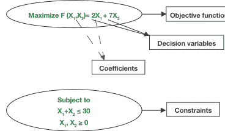

图 1.1：LP 优化示意图。

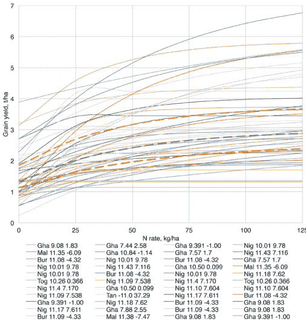

图 1.2：玉米氮响应函数，用于确定加纳和尼日利亚过渡/衍生稀树草原的响应函数。

通过最佳肥料使用选择优化其肥料投资。每个 FOT 旨在根据农民的农艺和经济背景提供优化解决方案。FOT 使用线性规划来确定，平均而言，特定于农民背景的最有利可图的肥料使用选项。FOT 使用 Microsoft Office Excel 2007 或更高版本的 Solver® 加载项（Frontline Systems Inc., Incline Village, NV, USA）优化解决方案。FOT 的过程阶段考虑农民指定的约束、预定模型约束和模型的优化函数。农民施加的约束，或输入数据，包括：

### 1.4 肥料优化工具

肥料优化工具（FOT）已开发出来，以帮助农民优化来自

- i) 拟种植的土地面积以及每种拟种植作物在收获时的预期商品价值（不考虑种植的作物土地面积输入零）；
- ii) 可用肥料以及使用每种肥料的成本，包括购买、运输、施用和利息成本；以及
- iii) 农民的预算约束，即农民用于肥料使用的资金数额，无论是借来的还是储蓄的。

FOT 还受最大肥料和营养素施用率设置的限制，以避免超出底层方程的推断范围，例如肥料免费或成本非常低的情况。

因此，FOT 的目标函数是最大化净回报，即肥料使用带来的总价值增益减去肥料使用总成本的差值。这受以下约束（图 1.3）：

- i) 所有作物施用肥料的总成本在可用肥料预算范围内。
- ii) 按类型和作物优化分配肥料施用率，不超过施用于每种作物的不同肥料类型的施加最大施用率约束，但高于任何施加的最小施用率，通常为零。

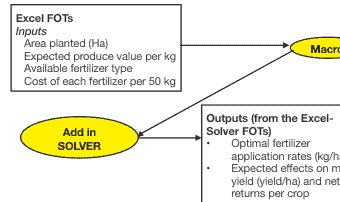

图 1.3：肥料优化过程（改编自 Jansen et al., 2013）。

由于田间研究结果遵循利比希最小定律，FOT 通常要求在谷物和豆类施用磷（P）之前先施用一些氮（N），在施用钾（K）之前先施用一些磷（P）。但并非总是如此。例如，香蕉对氮或钾施用的平均产量响应相似，但对磷的响应较小。FOT 不考虑影响土壤养分供应、土壤测试结果或前茬作物的其他做法，但这些在决策过程的另一步骤中予以考虑。FOT 跨作物营养响应函数进行优化。

FOT 原型不断发展，从六种作物和三种可能营养素的版本发展到七种作物和四种可能营养素的版本。FOT 选择的作物因 AEZ 的重要性而异。营养素包括 N、P、K 和硫（S）或锌（Zn）中的一种。另一个版本将玉米-豆间作作为七种作物之一，其间作响应基于玉米价值等价基础确定。截至目前，已在 13 个国家开发了 67 个 FOT（表 1.1），可从 OFRA Tools 页面 http://agronomy.unl.edu/OFRA 下载，并附有说明（Kaizzi and Wortmann 2015）。

### 1.5 使用 Excel FOT

使用 Excel FOT 需要启用 Solver 加载项。如果已激活 Solver，它将出现在“数据”选项卡下，位于快速访问工具栏最右侧。激活 Solver 的以下步骤也可在 FOT 的“帮助和说明”工作表中找到，并在 Kaizzi and Wortmann (2015) 的 http://agronomy.unl.edu/OFRA 中有更详细的说明。

- 1) 在快速访问工具栏上选择“文件”选项卡
- 2) 在“文件”下拉菜单中选择“选项”
- 3) 在 Excel 选项窗口左侧选择“加载项”
- 4) 在“加载项”下拉列表中，选择 Solver 加载项选项
- 5) 选择“确定”
- 6) 再次选择 Solver 加载项
- 7) 单击“确定”

FOT 的数据输入面板如图 1.4 所示。用户输入拟种植的预计面积以及农场收获时每种作物每公斤产品的预期价值，考虑留作自用和预期出售的价值（A）。输入可用肥料的使用成本（B）以及农民用于肥料使用的投资资金数额（C）。单击“优化”单元格以运行优化（D）。生成输出结果（图 1.5）。

### 表 1.1: 开发肥料优化工具的各国农业生态区

### 布基纳法索

| 萨赫勒稀树草原 | 北苏丹稀树草原 | 南苏丹稀树草原 |
|---|---|---|

### 埃塞俄比亚

| 寒冷-非常寒冷次非洲高山 | 湿润低地 <9°纬度 | 湿润低地 >9°纬度 |
|---|---|---|
| 次湿润低地 <1000 米 | 次湿润低地 >1000 米 | 湿润高地 1700-2200 米 |
| 湿润高地 2000-2700 米 | 次湿润高地 1700-2200 米 | 次湿润高地 2000-2700 米 |
| 湿润高地 1700-2200 米 | 湿润高地 2000-2700 米 | 次湿润高地 1700-2200 米 |
| 次湿润高地 2000-2700 米 | | |

### 加纳

| 南苏丹稀树草原 | 北几内亚稀树草原 | 南几内亚稀树草原 |
|---|---|---|
| 衍生/过渡性稀树草原 | | |

### 肯尼亚

| 沿海 | 东部, 1200 米以上 | 东部, 1300 米以下 |
|---|---|---|
| 中部 | 裂谷, 2000 米以上 | 裂谷, 2200 米以下 |
| 西部, 1400 米以上 | 西部, 1600 米以下 | |

### 马拉维

| <900 米 | 900-1300 米 | >1300 米 |
|---|---|---|

### 马里

| 萨赫勒稀树草原 | 北苏丹稀树草原 | 南苏丹稀树草原 |
|---|---|---|

### 莫桑比克

| <900 米 | 900-1300 米 | >1300 米 |
|---|---|---|

### 尼日尔

| 萨赫勒稀树草原 | 北苏丹稀树草原 | |
|---|---|---|

### 尼日利亚

| 萨赫勒稀树草原 | 苏丹稀树草原 | 北几内亚稀树草原 |
|---|---|---|
| 南几内亚稀树草原 | 衍生/过渡性稀树草原 | 中海拔 |

### 卢旺达

| 西北部 | 东部 | 南部 |
|---|---|---|

### 坦桑尼亚

| 北部 | 湖区 >1300 米 | 湖区 <1400 米 |
|---|---|---|
| 东部 | 中部 | 西部 |
| 南部 | 南部高地 | |

### 乌干达

| 东部 >1800 米 | 东部 1400-1800 米 | 东部 <1400 米 |
|---|---|---|
| 北部, 中西部 | 中部 | 西部高地: Ibanda, Bushenyi, Kyenjojo |
| 西部高地: Kabale, Kisoro, Rukungiri, | 西部高地 >1800 米 | |

### 赞比亚

| 区域 I | 区域 II | 区域 III |
|---|---|---|

## 尼日利亚衍生稀树草原农业生态区

Producer Name: XXX
Prepared By:
Date Prepared: 2016年4月18日

| 作物 | 种植面积 (公顷) | 预期谷物价值/千克 |
| :--- | :--- | :--- |
| 玉米 HP>3t | 1 | 50 |
| 玉米 LP<3t | 1 | 50 |
| 木薯 | 1 | 20 |
| 旱地水稻 | 1 | 67 |
| 低地水稻 | 1 | 67 |
| 花生 (未去壳) | 1 | 120 |
| 大豆 | 2 | 120 |
| 总计 | 8 | |

| 肥料产品 | N | SSP | K2O | Zn | 每50公斤袋装成本 'T' |
| :--- | :--- | :--- | :--- | :--- | :--- |
| 尿素 | 46% | 0% | 0% | 0% | 5500 |
| 过磷酸钙 | 0% | 18% | 0% | 0% | 4500 |
| 磷酸二氢铵, DAP | 18% | 46% | 0% | 0% | 7000 |
| 氯化钾 | 0% | 0% | 60% | 0% | 7000 |
| 硫酸锌 | 0% | 0% | 0% | 12% | 20000 |

| 可用于投资肥料的金额 (奈拉) | 55,000 |
| :--- | :--- |

- A. 输入每种作物计划种植的面积以及收获时的预期产品价值。
- B. 输入肥料使用成本,包括购买、运输和施用。可以添加第五种肥料,例如 ZnSO4。
- C. 输入农民可用于肥料使用的投资金额,即 55,000。
- D. 左键单击优化单元格。

图 1.4: 尼日利亚衍生稀树草原 OFRA 肥料优化工具的输入面板。

| 作物 | 尿素 | SSP | DAP | KCl | 硫酸锌 |
| :--- | :--- | :--- | :--- | :--- | :--- |
| 玉米 HP>3t | 56 | 5 | 0 | 0 | 7 |
| 玉米 LP<3t | 5 | 0 | 0 | 11 | 7 |
| 木薯 | 122 | 15 | 0 | 29 | 0 |
| 旱地水稻 | 80 | 0 | 0 | 19 | 0 |
| 低地水稻 | 31 | 0 | 0 | 6 | 0 |
| 花生 (未去壳) | 0 | 33 | 0 | 3 | 0 |
| 大豆 | 0 | 0 | 0 | 0 | 4 |
| 所需肥料总量 | 293 | 53 | 0 | 67 | 22 |

- E. 给出了每种肥料和每种作物的施用率。

| 作物 | 产量增加 | 净回报 |
| :--- | :--- | :--- |
| 玉米 HP>3t | 1.404 | 60,782 |
| 玉米 LP<3t | 793 | 34,791 |
| 木薯 | 16,741 | 316,063 |
| 旱地水稻 | 1.731 | 104,453 |
| 低地水稻 | 709 | 43,319 |
| 花生 (未去壳) | 201 | 20,804 |
| 大豆 | 65 | 8,760 |

- F. 给出了每种作物的预期平均产量增加和肥料使用净回报。

| 肥料投资的总净回报 (奈拉) | 597,732 |
| :--- | :--- |

- G. 给出了肥料使用的平均预期总回报: 597,732奈拉。

图 1.5: 尼日利亚衍生稀树草原 OFRA 肥料优化工具的输出面板。

在此示例中,农民拥有55,000奈拉,用于八公顷的粮食作物生产。上部输出面板(E)显示了在财务约束下每种作物推荐的肥料。第二个面板(F)给出了这些施用水平的平均预期产量增加和肥料使用净回报。第三个面板(G)给出了FOT推荐的肥料使用预期平均总净回报,即597,732奈拉。

### 1.6 FOT的纸质版本

Excel Solver FOT需要计算机,但开发了易于使用的特定于农业生态区的纸质版FOT,以便在没有计算机时使用。纸质版FOT会每年或根据需要更新,以应对国家或地区层面的重大价格和成本变化。与Excel FOT相比,使用纸质版进行决策时会牺牲部分盈利潜力,因为输入信息和建议比较概括。

增加可用于肥料使用的资金量将提高施用率和预期净回报,直到肥料施用率达到每公顷净回报最大化的点。进一步增加预算分配不会导致施用率增加,因为额外施用将超过优化施用率并导致利润损失。

纸质版FOT列出了包括可用肥料和商品价值在内的假设。它还提供了选择合适产品、施用率、方法和时间的指导,即肥料使用的4R原则(http://www.nutrientstewardship.org/implement-4rs)。

尼日利亚衍生稀树草原高产潜力玉米的当前建议是施用150、33和65 kg/ha的N、P和K(第12章)。如果可用奈拉按推荐施用率用于玉米施肥,同时使用图1.4中的谷物价值和肥料使用成本,那么肥料将足够用于0.81公顷,预期平均净回报将为35,013奈拉,仅为优化肥料使用回报的6%。

对于每种肥料,纸质版FOT提供了如何校准或学习施用率的指导;但是,对易于获得的肥料测量单位(如塑料瓶)以及作物行距和株距做出了假设。纸质版FOT考虑了三个农民财务能力水平,并有相应的肥料使用指南。

财务能力水平1代表财务最受限的农民,他们能够使用的肥料量少于所有农田施用肥料量的三分之一

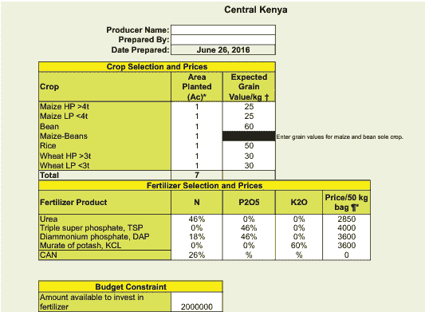

图 1.6: 为开发纸质版FOT而设置的FOT,用于确定输出。

| 作物 | 尿素 | TSP | DAP | KCl | CAN |
| :--- | :--- | :--- | :--- | :--- | :--- |
| 玉米 HP >4t | 27 | 0 | 81 | 0 | 0 |
| 玉米 LP <4t | 32 | 0 | 47 | 0 | 0 |
| 豆类 | 0 | 0 | 26 | 0 | 0 |
| 玉米-豆类 | 40 | 0 | 42 | 12 | 0 |
| 水稻 | 61 | 0 | 48 | 27 | 0 |
| 小麦 HP >3t | 28 | 0 | 53 | 16 | 0 |
| 小麦 LP <3t | 48 | 0 | 39 | 16 | 0 |
| 所需肥料总量 | 230 | 0 | 336 | 72 | 0 |

| 作物 | 产量增加 | 净回报 |
| :--- | :--- | :--- |
| 玉米 HP >4t | 1,006 | 17,760 |
| 玉米 LP <4t | 665 | 11,366 |
| 豆类 | 110 | 4,743 |
| 玉米-豆类 | 1,203 | 23,906 |
| 水稻 | 1,532 | 30,585 |
| 小麦 HP >3t | 702 | 14,773 |
| 小麦 LP <3t | 626 | 12,189 |
| 肥料的预期总净回报 | | 152,413 |

图 1.7a: 纸质版FOT中用于确定财务能力水平3推荐施用率的FOT输出。这需要肯尼亚先令41,936用于肥料成本。

| 作物 | 尿素 | TSP | DAP | KCl | CAN |
| :--- | :--- | :--- | :--- | :--- | :--- |
| 玉米 HP >4t | 26 | 0 | 0 | 0 | 0 |
| 玉米 LP <4t | 19 | 0 | 1 | 0 | 0 |
| 豆类 | 2 | 0 | 6 | 0 | 0 |
| 玉米-豆类 | 22 | 0 | 18 | 3 | 0 |
| 水稻 | 46 | 0 | 20 | 16 | 0 |
| 小麦 HP >3t | 21 | 0 | 6 | 0 | 0 |
| 小麦 LP <3t | 21 | 0 | 0 | 0 | 0 |
| 所需肥料总量 | 156 | 0 | 51 | 19 | 0 |

| 作物 | 产量增加 | 净回报 |
| :--- | :--- | :--- |
| 玉米 HP >4t | 441 | 9,565 |
| 玉米 LP <4t | 303 | 6,416 |
| 豆类 | 62 | 3,163 |
| 玉米-豆类 | 806 | 19,684 |
| 水稻 | 1,364 | 62,635 |
| 小麦 HP >3t | 331 | 8,326 |
| 小麦 LP <3t | 250 | 6,291 |
| 肥料投资的总净回报 | | 116,399 |

图 1.7b: 纸质版FOT中用于确定财务能力水平1推荐施用率的FOT输出。这需要肯尼亚先令13,979用于肥料成本。

| 作物 | 尿素 | TSP | DAP | KCl | CAN |
| :--- | :--- | :--- | :--- | :--- | :--- |
| 玉米 HP >4t | 23 | 0 | 42 | 0 | 0 |
| 玉米 LP <4t | 25 | 0 | 22 | 0 | 0 |
| 豆类 | 1 | 0 | 15 | 0 | 0 |
| 玉米-豆类 | 30 | 0 | 28 | 7 | 0 |
| 水稻 | 59 | 0 | 31 | 21 | 0 |
| 小麦 HP >3t | 80 | 0 | 27 | 7 | 0 |
| 小麦 LP <3t | 34 | 0 | 13 | 7 | 0 |
| 所需肥料总量 | 201 | 0 | 181 | 42 | 0 |

| 作物 | 产量增加 | 净回报 |
| :--- | :--- | :--- |
| 玉米 HP >4t | 819 | 15,935 |
| 玉米 LP <4t | 528 | 10,195 |
| 豆类 | 92 | 4,367 |
| 玉米-豆类 | 1,086 | 22,290 |
| 水稻 | 1,476 | 66,715 |
| 小麦 HP >3t | 599 | 13,531 |
| 小麦 LP <3t | 464 | 10,533 |
| 肥料的预期总净回报 | | 144,185 |

图 1.7c: 纸质版FOT中用于确定财务能力水平2推荐施用率的FOT输出。这需要肯尼亚先令13,979用于肥料成本。

以每公顷肥料使用净回报最大化的速率施用，也称为经济最优施肥率（EOR）。财务能力等级2代表财务约束较小的群体，他们能够将所有耕地上按EOR施用的肥料中不足三分之二用于施肥。财务能力等级3适用于能够在至少部分（如果不是全部）耕地上按EOR施肥的农民。超过财务能力等级3施用养分预计会导致利润下降。

纸质FOT是使用Excel FOT开发和更新的，以中部肯尼亚FOT（图1.6）为例。1) 使用Excel FOT，输入当前作物价值信息（考虑预期“农场交货价”和若留作自用的价值）以及肥料使用成本（价格加上采购和施用成本）。2) 对每种作物输入1英亩或公顷。3) 使用过度预算约束运行FOT，以确保肥料建议不受财务约束，因此处于EOR；在示例中，预算约束为KSh 2,000,000，这是一个过度金额，但FOT将仅使用EOR所需的量。4) 优化。

从输出工作表（图1.7a）中，获取“所需肥料总量”，并将每种肥料的用量乘以其50公斤的成本。将这些总计，以确定按EOR为每种作物每英亩/公顷施肥所需的资金。从示例中，这给出了总成本KSh 41,936。保留每种作物的这些肥料建议记录，因为这些是财务能力等级3的建议。

在保持所有其他输入数据不变的情况下，使用总需求的1/3作为预算约束，即KSh 13,979，优化以获得财务能力等级1的建议（图1.7b）。对财务能力等级2的建议重复此过程，使用KSh 27,597（图1.7c）。

使用这三组肥料建议来构建纸质FOT（表1.2）。

确定您的校准测量单位及其体积。在中部肯尼亚的示例中，测量单位是一个5毫升的水瓶盖和一个切割至4厘米高、体积为80毫升的水瓶。这两个单位在农村地区都很容易获得。这些单位配合指导使农民能够通过目视和手感来校准施肥率，但除了这种初始和偶尔的验证校准之外，实际施肥很可能是人工施用，而不是使用该单位。添加其他假设，包括植株间距、肥料成本和农产品价值。为每个财务能力等级编写建议，给出产品、用量、方法和施用时间以及校准指南，例如“低地水稻：以2米宽度播撒22公斤DAP（切割瓶对应8.1米）和17公斤MOP（切割瓶对应9.1米）于播种时；播撒施用48公斤尿素于穗分化期（切割瓶对应2.1米）”。

### 1.7 结论

肥料使用优化是为了最大化肥料使用带来的利润。这通常意味着努力按最大化每公顷肥料使用净回报的速率施用肥料养分，即按EOR施用。然而，小农户通常在严重的财务约束下运营，需要对其在肥料使用上通常很小的投资获得高回报。其施肥能力通常远低于EOR，因此他们需要应用具有高利润潜力的作物-养分选项。

线性规划被用于开发肥料优化工具（FOTs），以帮助农民在给定预算约束下选择可能最有利可图的作物-养分-用量组合。Excel和纸质FOT的开发与使用已有描述。

本章未涉及的是，肥料使用优化需要考虑其他农艺措施和田块条件会影响养分有效性。因此，FOT建议需要针对近期和过去的粪肥施用、与豆科植物轮作、间作以及使用绿肥作物等措施进行调整。还应考虑土壤测试信息。此类措施在第3章和第4-16章的国家章节中有所涉及。

### 1.8 参考文献

Bekunda MA, Bationo A, and Ssali H (1997) 非洲土壤肥力管理：精选研究试验综述。载于Burcu RJ, Sanchez PA 和 Calhoun F (编) 补充非洲土壤肥力。SSSA 特刊。51 SSSA, Madison WI. p. 63–79.

### 表1.2：肯尼亚中部肥料使用优化器：纸质版，2016年

以下假设：

- 校准测量使用：i) 一个5毫升水瓶盖（瓶盖），可容纳约3.5克尿素和5.5克DAP及MOP；ii) 一个直径5厘米、切割至4厘米高的500毫升水瓶（切割瓶），可容纳80毫升、56克尿素和88克DAP或MOP。
- 假设玉米行距为75厘米，豆类50厘米，水稻25厘米，小麦25厘米。
- 假设每公斤谷物价格（KSh）：玉米25，豆类60，水稻50，小麦30。
- 假设50公斤肥料成本（KSh）：尿素2850，DAP 3600，MOP 3600。
- 施肥率单位为kg/ac。施肥率低于10 kg/ac的不适用于施用。

### 财务能力等级1。

| 作物 | 建议 |
|------|------|
| 玉米 高产 >4t | 播种后6周条施29公斤尿素作为追肥（瓶盖对应0.4米）。 |
| 玉米 低产 <4t | 播种后6周条施23公斤尿素作为追肥（瓶盖对应5米）。 |
| 玉米-豆类间作 | 播种时条施16公斤DAP（瓶盖对应0.8米）；播种后6周追肥23公斤尿素（瓶盖对应0.5米）。 |
| 低地水稻 | 播种时以2米宽度播撒22公斤DAP（切割瓶对应8.1米）和17公斤MOP（切割瓶对应9.1米）；穗分化期播撒施用48公斤尿素（切割瓶对应2.1米）。 |
| 小麦 高产 >3t | 播种时条施13公斤DAP（瓶盖对应4.1米）；穗分化期条施追肥24公斤尿素（瓶盖对应1.7米）。 |
| 小麦 低产 <3t | 穗分化期条施28公斤尿素（瓶盖对应1.5米）。 |

### 财务能力等级2。

| 作物 | 建议 |
|------|------|
| 玉米 高产 >4t | 播种时条施65公斤DAP（瓶盖对应0.3米）；播种后6周追肥22公斤尿素（瓶盖对应0.6米）。 |
| 玉米 低产 <4t | 播种时条施31公斤DAP（瓶盖对应0.8米）；播种后6周追肥28公斤尿素（瓶盖对应0.5米）。 |
| 豆类 | 播种时条施19公斤DAP（瓶盖对应1.7米）。 |
| 玉米-豆类间作 | 播种时条施30公斤DAP（瓶盖对应0.8米）；播种后6周追肥35公斤尿素（瓶盖对应0.4米）。 |
| 低地水稻 | 播种时以2米宽度播撒36公斤DAP（切割瓶对应4.6米）和23公斤MOP（切割瓶对应7米）；穗分化期追肥61公斤尿素（切割瓶对应1.6米）。 |
| 小麦 高产 >3t | 播种时条施36公斤DAP（瓶盖对应1.8米）和10公斤MOP（瓶盖对应6.8米）；穗分化期追肥30公斤尿素（瓶盖对应1.3米）。 |
| 小麦 低产 <3t | 播种时条施22公斤DAP（瓶盖对应3米）和10公斤MOP（瓶盖对应6.8米）；穗分化期追肥38公斤尿素（瓶盖对应1.0米）。 |

### 财务能力等级3（最大化每英亩利润）。

| 作物 | 建议 |
|------|------|
| 玉米 高产 >4t | 播种时条施81公斤DAP（瓶盖对应0.3米）；播种后6周追肥27公斤尿素（瓶盖对应0.5米）。 |
| 玉米 低产 <4t | 播种时条施47公斤DAP（瓶盖对应0.5米）；播种后6周追肥32公斤尿素（瓶盖对应0.4米）。 |
| 豆类 | 播种时条施26公斤DAP（瓶盖对应1.3米）。 |
| 玉米-豆类间作 | 播种时条施38公斤DAP（瓶盖对应0.6米）；播种后6周追肥42公斤尿素（瓶盖对应0.3米）。 |
| 低地水稻 | 播种时以2米宽度播撒48公斤DAP（切割瓶对应3.5米）和27公斤MOP（切割瓶对应6.2米）；穗分化期追肥61公斤尿素（切割瓶对应2.4米）。 |
| 小麦 高产 >3t | 播种时条施53公斤DAP（瓶盖对应1.2米）和16公斤MOP（瓶盖对应4.2米）；穗分化期追肥23公斤尿素（瓶盖对应1.7米）。 |
| 小麦 低产 <3t | 播种时条施39公斤DAP（瓶盖对应1.7米）和17公斤MOP（瓶盖对应4米）；穗分化期追肥46公斤尿素（瓶盖对应0.9米）。 |

Homer-Dixon TF, Bountwell JH, and Rathfens GW (1993) 环境变化与暴力冲突。Sci. Am. 268:16-23

Janssen J, Wortmann CS, Stockton MC, and Kaizzi CK (2013) 财务约束肥料使用的净回报最大化。Agron. J. 105:573-578

Kaizzi KC and Wortmann CS (2015) 在综合土壤肥力管理框架内优化肥料使用：肥料优化培训手册。http://agronomy.unl.edu/OFRA

Kumar N (2013) 优化方法、历史发展与模型构建。Bangalore, India

Stoorvogel JJ, Smaling EMA, and Janssen BH (1993) 在不同尺度上计算非洲土壤养分平衡I：Supra-natural scale。Fert. Res. 35:227-235

## 2. 针对肥料使用优化的空间分析

Charles S Wortmann^1 cwortmann2@unl.edu, Maribeth Milner^1 和 Gebreyesus Bhane Tesfahunegr^2
^1内布拉斯加大学林肯分校农艺与园艺系，内布拉斯加州林肯市 68583
^2阿克苏姆大学-夏尔校区农学院，埃塞俄比亚夏尔市邮政信箱314

### 2.1 背景

撒哈拉以南非洲（SSA）土地面积为2400万平方公里，作物生长条件差异显著（图2.1；HarvestChoice 2010）。非洲大部分地区年平均月温（相对于海平面）全年超过18°C（64.4°F）（即热带），尽管大陆部分地区在一个或多个月内气温低至5°C（41°F）（即亚热带）。高海拔地区的低温影响作物生长（即凉爽高地）以及及时降水。

萨赫勒、苏丹和几内亚从稀树草原到森林过渡（White 1983）随降雨量增加和距离撒哈拉沙漠的距离而发生。毁林区被称为衍生稀树草原。中海拔和高海拔类别对应图2.1中的凉爽湿润类别。

生长期（天数）是指平均温度在5°C或以上且总水量超过当地潜在蒸散量（PET）一半的时间间隔。干旱到湿润湿度类别范围分别代表少于70天到超过270天的生长期。

在更大（或更细）的尺度上，更多的气候差异显而易见，如尼日利亚农业生态区（AEZ）地图所示（图2.2）。该

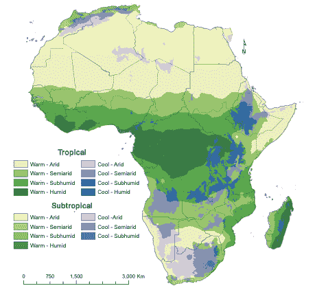

图2.1. 撒哈拉以南非洲农业生态区中的非洲气候区（HarvestChoice 2010）。

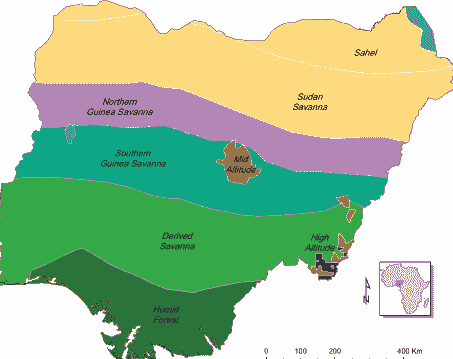

图2.2. 尼日利亚气候区。

### 2.2 推断空间概念

一个地区的最佳作物生产实践可能为类似且可能遥远地区的决策提供参考。可以根据关键作物限制阈值估计研究结果可能相关的推断空间。同样，对研究站点关键阈值的查询可以为未进行研究的地点识别相关信息。站点推断空间模型的准确性取决于对作物对当地环境条件范围的反应的理解，以及用于表征限制因素的区域数据集的可用性和准确性（Aiken et al., 2001）。

### 2.3 空间数据

有几种与农业相关的撒哈拉以南非洲空间数据可用。尽管分辨率较粗，但数据描述了影响潜在作物生产的区域趋势（Van Wart et al., 2013）并指导当地作物适宜性决策。非洲土壤信息服务（AfSIS）在六个土壤深度模拟了土壤特性。已发布多个气候指数（WorldClim, CGIAR CSI）。2000年航天雷达地形测绘任务的高程数据在全球60°N至56°S纬度之间的地点可用。高程派生数据也可用（HydroSHEDS），MAPSPAM项目提供作物生产估算。

空间栅格、矢量和对象数据使用地理信息系统（GIS）软件程序进行处理。GIS软件包通常包括基本制图和数据处理功能之外的复杂空间分析和建模工具。有几种免费（DIVA-GIS, GeoDa, GRASS, gvSIG Desktop and Mobile, SAGA, SPRING, QGIS, Whitebox Geospatial Analysis Toolbox）和专有（TerSet formerly IDRISI, ArcGIS, ERDAS IMAGINE）程序可用。

非洲肥料建议优化（OFRA）项目致力于大幅提高肥料使用的盈利能力，特别是对于资金受限的肥料使用情况，这正是大多数小农户的情况（第1章）。OFRA方法利用过去和最近的研究结果，确定每个站点农业生态区（或推断区域）相关的作物养分响应函数，以便应用经济分析。使用空间数据对于查找和汇编在与目标建议领域条件相似的作物生长条件下进行的研究信息非常重要。

### 2.4 OFRA推断工具

OFRA推断工具（Wortmann和Milner 2015）是一个ArcGIS 10.3 ArcPy脚本工具，用于识别与用户定义的感兴趣点处发现的生长条件相似的撒哈拉以南非洲研究结果和作物生产估算（http://agronomy.unl.edu/OFRA）。

该工具查询七个因农艺重要性而选定的栅格层。年降雨量相对于潜在蒸散量的量与作物生产的水分可用性相关，并体现在CGIAR CSI的30弧秒全球干旱指数中（Zomer et al., 2007, 2008）。温度在一年中的变化方式影响作物选择，并由WorldClim的30弧秒温度季节性（bio4）层表示（Hijmans et al., 2005）。平均温度和年度积温累积取决于海拔，由HydroSHEDS 3弧秒数字高程模型（DEM）（Lehner et al., 2008）重采样至7.5弧秒表示。距离赤道的距离以纬度绝对值表示（以度×1000；7.5弧秒），与降雨分布相关，降雨分布从赤道附近的双峰模式随距离赤道的距离增加而变为越来越单峰模式。纬度还影响日照长度，进而影响对光周期敏感的作物。AfSIS 5-15厘米深度的土壤pH（以pH×10表示）（30弧秒；Hengl et al., 2014）、砂含量和土壤有机碳（SOC）含量（7.5弧秒；Hengl et al., 2015）包含在推断空间分析中。砂含量与黏土含量呈负相关。砂、pH和SOC是阳离子交换容量的决定因素。砂和SOC含量也是土壤可供水分持持量的重要决定因素。平均积温（基准0）栅格与海拔高度高度相关，因此不用于识别相似性，但作为参考提供。该栅格是根据WorldClim.org的30弧秒平均月温度数据计算的（Hijmans et al., 2005）。所有数据均采用WGS 1984基准（GCS_WGS_1984）的地理坐标。

推断工具在感兴趣点识别上述七个栅格值，并使用一组预定义的查询从具有相似栅格值的地点选择作物养分响应数据。查询阈值可从脚本工具界面编辑，但查询结构不可编辑。七个查询及其可编辑的默认阈值如下：

- **干旱指数（ai；范围 = 0至49,240）：** 如果选定的ai值小于6000，则相似度等于选定的ai值加1000。如果ai大于6000，则相似度等于ai值大于5000。

- **温度季节性（ts；范围 = 62至8,933）：** 温度季节性相似度等于选定的ts值加1000。

- **SOC（g/kg；5-15厘米；范围 = 0至249）：** 如果选定的SOC值小于35，则相似度等于选定的SOC值加10。如果SOC大于35，则相似度等于SOC值大于25。

- **pH × 10（范围 = 32至91）：** 如果选定的pH × 10值小于54，则相似度等于选定的pH × 10值加4。如果pH × 10大于54，则相似度等于pH × 10值大于50。

- **砂含量（%；范围 = 0至100）：** 如果选定的砂含量值大于75，则相似度等于选定的砂含量值加20。如果砂含量小于75，则相似度等于砂含量值小于80。

- **海拔（m；范围 = -178至5,844）：** 如果选定的海拔值小于700，则相似度等于选定的海拔值加1000。如果海拔大于700，则相似度等于海拔值大于250。

- **距赤道距离（DE；度×1000；范围 = 0至11,691）：** 距赤道距离相似度等于选定的DE值加3000。

该工具查询两个shapefile文件，一个是包含5,300多个地理参考作物养分响应函数的点文件，另一个是包含5弧分作物生产栅格单元及其相关豆类、木薯、豇豆、花生、玉米、小米（珍珠小米和小米（指形小米））、爱尔兰土豆、水稻、高粱、大豆和小麦生产（公吨（mt））值的多边形文件（HarvestChoice 2015a-1；You et al., 2014）。

点文件包括每个研究地块代表点的栅格值（由此计算作物响应），而多边形文件包括每个5弧分单元关联的中位数栅格值。

OFRA推断工具为感兴趣点的推断空间输出信息：一个包含作物响应函数子集的Excel文件；两个.pdf作物生产地图（图2.3）；以及一个包含作物生产摘要（总产量以公吨和非洲总作物生产的百分比）的.dbf文件。.dbf文件还包含感兴趣点的地理坐标和栅格值以及分析中使用的查询。

可在（http://agronomy.unl.edu/OFRA）找到的OFRA推断工具文件夹包括

## 生产 (mt; 5 弧分分辨率)

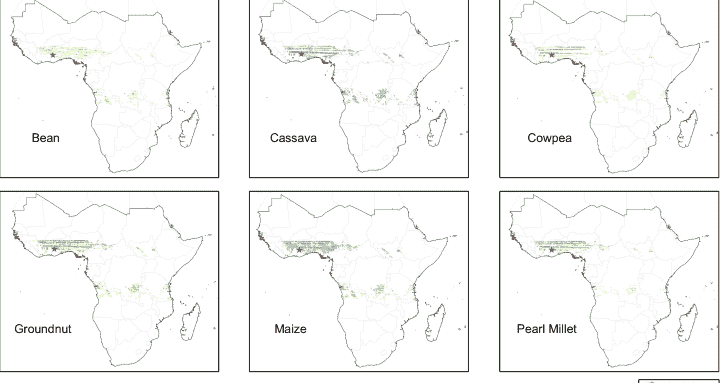

- 1 - 10
- 11 - 25
- 26 - 50
- 51 - 100
- 101 - 250
- 251 - 500
- 501 - 1000
- 1001 - 2500
- 2501 - 5000
- 5001 - 10000
- 10001 - 100000

摘要：基于空间生产分配模型（SPAM）的约 2005 年空间分离生产统计数据。数值针对 5 弧分网格单元。数据来源和致谢：You, L., U. Wood-Sichra, S. Fritz, Z. Guo, L. See, 和 J. Koo. 2014. 空间生产分配模型（SPAM）2005 v2.0.

HarvestChoice, 2015. "豆类、木薯、豇豆、花生、玉米和珍珠小米产量 (mt, 2005)." 国际食物政策研究所，华盛顿特区，和明尼苏达大学，圣保罗，明尼苏达州。在线可用 http://harvestchoice.org/data/bean_p http://harvestchoice.org/data/cass_p http://harvestchoice.org/data/cowp_p http://harvestchoice.org/data/grou_p http://harvestchoice.org/data/maiz_p http://harvestchoice.org/data/pmil_p

图 2.3. 与加纳温奇相关的 HarvestChoice 豆类、木薯、豇豆、花生、玉米和珍珠小米产量数据。

ArcGIS 脚本工具 (OFRA Project.tbx)、文档、GIS 图层和数据。OFRA 推理工具文档 PowerPoint 演示文稿提供了使用该工具的说明。

### 2.5 参考文献

- Aiken RM, Thomas V, 和 Waltman W (2001) 农场分析与比较工具 (AgriFACTs). 区域研究所在线出版. 从 http://www.regional.org.au/au/gia/05/126/ainen.htm 检索
- HarvestChoice (2010) 撒哈拉以南非洲的农业生态区. 国际食物政策研究所，华盛顿特区，和明尼苏达大学，圣保罗，明尼苏达州. 从 http://harvestchoice.org/node/8853. 检索.
- HarvestChoice (2015a) 豆类产量 (mt, 2005). 国际食物政策研究所，华盛顿特区，和明尼苏达大学，圣保罗，明尼苏达州. 从 http://harvestchoice.org/data/bean_p 检索
- HarvestChoice (2015b) 木薯产量 (mt, 2005). 国际食物政策研究所，华盛顿特区，和明尼苏达大学，圣保罗，明尼苏达州. 从 http://harvestchoice.org/data/cass_p 检索
- HarvestChoice (2015c) 豇豆产量 (mt, 2005). 国际食物政策研究所，华盛顿特区，和明尼苏达大学，圣保罗，明尼苏达州. 从 http://harvestchoice.org/data/cowp_p 检索
- HarvestChoice (2015d) 花生产量 (mt, 2005). 国际食物政策研究所，华盛顿特区，和明尼苏达大学，圣保罗，明尼苏达州. 从 http://harvestchoice.org/data/grou_p 检索
- HarvestChoice (2015e) 玉米产量 (mt, 2005). 国际食物政策研究所，华盛顿特区，和明尼苏达大学，圣保罗，明尼苏达州. 从 http://harvestchoice.org/data/maize_p 检索
- MacMillan RA, de Jesus JM, 和 Tamene L (2015) 在 250 米分辨率下绘制非洲土壤特性图：随机森林显著改进当前预测. Plos One, doi:10.1371/journal.pone.0125814
- HarvestChoice (2015f) 珍珠小米 (mt, 2005). 国际食物政策研究所，华盛顿特区，和明尼苏达大学，圣保罗，明尼苏达州. 从 http://harvestchoice.org/data/pmil_p 检索
- Hijmans RJ, Cameron SE, Parra JL, Jones PG 和 Jarvis A (2005) 全球陆地面积的极高分辨率插值气候曲面. 国际气候学杂志 25:1965-1978
- HarvestChoice (2015g) 小米 (mt, 2005). 国际食物政策研究所，华盛顿特区，和明尼苏达大学，圣保罗，明尼苏达州. 从 http://harvestchoice.org/data/smil_p 检索
- Lehner B, Verdin K 和 Jarvis A (2008) 基于空间高程数据的新全球水文图. Eos, AGU 事务 89:93-94. 可从 http://onlinelibrary.wiley.com/doi/10.1029/2008EO000001/abstract 获取
- HarvestChoice (2015h) 马铃薯产量 (mt, 2005). 国际食物政策研究所，华盛顿特区，和明尼苏达大学，圣保罗，明尼苏达州. 从 http://harvestchoice.org/data/pota_p 检索
- Van Wart J, Grassini P 和 Cassman KG (2013) 派生全球天气数据对模拟作物产量的影响. 全球变化生物学 19:3822-3834
- HarvestChoice (2015i) 水稻产量 (mt, 2005). 国际食物政策研究所，华盛顿特区，和明尼苏达大学，圣保罗，明尼苏达州. 从 http://harvestchoice.org/data/rice_p 检索
- White F (1983) 非洲植被：配套非洲 UNESCO/AETFAT/UNSO 植被图的描述性回忆录 (3 页图，西北非洲、东北非洲和南非，1:5,000,000). UNESCO, 巴黎
- HarvestChoice (2015j) 高粱产量 (mt, 2005). 国际食物政策研究所，华盛顿特区，和明尼苏达大学，圣保罗，明尼苏达州. 从 http://harvestchoice.org/data/sorg_p 检索
- You L, Wood-Sichra U, Fritz S, Guo Z, See L, 和 Koo J (2014) 空间生产分配模型 (SPAM) 2005 v2.0. 可从 http://mapspam.info/ 获取
- HarvestChoice (2015k) 大豆产量 (mt, 2005). 国际食物政策研究所，华盛顿特区，和明尼苏达大学，圣保罗，明尼苏达州. 从 http://harvestchoice.org/data/soyb_p 检索
- Zomer RJ, Bossio DA, Trabucco A, Yuanjie L, Gupta DC 和 Singh VP (2007) 树木与水：印度北部灌溉地上的小农户农林业. 斯里兰卡科伦坡：国际水资源管理研究所. 第 45 页. IWMI 研究报告 122 http://www.iwmi.cgiar.org/Publications/IWMI_Research_Reports/PDF/PUB122/RR122.pdf
- HarvestChoice (2015l) 小麦产量 (mt, 2005). 国际食物政策研究所，华盛顿特区，和明尼苏达大学，圣保罗，明尼苏达州. 从 http://harvestchoice.org/data/whea_p 检索
- Zomer RJ, Trabucco A, Bossio DA, van Straaten O, Verchot LV (2008) 气候变化减缓：清洁发展机制造林和再造林全球土地适宜性的空间分析. 农业生态系统与环境 126:67-80
- Hengl T, de Jesus JM, MacMillan RA, Batjes NH, Heuvelink GBM, Ribeiro E, Samuel-Rosa A, Kempen B, Leenaars JGB, Walsh MG, 和 Gonzalez MR (2014) SoilGrids1km——基于自动制图的全球土壤信息. Plos One 9(8): doi:10.1371/journal.pone.0105992
- Hengl T, Heuvelink GBM, Kempen B, Leenaars JGB, Walsh MG, Shepherd KD, Sila A,

## 3. 撒哈拉以南非洲的综合土壤肥力管理

Patson Nalivata, patienalivata@yahoo.com, Catherine Kibunja², James Mutegei³, Francis Tetteh⁴, Bitrus Tarfa⁵, Mohammed K. Dicko⁶, Korodjouma Ouattara⁷, Rusanganwa A. Cymwesh⁸, Maman K. Nour⁹, Wondimu Bayu¹⁰ 和 Charles S. Wortmann¹¹

¹利隆圭农业与自然资源大学，邦达校区，邮政信箱 219，利隆圭，马拉维
²KALRO-Kabete，邮政信箱 14733-00800，内罗毕，肯尼亚
³IPNI-撒哈拉以南非洲计划，邮政信箱 30772-00100，内罗毕，肯尼亚
⁴CSIR-土壤研究院，学院邮局，夸达索-库马西，加纳
⁵土壤科学系，农学院/农业研究所，阿赫马杜·贝洛大学，扎里亚，尼日利亚
⁶农村经济研究所，B.P. 258，穆罕默德五世街，巴马科，马里
⁷环境与农业研究所 (INERA)，04 BP 8645 瓦加杜古 04，布基纳法索
⁸粮食生产系统研究网络 (RESPROV)，BP 240，马拉迪，尼日尔
⁹尼日尔国家农业研究所 (INRAN)，BP 420，马拉迪，尼日尔
¹⁰CABI，Canary Bird 673，利穆鲁路穆泰加，邮政信箱 633-00621，内罗毕，肯尼亚
¹¹279 植物科学，内布拉斯加大学林肯分校，林肯，内布拉斯加州 68583-0915，美国

### 3.1 引言

小农户农场的土壤肥力下降导致撒哈拉以南非洲（SSA）的人均粮食产量低。1960 年至 2000 年间，37 个非洲国家农业用地的养分耗竭估计平均为 N、P 和 K 各 660、75 和 450 kg/ha（Smaling et al., 1997）。这些数字代表了养分输入（作为肥料粪肥、大气沉降、生物 N2 固定 (BNF) 和淤积）与养分输出（作为收获产品、作物残茬移除、淋溶、气态损失、地表径流和侵蚀）之间的平衡。实际产量与雨养潜在产量之间的差距估计谷物超过 4 t/ha，豆类作物为 2 t/ha（Haggblade and Henzel 2010; Haggblade and Plerhoples 2010）。雨养玉米和灌溉水稻的实际平均产量因国家而异，分别为估计潜在产量的 10% 至 30% 和 30% 至 50%（全球产量差距图集 2016）。产量差距归因于一系列生物和非生物限制、不良的农艺实践以及包括肥料在内的农业投入品使用率低。

肥料使用必须与优化有机资源的使用相结合，以供应养分并维持或改善土壤团聚、土壤微生物活性、土壤水分入渗和保持、抗侵蚀性以及养分转化。然而，有机资源的可用性不足以满足大幅提高生产力所需的养分。例如，每公顷 5 吨的玉米谷物收获，取决于收获指数，需要吸收约 100、24 和 85 kg/ha 的 N、P 和 K（表 3.1）。

改进的土壤肥力管理是提高小农户农业生产力的关键，在耕地上的肥料施用量平均约为 15 kg/ha/年。肥料使用需要针对作物和农业生态区（AEZ），并在适当的比率、时间和位置施用正确的养分（养分管理的 4R），以确保养分利用效率、环境可持续性和有利可图的产量增加。

### 3.2 综合土壤肥力管理

Vanlauwe 等人 (2010) 将综合土壤肥力管理 (ISFM) 定义为一组必然包括使用肥料、有机投入品和适应当地条件的改良种质的土壤肥力管理实践，旨在提高施用养分的农艺利用效率并改善作物生产力。它意味着高效利用肥料和有机资源，并结合良好的农艺实践，如种植适当间距和时间的改良品种，并很好地控制杂草、昆虫害虫和疾病。旺盛的作物生长与广泛而旺盛的根系相关，该根系能够有效吸收土壤养分和水分。ISFM 的全部益处可能以循序渐进的方式实现，因为农民学习如何最好地适应和整合潜在组成部分，并获得更高水平管理所需的财务资源（图 3.1）。潜在的有机土壤肥力实践因 AEZ 而异，可能包括

表 3.1: 植物部分中N、P和K的移除量

| 作物 | 谷物/产品 N | 谷物/产品 P | 谷物/产品 K | 植物残体 N | 植物残体 P | 植物残体 K |
|---|---|---|---|---|---|---|
| 玉米 | 13 | 2.4 | 2.7 | 5.4 | 1.8 | 11 |
| 高粱 | 15 | 2.6 | 3.1 | 3.5 | 0.7 | 3.7 |
| 小麦 | 9 | 1.7 | 1.8 | 5.1 | 1.8 | 8.3 |
| 大豆 | 55 | 5.5 | 13 | 5.2 | 1.8 | 16 |
| 水稻 | 12 | 2.8 | 5.0 | 6.4 | 0.7 | 13 |
| 豆类 | 46 | 5.4 | 27 | 7.8 | 1.0 | 7.7 |
| 花生 | 43 | 3.5 | 6 | 15 | 1.3 | 13 |
| 马铃薯 | 16 | 2.5 | 21 | 11 | 1.0 | 20 |

农林业，例如与速生豆树休耕、用于生物固氮（BNF）的豆科一年生覆盖作物或绿肥作物、来自生产区外植物的生物量转移、畜禽粪便和堆肥施用、为土壤维护和改良而管理农作物残茬、非豆科与豆科轮作和间作，以及与管理良好的草地或草豆混播地轮作。虽然ISFM作为一个术语及其定义是相对较近的创造，但其基本原理在土壤肥力研究、教学和管理中早已得到认可。许多研究已经探讨了ISFM的组成部分及其整合（Bationo et al., 2007）。本章的目的不是审查所有或任何这些内容。相反，本章对参考针对撒哈拉以南非洲（SSA）的几项关键综合出版物所进行的结果综合进行了阐释。虽然良好的农艺实践是ISFM和营养利用效率的关键，但只有对土壤养分供应和土壤生产力有影响的实践才会被讨论。

畜禽粪便养分浓度范围为0.5%至2.5% N、0.4%至3.9% P2O5、1.2%至8.4% K2O和0.3%至5.4% CaO（表3.2）。豆科植物绿叶范围为2.9%至4.4% N、0.13%至0.30% P和<1%至2.8% K（表3.3）。农作物残茬，包括豆科谷物和油料作物残茬，通常含有<1% N和K以及<0.1% P。养分含量不应被解释为肥料养分替代值，K除外，K可从死亡有机物中轻易释放。高碳氮比（C:N）和高木质素及多酚含量会延缓低质量资源的分解和有机养分矿化。可能需要大量大多数有机材料才能与大幅提高的作物产量相关的养分吸收量相等。运输如此大量的低质量生物量及其因高C:N而固定土壤矿质N的能力，限制了使用某些有机资源的可行性。可用的有机资源通常有替代用途，如牲畜饲料、燃料和建筑材料，这进一步限制了其用于土地施用的可用性。

### 3.3 撒哈拉以南非洲常见的ISFM实践

#### 3.3.1 有机资源的土地施用

非洲小农户广泛认可有机资源土地施用的价值，并且这些资源被广泛使用。供应不足往往限制了更大规模的使用。有机资源可以提供土壤养分，但养分含量差异很大。

施用有机资源的土壤改良效应可能超过并当然会补充养分供应效应。改良效应在可用持水量和养分供应能力低的土壤上（如低土壤有机质的沙质土壤）可能特别显著（Chivenge et al., 2011）。在土壤团聚力弱的情况下，改良效应也可能很大，如果易受

表 3.2: 动物粪便的典型养分浓度（%）（Kaola, 2001）

| 粪便 | 水分 | N | P₂O₅ | K₂O | CaO |
| :--- | :--- | :--- | :--- | :--- | :--- |
| 农家肥 | 38 – 54 | 0.5 – 2.0 | 0.4 – 1.5 | 1.2 – 8.4 | 0.3 – 2.7 |
| 牛粪 | 34 – 40 | 1.7 – 2.0 | 0.5 – 3.7 | 1.3 – 2.5 | 0.9 – 1.1 |
| 羊和山羊粪便 | 40 – 52 | 1.5 – 1.8 | 0.9 – 1.0 | 1.4 – 1.7 | 0.9 – 1.0 |
| 猪粪 | 35 – 50 | 1.5 – 2.4 | 0.9 – 1.0 | 1.4 – 3.8 | 1.3 – 1.5 |
| 禽粪 | 10 – 13 | 2.3 – 2.5 | 2.3 – 3.9 | 1.0 – 3.7 | 0.6 – 4.0 |
| 堆肥粪肥 | 49 – 52 | 0.5 – 1.7 | 0.3 – 0.5 | 5.0 – 7.4 | 4.6 – 5.4 |

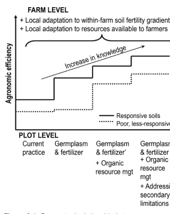

协同效应随土壤和有机资源的性质而变化。单独施用的有机资源效应随施用量和N供应能力的增加而增加。施用足够数量的高质量有机资源可以完全满足玉米的N需求，包括沙质土壤。N浓度<2.5%的有机资源被认为是低质量的，一些高木质素和多酚含量的高N植物材料也是如此。与单独使用肥料N相比，在玉米产量<5 t/ha的情况下，单独施用有机材料带来了更多的产量增加。与高质量有机资源相比，肥料N与低质量有机资源的组合带来的百分比产量增加更大，但这不一定适用于产量增加的绝对量。与>1000 mm/年降雨量相比，<600 mm/年降雨量下组合的益处更大。在壤土和>600 mm/年降雨量下，因此生产力相对较高，与单独使用肥料N相比，组合的产量益处很小。然而，有机资源对后续作物的残留效应在壤土上比在沙质土壤上更大。

侵蚀和结壳降低。对于此类土壤，单独施用肥料养分可能反应甚微，但当同时施用有机资源时，对肥料的反应会大得多（图3.1）。

#### 3.3.2 有机资源与肥料施用相结合

Chivenge et al.（2011）汇编并分析了在SSA进行的52项研究的结果，以评估有机资源与肥料N联合施用与单独使用任何一种相比对玉米产量的影响。

在初始土壤有机C为2%的中部肯尼亚，测定了25年连续种植的影响。所有土壤管理措施下土壤有机C均下降。施用肥料N和P并每年施用10 t农家肥并保留田间作物残茬的组合处理，土壤有机C下降了37%，而另一种处理下下降了54%（Kibunja et al., 2012）。

#### 3.3.3 农作物残茬管理与耕作

农作物残茬在土壤管理中的价值早已得到认可，尤其是在人口稠密地区。Allan（1965）描述了几个例子，例如用作香蕉和

表 3.3: 各种植物材料地上生物量的元素养分浓度（Zingore et al., 2014; Kaizzi and Wortmann 2001）

| 有机来源 | 物种 | 植物部分 | %N | %P | %K |
| :--- | :--- | :--- | :--- | :--- | :--- |
| 乔木或灌木 | Calliandra calothyrsus | 叶片 | 3.3 | 0.17 | 0.8 |
| | Leucaena leucocephala | 叶片 | 3.9 | 0.19 | 2.1 |
| | Tephrosia vogelii | 叶片 | 2.9 | 0.18 | 1.1 |
| | Flemingia macrophylla | 叶片 | 2.7 | 0.16 | 0.7 |
| | Lantana camara | 修剪枝条 | 2.7 | 0.16 | 2.7 |
| 草本豆科植物 | Crotalaria grahamiana | 叶片 | 3.0 | 0.13 | 0.8 |
| | Crotalaria juncea | 叶片 | 3.8 | 0.16 | 1.3 |
| | Mucuna pruriens | 叶片 | 4.4 | 0.30 | 1.6 |
| 草本，其他 | Senna hirsuta | 整株 | 3.0 | 0.18 | 4.6 |
| | Aspilia kotschyi | 整株 | 1.3 | 0.11 | 4.0 |
| 谷物豆科 | 鸽子豆 | 叶片 | 3.3 | 0.19 | 1.3 |
| | 花生 | 叶片 | 3.0 | 0.17 | 2.4 |
| | 大豆 | 叶片 | 3.6 | 0.15 | 2.4 |
| | 豆类 | 叶片 | 2.9 | 0.30 | 2.8 |
| | 豇豆 | 叶片 | 2.9 | 0.10 | 2.1 |
| 谷物作物 | 玉米 | 叶片/壳 | 0.9 | 0.07 | 0.7 |
| | 水稻 | 叶片/壳 | 1.0 | 0.07 | 0.7 |

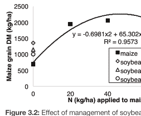

东非咖啡的覆盖物，坦桑尼亚西南部的Matengo坑系统，赞比亚东北部的Mambwe土丘系统以及加纳几内亚稀树草原的Dagomba系统。除了覆盖外，这些系统都旨在充分利用农作物残茬作为养分来源，并加速分解和养分循环。

尽管农作物残茬存在竞争性用途，但大量残茬焚烧仍在继续。就养分供应而言，农作物残茬是低质量有机资源，如其低N浓度所示（表3.3）。在尼日利亚几内亚稀树草原，与移除大豆残茬相比，还田还茬被发现对未施肥N的玉米具有约15 kg/ha的肥料N价值（图3.2）。然而，留在田间且未被白蚁和反刍动物消耗的农作物残茬有助于土壤有机质，土壤有机质调节着众多土壤性质和过程。将植物残茬在种植下一作物前还田是最常见的做法，但避免耕作并将农作物残茬留在土壤表面也有潜在优势。

保护性农业（CA）整合了减少或免耕、由植物和植物残茬覆盖地面以及轮作。Pittelkow et al.（2015）对610项研究进行了全球综合分析，共有5463次CA与其他管理系统的比较。单就耕作组分而言，与常规耕作方式相比，免耕种植的平均产量降低了11.9%，但在干旱生产情况下相比湿润情况，产量减少较少。然而，在半干旱雨养条件下，当CA的三个组分全部

与秸秆还田和轮作结合应用，两者均等地贡献以克服免耕的负面影响。秸秆还田加轮作与耕作相比免耕的效益未有报道。结果未显示保护性农业（CA）随时间变得更有效。

这些结果在很大程度上得到了早前针对撒哈拉以南非洲（SSA）和南亚地区众多研究进行的较小规模分析的支持，该分析显示，与常规耕作相比，免耕的年作物产量通常较低，但如果结合轮作和秸秆还田，负面影响会减轻（Brouder and Gomez-Macpherson 2014）。每项研究都强调了保护性农业（CA）的良好针对性。例如，乌干达两个地点在7年内的高粱平均产量显示，与常规翻转耕作相比，免耕直播产量高11%（Nansamba et al. 2016）。在一份主要针对苏丹萨瓦纳地区高粱生产系统的综述中，Mason et al.（2015）发现，与浅层耕作相比，免耕的平均产量低12%。与秸秆移除相比，将秸秆留在土壤表面可提高产量。高粱与豇豆轮作的产量始终高于高粱单一种植。Nansamba和Mason的研究表明，保护性农业（CA）的一个或多个组成部分通常本身就对产量有益，并且缺乏协同效应的大量证据。

在一份针对撒哈拉以南非洲（SSA）和南亚地区100多项已发表研究的综述中，Palm et al.（2014）发现，秸秆还田和减少耕作均改善了表层10厘米土壤深度的多种土壤性质，但缺乏协同效应的证据，并且通常在10厘米以下深度几乎没有或没有影响。总体而言，对于表层10厘米土壤深度，无论是免耕与常规耕作相比，还是秸秆还田与移除相比，总土壤有机质和颗粒土壤有机质、土壤微生物生物量和多样性、蚯蚓、团聚体稳定性和植物可利用水均有所增加。与管理替代方案相比，免耕和秸秆还田导致径流、侵蚀和蒸发减少。土壤孔隙度通常因免耕而降低，因秸秆还田而增加。

#### 3.3.4 与豆科植物间套种

将豆科植物整合到种植系统中是综合土壤肥力管理（ISFM）的重要组成部分。豆科植物与玉米、高粱、珍珠黍、香蕉、木薯及其他非豆科植物间套种的生产方式广泛实践，在撒哈拉以南非洲（SSA）比与这些作物的豆科轮作更常见。间套种的好处包括与单一种植相比提高土地生产力并降低风险。撒哈拉以南非洲（SSA）大部分豆类生产是通过与玉米间套种进行的，但也与高粱、香蕉、木薯和其他作物间套种。在萨赫勒地区，珍珠黍/豇豆、珍珠黍/花生和高粱/花生是最常见的间套种系统。在西非较高降雨农业生态区（AEZ），玉米与豇豆、花生或大豆间套种很常见。鸽子豆通常通过与玉米间套种生产。

当作物在生长模式、地上冠层、根系和/或高水分和养分需求期方面互补时，间套种能更有效地利用光合有效辐射、水分和养分。与单一种植相比，间套种可能提供更好的土壤覆盖，以抑制杂草并减少土壤侵蚀和结壳。豆科间套作物可能抑制谷物作物的Striga侵染，但可能不如轮作有效。间套作物的互补性通常通过成熟期差异来实现，豆科植物往往在关联作物形成完全冠层之前完成大部分生长和养分、水分吸收，并且比非豆科植物更早成熟。在这种情况下，掉落的豆科植物叶片可能分解足以向关联作物释放养分。在其他情况下，例如长生育期鸽子豆或豇豆带状间套种，豆科植物在玉米或其他关联作物成熟后完成大部分生长。

间套种的豆科植物可以固定大气氮，但也可能与非豆科植物争夺可利用土壤氮。考虑到土壤氮的含量和可用时间，非豆科植物对土壤氮的耗尽可能刺激生物氮固定（BNF）。因此，大部分肥料氮应在非豆科植物氮吸收率高的生长季节内施用。可能会发生显著的生物氮固定（BNF），例如长生育期鸽子豆或将豆科植物带状间套种到谷物中，此时豆科植物在谷物作物成熟并耗尽土壤矿质氮后完成大部分生长。在为满足谷物氮需求而施肥的谷物-豆科间套种中，生物氮固定（BNF）可能非常少，因为豆科植物会争夺施用氮的吸收，而生长旺盛的谷物对豆科植物的抑制也会抑制生物氮固定。活体豆科植物向谷物转移大量氮的可能性不大，尽管成熟较晚的非豆科植物可能利用衰老后分解的叶片和根瘤中矿化的氮。与年度谷物-豆科间套种相比，多年生草本-豆科休耕地更有可能实现更多的生物氮固定以及从豆科植物向禾本科植物转移氮。

关联作物确实会争夺所有必需的土壤养分和水分，但其高吸收率时间上的差异减少了这种竞争。大多数豆科粮食和油料作物都有主根。当豆科植物有广泛的根系发育时，它可能吸收深层不可移动养分和淋溶养分（如硝态氮），利用这些养分生长，并通过作物残体分解将部分养分返回土壤。长生育期和多年生生长的鸽子豆在吸收深层土壤养分并通过根系和地上作物残体的腐烂将部分养分循环到表土方面尤其有效。然而，在获得良好的豆科粮食收获时，收获中移除的氮通常超过固定的大气氮。

与单一种植相比，间套种时两种关联作物的产量通常都较低，但间套种总产量相对于其单一种植产量通常超过单一种植产量。这通过土地当量比（LER）来评估；如果LER大于1，则间套种提高了生产力。间套种可以管理以偏向某一关联作物相对于另一作物。在关联谷物出苗后再种植豆科植物，与同一天种植两者相比，会增强谷物的相对竞争力。与在种植时或之前施用50%或以上的肥料氮相比，基施很少或不施氮，并将大部分氮肥施用推迟到种植后六周或更长时间，预计会增加豆科植物的相对竞争力。

间套种植模式各异，包括将所有作物种植在同一行、交替行或成对行，以及交替种植超过两行的条带，这些条带可能包括这些条带间的作物轮作。种植模式的变化也具有时间方面，两种或所有作物可以在同一天或不同天种植。预计种植模式会影响组成作物的相对竞争力。

一种名为MIBII的创新间套种系统（Kiswahili语意为“two”，是“Managing Beneficial Interactions in Legume Intercrops”的缩写）由两行玉米与两行豆类、花生和/或另一种豆科植物交替种植而成，这允许更多光线穿透到下层豆科组分，并减少豆科植物对施用于玉米组分的氮的获取。在萨赫勒地区，将四行豇豆和四行珍珠黍交替种植并结合轮作，与相应的单一种植相比，结果是珍珠黍产量相似，豇豆产量增加。

在尼几内亚萨瓦纳地区，玉米和豇豆带状间套种很常见。一种种植模式是同一天种植两行中熟玉米，与四行65天成熟期的豇豆品种交替种植。豇豆收获后，整个田地除草，并在收获的豆科植物行种植中熟豇豆品种，同时也在玉米行之间间植。玉米收获后，整个田地成为豇豆单一种植，在旱季成熟（Photo 1）。

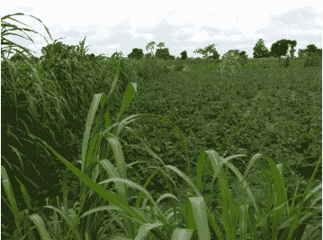

Photo 1: 豇豆带状间套种于玉米中，并在玉米收获后继续生长。

“双豆类”间作是指两种豆类间作，在马拉维实行。通过不同的生长习性和成熟期（如高大生长且晚熟的鸽子豆与花生或大豆间作）可改善种间互补性。观察表明，与单一种植相比，双豆类间作可产生更多的生物氮固定（BNF）。早熟豆类在高大豆类拦截大量辐射前完成大部分生长。高大晚熟豆类利用晚雨水分以及伴生作物成熟后的残余土壤水分。观察发现，大豆和豇豆在双豆类间作中缺乏互补性。

间作对养分施用率的影响总体上尚未得到充分确定。一个例外是肯尼亚的玉米-豆间作，其中间作的最佳氮和磷施用率高于单一种植玉米（参见第6章）。

在撒哈拉以南非洲（SSA）对绿肥和覆盖作物进行了大量研究，其成果已由Elijta等人（2004）很好地综合。常见的绿肥物种包括羽扇豆（Mucuna pruriens）、多种天仙子属植物、刀豆（Canavalia ensiformis）、lablab豆（Dolichos lablab）和豇豆。绿肥可以是单一种植，尤其是在出现双峰降雨的次要雨季期间。它也可以与另一种物种带状间作，例如在主作物第二次除草时种植绿肥作物，绿肥作物在收获后继续生长。

#### 3.3.5 绿肥

豆类可通过生物氮固定（BNF）为农场作业的氮平衡增加大量氮。Giller和Wilson（2001）估计，各种豆类的BNF能力为：粮食豆类105至206 kg/ha N，绿肥作物110至280 kg/ha，树本豆类多年162至1063 kg/ha。表3.4列出了部分物种特异的年BNF率。

有大量证据表明，后茬非豆类作物产量增加，即使在某些情况下施用了氮肥。根据绿肥作物生物量的C:N比以及种植下一茬非豆类作物前终止绿肥作物的时间，可能需要施用一些氮肥以支持非豆类作物的早期生长，同时绿肥生物量中的有机氮变为作物可利用。例如，在坦桑尼亚，建议在还田羽扇豆绿肥生物量后的水稻生产中施用最高30 kg/ha的氮肥。

绿肥作物是一种为生物氮固定（BNF）而种植的豆类，用于为后茬作物提供氮，并提供有机质以改善土壤性质。它通常在成熟前终止，但当需要最大限度地生产相对较高C:N比的生物量（如用于地面覆盖或增加土壤有机碳）时，也可允许其生长至成熟。它通常被翻入土壤中，但也可留在土壤表面作为覆盖物。绿肥作物是覆盖作物，但并非所有覆盖作物都是豆类，且可能为除氮供应以外的其他目的而种植，例如防止水土流失或抑制杂草。绿肥和其他覆盖作物按定义不收获，尽管农民最终可能决定将其作为饲料或粮食作物收获。

| 物种 | 潜在BNF率（N/ha/年） | 参考文献 |
|---|---|---|
| Acacia mangium | 50-100 | Atangana et al., 2014 |
| Casuarina equisetifolia | 360 | Atangana et al., 2014 |
| Gliricidia sepium | 86-309 | Liyanage et al., 1994 |
| Tephrosia vogelii | 100 | Werner 2005, FAO 2010 |
| 鸽子豆 | 90 | Werner 2005, FAO 2010 |
| Crotalaria grahamiana | 142 | Werner 2005 |
| Crotalaria juncea | 130 | Becker 1995, FAO 2010 |
| Mucuna pruriens | 130 | Werner 2005, FAO 2010 |

尽管在撒哈拉以南非洲对绿肥进行了大量研究且结果有希望，但实际绿肥生产很少。农民无法为自己证明生产一种不会收获的作物的价值。

#### 3.3.6 谷物-豆类轮作

撒哈拉以南非洲及其他地区的研究发现，与谷物或豆类连续种植相比，轮作可使轮作中豆类后茬谷物和谷物后茬豆类的产量均增加。这些轮作益处通常为5%至15%的产量增加，尽管也有报道称益处远低于此或远高于此，例如Mason等人（2015）。与土壤肥力充足的情况相比，轮作带来的产量增加百分比在土壤肥力低的情况下通常更大，但幅度差异较小。部分轮作对后茬谷物作物的益处可能源于氮可利用性增加，但即使施用了充足的氮肥，该益处仍可能发生。打破病害和昆虫循环很可能对轮作益处有很大贡献。土壤微生物群落受前茬作物、所产生的作物残茬的类型和数量以及所施用有机材料的类型和数量的影响（Kamaa等人，2011）；这些变化可能有助于轮作效应，例如囊泡-丛枝菌根菌对根系更有效的定植，从而有助于改善养分和水分吸收。

与轮作的谷物阶段相比，豆类阶段的土壤有机质通常会有所下降，因为豆类阶段的光合作用和生物量生产通常较少，而植物和土壤呼吸在两个阶段相似。这种下降至少部分（如果不完全的话）由轮作相对于谷物单一种植的生产力增加所补偿。然而，谷物与一年生豆类粮食或油料作物的轮作（尽管有诸多益处）不应被视为增加土壤有机质的手段。

轮作中的豆类可通过生物氮固定（BNF）（表3.4）为农场作业的氮平衡增加大量氮。然而，饲料和粮食豆类的收获通常移除的氮超过BNF所提供的氮当量。豆类倾向于利用可利用的土壤氮，因为BNF需要植物能量。与谷物收获相比，豆类收获后土壤矿质氮通常更耗竭。尽管如此，轮作中豆类后茬谷物的氮肥需求通常较低，即使考虑到轮作效应带来的产量增加，也低于谷物连续种植。这种氮益处可能源于除豆类作物直接贡献以外的因素，可能包括：与谷物作物残茬相比，豆类叶片残茬分解相对较快；与谷物作物相比，豆类作物残茬较少且C:N比较低，因此豆类作物后土壤和氮肥固定较少；以及与轮作谷物后茬相比，豆类后茬谷物的根系通常更健康、更旺盛，养分吸收更有效。

与单一种植单一作物相比，谷物-豆类轮作的磷肥使用可能有所不同，证据表明，谷物在豆类后茬对施用磷的反应低于谷物后茬。施用磷肥通常会导致豆类BNF增加。因此，一些人建议，与其每年施用磷肥，不如将所有磷肥施用于豆类，并利用残余磷生产谷物。然而，其他证据与此相矛盾，例如大豆对低土壤有效磷的敏感性低于玉米，因此倾向于将所有磷肥施用于玉米，并利用残余磷生产大豆。在土壤高磷固定且因资金不足而限制肥料使用的情况下，每年施用一些磷肥可能最有利可图且更受青睐。OFRA优化肥料使用的方法是利润最大化。对于贫困农民，这种利润需要在短期内实现，他们无法等待超过一年才能从肥料施用的残余效应中获益。因此，肥料使用决策需要基于下一茬作物的预期净回报。正如本书各国章节所示，与非豆类相比，豆类磷肥施用的净回报总体上相对较好。

#### 3.3.7 将多年生植物加入一年生作物轮作

Based on research begun in the 1930s, Uganda has a rarely used recommended rotation of three to four years in annual crop rotated with three years of well managed perennial ley. The ley could be established from natural revegetation or planting, such as with Napier grass. The effectiveness of ley in the rotation in maintaining soil productivity was greater than planting of green manure crops. The forage could be grazed or harvested for animal feeding. The benefit appeared to be due to the increase in active soil organic matter, improved soil physical properties and improved soil P availability. The greatest benefit may be on sandy soils of low organic matter that are not very responsive to fertilizer use. An added advantage on erodible land is the protection from erosion throughout the rotation by having good vegetative ground cover for the ley, the improved resistance to erosion because of improved soil aggregation and the enhanced productivity and ground cover of the annual crops. Perennial ley in rotation is similar to fallow but the ley needs to be well managed to be effective.

基于20世纪30年代开始的研究，乌干达有一种很少使用的推荐轮作方式：三到四年的一年生作物与三年的管理良好的多年生休耕草地轮作。休耕草地可以通过自然植被恢复或种植建立，例如种植象草。轮作中休耕草地在维持土壤生产力方面的效果优于种植绿肥作物。饲料可以放牧或收割用于动物饲喂。这种益处似乎归因于活性土壤有机质增加、土壤物理性质改善以及土壤有效磷含量提高。最大的益处可能出现在有机质含量低且对肥料利用反应不明显的沙质土壤上。在易蚀土地上，额外的优势在于整个轮作期间，由于休耕草地有良好的植被地面覆盖，从而防止水土流失；由于土壤团聚体改善，抗蚀性提高；以及一年生作物的生产力和地面覆盖度增强。轮作中的多年生休耕草地类似于休耕，但休耕草地需要管理良好才能发挥效果。

Fallowed lands are commonly abused by unregulated overgrazing, giving the plants little opportunity to develop good root systems and achieve high productivity. The rotation can be profitable not only because of the increased annual crop yields but also through use of the forage produced for profit-oriented intensive ruminant production. The system cannot work well where farmers have no control of grazing as even severe overgrazing during the dry season is likely to delay perennial recovery and reduce productivity and soil improvement.

休耕地常常因无管制的过度放牧而被滥用，使植物几乎没有机会发育良好的根系并实现高产。这种轮作不仅因一年生作物产量增加而获利，还可通过利用所产饲料进行以利润为导向的密集型反刍动物养殖而获利。在农民无法控制放牧的地方，该系统无法发挥良好作用，因为即使在旱季发生严重的过度放牧，也可能延迟多年生植物恢复，降低生产力和土壤改良效果。

Another means of adding perennials to annual crops is with short duration tree lots. The tree lots may be solely as a form of improved fallow and a green manure crop. More often the trees will have a harvested product such as high protein forage for dairy or producing wood products. Leguminous trees add N to the system and cycle deep nutrients but such trees are likely to be less effective in increasing soil organic matter and improving soil aggregation compared with perennial grass.

将多年生植物加入一年生作物的另一种方式是使用短期林分。林分可能仅作为一种改良休耕和绿肥作物的形式。更常见的是，树木会有可收获的产品，例如用于奶牛养殖的高蛋白饲料或生产木材产品。豆科树木为系统添加氮并循环深层养分，但与多年生草本植物相比，此类树木在增加土壤有机质和改善土壤团聚体方面可能效果较差。

#### 3.3.8 公园林农业

Parkland agriculture is a term used in the Sahel and Sudan Savannas and refers to annual crop production under and around generally large, erect trees (Depommier 1996). It is practised elsewhere in some semi-arid parts of eastern and southern Africa, often on sandy soils of low productivity and with low soil organic matter, but the term parkland agriculture is commonly used only in west Africa.

公园林农业是萨赫勒和苏丹草原地区使用的一个术语，指在通常高大、直立的树木下方和周围进行一年生作物生产（Depommier 1996）。它在东非和南非的一些半干旱地区也有实践，通常在生产力低、土壤有机质含量低的沙质土壤上，但“公园林农业”这一术语通常仅在西非使用。

The trees add organic material to the soil and improve soil water holding capacity and nutrient availability. The most recognized parkland tree is Faidherbia (Acacia) albida (Photo 2). It is unique for its reverse phenology in that it sheds its leaves during the rainy season reducing direct competition for water, light and nutrients. In the hot and dry season it produces leaves which can be used as fodder. The dry season shade leads to ruminant livestock gathering under the trees where more excretion of faeces and urine occurs compared with open areas. Faidherbia is a legume adding N to the farming system. Compared with open fields, the N and P availability under trees have been determined to be 200 and 30% more, respectively, and crop performance is noticeably better with measured yield increases of greater than 100%.

树木向土壤添加有机物，并改善土壤持水能力和养分有效性。最受认可的公园林树木是白刺金合欢（Faidherbia (Acacia) albida）（图2）。它因其逆时现象而独特：在雨季落叶，从而减少对水、光和养分的直接竞争。在炎热干燥的季节，它会长出可作为饲料的叶子。旱季的树荫使反刍牲畜聚集在树下，与开阔地区相比，那里会有更多的粪便和尿液排泄。白刺金合欢是一种豆科植物，为农业系统添加氮。与开阔田地相比，树下氮和磷的有效性分别提高了200%和30%，作物表现明显更好，测得的产量增加超过100%。

Other trees such as the shea-tree (Vitellaria paradoxa) are also effective, although less so compared with Faidherbia, in improving annual crop productivity while providing its own economically valuable yield. Parkia biglobosa is another important parkland species. Farmers recognize the value of parkland agriculture but establishment of trees is difficult due to unrestricted overgrazing during the dry season.

其他树木，如乳树（Vitellaria paradoxa），在提高一年生作物生产力的同时提供自身经济价值高的产量方面也有效，尽管不如白刺金合欢。Parkia biglobosa 是另一种重要的公园林物种。农民认识到公园林农业的价值，但由于旱季无管制的过度放牧，树木建立困难。

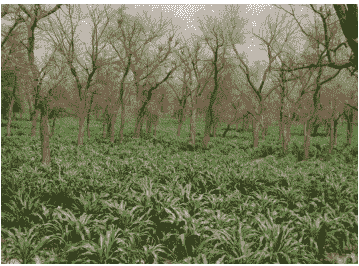

Photo 2: Pearl millet production is commonly greater under Faidherbia trees. These trees do not have leaves during the rainy season and are leafy during the dry season (reverse phenology).

图2：白刺金合欢树下的珍珠粟产量通常更高。这些树木在雨季没有叶子，在旱季长满叶子（逆时现象）。

#### 3.3.9 生物炭

Biochar is charcoal or pyrogenic carbon that is applied in small pieces to amend soil (Guo et al., 2016). The major advantage of adding biochar compared with the original organic material is that the biochar C is much more persistent in the soil compared to the C applied in organic resources. The half-life in soil of C applied in organic materials is typically less than a year as decomposition occurs through soil microbial activity with C released to the atmosphere through microbial respiration. In comparison, the half-life of biochar C in the soil may longer than 100 years.

生物炭是木炭或热解碳，以小块形式施用于改良土壤（Guo et al., 2016）。与原始有机材料相比，添加生物炭的主要优势在于生物炭碳在土壤中的持久性远高于施用于有机资源中的碳。施用于有机材料中的碳在土壤中的半衰期通常不到一年，因为分解通过土壤微生物活动发生，碳通过微生物呼吸释放到大气中。相比之下，生物炭碳在土壤中的半衰期可能超过100年。

Biochar application increases cation exchange capacity, water holding capacity, soil aggregation and soil porosity. The amendment effect is expected to be greatest with soils of low nutrient supply and low water holding capacity. Such soils amended with biochar can have much improved response to applied nutrients. The benefit of biochar is expected to be less with soils that are relatively good for these properties and more where there is greater opportunity for improvement of these soil properties. The biochar is not a good C and energy source for soil microbes but can enhance microbial habitat. The magnitude of effects varies with the rate of application. Biochar in most cases will be a very limited resource as are organic resources for soil management, but what is potentially available could often be used to great benefit.

生物炭施用可增加阳离子交换容量、持水能力、土壤团聚体和土壤孔隙度。预计改良效果在养分供应低和持水能力低的土壤中最为显著。施用生物炭的此类土壤对施用养分的反应可得到大幅改善。预计生物炭的益处在相对适宜这些特性的土壤中较小，而在有更大机会改善这些土壤特性的土壤中则更大。生物炭不是土壤微生物良好的碳和能源来源，但可以改善微生物栖息地。效果的大小随施用率而变化。在大多数情况下，生物炭将是一种非常有限的资源，就像用于土壤管理的有机资源一样，但潜在可用的部分通常可以带来巨大益处。

There is some traditional 'biochar' practice with smallholders of SSA although it has not been recognized as such. In Madagascar, there is a tradition of 'burning' low productivity Ferrasols and Andosols, the latter with very high P fixation capacity. At the end of a fallow period, they do not pile and do combustion burning of the bush and grass plant material. Instead, furrows of approximately 20 cm depth are dug, the dried plant material arranged in the furrows, and then covered using the excavated soil. The furrow ends are left open and the material ignited. Once ignited, pyrolysis slowly progresses down the covered furrow for a week or more with little oxygen supply, charring the covered plant materials. Subsequent production over these burn furrows is much greater than for unburnt soil. The combined benefit of heating the soil, ash deposition and biochar has not been well differentiated but it is expected that the biochar effect will be long term. It is likely that even with slash and burn systems, significant amounts of existing soil C is pyrogenic C due to incomplete combustion of some of the vegetative material.

撒哈拉以南非洲的小农中存在一些传统的“生物炭”做法，尽管它未被如此认可。在马达加斯加，有一种“烧除”低产铁铝土和安第索土的传统，后者具有非常高的磷固定能力。在休耕期结束时，他们不会堆积并进行灌木和草本植物材料的燃烧。相反，他们会挖掘深度约20厘米的沟，将干燥的植物材料放置在沟中，然后用挖出的土壤覆盖。沟的两端保持开放并点燃材料。点燃后，热解在覆盖的沟中缓慢向下进行一周或更长时间，氧气供应很少，对覆盖的植物材料进行炭化。在这些烧沟上的后续产量远高于未烧土壤。加热土壤、灰沉积和生物炭的综合益处尚未得到充分区分，但预计生物炭效果将是长期的。即使在砍伐烧除系统中，由于部分植被材料燃烧不完全，现有土壤碳中很可能含有大量热解碳。

The feasibility of biochar depends on the availability of plant materials and of the potential of improving a soil such as a sandy soil of low nutrient supply and water holding capacity. Crop residues that are not consumed by termites or someone else's livestock can be valuable to the farmer for diverse reasons if left in the field, including for reduced evaporation and erosion, and improvement of surface soil aggregation. However, often the residues are consumed with little in-field value. There is also much combustion burning of plant materials by smallholders, e.g. following fallow, rice straw and hulls, strong stalks of tall traditional sorghums and even maize stover. Very often the burning of plant materials is associated with low productivity soils that could benefit from increased stable soil C supplied as biochar.

生物炭的可行性取决于植物材料的可获得性以及改良土壤（例如养分供应低和持水能力低的沙质土壤）的潜力。如果留在田地里，白蚁或他人牲畜未消耗的农作物秸秆对农民来说可能因多种原因而有价值，包括减少蒸发和水土流失，以及改善表土团聚体。然而，通常这些秸秆被消耗，田间价值很小。小农也会大量焚烧植物材料，例如休耕后、水稻秸秆和谷壳、高大传统高粱的粗壮秸秆甚至玉米秸秆。焚烧植物材料通常与低产土壤相关，这些土壤可以从作为生物炭供应的稳定土壤碳增加中受益。

Numerous simple and inexpensive kiln options are available that are appropriate for smallholder use including some consisting of little more than a 200-litre drum (http://www.appopedia.org/Simple_Biochar_Kilns). A small kiln that can be easily moved to accumulations of plant materials in the field greatly reduces the labour of transporting the plant material, especially if the biochar is used in situ. The biochar will be most effective if crushed into small bits. Biochar has low density and should be incorporated into the soil to prevent removal by runoff.

有许多简单且廉价的窑炉选择适合小农使用，其中一些仅由一个200升的油桶组成（http://www.appopedia.org/Simple_Biochar_Kilns）。一种可以轻松移动到田间植物材料堆积处的小型窑炉大大减少了运输植物材料的劳动量，尤其是当生物炭就地使用时。如果将生物炭粉碎成小块，效果最好。生物炭密度低，应翻入土壤中以防止被径流冲走。

#### 3.3.10 良好肥料使用实践

Good fertilizer use practices have been encapsulated in the term '4Rs of nutrient stewardship' including the right fertilizer source (or type) applied at the right rate, at the right time and in the right place (Johnson and Bruulsema 2014). In the case of poor smallholders, potential profit from fertilizer use needs to be of primary concern. Profit also needs to be a concern of well financed crop production but needs to be balanced with concerns about effects on soil, ground and surface waters, and the atmosphere.

良好肥料使用实践已被概括为“4R养分管理”这一术语，包括在正确的时间、正确的地点施用正确的肥料来源（或类型）和正确的用量（Johnson and Bruulsema 2014）。对于贫困小农来说，肥料使用的潜在利润需要是首要关注点。利润也需要是资金充足的作物生产所关注的问题，但需要与对土壤、地下水和地表水以及大气影响的担忧相平衡。

### 合适的肥料

合适的肥料来源或类型是指将肥料与作物对施用养分的需求相匹配。因此，肥料需要提供一种或多种在土壤中供应不足以满足作物需求的养分。肥料配方在每单位供应养分的成本上有所不同，增加的复杂性和加工过程也会增加成本。需要考虑肥料类型对土壤的影响。例如，有些肥料的土壤酸化作用比其他肥料更强，这是针对接近有问题的低土壤pH值的土壤需要考虑的因素。然而，也需要考虑经济性。虽然肥料中的硝酸盐（与尿素和铵不同）不会导致土壤酸性，但硝酸盐的生产需要更多的化石燃料消耗和生产成本。更经济的方法可能是使用成本较低的具有酸化作用的氮源，并通过施用石灰来管理土壤酸化，而不是使用成本更高、酸化作用较小的氮源。

### 合适的施肥量

施肥养分的施用率总体上是4R中对盈利能力和环境后果最重要的一项。在良好的养分管理中，肥料氮施用率尤其值得关注，因为施用了大量氮，但氮是一种容易因淋溶、挥发、反硝化、径流和一氧化二氮排放而流失的养分。过量施用氮肥会不必要地导致土壤酸化，并且因淋溶流失的氮所产生的酸化效应大于作物吸收利用的氮。施用率通常不应超过经济最优施用率（EOR），即预计能使每公顷肥料使用净回报最大化的施用率。通常施用率应低于EOR。预计在肥料使用资金受限的小农户，通过在施用每公斤/公顷养分所带来的产量增加相对较大（相比于接近EOR时的增加）的施用率施肥，能在受限的肥料使用上获得更好的回报。诸如硝酸盐淋溶到地下水的风险等环境问题，可能导致规定以低于EOR的某个施用率施用氮肥。在现实中，EOR因地块和年份而异很大，且难以准确预测。近似EOR的关键是具有代表性的作物养分响应函数，例如OFRA已为67个农业生态区（AEZ）中的粮食作物确定了此类函数（见第1章）。通过考虑土壤测试信息、轮作效应、有机资源施用以及本章和第4-16章中所述的其他措施，可以改进EOR的估算。一些低产土壤需要施用石灰或有机资源等改良剂，才能对肥料产生良好的作物响应（图3.3和3.4）。生物性限制，如严重的夹竹桃寄生（Striga）侵染，可能降低作物对施用肥料的响应潜力。由于某一季节氮EOR的可预测性较低，在生长季内根据冠层颜色调整施用率的氮肥分次施用已在全球范围内得到应用。

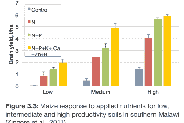

肥料微量施肥是指在适当的时候（如播种时、出苗后或出苗后数周），在低降雨地区（如萨赫尔地区）的低产土壤上，以低施用率进行点状施用肥料养分。据报道，由于微量施肥，高粱和珍珠黍的产量增加了44%至120%，这与使用较高推荐施用率所获得的产量增加相当（Bagayoko et al., 2011; Tabo et al., 2011）。在埃塞俄比亚对玉米进行的微量施肥评估显示，未施肥的平均谷物产量为4.7 t/ha；所有氮和磷施用率（氮和磷分别从17和5 kg/ha到64和20 kg/ha）带来的产量增加相似（表3.5）（Sime and Aune 2014）。

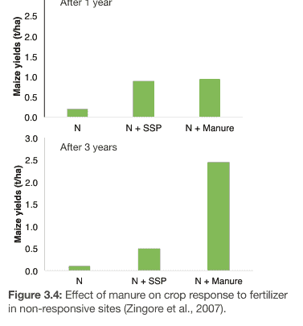

| 方法 | 肥料施用率 DAP+尿素 (kg/ha) | Hawassa | Ziway | Melkassa |
| :--- | :--- | :--- | :--- | :--- |
| 对照 | 0 | 6334b | 4054b | 3649b |
| 微量施肥 | 27+27 | 7539a | 5864a | 5320a |
| | 53+53 | 7222a | 6042a | 5542a |
| | 80+80 | 7086a | 5743a | 5221a |
| 条施 | 100+100 | 7636a | 5815a | 5226a |

1 相同字母表示各均值之间差异不显著。

### 合适的施肥时间

施肥时间很重要。在播种前或播种时施用磷、部分氮以及可能的钾和/或其他养分非常普遍，因为这通常会产生“启动效应”以刺激早期生长和根系发育。基肥施用延迟可能导致产量损失，如Sakala（1998）在赞比亚所发现的那样。然而，在作物定植不佳风险较大的情况下，这种基肥施用可能更明智地在作物出苗后不久进行，并可根据定植成功情况调整施用率。在生长季内施用部分氮是全球和撒哈拉以南非洲（SSA）的常见做法，尤其对沙质土壤和生长季降雨量大的地区有益（Zingore et al., 2014）。生长季内施用氮肥的一个重要优势，除了降低氮淋溶流失的风险外，还在于农民可以判断作物状况，并在作物状况不佳（由于生物或非生物问题或管理原因）时决定不施用或施用较低剂量的氮肥。随着极端天气事件频率的增加，这种适应性管理预计将变得更加重要。生长季内施用氮肥应与作物非常快速的氮吸收开始期相吻合，例如玉米的8叶期。

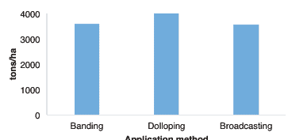

**图3.5：** 施肥方法对马拉维玉米产量的影响。（改编自Benson T.D.的演示文稿）http://www.slideshare.net/IFPRIMASSP/maximizing-returns-to-fertilizer-use-on-maize-in-malawi-lessons-from-onfarm-agronomic-research-by-todd-benson-ifpri.

### 合适的施肥位置

施肥位置很重要。将肥料放在种子或植物下方或非常靠近的位置会造成肥料盐害的风险。主根类豆科植物尤其容易受到高盐肥料（如置于种子下方的KCl）的伤害，即使覆土良好也不例外。当施肥量较低时，将基肥点状或条状施用于距种子或植物至少5厘米的位置，通常比对玉米和其他行距较大作物的撒施更有效，但也有例外（图3.5）。

在水稻生产中，深施尿素超颗粒（USG）可能提高氮利用效率。USG是椭圆形压实颗粒，通常重1.8克或2.7克，使用制砖机生产。在移栽后一周，将一个USG放置在20×20厘米间距的四株水稻之间、深度为5–7厘米的泡田中。不施用额外的氮肥。USG深施的好处包括降低氮施用率、减少施肥次数、增加产量、减少除草次数，以及提高施用氮的回收率，同时减少反硝化和径流造成的氮流失。

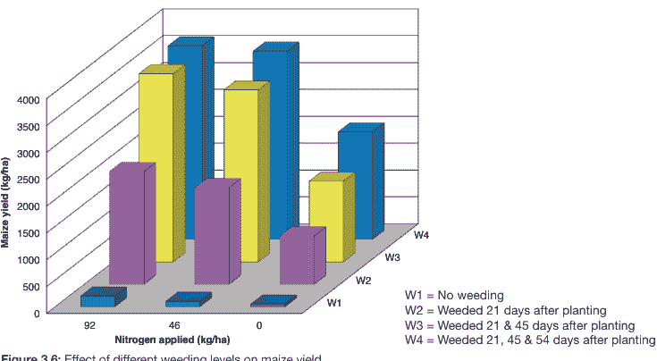

#### 3.3.11 水分供应

水是必需养分氢的直接来源，对于植物吸收养分以及植物代谢和生长都至关重要。通过及时灌溉可以防止土壤水分亏缺。Mason等人（2015）回顾了21篇关于萨赫尔地区耕作和水分保持的论文，发现将珍珠黍种植在耕作土壤中通常比未耕作土壤产量更高，这是因为耕作改善了水分入渗，垄沟和养穴（zai）的水分保持有很大的积极影响，并且将养分施用与水分保持相结合通常会产生正向交互作用。

Zougmoré等人（2004）发现，在布基纳法索，单独的集水和水分保持并未改善作物产量，但在添加有机物质和肥料时有效。他们发现，将堆肥与石坝或草带相结合，使高粱谷物产量增加了180%，而将相同的土壤保护措施与氮肥联合使用仅使产量增加了约70%。与施肥相比，将养穴半月形微集水区与堆肥或动物粪便施用相结合，可获得更高的高粱产量。

杂草控制对水分和养分的可用性很重要。控制不足可能使玉米产量减少50%以上，玉米通常需要两次除草周期（Kabambe和Kumwenda 1995）（图3.6）。

### 3.4 结论

改善土壤养分可用性对于大幅提高撒哈拉以南非洲（SSA）的作物生产率至关重要。小农户通常非常贫穷，需要在资金使用（如肥料使用）上获得高净回报。因此，改善土壤养分供应的成本效益非常重要。本章探讨了提高养分利用效率的养分供应和管理替代方案。

结合不同替代方案有时会产生潜在的协同效应，尤其是在土壤生产力低且对肥料施用反应小的情况下，但更多时候效果主要是叠加的。本文涉及了增加和改善有机资源利用、在轮作中增加豆科植物的整合、作物轮作、增加土壤有机质以及改善相关土壤性质（如通过多年生作物与一年生作物轮作和使用生物炭）、更好地利用肥料和减少土壤水分亏缺等措施。

大多数做法都有利弊。没有单一做法可能普遍适用。做法需要精准定位以达到最大效果。

### 3.5 参考文献

- Allan W (1965) 《非洲农夫》. Greenwood Press, Westport CT. p 505
- Atangana A, Khasa D, Chang S 和 Degrande A (2014) 《热带农林业》. ISBN: 978-94-007-7722-4
- Bagayoko M, Maman N, Palé S, Sirifi S, Taonda SJB, Traore S 和 Mason SC (2011) 西非珍珠黍的微瘤和氮磷肥施用率. African J Agric Res 6: 1141-1150
- Bationo A, Waswa B, Kihara J 和 Kimetu J (编) (2007) 撒哈拉以南非洲综合土壤肥力管理的进展：挑战与机遇. Springer, 荷兰多德雷赫特. p1091
- Becker M (1995) 绿肥技术：潜力、用途和局限性. Plant and Soil 174:1-2
- Brouder S 和 Gomez-Macpherson H (2014) 保护性农业对小农户农业产量的影响：证据的范围综述. Agric Ecosyst Environ 187:11-32
- Chivenge P, Vanlauwe B 和 Six J (2011) 有机和矿物营养源联合施用是否影响玉米产量？一项荟萃分析. Plant Sci 342:1-30
- Depommier D (1996) 布基纳法索多西和瓦蒂诺马公园中白刺贼豆（Faidherbia albida (Del.) A. Chev.）公园的结构、动态和功能：生物物理和人为因素对公园布局及未来的影响特征. 博士论文，巴黎六大，皮埃尔和玛丽·居里大学，法国
- Eilitta M, Mureithi J 和 Derpsch R (2004) 小农户绿肥/覆盖作物系统 (Eilitta M, Mureithi J 和 Derpsch R, 编). Kluwer Academic Publishers. p 335
- FAO (2010) 小农场保护性农业中的绿肥/覆盖作物和轮作. Integrated Crop Management
- Giller K 和 Wilson KJ (2001) 热带种植系统中的氮固定（第2版）. CAB International, 英国瓦灵福德. p 441
- 全球产量差距图谱 (2016) http://www.yieldgap.org/gaygmaps/app/index.html
- Guo M, He Z 和 Uchimiya SM (2016) 生物炭的农业和环境应用：进展与障碍. SSSA 特刊 63. SSSA, 美国威斯康星州麦迪逊
- Haggbade S 和 Hazell P (编) (2010) 非洲农业的成功：未来的教训. Johns Hopkins University Press, 巴尔的摩
- Haggbade S 和 Plerhoples C (2010) 保护性农业对赞比亚小农棉花农户生产力的影响. 工作文件 第47号. 粮食安全研究项目, 卢萨卡, 赞比亚
- Johnston AM 和 Bruulsema TW (2014) 4R养分管理以提高养分利用效率. Procedia Engineering 83:365-370
- Kabambe VH 和 Kumwenda JDT (1995) 马拉维玉米产量中除草管理和氮施用率的影响. 在 Jewell D, Waddington S, Ransom J 和 Pixley K (编) 胁迫环境下的玉米研究. CIMMYT, 津巴布韦哈拉雷
- Kaizzi CK 和 Wortmann CS (2001) 半湿润热带地区土壤肥力管理的植物材料. Agron J 93:929-935
- Kamaa M, Mburu H, Blanchart E, Chibole L, Chotte JL, Kibunja C 和 Lesueur D (2011) 肯尼亚卡贝特长期试验中有机和无机施肥对土壤细菌和真菌微生物多样性的影响. Biol Fertil Soils 47:315-321. doi:10.1007/s00374-011-0539-3
- Kaola S (2001) 中部肯尼亚高原综合土壤肥力管理. ISFM 推广模块. AFNET
- Kibunja CN, Mwaura FB, Mugendi DN, Gicheru PT, Wamugongo JW 和 Bationo A (2012) 肯尼亚半湿润高原连续玉米和豆类种植系统下土壤生产力维持与改善策略：卡贝特长期试验案例研究 第59 – 84页. 在 Bationo A, Waswa B, Kihara J, Adolwa I, Vanlauwe B 和 Saidou K (编). 非洲长期土壤管理实验的经验教训. Springer. doi:10.1007/978-94-007-2938-4
- Liyanage MS, Danso SKA 和 Jayasundara HPS (1994) 四种刺槐基因型的生物氮固定. Plant Soil 161:267-274
- Mason SC, Maman N 和 Palé S (2015) 半干旱西非珍珠黍生产实践：综述. Expl Agric 1-21 doi:10.1017/S0014479714000441
- Nansamba A, Kayuki CK, Twaha AB, Ebayanot P 和 Wortmann C (2016) 乌干达谷物高粱对减少耕作、轮作和土壤肥力管理的反应. Agron J (待出版)
- Palm C, Blanco-Canqui H, DeClerck F, Gatere L 和 Grace P (2014) 保护性农业与生态系统服务：概述. Agric Ecosyst Environ 187:87-105
- Pittelkow CM, Liang X, Linquist BA, van Groenigen KJ, Lee J, Lundy ME, van Gestel N, Six J, Venterea RT 和 van Kessel C (2015) 保护性农业原则的生产力极限与潜力. Nature 517:365-370
- Sakala WD (1998) 马拉维玉米/鸽子豆间作中的氮动态. 1998年博士论文. 伦敦大学怀学院
- Sime G 和 Aune JB (2014) 埃塞俄比亚中裂谷三个地点玉米对施肥剂量的反应. Agron 4:436-451
- Singh A, Carsky RJ, Lucas EO 和 Dashiell K (2001) 尼几内亚稀树草原中玉米谷物产量对前茬大豆和茬秆管理的反应. 在 西非和中非玉米研究与开发的影响、挑战与前景. Badu-Apraku B, Fakorede MAB, Ouedraogo M 和 Carsky RJ (编) 1999年5月4-7日，贝宁科托努区域玉米研讨会论文集. IITA, 尼日利亚伊巴丹 第214-224页
- Smaling EMA, Nandwa, SM 和 Janssen, BH (1997) 土壤肥力岌岌可危. 在 非洲土壤肥力恢复. Buresh RJ, Sanchez PA 和 Calhoun F (编). SSSA 特刊 第1号, 美国农学会, 美国威斯康星州麦迪逊
- Tabo R, Bationo A, Amadou B, Marchal D, Lompo F, Gandah M, Hassane O, Diallo MK, Ndjeunga J, Fatondji D, Gerard B, Sogodogo D, Taonda JBS, Sako K, Boubacar S, Abdou A 和 Kaola S (2011) 西非肥料微剂量和“保证”或库存信贷制度以改善粮食安全和农民收入. 在 创新是非洲绿色革命的关键. Bationo A 等 (编) Springer Science+Business Media BV 第113-121页
- Vanlauwe B, Bationo A, Chianu J, Giller KE, Merckx R, Mokwunye U, Ohiokpehai O, Pypers P, Tabo R, Shepherd K, Smaling E, Woomer PL 和 Sanginga N (2010) 综合土壤肥力管理：操作定义及其实施和传播的后果. Outlook on Agric 39:17-24
- Werner D (2005) 热带农业中豆类的生产和生物氮固定. Forest Ecol Environ 4:1-13
- Zingore S (2011) 受土壤肥力变异、粪肥施用和种植系统影响的玉米产量及对肥料使用的反应. Better Crops 95:4-6
- Zingore S, Murwira H, Delve R 和 Giller K (2007) 土壤类型、管理历史和当前资源分配：调节非洲小农场作物产量变异性的三个维度. Field Crops Res 101:296-305
- Zingore S, Njoroge S, Chikowo R, Kihara J, Nziguheba G 和 Nyamangara J (2014) 非洲农业中的4R植物养分管理：小农户耕作系统肥料管理推广手册. 国际植物营养学会 (IPNI). ISBN: 978-0-9960199-0-0-3
- Zougmoré R, Ouattara K, Mando A 和 Ouattara B (2004) 布基纳法索水土保持技术成功中养分的作用（石脊、草带、扎伊和半月）. 研究简报, Sécheresse 15:41-48

## 4. 布基纳法索综合土壤肥力管理框架内的肥料使用优化

Korodjoua Ouattara¹ korodjoua_ouattara@hotmail.com, Idriss Serme¹, Alimata Azouma Bandaogo¹, Souleymane Ouedraogo¹, Adama Sohoro¹, Zakaria Gnankambary², Sansan Youf³, Pascal Yaka¹, Tahioure Pare²
¹农业环境与研究所 (INERA), 04 BP 8645 瓦加杜古 04
²国家土壤局 (BUNASOLS), 03 BP 7005 瓦加杜古
³国际肥料发展中心布基纳法索 (IFDC), 11 BP 82 瓦加杜古 11, 布基纳法索
⁴布基纳法索农业气象中心, 01 BP 4413 瓦加杜古 01, 布基纳法索

### 4.1 引言

养分施用对于提高布基纳法索的作物生产力很重要。尽管最近几十年肥料使用量增加了50%，但2013年施用的N、P₂O₅和K₂O平均总量仅为15.3 kg/ha/yr（世界银行，2013年）。尽管政府提供补贴，但根据地区不同，只有8%至35%的农民使用肥料。

自1974年以来，已制定肥料建议，最初用于商业花生和棉花生产。推广服务将棉花建议应用于谷物。然而，在20世纪80年代，在世界银行名为“粮食作物肥料”项目的支持下，开展了研究，为三个主要农业生态区（AEZ）中的玉米、高粱和珍珠黍制定肥料建议，以考虑年降雨量差异。这些建议仍然比较笼统，未考虑土壤类型、劳动能力和气候风险的差异。更糟糕的是，大多数农民未被告知这些建议。

粮食产量的提高更多依赖于扩大耕地面积而非集约化。土壤养分在收获中被移除，而没有通过施肥补充，导致土壤养分耗竭、土壤生产力和作物产量下降（Bationo et al., 1998; Ouattara et al., 2006和2011; Mason et al., 2014和2015）。在政府和非政府推广服务支持农民的地方，使用更多肥料。粮食作物生产的肥料使用常常受到限制，因为农民信息不充分且缺乏购买肥料的财务能力。此外，肥料供应系统效率低下，交货不及时。

非洲肥料建议优化（OFRA）项目致力于改善主要作物生产农业生态区更有利可图的肥料使用决策基础，而不增加财务风险。基于每个农业生态区两种主要土壤类型以及布基纳法索主要作物的多地点试验，OFRA改善了肥料使用优化的信息基础。本章中的肥料使用优化是指最大化肥料使用带来的利润，包括财务充足的农民每公顷净利润以及财务受限农民对少量肥料投资的利润。

农民希望从肥料使用中获利。与粮食作物相比，他们更可能向经济作物施肥。如果财务充足，农民可能施用肥料以最大化肥料使用带来的每公顷净回报。然而，对于那些长期处于财务危机中、改善机会少且脆弱性大的人来说，肥料使用投资与其他紧迫需求竞争。因此，肥料使用必须在风险很小的情况下带来高回报。为了降低肥料使用风险，建议应考虑农民的种植系统和财务状况。在制定布基纳法索的肥料建议时，未充分考虑农民盈利能力和风险方面的因素。

本章描述了布基纳法索的一般农业背景、农业生态区的特征、土壤类型和主要种植系统。它探讨了布基纳法索的肥料使用优化以及影响肥料盈利能力的因素。引入了基于计算机和纸质的决策工具，用于优化肥料使用，提供预期可最大化肥料使用利润的选择。此外，还提供了一种根据粪肥使用等做法以及土壤测试信息调整肥料施用率的工具。进行了比较

与当前肥料施用率建议相比，这些施用率预计能因肥料使用而最大化每公顷净回报，本章将其称为养分施用的经济最优施用率（EOR）。

### 4.2 布基纳法索农业生态区（AEZ）的农业系统

布基纳法索的农业生态区包括萨赫勒、北苏丹稀树草原和南苏丹稀树草原（图 4.1）。

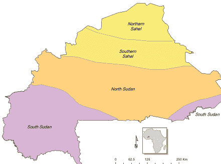

图 4.1：布基纳法索农业生态区地图，源自 Fontès 和 Guinko（1995）的自然植被和土地覆盖图。

萨赫勒地区属半干旱气候。该地区多里的年均降雨量为 485 毫米，其中 47% 集中在 7 月、8 月和 9 月（表 4.1）。月平均最高和最低气温分别在 32 至 42°C 和 16 至 29°C 之间。高地土壤普遍含砂量高，加上降雨量低且不稳定，使干旱成为作物生产的主要限制因素；最适应的作物是珍珠黍、豇豆和芝麻。主要土壤为：(1) 热带赤铁矿类型，淋溶程度从不充分到完全，覆盖在砂质、黏砂质和砂黏质材料之上；(ii) 退化的全形土，包含覆盖在砂黏质材料之上的盐碱土；以及 (iii) 热带富营养棕色土，覆盖在高粘性母质之上，以及发育不良的侵蚀土，覆盖在砾石质材料之上（CILSS 和 OMM，2001）。农作物和畜牧生产都很重要，并实行畜群季节性转移。牲畜产生粪肥，对土壤肥力管理很重要，但也会剥夺耕地的植物残体，使土壤暴露于侵蚀之下。植被以撒哈拉和萨赫勒物种为特征，这些物种在降雨量较高的地区不常见，包括木本物种 Acacia ehrenbergiana、Acacia nilotica variety tomentosa、Acacia raddiana、Grewia tenax、Leptadenia pyrotechnica、Maerua crassifolia 和 Salvadora persica。狭窄的河岸带以 Anogeissus leiocarpus、Mitragyna inermis、Acacia ataxacantha 和 Acacia seyal 为主。南部萨赫勒是向苏丹稀树草原过渡的地区，木本物种组成发生变化，Acacia laeta、Acacia nilotica variety adansonii、Acacia senegal、Boscia salicifolia、Commiphora africana、Dalbergia melanoxylon、Pterocarpus lucens 和 Grewia flavescens 增加。南部萨赫勒常见的苏丹稀树草原物种包括 Acacia macrostachya、Combretum glutinosum、Combretum nigricans var. ellioti，并构成与 Pterocarpus lucens 和 Dalbergia melanoxylon 相关的灌木组成（Fontès 和 Guinko，1995）。

表 4.1：布基纳法索农业生态区代表性地点的月平均降雨量（mm）及最高和最低气温（°C；Tmax；Tmin）

| | 1月 | 2月 | 3月 | 4月 | 5月 | 6月 | 7月 | 8月 | 9月 | 10月 | 11月 | 12月 |
|---|---|---|---|---|---|---|---|---|---|---|---|---|
| **南苏丹稀树草原，法拉科巴** | | | | | | | | | | | | |
| 降雨量 | 6.8 | 0.0 | 26.1 | 41.5 | 59.7 | 175.0 | 201.5 | 304.4 | 327.7 | 61.2 | 17.3 | 0.3 |
| 最高气温 | 33.0 | 35.6 | 37.2 | 37.6 | 36.1 | 33.0 | 31.5 | 30.2 | 30.7 | 33.4 | 34.6 | 32.1 |
| 最低气温 | 19.3 | 22.1 | 24.3 | 25.7 | 25.2 | 23.2 | 22.5 | 22.0 | 21.5 | 22.6 | 22.1 | 18.8 |
| **北苏丹稀树草原，博尼** | | | | | | | | | | | | |
| 降雨量 | 0.0 | 3.3 | 0.0 | 0.5 | 38.5 | 65.9 | 204.5 | 234.6 | 238.8 | 43.7 | 11.8 | 0.0 |
| 最高气温 | 33.0 | 35.6 | 37.2 | 37.6 | 36.1 | 33.0 | 31.5 | 30.2 | 30.7 | 33.4 | 34.6 | 32.1 |
| 最低气温 | 19.3 | 22.1 | 24.3 | 25.7 | 25.2 | 23.2 | 22.5 | 22.0 | 21.5 | 22.6 | 22.1 | 18.8 |
| **萨赫勒，多里** | | | | | | | | | | | | |
| 降雨量 | 4.3 | 0.0 | 13.6 | 0.0 | 6.1 | 54.8 | 124.4 | 160.8 | 106.6 | 15.1 | 0.0 | 0.0 |
| 最高气温 | 32.6 | 34.4 | 38.9 | 41.6 | 42.0 | 39.2 | 36.0 | 33.4 | 35.1 | 39.0 | 37.8 | 32.1 |
| 最低气温 | 16.5 | 18.9 | 22.2 | 25.3 | 29.3 | 27.0 | 25.5 | 24.3 | 24.8 | 25.4 | 20.6 | 16.0 |

来源：布基纳法索国家农业气象总局。

博尼位于北苏丹稀树草原，年均降雨量为 840 毫米，其中 56% 集中在 7 月、8 月和 9 月（表 4.1）。与萨赫勒相比，降雨季节更湿润且开始得更早。月平均最高和最低气温分别在 30 至 38°C 和 19 至 26°C 之间。土壤包括热带赤铁矿土、发育不良的侵蚀土以及覆盖在不同质地材料之上的水成矿物土至伪渴土。生产的作物有高粱、玉米、花生、棉花和珍珠黍，以及靠近一些季节性溪流的水稻。向南移动，苏丹稀树草原变得更湿润，其外貌是草本、灌木和丛生物种的连续序列，在极西南部倾向于疏林。稀树草原景观可以像公园一样，有许多大树，包括 Faidherbia albida（以其逆生态学特性著称，在旱季长叶子，随降雨开始落叶）、Adansonia digitata、Butyrospermum paradoxum subsp. parkii、Lannea microcarpa 和 Tamarindus indica。在灌木层，白兰花科植物分布广泛。最常见的物种是：Acacia dudgeoni、Acacia gourmaensis、Acacia seyal、Bombax costatum、Combretum micranthum、Combretum glutinosum、Combretum nigricans、Grewia bicolor、Guiera senegalensis 和 Sterculia setigera。

南苏丹稀树草原是较湿润的区域。位于该区域的法拉科巴年均降雨量为 1220 毫米（表 4.1）。最湿润的时期是 7 月至 9 月，此时发生了 68% 的降雨。月平均最高和最低气温分别在 30 至 37°C 和 19 至 26°C 之间。主要土壤类型为淋溶程度从不充分到完全的热带赤铁矿土、水成矿物土至伪渴土以及铝铁土；部分去饱和，覆盖在质地可变的材料之上（CILSS 和 OMM，2001）。种植系统以谷物和棉花为基础。生产的作物有玉米、高粱、棉花、花生、珍珠黍以及灌溉和雨养水稻。

2006 年的“全国人口和住房普查”（GPHC）估计布基纳法索人口为 1370 万，其中女性占 52%，平均人口密度为每平方公里 40 人。1996 年至 2006 年间的平均人口增长率为每年 2.5%。人口分布不均。位于北苏丹稀树草原的中部地区占总人口的 11%。南苏丹稀树草原中的穆昆大区（10.5%）和上巴辛大区（10.3%）是接下来人口最多的两个地区。相反，喀斯卡德大区、西南大区和中南大区分别容纳了 3.8%、4.6% 和 4.7% 的人口。超过 80% 的人口居住在农村地区。中部地区人口中 77.5% 居住在城市，其次是上巴辛大区，该大区 34.7% 的人口居住在城镇。在萨赫勒大区和东部大区，分别只有 6.5% 和 6.3% 的人口居住在城市地区。最大的社会语言群体是莫西人（约占总人口的 48%）和富尔贝人（10%）。其他民族包括洛比人、博博人、曼丁人、塞努福人、古鲁恩西人、古尔曼切人和凯尔·塔马舍克人（图阿雷格人）。

### 4.3 布基纳法索的土壤养分管理，包括肥料使用

传统的休耕做法具有多种重要的生态和社会学功能，包括恢复土壤肥力和生物多样性、狩猎以及药用植物供应。然而，由于人口压力和土地使用更加集约，休耕现在不如过去常见（Ouattara 等人，2006）。

在布基纳法索，估计显示，660 万公顷耕地上的养分开采造成了总计 95,000 吨氮（N）、28,000 吨五氧化二磷（P2O5）和 79,000 吨氧化钾（K2O）的损失，相当于 1.59 亿美元的 NPK 肥料（Bationo 等人，1998；MAHRH，1999）。

由于休耕期缩短、过度放牧和牲畜通行，耕地在土壤生产力、生物多样性和地下水补给方面日益退化。其他传统的土壤肥力管理做法包括将粪肥和家庭废弃物等有机资源施用于土地。在旱季雇佣牧民将牲畜留在田间过夜以排泄尿液和粪便的做法有着悠久的传统。

20 世纪 70 年代和 80 年代制定的肥料建议因降雨制度而异，但未考虑农民情况的其他方面。建议每两年施用 5 吨/公顷的有机肥（OM）以与肥料使用相结合。根据土壤测试结果调整肥料的证据薄弱。OFRA 活动改善了肥料使用决策的信息基础。

撒哈拉以南非洲的土壤以其低养分含量而闻名。肥料使用已导致作物产量增加。在 2014–15 年于布基纳法索三个农业生态区进行的农场内和农场外试验中，与对照相比，氮（N）施用使水稻平均谷物产量增加 27%，高粱增加 40%，珍珠黍增加 53%，玉米增加 181%。对于豆科作物，磷（P）施用使豇豆平均产量增加 43%，花生增加 17%。含 N-P-K-S-Zn-Mg-B 的诊断处理相对于可比的 N+P+K 处理，因作物和农业生态区而异地产生了不同的反应。对于豇豆、玉米、高粱和水稻，产量百分比增加大于平均值的标准误，但对珍珠黍的影响不一致，花生受到负面影响（图 4.2a）。按农业生态区划分的平均产量变化，无论是否施用粪肥，均小于标准误，除了在萨赫勒地区未施用粪肥的诊断处理中出现显著产量增加（图 4.2b）。需要更多信息来验证这些观察结果，并确定诊断方案中的四种养分中哪一种导致了这些影响。

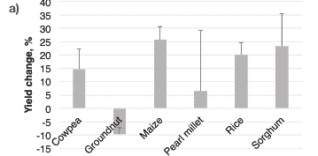

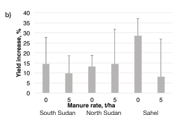

**图 4.2：** 与 N+P+K 相比，诊断处理（N+P+K+Mg+S+Zn+B）导致的产量百分比变化，用于 a) 若干谷物和豆类作物，以及 b) 按农业生态区划分，在布基纳法索施用和未施用 5 吨/公顷堆肥的情况。

### 4.4 优化布基纳法索的肥料使用

在 OFRA 项目框架下，2014 年和 2015 年开展了田间研究，以改善高粱、玉米、珍珠黍、水稻、豇豆

和花生。上述研究是在上述三个农业生态区的主要农业土壤类型上进行的，以确定N、P和K的作物养分响应函数。

数据被分析以确定南苏丹稀树草原中玉米对N的响应所代表的曲线到平台响应（图4.3）。响应曲线由方程 Y = a - bc^x 表示，其中 Y = 产量，a 和 b 分别为最大产量（平台产量）和施用该养分可实现的最大产量增加；c 与指数 x（养分施用率）共同决定曲线的形状。

施用 90 kg/ha 氮时玉米产量接近平台，但大部分产量增益是在施用 40 kg/ha 氮后获得，之后随着更多氮的施用，产量增加率下降。一旦确定了某个农业生态区玉米氮响应曲线的产量，就可以根据氮肥成本和玉米谷物价值，确定任何施用率下氮施用的净财务回报，并确定从施肥中最大化每公顷利润的氮施用率。

布基纳法索的大多数小农户都是资金受限的农民，需要从施肥中获得高利润。施用于某些作物的某些养分比施用于同一或其他作物的其他养分具有更大的盈利潜力（图4.4）。投入一种作物一种养分的资金量显示在 x 轴，即横轴上。y 轴显示随着养分施用率的变化，投入一种作物一种养分的净投资回报。每条曲线代表一种作物一种养分的盈利潜力。

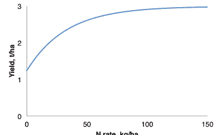

图4.3：布基纳法索南苏丹稀树草原中玉米对氮的响应。

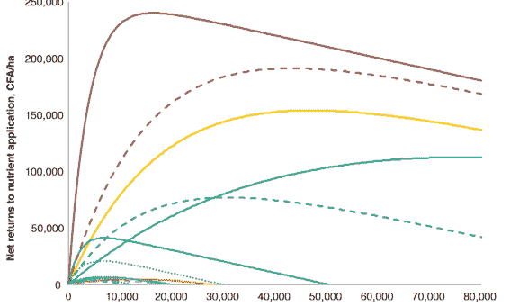

玉米N   低地水稻N   高粱N   豇豆N   珍珠黍N   玉米P   低地水稻P   高粱P   豇豆P   珍珠黍P   高粱K   低地水稻K   豇豆K

图4.4：作物投资净回报，每50公斤袋肥料成本分别为尿素、过磷酸钙(TSP)、磷酸二铵(DAP)、氯化钾(KCl)和复合肥(NPK)的FCFA 19000、22500、23000、20750和23000。所用作物价值为玉米和水稻每公斤FCFA 125，高粱、花生、珍珠黍和豇豆每公斤分别为150、300、400和500FCFA。

当曲线斜率陡峭时，投资净回报非常高。随着投入金额（x轴）增加，斜率下降，但如果仍向上，利润在增加。曲线在EOR处达到峰值，即每公顷最大利润率。当随着养分施用率增加斜率下降时，利润在下降。资金受限的农民首先希望利用能带来最多净回报的作物-养分组合。

### 4.5 布基纳法索农业生态区的施肥使用优化工具(FOT)

对于种植多种不同作物的农民来说，决定施肥作物的选择以及施用每种养分的数量以最大化施肥利润是复杂的。不仅不同作物对施用养分的响应的农艺学很重要，还需要考虑农民的作物选择、预期作物价值、施肥成本和可用于施肥的资金。

在南苏丹稀树草原，施用N和P的高粱，以及施用N的玉米和低地水稻，以小额投资具有高盈利潜力（图4.4）。投资回报率最高的是施用少量N于高粱，约为每公顷FCFA 5000价值的N，但很快达到EOR，之后利润下降。接下来最陡的斜率是施用N于玉米，投资回报率高达每公顷施用N的FCFA 20,000，之后施用更多N会降低利润。施用于水稻的氮和P具有盈利潜力，P投资FCFA 20,000/ha时回报最大，而达到水稻N的EOR所需投资约为FCFA 60,000/ha。施用于豇豆的氮和钾具有中等盈利潜力，而其他曲线较低的选项盈利潜力相对较小。

为每个农业生态区开发了一个使用线性优化的计算机程序，以帮助选择施肥方案以最大化盈利潜力（https://agronomy.unl.edu/OFRA）。该程序是一个Microsoft Excel Solver®（Frontline Systems Inc.）工具，称为施肥优化工具（FOT）。FOT使用复杂的数学来整合众多作物养分响应函数与经济和农艺信息。

#### 4.5.1 Excel FOT

使用FOT需要Excel加载项Solver，并且需要启用宏。FOT的“帮助和说明”工作表中提供了逐步说明。更详细的说明在扩展材料和FOT手册中（https://agronomy.unl.edu/OFRA）。

与布基纳法索其他农业生态区一样，盈利潜力随作物-养分-施用率而变化。资金受限的农民需要首先利用高盈利机会，例如施用于高粱的N和P以及施用于玉米和低地水稻的N，如果农民种植这些作物中的任何一种。施用率应低于施用于高粱的P和施用于玉米或水稻的N的EOR，因为其他施肥选项在盈利潜力方面变得具有竞争力，例如施用于低地水稻或玉米的低P率。

FOT数据输入屏幕（图4.5）允许输入农民计划为每种感兴趣作物种植的土地面积（在“种植面积，公顷”下）以及收获时农场预计商品价值，考虑到部分用于家庭消费（最有价值），剩余部分将被销售（在“预计谷物价值/公斤”下）。输入不同可用肥料的使用成本（在“每50公斤袋成本”下）。可以在四种肥料下方添加一种额外肥料，其中可以输入肥料名称和N-P2O5-K2O-Zn浓度（图像中被NPK 14-23-14-0占据，每50公斤袋FCFA 20,000）。最后，输入农民可用于施肥的资金（在“预算约束”下，输入200,000）。数据输入完成后，左键单击下方的“优化”单元格以运行优化。

鉴于假设的肥料成本和谷物价值，致力于通过施肥最大化每公顷利润的资金充足的农民，不应在施用养分上每公顷投资超过FCFA 30,000。例外情况是本农业生态区施用于低地水稻的N；通过向低地水稻施用每公顷最高FCFA 60,000价值的N，利润可以增加。

## 农业生态区 南苏丹稀树草原

| 生产者姓名： | xxx |
| :--- | :--- |
| 编制人： | Serme Idriss |
| 编制日期： | 2016年7月6日 |

| 作物 | 种植面积（公顷） | 预计谷物价值/公斤 |
| :--- | :--- | :--- |
| 玉米 | 1 | 125 |
| 旱地水稻 | 1 | 400 |
| 高粱 | 1 | 150 |
| 低地水稻 | 1 | 400 |
| 豇豆 | 1 | 500 |
| 花生 | 1 | 300 |
| 珍珠黍 | 1 | 400 |
| 总计 | 7 | |

| 肥料产品 | N | P2O5 | K2O | Zn | 每50公斤袋成本 |
| :--- | :--- | :--- | :--- | :--- | :--- |
| 尿素 | 48% | 0% | 0% | 0% | 19000 |
| 过磷酸钙，TSP | 0% | 0% | 0% | 0% | 22000 |
| 磷酸二铵，DAP | 18% | 46% | 0% | 0% | 23000 |
| 氯化钾，KCl | 0% | 0% | 60% | 0% | 20750 |
| NPK | 14% | 23% | 14% | 0% | 23000 |

| 预算约束 | |
| :--- | :--- |
| 可用于投资肥料的金额 | 200000 |

图4.5：布基纳法索南苏丹稀树草原施肥优化工具的输入屏幕图像。

## 施肥优化

### 施用率 - 公斤/公顷

| 作物 | 尿素 | TSP | DAP | KCl | NPK |
| :--- | :--- | :--- | :--- | :--- | :--- |
| 玉米 | 54 | 0 | 0 | 0 | 0 |
| 旱地水稻 | 116 | 0 | 94 | 28 | 0 |
| 高粱 | 9 | 0 | 66 | 0 | 0 |
| 低地水稻 | 36 | 0 | 66 | 8 | 0 |
| 豇豆 | 15 | 0 | 3 | 11 | 0 |
| 花生 | 0 | 0 | 34 | 6 | 0 |
| 珍珠黍 | 0 | 0 | 0 | 0 | 0 |
| 所需肥料总量 | 229 | 0 | 197 | 54 | 0 |

| 作物 | 产量增加 | 净回报 |
| :--- | :--- | :--- |
| 玉米 | 930 | 95,910 |
| 旱地水稻 | 2,723 | 990,522 |
| 高粱 | 2,443 | 332,620 |
| 低地水稻 | 225 | 72,681 |
| 豇豆 | 222 | 99,476 |
| 花生 | 332 | 81,332 |
| 珍珠黍 | 1 | 344 |
| 肥料预期净回报总计 | 肥料投资总净回报 | 1,672,886 |

图4.6：布基纳法索南苏丹稀树草原施肥优化工具的输出屏幕图像。

输出结果已显示（图 4.6），包括上表中每种作物施用的各种肥料用量、中表中每种作物的预期平均产量增加和每公顷净回报，以及农场肥料使用的总净回报。某些推荐施用率过低，无法实施，建议当推荐施用率低于 20 kg/ha 时，将肥料或资金用于其他方面，例如将用于高粱 9 kg/ha 尿素的资金用于提高 DAP 施用率。在进行此类调整之前，FOT 已建议将可用于肥料使用的资金分别用于购买 229、187 和 54 kg 的尿素、DAP 和 KCl。

优化方案不包括任何 NPK 混合肥的施用。这是可以预期的，因为大多数作物对三种营养素都没有经济响应，而使用 NPK 通常意味着为一种或多种不会给农民带来利润的营养素付费。如果肥料类型可用性仅限于尿素和 NPK，则预期平均总净回报为 1,463,156，而非图 4.6 中在多种常见肥料可用时的 1,672,886，预计农民利润损失约为 210,000。与其他作物相比，旱地水稻、玉米和高粱的产量增加更大，肥料使用带来的每公顷最大利润来自旱地水稻，其次是高粱；这意味着，通过将更多土地分配给这两种作物中的一种或两种，可能会增加肥料使用带来的全场利润。

### 表 4.2: 示例纸质肥料优化工具

### 布基纳法索南苏丹稀树草原肥料使用优化器

以下假设：校准测量使用 Lafti 水瓶盖，容量为 7.5 毫升，可装约 5.25 克尿素和 8.25 克 DAP、TSP 或 KCl，或使用 70 毫升的 Gino 西红柿杯，可装 50 克尿素和 77 克 DAP、TSP 或 KCl。行距：玉米和高粱 80 厘米；大豆、豇豆和花生 40 厘米；水稻 20 厘米。谷物每千克价格：玉米 126；高粱 142；水稻 119；花生 310；豇豆 290；大豆 143。使用 50 千克肥料的成本：尿素和 KCl 25,000 法郎；TSP 26,000 法郎和 42,000 法郎。撒施宽度：4 米；WAP = 播种后周数。

| 一级财务能力 | |
|---|---|
| 玉米 | 6 WAP 时带施 54 kg/ha 尿素（水瓶盖适用于 1.2 米） |
| 高粱 | 2 WAP 时带施 67 kg/ha DAP（水瓶盖适用于 1.1 米） |
| 水稻，低地 | 穗分化期撒施 36 kg/ha 尿素（水瓶盖适用于 7 米） |
| 花生 | 2 WAP 时带施 36 kg/ha TSP（水瓶盖适用于 2.9 米） |
| 二级财务能力 | |
| 水稻，低地 | 2 WAP 时撒施 44 kg/ha 尿素（水瓶盖适用于 5.8 米）和穗分化期撒施 44 kg/ha（水瓶盖适用于 5.8 米） |
| 玉米 | 2 WAP 时带施 53 kg/ha 尿素（水瓶盖适用于 1.2 米），并在 6 WAP 时再次施用 |
| 高粱 | 2 WAP 时带施 100 kg/ha DAP（水瓶盖适用于 0.8 米） |
| 花生 | 2 WAP 时带施 32 kg/ha DAP（水瓶盖适用于 2.4 米）和 39 kg/ha TSP（水瓶盖适用于 2.7 米） |
| 三级财务能力（最大化每公顷利润） | |
| 水稻，低地 | 2 WAP 时撒施 50 kg/ha 尿素（水瓶盖适用于 7.6 米）和 21 kg/ha KCl（水瓶盖适用于 17.9 米）；穗分化期撒施 81 kg/ha 尿素（水瓶盖适用于 4.7 米） |
| 玉米 | 2 WAP 时带施 50 kg/ha 尿素（水瓶盖适用于 1.3 米）和 6 WAP 时带施 39 kg/ha DAP（水瓶盖适用于 0.6 米）；6 WAP 时带施 81 kg/ha 尿素（水瓶盖适用于 0.8 米） |
| 高粱 | 2 WAP 时带施 100 kg/ha DAP（水瓶盖适用于 0.8 米） |
| 花生 | 2 WAP 时带施 100 kg/ha TSP（水瓶盖适用于 1.1 米） |

#### 4.5.2 FOT 的纸质版本

小农户及其顾问通常无法使用计算机。因此，为每个农业生态区（AEZ）开发了 Excel FOT 的纸质版本（表 4.2）。农民的肥料使用财务能力分为三个级别，其中预算限制分别不超过施用 EOR（每公顷最大利润率）所需金额的三分之一或三分之二，用于财务级别 1 和 2 的所有耕地。对于级别 3，农民可以将至少部分耕地施用至 EOR。

纸质工具基于表 4.2 中列出的若干假设。每个财务级别均给出建议，涉及肥料使用的 4R 原则，即就产品、施用率、施用时间和施用方法提供建议。

还提供了指南，帮助农民校准对施用率的目测和感觉。例如，在

### 表 4.3: 替代作物和土壤管理措施影响的肥料替代指南

| ISFM 措施 | 尿素 | TSP/DAP | KCl |
|---|---|---|---|
| 前茬作物为绿肥作物 | 100% | 70% | 70% |
| 每 1 吨农家干肥 | 4 kg | 3 kg | 2 kg |
| 前茬作物施用的农家肥残留价值，每 1 吨 | 2 kg | 1 kg | 1 kg |
| 禽粪，每 1 吨干物质 | 20 kg | 13 kg | 15 kg |
| 前茬作物施用的禽粪残留价值，每 1 吨 | 10 kg | 6 kg | 7 kg |
| 牛粪，每 1 吨干物质 | 5 kg | 2 kg | 3 kg |
| 前茬作物施用的牛粪残留价值，每 1 吨 | 2 kg | 1 kg | 2 kg |
| 羊粪，每 1 吨干物质 | 10 kg | 6 kg | 3 kg |
| 前茬作物施用的羊粪残留价值，每 1 吨 | 4 kg | 3 kg | 1 kg |
| 堆肥，每 1 吨 | 10 kg | 2 kg | 2 kg |
| 前茬作物施用的堆肥残留价值，每 1 吨 | 6 kg | 1 kg | 1 kg |
| 轮作 | 0% 减少但预期产量更高 | | |
| 谷物-豆类间作 | 每公顷增加 TSP 7 kg，但与单一种植谷物施肥相比 N 和 K 不变 | | |

“三级财务能力（最大化每公顷利润）”，玉米的建议是：玉米：2 WAP 时带施 50 kg/ha 尿素（水瓶盖适用于 1.3 米）和 6 WAP 时带施 39 kg/ha DAP（水瓶盖适用于 0.6 米）；6 WAP 时带施 81 kg/ha 尿素（水瓶盖适用于 0.8 米）。因此，在距植株至少 5 厘米的带状条件下施用 50 kg/ha 尿素和 39 kg/ha DAP 给玉米，并在两周后覆土。农民通过为 1.3 米带施一瓶 Lafti 品牌水瓶盖尿素和为 0.6 米带施一瓶 Lafti 瓶盖 DAP 来校准其对施用率的感知。在六周后进行带状追肥施用 81 kg/ha 尿素并覆土。此次施用的校准为每瓶 Lafti 瓶盖尿素对应 0.8 米带。

#### 4.5.3 其他措施的肥料替代价值

施用畜禽粪便和其他措施可以改善土壤养分有效性。在农民或顾问获得 FOT 建议后，建议使用表 4.3 考虑可能已施用于某地块的其他措施的影响。例如，如果施用 2 吨/公顷的农家肥干重量，肥料施用率可减少 8 kg/ha 尿素、6 kg/ha DAP 或 TSP，以及 4 kg/ha KCl。此类措施通常不会每年施用于全部（如果有的话）地块，因此大多数耕地的建议不太可能需要调整。

### 4.6 按农业生态区划分的目标作物

利用过去和最近的养分响应研究结果，为表 4.4a-c 中列出的各 AEZ 下的作物开发了作物养分响应函数。在萨赫勒地区，作物产量对施用 P 的响应被确定为大于对施用 N 和 K 的响应（表 4.4a）。N 和 K 的 EOR 低于推荐施用率（REC），但高粱和珍珠小米的 P 的 EOR 大于 REC，而豇豆和花生的 P 的 EOR 小于 REC。

对于北苏丹稀树草原，作物对施用 N 的响应大于对 P 的响应（表 4.4b）。仅施用 30 kg/ha N 就使高粱产量大幅增加，这一点尤其值得注意，既暗示了巨大的获利机会，也表明施用 N 的利用效率高。所考虑的作物对施用 K 没有响应证据。低地水稻 N 的 EOR 和 REC 相似。在所有其他情况下，EOR 均低于当前推荐的施用率。

南苏丹稀树草原的作物对施用 N 的响应大于对 P 的响应，而对施用 K 的响应较小，豇豆除外（表 4.4c）。向高粱和旱地水稻施用 P 带来了大幅产量增加。比较 EOR 和 REC，玉米 N、豇豆 N、珍珠小米 P 和豇豆 K 的两者相似。低地水稻和高粱施用 P 的 EOR 大于 REC，否则 EOR 均小于 REC。一般来说，根据相对最近进行的田间研究确定的 EOR 小于 REC。在考虑的 25 个作物养分响应函数中，有四个的 EOR 高于 REC，但 REC 平均比 EOR 高 25%。因此，财务能力较强的农民按 REC 施肥会错失获利机会。财务受限的农民通常应施用低于 EOR 的施用率，以获得作物产量随养分施用率增加而陡峭响应所关联的更大获利潜力的优势。

只有在南苏丹稀树草原，才有作物对 N、P 和 K 三者均有经济响应，这些作物是高粱、豇豆

### 表 4.4a: 萨赫勒。响应函数（第 3-5 列），不同养分施用率增加下的预期产量增加（t/ha）（第 6-9 列），以及 OFRA 每公顷最大利润经济最优施用率（EOR）（第 10 列）与马里各农业生态区当前或最近（REC）推荐施用率（第 11 列）的比较。P2O5 = P × 2.29；K2O = K × 1.2。未包含的作物养分组合缺乏获利响应的证据

| 作物 | 营养素 | A | B | C | 0-30 | 30-60 | 60-90 | 90-120 | EOR† | REC |
| :--- | :--- | :--- | :--- | :--- | :--- | :--- | :--- | :--- | :--- | :--- |
| | t/ha | | | t/ha | | | | t/ha | t/ha |
| 珍珠小米 | N | 0.742 | 0.223 | 0.93 | 0.198 | 0.022 | 0.003 | 0.000 | 21 | 37 |
| 高粱 | N | 1.098 | 0.273 | 0.97 | 0.164 | 0.066 | 0.026 | 0.011 | 18 | 37 |
| | | | | | 0-5 | 5-10 | 10-15 | 15-20 | | |
| 珍珠小米 | P | 1.717 | 0.768 | 0.940 | 0.204 | 0.150 | 0.110 | 0.081 | 23 | 10 |
| 高粱 | P | 0.975 | 0.548 | 0.908 | 0.210 | 0.129 | 0.080 | 0.049 | 18 | 10 |
| 花生 | K | 1.093 | 0.104 | 0.800 | 0.070 | 0.023 | 0.008 | 0.002 | 7 | 12 |
| 豇豆 | K | 0.477 | 0.063 | 0.650 | 0.056 | 0.006 | 0.001 | 0.000 | 4 | 12 |

† EOR 的确定基于使用 50 kg 尿素和 TSP 的成本分别为 13,500 法郎和 18,000 法郎。使用的商品价值（法郎/千克）为：水稻 125；玉米 125；高粱 170；豇豆 200；花生 300；珍珠小米 200。

### 表 4.4b：布基纳法索北苏丹萨瓦纳

| 作物 | 养分 | A | B | C | 0-30 | 30-60 | 60-90 | 90-120 | EORt | REC |
|---|---|---|---|---|---|---|---|---|---|---|
| | | | | t/ha | | | t/ha | | | t/ha |
| 低地水稻 | N | 2.483 | 0.429 | 0.974 | 0.234 | 0.106 | 0.048 | 0.022 | 73 | 74 |
| 玉米 | N | 2.290 | 1.619 | 0.960 | 1.143 | 0.336 | 0.099 | 0.029 | 56 | 67 |
| 高粱 | N | 4.068 | 1.534 | 0.860 | 1.517 | 0.016 | 0.000 | 0.000 | 22 | 37 |
| | | | | | 0-5 | 5-10 | 10-15 | 15-20 | | |
| 玉米 | P | 2.868 | 0.295 | 0.928 | 0.092 | 0.063 | 0.044 | 0.030 | 8 | 15 |
| 豇豆 | P | 1.095 | 0.075 | 0.700 | 0.062 | 0.010 | 0.002 | 0.000 | 0 | 10 |
| 花生 | P | 1.320 | 0.141 | 0.855 | 0.077 | 0.035 | 0.016 | 0.007 | 7 | 10 |

### 表 4.4c：布基纳法索南苏丹萨瓦纳

| 作物 | 养分 | A | B | C | 0-30 | 30-60 | 60-90 | 90-120 | EORt | REC |
|---|---|---|---|---|---|---|---|---|---|---|
| | | | | t/ha | | | t/ha | | | t/ha |
| 玉米 | N | 3.000 | 1.760 | 0.970 | 1.054 | 0.423 | 0.170 | 0.068 | 69 | 67 |
| 低地水稻 | N | 4.655 | 1.908 | 0.988 | 0.580 | 0.404 | 0.281 | 0.196 | 61 | 74 |
| 高粱 | N | 4.067 | 1.530 | 0.860 | 1.513 | 0.016 | 0.000 | 0.000 | 25 | 37 |
| 豇豆 | N | 1.860 | 0.168 | 0.770 | 0.168 | 0.000 | 0.000 | 0.000 | 13 | 14 |
| 珍珠黍 | N | 1.111 | 0.110 | 0.930 | 0.098 | 0.011 | 0.001 | 0.000 | 19 | 37 |
| | | | | | 0-5 | 5-10 | 10-15 | 15-20 | | |
| 玉米 | P | 2.868 | 0.295 | 0.928 | 0.092 | 0.063 | 0.044 | 0.030 | 8 | 15 |
| 低地水稻 | P | 3.633 | 0.979 | 0.904 | 0.388 | 0.234 | 0.141 | 0.085 | 30 | 20 |
| 高粱 | P | 2.770 | 1.470 | 0.910 | 0.553 | 0.345 | 0.215 | 0.134 | 24 | 10 |
| 豇豆 | P | 0.929 | 0.040 | 0.700 | 0.033 | 0.006 | 0.001 | 0.000 | 4 | 10 |
| 珍珠黍 | P | 1.520 | 0.129 | 0.900 | 0.053 | 0.031 | 0.018 | 0.011 | 12 | 10 |
| 高粱 | K | 2.016 | 0.114 | 0.900 | 0.047 | 0.028 | 0.016 | 0.010 | 7 | 11 |
| 低地水稻 | K | 0.871 | 0.100 | 0.800 | 0.067 | 0.022 | 0.007 | 0.002 | 10 | 23 |
| 豇豆 | K | 0.871 | 0.100 | 0.800 | 0.067 | 0.022 | 0.007 | 0.002 | 12 | 12 |

和低地水稻。对于所有其他作物/农业生态区选项，对这些养分中至少一种的反应都不经济。因此，农民需要获得单一养分肥料，以最大限度地提高肥料使用带来的利润。NPK复合肥可能提供一两种具有经济反应的养分，但为不需要的养分付费会降低农民使用更多具有高利润潜力的肥料养分的财务能力。因此，农民不仅因为为不需要的养分付费而遭受财务损失，还错过了为具有高利润潜力的作物-养分施用更多肥料的盈利机会。

### 4.7 参考文献

- Bationo A, Lompo F, 和 Koala S (1998) 西非养分流动与平衡研究：现状. Agric Ecosyst Environ 71:19-35
- CILSS 和 OMM (2001) CILSS国家的土壤农业和牧业适宜性
- Fontès J 和 Guinko S (1995). 布基纳法索植被和土地利用图. 国际植被图研究所，图卢兹
- MAHRH (农业、水利和渔业资源部) (1999) 国家粮食安全预测委员会报告. 布基纳法索
- Mason SC, Ouattara K, Taonda SJB, Palé S, Sohoro A 和 Kaboré D (2014) 半干旱西非与保护性农业潜力相关的土壤和种植系统研究. 国际农业可持续性杂志 http://dx.doi.org/10.1080/14735903.2014.945319
- Mason SC, Maman N, 和 Palé S (2015) 半干旱西非珍珠黍生产实践：综述. 实验农业 51:501-521
- Ouattara B, Ouattara K, Serpantié G, Mando A, Sédogo MP 和 Bationo A (2006) 集约化耕作对布基纳法索西部棉花区土壤有机碳动态的影响. 农业生态系统养分循环 76:331-339
- Ouattara K, Nyberg G, Ouattara B, Sédogo PM 和 Malmer A (2011) 耕作频率和土壤肥力管理对布基纳法索棉花-玉米轮作系统表现的影响. 在 Bationo A, Waswa B, Okeyo JM, Maina F 和 Kihara JM (编) 创新是非洲绿色革命的关键. Springer Science + Business Media B.V. 第 817-831 页

## 5. 在埃塞俄比亚综合土壤肥力管理框架内优化肥料使用

Negash Demissie negash34@gmail.com 和 Israel Bekele
埃塞俄比亚农业研究所，P.O. Box 2003，亚的斯亚贝巴，埃塞俄比亚

### 5.1 埃塞俄比亚的农业系统

农业对埃塞俄比亚的人类福利和经济增长至关重要。埃塞俄比亚农业国内生产总值（GDP）占总GDP的41.6%。出口以农产品为主，埃塞俄比亚超过80%的人口依赖农业生产维持生计。埃塞俄比亚1270万小农户约占农业GDP的95%（中央统计局2013年）。

该国总面积约113万平方公里，可耕地约51万平方公里，实际产量不到受水限制潜在产量的25%，因此在雨养农业发展方面拥有巨大潜力（全球产量缺口图集2016年）。尼托索尔（23%）、卡姆比索尔（19%）和垦殖土（18%）是埃塞俄比亚的主要农业土壤类群（杜巴莱2001年）。

总耕地面积的约11%由600多万小农户用于生产非食品产品。谷物生产占耕地面积的约86%，其中主要谷物（苔草、玉米、高粱和小麦）在2015年主季种植季节的耕地使用比例估计分别为24%、17%、15%和13%。

肥料、改良品种种子、农药和灌溉的使用率仍然较低，农业生产主要由低投入-产出的雨养小农户管理。缺乏及时的投入品供应加剧了这一问题。土地持有面积小且分散。

只有30%–40%的小农户使用肥料（斯皮尔曼等人，2011年）。平均施肥量可能约为每公顷耕地40公斤。农民在2007/08年作物年度仅在4.7%的耕地上使用了改良种子（斯皮尔曼等人，2011年）。本地种子品种和非正式种子交换系统占小农户种子供应的大部分。

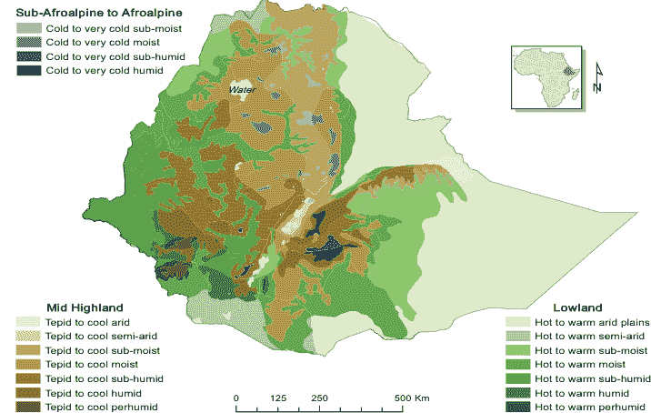

图 5.1：埃塞俄比亚农业生态区。

埃塞俄比亚生态多样性丰富，从热带到温带不等。海拔从-126米（达纳基尔洼地）到拉斯达申山脉的4620米。农业生态区（AEZ）是根据作物适宜性方法确定的，考虑了温度、降水、土壤特征和地形差异。主要作物种植区位于次湿润、湿润和湿润半干旱气候区（图5.1）。该国约51%的地区位于干旱、半干旱和次湿润区（范塔耶2016年）。

本章重点介绍七个AEZ，其中中高地AEZ按海拔细分（表5.1）和低地AEZ按海拔或纬度细分。这些AEZ覆盖了埃塞俄比亚大部分耕地。所选AEZ的海拔范围从500米到3000米以上。降水方式从南部的近似双峰型变为高纬度地区越来越单峰型。例如，在埃塞俄比亚南部的孔佐，3月到5月和9月到11月分别发生了年降雨量的39%和35%。在埃塞俄比亚北部的阿克苏姆，83%的降雨发生在7月和8月。

### 表 5.1. 埃塞俄比亚肥料使用优化目标农业生态区。

| 农业生态区 | 海拔（米） |
|---|---|
| 温和至寒冷湿润中高地 | 1700 – 2200 |
| 温和至寒冷湿润中高地 | >2000 |
| 温和至寒冷湿润中高地 | 1700 – 2200 |
| 温和至寒冷湿润中高地 | >2000 |
| 温和至寒冷次湿润中高地 | 1700 – 2200 |
| 温和至寒冷次湿润中高地 | >2000 |
| 温和至寒冷次湿润中高地 | 1700 – 2200 |
| 温和至寒冷次湿润中高地 | >2000 |
| 寒冷至非常寒冷次非洲高山 | >2500 |
| 炎热至温暖低地，北纬9°以北 | |
| 炎热至温暖低地，北纬9°以南 | |
| 炎热至温暖次湿润和干燥低地 | <1000 |
| 炎热至温暖次湿润和更干燥低地 | >1000 |

### 5.2 土壤肥力管理

埃塞俄比亚多样的地表地貌和农业生态区与丰富的本土知识和实践相关联。埃塞俄比亚农民可以描述其当地土壤类型，并识别土地利用和作物适宜性的差异。农民从土壤长期生产力、渗透性、持水能力、排水性、耕作、肥料需求、可耕性以及作物生产力等方面区分土壤肥力。

农民意识到并关注土壤侵蚀，本土土壤侵蚀控制措施包括当地称为‘feses’的传统沟渠、‘boi’水道、‘yedengay erken’石梯田、‘tekebkeb’截流沟、‘geta’植被屏障以及‘shurube’和‘shaga’等高线耕作。

许多人意识到，仅靠施肥无法解决土壤生产力问题。传统上，埃塞俄比亚农民使用粪肥、轮作、间作、套种和休耕来维持土壤肥力。

不幸的是，并非所有传统做法都有利于可持续土壤生产力。侵蚀是土地退化的主要原因。季节性迁徙放牧很常见，牲畜在生长季节移动到半干旱和干旱牧区，收获后返回农作物生产区。农民无法控制牛群啃食农作物残茬，导致土壤裸露，有机质回归很少，并被牲畜踩踏成粉末。结果，土壤物理性质退化，需要进行多次耕作以克服土壤结壳并进行除草。土壤团聚体破坏、裸露土壤、土壤结壳和耕作的综合效应导致降雨径流和侵蚀。

根据农业和农村发展部未公布的估计，肥料使用量已从1995年的25万吨/年增加到2014年的85万吨/年。许多小农户在施肥方面面临财务限制，并担心缺乏肥料反应和/或偿还贷款困难的风险。30%至40%的小农户使用某种肥料，主要用于苔草、小麦和玉米生产。谷物生产

可能占肥料使用量的90%，其余大部分用于豆类、油料作物和非谷物作物。苔麸、小麦、玉米、大麦和高粱的产量分别占肥料使用量的40%、26%、17%、9%和3%。主要使用的肥料是尿素和磷酸二铵（DAP）。

在高潜力的中部高原，小麦和豆类作物通常对施用的硫（S）有反应，那里的市场导向型作物生产与作物残茬移除、大量耕作和少量粪肥施用相关，导致土壤有机质大多非常稳定，有机硫矿化很少。

谷物总产量每年增长6%，人均产量每年增长3%，但公顷产量每年仅增长0.5%。肥料使用与其他投入品具有叠加效应，并可能具有协同效应（Dercon and Hill 2009）。管理不善的作物不太可能对施用的养分有很好的反应。最近几十年肥料使用量增加了三倍多，但并未带来生产力的显著提高。

肥料是一种昂贵的投入品，其高效使用对于盈利能力、尽量减少养分流失到环境中以及因过量施用氮（N）导致的土壤酸化非常重要。高效使用肥料的关键是实践养分管理的4R原则，即施用正确的产品、正确的用量、在正确的时间并采用正确的方法。4R原则尤其适用于氮（N），因为氮会通过各种途径流失。

对非豆类作物的大部分氮（N）施用应在作物快速生长期之前或期间进行，此时氮吸收率较高，例如玉米的6-8叶期。例如，对于玉米，至少50%的肥料氮应在种植后4至7周施用；当推荐的氮施用量较低时，建议在种植后4周施用全部氮肥。4R原则的相关方面将在第5.3节中进一步阐述。

拥有健康且管理良好的作物对于获得良好的肥料反应也很重要。因此，应贯穿始终地应用良好的农业实践，包括品种选择、精心播种以及良好的杂草和病虫害防治。考虑土壤测试信息以及粪肥施用等其他措施的影响，对于精细调整肥料使用以实现更高的盈利能力和高效的养分利用也很重要。该主题将在第5.5.3节中进一步阐述。

基于田间研究结果的养分施用最新建议和经济最优施用率（EOR）将在第5.6节中阐述。

### 5.3 埃塞俄比亚作物养分缺乏诊断

开展了十八项试验，以确定作物养分反应函数，这对于旨在最大化肥料使用利润的决策至关重要。施用氮（N）、磷（P）和钾（K）后，谷物作物谷物产量的平均百分比增加分别为55%、23%和0%。肥料优化试验包括处理，以确定诊断养分

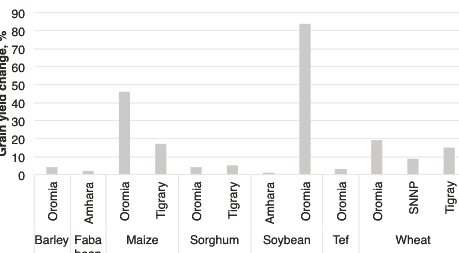

图 5.2：与N+P+K相比，采用N+P+K+Mg+S+Zn+B诊断处理后谷物产量的百分比增加，其中Mg为镁，Zn为锌，B为硼。对施用低量氮和/或根瘤菌接种的豆类作物进行了类似比较。

与N+P+K处理相比，诊断处理在所有作物-区域组合中都增加了谷物产量，但大多数情况下产量增加小于均值的标准误，除了提格雷的玉米以及奥罗米亚的玉米、大豆和小麦（图5.2）。然而，诊断处理带来的产量增加在农场试验中占主导地位，而农户试验的平均效应与零无统计学差异（图5.3）。这种对比出乎意料，可能是由于多年大量施用氮肥和磷肥、高产量以及农场试验站与农户田地相比，一种或多种诊断养分耗竭所致。

与其他养分相比，肥料氮和磷优先级较高。作物反应结果通常不表明对钾、镁、硫、锌和硼缺乏有立即担忧的理由。然而，产量水平的提高会耗尽土壤中的这些养分，对这些养分的产量反应最终可能会发生，如在一些研究中心的田地中所见。

结果确实表明，将土壤测试结果的解释与作物反应进行验证或精细调整非常重要。在全球范围内，包括高产量情况下，土壤测试结果通常对施用硫和微量元素的作物反应预测能力不强，尽管对锌反应的预测相对较好。当作物

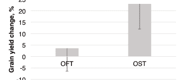

图 5.3：与N+P+K相比，采用N+P+K+Mg+S+Zn+B诊断处理后的平均产量百分比增加，涵盖20项农户试验（OFT）和农场试验（OST）。

遇到除养分缺乏以外的任何非生物和生物胁迫时也是如此。例如，在某一年土壤水分赤字是产量最限制性的胁迫因素时，作物对养分的反应可能较小。土壤测试结果用于确定可用性水平是否足以避免未来偶尔的产量损失，当投入品资金不足且短期无净回报的风险是主要关切时，这是一种有用的策略。在出现诊断方案反应的地方，需要额外的诊断信息来验证这些反应，并确定哪些养分缺乏对作物反应比其他养分更重要。

### 5.4 埃塞俄比亚肥料使用优化

在本章中，肥料使用优化是指在不大大增加农民风险的前提下，最大化肥料使用带来的农民利润。这意味着对于资金充足的农民，最大化每公顷利润；对于资金受限的农民，则是最大化肥料使用小额投资的净回报。

估算肥料使用带来的利润，需要根据田间研究结果为重要的一年生粮食作物生成特定农业生态区（AEZ）的稳健养分反应函数。作物对施用养分的反应在不同地点和年份之间可能差异很大，但当考虑大量试验结果时，预期的平均反应呈曲线至平台型。这种反应可以用渐近函数在数学上表示，形式为指数上升至最大产量或平台产量。用于非洲肥料建议优化（OFRA）研究的渐近函数为 Y = a – bc^x，其中 Y 为产量（t/ha），系数 a 为最大或平台产量（t/ha），系数 b 为养分施用带来的产量增益（t/ha），c^x 表示响应曲线的形状，其中 c 为曲率系数，r 为养分施用率（kg/ha）。

作物对施用氮（N）的反应说明了图5.4中的曲线至平台型反应。这些曲线在反应幅度和曲线形状上有所不同。玉米和苔麸的氮（N）曲线尤其有信息量，在低施用率下，每单位施用氮（N）会带来较大的产量增加。随着氮（N）施用率

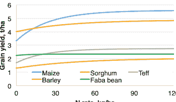

图 5.4：温带至寒冷湿润中高地（1700–2200米海拔）作物对施用氮（N）的曲线至平台型反应特性。

增加，且施用率超过80 kg/ha时产量增加很少。高粱和大麦的氮（N）反应曲线仅略微呈曲线，斜率不大，表明与玉米相比氮（N）反应相对较小。蚕豆对施用氮（N）的反应呈曲线至平台型，在较低的氮（N）施用率即可达到平台，尽管反应幅度较小。反应曲线具有经济意义。资金充足且风险有保障的农民需要知道，获得的产量增值何时能证明额外氮（N）成本的合理性，以便按经济最优施用率（EOR）施肥。资金受限的农民需要在曲线相对陡峭的部分施用低于EOR的肥料，以最大化有限投资下的产量增益。

对资金受限的农民来说，另一个非常重要的经济考量是，向一种作物施用某种养分的盈利潜力，与向另一种作物施用同一种养分以及其他作物-养分组合的潜力不同（图5.5）。在图5.5中，x轴表示向单一种作物施用某种养分的成本（ETb/ha）。y轴表示养分施用投资的净回报。每条曲线代表一种不同的作物-养分组合。

结果表明，向苔麸施用氮（N）的曲线在低氮（N）施用率下较陡峭，因此每笔小额投资的盈利潜力高于其他作物-养分选项。在向苔麸施用约750 ETb价值的氮（N）时，以低施用率向苔麸施用磷（P）具有相似的盈利潜力，如相似的斜率所示。在苔麸之后，玉米对施用氮（N）具有良好的盈利潜力。图表中较低位置的是盈利较低的选项。一些作物-养分选项，例如向玉米以外的作物施用钾（K），因缺乏盈利潜力而未显示。资金受限的农民首先需要利用盈利潜力最高的作物-养分-施用率选项（如果该作物是种植系统的一部分），然后再利用一些盈利较低的选项，以最大化有限投资下的利润。资金充足的农民

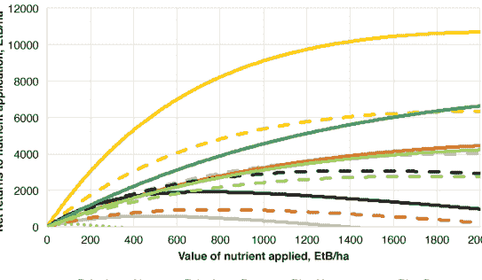

图 5.5：温带至寒冷湿润中高地（1700–2200米海拔）向作物施用单一养分投资的净回报。

需要最大化所有耕地的每公顷利润，因此需要按照响应曲线峰值相关的施肥率施用肥料。请注意，对于某些曲线（包括施用于高潜力玉米的氮肥），净回报的峰值未在图中（图 5.5）捕获，因为 x 轴上的最大投资过低，无法达到峰值。

### 5.5 肥料使用优化工具

作物选择、施肥种类及每种养分施用量的决策需要考虑多种因素。农民种植的不同作物的养分反应农艺学，必须与农民对各作物的土地分配、预期商品价值、肥料使用成本以及可用于肥料使用的资金共同考虑。土壤测试信息及其他可能影响施用养分需求的做法也必须予以考虑。基于所有这些考量，开发了肥料优化工具（FOTs）和肥料施用率调整工具，以帮助农民决定养分管理，从而实现利润最大化。

#### 5.5.1 Excel Solver FOT

Excel Solver ®（Frontline Systems Inc., Incline Village, NV, USA）为每个 13 个推荐领域开发了肥料优化工具（FOTs）。FOTs 使用复杂的线性优化数学，但易于使用。

农民需要估计每种感兴趣作物将种植多少土地，估计收获时每公斤的农场门口价值（考虑部分用于家庭消费——最有价值，剩余部分将上市销售），以及不同肥料的使用成本（图 5.6）。还需输入农民将投入肥料使用的资金金额。在此示例中，农民将作物分配到四公顷土地，并有 EtB 6000 可用于肥料使用。单击“Optimize”按钮后，即运行优化计算。

结果如图 5.7 所示，包括每种作物应施用的各种肥料用量、预期平均产量增加和净回报，以及农场肥料使用的总净回报。每种选定的作物都有某种肥料分配建议。然而，大麦仅建议施用 21 kg/ha 的 DAP，这可能太少，无法实际施用，农民可能希望将肥料或资金分配到其他地方。总共建议施用 241 kg/ha 的 DAP 和 136 kg/ha 的尿素。在此财务约束下，未推荐任何财务安排。高潜力玉米、茫茫草和蚕豆的每公顷净回报最高，表明农民可能希望将更多土地分配给这些作物，尤其是蚕豆，它在相对较少的推荐肥料下即可获得更高回报。此情景下的预期平均净回报为 EtB 44,324，收益成本比大于 7。建议农民使用部分净回报，逐步降低肥料使用的财务约束，并最终将肥料以 EOR 施用于所有耕地。

#### 5.5.2 纸质 FOTs

农民及其顾问通常无法使用计算机。因此，为每个推荐领域开发了配套的纸质 FOTs（表 5.2）。纸质 FOT 针对三个财务水平设计：1) 资金不超过施用所有耕地 EOR 所需金额三分之一的农民；2) 资金较多但不超过施用所有耕地 EOR 所需金额三分之二的农民；3) 资金足以将肥料以 EOR 施用于至少部分耕地的农民。

纸质工具对以下内容做出假设：

- 农民在调整眼力和手感以施用正确肥料率时使用的校准测量单位
- 作物行距和株距
- 每 50 公斤袋装肥料的使用成本
- 收获时农场预期谷物价值，同时考虑家庭消费和市场价值

纸质 FOTs 涉及养分管理的 4Rs，就正确的肥料产品、用量、时机和施用方法提供建议。它还就校准提供建议，即一个测量单位针对推荐肥料率所覆盖的带状或距离长度，或点数。

## 农业生态区：温和至寒冷湿润中高海拔 1700-2200 米

| 生产者姓名： | xxx |
|---|---|
| 编制人： | xxx |
| 编制日期： | 2016 年 7 月 6 日 |

| 作物 | 种植面积（公顷） | 预期谷物价值/公斤 |
|---|---|---|
| 高产玉米 >5T | 1 | 4 |
| 低产玉米 <5T | 0.5 | 4 |
| 高粱 | 0.5 | 5.5 |
| 茫茫草 | 1 | 12 |
| 大麦 | 0.5 | 6 |
| 蚕豆 | 0.5 | 12 |
| 总公顷数 | 4 | |

| 肥料产品 | N | P2O5 | K2O | 每 50 公斤袋装价格 T |
|---|---|---|---|---|
| 尿素 | 46% | 0% | 0% | 700 |
| 三过磷酸钙，TSP | 0% | 46% | 0% | 0 |
| 磷酸二铵，DAP | 18% | 46% | 0% | 850 |
| 氯化钾，KCl | 0% | 0% | 60% | 800 |
| xxx | % | % | % | 0 |

| 预算约束 |
|---|
| 可用于投资肥料的金额 | 6000 |

图 5.6：温和至寒冷中高地（1700 至 2000 米海拔）肥料优化工具的输入界面。

| 作物 | 尿素 | TSP | DAP | KCl | xxx |
|---|---|---|---|---|---|
| 高产玉米 >5T | 48 | 0 | 68 | 0 | 0 |
| 低产玉米 <5T | 51 | 0 | 61 | 0 | 0 |
| 高粱 | 0 | 0 | 64 | 0 | 0 |
| 茫茫草 | 63 | 0 | 62 | 0 | 0 |
| 大麦 | 0 | 0 | 21 | 0 | 0 |
| 蚕豆 | 0 | 0 | 76 | 0 | 0 |
| 所需肥料总量 | 136 | 0 | 241 | 0 | 0 |

| 作物 | 产量增加 | 净回报 |
|---|---|---|
| 高产玉米 >5T | 4.274 | 15,275 |
| 低产玉米 <5T | 2.491 | 8,209 |
| 高粱 | 1.574 | 7,578 |
| 茫茫草 | 1.264 | 13,229 |
| 大麦 | 215 | 934 |
| 蚕豆 | 1,350 | 14,919 |

| 肥料预期总净回报 |
|---|
| 肥料投资总净回报 | 44,324 |

图 5.7：与图 5.6 输入数据对应的输出结果。

## 表 5.2：温和至寒冷湿润中高地海拔 2000-2700 米的纸质 FOT

- 假设：
- 测量使用：500 毫升 Highland 品牌水瓶瓶盖，可装 6.7 毫升、4.7 克尿素，以及 7.4 克 DAP、TSP 和 KCl；500 毫升 Highland 品牌水（2 厘米瓶）可装 47 毫升、33 克尿素和 52 克 DAP、TSP 或 KCl。
- 行距：玉米 75 厘米；小麦和大麦 20 厘米；蚕豆 40 厘米；茫茫草为撒施。
- 每公斤谷物价格（埃塞俄比亚比尔）：玉米 4；大麦 6；蚕豆 12；小麦 8。
- 50 公斤肥料成本（埃塞俄比亚比尔）：尿素 700；TSP 750；DAP 850 和 KCl 1500。
- 肥料施用率 > 25 kg/ha。撒施宽度 2 米

- 财务能力 1 级。
- 高产玉米点施 51.1 kg/ha DAP（每 CAP 1.9 株）
- 低产玉米点施 41 kg/ha 尿素，于种植后 3 周施用（每 CAP 1.9 株）
- 小麦 HP 种植时撒施 56.8 kg DAP（每 2 厘米瓶 4.5 米）并追肥 34.3 kg/ha 尿素（每 2 厘米瓶 4.5 米）
- 小麦 LP 无投入
- 大麦无投入
- 蚕豆种植时条施 38.1 kg/ha DAP（每 CAP 4.8 米）

- 财务能力 2 级。
- 高产玉米点施 71 kg/ha DAP（每 CAP 1.3 株）并追肥 53 kg/ha 尿素（每 CAP 1.1 株）
- 低产玉米点施 81 kg/ha 尿素（每 CAP 0.7 株），于种植后 3 周施用
- 小麦 HP 种植时撒施 81.7 kg/ha DAP（每 2 厘米瓶 3.2 米）并追肥 50 kg/ha 尿素（每 2 厘米瓶 3.1 米）
- 小麦 LP 种植时撒施 53 kg/ha DAP（每 2 厘米瓶 4 米）并追肥 51 kg/ha 尿素（每 2 厘米瓶 3.1 米）
- 大麦种植时撒施 27.2 kg/ha DAP（每 2 厘米瓶 11.4 米）
- 蚕豆种植时条施 71.5 kg/ha DAP（每 CAP 2.6 米）

- 财务能力 3 级（最大化每英亩利润）。
- 高产玉米种植时点施 83 kg/ha DAP（每 CAP 1 株）并于种植后 3 周追肥 73 kg/ha 尿素（每 CAP 0.8 株）
- 低产玉米种植时点施 86 kg/ha DAP（每 CAP 1 株）并于种植后 3 周追肥 71 kg/ha 尿素（每 CAP 0.8 株）
- 小麦 HP 种植时撒施 97.4 kg DAP（每 2 厘米瓶 2.7 米）并追肥 59.3 kg/ha 尿素（每 2 厘米瓶 2.6 米）
- 小麦 LP 种植时撒施 83.5 kg/ha DAP（每 2 厘米瓶 3 米）并追肥 80.5 kg/ha 尿素（每 2 厘米瓶 2 米）
- 大麦种植时撒施 48.6 kg/ha DAP（每 2 厘米瓶 6 米）
- 蚕豆种植时条施 93.8 kg/ha DAP（每 CAP 2.0 米）

纸质 FOT 使用简便，预计许多农民将自行学习使用。例如，一项财务能力 1 级的建议是“茫茫草：种植时撒施 30 kg DAP（每 2 厘米瓶 12.7 米）并追肥 42 kg/ha 尿素（每 2 厘米瓶 7.3 米）”。因此，30 kg/ha DAP 应在种植时以 2 米宽的通道进行撒施。农民使用剪裁为 2 厘米高的 500 毫升 Highland 品牌水瓶来“校准”自己的眼力和手感，这足以覆盖 12.7 米的距离。尿素以 42 kg/ha 的撒施方式追肥；一个 2 厘米瓶在 2 米施用宽度下足以覆盖 7.3 米。

#### 5.5.3 肥料施用率调整工具

优化肥料使用的另一个方面是考虑土壤测试值以及减少或增加肥料需求的做法，例如最近施用畜禽粪肥的时间、用量和质量。如果前茬作物是豆科作物，或使用了绿肥作物，则

表 5.3：因其他做法或土壤测试信息而调整推荐肥料施用率

| ISFM 做法 | 尿素 | TSP/DAP | KCl/K2SO4 |
|---|---|---|---|
| | 养分减少量，kg/ha 或 % | | |
| 前茬为绿肥作物 | 100% | 100% | 100% |
| 施用鲜绿植物材料（例如兰塔纳或茴木修剪物），每 1 吨鲜材料 | 10 kg | 4 kg | 6 kg |
| 每 1 吨干物质的农家肥 | 0 kg | 4 kg | 6 kg |
| 前茬施用农家肥的残留价值，每 1 吨 | 0 kg | 2 kg | 2 kg |
| 奶牛或家禽粪便，每 1 吨干物质 | 10 kg | 6 kg | 10 kg |
| 前茬施用奶牛和家禽粪便的残留价值，每 1 吨 | 4 kg | 4 kg | 2 kg |
| 施用每 1 吨干物质的堆肥 | 6 kg | 6 kg | 10 kg |
| 前茬施用堆肥的残留价值，每 1 吨 | 6 kg | 4 kg | 2 kg |
| 轮作 | 0% 减少，但预计产量更高 | | |
| 谷物-豆间作 | 相比单一种植谷物肥料，DAP/TSP 增加 8 kg/ha，但 N 和 K 不变 | | |
| 谷物-其他豆科（有效固氮）间作 | 相比单一种植谷物肥料，DAP/TSP 增加 12 kg/ha，尿素减少 20 kg/ha，K 不变 | | |
| 如果 Mehlich III P >15 ppm | 不施 P | | |
| 如果土壤测试 K <100 ppm | 带施 40 kg/ha K2SO4 | | |

需要考虑这些做法带来的养分信用并相应调整养分施用量（表 5.3）。土壤测试信息也可能提供有用信息，以推荐最佳施用率。

（表 5.4a–g）使用过去研究和 OFRA 支持的试验结果。作物包括玉米、小麦、teff、高粱、大麦、水稻、指形黍、马铃薯、豆类、大豆和蚕豆。考虑到埃塞俄比亚生产条件与非洲其他农业地区相比大多具有独特性，很少考虑埃塞俄比亚境外的研究结果。

通常，这些调整做法可能不适用于农民的所有耕地，而仅适用于一块或几块土地（如果有的话）。可能有机会减少某些地块的肥料施用，并将该肥料或资金重新分配到其他地方（表 5.3）。例如，每施用一吨农家肥，P2O5 和 K2O 施用率分别可减少 2 和 3 kg/ha。然而，谷物-豆间作时，应增加肥料 P 施用率。小农户地块的土壤测试 P 通常较低，应根据 FOT 施用肥料 P，除非 Mehlich III 测定的土壤测试 P 值高于 15 ppm。应根据 FOT 建议施用肥料 K，除非土壤测试 K 低于 100 ppm，此时应施用 40 kg/ha 硫酸钾，即使 FOT 未建议也应如此。

与每个 AEZ 相关的可用结果已被汇编、分析，并与其他信息（如当前建议 REC）一起用于确定代表性作物养分响应函数。在表 5.4 中，第 1 列列出了针对 AEZ 的目标作物，并按海拔或纬度区分 AEZ（第 2 列）。作物养分响应函数的养分和系数 a、b、c 在第 3-6 列中列出。施用养分增量带来的预期平均产量增加在第 7-10 列，随后是第 11-12 列中的 EOR 和推荐养分施用率。

### 5.6 按 AEZ 划分的目标作物

主要作物的养分响应函数已针对 13 个推荐领域确定

所有谷物、马铃薯和蚕豆在所有目标 AEZ 中对 N 都有经济响应（表 5.4 a–g）。豆类有

## Table 5.4a: Tepid to cold moist mid-highland, differentiated by altitude. Response functions, expected yield increases (t/ha) for crop-nutrients, and OFRA economically optimal rate (EOR) to maximize profit per hectare compared to current or recent recommendations (REC) in Ethiopia. P2O5 = P x 2.29; K2O = K x 1.2. Some functions have zero response because of lack of response or lack of information

| 作物 | 海拔范围（masl） | 养分 | a | b | c | 0-30 | 30-60 | 60-90 | 90-120 | EOR† | REC |
|---|---|---|---|---|---|---|---|---|---|---|---|
| 蚕豆 | <2200 | N | 2.300 | 0.117 | 0.890 | 0.113 | 0.003 | 0.000 | 0.000 | 14 | 18 |
| 水稻 | <2200 | N | 3.363 | 1.112 | 0.975 | 0.592 | 0.277 | 0.130 | 0.061 | 98 | 69 |
| teff | <2200 | N | 2.735 | 1.235 | 0.948 | 0.986 | 0.199 | 0.040 | 0.008 | 61 | 69 |
| 豆类 | <2200 | N | 2.100 | 0.230 | 0.890 | 0.223 | 0.007 | 0.000 | 0.000 | 20 | 18 |
| 玉米 | <2200 | N | 5.443 | 2.945 | 0.980 | 1.339 | 0.730 | 0.398 | 0.217 | 102 | 69 |
| 高粱 | <2200 | N | 3.176 | 0.744 | 0.989 | 0.210 | 0.151 | 0.108 | 0.078 | 36 | 18 |
| 大麦 | >2000 | N | 1.811 | 0.546 | 0.975 | 0.291 | 0.136 | 0.064 | 0.030 | 40 | 41 |
| 蚕豆 | >2000 | N | 2.400 | 0.100 | 0.963 | 0.068 | 0.022 | 0.007 | 0.002 | 11 | 18 |
| 小麦 HP>3t | >2000 | N | 3.777 | 1.279 | 0.974 | 0.699 | 0.317 | 0.144 | 0.065 | 83 | 69 |
| 小麦 LP<3t | >2000 | N | 2.497 | 1.229 | 0.978 | 0.598 | 0.307 | 0.157 | 0.081 | 89 | 69 |
| 马铃薯 | >2000 | N | 23.175 | 13.646 | 0.980 | 6.203 | 3.383 | 1.846 | 1.007 | 184 | 92 |
| | | | | | 0-5 | 5-10 | 10-15 | 15-20 | | |
| 蚕豆 | <2200 | P | 2.23 | 0.594 | 0.920 | 0.203 | 0.133 | 0.088 | 0.058 | 28 | 20 |
| 水稻 | <2200 | P | 2.743 | 0.285 | 0.850 | 0.159 | 0.070 | 0.031 | 0.014 | 15 | 20 |
| teff | <2200 | P | 1.006 | 0.840 | 0.900 | 0.344 | 0.203 | 0.120 | 0.071 | 28 | 20 |
| 豆类 | <2200 | P | 2.510 | 0.405 | 0.885 | 0.185 | 0.101 | 0.055 | 0.030 | 19 | 20 |
| 玉米 | <2200 | P | 4.498 | 1.117 | 0.918 | 0.389 | 0.253 | 0.165 | 0.108 | 30 | 20 |
| 蚕豆 | >2000 | P | 2.387 | 0.751 | 0.825 | 0.464 | 0.177 | 0.068 | 0.026 | 18 | 20 |
| 大麦 | >2000 | P | 3.194 | 0.945 | 0.880 | 0.446 | 0.236 | 0.124 | 0.066 | 20 | 20 |
| 小麦 HP>3t | >2000 | P | 4.023 | 1.458 | 0.812 | 0.943 | 0.333 | 0.118 | 0.041 | 18 | 20 |
| 小麦 LP<3t | >2000 | P | 2.320 | 0.683 | 0.940 | 0.182 | 0.133 | 0.098 | 0.072 | 29 | 20 |
| 马铃薯 | >2000 | P | 21.486 | 2.745 | 0.825 | 1.696 | 0.648 | 0.248 | 0.095 | 21 | 20 |

†计算 EOR 值使用了以下谷物价值和肥料成本。使用的谷物价值为（EtB/kg）：豆类，12；蚕豆，12；teff，12；小麦，8；大麦，6；高粱，5.5；玉米，4；指形黍，10；大豆，9；马铃薯，6。50 kg 肥料的使用成本为（EtB/kg）：尿素 700；DAP 850；KCl 1500。

仅在温和至冷湿中高地 <2200 masl 对 N 有盈利响应，而大豆对 N 无响应。所有目标作物对 P 都有经济响应，除了温和至冷湿及次湿润中高地 <2200 masl 的高粱。施用 K 的唯一经济响应是在热带至温暖湿润低地的玉米和 teff 中确定。

所有 AEZ 中所有作物的 N 平均 EOR 为 63 kg/ha，而 RECs 平均值为 51 kg/ha，标准误（SE）为 3.3（表 5.4a-g）。与 REC N 相比，马铃薯的高 N EOR 对差异和 SE 贡献很大。所有 AEZ 中所有作物的 P 平均 EOR 为 18 kg/ha，而推荐率平均值为 20 kg/ha，差异的 SE 为 2.1。在大多数情况下，REC P 施用率为 20 kg/ha，而根据田间研究结果确定的 EOR P 变化要大得多。

## Table 5.4b: Tepid to cold humid mid-highland, differentiated by altitude

| 作物 | 海拔范围（masl） | 养分 | a | b | c | 0-30 | 30-60 | 60-90 | 90-120 | EOR† | REC |
|---|---|---|---|---|---|---|---|---|---|---|---|
| | | | | | t/ha | | | | | kg/ha | kg/ha |
| 玉米 | >1700 | N | 5.596 | 2.256 | 0.961 | 1.572 | 0.477 | 0.144 | 0.044 | 61 | 69 |
| 高粱 | <2200 | N | 4.880 | 0.870 | 0.975 | 0.463 | 0.217 | 0.101 | 0.047 | 53 | 41 |
| teff | <2200 | N | 2.753 | 1.049 | 0.955 | 0.785 | 0.197 | 0.050 | 0.012 | 63 | 69 |
| 大麦 | >1700 | N | 2.053 | 0.753 | 0.979 | 0.355 | 0.188 | 0.099 | 0.053 | 52 | 41 |
| 蚕豆 | >1700 | N | 2.350 | 0.100 | 0.900 | 0.096 | 0.004 | 0.000 | 0.000 | 20 | 18 |
| 小麦 HP>3T | >2000 | N | 4.009 | 1.698 | 0.940 | 1.433 | 0.224 | 0.035 | 0.005 | 54 | 41 |
| 小麦 LP<3T | >2000 | N | 2.238 | 0.947 | 0.977 | 0.476 | 2.537 | 0.118 | 0.059 | 57 | 41 |
| | | | | | 0-5 | 5-10 | 10-15 | 15-20 | | |
| 玉米 HP>5t | >1700 | P | 6.928 | 2.832 | 0.833 | 1.696 | 0.680 | 0.273 | 0.109 | 20 | 30 |
| 玉米 LP<5t | >1700 | P | 3.521 | 1.515 | 0.940 | 0.403 | 0.296 | 0.217 | 0.159 | 30 | 20 |
| 高粱 | <2200 | P | 4.645 | 1.550 | 0.850 | 0.862 | 0.383 | 0.170 | 0.075 | 17 | 10 |
| teff | <2200 | P | 1.401 | 0.514 | 0.898 | 0.214 | 0.125 | 0.073 | 0.043 | 19 | 20 |
| 大麦 | >1700 | P | 2.687 | 0.438 | 0.901 | 0.178 | 0.106 | 0.063 | 0.037 | 15 | 10 |
| 蚕豆 | >1700 | P | 2.753 | 1.392 | 0.850 | 0.774 | 0.344 | 0.152 | 0.068 | 21 | 20 |
| 小麦 HP>3T | >2000 | P | 4.154 | 1.415 | 0.867 | 0.722 | 0.354 | 0.173 | 0.085 | 23 | 20 |
| 小麦 LP<3T | >2000 | P | 2.313 | 0.576 | 0.930 | 0.175 | 0.122 | 0.085 | 0.059 | 24 | 20 |
| 小麦 | >2000 | K | 2.369 | 0.056 | 0.899 | 0.023 | 0.014 | 0.008 | 0.005 | 0 | 0 |

### 5.7 结论

养分管理对于最大化作物产量和维持土壤生产力至关重要。贫困农民需要在低风险的情况下获得投资的高净回报，而较富裕的农民可能致力于最大化每公顷利润。肥料使用的盈利潜力因作物-养分选择而异。与 K 以及次要和微量养分相比，施用 N 和 P 的盈利潜力通常大得多。与世界其他地区的研究结果一致，农民需要充足获取单养分和双养分复合肥料以最大化利润。已开发出基于证据的 FOT，用于优化任何经济阶层埃塞俄比亚农民的肥料使用。根据田间研究结果确定的 EOR 通常与 RECs 不同。

### 5.8 参考文献

CSA（中央统计局）（2013）2012/2013 年农业抽样调查 第 I 卷。主要作物面积和产量报告（私人农户持有，梅赫尔季节）。统计公报 532，亚的斯亚贝巴
Dercon S 和 Hill RF（2009）埃塞俄比亚的农业增长。识别关键约束。作为埃塞俄比亚农业与增长研究的一部分准备的论文。DFID，英国。
Dubale P（2001）埃塞俄比亚高地农业生态系统中土壤和水资源及其影响生产力的退化因素。埃塞俄比亚当代发展问题国际会议，CADPR，西密歇根大学。
Fantaye KT（2016）埃塞俄比亚：埃塞俄比亚的种植系统、气候和土壤描述。http://www.yieldgap.org/ethiopia

## 表 5.4c: 温和至冷次湿润中高地，按海拔分化

| 作物 | 海拔范围 (masl) | 养分 | a | b | c | 0-30 | 30-60 | 60-90 | 90-120 | EOR† | REC |
|---|---|---|---|---|---|---|---|---|---|---|---|
| 高粱 | <2200 | N | 4.770 | 0.611 | 0.973 | 0.342 | 0.151 | 0.066 | 0.029 | 41 | 41 |
| 提夫 高产>2t | <2200 | N | 2.877 | 1.220 | 0.955 | 0.913 | 0.230 | 0.058 | 0.014 | 66 | 69 |
| 提夫 低产<2t | <2200 | N | 1.015 | 0.458 | 0.963 | 0.310 | 0.100 | 0.032 | 0.010 | 49 | 41 |
| 玉米 高产>5t | <2200 | N | 6.306 | 3.025 | 0.975 | 1.610 | 0.753 | 0.352 | 0.165 | 88 | 87 |
| 玉米 低产<5t | <2200 | N | 4.082 | 1.400 | 0.971 | 0.821 | 0.340 | 0.140 | 0.058 | 55 | 64 |
| 大麦 | >2000 | N | 1.811 | 0.546 | 0.975 | 0.291 | 0.136 | 0.064 | 0.030 | 40 | 32 |
| 小麦 高产>3t | >2000 | N | 3.777 | 1.279 | 0.974 | 0.699 | 0.317 | 0.144 | 0.065 | 83 | 87 |
| 小麦 低产<3t | >2000 | N | 2.350 | 1.229 | 0.978 | 0.598 | 0.307 | 0.157 | 0.081 | 89 | 64 |
| 蚕豆 | >2000 | N | 2.400 | 0.100 | 0.963 | 0.068 | 0.022 | 0.007 | 0.002 | 11 | 18 |
| 爱尔兰马铃薯 | >2000 | N | 23.176 | 13.646 | 0.980 | 6.203 | 3.383 | 1.846 | 1.007 | 184 | 110 |
| | | | 0-5 | 5-10 | 10-15 | 15-20 | | | | | |
| 高粱 | <2200 | P | 4.766 | 1.166 | 0.882 | 0.544 | 0.290 | 0.155 | 0.083 | 20 | 20 |
| 提夫 | <2200 | P | 1.401 | 0.514 | 0.898 | 0.214 | 0.125 | 0.073 | 0.043 | 20 | 20 |
| 玉米 高产>5t | <2200 | P | 6.865 | 2.761 | 0.819 | 1.744 | 0.642 | 0.237 | 0.087 | 17 | 20 |
| 玉米 低产<5t | <2200 | P | 4.195 | 1.219 | 0.94 | 0.324 | 0.238 | 0.175 | 0.128 | 23 | 20 |
| 大麦 | >2000 | P | 3.194 | 0.945 | 0.880 | 0.446 | 0.236 | 0.124 | 0.066 | 18 | 10 |
| 小麦 高产>3t | >2000 | P | 4.023 | 1.458 | 0.812 | 0.943 | 0.333 | 0.118 | 0.041 | 17 | 20 |
| 小麦 低产<3t | >2000 | P | 2.320 | 0.683 | 0.940 | 0.182 | 0.133 | 0.098 | 0.072 | 24 | 20 |
| 蚕豆 | >2000 | P | 2.387 | 0.751 | 0.825 | 0.464 | 0.177 | 0.068 | 0.026 | 16 | 20 |
| 爱尔兰马铃薯 | >2000 | P | 21.486 | 2.745 | 0.825 | 1.696 | 0.648 | 0.248 | 0.095 | 19 | 20 |

GYGA (2016) 全球产量差距图谱。http://www.yieldgap.org/

Spielman DJ, Dawit K 和 Dawit A (2011) 埃塞俄比亚的种子、肥料和农业推广。亚的斯亚贝巴，埃塞俄比亚，ESSP工作论文

## 表 5.4d: 温和至冷次湿润中高地，按海拔分化

| 作物 | 海拔范围 (masl) | 养分 | a | b | c | 0-30 | 30-60 | 60-90 | 90-120 | EOR† | REC |
|---|---|---|---|---|---|---|---|---|---|---|---|
| 豆类 | <2200 | N | 2.000 | 0.015 | 0.930 | 0.013 | 0.002 | 0.000 | 0.000 | 0 | 0 |
| 蚕豆 | <2200 | N | 2.148 | 0.376 | 0.966 | 0.243 | 0.086 | 0.030 | 0.011 | 46 | 18 |
| 玉米 | <2200 | N | 3.385 | 1.601 | 0.973 | 0.897 | 0.394 | 0.174 | 0.076 | 64 | 64 |
| 提夫 | <2200 | N | 1.602 | 0.989 | 0.988 | 0.300 | 0.209 | 0.146 | 0.101 | 107 | 64 |
| 高粱 | <2200 | N | 3.107 | 0.654 | 0.966 | 0.422 | 0.150 | 0.053 | 0.019 | 41 | 41 |
| 大麦 | >2000 | N | 1.811 | 0.546 | 0.975 | 0.291 | 0.136 | 0.064 | 0.030 | 40 | 64 |
| 小麦 高产>3t | >2000 | N | 3.777 | 1.279 | 0.974 | 0.699 | 0.317 | 0.144 | 0.065 | 83 | 64 |
| 小麦 低产<3t | >2000 | N | 2.350 | 1.229 | 0.978 | 0.598 | 0.307 | 0.157 | 0.081 | 89 | 64 |
| 蚕豆 | >2000 | N | 2.400 | 0.100 | 0.963 | 0.068 | 0.022 | 0.007 | 0.002 | 11 | 18 |
| 爱尔兰马铃薯 | >2000 | N | 23.176 | 13.646 | 0.980 | 6.203 | 3.383 | 1.846 | 1.007 | 184 | 110 |
| 豆类 | <2200 | P | 2.509 | 0.404 | 0.88 | 0.191 | 0.101 | 0.053 | 0.028 | 17 | 0 |
| 蚕豆 | <2200 | P | 2.238 | 0.902 | 0.922 | 0.301 | 0.201 | 0.134 | 0.089 | 30 | 20 |
| 玉米 | <2200 | P | 4.498 | 1.117 | 0.918 | 0.389 | 0.253 | 0.165 | 0.108 | 19 | 20 |
| 提夫 | <2200 | P | 1.148 | 0.212 | 0.955 | 0.044 | 0.035 | 0.028 | 0.022 | 10 | 20 |
| 高粱 | <2200 | P | 2.664 | 0.232 | 0.97 | 0.033 | 0.028 | 0.024 | 0.021 | 0 | 20 |
| 大麦 | >2000 | P | 3.194 | 0.945 | 0.880 | 0.446 | 0.236 | 0.124 | 0.066 | 18 | 20 |
| 小麦 高产>3t | >2000 | P | 4.023 | 1.458 | 0.812 | 0.943 | 0.333 | 0.118 | 0.041 | 17 | 20 |
| 小麦 低产<3t | >2000 | P | 2.320 | 0.683 | 0.940 | 0.182 | 0.133 | 0.098 | 0.072 | 24 | 20 |
| 蚕豆 | >2000 | P | 2.387 | 0.751 | 0.825 | 0.464 | 0.177 | 0.068 | 0.026 | 16 | 20 |
| 爱尔兰马铃薯 | >2000 | P | 21.486 | 2.745 | 0.825 | 1.696 | 0.648 | 0.248 | 0.095 | 19 | 20 |
| 玉米 | <2200 | K | 3.659 | 0.120 | 0.800 | 0.081 | 0.026 | 0.009 | 0.003 | 0 | 0 |

## 表 5.4e: 热带至温暖湿润低地，按海拔分化

| 作物 | 海拔范围 (masl) | 养分 | a | b | c | 0-30 | 30-60 | 60-90 | 90-120 | EOR† | REC |
|---|---|---|---|---|---|---|---|---|---|---|---|
| 玉米 <9°N | | N | 3.462 | 1.782 | 0.978 | 0.868 | 0.445 | 0.228 | 0.117 | 71 | 32 |
| 玉米 >9°N | | N | 2.600 | 0.384 | 0.955 | 0.288 | 0.072 | 0.018 | 0.005 | 74 | 32 |
| 高粱 <9°N | | N | 4.400 | 1.714 | 0.979 | 0.807 | 0.427 | 0.226 | 0.120 | 86 | 32 |
| 高粱 >9°N | | N | 2.504 | 0.297 | 0.920 | 0.273 | 0.022 | 0.002 | 0.000 | 89 | 32 |
| 水稻，低地水田 | | N | 3.006 | 0.787 | 0.958 | 0.570 | 0.157 | 0.043 | 0.012 | 62 | 64 |
| 豆类 | | N | 2.000 | 0.015 | 0.950 | 0.012 | 0.003 | 0.001 | 0.000 | 0 | 0 |
| 提夫 | | N | 1.912 | 1.013 | 0.962 | 0.696 | 0.218 | 0.068 | 0.021 | 30 | 64 |
| | | | 0-5 | 5-10 | 10-15 | 15-20 | | | | | |
| 玉米 <9°N | | P | 2.923 | 0.344 | 0.95 | 0.078 | 0.060 | 0.047 | 0.036 | 7 | 20 |
| 玉米 >9°N | | P | 2.800 | 0.559 | 0.897 | 0.234 | 0.136 | 0.079 | 0.046 | 4 | 20 |
| 高粱 <9°N | | P | 4.696 | 0.913 | 0.8 | 0.614 | 0.201 | 0.066 | 0.022 | 30 | 20 |
| 高粱 >9°N | | P | 2.419 | 0.089 | 0.900 | 0.036 | 0.022 | 0.013 | 0.008 | 13 | 20 |
| 豆类 | | P | 2.497 | 0.392 | 0.940 | 0.104 | 0.077 | 0.056 | 0.041 | 22 | 20 |
| 提夫 | | P | 1.564 | 0.155 | 0.750 | 0.118 | 0.028 | 0.007 | 0.002 | 8 | 20 |
| 大豆 | | P | 1.476 | 0.346 | 0.880 | 0.163 | 0.086 | 0.046 | 0.024 | 13 | 10 |
| | | | 0-5 | 5-10 | 10-15 | 15-20 | | | | | |
| 玉米 | | K | 3.383 | 0.282 | 0.85 | 0.157 | 0.070 | 0.031 | 0.014 | 12 | 0 |
| 提夫 | | K | 1.595 | 0.157 | 0.700 | 0.131 | 0.022 | 0.004 | 0.001 | 9 | 0 |

## 表 5.4f: 热带至温暖次湿和较干燥低地，按海拔分化

| 作物 | 海拔范围 (masl) | 养分 | a | b | c | 0-30 | 30-60 | 60-90 | 90-120 | EOR† | REC |
|---|---|---|---|---|---|---|---|---|---|---|---|
| | | | | | 吨/公顷 | | | | | 千克/公顷 |
| 水稻 | >1000 | N | 4.579 | 1.822 | 0.979 | 0.858 | 0.454 | 0.240 | 0.127 | 132 | 110 |
| 高粱 | >1000 | N | 4.229 | 0.810 | 0.957 | 0.593 | 0.159 | 0.042 | 0.011 | 42 | 64 |
| 玉米 | >1000 | N | 3.654 | 1.674 | 0.985 | 0.610 | 0.388 | 0.246 | 0.157 | 80 | 64 |
| 提夫 | >1000 | N | 1.912 | 1.013 | 0.962 | 0.696 | 0.218 | 0.068 | 0.021 | 71 | 64 |
| 玉米 | <1000 | N | 4.272 | 2.025 | 0.963 | 1.372 | 0.443 | 0.143 | 0.046 | 61 | 64 |
| 高粱 | <1000 | N | 4.159 | 0.619 | 0.890 | 0.600 | 0.018 | 0.001 | 0.000 | 22 | 18 |
| 水稻 | <1000 | N | 2.779 | 1.162 | 0.973 | 0.651 | 0.286 | 0.126 | 0.055 | 95 | 87 |
| 指形黍 | <1000 | N | 1.528 | 0.282 | 0.904 | 0.268 | 0.013 | 0.001 | 0.000 | 22 | 18 |
| 提夫 | <1000 | N | 2.735 | 1.235 | 0.948 | 0.986 | 0.199 | 0.040 | 0.008 | 61 | 64 |
| | | | | | 0-5 | 5-10 | 10-15 | 15-20 | | | |
| 水稻 | >1000 | P | 2.500 | 0.300 | 0.700 | 0.250 | 0.042 | 0.007 | 0.001 | 8 | 20 |
| 高粱 | >1000 | P | 4.037 | 0.715 | 0.830 | 0.433 | 0.171 | 0.067 | 0.026 | 12 | 20 |
| 玉米 | >1000 | P | 3.892 | 0.711 | 0.700 | 0.592 | 0.099 | 0.017 | 0.003 | 7 | 20 |
| 提夫 | >1000 | P | 0.916 | 0.044 | 0.800 | 0.030 | 0.010 | 0.003 | 0.001 | 2 | 20 |
| 玉米 | <1000 | P | 3.803 | 1.267 | 0.910 | 0.476 | 0.297 | 0.185 | 0.116 | 20 | 20 |
| 水稻 | <1000 | P | 3.790 | 0.556 | 0.947 | 0.133 | 0.101 | 0.077 | 0.059 | 31 | 20 |
| 指形黍 | <1000 | P | 1.559 | 0.325 | 0.937 | 0.090 | 0.065 | 0.047 | 0.034 | 16 | 20 |
| 大豆 | <1000 | P | 1.827 | 0.352 | 0.750 | 0.268 | 0.064 | 0.015 | 0.004 | 9 | 20 |
| 提夫 | <1000 | P | 1.118 | 0.250 | 0.795 | 0.171 | 0.054 | 0.017 | 0.005 | 10 | 20 |

## 表 5.4g: 冷至非常冷次非洲高山型。

| 作物 | 海拔范围 (masl) | 养分 | a | b | c | 0-30 | 30-60 | 60-90 | 90-120 | EOR† | REC |
|---|---|---|---|---|---|---|---|---|---|---|---|
| | | | | | 吨/公顷 | | | | | 千克/公顷 |
| 大麦 | | N | 2.179 | 0.625 | 0.982 | 0.263 | 0.152 | 0.088 | 0.051 | 44 | 73 |
| 蚕豆 | | N | 2.550 | 0.060 | 0.940 | 0.051 | 0.008 | 0.001 | 0.000 | 16 | 18 |
| 小麦 | | N | 3.284 | 1.303 | 0.964 | 0.869 | 0.289 | 0.096 | 0.032 | 69 | 73 |
| | | | | | 0-5 | 5-10 | 10-15 | 15-20 | | | |
| 大麦 | | P | 3.525 | 0.881 | 0.871 | 0.439 | 0.220 | 0.110 | 0.055 | 18 | 30 |
| 蚕豆 | | P | 3.040 | 1.434 | 0.847 | 0.809 | 0.353 | 0.154 | 0.067 | 22 | 20 |
| 小麦 | | P | 4.656 | 1.468 | 0.837 | 0.865 | 0.355 | 0.146 | 0.060 | 20 | 30 |

## 6. 在加纳综合土壤肥力管理背景下优化肥料使用

Francis M. Tetteh¹, fmarthy2002@yahoo.co.uk, Gabriel W. Quansah¹, Samuel O. Frempong¹, Abdul Rahman Nurudeen², Williams K. Atakora³, Godwin Opoku⁴

¹CSIR-Soil Research Institute, Academy Post Office, Kwadaso-Kumasi, Ghana ²IITA/Africa RISING, P.O. Box TL 6, Tamale, Ghana ³Savanna Agricultural Research Institute, P.O. Box TL 52, Tamale, Ghana ⁴Savanna Agricultural Research Institute, P.O. Box 494, Wa Station, Wa, Ghana

### 6.1 加纳的土壤养分管理，包括肥料使用

加纳的农业表现为作物产量低，原因是土壤肥力低、水土流失、土地利用不当以及通过作物收获和出口导致的养分耗竭，而未通过施肥进行相应补充，进而导致土壤退化。因此，粮食安全面临风险，对进口食品的依赖增加，并耗费加纳的外汇储备。

加纳的重要粮食作物包括玉米、水稻、高粱、小米、木薯和豆类。

在谷物中，玉米最为重要，年产量约750,000公顷。豇豆是一种非常重要的豆类粮食作物，大豆正在成为重要的经济作物。然而，这些作物的产量较低，原因是土壤肥力低和投入品使用少。阿布贾肥料峰会宣言指出，撒哈拉以南非洲（SSA）只有在增加肥料使用时，才能增加粮食产量并减轻贫困。

然而，平均玉米产量为1.5 t/ha，而潜在产量为6 t/ha。导致作物生产力低下的两个主要原因包括土壤肥力低

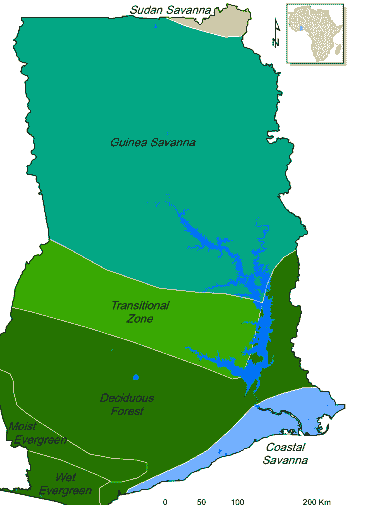

图 6.1：加纳的农业生态区（AEZ）。

肥力低和投入品使用少。主要玉米种植区的土壤有机碳（<1.5%）、全氮（<0.2%）、有效钾（<100 ppm）和有效磷（<10 ppm）含量较低（Benneh et al., 1990; Adu 1995）。大部分土壤也较浅，含有铁和镁结核（Adu 1969）。

尽管存在这些不足，土壤肥力管理却未得到农民足够重视。加纳的肥料养分施用量约为12 kg/ha（FAO 2005），而氮、磷、钾（NPK）的耗竭率约为40至60 kg/ha/年（FAO 2005），是非洲最高的之一。FAO的估计显示，加纳所有作物的养分平衡均为负值。土壤养分采矿速率的上升对农业可持续性和减贫构成严重威胁。

加纳的耕作系统因农业生态区而异，尽管某些农业实践贯穿所有区域（图6.1）。在土地充足、允许一块地在耕作一至三年后恢复肥力的地方，休耕制占主导地位（Ofori and Stern 1987; MoFA 1998）。主粮作物常间种，而经济作物通常单一种植。

在森林区，树木作物占重要地位，可可、油棕、咖啡和橡胶是主导作物。这些地区的粮食作物主要是玉米、芭蕉、芋头和木薯的间作混合物。

中部地带的特点是玉米、豆类、芋头或山药的混种或单一种植，烟草和腰果是主要的经济作物。

北部地区的粮食作物主要是高粱、玉米、小米、豇豆、花生和山药，烟草和棉花是主要的经济作物。

在几内亚稀树草原区，约88%的农民将豇豆与高粱或小米间种（GGDP 1991）。

水稻在所有生态区种植。传统的土地清理和整地方法是使用简陋工具砍伐和焚烧残渣。

家禽养殖是南部的主要畜牧业，而牛只养殖集中在稀树草原区。羊和山羊养殖在全国范围内都很重要（MoFA 1998）。家禽、牛、羊和山羊的粪便被小农户用于家庭菜园，尤其是在北部稀树草原区。

加纳分为六个主要农业生态区：雨林、落叶林、森林-稀树草原过渡区、沿海稀树草原和北部（内陆）稀树草原（后者包括几内亚稀树草原和苏丹稀树草原）（图6.1；表6.1）。

加纳的气候从南部的赤道双峰型降雨到北部的热带单峰型季风气候。全国大部分地区的月平均气温从不低于25°C，这是低纬度和低海拔的结果。年平均气温为27°C。绝对最高气温接近40°C，尤其是在北部，绝对最低气温降至约15°C。在沿海地区，受海风影响，月平均年温差为5至6°C。在内陆，该温差约为7至9°C（Dickson and Benneh, 1988; Benneh et al., 1990）。降雨量通常从南向北递减。降水最多的地区是极西南部，年平均降雨量超过2000毫米。在极北部，年降雨量少于1100毫米。

加纳大部分土壤发育于彻底风化的母岩上，冲积土（Fluvisols）和侵蚀浅土（Leptosols）在所有生态区都很常见。一般来说，大多数土壤都受到固有或人为引起的贫瘠影响（MoFA 1998）。

森林区的土壤分为林壤土和林酸潮土。这些土壤多孔、排水良好，通常为壤土，与稀树草原区的土壤相比，其表层有机质积累更多，这是由于生物量积累更高所致。它们分布在各种火成岩、变质岩和沉积岩下方，这些岩石影响了土壤的性质和特性。

稀树草原区的土壤，尤其是内陆稀树草原区，有机质含量低（表土中少于2%），含有较高水平的铁结核，且易受严重水土流失。因此，排水良好的高地往往干旱，在强烈日照下容易形成类似水泥的铁硐土。这些条件使得必须定期将粪肥混入稀树草原区的土壤中（MoFA 1998）。

### 表 6.1 加纳选定农业生态区代表性地点的月平均降雨量（毫米）、最高和最低气温（°C；Tmax；Tmin）

| | J | F | M | A | M | J | J | A | S | O | N | D |
|---|---|---|---|---|---|---|---|---|---|---|---|---|
| **落叶林，Abourtem** | | | | | | | | | | | | |
| Rainfall | 19 | 62 | 140 | 151 | 180 | 223 | 146 | 91 | 173 | 194 | 89 | 34 |
| Tmax | 31.8 | 33.2 | 33.1 | 32.3 | 31.6 | 29.7 | 28.1 | 28.3 | 29.0 | 30.3 | 31.5 | 30.7 |
| Tmin | 20.6 | 27.3 | 27.4 | 27.2 | 27.0 | 25.8 | 24.7 | 24.3 | 25.2 | 25.8 | 26.6 | 25.8 |
| **衍生过渡区，Wenchi** | | | | | | | | | | | | |
| Rainfall | 6 | 30 | 106 | 143 | 163 | 171 | 115 | 83 | 187 | 182 | 46 | 14 |
| Tmax | 32.1 | 33.7 | 33.4 | 32.4 | 31.2 | 28.9 | 27.4 | 26.5 | 27.8 | 28.6 | 29.7 | 29.6 |
| Tmin | 19.8 | 21.5 | 21.9 | 22.0 | 21.6 | 21.1 | 20.7 | 20.4 | 20.7 | 20.5 | 20.6 | 19.8 |
| **几内亚稀树草原，Nyankpala** | | | | | | | | | | | | |
| Rainfall | 2 | 8 | 43 | 86 | 123 | 149 | 156 | 185 | 225 | 99 | 11 | 4 |
| Tmax | 35.9 | 37.5 | 37.3 | 36.0 | 33.9 | 31.6 | 30.1 | 29.9 | 30.4 | 32.6 | 35.2 | 35.3 |
| Tmin | 20.7 | 23.2 | 24.8 | 24.7 | 24.0 | 22.8 | 22.4 | 22.1 | 22.0 | 22.2 | 21.8 | 20.2 |
| **南苏丹稀树草原，Navrongo** | | | | | | | | | | | | |
| Rainfall | 1 | 3 | 14 | 43 | 92 | 122 | 181 | 259 | 172 | 47 | 4 | 2 |
| Tmax | 35.2 | 37.1 | 38.3 | 37.6 | 35.2 | 32.2 | 30.3 | 29.7 | 30.4 | 33.2 | 36.1 | 35.0 |
| Tmin | 19.4 | 21.5 | 24.4 | 25.3 | 24.6 | 23.0 | 22.2 | 22.0 | 21.9 | 21.9 | 20.5 | 18.8 |
| **北苏丹稀树草原，Wa** | | | | | | | | | | | | |
| Rainfall | 2 | 5 | 34 | 79 | 125 | 129 | 161 | 201 | 195 | 80 | 9 | 6 |
| Tmax | 34.6 | 36.1 | 36.2 | 35.3 | 32.9 | 30.9 | 29.5 | 29.1 | 29.7 | 32.3 | 34.9 | 34.2 |
| Tmin | 19.5 | 21.6 | 23.7 | 24.1 | 23.0 | 22.0 | 21.5 | 21.4 | 21.2 | 21.5 | 20.9 | 19.4 |

来源：climate-data.org/Ghana

### 6.2 肥料使用与建议

粮食作物目前推荐的肥料施用率大约是在30年前制定的。当时，长期休耕和低强度种植加上对养分反应低的作物品种，导致推荐的养分施用水平较低至中等。

随着农业快速发展和改良作物品种对养分需求较高，若要实现作物的全部产量潜力，就有必要改善作物的养分供应。即使有补贴，肥料使用对构成生产主力的小农户来说也是昂贵的。然而，农民投资于经济和科学合理的肥料施用率符合其自身利益，以获取收益并保持土壤生产力。此外，玉米价格持续高企且颇具吸引力，促使农民投资施肥以增加产量。加纳农民使用肥料的一个关键限制也是缺乏能为农民带来良好利润的肥料建议。

土壤肥力和生产力条件在地理区域之间以及同一土壤区域内的不同农场和地块之间差异很大，因此一概而论的肥料使用建议可能对整个地区或区域完全有利，而仅在少数地区有利。这是因为肥料使用建议具有地点和情境特异性。这就是为什么加纳的几项一般肥料使用建议一直不一致，且在农民和农业科学家中不受欢迎。

### 6.3 当前肥料使用

经济高效的土壤肥力管理和提高农业生产力需要良好的土壤信息以及针对作物和农业生态区的最新、特定的肥料建议。在加纳，这方面一直不足。曾为玉米、水稻、木薯、棉花和花生制定过肥料建议。玉米的肥料建议于1974年更新，此后仅有零散且不明确的尝试来更新这些建议。

例如，从2002年到2005年，在加纳土壤肥力管理行动计划下曾尝试更新玉米的肥料建议，但未针对不同的农业生态区制定具体建议。旧的、一刀切的肥料建议是：每英亩玉米使用两袋混合肥料和一袋硫酸铵，不论农业生态区如何。

目前，农民缺乏有效的土壤检测服务，因此施肥并未基于土壤检测信息。多年来土壤条件已发生变化，旧建议不再是当今最高效的方案。有必要更新加纳玉米及其他作物的肥料建议，并为农民提供土壤分析服务。

2008年，政府通过凭证制度重新引入肥料补贴，以促进肥料使用并提高小农户的作物生产力。凭证价值为选定肥料（用于主要粮食作物，包括尿素、15-15-15 NPK、23-10-5 NPK和硫酸铵）价格的50%。然而，多年来肥料补贴已从2008年的50%下降至2015年的20%，目的是使加纳与邻国的肥料价格保持一致，以阻止补贴肥料走私。鼓励农民主要将肥料用于关键粮食作物——玉米、水稻、小米和高粱。补贴总成本在2008年和2015年分别估计为2070万加纳塞迪和8000万加纳塞迪。

迄今为止，补贴计划的表现值得称赞。估计目标地区主要粮食作物产量已增加4%。肥料使用量也有所增加，从而刺激了国内肥料供应。例如，2009年肥料进口量估计约为每年223,000吨，而2007年和2008年分别为113,000吨和150,000吨。预计未来几年将继续增长。

在2008年至2013年肥料补贴计划实施期间，共补贴了737,248公吨肥料，总成本为341,239,000加纳塞迪（183,334,000美元）。在成功实施肥料补贴后，2012年将玉米、水稻和大豆种子纳入该计划。实施四年后，肥料施用率从每公顷8公斤增加到10公斤。这提高了该国主要主粮作物的生产力。目标是将施用率提高到至少每公顷50公斤，正如《中期农业部门投资计划》（METASIP，即食品和农业部的政策文件）所建议的那样。

食品和农业部在2013年补贴计划中实施了针对性措施，以确保最大限度地覆盖资源匮乏农民，并提高分销效率和资金使用效益。2013年补贴计划不再实行普遍肥料补贴，而是针对种植玉米、水稻、高粱和小米的小农户，优先支持该国稀树草原地区的粮食作物农民、在认可的核心农民/公司下注册的外包农户、自营或作为外包计划成员的粮食作物农民，以及女性农民。每公顷土地的套餐为四袋（每袋50公斤）复合肥料（NPK-15-15-15或23-10-5）和两袋硫酸铵或尿素。

### 6.4 与其他措施相结合的肥料使用

综合土壤肥力管理（ISFM）是非洲绿色革命联盟（AGRA）倡导的一种方法，旨在改善非洲土壤的肥力状况。ISFM是土壤肥力管理措施的应用，以及将这些措施适应当地条件的知识，以优化肥料和有机资源利用效率及作物生产力。ISFM措施包括适当的肥料和有机投入品管理，并结合使用改良作物品种。

过去20年来，土壤管理措施和技术方面积累了大量知识，使该项目能够以可持续且对环境有益的方式，妥善解决加纳小规模农民中玉米-豆科作物轮作和间作系统的集约化问题。例如，玉米-豇豆轮作/间作中的ISFM在加纳北部已被证明是成功的，谷物和豆科作物阶段之间存在强大的协同效应。

土壤肥力管理依赖于保留豆科作物残茬、审慎施用矿物肥料，并将肥料针对轮作/间作的特定阶段（例如，豇豆阶段施用磷肥，玉米阶段施用氮肥）。

大豆种植在加纳也相当普遍，并且在将大豆残茬还田的地方已显示出显著的轮作效果。

一般来说，农民知道玉米-豆科作物轮作的有益效果，但在大多数情况下，农民倾向于在连续种植下将最好的土壤留给谷物或玉米，因为玉米是主要主粮。农民尚未建立常规轮作的信心，即依赖豆科作物作为经济作物来购买他们在将豆科作物替代谷物的年份所需的谷物。间作一直是最接近的折中方案。

玉米-豆科作物轮作/间作系统广泛采用的主要限制是缺乏肥料的财务和实物获取渠道，以及缺乏适合间作条件的高产豆科作物品种。在水与食品挑战计划（CPWF）下，稀树草原农业研究所（SARI）培育出了一些在间作条件下高产的豇豆品种。

肥料分销网络存在低效和瓶颈，限制了获取渠道并增加了农业社区的肥料成本。基于农民的组织（FBO）数量少且薄弱，因此无法批量获取信贷、肥料和其他投入品以降低成本。SARI、食品和农业部（MoFA）和非政府组织已促进FBO的成立，但这些组织需要加强和培训。加纳的农业经销商基础薄弱，缺乏支持蓬勃发展的农业增长所需的技能。

### 6.5 加纳营养缺乏症诊断

2015年，在加纳的两个农业生态区对玉米、豇豆、高粱和花生进行了五项试验，以比较微量元素对产量的影响。诊断处理（N+P+K+Mg+S+Zn+B）与相同N+P+K用量的处理进行了比较，以确定一种或多种次要或微量元素是否导致产量增加。纳夫龙戈地点的初步结果显示，由于诊断营养包，玉米产量平均增加了4.8%，但结果不一致。需要更多的诊断研究来验证这一增加，更好地确定可能出现反应的条件，并更好地确定四种次要和微量元素中哪些最为缺乏。

### 6.6 优化加纳肥料使用

加纳的肥料使用量较低，推荐用量通常是一刀切且过时的。即使肥料有补贴，对小农户来说仍然昂贵。

作物对施用养分的典型反应是曲线型直至平台期。玉米对施用氮（横轴或x轴）的这种产量反应（纵轴或y轴）如图所示。

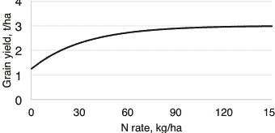

图6.2：加纳苏丹稀树草原地区玉米对氮施用的反应。

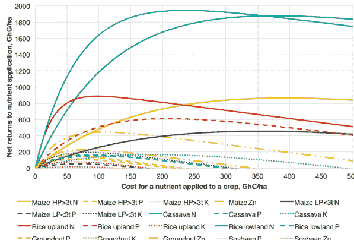

图 6.3: 加纳衍生稀树草原过渡带施肥净回报。图中排除了盈利较低和无利可图的养分施用。该图形取决于谷物价值和施肥成本。所用的谷物和块茎价值分别为：玉米 0.75、高粱 1.52、水稻 1.22、花生 2.78、大豆 1.77 和木薯 0.20。施肥成本为：尿素 = 100；TSP = 150；KCl = 150；ZnSO4 = 每 50 公斤 GH¢ 600。

6.2 在氮施用量较低时，产量随氮增加而大幅提升；在较高氮施用量时，产量增加率降低，直至产量达到平台期，不再增加。这告诉我们，低氮施用量的净回报高于高施用量。此类响应曲线对大多数作物和养分都很典型，对于确定施肥的盈利能力至关重要。这些曲线表明，资金受限的农民在有限肥料量下，通过在更多土地上施用较低养分用量，比在较少土地上施用较高用量能获得更多利润。

对木薯施用每公顷 GH¢ 20（x 轴）的钾，预期净回报约为每公顷 GH¢ 1230（y 轴）。当将相同金额（GH¢ 20）投入到花生（x 轴）的磷肥时，衍生过渡带农民的预期平均净回报约为 GH¢ 950（y 轴）。曲线峰值是该养分用于该作物时每公顷最大利润点。当斜率下降时，利润在下降。资金受限的农民首先希望利用轮作系统中作物-养分组合中最有利可图的选项。然而，考虑这些曲线来决定每种作物施用多少养分非常复杂。不仅需要考虑农民感兴趣的不同作物对施用养分的农学响应，还需要考虑农民对不同作物的土地分配、商品价值、施肥成本以及可用于施肥的资金，以优化施肥以实现高利润。因此，开发了使用 Excel Solver®（Frontline Systems Inc.）的施肥优化工具，这些工具利用复杂数学整合经济和农学信息，但易于使用（https://agronomy.unl.edu）。

### 6.7 加纳施肥使用优化工具（FOT）

开发施肥优化工具（FOTs）是为了通过涉及线性优化的复杂计算，将农民情况的经济和农学方面与田间研究试验确定的作物养分响应函数相结合。

此处提到的施肥使用优化是指最大化施肥带来的利润，包括资金充足的农民每公顷的利润，以及资金受限农民在施肥小额投资上的利润。这些易于使用的工具旨在做出决策，以最大化施肥利润。

FOTs 是为加纳四个区域开发的，如图 6.4 所示的衍生稀树草原过渡带 FOT 输入界面。它考虑了高潜力和低潜力玉米、木薯、旱地和水地水稻、花生和大豆。要使用 FOT，需要激活 Excel 加载项 Solver 并启用宏；请参阅 FOTs 的“帮助和说明”工作表中的逐步说明，更详细的说明（推广材料和 FOT 手册）可在 http://agronomy.unl.edu/OFRA 获得。

激活 Solver 并启用宏后，用户输入每种要种植作物的种植面积（公顷）'Area Planted, ha'。输入考虑留作自用和待销售部分预期价值的商品预期农场价值 'Expected Grain Value/kg'。如果未种植某种作物，则公顷数输入 '0'。接下来，在 'Cost/50 kg bag' 下输入可用肥料的使用成本，考虑购买价格以及运输和施用成本；如果肥料不可用，则成本输入 '0'。可以在 KCl 行下添加一种可选肥料及其养分浓度。最后，输入农民可用于施肥的资金 'Budget Constraint'；示例中输入 GH¢ 500，这是许多小农户可负担的预算。左键单击 'Optimize' 运行优化。

FOT 输出包含三个表格（图 6.5）。上方表格 'Application rate - kg/ha' 给出每种作物的推荐施肥量。一些推荐施肥量低于 20 kg/ha，过低无法实际施用；用户可以将该肥料或资金分配给另一种肥料施用。推荐的肥料总量为：尿素 256 kg/ha，TSP 33 kg/ha，DAP 0 kg/ha（因为在输入界面未选择），KCl 56 kg/ha，以及仅 6 kg 的 NPK（NPK 通常与单一养分肥料相比缺乏经济竞争力）。

下一个表格 'Expected Average Effects per ha' 说明了因推荐施肥而带来的预期平均产量增加和每英亩净回报（图 6.5）。该表表明不同作物施肥的相对盈利能力；表中最有利可图的施肥是木薯，表明农民可能希望增加木薯种植面积；木薯的高利润潜力与图 6.3 中的信息一致。

第三个表格 'Total Expected Net Returns to Fertilizer' 是平均估计值，已根据分配给每种作物的土地进行调整，但预计某些年份净回报会更高，其他年份会更低。只有当农民遵循良好的农学实践（包括品种选择、种植以及杂草、病虫害防治）时，才能期望这些结果。

作物选择在很大程度上由地形和气候条件决定，例如高粱和豇豆通常生长在较干旱地区，而玉米和豆类生长在较湿润地区。农民根据作物适宜性、家庭消费需求、当地市场机会、信贷可获得性和市场准入选择作物。

FOTs 帮助农民做出决策以最大化施肥利润。FOTs 可用于区一级的决策，以确保对农民最具成本效益的肥料能够及时充足地供应。例如，图 6.5 的结果表明对尿素及时供应有强烈需求，同时 TSP 和 KCl 的供应应优先于 NPK 的供应。

## AEZ 衍生稀树草原/过渡带

生产者姓名：xxx
编制人：
编制日期：2016 年 8 月 3 日

| 作物 | 种植面积 (公顷)* | 预期谷物价值/公斤 † |
|---|---|---|
| 高潜力玉米 >3t | 1 | 0.75 |
| 低潜力玉米 <3t | 0.5 | 0.75 |
| 木薯 | 0.5 | 0.2 |
| 旱地水稻 | 0.5 | 1.22 |
| 水地水稻 | 0.5 | 1.22 |
| 花生 | 1 | 2.71 |
| 大豆 | 0.3 | 1.77 |
| 总计 | 4.3 | |

| 肥料产品 | N | P2O5 | K2O | Zn | 每 50 公斤袋装成本 †† |
|---|---|---|---|---|---|
| 尿素 | 46% | 0% | 0% | 0% | 100 |
| 三过磷酸钙，TSP | 0% | 46% | 0% | 0% | 150 |
| 磷酸氢铵，DAP | 18% | 46% | 0% | 0% | 0 |
| 氯化钾，KCl | 0% | 0% | 60% | 0% | 150 |
| NPK | 15% | 15% | 15% | 0% | 120 |

| 可用于投资施肥的资金 |
|---|
| 500 |

图 6.4: 计算机生成 FOT 的输入数据选项。

| 作物 | 面积 | TSP | DAP | KCl | NPK |
|---|---|---|---|---|---|
| 高潜力玉米 >3t | 45 | 9 | 0 | 0 | 0 |
| 低潜力玉米 <3t | 0 | 0 | 0 | 7 | 0 |
| 木薯 | 87 | 0 | 0 | 20 | 6 |
| 旱地水稻 | 60 | 0 | 0 | 19 | 0 |
| 水地水稻 | 35 | 0 | 0 | 5 | 0 |
| 花生 | 0 | 24 | 0 | 5 | 0 |
| 大豆 | 0 | 0 | 0 | 0 | 0 |
| 所需肥料总量 | 151 | 33 | 0 | 30 | 3 |

| 作物 | 产量增加 | 净回报 |
|---|---|---|
| 高潜力玉米 >3t | 916 | 571 |
| 低潜力玉米 <3t | 177 | 112 |
| 木薯 | 14,952 | 2,740 |
| 旱地水稻 | 1,800 | 1,961 |
| 水地水稻 | 739 | 816 |
| 花生 | 297 | 717 |
| 大豆 | 0 | 0 |

| 施肥投资总净回报 |
|---|
| 4,101 |

图 6.5: 优化工具后的输出，显示所需肥料和预期回报。

## 表 6.2：纸质肥料优化工具示例

加纳南几内亚农业生态区肥料使用优化器：
纸质版本：2016 年 3 月

以下假设：
校准测量使用：容积为 8 毫升的 Voltic 水瓶盖（瓶盖），可装 5.6 克尿素、8.8 克 DAP、TSP 或 KCl，或 8 克 NPK；以及容积为 70 毫升的 Gino 番茄罐（吉诺罐），可装 49 克尿素和 77 克 DAP、TSP 或 KCl 以及 70 克 NPK。
株行距：玉米和高粱，75 x 40 厘米；珍珠黍，100 x 40 厘米；豇豆、花生和大豆，40 x 20 厘米；水稻，20 x 20 厘米。
每千克谷物价值（GH₵）：珍珠黍 3；高粱 1.52；玉米 0.75；水稻 1.22；未去壳花生 2.71；豇豆 2.43；大豆 1.77。
每 50 千克肥料成本（GH₵）：尿素 100；TSP 150；KCl 150；NPK (15-15-15) 120。
撒施宽度：2.0 米；WAP = 播种后周，WAT = 移栽后周。施肥率单位为 kg/ha。点施距植株至少 5 厘米。

### 财务能力等级 1。

| 玉米 | 2 WAP 时点施并覆盖 33 kg/ha 过磷酸钙（每 9 个穴位一个瓶盖）；6 WAP 时点施并覆盖 60 kg/ha 尿素（每 3.1 个穴位一个瓶盖） |
| 低地水稻 | 穗分化期撒施 50 kg/ha 尿素（每 4.6 米一个吉诺罐） |
| 豇豆 | 2 WAP 时点施并覆盖 82 kg/ha 过磷酸钙（每 13 个穴位一个瓶盖） |
| 高粱 | 2 WAP 时施用 45 kg/ha 过磷酸钙（每 7 个穴位一个瓶盖） |
| 大豆 | 2 WAP 时点施并覆盖 29 kg/ha 过磷酸钙（每 38 个穴位一个瓶盖） |
| 花生 | 施用 31 kg/ha 过磷酸钙（每 36 个穴位一个瓶盖） |

### 财务能力等级 2。

| 玉米 | 2 WAP 时点施并覆盖 65 kg/ha 尿素（每 3 个穴位一个瓶盖）和 9 kg/ha 硫酸锌（每 50 个穴位一个瓶盖）；6 WAP 时点施并覆盖 65 kg/ha 尿素（每 3 个穴位一个瓶盖）。或混合 5 个吉诺罐尿素和 1 个吉诺罐硫酸锌（每 4.5 个穴位一个混合瓶盖） |
| 低地水稻 | 移栽后 2 周撒施 39 kg/ha 尿素，穗分化期撒施 39 kg/ha 尿素（每次每 6 米一个吉诺罐） |
| 旱地水稻 | 穗分化期撒施 38 kg/ha 尿素（每 1.2 米一个吉诺罐）。移栽后 2 周撒施 28 kg/ha 氯化钾（每 1.6 米一个瓶盖） |
| 豇豆 | 2 WAP 时点施并覆盖 110 kg/ha 过磷酸钙（每 10 个穴位一个瓶盖） |
| 高粱 | 2 WAP 时点施并覆盖 45 kg/ha 尿素（每 4 个穴位一个瓶盖）和 73 kg/ha 过磷酸钙（每 4.5 个穴位一个瓶盖）；穗分化期点施 45 kg/ha 尿素（每 4 个穴位一个瓶盖） |
| 大豆 | 2 WAP 时点施并覆盖 83 kg/ha 过磷酸钙（每 13 个穴位一个瓶盖） |
| 花生 | 2 WAP 时施用 43 kg/ha（每 26 个穴位一个瓶盖） |

### 财务能力等级 3（最大化每公顷利润）。

| 玉米 | 2 WAP 时点施并覆盖 75 kg/ha 尿素（每 2.5 个穴位一个瓶盖）、30 kg/ha 过磷酸钙（每 10 个穴位一个瓶盖）和 15 kg/ha 硫酸锌（每 32 个穴位一个瓶盖）；6 WAP 时点施并覆盖 75 kg/ha 尿素（每 25 个穴位一个瓶盖）。或混合 6 个吉诺罐过磷酸钙和 5 个吉诺罐硫酸锌（每 6 个穴位一个瓶盖） |
| 低地水稻 | 移栽后 2 周撒施 50 kg/ha 尿素（每 94.6 米一个吉诺罐）。穗分化期撒施 50 kg/ha 尿素（每 3.2 米一个吉诺罐） |
| 旱地水稻 | 穗分化期撒施 64 kg/ha 尿素（每 3.5 米一个吉诺罐）。移栽后 2 周撒施 106 kg/ha 过磷酸钙（每 0.4 米一个瓶盖）和 33 kg/ha 氯化钾（每 1.3 米一个瓶盖） |
| 花生 | 2 WAP 时点施并覆盖 53 kg/ha 过磷酸钙（每 21 个穴位一个瓶盖） |
| 豇豆 | 2 WAP 时点施并覆盖 133 kg/ha 过磷酸钙（每 8 个穴位一个瓶盖） |
| 高粱 | 2 WAP 时点施并覆盖 93 kg/ha 过磷酸钙（每 3.5 个穴位一个瓶盖） |
| 大豆 | 2 WAP 时点施并覆盖 121 kg/ha 过磷酸钙（每 9 个穴位一个瓶盖）和 9 kg/ha 硫酸锌（每 200 个穴位一个瓶盖）。或混合 8 个吉诺罐过磷酸钙和 1 个吉诺罐硫酸锌（每 7.3 米一个瓶盖） |

优化肥料使用意味着要采用其他良好农艺措施，因此其他农业投入品的供应也应充足。因此，对于该地区，FOT 的决策不仅限于肥料使用，还涉及更广泛的农业生产决策。

每个 Excel Solver® FOT 都有一个对应的纸质 FOT，用于无法使用计算机以及由农民直接使用的情况（表 6.2）。这些工具可在 http://agronomy.unl.edu/OFRA 获取。纸质 FOT 设计用于三个财务能力等级。财务能力等级 1 适用于资金不足以按最大化每公顷利润的施肥率为所有耕地施肥三分之一的农民。财务能力等级 2 适用于资金不足以按最大化每公顷利润的施肥率为所有耕地施肥三分之二的农民。财务能力等级 3 适用于资金充足、可按最大化每公顷利润的施肥率施肥的农民。

纸质工具基于以下假设：

- 农民在调整目测和手感以施用正确肥料率时使用的计量单位，如表 6.2 所示，计量单位为容积为 7 毫升的 Voltic 品牌水瓶盖和容积为 70 毫升的 Gino 品牌番茄酱罐
- 作物行距和株距
- 每 50 千克袋装肥料的使用成本
- 收获时农场预期谷物价值，同时考虑自用和市场价值
- 施用指南。

纸质 FOT 涉及 4R 原则，就正确的产品、用量、时机和施用方法提供建议（表 6.2）。它还就校准提供建议，即使用一个计量单位推荐施肥率所对应的施肥带长度或植株/穴位数量。

以南几内亚稀树草原纸质 FOT 中的财务能力等级 2 建议为例：“高粱 2 WAP 时点施 45 kg 尿素（每 8 个穴位 1 个瓶盖）和 73 kg 过磷酸钙（每 9 个穴位 1 个瓶盖）；穗分化期施用 45 kg 尿素（每 8 个穴位 1 个瓶盖）。”因此，尿素和过磷酸钙应分别以 45 kg/ha 和 73 kg/ha 的用量，在距高粱穴位至少 5 厘米的侧面施用。一个 Voltic 瓶盖足以施用 8 个尿素穴位和 9 个过磷酸钙穴位。另外，穗分化期还需追施 45 kg/ha 尿素，点施于距植株至少 5 厘米处；一个瓶盖足以施用 8 个穴位。

## 表 6.3：良好农艺措施和土壤测试的肥料替代价值

## 整体土壤肥力管理背景下的肥料使用

### 肥料替代和土壤测试影响

| ISFM 措施 | 尿素 | DAP 或 TSP | KCl | NPK 15-15-15 |
|---|---|---|---|---|
| | 肥料减少量，% 或 kg/ha | | | |
| 前茬为绿肥作物（玉米用 mucuna） | 100% | 70% | 70% | 70% |
| 每 1 吨干物质的农家肥（低质量） | 22 kg | 10 kg | 10 kg | 70 kg |
| 前茬施用农家肥的残留价值，每 1 吨 | 10 kg | 5 kg | 5 kg | 35 kg |
| 家禽粪便，每 1 吨干物质 | 65 kg | 22 kg | 17 kg | 200 kg |
| 家禽粪便的残留价值，每 1 吨干物质 | 32 kg | 10 kg | 8 kg | 100 kg |
| 堆肥，每 1 吨 | 11 kg | 1 kg | 1 kg | 33 kg |
| 玉米-豇豆间作 | 过磷酸钙减少 22 kg/ha，但与单一种植玉米的 N 和 K 用量相比无变化 | | | |
| 玉米-花生间作 | DAP/TSP 增加 52 kg/ha，但与玉米用量相比 N 和 K 无变化 | | | |
| 玉米-豇豆轮作 | 0% 减少，但预计产量更高 | | | |
| 水稻-豇豆轮作 | 0% 减少，但预计产量更高 | | | |
| 如果 Bray-Kurtz P I > 20 ppm，或 Olsen P > 30 ppm | 不施 P | | | |
| 如果土壤测试 K < 100 ppm | 带施 15 kg/ha KCl | | | |

## 表 6.4a：衍生稀树草原过渡带。作物-养分的响应函数、预期产量增加（t/ha）以及 OFRA 经济最优施肥率（EOR），以最大化每公顷利润，与加纳各农业生态区当前或最近（REC）建议相比。P2O5 = P × 2.29；K2O = K × 1.2。某些函数响应为零，因为缺乏响应或缺乏信息

| 作物 | 养分 | A | b | c | 0-30 | 30-60 | 60-90 | 90-120 | EOR† | REC ‡ |
|---|---|---|---|---|---|---|---|---|---|---|
| | | | t/ha | | | t/ha | | | kg/ha |
| 玉米 HP>3t | N | 3.787 | 1.936 | 0.978 | 0.955 | 0.484 | 0.245 | 0.124 | 89 | 90 |
| 玉米 LP<3t | N | 2.526 | 1.399 | 0.982 | 0.588 | 0.341 | 0.198 | 0.115 | 72 | 60 |
| 木薯 | N | 44.810 | 11.935 | 0.967 | 7.573 | 2.676 | 1.011 | 0.370 | 98 | 60 |
| 水稻，旱地 | N | 4.650 | 1.900 | 0.980 | 0.864 | 0.471 | 0.257 | 0.140 | 72 | 60 |
| 水稻，低地 | N | 3.104 | 0.746 | 0.953 | 0.570 | 0.135 | 0.032 | 0.007 | 50 | 90 |
| | | | 0-5 | 5-10 | 10-15 | 15-20 | | | | |
| 玉米 HP>3t | P | 2.820 | 0.310 | 0.520 | 0.424 | 0.188 | 0.084 | 0.037 | 24 | 26 |
| 玉米 LP<3t | P | 0.910 | 0.240 | 0.780 | 0.171 | 0.049 | 0.014 | 0.004 | 0 | 17 |
| 木薯 | P | 28.790 | 1.527 | 0.770 | 1.114 | 0.301 | 0.082 | 0.022 | 12 | 26 |
| 水稻，旱地 | P | 1.830 | 0.420 | 0.910 | 0.158 | 0.099 | 0.061 | 0.038 | 0 | 17 |
| 水稻，低地 | P | 3.210 | 0.150 | 0.700 | 0.125 | 0.021 | 0.004 | 0.001 | 0 | 26 |
| 花生 | P | 4.430 | 0.830 | 0.800 | 0.270 | 0.069 | 0.017 | 0.004 | 23 | 13 |
| 大豆 | P | 1.740 | 0.110 | 0.880 | 0.153 | 0.098 | 0.063 | 0.040 | 37 | 13 |
| 玉米 HP>3t | K | 3.759 | 0.036 | 0.550 | 0.035 | 0.002 | 0.000 | 0.000 | 0 | 50 |
| 玉米 LP<3t | K | 2.565 | 0.419 | 0.855 | 0.227 | 0.104 | 0.047 | 0.022 | 0 | 33 |
| 木薯 | K | 34.000 | 6.966 | 0.813 | 4.234 | 1.504 | 0.534 | 0.190 | 23 | 50 |
| 水稻，旱地 | K | 4.430 | 0.830 | 0.800 | 0.558 | 0.183 | 0.060 | 0.020 | 0 | 33 |
| 花生 | K | 1.740 | 0.110 | 0.880 | 0.052 | 0.027 | 0.014 | 0.008 | 0 | 17 |
| | | | 0-1 | 1-2 | 2-3 | 3-4 | | | | |
| 玉米 | Zn | 4.010 | 0.790 | 0.310 | 0.545 | 0.169 | 0.052 | 0.016 | 1.7 | ND |
| 花生 | Zn | 1.060 | 0.080 | 0.300 | 0.056 | 0.017 | 0.005 | 0.002 | 0.8 | ND |
| 大豆 | Zn | 1.774 | 0.194 | 0.270 | 0.142 | 0.038 | 0.010 | 0.003 | 1.2 | ND |

† EOR 的确定基于每 50 千克的成本：尿素 100 加纳塞迪；TSP 和 KCl 每 150 加纳塞迪；硫酸锌 600。使用的商品价值（加纳塞迪/千克）为：水稻 1.22；玉米 0.75；木薯 0.20；豇豆 2.43；花生 2.71；大豆 1.77；珍珠黍 1.69。
‡ CSIR-土壤研究所（SRI）

### 6.8 根据其他措施和土壤测试信息调整施肥率

施肥决策需要考虑其他向土壤提供养分的措施的影响以及土壤测试信息（表 6.3）。向田地施用畜禽粪便需要根据粪便的肥料替代价值调整施肥率，该价值随粪便质量而变化。圈养家禽、奶牛、绵羊和山羊粪便的肥料替代价值高于农家肥。

### 6.9 按农业生态区划分的目标作物和种植系统

表 6.3 中考虑的其他具有肥料替代价值的做法包括种植绿肥作物以及在轮作中在豆类之后种植谷物。间作可能比单一种植需要更多的肥料。会考虑土壤测试值。对于非靠近住户的小农户田地，土壤测试 P 通常较低，除非土壤测试 P 值（pH 小于 7 的土壤采用 Bray 1 法）高于 20 mg/kg 或（pH 大于 7 的土壤采用 Olsen 法）高于 30 mg/kg，否则应根据 FOT 施用 P。除非土壤测试 K 低于 100 ppm，否则应根据 FOT 施用钾肥，此时应施用 15 kg/ha 氯化钾或硫酸钾。

各农业生态区重要粮食作物对养分的响应是根据过去和最近的田间试验结果（表 6.4 a–d）确定的。前两列分别为作物和养分。第 3–5 列为曲线向平台响应函数 Y = a - bc² 的 a、b、c 系数。接下来的四列报告与较低施肥量相比，施肥量增加带来的预期产量增加，最右侧的列报告因施肥而使每公顷利润最大化的优化施肥量（EOR），与当前推荐施肥量（REC）相比。确定 EOR 时使用的商品价值和肥料成本载于表 6.4 的脚注中。超过基于田间试验的 EOR 的养分施用预计会导致利润损失。任何低于 EOR 的养分施用都意味着每英亩肥料使用的潜在最大利润较低，但在肥料使用受资金限制的情况下，较低的施肥量通常最有利可图。

| 作物 | 养分 | a | b | c | 0-30 | 30-60 | 60-90 | 90-120 | EOR† | REC ‡ |
|---|---|---|---|---|---|---|---|---|---|---|
| | | | | | t/ha | t/ha | t/ha | t/ha | kg/ha | kg/ha |
| 玉米 | N | 3.130 | 1.680 | 0.980 | 0.955 | 0.484 | 0.245 | 0.124 | 69 | 90 |
| 水稻，低地 | N | 3.100 | 0.750 | 0.950 | 0.588 | 0.341 | 0.198 | 0.115 | 46 | 90 |
| 水稻，旱地 | N | 2.500 | 0.300 | 0.955 | 0.225 | 0.056 | 0.014 | 0.004 | 29 | 60 |
| 高粱 | N | 1.720 | 0.570 | 0.980 | 0.259 | 0.141 | 0.077 | 0.042 | 46 | 60 |
| | | | | | 0-5 | 5-10 | 10-15 | 15-20 | | |
| 玉米 | P | 3.160 | 0.340 | 0.880 | 0.161 | 0.085 | 0.045 | 0.024 | 6 | 26 |
| 水稻，旱地 | P | 3.160 | 0.770 | 0.970 | 0.109 | 0.093 | 0.080 | 0.069 | 21 | 17 |
| 花生，未去壳 | P | 1.580 | 0.360 | 0.760 | 0.269 | 0.068 | 0.017 | 0.004 | 11 | 13 |
| 豇豆 | P | 1.060 | 0.185 | 0.890 | 0.082 | 0.046 | 0.025 | 0.014 | 27 | 13 |
| 高粱 | P | 2.190 | 0.800 | 0.890 | 0.353 | 0.197 | 0.110 | 0.062 | 19 | 17 |
| 大豆 | P | 2.010 | 0.680 | 0.930 | 0.207 | 0.144 | 0.100 | 0.070 | 24 | 13 |
| 水稻，低地 | K | 1.950 | 0.090 | 0.810 | 0.059 | 0.020 | 0.007 | 0.002 | 6 | 50 |
| 水稻，旱地 | K | 4.430 | 0.840 | 0.800 | 0.565 | 0.185 | 0.061 | 0.020 | 16 | 33 |
| 花生，未去壳 | K | 1.770 | 0.100 | 0.750 | 0.076 | 0.018 | 0.004 | 0.001 | 9 | 17 |
| 豇豆 | K | 0.820 | 0.130 | 0.800 | 0.087 | 0.029 | 0.009 | 0.003 | 11 | 17 |
| 木薯 | K | 34.000 | 6.966 | 0.813 | 4.234 | 1.504 | 0.534 | 0.190 | 23 | 50 |
| 水稻，旱地 | K | 4.430 | 0.830 | 0.800 | 0.558 | 0.183 | 0.060 | 0.020 | 0 | 33 |
| 花生 | K | 1.740 | 0.110 | 0.880 | 0.052 | 0.027 | 0.014 | 0.008 | 0 | 17 |
| | | | | | 0-1 | 1-2 | 2-3 | 3-4 | | |
| 玉米 | Zn | 4.010 | 0.790 | 0.310 | 0.545 | 0.169 | 0.052 | 0.016 | 1.7 | ND |
| 花生 | Zn | 1.060 | 0.080 | 0.300 | 0.056 | 0.017 | 0.005 | 0.002 | 0.8 | ND |
| 大豆 | Zn | 1.774 | 0.194 | 0.270 | 0.142 | 0.038 | 0.010 | 0.003 | 1.2 | ND |

最大产量增加（即 b 值）出现在衍生稀树草原过渡区，作物为木薯，施用 N（表 6.4 a）。高产玉米（HP>3t）和旱地水稻对 N 也有较大响应。高产玉米、木薯、花生和大豆对施用 P 有获利性响应。只有木薯对 K 有获利性响应。玉米、大豆和花生对每公顷施用 1 kg Zn 响应良好。基于田间试验的 EOR 为：高产玉米的 N 与 REC 相似；低产玉米、木薯和旱地水稻的 N 高于 REC；低地水稻的 N 低于 REC。P 的 EOR 对大多数作物低于 REC，但对花生和大豆高于 REC。K 的 EOR 对所有作物均低于 REC，且对大多数作物为零。

在几内亚南部稀树草原，考虑了玉米、旱地和低地水稻、高粱、豇豆、花生和大豆（表 6.4 b）。玉米对施用 N 响应特别好，但所有谷物对 N 都有获利性响应。所有作物对施用 P 都有经济响应。旱地和低地水稻、花生和豇豆对 K 有获利性响应，但玉米、高粱和大豆没有。N 的 EOR 始终低于 REC N 施肥量。玉米的 P EOR 低于 REC 施肥量，但除此之外，花生和高粱的 P EOR 与 REC 相似，其余作物的 P EOR 高于 REC。K 的 EOR 始终低于 REC。

在几内亚北部稀树草原，玉米、旱地水稻和高粱对施用 N 响应特别强（表 6.4 c）。所有作物都有

### 表 6.4c：加纳几内亚北部稀树草原

| 作物 | 养分 | a | b | c | 0-30 | 30-60 | 60-90 | 90-120 | EOR† | REC ‡ |
|---|---|---|---|---|---|---|---|---|---|---|
| | | t/ha | | | t/ha | t/ha | t/ha | t/ha | kg/ha | kg/ha |
| 豇豆 | N | 0.963 | 0.357 | 0.762 | 0.357 | 0.000 | 0.000 | 0.000 | 9 | 20 |
| 玉米 LP <3t | N | 2.493 | 1.601 | 0.972 | 0.918 | 0.392 | 0.167 | 0.071 | 73 | 60 |
| 玉米 HP >3t | N | 3.513 | 1.808 | 0.981 | 0.791 | 0.445 | 0.250 | 0.141 | 92 | 90 |
| 水稻，低地 | N | 2.729 | 0.214 | 0.963 | 0.145 | 0.047 | 0.015 | 0.005 | 22 | 90 |
| 水稻，旱地 | N | 4.665 | 1.908 | 0.988 | 0.580 | 0.404 | 0.281 | 0.196 | 92 | 60 |
| 高粱 | N | 4.154 | 1.338 | 0.906 | 1.269 | 0.066 | 0.003 | 0.000 | 40 | 13 |
| | | | | | 0-5 | 5-10 | 10-15 | 15-20 | | |
| 豇豆 | P | 0.961 | 0.052 | 0.600 | 0.048 | 0.004 | 0.000 | 0.000 | 3 | 13 |
| 花生 | P | 1.589 | 0.362 | 0.760 | 0.270 | 0.069 | 0.017 | 0.004 | 11 | 13 |
| 玉米 LP <3t | P | 2.678 | 1.653 | 0.980 | 0.159 | 0.144 | 0.130 | 0.117 | 25 | 17 |
| 玉米 HP >3t | P | 3.541 | 1.799 | 0.978 | 0.189 | 0.169 | 0.152 | 0.136 | 24 | 26 |
| 水稻，低地 | P | 3.058 | 0.738 | 0.969 | 0.108 | 0.092 | 0.078 | 0.067 | 20 | 26 |
| 水稻，旱地 | P | 3.165 | 0.770 | 0.908 | 0.295 | 0.182 | 0.112 | 0.069 | 19 | 17 |
| 高粱 | P | 1.721 | 0.576 | 0.980 | 0.055 | 0.050 | 0.045 | 0.041 | 14 | 17 |
| 豇豆 | K | 0.821 | 0.134 | 0.800 | 0.090 | 0.030 | 0.010 | 0.003 | 11 | 17 |
| 花生 | K | 1.776 | 0.102 | 0.630 | 0.092 | 0.009 | 0.001 | 0.000 | 7 | 17 |
| 水稻，低地 | K | 1.951 | 0.091 | 0.810 | 0.059 | 0.021 | 0.007 | 0.003 | 6 | 50 |
| 水稻，旱地 | K | 2.500 | 0.300 | 0.945 | 0.074 | 0.056 | 0.042 | 0.032 | 20 | 33 |

对 P 有经济响应，除玉米和高粱外，所有作物对施用 K 都有获利性响应。与 REC 相比，N 的 EOR 施肥量通常较高，但低地水稻和豇豆除外。P 的 EOR 与 REC 相似，但豇豆的 EOR 远低于 REC。K 的 EOR 始终低于 REC。

### 表 6.4d：加纳南苏丹稀树草原

| 作物 | 养分 | a | b | c | 0-30 | 30-60 | 60-90 | 90-120 | EOR† | REC ‡ |
|---|---|---|---|---|---|---|---|---|---|---|
| | | t/ha | | | t/ha | t/ha | t/ha | t/ha | kg/ha | kg/ha |
| 玉米 | N | 3.000 | 1.760 | 0.970 | 1.054 | 0.423 | 0.170 | 0.068 | 69 | 90 |
| 水稻，旱地 | N | 4.655 | 1.908 | 0.988 | 0.580 | 0.404 | 0.281 | 0.196 | 69 | 90 |
| 高粱 | N | 4.067 | 1.530 | 0.860 | 1.513 | 0.016 | 0.000 | 0.000 | 23 | 60 |
| 水稻，低地 | N | 2.482 | 0.428 | 0.970 | 0.256 | 0.103 | 0.041 | 0.017 | 42 | 90 |
| 豇豆 | N | 1.860 | 0.168 | 0.770 | 0.168 | 0.000 | 0.000 | 0.000 | 12 | 20 |
| 珍珠黍 | N | 1.111 | 0.110 | 0.930 | 0.098 | 0.011 | 0.001 | 0.000 | 16 | 60 |
| | | | | | 0-5 | 5-10 | 10-15 | 15-20 | | |
| 玉米 | P | 2.868 | 0.295 | 0.928 | 0.092 | 0.063 | 0.044 | 0.030 | 16 | 26 |
| 水稻，旱地 | P | 3.633 | 0.979 | 0.904 | 0.388 | 0.234 | 0.141 | 0.085 | 20 | 26 |
| 高粱 | P | 2.770 | 1.470 | 0.910 | 0.553 | 0.345 | 0.215 | 0.134 | 10 | 26 |
| 豇豆 | P | 0.929 | 0.040 | 0.700 | 0.033 | 0.006 | 0.001 | 0.000 | 0 | 9 |
| 大豆 | P | 1.319 | 0.141 | 0.855 | 0.077 | 0.035 | 0.016 | 0.007 | 5 | 9 |
| 珍珠黍 | P | 1.520 | 0.129 | 0.900 | 0.053 | 0.031 | 0.018 | 0.011 | 13 | 17 |
| 水稻，旱地 | K | 4.439 | 0.838 | 0.800 | 0.563 | 0.185 | 0.060 | 0.020 | 16 | 33 |
| 高粱 | K | 2.016 | 0.114 | 0.900 | 0.047 | 0.028 | 0.016 | 0.010 | 10 | 33 |
| 水稻，低地 | K | 1.950 | 0.091 | 0.961 | 0.016 | 0.013 | 0.011 | 0.009 | 6 | 50 |
| 豇豆 | K | 0.871 | 0.100 | 0.800 | 0.067 | 0.022 | 0.007 | 0.002 | 10 | 17 |
| | | | | | 0-1 | 1-2 | 2-3 | 3-4 | | |
| 玉米 | Zn | 3.590 | 0.560 | 0.250 | 0.420 | 0.105 | 0.026 | 0.007 | 1.7 | ND |
| 高粱 | Zn | 4.300 | 0.100 | 0.500 | 0.050 | 0.025 | 0.013 | 0.006 | 1.3 | ND |
| 大豆 | Zn | 1.614 | 0.348 | 0.397 | 0.210 | 0.083 | 0.033 | 0.013 | 0.8 | ND |

在南苏丹稀树草原区，包括豇豆但不包括大豆在内的所有作物对施用 N 都有经济响应。所有作物对施用 P 都有获利性响应，K 施用对旱地和低地水稻、高粱和豇豆有利可图，但对玉米、珍珠黍或大豆则无利可图。N、P 和 K 的推荐施肥量也高于 EOR。玉米、高粱和大豆的 Zn EOR 已确定，但缺乏珍珠黍、旱地和低地水稻以及豇豆对 Zn 响应的证据。

除衍生稀树草原和几内亚北部稀树草原中的 N 外（这些地区的关系不一致），与基于田间试验推导的 EOR 相比，REC 平均高出 44% 至 130%，且 K 高于 N 和 P。在四个农业生态区考虑的 69 种作物养分响应中，有 54 种的 REC 高于 EOR。因此，按 REC 施肥的农民通常施肥过量，导致潜在利润损失。资金受限的农民通常应将施肥量控制在远低于 EOR 的水平，以获得通常与……相关的利润潜力。

在较低养分施用率下，作物产量增加较为陡峭。结果表明，为农民提供肥料选择非常重要，因为最大利润潜力通常在于明智地使用单一养分肥料。

- Dickson KB 和 Benneh G (1988) 加纳新地理. Longman Group UK Limited, Harlow, UK
- FAO (2005) 加纳按作物分类的肥料使用. FAO, Rome
- GGDP (1991) 加纳谷物发展项目. 第十三份年度报告. 第2部分. 研究结果
- MoFA (Ministry of Food and Agriculture) (1998) 国家土壤肥力管理行动计划. 作物服务司, Accra, Ghana
- Ofori F 和 Stern WR (1987) 谷物–豆间作系统. Advances in Agronomy 41:41-89

### 6.10 参考文献

- Adu SV (1969) 加纳上部地区纳夫龚戈–巴库地区土壤. 第5号回忆录. 土壤研究所, Kumasi
- Adu SV (1995) 纳西亚盆地土壤. 第6号回忆录. 土壤研究所, Kumasi
- Benneh G, Agyepong GT 和 Allotey JA (1990) 加纳土地退化. 食品生产和农村发展司. 英联邦秘书处, London

## 7. 在整体土壤肥力管理背景下优化肯尼亚肥料使用

Catherine N. Kibunja1 catherine.kibunja@yahoo.com, Keziah W. Ndungu-Magiro2, Dixon K. Wamae3, Teresa J. Mwangi4, Leonard Nafua (已故)5, Mary N. Koech2, Jacob Ademba4 和 Erastus M. Kitonyo1
1KALRO-Kabete, P.O. Box 14733- 00800, 内罗毕
2KALRO-Kitale, P.O. Box 450-30200, 基塔莱
3KALRO-Muguga, P.O. Box 32- 00902, 基库尤
4KALRO-Kisii, P.O. Box 523-40200, 基西
5KALRO-Njoro, Private Bag 20-107, 乔罗

### 7.1 肯尼亚农业系统

#### 7.1.1 简介

农业对许多撒哈拉以南非洲 (SSA) 国家的可持续发展、减贫和增强粮食安全至关重要。肯尼亚2030年愿景战略的经济支柱将农业部门列为经济六大关键增长驱动力之一 (GoK 2014)。农业生产力约占其国内生产总值 (GDP) 的30% 和外汇收入的60%。约75% 的约4200万肯尼亚人口从事农业部门工作。仅约三分之一的肯尼亚总土地面积（包括肯尼亚高地、沿海平原和湖区）用于作物生产 (图 7.1)。其余土地面积为半干旱至干旱，用于畜牧业。

#### 7.1.2 农业生态区 (AEZ)

肯尼亚经济规划和农业发展中最常用的分区是 Jaetzold 和 Schmidt (1983) 的方案。肯尼亚被划分

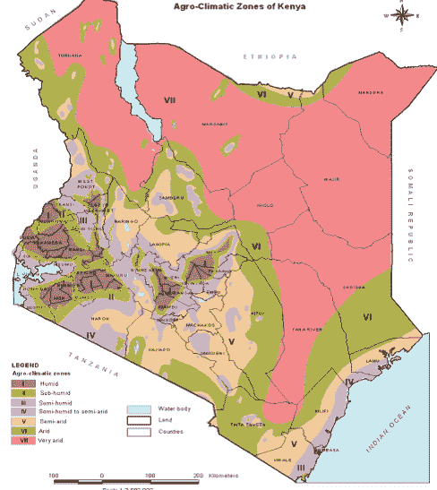

图 7.1: 肯尼亚农业生态区 (AEZ) (来源: 肯尼亚土壤调查 2007).

表 7.1: 2015年肯尼亚AEZ代表性地点的月平均降雨量 (mm) 及最高和最低气温 (°C; Tmax; Tmin)

| | J | F | M | A | M | J | J | A | S | O | N | D |
|---|---|---|---|---|---|---|---|---|---|---|---|---|
| 东部上部 | | | | | | | | | | | | |
| 降雨量 | 27 | 26 | 113 | 278 | 164 | 32 | 29 | 38 | 41 | 171 | 234 | 53 |
| 最高温 (Tmax) | 29 | 30 | 32 | 31 | 29 | 27 | 26 | 26 | 29 | 30 | 29 | 28 |
| 最低温 (Tmin) | 10 | 10 | 11 | 10 | 10 | 9 | 9 | 9 | 10 | 10 | 10 | 9 |
| 东部下部 | | | | | | | | | | | | |
| 降雨量 | 39 | 29 | 65 | 120 | 28 | 3 | 1 | 1 | 3 | 39 | 192 | 99 |
| 最高温 (Tmax) | 35 | 37 | 37 | 35 | 34 | 32 | 31 | 31 | 34 | 36 | 35 | 34 |
| 最低温 (Tmin) | 12 | 12 | 12 | 12 | 11 | 11 | 10 | 10 | 11 | 12 | 12 | 11 |
| 中部 | | | | | | | | | | | | |
| 降雨量 | 44 | 50 | 94 | 212 | 167 | 50 | 18 | 27 | 29 | 65 | 145 | 88 |
| 最高温 (Tmax) | 27 | 28 | 27 | 25 | 24 | 22 | 22 | 22 | 25 | 26 | 25 | 25 |
| 最低温 (Tmin) | 12 | 13 | 14 | 15 | 14 | 12 | 11 | 11 | 12 | 13 | 14 | 13 |
| 大裂谷上部 | | | | | | | | | | | | |
| 降雨量 | 20 | 30 | 63 | 121 | 148 | 86 | 79 | 92 | 88 | 69 | 78 | 49 |
| 最高温 (Tmax) | 28 | 28 | 29 | 29 | 27 | 27 | 26 | 26 | 26 | 27 | 26 | 27 |
| 最低温 (Tmin) | 9 | 9 | 10 | 10 | 9 | 9 | 9 | 9 | 9 | 9 | 9 | 9 |
| 大裂谷下部 | | | | | | | | | | | | |
| 降雨量 | 85 | 80 | 96 | 152 | 94 | 34 | 22 | 21 | 26 | 32 | 71 | 84 |
| 最高温 (Tmax) | 26 | 26 | 27 | 27 | 26 | 23 | 23 | 23 | 25 | 26 | 25 | 25 |
| 最低温 (Tmin) | 9 | 9 | 9 | 9 | 9 | 8 | 8 | 8 | 8 | 9 | 8 | 9 |
| 西部上部 | | | | | | | | | | | | |
| 降雨量 | 28 | 57 | 91 | 162 | 187 | 107 | 139 | 168 | 105 | 99 | 89 | 37 |
| 最高温 (Tmax) | 28 | 30 | 30 | 29 | 28 | 27 | 26 | 27 | 27 | 28 | 28 | 28 |
| 最低温 (Tmin) | 10 | 10 | 10 | 10 | 10 | 9 | 9 | 9 | 9 | 9 | 9 | 9 |
| 西部下部 | | | | | | | | | | | | |
| 降雨量 | 105 | 190 | 297 | 292 | 111 | 99 | 156 | 169 | 158 | 179 | 87 | 29.3 |
| 最高温 (Tmax) | 30.0 | 30.4 | 30.0 | 28.7 | 27.9 | 27.4 | 27.2 | 27.7 | 27.0 | 29.1 | 28.4 | 29.3 |
| 最低温 (Tmin) | 15.9 | 15.7 | 15.7 | 16.5 | 16.3 | 15.8 | 15.6 | 15.5 | 14.7 | 16.0 | 15.9 | 15.8 |
| 沿海 | | | | | | | | | | | | |
| 降雨量 | 34 | 16 | 56 | 153 | 223 | 87 | 69 | 64 | 68 | 103 | 105 | 75 |
| 最高温 (Tmax) | 41 | 42 | 43 | 41 | 39 | 37 | 36 | 36 | 37 | 39 | 40 | 41 |
| 最低温 (Tmin) | 14 | 14 | 14 | 14 | 13 | 12 | 12 | 12 | 12 | 13 | 13 | 14 |

into seven agro-climatic zones using a moisture index (Sombroek et al. 1982) based on annual rainfall expressed as a percentage of annual potential evaporation (Figure 7.1). The humid highlands, with a moisture index greater than 50% and with high potential for crop production, are designated as Zone I (humid with a moisture index of >80% and annual rainfall of 1100-2700 mm). Zone II (sub-humid with a moisture index of 65-80% and annual rainfall of 1000-1600 mm) and Zone III (semi-humid with a moisture index of 50-65% and annual rainfall of 800-1400 mm). Together they account for 12% of the land area. The remaining land has a moisture index of less than 50% and a mean annual rainfall

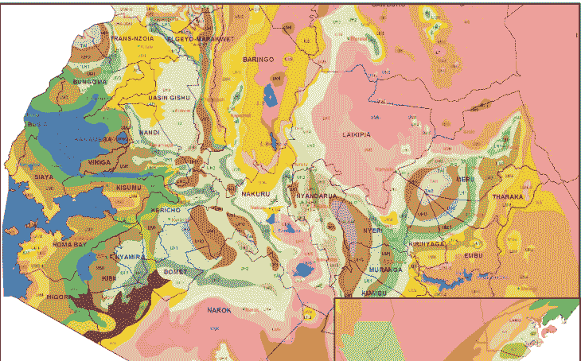

图 7.2: 肯尼亚主要作物生产区的农业生态区: L, LM, UM, LH, UH 和 TA 指海拔递增; 1 至 6 指相对于年潜在蒸散量的年降雨量递增. 来源: Jaetzold 等, 2005–2012.

of less than 1100 mm, including Zone IV (the semi-humid to semi-arid transitional zone), Zone V (semi-arid), Zones VI (arid) and VII (very arid). These four zones are generally referred to as the Kenyan rangelands and account for 88% of the land area, which is mainly used for livestock rearing.

The seven agro-climatic zones are further subdivided according to mean annual temperature to identify areas suitable for growing each of Kenya’s major food and cash crops (Figure 7.2). Most of the high and medium potential areas, representing about 70% of the agricultural land, are located at an altitude of 1000 to 2800 m above sea level (masl) with mean annual temperatures ranging from 10–24°C (Jaetzold and Schmidt 1983). The dominant agricultural soils are Ferralsols, Vertisols, Acrisols, Lixisols, Luvisols and Nitisols (Jaetzold and Schmidt 1983).

The Tropical Alpine (TA) environments are humid highlands above 2800 masl with an average temperature of 2–10°C and an annual rainfall of 1100–2700 mm with a moisture index of >80% (Table 7.1). The natural vegetation is evergreen rainforest. The main agricultural activities include husbandry of sheep and cattle at the lower altitudes. The AEZ is comprised mainly of forest reserves and national parks.

The Upper Highlands (UH1 and UH2) or Sub-Humid Highlands at 2350 to 2800 masl has mean annual temperatures of 10–15°C, annual rainfall of 900 to 1600 mm with one or two dry months and a moisture index of 65–80%. These areas have underlying volcanic rocks with loamy soils and include the highlands east and west of the Rift Valley including the Rift Valley bottom. The natural vegetation is seasonal rainforest. The major crops include maize, wheat, pyrethrum, irish potato, kale, cabbage and temperate fruits. Crops are slow to mature due to low temperature. Sheep and dairy cattle are major livestock enterprises and are grazed on natural pastures of Kikuyu grass. In some regions, the AEZ has forest reserves and national parks.

of Kenya's land area and is not suitable for rainfed crops. It is important for goats which are grazed on acacia and grasses but is commonly overgrazed resulting in land degradation.

The Lower Highlands (LH) or Semi-humid Highlands are highly productive lands at 2000-2350 masl with an average temperature of 15-18°C, an annual rainfall of 900-1600 mm and a moisture index of 50-65%. The AEZ covers about 30% of the arable land. The natural vegetation corresponds to seasonal semi-deciduous moist forest or tall grass-broad-leaved savanna. The major agricultural activities include maize, wheat, barley, seed maize, tea, kale and cabbage. Dairy cattle and sheep are the main livestock enterprises.

The Coastal Lowlands (CL) include the Kenyan coastlands which have well-drained sandy soils with a loamy, sandy clay texture and other humid lowlands of less than 1500 masl, such as the Taita Hills with fertile loamy soils and the Tana and Sabaki river valleys with alluvial soils (silts). The coastal valleys are characterized by sand dunes and mangrove swamps with deep, grey, saline and poorly drained soils which are not suitable for crop production.

### 7.2 土壤肥力管理

The Upper Midlands (UM) are semi-humid to semi-arid, very productive and occupy about 5% of the total land area. It is at 1500-2000 masl with an average temperature of 18-21°C, an annual rainfall of 600-1350 mm and a moisture index of 40-50%. The original vegetation was deciduous woodland. The main agricultural enterprises include maize, maize-bean intercrop, sunflower, wheat, sweet potato, finger millet, sorghum, kale and cabbage. Crop residues are fed to dairy cattle and sheep.

Most of the agricultural soils in Kenya have inherently low soil fertility, low soil moisture retention and high erodibility, but have been intensively farmed by smallholders. There has been a general decline in crop and pasture yields, soil physical properties, vegetation cover and biological diversity but an increase in noxious weeds. The most critical limiting nutrients are N and P while K, S and some micronutrient deficiencies are often diagnosed.

The Lower Midlands (LM) are semi-arid lands of 1000-1500 masl with an average temperature of 21-24°C, annual rainfall ranging from 450-900 mm and a moisture index of 25-40%. The agriculture is a mix of livestock and crop production. The AEZ occupies about 15% of the total land area. The main agricultural enterprises are rainfed maize, sorghum, millet, cassava, bean, pigeonpea, cowpea, green gram, groundnut, citrus and mango. Banana is produced under furrow irrigation. Livestock types include cattle, goats, sheep, camels, donkeys and bees while forages used include acacia and grasses. The major soil types are Luvisols, Acrisols and Vertisols.

Soil fertility research in East Africa began in the 1930s and addressed the restoration of soil fertility through the combined use of vegetative fallows and animal manures. Traditional farming systems in sub-Saharan Africa were supported by shifting slash-and-burn cultivation, a low input sustainable agricultural farming system that allowed for several years of native vegetation and woody plant growth that resulted in nutrient cycling, restoration of soil organic matter, and improved soil physical properties to restore soil productivity. However, population growth has increased demand for food, feeds and fuel which has led to decreased fallow with resultant soil fertility decline.

The Inner Lowlands (IL) are arid and very arid lands at 750-1000 masl with an average temperature of more than 24°C, less than 550 mm/yr of rainfall and a moisture index of 15-25% or less. The area occupies about 66%

of Kenya's land area and is not suitable for rainfed crops. It is important for goats which are grazed on acacia and grasses but is commonly overgrazed resulting in land degradation.

Manure is commonly used by most smallholders who practise mixed crop-livestock farming especially in maize, potatoes and vegetables but its widespread usage is limited by low availability. Other organic materials used are liquid manure, composts, green manures, crop residues and municipal wastes (Gachene and Kimaru 2003). Other sources of replenishment included use of rotation with grain legumes, cereal-legume intercropping systems, mulch,

农林树木用于落叶还田和定期转移牲畜栏舍。

在肥料使用建议项目（FURP）（1987-1993年）下，对土壤肥力状况和恢复进行了大量研究，从而为玉米、高粱、豆类、豇豆、指形黍和其他主要作物制定了24个基于区域的肥料建议。

该国各地其他未协调的肥料使用研究催生了众多针对玉米的肥料使用做法，包括用磷矿粉补充土壤养分（PREP）、强化堆肥（COMP）、与紫花豆（Lablab purpureus）茬间种植（LABLAB）、错行间作（MBILI，即管理豆科间作有益相互作用的缩写）以及短期改良格拉汉姆天仙子休耕（IMPFAL）。

肥料主要施用于肯尼亚的玉米、水稻和园艺作物（GoK 2014）。这些及其他作物的肥料使用量仍然较低。例如，肯尼亚农民每公顷向玉米施用平均50公斤养分，而南美洲、印度和欧盟分别为125、180和300公斤/公顷（Ariga and Jayne 2010; Jama et al. 2013）。

农业生态潜力影响肥料使用决策，高潜力地区施用于玉米的肥料远多于半干旱地区，例如东部低地地区，除非获得高额补贴，否则肥料使用对农民来说通常不划算（Ariga et al. 2008）。肥料价格水平、家庭收入和户主受教育水平也会影响肥料使用。

玉米生产中使用的主要肥料类型包括硝酸铵钙、尿素、复合肥料（如磷酸二铵（DAP）和硫酸铵）以及NPK混合肥（如23:23:0和17:17:17）。

肥料是作物生产中昂贵的投入品，需要高效使用以提高盈利能力，最大限度地减少养分流失到环境中，并减少氮施用导致的土壤酸化。

养分管理的4R原则很重要，即施用正确的产品、正确的剂量、在正确的时间并采用正确的方法。

这对于氮（N）尤其重要，因为氮容易流失，例如，大部分肥料氮应在作物快速生长期开始和/或期间施用，此时氮吸收率高，且应将氮入土以尽量减少氨挥发。以玉米为例，这意味着至少50%的肥料氮应在种植后六周（6 WAP）施用。但是，当推荐的氮施用量较低时，建议在6 WAP一次性施用全部。肥料氮不应在干旱期间施用。同样重要的是，要有健康且管理良好的作物，包括良好的品种选择、及时播种以及良好的杂草和病虫害防治，才能获得良好的肥料反应。

### 7.3 土壤养分缺乏诊断

在非洲优化肥料建议（OFRA）项目中，在肯尼亚的四个试验地点对各种作物进行了37个试验。这些试验中对N、P和K的平均反应率分别为39%、5%和17%。试验包括对比诊断组合（N+P+K+Mg+S+Zn+B）与相同N、P、K施用量的处理，以考察对谷物产量的影响。如果诊断处理带来产量增加，则表明该地点的Mg、S、Zn和/或B缺乏可能限制产量。裂谷上部地区的平均产量增加为10%，但其他地区诊断处理的平均效果与零无显著差异（图7.3）。需要进一步调查以确定裂谷上部地区哪种养分最缺乏，例如通过更多针对特定养分的试验和/或叶片组织分析。

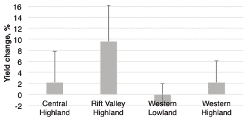

图7.3：OFRA试验中施用次要和微量元素（诊断处理）导致的产量变化（%）。

### 7.4 优化肯尼亚的肥料使用

作物对肥料施用的反应通常呈曲线至平台型，即在达到平台之前产量呈正向增加（图7.4）。

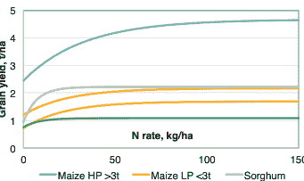

图7.4：肯尼亚中部高地五种作物对肥料氮的曲线至平台型产量反应。HP和LP分别指高潜力和低潜力玉米生产情况。

图7.4所示，中部地区五种作物对施用氮的不同反应，曲线反应的性质各不相同。对于高潜力（HP，预期谷物产量>3 t/ha）玉米，产量增加幅度相对较大，但与其他一些显示的反应相比更为缓慢，并持续到相对较高的氮施用率。相比之下，高粱对氮表现出显著但陡峭的反应，仅施用25 kg/ha氮即接近平台。豆类也有陡峭的反应，在极低氮施用率下即可实现>40%的产量增加。指形黍和低潜力（LP，预期谷物产量<3 t/ha）玉米的反应幅度和形状相似，尽管玉米具有更高的产量潜力。在所有情况下，低氮施用率下随着氮施用率增加产量呈相对陡峭增加，高施用率下产量增加率降低，直到产量达到平台且不再增加。因此，在相对较低的施用率下，肥料使用的效益成本比预计会更大。

也会出现例外，例如反应呈线性或高施用率下作物产量下降的情况。但是，在众多试验中，曲线至平台函数（如Mitscherlich 1909函数）能够很好地描述作物反应。

可使用简单的渐近函数推导反应函数：Yield = a - bc^r，其中a接近最大产量，b是养分施用带来的产量增益，c决定曲线形状，r是养分施用率。

对于资金受限的肥料使用而言，肥料使用经济学的另一个方面是，某些作物施用的某些养分比同一作物或其他作物施用的其他养分具有更高的盈利潜力（图7.5）。

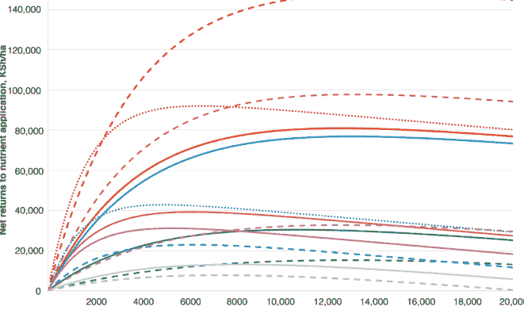

图7.5：肯尼亚西部（海拔>1400米）养分施用投资净回报。

x轴表示投入一种养分给一种作物的资金量。y轴显示所施用养分的投资净回报。对于每条曲线，显示了施用于作物的养分的盈利潜力。曲线越陡峭，投资净回报率越高。随着投资增加，斜率降低，但如果斜率仍为正，利润仍在增加。在曲线峰值处，达到每公顷最大利润点；该施用率通常被称为经济最优施用率（EOR）。

在这个来自肯尼亚西部的示例中，施用于马铃薯的P和K以及施用于红薯的P预期产量增加尤为显著，表明这两种选择在有限的肥料投资下具有最大利润潜力（表7.2e）。施用于马铃薯、水稻、红薯和攀缘豆的氮，以及施用于水稻的K也具有高盈利潜力，至少在低施用率下是如此。较低的曲线代表盈利潜力，但与当前商品价格和肥料成本下的较高曲线相比潜力较小，资金受限的农民只有在更有利可图的选项得到处理后才应考虑这些选项。因此，施用于作物的养分选择和施用率对肥料使用盈利能力非常重要。

### 表7.2a：肯尼亚中部高地。反应函数系数（第3-5列），作物-养分增量的预期产量增加（t/ha）（第6-9列），以及OFRA经济最优施用率（EOR，第10列）以最大化每公顷利润，与当前或最近（REC）建议（第11列）相比。P2O5 = P × 2.29；K2O = K × 1.2。某些函数因缺乏反应或缺乏信息而显示零反应。

| 作物 | 养分 | a | b | c | 0-30 | 30-60 | 60-90 | 90-120 | EOR† | REC ‡ |
|---|---|---|---|---|---|---|---|---|---|---|
| 玉米 HP >5t | N | 6.558 | 1.633 | 0.963 | 1.106 | 0.357 | 0.115 | 0.037 | 67 | 75 |
| 玉米 LP <5t | N | 4.061 | 1.242 | 0.961 | 0.865 | 0.262 | 0.080 | 0.024 | 58 | 75 |
| 豆类 | N | 0.955 | 0.125 | 0.798 | 0.125 | 0.000 | 0.000 | 0.000 | 12 | NA |
| 玉米-豆类 | N | 5.210 | 1.830 | 0.960 | 0.338 | 0.275 | 0.225 | 0.183 | 66 | 75 |
| 水稻，低地 | N | 5.248 | 2.397 | 0.967 | 1.522 | 0.556 | 0.203 | 0.074 | 104 | NA |
| 小麦 HP >3t | N | 3.922 | 1.232 | 0.968 | 0.768 | 0.289 | 0.109 | 0.041 | 70 | NA |
| 小麦 LP <3t | N | 2.563 | 1.160 | 0.969 | 0.710 | 0.276 | 0.107 | 0.042 | 69 | NA |
| | | | | | 0-5 | 5-10 | 10-15 | 15-20 | | |
| 玉米 HP >5t | P | 3.762 | 0.281 | 0.934 | 0.191 | 0.166 | 0.144 | 0.125 | 16 | 11 |
| 玉米 LP <5t | P | 4.078 | 0.683 | 0.940 | 0.182 | 0.133 | 0.098 | 0.072 | 23 | 11 |
| 豆类 | P | 0.990 | 0.185 | 0.867 | 0.094 | 0.046 | 0.023 | 0.011 | 16 | NA |
| 玉米-豆类 | P | 4.860 | 0.810 | 0.890 | 0.358 | 0.200 | 0.112 | 0.062 | 19 | 0 |
| 水稻，低地 | P | 5.395 | 0.572 | 0.885 | 0.261 | 0.142 | 0.077 | 0.042 | 22 | NA |
| 小麦 HP >3t | P | 4.000 | 0.671 | 0.941 | 0.176 | 0.130 | 0.096 | 0.071 | 26 | NA |
| 小麦 LP <3t | P | 2.048 | 0.437 | 0.94 | 0.116 | 0.085 | 0.063 | 0.046 | 19 | NA |
| 小麦 | K | 3.763 | 0.282 | 0.934 | 0.081 | 0.058 | 0.041 | 0.029 | 22 | NA |
| 水稻 | K | 6.253 | 0.984 | 0.898 | 0.409 | 0.239 | 0.140 | 0.082 | 35 | NA |

† EOR是基于使用50公斤尿素和DAP的成本确定的，分别为2850和3600肯尼亚先令。使用的商品价值（肯尼亚先令/公斤）为：水稻50；玉米25；豆类60；小麦30；绿豆90；豇豆50；未去壳花生50；大豆30；指形黍50；木薯30；高粱30；马铃薯30；红薯30；香蕉30。NA - 数据不可用。

‡ Fermont et al. (2010)

### 7.5 按区域划分的优化目标作物

OFRA 为重要粮食作物确定了作物-养分响应函数，并将这些函数应用于肥料使用优化工具（FOTs）的开发。不同地区的优先作物已选定：玉米、豆类、马铃薯、低地水稻和小麦在大多数地区都很常见，而香蕉、红薯、豇豆、绿豆、高粱和指形黍则为一个或多个地区所选定（表 7.2a-h）。

马铃薯、低地水稻、绿豆、大豆和小麦在所有地区主要作为单一种植作物栽培。然而，玉米-豆间作很常见。指形黍和高粱通常在裂谷地区和西部地区种植，由于劳动力需求高，在短雨季于小面积土地上种植。

在中部高地（LU 和 UM），除豆类外，所有作物对施用氮肥都有较大反应，施用 30 kg/ha 氮时获得大部分产量增益，施用超过 60 kg/ha 氮时额外增益不大（表 7.2a）。对施用磷肥也有良好反应，但施用超过 10 kg/ha 磷肥时反应不大。

现有的田间研究结果未显示这些作物中有任何一种对施用钾和锌普遍有反应，这与诊断处理（第 7.3 节）的结果一致。对于中部高地，与 REC 相比，EOR 对氮较低，但对磷较高。

在沿海低地，所有作物对施用氮和磷都反应良好（表 7.2b）。施用氮、磷和钾时，木薯产量增加较高。豇豆对施用氮和钾有反应，且对施用磷的反应更强。玉米和豇豆对施用钾有反应。与 REC 相比，施用于玉米的氮的 EOR 较低，但施用于木薯、指形黍和高粱的氮的 EOR 较高，磷和钾施用率的 EOR 较低。在六种情况下，由于 REC 缺失，EOR 是根据田间研究结果确定的。

### 表 7.2b：沿海低地

| 作物 | 养分 | a | b | c | 0-30 | 30-60 | 60-90 | 90-120 | EOR† | REC ‡ |
|---|---|---|---|---|---|---|---|---|---|---|
| 木薯 | 氮 | 41.361 | 12.546 | 0.972 | 7.194 | 0.069 | 1.309 | 0.558 | 151 | 100‡ |
| 高产玉米 >3t | 氮 | 4.374 | 2.130 | 0.980 | 0.968 | 0.528 | 0.288 | 0.157 | 90 | 150 |
| 低产玉米 <3t | 氮 | 2.056 | 0.399 | 0.950 | 0.313 | 0.067 | 0.014 | 0.003 | 28 | 75 |
| 低地水稻 | 氮 | 4.569 | 1.868 | 0.985 | 0.681 | 0.433 | 0.275 | 0.175 | 159 | NA |
| 高粱 | 氮 | 3.993 | 1.436 | 0.974 | 0.785 | 0.356 | 0.162 | 0.073 | 84 | 50 |
| 指形黍 | 氮 | 1.692 | 1.003 | 0.961 | 0.699 | 0.212 | 0.064 | 0.019 | 70 | 0 |
| 豇豆 | 氮 | 1.222 | 0.382 | 0.920 | 0.351 | 0.029 | 0.002 | 0.000 | 31 | NA |
| | | | | | 0-5 | 5-10 | 10-15 | 15-20 | | |
| 木薯 | 磷 | 25.905 | 6.787 | 0.882 | 3.164 | 1.689 | 0.902 | 0.481 | 37 | 22‡ |
| 高产玉米 >3t | 磷 | 2.815 | 1.113 | 0.914 | 0.403 | 0.257 | 0.164 | 0.105 | 26 | 66 |
| 低产玉米 <3t | 磷 | 2.815 | 1.113 | 0.914 | 0.403 | 0.257 | 0.164 | 0.105 | 26 | 33 |
| 低地水稻 | 磷 | 3.773 | 0.862 | 0.875 | 0.420 | 0.215 | 0.110 | 0.057 | 24 | NA |
| 高粱 | 磷 | 3.590 | 1.178 | 0.891 | 0.516 | 0.290 | 0.163 | 0.091 | 24 | 0 |
| 指形黍 | 磷 | 1.776 | 0.221 | 0.800 | 0.149 | 0.049 | 0.016 | 0.005 | 10 | 50 |
| 豇豆 | 磷 | 1.495 | 0.702 | 0.900 | 0.287 | 0.170 | 0.100 | 0.059 | 26 | NA |
| 木薯 | 钾 | 29.171 | 8.949 | 0.878 | 4.280 | 2.233 | 1.165 | 0.608 | 43 | 83‡ |
| 玉米 | 钾 | 3.143 | 0.177 | 0.911 | 0.066 | 0.041 | 0.026 | 0.016 | 13 | NA |
| 豇豆 | 钾 | 1.110 | 0.168 | 0.850 | 0.093 | 0.041 | 0.018 | 0.008 | 15 | NA |

在东部高地（LM 和 UM），除豆类外，所有作物对氮都有较大反应，施用 30 kg/ha 氮时产量增益最高，施用超过 60 kg/ha 氮时产量增量较小（表 7.2c）。对施用磷的反应出现在较低的磷施用率（最高 10 kg/ha）。在该地区，只有香蕉、马铃薯和低地水稻对施用钾有高反应。香蕉对钾施用的反应最高，施用 20 kg/ha 时产量增益较高。与 REC 相比，施用于马铃薯和玉米的氮的 EOR 较低，但施用于香蕉的氮的 EOR 较高。与 REC 相比，磷的 EOR 不一致，但钾的 EOR 高于 REC。

### 表 7.2c：东部高地（>1200 米海拔）

| 作物 | 养分 | a | b | c | 0-30 | 30-60 | 60-90 | 90-120 | EOR† | REC ‡ |
|---|---|---|---|---|---|---|---|---|---|---|
| 香蕉 | 氮 | 46.500 | 7.900 | 0.896 | 7.607 | 0.282 | 0.010 | 0.000 | 49 | 0 |
| 马铃薯 | 氮 | 12.378 | 3.960 | 0.952 | 3.055 | 0.698 | 0.160 | 0.036 | 78 | 150 |
| 高产玉米 | 氮 | 5.398 | 1.679 | 0.964 | 1.120 | 0.373 | 0.124 | 0.041 | 69 | 75 |
| 低产玉米 | 氮 | 2.410 | 0.770 | 0.875 | 0.756 | 0.014 | 0.000 | 0.000 | 23 | 75 |
| 低地水稻 | 氮 | 5.030 | 1.612 | 0.981 | 0.705 | 0.397 | 0.223 | 0.125 | 132 | NA |
| 豆类 | 氮 | 0.940 | 0.086 | 0.800 | 0.086 | 0.000 | 0.000 | 0.000 | 10 | NA |
| | | | | | 0-5 | 5-10 | 10-15 | 15-20 | | |
| 香蕉 | 磷 | 24.531 | 1.681 | 0.874 | 0.824 | 0.420 | 0.214 | 0.109 | 25 | 33 |
| 马铃薯 | 磷 | 16.195 | 5.289 | 0.903 | 2.113 | 1.269 | 0.762 | 0.457 | 41 | 33 |
| 高产玉米 | 磷 | 5.680 | 1.280 | 0.940 | 0.341 | 0.250 | 0.183 | 0.135 | 34 | 33 |
| 低产玉米 | 磷 | 2.609 | 0.709 | 0.940 | 0.189 | 0.138 | 0.102 | 0.075 | 24 | 33 |
| 低地水稻 | 磷 | 5.241 | 2.329 | 0.964 | 0.390 | 0.325 | 0.270 | 0.225 | 32 | NA |
| 豆类 | 磷 | 0.997 | 0.187 | 0.860 | 0.099 | 0.047 | 0.022 | 0.010 | 13 | 9 |
| 香蕉 | 钾 | 38.200 | 9.750 | 0.913 | 3.565 | 2.261 | 1.435 | 0.910 | 59 | 0 |
| 马铃薯 | 钾 | 14.158 | 2.190 | 0.913 | 0.801 | 0.508 | 0.322 | 0.204 | 42 | 0 |
| 低地水稻 | 钾 | 6.187 | 0.890 | 0.873 | 0.439 | 0.222 | 0.113 | 0.057 | 28 | 0 |

### 表 7.2d：东部低地（<1200 米海拔）

| 作物 | 养分 | a | b | c | 0-30 | 30-60 | 60-90 | 90-120 | EOR† | REC ‡ |
|---|---|---|---|---|---|---|---|---|---|---|
| 玉米 | 氮 | 2.260 | 1.135 | 0.945 | 0.927 | 0.170 | 0.031 | 0.006 | 45 | 60 |
| 豆类 | 氮 | 1.000 | 0.500 | 0.899 | 0.479 | 0.020 | 0.001 | 0.000 | 31 | NA |
| 高粱 | 氮 | 2.050 | 0.000 | 0.000 | 0.000 | 0.000 | 0.000 | 0.000 | 0 | NA |
| 马铃薯 | 氮 | 39.444 | 16.914 | 0.949 | 13.397 | 2.786 | 0.579 | 0.120 | 102 | NA |
| | | | | | 0-5 | 5-10 | 10-15 | 15-20 | | |
| 玉米 | 磷 | 2.027 | 0.079 | 0.885 | 0.036 | 0.020 | 0.011 | 0.006 | 0 | NA |
| 豆类 | 磷 | 1.140 | 0.350 | 0.824 | 0.217 | 0.082 | 0.031 | 0.012 | 14 | NA |
| 高粱 | 磷 | 2.500 | 0.207 | 0.750 | 0.158 | 0.037 | 0.009 | 0.002 | 7 | NA |

### 表 7.2e：西部高地（>1400 米海拔）

| 作物 | 养分 | a | b | c | 0-30 | 30-60 | 60-90 | EOR† | REC ‡ |
|---|---|---|---|---|---|---|---|---|---|
| 玉米 | 氮 | 5.290 | 1.830 | 0.974 | 1.000 | 0.454 | 0.206 | 86 | 60 |
| 马铃薯 | 氮 | 12.899 | 3.898 | 0.969 | 2.383 | 0.927 | 0.360 | 108 | 90 |
| 红薯 | 氮 | 9.750 | 1.577 | 0.938 | 1.346 | 0.197 | 0.029 | 50 | 0 |
| 低地水稻 | 氮 | 5.006 | 1.882 | 0.971 | 1.104 | 0.456 | 0.189 | 106 | NA |
| 玉米-豆间作 | 氮 | 7.360 | 2.530 | 0.970 | 1.533 | 0.605 | 0.239 | 90 | 75 |
| 攀援豆 | 氮 | 2.293 | 0.636 | 0.931 | 0.562 | 0.066 | 0.008 | 43 | 0 |
| 小麦 | 氮 | 3.521 | 0.871 | 0.975 | 0.464 | 0.217 | 0.102 | 66 | NA |
| | | | | | 0-5 | 5-10 | 10-15 | | |
| 玉米 | 磷 | 5.396 | 1.496 | 0.962 | 0.263 | 0.217 | 0.179 | 36 | 26 |
| 马铃薯 | 磷 | 16.095 | 5.517 | 0.908 | 2.112 | 1.303 | 0.805 | 43 | 33 |
| 红薯 | 磷 | 13.257 | 3.828 | 0.912 | 1.413 | 0.891 | 0.562 | 42 | 0 |
| 低地水稻 | 磷 | 5.487 | 0.631 | 0.863 | 0.329 | 0.157 | 0.075 | 16 | NA |
| 玉米-豆间作 | 磷 | 7.280 | 1.790 | 0.890 | 0.790 | 0.441 | 0.246 | 26 | 22 |
| 攀援豆 | 磷 | 2.199 | 0.852 | 0.940 | 0.227 | 0.166 | 0.122 | 41 | NA |
| 小麦 | 磷 | 4.000 | 0.700 | 0.940 | 0.186 | 0.137 | 0.100 | 27 | NA |
| 马铃薯 | 钾 | 16.881 | 3.338 | 0.913 | 1.220 | 0.774 | 0.491 | 47 | 0 |
| 低地水稻 | 钾 | 6.253 | 0.983 | 0.902 | 0.396 | 0.236 | 0.141 | 31 | 0 |

### 表 7.2f：西部低地（<1400 米海拔）

| 作物 | 养分 | a | b | c | 0-30 | 30-60 | 60-90 | 90-120 | EOR† | REC ‡ |
|---|---|---|---|---|---|---|---|---|---|---|
| 高产玉米 >3t | 氮 | 4.672 | 2.224 | 0.970 | 1.332 | 0.534 | 0.214 | 0.086 | 86 | 70 |
| 低产玉米 <3t | 氮 | 2.170 | 0.970 | 0.959 | 0.694 | 0.198 | 0.056 | 0.016 | 50 | 60 |
| 高粱 | 氮 | 2.220 | 1.281 | 0.870 | 1.261 | 0.019 | 0.000 | 0.000 | 27 | NA |
| 指形黍 | 氮 | 1.691 | 0.969 | 0.957 | 0.710 | 0.190 | 0.051 | 0.014 | 26 | NA |
| 豆类 | 氮 | 1.082 | 0.331 | 0.885 | 0.322 | 0.008 | 0.000 | 0.000 | 24 | NA |
| | | | | | 0-5 | 5-10 | 10-15 | 15-20 | | |
| 高产玉米 >3t | 磷 | 4.310 | 0.848 | 0.940 | 0.226 | 0.166 | 0.121 | 0.089 | 27 | NA |
| 低产玉米 <3t | 磷 | 2.624 | 0.744 | 0.940 | 0.198 | 0.145 | 0.107 | 0.078 | 25 | NA |
| 高粱 | 磷 | 2.272 | 1.072 | 0.750 | 0.818 | 0.194 | 0.046 | 0.011 | 13 | NA |
| 指形黍 | 磷 | 1.776 | 0.221 | 0.800 | 0.149 | 0.049 | 0.016 | 0.005 | 10 | NA |
| 豆类 | 磷 | 0.730 | 0.180 | 0.840 | 0.105 | 0.044 | 0.018 | 0.008 | 12 | NA |
| 未去壳花生 | 磷 | 1.230 | 0.288 | 0.904 | 0.114 | 0.069 | 0.042 | 0.025 | 14 | NA |
| 玉米 | 钾 | 3.878 | 0.209 | 0.934 | 0.060 | 0.043 | 0.031 | 0.022 | 15 | NA |
| 豆类 | 钾 | 2.117 | 0.264 | 0.889 | 0.118 | 0.065 | 0.036 | 0.020 | 23 | NA |
| 花生 | 钾 | 1.391 | 0.151 | 0.890 | 0.067 | 0.037 | 0.021 | 0.012 | 17 | NA |

## 表 7.2g：裂谷上区（>2000 masl）

| 作物 | 营养素 | a | b | c | 0-30 | 30-60 | 60-90 | 90-120 | EOR† | REC‡ |
|---|---|---|---|---|---|---|---|---|---|---|
| | | t/ha | | | 产量增加 t/ha | | | | kg/ha |
| 玉米 HP | N | 7.490 | 2.640 | 0.903 | 2.516 | 0.118 | 0.006 | 0.000 | 39 | 75 |
| 玉米 LP | N | 3.700 | 0.200 | 0.886 | 0.195 | 0.005 | 0.000 | 0.000 | 13 | 75 |
| 马铃薯 | N | 10.883 | 2.342 | 0.988 | 0.712 | 0.495 | 0.345 | 0.240 | 159 | 0 |
| 豆类 | N | 0.783 | 0.122 | 0.963 | 0.744 | 0.027 | 0.009 | 0.003 | 21 | 0 |
| 小麦 | N | 6.147 | 1.562 | 0.976 | 0.808 | 0.390 | 0.188 | 0.091 | 91 | NA |
| 玉米-豆间作 | N | 5.770 | 1.490 | 0.990 | 0.530 | 0.342 | 0.221 | 0.142 | 110 | 50 |
| 绿豆 | N | 1.159 | 0.324 | 0.860 | 0.320 | 0.003 | 0.000 | 0.000 | 20 | 0 |
| | | | | | 0-5 | 5-10 | 10-15 | 15-20 | | |
| 玉米 HP | P | 6.087 | 0.738 | 0.904 | 0.292 | 0.177 | 0.107 | 0.064 | 20 | 0 |
| 玉米 LP | P | 4.663 | 0.792 | 0.990 | 0.039 | 0.037 | 0.035 | 0.033 | 0 | NA |
| 马铃薯 | P | 10.303 | 1.103 | 0.857 | 0.593 | 0.274 | 0.127 | 0.059 | 20 | 33 |
| 豆类 | P | 0.793 | 0.122 | 0.630 | 0.110 | 0.011 | 0.001 | 0.000 | 7 | 0 |
| 小麦 | P | 6.859 | 1.104 | 0.809 | 0.721 | 0.250 | 0.087 | 0.030 | 16 | NA |
| 玉米-豆间作 | P | 6.542 | 1.084 | 0.887 | 0.489 | 0.268 | 0.147 | 0.081 | 21 | 17 |
| 绿豆 | P | 1.260 | 0.542 | 0.700 | 0.451 | 0.076 | 0.013 | 0.002 | 12 | 0 |

## 表 7.2h：裂谷下区（<2300 masl）

| 作物 | 营养素 | a | b | c | 0-30 | 30-60 | 60-90 | 90-120 | EOR† | REC‡ |
|---|---|---|---|---|---|---|---|---|---|---|
| | | t/ha | | | 产量增加 t/ha | | | | kg/ha |
| 玉米 | N | 5.717 | 1.084 | 0.969 | 0.663 | 0.258 | 0.100 | 0.039 | 61 | 75 |
| 马铃薯 | N | 25.748 | 8.936 | 0.948 | 7.135 | 1.438 | 0.290 | 0.058 | 46 | NA |
| 豆类 | N | 1.218 | 0.112 | 0.899 | 0.107 | 0.004 | 0.000 | 0.000 | 16 | NA |
| 小麦 | N | 2.825 | 0.838 | 0.952 | 0.646 | 0.148 | 0.034 | 0.008 | 47 | NA |
| 玉米-豆间作 | N | 6.870 | 1.670 | 0.970 | 1.077 | 0.382 | 0.135 | 0.048 | 76 | 50 |
| | | | | | 0-5 | 5-10 | 10-15 | 15-20 | | |
| 玉米 | P | 6.564 | 1.109 | 0.898 | 0.461 | 0.269 | 0.157 | 0.092 | 23 | NA |
| 大豆 | P | 1.012 | 0.157 | 0.878 | 0.075 | 0.039 | 0.020 | 0.011 | 7 | NA |
| 马铃薯 | P | 24.027 | 6.868 | 0.919 | 2.366 | 1.551 | 1.017 | 0.666 | 50 | 33 |
| 豆类 | P | 1.207 | 0.185 | 0.800 | 0.124 | 0.041 | 0.013 | 0.004 | 10 | NA |
| 小麦 | P | 2.874 | 0.572 | 0.839 | 0.334 | 0.139 | 0.058 | 0.024 | 13 | NA |
| 玉米-豆间作 | P | 7.350 | 1.230 | 0.890 | 0.556 | 0.305 | 0.167 | 0.092 | 22 | 17 |
| 绿豆 | P | 1.301 | 0.601 | 0.803 | 0.400 | 0.134 | 0.045 | 0.015 | 11 | NA |
| 玉米 | K | 6.518 | 0.835 | 0.835 | 0.496 | 0.201 | 0.082 | 0.033 | 18 | NA |
| 玉米-豆间作 | K | 7.300 | 0.960 | 0.890 | 0.432 | 0.237 | 0.130 | 0.071 | 25 | NA |

在东部低地（LM）区，除高粱外，所有作物对施用N均有反应，30 kg/ha N的施用带来了更多的产量增益，而超过60 kg/ha的施用增益较小（表7.2d）。仅在豆类和高粱中发现了对施用P的较高反应，但超过10 kg/ha的施用率反应较低。结果未显示任何作物对施用K普遍敏感，这与诊断处理的结果一致（第7.3节）。玉米施用N的EOR与REC相比较低。为若干未设定EOR的作物确定了N和P的EOR。

西部高地（LM和UM）区所有作物对N均有高反应，施用30 kg/ha N时产量增益最高，施用超过60 kg/ha时增益较小（表7.2e）。所有作物对10 kg/ha P均有反应，其中马铃薯和红薯的产量反应最大。仅马铃薯和低地水稻从施用K中获益（最高10 kg/ha），但其他作物对K无反应。在西部高海拔区，N、P和K的EOR与REC相比均较高。尽管低地水稻、攀缘豆和小麦对养分施用有反应，但这些作物无可用REC。

西部低地（LM）区所有作物对施用N均有高反应，30 kg/ha N的施用带来了更多的产量增益，而超过60 kg/ha的施用增益较小（表7.2f）。花生对N施用无反应，而豆类需要少于30 kg/ha的施用。所有作物对施用P均有反应，但超过10 kg/ha的P施用率反应较小。三种作物在15 kg/ha K时出现高反应，但超过20 kg/ha时增益较低。对于西部低地，N、P和K的EOR与REC相比均较高。

裂谷上区（UH, LH）所有作物对施用N均有高反应，施用30 kg/ha时产量增益最高，但超过60 kg/ha的施用增益较低（表7.2g）。所有作物对施用P均有反应，但施用率适中，最高达10 kg/ha。所有作物均未对K产生反应。对于裂谷上区，玉米施用N的EOR与REC相比较低，但马铃薯、豆类、小麦和绿豆施用N的EOR较高；马铃薯施用P的EOR较低，但其他作物施用P的EOR较高。

裂谷下区（UM）除大豆和绿豆外，所有作物对施用N均有反应，30 kg/ha的施用带来了更多的产量增益，而超过60 kg/ha的施用增益较小（表7.2h）。所有作物对施用P均有反应，但超过10 kg/ha的施用率反应较小，马铃薯除外，其对P的反应良好，最高可达20 kg/ha。仅玉米和玉米-豆间作对施用K有反应，最高10 kg/ha的施用带来了更多的产量增益。EOR率主要低于REC，但在大多数作物中，EOR是在没有REC的作物上确定的。

根据田间研究结果确定的EOR与REC相比存在不一致的差异（表7.2a-h）。在八个推荐区域的49种作物-养分组合中，在REC不可用或为0 kg/ha时，确定了基于田间研究的EOR。在所有地区，所有非豆科作物对施用N均有经济反应，施用30 kg/ha即可实现大部分产量增益，而超过60 kg/ha的施用增益甚微（表7.2a-h）。同样，在所有地区，所有作物对施用P均有经济反应，例外是东部地区的马铃薯和裂谷地区的低产潜力玉米。K的反应出现在不到三分之一的病例中，最常见于马铃薯、水稻、花生和香蕉。由于资金限制，农民在施用低于EOR的肥料时可以期望更高的效益成本比，尤其是在肥料使用被视为有风险的低产潜力地区（Ariga and Jayne 2010）。结果表明，大多数作物适量使用肥料具有良好的盈利能力。

### 7.6 肥料使用优化工具（FOT）用于肯尼亚农业生态区

优化肥料使用利润需要为每种作物选择合适的养分用量。在优化肥料使用以实现高利润时，需要考虑不同感兴趣作物对施用养分的反应、分配给不同作物的土地面积、农产品价值、所用肥料成本以及可用于肥料使用的资金。

考虑到这些复杂因素，肥料使用优化工具（FOTs）是使用Excel Solver®（Frontline Systems Inc., 美国内华达州因克林村）开发的。FOTs中的Solver函数使用线性优化的复杂数学方法，将农民的经济和农学信息与最多28个作物-养分响应函数相结合，以制定建议。该设计使FOTs易于使用。预计作物-养分-用量组合的选择平均可最大化肥料使用投资回报。

为肯尼亚的推荐区域开发了八个FOT，可在 http://agronomy.unl.edu/OFRA 获取。要使用FOT，需要在Excel中加载Solver并启用宏；请参阅FOT的“帮助和说明”工作表以获取操作指南。

数据输入要求农民估计每种感兴趣作物的种植面积，并在“种植面积，英亩（Ac）”下填写。接下来，确定收获时每公斤农产品的农场价值，考虑自用部分和市场盈余的价值，并在“预期谷物价值”（图7.6）下填写。不同肥料的使用成本（包括购买价格以及运输和施用成本）在“每50公斤肥料价格”下填写。农民可用于肥料使用的资金也作为“预算约束”填写。

结果分为三个部分（图7.7），包括每种作物应施用的各种肥料用量、预期平均产量增益和净回报，以及农场肥料使用的预期平均总净回报。

不同作物肥料使用净回报的差异很有启发性。在此示例中，马铃薯肥料使用的回报估计非常高。农民不应将每英亩施用的肥料量增加到推荐量以上，而应考虑分配更多土地用于马铃薯生产，同时减少另一种净回报较低作物的种植面积，意识到肥料使用回报只是作物总盈利能力的一个因素。

一名为七种作物投资50,000肯尼亚先令购买肥料的农民，预计平均投资回报约为362,400肯尼亚先令。对于同样作物和土地分配但投资潜力较低（10,000肯尼亚先令）的农民，预期平均净回报将下降至210,000肯尼亚先令。这些是肥料投资的部分预算净回报，未考虑其他生产成本。由于投入品和产出价格随季节变化，需要获取肥料价格和谷物市场价格的最新信息，以最准确地优化当季肥料使用建议。

为县农业推广员、农资经销商和无法轻松使用电脑的农民开发了所有FOT的纸质版本（表7.3；可在 http://agronomy.unl.edu/OFRA 获取）。这些版本易于使用，但需要更新，可能每年更新一次，以反映肥料成本相对于商品价格的重大变化。

纸质FOT根据农民肥料使用能力分为三个财务等级：等级1）针对贫困农民，其资金不超过施用所有耕地EOR所需金额的三分之一；等级2）针对资金较多但不超过施用所有耕地EOR所需金额三分之二的农民；以及等级3）针对资金足以在至少部分耕地上施用EOR的农民。

纸质FOT提供4R原则建议，即适宜产品、适宜用量、适宜时间和适宜施用方法。还给出了校准方式，以指导农民校准其对正确用量的手感和视觉印象，例如施肥带的长度或每计量单位的孔数。纸质FOT假设农民将使用容量为4毫升的Keringet品牌矿泉水瓶盖，或者用于撒施时，使用从底部切割高4厘米、容量为78毫升的Keringet或Aqua品牌矿泉水瓶。这些计量单位的选择是因为在农村地区易于获取。

考虑使用纸质FOT（表7.3）。如果农民仅有少量资金用于肥料使用，他/她可能属于财务等级1。该等级针对七种作物中的五种作物提供建议，其盈利潜力针对

## AEZ 西部海拔 >1400

Producer Name:
Prepared By:
Date Prepared: 2016年7月6日

| Crop | Area Planted (Ac) | Expected Grain Kg/t |
| :--- | :--- | :--- |
| Maize | 1 | 25 |
| Irish potato | 1 | 30 |
| Potato, sweet | 1 | 30 |
| Rice, lowland | 1 | 60 |
| Maize-bean | 1 | |
| Beans, climbing | 1 | 60 |
| Wheat | 1 | 40 |
| Total | 7 | |

| Fertilizer Product | N | P2O5 | K2O | Price/50 kg bag Ksh |
| :--- | :--- | :--- | :--- | :--- |
| Urea | 46% | 0% | 0% | 2850 |
| Triple super phosphate, TSP | 0% | 46% | 0% | 4000 |
| Diammonium phosphate, DAP | 18% | 46% | 0% | 3600 |
| Muriate of potash, KCl | 0% | 0% | 60% | 3600 |
| P-mazao | 10% | 28% | 10% | 3250 |

| Amount available to invest in fertilizer | 50,000 |
| :--- | :--- |

图 7.6：肯尼亚上西部地区作物价格和肥料成本的输入数据选项。

| Crop | Urea | TSP | DAP | KCl | P-mazao |
| :--- | :--- | :--- | :--- | :--- | :--- |
| Maize | 43 | 0 | 61 | 0 | 0 |
| Irish potato | 59 | 0 | 61 | 31 | 23 |
| Potato, sweet | 16 | 5 | 61 | 0 | 0 |
| Rice, lowland | 61 | 0 | 43 | 27 | 0 |
| Maize-bean | 52 | 0 | 48 | 0 | 0 |
| Beans, climbing | 11 | 0 | 51 | 0 | 0 |
| Wheat | 37 | 0 | 55 | 0 | 0 |
| Total fertilizer needed | 280 | 5 | 388 | 58 | 23 |

| Crop | Yield Increases | Net Returns |
| :--- | :--- | :--- |
| Maize | 1,060 | 19,647 |
| Irish potato | 5,003 | 138,669 |
| Potato, sweet | 2,079 | 56,640 |
| Rice, lowland | 1,336 | 71,638 |
| Maize-bean | 1,621 | 34,090 |
| Beans, climbing | 534 | 27,044 |
| Wheat | 519 | 14,679 |

| Total net returns to investment in fertilizer | 362,407 |
| :--- | :--- |

图 7.7：肯尼亚上西部地区优化肥料施用率和肥料投资回报的输出数据。

## 表 7.3：纸质工具示例

### 肯尼亚西部上部（>1400 米）肥料使用优化器

以下假设：校准测量使用 i) 一个 5 毫升水瓶盖（盖），可容纳约 3.5 克尿素和 5.5 克 DAP 和 MOP，ii) 一个直径 5 厘米、切割高度为 4 厘米的 500 毫升水瓶，约有 80 毫升容量，可容纳 56 克尿素和 88 克 DAP 和 MOP。行距：玉米、马铃薯、甘薯和攀缘豆的行距为 75 厘米；豆类为 50 厘米；小麦为 25 厘米。每公斤谷物价值（Ksh）：玉米 25，马铃薯 30，甘薯 30，水稻 50，豆类 60，小麦 30。使用 50 公斤肥料的成本（Ksh）：尿素 2850；DAP 3600；MOP 3600。施用率单位为 kg/ac。最低施用率为 10 kg/ac。

### 第 1 级 财务能力。

| Crop | Details |
|---|---|
| Maize HP (>3t) | at planting band 10 kg DAP (1 lid for 2.2 m) |
| Irish potato | at planting band 60 kg DAP (1 lid for 0.4 m) and 20 kg MOP (1 lid for 1 m) |
| Sweet potato | at planting band 39 kg DAP (1 lid for 0.6 m) |
| Maize-bean intercropping | at planting band 19 kg DAP (1 lid for 1.1 m) and side dress by banding 15 kg urea at 6 WAP (1 lid for 0.9 m) |
| Climbing bean | at planting band 28 kg DAP (1 lid for 0.8 m) |

### 第 2 级 财务能力

| Crop | Details |
|---|---|
| Maize HP (>3t) | at planting band 36 kg DAP (1 lid for 0.6 m) and side dress by banding 26 kg urea at 6 WAP (1 lid for 0.5 m) |
| Irish potato | at planting band 61 kg DAP (1 lid for 0.3 m) and 30 kg MOP (1 lid for 0.8 m) |
| Sweet potato | at planting band 61 kg DAP (1 lid for 0.3 m) |
| Rice, lowland | broadcast 25 kg DAP (one cut bottle for 6.7 m @ 2 m wide) and 20 kg MOP (one cut bottle for 5.6 m @ 2 m wide) at planting and side dress by broadcast 51 kg urea (one cut bottle for 2.0 m @ 2 m wide) at panicle initiation |
| Maize-bean intercropping | at planting band 34 kg DAP (1 lid for 0.7 m) and side dress by banding 35 kg urea at 6 WAP (1 lid for 0.4 m) |
| Climbing bean | at planting band 55 kg DAP (1 lid for 0.4 m) |
| Wheat | band at planting 19 kg DAP (1 lid for 3.5 m) and side dress by banding 14 kg urea at panicle initiation (1 lid for 2.2 m) |

### 第 3 级 财务能力（最大化每英亩利润）。

| Crop | Details |
|---|---|
| Maize HP (>3t) | at planting band 61 kg DAP (1 lid for 0.3 m) and side dress by banding 52 kg urea at 6 WAP (1 lid for 0.25 m) |
| Irish potato | at planting band 61 kg DAP (1 lid for 0.3 m) and 30 kg MOP (1 lid for 0.7 m) |
| Sweet potato | at planting band 61 kg DAP (1 lid for 0.3 m) |
| Rice, lowland | broadcast 45 kg DAP (one cut bottle for 3.7 m @ 2 m wide) and 28 kg MOP (one cut bottle for 1.8 m @ 2 m wide) at planting and side dress by broadcast 61 kg urea (one cut bottle for 1.6 m @ 2 m wide) at panicle initiation |
| Maize-bean intercropping | at planting band 53 kg DAP (1 lid for 0.4 m) and side dress by banding 58 kg urea at 6 WAP (1 lid for 0.25 m) |
| Climbing bean | at planting band 61 kg DAP (1 lid for 0.3 m) and side dress by banding 14 kg urea at 6 WAP (1 lid for 1 m) |
| Wheat | band at planting 54 kg DAP (1 lid for 1.2 m or broadcast with cut bottle for 5 m) and side dress by banding 37 kg urea at panicle initiation (1 lid for 1.1 m or broadcast with cut bottle for 2.9 m) |

在肯尼亚西部高海拔地区，小麦和低地水稻的肥料使用量不足以符合此财务等级。此等级中每种作物的建议肥料使用获利潜力大致相似。因此，农民可以根据财务能力选择使用其中任何或全部选项。如果肥料资金仍有剩余，他/她可以进入第 2 级中的一个或多个选项。

第 1 级的一个选项是：“马铃薯，种植时带施 60 kg DAP (1 lid for 0.4 m) 和 20 kg MOP (1 lid for 1.0 m)”。因此，DAP 和 MOP 肥料应在种植时沿靠近行的带状施用于马铃薯。农民使用 Keridget 水瓶盖自行校准以每英亩施用 60 kg DAP，一盖满盖足够施用 0.4 m 的带。每英亩 20 kg MOP 的校准同样操作，一盖满盖足够施用 1.0 m 的带。所有其他选项的说明也都易于遵循。

优化肥料使用的另一个方面是考虑其他土壤管理措施的影响，并考虑土壤测试值。农场层面可用的有机投入物通常不足以提供所有所需的养分，然而，当在综合土壤肥力管理（ISFM）框架内与无机肥料结合使用时，它们能提高作物产量和盈利能力。这些材料包括农家肥和堆肥，以及茄娘和绿槐等鲜活植物材料，还有 mucuna 和 Azolla 等绿肥。

表 7.4 是为一些常见做法提供肥料替代价值的指南。例如，如果农民施用 1 吨（干重）低质量农家肥，这将替代约 5 kg 尿素、3 kg DAP 或 TSP，以及 2 kg KCl，或种植时施用 10 kg NPK 肥料。另一方面，如果前茬作物是绿肥作物，例如玉米的 mucuna 和低地水稻的 Azolla，那么有机投入物可替代作物所需 N 的 100% 以及 P、K 和 NPK 的 70%。

## 表 7.4：使用常见有机材料的肥料替代指南

## 综合土壤肥力管理框架内的肥料使用

## 肥料替代与土壤测试影响

| ISFM practice | Urea | DAP/TSP | KCl | NPK 17-17-17 |
|---|---|---|---|---|
| | \multicolumn{4}{c}{Fertilizer reduction, % or kg/acre} |
| Previous crop was a green manure crop e.g. mucuna and crotalaria for maize or Azolla for lowland rice | 100% | 70% | 70% | 70% |
| Fresh vegetative material (e.g. prunings of tithonia, Lantana camara, grevillea, Leucaena, Sesbania sesban, banana leaves, coffee husks) per 1 t of fresh material | 4 kg | 2 kg | 2 kg | 8 kg |
| Farmyard manure per 1 t of dry material | 5 kg | 3 kg | 2 kg | 10 kg |
| Residual value of FYM applied for the previous crop, per 1 t | 2 kg | 1 kg | 1 kg | 3 kg |
| Dairy or poultry manure, per 1 t dry material | 9 kg | 4 kg | 5 kg | 16 kg |
| Residual value of dairy and poultry manure applied for the previous crop, per 1 t | 2 kg | 2 kg | 1 kg | 3 kg |
| Compost, per 1 t | 8 kg | 3 kg | 3 kg | 15 kg |
| Residual value of compost applied for the previous crop, per 1 t | 3 kg | 2 kg | 1 kg | 5 kg |
| Rotation | \multicolumn{4}{c}{0% reduction but more yield expected} |
| Cereal-bean intercropping | \multicolumn{4}{c}{Increase DAP/TSP by 7 kg/ac, but no change in N and K compared with sole cereal fertilizer} |
| Cereal-other legume (effective in N fixation) intercropping | \multicolumn{4}{c}{Increase DAP/TSP by 11 kg/ac, reduce urea by 9 kg/ac, and no change in K compared with sole cereal fertilizer} |
| If Mehlich III P >15 ppm | \multicolumn{4}{c}{Apply no P} |
| Avail. P (Olsen) > 10 ppm | \multicolumn{4}{c}{Apply no P} |
| If soil test K <100 ppm | \multicolumn{4}{c}{Band apply 20 kg/ac KCl} |

提高产量，从而增强盈利能力。其他选项的说明见表 4，同样易于遵循。

建议每 4 年进行一次土壤测试，以评估土壤养分水平，并通过仅施用缺乏的养分来优化肥料需求，从而提高农场盈利能力。例如，当土壤中 P 的测试值高于 15 ppm 时，建议不添加 P 肥料。另一方面，如果土壤 K 测试值低于 100 ppm，则应在播种时以带施方式施用 20 kg/ac 的 KCl（表 7.4）。

作物-养分-施肥量组合的最优选择预计平均可最大化肥料使用的投资回报率。为肯尼亚的八个推荐领域开发了八种肥料优化工具（FOTs），可在 http://agronomy.unl.edu/OFRA 上获取。所有 FOTs 的纸质版已开发完成，供县级推广官员、农业经销商和无法轻松使用计算机的农民使用，当作物和肥料价格等情况变化时，可能需要更新。

除上述内容外，优化肥料使用还需考虑其他土壤管理措施和土壤测试值的影响。有机投入物，如农家肥和堆肥，以及新鲜植物材料，如凤凰木和绣线菊修剪物，可在综合土壤肥力管理（ISFM）框架内使用，以提高作物生产力和盈利能力。土壤测试可每 4 年进行一次，以评估土壤养分有效性并优化肥料需求，仅施用缺乏的养分，从而提高农场盈利能力。

### 7.7 结论

小农户增加肥料使用对于扭转撒哈拉以南非洲粮食产量下降趋势至关重要。有机投入物与无机肥料的联合施用通常可提高产量，尤其是当农民在适当的施肥量、时间和位置施用合适的肥料，并考虑其他良好农艺措施时。

肥料使用往往受到缺乏开发和传播可持续综合肥料推荐所需的扎实知识的限制，这些推荐是土壤和作物特定的，并且对农民有利可图。OFRA 的总体目标是为农民提供决策工具，使他们能够在各种农业生态区为不同作物选择肥料施用量和类型，以根据其经济约束最大化利润。

在肯尼亚四个地区对各种作物进行了总共 37 个重复试验。这些试验中对 N、P 和 K 的平均反应分别为 39%、5% 和 17%，并为各种推荐领域开发了 49 个作物-养分响应函数。在所有地区，所有非豆科作物对施用 N 都有经济响应，施用 30 kg/ha N 时获得了大部分产量增益，施用超过 60 kg/ha N 时增益甚微。同样，在所有地区，所有作物对施用 P 都有经济响应，东部地区的马铃薯和裂谷地区的低潜力玉米除外。对 K 的反应发生在不到三分之一的病例中，最常见于马铃薯、水稻、花生和香蕉。

### 7.8 致谢

作者对项目期间各方提供的支持与合作深表感谢。我们特别感谢 Busia、Embu、Machakos、Migori、Muranga、Nakuru、Trans Nzoia 和 Uasin Gishu 县农业部的农民和推广人员。这项工作是“优化非洲肥料推荐”项目的一部分，该项目在 13 个撒哈拉以南非洲国家开展，由 AGRA 资助，CABI 协调，美国内布拉斯加大学林肯分校 Charles Wortmann 教授担任科学总监。我们对所获得的所有支持和便利表示感谢。我们感谢 Wortmann 教授在项目实施和手稿准备期间的承诺与指导。我们还感谢肯尼亚农业和畜牧研究组织（KALRO）总干事允许发表本作品。

### 7.9 参考文献

Ariga J 和 Jayne TS (2010). 推动肯尼亚小农户肥料使用增加的因素，1990-2007. Egerton University, Tegemeo Agricultural Monitoring and Policy Analysis (TAMPA) 项目，由 USAID/肯尼亚资助. 草案报告 2：2010 年 6 月 10 日

Ariga J, Jayne TS, Kibaara B 和 Nyoro JK (2008). 肯尼亚小农户肥料使用的趋势和模式，1997-2007. 工作论文系列第 28 号 Tegemeo Institute, Nairobi, Kenya

Fermont AM, Tittonell PA, Baguma Y, Ntawuruhunga P 和 Giller KE (2010) 迈向了解薯蓣肥料反应的控制因素：东非的经验. Nutr Cycl Agroecosyst 86:133-151

Gachene KK 和 Kimaru G (2003) 土壤肥力与土地生产力. 东非地区推广人员指南. RELMA Government of Kenya (GoK) (2014) 肯尼亚玉米生产土壤适宜性评价. 国家加速农业投入品获取计划（NAAIAP）与肯尼亚农业研究所（KARI）、肯尼亚土壤调查部合作的报告，2014 年 2 月. 可在：http://kenya.soilhealthconsortia.org/?wpfb_dl=3 获取

Jaetzold R 和 Schmidt H (1983) 肯尼亚农场管理手册. Vol/C. 自然条件与农场管理信息. 农业部/GAT, Nairobi, Kenya

Jaetzold R, Hornetz B, Shisanya CA 和 Schmidt H (编) (2005-2012) 肯尼亚农场管理手册. Vol. I-IV（西部、中部、东部、尼扬扎、南裂谷、北裂谷、海岸）, Nairobi. 可在：https://www.uni-trier.de/index.php?id=58581 获取

Jama B, Harawa R, Kiwia A, Rarieya M, Kimani D, Zeila A 和 Scarpone AJ (2013) 第 4 章：改善非洲土壤健康：挑战与有希望的解决方案，第 44-50 页. 在 AGRA 年度报告中

肯尼亚土壤调查 (2007) 肯尼亚土壤与地形数据库. 可在：http://www.isric.org/data/soil-and-terrain-database-kenya-ver-20-kenosot 获取

Sombroek WG, Braun HMH 和 van der Pouw BJA (1982) 肯尼亚勘探土壤图和农业气候带图，1980. 比例尺：1:1,000,000. 勘探土壤调查报告第 E1 号. 肯尼亚土壤调查 农业部，国家农业实验室，Nairobi, Kenya

## 8. 马里综合土壤肥力管理背景下的肥料使用优化

Mohamed Dicko mkdicko@gmail.com, Mama Koné, Lamine Traoré, Cheick H. Diakité, Nianankoro Kamissoko, Baba Sidibé, Zoumana Kouyaté, Diallaka Sogodogo, Lassana Dioni, Hamidou Konaré 和 Amadou Gakou
马里巴马科 Mohamed V 街 B.P.258，马里农村经济研究所

### 8.1 马里的农业系统

马里是西非半干旱区（10°至 25°N 和 4°E 至 12°W；Diarra 1993；MEATEU 2000）的一个幅员辽阔的国家，面积 1,241,000 km²。农业约占人口 80% 的主要职业。它占 GDP 的 34% 和出口产品的 23%。

自给自足的农业占主导地位，农产品主要由生产者当地消费。耕地面积增加而休耕地减少，除水稻外，作物平均产量未增加。

一般来说，小农户容易采用新的良好农业规范（GAP），包括新品种、使用肥料和良好的饲养方法。在适当的地方，实行两熟制，肥料使用量因农民的财务能力而异。在该国南部和西部，可能会为棉花和玉米生产提供投入品，且肥料在谷物-棉花轮作中比不包括棉花的种植系统使用更多。人们认识到通过施用粪肥来补充肥料使用的价值。农民欢迎牧民在旱季将牲畜“过夜停放”在他们的田地里，以获取排泄的尿液和粪便。

一项名为“Loi d'Orientation Agricole”（LOA：农业取向法）的法律于 2006 年颁布，使政府能够对种子和肥料提供补贴，推动农业机械化，构建和加强生产者及其组织的技术能力，并建立名为高级农业委员会的制度框架。

马里拥有干热带气候，年降雨量从不到 100 mm 到约 1200 mm 不等（表 8.1）。马里有四个基于生物气候的农业生态区（AEZ）：撒哈拉，

表 8.1：马里农业生态区代表地点的月平均降雨量（mm）及最高和最低气温（°C；Tmax；Tmin）

| | 1月 | 2月 | 3月 | 4月 | 5月 | 6月 | 7月 | 8月 | 9月 | 10月 | 11月 | 12月 |
|---|---|---|---|---|---|---|---|---|---|---|---|---|
| **撒哈拉，Kidal** | | | | | | | | | | | | |
| 降雨量 | 1 | 0 | 0 | 1 | 5 | 12 | 37 | 46 | 23 | 3 | 0 | 0 |
| Tmax | 28 | 31 | 35 | 39 | 42 | 42 | 40 | 38 | 39 | 38 | 33 | 29 |
| Tmin | 13 | 15 | 19 | 23 | 27 | 29 | 27 | 26 | 26 | 23 | 18 | 14 |
| **萨赫勒，Niono** | | | | | | | | | | | | |
| 降雨量 | 2 | 0 | 1 | 4 | 20 | 56 | 131 | 171 | 76 | 17 | 0 | 0 |
| Tmax | 30 | 34 | 38 | 41 | 43 | 40 | 37 | 34 | 35 | 35 | 32 | 29 |
| Tmin | 15 | 20 | 24 | 28 | 30 | 27 | 25 | 24 | 24 | 23 | 18 | 14 |
| **北苏丹稀树草原，Kolombada, Samanko** | | | | | | | | | | | | |
| 降雨量 | 2 | 1 | 3 | 22 | 52 | 119 | 215 | 268 | 169 | 55 | 2 | 0 |
| Tmax | 33 | 37 | 38 | 40 | 39 | 36 | 33 | 32 | 33 | 34 | 34 | 32 |
| Tmin | 15 | 20 | 22 | 25 | 26 | 24 | 24 | 22 | 22 | 23 | 18 | 14 |
| **南苏丹稀树草原，Bougouni, Longorola, Finkolo** | | | | | | | | | | | | |
| 降雨量 | 2 | 1 | 7 | 39 | 98 | 144 | 242 | 292 | 206 | 77 | 9 | 1 |
| Tmax | 31 | 33 | 35 | 35 | 33 | 31 | 28 | 28 | 29 | 31 | 33 | 30 |
| Tmin | 18 | 24 | 27 | 28 | 27 | 25 | 24 | 23 | 24 | 24 | 23 | 21 |

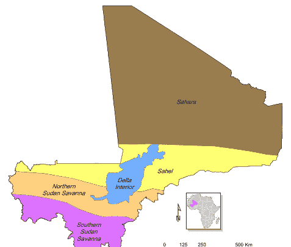

图 8.1：马里的自然区域。

萨赫勒、北苏丹稀树草原、此处视为南苏丹稀树草原的几内亚前区，以及一条横向区域，称为尼日尔河三角洲（图 8.1）。

撒哈拉沙漠覆盖了该国超过 50% 的面积。其降水在空间和时间上具有极端的变异性。年降雨量少于 200 毫米，气温在低于 14°C 至高于 42°C 之间。土壤为沙质，保水能力低，风蚀严重。畜牧业可以补充种植业，因为产生的粪肥如果用于农作物生产，是一种宝贵的资源。

在萨赫勒地区，年平均降雨量为 200 至 600 毫米，雨季从 7 月到 9 月，在此期间接收了 79% 的降雨量（表 8.1）。土壤通常有机质和可用养分含量低。土壤侵蚀（尤其是风蚀）是主要关注点。谷物生产受频繁干旱的阻碍。牛是主要家畜，但在北萨赫勒地区，绵羊和山羊也很重要。粪肥对该地区的土壤肥力管理很重要，但产量不足以满足农民的需求。

北苏丹稀树草原的特征是年降雨量为 600 至 1100 毫米。雨季从北部约 3 个月到南部 4 个月不等，在此期间接收了 90% 的降雨量（表 8.1）。大雨会导致养分淋溶。最肥沃的土壤是低地的冲积土（Soumaré 2004）。这一农业生态区（AEZ）是马里农业潜力最大的地区。除了雨季相对较长、降雨量高之外，低地良好的土壤持水能力使得许多作物得以适应。

南苏丹稀树草原对应于开放森林和林地生态系统。这是马里最湿润的气候农业生态区（AEZ），年降雨量为 1100 至 1200 毫米（表 8.1）。雨季持续 5 至 7 个月，并伴有一些暴雨，这些暴雨是土壤侵蚀的主要因素。低地土壤由壤土和砂壤土组成，部分地区有铁铝土。林地覆盖了该农业生态区的 40% 至 90%。此外，有利的自然条件允许种植多种作物，包括块茎类、柑橘类、谷物和豆类。该农业生态区农业生产力的主要生物胁迫包括昆虫、螨虫和鸟类。

### 8.2 当前土壤肥力管理

对自然资源的广泛且不可持续的开发导致马里出现土壤退化（Koné and Doumbia 1997）。每种种植系统都面临集约化和可持续性挑战。在天然肥力低的土壤上提高作物产量，需要更集约、更有效地使用化肥并结合粪肥。马里使用的大部分化肥都是进口的。

作物生产主要依赖雨养，作物从 6 月到 10 月生长，11 月至 12 月之间收获。多年来，农民采用了适合其生产系统的土壤肥力管理良好农业规范（GAP）。GAP 的一些示例包括：

- 休耕以恢复土壤肥力：尽管休耕传统上非常重要（Wane 2009），但由于每年 3% 的人口增长和土地高压，休耕期正在变短，在一些地方正在消失（Dixon et al., 2001）。
- 间作：北苏丹稀树草原和萨赫勒低地的高粱-豇豆和高粱-花生；萨赫勒的珍珠黍-豇豆；以及北苏丹稀树草原的乳树和萨赫勒的 Acacia albida 等一年生作物与树木间作，有助于提高土地生产力，同时树木有助于维持土壤肥力。
- 通过三种传统粪肥输送系统将粪肥施用于田地：（a）与游牧民的“过夜停留”安排，导致粪便和尿液沉积在田地里；（b）将夜间畜栏从一个地点移动到另一个地点，动物粪便的沉积和践踏有助于其混入土壤；（c）固定夜间畜栏，从其中运输粪肥并施用于田地（Landais and Lhoste 1993）。干旱季节喂食农作物秸秆很常见，未被消耗的秸秆用作垫料，最终吸收尿液并进入粪肥。

为实现化肥使用效率，建议应根据种植系统和降雨量及分布情况进行调整，施肥量从南向北递减。良好的化肥养分管理被称为养分管理的 4R 原则，即施用正确的养分源、以正确的用量、在正确的时间，以便作物有效吸收，并采用正确的施肥位置，使其可被植物根系吸收（Johnston and Bruulsema 2014）。

尽管 2007 年和 2008 年化肥成本异常高昂，即化肥价格通胀，马里的化肥使用量仍从 1994 年的 84,800 吨增加到 2009 年的 175,000 吨和 2011 年的 250,000 吨。2012 年，化肥销量达到约 300,000 吨。化肥进口和销量的增加主要归功于补贴和更高效的化肥分销，约 2000 家农资商店向农民提供优质化肥（CNFA 2010）。化肥混合设施（包括巴马科的 Toguna Agro-Industry、锡卡索的 Sogefert 和塞古的 ADP）试图将混合肥与作物需求相匹配。

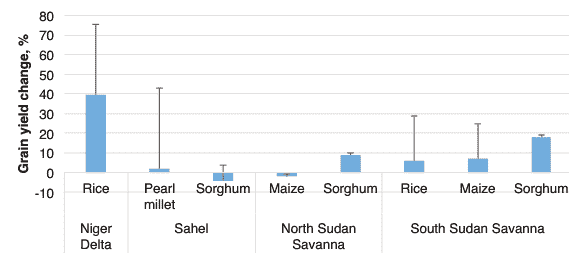

图 8.2：马里 2014-15 年田间研究站点添加次要和微量元素（Mg、S、Zn、B）后的作物反应。

化肥供应的一个问题是，除尿素和 DAP 外，农民难以获得单一养分和双养分复合肥；尽管这些肥料被进口并用于制造混合肥。限制化肥选择并强调混合肥预计会增加化肥成本并降低农民的利润潜力。

有机资源已有一定程度的商业化。Profeba、Orgafert 和 Elephant Vert 等公司生产市政和工业堆肥，但供应量相对于农民需求来说很小。

结合使用化肥、有机资源以及土壤和水资源保护技术（Mason et al., 2014）对于恢复和改善土壤肥力是必要的（AGRA 2013）。GAP 整合的示例包括使用粪肥、微量施肥、改良高粱和玉米品种、zaï 盆地耕作方式，以及使用石坝或土坝减少径流和侵蚀。微量施肥与改良谷物品种配合使用，通常辅以粪肥施用。其他鼓励的 GAP 包括覆盖、轮作、管控休耕、简单和埋垄垄作以及间作。在山谷中，有时会使用水坝储水用于水稻和蔬菜作物灌溉。

### 8.3 马里养分缺乏诊断

2014-2015 年进行的试验包括一种诊断处理，以确定次要和微量元素对作物表现的重要性。该处理除 N、P 和 K 外，还含有 Mg、S、Zn 和 B，并与相同 N、P 和 K 用量的处理进行了比较。诊断处理使灌溉水稻产量平均增加了 39%。然而，在萨赫勒、北苏丹和南苏丹稀树草原的其他作物中并未出现持续的产量增加，表明其他生物或非生物因素对产量的限制比这些次要或微量元素中的任何一种都更大（图 8.2）。需要进一步调查，以确定这些养分中哪些对灌溉水稻生产最为重要。

### 8.4 优化马里的化肥使用

尽管政府有化肥补贴计划，许多贫困农民仍无法负担化肥使用，或使用不稳定且用量较低。为克服这一弊端，优化化肥使用旨在最大化农民从化肥使用中获得的利润。确定化肥使用的经济性需要作物养分响应函数。利用不同农业生态区（AEZ）的大量研究结果，捕捉作物对施用养分的响应，呈现养分用量与产量之间的曲线至平原关系。这种响应在数学上表示为：Yield = a - bc^r，其中 a 是施用该养分后的近似最大产量，b 是施用该养分带来的产量增益，c^r 决定曲线响应的形状，其中 c 是曲率系数，'r' 是养分用量。已为三个农业生态区的每个目标作物-养分组合建立了响应函数。一旦确定了这样的响应函数，就可以应用经济学来估计不同作物施用不同养分的利润潜力。

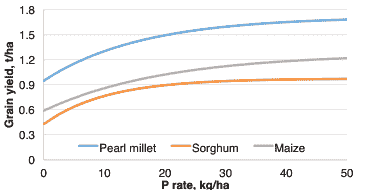

图 8.3：萨赫勒地区作物对磷肥的响应。

图 8.3 中玉米、高粱和珍珠黍的磷肥响应曲线说明了施肥用量对盈利能力的重要性。在所有曲线中，与较高施肥量相比，较低施肥量下每公顷施用 1 千克磷肥的产量增益率更高，尤其是高粱。随着磷肥从 0 增加到 10 kg/ha，高粱产量呈陡峭增长，因此具有相对较高的投资回报率潜力；10 至 20 kg/ha 的增益率较低，最终达到产量价值增加不足以证明施用额外磷肥成本合理的点。资金受限的农民可以通过在响应曲线相对陡峭的用量下施肥，在有限的化肥投资中获得最佳回报。

化肥使用中的另一个重要经济考量，特别是对于资金

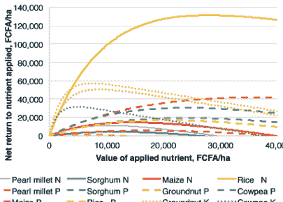

图 8.4a：马里萨赫尔区施肥净回报。本图假设所用谷物价值为（以 XOF 计）大米 330，玉米 80，高粱 130，珍珠小米 135，豇豆和花生 600。施肥成本为：尿素 13,500，DAP 20,000，TSP 16,000，KCl 16,000，15-15-15 13,500。

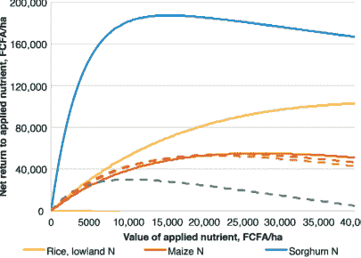

图 8.4b：马里北苏丹稀树草原区施肥净回报。

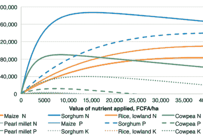

图 8.4c：马里南苏丹稀树草原区施肥净回报。

### 8.5 马里施肥使用优化工具

为优化投资利润而决定投资施肥，必须考虑大量信息，且可能令人应接不暇，尤其是在资金受限的情况下。南苏丹稀树草原区的农民需要考虑 14 个作物-养分响应函数的含义，同时兼顾其作物选择、土地分配、商品预期价值、施肥成本以及用于施肥的投资金额。因此，开发了施肥优化工具（FOTs），这些工具可与在带有 Solver® 插件（Frontline Systems Inc., Incline Village, NV, USA）的 Excel 中创建的宏一起工作。这些 Excel FOTs 使用线性规划的复杂数学方法，将作物-养分响应信息与与农民特定情况相关的其他农艺和经济信息相结合（agronomy.unl.edu/OFRA）。尽管存在这种数学复杂性，但使用 FOTs 很简便。在使用 FOTs 之前，需要激活 Solver 插件并启用宏；具体步骤在 FOT 的“帮助与说明”工作表中给出。FOTs 和教学材料可在 (https://agronomy.unl.edu/OFRA) 获取。

在萨赫尔地区，对水稻施用 N 和 P、对花生施用 P 以及对豇豆施用 K，至少在低施用率下具有较高的盈利潜力（图 8.4a）。产量增加不足以支付额外养分成本的点位于曲线峰值和 EOR 处，此后施用更多养分会导致利润损失。在那里，施用于水稻的 P 和施用于豇豆的 K 的价值应分别低于 7000 和 5000 FCFA/ha。然而，对花生施用更多 P 和对水稻施用更多 N 具有良好的盈利潜力。位置较低的曲线也有盈利潜力，但相比陡峭的曲线，其潜力要小得多。

在输入面板（图 8.5a）中，用户输入分配给每种作物的土地面积和收获的预期价值，同时考虑留作自用部分的价值和待销售的盈余。然后，他/她输入使用每种可能可用肥料的 50 kg 袋装肥料的成本，考虑购买成本以及运输和施用成本。如果某种肥料不可用，其成本将被替换为零。最后，他/她输入可用于施肥的金额；这是预算或财务约束。在充分向工具提供信息后，用户左键单击优化按钮以启动计算。

在北苏丹稀树草原区，巨大的盈利机会在于对高粱施用 N（图 8.4b）。在此之下，盈利潜力良好但较低的是对玉米和水稻施用 N，以及对豇豆和珍珠小米施用 P。玉米相对较低的谷物价格降低了其盈利潜力。在南苏丹稀树草原区，更好的盈利机会在于对高粱施用 N、对水稻和高粱施用 P，以及对豇豆施用 K（图 8.4c）。因此，资金受限的农民需要选择作物-养分-施用率

为最大化利润而应施用于每种作物的每种肥料用量在输出的上部面板中报告（图 8.5b）。有时，推荐施用率过

小以至于不可行，例如对高粱施用 10 千克/公顷 DAP 或对豇豆施用 11 千克/公顷 KCl。对于如此小的施用率，资金或肥料应分配给其他选项。第二个面板显示了每种作物推荐施肥应用带来的预期平均产量增加和净利润。施用于水稻的肥料的非常高的净回报可能会导致农民分配更多土地用于水稻生产。最后，报告了施肥带来的总预期净回报。

## 萨赫尔农业生态区（AEZ SAHEL）

| 生产者姓名： | xxx |
|---|---|
| 编制人： | xxx |
| 编制日期： | 2016 年 7 月 6 日 |

| 作物 | 种植面积 (Ha)* | 预期谷物价值/千克袋 † |
|---|---|---|
| 珍珠小米 | 3 | 135 |
| 高粱 | 2 | 130 |
| 花生，未去壳 | 0.5 | 600 |
| 豇豆 | 0.5 | 600 |
| 玉米 | 0.5 | 80 |
| 水稻 | 0.25 | 300 |
| 总计 | 6.75 | |

| 肥料产品 | N | P2O5 | K2O | xx | 每 50 千克袋成本 †† |
|---|---|---|---|---|---|
| 尿素 | 46% | 0% | 0% | 0% | 13500 |
| 三过磷酸钙，TSP | 0% | 46% | 0% | 0% | 16000 |
| 磷酸二铵，DAP | 18% | 46% | 0% | 0% | 20000 |
| 氯化钾，KCl | 0% | 0% | 60% | 0% | 16000 |
| NPK | 15% | 15% | 15% | 0% | 13500 |

| 可用于投资施肥的金额 | 100000 |
|---|---|

图 8.5a：Excel FOT 的输入面板。

| 作物 | 尿素 | TSP | DAP | KCl | NPK |
|---|---|---|---|---|---|
| 珍珠小米 | 0 | 0 | 48 | 0 | 0 |
| 高粱 | 0 | 22 | 10 | 0 | 0 |
| 花生，未去壳 | 0 | 0 | 0 | 20 | 0 |
| 豇豆 | 0 | 18 | 0 | 11 | 0 |
| 玉米 | 31 | 0 | 0 | 0 | 0 |
| 水稻 | 65 | 0 | 21 | 18 | 0 |
| 0 | 0 | 0 | 0 | 0 | 0 |
| 所需肥料总量 | 32 | 53 | 170 | 20 | 0 |

| 作物 | 产量增加 | 净回报 |
|---|---|---|
| 珍珠小米 | 449 | 41,439 |
| 高粱 | 271 | 24,032 |
| 花生，未去壳 | 93 | 49,319 |
| 豇豆 | 82 | 40,053 |
| 玉米 | 351 | 19,733 |
| 水稻 | 751 | 189,391 |
| 0 | 0 | 0 |

| 施肥投资总净回报 | 275,331 |
|---|---|

图 8.5b：优化后的 Excel FOT 输出面板，显示所需肥料和预期回报。

## 表 8.2：南苏丹稀树草原区的纸质施肥优化工具

马里-南苏丹-AEZ 施肥使用优化器

以下假设：
校准测量使用：Diago 矿泉水瓶盖，可容纳约 8 毫升，分别装 5.6 克尿素、8.8 克 DAP、8.8 克 TSP、8.0 克 NPK 和 8.8 克 KCl；Gino 番茄罐容量 70 毫升，可装 49 克尿素、77 克 DAP、77 克 TSP 和 77 克 KCl。
种植：假设玉米和豇豆：0.8 x 0.4 米；高粱 0.8 x 0.8 米；珍珠小米 1 x 0.8 米；花生 0.4 x 0.4 米；水稻 20 厘米。
作物价值：假设每千克谷物价格（CFA）：玉米 80；高粱 130；水稻 300；珍珠小米 135；花生 600；豇豆 600。
50 千克肥料使用成本：假设 50 千克肥料使用成本（CFA）：尿素 13,500；DAP 20,000；NPK 13,500；TSP 16,000；KCl 16,000。
撒施宽度：3 米；WAP=种植后周数，WAT=移栽后周数。施用率为千克/公顷。

| 财务能力等级 | 作物 | 详情 |
| :--- | :--- | :--- |
| 一级财务能力。 | 豇豆 | 出苗时点施 35 千克 NPK（1 个 Diago 瓶盖用于 7 株植物） |
| 一级财务能力。 | 玉米 | 种植后 6 周时点施 11 千克尿素（1 个 Diago 瓶盖用于 20 株植物） |
| 一级财务能力。 | 水稻，低地 | 移栽时分 2 次撒施 78 千克尿素：移栽时 28 千克尿素（1 个 Gino 罐用于 7.5 米），穗分化期 50 千克尿素（1 个 Gino 罐用于 4.1 米），以及移栽时 106 千克 NPK（1 个 Gino 罐用于 2 米），移栽时 106 千克 NPK（1 个 70 毫升 Gino 罐用于 2 米） |
| 一级财务能力。 | 高粱 | 出苗时点施 66 千克 NPK（1 个 Diago 瓶盖用于 2 株植物） |
| 二级财务能力。 | 玉米 | 出苗时点施 32 千克尿素（1 个 Diago 瓶盖用于 6.8 株植物）和种植后 6 周点施 50 千克尿素（1 个 Diago 瓶盖用于 4.8 株植物） |
| 二级财务能力。 | 豇豆 | 出苗时点施 50 千克 NPK（1 个 Diago 瓶盖用于 5 株植物） |
| 二级财务能力。 | 水稻，旱地 | 移栽时撒施 49 千克尿素（1 个 Gino 罐用于 3.3 米），穗分化期 50 千克尿素（1 个 Gino 罐盖用于 7 株植物），以及出苗或移栽时撒施 162 千克 NPK（1 个 Gino 罐用于 1 米） |
| 二级财务能力。 | 高粱 | 出苗时点施 135 千克 NPK（1 个 Diago 瓶盖用于 1 株植物） |
| 二级财务能力。 | 水稻，低地 | 移栽时撒施 26 千克尿素（1 个 Gino 罐用于 6.3 米），穗分化期 50 千克尿素（1 个 Gino 罐用于 3.3 米） |
| 三级财务能力（每英亩最大利润）。 | 小米 | 出苗时点施 10 千克尿素（1 个 Diago 瓶盖用于 14 株植物）和出苗时点施 26 千克 NPK（1 个 Diago 瓶盖用于 4 株植物） |
| 三级财务能力（每英亩最大利润）。 | 玉米 | 出苗时点施 31 千克尿素（1 个 Diago 瓶盖用于 7.5 株植物）和种植后 6 周点施 100 千克尿素（1 个 Diago 瓶盖用于 2 株植物）以及出苗时点施 33 千克 NPK（1 个 Diago 瓶盖用于 8 株植物）和出苗时点施 33 千克 NPK（1 个 Diago 瓶盖用于 8 株植物） |
| 三级财务能力（每英亩最大利润）。 | 豇豆 | 出苗时点施 66 千克 NPK（1 个 Diago 瓶盖用于 9 株植物）和出苗时点施 12 千克 KCl（1 个 Diago 瓶盖用于 23 株植物） |
| 三级财务能力（每英亩最大利润）。 | 水稻，旱地 | 移栽时撒施 200 千克 NPK（1 个 Gino 罐用于 1 米）和穗分化期 50 千克（1 个 Gino 罐用于 3.3 米） |
| 三级财务能力（每英亩最大利润）。 | 高粱 | 出苗时点施 187 千克 NPK（1 个 Diago 瓶盖用于 1 株植物） |
| 三级财务能力（每英亩最大利润）。 | 水稻，低地 | 移栽时撒施 35 千克尿素（1 个 Gino 罐用于 4.7 米和穗分化期 100 千克尿素（1 个 Gino 罐用于 1.6 米），以及土地整地时撒施 26 千克 KCl（1 个 Gino 罐用于 9.9 米） |

请注意，预算限制为100,000 FCFA，分配给32、53、170、20和0 kg的尿素、过磷酸钙（TSP）、磷酸二铵（DAP）、氯化钾（KCl）和NPK 15-15-15（Figure 8.5b）。NPK复合肥料生产成本可能最高，但由于肥料种类补贴不均衡，其价格最低。尽管价格低廉，但研究发现它与其他肥料相比并不具有经济竞争力，因为农民即使作物对所有养分均无经济响应，也要为三种养分付费。增加的成本意味着利润损失。对于资金紧张的农民来说，这更有害，因为购买NPK将意味着可用于购买具有高利润潜力肥料的资金减少。在作物对三种养分均有经济响应的某些情况下，如果获得足够补贴，NPK复合肥可能具有经济竞争力。当Figure 8.4的场景仅有尿素和NPK可用时进行优化，预期平均总净回报仅为184,524 CFA，而非275,331 CFA，且仅为拥有更广泛肥料选择的农民预期利润的67%。结果表明，如果意图是最大化农民利润潜力，使农民能够选择肥料至关重要。

为每个Excel FOT开发一个配套的纸质FOT，意识到农民和推广人员通常无法随时使用计算机（Table 8.2）。纸质FOT有三个财务能力等级。财务等级1是最受限的，适用于无法投入超过在EOR时施用所有耕地所需总金额三分之一的农民。财务等级2的农民拥有的资金少于在EOR时施用所有耕地所需资金的三分之二。财务等级3的农民有足够的资金在EOR时施用至少部分耕地。

纸质FOT对农民可用于校准正确施肥率的视觉和手感感知的计量单位做出了假设。假设农民将按照建议种植。对收获时农场肥料成本和预期谷物价值做出了假设。纸质FOT涉及肥料使用的4R原则，并推荐正确的产品、正确的用量、正确的时间和正确的施用方法。它还向用户说明施用校准事宜。

考虑南苏丹稀树草原的纸质FOT（Table 8.2）。财务等级1的三项建议之一是“低地水稻：0 WAT时撒施28 kg尿素（Gino可覆盖11 m），穗分化期撒施50 kg尿素（Gino可覆盖6 m），以及0 WAT时撒施106 kg NPK（Gino可覆盖2 m）。”因此，农民将在移栽时向低地水稻（包括灌溉水稻）撒施28 kg/ha尿素和106 kg/ha NPK 15-15-15，并在穗分化期再撒施50 kg/ha尿素。撒施时，撒施宽度为3 m。他/她应使用70 ml的Gino品牌番茄酱罐来校准施用感知，以达到正确的施肥率。一个Gino罐足以撒施3 m宽、11 m长的区域，用于28 kg/ha尿素的移栽施用。对于106 kg NPK的移栽施用，一个Gino罐足以撒施3 m宽、2 m长的区域。对于穗分化期的50 kg尿素施用，一个Gino罐足以覆盖3 m宽、6 m长的区域。

纸质FOT的一个限制是，如果肥料成本相对于谷物价值发生显著变化，可能需要每年修订一次。这应在国家层面进行，并通过报纸发表以及在线访问等方式重新分发。纸质FOT的开发和修订步骤在第1章中描述。

小农户通常耕种面积较小但数量众多的地块，这些地块的作物种植历史和管理方式各不相同。FOT或多或少以整个农场为基础，以优化农场企业的利润。FOT（Excel和纸质版本）在农民的背景下以及典型于某个AEZ的重要农业用地情况下，为肥料使用提供优化建议。然而，肥料使用优化需要考虑其他可能影响其一个或多个地块养分可用性的做法（Table 8.3）。土壤测试结果可能表明需要调整肥料建议。某些做法，如施用畜禽粪便，会影响最佳肥料使用率。例如，建议如果施用农家肥

Table 8.3: 集成土壤肥力管理框架内的肥料用量调整

| ISFM做法 | 尿素 | DAP/TSP | KCl | NPK 17-17-17 |
|---|---|---|---|---|
| | 肥料减少量，%或kg/ha | | | |
| 前茬为绿肥作物（Sesbania和dolichos） | 雨季末还田可使谷物和秸秆产量分别比不施有机改良剂的谷物单一种植增加27%和49%（Kouyaté, 2000）。 | | | |
| 苏丹稀树草原每1 t干物质的农家肥 | 11 kg | 7 kg | 13 kg | 73 kg |
| 每1 t干物质的奶牛或家禽粪便 | 53 kg | 27 kg | 27 kg | |
| 每1 t堆肥 | 38 kg | 12 kg | 14 kg | |
| 轮作 | 肥料用量减少0%，但与壤砂土和壤土上的谷物相比，种植豇豆后预期谷物产量平均增加18%和23%（Kouyaté et al., 2000）。 | | | |
| 谷物-其他豆科植物（有效固氮）间作 | 与单一种植谷物施肥相比，DAP/TSP增加11 kg/ha，尿素减少9 kg/ha，钾不变 | | | |
| 如果Bray 1法土壤P > 15 ppm | 不施P | | | |

在苏丹稀树草原，每施用1 t/ha粪便（干重），可分别将11、7、13和73 kg/ha的尿素、TSP/DAP、KCl或NPK分配到其他地方；然而，这不适用于萨赫尔地区，因为农家肥施用通常会导致对肥料响应增加。

### 8.6 按AEZ划分的目标作物和种植系统

马里有四个主要的作物生产AEZ。OFRA项目在年降雨量450至1200 mm的地区实施，主要主粮谷物包括玉米、高粱、小米和水稻，涉及库利科罗（Samanko和Kolombada）、凯（Bema）、锡卡索（Bougouni、Kebila、Longorola和Finkolo）和塞古（Cinzana和Niono）地区。其他作物利用过去研究的结果（包括邻国数据）进行了处理。

开发了N、P和K的作物养分响应函数（Tables 8.4a–c）。响应函数的系数a、b和c（第3–5列）、养分施用增量带来的预期产量增加（第6–9列）以及与推荐用量相比的EOR均有报告（第10-11列）。

在萨赫尔地区，水稻和玉米对N的响应比高粱和珍珠小米更强，但所有旱地谷物对P都有显著响应（Table 8.4a）。水稻和花生对P无经济响应。只有水稻和豇豆对K有经济响应。玉米和水稻的N的EOR小于推荐用量（REC）的一半，高粱和珍珠小米也小于REC。P的EOR有时高于REC。水稻对K的EOR约为REC的25%。

在北苏丹稀树草原，玉米和高粱对N的响应大于水稻，大部分谷物产量增加发生在施用30 kg/ha时（Table 8.4b）。除珍珠小米外，对P的响应相对较小。缺乏对K响应的证据。与萨赫尔地区相比，水稻的N推荐用量较低，且与N的EOR相似。施用于水稻的N的EOR大于玉米和高粱，因为水稻谷物价值更高。玉米和高粱的N的EOR小于REC。P的EOR与REC的变化不一致。

在南苏丹稀树草原（Table 8.4c）中，旱地水稻、玉米和高粱具有最佳响应

## 表 8.4a: 马里萨赫勒区（200-600毫米）。响应函数（第3-5列），作物-营养素预期产量增加（t/ha）（第6-9列），以及OFRA经济最优施用率（EOR）以最大化每公顷利润，与马里AEZ的当前或最近（REC）建议相比。P2O5 = P × 2.29；K2O = K × 1.2

| 作物 | 营养素 | a | b | c | 0-30 | 30-60 | 60-90 | 90-120 | EOR† | REC |
|---|---|---|---|---|---|---|---|---|---|---|
| | | | | t/ha | | | | | kg/ha | |
| 珍珠小米 | N | 0.742 | 0.223 | 0.930 | 0.198 | 0.022 | 0.003 | 0.000 | 21 | 32 |
| 高粱 | N | 1.098 | 0.273 | 0.970 | 0.164 | 0.066 | 0.026 | 0.011 | 20 | 32 |
| 玉米 | N | 1.275 | 0.687 | 0.951 | 0.535 | 0.118 | 0.026 | 0.006 | 31 | 84 |
| 水稻（灌溉） | N | 4.461 | 0.564 | 0.942 | 0.470 | 0.078 | 0.013 | 0.002 | 48 | 120 |
| | | | | 0-5 | 5-10 | 10-15 | 15-20 | | |
| 珍珠小米 | P | 1.717 | 0.768 | 0.940 | 0.204 | 0.150 | 0.110 | 0.081 | 23 | 10 |
| 高粱 | P | 0.975 | 0.548 | 0.908 | 0.210 | 0.129 | 0.080 | 0.049 | 16 | 10 |
| 花生 | P | 0.254 | 0.032 | 0.870 | 0.016 | 0.008 | 0.004 | 0.002 | 0 | 9 |
| 豇豆 | P | 0.605 | 0.109 | 0.930 | 0.033 | 0.023 | 0.016 | 0.011 | 15 | 10 |
| 玉米 | P | 1.275 | 0.687 | 0.951 | 0.153 | 0.119 | 0.092 | 0.072 | 0 | 7 |
| 水稻（灌溉） | P | 5.190 | 0.189 | 0.919 | 0.065 | 0.043 | 0.028 | 0.018 | 14 | 20 |
| 花生 | K | 1.093 | 0.104 | 0.800 | 0.070 | 0.023 | 0.008 | 0.002 | 0 | 0 |
| 豇豆 | K | 0.477 | 0.063 | 0.650 | 0.056 | 0.006 | 0.001 | 0.000 | 8 | 0 |
| 水稻（灌溉） | K | 6.036 | 0.223 | 0.750 | 0.170 | 0.040 | 0.010 | 0.002 | 12 | 50 |

†EOR按大米330 CFA；玉米80 CFA；高粱130 CFA；珍珠小米135 CFA；豇豆600 CFA确定（单位均为CFA）。每50公斤肥料袋的施肥成本（CFA）为：尿素13,500；DAP 20,000；TSP 16,000；KCl 16,000；NPK 15-15-15 13,500。

## 表 8.4b: 马里北苏丹萨瓦纳区（600-1200毫米）

| 作物 | 营养素 | a | b | c | 0-30 | 30-60 | 60-90 | 90-120 | EOR† | REC |
|---|---|---|---|---|---|---|---|---|---|---|
| | | | | t/ha | | | | | kg/ha | |
| 水稻，低地 | N | 2.483 | 0.429 | 0.974 | 0.234 | 0.106 | 0.048 | 0.022 | 67 | 60-80 |
| 玉米 | N | 2.290 | 1.619 | 0.960 | 1.143 | 0.336 | 0.099 | 0.029 | 54 | 84 |
| 高粱 | N | 4.068 | 1.534 | 0.860 | 1.517 | 0.016 | 0.000 | 0.000 | 26 | 32 |
| | | | | 0-5 | 5-10 | 10-15 | 15-20 | | |
| 玉米 | P | 2.868 | 0.295 | 0.928 | 0.092 | 0.063 | 0.044 | 0.030 | 3 | 7 |
| 豇豆 | P | 1.095 | 0.075 | 0.700 | 0.062 | 0.010 | 0.002 | 0.000 | 0 | 10 |
| 花生 | P | 1.320 | 0.141 | 0.855 | 0.077 | 0.035 | 0.016 | 0.007 | 6 | 9 |
| 珍珠小米 | P | 2.010 | 0.662 | 0.870 | 0.332 | 0.165 | 0.082 | 0.041 | 13 | 10 |

对氮施肥，0-30 kg/ha氮增量带来的增产最佳。对高粱和旱地水稻施用磷肥，以及对旱地水稻施用钾肥，带来了良好的产量增加。对豇豆施用氮、磷、钾肥带来了较小的产量增加，但由于豇豆谷物价值高，这些施肥是经济的。

低地和旱地水稻的EOR与REC相似，但玉米、高粱和珍珠小米的EOR较低。除高粱外，所有作物的磷肥EOR均低于REC。钾肥EOR已为旱地和低地水稻、高粱及豇豆确定，而REC缺失。

## 表 8.4c: 马里南苏丹萨瓦纳区（1000-1200毫米）

| 作物 | 营养素 | a | b | c | 0-30 | 30-60 | 60-90 | 90-120 | EOR† | REC |
|---|---|---|---|---|---|---|---|---|---|---|
| | | | t/ha | | | | | | kg/ha |
| 玉米 | N | 3.000 | 1.760 | 0.970 | 1.054 | 0.423 | 0.170 | 0.068 | 65 | 84 |
| 水稻，旱地 | N | 4.655 | 1.908 | 0.988 | 0.580 | 0.404 | 0.281 | 0.196 | 70 | 60-80 |
| 高粱 | N | 4.067 | 1.530 | 0.860 | 1.513 | 0.016 | 0.000 | 0.000 | 28 | 32 |
| 水稻，低地 | N | 2.482 | 0.428 | 0.970 | 0.256 | 0.103 | 0.041 | 0.017 | 62 | 60-80 |
| 豇豆 | N | 1.860 | 0.168 | 0.770 | 0.168 | 0.000 | 0.000 | 0.000 | 15 | 0 |
| 珍珠小米 | N | 1.111 | 0.110 | 0.930 | 0.098 | 0.011 | 0.001 | 0.000 | 8 | 32 |
| | | | | | 0-5 | 5-10 | 10-15 | 15-20 | | |
| 玉米 | P | 2.868 | 0.295 | 0.928 | 0.092 | 0.063 | 0.044 | 0.030 | 2 | 7 |
| 水稻，旱地 | P | 3.633 | 0.979 | 0.904 | 0.388 | 0.234 | 0.141 | 0.085 | 13 | 20 |
| 高粱 | P | 2.770 | 1.470 | 0.910 | 0.553 | 0.345 | 0.215 | 0.134 | 12 | 10 |
| 豇豆 | P | 0.929 | 0.040 | 0.700 | 0.033 | 0.006 | 0.001 | 0.000 | 3 | 10 |
| 珍珠小米 | P | 1.520 | 0.129 | 0.900 | 0.053 | 0.031 | 0.018 | 0.011 | 2 | 10 |
| 水稻，旱地 | K | 4.439 | 0.838 | 0.800 | 0.563 | 0.185 | 0.060 | 0.020 | 25 | 20 |
| 高粱 | K | 2.016 | 0.114 | 0.900 | 0.047 | 0.028 | 0.016 | 0.010 | 23 | 12 |
| 水稻，低地 | K | 1.950 | 0.091 | 0.961 | 0.016 | 0.013 | 0.011 | 0.009 | 14 | 20 |
| 豇豆 | K | 0.871 | 0.100 | 0.800 | 0.067 | 0.022 | 0.007 | 0.002 | 13 | 0 |

根据田间研究结果确定的EOR，在33次比较中，有61%和27%分别比REC低20%以上或高20%（表8.4a,b,c）。这意味着，总体而言，按照REC施肥的农民因过量施用而损失了潜在利润。一个例外是施用于旱地和低地（包括灌溉）水稻的氮肥，其中EOR和REC通常相似。然而，在肥料使用上资金受限的农民需要从作物对施用营养素的典型曲线型至平台响应中获益，并通常施用低于EOR的量，因为在此时每公斤/公顷施用营养素带来的产量增益较高。

### 8.7 结论

马里所有农业生态区（AEZ）的肥料使用盈利能力均可提升。对于肥料使用不受资金限制的农民，推荐施用率需要调整以反映EOR。对于肥料使用资金受限的农民，需要具备选择最有可能最大化投资回报的作物-营养素-施用率方案的能力。已开发出计算机运行和纸质肥料优化工具，以便根据肥料成本和商品价值确定当前EOR，并确定作物-营养素-施用率的组合以最大化投资回报。在ISFM框架内调整肥料施用率对于优化肥料使用、对替代营养供应实践给予认可、在有理由时施用额外肥料（如间作）以及考虑土壤测试值非常重要。如果农民盈利能力是肥料使用优化的目标，那么农民必须有足够的单一营养素或双营养素复合肥料选择。

### 8.8 致谢

我们感谢所有为本章做出贡献的人。我们感谢AGRA、CABI、内布拉斯加大学林肯分校、马里土壤健康联盟和马里农村经济研究所（国家研究服务机构）的贡献与支持。

### 8.9 参考文献

- AGRA (2013) 《非洲农业状况报告：聚焦主粮作物》。AGRA。http://www.archive.agra.org/our-results/annual-reports
- CNFA (2010) 马里农业经销商名录。全国2000个地址
- Diarra A (1993) 马里干旱区农民和牧民的自然资源利用与空间占用：博雷姆区（高奥区）个案。博士论文，法国保罗·瓦莱里蒙佩利埃三世大学
- Dixon J, Gulliver A 和 Gibbon D (2001) 农业经营体系与贫困。在变化的世界中改善农民生计。粮农组织，世界银行
- Johnston AM 和 Bruulsema TW (2014) 4R营养管理以提高营养素利用效率。工程学报。83:365–370
- Koné M 和 Doumbia M (1997) 农民作物中维持土壤肥力的困难。蒙彼利埃研讨会丛书，CIRAD-CA
- Koyaté Z, Franzleubbers K, Juo ASR 和 Hossner LR (2000) 耕作、作物残茬、豆科轮作和绿肥对马里半干旱热带地区高粱和小米产量的影响。植物与土壤 225:141-151
- Landais E 和 Lhoste PL (1993) 非洲萨瓦纳区的畜牧系统与施肥转移。农业笔记 2:9-25
- Mason SC, Ouattara K, Taonda SJB, Pale SB, Sohoro A 和 Kabore D (2014) 半干旱西非的土壤与种植系统研究及其与保护性农业潜力的关系。国际农业可持续性期刊 doi: 10.1080/14735903.2014.945319
- MEATEU (2000) 生物多样性国家战略，第1卷，马里生物多样性状况。马里设备、国土规划、环境与城市化部
- Soumaré M (2004) 马里高粱品种扩散区域预测的贡献。作物生长模型与地理信息系统的耦合。高级研究文凭论文，巴黎第十大学，INA-PG
- Wane A (2009) 莫尔菲尔岛的自然资源开发与管理：卡斯-卡斯区（波多尔省）个案研究。达喀尔CAD大学地理学硕士论文

## 9. 在整体土壤肥力管理背景下优化马拉维的肥料使用

Patson C Nalivata¹ patsonlivata@yahoo.com, Moses W Muthalif², Wilson I Makumba³, Emmanuel Mbewe¹ and Hastings Manase¹
¹利隆圭农业与自然资源大学，本达校区，P.O. Box 219，利隆圭，马拉维
²布文布韦农业研究站，Box 5748，林蓟，马拉维
³农业研究服务部，P.O. Box 30，利隆圭，马拉维

### 9.1 马拉维的农业系统

#### 9.1.1 农业生态区（AEZ）

马拉维根据海拔划分为四个农业生态区：高地；中海拔和高地台地；湖岸、中夏雷河谷和上夏雷河谷；以及下夏雷河谷（图 9.1）。马拉维的亚湿润热带农业生态系统的特点是旱季漫长，11 月至 4 月间呈单峰型降雨模式（表 9.1）（MoAFS 2012）。

高地农业生态区位于海拔 1320 至 3000 米（masl）之间，由孤立的山脉组成，尼亚卡、维菲亚和穆兰杰拥有广阔的高地台地，而德扎和赞巴则更为孤立。气候为亚湿润，84% 的降雨发生在 12 月至 3 月。最低和最高平均气温范围分别为 9 至 16°C 和 19 至 25°C（表 9.1）。主要土壤为淋溶红壤、黄壤和红壤。主要作物包括玉米、鸽子豆、茶、咖啡、香蕉、菠萝、木薯、马铃薯等。

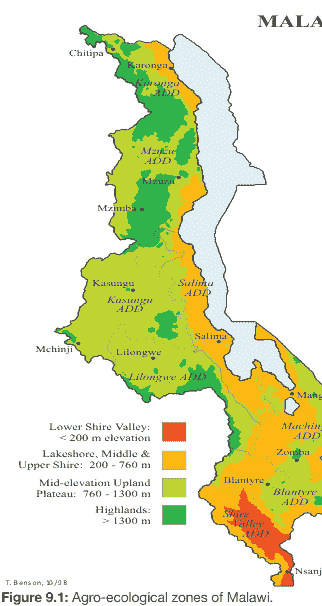

中海拔和高地台地农业生态区位于海拔 760 至 1300 米（masl）之间。该区域由从北部卡龙加延伸至南部南桑杰的阶地和台地组成。地貌为平坦至起伏的地形，散布着孤石山。气候为半干旱，月降雨量范围为 1 至 221 毫米；最低和最高平均气温范围分别为 8 至 17°C 和 24 至 30°C（表 9.1）。阶地土壤主要为浅层红壤。台地链较高处的土壤为深厚排水良好的红壤，而排水不良的砂土和黏土土壤主导山谷，当地称为丹博斯。其他重要土壤组包括铁铝土、灰壤、淋溶灰壤、岩质土和浅土。主要作物包括玉米、烟草、木薯、水稻和豆类。

湖岸、中夏雷河谷和上夏雷河谷农业生态区位于海拔 200 至 760 米（masl）之间。地势平坦至微起伏，山谷和马拉维湖湖岸地带有深厚的钙质土。上夏雷河从马拉维湖南部流经一片宽阔平坦的河谷。夏雷河谷部分地区发现莫波诺斯土。气候为半干旱。月降雨量范围为 0 至 339 毫米，月平均最低和最高气温范围分别为 16 至 22°C 和 26 至 33°C。重要粮食作物包括玉米、水稻、木薯、高粱和小米。

下夏雷河谷农业生态区海拔低于 200 米（masl），从卡帕奇拉瀑布延伸至南桑杰区。气候为半干旱，月平均降雨量范围为 5 至 167 毫米，最低和最高月平均气温范围分别为 14 至 23°C 和 36°C。沼泽地土壤为湿生土。中至粗质地的冲积土和洪积土在夏雷河以东最为常见，而黏土土在夏雷河以西至阶地地区常见。常见粮食作物为玉米、高粱、木薯和马铃薯。

#### 9.1.2 马拉维当前的土壤肥力管理

土壤退化和固有的低土壤肥力导致现有生产系统的不可持续低产，并威胁撒哈拉以南非洲的长期粮食安全。在马拉维，农业以玉米生产为主，玉米是主要主粮作物，年产量达 120 万公顷，占耕地面积的约 80%。大部分生产由小农户进行，由于成本高和财务能力有限，他们对肥料、改良种子和其他投入品的获取和使用有限。

为提高土壤养分有效性而研究的低成本良好农业实践（GAP）包括农作物秸秆管理；农林业；玉米-豆类轮作；区域特定的玉米肥料建议以提高养分利用效率；保护性农业；气候智慧型实践；以及堆肥的使用。将有机资源和固氮豆类与轮作中的肥料使用相结合已得到充分研究。然而，此类 GAP 的采用率较低，在当前玉米价格与肥料成本比率相对于其他可用资金用途的情况下，许多小农户认为玉米生产中使用肥料的盈利潜力缺乏吸引力。

影响土壤肥力的传统做法对土壤肥力和作物产量有不同的影响。由于土地利用压力，轮耕已不再可行用于土壤肥力恢复。使用手锄沿田地坡面为谷物生产进行培土非常普遍，用于土壤通气、保水和促进根系发育。在马拉维中部和北部，作物秸秆还田很少，因为秸秆是通过连根拔起收获，用作燃料和牲畜饲料，或常被焚烧以便于土地整理。在北部，畜牧密度高于其他农业生态区，动物粪便是常见的养分来源。在马拉维中部的部分地区，烟草残茬被用于提高土壤肥力。在中部和北部地区，单一种植占主导地位，玉米与烟草、花生、豆类、大豆、天鹅绒豆和其他作物轮作。一些农民将豆类与其他豆类间种，即所谓的“双豆技术”。

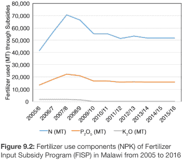

在南部地区，谷物与豆类间种是传统做法，一块田地里可多达 10 种作物。鸽子豆常与玉米间种。作物秸秆在收获后不久还田以循环养分。套种被实践以利用残留土壤水分，尤其是在蒂奥洛阶地区域。马拉维南部的一些农民施用动物粪便、家庭废弃物和堆肥。

作物收获会移除钾，土壤钾已被过度开采；一些最近的研究表明作物产量对施用钾有反应（Chilimba 和 Liwimbi 2008）。在许多地方，土壤硫缺乏几乎与氮缺乏同样重要，23-21-0+4S 已被证明适用于玉米生产，但相对于硫缺乏的重要性，其使用量不足。

#### 9.1.3 肥料使用与建议

马拉维大部分土壤高度风化，有机质（OM）含量低，pH 值低，磷、钾、硫、硼和锌的有效含量低；超过 40% 为铁铝土和红壤（Saka 等，2006）。

总体而言，2015 年马拉维当前的肥料使用量估计为每公顷耕地 43 公斤，而 2003 年为 31 公斤/公顷。与许多非洲国家的平均施用率相比，这一使用率较高；然而，考虑到土地利用强度，它仍然非常低。

20 世纪 70 年代初，20:20:0 被推荐作为基肥，随后用硫酸铵或硝酸铵钙（CAN）追肥。后来，在 20 世纪 80 年代，政府引入了尿素和 DAP，它们更便宜。后来 DAP 被 23-21-0+4S 取代作为基肥，随后用尿素或 CAN 追肥。然而，最近，钾也成为更常见的缺乏要素，尤其是在持续密集耕作的土壤上。大量

小农户普遍的贫困使许多人无法使用肥料。肥料使用受农民财务能力的限制。需要通过更高效的肥料供应以降低运输成本、补贴肥料使用、提高商品价格以及改善低成本和可及融资的渠道等方式来提高肥料使用的盈利潜力。所有这些因素都难以实现。政府补贴计划已有所贡献

表 9.1 马拉维农业生态区代表性地点的月平均降雨量（毫米）及最高和最低气温（°C；Tmax；Tmin）

| | J | F | M | A | M | J | J | A | S | O | N | D |
|---|---|---|---|---|---|---|---|---|---|---|---|---|
| 高地（德扎 1632 米） | | | | | | | | | | | | |
| 降雨量 | 289 | 234 | 180 | 67 | 11 | 4 | 4 | 1 | 4 | 12 | 74 | 231 |
| 最高气温 | 23 | 23 | 23 | 23 | 21 | 19 | 19 | 21 | 23 | 25 | 25 | 24 |
| 最低气温 | 16 | 15 | 15 | 14 | 12 | 10 | 9 | 11 | 13 | 15 | 16 | 16 |
| 中海拔，高地台地（奇特泽-利隆圭） | | | | | | | | | | | | |
| 降雨量 | 202 | 221 | 195 | 149 | 47 | 11 | 2 | 1 | 0 | 2 | 11 | 81 |
| 最高气温 | 27 | 27 | 27 | 27 | 27 | 26 | 24 | 24 | 26 | 28 | 30 | 30 |
| 最低气温 | 17 | 17 | 17 | 16 | 15 | 11 | 9 | 8 | 9 | 12 | 15 | 17 |
| 湖岸，中夏雷河谷和上夏雷河谷（萨利马） | | | | | | | | | | | | |
| 降雨量 | 339 | 266 | 254 | 93 | 11 | 2 | 0 | 0 | 0 | 6 | 44 | 250 |
| 最高气温 | 29 | 29 | 30 | 29 | 28 | 26 | 26 | 28 | 31 | 33 | 32 | 30 |
| 最低气温 | 21 | 21 | 21 | 21 | 18 | 16 | 16 | 17 | 19 | 21 | 22 | 22 |
| 下夏雷河谷（马坎加） | | | | | | | | | | | | |
| 降雨量 | 157 | 127 | 111 | 38 | 15 | 17 | 17 | 7 | 5 | 29 | 61 | 167 |
| 最高气温 | 33 | 33 | 33 | 31 | 30 | 28 | 28 | 30 | 34 | 36 | 36 | 34 |
| 最低气温 | 23 | 23 | 22 | 20 | 17 | 14 | 14 | 16 | 19 | 22 | 23 | 23 |

来源：http://www.malawi.climatemps.com

表 9.2 马拉维谷物生产的常见肥料建议（公斤/公顷），尽管玉米建议具有区域特异性

| 作物 | 玉米 | 小米 | 高粱 | 雨养水稻 | 灌溉水稻 |
|---|---|---|---|---|---|
| 养分类型 | | | | | |
| 氮 | 92 公斤 | 46 公斤 | 46 公斤 | 83 公斤 | 83 公斤 |
| 五氧化二磷 | 42 公斤 | 42 公斤 | 42 公斤 | 25 公斤 | 25 公斤 |
| 硫 | 8 公斤 | 8 公斤 | 8 公斤 | 4.8 公斤 | 4.8 公斤 |

to increased fertilizer use and also seed of improved varieties, but primarily targeting fertilizer N (Figure 9.2). There has been a strong focus on fertilizer use for maize production with little attention to other, generally higher value, crops such as pulses.

There are many fertilizer recommendations made for different crops in the country based on the type of the crops grown and agro-ecological zones. The fertilizer recommendations are in three categories that include:
- general recommendations mostly based on 23:21:0+4S plus N fertilizer (Table 9.2)
- area specific recommendations
- based on soil and plant tissue analysis

Even though fertilizer recommendations are made for different crops for optimum economic returns, less than 50% of smallholders in the country use any fertilizer and about 70% use less than 50 kg/ha. Mean maize yield is below 2.5 t/ha (MOAFS 2012). A fertilizer blend of 23-10-5+3S+12Zn is now marketed to respond to more frequent occurrence of K and Zn deficiencies. Liming use is recommended for amendment of acid soils.

Efficient fertilizer use requires well managed crops. Fertilizer use can complement organic nutrient sources from manure application and nitrogen fixation by green manure crops, agro-forestry and cereal-legume rotation and intercropping. The value of such integration of practices has been validated through research but there has been little adoption of such practices among smallholder farmers.

### 9.2 Soil diagnosis and diagnostic trials in Malawi

Mapping soil resources and better targeting of soil amendment practices is ongoing but challenged by the extreme variability in soil fertility conditions. Sixteen OFRA-Malawi trials were conducted on-station or on-farm between 2013/14 and 2014/15 seasons in the mid-altitude and lake shore AEZ of Malawi for different legumes and maize. Fertilizer treatments included a diagnostic nutrient package of Mg, S, Zn and B in addition to N, P, K (P, K for legumes) that was directly comparable to an N, P, K treatment.

The results were inconsistent across sites and years within AEZ (Figure 9.3). There was a mean yield increase of more than 10% with the diagnostic treatment applied for on-farm trials but the mean effect was greater than the standard error of the mean only for the mid-altitude AEZ trials. There was no yield increase due to the diagnostic package of nutrients for on-station trials. The mean response to the diagnostic treatment was similar for all test crops which included cowpeas, soybean and maize. The results suggest more research is needed to better determine if the response was to Zn alone or at least partly due to Mg, S or B.

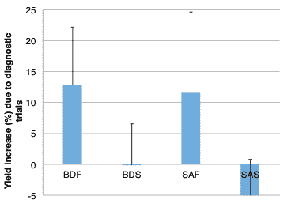

Figure 9.3: The percent yield increase due to application of a diagnostic treatment of N, P, K, Mg, S, Zn and B compared with N, P and K averaged over maize, groundnut and soybean for 16 on-station or on-farm trials conducted during the 2013/14 and 2014/15 growing seasons. BDF = Bunda on-farm; BDS = Bunda on-station; SAF = Salima on-farm; SAS = Salima on-station. The bars represent standard errors of the mean.

### 9.3 Optimizing fertilizer use in Malawi

Fertilizer use optimization in this chapter is considered to be maximization of farmer profit from fertilizer use. It assumes that farmers with adequate financial ability will want to maximize profit per hectare from fertilizer use while financially constrained farmers will want to maximize net returns on their limited investment in fertilizer use. The magnitude and nature of a crop response to an applied nutrient in a given AEZ is important to profitability for both the financially able and the financially constrained farmer. Also very important to the financially constrained farmer is the relative profit potential associated with specific nutrients applied to specific crops, that is, of the crop-nutrient choice.

Crop response to applied nutrients varies with the crop, the nutrient and site-season, and

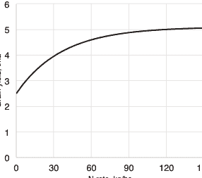

Figure 9.4: A curvilinear yield response of maize to applied N for the Highland AEZ of Malawi (Y = 5.1 – 2.6 * 0.973N).

may include no or negative response, a linear response, a quadratic response with yield loss at higher rates of application, and others. However, the response considered over numerous site-seasons of results is typically a curvilinear to plateau as shown for maize response to N in the highland AEZ of Malawi (Figure 9.4) with yield on the vertical axis (y-axis) and rate of applied N on the horizontal axis (x-axis). With such a response, there is a steep yield increase with increasing N at low rates, a smaller rate of yield increase at higher N rates, until yield reaches

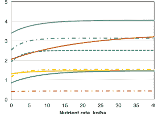

Figure 9.5: Yield nutrient functions for different crops for highlands in Malawi, >1300 masl.

a plateau with no more yield increase. Such responses can be mathematically represented by the asymptotic equation of: Yield (t/ha) = a – bc^r where a is yield at the plateau, b is the maximum gain in yield due to application of the nutrient of interest, c determines the shape of the curve, and r is the nutrient application rate. Such response curves are typical for most crops and nutrients in the highland AEZ (Fig. 9.5). The financially able farmer wants to apply a nutrient until the point where the value of the

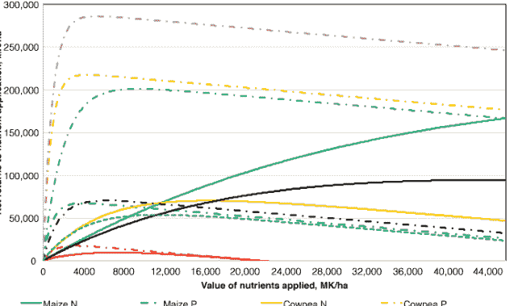

Figure 9.6: Net returns to investment in a crop nutrient for Highlands AEZ in Malawi (>1300 masl). The assumed fertilizer use cost for 50 kg were: MK 23,000 for NPS and urea, and MK 25,000 for KCl and TSP. Commodity values (MK/kg) were: maize 120; cowpea 600; bean 350; soybean 350; sorghum 300 and pigeon pea 600.

yield increase equals the cost of an additional increment in nutrient rate. This is considered to be the economical optimal rate (EOR). The financially limited farmer, however, should strive to apply at a rate at which yield is still increasing and may choose to apply no more than 30 or 40 kg/ha N for the highland maize response of Figure 9.4, but not more than 5 kg/ha elemental nutrient for several of the crop-nutrient responses displayed in Figure 9.5 and no application of P to bean and N to cowpea.

Some nutrients applied to some crops have much more profit potential than other nutrients applied to the same or other crops (Figure 9.6). Financially constrained farmers need to consider this opportunity to achieve high profit from fertilizer use. The x-axis represents the amount of money invested in one nutrient applied to one crop. The y-axis shows the net returns to investment in application of a nutrient to a crop. Each curve represents the profit potential of a nutrient applied to a crop. The steeper the slope of the curve, the higher the net returns of the investment. As the amount invested increases, the slope decreases but if the response is still increasing, profit is increasing. Where curves reach a peak and the slope is flat, the point of maximum profit per hectare (EOR) is reached. When slopes decline, profit declines.

The financially constrained farmer wants first to take advantage of the crop-nutrient combinations that will give the most profit. The greatest profit potential on a small investment was with a small amount of P applied to legume crops, partly because of their high grain value, and especially for pigeonpea, compared with maize or sorghum. Also, a small amount of P applied to maize and sorghum was very profitable although these responses may only occur if some N is applied. Application of N to maize, sorghum and cowpea, and of S to maize, also have good profit potential although less with small investments compared to other options. Therefore, the financially constrained farmer needs to take advantage of the best profit opportunities according to their ability and, hopefully, use some of the increased profits to gradually become less financially constrained and eventually apply fertilizer to all cropland at rates to maximize profit per hectare.

Consideration of the nature of different crop nutrient response functions together with the farmer's land allocation, the expected value of the commodity, the fertilizer costs and the farmer's budget constraint is very complex. To deal with this complexity, easy to use fertilizer use optimization tools (FOTs) were developed using Excel Solver © (Frontline Systems Inc., Incline Village, NV, USA) which use complex mathematics of linear optimization to integrate the economic and agronomic information and give a solution (https://agronomy.unl.edu/OFRA).

Use of the Excel FOT requires that the add-in Solver is activated and macros are enabled; step-by-step instructions are given in the 'Help and Instructions' worksheet of the FOT (Figure 9.7). More detailed instructions are in Extension Materials and FOT Manual at the same website.

The data input screen is where the farmer needs to estimate how much land will be planted to each crop of interest, the farm-gate value per kg at harvest considering that some is for home consumption (the most valuable) and that the surplus will be marketed, and the cost of using different fertilizers (Figure 9.7). The farmer's available money for fertilizer use is also entered as the budget constraint.

The results are displayed as in Figure 9.8, including the amount of each fertilizer to apply to each crop, the expected average yield increases and net returns, and the total net returns to fertilizer use for the farm. In this example, the farmer has only NPS and urea as available fertilizers. The budget constraint of Malawi kwacha (MWK) 150,000 is not sufficient to apply fertilizer at EOR but gives recommendations of more than 25 kg/ha for urea and NPS applied to maize and NPS applied to cowpea and pigeonpea. The recommended rates of less than 25 kg/ha are too low for feasible application and it is suggested that these fertilizers or the money be allocated elsewhere such as to increase the fertilizer applied to cowpea and pigeonpea. The expected average total return to MKW 150,000 invested in fertilizer use is MKW 918,133. If, however, TSP were available for a cost of MKW 30,000 per 50 kg, the expected average total net return is MKW 1,101,274 increasing the farmer's profit potential by over 10%. Restricted availability of fertilizer types requires farmers to buy and apply nutrients that give no or less return compared to other nutrient application options.

1300 M 以上

生产者名称：xxx
编制人：xxx
编制日期：2016年7月6日

| 作物 | 种植面积 (公顷)* | 预期收益值/千克 † |
| :--- | :--- | :--- |
| 玉米 | 3 | 120 |
| 豇豆 | 1 | 600 |
| 菜豆 | 1 | 700 |
| 大豆 | 1 | 350 |
| 高粱 | 1 | 120 |
| 鸽子豆 | 1 | 600 |
| 总计 | 8 | |

| 肥料产品 | N | P2O5 | K2O | S | 每50公斤袋成本 †† |
| :--- | :--- | :--- | :--- | :--- | :--- |
| 尿素 | 46% | 0% | 0% | 0% | 25,000 |
| TSP | 0% | 46% | 0% | 0% | 0 |
| NPS | 23% | 21% | 0% | 4% | 25,000 |
| | 0% | 0% | 0% | 0% | 0 |
| | % | % | % | 0% | |

| 可用于投资肥料的金额 | 150000 |
| :--- | :--- |

图 9.7：马拉维高地农业生态区（>1300 masl）的 FOT 输入屏幕。

| 作物 | 尿素 | TSP | NPS | 2x | xx |
| :--- | :--- | :--- | :--- | :--- | :--- |
| 玉米 | 29 | 0 | 30 | 0 | 0 |
| 豇豆 | 0 | 0 | 45 | 0 | 0 |
| 菜豆 | 0 | 0 | 0 | 0 | 0 |
| 大豆 | 0 | 0 | 7 | 0 | 0 |
| 高粱 | 22 | 0 | 0 | 0 | 0 |
| 鸽子豆 | 0 | 0 | 47 | 0 | 0 |
| 所需肥料总量 | 109 | 0 | 191 | 0 | 0 |

| 作物 | 产量增加 | 净回报 |
| :--- | :--- | :--- |
| 玉米 | 1,494 | 149,688 |
| 豇豆 | 410 | 223,193 |
| 菜豆 | 0 | 181 |
| 大豆 | 47 | 12,966 |
| 高粱 | 519 | 51,579 |
| 鸽子豆 | 341 | 181,150 |
| | 0 | 0 |

| | |
| :--- | :--- |
| 肥料投资的总净回报 | 918,133 |

图 9.8：马拉维高地农业生态区（>1300 masl）的 FOT 输出屏幕。

## 表 9.3：马拉维肥料使用优化器：纸质版，中海拔、高地和高原（760-1300 米）

以下假设：

校准测量单位：一个瓶盖（CAP，8 毫升）用于 5.6 克尿素，8 克 NPS。

行距：玉米，75 厘米；菜豆、大豆、豇豆均为 50 厘米；鸽子豆 75 厘米。

施肥点间距：玉米和豇豆，25 厘米；花生 20 厘米；鸽子豆 75 厘米。

谷物价格：每千克（MK）：玉米 120；菜豆 350；水稻 120；高粱 300；鸽子豆 600；豇豆 600；花生 700；

每50公斤袋肥料使用成本（MK）：尿素 25,000；NPS 23,000。

播种后周数 (WAP)。

| 财务水平 | 作物 | 详情 |
| :--- | :--- | :--- |
| 第1级 财务能力。 | 玉米 | 8 WAP 点施 69 公斤 NPS（1 CAP 对应 5.8 株或 2.9 个点） |
| | 豇豆 | 播种时点施 55 公斤 NPS（1 CAP 对应 7.9 株或 4 个点） |
| | 菜豆 | 播种时带施 33 公斤尿素（1 CAP 对应 2.2 米） |
| | 大豆 | 播种时带施 66 公斤 NPS（1 CAP 对应 1 米） |
| | 鸽子豆 | 播种时点施 85 公斤 NPS（1 CAP 对应 5.1 株或 2.5 个点） |
| 第2级 财务能力。 | 玉米 | 2 WAP 施用 137 公斤 NPS（1 CAP 对应 3.1 株和 1.5 个点）；8 WAP 点施 45 公斤尿素（1 CAP 对应 6.2 株和 3.1 个点） |
| | 豇豆 | 播种时点施 72 公斤 NPS（1 CAP 对应 6.5 株和 3.2 个点） |
| | 菜豆 | 播种时带施 30 公斤尿素（1 CAP 对应 9.4 米）播种时 |
| | 大豆 | 播种时带施 90 公斤 NPS（1 CAP 对应 0.7 米） |
| | 鸽子豆 | 播种时点施 98 公斤 NPS（1 CAP 对应 4.4 个点） |
| | 高粱 | 2 WAP 施用 52 公斤 NPS（1 个瓶盖对应 8.2 株和 4.1 个点）；8 WAP 点施 28 公斤尿素（1 个瓶盖对应 10 株和 5 个点） |
| 第3级 财务能力（每英亩最大利润）。 | 玉米 | 2 WAP 施用 150 公斤 NPS（1 CAP 对应 2.9 株和 1.5 个点）；8 WAP 点施 121 公斤尿素（1 CAP 对应 2.4 个点） |
| | 豇豆 | 播种时点施 89 公斤 NPS（1 CAP 对应 4.8 株和 2.4 个点） |
| | 菜豆 | 播种时带施 71 公斤 NPS（1 CAP 对应 1.5 米） |
| | 大豆 | 播种时点施 142 公斤 NPS（1 CAP 对应 0.4 米） |
| | 鸽子豆 | 播种时点施 125 公斤 NPS（1 CAP 对应 3.5 株和 1.7 个点） |

肥料供应极其有限的后果是，对于农民向鸽子豆、豇豆和大豆施用磷（P）而言——这是图 9.6 中三个非常有利可图的选项——他们也必须为复合肥中的氮（N）和硫（S）付费，尽管没有证据表明这些作物对这些营养素有反应；因此，在本例中，这些作物施肥的益处远小于图 9.6 所示的潜力。

农民及其顾问通常无法轻松使用计算机来运行 Excel Solver® FOT。因此，为中海拔、高地和高原农业生态区的每个 Excel Solver® FOT 开发了基于纸质的 FOT（表 9.3）。纸质 FOT 是为以下三个财务水平构建的：

三个财务水平：
- 1) 对于贫困且可用于在经济最优施肥率（EOR）下对所有耕地施肥的资金不超过所需金额三分之一的农民；
- 2) 对于资金较多但可用于在经济最优施肥率（EOR）下对所有耕地施肥的资金不超过所需金额三分之二的农民；
- 3) 对于资金足以在经济最优施肥率（EOR）下对至少部分耕地施肥的农民。

纸质工具对以下内容做出假设：农民用于调整眼力和手感以施用正确肥料用量的校准测量单位；作物行距和株距；每50公斤袋的肥料使用成本；以及收获时农场预期商品价值，同时考虑自用和市场价值。

## 表 9.4：ISFM 框架内的肥料使用：肥料替代和土壤测试影响

| ISFM 农艺措施 | 尿素或 CAN | DAP 或 TSP | NPK 23-21-0+4S 或 23:10:5+6S+1.0Zn |
| :---: | :---: | :---: | :---: |
| 肥料减少量，% 或 kg/英亩 | | | |
| | N | P | K |
| 前茬作物为绿豆科绿肥作物（Mucuna、Crotalaria 和 Lablab） | 100% | 8 kg | 28 kg † |
| 早期翻入绿豆科绿肥作物（Mucuna、Crotalaria 和 Lablab） | 57 kg | 3 kg | 11 kg † |
| 应用农林业技术（例如 Gliricidia、Leucaena、Sesbania、Senna spectabilis 的叶片修剪物），每1吨鲜重 | 10 kg | 1 kg | 6 kg†† |
| 农家肥，每1吨干重 | 2 kg | 1 kg | 1 kg |
| 前茬作物施用的农家肥残留价值，每1吨 | 1 kg | 0.4 kg | 0.4 kg |
| 奶牛或家禽粪便，每1吨干重 | 24 kg | 7 kg | 14 kg |
| 前茬作物施用的奶牛和家禽粪便残留价值，每1吨 | 5 kg | 1.4 kg | 3 kg |
| 堆肥，每1吨/公顷干重 | 20 kg | 1 kg | 20 kg |
| 双豆技术（鸽子豆/花生等） | 次年，每公顷减少尿素 50 公斤††† | | |
| 谷物-豆间作 | 每公顷增加 DAP/TSP 18 公斤，但与单一种植谷物建议相比，N 和 K 不变 | | |
| 谷物-其他豆科（有效固氮）间作 | 每公顷增加 DAP/TSP 20 公斤，减少尿素 30 公斤，且与单一种植谷物建议相比 K 不变 | | |
| 如果 Mehlich III P >18 ppm | 不施用磷肥 | | |
| 如果土壤测试 K < 0.25 cmol/kg | 每公顷施用 20 公斤 KCl | | |

*Saka et al. 2006
†Akinifesi et al. 2006
†††Njira et al. 2012

纸质 FOT 表格涉及肥料使用的 4R 原则，就正确产品、用量、时机和施用方法提供建议。它还就校准提供建议，即每个计量单位沿带施的距离或推荐肥料用量的点数。纸质 FOT 的一个局限是，如果肥料使用成本相对于商品价值发生重大变化，这些表格可能需要每年修订一次。纸质 FOT 易于使用（表 9.3）。考虑财务能力第 2 级下玉米的建议：“玉米：2 WAP 施用 137 公斤 NPS（1 CAP 对应 4.4 株）；8 WAP 点施 45 公斤尿素（1 CAP 对应 12.5 个点）”。

因此，每公顷 137 公斤 NPS 应在播种后 2 周进行点施。一个 8 毫升的水瓶盖足以满足 4.4 株的需求。此外，每公顷 45 公斤尿素应在播种后 8 周施用。农民通过向 12.5 株植物施用一个水瓶盖来学习施用此用量。肥料使用优化的另一个方面是，当这些措施应用于一块土地时，根据其他措施和土壤测试值调整肥料用量。在获得 FOT 结果后，农民会考虑已应用或将应用表 9.4 中措施的土地块。其中一些措施具有肥料替代价值，肥料用量可以

下降。间作需要增加一些肥料。土壤有效磷（P）检测基于以下假设：大多数田地的土壤有效磷含量足够低，因此响应概率较高；但如果土壤检测结果表明磷含量充足，则应停止在该地块施用磷肥，改在其他地方施用或重新分配资金。土壤有效钾（K）检测基于以下假设：土壤钾含量通常充足且遵循FOT建议，但如果土壤检测结果发现钾含量极低，则建议施用一些氯化钾（KCl）。

山谷在FOTs的开发中被视为一个建议区域。在这系列表格中，第1-2列给出作物和养分，第3-5列给出曲线到平原响应函数的a、b和c系数，第6-9列给出与养分施用率逐步变化相关的产量增加，第10-11列给出根据田间研究结果确定的EOR以及推荐的元素养分施用率（REC）。

在高地农业生态区（AEZ）中，除了普通豆外，作物对施用的氮（N）和磷（P）反应良好（表9.5a）。玉米对施用的钾（K）和硫（S）反应良好。在中海拔和高原农业生态区以及湖岸和希雷河谷农业生态区，玉米再次对氮（N）、磷（P）和硫（S）反应良好，但对钾（K）不反应（表9.5b,c）。普通豆对氮（N）的响应比高地更强。

### 9.4 按农业生态区划分的目标作物和种植系统

对于马拉维，玉米、普通豆、鸽子豆、大豆、豇豆和高粱被考虑用于高地，而除了高粱以外的所有这些作物都被考虑用于其他农业生态区（表9.5a-c）。湖岸和整个希雷

### 表9.5a：高地 >1300米 - 作物-养分的响应函数、预期产量增加（吨/公顷）以及与当前或最近（REC）建议相比，OFRA每公顷利润最大化的经济最优施用率（EOR）P2O5 = P × 2.29；K2O = K × 1.2。某些函数响应为零，因为缺乏响应或缺乏信息

| 作物 | 养分 | a | b | c | 0-30 | 30-60 | 60-90 | 90-120 | EOR† | REC |
|------|----------|---|---|---|------|-------|-------|--------|------|-----|
| | | | | | | | | | 千克/公顷 | |
| 高地（海拔1300米以上）农业生态区 | | | | | | | | | | |
| 玉米 | 氮 | 5.100 | 2.600 | 0.973 | 1.456 | 0.641 | 0.282 | 0.124 | 81 | 69-92 |
| 豇豆 | 氮 | 1.465 | 0.154 | 0.835 | 0.153 | 0.001 | 0.000 | 0.000 | 16 | 0 |
| 普通豆 | 氮 | 0.429 | 0.031 | 0.798 | 0.031 | 0.000 | 0.000 | 0.000 | 7 | 23 |
| 高粱 | 氮 | 3.377 | 1.326 | 0.951 | 1.032 | 0.229 | 0.051 | 0.017 | 43 | 58 |
| | | | | | 0-5 | 5-10 | 10-15 | 15-20 | | |
| 玉米 | 磷 | 3.137 | 0.600 | 0.756 | 0.452 | 0.112 | 0.028 | 0.007 | 8 | 3-18 |
| 豇豆 | 磷 | 1.529 | 0.371 | 0.720 | 0.299 | 0.058 | 0.011 | 0.002 | 11 | 20† |
| 普通豆 | 磷 | 0.429 | 0.031 | 0.798 | 0.021 | 0.007 | 0.002 | 0.001 | 4 | 9 |
| 大豆 | 磷 | 1.457 | 0.607 | 0.883 | 0.281 | 0.151 | 0.081 | 0.043 | 20 | 9-18 |
| 高粱 | 磷 | 4.047 | 0.651 | 0.856 | 0.352 | 0.162 | 0.074 | 0.034 | 11 | 9 |
| 鸽子豆 | 磷 | 2.538 | 0.487 | 0.758 | 0.365 | 0.091 | 0.023 | 0.006 | 15 | 20† |
| 玉米 | 钾 | 4.863 | 0.563 | 0.896 | 0.238 | 0.137 | 0.079 | 0.046 | 19 | 6-8 |
| 豇豆 | 钾 | 1.563 | 0.081 | 0.898 | 0.034 | 0.020 | 0.011 | 0.007 | 16 | 0 |
| 大豆 | 钾 | 0.837 | 0.019 | 0.908 | 0.007 | 0.004 | 0.003 | 0.002 | 0 | 0 |
| 鸽子豆 | 钾 | 2.535 | 0.127 | 0.666 | 0.110 | 0.014 | 0.002 | 0.000 | 10 | 0 |
| 玉米 | 硫 | 2.510 | 0.577 | 0.738 | 0.451 | 0.099 | 0.022 | 0.005 | 12 | 4 |

*Kamanga et al. 2010. EOR是基于使用50千克NPS的成本（MK 23,000），尿素、氯化钾和过磷酸钙（MK 25,000）确定的。使用的商品价值（MK/千克）为：玉米120；豇豆600；普通豆350；大豆350；高粱300；鸽子豆900

### 表9.5b：中海拔和高原（760-1300米）

| 作物 | 养分 | a | b | c | 0-30 | 30-60 | 60-90 | 90-120 | EOR† | REC |
|------|----------|---|---|---|------|-------|-------|--------|------|-----|
| | | | | | | | | | 千克/公顷 | |
| 响应系数，产量 = a - bc'；养分施用率（千克/公顷）对产量增加的影响 | 推荐养分施用率 | | | | | | | | | |
| | | 吨/公顷 | | | 吨/公顷 | | | | 千克/公顷 | |
| 中海拔和高原（760-1300米）农业生态区 | | | | | | | | | | |
| 玉米 | 氮 | 4.906 | 2.572 | 0.982 | 1.081 | 0.627 | 0.363 | 0.211 | 78 | 69-92 |
| 普通豆 | 氮 | 0.838 | 0.293 | 0.862 | 0.290 | 0.003 | 0.000 | 0.000 | 21 | 23 |
| 大豆 | 氮 | 1.131 | 0.046 | 0.929 | 0.041 | 0.004 | 0.000 | 0.000 | 0 | 23-50 |
| | | | | | 0-5 | 5-10 | 10-15 | 15-20 | | |
| 玉米 | 磷 | 2.853 | 1.794 | 0.972 | 0.237 | 0.206 | 0.179 | 0.155 | 24 | 3-18 |
| 豇豆 | 磷 | 1.529 | 0.371 | 0.720 | 0.299 | 0.058 | 0.011 | 0.002 | 10 | 20† |
| 普通豆 | 磷 | 0.884 | 0.058 | 0.869 | 0.029 | 0.014 | 0.007 | 0.004 | 4 | 9 |
| 大豆 | 磷 | 1.359 | 0.608 | 0.868 | 0.308 | 0.152 | 0.075 | 0.037 | 16 | 9-18 |
| 鸽子豆 | 磷 | 2.538 | 0.487 | 0.758 | 0.365 | 0.091 | 0.023 | 0.006 | 13 | 20† |
| 玉米 | 钾 | 4.084 | 0.097 | 0.900 | 0.040 | 0.023 | 0.014 | 0.008 | 2 | 6-8 |
| 豇豆 | 钾 | 1.563 | 0.081 | 0.898 | 0.034 | 0.020 | 0.011 | 0.007 | 16 | 0 |
| 大豆 | 钾 | 1.402 | 0.508 | 0.781 | 0.360 | 0.105 | 0.030 | 0.009 | 16 | 0 |
| 鸽子豆 | 钾 | 2.535 | 0.127 | 0.666 | 0.110 | 0.014 | 0.002 | 0.000 | 10 | 0 |
| 玉米 | 硫 | 2.555 | 0.400 | 0.761 | 0.298 | 0.076 | 0.019 | 0.005 | 11 | 4 |

### 表9.5c：湖岸、中希雷和上希雷（200-760米）

| 作物 | 养分 | a | b | c | 0-30 | 30-60 | 60-90 | 90-120 | EOR† | REC |
|------|----------|---|---|---|------|-------|-------|--------|------|-----|
| | | | | | | | | | 千克/公顷 | |
| 响应系数，产量 = a - bc'；养分施用率（千克/公顷）对产量增加的影响 | 推荐养分施用率 | | | | | | | | | |
| | | 吨/公顷 | | | 吨/公顷 | | | | 千克/公顷 | |
| 湖岸、希雷河谷（200-760米）农业生态区 | | | | | | | | | | |
| 玉米 | 氮 | 4.905 | 2.571 | 0.982 | 1.080 | 0.626 | 0.363 | 0.211 | 87 | 69-92 |
| 普通豆 | 氮 | 0.838 | 0.293 | 0.862 | 0.290 | 0.003 | 0.000 | 0.000 | 22 | 23 |
| 大豆 | 氮 | 1.131 | 0.046 | 0.929 | 0.041 | 0.004 | 0.000 | 0.000 | 0 | 23-50 |
| | | | | | 0-5 | 5-10 | 10-15 | 15-20 | | |
| 玉米 | 磷 | 2.853 | 1.794 | 0.972 | 0.237 | 0.206 | 0.179 | 0.155 | 30 | 3-18 |
| 豇豆 | 磷 | 1.529 | 0.371 | 0.720 | 0.299 | 0.058 | 0.011 | 0.002 | 10 | 20† |
| 普通豆 | 磷 | 0.884 | 0.058 | 0.869 | 0.029 | 0.014 | 0.007 | 0.004 | 5 | 9 |
| 大豆 | 磷 | 1.359 | 0.608 | 0.868 | 0.308 | 0.152 | 0.075 | 0.037 | 17 | 9-18 |
| 鸽子豆 | 磷 | 2.538 | 0.487 | 0.758 | 0.365 | 0.091 | 0.023 | 0.006 | 14 | 20† |
| 玉米 | 钾 | 4.084 | 0.097 | 0.900 | 0.040 | 0.023 | 0.014 | 0.008 | 2 | 6-8 |
| 豇豆 | 钾 | 1.563 | 0.081 | 0.898 | 0.034 | 0.020 | 0.011 | 0.007 | 16 | 0 |
| 大豆 | 钾 | 1.402 | 0.508 | 0.781 | 0.360 | 0.105 | 0.030 | 0.009 | 16 | 0 |
| 鸽子豆 | 钾 | 2.535 | 0.127 | 0.666 | 0.110 | 0.014 | 0.002 | 0.000 | 10 | 0 |
| 玉米 | 硫 | 2.555 | 0.400 | 0.761 | 0.298 | 0.076 | 0.019 | 0.005 | 11 | 4-10 |

所有作物对磷（P）都有盈利性响应，除了普通豆外，所有作物对钾（K）都有盈利性响应。

在42次EOR与REC比较中，有28%的REC平均低60%。在38%的比较中，REC平均比EOR高96%。对于施用于大豆、鸽子豆和豇豆的钾（K），以及施用于高地豇豆的氮（N），确定了EOR，而这些作物的REC则为不施用钾。

### 9.5 致谢

马拉维团队谨向以下人员和机构致谢，感谢他们在完成这项工作中的支持与指导：马拉维合作农民（尤其是利隆圭、德扎和萨利马地区的农民）、LUNARAN支持人员、农业推广发展协调员（AEDCs）、农业推广发展官员（AEDOs）、AGRA、CABI、UNL、Kayuki Kaizzi和Charles Wortmann。

### 9.6 参考文献

Akinifnesi FK, Makumba W and Kwesiga FR (2006) 马拉维南部使用Gliricidia/玉米间作实现可持续玉米生产. Expl Agric 42:1–17 doi:10.1017/S0014479706003814

Chilimba ADC and Lwiimbi L (2008) 马拉维玉米生产氮磷肥料评价. 土壤与农业工程商品组年度报告. 农业研究部年度规划会议，会议于2008年9月14-19日在芒戈奇的安德鲁斯度假村举行；第63-75页

Kamanga BCG, Whitbread A, Wall P, Waddington SR, Almekinders C and Giller KE (2010) 中马拉维奇塞波一年生豆科作物磷肥施用的农民评价. Afr J Agric Res 5:668-680

MOAFS (2012) 马拉维农业生产和自然资源管理指南. 农业和粮食安全部，农业推广服务部，利隆圭，马拉维

Nakhumwa TO (2006) 马拉维2005年肥料补贴计划快速评估. 政策文件第10号，CISANET，利隆圭，马拉维

Njira KOW, Nalivata PC, Kanyama-Phiri GY and Lowole MW (2012) 中马拉维卡松古沙质土壤上单一种植和双倍豆科作物种植系统中的生物氮固定. Journal of Soil Science & Environmental Management 3:224-230

NSO (马拉维国家统计局) (2005) 2004–2005年综合家庭调查. NSO，宗巴，马拉维

Saka AR, Mtukuso AP, Daudi AT, Banda MHP and Phiri IMG (2006) 农业和粮食安全部发布的农业技术——2000-2005年 [作物品种、作物和畜牧生产技术以及农业加工和利用技术]. 农业研究服务部，农业和粮食安全部，利隆圭，马拉维

## 10. 在整体土壤肥力管理背景下优化莫桑比克的肥料使用

Ricardo Maria¹ ricardo_dejesus@hotmail.com, Janete Americano¹, Jossias Matusso² 和 Cláudio Gundana³
¹ 莫桑比克农业研究所 (IIAM), Av. Das FPLM No. 2698, Caixa Postal 3658, 马普托, 莫桑比克
² 马尼卡发展署 (ADEM), Rua 16 de Junho, n° 217, 乔莫伊, 莫桑比克
³ 非洲肥料农业合作伙伴关系 (AFAP), P.O. Box 1218, 马普托, 莫桑比克

### 10.1 引言

莫桑比克的土壤肥力不足是制约作物生产的重要因素。土壤pH大多适中，但高含沙量和低土壤有机质通常会导致养分有效性低和可利用土壤持水能力低。大部分作物生产由小农户进行，他们贫穷且无法在投入品使用上投入太多。他们严重的财务限制要求他们在小额投资上获得高回报率，且投资必须具有低风险。农民通常面临不同的肥料使用选择，需要选择预期风险低且最有利可图的作物-养分-用量组合。此类决策需要基于田间研究得出的可靠信息。因此，莫桑比克农业研究所 (IIAM) 与AGRA资助的“非洲肥料建议优化项目”(OFRA)下的其他12个国家的国家农业研究组织合作，获得CABI的管理支持以及内布拉斯加大学林肯分校的技术和科学支持。该合作伙伴关系改进了优化肥料使用所需的基于田间研究的信息基础，将信息应用于为莫桑比克三个广泛推荐领域开发易于使用的决策工具（FOTs），并为研究和推广人员提供培训，以就肥料使用优化向农民提供建议。

### 10.2 莫桑比克的农业系统

莫桑比克的农业主要由拥有少于5公顷作物生产面积的小农户从事。超过300万个小农家庭农场占所有农场的99%，耕种了95%的耕地。目前，3600万公顷可耕地中约有25%正在耕种。然而，由于土壤肥力低、干旱、病虫害，包括玉米在内的谷物平均产量低于0.7 t/ha。小农农业很少使用投入品、机械化和灌溉，以实现生产的扩大和集约化。农田平均肥料使用量仅约2 kg/ha，大多数小农户不使用肥料。玉米、水稻、木薯和豆类是小农户的优先作物。

表 10.1 莫桑比克农业生态区 (AEZ) 的特征

| AEZ | 位置 | 海拔 m | 平均降雨量 mm | 平均温度 °C | 主导土壤 |
|---|---|---|---|---|---|
| R1 | 马普托，加沙以南 | 0-500 | <800 | >24 | Arenosols, Nitisols |
| R2 | 沿海地区和南部萨比河谷 | 0-500 | <1000 | >24 | Arenosols, Fluvisols |
| R3 | 中部和北部加沙以及因班班以东 | 0-500 | <800 | >24 | Arenosols, Lixisols |
| R4 | 中部中等海拔地区 | 200-1000 | 1000-1200 | 22-24 | Ferralsols, Luvisols |
| R5 | 索法拉和赞比西亚地区 | 0-500 | 1000-1400 | >24 | Arenosols, Fluvisols |
| R6 | 赞比西河谷和特特以南 | 0-500 | 400-600 | >24 | Fluvisols, Lixisols |
| R7 | 赞比西亚、南普拉、特特、尼亚萨和卡博德尔加多 | 0-500 | <1200 | <24 | Lixisols, Leptosols, Arenosols |
| R8 | 赞比西亚、尼亚萨和马尼卡的沿海地带 | 0-500 | 800-1200 | <24 | Lixisols, Luvisols |
| R9 | 北部卡博德尔加多 | 400-1000 | >1000 | <22 | Arenosols |
| R10 | 赞比西亚、尼亚萨和马尼卡的高海拔地区 | >800 | >1000 | <22 | Arenosols |

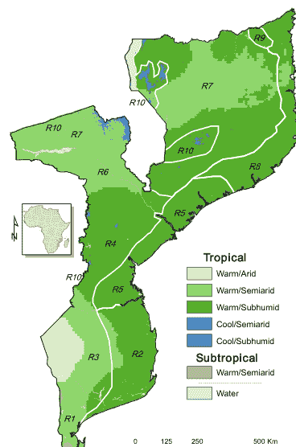

图 10.1 莫桑比克农业生态区叠加于HarvestChoice气候分区。

#### 10.2.1 农业生态区 (AEZ)

莫桑比克拥有与十个农业生态区 (AEZs) 相关的多样化农业系统（图 10.1；表 10.1），其中年降雨量和海拔是重要决定因素（图 10.2）。最肥沃的土壤是Fluvisols，如赞比西河、因科马特河和林波波河谷中的土壤。多沙Arenosols是占全国约28%的主导土壤类型。Lixisols和Luvisols在中等海拔地区很重要，分别覆盖总土地面积的23%和5%。这些土壤风化严重，表层为多沙层，次表层有黏土积聚。Ferralsols和Acrisols常见于高降雨量高原地区，通常由于铝含量高而具有低土壤pH、低养分有效性和高P吸附能力。Leptosols、Acrisols和Ferralsols分别覆盖土地面积的9%、8%和7%。

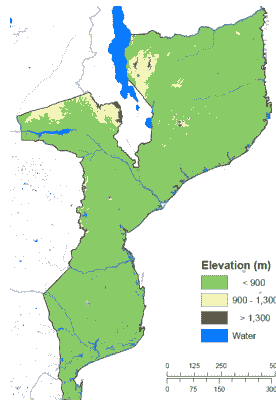

图 10.2 莫桑比克海拔。

#### 10.2.2 莫桑比克的土壤肥力管理

莫桑比克普遍采用不施用养分的轮耕方式。当有粪肥时会施用，主要用于蔬菜和其他高价值作物，尤其是在中部和南部莫桑比克，那里畜牧业较为重要。作物生产的扩大导致休耕期使用减少，边际土地（通常极易水土流失）的耕作增加。已发生大规模森林砍伐。清理休耕地后焚烧植被材料和焚烧作物残茬是常见做法。与其他作物相比，木薯和玉米的土壤养分耗竭相对较大。包括侵蚀在内的整个莫桑比克的估计养分耗竭量（kg/ha/yr）分别为N 34、P 6、K 25。

莫桑比克农业和粮食安全部 (MASA) 及农业发展组织已启动一份凭证补贴计划，以促进肥料使用增加。然而，高效肥料使用受到土壤信息和肥料建议不足的制约。肥料供应通常仅限于N:P:K 12:24:12和尿素。因此，施用某些几乎或完全不带来利润的养分会降低肥料使用的盈利潜力。

土壤测试结果和养分需求预测工具，如[养分管理支持系统 (NuMaSS)](http://www.ctahr.hawaii.edu/sm-crsp/program_areas/AnnRepPY10/numass/AnnualReportNuMaSSUnihawaii2006_2007a.pdf)和[磷决策支持系统 (PDSS)](http://www2.ctahr.hawaii.edu/tpss/research_extension/solresearch/pdss.html)，表明N和

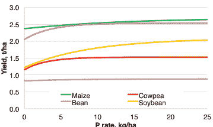

图 10.3 莫桑比克中等海拔地区基于作物反应函数确定的施用P的作物养分反应曲线示例。

P缺乏，在撒哈拉以南非洲普遍存在。莫桑比克适宜的土壤可交换钾（K）临界水平为0.2 meq/100 g土壤或80 ppm。莫桑比克典型的土壤K水平在Arenosols和Acrisols中分别为0.26至0.98 meq/100 g土壤，其他土壤类型具有中间水平。

#### 10.2.3 养分缺乏诊断

2014-15年，在OFRA框架下对马尼卡和布泽地区的玉米、高粱和大豆进行了试验。在14个品种-地点组合中，玉米和高粱对施用N、P和S的平均产量增加分别为81%、22%和18%，大豆在四个地点对施用P和S的平均产量增加分别为38%和16%。试验包括一种N+P+S+Mg+Zn+B的诊断处理，与N+P+S处理相当。大豆试验未施用N。诊断处理同样可能导致产量损失或增加，诊断处理带来的平均增产为大豆-8%、谷物1%，两者均与零无显著差异。结果支持对N和P缺乏的其他诊断，也表明存在S缺乏，并表明施用其他次要和微量养分不太可能带来利润。

### 10.3 莫桑比克的肥料使用优化

通常，农民希望最大化肥料使用带来的利润。财务资源充足的农民可能致力于最大化每公顷肥料使用带来的利润。然而，莫桑比克的大多数农民非常贫穷

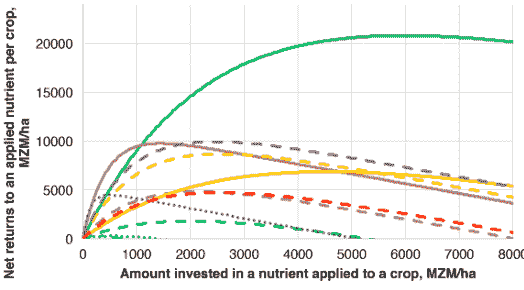

- 玉米 N
- 玉米 P
- 玉米 K
- 玉米 S
- 菜豆 N
- 菜豆 P
- 大豆 N
- 大豆 P
- 鸽子豆 N
- 鸽子豆 P
- 豇豆 P

图10.4：莫桑比克海拔低于900米的地区，在施用50公斤尿素、TSP、NPK 12-24-12和NPS 12-24-0-6的成本为MZM 1500的情况下，向作物施用养分的投资净回报。使用的商品价值（MZM/kg）为：玉米和高粱15，豇豆和大豆30，菜豆和鸽子豆40。

and have the financial resources to use little if any fertilizer. These poor farmers need to obtain very high net returns on their small investments in fertilizer use. Therefore, fertilizer use optimization in this chapter refers to maximizing profit from fertilizer use according to the farmer’s agronomic and economic situation.

且拥有使用很少甚至不使用肥料的财务资源。这些贫困农民需要在其微小的肥料使用投资上获得非常高的净回报。因此，本章中的肥料使用优化是指根据农民的农艺和经济状况，最大限度地提高肥料使用带来的利润。

The nature of crop response to applied nutrients, over a large number of trials, is usually curvilinear to a plateau as illustrated most clearly by cowpea and pigeonpea response to P in mid-altitude areas of Mozambique (Figure 10.3). The soybean P response is relatively large and has not reached the yield plateau with 25 kg/ha of P applied. Maize and bean responses to P were small in this AEZ.

作物对施用养分的反应，在大量试验中，通常呈曲线上升至平台期，这一点在莫桑比克中海拔地区豇豆和鸽子豆对P的反应中表现得最为明显（图10.3）。大豆对P的反应相对较大，施用25公斤/公顷P后尚未达到产量平台期。在此农业生态区（AEZ），玉米和菜豆对P的反应较小。

These responses are mathematically represented by the equation Y = a – bc^r where Y is yield, a is yield at the plateau for application of that nutrient, b is the maximum yield increase due to application of the concerned nutrient, c is a determinant of the response curve, and r is the nutrient application rate. As P rates increase, the yield increase per additional kg of applied P decreases. In all cases, the yield increase per kg/ha of P applied is relatively great at lower compared with higher P rates. Greater net returns to Mozambique metical (MZM) invested in fertilizer use are expected with lower compared with higher P application rates.

这些反应在数学上由方程 Y = a – bc^r 表示，其中Y为产量，a为施用该养分时的平台期产量，b为施用相关养分带来的最大产量增加量，c为响应曲线的决定因素，r为养分施用率。随着P施用率的增加，每施加额外1公斤P带来的产量增加量减少。在所有情况下，与较高P施用率相比，每施加1公斤/公顷P在较低P施用率下带来的产量增加相对较大。与较高P施用率相比，预计在莫桑比克梅蒂卡尔（MZM）肥料投资中，较低P施用率下的净回报更大。

Another consideration in optimizing fertilizer use for high profit is that the profit potential is greater for some nutrients applied to one or more crops compared with other crop-nutrient combinations. An example is given from areas of less than 900 masl (Figure 10.4). On the horizontal x-axis, the amount of money (MZM) invested in a nutrient applied to a crop is given. On the vertical y-axis, the net return to nutrient application is given. Each curve represents a crop-nutrient combination. Because the figure represents economics of fertilizer use, the fertilizer costs and crop values influence the magnitude and shape of response. Throughout this chapter, the current subsidized fertilizer cost of MZM 1500 per 50 kg bag was used irrespective of the actual cost. Grain prices used were MZM 15/kg for maize and sorghum, 30 for cowpea and soybean, and 40 for bean and pigeonpea. When the curves are steep, the net return for the amount invested is high. Several crop-nutrient curves are very steep initially offering potential for very high rates of return at low application rates including for N applied to maize and bean, P applied to soybean and pigeonpea, and K applied to pigeonpea. As application rates increase, slopes become less steep and some other options, such as N applied to soybean and P applied to cowpea and bean, become competitive options. Some of the curves reach a peak at low rates. The rate of application at the peak is the rate expected to give the most profit per hectare and is called the economically optimal rate (EOR) in this chapter. For example, K applied to pigeonpea has very high profit potential but the cost of application should not exceed about 200 MZM/ha.

优化肥料使用以获取高利润的另一个考虑是，与其他作物-养分组合相比，某些养分施用于一种或多种作物时的利润潜力更大。海拔低于900米的地区给出了一个示例（图10.4）。在横向x轴上，给出了施用于作物的养分的投资金额（MZM）。在纵向y轴上，给出了养分施用的净回报。每条曲线代表一种作物-养分组合。由于该图表示肥料使用的经济性，肥料成本和作物价值会影响反应的幅度和形状。在本章中，无论实际成本如何，均使用了每50公斤袋装肥料的当前补贴成本MZM 1500。使用的谷物价格为：玉米和高粱MZM 15/公斤，豇豆和大豆30，菜豆和鸽子豆40。当曲线陡峭时，投资金额的净回报较高。几种作物-养分曲线起初非常陡峭，在低施用率下提供非常高回报率的潜力，包括施用于玉米和菜豆的N、施用于大豆和鸽子豆的P，以及施用于鸽子豆的K。随着施用率的增加，斜率变得不那么陡峭，其他一些选项，例如施用于大豆的N以及施用于豇豆和菜豆的P，成为具有竞争力的选项。一些曲线在低施用率时达到峰值。峰值处的施用率是预计每公顷带来最大利润的施用率，在本章中称为经济最优施用率（EOR）。例如，施用于鸽子豆的K具有非常高的利润潜力，但施用成本不应超过约200 MZM/公顷。

Farmers who are not constrained financially in fertilizer use should apply to all crops at EOR to maximize profit per hectare due to fertilizer use. The large total profit potential is with N applied to maize, with an expected average return of about MZM 15,000 with 2000 invested or about 30 kg N applied, after which the rate of return is less until a peak with approximately 100 kg N applied. Using different commodity values relative to fertilizer costs will change the shape of the curves and Figure 10.3 may not apply well to a farmer who cannot access subsidized fertilizer.

在肥料使用上不受财务限制的农民应将所有作物施用至EOR，以最大限度地提高每公顷因肥料使用带来的利润。巨大的总利润潜力在于施用于玉米的N，投资2000或施用约30公斤N后预计平均回报约为MZM 15,000，之后回报率下降，直到施用约100公斤N时达到峰值。使用相对于肥料成本的不同商品价值将改变曲线的形状，图10.3可能不适用于无法获得补贴肥料的农民。

Profit from fertilizer use therefore depends on the nature of the response of a crop to applied nutrient (Figures 10.3 and 10.4), the costs of fertilizer use and the on-farm value of the commodity considering both the expected market value for the surplus and value of that kept for home consumption. The farmer's choice of crops, the land allocated to each crop and the amount of money that the farmer has to invest in fertilizer use also need to be considered. Decisions for fertilizer use optimization for maximization of net returns are complex for farmers with several crops and financially constrained fertilizer use. Easy to use decision tools utilizing the complex mathematics of linear programming were developed for three recommendation domains of Mozambique.

因此，肥料使用带来的利润取决于作物对施用养分的反应性质（图10.3和10.4）、肥料使用成本以及商品的农场价值（需同时考虑剩余部分的预期市场价值和留作自用部分的价值）。农民的作物选择、分配给每种作物的土地以及农民可用于肥料使用的资金量也需要考虑。对于拥有多种作物且肥料使用受财务限制的农民来说，为最大化净回报而进行的肥料使用优化决策是复杂的。为莫桑比克的三个推荐领域开发了利用线性规划复杂数学的易于使用的决策工具。

### 10.4 莫桑比克肥料优化工具

The computer fertilizer optimization tools (FOTs) have been developed to integrate economic and agronomic information through linear programming using Excel Solver® (Frontline Systems Inc., Incline Village, NV, USA). These are available at http://agronomy.unl.edu/OFRA. To use a FOT, the add-in Solver needs to be activated and macros need to be enabled; this is addressed in the 'Help and Instructions' worksheet of the FOT and in more detail in an FOT user manual in Extension Training Materials at this website.

计算机肥料优化工具（FOTs）已开发完成，可通过使用Excel Solver®（Frontline Systems Inc., Incline Village, NV, USA）的线性规划整合经济和农艺信息。这些工具可在 http://agronomy.unl.edu/OFRA 获得。要使用FOT，需要激活加载项Solver并启用宏；这在FOT的‘帮助和说明’工作表中有所说明，并在该网站的推广培训材料中FOT用户手册中有更详细的说明。

The data input screen (Figure 10.5) requires entry of the land area to be planted for each crop and the estimated on-farm value per kilogram of grain near harvest time. The example shows that the FOT does optimization across six crops. These FOTs do not address intercropping at this time. Each crop is allocated one hectare but the farmer is likely to allocate land differently for each crop; if the crop is not planted, enter 0 for land area. The cost of using different fertilizers is entered; the example shows the subsidized price of MZM of 1500, but the farmer should enter the real cost, with or without subsidy, and including transport and application costs. If a listed fertilizer is not available, enter 0 for the cost. Finally, the money available for fertilizer use is entered as the budget constraint; MZM 15,000 was entered in the example. The optimize button is left clicked to run the optimization.

数据输入屏幕（图10.5）要求输入每种作物计划种植的土地面积以及收获期附近每公斤谷物的预计农场价值。示例显示FOT对六种作物进行优化。这些FOT目前不涉及间作。每种作物分配一公顷，但农民可能会为每种作物分配不同的土地；如果未种植某种作物，土地面积输入0。输入不同肥料的使用成本；示例显示补贴价格为MZM 1500，但农民应输入实际成本（无论是否有补贴，并包括运输和施用成本）。如果列出的肥料不可用，成本输入0。最后，将可用于肥料使用的资金作为预算约束输入；示例中输入了MZM 15,000。左键单击优化按钮以运行优化。

The output includes: the amount of fertilizer to apply to each crop; the expected average yield increase and net returns to fertilizer use per hectare; and the total net returns to fertilizer use for the farm (Figure 10.6). Most of the recommended fertilizer is for maize which has an expected average maize yield increase of 1775 kg/ha. The expected mean net return to fertilizer use was estimated to be MZM 84,725 for a benefit:cost ratio of 5.6. In this example, TSP and KCl were assumed to be available. If fertilizer availability were limited to urea and NPK, the expected mean net return is MZM 70,896, 84% of the profit potential compared with availability of important single nutrient fertilizers.

输出包括：每种作物应施用的肥料量；每公顷预计平均产量增加量和肥料使用净回报；以及农场肥料使用的总净回报（图10.6）。推荐的肥料大部分用于玉米，其预计平均玉米产量增加量为1775公斤/公顷。预计肥料使用的平均净回报估计为MZM 84,725，收益成本比为5.6。在此示例中，假设TSP和KCl可用。如果肥料供应仅限于尿素和NPK，预计平均净回报为MZM 70,896，与重要单养分肥料可用相比，为利润潜力的84%。

Financially constrained fertilizer use optimization contributes to low risk associated with fertilizer use through diversification of investment. Rather than applying all fertilizer to a single crop at a recommended rate, fertilizer use optimization results in fertilizer being applied to two or more crops and over more land at lower rates. All crops in all fields are less likely to fail compared to a single well fertilized crop in, maybe, only one field.

通过投资多样化，财务受限的肥料使用优化有助于降低肥料使用相关的风险。与其按推荐施用率将所有肥料施用于单一作物，不如肥料使用优化会导致肥料以较低施用率施用于两种或多种作物以及更多土地。与仅在一块田地里种植一块施肥良好的作物相比，所有田地的所有作物不太可能失败。

For each Excel FOT, a companion paper FOT was developed to be used when a computer is not available. The paper FOT has three financial levels: level 1 for the poor farmer who has less than one-third of the amount needed to buy the fertilizer to apply to all the cropland at EOR; level 2 for the farmer who has less than

为每个Excel FOT开发了一个配套的纸质FOT，以便在没有计算机时使用。纸质FOT有三个财务等级：等级1适用于贫困农民，其资金不足以购买将所有耕地施用至EOR所需肥料金额的三分之一；等级2适用于资金少于

### 海拔 > 900米

| 生产者名称： | xxx |
| 编制人： | xxx |
| 编制日期： | 2016年8月18日 |

| 作物 | 种植面积（公顷）* | 预计谷物价值/公斤 |
|---|---|---|
| 玉米 | 1 | 20 |
| 豇豆 | 1 | 30 |
| 菜豆 | 1 | 40 |
| 高粱 | 1 | 20 |
| 大豆 | 1 | 30 |
| 鸽子豆 | 1 | 40 |
| 总计 | 6 | |

| 肥料产品 | N | P2O5 | K2O | S | 每50公斤袋成本 |
|---|---|---|---|---|---|
| 尿素 | 46% | 0% | 0% | 0% | 1500 |
| 三过磷酸钙，TSP | 0% | 46% | 0% | 0% | 1500 |
| NPK | 12% | 24% | 12% | 0% | 1500 |
| 空白 | 0% | 0% | 0% | 0% | 0 |
| 可选 | 23% | 20% | 0% | 6% | 1500 |

| 可用于投资肥料的金额 | 15000 |

图10.5：肥料优化工具输入屏幕的图像。

### 肥料优化

### 施用率 - 公斤/公顷

| 作物 | 尿素 | TSP | NPK | 可选 |
|---|---|---|---|---|
| 玉米 | 117 | 4 | 0 | 48 |
| 豇豆 | 0 | 38 | 0 | 0 |
| 菜豆 | 33 | 36 | 0 | 0 |
| 高粱 | 19 | 36 | 0 | 0 |
| 大豆 | 0 | 65 | 0 | 52 |
| 鸽子豆 | 0 | 51 | 0 | 0 |
| 所需肥料总量 | 170 | 230 | 0 | 100 |

### 每公顷预计平均效果

| 作物 | 产量增加 | 净回报 |
|---|---|---|
| 玉米 | 1,772 | 30,348 |
| 豇豆 | 161 | 3,691 |
| 菜豆 | 390 | 13,513 |
| 高粱 | 355 | 5,435 |
| 大豆 | 856 | 22,476 |
| 鸽子豆 | 270 | 9,261 |

### 肥料预计总净回报

| 肥料投资总净回报 | 84,724 |

图10.6：肥料优化工具输出屏幕的图像。

## Table 10.2: 纸质肥料使用优化工具示例
Mozambique Fertilizer Use Optimizer Tool: >1300 m elevation, May 2016

The below assumes:
Calibration measurement is with an Agua Vumba water bottle lid (CAP); contains 8 ml, 5.6 g urea, 8g NPK, 9.6 g NPS, and 10.4 g TSP.
Plant spacing: maize at 75 x 30 cm; cowpea, bean and soybean with 60 cm row spacing; pigeonpea with 75 cm row spacing.
Grain values per kg (MZM): 15 for maize and sorghum; 30 for cowpea and soybean; 40 for bean and pigeonpea.
50 kg of fertilizer use costs (MZM): 1500 for urea, TSP, NPK 12-24-12, and NPS 23-20-0-6. Application rates are in kg/ha.

| Level | Crop | Recommendation |
|---|---|---|
| 财务能力第1级。 | 玉米 | 播种时点施90 kg NPS（1瓶盖对应5.7株植物）和65 kg NPK（1瓶盖对应5株植物）；追肥50 kg urea（1瓶盖对应6.2株植物） |
| | 高粱 | 带施60 kg NPS（1瓶盖对应2.1 m） |
| | 大豆 | 播种时带施38 kg TSP（1瓶盖对应3.9 m） |
| 财务能力第2级。 | 玉米 | 播种时点施153 kg NPS（1瓶盖对应3.3株植物）和160 kg NPK（1瓶盖对应6.2株植物）；追肥50 kg urea（1瓶盖对应4.4株植物） |
| | 高粱 | 播种时带施25 kg urea（1瓶盖对应3 m）和49 kg TSP（1瓶盖对应2.4 m）；追肥25 kg urea（1瓶盖对应3 m） |
| | 豇豆 | 播种时带施36 kg TSP（1瓶盖对应4.1 m） |
| | 大豆 | 播种时带施77 kg TSP（1瓶盖对应1.9 m） |
| 财务能力第3级（每英亩最大利润）。 | 玉米 | 点施200 kg（1瓶盖对应2.6株植物）、84 kg TSP（1瓶盖对应5.6株植物）和150 kg NPK（1瓶盖对应6.2株植物）；追肥82 kg urea（1瓶盖对应3.6株植物） |
| | 高粱 | 播种时带施100 kg NPK（1瓶盖对应1.1 m）；追肥50 kg urea（1瓶盖对应1.5 m） |
| | 菜豆 | 播种时带施29 kg urea（1瓶盖对应3.2 m）和49 kg TSP（1瓶盖对应3 m） |
| | 豇豆 | 播种时带施56 kg TSP（1瓶盖对应2.6 m） |
| | 大豆 | 播种时带施129 kg TSP（1瓶盖对应1.1 m） |

三分之二的资金用于以EOR在所有耕地上施肥；第3级适用于资金充足、能在部分耕地上以EOR施肥的农民。各财务等级内的施肥选择具有相似的盈利潜力。

纸质FOT需要一些假设：农民在校准时使用的计量单位体积；每种作物的种植间距；每50公斤袋装肥料的使用成本；以及收获时农场上的预期商品价值，同时考虑自用和市场销售的价值。

纸质FOT就肥料使用的4R（正确类型、用量、时机和施用方法）提供建议。它还就校准提供建议，帮助农民调整眼力和手感以掌握施用率，即一瓶盖肥料足以用于多少米的带施或多少株植物。

在使用适用于海拔>1300米的纸质FOT（表10.2）时，首先考虑农民的施肥财务能力。如果农民资金有限，应从财务等级1开始，该等级仅针对玉米、高粱和大豆提供施肥选项，因为菜豆和豇豆的施肥选项盈利不足，不符合此类别。例如：玉米的等级1建议为：“播种时点施90公斤NPS（1瓶盖对应5.7株植物）和65公斤NPK（1瓶盖对应5株植物）；追肥50公斤尿素（1瓶盖对应6.2株植物）”。因此，农民应使用NPS、NPK和尿素。NPS和NPK应在播种时施用。一瓶Agua Vumba品牌8毫升瓶盖的NPS足以用于5.7株植物，一瓶盖NPK足以用于5株植物。尿素应以每公顷40公斤的用量进行追肥施用，这需要每6.2株植物使用1瓶盖。

### 10.5 综合养分管理框架下的肥料使用

肥料优化需要良好的农艺实践，例如品种选择、播种以及对杂草、昆虫害虫和疾病的控制。一些实践，如施用粪肥或间作，以及土壤测试结果，可能会影响最佳肥料用量。这些因素未在FOTS中考虑，FOTS适用于单一种植生产，并假设土壤中N和P的有效含量足够低，以使养分施用获得盈利性响应。因此，这些因素在使用一页纸决策指南（表10.3）的肥料使用优化决策过程中被视为第二步。

绿肥的使用和粪肥施用需要调整肥料用量。肥料替代价值随粪肥质量而变化。家禽粪和奶牛粪预计比农家肥具有更大的肥料替代价值，后者暴露于天气中时间较长且与土壤混合。其他具有肥料替代价值的实践包括将树枝剪落等材料带入田地、轮作和间作。应考虑土壤测试信息。当没有土壤测试信息时，应将土壤测试P视为低含量，并根据FOT建议施用磷肥。如果Mehlich 3土壤测试P高于18 ppm，则在土壤测试P被发现低于此水平之前，不要向该田施用磷肥。如果土壤测试K低于0.25 cmol/kg或100 ppm，即使FOT未建议，也应施用钾肥。例如，“每施用1吨鲜豆科树叶枝条（e.g. gliricidia, leucaena, sesbania, senna”），尿素、TSP或DAP，或NPK的用量可分别从FOT对该田的建议中减少10、1和6 kg/ha。枝条可来自田间行间、田地边界区域或附近的林地。

## Table 10.3: ISFM框架下的肥料使用

### 莫桑比克：ISFM实践和土壤测试信息的肥料用量调整

| ISFM实践 | 尿素 | DAP或TSP | NPK 10-20-10+6S |
| :--- | :--- | :--- | :--- |
| | \multicolumn{3}{c}{肥料减少量，%或kg/ha} |
| | N | P | K |
| 早期翻入绿豆科绿肥（mucuna, crotalaria 和 lablab） | 57 kg | 3 kg | 11 kg |
| 每施用1吨鲜豆科树叶枝条（例如gliricidia, leucaena, sesbania, senna） | 10 kg | 1 kg | 6 kg |
| 每1吨干物质的农家肥 | 2 kg | 1 kg | 1 kg |
| 前作施用的农家肥的残留价值，每1吨 | 1 kg | 0.4 kg | 0.4 kg |
| 每1吨干物质的奶牛粪或家禽粪 | 24 kg | 7 kg | 14 kg |
| 前作施用的奶牛粪和家禽粪的残留价值，每1吨 | 5 kg | 1.4 kg | 3 kg |
| 堆肥，每1吨/公顷干重 | 20 kg | 1 kg | 20 kg |
| 双豆技术（鸽子豆） | \multicolumn{3}{c}{轮作第二年平均减少50 kg尿素} |
| 谷物-菜豆间作 | \multicolumn{3}{c}{DAP/TSP增加18 kg/ha，但与单一种植谷物肥料相比N和K无变化} |
| 谷物-其他豆科（有效固氮）间作 | \multicolumn{3}{c}{DAP/TSP增加20 kg/ha，减少尿素30 kg/ha，且与单一种植谷物肥料相比K无变化} |
| 如果Mehlich III P >18 ppm | \multicolumn{3}{c}{不要施用P} |
| 如果土壤测试K < 0.25 cmol/kg | \multicolumn{3}{c}{施用20 kg/ha KCl} |

### 10.6 按区域划分的优化肥料使用作物

OFRA涉及的作物和养分列于表10.4a-c的第1-2列。响应方程Y = a - bc*的响应系数a、b和c列于第3-5列。养分用量变化对产量增加的影响列于第6-9列。EOR和推荐用量（REC）下的元素养分施用率列于第10-11列。本章信息不适用于图10.2中浅绿色代表的莫桑比克较干旱地区，但谷地土壤除外。它也不太可能适用于沙质土壤，除非这些土壤多年来通过施用大量有机物质进行过改良。

莫桑比克海拔>1300米的土地面积较小（图10.2），位于AEZ R10（图10.1）。田间研究结果表明，玉米对N和P的平均响应分别高达2.6和1.6吨/公顷，高粱也有相应的产量增加。玉米对K和S的平均响应均>0.5吨/公顷（表10.4a）。该区域可用的菜豆研究结果很少，产量低且对施用养分的响应低。大豆和豇豆对P的平均响应分别为0.6和0.37，但对K的平均响应小于0.1吨/公顷。

900至1300米海拔范围内的大部分土地也位于AEZ R10。玉米对N和P的平均响应分别为1.79和0.32吨/公顷（表10.4b）。菜豆是该区域的重要作物，对施用N的平均响应为0.29吨/公顷，N的EOR为22。所有作物对P的平均响应均具有经济性。

莫桑比克大部分作物生产发生在海拔<900米处（表10.4c），建议最适用于AEZ R4、R5、R7、R8和R9（图10.1）。玉米对N和P的平均响应分别为1.94和0.37吨/公顷。菜豆和大豆对N有盈利性响应，所有作物对P都有经济性响应。玉米在所有区域对K和S都有盈利性响应。鸽子豆对K的响应在<1300米海拔地区有盈利性。

## 表10.4a：高海拔>1300米。作物-养分的响应函数、预期产量增加（吨/公顷）以及OFRA每公顷最大利润的经济最优施用率（EOR），与当前或最近（REC）建议相比。P2O5 = P x 2.29；K2O = K x 1.2。某些函数响应为零，因为缺乏响应或缺乏信息。

| Crop | Nutrient | a | b | c | 0-30 | 30-60 | 60-90 | 90-120 | EOR† | REC |
| :--- | :--- | :--- | :--- | :--- | :--- | :--- | :--- | :--- | :--- | :--- |
| | | | | | t/ha | | | | kg/ha | |
| 玉米 | N | 5.100 | 2.600 | 0.973 | 1.456 | 0.641 | 0.282 | 0.124 | 100 | 58 |
| 菜豆 | N | 0.429 | 0.031 | 0.798 | 0.031 | 0.000 | 0.000 | 0.000 | 7 | |
| 高粱 | N | 4.07 | 0.730 | 0.964 | 0.487 | 0.162 | 0.054 | 0.018 | 49 | 70 |
| 玉米 | P | 2.90 | 1.600 | 0.972 | 0.212 | 0.184 | 0.159 | 0.138 | 40 | 11 |
| 豇豆 | P | 1.5299 | 0.371 | 0.720 | 0.299 | 0.058 | 0.011 | 0.002 | 10 | |
| 菜豆 | P | 0.429 | 0.031 | 0.798 | 0.021 | 0.007 | 0.002 | 0.001 | 3 | |
| 大豆 | P | 1.457 | 0.607 | 0.883 | 0.281 | 0.151 | 0.081 | 0.043 | 22 | |
| 高粱 | P | 4.047 | 0.651 | 0.856 | 0.352 | 0.162 | 0.074 | 0.034 | 15 | 13 |
| 玉米 | K | 4.863 | 0.563 | 0.896 | 0.238 | 0.137 | 0.079 | 0.046 | 26 | 10 |
| 豇豆 | K | 1.563 | 0.081 | 0.898 | 0.034 | 0.020 | 0.011 | 0.007 | 16 | |
| 大豆 | K | 0.837 | 0.019 | 0.908 | 0.007 | 0.004 | 0.003 | 0.002 | 0 | |
| 玉米 | S | 2.510 | 0.577 | 0.738 | 0.451 | 0.099 | 0.022 | 0.005 | 14 | |

†EOR是基于使用50公斤尿素、过磷酸钙和NPK 12-24-12的成本确定的，MZM 1500。使用的商品价值（MZM/kg）为：玉米和高粱15；豇豆和大豆30；菜豆和鸽子豆40。

## Table 10.4b: Mid-elevation (900-1300 masl)

| 作物 | 营养素 | a | b | c | 0-30 | 30-60 | 60-90 | 90-120 | EOR† | REC |
|---|---|---|---|---|---|---|---|---|---|---|
| | | | | | | | | | kg/ha | |
| 玉米 | N | 2.85 | 1.794 | 0.972 | 1.029 | 0.439 | 0.187 | 0.080 | 86 | 58 |
| 菜豆 | N | 0.84 | 0.293 | 0.862 | 0.290 | 0.003 | 0.000 | 0.000 | 22 | |
| 大豆 | N | 1.13 | 0.046 | 0.929 | 0.041 | 0.004 | 0.000 | 0.000 | 0 | |
| | | | | | 0-5 | 5-10 | 10-15 | 15-20 | | |
| 玉米 | P | 2.69 | 0.322 | 0.929 | 0.099 | 0.069 | 0.048 | 0.033 | 12 | 11 |
| 豇豆 | P | 1.53 | 0.371 | 0.72 | 0.299 | 0.058 | 0.011 | 0.002 | 9 | |
| 菜豆 | P | 0.88 | 0.058 | 0.869 | 0.029 | 0.014 | 0.007 | 0.004 | 10 | |
| 大豆 | P | 2.09 | 0.867 | 0.895 | 0.369 | 0.212 | 0.122 | 0.070 | 6 | |
| 木豆 | P | 2.54 | 0.487 | 0.758 | 0.365 | 0.091 | 0.023 | 0.006 | 27 | |
| 玉米 | K | 4.08 | 0.097 | 0.900 | 0.040 | 0.020 | 0.014 | 0.008 | 10 | 13 |
| 木豆 | K | 2.53 | 0.127 | 0.666 | 0.110 | 0.014 | 0.002 | 0.000 | 10 | |
| 玉米 | S | 2.55 | 0.400 | 0.761 | 0.298 | 0.070 | 0.019 | 0.005 | 13 | |

## Table 10.4c: Lower elevation, <900 m elevation.

| 作物 | 营养素 | a | b | c | 0-30 | 30-60 | 60-90 | 90-120 | EOR† | REC |
|---|---|---|---|---|---|---|---|---|---|---|
| | | | | | | | | | kg/ha | |
| 玉米 | N | 3.436 | 1.942 | 0.973 | 1.088 | 0.478 | 0.211 | 0.093 | 90 | 58 |
| 菜豆 | N | 0.838 | 0.290 | 0.862 | 0.290 | 0.003 | 0.000 | 0.000 | 23 | |
| 大豆 | N | 2.828 | 0.473 | 0.977 | 0.238 | 0.118 | 0.059 | 0.029 | 69 | |
| | | | | | 0-5 | 5-10 | 10-15 | 15-20 | | |
| 玉米 | P | 2.967 | 0.368 | 0.917 | 0.129 | 0.084 | 0.054 | 0.035 | 14 | 11 |
| 豇豆 | P | 1.880 | 0.288 | 0.898 | 0.120 | 0.070 | 0.041 | 0.024 | 17 | |
| 菜豆 | P | 0.88 | 0.200 | 0.869 | 0.101 | 0.050 | 0.025 | 0.012 | 15 | |
| 大豆 | P | 2.774 | 0.408 | 0.865 | 0.210 | 0.102 | 0.049 | 0.024 | 18 | |
| 木豆 | P | 2.64 | 0.332 | 0.849 | 0.185 | 0.082 | 0.036 | 0.016 | 17 | |
| 玉米 | K | 3.317 | 0.113 | 0.940 | 0.030 | 0.022 | 0.016 | 0.012 | 10 | 13 |
| 木豆 | K | 2.53 | 0.127 | 0.666 | 0.110 | 0.014 | 0.002 | 0.000 | 10 | |
| 玉米 | S | 3.014 | 0.047 | 0.750 | 0.036 | 0.009 | 0.002 | 0.000 | 5 | |

大多数作物尚无施肥使用建议（REC）。EOR 是根据当前补贴肥料价格确定的。与 REC 相比，玉米和高粱的 N EOR 分别偏高和偏低。与 REC 相比，玉米的 P EOR 偏高或相似。为众多 REC 不可用的作物-营养素组合确定了 EOR。对于无法获得补贴肥料的农民，EOR 会更低。

### 10.7 致谢

OFRA 活动由 AGRA 资助，实施由 CABI 管理。莫桑比克的多个 IIAM 研究团队为 OFRA 活动做出了贡献，我们感谢在田间研究中合作的农民。我们感谢内布拉斯加大学林肯分校 Charles Wortmann 教授和乌干达国家农业研究组织 KC Kaizzi 博士的科学和技术支持。

## 11. 尼日尔综合土壤肥力管理背景下的肥料使用优化

Maman Nouri¹ mamank.nouri@gmail.com, Maman Garba¹ and Charles S. Wortmann²
¹ 尼日尔国家农业研究所 (INRAN), BP 240 马拉迪, 尼日尔
² 内布拉斯加大学林肯分校, 农学与园艺学系, 林肯, NE 68583, 美国

### 11.1 尼日尔的农业系统

农作物和牲畜部门是尼日尔经济的基础。这些部门雇佣了超过 80% 的人口，产生了 43% 的 GDP，并平均贡献了该国 30% 的出口收入。

大部分作物产量是珍珠黍、高粱、豇豆、花生和水稻等主粮。在有利地区生产的雨养经济作物包括花生、芝麻、棉花和虎坚果，后者因比其他作物使用更多肥料而日益重要，特别是在马拉迪地区。

每年耕种的土地在增加，并与放牧竞争。萨赫勒地区的牲畜密度有所下降，但大量牲畜从更北方地区运来进行旱季放牧。

尼日尔的作物生产面临气候相关风险、土壤退化和人口压力的挑战，这些因素导致自然资源使用不当，并加剧了粮食不安全。

#### 11.1.1 农业生态区 (AEZ)

尼日尔的农业生态区包括该国北部的撒哈拉沙漠区；该国中部的撒哈拉以南牧区；南中部以农牧结合为主的萨赫勒区；以及西南部农业生产条件更好的萨赫勒-苏丹区或北苏丹稀树草原区（图 11.1）。后两个农业生态区是定居区，与以游牧活动为主的北部地区形成对比。

撒哈拉农业生态区覆盖了该国超过 65% 的面积，人口密度少于每平方公里 5 人（图 11.1）。该区域内的阿加德兹年平均降雨量为 111 毫米，其中 45% 集中在 8 月（表 11.1）。月平均最高和最低气温分别在 26 至 41°C 和 12 至 26°C 之间。农业活动在一些称为绿洲的洼地进行，这些地方的微气候允许生产高品质蔬菜，如洋葱、大蒜和土豆。

图 11.1：农业生态区 (AEZ)。

撒哈拉-萨赫勒农业生态区覆盖了尼日尔约 20% 的面积（图 11.1）。它主要是一个牧区和季节性迁徙区，年降雨量约 350 毫米，对珍珠黍和豇豆生产来说属于边缘区域。该区域内的塔努特年平均降雨量为 244 毫米，其中 45% 集中在 8 月（表 11.1）。月平均最高和最低气温分别在 30 至 40°C 和 14 至 25°C 之间。

尼日尔的萨赫勒农业生态区是半干旱的（图 11.1）。该区域内的津德尔年平均降雨量为 411 毫米，其中 85% 集中在 7 月至 9 月（表 11.1）。月平均最高和最低气温分别在 28 至 42°C 和 12 至 29°C 之间。高地土壤普遍含沙量高，加上降雨量少，使得干旱频繁发生成为作物生产的主要限制。最适应的作物是珍珠黍、花生、

## 表 11.1：尼日尔农业生态区代表性地点的月平均降雨量（毫米）及最高最低气温（°C；Tmax；Tmin）（2000-2014）

| | J | F | M | A | M | J | J | A | S | O | N | D |
|---|---|---|---|---|---|---|---|---|---|---|---|---|
| **撒哈拉农业生态区：阿加德兹** | | | | | | | | | | | | |
| 降雨量 | 0.0 | 0.0 | 0.1 | 2.0 | 5.5 | 10.4 | 35.2 | 49.7 | 8.2 | 0.3 | 0.0 | 0.0 |
| 最高气温 | 27.9 | 31.1 | 35.0 | 39.2 | 41.3 | 41.3 | 39.1 | 37.9 | 38.9 | 37.1 | 32.4 | 29.0 |
| 最低气温 | 11.7 | 13.9 | 18.3 | 23.1 | 26.0 | 26.4 | 25.1 | 24.2 | 24.5 | 21.7 | 16.2 | 12.8 |
| **撒哈拉-萨赫勒农业生态区：塔努特** | | | | | | | | | | | | |
| 降雨量 | 0.0 | 0.0 | 0.0 | 3.0 | 22.0 | 83.0 | 99.0 | 35.2 | 2.0 | 0.0 | 0.0 | |
| 最高气温 | 29.5 | 32.6 | 36.2 | 39.0 | 39.5 | 37.6 | 34.0 | 32.3 | 34.3 | 36.2 | 33.6 | 29.9 |
| 最低气温 | 13.7 | 15.7 | 19.9 | 23.1 | 24.6 | 24.0 | 22.0 | 20.9 | 21.2 | 20.8 | 25.5 | 21.9 |
| **萨赫勒农业生态区：津德尔** | | | | | | | | | | | | |
| 降雨量 | 0.0 | 0.1 | 0.5 | 1.0 | 14.8 | 39.2 | 128.6 | 168.1 | 53.5 | 5.0 | 0.2 | 0.0 |
| 最高气温 | 29.3 | 32.5 | 36.3 | 39.7 | 40.6 | 38.1 | 34.9 | 32.7 | 35.5 | 37.1 | 33.7 | 33.5 |
| 最低气温 | 14.7 | 17.1 | 21.4 | 25.0 | 26.6 | 25.6 | 23.7 | 23.2 | 23.7 | 22.9 | 18.6 | 15.4 |
| **萨赫勒农业生态区：马拉迪** | | | | | | | | | | | | |
| 降雨量 | 30.2 | 33.6 | 37.0 | 40.0 | 39.7 | 37.0 | 33.2 | 31.7 | 33.8 | 36.8 | 33.9 | 31.1 |
| 最高气温 | 13.0 | 15.6 | 19.8 | 24.0 | 25.7 | 25.0 | 23.2 | 22.2 | 22.5 | 20.5 | 16.5 | 13.5 |
| 最低气温 | 0.0 | 0.0 | 0.3 | 4.1 | 18.9 | 63.5 | 149.0 | 175.1 | 74.9 | 6.6 | 0.0 | 0.0 |
| **北苏丹稀树草原：加亚** | | | | | | | | | | | | |
| 降雨量 | 0.0 | 1.4 | 2.6 | 16.2 | 70.7 | 125.0 | 177.6 | 225.6 | 160.1 | 17.1 | 0.1 | 0.1 |
| 最高气温 | 33.1 | 36.3 | 39.1 | 40.3 | 38.0 | 34.9 | 31.9 | 31.9 | 32.3 | 35.7 | 36.0 | 33.4 |
| 最低气温 | 18.6 | 21.6 | 25.1 | 27.1 | 26.3 | 24.3 | 22.8 | 22.4 | 22.4 | 22.8 | 20.5 | 18.7 |

芝麻和豇豆。谷地土壤含黏土量相对较高，适合种植高粱、蔬菜，甚至在低洼地区种植玉米。作物和牲畜生产都很重要，并实行季节性迁徙，即在作物生产期间将大部分牲畜转移到较干旱的地区，收获后再带回耕地。牲畜粪便对土壤肥力管理很重要，但放牧和农作物秸秆收割会使土地裸露并暴露于侵蚀之下。

北苏丹稀树草原是尼日尔西南部的一个相对较小的区域（图 11.1）。该区域内的加亚年平均降雨量为 800 毫米（表 11.1）。降雨分布与萨赫勒农业生态区相似，但季节更长，从 6 月开始。月平均最高和最低气温分别在 31 至 40°C 和 19 至 27°C 之间。与萨赫勒相比，该土壤含黏土更多，持水能力更强。生产的作物有珍珠黍、高粱、花生、棉花、玉米、木薯，以及尼日尔河谷和一些季节性溪流附近的部分水稻。

#### 11.1.2 当前土壤肥力管理

尼日尔的农业土壤，尤其是高地土壤，pH 值为 4.5 至 6.0，土壤有机质仅 0.1% 至 0.7%，通常 Bray-1 P 为 0.4 至 3.4 毫克/千克土壤，氮素有效性低。由于成本、供应不足或不及时、缺乏以合理成本获得投入品的信贷以及营销条件，无机养分平均施用量仅约为每公顷耕地 1 千克（Kadi et al., 1990）。养分开采量估计平均为 N、P 和 K 分别每公顷每年 15、2 和 11 千克。

恢复或改善土壤肥力的主要传统做法是耕种 3 至 5 年后休耕 5 至 10 年，但由于对耕地的需求很高，现在很少实行。其他传统土壤肥力管理措施包括施用

诸如粪肥、家庭垃圾和农作物秸秆等有机资源，以及在旱季雇佣牧民将牲畜留在田间过夜以利用其尿液和粪便排泄。然而，这些做法不足以满足作物养分需求，因为有机材料数量有限且通常养分含量低。

大部分农作物秸秆被移出田地用于其他用途，如动物饲料、燃料和建筑，带来的负面后果包括土壤温度升高、蒸发增加、对相对高肥力粉尘的拦截减少、吹沙对幼苗的损害、田间养分循环减少以及土壤有机质补充减少（Mason et al., 2015）。留在田间的秸秆会受到牲畜啃食和白蚁搬走。因此，将秸秆留在田间可能不如预期那样有价值。

在作物田中保持树木（如白刺酸枝）对土壤肥力管理很重要：树冠下的作物表现通常优于远离树木的作物。耕作对养分有利，因为与免耕相比，耕作下的植物生长往往更旺盛（Mason et al., 2015）。结合作物秸秆管理、畜禽粪便和/或堆肥施用以及化肥施用，能提供最大的增产机会，例如，在珍珠黍播种前施用2 t/ha的禽粪，并在拼节期点施各6 kg的N、P2O5和K2O（Maman and Mason, 2013）。谷物在轮作中先种植豆类后种植谷物，其产量高于连续种植谷物（Mason et al., 2015）。

养分管理的一个重要组成部分是控制其他限制因素。这对于寄生杂草Striga同样适用，可通过晚播、减少耕作、施肥以及谷物与豆类间作来减少（Mason et al., 2015）。

交替种植四行谷物和四行豆类，并在第二年对条带内的作物进行轮作，这是一种改良的间作系统，相比连续间作能更好地利用轮作效应。其他有益做法包括施用替代性磷源，如磷矿粉（RP）和磷堆肥；化肥微量施用；以及土壤和水分收集技术，如zaï、半月形和石坝。

目前耕地化肥使用量约为3.7 kg/ha/yr，但大部分施用于水稻和高价值旱地作物，如虎坚果。NPK复合肥（15-15-15和20-10-10）的使用比尿素和磷肥更常见。在尼日尔，化肥补贴是提高化肥使用能力的过渡性措施。大部分化肥来自国家投入品供应机构Centrale d’Approvisionnement en Intrants et Matériels Agricoles（CAIMA）的农资经销商，私营部门供应较少。通过调整和补贴系统，全国实行统一的化肥价格。正在鼓励更多私营部门供应化肥。

化肥建议由国家研究机构INRAN发布。1981年发布并于1992年更新的建议适用于单一种植珍珠黍或高粱，当作物秸秆还田时，施肥量为46 kg/ha N、15 kg/ha P2O5和20至25 kg/ha K2O；当移除作物秸秆时，施肥量为90 kg/ha N、20 kg/ha P2O5和20至25 kg/ha K2O。

对于单一种植花生和豇豆，推荐施肥量为22.5 kg/ha P2O5。水稻推荐施肥量为30-45 kg/ha的N、P2O5和K2O，以NPK 15-15-15施用，外加46至60 kg/ha的N追肥，以尿素施用。

对珍珠黍和豇豆建议的修订方案为：早播时施用8至12 kg/ha的P（以过磷酸钙SSP施用）和46 kg/ha的N，但7月15日之后播种时仅施用4 kg/ha的P。

Salou和Sido（2006）发现，132-90-30 kg/ha对灌溉水稻是经济的。Buerkert等人（2001）建议珍珠黍施用各30 kg/ha的N、P2O5和K2O，豇豆施用20 kg/ha P。豇豆建议在出苗后5至10天施用15 kg/ha N的起肥。

化肥微量施用是一种通过在播种或出苗后点施各9 kg/ha的N、P2O5和K2O来提高化肥使用效率的方法。替代性微量施用率为珍珠黍和高粱各约4和9 kg/ha的N和P2O5（Tabo et al., 2007; Saidou et al., 2014; Maman et al., 2015）和玉米（MDA 2012）。

尼日尔的化肥使用政策在文件《Stratégie décentralisée et partenariale d’approvisionnement en intrants pour une agriculture durable (SIAD), 2006年8月》中定义，其目标是将化肥使用量提高到年均施用8 kg/ha/yr的养分元素。

CAIMA在地区和区级设有投入品商店，以便农民以低于公开市场价格的成本获取化肥。然而，CAIMA通常不提供最合适的化肥类型。

推广人员和农资经销商对化肥使用的良好农艺实践了解不足，无法很好地向农民提供建议。良好的化肥使用实践概括为4R养分管理方法，即施用正确的养分源、在正确的施肥量、在正确的施肥时间以便作物有效吸收，并在正确的施肥位置以便植物根系可及。4R原则可以提高作物产量和收入，并防止土壤养分耗竭。

### 11.2 尼日尔作物养分缺乏诊断

在尼日尔，P（磷）紧随其后的是N（氮），通常被认为是作物生产中最受限制的养分。作为优化非洲化肥建议（OFRA）项目一部分的30项最近试验表明，所有作物施用P、N和K后的平均产量增幅分别为50%、29%和16%（图11.2）。这些试验包括一种诊断处理（N+P+K+Mg+S+Zn+B），与非豆科作物相同N+P+K施肥量的处理进行了比较。豆科作物进行了类似比较，但省略了N。结果表明，一旦施用N、P和K，如果Mg、S、Zn和B中的一种或多种限制产量，则会产生影响。在农民田地和试验站进行的试验中，由于诊断方案，产量平均分别增加了12%和7%（图11.2a）。

次要和微量养分带来的平均产量增幅对豇豆、高粱、花生和珍珠黍相似（图11.2b）。需要进一步调查，以确定这四种微量和次要养分中哪些在尼日尔高地土壤中最常见缺乏。随着休耕减少和作物秸秆从田地移除，其他养分缺乏可能变得更加重要。

### 11.3 优化尼日尔的化肥使用

农民希望化肥使用能带来足够的利润。资金充足的农民致力于最大化化肥使用带来的每公顷净回报。对于资金受限的农民，化肥使用投资与其他生计需求竞争。因此，化肥投资必须带来高收益成本比且风险较小。在此背景下，化肥使用优化是指最大化化肥使用带来的利润：资金充足的农民追求每公顷利润最大化；资金受限的农民则追求少量化肥投资的最大收益成本比。

作物产量对施用养分的反应可以用曲线到平台型产量反应来描述，如高粱对施用P（横轴或x轴）的反应（纵轴或y轴）所示（图11.3）。预计P施用的产量相对于成本在低P施肥量下高于高P施肥量。这种反应曲线对大多数作物和养分都很典型。

图11.3：施用2.5 t/ha畜粪的单一种植高粱P反应。

在低P施肥量下产量随P增加而增加，在较高P施肥量下产量增加率较低，直到产量达到平台期，不再增加。

这种反应由方程 yield (kg ha⁻¹) = a - bcʳ 描述，其中a是施用该养分后的近似最大产量，b是施用该养分带来的产量增益，c决定曲线反应的形状，其中c为曲线系数，r为养分施用率。该函数告诉我们，收益

一旦确定了农业生态区（AEZ）的作物-养分反应函数，就可以应用经济学来分析化肥使用，以确定作物-养分-施肥率选择如何影响潜在盈利能力（图11.4）。x轴（横轴）显示施用于作物的养分投入的非洲金融共同体法郎每公顷（FCFA/ha）金额。y轴（纵轴）显示施用单一养分对作物带来的净回报。因此，每条曲线代表施用于作物的养分的盈利潜力。当曲线斜率陡峭时，投资净回报非常高。随着投入金额（x轴）增加，斜率降低但仍呈上升趋势，利润在增加。当曲线达到峰值且斜率平坦时，即达到每公顷最大利润点；峰值处的施肥率被认为是经济最优施肥率（EOR）。当斜率下降时，利润在下降。资金受限的农民首先希望利用能带来最大利润的作物-养分组合。

图11.4：所有作物和养分施用的净回报。

- 水稻 N
- 水稻 P
- 水稻 K
- 玉米 N
- 高粱 N
- 高粱 P
- 珍珠黍 N
- 珍珠黍 P
- 珍珠黍 K
- 豇豆 P
- 豇豆 K
- 花生 P

对水稻施用低剂量N和K时，斜率最陡（图11.4）。对于水稻K，在低施用率下即可达到EOR，施用超过5000 FCFA/ha的K几乎没有增加利润潜力，此时预期平均净利润约为50,000 FCFA。对水稻施用N的投资净回报随投入增加稳步上升，直到10,000 FCFA，净回报约为90,000 FCFA。施用更多N后，净回报以较慢速度增长，直到20,000 FCFA，利润峰值约为25,000 FCFA，预期平均净回报为125,000 FCFA。水稻对施用P的反应有利可图，但远不如其他几种选择有利可图。玉米N提供了第三有利可图的选择，投入15,000 FCFA预期利润约为75,000，投入20,000 FCFA时利润峰值为85,000 FCFA。在玉米N曲线下方是几种利润较低的选择，例如对高粱和珍珠小米施用P，投入10,000 FCFA可获得约20,000的净利润回报。更下方是利润更低的选择，包括对水稻和花生施用P，以及对珍珠小米和高粱施用N。除了对水稻施用K之外，所有K施用选择利润潜力都很小，施用量应控制在约5,000 FCFA的最大值，峰值净回报约为10,000 FCFA。

### 11.4 按农业生态区划分的目标作物和种植系统

尼日尔是一个萨赫勒国家，农业集中在萨赫勒农业生态区和北苏丹稀树草原农业生态区。OFRA项目在萨赫勒和北苏丹稀树草原高地针对珍珠小米、高粱、豇豆和花生。高粱主要产于塔奥阿和马拉迪地区的南部。花生的主要产区在马拉迪、多索和津德尔地区的南部。玉米主要产于马拉迪和多索地区南部的山谷，那里的土壤含黏土相对较多。

### 表11.2a：萨赫勒农业生态区。响应函数系数（第3-5列），养分施用率增加带来的预期产量增加（t/ha）（第6-9列），以及OFRA经济最优施用率（EOR）（第10列），用于最大化每公顷利润，与当前或最近建议进行比较

| Crop | Nutrient | a | b | c | 0-30 | 30-60 | 60-90 | 90-120 | EOR† | REC |
| :--- | :--- | :--- | :--- | :--- | :--- | :--- | :--- | :--- | :--- | :--- |
| | | | | | | | | | | |
| | | t/ha | | | t/ha | | | | kg/ha | |
| 水稻 | N | 4.461 | 0.564 | 0.942 | 0.470 | 0.078 | 0.013 | 0.002 | 47 | 92 |
| 玉米 | N | 1.275 | 0.687 | 0.951 | 0.535 | 0.118 | 0.026 | 0.006 | 48 | 46 |
| 高粱 | N | 1.346 | 0.325 | 0.972 | 0.186 | 0.079 | 0.034 | 0.014 | 30 | 46 |
| 珍珠小米 | N | 0.632 | 0.265 | 0.962 | 0.182 | 0.057 | 0.018 | 0.006 | 23 | 46 |
| | | | | | 0-5 | 5-10 | 10-15 | 15-20 | | |
| 水稻 | P | 5.190 | 0.189 | 0.919 | 0.065 | 0.043 | 0.028 | 0.018 | 13 | 40 |
| 玉米 | P | 2.868 | 0.029 | 0.938 | 0.153 | 0.119 | 0.092 | 0.072 | 0 | 0 |
| 高粱 | P | 1.148 | 0.367 | 0.884 | 0.169 | 0.091 | 0.049 | 0.027 | 19 | 20 |
| 珍珠小米 | P | 1.191 | 0.330 | 0.868 | 0.167 | 0.082 | 0.041 | 0.020 | 26 | 9 |
| 豇豆 | P | 0.605 | 0.109 | 0.930 | 0.033 | 0.023 | 0.016 | 0.011 | 0 | 20 |
| 花生 | P | 0.708 | 0.225 | 0.865 | 0.116 | 0.056 | 0.027 | 0.013 | 0 | |
| | | | | | 0-5 | 5-10 | 10-15 | 15-20 | | |
| 水稻 | K | 6.038 | 0.223 | 0.750 | 0.170 | 0.040 | 0.010 | 0.002 | 7 | 25 |
| 珍珠小米 | K | 1.259 | 0.128 | 0.905 | 0.050 | 0.031 | 0.019 | 0.011 | 0 | 25 |
| 豇豆 | K | 0.477 | 0.063 | 0.650 | 0.056 | 0.006 | 0.001 | 0.000 | 5 | |
| 花生 | K | 0.983 | 0.102 | 0.910 | 0.038 | 0.024 | 0.015 | 0.009 | 3 | |

¹ EOR是根据使用50公斤肥料的成本确定的：尿素13,500 FCFA；过磷酸钙（TSP）18,000 FCFA；磷酸二铵（DAP）20,000 FCFA；复合肥15-15-15为13,500 FCFA。采用的商品价值（FCFA/kg）为：水稻280；玉米180；高粱170；豇豆200；花生180；珍珠小米160。由于缺乏反应证据，部分作物的养分施用数据缺失。

利用过去和最近的田间研究结果（表11.2a,b），确定了各农业生态区重要粮食作物对N、P和K的响应。前两列分别对应作物和养分。第3-5列包含曲线向平原响应函数 Y = a - bc² 的系数a、b、c。接下来的四列报告了与较低施用率相比，养分施用率增加带来的预期平均产量增加，最右侧的列是由于施肥而最大化每公顷利润的优化养分施用率（EOR），与当前或最近推荐施用率（REC）进行比较。

超过基于田间研究的EOR的任何养分施用预计都会导致利润损失。低于EOR的任何养分施用意味着每公顷施肥的潜在净回报未达到最大值，但较低的施用率在肥料使用资金受限的情况下通常最有利可图。

在萨赫勒地区，产量增加最大、b值以及首次施用养分的增量，主要体现在水稻和玉米对N的响应中（表11.2a）。高粱、珍珠小米和玉米对P的响应相对较大。对K的响应相对较小，但水稻最大，豇豆最小。

REC通常高于EOR，但玉米的N和P以及高粱的P两者相近，而珍珠小米的P的EOR相对较高。花生的P以及施用于豇豆和花生的K的EOR已确定，但这些作物-养分组合没有REC。

在北苏丹稀树草原，玉米和高粱施用N带来的产量增加最大。高粱对P的响应也较好（表11.2b）。在豆科作物中，花生对P的响应以及豇豆对N和K的响应相对较大。与EOR相比，REC较高，但玉米施用N除外。

在对两个农业生态区的所有比较中，73%的情况下REC高于EOR，推荐养分施用率的平均值比EOR高出60%。

### 表11.2b：北苏丹稀树草原

| Crop | Nutrient | a | b | c | 0-30 | 30-60 | 60-90 | 90-120 | EOR† | REC |
| :--- | :--- | :--- | :--- | :--- | :--- | :--- | :--- | :--- | :--- | :--- |
| | | | | | | | | | | |
| | | t/ha | | | t/ha | | | | kg/ha | |
| 水稻 | N | 2.882 | 0.614 | 0.976 | 0.318 | 0.153 | 0.074 | 0.036 | 85 | 92 |
| 玉米 | N | 2.727 | 1.740 | 0.978 | 0.847 | 0.435 | 0.223 | 0.114 | 92 | 46 |
| 高粱 | N | 4.068 | 1.534 | 0.860 | 1.517 | 0.016 | 0.000 | 0.000 | 29 | 46 |
| 珍珠小米 | N | 1.293 | 0.093 | 0.919 | 0.085 | 0.007 | 0.001 | 0.000 | 0 | 46 |
| 豇豆 | N | 1.860 | 0.178 | 0.770 | 0.178 | 0.000 | 0.000 | 0.000 | 0 | |
| | | | | | 0-5 | 5-10 | 10-15 | 15-20 | | |
| 高粱 | P | 2.435 | 1.103 | 0.894 | 0.474 | 0.270 | 0.154 | 0.088 | 20 | 40 |
| 珍珠小米 | P | 1.761 | 0.600 | 0.884 | 0.276 | 0.149 | 0.080 | 0.043 | 2 | 20 |
| 豇豆 | P | 0.929 | 0.040 | 0.700 | 0.033 | 0.006 | 0.001 | 0.000 | 0 | 9 |
| 花生 | P | 1.831 | 0.399 | 0.872 | 0.198 | 0.100 | 0.050 | 0.025 | 13 | 20 |
| 水稻 | K | 1.951 | 0.091 | 0.800 | 0.061 | 0.020 | 0.007 | 0.002 | 10 | 25 |
| 高粱 | K | 2.016 | 0.114 | 0.902 | 0.046 | 0.027 | 0.016 | 0.010 | 12 | 25 |
| 珍珠小米 | K | 1.583 | 0.044 | 0.899 | 0.018 | 0.011 | 0.006 | 0.004 | 0 | 25 |
| 豇豆 | K | 0.938 | 0.280 | 0.908 | 0.107 | 0.066 | 0.041 | 0.025 | 23 | |
| 花生 | K | 1.272 | 0.068 | 0.285 | 0.068 | 0.000 | 0.000 | 0.000 | 3 | |

在两个农业生态区中，只有高粱（以及萨赫勒地区低剂量的水稻）才能证明施用N-P-K复合肥是合理的。否则，作物仅对三种养分中的一种或两种有经济响应。

### 11.5 尼日尔农业生态区的肥料使用优化工具

当农民关注多种作物且肥料使用资金受限时，将各种作物-养分响应函数与农民的财务能力和农艺兴趣信息一起考虑是非常复杂的。因此，开发了肥料优化工具（FOTs），以在确定肥料最佳用量时充分考虑农民的财务和农艺状况（http://agronomy.unl.edu/OFRA）。

作物养分响应函数（表11.2a,b）是萨赫勒和北苏丹稀树草原农业生态区FOTs的核心。FOTs使用线性规划（第1章）配合Excel Solver®（Frontline Systems Inc., Incline Village, NV, USA）来考虑大量肥料使用情景，并推荐每种作物的养分施用率组合，以最大化农民在肥料使用上的投资净回报。

FOTs使用复杂的数学来整合农民关注的不同作物对施用养分的响应的农艺学，还包括农民对不同作物的土地分配、谷物价值、肥料使用成本以及可用于肥料使用的资金。FOTs和其他决策工具可在 http://agronomy.unl.edu/OFRA 获取。

尽管FOTs涉及复杂的数学，但使用简便。必须启用Solver加载项和宏，肥料优化电子表格才能正常运行；请参阅FOT的“帮助和说明”工作表。启用后，Solver加载项将出现在快速访问工具栏的“数据”选项卡下。

在输入面板（图11.5）中，用户输入计划种植的公顷数，以及收获时每种作物在农场的预期价值（考虑可能销售的部分和留作家庭消费的部分）、可用肥料50公斤装的使用成本，以及农民可用于肥料投入的资金数额。然后，用户单击“优化”单元格以运行优化计算。

输出面板（图11.5）显示每种作物的推荐肥料施用率、每种作物的预期平均产量增加和施肥净回报，以及肥料投资的预期总净回报。

请注意，在此示例中，可用于肥料使用的资金为500,000 FCFA，而总共需要约11袋肥料，价值不足200,000。FOT仅使用所需资金来确定所有作物和养分的EOR。更典型的农民可能只有50,000可用于肥料使用，在这种情况下，推荐施用率将大幅降低，且某些作物可能没有肥料建议。

肥料成本和预期谷物价值对结果很重要。因此，肥料使用成本和谷物价格的季节性变化要求能够随时获取肥料价格和谷物市场的最新信息，以更好地确定当季的投入成本和预期谷物价值。

### 11.6 纸质肥料优化工具

对于每个Excel Solver® FOT，都有一个配套的纸质FOT，用于无法使用计算机的情况（表11.3）。纸质FOT针对三个财务水平设计，基于所有耕地按EOR施用肥料所需的总资金：第一级财务能力适用于无法投资超过总EOR金额三分之一的贫困农民；第二级适用于资金较多但不超过总EOR金额三分之二的农民；第三级适用于资金足够，可将至少部分耕地按EOR施用肥料，从而以最大化每公顷利润的施用率施肥的农民。纸质工具对以下内容做出假设：

- 农民用于校准眼睛和手感以施用正确肥料施用率的计量单位
- 作物行距和株距
- 每50公斤装肥料的使用成本

| 作物 | 种植面积 (公顷)* | 预期谷物价值/千克 † |
|---|---|---|
| 珍珠小米 | 1 | 160 |
| 高粱 | 1 | 170 |
| 花生, 未去壳 | 1 | 180 |
| 豇豆 | 1 | 200 |
| 玉米 | 1 | 180 |
| 水稻 | 1 | 280 |
| 总计 | 6 | |

| 肥料产品 | N | P2O5 | K2O | xx | 每50千克袋装成本 † |
|---|---|---|---|---|---|
| 尿素 | 46% | 0% | 0% | 0% | 13500 |
| 过磷酸钙, SSP | 0% | 18% | 0% | 0% | 18000 |
| 磷酸二铵, DAP | 18% | 46% | 0% | 0% | 20000 |
| 氯化钾, KCl | 0% | 0% | 60% | 0% | 15000 |
| NPK | 15% | 15% | 15% | 0% | 13500 |

| 可用于投资肥料的金额 (N) | 500,000 |
|---|---|

| 作物 | 尿素 | SSP | DAP | KCl | NPK |
|---|---|---|---|---|---|
| 珍珠小米 | 0 | 0 | 128 | 25 | 0 |
| 高粱 | 26 | 0 | 94 | 0 | 0 |
| 花生, 未去壳 | 0 | 0 | 0 | 17 | 0 |
| 豇豆 | 0 | 0 | 0 | 10 | 0 |
| 玉米 | 102 | 0 | 0 | 0 | 0 |
| 水稻 | 75 | 0 | 66 | 24 | 0 |
| 所需肥料总量 | 204 | 0 | 287 | 76 | 0 |

| 作物 | 产量增加 | 净回报 |
|---|---|---|
| 珍珠小米 | 882 | 82,772 |
| 高粱 | 618 | 60,655 |
| 花生, 未去壳 | 89 | 10,793 |
| 豇豆 | 56 | 8,127 |
| 玉米 | 622 | 84,413 |
| 水稻 | 872 | 190,288 |

| 肥料投资的总净回报 | 436,998 |
|---|---|

图 11.5: FOT 面板显示投资 500,000 非法郎用于肥料的输入和输出。

- 收获时农场预期谷物价值，同时考虑自用和市场销售的价值。

纸质 FOT 涉及肥料使用的 4R 原则：合适的产品、用量、施用时间和施用方法。它还就校准提供建议，例如每计量单位的带状施肥长度或种植穴数量。

例如，建议萨赫勒地区的 1 级玉米种植者对玉米施用 48 千克/公顷的尿素。

表 11.3: 纸质 FOT 示例

尼日尔萨赫勒农业生态区
肥料使用优化器：
纸质版：2016 年 2 月

以下假设：
校准测量使用：Oriba 瓶盖 (Oriba) 7 毫升：可容纳约 4.9 克尿素，以及 7.7 克 DAP、TSP 或 KCl。
行距：玉米和高粱为 80 x 40 厘米；珍珠小米为 100 x 100 厘米；水稻为 20 x 20 厘米；豇豆为 80 x 50 厘米；花生为 40 x 20 厘米。
每千克谷物价格 (非法郎)：珍珠小米 160；高粱 170；玉米 180；水稻 280；未去壳花生 180；豇豆 200。
每 50 千克袋装肥料使用成本 (非法郎)：尿素 13,500；TSP 18,000；DAP 20,000；KCl 15,000；SSP 12,500 和 NPK (15-15-15) 13,500。
带宽：2.0 米；DAS = 播种后天数；DAT = 移栽后天数。

| 1 级财务能力。 | |
| :--- | :--- |
| 低地水稻 | 穗分化期每公顷广播施用 56 千克尿素 (每 0.4 米 1 个 Oriba 瓶盖) |
| 珍珠小米 | 播种后 5-10 天点施并覆土 30 千克/公顷 DAP (每 2.6 个穴 1 个 Oriba 瓶盖) |
| 高粱 | 播种后 5-10 天点施并覆土 24 千克/公顷 DAP (每 7.4 个穴 1 个 Oriba 瓶盖) |
| 玉米 | 8 叶期点施并覆土 20 千克/公顷尿素 (每 7.2 个穴 1 个 Oriba 瓶盖) 和抽雄期 28 千克/公顷尿素 (每 5.2 个穴 1 个 Oriba 瓶盖) |

| 2 级财务能力。 | |
| :--- | :--- |
| 低地水稻 | 移栽后 3-7 天每公顷广播施用 32 千克 DAP (每 1.2 米 1 个 Oriba 瓶盖)。穗分化期每公顷广播施用 68 千克尿素 (每 3.4 米 1 个 Oriba 瓶盖) 和 20 千克 KCl (每 2 米 1 个 Oriba 瓶盖) |
| 珍珠小米 | 播种后 5-10 天点施并覆土 82 千克/公顷 DAP (每 1 个穴 1 个 Oriba 瓶盖) |
| 高粱 | 播种后 5-10 天点施并覆土 63 千克/公顷 DAP (每 3.8 个穴 1 个 Oriba 瓶盖) |
| 玉米 | 8 叶期点施并覆土 30 千克/公顷尿素 (每 4.8 个穴 1 个 Oriba 瓶盖) 和抽雄期 47 千克/公顷尿素 (每 3 个穴 1 个 Oriba 瓶盖) |
| 豇豆 | 播种后 5-10 天点施 20 千克/公顷 DAP (每 9.6 个穴 1 个 Oriba 瓶盖) |
| 花生 | 播种后 5-10 天带状施用并覆土 20 千克/公顷 TSP (每 9.6 米 1 个 Oriba 瓶盖) |

| 3 级财务能力 (最大化每公顷利润)。 | |
| :--- | :--- |
| 低地水稻 | 移栽后 3-7 天每公顷广播施用 66 千克 DAP (每 0.6 米 1 个 Oriba 瓶盖)。穗分化期每公顷广播施用 75 千克尿素 (每 0.3 米 1 个 Oriba 瓶盖) 和 24 千克 KCl (每 1.6 米 1 个 Oriba 瓶盖) |
| 珍珠小米 | 播种后 5-10 天点施并覆土 128 千克/公顷 DAP (每 0.7 个点 1 个 Oriba 瓶盖) |
| 高粱 | 播种后 5-10 天点施并覆土 94 千克/公顷 DAP (每 2.6 个穴 1 个 Oriba 瓶盖)；分蘖期点施 26 千克/公顷尿素 (每 5.5 个穴 1 个 Oriba 瓶盖) |
| 玉米 | 8 叶期点施并覆土 50 千克/公顷尿素 (每 2.9 个穴 1 个 Oriba 瓶盖) 和抽雄期 52 千克/公顷尿素 (每 2.8 个穴 1 个 Oriba 瓶盖) |
| 豇豆 | 播种后 5-10 天点施并覆土 25 千克/公顷 DAP (每 9 个穴 1 个 Oriba 瓶盖) |
| 花生 | 播种后 5-10 天带状施用并覆土 27 千克/公顷 TSP (每 9.8 米 1 个 Oriba 瓶盖) |

纸质 FOT 建议，尿素应在每个种植穴点施两次并覆土。在 8 叶期，应施用 20 千克/公顷尿素；农民校准施用量，使一个 Oriba 品牌瓶盖足够用于 7.2 个穴。第二次施用应为抽雄前施用 28 千克/公顷尿素；农民校准施用量，使一个 Oriba 瓶盖足够用于 5.2 个穴。

纸质 FOT 的一个局限是，如果谷物价格和/或肥料成本发生重大变化，可能需要修订。纸质 FOT 的开发和修订程序在第 1 章中给出。

表 11.4: ISFM 框架内的肥料使用

综合土壤肥力管理框架内的肥料使用

| ISFM 实践 | 尿素 | SSP | KCl | NPK 15-15-15 |
|---|---|---|---|---|
| | 肥料减少量，% 或 千克/公顷 | | | |
| 施用农家肥或堆肥 | 预计产量和对肥料的反应都会增加；不要减少肥料用量 | | | |
| 每 1 吨干物质的奶牛或家禽粪肥* | 25 千克 | 5 千克 | 17 千克 | 55 千克 |
| 前作施用的奶牛和家禽粪肥的残留价值，每 1 吨 | 2 千克 | 2 千克 | 1 千克 | 3 千克 |
| 前作为绿肥作物且植物材料留在田里 | 100% | 70% | 70% | 70% |
| 轮作 | 0% 减少，但预计产量更高 | | | |
| 谷物-豇豆或花生间作 | 与单一种植谷物施肥相比，DAP/TSP 增加 7 千克/公顷，但 N 和 K 不变 | | | |
| 谷物-其他豆科（有效固氮）间作 | 与单一种植谷物施肥相比，DAP/TSP 增加 11 千克/公顷，尿素减少 9 千克/公顷，K 不变 | | | |
| 如果 Bray-1 >12 ppm | 不施用 P | | | |
| 如果土壤测试 K <40 ppm | 带状施用 50 千克/公顷 NPK | | | |

*粪肥当量是根据 Suzuki 等人 2014 年报告的绵羊和山羊粪肥的 N、P 和 K 成分计算的。

### 11.7 考虑其他实践和土壤测试信息调整肥料用量

Excel 和纸质版本的 FOT 为农民的具体情况提供了优化的肥料使用建议。但是，这些建议需要考虑影响养分可用性的其他实践（表 11.4）。当有土壤测试信息时，可以调整肥料用量。例如，每公顷施用 2.5 吨农家肥或堆肥预计会增加产量，同时也会增加旱地土壤对肥料的反应。因此，不应减少肥料用量。然而，施用高质量的奶牛或家禽粪肥可以证明减少肥料用量并将其重新分配到另一块田地是合理的。如果 Bray-1 P 高于 12 ppm，则不应在该田地施用推荐的肥料 P。

### 11.8 致谢

作者谨感谢非洲绿色革命联盟 (AGRA) 在编号为 2014 SHP 03 的资助下为本工作提供了全部财政支持；感谢肯尼亚内罗毕的 CABI 和美国内布拉斯加大学林肯分校提供的科学支持，以及尼日尔国家农业研究所 (INRAN) 提供的指导和支持。

### 11.9 参考文献

- Buerkert A, Moser M, Kumar AK, Fürst P and Becker K (2001) 萨赫勒西非洲珍珠小米谷物品质的变异. Field Crops Res. 69:1-11
- Kadi M, Lowenberg-Deboer J, Reddy KC and Abdoulaye B (1990) 半干旱尼日尔可持续小米豇豆技术. Indian J. Dryland Agric. Res. Develop. 4:95-98
- Maman N and Mason SC (2013) 使用家禽粪肥和无机肥料改善尼日尔珍珠小米. African J Plant Sci 7:162-169
- Maman G, Logah V, Wildemeersch J, Mahaman S, Yadji G, Quansah C, Bonsu M, Cornelis W and Abaidoo RC (2015) 萨哈伦 Arenosol 物理质量的改善及其对小米产量的影响. Archive Agron Soil Sci. doi 10.1080/03650340.2015.1104414

Mason SC, Maman N, and Palé S (2015) 半干旱西非珍珠粟生产实践：综述. Expl Agric 1-21 doi:10.1017/S0014479714000441

Ministère du Développement Agricole (MDA) (2012) 植物物种和品种国家目录 (CNEV). 农业发展部, 尼亚美, 尼日尔

Saidou AK, Mahaman S, Garba M, Ibrahima OI, Laouli S, Gandah M and Karimou AJM (2014) 种子包衣和微量施肥对尼日尔半干旱地区小米品种的影响. AGRA微量施肥项目（2009-007 SHP）最终报告，于2014年6月15日在RECA简报中发表 http://www.reca-niger.org/

Salou M and Sido AY (2006) 尼日尔河谷灌溉稻作区土壤肥力诊断及所用肥料质量研究. 尼日尔国家农业研究所 (INRAN)

Suzuki K, Matsunaga R, Hayashi K, Matsumoto N, Tabo R, Tobita S and Okada K (2014) 传统土壤管理措施对西非尼日尔萨赫勒地区沙质土壤养分状况的影响. Geoderma 223-225:1-8

Tabo R, Batiano A, Gerard B, Ndjeunga J, Marchal D, Amadou B, Annou MG, Sogodogo D, Taonda JBS and Hassane O (2007) 西非通过战略性施肥提高谷物产量和农民收入，第201-208页. In Batiano A, Waswa B, Kihra J and Kimetu J (Eds) 撒哈拉以南非洲综合土壤肥力管理进展：挑战与机遇. Springer, 荷兰.

## 12. 尼日利亚综合土壤肥力管理背景下的肥料使用优化

Tarfa Bitrus Dawi¹ btfarfa@gmail.com, Amapu Ishaku Yoila¹, Daudu Christogonus Kayode², Arunah Uthman Lucky³, Ishab Abdulazeez Shero³, Yakubu Adamu Alhaji³, Nafiu Abdu¹, Adeogun Tinoke Tawa¹, Bakodo Pwanogoshin Raymond¹, Ugbaje Enemona Marinus¹, Dauda Haratu¹ and Ugbame Omadachi Ogbodo⁴

¹土壤科学系，农学院/农业研究所，阿赫马杜·贝洛大学，扎里亚，尼日利亚

²国家农业推广研究与联络服务，阿赫马杜·贝洛大学，扎里亚，尼日利亚

³农学系，农学院/农业研究所，阿赫马杜·贝洛大学，扎里亚，尼日利亚

⁴农业经济与农村社会学系，农学院/农业研究所，阿赫马杜·贝洛大学，扎里亚，尼日利亚

### 12.1 引言

提高尼日利亚的农业生产力需要更广泛地采用良好农业规范（GAP），包括高效使用肥料。虽然所有农民都能从施肥中获益，但只有资金充足的农民才会致力于最大化每公顷施肥带来的净回报。在本章中，这些施肥率被称为经济最优施肥率（EOR）。其他人需要最大化其有限投资的回报。例如，通过增加肥料使用量和正确施用肥料，尼日利亚受调查的贫困农民能够将产量提高约30–55%。进而，他们通过增加商品销售获得了额外30–40%的利润（ProOpCom 2011）。

尼日利亚大多数农民使用代代相传的传统低投入-低产出耕作方式。即使了解改进的GAP，许多人也无法因难以获得改良品种和肥料等农业投入品而恰当地应用其知识。投资于肥料使用与用于满足即时需求的其他财务资源用途相比存在机会成本。必须刻意努力，确保肥料投资在风险较小的情况下带来高回报。这需要采用巧妙的技术来优化肥料使用。本章中的肥料使用优化是指最大化肥料使用带来的利润，包括资金充足农民的每公顷利润，以及资金受限农民在少量肥料投资上的利润。

图 12.1：尼日利亚农业生态区。

基于研究结果，长期以来一直倡导将有机物质（尤其是农家肥（FYM））与肥料联合施用，研究表明联合施用的产量显著高于单独使用无机肥或农家肥。建议在连续种植两到三年施用一次农家肥，然后再补充肥料。然而，农家肥不足以用于所有耕地，且由于对其储存和处理很少加以注意，质量往往较低。

### 12.2 尼日利亚的农业系统

尼日利亚广阔的气候范围涵盖了南部的热带湿润森林和北部的稀树草原。衍生稀树草原是由森林砍伐造成的雨林和稀树草原生物群落之间的过渡带。图12.1中的农业生态区（AEZ）划分是气候和土壤特征的产物。尼日利亚多样的农业生态环境使得支持多种热带和亚热带起源的粮食作物和树木作物的生长成为可能。

降雨量从赤道附近的3000 mm向北增加到尼日利亚东北部的500 mm。分布在北纬9°以上地区通常为单峰型，在北纬4°至9°之间为双峰型。降雨量分布常常不规则。从南部高降雨区到北部最干旱地区，干季长度梯度范围为三到八个月。尼日利亚全年普遍享有高日照和均匀的高

表 12.1：尼日利亚AEZ代表性地点的月平均降雨量（mm）、最高和最低气温（MJ °C; °C; Tmax; Tmin）

| | 1月 | 2月 | 3月 | 4月 | 5月 | 6月 | 7月 | 8月 | 9月 | 10月 | 11月 | 12月 |
|---|---|---|---|---|---|---|---|---|---|---|---|---|
| **萨赫勒，加绍阿 (12°52'15"N11°02'53"E, 海拔339米)** | | | | | | | | | | | | |
| 降雨量 | 1 | 0 | 0 | 8 | 67 | 31 | 101 | 119 | 60 | 6 | 1 | 0 |
| 最高气温 | 28 | 31 | 35 | 39 | 42 | 42 | 40 | 38 | 39 | 38 | 33 | 29 |
| 最低气温 | 13 | 15 | 19 | 23 | 27 | 29 | 27 | 26 | 26 | 23 | 18 | 14 |
| **苏丹，卡诺 (12°00'00"N 08°31'00"E, 海拔484米)** | | | | | | | | | | | | |
| 降雨量 | 0 | 1.2 | 9.6 | 3 | 21 | 57 | 99 | 171 | 60 | 9 | 6 | 0 |
| 最高气温 | 30 | 33 | 37 | 38 | 37 | 34 | 31 | 31 | 31 | 31 | 31 | 31 |
| 最低气温 | 13 | 15 | 19 | 24 | 24 | 23 | 22 | 21 | 21 | 19 | 16 | 13 |
| **北几内亚，萨马鲁 (11°06'40"N07°43'21"E, 海拔644米)** | | | | | | | | | | | | |
| 降雨量 | 0 | 0 | 0 | 0 | 27 | 48 | 123 | 81 | 33 | 21 | 15 | 0 |
| 最高气温 | 33 | 35 | 36 | 34 | 30 | 28 | 28 | 28 | 28 | 30 | 32 | 32 |
| 最低气温 | 18 | 22 | 24 | 25 | 24 | 23 | 23 | 22 | 22 | 23 | 22 | 18 |
| **南几内亚，宗盖鲁 (09°48'46"N 06°09'20"E, 海拔117米)** | | | | | | | | | | | | |
| 降雨量 | 6 | 3 | 0 | 0 | 63 | 39 | 60 | 198 | 33 | 6 | 0 | 0 |
| 最高气温 | 35 | 37 | 37 | 36 | 33 | 31 | 29 | 29 | 30 | 32 | 34 | 35 |
| 最低气温 | 20 | 23 | 25 | 25 | 24 | 22 | 22 | 22 | 22 | 22 | 19 | 19 |
| **中高海拔，乔斯 (09°55'00"N 08°54'00"E, 海拔1295米)** | | | | | | | | | | | | |
| 降雨量 | 0 | 0 | 0 | 6.48 | 48 | 66 | 96 | 96 | 72 | 21 | 0 | 1.8 |
| 最高气温 | 28 | 30 | 32 | 31 | 29 | 27 | 25 | 24 | 27 | 29 | 29 | 28 |
| 最低气温 | 14 | 16 | 18 | 19 | 18 | 18 | 17 | 17 | 17 | 17 | 16 | 14 |
| **衍生稀树草原，伊洛林 (08°30'00"N 04°32'59"E, 海拔310米)** | | | | | | | | | | | | |
| 降雨量 | 6 | 6 | 18 | 0 | 63 | 72 | 0 | 21 | 63 | 60 | 3 | 3 |
| 最高气温 | 34 | 36 | 36 | 34 | 33 | 31 | 29 | 28 | 29 | 31 | 33 | 34 |
| 最低气温 | 19 | 21 | 23 | 23 | 22 | 22 | 21 | 21 | 21 | 21 | 21 | 18 |

全年气温（表12.1）。太阳辐射量从赤道附近约1250-1650兆焦耳/平方厘米/天（MJ/cm²/d）到北纬10°以上约1650-2100 MJ/cm²/d。尼日利亚农业生态区的详细描述见Ojanuga (2006)。

大部分粮食作物生产集中在稀树草原AEZ（本章关注的重点）。稀树草原位于北纬8°至19°之间，以大约东西向的带状分布于全国。稀树草原覆盖了尼日利亚总面积923,768平方千米中的约700,000平方千米（占陆地面积的三分之二），并细分为萨赫勒、苏丹、北几内亚和南几内亚、衍生稀树草原以及中高海拔AEZ。

一般来说，尼日利亚的土壤是在湿润至干燥热带条件下，由深度风化的复杂基岩及其衍生的冲积物残留形成的（表12.2）。大多数土壤淋溶强烈，导致中等至高酸度、中等至低阳离子交换容量和基饱和度以及低有机质含量。可用氮（N）、磷（P）和钾（K）的浓度相应较低。来自有机和矿源的土壤养分补充是持续耕作此类土壤的前提，尤其是在集约化生产条件下。

许多土壤因其相对较低的养分状况和有机质含量以及脆弱的结构而容易受到侵蚀。由于养分开采和不充分的土壤水资源保护措施导致的土壤退化及相关产量下降，在该国部分地区已经达到严重程度。通过移除天然植被和地表落叶的保护覆盖，常规耕作方式会导致土壤结构恶化、养分流失和侵蚀。AEZ的特征概述于表12.1和表12.2中。

表 12.2：尼日利亚主要AEZ的描述

| 农业生态区 | 年降雨量（mm） | 年温度（°C） | 生长期天数 | 原始植被（树木和草本） | 主要作物 | 主导FAO土壤类型 |
|---|---|---|---|---|---|---|
| 湿润森林 | 2000–3000 | 25–27 | 270–360 | 森林 | 可可 油棕 | 铝铁土 铝土 |
| 衍生几内亚稀树草原 | 1500–2000 | 26–28 | 211–270 | 森林 | 油棕 山药 玉米 | 铝铁土 淋溶土 砂土 富钙土 |
| 南几内亚稀树草原 | 1200–1500 | 26–29 | 181–210 | 稀树草原（Dainella olivera、Andropogon tectorum、Imperata cylindrica） | 山药 玉米 高粱 大豆 芝麻 | 淋溶土 铝铁土 岩土 |
| 北几内亚稀树草原 | 900–1200 | 27–29 | 151–180 | 稀树草原（Dainella olivera、Andropogon tectorum、Imperata cylindrica） | 玉米 高粱 大豆 棉花 | 淋溶土 黏土 岩土 铝铁土 |
| 苏丹稀树草原 | 500–900 | 25–30 | 91–150 | 稀树草原（Combretum、Acacia、Terminalia Andropogon gayanus） | 小米 高粱 花生 | 浅淋溶土 淋溶土 新土 |
| 萨赫勒稀树草原 | 250–500 | 21–32 | ≤90 | 草地（Acacia、Commiphora Cenchrus spp） | 小米 高粱 | 干土 新土 |
| 中高海拔 | 1100–1500 | 20–23 | 160–200 | 稀树草原（soberlinia spp Hyparrhenia、Andropogon） | 玉米 马铃薯 蔬菜 | 淋溶土 岩土 铝铁土 |

改编自 Akpa et al. (2016)

### 12.3 影响土壤肥力的传统做法

与热带非洲大部分地区一样，尼日利亚维持土壤肥力和生产力的传统方法一直是休耕轮作制度，即可耕地在连续耕作3–4年后被允许恢复为休耕地。不断增长的人口和对可用土地的其他社会经济压力使得这种做法难以维持。通过种植豆科植物和草本休耕来改善土壤肥力的尝试并不受欢迎，且对于高产和需肥量大的作物及生产系统来说是不够的。

使用粪肥，尤其是在动物数量较多的地方，取代了休耕制度，并使农家肥（FYM）、禽畜粪便、家庭垃圾和其他有机材料的农业价值凸显出来。尼日利亚无机肥料潜在价值的首次有记录的迹象出现在1937年，当时表明谷物作物对少量农家肥（FYM）的反应与使用含有等量磷酸盐的过磷酸钙（SSP）相当。在贫瘠土壤上施用肥料以恢复植物生产力的需求，开启了肥料使用实验，以研究作物对施用养分（如N、P和K）的反应。

到20世纪40年代末，人们认识到农家肥（FYM）的好处，这导致政府鼓励在农场圈养牛只并发展混合农牧业。随着农业集约化，农家肥（FYM）的供应不足以满足农民的需求，再加上引入了高产和需肥量大的作物。其他阻碍有效使用农家肥（FYM）的问题包括由于体积大和人工成本而导致的运输问题。

其他影响土壤肥力的做法，如轮作、绿肥、直接施用磷矿粉和农林复合经营，已由农业推广人员推广，但此类做法的采纳和采用率过低，对生产影响不大。人们认识到，肥料使用需要与其他管理措施相辅相成。

有效使用肥料需要良好的作物管理。例如，与改良品种相比，低产潜力的未改良地方作物品种对肥料使用的反应较弱。同样，植株布局和种植密度会影响产量。那些粗心大意、最后种植且使用未改良作物品种的农民，不应期望从肥料使用中获得太多好处，尤其是如果施肥不当的话。

使用错误的肥料、施肥量、施肥位置和施肥时间会导致肥料使用效率低下，并引发了一些问题。例如，连续施用硫酸铵导致土壤酸化，其使用于1969年停止。有必要加强对农民在粪肥管理和使用以及正确施肥方面的教育，包括肥料使用的4R原则，即在正确的时间以正确的施肥量和正确的施肥位置施用正确的肥料类型。

### 12.4 肥料使用与建议

肥料的广泛采用始于20世纪70年代末，随着农业发展项目的增多，但总体肥料使用水平仍然太低，无法弥补土壤养分的流失。目前全国平均NPK使用量约为每公顷可耕地18公斤（世界银行，2016年）。

尼日利亚目前的肥料建议载于一本名为《尼日利亚作物肥料使用与管理实践》的手册中，由国家肥料使用委员会编制，尼日利亚联邦农业和农村发展部（2011年）出版。

单一种植作物的肥料建议几乎完全来自于长期、大范围的室内和/或田间试验。此类试验得出某一区域内某种作物的平均建议，通常经推广机构批准。当批准的施肥做法被认为不足或没有正式建议时，肥料使用委员会会根据现有信息（包括个人或常识性知识和经验）提出建议。目前的建议大多具有‘整体’或‘通用’性质；其弊端以及对特定地点建议的需求，已在Adeoye（2006年）关于尼日利亚复合肥养分合理化的研究中得到阐述。

自20世纪70年代末以来，农民获得的肥料一直受到大幅补贴，最高可达实际成本的95%。尼日利亚肥料总消费模式在很大程度上由联邦和州政府补贴的流动以及采购和分配规则的几乎每年变化所决定。例如，在联邦市场稳定计划（FMSP）下，Liverpool-Tasie和Takeshima（2013年）记录称，尼日利亚联邦政府（FGN）以25%的补贴向各州采购肥料进行销售。州政府通常会对肥料实施额外补贴。在这种安排下，公司向FGN投标以进口和分销补贴肥料。几个州还在FMSP之外采购肥料，销售给本州农民。然而，据估计，只有30%的补贴肥料以补贴价格到达小农户手中。

州政府对已获联邦补贴的肥料提供的补贴率也存在显著差异，范围从0%到50%。在一个典型的州，有联邦补贴肥料、联邦加州补贴肥料以及（原则上）通过私人渠道采购的未补贴肥料。然而，补贴计划一直受到肥料交付延迟以及交付不合适的数量和类型肥料等普遍问题的困扰。政治操纵也导致补贴肥料从预期受益者手中被转移。

尽管补贴计划吸收了国家预算的大部分，但这些计划对农业生产力的影响至多是参差不齐的。套利机会以及掺假和错误标注肥料来源的诱因也屡见不鲜。

农民获得肥料的途径在各州之间差异很大。尼日利亚肥料生产商和供应商协会（FEPSAN）及一些国际非政府组织正在开展积极的运动，旨在通过智能补贴（如券系统）实现肥料供应的自由化。

图 12.2：尼日利亚几内亚稀树草原施用Zn、S、B和Mg后的相对产量增加。

### 12.5 北部几内亚稀树草原农业生态区的诊断结果

2014-15年，在北部几内亚稀树草原对几种作物进行了139项农户田和39项试验站肥料使用试验，其中包括一种诊断处理（N+P+K+Mg+S+Zn+B），与N+P+K处理进行比较（图12.2）。

与N+P+K相比，诊断处理使杂交玉米和自然授粉玉米的产量分别平均增加了25%和15%。花生、高粱和大豆的平均产量受影响不大，且诊断方案在一些试验中对花生产生了负面影响。因此，诊断方案中的四种次要和微量养分中有一种或多种对玉米很重要。有大量证据表明玉米对Zn有反应（表12.5.b,c,e,f）。还需要更多研究来确定Mg、S或B的缺乏是否导致了玉米对诊断处理的反应。存在大量

图 12.3：尼日利亚北部几内亚稀树草原农业生态区大豆对硫的反应。

在卡杜纳2014-15年试验中，大豆对S有显著反应，但在其他地点几乎没有或没有影响（图12.3）。

### 12.6 优化尼日利亚稀树草原生物群中的肥料使用

尼日利亚农民商业肥料使用量低限制了他们的生产力。许多农民资源匮乏，没有财务能力采购所需数量的肥料，以最大化其全部耕地上的肥料投资回报。不稳定的商品价格和高昂的肥料成本无法保证利润。农民在决定肥料采购时必须在相互竞争的需求之间做出选择。因此，肥料投资所能带来的利润应指导肥料使用决策。

没有财务约束（资源充足）的以利润为导向的农民通过在所有耕地上按EOR施用肥料来投资肥料使用，以最大化每公顷利润；而财务有限的农民则投资肥料使用，以在保持低风险的同时获得高收益成本比。

最大化净回报需要了解作物对施用养分的反应。作物产量对施用养分的反应被捕捉在从曲线到平台的产量反应函数中，如图12.4所示，为中高度区玉米对施用N（横轴或x轴）的反应（纵轴或y轴）。尼日利亚中高度农业生态区玉米籽粒产量对增加N施肥量的反应在低N施肥量时反应陡峭，在较高N施肥量时增加速率降低，直到达到产量平台，此后进一步增加N施肥量对增加产量几乎没有或没有影响。随着N施肥量增加到100公斤/公顷，产量有所增加，超过此速率后玉米籽粒产量

图 12.4：尼日利亚中高度农业生态区玉米对氮施用的反应。

倾向于保持不变。平均而言，预期最大产量为2.57吨/公顷。

这种对施用养分的反应由方程 Yield (kg/ha) = a – bc^r 捕捉，其中a是施用该养分的近似最大产量，b是施用养分带来的最大产量增加，c’决定曲线反应的形状。c是曲率系数，r是养分施用量。这个函数告诉我们，与高N施肥量相比，低N水平下N施用的收益相对于成本预计会更大。

利润潜力也因施用于同一种或不同作物的不同养分而异，如图12.5所示，为尼日利亚中高度农业生态区。每条曲线代表施用于作物的某种养分的利润潜力。当图表曲线陡峭时，投资净回报非常高；当曲线变平缓时，即达到每公顷最大利润点。当图表斜率开始下降时，利润也在下降。

结果表明，投资于施用于木薯的N和K比投资于其他作物的肥料更经济。向高粱施用低剂量N和向旱地水稻施用K也具有良好的利润潜力。其他具有利润潜力的作物-养分选择包括向花生施用极低剂量的Zn。

资源匮乏的农民需要首先利用最有利可图的选择，并逐步建立财务能力，以便利用利润较低的选择。贫困农民将根据其财务能力，在曲线的陡峭斜率段内运作以获得高投资回报，而资源充足的农民则会尝试按EOR施用以最大化每公顷利润。

结果表明，需要在考虑其他农艺选择、当前肥料使用经济性及其财务能力的情况下，考虑各种作物养分反应函数。因此，需要易于使用的决策工具，称为肥料优化工具（FOT），它们使用线性优化的复杂数学，根据农民的农艺和经济状况反复考虑众多作物养分函数，以提供最大化

图 12.5: 尼日利亚中高度农业生态区养分投资净回报

投资回报。它还凸显了农民教育的必要性，即了解需要采购和用于不同作物的肥料类型，以最大利润。单养分和双养分复合肥料的选择对于优化利润是必要的。

### 12.7 尼日利亚农业生态区肥料优化工具

#### 12.7.1 Excel 肥料优化工具

Excel 肥料优化工具（FOT）最初由 Jansen et al (2013) 开发。它已适应非洲 67 个国家–农业生态区，包括尼日利亚的六个稀树草原农业生态区。FOT 是公共产品，个人可通过 https://agronomy.unl.edu/OFRA 访问。鼓励教育机构访问该工具用于其课程。

FOT 是 Excel Solver®（Frontline Systems Inc.）工具（图 12.6）。要使用 FOT，需要启用 Excel 的 Solver 加载项并启用宏；请参阅 Excel FOT 的“帮助和说明”工作表。更详细的说明在扩展材料和 FOT 手册中，也可在 https://agronomy.unl.edu/OFRA 获取。启用 Solver 后，在“数据”选项卡下的快速访问工具栏右上角会显示指示。

FOT 用于优化农民在当季选择种植的作物的肥料使用投资。它考虑了肥料使用投入资金的农艺效率和经济回报。该工具根据肥料成本、种植的作物和农民的资源水平，以及待生产的各种作物的预期价值提供建议。它为该农民的情况提供最佳作物-养分-用量组合，以最大化肥料投资回报。

FOT 包含信息输入和输出部分。输入部分是一个面板，用于输入：(1) 待耕种面积（公顷）和收获时每种作物的预期价值，(2) 可用肥料 50 千克袋的购买和施用成本，以及 (3) 农民可用于肥料使用投资的资金数额（图 12.6）。完成步骤 1、2 和 3 后，用户单击“优化”（4）按钮运行优化计算。

输出面板（图 12.6）提供优化计算结果。它显示：(5) 每种选定作物的推荐肥料用量，(6) 预期平均产量增加和

## 尼日利亚中高度农业生态区

生产者姓名：xxx
编制人：xxx
编制日期：2016 年 3 月 13 日

### 作物选择与价格

| 作物 | 种植面积 (公顷)* | 预期谷物价值/价值/千克† |
| :--- | :--- | :--- |
| 低地水稻 | 1 | 67 |
| 玉米 | 1 | 50 |
| 高粱 | 1 | 60 |
| 木薯 | 1 | 20 |
| 花生（未去壳） | 1 | 120 |
| 大豆 | 2 | 120 |
| 旱地水稻 | 1 | 67 |
| 总计 | 8 | |

### 肥料选择与价格

| 肥料产品 | N | P2O5 | K2O | ZnSO₄ | 每 50 千克袋成本† |
| :--- | :--- | :--- | :--- | :--- | :--- |
| 尿素 | 46% | 0% | 0% | 0% | 5500 |
| 过磷酸钙，SSP | 0% | 18% | 0% | 0% | 4500 |
| 磷酸二铵，DAP | 18% | 46% | 0% | 0% | 0 |
| 氯化钾，KCl | 0% | 0% | 60% | 0% | 7000 |
| 硫酸锌 | 0% | 0% | 0% | 12.3% | 20000 |

### 预算约束

| 可用于肥料投资的金额 (奈拉) | 1,000,000 |

### 肥料优化

| 作物 | 尿素 | SSP | DAP | KCl | ZnSO₄ |
| :--- | :--- | :--- | :--- | :--- | :--- |
| 低地水稻 | 180 | 0 | 0 | 0 | 0 |
| 玉米 | 162 | 5 | 0 | 0 | 14 |
| 高粱 | 62 | 0 | 0 | 0 | 0 |
| 木薯 | 174 | 94 | 0 | 44 | 0 |
| 花生（未去壳） | 0 | 240 | 0 | 22 | 0 |
| 大豆 | 0 | 231 | 0 | 0 | 0 |
| 旱地水稻 | 133 | 281 | 0 | 0 | 0 |
| 所需肥料总量 | 712 | 798 | 0 | 67 | 14 |

### 每公顷预期平均效果

| 作物 | 产量增加 | 净回报 |
| :--- | :--- | :--- |
| 低地水稻 | 1,066 | 51,642 |
| 玉米 | 1,687 | 60,382 |
| 高粱 | 1,357 | 74,555 |
| 木薯 | 18,926 | 344,690 |
| 花生（未去壳） | 684 | 57,979 |
| 大豆 | 659 | 34,300 |
| 旱地水稻 | 1,994 | 98,375 |

### 肥料预期总净回报

| 肥料投资总净回报 (奈拉) | 755,524 |

图 12.6: 肥料优化工具。

表 12.3: 尼日利亚中高度纸质 FOT
尼日利亚中高度农业生态区
肥料使用优化器

以下假设：
校准测量使用：FARO 矿泉水瓶盖（FARO），可容纳约 6.3 克尿素、10 克 SSP 和 KCl、9 克 NPK 15:15:15、11 克 NPK 20:10:10 和 14 克 ZnSO₄；以及 GINO 番茄罐（GINO）70 毫升，可容纳 49 克尿素、77 克 SSP 和 KCl；165 克 ZnSO₄、70 克 NPK 15:15:15 和 84 克 NPK 20:10:10。
种植：玉米、高粱豆类按 75 厘米 x 25 厘米种植；珍珠粟 1 米 x 1 米；木薯 1 米 x 1 米。
作物价值：奈拉/千克 50 玉米，60 高粱，67 水稻，56 珍珠粟；120 未去壳花生；165 豇豆，120 大豆和 20 木薯。
肥料使用成本：每 50 千克奈拉 5500 尿素；4500 SSP；7000 MOP；6000 用于 NPK 15-15-15 和 20-10-10；以及 2000/千克 ZnSO₄。
撒施宽度：2.5 米；WAP = 播种后周，WAT = 移栽后周。施用率单位为千克/公顷。

| 作物 | 建议 |
|---|---|
| 木薯 | 4 WAP 点施 100 千克 NPK 15-15-15（1 FARO 用于 0.5 株），8 WAP 种植时点施 100 千克尿素（1 FARO 用于 0.5 株） |
| 玉米 | 3 WAP 点施 48 千克尿素（1 FARO 用于 6.5 株） |
| 花生 | 2 WAP 混合 50 千克 NPK 15:15:15 和 25 千克 SSP 并点施（1 FARO 用于 7 株） |
| 低地水稻 | 1 WAT 撒施 53 千克尿素（1 GINO 用于 1 米） |
| 旱地水稻 | 3 WAP 混合 87 千克 SSP 和 6 千克尿素并撒施（1 GINO 用于 3 米） |
| 高粱 | 3 WAP 点施 37 千克尿素（1 FARO 用于 8.5 株） |
| 大豆 | 2 WAP 点施 23 千克 SSP（1 FARO 用于 23 株） |

| 作物 | 建议 |
|---|---|
| 木薯 | 8 WAP 种植时混合 150 千克 NPK 15-15-15 和 100 千克尿素并点施（1 GINO 用于 2.5 株） |
| 玉米 | 2 WAP 点施 50 千克尿素（1 FARO 用于 6.5 株）。6 WAP 施用 50 千克尿素（1 FARO 用于 6.5 株） |
| 豇豆 | 3 WAP 点施 125 千克 SSP（1 FARO 用于 4 株） |
| 花生 | 2 WAP 混合 50 千克 NPK 15:15:15、100 千克 SSP 并点施（1 FARO 用于 3.5 株） |
| 低地水稻 | 1 WAT 撒施 54 千克尿素（1 GINO 用于 3.5 米）和 5 WAT 撒施 54 千克尿素（1 GINO 用于 3.5 米） |
| 旱地水稻 | 2 WAP 混合 100 千克 NPK 15:15:15 和 50 千克 SSP 并撒施（1 GINO 用于 2 米），6 WAP 撒施 28 千克尿素（1 GINO 用于 6.5 米） |
| 高粱 | 3 WAP 点施 48 千克尿素（1 FARO 用于 6.5 株） |
| 大豆 | 2 WAP 点施 112 千克 SSP（1 FARO 用于 4.5 株） |

| 作物 | 建议 |
|---|---|
| 木薯 | 8 WAP 混合 100 千克 NPK 15-15-15 和 87 千克尿素并点施（1 GINO 用于 3 株） |
| 玉米 | 3 WAP 点施 233 千克 NPK 15:15:15 混合 7.5 千克 ZnSO₄（1 FARO 用于 2 株）。6 WAP 点施 75 千克尿素（1 FARO 用于 4 株） |
| 豇豆 | 3 WAP 种植时点施 125 千克 SSP（1 FARO 用于 4 株） |
| 花生 | 2 WAP 混合 100 千克 NPK 和 155 千克 SSP 并点施（1 FARO 用于 2 株） |
| 低地水稻 | 1 WAT 撒施 90 千克尿素（1 GINO 用于 2 米）和 5 WAT 撒施 90 千克尿素（1 GINO 用于 2 米） |
| 旱地水稻 | 土地整地时撒施 228 千克 SSP（1 GINO 用于 1.5 米），3 WAP 撒施 50 千克尿素（1 GINO 用于 3.5 米）和 6 WAP 施用 100 千克尿素（1 GINO 用于 2 米） |
| 高粱 | 3 WAP 点施 62 千克尿素（1 FARO 用于 5 株） |
| 大豆 | 2 WAP 点施 231 千克 SSP（1 FARO 用于 2.5 株） |

每种作物因肥料使用而产生的每公顷净回报和 (7) 肥料投资预期总净回报。

FOT 建议适用于当季，因为肥料成本和商品价格随季节变化。对商品价值的良好预测可改善当季的优化。

一旦知道最佳肥料用量，农民就需要知道如何以正确用量施用肥料。因此，尼日利亚 OFRA 项目开发了一种校准工具，以指导正确用量的施用。校准工具提醒人们，肥料使用优化不包括随意施用。Excel 校准工具提供了尼日利亚农村社区常见的不同体积计量单位选项。需要选择肥料类型，因为不同肥料的比重不同。提供了施用方法和植株间距信息。根据将要施用的肥料数量和类型，该工具提供施用方案。

尼日利亚校准工具使用 Faro 品牌矿泉水瓶盖（FARO-9 毫升）、Gino 品牌番茄罐（GINO-70 毫升）和 Peak Milk 品牌铁罐（PEAK-180 毫升）。选择这些计量单位是因为它们在农村社区易得。校准单位旨在为农民提供撒施面积、带状施肥米数或株丛植株数的肥料施用量的视觉估计。在农民“校准”了她对用量的眼力和手感后，农民便可进行实际的凭手感施肥。

#### 12.7.2 纸质肥料优化工具

Excel FOT 对科学家、肥料零售商、推广人员及其他拥有良好计算机访问权限的人很有用。然而，当计算机不可用时，开发了纸质版 FOT 供农民及其顾问使用（表 12.3）。

表 12.4: ISFM 框架下的肥料使用

综合土壤肥力管理框架内的肥料使用

| ISFM 实践 | 尿素 | SSP | KCl | NPK 15-15-15 |
| :--- | :--- | :--- | :--- | :--- |
| | \multicolumn{4}{c}{肥料减少，% 或 kg/ha} |
| 施用农家肥或堆肥 | \multicolumn{4}{c}{预计产量和对肥料的反应都将增加；因此不应降低肥料用量} |
| 牛粪 1 吨干物质 | 12kg | 59 kg | 20 kg | 35 kg |
| 禽粪 1 吨干物质 | 19kg | 106kg | 12kg | 28 |
| 马粪 1 吨干物质 | 12kg | 24kg | 8.6kg | 19kg |
| 猪粪 1 吨干物质 | 16kg | 80kg | 31kg | 12kg |
| 羊和山羊粪 1 吨干物质 | 12kg | 75kg | 8kg | 24 |
| 前茬作物施用的奶牛和禽粪残留价值，每 1 吨干物质 | 6kg | 23kg | 2kg | 12 |
| 堆肥 | 16kg | 7kg | 30kg | 12 kg |
| 谷物收获废弃物 | \multicolumn{4}{c}{肥料减少 0%。用作土壤覆盖物以保持土壤水分和控制水土流失。} |
| 谷物-豇豆或花生间作 | \multicolumn{4}{c}{仅对谷物施用单一种植推荐的 NPK 用量} |
| 谷物-豇豆或花生带作 | \multicolumn{4}{c}{分别对豆类和谷物带施用单一种植推荐的 NPK 用量} |
| 谷物-其他豆类（有效固氮）轮作并还茬 | \multicolumn{4}{c}{减少尿素 11kg/ha，并施用 P 和 K 肥料的单一种植推荐用量} |
| 如果 Bray-1 >15 ppm | \multicolumn{4}{c}{不施 P} |
| 如果土壤测试 K >0.17 cmol/kg (>68 ppm) | \multicolumn{4}{c}{不施 K} |

农民的财务资源基础决定了他们能负担多少肥料使用。没有肥料采购财务约束的农民瞄准作物的潜在产量，并可以投入大量资金以获得最佳产量。尼日利亚农民通常采购由于缺乏知识或无法获得更具成本效益的肥料选择而无法带来最大投资回报的肥料混合物。本文FOTS考虑三种财务能力水平：

- 财务水平1是最受限制的。该农民用于在所有耕地上按EOR施用肥料所需资金的三分之一或更少。
- 财务水平2，中度受限。该农民用于在所有耕地上按EOR施用肥料所需资金的三分之二或更少。
- 财务水平3，受限程度最低。这些施用率平均可最大化每公顷利润的EOR。

考虑到尿素、SSP和NPK 15:15:15是尼日利亚市场上最常见的肥料，本章中本文FOT的使用基于这些肥料的使用，无论是单独使用还是组合使用，以提供AEZ的优化肥料施用率。随着肥料供应日益自由化，将添加更多肥料。

对于财务受限的1级农民，如果想在尼日利亚中海拔地区种植木薯，他/她应采购200 kg NPK 15:15:15，并在4周后（WAP）每株0.5株施用1 FARO（100 kg/ha点施），并在8周后重复同样的操作。对于他/她的玉米作物，应在3周后（WAP）施用48 kg/ha尿素（每6.5株1 FARO）。对于他/她的花生地块，农民应将50 kg/ha NPK 15:15:15与100 kg/ha SSP混合，并在2周后（WAP）点施（每7株1 FARO）。对于低地水稻，农民应在移栽后1周（WAT）每公顷广播施用53 kg尿素（每1米长和2.5米宽1 FARO）。

用于他高粱的尿素。如果他已经施用了1 t/ha的牛粪，其尿素当量为12 kg/ha，他只需施用25 kg/ha的尿素，剩余的肥料或节省的资金可用于其他地方。

表12.5a：萨赫勒稀树草原，作物-养分的响应函数、预期产量增加（t/ha）以及OFRA每公顷最大利润的经济最优施用率（EOR），与尼日利亚各AEZ当前或最近（REC）建议相比。P2O5 = P × 2.29；K2O = K × 1.2。某些函数因缺乏响应或缺乏信息而呈零响应。

| 作物 | 养分 | a | b | c | 0-30 | 30-60 | 60-90 | 90-120 | EOR† | REC‡ |
|:---|:---|:---|:---|:---|:---|:---|:---|:---|:---|:---|
| 珍珠粟 | N | 0.742 | 0.223 | 0.930 | 0.198 | 0.022 | 0.003 | 0.000 | 18 | 60 |
| 高粱 | N | 1.098 | 0.273 | 0.970 | 0.164 | 0.066 | 0.026 | 0.011 | 24 | 64 |
| 玉米 | N | 1.275 | 0.687 | 0.951 | 0.535 | 0.118 | 0.026 | 0.006 | 39 | 120 |
| 低地水稻 | N | 4.461 | 0.564 | 0.942 | 0.470 | 0.078 | 0.013 | 0.002 | 38 | 100 |
| 珍珠粟 | P | 1.717 | 0.768 | 0.940 | 0.204 | 0.150 | 0.110 | 0.081 | 14 | 13 |
| 高粱 | P | 0.975 | 0.548 | 0.908 | 0.210 | 0.129 | 0.080 | 0.049 | 11 | 14 |
| 花生 | P | 0.254 | 0.032 | 0.870 | 0.016 | 0.008 | 0.004 | 0.002 | 0 | 24 |
| 豇豆 | P | 0.605 | 0.109 | 0.930 | 0.033 | 0.023 | 0.016 | 0.011 | 2 | 17 |
| 玉米 | P | 1.275 | 0.687 | 0.951 | 0.153 | 0.119 | 0.092 | 0.072 | 0 | 26 |
| 低地水稻 | P | 5.190 | 0.189 | 0.919 | 0.065 | 0.043 | 0.028 | 0.018 | 0 | 22 |
| 花生 | K | 1.093 | 0.104 | 0.800 | 0.070 | 0.023 | 0.008 | 0.002 | 10 | 21 |
| 豇豆 | K | 0.477 | 0.063 | 0.650 | 0.056 | 0.006 | 0.001 | 0.000 | 6 | 17 |
| 低地水稻 | K | 6.036 | 0.223 | 0.750 | 0.170 | 0.040 | 0.010 | 0.002 | 9 | 33 |

1 EOR的测定分别使用了50 kg尿素和SSP，价格为N 5,500和4,500。使用的商品价值（N/kg）为：木薯20；水稻67；玉米50；高粱60；豇豆165；花生120；大豆120；珍珠粟60。
来源：OFRA-尼日利亚2015年国家建议

表12.5b：苏丹稀树草原

| 作物 | 养分 | a | b | c | 0-30 | 30-60 | 60-90 | 90-120 | EOR† | REC‡ |
|:---|:---|:---|:---|:---|:---|:---|:---|:---|:---|:---|
| | | | | | 产量增加，t/ha | | | | kg/ha | |
| 玉米 | N | 3.000 | 1.760 | 0.970 | 1.054 | 0.423 | 0.170 | 0.068 | 70 | 120 |
| 高粱 | N | 4.067 | 1.530 | 0.860 | 1.513 | 0.016 | 0.000 | 0.000 | 27 | 64 |
| 低地水稻 | N | 2.482 | 0.428 | 0.970 | 0.256 | 0.103 | 0.041 | 0.017 | 43 | 100 |
| 豇豆 | N | 1.860 | 0.168 | 0.770 | 0.168 | 0.000 | 0.000 | 0.000 | 12 | 20 |
| 珍珠粟 | N | 1.111 | 0.110 | 0.930 | 0.098 | 0.011 | 0.001 | 0.000 | 9 | 60 |
| | | | | | 0-5 | 5-10 | 10-15 | 15-20 | | |
| 玉米 | P | 2.868 | 0.295 | 0.928 | 0.092 | 0.063 | 0.044 | 0.030 | 0 | 26 |
| 花生 | P | 1.485 | 0.399 | 0.845 | 0.227 | 0.098 | 0.042 | 0.018 | 12 | 17 |
| 高粱 | P | 2.770 | 1.470 | 0.910 | 0.553 | 0.345 | 0.215 | 0.134 | 16 | 14 |
| 豇豆 | P | 0.929 | 0.040 | 0.700 | 0.033 | 0.006 | 0.001 | 0.000 | 2 | 17 |
| 大豆 | P | 1.319 | 0.141 | 0.855 | 0.077 | 0.035 | 0.016 | 0.007 | 5 | 26 |
| 珍珠粟 | P | 1.520 | 0.129 | 0.900 | 0.053 | 0.031 | 0.018 | 0.011 | 0 | 13 |
| 花生 | K | 1.260 | 0.075 | 0.800 | 0.050 | 0.017 | 0.005 | 0.002 | 9 | 25 |
| 高粱 | K | 2.016 | 0.114 | 0.900 | 0.047 | 0.028 | 0.016 | 0.010 | 9 | 25 |
| 低地水稻 | K | 0.871 | 0.100 | 0.800 | 0.067 | 0.022 | 0.007 | 0.002 | 0 | 33 |
| 豇豆 | K | 0.871 | 0.100 | 0.800 | 0.067 | 0.022 | 0.007 | 0.002 | 12 | 20 |
| | | | | | 0-1 | 1-2 | 2-3 | 3-4 | | |
| 玉米 | Zn | 3.590 | 0.560 | 0.250 | 0.420 | 0.105 | 0.026 | 0.007 | 1.8 | 0.62 |
| 花生 | Zn | 1.614 | 0.348 | 0.397 | 0.210 | 0.083 | 0.033 | 0.013 | 0.7 | NA |
| 高粱 | Zn | 4.300 | 0.100 | 0.500 | 0.050 | 0.025 | 0.013 | 0.006 | 0.4 | NA |
| 大豆 | Zn | 1.614 | 0.348 | 0.397 | 0.210 | 0.083 | 0.033 | 0.013 | 2.7 | NA |

#### 12.7.3 综合土壤肥力管理背景下的肥料使用

诸如畜禽粪便、堆肥、谷物-豆类轮作以及与豆类间作等有机残留物可以促进土壤养分的可利用性。应考虑其贡献，并可将部分推荐肥料分配到其他用途。各种做法的肥料养分替代值以肥料施用率的调整形式在表12.4中提供。例如，本文FOT中1级农民需要施用37 kg/ha

### 12.8 各AEZ的目标作物

在2014-15年期间，汇编和分析了过去的研究结果，并进行了额外的田间研究，以改善尼日利亚稀树草原AEZ肥料使用决策的信息（表12.5a-f）。涉及的粮食作物包括木薯、玉米、高粱、珍珠粟、低地和旱地水稻、花生和大豆。

指导尼日利亚肥料使用的当前建议（REC）是在30多年前制定的，已过时，不反映当前的土壤、作物和天气情况。

表12.5c：北几内亚稀树草原

| 作物 | 养分 | a | b | c | 0-30 | 30-60 | 60-90 | 90-120 | EOR† | REC‡ |
|:---|:---|:---|:---|:---|:---|:---|:---|:---|:---|:---|
| | | | | | 产量增加，t/ha | | | | kg/ha | |
| 大豆 | N | 0.963 | 0.357 | 0.762 | 0.357 | 0.000 | 0.000 | 0.000 | 0 | 20 |
| 玉米 LP <3t | N | 2.493 | 1.601 | 0.972 | 0.918 | 0.392 | 0.167 | 0.071 | 79 | 120 |
| 玉米 HP >3t | N | 3.513 | 1.808 | 0.981 | 0.791 | 0.445 | 0.250 | 0.141 | 103 | 150 |
| 低地水稻 | N | 2.729 | 0.214 | 0.963 | 0.145 | 0.047 | 0.015 | 0.005 | 59 | 100 |
| 旱地水稻 | N | 3.058 | 0.738 | 0.968 | 0.460 | 0.173 | 0.065 | 0.025 | 58 | 80 |
| 高粱 | N | 4.154 | 1.338 | 0.906 | 1.269 | 0.066 | 0.003 | 0.000 | 35 | 64 |
| | | | | | 0-5 | 5-10 | 10-15 | 15-20 | | |
| 大豆 | P | 0.961 | 0.052 | 0.600 | 0.048 | 0.004 | 0.000 | 0.000 | 2 | 17 |
| 花生 | P | 1.589 | 0.362 | 0.760 | 0.270 | 0.069 | 0.017 | 0.004 | 9 | 24 |
| 玉米 LP <3t | P | 2.678 | 1.653 | 0.980 | 0.159 | 0.144 | 0.130 | 0.117 | 18 | 26 |
| 玉米 HP >3t | P | 3.541 | 1.799 | 0.978 | 0.189 | 0.169 | 0.152 | 0.136 | 25 | 33 |
| 低地水稻 | P | 3.058 | 0.738 | 0.969 | 0.108 | 0.092 | 0.078 | 0.067 | 10 | 26 |
| 旱地水稻 | P | 3.165 | 0.770 | 0.908 | 0.295 | 0.182 | 0.112 | 0.069 | 15 | 17 |
| 高粱 | P | 1.721 | 0.576 | 0.980 | 0.055 | 0.050 | 0.045 | 0.041 | 0 | 14 |
| 大豆 | K | 0.821 | 0.134 | 0.800 | 0.090 | 0.030 | 0.010 | 0.003 | 11 | 17 |
| 花生 | K | 1.776 | 0.102 | 0.630 | 0.092 | 0.009 | 0.001 | 0.000 | 6 | 21 |
| 低地水稻 | K | 1.951 | 0.091 | 0.810 | 0.059 | 0.021 | 0.007 | 0.003 | 7 | 33 |
| 旱地水稻 | K | 2.500 | 0.300 | 0.945 | 0.074 | 0.056 | 0.042 | 0.032 | 25 | 30 |
| | | | | | 0-1 | 1-2 | 2-3 | 3-4 | | |
| 大豆 | Zn | 1.776 | 0.195 | 0.229 | 0.195 | 0.000 | 0.000 | 0.000 | 0.7 | NA |
| 玉米 | Zn | 3.729 | 0.679 | 0.300 | 0.677 | 0.002 | 0.000 | 0.000 | 1.0 | 0.62 |

这些建议是根据从非地理参照地点收集的土壤样本结果制定的，因此未考虑土壤的本土潜在供应、各AEZ的气候潜力、经济因素和肥料可用性。

在表12.5中，按作物和养分（第1-2列）呈现了大量研究信息的综合，第3-5列呈现了由方程Y = a - bc^r表示的曲线至平台响应函数的响应系数，其中Y = 产量，a = 对给定养分响应的平台产量，b = 对养分响应的平台产量增加，c 是曲线系数，r 是养分施用率。与养分施用率变化相关的产量增加在第6-9列中呈现。EOR是从肥料使用中最大化每公顷利润所需的养分施用率，RECs在第10-11列中给出。

在萨赫勒稀树草原，旱地作物对施用P的响应大于对N的响应，而低地水稻对N更敏感。未发现豇豆和花生对N有响应，但对施用P和K有适度响应。

基于田间研究的EOR始终较低，通常不到REC的一半。因此，即使在肥料使用量没有财务限制的情况下，REC也远高于最有利可图的施用率，因此按照REC施用会错失盈利机会。对于肥料使用有财务限制的农民，最有利可图的施用率将低于通过使用FOTs确定的EOR。这些结果表明，大多数主要肥料元素的REC未考虑经济效益。

### 表 12.5d：南几内亚稀树草原

| 作物 | 营养素 | a | b | c | 0-30 | 30-60 | 60-90 | 90-120 | EOR† | REC‡ |
| :--- | :--- | :--- | :--- | :--- | :--- | :--- | :--- | :--- | :--- | :--- |
| | | t/ha | | | 产量增加，t/ha | | | | kg/ha | |
| 玉米 | N | 3.130 | 1.680 | 0.980 | 0.955 | 0.484 | 0.245 | 0.124 | 97 | 100 |
| 低地水稻 | N | 3.100 | 0.750 | 0.950 | 0.588 | 0.341 | 0.198 | 0.115 | 46 | 100 |
| 旱地水稻 | N | 2.500 | 0.300 | 0.955 | 1.508 | 0.002 | 0.000 | 0.000 | 29 | 80 |
| 高粱 | N | 1.720 | 0.570 | 0.980 | 0.864 | 0.471 | 0.257 | 0.140 | 50 | 64 |
| 大豆 | N | 3.160 | 0.340 | 0.880 | 0.333 | 0.007 | 0.000 | 0.000 | 0 | 30 |
| | | | | | 0-5 | 5-10 | 10-15 | 15-20 | | |
| 玉米 | P | 3.160 | 0.340 | 0.880 | 0.161 | 0.085 | 0.045 | 0.024 | 5 | 26 |
| 低地水稻 | P | 3.100 | 0.000 | 0.000 | 0.000 | 0.000 | 0.000 | 0.000 | 0 | 17 |
| 旱地水稻 | P | 3.160 | 0.770 | 0.970 | 0.109 | 0.093 | 0.080 | 0.069 | 10 | 17 |
| 带壳花生 | P | 1.580 | 0.360 | 0.760 | 0.269 | 0.068 | 0.017 | 0.004 | 9 | 24 |
| 豇豆 | P | 1.060 | 0.185 | 0.890 | 0.082 | 0.046 | 0.025 | 0.014 | 26 | 17 |
| 高粱 | P | 2.190 | 0.800 | 0.890 | 0.353 | 0.197 | 0.110 | 0.062 | 14 | 14 |
| 大豆 | P | 2.010 | 0.680 | 0.930 | 0.207 | 0.144 | 0.100 | 0.070 | 23 | 26 |
| 低地水稻 | K | 1.950 | 0.090 | 0.810 | 0.059 | 0.020 | 0.007 | 0.002 | 7 | 50 |
| 旱地水稻 | K | 4.430 | 0.840 | 0.800 | 0.565 | 0.185 | 0.061 | 0.020 | 17 | 33 |
| 带壳花生 | K | 1.770 | 0.100 | 0.750 | 0.076 | 0.018 | 0.004 | 0.001 | 9 | 21 |
| 豇豆 | K | 0.820 | 0.130 | 0.800 | 0.087 | 0.029 | 0.009 | 0.003 | 13 | 17 |

在南苏丹稀树草原，玉米、高粱和水稻对施用的N和P有较大反应，水稻对仅1 kg/ha的Zn反应良好（表 12.5b）。豇豆、花生和珍珠粟的反应较小，但对所有营养素通常都经济。EOR平均低于REC的一半，尽管高粱P和玉米Zn的EOR超过了推荐量。Zn EOR已为花生、高粱和大豆确定，但REC不可用。

在北几内亚稀树草原，所有谷物和大豆在仅施用30 kg/ha N的情况下产量大幅增加，但EOR通常较高（表 12.5c）。大多数作物对施用5 kg/ha或更多的P反应良好。对K的反应较小，但在低施用率下通常经济。大豆和玉米在施用1 kg/ha Zn后产量增加。EOR大多低于REC的一半，但与萨赫尔相比差异较小。旱地水稻P的REC和EOR相似。

在南几内亚稀树草原，N施用对谷物产量的增加因作物而异，高粱为0.34 t/ha，玉米为1.7 t/ha（表 12.5d）。就P而言，产量增加从低地水稻的零到高粱的0.8 t/ha不等。K施用的产量增加从低地水稻的0.1 t/ha到旱地水稻的0.8 t/ha不等。玉米N和高粱P的EOR与REC相似。豇豆P的EOR高于REC。所有其他EOR均较低，且大多低于REC的一半。

在中高度农业生态区，施用N对谷物和木薯产量的增加较大（表 12.5e）。豆科作物和旱地水稻对P反应良好，木薯和旱地水稻对K反应良好。玉米对1 kg/ha的Zn有经济响应。除施用于玉米的Zn外，所有田间研究得出的EOR均低于REC。

在衍生稀树草原，谷物对N和P反应良好，低地水稻对P的反应除外（表 12.5f）。水稻对K反应良好。玉米、高粱、花生和大豆

### 表 12.5e：中高度区

| 作物 | 营养素 | a | b | c | 0-30 | 30-60 | 60-90 | 90-120 | EOR† | REC‡ |
|---|---|---|---|---|---|---|---|---|---|---|
| | | t/ha | | | 产量增加，t/ha | | | | kg/ha | |
| 低地水稻 | N | 3.792 | 1.202 | 0.974 | 0.657 | 0.298 | 0.135 | 0.061 | 83 | 100 |
| 玉米 | N | 2.567 | 1.456 | 0.971 | 0.854 | 0.353 | 0.146 | 0.060 | 75 | 120 |
| 高粱 | N | 4.354 | 1.387 | 0.875 | 1.362 | 0.025 | 0.000 | 0.000 | 29 | 64 |
| 木薯 | N | 44.800 | 11.935 | 0.967 | 7.574 | 2.768 | 1.011 | 0.370 | 80 | 90 |
| 旱地水稻 | N | 3.012 | 0.680 | 0.974 | 0.371 | 2.168 | 1.076 | 0.035 | 61 | 80 |
| | | | | | 0-5 | 5-10 | 10-15 | 15-20 | | |
| 低地水稻 | P | 3.378 | 0.000 | 0.000 | 0.000 | 0.000 | 0.000 | 0.000 | 0 | 22 |
| 玉米 | P | 2.559 | 0.161 | 0.860 | 0.085 | 0.040 | 0.019 | 0.009 | 0 | 26 |
| 高粱 | P | 1.451 | 0.149 | 0.906 | 0.058 | 0.036 | 0.022 | 0.013 | 0 | 14 |
| 木薯 | P | 28.790 | 1.527 | 0.770 | 1.114 | 0.301 | 0.082 | 0.022 | 7 | 9 |
| 花生 | P | 1.875 | 0.659 | 0.900 | 0.270 | 0.159 | 0.094 | 0.056 | 19 | 24 |
| 大豆 | P | 2.107 | 0.560 | 0.910 | 0.211 | 0.131 | 0.082 | 0.051 | 18 | 26 |
| 旱地水稻 | P | 3.166 | 0.770 | 0.910 | 0.290 | 0.181 | 0.113 | 0.070 | 18 | 17 |
| 高粱 | K | 0.869 | 0.024 | 0.9 | 0.010 | 0.006 | 0.003 | 0.002 | 0 | 25 |
| 木薯 | K | 34.000 | 6.566 | 0.813 | 4.234 | 1.504 | 0.534 | 0.190 | 22 | 63 |
| 花生 | K | 1.926 | 0.125 | 0.8 | 0.084 | 0.028 | 0.009 | 0.003 | 11 | 21 |
| 旱地水稻 | K | 4.439 | 0.838 | 0.806 | 0.553 | 0.188 | 0.064 | 0.022 | 0 | 33 |
| | | | | | 0-1 | 1-2 | 2-3 | 3-4 | | |
| 玉米 | Zn | 4.019 | 0.795 | 0.310 | 0.549 | 0.170 | 0.053 | 0.016 | 1.5 | 0.62 |
| 高粱 | Zn | 4.923 | 0.252 | 0.280 | 0.182 | 0.051 | 0.014 | 0.004 | 0 | na |
| 花生 | Zn | 1.060 | 0.080 | 0.300 | 0.056 | 0.017 | 0.015 | 0.013 | 0 | na |

有经济响应的Zn。旱地水稻N和P的田间研究得出的EOR与REC相似。除玉米的Zn EOR高于REC外，所有其他EOR均低于REC。总体而言，REC平均比田间研究结果确定的EOR高114%，但有四个案例中REC相对EOR较低（表 12.5a-f）。按REC施用通常会导致肥料使用利润潜力的很大损失。资金受限的农民应施用低于EOR的肥料营养素，以利用在低施用率下每千克营养素带来相对较大产量增加所关联的更大利润潜力。

来自非洲绿色革命联盟的支持，OFRA管理支持来自CABI，内布拉斯加大学林肯分校的技术支持，以及尼日利亚土壤健康联盟的数据和文献贡献。

### 12.9 致谢

作者感谢尼日利亚扎里亚阿哈马杜贝洛大学农业研究所人员的支持，资助

### 12.10 参考文献

- Adeoye GO (2006) 尼日利亚复合肥料(NPK)中的营养素合理化，重点关注磷和钾利用。USAID MARKETS

- Akpa IC, Odeh IOA, Bishop TFA, Hartemink AE and Ampau IY (2016) 尼日利亚土壤有机碳总量及碳固存潜力。Geoderma 271:202–215

- 尼日利亚联邦农业和农村发展部 (2011) 尼日利亚作物肥料使用和管理实践。Bobma Publishers, 伊巴丹

### 表 12.5f：衍生稀树草原过渡区

| 作物 | 营养素 | a | b | c | 0-30 | 30-60 | 60-90 | 90-120 | EOR† | REC‡ |
|---|---|---|---|---|---|---|---|---|---|---|
| | | | | | 产量增加，t/ha | | | | kg/ha | |
| 玉米 HP>3t | N | 3.787 | 1.936 | 0.978 | 0.955 | 0.484 | 0.245 | 0.124 | 98 | 150 |
| 玉米 LP<3t | N | 2.526 | 1.399 | 0.982 | 0.588 | 0.341 | 0.198 | 0.115 | 92 | 120 |
| 高粱 | N | 4.170 | 1.510 | 0.800 | 1.508 | 0.002 | 0.000 | 0.000 | 20 | 32 |
| 旱地水稻 | N | 4.650 | 1.900 | 0.980 | 0.864 | 0.471 | 0.257 | 0.140 | 80 | 80 |
| 低地水稻 | N | 3.104 | 0.746 | 0.953 | 0.570 | 0.135 | 0.032 | 0.007 | 48 | 100 |
| 大豆 | N | 1.800 | 0.000 | 0.000 | 0.000 | 0.000 | 0.000 | 0.000 | 0 | NA |
| | | | | | 0-5 | 5-10 | 10-15 | 15-20 | | |
| 玉米 HP>3t | P | 2.820 | 0.310 | 0.520 | 0.424 | 0.188 | 0.084 | 0.037 | 10 | 33 |
| 玉米 LP<3t | P | 0.910 | 0.240 | 0.780 | 0.171 | 0.049 | 0.014 | 0.004 | 0 | 26 |
| 高粱 | P | 1.938 | 0.547 | 0.901 | 0.222 | 0.132 | 0.078 | 0.047 | 11 | 7 |
| 旱地水稻 | P | 1.830 | 0.420 | 0.910 | 0.158 | 0.099 | 0.061 | 0.038 | 0 | 17 |
| 低地水稻 | P | 3.210 | 0.150 | 0.700 | 0.125 | 0.021 | 0.004 | 0.001 | 0 | 22 |
| 花生 | P | 4.430 | 0.830 | 0.800 | 0.270 | 0.069 | 0.017 | 0.004 | 9 | 23 |
| 大豆 | P | 1.740 | 0.110 | 0.880 | 0.153 | 0.098 | 0.063 | 0.040 | 16 | 26 |
| 玉米 HP>3t | K | 3.759 | 0.036 | 0.550 | 0.035 | 0.002 | 0.000 | 0.000 | 2 | 62 |
| 玉米 LP<3t | K | 2.565 | 0.419 | 0.855 | 0.227 | 0.104 | 0.047 | 0.022 | 16 | 50 |
| 旱地水稻 | K | 4.430 | 0.830 | 0.800 | 0.558 | 0.183 | 0.060 | 0.020 | 0 | 25 |
| 低地水稻 | K | 4.43 | 0.830 | 0.800 | 0.558 | 0.183 | 0.060 | 0.020 | 17 | 25 |
| 高粱 | K | 1.570 | 0.000 | 0.001 | 0.000 | 0.000 | 0.000 | 0.000 | 4 | 25 |
| 花生 | K | 1.740 | 0.110 | 0.880 | 0.052 | 0.027 | 0.014 | 0.008 | 14 | 21 |
| 大豆 | K | 1.840 | 0.000 | 0.001 | 0.000 | 0.000 | 0.000 | 0.000 | 0 | NA |
| | | | | | 0-1 | 1-2 | 2-3 | 3-4 | | |
| 玉米 | Zn | 4.010 | 0.790 | 0.310 | 0.545 | 0.169 | 0.052 | 0.016 | 2.3 | 0.62 |
| 高粱 | Zn | 4.920 | 0.250 | 0.280 | 0.180 | 0.050 | 0.014 | 0.004 | 1.4 | na |
| 花生 | Zn | 1.060 | 0.080 | 0.300 | 0.056 | 0.017 | 0.005 | 0.002 | 1.1 | na |
| 大豆 | Zn | 1.774 | 0.194 | 0.270 | 0.142 | 0.038 | 0.010 | 0.003 | 1.7 | na |

- Jansen J, Wortmann CS, Stockton MC and Kaizzi KC (2013) 财务受限肥料使用的净回报最大化。Agron J 105:573-578
- Liverpool-Tasie, LSO and Takeshima H (2013) 推进尼日利亚肥料使用：复杂肥料子部门内的肥料促进策略。Agricultural Economics. doi: 10.1111/agec.12075
- Ojanuga AG (2006) 尼日利亚农业生态区手册。载于：Berding F and Chude VO (编) 国家粮食安全特别计划(NSPFS)和粮农组织
- ProOpCom (2011) 在商品和服务市场中促进惠穷机会。使尼日利亚的肥料市场为穷人服务。一项ProOpCom案例研究。Green Ink Ltd (www.greenink.co.uk)
- 世界银行 (2016) 世界发展指标：肥料消耗。http://data.worldbank.org/indicator/AG.CON.FERT.ZS

## 13. 在整体土壤肥力管理背景下优化卢旺达的肥料使用

Athanae R Cyamweshi¹ rusacyamweshi@gmail.com, John Kayumba¹ and Nsharwasi L Nabahungu² ¹卢旺达农业委员会，PO Box 5016，基加利，卢旺达 ²国际热带农业研究所（IITA），布卡武，刚果民主共和国

### 13.1 卢旺达的农业系统

农业生态区是一个土地资源制图单元，按气候、地形和土壤，以及/或土地覆盖来定义，并具有特定范围的土地利用潜力和限制（FAO 1996）。农业生态区（AEZ）地图是农业规划的重要工具。卢旺达常用的AEZ区域分类方案有三种。这些方案基于土壤、海拔和降雨的差异制定，因此也显示出作物种植模式、农场规模、牲畜所有权以及其他重要家庭和区域特征的显著差异。卢旺达最常用的是Clay和Dejaeger（1987）的方案，他们定义了五个AEZ，强调农民及其农业系统在AEZ内的农艺和社会经济同质性（图13.1）。西北AEZ包括西部和北部省份的部分地区，既有温带高地（海拔高于1800米，masl），主要由肥沃的火山土壤主导，也有基伍湖灌溉良好的低地。温度月际变化不大，但受海拔影响，基桑尼的年平均最低和最高气温分别为14°C和20°C，穆桑齐则低2°C。降雨为双峰型，基桑尼和穆桑齐的年平均降雨量分别为1170毫米和1320毫米。主要经济作物是咖啡、马铃薯和除虫菊。主要作物是玉米、红薯、小麦和豆类。该地区人口非常密集，有4,197,609名居民（NISR，2014）。

图13.1：卢旺达的农业生态区。

在其他AEZ中。由于气候较干燥，牲畜很重要。主要主食作物是香蕉、高粱、豆类和木薯，咖啡作为出口作物。

西南AEZ包括南部省份的尼亚马加贝区以及西部省份的卡龙吉区、尼亚马舍克区和鲁西齐区。该地区大部分为高海拔、陡坡和高降雨量，伴随水土流失和土壤酸化问题。西南AEZ的相当一部分（但正在减少）覆盖着天然保护的尼昂韦森林。主要经济作物是茶叶和咖啡。主要食用作物是豆类、红薯、芋头和木薯。土壤黏粒含量高，常有退化，农业适宜性从不太适宜到中等适宜。刚果-尼罗分水岭的陡坡上酸性土壤普遍存在，而基伍湖沿岸的土壤肥沃。

北中AEZ包括鲁亨盖、比永巴和基加利的部分地区。该地区有高山、陡坡，土壤易受侵蚀。主要经济作物是香蕉和咖啡，部分高地地区专门种植马铃薯和小麦。主食作物包括红薯、豆类和玉米。从农业气候上看，它与南中区域非常相似。

南中AEZ包括南部省份从卡莫尼到惠耶的区域以及尼亚马加贝的部分地区。土壤呈酸性，需要施石灰。主要经济作物是香蕉和咖啡，而主食作物是豆类、红薯、木薯、高粱和湿地中的水稻。

东部AEZ对应当前的东部省份，其特征是缓坡和相对较低的海拔。降雨量少于

Table 13.1: Rwanda farming systems

| 农业系统 | 主要生计 |
| :--- | :--- |
| 谷物、根茎/豆类间作 | 玉米、高粱、木薯、豆类 |
| 香蕉混作 | 香蕉、普通豆、玉米、牲畜饲料 |
| 谷物/根茎作物-豆类轮作 | 玉米、高粱、马铃薯、木薯、豆类 |
| 单一种植 | 香蕉、咖啡、木薯、茶叶、红薯、玉米、豆类、大豆、木薯、小麦和沼泽地中的水稻 |
| 畜牧 | 卢旺达东部的牛 |
| 树木作物整合 | 玉米、豆类、马铃薯、农林树种（Alnus acuminata、Calliandra calothyrsus等）、绿肥掺入 |

### 13.2 卢旺达的土壤肥力管理

卢旺达土壤黏粒含量高。农业适宜性分类从差到中等不等。农业主要由小农户经营。政府支持的作物集约化计划基于农田用途整合和投入品获取便利化，包括农民以补贴成本获得改良种子和肥料。这导致肥料使用量从2007年的4公斤/公顷增加到2015年的32公斤/公顷（NISR 2014）。

推荐肥料用量（RECs）包括：玉米和小麦每公顷41公斤氮和46公斤五氧化二磷；豆类和大豆每公顷18公斤氮和46公斤五氧化二磷；木薯每公顷50公斤磷酸铵；水稻每公顷80公斤氮、34公斤五氧化二磷和34公斤氧化钾。然而，还需要更具体的肥料使用指南。

营养管理的4R原则（包括合适的产品、用量、方法和施用时间）需要得到应用，以提高肥料使用效率。这些因素的“合适”组合需要因地制宜、因作物制度而异。

改良土壤酸性和铝（Al）毒性对于某些土壤中作物对肥料的反应至关重要。除大量元素以外的其他营养素缺乏也可能限制作物对N-P肥料的反应。施石灰和种植绿肥作物是经过验证的良好农艺实践，尽管采用率不高。来自坦桑尼亚北部的Minjingu磷酸盐岩对酸性土壤反应特别强，并具有一定的改良石灰效应。

图13.2：次要和微量营养素施用导致的产量变化。

固氮豆科植物在种植系统中很重要；大多数是食用作物，但一些农民保留豆科树木。在卢旺达，小农户的土地利用和管理非常因地制宜，大部分作物生产是多样化的混种，随土壤类型、地形位置和距离住宅院落的距离而变化。最常见的农业系统在表13.1中总结。

### 13.3 卢旺达营养素缺乏症诊断

卢旺达约47%的土壤呈酸性，通常pH值低于5.2且可交换铝含量高（Beenart 1999）。这些土壤上的植物生长和生产不仅受低pH值限制，还受N、P、Ca和Mg日益耗尽、阳离子交换容量低以及铝毒性的影响。土壤有机碳通常较低。在火山高地，作物生产受P缺乏和高P吸附能力的严重限制（Cymamert et al., 2013）。卢旺达对次要和微量营养素可用性状况的研究仍处于早期阶段。

2013-15年期间，在五个AEZ进行了营养素反应试验，大多在农民的田地里。平均产量增加范围为：施用N时，豆类增加50%至水稻增加94%；施用P时，水稻增加18%至豆类增加59%；施用K时，水稻增加18%和豆类增加25%。玉米和小麦的平均反应在同一范围内。

这些试验还包括一种诊断性处理N+P+K+Mg+S+Zn+B，与单独的N+P+K进行了比较。作物为玉米、水稻、小麦、矮生豆和攀缘豆。诊断性处理导致的产量增加为：东部12%至21%，南部5%至23%，西北部5%至11%，西部7%（图13.2）。这表明，在这些AEZ中，S、Mg、B和Zn中至少有一种是产量限制因素。

2015年，小麦和水稻试验中纳入了四个水平的次要和微量营养素组合。在施用N、P和K的基础上，分别施用5、15、1.25、0.25和0.5公斤/公顷的Mg、S、Zn、B和Cu，平均产量增加了10%。将这些次要和微量营养素的用量加倍，产量又增加了1%。因此，尽管对N、P和K的反应要大得多，但对这些营养素施用低剂量也能实现显著的产量增加。还需要更多研究

图13.3：东部AEZ作物对营养素施用的反应。

需要确定这些次要和微量营养素中哪些最为限制。

### 13.4 优化卢旺达的肥料使用

本章中肥料使用优化是指通过最大化养分施用的净回报，作为提高生产、粮食安全和财务增长以及肥料施用利润的一种手段。农业是一项生意，肥料使用是其中的一个组成部分。

只有在作物管理良好的情况下，肥料使用才能高效且非常有利可图；这意味着要投资于适应性品种的优质种子，控制杂草、病害和昆虫，以及供应或添加土壤养分。然而，小农户通常面临严重的财务限制，肥料使用投资与可用资金的其他用途竞争。因此，对于资金充足的农户，肥料使用优化可能意味着以每公顷肥料利润最大化的速率施用肥料养分，本章将其称为经济最优施用率（EOR）。然而，对于资金受限的农户，肥料使用优化是根据作物-养分-施用率组合进行施用，以获得其有限投资的最高回报。

作物对施用养分的反应在幅度和性质上各不相同。反应可以是负面的、无反应或正面的。大量试验结果表明，反应曲线通常在达到产量平台期之前呈曲线形。

图 13.3 说明了东部卢旺达玉米、水稻和丛生豆对施用 N、P 或 K 的曲线至平台期响应，x 轴为养分施用率，y 轴为产量。响应幅度可以很大，例如施用于玉米和水稻的 N，也可以很小，例如施用于豆类的 P。响应形状各不相同，有些是突发的，产量增加发生在低养分施用率，例如施用于水稻的 10 kg/ha P 和施用于豆类的 10 kg/ha N。其他形状具有更渐进的曲率，例如玉米和水稻对 N 的响应。在所有情况下，每 kg/ha 施用养分的产量增加在低施用率时高于高施用率，直到产量达到平台期，超过该平台期后，增加养分施用率不会导致产量增加。在产量达到平台期之前的某个点，每单位施用养分的产量增加价值低于增加的成本。增加价值等于增加成本的施用率即为 EOR。因此，

图 13.4：西北 AEZ 作物施用养分投资的净回报。

| 生产者名称： | xxx |
| 编制人： | xxx |
| 编制日期： | 2016年9月5日 |

| 作物 | 种植面积 (Are)* | 预期谷物价值/kg † |
|---|---|---|
| 香蕉 > 0.4 t/Are | 10 | 200 |
| 玉米 | 35 | 110 |
| 高粱 | 10 | 130 |
| 低地水稻，谷稻 | 0 | 400 |
| 豆类 | 15 | 400 |
| 大豆 | 10 | 400 |
| 红薯 | 10 | 160 |
| 总计 | 90 | |

| 肥料产品 | N | P2O5 | K2O | xx | 50 kg 袋装成本 †† |
|---|---|---|---|---|---|
| Urea | 46% | 0% | 0% | 0% | 30,000 |
| 三过磷酸钙，TSP | 0% | 46% | 0% | 0% | 40,000 |
| 磷酸二铵，DAP | 18% | 46% | 0% | 0% | 40,000 |
| 氯化钾，KCl | 0% | 0% | 60% | 0% | 34,000 |
| NPK | 17% | 17% | 17% | 0% | 40,000 |

| 预算限制 | |
|---|---|
| 可用于投资肥料的金额 | 50000 |

图 13.5：东部卢旺达肥料优化工具的输入界面。

| 作物 | Urea | TSP | DAP | KCl | NPK |
|---|---|---|---|---|---|
| 香蕉 > 0.4 t/Are | 0.78 | 0.00 | 0.00 | 1.00 | 0.00 |
| 玉米 | 0.38 | 0.00 | 0.11 | 0.10 | 0.00 |
| 高粱 | 0.42 | 0.00 | 0.06 | 0.00 | 0.00 |
| 低地水稻，谷稻 | 0.00 | 0.00 | 0.00 | 0.00 | 0.00 |
| 豆类 | 0.13 | 0.00 | 0.45 | 0.25 | 0.00 |
| 大豆 | 0.00 | 0.00 | 0.96 | 0.19 | 0.00 |
| 红薯 | 0.65 | 0.00 | 0.00 | 0.00 | 0.00 |
| 所需肥料总量 | 34 | 0 | 21 | 19 | 0 |

| 作物 | 产量增加 | 净回报 |
|---|---|---|
| 香蕉 > 0.4 t/Are | 90 | 16,918 |
| 玉米 | 11 | 848 |
| 高粱 | 13 | 1,367 |
| 低地水稻，谷稻 | 0 | 0 |
| 豆类 | 11 | 3,612 |
| 大豆 | 14 | 7,516 |
| 红薯 | 28 | 3,777 |
| 肥料预期净回报总计 | | |
| 肥料投资净回报总计 | | 379,622 |

图 13.6：东部卢旺达肥料优化工具的输出界面。

受财务限制而肥料使用能力受限的农户，与在较少土地上以较高施用率施用相比，通过在更多土地上以较低施用率施用，可以期望以小额投资获得更多产量增加。

向作物施用一种养分与向同一作物或其他作物施用其他养分相比，具有不同的盈利潜力（图 13.4）。向作物（x 轴）施用养分的投资所产生的净回报（RwF/ha；y 轴）以曲线形式显示，每条曲线代表向作物施用单一养分的经济响应。当曲线斜率陡峭时，例如向高产潜力香蕉施用 N 或向攀缘豆施用 N，投资的潜在平均回报非常高。随着施用更多养分，斜率降低，其他作物-养分组合变得同样或更具竞争力。曲线的峰值代表 EOR；超过 EOR 施用养分会因其他因素导致肥料使用利润下降。因此，资金受限的农户如果种植这些作物，需要利用最有利可图的选项。在西北 AEZ，向马铃薯施用低剂量 K 和向小麦施用低剂量 P 具有高盈利潜力，其次是向攀缘豆施用低剂量 K 以及向马铃薯施用 N 和 P。向攀缘豆和小麦施用 N 以及向大豆施用 P 也具有高盈利潜力。其他选项盈利潜力较小。希望优化肥料使用带来的高利润能增加财务能力，以便最终肥料使用可以成为所有耕地的 EOR。

通过选择预期能为农户情况带来最大利润的作物-养分-施用率组合来优化肥料使用时，需要考虑的可用信息非常复杂。不仅需要考虑每种作物对每种养分的农艺响应，还需要考虑农户的作物选择、土地分配、预期商品价值、肥料使用成本和农户的财务能力。因此，已为每个 AEZ 开发了肥料使用优化工具（FOTs），基于 Microsoft Excel Solver®（Frontline Systems Inc., Incline Village, NV, USA）。FOTs 易于使用，但涉及线性优化的复杂数学，以生成预期能优化投资回报的作物-养分-施用率组合（Jansen et al., 2013）。

### 13.5 卢旺达 AEZ 的肥料使用优化工具

对于卢旺达，已为东部、西北部和中南部 AEZ 开发了 FOT。东部 AEZ 的 FOT 用于说明。东部 AEZ 的 FOT 考虑香蕉、玉米、高粱、水稻、丛生豆、大豆和红薯（图 13.5）。FOT 的数据输入包括农户的作物选择和这些作物的土地分配、收获时这些作物每公斤的预期农场价值（考虑留作自用收获的价值和待销售的盈余）、可用肥料的选择、每种肥料 50 公斤袋装的成本以及农户肥料使用的预算限制。在此示例中，农户有 90 are 的旱地耕地，并选择种植除低地水稻以外的所有作物。预算限制为 40,000 卢旺达法郎。完成数据输入后，左键单击‘Optimize’单元格即可运行线性优化。

FOT 为每种作物提供肥料建议、每英亩对产量的预期平均影响以及每种作物肥料使用的净回报，以及投资的平均预期总净回报（图 13.6）。非常低的施用率，例如豆类每 are 0.13 公斤尿素，可能不可行，肥料或资金可能分配到其他地方。考虑每种作物的净回报可能会促使农户改变土地分配，例如，与玉米和高粱相比，大豆肥料使用的净回报较高，农户可能尝试将更多土地分配给大豆，而减少玉米或高粱的种植面积，以增加肥料使用的预期平均总净回报。就此示例而言，每投资 1 卢旺达法郎，肥料使用的预期平均回报为 7.6 卢旺达法郎。

非常常见的是，农民及其顾问无法轻松使用计算机。因此，为每个 Excel FOT 开发了纸质 FOT（表 13.2）。纸质 FOT 构建了 3 个财务能力等级。第 1 级财务能力适用于资金不超过在所有作物用地上以 EOR 施用肥料所需金额三分之一的贫困农民。第 2 级财务能力农民拥有的资金少于在所有耕地上以 EOR 施用肥料所需金额的三分之二，而第 3 级财务能力适用于资金充足的

## 卢旺达（东部）肥料使用优化器：纸质版

表 13.2：东部卢旺达肥料使用优化器的纸质版

以下假设：使用因扬格（Inyange）水瓶盖进行测量，瓶盖容量为 8.4 毫升，可装约 5.9 克尿素和 9.2 克 DAP、KCl 和 TSP；或者使用在 2 厘米处切断的因扬格瓶子（89 毫升），可装 62 克尿素和 98 克 DAP、KCl 和 TSP。假设玉米和高粱采用 75 厘米行距（30 厘米株距）种植，豆科作物（豆类、大豆、花生）采用 50 厘米行距。红薯 80 × 30 厘米。香蕉 300 × 300 厘米。每 50 千克袋装肥料的成本为：尿素 30,000 卢旺达法郎，TSP 和 DAP 各 40,000 卢旺达法郎，KCl 34,000 卢旺达法郎。每千克农产品价值为：玉米 110；小麦 450；高粱、大米、豆类和大豆各 400；红薯 150；香蕉 120。撒施宽度为 1.5 米。施用率单位为 kg/are。WAP = 播种后周数。

| 一级财务能力 | |
| --- | --- |
| 香蕉 | 在植株周围环状施用 0.62 kg/are 尿素（每 1.1 株用 1–2 厘米瓶子）和 0.62 kg/are KCl（每 1.8 株用 2 厘米瓶子） |
| 低地水稻 | 播种时撒施 0.4 kg/are DAP（每 1.6 米用瓶盖）和 0.45 kg/are KCl（每 1.4 米用瓶盖）；穗分化期追施 0.82 kg/are 尿素（每 0.5 米用瓶盖） |
| 大豆 | 播种时条施 0.4 kg/are DAP（每 5 米用瓶盖） |
| 红薯 | 播种后 6 周点施 0.42 kg/are 尿素（每 6 株用瓶盖） |

| 二级财务能力 | |
| --- | --- |
| 香蕉 | 在植株周围环状施用 0.82 kg/are 尿素（每 0.8 株用 1–2 厘米瓶子）和 1.0 kg/are KCl（每 1.1 株用 2 厘米瓶子） |
| 玉米 | 播种后 6 周点施 0.5 kg/are 尿素（每 5.3 株用瓶盖） |
| 高粱 | 播种后 6 周点施 0.45 kg/are 尿素（每 6.3 株用瓶盖） |
| 低地水稻 | 播种时撒施 0.62 kg/are 尿素（每 0.6 米用瓶盖）；以及 0.95 kg/are DAP（每 0.7 米用瓶盖）和 0.7 kg/are KCl（每 1.5 米用瓶盖）；穗分化期追施 0.77 kg/are 尿素（每 0.5 米用瓶盖） |
| 豆类 | 播种时条施 0.5 kg/are DAP（每 3.7 米用瓶盖）和 0.52 kg/are KCl（每 3.6 米用瓶盖） |
| 大豆 | 播种时条施 0.82 kg/are DAP（每 2.5 米用瓶盖） |
| 红薯 | 播种时点施 0.7 kg/are 尿素和播种后 6 周点施 0.7 kg/are 尿素（每次每 3.8 株用瓶盖） |

| 三级财务能力（最大化每英亩利润） | |
| --- | --- |
| 香蕉 | 在植株周围环状施用 1 kg/are 尿素（每 0.7 株用 2 厘米瓶子）和 1 kg/are KCl（每 1.1 株用 2 厘米瓶子） |
| 玉米 | 播种时点施 0.6 kg/are DAP（每 7 株用瓶盖）和 0.35 kg/are KCl（每 11 株用瓶盖）。播种后 6 周点施 1.22 kg/are 尿素（每 2.2 株用瓶盖） |
| 高粱 | 播种时点施 0.4 kg/are DAP 和播种后 6 周点施 0.57 kg/are 尿素（每 3.9 株用瓶盖） |
| 低地水稻 | 播种时撒施 35 kg 尿素（每 0.5 米用瓶盖）；以及 58 kg/are DAP（每 0.4 米用瓶盖）和 0.92 kg/are KCl（每 0.7 米用瓶盖）；穗分化期追施 42 kg/are 尿素（每 0.4 米用瓶盖） |
| 豆类 | 播种时条施 30 kg/are DAP（每 2.6 米用瓶盖）和 0.42 kg/ha KCl（每 4.4 米用瓶盖） |
| 大豆 | 播种时条施 1.22 kg/are DAP（每 1.7 米用瓶盖） |
| 红薯 | 播种时点施 0.92 kg/are 尿素和播种后 6 周点施 0.92 kg/are 尿素（每 2.8 株用瓶盖） |

拥有超过二级建议资金并至少在部分农田按经济最优施用率（EOR）施用肥料的农户。纸质 FOT 的开发基于一些假设，包括：使用校准计量单位帮助农民调整目测和手感以施用正确的肥料用量；行距和株距；农产品价值；肥料使用成本；以及撒施宽度。纸质 FOT 超越了 Excel FOT，包含了养分管理 4R 的所有指导，即正确的产品、剂量、方法和施用时间。它还包括农民校准肥料施用以实现正确施用率的指南。

纸质 FOT 使用简便，旨在供农民本人及其顾问使用。首先考虑农民的预算限制并确定财务能力等级。每个等级都有几种肥料使用选项，各选项的盈利潜力相似。

考虑二级财务能力下的低地水稻建议：“低地水稻。移栽时撒施 0.62 kg/are 尿素（每 0.6 米用瓶盖），0.95 kg/are DAP（每 0.9 米用瓶盖）和 0.7 kg/ha KCl（每 1.3 米用瓶盖）；穗分化期施用 0.77 kg/are 尿素（每 1.2 米用瓶盖）”。因此，移栽时需在宽 1.5 米的通道中撒施 0.62 kg/are 尿素、0.75 kg/are DAP 和 0.5 kg/are KCl。农民使用因扬格品牌瓶盖（CAP）来校准目测和手感，瓶盖对应 0.6 米尿素、0.9 米 DAP 和 1.3 米 KCl。穗分化期需撒施 0.65 kg/are 尿素（一个瓶盖足够覆盖 1.2 米）。

纸质 FOT 的一个局限是，当肥料使用成本相对于谷物价值发生显著变化时，需要国家级团队进行修订。

## 在综合土壤肥力管理背景下的肥料使用

图 13.7：OFRA 肥料校准工具。

表 13.3：用于调整肥料用量的养分替代和土壤测试意义

| ISFM 实践 | 尿素 | SSP | KCl | NPK 15-15-15 |
| --- | --- | --- | --- | --- |
| | 肥料减少量，% 或 kg/ha | | | |
| 前茬为绿肥作物 | 100% | 70% | 70% | 70% |
| 施用鲜生植物材料（例如兰塔纳或茄屬的修剪枝叶），每 1 吨鲜材料 | 10 kg | 5 kg | 5 kg | 20 kg |
| 农家肥，每 1 吨干物质 | 12 kg | 7 kg | 5 kg | 20 kg |
| 前茬施用农家肥的残留价值，每 1 吨 | 5 kg | 2 kg | 2 kg | 7 kg |
| 奶牛或家禽粪便，每 1 吨干物质 | 20 kg | 10 kg | 12 kg | 35 kg |
| 前茬施用奶牛和家禽粪便的残留价值，每 1 吨 | 5 kg | 5 kg | 2 kg | 7 kg |
| 堆肥，每 1 吨 | 20 kg | 7 kg | 7 kg | 35 kg |
| 前茬施用堆肥的残留价值，每 1 吨 | 7 kg | 5 kg | 2 kg | 12 kg |
| 轮作 | 0% 减少，但预期产量更高 | | | |
| 谷物-豆间作 | 增加 DAP/TSP 15 kg/ha，但与单一种植谷物的肥料相比，N 和 K 无变化 | | | |
| 谷物-其他豆科（有效固氮）间作 | 增加 DAP/TSP 25 kg/ha，减少尿素 20 kg/ha，且与单一种植谷物肥料相比 K 无变化 | | | |
| 如果 Mehlich III P > 15 ppm | 不施 P | | | |
| 如果土壤测试 K < 100 ppm | | | 条施 40 kg/ha KCl | |

表 13.4a：东部卢旺达。作物-养分的响应函数、预期产量增加（t/ha）以及与当前（REC）建议相比，OFRA 经济最优施用率（EOR）以最大化每公顷利润。P2O5 = P × 2.29；K2O = K × 1.2。由于缺乏响应或缺乏信息，某些函数的响应为零。

| 作物 | 养分 | a | b | c | 0-30 | 30-60 | 60-90 | 90-120 | EOR* | REC |
| --- | --- | --- | --- | --- | --- | --- | --- | --- | --- | --- |
| | | t/ha | | | t/ha | t/ha | t/ha | t/ha | kg/ha | |
| 香蕉 >20 t/ha | N | 39.250 | 6.625 | 0.903 | 6.315 | 0.296 | 0.014 | 0.001 | 16 | 34 |
| 玉米 | N | 5.076 | 2.291 | 0.980 | 1.041 | 0.568 | 0.310 | 0.169 | 67 | 41 |
| 高粱 | N | 2.270 | 1.580 | 0.932 | 1.389 | 0.168 | 0.020 | 0.002 | 34 | 36 |
| 低地水稻 | N | 5.204 | 2.292 | 0.975 | 1.220 | 0.571 | 0.267 | 0.125 | 108 | 80 |
| 丛生豆 | N | 2.048 | 0.473 | 0.860 | 0.468 | 0.005 | 0.000 | 0.000 | 20 | 18 |
| 大豆 | N | 0.810 | 0.148 | 0.899 | 0.142 | 0.006 | 0.000 | 0.000 | 15 | 18 |
| 红薯 | N | 9.500 | 3.074 | 0.925 | 2.778 | 0.268 | 0.026 | 0.002 | 37 | 18 |
| 玉米 | P | 5.257 | 0.859 | 0.907 | 0.332 | 0.204 | 0.125 | 0.077 | 8 | 20 |
| 高粱 | P | 2.018 | 0.478 | 0.867 | 0.244 | 0.119 | 0.059 | 0.029 | 6 | 16 |
| 低地水稻 | P | 5.766 | 0.937 | 0.919 | 0.323 | 0.212 | 0.139 | 0.091 | 24 | 15 |
| 豆类 | P | 2.235 | 0.509 | 0.833 | 0.305 | 0.122 | 0.049 | 0.020 | 12 | 20 |
| 大豆 | P | 1.981 | 1.185 | 0.893 | 0.512 | 0.291 | 0.165 | 0.094 | 23 | 20 |
| 香蕉 >20 t/ha | K | 37.177 | 3.302 | 0.970 | 0.466 | 0.401 | 0.344 | 0.295 | 66 | 28 |
| 玉米 | K | 6.226 | 0.626 | 0.924 | 0.204 | 0.138 | 0.093 | 0.062 | 18 | 0 |
| 低地水稻 | K | 6.617 | 1.351 | 0.928 | 0.421 | 0.290 | 0.200 | 0.137 | 45 | 28 |
| 豆类 | K | 2.506 | 0.356 | 0.930 | 0.108 | 0.075 | 0.052 | 0.036 | 28 | 0 |
| 大豆 | K | 2.567 | 0.249 | 0.775 | 0.179 | 0.050 | 0.014 | 0.004 | 11 | 0 |

* EOR 是基于使用 50 kg 尿素（30,000 卢旺达法郎）、KCl（34,000 卢旺达法郎）、DAP 和 TSP（各 40,000 卢旺达法郎）的成本确定的。使用的农产品价值（卢旺达法郎/kg）为：大米 400；玉米 110；高粱 130；大豆 400；普通豆 400；香蕉 100；小麦 400；红薯和马铃薯 100。EOR 和 REC 为 P2O5 和 K2O 的施用率。

### 表 13.4b：卢旺达南部

| 作物 | 养分 | a | b | c | 0-30 | 30-60 | 60-90 | 90-120 | EOR | REC |
|---|---|---|---|---|---|---|---|---|---|---|
| | | | | | t/ha | | | | kg/ha |
| 小麦 | N | 3.555 | 1.816 | 0.977 | 0.912 | 0.454 | 0.226 | 0.112 | 78 | 41 |
| 玉米 | N | 4.326 | 1.459 | 0.979 | 0.695 | 0.364 | 0.191 | 0.100 | 45 | 41 |
| 攀缘豆 | N | 2.593 | 0.894 | 0.902 | 0.853 | 0.039 | 0.002 | 0.000 | 33 | 18 |
| 低地水稻 | N | 5.216 | 1.972 | 0.974 | 1.077 | 0.489 | 0.222 | 0.101 | 105 | 80 |
| 豆 | N | 1.704 | 0.433 | 0.924 | 0.393 | 0.037 | 0.003 | 0.000 | 30 | 18 |
| 大豆 | N | 0.809 | 0.148 | 0.899 | 0.142 | 0.006 | 0.000 | 0.000 | 21 | 18 |
| 红薯 | N | 9.500 | 3.074 | 0.925 | 2.778 | 0.268 | 0.026 | 0.002 | 21 | 18 |
| | | | | | 0-5 | 5-10 | 10-15 | 15-20 | | |
| 小麦 | P | 1.357 | 0.312 | 0.878 | 0.289 | 0.101 | 0.035 | 0.012 | 11 | 20 |
| 玉米 | P | 3.812 | 1.984 | 0.906 | 0.773 | 0.472 | 0.288 | 0.176 | 17 | 20 |
| 攀缘豆 | P | 2.446 | 0.705 | 0.895 | 0.300 | 0.172 | 0.099 | 0.057 | 18 | 20 |
| 低地水稻 | P | 5.817 | 0.815 | 0.770 | 0.594 | 0.161 | 0.044 | 0.012 | 12 | 15 |
| 豆 | P | 2.239 | 0.514 | 0.845 | 0.293 | 0.126 | 0.054 | 0.023 | 13 | 20 |
| 大豆 | P | 1.981 | 1.185 | 0.893 | 0.512 | 0.291 | 0.165 | 0.094 | 16 | 20 |
| 小麦 | K | 4.730 | 0.526 | 0.863 | 0.274 | 0.131 | 0.063 | 0.030 | 12 | 0 |
| 玉米 | K | 6.029 | 0.699 | 0.924 | 0.228 | 0.154 | 0.104 | 0.070 | 19 | 0 |
| 攀缘豆 | K | 3.539 | 0.799 | 0.934 | 0.231 | 0.164 | 0.117 | 0.083 | 40 | 0 |
| 低地水稻 | K | 6.631 | 1.099 | 0.935 | 0.314 | 0.224 | 0.160 | 0.114 | 46 | 28 |
| 豆 | K | 2.439 | 0.317 | 0.895 | 0.135 | 0.077 | 0.044 | 0.026 | 21 | 0 |
| 大豆 | K | 2.567 | 0.249 | 0.775 | 0.179 | 0.050 | 0.014 | 0.004 | 11 | 0 |

Excel 和纸质 FOT 以及其他有助于施肥决策的工具可在 http://agronomy.unl.edu/OFRA 获得。

施肥校准指南已内置于纸质 FOT 中，但使用 Excel FOT 时需要单独制定指南。施肥过多或过少都会降低农民利润。Excel OFRA 施肥校准工具可用于向农民提供施肥建议，以达到正确的施肥率（图 13.7）。该工具已针对每个国家的计量单位和肥料选择进行了调整。它会考虑不同肥料类型的肥料密度，并允许在带施、点施或广播施肥之间进行选择。

施肥用量优化的另一个方面是考虑其他管理措施和土壤测试信息（表 13.3）。例如施用畜禽粪肥等一些措施证明降低肥料施用率是合理的。间作要求相对于单一种植谷物推荐施用率提高施用率。土壤测试 P 通常较低，但当 Mehlich III P 高于 15 ppm 时，推荐的 P 或其使用资金应分配到其他地方。当土壤测试 K <100 ppm 时，应施用 KCl，即使 FOT 未推荐。这些考虑因素通常仅适用于农场的一块或几块土地。其意图是将表 13.3 与特定农业生态区（AEZ）的纸质 FOT 背靠背提供，作为一张纸交给农民及其顾问。

### 13.6 卢旺达各农业生态区的作物养分响应函数

2013-15 年过去和 OFRA 研究中确定养分响应函数的作物列于表 13.4a-c 的第 1 列。

| 作物 | 养分 | a | b | c | 0-30 | 30-60 | 60-90 | 90-120 | EOR | REC |
|---|---|---|---|---|---|---|---|---|---|---|
| | | | t/ha | | | t/ha | | | kg/ha |
| 小麦 | N | 3.534 | 1.465 | 0.974 | 0.800 | 0.363 | 0.165 | 0.075 | 94 | 41 |
| 马铃薯 | N | 15.100 | 4.105 | 0.949 | 3.251 | 0.676 | 0.141 | 0.029 | 54 | 51 |
| 玉米 | N | 4.717 | 1.337 | 0.969 | 0.817 | 0.318 | 0.124 | 0.048 | 40 | 41 |
| 攀缘豆 | N | 2.409 | 0.580 | 0.906 | 0.550 | 0.028 | 0.001 | 0.000 | 29 | 18 |
| 大豆 | N | 0.809 | 0.148 | 0.899 | 0.142 | 0.006 | 0.000 | 0.000 | 15 | 18 |
| 豆 | N | 1.118 | 0.229 | 0.862 | 0.544 | 0.015 | 0.000 | 0.000 | 16 | 18 |
| | | | | | 0-5 | 5-10 | 10-15 | 15-20 | | |
| 小麦 | P | 4.000 | 0.557 | 0.815 | 0.357 | 0.128 | 0.046 | 0.017 | 12 | 20 |
| 马铃薯 | P | 17.354 | 4.327 | 0.859 | 2.303 | 1.077 | 0.504 | 0.236 | 18 | 23 |
| 玉米 | P | 4.686 | 0.376 | 0.899 | 0.155 | 0.091 | 0.054 | 0.031 | 17 | 20 |
| 攀缘豆 | P | 2.371 | 0.633 | 0.847 | 0.357 | 0.156 | 0.068 | 0.030 | 14 | 20 |
| 大豆 | P | 1.981 | 1.185 | 0.893 | 0.512 | 0.291 | 0.165 | 0.094 | 9 | 20 |
| 豆 | P | 1.075 | 0.212 | 0.898 | 0.293 | 0.126 | 0.054 | 0.023 | 7 | 20 |
| 小麦 | K | 4.607 | 0.509 | 0.909 | 0.193 | 0.120 | 0.074 | 0.046 | 28 | 0 |
| 马铃薯 | K | 24.445 | 4.393 | 0.907 | 1.697 | 1.041 | 0.639 | 0.392 | 35 | 24 |
| 玉米 | K | 5.990 | 0.521 | 0.893 | 0.225 | 0.128 | 0.073 | 0.041 | 14 | 0 |
| 攀缘豆 | K | 3.458 | 0.690 | 0.895 | 0.294 | 0.169 | 0.097 | 0.056 | 27 | 0 |
| 大豆 | K | 2.567 | 0.249 | 0.775 | 0.179 | 0.050 | 0.014 | 0.004 | 11 | 0 |
| 豆 | K | 2.440 | 0.317 | 0.895 | 0.135 | 0.078 | 0.045 | 0.026 | 21 | 0 |

表 13.4a-c 中，第 3-5 列列出作物响应函数，第 6-9 列列出施用元素养分增量带来的预期产量（t/ha）增加，第 10-11 列列出经济最优施肥率（EOR）与推荐元素养分施用率（REC）的比较。REC 和 EOR 均假设作物管理得当，且田地没有极其浅薄的土壤、极低 pH 或极低持水能力等对作物生长异常严重的限制条件。

东部农业生态区考虑的全部七种作物对施用 N 都有经济响应，包括大豆，主要发生在施用首 30 kg/ha N 时（表 13.4a）。除香蕉和红薯外，所有作物对 P 都有获利性响应，在大多数情况下，施用 5 kg/ha 元素 P 后即出现超过 50% 的响应。除高粱和红薯外，所有作物均被发现对施用 K 有获利性响应。

南中部农业生态区考虑的全部七种作物对施用 N、P 和 K 都有经济响应，红薯对 P 除外。低养分施用率非常有效（表 13.4b）。

西北部农业生态区考虑的全部六种作物对施用 N、P 和 K 都有经济响应，且大部分响应发生在低养分施用率时（表 13.4c）。针对几种未确定 K 施用 REC 的作物，确定了 K 的 EOR。

N 的 EOR 通常高于或等于 REC。P 的 EOR 通常低于 REC。K 的 EOR 通常高于 REC。EOR 会随着肥料价格相对于谷物价值的重大变化而改变。

### 13.7 结论

2013-15 年，在卢旺达西北部、南中部和东部农业生态区开展了施肥用量优化研究。利用过去和最近的试验结果，确定了施用于玉米、水稻、小麦、丛生豆和攀缘豆、大豆、马铃薯、红薯和香蕉的 N、P 和 K 响应函数。这些响应函数用于开发 FOT，以确定作物-养分-施用率的最佳组合，从而最大化施肥投资的净回报，特别是在资金受限的情况下。介绍了纸质 FOT 以及其他施肥决策工具。与根据田间试验结果确定的 EOR 相比，REC 普遍偏高。

### 13.8 致谢

作者感谢非洲绿色革命联盟（AGRA）通过 OFRA 项目提供的资金支持，卢旺达农业委员会（RAB）提供的协助，以及内布拉斯加大学林肯分校 Charles Wortmann 教授和乌干达国家农业研究组织 Kaizzi C. Kayuki 博士提供的技术支持。

### 13.9 参考文献

Beenart FR (1999) 卢旺达酸性土壤管理石灰和/或研磨大理石生产可行性研究. Pro-Inter Project Consultants, Brussels

Clay DC 和 Dejaegher Y (1987) 农业生态区：卢旺达区域分类方案的制定. Tropicultura, 1987年12月

Cyamweshi RA, Tenywa JS, Ebanyat P, Tenywa MM, Mukularinda A 和 Nduwumuremyi A (2013) 中非大湖区火山高地安迪索尔的磷吸附特性. J Environ Sci Engin 2:89-96

FAO (1996) 指南：农业生态区划. 联合国粮食及农业组织，土壤公报，意大利罗马

Jansen J, Wortmann CS, Stockton MC 和 Kaizzi KC (2013) 最大化资金受限施肥的净回报. Agron J 105:573-578

NISR (2014) 卢旺达 2012 年第四次人口和住房普查. 专题报告：人口规模、结构和分布. 2016 年 3 月 28 日在 microdata.statistics.gov.rw/index.php/catalog/65/download/516 查阅

## 14. 在整合土壤肥力管理背景下优化坦桑尼亚肥料使用

Catherine J Senkoro¹, cathysenkoro@gmail.com, George J Ley¹, Atanasio E Marandu¹, Charles Wortmann², Muhamadi Mzimbi³, John Msaky⁴, Rose Umbwe⁴, S D Lyimo⁴
¹Milingano Agricultural Research Institute, PO. Box 5088, Tanga, Tanzania
²University of Nebraska-Lincoln (UNL), Lincoln NE 68583, USA
³Uyole Agricultural Research Institute, PO. Box 400, Mbeya, Tanzania
⁴Selian Agricultural Research Institute, PO. Box 2740, Arusha, Tanzania

### 14.1 农业在坦桑尼亚的重要性

农业是坦桑尼亚经济中最重要的部门。它占国内生产总值（GDP）总额的26.4%、出口收入的30%和国内工业原材料的65%（世界银行2010；Helepwa et al., 2013）。超过80%的农村人口依赖农业，表明该部门在该国减贫和粮食安全方面的重要性。

其中99%由小农户种植（Helepwa et al., 2013）。普通豆类产量约占800,000公顷（Letaa et al., 2014），是小农户重要的食物和收入来源，人均豆类消费量约为19.3 kg/yr，提供人类营养中16.9%的蛋白质和7.3%的热量（Rugambisa 1990）。坦桑尼亚种植的经济作物包括咖啡、腰果、茶叶、棉花、烟草、小麦和剑麻。平均而言，作物子部门占农业GDP的约34.8%。

该国种植的主要粮食作物包括玉米、高粱、小米、木薯、红薯、马铃薯、香蕉、豆类、稻谷和小麦。玉米种植面积占总可耕地的45%。水稻是第三重要的粮食和经济作物，创造了大量就业和农村收入。

### 14.2 坦桑尼亚的农业生态区（AEZ）

该国分为东部、北部、南部、南部高地、西部、中部和湖区（图14.1）。这些区域

图14.1：叠加在HarvestChoice农业生态区地图上的坦桑尼亚主要农业区。

- 中部高原
- 东部高原与山地区块
- 西部高海拔平原
- 南部平原与高原
- 沿海平原
- 南部高地
- 西部高地
- 北部裂谷区与火山高地
- 冲积与湖相沉积
- 岩石地形

图14.2：坦桑尼亚农业生态区。来源：http://www.kilimo.go.tz/agricultural%20maps/Tanzania%20Soil%20Maps/Webbased%20Districts%20Agricultural%20maps/Districts%20AEZs/Tanzania%20Agro-ecological%20zones.htm

进一步划分为63个农业生态区（AEZ），即具有相似气候、地形和土壤的自然物理区域（De Pauw 1984）（图14.2；表14.1）。坦桑尼亚有四个主要气候区。沿海及其附近低地属于热带气候，平均气温接近27°C，降雨量在1000至1930 mm之间，湿度高，覆盖了东部和南部地区的大部分。代表该气候区部分地区的地点包括巴加莫约、姆特瓦拉和基洛萨（表14.2）。基洛萨和巴加莫约具有双峰降雨模式，长雨季（3月至6月）和短雨季（10月至12月）（De Pauw 1984）。姆特瓦拉从11月至5月为单峰降雨。

由多多马代表的中部高原气候区炎热干燥，12月至4月为单峰降雨，降雨量为500至760 mm，日温差和季节温差较大（表14.2）。半温带高原气候区覆盖南部高地和北部地区，由塞利安、阿鲁沙和姆贝亚代表，12月至4月为单峰降雨。高湿湖区气候区覆盖湖区和基戈马附近坦干加湖的西部地区。北部湖区（如塔里梅）和西部地区有两个雨季：11月至12月和3月至5月。南部湖区（如托博拉和乌基里古鲁）的单峰降雨期为11月至3月。

表14.1：按农业生态区应用OFRA肥料优化工具（图14.2）

| FOT | AEZ |
| :--- | :--- |
| 东部 | 所有C；东部和北部地区海拔低于1000米的E，E1除外 |
| 北部 | E2（>1000米）；N3、N4、N5、N6 |
| 南部高地 | H（H4除外）、U、E7、E14、U |
| 湖区>1300米 | N8、N9、N10、W1、W4 |
| 湖区<1300米 | W3、P4、P8 |
| 西部 | W2、P3、P4、P5、P6、P7、P8 |
| 中部 | P1、P2、P9、P10 |
| 南部 | 南部地区海拔低于1000米的E、S1、S2 |

1 农业生态区组描述：
- C：沿海平原
- E：东部高原与山地区块
- H：南部高地
- N：北部裂谷区与火山高地
- P：中部高原（平原）
- R：多个区域的岩石地形
- S：南部低海拔平原与高原
- U：西南部高海拔平原
- W：西部高地

坦桑尼亚农业生态区的土壤已由De Pauw（1984）详细描述，本章仅作一般介绍。土壤类型多样，主要土壤类型为具有铝铁性质的Cambisols（36%）、Acrisols（8.6%）、Leptosols（8.1%）、Luvisols（7.3%）和Ferralsols（6.3%）。除北部和南部的火山土壤（Andosols）外，最肥沃的土壤是Vertisols（Mbuga土壤），占该国5%，但这些土壤难以管理，干燥时非常坚硬，潮湿时容易积水（Mlingano ARI 2006）。

### 14.3 当前土壤肥力管理

坦桑尼亚大部分耕地肥力低下，氮是最主要的限制性养分（Mowo et al., 1993；Marandu et al., 2014）。土壤磷有效性通常较低。钾和硫缺乏在局部地区较为重要。偶尔会出现局部铜、锌和锰缺乏的迹象。据报道，当前肥料使用量平均为17 kg/ha/yr，大部分用于玉米、水稻和蔬菜生产（世界银行2014）。2008年，在国家农业投入品凭证计划（NAIVS）下引入了肥料和种子补贴，以促进改良种子和肥料的采用，特别是针对高潜力玉米和水稻生产，自那时起肥料使用量已从9 kg/ha/yr增加到17 kg/ha/yr。通常，50%的地区中不到5%的农民使用肥料。MAFS（2012）指出，42%的肥料用于南部高地，17%用于申扬加和托博拉地区，12%用于乞力马扎罗和阿鲁沙地区，10%用于莫罗戈罗地区，5%用于卡盖拉和基戈马地区。尿素约占肥料用量的65%。

传统土壤管理措施包括还田秸秆、休耕、使用农家肥，以及豆科和非豆科作物间种或轮作（Shekifu 2011）。然而，大多数农民收获或焚烧秸秆。在东部地区，几乎70%的以木薯为基础的生产系统的农民在土地准备期间焚烧秸秆，12.5%的农民还田秸秆，16.5%的农民休耕土地1至3年，2.5%的农民使用农家肥，没有农民使用肥料（Shekifu 2011）。在北部地区，秸秆通常被焚烧或收获，土壤中没有显著掺入有机物质以维持表土结构和养分状态。

第一批肥料建议于1982年针对20个AEZ发布，后来调整为区级基础（Harrop and Samki 1984）

表14.2：坦桑尼亚选定农业生态区代表地点的月平均降雨量（mm）、最高和最低气温（°C；Tmax；Tmin）

| | J | F | M | A | M | J | J | A | S | O | N | D |
|---|---|---|---|---|---|---|---|---|---|---|---|---|
| **伊隆加-基洛萨（AEZ：E9），东部地区** | | | | | | | | | | | | |
| 降雨量 | 124 | 111 | 158 | 235 | 76 | 13 | 9 | 7 | 18 | 37 | 78 | 110 |
| Tmax | 32 | 31 | 31 | 30 | 28 | 27 | 27 | 28 | 30 | 31 | 31 | 32 |
| Tmin | 21 | 21 | 21 | 21 | 19 | 17 | 16 | 16 | 17 | 18 | 20 | 21 |
| **巴加莫约（AEZ：C1），东部地区** | | | | | | | | | | | | |
| 降雨量 | 67 | 68 | 100 | 222 | 162 | 36 | 29 | 27 | 30 | 63 | 96 | 115 |
| Tmax | 33 | 33 | 33 | 32 | 31 | 30 | 29 | 30 | 30 | 31 | 32 | 33 |
| Tmin | 24 | 23 | 23 | 23 | 22 | 21 | 20 | 19 | 19 | 20 | 22 | 23 |
| **塞利安-阿鲁沙（AEZ：N5），北部地区** | | | | | | | | | | | | |
| 降雨量 | 71 | 68 | 151 | 289 | 122 | 27 | 11 | 13 | 12 | 33 | 149 | 106 |
| Tmax | 27 | 28 | 27 | 25 | 23 | 23 | 22 | 23 | 25 | 27 | 26 | 26 |
| Tmin | 14 | 13 | 15 | 16 | 15 | 13 | 12 | 13 | 13 | 14 | 15 | 14 |
| **姆贝亚（AEZ：H5），南部高地地区** | | | | | | | | | | | | |
| 降雨量 | 198 | 178 | 175 | 95 | 17 | 1 | 0 | 0 | 1 | 18 | 69 | 203 |
| Tmax | 23 | 23 | 23 | 23 | 22 | 21 | 21 | 22 | 25 | 27 | 27 | 24 |
| Tmin | 14 | 14 | 14 | 13 | 11 | 9 | 8 | 9 | 11 | 13 | 14 | 14 |
| **姆特瓦拉（AEZ：C2），南部地区** | | | | | | | | | | | | |
| 降雨量 | 219 | 169 | 214 | 176 | 59 | 15 | 14 | 9 | 12 | 28 | 59 | 171 |
| Tmax | 29 | 29 | 30 | 30 | 28 | 28 | 28 | 28 | 28 | 29 | 30 | 30 |
| Tmin | 24 | 24 | 24 | 23 | 21 | 21 | 20 | 20 | 20 | 22 | 23 | 24 |
| **多多马（AEZ：P11），中部地区** | | | | | | | | | | | | |
| 降雨量 | 127 | 111 | 110 | 64 | 7 | 0 | 0 | 1 | 0 | 4 | 33 | 122 |
| Tmax | 29 | 29 | 29 | 29 | 28 | 27 | 27 | 27 | 29 | 31 | 32 | 31 |
| Tmin | 18 | 18 | 18 | 18 | 16 | 14 | 13 | 14 | 15 | 16 | 18 | 19 |
| **托博拉（AEZ：P5），西部地区** | | | | | | | | | | | | |
| 降雨量 | 141 | 138 | 146 | 109 | 25 | 0 | 0 | 0 | 1 | 18 | 95 | 190 |
| Tmax | 28 | 28 | 28 | 28 | 28 | 28 | 28 | 29 | 32 | 32 | 31 | 28 |
| Tmin | 17 | 17 | 18 | 17 | 17 | 15 | 14 | 16 | 17 | 19 | 19 | 18 |
| **塔里梅（AEZ：N10），湖区>1300米** | | | | | | | | | | | | |
| 降雨量 | 68 | 87 | 132 | 200 | 131 | 39 | 26 | 29 | 48 | 73 | 129 | 97 |
| Tmax | 28 | 28 | 28 | 27 | 27 | 26 | 27 | 27 | 28 | 28 | 28 | 27 |
| Tmin | 15 | 15 | 15 | 16 | 15 | 14 | 14 | 14 | 14 | 15 | 15 | 15 |
| **乌基里古鲁（AEZ：H5），万扎，湖区<1300米** | | | | | | | | | | | | |
| 降雨量 | 101 | 128 | 138 | 159 | 69 | 14 | 7 | 9 | 25 | 58 | 150 | 122 |
| Tmax | 28 | 27 | 28 | 27 | 28 | 29 | 29 | 30 | 31 | 31 | 28 | 27 |
| Tmin | 18 | 18 | 18 | 18 | 17 | 15 | 15 | 16 | 17 | 18 | 18 | 18 |

来源：
http://en.climate-data.org/location/781083/
http://www.climate-zone.com/climate/tanzania/
http://www.kilimo.go.tz/agricultural%20maps/Tanzania%20Soil%20Maps/Webbased%20Districts%20Agricultural%20maps/Districts%20AEZs/Tanzania%20agro-ecological%20zones.htm

基于不同机构开展的肥料试验结果（Mowo et al., 1993）。世界银行支持了一个项目，于2009年至2012年更新一些农业生态区（AEZ）的水稻和玉米肥料建议（Marandu et al., 2014），并根据生产潜力进行区分，例如，高潜力（HP）地区（如Mombo灌溉区）的水稻氮肥建议为120 kg N/ha，而雨养低潜力地区为80 kg/ha。

确定这四种次要或微量营养素中哪些导致了产量增加。

### 14.4 坦桑尼亚营养素缺乏诊断

在2014-2015季节，对旱地作物进行了41次试验，其中包括将N+P+K+Mg+S+Zn+B与N+P+K进行比较，以确定一种或多种次要或微量营养素是否导致产量增加。诊断方案的总体影响是对谷物产量影响甚微，但南部高原地区豆类产量减少了12.6%（图14.3；图14.2中的AEZ H3和H5）。在北部地区，诊断处理使豆类和鸽子豆产量分别增加了15%和27%，但谷物产量下降了（AEZ N3和N6）。在东部地区，木薯块茎产量增加了12.3%，但其他作物不受诊断方案影响（AEZ C1）。现有数据无法解释诊断方案在某些情况下的负面影响。缺乏可预测的积极反应表明，在没有更多特定地点信息的情况下，施用这些次要或微量营养素中的任何一种都不太可能获利。需要进一步调查以

### 14.5 坦桑尼亚肥料使用优化

如第14.3节所示，大多数小农户不使用肥料，施用率通常低于目前推荐的水平。大多数小农户在严重的财务限制下生活和经营，肥料使用投资与满足即时需求的其他财务资源用途竞争。肥料使用投资必须在风险较小的情况下带来高回报。

OFRA（非洲肥料使用优化项目，由非洲绿色革命联盟AGRA资助）加强了确定更具成本效益的肥料使用的信息基础。作物对施用营养素的典型反应是曲线性的，直至达到平台期。图14.4展示了水稻对施用氮（横轴或x轴）的这种产量反应（纵轴或y轴）：在低施用率下，随着氮增加产量急剧增加；在较高氮施用率下，产量增加率降低，直到产量达到平台期，不再增加。这告诉我们，低氮施用率下的投资净回报高于高施用率。这种响应曲线对大多数作物和营养素都很典型，对于确定所有农民肥料使用的盈利能力至关重要。

对于财务受限的农民来说，从肥料使用中获得高利润的另一个重要方面是，利润潜力随营养素和施用这些营养素的作物而

| | 东部地区 | | | 北部地区 | | | 南部地区 | |
|---|---|---|---|---|---|---|---|---|
| | 木薯 | 豆类 | 谷物 | 豆类 | 豆类 | 谷物 | 豆类 | 谷物 |
| 均值 | 12.3 | -0.5 | -2.7 | 15.0 | 27.4 | -19.4 | -12.6 | 3.6 |

图14.3：坦桑尼亚48个研究站点对施用次要和微量营养素（Mg+S+Zn+B）的作物响应。

南部高原地区农民的TSh 1,150,000（纵轴）。在低施用率下，施用于豆类的氮肥也具有很大的利润潜力，投入TSh 25,000的氮肥净回报约为TSh 300,000/ha。曲线的峰值是该营养素施用于该作物时每公顷的最大利润点。在本章中，该峰值处的施用率被称为经济最优施用率（EOR），如果肥料使用不受经济限制，农民应努力达到这一施用率。当斜率下降时，利润在下降。财务受限的农民首先希望利用其种植系统中作物中最有利可图的作物-营养素组合。

**图14.4：** 坦桑尼亚南部高原地区水稻对氮施用的响应。

施用（图14.5）。在此图中，每条曲线代表施用于作物的营养素的利润潜力。当曲线斜率陡峭时，投资净回报非常高。随着投资金额增加（横轴），斜率降低但仍呈上升趋势，利润在增加。当斜率陡峭时，投资预期回报率高。南部高原地区最陡峭的斜率约为施用于玉米的硫（S）TSh 20,000/ha（横轴），预期净回报近TSh 400,000/ha（纵轴）。当在施用于水稻的氮（N）上投资TSh 100,000（横轴）时，预期平均净回报约为

- 水稻，低地 N
- 水稻 低地 P
- 玉米 N
- 玉米 P
- 玉米 S
- 高粱 N
- 高粱 P
- 豆类 N

**图14.5：** 坦桑尼亚南部高原地区肥料使用的净回报。图中排除了盈利能力较低和无利可图的营养素施用。此图取决于谷物价值和肥料使用成本。使用的谷物价值为：水稻和豆类Tsh 1000；高粱725；玉米400。肥料使用成本为：尿素Tsh 55,000；过磷酸钙（TSP）65,000；磷酸二铵（DAP）75,000；氯化钾（KCl）和硫酸铵60,000。

### 14.6 坦桑尼亚肥料使用优化工具（FOTs）

肥料优化工具（FOTs）的开发旨在通过涉及线性规划的复杂计算（参见第1章），将农民情况的经济和农学方面与许多田间研究试验确定的作物营养素响应函数相结合。肥料使用优化是指最大化肥料使用带来的利润，即对资金充足的农民最大化每公顷利润，或对财务受限的农民最大化肥料使用小额投资的利润。这些易于使用的工具旨在制定决策，以最大化肥料使用利润。

肥料优化工具已为坦桑尼亚的八个区域开发，如西部区域FOT输入屏幕所示（图14.6），但FOTs的应用是按农业生态区（AEZ）而非按区域进行（表14.3）。FOTs使用英亩而非公顷进行土地面积计量，因为农民更习惯使用“英亩”。用户以英亩输入土地面积“Area Planted, (Ac)”，并输入商品预期农场价值，考虑自用部分和待售部分的预期价值“Expected Grain Value/kg”。如果未种植某种作物，则英亩处输入“0”。接下来，输入可用肥料的使用成本，考虑购买价格、运输和施用成本“Cost/50 kg bag”。如果肥料不可用，则成本处输入“0”。可选肥料可以在“Muriate of potash, KCl”行下添加，并填写营养素浓度。最后，在“Budget Constraint”下输入农民可用于肥料使用的资金金额。在左下角，单击“Optimize”运行优化。

FOT输出包含三个表格（图14.7）。上方表格“施用率 - kg/Ac”给出每种作物的推荐肥料施用率。某些推荐施用率低于10 kg/Ac，过低而无法实际施用；这些应重新分配，例如2 kg/Ac的DAP可以改为分配给玉米，或作为另一种肥料分配给其他作物。下一个表格“每英亩预期平均效果”涉及因推荐肥料使用而带来的预期平均产量增加和每英亩净回报。该表表明施用于不同作物的肥料相关的相对盈利能力；我们看到最有利可图的是甘薯，表明农民可能希望增加种植甘薯的面积。第三个表格“肥料预期总净回报”是平均估计值，已按分配给每种作物的土地进行调整。与报告的预期平均值相比，每英亩效果和总净回报在某些年份预期会更多，在其他年份预期会更少。只有当农民采用良好的农学实践（如品种选择、播种以及杂草、病虫害防治）时，才能期望这些结果。

开发的FOTs可用于协助区一级的决策，例如确保在需要时向农民提供最具成本效益的肥料。优化肥料使用意味着应用其他良好的农学实践，这也意味着其他农业投入品的可用性。因此，FOTs可用于确定肥料供应。

每个Excel Solver® FOT都有一个配套的纸质FOT，用于无法使用计算机时（表14.3）。纸质FOT针对三个财务能力水平设计。财务能力水平1适用于资金不超过施用所有耕地以实现经济最优施用率（EOR）所需金额三分之一的农民。财务能力水平2适用于资金不超过施用所有耕地以达到EOR所需金额三分之二的农民。财务能力水平3适用于资金足以将部分耕地施用至EOR的农民。

纸质工具对以下事项做出假设：
- 农民在调整目视和手感以施用正确肥料施用率时使用的计量单位，如表14.3所示，计量单位为Uhai水瓶盖（体积7 ml）和将500 ml Uhai水瓶切割至2厘米高度（体积70 ml）；
- 作物行距和株距；
- 每50 kg袋肥料的使用成本；
- 收获时农场预期谷物价值，同时考虑自用和市场价值；以及，
- 施用指南。

| 生产者名称： | xxx |
| 编制人： | xxx |
| 编制日期： | 2016年7月20日 |

| 作物 | 种植面积 (英亩)* | 预期增产量(kg † |
|---|---|---|
| 低地水稻 | 1 | 1000 |
| 玉米 | 1 | 650 |
| 高粱 | 1 | 725 |
| 甘薯 | 1 | 500 |
| 大豆 | 1 | 1200 |
| 花生 | 1 | 780 |
| | 0 | 0 |
| 总计 | 6 | |

| 肥料产品 | N | P2O5 | K2O | S | 每50 kg袋装成本 † |
|---|---|---|---|---|---|
| 尿素 | 46% | 0% | 0% | 0% | 55,000 |
| 三过磷酸钙，TSP | 0% | 46% | 0% | 0% | 65,000 |
| 磷酸二铵，DAP | 18% | 46% | 0% | 0% | 75,000 |
| 氯化钾，KCl | 0% | 0% | 60% | 0% | 60,000 |
| xxx | 0% | % | % | 0% | 0 |

| 可用于投资肥料的金额 | 300000 |

图 14.6：计算机生成的FOT输入数据选项。

| 作物 | 尿素 | TSP | DAP | KCl | xxx |
|---|---|---|---|---|---|
| 低地水稻 | 58 | 0 | 0 | 0 | 0 |
| 玉米 | 32 | 0 | 13 | 8 | 0 |
| 高粱 | 28 | 0 | 2 | 14 | 0 |
| 甘薯 | 40 | 0 | 17 | 0 | 0 |
| 大豆 | 0 | 28 | 0 | 5 | 0 |
| 花生 | 0 | 8 | 0 | 0 | 0 |
| 0 | 0 | 0 | 0 | 0 | 0 |
| 所需肥料总量 | 157 | 36 | 32 | 26 | 0 |

| 作物 | 产量增加 | 净回报 |
|---|---|---|
| 低地水稻 | 964 | 900,214 |
| 玉米 | 945 | 550,111 |
| 高粱 | 1,925 | 737,094 |
| 甘薯 | 3,221 | 1,540,617 |
| 大豆 | 701 | 798,609 |
| 花生 | 113 | 77,436 |
| 0 | 0 | 0 |

| 肥料投资总净回报 | 4,604,081 |

图 14.7：显示所需肥料和预期回报的优化输出。

### 表 14.3：纸质肥料优化工具示例
坦桑尼亚西部区
(AEZ: W2, P3, P4, P5, P6, P7, P8)
肥料使用优化器：纸质版

以下假设：
校准测量使用：
- 乌海水瓶盖（瓶盖，7 毫升）用于 4.9 克尿素，或 7.7 克 DAP、TSP 或 KCl。
- 500 毫升乌海水瓶（UWB；在 2 厘米高度处切割以近似 70 毫升）用于装 49 克尿素或 77 克 DAP、TSP 或 KCl。

假设玉米采用 75 x 60 厘米间距种植，水稻 20 x 20 厘米，甘薯 100 x 30 厘米，大豆 50 x 10 厘米；高粱 75 x 60 厘米，花生 20 x 20 厘米。

假设作物价格（Tsh/千克）：玉米 650；水稻 1000；甘薯 500；高粱 725。

假设 50 公斤肥料使用成本（Tsh）：尿素 55,000；TSP 65,000；DAP 75,000 和 KCl 60,000。

施用率单位为 kg/ac。最小施用率为 15 kg/ac。撒施宽度为 2 或 3 米。

### 1 级财务能力。
| 作物 | 建议 |
| :--- | :--- |
| 高粱 | 点施尿素 15 公斤（每 3.2 个植株丛 1 瓶盖）6 WAP |
| 甘薯 | 点施 36 公斤尿素（每 2 个植株丛 1 瓶盖）于 6 WAP |
| 大豆 | 播施 22 公斤 TSP（每 4.7 米长和 3 米宽施用一个 UWB，或每 1 米长和 3 米宽施用 1 瓶盖）于播种时 |
| 水稻 | 播施 43 公斤尿素（每 2 米长 x 2 米宽施用一个 UWB）于 2 穗分化期 |
| 玉米 | 点施 16 公斤尿素（每 2.5 个植株丛 1 瓶盖）于 6 WAP |

### 2 级财务能力。
| 作物 | 建议 |
| :--- | :--- |
| 高粱 | 点施 20 公斤尿素（每 2 个植株丛 1 瓶盖），16 公斤 KCl（每 4.4 个植株丛 1 瓶盖）于播种时，以及 6 WAP 时尿素 19 公斤（每 2 个种植穴 1 瓶盖） |
| 甘薯 | 点施 27 公斤 DAP（每 4 个植株丛 1 瓶盖）于播种时，以及 6 WAP 时 44 公斤尿素（每 1.5 个植株丛 1 瓶盖） |
| 大豆 | 播施 33 公斤 TSP（每 4.7 米长和 2 米宽施用一个 UWB）于播种时 |
| 水稻 | 播施 36 公斤尿素（每 2.5 米长 x 2 米宽施用一个 UWB）于 2 WAP，以及 36 公斤尿素（每 2.5 米长 x 2 米宽施用一个 UWB）于穗分化期 |
| 玉米 | 点施 24 公斤尿素（每 2 个植株丛 1 瓶盖），18 公斤 DAP（每 4 个植株丛 1 瓶盖）和 23 公斤尿素（每 2 个植株丛 1 瓶盖）于 6 WAP |

### 3 级财务能力（每英亩最大利润）。
| 作物 | 建议 |
| :--- | :--- |
| 高粱 | 点施 30 公斤尿素（每 1.5 个种植丛 1 瓶盖），18 公斤 DAP（每 4 个种植丛 1 瓶盖），20 公斤 KCl（每 3.3 个种植丛 1 瓶盖）于播种时，以及 6 WAP 时尿素 31 公斤（每 1.5 个植株丛 1 瓶盖） |
| 甘薯 | 点施 44 公斤 DAP（每 4 个种植穴 1 瓶盖）于播种时，以及 6 WAP 时 53 公斤尿素（每 2 个植株丛 1 瓶盖） |
| 大豆 | 播施 32 公斤 TSP（每 5 米长和 2 米宽施用一个 UWB）于播种时 |
| 花生 | 播施 22 公斤 TSP（每 4.7 米长和 2 米宽施用一个 UWB）于播种时 |
| 水稻 | 播施 50 公斤尿素（每 2 米长施用一个 UWB）于 2 WAP，以及 50 公斤尿素（每 2 米长 x 2 米宽施用一个 UWB）于穗分化期 |
| 玉米 | 点施 38 公斤尿素（每 1 个种植丛 1 瓶盖），27 公斤 DAP（每 2 个种植丛 1 瓶盖），18 公斤 KCl（每 3.9 个种植丛 1 瓶盖）于播种时，以及 6 WAP 时 37 公斤尿素（每 1 个植株丛 1 瓶盖） |

纸质 FOT 涵盖了养分管理的 4Rs，就正确的产品、用量、时间和施用方法提供建议。它还就校准提供建议，即使用一个计量单位推荐肥料用量时的带状施肥长度或植株数量。以 2 级财务能力建议为例：“高粱：播种时点施 20 公斤尿素（每 2 个种植穴 1 瓶盖），16 公斤 KCl（每 4.4 个种植穴 1 瓶盖），以及 6 WAP 时点施 19 公斤尿素（每 2 个种植穴 1 瓶盖）”（表 14.3）。尿素和 KCl 应分别以 20 和 16 kg/ac 的用量，施在高粱种植穴侧面至少 5 厘米处。一个乌海瓶盖足够用于尿素的 2 个种植穴和 KCl 的 4.4 个种植穴。另外，19 kg/ha 尿素应在种植后六周进行追肥，点施于距植株至少 5 厘米处；一个乌海瓶盖足够用于 2 个种植穴。

根据粪肥质量不同而变化的肥料替代价值，调整推荐肥料用量。禽粪和奶牛粪的肥料替代价值高于农家肥。表 14.4 中考虑的其他具有肥料替代价值的做法包括种植绿肥作物以及轮作中豆类之后种植谷物。间作可能比单一种植需要更多肥料。

Excel 和纸质 FOT 可在 http://agronomy.unl.edu/OFRA 获得。该网站还提供培训材料和其他有助于肥料使用优化的工具。

也会考虑土壤测试值。对于非靠近住户的小农户田地，土壤测试 P 值通常较低，除非土壤测试 P 值（pH 小于 7 的土壤用 Bray 1 法）高于 20 mg kg-1，或（pH 大于 7 的土壤用 Olsen 法）高于 10 ppm，否则应根据 FOT 施用磷肥。除非土壤测试 K 值低于 100 ppm，否则应根据 FOT 建议施用钾肥；若低于 100 ppm，则应施用 20 kg/ac 氯化钾或硫酸钾。

### 14.7 根据其他做法和土壤测试信息调整肥料用量

肥料使用决策需要考虑供应土壤养分的其他做法的影响以及土壤测试信息（表 14.3）。向田地施用粪肥需要

### 表 14.4：良好农艺做法的肥料替代价值及土壤测试影响

### 整体土壤肥力管理背景下的肥料使用

### 肥料替代及土壤测试影响

| ISFM 做法 | 尿素 | DAP 或 TSP | KCl | NPK 17-17-17 |
|---|---|---|---|---|
| | \multicolumn{4}{c|}{肥料减少量，% 或 kg/ac} |
| 前茬作物为绿肥作物（低地水稻中的 Azolla 和玉米中的 tithonia） | 100% | 70% | 70% | 70% |
| 农家肥，每 1 吨干物质（低质量） | 5 kg | 3 kg | 2 kg | 10 kg |
| 前茬作物施用的农家肥残留价值，每 1 吨 | 2 kg | 1 kg | 1 kg | 3 kg |
| 禽粪，每 1 吨干物质 | 9 kg | 4 kg | 5 kg | 16 kg |
| 禽粪残留价值，每 1 吨干物质 | 2 kg | 2 kg | 1 kg | 3 kg |
| 堆肥，每 1 吨 | 8 kg | 3 kg | 3 kg | 15 kg |
| 玉米-豆间作 | \multicolumn{4}{c|}{DAP/TSP 增加 7 kg/ac，但与单一种植玉米用量相比 N 和 K 无变化} |
| 玉米-鸽子豆间作 | \multicolumn{4}{c|}{DAP/TSP 增加 11 kg/ac，减少尿素 9 kg/ac，且与玉米用量相比 K 无变化} |
| 玉米-豇豆轮作 | \multicolumn{4}{c|}{0% 减少但预期产量更高} |
| 水稻-豆轮作 | \multicolumn{4}{c|}{0% 减少但预期产量更高} |
| 玉米或旱地水稻-豇豆/鸽子豆/绿豆轮作 | \multicolumn{4}{c|}{减少尿素 20 kg/ha，且预期产量更高} |
| 如果 Bray-Kurtz P I >20 ppm，或 Olsen P >10 ppm | \multicolumn{4}{c|}{不施用磷肥} |
| 如果土壤测试 K <100 ppm | \multicolumn{4}{c|}{带状施用 20 kg/ac KCl} |

### 14.8 按农业生态区划分的目标作物和种植系统

各区重要粮食作物对养分的响应是根据过去和近期田间研究结果（表 14.5a-h）确定的。前两列分别对应作物和养分。第 3-5 列包含曲线型至平原响应函数的系数 a、b、c；Y = a - bc^x。接下来的四列报告与较低施肥量相比，施肥量增加带来的预期产量增加，最右侧的列报告与当前或最近推荐施肥量（REC）相比的经济最优施肥量（EOR）。用于确定 EOR 的商品价值和肥料成本载于表 14.5a 的脚注中。超过基于田间研究的 EOR 的养分施用预计会导致利润损失。任何低于 EOR 的养分施用每英亩肥料使用的潜在最大利润都会降低，但在肥料使用资金受限的情况下，较低施肥量通常最有利可图。

在东部区，最大产量增加、b 值以及首次施用养分的增量出现在木薯的 N、P 和 K 上（表 14.5a）。低地高产潜力水稻对 N 也有较大响应。

### 表 14.5a：坦桑尼亚东部区（AEZ：所有 C；东部和北部区 E <1000 米，E1 除外；图 14.2）：按农业生态区划分的作物-养分响应函数、预期产量增加（t/ha）以及 OFRA 经济最优施肥量（EOR），以最大化每公顷利润，相对于当前或最近（REC）推荐施肥量。P2O5 = P × 2.29；K2O = K × 1.2。由于缺乏响应或缺乏信息，某些函数的响应为零

| 作物 | 养分 | a | b | c | 0-30 | 30-60 | 60-90 | 90-120 | EOR† | REC†† |
| :--- | :--- | :--- | :--- | :--- | :--- | :--- | :--- | :--- | :--- | :--- |
| 低地水稻，高产潜力 | N | 6.248 | 3.57 | 0.986 | 1.231 | 0.807 | 0.528 | 0.346 | 150 | 120 |
| 低地水稻，低产潜力 | N | 4.164 | 1.731 | 0.974 | 0.946 | 0.429 | 0.195 | 0.088 | 111 | 80 |
| 木薯 | N | 32.671 | 10.678 | 0.973 | 5.980 | 2.631 | 1.157 | 0.509 | 125 | NA |
| 玉米 | N | 3.344 | 1.442 | 0.964 | 0.962 | 0.320 | 0.107 | 0.035 | 65 | 60 - 80 |
| 高粱 | N | 1.693 | 0.748 | 0.94 | 0.631 | 0.099 | 0.015 | 0.002 | 28 | 30 |
| 豇豆 | N | 1.223 | 0.383 | 0.923 | 0.348 | 0.031 | 0.003 | 0.000 | 27 | NA |
| | | | | | 0-5 | 5-10 | 10-15 | 15-20 | | |
| 低地水稻，高产潜力 | P | 6.01 | 0.16 | 0.9 | 0.153 | 0.006 | 0.000 | 0.000 | 10 | 20 |
| 低地水稻，低产潜力 | P | 3.319 | 0.16 | 0.908 | 0.151 | 0.008 | 0.000 | 0.000 | 10 | 8 |
| 木薯 | P | 26.875 | 5.994 | 0.940 | 5.057 | 0.790 | 0.123 | 0.019 | 30 | 15 - 30 |
| 玉米 | P | 3.055 | 0.561 | 0.850 | 0.312 | 0.138 | 0.061 | 0.027 | 12 | 8 - 40 |
| 高粱 | P | 2.559 | 0.789 | 0.882 | 0.771 | 0.018 | 0.000 | 0.000 | 13 | 10 - 20 |
| 豇豆 | P | 1.223 | 0.383 | 0.923 | 0.348 | 0.031 | 0.003 | 0.000 | 11 | NA |
| 木薯 | K | 29.171 | 4.550 | 0.899 | 4.363 | 0.179 | 0.007 | 0.000 | 43 | 40 |
| 玉米 | K | 2.980 | 0.636 | 0.650 | 0.636 | 0.000 | 0.000 | 0.000 | 9 | NA |
| 豇豆 | K | 1.111 | 0.168 | 0.780 | 0.168 | 0.000 | 0.000 | 0.000 | 10 | NA |

† EOR 是根据分别使用 50 kg 尿素、过磷酸钙（TSP）和氯化钾（KCl）的成本，按 Tsh 55,000、60,000、60,000 确定的。使用的商品价值（Tsh/kg）为：稻谷 1000；木薯 250；豇豆 700；小麦 550；豆类 1000；指形黍在北部为 700，在湖区为 900；鸽子豆 1500；大豆 1200；红薯 700；花生 780；马铃薯 800；高粱 300；例外包括：北部稻谷 700；南部豇豆 500，中部 1000；除东部外所有区高粱 650 至 725；湖区豆类 900；湖区红薯 300。玉米价值差异较大：南部 250；南部高地和湖区 400；东部 500；西部和中部 650；北部 700。低地水稻 HP 和 LP 分别指预期产量多于或少于 3 t/ha。
‡ 东部和南部高地区水稻和玉米的推荐施肥量引用自 Marandu et al. (2014)。
†† 其他作物的推荐施肥量引用自 Mowo et al. (1993)，木薯引用自 Shekifu (2011)。

### 表 14.5b：坦桑尼亚北部区（AEZ：E2（>1000 米），N3、N4、N5、N6）

| 作物 | 养分 | a | b | c | 0-30 | 30-60 | 60-90 | 90-120 | EOR* | REC++ |
| :--- | :--- | :--- | :--- | :--- | :--- | :--- | :--- | :--- | :--- | :--- |
| | | t/ha | | | t/ha | | | | kg/ha | |
| 低地水稻 | N | 5.625 | 2.897 | 0.966 | 1.871 | 0.663 | 0.235 | 0.083 | 98 | NA |
| 玉米 | N | 3.159 | 1.191 | 0.976 | 0.616 | 0.297 | 0.143 | 0.069 | 74 | 45-112 |
| 小麦，高产潜力 | N | 4.039 | 0.736 | 0.939 | 0.625 | 0.095 | 0.014 | 0.002 | 38 | 30 |
| 小麦，低产潜力 | N | 1.868 | 0.353 | 0.913 | 0.330 | 0.022 | 0.001 | 0.000 | 22 | |
| 豆类 | N | 1.415 | 0.715 | 0.950 | 0.562 | 0.121 | 0.026 | 0.006 | 46 | 30 |
| 指形黍 | N | 2.100 | 0.923 | 0.944 | 0.759 | 0.135 | 0.024 | 0.004 | 48 | NA |
| | | | | | 0-5 | 5-10 | 10-15 | 15-20 | | |
| 低地水稻 | P | 5.665 | 0.828 | 0.871 | 0.815 | 0.013 | 0.000 | 0.000 | 19 | NA |
| 玉米 | P | 4.474 | 0.770 | 0.898 | 0.000 | 0.029 | 0.001 | 0.000 | 18 | NA |
| 小麦，高产潜力 | P | 3.219 | 1.211 | 0.949 | 0.959 | 0.199 | 0.041 | 0.009 | 30 | 7 - 13 |
| 小麦，低产潜力 | P | 1.439 | 0.147 | 0.873 | 0.144 | 0.002 | 0.000 | 0.000 | 4 | NA |
| 豆类 | P | 1.138 | 0.263 | 0.848 | 0.148 | 0.065 | 0.028 | 0.012 | 12 | 7-13 |
| 指形黍 | P | 2.101 | 0.537 | 0.798 | 0.363 | 0.118 | 0.038 | 0.012 | 12 | NA |
| 鸽子豆 | P | 2.538 | 0.487 | 0.758 | 0.487 | 0.000 | 0.000 | 0.000 | 9 | NA |
| 玉米 | K | 2.502 | 0.251 | 0.940 | 0.212 | 0.033 | 0.005 | 0.001 | 19 | NA |
| 鸽子豆 | K | 2.535 | 0.127 | 0.666 | 0.127 | 0.000 | 0.000 | 0.000 | 6 | NA |

### 表 14.5c：坦桑尼亚南部高地（AEZ：H，H4、U、E7、E14 除外）

| 作物 | 养分 | a | b | c | 0-30 | 30-60 | 60-90 | 90-120 | EOR* | REC++ |
| :--- | :--- | :--- | :--- | :--- | :--- | :--- | :--- | :--- | :--- | :--- |
| | | t/ha | | | t/ha | | | | kg/ha | |
| 低地水稻 | N | 4.085 | 1.851 | 0.974 | 1.011 | 0.459 | 0.208 | 0.094 | 116 | 80 |
| 玉米 | N | 4.407 | 1.463 | 0.971 | 0.858 | 0.355 | 0.147 | 0.061 | 67 | 60-120 |
| 高粱 | N | 3.409 | 1.204 | 0.969 | 0.736 | 0.286 | 0.111 | 0.043 | 59 | NA |
| 豆类 | N | 3.868 | 0.468 | 0.888 | 0.455 | 0.013 | 0.000 | 0.000 | 26 | 30 |
| 小麦 | N | 2.900 | 1.577 | 0.983 | 0.634 | 0.379 | 0.227 | 0.136 | 125 | 40 |
| | | | | | 0-5 | 5-10 | 10-15 | 15-20 | | |
| 低地水稻 | P | 3.703 | 0.233 | 0.880 | 0.110 | 0.058 | 0.031 | 0.016 | 12 | 40 |
| 玉米 | P | 3.773 | 0.492 | 0.830 | 0.298 | 0.117 | 0.046 | 0.018 | 13 | 20-40 |
| 高粱 | P | 3.608 | 0.967 | 0.890 | 0.938 | 0.028 | 0.001 | 0.000 | 17 | NA |
| 豆类 | P | 1.138 | 0.263 | 0.848 | 0.148 | 0.065 | 0.028 | 0.012 | 12 | 12 |
| 小麦 | P | 2.405 | 0.340 | 0.837 | 0.200 | 0.082 | 0.034 | 0.014 | 12 | NA |
| 玉米 | K | 2.759 | 0.134 | 0.8 | 0.134 | 0.000 | 0.000 | 0.000 | 7 | NA |
| 玉米 | S | 5.008 | 1.135 | 0.7 | 1.135 | 0.000 | 0.000 | 0.000 | 11 | NA |

### 表 14.5d：坦桑尼亚西部区（AEZ：W2、P3、P4、P5、P6、P7、P8）

| 作物 | 养分 | a | b | c | 0-30 | 30-60 | 60-90 | 90-120 | EOR† | REC‡† |
| :--- | :--- | :--- | :--- | :--- | :--- | :--- | :--- | :--- | :--- | :--- |
| | | | t/ha | | | t/ha | | | kg/ha | |
| 低地水稻 | N | 5.646 | 2.896 | 0.974 | 1.582 | 0.718 | 0.326 | 0.148 | 66 | NA |
| 玉米 | N | 4.618 | 2.369 | 0.978 | 1.154 | 0.592 | 0.304 | 0.156 | 43 | NA |
| 高粱 | N | 2.289 | 1.634 | 0.972 | 0.937 | 0.400 | 0.170 | 0.073 | 33 | NA |
| 红薯 | N | 18.699 | 7.72 | 0.951 | 6.010 | 1.331 | 0.295 | 0.065 | 53 | NA |
| | | | | | 0-5 | 5-10 | 10-15 | 15-20 | | |
| 玉米 | P | 5.1 | 0.805 | 0.841 | 0.801 | 0.004 | 0.000 | 0.000 | 5 | NA |
| 高粱 | P | 2.292 | 0.326 | 0.866 | 0.322 | 0.004 | 0.000 | 0.000 | 0 | NA |
| 红薯 | P | 13.033 | 1.437 | 0.912 | 0.530 | 0.335 | 0.211 | 0.133 | 7 | NA |
| 大豆 | P | 2.533 | 1.78 | 0.85 | 0.990 | 0.439 | 0.195 | 0.086 | 14 | NA |
| 花生 | P | 1.036 | 0.561 | 0.847 | 0.316 | 0.138 | 0.060 | 0.026 | 4 | NA |
| 玉米 | K | 4.9 | 0.555 | 0.899 | 0.532 | 0.022 | 0.001 | 0.000 | 10 | NA |
| 高粱 | K | 2.409 | 1.78 | 0.85 | 1.766 | 0.013 | 0.000 | 0.000 | 17 | NA |
| 大豆 | K | 2.679 | 0.191 | 0.8 | 0.191 | 0.000 | 0.000 | 0.000 | 0 | NA |
| 花生 | K | 1.09 | 0.059 | 0.86 | 0.031 | 0.015 | 0.007 | 0.003 | 0 | NA |

玉米对 P 和 K 有相对较大的响应。推荐施肥量接近或低于 EOR。针对若干缺少 REC 施肥量的作物-养分组合，确定了 EOR。

施用 30 kg/ha 氮素时出现了对 N 的响应。所有作物在施用 5 kg/ha 磷肥后都有良好的产量增加，玉米和高粱对 5 kg/ha 钾肥有良好响应。西部区没有可用的推荐施肥量。

与北部区其他谷物相比，低地水稻和小麦对施用氮素的响应分别相对较大和较低（表 14.5b）。除低产潜力小麦外，所有作物对施用磷肥反应良好。只有玉米和鸽子豆被发现对施用钾肥有获利性响应。与 REC 施肥量相比，N 和 P 的 EOR 通常相似或更高。针对缺少 REC 施肥量的作物-养分组合，确定了大量 EOR。

在南部区，除豆科作物外，所有非豆科作物在施用 30 kg/ha 氮素后都有良好的产量增加，施用更高剂量时增加幅度较小（表 14.5e）。除木薯外，高粱在施用磷肥后也有相对较大的增加。所有作物对施用 5 kg/ha 钾肥都有经济响应。只有玉米和低地水稻有养分施用推荐量。与 REC 相比，高产潜力玉米和低地水稻的氮素 EOR 更高。由于水稻对磷无响应，水稻的磷 EOR 为零。针对没有推荐量的作物-养分组合，确定了若干 EOR 值。

在南部高地，玉米和小麦对氮素的响应相对较大（表 14.5c）。玉米对磷和硫有相对较大的响应，但所有作物对钾的响应有限。小麦对氮素的 EOR 较高，低地水稻的 EOR 与 REC 养分施肥量相似，但除此之外，EOR 和 REC 相似。

对于中部区，红薯和低地水稻对氮素有较大响应（表 14.5f）。除玉米外，所有作物被发现对施用磷肥有获利性响应，且豇豆被发现对钾有响应。该区没有可用的 REC。

红薯在西部区被发现对施用氮素有较大的产量响应（表 14.5d）。谷物作物对氮素施用也有较大响应。超过 50% 的

所有作物对氮素施用都有获利性响应，尤其是湖区高海拔地区的马铃薯、红薯和香蕉，例如

### 表 14.5e：南区，坦桑尼亚（AEZ：南区 E <1000m，S1，S2）

| Crop | Nutrient | a | b | c | 0-30 | 30-60 | 60-90 | 90-120 | EORt kg/ha | REC++ t/ha |
|---|---|---|---|---|---|---|---|---|---|---|
| 低地水稻 | N | 4.010 | 1.401 | 0.967 | 0.889 | 0.325 | 0.119 | 0.043 | 85 | 40 - 60 |
| 高产玉米 | N | 3.783 | 1.928 | 0.977 | 0.969 | 0.482 | 0.240 | 0.119 | 61 | 50 |
| 低产玉米 | N | 2.493 | 1.601 | 0.966 | 1.034 | 0.366 | 0.130 | 0.046 | 47 | NA |
| 高粱 | N | 1.725 | 0.612 | 0.964 | 0.408 | 0.136 | 0.045 | 0.015 | 49 | NA |
| 木薯 | N | 31.785 | 8.058 | 0.960 | 5.690 | 1.672 | 0.491 | 0.144 | 46 | NA |
| | | | | | 0-5 | 5-10 | 10-15 | 15-20 | | |
| 低地水稻 | P | 2.354 | 0.000 | 0.000 | 0.000 | 0.000 | 0.000 | 0.000 | 20 | 5 - 9 |
| 高产玉米 | P | 3.721 | 0.267 | 0.958 | 0.193 | 0.053 | 0.015 | 0.004 | 3 | 10 |
| 低产玉米 | P | 2.533 | 0.431 | 0.976 | 0.223 | 0.108 | 0.052 | 0.025 | 24 | NA |
| 高粱 | P | 2.047 | 0.656 | 0.914 | 0.238 | 0.152 | 0.097 | 0.062 | 10 | NA |
| 豇豆 | P | 1.110 | 0.181 | 0.900 | 0.074 | 0.044 | 0.026 | 0.015 | - | NA |
| 木薯 | P | 27.634 | 5.270 | 0.877 | 2.536 | 1.316 | 0.683 | 0.354 | - | NA |
| 花生 | P | 1.600 | 0.373 | 0.79 | 0.258 | 0.079 | 0.024 | 0.008 | - | NA |
| 低地水稻 | K | 1.748 | 0.114 | 0.800 | 0.077 | 0.025 | 0.008 | 0.003 | 10 | NA |
| 高产玉米 | K | 3.854 | 0.208 | 0.932 | 0.062 | 0.043 | 0.031 | 0.021 | 4 | NA |
| 低产玉米 | K | 2.759 | 0.134 | 2.759 | 0.090 | 0.030 | 0.010 | 0.003 | 4 | NA |
| 高粱 | K | 1.986 | 0.183 | 0.913 | 0.067 | 0.042 | 0.027 | 0.017 | 16 | NA |
| 豇豆 | K | 0.821 | 0.134 | 0.800 | 0.090 | 0.030 | 0.010 | 0.003 | 8 | NA |
| 木薯 | K | 27.674 | 3.314 | 0.908 | 1.269 | 0.783 | 0.483 | 0.298 | 35 | NA |
| 花生 | K | 1.797 | 0.075 | 0.750 | 0.057 | 0.014 | 0.003 | 0.001 | 6 | NA |

如塔里梅和卡拉格韦，以及较低海拔的湖区（表 14.5g,h）。除高海拔地区的香蕉和低海拔地区的低地水稻外，所有作物对施用磷肥均有获利性反应。在高海拔地区，玉米、豆类和高产香蕉施用钾肥后产量有获利性增加，但在该区域内较低海拔地区未见钾肥反应证据。与 REC 速率相比，EOR 氮肥速率较低，除了低海拔地区水稻和高粱的 EOR 与 REC 相似。与 REC 磷肥相比，EOR 磷肥变化不一致。未提出钾肥施用建议。

64% 的 AEZ 特定作物养分响应函数可用，但所有情况均估算了 EOR，尽管 10% 的情况下 EOR 为 0。推荐速率缺失，但已确定木薯、豇豆、红薯、大豆和鸽子豆的 EOR。对于其他作物，某些 AEZ 有 REC 而其他 AEZ 没有。当 REC 高于 EOR 时按 REC 施用意味着利润潜力的损失，尽管通常会有产量增加。资金受限的农民在努力最大化肥料使用投资回报时，通常应施用低于 EOR 的量。

### 14.9 结论

### 表 14.5f：中区，坦桑尼亚（AEZ：P1, P2, P9, P10）

| Crop | Nutrient | a | b | c | 0-30 | 30-60 | 60-90 | 90-120 | EORt | REC++t |
|---|---|---|---|---|---|---|---|---|---|---|
| | | t/ha | | | t/ha | t/ha | t/ha | t/ha | kg/ha | |
| 低地水稻 | N | 5.15 | 2.238 | 0.976 | 1.158 | 0.559 | 0.270 | 0.130 | 132 | NA |
| 玉米 | N | 4.7 | 1.2 | 0.862 | 1.186 | 0.014 | 0.000 | 0.000 | 27 | NA |
| 高粱 | N | 1.599 | 0.099 | 0.98 | 0.045 | 0.025 | 0.013 | 0.007 | 0 | NA |
| 红薯 | N | 18.699 | 7.72 | 0.951 | 6.010 | 1.331 | 0.295 | 0.065 | 89 | NA |
| 豇豆 | N | 1.223 | 0.383 | 0.923 | 0.348 | 0.031 | 0.003 | 0.000 | 33 | NA |
| | | | | | 0-5 | 5-10 | 10-15 | 15-20 | | |
| 低地水稻 | P | 5.126 | 0.695 | 0.89 | 0.307 | 0.171 | 0.096 | 0.053 | 22 | NA |
| 玉米 | P | 3.443 | 0.093 | 0.917 | 0.033 | 0.021 | 0.014 | 0.009 | 0 | NA |
| 高粱 | P | 2.284 | 0.925 | 0.914 | 0.335 | 0.214 | 0.136 | 0.087 | 24 | NA |
| 红薯 | P | 13.033 | 1.437 | 0.913 | 0.525 | 0.333 | 0.211 | 0.134 | 24 | NA |
| 豇豆 | P | 1.138 | 0.640 | 0.760 | 0.478 | 0.121 | 0.031 | 0.008 | 12 | NA |
| | | | | | 0-5 | 5-10 | 10-15 | 15-20 | | |
| 豇豆 | K | 1.111 | 0.168 | 0.780 | 0.119 | 0.035 | 0.010 | 0.003 | 12 | NA |

### 表 14.5g：海拔高于 1300 米的湖区，坦桑尼亚（AEZ：N8, N9, N10, W1, W4）

| Crop | Nutrient | a | b | c | 0-30 | 30-60 | 60-90 | 90-120 | EORt | REC++t |
|---|---|---|---|---|---|---|---|---|---|---|
| | | t/ha | | | t/ha | t/ha | t/ha | t/ha | kg/ha | |
| 高产玉米 | N | 4.476 | 1.376 | 0.966 | 0.889 | 0.315 | 0.112 | 0.040 | 27 | 80 |
| 低产玉米 | N | 2.112 | 0.955 | 0.96 | 0.674 | 0.198 | 0.058 | 0.017 | 21 | 50 |
| 马铃薯 | N | 12.086 | 3.475 | 0.944 | 2.858 | 0.507 | 0.090 | 0.016 | 28 | NA |
| 穗状小米 | N | 1.690 | 0.790 | 0.892 | 0.764 | 0.025 | 0.001 | 0.000 | 11 | 30 |
| 红薯 | N | 17.971 | 9.513 | 0.923 | 8.653 | 0.782 | 0.071 | 0.006 | 23 | NA |
| 豆类 | N | 1.016 | 0.269 | 0.78 | 0.269 | 0.000 | 0.000 | 0.000 | 5 | NA |
| 高产香蕉 | N | 39.250 | 6.625 | 0.903 | 6.315 | 0.296 | 0.014 | 0.001 | 18 | NA |
| | | | | | 0-5 | 5-10 | 10-15 | 15-20 | | |
| 高产玉米 | P | 4.313 | 1.113 | 0.95 | 0.252 | 0.195 | 0.151 | 0.117 | 12 | 8 |
| 低产玉米 | P | 2.534 | 0.824 | 0.95 | 0.186 | 0.144 | 0.112 | 0.086 | 9 | 8 |
| 马铃薯 | P | 12.311 | 3.702 | 0.902 | 1.492 | 0.891 | 0.532 | 0.318 | 12 | NA |
| 穗状小米 | P | 1.784 | 0.246 | 0.939 | 0.066 | 0.048 | 0.035 | 0.026 | 2 | 11 |
| 红薯 | P | 13.257 | 3.828 | 0.911 | 1.426 | 0.895 | 0.561 | 0.352 | 12 | NA |
| 豆类 | P | 1.138 | 0.323 | 0.826 | 0.199 | 0.076 | 0.029 | 0.011 | 5 | 13 |
| 高产玉米 | K | 4.000 | 0.381 | 0.950 | 0.086 | 0.067 | 0.052 | 0.040 | 11 | NA |
| 低产玉米 | K | 2.615 | 0.101 | 0.940 | 0.027 | 0.020 | 0.014 | 0.011 | 2 | NA |
| 豆类 | K | 2.117 | 0.264 | 0.890 | 0.117 | 0.065 | 0.036 | 0.020 | 9 | NA |
| 高产香蕉 | K | 37.177 | 3.302 | 0.970 | 0.466 | 0.401 | 0.344 | 0.295 | 20 | NA |

### 表 14.5h：海拔低于 1300 米的湖区，坦桑尼亚（AEZ：W3, P4, P8）

| Crop | Nutrient | a | b | c | 0-30 | 30-60 | 60-90 | 90-120 | EOR† | REC†† |
|---|---|---|---|---|---|---|---|---|---|---|
| | | t/ha | | | t/ha | | | | kg/ha | |
| 低地水稻 | N | 5.276 | 2.402 | 0.971 | 1.409 | 0.583 | 0.241 | 0.100 | 46 | 40 |
| 玉米 | N | 2.308 | 0.790 | 0.947 | 0.636 | 0.124 | 0.024 | 0.005 | 16 | 50 - 80 |
| 红薯 | N | 15.716 | 5.672 | 0.95 | 4.455 | 0.956 | 0.205 | 0.044 | 28 | NA |
| 高粱 | N | 2.372 | 0.366 | 0.954 | 0.277 | 0.067 | 0.016 | 0.004 | 13 | 12 |
| 豆类 | N | 1.244 | 0.653 | 0.878 | 0.640 | 0.013 | 0.000 | 0.000 | 11 | NA |
| 穗状小米 | N | 1.690 | 0.790 | 0.892 | 0.764 | 0.025 | 0.001 | 0.000 | 11 | 30 |
| | | | | | 0-5 | 5-10 | 10-15 | 15-20 | | |
| 玉米 | P | 2.032 | 0.083 | 0.858 | 0.044 | 0.021 | 0.010 | 0.004 | 0 | 8 |
| 红薯 | P | 13.108 | 2.234 | 0.913 | 0.817 | 0.518 | 0.329 | 0.209 | 10 | NA |
| 高粱 | P | 2.866 | 0.918 | 0.911 | 0.342 | 0.215 | 0.135 | 0.084 | 9 | 7 |
| 豆类 | P | 1.231 | 0.249 | 0.81 | 0.162 | 0.057 | 0.020 | 0.007 | 4 | 13 |
| 穗状小米 | P | 1.784 | 0.246 | 0.939 | 0.066 | 0.048 | 0.035 | 0.026 | 2 | 11 |

作物生产对坦桑尼亚的人类生计和经济增长至关重要。产量较低，需要增加肥料使用并结合其他土壤管理措施和良好农艺以提高生产力。大多数农民贫穷，在肥料使用方面资金受限。因此，肥料使用投资回报需要较高，才能成为缓解资金限制的手段。肥力使用优化旨在最大化肥料使用利润，既适用于肥料使用不受限制且可在所有耕地上按 EOR 施用的农民，也适用于需要从有限的肥料投资中最大化净回报的资金受限农民。田间研究结果被应用于确定作物养分响应函数，这些函数是 FOT 的基础，有助于选择特定于农民情境的作物-养分-速率组合。

官员以及以各种方式参与项目活动的其他人员。

### 14.10 致谢

作者感谢非洲绿色革命联盟（AGRA）为 OFRA 提供资金，以及国际农业生物科学中心（CABI）。谨向 CABI 和内布拉斯加大学林肯分校农业与自然资源学院（UNL）在项目活动实施期间的指导和建议表示诚挚感谢。他们对坦桑尼亚项目的成果做出了重大贡献。作者感谢农业、畜牧和渔业部为田间研究提供便利。许多感谢研究人员、农民、推广

### 14.11 参考文献

- De Pauw (1984) 坦桑尼亚的土壤、生理和农业生态区。作物监测和预警系统项目 GCS/URT/047。NET。农业部，达累斯萨拉姆。联合国粮食及农业组织，罗马
- Harrop JF 和 Samki JK (1984) 坦桑尼亚的肥料建议。技术文件 URT/73/006，国家土壤服务，农业研究所，姆利阿诺，坦桑尼亚
- Hepelwa AS, Onesmo S 和 Mduma JK (2013) 坦桑尼亚的凭证制度与农业生产：采用的模式是否有效？小组数据分析的证据。报告。SIDA
- Letaa E, Kabungo C, Katungi E, Ojara M 和 Ndunguru, A (2014) 坦桑尼亚南部高地改良普通豆品种的农场层面采用和空间扩散。技术报告 2012 – 2013。CIAT ARI Uyole，坦桑尼亚
- MAFS (农业粮食安全部) (2012) 加速粮食安全项目（信贷 4619-TA）：进展报告 2009 年 8 月 - 2012 年 6 月。MAFC，达累斯萨拉姆

Marandu AET, Mbogoni JDJ 和 Ley GJ (2014) (编) 坦桑尼亚东部、南部高地和湖区玉米和水稻修订施肥建议。坦桑尼亚农业、粮食安全和合作部，研究与开发部，达累斯萨拉姆，坦桑尼亚

Mlingano 农业研究所 (2006) 坦桑尼亚土壤及其农业发展潜力。ARI Mlingano，坦加

Mowo JG, Floor J, Kaihura FBS 和 Magogo JP (1993) 坦桑尼亚施肥建议综述。第2部分：坦桑尼亚修订施肥建议。国家土壤服务，ARI Mlingano，坦桑尼亚农业部，坦加，坦桑尼亚

Rugambisa J (1990) 撒哈拉以南非洲豆类营销及市场对新品种的影响。载于 Smithson JB, 东部和南部非洲普通豆类改良进展。第九届SUA/CRSP和第二届SADCC/CIAT豆类研究研讨会论文集，索科因农业大学，莫罗戈罗，坦桑尼亚，17-22 CIAT非洲研讨会系列第12号

Shekifu CY (2011) 坦桑尼亚沿海地区薯蓣基础生产系统中的土壤肥力提升。博士论文。索科因农业大学，莫罗戈罗

世界银行 (2010) 坦桑尼亚2010/2011年度审查快速预算分析。农业部门。

世界银行 (2014) 坦桑尼亚公共支出评审：国家农业投入品凭证计划 (NAIVS)。世界银行，华盛顿特区。https://openknowledge.worldbank.org/handle/10986/18247 许可证：CC BY 3.0 IGO

## 15. 在整体土壤肥力背景下优化乌干达的肥料使用

Kaizzi C. Kayuki¹ kcayzki@gmail.com, Nansamba Angella¹ 和 Kabuye Frederick Musisi² ¹国家农业研究实验室，P.O. Box 7065，坎帕拉，乌干达 ²乌干达土壤健康联盟，恩德贝，乌干达

### 15.1 乌干达农业生态区 (AEZ)

乌干达有14个AEZ (Wortmann and Eledu 1999) (图 15.1)。另一种区划有10个生产区 (MAAIF 2004) (图 15.2)。中乌干达 (维多利亚湖新月区) 是一个广阔的农业区，年降雨量超过1200 mm，呈双峰模式 (表 15.1)。人口密度为每平方公里280人。该区分为三个次区：尼罗河以西；尼罗河以东；以及布吉里、布西亚和托罗罗区的东部区域。约82%的土地耕作。湿地对植物产品、环境保护和水稻种植很重要。作物多样。香蕉在该区大部分地区都很重要，但尤其在西部。豆类、红薯、薯蓣和玉米是主要食

图 15.1: 乌干达农业生态区。

作物。谷物和谷物豆类作物在尼罗河以东相对更重要。托罗罗、布西亚和北伊加加区部分地区水稻生产很重要。罗布斯塔咖啡是该区主要经济作物。尼罗河以西，土壤多变但通常含黏量高 (图 15.3)。沙壤黏土土壤也很常见。部分地点的底土具有黏壤土质地，可能干扰根系深度。土壤通常呈酸性且钾含量低，但含有中等水平的有机质。作物生产主要发生在土壤通常较深的山坡上。下坡的迟钝层 (murram) 可能限制根系深度；山脊顶和沼泽边缘通常不适合作物生产。尼罗河以东的山坡上典型的是黏壤土，那里的土壤比西部肥力低，且这些土壤更多为沙质

图 15.2: 乌干达农业生产区地图。

壤土且呈酸性，尤其是在东南部，钾常缺乏。

库米以东和布凯代亚附近，养分供应良好的壤土很常见。玉米、棉花和其他作物可能对施用适量氮和磷非常敏感。作物生产常受水分和养分不足的限制。

东部基奥加盆地（南部和东部基奥加盆地）是次湿润地区，有两个生长季，降雨量相似，3月至6月560 mm，7月至11月540 mm (表 15.1)。平均人口密度为每平方公里129人。指形小米、香蕉和玉米是主要粮食作物，该区南部产量高于北部。低洼地区的水稻生产在帕利萨、北伊加加和东卡穆利很重要。高粱在穆米和帕利萨相对更重要。薯蓣是常见的粮食作物，尤其是在库米和帕利萨部分地区。棉花是主要经济作物。该区西部土壤通常为山脊和上坡的壤土以及下坡的沙壤土 (图 15.3)。在东部和西北部，源自古湖沉积物的沙质土壤占主导。土壤偶尔呈酸性，通常有机质和养分供应量低。南

东部1400-1800米 (埃尔贡山高地农田) AEZ 是一个非常高产的地区，土壤肥沃，年降雨量超过1200 mm，呈双峰模式 (表 15.1)。该AEZ凉爽多雨。南部更温暖，7月降雨量少于北部。降雨量在4月和5月达到高峰，但3月至11月通常每月超过100 mm。人口密度为每平方公里345人。豆类是按面积计算的主要粮食作物，但香蕉也很重要。玉米和花生是重要作物。阿拉比卡咖啡是主要经济作物。虽然在整个AEZ都很重要，但香蕉、豆类和玉米的生产在北部更为普遍。在北部，大部分土壤源自火山母质，土壤

表 15.1: 乌干达AEZ代表性地点的月平均降雨量 (mm) 及最高和最低温度 (°C; Tmax; Tmin)

| | 1月 | 2月 | 3月 | 4月 | 5月 | 6月 | 7月 | 8月 | 9月 | 10月 | 11月 | 12月 |
|---|---|---|---|---|---|---|---|---|---|---|---|---|
| 维多利亚湖新月区 – 中乌干达 | | | | | | | | | | | | |
| 降雨量 | 63 | 57 | 135 | 213 | 137 | 67 | 64 | 88 | 108 | 135 | 107 | 90 |
| 最高温度 | 29 | 29 | 29 | 28 | 27 | 27 | 27 | 27 | 28 | 28 | 28 | 28 |
| 最低温度 | 15 | 16 | 16 | 17 | 17 | 16 | 15 | 16 | 16 | 16 | 16 | 16 |
| 南部和东部基奥加盆地 | | | | | | | | | | | | |
| 降雨量 | 30 | 69 | 119 | 170 | 147 | 87 | 103 | 151 | 181 | 179 | 134 | 65 |
| 最高温度 | 31 | 32 | 31 | 29 | 28 | 28 | 27 | 27 | 28 | 28 | 29 | 29 |
| 最低温度 | 16 | 17 | 17 | 17 | 17 | 16 | 16 | 16 | 16 | 16 | 16 | 16 |
| 埃尔贡山高地农田 (东部1400–1800米) | | | | | | | | | | | | |
| 降雨量 | 32 | 53 | 100 | 149 | 167 | 107 | 111 | 132 | 98 | 96 | 86 | 52 |
| 最高温度 | 31.7 | 31.4 | 30.5 | 29.0 | 28.3 | 28.2 | 27.5 | 27.9 | 28.6 | 28.9 | 29.4 | 30.0 |
| 最低温度 | 16.4 | 17.0 | 17.2 | 17.5 | 17.3 | 16.7 | 16.5 | 16.3 | 16.2 | 16.2 | 16.4 | 16.3 |
| 卡普乔尔瓦农场 – 森林 (东部>1800米) | | | | | | | | | | | | |
| 降雨量 | 40 | 57 | 92 | 173 | 217 | 141 | 197 | 196 | 129 | 171 | 113 | 50 |
| 最高温度 | 26.8 | 27.2 | 26.7 | 25.3 | 24.5 | 24.3 | 23.3 | 23.7 | 24.6 | 24.7 | 25.0 | 25.6 |
| 最低温度 | 12.1 | 12.1 | 12.3 | 12.4 | 12.5 | 11.9 | 11.8 | 11.6 | 11.6 | 11.8 | 11.9 | 12.0 |
| 北部、中西部和西部 (北部湿润农田) | | | | | | | | | | | | |
| 降雨量 | 21 | 50 | 98 | 157 | 193 | 115 | 139 | 184 | 170 | 161 | 102 | 39 |
| 最高温度 | 33 | 33 | 32 | 30 | 29 | 28 | 27 | 28 | 29 | 30 | 31 | 31 |
| 最低温度 | 16 | 17 | 17 | 17 | 17 | 17 | 16 | 16 | 16 | 16 | 16 | 16 |
| 北部、中西部和西部 (西部中海拔农田) | | | | | | | | | | | | |
| 降雨量 | 46 | 71 | 113 | 205 | 234 | 165 | 185 | 210 | 163 | 201 | 124 | 56 |
| 最高温度 | 27.2 | 27.4 | 26.8 | 25.5 | 24.7 | 24.6 | 23.8 | 24.0 | 24.7 | 24.8 | 25.1 | 25.7 |
| 最低温度 | 12.4 | 12.3 | 12.3 | 12.5 | 12.6 | 12.0 | 11.9 | 11.7 | 11.7 | 11.7 | 11.9 | 12.1 |
| 西南高地 (1400–1800米) 西南中部–高地 | | | | | | | | | | | | |
| 降雨量 | 57 | 71 | 96 | 122 | 84 | 25 | 32 | 53 | 95 | 113 | 137 | 89 |
| 最高温度 | 26.8 | 26.9 | 26.8 | 25.9 | 25.9 | 26.2 | 26.7 | 26.8 | 26.7 | 26.2 | 25.8 | 25.9 |
| 最低温度 | 13.9 | 14.1 | 14.3 | 14.5 | 14.3 | 13.2 | 13.0 | 13.9 | 14.0 | 14.1 | 14.2 | 13.8 |
| 西南高地 (1400–1800米) 布什恩伊-恩鲁昆吉里农田 | | | | | | | | | | | | |
| 降雨量 | 72 | 78 | 113 | 138 | 100 | 40 | 36 | 85 | 128 | 138 | 151 | 118 |
| 最高温度 | 25.6 | 25.7 | 25.5 | 24.7 | 24.5 | 24.8 | 25.2 | 25.4 | 25.4 | 25.0 | 24.6 | 24.8 |
| 最低温度 | 12.7 | 12.9 | 13.0 | 13.3 | 13.3 | 12.2 | 12.1 | 13.0 | 13.0 | 13.0 | 13.0 | 12.7 |
| 西南高地 (海拔1800米以上) 卡巴莱 – 鲁昆吉里高地 | | | | | | | | | | | | |
| 降雨量 | 62 | 84 | 114 | 150 | 90 | 27 | 23 | 56 | 103 | 105 | 126 | 88 |
| 最高温度 | 24 | 24 | 24 | 23 | 22 | 23 | 23 | 23 | 24 | 23 | 23 | 23 |
| 最低温度 | 10 | 10 | 10 | 11 | 11 | 9 | 9 | 10 | 10 | 10 | 10 | 10 |
| 西南高地 (海拔1800米以上) 卡巴莱 – 基索罗高地 | | | | | | | | | | | | |
| 降雨量 | 90 | 119 | 142 | 173 | 117 | 42 | 29 | 76 | 136 | 158 | 166 | 120 |
| 最高温度 | 23.7 | 23.6 | 23.3 | 22.5 | 22.2 | 22.9 | 23.5 | 23.5 | 23.7 | 23.2 | 22.7 | 23.0 |
| 最低温度 | 11.2 | 11.4 | 11.4 | 11.7 | 11.7 | 10.7 | 10.6 | 11.2 | 11.3 | 11.3 | 11.3 | 11.3 |

通常为红色壤壤土，排水良好，淋溶程度高，常呈酸性，但养分供应良好（图 15.3）。在南部，表层土壤更常含有高比例的砂质成分，养分供应较低。

东部海拔1800米以上（卡普乔瓦农林地）农业生态区位于埃尔贡山北麓，年降雨量超过1200毫米，呈单峰型降雨分布（表15.1）。气候凉爽且次湿润，4月至10月为长雨季，降雨高峰出现在4月和5月。人口密度为每平方公里206人。该区大部分为森林覆盖；约40%用于农作物生产。玉米和豆类是主要作物，豆类常与其他作物间种。香蕉也是重要作物。这是乌干达小麦生产的主要农业生态区。土壤普遍肥力较高。在森林区，土壤主要为红棕色壤土，下覆深厚的壤黏土亚土。在农田地区，大部分土壤源自火山母质；黏土和壤黏土土壤常见，且常呈酸性，但养分供应良好（图15.3）。

北部湿润农田对一年生作物生产非常重要。年降雨量超过1200毫米，呈单峰型降雨分布（表15.1）。该区次湿润且相对温暖，4月至10月降雨分布均匀，期间平均月降雨量超过110毫米。主要旱季为12月至次年3月。人口密度为每平方公里65人。玉米、指形黍和豆类是重要的粮食作物，但分布不均。红薯、木薯和高粱也是重要作物。棉花、芝麻（simsim）和烟草是主要经济作物。这是乌干达鸽豆和豇豆生产的主要农业生态区。水稻正在成为重要的经济作物。土壤多变，常呈酸性和砂质。在西尼罗地区，土壤深度超过1米，砂质且酸性，且常缺乏养分。古卢、利拉和阿帕克的土壤通常为砂质和砂壤黏土土壤，有机质含量低，养分供应低。

- 图例
- 区界
- ACRIC FERRALSOLS
- ARENOSOLS
- CALCISOLS
- DYSTRIC REGOSOLS
- EUTRIC REGOSOLS
- EUTRIC REGOSOLS
- GLEYIC ARENOSOLS
- GLEYSOILS
- HISTIC ANDOSOLS
- LEPTIC ANDOSOLS
- LEPTIC SOLONCHAKS
- LUVIC ANDOSOLS
- LUVIC ARENOSOLS
- LVISOLS
- LVISOLS-ACRIC FERRALSOLS
- MELANIC ANDOSOLS
- NITIC ANDOSOLS
- PETRIC PLINTHOSOLS(Aric)
- PLINOSOLS
- SKELETIC ANDOSOLS
- VERTISOLS

图15.3：乌干达主要土壤类型。

供应，但壤土在古卢镇附近常见。在基古姆巴，壤质高地土壤和养分供应中等的黏质谷地土壤使该地生产力中等，对玉米和棉花生产很重要。在东南部，红色壤土与较高坡地相关，棕色砂质土壤常见于较低坡地，深色黏土土壤在谷地占主导地位（图15.3）。佩杰和阿加加河附近的土壤黏粒含量高，但常呈酸性且养分供应低。在整个农业生态区，玉米、棉花和其他作物很可能对施用适量氮和磷反应非常显著。

西部中高度农田是一个大型、分布广泛且多变的农业生态区，年降雨量为1000–1200毫米，呈双峰型降雨分布（表15.1）。第一个季节较短，3月至5月平均降雨量为360毫米，第二个季节8月至11月平均降雨量为485毫米。人口密度为每平方公里78人。粮食作物多样，以香蕉最为重要，其次是玉米、豆类和红薯。玉米在该农业生态区东部更为重要，而红薯、木薯和花生在卡巴罗莱更为重要。畜牧业很重要。西部土壤常浅薄、质地粗糙且呈酸性；较深的土壤斑块被耕作（图15.3）。基巴莱地区有壤土。在北部穆本德和基博加，土壤多浅薄，除了较低坡地出现通常深达一米的棕色壤土。岩石露头底部的浅薄土壤常被密集耕作。在西部穆本德，中坡地出现更具生产力的壤土和壤黏土土壤；生产力低到中等。玉米、棉花和其他作物很可能对施用适量氮反应非常显著。

西南部高地（海拔1400–1800米）包括西南部中高地和布什恩yi-北鲁昆吉里，年降雨量为1000–1200毫米，呈双峰型降雨分布（表15.1）。6月和7月是最干燥、最凉爽的月份。降雨量足以保证良好的作物生产力，且在第二个季节最为可靠。人口密度约为每平方公里202人。香蕉是主要作物，具有商业重要性。其他重要粮食作物为豆类、玉米和红薯。牛和山羊生产是主要活动。土壤通常为深色、深厚且常呈酸性，但在西南部中高地养分供应普遍良好（图15.3）。在布什恩yi-北鲁昆吉里，茶和咖啡是重要的经济作物，土壤在西南部通常为砂壤土，在东北部为壤土，且常呈酸性。

西南部高地（海拔>1800米）包括卡巴莱-鲁昆吉里高地和卡巴莱-基索罗高地，年降雨量分别为1000–1200毫米和超过1200毫米，呈双峰型降雨分布（表15.1）。6月和7月是最干燥、最凉爽的月份。相应的平均人口密度分别为每平方公里244人和309人。高粱在12月和1月播种，其他作物主要在3月播种用于第一个季节。第二个季节从9月到12月。降雨在4月和11月达到高峰。主要作物是香蕉和豆类，其次是玉米和红薯。高粱、指形黍和爱尔兰马铃薯也是重要作物。这个农业生态区对乌干达的爱尔兰马铃薯生产很重要。在卡巴莱-鲁昆吉里高地，大部分土壤为酸性壤土，但养分供应普遍良好，生产力中等到较高。在卡巴莱-基索罗高地，土壤为深棕色，常呈酸性且碱基含量低，源自玄武岩、熔岩、火山灰，部分地区为叶岩（图15.3）。在南部，腐殖质棕色壤土通常生产力中等到较高。在北部，土壤呈酸性，碱基供应低，生产力低。积水的谷地土壤通常硫含量高，排水后通气会导致其酸化。

### 15.2 当前土壤肥力管理

乌干达的土壤天然肥力较差，氮（N）和磷（P）的有效性低。土壤肥力与表层20厘米深度的土壤有机质相关，一旦植被覆盖被移除，有机质容易通过侵蚀流失，导致土壤肥力和土地生产力永久性损失。作物收获中的养分移除以及通过径流和水土流失造成的损失，未能通过使用农作物秸秆、畜禽粪便和肥料得到充分补偿，导致负

| 农业生态区 | N | P | K |
|---|---|---|---|
| 西尼罗和西北部 | -36 | -4 | -26 |
| 北部湿润 | -56 | -3 | -37 |
| 埃尔贡山 | -66 | -5 | -82 |
| 西南部草地-农田 | -97 | -4 | -172 |
| 维多利亚湖新月地带和姆巴莱 | -82 | -8 | -80 |

平衡，遍及乌干达所有农业生态区（表15.2），尤其是西南部的钾。农民的常见做法是使用手锄或畜力耕作，并移除农作物残茬。

大多数农民很少甚至不使用肥料，且对正确的肥料使用方法、施用时机以及不同产品的适用性了解不足。他们的顾问也是如此。有效的肥料使用不仅需要管理良好的作物，还需要正确使用肥料。农民和推广顾问需要了解4R养分管理，包括：施用正确的养分来源、以正确的用量、在正确的时间、采用正确的方法。在乌干达，肥料使用成本非常高。销售和需求都很低，肥料供应链发展不完善。至少需要在过渡期提供肥料补贴，以充分增加肥料需求，从而使供应链变得更高效（Kaizzi 2012）。

当前土壤肥力管理措施包括使用农家肥、农作物残茬、堆肥、肥料，以及轮作，在某些地区且频率逐渐降低，还会休耕几年。不幸的是，每年仅有7%的土地地块和24%的小农户使用畜禽粪便，仅有1%的土地地块和2%的小农户使用化肥（UBOS 2006, 2010）。一些农民试图控制径流和侵蚀，但并不总是成功。其他人则几乎不做努力。用于土地施用的农作物残茬稀缺，与燃料和饲料需求存在竞争。粪便使用需要大量畜力劳动且养分含量低。绿肥生产已被证明对向后续作物供应氮有效，但需要可用于粮食或经济作物生产的土地，且应用不多。从田块边界区域或附近休耕地/牧场转移植物材料，在次湿润地区通常有潜力，但在半干旱地区潜力较小；其应用大多局限于香蕉生产。

当前肥料建议（REC）不具备特定地点性，源于20世纪70年代，并主张高施用率以最大化产量。现有建议的示例包括：玉米，播种时施用125 kg/ha磷酸二铵（DAP），玉米长到约1米高时施用125 kg/ha尿素；指形黍，当植株高约15厘米时，撒施125 kg/ha硫酸铵；高粱，播种时施用110 kg/ha过磷酸钙（SSP），播种后约3周施用110 kg/ha硝酸铵钙（CAN）（NARO 2001）。

### 15.3 乌干达养分缺乏诊断

由非洲肥料建议优化项目（OFRA）支持的试验既在农民田块（OFT）也在研究站（RMT）进行。在33个地点-季节-品种比较中，指形黍对氮、磷、钾的平均反应分别为124%、14%和3%。试验包括处理，以确定被称为诊断处理的N+P+K+Mg+S+Zn+B养分组合与N+P+K相比是否能增加指形黍产量。结果表明，Mg、S、Zn和B中的一种或多种限制了产量，这从帕利萨和托罗罗的农民田块试验（OFT）中分别观察到39%和64%的产量增加。诊断处理的平均效果从负增长到29%的增长不等，分别在托罗罗和阿帕克的研究人员管理试验中观察到（图15.4）。

叶片样本分析结果很有启发性（表15.3）。叶片中的氮和磷含量

表 15.3：指状黍样本叶面营养含量，样本取自种植时施用 N、P 和 K 以及生长季追施 N 的试验田。叶面结果解读的临界值是参考其他暖季谷物确定的，因为未找到特定于指状黍的数值。每地点 18 个样本的均值。

| 地点 | B | Ca | Cu | Fe | K | Mg | Mn | Na | P | S | Zn | N | Mo |
|---|---|---|---|---|---|---|---|---|---|---|---|---|---|
| Apac | 4.34 | 0.86 | 5.57 | 218 | 2.13 | 0.28 | 256 | 32.9 | 0.19 | 0.17 | 27.8 | 1.58 | 0.74 |
| NARL | 5.00 | 0.91 | 6.17 | 836 | 2.78 | 0.23 | 397 | 46.4 | 0.33 | 0.22 | 50.9 | 1.64 | 1.20 |
| Pallisa OFT | 3.75 | 0.80 | 4.85 | 311 | 2.17 | 0.23 | 262 | 33.3 | 0.21 | 0.13 | 29.3 | 1.30 | 2.05 |
| Tororo OFT | 3.86 | 0.83 | 5.15 | 180 | 2.10 | 0.24 | 248 | 34.2 | 0.20 | 0.14 | 28.6 | 1.44 | 1.12 |
| 临界值 | 3 | 0.2 | 3 | 20 | 1.2 | 0.1 | 15 | 0.22 | 0.11 | 15 | 2.8 | 0.1 |

这些元素相对于结果解读所用的临界值最经常偏低，尽管样本试验田已施用 N、P 和 K。结果表明，硼（B）和 S 是诊断方案中施用的最可能导致 Tororo 和 Pallisa OFT 大幅增产的营养元素。与国家农业研究实验室（NARL）和 Apac 相比，B 和 S 的平均水平较低，且叶面含量相对接近临界水平。土壤有机质是 S 和 B 的主要来源；这些试验中指状黍对 N 的反应强烈，表明土壤有机质中养分矿化率较低。S 和 B 都易受淋溶损失。另一种值得关注的微量元素是钼（Mo），在某些地点相对于临界值偏低，但在 Pallisa OFT 中偏高。需要进一步调查来验证这些观察结果、缺乏发生的范围和条件以及施用的经济性。

### 15.4 优化乌干达的肥料使用

本章中由 OFRA 开发的肥料使用优化，主要是指在大多数乌干达农民因贫困而管理选择受到严重限制的前提下，最大化农民从肥料使用中获得的利润。然而，利润需要在风险不大的情况下才能实现。

确定农民从肥料使用决策中获得的利润潜力，需要了解作物在农业生态区（AEZ）对施用养分的典型反应。反应是使用抛物线至平台（curvilinear to plateau）或渐近二次-平台（asymptotic quadratic-plateau）函数确定的，其形式为指数上升至最大值或平台产量，因为在考虑众多站点-年份数据时，这种反应形式最为典型（图 15.5）。

渐近函数为 Y = a - bc^r，其中 Y 为产量（t/ha），a 为最大或平台产量（t/ha），b 为养分施用带来的最大产量增益（t/ha），c^r 代表二次反应的形状，其中 c 为曲率系数，r 为养分施用率（t/ha）。

作物对养分的典型反应形式对农民具有经济意义。玉米、旱地水稻、高粱、指状黍和豆类对施用 N（x 轴）的抛物线至平台产量反应（y 轴）如图 15.5 所示。反应幅度 b 和曲线形状因作物而异，但所有作物反应在低施用率下（即施用 N 最高达 20 kg/ha）随着 N 增加而呈陡峭产量增加。在较高 N 施用率下，产量增加率较低，某些作物在 N 施用量超过 40 kg/ha 时产量增加甚微；产量最终达到平台，随着 N 施用率增加不再有实际产量增加。曲线的平坦化意味着除 N 以外的因素对作物产量限制更大。所呈现的反应曲线对大多数作物和养分均典型。该反应表明，低 N 施用率的净回报高于高施用率。这对风险有影响，因为低施用率不仅每单位投资有潜在的更高回报，而且相同的肥料价值可以施用于更多土地和更多作物，与高施用率相比。

对于资金受限的农民来说，从肥料使用中获得高利润的另一个重要方面是作物对特定施用养分的独特特异性反应。这既源于作物对养分反应的幅度和形状，也源于农产品价值（收入）和肥料使用成本（成本）。在图 15.6 中，x 轴表示施用于某一作物的某一养分的投资金额，y 轴显示养分施用投资的净回报。每条曲线代表施用于某作物的某种养分的利润潜力。如果曲线斜率陡峭，投资净回报非常高。随着施用率增加，斜率降低，但如果曲线继续上升，利润仍在增加。曲线的峰值是每公顷最大利润点，本章将其称为经济最优施用率（EOR）。当斜率下降时，利润下降。资金受限的农民可以通过利用在有限肥料投资下能带来最高收益成本比的作物-养分组合来最大化利润潜力。

旱地水稻对 N 的反应具有最大的利润潜力，部分原因是谷物价值高。其他非常有利可图的包括：施用于花生的 P 和施用于豆类的低剂量 N。第四大有利可图的作物对特定养分的反应是施用于指状黍的 N。其他几种利润较低的选项曲线位置较低。当农民的肥料使用能力受资金限制时，根据其种植系统和财务状况，利用具有最大利润潜力的作物-养分-施用率组合非常重要。能够将肥料按 EOR 施用于所有耕地的农民，较少关心作物-养分选择，而更关心其 EOR。

为最大化农民利润潜力而做出的作物-养分-施用率选择决策非常复杂，因为需要考虑作物-养分反应的性质，以及农民对不同作物的土地分配、农产品价值、肥料使用成本和可用于肥料使用的资金。因此，开发了易于使用的肥料使用优化工具（FOTs），这些工具使用线性规划，通过 Excel Solver®（Frontline Systems Inc.）反复考虑经济和农学信息。FOTs 可在 http://agronomy.unl.edu/OFRA 获得。

图 15.6：东乌干达－湖基奥盆地的投资净回报取决于作物-养分-施用率组合的选择。

Excel FOT 要求启用 Solver 加载项。启用 Solver 加载项的说明在 FOT 的“帮助和说明”工作表中提供。还给出了启用宏的说明，这是使用 Excel FOT 的另一必要步骤。更详细的说明可在推广培训材料中找到，网址为 http://agronomy.unl.edu/OFRA。启用后，Solver 加载项出现在快速访问工具栏的“数据”选项卡下。

数据输入包括：农民分配给每种感兴趣作物的土地；收获时每公斤农产品的预计农场门口价值（考虑部分用于自用（最有价值），剩余部分将上市销售）；以及不同肥料的使用成本（图 15.7）。还需输入农民可用于肥料使用的资金金额。单击“优化”按钮后，将运行优化计算。在示例中，农民希望在六英亩土地上种植六种作物。如果未分配土地给某种作物或未给出作物价值，则不考虑该作物。在示例中，DAP 的成本设为零，且不在优化中考虑。肥料使用的预算约束为 600,000 乌干达先令（UgSh）。

输出面板显示每种作物的推荐肥料施用率、每种作物的预期平均产量增加和净回报，以及肥料投资的预期平均总净回报（图 15.8）。该方法通过考虑农民的财务约束、投入和产出的成本与价格以及农民的种植系统，力求最大化肥料使用的盈利能力。它识别出预期能最大化肥料投资回报的作物-养分-施用率组合。

在示例中，所有作物均推荐了一定量的肥料。在某些情况下，例如施用于玉米和香蕉的 TSP，用量过小，无法实际施用，因此肥料或资金应分配给其他作物或肥料。所需肥料总量分别为尿素 118 kg、TSP 148 kg 和 KCl 31 kg。投资于肥料使用的 600,000 乌干达先令的平均预期总净回报为 2,729,469 乌干达先令。如果某种作物对肥料使用的净回报较高（如本示例中的旱地水稻），农民可以尝试分配更多土地给该作物，以确定总利润是否得到充分增加，尽管土地分配还需要考虑肥料使用利润以外的因素。

通常，农民及其顾问因无法使用计算机而无法使用 Excel Solver® FOT。因此，为每个 AEZ 开发了纸质 FOT。东乌干达－湖基奥盆地的纸质 FOT 作为示例给出（表 15.4）。

纸质 FOT 根据农民肥料使用的预算约束，设计了三个财务水平。第 1 级财务能力适用于贫困农民，其预算少于将肥料按 EOR 施用于所有耕地所需金额的三分之一；第 2 级适用于拥有该所需金额三分之二以下但超过三分之一的农民；第 3 级适用于有足够资金将肥料按 EOR 施用于至少部分耕地的农民。

纸质工具对以下内容做出假设：农民用于调整施肥率时凭眼估和手感所使用的计量单位；作物行间和株行间距；每 50 kg 袋肥料的使用成本；以及收获时农场预期的商品价值（同时考虑自用和市场价值）。

以湖基奥盆地纸质 FOT 中第 1 级财务能力考虑为例：“指状黍：种植时广播施用 14 kg/ac DAP（适用于 2.4 m）；第 2 次除草时广播施用 17 kg/ac 尿素（适用于 1.2 m）”。因此，农民应在种植时向指状黍广播施用 14 kg/ac 的 DAP。这是使用 Highland 品牌矿泉水瓶盖进行校准的，当施肥宽度为 1 m 时，该瓶盖足以覆盖 2.4 m。农民还应在第 2 次除草时向指状黍广播施用 17 kg/ac 的尿素。这是使用 Highland 矿泉水瓶盖进行校准的，当施肥宽度为 1 m 时，该瓶盖足以覆盖 1.2 m。

肥料使用决策需要考虑其他供应土壤养分的措施的影响以及土壤测试信息（表 15.4）。通常，农民可能仅将此类措施应用于构成农场耕地的多个土地地块中的一块或几块。例如，向某地块施用农家肥

生产者姓名：xxx
编制人：xxx
编制日期：2016年7月23日

| 作物 | 种植面积（英亩）* | 预计谷物产量（千克）* |
|---|---|---|
| 玉米 | 1 | 600 |
| 香蕉 | 1 | 800 |
| 旱地水稻 | 1 | 1500 |
| 豆类 | 1 | 1200 |
| 大豆 | 1 | 1000 |
| 未去壳花生 | 1 | 2400 |
| 总英亩数 | 6 | |

| 肥料产品 | N | P2O5 | K2O | 每50公斤袋价格（乌先令）* |
|---|---|---|---|---|
| 尿素 | 46% | 0% | 0% | 120000 |
| 三过磷酸钙，TSP | 0% | 46% | 0% | 120000 |
| 磷酸二铵，DAP | 18% | 46% | 0% | 140000 |
| 氯化钾，KCl | 0% | 0% | 60% | 100000 |
| xxx | 17% | 17% | 17% | 140000 |

| 可用于投资肥料的金额 | 600000 |
|---|---|

### 图 15.7：中乌干达肥料优化工具的输入界面。

| 作物 | 尿素 | TSP | DAP | KCl | xxx |
|---|---|---|---|---|---|
| 玉米 | 35 | 0 | 4 | 0 | 0 |
| 香蕉 | 21 | 0 | 20 | 0 | 0 |
| 旱地水稻 | 44 | 0 | 26 | 0 | 0 |
| 豆类 | 15 | 0 | 16 | 0 | 0 |
| 大豆 | 0 | 30 | 0 | 4 | 0 |
| 未去壳花生 | 0 | 47 | 0 | 22 | 0 |
| 所需肥料总量 | 116 | 77 | 67 | 26 | 0 |

| 作物 | 产量增加 | 净回报 |
|---|---|---|
| 玉米 | 632 | 282,572 |
| 香蕉 | 947 | 650,146 |
| 旱地水稻 | 689 | 854,427 |
| 豆类 | 429 | 433,048 |
| 大豆 | 353 | 273,608 |
| 未去壳花生 | 423 | 860,012 |

| 肥料投资的总净回报 | 3,353,781 |
|---|---|

### 图 15.8：FOT的输出。

### 表 15.4：纸质肥料优化工具示例

### 乌干达肥料使用优化器：
### 东部基奥加湖流域

以下假设：
每50公斤袋肥料使用成本（乌先令）：尿素、TSP和KCl为120,000/-；DAP为140,000/-。
谷物价值（乌先令/千克）：玉米600；高粱500；指形小米1200；旱地水稻稻谷1500；豆类1200；大豆1000；未去壳花生2500。
校准测量单位：高地水瓶盖（CAP）容量为7.5毫升，约含5.25克尿素、8.25克DAP、TSP或KCl；以及高地水瓶切割至2厘米（2厘米瓶）容量为59.3毫升，含41.5克尿素和65.2克DAP、TSP或KCl。
行距：玉米75 x 30厘米；高粱60厘米；指形小米和旱地水稻20厘米；香蕉3 x 3米；豆类60厘米；大豆和花生45厘米。
施用率至少为10千克/英亩。撒施宽度为1米。

| 作物 | 建议 |
|---|---|
| **第1级财务能力。** | |
| 指形小米 | 播种时撒施14千克/英亩DAP（CAP覆盖2.4米）；第2次除草时17千克/英亩（CAP覆盖1.2米） |
| 高粱 | 第2次除草后条施11千克/英亩尿素（CAP覆盖3.2米） |
| 旱地水稻 | 播种时撒施13千克/英亩DAP（CAP覆盖2.6米）；穗分化期17千克/英亩尿素（CAP覆盖1.2米） |
| 豆类 | 播种时条施12千克/英亩尿素（CAP覆盖3.0米条带） |
| 花生 | 播种时条施14千克/英亩DAP和12千克TSP（2厘米瓶覆盖DAP的4.2米条带和TSP的6.7米条带） |

| 作物 | 建议 |
|---|---|
| **第2级财务能力。** | |
| 玉米 | 播种时点施17千克/英亩尿素（CAP覆盖3.1株）；第2次除草时施用17千克/英亩尿素（CAP覆盖3.1株） |
| 指形小米 | 播种时撒施22千克/英亩DAP（CAP覆盖1.5米）；第2次除草时施用17千克/英亩尿素（CAP覆盖1.2米） |
| 旱地水稻 | 播种时撒施23千克/英亩DAP（CAP覆盖1.5米）；穗分化期38千克/英亩尿素（CAP覆盖0.6米） |
| 高粱 | 第2次除草时条施19千克/英亩尿素（CAP覆盖1.9米） |
| 豆类 | 播种时条施18千克/英亩尿素（CAP覆盖2米条带） |
| 大豆 | 播种时条施25千克/英亩TSP（CAP覆盖3.0米条带） |
| 花生 | 播种时施用40千克/英亩DAP（CAP覆盖2.9米条带） |

| 作物 | 建议 |
|---|---|
| **第3级财务能力（最大化每英亩利润）。** | |
| 玉米 | 播种时点施10千克/英亩DAP（CAP覆盖16株）；第2次除草时条施43千克/英亩尿素（CAP覆盖2.2株） |
| 指形小米 | 播种时施用28千克/英亩DAP（CAP覆盖1.2米）；第2次除草时施用41千克/英亩尿素（撒施2厘米瓶覆盖0.5米） |
| 高粱 | 播种时条施14千克/英亩DAP（CAP覆盖4米）；第2次除草时条施24千克尿素（CAP覆盖2.5米） |
| 旱地水稻 | 播种时撒施31千克/英亩DAP（CAP覆盖1.1米）；穗分化期54千克/英亩尿素（CAP覆盖0.4米） |
| 豆类 | 施用14千克/英亩尿素（CAP覆盖2.5米条带）；播种时施用27千克/英亩DAP（CAP覆盖2.1米条带） |
| 大豆 | 播种时条施37千克/英亩TSP（CAP覆盖2米条带） |
| 花生 | 播种时条施40千克/英亩DAP（CAP覆盖1.9米）；播种时施用14千克/英亩TSP和13千克/英亩KCl（每种CAP覆盖5.3米条带） |

可能证明将部分推荐肥料分配到另一块土地是合理的。肥料替代价值随粪肥质量而变化；家禽粪和奶牛粪的肥料替代价值高于农家肥。如果间种，相对于单一种植谷物作物的推荐量，施肥率应相应增加。非靠近住户的小农户田地土壤有效磷通常较低。应根据FOT施用磷肥，除非Mehlich III土壤有效磷值高于15 ppm，此时应将磷肥施用到另一块土地或将资金用于其他用途。应根据FOT施用钾肥，除非土壤有效钾低于100 ppm，此时应施用比FOT指示更多的KCl。

一个AEZ的高产香蕉。玉米、指形小米、大豆和花生的反应函数存在AEZ分化。对于其他作物，研究结果未表明反应函数按AEZ分化，且表15.5a-g中存在一些重复。

### 15.5 按AEZ划分的目标作物

乌干达过去和最近OFRA支持的试验结果被用于确定玉米、旱地水稻、高粱、香蕉、大豆、花生、小麦和指形小米按AEZ划分的反应函数。卢旺达和肯尼亚类似种植条件的数据被用于确定马铃薯的反应函数。玉米和豆类涵盖了所有七个AEZ（表15.5a-g）。大豆和花生涵盖了四个AEZ，指形小米和马铃薯涵盖了三个AEZ。旱地水稻、小麦、高粱和高产香蕉涵盖了两个AEZ，而低

所有非豆科作物和豆类对施用氮肥反应良好。除了马铃薯外，施用30千克/公顷氮肥时，产量对氮的反应中有超过50%发生，马铃薯的反应相对更线性。所有目标作物对磷肥都有经济反应。大豆、花生和香蕉对钾肥有反应，但谷物作物对钾肥没有经济反应。马铃薯对钾肥反应的数据可用性不足，无法开发可靠的反应函数。

表15.5a-g所示结果表明，玉米和香蕉目前的氮和磷推荐量（REC）高于经济最优施肥量（EOR）。同样的情况适用于香蕉的钾肥以及花生和小麦的氮肥。这意味着

### 表 15.5：ISFM框架下的肥料使用

## 整体土壤肥力管理框架内的肥料使用

### 肥料替代与土壤测试的含义

| ISFM措施 | 尿素 | DAP或TSP | KCl | NPK 17-17-17 |
|---|---|---|---|---|
| | 肥料减少量，%或千克/英亩 | | | |
| 前茬为绿肥作物 | 100% | 70% | 70% | 70% |
| 施用鲜绿植物材料（例如lantana或tithonia的修剪物），每1吨鲜材料 | 4千克 | 2千克 | 2千克 | 8千克 |
| 1吨干物质的农家肥 | 5千克 | 3千克 | 2千克 | 10千克 |
| 前茬施用农家肥的残留价值，每1吨 | 2千克 | 1千克 | 1千克 | 3千克 |
| 奶牛或家禽粪，每1吨干物质 | 9千克 | 4千克 | 5千克 | 16千克 |
| 前茬施用奶牛和家禽粪的残留价值，每1吨 | 2千克 | 2千克 | 1千克 | 3千克 |
| 堆肥，每1吨 | 8千克 | 3千克 | 3千克 | 15千克 |
| 前茬施用堆肥的残留价值，每1吨 | 3千克 | 2千克 | 1千克 | 5千克 |
| 轮作 | 0%减少，但预期产量更高 | | | |
| 谷物-豆类间种 | 与单一种植谷物施肥相比，DAP/TSP增加7千克/英亩，N和K无变化 | | | |
| 谷物-其他豆科（有效固氮）间种 | 与单一种植谷物施肥相比，DAP/TSP增加11千克/英亩，尿素减少9千克/英亩，K无变化 | | | |
| 如果Mehlich III P >15 ppm | 不施P | | | |
| 如果土壤测试K <100 ppm | 条施20千克/英亩KCl | | | |

表 15.5a：中部地区 - 维多利亚湖新月地带。作物-养分的响应函数、预期产量增加（t/ha）以及 OFRA 经济最优施用率（EOR），以最大化每公顷利润，与当前或最近（REC）建议相比。P2O5 = P x 2.29；K2O = K x 1.2。由于缺乏响应或缺乏信息，某些函数未予展示。

| Crop | Nutrient | a | b | c | 0-30 | 30-60 | 60-90 | 90-120 | EORt | RECt |
|------|----------|---|---|---|------|-------|-------|--------|------|------|
| | | t/ha | t/ha | t/ha | t/ha | t/ha | t/ha | t/ha | kg/ha | kg/ha |
| 玉米 | 氮 | 3.711 | 1.823 | 0.960 | 1.287 | 0.378 | 0.111 | 0.033 | 53 | 60 |
| 香蕉 <20t | 氮 | 7.60 | 1.95 | 0.92 | 1.80 | 0.14 | 0.01 | 0.00 | 40 | 100 |
| 旱地水稻 | 氮 | 2.06 | 1.28 | 0.97 | 0.81 | 0.30 | 0.11 | 0.04 | 77 | 46 |
| 豆类 | 氮 | 1.79 | 0.99 | 0.89 | 0.96 | 0.03 | 0.00 | 0.00 | 30 | 26 |
| | | | | | 0-5 | 5-10 | 10-15 | 15-20 | | |
| 玉米 | 磷 | 3.91 | 0.20 | 0.84 | 0.12 | 0.05 | 0.02 | 0.01 | 5 | 25 |
| 香蕉 <20t | 磷 | 19.64 | 0.68 | 0.88 | 0.33 | 0.17 | 0.09 | 0.04 | 16 | 30 |
| 旱地水稻 †† | 磷 | 2.21 | 0.63 | 0.82 | 0.40 | 0.15 | 0.05 | 0.02 | 15 | 10 |
| 豆类 †† | 磷 | 1.81 | 0.29 | 0.93 | 0.09 | 0.06 | 0.04 | 0.03 | 14 | 10 |
| 大豆 | 磷 | 1.66 | 0.98 | 0.88 | 0.46 | 0.24 | 0.13 | 0.07 | 18 | 20 |
| 花生 | 磷 | 1.79 | 0.94 | 0.89 | 0.40 | 0.23 | 0.13 | 0.07 | 27 | 10 |
| 香蕉 <20t | 钾 | 6.85 | 1.58 | 0.84 | 0.92 | 0.39 | 0.16 | 0.07 | 39 | 100 |
| 大豆 | 钾 | 1.761 | 0.099 | 0.900 | 0.041 | 0.024 | 0.014 | 0.008 | 0 | 0 |
| 花生 | 钾 | 1.720 | 0.221 | 0.942 | 0.057 | 0.042 | 0.031 | 0.023 | 14 | 42 |

*EOR 是根据使用 50 kg 尿素以及 TSP、DAP 和 KCl 的成本确定的，价格分别为 UgSh 120,000、140,000 和 100,000。使用的商品价值（UgSh/kg）如下：稻谷 1500；玉米 600；香蕉 800；高粱 500；指形黍 1200；爱尔兰马铃薯 800；豆类 1200；花生（未去壳）2400；大豆 1000。
†NARO 2001; Nyonbi 2013.
††旱地水稻和爱尔兰马铃薯的推荐 K 施用率分别为 11 和 28 kg/ha，但 EOR 确定为 0 kg/ha.

农民无法收回其在购买过量氮肥方面所投入的部分资金，这是对其稀缺资源的浪费。对于施用于旱地水稻、高粱、指形黍、爱尔兰马铃薯和小麦的氮和磷，情况则相反。在这种情况下，农民因未能实现对施用养分的经济最优产量而损失金钱（即，与增加施用率相比，他们获得的产量和利润更低）。

P、香蕉 P、香蕉 K 和花生 K 均远高于 EOR。目前乌干达的肥料价格非常高。如果通过更高效的供应和/或补贴降低价格，在相对商品价值无显著变化的假设下，EOR 将增加。大多数乌干达农民在肥料使用方面资金受限，应以低于 EOR 的施用率施肥，以利用响应曲线的较陡部分。

EOR 和 REC 对作物-养分的差异不一致（表 15.5a-g）。除乌干达东部低海拔地区、豆类 N、爱尔兰马铃薯 N、大豆 P 和大豆 K 外，玉米 N 的 REC 与根据田间研究结果确定的 EOR 相比有些相似。旱地水稻 N 和 P、指形黍 N 和 P、高粱 N 和 P、小麦 P、豆类 P 和花生 P 的 REC 均远低于 EOR。香蕉 N、小麦 N、玉米

### 15.6 结论

养分响应函数是根据玉米、旱地水稻、指形黍、高粱、小麦、豆类、大豆、花生和香蕉的现有和过去研究，以及卢旺达和肯尼亚类似农业生态区（AEZ）的爱尔兰马铃薯研究生成的。响应函数用于开发 FOTS 并确定最佳作物-养分-施用率组合，用于

Table 15.5b: Eastern Uganda – Lake Kyoga Basin (Eastern and Southern Lake Kyoga Basin)

| Crop | Nutrient | a | b | c | 0-30 | 30-60 | 60-90 | 90-120 | EORt | RECt |
|------|----------|---|---|---|------|-------|-------|--------|------|------|
| | | t/ha | t/ha | t/ha | t/ha | t/ha | t/ha | t/ha | kg/ha | kg/ha |
| 旱地水稻 | 氮 | 3.670 | 2.400 | 0.958 | 1.738 | 0.480 | 0.132 | 0.037 | 83 | 46 |
| 玉米 | 氮 | 2.569 | 0.838 | 0.930 | 0.743 | 0.084 | 0.010 | 0.001 | 28 | 60 |
| 高粱 | 氮 | 2.270 | 1.580 | 0.932 | 1.389 | 0.168 | 0.020 | 0.002 | 35 | 0 |
| 指形黍 | 氮 | 2.056 | 1.283 | 0.958 | 0.929 | 0.256 | 0.071 | 0.020 | 61 | 40 |
| 豆类 | 氮 | 1.790 | 0.989 | 0.892 | 0.957 | 0.031 | 0.001 | 0.000 | 31 | 0 |
| | | | | | 0-5 | 5-10 | 10-15 | 15-20 | | |
| 旱地水稻 | 磷 | 3.790 | 0.556 | 0.947 | 0.133 | 0.101 | 0.077 | 0.059 | 29 | 10 |
| 玉米 | 磷 | 2.911 | 0.342 | 0.880 | 0.162 | 0.085 | 0.045 | 0.024 | 8 | 25 |
| 高粱 | 磷 | 2.305 | 0.362 | 0.839 | 0.212 | 0.088 | 0.037 | 0.015 | 7 | 0 |
| 大豆 | 磷 | 1.219 | 0.559 | 0.905 | 0.220 | 0.134 | 0.081 | 0.049 | 15 | 20 |
| 指形黍 | 磷 | 2.210 | 0.629 | 0.820 | 0.396 | 0.147 | 0.054 | 0.020 | 14 | 10 |
| 豆类 | 磷 | 1.810 | 0.286 | 0.926 | 0.091 | 0.062 | 0.042 | 0.029 | 14 | 10 |
| 花生 | 磷 | 1.792 | 0.937 | 0.893 | 0.405 | 0.230 | 0.131 | 0.074 | 27 | 10 |
| 大豆 | 钾 | 1.761 | 0.099 | 0.900 | 0.041 | 0.024 | 0.014 | 0.008 | 8 | 0 |
| 花生 | 钾 | 1.720 | 0.221 | 0.942 | 0.057 | 0.042 | 0.031 | 0.023 | 29 | 42 |

Table 15.5c: Eastern Uganda: 1400-1800 masl (Mt Elgon High Farmlands)

| Crop | Nutrient | a | b | c | 0-30 | 30-60 | 60-90 | 90-120 | EORt | RECt |
|------|----------|---|---|---|------|-------|-------|--------|------|------|
| | | t/ha | t/ha | t/ha | t/ha | t/ha | t/ha | t/ha | kg/ha | kg/ha |
| 玉米 | 氮 | 3.711 | 1.823 | 0.960 | 1.287 | 0.378 | 0.111 | 0.033 | 53 | 60 |
| 香蕉 | 氮 | 39.400 | 6.560 | 0.905 | 6.232 | 0.312 | 0.016 | 0.001 | 46 | 100 |
| 爱尔兰马铃薯 | 氮 | 12.560 | 2.277 | 0.985 | 0.830 | 0.527 | 0.335 | 0.213 | 116 | 100 |
| 豆类 | 氮 | 1.790 | 0.989 | 0.892 | 0.957 | 0.031 | 0.010 | 0.000 | 31 | 26 |
| | | | | | 0-5 | 5-10 | 10-15 | 15-20 | | |
| 玉米 | 磷 | 3.910 | 0.203 | 0.840 | 0.118 | 0.049 | 0.021 | 0.009 | 5 | 25 |
| 香蕉 | 磷 | 19.640 | 0.680 | 0.875 | 0.331 | 0.170 | 0.087 | 0.045 | 0 | 30 |
| 爱尔兰马铃薯 | 磷 | 15.326 | 3.303 | 0.944 | 0.827 | 0.620 | 0.465 | 0.348 | 40 | 10 |
| 豆类 | 磷 | 1.810 | 0.286 | 0.926 | 0.091 | 0.062 | 0.042 | 0.029 | 14 | 10 |
| 大豆 | 磷 | 1.662 | 0.979 | 0.880 | 0.464 | 0.244 | 0.128 | 0.068 | 18 | 21 |
| 花生 | 磷 | 1.792 | 0.937 | 0.893 | 0.405 | 0.230 | 0.131 | 0.074 | 27 | 10 |
| 香蕉 | 钾 | 34.810 | 8.712 | 0.969 | 1.269 | 1.084 | 0.926 | 0.791 | 0 | 100 |
| 大豆 | 钾 | 1.761 | 0.099 | 0.900 | 0.041 | 0.024 | 0.014 | 0.008 | 15 | 0 |
| 花生 | 钾 | 1.720 | 0.221 | 0.942 | 0.057 | 0.042 | 0.031 | 0.023 | 29 | 42 |

Table 15.5d: Eastern Uganda: above 1800 masl (Kapchorwa Farmlands – Forest)

| Crop | Nutrient | a | b | c | 0-30 | 30-60 | 60-90 | 90-120 | EORt | RECt |
|------|----------|---|---|---|------|-------|-------|--------|------|------|
| | | t/ha | t/ha | t/ha | t/ha | t/ha | t/ha | t/ha | kg/ha | kg/ha |
| 玉米 | 氮 | 3.711 | 1.823 | 0.960 | 1.287 | 0.378 | 0.111 | 0.033 | 53 | 60 |
| 香蕉 | 氮 | 7.603 | 1.953 | 0.918 | 1.803 | 0.138 | 0.011 | 0.001 | 40 | 100 |
| 小麦 | 氮 | 3.113 | 0.570 | 0.904 | 0.542 | 0.026 | 0.001 | 0.000 | 24 | 50 |
| 豆类 | 氮 | 1.790 | 0.989 | 0.892 | 0.957 | 0.031 | 0.001 | 0.000 | 31 | 26 |
| | | | | | 0-5 | 5-10 | 10-15 | 15-20 | | |
| 玉米 | 磷 | 3.910 | 0.203 | 0.840 | 0.118 | 0.049 | 0.021 | 0.009 | 5 | 25 |
| 香蕉 | 磷 | 19.640 | 0.680 | 0.875 | 0.331 | 0.170 | 0.087 | 0.045 | 15 | 30 |
| 小麦 | 磷 | 2.616 | 0.605 | 0.900 | 0.248 | 0.146 | 0.086 | 0.051 | 16 | 12 |
| 豆类 | 磷 | 1.810 | 0.286 | 0.926 | 0.091 | 0.062 | 0.042 | 0.029 | 14 | 10 |
| 大豆 | 磷 | 1.662 | 0.979 | 0.880 | 0.464 | 0.244 | 0.128 | 0.068 | 18 | 21 |
| 花生 | 磷 | 1.792 | 0.937 | 0.893 | 0.405 | 0.230 | 0.131 | 0.074 | 27 | 10 |
| 香蕉 | 钾 | 6.850 | 1.583 | 0.841 | 0.917 | 0.386 | 0.162 | 0.068 | 39 | 100 |
| 大豆 | 钾 | 1.761 | 0.099 | 0.900 | 0.041 | 0.024 | 0.014 | 0.008 | 15 | 0 |
| 花生 | 钾 | 1.720 | 0.221 | 0.942 | 0.057 | 0.042 | 0.031 | 0.023 | 28 | 42 |

Table 15.5e: Northern, mid-west and western Uganda: (Northern Moist Farmlands, and Western Mid-Altitude Farmlands)

| Crop | Nutrient | a | b | c | 0-30 | 30-60 | 60-90 | 90-120 | EORt | RECt |
|------|----------|---|---|---|------|-------|-------|--------|------|------|
| | | t/ha | t/ha | t/ha | t/ha | t/ha | t/ha | t/ha | kg/ha | kg/ha |
| 旱地水稻 | 氮 | 3.670 | 2.400 | 0.958 | 1.738 | 0.480 | 0.132 | 0.037 | 83 | 46 |
| 玉米 | 氮 | 3.771 | 1.828 | 0.960 | 1.291 | 0.379 | 0.111 | 0.033 | 53 | 60 |
| 高粱 | 氮 | 2.270 | 1.580 | 0.932 | 1.389 | 0.168 | 0.020 | 0.002 | 35 | 0 |
| 指形黍 | 氮 | 1.608 | 0.876 | 0.957 | 0.642 | 0.172 | 0.046 | 0.012 | 52 | 40 |
| 豆类 | 氮 | 1.790 | 0.989 | 0.892 | 0.957 | 0.031 | 0.001 | 0.000 | 31 | 26 |
| | | | | | 0-5 | 5-10 | 10-15 | 15-20 | | |
| 旱地水稻 | 磷 | 3.790 | 0.556 | 0.947 | 0.133 | 0.101 | 0.077 | 0.059 | 29 | 10 |
| 玉米 | 磷 | 3.910 | 0.203 | 0.840 | 0.118 | 0.049 | 0.021 | 0.009 | 5 | 25 |
| 高粱 | 磷 | 2.305 | 0.362 | 0.839 | 0.212 | 0.088 | 0.037 | 0.015 | 7 | 0 |
| 大豆 | 磷 | 1.662 | 0.979 | 0.880 | 0.464 | 0.244 | 0.128 | 0.068 | 18 | 20 |
| 指形黍 | 磷 | 1.841 | 0.446 | 0.900 | 0.183 | 0.108 | 0.064 | 0.038 | 17 | 10 |
| 豆类 | 磷 | 1.810 | 0.286 | 0.926 | 0.091 | 0.062 | 0.042 | 0.029 | 14 | 10 |
| 花生 | 磷 | 1.792 | 0.937 | 0.893 | 0.405 | 0.230 | 0.131 | 0.074 | 27 | 10 |
| 大豆 | 钾 | 1.761 | 0.099 | 0.900 | 0.041 | 0.024 | 0.014 | 0.008 | 15 | 0 |
| 花生 | 钾 | 1.720 | 0.221 | 0.942 | 0.057 | 0.042 | 0.031 | 0.023 | 58 | 42 |

表 15.5f：西南高地：1400-1800 米海拔（西南中高地，Bushenyi-N.Rukungiri 农场）

| 作物 | 养分 | a | b | c | 0-30 | 30-60 | 60-90 | 90-120 | EOR | REC |
| :--- | :--- | :--- | :--- | :--- | :--- | :--- | :--- | :--- | :--- | :--- |
| 玉米 | N | 3.711 | 1.823 | 0.960 | 1.287 | 0.378 | 0.111 | 0.033 | 53 | 60 |
| 香蕉 | N | 39.400 | 6.560 | 0.905 | 6.232 | 0.312 | 0.016 | 0.001 | 48 | 100 |
| 马铃薯 | N | 12.560 | 2.277 | 0.985 | 0.830 | 0.527 | 0.335 | 0.213 | 115 | 100 |
| 指形小米 | N | 1.608 | 0.876 | 0.957 | 0.642 | 0.172 | 0.046 | 0.012 | 52 | 40 |
| 豆类 | N | 1.790 | 0.989 | 0.892 | 0.957 | 0.031 | 0.001 | 0.000 | 29 | 26 |
| 玉米 | P | 3.910 | 0.203 | 0.840 | 0.118 | 0.049 | 0.021 | 0.009 | 5 | 25 |
| 香蕉 | P | 19.640 | 0.680 | 0.875 | 0.331 | 0.170 | 0.087 | 0.045 | 15 | 30 |
| 马铃薯 | P | 15.326 | 3.303 | 0.944 | 0.827 | 0.620 | 0.465 | 0.348 | 44 | 10 |
| 大豆 | P | 1.662 | 0.979 | 0.880 | 0.464 | 0.244 | 0.128 | 0.068 | 20 | 21 |
| 指形小米 | P | 1.841 | 0.446 | 0.900 | 0.183 | 0.108 | 0.064 | 0.038 | 17 | 10 |
| 豆类 | P | 1.810 | 0.286 | 0.926 | 0.091 | 0.062 | 0.042 | 0.029 | 11 | 10 |
| 香蕉 | K | 34.810 | 8.712 | 0.969 | 1.269 | 1.084 | 0.926 | 0.791 | 83 | 100 |
| 大豆 | K | 1.761 | 0.099 | 0.900 | 0.041 | 0.024 | 0.014 | 0.008 | 18 | 0 |

表 15.5g：西南高地：海拔 1800 米以上（Kabale-Rukungiri 高地，Kabale-Kisoro 高地）

| 作物 | 养分 | a | b | c | 0-30 | 30-60 | 60-90 | 90-120 | EOR | REC |
| :--- | :--- | :--- | :--- | :--- | :--- | :--- | :--- | :--- | :--- | :--- |
| 玉米 | N | 3.771 | 1.828 | 0.960 | 1.291 | 0.379 | 0.111 | 0.033 | 53 | 60 |
| 马铃薯 | N | 12.560 | 2.277 | 0.985 | 0.830 | 0.527 | 0.335 | 0.213 | 46 | 100 |
| 小麦 | N | 3.113 | 0.570 | 0.904 | 0.542 | 0.026 | 0.001 | 0.000 | 11 | 50 |
| 豆类 | N | 1.790 | 0.989 | 0.892 | 0.957 | 0.031 | 0.001 | 0.000 | 12 | 26 |
| 玉米 | P | 3.910 | 0.203 | 0.840 | 0.118 | 0.049 | 0.021 | 0.009 | 5 | 25 |
| 马铃薯 | P | 15.326 | 3.303 | 0.944 | 0.827 | 0.620 | 0.465 | 0.348 | 20 | 10 |
| 小麦 | P | 2.616 | 0.605 | 0.900 | 0.248 | 0.146 | 0.086 | 0.051 | 18 | 12 |
| 豆类 | P | 1.810 | 0.286 | 0.850 | 0.159 | 0.071 | 0.031 | 0.014 | 11 | 10 |

最大化肥料投资的净回报。为每个农业生态区（AEZ）开发了纸质 FOTs，供无法使用计算机的农民及其顾问使用。开发了一种肥料校准工具，以指导农民进行施用，以实施正确的肥料施用率。

发现当前推荐的肥料施用率普遍较高，与 the

### 15.7 致谢

作者们感谢非洲绿色革命联盟（AGRA）通过 CABI 资助了这项研究，感谢内布拉斯加大学林肯分校的 Charles Wortmann 教授提供技术支持，并感谢乌干达政府的支持。

### 15.8 参考文献

Kaizzi CK (2012) 一千克挑战：金融服务能否帮助增加乌干达农业中肥料的使用？载于《农业肥料年鉴》。2011 年。乌干达银行

Kaizzi CK, Ssali H 和 Kato E (2004) 乌干达选定农业生态区的养分平衡估算。国家农业研究组织（NARO）内部文件，坎帕拉，乌干达

乌干达农业、动物工业和渔业部 [MAAIF] (2004) 通过出口增加收入：乌干达分区农业生产、农产品加工和营销计划。MAAIF，恩特贝，乌干达

NARO（国家农业研究组织）（2001）乌干达农业，第 I 卷。作物。喷泉出版社，坎帕拉，乌干达

Nyombi K (2013) 迈向乌干达可持续高地香蕉生产：机遇与挑战。非洲食品、农业、营养与发展杂志 13:7544–7561

UBOS（乌干达统计局）（2006）国家住户调查，农业模块，坎帕拉，乌干达

UBOS（乌干达统计局）（2010）2009/10 年国家住户调查。www.ubos.org/UNHS0910/unhs200910.pdf

Wortmann CS 和 Eledu CA (1999) 乌干达的农业生态区：规划者和政策制定者指南。国际热带农业中心，坎帕拉，乌干达

## 16. 在整体土壤肥力管理背景下优化赞比亚的肥料使用

Brian Gondwe gkasemuka@gmail.com 和 Davy Nkonde
赞比亚农业研究所（ZARI），Mt Makulu 研究站，卢萨卡

### 16.1 引言

肥料使用是土壤肥力管理的重要组成部分，也是大幅提高作物产量的关键，但必须对农民来说足够有利可图，才能证明投资的合理性。高回报率尤其重要。对于可用于肥料使用的资金很少的农民。

赞比亚农业研究所与其他 12 个国家的国家农业研究组织合作，以改进优化肥料使用、为农民带来高盈利能力所需的基于田间研究的信息基础。

本章介绍了赞比亚三个地区的农业系统和当前土壤肥力管理实践的背景信息。它为肥料使用优化提供了概念基础，并介绍了决策工具，以帮助农民及其顾问确定预计对农民最有利可图的肥料使用方案。预计能最大化每公顷肥料使用净回报的养分施用率与当前建议进行了比较，后者通常高于经济最优施用率。

### 16.2 赞比亚的农业系统

赞比亚根据降雨量分为三个农业生态区（图 16.1）（http://en.climate-data.org）。区域 I 的特征是年平均降雨量少于 800 毫米，主要分布弱酸性至碱性的 Luvisols（表 16.1）。区域 II 的年平均降雨量在 800–1000 毫米之间。区域 III 的年平均降雨量超过 1000 毫米，占赞比亚土地面积的一半。

赞比亚有 11 月至 4 月的雨季，5 月至 8 月的凉爽干季，以及 8 月至 11 月的炎热干季。年降雨量从该国北部平均 1000 毫米降至南部平均 800 毫米。年温度在 18°C 至 20°C 之间。年最高平均温度为 32°C，最低平均温度为 4°C。

区域 I 是赞比亚的低降雨区（表 16.1）。它覆盖了该国南部和东南部边缘的 Gwembe、Lunsemfwa 和 Luangwa 主要山谷，约占赞比亚总土地面积的 23%。年平均降雨量少于 800 毫米，变幻无常且常伴高强度。雨季期间的长期干旱期限制了农作物和牲畜生产。种植季节长度在 60-90 天之间。山谷地区的主导土壤为弱酸性至碱性，通常比高原地区土壤具有更高的肥力水平。土壤酸性是作物生产的主要限制因素。

区域 II 通常被归类为赞比亚的中等降雨区（表 16.1）。它形成一条从赞比亚西部延伸至东部的中部地带。该地区的特征是年平均降雨量在 800 至 1000 毫米之间，种植季节为 90-150 天。主导土壤为沙质、酸性，养分储备低且保水能力差。这些土壤在暴雨后容易发生养分淋溶，在干旱期容易出现水分胁迫，因为其保持养分和水的能力有限。区域 II 分为 IIa 和 IIb 两个子区域。中等肥力土壤与中等降雨量和中等长生长季的结合，使子区域 IIa 成为该国大多数旱地作物（尤其是玉米、小麦、大豆、花生和烟草）最生产力的地区。子区域 IIb 包括西部省的卡拉哈里沙质高原和赞比西河冲积平原，以及区域 II 中未被卡拉哈里沙覆盖的其他部分。区域 II 的面积约为 2740 万公顷。主导土壤包括沙质草原土，这些土壤中度淋溶，中度至强酸性，表土为沙质，下覆壤质亚土。它们还包括一些由石灰岩形成的中度风化、中度至弱酸性至强棕色土壤。在低洼地区或冲积平原，可能存在弱酸性至中性的重质深色裂垭黏土。

图 16.1：赞比亚的农业生态区。

## 表 16.1：赞比亚农业生态区代表性地点的月平均降雨量（mm）及最高和最低气温（°C；Tmax；Tmin）（http://en.climate-data.org）

| | 1月 | 2月 | 3月 | 4月 | 5月 | 6月 | 7月 | 8月 | 9月 | 10月 | 11月 | 12月 |
|---|---|---|---|---|---|---|---|---|---|---|---|---|
| **区域 I (Choma)** | | | | | | | | | | | | |
| 降雨量 | 203 | 161 | 85 | 28 | 7 | 1 | 0 | 0 | 1 | 23 | 93 | 198 |
| 最高温度 | 26.9 | 26.8 | 26.8 | 26.4 | 24.8 | 22.4 | 22.9 | 25.4 | 29.2 | 30.9 | 29.4 | 27.2 |
| 最低温度 | 16.7 | 16.4 | 15.2 | 12.1 | 7.8 | 4.7 | 4.8 | 6.5 | 10.7 | 14.3 | 16.2 | 16.6 |
| **区域 IIa (Lusaka)** | | | | | | | | | | | | |
| 降雨量 | 231 | 191 | 147 | 18 | 0 | 0 | 0 | 0 | 0 | 10 | 91 | 150 |
| 最高温度 | 26 | 26 | 26 | 26 | 25 | 23 | 23 | 25 | 29 | 31 | 29 | 27 |
| 最低温度 | 17 | 17 | 17 | 15 | 12 | 10 | 9 | 12 | 15 | 18 | 18 | 17 |
| **区域 IIb (Mongu)** | | | | | | | | | | | | |
| 降雨量 | 213 | 190 | 145 | 43 | 5 | 0 | 0 | 1 | 3 | 35 | 106 | 198 |
| 最高温度 | 29.3 | 29.3 | 29.4 | 30.3 | 29.1 | 27.0 | 27.2 | 30.4 | 34.4 | 35.3 | 32.2 | 29.5 |
| 最低温度 | 18.8 | 19.0 | 18.6 | 16.7 | 12.9 | 9.9 | 9.5 | 12.0 | 16.0 | 18.4 | 18.4 | 18.3 |
| **区域 III (Kasama)** | | | | | | | | | | | | |
| 降雨量 | 281 | 232 | 235 | 89 | 12 | 0 | 0 | 0 | 3 | 21 | 150 | 274 |
| 最高温度 | 26.0 | 26.0 | 26.0 | 26.2 | 25.5 | 24.5 | 24.6 | 26.7 | 29.3 | 31.0 | 28.6 | 26.5 |
| 最低温度 | 16.1 | 16.2 | 16.1 | 15.2 | 12.5 | 10.0 | 9.5 | 11.0 | 13.7 | 16.0 | 16.5 | 16.2 |

地区 III 是该国北部的高降雨区，雨养作物生长季为 140-200 天。土壤高度风化和淋溶，呈酸性，养分耗竭，与地区 I 和 II 的土壤相比生产力低下。

### 16.3 当前土壤肥力管理

农民在土壤和水资源管理方面有传统做法。保护性盆地用于在地区 I 和 IIa 收集水。畜栏转移是一种土著做法，即将一群牛在夜间圈养在一小块土地上三到四天，然后转移，利用排泄的尿液和粪便来丰富土壤。地区 III 的农民使用当地称为 chitemene 的砍伐烧毁做法来处理酸性土壤。这些做法不足以在密集种植下维持生产力，需要与其他做法相结合（Bekunda et al., 2010）。此类做法可能包括保护性耕作、与豆科植物轮作、使用覆盖物、覆盖作物和作物残茬改善土壤覆盖、施用粪肥和其他有机物质，以及使用化肥。

将有机物作为养分来源的两个局限性是：养分释放往往与作物需求不同步，且养分含量通常非常低。农林业（如林地休耕）可能是一种可接受的做法，用于打破硬pan层、固氮以及捕获和回收淋溶养分。将有机资源与化肥使用相结合通常是提高土壤养分有效性的最佳选择。生物炭的使用引起一些人的兴趣，用于阳离子交换容量（CEC）低的酸性土壤，因为它是一种在土壤中持久存在并能增加 CEC 和持水能力的碳形式。石灰的使用对地区 III 酸性土壤的生产力很重要。使用草木灰改良酸性土壤是一种常见的传统耕作方式，但在砍伐烧毁区域之外，可用量很小。

化肥是一种昂贵的投入，高效使用对于良好盈利能力以及减少因氮施用而流失到环境中和土壤酸化的养分非常重要。通过高效使用化肥和实践养分管理的 4R 原则，即在正确的时间、以正确的方法、施用正确的产品和正确的用量，可以减少养分施用的负面影响，尤其是对于氮肥，因为氮容易流失。大部分化肥氮应在作物快速营养生长期前后不久施用，大约在种植玉米后六周。农民是确定适合当地土壤、天气、种植系统和社会经济条件的做法的最终决策者，但化肥使用的 4R 原则是决策的良好框架。

高效使用化肥需要健康且管理良好的作物。尽量减少潜在的限产情况，可实现对施用化肥的最大响应。使用推荐和采用的品种、栽培措施和病虫害防治有助于最大化化肥响应。对盈利和高效使用化肥也很重要的是考虑土壤测试信息以及施用粪肥和使用石灰或草木灰降低土壤酸度等其他做法的影响。

### 16.4 化肥使用优化

通常，农民希望最大化化肥使用带来的利润。这可能是指最大化化肥使用带来的每公顷净回报。在化肥使用受资金限制的情况下，利润最大化意味着在小额投资上获得高回报。化肥投资与资金受限者的其他财务资源用途竞争。为了满足即时生计需求，化肥投资必须在风险较小的情况下带来高回报。因此，化肥使用优化是指根据农民的农艺和经济状况，最大化化肥使用带来的利润。

大量试验表明，作物对施用养分的反应通常呈曲线形并达到平台期，如赞比亚豇豆对施用磷的典型反应所示（图 16.2）。施用首 5 kg/ha 元素磷（或 11 kg 磷酸盐）时，产量有非常好的增加。产量增加持续至 10 kg/ha（22 kg/ha 磷酸盐）。超过 10 kg/ha 的产量增加非常低，可能不足以支付施用额外磷肥的成本。因此，每单位投资的利润潜力在低投入率时最大。

已为三个地区的玉米、豇豆和大豆确定了方程。此外，高粱在地区 I 和 III 进行了研究，豆类在地区 II 和 III，花生在地区 I。

图 16.2：豇豆对磷施用的反应曲线。

有几种数学公式用于模拟化肥反应。创建一个方程来表示作物对化肥投入的反应，可以使经济分析在一系列价格和成本下确定投资回报。在此情况下，施用养分的曲线到平台期产量反应由方程 Y = a – bc^r 表示，其中 Y 为产量，a 为平台期产量，b 为施用相关养分带来的产量增加，c 是决定反应曲线形状的因素，r 为养分施用率。作物养分反应

对于资金受限的农民来说，实现化肥使用高利润的另一个重要方面是需要知道在一系列作物上施用一系列养分时，每投资一个克瓦查的回报。换句话说，哪些养分施用于哪些作物，能为可用投资金额带来最多回报？

图 16.3 展示了做出这些决策所需数据的示例。在这张来自地区 III 的图表中，x 轴（横轴）是赞比亚克瓦查（ZMK），y 轴是净回报。每条线代表施用于作物的某种养分的利润潜力。当曲线斜率陡峭时，表明每公顷投资 100 ZMK 的净回报非常高。随着作物-养分投入金额（x 轴）的增加，斜率降低，但如果仍呈上升趋势，则利润在增加。曲线达到峰值的地方即为每公顷最大利润点。每投资一个克瓦查获得的最高回报率是通过向豇豆施用钾实现的，其次是向豆类施用氮和向豇豆施用磷，盈利能力相似。当斜率下降时，总利润在下降。然而，对于这些选项，在利润潜力达到峰值之前只需要少量施用养分。向玉米施用氮比较低的曲线更有利可图，直到施用了约 800 ZMK 的氮，此时以低施用率向玉米施用磷的利润潜力相似。向豆类和大豆施用磷在低施用率下具有适度的利润潜力。图 16.3 信息的一个应用示例是：在这种情况下，拥有 1000 ZMK 用于化肥且每种作物各有一公顷的农民，通过以下施用方案可接近优化：向豇豆各施用 200 ZMK 的磷和钾；向豆类施用 200 ZMK 的氮；向玉米施用 400 ZMK 的氮。

| 玉米 N | 豆类 N | 大豆 N | 玉米 P |
|---------|--------|-----------|---------|
| 豇豆 P | 豆类 P | 大豆 P | 玉米 K |
| 豇豆 K | 大豆 K | | |

图 16.3：赞比亚地区 III 养分施用投资回报。

### 16.5 赞比亚化肥优化工具

如果意图是最大化利润潜力且农民偏好种植多种不同作物，那么决定每种作物施用多少化肥的选择非常复杂。需要考虑每种作物对每种施用养分的反应性质，还要考虑农民对不同作物的土地分配、收获期附近农场谷物的预期价值（考虑留作自用和待售谷物的价值）、化肥使用成本以及农民可用于化肥使用的资金。因此，开发了易于使用的化肥优化工具（FOTs），它们使用线性规划的复杂数学来整合经济和农艺信息（http://agronomy.unl.edu/OFRA）。

每个 Excel FOT 都有一个配套的纸质 FOT，用于没有计算机时使用（表 16.2）。纸质 FOT 有三个财务级别，如下：第 1 级适用于贫困农民，其资金不超过购买化肥以按最大化每公顷利润的施用率施用于所有耕地所需金额的三分之一，也称为经济最优施用率（EOR）；第 2 级适用于资金不超过按 EOR 施用于所有耕地所需金额三分之二的农民；第 3 级适用于资金足够按 EOR 施用于部分耕地的农民。纸质 FOT 首先说明假设：农民用于调整眼睛和手感以施用正确施用率的计量单位体积；植株行间和株行间距；每 50 kg 袋化肥的使用成本；以及收获期农场预期商品价值，考虑自用和待售的价值。

FOTs 在 Excel Solver®（Frontline Systems Inc., Incline Village, NV, USA）中运行。使用 FOT 需要激活 Solver 插件并启用宏；这在 FOT 的“帮助和说明”工作表中有所涉及，并在 http://agronomy.unl.edu/OFRA 的推广培训材料中的 FOT 用户手册中有更详细说明。

纸质 FOT 根据农民的财务水平，就每种作物应使用的化肥和施用率提供建议，但也包括施用方法和时间，从而就化肥使用的 4R 原则提供建议。它还就校准提供建议，帮助农民调整眼睛和手感以适应施用率，即一瓶装满化肥的矿泉水瓶盖足以用于若干米的条施或若干株植物。

数据输入屏幕（图 16.4）要求输入计划种植每种作物的土地面积以及收获期附近每公斤谷物的预估农场价值。还需输入使用不同化肥的成本和农民可用于化肥使用的资金。左键单击“优化”按钮以运行优化。输出包括：每种作物应施用的化肥量；每公顷预期平均产量增加和化肥使用净回报；以及农场化肥使用的总净回报（图 16.5）。

在使用地区 II 的纸质 FOT（表 16.2）时，首先考虑农民的化肥使用财务能力。如果农民资金很少，从财务级别 1 开始，该级别有三种作物的选项。例如，一项建议是“对于玉米，在种植后 6 周（WAP）点施 45 kg/ha 尿素（1 个瓶盖对应 5 株）；因此，45 kg/ha 尿素应在种植后 6 周施用于距离玉米植株至少 5 厘米处，一个矿泉水瓶盖足以用于 5 株植物。如果农民有超过

| 作物 | 种植面积 (公顷)* | 预期谷物价值/千克 † |
|---|---|---|
| 玉米 | 3 | 1.5 |
| 豇豆 | 0.25 | 9 |
| 豆类 | 0.5 | 13 |
| 大豆 | 0.5 | 8 |
| | | |
| 总计 | 4.25 | |

| 肥料产品 | N | P2O5 | K2O | xx | 每50千克袋装成本 † |
|---|---|---|---|---|---|
| 尿素 | 46% | 0% | 0% | 0% | 350 |
| 三过磷酸钙，TSP | 0% | 46% | 0% | 0% | 0 |
| NPK | 10% | 20% | 10% | 0% | 400 |
| 空白 | 0% | 0% | 0% | 0% | 0 |
| | 0% | 0% | 0% | 0% | 0 |

| 可用于投资肥料的金额 | 1250 |
|---|---|

图 16.4：Excel Solver 肥料优化工具的输入表。

| 作物 | 尿素 | TSP | NPK | | |
|---|---|---|---|---|---|
| 玉米 | 36 | 0 | 0 | 0 | 0 |
| 豇豆 | 0 | 0 | 44 | 0 | 0 |
| 豆类 | 35 | 0 | 0 | 0 | 0 |
| 大豆 | 0 | 0 | 69 | 0 | 0 |
| | 0 | 0 | 0 | 0 | 0 |
| | 0 | 0 | 0 | 0 | 0 |
| | 0 | 0 | 0 | 0 | 0 |
| 所需肥料总量 | 126 | 0 | 46 | 0 | 0 |

| 作物 | 产量增加 | 净回报 |
|---|---|---|
| 玉米 | 673 | 756 |
| 豇豆 | 266 | 2,040 |
| 豆类 | 266 | 3,213 |
| 大豆 | 368 | 2,392 |
| | 0 | 0 |
| | 0 | 0 |
| | 0 | 0 |

| 肥料投资的总净回报 | 5,579 |
|---|---|

图 16.5：Excel Solver 肥料优化工具的输出表。

## 表 16.2：肥料使用优化器论文
### 赞比亚肥料使用优化器：区域 II。
由 Davy Nkonde 编制
2016 年 4 月

以下假设：
- 校准测量使用矿泉水瓶盖（CAP）；含 8 毫升，5.6 克尿素，8 克 NPK。
- 行距：玉米 75 x 30 厘米；豇豆 60 x 15 厘米；豆类 60 x 15 厘米。
- 每千克谷物价格（ZMK）：玉米 2；豇豆 8；豆类 13。
- 50 千克肥料使用成本（ZMK）：尿素 350；NPK 400。
- 施用率单位为千克/公顷。

| 级别 | 作物 | 建议 |
| :--- | :--- | :--- |
| 1 级财务能力。 | 玉米 | 点施 45 千克/公顷尿素，6 wap（1 瓶盖对应 5 点） |
| | 豆类 | 条施 52 千克/公顷 NPK，播种时施用（1 瓶盖对应 3 米） |
| | 豇豆 | 条施 46 千克/公顷 NPK，播种时施用（1 瓶盖对应 3 米） |
| 2 级财务能力。 | 玉米 | 点施 97 千克/公顷尿素，6 wap（1 瓶盖对应 2.5 点） |
| | 豆类 | 条施 85 千克/公顷 NPK，播种时施用（1 瓶盖对应 2 米） |
| | 豇豆 | 条施 61 千克/公顷 NPK，播种时施用（1 瓶盖对应 2 米） |
| 3 级财务能力（每英亩最大利润）。 | 玉米 | 点施 147 千克/公顷尿素，6 wap（1 瓶盖对应 1.5 点） |
| | 豆类 | 条施 117 千克/公顷 NPK，播种时施用（1 瓶盖对应 1 米） |
| | 豇豆 | 条施 76 千克/公顷 NPK，播种时施用（1 瓶盖对应 2 米） |

应考虑 1 级选项和 2 级选项。各级别内的肥料使用选项具有相似的盈利潜力。

### 16.6 综合养分管理框架下的肥料使用

肥料使用决策需要考虑其他供应土壤养分的做法的影响，以及土壤测试信息（表 16.3）。使用绿肥和施用粪肥需要调整施用的肥料用量。肥料替代价值随粪肥质量而变化。家禽粪肥和奶牛粪肥预计比农家肥具有更大的肥料替代价值。其他具有肥料替代价值的做法包括将树枝剪枝等材料带入田地、轮作和间作。应考虑土壤测试信息。当没有土壤测试信息时，应将土壤测试 P 视为较低，并根据 FOT 建议施用磷肥。如果发现土壤测试 K 非常低，即使 FOT 未建议，也应施用钾肥。例如，'每施用 1 吨新鲜豆科树叶枝条（如 Gliricidia、Leucaena、Sesbania、Senna），尿素、TSP 或 DAP，或 NPK 用量可分别从 FOT 对该田地的建议中减少 10、1 和 6 千克/公顷。' 枝条可来自田地内的林荫道、田地边界区域或附近的林地。

### 16.7 按地区划分的优化肥料使用作物

2013-15 年非洲优化肥料建议（OFRA）研究涉及的作物和养分列于表 16.4 三部分的第 1-2 列。上述定义的方程 Y = a - bc^ 的响应系数 a、b 和 c 列于第 3-5 列。养分用量变化对产量增加的影响列于第 6-9 列。EOR 和赞比亚当前建议（REC）下的元素养分施用率列于第 10-11 列。在区域 I，玉米和高粱对施用氮的响应分别超过 1100 和 400 千克/公顷，但高粱响应不经济（表 16.4a）。花生对氮有足够的响应，足以证明低施用率是合理的

## 表 16.3：ISFM 框架下的肥料使用：肥料替代和土壤测试影响。

| ISFM 做法 | 尿素 | DAP 或 TSP | NPK 10-20-10+6S |
|---|---|---|---|
| **肥料减少，% 或千克/公顷** | | | |
| 前作为绿色豆科绿肥作物（Mucuna、Crotalaria 和 Lablab） | 100% | 8 千克 | 28 千克 |
| 早期翻入绿色豆科绿肥（Mucuna、Crotalaria 和 Lablab）作物 | 57 千克 | 3 千克 | 11 千克 |
| 每施用 1 吨新鲜豆科树叶枝条（例如 Gliricidia、Leucaena、Sesbania、Senna） | 10 千克 | 1 千克 | 6 千克 |
| 农家肥，每 1 吨干物质 | 2 千克 | 1 千克 | 1 千克 |
| 前作施用的农家肥残留价值，每 1 吨 | 1 千克 | 0.4 千克 | 0.4 千克 |
| 奶牛或家禽粪肥，每 1 吨干物质 | 24 千克 | 7 千克 | 14 千克 |
| 前作施用的奶牛和家禽粪肥残留价值，每 1 吨 | 5 千克 | 1.4 千克 | 3 千克 |
| 堆肥，每 1 吨/公顷干重 | 20 千克 | 1 千克 | 20 千克 |
| 双豆技术（鸽子豌豆） | 轮作第二年平均减少超过 50 千克尿素 | | |
| 谷物-豆间作 | DAP/TSP 增加 18 千克/公顷，但与单一种植谷物肥料相比 N 和 K 无变化 | | |
| 谷物-其他豆科（有效固氮）间作 | DAP/TSP 增加 20 千克/公顷，减少尿素 30 千克/公顷，且与单一种植谷物肥料相比 K 无变化 | | |
| 如果 Mehlich III P >18 ppm | 不施用 P | | |
| 如果土壤测试 K < 0.25 cmol/kg | 施用 20 千克/公顷 KCl | | |

播种时或出苗后不久。所有作物对磷肥施用都有响应，但对高粱来说响应不经济。玉米和花生对钾肥施用有响应。除了施用于花生的磷肥外，区域 I 的 EOR 始终低于 REC，表明有财务能力按照建议施用的人过量施肥，错失了盈利潜力。

在区域 II，玉米和豆类对氮有经济响应，所有考虑的作物对某些水平的磷都有盈利响应（表 16.4b）。只有豇豆对钾有经济响应，因为谷物价值较高。除了玉米施用磷肥外，EOR 始终低于 REC。

区域 III 养分施用带来的产量增加高于其他地区。玉米和高粱对氮有经济响应，所有作物对磷都有经济响应。玉米对施用钾有响应。与其他地区一样，EOR 与 REC 相比较低，但玉米的磷和钾用量相似。

与 31 次比较中 28 次的田间研究确定的 EOR 相比，赞比亚的 REC 较高。在所有作物养分建议中，REC 平均比 EOR 高出 112%。因此，按 REC 施用的农民过量施肥，与使用接近 EOR 的用量相比，错失了许多盈利机会。财务受限的农民需要施用低于 EOR 的用量，并根据 FOT 确定。

研究信息分析和解释中出现的另一个问题是与赞比亚肥料类型可用性非常有限有关。尿素是农民定期可获得的唯一单一养分肥料。所有其他养分需求必须使用 10-20-10 的 NPK 混合肥来满足。肥料类型可用性有限是基于这样一个假设：由全国确定的

### 表 16.4a：区域 I：作物-养分的响应函数、预期产量增加（t/ha）以及 OFRA 经济最优施用率（EOR），以最大化每公顷利润，与当前或最近（REC）建议相比。P2O5 = P × 2.29；K2O = K × 1.2。某些函数无响应或信息不足，无法确定 EOR。

| 作物 | 养分 | a | b | c | 0-30 | 30-60 | 60-90 | 90-120 | EOR | REC |
| :--- | :--- | :--- | :--- | :--- | :--- | :--- | :--- | :--- | :--- | :--- |
| 玉米 | N | 2.130 | 1.192 | 0.974 | 0.651 | 0.295 | 0.134 | 0.061 | 43 | 112 |
| 高粱 | N | 2.828 | 0.473 | 0.977 | 0.238 | 0.118 | 0.059 | 0.029 | 0 | 66 |
| 花生 | N | 1.260 | 0.075 | 0.800 | 0.075 | 0.000 | 0.000 | 0.000 | 10 | 15 |
| 豇豆 | N | 1.465 | 0.154 | 0.835 | 0.154 | 0.001 | 0.000 | 0.000 | 0 | 30 |
| | | | | | 0-5 | 5-10 | 10-15 | 15-20 | | |
| 玉米 | P | 4.133 | 0.532 | 0.858 | 0.285 | 0.133 | 0.062 | 0.029 | 6 | 17 |
| 大豆 | P | 1.407 | 0.250 | 0.916 | 0.089 | 0.057 | 0.037 | 0.024 | 11 | 34 |
| 高粱 | P | 2.774 | 0.408 | 0.865 | 0.211 | 0.102 | 0.049 | 0.024 | 6 | 17 |
| 花生 | P | 1.337 | 0.273 | 0.898 | 0.116 | 0.067 | 0.038 | 0.022 | 16 | 13 |
| 豇豆 | P | 0.720 | 0.084 | 0.900 | 0.034 | 0.020 | 0.012 | 0.007 | 16 | 26 |
| 玉米 | K | 3.539 | 0.455 | 0.900 | 0.186 | 0.110 | 0.065 | 0.038 | 14 | 17 |
| 花生 | K | 1.260 | 0.075 | 0.800 | 0.050 | 0.017 | 0.005 | 0.002 | 10 | 13 |

1 EOR 是根据使用 50 kg 尿素和 NPK 的成本确定的，价格分别为 ZMK 350 和 400。使用的商品价值（ZMK/kg）为：玉米 1.5；高粱 1.5；豇豆 9.0；花生 8.0；大豆 8.0；豆类 13。

### 表 16.4b：区域 II。

| 作物 | 养分 | a | b | c | 0-30 | 30-60 | 60-90 | 90-120 | EOR | REC |
| :--- | :--- | :--- | :--- | :--- | :--- | :--- | :--- | :--- | :--- | :--- |
| 玉米 | N | 4.906 | 2.572 | 0.982 | 1.080 | 0.626 | 0.363 | 0.211 | 84 | 112 |
| 豆类 | N | 0.838 | 0.293 | 0.862 | 0.289 | 0.003 | 0.000 | 0.000 | 23 | 30 |
| 大豆 | N | 1.131 | 0.046 | 0.929 | 0.041 | 0.004 | 0.000 | 0.000 | 0 | - |
| | | | | | 0-5 | 5-10 | 10-15 | 15-20 | | |
| 玉米 | P | 2.853 | 1.794 | 0.972 | 0.238 | 0.206 | 0.179 | 0.155 | 23 | 17 |
| 豇豆 | P | 1.529 | 0.371 | 0.720 | 0.299 | 0.058 | 0.011 | 0.002 | 10 | 26 |
| 豆类 | P | 0.884 | 0.058 | 0.869 | 0.029 | 0.015 | 0.007 | 0.004 | 7 | 26 |
| 大豆 | P | 1.359 | 0.608 | 0.868 | 0.309 | 0.152 | 0.075 | 0.037 | 8 | 34 |
| 玉米 | K | 4.084 | 0.097 | 0.900 | 0.040 | 0.024 | 0.014 | 0.008 | 0 | 17 |
| 豇豆 | K | 1.563 | 0.081 | 0.898 | 0.034 | 0.020 | 0.011 | 0.007 | 15 | 25 |
| 大豆 | K | 1.402 | 0.508 | 0.781 | 0.360 | 0.105 | 0.030 | 0.009 | 0 | - |

混合肥料比允许农民根据其感知需求施用肥料更有利于农民。所有地区的所有作物都对 P 有响应，但要施用 P，农民需要使用其有限的财务能力来支付 NPK 混合肥料中的 N 和 K。然而，在 14 种作物-地区考量中，只有 6 种对施用的 N 有经济响应，5 种对 K 有经济响应。此外，混合肥料的供应成本高于生产混合肥料的基础肥料。这些因素增加了施用养分的实际成本，而这些成本带来

### 表 16.4c：区域 III。

| 作物 | 养分 | a | b | c | 0-30 | 30-60 | 60-90 | 90-120 | EOR | REC |
| :--- | :--- | :--- | :--- | :--- | :--- | :--- | :--- | :--- | :--- | :--- |
| | | t/ha | | | t/ha | | | | kg/ha | |
| 玉米 | N | 5.100 | 2.600 | 0.973 | 1.446 | 0.636 | 0.280 | 0.123 | 71 | 112 |
| 豆类 | N | 0.429 | 0.100 | 0.798 | 0.100 | 0.000 | 0.000 | 0.000 | 0 | 30 |
| 高粱 | N | 4.071 | 0.730 | 0.964 | 0.487 | 0.162 | 0.054 | 0.018 | 23 | 66 |
| 玉米 | P | 2.900 | 1.600 | 0.972 | 0.215 | 0.187 | 0.162 | 0.141 | 18 | 17 |
| 豇豆 | P | 1.529 | 0.371 | 0.720 | 0.299 | 0.058 | 0.011 | 0.002 | 10 | 26 |
| 豆类 | P | 0.429 | 0.100 | 0.798 | 0.068 | 0.022 | 0.007 | 0.002 | 9 | 26 |
| 高粱 | P | 4.047 | 0.651 | 0.856 | 0.352 | 0.162 | 0.074 | 0.034 | 10 | 17 |
| 大豆 | P | 1.457 | 0.607 | 0.883 | 0.281 | 0.151 | 0.081 | 0.043 | 22 | 34 |
| 玉米 | K | 4.863 | 0.563 | 0.896 | 0.238 | 0.137 | 0.079 | 0.046 | 16 | 17 |
| 豇豆 | K | 1.563 | 0.081 | 0.898 | 0.034 | 0.020 | 0.011 | 0.007 | 15 | 25 |
| 大豆 | K | 0.837 | 0.019 | 0.908 | 0.007 | 0.005 | 0.003 | 0.002 | 0 | - |

盈利回报。资金受限的农民尤其受到此影响，因为增加的成本是投资于具有高回报潜力养分的错失机会。

本肥料推荐书章节。我们还要感谢 OFRA 资源人员，其中包括内布拉斯加大学林肯分校的 Charles Wortmann 教授和乌干达国家农业研究组织的 KC Kaizzi 博士。

### 16.8 致谢

OFRA 项目由非洲绿色革命联盟资助，由 CABI 管理。作者谨向 OFRA 团队为开发工作所做的所有后勤安排表示感谢。

### 16.9 参考文献

Bekunda M, Sanginga N 和 Woomer PL (2010) 恢复撒哈拉以南非洲的土壤肥力. Advan Agron 108:183-236

## 17. 使撒哈拉以南非洲的肥料使用优化成为可能

Harrison Rware h.rware@cabi.org, Kayuki C. Kaizzi², Catherine J. Senkoro³, Wondimu Bayu¹, George Oduor¹ 和 James Watti¹

¹CABI, P.O. Box 633-00621, 内罗毕, 肯尼亚
²National Agricultural Research Laboratories, P.O. Box 7065, 坎帕拉, 乌干达
³Kilimanjaro Agricultural Research Institute, P.O. Box 5098, 坦噶, 坦桑尼亚

### 17.1 引言

撒哈拉以南非洲（SSA）的土壤肥力低与作物产量低相关。SSA 大多数小规模农民由于财务限制和其他社会经济因素，对其作物施用很少或不施用肥料。许多人使用粪肥、堆肥和农作物残茬作为养分来源，但供应量相对于需求通常较小，这些材料常有替代用途，如饲料、茅草和燃料。农民在肥料使用方面的主要困境始终是贫困和购买肥料的能力低。在满足基本生存需求后，他们需要低风险的高收益成本比投资才能具有竞争力。

非洲肥料建议优化（OFRA）项目开发了一种肥料使用优化方法，使农民能够在与常规肥料建议（第 1 章）相比的同时，最大化肥料使用投资的净回报并降低风险。该方法考虑了从田间研究确定的作物养分响应函数，以及农民的经济和农艺背景。它指导农民选择对其情况具有最大盈利潜力的作物-养分-施用率组合。它通过以较低施用率且通常针对比典型肥料建议更多的作物施用肥料，来降低资金受限农民的风险。这与 4R 养分管理（http://soilhealthconsortia.org/files/Newsletter%203rd%20edition.pdf）相结合，有助于提高养分利用效率并减少养分损失。肥料使用优化已为 13 个国家的 67 个农业生态区（AEZ）或建议领域开发，包括布基纳法索、埃塞俄比亚、加纳、肯尼亚、马拉维、马里、莫桑比克、尼日尔、尼日利亚、卢旺达、坦桑尼亚、乌干达和赞比亚。为每个 AEZ 都开发了 Excel 和纸质肥料优化工具（FOT）（http://agronomy.unl.edu/OFRA）。

本章讨论了 OFRA 用于将肥料使用优化方法转移到技术采纳途径的方法论，以及从该过程中汲取的经验教训。我们讨论了如何产生农民对肥料使用优化的需求，如何吸引利益相关者，如何培训农业顾问，以及顾问如何工作以使农民能够优化肥料使用。

### 17.2 使农民能够优化肥料使用

肥料使用优化是一种创新方法，用于使资金受限的农民能够从有限的肥料投资中优化利润，从而使他们能够增加肥料使用并改善收入。预计大大改善的盈利机会将导致小农户增加肥料使用，从而提高生产力、收入和粮食安全，并对许多人来说，摆脱贫困循环。肥料使用优化也适用于拥有足够肥料使用资金并希望最大化肥料使用利润的农民。使肥料使用优化成为可能需要通过 OFRA 决策工具应用大量研究衍生的信息，以便为农民的情况选择具有最大盈利潜力的肥料使用选项。已制定特定国家的利益相关者参与计划，以便有效地将肥料使用优化作为技术采纳途径，最终惠及农民。国家 OFRA 团队指导这一使能过程（图 17.1）。一些即时的使能活动包括：提高农民的意识和需求，以便

- 十三个国家级研究组织；CABI、University of Nebraska-Lincoln及其他利益相关者（作物反应研究结果）
- 开发OFRA推理工具、特定农业生态区的肥料优化工具——FOTs（Excel、纸质和移动版本）、肥料校准工具和ISFM框架
- OFRA国家团队和合作伙伴
- 利用研讨会、电视台、调频广播记录使用证据和证词，并使用宣传单页、传单、事实单张来创造意识和推广优化方法
- 其他利益相关者（大学、非政府组织、私营部门、组织、农民组织）
- 培训：AASP学习良好农艺和肥料使用，并就肥料使用优化方法和工具向农民提供建议：FOTs、肥料校准工具和ISFM框架。农民学习纸质FOTs。
- 农民，包括资源受限的小农户
- FOT倡导者：进步农民、AASP和农民组织、合作社
- 肥料使用优化研究
- 图 17.1：推广和实现肥料使用优化的框架。

that farmers request their advisors’ help or seek to learn to optimize on their own and thereby drive rapid adoption; creating broad stakeholder support and securing adequate human and financial resources; and training farmer advisors, including government and non-government extension workers and fertilizer retail staff.

Effective delivery of a practice or approach to farmers requires that they become aware, interested and convinced of the benefit opportunity so that the adoption process becomes demand driven. Awareness of fertilizer use optimization aimed at farmers and other stakeholders is through diverse means including mass media. Once interest and farmer demand is created, farmers are likely to look to their advisors for assistance to apply fertilizer use optimization.

Other stakeholders important to successful adoption of fertilizer use optimization include researchers, extension workers, agro-dealers, farmer cooperatives, CGIAR centres, universities, NGOs and policy makers (Table 17.1). Equally important to facilitation of adoption is that stakeholders do not stymie dissemination of fertilizer use optimization. Extension workers and other farmer advisors are especially important and necessary to achieve adoption of fertilizer use optimization and therefore need to fully understand and own the approach and tools (http://agronomy.unl.edu/OFRA).

Training to prepare extension and other farmer advisors to apply the fertilizer use optimization approach and use the OFRA tools is a major task requiring many human and financial resources. The stakeholders who control such resources need to be convinced of the priority of fertilizer use optimization (Figure 17.1). Many farmers are capable of learning to use the paper version of the Fertilizer Optimizer Tool but need some initial training. Technical support, such as by subject matter specialist at district levels, is needed to assist and monitor farmer advisors. On-going study of farmer adoption is expected to review additional lessons for more efficient on-going and future roll-out.

### 表 17.1: 肥料使用优化的利益相关者

| Stakeholder | Geographical coverage | Major Roles/Mandate |
| :--- | :--- | :--- |
| 利益相关者 | 地理覆盖范围 | 主要职责/授权 |
| CABI | 国际 | 传播、研究、数据管理、推广、协调 |
| University of Nebraska-Lincoln | 国际 | 培训、研究、地理空间分析、科学发展、科学报告 |
| Universities | 国家/区域 | 培训、研究、教育 |
| IFDC, CGIAR, IPNI, AGRA | 国际 | 资助、研究、该方法的进一步开发、FOTs的改进 |
| NARS | 国家 | 研究、培训、推广 |
| African research associations | 区域 | 研究、该方法的进一步开发、FOTs的改进 |
| AFSIS | 区域 | 研究和地理空间分析 |
| Government | 国家 | 政策、推广、资源动员 |
| Private sector | 国家/区域 | 推广、企业发展、信贷设施 |
| Farmer organizations | 国家/区域 | 推广、信贷设施、资源动员、农民培训 |
| NGOs | 国家和国际 | 适应性研究、推广和培训 |

1 全文中的研究是指为进一步改进肥料使用优化、加强响应函数、增加更多重要作物以及添加更多营养素（包括微量和次要营养素）的研究。

### 17.3 创造肥料使用优化的需求

农民和其他利益相关者对肥料使用优化的需求已通过传播乌干达的成功案例和经验教训得以实现，该优化方法的推广始于2012年。OFRA与由比尔及梅琳达·盖茨基金会资助的非洲土壤健康联盟（ASHC）合作，准备传播肥料使用优化的益处（http://africasoilhealth.cabi.org/tools/fertilizer-tools/fertilizer-optimization-tools/）。各国开发了特定国家的传单，供各国在与研究人员、推广人员、农业经销商和农民组织创建肥料使用优化意识时使用。此外，还使用了不同的论坛和媒体来创建意识，包括广播（坦桑尼亚的Radio Africa）、印刷媒体（肯尼亚和乌干达报纸上的Seeds of Gold）、电视、视频纪录片、国家和国际研讨会、国家土壤健康联盟（CSHC）论坛以及区域和国际会议。根据在乌干达进行的研究开发了四篇文章，以了解农民采用的挑战和机遇，并分发给其他国家的500名利益相关者，以指导他们为实现肥料使用优化而进行的规划。

在乌干达看到了肥料使用优化益处的农民在肥料使用决策中与他们的顾问合作。肥料使用优化已通过众多国际会议和期刊出版物（例如Jansen et al., 2013；Kaizzi et al., 2013）向研究利益相关者展示，这本17章的书和其他期刊文章正在准备中。预计通过媒体和其他渠道推广肥料使用优化将产生科学家和其他利益相关者对了解更多该方法并将其调整以适应农民利益的需求。

### 17.4 农民顾问肥料使用优化培训

政府和非政府推广人员以及供应肥料的农业经销商通常是农民关于肥料使用的重要信息来源。在乌干达，通过培训国家农业研究组织（NARO）的研究人员、国家农业咨询服务（NAADS）的推广人员以及其他农民顾问，使其了解肥料使用优化的原则和FOTs的使用，部署了肥料优化方法（FOT: http://agronomy.unl.edu/OFRA）。在为期2天的培训活动中，概念/信息会议涵盖了土壤和作物管理以及有机材料和肥料的使用。受训者获得了使用FOTs及相关工具的实践经验。针对九个农业生态区。

在乌干达、肯尼亚和坦桑尼亚培训了超过1000名农民顾问。利用乌干达的经验，该方法通过大众媒体和研讨会在肯尼亚和坦桑尼亚得到推广。在肯尼亚，为农民顾问、农业经销商、农民和研究人员在KALRO总部举办了一场培训活动。在坦桑尼亚，苏凯因农业大学和塞利安农业研究研究所举办了活动。

推广培训材料包括三份Microsoft PowerPoint演示文稿的英文和法文版本、一份肥料使用优化手册和实践练习（http://agronomy.unl.edu/OFRA）。

受训者学习一套3步流程，以帮助农民决定肥料使用。首先，他们实际学习了使用FOT的Excel和/或纸质版本，以生成特定于农民情境的肥料建议。然后，他们学习了使用肥料校准工具，并就如何实现正确的肥料施用率向农民提供建议。第三步是考虑土壤测试信息和其他土壤肥力管理措施（例如，使用轮作、使用农家肥等有机材料以及间作）来调整推荐的肥料施用率。这些肥料施用率调整是使用随FOT附带的肥料替代表进行的（参见第4–16章）。

### 17.5 经验教训

在撰写本文时（2016年5月），FOTs已为13个OFRA国家的67个推荐领域开发完成。大多数国家正处于与农民及其顾问实现肥料使用优化的早期阶段。因此，以下经验教训主要源于对乌干达经验的反思，乌干达农民实现肥料使用优化始于2012年。

- 鉴于参与实现肥料使用优化的利益相关者多样化，沟通支持至关重要，以确保向多样化的利益相关者传递协调一致的信息。信息材料需要针对不同受众进行包装，例如研究人员、农民顾问（包括肥料零售商）、肥料制造商、政策制定者和农民。乌干达的经验表明，农民顾问需要接受包括肥料使用在内的综合土壤肥力管理培训，以支持肥料使用优化的交付和使用。政策制定者还需要信息，以在其国家框架内支持肥料使用优化的采用和规模化。

- 当没有计算机可用时，拥有纸质FOT版本对于顾问和农民优化肥料使用至关重要。

- 肥料使用优化的关键是良好的农艺和肥料使用实践，包括肥料使用的4R原则（正确肥源、正确施肥率、正确施肥时间和正确施肥方法）。其他限制产量的因素通常

降低作物对施肥的响应，在土壤水分赤字等其他限制过于严重的情况下，施肥可能无效。这些点需要在培训顾问以及他们就综合土壤肥力管理向农民提供建议时加以解决。

- 跟进受训者，以确定他们如何开展FOT以及所采用方法的有效性是至关重要的。需要确定不同利益相关者使用FOT的范围。

- 为协助优化施肥的农民顾问提供技术咨询支持和后备支持是必要的。

- 将FOT迁移到移动应用程序对于在其手机上访问FOT也很重要。这在乌干达曾短暂运行，但未来应进一步开发。

- 协助更有能力的农民自行学习使用纸质FOT非常重要。

- 在使农民能够使用施肥优化时，推广工作者和其他顾问可以使用农民主导的示范、农民田间学校和农民对农民推广等补充活动来告知农民。

- FOT可用于向微金融和其他农业贷款机构展示施肥良好选择的盈利潜力，以说服他们改善小农户施肥的信贷获取和条件。此外，肥料供应链中的参与者可以使用FOT来评估AEZ中不同作物施肥的盈利潜力，并确保供应盈利潜力最高的肥料。预计随着农民了解哪些肥料具有更大的盈利潜力，这些肥料的需求将增加，供应商需要做好应对准备。这些参与者可能包括有效的农民协会，因为协会可以影响肥料供应决策。

- 施肥优化的可持续性可以通过私营和公共部门以及区域和国际组织的持续支持来增强（表17.1；图17.1）。

- 与现有机会（如在所有OFRA国家实施的CABI支持的Plantwise植物诊所）相联系，是提高意识和可持续性的潜在平台。这通过一项关于在乌干达实现施肥优化的挑战和经验教训的后续研究结果得到证实，该研究揭示了通过植物诊所开展工作（如果协调良好）的价值。一名推广工作者建议，用于培训植物医生的课程可以扩展，以包括施肥优化和OFRA工具的使用。

### 17.6 结论

施肥优化是根据农民的具体情况最大化施肥盈利潜力，同时保持低风险。它基于田间研究，从中开发了作物-养分响应函数，并应用于13个国家67个AEZ的FOT开发。

在农场层面实现施肥优化对大多数国家而言仍处于早期阶段，但从乌干达以及肯尼亚和坦桑尼亚已经积累了相当多的经验。与任何推广工作一样，早期让农民了解施肥优化的潜在益处非常重要，以便使采用由需求驱动。

与多元利益相关者接触是获得必要资源并避免在实现施肥优化过程中出现障碍所必需的。需要对农民顾问进行大量培训。更有能力的农民需要学习自行使用纸质FOT。需要多元合作伙伴关系来为施肥优化提供持续支持。

### 17.7 致谢

OFRA由非洲绿色革命联盟（AGRA）资助，并由农业与生物科学国际中心（CABI）和内布拉斯加大学林肯分校共同领导。

### 17.8 参考文献

- Kaizzi KC, Wortmann C and Jansen J (2013) More profitable fertilizer use for poor farmers. Better Crops 97:4-6

- Jansen J, Wortmann CS, Stockton MC and Kaizzi KC (2013) Maximizing net returns to financially constrained fertilizer use. Agron J 105:573-578

## List of Abbreviations

| Abbreviation | Meaning | Abbreviation | Meaning |
| :--- | :--- | :--- | :--- |
| 4Rs | 肥料施用的正确产品、用量、时机和方法 | GIS | 地理信息系统 |
| ac | 英亩 | ha | 公顷 |
| AE | 农艺效率 | HP | 高潜力 |
| AEZ | 农业生态区 | ISFM | 综合土壤肥力管理 |
| AfSIS | 非洲土壤信息服务 | K | 钾 |
| AGRA | 非洲绿色革命联盟 | KCl | 氯化钾 |
| ai | 干旱指数 | kg | 千克 |
| B | 硼 | KSh | 肯尼亚先令 |
| BNF | 生物氮固定 | LP | 线性规划 |
| CA | 保护性农业 | LP | 低潜力 |
| Ca | 钙 | masl | 海拔米 |
| C | 碳 | meq | 毫当量 |
| CAIMA | 尼日尔农业投入品和材料供应中央机构 | Mg | 镁 |
| CAN | 硝酸铵钙 | MKW | 马拉维克瓦查 |
| CEC | 阳离子交换容量 | Mn | 锰 |
| cm | 厘米 | Mo | 钼 |
| Cu | 铜 | MOP | 氯化钾（KCl） |
| DAP | 磷酸二铵 | mt | 公吨 |
| DE | 赤道距离 | MZM | 莫桑比克梅蒂卡尔 |
| DEM | 数字高程模型 | N | 氮 |
| EOR | 经济最优施用率 | Na | 钠 |
| FAO | 联合国粮食及农业组织 | NGO | 非政府组织 |
| FBO | 农民组织 | NPK | 氮、磷、钾 |
| FCFA | CFA法郎 | OFRA | 非洲肥料建议优化 |
| Fe | 铁 | OFT | 农场试验 |
| FGN | 尼日利亚联邦政府 | OM | 有机质 |
| FMSP | 尼日利亚联邦市场稳定计划 | P | 磷 |
| FOT | 肥料优化工具 | PET | 潜在蒸散发 |
| FYM | 农家肥 | ppm | 百万分之一 |
| GAP | 良好农业规范 | REC | 当前推荐施用率（肥料施用） |
| GDP | 国内生产总值 | RMT | 研究管理试验 |
| GH¢ | 加纳塞地 | RP | 磷矿粉 |
| | | RwF | 卢旺达法郎 |
| | | S | 硫 |
| SARI | 加纳萨瓦纳农业研究所 | TSP | 三过磷酸钙 |
| SOC | 土壤有机碳 | UgSh | 乌干达先令 |
| SSA | 撒哈拉以南非洲 | WAP | 播种后周 |
| SSP | 过磷酸钙 | WAT | 移栽后周 |
| t | 吨 | yr | 年 |
| TA | 热带高山 | ZMK | 赞比亚克瓦查 |
| ts | 温度季节性 | Zn | 锌 |

## List of Crops and Other Plants with Scientific Names

| Crop | Scientific Name | Crop | Scientific Name |
| :--- | :--- | :--- | :--- |
| 菝蕹 | Azolla spp. | 油棕 | Elaeis guineensis |
| 香蕉 | Musa acuminata (AAA-EA) | 珍珠黍 | Pennisetum glaucum |
| 大麦 | Hordeum vulgare | 红豆 | Cajanus cajan |
| 甘蓝、羽衣甘蓝 | Brassica oleracea | 菠萝 | Ananas comosus |
| 腰果 | Anacardium occidentale | 烹蕉 | Musa × paradisiaca |
| 木薯 | Manihot esculenta | 除虫菊 | Chrysanthemum spp |
| 可可 | Theobroma cacao | 水稻 | Oryza sativa, Oryza glaberrima |
| 芋艸 | Xanthosoma spp | 橡胶 | Hevea brasiliensis |
| 咖啡 | Coffea spp | 芝麻 | Sesamum indicum |
| 菜豆 | Phaseolus vulgaris |  sisal麻 | Agave sisalana |
| 棉花 | Gossypium spp | 高粱 | Sorghum bicolor |
| 豇豆 | Vigna unguiculata | 大豆 | Glycine max |
| 蚕豆 | Vicia faba | 寄生菊属 | Striga spp |
| 指形黍 | Eleusine coracana | 葵花 | Helianthus annuus |
| 绿豆 | Vigna radiata | 红薯 | Ipomoea batatas |
| 花生 | Arachis hypogaea | 芋头 | Colocasia esculenta |
| 马铃薯 | Solanum tuberosum | 茶 | Camellia sinensis |
| 羽衣甘蓝、甘蓝 | Brassica oleracea | 爱茂草 | Eragrostis tef |
| 肯尼亚草 | Pennisetum clandestinum | 陆地椰子 | Cyperus esculentus |
| 紫豇豆 | Lablab purpureus | 烟草 | Nicotiana tabacum |
| 玉米 | Zea mays | 小麦 | Triticum aestivum |
| 芒果 | Mangifera indica | 山药 | Dioscorea alata |
| 牛眼豆属 | Mucuna pruriens | | |

本书首次于2017年由CABI出版
CABI, P.O. Box 633-00621, 内罗毕, 肯尼亚
电话：+254 (0)20-2271000/20 传真：+254-20-712 2150 电子邮件：Africa@cabi.org
网站：www.cabi.org/ashc

