# 金融工具定价 C++ 使用指南


## 第1章
### C++ 及其环境概览

> 河水奔流，经过夏娃与亚当之地，从海岸的蜿蜒到海湾的转折，经由一条循环往复的宽宏之路，将我们带回霍斯城堡及其周围。
> ——乔伊斯（1939）

### 1.1 引言与目标

本书是《使用C++定价金融工具》（Financial Instrument Pricing Using C++）的第二版，同样由作者（Duffy, 2004B）编写。编写这本实践性书籍最重要的原因是反映C++语言的诸多变化与改进，特别是新标准C++11的发布（以及一定程度上C++14和C++17）。与C++03相比，它感觉像一门新语言，从某种意义上说确实如此。首先，C++11改进并扩展了C++03的语法。其次，除了面向对象和泛型编程模型之外，它已经成为一门支持函数式编程模型的编程语言。

我们将现代C++应用于设计并实现计算金融领域的应用，特别是使用偏微分方程（PDE）/有限差分法（FDM）、蒙特卡洛和格子模型的期权定价问题。我们展示了使用C++11相较于C++03中类似解决方案的优势。由此产生的代码往往更易于维护和扩展，尤其是当软件系统经过适当设计时。我们建议在动手写代码之前花一些时间设计软件系统，为此我们提供了一套明确的流程：从问题描述出发，设计问题，然后以实现一个满足需求、按时且在预算内交付的产品的方式进行实现。

本书详细阐述了C++的语言特性、如何使用这些特性以及如何设计计算金融领域的应用。我们讨论了为普通期权和美式期权定价的现代数值方法，本书以动手实践、循序渐进的方式编写。

### 1.2 什么是C++？

C++是一种通用系统编程语言，最初设计为C编程语言的扩展。其原名是“带类的C”（C with classes），其面向对象根源可以追溯到编程语言*Simula*，它是最早的面向对象语言之一。C++于1998年由*国际标准化组织*（ISO）标准化（称为C++03标准），而C++14是撰写本书时的现行标准。它可以被视为C++11的次要扩展，而C++11是该语言的一次重大更新。

C++最初是为性能、效率和灵活性起关键作用的应用而设计的。从这个意义上说，它是一门系统编程语言，20世纪90年代的早期应用包括电信、嵌入式系统、医疗设备和*计算机辅助设计*（CAD），以及计算金融领域的第一代期权定价风险管理系统。其受欢迎程度的上升持续到20世纪90年代末，当时微软、Sun和IBM等主要厂商开始普遍支持面向对象技术，尤其是C++。也正是在这一时期，Java编程语言出现，并逐渐成为C++的竞争对手。

在撰写本书时，C++仍然是最重要的编程语言之一。它正在不断演进，以支持多核处理器、GPU（图形处理单元）和异构计算环境等新硬件。它还拥有许多数学库，这些库在计算金融应用中非常有用。

### 1.3 C++ 作为多范式编程语言

我们概述C++所支持的编程范式。一般来说，*编程范式*是一种根据计算机编程风格对编程语言进行分类的方式。各种编程语言的特征决定了它们属于哪些编程范式。C++是一种多范式编程语言，因为它支持以下风格：

- *过程式*：围绕函数组织代码，正如C、FORTRAN和COBOL编写的程序中所常见。这种风格基于结构化编程，其中函数或程序被分解为更简单的函数。
- *面向对象*：围绕类组织代码。*类*是一个抽象实体，将函数和数据封装成一个逻辑单元。我们实例化类以产生*对象*。此外，类可以分组为层次结构。可以肯定地说，这种风格是C++社区中最流行的。
- *泛型/模板*：模板是C++的一项特性，允许函数和类使用泛型类型进行操作。这样，函数或类就可以处理不同的数据类型。
- *函数式*：将计算视为数学函数的求值。这是一种声明式编程范式；这意味着编程使用表达式和声明而不是语句来完成。函数的输出值仅取决于其输入参数。

泛型编程风格在C++中正变得越来越重要和突出，这可能以牺牲传统的面向对象模型为代价，后者基于类层次结构和子类型（动态）多态。模板代码往往在运行时表现更好，同时许多错误在编译时被捕获，这与面向对象代码形成对比，后者中的错误往往由链接器甚至运行时捕获。


C++ 目前（部分）支持的最新的风格是 *函数式编程*。这种风格早于结构化和面向对象编程。函数式编程起源于 *lambda演算*，这是一种由 Alonzo Church 在 1930 年代开发的正式系统，用于研究可计算性、函数定义、函数应用和递归。许多函数式编程语言都可以被视为对 lambda 演算的扩展。C++ 支持 lambda 函数的概念。C++ 中的 *lambda 函数* 是一个无名函数，但它具有与普通函数相同的全部特征。以下是定义一个 *存储的 lambda 函数*（我们可以在代码中就地定义它）的示例，然后我们像普通函数一样调用它：

// TestLambda101.cpp
//
// Simple example of a lambda function
//
// (C) Datasim Education BV 2018
//
//

#include <iostream>
#include <string>

int main()
{
    // Captured variable
    std::string cVar("Hello");

    // Stored lambda function, with captured variable
    auto hello = [&cVar] (const std::string& s)
    { // Return type automatically deduced

        std::cout << cVar << " " << s << '\n';
    };

    // Call the stored lambda function
    hello(std::string("C"));
    hello(std::string("C++"));

    return 0;
}
```

在这种情况下我们看到 lambda 函数有一个形式输入字符串参数，并且它使用了一个 *捕获变量* cVar。Lambda 函数简单但功能强大，我们将展示它们如何在计算金融中使用。

C++11 相对于 C++03 是一个重大的改进，它有一系列特性有助于基于 *结构化分析* 和面向对象技术相结合来设计软件系统。一般来说，我们有一个 *定义好的流程* 将系统分解为松耦合的子系统（Duffy, 2004）。然后我们用 C++11 实现每个子系统。我们将在本书中详细讨论这一过程。

### 1.4 本书的结构和内容：概述

本书从多个角度审视 C++。从这个意义上说它与其他 C++ 文献不同，因为它讨论了完整的软件生命周期，从问题描述开始，最终生成可工作的 C++ 程序。在本书中，主题基于数值分析和其在计算金融中的应用（特别是期权定价）。为了设计和实现可维护且高效的软件系统，我们将详细讨论以下每个 *构建块*：

- A1: C++ 中新的改进的语法和语言特性。
- A2: 在 C++ 代码中整合面向对象、通用和函数式编程风格。
- A3: 替换和升级传统的 *四人帮* 软件设计模式以适应多范式设计方法。
- A4: 使用自上而下的系统分解和自下而上的对象组装相结合来分析和设计大型复杂软件系统。
- A5: 在编写应用程序时，确定使用 A1、A2、A3 和 A4 中的多少特性。

章节可以分为处理现代 C++ 语法和语言特性的章节、专注于系统设计的章节以及最后讨论应用的章节。一般来说，前十章介绍新的语言特性。第 11 章到第 19 章侧重于使用 C++ 创建数值库、Excel 中的可视化软件和格子期权定价代码。第 20 章到第 29 章一方面致力于有限差分法，另一方面致力于多线程和并行处理。本书最后三章涉及蒙特卡洛方法。为了便于参考，我们给出本书每章的一行总结：

- 2. 智能指针、移动语义、右值引用。
- 3. 各类函数类型；lambda 函数、`std::bind`、函数式编程基础。
- 4. 高级模板、可变参数模板、`decltype`、模板元编程。
- 5. 元组 A–Z 及其应用。
- 6. 类型特征和模板类型的编译时内省。
- 7. 基础 C++ 语法改进。
- 8. IEEE 754 标准：浮点类型的运算。
- 9. 将系统分解为软件组件的定义流程。
- 10. 有用的数据类型：静态和动态位集、分数、日期和时间、固定大小数组、矩阵、矩阵求解器。
- 11. 格子模型的根本软件设计和数据结构。
- 12. 使用格子模型的期权定价。既考虑普通情况也考虑提前行权情况。
- 13. 基本数值线性代数和三次样条插值。
- 14. 一个用于在 Excel 中可视化数据的 C++ 包（例如，来自有限差分求解器的矩阵或期权价格数组）。该包还允许我们使用 Excel 进行简单的数据存储。
- 15. C++ 和 Boost 中的一元统计分布。我们还讨论了一些应用。
- 16. 使用 Genz 算法以及通过求解双曲 PDE 来准确高效地计算二元累积正态（BVN）分布的不同方法。给出了计算两因子资产期权定价问题的解析解的应用。
- 17. STL 算法 A–Z。第一部分。
- 18. STL 算法 A–Z。第二部分。
- 19. 非线性方程求解和优化。范围限制为一元情况。
- 20. 对流-扩散-反应和 Black–Scholes PDE 的数学背景。
- 21. 使用有限差分法的 Black–Scholes PDE 的软件框架。
- 22. 扩展第 21 章框架的功能；计算期权敏感性；传统软件设计模式的分析。我们还讨论了将软件模式升级为其多范式扩展的机会。
- 23. 使用有限差分法的路径依赖期权问题。
- 24. 常微分方程（ODE）；理论和数值近似。
- 25. 用于 PDE 的行进法（MOL）。
- 26. 随机数生成；一些数值线性代数求解器。
- 27. ISO C++ 与 Microsoft .NET 软件框架之间的互操作性。
- 28. C++ 并发：线程。
- 29. C++ 并发：任务。
- 30. 并行模式库（PPL）简介。
- 31. 单线程蒙特卡洛模拟。
- 32. 多线程蒙特卡洛模拟。

附录 1：C++ 中的多精度数据类型。
附录 2：计算隐含波动率。

这是一个相当长的主题列表。前十章是必读内容，因为它们为本书的其余部分奠定了基础。特别是，第 2、3、4、5、7 和 8 章介绍了最重要的语法和语言特性。第 11 章到第 19 章在很大程度上彼此独立，我们建议你在开始第 11、12 和 19 章之前先阅读第 9 章。第 17 章和第 18 章详细讨论了 STL 算法。第 20 章到第 25 章致力于 PDE 及其使用有限差分法的数值近似。它们应按顺序阅读。同样，第 28 章到第 30 章以及第 31 章到第 32 章也适用此建议。

我们为每章制作了一些练习。我们认为阅读它们并理解其意图至关重要。更好的是，实际编程这些练习证明你真正理解了材料。

## 1.5 C++11 之旅：Black–Scholes 及周边

由于这是一本实践性书籍，我们引入一个简单且相关的示例来展示 C++ 中的一些新特性。这是一种预览或预告片。特别是，我们讨论 Black–Scholes 期权定价公式及其敏感性。我们关注股票期权、期货合约、期货期权和货币期权的解析解（参见 Haug, 2007）。我们在此部分采用的方法与数学家解决问题的方法类似。我们引用著名数学家 Paul Halmos 的话：

> ...所有伟大数学的源泉都是特殊情形，具体例子。数学中经常出现，每个一般概念的实例本质上都与一个小而具体的特例相同。

我们现在描述一个迷你系统，它反映了我们在本书其他 31 章中将讨论的许多设计技术和 C++ 语言特性。当然，不言而喻的是，我们可以用几行 C++ 代码实现这个问题，但练习的目的是从头到尾追踪系统生命周期，对软件过程中的每个阶段都给予应有的重视，无论这些阶段多么小。

我们使用以下数据类型：

```
using value_type = double;
```

#### 1.5.1 系统架构

这是第一阶段，我们通过定义系统范围并将系统分解为松耦合的子系统来界定问题（‘我们试图解决什么？’），每个子系统都有单一的主要职责（Duffy, 2004）。子系统协同工作以满足系统的核心流程，即计算普通看涨和看跌期权价格及其敏感性。架构基于数据流隐喻，其中每个子系统处理输入数据并产生输出数据。数据在子系统之间使用即插即用架构传输（Leavens and Sitarman, 2000）。一般来说，一个系统向其他系统提供某种服务。服务具有类型，如果另一个服务的类型是双重类型，则可以将其连接到另一个系统的服务。我们有时说服务是一个插头，而双重服务称为插座。

我们通过图 1.1 中的 UML（统一建模语言）组件图表示该问题的架构模型。每个系统只做好一件事，并通过插头和插座与其他系统接口。我们首先定义系统之间交换的数据：

// Option data {K, T, r, sig/v} from Input system
template <typename T>
    using OptionData = std::tuple<T, T, T, T>;

// Return type of Algorithm system
// We compute V, delta and gamma
template <typename T>
    using ComputedData = std::tuple<T, T, T>;
```


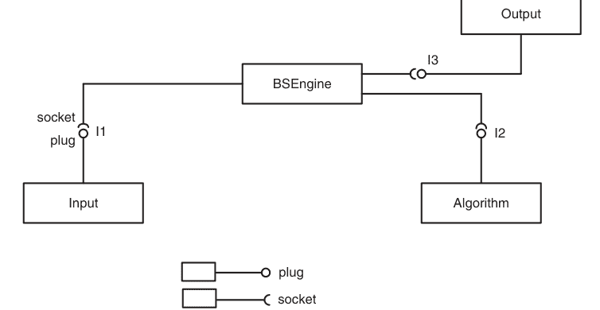

# 图 1.1 上下文图

我们还定义了基于期权数据计算期权价格和敏感度的接口。为此，我们使用类型安全的函数指针：

```
// 计算 V、delta 和 gamma 的抽象接口
template <typename T> using IAlgorithm
    = std::function<ComputedData<T> (const OptionData<T>&
    optData, const T& S)>;
```

定义好数据结构之后，我们现在需要设计图 1.1 中使用这些结构的类。为此，我们描述如何设计这些类。

### 1.5.2 详细设计

在本例中，我们应用基于策略的设计惯用法（Alexandrescu, 2001）来建模图 1.1 中的类。我们并不认为这种设计在总体上一定是最好的，但它确实展示了一些我们希望强调的重要设计特性。我们将输入和输出系统建模为模板类的模板参数。我们使用私有继承和模板–模板参数来建模这个类，称之为 SUD（System Under Discussion，讨论中的系统），同时使用基于签名的方法来建模计算期权价格和敏感度的算法：

```
template <typename T, template <typename T> class Source,
          template <typename T> class Sink>

class SUD : private Source<T>, private Sink<T>
{ // 讨论中的系统，此处为 Black Scholes 方程
```

```
private:
    // 定义卫星系统的“提供”/“需求”接口
    using Source<T>::getData;                     // 获取输入
    using Sink<T>::SendData;                      // 产生输出
    using Sink<T>::end;                           // 程序结束

    // 转换
    IAlgorithm<T> convert;
public:
    SUD(const IAlgorithm<T>& conversion): convert(conversion) {}
    void run(const T& S)
    {
        // 应用程序中的主流程
        OptionData<T> t1 = getData();               // 数据源
        ComputedData<T> t2 = convert(t1, S);        // 处理
        SendData(t2);                               // 数据汇

        end();                                      // 通知数据汇
    }
};
```

因此，该类继承自其数据源和数据汇类，并由一个算法组成。

成员函数 run() 将各个参与系统连接起来，以产生所需的输出。我们应该对系统中的数据流有清晰的认识。

### 1.5.3 库与算法

检查图 1.1，我们可以看到算法子系统根据期权数据计算期权价格。它与接口 IAlgorithm 具有相同的签名，这意味着我们可以使用任何其他与 IAlgorithm 具有相同签名的可调用对象（例如，自由函数、函数对象或 lambda 函数）来配置这些算法。这意味着我们不需要创建类层次结构即可实现这种灵活性。此外，与传统的面向对象技术相比，我们可以在运行时更轻松地切换算法。

C++ 支持许多在计算金融中有用的数学函数。在本节中，我们介绍误差函数，它允许我们计算单变量累积正态分布：

```
// 正态变量等
double n(double x)
{
    const double A = 1.0 / std::sqrt(2.0 * 3.14159265358979323846);
    return A * std::exp(-x*x*0.5);
}

// C++11 支持误差函数
```

```
```cpp
auto cndN = [](double x)
    { return 0.5 * (1.0 - std::erf(-x / std::sqrt(2.0))); };

double N(double x)
{ // 累积正态分布的近似

    return cndN(x);
}
```
```

我们现在使用这些函数来计算普通看涨和看跌期权价格及其敏感度的解析解。聚合值放在一个*元组*（tuple）中，这是 C++11 中的新数据类型：

```
```cpp
// 期权定价：给出 价格+delta+gamma
template <typename V>
    ComputedData<V> CallValues(const OptionData<V>& optData,
    const V& S)
{
    // 提取数据
    V K = std::get<0>(optData); V T = std::get<1>(optData);
    V r = std::get<2>(optData); V v = std::get<3>(optData);
    V b = r; // 股票期权

    // 公共功能
    V tmp = v * std::sqrt(T);
    V d1 = (std::log(S / K) + (b + (v*v)*0.5) * T) / tmp;
    V d2 = d1 - tmp;

    V t1 = std::exp((b - r)*T); V t2 = std::exp(-r * T);
    V Nd1 = N(d1); V Nd2 = N(d2);

    V price = (S * t1 * Nd1) - (K * t2* Nd2);
    V delta = t1*Nd1;
    V gamma = (n(d1) * t1) / (S * tmp);

    return std::make_tuple(price, delta, gamma);
}
```
```

```
```cpp
// 期权定价：给出 价格+delta+gamma
template <typename V>
    ComputedData<V> PutValues(const OptionData<V>& optData,
    const V& S)
{
    // 提取数据
    V K = std::get<0>(optData); V T = std::get<1>(optData);
    V r = std::get<2>(optData); V v = std::get<3>(optData);
    V b = r; // 股票期权

    // 公共功能
    V tmp = v * std::sqrt(T);
```

```
void end() const
{
    std::cout << "end" << std::endl;
}
};
```

多个线程可能以不确定的方式写入控制台。因此，如果我们将单线程代码移植到多线程程序，就需要在控制台上创建锁。相应的线程安全代码如下：

```
template <typename T>
    void ThreadSafePrint(const ComputedData<T>& tup)
{ // 避免控制台上出现杂乱输出的函数

    std::mutex my_mutex;
    std::lock_guard<std::mutex> guard(my_mutex);
    std::cout << "(" << std::get<0>(tup) << "," << std::get<1>(tup)
              << "," << std::get<2>(tup) << ")\n";
}
```

我们创建类来建模看涨和看跌期权，如下所示：

```
template <typename T> class Processing
{
public:

    ComputedData<T> convert(const OptionData<T>& optData,
                            const T& S) const
    {
        return CallValues(optData, S);
    }

    ComputedData<T> operator () (const OptionData<T>& optData,
                                 const T& S) const
    {
        return CallValues(optData, S);
    }
};
```

```
template <typename T> class ProcessingII
{
public:

    ComputedData<T> convert(const OptionData<T>& optData,
                            const T& S) const
    {
        return PutValues(optData, S);
    }
```

```
ComputedData<T> operator () (const OptionData<T>& optData,
    const T& S) const
{
    return PutValues(optData, S);
}
};
```

创建好所需的对象后，我们现在可以运行应用程序了：

```
Processing<value_type> converter;

// 看涨
SUD<value_type, Input, Output> callPricer(converter);
value_type S = 60.0;
callPricer.run(S);

// 看跌
ProcessingII<value_type> converter2;
SUD<value_type, Input, Output> putPricer(converter2);
value_type S2 = 60.0;
putPricer.run(S2);
```

此情况下的输出为：

```
(2.13337,0.372483,0.0420428)
end
(5.84628,-0.372483,0.0420428)
end
```

### 1.6 C++ 中的并行编程与并行 C++ 库

C++ 并发库同时支持多线程和多任务，即创建由多个独立控制线程执行的程序。多线程是抢占式的，因为调度器为每个线程分配固定的时间量（量子），之后该线程恢复为睡眠或等待加入模式。该库还支持通过将程序和算法分解为可以并行运行且彼此间交互很少的组件来创建它们。一般而言，潜在或可开发的并发性涉及我们能够组织代码，使问题的子问题能在多个处理器上运行。每个子问题由一个任务实现。任务（Quinn, 2004）是本地内存中的程序与一组 I/O 端口的组合。任务通过其输出端口向其他任务发送数据，并通过其输入端口从其他任务接收数据。

我们举一个简单的例子。在这种情况下，我们并行化第 1.5.4 节中的代码。以下两个解决方案都是一个更通用的 fork-join 惯用法的特例，其中单个


(main) 线程创建了两个子线程。每个子线程独立于其他子线程执行代码。由于在此特殊情况下共享数据为只读，因此不存在非确定性行为的危险。对于两种解决方案，主线程或任务必须在继续之前等待其子线程完成。

我们现在描述使用 C++ 并发性的解决方案。我们首先将算法封装在存储的 lambda 函数中：

// Parallel execution
auto fn1 = [&converter](value_type S)
{
    SUD<value_type, Input, Output> callPricer(converter);
    callPricer.run(S);
};

auto fn2 = [&converter2](value_type S)
{
    ProcessingII<value_type> converter2;
    SUD<value_type, Input, Output> putPricer(converter2);
    putPricer.run(S);
};
```

股票价值为：

```
value_type stock = 60.0;
```

使用 C++ 线程的解决方案为：

// Threads
std::thread t1(fn1, stock);
std::thread t2(fn2, stock);

// Wait on threads to complete
t1.join(); t2.join();
```

对于基于任务的解决方案，我们使用 C++ 异步 future：

// Asynchronous Tasks
std::future<void> task1(std::async(fn1, stock));
std::future<void> task2(std::async(fn2, stock));

// Wait on threads to complete
task1.wait(); task2.wait();

// Get results from tasks
task1.get(); task2.get();
```

我们的最终示例是展示如何使用 OpenMP 库（Chapman, Jost and Van der Pas, 2008）并行化此代码。我们在本书中不讨论该库，但我们建议将其作为在转向 C++ 并发性之前学习如何编写多线程应用程序的好方法。在这种情况下，我们创建一个线程数组并使用循环级并行执行它们：

// OMP solution
std::vector <std::function<void(value_type)>> tGroupFunctions
    = { fn1, fn2 };

value_type stock = 60.0;

#pragma omp parallel for
for (std::size_t i = 0; i < tGroupFunctions.size(); ++i)
{
    tGroupFunctions[i](stock);
}
```

此代码产生的输出为：

```
(2.13337,0.372483,0.0420428)
end
(5.84628,-0.372483,0.0420428)
end
(2.13337,0.372483,0.0420428)
end
(5.84628,-0.372483,0.0420428)
end
(2.13337,0.372483,0.0420428)
end
(5.84628,-0.372483,0.0420428)
end
```

通常，使用任务编写并行应用程序比使用线程更容易，因为任务隐藏了使用线程时许多棘手的同步和通知用例，并且可以应用系统分解技术（Duffy, 2004）来帮助创建任务依赖图，然后我们在 C++ 中实现它。

### 1.7 编写 C++ 应用程序；从何处和如何开始？

本书围绕 C++11 和 C++14 中的现代多范式语言特性展开。我们在前十章中讨论了大多数基本语言特性。后续章节引入了若干基于前十章的主题。这些在图 1.2 中以概念图的形式显示。本书的主要目标是开发工具，展示如何为计算金融应用设计和实现软件系统。基于此，我们在图 1.2 中展示了我们将如何实现目标，显示了主要概念及其与 C++ 的关系。一般来说，除非另有说明，否则我们在大多数示例中使用标准 C++。本书是自包含的，因为我们更倾向于使用标准库（例如 C++ 中的库以及 Boost 和 Quantlib）而不是专有库。本书中数值方法的代码是自包含的，并由作者开发。

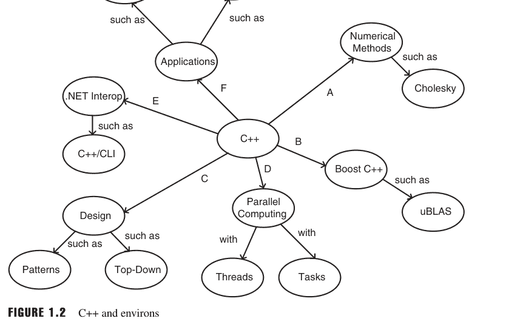

## 图 1.2 C++ 及周边

我们对图 1.2 中的概念及其与本书应用的关系进行简要描述：

- A: 我们为众所周知的数值方法开发代码，例如数值微分、插值、数值积分、矩阵代数、求解非线性方程零点和优化问题。
- B: 当我们需要 C++ 中尚不存在的功能时，我们使用 Boost C++ 库。C++ 中许多新功能都源于 Boost。一般来说，Boost 库的文档相当完善。我们推荐 Boost Math Toolkit 用于数值应用。我们还使用 Boost odeint 库数值求解常微分方程组（ODE）。
- C: 我们认为本书是独特的，因为它引入了一个明确的流程来逐步分析、设计和实现任何类型的软件系统。该流程基于作者作为多个应用领域的需求分析师和软件架构师的经验（参见 Duffy, 2004，其中这些领域已被记录）。

该流程是 *结构化分析*（De Marco, 1978）和面向对象范式的融合。我们将该流程应用于为 FDM 和 Monte Carlo 应用创建 *设计蓝图*。

- D: 现代笔记本电脑和台式电脑板载多个处理器。这为开发多线程和并行代码以提高程序的 *加速比* 打开了大门。C++ 在 *C++ 并发* 库中提供支持。

- E: 我们决定包含一章关于 .NET 语言 C++/CLI 的内容，它架起了（原生/ISO）C++ 和 .NET 世界之间的桥梁。C++ 仍然是一种 *系统编程语言*，使其适用于某些类型的应用。然后 C++/CLI 语言使我们能够创建可以调用 .NET 功能的 C++ 应用程序，同时也可以为原生 C++ 类创建 .NET 包装器并从 C# 代码调用它们。这种方法促进了代码重用，并帮助 C# 开发者，因为他们不必学习 C++。他们只需要将 C++ 代码包装在 .NET 包装器中即可。

- F: 在本书中，我们使用格子方法、Monte Carlo 和 PDE/FDM 方法设计期权定价软件。我们提出了一系列数值方法、设计模式和设计风格。此外，我们使用 *C++ 并发* 来并行化相应的算法。

### 1.8 本书适合谁？

C++ 可能是掌握起来最困难的编程语言之一。学习曲线比其他面向对象语言例如 C# 和 Java 要陡峭得多。学习 C++ 的唯一真正方法是编程 C++，正因如此，我们说你需要有数年的扎实 C++ 编程和应用开发经验。**换句话说，这不是一本初学者的 C++ 入门书。**

本书的主要重点是设计和实现可维护和可扩展的应用，适合在日常工作中使用 C++ 的前台和中台量化开发者。本书也适用于希望理解和管理软件项目的软件架构师和项目经理。

本书也适用于金融专业的硕士生。我们希望逐步的方法能帮助他们构建论文结构。

前十章可以由各类 C++ 开发者阅读，因为主题与应用无关，并且据我们所知这是第一本关于 C++11 新特性的书籍。第 20 到 25 章也可能对数学物理学家感兴趣。

### 1.9 新一代设计和 C++ 中的设计模式

本书采用的方法是特殊的，因为我们认为在开发实现代码之前先对我们希望构建的软件系统有一个想法很重要。这是为了提高开发者生产力。我们需要 *设计蓝图*，以比原始 C++ 代码更高的层次描述系统。计算机科学尚未成为工程学科，很少有 *标准化* 的设计流程和标准来帮助开发者分析、设计和实现 C++ 应用。一个可能的例外是著名的 *软件设计* 

在这种上下文中，我们将这些步骤转化为一个明确的软件流程（见第 9 章所述），以避免一些可怕的结果，例如：

> *大泥球是一个结构松散、庞大、凌乱、胶带和捆扎线、意大利面条代码的丛林。这些系统显示出不受监管的增长和反复、权宜的修复的明显迹象。信息在系统的遥远元素之间共享，往往导致几乎所有重要信息都成为全局或重复。系统的整体结构可能从未被很好定义。如果有的话，可能已经腐蚀得面目全非。具有一丝架构感的程序员会避开这些泥潭。只有那些对架构漠不关心的人，也许习惯于每天修补这些失败堤坝漏洞的惯性，才会满足于在这样的系统上工作。*

我们在开发软件系统时使用以下一般原则：

- 1. 尽快理解问题。你能向非开发者解释问题吗？
- 2. 你能在几天内开发出软件原型吗？
- 3. 通过识别软件系统的边界来限定问题范围。
- 4. 将系统分解为松耦合的子系统。
- 5. 使用面向对象、通用和函数式编程风格的合适组合。

每个开发者都有自己的设计软件系统的方式。没有 *银弹*（Brooks, 1995）。

### 1.11 关于作者

Daniel J. Duffy 是《使用 C++ 的金融工具定价》第一版和第二版的作者。他于 1987 年创立公司 Datasim，以推广 C++ 作为开发应用的新面向对象语言。他担任开发者、架构师和需求分析师的角色，帮助客户在 CAD、过程控制和硬件-软件系统、物流、全息（光学技术）和计算金融等领域设计和分析软件系统。他使用自上而下的功能分解和自下而上的面向对象编程技术相结合，创建稳定和可扩展的应用（有关讨论，参见 Duffy, 2004，其中我们将应用按领域分类）。他还在石油天然气和半导体行业的工程应用中使用了多种数值方法（例如，有限元方法（FEM））。

Daniel Duffy 拥有都柏林大学三一学院的纯数学和应用数学学士、硕士和博士学位，并积极推广 PDE/FDM 在计算金融中的应用。他负责在计算金融中引入 *分数步（苏联分裂）* 方法和 *交替方向显式*（ADE）方法。


他是与 Quantnet LLC 和纽约市巴鲁克学院（CUNY）合作，在 www.quantnet.com 上开设的两门热门 C++ 在线课程的创始人。他还在全球范围内培训量化开发者。可以通过以下方式联系他：dduffy@datasim.nl。官方 Datasim 网站是 www.datasimfinancial.com。

### 1.12 源代码及获取源代码

本书中的 C++ 代码基于 C++11 标准（及后续版本）。唯一的例外是第 14 章中我们介绍 Excel Driver 库的代码，以及第 27 章中我们讨论 C++ 与 Microsoft .NET Framework 之间接口的代码。此外，每个章节中呈现的代码都是机器可读的，并且事先经过了测试。我们的开发环境是 Visual Studio C++，它支持本书中介绍的所有 C++ 功能。我们尚未使用其他编译器测试代码，但我们不期望出现重大问题。读者有责任知道如何安装编译器、Boost C++ 库和 Quantlib。

关于版权问题，正版书籍的拥有者有权获得源代码，可用于个人用途，前提是你不得删除源代码中的版权声明

```
(C) Datasim Education BV 2018
```

如需进一步咨询培训和支持事宜，请直接联系我 dduffy@datasim.nl。对应的网站是 www.datasim.nl。

Boost 中的另外四个类是：

- *作用域数组*：确保在作用域内正确删除动态分配的数组。
- *共享数组*：实现数组的共享所有权。它类似于共享指针类，只是它用于数组而不是单个对象。
- *弱指针*：这是一个共享指针的*观察者*。它不会干扰共享指针所共享的对象的所有权。其主要用途是避免悬空指针，因为弱指针不能持有悬空指针。为完整起见，我们指出一个有效的弱指针可以提升为强指针（共享），因此原始共享指针的生命周期可能会因该提升而受到影响/延长。
- *内在指针*：这是一种特殊的智能指针，用于已经使用内部引用计数编写的代码。你可以在对共享指针的性能不满意时，或你使用的软件要求时编写自己的智能指针类。

#### 2.2.1 内存管理简介

在本节中，我们对对象生命周期做一个简要概述。特别是，我们对对象的*基于堆的内存分配*感兴趣。在 C++ 中，这样的内存分配和释放是开发者的责任。但判断内存何时不再需要并不容易，这种不确定性可能导致一系列问题：

- *悬空指针*：当对象被删除或释放而指针的值未被修改时就会发生这种情况。在这种情况下，指针继续指向已释放内存的位置。
- *野指针*：这些是指在使用前未初始化的指针。
- *内存泄漏*：在这种情况下，程序无法释放已获取的内存。这种情况可由指针超出作用域引起。换句话说，动态分配的内存变得无法访问并永远丢失。
- *双重释放错误*：这是指我们尝试删除已经删除的内存的情况。

为了解决（或避免）这些问题，我们有多种选择。我们可以通过使用某些语言如 C# 和 Java 支持的*垃圾回收*（GC）来实现自动内存管理。垃圾回收器试图回收应用程序中将永远不再被访问的对象的内存。垃圾回收是*手动内存管理*的对立面。有各种类型的垃圾回收器，最常见的是称为*追踪垃圾回收器*。它们首先确定哪些对象是可达的（或潜在可达），然后丢弃剩余的“死”对象。

还有*C++ 中使用的引用计数技术*，它存储指向动态分配对象的指针或句柄的数量。当对象不再被引用时，它将被从内存中删除。引用计数是一种垃圾回收形式，其中每个对象都包含对其引用的数量的计数，这些引用由其他对象持有。引用计数可能需要频繁更新，因为当对象被引用或取消引用时，引用计数需要递增或递减。

引用计数的一些优点是：

- 对象在不再被引用时立即被回收，并且以增量的方式进行，而不会在收集周期中产生长时间等待。
- 引用计数是最简单的垃圾回收形式之一，易于实现。
- 它是管理非内存资源对象（如文件和数据库句柄）的有用技术。

引用计数的一些缺点是：

- 频繁更新是效率低下的来源，因为对象不断被访问。此外，每个受内存管理的对象都必须为引用计数预留空间。
- 一些引用计数算法无法解决引用循环（对象直接或间接引用自身）。

我们现在讨论 C++11 中的智能指针库。我们注意到，经典的垃圾回收并未在 C++ 中实现。C++ 需要某种自动（或半自动）内存管理机制，为此 C++ 提供了模板类来帮助开发者创建可靠和健壮的代码。一般来说，我们在以下情况下使用智能指针：

- 避免本节中讨论的错误。
- 创建具有明确生命周期的对象。
- 资源的共享所有权。
- 在使用原始指针时解决一系列异常不安全问题。

### 2.3 在代码中使用智能指针

我们讨论 C++ 中的三类智能指针。在下一节中，我们将重点介绍每个类的语法，并给出一些简单示例来展示它们的作用。

#### 2.3.1 类 `std::shared_ptr`

该智能指针类实现了*共享所有权*的概念。资源或对象（例如堆上的内存块或文件句柄）由多个共享指针共享。只有当资源不再需要时才会被删除。这就是当*引用计数*变为零时。

我们详细讨论共享指针。首先，我们展示如何创建空的共享指针以及与资源耦合的共享指针。我们还展示共享指针如何放弃对一个资源的所有权，以及如何成为另一个资源的所有者。我们可以通过使用成员函数 `use_count()` 来查看有多少个共享指针*拥有*一个资源：

```
#include <memory>

// Handy alias
template <typename T>
    using SP = std::shared_ptr<T>;
using value_type = double;
```

```
// Creating shared pointers with default deleters
SP<value_type> sp1;                          // empty shared ptr
SP<value_type> sp2(nullptr);                // empty shared ptr for
                                            // C++11 nullptr

SP<value_type> sp3(new value_type(148.413));  // ptr owning raw ptr
SP<value_type> sp4(sp3);                    // share ownership with sp3
SP<value_type> sp5(sp4);                    // share ownership with sp4
                                            // and sp3

// The number of shared owners
std::cout << "sp2 shared # " << sp2.use_count() << '\n';
std::cout << "sp3 shared # " << sp3.use_count() << '\n';
std::cout << "sp4 shared # " << sp4.use_count() << '\n';

sp3 = sp2;  // sp3 now shares ownership with sp2;
            // sp3 no longer has ownership of its previous resource
std::cout << "sp3 shared # " << sp3.use_count() << '\n';
std::cout << "sp4 shared # " << sp4.use_count() << '\n';
```

在上述情况下，最后一个资源所有者负责销毁资源，默认情况下这是通过调用 operator delete 实现的。我们现在展示如何结合用户定义的删除器创建共享指针。当你希望在销毁资源之前执行命令时，这是一个有用的选项，例如通知客户端或打印消息。我们可以使用函数对象、lambda 函数或存储的 lambda 函数（我们将在第 3 章中讨论）来实现删除器，在此作为函数对象和存储的 lambda 函数：

```
// Memory deleters
template <typename T>
struct Deleter
{
    void operator() (T* t) const
    {
        std::cout << "delete memory from function object\n";
        delete t;
    }
};

// Creating shared pointers with user-defined deleters

// Deleter as function object
SP<value_type> sp(new value_type(148.413), Deleter<value_type>());

// Deleter as lambda function
SP<value_type> sp2(new value_type(148.413), [] (value_type* p)
    { std::cout << "bye\n";
      delete p; });
```


```cpp
// Stored lambda function as deleter
auto deleter = [](value_type* p)
{ std::cout << "bye\n"; delete p; };
SP<value_type> sp32(new value_type(148.413), deleter);
```

继续，我们现在讨论构造共享指针的更多方法。它们是：

- `std::make_shared<T>`: 构造 T 的一个实例并将其包装在共享指针中，使用参数作为 T 构造函数的参数列表。
- `std::allocate_shared<T>`: 构造 T 的一个实例并将其包装在共享指针中，使用参数作为 T 构造函数的参数列表。显式的内存分配器对象是此函数的一个参数。

在上面的第二种情况下，有一个选项可以提供内存分配器作为参数之一（在此我们展示了 C++ 和 Boost C++ 分配器的示例）：

```cpp
struct Point2d
{
    double x, y;
    Point2d() : x(0.0), y(0.0) {}
    Point2d(double xVal, double yVal) : x(xVal), y(yVal) {}
    void print() const {std::cout << "(" << x << "," << y << ")\n";}
    ~Point2d() { std::cout << " point destroyed\n"; }
};
```

```cpp
// More efficient ways to construct shared pointers
auto sp = std::make_shared<int>(42);
(*sp)++;
std::cout << "sp: " << *sp << '\n'; // 43

auto sp2 = std::make_shared<Point2d>(-1.0, 2.0);
(*sp2).print(); // (-1, 2)

auto sp3 = std::make_shared<Point2d>();
(*sp3).print(); // (0,0)
```

```cpp
// More efficient ways to construct shared pointers
auto sp = std::allocate_shared<int>(std::allocator<int>(),42);
(*sp)++;
std::cout << "sp: " << *sp << '\n'; // 43

auto sp2 = std::allocate_shared<Point2d>(std::allocator<int>(), -1.0, 2.0);
(*sp2).print(); // (-1, 2)
```

```cpp
// Use a Boost pool allocator
auto sp3 = std::allocate_shared<Point2d> (boost::pool_allocator<Point2d>(), 14.45,28.45);
(*sp3).print(); // (14.45,28.45)
```

有四个重载版本的函数 `reset()`，以某种方式放弃共享指针的所有权：

- 放弃所有权并重置为空共享指针。
- 放弃所有权并重新初始化指针（使用默认和用户定义的删除器）。
- 放弃所有权并使用内存分配器和用户定义的删除器重新初始化指针。

我们可以通过调用谓词 `unique()` 来确定共享指针 `sp` 是否是资源的唯一所有者（语义上等价于 `sp.use_count() == 1`）。我们现在给出一些重置共享指针的示例：

```cpp
// Reset
std::cout << "Reset\n";
SP<value_type> sp1(new value_type(148.413));
SP<value_type> sp2(sp1);
SP<value_type> sp3(sp2);

std::cout << "sp3 shared # " << sp3.use_count() << '\n';  // 3

SP<value_type> sp4(new value_type(42.0));
SP<value_type> sp5(sp4);

std::cout << "sp5 shared # " << sp5.use_count() << '\n';  // 2

sp3.reset();
std::cout << "sp3 shared # " << sp3.use_count() << '\n';  // 0
std::cout << "sp2 shared # " << sp2.use_count() << '\n';  // 2

sp3.reset(new value_type(3.1415));
std::cout << "sp3 shared # " << sp3.use_count() << '\n';  // 1
std::cout << "sp2 shared # " << sp2.use_count() << '\n';  // 2

sp2.reset(new value_type(3.1415), Deleter<value_type>());
std::cout << "sp2 shared # " << sp2.use_count() << '\n';  // 1

std::cout << "sp2 sole owner? " << std::boolalpha << sp2.unique() << '\n';
// true
```

### 2.3.2 Class std::unique_ptr

而 `std::shared_ptr` 允许资源在多个共享指针之间共享，对于 `std::unique_ptr` 来说，资源只有一个可转移的所有者。在这种情况下我们谈论 *exclusive* 或 *strict ownership*。其主要附加价值在于避免 *resource leaks*（例如使用原始指针时缺少 delete 调用），因此它可以被称为 *exception-safe* 指针。其主要成员函数是：

- 构造函数（类似于 `std::shared_ptr` 中的）。
- 分配一个唯一指针。
- 释放；返回指向资源的指针并释放所有权。
- 重置；替换资源。
- 运算符重载（==, !=, < 和其他比较运算符）。

接口与 std::shared_ptr 类似，这意味着大部分代码将很容易理解。最后，std::unique_ptr 取代了 std::auto_ptr，后者被认为已弃用。

我们的第一个示例涉及在作用域中创建一个唯一指针。在正常情况下，当指针超出作用域时，对应的资源会被清理，但在这种情况下我们在作用域结束前（人为地）抛出异常。会发生什么？运行代码时我们看到产生的异常被捕获，资源被自动销毁：

```cpp
template <typename T>
using UP = std::unique_ptr<T>;

try
{
    // Unique pointers

    // Stored lambda function as deleter
    auto deleter = [] (value_type* p)
        { std::cout << "bye, bye unique pointer\n"; delete p; };
    UP<value_type> sp32(new value_type(148.413), deleter);

    throw - 1;
}
catch(int& n)
{
    std::cout << "error but memory is cleaned up\n";
}
```

此代码在使用共享指针代替唯一指针时也有效。在 C++14 中，我们可以使用 std::make_unique() 为非数组类型创建唯一指针：

```cpp
// Other examples with unique pointers
// More efficient ways to construct unique pointers
auto up = std::make_unique<int>(42);
(*up)++;
std::cout << "up: " << *up << '\n';      // 43

auto up2 = std::make_unique<Point2d>(-1.0, 2.0);
(*up2).print();          // (-1, 2)

auto up3 = std::make_unique<Point2d>();
(*up3).print();          // (0,0)
```

最后，我们可以 *reset* 一个唯一指针（正如我们在共享指针中所见），我们也可以 *release ownership* 并将其交还给调用者。我们通过以下用户定义的类型来展示这些函数，该类型模拟二维点：

```cpp
struct Point2d
{
    double x, y;
    Point2d() : x(0.0), y(0.0) {}
    Point2d(double xVal, double yVal) : x(xVal), y(yVal) {}
    void print() const {std::cout << "(" << x << "," << y << ")\n";}
    ~Point2d() { std::cout << " point destroyed\n"; }
};
```

```cpp
// Reset of unique pointers
UP<value_type> up1(new value_type(148.413));
up1.reset();
assert(up1 == nullptr);
// std::cout << "reset: " << *up1 << '\n';

up1.reset(new value_type(3.1415));
std::cout << "reset: " << *up1 << '\n';
// Give ownership back to caller without calling deleter
std::cout << "Release unique pointer\n";
auto up = std::make_unique<Point2d>(42.0, 44.5);
Point2d* fp = up.release();

assert(up.get() == nullptr);
std::cout << "No longer owned by unique_ptr...\n";

(*fp).print();

delete fp; // Destructor of Point2d called
```

### 2.3.3 std::weak_ptr

第三个智能指针类持有对由共享指针管理的对象（资源）的非拥有（*weak*）引用。它必须转换为共享指针才能访问资源。它是 std::shared_ptr 的辅助类，在以下情况下需要它：

- 解析共享指针之间的 *cyclical dependencies*：依赖关系发生在两个对象使用共享指针相互引用时。我们无法释放对象，因为每个对象的引用计数都是 1。这就像 *deadlock*。
- 你希望共享一个对象但不拥有它。在这种情况下我们定义对资源的引用，并且该引用在资源之后仍然存在。

std::weak_ptr 在上述两种情况下都使用。共享是允许的，但所有权不是必需的。std::weak_ptr 中的操作可以表述如下：

- 构造函数（默认、从共享指针、从弱指针）。
- 赋值运算符。
- 交换两个弱指针。
- 重置弱指针。
- 检查托管对象（资源）是否已过期。
- 通过 *locking* 它从弱指针创建共享指针。如果弱指针未过期，共享指针将共享所有权。

一些示例是：

```cpp
// Create a default weak pointer
std::weak_ptr<double> wp;
std::cout << "Expired wp? " << wp.expired() << '\n';     // true

// Create a weak pointer from a shared pointer
std::shared_ptr<double> sp(new double (3.1415));
std::cout << "Reference count: " << sp.use_count() << std::endl;  //1

// Assign weak pointer to shared pointer
wp = sp;
std::cout << "Reference count: " << sp.use_count() << std::endl;  //1

std::weak_ptr<double> wp2(sp);
std::cout << "Reference count: " << sp.use_count() << std::endl;  //1

wp = sp;
std::shared_ptr<double> sp2(wp);
std::cout << "Reference count, sp2: " << sp2.use_count();       //2
std::cout << std::boolalpha << "Expired wp? " << wp.expired();    // false
std::shared_ptr<double> sp3 = wp.lock();
std::cout << "Reference count: " << sp3.use_count() << std::endl; //3
std::cout << "Reference count: " << sp.use_count() << std::endl;  //3

// Event notification (Observer) pattern and weak pointers
std::shared_ptr<double> spA(new double (3.1415));

std::weak_ptr<double> wA(spA);
std::weak_ptr<double> wB(spA);

spA.reset();
std::cout << "wA expired: " << wA.expired() << std::endl;
std::cout << "wB expired: " << wB.expired() << std::endl;
```

### 2.3.4 Should We Use Smart Pointers and When?

很明显，智能指针是对原始指针的巨大改进。它们的使用促进了代码的整体可靠性，但代价是什么？例如，共享指针对象是普通指针的包装器，因为它包含该指针和一个引用计数，由所有引用同一对象的共享指针共享。情况变得更加复杂

如果我们使用弱指针，因为弱指针也需要另一个计数器。这些特性可能会阻碍某些编译器优化。

与原始指针相比，独占指针没有任何运行时开销。独占指针通常用于在给定作用域内创建对象的*工厂*对象和对象*引擎*。当应用程序对象构造完成后，工厂对象会通过离开作用域而被清理。对于无法直接用 C++11 解决的问题，可以求助于*Boost Smart Pointer*库，该库拥有比 C++11 更多的智能指针类（参见 Demming 和 Duffy，2010）。我们注意到，共享指针不是线程安全的。这一事实在将单线程代码移植到多线程代码时会产生重大影响。C++11 中有一些函数可以对共享指针执行*原子*和*线程安全*操作，我们将在第 28 章讨论。简而言之，你需要确定智能指针能做什么、不能做什么，以及在代码中使用它们会带来哪些后果。性能和可维护性等问题是核心。一个特别的课题是把使用原始指针的*遗留代码*升级为使用智能指针的代码。

### 2.4 智能指针使用的扩展示例

在前面的章节中，我们讨论了 C++ 中新的指针类。下一个需要回答的问题是它们如何相对于原始指针实现改进。为此，我们讨论如何设计包含嵌入指针的用户自定义程序集和聚合，并重新实现流行的*工厂方法*设计模式（GOF，1995），该模式使用了原始指针。

#### 2.4.1 包含嵌入指针的类

软件开发中常见的情况是，我们创建由集合组成的*复合*对象和*整体-部分*对象，这些集合的组件是内置类型或用户自定义类型（相关讨论见 POSA，1996）。我们这里关注的是容器外部客户端可以访问其组件的变体，即*共享部分*变体。这些指针是在其他地方（可能在专门的工厂中）初始化的。从某种意义上说，这种特性破坏了封装。使用原始指针实现这些组件时需要注意的一些问题和关注点是：

- 哪个（哪些）组件负责基于堆的容器组件的生命周期管理？例如，在 GOF（1995）中，一种策略是复合对象负责删除其子组件。
- 组件的资源可能被其某个所有者销毁，从而使组件失效，并因此产生空指针。
- 在复合对象中编写代码来显式管理组件生命周期，会导致该类承担不止一项主要职责，从而带来潜在的可维护性问题。
- 代码不是线程安全的（因为共享指针不是线程安全的）。当多个独立线程访问共享资源时，必然会发生非确定性行为和*竞争条件*。

C++ 中的智能指针解决了其中一些问题。一个使用示例如下（注意我们使用了第 2.3.1 节中的用户自定义删除器）：

```
template <typename T>
    using SP = std::shared_ptr<T>;

class CompositeContainer
{ // New style class for lists of embedded pointers
private:
    std::list<SP<int>> data;
public:
    CompositeContainer() : data(std::list<SP<int>>()) {}

    void add(int* elem)
    {
        data.push_back(SP<int>(elem, Deleter<int>()));
        //data.push_back(SP<int>(elem));
    }

    void add(const SP<int>& elem)
    {
        data.push_back(elem);
    }
};

// Composition
std::cout << "Composition\n";
CompositeContainer con;
int* i = new int(10);
auto e1 = SP<int>(new int(13), Deleter<int>());

con.add(i);
con.add(e1);
```

这段代码展示了如何根据 POSA（1996）中的设计创建健壮的整体-部分集合。

#### 2.4.2 重新实现面向对象设计模式

GOF（1995）中描述的面向对象设计模式的设计风格基于以下策略的组合：

- 类层次结构和子类型多态。
- 使用原始指针；不区分短生命周期对象和长生命周期对象。
- 使用组合来设计客户端类，这些类通过指向基类的原始指针访问服务对象的接口。

我们将展示如何通过使用共享指针和独占指针来解决这些问题。为此，我们以工厂方法模式为例。我们从 Wikipedia 引用如下：

> 在基于类的编程中，工厂方法模式是一种创建型模式，它使用工厂方法来解决创建对象时无须指定所创建对象确切类的问题。具体做法是调用工厂方法来创建对象——工厂方法要么在接口中指定并由子类实现，要么在基类中实现并由派生类选择性地覆盖——而不是通过调用构造函数来创建对象。

我们以一个如何将该模式应用于单因子期权收益构造的示例为例（我们指出，这不是实现该功能的唯一方法），给出该示例主要是为了说明动机。我们将收益建模为函数对象层次结构与子类型多态的结合：

```
// Traditional class hierarchy
class Payoff
{ // Function object
public:
    virtual double operator () (double S) const = 0;
};
```

```
class CallPayoff : public Payoff
{
private:
    double K;
public:
    CallPayoff(double strike) { K = strike; }
    double operator () (double S) const
    {
        return std::max<double>(S - K, 0);
    }
};
```

```
class PutPayoff : public Payoff
{
private:
    double K;
public:
    PutPayoff(double strike) { K = strike; }
    double operator () (double S) const
    {
        return std::max<double>(K - S, 0);
    }
};
```

将来可能还需要添加其他类型的收益。因此，我们创建只引用基类 Payoff 的客户端。此外，专门的工厂对象根据某种选择来创建收益。为此，工厂类层次结构如下（注意它们的接口中返回的是指向收益的共享指针）：

```
class PayoffCreator
{
public:

    // C++11 way to define 'nonusable'
    PayoffCreator(const PayoffCreator& orig) = delete;
    PayoffCreator& operator=(const PayoffCreator& orig) = delete;

public:
    PayoffCreator() = default;          // C++11 syntax
    virtual ~PayoffCreator() = default; // Destructor

    // Functions to create an object
    virtual std::shared_ptr<Payoff> CreatePayoff(double K) = 0;
};

class CallPayoffCreator : public PayoffCreator
{
public:

    // C++11 way to define 'nonusable'
    CallPayoffCreator(const CallPayoffCreator& orig) = delete;
    CallPayoffCreator& operator=(const CallPayoffCreator& orig) = delete;

public:
    CallPayoffCreator() = default;
    virtual ~CallPayoffCreator() = default; // Destructor

    // Functions to create an object
    virtual std::shared_ptr<Payoff> CreatePayoff(double K)
    {
        return std::shared_ptr<Payoff>(new CallPayoff(K));
    }
};

class PutPayoffCreator : public PayoffCreator
{
public:

    // C++11 way to define 'nonusable'
    PutPayoffCreator(const PutPayoffCreator& orig) = delete;
    PutPayoffCreator& operator=(const PutPayoffCreator& orig) = delete;

public:
    PutPayoffCreator() = default;
    virtual ~PutPayoffCreator() = default; // Destructor

    // Functions to create an object
    virtual std::shared_ptr<Payoff> CreatePayoff(double K)
    {
        return std::shared_ptr<Payoff>(new PutPayoff(K));
    }
};
```

在本例中，我们（为了方便起见）在收益类与其对应的工厂类之间建立了一一对应关系。最后，我们展示如何在配置代码中使用上述类层次结构：

```
int main()
{
    // Main steps:
    // 1. Choose the specific factory (unique pointer)
    // 2. Create the specific payoff (shared pointer)
    // 3. Use the payoff (for example, in an option pricer)

    // 1.
    int choice; std::cout << "1: Call, 2: Put: "; std::cin >> choice;

    std::unique_ptr<PayoffCreator> creator;
    if (1 == choice)
        creator.reset(new CallPayoffCreator());
    else
        creator.reset(new PutPayoffCreator());

    // 2.
    double K = 100.0;
    auto payoff = creator->CreatePayoff(K);

    // 3. Compute the payoff for a given S
    double S = 90.0;
    std::cout << "Payoff: " << (*payoff)(S) << '\n';

    return 0;
}
```

这里我们可以看到，工厂是一个独占指针，这可能是比使用原始指针或共享指针更细致的解决方案。这是因为我们希望拥有独占所有权，而且工厂在不再需要时会自动销毁，即使发生异常也是如此。

可以说，这个例子只是冰山一角，其底层概念可以应用于其他设计模式。

### 2.5 移动语义与右值引用

移动语义是 C++11 以来的新特性。它允许编译器用成本较低的移动操作取代昂贵的复制操作和临时对象的创建。通常，我们可以在复制构造函数和复制赋值运算符之外（或代替它们）定义移动构造函数和移动赋值运算符。

#### 2.5.1 值类别的快速概述

一般来说，C++ 表达式是一个名称，涵盖运算符及其操作数、字面量和变量名。一个表达式具有两个正交属性，即其


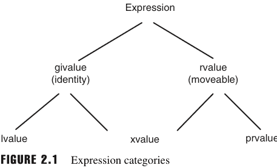

*type* 及其 *值类别*。我们还注意到一个表达式可能具有恒等性，这意味着可以比较表达式（例如，是否引用同一实体）或比较对象或它们所标识的函数的地址。

有三种主要的值类别，表示恒等性与是否可以从表达式的值中移动的组合：

- *xvalue*：具有恒等性并且可以从中移动。
- *lvalue*：具有恒等性并且不能从中移动。
- *prvalue*：不具有恒等性并且可以从中移动。它是一个 *纯值表达式*。

具有恒等性的表达式称为 *glvalue* 表达式（广义 *lvalue*）。因此，*xvalue* 和 *lvalue* 都是 *glvalue*。可以从中移动的表达式称为 *rvalue* 表达式。*prvalue* 和 *xvalue* 都是 *rvalue* 表达式。*rvalue* 是一个匿名临时对象，只能出现在赋值运算符的右手边。类别分类如图 2.1 所示。

操作 `std::move` 实际上并没有移动任何东西，而是将其参数转换为 *rvalue reference*，这是一种用两个与号 `&&` 声明的类型。这是一种新类型，表示可以被修改的 *rvalue*。其原理是它是一个不再需要的临时对象。这意味着可以窃取其内容或其资源。

C++ 支持以下移动操作：

- 将容器中的一个范围移动到另一个容器。
- 将容器中的一个范围向后移动到另一个容器。
- 将一种通用类型移动到另一种类型。

### 2.5.2 为什么某些类需要移动语义

移动语义为开发者提供了一种选择：与其使用昂贵的拷贝（使用拷贝构造函数和拷贝赋值运算符），我们可以使用新的移动构造函数和移动赋值运算符。在某些情况下我们希望创建拷贝构造函数无法调用的类，例如。在 C++03 中，这一要求是通过将拷贝构造函数设为私有并赋予空体来实现的。这会导致各种问题，而 C++11 通过将构造函数定义为已删除的函数体来解决这些问题（我们将在第 7 章第 7.3.2 节详细讨论）。一个例子是：

```
class F
{
public:
    // Support default operations OK
    F() = default;

    // Move ctor and move assignment are defined
    F(F&&) = default;
    F& operator = (F&&) = default;

    F(const F&) = delete;
    F& operator = (const F&) = delete;

    virtual ~F() = default;
};
```

在上述情况下，我们也看到了如何定义移动构造函数和移动赋值运算符。在这种情况下，我们使用关键字 default 让编译器生成给定成员函数的函数体。

通常需要移动语义并且必须禁止拷贝操作的类型的例子是文件描述符、数据库连接、TCP 套接字、I/O 流、运行中的线程以及多任务中的异步 future，以及 std::unique_ptr。

这一讨论使我们回顾了三法则，该规则指出如果一个类定义了以下成员函数之一，则应实现全部三个：

- 析构函数。
- 拷贝构造函数。
- 拷贝赋值运算符。

这些函数被称为特殊成员函数。我们可以扩展该列表以提供五法则，由上述三个函数加上：

- 移动构造函数。
- 移动赋值运算符。

总之，我们可以显式地将五个成员指定为在用于多态的基类中默认为默认值。然后析构函数必须是虚的。

```
class Base
{
public:
    Base(const Base&) = default;
    Base(Base&&) = default;
    Base& operator=(const Base&) = default;
    Base& operator=(Base&&) = default;
    virtual ~Base() = default;
};
```

### 2.5.3 移动语义与性能

许多应用程序涉及将向量和数组搬运/拷贝到其他容器中。在许多情况下，拷贝完成后输入参数不再需要。在这种情况下，我们可能更愿意将输入向量移动到目标向量（顺便说一下，移动后输入向量未指定且大小为零）。这种方法可以带来显著的性能提升，因为元素是通过交换一些指针来移动的，而不是拷贝容器元素。简而言之，当我们不再需要拷贝容器的内容时，最佳做法是使用移动构造函数。

我们举一个创建向量的例子，并比较拷贝操作与我们在第 2.5.1 节中提到的三种移动版本。我们使用将在第 10 章介绍的秒表类来监控运行时间性能（实际上，如果你愿意，也可以使用你喜欢的计时器）：

```
// Copy vs move an array performance
std::size_t N = 1'000'000;
std::vector<double> v(N);
std::iota(std::begin(v), std::end(v), 1);
std::vector<double> v2;
StopWatch<> sw;
sw.Start();

// Option A (copy elements, linear complexity)
std::copy(std::begin(v), std::end(v), std::back_inserter(v2));

sw.Stop();
std::cout << "Elapsed time copy : " << sw.GetTime() << '\n';
assert(std::equal(std::begin(v), std::end(v), std::begin(v2)));

v2.clear();
sw.Start();

// Option B: Move a range of elements
std::move(std::begin(v), std::end(v), std::back_inserter(v2));

// Option C: Move constructor
v2 = std::move(v);

sw.Stop();
std::cout << "Elapsed time move: " << sw.GetTime() << '\n';
assert(std::equal(std::begin(v), std::end(v), std::begin(v2)));
std::cout << "Size of input vector: " << v.size() << '\n';

v2.clear();
v = std::vector<double> (N);
std::iota(std::begin(v), std::end(v), 1);
v2.resize(v.size());
sw.Start()
```

```
// Option D: move elements to v2, starting at end(v2)
std::move_backward(std::begin(v), std::end(v), std::end(v2));

sw.Stop();
std::cout << "Elapsed time move backward: " << sw.GetTime() << '\n';

assert(std::equal(std::begin(v), std::end(v), std::begin(v2)));
```

我们对大型数组进行了许多基本测试（通常具有百万到一亿个元素）。总体而言，选项 C 最快（比选项 A 快 30 倍），然后是选项 D（比选项 A 快 10 倍），然后是选项 B（比选项 A 快 5 倍），基于我们测试的小规模实验。我们建议你自己进行实验，不仅使用向量，还使用其他容器，例如列表。你的应用程序中的数字可能会有所不同。

我们以此结束本节，顺便指出固定大小的数组也可以被移动构造：

```
const int N = 100;
std::array <std::string, N> arr1;

auto arr2 = std::move(arr1);
```

在后面的章节中，我们将展示如何提高数值算法的运行时间性能（特别是有限差分和蒙特卡洛方法）。

### 2.5.4 移动语义与共享指针

在智能指针可以被移动的几种用例中：

- 将共享指针移动到共享指针。
- 将唯一指针移动到共享指针。
- 将 auto_ptr 赋给共享指针。
- 将唯一指针移动到唯一指针。

一些代码示例是：

```
// A. From auto_ptr to shared ptr; upgrading legacy code
// Define auto_ptr pointers instead of raw pointers
std::auto_ptr <double> ap(new double(1.0));
// Dereference
*ap = 2.0;

std::shared_ptr<double> sp(std::move(ap));
// std::cout << "ap: " << *ap << '\n'; CRASH
std::cout << "sp: " << *sp << '\n'; // 2
```

### 2.6 其他细节：可用性增强

我们现在讨论 C++ 中的许多有用特性。它们提高了代码的可读性和健壮性。在其他情况下，它们代表了对在 C++ 早期版本中用于解决某些问题的变通方法的结构性解决方案。你可能需要在代码中使用这些新特性。

#### 2.6.1 类型别名和别名模板

开发者熟悉 typedef 说明符，它允许为现有类型定义别名。该说明符不能用于改变现有类型名的含义，因此它不代表新类型的声明。typedef 在其可见的作用域中生效。一个例子是：

```
typedef std::map<std::string, double> Dictionary;
```

使用别名可以提高代码的可读性和可维护性。不幸的是，typedef 不能用于类模板，因此以下代码将无法编译：

```
/*
template <typename Key, typename Value>
    typename std::map<Key, Value> DictionaryII;

template <typename Value>
    typename std::map<std::string, Value> DictionaryIII;
*/
```

但有希望！C++11 提供了为类模板和非模板类定义别名的可能性。该术语有时称为别名模板或模板 typedef。上述示例现在可以表述如下：

```
using Dictionary = std::map<std::string, double>;

template <typename Key, typename Value>
    using DictionaryII = std::map<Key, Value>;

template <typename Value>
    using DictionaryIII = std::map<std::string, Value>;
```

我们也可以将此技术与具有长名称的用户定义类型以及具有许多模板参数的类型结合使用，以便更轻松地使用它们。让我们以简单的例子为例：

```
template <typename T1, typename T2>
    class C
```


```cpp
{
private:
public:
    T1 t1;
    T2 t2;
public:
    C() : t1(T1()), t2(T2()) {}
    C(const T1& t1Val, const T2& t2Val) : t1(t1Val), t2(t2Val) {}

    void print() const
    {
        // T1 and T2 must support <<
        std::cout << t1 << ", " << t2 << '\n';
    }
    // other code here
};
```

我们可以想象客户端代码可能希望以不同的方式使用这个类，为此我们可以创建各种别名，例如：

```cpp
template <typename T1, typename T2>
    using C1 = C<T1, T2>;

// 'Nested' alias
template <typename T>
    using Vec = std::vector<T>;

template <typename T1, typename T2>
    using C2 = C<T1, Vec<T2>>;

template <typename T>
    using C3 = C<T, int>;

using C4 = C<double, int>;
// Using alias template
C4 c4; // 0,0
c4.print();

float f = 1.0F;
int j = 3;
C3<float> c3(f, j);
c3.print(); // 1,3

// Nested alias in class C2 for readability
Vec<double> v(100);
int n = 10;
C2<int, double> c2(n, v);
C<int, std::vector<double>> c2_1(n, v);

C1<int, int> c1;
C<int, int> c(1, 2);
```

最后，我们可以创建由这些别名组成的类：

```cpp
template <typename T>
    using SP = std::shared_ptr<T>;

// Client class
template <typename T>
class Client
{ // Composition
private:
    C<T, SP<T>> data;
public:
    Client(const T& t) : data(t, SP<T>(new T(t))) {}

    void print() const
    {
        std::cout << data.t1 << ", " << *(data.t2) << '\n';
    }
};

// Client class as a composition
Client<double> client(1.0);
client.print(); // 1,1
```

我们给出了一些示例来展示这种技术的用处。别名模板不应与众所周知的 using 声明混淆，后者引入的是在别处定义的名字。

#### 2.6.2 自动类型推导与 auto 说明符

此功能允许我们在不必使用其特定类型的情况下声明变量或对象。换句话说，变量会从其初始值设定项自动推导出来。一些示例是：

```cpp
// auto variable
double d1 = 1.0; float f1 = 2.0f; int p1 = 10;
auto d2 = d1 + f1;
auto d3 = d1 + p1;
auto d4 = f1 + p1;
```

我们本可以使用显式的返回类型，但编译器很聪明，它知道正确的类型应该是什么，正如使用类型特征库进行的以下检查所示（我们在第 6 章中详细讨论该库）：

```cpp
// Example resulting type by type_traits (chapters 4 and 6)
static_assert(std::is_same<decltype(d1), double>::value, "ouch");
static_assert(std::is_same<decltype(d2), double>::value, "ouch");
static_assert(std::is_same<decltype(d3), double>::value, "ouch");
// FAIL static_assert(std::is_same<decltype(d4), double>::value, "ouch");
static_assert(std::is_same<decltype(d4), float>::value, "ouch"); // Yes
```

我们也可以使用 auto 说明符来在使用用户定义类型时让生活更轻松：

```cpp
// auto variable with user-defined types

using CP = std::complex<double>;
CP c(1.0, 2.0);
C<CP, CP> cA(c, c);
auto cB = cA;
static_assert(std::is_same<decltype(cB), C<CP, CP>>::value, "ouch");
```

我们在后面的章节中更详细地讨论 auto 及其与其他 C++ 功能的关系，例如作为 lambda 函数的返回类型和输入参数。

#### 2.6.3 基于范围的 for 循环

此功能可用作更易读的替代方案，以迭代值范围。我们以打印向量内容为例。第一个版本使用迭代器，第二个版本使用名为 doit() 的函数对象：

```cpp
void printI(const std::vector<double>& arr)
{
    for (auto i = std::begin(arr); i != std::end(arr); ++i)
    {
        std::cout << *i << ",";
    }
    std::cout << '\n';
}

void doit(double d)
{
    // Function object
    std::cout << d << ",";
}

void printII(const std::vector<double>& arr)
{
    // Apply the function object 'doit' to each element of container
    std::for_each(std::begin(arr), std::end(arr), doit);
    std::cout << '\n';
}
```

基于范围的版本是：

```cpp
void printIII(const std::vector<double>& arr)
{
    // Range-based for loop
    for (const auto& elem : arr)    // access by const reference
```

```cpp
std::cout << std::boolalpha << CheckNullPtr(i) << '\n'; // true

auto i2 = std::unique_ptr<int>(new int);
std::cout << std::boolalpha << CheckNullPtr(i2.get()) << '\n';// false
```

通常，建议使用 nullptr。它是类型安全的空指针。

#### 2.6.5 新的基本数据类型

C++11 支持用于通用字符集和 Unicode 标准的若干种新的字符类型。一些示例是：

```cpp
// Unicode characters
char16_t ch1;      // UTF-16 characters
char32_t ch2;      // UTF-32 characters
wchar_t ch3;       // Largest extended character set
```

此外，新的整型是：

```cpp
// long data type
long long v1 = 3;
unsigned long v2 = 4;

std::cout << std::numeric_limits<long long>::min() << ", "
          << std::numeric_limits<long long>::max() << '\n';
std::cout << std::numeric_limits<unsigned long long>::min() << ", "
          << std::numeric_limits<unsigned long long>::max() << '\n';
std::cout << std::numeric_limits<long>::min() << ", "
          << std::numeric_limits<long>::max() << '\n';
```

此代码的输出为：

```
-9223372036854775808, 9223372036854775807
0, 18446744073709551615
-2147483648, 2147483647
```

#### 2.6.6 作用域枚举和强类型枚举

C++03 中的枚举不是类型安全的。它们本质上是整数，以便可以比较不同枚举类型的枚举值。在 C++11 中，可以定义一种类型安全的枚举类，它没有旧式枚举的缺点。类型安全的枚举不能与整数进行比较，也不会隐式转换为整数。一个示例是：

```cpp
enum class Colour
{
    RED,
    ORANGE,
    YELLOW,
    GREEN,
    BLUE = 100,
    INDIGO
};
```

我们如何使用这个枚举类？首先，我们可以通过将其分配给枚举类 `Colour` 的一个分量来创建一个颜色，其次，如果我们想打印它，则必须显式地将该分量转换为整数：

```cpp
Colour colour = Colour::RED;
//std::cout << colour;             // error, no implicit conversion to int
std::cout << static_cast<int>(colour) << '\n'; // 0

colour = Colour::INDIGO;
std::cout << static_cast<int>(colour) << '\n'; // 101
```

以下代码将无法编译：

```cpp
// int g = GREEN; // GREEN unidentified
```

我们注意到标准异常的错误条件值是作用域枚举。

#### 2.6.7 属性 `[[deprecated]]`

通常，*属性* 是用于向类型、成员、返回值和函数等代码元素添加自定义信息的 *元数据* 片段。该概念在 C# 等语言中已得到很好的发展（Albahari and Albahari, 2016）。在 C++ 中，属性为实现定义的语言扩展提供了统一的标准语法，例如 Microsoft 的 `__declspec` 关键字，它是指定存储类信息的扩展属性语法。它指定给定类型的实例应使用 Microsoft 特定的存储类进行存储，并且在创建从 Excel 等调用的 *动态链接库*（DLL）时使用。以下代码展示了其用法；我们创建一个函数 `doit()`，将其导出到 DLL，然后从 main 函数中调用 DLL 中的函数：

```cpp
#using <mscorlib.dll>

using namespace System;
using namespace System::Runtime::InteropServices;

[DllImport("C:\\VSProjects\\DLL101\\Release\\DLL101.dll")]
extern void doit();

int main()
{
    // Call the DLL function
    doit();
    return 0;
}
```

被调用的函数是：

```cpp
#include <iostream>

__declspec(dllexport) void __stdcall doit()
{
    std::cout << "Hello ...";
}
```

在此小 digression 之后，我们现在讨论 C++ 中的属性 `[[deprecated]]`。来自 www.cppreference.com 的描述是：

> 表示使用此属性声明的名称或实体是允许的，但由于某种原因不被推荐。此属性允许在类、typedef 名称、变量、非静态数据成员、函数、枚举和模板特化声明中使用。已声明为非弃用的名称可以重新声明为弃用。已声明为弃用的名称不能通过不带此属性的重新声明来取消弃用。

在撰写本文时，并非上述描述中提到的所有情况似乎都能编译，因此我们集中讨论对我们有效的那些示例。我们给出一些使用此属性的示例，应该很容易理解：

```cpp
// Deprecate a global function
[[deprecated("old stuff, use F() instead")]] void Func()
{
}
```

```cpp
// Deprecate an enum
enum [[deprecated]] animals {
    CAT, DOG, MOUSE
};
```

```cpp
// Deprecate a typedef
[[deprecated("Cannot use 'type'")]]
typedef int type;
```

```cpp
// Deprecate a template specialisation
template <typename T> class templ;

template <>
    class [[deprecated]] templ<int> {};
```


我们看到，如果你调用一个已弃用的函数或试图访问已弃用的数据，那么代码将无法编译，并会输出一条错误消息。我们用一个混合了已弃用和未弃用成员类的虚构示例来结束本节：

```
struct [[deprecated("old school class")]] C
{
    C() : data(1) {}

    [[deprecated]] int data;

    [[deprecated]] void print() { std::cout << "Deprecated\n"; }
    void NewPrint() const { std::cout << "Not deprecated\n"; }
};
```

下面的示例展示了哪些代码可以编译，哪些不能编译：

```
C C;
// C.data = 10;
//C.print();
C.NewPrint();
```

C++17 还定义了许多其他属性，但对它们的讨论超出了本书的范围。我们尚不确信这个特性的实用性。

#### 2.6.8 数字分隔符

这个功能是一种以更可读的形式表示数字的有用方式。例如：

```
int x = 1'000'000; // 这是一个数字分隔符
```

关于这个特性，我们没有什么更多可说的。它可以被视为*语法糖*。

#### 2.6.9 无限制联合体

*联合体*是一种变量，它可以在不同时间持有不同类型、不同大小的对象。编译器会跟踪大小和对齐要求。因此，联合体提供了一种在单个存储区域中操作不同种类数据的方法（Kernighan 和 Ritchie，1988）。

C++03 对可以作为联合体成员的对象类型施加了限制。例如，它们不能包含具有非平凡构造函数或析构函数的对象。C++11 没有这些限制。我们举一个例子：

```
struct Point
{
    double x, y;
};
```

```
struct Line
{
    Point p1, p2;
};
```

```
struct Circle
{
    Point p1;
    double r;
};
```

我们举一个带有嵌入式匿名联合体的类示例。该类如下：

```
struct CADBucket
{ // 这个概念用于 AutoCAD

    // 用于切换的标签
    enum { PO, LI, CI } tag;

    union
    { // 匿名的，默认访问权限是 public
        Point p;
        Line l;
        Circle c;
    };
};
```

我们如何使用这个类？例如，如何根据其 tag 的值打印其实例？

```
void print(const CADBucket& cb)
{
    switch (cb.tag)
    {
        case CADBucket::PO: print(cb.p); std::cout << '\n'; break;
        case CADBucket::LI: print(cb.l); std::cout << '\n'; break;
        case CADBucket::CI: print(cb.c); std::cout << '\n'; break;
    }
}
```

使用了以下打印函数：

```
void print(const Point& pt)
{
    std::cout << "(" << pt.x << "," << pt.y << ") ";
}
```

```
void print(const Line& l)
{
    print(l.p1); print(l.p2);
}
```

```
void print(const Circle& c)
{
    print(c.centre); std::cout << c.radius;
}
```

使用示例：

```
Point pA{ 1.0, 2.0 };
Point pB{ 3.0, -4.9 };
Line lA{ pA, pB };
Circle cA{ pB, 2.0 };

CADBucket cb = {CADBucket::PO, pA};
print(cb);

// 切换到线段
cb.tag = CADBucket::LI;
cb.l = lA;
print(cb);

// 切换到圆
cb.tag = CADBucket::CI;
cb.c = cA;
print(cb);
```

这段代码可以工作，但不够灵活；如果我们定义一个新的形状（例如，矩形或多段线（Point 实例的集合）），那么就需要做一些修改，并且必须编辑和重新编译代码。我们现在讨论一个更灵活的解决方案。

#### 2.6.10 std::variant (C++17) 和 boost::variant

我们已经看到，联合体不够灵活。然而，它们被用于许多生产应用程序中。在 C++17 中，它们似乎将被 std::variant 取代，后者可以替代联合体和类似联合体的类。由于我们在写作时还没有 C++17 编译器，我们只能讨论 boost::variant 是如何工作的（Demming 和 Duffy, 2010）。来自 Boost 在线文档：

> variant 类模板是一个安全的、通用的、基于栈的判别联合容器，提供了一种以统一方式操作来自异构类型集合中的对象的简单解决方案。标准容器如 std::vector 可以被认为是“多值、单类型”，而 variant 则是“多类型、单值”。

variant 的主要用途是：

- 对用户指定类型集合进行类型安全的存储和检索。
- 在 STL 容器中存储异构类型。
- 对 variant 进行编译时检查的访问（使用*访问者*模式）。
- 高效、基于栈的 variant 存储。

我们使用之前的 CAD 示例做一个简短介绍。我们这里考虑的两个用例是：

- 创建一个 variant。
- 对 variant 进行*类型安全的访问*；在这种情况下，我们用一个实现编译时*访问者*模式（GOF, 1995）的类来替换用户自定义的 switch（再次参见 2.6.9 节中的示例），以决定访问结构体的哪个成员。

我们举一个包含三个成员的 variant 示例：

```
#include <boost/variant.hpp> // 包含所有其他头文件

using boost::variant;

// 构造 variant 的一些方式
variant<long, std::string, Point> myVariant;
// 赋予一些值
myVariant = 24;

myVariant = std::string("It's amazing");
myVariant = Point(3.0, 4.0);
```

为了完整起见，我们包含类 Point 的定义：

```
struct Point
{
    double x, y;
    Point() : x(0.0), y(0.0) {}
    Point(double xVal, double yVal) : x(xVal), y(yVal) {}
};

void print(const Point& pt)
{
    std::cout << "(" << pt.x << "," << pt.y << ") ";
}
```

我们现在可以通过调用 get() 函数来获取 variant 中的当前值：

```
// 尝试从 variant 中取出值
Point ptA;
try
{
    ptA = boost::get<Point>(myVariant);
}
catch (boost::bad_get& err)
{
    std::cout << "Error: " << err.what() << std::endl;
}

std::cout << "Value got from Variant: "; print(ptA);
```

我们看到这段代码不是类型安全的。为了使代码类型安全，我们使用 `boost::apply_visitor` 函数，它允许我们将编译时检查过的、类型安全的 `boost::static_visitor` 应用于 variant 的内容，从而确保所有类型都由访问者处理。为此，我们考虑如何使用此功能，通过访问者以类型安全的方式打印 variant 的字段：

```
class Print_Visitor : public boost::static_visitor<void>
{ // 一个具有函数对象“外观”的访问者

public:
    void operator () (long val) const
        {std::cout << "Long: " << val << '\n';}

    void operator () (std::string& val)
        {std::cout << "String: " << val << '\n';}

    void operator () (Point& val)
        {std::cout << "Point: "; print(val); }
};
```

使用示例：

```
variant<long, std::string, Point> myVariant;  // 默认为 long

Print_Visitor vis;

// 赋予一些值；访问每个组件
myVariant = 24;
boost::apply_visitor(vis, myVariant);

myVariant = std::string("It's amazing");
boost::apply_visitor(vis, myVariant);

myVariant = Point(3.0, 4.0);
boost::apply_visitor(vis, myVariant);
```

产生的输出是：

```
Long: 24
String: It's amazing
Point: (3,4)
```

## 2.（共享指针）

本练习的目的是展示在 C++ 中使用智能指针实现共享所有权。

创建两个类 C1 和 C2，它们共享一个共同的基于堆的对象 d 作为数据成员：

```
std::shared_ptr<double> d;
```

回答以下问题：

a) 为 C1 和 C2 创建代码，每个类都包含上述共享对象 d，例如：

```
class C1
{
private:
    //double* d; 旧方式
    std::shared_ptr<double> d;
public:
    C1(std::shared_ptr<double> value) : d(value) {}
    virtual ~C1() { cout << "\nC1 destructor\n";}
    void print() const { cout << "Value " << *d; }
};
```

类 C2 的接口与 C1 类似。

b) 在作用域中创建这些类的实例，以便你可以看到当不再需要资源时，它们会被自动释放。为此，使用成员函数 use_count() 来跟踪共享所有者的数量。当程序退出时，这个数字应该等于 0。

c) 执行与步骤 a) 和 b) 相同的练习，但使用用户定义的类型作为共享数据：

```
std::shared_ptr<Point> p;
```

d) 现在扩展 a) 到 c) 部分中的代码，以包括对共享指针的以下操作：赋值、复制和比较两个共享指针 sp1 和 sp2。此外，测试以下特性（这里需要做一些研究）：

- 将所有权从 sp1 转移到 sp2。
- 确定一个共享指针是否是资源的唯一所有者。
- 交换 sp1 和 sp2。
- 放弃所有权并将共享指针重新初始化为空。

## 3.（智能指针 std::auto_ptr）

这种指针类型在 C++11 中已被弃用。考虑以下代码：

```
using std::auto_ptr;
```

```
// 定义 auto_ptr 指针而不是原始指针
std::auto_ptr <double> d(new double (1.0));
```


```cpp
// Dereference
*d = 2.0;

// Change ownership of auto_ptr
// (after assignment, d is undefined)
auto_ptr <double> d2 = d;
*d2 = 3.0;

cout << "Auto values: " << *d.get() << ", " << *d2.get();
```

请回答以下问题：

+   a) 输入上述代码并运行。为什么会出现运行时错误？
+   b) 将代码移植为使用`std::unique_ptr`的代码。运行并测试新代码。

## 4. （智能指针与STL算法）

在本练习中，我们创建一个简单的STL容器示例，其成员是智能指针。

为此，请考虑以下类层次结构：

```cpp
class Base
{ // Base class
private:

public:
    Base() { }
    virtual void print() const = 0;

protected:
    virtual ~Base() { cout << "Base destructor\n\n"; }
};

class Derived : public Base
{ // Derived class
private:

public:
    Derived() : Base() { }
    ~Derived() { cout << "Derived destructor\n"; }
    void print() const { cout << "derived object\n";}
};
```

请回答以下问题：

+   a) 创建一个列表，其元素是指向`Base`的智能指针。
+   b) 创建一个工厂函数来创建`Derived`类的实例，然后将这些实例添加到列表中。
+   c) 测试该功能（尝试破坏代码）并检查是否没有内存泄漏。

## 5. （自定义删除器）

共享指针和独占指针都支持删除器。删除器是一个可调用对象，在对象离开作用域之前执行某些代码。删除器可以被看作一种*回调函数*。我们首先给出一个简单的例子来说明我们的意思：我们创建二维点作为智能指针。恰好在点离开作用域之前，将调用一个回调函数：

```cpp
auto deleter = [] (Point* pt)-> void
{ std::cout << "Bye:" << *pt; };
```

相应的代码如下：

```cpp
using SmartPoint = std::shared_ptr<Point>;
SmartPoint p1(new Point(), deleter);
```

现在我们来讨论练习。为此，请回答以下问题：

+   a) 本练习的目标是打开一个文件，向文件写入一些记录，然后在完成时关闭它。在正常情况下，我们能够关闭文件。然而，如果在文件关闭之前发生异常，文件指针将保持打开状态，因而无法被访问。为了确保*异常安全*，我们在构造函数中使用带有删除器的共享指针，例如使用函数对象：

```cpp
std::shared_ptr<FILE> mySharedFile(myFile, FileFinalizer());
```

其中`FileFinalizer`是一个函数对象。类似于我们在练习开头给出的删除器。

+   b) 创建一个自由函数和一个存储的lambda函数，它们也为此问题充当自定义删除器。

+   c) 针对三种删除器函数（函数对象、自由函数、lambda函数）测试代码。

+   d) 创建一个小的循环，在循环中向文件添加记录；在循环的某个阶段抛出异常，捕获异常，然后再次打开文件。这样可以吗？

## 6. （弱指针）

*弱指针*是共享指针的观察者。它有助于避免悬垂指针，也适用于我们希望使用共享资源而不承担所有权的情况。

请回答以下问题：

+   a) 创建一个共享指针，打印其引用计数，然后创建一个观察它的弱指针。再次打印引用计数。这些值分别是多少？

+   b) 将一个弱指针赋值给一个共享指针，并检查该弱指针不为空。

+   c) 将一个弱指针赋值给另一个弱指针；将一个弱指针赋值给一个共享指针。两种情况下引用计数分别是多少？

## 7. （别名模板及其相较于typedef的优势）

关键字*typedef*不适用于模板（至少不能直接使用），在处理模板类时我们需要做许多迂回曲折的操作。为此，我们创建一个由容器组成的类：

```cpp
template <typename T>
class Client
{ // An example of Composition
private:
    typename Storage<T>::type data; // typename mandatory
public:
    Client(int n, const T& val) : data(n, val) {}

    void print() const
    {
        std::for_each(data.begin(), data.end(), [](const T& n)
                      { std::cout << n << ","; });
        std::cout << '\n';
    }
};
```

其中存储ADT为：

```cpp
// C++03 approach
// Data storage types
template <typename T> struct Storage
{
    // Possible ADTs and their memory allocators
    // typedef std::vector<T, CustomAllocator<T>> type;
    // typedef std::vector<T, std::allocator<T>> type;

    typedef std::list<T, std::allocator<T>> type;
};
```

一个使用示例如下：

```cpp
// Client of storage using typedef
int n = 10; int val = 2;
Client<int> myClient(n, val); myClient.print();
```

**请回答以下问题：**

**a)** 使用别名模板而不是typedef来创建该类。

**b)** 测试你的代码。得到的结果与之前相同吗？有哪些优势？

## 8. （智能指针回顾）

我们列出一些关于智能指针使用的简单练习。

请回答以下问题：

+   a) 使用移动语义，从另一个共享指针和一个独占指针创建共享指针。
+   
+   b) 交换两个共享指针；交换两个独占指针。
+   
+   c) 从共享指针和另一个弱指针创建弱指针。

在所有这些情况下，确定引用计数是多少，以及资源所有权是如何处理的。

## 9. （移动语义'101'）

本练习的目的是让你熟悉*移动语义*和*右值*引用。

d) 通过考虑一个由`Point`实例列表组成的`Polyline`类，测试a)到c)部分的代码。考虑对折线成员（即点）执行几何变换的命令，如缩放、旋转和平移。使命令足够通用，使其适用于一系列具有相同签名的函数。这将是命令模式的一个简单示例。

e) 你能在计算金融学中找到集合成员模式的示例吗？选择一个有代表性的示例，并使用与d)部分相同的方法来实现它。你需要识别集合的成员以及相应的命令。

# 第3章

### C++中的函数建模

#### 3.1 引言与目标

在本章中，我们将介绍在C++中定义和使用函数的各种方法。函数是一个数学概念，本章的目标是从过程式、面向对象和函数式编程模型的角度展示如何在C++中实现这一概念。在完成上述内容后，我们将研究如何将这些能力应用于设计和实现灵活的软件。迄今可以说，许多C++应用程序广泛使用了函数指针、重载函数和子类型多态。在本章中，我们讨论如何利用C++中的新功能来实现类似的功能。我们将展示如何利用基于泛型和函数式编程模型的构造来达到相同（或更好）的灵活性水平。

本章中的许多内容相对较新，因为它们是C++11的一部分。此外，对于那些已经习惯于基于面向对象和过程式编程模型编写应用程序的开发人员来说，学习这些内容可能需要付出一些努力。例如，我们将看到可以基于面向签名的函数定义创建松耦合的软件系统。特别是，由此产生的功能将使我们能够实现多种基于面向对象、接口以及插头-插座架构模型的软件连接架构。

从某种意义上说，本章可以被视为本书中最重要的章节之一，因为我们讨论了C++中的函数建模，并且这一功能将在后续章节中用于以下领域：

+   - 下一代设计模式，即除了面向对象模型之外，还基于泛型和函数式编程模型的模式。
+   - 基于策略设计原则和模块接口语言创建应用程序。
+   - 结合不同的编程范式；为手头的问题选择最合适的设计。

我们已在Demming和Duffy（2010）中介绍了其中许多主题，该书讨论了基于Boost C++库的多范式编程。


一般来说，我们描述定义和使用函数的步骤如下：

- a) 定义你希望建模的函数的*签名*，包括其输入参数、返回类型以及可能的函数名。
- b) 确定是否需要更多数据来指定函数（这称为*函数闭包*）。
- c) 选择如何声明函数（使用函数指针、std::function<>、lambda 函数或函数对象）。
- d) 定义（实现）函数。
- e) 在客户端代码、设计模式和应用程序中使用函数。研究选择给定实现后软件组件之间耦合量的变化。

这些步骤在开发应用程序时很典型。有许多选项，最终选择将由所需的灵活性水平决定。我们在书中逐步讨论所有这些主题。

### 3.2 分析和分类函数

在本节中，我们定义什么是函数，然后讨论在 C++ 中建模函数的各种方法。这种分类将在后面的章节和应用程序中很有用。

一般来说，*函数*在数学上是定义的。它是一个从输入产生输出的计算实体。它也可以有一个名字，尽管这不是强制性的（例如，正如我们将看到的，lambda 函数没有名字）。特别是，每个函数有零个或多个输入参数。每个参数可以是内置类型或用户定义类型。为了避免*副作用*，我们通常假设所有输入参数都是只读的，尽管在某些情况下我们希望在输出时修改这些参数。函数的返回类型通常是一个单一实体。

我们讨论了一些来自函数式编程语言的概念，这些概念将有助于我们理解 C++ 中的新特性。这些概念起源于其他编程语言（如 Lisp、F# 和 Haskell）。

我们重新审视函数是什么、它们如何在 C++ 中实现以及它们如何在应用程序中被使用。

#### 3.2.1 函数式编程简介

*函数式编程*是一种将计算建模为表达式求值的编程风格。换句话说，我们通过求值表达式来执行程序。函数式编程要求函数被视为*一等对象*，以便它们可以在编程语言中像普通变量一样使用，例如：

- 它们可以作为参数传递给其他函数。
- 它们可以作为函数的返回值返回。
- 我们可以在其他函数内部定义和操作函数。

一般来说，函数式编程语言支持这些特性，而历史上*命令式编程语言*（如 C++）并不支持。近年来，已经提出了一些对 C++ 的扩展来支持上述一些特性，特别是几个 Boost C++ 库和 C++11。*命令式编程语言*是一种程序由语句组成的语言。这些语句在执行时可以改变全局状态，而在*纯*函数式编程语言中程序状态往往是*不可变的*。函数式编程语言的一些特性是：

- 支持*高阶函数*（HOFs）。高阶函数可以接受其他函数作为参数。高阶函数的一个例子是形如（伪代码）的循环：
  
      foreach(record.begin, record.end, func);
  
  其中 `record` 是一个数据集合，`func` 是一个对该集合的每个元素进行操作的函数。高阶函数在代码重构项目中很有用，因为它们的使用减少了代码重复。我们将看到如何通过使用*函数对象（仿函数）*和*lambda 函数*在 C++ 中模拟高阶函数。

- *纯度*：一般来说，一些函数式编程语言允许表达式产生动作而不仅仅是返回值。这些动作称为*副作用*。*纯语言*是不允许副作用的语言。

- *递归*：这种技术在函数式编程中无处不在，有时它是遍历集合的唯一方法。经常使用*尾调用优化*，以避免递归消耗过多内存。

- *严格和非严格求值*：这些术语指的是在表达式求值时函数参数的处理方式。在前一种情况下，所有参数都被实例化，然后函数返回一个值。在后一种情况下，一些参数尚未被实例化（这些称为*延迟参数*）。然后就无法以传统意义上调用函数，但我们得到的是具有给定*元数*的函数，可以在稍后通过实例化所有剩余的延迟参数来调用。这是一个有用的特性，因为我们可以通过将一个或多个参数*绑定*到特定值来从现有函数创建新函数。我们将在讨论 `std::function` 和 `std::bind` 时看到如何做到这一点。

```
foreach(record.begin, record.end, func);
```

函数式编程语言比命令式编程语言为结构化和自顶向下编程提供了更好的支持。这主要是因为我们可以使用这种风格对抽象进行建模并将其分解为*软件组件*。可以使用高阶函数来实现此类组件。我们将在本书中看到如何在 C++ 中定义高阶函数并使用它们来设计和实现计算金融的应用程序。

#### 3.2.2 函数闭包

在计算机科学中，*闭包*（也称为*词法闭包*和*函数闭包*）是函数与其*引用环境*的组合，后者是一个存储对函数每个非局部（*自由*）变量的引用的表。闭包允许函数在超出其直接词法作用域之外被调用时访问这些非局部变量。这与普通函数指针形成对比，在普通函数指针中，除非我们使用静态或全局变量（我们通常不推荐使用）否则这是不可能的。闭包中引用的自由变量在包含函数的执行结束后仍然存活。为此，我们必须分配它们，以便它们在不再需要之前一直存在。

我们将在第 3.4 节看到 C++ lambda 函数如何支持闭包。

#### 3.2.3 柯里化

*柯里化*是一种将接受多个参数（或 *n* 元组参数）的函数进行转换的技术，以便它可以作为一系列每个接受单个参数的函数被调用。*反柯里化*是柯里化的对偶转换。它接受一个函数并返回另一个函数作为结果。

#### 3.2.4 部分函数应用

*部分应用*（或*部分函数应用*）是指将函数的若干参数固定下来，从而产生一个元数更小的另一个函数的过程。给定一个函数 *f(x, y)*，我们可能固定（或‘绑定’）第一个参数，从而产生一个函数 *g(y) ≡ f(1.0, y)*。该函数的求值可以表示为 *g(2.0)*。

C++ 标准库提供了 `bind()`（在命名空间 `std` 中）来返回部分应用到给定函数的仿函数。我们将在第 3.6 节讨论这个主题。

#### 3.2.5 Lambda（匿名）函数

匿名函数最初由 Alonzo Church 在 1930 年代研究，他发明了 *lambda 演算*。在本节中我们将看到 C++ 如何支持匿名函数。匿名函数的优点是它们不需要名字。因此，我们不必定义一个命名函数（它可能在单独的编译单元中或存在于头文件中），我们可以*就地*定义必要的代码，即在客户端位置。

我们给出一些如何将 lambda 函数与高阶函数结合使用的例子。我们使用*伪代码*并强调它还不是 C++。

- Map：map 函数对集合的每个元素执行函数调用。例如，以下函数使用匿名函数对数组的元素进行平方：

```
a = [1, 2, 3, 4, 5, 6]
print map(lambda x: x*x, a)
[1, 4, 9, 16, 25, 36].
```

在这种情况下，匿名函数接受一个参数并将其自身相乘。

- Filter：filter 函数返回集合中所有在传递给匿名函数时求值为 true 的元素，在本例中是一个测试数字是否为偶数的函数：

```
a = [1, 2, 3, 4, 5, 6]
print filter(lambda x: x % 2 == 0, a)
[2, 4, 6].
```


+   - **Fold:** 一个 fold（或 reduction 或 accumulation）函数会遍历集合中的所有元素并在推进过程中累积一个值，例如：

```
a = [1, 2, 3, 4, 5]
print reduce(lambda x,y: x*y, a)
120.
```

在这种情况下会进行如下求值：((((1 × 2) × 3) × 4) × 5 = 120。

### 3.2.6 Eager and Lazy Evaluation

*Lazy evaluation*（或 *call-by-need*）是一种评估策略，它会延迟表达式的求值，直到其值被需要为止（这被称为 *eager* 或 *non-strict evaluation*）。例如，一种 lazy 类型是一个 *thunk* 或某个计算的 *placeholder*。一旦创建，我们就可以像它已被求值一样传递 lazy 值。该值仅在被强制求值时求值一次。Eager evaluation 是许多编程语言中的默认行为，例如 C++。

Lazy evaluation 可以导致内存占用减少，因为值仅在需要时才创建。然而，它很难与命令式语言中的特性结合，例如输入、输出和异常处理，因为操作可能变得不确定。

### 3.2.7 Fold

一个 *fold*（也称为 *reduce*、*accumulate* 或 *compress*）是一组高阶函数族，它们分析递归数据结构并以某种方式重新组合数据结构中的元素。这是通过使用一个操作来构建返回值来实现的。一般来说，一个 fold 由一个合并函数、一个数据结构的上层节点以及在某些情况下可能使用的默认值组成。

Fold 可以被视为结构转换，因为它们一致地用函数和值替换数据结构的结构组件。例如，在 Lisp 中，我们可以从两个原语构建列表，即列表要么为空，要么是通过在另一个列表前面加上一个元素构造而成。另一个例子是对列表 [1,2,3,4,5] 进行折叠，使用某种数学运算符，例如加法（运算符 +）。在这种情况下，值将为 15。我们将在第 17 章和第 18 章中看到 STL 如何支持 fold 操作，特别是当应用于数值算法时。

### 3.2.8 Continuation

一个 *continuation* 是计算机程序控制状态的抽象表示。它 *reifies*（将关于计算机程序的抽象思想转化为显式的数据模型或在编程语言中创建的其他对象）程序控制状态。换句话说，我们可以直接在编程语言中访问创建的数据结构，而不是将其隐藏在运行时环境中。Continuation 可用于编码其他控制机制，例如异常、生成器和协程。一个 *coroutine* 是计算机程序中的一个组件，它将子程序推广以允许在特定位置暂停和恢复执行的多重 *entry points*。协程非常适合实现更熟悉的程序组件，例如协作任务、迭代器、无限列表和管道。在某些语言中（例如 C#）使用 continuation 来允许顺序程序以函数式编程语义进行分析，例如在 LINQ（*Language Integrated Query*）中即可看到。使用 continuation 的缺点是代码可能难以理解。

### 3.3 NEW FUNCTIONALITY IN C++: std::function<>

类 std::function（定义在 <functional> 中）提供了多态包装器，将函数指针概念推广。其起源可以追溯到 Boost C++ Function 库（见 Demming and Duffy, 2010）。主要优点是它可以用作 *bridge* 或 *virtual machine* 来调用 *callable objects*，例如自由函数、成员函数、函数对象和 lambda 函数。为此，类 std::function<> 允许我们将这些可调用对象建模为一等对象。作为示例，我们展示如何将 std::function<> 与自由函数结合使用。让我们先定义三个函数：

```
double Func(double x)
{
    return x*x;
}
```

```
double Func2(double x)
{
    return std::sqrt(x);
}
```

```
double Func3(double x)
{
    return std::exp(x);
}
```

我们看到这些函数接受 double 作为输入参数并返回 double。为了将这些函数包含在一个通用函数包装器中，我们定义：

```
std::function<double (double x)> f;
```

然后我们可以将 f 的一个实例分配给一个自由函数或上述每个自由函数，例如：

```
// Assign to a global function
f = Func;
std::cout << "First function: " << f(2.0) << std::endl;
```

在客户端代码中，我们使用在其他地方实例化的 std::function<> 实例工作。这种方法促进了代码重用，我们将在本章和后续章节中看到更多示例，特别是如何将 std::function<> 与 lambda 函数、函数到对象和成员函数一起使用。

第二个示例是定义一个函数数组然后执行它们。我们将上述每个自由函数添加到 std::function<> 实例的数组中，并使用一个 lambda 函数（在第 3.4 节详细讨论）来执行每个函数：

```
// Create an array of functions
typedef std::function<double (double sx)> Task;
typedef std::vector<Task> Tasks;
Tasks tasks;

tasks.push_back(Func);
tasks.push_back(Func2);
tasks.push_back(Func3);

double val = 10.0;          // Captured variable
std::for_each(tasks.begin(), tasks.end(), [&val] (const Task& t)
    { std::cout << t(val) << std::endl;});
```

这个示例表明使用 std::function<> 可以实现什么。例如，我们可以用它来实现观察者模式（GOF, 1995）中的回调功能。更一般地，我们可以使用 Boost C++ signals2 库作为观察者的实现（Demming and Duffy, 2010）。

### 3.4 NEW FUNCTIONALITY IN C++: LAMBDA FUNCTIONS AND LAMBDA EXPRESSIONS

我们已经在第 3.2.5 节中从语言无关的角度介绍了 lambda 函数。这些是在其他函数作用域内声明的未命名函数。它们是 C++ 中使用全局函数和函数对象（functors）的替代方案。

#### 3.4.1 Basic Syntax

lambda 函数的一般语法是：

```
[capture variables] (input arguments) <mutable> -> return type
{
    function implementation
}
```

首先，我们看到方括号 [] 的存在宣布了一个新的 lambda 函数，具有给定的返回类型。其次，lambda 函数具有输入参数以及属于 lambda 函数闭包的捕获变量。这两组变量对应于 lambda 函数的状态。可以按值或按引用捕获变量，具体取决于我们是否希望按值或按引用复制到 lambda 函数体中。我们可以通过使用以下选择来指定选择：

```
[a]      // Capture local variable 'a' by value.
[a, b]    // Capture vars 'a' and 'b' by value
[&a]      // Capture var 'a' by reference
[a, &b]   // Capture 'a' by value, 'b' by reference
[=]       // Capture all used variables by value
[&]       // Capture all used vars by reference
[=, &a]   // 'a' by ref; other vars by value
```

我们还注意到上述规范中可选关键字 mutable 的存在。这有时是必需的，因为 lambda 函数是 const，因此其状态不能被更改。因此，为了使 lambda 函数变为非 const，我们将其声明为 mutable。最后，(lambda 函数被编译成函数对象) lambda 函数的主体是标准 C++，它可以使用其输入和捕获变量。

最简单的 lambda 函数具有以下结构：

```
[]
{
    function implementation
}
```

所有 lambda 函数都有一个返回类型（可以是 void）。除非函数体包含嵌入的 if–else 逻辑，否则不需要显式指定此返回类型。我们说返回类型是推断或推导的，当它缺失时。

#### 3.4.2 Initial Examples

我们现在使用 lambda 函数实现第 3.2.5 节中的示例。我们将在第 17 章和第 18 章中看到如何在 STL 中实现这些目标，但目前我们将使用 std::for_each() 算法，该算法允许我们以不同方式访问、处理和修改容器中的元素。我们假设对实现向量和列表的 STL 容器有一定的了解。三个函数（map、filter 和 fold）都从输入产生输出，为此我们使用捕获变量来存储此输出。完整代码如下：

```
#include <algorithm> // e.g. std::for_each
#include <vector>
#include <list>
#include <iostream>

typedef std::vector<int> Vector;
typedef std::list<int> List;

void print(const Vector& vec)
{
    std::for_each(vec.begin(), vec.end(), [] (double d)
        { std::cout << d << ",";});
    std::cout << "\n";
}
void print(const List& list)
```

```cpp
{
    std::for_each(list.begin(), list.end(), [] (double d)
        { std::cout << d << ",";});
    std::cout << "\n";
}

int main()
{
    std::size_t N = 6;
    Vector vec(N);

    // Initialise the values of the vector
    int val = 1;
    std::for_each(vec.begin(), vec.end(), [&val] (int& j) {j = val++;});
    print(vec);

    /* a = [1, 2, 3, 4, 5, 6]
    print map(lambda x: x*x, a)
    [1, 4, 9, 16, 25, 36]*/

    Vector vec2(vec.size());
    int index = 0;
    std::for_each(vec.begin(), vec.end(), [&vec2, &index] (int j)
        {vec2[index++] = j*j;});

    print(vec2);

    /*a = [1, 2, 3, 4, 5, 6]
    print filter(lambda x: x % 2 == 0, a)
    [2, 4, 6]*/

    List myList;
    std::for_each(vec.begin(), vec.end(), [&myList] (int j)
        { if (j%2 == 0) myList.push_back(j);});
    print(myList);

    /* a = [1, 2, 3, 4, 5]
    print reduce(lambda x,y: x*y, a)
    120*/

    // Reinitialise vec
    std::size_t M = 5;
    vec.clear(); vec.resize(M); for (std::size_t n = 0; n < vec.size(); ++n)
        { vec[n] = n+1;}

    // Incorrect; variable 'sum' call by value (and all captured
    // variables)
    int sum = 0;
    std::for_each(vec.begin(), vec.end(), [sum] (int j) mutable
    { sum += j;});
    std::cout << sum << std::endl;

    // Correct: variable 'sum' call by reference (and all captured
    // variables)
    val = 1;
    std::for_each(vec.begin(), vec.end(), [&val] (int& j) {j = val++;});

    sum = 1.0;
    std::for_each(vec.begin(), vec.end(), [&sum] (int j) { sum *= j;});
    std::cout << sum << std::endl;

    return 0;
}
```

我们看到，为了实现我们的目标，需要一些样板代码。目前这对我们来说并不重要，因为我们希望展示如何编写 lambda 代码。在第 17 章和第 18 章中，我们将看到 STL 如何实现这些函数。

#### 3.4.3 Lambda 函数与类：捕获成员数据

在类中定义 lambda 函数是可行的，同样也可以捕获成员数据。规则如下：

-   `[this]` 仅捕获 *this* 指针。
-   `[=]` 按值捕获 *this* 指针和局部变量。
-   `[&]` 按引用捕获 *this* 指针和局部变量。

在 lambda 函数体内，我们以通常的方式访问类成员。我们以一个计算正弦值向量的类为例。为此，我们使用 lambda 函数对输入向量进行变换。目标是使用 lambda 函数来实现变换，在这种情况下，我们可以在 lambda 函数中访问成员数据：

```cpp
class CalculateSine
{
private:
    double m_amplitude;

public:
    CalculateSine(): m_amplitude(0.0) {}
    CalculateSine(double amplitude): m_amplitude(amplitude) {}

    // Calculate sine.
    std::vector<double> Calculate(vector<double>& input)
    {
        // Create result vector.
        std::vector<double> result(input.size());

        // Use STL algorithm
        std::transform(input.begin(), input.end(), result.begin(),
                       [this] (double v) -> double
                       {return m_amplitude*sin(6.28319*v/360.0); } );
```

从设计的角度来看，我们希望使用 std::function 作为声明可调用对象的最通用方式，从而一次编写代码。由于我们创建的软件可以用于多种编程风格，显然使用 std::function 这种最通用的函数声明方式将是最佳选择，因为它的实例可以赋值给上述任何特定函数类型。为此，我们区分了软件开发中的多种角色。我们以创建代码（我们称之为供应方代码）为例，该代码是策略无关的，即它不依赖于上述函数类型，因为它使用 std::function；其次是用户代码（或配置方代码），它指定要使用的特定函数类型。在后续章节中，当我们设计和实现计算金融应用时，将扩展这种方法。

### 3.6 函数适配器与绑定器

函数适配器是一种函数对象，它使得函数对象之间可以相互组合。我们重点讨论 C++ 支持的 bind() 适配器，它与 Boost C++ Bind 库类似（参见 Demming 和 Duffy，2010）。我们使用 bind() 的原因如下（Josuttis，2012）：

-   从现有或预定义的函数对象适配并组合出新的函数对象。
-   调用自由函数。
-   为对象、指向对象的指针和指向对象的智能指针调用成员函数。换句话说，语法（命名空间 std 中的自由函数 bind()）是统一的。

我们看到，bind() 适配器是第 3.2.4 节中已经讨论过的部分函数应用的一种实现。特别是，它可为可调用对象绑定参数。这意味着我们可以为第 3.5 节中描述的函数类型绑定参数。对于传递的参数，我们使用命名空间 std::placeholders 中预定义的占位符 _1、_2……

我们举一个简单的例子来说明如何使用 bind()。目标是编写一个函数，它接收一个参数并将其打印到控制台。使用自由函数时，我们可以这样写：

```cpp
template <typename T> void print (const T& t)
{ std::cout << "Function pointer: " << t << std::endl; }
```

更一般地，相应的语法是：

```cpp
typedef std::function<void (const double& d)> FunType;
FunType fun;
```

现在我们定义一个类，它包含两个与 FunType 签名相同的成员函数：

```cpp
template <typename T> class PrintClassII
{
private:
    T data;
public:
    PrintClassII (const T& t) : data(t) {}

    void print (const T& t) const
        { std::cout << "Bind member: " << data << ", " << t;}
    static void printStatic (const T& t)
        {std::cout << "Bind static member function: " << t;}
};
```

我们不能直接将 fun 赋值给这个类的成员函数，因为它与成员函数不兼容。相反，我们必须进行绑定：

```cpp
// Bind to member functions
PrintClassII<double> pCII(33.0);

fun = std::bind<double>
    (&PrintClassII<double>::print,pCII, std::placeholders::_1);
fun(value);

fun = std::bind<double>
    (&PrintClassII<double>::printStatic,std::placeholders::_1);
fun(value);
```

现在我们考虑另一个类的例子，该类有一个带两个输入参数的成员函数。这个类是：

```cpp
template <typename T> class PrintClassIII
{ // Print function has two input parameters
private:
        // No state
public:
        PrintClassIII ( ) {}

        void print (const T& t, const T& data)
            { std::cout << "Adapted member function: "<<data << ", " << t;}
};
```

在应用程序中，我们可能希望固定变量 data，然后仅将 print( ) 作为单参数函数使用。再次，我们可以使用 std::function：

```cpp
// Adapt an incompatible function because it has 2 parameters
PrintClassIII<double> pCIII;
double fixedValue = 999.0;
fun = std::bind<double>
    (&PrintClassIII<double>::print, pCIII, std::placeholders::_1,
     fixedValue);
fun(value);
```

最后，我们展示如何定义二元和一元函数。注意关键字 auto 的使用，它减轻了认知负担并使代码更易读：

```cpp
// Functions of arity 2
typedef std::function<void (const double& d1,const double& d2)> FunType2;
FunType2 fun2 = std::bind<double> (&PrintClassIII<double>::print,pCIII,
    std::placeholders::_1, std::placeholders::_2);
fun2(1.0, 2.0);

// Arity 1
double value2 = 3.1415;
auto fun3 = std::bind<double>
    (&PrintClassIII<double>::print,pCIII, value2,
    std::placeholders::_1);
fun3(3.0);

auto fun4 = std::bind<double>
    (&PrintClassIII<double>::print,pCIII, std::placeholders::_1,
    value2);
fun4(3.0);
```

#### 3.6.1 绑定与函数对象

C++ 具有以函数对象形式存在的类闭包构造。C++ 中的函数对象是一个实现了函数调用运算符 () 的类。它的行为类似于函数式编程语言中的函数。但它不会像闭包那样隐式捕获局部变量，因为没有与之关联的自由变量。然而，它可以包含状态。

同样，我们举一个包含状态并能打印该状态的函数对象示例：

```cpp
// Function object
template <typename T> class PrintClass
{
private:
    T data;
public:
    PrintClass (const T& t) : data(t) {}

    void operator () (const T& t)const
    {std::cout << "Function object: " << data << ", " << t;}
};
```

然后我们可以通过以下方式调用该函数：

```cpp
typedef std::function<void (const double& d)> FunType;
FunType fun;

double value = 2.0;

// Function object
PrintClass<double> pc(3.0);
pc(value);
```


```
fun = pc;
fun(3.0);
```

在这种情况下，创建函数对象比创建 lambda 函数更耗时。而且我们通常将其保存在单独的文件中，而 lambda 函数可以在需要它的位置定义。

#### 3.6.2 绑定和自由函数

可以对自由函数使用 `bind()`。下面分别给出二元和一元自由函数的示例：

```cpp
double func(double a, double b)
{
    return a - b;
}
```

```cpp
double func1(double x)
{
    return exp(x);
}
```

例如，这些函数可以定义在算法库中（当然，在实际软件系统中代码会更复杂），而我们希望在客户端代码中试验这些函数。这段代码是从 Boost C++ Bind 库移植过来的，过程相对顺利。我们只需要将命名空间从 `boost` 改为 `std` 并重新定义占位符。代码如下：

```cpp
// Port from Boost Bind

using namespace std::placeholders;

// Bind params 1 and 2, answer = -1
double result = (std::bind(&func, _1, _2))(1.0, 2.0);
std::cout << "_1, _2: " << result << std::endl;

// Bind params 2 and 1, answer = 1
result = (std::bind(&func, _2, _1))(1.0, 2.0);
std::cout << "_2, _1: " << result << std::endl;

// Binding to params chosen at run-time
std::cout << "Give a value 1: "; int v1; std::cin >> v1;
std::cout << "Give a value 2: "; int v2; std::cin >> v2;

result = (std::bind(&func, _1, _2))(v1, v2);
std::cout << "_1, _2: " << result << std::endl;

// Using placeholders in more than one place in an expression
result = (std::bind(&func, _1, _1))(v1, v2);

std::cout << "_1, _1: " << result << std::endl;

result = (std::bind(&func, _2, _2))(v1, v2);
std::cout << "_2, _2: " << result << std::endl;

std::function<double (double x)> fA; // Preferred form
fA = func1;
std::cout << "Value: " << fA(0.0);
```

我们建议你运行此代码并查看输出，以理解这种有些晦涩的语法。

我们需要理解占位符、函数形式参数以及占位符如何被赋值之间的关系。例如：

```cpp
result = (std::bind(&func, _2, _1))(1.0, 2.0);

double func(double a, double b)
{
    return a - b;
}
```

在这种情况下，占位符 `_2` 被赋值 `2.0`，它对应于形式变量 `a`；占位符 `_1` 被赋值 `1.0`，它对应于形式变量 `b`。从这个意义上说，占位符是函数的形式参数与赋给该参数的值之间的中介。因此，调用此函数的结果是 `1.0`。

#### 3.6.3 绑定与子类型多态

我们研究在 `bind()` 中使用虚成员函数的可能性。具体来说，我们希望绑定的目标是基类的多态成员函数，并在运行时改变基类指针。我们考虑以下的类层次结构：

```cpp
class Base
{
public:
    virtual void print() const { std::cout << "Base\n"; }
};

class D : public Base
{
public:
    void print() const { std::cout << "Derived\n"; }
};

class D2 : public Base
{
public:
    void print() const { std::cout << "Derived2\n"; }
};
```

我们希望能在运行时给上述任何成员函数分配一个函数。下面的代码展示了如何做到这一点：

```cpp
// Binding and polymorphism
typedef std::function <void ()> FunType3;
Base* b = new D;
FunType3 myF3 = std::bind(&Base::print, b);
myF3(); // Derived class D print will be called

delete b;
b = new D2;
myF3(); // Derived class D2 print will be called

delete b;
```

通过这种方式，我们可以在代码中使用 `bind` 实现高度的可定制性。另一个单独的问题是衡量相对性能。

### 3.7 应用领域

我们现在已经完成了对 C++ 中函数建模的几种方式的讨论。这些新特性可以在 C++ 标准中找到，并且主要基于函数式编程模型，使我们能够编写出比完全基于子类型多态的代码更灵活的代码。随着本书的深入，我们将会看到这些特性的示例。此外，我们可以将函数、数据类型和数据容器集成起来，形成适用于数值应用的通用且可复用的结构。下面预览一些示例：

- 对 STL 的改进，例如新的 `bind()` 功能以及将 lambda 函数用于 STL 算法的能力。
- 新的数据类型，如 `std::tuple`、`std::array<>` 和 `boost::variant`，我们可以将它们用作函数参数和返回类型。
- 重新设计略显过时的 GOF 模式（GOF，1995），以涵盖面向对象、泛型和函数式编程模型。所得的设计模式非常灵活，并且比 GOF 模式更可靠。
- 使用 `std::function` 为随机微分方程（SDE）和偏微分方程（PDE）建模 C++ 类。

### 3.8 示例：*策略*模式新风格

我们用一个示例来展示在后续章节中想要实现的内容。为了界定问题范围，我们创建了一个名为 `Point` 的类，用于实现二维空间中的点。这个问题的特别之处在于，我们创建了一个可定制的函数来计算两点之间的距离。此外，关于所提解决方案的灵活性，我们有两个主要要求：

- 它应该使用策略设计模式（GOF，1995），因为它基于面向对象模型，并结合了子类型多态（使用虚函数）。

```cpp
// Assignment operator
Point<X>& operator = (const Point<X>& source);

template <class X>
    friend std::ostream& operator<<(std::ostream& os, const Point<X>& p);
};
```

我们可以通过为点提供某个 `FunctionType` 实现来创建点。我们定义两个具体的函数：

```cpp
// Algorithms for calculating distances between points using
// 'double' in this case
double ExactDistance(const Point<double>& p, const Point<double>& p2)
{ // Exact distance as a C function with no state

    // Get the length of the sides
    double a = p.First() - p2.First();
    double b = p.Second() - p2.Second();

    // Use Pythagoras' theorem to calculate distance
    return std::sqrt(a*a + b*b);
}

struct ApproxDistance
{ // Approximate distance as a function object with extra state; this is
  // in essence a wrapper for an algorithm containing its own
  // private state

    // Stick on an extra 'margin' to the calculated distance
    double extra;

    ApproxDistance(double margin): extra(margin) {}

    double operator () (const Point<double>& p, const Point<double>& p2) const
    {
        std::cout << extra;
        return ExactDistance(p, p2) * (1.0 + extra);
    }
};
```

现在我们可以在客户端代码中使用这些算法：

```cpp
// The case of stateful delegation (Composition); N.B. each object is
// born with its own algorithm so that there is asymmetry in the calls
// on individual points. The distance from point p1 to point p2 is not
// necessarily the same as from p2 to p1.
Point<double> pA(1.0, 1.0, ExactDistance);

std::cout << "Give margin as fraction [0.0,1.0] please: "; double myMargin;

std::cin >> myMargin;

ApproxDistance taxiObject(myMargin);
Point<double> pB(taxiObject);

std::cout << "Exact distance between A and B points: " << pA.Distance(pB);
std::cout << "Approximate distance: " << pB.Distance(pA);
```

总之，我们给出了一个*基于组合的委托*的典型示例，它是实现 GOF（1995）中许多设计模式的基本设计技术之一。然而，GOF 模式基于传统的对象模型，它似乎不如我们在本书中引入的对象、泛型和函数式模型的组合灵活。

### 3.9 从传统面向对象解决方案迁移：数值求积

在 Duffy (2004) 以及 Duffy 和 Kienitz (2009) 中，我们讨论了一些类和代码，使用*中点法则*和*蒙特卡洛‘命中或未命中’法则*来对单变量标量值函数进行数值积分。所用方法具有以下特点和缺点：

- a) 要积分的函数是一个全局函数（函数指针）。
- b) 我们使用了*桥接*设计模式（GOF，1995），采用原始指针、子类型多态和对象级组合。我们需要注意性能和内存管理问题。
- c) 函数名称尚未标准化，这使得它难以与其他软件一起使用。
- d) 希望定义自己的数值求积方案的客户端必须创建派生自公共基类（称为 `IntegratorImp`）的类。

我们使用了 C（函数指针）、C++ 和 OOP 设计模式的组合。我们将通过使用 `std::function<>` 来实现*被积函数*（要积分的函数）和数值求积方案，从而纠正这些问题。此外，当前解决方案在输入和输出的可定制性方面灵活性不足。例如，一些未来的需求是：

- e) 所需的绝对和相对精度。
- f) 在积分区间中定义用户断点的能力，在局部困难可能发生的地方，例如被积函数中的奇异点和不连续点。
- g) 输出：绝对误差的估计值。
- h) 输出：在数值求积方案执行期间所需的函数求值次数。

我们在本章中处理问题 a) 到 d)，同时在第 19 章中结合非线性方程的数值求解来讨论其他主题。新设计的动机是首先定义建模被积函数的函数签名，然后定义实现数值求积方案的函数签名。输入


参数是被积函数、积分区间以及区间的细分数量：

```
// Define interfaces
typedef std::function<double (double x)> Function;
typedef std::function<double (const Function& fun,
    const Range<double>& range, std::size_t N)> QuadMethod;
```

一个重要的说明是，所有求积方法都接受三个参数，表示在别处创建的对象。这确保了数值求积的代码不会因我们需要在实现算法之外还要构造对象而受到阻碍（这是单一职责原则 SRP 的一个例子）。这些构造活动被封装在一个专门的类中：

```
class NumericalIntegrator
{
public:    // Convenience only
    Function fun;
    Range<double> ran;
    QuadMethod quad;

    // Call the quad scheme as a function object
    double operator () (std::size_t N) { return quad(fun, ran, N);}
};
```

这是一个通用且可定制的类。客户端可以选择要积分的函数以及要使用的数值求积方案。例如，我们测试以下函数：

```
// Test data
double func(double x)
{
    return x*x*x*x + 1;
}

double func2(double x)
{
    return exp(-x);
}
```

此外，我们还实现了两种具体的方案（在此我们使用 Boost Random 库中的随机数生成器）：

```
double MidpointRule(const Function& fun, const Range<double>& range,
    std::size_t N)
{ // Global C function (based on Duffy 2004)

double A = range.low();
double B = range.high();

double res = 0.0;
double h = range.spread() / double(N);
for (double x = A + (0.5 * h); x < B; x += h)
{
    res += fun(x);
}

return res*h;
}

struct HitOrMissMonteCarlo
{ // Based on Duffy and Kienitz 2009

double C; // Max value of fun in range

double operator()(const Function& fun, const Range<double>& range,
std::size_t N)
{
    double A = range.low();
    double B = range.high();
    double d = B - A;
    double V = C * d;                // Volume of bounding box

    // A. Define the lagged Fibonacci and Normal objects
    boost::lagged_fibonacci607 rng;
    rng.seed(static_cast<boost::uint32_t> (std::time(0)));
    boost::uniform_real<> uni(A, B);
    boost::variate_generator<boost::lagged_fibonacci607&,
        boost::uniform_real<> > uniRng(rng, uni);

    long NH = 0;  // Number of hits
    double tmp1;
    double tmp2;

    for (long j = 1; j <= N; ++j)
    {
        tmp1 = uniRng(); tmp2 = uniRng();
        if (fun(tmp1) > C*tmp2)
        { // Then the point falls inside the curve f(x)

            NH++;
        }
    }
    return V * double (NH) / double (N);
}
};
```

顺便说一下，我们在第 16 章讨论随机数生成及其应用。最后，以下代码展示了如何使用新的设计：

```
NumericalIntegrator myQuad;

myQuad.fun = func;
myQuad.ran = Range<double>(0.0, 1.0);

// Integrator is midpoint rule
myQuad.quad = MidpointRule;

std::size_t N = 1000;
std::cout << "Approx integral (Midpoint): " << myQuad(N) << std::endl;

// Integrator is Monte Carlo 'dart throwing'
HitOrMissMonteCarlo mc;
mc.C = 2.0;
myQuad.quad = mc;

N = 1000000;
std::cout << "Approx integral (MC): " << myQuad(N) << std::endl;

// Nasty functions
myQuad.fun = func2;
mc.C = func2(1.0);
N = 1000000;
std::cout << "Approx integral (MC): " << myQuad(N) << ", exact: " << -exp(-1.0) + 1.0 << std::endl;

myQuad.quad = MidpointRule;
N = 1000;
std::cout << "Approx integral (Midpoint): " << myQuad(N) << ", ";
```

这种方法的优点是：

- a) 我们可以以多种方式实现被积函数，而不仅仅是作为自由函数。
- b) GOF 桥接模式现在变得多余，因为我们使用 std::function<>，它更灵活。后者类在桥接模式中扮演抽象的角色。
- c) 我们重载了函数调用运算符 operator()。这种方法促进了标准化和统一。
- d) 客户端在实现方案时具有自由度。不再需要创建包含多态函数的通用基类的特化。我们还注意到性能有所提升。

这个例子可以作为涉及函数和数值算法的其他类型应用的测试用例。我们将在后面的章节中进一步扩展这一主题。

### 3.10 总结与结论

我们介绍了在 C++ 中建模函数的入门。我们讨论了 C++ 中的一些新特性，如 std::function<> 和 lambda 函数，以及函数对象和函数指针。我们还介绍了计算机科学和函数式编程中的一些概念，这些概念在 C++ 中得到直接或间接支持。最后，我们给出了若干简单和扩展的示例，说明如何使用本章讨论的功能。

本章为我们在计算金融的各种应用中将应用的现代 C++ 设计方法奠定了基础。供应商代码应尽可能灵活，因此它与 std::function<> 接口，并且与对应于软件团队中不同编程风格的配置器或客户端代码相对应。

学习 Haskell 或 F# 等函数式编程语言是了解函数式编程模型的好方法。

### 3.11 练习与项目

- 1. （一般性头脑风暴问题）
我们希望比较使用面向对象方法（类、继承和子类型多态）与本章采用的更通用方法之间的相对优缺点。为了使讨论具体化，可以参考第 3.9 节中关于数值求积的例子。我们从 ISO 9126 产品质量标准 的角度审视这些解决方案。本练习中涉及的 ISO 9126 特征是：
- 1. 功能性：与存在一组函数及其指定属性相关的一组属性。这些函数是满足明示或暗示需求的函数。
- 2. 可靠性：与软件在规定的条件下在规定时间内保持其性能水平的能力相关的一组属性。
- 3. 效率：与软件在规定条件下的性能水平与其使用资源量之间的关系相关的一组属性。
- 4. 可维护性：与对指定修改所需的工作量相关的一组属性。
- 5. 可移植性：与软件从一个环境转移到另一个环境的能力相关的一组属性。
一般而言，所有软件产品都需要符合上述一个或多个特征（它们甚至可能是隐含的，其缺失可能会在软件开发项目的后期阶段意外显现）。本练习的目标是确定面向对象方法是否比使用 std::function<> 和 lambda 函数的方法更适合要求 1 到 5。作为具体用例，考虑以下要求：
- 软件能够使用不同的编程风格运行。
- 支持 double 和 float 类型。
- 将（可能不兼容的）库和代码与当前软件集成。
- 避免运行时内存分配和释放。
上述几点与哪些 ISO 9126 特征相关？

- 2. （使用库和代码）
假设我们有一个用于三维几何的模块库。其中一个模块计算三维空间中两点之间的距离：

```
// Library adapter
double Taximan3D(double x1, double y1, double z1,
    double x2, double y2, double z2)
```
```
{ // Distance between two points in 3d taxi space

    return std::abs(x1 - x2) + std::abs(y1 - y2) + std::abs(z1 - z2);
}
```

我们重用这段代码来创建一个算法来定义二维空间中的出租车距离。我们现在创建一个适合二维几何的函数：

```
std::function<double (double x1,double y1,double x2,double y2)>
Taximan2D =
    std::bind(Taximan3D, std::placeholders::_1,
        std::placeholders::_2,0.0,
        std::placeholders::_3, std::placeholders::_4,0.0);
```

我们解释这段晦涩的代码。它是部分函数应用的一个例子（参见第 3.2.4 节），其中一个具有六个参数的函数被变形为具有四个参数的函数。特别是，第三和第六个参数（分别对应第一和第二点的 z 坐标）被绑定到值 0.0。

我们现在使用此函数创建一个类似于第 3.8 节中创建的策略的新函数对象：

```
struct Taximan
{ // The scenic route(aka expensive way) from A to B.

    Taximan() {}

    double operator ()(const Point<double>& p,
                    const Point<double>& p2) const
    {
        // For readability
        double x1 = p.First(); double x2 = p2.First();
        double y1 = p.Second(); double y2 = p2.Second();

        double result = Taximan2D(x1, y1, x2, y2);

        return result;
    }
};
```

测试程序为：

```
Taximan myTaxi;
Point<double> pC(1.0, 1.0, myTaxi);
Point<double> pD(2.0, 2.0, myTaxi);
std::cout << "Taximan C and D points: " << pC.Distance(pD) << std::endl;
std::cout << "Taximan D and C points: " << pD.Distance(pC) << std::endl;
```

回答以下问题：

- a) 编写并编译上述代码。
- b) 比较使用 std::bind 的此代码与（可能）更直接地使用二维出租车算法计算两点之间距离的代码的效率。


# 3. （数值求积格式）

在第 3.9 节我们开发了一些数值求积格式。在本练习中我们通过实现基本的梯形法则来扩展其功能：

∫ₐᵇ f(x)dx ≈ (b − a)/2 [f(a) + f(b)].

回答以下问题：

+   a) 通过一个自由函数实现该格式的代码。
+   b) 通过将结果与第 3.9 节中的其他方法得到的结果进行比较来测试代码。

# 4. （异常处理与函数）

在处理函数时可能会生成异常，例如由于未定义函数目标而引起。在这些情况下会抛出类型为 std::bad_function_call 的异常。我们以一个接受 double 作为输入的函数为例。我们忘记定义该函数，然后我们定义它并使用 std::string 作为输入进行定义。在第一种情况下我们得到运行时错误，在第二种情况下我们得到编译器错误：

回答以下问题：

+   a) 创建并运行一些代码，看看该功能如何工作。
+   b) 创建一些测试用例以确定如何使用异常处理。区分编译时错误和运行时错误。

# 5. （重构遗留代码）

我们讨论一个具体的例子，该例子基于我们用于在一维创建数值求积灵活框架的 Bridge 模式（参见 Duffy, 2004, pp. 290–292）。该设计基于一系列假设和技术：

+   传统的 OOP（类层次结构和子类型多态）。
+   通过函数指针对函数建模。
+   原始内存分配（new 和 delete 操作符）。

我们首先讨论 Duffy（2004）中的原始解决方案，然后提出一些关于使用本章中的技术提高设计灵活性的问题。我们已经在第 3.9 节中解决了这个问题。

Bridge 模式。

这种对象结构模式非常强大。其主要意图是通过使用分离机制将一个类分离为两个不同的部分。精确地说，我们将一个类划分为另外两个类。第一个类包含实现无关且不会改变的代码，而第二个类包含实现相关代码。由于类现在是分离的，我们可以在配置时或运行时在实现之间切换。有非常多的情况我们可以应用这种模式。

数值分析中 Bridge 模式的一些例子是：

+   将矩阵结构化为全矩阵或稀疏矩阵。
+   通过双扫、LU 分解或迭代技术求解线性系统 AU = F（参见第 13 章）。
+   使用各种求积技术积分函数（例如 Newton–Cotes）。
+   适用于常微分方程和偏微分方程的各种有限差分格式。

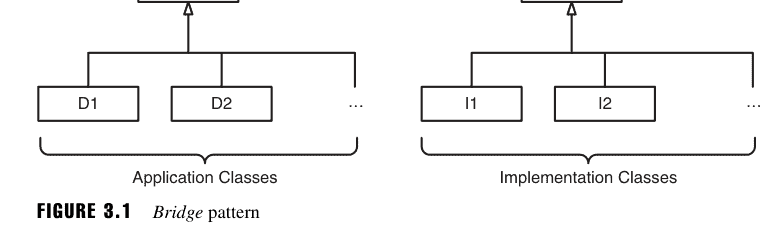

# 图 3.1 Bridge 模式

金融工程中的一些其他例子是：

+   - 通过 Wiener 过程对随机微分方程建模。
+   - 通过 Monte Carlo、有限差分或有限元方法计算期权价格和敏感性。
+   - 根据是看涨期权还是看跌期权计算期权价格和敏感性。

能够从一个实现切换到另一个实现的灵活性是首先使用 Bridge 模式的原因。上述每个描述都可以以相同的一般形式提出，我们现在讨论这种形式。一般来说，我们创建两个层次结构：第一个包含不变代码（实现无关），而第二个包含实现相关代码，如图 3.1 所示。一般来说，客户端在应用层次结构中的抽象类中调用成员函数，这些类随后将请求转发到实现层次结构中的特定实现类。显示控制流的 UML 序列图如图 3.2 所示。在更具体的案例中，消息名称将在给定应用中具有特定意义。

我们现在给出 Bridge 模式的一个具体例子。在这种情况下，我们使用各种数值积分规则积分单变量的实值函数。在某些情况下函数可能表现良好，但它们也可能在边界上或在函数将被积分的区域内存在间断或奇点。为此，我们创建可以切换特定数值积分求解器的数值积分器。UML 类结构如图 3.3 所示。在这种情况下，类 NumIntegrator 扮演抽象的角色，而类 TanhRule 和由类 MidpointRule 定义的中点规则扮演 Bridge 实现的角色。数学上，这些积分规则由以下给出：

```
∫ₐᵇ f(x)dx ≈ 2 tanh( (h/2) f( (a+b)/2 ) ),   h = b − a

∫ₐᵇ f(x)dx ≈ h f( (a+b)/2 ),   h = b − a.
```

可以按一系列步骤修改对应于图 3.3 的代码。执行每一步后我们都会得到一个可运行的原型。

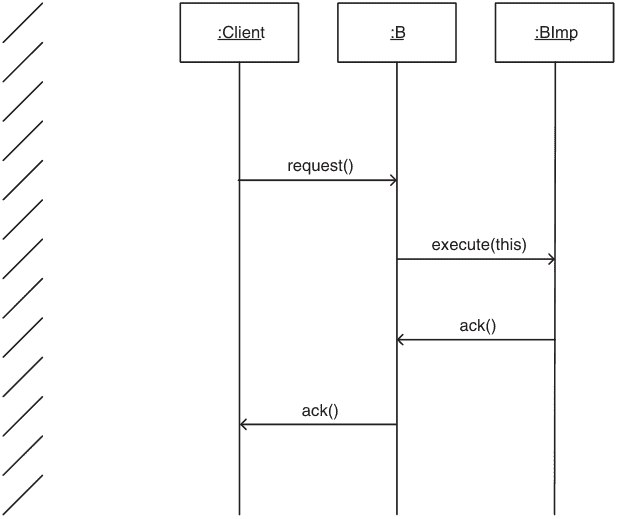

**图 3.2** *Bridge* 模式中的信息流

回答以下问题：

+   a) 不要使用函数指针，使用 `std::function<>` 在供应商代码中对被积函数建模。通过使用第 3.5 节中介绍的五种可调用对象类型对其进行测试，在配置器代码中测试数值求积格式。
+   
+   b) 将图 3.3 中的类层次结构替换为结合 `std::function<>` 和仿函数对象的解决方案。使用与 a) 部分相同的示例测试新代码。在什么情况下（如果有的话）你会使用 lambda 函数来实现数值求积算法或一般算法？

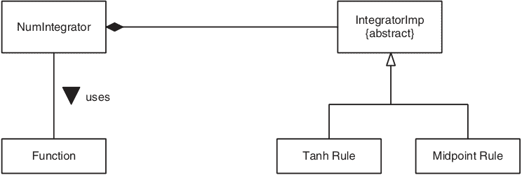

**图 3.3** *Bridge 和数值积分*

**c)** 修改类 `NumIntegrator` 以反映步骤 a) 和 b) 中的更改。特别是，将其设计为函数对象（它计算积分的近似值），具有以下成员：

+   - 被积函数（这是一个 `std::function<>`）。
+   - 积分区间（建模为 `Range<>` 的实例）。
+   - 特定的数值求积格式（一个函数对象）。

此外，你在哪里定义表示求积方法需要的区间细分数量的参数？

**d)** 考虑如何定义和配置一个小型框架，以便开发人员可以为单变量的标量值函数范围计算近似积分。

我们将在第 17 章和第 18 章讨论 STL 数值算法。在第 19 章我们讨论非线性方程的数值解，其风格与本练习中的设计问题相似。

# 6. （熟悉可调用对象）

在第 3.5 节我们介绍了可作为 `std::function<>` 目标方法的五种可调用对象类型。此处的目标是编写代码，使用每种可调用对象类型计算两个向量的 *内积*，然后将内积的概念推广到接受两个向量作为输入并从中计算标量（*归约变量*）的情形。回答以下问题：

**a)** 考虑两个 *n* 维向量的内积（也称为 *标量积* 和 *点积*）：

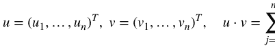

编写一个自由函数，以两个 `std::vector<>` 实例作为输入，并产生上述数学公式描述的量。

**b)** 使用函数对象和 lambda 函数编写内积的代码。

**c)** 将代码推广，使其能够使用其他类型的二元运算符（乘积），例如两个向量之间的距离。三个例子是：

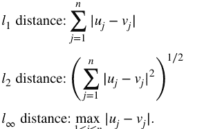

# 第 4 章

### 高级 C++ 模板编程

#### 4.1 引言与目标

本章介绍 C++ 中的一些新的和高级语言特性。这些特性构成了大量 *模板元编程* 的基础，该编程正进入标准（Abrahams 和 Gurtovoy, 2005）。我们在本章中对这些特性进行详细分析，并在第 6 章继续同一主题。

本章的目标是：

+   - 使读者熟悉 C++ 中的模板元编程（TMP）。
+   - 给出 TMP 的说明性示例，以展示其在创建健壮代码方面的应用。
+   - 讨论如何在你的应用中使用 TMP。

本章可以在首次阅读时跳过。它主要可作为特定语法的参考。如同第 6 章，本章的主题可能对库构建者比对应用程序员更有用。

元编程的核心是元函数的概念。一般来说，*元函数* 是运行时函数的编译时类比。传统函数接受值/对象作为参数并返回值或对象。然而，元函数接受类型和编译时常量作为参数并返回类型和常量。元函数可用于实现以下功能：

+   - 封装复杂的类型计算算法。
+   - 使用编译时类型选择技术生成类型。

元函数是一个模板。一般来说，*元函数实现* 通常基于模板特化。我们以一个计算斐波那契数 {F_n}_{n ≥ 0} 的元函数为例，给出迭代算法：

F₀ = 0
F₁ = 1
Fₙ = Fₙ₋₁ + Fₙ₋₂,   n ≥ 2.


为了说明本章以及第 6 章中将要介绍的内容，我们创建了众所周知的递归元函数来实现上述算法：

// Fibonacci
template <int N>
    struct Fibonacci
{
        enum { value = Fibonacci<N-1>::value + Fibonacci<N - 2>::value};
};

template <>
    struct Fibonacci<0>
{
        enum { value = 0 };
};

template <>
    struct Fibonacci<1>
{
        enum { value = 1 };
};

void TestFibonacci()
{
    // 0, 1, 1, 2, 3, 5, 8, 13, 21, 34, ...
    int x = Fibonacci<6>::value; // 8
    int y = Fibonacci<9>::value; // 34

    std::cout << x << ", " << y << '\n';
}
```

这里使用的 C++ 惯用法比类型生成器惯用法更通用，在类型生成器惯用法中，类型族的共同（不变）部分被收集到一个结构中，该结构唯一的目的是生成另一种类型。

类型生成器惯用法的意图是：

- 简化基于模板的复杂类型的创建。
- 基于模板参数合成新的类型或类型。
- 在使用基于策略的设计 PBD 时，定位默认策略（我们在第 9 章讨论 PBD）。

让我们举一个例子。考虑通过创建一个适配器类来引入间接的额外层，该适配器类捕获不变部分（本例中为 Boost 内存分配器）和可自定义的变体部分（列表中的底层元素类型）：

// Type generators
template <class Value>
    struct List

*operations.* 我们简要介绍这些主题，以便为后续章节中更高级的主题和应用做准备。

一般来说，当期望不同类型的值时，转换可能会在表达式中发生，例如：

- **A1:** 在赋值运算符中；右操作数的值被转换为左操作数未限定类型。
- **A2:** 标量初始化；初始化表达式的值被转换为左操作数未限定类型。
- **A3:** 调用函数时参数类型与函数原型声明中不同。
- **A4:** 函数返回语句中操作数的值被转换为具有函数返回类型对象。

一些简单的代码来展示我们所说的这些例子：

```
double func(double d)
{
    return d*d;
}

double func()
{  // Return type (an int) convert to double

    int result = 1'000'000;
    return result;
}

void ImplicitConversions()
{  // Simple examples of conversions

    // Assignment
    int i = 1L;                       // Convert long to int
    int j = 3.14;                     // Truncate a double

    // Scalar initialisation
    double d2 = 2.4;
    int i2 = 3;
    double d3 = i2*d2;

    // Function call expression
    int i3 = 5;
    std::cout << func(i3) << '\n';

    // Function return type
    int i4 = func(3.14);
    std::cout << i4 << '\n';

    std::cout << func() << '\n';
}
```

由于发生了转换，编译此代码时会生成警告。

我们现在讨论定义二元运算符的主题，其操作数类型不同。很明显，其中一个操作数必须使用算术转换提升为与另一个操作数相同的类型。目标是产生一个公共类型（也由我们将在第 6 章讨论的 std::common_type 类型特征支持）。我们在这里不深入细节，但重要的是要知道应用了哪些规则。一些指导原则是：

- 如果任一操作数是 long double，则另一个操作数被转换为 long double。
- 如果任一操作数是 double，则另一个操作数被转换为 double。
- 如果任一操作数是 float，则另一个操作数被转换为 float。
- 类型 bool、char、char16_t、char32_t、wchar_t 和无作用域枚举被提升为整数。
- 整数转换等级按以下顺序递增：bool、signed char、short、int、long、long long。

我们在第 6 章和第 8 章中更详细地讨论积分和浮点类型。

### 4.2.2 可变参数函数简介

可变参数函数是接受可变数量参数的函数。一个著名的例子是函数 std::printf。为了定义可变参数函数，我们使用对象类型 va_list，它保存有关函数参数的信息。此对象可通过以下函数宏访问：

- va_start：启用对可变参数函数参数的访问。
- va_arg：访问下一个可变参数函数参数。
- va_copy：复制可变参数函数参数。
- va_end：结束遍历可变参数函数参数。

我们举一个例子；在这种情况下，我们定义一个可变参数函数来求整数列表的和：

```
long AddIntegers(long count, ...)
{ // Variadic function

    long result = 0;

    // Hold information needed by other macros
    va_list args;

    // Enable access to variadic function arguments
    va_start(args, count);

    // Iterate over the arguments
    for (int n = 0; n < count; ++n)
    {
        // Access next variadic function argument
        result += va_arg(args, long);
    }

// End traversal of variadic function arguments
va_end(args);

return result;
}
```

一个例子是：

```
std::cout << AddIntegers(4, 10, 10, 10, 20) << '\n';      // 50
std::cout << AddIntegers(4, 10, 'A', true, false) << '\n';   // 76
```

### 4.2.3 值类别

一般来说，C++ 表达式是一个名称，它包含运算符及其操作数、文字和变量名。表达式由两个正交属性表征，即其类型和值类别。我们还注意到表达式具有标识，这意味着可以比较表达式（例如，它们是否引用同一实体？）并且我们可以比较对象或它们标识的函数的地址。

有三个主要值类别：

- xvalue：具有标识并且可以从中移动。
- lvalue：具有标识并且不能从中移动。
- prvalue：没有标识并且可以从中移动。它是一个纯值表达式。

- xvalue：具有标识并且可以从中移动。
- lvalue：具有标识并且不能从中移动。
- prvalue：没有标识并且可以从中移动。它是一个纯值表达式。

具有标识的表达式称为 glvalue 表达式（广义左值）。因此，xvalues 和 lvalues 都是 glvalues。可以从中移动的表达式称为 rvalue 表达式。prvalues 和 xvalues 都是 rvalue 表达式。

lvalue 表达式的例子是：a = b 和字符串文字。prvalue 表达式的例子是：42、true、转换为非引用类型的强制转换表达式（例如，static_cast<double>(x)）、&a（变量 a 的地址）和 lambda 表达式。xvalue 表达式的例子是：转换为右值引用类型的强制转换表达式（例如，static_cast<double&&>(x)）和函数调用。

我们将在第 4.3.4 节中给出这些类型和类别的一些具体示例。

### 4.3 decltype 说明符

decltype 说明符检查实体声明的类型或表达式的类型和值类别。它可以被视为一种元函数，因为它接受实体或表达式作为输入，并产生该实体或表达式的类型作为输出。当声明难以或无法使用标准记法声明的类型时，说明符很有用，例如 lambda 相关类型或依赖于模板参数的类型。我们期望 decltype 在创建涉及混合模式算术的代码、类和库时很有用。

#### 4.3.1 初始示例

我们使用内置类型举一些混合模式算术的例子：

```
```cpp
int i=20;                  // Create an int.
double d=3.16;             // Create a double.

decltype(i) j=i;           // j is an int.
decltype(d) k=d;           // k is a double.

// Promote float * int to double
float f = 3.3F;
int n= 4;
decltype(d) d2 = f*n;
```
```

在最后一个例子中，我们声明变量 d2 应该是 double 类型。我们可以通过调用 `std::is_same` 类型特征（我们在第 6 章中更详细地讨论）来检查此声明的有效性：

```
```cpp
std::cout << "Check decltype:  " << std::is_same<double,
decltype(d)>::value; // true
```
```

（使用与上面相同的变量）。

另一个使用与上面相同的变量的例子是：

```
```cpp
// What is the result of int*double. With decltype we
// don't need to know anymore.
decltype(j*k) l=j*k; // Result of int*double is double.
std::cout<<j<<"*"<<k<<"="<<l<<std::endl;

std::cout << "Check decltype:  "
          << std::is_same<double, decltype(j*k)>::value;   // true
```
```

最后，decltype 可以应用于 lambda 函数，如以下代码所示：

```
```cpp
// decltype and lambda functions
auto f2 = [](double x, double y) -> int
{
    int result = std::floor(x + y);
    return result;
};

auto f3 = [](double x, double y) -> double
{
    double result = x + y;
    return result;
};

// Lambda function types are unique and unnamed
std::cout << std::boolalpha
          << "Type of lambda function, not its return type:  "
          << std::is_same<int, decltype(f2)>::value;  // false
```
```


```
decltype(f2) g = f2;
std::cout << std::boolalpha
    << "Type of lambda functions g and f2: "
    << std::is_same<decltype(g),decltype(f2)>::value;  // true
std::cout << "g, f2 at (2.5, 3.6): "
    << g(2.5, 3.6) << ", " << f2(2.5, 3.6) << "\n";

std::cout << std::boolalpha
    << "Type of lambda functions f3 and f2: "  // false
    << std::is_same<decltype(f3), decltype(f2)>::value;
```

因此，在 lambda 函数的情形下，我们指的是它们的返回类型。

#### 4.3.2 扩展示例

在给出若干使用 decltype 的示例性例子之后，我们现在讨论其应用于用户定义类型。 为此，我们创建了一系列类来模拟安培 A（电流的 SI 单位）、伏特 V（电势的 SI 单位）和瓦特 W（功率的 SI 单位），尤其是当我们将电压和电流相乘时确定正确的类型，即 W = V*A = A*V（Wildi, 1995）。 代码易于理解。 然而，这些思想可以推广； 一个很好的例子是 Boost Units 库。 根据该库的在线文档：

> 该库是以通用且可扩展的方式在 C++ 中实现量纲分析的，将其视为通用的编译时元编程问题。 为任意单位系统模型和任意值类型提供了单位和量（定义为单位和相关值）的支持。 提供了完整的 SI 和 CGS 单位系统，以及以度数和弧度测量的角度系统，以及以开尔文、摄氏度和华氏度测量的温度系统。

对该库的讨论超出了本书的范围。

当前讨论中的用户定义类型（出于动机目的）为：

```
class Unit
{
protected:
    // Protected default constructor.
    Unit() {}
public:
    // Get the name of the unit. Implemented in derived class.
    virtual const std::string& Name() const=0;
    // Output the unit to the given ostream.
    friend std::ostream& operator << (std::ostream& os, const Unit& u)
    {
        os<<u.Name();
        return os;
    }
};

// Forward class declarations.
class Watt;
class Volt;
class Ampere;

// Watt unit class.
class Watt: public Unit
{
private:
    static const std::string s_name;

public:
    Watt(): Unit() {}
    const std::string& Name() const { return s_name; }
};

// The name of the "Watt" unit.
const std::string Watt::s_name="Watt";

// Volt unit class.
class Volt: public Unit
{
private:
    static const std::string s_name;

public:
    Volt(): Unit() {}
    const std::string& Name() const { return s_name; }

    // Volt*Ampere=Watt
    Watt operator * (const Ampere& a) const { return Watt(); }
};

// The name of the "Volt" unit.
const std::string Volt::s_name="Volt";

// Ampere unit class.
class Ampere: public Unit
{
private:
    static const std::string s_name;

public:
    Ampere(): Unit() {}
    const std::string& Name() const { return s_name; }

// Ampere*Volt=Watt
Watt operator * (const Volt& v) const { return Watt(); }
};
```

```
// The name of the "Ampere" unit.
const std::string Ampere::s_name="Ampere";
```

在此情况下，我们使用了乘法运算符的重载来将伏特和安培（以任意顺序）相乘以产生瓦特单位。
一个使用示例为：

```
// Volt*Ampere=Watt.
std::cout << "Watt, volt and ampere\n";
Volt v;
Ampere a;
decltype(v*a) result=v*a;
std::cout<<v<<"*"<<a<<"="<<result<<std::endl;
decltype(a*v) result2 = a*v;
std::cout << a << "*" << v << "=" << result2 << std::endl;
```

#### 4.3.3 辅助特性 std::declval

我们已经看到如何使用 decltype 来发现类实例的类型，例如通过默认创建的实例。 但如果我们不能（或不想）创建实例怎么办？ 在这种情况下，我们使用 std::declval 将任何类型转换为调用引用类型，从而使在 decltype 表达式中使用成员函数成为可能，而无需调用构造函数。

定义为：

```
template<class T>
typename std::add_rvalue_reference<T>::type declval();
```

我们按如下方式使用类型特性规则：

```
std::add_lvalue_reference<T&>::type is T&
std::add_lvalue_reference<T&&>::type is T&
std::add_rvalue_reference<T&>::type is T&
std::add_rvalue_reference<T&&>::type is T&&
```

让我们以两个类的例子来说明，其中一个有默认构造函数，另一个没有。 在一种情况下（类 C1）我们不能使用 decltype，因为其默认构造函数未定义且不能使用，我们必须使用 std::declval，但在第二种情况下（类 C2）我们可以使用 decltype。

第一种情况下的类和代码如下：

```
struct C1
{ // Default ctor cannot be used by clients

C1() = delete;

int compute() { return 1; }
};
```

```
// No default constructor
// decltype(C1().compute()) n1 = 1;      // Error
```

```
// Side-track ctor
decltype(std::declval<C1>().compute()) n1 = 1;
std::cout << std::boolalpha << "Same as int?:  "
    << std::is_same<decltype(n1),int>::value << "\n"; // true
```

第二种情况下的代码为：

```
struct C2
{ // Default ctor can be used by clients

    C2() = default;

    int compute() { return 1; }
};
```

```
// Now a class with a default ctor
decltype(C2().compute()) n2 = 1;
```

```
// Side-track ctor
decltype(std::declval<C2>().compute()) n3 = 1;
std::cout << std::boolalpha << "Same as int?:  "
    << std::is_same<decltype(n3),int>::value << "\n"; // true
```

最后，为了完整性，我们给出一个向类型添加引用的示例，因为该功能在 std::declval 的定义中使用。 在这种情况下，我们定义一个非引用类型并向其添加引用：

```
using NonRef = int;
using lref = std::add_lvalue_reference<NonRef>::type;
using rref = std::add_rvalue_reference<NonRef>::type;
```

```
// Answers: false, true, true
std::cout << std::is_lvalue_reference<NonRef>::value << '\n';
std::cout << std::is_lvalue_reference<lref>::value << '\n';
std::cout << std::is_rvalue_reference<rref>::value << '\n';
```

我们将在第 6 章更详细地讨论类型特性。

#### 4.3.4 表达式、左值、右值和 xvalue

我们给出一些代码示例，以使第 4.2.3 节的一般讨论更具体。 其中一些示例使用了类型特性：

```
void funcR(int&& z)
{ // r values and related issues
std::cout << "\nfunc with rvalue input\n";
std::cout << std::boolalpha << "Check value ref: "
          << std::is_reference<decltype(z)>::value << "\n";  // true
std::cout << std::boolalpha << "Check l-value ref: "
          << std::is_lvalue_reference<decltype(z)>::value << "\n";
std::cout << std::boolalpha << "Check r-value ref: "
          << std::is_rvalue_reference<decltype(z)>::value << "\n";

std::cout << "\nMoved variable 2\n";
auto&& v = std::move(z);
std::cout << std::boolalpha << "Check value ref: "
          << std::is_reference<decltype(v)>::value << "\n";
std::cout << std::boolalpha << "Check l-value ref: "
          << std::is_lvalue_reference<decltype(v)>::value << "\n";
std::cout << std::boolalpha << "Check r-value ref: "
          << std::is_rvalue_reference<decltype(v)>::value << "\n";
std::cout << std::boolalpha << "Same as int?:  "
          << std::is_same<decltype(v), int>::value << "\n";
std::cout << std::boolalpha << "Same as int&?: "
          << std::is_same<decltype(v), int&>::value << "\n";
}
```

一个使用示例为：

```
int j = 19;
funcR(std::move(j));
```

另一组示例为：

```
struct C
{
    C(double val, int valInt) : x(val) {}
    double x;
};

void ValueCategories()
{
    // Value categories of expressions in C++11, decltype and type traits

    const C* c = new C{ 0.0, 1 };

    decltype(c -> x) y;           // type of y is double
    decltype((c->x)) z = y;       // type of z is const double&

    std::cout << std::boolalpha << "Check value ref: "
              << std::is_reference<decltype(c->x)>::value << "\n";
    std::cout << std::boolalpha << "Check l-value ref: "
              << std::is_lvalue_reference<decltype(c->x)>::value << "\n";
    std::cout << std::boolalpha << "Check r-value ref: "
              << std::is_rvalue_reference<decltype(c->x)>::value << "\n";
```


```cpp
// Non-reference type
std::cout << std::boolalpha << "Check value ref: "
          << std::is_reference<decltype(y)>::value << "\n";
std::cout << std::boolalpha << "Check l-value ref: "
          << std::is_lvalue_reference<decltype(y)>::value << "\n";
std::cout << std::boolalpha << "Check r-value ref: "
          << std::is_rvalue_reference<decltype(y)>::value << "\n";

// Reference type
std::cout << std::boolalpha << "Check value ref: "
          << std::is_reference<decltype(z)>::value << "\n"; // true
std::cout << std::boolalpha << "Check l-value ref: "
          << std::is_lvalue_reference<decltype(z)>::value << "\n";
std::cout << std::boolalpha << "Check r-value ref: "
          << std::is_rvalue_reference<decltype(z)>::value << "\n";
}
```

你可以运行这段代码并检查输出。

### 4.4 `decltype` 之前与之后

许多应用使用异构数据类型，这些类型以各种方式组合和操作。特别是，我们有兴趣定义混合模式浮点运算和转换中的转换规则。此讨论在开发库时很有意义。它促进了代码的健壮性。

一些例子是：

- 矢量和矩阵上的矩阵线性代数运算以及 BLAS（*Basic Linear Algebra Subprograms*）。底层数据类型可以是整数、浮点类型和复数的混合。
- *durations* 的通用类型以及 C++ *chrono* 库中的通用类型操作。
- *Boost Units*，一个用于 *dimensional analysis* 的 C++ 库，这是许多科学和工程分支中的重要技术（Hughes and Brighton, 1967; Wildi, 1995）。

我们从一个简单的例子开始，并定义一个操作（在此情况下为乘法），该操作接受两个通用输入参数，以某种方式组合它们，然后产生一个通用返回类型。为此，我们考虑以下替代方案：

- S1：具有一个模板参数的函数对象。
- S2：具有输入参数和返回类型的不同模板参数的函数对象。
- S3：使用 `decltype` 来 *deduce* 返回类型的函数对象。
- S4：使用 `std::common_type<>`。

相应的代码很容易理解；我们提供了四个不同的函数对象来乘以通用类型。建议阅读相应的代码注释：

```cpp
// S1: Function object class using only one template parameter for
// operator().
```

```cpp
class MultiplyV1
{
public:
    template <typename T> T operator () (const T& v1, const T& v2)
    {
        return v1*v2;
    }
};

// S2: Function object class using different template parameters
// for inputs and output. The output template parameter is a
// class template instead of the function because then we do not
// specify the type when used as callback functor.
template <typename TReturn>
class MultiplyV2
{
public:
    template <typename T1, typename T2> TReturn operator ()
    (const T1& v1,const T2& v2)
    {
        return v1*v2;
    }
};

// S3: Function object class using decltype to deduce the return
// type. No template argument needed for return type.Note that we
// use "auto" as return type. The decltype is at the end because
// only then v1 * v2 is declared. In this case "auto" says there
// is a trailing return type.
class MultiplyV3
{
public:
    template <typename T1, typename T2> auto operator ()
        (const T1& v1, const T2& v2) -> decltype(v1*v2)
    {
        return v1*v2;
    }
};

// S4: Free function to implement the binary operator *. Returns
// the common type of T1 and T2.
template <typename T1, typename T2>
typename std::common_type<T1, T2>::type Multiply4 (const T1& v1,
const T2& v2)
{
    return{ v1 * v2 };
};
```

前两个类代表 C++03 如何实现该问题的方式，而第三和第四种解决方案代表首选的 C++11 功能。在第四种情况下，我们举例说明编译器如何处理异构数据类型：

一些测试代码是：

```cpp
double d1 = 1.0; double d2 = 20.4;
double f = +1.6F;
std::cout << "Min\n";
std::cout << minNew(d1, d2) << '\n';
std::cout << minNew(d1, f) << '\n';
std::cout << minNew(f, d2) << '\n';
int i = 1; double d3 = -1.0001;
std::cout << minNew(i, d3) << '\n';
```

本节中的示例出于教学目的而采用。然而，对于更复杂的算法以及需要在输入参数上进行预处理和在算法返回值的后处理的情况下，情况可能会发生变化。

我们现在采用一个更扩展的例子来计算两个 STL 容器的内积，例如：

```cpp
// Sums of products + initVal
std::vector<double> vec{ 1.0, 2.0, 3.0, 4.0 };
std::vector<double> vec2{ 4.0, 3.0, 2.0, 1.0 };

double initVal = 0.0;
double ip1 = std::inner_product(std::begin(vec), std::end(vec),
std::begin(vec2), initVal);
std::cout << "Inner product STL: " << ip1 << std::endl;
```

我们现在希望创建一个用户定义函数，它可以处理异构数据类型并使用 std::inner_product 作为内部算法。为此，我们创建两个静态成员函数，每个函数提供相同功能的不同的实现（请注意，我们使用模板-模板参数）：

```cpp
template < typename T1, typename T2,
    template <typename TC1, typename TAlloc1> class Container1 =
    std::vector,
    template <typename TC2, typename TAlloc2> class Container2 =
    std::vector,

    typename TAlloc1 = std::allocator<T1>, typename TAlloc2 =
    std::allocator<T2>>

class Algorithms
{ // Wrappers/Composition for STL algorithms

public:
    static auto InnerProduct(const Container1<T1, TAlloc1>& con1,
    const Container2<T2, TAlloc2>& con2, const T1& initVal)
        -> typename std::common_type<T1, T2>::type
    {

        // Possible preprocessing on T1 and T2

        // Body

return std::inner_product (std::cbegin(con1),
    std::cend(con1), std::cbegin(con2), initVal);

// Possible postprocessing on T1 and T2
}

static auto InnerProduct_II(const Container1<T1, TAlloc1>& con1,
const Container2<T2, TAlloc2>& con2, const T1& initVal)
    -> decltype(std::declval<T1>()*std::declval<T2>())
{ // Using decltype and declval

// Possible preprocessing on T1 and T2

// Body

return std::inner_product (std::begin(con1), std::end(con1),
    std::begin(con2), initVal);

// Possible postprocessing on T1 and T2
}
};
```

这是一个通用类，我们可以用一系列算术数据类型和容器来调用它，例如：

```cpp
std::cout << "Inner product extended STL: "
    << Algorithms<double,double>::InnerProduct(vec,vec2, initVal);

std::vector<int> vec3{ 1, 2, 3, 4 };
std::vector<float> vec4{ 4.0F, 3.0F, 2.0F, 1.0F };
std::cout << "Inner product extended STL: "
    << Algorithms<int,float>::InnerProduct(vec3, vec4, initVal);

std::list<int> myList1{ 1, 2, 3, 4 };
myList1.reverse();
initVal = 0;
std::cout << "Inner product extended STL: "
    << Algorithms<int, int, std::vector, std::list>::InnerProduct
    (vec3, myList1, initVal) << std::endl;

std::list<int> myList2{ 4, 3, 2, 1};
myList2.reverse();
initVal = 0;
std::cout << "Inner product extended STL: "
    << Algorithms<int, int, std::list, std::list>::InnerProduct
    (myList2, myList1, initVal) << std::endl;

std::cout << "Inner product extended STL: "
    << Algorithms<int, double, std::list>::InnerProduct
    (myList2, vec2, initVal) << std::endl;
```

```cpp
// Using decltype syntax
std::cout << "decltype\n";
std::cout << "Inner product extended STL II: "
    << Algorithms<int, int, std::list, std::list>::InnerProduct_II
    (myList2, myList1, initVal) << std::endl;
std::cout << "Inner product extended STL II: "
    << Algorithms<int, double, std::list>::InnerProduct_II
    (myList2, vec2, initVal) << std::endl;
```

另请参阅本章练习 6，其中我们对本节和相关主题进行了阐述。

### 4.5 std::result_of AND SFINAE

一般来说，可调用类型是指 std::function、std::bind 或 std::thread::thread 定义的 INVOKE 操作适用的类型，并且可以使用库函数 std::invoke（C++17）显式执行。一般来说，如果我们有一个类型为 T 的对象 f、一个合适的参数类型列表 ArgTypes 和一个合适的返回类型 R，则类型 T 是可调用的：

```
INVOKE(f, std::declval<ArgTypes>()..., R)
```

如果我们将其视为使用可变数量的参数 ArgTypes 调用函数 f 并返回类型 R，则此语法很容易解释。还可以使用 std::is_callable（C++17）来确定函数是否可调用。

类型特征 std::result_of<f,ArgTypes> 表示使用参数类型 ArgTypes 调用 f 的类型：

```
template< class T >
    using result_of_t = typename result_of<T>::type;
```

如果相应的 INVOKE 表达式格式错误，即 f 不是可调用类型，则行为未定义。其原理是确定调用可调用对象的结果，特别是其返回类型对于不同的参数集是否不同。

我们举一些例子。首先，我们定义一个空类 X 和一个可调用对象 S 以及两个自由函数 Func 和 Func2：

```
struct X {};

struct S
{
    double operator () (int n, int m) { return 3.14; }
    float operator () (float f) { return f; }
    int operator () (double x) { return std::floor(x); }

    X func(int n) { return X(); }
};
```


```
int Func()
{
    return 42;
}

double Func2(int n)
{
    return static_cast<double>(n);
}
```

我们现在使用类型特征来确定返回类型，如下所示：

```
std::result_of<S(int, int)>::type d = 2.71;
static_assert(std::is_same<decltype(d), double>::value, "ouch");

// Compile error, wrong types
// static_assert(std::is_same<decltype(d), float>::value, "ouch");
// Compile error
```

```
// Member function return type
std::result_of<decltype(&S::func)(S, int)>::type x = X();
static_assert(std::is_same<decltype(x), X>::value, "ouch");
```

```
// Free function, need a reference
std::result_of<decltype(&Func)()>::type n = 3;
static_assert(std::is_same<decltype(n), int>::value, "ouch");
```

```
std::result_of<decltype(&Func2)(int)>::type d2 = 3.14;
static_assert(std::is_same<decltype(d2), double>::value, "ouch");
```

SFINAE（Substitution Failure is Not an Error）是模板元编程中使用的一个特性，并在函数模板的重载解析期间应用。具体来说，如果为模板参数推导类型时替换失败，则该特化将被从重载集合中丢弃，而不是导致编译器错误。简单来说，它指的是 C++ 中一种情况，即模板参数的无效替换本身并不是错误。如果在为给定模板替换一组参数时发生错误，则编译器会将该潜在重载从候选集合中移除，而不是产生编译器错误。

我们给出一个 SFINAE 如何工作的简单示例。首先，考虑以下类和自由函数：

```
struct Wrapper
{
    typedef std::vector<double> Data;
};
```

```
template <typename T>
    void f(typename T::Data)
{ // #1
    std::cout << "Has wrapped data\n";
}
```

以下代码将可以编译：

```
f<Wrapper>(std::vector<double>(20)); // Call #1.
```

然而，以下代码将无法编译，因为 int 类型不像 Wrapper 那样包含嵌入的 vector：

```
f<int>(10);
```

产生的错误类似于以下内容：

```
Error C2770 invalid explicit template argument(s) for 'void f(T::Data)'
```

我们可以通过创建以下函数来避免编译错误：

```
template <typename T> void f(T)
{ // #2

    std::cout << "Has NOT wrapped data\n";
}
```

SFINAE 被引入是为了避免创建格式不正确的程序，通常你可能不需要在代码中直接使用它。许多类型特征（在第 6 章中讨论）都是使用 SFINAE 实现的。它可以被视为编译时自省的一个例子。

### 4.6 std::enable_if

我们现在讨论 std::enable_if；它是一个元函数，其规范为：

```
template< bool B, class T = void > struct enable_if;
```

只有当 bool B 为 true 时才产生类型 T。

这种奇特的语法源自 Boost，现在也在 C++ 中得到支持。enable_if 模板族是一组工具，用于根据其模板参数的属性，使函数模板或类模板特化包含或排除在匹配的函数或特化集合之外。例如，可以定义仅对由特征类定义的一组任意类型启用并因此仅匹配该类型集的函数模板。enable_if 模板也可以应用于启用类模板特化。简而言之，enable_if 允许我们在编译时以非侵入方式管理参数类型的适用性（Abrahams and Gurtovoy, 2005）。

第一个示例是根据数据类型执行某种 *command* 的代码，在本例中是针对表示整数和浮点数的内置类型的简单打印函数。两种实现如下：

```
// Compile-time Command pattern

template <typename T>
    void print(typename std::enable_if <std::is_integral<T>::value,
T>::type i)
{
    std::cout << "Integral: " << i << '\n';
}

template <typename T>
    void print(typename std::enable_if <std::is_floating_point<T>::value,
T>::type f)
{
    std::cout << "Floating point: " << f << '\n';
}
```

我们可以用任何整数或浮点参数调用此函数；任何其他参数类型都会导致编译器错误：

```
// Commands
print<short>(1);
print<long>(2);
print<double>(3.14);
//print<std::string>(std::string("abcd")); // Error
```

可以扩展此函数以支持用户定义的类型：

```
struct SomeClass {};

template <typename T>
    void print(typename std::enable_if <std::is_same<T,
SomeClass>::value, T>::type p)
{
    std::cout << "SomeClass type: " << '\n';
}

// User-defined type
SomeClass c;
print<SomeClass>(c);
```

另一个应用是编写实现取决于所使用特定数据类型的算法的代码。这类似于流行的 *Strategy* 设计模式（GOF, 1995）。为此，我们以计算某些类实例之间距离的玩具示例为例。本例的重点是封装计算感兴趣数量的算法：

```
// Strategy
struct P1
{
    P1() {}
    int distance(int i, int j) { return i + j; }
};

struct P2
{
    P2() {}
    int distance(int i, int j) { return std::max<int>(i,j); }
};

struct P3
{
    P3() {}
    int distance(int i, int j) { return std::min<int>(i, j); }
};

template <typename T>
int distance(typename std::enable_if<std::is_same<T, P1>::value, T>::type p, int i, int j)
{
    return p.distance(i, j);
}

template <typename T>
int distance(typename std::enable_if<std::is_same<T, P2>::value, T>::type p, int i, int j)
{
    return p.distance(i, j);
}
```

我们可以按如下方式调用这些函数（请注意，由于自由函数 distance 未为类 P3 定义，因此代码不适用于类 P3 的情况）：

```
// Algorithm style
P1 p1;
std::cout << "Distance 1: " << distance<P1>(p1, 1, 2) << '\n';

P2 p2;
std::cout << "Distance 2: " << distance<P2>(p2, 1, 2) << '\n';

P3 p3;
//std::cout << "Distance 3: " << distance<P3>(p3, 1, 2) << '\n';
```

最后，我们给出原型创建设计模式（GOF, 1995）的编译时等价示例。它用于在对象要创建的类型由原型实例确定时使用，该原型实例被克隆以产生新对象。

此模式用于：

- 避免在客户端应用程序中创建对象创建器的子类。
- 避免以标准方式（例如使用 'new' 关键字）创建新对象的固有成本，当这样做成本过高时。

同样，我们可以使用 std::enable_if 实现相同的结果。我们从 Boost 和 C++ 中各取一个示例，根据给定数据类型创建对象：

```
// A. Boost version
template <typename T>
    typename boost::enable_if <std::is_same<T, int>, T>::type create()
{
    return 1;
}

template <typename T>
    typename boost::enable_if <std::is_same<T, std::string>,
T>::type create()
{
    return "A string is born";
}
```

```
// B. C++ version
template <typename T>
    typename std::enable_if <std::is_same<T, double>::value,
T>::type create()
{
    return 2.71;
}
```

```
struct C
{
    C() { }
    friend std::ostream& operator << (std::ostream& os,const C& c)
        { os << "A new C";  return os; }
};
```

```
template <typename T>
    typename std::enable_if <std::is_same<T, C>::value, T>::type create()
{
    return C();
}
```

使用示例为：

```
std::cout << create<std::string>() << '\n';
std::cout << create<double>() << '\n';
std::cout << create<C>() << '\n';
C myC = std::move(create<C>());
std::cout << myC << '\n';
```

### 4.7 BOOST enable_if

Boost 具有 std::enable_if 的扩展版本。头文件 `<boost/utility/enable_if.hpp>` 包含以下类：

```
namespace boost
{
    template <class Cond, class T = void> struct enable_if;
    template <class Cond, class T = void> struct disable_if;
    template <class Cond, class T> struct lazy_enable_if;
    template <class Cond, class T> struct lazy_disable_if;

    template <bool B, class T = void> struct enable_if_c;
    template <bool B, class T = void> struct disable_if_c;
    template <bool B, class T> struct lazy_enable_if_c;
    template <bool B, class T> struct lazy_disable_if_c;
}
```

对这些类的完整讨论超出了本章范围，更多信息请参考 Boost C++ 在线文档。然而，我们尝试概述主要功能。

enable_if 模板的名称有三个部分：

- 可选的 `lazy_` 标签（避免在启用条件为真之前实例化函数签名的一部分）。
- 互斥的选项 `enable_if` 或 `disable_if`，分别表示真条件应启用或禁用当前重载。
- 可选的 `_c` 标签，表示条件参数是 bool 值（`_c` 后缀）还是包含名为 value 的静态 bool 常量的类型（无后缀）。

enable_if_c 和 enable_if 的定义为：

```
template <bool B, class T = void>
    struct enable_if_c
{
    typedef T type;
};

template <class T>
    struct enable_if_c<false, T> {};

template <class Cond, class T = void>
    struct enable_if : public enable_if_c<Cond::value, T> {};
```

我们重新审视第 4.6 节中的最后一个示例，以展示 Boost 中代码的实现方式：

```
// A. Boost version
template <typename T>
    typename boost::enable_if_c<std::is_same<T, double>::value,
    T>::type create()
{ // _c form


```cpp
std::string s("1.3");
//std::cout << ArithmeticCompute(s) << '\n';    // Error

//std::cout << NonArithmeticCompute(d) << '\n'; // Error

std::cout << NonArithmeticCompute(s) << '\n';   // OK
```

最后的一个例子：许多数值过程需要同时支持浮点数和复数。假设我们开发了一种算法，并且希望将数据类型限制为 double 和 std::complex<double>。那么下面的代码就满足了这一要求：

```cpp
template <typename T> typename boost::enable_if_c
  <std::is_same<T, double>::value
   || std::is_same<T, std::complex<double>>::value, T>::type
Exponential(T t)
{ // Only for double or complex<double>

    return std::exp(t);
}
```

使用示例为：

```cpp
// Exponential for double or complex<double>
double x = 3.2;
std::complex<double> c(1.0, 2.0);
float f = 3.0F;
std::cout << Exponential<double>(x) << '\n';                         // OK
std::cout << Exponential<std::complex<double>>(c) << '\n';          // OK
//std::cout << Exponential<float>(f) << '\n';                        // Error
```

这里我们也看到 float 是不允许的，如果尝试使用它将会导致编译器错误。更一般地，函数 Exponential 仅接受 double 和复数。

作为最后的评论，我们注意到 C++ 中的许多语言特性最初都以一个或多个 Boost 库的形式出现。一般来说，Boost 在撰写之时往往比 C++ 提供了更广泛的功能、示例和文档。因此我们建议及时关注 Boost 的发展及其在线文档。

### 4.8 `std::decay()` TRAIT

这是在 C++ 中另一种奇特的语法。它最好被理解为一个将给定类型转换为更简单类型的函数。总体而言，它从类型中移除 *多余的* 或其他次要信息。转换后的类型（称为 *decay 类型*）别名为 `std::decay<T>::type`。该转换类似于在按值将参数传递给函数时发生的隐式转换。

规则如下：

- 如果 T 是函数类型，则应用函数到指针的转换，decay 类型与 `add_pointer<T>::type` 相同。
- 如果 T 是数组类型，则应用数组到指针的转换，decay 类型与 `add_pointer<remove_extent<remove_reference<T>::type>::type>::type` 相同。用通俗的语言来说，我们从类型中移除引用和数组索引，并作为一系列操作向类型添加指针。
- 否则，应用常规的 *左值到右值* 转换，decay 类型与 `remove_cv<remove_reference<T>::type>::type` 相同。顺便说一下，我们将在第 6 章更详细地讨论这些“remove”函数。

我们指出，`std::decay()` 使用另一种类型作为模型来获得一种类型，但它不会在这些类型之间转换值或对象。它是一个 *高阶函数*，因为它对函数进行操作并且也返回函数。它可以被视为 C++ 中 *去漆剂* 的等价物（作者观点）。

我们举一个例子。我们首先定义一些类型别名：

```cpp
using A = std::decay<int>::type;                 // int
using B = std::decay<int&>::type;                // int
using C = std::decay<int&&>::type;               // int
using D = std::decay<const int&>::type;          // int
using E = std::decay<int[2]>::type;              // int*
using F = std::decay<int (int)>::type;           // int(*)(int)

using G = std::decay<volatile int>::type;        // int
using H = std::decay<const volatile int&>::type; // int
```

其次，我们将得到的 decay 类型与类型 `int` 进行比较。你应该运行代码并将输出与你的预期进行比较，并尝试使用用户定义的类型。

### 4.9 一个小型应用：量与单位

我们以一个小型应用来结束本章，用于建模量纲、单位和量。例如，我们希望将值 100 定义为长度（可能是英里）或温度（例如摄氏度）。我们如何实现这一点？为此，我们采用 Abrahams 和 Gurtovoy（2005）中的一个例子。在此之前我们引用一个失败的项目，因为一家承包商使用 SI 单位而另一家承包商使用非 SI 单位：

> 火星气候轨道器是一颗质量为 338 千克（745 磅）的机器人空间探测器，由 NASA 于 1998 年 12 月 11 日发射，用于研究火星气候、火星大气和地表变化，并作为 1998 年火星探测器计划中火星极地着陆器的通信中继。然而，在 1999 年 9 月 23 日，与航天器的通信在航天器进入轨道插入时丢失，原因是地面计算机软件产生的输出使用非 SI 单位磅力-秒（lbf·s）而不是合同中 NASA 与洛克希德之间规定的 SI 单位牛顿-秒（N·s）。航天器以一条轨迹接近火星，使其过近地接近行星，导致其穿过上层大气并解体。

我们对 *量纲分析* 主题做一个简要介绍。该理论关注通过识别其基本 *量纲*（例如长度、质量和时间）和 *度量单位*（例如英里与公里、磅与千克）来分析不同物理量之间的关系。我们还希望在进行计算和比较时在量纲单位之间转换并跟踪量纲。

*基本量纲* 是我们希望测量的某个实体，例如质量、长度和时间。基本量纲本质上是标签，它们本身并不提供量纲分析功能。在 C++ 中，我们可以使用 *Boost.MPL* 的功能来建模基本和复合量纲：

```cpp
#include <boost/mpl/vector_c.hpp>

// Base dimensions
using mass =
    boost::mpl::vector_c<int, 1, 0, 0, 0, 0, 0, 0>;      // M
using length =
    boost::mpl::vector_c<int, 0, 1, 0, 0, 0, 0, 0>;      // L
using time =
    boost::mpl::vector_c<int, 0, 0, 1, 0, 0, 0, 0>;      // T
using charge =
    boost::mpl::vector_c<int, 0, 0, 0, 1, 0, 0, 0>;
using temperature =
    boost::mpl::vector_c<int, 0, 0, 0, 0, 1, 0, 0>;
using intensity =
    boost::mpl::vector_c<int, 0, 0, 0, 0, 0, 1, 0>;
using angle =
    boost::mpl::vector_c<int, 0, 0, 0, 0, 0, 0, 1>;

// (Composite) dimensions
using force =
    boost::mpl::vector_c<int, 1, 1, -2, 0, 0, 0, 0>;     // ML/T^2
using velocity =
    boost::mpl::vector_c<int, 0, 1, -1, 0, 0, 0, 0>;     // L/T
using acceleration =
    boost::mpl::vector_c<int, 0, 1, -2, 0, 0, 0, 0>;     // L/T^2
using dynamicViscosity =
    boost::mpl::vector_c<int, 1, -1, -1, 0, 0, 0, 0>;    // M/(LT)
```

这些类型是纯元数据。为了能够执行计算，我们创建一个类来建模 *量*。要相加或相减的参数的量纲必须始终匹配，否则我们将得到编译器错误：

```cpp
// TMP Abrahams and Gurtovoy page 40
template <class T, class Dimensions>
    struct Quantity
```

与某个偏积分微分方程（PIDE）相关的 VG 过程的 VG 过程。谱值为：

λₙ = 1/ϑ × Λₙ(σ²ϑ / L²), n = 1, 2, ...

其中参数及其量纲由以下给出：

- (ϑ, σ) = VG 过程的参数
- [ϑ] = [T], [σ²] = [X²/T]
- [X] = 空间坐标的量纲
- L = PIDE 问题的上边界
- [L] = [X]
- λₙ = PIDE 谱问题的特征值，[λₙ] = [1/T]
- Λₙ = 缩放函数

再次总结，我们看到缩放函数是无量纲的。

### 4.10 结论与总结

我们对 C++ 中一系列新的和高级主题进行了详细阐述，这些主题属于模板元编程和泛型编程等各种名称。如果我们希望编写灵活且健壮的代码，对这些技术的理解至关重要。

我们将在本书的后面章节讨论如何将泛型编程技术应用于数值分析和计算金融。

### 4.11 练习与项目

- 1. （隐式转换‘101’）
  - 复习并运行实现第 4.2.1 节中情况 A1、A2、A3 和 A4 的代码。
  - 回答以下问题：
    - a) 确定此代码生成的编译器错误和/或警告。确定这些错误的严重性。
    - b) 确定如何修改代码以在应移除这些编译器错误和/或警告的情况下进行修改。
    - c) 解释此代码的输出：

      ```cpp
      std::cout << AddIntegers(4, 10, 'A', true, false) << '\n';  // 76
      ```

- 2. （可变参数函数）
  - 本练习的目标是使用第 4.2.2 节中的功能计算可变参数函数的参数的标准差。我们提出两个阶段；首先创建一个名为 args1 的 va_list 并用它来计算均值，然后使用 va_copy 复制 args1 以计算输入参数的标准差。


# 3. (值类别)

通过检查确定以下表达式是*xvalue*、*lvalue*还是*prvalue*：

+   a) `a ? b : c`（对于某些 a、b 和 c 的三元条件表达式）。
+   b) `a+b`、`a%b`、`&a`。
+   c) “Hello world”。
+   d) `nullptr`。
+   e) `++a`、`--a`。
+   f) `a++`、`a--`。

你也能使用类型特征来回答这个问题吗？

# 4. (代码检查)

本练习的目标是检查第 4.3.4 节中的代码以理解它。问题是：

+   a) 检查每一行并确定结果是真还是假；例如：

```
std::cout << std::boolalpha << "Check value ref: "
           << std::is_reference<decltype(z)>::value << "\n";  // true
```

+   b) 运行代码并将输出与 a) 部分的答案进行核对。你得到正确答案了吗？

# 5. (引用)

设 A 为一个空类。确定以下哪些类型是引用、*左值引用*或*右值引用*：A、A&。那么 A&&、int、int&、int&& 呢？

# 6. (C++11 与 STL 算法)

在第 4.4.1 节中，我们讨论了如何使用 C++ 中的许多特性来扩展 STL 算法。本练习的目标是分析和审查用于计算包含算术数据的两个容器内积的代码。

回答以下问题：

+   a) 修改代码以检查实例化的数据是否为算术类型。使用 `static_assert` 和特征 `std::is_arithmetic`（我们将在第 6 章详细讨论类型特征）。
+   b) 我们在第 4.4.1 节中使用了*模板–模板参数*技巧，以允许我们定义一个适用于各种通用容器的算法。另一方面，STL 规范是：

```
template< class InputIt1, class InputIt2, class T >
    T inner_product(InputIt1 first1, InputIt1 last1,
        InputIt2 first2, T value);
```

请从可理解性、健壮性和可扩展性方面比较这两种截然不同的方法。例如，我们可能希望并行化代码或引入代码以减少舍入误差。
+   c) STL 实现了一个通用算法来计算两个向量的内积；例如：

```
// Using two predefined function objects using inner and outer
// operations
std::vector<int> vecInt{ 1, 2, 3, 4};
```

```
int ip2 = std::inner_product(
    std::begin(vecInt), std::end(vecInt),
    std::begin(vecInt), 1, std::multiplies<int>(),  // inner
    std::plus<int>());  // outer
std::cout << "Inner product2: " << ip2 << std::endl;
```

本部分的目标是推广此代码以支持异构数据类型，如第 4.4 节所述。
+   d) 使用各种数据类型（int、float、double）、容器（std::vector、std::list）以及函数 InnerProduct 的默认输入参数来测试第 4.4 节中的代码。如果你尝试计算两个字符串容器的内积，会发生什么？

# 7. (std::enable_if 的优点)

以下哪些陈述可以被视为 std::enable_if 的有用特性？

+   a) 比使用“原始”（不受限制的）模板参数时更友好的错误消息。
+   b) 它的使用可以使代码更健壮。
+   c) 它将模板限制为具有某些属性的类型。
+   d) 它的使用减少了需要编写的样板代码的数量。

# 8. (重叠的启用条件)

启用条件不互斥的函数模板可能导致歧义。一旦编译器检查了启用条件并将函数纳入重载解析集，就会使用正常的 C++ 重载解析规则来选择最佳匹配函数。根据以下示例检查这种情况如何发生以及如何解决歧义：

```
template <class T>
    typename enable_if<boost::is_integral<T>, void>::type
    foo(T t) {}

template <class T>
    typename enable_if<boost::is_arithmetic<T>, void>::type
    foo(T t) {}
```

（提示：所有整数类型也是算术类型）。

# 9. (阿克曼函数)

考虑阿克曼函数：

A(m, n) = { n + 1 if m = 0
A(m - 1, 1) if m > 0 and n = 0
A(m - 1, A(m, n - 1)) if m > 0 and n > 0 }

用 C++ 实现此定义，并尝试以下示例：

+   A(1, 2) = 4
+   A(4, 3) = 2^65536 - 3
+   A(1, 3) = 5.

手工计算 A(1, 3)。有多少步？

研究以下代码中发生的情况以及原因：

```
```cpp
std::cout << Ackermann(1,3) << std::endl;
std::cout << Ackermann(1,2) << std::endl;

// Stack overflow and program 'silently' stops
try
{
    std::cout << Ackermann(4,3) << std::endl;
}
catch (std::exception& e)
{
    std::cout << e.what() << std::endl;
}
```
```

现在将阿克曼函数实现为一个元函数。

**10.** *雷诺数*（Re）是流体力学中一个重要的无量纲量，用于帮助预测不同流体流动情况下的流动模式。它广泛应用于从管道中的液体流动到空气经过飞机机翼等各种应用。它也与使用有限差分法近似求解金融中的偏微分方程有关，我们将在后面的章节中看到（以修正为主的问题）。该数定义为：

$$\frac{\rho v L}{\mu}$$

+ 其中：
+   - $\rho$ 是流体的密度（kg/m³）
+   - $v$ 是流体相对于物体的特征速度（m/s）
+   - $L$ 是特征线性尺寸（m）
+   - $\mu$ 是流体的动态粘度（kg/(m·s)）。

证明雷诺数是一个无量纲量。

**11.**（阶乘）
编写一个递归元函数来计算阶乘：

$$n! = 1 \text{ if } n = 0$$

$$n! = n(n - 1)! \text{ if } n \geq 1.$$

# 第 5 章

### C++ 中的元组及其应用

#### 5.1 引言与目标

本章专门介绍一种称为元组（tuple）的数据类型。元组（或 n 元组）是固定大小的元素集合。对、三元组和四元组都是元组。在编程语言中，元组是包含其他对象作为元素或成员的数据对象。这些元素可以是不同的类型。换句话说，元组可以容纳异构数据类型。

我们将在后面的章节中看到元组的一些有用应用。

#### 5.2 std::pair 复习与新扩展

在本节中，我们通过回顾 std::pair（它是一个 2 元组）的功能并给出 C++11 中新特性的示例，为讨论 std::tuple 铺平道路。许多语法可以直接转换到元组，这意味着我们只需要学习一次语法，之后就可以更多地关注元组的设计及其在计算金融中的应用。

这里要考虑的特性是：

+   1. 以两种方式创建对。
+   2. 按值复制对和按引用复制对。
+   3. 访问对的元素。
+   4. 交换和修改对。
+   5. 对比较。
+   6. 分段构造与转发。
+   7. 编译期访问对的元素。
+   8. 绑定变量和元组元素。
+   9. 对与嵌套。

我们现在通过一般性描述、给出简单示例并在代码中放置战略性注释来讨论每个特性。当然，最好的学习方式是亲自动手编写这些示例！

在下面的讨论中，我们创建一些变量来演示上述九个用例。为了创建对，我们可以选择构造函数或便捷函数 std::make_pair。我们记得 std::pair 是一个带有（公共）成员数据 first 和 second 的结构体：

```
using value_type = double;
// Create pairs by calling constructors
std::pair<int, float> p1;
std::cout << p1.first << "," << p1.second << '\n';      // 0,0

std::pair<int, value_type> p2(65, 2.01f);
std::cout << p2.first << "," << p2.second << '\n';      // 65, 2.01
value_type d = 2.2;
std::complex<value_type> c(1.1, -1.7);

// Using convenience function, call by value
auto p1 = std::make_pair(d, c);
std::cout << p1.first << "," << p1.second << '\n';
d = 0.0;
std::cout << p1.first << "," << p1.second << '\n';
```

除了将值复制到对中之外，还可以使用引用来避免创建昂贵的副本：

```
auto p2 = std::make_pair(std::ref(d), std::ref(c));
std::cout << p2.first << "," <<
          << p2.second << '\n'; // 0, (1.1, -1.7)
c = std::complex<value_type> (100.0, -200.0);
std::cout << "Reference: " << p2.first
          << "," << p2.second << '\n';      // (0, (100.0, -200.0))
```

当创建的对的类型与其元素类型不同时，可能会发生隐式转换。在这些情况下，我们可能会遇到截断或提升效果：

```
// Implicit conversions
std::pair<char, int> p3(p2);
std::cout << p3.first << "," << p3.second << '\n';

std::pair<value_type, std::complex<value_type>> p4(p2);
std::cout << p4.first << "," << p4.second << '\n';
```

我们现在讨论如何读取和修改对中的元素。我们可以使用索引为 0 和 1 的索引函数（对有两个元素），也可以根据元素的类型来访问它们：

```
std::cout << '(' << std::get<0>(p1) << ", " << std::get<1>(p1) << ")\n";
std::cout << '(' << std::get<value_type>(p1) << ", " << std::get<std::complex<value_type>>(p1) << ")\n";
```


对的元素的修改以及对的交换，如以下示例所示：

```
int n = 1;
std::array<int, 4> arr{ 1,2,3,4 };
std::array<int, 4> arr2{ -1,-2,-3,-4 };
auto p3 = std::make_pair(n, arr);
auto p4 = std::make_pair(-n, arr2);
std::swap(p3, p4);
std::cout << p3.first << "," << p3.second[1] << '\n';

// 4. Modify individual elements of pair
std::get<0>(p3) = 200;
std::get<1>(p3) = std::array<int,4>(arr);
std::cout << p3.first << "," << p3.second[1] << '\n';
```

创建一对后，我们可能希望将它的元素值与另一对的元素值进行比较。为此，通常的二元谓词是适用的。我们以不等式运算符为例：

```
using IntPair = std::pair<int,int>;

// Comparison operators < etc. In general, 1st value
// has higher value
IntPair pi1 = std::make_pair(1, 2);
IntPair pi2 = std::make_pair(1, 1);
IntPair pi3 = std::make_pair(2, 1);
IntPair pi4 = std::make_pair(2, 2);
std::cout << std::boolalpha << (pi1 < pi2) << '\n';    // false
std::cout << std::boolalpha << (pi2 < pi1) << '\n';    // true
std::cout << std::boolalpha << (pi1 < pi3) << '\n';    // true
std::cout << std::boolalpha << (pi3 < pi1) << '\n';    // false
std::cout << std::boolalpha << (pi3 < pi4) << '\n';    // true
std::cout << std::boolalpha << (pi4 < pi3) << '\n';    // false
std::cout << std::boolalpha << (pi4 == pi3) << '\n';   // false
std::cout << std::boolalpha << (pi4 != pi3) << '\n';    // true
```

二元运算符为对定义这一事实意味着它们可以被排序并与 STL 算法一起使用。

我们现在来讨论构造由用户定义类型组成的一对的话题，并将讨论从 std::pair 切换到 std::tuple。我们可以强制调用构造函数而不是将元组作为一个整体使用。我们也可以转发参数来构造元组。为此，让我们首先考虑一个其实例将成为一对元素的类：

```
struct C
{
    C(const std::tuple<int, double>& tup)
    {
        std::cout << "\tConstructed a C from a tuple\n";
    }
}
```

```
C(int, double)
{
    std::cout << "\tConstructed a C from an int and a double\n";
}
;
```

我们首先按如下方式创建元组：

// Create a pair using 'whole' tuples
std::tuple<int, double> t1(1, 3.14), t2(-3.0, 2.71);
std::pair<C, C> p1(t1, t2);
```

这种情况下的输出是：

```
Constructed a C from a tuple
Constructed a C from a tuple
```

我们现在希望绕过元组的显式创建，而是将元组 t1 和 t2 转发给类 C 的元素：

// Now force the ctor to take the elements of the tuple
// rather than the tuple as a whole.
std::pair<C, C> p2(std::piecewise_construct, t1, t2);
```

这种情况下的输出是：

```
Constructed a C from an int and a double
Constructed a C from an int and a double
```

我们可以将参数转发给对的构造函数：

```
std::cout << "\nForward of C: \n";
std::pair<C, C> p2A(std::piecewise_construct,
                    std::forward_as_tuple(1, -1.7),
                    std::forward_as_tuple(2, 110.3));
std::cout << "End, forward of C:\n";
```

```
// Forwarding the arguments
int charCount = 10; char c = 'A';
std::pair<std::complex<value_type>, std::string>
pZ(std::piecewise_construct,
        std::forward_as_tuple(1.0, -1.7),
        std::forward_as_tuple(charCount, c));
std::cout << "\nForward: " << std::get<0>(pZ) << ", " <<
std::get<1>(pZ) << ")\n";
```

这种情况下的输出是：

```
Forward of C:
    Constructed a C from an int and a double
    Constructed a C from an int and a double
End, forward of C:

Forward: (1,-1.7), AAAAAAAAAA
```

通常，转发更高效。

我们在第 6 章讨论类型特征库，我们可以使用该库中的两个相关函数来检查组成元组的元素的类型，例如在由值类型和复数组成的 P1 的情况下：

// 7. Compile-time access to pair's element types.
// Use type traits to check types corresponding to element types
// (chapters 4 and 6)
using TypeFirst = std::tuple_element<0, decltype(p1)>::type;
static_assert(std::is_same<TypeFirst, value_type>::value, "ouch");

using TypeSecond = std::tuple_element<1, decltype(p1)>::type;
static_assert(std::is_same<TypeSecond, std::complex<value_type>>
::value, "ouch");
```

我们现在介绍 std::tie。一般来说，这个函数是一种将变量与一对或元组的<|message|>


由专用的工厂对象创建，然后数据可以在代码中的适当*入口点*由应用程序处理。

一些典型的应用包括：

-   使用具有三个元素的元组对彩虹期权和多资产期权进行数据建模。第一个和第二个元素本身是元组，分别包含与第一个和第二个资产相关的数据（如行权价和到期日），而第三个元素包含资产之间的相关系数值。
-   封装在可复用元组中的微分方程的数学性质。
-   与数值过程相关的基本参数，例如步长、容差和最大迭代次数。
-   任何需要从各种来源配置的非平凡应用。为此，我们使用客户端代码无需知道数据来源即可读取的元组。

我们给出一个简单示例，演示如何创建对人物及其行踪进行建模的嵌套元组（可视为一个简单的数据库）：

```cpp
// Nested tuples
// First and last names
typedef std::tuple<std::string, std::string> Name;

// Home address and city and code
typedef std::tuple<std::string, std::string, long> HomeAddress;
typedef std::tuple<std::string, std::string> Location;

// Name + Address + Location
typedef std::tuple<Name, HomeAddress, Location> NHL;

Name pName;
std::get<0>(pName) = std::string("Frankie");
std::get<1>(pName) = std::string("Carbone");

HomeAddress ha;
std::get<0>(ha) = std::string("Sunnyside");
std::get<2>(ha) = 199;

Location loc;
std::get<0>(loc) = std::string("Queens");

std::string code("AK");
std::get<1>(loc) = code;

// Create the top-level (Whole) tuple
NHL nhl;
std::get<0>(nhl) = pName;
std::get<1>(nhl) = ha;
std::get<2>(nhl) = loc;
```

我们将在后续章节中讨论复合元组和嵌套元组。

```cpp
TuplePrinter<Tuple, N - 1>::print(t);
std::cout << ", " << std::get<N - 1>(t);
}
```

```cpp
};
```

由于该函数是递归的，我们知道需要定义其最后一个动作（这相当于尾递归）。为此，我们采用模板特化：

```cpp
// Tail recursion case when N = 1 (stopping criteria)
template<class Tuple>
struct TuplePrinter<Tuple, 1>
{
    static void print(const Tuple& t)
    {
        // Assume << is overloaded
        std::cout << std::get<0>(t);
    }
};
```

我们现在可以打印第5.5.1节中元组示例的内容（使用相同的变量名pName）：

```cpp
auto nhl2 = std::tuple_cat(pName, ha, loc);
Print(nhl2);
```

```cpp
// Concatenate the sub-tuples into one flat tuple and print it
const std::size_t N = std::tuple_size <decltype(nhl2)>::value;
std::cout << "Number of elements in tuple: " << N << '\n'; // 7
TuplePrinter<decltype(nhl2),N>::print(nhl2);
```

您可以运行代码并检查输出。

### 5.6 在代码中使用元组

我们关注研究使用元组作为函数返回类型和函数输入参数所带来的影响。

#### 5.6.1 函数返回类型

元组的一个有趣应用是将其用作函数的返回类型。典型用例包括：

-   UC1：一个函数返回感兴趣的值以及与该返回值相关的某些条件代码或标志，例如指示成功或失败的标志（参见Rogerson，1997中关于COM HRESULT 32位代码的讨论）。这种方法可以作为异常处理机制的一种替代方案。

```cpp
// Ignoring some tuple elements
double sum2;
std::tie(sum2, std::ignore) = SumAndProduct(v1);
std::cout << "Sum and ignoring product: " << sum2 << std::endl;
```

在第二个示例中，如果我们对某些变量不感兴趣，可以使用std::ignore。例如，在处理含有你不感兴趣的元素的元组时，这可能是一个有用的技巧。

现在我们给出用例UC3的示例。具体来说，我们给出抽象工厂设计模式的示例：该模式的本质是‘提供一个接口，用于创建相关或依赖对象的家族，而无需指定它们的具体类’。其目标是选择来自多个类层次结构的兼容对象和相关产品，并将它们呈现给客户端。基本的类层次结构如下：

```cpp
// Creational patterns (Abstract Factory)
struct B1 {}; struct B2 {}; struct B3 {};
struct D1 : public B1 { D1() { std::cout << "D1 born\n"; } };
struct D2 : public B2 { D2() { std::cout << "D2 born\n"; } };
struct D3 : public B3 { D3() { std::cout << "D3 born\n"; } };
```

传统模式具有以下抽象接口，我们通过提供一个成员函数来扩展它，该函数返回包含各个派生类实例的元组：

```cpp
template <typename T>
using SP = std::shared_ptr<T>;

class AbstractFactory
{ // Classic GOF pattern meeting std::tuple

public:
    AbstractFactory() {}

    // Derived classes implement these functions
    virtual SP<B1> Part1() = 0;
    virtual SP<B2> Part2() = 0;

    virtual std::tuple < SP<B1>, SP<B2>> Product()
    { // An example of the Template Method Pattern.

        return std::make_tuple(Part1(), Part2());
    }
};
```

AbstractFactory的派生类必须实现上述两个纯虚成员函数。这种工厂类的一种替代方案是创建一个工厂类，其中只有一个虚函数返回需要被覆盖的元组：

```cpp
class Builder
{
public:
    Builder() {}
    virtual std::tuple < SP<B1>, SP<B2>> Product() = 0;
};

// Specific builder
class RealBuilder : public Builder
{
public:
    RealBuilder() {}
    std::tuple <SP<B1>, SP<B2>> Product()
    { // Create a product family consisting of C1 and C2

        SP<B1> c1 = SP<B1>(new D1);
        SP<B2> c2 = SP<B2>(new D2);

        return std::make_tuple(c1, c2);
    }
};
```

一个使用示例如下：

```cpp
// Builder example
RealBuilder builder;
auto prod = builder.Product();
auto element1 = std::get<0>(prod); // A D1 instance
auto element2 = std::get<1>(prod); // A D2 instance

// Dynamic cast
static_assert(std::is_same<decltype(element1), SP<B1>>::value, "ouch");
static_assert(std::is_same<decltype(element2), SP<B2>>::value, "ouch");
```

更多扩展的创建模式示例将在后续章节中讨论，例如在蒙特卡洛期权定价应用和PDE模型的背景下。特别是，使用元组比基于GOF（1995）中更传统方法的代码更容易理解和维护。

#### 5.6.2 函数输入参数

在许多情况下，我们习惯于处理元素由内置数据类型和用户定义数据类型组合而成的元组。将相关数据分组到单个逻辑实体中的能力被视为一种优势。此外，元组元素还可以包含通用函数指针和函数对象！

什么时候‘组合’元组和函数是有用的？为什么我们需要这种功能？一些应用可能是：

-   许多数值过程和方法使用相关函数；例如，计算标量非线性函数根的牛顿-拉夫森方法要求我们给出函数及其导数。
-   将给定参考系中的元组转换为另一参考系中的元组的函数。一个典型的类别是在通过离散域中定义的数值格式近似连续域中常微分、随机和偏微分方程的解时。
-   将元组与*创建型设计模式*（GOF, 1995）结合使用。在配置应用程序时，我们创建所需的对象，并将它们打包到客户端使用的元组中。这是一种*新一代Builder*模式，因为它使用了尚未进入GOF（1995）面向对象模式的C++11语言特性。

随着本书的深入，我们将看到这些主题的示例。我们以一些示例来结束本节。首先，我们可以如下定义相关的数据结构：

```cpp
// Map a (single) type to a type
template <typename T>
using FunctionType = std::function<T (const T& t)>;
```

```cpp
// Tuple whose elements are functions
template <typename T>
using TupleFunctionType
    = std::tuple<FunctionType<T>,
                FunctionType<T>>;
```

我们可以使用这些数据类型来定义由函数组成的元组：

```cpp
// Second approach, need f(x) and df/dx for many cases.
auto f = [] (double x) { return std::exp(x) - 148.413; };
auto fd = [] (double x) { return std::exp(x); };

TupleFunctionType<double> fun = std::make_tuple(f, fd);
auto funVal = std::make_tuple(f(2.0),fd(3.0));
std::cout << "Tuple values: " << std::get<0>(funVal) << ", "
          << std::get<1>(funVal) << '\n';
```

本节的最后一个示例是讨论牛顿-拉夫森方法的使用，如*Boost数学工具包*中所述。为此，该算法需要两个函数，我们将其实现为一个函数对象，该对象返回由两个计算值组成的元组：

```cpp
// Newton-Raphson, exp(x) = 148.4131591, x = 5
template <typename T> class NRFunctions
{ // Functions needed for input to NR method
private:

public:
    NRFunctions()
    {
    }

    std::tuple<T, T> operator() (const T& x)
    { // x is estimate so far.
```


```cpp
// Return the function and its derivative.
return std::make_tuple(std::exp(x) - 148.4131591, std::exp(x));
}
};
```

我们现在可以将此函数对象用作 Boost 中牛顿-拉夫森算法的输入参数之一：

```cpp
template <typename T>
    std::tuple<T, boost::uintmax_t> NewtonRaphson (const T& L, const T& R)
{
    using namespace std; // for frexp, ldexp, numeric_limits.
    using namespace boost::math::tools;

    T min = L;
    T max = R;
    T guess = (L + R) / 2; // Rough guess
    int digits = std::numeric_limits<T>::digits;
    boost::uintmax_t maxIter = 10;
    T val = boost::math::tools::newton_raphson_iterate
            (NRfunctions<T>(), guess,min, max, digits, maxIter);

    return std::make_tuple(val, maxIter);
}
```

最后，使用示例为：

```cpp
double leftBracket = 0.0; double rightBracket = 10.0;
auto result = NewtonRaphson(leftBracket, rightBracket);
std::cout << "NR results: " << std::setprecision(8)
          << std::get<0>(result) << ", " << std::get<1>(result);
```

通常，值 5.0 是答案，并且算法在两次迭代后收敛。我们在第 19 章中更详细地讨论单变量非线性求解器。

### 5.7 其他相关库

我们讨论了两个提供与 `std::tuple` 类似功能以及后者未提供的功能的库。

#### 5.7.1 Boost Tuple

在 C++11 可用之前，我们使用了 *Boost Tuple*（参见 Demming 和 Duffy，2010）。我们将在此库中编写的示例移植到使用 `std::tuple` 的 C++11。因此我们不再需要该库，更喜欢 `std::tuple` 而非 *Boost Fusion*。

#### 5.7.2 Boost Fusion

我们认为介绍 *Fusion* 库可能会有用，该库允许开发人员使用我们已知在此时为元组的异构数据集合进行工作。它提供的功能比 `std::tuple` 更多：

- 一组容器（vector、list、set 和 map）。
- 视图，提供底层数据的转换呈现。
- 在各种序列类型上操作的算法（*序列* 是包含容器和视图的实体）。基本上，这些是元组操作和遍历例程。

*Fusion* 的架构基于 MPL（仅关注类型操作，而 MPL 又基于 STL），并且因其使用编译时元编程和运行时编程技术相结合而得名。开发 *Fusion* 的原因之一是为了能够在 C++ 中支持异构容器，类似于 Python 和 Haskell 等语言提供的功能。

让我们举一个例子。我们首先创建一个 fusion 元组：

```cpp
#include <boost/fusion/sequence.hpp>
#include <boost/fusion/include/sequence.hpp>
#include <boost/fusion/include/algorithm.hpp>

namespace fusion = boost::fusion;

// Create a fusion tuple
fusion::vector<int, char, std::string, C> t(1, 'x',
std::string("101"), C());

// Examine its elements
int i = fusion::at_c<0>(t);
char ch = fusion::at_c<1>(t);
std::string s = fusion::at_c<2>(t);
C c = fusion::at_c<3>(t);
```

其中 C 是一个用户定义的类型：

```cpp
class C
{
public:
    C() {}
};
```

这种语法并不令人震惊，但附加的优势是我们可以在元组的元素上迭代并对每个元素应用打印函数（这是 *Fusion* 的魔力）：

```cpp
// Now call a fusion generic algorithm to iterate over
// the sequence and call a user-defined function.
// std::tuple does not have this.
fusion::for_each(t, Print());
```

用户定义的函数是：

```cpp
struct Print
{
    template <typename T>
    void operator()(T const& x) const
    {
        // Platform-specific, but that's not the point
        std::cout << "Name: " << typeid(x).name() << '\n';
    }
};
```

此功能可视为多态行为的一种形式。对 _Fusion_ 的详细讨论超出了本书的范围。我们将读者引向 Boost 在线文档。

### 5.8 元组与运行时效率

我们讨论了在使用 `std::tuple` 的错误方式时如何避免可能的运行时性能瓶颈。我们回顾一下，元组将逻辑相关的数据分组到一个实体中。我们需要考虑主要用例：

- 将值打包到元组中（使用构造函数或 `std::make_tuple`）。
- 从元组中解包/提取元素。

通常，元组用于保存数据。数据在许多情况下可能是大粒度的，尽管这不是要求。可以使用元组保存可在运行时修改的数据，但我们应该问自己使用 `std::vector<>`、`std::array<>` 甚至 struct 是否不是更有效。单个具有元组返回类型和/或输入参数的函数调用的性能影响可能不明显，但如果在程序执行期间多次调用，则可能明显。

我们在压力测试蒙特卡洛期权定价代码时遇到了性能下降的例子。我们创建了一百万条路径，每条路径在用欧拉方法近似相关随机微分方程（SDE）时使用 500 个时间步。我们使用了 Box–Muller 方法，该方法返回两个标准正态变量，我们将其封装在元组中。蒙特卡洛路径演化器随后解包元组以访问这些变量 5 亿次！

Box–Muller 的代码为：

```cpp
std::tuple<double,double> BoxMuller::GenerateRn()
{
    double BoxMuller::GenerateRn() {
    // Generate independent uniform random variates
    double u1 = randu(0, 1);
    double u2 = randu(0, 1);
    // Generate two standard normal variates
```

```cpp
double norm1 =
std::sqrt(-2.0*std::log(u1))*std::cos(2.0*Pi*u2); double norm2 =
std::sqrt(-2.0*std::log(u1))*std::sin(2.0*Pi*u2);

std::tuple<double, double> result(norm1, norm2);
return result;
}
```

我们看到创建了一个临时的元组实例并创建了一个副本返回给调用者。此代码不满足单一职责原则（SRP）（我们在第 7 章中讨论），因为它实现了算法并创建了临时对象。更有效的解决方案是使用梅森旋转算法并返回单个自动变量：

```cpp
// Abstract Base(Interface) RNG class
class IRNG
{
protected:
public:
    //Default Constructor
    IRNG() {}
    virtual double GenerateRng() = 0;
};

class MTNormalRNG : public IRNG
{ // Sample code

private:
    double m_mean;          // Mean of Normal Distribution
    double m_variance;      // Variance of Normal Distribution
    std::mt19937 mt;        // random engine to be used
    std::normal_distribution<double> normal;
public:
//Constructor
MTNormalRNG(double v1, double v2) : IRNG(), m_mean(v1),
    m_variance(v2), mt(std::mt19937()),
    normal(std::normal_distribution<double>()) {}

// Random Number Generation function
virtual double GenerateRng() override
{
    return normal(mt);  // Return random number
}
};
```

证据表明，在我们进行的一项实验中，使用元组的蒙特卡洛定价器比未使用元组的蒙特卡洛定价器慢 50 倍。

### 5.9 元组的优点和应用

我们惊讶地发现元组在 C++11 之前未得到支持。它们代表了计算机科学、多种编程语言、数据库理论和并行/分布式计算中的一个关键概念（参见例如 Halter，2002）。我们主要感兴趣的是使用 std::tuple 提供的功能来帮助我们创建用作应用程序中配置数据的紧凑且可管理的实体。

一些优点是：

- A1：替代并改进了其他方法，例如指向数据的指针数组（甚至 void*）。由此产生的代码通常比基于子类型多态性等先前解决方案更健壮和高效。

- A2：供应商代码可以使用可由客户端自定义的可变参数元组。这通常减少了需要创建的代码量。粗略地说，我们一次创建供应商代码，让编译器为我们生成代码。

- A3：使用元组的代码往往可读且可维护。这对软件的可靠性有重大影响，因为我们处理信息的能力在输入信息超过临界大小后会急剧下降（参见 Miller，1956）。特别是，人类记忆在任何时刻可以保存的片段数量是七个加减两个。解决这个问题的方法是使用数据分块。心理学中的分块是一个过程，通过该过程，单个信息片段被绑定到一个有意义的整体中。块被定义为熟悉的更基本单元的集合，这些单元已被反复相互关联并存储在记忆中，并在检索时作为连贯的集成组发挥作用。对我们来说，在当前上下文中，元组就是块。

- A4：标准化：一个有用的项目是研究如何将配置数据分组到我们作为元组实现的逻辑实体中，以及这些元组可以在多少个应用程序中（重新）使用。一个典型的例子是封装单因子期权对应数据的元组。此元组可用于格子、PDE 和蒙特卡洛应用程序等。

元组有很多应用。我们可以将这些应用归类为在分层模式中讨论的那样（参见 POSA，1996 和本书第 11 章）：

- Layer 0：std::tuple。它的成员已在本书记述。

- Layer 1：基于 std::tuple 作为构建块的用户定义 ADT。

- Layer 2：创建用户定义元组或将元组转换为另一种数据结构，可能也是元组的机制（函数）。例如，我们可以根据文本文件输入创建一个由日期和商品价格集合组成的元组：

```
Date,Open,High,Low,Close,Volume,Adj Close

2013-02-01,54.87,55.20,54.67,54.92,2347600,54.92

2013-01-31,54.74,54.97,53.99,54.29,3343300,54.29

2013-01-30,54.84,55.35,54.68,54.68,2472800,54.68
```


- 第 3 层：在类和复杂对象中使用元组作为组件。特别是，该层可以大量使用可变参数元组结合通用函数包装器。
- 第 4 层：使用元组的系统级代码，例如使用下一代 Builder 模式根据我们在第 9 章、第 19 章和第 31 章中讨论的领域架构来配置应用程序。

随着我们在书中的进展，我们将进一步扩展这些主题。

### 5.10 总结与结论

在本章中，我们介绍了类模板 std::tuple 及其在 C++ 软件开发中的应用。方法采用动手方式，使用简洁和扩展的代码示例。

介绍的主要主题有：

- 对 std::pair（包括其新特性）的回顾，以及 std::tuple 也支持其大部分功能。
- 元组的数学介绍。
- 递归聚合元组；可变参数元组。
- 元组及其与函数的关系。
- 元组在应用中的适用性。使用元组的优点。

最后，我们建议你完成本章的练习，因为它们包含的设计和特性将在后续章节中较大应用中有所帮助。

### 5.11 练习与项目

- 1. 使用元组有哪些两个主要优点？
  - a) 作为函数的返回类型。
  - b) 作为函数的输入参数。
  - c) 在字边界上对齐数据。
  - d) 避免复制数据。
- 2. 在以下哪些情况下我们会使用元组而不是结构体或类？
  - a) 当我们希望在客户端代码中创建逻辑相关的数据列表时。
  - b) 当我们不关心嵌套数据结构时。
  - c) 当元组数据只是一个存储库时。
  - d) 元组类似于类但没有成员函数。
- 3. 以下哪些功能可用于构造元组？
  - a) std::make_tuple。
  - b) 初始化列表。
  - c) 元组拼接。
  - d) 使用 std::tie 创建左值引用元组。
- 4. 以下哪些特性由 C++ 元组支持？
  - a) 将 C++ 变量与元组的元素关联。
  - b) 将元组的元素转发给接受元组参数的函数。

```
std::vector<double> v(nSteps);
std::transform(v.begin(), v.end(), v.begin(), normalGenerator);

    return v;
}
```

回答以下问题（假设 nSteps、uniformGenerator 和 normalGenerator 已定义）：

- a) 当此函数从客户端代码调用时，创建了多少个临时向量。测量当此函数被调用一百万次时的运行时间性能。
- b) 现在考虑用例，其中一个向量被创建并修改一百万次。你将如何修改 compute() 的代码并提高运行时间性能？
- c) 将 a) 和 b) 的结果推广到使用元组而不是向量的情况。考虑本章中的代码以确定第 5.8 节讨论风格中潜在的性能瓶颈的存在。

```
// #include <boost/type_traits.hpp>      // Not needed anymore,
// now in C++

template <typename T> void IsArithmetic()
{ // First example of type_traits to check if T supports +,-,*,/

    if (std::is_arithmetic<T>::value)
    {
        std::cout << "This is an arithmetic type argument\n";
    }
    else
    {
        std::cout << "This is _not_ an arithmetic type argument\n";
    }
}

int main()
{
    IsArithmetic<int>();                        // true
    IsArithmetic<long double>();                // true
    IsArithmetic<std::complex<double>>();       // false
    IsArithmetic<std::string>();                // false

    // Compile-time fractional arithmetic
    const intmax_t numerator = 1;
    const intmax_t denominator = 2;
    using Half = std::ratio<numerator, denominator>;

    IsArithmetic<Half>();                      // false

    // Multiple precision types in Boost, chapter 8 of book
    using Multiprecision = boost::multiprecision::cpp_dec_float_100;
    IsArithmetic<Multiprecision>();            // false

    return 0;
}
```

即使在这个简单示例中，我们也可以看到优势，因为我们可以检查给定类型是否满足某些要求，如果不满足，我们可以通过使用 static assert（例如）来终止程序。

我们还介绍了可变参数模板的概念。这些是接受可变数量参数的函数。模板参数包是接受零个或多个模板参数的模板参数。函数参数包是接受零个或多个函数参数的函数参数。至少包含一个参数包的模板称为可变参数模板。

我们举一个例子来展示可变参数模板的使用。为此，我们定义两种函数类型，两者都返回一个值。然而，第一种类型期望一个或多个输入参数，而第二种类型期望零个或多个输入参数：

```
// Functions with given return type with at least one argument
template <typename T, typename... Types>
    using FunctionTypeI = std::function<T (const T& arg, const Types... args)>;

// Functions with given return type with zero or more arguments
template <typename T, typename... Types>
    using FunctionTypeII = std::function<T (const Types... args)>;
```

我们现在可以创建不同元数的函数（即一、二和三）并将它们定义为上述函数类型的特例：

```
// Variadic function class
double x = 2.0;
FunctionTypeI<double> g1 = [=] (double d)-> double { return x*d*d; };
FunctionTypeI<double, double> g1A = [=] (double d1, double d2)-> double { return x*d1*d2; };
std::cout << g1A(3.0, -4.0) << '\n';

double y = 3.0;
FunctionTypeII<double, double, double> g2
    = [=] (double d1, double d2)-> double
        { return y*d1*d2; };

y = 4.0;
using Alias = FunctionTypeII<double, double, double, double>;
Alias g3 = [=] (double d1, double d2, double d3)-> double { return y*d1*d2*d3; };
```

下一个问题将是询问可变参数模板如何应用于减少应用程序中的代码膨胀。一个普遍的答案是，可变参数模板可用于供应商代码（使其高度可重用），然后实例化以满足客户端的需求，如上述简单示例所示。这消除了为每个特定元数声明单独函数的需要，例如。

与本章主题密切相关的是模板元编程的概念（Abrahams and Gurtovoy, 2005; Alexandrescu, 2001）。为了理解这个概念，我们将元函数定义为操作代码的程序。事实上，它是在编译时可以调用的操作元数据的函数。

在大多数开发工作中，你可能不需要编写基于元编程原理的代码。然而，在某些应用中它是有用的（Abrahams and Gurtovoy, 2005），特别是作为利用模板的方式的领域特定嵌入式语言（DSELs）。这些主题的讨论超出了本书的范围。

## 6.2 一些构建块

我们在本节介绍 std::integral_constant<> 及其别名。这个类包装了一个指定类型的静态常量：

```
template< class T, T v > struct integral_constant;
```

它有一个成员包含静态包装常量 `value`，可以按如下方式访问：

```
using TWO = std::integral_constant<int, 2>;
using CHARTWO = std::integral_constant<char, '2'>; // char OK
//using DECTWO = std::integral_constant<double, 2.0>; // illegal

std::cout << "TWO: " << TWO::value << '\n';
std::cout << "CHAR TWO: " << CHARTWO::value << '\n';

using FOUR = std::integral_constant<int, 4>;
static_assert(TWO::value*FOUR::value == 8, "2*4 != 8");
```

我们注意到指定的类型必须是整型。标准还定义了一些别名：

```
template <bool B>
    using bool_constant = integral_constant<bool, B>;

true_type -> std::integral_constant<bool, true>
false_type -> std::integral_constant<bool, false>.
```

一个使用示例是：

```
// C++14
std::bool_constant<true> bTrue;
std::bool_constant<false> bFalse;
static_assert(bTrue == true, "Ouch,true is not true");       // OK
static_assert(bFalse == false, "Ouch,false is not false");  // OK
//static_assert(bFalse == true, "What's up");               // Compile error
```

## 6.3 C++ 类型特征

类型特征可以被视为基于元编程技术构建的模板实用程序，它们提供了一种基于类型定义行为的机制。它们也可以用于为提供特殊功能的类型的代码进行优化。这些实用程序帮助 *应用程序程序员* 和 *库实现者*。

我们讨论不同的类型特征类别并给出一些示例。需要记住的重要一点是，我们正在处理的类型包括枚举、类、整型和浮点类型、*左值* 和 *右值* 引用以及指针，以及它们的底层类型和成员。

大多数示例都是自文档化的且易于理解。我们现在讨论类型特征库中的不同类别。


## 6.3.1 主要类型类别

此类别中的函数检查通用类型是否属于给定类型，例如类型是否为函数类型。直观上，此类别在忽略其成员的情况下检查数据类型的本质（例如，它是类还是浮点类型？）。我们取一些用户定义的类和函数：

```
class Shape
{
public:
    virtual void draw() = 0;
};
```

```
class Base
{
private:
    int y;
public:
    Base() {}
    void draw() {}
};
```

```
class Point : public Shape
{
public:
    Point() {}
    virtual void draw() override {}
};
```

```
void func()
{ // For test purposes
}
```

我们将“是或否”测试封装在一个函数中：

```
#include <type_traits>

template <typename T>
void TypeInformation(const T& t)
{ // Primary type categories

    // Numeric type
    std::cout << "Integral type? " << std::boolalpha << std::is_integral<T>::value;
    std::cout << "Floating-point type? " << std::boolalpha << std::is_floating_point<T>::value;
    std::cout << "Is null pointer? " << std::boolalpha << std::is_null_pointer<T>::value;
```

```
Is null pointer? false
Is pointer? false
Is array? false
Is class? true
End ********************
Integral type? false
Floating-point type? false
Is null pointer? true
Is pointer? false
Is array? false
Is class? false
End ********************
Integral type? false
Floating-point type? false
Is null pointer? false
Is pointer? false
Is array? false
Is class? true
End ********************
Integral type? false
Floating-point type? false
Is null pointer? false
Is pointer? false
Is array? false
Is class? false
End ********************
```

## 6.3.2 复合类型类别

此类别中的函数检查类型是否为标量、复合或对象等。在某种意义上，这些函数提供了有关类型结构的<|message|> 信息。我们将测试封装在一个函数中：

```
template <typename T>
    void TypeInformationII(const T& t)
    { // Composite type categories

        // arithmetic type, void, or nullptr_t
        std::cout << "Fundamental type? " << std::boolalpha
                  << std::is_fundamental<T>::value << std::endl;

        // an integral type or a floating-point type
        std::cout << "Arithmetic type? " << std::boolalpha
                  << std::is_arithmetic<T>::value << std::endl;
```

```
// arithmetic type, enumeration type, pointer, pointer to
// member,
// or std::nullptr_t, including any cv - qualified variants),
std::cout << "Is scalar? "
    << std::boolalpha << std::is_scalar<T>::value
    << std::endl;
std::cout << "Is object? "
    << std::boolalpha << std::is_object<T>::value
    << std::endl;

// array, function, object pointer, function pointer, member
// object pointer, member function pointer, reference,
// class,union,enumeration, including cv - qualified variants),
std::cout << "Is compound? "
    << std::boolalpha << std::is_compound<T>::value
    << std::endl;
std::cout << "Is reference? " << std::boolalpha
    << std::is_reference<T>::value << std::endl;

std::cout << "Is non-static member function pointer? "
    << std::boolalpha << std::is_member_pointer<T>::
    value;
std::cout << "End ************************\n";
}
```

测试代码是：

```
// Composite type categories
std::cout << "** Composite type categories **\n";
int n = 10;
TypeInformationII(n);

std::vector<std::complex<double>> arr(10);
TypeInformationII(arr);
```

输出是：

```
** Composite type categories **
Fundamental type? true
Arithmetic type? true
Is scalar? true
Is object? true
Is compound? false
Is reference? false
Is non-static member function pointer? false
End ************************
Fundamental type? false
Arithmetic type? false
Is scalar? false
Is object? true
```

```
Is compound? true
Is reference? false
Is non-static member function pointer? false
End ****************
```

## 6.3.3 类型属性

此类别中的函数可以被视为提供有关第 6.3.1 节中功能更详细的信息。例如，我们可以确定一个类是否抽象或是否至少有一个虚函数：

```
template <typename T>
    void TypeInformationIII(const T& t)
{ // Type properties

    // A class with no data and no virtual functions
    std::cout << "Is class with no data? " << std::boolalpha
              << std::is_empty<T>::value << std::endl;
    std::cout << "Polymorphic class type? " << std::boolalpha
              << std::is_polymorphic<T>::value << std::endl;
    std::cout << "Abstract class type? " << std::boolalpha
              << std::is_abstract<T>::value << std::endl;

    std::cout << "End ****************\n";
}
```

测试代码是：

```
// Type properties
std::cout << "** Type properties **\n";
Shape* sh;
TypeInformationIII(sh);

Shape* shape = new Point;
TypeInformationIII(*shape);
delete shape;

Base b;
TypeInformationIII(b);

Point p;
TypeInformationIII(p);
```

输出是：

```
** Type properties **
Is class with no data? false
Polymorphic class type? false
```

```
Abstract class type? false
End *****************
Is class with no data? false
Polymorphic class type? true
Abstract class type? true
End *****************
Is class with no data? false
Polymorphic class type? false
Abstract class type? false
End *****************
Is class with no data? false
Polymorphic class type? true
Abstract class type? false
End *****************
```

## 6.3.4 类型关系

此类别中的函数检查类型之间的关系，例如一个类是否派生自另一个类：

```
template <typename T1, typename T2>
void TypeInformationIV()
{ // Type relationships

    // A class with no data and no virtual functions
    std::cout << "Is base of? " << std::boolalpha
              << std::is_base_of<T1, T2>::value << std::endl;
    std::cout << "Is same class? " << std::boolalpha
              << std::is_same<T1, T2>::value << std::endl;
    std::cout << "Is convertible from/to? " << std::boolalpha
              << std::is_convertible<T1,T2>::value << std::endl;

    std::cout << "End *****************\n";
}
```

测试代码是：

```
// Type relationships
std::cout << "** Type relationships **\n";
TypeInformationIV<Shape, Point>();
TypeInformationIV<Point, Shape>();
TypeInformationIV<Shape*, Point>();
TypeInformationIV<Point*, Shape>();
TypeInformationIV<Shape*, Point*>();
TypeInformationIV<Point*, Shape*>();
```

输出是：

```
** Type relationships **
Is base of? true
```

```
Is same class? false
Is convertible from/to? false
End *****************
Is base of? false
Is same class? false
Is convertible from/to? true
End *****************
Is base of? false
Is same class? false
Is convertible from/to? false
End *****************
Is base of? false
Is same class? false
Is convertible from/to? false
End *****************
Is base of? false
Is same class? false
Is convertible from/to? false
End *****************
Is base of? false
Is same class? false
Is convertible from/to? true
End *****************
```

## 6.3.5 类型的“内部属性”

我们展示如何检查类型的成员函数的若干属性，特别是构造函数和析构函数：

```
template <typename T>
    void MethodInformation(const T& t)
{ //

    // Numeric type
    std::cout << "Virtual destructor? " << std::boolalpha
              << std::has_virtual_destructor<T>::value << std::endl;
    std::cout << "Default constructible? " << std::boolalpha
              << std::is_default_constructible<T>::value << std::endl;
    std::cout << "Copy constructible? " << std::boolalpha
              << std::is_copy_constructible<T>::value << std::endl;
    std::cout << "Move constructible? " << std::boolalpha
              << std::is_move_constructible<T>::value << std::endl;
    std::cout << "Copy assignable? " << std::boolalpha
              << std::is_copy_assignable<T>::value << std::endl;
    std::cout << "Move assignable? " << std::boolalpha
              << std::is_move_assignable<T>::value << std::endl;
    std::cout << "Destructible? " << std::boolalpha
              << std::is_destructible<T>::value << std::endl;

    std::cout << "End ************************\n";
}
```


The test code is:

```cpp
// Type 'internals
std::cout << "**Type 'internals**\n";
int j = 1;
MethodInformation(j);

Point pt;
MethodInformation(pt);

Shape* s;
MethodInformation(s);
```

The output is:

```text
**Type 'internals**
Virtual destructor? false
Default constructible? true
Copy constructible? true
Move constructible? true
Copy assignable? true
Move assignable? true
Destructible? true
End *****************
Virtual destructor? false
Default constructible? true
Copy constructible? false
Move constructible? false
Copy assignable? true
Move assignable? true
Destructible? true
End *****************
Virtual destructor? false
Default constructible? true
Copy constructible? true
Move constructible? true
Copy assignable? true
Move assignable? true
Destructible? true
End *****************
```

### 6.3.6 Other Type Traits

There are a number of other categories that we do not discuss as they are easy to understand and to apply. See Exercise 6.

## 6.4 INITIAL EXAMPLES OF TYPE TRAITS

Having discussed the functionality in the type traits library we may ask ourselves what this functionality is good for and how it can be used to improve code quality in general.

### 6.4.1 Simple Bridge Pattern

In Section 6.2 we introduced the aliases:

```text
true_type -> std::integral_constant<bool, true>
false_type -> std::integral_constant<bool, false>
```

To take an example, let us consider writing code to model vector (or linear) spaces (Shilov, 1977). In order to motivate the following topics we introduce some definitions. A field is a set of elements that can be added and multiplied together. Multiplication is commutative (a * b = b * a), there exists a unique unit element for multiplication and each non-zero element has a multiplicative inverse. Examples of fields are: the set of all (non-zero) real numbers, the set of all rational numbers, the set of all complex numbers and the set of all 2×2 matrices with real coefficients and having non-zero determinant. These fields can be modelled in C++. A vector space V over a field K generalises the well-known concepts of vectors in two- and three-dimensional space and we can define vector addition and multiplication by scalar field values:

- A1: (x + y) + z = x + (y + z), x, y, z ∈ V.
- A2: x + y = y + x.
- A3: There exists a unique 0 in V such that 0 + x = x + 0 = x.
- A4: For each x in V there exists a unique y such that x + y = 0 (the negative of x), called −x.

And:

- B1: a(x + y) = ax + ay.
- B2: (a + b)x = ax + bx.
- B3: (ab)x = a(bx).
- B4: 1x = x (1 is the unit element).

In the above axioms we assume x, y, z ∈ V, a, b ∈ K.

We mention two important examples of vector spaces:

- n-dimensional vectors over a field:
  x = (x₁, …, xₙ)    (xⱼ ∈ K, j = 1, …, n)
  y = (y₁, …, yₙ)    (yⱼ ∈ K, j = 1, …, n)
  x, y ∈ Kⁿ
  (x + y) = (x₁ + y₁, …, xₙ + yₙ)
  λx = (λx₁, …, λxₙ), λ ∈ K

and

- Set of m × n matrices with values in K:
  M = M(K; m, n)
  m₁ = (aᵢⱼ), m₂ = (bᵢⱼ)
  m₁ + m₂ = (aᵢⱼ + bᵢⱼ)
  λm₁ = (λaᵢⱼ)

where: aᵢⱼ, bᵢⱼ, λ ∈ K, i = 1, …, m, j = 1, …, n.

As an example of implementing axioms A1–A4 and B1–B4 in C++ we create code that is applicable to both scalar and vector types and we wish to provide a single interface to clients. We use type traits to decide which implementation to apply depending on the data type of the input argument provided. The public interface that clients see is:

```cpp
template <typename T>
    T Addition(const T& t1, const T& t2)
{ // Vector space addition

    // Best(?) approx for an array, open issue in C++11?
    return Addition_impl(t1, t2, std::is_compound<T>());
}
```

When calling this function the code will test whether the instantiated type T is a compound type. The two mutually exclusive options are:

```cpp
// Scalar and Vector addition
template <typename T>
    T Addition_impl(const T& t1, const T& t2, std::true_type)
{ // Addition of arrays

    T result(t1);
    for (auto i = 0; i < t1.size(); ++i)
    {
        result[i] = t1[i] + t2[i];
    }
    return result;
}

template <typename T>
    T Addition_impl(const T& t1, const T& t2, std::false_type)
{ // Addition of scalars

    return t1 + t2;
}
```

If we implement this functionality in a class then the last two member functions (the ‘implementations’) would be private while the member function Addition() would be public. We now take some examples of how to use this functionality:

```cpp
std::cout << "\n\nAddition of arrays...\n";

std::vector<int> arr = { 1,2,3,4 };
std::vector<int> arr2 = { 1,2,3,4 };

auto sum = Addition<std::vector<int>>(arr, arr2);
print<std::vector<int>>(sum);

double x = 1.0; double y = 2.0;
auto scalarSum = Addition<double>(x, y);
print<double>(scalarSum);
```

Note the presence of the function to print scalars and vectors. Again, we use type traits to implement two versions depending on the type of the input argument:

```cpp
template <typename T>
    void print(const T& t)
{
    print_impl(t, std::is_compound<T>());
}

template <typename T>
    void print_impl(const T& t, std::true_type)
{
    std::cout << "\nPrint a vector: ";
    for (auto it = std::begin(t); it != std::end(t); ++it)
    {
        std::cout << *it << ", ";
    }
    std::cout << '\n';
}

template <typename T>
    void print_impl(const T& t, std::false_type)
{
    std::cout << "\nPrint a scalar value: " << t << '\n';
}
```

We see the above *mini-design* as a simple example of the *Bridge* design pattern because the function to add two types has two implementations, one for scalar types and one for vector types. The same technique was used to print scalar and array types.

## 6.5 GENERIC LAMBDAS

An interesting question that many developers ask is how to combine auto and templates. Well, you can’t in the current version of C++! For example, one might expect the compiler to be clever enough to understand the following code:

```cpp
template <typename T>
    auto yourLambda = [] (const T& v) const { return v[0]; };
```

Unfortunately, we get a compile error such as:

```text
'auto yourLambda': cannot be a template definition
```

But there is hope! A solution could be to wrap the code in a simple function object that does compile and that can be used by clients:

```cpp
struct CGL2
{ // Generic lambda lookalike

    template<typename T>
        auto operator () (const T& vec) const
        {
            return vec[0];        // Test case only
        };
};
```

```cpp
// Simulating generic lambda
std::vector<int> v{ -132,2,3,4 };
std::vector<int> dq{ 42,2,3,4 };

CGL2 gL;
std::cout << gL(dq) << '\n';    // 42
std::cout << gL(v) << '\n';    // -132
```

The code compiles and runs but we have been forced to create a function object as wrapper in order to achieve this end. This approach results in so-called code bloat. Fortunately, this is not necessary and we can use the following generic lambda:

```cpp
// Using generic lambda
auto f = [] (auto vec) { return vec[0]; };
std::cout << f(v) << '\n';
std::cout << f(dq) << '\n';
```

This is much easier!

Some other simple examples are:

```cpp
// Generic lambda
auto glambda = [] (auto a) { return a*2; };
auto glambdaPrint = [] (auto a) { std::cout << a << '\n'; };

auto d = glambda(-3.0); glambdaPrint(d);
```

```cpp
// Function return type deduction
auto f = [] (auto x) { return x - 1; };
glambdaPrint(f(3.0));
```

We now think about how generic lambdas can be used as an alternative to templates. To this end, we take the example of creating wrappers for mathematical functions and algorithms, for example when we define preconditions such as input data being in a given range or that only floating-point types are allowed as input arguments. A function object solution could be:

```cpp
template<typename T>
    struct AltSqrtGeneric
{ // Simulating a lambda function

    std::function<void (T&)> f;

    AltSqrtGeneric(const std::function<void (T&)>& func) : f(func) {}

    auto operator () (T x) -> decltype(x) const
    {
        f(x); // Usually a precondition check on input x

        // Restrict to floating point types
        static_assert(std::is_floating_point<decltype(x)>::value, "ouch");

        return std::sqrt(x);
    };
};
```

This code looks respectable enough but it is somewhat long winded. An example of use is:

```cpp
double A = 10.0; double B = 20.0;
auto clamp = [=] (double& x)->void { if (x <= A) x = A; if (x >= B) x = B; };

double z = 16.0;
AltSqrtGeneric<double> sqrt2(clamp);
auto val2 = sqrt2(z);
std::cout << "\nAlt sqrt of " << z << ", is " << val2 << '\n';
```

Using generic lambdas obviates the need to create a function object. The new code is:

```cpp
auto MySqrtGenericLambda = [] (auto x, auto f)
{ // Multiple checks

    f(x); // Usually a precondition check on input x

    return std::sqrt(x);
};
```

An example of use is:

```cpp
double y = 90.0;
auto val = MySqrtGenericLambda(y, clamp);
std::cout << "\nsqrt of " << y << ", is " << val << '\n';
```

As a final example, we consider the problem of how to compose two functions f and g. This is possible only if the range of g is the same space as the domain of f. To start, here is the generic lambda function that realises this functionality:

```cpp
auto compose = [] (auto f, auto g)
    { return [=] (auto&& ...x) { return f(g(x...)); }; };
```


现在我们可以组合任意元数的函数，如下例所示：

```
// 一元标量函数
auto f = [] (double x) { return x*x; };
auto g = [] (double x) { return std::sqrt(x); };
auto h = [] (double x) { return std::exp(x); };

auto fg = compose(f, g);
std::cout << fg(2.0) << std::endl;
std::cout << f(g(2.0)) << std::endl;
auto hv = compose(h, fg);

// 二元标量函数
auto f2 = [] (double x) { return x; };
auto g2 = [] (double x, double y) { return std::sqrt(x) + y; };
auto h2 = [] (double x, double y) { return std::exp(x+y); };

auto fg2 = compose(f2, g2);
std::cout << fg2(2.0, 3.0) << std::endl;
std::cout << f2(g2(2.0, 3.0)) << std::endl;
auto hv2 = compose(h2, fg2);
std::cout << h(f2(g2(2.0,3.0))) << std::endl;
```

这是有趣的语法，它为在 C++ 中定义*高阶函数*打开了大门。相关的讨论超出了本书的范围。

## 6.6 泛型 Lambda 函数在未来有多大用处？

我们简要讨论泛型 lambda 的应用，并提供一些激励性的示例。在这个阶段，我们可以提出的一些问题包括：

+   Q1：哪些问题可以使用模板解决，而泛型 lambda 不能解决？
+   Q2：哪些问题可以使用泛型 lambda 解决，而模板不能解决？
+   Q3：如何将泛型 lambda 与可变参数结合使用？
+   Q4：使用泛型 lambda 会带来哪些后果（可读性、可维护性）？

我们将在以下各节中讨论这些主题。

### 6.6.1 鸭子类型和避免类层次结构

*鸭子类型*关注的是确定对象对某些用途的适用性。例如，让我们考虑一个算法，它调用某些对象的方法和属性，这些对象的实例化类型在客户端代码中的其他位置指定。换句话说，重点是方法而不是对象的实际类型。鸭子类型与子类型多态性的区别在于，前者没有定义显式接口。它的工作方式类似于子类型多态性，只是不需要继承。*运行时系统只检查参数是否实现了适当的方法。*

我们举一个初始示例。在这种情况下，我们将两个对象相加，并隐式假设实例化类型实现了运算符 '+'。第一个解决方案在静态类型上下文中应用鸭子类型。只需要实现那些在运行时被调用的方法：

```
```cpp
// 数字相加
template<class T, class U>
    auto add(T a, U b) -> decltype(a + b)
{
    return a + b;
}
```
```

第二个解决方案是泛型 lambda 函数，它使用 auto 说明符，这意味着被声明的变量类型是从其初始化器自动推导的：

```
```cpp
auto addII = [] (auto a, auto b)
{
    return a + b;
};
```
```

一些可编译和不可编译的示例如下：

```
```cpp
// 未定义运算符 "+"
class C {};

// 数字相加
double a = 10.0; double b = 12.0;
std::cout << "Add I: " << add(a, b) << '\n';
std::cout << "Add II: " << addII(a, b) << '\n';

// 字符串连接，没问题，我们很幸运
std::cout << "Add III: " << addII(std::string("dd"), std::string("ih"));

// 未实现 + 的类，无法编译
C c1; C c2;
// std::cout << "Add IV: " << add(c1, c2) << '\n';
// std::cout << "Add V: " << addII(c1, c2) << '\n';

std::complex<double> com1(1.0, 2.0);
std::complex<double> com2(2.0, 1.0);
std::cout << "Add IV: " << add(com1, com2) << '\n';
std::cout << "Add V: " << addII(com1, com2) << '\n';
```
```

总而言之，我们可以同时使用 C++ 模板和 auto 说明符在编译期实现鸭子类型，而无需创建类层次结构。现在，我们通过一个在金融衍生品定价时作为简单模型问题的例子来扩展讨论。我们在此阶段排除了不相关的细节。主要焦点是展示如何通过从不同层次结构创建类型和类来实现多态性。这提高了可维护性，并避免了单体类库。示例的玩具类是：

```
class Bond
{ // 简化的类
private:
    // 数据
public:
    Bond() {}

    double price(double u) const { return u; }
    void print(double p) const { std::cout << "a bond: " << p; }
};
```

```
class Option
{ // 简化的类
private:
    // 数据
public:
    Option() {}

    double price(double u) const { return u; }
    void print(double p) const { std::cout << "an option: " << p; }
    double delta(double u) { return u; }
};
```

```
class Widget
{ // 完全不同的东西
private:
    // 数据
public:
    Widget() {}

    double price(double u) const { return u; }
    void print(double p) const { std::cout << "a widget: " << p; }
};
```

下一步是使用这些类，特别是在算法的各个步骤中调用它们的方法。例如，我们计算某个对象的价格，然后打印该价格：

```
// 多态性
template <typename Derivative>
    void ComputeAndDispatch(const Derivative& der, double u)
{ // 数据流算法，类似于续延

    double p = der.price(u);
    der.print(p);
}

// 需要为 ComputeAndDispatch 取一个新名称（否则
// 它将是一个重定义）
```

```
auto ComputeAndDispatchII = [] (auto der, double u)->void
{
    double p = der.price(u);
    der.print(p);
};
```

使用示例是：

```
{
    double u = 60.0;
    Bond bond; ComputeAndDispatch(bond, u);
    Option option; ComputeAndDispatch(option, u);
    Widget widget; ComputeAndDispatch(widget, u);
}
```

```
{
    double u = 60.0;
    Bond bond; ComputeAndDispatchII(bond, u);
    Option option; ComputeAndDispatchII(option, u);
    Widget widget; ComputeAndDispatchII(widget, u);
}
```

你可以比较这些解决方案，并决定你更喜欢哪一个。

一般来说，鸭子类型的名称来源于一个众所周知的谚语：“如果它叫起来像鸭子，走起来像鸭子，那么它就是鸭子。”换句话说，你的类不必从鸭子派生；它只需要具有与鸭子相同的方法即可。这种方法可以被看作是一种编译期的设计模式。

### 6.6.2 完全不同的东西：同伦理论

我们简要介绍拓扑学的一个分支，称为同伦理论（Hocking and Young, 1961），特别是同伦映射。我们选择这个例子来展示泛型 lambda 的强大功能。我们考虑从空间 X 到空间 Y 的映射的参数化族。同伦映射是一个连续函数 h : X × C → Y，其中 C 被称为参数空间。在下文中，我们假设 C 是闭合单位区间 I = [0, 1]。

设 f 和 g 是从空间 X 到空间 Y 的两个映射。如果存在一个映射 h : X × I → Y，使得对于 X 中的每个点 x：

h(x, t) = h₁(t)f(x) + h₂(t)g(x)  (6.1)

其中 h₁(t) 和 h₂(t) 是满足以下条件的函数：

h₁(0) = 1,   h₂(0) = 0
 h₁(1) = 0,   h₂(1) = 1

从而得到：

$$h(x,0)=h_1(0)f(x)+h_2(0)g(x)=f(x)$$
$$h(x,1)=h_1(1)f(x)+h_2(1)g(x)=g(x).$$

映射 $h$ 被称为 f 和 g 之间的*同伦*（homotopy），乘积空间 $X\times I$ 被称为*同伦柱*（homotopy cylinder）。我们如何在 C++ 中设计一个同伦？给定两个映射 $f$ 和 $g$，我们需要构造一个满足公式 (6.1) 的同伦。我们假设函数 $f$ 和 $g$ 将 n 维空间映射到一维空间（它们是所谓的*实值*函数）。展示如何在 C++ 中定义同伦的一个具体示例如下：

```
auto homotopy = [=] (auto f, auto g)
{ // 函数的同伦

    return [=] (auto&& t, auto&&... x)
    {
        return (1-t)*f(x...) + t*g(x...);
    };
};
```

我们看到返回类型实际上是一个*高阶函数*。在客户端代码中，我们使用具体的函数空间和相关的运算符，例如：

```
// 函数将域映射到值域
template <typename R, typename D>
    using FunctionType = std::function<R (const D x)>;

FunctionType<double, double> f = [ ](double x) { return x*x; };
FunctionType<double, double> g = [=](double x) { return x; };

auto hom = homotopy(f, g);
double x = 3.0;
double t = 0.5;
std::cout << "Homotopy: " << hom(x, t) << '\n';

// 极端情况
t = 0.0;
std::cout << "Homotopy (t=0): " << f(x) << ", " << hom(t, x) << '\n';
t = 1.0;
std::cout << "Homotopy (t=1): " << g(x) << ", " << hom(t, x) << '\n';
```

我们可以使同伦更加灵活，如下所示：

```
auto homotopyII = [=] (auto f, auto g, auto h1, auto h2)
{ // 函数的同伦

    // t 通常是标量，而 x 可以是参数列表

    return [=] (auto&& t, auto&&... x)
```


```
{
    return h1(t)*f(x...) + h2(t)*g(x...);
};
};
```

An example of use is:

```
FunctionType<double, double> h1 = [] (double t) {return 1.0 -t; };
FunctionType<double, double> h2 = [=] (double t) { return t; };

auto hom2 = homotopyII(f, g, h1, h2);

t = 0.5;
x = 3.0;
std::cout << "Homotopy II: " << hom2(x, t) << '\n';
```

It is possible to simplify the homotopy to one that only needs the mappings f and g as input:

```
auto convexHomotopy = [=] (auto f, auto g)
{ // Homotopy of functions

    // t is usually a scalar while x can be a list of arguments

    auto h1 = [] (double t) { return 1.0 - t; };
    auto h2 = [] (double t) { return t; };

    return [=] (double x, auto&&... t)
    {
        return h1(t)*f(x...) + h2(t)*g(x...);
    };
};
```

In this case we have 'hidden' lambda functions h₁ and h₂ inside this generic lambda.

An example of use is:

```
auto hom3 = convexHomotopy(f, g);
t = 0.25;
x = 4.0;
std::cout << "Homotopy III: " << hom3(t, x) << '\n'; // 13
```

We note that we have changed the relative order of the arguments in the definition of the homotopy in equation (6.1) and its implementation in C++. This is because the time variable t is always a scalar and the state variable is a point in n-dimensional space in general and it will be implemented as a variadic argument. In C++ the compiler complains if the variadic argument is placed before the fixed parameter, hence the reason why the relative order is different between the mathematical and C++ representations.

Finally we give some examples of homotopy mappings that are used in numerical analysis (Allgower and Georg, 2003):

```
```cpp
auto homotopyII = [=] (auto f, auto g, auto h1, auto h2)
{ // Homotopy of functions

    return [=](auto&& t, auto&&... x)
    {
        return h1(t)*f(x...) + h2(t)*g(x...);
    };
};

auto convexHomotopy = [=] (auto f, auto g)
{ // Homotopy of functions

    auto h1 = [](double t) { return 1.0 - t; };
    auto h2 = [](double t) { return t; };

    return [=](auto&& t, auto&&... x)
    {
        return h1(t)*f(x...) + h2(t)*g(x...);
    };
};

auto canonicalHomotopy = [=](auto f, auto&&... x0)
{ // Global homotopy of functions

    return [=](auto&& t, auto&&... x)
    {
        return f(x...) + (t - 1.0)*f(x0...);
    };
};
```
```

We conclude this section with a very brief discussion on how to apply homotopy methods to find the solution to nonlinear systems of equations (Allgower and Georg, 2003):

$$F(x)=0,\quad F:\mathbb{R}^n\to\mathbb{R}^n.$$

In many cases it is difficult to find a solution, mainly because we need a good initial guess at the true solution. Homotopy methods are less sensitive to this problem and to this end we embed the above nonlinear system in a homotopy:

$$h(x,t)=(1-t)\{F(x)-F(x_0)\}+tF(x)=F(x)-(1-t)F(x_0)$$

where $x_0$ is an arbitrary initial guess.

We solve this modified system (see Allgower and Georg, 2003) from $t=0$ to $t=1$. At $t=0$, the solution is $x=x_0$ (which we already know because $x_0$ is given) and we must come up with a scheme that drives a solution to t = 1 in which case we have found the solution of the original problem. The C++ code to model the homotopy is:

```
auto canonicalHomotopy = [=](auto f, auto&&... x0)
{ // Homotopy of functions

    // t is usually a scalar while x can be a list of arguments

    return [=](auto&& t, auto&&... x)
    {
        return f(x...) + (t - 1.0)*f(x0...);
    };
};
```

An example of use is:

```
t = 0.25;
x = 6.0;

double x0 = 2.0;
auto hom5 = canonicalHomotopy(f, x0);
std::cout << "Homotopy V: " << hom5(t, x) << '\n'; // 33
```

The numerical details of solving nonlinear systems using homotopy/continuation methods are given in Allgower and Georg (2003).

## 6.7 GENERALISED LAMBDA CAPTURE

We have already discussed captured variables in the context of lambda functions in Chapter 3. In this section we discuss several capture modes:

- S1: By value: the value is copied into the body of the lambda function.
- S2: By reference: the lambda function uses the ‘live’ variable that is defined outside of the function.
- S3: Generalised lambda capture (init capture) using local (stack) variables: the variable is only defined in the body of the lambda function (this is similar to the use of local variables in the Boost Phoenix library (Demming and Duffy, 2010).
- S4: Using move semantics: the encompassing variable is moved into a variable in the lambda function.

The main challenge is to determine which of these options to use in a given context. Each option has its own pitfalls. For example, option S1 may not work for types for which the copy constructor is not defined. Reference capture (case S2) can lead to dangling references, for example when a variable goes out of scope before the lambda function that uses it is called. Thus, when the lambda function has been called the variable no longer exists!

In this section we focus on cases S3 and S4. To this end, an example of S3 is:

```
void CaptureLocalVariable()
{
    // C++14 init capture with local variables
    int x = 1'000; // This is a digit separator
    auto fun4 = [&r = x]()
    {
        r *= 2;
        std::cout << "\nr: " << r << '\n';
    };

    // Undefined r
    // std::cout << r << '\n';

    fun4(); // Prints the value 2000
}
```

In this case the lifetime of the local variable x is the scope of the lambda function itself.

We now take an example of a mutable lambda function which processes a vector that has already been initialised outside the scope of the lambda function and that is modified in the body of the function. We present four alternatives.

First, capture by reference is:

```
int size = 4; double val = 2.71;
std::vector<double> data(size, val);

// By reference capture mode
auto fun = [&data]() mutable
{
    std::cout << "Vector by reference, values being changed\n";
    for (std::size_t i = 0; i < data.size(); ++i)
    {
        data[i] = 3.14; std::cout << data[i] << ",";
    }

    std::cout << '\n';
};
fun();

// data still exists and has been modified
for (std::size_t i = 0; i < data.size(); ++i)
std::cout << data[i] << ";"; }
```

Second, capture by value is:

```
std::cout << "Capture by value:\n";
int size = 4; double val = -99.99;
std::vector<double> data(size, val);
```

```
// all captured variables are copied
auto fun4 = [=]() mutable
{
    for (std::size_t i = 0; i < data.size(); ++i)
    { data[i] = 42.00; std::cout << data[i] << ","; }
    std::cout << '\n';
};
fun4();

// What has changed? No, we get the old ones i.e -99.99!
for (auto elem : data) { std::cout << elem << ","; }
```

Third, capture by using local variables in combination with a move is:

```
// Using local variable for capture
int size2 = 6; double val2 = 5.0;
std::vector<double> newData(size2, val2);

auto fun3 = [&localData = std::move(newData)]() mutable
{
    for (std::size_t i = 0; i < localData.size(); ++i)
    { localData[i] = 148.413; std::cout << localData[i] << ","; }
    std::cout << '\n';
};
fun3();
```

Finally, the solution using move semantics is:

```
// C++14 init capture
int sz = 5; double d = 1.414;
std::vector<double> arr(sz, d);
auto fun2 = [myData = std::move(arr)]() mutable
{
    std::cout << '\n';
    for (std::size_t i = 0; i < myData.size(); ++i)
    { myData[i] = 93.8344; std::cout << myData[i] << ","; }
    std::cout << '\n';
};
fun2();
```

It is instructive to run the code. For more complex cases, it might be an option to use function objects instead of lambda functions.

### 6.7.1 Living Without Generalised Lambda Capture

Generalised lambda capture is a C++14 feature. Before C++14 we had to depend on C++11 in combination with std::bind in order to emulate the feature. You may prefer to use the C++14 option instead due to the fact that std::bind syntax can be cryptic at times.

The example that we take is as before: we create a lambda function that accepts a vector as input and prints it. The point to note is that std::bind accepts a lambda function as input argument which is bound to a moved vector std::move(data2), as the following code shows:

```
void CaptureEmulation()
{ // Emulating generalized lambda capture with C++11

    std::cout << "\nCapture in C++11 and std::bind\n";
    int size2 = 3; double val2 = 1.41;
    std::vector<double> data2(size2, val2);
    auto fun3 = std::bind([](std::vector<double>& array)
    {
        for (std::size_t i = 0; i < array.size(); ++i)
        {
            std::cout << array[i] << "/";
        }

    }, std::move(data2));
    fun3();

    if (0 == data2.size())
    {
        std::cout << "\nDouble array has no elements, OK\n";
    }
    else
    {
        std::cout << "\n Ouch!\n";
        for (std::size_t i = 0; i < data2.size(); ++i)
        {
            std::cout << data2[i];
        }
    }
}
```

The above code is quite clumsy in our opinion. C++14 syntax is preferable, hence we do not use the above code style in this book.

## 6.8 APPLICATION TO STOCHASTIC DIFFERENTIAL EQUATIONS

Object-oriented developers are familiar with subtype polymorphism and creating class hierarchies in applications. In general, we can create a base class consisting of pure or default virtual functions which are then overridden or can be overridden by derived classes. For example, this was the approach taken in Duffy and Kienitz (2009) to model classes for SDEs. In particular, we model drift and diffusion as functions that can be customised in derived classes.


虽然这是一种被接受的技术，但我们通过将对象提升到类的级别而产生冗余代码的风险（我们在第 7 章中详细讨论了这个主题）。

在本节中，我们创建一个单一类来模拟 SDE。该类由两个通用函数组成，它们描述漂移和扩散函数。创建 SDE 实例时，由客户端决定如何实现这些函数。我们从第 3 章知道，这可以通过以下目标方法实现：
- 一个自由函数（传统函数指针）。
- 一个存储的 lambda 函数或一个 lambda 函数。
- 一个函数对象。
- 一个类的绑定成员函数或静态成员函数。

这种方法减少了代码膨胀，尤其是在服务器（供应商）端，因为只需要一个类。

我们首先描述一些支持语法和简写符号，以使 resulting 代码更易读：

// Functions of arity 2 (two input arguments)
template <typename T>
    using FunctionType = std::function<T (const T& arg1, const T& arg2)>;

// Interface to simulate any SDE with drift/diffusion
// Use a tuple to aggregate two functions into what is similar to an
// interface in C# or Java.
template <typename T>
    using ISde = std::tuple<FunctionType<T>, FunctionType<T>>;

我们现在可以发布模拟 SDE 的类；我们注意到它使用了通用函数包装器和元组：

```
template <typename T = double>
    class Sde
    {
    private:
        FunctionType<T> dr_;
        FunctionType<T> diff_;

        T ic_; // Initial condition
    public:
        Sde() = default;
        Sde(const Sde<T>& sde2, const T& initialCondition)
            : dr_(sde2.dr_), diff_(sde2.diff_), ic_(initialCondition) {}
        Sde(const ISde<T>& functions, const T& initialCondition)
            : dr_(std::get<0>(functions)),
              diff_(std::get<1>(functions)), ic_(initialCondition) {}

        T drift(const T& S, const T& t) { return dr_(S, t); }
        T diffusion(const T& S, const T& t) { return diff_(S, t); }
    };
```

我们通过为 *几何布朗运动*（GBM）和 *常弹性方差*（CEV）模型创建 SDE 来实例化此类：

// Second test case; GBM dS = a S dt + sig S dW
double r = 0.08; double sig = 0.3;
auto drift = [&r](double t, double S) { return r * S; };
auto gbmDiffusion = [&sig](double t, double S) { return sig * S; };

double beta = 0.5;
auto cevDiffusion = [&sig, &beta](double t, double S)
    { return sig * std::pow(S, beta); };
auto iFace = std::make_tuple(drift, gbmDiffusion);
ISde<double> gbmFunctions = std::make_tuple(drift, gbmDiffusion);
ISde<double> cevFunctions = std::make_tuple(drift, cevDiffusion);

// Create Sdes
double ic = 60.0;
Sde<> sdeGbm(gbmFunctions, ic);

我们看到，我们可以通过定义一个单一的轻量级类并使用 *就地* lambda 函数来创建任意多个 SDE<> 实例。

## 6.8.1 SDE 工厂

从上面的代码示例中，我们可以看到如何创建 SDE<> 实例。在更大的应用程序中，这种临时方法会失效，因为用于初始化数据和用于创建 SDE<> 实例的函数往往变得难以维护和难以阅读。出于这个原因，我们通过创建代码块来应用 *关注点分离* 方法，每个块都有单一的职责。一个典型的例子是为以下我们以自上而下方式描述的操作创建松耦合模块：
- 1. 创建多个 SDE<> 实例；根据某些用户选择创建 SDE<> 的特定实例。
- 2. 创建第 1 步中 SDE<> 实例的组成部分的函数。
- 3. 创建第 2 步中函数所需的数据。

这些步骤中的每一个都可以由专用 *工厂对象* 执行，这些工厂对象是 GOF (1995) 中描述的 *创建型设计模式* 的实例。我们给出一个初始代码示例，其中步骤 1、2 和 3 合并到一个代码块中。在后面的章节中，当我们使用 *Builder* 设计模式（GOF, 1995）来配置完整的应用程序时，我们可以进一步细化此过程。我们以一个创建 *算术 SDE* 的函数为例（注意数据是硬编码的，但代码以后可以推广）。我们为工厂类使用一个别名：

// Interface for a factor to create SDE<T> interfaces
template <typename T>
    using SdeFactory = std::function<std::shared_ptr
<Sde<T>> () >;

创建 SDE 实例的工厂函数及其使用示例为：

```
template <typename T> std::shared_ptr<Sde<T>> ArithmeticSde()
{ // dx = nu dt + sig dW, after transformation x = log(S)

    std::cout << "Arithmetic\n";

    // Initial condition for SDE
    double S0 = 60.0;
    // Necessary data
    T r = 0.08; T sig = 0.3;
    double nu = r - 0.5 * sig * sig;

    // Create the components of the SDE
    auto drift = [=](T t, T S) { return nu; };
    auto diffusion = [=](T t, T S) { return sig; };

    ISde<T> functions = std::make_tuple(drift, diffusion);

    // Create Sde
    return std::shared_ptr<Sde<T>>(new Sde<T>(functions, S0));
}
```

```
// Switch to a new factory and generate a sde
SdeFactory<float> arithmeticSdeFactory = ArithmeticSde<float>;
auto sde3 = arithmeticSdeFactory();
std::cout << "Drift, diffusion: " << sde3->drift(t, S) << ", "
          << sde3->diffusion(t, S) << '\n';
```

代替新的工厂，我们本可以回收利用：

```
sdeFactory = ArithmeticSde<float>;
auto sde3 = sdeFactory();
std::cout << "Drift, diffusion: " << sde3->drift(t, S) << ", "
          << sde3->diffusion(t, S) << '\n';
```

最后，我们可以通过创建一个带有内部 switch 的函数来模拟工厂方法模式（GOF, 1995），让我们选择我们感兴趣的 SDE 类型：

```
template <typename T>
    std::shared_ptr<Sde<T>> ChooseSde(int choice)
{ // Simple factory method

    // Initial condition for SDE
    double S0 = 60.0;

    if (1 == choice)
    {
        std::cout << "GBM\n";
        // Second test case; GBM dS = a S dt + sig S dW

T r = 0.08; T sig = 0.3;
auto drift = [=](T t, T S) { return r * S; };
auto gbmDiffusion = [=](T t, T S) { return sig * S; };

ISde<T> gbmFunctions = std::make_tuple(drift, gbmDiffusion);

// Create Sde
return std::shared_ptr<Sde<T>>(new Sde<T>(gbmFunctions, S0));
}
else
{
std::cout << "CEV\n";
double r = 0.08; double sig = 0.3;
auto drift = [=](double t, double S) { return r * S; };
auto gbmDiffusion = [=](double t, double S) { return sig * S; };

double beta = 0.5;
auto cevDiffusion = [=](double t, double S) { return sig * std::pow(S, beta); };

ISde<double> cevFunctions = std::make_tuple(drift, cevDiffusion);

// Create Sde
return std::shared_ptr<Sde<T>>(new Sde<T>(cevFunctions, S0));
}
}
```

使用示例为（注意 std::bind 的巧妙应用）：

// Higher-level factory, can switch
SdeFactory<float> sdeFactory = std::bind(ChooseSde<float>, 1);
auto sde2 = sdeFactory();

std::cout << "Drift, diffusion: " << sde2->drift(t, S) << ", "
    << sde2->diffusion(t, S) << '\n';

## 6.9 新兴多范式设计模式：总结

在第 6.8 节中，我们应用了现代 C++ 语法来设计一个小型框架，用于模拟随机微分方程，我们将在第 31 章和第 32 章中对其进行推广。我们避免了子类型多态，而是采用了一种基于创建由通用函数包装器组成单一类的方法。这类似于在支持接口的语言中进行接口编程（例如 C# 和 Java）。一般来说，接口是一个纯规范或协议，它描述了一组抽象方法。接口可能不包含非抽象方法，也可能不包含成员数据。在这方面，它与 C++ 中的抽象类非常不同（即使是没有任何非抽象成员函数的抽象类）


成员数据）。表面上看，抽象类和接口是相似的。C++ 不支持接口；然而，我们可以通过创建由通用函数包装器组成的（可变参数）元组来模拟它们。在这种情况下，我们将接口模拟器定义为：

```cpp
template <typename T>
    using ISde = std::tuple<FunctionType<T>, FunctionType<T>>;
```

例如，我们如下创建 `ISde` 的实例：

```cpp
auto drift = [=](T t, T S) { return mu; };
auto diffusion = [=](T t, T S) { return sig; };

ISde<T> functions = std::make_tuple(drift, diffusion);
```

然后我们在 `Sde<>` 的构造函数中使用 `functions`，如前所述。模拟接口的另一种方法是创建一个由一个或多个通用函数包装器组成的结构体。

## 6.10 总结与结论

在本章中，我们介绍了 C++ 中一些高级语言特性，这些特性可用于创建通用库、通用 lambda 函数以及转向多范式设计方法时。我们还展示了如何定义可用于数值分析和计算金融的*高阶函数*。我们将在后续章节中扩展这些函数式编程特性。

在 6.9 节中，我们总结了在建模随机微分方程的类中，多范式设计方法所涉及的基本特征。练习 12 中给出了一系列相关问题，我们在其中从多个角度讨论了设计问题。

## 6.11 练习与项目

### 1. 给出*类型特征*的两个最大优点：

a) 创建与类型无关的代码。
b) “编译时”*反射*。
c) 它是子类型多态性的替代方案。
d) 它用于向 C++ 类型添加属性。

### 2. 考虑以下代码：

```cpp
// 测试算术类型
std::cout << "int*: " << std::boolalpha << std::is_arithmetic<int*>::value;

std::cout << "std::complex<double>: " << std::boolalpha
          << std::is_arithmetic<std::complex<double>>::value;

std::cout << "char: " << std::boolalpha << std::is_arithmetic<char>::value;

std::cout << "std::bitset<8>: " << std::boolalpha
          << std::is_arithmetic<std::bitset<8>>::value;
```

哪个选项是正确的输出？

a) false, false, false, false。
b) false, false, true, false。
c) false, true, false, true。
d) false, true, true, true。

### 3. (算术类型)

a) 以下哪些类型是算术类型？`int`、`int const`、`int &`、`int *`、`float`、`float const`、`float &`、`float *`。
b) 考虑 `std::complex<double>`。它是否适合以下复合类型类别？`is_{fundamental, arithmetic, scalar, object, compound}`。
c) `std::array<>` 适合哪些复合类型类别？它是非联合类类型吗？

### 4. 哪些语句描述了可变参数函数？

a) 参数类型是可变的。
b) 接受可变数量的模板参数。
c) 接受特定类型的可变数量参数。
d) C++11 不支持可变参数函数；它们在 C++14 中得到支持。

### 5. 关于可变参数函数，以下哪些陈述是正确的？

a) 它使用省略号声明。
b) 无法复制可变参数函数的参数。
c) 它接受任意数量的参数。
d) 具有至少一个参数包的模板称为可变参数模板。

### 6. (其他类型特征，研究)

本练习要求确定使用哪些类型特征函数来实现以下功能。找到合适的函数后，创建包含两个特定类型的代码以演示其工作原理：

a) 一个类型是*有符号*还是*无符号*算术类型？
b) 将给定的整型类型转换为有符号/无符号。
c) 获取数组类型的维度数。
d) 从给定类型*移除/添加*指针。
e) 从给定类型*移除/添加*引用。

### 7. (指针与非指针)

本练习包括从主要类型类别中调用一些函数。回答以下问题：

a) 编写一个函数来确定类型是指针、空指针、左值引用还是右值引用。
b) 确定类型是成员函数指针还是指向非静态成员对象的指针。
c) 共享指针是指针类型吗？当转换为原始指针时，它是指针类型吗？典型代码是：

```cpp
template <typename T>
    void IsPointer(const T& t)
{ // 类型特征的第一个示例；检查 t 是否是指针
    // 返回类型是 std::true_type 或 std::false_type
    if (std::is_pointer<T>::value)
    {
        std::cout << "这是一个指针类型参数\n";
    }
    else
    {
        std::cout << "不是指针类型参数\n";
    }
}
```

### 8. (简单的可切换桥接功能)

我们创建一个支持指针和引用类型的模板函数。如果它是指针，则解引用并打印；如果不是指针类型，并且是标量/引用类型，则直接打印。将此 `is_pointer()` 函数与 `std::true_type` 和 `std::false_type` 结合使用，以确定调用哪个实现。

### 9. (数组类别)

我们讨论一些适用于数组类型的函数。数组类型的*秩 (rank)* 等于数组的维数。数组类型的*范围 (extent)* 是如果 N 在闭区间 [0, `std::rank<T>::value`] 内，则数组沿第 N 维的元素数。对于任何其他类型，值为 0。

回答以下问题：

a) 在一系列基本、标量、对象、算术和复合类型上测试 `std::is_array()`。

b) 创建一个数组 `int [][3][4][5]`。找出它的秩和范围。

c) 在问题 b) 中的数组上调用 `std::remove_extent()` 和 `std::remove_all_extents()`。发生了什么？

### 10. (转换)

有时您可能希望在应用程序中从结构上改变类型的基本属性。示例包括：

- 将整数映射为无符号整数，反之亦然。
- 向类型添加/移除 `const` 限定符。
- 向类型添加/移除指针。
- 向类型添加/移除 `volatile` 限定符。

回答以下问题：

a) 为上述每个要求编写一个单独的函数。

b) 在一系列基本、标量、对象、算术和复合类型上测试这些函数。

### 11. (捕获模式，头脑风暴问题)

在 6.5、6.6 和 6.7 节中，我们介绍了通用 lambda 函数、一些示例以及如何处理捕获变量。很自然地会问，在给定上下文中哪种解决方案最合适。我们在本章中提供了代码示例以帮助您回答以下问题。当然，只有当你真正开发自己的应用程序并得出自己的结论时，才能给出明确的答案：

a) 比较通用 lambda 和模板函数在可靠性、可维护性和可理解性方面的异同。

b) 我们可以通过值、引用、泛化捕获、局部变量以及使用 `std::bind` 进行模拟来捕获。从该列表中给出两个最能满足以下要求的候选方案：可维护性、效率、可理解性和与客户端代码的互操作性。

c) 部分 b) 中的技术如何扩展到更大更复杂的代码块？引入捕获变量在哪些意义上可能（如果有的话）损害封装和信息隐藏？

d) 作为问题 c) 的后续，在哪些情况下我们会更喜欢使用函数对象而不是其他技术？它们会提高可维护性或效率吗？

e) 是否需要使用 C++11 和 `std::bind` 来模拟泛化 lambda 捕获？有潜在的好处吗？

f) 你将如何使用函数对象重新实现 6.7.1 节中的代码？这会是一个更好的解决方案吗？

### 12. (创建随机微分方程，头脑风暴)

6.9 节中的方法似乎相对较新且具有创新性。我们询问了几位量化开发人员他们对这种方法与他们当前设计风格相比有多大用处的看法。

我们转载了一位用户的回答：

问题：这种多态性方法是否“优于”例如子类型多态性？

回答：我认为这种方案的好处是只有一个类（`OneFactorProcess`）而不是一个基类（只是一个抽象接口）和几个实现类。漂移和扩散系数可以在 `OneFactorProcess` 类之外构建。我看到通过使用这种方案，我们可以提高实际 SDE（漂移和扩散系数）构建方式的灵活性。我认为这是支持使用这种方案的最有力论据之一。最后，这感觉像是一种现代的方式——至少对我自己来说是这样。

顺便提一下，我们使用别名：

```cpp
template <typename T>
    using OneFactorProcess = Sde<T>;
```

问题：这种方法是否会导致更易于维护的代码？

回答：我会说是的。

问题：这种方法能否扩展到更大的系统？

回答：嗯，如果你把我自己的路径生成器视为一个更大的系统，那么答案是肯定的。我认为只要组件之间的所有接口都设计良好，这种方案没有任何理由不能在任何系统中实现，无论其复杂性如何。


# 第7章
### C++ 中的多范式设计

#### 7.1 引言与目标

在本章中我们讨论 C++ 现代特性的集成与面向对象设计技术。目标是在 C++ 中设计健壮且灵活的类。我们力求设计具有单一职责且与其他类耦合最小的类。换句话说，一个类应依赖于一小组类并将任务委托给它们。此外，我们讨论如何使用子类型多态、*奇异递归模板模式*（CRTP）、*策略*设计模式以及面向对象与函数式编程风格的混合来实现类层次结构。无需创建可能包含许多派生类的类层次结构，我们可以创建一个由一个或多个通用函数包装器（`std::function` 的实例）组成的单一类。这些函数可以分配给第 3 章中所述的一系列目标方法。我们已在第 6 章（第 6.8 节）中讨论随机微分方程时见过一个示例。在此意义上，我们注意到函数包装器是虚函数的竞争者。

我们还概述了面向对象软件度量，这些度量通过为类、其成员以及类层次结构提供度量来衡量 *代码质量*。

总体而言，我们将对象和类视为软件开发的详细设计和实现阶段中的重要因素。我们不将它们用作将软件系统分解为子系统的 *驱动因素*。我们将在第 9 章讨论此主题。我们在本章中介绍了一些高级设计技术及其在 C++ 中的实现。

总之，我们将现代 C++ 语法与设计模式集成。本书的后续章节将更详细地讨论这些主题。

#### 7.2 建模与设计

本节讨论两种建模技术；首先是 *里氏替换原则*（LSP）和 *单一职责原则*（SRP）。作为这些设计技术的应用，我们讨论单因子蒙特卡洛期权定价的初始顶层设计图，为第 31 章和第 32 章做准备。我们提供了一个分析、设计和实现一系列应用的定义流程

这意味着此函数可以用派生类的任何对象作为输入参数调用：

```
template <typename T>
    using SP = std::shared_ptr<T>;

int main()
{
    SP<B> b;

    b = SP<B>(new D1());
    Print(*b);
    b = SP<B>(new D2());
    Print(*b);

    D1 d1;
    Print(d1);

    // Copy-ctors, apply substitution
    D1 d11(d1);

    D2 d2;
    D2 d21(d2);

    return 0;
}
```

另一种子类型形式是 *结构化子类型*。此时类型 A 是类型 B 的子类型当且仅当 A 至少具有与 B 相同多的状态和功能。此外，其不变量至少与 A 的一样强。我们回顾 *类不变量*（Meyer, 1997, p. 364）是一个全局属性，必须由类中的所有成员函数保持。不变量捕获深层语义属性。

不变量的示例有：

- 栈 ADT 的大小始终非负。
- 正方形的宽度和高度始终相等。
- Black–Scholes 公式中的股票价格非负。

许多类层次结构都是基于结构化子类型原则设计的。真正的危险在于不变量可能被派生类违反。一个例子是当从 `Rectangle` 公共派生 `Square` 时，后者具有修改高度和宽度的公共方法。当其宽度被修改时，正方形会发生什么？这个例子显示了使用可能导致类之间语义关系不正确 *实现* 的潜在危险。

### 7.2.2 单一职责原则

该原则指出，每个模块和类都应对软件系统中的单一功能部分负责。此责任应由模块或类封装。换句话说，一个类应只有一个变更原因。我们避免在一个类中合并两个或多个独立的功能部分。类应专注于 *单一关注点*。

我们要小心确保类不会违反 SRP，因为随着时间的推移不断向类添加功能非常诱人。关于 C++ 中的一个示例，有一句贴切的评论：

> Herb Sutter 已经将 `std::string` 用作具有太多职责的类的 *典型例子*（以许多成员函数的形式）。正如之前所说，`std::string` 应该是一个动态字符容器，仅此而已。

与 SRP密切相关的是 *关注点分离* 原则，该原则将计算机程序分离为不同的部分或块，使得每个块解决一个单独的关注点。事实上，每个块应具有明确定义的接口并满足 SRP。我们将在后续章节中看到如何使用以下技术来形式化这些思想：

- 模块化分解和 *信息隐藏*（Parnas, 1972）。
- 创建系统上下文图（De Marco, 1978 和本书第 9 章）。
- 分层设计（参见 POSA, 1996 和本书第 11 章）。

与传统的面向对象软件开发（倾向于自底向上并以类作为软件过程的驱动）相比，本书采用自顶向下的方法，将系统分解为具有明确接口的正交子系统。最终（在详细设计期间）每个子系统都可以用 C++ 类实现。

一种常见的设计错误是当一个类同时具有语义处理和在给定媒体上的呈现功能时。例如，HTML 的早期版本同时承担了描述文档呈现及其样式的职责。此外众所周知，多重继承会导致维护问题，可以认为这是因为其使用违反了 SRP。一般而言，类不应具有输入输出操作的功能。具有两个主要职责的类是一个设计错误。

### 7.2.3 一个示例：蒙特卡洛模拟的关注点分离

我们以一个使用蒙特卡洛方法对单因子欧式期权进行定价的计算机程序为例。我们将在第 31 章和第 32 章中详细讨论此问题的设计，但目前我们列出参与设计的类（每个都满足 SRP）。基于作者的 *领域架构* 方法（Duffy, 2004）的分解如图 7.1 所示。

*上下文图* 如图 7.1 所示。它是属于 *资源分配与跟踪*（RAT）类别的应用的抽象上下文图的特例。一般而言，RAT 系统在时间和空间上跟踪请求，并生成与这些请求状态相关的相应报告。在本例中，目标是使用蒙特卡洛方法计算单因子欧式、障碍、回溯和亚式期权的价格。该

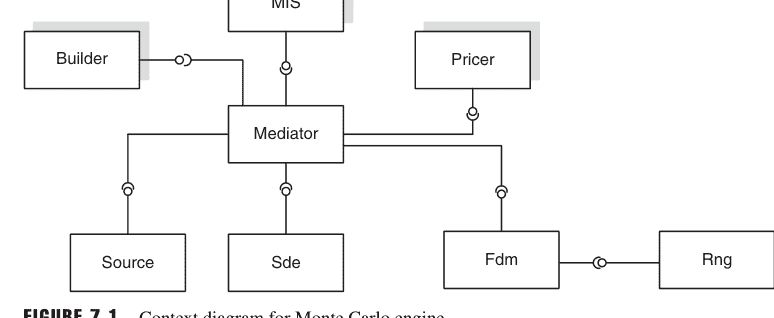

# 图 7.1 蒙特卡洛引擎的上下文图

请求由图 7.1 中的 UML 组件图中的模块按一系列步骤处理以产生最终输出：

- Source：包含与请求相关的数据的系统，例如市场和模型数据。它包含图 7.1 中其他模块所需的数据。
- Sde：建模随机微分方程的系统。在本例中我们建模 GBM 及其变体。特别是，我们有兴趣建模一些底层变量的漂移和扩散，例如股票价格或利率。
- Fdm：近似 Sde 系统中 SDE 的有限差分格式族。在本例中我们使用一步差分格式将近似解从一个时间层推进到下一个时间层，直到我们在到期时达到期望解。有限差分格式需要一个计算随机数的模块的服务。
- Pricer：该系统包含使用蒙特卡洛对单因子期权进行定价的类。这些类处理来自 Mediator 的路径信息，并且每个类以自己的方式处理此路径信息。例如，对于欧式期权，定价器使用到期时的路径数据，用它来计算收益，将结果添加到运行总计中，然后对结果进行贴现以计算期权价格。
- MIS：这是收集统计信息的系统，它接收有关计算进展的状态信息。例如，此系统可以在任何给定时间显示已处理的路径数。
- Builder：该系统实现配置/创建模式（基于 GOF, 1995），创建并初始化图 7.1 中的系统及其结构关系。新创建的对象被封装在一个单一元组中，这增加了系统的整体可维护性。
- Mediator：这是管理系统中数据流和控制流的中央协调实体。它包含计算 Sde 路径的状态机。它还通知其他系统它们需要了解的更改。它在 Builder 模式（GOF, 1995）中扮演客户端的角色。
- Rng：生成随机数的系统。此功能在 C++11 中得到支持。


我们将在第 9 章、第 19 章和第 31 章中更详细地解释这种设计。当前的讨论仅作为预览。

### 7.3 类的低级 C++ 设计

在本节中，我们介绍了一些语言特性，这些特性可以提高 C++ 类和成员函数的健壮性和可靠性。我们还关注构造对象和初始化数据的不同方式。这些特性在战术上是有帮助的，因为它们有助于在类级别提高代码质量。随之而来的一个问题是如何量化面向对象对象网络的代码质量（软件度量），我们在第 7.6 节中对该主题进行了介绍。第 9 章中我们基于系统分解原则讨论了大型复杂软件系统的设计。

#### 7.3.1 Explicit Specifier

`explicit` 说明符指定构造函数或转换函数不允许隐式转换或拷贝初始化。其使用可避免意外的转换。例如，可以使用 `explicit` 默认构造函数同时执行默认初始化和值初始化。这意味着尝试创建除 `explicit` 构造函数所规定之外的对象将导致编译器错误。

我们举以下示例：

```
struct B
{
    explicit B(int) {}
    explicit B(int, int) {}
    explicit operator int() const { return 0; }
};
```

```
class C
{
public:
    explicit C() {}
    C(int a, int b) {}
    explicit C(int a, int b, int c) {}

    // User-defined conversion
    operator int() const { return 0; }
    operator double() const { return 3.14; }
    operator B() const { return B(1); }    // Another class
};
```

我们展示哪些可以编译，哪些不能编译如下：

```
// Use of explicit
//C p = { 1,2,3 };                // Not OK
```

```
```cpp
C x(1, 2);                         // OK
C y{1,2,3};                        // OK
C y2(1, 2, 3);                     // OK
C z = {1,2};                       // OK
// C c = 1;                        // Not OK
C c2;                              // OK
int n = c2;                        // OK
int m = static_cast<int>(c2);      // OK
if (n != m) std::cout << "oops\n"; else std::cout << "ok\n";
B b = c2;                          // OK
```
```

我们建议您检查并运行此代码以确保您理解它。

#### 7.3.2 Deleted and Defaulted Member Functions

本节中的说明符主要涉及 C++03 的 *特殊成员函数*，即：

- 默认构造函数。
- 对应于非静态数据成员逐成员构造的拷贝构造函数。仅当类没有用户定义的拷贝构造函数时才生成。
- 拷贝赋值运算符。在类中已存在用户定义的拷贝构造函数的类中生成此函数已被弃用。

这些函数仅在需要时才生成。例如，仅当类完全未声明任何构造函数时，才会生成默认构造函数。生成的特殊成员函数隐式为 public 且 inline。在 C++11 中，上述特殊成员函数的集合已扩展为包括 *移动构造函数* 和 *移动赋值运算符*。

我们使用关键字 `default` 让编译器生成构造函数的体。在另一极端，我们可能希望禁止使用特殊成员函数。C++03 中的标准做法是将其声明为 private 并且不定义它们。C++11 引入了说明符 `delete` 将这些函数标记为 *已删除函数*，这在许多方面改进了 C++03：

- 已删除函数不得被使用，即使是友元也不行。
- 已删除函数是 public 的；C++ 在检查已删除状态之前检查可访问性。
- 与 C++03 的情况相比，错误在编译时被捕获而不是在链接时被捕获。
- 更友好的错误消息。
- 任何函数（而不仅仅是成员函数）都可以赋予 `delete` 状态。这在我们希望避免隐式转换时很有用。

我们以一个具有已删除和默认函数的类的初始示例开始：

```
```cpp
// Explicitly defaulted and deleted functions
class F
{
public:
```
```

```
// Support default operations OK
F() = default;

// Move ctor and move assignment are defined
F(F&&) = default;
F& operator = (F&&) = default;

F(const F&) = delete;
F& operator = (const F&) = delete;

virtual ~F() = default;
};
```

一些测试代码显示哪些可以编译，哪些不能编译（注释掉的代码不能编译）：

```
// Explicitly defaulted and deleted functions
F f;

// Both give error message like 'F::F(const F &)': attempting to
// reference a deleted function
//F f2 = f;
//F f3(f);

F f4 = std::move(f);
```

最后，我们给出一个已删除的非成员函数的示例。在此情况下，我们定义了一些重载的 print 函数，当输入参数为 double 或 bool 时被删除。因此它们将无法编译：

```
// Overloaded non-member function
void print(float f)
{
    std::cout << f << '\n';
}

void print(long n)
{
    std::cout << n << '\n';
}
// Deleted for these types

void print(bool b) = delete;
void print(double d) = delete;
```

使用示例（注释行不能编译）：

```
// Deleted overloaded non-member function
float f5 = 4.0F;
```

```
```cpp
double d = 5.0;
long p = 3;
print(f5);
print(p);

// void print(bool)': attempting to reference a deleted function
// print(true);
// print(d);
```
```

#### 7.3.3 The constexpr Keyword

来自 www.cppreference.com 的描述为：

> *`constexpr` 说明符声明可以对函数或变量的值在编译时求值。然后这些变量和函数可以在仅允许编译时常量表达式的地方使用（前提是提供了适当的函数参数）。在对象声明中使用的 `constexpr` 说明符隐含 `const`。在函数声明中使用的 `constexpr` 说明符隐含 `inline`。*

我们首先讨论各种常量对象。一个简单的示例是：

```
```cpp
// Macro, C++03 and C++11 solutions to const
#define MEANING_OF_LIFE 42
const int MeaningOfLifeI = 42;
constexpr int MeaningOfLifeII() { return 42; }

std::cout << MEANING_OF_LIFE << ", " << MeaningOfLifeI << ", "
          << MeaningOfLifeII() << '\\n';
```
```

通常，`constexpr` 对象是 `const` 的，并且使用在编译时已知的初始值进行初始化。更一般地，它们的取值是在翻译期间确定的，翻译包括编译和链接阶段。

我们现在来看创建类，其某些成员函数为 `constexpr`。为此，我们希望在可能的情况下产生编译时结果。一个很好的例子是用于 CAD 和计算机图形应用的二维点建模类。点可以说是二维形状的最低公分母，为其设计以获得最佳性能是值得的。该类定义为：

```
```cpp
class Point
{
private:
    double x, y;

public:
    constexpr Point() noexcept : x(0.0), y(0.0) {}
    constexpr Point(double xVal, double yVal) noexcept
        : x(xVal), y(yVal) {}
```
```

```
constexpr Point(const Point& pt2) noexcept
  : x(pt2.x), y(pt2.x) {}

constexpr double X() const noexcept { return x; }
constexpr double Y() const noexcept { return y; }

void X(double xNew) { x = xNew; }
void Y(double yNew) noexcept { y = yNew; }

// Not supported on VS2015
//constexpr void X(double xNew) noexcept { x = xNew; }
//constexpr void Y(double yNew) noexcept { y = yNew; }

double Distance(const Point& pt2) const
{
    return std::sqrt((x - pt2.x)*(x - pt2.x) + (y - pt2.y)*(y - pt2.y));
}

void print() const
{
    std::cout << "(" << x << "," << y << ")\n";
}
};
```

我们现在可以创建非成员函数，例如如下：

```
constexpr Point MidPoint(const Point& p1, const Point& p2)
{
    return{ (p1.X() + p2.X()) / 2, (p1.Y() + p2.Y()) / 2 };
}
```

此外，我们可以按如下方式调用这些函数：

```
double x = 1.0; double y = 1.0;

Point pt(x, y); Point pt2(pt);
Point pt3(pt.X() + 1.0, pt.Y() + 1.0);

auto midPoint = MidPoint(pt, pt3);
midPoint.print();

auto d = pt.Distance(pt3);
std::cout << d << "\n";
```

总之，我们应尽可能使用 `constexpr` 对象和函数，特别是对于可以在编译时计算值的情况。


从可自定义的数据源获取数值并对其应用一个函数，将其转换到另一个值：

```
using FunctionType = std::function<double (double x)>;

class DataFlow
{
private:
    double data;
    FunctionType _fun;

public:
    DataFlow(const FunctionType& fun) : data(0), _fun(fun) {}

    // Derived classes must override Input()
    virtual double Input() = 0;
    double Compute(double d) { return _fun(d); }

    // Template member function, cannot be overridden
    virtual double Algorithm() final
    { // This algorithm has a fixed structure

        // The steps in the algorithm
        double val = Input();
        return Compute(val);
    }
};
```

我们现在创建一个派生类，其输入来自控制台：

```
class ConsoleDataFlow : public DataFlow
{
public:
    ConsoleDataFlow(const FunctionType& fun) : DataFlow(fun) {}

    double Input() override
    {
        std::cout << "Give input value: ";
        double val; std::cin >> val;
        return val;
    }
};
```

使用示例为：

```
// Design pattern
auto fun = [](double d)->double {return std::exp(d);};
auto fun2 = [](double d)->double {return d*d;};

ConsoleDataFlow cdf(fun);
std::cout << cdf.Algorithm() << std::endl;
```

```
ConsoleDataFlow cdf2(func2);
std::cout << cdf2.Algorithm() << std::endl;
```

总结来说，成员函数 `Algorithm()` 不能被重写，但其可变部分（例如，`Input()` 和 `Compute()`）可以被重写。最后，我们注意到上述设计结合了子类型多态与统一函数包装器。从这个意义上说，该解决方案代表了面向对象和函数式编程风格的混合。

### 7.3.5 统一初始化

在 C++ 的早期版本中，关于如何初始化变量和对象存在一些混淆。何时使用大括号、圆括号或赋值运算符并不总是很清楚。在 C++11 中，我们可以通过将值放在大括号之间来使用一种单一的通用语法，称为 *统一（大括号）初始化*。一些简单示例为：

```
// Initializer list (they are recursive)
print<int>({ 3, 4, 5, 6, 99 });

// Uniform initialisation
double arr[] {1.0, 2.0, 3.0};
std::list<int> arr2{ 1, 3, 5, 7 };

std::tuple<double, double> tup(1.0, 2.0);
std::map<int, std::tuple<double, double>> database
                         { { 1, tup }, { 2, tup } };

for (auto it=std::begin(database); it != std::end(database); ++it)
{
    std::cout << it->first << ": "
              << std::get<0>(it->second) << ", " << std::get<1>
              (it->second) << std::endl;
}
```

我们可以使用此技术来初始化聚合对象的成员。考虑以下类：

```
// Struct that holds data together
struct Person
{

    std::string name_;
    std::string address_;
    int age_;

};

struct Person2
{
    std::string name_;
    std::string address_;
    int age_;

    Person2(int age, const std::string name, const std::string address)
        : age_(age), name_(name), address_(address) {}
};
```

我们按如下方式使用统一初始化：

```
// Aggregate initialisation; initialise the data in a
// struct without needing a constructor
Person p1{ "Joe", "Denver", 23 };

// ERROR! Person p1_a( "Joe", "Denver", 23 );
// (No function talking three arguments!!)

// Using constructors to initialise data
Person2 p2{ 55, "Piet", "Zurich" };
Person2 p3( 55, "Piet", "Zurich" );
```

我们从类 Person 可以看出，即使类没有适当的构造函数，我们也可以使用大括号初始化来初始化类的成员数据。

### 7.3.6 初始化列表

类型为 std::initializer_list<T> 的对象是一个轻量级代理对象，提供对类型为 const T 的对象数组的访问：

```
// Initialiser lists
template <typename T>
class ILClass
{ // Class using initialiser lists
private:
    std::vector<T> v;
public:
    ILClass(std::initializer_list<T> myList) : v(myList) {}

    void append(std::initializer_list<T> myList)
    { // Extend vector v before element at specified position

        v.insert(std::end(v), std::begin(myList),
            std::end(myList));
    }

    void print() const
    {
std::cout << '\n';
for (auto elem : v) { std::cout << elem << ","; }
std::cout << '\n';
}
};
```

使用示例及对应输出为：

```
// Initializer lists
ILClass<int> c = { 1,2,3 };
c.print();                         // 1,2,3
c.append({ 4,5,6 });
c.print();                         // 1,2,3,4,5,6
```

### 7.3.7 关键字 noexcept

此关键字指定函数不能抛出异常或不准备抛出异常。如果函数确实抛出异常，则程序将通过调用 std::terminate() 终止，默认情况下调用 std::abort()。

总体而言，C++03 的异常处理机制存在一些问题（我们在此不讨论），最终结果是许多程序员只是避免使用它。在 C++11 中，情况则清晰得多：函数抛出异常或不抛出异常。关键字 noexcept 是函数的一部分，调用者可以依赖它。

我们说一个函数是异常中立的，如果它本身不抛出异常，但它调用的函数可能会发出异常。如果发出异常，则异常中立函数允许该异常沿调用链传递，直到找到处理程序为止。此类函数永远不是 noexcept。

### 7.4 多态的多种形式

多态被定义为能够采取多种形式的能力。在面向对象技术中，我们通过能够在运行时将行为附加到不同的对象并调用其成员函数来实现多态行为。简而言之，我们通过在基类中声明纯或默认的虚成员函数，然后在派生类中实现这些函数来支持多态。我们也称之为子类型（或动态）多态。

我们讨论在类和类层次结构中实现多态行为的四种不同方法。我们采用建模收益函数的流行示例。我们将范围限制为单因子收益，并仅考虑两种情况，即看涨期权和牛市价差收益。目标是客户端不应直接了解特定的收益或其定义数据。这是一种信息隐藏形式。这使客户端代码更具可扩展性和可重用性。

我们提出以下解决方案：

- S1: 使用子类型多态的传统 C++ 层次结构。
- S2: 使用策略设计模式（GOF, 1995）与共享指针。这是动态多态。

```
class BullSpreadPayoff : public Payoff
{
private:
    double K1;
    double K2;
public:
    BullSpreadPayoff(double strike1, double strike2)
    { K1 = strike1; K2 = strike2;}

    double operator () (double S) const
    {
        if (S >= K2)
            return K2 - K1;
        if (S <= K1)
            return 0.0;

        // In the interval [K1, K2]
        return S - K1;
    }
};
```

测试用例如下：

```
template <typename T>
using SP = std::shared_ptr<T>;

double K = 20.0;
SP<Payoff> call (new CallPayoff (K));

std::cout << "Give a stock price (plain Call): ";
double S;
std::cin >> S;

std::cout << "Call Payoff is: " << (*call)(S) << '\n';

double K1 = 30.0;        // Strike price of bought call
double K2 = 35.0;        // Strike price of sell call

SP<Payoff> bs (new BullSpreadPayoff(K1, K2));    // Hull example

std::cout << "Give a stock price (BullSpread): ";
std::cin >> S;

std::cout << "Bull Spread Payoff is: " << (*bs)(S) << std::endl;
```

这是一种流行的方法，无疑许多遗留的 C++ 应用程序（可能结合原始指针）使用它来实现多态。该方法的缺点主要有：

算法现在形成它们自己的独立类层次结构：

```
class PayoffStrategy
{
public:
    virtual double payoff(double S) const = 0;
};
```

```
class CallStrategy : public PayoffStrategy
{
private:
    double K;
public:
    CallStrategy(double strike) { K = strike;}
    double payoff(double S) const
    {
        return std::max<double>(S - K, 0);
    }
};
```

使用示例为：

```
double K = 20.0;
SP<PayoffStrategy> call (new CallStrategy (K));
Payoff pay1(call);

std::cout << "Give a stock price (plain Call): ";
double S;
std::cin >> S;

std::cout << "Call Payoff is: " << pay1.payoff(S) << '\n';
```

我们现在应用 CRTP 来创建解决方案 S2 的编译时版本。在这个新的解决方案 S3 中，我们创建如图 7.2 所示的模板类：

```
template <typename PayoffType>
    class Payoff
{
private:
    // PayoffStrategy* ps; // OLD
    SP<PayoffStrategy<PayoffType>> ps;

public:
    // Constructors and destructor
    explicit Payoff(const SP<PayoffStrategy<PayoffType>>& p);
    Payoff(const Payoff& source) = delete;
    virtual ~Payoff() {}


```cpp
// Operator overloading
Payoff& operator = (const Payoff& source) = delete;

// Not a pure virtual payoff function anymore
double payoff(double S) const; // For a given spot price
};
```

实现形成了一个类层次结构，我们看到了 CRTP 的直接应用：

```cpp
template <typename DerivedClass>
class PayoffStrategy
{
public:
    //virtual double payoff(double S) const = 0;
    double payoff(double S)
    {
        return static_cast<DerivedClass*>(this) -> payoff(S);
    }
};
```

```cpp
class CallStrategy : public PayoffStrategy<CallStrategy>
{
private:
    double K;
public:
    CallStrategy(double strike) { K = strike;}
    double payoff(double S) const
    {
        return std::max<double>(S - K, 0);
    }
};
```

使用示例：

```cpp
double K = 20.0;
SP<PayoffStrategy<CallStrategy>> call (new CallStrategy (K));
double S = 30.0;
std::cout << "Call payoff: " << call->payoff(30.0) << '\n';
```

最后，我们讨论解决方案 S4，它可以看作是一种面向对象与函数式混合的解决方案。我们不创建类层次结构，而是创建一个包含嵌入式函数（尚未赋值给目标函数）的单一类，在客户端代码中可以将其赋值给一系列目标函数类型，正如我们在第 3 章中看到的那样：

```cpp
using Function = std::function<double (double)>;

// #include "PayoffStrategy.hpp"

class Payoff
{ private:
    // PayoffStrategy* ps;   // OLD
    Function ps;

public:
    explicit Payoff(const Function& pstrat);

    // Code same as solution S3

    // ...
};
```

这意味着 `Payoff` 可以由任何具有适当签名的函数或可调用对象实例化。我们给出一些代码示例来展示这种解决方案的灵活性：

```cpp
using namespace std::placeholders;

double K = 20.0;
CallStrategy call(K);
Function payoffCall = std::bind(&CallStrategy::payoff, call, _1);
Payoff pay1(payoffCall);

std::cout << "Give a stock price (plain Call): ";
double S;
std::cin >> S;

//std::cout << "Call Payoff is: " << pay1.payoff(S) << '\n';
std::cout << "Call Payoff is: " << payoffCall(S) << '\n';

double K1 = 30.0;          // Strike price of bought call
double K2 = 35.0;          // Strike price of sell call

BullSpreadStrategy bull(K1, K2);    // Hull example
auto payoffBull=std::bind(&BullSpreadStrategy::payoff, bull, _1);
Payoff pay2(payoffBull);

std::cout << "Give a stock price (BullSpread): ";
std::cin >> S;

std::cout << "Bull spread Payoff: " << payoffCall(S) << '\n';

// Create a payoff on the fly, captured variables
double p = 2.0;
double C = 50.0;
double strike = 50.0;
```

```cpp
auto payoff3 = [=] (double S)
{
    return std::min<double>(std::max<double>(std::pow(S - strike, p),
    0.0), C);
};

std::cout << "Symmetric capped power call: " << payoff3(S);
Payoff pay3(payoff3);
std::cout << "Symmetric capped power call: " << pay3.payoff(S);
```

```cpp
auto payoff4 = [=] (double S)
{
    return std::min<double> (std::max<double>(std::pow(S, p), 0.0), C);
};

std::cout << "Asymmetric capped power call: " << payoff4(S);
Payoff pay4(payoff4);
std::cout << "Asymmetric capped power call: " << pay4.payoff(S);
```

我们可以看到，可以在运行时（“即时”）创建收益函数，并且可以通过使用 `std::bind` 来复用现有代码。这段代码是一个如何借助 lambda 函数配置代码的示例，这种风格将在后续章节中应用 Builder 设计模式来配置应用程序时使用。

### 7.5 除了继承之外，还有更多吗？

回顾过去，开发人员在上世纪 90 年代可能过度热衷于创建深层而复杂的类层次结构。这在当时是普遍看法。公平地说，作者的 CAD 和计算机图形应用程序避免了这一陷阱。我们没有使用多重继承，类层次结构最多只有一层深，许多类都是通过组合创建的。代码具有相当好的可维护性，文档齐全，并且对问题领域的了解也具有优势。

根据我们的经验，子类型多态性对于成功的软件项目既不是必要的，也不是充分的。另一方面，类层次结构确实有其用途。但我们确实需要小心：

- 创建本质上是对象或实例的类；这表现为大量微小的类泛滥，与它们所派生的基类相比几乎没有额外的行为。
- 类之间的关系不是 ISA（属种/泛化-特化）关系，而是其他关系。这是一个常见错误，可能对软件系统的完整性产生严重后果。
- 混淆 HASA 和 ISA 关系。
- 开发者倾向于使用数据和结构而不是行为来确定关系是否为属种关系，典型的例子是从 Rectangle 派生 Square。另一个例子是创建两个分别建模看涨和看跌期权的类，两者都从共同的基类派生。

### 7.6 面向对象软件度量简介

在本章结束时，我们提醒大家检查代码以确定其软件质量。我们特别关注几个属性。我们通过从数据集合中计算数值来度量它们。我们定义*软件度量*来处理软件产品或过程的测量。目标是获得客观、可重现和可量化的度量，用以指示面向对象代码的质量。

我们通过关注类的质量、其成员以及类之间的耦合程度来缩小讨论范围，包括关于什么构成良好类层次结构或面向对象设计的指导方针。

以下讨论旨在使问题更加明确，并指出一些常见问题。更多细节参见 Lorenz 和 Kidd（1994）。

一般来说，度量的值过大或过小都可能令人怀疑。

#### 7.6.1 类大小

该度量可以通过多种方式测量，例如：

- M1：类中公有成员函数的数量。
- M2：类中成员函数的总数（公有和私有）。
- M3：每个类平均拥有的成员函数数量。
- M4：类中数据成员的数量。

对于这些度量中的每一个，我们都关联一个数值。尽管高度依赖上下文，但我们应努力为每个度量的值定义上下阈值界限。例如，对于度量 M1，经验法则是将公有成员函数的数量保持在闭区间 [4,20] 内。较小和较大的值都令人怀疑，可能表明设计不良。一方面，一个类可能是一个微小的类，在这种情况下我们首先怀疑它是否是一个真正的类；而成员函数超过 20 个的类可能违反了 SRP。关于其他度量的若干预警信号包括：

- M2：拥有大量私有成员函数的类可能表明该类在“重新发明轮子”（例如，作为一个*嵌套类*），而它可能已经在其他地方（可能在 C++ 库中）实现过了。该类是否满足 SRP？
- M4：这可能表明我们设计了不正确的数据结构。
- M3：系统中类的成员函数极多或极少，可能表明设计不良。显然，成员函数多的类会比成员函数少的类更难维护。

总的来说，我们尽量从 STL（容器、算法）、Boost 和其他库中复用尽可能多的功能，而不是自己开发代码。希望这种方法能减少编写和维护的代码量。本节所测量的度量与 SRP 密切相关。

#### 7.6.2 类内部结构

在计算机编程中，术语*内聚*（De Marco，1978）指的是模块（或类）的各元素彼此属于同一整体的程度。它描述了关系的强度


在给定模块内的各个功能片段之间。对于类，*内聚度量*衡量类的成员函数彼此相关的程度。一般来说，一个内聚的类执行一个功能。一个非内聚的类执行两个或多个不相关的功能。内聚是一种*定性度量*（例如，我们可以说*高内聚*和*低内聚*），我们可以识别不同形式的内聚（McConnell, 2004, pp. 168–171），从最差到最好。McConnell描述了七种类型，但我们只关注其中最好的三种。在下文中，术语“模块”可以指代一个类：

- *通信/信息内聚*：当模块的各个部分因为操作同一数据而被分组时，就会发生这种情况。
- *顺序内聚*：当模块的各个部分因为一个部分的输出是另一个部分的输入（就像装配线一样）而被分组时，就会发生这种情况。
- *功能内聚*：当模块的各个部分因为共同为模块的单一明确定义的任务做出贡献而被分组时，就会发生这种情况。这种度量与SRP高度相关。

功能内聚是最理想的，但可能并不总是能够实现。一般来说，高内聚的模块比低内聚的模块具有更高的可靠性和更少的故障。

我们现在给出Lorenz和Kidd（1994）提出的与类内部结构相关的一些低级（但重要的）度量：

- M5：类中使用的全局变量和静态变量的数量。
- M6：每个成员函数的平均参数个数。
- M7：每个类的友元函数数量。
- M8：每个成员函数的平均注释行数。
- M9：被注释的方法的平均数量。

然而，许多应用程序的M8和M9度量值为零？

### 7.6.3 类耦合

该度量检查类如何与其他类、子系统以及其他代码关联。特别是，我们关注类之间的*依赖关系*。依赖关系越多，理解和维护代码就越困难。

类通过与其他类协作来履行其职责。*协作*表示客户端向服务器发出的请求，以履行*客户端职责*（Wirfs-Brock, Wilkerson and Wiener, 1990）。例如，在蒙特卡洛模拟中，模拟有限差分方案的客户端类与提供随机数的服务器类协作。在类设计的早期阶段识别*协作*非常重要，原因如下：

-   应用中的信息流和控制流得以显现。
-   我们能够将应用设计为协作类的图。这有助于在协作者之间分配职责。
-   我们可以通过识别协作来发现缺失的职责。
-   我们可以识别出没有关联职责的协作。

为了识别协作，我们对每个类的每个职责提出以下问题：

-   该类能否自行履行给定的职责？
-   如果不能，该类需要什么？
-   该类可以从哪些其他类获得所需内容？

了解类之间的关系将有助于识别协作。主要关系有：

-   **R1：组合**（“是……的一部分”）。这些也称为*整体-部分*关系和聚合关系（参见POSA, 1996）。
-   **R2：知晓。** 这种关系是组合的一种更松散耦合的版本。一般来说，如果类*Y*能向类*X*提供信息，那么类*X*就知晓类*Y*。
-   **R3：依赖于。** 这与关系R2类似，但形成该关系的类不一定需要彼此了解。例如，第三方中介可能知道这种依赖关系。

在描述了什么是耦合之后，我们现在定义相应的度量：

-   **M10：** 给定类与之协作的其他类的数量。
-   **M11：** 与其他类协作的量。

当我们在第9章讨论基于系统分解和接口规范的软件开发时，度量M10和M11将呈现另一种形式。在那个阶段，面向对象技术会在一定程度上退居次要地位。

### 7.6.4 类和成员函数继承

这组度量围绕我们使用继承时的质量：

-   **M12：** 类层次嵌套级别。这指的是继承树的深度。
-   **M13：** 抽象类的数量。
-   **M14：** 多重继承的使用。
-   **M15：** 派生类重写的成员函数数量。
-   **M16：** 派生类继承的成员函数数量。
-   **M17：** 派生类新增的成员函数数量。

一般来说（正如我们在第7.5节中讨论的），继承是一把双刃剑，出于该节中提到的原因，我们倾向于避免过多使用它。我们还有多种替代设计来降低与度量M12到M17对应的数值。显然，数值越高，维护类层次就越困难，并且越不可能保持其*语义完整性*。降低数值的一些方法有：

1.  使用带有CRTP的静态多态而不是子类型/动态多态。
2.  我们可以假装生活在一个没有继承的世界中，并全程使用组合。但这种方法可能不现实。
3.  创建一个包含一个或多个通用函数包装器的单一类C。然后类C拥有接受函数作为参数的构造函数。这些函数替换`virtual`成员函数，并在一定程度上消除了对类层次结构的需求。

随着本书的深入，我们会看到这些技术的更多示例。特别是，它们可用于替换和升级GOF（1995）中的面向对象设计模式。在我们于第9章引入的系统分解新范式中，第7.6节中的一些关注点将不再成为问题。

### 7.7 总结与结论

在本章中，我们讨论了如何使用成熟的建模技术和C++语言特性来设计类。我们设计的类应自包含、健壮，并与其他类松散耦合。希望这种方法能被视为对使用类层次结构设计类的方式的一种改进，并且将在后续章节中推广到大型系统的设计。

本章的一个特色是，我们使用函数式编程风格（特别是`std::function`）将虚函数替换为通用函数包装器。特别是，这使我们能够减少应用程序中需要创建的类数量可能出现的爆炸式增长。一个需要注意的是，我们必须关注效率问题。

### 7.8 练习与项目

1.  **（显式构造函数）**

    考虑以下类：

    ```cpp
    struct B
    {
        explicit B(int) {}
        explicit B(int, int) {}
        explicit operator int() const { return 0; }
    };
    ```

    创建一个程序来测试该类。下面的代码行中哪些能编译，哪些不能？你将如何修改该类以确保它们能编译？否则，如何在不修改该类的情况下修改这些代码行，使代码无错误地编译？

    ```cpp
    B b1 = 1;
    B b2(3);
    B b3{ 7, 3 };
    B b4 = (B)42;
    ```

2.  与C++98标准中将这些函数声明为`private`相比，使用*删除函数*有哪些优点？

    -   **a)** 调用已删除函数将导致编译时错误，而不是像C++98那样产生链接错误。
    -   **b)** 在未求值表达式中使用已删除函数会导致链接错误。
    -   **c)** 友元访问缺少定义的私有函数会遇到编译时错误。
    -   **d)** 将已删除函数设为公有通常会带来更好的错误消息。

3.  在本练习中，我们研究默认和删除形式的复制构造函数和复制赋值运算符（这两个函数有四种默认/删除选择）。一种选择是：

    ```cpp
    // Copy ctor and copy assignment operator
    F(const F&) = delete;
    F& operator = (const F&) = delete;
    ```

    测试此选项和其他三个选项，并确定哪些能编译，哪些不能。

4.  以下哪些陈述是正确的？

    -   a) constexpr 适用于对象和函数。
    -   b) 所有 const 对象也都是 constexpr 对象。
    -   c) 如果 constexpr 函数的输入参数在编译时已知，那么其输出也将在编译时已知。
    -   d) constexpr 函数不一定必须产生编译时已知的值。

5.  解释为什么Point类的以下成员函数无法编译：

    ```cpp
    constexpr double Distance(const Point& pt2) const
    {
        return std::sqrt((x - pt2.x)*(x - pt2.x) + (y - pt2.y)*(y - pt2.y));
    }
    ```

    此外，以下代码能编译吗？

    ```cpp
    constexpr Point p2(1.0, 2.0);
    double newVal = 3.0;
    p2.X(newVal);

    Point p3(1.0, 2.0);
    double newVal2 = 3.0;
    p3.X(newVal2);
    ```

6.  你认为，如果一个类不满足SRP，会显现出哪两个（最重要的）症状？

    -   a) 类中方法的数量增加（阈值约为12）。
    -   b) 类层次嵌套级别（继承层次深度）（阈值约为6）。
    -   c) 类中数据成员的数量（阈值约为3）。
    -   d) 方法包含许多行代码（阈值约为[10, 20]）。

7.  什么是脆弱的基类问题？

    -   a) 一个基类在修改后可能导致派生类出现故障。
    -   b) 一个包含许多必须在派生类中重写的抽象方法的基类。


+   c) 派生自两个基类的类。
+   d) 具有过多受保护方法的基类。

+   8. 如何解决 *脆弱基类问题*？
+      a) 使用接口（如果支持）代替基类。
+      b) 使用更多组合和更少继承。
+      c) 使某些基类方法变为 final 以保持完整性。
+      d) 创建仅包含抽象方法且没有数据的基类。

+   9. 列出与深层继承层次结构相关的三大风险：
+      a) 它们变得越来越难以维护。
+      b) 存在继承的功能在语义上不正确的情况。
+      c) 许多开发者基于结构而不是行为创建类层次结构。
+      d) 随着层次结构深度的增加，性能下降。

+   10. 哪种对函数建模的选择能产生最灵活的软件？
+      a) 动态多态。
+      b) 静态多态（CRTP 模式）。
+      c) 通用函数包装器。
+      d) 自由函数（C 函数）。

+   11. 如何在一般意义上识别未使用 *整体-部分* 的代码？
+      a) 参与的对象往往违反 SRP，即关注点分离较弱。
+      b) 类往往具有相对较多的成员函数。
+      c) 类往往具有相对较多的成员数据。
+      d) 对象网络中往往没有单一的调解对象。

## 12. （设计蒙特卡洛框架）

在第 7.2.3 节中，我们制作了一个上下文图，展示了参与蒙特卡洛期权定价器的模块/子系统，我们将在第 31 章更详细地讨论该定价器。本次练习的目标是回答与第 7 章主题相关的问题。从某种意义上说，你需要知道各个模块做什么以及它们如何协作以满足系统的目标。

回答以下问题：

+   a) 阅读每个模块的描述并确定其职责。每个模块是否满足 SRP？
+   
+   b) 用文字或作为 *数据流图*（DFD）描述基于某些输入计算期权价格的过程，例如应计算价格的期权类型、市场数据、模型数据等。
+   
+   c) 根据 a) 和 b) 部分的答案，确定哪些步骤/活动没有对应的模块，以及哪些模块的职责少于或多于一个主要职责。如果存在不一致，应如何处理，例如设计新模块并在上下文图中记录它们。
+   
+   d) 对于每个模块，确定它向其他模块 *提供* 的服务以及它 *需要* 从其他模块获得的服务。
+   
+   e) 创建一个小型 C++ 软件原型来实现图 7.1 中的上下文图。要求如下：

+   1. 支持看涨和看跌收益。选择第 7.4 节中实现 C++ 收益类的其中一种解决方案。
+   2. 支持普通期权和算术平均利率亚式期权。
+   3. 支持 GBM 和 CEV 随机微分方程。
+   4. 使用 Euler 和 Milstein 有限差分格式近似第 3 部分中的 SDE。

5. 使用 C++ 库 <random> 进行随机数生成。

6. 设计一个灵活的 Mediator（见 GOF, 1995）类来连接不同的模块。

确定你将使用哪种编程风格来实现每个模块。我们将在第 31 章实现此问题。

## 13. （类层次结构，头脑风暴）

考虑以下类层次结构和 Gen/Spec 关系。哪些在语义上是正确的，哪些在语义上是不正确的，你能否在不需要类层次结构的情况下对它们建模（一般性答案已足够）？

+   - a) 基类 Lattice，派生类 BinomialLattice 和 TrinomialLattice。
+   - b) CallOption 和 PutOption 作为 Option 的派生类。
+   - c) 派生自 Rectangle 的 Square 类。
+   - d) PDE 类层次结构。你将如何设计它们？
+   - e) 继承模板类的智慧。

# CHAPTER 8
### C++ 数值计算、IEEE 754 和 Boost C++ 多精度

#### 8.1 引言与目标

在本章中，我们介绍了一系列概念、方法和 C++ 语言特性，以促进代码的健壮性和可靠性。具体而言，*健壮性* 是计算机系统在执行期间处理错误并应对错误输入的能力，而 *可靠性* 则关注软件系统在给定时间段内保持给定性能水平的能力。我们讨论了促进 *健壮编程* 的多种技术。它可以定义为“一种专注于处理意外终止和意外操作的编程风格。它要求代码通过显示准确且无歧义的错误消息来优雅地处理这些终止和操作。这些错误消息使用户更容易调试程序”。可靠性描述了避免异常程序终止。它具有三个子特性：

+   - *成熟度*：与系统故障频率有关。大多数故障是由 *缺陷* 引起的。
+   - *容错性*：指系统维持指定性能水平的能力。我们必须指定应维持该水平的时间段。
+   - *可恢复性*：指重新建立先前性能水平的能力。

当编写实现计算金融中数值方法和算法的 C++ 代码时，这些是主要关注点。特别是，我们讨论了促进代码健壮性和可靠性的多种方法，重点是整数和浮点数据类型。我们特别关注以下几种情况：

+   - S1：使用算术类型运算时的舍入规则。
+   - S2：正常数、非规格化数和无穷大数，NaN（非数字）。
+   - S3：由于除零、溢出、下溢和无效操作而导致的异常处理。
+   - S4：什么是机器精度？
+   - S5：舍入和抵消误差。

我们讨论这些场景以及它们在 C++ 中的支持方式。许多错误是由数字具有固定字长造成的，当数据不适合此范围时信息会丢失。在附录 1 中，我们介绍了多精度数据类型，它们能够容纳比标准 C++ 数据类型更宽范围的值和位数。

IEEE 754 是浮点计算的技术标准。许多硬件浮点单元现在支持 IEEE 754。我们在讨论 C++ 相关主题之前概述该标准。该标准涉及以下主题：

+   - *算术格式*：支持 *二进制*（基数 2）和 *十进制*（基数 10）浮点数据，由有限数字组成。
+   有限数字的特殊情况是 *带符号零*、*非规格化数*、*无穷大* 和特殊的“非数字”(*NaNs*)。
+   - *交换格式*：可用于以高效紧凑形式交换浮点数据的编码（位串）。
+   - *操作*：算术格式上的算术（例如，加法、乘法和三角函数）和其他操作。
+   - *舍入规则*：在算术运算和转换期间舍入数字时应满足的属性。
+   - *异常处理*：异常条件的指示，例如 *除零*、*溢出*、*下溢* 和 *不精确结果*（由于舍入）。

我们将在接下来的章节中讨论这些主题。它们在数值分析应用中尤为重要。我们还尝试在 C++ 中实现其要求。

##### 8.1.1 格式

*格式* 是数值和符号的表示集合。它可以是基数 2 或基数 10 的有限数，以单精度或双精度格式表示。有限数的数值值为 (−1)^s × c × b^q，其中：

+   - b = 基数（2 或 10），也称为基数
+   - s = 符号（0 或 1）（0 为正，1 为负）
+   - c = 尾数（且位数 == p）
+   - q = 指数（上限 emax）参数。

例如：

c = 12345, b = 10, q = −3, s = +1 值 = 12.345。

尾数和指数参数的值存在约束：

+   - c ∈ [0, b^p − 1]
+   - q 满足 1 − emax ≤ q + p − 1。

我们因此看到某些数字有几种表示，但对于大多数算术运算，结果（值）不依赖于输入的表示。

格式还包括正无穷大 +∞ 和负无穷大 −∞。最后，IEEE 754 描述了两种 NaN。*静默 NaN*（qNaN）在传播过程中不会引发额外异常。*信号 NaN*（sNaN）是一种特殊


一种在操作中被消费时会引发异常的 NaN 形式。可用于各种情况：

- 用 sNaN 填充未初始化的内存，如果在初始化之前使用数据，将产生无效操作异常。
- 表示下溢或溢出的数字。
- 采用更高精度格式的数字。
- 复数（具有实部和虚部的数）。

产生 NaN 的操作有：

- 至少一个操作数是 NaN 的操作。
- 乘法 0 × ±∞、±∞ × 0。
- 加法 ∞ + (−∞)、(−∞) + ∞ 以及等价的减法。
- 对复数参数进行的实数操作，例如负数的平方根或对数。另一个例子是反正弦或反余弦，其参数不在开区间 (−1,1) 内。

##### 8.1.2 舍入规则

舍入数值意味着用一个近似等于该值的值替换它。近似值通常比原值更短或更简单，或者可能有更明确的表示形式。IEEE 754 中有多种舍入方式；我们通过考察五种舍入规则来缩小范围。首先讨论舍入到最近值：

- 舍入到最近值，平局时取偶数：舍入到最近值。
- 舍入到最近值，平局时远离零：舍入到最近值。

C++ 支持这些特性的一个示例是：

```cpp
void CeilingFloorTruncRound(double d)
{
    std::cout << "*Value: " << d << '\n';
    std::cout << "\tCeiling: " << std::ceil(d) << '\n';
    std::cout << "\tFloor: " << std::floor(d) << '\n';
    std::cout << "\tTruncate: " << std::trunc(d) << '\n';
    std::cout << "\tRound: " << std::round(d) << '\n';
    std::cout << "\tNearest int using current rounding mode: " << std::round(d);
    std::cout << '\n';
}
```

定向舍入包括：

- 舍入到 0：这是朝零方向的定向舍入，也称为截断。
- 舍入到 +∞：朝正无穷方向的定向舍入，也称为向上舍入或天花板舍入。

##### 8.1.4 扩展和可扩展精度格式

该标准规定了扩展和可扩展的精度格式，在需要更高精度时推荐使用。*扩展精度格式*通过使用更高的精度和更大的指数范围来扩展基本格式。例如，*四倍（quad）精度*是一种基于二进制浮点数的计算机数字格式，占用 16 字节（128 位）。在需要高于双精度结果的应用中需要这种精度，并且通过最小化溢出和舍入误差来实现更准确、更可靠的计算。IEEE 754 规定 *binary128* 具有以下元素：

- 符号位（1 位）。
- 指数宽度 15 位。
- 有效数精度 113 位。

有许多软件库支持四倍精度，但直接的硬件支持不太常见。在本章中，我们将注意力限制在 *Boost Multiprecision* 库上。在线文档对其介绍如下：

> 多精度由大数数学的通用接口以及一系列大数后端组成，支持整数、有理数和浮点类型。Boost.Multiprecision 提供了一系列后端，包括 GMP、MPFR、MPIR、TomMath 的接口，以及它自己收集的 Boost 许可、仅头文件的后端，用于整数、有理数和浮点数。此外，可以创建用户自定义后端并与 Multiprecision 的接口一起使用，前提是类实现遵循必要的概念。

*Multiprecision* 库提供了 C++ 中的整数、有理数和浮点类型，这些类型比 C++ 普通内置类型具有更大的范围和精度。*大数*类型可用于多种基本数学运算、初等超越函数以及 *Boost.Math* 中的函数。*Multiprecision* 类型还可以使用明确定义的转换规则与 C++ 中的内置类型互操作。这使得 *Boost.Multiprecision* 可用于涉及需要扩展范围和精度的整数、有理数和浮点类型的各种数学计算。我们在附录 1 中介绍 *Boost.Multiprecision* 库。

### 8.2 C++ 中的浮点分解函数

- D1：将一个浮点值分解为规格化分数和 2 的整数次幂。
- D2：将一个浮点值乘以 2 的指数次幂。
- D3：将一个浮点值分解为整数部分和小数部分。
- D4：从浮点参数中提取无偏的、与基数无关的指数值，并将其作为有符号浮点值或有符号整数值返回。
- D5：返回浮点值在给定方向上的下一个可表示值。

函数 D2 是函数 D1 的对偶。两者都可用于操作浮点数的表示形式，而无需直接进行位操作。下面是一些演示这些函数用法的代码：

```cpp
template <typename T>
void FloatPointManipulation(const T& t)
{
    // Decompose t into normalised fraction + integral power of 2
    int i;
    T t2 = std::frexp(t, &i);
    std::cout << "Fraction, power of 2: " << t2 << "*2^" << i << '\n';

    // Multiply a floating-point value by 2 raised to an exponential power
    // "Load exponent"
    int n = -4;
    std::cout << "Load exponent x * 2^exp: " << std::ldexp(t, n) << '\n';

    // Decompose t into integral and fractional parts, each having the same
    // type and sign as x;
    T iptr;
    T t3 = std::modf(t, &iptr);
    std::cout << "Decompose into integral and fractional parts: "
              << iptr << "," << t3 << '\n';

    // Extract the value of the unbiased radix-independent exponent
    // from a floating-point argument.
    std::cout << "Extracted exponent (float) : " << std::logb(t) << '\n';
    std::cout << "Extracted exponent (integer) : " << std::ilogb(t);

    // Next representable floating-point values
    T upper = std::numeric_limits<T>::max();
    T lower = std::numeric_limits<T>::min();
    std::cout << "Next going forward: " << std::nextafter(t, upper);
    std::cout << "Next going backward: " << std::nextafter(t, lower);
}
```

最后，可以通过 fpclassify 函数确定值的“大小”：

```cpp
template <typename T>
const char* Classify(T t) // T = float, double, long double, Integral
{
    switch (std::fpclassify(t))
    {
        case FP_INFINITE:    return "Inf";
        case FP_NAN:         return "NaN";
        case FP_NORMAL:      return "normal";
        case FP_SUBNORMAL:   return "subnormal";
        case FP_ZERO:        return "zero";
        default:             return "unknown";
    }
}
```

```cpp
template <typename T>
void classify(const T& t)
{
    std::cout << "*Value: " << t << '\n';
    std::cout << "\tFinite: " << std::isfinite(t) << '\n';
    std::cout << "\tInfinite: " << std::isinf(t) << '\n';
    std::cout << "\tIs NaN: " << std::isnan(t) << '\n';
    std::cout << "\tIs Normal: "<< std::isnormal(t) << '\n';
    std::cout << "\tIs Negative: " << std::signbit(t) << '\n';
}
```

### 8.3 std::numeric_limits\<T\> 之旅

这个类模板提供了一种标准化的方式来查询算术类型的各种属性。它提供了许多可在应用程序中使用的成员常量和成员函数。除了每个非限定特化之外，每种算术类型的每个 cv（const volatile）限定版本也存在特化。我们注意到，非算术标准类型（例如 std::complex\<T\>）没有特化。

```cpp
template <typename T>
void NumericConstants(const std::string& arithType)
{
    std::cout << '\n' << "**Type: " << arithType
              << "\n, #representable digits: "
              << std::numeric_limits<T>::digits << "\n";

    // Infinity, NaN and detection of denormalisation/subnormal numbers
    std::cout << "Has a special value for infinity: " << std::boolalpha
              << std::numeric_limits<T>::has_infinity << "\n";
    std::cout << "Has a special value for quiet NaN: " << std::boolalpha
              << std::numeric_limits<T>::has_quiet_NaN << "\n";
    std::cout << "Has a special value for signaling NaN: "<< std::boolalpha
              << std::numeric_limits<T>::has_signaling_NaN << "\n";

    std::cout << "Float subnormal styles: -1 == indeterminate, 0 == absent, 1 == present: " << "\n";
    std::cout << "Supports subnormal values: "
              << std::numeric_limits<T>::has_denorm << "\n";
    std::cout << "Detects subnormal loss of precision: " << std::boolalpha
              << std::numeric_limits<T>::has_denorm_loss << "\n";

    std::cout << "Float rounding style (see std::float_round_style): "
              << std::numeric_limits<T>::round_style << "\n";

    // Digits etc.
    std::cout << "For int/floats, number of essential bits or digits in significand: " << std::numeric_limits<T>::digits << "\n";
}
```


```cpp
std::cout << "Number of decimal digits representable without change:" << std::numeric_limits<T>::digits10 << "\n";
std::cout << "Smallest negative power of radix valid normalised number: " << std::numeric_limits<T>::min_exponent << "\n";
std::cout << "One more than largest power of radix that gives a valid floating point value: " << std::numeric_limits<T>::max_exponent << "\n";
}

template <typename T>
void NumericFunctions(const std::string& arithType)
{
std::cout << '\n' << "**Type: " << arithType << '\n';
std::cout << "Largest finite value: " << std::numeric_limits<T>::max();
std::cout << "Smallest finite value: " << std::numeric_limits<T>::min();
std::cout << "Lowest finite value: " << std::numeric_limits<T>::min();
std::cout << "Positive infinity value: " << std::numeric_limits<T>::infinity() << "\n";
std::cout << "Difference between 1.0 and next representable value: " << std::numeric_limits<T>::epsilon() << "\n";

std::cout << "FLT rounding: 0.5 to nearest digit, 1.0 to 0 or inf";
std::cout << "Maximum rounding error: " << std::numeric_limits<T>::round_error() << "\n";

std::cout << "Return value for quiet NaN: " << std::boolalpha << std::numeric_limits<T>::quiet_NaN() << "\n";
std::cout << "Return value for signaling NaN: " << std::numeric_limits<T>::signaling_NaN() << "\n";

std::cout << "Smallest positive subnormal value: " << std::hex << std::numeric_limits<T>::denorm_min() << "\n";
}

int main()
{
NumericConstants<float>("float");
NumericConstants<double>("double");

NumericFunctions<float>("float");
NumericFunctions<double>("double");

// 100-digit precision type from Boost multiprecision
// Discussed in Appendix C in more detail
namespace mp = boost::multiprecision;
NumericConstants<mp::cpp_dec_float_100>("100-digit type");
NumericFunctions<mp::cpp_dec_float_100>("100-digit type");

NumericConstants<mp::cpp_dec_float_50>("50-digit type");
NumericFunctions<mp::cpp_dec_float_50>("50-digit type");

return 0;
}
```

A subset of the functionality consisting of public static member constants and public static member functions in the class template is:

```cpp
enum float_round_style
{
    round_indeterminate = -1,
    round_toward_zero = 0,
    round_to_nearest = 1,
    round_toward_infinity = 2,
    round_toward_neg_infinity = 3
};
```

### 8.4 误差分析简介

数值分析及其应用中的一个重要主题是研究近似误差以及误差在数值过程和算法中如何传播。特别是，我们需要一种量化误差概念的方法，因为数据的测量通常并不精确，而浮点数据类型具有固定的精度。近似值被用来代替真实或精确的数据。换句话说，我们需要一种衡量浮点数与其所近似的真实数之间差异的方法。为此，设值 \(a\) 是值 \(v\) 的近似值。一些例子是：

- 绝对误差：
  \[
  \varepsilon = |v-a|.
  \]

- 相对误差：
  \[
  \eta = \varepsilon/|v| = \left|\frac{v-a}{v}\right| = \left|1-\frac{a}{v}\right|.
  \]

- 百分比误差：
  \[
  \delta = 100\% \times \eta = 100\% \times \varepsilon/|v| = 100\% \times \left|\frac{v-a}{v}\right|.
  \]

相对误差通常在比较大小相差很大的数的近似值时使用。其次，它只有在公式 (8.2) 和 (8.3) 中的分母不为零时才有意义。作为一个例子，如果 \(v=50\) 且 \(a=49.9\)，则绝对误差为 0.1，相对误差为 \(0.1/50 = 0.002\)，百分比误差为 2%。

舍入误差（取整误差）是由于取整导致对一个数的计算近似值与其精确数学值之间的差异。在数值分析及其应用中，特别是在使用近似方程和算法时，必须估计计算中的误差（包括舍入误差），尤其是在用有限位数表示实数时（理论上实数有无限多位数）。当进行一系列受舍入误差影响的计算时，误差可能会累积，有时甚至主导计算。在病态问题中，显著误差可能会累积。

我们注意到，这些定义可以扩展到变量为向量和矩阵的情况。在这种情况下，数的绝对值的概念分别被向量范数和矩阵范数的概念所取代。我们在后面的章节中会更详细地讨论这些概念，例如在应用有限差分法时需要用到它们。

#### 8.4.1 显著性损失

这是使用有限精度算术进行计算时的一种不良效应。它发生在对两个数进行运算时，相对误差的增加远大于绝对误差的增加，例如从两个几乎相等的数中减去（称为灾难性抵消）。其效果是结果的有效数字数量被不可接受地减少。

### 8.5 示例：数值求积

我们考虑计算一维积分近似值的常见情况。为了缩小范围，我们专注于高斯求积。这是在计算金融中流行的方案，它是积分域上指定点处函数值的加权和。\(n\) 点高斯求积公式通过合适的积分点和权重的选择，对次数为 \(2n-1\) 或更低的多项式产生精确结果。通常，积分域为 \([-1,1]\)：

\[
\int_{-1}^{1} f(x)\,dx = \sum_{j=1}^{n} w_j f(x_j)
\]

其中：

- \(w_j\) = 权重，\(x_j\) = 积分点，\(j = 1, \ldots, n\)。

该公式只有在函数 \(f(x)\) 能被多项式准确近似时才产生良好的结果。例如，它不适用于具有奇点的函数。对于一般区间 \((a, b)\)，高斯积分公式变为：

\[
\int_a^b f(x)\,dx \approx \frac{b-a}{2} \sum_{j=1}^{n} w_j f\left(\frac{b-a}{2} x_j + \frac{a+b}{2}\right).
\]

在这种情况下，相关的多项式是勒让德多项式（Abramowitz and Stegun, 1965, 公式 25.4.29）。

我们现在讨论一个用于高斯-勒让德求积的小型 C++ 软件框架。我们对以下实体进行建模：

- 被积函数（待积分的函数）。
- 积分域。
- 数值求积方法。

我们将这些实体建模为类。用于建模被积函数和域的类是：

```cpp
#include <functional>
#include <tuple>

template <typename T>
class IIntegration
{
private:
    std::function<T(T x)> f;        // Function to be integrated
    std::tuple<T, T> range;         // Interval of integration

public:
    IIntegration(const std::function<T(T x)>& function,
                 const std::tuple<T, T>& interval)
        : f(function), range(interval) {}

    // Getter functions (V2 A = A(x), B = B(x))
    T A() const
    { // Lower bound
        return std::get<0>(range);
    }

    T B() const
    { // Upper bound
        return std::get<1>(range);
    }

    T operator() (T x)
    {
        return f(x);
    }
};
```

实现高斯-勒让德求积的类是：

```cpp
template <typename T>
class GaussLegendre
{
private:
    std::vector<T> w;        // Weights
    std::vector<T> x;        // Nodes
    IIntegration<T> fun;     // Function + interval
```

```cpp
0.8391169718222188, -0.9122344282513259, 0.9122344282513259,
-0.963971927779138, 0.963971927779138, -0.9931285991850949,
0.9931285991850949 };

const std::vector<double> wGL20 = { 0.1527533871307258,
0.1527533871307258, 0.1491729864726037, 0.1491729864726037,
0.1420961093183820, 0.1420961093183820, 0.1316886384491766,
0.1316886384491766, 0.1181945319615184, 0.1181945319615184,
0.1019301198172404, 0.1019301198172404, 0.0832767415767048,
0.0832767415767048, 0.0626720483341091, 0.0626720483341091,
0.0406014298003869, 0.0406014298003869, 0.0176140071391521,
0.0176140071391521 };
```

最后，一个测试程序是：

```cpp
int main()
{
    auto f = [](double x) { return std::exp(x); };
    auto range = std::make_tuple(0.0, 5.0);

    IIntegration<double> integrandInfo(f, range);

    GaussLegendre<double> glIntegrator10(integrandInfo,
                                    wGL10, xGL10);
    std::cout << "Integral 10 nodes: " << std::setprecision(20)
              << glIntegrator10() << '\n';

    GaussLegendre<double> glIntegrator20(integrandInfo,
                                    wGL20, xGL20);
    std::cout << "Integral 20 nodes: " << std::setprecision(20)
              << glIntegrator20() << '\n';

    std::cout << "Exact e^5: " << std::setprecision(20)
              << std::exp(5.0) << '\n';

    return 0;
}
```

该程序的输出为：

```cpp
Integral 10 nodes: 147.41315910257662836
Integral 20 nodes: 147.41315910257657151
Exact e^5: 148.41315910257659993
```

这种方法可以推广到数值求积方案。


### 8.6 C++ 中其他有用的数学函数

本节汇总了一些 C++ 中常用的数学函数，方便参考查阅。我们重点介绍与浮点类型、数值算法和函数相关的函数。这些函数的类别以及每组中主要函数（与浮点变量相关）的描述如下：

- 基本运算：绝对值、最小值和最大值、除法后的余数。
- 指数函数：e^x、2^x、e^x − 1、log x、log10 x、log2 x、log(1 + x)（有些作者用 ln 代替 log）。
- 幂函数：x^y、√x、∛x、√(x² + y²)。
- 三角函数：sin、cos、tan 及其反函数。
- 双曲函数：sinh、cosh、tanh 及其反函数。
- 误差函数和伽马函数：误差函数与互补误差函数、伽马函数以及伽马函数的自然对数。
- 最近整数浮点运算。
- 分类与比较。
- 类型：与浮点除法中商和余数的舍入方向实现无关；哪些基本浮点类型至少与 float 和 double 宽度相同？

上述大多数函数都易于使用，因此除了误差函数、比较函数和少数基本函数外，我们无需举例说明。为方便起见，我们使用 double 作为类型。下面举例说明如何使用这些代码：

```
void Remainder(double x, double y)
{
    std::cout << "Remainder\n";
    // Compute floating-point remainder of x/y
    std::cout << "fmod: " << std::fmod(x, y) << '\n';

    // Compose a float with magnitude of x and sign of y
    std::cout << "copysign: " << std::copysign(x, y) << '\n';

    std::cout << "remainder: " << std::remainder(x, y) << '\n';

    // remquo = remainder+sign of x/y +at least 3 oflast bits of x/y
    int* quadrant = nullptr;
    std::cout << "remquo: " << std::remquo(x, y, quadrant) << '\n';
}
```

```
void BasicOperations(double x, double y, double z)
{
    std::cout << "Basic Operations\n";
    // Fused multiply-add (mostly hardware)
    // Compute (x*y) + z to infinite precision and rounded once
    std::cout << "fma: " << std::fma(x, y, z) << '\n';
    std::cout << "fmax: " << std::fmax(x, y) << '\n';
    std::cout << "fmin: " << std::fmin(x, y) << '\n';
    std::cout << "fdim == max(0, x-y): " << std::fdim(x, y) << '\n';

    // NaN stuff
    auto f = NAN;
    std::cout << std::boolalpha << "is NaN?: " << std::isnan(f);
    std::cout << "fmax: " << std::fmax(f, y) << '\n'; // y
    std::cout << "fmin: " << std::fmin(f, y) << '\n'; // y
}
```

```
void Comparison(double x, double y)
{ // Comparing floating point numbers
// If at least one of the arguments is NaN then result is NaN

std::cout << "Comparison\n";
std::cout << std::boolalpha << "is greater?: "
<< std::isgreater(x,y) << '\n';
std::cout << std::boolalpha << "is greaterequal?: "
<< std::isgreaterequal(x, y) << '\n';

std::cout << std::boolalpha << "is less?: " << std::isless(x, y);
std::cout << std::boolalpha << "is lessequal?: "
<< std::islessequal(x, y) << '\n';

// True if x < y || x > y
std::cout << std::boolalpha << "is lessgreater?: "
<< std::islessgreater(x, y) << '\n';
std::cout << std::boolalpha << "is lessgreater?: "
<< std::islessgreater(x, x) << '\n';

double eps = std::numeric_limits<double>::epsilon();
std::cout << std::boolalpha << "is lessgreater?: "
<< std::islessgreater(x, x + eps) << '\n';
std::cout << std::boolalpha << "is lessgreater?: "
<< std::islessgreater(x, x + 10*eps) << '\n';

// NaN
auto f = NAN;
std::cout << std::boolalpha << "is lessgreater NaN?: "
<< std::islessgreater(x, f) << '\n';

// Can we compare NaNs with normal numbers?
std::cout << std::boolalpha << "is unordered?: "
<< std::isunordered(x, f) << '\n';
std::cout << std::boolalpha << "is unordered?: "
<< std::isunordered(x, y) << '\n';
}
```

```
void ErrorGammaFunctions(double x)
{ // Error and gamma functions

    std::cout << "Error and Gamma functions\n";
    std::cout << "erf: " << std::erf(x) << '\n';
    std::cout << "erfc: " << std::erfc(x) << '\n';

    std::cout << "tgamma: " << std::tgamma(x) << '\n';
    std::cout << "lgamma: " << std::lgamma(x) << '\n';
}
```

测试程序如下：

```
int main()
{
    double x = 5.1; double y = 3.0; double z = 5.3;

    Remainder(x, y);
    BasicOperations(x, y, z);
    Comparison(x, y);
    ErrorGammaFunctions(x);

    return 0;
}
```

该程序的输出为：

```
Remainder

fmod: 2.1
copysign: 5.1
remainder: -0.9
remquo: -0.9

Basic Operations
fma: 20.6
fmax: 5.1
fmin: 3
fdim == max(0, x-y): 2.1
is NaN?: true
fmax: 3
fmin: 3

Comparison
is greater?: true
is greaterequal?: true
is less?: false
is lessequal?: false
is lessgreater?: true
is lessgreater?: false
is lessgreater?: false
is lessgreater?: true
is lessgreater NaN?: false
is unordered?: true
is unordered?: false

Error and Gamma functions
erf: 1
erfc: 5.49382e-13
tgamma: 27.9318
lgamma: 3.32976
```

你可能会在应用程序中发现这些函数很有用，尤其是当你希望提高后者的健壮性时。

### 8.7 创建 C++ 库

本节讨论将编译后的源代码封装为库的若干方法。

#### 8.7.1 创建静态 C++ 库

在某个阶段，开发人员可能希望将代码打包为单元或*库*，这些库编写一次并在许多应用程序中重复使用。出于安全原因，开发人员可能不希望分发源代码，而且开发人员的客户可以将静态库链接为其应用程序的一部分，而无需包含非常多的源文件。

本节讨论如何在 Microsoft 的 Visual Studio 中创建*静态库*（关于其他编译器如何实现此操作超出当前范围）。主要步骤是：(1) 创建静态库项目；(2) 向静态库添加类；(3) 构建项目以生成 .lib 文件；(4) 创建控制台可执行项目，引用静态库并在 main 方法中使用其功能。有关更具体的细节，请参阅 Microsoft 在线文档。

我们以一个简单示例来展示创建静态库的机制。我们使用一个包含默认构造函数和多个静态成员函数的类：

```
// StaticLib.hpp

namespace StaticFuncs
{
    class MyStaticFuncs
    {
    public:

        MyStaticFuncs() { }

        // Returns a + b
        static double Add(double a, double b);

        // Returns a - b
        static double Subtract(double a, double b);

        // Returns a * b
        static double Multiply(double a, double b);

        // Returns a / b
        static double Divide(double a, double b);
    };
}
```

```
// StaticLib.cpp
#include "StaticLib.hpp"

#include <stdexcept>

namespace StaticFuncs
{

double MyStaticFuncs::Add(double a, double b)
{
    return a + b;
}

double MyStaticFuncs::Subtract(double a, double b)
{
    return a - b;
}

double MyStaticFuncs::Multiply(double a, double b)
{
    return a * b;
}

double MyStaticFuncs::Divide(double a, double b)
{
    return a / b;
}
}
```

我们将包含此代码的 .cpp 文件添加并构建项目。将生成名为 StaticLib.lib 的文件，并在可执行控制台项目中将其添加为引用。测试代码如下：

```
// TestStaticLib.cpp

#include <iostream>
#include "StaticLib.hpp"

int main()
{
    // Test
    StaticFuncs::MyStaticFuncs f;

    double a = 7.4;
    int b = 99;

    std::cout << "a + b = "
        << StaticFuncs::MyStaticFuncs::Add(a, b) << std::endl;
    std::cout << "a - b = "
        << StaticFuncs::MyStaticFuncs::Subtract(a, b) << std::endl;
    std::cout << "a * b = "
        << StaticFuncs::MyStaticFuncs::Multiply(a, b) << std::endl;
    std::cout << "a / b = "
        << StaticFuncs::MyStaticFuncs::Divide(a, b) << std::endl;

    return 0;
}
```

总之，客户会收到文件 StaticLib.lib 和 StaticLib.hpp，但不会收到 StaticLib.cpp。我们必须告诉编译器库文件的位置，并告知它需要查找的目录。

更一般地说，将可重用的代码封装到库中是有益的。我们可以将相关代码分组到易于使用的函数中，以减少认知负担。此外，我们可以引入检查和异常处理机制，使代码更加健壮。我们举一个使用 C++11 代码且与计算金融应用密切相关的示例。在此情况下，我们将与单变量正态分布函数相关的功能封装起来。我们将在后续章节中更详细地讨论这些代码：

```
// Normal.hpp
//
// Useful normal distribution functionality in one place
//
// (C) Datasim Education BV 2018
//

#include <cstdlib>
#include <random>

namespace Distributions
{
    double PdfNormal(double x); // n(x)

    double CdfNormal(double x); // N(x)

    class NormalDistribution
    { // Test case
    private:
        std::default_random_engine eng;
        std::normal_distribution<double> nor;
```


```cpp
NormalDistribution::NormalDistribution(double a, double b)
    : eng(std::default_random_engine()),
      nor(std::normal_distribution<double>(a, b))
{
    std::random_device rd;
    eng.seed(rd());
}

double NormalDistribution::rng()
{
    return nor(eng);
}

std::vector<double> NormalDistribution::rngArray(long n)
{ // Create an array of normal variates

    std::vector<double> v;
    for (long i = 0; i < n; ++i)
    {
        v.emplace_back(rng());
    }

    return v;
}

std::vector<double> NormalDistribution::rngShuffledArray(long n)
{ // Create an array of normal variates and shuffle them

    std::random_device rd;
    eng.seed(rd());
    std::vector<double> v = std::move(rngArray(n));
    std::shuffle(std::begin(v), std::end(v), eng);

    return v;
}

std::vector<double> NormalDistribution::rngMTArray(long n)
{ // Create an array by Mersenne Twister

    std::vector<double> v;
    std::random_device rd;
    std::mt19937 engMT(rd());

    for (long i = 0; i < n; ++i)
    {
        v.emplace_back(nor(engMT));
    }

    return v;
}
}
```

一个测试程序是：

```
// TestNormalDistribution.cpp
//
// Calling functionality from a static library.
//
// (C) Datasim Education BV 2018
//

#include "Normal.hpp"
#include <iostream>
#include <vector>

void Print(const std::vector<double>& v)
{
    for (auto e : v)
    {
        std::cout << e << ",";
    }
    std::cout << '\n';
}

void TestNormal(double a, double b, long n)
{
    using namespace Distributions;
    double x = 0.0;
    std::cout << "pdf: " << PdfNormal(x) << '\n';
    std::cout << "cdf: " << CdfNormal(x) << '\n';

    NormalDistribution nd(a,b);

    std::cout << "random number: " << nd.rng() << '\n';

    auto arr1 = std::move(nd.rngArray(n));
    Print(arr1);

    auto arr2 = std::move(nd.rngShuffledArray(n));
    Print(arr2);

    auto arr3 = std::move(nd.rngMTArray(n));
    Print(arr3);
}

int main()
{
    double a = 0.0; double b = 1.0;
    long n = 6;
```

```
TestNormal(a, b, n);

return 0;
}
```

#### 8.7.2 动态链接库

我们现在讨论如何在 Visual C++ 中创建动态链接库（DLL）。DLL 是一种充当函数和资源共享库的可执行文件。然后可执行文件可以调用存储在 DLL 文件中的函数或使用其中的资源。这些函数和资源与使用它们的<|message|>可执行文件分开编译和部署。操作系统可以在可执行文件加载时将 DLL 加载到可执行文件的内存空间中，也可以在运行时按需加载。DLL 还使在可执行文件之间共享函数和资源变得容易。多个应用程序可以同时访问内存中单个 DLL 副本的内容。与静态链接库相比，DLL 的一些优点和特性是：

- 节省内存并减少交换。许多进程可以同时使用单个 DLL。与静态链接库相比，Windows 需要为使用静态链接库构建的每个应用程序加载库代码的副本。
- 节省磁盘空间；多个应用程序可以共享磁盘上单个 DLL 副本。
- DLL 更易于升级。使用 DLL 的应用程序在 DLL 中的函数发生变化时无需重新编译或重新链接，前提是它们的签名（返回类型和输入参数）没有改变。
- 多语言程序支持。DLL 可以被各种编程语言中的程序调用，前提是它们遵循 __stdcall 或 Pascal 调用约定。在这种情况下，函数在返回调用者之前从堆栈中移除参数。例如，VBA 使用标准调用约定。在正常的 C/C++ 调用约定中，调用者清理堆栈。

使用 DLL 的潜在缺点是应用程序不是自包含的，因为它依赖于单独的 DLL 模块的存在。

我们采用与第 8.7.1 节相同的示例。我们只展示与上述代码不同的代码，即头文件：

```
// Normal_DLL.hpp
//
// Useful normal distribution functionality in one place.
// We put the functionality in a DLL.
//
// (C) Datasim Education BV 2018
//
// Tell the compiler and linker to export the functions
// from the DLL
#ifdeF DISTRIBUTIONLIBRARY_EXPORTS
#define DISTRIBUTIONLIBRARY_API __declspec(dllexport)
#else
#define DISTRIBUTIONLIBRARY_API __declspec(dllimport)
#endif
```

```
```cpp
#include <cstdlib>
#include <random>

namespace Distributions
{
    double DISTRIBUTIONLIBRARY_API PdfNormal(double x);   // n(x)

    double DISTRIBUTIONLIBRARY_API CdfNormal(double x);   // N(x)

    class NormalDistribution
    { // Test case
      private:
        std::default_random_engine eng;
        std::normal_distribution<double> nor;

      public:
        DISTRIBUTIONLIBRARY_API NormalDistribution(double a=0.0,
        double b=1.0);

        // Generate normal(a,b) normal variate
        DISTRIBUTIONLIBRARY_API double rng();

        // Create an array of normal variates
        DISTRIBUTIONLIBRARY_API std::vector<double> rngArray(long n);

        // Create an array of normal variates and shuffle them
        DISTRIBUTIONLIBRARY_API std::vector<double> rngShuffledArray
                                      (long n);

        // Create an array by Mersenne Twister
        DISTRIBUTIONLIBRARY_API std::vector<double> rngMTArray(long n);
    };
}
```
```

关键字 `__declspec(dllexport)` 提供了一种从 .exe 或 .dll 文件中 *导出* 函数的手段，而使用 DLL 定义的公共符号的程序则使用关键字 `__declspec(dllimport)` 来导入它们。代码文件和测试程序与第 8.7.1.1 节中的相同。

最后，我们讨论如何在 Visual Studio 中创建 DLL 库（对其他编译器如何执行此操作的讨论超出了当前范围）。主要步骤是：（1）创建 DLL 项目；（2）向 DLL 库添加类；（3）构建项目以生成 .dll 文件；（4）创建控制台可执行项目，引用 DLL 库并在主方法中使用其功能。有关更具体的细节，请参阅 Microsoft 在线文档。

从技术上讲，我们通过将 .dll 复制到 .exe 文件所在的同一目录，或将 DLL 项目放在 .exe 的解决方案项目中，使 .dll 文件对 .exe 可见。

可以使用 *模块定义* 文件创建 DLL，但讨论超出了当前范围。参见 Rogerson (1997)。

#### 8.7.3 Boost C++ DLLs

标准 C++ 尚未支持编译器无关的库，尽管有使用 C++ 模块来纠正这一状况的努力。模块是一种打包库并封装其实现的方法。它们与 C 的翻译单元和头文件方法的主要区别在于所有实体都在一个地方定义（即使是类、模板等）。有三个主要目标：

- 显著提高大型项目的构建时间。
- 实现接口与实现之间的更好分离。
- 为现有库提供可行的过渡路径。

缺乏对模块支持的一种可能的变通方法是使用 Boost DLL 库。该仅头文件的库旨在以可移植的跨平台方式简化使用 C++ 进行插件开发。一些特性是：

- 加载库。
- 导入任何本地函数和变量。
- 为 C++ 损坏的函数和符号创建别名。
- 查询库的段和导出的符号。
- 自加载和自查询。
- 通过导出的符号获取程序和模块位置。

要使用该库，我们包含 <boost/dll.hpp> 头文件。之后我们可以导入和导出函数和变量。进一步的讨论超出了本书的范围。Boost.DLL 在线文档有多个教程。

### 8.8 总结与结论

在本章中，我们介绍了 IEEE 754 浮点计算技术标准的介绍。许多硬件浮点单元现在支持 IEEE 754。我们讨论了该标准中许多建议如何在 C++ 中实现。相关的功能促进了应用程序的健壮性和可靠性。我们还简要总结了如何创建静态和动态库。

### 8.9 练习与项目

1. 以下哪三个陈述是正确的？
a) std::isinf 确定一个数是否为正无穷或负无穷。
b) std::fpclassify 对浮点数进行分类。
c) std::fpclassify 具有处理浮点状态标志的功能。
d) std::isinfite 对 NaN 数字为真。

2. 以下哪一个不是 NaN？
a) std::exp(800)。
b) INFINITY - INFINITY。
c) 0/0。
d) std::log(0.0/1.0);


3. 以下哪些陈述是正确的？

+   a) DBL_MIN/2 是非规格化数。
+   b) - 0.0 为零。
+   c) 1.0/0.0 为 Inf。
+   d) 1.0 为规格化数。

4. 解释以下代码的输出是什么：

```
double S = 2.0; double K = 65.0; double h = 1.0;

double sum = 0.0;
for (int i = 1; i <= 100; ++i)
{
    sum += std::sqrt(S / K); S -= h;
    std::cout << i << ",";
}

std::cout << std::boolalpha << "Sum: " << sum << '\n';
```

5. （Gauss–Legendre Quadrature）
在本练习中我们讨论与第 8.5 节相关的一些主题。
回答以下问题：

+   a) 实现具有以下权重和节点对的 6 点公式：

```
{ 0.3607615730481386   0.6612093864662645}
{ 0.3607615730481386  -0.6612093864662645}
{ 0.4679139345726910  -0.2386191860831969}
{ 0.4679139345726910   0.2386191860831969}
{ 0.1713244923791704  -0.9324695142031521}
{ 0.1713244923791704   0.9324695142031521}
```

将此方案的精度与 10 点和 20 点规则进行比较。

+   b) 在以下简单被积函数上测试 Gauss–Legendre 公式：

∫₁² dx/x = log 2
∫₀¹⁰ (1 + x²)¹ dx ≈ 1.471127674.

+   c) 我们考察振荡被积函数（Fresnel 积分）定义为：

S(x) = ∫₀ˣ sin( π/2 t² ) dt
C(x) = ∫₀ˣ cos( π/2 t² ) dt.

重点关注 S(x) 并使用 Gauss–Legendre 公式近似它。对 S(6.0) = 0.44696 和 S(6.40) = 0.49646 进行测试。

d) 实现 S(x) 的级数表示（Wijngaarden and Scheen, 1949）：

S(t) = Σ_{k=0}^{∞} S_{4k+3} t^{4k+3}

其中：

S_{4k+3} = (-1)^k (π/2)^{2k+1} / [(2k + 1)! (4k + 3)]

使用本章中的特性实现此求和，同时考虑下溢、溢出和其他可能的计算困难。

e) 可以将当前问题转化为常微分方程：

dS/dx = sin( (π/2) x² ), x > 0
S(0) = 0.

使用隐式 Euler 格式数值求解此问题。为了获得与 a) 和 b) 部分相同的精度，你需要取多少步？

## 6. （异常处理，小型研究项目）

本章似乎是讨论 C++ 如何支持异常处理、错误代码和错误条件（参见 Josuttis, 2012 了解介绍）的合适位置。标准库生成的所有异常都继承自 std::exception。我们通过关注以下类型的异常来缩小范围：

```
logic_error
  invalid_argument
  domain_error
  length_error
  out_of_range
  future_error(C++11)
```

```
runtime_error
  range_error
  overflow_error
  underflow_error
```

```
bad_weak_ptr(C++11)
bad_function_call(C++11)
```

回答以下问题：

a) 确定可以由这些异常类处理的运行时错误种类。思考生成和捕获这些异常类型的简单示例。

b) 确定如何发现和捕获下溢、溢出和 NaN 错误。

c) 这些异常类中的任何一个可以用在第 8.5 节的代码中吗？

7. 考虑以下代码：

```
// Exception handling
{
    std::cout << "STL exception time\n";
    double factor = 2.0;
    double val
        = factor*std::numeric_limits<double>::max(); // infinity
    val -= val; // NaN

    try
    {
        double b = std::exp(val);
    }
    catch (std::domain_error& e)
    {
        // 1.
        std::cout << "Error " << e.what() << std::endl;
    }
    catch (...)
    {
        // 2.
        std::cout << "Unexpected error " << std::endl;
    }
    std::cout << "end " << std::endl;
}
```

运行此代码时会发生什么？

+   a) 发生域错误。
+   b) 发生意外错误。
+   c) 程序崩溃。
+   d) 程序在不抛出异常的情况下完成运行。

8. （机器精度）

机器精度给出了浮点运算中由于舍入引起的相对误差的上界。在 C++11 中，epsilon 是 1.0 与给定浮点类型的下一个可表示值之间的差。

回答以下问题：

a) 编写一个小的 C 函数来计算 epsilon：

```
double epsilon = 1.0;

while ((1.0 + 0.5*epsilon) != 1.0)
{
    epsilon *= 0.5;
}
```

将此函数推广到其他类型。

b) 将 a) 部分的值与以下产生的值进行比较：

```
std::numeric_limits<double>::epsilon().
```

## 9. （机器精度问题）

本练习要求你研究 C++11 和 Boost C++ Math Toolkit 如何支持以下功能（x 为给定值）：

+   - 大于 x 的下一个可表示值。如果不存在此类值则抛出 overflow_error（float_next）。
+   - 小于 x 的下一个可表示值。如果不存在此类值则抛出 overflow_error（float_prior）。
+   - 通过指定数量的 ULP（最后一位的单位）推进浮点数（float_advance）。
+   - 查找两个浮点值之间的间隙/位/ULP 数（float_distance）。
+   - （C++11 和 Boost）返回 x 在方向 y 上的下一个可表示值（std/boost::nextafter(x,y))。

需要包含的 Boost 头文件为：

```
#include <boost/math/special_functions/next.hpp>
```

取一些具体值并尝试这些函数。一些示例为：

```
// Number gaps/bits/ULP between 2 floating-point values a and b
// Returns a signed value indicating whether a < b
double a = 0.1;
double b = a + std::numeric_limits<double>::min();
std::cout << boost::math::float_distance(a, b) << std::endl;
a = 1.0; b = 0.0;
std::cout << boost::math::float_distance(a, b) << std::endl;
```

# CHAPTER 9

### An Introduction to Unified Software Design

> No two languages are ever sufficiently similar to be considered as representing the same social reality. The worlds in which different societies live are distinct worlds, not merely the same world with different labels attached.
> 
> —Edward Sapir

> The diversity of languages is not a diversity of signs and sounds but a diversity of views of the world.
> 
> —Wilhelm von Humboldt

#### 9.1 INTRODUCTION AND OBJECTIVES

本书的前八章致力于 C++ 的语法和多范式语言特性。但仅靠语法是不够的，如果我们希望创建灵活且可维护的代码。为此，我们引入了一种设计方法，它概括并整合了许多流行的设计方法论，为我们提供了一个定义的流程，我们将其应用于创建从小型到复杂的库、框架和应用程序。我们为了方便称之为统一软件设计（USD），并且我们将在本书的剩余章节中将其应用于诸如蒙特卡洛模拟、使用 PDE 方法的期权定价以及库和框架的创建等应用程序。我们的目标是为软件开发提供标准化的设计方法，并且该方法也可以由读者在创建其计算金融应用时使用。

本章的主要目标是描述 USD 的基本原理以及它如何补充、概括和扩展其他设计方法论。此外，我们展示了如何分析和设计以及实现小型、中型和复杂的应用程序。我们给出简化的（但不简单）通用示例来展示该方法的有用性。理解基本原理和示例将帮助你过渡到更大的问题。

在传统对象技术中使用时，可以在软件更难以修改的后期阶段发现。

本书的一个目标是设计和实现在添加新功能或修复软件错误时仍保持稳定和可维护的软件系统。我们希望避免以下司空见惯的噩梦：

> A Big Ball of Mud is a haphazardly structured, sprawling, sloppy, duct-tape-and-baling-wire, spaghetti-code jungle. These systems show unmistakable signs of unregulated growth, and repeated, expedient repair. Information is shared promiscuously among distant elements of the system, often to the point where nearly all the important information becomes global or duplicated. The overall structure of the system may never have been well defined. If it was, it may have eroded beyond recognition. Programmers with a shred of architectural sensibility shun these quagmires. Only those who are unconcerned about architecture, and, perhaps, are comfortable with the inertia of the day-to-day chore of patching the holes in these failing dikes, are content to work on such systems.

在本节中，我们提出一个定义的软件流程来避免或减轻这种潜在的灾难。即使你不使用我们的方法，在跳入 C++ 代码之前，花时间构建稳定的软件设计蓝图仍然至关重要。

#### 9.2 BACKGROUND

在本节中，我们讨论了塑造和影响 USD 的方法。它是一种多范式方法，用于在多个领域中分析和设计以及实现应用程序，例如过程控制、物流和计算机辅助设计（CAD）。讨论这些类型的应用程序超出了本书的范围。参见 Duffy (2004) 对此方法的讨论。相反，我们专注于与计算金融相关的应用程序以及它们如何在 C++ 中实现。

USD 最好被描述为分析和设计软件系统的流程。它使用许多知名系统设计方法中的特性，同时又试图避免更难应用的特性。USD 中的主要阶段反映了第 9.1 节中 Pólya 的步骤：

+   - Phase I: System Scoping and Initial System Decomposition.
+   - Phases II: Identify System Components and Interfaces.
+   - Phase III: Detailed Design.
+   - Phase IV: Implementation, Review and Maintenance.

每个阶段的执行可以被视为将输入映射到输出的过程，我们将核心过程描述为一系列（可计算的）活动，将过程的输出与其输入联系起来。理想情况下，我们定义一个低风险且无缝的流程，将用户需求映射到代码。为此，我们使用了许多已建立的方法来分析和设计软件系统。我们现在给出每种方法的简短描述，为读者提供背景信息。


##### 9.2.1 Jackson 问题框架

迈克尔·杰克逊（不是那位歌手）引入了问题框架（problem frame）的概念（见 Jackson, 2001）。问题框架被定义为：

> 一种模式。它根据问题的上下文及其领域、接口和需求的特征，定义了一个直观可识别的问题类别。

讨论问题框架的一些原因如下：

- 它们为我们提供了如何记录软件架构和软件系统的思路。
- 它们基于一组非常通用的概念。
- 它们为各类应用程序提供了参考模型。
- 与传统的面向对象分析相比，这是一个更好的起点。

我们说，问题框架的关注点捕捉了适用于该框架的问题在成功分析时的基本标准。引用 Jackson（2001）的话，该框架“规定了需要哪些描述，以及这些描述必须如何组合在一起，才能为问题已被充分理解和分析提供令人信服的论证”。Jackson 确定了五个基本的可复用框架，这些框架可以被视为问题框架模型的实例。

Jackson（2001）中的五种基本形式是：

- 必需行为（Required behaviour）：物理世界的某些部分，其行为必须被控制，直到某些条件得到满足。此类系统的一个例子是家庭供暖系统或环境控制器。
- 命令行为（Commanded behaviour）：物理世界由操作员的动作控制。一个例子是水闸问题；该问题是简单灌溉系统的模型。
- 信息显示（Information display）：我们需要关于现实世界持续信息的系统。信息必须以所需的形式呈现在所需的位置。一个例子是单向交通信号灯系统。
- 简单工件（Simple workpiece）：一种允许用户在屏幕上控制和编辑文本或图形对象的工具。这些对象随后可以被复制、打印或以某种方式转换。一个例子是 CAD 应用程序。
- 转换（Transformation）：计算机可读的输入文件，其数据必须被转换以产生所需的输出文件。输出数据必须采用特定格式。此类框架的一个例子是管理信息系统（MIS）。

这些形式存在的原因之一是，我们可以通过类比推理技术将我们自己的系统与它们关联起来。

##### 9.2.2 Hatley-Pirbhai 方法

这是一种用于分析实时系统的方法。它采用数据流分解，在控制空间和信息空间中构建模型组件（见 Hatley 和 Pirbhai, 1988）。作者对系统开发采取了层次化和迭代式的观点。具体来说，该方法通过从三个主要视角审视系统来捕获系统需求：

- 过程（功能）模型。
- 控制（状态）模型。
- 信息（数据）模型。

*数据流图*（DFD）视图是在 Hatley-Pirbhai 方法中描述功能需求的主要工具。它将需求划分为过程或功能。这些功能通过数据流连接形成网络。第二个视图称为*控制模型*，它描述了过程模型中的过程在何种情况下被执行。控制模型检查系统中的外部事件，并使用有限状态机（FSM）进行记录。最后，*信息建模*是第三个视角，但 Hatley 和 Pirbhai（1988）并未对其进行记录。

我们在多个方面受到了 Hatley-Pirbhai 方法的影响。首先，它讨论了由单个过程、*终止符*（系统上下文之外的实体）和*数据流*组成的*上下文过程*。其次，主过程被分解或分层为子过程，从而促进了*关注点分离*。第三，这种方法的有用性在于认识到上下文图、数据流和架构在分析软件系统时是不可或缺的。这些关注点在传统的面向对象分析中是缺失的。

##### 9.2.3 领域架构

*领域架构*（Duffy, 2004）是一系列具有相似结构、功能和行为的应用程序的参考模型。领域架构是一种*元模型*，可以看作是更具体系统的模板。

我们讨论五种基本形式和一种“复合”形式：

- *MIS*（管理信息系统）：根据来自各种来源的事务数据，生成高层级、综合性的决策支持数据和报告。
- *PCS*（过程控制系统）：监控和控制某些必须满足特定约束的变量的值。我们主要关注*异常事件*以及必须在软件系统中处理的事件。
- *RAT*（资源分配与跟踪）系统：监控系统中的请求或其他实体。请求被注册，资源被分配给它，并且其在时间和空间上的状态被监控。这可能是我们在应用程序中最常见的模型。
- *MAN*（制造）系统：从原材料和数据中创建成品和服务。
- *ACS*（访问控制系统）：允许活动主体访问被动对象。这些系统类似于安全系统，也类似于大型计算机系统中的*参考模型*。
- *LCM*（生命周期模型）：一种“复合”模型，描述实体的完整生命周期；它是 MAN、RAT 和 MIS 模型的组合。

##### 9.2.4 Garlan-Shaw 架构

架构风格是将特定系统的架构描述为一组计算组件以及这些组件之间交互的描述（称为连接器）的一种方式（见 Shaw 和 Garlan, 1996）。组件的例子包括数据库、层、过滤器和客户端。连接器的例子包括过程调用、事件广播和数据库协议。Shaw 和 Garlan 提出了几种常见的架构风格：

- 数据流系统：例如，批处理顺序、管道和过滤器。
- 调用与返回系统：面向对象系统、层次化分层、主程序和子程序。
- 数据中心系统（仓库）：数据库、超文本系统、黑板系统。
- 独立组件：通信进程、事件驱动系统。
- 虚拟机：解释器、基于规则的系统。

这些风格是参考模型，我们可以在软件生命周期的详细设计阶段应用它们。它们在 Shaw 和 Garlan（1996）中进行了讨论，其中一些风格的更详细说明可以在 POSA（1996）中找到，它们以手册形式记录。对架构风格的详细讨论超出了本书的范围。

##### 9.2.5 系统与设计模式

我们分别讨论 POSA 和 GOF 的系统模式和设计模式（见 GOF, 1995；POSA, 1996）。POSA 中的模式关注大规模系统设计，而 GOF 设计模式则更加细粒度。例如，POSA 描述了如何使用以下模式来设计大型系统：

- 表示-抽象-控制（PAC）。
- 分层（将在第 11 章和第 12 章中讨论）。
- 黑板。
- 模型-视图-控制器。
- 管道和过滤器。
- 微内核。
- 代理。
- 发布者-订阅者。

GOF 设计模式关注对象（类的实例）的生命周期：

- 创建型模式：创建对象的灵活方式：
  - 抽象工厂（创建类层次结构中相关的类实例）。
  - 工厂方法（创建给定类的实例）。
  - 原型（将对象创建为某个典型或代表性对象的“克隆”）。
  - 建造者（以逐步方式创建复杂对象）。
- 结构型模式：定义对象之间的关系：
  - 组合：递归聚合和树结构。
  - 代理：通过“中间人”对象间接访问资源。
  - 桥接：将类与其各种实现分离。


- Facade：为一组逻辑上的对象或子系统创建一个统一的接口。
- Adapter：将一个类的接口转换为另一个原本不兼容的类的接口。
- *行为型模式*：对象之间如何发送消息：
  - Visitor：扩展类层次结构的功能（非侵入式）。
  - State：实现 Harel/UML 状态图（Harel and Politi, 2000）。
  - Strategy：为对象方法创建灵活、可互换的算法。
  - Observer：定义对象之间的同步过程。
  - Mediator：在对象之星中定义单一的通信‘枢纽’。
  - Command：封装一个请求。

我们指出，GoF 设计模式可以被视为 LCM 的一种特例，因为我们关注对象的生命周期；主要阶段是创建对象（MAN），将对象放置在某种结构中（RAT），然后监控对象在对象网络中与其他对象的交互方式（MIS）。

### 9.3 系统范围界定与初始分解

一般而言，在深入详细设计和编码工作之前，我们会尽可能多地理解问题。为此，我们的目标是通过确定问题的边界来降低*项目风险*。这样我们就必须知道需要开发什么。其次，我们将初始的无定形（‘泥球’）和单块系统分解为松耦合且自治的系统，并具有明确定义的接口。

我们需要小心不要陷入*过早设计和实现*的陷阱；我们在这里关注的是理解系统中的主要数据流，以及参与上下文图的各个系统如何协同实现该数据流。

#### 9.3.1 系统上下文图

理解软件系统的第一步是描述系统（以下简称 SUD，*System Under Discussion*）与外部系统的关系，即输入来自何处，以及输出到何处。

我们定义 *source* 和 *sink* 框的关键概念（DeMarco, 1978）：

> 一个 source 或 sink 是位于 SUD 系统上下文之外的个人、组织或软件系统，分别作为系统数据的净来源或接收者。

很明显，在继续之前我们需要了解系统的主要 source 和 sink。为此，我们用一个图来表示系统上下文，其中每个系统都描绘为一个矩形框，并用线条连接 SUD 与其 source 和 sink。即使在这个阶段，我们也希望（如果可能）区分那些必须包含在设计中的外部系统（即必须由开发者实现的系统）和那些我们不设计、仅对它们提供的或需要的服务感兴趣的系统。对于前一类框，我们添加一条垂直线，后一类则不加线。SUD 是

及其需求。我们将看到它们将使我们能够确定系统的*职责*。

我们以一个众所周知的例子来说明 DFD 的使用，即 *Drink Vending Machine*（DVM）（见 Hatley and Pirbhai, 1988）。该问题大多数读者都能理解，同时分析起来也具有挑战性。我们可以将 DVM 推广到其他应用和领域。事实上，我们已经知道它是 ACS 域架构类型的实例系统（见 Duffy, 2004）。开发交互式应用的读者希望会发现 DVM 的解决方案很有用，因为 DVM 的特征与其他应用有很多相似之处。

我们列出 Hatley and Pirbhai（1988）中的 *features* 和需求（信用卡之前的时代！）：

- F1：接受顾客作为付款的物品（候选硬币）。
- F2：检查是否有假币（非真币），例如通过验证尺寸、重量、厚度及锯齿边缘。
- F3：仅接受欧元。
- F4：系统不能被狡猾的人欺骗。
- F5：顾客应能够选择产品。
- F6：检查产品可用性；如果不可用，则将硬币退还给顾客。
- F7：产品及其价格可能会不时发生变化。
- F8：如果顾客决定不继续交易，则应按要求退还顾客的硬币。
- F9：如果产品可用且已投入足够硬币，则投放产品。
- F10：如果存入金额大于产品价格，则退还正确的找零。
- F11：在产品投放后禁用产品选择，直到收到下一个已验证的硬币为止。
- F12：使已存入的硬币可用于找零。

传统的 DFD 如图 9.2 所示。在该图中，我们注意到 source 和 sink（*Products, Price Table* 和 *Coins*）被称为 *data stores*，并且消耗或产生数据（或两者）的过程显示为圆圈。该非正式图有助于我们理解问题，但映射到现代工具和语言可能很困难。此外，它的可扩展性不佳。相反，我们将此问题重新设计为 ACS 的特例，如 Duffy（2004）中所讨论。所有 ACS 系统的规范上下文图如图 9.3 所示。图 9.2 中的过程随后将被纳入图 9.3 中的系统。

- *ACS*：中央系统（我们称之为 DVM）。
- *Source*：对应于发起所有请求的活跃用户的系统。
- *Authentication*：硬币插入和验证的系统。
- *Resources*：包含饮料的系统。
- *Sink*：交易完成状态报告的接收者（可能有多个 sink 系统）。
- *MIS*：与 DVM 通信的（可能）远程管理系统。

DFD 是在我们希望发现 SUD 与其外部系统之间信息流时有用的头脑风暴工具，但对顶层 DFD（例如图 9.2 中的情况）进行进一步分解目前并不理想，原因有若干。相反，我们尝试通过关注上下文图中系统产生和消费的数据来形式化顶层 DFD。特别是，通过首先确定其核心过程是什么来分析问题，会引导我们得出更稳健的解决方案：

> 核心过程是指其交付物对外部客户可见的过程，通常跨越整个组织，因为多个组织单元参与其执行。

这意味着我们现在开始集中于主要数据流，特别是关键 sink 系统接收到的数据。换句话说，我们采用 Pólya 的启发式 H6（倒推，见练习 1），因为它是在继续之前检验我们是否充分理解问题的良好测试。事实上，第一个问题之一就是询问客户待开发系统应交付什么。

#### 9.3.2 系统职责与服务

在此阶段，我们假设上下文图已稳定，并且能够追踪系统中的高层数据流。我们现在解决确定每个系统职责的问题。换句话说，每个系统需要其他系统提供什么，以及它向其他系统交付什么？更精确地说，我们将系统服务定义为系统表现出的离散能力或行为。服务可以是操作、函数或转换。它也可以是算法、事务或用于监控外部系统和设备的函数。服务的特征是：

- 其名称。我们可以使用动词-名词组合，例如 CreateTransaction。
- 其输入和输出参数。我们定义一组完整且一致的参数，其语法正确，并且可以在详细设计期间细化。
- 前置条件：这些是在服务执行之前必须为真的条件。如果前置条件评估为 false，则服务将不执行。
- 后置条件：这些是服务的退出标准。一般而言，后置条件是服务执行完毕时必须达到或有效的状态或条件。

我们可以认为项目这一部分在每个服务都被界定、记录并且已被分配给一个系统时完成。理想情况下，每个服务应分配给单个系统。

#### 9.3.3 优化：系统上下文与域架构

即使在项目开始时需求尚未完全确定，使用迭代方法设计软件系统也是可能的。更复杂的是，新出现的需求可能迫使重写软件系统，甚至可能因预算超支而导致项目取消。减轻项目风险的一种方法是借鉴自己的经验（或他人的经验）。为此，我们在这里采取的方法是确定是否

**FIGURE 9.2 Traditional DFD**

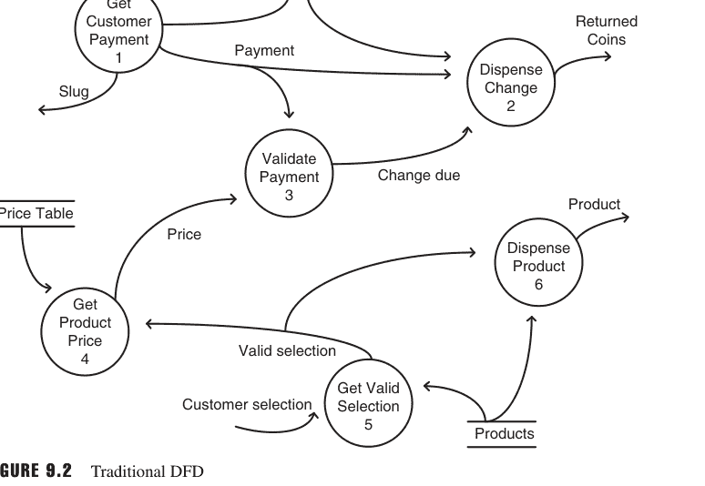

**FIGURE 9.3 (Modern) context diagram**

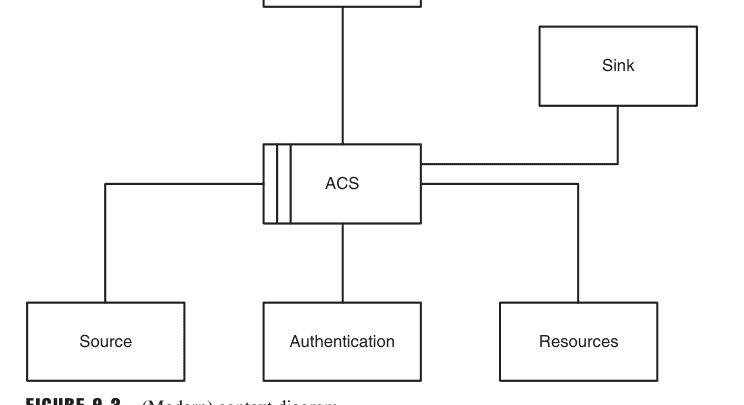


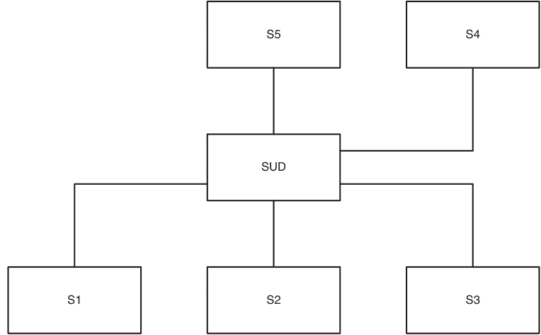

当前系统是我们在第9.2.3节中引入的一种或多种领域架构的特例。这些风格各有差异，但有一个共同点：它们在最一般的形式下往往具有相同的上下文图。我们在图9.4中展示了这一点，它可以作为任何中型应用程序的模板。特别是，通用名称SUD以及S1到S5这些名称需要重命名，并且必须找到它们的职责（例如，对于DVM系统的情况，如图9.3所示）。作为说明，我们描述每个系统的一般职责：

- **S1：** 没有它就不会有输入数据的系统。所有主要事件和数据都源自该系统。
- **S2：** 这是一种辅助/分类系统，它将来自S1的数据转换为（主要）可供系统S3使用的实体和对象。从某种意义上说，它是一种*对象工厂*。
- **S3：** 将修改后的输入数据转换为所需输出形式的系统。
- **S4：** 接收输出数据的外部系统。S4本身可能是一个大型系统（拥有自己的上下文图），并且可以采用与当前SUD相同的方式进行设计。
- **S5：** （可能可选的）系统通过与SUD交换信息来监视和控制它，例如下载设置或执行*看门狗*职责。
- **SUD：** 中央*中介*系统，负责协调上下文图中各系统之间的数据流和控制流。

需要尽快设计的基本系统是S1、S3、S4，当然还有SUD（其他系统可以在初始版本中忽略或建模为硬编码的*桩*）。这是有助于启动设计过程的最小集合。如果你能识别出这些系统，那么你将大大降低项目风险。我们注意到，图9.4中的每个系统都可以是拥有各自上下文图的多个系统。

区分不同领域类别非常重要。领域类别的区分特征或“分隔符”是它产生的输出数据类型。读者可以使用以下初始分离机制对应用程序进行分类：

- MIS：从事务数据生成决策支持信息。这可能采取由*报表系统*处理的多维数据的形式。
- MAN：从原材料中创造产品和服务。
- RAT：在时间和空间中跟踪请求。生成有关请求的状态报告。
- PCS：始终满足特定条件。监视异常事件。
- ACS：为主动的授权主体提供对被动的对象和资源的访问权限。

现在我们采用一个基于图9.4中上下文图的C++玩具示例系统。这个选择是为了激励目的。我们使用系统S1（输入）、S3（处理）、S4（输出）和SUD（中介）来设计该系统。核心过程是创建一个字符串，将其修剪（使用*Boost C++字符串算法库*中的功能删除前导和尾随空格），将其转换为大写，最后在控制台上显示它。该系统可以看作一个非常简单的RAT系统。它跟踪一个字符串。

我们用C++实现该系统，其中SUD是一个模板类，其参数对应于系统S1、S3和S4。我们约定这些系统应实现的某些接口，以便SUD可以与它们通信。我们使用*私有继承*作为实现接口的技巧。

这是一个简单的*推送模型*，从某种意义上说，数据（在本例中是一个字符串）以管道模型的方式从一个系统推送到另一个系统。

类定义为：

```
#include <string>
#include <iostream>
#include <boost/algorithm/string.hpp>

template <typename I, typename O, typename Processing>
    class SUD : private I, private O, private Processing
{ // System under discussion

private:
    // Define the requires interfaces that SUD needs
    using I::message;    // Get input
    using Processing::convert;    // Convert input to output
    using O::print;    // Produce output
    using O::end;    // End of program

public:
    void run()
    {
        // Core process, showing mediating role of SUD
        auto s = message();    // I, input
        convert(s);    // P, processing
        print(s);    // O, output
        end();        // O, signals end of program
    }
};
```

现在我们如下特化这个类；我们创建单个输入和输出对象以及两个转换器对象：

```
// Instance Systems
class MyInput
{
public:
    std::string message() const
    {
        return std::string(" Good morning ");
    }
};

class MyConverter
{
public:
    void convert(std::string& s) const
    {
        // Process string using Boost String Algorithm library
        boost::trim(s);
        boost::to_upper(s);
    }
};

class YourConverter
{
public:
    void convert(std::string& s) const
    {
        s = std::string("Sorry, it's a secret");
    }
};

class MyOutput
{
public:
    void print(std::string& s) const
    {
        std::cout << s << std::endl;
    }

    void end() const
    {
        std::cout << "end" << std::endl;
    }
};
```

一个测试程序为：

```
// First instantiation
SUD<MyInput, MyOutput, MyConverter> sud;
sud.run();
```

```
// Second instantiation
SUD<MyInput, MyOutput, YourConverter> sud2;
sud2.run();
```

总而言之，这段代码是基于策略的设计（PBD）的一个例子，我们将在第9.5节中介绍。此解决方案的优点是`SUD<I, O, P>`的特化是类，我们不能在运行时在不同的转换器之间切换。本章的练习2讨论了代码的一些扩展和修改。

### 9.4 检查清单与回顾

在进行详细设计之前，我们应该回顾一下我们已经取得的成果。我们重新考虑结果以及导致结果的步骤。一些检查清单问题是：

- 我们能检查结果吗？我们能否一眼看清？
- 我们能否编写一个C++原型（*概念验证*）来激励系统的核心过程？
- 你能将结果用于其他问题吗？
- 你能通过从输出回溯到输入（波利亚启发式H6）来检查系统职责吗（见练习1）？

当然，我们不能指望在早期阶段发现所有细节和*假设情景*，但我们应该有信心不会在软件开发生命周期的后期阶段遇到一些不愉快的意外、预算超支和代码重写。这与杰克逊在第9.2.1节中的观察是一致的。

#### 9.4.1 特例：定义系统的运行环境

我们通过讨论一些与必须适应现有软件和硬件环境的系统相关的话题来结束本节。我们不仅需要找到系统接口，而且可能还需要在SUD和这些外部系统之间添加额外的间接层，通过引入可由设计模式（如代理和桥接）实现的*虚拟机*（见GOF，1995；POSA，1996）。我们越早了解这些依赖关系，生成的代码就越可维护，因为我们知道运行环境将在系统生命周期内发生变化。特别是，规范（“做什么”）和设计（“如何做”）之间的边界值得关注，然后*系统建模*将成为设计过程的一部分。

我们通过列出实践中出现的系统类型来总结本节。这项活动是*系统范围界定*的一部分（Sommerville和Sawyer，1997）：

- 直接与SUD接口的系统。这包括已经存在的系统，以及与SUD同时开发中的计划系统。
- 可能与当前系统共存的其他系统（在已知的情况下），并定义它们之间的交互。
- 最终将与系统集成的相关*业务流程*。

在进入详细设计之前，从这些角度审视问题是有价值的。我们可能会发现一些功能和需求，否则在软件生命周期的后期阶段很难实现。我们应该以*变化为先*的心态进行设计。

### 9.5 软件过程的变体：基于策略的设计

PBD是C++中一种基于策略的编译期编程习惯用法。*策略*定义了一个类接口或类模板接口。策略可以包含成员函数、成员变量和内部类型定义。策略更关注行为，而较少关注结构。换句话说，策略是*语法导向*的，这意味着它指定了符合类必须实现的名称和输入/输出参数。另一方面，通用函数包装器是*签名导向*的。关于策略的一个常见评论是，一些开发人员将它们视为*策略*设计模式（GOF，1995）的编译期变体。它们与*鸭子类型*密切相关。更准确地说，策略采用参数多态，而GOF设计模式采用子类型多态。

在详细讨论如何设计PBD系统之前，我们给出一个GOF*策略*模式的初始示例，使用子类型多态的实现以及相应的策略实现。我们回忆一下这种设计模式的定义：

> *策略定义了一族算法，封装了每一个，并使它们可以互换。策略让算法独立于使用它的客户端而变化。*

为此，我们创建了一个函数和一个类，根据多个生成器生成随机数数组，例如C的`rand()`函数、*Boost*中的滞后斐波那契生成器以及C++ `<random>`库中的梅森旋转算法。应用传统*策略*模式时采取的方法是创建一个抽象基类，其中包含一个纯虚成员函数，该函数定义了策略与其客户端之间的契约。具体派生类实现此成员函数。

表示策略接口的基类是：

```
class Rng
{
public:
    virtual double rng() = 0;
```


// 函数调用运算符；模板方法模式
double operator () ()
{
    return rng();
}

一些实现如下：

```
#include <random>
#include <cstdlib> // rand()
#include <memory>
#include <vector>
#include <algorithm>
#include <iostream>
#include <ctime>
#include <boost/random.hpp>
```

```
class InfamousRng : public Rng
{
public:
    InfamousRng()
    {
        srand(std::time(0));
    }

    double rng() override
    {
        return rand();
    }
};
```

```
class MTRng : public Rng
{ // Mersenne Twister
private:
    std::mt19937 eng;
    std::uniform_real_distribution<double> d;

public:
    MTRng() : eng(std::mt19937(std::time(0))),
              d(std::uniform_real_distribution<double>(0.0, RAND_MAX))
    {}

    double rng() override
    {
        return d(eng);
    }
};
```

- 2. 策略为*相同*的行为提供不同的实现。因此，我们可以使用最适合我们效率和准确性要求的策略。从这个意义上说，我们将*策略*称为*服务变体*模式。

- 3. 客户端必须意识到策略的存在。这引入了耦合，因为客户端需要知道基类的名称但不需要知道派生类的名称（在上述情况下基类称为 `Rng`）。每个新算法都必须实现为 `Rng` 的派生类，这排除了来自其他来源的功能（除非我们使用适配器）。这可能是一个缺点，因为它可能导致我们必须使用（多重）继承，这将导致重大的维护问题。

- 4. 策略增加了应用程序中的对象数量。在许多情况下，这些对象必须在堆上创建，然后应用程序需要为它们定义对象生命周期策略。这是一个额外的复杂性，并会增加开发时间。

- 5. 性能；上述代码使用虚成员函数来改变行为，这可能对应用程序的性能产生影响。

我们现在对上述代码进行改编，以基于 PBD 原则生成解决方案。从某种意义上说，它是 OOP 方法的一个变体。一般来说，它是一个编译时技巧（基于*参数多态*），而上述解决方案基于*子类型多态*。

PBD 中的核心惯用法是创建一个类模板（称为*宿主类*），在最一般的情况下，它接受一个或多个类型参数作为参数。这些类型由*策略类*专门化，每个策略类实现一个称为*策略*的特定隐式接口。

我们现在已经定义了足够的术语，可以使用 PBD 设计上述问题。首先，宿主类是：

```
template <typename RngPolicy>
    class RandomGenerator : public RngPolicy
{ // Policy-based design random number generator.
// This is a host class.

public:
    // Function call operator, Template Method pattern
    double operator () ()
    {
        return rng();
    }

    std::vector<double> randomArray(unsigned N)
    {
        std::vector<double> result(N);
        for (std::size_t i = 0; i < result.size(); ++i)
        {
            result[i] = rng();
        }

        return result;
    }
};
```

在这种情况下，我们看到宿主类不包含任何硬编码的类名，只有一个实现*隐式接口*的模板参数，在本例中是*函数调用运算符*的实现（这意味着该类成为一个函数对象）。任何实现此运算符的类都可以用作策略。我们不强制客户端从某个基类继承。这增加了宿主类的可重用性和可定制性。事实上，可以创建一个库，由宿主类和每个策略的已*预定义实现*集合组成。例如，我们可以定义一个策略，实现 `knuth_b` 引擎适配器，该适配器返回使用伪随机数生成器引擎 `minstd_rand0` 生成的洗牌序列：

```
```cpp
class KnuthRng
{
  // knuth_b algorithm as a policy class
private:
  std::knuth_b eng;
  std::uniform_real_distribution<double> d;

public:
  KnuthRng() : eng(std::knuth_b(std::time(0))),
               d(std::uniform_real_distribution<double>(0.0, RAND_MAX))
  {
  }

  double rng()
  {
    return d(eng);
  }

  // Function call operator,Template Method pattern
  double operator () ()
  {
    return rng();
  }
};
```
```

在当前上下文中使用 PBD 的示例是：

```
```cpp
// Policy-based classes
RandomGenerator<KnuthRng> policyRng;

auto rnArr4 = policyRng.randomArray(100);

// Use OOP classes with policy RNG
RandomGenerator<LfRng> policyRng2;

auto rnArr5 = policyRng2.randomArray(100);
```
```

我们注意到，在这种情况下，*不可能*在运行时更改宿主类的策略，这与基于 GOF *策略* 的设计形成对比。顺便说一下，第 9.3.3 节中的代码示例

是使用三个策略类用于输入、处理和输出的 PDB 示例。我们回忆一下，在这种情况下宿主类定义为：

```
template <typename I, typename O, typename Processing>
  class SUD : private I, private O, private Processing
```

#### 9.5.1 PBD 的优点和局限性

策略化设计惯用法的术语在 Alexandrescu (2001) 中进行了讨论，其中对其进行了定义并给出了一些示例以说明如何使用它。从某种意义上说，它在 C++ 社区中几乎达到了神话般的地位。维基百科对 PBD 的总结如下：

> 策略惯用法的关键特征是，通常（尽管并非严格必要），宿主类将从其每个策略类派生，使用（公共）多重继承。（替代方案是宿主类仅包含每个策略类类型的成员变量，或者以私有方式继承策略类；然而，公开继承策略类具有主要优势，即策略类可以添加新方法，由实例化的宿主类继承并可供其用户访问，而宿主类本身甚至不必知道这些方法。）该惯用法这一方面的一个显著特征是，相对于面向对象编程，策略颠倒了基类和派生类之间的关系——而在 OOP 中，接口传统上由（抽象）基类表示，接口的实现由派生类表示。在策略化设计中，派生（宿主）类表示接口，而策略类实现它们。还应注意，在策略的情况下，公共继承并不表示宿主类和策略类之间的 ISA 关系。虽然这在 OOP 上下文中传统上被认为是设计缺陷的证据，但在策略惯用法上下文中并不适用。

我们可以根据示例检查此描述。我们从语言和设计过程的角度对 PBD 进行批判性审视。

- 策略接口在 C++ 代码中有直接、显式的表示。此接口是隐式定义的（通过鸭子类型）；因此它使用注释单独手动记录。鸭子类型是编程语言在类型之上的一层，它关注于确定对象是否适合某种用途。这种适用性由某些方法和属性的存在（具有适当的语义含义）决定。换句话说，程序员只关心确保对象在给定上下文中按要求表现，而不是确保它们属于特定类。这是一个至关重要的观察。它意味着一种多态形式，而无需创建类层次结构。我们注意到鸭子类型可以为运行时和编译时场景定义，但讨论超出了本书的范围。

- 模板在静态类型上下文中应用鸭子类型。

- 策略化设计可能不是所有应用程序的最佳方法。它似乎与 C++ 特别是 C++ 模板密切相关。其他语言，对于


例如，带*约束*的 C# 泛型接口或许能提供一种更优雅的解决方案。例如，一个简单的 C# 系统用两个策略分别表示输入和输出，代码如下：

```
interface IInput
{
    string message();
}

interface IOutput
{
    void print(string s);
}

// I/O stuff
class SUD<I,O>
    where I : IInput
    where O : IOutput
{

    private I i_;
    private O o_;

    public SUD(I i, O o)
    {
        i_ = i;
        o_ = o;
    }

    public void run()
    {
        o_.print(i_.message());
    }
}
```

- 在撰写本文时，C++ 既不支持接口，也不支持约束（即 C++ 中所称的*概念*）。因此，上述理想的特性在当前的 C++ 版本中尚无法实现。所以，唯一的解决方案似乎是使用公有继承或私有继承，而不是组合。
- 在我们看来，要创建一组良好的正交策略并不容易，只能依靠反复试验和迭代。
- 不支持*需求接口*。这个问题的根源在于 C++ 不支持*事件*和*委托*（C# 则支持这些软件实体）。一种变通方法是使用实现了*回调*的 GOF *观察者*设计模式。我们没有尝试从 PBD 的角度实现这种模式，而是倾向于使用 Boost C++ 的*signals2*库方案。我们将在后续有关蒙特卡洛模拟的章节中看到一些示例。
- 作者尚不清楚如何将 PBD 应用于并行软件系统的设计。

#### 9.5.2 为 PBD 定义的过程

UDP 将 PBD 作为一个特例包含在内。这意味着我们可以通过首先分析和设计问题来解决 PBD 中存在的这些问题。现在，我们给出一些有用的指导原则：

- 1. 找到宿主类和策略。我们的出发点是创建系统上下文图。一般来说，宿主类对应于 SUD 系统，而策略对应于 SUD 的卫星系统。
- 2. 上下文图中的每个系统是否满足 SRP？系统之间的职责是否存在重叠？确定如何修复这些问题，例如，通过确保每个系统处理自己类型的数据，或使用*整体–部分设计模式*（POSA, 1996）将其分解为专用的系统。如果您能确定您的应用程序属于哪个领域类别，这会变得更加容易，因为在那些情况下，系统的职责是正交的。
- 3. 确定上下文图中每个系统的*提供–需求*接口。参考图 9.4，我们可以说系统 S1、S2 和 S3 向 SUD 提供服务，而 SUD 向系统 S4 和 S5 提供服务（S4 和 S5 也有可能要求 SUD 提供服务）。在某些情况下，系统 S5 可以向 SUD 提供服务，例如下载 SUD 所需的参考数据。
- 4. 决定如何将系统设计为 C++ 原型。审查原型并确定它是否满足需求。提出这些问题将有望帮助您设计出稳定的软件系统。

### 9.6 使用基于策略的设计解决 DVM 问题

现在，我们讨论如何为我们在 9.3.2 节中介绍的问题在 C++ 中创建一个简单的原型。创建图 9.3 中的初始上下文图很容易，因为 DVM 是 ACS 的一个特例，而 ACS 的上下文图是已知的。从项目管理的角度来看，我们希望已经消除了一大风险来源，因为我们创建了一个稳定的设计，可以扩展它来满足当前和新兴的需求。

我们选择使用 C++ 模板来实现图 9.3 中的系统，如下所示：

```
// Notation: GSys == Generic system, not instantiated
template <typename GSource, typename GAuth, typename GResource,
          typename GSink, typename GMIS>

class DVM : private GSource, private GAuth, private GResource,
private GSink, private GMIS
{ // System under discussion
private:

    // C++ does not support interfaces NOR concepts (constraints)
    using GSource::message;

    using GAuth::amount;
    using GAuth::increment;
    using GAuth::decrement;
```

```
using GResource::displayProducts;
using GResource::getProduct;
using GResource::updateProduct;

using GSink::notify;

// Data, the amount left to spend
int amt;

// Other members

};
```

我们可以看到，策略接口已经被形式化，并由策略类实现。我们设计了 SUD *（中介者）* 来协调与策略类的交互，如下面的代码所示：

```
void run()
{
    // 1. Get customer payment, Auth: Idle State, wait for coins
    std::cout << "Amount to insert: "; std::cin >> amt;
    GAuth::increment(amt);
    std::cout << "Amount in machine: " << amount();

    // 2. Choose product, Resource: Waiting for Selection State
    GResource::displayProducts();
    auto prod = getChoice();

    int change;
    try
    {
        auto info = GResource::getProduct(prod);
        std::cout << prod << " costs " << std::get<0>(info);
        change = amt - std::get<0>(info);
    }
    catch (int ex)
    {
        std::cout << "Product not found, bye\n";
        return;
    }

    // 3. Commit transaction (dispense product) and update
    // database, Resource
    GResource::updateProduct(prod, 1);
    GResource::displayProducts();

    // 4. Inform Sinks and MIS
    GSink::notify(prod, true);
```

```
// 4A. Give change
std::cout << "The amount of change is: " << change;
}
```

这段简单的*先让它跑起来*的代码实现了系统中的核心流程。一种方法是将该系统建模为状态转换表或 UML 状态图（Harel 和 Politi, 2000；Hatley 和 Pirbhai, 1988）。

至此，DVM 应用程序的通用框架设计就完成了。为了测试它，我们需要创建一些具体的策略类。第一组由以下实现所需接口的策略类构成：

```
class Auth
{
    // This is where money is placed

private:
    int money_;
public:
    Auth(int money=0) : money_(money) {}

    int amount() const { return money_; }

    void increment(int amount) { money_ += amount; }
    void decrement(int amount) { money_ -= amount; }

};  // Tuple consisting of price + supply

using Product = std::tuple<int, int>;

class Resource
{
    // (Simple) product database
private:
    // Name, price and supply
    std::map<std::string, Product> db;

public:
    Resource()
    {
        std::tuple<int, int> tup(2, 10);
        db.insert(std::pair<std::string, Product>("COLA", tup));

        std::tuple<int, int> tup2(2, 20);
        db.insert(std::pair<std::string, Product>("ORANGE", tup2));
    }

    void displayProducts() const
    {
        std::cout << "**** Product Database ************\n";
        for (auto i = std::begin(db); i != std::end(db); i++)
        {
```

```
std::cout << "Product: " << i->first << ", price: "
        << std::get<0>(i->second)
        << ", supply: " << std::get<1>(i->second);
    }
    std::cout << "*************\n";
}

std::tuple<int, int> getProduct(const std::string& product)
{
    auto prod = db.find(product);
    if (prod != db.end())
    {
        return prod->second;
    }

    throw - 1;
}

void updateProduct(const std::string& product, int quantity)
{ // Decrement supply by a given amount

    auto prod = db.find(product);
    if (prod != db.end())
    {
        std::get<1>(prod->second) -= quantity;
    }
};

class Sink
{ // Final recipient of end of transaction
private:

public:
    void notify(std::string prod, bool status) const
    {
        std::cout << "Transaction " << prod << ", status "
                  << std::boolalpha << status << std::endl;
    }
};

class MIS
{
public:

    // TBD $$
};
```

在这种情况下，我们看到 `Resource` 是一个非常简单的数据库，并且只有一个接收器类，即 `Sink`。

一个使用示例如下：

```
// Single sink class
DVM<Source, Auth, Resource, Sink, MIS> dvm;
dvm.run();
```

#### 9.6.1 引入事件和委托

在某些情况下，我们希望将交易结束的消息广播给多个接收器。C++ 不直接支持此功能，因此我们提出以下替代方案：

- a) GOF *观察者*模式（参见 GOF, 1995）。
- b) 使用通用函数包装器的集合（`std::function` 类）。
- c) 使用 Boost C++ 的*signals2*库（Demming 和 Duffy, 2010）。

我们将讨论如何将方案 c) 应用于当前问题。为此，我们将信息发送到控制台、模拟的本地数据库和模拟的远程数据库（仅为举例说明）。相应的*槽函数*如下：

```
void Print(const std::string& prod, bool status)
{ // Free function

    std::cout << "I am a printer " << prod << std::endl;
}

// Lambda function
auto database = [](const std::string& prod, bool status) -> void
                  { std::cout << "In due time, I save " << prod << " to
                    database"; };

auto databaseBackup = [](const std::string& prod, bool status) -> void
                       { std::cout << "Just backuped..."; database
                         (prod,status); };
```

现在，我们定义一个接收器函数对象，它扮演*信号*的角色。当它被调用时，会触发与其连接的槽：

```
class Sink2
{
    // Final recipient(s) of end of transaction, now a signal;
    // configure beforehand
private:
    boost::signals2::signal<void(std::string& prod, bool status)> sig;
```


```
public:
    Sink2()
    {
        sig.connect(2,Print);
        sig.connect(0,database);
        sig.connect(1,databaseBackup);
        // add
    }

    void notify(std::string prod, bool status) const
    {
        std::cout << "\n*** Notifications ***\n";

        // Emit signal and broadcast to slots
        sig(prod, status);
        std::cout << "*** Notifications, end ***\n\n";
    }
};
```

使用示例为：

// Multiple sinks in Boost signals2
DVM<Source, Auth, Resource, Sink2, MIS> dvm2;
dvm2.run();
```

一个重要的说明是，信号及其槽必须具有相同的签名。

### 9.7 统一设计方法的优势

我们总结了研究结果和成果。我们认为的一些主要优势是：

- 分离关注点：我们通过将问题分解为*松耦合的内聚系统*来避免不必要的和过早的编码。换句话说，每个系统都满足单一职责原则，并且与其他系统有狭窄的接口。
- 我们进行前期分析以创建可维护和可重用的软件系统和代码。
- 创建了一个*通用词汇表*，所有团队成员都可以（希望）理解。在系统演进期间可以确保团队成员之间改进的沟通。
- 使用设计工件作为项目管理和软件风险管理流程的输入。
- 采用组装思维将软件组件粘合形成更大的系统。按稳定原型的序列增量交付软件。

### 9.8 总结与结论

在本章中，我们介绍了一个分析、设计和实现任何规模和任何复杂度的软件系统的流程。该流程受到了结构化分析方法、类比推理（使用领域架构和问题框架的技术）以及开发人员经验的影响。它使我们能够将软件设计为稳定原型的序列。作为特例，我们在 C++ 中形式化了基于策略的设计方法，并展示了我们的方法如何包含它。我们还给出了一些具体的例子。

最后，我们总结了本章中介绍的主要概念和流程。目标是提供在创建应用程序时使用的一些指南和提示。为此，我们通过以下计划解决问题的：

- 1. 理解问题。在此阶段，我们确定系统应交付的内容（输出）、系统的核心输入以及将输入连接到输出的步骤/操作的描述。能够构建数据流图（如图 9.2 所示）是有利的。
- 2. 系统识别。我们发现实现步骤 1 中数据流的系统和模块。特别是，我们创建一个上下文图（如图 9.3 所示）。每个模块具有单一的主要职责，并向其他模块提供服务并需要来自其他模块的服务。必须能够描述模块之间的主要数据交换。
- 3. 逻辑接口规范。在此阶段，我们描述实现无关的接口（接口是一组抽象方法，每个方法都有输入参数和返回类型）。理想情况下，您应该能够为每个模块描述提供的和所需的接口。
- 4. 决定如何设计和实现逻辑接口。由于我们在此案例中使用 C++（例如 C# 会提供我们不同的选择）我们可以从以下选择：
  - P1：子类型多态、类层次结构和虚成员函数。这是传统的面向对象解决方案。
  - P2：使用 std::function 对接口的函数进行建模。这是一种多范式软件方法，因为接口的目标方法可以是自由函数、lambda 函数、函数对象或对象和静态成员函数。
  - P3：使用基于 C++ 模板的策略设计方法，结合第 9.3.3 节初始示例中描述的 using 指令。我们认为这种解决方案在范围上相当有限，但在创建软件原型时可以使用。
  - P4：创建一个模板中介类，其参数实现步骤 3 中的逻辑接口。我们使用鸭子类型（参见第 9.5.1 节）在模板参数实例化时隐式定义这些接口。这种方法基本上是基于策略设计的另一种变体。
  - P5：创建一个单一的单体中介类来实现系统核心流程。此选项适用于系统需求不明确或我们希望快速创建一个概念验证以展示给客户和客户的情况。

5. 开始设计、开发和测试实现步骤 4 的代码。我们可能需要从头创建新系统，但在大多数情况下我们可以重复使用来自以前项目和标准库（如 STL 和 Boost）的现有代码。第 9.4.1 节中的讨论在这里可能相关。

步骤 1–5 勾勒出理想的情况，实际上我们看到步骤之间既有回溯也有前向跟踪。既是艺术也是科学。

在后面的章节中，我们将根据步骤 4 中的选项 P2 检查一个完全完成的测试用例。另请参阅第 19 章中的练习，其中我们讨论了各种设计变体。在第 30 章第 30.7 节中，我们展示了如何在设计多任务和消息传递应用程序时增强上述步骤 1–5。

### 9.9 练习和项目

1. （头脑风暴问题）
考虑第 9.1 节中的步骤 1、2、3 和 4。从软件开发的角度回答以下问题（精确性目前不是关注点；这些问题旨在让您思考如何分析和解决问题）：

a) 对于以下类型的项目，您会执行哪些步骤（以及在每个步骤花费多少时间）？

- 在现有应用程序中添加/修改功能。
- 测试新算法或模型可行性的项目。
- 在贵组织中没有先例（从未做过）的新项目。
- 将第三方软件集成到您的应用程序中。

b) 当处理功能需求缺失、不完整甚至错误时，您应该确定以下启发式方法在更好地理解需要设计的内容方面是否有用（参见 Pólya, 1990, 1990A 了解更多讨论和示例）：

- H1 类比：找到一个与当前问题相似的问题并解决它。
- H2 问题变体：改变或变化问题以创建一个新问题，其解决方案有助于解决原始问题。
- H3 辅助问题：通过找到有助于解决原始问题的子问题或侧面问题来缩小范围。
- H4 先例：找到一个与当前问题相关且已解决的问题。
- H5 图示推理：你能画出问题的图吗？
- H6 反向工作：从目标开始并向后工作到已知的内容。
- H7 分解和重组：分解问题并以某种新方式重新组合其元素。
- H8 辅助元素：向问题添加新元素以更接近解决方案。
- H9 概括：找到比当前问题更一般的问题。
- H10 专门化：找到比当前问题更具体的问题。

H11 归纳：通过从一些具体例子中推导出概括来解决问题的。

应用这些启发式的目标是降低风险并更清晰地理解我们试图设计的问题。一般来说，你在更一般和更专门的问题版本之间来回振荡。这也是在现实生活中的软件项目中可能发生的情况。

c) 考虑您最近参与的最后一个软件项目。您使用了 b) 部分中的哪些启发式方法——是有意识的还是无意识的？您本应该使用但没有使用的单一启发式方法是什么？

d) b) 部分中的哪些启发式方法被 Gamma（GOF）设计模式所解决？我们回顾设计模式的定义（参见 GOF, 1995）：

> 在软件工程中，设计模式是在给定软件设计上下文中常见问题的通用可重用解决方案。设计模式不是可以直接转换为源代码或机器代码的成品设计。它是可用于许多不同情况的解决问题的描述或模板。

上述启发式方法 a) 中哪些没有被设计模式解决或包含？作为指导，取一个您熟悉的模式（例如第 9.5 节中讨论的 Strategy）并逐一与每个启发式方法进行比较。您能看到任何关系吗？

2. （扩展第 9.3.3 节的 PBD 设计）

我们就第 9.3.3 节中的代码提出一些问题。目标是扩展和修改代码，以便在进入后面章节中讨论的计算金融中更复杂的应用程序之前获得小型系统的实践经验。

回答以下问题：

a) 泛化代码，使其适用于任何数据类型，而不仅仅是字符串。此外，输入数据类型 T1 不一定与输出数据类型 T2 相同，因此转换器成为将 T1 的实例映射到 T2 的实例的类。您需要使用模板-模板参数：

```
template <typename T1, typename T2,
    template <typename T1> class Source,
    template <typename T2> class Sink,
    template <typename T1, typename T2> class Processing>

class SUD : private Source<T1>,private Sink<T2>, private
Processing<T1, T2>
{ // System under discussion

    // TBD
}
```

实现代码并使用标量和复合数据类型进行测试。

b) 在这一部分，我们使用通用函数包装器实现转换器，它将是 SUD 的数据成员，即 std::function<T2 (const T1& t)> 的一个实例。


实现代码。这是否比第 a) 部分的解决方案更灵活，如果是，在什么方面？特别是，使用自由函数、lambda 函数、静态成员函数、函数对象和绑定成员函数来实现转换器功能。

- c) 修改原始代码以支持新的需求：系统 S1 打开一个文件并处理其每条记录，系统 S3 将记录的字符串转换为修剪后的大写字符串，系统 S4 将字符串写入新文件。（参见图 9.4；目前可以忽略系统 S2 和 S5。）

## 3.（扩展第 9.6 节的 DVM 代码）

DVM 问题的初始代码需要扩展以适应更广泛的客户。一些新特性和需求是：

- a) 多台 DVM 机器的远程管理，例如监控和控制出现故障的机器。
- b) 使用信用卡付款的能力。
- c) 不同种类的用户输入面板以适应不同的风格。
- d) 选择一系列产品然后作为单笔交易付款的设施，例如由饮料、三明治和巧克力棒组成的午餐套餐。

回答以下问题：

- a) 为了容纳这些新特性，需要对图 9.3 中的上下文图做出哪些更改？例如，你可能需要设计新的卫星系统或现有系统可能需要以某种方式修改。理想情况下，接口将保持稳定，但这不能保证。在这种情况下，你可能需要创建适配器（GOF，1995）。
- b) 以下哪些设计模式可用于实现所需的功能？代理、桥接、远程代理、状态机、观察者、中介者。
- c) 粗略估计（上限）实现这些功能所需创建的类数量。估计编写和测试代码所需的时间。

## 4.（DVM 问题的替代实现）

本章中 DVM 系统的解决方案基于 C++ 模板和 PBD。这在所有情况下可能不是最合适的方案。更重要的是，开发人员可能更习惯于使用类层次结构和子类型多态（许多 C++ 遗留系统使用）。出于这个原因，使用类层次结构和虚成员函数实现 DVM。为此，我们已使用接口和泛型在 C# 中实现了 DVM，代码几乎是我们希望在 C++ 中看到的形式。接口（这些将在 C++ 中为纯抽象类）和 SUD 接口是：

```
// 定义接口/契约
public interface ISource
{
    string message();
}

public interface IAuth
{
    int amount();
    void increment(int amount);
    void decrement(int amount);
}

public interface IResource
{
    void displayProducts();
    Tuple<int, int> getProduct(string product);
    void updateProduct(string product, int quantity);
}

public interface ISink
{
    void notify(string prod, bool status);
}

public interface IMIS
{
    void notify();
}
// ** 接口结束

// 记号：G{Sys} == 通用系统，未实例化
public class DVM<GSource, GAuth, GResource, GSink, GMIS>
    where GSource : ISource
    where GAuth : IAuth
    where GResource : IResource
    where GSink : ISink
    where GMIS : IMIS
{
    private ISource iso_;
    private IAuth ia_;
    private IResource ir_;
    private ISink isi_;
    private IMIS im_;
    // 更多
}
```

回答以下问题：

- a) 使用 C# 作为基线要求，用 C++ 实现 DVM。使用 C++ 纯抽象基类模拟 C# 接口。测试程序并检查输出是否与之前相同。
- b) 从效率、可维护性、可扩展性以及组件在运行时的可替换性方面比较所有解决方案。答案将帮助你决定在给定上下文中哪种方案最合适。
- c) 考虑使用 C++ 通用函数包装器和 Boost C++ signals2 库作为 SUD 与外部世界通信的手段。 与其他解决方案相比，其优点和缺点是什么？考虑共享/非共享状态、事件驱动编程、可维护性以及数据是推送还是拉取等问题。
- d) 讨论使用可变参数模板参数实现 SUD 的可行性。

## 5.（应用程序属于哪个类别？）

在本书中我们讨论了计算金融中的许多应用程序。在本练习中，我们希望在编写第一行代码之前深入了解理解问题。考虑以下应用程序：

- A1：使用二项式方法对单因子期权进行定价。
- A2：创建插值库。
- A3：利率衍生品的仿射定价模型。
- A4：优化算法。
- A5：参数估计算法。
- A6：单因子和双因子蒙特卡洛期权定价器。
- A7：计算 SDE 的有限差分近似的平均误差（参见 Kloeden、Platen 和 Schurz，1997，第 118 页）。
- A8：使用 PDE 模型进行期权定价。
- A9：后处理例程，通过与产生参考和精确值的方法进行比较来测试数值格式的准确性。
- A10：创建供其他系统使用的数据和模块。
- A11：配置完整应用程序。

回答以下问题：

- a) 确定这些应用程序所属的类别（或类别）。一般来说，最重要的类别是 MAN、RAT 和 MIS。
- b) 通过识别系统及其职责，为这些应用程序创建基本系统上下文图（以图 9.4 为参考模型）。
- c) 识别 PDE、二项式和蒙特卡洛期权定价器的系统上下文图之间的相似之处和差异。
- d) 你能否识别可用于多个应用程序的可重用构件，例如代码、库、数据类型和容器，例如第 c) 部分的应用程序？

## 6.（头脑风暴，启动软件项目）

接下来的三个练习旨在刺激关于范围界定和设计软件系统然后打包代码以供客户使用的讨论的讨论。随着我们逐步阅读本书，希望意图会变得更加清晰，因为许多应用程序和示例都采用相同的策略。我们假设在所有情况下，第 9.8 节中总结的五步都将遵守，以用于三个练习的目的。所有情况下的答案将告诉我们如何使用和/或定制这些步骤以满足给定的要求。

本练习的目标是在深入实现细节之前界定项目并消除主要的不确定性和风险。

通过说明如何为以下要求使用定制步骤来回答以下问题：

- a) 如何界定一个需求对你来说是新的（无先例）的项目。
- b) 创建一个概念验证程序以向客户演示。你有一周的时间来编写原型。
- c) 项目估算：估算设计系统上下文图中模块所需的小时数。
- d) 优先排序模块：哪些现在设计，哪些以后设计？

## 7.（头脑风暴，设计和编码）

本练习的重点是决定在某些质量特性是硬性要求的情况下，使用第 9.8 节中的设计方法 1，...，5 结合现代 C++ 特性中的哪一种：

- a) 效率和运行时间性能。这包括计算时间和使用的资源量。
- b) 互操作性（与现有和未来软件系统接口）。这些系统不一定基于面向对象的范式。
- c) 可移植性（软件适应在不同指定环境中工作以及在指定环境中安装软件的能力）。
- d) 可维护性（例如，修改代码、消除故障或适应环境变化所需的努力）。
- e) 你可能会发现你的初始软件不满足上述要求。然后需要对设计中的模块进行更改。可能需要更改的软件实体（接口、数据类型、算法、类）是什么？

## 8.（头脑风暴，配置和打包）

编写代码后，我们需要测试它并交付给客户。确定如何交付以下功能：

- a) 将配置代码（例如，对象/数据创建和初始化）与应用程序代码分离。
- b) 测试完整程序。
- c) 创建包含代码文件的目录结构。标准化文件名。

## 9.（确定需求）

本练习试图模拟关于如何为新软件产品发现和记录系统需求的讨论（参见 Sommerville 和 Sawyer，1997 年关于需求获取、分析、谈判和文档所需的技能）。为了使讨论与计算金融相关，我们考虑为单因子 Black–Scholes PDE 及其推广创建软件框架的问题。我们有兴趣通过 FDM 近似这些 PDE，尽管本练习原则上可以扩展到任何应用程序。

我们模拟一次初步的圆桌讨论，可能有以下利益相关者参加：

- 架构师：负责指定要设计的系统。
- 领域专家：对材料和系统在组织中的使用方式有深入了解。
- 项目经理：负责软件项目的成功执行。
- 赞助者：这可能是内部或外部利益相关者，通常是为项目成本以及开发人员薪水支付费用的利益相关者。
- 系统用户：这是每天实际使用计算机系统的人或群体。

本次模拟讨论的主要目标是就如何启动软件项目并使其成功完成达成利益相关者之间的共识。我们也对这种工作固有的假设和潜在风险感兴趣。在某个阶段，我们希望本章中的系统分解方法论能帮助我们集中注意力并避免陷入无休止的讨论。


回答以下问题：

+   a) 在继续之前，必须解决哪些主要风险和挑战？（参见 Sommerville 和 Sawyer，1997 年，其中讨论了一些有助于发现这些风险的主题。）
+   b) 对于高风险项目，您将采用什么方法来创建概念验证软件原型？您是否已明确原型的目标以及下一阶段是什么？
+   c) 我们能否使用波利亚的一些启发式方法（参见练习1）来帮助利益相关者从不同角度看待项目？您能否使用领域架构类别来改善利益相关者之间的沟通？
+   d) 假设已达成共识，确定项目经理将如何制定项目计划，包括对项目每个阶段所需时间的估算。
+   e) 根据讨论和发现，确定架构师及其团队将使用哪些设计风格、模式、语言特性和库，以便按时并在预算内生成一系列软件原型。

# 第10章

### C++ 和 Boost C++ 库中的新数据类型、容器和算法

#### 10.1 引言与目标

在本章中，我们介绍本书通篇将使用的 C++（和 Boost）中的许多特性与库。一般来说，我们将这些库作为各种应用程序中的实用工具和构建块。我们讨论与本书主题相关的必要功能，而不包含我们不需要的功能。有关 Boost C++ 库的更多信息，请参阅 Demming 和 Duffy（2010，2012）。

总的来说，我们将在本章完成对 C++ 语法和功能的讨论，然后从第11章开始进入应用部分。

#### 10.2 新特性概述

在本章中，我们将多种数据类型和容器汇集在一起。它们是有用的构建块，我们可以通过*组合*和*继承*等建模技术将其嵌入代码中使用。我们特别关注在科学应用中起基础作用的编译时和运行时矩阵。在后续章节中我们将需要它们：

+   - 二项式和三项式方法。
+   - 偏微分方程和有限差分法。
+   - 为统计分布创建查找表。
+   - 使用“位矩阵”作为非线性方程组求解的组成部分，例如使用*差分进化*（参见 Price、Storn 和 Lampinen，1996）。

在大多数情况下，我们感兴趣的是元素为浮点类型的矩阵。一个重要的用例是确定矩阵运算的运行时效率。为此，我们使用 C++ `<chrono>` 中的函数来测量处理时间。

C++ 的一个重要新增功能是能够使用 `std::bitset<>` 库对位集合进行建模。该库有许多应用。另请参阅本章中的练习2。

#### 10.3 C++ std::bitset\<N\> 与 Boost 动态位集库

在本节中，我们讨论位集。它们分别模拟*固定大小数组*（在 STL 中）和*动态数组*（在 Boost 中）。当我们希望管理标志集并对这些集合执行按位运算（如 AND、OR）时，位集非常有用。

我们首先讨论 STL 类 `bitset<N>`。该类对固定大小的位数组进行建模。位数 N 在编译时定义，此后不能更改。`bitset` 中的函数类别包括：

+   - 构造函数：默认构造函数以及基于整数和字符串输入参数的构造函数。
+   - 查询位集中一个、部分或全部位是否已被设置；比较位集是否相等或不相等。
+   - 设置、重置和翻转位集中的位。
+   - 对位集执行按位运算（与、或、或非、左移、右移、切换位）。
+   - 类型转换：将位集转换为 `string` 和 `long`。
+   - 统计位集中已设置的位数。

我们给出一些如何使用类 `bitset` 的示例。首先创建一个默认位集，使用一个整数值初始化一个位集，然后根据字符串创建一个位集：

```
#include <bitset>

// Constructors.
const int N = 10;
bitset<N> bsA;          // All bits set to 0.
cout << bsA << endl;   // Prints 10 zeroes.

int val = 7;
bitset<N> bsB(val);    // Init bitset with val's bit representation.
cout << bsB << endl;   // The binary form of val, i.e. 0000...111.

// Constructing bitsets based on strings.
bitset<N> bsC(string("0101010101"));   // String of length 10.
cout << bsC << endl;
```

接下来，我们通过从输入字符串中提取某些位来创建位集。在第一种情况下，我们创建一个长度为 7 的位集，从第三个位（索引 = 2）开始提取信息，一直持续到字符串末尾：

```
// Bitsets with start pos and/or size.
int index = 2;                         // 3rd bit, indexing
                                      // starts at 0.
bitset<7> bsD(string("1111000"), index);  // From index to end.
cout << "Bitset with start index: " << bsD << endl;
```

在这种情况下，输出是 `0011000`。我们注意到多余的位从左侧*填充*。下一个示例从输入字符串的开头提取 4 位：

```
int num_bits = 4;
index = 0;
bitset<7> bsE(string("10111000"), index, num_bits);
cout << "Bitset with start index and number bits: " << bsE << endl;
```

在这种情况下，输出是 `0001011`。在上述两种情况下，我们注意到位集的元素是从右到左*构造*的。

现在我们讨论以某种方式修改位集中位的操作。例如，我们可以将所有位设置为 true，将所有位设置为给定值，将所有位设置为 false，翻转所有位以及在某个位置翻转：

```
const int SZ = 4;
bitset<SZ> bsX(string("1010"));

bsX.set();                // Set all bits to true

// Set all the bits to bitValue.
bool bitValue = 1;   // True.
for (size_t j = 0; j < bsX.size(); ++j)
{
    bsX.set(j, bitValue);
}

bsX.reset();             // Set all bits to 0 (false).
bsX.flip();              // Set unset bits and vice versa.
bsX.flip(2);             // Toggle bit at position 2.
```

我们还创建了两个实用函数，用于打印位集的内容和比较两个位集：

```
template <int N>
void ExamineBitset(const bitset<N>& bs)
{
    cout << "Number of total bits: " << bs.size() << endl;
    cout << "Number of set bits: " << bs.count() << endl;
    cout << "Is any bit set?: " << boolalpha << bs.any() << endl;
    cout << "Is no bit set?: " << boolalpha << bs.none() << endl;
}
```

```
template <int N>
void CompareBitsets(const bitset<N>& bs1, const bitset<N>& bs2)
{
    cout << "Bitsets equal?: " << boolalpha << (bs1 == bs2) << endl;
    cout << "BitSets not equal?: " << boolalpha << (bs1 != bs2) << endl;
}
```

您可以测试这些函数并检查输出。

##### 10.3.1 布尔运算

我们可以对位集执行按位二元和一元运算。有两种二元形式：一种是修改左操作数，另一种是两个位集组合成一个新位集。我们给出两种形式的一些示例：

```
const int M = 4;
bitset<M> bs1(string("1010")); cout<<"bs1: "<<bs1<<endl;
bitset<M> bs2(string("0011")); cout<<"bs2: "<<bs2<<endl;

// Boolean operators, non-modifying.
cout<<"~bs1: "<<~bs1<<endl;                    // Toggle all bits.
cout<<"bs1 ^ bs2: "<<(bs1 ^ bs2)<<endl;        // Bitwise XOR.
cout<<"bs1 | bs2: "<<(bs1 | bs2)<<endl;        // Bitwise OR.
cout<<"bs1 & bs2: "<<(bs1 & bs2)<<endl;        // Bitwise AND.

// Boolean operators, modifying.
bs1 ^= bs2;  cout<<"bs1 ^= bs2: "<<bs1<<endl;   // XOR .
bs1 |= bs2;  cout<<"bs1 |= bs2: "<<bs1<<endl;   // Bitwise OR.
bs1 &= bs2;  cout<<"bs1 &= bs2: "<<bs1<<endl;   // Bitwise AND.
```

选择哪种选项取决于应用，但通常“修改器”形式比非修改形式更高效。

我们还可以对位集执行移位操作。和前面一样，也有两种形式：

```
// Shift operators, non-modifying. Always zero's are shifted in.
int n=1;
bs1=bitset<M>(string("1001")); cout<<"bs1: "<<bs1<<endl;
cout<<"bs1>>n: "<<(bs1 >> n)<<endl;            // Shift n bits to the right.
cout<<"bs1<<n: "<<(bs1 << n)<<endl;            // Shift n bits to the left.

// Shift operators, modifying. Always zero's are shifted in.
bs1=bitset<M>(string("1001")); cout<<"bs1: "<<bs1<<endl;
bs1 >>= n; cout<<"bs1 >>= n: "<<bs1<<endl;    // Shift n bits to the right.
bs1 <<= n; cout<<"bs1 <<= n: "<<bs1<<endl;    // Shift n bits to the left.
```

##### 10.3.2 类型转换

我们通过展示如何返回位集所表示的整数值和字符串值来结束对 `std::bitset` 的讨论。为此，我们使用成员函数 `to_ulong()` 和 `to_string()`。下面是一个示例：

```
// Type conversions.
const int P = 4;
bitset<P> bs(string("1011"));
```


```
// 与这些位对应的整数值。
unsigned long value = bs.to_ulong();
string stringValue = bs.to_string();

cout << "数值: " << value << ", 字符串值: "
    << stringValue << endl;
```

##### 10.3.3 Boost dynamic_bitset

这个类几乎与 `std::bitset` 相同，并且它的接口与 `std::bitset` 类似。然而，有一个主要区别：在当前情况下，我们可以在运行时创建动态长度的位集。这是通过 `dynamic_bitset<Block, Allocator>` 的构造函数实现的。它有两个模板参数：

- `Block`：存储位的整数类型（默认为 `unsigned long`）。
- `Allocator`：用于所有内部内存管理的分配器类型（默认为 `std::allocator<Block>`）。

使用示例：

```
#include <iostream>
#include <boost/dynamic_bitset.hpp>

using namespace std;

int main()
{
    boost::dynamic_bitset<unsigned int> x(4);  // 默认全为 0。
    x[0] = 1;
    x[1] = 1;
    x[3] = 1;
    cout << x << endl; // '1011'。

    boost::dynamic_bitset<unsigned int> y(4);
    cout << y << endl;  // '0000'。
    y = x;
    cout << y << endl;  // '1011'。

    return 0;
}
```

其他成员函数与 `std::bitset` 的成员函数相同。

##### 10.3.4 动态位集的应用

动态位集有许多应用场景。总的来说，使用它们可以生成高效且紧凑的代码。一些应用包括：

- 创建高效且紧凑的数据结构。
- 内存分配管理器。
- 霍夫曼编码、布隆过滤器。
- 信息检索。
- 光栅图形中像素和位图的建模。
- 遗传算法，尤其是在模拟*选择*、*交叉*和*变异*操作时。
- 实现安全和访问控制策略。
- 可以作为 `std::vector<bool>` 的替代方案，并对其进行改进。

对这些主题的讨论超出了本书的范围。更多示例请参见 Demming 和 Duffy（2012）。

### 10.4 计时库

*chrono* 库提供了一种表示时间点、时间间隔（例如天、分钟、秒或纳秒）以及多种时钟（例如系统时钟和高分辨率时钟）的方法。它是一个精度中立的库，是对先前创建灵活且准确的时间测量库的改进（更具可移植性）。

我们所说的“时间”是什么意思？有各种定义和视角：

- *实际经过时间*（实时时间）：从计算机程序开始到结束所花费的时间。它包括 I/O 时间和其他类型的等待时间。实时时间是由普通时钟测量的时间。
- *CPU*（进程）时间：CPU 用于处理计算机程序或操作系统指令所花费的时间，与测量 I/O 操作相对。CPU 时间通常以*时钟滴答*或秒为单位来衡量。CPU 时间可以进一步分为*用户时间*（CPU 在*用户空间*中执行代码所花费的时间）和*系统时间*（CPU 在*内核空间*中执行代码所花费的时间）。我们还可以将 CPU 时间测量为 CPU 容量的百分比，这称为*CPU 使用率*。在多处理器机器中，总 CPU 时间是计算机程序所使用的所有 CPU 消耗的 CPU 时间之和。
- *挂钟时间*（墙钟时间）：人类感知到的从任务开始到完成的时间流逝。它是 CPU 时间、I/O 时间和通信信道延迟的总和。
- *系统时间*：计算机系统对时间流逝的概念。它还包括日历上日子的流逝。

我们现在详细讨论 chrono 库如何测量时间。我们首先介绍支持分数运算的辅助类。

#### 10.4.1 使用 `std::ratio<>` 进行编译时分数运算

类模板 `std::ratio<>` 支持编译时有理数运算。有理数是一对由*分子*和非零*分母*组成的数，两者都必须

其他运算符有：

```
ratio_not_equal
ratio_less
ratio_less_equal
ratio_greater
ratio_greater_equal
```

最后，标准库支持 SI（国际单位制）比率（全部在命名空间 std 中）：

```
typedef ratio<1, 1000000000000000000> atto;
typedef ratio<1, 1000000000000000> femto;
typedef ratio<1, 1000000000000> pico;
typedef ratio<1, 1000000000> nano;
typedef ratio<1, 1000000> micro;
typedef ratio<1, 1000> milli;
typedef ratio<1, 100> centi;
typedef ratio<1, 10> deci;
typedef ratio<10, 1> deca;
typedef ratio<100, 1> hecto;
typedef ratio<1000, 1> kilo;
typedef ratio<1000000, 1> mega;
typedef ratio<1000000000, 1> giga;
typedef ratio<1000000000000, 1> tera;
typedef ratio<1000000000000000, 1> peta;
typedef ratio<1000000000000000000, 1> exa;
```

一些示例：

```
template <std::intmax_t Num, std::intmax_t Den>
    void print(const std::ratio<Num, Den>& r)
{
    std::cout << r.num << "/" << r.den << '\n';
}

// SI 单位
std::kilo myKilo; print(myKilo);        // 1000/1
std::milli myMilli; print(myMilli);     // 1/1000

std::nano myNano; print(myNano);        // 1/1'000'000'000
std::giga myGiga; print(myGiga);        // 1'000'000'000/1
```

chrono 库使用 `std::ratio<>`。

#### 10.4.2 时长

*时长*定义为某个时间单位上的滴答数。例如，10 分钟是 10 个分钟的滴答，而 86,400 秒是 86,400 个秒的滴答（也就是一天）。一些时长的初始示例：

```
namespace ch = std::chrono;

// 1/10 秒的 5 个滴答
ch::duration<int, std::ratio<1, 10>> d1(5);
// 1/20 秒的 4 个滴答
ch::duration<int, std::ratio<1, 20>> d2(4);
std::cout << d1.count() << ", " << d2.count() << '\n';  // 5,4
```

使用 SI 单位的其他示例：

```
// SI 单位
std::kilo myKilo; print(myKilo);          // 1000/1
std::milli myMilli; print(myMilli);        // 1/1000

std::nano myNano; print(myNano);          // 1/1'000'000'000
std::giga myGiga; print(myGiga);          // 1'000'000'000/1
```

其他预定义的辅助时长类型：

```
std::chrono::nanoseconds
    duration</*至少 64 位的有符号整数类型*/, std::nano>
std::chrono::microseconds
    duration</*至少 55 位的有符号整数类型*/, std::micro>
std::chrono::milliseconds
    duration</*至少 45 位的有符号整数类型*/, std::milli>
std::chrono::seconds
    duration</*至少 35 位的有符号整数类型*/>
std::chrono::minutes
    duration</*至少 29 位的有符号整数类型*/, std::ratio<60>>
std::chrono::hours
    duration</*至少 23 位的有符号整数类型*/, std::ratio<3600>>
```

使用这些类型比使用原始分数更友好：

```
// 时长 typedef
ch::duration<double, std::milli> mySec(30);
std::cout << mySec.count() << '\n';          // 30

std::chrono::hours h(1);                    // 一小时
std::chrono::milliseconds ms{ 3 };          // 3 毫秒
std::chrono::duration<int, std::kilo> ks(3);  // 3000 秒
```

我们现在来讨论时长算术运算及其性质：

- 使用运算符表示法对两个时长进行求和、求差、求积和求商。
- 添加和减去滴答数及其他时长。
- 比较两个时长（==、<、<=、>、>=）。
- 将时长转换为另一种类型。
- 类型的可能最小和最大时长。

一些典型示例：

```
// 运算
ch::seconds s(100);                                      // 100 秒
ch::milliseconds mills(10);      // 10 毫秒
auto diff = s - mills;
std::cout << diff.count() << '\n';                       // 99990
diff++;
std::cout << diff.count() << '\n';                      // 99991
auto sum = s + mills;
std::cout << sum.count() << '\n';                       // 100010
std::cout << std::boolalpha << (sum == diff) << '\n';   // false

ch::hours aDay(24);
ch::milliseconds zeroMS(0);
zeroMS += aDay;
std::cout << zeroMS.count() << '\n';                    // 86,400,000
```

最后，`duration_cast` 将时长转换为不同时长的类型。计算在可用的最宽类型中完成，然后转换为最终结果。以下是从毫秒转换为秒以及在不同比率之间转换的示例：

```
// 时长转换
ch::duration<double, std::milli> dA(3000);              // 3000 毫秒
auto dB = ch::duration_cast<ch::seconds>(dA);
std::cout << dB.count() << '\n';                        // 3

ch::duration<int, std::ratio<1, 10>> dC(5);
std::cout << dC.count() << '\n';                        // 5
auto dD = ch::duration_cast<ch::duration<int, std::ratio<1, 20>>> (dC);
std::cout << dD.count() << '\n';                        // 10
auto dE = ch::duration_cast<ch::duration<int, std::ratio<1, 2>>> (dC);
std::cout << dE.count() << '\n';                        // 1
```

#### 10.4.3 时间点与时钟

时间点表示一个特定的时间点。时钟定义了纪元（时钟的起始点）。时间点将正或负的时长与给定的时钟相关联。例如，如果纪元是 1970 年 1 月 1 日，时长为 10 天，那么对应的时间点将是 1970 年 1 月 11 日。


C++ 标准库支持三种时钟：

- system_clock：这是一个系统级的实时墙上时钟。它还具有便捷函数 to_time_t() 和 from_time_t()，用于在时间点与 C 系统类型 std::time_t（在大多数情况下，即自 1970 年 1 月 1 日 00:00 UTC 以来的秒数）之间进行转换。
- steady_clock：这表示一个单调时钟。该时钟的时间点不会随着物理时间的推移而减少。它适用于测量时间间隔。
- high_resolution_clock：这是具有最小 tick 周期的时钟。

在本书中，我们重点关注 system_clock，因为我们主要感兴趣的是评估算法性能。我们举一个涉及时间点、时钟和 C 系统类型 std::time_t 的例子：

```
void SystemClockExample()
{
    // System clock and timepoints
    std::chrono::system_clock::time_point start;
    std::chrono::system_clock::time_point end;

    start = std::chrono::system_clock::now();
    end = start - std::chrono::hours(24);

    // Convert and display C time
    std::time_t cTime = std::chrono::system_clock::to_time_t(end);
    std::cout << "24 hours ago, time was: "
              << std::put_time(std::localtime(&cTime), "%F %T") << '\n';
    std::cout << "Yesterday: " << ctime(&cTime) << '\n';
}
```

#### 10.4.4 简单秒表

在介绍了 `<chrono>` 库的主要特性之后，我们现在讨论如何在代码中使用它以及在哪里使用它。例如，在本书中，我们将需要它们来测量算法的运行时性能。为了避免代码杂乱，我们决定创建一个类，它完成与上述代码相同的功能，但其接口更易于使用。其规范如下：

```
template <typename TickType = double,
         typename UnitType = std::ratio<1,1>>
class StopWatch {
private:
    std::chrono::system_clock::time_point start;
    std::chrono::system_clock::time_point end;

    bool isStart;
    bool isEnd;

public:
    StopWatch() :isStart(false), isEnd(false) {}
    StopWatch(const StopWatch<TickType, UnitType>& src) = delete;
    StopWatch<TickType, UnitType>& operator
        = (const StopWatch<TickType, UnitType>& src) = delete;

    void Start();
    void Stop();
    void Reset();  // Reset the time to NOW

    // Duration between start and stop in seconds; reset
    TickType GetTime();
};
```

代码主体如下：

```
template <typename TickType,typename UnitType>
    void StopWatch<TickType,UnitType>::Start()
{
    start = std::chrono::system_clock::now();
    isStart = true;
}

template <typename TickType,typename UnitType>
    void StopWatch<TickType,UnitType>::Stop()
{
    end = std::chrono::system_clock::now();
    isEnd = true;
}

template <typename TickType,typename UnitType>
    void StopWatch<TickType,UnitType>::Reset()
{
    start = std::chrono::system_clock::now();
    isStart = false;
    end = std::chrono::system_clock::now();
    isEnd = false;
}

template <typename TickType,typename UnitType>
    TickType StopWatch<TickType,UnitType>::GetTime()
{
    TickType count;
    if (isStart && isEnd)
    {
        // Seconds as unit type (default)
        std::chrono::duration<TickType, UnitType> D = end - start;
        count = D.count();
    }
    else
{
    std::cout
        << "Start time point/end time point not recorded\n";
    count = -1;
}

// Reset all counters
Reset();

    return count;
}
```

使用示例如下：

```
// Stopwatch
StopWatch<> sw;
StopWatch<double, std::ratio<1,1000>> sw2;
sw.Start();
sw.Stop();
std::cout << "Elapsed time: " << sw.GetTime() << '\n';

sw.Start();
sw2.Start();
long N = 1'000'000;
for (long n = 1; n <= N; ++n) { double d = static_cast<double>(n); }
sw.Stop();
sw2.Stop();
std::cout << "Elapsed time: " << sw.GetTime() << '\n';
std::cout << "Elapsed time: " << sw2.GetTime() << '\n';
```

在后续章节中，当我们希望测量应用程序的运行时性能时，将使用这个秒表类。

#### 10.4.5 示例与应用

现在我们给出一个小型应用：我们使用新创建的秒表类来测量算法的运行时性能。作为示例，我们测量与二维方阵相关的操作的运行时间，并重点关注以下使用场景：

- U1：创建和初始化矩阵。
- U2：矩阵乘法。

接下来，在 C++ 中，建模矩阵和使用矩阵库的方法有很多；在本节中，我们重点讨论三种选项：

- M1：使用原始 C++ 指针。
- M2：使用嵌套向量。
- M3：使用 Boost uBLAS 矩阵库（Demming and Duffy，2012）。

此外，处理器和库选项如下：

- C1：单线程代码。
- C2：使用 OpenMP 的多线程代码（Chapman, Jost 和 Van der Pas，2008）。
- C3：使用微软并行模式库（PPL）（Campbell 和 Miller，2011）。

我们专注于选项 C1、C2 和 C3。在后续章节中，我们将讨论 C++ 并发，但在撰写本文时，它还无法直接支持循环并行化（而选项 C2 和 C3 具有这种支持）。我们使用矩阵作为保存数据的容器，并且可以定义矩阵算法，例如求解三对角方程组和执行 Cholesky 分解。为了避免本节所展示的代码量激增，我们重点关注选项 M3，因为其他两种情况下的代码是类似的。

对于每种矩阵类型，我们都定义一个数据结构来存储数据。选择如下：

```
// ADT: Nested SQUARE matrix
using NestedMatrix = std::vector<std::vector<double>>;

// ADT: Boost SQUARE matrix
using BoostMatrix = boost::numeric::ublas::matrix<double>;
using BoostMatrixR
    = boost::numeric::ublas::matrix<double, boost::numeric::ublas::
      row_major>;
using BoostMatrixC
    = boost::numeric::ublas::matrix<double, boost::numeric::ublas::
      column_major>;
```

除了展示 `<chrono>` 库如何测量算法的运行时效率之外，确定如何设计矩阵的数据结构也很重要。关键问题包括：

- 内存使用。
- 基本 BLAS 操作的运行时效率，例如矩阵乘法。
- 数值线性代数。

我们测试上述各种选项的运行时性能。由于存在大量公共代码，正是因为这个原因，我们重点研究 Boost 案例，特别是顺序、PPL 和 OpenMP：

```
void BoostMatrixMultiply(const BoostMatrix& m1, const BoostMatrix& m2,
BoostMatrix& m3)
{ // Matrix multiplication in Boost

// Assume 'compatibility' for multiplication of two matrices; OK since
// matrices are square.

double temp;

for (std::size_t i = 0; i < m3.size1(); ++i)
{
    for (std::size_t j = 0; j < m3.size2(); ++j)
    {
        temp = 0.0;
        for (std::size_t k = 0; k < m1.size2(); ++k)
        {
            temp += m1(i,k) * m2(k,j);
        }
        m3(i,j) = temp;
    }
}

void BoostParallelMatrixMultiply(const BoostMatrix& m1,
    const BoostMatrix& m2, BoostMatrix& m3)
{ // Matrix multiplication in Boost

// Assume 'compatibility' for multiplication of two matrices; OK since
// matrices are square.

double temp;

concurrency::parallel_for(std::size_t(0), m1.size1(), [&](std::size_t i)
{
    for (std::size_t j = 0; j < m3.size2(); ++j)
    {
        temp = 0.0;
        for (std::size_t k = 0; k < m1.size2(); ++k)
        {
            temp += m1(i, k) * m2(k, j);
        }
        m3(i, j) = temp;
    }
});
}

void omp_BoostParallelMatrixMultiply(const BoostMatrix& m1,
    const BoostMatrix& m2, BoostMatrix& m3)
{ // Matrix multiplication in Boost

// Assume 'compatibility' for multiplication of two matrices; OK since
// matrices are square.

double temp;

#pragma omp parallel for
    for (long i = 0; i < m1.size1(); ++i)
{
    for (long j = 0; j < m3.size(); ++j)
    {
        temp = 0.0;
        for (long k = 0; k < m1.size(); ++k)
        {
            temp += m1(i, k) * m2(k, j);
        }
        m3(i, j) = temp;
    }
};
}
```

使用秒表类的测试用例如下：

```
const size_t N = 500; // and 1000, 2000

{
    StopWatch<> sw;
    sw.Start();
        BoostMatrix A(N,N);
        BoostMatrix B(N, N);
        BoostMatrix C(N, N);
    sw.Stop();
    std::cout << "Elapsed time, Boost creation: "
              << sw.GetTime() << '\n';

    sw.Reset();
    sw.Start();
    BoostMatrixMultiply(A, B, C);

    sw.Stop();
    std::cout << "Elapsed time, Boost sequential multiplication: "
              << sw.GetTime() << '\n';

    sw.Reset();
    sw.Start();
    BoostParallelMatrixMultiply(A, B, C);
    sw.Stop();
    std::cout << "Elapsed time, Boost parallel multiplication PPI:"
              << sw.GetTime() << '\n';

    sw.Reset();
    sw.Start();
    omp_BoostParallelMatrixMultiply(A, B, C);
    sw.Stop();
    std::cout << "Elapsed time, Boost parallel multiplication OMP:"
              << sw.GetTime() << '\n';
}
```


我们分别在大小为 500、1000 和 2000 的方阵上测试了这些选项（数值单位为秒）：

```
Elapsed time, Raw creation: 0.0110011
Elapsed time, Raw sequential multiply: 0.629063
Elapsed time, Raw parallel multiply PPL: 0.487049
Elapsed time, Raw parallel multiply OpenMP: 0.79708
Elapsed time, Nested creation: 0.0030003
Elapsed time, Nested sequential multiplication: 0.390039
Elapsed time, Nested parallel multiplication PPL: 0.876088
Elapsed time, Nested parallel multiplication OpenMP: 0.648065
Elapsed time, Boost creation: 0.0010001
Elapsed time, Boost sequential multiplication: 0.20302
Elapsed time, Boost parallel multiplication PPL: 1.43914
Elapsed time, Boost parallel multiplication OMP: 0.546055
Elapsed time, Duffy creation: 0.0040004
Elapsed time, Duffy sequential multiplication: 2.11721
Elapsed time, Duffy parallel multiplication OMP: 1.89219
Elapsed time, Raw creation: 0.0360036
Elapsed time, Raw sequential multiply: 15.4175
Elapsed time, Raw parallel multiply PPL: 4.64546
Elapsed time, Raw parallel multiply OpenMP: 4.88649
Elapsed time, Nested creation: 0.0070007
Elapsed time, Nested sequential multiplication: 18.1538
Elapsed time, Nested parallel multiplication PPL: 5.58186
Elapsed time, Nested parallel multiplication OpenMP: 5.45755
Elapsed time, Boost creation: 0
Elapsed time, Boost sequential multiplication: 13.0693
Elapsed time, Boost parallel multiplication PPL: 12.5833
Elapsed time, Boost parallel multiplication OMP: 5.09251
Elapsed time, Duffy creation: 0.0210021
Elapsed time, Duffy sequential multiplication: 34.8985
Elapsed time, Duffy parallel multiplication PPL: 0
Elapsed time, Duffy parallel multiplication OMP: 21.8812
Elapsed time, Raw creation: 0.169017
Elapsed time, Raw sequential multiply: 96.8327
Elapsed time, Raw parallel multiply PPL: 47.2557
Elapsed time, Raw parallel multiply OpenMP: 43.8634
Elapsed time, Nested creation: 0.0890089
Elapsed time, Nested sequential multiplication: 107.685
Elapsed time, Nested parallel multiplication PPL: 57.9658
Elapsed time, Nested parallel multiplication OpenMP: 44.6464
Elapsed time, Boost creation: 0
Elapsed time, Boost sequential multiplication: 143.671
Elapsed time, Boost parallel multiplication PPL: 106.551
Elapsed time, Boost parallel multiplication OMP: 46.0605
Elapsed time, Duffy creation: 0.0900009
Elapsed time, Duffy sequential multiplication: 221.928
Elapsed time, Duffy parallel multiplication OMP: 156.694
```

我们在具有超线程技术的双核处理器上运行了这段代码。我们可以比较和对比不同的输出结果。我们特别可以看到，图 10.1 中类结构的复杂性与其他解决方案相比会对性能产生负面影响。

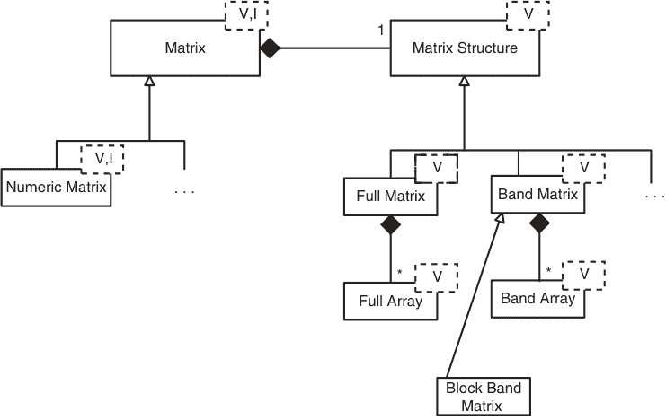

图 10.1 最后，Duffy（2004B）中的矩阵类接口与 PPL 的接口不兼容，因此没有包含该案例的结果。我们在此说明，我们不再支持 Duffy（2004B）中的矩阵类。

我们将在后续章节中再次讨论性能测量、多线程和多任务。

#### 10.4.6 Boost Chrono 库

该库包含与 `<chrono>` 相同的功能，此外还提供了一些在 C++ 中未出现的时钟。这些时钟是操作系统时间 API 的轻量封装，因此可以提取进程所消耗的墙上时钟时间、用户 CPU 时间和系统 CPU 时间：

- `process_real_cpu_clock`：捕获当前进程消耗的墙上时钟 CPU 时间。
- `process_user_cpu_clock`：捕获当前进程消耗的用户 CPU 时间。
- `process_system_cpu_clock`：捕获当前进程消耗的系统 CPU 时间。
- 一个与元组类似的类 `process_cpu_clock`，可同时捕获真实、用户 CPU 和系统 CPU 的进程时间。
- 一个 `thread_clock` 时钟，给出当前线程消耗的时间（在平台支持的情况下）。

我们在本书中不讨论这些主题，但你在某些情况下可能会用到它们。我们建议你查阅 Boost 在线文档。

### 10.5 Boost 日期和时间

现在我们介绍支持日期和时间实体的 Boost 库。可以毫不夸张地说，在多种调度、管理信息和日历驱动的应用中，能够访问对*时间实体*进行建模的数据结构和 C++ 类是非常重要的。为此，*Boost 日期时间*库为许多用例提供了广泛支持，例如：

- 基于格里高利历、POSIX 和本地时间体系创建日期和时间。
- 日期迭代器；例如，遍历一周中的天数。
- 日期生成器和算法。
- 本地时间和 UTC（*协调世界时*）支持。
- 日期和时间的输入/输出及序列化。

本书所采用的方法是讨论该库的主要特性，并给出一些“101”示例。然后，我们继续研究几个使用日期和时间的扩展示例及应用。例如，其中一个项目是将用于计算金融应用的遗留代码迁移并扩展到当前库（参见 Duffy, 2004B）。

本章采用实践方法，我们讨论大量示例来展示 *Boost 日期时间*库的实用性。这是一个庞大的库。

#### 10.5.1 概念与功能概述

日期和时间抽象在许多类型的应用中具有根本性的重要性。特别是，包含*时间逻辑*的系统数量众多。我们现在不再自行定义处理日期和时间的库与函数，而是使用 *Boost 日期时间*库，并对其进行扩展以满足特定应用领域的需求。为此，我们讨论该库中最重要的类和功能。我们可以将时间视为一维直线或连续体。

有三种基本的*时间类型*：

- *时间点*：这是时间连续体中某个位置的说明符。
- *时间长度*：这是不依附于时间连续体中任何点的一段时间。它是一个具有大小的“浮动”量。
- *时间间隔（时间段）*：这是依附于时间连续体中特定点的一段时间。

与这些概念中的每一个相对应的是一种所谓的*分辨率*，它被定义为可表示的最小持续时间。我们将*时间系统*定义为一组时间类型，以及用于标记和计算这些时间类型的规则与操作。*日历系统*是一种分辨率为一天的时间系统。在本章中，我们重点讨论*格里高利历系统*，因为它是最广泛使用的系统。我们还讨论用于民用时间应用的 UTC 日历系统。*本地时间系统*基于 UTC，并根据地球自转进行调整，使各地的白昼时间大致相似。最后，*时钟设备*是一种与硬件绑定、在时间系统中提供当前日期或时间的软件组件。

#### 10.5.2 格里高利时间

Boost 对格里高利历系统的实现包含以下类型：

- `date`：这是处理日期时的主要接口。
- `date_duration`：这是一个天数计数类，我们在使用格里高利历日期进行计算时使用它。
- `date_period`：这是一个表示两个日期之间范围或间隔的类。

此外，该库支持以不同方式对日期周期进行迭代。它还有许多用于生成日期和日期日程的函数。

为了使用该库，我们建议你在代码中使用以下命名空间并包含以下文件：

```
using namespace boost::gregorian;

#include <boost/date_time/gregorian/gregorian.hpp>      // Types and I/O.
#include <boost/date_time/gregorian/gregorian_types.hpp> // Types only.
```

我们现在详细讨论一下格里高利历类型。

#### 10.5.3 日期

date 类具有以下功能：

- 从日期组成部分（日、月和年）、字符串以及系统时钟创建日期。
- 日期访问器，例如检索日期组成部分；对日期的查询。
- 将日期转换为字符串。
- 运算符，例如将持续时间添加到日期以生成另一个日期。

我们首先考虑 date 构造函数。我们注意到，默认构造函数会生成一个无效日期。如果我们希望基于当前日期创建日期，应调用使用硬件时钟的构造函数。我们还可以基于格里高利历的年、月、日创建日期。最后，在某些情况下，创建具有“特殊”值的日期可能会很有用，例如：

- 负无穷大和正无穷大。
- 最大和最小日期。

我们现在给出一些示例，展示如何创建 date 的实例：

```
// Some basic constructors.
try
{
    date d1; Print(d1);      // Produces not_a_date_time.
}
catch (bad_year& e)
{
    cout << e.what() << endl;   // Year not valid range [1400, 10000].
}
```


```cpp
// Create date from Gregorian year, month and day.
date myDate2(2011, May, 16); Print(myDate2);    // Print is author-defined.

// Copy constructor.
date myDate3(myDate2); Print(myDate3);

// Constructor at the 'extremes'.
try
{
    date myDate4(pos_infin); Print(myDate4, "Positive infinity");
}
catch (bad_year& e)
{
    cout << e.what() << endl;
}

try
{
    date myDate5(neg_infin); Print(myDate5, "Negative infinity");
}
catch (bad_year& e)
{
    cout << e.what() << endl;
}

try
{
    date myDate6(max_date_time); Print(myDate6, "Max Date Time");
}
catch (bad_year& e)
{
    cout << e.what() << endl;
}

try
{
    date myDate7(min_date_time); Print(myDate7, "Min Date Time");
}
catch (bad_year& e)
{
    cout << e.what() << endl;
}
```

# 以上代码的输出为：

```text
Date Information...
not-a-date-time
Year is out of valid range: 1400..10000

Date Information...
2011-May-16
```

Year: 2011, Month: May, Day: 16
Day of week: Mon, Day of year: 136
End of month: 2011-May-31
ISO 8601 week number: 20, Day of year: 2455698

Date Information...
2011-May-16
Year: 2011, Month: May, Day: 16
Day of week: Mon, Day of year: 136
End of month: 2011-May-31
ISO 8601 week number: 20, Day of year: 2455698

Date Information...Positive infinity
+infinity
Year is out of valid range: 1400..10000

Date Information...Negative infinity
-infinity
Year is out of valid range: 1400..10000

Date Information...Max Date Time
9999-Dec-31
Year: 9999, Month: Dec, Day: 31
Day of week: Fri, Day of year: 365
End of month: 9999-Dec-31
ISO 8601 week number: 52, Day of year: 5373484

Date Information...Min Date Time
1400-Jan-01
Year: 1400, Month: Jan, Day: 1
Day of week: Wed, Day of year: 1
End of month: 1400-Jan-31
ISO 8601 week number: 1, Day of year: 2232400

请注意，我们创建了一个打印日期的函数：

```
void Print(const date& myDate, const string& type = "")
{
    cout << "\nDate Information..." << type << endl;
    cout << myDate << endl;
    cout << "Year: " << myDate.year() << ", Month: " << myDate.month() << ", Day: " << myDate.day() << endl;
    // Extra stuff.
    cout << "Day of week: " << myDate.day_of_week() << ", Day of year: " << myDate.day_of_year() << endl;
    cout << "End of month: " << myDate.end_of_month() << endl;
    cout << "ISO 8601 week number: " << myDate.week_number() << ", Day of year: " << myDate.julian_day() << endl;
}
```

接下来，我们注意到可以从字符串以及基于硬件时钟的信息创建日期，如下例所示：

```
// Constructing dates from strings.
string s("2009/1/9");                                      // 9 January 2009.
date myDate8(from_simple_string(s));
Print(myDate8,"from simple string");

// ISO 8601 extended format CCYY-MM-DD.
string s2("2009-10-9");                                     // 9 October 2009.
date myDate9(from_simple_string(s2));
Print(myDate9,"from delimited string");

// Now convert to a string
string converted = to_simple_string(myDate9);
cout << "String: " << converted << endl;                    // OUTPUT is 2009-Oct-09.

string s3("2009109");                                       // 10 October 2009.
date myDate10(from_undelimited_string(s3));
Print(myDate10,"from UNdelimited string");

// Create dates from the clock.
date myDate11(day_clock::local_day());
Print(myDate11,"Local day based on time zone settings of computer");
date myDate12(day_clock::universal_day());
Print(myDate12,"Coordinated UniversalTime (UTC)");
```

这段代码的输出是（取决于当前时间）：

```
Date Information...from simple string
2009-Jan-09
Year: 2009, Month: Jan, Day: 9
Day of week: Fri, Day of year: 9
End of month: 2009-Jan-31
ISO 8601 week number: 2, Day of year: 2454841

Date Information...from delimited string
2009-Oct-09
Year: 2009, Month: Oct, Day: 9
Day of week: Fri, Day of year: 282
End of month: 2009-Oct-31
ISO 8601 week number: 41, Day of year: 2455114
String: 2009-Oct-09

Date Information...from UNdelimited string
2009-Oct-09
Year: 2009, Month: Oct, Day: 9
Day of week: Fri, Day of year: 282
End of month: 2009-Oct-31
ISO 8601 week number: 41, Day of year: 2455114
```

Date Information...Local day based on time zone settings of computer
2011-May-18
Year: 2011, Month: May, Day: 18
Day of week: Wed, Day of year: 138
End of month: 2011-May-31
ISO 8601 week number: 20, Day of year: 2455700

Date Information...Coordinated Universal Time (UTC)
2011-May-18
Year: 2011, Month: May, Day: 18
Day of week: Wed, Day of year: 138
End of month: 2011-May-31
ISO 8601 week number: 20, Day of year: 2455700

现在我们已经完成了对 date 类主要功能的讨论。

### 10.6 前向列表和编译期数组

在本节中，我们讨论 C++ 中两种较新的数据结构。

#### 10.6.1 std::forward_list<

在 STL 中，容器类 `std::list<>` 通常实现为双向链表。这意味着链表中的每个元素都有两个指针，一个指向前驱元素，另一个指向后继元素。这允许我们在链表中向前和向后两个方向导航。然而，这种灵活性是有代价的：

- 增加内存消耗（我们需要存储指针）。
- 某些应用只需要向前导航。
- 在双向链表中删除和插入元素需要销毁和创建资源。
- 使用双向链表可能带来性能问题。

由于这些原因，我们可以考虑使用容器 `std::forward_list<>`，它将其元素作为单向链表管理。它支持在容器中的任意位置高效地插入和删除元素。不支持随机访问迭代器。简而言之，当不需要双向迭代时，前向列表提供了比 `std::list<>` 更节省空间的替代方案。

成员函数的类别包括（Josuttis, 2012）：

- 创建和销毁链表。
- 非修改操作。
- 赋值。
- 元素访问。
- 插入和移除元素。
- 拼接和合并链表。

其语法与 `std::list<>`（假设已了解）类似，这意味着学习曲线平缓。我们举一些简单的例子来说明，代码很容易理解。首先，我们创建一些链表：

```
using List = std::forward_list<double>;

void CreateForwardLists()
{
    // Default empty list
    List c;

    // List with a size and a value
    int sz = 5; double val = 3.14;
    List c2(sz, val);
    print(c2);        // 3.14, 3.14, 3.14, 3.14, 3.14

    // List with initialiser list (2 forms)
    List c3{ 1.0, -4.6, 8.9 };
    print(c3); //  1.0, -4.6, 8.9

    List c4 = { 10.0, -40.6, 80.9 };
    print(c4);      //  10.0, -40.6, 80.9
}
```

```
void print(const List& list)
{
    // Single list has no size(), so we calculate distance
    // between first and last elements of list
    std::cout << "\nList size: "
              << std::distance(list.begin(), list.end())
              << ", contents are: ";

    for(auto& elem: list)
    {
        std::cout << elem << ",";
    }
}
```

我们现在给出一些在链表中查找给定值的代码：

```
List::const_iterator Find(const List& list, double val)
{ // Find a value in a list

    for (auto pos = std::begin(list); pos != std::end(list); ++pos)
    {
        if (*pos == val)
        {
            return pos;  // value found
        }
    }

    return list.cend();
}
```

我们举一个例子来说明如何在链表中的特定位置插入值以及如何从链表中删除元素。我们注意到，在这方面前向链表与双向链表的行为不同，因为前者没有反向迭代器。

```
void ModifyForwardList()
{ // Do some things with lists

    List list;
    list.push_front(-1.0);

    // Insert
    list.insert_after(list.begin(), 2.71);
    print(list);      // -1, 2.71

    int count = 2;
    list.insert_after(list.begin(), count, 148.33);
    print(list);      // -1, 148.33, 148.33, 2.71

    list.insert_after(list.begin(), { 150.1, 262.9, 56.3 });
    print(list);      // -1, 150.1, 262.9, 56.3, 148.33, 148.33, 2.71

    // Erase, remove the element AFTER the value
    double val = 262.9;
    auto pos = Find(list, val);
    if (pos != list.cend())
    {
        list.erase_after(pos);
    }
    else
    {
        std::cout << "\nValue " << val << " not found \n";
    }

    print(list);      // -1, 150.1, 262.9, 148.33, 148.33, 2.71
    val = 56.3;
    pos = Find(list, val);
    if (pos != list.cend())
    {
        list.erase_after(pos);
    }
    else
    {
        std::cout << "\nValue " << val << " not found \n";
    }

    print(list);      // -1, 150.1, 262.9, 148.33, 148.33, 2.71
}
```

在某些情况下，前向链表可能是双向链表的一种可行替代方案。参见练习3。


#### 10.6.2 boost::array<> 与 std::array<>

STL 的 `vector<T>` 容器提供了动态数组的语义。该类的元素数量是可变的，并且可以在运行时向其追加元素。然而，在某些应用中，我们可能希望使用在编译时大小已知的数组。为此，Boost.Array 库是一种解决方案。它由一个类模板 `array<V,N>` 组成，该模板有两个模板参数：参数 N 表示数组的大小，参数 V 表示底层数据类型。其接口具有以下功能：

- 数组赋值。
- 使用运算符 `[]` 和 `at()` 成员函数访问数组的元素。
- 迭代器。
- 用于获取数组首元素和尾元素的成员函数。
- 我们可以使用二元运算符 `==, !=, <, >, <=, >=` 来比较数组。
- 我们可以使用 `swap()` 成员函数交换两个数组的元素。

我们来看一些简单的例子。首先，我们创建一个 `long` 类型的数组并初始化其元素：

```cpp
const int N = 4;
boost::array<long, N> myArr = {1, 2, 3, 4};
```

现在我们可以通过迭代器和索引运算符打印数组的元素：

```cpp
// Using iterators
boost::array<long, N>::const_iterator it;
for (it = myArr.begin(); it != myArr.end(); ++it)
{
    cout << *it << endl;
}

// Indexing operator
for (long i = 0; i < myArr.size(); ++i)
{
    cout << myArr[i] << endl;
}
```

也可以按如下方式初始化数组：

```cpp
const int M = 2;
boost::array<string, M> myStringArr;
myStringArr[0] = "Hello";
myStringArr[1] = "World";
```

现在我们以一个模拟简单固定大小折线的数组为例，该数组由点组成。数组的元素由 `Point` 类的实例组成，其接口如下：

```cpp
class Point
{
private:
    double x;                              // X coordinate
    double y;                              // Y coordinate

public:
    // Constructors
    Point();                               // Default constructor
    Point(double xval, double yval);       // Initialise with x
                                          // and y value

    // Accessing functions
    double X() const;                      // The x-coordinate
    double Y() const;                      // The y-coordinate

    // Modifiers
    void X(double newX);
    void Y(double newY);

    Point operator + (const Point& p2) const;
    double distance (const Point& p2) const; // Distance between 2 points

    Point& operator = (const Point& pt);
};
```

现在我们创建一个点数组：

```cpp
const int N = 4;
boost::array<Point, N> myPointArr;
myPointArr[0] = Point(1.0, 2.0);
myPointArr[1] = Point();
myPointArr[2] = Point(-1.0, 9.8);
myPointArr[3] = Point(3.4, 6.32);
```

访问该数组的元素有两种方式，但它们在处理异常情况时有所不同，尤其是*越界索引*。首先，在使用运算符重载的情况下会执行断言：

```cpp
// What happens when the index is out-of-range?
// myPointArr[N] = Point();          // Assertion 'index < N'
// myPointArr[N].X(1.0);             // Assertion 'index < N'
```

在这种情况下，程序会停止执行。其次，`at()` 成员函数在索引越界时会抛出异常，我们可以用通常的方式捕获该异常：

```cpp
try
{
    cout << "Give an index: "; int index; cin >> index;
    Point pt = myPointArr.at(index);
    cout << "(" << pt.X() << "," << pt.Y() << ")" << endl;
}
catch(const exception& e)
{
    cout << e.what() << endl;
}
```

最后需要说明的是，我们不能将不同大小的数组一起使用。这提高了使用它们的应用程序的健壮性。我们来看一个包含两个数组的示例：

```cpp
// Assignment of arrays with incompatible dimensions
const int N1 = 3;
const int N2 = 4;

boost::array<double, N1> arr1;
boost::array<double, N2> arr2;
```

因此，以下代码将无法编译：

```cpp
arr1 = arr2;          // Gives compiler error
```

### 10.7 BOOST.ARRAY 的应用

*Boost.Array* 有很多应用。例如：

- *n* 维几何：我们可以创建一个模板类，用于表示 *n* 维空间中的点和其他对象。在这种情况下，我们通过使用内嵌的 `boost::array` 实例来实现 `NPoint` 类：

```cpp
template <typename Type, int n> class NPoint
{
private:

    // Originally: Type arr[n]
    boost::array<Type, n> arr;

public:

    // member functions here..
};
```

我们按如下方式计算两点之间的距离：

```cpp
const int N = 3;
NPoint<double, N> p1(0.0);
NPoint<double, N> p2(1.0);

cout << "Distance: " << p1.distance(p2) << endl;
```

- 创建多维、编译时的数据结构：一个很好的例子是带有 *N* 行和 *M* 列的模板矩阵：

```cpp
template <typename T, std::size_t NRows, std::size_t NColumns>
class Matrix
{
    // Basic class, can be extended

private:
    boost::array<boost::array<T, NColumns>, NRows> mat;

public:
    Matrix();
    std::size_t Rows() const;
    std::size_t Columns() const;

    T& operator () (std::size_t r, std::size_t c);
    const T& operator () (std::size_t r, std::size_t c) const;
};
```

使用示例为：

```cpp
const int NROWS = 3; const int NCOLUMNS = 3;
Matrix<double, NROWS, NCOLUMNS> myMatrix;
```

- 将 *Boost.Array* 与 *Boost.MultiArray* 结合使用：初始化多数组的部分代码涉及定义其范围（extents）。下面的代码展示了如何使用 `boost::array` 来定义这些范围：

```cpp
int main()
{
    const int N = 3;
    typedef boost::multi_array<int, N> Array;

    // Define the extents using boost::array
    boost::array<Array::size_type, N> arrayDims;
    arrayDims[0] = 2;
    arrayDims[1] = 3;
    arrayDims[2] = 4;

    Array myArray(arrayDims);

    int num = 0;
    for (Array::index i=0; i!=arrayDims[0]; ++i)
        for (Array::index j=0; j!=arrayDims[1]; ++j)
            for (Array::index k=0; k!=arrayDims[2]; ++k)
                myArray[i][j][k] = num++;

    return 0;
}
```

### 10.8 BOOST uBLAS（矩阵库）

#### 10.8.1 简介与目标

Boost uBLAS 库支持向量和矩阵数据结构，以及这些结构上的基本线性运算。由于使用了运算符重载，其语法紧密地反映了数学记号。此外，该库使用表达式模板来生成高效的代码。该库受到了许多其他库的影响，例如 ATLAS、BLAS、Blitz++、POOMA 和 MTL。其主要设计目标是：

- 在适当的时候使用数学记号。
- 高效性（时间和资源管理）。
- 功能性（提供适合广泛应用领域的特性）。
- 兼容性（类似数组的索引和使用 STL 分配器进行存储分配）。

两种最重要的数据结构分别表示向量和矩阵。向量是一维结构，而矩阵是二维结构。我们可以定义各种向量和矩阵模式，用于描述矩阵在内存中的排列方式；例如稠密矩阵、稀疏矩阵、带状矩阵、三角矩阵、对称矩阵和 Hermitian 矩阵。这些有模式的结构被用于许多类型的应用中。此外，我们可以定义向量和矩阵上的基本运算，例如：

- 向量和矩阵的加法。
- 标量乘法。
- 计算赋值。
- 变换。
- 向量和矩阵的范数。
- 内积和外积。

我们可以在代码和应用中使用这些运算。最后，我们可以定义子向量、子矩阵以及向量和矩阵的范围（ranges）和切片（slices）。

向量和矩阵是科学和工程应用的基础，拥有一个像 Boost uBLAS 这样成熟且提供现成模块的库，将节省开发者的时间。考虑到矩阵代数在应用中占了大量工作，我们预计整体生产率的提升将是显著的。关于矩阵应用的讨论超出了本书的范围。然而，我们确实会在本书中讨论 LU 分解、Cholesky 分解以及三对角矩阵系统的求解。

#### 10.8.2 BLAS（基本线性代数子程序）

BLAS 是事实上的应用程序编程接口标准，用于在向量和矩阵上执行基本线性代数运算的库。它们提高了软件的可读性、模块化和可维护性。BLAS 通过识别线性代数中频繁出现的运算，并为其指定标准接口来促进模块化。效率是通过优化 BLAS 内部的代码来实现的。重要的是识别并


定义一组足够丰富的基本运算，一方面可以让我们对高级算法进行建模，另一方面又足够简单，可以在各种计算机上进行优化。

使用 BLAS 的优点在于其稳健性、可移植性和可读性。BLAS 功能由我们现在讨论的三个级别组成。

#### 10.8.3 BLAS Level 1

该级别由低级运算组成，例如向量的 *inner products*（也称为 *dot products*）以及将一个向量的倍数加到另一个向量上。这些 *vector–vector operations* 被称为 Level 1 BLAS，例如：

$y \leftarrow \alpha x + y$  (10.1)

其中 $x$ 和 $y$ 是向量，$\alpha$ 是标量。

这些运算通常涉及 $O(n)$ 次浮点运算，其中 $n$ 是向量的长度。在方程 (10.1) 中，我们看到向量 $y$ 正在被更新，该运算有时被称为 *saxpy*（‘scalar ax plus y’）。

#### 10.8.4 BLAS Level 2

该级别包含形如的矩阵-向量运算：

$y \leftarrow \alpha Ax + \beta y$  (10.2)

其中 $x$ 和 $y$ 是向量，$A$ 是矩阵，$\alpha$ 和 $\beta$ 是标量。

这些 *matrix–vector operations* 在线性代数中许多最常见算法的实现过程中出现。Level 2 BLAS 涉及 $O(mn)$ 次标量运算，其中 $m$ 和 $n$ 是运算中涉及的矩阵的维度。

BLAS Level 2 中的其他运算有：
- Rank-one and rank-two updates:
  
  $A = \alpha xy^T + A$ (rank 1 update)
  
  $A = \alpha xy^T + \alpha yx^T + A$ (rank 2 update)  (10.3)

其中 $y^T$ 是向量 $y$ 的转置。
- 求解形如的三角方程：
  
  $Ty = x$  (10.4)

其中 $T$ 是非奇异的 *upper-triangular matrix*（主对角线以下所有元素为零）或 *lower-triangular matrix*（主对角线以上所有元素为零）。

### 10.9 VECTORS

#### 10.9.1 Dense Vectors

一个长度为 *n* 的 *dense vector* 是其所有元素都显式赋值的向量。换句话说，这些向量中没有“间隙”（缺失值）。为此，类 `vector<T, Alloc>` 有两个参数：
- 存储在向量中的对象的类型 T。
- 存储数组的类型 Alloc（动态、运行时存储、固定大小存储或编译时存储）。

我们在图 10.2 中的 UML 类图中展示了该类的概念结构。要使用该类，我们实例化其模板参数（默认分配器类型为 `unbounded_array<T>`）。

成员函数的类别有：
- Constructors。
- 使用运算符 () 和 [] 访问向量的元素。
- 加减两个向量。
- 将向量乘以或除以标量。
- 常量和非常量正向和反向迭代器。
- 调整向量大小（*reallocating* 向量以容纳给定数量的元素）。

与其给出所有不同成员函数的扩展示例（如果你熟悉 STL，其中许多很容易），我们更倾向于集中在关键成员函数上。我们还提到，许多 STL 算法都可以在 uBLAS 向量上使用。

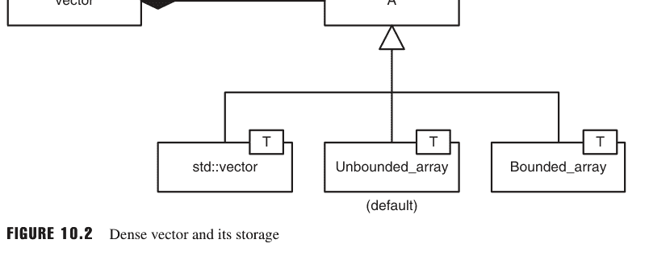

FIGURE 10.2 Dense vector and its storage

#### 10.9.2 Creating and Accessing Dense Vectors

我们首先根据图 10.1 中的选项创建若干稠密向量。我们可以创建具有数值和非数值底层数据类型并给定存储数组的向量。请注意，我们使用了 Boost uBLAS 命名空间的别名：

```
#include <boost/numeric/ublas/vector.hpp>      // The vector class.
#include <boost/numeric/ublas/io.hpp>              // Sending to IO stream.

namespace ublas=boost::numeric::ublas;

ublas::vector<double> v1(10);
ublas::vector<double, ublas::unbounded_array<double> > v2(10);
ublas::vector<double, ublas::bounded_array<double, 20> > v3(10);
ublas::vector<double> v4(5, 3.14);
ublas::vector<double, vector<double> > v5(10, 4.5);
cout<<"v5: "<<v5<<endl;

ublas::vector<char, vector<char> > v6(10, 'd');
cout<<"v6: "<<v6<<endl;
```

我们可以使用重载运算符访问和修改向量的元素：

// Fill the vectors.
for (int i=0; i<10; i++)
{
    // Use the [] operator.
    v1[i]=i;

    // Use the () operator.
    v2(i)=i+10;
    v3(i)=i+20;
}
```

我们现在展示复合运算符的使用以及对迭代器的支持：

// Operators.
// When adding/subtracting two vectors, they should have the same size.
cout<<endl<<"*** Operators ***"<<endl;
cout<<"v1+=v3:  "<<(v1+=v3)<<endl;
cout<<"v1-=v3:  "<<(v1-=v3)<<endl;
cout<<"v1*=2.5: "<<(v1*=2.5)<<endl;
cout<<"v1/=2.5: "<<(v1/=2.5)<<endl;

// Iterators.
cout<<endl<<"*** Iterators ***"<<endl;
transform(v1.begin(), v1.end(), v2.begin(), v3.begin(),
          multiplies<double>());
cout<<"Multiply v1 & v2 to v3 using transform algorithm ";
cout<<"and multiplies function object: "<<v3<<endl;
```

最后，我们可以调整向量的大小（注意保留现有数据的选项）：

```
v1.resize(8, false); cout<<".. to 8 (no data preserved): "<<v1<<endl;
v2.resize(8, true); cout<<".. to 8 (data preserved): "<<v2<<endl;
```

#### 10.9.3 Special Dense Vectors

uBLAS 对特殊类型的稠密向量提供了支持：
- Unit vector：对于给定的向量大小 n，第 k 个规范向量在除索引 k 外的所有元素的值均为零，而索引 k 的值为 1。显然，对于大小为 n 的向量有 n 个规范单位向量，它们构成了 n 维欧几里得空间中的标准正交基。三维空间中的一个例子是：

// Create unit vectors. The first argument is the size,
// the second argument is the element that is 1.
ublas::unit_vector<double> uv1(3, 0);  // 1, 0, 0
ublas::unit_vector<double> uv2(3, 1);  // 0, 1, 0
ublas::unit_vector<double> uv3(3, 2);  // 0, 0, 1

cout<<"uv1: "<<uv1<<", index of 1: "<<uv1.index()<<endl;
cout<<"uv2: "<<uv2<<", index of 1: "<<uv2.index()<<endl;
cout<<"uv3: "<<uv3<<", index of 1: "<<uv3.index()<<endl;
```
- Zero vector：n 维零向量的所有值都等于零：

// All elements of a zero vector are always zero.
// Constructor accepts size.
ublas::zero_vector<double> zv(10);
cout<<"Zero vector (always contains all zeros): "<<zv<<endl;
```
- Scalar vector：这是零向量的推广。大小为 n 的标量向量是指其所有元素都具有相同值的向量。使用的一个例子是：

// A scalar vector has elements with the same value.
ublas::scalar_vector<double> sv1(5, 3.5);    // Size 5, contents 3.5.
ublas::scalar_vector<double> sv2(10, 9.0);  // Size 10, contents 9.0.
cout<<"Scalar vector with 3.5: "<<sv1<<endl;
cout<<"Scalar vector with 9.0: "<<sv1<<endl;
```

拥有这些特殊向量是有用的，因为它们在数值线性代数应用中是需要的。请注意，这些特殊向量的元素是只读的。

### 10.10 MATRICES

我们介绍 Boost uBlas 中的稠密矩阵。

#### 10.10.1 Dense Matrices

具有 n 行和 m 列的稠密矩阵是指其所有 n × m 个元素都存储在内存中的矩阵。这些类型的矩阵在许多应用中使用。类 matrix<T, F, Alloc> 有三个模板参数：
- T：存储在矩阵中的对象的类型。
- F：描述存储组织的函数对象，例如行顺序（默认为 row_order）。
- Alloc：存储数组的类型（默认为 unbounded_array<T>）。

概念 UML 类图如图 10.3 所示。该类的成员函数类别有：
- Constructors。
- 访问和修改矩阵的元素。
- 算术运算，例如矩阵的加法和乘法。
- 乘以和除以标量。
- Iterators。

我们现在从 C++ 角度讨论稠密矩阵，并给出一些稠密矩阵的示例。

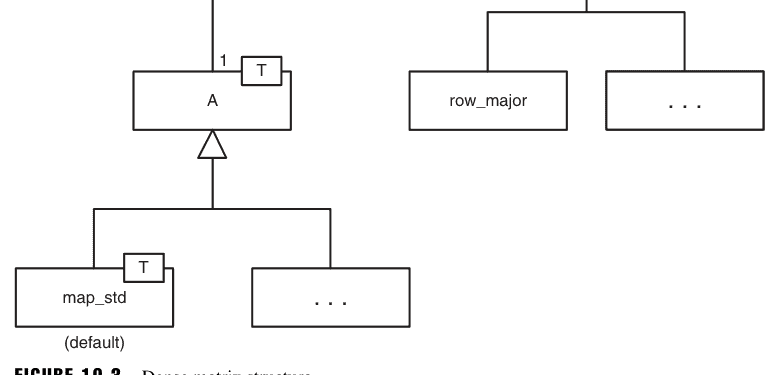

FIGURE 10.3 Dense matrix structure


最后，可以调整稠密矩阵的大小。我们可以通过提供适当的整数参数以及一个布尔参数来修改行数和列数，该布尔参数决定‘旧’矩阵的值是否应保留在‘新’矩阵中：

// Resize the matrix.
// Matrices which use the bounded_array as storage always preserve data
// regardless of the "preserve" argument.
cout<<endl<<" Resize ***"<<endl;
m1.resize(2, 2, false);
cout<<"m1 resized to 2,2 (no data preserved): "<<m1<<endl;
m2.resize(2, 2, false);
cout<<"m2 resized to 2,2 (bounded_array always preserves): "<<m2<<endl;
m3.resize(2, 2, true);
cout<<"m3 resized to 2,2 (data preserved): "<<m3<<endl;
cout<<endl;
m1.resize(2, 3, false);
cout<<"v1 resized back to 2,3 (no data preserved): "<<m1<<endl;
m2.resize(2, 3, false);
cout<<"v2 resized back to 2,3 (bounded always preserves): "<<m2<<endl;
m3.resize(2, 3, true);
cout<<"v3 resized back to 2,3 (data preserved): "<<m3<<endl;

#### 10.10.3 特殊稠密矩阵

我们现在讨论在数值线性代数应用中使用的三种特殊矩阵：

- 单位矩阵：这是一个*方阵*（行数与列数相同），其所有元素均为零，除矩阵主对角线上的元素值为 1。使用的示例为：

// Create identity matrices.
ublas::identity_matrix<double> m1(2);
ublas::identity_matrix<double> m2(3);

// Print the matrices.
cout<<"m1 (2x2): "<<m1<<endl;
cout<<"m2 (3x3): "<<m2<<endl;
cout<<"m1 rows: "<<m1.size1()<<", columns: "<<m1.size2()<<endl;
cout<<"m2 rows: "<<m2.size1()<<", columns: "<<m2.size2()<<endl;

// Resize the identity matrix. The data is always preserved even
// when preservation argument is false.
m2.resize(2, false);
cout<<"m2 resized to 2 (data always preserved)"<<m2<<endl;
m2.resize(3, false);
cout<<"m2 resized back to 3 (data always preserved)"<<m2<<endl;

- 零矩阵：这是一个*矩形矩阵*（行数不一定等于列数），其所有元素均为零。使用的示例为：

// Create zero matrices.
ublas::zero_matrix<double> m1(2, 3);
ublas::zero_matrix<double> m2(3);
```
// Print the matrices.
cout<<"m1 (2x3): "<<m1<<endl;
cout<<"m2 (3x3): "<<m2<<endl;
cout<<"m1 rows: "<<m1.size1()<<", columns: "<<m1.size2()<<endl;
cout<<"m2 rows: "<<m2.size1()<<", columns: "<<m2.size2()<<endl;
```
// Resize the zero matrix. The data is always preserved even
// when preservation argument is false.
m1.resize(3, 2, false);
cout<<"m1 resized to 3x2 (data always preserved)"<<m1<<endl;
m1.resize(2, 3, false);
cout<<"m1 resized back to 2x3 (data always preserved)"<<m1<<endl;
```
cout<<endl<<"Swap the matrices"<<endl;
m1.swap(m2);
cout<<"m1: "<<m1<<endl;
cout<<"m2: "<<m2<<endl;
```
标量矩阵：标量矩阵是一个矩形矩阵，其所有元素都等于给定的（单个）值。使用的示例为：

// Create scalar matrices.
ublas::scalar_matrix<double> m1(2, 3, 4);
ublas::scalar_matrix<double> m2(3, 2, 5);
```
// Print the matrices.
cout<<"m1 (2x3)=4: "<<m1<<endl;
cout<<"m2 (3x2)=5: "<<m2<<endl;
cout<<"m1 rows: "<<m1.size1()<<", columns: "<<m1.size2()<<endl;
cout<<"m2 rows: "<<m2.size1()<<", columns: "<<m2.size2()<<endl;
```
请注意，这些特殊向量的元素为只读。

### 10.11 应用 uBLAS：求解线性方程组

我们已完成了对 uBLAS 功能的讨论，包括向量和矩阵的数据结构、这些数据结构的视图以及最后对这些数据结构的操作。我们现在展示如何将这些功能结合起来。我们重点关注三种重要算法：

- 用于对称和一般矩阵的共轭梯度法（CGM）。
- 一般矩阵的 LU 分解。
- Cholesky 分解。

我们本可以采用许多其他应用，但我们认为这三种算法能够体现 uBLAS 的有用性。以下 uBLAS 中的特性将在后续讨论中使用：

- 对称、下三角、上三角和一般矩阵。
- 两个向量的内积。
- 矩阵-向量乘法。
- 两个向量的和与差。
- 向量范数（在检验迭代方法的收敛性时需要）。
- 矩阵的转置。

我们讨论这些矩阵算法及其使用 uBLAS 的实现。

#### 10.11.1 共轭梯度法

该方法用于求解同时线性代数方程组：

AU = F

其中 A 是一个给定的 n × n 矩阵，U 是 n × 1 未知向量，F 是已知的 n × 1 向量。在本节中，我们首先讨论当 A 为对称矩阵时的 CGM 算法和相应的 C++ 代码，然后讨论当 A 为一般（不一定对称）矩阵时算法的步骤。对称矩阵情况下的算法为：

r₀ = F − AU₀
p₀ = r₀

对 j = 1, ..., n 计算：

aⱼ = ||rⱼ||₂² / pⱼᵀ A pⱼ
Uⱼ₊₁ = Uⱼ + aⱼ pⱼ
rⱼ₊₁ = rⱼ − aⱼ A pⱼ
bⱼ = ||rⱼ₊₁||₂² / ||rⱼ||₂²
pⱼ₊₁ = rⱼ₊₁ + bⱼ pⱼ

其中 rⱼ 和 pⱼ 是长度为 n 的向量，j ≥ 0。

该算法的代码为：

// Solve Ax = b; 'x' is initial estimate.
template <typename TMatrix>
void ConjugateGradient(const TMatrix& A, const ublas::vector<double>& b,
                       ublas::vector<double>& x, double tol)
{
    // The size.
    const size_t n = b.size();

    // Step 0: init.
    ublas::vector<double> r(n);
    r = b - ublas::prod(A,x);
    ublas::vector<double> p(r);

    double a;
    double beta;
    double norm, norm2;
    ublas::vector<double> tmpVec(n);

    for (size_t j=1; j<=n; ++j)
    {
        // Step 1.
        norm = ublas::norm_2(r);
        norm *= norm;

        // Exit loop is convergence has been reached.
        if (norm <= tol) break;

        tmpVec = ublas::prod(A, p);
        a = norm / ublas::inner_prod(p, tmpVec);

        // Step 2.
        x += a*p;

        // Step 3.
        r -= a*tmpVec;

        // Step 4.
        norm2 = ublas::norm_2(r); norm2 *= norm2;
        beta = norm2 / norm;
        p = beta*p + r;
    }
}
```
一般矩阵 A 情况下的 CGM 算法为：

r₀ = F − AU₀
p₀ = r₀

对 j = 1, 2, ..., n：

aⱼ = ||Aᵀ rⱼ||² / ||A pⱼ||²
Uⱼ₊₁ = Uⱼ + aⱼ pⱼ
rⱼ₊₁ = rⱼ − aⱼ A pⱼ
bⱼ = ||Aᵀ rⱼ₊₁||² / ||Aᵀ rⱼ||²
pⱼ₊₁ = Aᵀ rⱼ₊₁ + bⱼ pⱼ.

我们把修改对称矩阵的 CGM 代码使其适用于上面给出的非对称情况作为练习。

#### 10.11.2 LU 分解

该算法将一般矩阵 A 分解为下三角矩阵 L 与上三角矩阵 U 的乘积。该算法在 Dahlquist 和 Björck（1974）以及 Isaacson 和 Keller（1966）中有所记载，例如。结合 uBLAS 给出的 C++ 代码作为自由函数为：

// LU decomposition: A -> L*U
void InitLU(const ublas::matrix<double>& A,
    ublas::triangular_matrix<double, ublas::lower>& L,
    ublas::triangular_matrix<double, ublas::upper>& U)
{
    double sum;
    unsigned N = A.size1();

    // Common to make all diagonal elements == 1.0
    for (size_t k = 0; k < N; ++k)
    {
        L(k,k) = 1.0;
    }

    for (size_t j = 0; j < N; ++j)      // Loop over columns.
    {
        // U
        for (size_t i = 0; i <= j; ++i)  // Columns.
        {
            sum = 0.0;
            for (size_t k = 0; k < i; ++k)
            {
                sum += L(i,k)*U(k,j);
            }
            U(i,j) = A(i,j) - sum;
        }
        // L
        for (size_t i = j+1; i < N; ++i)      // Rows.
        {
            sum = 0.0;
            for (size_t k = 0; k < j; ++k)
            {
                sum += L(i,k)*U(k,j);
            }
            L(i,j) = (A(i,j) - sum) / U(j,j);
        }
    }
}
```
计算出矩阵 L 和 U 后，我们就可以分两步求解以下问题：

Ax = b
⇔ (LU)x = b ⇔ Ly = b
Ux = y.

该序列步骤的代码为：

// Solve Ax = b
ublas::vector<double> SolveLU(const ublas::vector<double>& b,
    const ublas::triangular_matrix<double, ublas::lower>& L,
    const ublas::triangular_matrix<double, ublas::upper>& U)
{
    size_t N = b.size();
    ublas::vector<double> result(N);

    double sum;

    // Forward sweep Ly = b
    result[0] = b[0] / L(0,0);
    for (size_t i = 1; i < N; ++i)
    {
        sum = 0.0;
        for (size_t k = 0; k < i; ++k)
        {
            sum += L(i,k)*result[k];
        }
        result[i] = (b[i] - sum) / L(i,i);
    }

    // Backward sweep Ux = y
    result[N-1] = result[N-1]/U(N-1, N-1);
    for (size_t i = N-2; i >= 0 && i < N; --i)
    {
        sum = 0.0;
        for (size_t k = i+1; k < N; ++k)
        {
            sum += U(i,k)*result[k];
        }
        result[i] = (result[i] - sum) / U(i,i);
    }

    return result;
}
```
一个简单的使用示例（空测试）为：

unsigned N = 4;

// Input for Ax = b
ublas::matrix<double> A(N, N);
ublas::vector<double> b(N);
for (size_t i = 0; i < A.size1(); ++i)
{
    b[i] = 1.0;
```


```
for (size_t j = 0; j < A.size2(); ++j)
{
    A(i, j) = 0.0;
}
A(i,i) = 1.0;
}
std::cout << "Initial matrix A: " << A << std::endl;
cout << "Initial vector b: " << b << endl;
```

```
// Determine the L and U matrices.
ublas::triangular_matrix<double, ublas::lower> L(N,N); Init(L, 0.0);
ublas::triangular_matrix<double, ublas::upper> U(N,N); Init(U, 0.0);
InitLU(A, L, U);
cout << "Matrix L: " << L << endl;
cout << "Matrix U: " << U << endl;
```

```
// Solve 'Ax=b'.
ublas::vector<double> result = SolveLU(b, L, U);
cout << "Result vector Ax=b: " << result << endl;
```

你可以尝试不同的 A 和 b 取值，以检验该方法的精度。

#### 10.11.3 Cholesky 分解

对于对称正定矩阵，LU 分解算法呈现一种特别简单的形式，即矩阵 U 是矩阵 L 的转置：

A = LU = LLᵀ.

计算矩阵 L 的算法如下（参见 Dahlquist 和 Björck，1974）：

lⱼⱼ = (aⱼⱼ − Σₖ₌₁ʲ⁻¹ lⱼₖ²)¹ᐟ² ,  1 ≤ j ≤ n
lᵢⱼ = (aᵢⱼ − Σₖ₌₁ʲ⁻¹ lᵢₖ lⱼₖ) / lⱼⱼ ,  i = j + 1, …, n.

实现该算法的 C++ 代码如下：

```
// Cholesky decomposition.
void Cholesky(const ublas::matrix<double>& A,
    ublas::triangular_matrix<double, ublas::lower>& L)
{
    double sum;
    size_t N = A.size1();

    for (size_t j = 0; j < N; ++j)  // Loop over columns.
    {
        sum = 0.0;
        for (size_t k = 0; k < j; ++k)
        {
            sum += L(j,k)*L(j,k);
        }
        L(j,j) = sqrt(A(j,j) - sum);

        for (size_t i = j+1; i < N; ++i) // Rows.
        {
            sum = 0.0;
            for (size_t k = 0; k < j; ++k)
            {
                sum += L(i,k)*L(j,k);
            }
            L(i,j) = (A(i,j) - sum) / L(j,j);
        }
    }
}
```

最后，下面给出一个使用 Cholesky 算法的示例（请注意，我们这里使用了稠密矩阵，但实际上使用对称矩阵可能更为合适）：

```
// Correlation matrix.
unsigned D = 4;
ublas::matrix<double> Corr(D,D);
Corr(0,0) = Corr(1,1) = Corr(2,2) = Corr(3,3) = 1.0;
Corr(0,1) = Corr(1,0) = 0.5;
Corr(0,2) = Corr(2,0) = 0.2;
Corr(0,3) = Corr(3,0) = 0.01;
Corr(1,2) = Corr(2,1) = 0.01;
Corr(1,3) = Corr(3,1) = 0.30;
Corr(3,2) = Corr(2,3) = 0.30;
cout << "Original matrix:" << endl << Corr << endl << endl;
```

一个测试用例如下：

```
// Cholesky decomposition.
cout << endl << "--- Do Cholesky decomposition ---" << endl << endl;
ublas::triangular_matrix<double, ublas::lower> L(D,D);
Cholesky(Corr, L);
cout << "L:" << endl << L << endl << endl;
```

下面我们来讨论对 Cholesky 方法进行压力测试。具体来说，我们希望复核该算法，同时使用 uBLAS 的一些功能。我们尝试通过将构造出的下三角矩阵与其转置相乘，来恢复算法中使用的原始矩阵：

```
// Recover the original matrix; a kind of check.
ublas::triangular_matrix<double, ublas::upper> U = LowerToUpper(L);
```

其中 `LowerToUpper()` 是一个自由函数，用于将下三角矩阵转换为上三角矩阵：

```
// Transpose a lower triangular matrix to form an upper triangular matrix.
ublas::triangular_matrix<double, ublas::upper> LowerToUpper(
    const ublas::triangular_matrix<double, ublas::lower>& L)
{
    ublas::triangular_matrix<double, ublas::upper> U(L.size2(), L.size1());

    for (size_t i = 0; i < U.size1(); ++i)
    {
        for (size_t j = i; j < U.size2(); ++j)
        {
            U(i,j) = L(j,i);
        }
    }

    return U;
}
```

在本节最后，我们将 LU 分解得到的上三角矩阵和下三角矩阵相乘，从而恢复原始矩阵：

```
// Create LU matrices.
cout << "--- Recover original matrix from LD & UD ---" << endl << endl;
ublas::triangular_matrix<double, ublas::lower> LD(D,D);
ublas::triangular_matrix<double, ublas::upper> UD(D,D);
InitLU(Corr, LD, UD);
cout << "LD: " << endl << LD << endl << endl;
cout << "UD: " << endl << UD << endl << endl;

// Recover original matrix in different ways.
cout << "LD*UD (same as original matrix): " << endl << LD*UD << endl;
cout << "UD*LD (same as original matrix): " << endl << UD*LD << endl;
```

其中我们定义了用于相乘下三角矩阵和上三角矩阵的运算符：

```
// Compute Lower*Upper.
ublas::matrix<double> operator * (
    const ublas::triangular_matrix<double, ublas::lower>& L,
    const ublas::triangular_matrix<double, ublas::upper>& U)
{
    ublas::matrix<double> result(L.size1(), L.size2());

    double sum; size_t r;

    for (size_t i = 0; i < result.size1(); ++i)
    {
        for (size_t j = 0; j < result.size2(); ++j)
        {
            sum = 0.0;
            r = std::min(i,j);
            for (size_t p = 0; p <= r; ++p)
            {
                sum += L(i,p)*U(p,j);
            }
            result(i,j) = sum;
        }
    }

    return result;
}
```

```
// Compute Upper*Lower.
ublas::matrix<double> operator * (
    const ublas::triangular_matrix<double, ublas::upper>& U,
    const ublas::triangular_matrix<double, ublas::lower>& L)
{
    // Rough and Ready, but it works; it is a test of uBLAS::transpose.
    ublas::triangular_matrix<double, ublas::upper> Upper = trans(L);
    ublas::triangular_matrix<double, ublas::lower> Lower = trans(U);

    return Lower*Upper;
}
```

我们可以运行这段代码，发现所有情况下的结果都是相同的。最后，另一个测试是从两个乘积中减去原始矩阵，然后取相应的最大范数：

```
// Look at matrix norms.
ublas::matrix<double> m1 = Corr - UD*LD;
ublas::matrix<double> m2 = Corr - LD*UD;
cout << "A - U*L max error: " << ublas::norm_inf(m1) << endl;
cout << "A - L*U max error: " << ublas::norm_inf(m2) << endl << endl;
```

这些值应当非常小。

### 10.12 小结与结论

这一章具有特殊性，因为它讨论了支持后续章节中应用程序的功能和库。它旨在作为一份参考，供你在复用这些资源时查阅。重点在于矩阵和矩阵运算。

### 10.13 练习与项目

- **1. (std::vector<bool> 与 std::bitset<> 的比较)**  
  位集（bitset）的一种替代方案是使用 `std::vector<bool>` 类。关于这个类的缺点已有许多讨论（例如，它不一定将元素存储为连续数组）。  
  回答以下问题：  
  - a) 与这里讨论的两种位集类相比，确定它支持哪些功能。  
  - b) 创建一个函数来计算两个 `std::vector<bool>` 实例的交集。完成该练习后，你可能会确信使用位集类比使用 `std::vector<bool>` 更好。

- **2.（为位集创建对象适配器，编译期（组合））**  
  在本练习中，我们将创建一个编译期位矩阵（命名为 `BitMatrix<N, M>`），它由 N 行 M 列组成，所有元素都是位。一些要求如下：  
  - 所选的数据结构必须高效（例如，元素的访问）。  
  - 其接口必须与 `std::bitset<>` 的外观和风格相同。  
  - 我们希望尽可能多地复用代码。  
  - 它必须足够通用，以支持不同领域的一系列应用（例如，计算机图形学及其众多应用）。  
  回答以下问题：  
  - a) 确定使用哪种数据结构来实现 `BitMatrix<N, M>`，例如，使用嵌套数组 `std::array<std::bitset<M>, N>` 或一维数组 `std::bitset<N*M>`。哪种选择“最优”由你决定。你需要确定使用哪些标准（例如，性能和可维护性）。  
  - b) 需要创建构造函数。使用与 `std::bitset<M>` 相同的默认值。  
  - c) 为矩阵中的所有行以及矩阵中的给定行实现以下运算符：  
    - 置位/复位所有位。  
    - 翻转所有位。  
    - 测试是否没有、全部或任意位被置位。  
    - 访问元素。  
    - 统计被置位的位数。  
  - d) 创建用于位矩阵的 OR、XOR 和 AND 布尔运算的成员函数。  
  - e) 考虑将矩阵创建为 bitset 的派生类。

- **3.（比较单向链表和双向链表）**  
  在本练习中，我们将对 `std::list<double>`（为方便起见，称之为 A）和 `std::forward_list<double>`（称之为 B）执行一些操作。  
  回答以下问题：  
  - a) 创建含有 n 个元素的 A 和 B 的实例，其中 n 通常是一个很大的数（例如，至少一百万个）。  
  - b) 在链表 A 和 B 中每隔一个位置插入一个元素。  
  - c) 从链表 A 和 B 中移除所有偶数元素。  
  - d) 对链表 A 和 B 进行排序和反转。  
  - e) 创建一个含有 n 个元素且所有元素值都相同（为 val）的 B 实例。比较使用单次调用删除所有值为 val 的元素与逐个删除元素的运行时效率。使用秒表（stopwatch）类来测量所有情况下的相对运行时性能。


# 第11章 格点模型 基本数据结构与算法

#### 11.1 引言与目标

接下来的两章将讨论开发数值方法和代码以使用 *格点方法* 对期权进行定价，特别是 *二叉* 和 *三叉* 方法。我们首先讨论定价模型中使用的底层数据结构。然后我们描述使用二叉和三叉方法对单因子欧式和美式期权进行定价。

在本章中我们集中于 *软件设计* 问题。重要的是决定如何设计格点数据结构并确定使用哪些 C++ 特性以促进代码可重用性和可维护性，例如：

- 使用 *分层* 系统模式（POSA, 1996）促进代码可重用性和可适应性。
- 使用 STL 中的功能（例如，算法和 `std::function<>` 以及新的数据结构如 `std::tuple<>`）来促进代码可重用性。此外，我们可以使用 lambda 函数来配置应用程序。
- 将本章中解决方案的质量和准确性与先前使用二叉方法对期权进行定价的努力进行比较（例如，Clewlow and Strickland, 1998; Duffy, 2006; Hull, 2006）。这可以被视为 *持续改进* 过程中的一个步骤。编写产生结果的软件很容易，但更难的是使该软件适应新的需求。
- 一些初始使用示例。这里介绍的许多设计原则适用于其他类型的 C++ 应用程序。特别是，我们可以运行期权定价器代码并使用期权价格作为 PDE/FDM 求解器的基线示例。例如，在测试新的 PDE/FDM 求解器时，我们可以使用格点模型的价格来检查相应的价格。
- 使用流行的库如 Boost C++ *uBLAS* 和 *Eigen*。

我们强调练习和项目构成了学习过程的不可分割的一部分。我们建议你至少阅读练习。理想情况下，用 C++ 实现练习将更有益。

本章更关注格点模型的数学背景，而更关注如何设计灵活的软件框架（特别是通过应用 *分层* 模式）。关于格点模型及其在期权定价中应用的背景信息，请参阅 Clewlow and Strickland (1998) 和 Hull (2006)。在后面的章节中，我们将应用并行编程库和 C++11 并发来使用二叉方法进行期权定价。

我们认为本章对于具有有限 *软件维护* 经验的新手程序员特别有用。

#### 11.2 格点建模的背景与当前方法

格点模型在计算金融中众所周知且流行。它们已在文献中记录，并在 C、C++、Matlab 和 C# 等语言中提供了相应的代码。

关于先前软件版本灵活性的一点初步说明是：

- 数据、模型和算法之间的紧密耦合，例如设计使用 SDE 的漂移和扩散函数的格点结构。
- 过度使用继承和子类型多态来创建难以维护的类层次结构。我们通过使用 *参数化多态* 和 *lambda 函数* 来缓解由此产生的问题。
- 使用实现格点参数的类，例如 Jarrow–Rudd 或 CRR 参数。这些类对于手头的任务来说过于臃肿。一种替代方案是使用返回元组或固定大小数组的 lambda 函数来定义这些参数。
- 对 GOF 设计模式的使用不够理想。图 11.1 显示了二叉定价器的 UML 设计（Duffy, 2006A）。我们使用 *策略* 模式来模拟生成格点参数的不同方式。我们现在有兴趣通过以不同方式审视问题来研究下一代设计模式。
- 软件并非以变更和可维护性为目标创建。

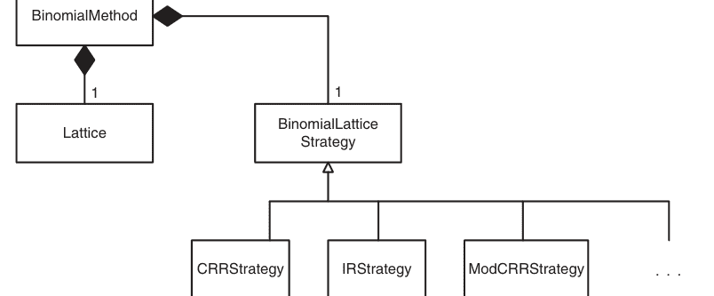

图 11.1 模型与策略

详情请参阅 Duffy (2006A)。

#### 11.3 新需求与用例

我们描述了在接下来的两章中关于将格点方法应用于计算金融问题的应用中可以预期的主要功能。一般而言，我们关注 Clewlow and Strickland (1998) 中的应用以及相关文献。目标是将功能分为几个类别：

- U1：对一系列单因子期权定价问题进行定价。
- U2：支持二叉和三叉格点。
- U3：使用格点计算对冲敏感性。
- U4：为短期利率构建二叉树。

上述列表为我们设计 C++ 软件框架提供了基础。研究格点模型的主要目标是：

- 格点模型众所周知，我们使用设计模式和 C++ 的新特性来实现它们。我们在接下来的两章中讨论的示例已被研究了至少 20 年。本书的重点是设计灵活的软件框架，而非（必然）讨论最先进的定价模型或二叉方法的数学基础。
- 第 11 章和第 12 章是本书中讨论期权定价模型的第一个章节。从这个意义上说，它们代表了前十章与后面章节主题之间的桥梁。特别是，lambda 函数、元组和函数式编程模型将在本书的进展中发挥重要作用。
- 我们生成代码来对一系列单因子期权进行定价，结果可用于测试基于其他数值方法（如蒙特卡洛和有限差分方法）的结果的准确性。我们在此创建的一些代码也可以在这些应用中重用。
- 我们努力展示如何设计易于定制的软件框架。我们也可以将软件用于与计算金融无关的其他应用，例如数值分析中的多项式和有理函数插值。

#### 11.4 新的设计方法：分层方法

在本节中，我们展示了如何设计一个使用格点模型对期权进行定价的软件框架。该方法基于若干基本设计原则：

- a) 应用程序由松耦合且内聚的组件（和对象）构建。
- b) 每个组件有一个主要职责（它满足 SRP）。
- c) 我们在不断增加的抽象层级中构建功能。

为此，我们将看到分层设计模式（POSA, 1996）如何满足上述三个设计要求，从而使我们能够创建灵活的软件系统。在此之前，我们讨论一个具体的动机示例及其在 C++ 中的实现（基于 Clewlow and Strickland, 1998, p. 41 中的伪代码）。换句话说，我们对美式向下敲出看涨期权进行定价。这是一种美式看涨期权，要求如果资产价格跌至预定障碍水平 H 以下，则期权不复存在（敲出）且不支付任何东西。在某些情况下，期权可以支付预定的现金回扣，但我们在此不讨论该主题。我们使用 Clewlow and Strickland (1998) 中描述的加性二叉树对该期权进行定价。

需要遵循以下步骤：

1. 创建资产价格网格/格点。
2. 在到期时初始化期权价值。
3. 在格点中回溯并应用障碍检查和提前行权条件。
4. 计算期权价格。

该问题的代码为：

```cpp
#include <cmath>
#include <algorithm>
#include <vector>
#include <iostream>

double price(double K, double T, double S, double sig, double r,
            double H,int N)
{
    // Initialise coefficients based on the Trigeorgis approach
    // N = Number of intervals
    double dt = T/N;
    double nu = r - 0.5*sig*sig;
    // Up and down jumps
    double dxu = std::sqrt(sig*sig*dt + (nu*dt)*(nu*dt));
    double dxd = -dxu;
    // Corresponding probabilities
    double pu = 0.5 + 0.5*(nu*dt/dxu);
    double pd = 1.0 - pu;
    // Precompute constants
    double disc = std::exp(-r*dt);
    double dpu = disc*pu;
    double dpd = disc*pd;
    double edxud = std::exp(dxu - dxd);
    double edxd = std::exp(dxd);
    // Initialise asset prices
    std::vector<double> St(N+1);
    St[0] = S*std::exp(N*dxd);
    for (std::size_t j = 1; j < St.size(); ++j)
```


```cpp
{
    St[j] = edxud*St[j-1];
}

// Option value at maturity (t = N)
std::vector<double> C(N+1);
for (std::size_t j = 0; j < C.size(); ++j)
{
    if (St[j] > H)
    {
        C[j] = std::max<double>(St[j] - K, 0.0);
    }
    else
    {
        C[j] = 0.0;
    }
}

// Backwards induction phase
for (int i = N-1; i >= 0; --i) // Can't use std::size_t as index
{
    for (std::size_t j = 0; j <= i; ++j)
    {
        St[j] /= edxd;

        if (St[j] > H)
        {
            C[j] = dpd*C[j] + dpu*C[j+1];

            // Early exercise condition
            C[j] = std::max<double>(C[j], St[j] - K);
        }
        else
        {
            C[j] = 0.0;
        }
    }
}

}

// Early exercise down and out call
return C[0];
}
```

一个简单的测试程序如下：

```cpp
int main()
{

    double K = 100.0;
    double S = 100.0;

    double T = 1.0;
    double r = 0.06;
    double q = 0.0;
    double sig = 0.2;

    int N = 3;

    double H = 95;
    double optionPrice = price(K,T,S,sig,r,H,N);

    std::cout << "Price:" << optionPrice << std::endl;

    return 0;
}
```

上述代码不够灵活，我们将看到如何将其泛化。它并非出于可维护性的考虑而编写。另请参见练习1。

##### 11.4.1 分层系统模式

从11.4节的代码示例可以清楚地看出，我们需要某种策略来创建一个灵活的软件框架，以支持我们使用格方法实现的一系列期权定价问题。我们已经看到，上述代码不满足我们的需求，因此需要一种新方法。在Duffy (2006A)中，我们将面向对象模型与GOF设计模式结合使用，这种方法提供了一定的灵活性。然而，该设计存在许多局限性，例如：

- 它基于对象，使用了子类型多态和类层次结构。使用对象技术并不总是必要的。
- 类之间的紧耦合。
- 由于缺乏合适的模式以及C++语言本身的限制，如何配置和初始化应用程序并不总是清晰的。
- 随着新需求添加到软件框架中，类的数量会激增。我们创建了类和类层次结构，但函数对象和lambda函数可能更合适。

尽管如此，Duffy (2006A)中的设计方法相对于11.4节中给出的硬编码解决方案是一种改进。该代码可以用作更灵活设计的需求。

我们现在提出一种基于分层系统模式的设计（完整讨论见POSA, 1996）。当前问题可以建模为一组松散耦合且内聚的组件，以使用层次结构的形式组织；给定层级的组件使用相同或更低层级组件的服务，但给定层级的组件不了解更高层级的组件。这种方法促进了松散耦合，并用于许多期权定价问题（属性A1使用整数索引）以及更广义的格，其中属性A1的索引空间可以是更一般的数据类型，例如Boost日期。当我们希望直接使用日期以及处理百慕大期权定价问题时，需要这种灵活性。本书不讨论使用日期作为行索引空间。

*最简单的格* ADT使用整数作为索引。我们使用嵌套的STL向量来实现它：

```cpp
// The Node class contains the values of interest.
// LatticeType == 2 for binomial, 3 for trinomial.

template <class Node, int LatticeType> class Lattice
{ // Generic lattice class

private:

    // Implement as a full nested vector class
    std::vector<std::vector<Node> > tree;

    // ...
};
```

*广义格* ADT有一个额外的模板参数，支持属性A1的非整数索引：

```cpp
template <typename TimeAxis, typename Node, int LatticeType>
    class GeneralisedLattice
    { // Generic lattice class

    // Implement as an STL map
    std::map<TimeAxis, std::vector<Node> > tree;

    // ...
};
```

这里我们将索引空间实现为map。这两种格类具有相似的接口，我们在此总结如下：

- 构造函数，例如创建具有给定行数（时间步数）的格。
- 访问给定行的数据，或访问给定行和给定列的数据。
- 在格中迭代时有用的成员函数。

我们现在给出一些初始示例。首先创建一个二叉树格和一个三叉格：

```cpp
// Create basic lattices
const int TYPEB = 2;    // BinomialLatticeType;
```

## STOP 标志

STOP 标志是道路交通中重要的禁止标志，要求驾驶人在交叉路口前将车辆完全停下，观察周边交通情况后再通行。

- 必须在停止线前完全停车
- 让行右侧来车
- 确认安全后方可通行

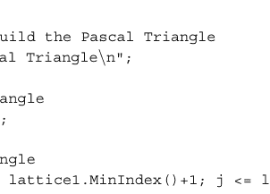

```cpp
// Generate edge values
lattice1(j,0) = lattice1(j-1,0);
lattice1(j,lattice1.MaxIndex(j)) = lattice1(j-1,lattice1.MaxIndex(j-1));

// Generate the interior values
for (std::size_t i = 1; i < lattice1[j].size()-1; ++i)
{
    lattice1(j,i)=lattice1(j-1,i)+lattice1(j-1,i-1);
}
LatticeMechanisms::print(lattice1);
```

这些示例展示了如何创建格以及访问和修改其值。你可以运行代码并检查输出。

我们现在创建一个广义格，其行索引集为Boost日期类型。首先创建一组将构成行轴的固定日期：

```cpp
#include <boost/date_time/gregorian/gregorian.hpp>

// Dates as axis
namespace Dates = boost::gregorian;

// Simple dates for illustrative purposes
std::set<Dates::date> fixingDates;
Dates::date myDate(2014, Dates::May, 16);
fixingDates.insert(myDate);
Dates::date myDate2(2014, Dates::May, 26);
fixingDates.insert(myDate2);
Dates::date myDate3(2014, Dates::Jun, 2);
fixingDates.insert(myDate3);
Dates::date myDate4(2014, Dates::Jun, 12);
fixingDates.insert(myDate4);
```

然后我们基于这些固定日期创建一个广义格：

```cpp
GeneralisedLattice<Dates::date,double, 3> lattice2(fixingDates);
GeneralisedLatticeMechanisms::print(lattice2);
```

一个有用的项目是扩展功能以支持日期。

##### 11.4.3 第2层：格上的操作

第1层的功能主要涉及对格结构进行建模的泛型类。总体而言，重点在于为这些结构分配内存，并使用运算符重载来访问格的元素。此功能符合SRP。这些ADT可用于多种应用（在本书中，我们主要关注期权定价）。我们开发代码以在格中迭代、在应用中使用格以及访问格中的元素。为此，我们在第2层创建了实现这些特性的泛型代码。过去（Duffy, 2006A），我们使用了面向对象的方法，导致代码有些不够灵活，并给框架引入了耦合。随着C++11的出现，我们现在有机会提高框架的通用性和可维护性。在本章中，我们讨论以下特性：

- 元组，我们将其用作函数的返回类型或函数的输入参数。
- 函数类型包装器 `std::function<>`。这是一个*基于签名的特性*，它减少了组件之间的耦合，因为它是一个规范，其实现被推迟到第3层的代码中。我们在第3章和第4章中已经看到，函数类型包装器可以实现为*可调用对象*，如自由函数、静态成员函数、对象成员函数（与`std::bind<>`结合）、函数对象和lambda函数。
- Lambda函数，用于框架的第3层。
- 使用关键字 `auto` 进行自动类型推导。此功能有助于使代码更具可读性，并减轻编程的枯燥性。

我们还指出，可以创建输入参数和返回类型均为元组的函数包装器。也可以创建元素为函数包装器的元组。

创建格之后，我们接着讨论使用或修改其元素的算法。为了缩小范围，我们专注于著名的*前向*和*后向归纳算法*（参见Clewlow and Strickland, 1998; Duffy, 2006A; Duffy and Germani, 2013）。通常，我们以不同方式访问和修改二叉树格和三叉格，例如：

- U1：前向归纳（使用*向上*和*向下*参数创建格）。
- U2：计算每个最终节点（到期日/行权日）的收益。
- U3：后向归纳（从到期日开始计算更早节点的期权价值）。

其他一些用例包括：

- U4：计算对冲敏感性。
- U5：针对支付股息资产的格模型。
- U6：为路径依赖期权定价。
- U7：计算美式看跌期权的价格。
- U8：双因子格方法。

为此，我们创建了四个自由函数来实现前向和后向归纳，一组用于普通期权，另一组用于美式期权。我们还对二叉树格和三叉格进行了区分。还有机会使代码更加优雅。我们还使用了函数包装器和元组。


实现前向归纳的代码是：

```cpp
const int TYPEB = 2; // BinomialLatticeType

template <class Node>
void ForwardInduction(Lattice<Node, TYPEB>& lattice,
const std::function<std::tuple<Node, Node>(const Node& node)>&
generator, const Node& rootValue)
{
    // Initialise the root value lattice[0][0]
    std::size_t si = lattice.MinIndex();
    lattice[si][0] = rootValue;

    std::tuple<Node, Node> tuple;

    // Loop from min index to max, i.e. (min, end]
    for (std::size_t n = lattice.MinIndex() + 1; n <=
    lattice.MaxIndex(); n++)
    {
        for (std::size_t i=0;i<lattice[n-1].size(); i++)
        {
            tuple = generator(lattice[n-1][i]);
            lattice[n][i] = std::get<0>(tuple);
            lattice[n][i+1] = std::get<1>(tuple);
        }
    }
}
```

我们还编写了反向归纳算法，该算法从晶格的底部（时间 = T）开始计算其顶点（时间 = 0）的值。双项式晶格情况下的代码是：

```cpp
template <class Node>
Node BackwardInduction(Lattice<Node, TYPEB>& lattice,
const std::function<Node(const Node& upper, const Node& lower)>&
generator, const std::function<Node (const Node& node)>&
endCondition)
{
    std::size_t ei = lattice.MaxIndex();

    // Apply the end condition function to the existing values
    // of the base of the tree. In finance, this would be the
    // payoff at maturity.
    for (std::size_t i = 0; i < lattice[ei].size(); ++i)
    {
        lattice[ei][i] = endCondition(lattice[ei][i]);
    }
}
```

在第 3 层我们配置并初始化应用程序的参数和函数，例如：

- 期权参数。
- 收益类型的种类。
- 是否使用二项式方法或三项式方法。
- 容纳额外特性，例如提前行权和障碍等。

从软件观点来看，可以以多种方式配置应用程序。一个重要的要求是确定第 3 层代码应保持多高的可维护性。在 Duffy (2006A) 中我们使用类层次结构来增加配置过程的灵活性。更灵活的解决方案是使用生成器模式（见 GOF, 1995）来配置应用程序的对象网络。然而在本节中，我们避免创建类层次结构，而是使用函数对象、lambda 函数和函数包装器来配置应用程序。我们认为这种方法能带来可读且易于理解的代码。我们现在给出一个定价欧式和美式期权的初始示例。

### 11.5 期权定价的初始 '101' 示例

我们以使用 Cox-Rubinstein-Ross (CRR) 方法定价欧式和美式期权为例（见 Clewlow 和 Strickland, 1998）。我们计算上跳和下跳大小以及概率参数，并且进一步将这些参数封装在一个名为 CRRLatticeAlgorithms 的类中。该类是一个函数对象，因为它有两个与框架第 2 层算法所需的函数包装器兼容的运算符：

```cpp
class CRRLatticeAlgorithms
{ // The function object that implements forward and backward
  // induction algorithms based on CRR

private:
    double u;
    double d;
    double p;
    double discounting;

public:
    CRRLatticeAlgorithms(const OptionData& option, double dt)
    {

        double s = option.sig;
        double r = option.r;

        double R1 = (r - 0.5 * s * s) * dt;
        double R2 = s * std::sqrt(dt);

        u = std::exp(R1 + R2);
        d = std::exp(R1 - R2);

        discounting = std::exp(- r*dt);

        p = 0.5;

    }

    // Forward induction algorithm
    // Function object
    std::tuple<double, double> operator () (double value)
    {
        return std::make_tuple(u*value, d*value);
    }

    // Backward induction algorithm
    // Function object
    double operator()(double upper, double lower)
    {
        return discounting * (p*upper + (1.0 - p)*lower);
    }
};
```

我们现在创建期权数据和 CRR 晶格：

```cpp
// Option data
OptionData opt;

opt.K = 65.0;
opt.T = 0.25;
opt.r = 0.08;
opt.q = 0.0;
opt.sig = 0.3;

int N = 101;
double dt = opt.T / double(N);

// Implements forward and backward induction
LatticeMechanisms::CRRLatticeAlgorithms algorithm(opt, dt);

// Create basic structure for plain options
Lattice<double,2> lattice(N, 0.0);
```

我们现在构建晶格并按如下方式计算普通期权价格：

```cpp
double rootVal = 60.0; // S(0)
LatticeMechanisms::ForwardInduction<double>(lattice, algorithm, rootVal);

// Payoff as a lambda function
double K = opt.K;
auto Payoff = [&K] (double S)-> double {return std::max<double>
(K - S, 0.0);};

// Price a plain option
double res = LatticeMechanisms::BackwardInduction<double>(lattice,
algorithm, Payoff);
std::cout << "Plain Option price, classic #1: ";
```

我们现在按如下方式定价相应的美式期权价格：

```cpp
// Create basic structure for early exercise options
Lattice<double,2> lattice2(lattice);

// The early exercise constraint
auto AmericanAdjuster = [&Payoff] (double& V, double S)->void
{ // e.g. early exercise

    V = std::max<double>(V, Payoff(S));
};

// Price an early exercise option
double res2 = LatticeMechanisms::BackwardInduction<double>
    (lattice2, algorithm, Payoff,AmericanAdjuster);
    std::cout << "Early exercise option price";
```

请注意，我们使用 lambda 函数来实现提前行权约束。你可以从发行介质中运行代码并检查一系列参数值下的答案。我们建议你尝试使用代码，修改它并亲身体会框架的工作方式。

### 11.6 软件分层的优势

三层设计方法在软件可维护性、理解性和可扩展性方面提供了许多优势。首先，我们有一个众所周知且定义明确的过程（分层模式）来构建 C++ 晶格框架。它还为开发人员提供了一种词汇，使他们能够在比仅仅（可能未记录的）代码块更高的层面上相互沟通（以及与自己沟通）。其次，它减少了软件组件和模块之间的耦合。第三，它提高了每一层组件的内聚性，因为它们的操作密切相关，因此不依赖于其他层中的组件。最后，相对容易向框架添加新模块。我们现在根据 ISO 9126 标准的质量特性从更详细的观点讨论这些主题。准则也可应用于其他问题。

- *依赖关系保持局部：* 一层对上层来说是一个*黑盒*。例如，第 2 层的算法使用第 1 层的晶格结构，而无需知道（或需要知道）这些结构的内部工作原理。
- *可交换性：* 经过一些努力，可以用其他语义等价的实现替换一层中的实现。例如，我们可以使用 *适配器* 模式在设计时适配组件的接口。对于需要动态交换接口的应用程序，我们可以使用 *桥接* 模式（见 GOF, 1995）。

当前框架中的一个例子是晶格数据结构的情形，我们可以使用 STL 嵌套向量或 Boost uBLAS 三角矩阵等来实现。

*分层* 设计模式确实有一些与代码可维护性和运行时性能相关的潜在缺点（POSA, 1996）：

- *效率较低：* 更高层的层使用来自较低层层的数据和服务。所有相关数据必须通过多个中间层沿调用链向上传递。数据可能会被多次转换。这对于错误消息尤其正确，错误消息可能起源于较低（硬件）层，然后被转换成语义上可被更高层客户端理解的错误消息。
- *行为级联变化：* 此问题由层中行为的变化引起。例如，一个看似局部的层变更可能要求在更高层中更改代码。一个例子是当我们决定使用新的数据结构来表示应用程序中的晶格数据时需要执行的修改。在最坏的情况下，它可能要求重写应用程序。
- *不必要的工作：* 多个层可能对数据执行相同的操作。这会导致可能影响运行时性能的代码，例如多次检查输入数据的有效性。
- *确定层的正确粒度难度：* 层数过少或过多都可能不利。在前一种情况下，无法利用可重用性、可更改性和可移植性的潜力，而在后一种情况下，会在设计中引入大量开销和不必要的复杂性。在本章中我们引入了三层模型，但四层和五层模型也是可能的。

最后，*分层* 设计模式可以应用于在抽象的递增层级中构建功能的大量应用程序。你需要通过检查该模式对你自己的应用程序的优点和缺点来分析其可行性。三层设计可能是最简单的解决方案，但对于较大的生产系统，你可能需要添加一个或多个额外的层。

##### 11.6.3 效率

我们设计框架中的数据结构，使其仅分配算法实际会使用的内存。因此，我们不是使用冗余的 *稠密矩阵* 来存储晶格中的数据，而是使用 *锯齿数组* 或 *三角矩阵* 等：

```cpp
// Implement as a full nested vector class
std::vector<std::vector<Node> > tree;
```


```cpp
double t1 = 0.0;
// Loop from the max index to the start (min) index
for (std::size_t n = L2.MaxIndex() - 1; n > 0; n--)
{
    for (int i = 0; i < L2[n].size(); i++)
    {
        t1 = lattice[n][i];
        L2[n][i] = generator(L2[n+1][i+1], L2[n+1][i]);
        constraintAdjuster(L2[n][i], t1);
    }
}

// Case n = 0 treated separately for compiler reasons
for (std::size_t i = 0; i < L2[0].size(); ++i)
{
    t1 = lattice[0][i];
    L2[0][i] = generator(L2[1][i+1], L2[1][i]);
    constraintAdjuster(L2[0][i],t1);
}

std::size_t si = L2.MinIndex();
return L2[si][0];
}
```

要展示如何使用该算法，我们创建一个资产格子和四个将保存计算得出的期权价格的格子。首先，基于 CRR 的资产格子为：

```cpp
// Option data
OptionData opt;

opt.K = 65.0;
opt.T = 0.25;
opt.r = 0.08;
opt.q = 0.0;
opt.sig = 0.3;

int N = 100;
double dt = opt.T / static_cast<double>(N);

// Implements forward and backward induction
LatticeMechanisms::CRRLatticeAlgorithms algo(opt, dt);

// Create basic asset lattice
Lattice<double,2> asset(N, 0.0);    // init
double rootVal = 60.0;              // S(0)
LatticeMechanisms::ForwardInduction<double> (asset, algo, rootVal);
// build the lattice
```

四种期权类型为平值看跌和看涨期权、美式看跌和看涨期权。我们将收益和约束检查器定义为 lambda 函数。为了保持代码一致性，我们为平值期权创建了一个特殊的约束检查器（其主体为空）：

```cpp
// Kinds of payoff
double K = opt.K;
auto PutPayoff = [&K] (double S)-> double {return std::max<double>
(K - S, 0.0);};
auto CallPayoff = [&K] (double S)-> double {return std::max<double>
(S - K, 0.0);};

// American early exercise constraint
auto AmericanPutAdjuster = [&PutPayoff] (double& V, double S)->void
{ // e.g. early exercise

    V = std::max<double>(V, PutPayoff(S));
};

auto AmericanCallAdjuster = [&CallPayoff] (double& V, double S)->void
{ // e.g. early exercise

    V = std::max<double>(V, CallPayoff(S));
};

auto EmptyAdjuster = [] (double& V, double S)->void
{ // No action executed at a node

    // Do nothing
};
```

我们现在创建四个格子（每个期权类型一个）：

```cpp
Lattice<double,2> euroPut(N, 0.0);
LatticeMechanisms::ForwardInduction<double>(euroPut, algo, rootVal);
Lattice<double,2> euroCall(N, 0.0);
LatticeMechanisms::ForwardInduction<double>(euroCall, algo, rootVal);
Lattice<double,2> earlyPut(N, 0.0);
LatticeMechanisms::ForwardInduction<double>(earlyPut, algo, rootVal);
Lattice<double,2> earlyCall(N, 0.0);
LatticeMechanisms::ForwardInduction<double>(earlyCall, algo, rootVal);
```

我们现在可以调用向后归纳算法来计算期权价格：

```cpp
// Compute option prices
using namespace LatticeMechanisms;
double euroPutPrice = BackwardInduction<double>
    (asset, euroPut, algo, PutPayoff, EmptyAdjuster);
std::cout << "Euro put: " << euroPutPrice;

double euroCallPrice = BackwardInduction<double>
    (asset, euroCall, algo, CallPayoff, EmptyAdjuster);

std::cout << "Euro call: " << euroCallPrice;

// Price an early exercise option
double earlyPutPrice = BackwardInduction<double>
    (asset, earlyPut, algo, PutPayoff,
     AmericanPutAdjuster);
std::cout << "Early put: " << earlyPutPrice;

double earlyCallPrice = BackwardInduction<double>
    (asset, earlyCall, algo, CallPayoff,
     AmericanCallAdjuster);
std::cout << "Early call: " << earlyCallPrice;
```

你可以运行这段代码并检查输出。上述算法可以并行运行，因为资产格子是只读可共享的，并且每个算法都在其自己的线程中运行。我们将在后面的章节中详细讨论这种情况。我们在这里发现了一种模式，即第 2 层的几个算法可以使用与第 1 层相同的数据结构。我们将在后面讨论蒙特卡洛模拟和 FDM 时看到更多相同的使用模式。

### 11.8 合并格子

在某些情况下，我们可能希望生成一个格子，其每个节点都是由资产价格和期权价格组成的元组。为此，一个可能性是计算资产格子和期权格子中的值，然后将这两个格子合并形成一个新的格子。这种选择很有用，因为我们可能希望在 Excel 或控制台上打印资产和期权价格等。为此，我们创建了一个用于合并具有相同大小的两个格子的函数。该函数从两个输入格子创建一个格子：

```cpp
template <class Node, int LatticeType>
Lattice<std::tuple<Node,Node>, LatticeType> merge
    (const Lattice<Node,LatticeType>& latticeA,const Lattice<Node,
     LatticeType>& latticeB)
{ // Merge elements of two lattices to form a lattice of tuple

    Lattice<std::tuple<Node,Node>, LatticeType> result(latticeA.Depth());

    for (std::size_t n = latticeA.MinIndex(); n <= latticeA.MaxIndex();
         ++n)
    {
        for (std::size_t i = 0; i < latticeA[n].size(); ++i)
        {
            result[n][i] = std::make_tuple(latticeA[n][i],latticeB[n][i]);
        }
    }

    return result;
}
```

作为示例，我们创建两个格子并将它们合并形成一个新的格子：

```cpp
// Option data
OptionData opt;

opt.K = 65.0;
opt.T = 0.25;
opt.r = 0.08;
opt.q = 0.00;
opt.sig = 0.30;

int N = 3;
double dt = opt.T / double(N);

LatticeMechanisms::CRRLatticeAlgorithms algo(opt, dt);

// Create basic asset lattice
Lattice<double,2> asset(N, 0.0);   // init
double rootVal = 60.0;             // Index level
LatticeMechanisms::ForwardInduction<double> (asset, algo, rootVal);
LatticeMechanisms::print(asset, "asset");

double K = opt.K;
auto PutPayoff = [&K] (double S)-> double {return std::max<double>
(K - S, 0.0);};

// American early exercise constraint
auto AmericanPutAdjuster = [&PutPayoff] (double& V, double S)->void
{  // e.g. early exercise

    V = std::max<double>(V, PutPayoff(S));
};

Lattice<double,2> earlyPut(N, 0.0);

// Price an early exercise option
double earlyPutPrice = LatticeMechanisms::BackwardInduction<double>
                         (asset, earlyPut, algo, PutPayoff,
                          AmericanPutAdjuster);

// Merge the asset and derivative lattices
Lattice<std::tuple<double, double>, 2> combinedLattice
    = LatticeMechanisms::merge(asset, earlyPut);
LatticeMechanisms::print(combinedLattice);
```

此代码的输出为：

```
asset

Branch Number 0: [60, ]
Branch Number 1: [65.6189, 55.1832, ]
Branch Number 2: [71.764, 60.351, 50.7531, ]
Branch Number 3: [78.4846, 66.0028, 55.506, 46.6787, ]
Early put: 6.03903

asset and price

Branch Number 0: [(60,6.03903)]
Branch Number 1: [(65.6189,2.34205) (55.1832,9.81679)]
Branch Number 2: [(71.764,0) (60.351,4.71543) (50.7531,14.2469)]
Branch Number 3: [(78.4846,0) (66.0028,0) (55.506,9.49395) (46.6787,18.3213)]
Branch Number 4: [(0,0) (0,0) (0,0) (0,0) (0,0)]
```

### 11.9 总结与结论

在本章中，我们基于分层模式设计了一个小型软件框架，用于使用格子方法对期权进行定价。我们集中于二叉方法，因为其流行，并且它也是展示如何以适应性和可维护性为目标设计软件框架的一个很好的测试用例。特别是，我们将看到该框架可用于在第 12 章中创建更复杂的应用程序。作为后续，我们将在后面的章节中看到，相同的软件设计原则将被应用于为 PDE/FDM 和蒙特卡洛应用程序创建软件框架。

作为指导，我们总结了使用格子模型对单因子期权定价的主要步骤：

- 1. 选择格子类型（二叉、 trinomial）和时间步数。调用适当的格子构造函数。
- 2. 选择算法类型（CRR、JR）并执行向前归纳算法。
- 3. 定义约束函数，例如提前行权和障碍。
- 4. 定义收益函数。
- 5. 执行向后归纳算法以计算期权价格。

### 11.10 练习与项目

### 1. （分析代码）

第 11.4 节中的 C++ 代码不是以可维护性为目标编写的。事实上，它是匆忙编写的，因为经理希望快速原型看到结果，这是一个完全可以接受的原因。在本次练习中，我们进行了一项取证调查，以确定该代码的灵活性程度以及如何适应新需求。它不适合作为未来工作的基础。

回答以下问题：

- a) 确定代码中硬编码的部分（提示：例如，代码仅适用于看涨期权，但我们也可能希望支持看跌期权）。
- b) 你可以使用哪些 C++ 功能使代码更灵活，例如子类型多态和类层次结构、函数对象和 lambda 函数？


c) 适配代码使其能够支持屏障期权族（有八种选择）：向下击穿敲出看涨期权、向下击穿敲入看涨期权、向上击穿敲出看涨期权、向上击穿敲入看涨期权、向下击穿敲出看跌期权、向下击穿敲入看跌期权、向上击穿敲出看跌期权、向上击穿敲入看跌期权。在不引入硬编码的条件逻辑或代码重复（臭名昭著的复制粘贴综合征）的情况下，对这些期权进行建模的最灵活方式是什么？

d) 通过将大到期日下获得的结果与永续美式看涨期权（见 Haug, 2007 中的公式或本书第 12.4.3 节）的精确解进行比较来测试代码。

e) 修改代码使其能够支持或有返还。测试你的结果的准确性。

f) 考虑一个屏障 H = 0 的美式看涨期权。为了达到与使用 Bjerksund 和 Stensland（2002）或 Barone-Adesi-Whaley 闭式近似时所获得的相同精度，需要多少步？（见 Haug, 2007。）

## 2. （ADT 实现的效率）

我们使用嵌套 STL 向量和 STL 映射分别实现了简单和广义的格子。这些数据结构的性能可能不足以满足所有应用，在某些情况下可能需要以不同的方式实现它们。

回答以下问题：

- a) 与嵌套 STL 向量相比，使用 Boost uBLAS 上三角和下三角矩阵有什么优势？

- b) 对于广义格子，考虑使用 C++（或 Boost）无序映射而不是 STL 映射，因为它们具有常数复杂度而不是对数复杂度：

    ```
    // boost or std namespace
    unordered_map<TimeAxis, std::vector<Node> > tree;
    ```

- c) 创建一个新的广义格子类，其实现为无序映射（你可以复制并修改原始类的代码）。通过创建一个行集为 Boost 日期的大型格子来测试新类的性能。

- d) 为什么使用嵌套 STL 列表作为格子的实现是不高效的？由此产生的复杂度是多少？例如，在这种新结构中搜索有多高效？

## 3. （格子框架中的软件质量特性）

我们讨论了与格子 ADT 相关的一些优点。讨论它们如何提供以下好处（McConnell, 2004）：

- a) 它们隐藏了实现细节。我们可以将 ADT 的表示从一种数据类型更改为另一种数据类型，而不会影响客户端。数据也可以存储在外部存储（例如 Excel 或关系数据库）或内存中，而不会影响客户端。

- b) 更改不会影响整个程序。该好处在当前框架中更为明显，因为它基于分层模式。讨论为什么该说法是正确的。

- c) 更容易提高性能。讨论如何改进第 2 层的算法和第 1 层的 ADT。是否有机会并行化一些关键算法，例如第 11.7 节中的代码？

- d) 软件更明显地是正确的。例如，将第 11.4 节中用于定价美式向下敲出看涨期权的原始算法的总体质量与基于当前框架的类似代码进行比较。

这些通用的设计准则可以应用于其他应用领域，例如蒙特卡洛模拟和 PDE 模型吗？

## 4. （作为代码版本控制有用练习的代码重写）

考虑第 11.4 节中用于定价美式向下敲出看涨期权的代码。当前练习的目标是使用格子 ADT 和第 2 层算法手动重新设计该代码的一系列原型。测试每个原型以确保它产生的结果与其前身相同。

与原始代码相比，新代码的主要优点是什么？

该练习可以视为练习 1 的后续练习。

## 5. （C++ 11 组合）

基于第 11.4.3 节的讨论，考虑以下一般场景：

  - 使用嵌入元组的函数包装器。
  - 使用嵌入函数的函数包装器（这些称为函数对象）。
  - 使用函数包装器的元组。
  - 使用其他元组的元组（嵌套元组）。

回答以下问题：

- a) 创建每个上述场景的简单示例以获得对语法的一些理解。

- b) 这种功能如何支持创建和维护松耦合系统的能力？

- c) 考虑单变量实值函数及其积分的问题，由公式给出：

    ```
    I(f) = ∫ₐᵇ f(x)dx. (11.1)
    ```

    事实上，我们正在定义一个高阶函数（或在这种情况下的泛函），它对区间 (a, b) 上的函数 f 进行建模积分。确定如何使用 C++ 语法对公式 (11.1) 进行建模。

- d) 我们将公式 (11.1) 推广到双线性映射的情况：

    ```
    I(f, g) = ∫ₐᵇ f(x)g(x)dx. (11.2)
    ```

    确定如何使用 C++ 语法对公式 (11.2) 进行建模（提示：使用 lambda 函数）。

## 6. （帕斯卡三角形）

使用第 11.4.2 节中的代码计算帕斯卡三角形。使用函数对象和 lambda 函数来实现计算上下跳跃的生成器。

我们将在第 12 章中更详细地讨论帕斯卡三角形。

## 7. （格子模型）

在第 11.5 节中，我们使用 CRR 模型计算格子参数来对期权进行定价。在本节中，我们讨论 CRR 方法的若干替代方案：

- 修改 CRR：

    u = e^{K_N + V_N}
    d = e^{K_N - V_N}
    p_u = (e^{r Δt} - d)/(u - d)  (11.3)

    其中：

    K_N = log(K/S)/N, V_N = σ√Δt.

- Trigeorgis (TRG)：

    Δx_u = Δx_d = √{σ² Δt + ν² Δt²}
    p_u = 1/2 + 1/2 νΔt/Δx = 1/2 (1 + νΔt/Δx), ν = r - 1/2 σ².  (11.4)

- 等概率 (EQP)：

    a = νΔt,   b = 1/2 √{4σ² Δt - 3ν² Δt²}
    Δx_u = 1/2 a + b
    Δx_d = 3/2 a - b
    p_u = p_d = 1/2.  (11.5)

提示：在所有情况下 ν = r - 1/2 σ²。

回答以下问题：

- a) 使用与类 CRRLatticeAlgorithms 中相同的函数对象方法实现上述模型。

- b) 使用第 11.5 节中的数据测试模型。对于网格尺寸的各种值，可以对模型的相对准确性说什么？

## 8. 调查 CRR 模型作为时间步数函数的准确性。当你增加时间步数时，你是否得到更好的近似？对偶数和奇数时间步数测试准确性。

## 9. （Leisen–Reimer 方法）

众所周知，二项式方法的解收敛到真实解通常不是单调的，并且往往在精确值附近振荡。减小步长（或等价地，增加时间步数 NT）并不一定能在使用 CRR 方法时获得更好的精度。
我们考虑一种用于定价单因子期权的方法（Leisen 和 Reimer, 1996）。该方法涉及以使树围绕执行价为中心的方式计算上、下参数 u 和 d。该方法相对于 CRR 等其他方法的改进在于收敛特性更少锯齿状。上、下参数由（Haug, 2007, 第 290–292 页）定义：

$$u=e^{b\Delta t}\frac{h(d_1)}{h(d_2)},\quad d=\frac{e^{b\Delta t}-pu}{1-p},\quad p=h(d_2)$$  \tag{11.6}

其中：

$$b=\text{cost-of-carry}$$

$$\Delta t=T/NT$$

$$d_1=\frac{\log(S/K)+(b+\sigma^2/2)T}{\sigma\sqrt{T}}$$

$$d_2=d_1-\sigma\sqrt{T}.$$

最后，$h=h(x)$ 是一个特别选择的函数，例如 Peizer–Pratt 反演公式。详细信息可在 Haug (2007) 中找到。

## 10. （使用变长参数的代码简化）

第 2 层软件框架中的前向和后向归纳算法使用元组。特别是，二项式格子使用具有两个分量的元组，而三项式格子使用具有三个分量的元组。当前设计导致代码重复，我们希望创建一个单一的前向归纳算法和单一的后向归纳算法。这一目标应该可以通过利用第 1 层格子类中的第二个模板参数来告诉我们要使用多少个分量作为输出（在前向归纳的情况下）或作为输入（在后向归纳的情况下）的事实来实现。例如，我们可以使用固定大小的数组 std::array<T,N>，其中 N = 2 表示二项式格子，N = 3 表示三项式格子，或在以后的版本中使用更奇特的变长模板。

我们使用 std::array<T,N> 而不是 std::tuple<> 为普通期权实现前向和后向归纳算法。为了说明我们的意思，我们给出前向归纳算法的函数原型和代码：

```
template <typename Node, int LatticeType> void ForwardInduction
    (Lattice<Node, LatticeType>& lattice, const std::function
    <std::array<Node, LatticeType>
    (const Node& node)>& generator, const Node& rootValue)

{
    // Initialise the root value lattice[0][0]
    std::size_t si = lattice.MinIndex();
    lattice[si][0] = rootValue;

    std::array<Node, LatticeType> tuple;

    // Loop from min index to end index, i.e. (min, end]
    for (std::size_t n = lattice.MinIndex() + 1;
```


```
n <= lattice.MaxIndex(); n++)
{
    for (std::size_t i=0;i<lattice[n-1].size(); ++i)
    {
        tuple = generator(lattice[n-1][i]);
        // lattice[n][i] = std::get<0>(tuple);
        // lattice[n][i+1] = std::get<1>(tuple);
        for (std::size_t j=0;j<=tuple.size()-1; ++j)
        {
            lattice[n][i+j] = tuple[j];
        }
    }
}
```

这里我们看到 lattice 类型作为模板参数的出现。

回答以下问题：

+   a) 基于上述代码风格，创建执行向后归纳的函数。
+   b) 使用二叉和三叉格子，通过正向和向后归纳算法对普通期权进行定价来测试新的算法。
+   c) 将代码扩展以适应提前行权特征。
+   d) 我们怀疑使用元组会比使用数组效率更低。我们可能需要重新设计代码。你同意吗？

## 11. （STL 兼容性和仿真，项目）

使用 STL 算法背后的设计哲学将提高格子 ADT 代码的质量并使代码更少冗余。

回答以下问题：

+   a) 修改格子 ADT 使其与 STL 兼容。
+   b) 通过编写一个函数（类似于 std::transform()）来测试新的功能，该函数将一个实值单变量函数应用于源格子的每个节点，以修改该格子或初始化目标格子。我们通过修改以下代码以 STL 风格使用迭代器：

```
template <typename Node, int LatticeType>
void transform(Lattice<Node,LatticeType>& lattice,
    const std::function<Node (const Node&)>& f)
{ // Apply a function to each node of lattice, modifying it
    for (std::size_t n = lattice.MinIndex(); n <= lattice.MaxIndex(); ++n)
    {
        for (std::size_t i = 0; i < lattice[n].size(); ++i)
        {
            lattice[n][i] = f(lattice[n][i]);
        }
    }
}
```

c) 拥有 STL 兼容容器的优势是什么？

## 12. （锯齿现象和平滑）

二项式方法某些实现的一个问题是，随着时间步数的增加，近似解会在真实期权价格周围振荡。这种非单调行为是由节点相对于执行价格的位置引起的。这就是所谓的锯齿模式。解决方案是将执行价格锚定在偶数个网格点数的最终节点的中心。对于偶数个网格点数的情况，可以通过将执行价格固定在最终节点的中心来实现。利用 Leisen–Reimer 和改进的 CRR 方法可以实现更好的单调收敛。

回答以下问题：

+   a) 创建一个 C++ 算法来展示锯齿现象：输出是期权价格数组，输入是时间步数序列 N₁ < N₂ < … < Nₚ，其中 p ≥ 2。

+   b) 确定如何使用本章中引入的 Level 1 数据结构和 Level 2 机制来编码步骤 a) 中的算法。所有 p 个期权价格使用相同的标的资产，因此出于效率考虑，你可能希望考虑如何优化此过程。

+   c) 你是否看到通过使用多线程和并行编程模式来提高加速的可能性？提示：如第 11.7 节所讨论的那样，将资产和期权的数据结构分开以使并行化更容易。我们将在第 28、29 和 30 章中更详细地讨论这些问题。

+   d) 使用 CRR、改进的 CRR 和 Leisen–Reimer 方法测试算法。你能得出什么结论？

## 13. （Richardson 外推）

二项式方法是一阶精确的，并且可以将二项式价格表示为关于时间步数 n 的渐近展开式如下：

Xₙ = BS + A/n + O(n⁻²)
X₂ₙ₊₁ = BS + A/(2n+1) + O(n⁻²)

其中：

+   Xₙ = n 步的二项式价格
+   A = 与 n 无关的常数
+   BS = 精确的 Black–Scholes 价格（与 n 无关）
+   O(n⁻²) = 如第 17 章所讨论的大 O 记号。

我们希望去除上述渐近展开式中的一阶项，经过简单的代数运算后得到以下形式的新二阶近似：

(1 - n/(2n + 1))⁻¹ (X₂ₙ₊₁ - n/(2n + 1) Xₙ) BS + O(n⁻²). (11.7)

回答以下问题：

+   a) 设计并实现代码以实现 Richardson 外推。

+   b) 在不同时间步数值的普通期权上测试代码。你是否注意到收敛中的不规则行为？

+   c) 收敛是单调的还是你注意到像使用 CRR 方法时那样的锯齿行为？对此主题的讨论见 Müller (2009)。（免责声明：作者并不确信使用 Richardson 外推对于此类问题是一个好方法。）

## 14. （项目：使用 C++11 和 C++14 提高代码可读性）

在之前的章节中，我们引入了高级 C++ 语法以提高代码的可读性，特别是：

+   - 使用作用域枚举器来模拟特定的格子类型，例如二叉和三叉数据。
+   - 变长模板和变长元组来模拟格子状态变化（跳跃）。
+   - `std::array<T, int>` 作为 `std::tuple<>` 的替代方案。
+   - 使用 *别名模板* 从而淘汰 `typedef` 的使用，例如格子 ADT、函数包装器和这些 ADT 使用的元组的便捷简写名称。

使用这种语法的优势是什么？

## 15. （软件框架（新版本）；中等规模项目）

本练习的目标是将本章中引入的初始软件框架扩展以帮助建模更广泛的问题。

**a)** 在本章中，我们没有创建单独的实体或类来模拟格子方法所近似的 SDE。此时该方法仅适用于 GBM，但我们需要确定它是否可以通过如 Nelson 和 Ramaswamy (1990) 中讨论的变量变化来适应其他类型的 SDE。为此，使用第 6.8 节的结果以函数式编程风格建模 SDE 类。我们为了方便重复代码：

```
// Functions of arity 2 (two input arguments)
template <typename T>
    using FunctionType
        = std::function<T (const T& arg1, const T& arg2)>;

template <typename T>
    using interface
        = std::tuple<FunctionType<T>, FunctionType<T>>;

// Interface to simulate any SDE with drift/diffusion
// Use a tuple to aggregate two functions into what is similar to
// an interface in C# or Java.
template <typename T>
    using ISde = std::tuple<FunctionType<T>, FunctionType<T>>;

// Boost Functional Factory
template <typename T>
    using Factory = boost::factory<T>;

template <typename T = double> class Sde
{
private:
    FunctionType<T> dr_;
    FunctionType<T> diff_;

    T ic; // Initial condition
public:
    Sde() = default;
    Sde(const Sde<T>& sde2, const T& initialCondition)
```
```
: dr_(sde2.dr_),diff_(sde2.diff_),ic(initialcCondition) {}
Sde(const ISde<T>& functions, const T& initialcCondition)
:dr_(std::get<0>(functions)),diff_(std::get<1>(functions)),
    ic(initialcCondition) {}

T drift(const T& S, const T& t) { return dr_(S, t); }
T diffusion(const T& S, const T& t) { return diff_(S, t); }
;
```

将此类别集成到框架中并对普通和美式看跌期权和看涨期权进行测试。选择 Nelson 和 Ramaswamy (1990) 中的一个示例并使用改进的框架进行测试。在哪一层你将放置 SDE 类及其适配器？

b) 考虑如何创建工厂和构建器类以在框架中初始化应用程序对象。在哪一层你将放置这些工厂？

# 第 12 章

### 格子模型在计算金融中的应用

#### 12.1 引言和目标

在本章中，我们应用第 11 章中的数据结构和机制函数来编写代码，以对一系列收益函数的欧式和美式期权进行定价。如第 11 章所述，重点是尽可能准确且高效地产生结果。此外，我们使用 C++ 的特性使软件能够适应新情况。

本章讨论的主题总结如下：

+   - 使用格子 ADT 创建和测试帕斯卡三角形的性质。
+   - 使用伯努利路径计算期权价格。
+   - 含股息的期权定价。
+   - 计算期权对冲敏感性（希腊字母）。
+   - 数值分析：二项式方法的准确性和效率。
+   - 两因子二项式定价。
+   - 三叉格子方法及其对显式有限差分方法的扩展。

我们使用 CRR、Tian 三矩和 Chang–Palmer 模型。有关二项式方法的详细讨论，请参阅 Müller (2009)。

本章还介绍了我们在后续章节中详细阐述的有限差分方法。

讨论第 11 章和第 12 章中格子方法的一些原因如下：

+   - 大多数量化开发者熟悉该方法，并且可能已在一种或多种编程语言（如 VBA 和 Matlab）中实现过。他们可以理解此处呈现的 C++ 代码和相关设计模式。
+   - 格子机制可以被视为显式有限差分方法，研究它们是为后续章节中介绍的各种稳健且二阶精确的有限差分格式做准备的好方法。
+   - 格子方法支持对普通和提前行权看涨和看跌期权的定价。我们可以用它们在开发可能没有解析解的有限差分格式时产生基准值。


#### 12.2 对格点数据结构进行压力测试

在本章中，我们将第11章的代码和类应用于一系列期权定价问题。因此，我们需要确保所创建的代码能够正确运行。为此，我们对著名的帕斯卡三角形（本质上是一种特殊的二项式格点）进行了一些扩展测试。我们使用第11章的代码创建该三角形，并通过与三角形中已知数据进行比较来检验所生成数据的准确性：

- a) 每行的元素都是*二项式系数*；我们通过将这些值与 Boost C++ *Math Toolkit* 库生成的值进行比较来检查准确性。
- b) 第*n*行元素之和应等于 2 的*n*次幂。
- c) 生成*斐波那契数*并检查输出。
- d) 创建三角形数。

我们将逐一讨论这些主题，目的是发现代码中的错误和缺陷。通过 a) 至 d) 的测试，我们应该相信代码运行正常，然后就可以转向使用二项式方法的期权定价问题。在后续的章节中，我们使用二项式方法为复合期权和选择者期权定价（Mun, 2002）。

##### 12.2.1 创建帕斯卡三角形

帕斯卡三角形是一个包含二项式系数的三角阵列。三角形的行从顶部的第0行（即*顶行*）开始编号。每一行中的列从索引0开始编号。位于给定行*n*和列位置*k*的条目，是由其正上方左侧和右侧的两个数字相加得到的。这些值与相应行和列位置上的*二项式系数*相同。这种构造通过*帕斯卡法则*与二项式系数相关联，该法则由下面的二项式展开式给出：

$$(x+y)^n=\sum_{k=0}^{n}\binom{n}{k}x^{n-k}y^k\quad\text{where}\quad\binom{n}{k}=\frac{n!}{(n-k)!k!}\quad\text{and}\quad n!=n(n-1)(n-2)\ldots 3.2.1.$$  
(12.1)

二项式系数之间的关系为：

$$\binom{n}{k}=\binom{n-1}{k-1}+\binom{n-1}{k},\quad 1\leq k\leq n.$$  
(12.2)

事实上，这些系数就是三角形中的条目。例如，前六行分别为 {1}, {1, 1}, {1, 2, 1}, {1, 3, 3, 1}, {1, 4, 6, 4, 1} 和 {1, 5, 10, 10, 5, 1}。我们可以使用二项式格点ADT，并利用公式 (12.2) 来计算上涨参数和下跌参数。换句话说，我们可以用这个公式来实现这种特殊格子的前向归纳算法。

现在我们展示解决此问题的代码。首先，我们构造一个包含五行的帕斯卡三角形：

```
const int TYPEB = 2;              // BinomialLatticeType
std::size_t numRows = 5;          // Number of rows in the triangle
Lattice<std::size_t,TYPEB> pascalTriangle(numRows, 0);
```

然后，我们根据公式 (12.2) 用值填充三角形（j = n, i = k）：

```
// Apex value of triangle (can be modified)
pascalTriangle[0][0] = 1;

// Generate the triangle by implementing the formula (12.2)
for (std::size_t j = pascalTriangle.MinIndex()+1; j <= pascalTriangle.MaxIndex(); ++j)
{
    // Generate edge values (gives possibility to define
    // edge values other than 1).
    pascalTriangle(j,0) = pascalTriangle(j-1,0);

    pascalTriangle(j,pascalTriangle.MaxIndex(j))
        = pascalTriangle(j-1,pascalTriangle.MaxIndex(j-1));

    // Generate interior values (binomial coefficients)
    for (std::size_t i = 1; i < pascalTriangle[j].size()-1; ++i)
    {
        pascalTriangle(j,i) = pascalTriangle(j-1,i) + pascalTriangle(j-1,i-1);
    }
}
```

三角形中的条目就是我们接下来要讨论的二项式系数；特别是，我们可以将这些值与例如 Boost C++ Math Toolkit 库生成的值进行核对。

##### 12.2.2 二项式系数

在生成的三角形中，第 n 行第 k 列的条目应与该位置的二项式系数具有相同的值。现在，我们通过与 Boost C++ Math Toolkit 中的值进行比较，来检验三角形中所有值的准确性。不匹配的数量应为零。此用例的代码如下：

```
std::size_t latticeValue; double boostValue;
long counter = 0; // Number of mismatches
// Extract binomial coefficients from the Pascal triangle.
// For each row, print the values and compare with the
// Boost values. We check the values against each other.
```

```
for (std::size_t n = pascalTriangle.MinIndex(); n <= pascalTriangle.MaxIndex(); ++n)
{
    for (std::size_t k=0;k<pascalTriangle[n].size(); ++k)
    {
        latticeValue = pascalTriangle(n,k);
        boostValue = boost::math::binomial_coefficient<double>(n,k);
        if (static_cast<double>(latticeValue) != boostValue)
        {
            counter++;
        }
    }
}
std::cout << "Number of binomial coefficient mismatches: " <<
counter << "\n";
```

如果代码正确，不匹配的数量应为零。顺便说一句，我们更倾向于使用 Boost 来计算二项式系数，而不是自己编写代码。

##### 12.2.3 计算 2 的幂

第 n 行元素之和等于 2 的 n 次幂。下面的代码对三角形中的每一行检查这一断言。我们还将代码的运算结果与精确值进行核对：

```
std::size_t sum = 0;
counter = 0;
// For each row n, the sum of its elements == 2^n
for (std::size_t n = pascalTriangle.MinIndex(); n <= pascalTriangle.MaxIndex(); ++n)
{
    sum = 0;
    for (std::size_t k=0;k<pascalTriangle[n].size(); ++k)
    {
        sum += pascalTriangle(n,k);
    }
    if (sum != std::pow(2.0, static_cast<double>(n)))
    {
        counter++;
    }
}
std::cout << "Number of row sum (2^n) mismatches: " << counter << "\n";
```

##### 12.2.4 斐波那契数列

我们可以在三角形中找到著名的斐波那契数。这些数由以下递推关系定义：

F₀ = 0,  F₁ = 1,  Fₙ = Fₙ₋₁ + Fₙ₋₂,    n ≥ 2.  (12.3)

第 n 个斐波那契数也有一个显式公式：

Fₙ = 1/√5 [αⁿ − βⁿ]，其中 α = (1 + √5)/2，β = (1 − √5)/2。 (12.4)

使用帕斯卡三角形，我们可以通过对从第 n 行开始的连续各行中的元素求和来计算第 n 个斐波那契数。相应的代码如下：

```
// Fibonacci numbers by 'shallow' diagonals
std::size_t N = 4;    // Fib(N)
std::size_t i = 0;    // Running total
double val = 0.0;
for (std::size_t n = N; n >= i; --n)
{
    val += pascalTriangle(n,i);
    i++;
}
std::cout << N << "th Fibonacci number is: " << val;
```

现在定义如下数列：

xₙ = Fₙ / Fₙ₋₁,  n ≥ 1.

然后，利用公式 (12.4) 我们可以证明：

limₙ→∞ xₙ = α = (1 + √5)/2（即黄金分割比）。

斐波那契数有许多应用，例如在区间内对单峰函数使用斐波那契搜索法和黄金分割搜索法进行单变量优化（Bronson and Naadimuthu, 1997）。单峰函数是指在区间内只有一个局部最小值或局部最大值的函数。我们将在第19章讨论这些最小化算法。

##### 12.2.5 三角形数

与帕斯卡三角形相关的最后一个示例是定位其中的三角形数。一般而言，第 n 个三角形数是通过沿三角形右侧的平行方向向下遍历形成的。例如，计算第三个三角形数的代码如下：

```
// 'Diagonal' elements of triangle
std::size_t row = 3; // The 3rd triangular numbers start
std::size_t k = 0;
for (std::size_t n=row;n <= pascalTriangle.MaxIndex(); ++n)
{
    std::cout << pascalTriangle(n,k++) << ", ";
}
```

##### 12.2.6 小结：软件中的错误、缺陷和故障

我们讨论帕斯卡三角形及其 C++ 实现，原因有几个。首先，这件事很有趣；其次，它包含预计算数据，可以作为运行时计算值的替代方案（例如，想想二项式系数）。最后，我们用它来确定我们的代码和逻辑是否正确（Meyer, 1997）。根据定义，正确性是指软件产品能够按照其规格说明精确执行其任务的能力。

在当前情况下，我们希望框架第 1 层和第 2 层的代码没有缺陷，正是出于这个原因，我们选择帕斯卡三角形作为代码的初始测试。将其建模为格点ADT意味着我们可以用不同的方式测试它并检查输出。这在测试期权定价器时尤为重要，因为如果出现缺陷，我们希望精确定位缺陷的来源。为此，我们形式化“软件缺陷”这个模糊术语。具体来说，我们引入若干相关概念。错误（error）是软件产品开发过程中做出的错误决策。缺陷（defect）是软件系统的一种属性，可能导致系统偏离其预期行为。故障（fault）是软件系统在某次执行过程中偏离其预期行为的事件。

总而言之：理想情况下，我们希望尽早发现并标记错误，从而确保软件没有缺陷。一般来说，故障由缺陷导致，而缺陷源于错误（Meyer, 1997）。简而言之，我们希望确定问题是由问题描述、数学规格说明还是代码引起的。

### 12.3 使用伯努利路径进行期权定价

在某些情况下（例如，非路径依赖的欧式期权），可以使用伯努利路径以求和的方式计算看涨期权和看跌期权的价格。例如，对于单因子问题，到达节点 (n, k) 的路径数为 (n choose k)，到达节点 (n, k) 的相应概率为 (n choose k) p^k (1 − p)^{n−k}，其中 p 是股票以给定的固定幅度 u 上涨的概率。在一般收益函数的情况下，看涨期权和看跌期权的公式由 (Haug, 2007) 给出：

C = e^{-rT} sum_{j=0}^{n} (n choose j) p^{j} (1 − p)^{n−j} g_1(S_j(T), K)   (12.5)

以及：

P = e^{-rT} sum_{j=0}^{n} (n choose j) p^{j} (1 − p)^{n−j} g_2(S_j(T), K),   (12.6)

其中：

- p = 股票在下一个时间步上涨的概率
- n = 二项式过程中的时间步数
- g1, g2 = 广义收益函数，例如 g1(S, K) = max(S − K, 0), g2(S, K) = max(K − S, 0)


r = 无风险利率  
T = 到期时间  
\(S_j(T) = S_0 u^j d^{n-j}, \quad 1 \le j \le n\)，\(u\) = 上升参数，\(d\) = 下降参数  
\(S_0\) = 我们要对其期权进行定价的股票价值。

我们现在给出实现这些公式的代码。为便于阅读，我们将输入硬编码。首先，我们初始化期权数据和 CRR 参数：

```cpp
long numRows = 501;

// Option parameters
// p = 5.84769, c = 2.13478 (based on numRows = 501)
double K = 65.0;
double T = 0.25;
double sig = 0.3;
double r = 0.08;
double S = 60.0;

double dt = T / static_cast<double>(numRows);

// Prepare CRR parameters, manually
double u = std::exp(sig * std::sqrt(dt));
double d = 1.0 / u;
double discounting = std::exp(-r * T);
double p = (std::exp(r * dt) - d) / (u - d);
```

接下来，实现公式 (12.5) 和 (12.6) 中算法的代码如下：

```cpp
#include <boost/math/special_functions.hpp>
using namespace boost::math;

// ...

double call = 0.0;      // Call price
double put = 0.0;       // Put price
double tmp;
for (long i = 0; i <= numRows; ++i)
{ // Code not optimised

    tmp = binomial_coefficient<double>(numRows, i)
        * std::pow(p, i) * std::pow(1.0 - p, numRows - i);
    call += tmp * std::max(S * std::pow(u, i) * std::pow(d, numRows - i) - K, 0.0);
    put += tmp * std::max(K - S * std::pow(u, i) * std::pow(d, numRows - i), 0.0);
}

call *= discounting;
put *= discounting;

std::cout << "Call price, put price: " << call << ", " << put <<
    std::endl;
```

这个公式很容易编程实现，并且可以进行性能改进。另请参见第 12.12 节。

### 12.4 带股息资产的二叉树模型

我们现在简要介绍存在股息情况下的期权定价。股息是股票持有者每季度或每半年收到的一次性付款。支付金额取决于公司当年的盈利能力。当支付股息时，我们说股票除息，随后股票价值会下降相应的股息金额。通常，我们要求股息日期与二叉树中的某个节点相对应。股息有以下几种类型：

- 连续股息收益率。
- 离散股息。
- 不确定股息（Wilmott, 2006）：在这种情况下，我们不知道股息的确切数值。我们只能确定股息值 \(D\) 位于区间 \(D^- \le D \le D^+\) 内，其中 \(D^-\) 和 \(D^+\) 是已知的。这个问题可以用 PDE 方法求解。另见 Lewis (2016)。

我们将在本节讨论前两种情况。对不确定股息的分析不在本书讨论范围内。

#### 12.4.1 连续股息收益率

描述支付股息股票的 SDE 为：

\(dS_t = (r - D)S_t dt + \sigma S_t dW_t\)  \((S_t \equiv S(t), W_t \equiv W(t))\)  (12.7)

其中：

- \(r\) =（恒定）利率
- \(D\) = 恒定股息
- \(\sigma\) = 恒定波动率
- \(dW_t\) = 维纳过程的增量。

换句话说，该资产以每单位时间 \(D\) 的比率支付连续股息收益率。该模型适用于多种期权，例如：

- 股票指数（\(D\) 是指数的股息收益率）。
- 货币（\(D\) 是外汇汇率）。
- 期货合约（\(D\) 是无风险利率，确保合约具有零风险中性漂移）。
- 大宗商品（\(D\) 被解释为商品的便利收益率）。

对这些类型的期权定价的代码与第 11 章中给出的代码类似。我们以一个简单例子来说明：针对支付恒定 2% 股息的资产的看跌期权（p = 6.066）：

```cpp
// I. Asset paying continuous dividend yield

// Option data (Haug 2007 page 4)
OptionData opt;

opt.K = 65.0;
opt.T = 0.25;
opt.r = 0.08;
opt.q = 0.02;      // dividend
opt.sig = 0.3;

// Payoff as a lambda function
double K = opt.K;
auto Payoff = [&K] (double S) -> double {return std::max<double>(K - S, 0.0);};
//auto Payoff = [&K] (double S)
// -> double {return std::max<double>(S - K, 0.0);};

// Time steps
int N = 400;
double dt = opt.T / static_cast<double>(N);

// Function that implements forward/backward induction
LatticeMechanisms::CRRLatticeAlgorithms algorithm(opt, dt);

// Create basic structure for plain options
Lattice<double,2> lattice(N, 0.0); // init
double rootVal = 60.0;
LatticeMechanisms::ForwardInduction<double>(lattice, algorithm, rootVal);

// Price a plain option
double res = LatticeMechanisms::BackwardInduction<double>(lattice, algorithm, Payoff);
std::cout << "Plain Option price, BM classic #1: ";
```

这段代码已在第 11 章中详细讨论过。因为股息已作为输入数据建模，所以无需对框架代码进行任何更改。

#### 12.4.2 具有已知离散比例股息的二叉树方法

我们现在考虑在未来某个已知时间支付股息的情况。具体来说，我们假设股息日期与二叉树中的某个网格点（日期）相对应。在股息日，股票会下跌一定金额，例如：

- 与股票价格无关（现金金额）。
- 取决于股票价格（股息与股票价值成比例）。

在除息日，股票价值在时间 \(n\) 降至：

\(S(1 - D)u^{j}d^{n-j}, \quad 1 \le j \le n.\)  (12.8)

在使用股息应用二叉树方法时，我们注意到除息日之前的节点保持不变，而除息日之后的节点则根据公式 (12.8) 进行修改。在设计 C++ 代码时，我们需要给出股息值和除息日。

例如，在简单格 ADT 的情况下，除息日是一个数字；而在广义格 ADT 的情况下，它可以是一个日期对象。

从 C++ 的角度来看，我们注意到当前框架可以处理离散比例股息，但在执行基本的前向归纳算法后，我们必须修改格以反映公式 (12.8)。一个典型的例子是：

```cpp
// Create basic structure for plain options
Lattice<double,2> lattice(N, 0.0); // init
double rootVal = 100.0;
LatticeMechanisms::ForwardInduction<double>(lattice, algorithm, rootVal);

// Modify the basic lattice to account for known
// discrete proportional dividend
double div = 0.03;
double factor = 1.0 - div;
int n = 2; // Ex-dividend date

// Modify values to multiply by factor in [n,end]
for (std::size_t j = n; j <= lattice.MaxIndex(); ++j)
{
    for (std::size_t i = 0; i < lattice[j].size(); ++i)
    {
        lattice[j][i] *= factor;
    }
}
```

参见练习 8，我们将在其中讨论可能的性能改进。

#### 12.4.3 永续美式期权

一般来说，支付股息的美式期权价格没有闭式解。但有一个例外（Haug, 2007），即永续期权的情况，也就是到期时间为无限的期权。对于看涨期权，其价格为：

\(c = \frac{K}{y_1 - 1}\left(\frac{y_1 - 1}{y_1}\frac{S}{K}\right)^{y_1} \quad \text{where} \quad y_1 = \frac{1}{2} - \frac{b}{\sigma^2} + \sqrt{\left(\frac{b}{\sigma^2} - \frac{1}{2}\right)^2 + \frac{2r}{\sigma^2}}\)  (12.9)

而对于看跌期权，其价格为：

\(p = \frac{K}{1 - y_2}\left(\frac{y_2 - 1}{y_2}\frac{S}{K}\right)^{y_2} \quad \text{where} \quad y_2 = \frac{1}{2} - \frac{b}{\sigma^2} - \sqrt{\left(\frac{b}{\sigma^2} - \frac{1}{2}\right)^2 + \frac{2r}{\sigma^2}}.\)  (12.10)

这些公式的 C++ 代码如下：

```cpp
double PerpetualCall (double K, double S, double sig,
    double r, double b)
{ // Dividend q = r - b
// b is cost of carry (b = r-q for a dividend-paying stock)

double sig2 = sig*sig;
double fac = b/sig2 - 0.5; fac *= fac;
double y1 = 0.5 - b/sig2 + std::sqrt(fac + 2.0*r/sig2);

double fac2 = ((y1 - 1.0)*S) / (y1 * K);
double c = K * std::pow(fac2, y1) / (y1 - 1.0);

return c;
}
```

```cpp
double PerpetualPut (double K, double S, double sig,
    double r, double b)
{

double sig2 = sig*sig;
double fac = b/sig2 - 0.5; fac *= fac;
double y2 = 0.5 - b/sig2 - std::sqrt(fac + 2.0*r/sig2);

double fac2 = ((y2 - 1.0)*S) / (y2 * K);
double p = K * std::pow(fac2, y2) / (1.0 - y2);

return p;
}
```

一般来说，当我们需要测试应用于长到期时间美式期权定价问题的各种数值方法的准确性时，上述代码非常有用。

### 12.5 计算期权敏感性

可以使用二叉树方法计算期权敏感性的近似值。具体来说，我们希望近似计算下列希腊字母：

- Delta Δ = ∂V/∂S。
- Gamma Γ = ∂Δ/∂S = ∂²V/∂S²。
- Theta Θ = − ∂V/∂t。
- Rho ρ = ∂V/∂r。
- Strike（执行价）= ∂V/∂K。
- Vega = ∂V/∂σ。

(12.11)


我们可以在单一格上通过以下近似来近似计算 delta 和 gamma：

Delta ~ (C₁¹ - C₀¹) / (S₁¹ - S₀¹)  (12.12)

Gamma ~ [ (C₂² - C₁²)/(S₂² - S₁²) - (C₁² - C₀²)/(S₁² - S₀²) ] / [ ½ (S₂² - S₀²) ]  (12.13)

其中，一般地，量 f_j^n 表示 f 在第 n 行第 j 列的值。

计算其他希腊值，例如：

Vega = ∂C/∂σ ≅ [C(σ + Δσ) - C(σ - Δσ)] / (2Δσ)
Theta = ∂C/∂t ≅ [C(t + Δt) - C(t)] / Δt  (12.14)
Rho = ∂C/∂r ≅ [C(r + Δr) - C(r - Δr)] / (2Δr)

这需要运行两次二叉树法（可能并行运行）。

在结束本节之前，我们展示实现 delta 和 gamma 近似的“使其工作”的代码。我们创建两个格，一个用于标的资产（股票 S），另一个用于期权价格。主要步骤如下：

- 1. 定义期权数据。
- 2. 创建基于 CRR 的标的资产格，或基于其他算法的格。
- 3. 使用 lambda 函数定义收益函数和（如果适用）提前行权约束。
- 4. 创建期权价格格。
- 5. 根据期权价格格中的值计算 delta 和 gamma。

以下代码基于这些步骤：

```
// 1. Option data
const int TYPEB = 2;
// Option pricer (Clewlow and Strickland 1998 page 25)
OptionData opt;

opt.K = 100.0;
opt.T = 1.0;
opt.r = 0.06;
opt.q = 0.0;
opt.sig = 0.2;

int N = 501;
double dt = opt.T / static_cast<double>(N);

// 2. Create structure containing underlying values
Lattice<double,TYPEB> lattice(N, 0.0);
```

```cpp
double S = 100.0;
CRRLatticeAlgorithms pricer(opt, dt);
ForwardInduction<double>(lattice, pricer, S);
//LatticeMechanisms::print(lattice);

// 3. Payoff and early exercise constraint
double K = opt.K;
auto Payoff = [K] (double S)-> double
    {return std::max<double>(K - S, 0.0);};
//auto Payoff = [K] (double S)-> double
//    {return std::max<double>(S - K, 0.0);};

// The early exercise constraint
auto AmericanAdjuster = [&Payoff] (double& V,double S)->void
{ // e.g. early exercise

    V = std::max<double>(V, Payoff(S));
};

// 4. Create the 'secondary' lattice of option prices
Lattice<double,TYPEB> latticePrice(lattice);
double V = BackwardInduction<double> (lattice, latticePrice,
                                      pricer,Payoff,AmericanAdjuster);
//LatticeMechanisms::print(latticePrice);
std::cout << "Option price: " << V << std::endl;

// 5a. Delta
double delta = (latticePrice(1,1) - latticePrice(1,0)) / (lattice(1,1) -
lattice(1,0));
std::cout << "Option delta: " << delta << std::endl;

// 5b. Gamma
double deltaU= (latticePrice(2,2) - latticePrice(2,1)) / (lattice(2,2) -
lattice(2,1));
double deltaL= (latticePrice(2,1) - latticePrice(2,0)) / (lattice(2,1) -
lattice(2,0));
double gamma = (deltaU - deltaL)                 /(0.5*(lattice(2,2)-
lattice(2,0)));
std::cout << "Option gamma: " << gamma << std::endl;
```

详见练习5和练习6，我们在其中更详细地讨论本节的主题。在后面的章节中，我们将展示如何使用有限差分法计算期权敏感度。

### 12.6 （快速）二叉树法的数值分析

我们已经讨论了格子模型的软件框架，并给出了许多示例来测试软件的准确性。我们还希望分析二叉树法的数学和数值性质。关于二叉树法变体在期权定价问题中的相对优劣，已有大量工作和文章。本书不做完整讨论。相反，我们提请注意在使用该方法时应注意的一些问题。我们可以区分两类误差：第一类是*分布误差*，由二叉树近似对数正态分布而产生；第二类是*非线性误差*，由于格子节点未与期权特征正确对齐而产生，例如当我们遇到收益函数或其对执行价格的导数不连续时。

#### 12.6.1 非单调（锯齿状）收敛

直觉上，我们可能期望增加二叉树法的时间步数会提高其精度。不幸的是，当增加时间步数时，精确解与近似解之间的误差可能会恶化。为了理解这种不稳定行为发生的原因，我们可以参阅相关文献。例如，Walsh (2003) 考虑了分段 $C^2$ 的收益函数，并且收益函数及其导数具有多项式界。在期数 $n$ 为偶数的情况下，看涨期权的误差估计为：

$$V^{C}_{BT(n)}(K)=V^{C}_{BS}(K)+\frac{S_0e^{-d_1^2/2}}{24\sigma\sqrt{2\pi T}}\frac{A-12\sigma^2T(\Delta_{n-1}^2)}{n}+O\left(\frac{1}{n\sqrt{n}}\right) \qquad (12.15)$$

其中：

- $K$ = 执行价格  
- $V^C_{BS}$ = Black-Scholes价格  
- $V^C_{BT(n)}(K)$ = 二叉树价格

$$d_1=\frac{\log(S_0/K)+(r-q+\sigma^2/2)T}{\sigma\sqrt{T}}$$

$$u=e^{\sigma\sqrt{\Delta t}+r\Delta t},\qquad d=e^{-\sigma\sqrt{\Delta t}+r\Delta t}$$

$A$ = 常数， $S_0$ = 初始资产价格

$$\Delta_n=1-2\operatorname{frac}\left[\frac{\log(S_0/K)+n\log d}{\log u-\log d}\right].$$

收敛并非（尚未）平滑，因为近似价格可能会在Black-Scholes价格附近振荡。因此，我们得到了著名的*锯齿效应*，而用于提高精度的标准外推法很可能无法正常工作。我们注意到，如果收益函数的所有不连续点都位于格点上，则方程(12.15)中的收敛速度可以提高至 $O(n^{-1})$。对此的讨论超出了本书的范围。详见 Müller (2009)。

#### 12.6.2 “负”概率与对流主导

使用二叉树法时的危险之一在于，除非我们取许多时间步，否则概率项可能变为负值。例如，在CRR模型中，上涨和下跌概率由下式给出：

p_u = (a − d)/(u − d).
a = e^{rΔt}, d = e^{−σ√Δt}, u = e^{σ√Δt}.
(12.16)
p_d = 1 − p_u = (u − a)/(u − d).

特别是，为了确保概率保持为正，我们必须满足以下不等式（我们看到 u > d）：

u > a ⇒ σ√Δt > rΔt ⇒ σ > r√Δt.
(12.17)

换句话说，对于较小的波动率和较大的漂移（或两者兼有），CRR会产生负的概率值（我们避免使用“负概率”这一术语，因为作者认为其定义不明确）。这一现象与在求解对流-扩散-反应方程（例如Black-Scholes偏微分方程）时出现的著名对流主导问题有关。特别是，所提出的指数拟合有限差分格式，其稳定性和收敛性不依赖于波动率和漂移项的（相对）大小（Duffy, 1980, 2006）。

一些数值实验表明，CRR模型在对流主导问题上给出糟糕的结果，而Tian模型更精确（Tian, 1999）。

#### 12.6.3 测量误差时应使用哪种范数

一个重要问题是决定如何衡量二叉树法的精度。换句话说，我们希望确定近似解在某种范数下与精确解的接近程度。一般来说，对于n步二叉树法，收敛速度在(1/√n)和(1/n)之间波动。此外，收益函数缺乏平滑性会对收敛速度产生负面影响。一些误差度量如下：

RMS（均方根）√[ Σ_{j=1}^n (0_j − A_j)^2 / n ]
最大范数 max_{1 ≤ j ≤ n} |0_j − A_j|
(12.18)
相对误差 max_{1 ≤ j ≤ n} |(0_j − A_j)/A_j|

其中：

A_j = 节点j处的精确值
0_j = 节点j处的近似值。

与精度相关的是*数值效率*的概念。这是达到给定精度水平所需最少步数的度量。例如，为了获得五美分的近似误差，我们需要40步。我们可以将该度量应用于一系列模型；例如，对于美式看跌期权，CRR模型是否比Tian模型具有更高的数值效率？

在后面的章节中讨论有限差分法时，我们将更详细地讨论误差估计问题。我们将二叉树法视为显式有限差分法的一个特例。

### 12.7 使用二叉树格的Richardson外推法

一般来说，二叉树法的精度是步长的一阶函数。假设一阶平滑收敛，我们可以通过以下渐近公式将近似值与精确的Black-Scholes值联系起来：

$$X_n = BS + \frac{A}{n} + O(n^{-2})\tag{12.19}$$

其中：

- $X_n$ = n步二叉树解
- $BS$ = Black-Scholes解。

根据作者的实践，我们看到Richardson外推法并不总能带来预测的精度改进，尤其是在存在振荡的情况下。这些振荡例如可能由不连续的收益函数引起。我们得承认我们并未更详细地研究这个问题。我们在此不深入探讨，因为在后面的章节中我们将通过其他方式实现一致二阶精度。

### 12.8 二维二叉树法

我们简要介绍如何应用二叉树法对具有两个标的资产的期权进行定价的问题。

控制相关资产（使用标准记号）的随机微分方程（SDE）如下：

$$dS_1 = (r - D_1)S_1 dt + \sigma_1 S_1 dW_1$$ $$dS_2 = (r - D_2)S_2 dt + \sigma_2 S_2 dW_2.\tag{12.20}$$

资产 $S_1$ 和 $S_2$ 是相关的：

$$dW_1 dW_2 = \rho dt, \quad \rho = \text{correlation.}\tag{12.21}$$


### 12.9 资产价格的三项式模型

在第 11 章我们介绍了二项式方法并用它来定价欧式和美式期权。一般来说，该方法不如其他数值方法稳健。我们现在介绍 *三项式方法*，它是对二项式方法的推广。三项式方法也更容易使用，因为相应的网格比相应的二项式网格更规则和灵活。一般来说，我们可以使用三项式方法达到与二项式方法相同的精度，但需要的网格点更少。

我们现在基于 Clewlow 和 Strickland (1998) 中介绍的众所周知的方法和伪代码来讨论期权定价，在该文中作者对风险中性几何布朗运动的 SDE 进行了变换：

$$
dS=(r-D)Sdt+\sigma SdW \tag{12.26}
$$

其中：

- $r$ = 无风险利率
- $D$ = 连续股息收益率
- $S$ = 资产价格
- $\sigma$ = 波幅
- $dW$ = Wiener 过程
- $dt$ = 时间的小间隔（网格大小）。

方程 (12.26) 是更高级模型的起点。本章我们感兴趣的是展示如何使用三项式方法计算期权价格。使用对数变量 $x=\log(S)$ 很方便，在这种情况下，通过使用 Itô 引理，方程 (12.26) 中的 SDE 变为：

$$
dx=\nu dt+\sigma dW \quad \text{where} \quad \nu=r-\frac{1}{2}\sigma^2. \tag{12.27}
$$

然后，随机变量 $x$ 在很小的时间间隔 $\Delta t$ 内可以上移、下移或保持相同的值。每个移动都有一个相关的概率，其值为：

$$
p_u=\frac{1}{2}(\alpha+\beta)
$$

$$
p_m=1-\alpha
$$

$$
p_d=\frac{1}{2}(\alpha-\beta) \tag{12.28}
$$

其中：

$$
\alpha=\frac{\sigma^2\Delta t+\nu^2\Delta t^2}{\Delta x^2}, \quad \beta=\frac{\nu\Delta t}{\Delta x}.
$$

概率之和为 1：

$$
p_u+p_m+p_d=1.
$$

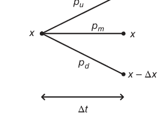

**图 12.2** 三项式树模型

我们以与第 11 章中二项式方法类似的方式将三项式过程扩展为三项式树。特别是，我们定义前向和后向归纳过程：

- **前向归纳：** 我们在时间区间 $[0,T]$ 内创建一个三项式树结构，其中 $T$ 是到期日。由于该方法是有条件显式有限差分格式的特例，$x$ 和 $t$ 方向上的步长由表达式相关：

$$
\Delta x \ge \sigma \sqrt{3\Delta t}. \tag{12.29}
$$

  我们然后使用该表达式和图 12.2 中的信息构建树。

- **后向归纳：** 在 $t=T$ 时我们定义 payoff 函数。例如，在看涨期权的情况下我们有：

$$
C_j^N = \max(S_j^N - K, 0) \tag{12.30}
$$

  其中 $K$ 是执行价格。

我们现在在风险中性世界中将期权价值计算为贴现期望值：

$$
C_j^n = e^{-r\Delta t} (p_u C_{j+1}^{n+1} + p_m C_j^{n+1} + p_d C_{j-1}^{n+1}). \tag{12.31}
$$

三项式方法的一种可能的 UML 设计如图 12.3 所示（见 Duffy, 2006A）。

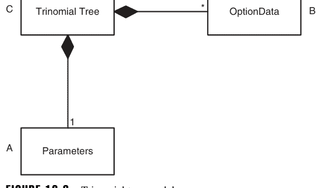

**图 12.3** 三项式树模型

### 12.10 三项式方法的稳定性和收敛性

三项式方法通常被引用为显式有限差分格式的例子。这意味着空间步长 $\Delta x$ 不能独立于时间步长 $\Delta t$ 选择（反之亦然）。一般来说，我们需要确保不等式 (12.29) 有效，以确保方程 (12.28) 中的概率保持为正。特别是，当波幅相对于漂移项较小时，临界情况是概率 $p_d$ 可能变为负值。这种情况称为对流主导，已设计出特殊方法来确保解不会振荡，例如使用迎风格式或指数拟合（见 Duffy, 1980, 2006）。

正是三项式方法稳定性特性的这种不可预测性促使我们寻找更稳健、更精确的数值方法来近似 Black–Scholes 偏微分方程的解。为此，我们引入最简单的有条件稳定、一阶显式有限差分格式的例子，然后在后面的章节中转向二阶无条件稳定显式格式。

### 12.11 显式有限差分方法

一因子 Black–Scholes 方程与扩散方程相似，但它包括额外的对流（一次导数项）和反应（零阶导数项）项。我们回顾 Black–Scholes PDE：

$$
-\frac{\partial V}{\partial t} + \frac{1}{2}\sigma^2 S^2 \frac{\partial^2 V}{\partial S^2} + rS \frac{\partial V}{\partial S} - rV = 0. \tag{12.32}
$$

在均匀网格上的显式格式为：

$$
-\frac{V_j^{n+1}-V_j^n}{\Delta t}
+\frac{1}{2}\sigma^2 S_j^2 \frac{V_{j+1}^n-2V_j^n+V_{j-1}^n}{h^2}
+rS_j \frac{V_{j+1}^n-V_{j-1}^n}{2h}
-rV_j^n = 0 \tag{12.33}
$$

我们可以将其写成等价形式：

$$
V_j^{n+1} = \alpha_j V_{j-1}^n + \beta_j V_j^n + \gamma_j V_{j+1}^n.
$$

系数 $\alpha_j$、$\beta_j$ 和 $\gamma_j$ 由下式给出：

$$
\alpha_j=\frac{\Delta t\sigma^2S_j^2}{2h^2}-\frac{r\Delta tS_j}{2h}=\frac{\Delta t\sigma^2(jh)^2}{2h^2}-\frac{r\Delta t(jh)}{2h}=\Delta t\sigma^2j^2/2-\frac{r\Delta tj}{2}\quad(S_j=jh)
$$

$$
\beta_j=1-\frac{2\Delta t\sigma^2(jh)^2}{2h^2}-r\Delta t=1-\sigma^2j^2\Delta t-r\Delta t
$$

$$
\gamma_j=\Delta t\sigma^2j^2/2+\frac{r\Delta tj}{2}.
$$

如果时间步长 $\Delta t$ 选择不当，可能会得到错误的结果（例如负值）。为了说明我们的意思，我们注意到格式 (12.33) 实际上等价于三项式方法。此外，(12.34) 中的系数对应于三项式方法中的 *正* 概率：

- $\alpha_j$：股价下降的概率。
- $\beta_j$：股价保持不变的概率。
- $\gamma_j$：股价上升的概率，对所有 $j=0,\ldots,NT$。

如果我们希望保留数值结果中的物理或金融含义，这些值应该是正的。我们说显式格式是 *有条件稳定* 的。这意味着网格大小 $\Delta t$ 和 $h$ 有限制，并且如果我们希望获得稳定的近似，必须始终满足约束条件。

我们将三项式方法中的跳跃解释为概率。一般来说，概率之和等于 1，每个概率应为非负。概率可能取决于漂移项和波幅项的相对大小而变为负值。我们可以通过诸如 *von Neumann 稳定性分析* 和 *最大值原理* 等更多方法来分析稳定性（见 Duffy, 2006）。

我们现在检查 *显式有限差分方法*（也称为 *向前时间中心空间* (FTCS)）应用于 *非守恒形式* 的模型对流-扩散方程的稳定性：

$$
\frac{\partial u}{\partial t}=-\mu\frac{\partial u}{\partial x}+\sigma\frac{\partial^2 u}{\partial x^2}. \tag{12.35}
$$

其中：

- $u$ = 涡度（或其他平流（对流）量）
- $\sigma$ = 扩散 $=\frac{1}{\mathrm{Re}}$ 其中 Re 为雷诺数
- $\mu$ = 线性化平流速度。

*FTCS*（显式 Euler）格式现在变为：

$$
\frac{u_j^{n+1}-u_j^n}{\Delta t}
=-\mu\left(\frac{u_{j+1}^n-u_{j-1}^n}{2h}\right)
+\sigma\left(\frac{u_{j+1}^n-2u_j^n+u_{j-1}^n}{h^2}\right)
$$

或：

$$
u_j^{n+1}=(\beta+\alpha)u_{j-1}^n+(1-2\beta)u_j^n+(\beta-\alpha)u_{j+1}^n \tag{12.36}
$$

其中：

$$
\alpha = \mu\Delta t / (2h), \quad \beta = \sigma\Delta t / h^2.
$$

我们看到该格式在时间上是显式的，在空间上是中心格式。我们可以从最大值原理的角度检查该格式，该原理确定了解在时间层 $n+1$ 时为非负的条件，前提是解在时间层 $n$ 时为非负。我们可以通过考虑方程 (12.36) 右侧所有系数非负的条件以及它们变为负时会发生什么来进行头脑风暴。具体来说，与上述 FTCS（Roache, 1998）格式相关的不稳定性有两种形式：

- **动态不稳定性：** 由于时间步长过大，格式会出现振荡误差。无超调的条件为：

$$
1 - 2\beta \ge 0 \Rightarrow \beta \le 1/2. \tag{12.37}
$$

  该不等式在空间和时间维度的网格大小之间建立了依赖关系。

  我们通过选择不使用显式格式来解决这个问题。

- **静态不稳定性：** 这种不稳定性是由 PDE (12.35) 中的对流（平流）项引起的，尤其是在它相对于波幅项较大时：

$$
\beta - \alpha \ge 0 \Rightarrow \mu h / \sigma \le 2. \tag{12.38}
$$

  这被称为对流主导现象。我们在后面的章节中通过指数拟合来解决这个问题。该现象也可能发生在与时间无关的问题中。

我们通过讨论一种不会产生动态不稳定性的隐式格式来结束本节。它被称为 PDE (12.35) 的 *向后时间中心空间* (BTCS) 格式，定义为：

$$
\frac{u_j^{n+1}-u_j^n}{\Delta t}
=-\mu\left(\frac{u_{j+1}^{n+1}-u_{j-1}^{n+1}}{2h}\right)
+\sigma\left(\frac{u_{j+1}^{n+1}-2u_j^{n+1}+u_{j-1}^{n+1}}{h^2}\right). \tag{12.39}
$$

我们将该格式重写为以下形式：

$$
u_j^{n+1}-u_j^n
=-\alpha\left(u_{j+1}^{n+1}-u_{j-1}^{n+1}\right)
+\beta\left(u_{j+1}^{n+1}-2u_j^{n+1}+u_{j-1}^{n+1}\right) \tag{12.40}
$$

或：

$$
-(\alpha+\beta)u_{j-1}^{n+1}+(1+2\beta)u_j^{n+1}+(\alpha-\beta)u_{j+1}^{n+1}=u_j^n.
$$


该格式仍可能存在静态稳定性问题，我们可以通过采用迎风格式来解决该问题，迎风格式是对对流项采用的一侧差分格式：

```
\frac{u_j^{n+1} - u_j^{n}}{\Delta t} = -\mu\left(\frac{u_j^{n+1} - u_{j-1}^{n+1}}{h}\right) + \sigma\left(\frac{u_{j+1}^{n+1} - 2u_j^{n+1} + u_{j-1}^{n+1}}{h^2}\right) \quad (\mu > 0) \quad (12.41)
```

或：

```
-(2\alpha + \beta)u_{j-1}^{n+1} + (1 + 2\alpha + 2\beta)u_j^{n+1} - \beta u_{j+1}^{n+1} = u_j^{n}. \quad (12.42)
```

迎风格式的缺点是其仅为一阶精度，并且我们必须考虑到对流项的系数可以为正或负，并且在每种情况下必须使用正确类型的迎风格式。

解决静态稳定性问题的另一种方法是使用指数拟合方法，如 Duffy (1980, 2006) 中所讨论的。特别是，我们使用 von Neumann 稳定性分析、PDE 的最大值原理和 M-矩阵理论的组合，为一系列有限差分格式提供一种通用的方法来证明其稳定性。特别是，它可用于分析格式 (12.40) 和 (12.41) 的稳定性。我们将在后面的章节中更详细地讨论这些主题。

### 12.12 总结与结论

在本章中，我们继续对第 11 章中创建的基础软件框架进行分析和应用。本章的重点是测试框架中代码的可靠性、准确性和功能。首先，我们将格子 ADT 与帕斯卡三角形的性质进行了测试。然后我们计算了单因子期权价格、期权敏感性和股息。我们还对二叉树方法进行了简化的数值分析。最后，我们讨论了从格子方法到显式有限差分方法的过渡。这为我们后续章节做好了准备。

### 12.13 练习与项目

- 1. (帕斯卡三角形功能)
- 帕斯卡三角形有许多应用。我们讨论其中的一些应用，目标是在 C++ 中实现它们。回答以下问题：
- a) 构造谢尔宾斯基三角形，我们通过将帕斯卡三角形中值为奇数的元素填黑、值为偶数的元素填白来创建。这种策略包含将每个元素模二约减。输出是大小按二的幂递减的倒三角形的规则图案。

b) 构造帕斯卡三角形的以下类似物。在这种情况下，我们展开 (x + 2)^n 而不是 (x + 1)^n，其中 n 为行号。我们将第 0 行设为 {1}，第 1 行设为 {2}。三角形根据递归公式构造：

⎛ n ⎞   ⎛ n−1 ⎞   ⎛ n−1 ⎞
⎝ k ⎠ = 2 ⎝ k−1 ⎠ + ⎝  k  ⎠ ,  1 ≤ k ≤ n.

验证第 n 行元素的和为 3^{n−1}。

c) 可以从帕斯卡三角形计算二项分布。为此，设 p 为事件发生的概率，并假设 p = 1/2。将第 n 行除以 2^n 并验证三角形变为二项分布。

2. (性能测试)

我们检查第 12.2 节中的代码以改善其运行时间性能。通过编写代码比较候选解决方案的性能来回答以下问题：

- a) 第 n 行元素的和与 2 的 n 次幂。
- b) 使用 Boost C++ Math Toolkit 计算二项式系数与在帕斯卡三角形中查找。
- c) 使用帕斯卡三角形中的元素计算斐波那契数列与使用公式 (12.3) 和 (12.4) 中的公式。

你可以使用 C++11 chrono 库或第 10 章中的 stopwatch 类来测量性能。

3. (二叉期权定价与精确解)

使用公式 (12.5) 计算以下收益的看涨期权价格：

- 对称幂看涨期权：

V(S, T) = max((S − K)^p, 0).    (12.43)

- 非对称幂看涨期权：

V(S, T) = max(S^p − K, 0)    (12.44)

其中 p 为正数。将答案与第 11 章中二叉树方法产生的值进行比较。

4. (美式期权定价)

在本练习中，我们使用二叉树方法对美式期权进行定价。回答以下问题：

- a) 计算到期时间 T 较大值时的美式期权价格，例如 T 在 [10, 100] 年范围内以 10 年为步长。需要多少个时间步才能在每种情况下实现收敛？
- b) 对于哪个到期值 T，二叉树方法给出的值与公式 (12.9) 和 (12.10) 对于永续美式期权的值相同（如果有的话）？

# 5. (计算期权敏感性 I)

本练习的目标有两个：基于第 12.5 节的讨论，我们创建一个更用户友好的包装器来计算期权 delta 和 gamma。我们编写代码来计算方程 (12.11) 中的敏感性。

回答以下问题：

- a) 重新设计第 12.5 节中的代码以计算 delta 和 gamma。我们隐藏许多细节并将新代码作为黑箱编写。我们从最终目标出发，使期望输出成为一个元组，其元素为期权价格、delta 和 gamma。输入是一个包含期权数据、收益类型和二叉树方法中步数 $NT$ 的结构体。
-   
- b) 通过将其与价格、delta 和 gamma 的精确 Black–Scholes 值进行比较来比较输出的准确性。
-   
- c) 确定如何使你的代码尽可能可重用，例如创建收益函数库并将新代码放在 *分层* 模式的 Level 3 中。

# 6. (计算期权敏感性 II，小项目)

编写代码来计算方程 (12.14) 中的敏感性。要求代码应可重用、易于理解、准确且高效。一个指导原则是在着手编码之前对问题进行需求分析。附加要求是你的代码应尽可能多地使用框架中现有的代码。

# 7. (简单定价)

使用框架中的代码对以下类型的期权进行定价：

- a) 期货合约，价格 = 4200，波动率 = 15%，执行价 = 3800，$T = 0.5$。看跌期权溢价完全保证金（Haug, 2007 给出 $p = 65.6185$）。
-   
- b) 指数 6 个月欧式看涨期权，指数水平 = 810，执行价 = 800，无风险利率 = 5%，波动率 = 20%，股息收益率 = 2%（Hull, 2006 在两步二叉树上给出 $c = 53.39$）。
-   
- c) 期货合约九个月美式看跌期权，期货价格 = 31，执行价 = 30，无风险利率 = 5%，波动率 = 30%（Hull, 2007 在三步二叉树上给出 $p = 2.84$）。

# 8. (效率改进)

第 12.4.2 节中计算离散股息支付期权价格的代码在以下意义上是低效的：首先，（默认）前向归纳算法将格子从当前时间更新到到期时间，其次，格子再次更新以反映除息日存在的离散股息。修改框架中的代码以通过仅更新一次格子来优化代码，例如：

- ▪ 在除息日前但不包括除息日的‘正常’前向归纳。
- ▪ 从除息日起到到期日实施公式 (12.8)。

# 9. (支付股息的期权)

基于第 12.4.3 节中的代码和 Black–Scholes 公式，计算以下永续期权值：

- ▪ 有股息和无股息的美式看涨和看跌期权。
- ▪ 有股息和无股息的欧式看涨和看跌期权。

优化第 12.4.3 节中的代码以创建一个单一函数，该函数计算看涨和看跌美式期权价格并以元组形式返回其值。

其中 Δx₁ 和 Δx₂ 在方程 (12.25) 中定义。S₁ 和 S₂ 是 t = T 时的股票价格，Sⁿ⁽ᵢ,ⱼ⁾ₖ 是节点 (j, k) 处的股票价格，j = 1, 2。或者，你可以使用 Haug (2007) 中讨论的上行和下行参数的公式。指定二维格子 ADT 的接口。

- e) 创建定价欧式和美式期权的机制函数（注意我们在第 11 章中对单因子模型创建了 Level 2 功能的方式）。
-   
- f) 创建 Level 3 功能以配置和初始化应用程序。通过将解决方案与精确解（或准确近似解）、蒙特卡洛解和 PDE/有限差分方法解进行比较，在一系列双因子期权定价问题上测试你的应用程序。

# 12. (三叉树方法，项目)

我们在第 11 章和第 12 章中专注于使用二叉树方法对单因子普通和美式期权进行定价。在本练习中，我们有兴趣创建一个小型软件框架，使用三叉树方法做同样的事情。要求是 resulting 软件基础应可维护、可重用且可扩展。我们希望通过使用设计模式和 C++ 中的现代语言特性来实现这些目标。为此，我们采用与制造业类似的方法。这称为 PDCA 循环（见 Imai, 1986），它包含以下阶段：

- - *计划 (P 阶段)：* 我们确定需要做什么，例如创建使用三叉树方法对单因子期权进行定价的软件框架。此阶段不仅包含新产品的计划，还包含产品和流程改进的计划。
- - *执行 (D 阶段)：* 我们生产或制造软件产品。
- - *检查 (C 阶段)：* 产品是否按规格运行？客户满意吗？在当前背景下，代码应产生准确的结果且高效。
- - *行动 (A 阶段)：* 处理客户的反馈和投诉。此反馈纳入下一个计划阶段。换句话说，行动是指改进行动。

PDCA 的一种变体称为 SDCA（‘S’ 代表标准化），它指的是我们在进行新一轮 PDCA 之前建立并稳定标准。在当前情况下，这可能涉及应用标准化的设计模式、接口和语言特性。

回答以下问题：

- a) 将 PDCA 应用于软件开发的优缺点与你现在采取的方法相比。
-   
- b) 确定第 11 章和第 12 章中的哪些代码可以在当前背景下重用。特别是，检查我们用于使用二叉树方法对期权进行定价的格子 ADT 和机制函数的适用性。你可以重用现有软件还是需要编写新代码？C++11 中的语言特性如何帮助？
-   
- c) 实现第 12.9 节中的算法。使用第 11 章和第 12 章中的相同示例测试代码。
-   
- d) 修改第 12.9 节中的代码以适应计算跳跃概率的其他策略。第一种情况是资产价格在每个节点可以上涨、保持不变或下跌。跳跃大小为：

$$u=e^{\sigma\sqrt{2\Delta t}},\qquad d=e^{-\sigma\sqrt{2\Delta t}}.$$


对应的概率为 (Haug, 2007)：

$$p_u=\left(\frac{e^{b\Delta t/2}-e^{-\sigma\sqrt{\Delta t/2}}}{e^{\sigma\sqrt{\Delta t/2}}-e^{-\sigma\sqrt{\Delta t/2}}}\right)^2$$

$$p_d=\left(\frac{e^{\sigma\sqrt{\Delta t/2}}-e^{-b\Delta t/2}}{e^{\sigma\sqrt{\Delta t/2}}-e^{-\sigma\sqrt{\Delta t/2}}}\right)^2$$

$$p_m=1-p_u-p_d$$

其中 $b$ 为融资成本。我们需要避免 *负概率*（见 Haug, 2007, p. 300），当 $p_m$ 出现时会出现这种情况，如果：

$$\sigma<\sqrt{\frac{b^2\Delta t}{2}}.$$

这是一个 CRR 类型的三项式树。我们还考虑另一组参数：

$$p_u=\frac{1}{6}+(b-\sigma^2/2)\sqrt{\frac{\Delta t}{12\sigma^2}}$$

$$p_d=\frac{1}{6}-(b-\sigma^2/2)\sqrt{\frac{\Delta t}{12\sigma^2}}$$

$$p_m=2/3.$$

## 回答以下问题：

- a) 将上述两组概率参数整合到框架中。你可以使用我们在第 11 章中介绍的通用函数包装器来计算上行和下行跳跃，如二叉方法那样。
- b) 使用本章中的示例测试新的方案。
- c) 通过改变期权参数和步长来确定三项式方法的‘稳定性谱’。
- d) 测试欧式和美式期权的代码。
- e) 审阅你所编写的代码的灵活性，并确定如何使你的框架更灵活。你将如何测试软件的灵活性？

# 第 13 章

### 数值线性代数：三对角系统及其应用

#### 13.1 引言与目标

在本章中，我们介绍与 *数值线性代数* 相关的若干基本算法。特别是，我们讨论求解线性方程组的有效算法。部分目标是：

- 设计算法并将其映射到 C++ 代码。
- 使用本章中的类作为 *Eigen* 等开源矩阵库的轻量级替代方案，例如。
- 将 Duffy (2004B) 的遗留代码移植到 C++11。
- 在理解、编写和调试 C++ 代码方面获得实践经验。

我们专注于生成在应用中使用的高效代码。我们在算法与实现它的 C++ 代码之间定义无缝映射。这使得调试更容易，并产生可维护的代码，尤其是如果它有清晰的文档。

本章对希望学习有限差分法精髓的读者很有用。

#### 13.2 求解三对角矩阵系统

*带矩阵* $A = (a_{ij})$ 是一个大小为 $n$、*宽度* 为 $2K + 1$ 的方阵，使得当 $|i - j| > K$ 时 $a_{ij} = 0$，其中 $K$ 为非负整数。所有非零元素位于主对角线上以及其上方和下方的前 $K$ 条对角线上。一些特殊的带矩阵是：

- *对角矩阵* 是 $K = 0$ 的带矩阵。
- *托普利茨矩阵* 是每条对角线由单个相同元素组成的带矩阵，但不同对角线可能包含不同元素。
- *三对角 (Jacobi) 矩阵* 是宽度为三 ($K = 1$) 的带矩阵。

三对角矩阵出现在数值分析应用中，例如当用有限差分法和有限元法近似求解常微分方程和偏微分方程时。为此，我们首先考虑在区间 (0,1) 上具有狄利克雷边界条件的简单两点边值问题：

$$ \begin{cases} \ \ \ \end{cases}$$

函数 $f(x)$ 和常数 $\varphi$ 与 $\psi$ 假定为已知常数。

我们通过创建离散网格点 $\{x_j\}, j = 0, \dots, J$ 来近似解 $u$，其中 $J$ 为正整数。在每个内部网格点，我们用二阶差商近似方程 (13.1) 中的二阶导数。相应的离散格式为：

$$ \begin{cases} \ \ \ \end{cases}$$

该格式可以写成如下三对角矩阵系统：

$AU = F$
其中 $U = (U_1, \dots, U_{J-1})^\top$，$F = (h^2 f(x_1) - \varphi, \, h^2 f(x_2), \dots, h^2 f(x_{J-1}) - \psi)^\top$。

在这种情况下 $A$ 是一个三对角矩阵，符号 $\top$ 表示转置。我们求解该系统以得到未知向量 $U$。

我们看到有 $J-1$ 个未知值（在更一般的边界条件下会有 $J+1$ 个未知值），因为在当前情况下我们处理的是狄利克雷边界条件，这意味着 $U$ 在 $x = 0$ 和 $x = 1$ 处的值是已知的。

下一个问题是：我们如何建模三对角矩阵以及如何求解三对角系统 (13.3)？第一个问题的答案是把矩阵建模为三个向量，一个长度为 $J$（对角线），两个长度为 $J-1$ 的向量（用于次对角线和超对角线）。关于第二个问题我们讨论两种解法。

##### 13.2.1 双扫法

该方法在 Godounov 和 Riabenki (1977) 中讨论，它是一种求解具有给定边界值的三点差分格式的算法。它对应于用有限差分法离散两点边值问题。目标是找到满足以下方程组的离散函数 $\{U_j\}, j = 0, \dots, J$：

$$ \begin{cases} \ \ \ \end{cases}$$

双扫法使用递推（向后）关系从索引 J 开始计算解：

```
\begin{cases} U_J = \psi \\ U_j = L_j U_{j+1} + K_j, \quad j = J-1, \dots, 0 \end{cases} \tag{13.5}
```

其中系数 L_j、K_j 使用向前递推关系计算：

```
\begin{cases} L_j = c_j/(b_j + a_j L_{j-1}) \\ K_j = (f_j - a_j K_{j-1})/(a_j + a_j L_{j-1}) \\ j = 1, \dots, J-1 \end{cases} \tag{13.6}
```

并且

```
\begin{cases} L_0 = 0 \\ K_0 = \varphi. \end{cases} \tag{13.7}
```

可以通过将方程 (13.4) 的解写成以下形式来验证这些公式的正确性：

```
U_j = (f_j - a_j U_{j-1} - c_j U_{j+1})/b_j, \quad j = 1, \dots, J-1 \tag{13.8}
```

并将项与方程 (13.5) 中的系数进行比较。我们留作练习。

转向实现该算法的代码，我们首先看到需要四个输入数组，其中三个是构成三对角矩阵的数组，第四个是方程 (13.4) 中的非齐次项。我们还需要三个工作数组，即 U（解）、K 和 L，来自方程 (13.5) 和 (13.6)。数组 K 和 L 看似必不可少，而我们重用非齐次项的数组来保存解 U 的值。然后工作数组的数量可以减少到两个。

我们为双扫法设计一个类模板。它有两个参数，一个用于底层数据类型，一个用于内存分配器。我们使用模板-模板参数技巧来实现这种间接级别。因此我们有一个数值数据类型的模板参数和一个内存分配器的模板参数。我们出于方便将该类的代码放在单个头文件中。我们将三对角系统建模为四个一维数组。我们还定义了左右狄利克雷边界条件和两个工作数组 L 和 K：

```
// 使用模板模板参数建模向量
template <typename T, template <typename T, typename Alloc> class Container = std::vector, typename Alloc = std::allocator<T>>

class DoubleSweep
{ // 来自 Godounov 的 Balayage 方法
```

```
```cpp
private:

// 长度为 J 且起始索引为 0 的向量
Container<T, Alloc> a, b, c, f;

// 狄利克雷边界条件
T left;     // 左边界条件
T right;    // 右边界条件

// 工作数组
Container<T, Alloc> L;
Container<T, Alloc> K;

public:
// 构造函数和析构函数
DoubleSweep() = delete;
DoubleSweep(const DoubleSweep<T,Container, Alloc>& s2) = delete;

// 创建成员以初始化 AU = F 的输入，A = (a,b,c)
DoubleSweep(const Container<T, Alloc>& lowerDiagonal, const
             Container<T, Alloc>& diagonal, const Container<T,
             Alloc>& upperDiagonal, const Container<T, Alloc>& F,
             const T& bc_left, const T& bc_right)
{
    // 向量被复制
    a = lowerDiagonal;
    b = diagonal;
    c = upperDiagonal;
    f = F;

    left = bc_left;
    right = bc_right;

    std::size_t N = a.size();

    // 工作数组
    L = Container<T, Alloc>(N, 0);
    K = Container<T, Alloc>(N, 0);
}
virtual ~DoubleSweep() = default;

// 运算符重载
DoubleSweep<T,Container, Alloc>& operator = (const DoubleSweep<T,
Container>& i2) = delete;

Container<T, Alloc> solve()
{ // 结果；闭区间 [0, J] 中的向量，大小为 J+1 的向量。

    std::size_t N = a.size();
```


// equation 13.7
L[0] = 0.0;
K[0] = left;

// Equation 13.6
std::size_t SZ = L.size();
for (std::size_t j = 1; j < SZ; ++j)
{ // L

double tmp = b[j] + (a[j] * L[j - 1]);

L[j] = -c[j] / tmp;
K[j] = (f[j] - (a[j] * K[j - 1])) / tmp;
}

// Equation 13.5. Recycle array f for u
f[0] = left;
f[N - 1] = right;
for (std::size_t j = f.size() - 2; j >= 1; --j)
{ // U

f[j] = (L[j] * f[j + 1]) + K[j];
}

return f;
}

Container<T, Alloc> operator () ()
{
return solve();
}
};

一般而言，输入向量和返回（输出）向量具有相同的大小，且边界条件的值作为输入参数提供给算法。我们编写的代码是为了反映由方程（13.5）至（13.7）给出的算法的结构。

#### 13.2.2 Thomas 算法

这是一种流行的算法，已有充分的文献记录（Keller, 1968; Thomas, 1949, 1995）。它用于用有限差分法近似求解对流-扩散偏微分方程。它是三对角矩阵 LU 分解的特例。

我们分两步实现 Thomas 算法。一般而言，我们求解形式为 Au = r 的系统，其中 A 是三对角矩阵，r 是给定的向量，u 是我们希望求得的未知向量。我们将 A 分解为下三角矩阵 L 和上三角矩阵 U 的乘积 A = LU，从而得到更简单的方程组求解：

⎧ Au = r ⇔ (LU)u = r
⎨ Lz = r
⎩ Uu = z. (13.9)

双对角矩阵 $L$ 和 $U$ 如下所示：

$L = \begin{pmatrix} \beta_0 & & \\ a_1 & & \\ & \ddots & \ddots & 0 \\ & 0 & \ddots & \ddots \\ & & a_J & \beta_J \end{pmatrix}$
$U = \begin{pmatrix} 1 & \gamma_1 & & \\ \ddots & \ddots & 0 \\ 0 & \ddots & \gamma_{J-1} \\ & & & 1 \end{pmatrix}.$

其系数可按如下方式计算：

\begin{cases} \beta_0 = b_0, \gamma_0 = c_0/\beta_0 \\ \beta_j = b_j - a_j\gamma_{j-1}, \quad j = 1, \dots, J \\ \gamma_j = c_j/\beta_j, \quad j = 1, \dots, J-1 \end{cases} \tag{13.10}

且方程（13.9）中的算法对两个迭代分别具有如下分量形式：

\begin{cases} z_0 = r_0/\beta_0 \\ z_j = (r_j - a_j z_{j-1})/\beta_j, \quad j = 1, \dots, J \end{cases} \tag{13.11}

\begin{cases} U_J = z_J \\ U_j = z_j = \gamma_j U_{j+1}, \quad j = J-1, \dots, 0. \end{cases} \tag{13.12}

检查这些算法后，我们在代码中为了方便使用了三个工作数组（我们可能可以将此减少到两个工作数组，但我们不考虑此优化步骤）。

最后，我们注意到 Thomas 算法要起作用，对应的三对角矩阵必须是 *对角占优* 的，即：

$|b_i| \ge |a_i| + |c_i|, \quad i = 0, \dots, J.$ \tag{13.13}

为保持一致性，我们假设 $a_0 = 0$ 且 $c_J = 0.$

实现 Thomas 算法的代码基于方程（13.10）至（13.12）：

```
template <typename T>
    using Vector = std::vector<T>;
```

```
template <class T> class LUTridiagonalSolver
{ // Solve tridiagonal matrix equation
private:

    // Defining arrays (input)
    // V2 optimise so to work with pointers
    Vector<T> a;    // The lower-diagonal array [0..J]
    Vector<T> b;    // The diagonal array [0..J] "baseline array"
    Vector<T> c;    // The upper-diagonal array [0..J]
    Vector<T> r;    // The right-hand side of the equation
                    // Au = r [0..J]

    // Work arrays
    // Coefficients of Lower and Upper matrices: A = LU

    Vector<T> beta; // Range [0..J]
    Vector<T> gamma;// Range [0..J]
                    // Solutions of temporary and final problems
    Vector<T> z;    // Range [0..J]

    std::size_t Size;

    void calculateBetaGamma_ZU(Vector<T>& r)
    {

        // Equation 13.10
        beta[0] = b[0];
        gamma[0] = c[0] / beta[0];

        for (std::size_t j = 1; j < Size - 1; ++j)
        {
            beta[j] = b[j] - (a[j] * gamma[j - 1]);
            gamma[j] = c[j] / beta[j];
        }

        beta[Size - 1] = b[Size - 1] - (a[Size - 1] * gamma[Size - 2]);

        // Calculate z and u
        // Forward direction, equation 13.11
        z[0] = r[0] / beta[0];

        for (std::size_t j = 1; j < Size; ++j)
        {
            z[j] = (r[j] - (a[j] * z[j - 1])) / beta[j];
        }

        // Backward direction, equation 13.12
        r[Size - 1] = z[Size - 1];

for (long i = Size - 2; i >= 0; --i)
{
    r[i] = z[i] - (gamma[i] * r[i + 1]);
}

}

public:
    LUTridiagonalSolver() = delete;
    LUTridiagonalSolver(const LUTridiagonalSolver<T>& source) = delete;
    virtual ~LUTridiagonalSolver() = default;
    LUTridiagonalSolver<T>& operator = (const LUTridiagonalSolver<T>& source) = delete;

    LUTridiagonalSolver(Vector<T>& lower, Vector<T>& diagonal, Vector<T>& upper, Vector<T>& RHS)
    {
        a = lower;
        b = diagonal;
        c = upper;
        r = RHS;

        Size = diagonal.size();

        beta = Vector<T>(Size);
        gamma = Vector<T>(Size);

        z = Vector<T>(Size);
    }

Vector<T> solve()
{
    calculateBetaGamma_ZU(r);      // Calculate beta and gamma

    return r;
}

Vector<T> operator () ()
{
    return solve();
}

bool diagonallyDominant() const
{
    if (std::abs(b[0]) < std::abs(c[0]))
        return false;

    if (std::abs(b[Size - 1]) < std::abs(a[Size - 1]))
        return false;

for (std::size_t j = 1; j < Size - 1; ++j)
{
    if (std::abs(b[j]) < std::abs(a[j]) + std::abs(c[j]))
        return false;
}

return true;
};

#endif
```

一般而言，我们尝试以一对一的方式将算法映射到代码中，以便保持其可读性和可维护性。

#### 13.2.3 示例

我们现在给出一个简单示例来说明如何为算法准备输入数组，使用第 13.2.1 节和第 13.2.2 节的算法，然后检查输出。第一个示例基于两点边值问题（13.1）的特例，如代码注释所示：

/* Solve BVP u'' = 1 in (0, 1) with u(0) = u(1) = 0
Solution u(x) = x(1-x)
Solve by FDM */

C++ 代码为：

```
int main()
{
    using value_type = double;
    using Vector = std::vector<value_type>;

    std::size_t J = 20;
    std::cout << "Number of subdivisions J ";
    std::cin >> J;

    double h = 1.0 / static_cast<double>(J);

    // Boundary conditions
    double BCL = 0.0;      // LHS
    double BCR = 0.0;      // RHS

    // Double Sweep
    Vector a(J+1,1.0);
    Vector b(J+1,-2.0);
    Vector c(J+1,1.0);
    Vector r(J+1, -2.0*h*h);// Right-hand side

    // Thomas algorithm
    Vector a2(J-1, 1.0);
Vector b2(J-1, -2.0);
Vector c2(J-1, 1.0);
Vector r2(J-1, -2.0*h*h);      // Right-hand side

// Take the boundary conditions into consideration
r2[0] -= BCL;
r2[r2.size()-1] -= BCR;

LUTridiagonalSolver<double> mySolver2(a2, b2, c2, r2);
std::cout << "Matrix has a solution? "
<< mySolver2.diagonallyDominant() << '\n';
DoubleSweep<value_type> mySolver(a, b, c, r, BCL, BCR);

StopWatch<> sw;
sw.Start();
Vector result = std::move(mySolver());
Vector result2 = std::move(mySolver2());
sw.Stop();
std::cout << "Elapsed time: " << sw.GetTime() << '\n';

auto exact = [](double x) { return x*(1.0 - x); };
double val = h;            // Double Sweep

// Compare output from Double Sweep and Thomas with each other
for (std::size_t j = 1; j < result.size()-1; ++j)
{ // The values should be zero

    std::cout<< j << ", " << result[j]-result2[j-1] <<",
"<< exact(val)<< '\n';
    val += h;
}
return 0;
}
```

我们注意到两种算法处理边界值的方式不同。这值得强调，因为我们需要明确如何将狄利克雷边界条件纳入算法中。这是一项重要的技能，因为在后面的章节中你将需要对更复杂的问题执行同样的技巧。

#### 13.2.4 性能问题

我们可能会考虑改进第 13.2.1 节和第 13.2.2 节中算法的运行时间性能。在当前形式下，我们看到双扫算法比 Thomas 算法大约高效 20%（这可能是由于后者使用了三个工作数组，而前者使用两个工作数组编程）。我们还使用 Boost Pool 库进行了一些测试（用于快速内存分配），这进一步提高了运行时间效率。我们对应用于扩散方程的这些求解器进行了压力测试（我们将在第 13.3 节讨论），空间和时间网格尺寸均为 100,000。两种方法都给出了准确的结果。在普通笔记本电脑上的处理时间以秒为单位的范围为双扫算法 [490, 588]，Thomas 算法 [730, 780]。


我们也可以考虑使用移动语义而不是复制向量。参见下面的练习 2。我们甚至可以考虑让输入向量充当工作数组，但我们尚未研究这一优化步骤。

最后，你可以使用不同的内存管理器（例如 *Boost C++ Pool* 库或你自己的喜爱的库）来确定它是否能提高运行时间效率。

在第 13.4 节我们介绍了 *Alternating Direction Explicit*（ADE）方法的两个变体，并将其应用于一维热方程。我们还比较了 ADE 与使用 Double Sweep 和 Thomas 算法近似求解热方程的运行时间效率。我们注意到在 ADE 的情况下不需要矩阵求逆。

#### 13.2.5 三对角矩阵的应用

在本书中，我们主要关注求解当我们离散化 PDE 和两点边值问题时产生的三对角方程组。特别是，这些系统在我们用三点差商近似空间维度的偏导数时出现。在大多数情况下，我们可以使用流行的 Thomas 算法求解由此产生的线性系统，尽管 Double Sweep 方法性能更好。特别是，Thomas 算法用于交替方向隐式（ADI）方法，这是计算金融中流行的方案之一。

#### 13.2.6 关于矩阵的一些说明

方程 (13.3) 中的矩阵 $A$ 必须满足某些性质，方程才具有唯一解。为此，我们简要讨论 (13.3) 具有唯一解的一些条件。我们还将在后面的章节中处理具体的例子，在那里我们对抛物型偏微分方程进行建模。

矩阵 $A$ 被称为 *positive definite*，如果对于任意向量 $v$，有 $v^TAv > 0$。这里，$v^T$ 是 $v$ 的转置向量，$Av$ 是 $A$ 和 $v$ 的矩阵-向量乘法。

一般来说，直接证明一个矩阵是正定的很困难，所以我们需要其他条件。一个有用的判据是 *diagonal dominance*。矩阵 $A$ 被称为对角占优，如果对于每一行，对角元素的绝对值大于或等于该行其非对角元素的绝对值之和（使用初始索引等于 1）：

$$\left\{\begin{aligned}
A&=(a_{ij})_{i,j=1,\ldots,n}\\
|a_{ii}|&\geq\sum_{j=1}^{n}|a_{ij}|\quad\text{for }i=1,\ldots,n,\quad i\ne j.
\end{aligned}\right.$$

在矩阵 $A$ 为三对角的情况下，该不等式采用以下形式，如方程 (13.13) 中已看到的那样：

$$|b_j|\geq |a_j|+|c_j|,\qquad j=1,\ldots,n.$$

我们引入了在建模对流-扩散方程时出现的 M-矩阵类。M-矩阵非常有吸引力，正如我们在后面的章节中将看到的那样。

我们说一个方阵 A 是 M-矩阵，如果它是非奇异的，其逆是非负的且其非对角元素是非正的：

\begin{cases} A^{-1} \ge 0 \\ a_{ij} \le 0 \; i \ne j, \forall 1 \le i,j \le n. \end{cases}

矩阵逆为非负的充分条件在 Varga (1962) 中给出。我们重述主要结果：

### Lemma. 设矩阵 A 是不可约对角占优的并且假设：

\begin{cases} a_{ij} \le 0 \; i \ne j \\ a_{ii} > 0 \end{cases} \quad 1 \le i,j \le n

则 A 是非奇异的且其逆是严格正的。

### 13.3 CRANK-NICOLSON 和 THETA 方法

我们研究 Double Sweep 和 Thomas 算法对一维热方程的初边值问题的相对性能（Tolstov, 1962），该方程描述了长度为 L 的杆中的热流：

\begin{cases} \dfrac{\partial u}{\partial t} = a^{2} \dfrac{\partial^{2} u}{\partial x^{2}}, \quad 0 < x < L, \; t > 0 \\ u(x,0) = f(x), \quad 0 \le x \le L \\ u(0,t) = A, \; u(L,t) = B, \quad t > 0. \end{cases} \tag{13.14}

在这种情况下，我们可以不失一般性地假设 L = 1。这里，a, A 和 B 是常数。

我们可以通过分离变量法（Kreider et al., 1966）在 A = B = 0 且 a = 1 的情况下找到系统 (13.14) 的解。在这种情况下，解析解由下式给出：

u(x,t) = \dfrac{8}{\pi^{2}} \sum_{n=1}^{\infty} \dfrac{1}{n^{2}} \left( \sin \dfrac{n\pi}{2} \right) (\sin n\pi x) \exp(-n^{2}\pi^{2}t) \tag{13.15}

我们将此解用作基准，以与数值解进行比较。

作为测试案例，我们仅在空间方向上对抛物型 PDE 进行离散化（例如使用中心差分格式），同时保持时间变量 t 连续。我们研究单位区间上的一维热方程的初边值问题，边界条件为零 Dirichlet。很容易将该思想推广到更一般的情况。问题是：

\begin{cases}\frac{\partial u}{\partial t}=\frac{\partial^2 u}{\partial x^2},\ 0 < x < 1,\quad t>0\\u(0,t)=u(1,t)=0,\quad t>0\\u(x,0)=f(x),\quad 0\le x\le 1.\end{cases}\tag{13.16}

我们现在将空间区间 (0;1) 分成 J 个子区间，并用 *semi-discrete* 格式近似 (13.16)：

\begin{cases}\frac{dU_j}{dt}=h^{-2}(U_{j+1}-2U_j+U_{j-1}),\quad 1\le j\le J-1\\U_0=U_J=0,\quad t>0\\U_j(0)=f(x_j),\quad j=1,...,J-1\end{cases}\tag{13.17}

其中 $h=1/J$ 是常数网格尺寸。

我们通过以下方式定义向量：

$U(t)=(U_1(t),...,U_{J-1}(t))^{\top}$

$U_0=(f(x_1),...,f(x_{J-1}))^{\top}$.

然后我们可以将系统 (13.17) 重写为常微分方程组：

\begin{cases}\frac{dU}{dt}=AU,\quad t>0\\U(0)=U_0\end{cases}\tag{13.18}

其中矩阵 $A$ 由下式给出：

$A = h^{-2}\begin{pmatrix}-2 & 1 & & & 0\\1 & \ddots & \ddots & & \\ & \ddots & \ddots & 1\\ & & 1 & -2\end{pmatrix}$.

我们从这里往哪里去？有许多问题，例如：

- Q1: 系统 (13.18) 是否具有唯一解，其 *qualitative* 性质是什么？
- Q2: 格式 (13.18) 作为系统 (13.16) 解的近似有多准确？
- Q3: 我们如何对 (13.18) 进行时间离散化，结果离散化有多准确？

我们将在后面的章节中讨论问题 Q1 和 Q2。在这里我们讨论 Q3。有许多替代方案，从 *one-step methods* 到 *multi-step methods*（参见 Dahlquist and Björck, 1974，例如）以及从 *explicit* 到 *implicit methods*。我们可以使用其他近似方法，如 Runge–Kutta（Stoer and Bulirsch, 1980），我们在第 24 章和第 25 章中讨论。在本节中，我们集中于对由下式定义的系统 (13.18) 进行离散化的单步显式和隐式方法：

$$\frac{U^{n+1}-U^n}{\Delta t}=\theta AU^{n+1}+(1-\theta)AU^n,\quad 0\le n\le N-1,\ 0\le\theta\le1$$

$$U^0=U_0.$$

在这种情况下 $\Delta t$ 是时间中的常数网格尺寸。
我们可以将方程 (13.19) 重写为等价形式：

$$[I-\Delta t\theta A]U^{n+1}=(I+\Delta t(1-\theta))AU^n$$

或形式上写为：

$$U^{n+1}=[I-\Delta t\theta A]^{-1}(I+\Delta t(1-\theta))AU^n$$

其中 $I$ 是大小为 $J\times1$ 的单位矩阵。
$\theta$ 的一些特殊情况是：

- $\theta=1$，隐式 Euler 格式
- $\theta=0$，显式 Euler 格式
- $\theta=\frac{1}{2}$，Crank–Nicolson 格式。

当格式为隐式时，我们可以使用 Double Sweep 方法或 Thomas 算法在每个时间层 $n+1$ 求解方程组 (13.19)。在显式格式的情况下不需要矩阵求逆。

公式 (13.18) 称为 *Method of Lines*（MOL），它对应于在空间方向上对系统 (13.16) 进行半离散化，同时保持时间变量连续（我们在后面的章节中更详细地讨论 MOL）。我们可以将格式 (13.19)–(13.21) 写成分量形式：

$$\frac{U_j^{n+1}-U_j^n}{\Delta t}=\theta\left(U_{j+1}^{n+1}-2U_j^{n+1}+U_{j-1}^{n+1}\right)/h^2$$
$$+(1-\theta)\left(U_{j+1}^{n}-2U_j^{n}+U_{j-1}^{n}\right)/h^2,\quad 1\le j\le J-1$$

或

$$U_j^{n+1}-U_j^n=\lambda\theta\left(U_{j+1}^{n+1}-2U_j^{n+1}+U_{j-1}^{n+1}\right)+\lambda(1-\theta)\left(U_{j+1}^{n}-2U_j^{n}+U_{j-1}^{n}\right)$$

$$(\lambda=\Delta t/h^2).$$


最后，

```
−λθU_{j+1}^{n+1} + (1 + 2λθ)U_j^{n+1} − λθU_{j−1}^{n+1}
= λ(1−θ)U_{j+1}^n + (1−2λ(1−θ))U_j^n + λ(1−θ)U_{j−1}^n    1 ≤ j ≤ J−1.    (13.25)
```

我们看到系统 (13.25) 是三对角的，我们可以应用双扫或 Thomas 算法来求解它。在显式欧拉格式 θ = 0 的情况下，这些算法不需要，因为时间层 n + 1 处的解可以显式计算：

```
U_j^{n+1} = λU_{j+1}^n + (1−2λ)U_j^n + λU_{j−1}^n,    1 ≤ j ≤ J−1.    (13.26)
```

我们注意到单因子 Black–Scholes PDE 可以通过变量变换转化为热方程（Wilmott, Howison and Dewynne, 1995）。我们将在后面的章节中看到如何基于我们在此开发的方法组装和求解更一般的问题。

#### 13.3.1 热方程 Theta 方法的 C++ 实现

我们给出实现算法 (13.25) 的 C++ 代码。这是一个单步推进格式，称为 BTCS，它根据 n 层处的解计算 n + 1 时间层处的解。由于在每个时间层 n + 1 需要计算三个未知数，我们需要使用双扫方法或 Thomas 算法。算法的主要步骤是：

- A1: 选择输入参数并生成网格。
- A2: 定义初始条件和边界条件。
- A3: 计算到并包括到期时间在内的每个时间的解。

此代码可作为更一般 PDE 和格式的模板。我们注意到我们使用一个向量来存储到期时的近似解。在更一般的情况下，我们需要一个矩阵来存储每个时间层所有网格点的值。近似系统 (13.16) 的格式的完整代码是：

```
double InitialCondition(double x)
{
    if (x >= 0.0 && x <= 0.5)
    {
        return 2.0 * x;
    }
    return 2.0 * (1.0 - x);
}

// BTCS scheme for the heat equation

long J = 20;
```

```
std::cout << "Number of space subdivisions: ";
std::cin >> J;

std::cout << "Number of time subdivisions: ";
long N = 100; std::cin >> N;

std::cout << "Theta method: 1) Implicit Euler, 2) Crank Nicolson: ";
long choice = 1; std::cin >> choice;
double theta = 1.0; if (2 == choice) theta = 0.5;

std::cout << "Expiration: ";
double T = 1.0; std::cin >> T;

// Space interval [A,B]
double A = 0.0;      // LHS
double B = 1.0;      // RHS
double h = (B-A) / static_cast<double>(J);
double k = T / static_cast<double>(N);

// Boundary conditions
double BCL = 0.0;
double BCR = 0.0;

double lambda = k / (h*h);

// Constructors with size, start index and value (Diagonals of matrix)
// J intervals, thus J-1 UNKNOWN internal points
// Dirichlet boundary conditions
Vector<double> a(J-1,-lambda*theta);
Vector<double> b(J-1,(1.0 + 2.0*lambda*theta));
Vector<double> c(J-1,-lambda*theta);
Vector<double> r(J-1, 0);   // Right-hand side NOT CONSTANT ANYMORE
                            // Boundary conditions into consideration

// Create mesh in space
Vector<double> xarr(J + 1); xarr[0] = A;
for (std::size_t j = 1; j < xarr.size(); ++j)
{
    xarr[j] = xarr[j - 1] + h;
}

Vector<double> vecOld(xarr.size()); // At time n
Vector<double> vecNew(xarr.size()); // At time n+1

// Initial condition
for (std::size_t j = 0; j < vecOld.size(); j++)
{
    vecOld[j] = InitialCondition(xarr[j]);
}
```

```
```cpp
// We start at 1st time point
double current = k;

StopWatch<> sw;
sw.Start();

while (current <= T)
{
    // Update at new time level n+1

    // Compute inhomogeneous term
    for (std::size_t j = 1; j < r.size()-1; ++j)
    {
        r[j] = (lambda*(1.0-theta)*vecOld[j+1]
              + (1.0 - 2.0*lambda*(1.0-theta))*vecOld[j]
              + (lambda*(1.0-theta)*vecOld[j-1]);
    }

    // DoubleSweep<double> mySolver(a, b, c, r, BCL, BCR);
    TridiagonalSolver<double> mySolver(a, b, c, r);
    vecNew = mySolver.solve();
    vecOld = vecNew;

    current += k;
}
sw.Stop();
std::cout << "Elapsed time: "
```

我们使用两个数组来存储时间层 *n* 和 *n + 1* 的值。我们注意到在显式欧拉方法 (13.26) 的情况下，该格式变得更容易求解，也称为 FTCS 格式，在这种情况下，我们可以在不需要求解三对角系统的情况下计算时间层 *n + 1* 处的解。这种特性以代价为条件，因为 FTCS 仅 *条件稳定*，如果我们希望避免振荡，则需要较小的步长。

创建代码后，我们对其进行测试，以确定它是否在某种意义上是初始边值问题 (13.16) 的精确解或精确有限差分解的良好近似。

### 13.4 急躁者的 ADE 方法

热方程的显式有限差分方法 *必须满足* 约束 **k ≤ h²/2**，其中 *k* 是时间方向的网格尺寸，一些作者使用 Δt 表示网格尺寸，换句话说，如果我们希望得到不错的结果，我们必须采用非常小的时间步长。该方法是时间的一阶精度，这使其不适合实际应用。然而，该方法的优点是我们不需要使用三对角求解器在每个时间层计算解。我们可以问的一个问题是，我们能否发现显式有限差分格式，它们是显式的、无条件稳定的并且理想情况下是二阶精度的。这样的格式族将导致易于编写和理解的代码。此外，我们期望这些方法非常高效。为此，我们引入 ADE 方法（Barakat and Clark, 1966; Duffy, 2009; Larkin, 1964; Saul’yev, 1964）。我们展示 ADE 如何适用于具有 Dirichlet 边界条件的单维热方程。在后面的章节中，我们将把该方法应用于更一般的 PDE (13.16)。

为了激励 ADE，让我们首先考虑离散网格上的 *隐式欧拉格式*：

$$\frac{U_j^{n+1}-U_j^n}{k}=\frac{1}{h^2}\left(U_{j+1}^{n+1}-2U_j^{n+1}+U_{j-1}^{n+1}\right)\quad 1\le j\le J-1,\quad 0\le n\le NT.\tag{13.27}$$

在这种情况下，指标 $j$ 对应于 $x$ 方向上的网格点，指标 $n$ 对应于 $t$ 方向上的网格点。网格尺寸 $h$ 和 $k$ 分别由 $h=\frac{1}{J}$，$k=\frac{1}{NT}$ 定义，其中 $J$ 是 $x$ 方向上的细分数量，$NT$ 是 $t$ 方向上的细分数量。

格式 (13.27) 在时间上是一阶精度，在空间上是二阶精度。时间层 $n+1$ 处的解是通过求解三对角矩阵系统找到的。另一方面，*显式欧拉格式*：

$$\frac{U_j^{n+1}-U_j^n}{k}=\frac{1}{h^2}\left(U_{j+1}^{n}-2U_j^{n}+U_{j-1}^{n}\right)\quad 1\le j\le J,\quad 0\le n\le NT.\tag{13.28}$$

也是 一阶精度，并且可以在不必求解矩阵系统的情况下找到时间层 $n+1$ 处的解。然而，该格式是 *条件稳定* 的，这导致约束 $k\le h^2/2$ 以保持其稳定。

为了激励 ADE，我们再次考虑方程 (13.27)，因为 ADE 是其变体。ADE 方法由两个 *扫掠* 组成，顺便说一下可以并行执行；第一个扫掠计算时间层 $n+1$ 在指标 $j-1$ 和 $j$ 处的解，而第二个扫掠计算时间层 $n+1$ 在指标 $j+1$ 和 $j$ 处的解（Barakat and Clark, 1966）：

$$\frac{U_j^{n+1}-U_j^n}{k}=\frac{1}{h^2}\left(U_{j+1}^{n}-U_j^n-U_{j-1}^{n+1}+U_j^{n+1}\right)\quad 1\le j\le J-1,\quad n\ge0.\tag{13.29}$$

$$\frac{V_j^{n+1}-V_j^n}{k}=\frac{1}{h^2}\left(V_{j+1}^{n+1}-V_j^{n+1}-V_j^n+V_{j-1}^{n}\right),\quad J-1\ge j\ge1,\quad n\ge0.\tag{13.30}$$

最后，我们对每个扫掠的解取平均值以给出最终的近似解：

$$u_j^n=\frac{1}{2}\left(U_j^n+V_j^n\right),\quad 0\le j\le J,\quad n\ge0.\tag{13.31}$$

如果我们仔细检查这些格式，我们会发现解 $U$ 和 $V$ 在时间层 $n+1$ 处可以显式计算，而无需求解矩阵系统。首先，格式 (13.29) 和 (13.30) 与方程 (13.16) *条件一致*，具有 $O(\frac{k}{h})$ 局部截断误差。通过将这些格式相加产生 (13.31)，我们得到一个稳定的显式格式，具有 $O(h^2+k^2)$ 局部截断误差，因此它是二阶精度；参见例如 Larkin (1964)，其中讨论了二维扩散方程，而该方法的原始教科书是 Saul’yev (1964)。另见练习 4。


这些格式 (13.29)、(13.30) 的计算形式为：

U_j^{n+1} (1 + λ) = U_j^{n} (1 - λ) + λ (U_{j+1}^{n} + U_{j-1}^{n+1}),   (λ = k / h²)

以及

V_{j}^{n+1} (1 + λ) = V_{j}^{n} (1 - λ) + λ (V_{j+1}^{n+1} + V_{j-1}^{n}).

这些方程右端的项均为已知。

#### 13.4.1 热方程 ADE（Barakat 和 Clark）的 C++ 实现

我们在第 13.3 节讨论了 Crank–Nicolson 方法。它是无条件稳定的且具有二阶精度。然而，我们需要在每个时间层上求解一个三对角矩阵系统，这可能会影响运行时性能。ADE 方法是无条件稳定、显式且二阶精确的（Barakat 和 Clark 版本；参见 Barakat 和 Clark, 1966）。离散格式 (13.29)–(13.31) 的 C++ 实现如下：

```
long J = 20;

std::cout << "Number of space subdivisions: ";
std::cin >> J;

std::cout << "Number of time subdivisions: ";
long N = 100; std::cin >> N;

std::cout << "Expiration: ";
double T = 1.0; std::cin >> T;

// Space interval [A,B]
double A = 0.0;      // LHS
double B = 1.0;      // RHS
double h = (B-A) / static_cast<double>(J);
double k = T / static_cast<double>(N);

// Boundary conditions
double BCL = 0.0;
double BCR = 0.0;

double lambda = k / (h*h);

// Create mesh in space
auto xarr = CreateMesh(J, A, B);

Vector<double> U(xarr.size());      // L-R sweep
Vector<double> V(xarr.size());      // R-L sweep
```

```
Vector<double> vecNew(xarr.size()); // At time n+1

// Initial condition
for (std::size_t j = 0; j < U.size(); j++)
{
    U[j] = V[j] = InitialCondition(xarr[j]);
}

// We start at 1st time point
double current = k;

StopWatch<> sw;
sw.Start();

double OnePlusLambda = 1.0/(1.0 + lambda);
double OneMinusLambda = 1.0 - lambda;

while (current <= T)
{
    // Update at new time level n+1

    // (Dirichlet) boundary conditions
    vecNew[0] = BCL;
    vecNew[vecNew.size()-1] = BCR;

    // Up Sweep
    for (std::size_t j = 1; j < U.size()-1; ++j)
    {
        U[j] = (U[j] * OneMinusLambda + lambda*(U[j + 1] + U[j - 1])) * OnePlusLambda;
    }

    // Down Sweep
    for (std::size_t j = V.size() - 1; j >= 1; --j)
    {
        V[j] = (V[j] * OneMinusLambda + lambda*(V[j + 1] + V[j - 1])) * OnePlusLambda;
    }

    // Barakat and Clark update
    for (std::size_t j = 0; j < vecNew.size(); ++j)
    {
        vecNew[j] = 0.5*(U[j] + V[j]);
    }

    current += k;
}
sw.Stop();
std::cout << "Elapsed time: " << sw.GetTime() << '\n';
```

最后，我们通过对 Crank–Nicolson（CN）、Saul’yev ADE（ADEI）以及 Barakat 和 Clark ADE（ADEII）方法的运行时性能进行比较，来结束对热方程数值近似的讨论。总的来说，需要在效率与为达到给定精度所需执行的操作次数之间进行权衡。我们给出一些基本结论：

- ADEI 最快，其次是 ADEII，最后是 CN（一般来说，ADEI 比 CN 快三倍，ADEII 比 CN 快 [20, 50]%，具体取决于问题的规模）。
- CN 和 ADEII 的精度水平大致相同。ADEI 是三种方法中精度最低的。
- 对于 ADE 而言，获得精确结果的经验法则是 NT ~ 5*NX。

我们建议您在自己感兴趣的 PDE（偏微分方程）上自行开展实验。

### 13.5 三次样条插值

在本节中，我们讨论一种特殊类型的函数，称为三次样条（Ahlberg, Nilson 和 Walsh, 1967）。这是一个定义在某个区间上的函数，其值等于该区间内指定网格点处的给定值。在每个子区间上，样条是三次多项式，并且它本身及其一阶和二阶导数在内部网格点处连续。我们通过求解一个三对角方程组来构造三次样条（我们已经知道如何求解，因此这也是测试和调试代码的好方法）。我们在本章最初的主要目的是测试三对角求解器的精度，但后来我们意识到它在更广泛的背景下也很有用，例如：

- 对离散数据进行插值并生成光滑函数。
- 逼近连续函数。
- 数值积分（Stroud, 1974）。
- 求解边值问题。

在利率应用中，三次样条用于构建收益率曲线和远期曲线。通常，x 轴对应时间，y 轴可以对应零利率、远期利率、贴现率或这些利率的某个函数（Duffy 和 Germani, 2013; Ron, 2000）。更一般地，三次样条用于在离散网格点处的已知值之间进行插值。在后面的章节中，当我们用有限差分法逼近 Black–Scholes PDE 的解时，会看到相关示例。在计算出离散点上的期权价格后，我们可以对这些值进行插值，从而为任意标的变量生成一个值。

我们在此讨论两种流行的插值方法。首先，考虑一对数据值 (x₀, y₀) 和 (x₁, y₁)。我们希望在两点之间绘制一条直线。代数运算表明，对于给定 x 所对应的 y 值由下式给出：

```
y = y₀ + (x - x₀) (y₁ - y₀)/(x₁ - x₀).  (13.32)
```

这个公式现在可以推广到由 $n$ 个点组成的数据集。它的优点是从不过冲或振荡。然而，生成的曲线仅是连续的，因为一阶导数在数据点处不连续。因此，曲线看起来有些“锯齿状”。

需要指出的是，线性插值的误差受被逼近函数的二阶导数大小的限制。

现在我们引入三次样条方法。我们在区间 $(a,b)$ 上工作，设 $\delta=\{x_j:j=1,2,\ldots,n\}$ 是 $(a,b)$ 的一个*划分*，其网格点为 $a=x_0<x_1<\cdots<x_n=b$。我们如下定义函数值：

$$Y=\{y_j:j=0,1,\ldots,n\}$$

以及量：

$$h_{j+1}=x_{j+1}-x_j,\qquad j=0,1,\ldots,n-1.$$

我们现在准备定义什么是三次样条。它是一个连续函数，其直至二阶（含二阶）的导数在内部网格点处连续。此外，在每个子区间上，该样条是一个三次多项式。

为了唯一确定样条 $S_\delta$，我们在 $x=a$ 和 $x=b$ 处给出“边界条件”。互斥的选项如下：

$$S''_\delta(Y;a)=S''_\delta(Y;b)=0$$

以及

$$S'_\delta(Y;a)=\alpha,\qquad S'_\delta(Y;b)=\beta\qquad(\alpha,\beta\text{ 给定}).$$

在这种情况下，要么样条函数的二阶导数在 $x=a$ 和 $x=b$ 处为零，要么样条函数的一阶导数在 $x=a$ 和 $x=b$ 处给定，分别为 $\alpha$ 和 $\beta$。可以证明（Stoer 和 Burlirsch, 1980）：

$$S_\delta(Y;x)=M_j\frac{(x_{j+1}-x)^3}{6h_{j+1}}+M_{j+1}\frac{(x-x_j)^3}{6h_{j+1}}+A_j(x-x_j)+B_j$$

其中：

$$A_j=\frac{y_{j+1}-y_j}{h_{j+1}}-\frac{h_{j+1}}{6}(M_{j+1}-M_j)$$

$$B_j=y_j-M_j\frac{h_{j+1}^2}{6},\qquad j=0,\ldots,n-1.$$

除 $\{M_j\}_{j=0}^n$ 外，所有参数和系数均已知，我们可以通过将问题写成*三对角矩阵系统*来求解这些参数：

$$AM=d$$

其中：

A = \begin{pmatrix} 2 & \lambda_0 & & & \\ \mu_1 & 2 & \lambda_1 & & 0 \\ & \mu_2 & \ddots & \ddots & \\ & & \ddots & \ddots & \ddots \\ & & & \ddots & \ddots & \lambda_{n-1} \\ & 0 & & & \mu_n & 2 \end{pmatrix}

M = (M_0, \dots, M_n)^\top, \quad d = (d_0, \dots, d_n)^\top

其中矩阵 A 的某些元素取决于边界条件 (13.33)，即二阶导数为零（下面的情形 (a)）或一阶导数给定（下面的情形 (b)）。一些情形如下：

情形 (a)

\lambda_0 = 0, \quad d_0 = 0, \mu_n = 0, \quad d_n = 0.

情形 (b)

\lambda_0 = 1, \quad d_0 = \frac{6}{h_1}\left(\frac{y_1 - y_0}{h_1} - \alpha\right)

\mu_n = 1, \quad d_n = \frac{6}{h_n}\left(\beta - \frac{y_n - y_{n-1}}{h_n}\right)

\lambda_j = \frac{h_{j+1}}{h_j + h_{j+1}}, \quad \mu_j = 1 - \lambda_j = \frac{h_j}{h_j + h_{j+1}}

d_j = \frac{6}{h_j + h_{j+1}}\left\{\frac{y_{j+1} - y_j}{h_{j+1}} - \frac{y_j - y_{j-1}}{h_j}\right\} \quad j = 1,2,\dots,n-1.

我们已经将用三次样条插值数据点的问题化归为一个已知的三对角矩阵系统求解问题。

现在我们讨论实现三次样条插值算法的 C++ 代码。主要的成员函数有：

- 基于 x（横坐标）和 y（数值）输入数组构造三次样条（离散情形）。
- 基于 x 数组（横坐标）和一个函数构造三次样条（连续情形）。
- 对给定的 x 值计算相应的 y 值。
- 计算三次样条函数的积分。
- 计算三次样条函数的一阶和二阶导数。

本书中的代码支持方程 (13.33) 中所述的边界条件；但是，该版本软件不支持周期边界条件。


我们逐一讨论各组成员函数的代码。首先，类的成员数据如下：

```
enum CubicSplineBC {SecondDeriv, FirstDeriv};
```

值 `SecondDeriv` 对应自然样条情形（端点的二阶导数为零），而值 `FirstDeriv` 对应固支样条情形（在端点给定一阶导数）。

```
class CubicSplineInterpolator
{
private:
    std::vector<double> x;    // 横坐标 x 值 x_0,...,x_N
    std::vector<double> y;    // 函数值
    std::vector<double> h;    // x 方向上的网格尺寸数组

    CubicSplineBC type;        // 边界条件类型

    std::vector<double> M;                // 样条的矩
    std::vector<double> A, B, C, r;       // LU 分解的输入数组

    // 用于一阶导数
    double a, b;

    // ...
};
```

两个构造函数如下：

```
CubicSplineInterpolator(const std::vector<double>& xarr,
                        const std::vector<double>& yarr,
                        CubicSplineBC BCType,
                        double alpha = 0.0,  double beta = 0.0)
{ // 离散函数值情形

    // 数组必须具有相同大小
    x = xarr;
    y = yarr;
    type = BCType;

    a = alpha;    // 左端
    b = beta;     // 右端
    std::size_t N = xarr.size();

    // 计算偏移数组
    h = std::vector<double>(N, 0.0);
    for (std::size_t j = 1; j < h.size(); ++j)
    {
        h[j] = x[j] - x[j-1];
    }
```

求解方程组 (13.34) 的代码如下：

```cpp
double Solve(double xvar) const
{ // 在给定 x 值处求插值

    std::size_t j = findAbscissa(x, xvar); // 左侧值 <= x 的索引
    // 现在使用公式
    double tmp = xvar - x[j];
    double tmpA = x[j+1] - xvar;

    double tmp3 = tmp * tmp * tmp;
    double tmp4 = tmpA * tmpA * tmpA;

    double A = (y[j+1] - y[j])/h[j+1] - (h[j+1] * (M[j+1] - M[j]))/6.0;
    double B = y[j] - (M[j] * h[j+1] * h[j+1])/6.0;

    double result = (M[j] * tmp4)/(6.0 * h[j+1])
                  + (M[j+1] * tmp3)/(6.0 * h[j+1])
                  + (A * tmpA)
                  + B;
    return result;
}
```

我们注意到，这段代码调用了一个函数来查找包含给定横坐标值的子区间：

```cpp
std::size_t findAbscissa(const std::vector<double>& x, double xvar)
{ // 返回满足左侧值 <= xvar 的索引

    if (xvar < x[0] || xvar > x[x.size() - 1])
    {
        std::string s = "\n值 "
                      + boost::lexical_cast<std::string>(xvar)
                      + " 不在范围 "
                      + "(" + boost::lexical_cast<std::string>(x[0]) + ","
                      + boost::lexical_cast<std::string>(x[x.size() - 1]) + ")";
        throw std::out_of_range(s);
    }

    // 这也具有对数复杂度
    auto posA = std::lower_bound(std::begin(x), std::end(x), xvar);

    std::size_t index = std::distance(std::begin(x), posA);

    return index;
}
```

该函数可能抛出异常，这意味着客户端代码必须定义相应的 try/catch 块。

样条在区间 (a, b) 上的积分可直接由其定义得出（Ahlberg, Nilson and Walsh, 1967, p. 44）：

∫ₐᵇ Sδ(x)dx = Σⱼ=1ⁿ (fⱼ₋₁ + fⱼ)/2 hⱼ − Σⱼ=1ⁿ (Mⱼ₋₁ + Mⱼ)/24 hⱼ³  (13.35)

对应的代码如下：

```
double Integral() const
{ // ANW 第 45 页

    double r1 = 0.0; double r2 = 0.0;

    for (std::size_t j = 1; j < x.size(); ++j)
    {
        double hj = h[j];
        r1 += (y[j - 1] + y[j]) * hj;
        r2 -= (M[j - 1] + M[j]) * hj * hj * hj;
    }

    r1 *= 0.5;
    r2 /= 24.0;

    return r1 + r2;
}
```

在等距网格情况下，方程 (13.35) 中的积分具有更简单的形式：

∫ₐᵇ Sδ(x)dx = h Σⱼ=1ᴺ (fⱼ₋₁ + fⱼ)/2 − h³/12 Σⱼ=1ⁿ (Mⱼ₋₁ + Mⱼ)/2.  (13.36)

对三次样条公式求导可得到其前两阶导数的表示：

Sδ''(x) = Mⱼ ((xⱼ₊₁ − x)/hⱼ₊₁) + Mⱼ₊₁ ((x − xⱼ)/hⱼ₊₁)  for  x ∈ [xⱼ, xⱼ₊₁]  (13.37)

Sδ'(x) = −Mⱼ ((xⱼ₊₁ − x)²/(2hⱼ₊₁)) + Mⱼ₊₁ ((x − xⱼ)²/(2hⱼ₊₁)) + Aⱼ  for  x ∈ [xⱼ, xⱼ₊₁].  (13.38)

代码如下：

```
std::tuple<double, double, double> ExtendedSolve(double xvar)
{ // 求解 S 及其导数 S', S''

auto j = findAbscissa(x, xvar);

double Mj = M[j]; double Mjp1 = M[j + 1];

double hjp1 = 1.0 / h[j + 1];
```

值得指出的是，这些函数中有一个返回的是元组。我们强调，使用元组可能会影响性能，具体取决于它们被创建和从函数返回的频率。

#### 13.5.1 示例

第一个示例是测试应用于标准正态分布的三次样条插值。概率分布函数及其一阶、二阶导数以及累积分布函数的代码如下：

```
double Pdf(double x)
{ // 高斯函数的概率函数

    double A = 1.0 / sqrt(2.0 * 3.14159265358979323846);
    return A * exp(-x*x*0.5);
}

double dPdfdx(double x)
{ // 高斯函数概率函数的一阶导数

    return -x * Pdf(x);
}

double d2Pdfdx2(double x)
{ // 高斯函数概率函数的二阶导数

    return -Pdf(x) + x*x*Pdf(x);
}

double Cdf(double x)
{ // 累积正态分布的近似

    // C++11
    return 0.5* (1.0 + std::erf(x / std::sqrt(2.0)));
}
```

我们选用这些函数，因为它们在计算金融中很重要，并且我们也可以对照它们来检验结果。我们通过检查随机点处的值来测试插值器的精度（我们将在第 26 章更详细地讨论随机数生成）。代码如下：

```
// 无限区间，截断为 [a,b]
double a = -6.0;                    // 区间左端
double b = 6.0;                    // 区间右端
std::size_t n = 200000;            // 注意：n 个子区间
double h = (b - a) / static_cast<double>(n);

std::vector<double> xarr = CreateMesh(n, a, b);
```

```cpp
auto fun = Pdf;
auto yarr = CreateDiscreteFunction(xarr, fun);

// 在 [a,b] 中生成一个随机数
std::default_random_engine eng;
std::random_device rd;
eng.seed(rd());

std::uniform_real_distribution<double> dist(a, b);
double xvar = dist(eng);
```

我们现在创建一个三次样条插值器，并在一个随机点处进行插值，如下所示：

```cpp
CubicSplineInterpolator csi(xarr, yarr, SecondDeriv);
try
{
    double result = csi.Solve(xvar);
    std::cout << "在 " << xvar << " 处的插值为 " <<
    std::setprecision(16) << result << "，而真实值为 " << fun (xvar);

    std::cout << "积分: " << csi.Integral() << '\n';
}
catch (std::exception& e)
{
    // 捕获不在范围内的值

    std::cout << e.what() << '\n';
}
```

最后，我们如下测试其他一些成员函数：

```cpp
// 数值微分
auto derivs = csi.ExtendedSolve(xvar);

std::cout << "导数近似值: " << std::get<0>(derivs) << ", "
          << std::get<1>(derivs) << ", " << std::get<2>(derivs) << '\n';

std::cout << "导数精确值: " << Pdf(xvar) << ", "
          << dPdfdx(xvar) << ", " << d2Pdfdx2(xvar) << '\n';

// 一阶导数
xvar = dist(eng);
std::cout << "一阶导数: " << xvar << ", " << dPdfdx(xvar)
          << ", " << csi.Derivative(xvar) << '\n';
```

至此，我们的示例完成。该原理也可应用于其他使用场景，例如：

- U1：我们有一组离散数据，但没有光滑函数的解析形式。
- U2：效率原因：在许多情况下，使用样条比计算密集型或不连续函数更容易。
- U3：该方法既可用于插值函数本身，也可用于插值其一二阶导数。

我们假设待逼近的函数是光滑的（数学细节见 Ahlberg, Nilson and Walsh, 1967）。从某种意义上说，我们将三次样条视为所研究函数的一种替身。

#### 13.5.2 注意：使用稀疏输入数据时的三次样条

三次样条在许多应用中表现良好，但它们可能出现过冲并产生虚假的负值，尤其是对于非等距数据。这个问题在收益率曲线构造中尤为明显。例如（Duffy 和 Germani, 2013）：

```
std::vector<double> t{0.1,1.0,4.0,9.0,20.0,30.0};    // 时间（年）
std::vector<double> r{0.081,0.07,0.044,0.07,0.04,0.03};  // 利率
```

在这些情况下，其他方法更好，例如 Hagan–West、Akima 和 Hyman 方法（Duffy 和 Germani, 2013；Hagan 和 West, 2006, 2008）。

我们给出一个简短的数学解释，说明三次样条在某些情况下失效的原因。为此，我们关注网格值分布的约束。设 {Δ_k}, k = 0, 1, 2, ... 是区间 [a, b] 上由 N_k 个子区间组成的网格序列，定义为：

Δ_k : a = x_{k,0} < x_{k,1} < ⋯ < x_{k,N_k} = b.

我们定义 Δ_k 的范数为：

‖Δ_k‖ = max_{1≤j≤N_k} (h_{k,j})   其中   h_{k,j} = x_{k,j} − x_{k,j−1},   j = 1, …, N_k.

我们关心满足 ‖Δ_k‖ → 0（当 k → ∞）的序列 {Δ_k}。我们还要求：

R_{Δ_k} ≡ max_{1<j≤N_k} ‖Δ_k‖ / h_{k,j} ≤ β < ∞.   (13.39)

这个不等式表明最大子区间与最小子区间之比是有界的。该不等式出现在数值分析的许多分支中。

例如，考虑收益率曲线构造中出现的网格 {1,2,3,3.1,5.1,6,7,8}。网格尺寸为 {1,1,0.1,2,0.9,1,1}，因此 Δ = 2，R_Δ = 20（这里我们省略了对 k 的依赖）。

约束 (13.39) 的重要性在于三次样条能产生对光滑函数的近似。以下定理在 Ahlberg, Nilson and Walsh (1967, pp. 29–34) 中有证明：

**定理 1.** 设 f(x) 属于 C³[a,b] 类（f 及其前三阶导数在区间 [a, b] 上连续）。假设 lim_{k→∞}‖Δ_k‖ = 0 且网格 Δ_k 满足约束


(13.39). 于是我们有 \(f^{(p)}(x)-S^{(p)}(x)=o(\|\Delta_k\|^{3-p})\) （\(p=0, 1, 2, 3\)）（其中 \(f^{(p)}(x)\) 是 \(f\) 对 \(x\) 的 \(p\) 阶导数）。

### 13.6 一些实用的工具

在本章中，我们考察了若干算法及其在 C++ 中的实现。特别是，数值方法会产生一个值数组作为输出。但我们如何知道结果是准确的，并且算法在运行时是高效的呢？我们重点关注准确性，并讨论如何执行*初步测试*。需要关注的方面有：

- A1：我们需要一个精确解或事实上精确的解，以便将近似解与之对照检验。
- A2：精确解与近似解之间的最大误差（按某种范数度量）是多少？该误差出现在索引空间中的哪些点？
- A3：在某个随机选取的点上，精确解与近似解之间的误差（按某种范数度量）是多少？
- A4：给定点位于哪个子区间内？
- A5：创建一个网格数组。
- A6：由一元和二元函数创建值数组。

在本章测试代码时，我们已经使用了其中一些选项。对于 A2，返回类型是一个元组，由最大误差及其出现位置组成：

```
double LInfinityNorm(const std::vector<double>& v1,
                    const std::vector<double>& v2)
{ // Max of absolute value of elements of v1 - v2

    double result = std::abs(v1[0] - v2[0]);

    for (std::size_t j = 1; j < v1.size(); ++j)
    {
        result = std::max<double>(result, std::abs(v1[j] - v2[j]));
    }

    return result;
}
```

```
std::tuple<double,std::size_t> HotSpotError(
                              const std::vector<double>& v1,
                              const std::vector<double>& v2)
{ // Max abs value of elements of v1 - v2; identify *where* it occurs

    double result = std::abs(v1[0] - v2[0]);
    std::size_t index = 0;

    for (std::size_t j = 1; j < v1.size(); ++j)
    {
```
```
double tmp = std::max<double>(result, std::abs(v1[j] - v2[j]));

if (result < tmp)
{
    // Find the max difference
    result = tmp;
    index = j;
}
}
}

return std::make_tuple(result, index);
}
```
```

一个使用示例如下：

```
Vector<double> vecNew(xarr.size());
Vector<double> exact(xarr.size());
std::cout << "Max Error: " << LInfinityNorm(exact, vecNew) << '\n';
auto val = HotSpotError(exact, vecNew);
std::cout << "Max Error at hotspot: " << std::get<0>(val) << ", "
          << std::get<1>(val) << '\n';
```
```

对于用例 A3，我们使用 C++ `<random>` 库中的功能，在有界区间内生成均匀随机数。使用示例如下：

```
// Error between exact and approximate solutions at random index
std::default_random_engine eng;
std::random_device rd;
eng.seed(rd());

std::uniform_int_distribution<int> uniform(1, vecNew.size() - 1);

auto index = uniform(eng);
std::cout << "\nExact, approx values: " << exact[index] << ","
          << vecNew[index] << '\n';
```
```

这段代码产生的输出应与预期一致，否则我们就知道代码中存在 bug。

### 13.7 小结与结论

在本章中，我们考察了数值分析中的若干方法和算法。其目标是以无歧义的方式将这些算法映射到 C++，并确保 C++ 代码产生准确的结果。本章的经验和结果将在后续章节中推广并扩展到更大的问题。

### 13.8 练习与项目

1. （追赶法）

将追赶法从支持 Dirichlet 边界条件的形式推广到支持 Robin 边界条件的形式：

```
\begin{cases}
a_j U_{j-1} + b_j U_j + c_j U_{j+1} = f_j, \quad 1 \le j \le J-1 \\
U_0 = \alpha U_1 + \varphi \\
U_{J-1} = \beta U_J + \psi
\end{cases}
```

其中 α、β、φ 和 ψ 是给定常数。你应该得到与 13.2.1 节类似的方程。

通过对以下两点边值问题进行离散化来测试新算法：

```
\begin{cases}
\dfrac{d^2 u}{dx^2} = f(x), \quad 0 < x < 1 \\
u(0) = \varphi \\
\dfrac{du(1)}{dx} + \beta u(1) = \psi
\end{cases}
```

使用如下有限差分格式：

```
\begin{cases}
U_{j+1} - 2U_j + U_{j-1} = h^2 f_j, \quad 1 \le j \le J-1 \\
U_0 = \varphi \\
\dfrac{U_J - U_{J-1}}{h} + \dfrac{\beta}{2}(U_J + U_{J-1}) = \psi.
\end{cases}
```

我们注意到，在边界 \(x = 1\) 处的平均近似具有二阶精度（见 Morton 和 Mayers, 1994）。

请回答下列问题：

- a) 修改追赶法算法，使其能够应用于带 Robin 边界条件的问题。
- b) 在上述两点边值问题上测试新代码。组装方程组，并确定三对角矩阵在什么条件下是对角占优的，从而保证方程组有唯一解。该矩阵何时为 M-矩阵？
- c) 使用 Thomas 算法求解该两点边值问题，并将效率和精度与 b) 部分的结果进行比较。
- d) 考虑在 \(x = 1\) 处的一阶近似：

```
\dfrac{U_J - U_{J-1}}{h} + \beta U_J = \psi.
```

将该选项集成到实现追赶法的代码中。在上述两点边值问题上测试该代码。一阶精度或边界处理是否会影响其他位置的精度？

2. （三对角求解器的性能）

本练习的目标是提高三对角求解器的性能。请回答下列问题：

- a) 考虑在求解器中初始化数组时，使用移动语义而不是拷贝构造函数。
- b) 对于 Thomas 算法，我们能否“牺牲”一个或多个输入数组，以减少内部工作数组的数量？
- c) 我们可以考虑使用专门的（你最喜欢的）内存管理器，如下例所示：

```
// Double Sweep with a memory allocator
/*#include <boost/pool/pool.hpp>
#include <boost/pool/pool_alloc.hpp>*/

DoubleSweep<double, std::vector, boost::pool_allocator<double>>
mySolver3(a, b, c, r, BCL, BCR);

Vector result = mySolver3();
auto exact = [](double x) { return x*(1.0 - x); };
double val = 0;

// Compare output from Double Sweep and Thomas
for (std::size_t j = 0; j < result.size(); ++j)
{ // The values should be zero

    std::cout << j << ", " << result[j] << ", " << exact(val);
    val += h;
}
```

运行这段代码，并将运行时性能与默认 C++ 分配器进行比较。

- d) 本书中的大多数示例使用的三对角矩阵大小最多为 1000。尝试通过使用线程或任务将代码并行化以提高运行时性能是否有意义？考虑启动和停止线程的开销；多线程代码的性能可能比串行代码更差。我们将在第 28 至 30 章讨论并行编程。

3. （数值微分）

我们在第 8 章讨论了基于差商的函数数值微分。我们看到，在使用浮点运算时，这是一个不适定问题。特别是，较小的网格尺寸会因浮点数的有限精度而导致灾难性抵消（当两个几乎相等的数相减时）。一种可能的解决方案是使用多精度数据类型。

在本练习中，我们研究函数 \(f\) 的数值微分：用三次样条逼近该函数，并使用公式 (13.38) 和 (13.37) 分别作为函数 \(f\) 的一阶和二阶导数的替代。

请回答下列问题：
a) 将这种方法的准确性和适用性与第 8 章中用于逼近导数的不适定差商进行比较。
b) 考虑计算普通看涨期权和看跌期权的价格、delta 和 gamma（解析解是已知的；例如参见 Haug, 2007）。总共有六项结果。选择其中一组三项（例如，一个看涨期权的价格及其 delta 和 gamma）。在给定区间（例如 (0, 100)）上逼近期权价格。
c) 将期权价格的精确解与三次样条给出的值进行比较。
d) 将期权 delta 和 gamma 的精确解与三次样条给出的值进行比较。为完整起见，使用差商计算 delta 和 gamma。
e) 我们重点关注 delta 的计算。比较使用精确形式计算 delta 与使用类 `CubicSplineInterpolator` 中实现的公式 (13.38) 计算 delta 的相对运行时效率。
在所有情况下，尽量应用 13.6 节中的工具。

4. （Saul'yev ADE 方法）

在 13.4 节中 Barakat 和 Clark 方法讨论的基础上，将该方法作为一种变体来实现，用于求解热传导方程。在这种情况下，我们使用单个数组来捕获每个时间层上的近似解。该数组在奇数步（n = 1, 3, 5, ...）使用方程 (13.29) 计算，在偶数步（n = 0, 2, 4, ...）使用方程 (13.30) 计算。向上扫掠和向下扫掠使用同一个数组。它将始终保存所有时间层（直至并包含到期时刻）的近似解。将该方法的精度和运行时效率与 Barakat–Clark ADE 方法及 Crank–Nicolson 格式进行比较。

5. （三次样条过冲）

考虑测试数据 x = {1,2,3,3.1,5.1,6,7,8} 和 y = {1.8,1.9,1.7,1.1,1.1,1.7,1.4,1.9}。使用本章讨论的端点/边界条件类型（见方程 (13.33)）对该数据集进行三次样条插值。确定在 [1, 8] 中哪些子区间会产生负值。这显然是一种不理想的情况。特别地，当 x = 4 时，插值是多少？

使用以下数据重复同样的实验：

```
std::vector<double> x = { 0,10,30.50,70,90,100 };
std::vector<double> y = { 30,130,150,150,170,220,320 };
```

6. （代码的推广）

将 13.6 节中的用例加以推广，以支持多种向量类型（例如 Boost 向量和自研向量），以及最大范数之外的其他范数（例如向量的欧几里得范数）。


# 第14章

### Excel 中的数据可视化

#### 14.1 引言与目标

在软件开发的某个阶段，我们需要有工具来确定数值方法的准确性。这些工具帮助我们以某种方式可视化数据和结果。为此，我们选择使用作者开发的软件库来在 Excel 表格中显示数组和矩阵数据。我们的目标是向 Excel 中呈现数据，而不是将 Excel 用作输入设备（尽管通过使用 Excel 插件也可以实现这一点，其讨论超出了本书的范围）。

Excel 驱动程序已使用多年。在本书中，代码已升级、记录并改进。我们已用 C++11 中的新代码替换了旧代码。只需包含一个头文件。驱动程序可以用多种方式使用以提高开发人员生产力：

- 创建用于文章和报告中的演示文稿的图表。
- 将数据导入 Excel 以便由 C#、C++ 或 VBA 中的 Excel 插件进行处理。在这种情况下，我们将 Excel 用作一种数据库。
- 快速测试和调试：在开发软件原型后，我们可以通过在 Excel 中显示其输出来查看其是否准确。
- 尝试数值算法：在这种情况下，我们通过在 Excel 中显示结果来确定修改某些参数的效果。例如，我们可能希望检查当费勒条件不满足时，将显式欧拉格式应用于 CIR 利率模型时会发生什么（Cox and Ross, 1976）。请参阅本章的练习 4 和 5 以了解一些场景。

我们将在后面的章节中使用 Excel 驱动程序来呈现数值格式的输出。

#### 14.2 Excel 相关对象的结构

我们对可以从 Excel 驱动程序软件访问的 Excel 中的对象（Excel 对象模型）进行了全局概述。了解这些对象将有所帮助，如果你决定检查相应的 C++ 源代码。我们提到几乎没有文档，并且

#### 14.3 健全性检查：Excel 基础设施是否正常运行？

要使用 Excel 驱动程序，系统上必须安装 Microsoft Office 和 Excel 的版本。此外，我们定义了一个名为 ExcelImports.cpp 的文件，告诉编译器使用哪个版本。一个典型的配置是：

```
#import "C:\Program Files (x86)\Common Files\Microsoft Shared\office14\mso.dll" \
rename("DocumentProperties", "DocumentPropertiesXL") \
rename("RGB", "RGBXL")

#import "C:\Program Files (x86)\Common Files\Microsoft Shared\VBA\VBA6\vbe6ext.olb"

#import "C:\Program Files (x86)\Microsoft Office\Office14\EXCEL.EXE" \
rename("DialogBox", "DialogBoxXL") rename("RGB", "RGBXL") \
rename("DocumentProperties", "DocumentPropertiesXL") \
rename("ReplaceText", "ReplaceTextXL") \
rename("CopyFile", "CopyFileXL") no_dual_interfaces

// Excel 2016
#import "C:\Program Files\Microsoft Office\root\VFS\ProgramFilesCommonX86\Microsoft Shared\OFFICE16\MSO.DLL"
#import "C:\Program Files\Microsoft Office\root\VFS\ProgramFilesCommonX86\Microsoft Shared\VBA\VBA6\VBE6EXT.OLB"
#import "C:\Program Files\Microsoft Office\root\Office16\EXCEL.EXE"
```

在继续之前，你需要检查你的设置是否正确。你可能需要根据你的 Excel 版本修改此文件。接下来，我们提供了一个测试程序来检查与 Excel 的接口是否正常工作：

```
// ExcelHelloWorld.cpp
//
// (C) Datasim Education BV 2012-2017
//
#include <string>
#include <iostream>
#include "ExcelImports.cpp"

#include "atlsafe.h"// Data types

// Extract a value from a cell
double GetDoubleFromCell(Excel::_WorksheetPtr sheet, CComBSTR cell)
{
    Excel::RangePtr range=sheet->GetRange(CComVariant(cell));
    _variant_t value=range->GetValue2();
    return value;
}
```

```
// Put a double value in an Excel cell
void SetCellValue(Excel::_WorksheetPtr sheet, CComBSTR cell, double value)
{
    Excel::_RangePtr range=sheet->GetRange(CComVariant(cell));
    range->Value2=value;
}

int main()
{
    Excel::_ApplicationPtr xl;  // Pointer to Excel.

    try
    {
        // Initialize COM Runtime Libraries.
        CoInitialize(NULL);

        // Start excel application.
        xl.CreateInstance(L"Excel.Application");
        xl->Visible = VARIANT_TRUE;
        xl->Workbooks->Add((long) Excel::xlWorksheet);

        // Rename 1 to "Chart Data".
        Excel::_WorkbookPtr workbook = xl->ActiveWorkbook;

        // Language-independent
        Excel::_WorksheetPtr sheet = workbook->Worksheets->GetItem(1);
        sheet->Name = "Chart Data";

        double val = 2.0;

        // Display values in Excel
        SetCellValue(sheet, "B9", val);
        SetCellValue(sheet, "B10", val*3);

        // Get the parameters
        double T = GetDoubleFromCell(sheet, "B9");
        double r = GetDoubleFromCell(sheet, "B10");

        // Display values in Excel somewhere else
        SetCellValue(sheet, "C9", T);
        SetCellValue(sheet, "C10", r);
    }
    catch( _com_error & error )
    {
        bstr_t description = error.Description();
        if( !description )
        {
            description = error.ErrorMessage();
        }
    }
```

```
```cpp
std::cout << std::string(description);
}

CoUninitialize();

return 0;
}
```
```

你应该在继续之前运行此程序。请确保它能够编译并在没有错误的情况下运行。检查你的 Excel 导入文件。

#### 14.4 ExcelDriver 与矩阵

矩阵在数值分析和其应用中非常重要。它们用作数值过程的输入，也用于保存计算结果。一些例子是：

- 计算数据的二维网格，例如双资产期权价格；行对应于第一个基础值，列对应于第二个基础值。
- *查找表*，通过离散化函数生成，例如非中心卡方分布的值表。非中心性和自由度参数的离散值分别对应于行和列值。
- 将 Excel 用作数据库来存储数据。例如，我们可以在 C++ 中创建数据，然后将其导出到 Excel 以便在 VBA 中进一步处理。

当前版本的软件支持通用矩阵类型，我们已使用 Boost uBLAS 矩阵和一个简单的用户定义矩阵类进行了测试，该类本质上是二维矩形数据的容器（如第 10 章中已讨论）。关于向量，我们在当前版本的软件驱动程序中为了方便使用 `std::vector`。基本用户定义矩阵类是：

```
```cpp
#ifndef NestedMatrix_HPP
#define NestedMatrix_HPP

template <typename T> class NestedMatrix
{ // Simple class just to show Excel interoperability
private:
    std::vector<std::vector<T>> mat;

    std::size_t nr;
    std::size_t nc;
public:
    NestedMatrix(std::size_t rows, std::size_t cols) : nr(rows), nc(cols)
    {
        mat = std::vector<std::vector<T>>(nr);
        for (std::size_t i = 0; i < nr; ++i)
```

```
{
    mat[i] = std::vector<T>(nc);
}
}

NestedMatrix(const NestedMatrix<T>& m2) : nr(m2.nr), nc(m2.nc)
{
    mat = std::vector<std::vector<T>>(nr);

    for (std::size_t i = 0; i < nr; ++i)
    {
        mat[i] = m2.mat[i];
    }
}

T& operator ()(std::size_t row, std::size_t col)
{
    return mat[row][col];
}

const T& operator ()(std::size_t row, std::size_t col) const
{
    return mat[row][col];
}

NestedMatrix operator - (const NestedMatrix<T>& m2)
{
    NestedMatrix<T> diff(nr, nc);

    for (std::size_t i = 0; i < nr; ++i)
    {
        for (std::size_t j = 0; i < nc; ++j)
        {
            diff(i, j) = (*this)(i, j) - m2(i, j);
        }
    }
}

std::size_t size1() const
{
    return nr;
}

std::size_t size2() const
{
    return nc;
}
};

#endif
```

该类接口设计为符合 Boost *uBLAS*。此外，我们需要两个函数在通用矩阵的行和 `std::vector` 类型之间双向转换：

```
```cpp
template <typename Matrix, typename Vector>
    Vector CreateVector(const Matrix& mat, long row)
    {

        Vector result(mat.size2());
        for (std::size_t i = 0; i < result.size(); ++i)
        {
            result[i] = mat(row, i);
        }

        return result;
    }

template <typename Matrix, typename Vector>
    Matrix CreateMatrix(const Vector& vec)
    {

        Matrix result(1, vec.size());
        for (std::size_t j = 0; j < result.size2(); ++j)
        {
            result(0,j) = vec[j];
        }
        return result;
    }
```
```

用于在 Excel 中呈现矩阵数据的两个重载函数是：

```
```cpp
// Matrix visualisation
template <typename Matrix>
    void AddMatrix(const Matrix& matrix,
                   const std::string& name = std::string("Matrix"),
                   long row = 1, long col = 1);

template <typename Matrix>
    void AddMatrix(const Matrix& matrix,
                   const std::string& sheetName,
                   const std::list<std::string>& rowLabels,
                   const std::list<std::string>& columnLabels,
                   long row = 1, long col = 1);
```
```

两个函数都在 Excel 中打印矩阵数据。第二个函数用用户友好的标签注释矩阵的行和列。当检查输出时以及当我们希望使用标签值作为感兴趣的变量而不是使用数值索引时，此选项很有用。

我们现在讨论一些示例。为完整起见，所测试的类如下：

```
```cpp
#include <boost/numeric/ublas/matrix.hpp>
#include "NestedMatrix.hpp"
```


我们应用了单例设计模式（GOF, 1995）在上述代码中创建 Excel 驱动的全局实例。也可以使用以下代码创建实例：

```
ExcelDriver xl; xl.MakeVisible(true);
```

默认情况下，Excel 以不可见模式启动。因此，如果你希望在屏幕上看到数据，可以调用此后者方法。

#### 14.4.2 使用标签显示矩阵

在某些情况下，我们可能希望在将矩阵呈现在 Excel 中之前先对其行和列进行注释。此功能提高了所显示数据的可读性和可理解性。一般而言，标签值能更清楚地说明数据的含义。此功能在创建查找表时很有用，例如。

我们举一个例子。首先，我们创建行和列标签：

// Labels for rows and columns of the Excel matrix.
// Only labelled values are printed!!
std::list<std::string> rowLabels{"A","B","C","D","E", "F","K","L"};
std::list<std::string> colLabels{"C1", "C2", "C3", "C4","C5"};

std::string sheetName2("Matrix Labels Case");

ExcelDriver& excel = ExcelDriver::Instance();
excel.MakeVisible(true);            // Default is INVISIBLE!
```

我们现在使用与图 14.1 相同的矩阵数据，使用以下代码呈现带注释的矩阵：

```
long rowPos = 4; long colPos = 3;
excel.AddMatrix<NumericMatrix>(matrix, sheetName2, rowLabels,
colLabels, rowPos, colPos);
```

输出显示在图 14.2 中。

|   | C1 | C2 | C3 | C4 | C5 |   |   |
|---|---|---|---|---|---|---|---|
| A | 0 | 1 | 2 | 3 | 4 | 5 | 6 |
| B | 1 | 2 | 3 | 4 | 5 | 6 | 7 |
| C | 2 | 3 | 4 | 5 | 6 | 7 | 8 |
| D | 3 | 4 | 5 | 6 | 7 | 8 | 9 |
| E | 4 | 5 | 6 | 7 | 8 | 9 | 10 |
| F | 5 | 6 | 7 | 8 | 9 | 10 | 11 |
| K | 6 | 7 | 8 | 9 | 10 | 11 | 12 |
| L | 7 | 8 | 9 | 10 | 11 | 12 | 13 |

**图 14.2** 带注释的测试用例 101 矩阵

我们强调，在软件的当前版本中，只有带标签的行才会被显示。在大多数情况下，我们会确保标签的数量与相应的矩阵维度相同，以便查看所有数据。因此我们可以看到，图 14.2 中并非所有图 14.1 中的行都可见。你需要意识到这一事实。

#### 14.4.3 查找表、连续函数和离散函数

一个常见的用例是当我们对一元和二元的实值函数进行离散化时。聚焦于后一种情况，我们创建两个离散网格数组，并计算这些点上的函数值。这些值将成为矩阵中的值。作为示例，我们以方便的方式离散化如下定义的二元正态概率密度函数（相关变量为全局）：

```
double rho = 0.5;
double NormalPdf2d(double x, double y)
{ // Bivariate normal density function

double fac= 1.0/(2.0 * 3.14159265359 * std::sqrt(1.0 - rho*rho));
double t = x*x - 2.0*rho*x*y + y*y;
t /= 2.0 * (1.0 - rho*rho);

return fac * std::exp(-t);
}
```

为了离散化此函数，我们使用以下实用函数：

```
template <typename Matrix>
Matrix CreateDiscreteFunction2d(const std::vector<double>& x ,
const std::vector<double>& y,
const std::function<double (double x, double y)>& f)
{ // Create a discrete function from a continuous function m = f(x,y)

std::size_t nr = x.size();
std::size_t nc = y.size();

Matrix m(nr,nc);

for (std::size_t i = 0; i < nr; ++i)
{
for (std::size_t j = 0; j < nc; ++j)
{
m(i, j) = f(x[i],y[j]);
}
}

return m;
}
```

此代码可以并行化，如第 28 章至第 30 章所述。

一个可能更有趣的用例是当我们希望将一个或多个向量作为折线图显示以可视化它们时。这是下一节的主题。

#### 14.5.1 单曲线和多曲线

我们有两个函数来显示向量。第一个函数显示一组向量，而第二个函数显示单个向量。接口如下：

// Create chart with a number of functions. The arguments are:
// x:              std::vector<double> with input values
// labels:         labels for output values
// vectorList:     list of vectors with output values.
// chartTitle:     title of chart
// xTitle:         label of x axis
// yTitle:         label of y axis
void CreateChart(const std::vector<double> & x,
                const std::list<std::string> & labels,
                const std::list<std::vector<double>> & vectorList,
                const std::string& chartTitle,
                const std::string& xTitle = "X",
                const std::string& yTitle = "Y");
```

```
// Create chart with a number of functions. The arguments are:
// x:              std::vector<double> with input values
// y:              std::vector<double> with output values.
// chartTitle:     title of chart
// xTitle:         label of x axis
// yTitle:         label of y axis

void CreateChart(const std::vector<double> & x,
                const std::vector<double>& y,
                const std::string& chartTitle,
                const std::string& xTitle = "X",
                const std::string& yTitle = "Y");
```

使用这些函数与第 14.4 节采用的方法类似。我们首先考虑函数 f(x) = x² 的情况。注意，将其定义为存储的 lambda 函数 fun 很方便：

```
long N = 40;

// Create abscissa x array
double A = 0.0; double B = 10.0;
auto x = CreateMesh(N, A,B);

auto fun = [](double x) { return x*x; };
auto vec1 = CreateDiscreteFunction< std::vector<double>>(x, fun);

ExcelDriver xl; xl.MakeVisible(true);
xl.CreateChart(x, vec1, "Test 101 curve");
```

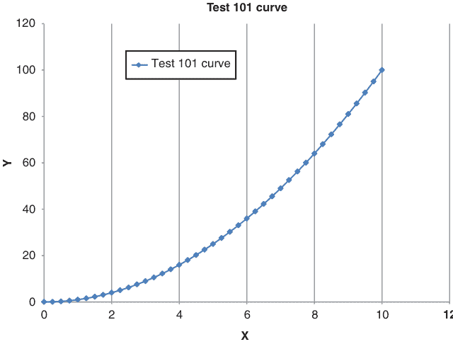

输出显示在图 14.4 中。

在 Excel 表中显示多条曲线的情况下，我们首先定义多个函数，然后将它们各自转换为向量（离散函数）。最后，我们将每个向量附加到一个列表中并调用适当的驱动函数：

```
long N = 40;

// Create abscissa x array
double A = 0.0; double B = 3.0; // Interval
auto x = CreateMesh(N, A, B);

auto fun = [](double x) { return std::log(x + 0.01); };
auto fun2 = [](double x) { return x*x; };
auto fun3 = [](double x) { return x*x*x; };
auto fun4 = [](double x) { return std::exp(x); };
auto fun5 = [](double x) { return x; };

auto vec1 = CreateDiscreteFunction< std::vector<double> >(x, fun);
auto vec2 = CreateDiscreteFunction< std::vector<double> >(x, fun2);
auto vec3 = CreateDiscreteFunction< std::vector<double> >(x, fun3);
auto vec4 = CreateDiscreteFunction< std::vector<double> >(x, fun4);
auto vec5 = CreateDiscreteFunction< std::vector<double> >(x, fun5);
// Now Excel output in one sheet for comparison purposes

// Names of each vector
std::list<std::string> labels
{ "log(x+0.01)", "x^2", "x^3", "exp(x)", "x" };
```

**比较函数**

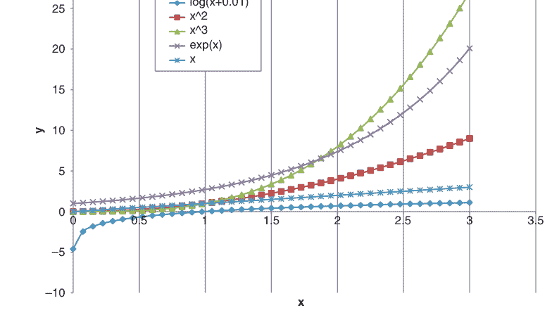

**图 14.5** 多条曲线

```
// The list of Y values using uniform initialisation
std::list<std::vector<double> > curves{ vec1, vec2, vec3, vec4, vec5 };

std::cout << "Data has been created\n";

ExcelDriver xl; xl.MakeVisible(true);
xl.CreateChart(x, labels, curves, "Comparing Functions", "x", "y");
```

输出显示在图 14.5 中。
为完整起见，我们展示了从函数创建值向量和矩阵的代码：

```
template <typename Vector>
    Vector CreateDiscreteFunction(const std::vector<double>& x,
                                    const std::function<double(double)>& f)
{ // Create a discrete function from a continuous function y = f(x)

    Vector y(x.size());

    for (std::size_t j = 0; j < y.size(); ++j)
    {
        y[j] = f(x[j]);
    }

    return y;
}

template <typename Matrix>
Matrix CreateDiscreteFunction2d(const std::vector<double>& x ,
    const std::vector<double>& y,
    const std::function
        <double (double x, double y)>& f)
{ // Create a discrete function from a continuous function m = f(x,y)

std::size_t nr = x.size();
std::size_t nc = y.size();

Matrix m(nr,nc);

for (std::size_t i = 0; i < nr; ++i)
{
    for (std::size_t j = 0; j < nc; ++j)
    {
        m(i, j) = f(x[i],y[j]);
    }
}

return m;
}
```

#### 14.6 随机微分方程的路径生成

前几节中的通用示例被选用来展示 Excel 驱动的工作原理，而不会陷入软件设计决策或数学高级讨论。在本节中，我们采用与计算金融相关的示例。为此，我们模拟由 SDE 定义的量的路径。在大多数情况下，解析解不存在，我们必须求助于数值近似，在此情况下为有限差分法。

我们现在讨论一些用于计算以下非线性自治 SDE 路径的格式：

dX(t) = μ(X(t))dt + σ(X(t))dW(t)    0 < t ≤ T
X(0) = A.                                    (14.1)

一些有限差分格式为：

- 显式欧拉：

  Xₙ₊₁ = Xₙ + μₙΔt + σₙΔWₙ

  其中 μₙ = μ(Xₙ)，σₙ = σ(Xₙ)。                                    (14.2)


## 半隐式欧拉法：

X_{n+1} = X_n + [α μ_{n+1} + (1 − α) μ_n] Δt + σ_n ΔW_n
特殊情况：
α = 1/2 (梯形法), α = 1 (后向欧拉法). (14.3)

## 休恩法：

X_{n+1} = X_n + 1/2 [F_1 + F_2] Δt + 1/2 [G_1 + G_2] ΔW_n
其中：
F(x) ≡ μ(x) − 1/2 σ'(x) σ(x)，其中 σ'(x) ≡ dσ/dx
F_1 = F(X_n), G_1 = σ(X_n)
F_2 = F(X_n + F_1 Δt + G_1 ΔW_n)
G_2 = σ(X_n + F_1 Δt + G_1 ΔW_n). (14.4)

## 米尔斯坦法：

X_{n+1} = X_n + μ_n Δt + σ_n ΔW_n + 1/2 [σ' σ]_n ((ΔW_n)^2 − Δt). (14.5)

## 无导数法

X_{n+1} = X_n + F_1 Δt + G_1 ΔW_n + [G_2 − G_1] Δt^{−1/2} ( (ΔW_n)^2 − Δt ) / 2
其中：
F_1 = μ(X_n), G_1 = σ(X_n) G_2 = σ(X_n + G_1 Δt^{1/2}). (14.6)

## 一阶龙格-库塔法（含伊藤系数）(FRKI)：

X_{n+1} = X_n + F_1 Δt + G_2 ΔW_n + [G_2 − G_1] Δt^{1/2}
其中：
F_1 = μ(X_n), G_1 = σ(X_n) G_2 = σ( X_n + G_1 (ΔW_n − Δt^{1/2}) / 2 ). (14.7)

在本节中，我们扩展了第6章6.8节中用于模拟SDE的C++代码。具体来说，我们使用上述有限差分方法来模拟SDE的路径。我们设计了图7.1（以及第9章中的相关主题）中系统上下文图的一部分。

主要系统有：

- S1：期权（衍生品）输入数据。
- S2：对单因子SDE进行建模。
- S3：对有限差分格式进行建模。
- S4：在Excel中呈现SDE路径。
- S5：用于配置和初始化系统S1至S4的Builder/Factory系统。

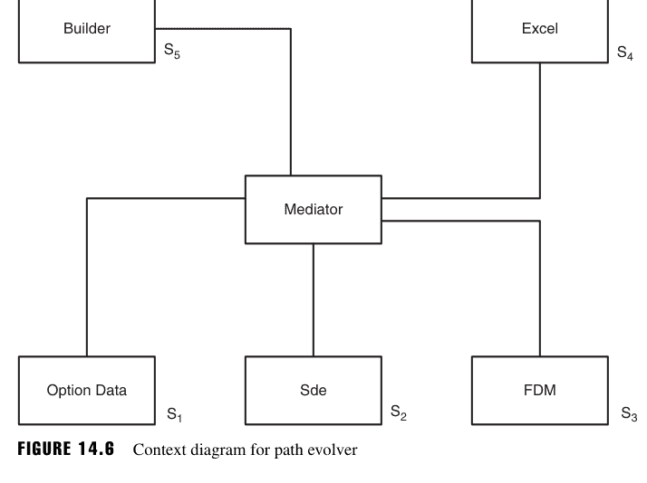

## 图14.6 路径演化器的上下文图

我们展示了如何基于多范式方法，使用现代C++语言特性来设计这个系统。它是第31章和第32章中使用蒙特卡洛方法计算单因子期权价格的更大系统的一部分。我们预告了后续的设计，并以用户友好的方式显示随机路径。

### 14.6.1 主要类

当前问题的设计如图14.6所示，它是图7.1中上下文图以及第9章中更一般化图的一个特例。此外，我们向SDE类添加了一个新的数据成员，用于表示定义SDE的时间区间的上限。

// Functions of arity 2 (two input arguments)
template <typename T>
    using FunctionType = std::function<T (const T& arg1, const T& arg2)>;

// Interface to simulate any SDE with drift/diffusion
// Use a tuple to aggregate two functions into what is similar to an
// interface in C# or Java.
template <typename T>
    using ISde = std::tuple<FunctionType<T>, FunctionType<T>>;

template <typename T = double> class Sde
{

std::normal_distribution<T> dist;
std::default_random_engine eng;
std::shared_ptr<Sde<T>> sde;
public:
    Fdm(const std::shared_ptr<Sde<T>>& oneFactorProcess,
        const ::normal_distribution<T>& normalDist,
        const ::default_random_engine& engine)
    : sde(oneFactorProcess), dist(normalDist), eng(engine){}

    // Compute x(t_n + dt) in terms of x(t_n)
    T advance(T xn, double tn, double dt)
    {
        return static_cast<Derived*>(this)->advance(xn, tn, dt);
    }

    T generateRN()
    {
        return dist(eng);
    }
};

请注意，我们使用了C++ <random>库的函数来生成均匀分布变量（这一点以后可以做得更通用，但暂时就是这样）。特定的有限差分格式以各自的方式实现advance()函数，例如显式欧拉法和休恩法：

template <typename T>
class FdmEuler : public Fdm<FdmEuler<T>, T>
{ // Using CRTP pattern

private:

public:
    FdmEuler(const std::shared_ptr<Sde<T>>& oneFactorProcess,
             const std::normal_distribution<T>& normalDist,
             const std::default_random_engine& engine)
    : Fdm(oneFactorProcess, normalDist, engine)
    {}

    // Compute x(t_n + dt) in terms of x(t_n)
    T advance(T xn, T tn, T dt)
    {
        T normalVar = generateRN();
        return xn + sde->drift(xn, tn)*dt
               +sde->diffusion(xn, tn) * std::sqrt(dt) * normalVar;
    }
};

template <typename T>
class FdmHeun : public Fdm<FdmHeun<T>, T>
{ // Using CRTP pattern

private:

public:
    FdmHeun(const std::shared_ptr<Sde<T>>& oneFactorProcess,
            const std::normal_distribution<T>& normalDist,
            const std::default_random_engine& engine)
        : Fdm(oneFactorProcess, normalDist, engine)
    {}

    // Compute x(t_n + dt) in terms of x(t_n)
    T advance(T xn, T tn, T dt)
    {
        T a = sde->drift(xn, tn);
        T b = sde->diffusion(xn, tn);
        T normalVar = generateRN();
        T suppValue = xn + a * dt + b * std::sqrt(dt) * normalVar;

        return xn + 0.5 * (sde->drift(suppValue, tn) + a) * dt
               + 0.5 * (sde->diffusion(suppValue, tn) + b)
               * std::sqrt(dt) * normalVar;
    }
};

我们构建了一个工厂类，它基于用户选择创建SDE（可选的有GBM、CEV和CIR）：

``` 
namespace SdeFactory
{
    // Specific SDEs
    template <typename T>
    std::shared_ptr<Sde<T>> GbmSde(const OptionData& data, T S0)
    {
        T r = data.r; T sig = data.sig; T B = data.T;
        auto drift = [=](T t, T S) { return r * S; };
        auto diffusion = [=](T t, T S) { return sig * S; };

        ISde<T> Functions = std::make_tuple(drift, diffusion);

        // Create Sde
        return std::shared_ptr<Sde<T>>(new Sde<T>(Functions, S0, B));
    }

    template <typename T>
    std::shared_ptr<Sde<T>> CevSde(const OptionData&
                                   data, T S0)
    {
        T r = data.r; T sig = data.sig; T B = data.T;
        T beta = 0.5; // Hard-coded
        auto drift = [=](T t, T S) { return r * std::pow(S, beta); };
        auto diffusion = [=](T t, T S) { return sig * S; };

        ISde<T> Functions = std::make_tuple(drift, diffusion);

``` 
// Create Sde
return std::shared_ptr<Sde<T>>(new Sde<T>(Functions, S0, B));
}

template <typename T>
std::shared_ptr<Sde<T>> CIR Sde(T alpha, T b, T sigma, T S0, T B)
{

auto drift = [=](T t, T X) { return alpha*(b-X); };
auto diffusion = [=](T t, T X) { return sigma * std::sqrt(X); };
ISde<T> Functions = std::make_tuple(drift, diffusion);

// Create Sde
return std::shared_ptr<Sde<T>>(new Sde<T>(Functions, S0, B));
}

template <typename T>
std::shared_ptr<Sde<T>> ChooseSde(const OptionData& data, T S0)
{ // Simple factory method

std::cout << "1. GBM, 2. CEV, 3. CIR: ";
int choice; std::cin >> choice;

if (1 == choice)
{
return GbmSde<T>(data, S0);
}
if (2 == choice)
{
return CevSde<T>(data, S0);
}

if (3 == choice)
{
// Feller condition => 2 a b >= sigma^2
double alpha = 0.01;
double b = 7.0;
double sigma = 0.9;
double B = 1.0; // Upper limit of interval
double X0 = 0.4;

return CIR Sde<T>(alpha, b, sigma, X0, B);
}
else
{
return GbmSde<T>(data, S0);
}
}
}
```

我们注意到，在此版本中，为了避免认知负荷，我们没有为FDM类创建工厂。无论如何，它的结构将与上述SDE情况的结构类似。在创建了SDE和FDM类之后，我们现在设计图14.6中的中介类，它连接其他组件并构造模拟路径。

代码如下：

``` 
// Creating a path of an SDE approximated by FDM
template <typename Derived, typename T>
std::vector<T> Path(const Sde<T>& sde,
                    Fdm<typename Derived, T>& fdm, long NT)
{
    std::vector<T> result(NT + 1);
    
    result[0] = sde.ic;
    
    double dt = sde.B / static_cast<T>(NT);
    double tn = dt;
    
    for (std::size_t n = 1; n < result.size(); ++n)
    {
        result[n] = fdm.advance(result[n - 1], tn, dt);
        tn += dt;
    }
    
    return result;
}
```

最后，我们将所有相关的模型常量封装在一个名为OptionData的便捷结构体中：

``` 
#include <algorithm> // for max()
#include <boost/parameter.hpp>

namespace OptionParams
{
    BOOST_PARAMETER_KEYWORD(Tag, strike)
    BOOST_PARAMETER_KEYWORD(Tag, expiration)
    BOOST_PARAMETER_KEYWORD(Tag, interestRate)
    BOOST_PARAMETER_KEYWORD(Tag, volatility)
    BOOST_PARAMETER_KEYWORD(Tag, dividend)
    BOOST_PARAMETER_KEYWORD(Tag, optionType)
}

// Encapsulate all data in one place
struct OptionData
{ // Option data + behaviour
```


double K;
double T;
double r;
double sig;

// Extra data
double D;      // dividend

int type;      // 1 == call, -1 == put

explicit constexpr OptionData(double strike, double expiration,
                              double interestRate,
                              double volatility, double dividend,
                              int PC)
    : K(strike), T(expiration), r(interestRate),
      sig(volatility), D(dividend), type(PC)
{}

template <typename ArgPack> OptionData(const ArgPack& args)
{
    K = args[OptionParams::strike];
    T = args[OptionParams::expiration];
    r = args[OptionParams::interestRate];
    sig = args[OptionParams::volatility];
    D = args[OptionParams::dividend];
    type = args[OptionParams::optionType];

    std::cout << "K " << K << ", T " << T << ", r " << r << std::endl;
    std::cout << "vol " << sig << ", div " << D << ",type "
              << type << std::endl;
}

};

我们可以通过调用其构造函数（参数的位置很重要）来初始化结构体 OptionData 的元素，也可以通过统一初始化或使用 Boost 参数库支持的命名变量来实现。在最后一种情况下，输入参数的相对顺序无关紧要，下面的示例就说明了这一点：

//OptionData opt2 { 100.0, 1.0, 0.06, 0.2, 0.03, 1 };

// Init via named Boost variables
OptionData myOption((OptionParams::strike = 65.0,
                    OptionParams::expiration = 1.0,
                    OptionParams::volatility = 0.001,
                    OptionParams::dividend = 0.0,
                    OptionParams::optionType = -1,
                    OptionParams::interestRate = 0.1));
```

#### 14.6.2 测试设计和 Excel 中的展示

我们现在讨论图 14.6 中类的配置和初始化。步骤很容易遵循：

// A. Create basic input data
//OptionData(double strike, double expiration, double interestRate,
// double volatility, double dividend, int PC)
OptionData myOption { 100.0, 10.0, 0.1, 0.9, 0.03, 1 };
double S0 = 20.0;

// B. Get the SDE
// Using factories
std::shared_ptr<Sde<double>> sde = SdeFactory::ChooseSde<double>
(myOption, S0);

// C. Set up the FDM classes; 1 to N relationship between SDE and FDM
std::default_random_engine eng;

std::normal_distribution<double> nor(0.0, 1.0);
std::random_device rd;
eng.seed(rd());

FdmEuler<double> fdm(sde, nor, eng);
FdmHeun<double> fdm2(sde, nor, eng);

// D. Joining up SDE and FDM in Mediator class
long NT = 200;
auto vec = Path(*sde, fdm, NT);
auto vec2 = Path(*sde, fdm2, NT);

double A = 0.0; double B = myOption.T;
auto x = CreateMesh(NT+1, A, B);

// E. 'Report' system; display the graphs in Excel
ExcelDriver xl; xl.MakeVisible(true);

// E_1: Display each curve in its own sheet
xl.CreateChart(x, vec, "Euler method");
xl.CreateChart(x, vec2, "Heun method");

// Names of each vector
std::list<std::string> labels{ "Euler", "Heun"};

// The list of Y values
std::list<std::vector<double> > curves{ vec, vec2};

// E_2: Display all curves in one sheet
xl.CreateChart(x, labels, curves, "Comparing FDM ", "t", "S");
```

## Euler method

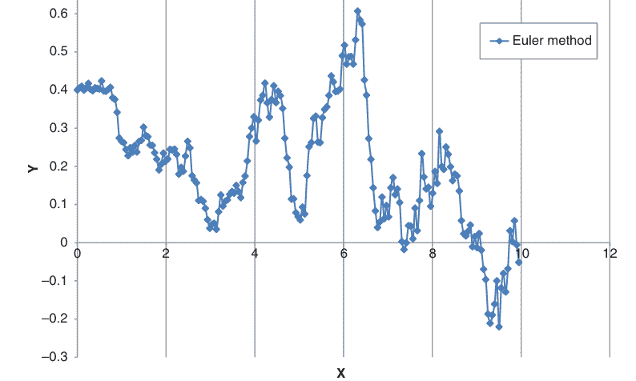

# FIGURE 14.7 CIR path with Euler method

图 14.7 显示了显式 Euler 方法的典型输出。在这种情况下，我们模拟 CIR 模型的短期利率（平方根扩散过程），我们可以看到（并且众所周知）Euler 方法会产生负值，这是错误的。我们将在练习 4 中讨论这个问题。

最后，我们展示了实现图 14.6 中中介组件的代码。在这个版本中它是一个自由函数，但在更大更复杂的应用程序中，它可以被建模为一个整体-部分对象（POSA, 1996）以促进可维护性。它将具有以下方法：

// Creating a path of an SDE approximated by FDM
template <typename Derived, typename T>
std::vector<T> Path(const Sde<T>& sde, Fdm<typename Derived,
T>& fdm, long NT)
{

std::vector<T> result(NT + 1);

result[0] = sde.ic;

double dt = sde.B / static_cast<T>(NT);
double tn = dt;

for (std::size_t n = 1; n < result.size(); ++n)
{
    result[n] = fdm.advance(result[n - 1], tn, dt);
    tn += dt;
}

return result;
}
```

### 14.7 SUMMARY AND CONCLUSIONS

本章中我们介绍了一个用于在 Excel 中显示数值数据的软件框架。我们专注于在 Excel 电子表格程序中可视化向量、矩阵和曲线。我们阐述了其优势并给出了若干示例。

### 14.8 EXERCISES AND PROJECTS

+   1. (Extensions to the Excel Driver)

可以通过多种方式为 Excel 驱动程序添加新功能。在本练习中我们专注于代码的泛化。我们希望显示一元和二元函数。我们隐藏诸如创建网格数组和其他支持代码之类的低级细节。所需函数具有以下接口：

```
using Function1DType = std::function<double (double x)>;
using Function2DType = std::function<double(double x, vdouble y)>;

void printDiscreteFunctionValues(const Function1DType& f,
double A, double B,long nSteps,
    const std::string& title,
    const std::string& horizontal,
    const std::string& vertical,
    const std::string& legend);

void printDiscreteFunctionValues(const Function1DType& f,
    const std::vector<double>& mesh,
    const std::string& title,
    const std::string& horizontal,
    const std::string& vertical,
    const std::string& legend);

void printDiscreteFunctionValues(const Function2DType& f,
    double A, double B,long xSteps,
    double C, double D,long ySteps,
    const std::string& title,
    const std::string& horizontal,
    const std::string& vertical,
    const std::string& legend);
```

```
void printDiscreteFunctionValues(const Function2DType& f,
    const std::vector<double>& mesh,
    const std::vector<double>& mesh2,
    const std::string& title,
    const std::string& horizontal,
    const std::string& vertical,
    const std::string& legend);
```

请回答以下问题：

+   a) 基于驱动程序中现有的代码编写上述函数的代码。
+   b) 在 Black–Scholes 看涨期权价格及其对应的希腊字母上测试一元函数：
+   Δ_C = ∂C/∂S = e^{(b−r)T} N(d₁)
+   Γ_C ≡ ∂²C/∂S² = ∂Δ_C/∂S = n(d₁)e^{(b−r)T}/(Sσ√T)
+   Vega_C ≡ ∂C/∂σ = S√T e^{(b−r)T} n(d₁)
+   Θ_C ≡ −∂C/∂T = − Sσ e^{(b−r)T} n(d₁)/(2√T) − (b − r) S e^{(b−r)T} N(d₁) − r K e^{−rT} N(d₂).

c) 通过在给定区间上显示双变量 t 分布的概率密度函数来测试二元函数（Nadarajah and Kotz, 2005）：
f(x, y; ν, ρ) = 1/[2π√(1−ρ²)] { 1 + [x² − 2ρxy + y²]/[ν(1−ρ²)] }^{−(ν+2)/2}.

我们将在第 16 章讨论累积概率积分的计算方法时更详细地讨论该分布：
P(x, y; ν, ρ) = ∫_{-∞}^{x} ∫_{-∞}^{y} f(x, y; ν, ρ) dx dy.

+   2. (Finite Difference Schemes for the One-Dimensional Heat Equation)

Excel 驱动程序的一个有趣且有用的应用是在显示使用 FDM 的情况下对热方程近似解的值，如第 13 章所讨论的那样。特别是，我个人发现它在以下情况下很有用：

+   C1: 编写 FD 代码后，我们希望查看其是否产生正确的结果。为此，以易于格式化的方式显示结果非常有帮助。
+   C2: 我们希望比较 ADE 系列格式与 Crank–Nicolson 方法或 PDE 的解析解等基线情况的精度。
+   C3: 显示近似方法的精度作为某个独立变量的函数。一个例子是绘制二项式方法中期权价格作为步数函数的图像。同样的方法也适用于有限差分方法。

请回答以下问题：

+   a) 使用我们在第 13 章中介绍的两种 ADE 格式来近似热方程的解（参见第 13 章中的方程 (13.14)）。


- b) 将a)部分中的解与精确解（13.15）以及采用Crank–Nicolson方法得到的解进行比较。
- c) 将a)和b)部分的四个结果显示为单个Excel工作表中的四条曲线。比较这些结果。
- d) 对方程(13.14)的各种初始条件进行试验，并重复步骤a)、b)和c)。

## 3. (三次样条过冲，第二部分)

在第13章中，我们详细介绍了三次样条及其一些应用。特别是，第13章的练习5讨论了使用三次样条以及收益率曲线数据可能出现的过冲问题。请回答以下问题：

- a) 使用第13章练习5中的相同数据，并在Excel中显示插值三次样条值。
- b) 将结果与线性插值产生的结果进行比较（见方程(13.32)）。
- c) 分别基于公式(13.38)和(13.37)，显示a)部分中三次样条的一阶和二阶导数。

## 4. (Cox–Ingersoll–Ross (CIR) 模型)

我们研究CIR利率模型（也称为平方根扩散），其定义为如下具有常系数的SDE（Glasserman，2004）：

dr = a(b − r)dt + σ√r dW.

这是短期利率模型，称为CIR模型。在这种情况下，短期利率r(t)以由a控制的速度被拉向b。此外，如果r(0) > 0，则r(t)永远不会为负；且如果满足以下Feller条件，则对所有t，r(t)都保持严格正值：

ab > ½ σ².

本练习的目的是将该模型引入图14.6中的框架，并深入了解其解析和数值性质。

请回答以下问题：

- a) 为CIR SDE创建一个类，并将其集成到框架中。
- b) CIR SDE没有显式解，因此我们求助于数值方法。对各种时间步长和到期时间应用显式Euler和Heun方法。
- c) 研究Feller条件不满足时的有限差分格式。
- d) 使用有限差分格式进行试验，并在漂移、波动率和到期参数取较小和较大值的情况下确定正性。

我们注意到，CIR过程的转移密度是已知的，可以用非中心卡方分布来表示（Glasserman，2004，第122页）。

## 5. (具有解析解的SDE)

在某些情况下（我们可能很幸运），有可能找到SDE的解析解（Kloeden和Platen，1995，第118–126页）。一些SDE及其解的例子如下：

```text
dX = ½ a² X dt + a X dW
X(t) = X₀ exp(aW(t))

dX = aX dt + bX dW
X(t) = X₀ exp((a − ½ b²)t + bW(t))

dX = ½ X dt + X dW
X(t) = X₀ exp(W(t))
```

这里W(t)是维纳过程。

请回答以下问题：

- a) 将这些方程集成到框架中，并决定如何确定显式解与给定有限差分格式所定义解之间的差异。
- b) 通过改变时间步数来试验这些格式。有没有办法确定给定格式的收敛阶？
- c) 我们重点关注显式Euler方法。以图14.5的风格生成一个多曲线图，其中每条曲线都是Euler方法在给定时间步数下生成的路径，例如步长NT = 10, 20, 50, 100, 200, 300。随着NT增大，你是否看到向“精确路径”的单调收敛？

## 6. (双对数与半对数图)

在某些情况下，我们可能希望在Excel中呈现数据之前以某种方式对数据进行变换。一般来说，水平x轴与垂直y轴之间的线性图可以通过两种主要方式进行变换：

- **双对数图：** 水平和垂直轴都使用对数刻度。这种变换适用于单项式（形式为y = a x^k的关系）。它们在log空间中变成直线，如下列步骤所示：

```text
y = a x^k
log y = k log x + log a
X = log x, Y = log y
Y = m X + b.
```

因此我们看到，m = k是直线的斜率（梯度），而b = log a是log y轴上的截距，因此该图可以识别关系并估计参数（本例中为参数a和k）。

- **半对数图：** 在这种情况下，只有一个变量进行对数变换。我们区分y轴被变换的log-lin和x轴被变换的lin-log。形式为y = λ a^{γ x}的方程在半对数坐标下绘制时变成直线，如下列步骤所示：

```text
log y = log(λ a^{γ x}) = log λ + log(a^{γ x}) = log λ + (γ log a) x.
```

一般来说，可以使用任何对数底数，但大多数应用使用以10、2或e为底。

请回答以下问题：

- a) 确定如何将对数变换引入当前的Excel驱动框架。
- b) 作为测试案例，我们以\(y=x^2/2\)为例。在区间[1,10]上生成\(x\)和\(y\)数组值。然后对数组执行双对数变换，并在Excel中绘制这些数组。你能从直线的斜率和截距中重现或“看出”原始参数吗？

## 7. (扩展图14.6中的框架，头脑风暴)

本练习的解法将在第31章讨论，但尽早解决这个问题也无妨。重点在于扩展图14.6中的设计，以创建一个简单的单因子蒙特卡洛期权定价器。

请回答以下问题：

- a) 考虑对单因子看涨期权和看跌期权价格进行定价的初始情形。框架中需要添加哪些新的系统和类？一个要求是框架应计算期权价格和标准误差。
- b) 中介者类需要扩展，因为其当前形式只计算单条路径。使用蒙特卡洛方法需要创建大量路径，并使用众所周知的平均和贴现算法。
- c) 对看涨期权和看跌期权测试a)和b)部分的代码，并相互比较精确解和近似解。
- d) 扩展框架，使其能够配置为针对相同的路径信息同时为多个期权定价。

### 14.9 附录：COM体系结构概述

在本节中，我们给出*组件对象模型*（COM）的总体概述。我们介绍它是因为它是Excel的很多功能的基础。你可以跳过14.9、14.10和14.11节而不会影响连续性，但你应该阅读14.12和14.13节。COM中两个关键实体是*接口*和*组件*。在本节中，我们从概念角度解释它们是什么，然后讨论COM如何实现它们。*接口*是对预期行为的纯规范。换句话说，它由一组*抽象方法*组成。每个方法都没有实现，接口不能包含非抽象方法，也不能包含成员数据。这种描述与C#和Java支持接口的方式一致。C++并不直接支持接口（C++中的抽象类不是接口，因为它们是结构实体），但可以通过没有成员数据且仅由纯虚函数组成的类来模拟接口。COM有一个名为`interface`的关键字，其定义如下：

```cpp
#define interface struct
```

该关键字定义在Microsoft Win32 *软件开发工具包*（SDK）所包含的头文件`objbase.h`中。我们举一个C++中的初步示例来模拟COM功能。为此，我们定义了两个接口，它们包含以不同方式呈现数据的方法。然后我们使用*多重继承*来创建一个实现这两个接口的类。代码如下：

```cpp
#include <iostream>
#include <objbase.h>              // Define interface.

// Abstract interfaces
interface IDraw
{ // Present information

    virtual void __stdcall display() = 0;
    virtual void __stdcall print() = 0;
};

interface ISave
{ // Save to permanent storage

    virtual void __stdcall saveXML() = 0;
    virtual void __stdcall saveDB() = 0;
};

// Interface implementation
class CA : public IDraw, public ISave
{
public:

    // Implement interface IDraw.
    virtual void __stdcall display()
    {std::cout << "CA::display" << std::endl;}
    virtual void __stdcall print()
    {std::cout << "CA::print" << std::endl;}

    // Implement interface ISave.
    virtual void __stdcall saveXML()
    {std::cout << "CA::saveXML" << std::endl;}
    virtual void __stdcall saveDB()
    {std::cout << "CA::saveDB" << std::endl;}
};
```

我们首先注意到，这段代码仍然是C++而不是COM代码。其次，这段代码包含Microsoft特定的编译器扩展`__stdcall`。这是一个有些技术性的问题，涉及方法参数、它们如何被压入堆栈，以及谁（是调用者还是被调用者）将它们从堆栈中移除。一般选项如下：

- **cdecl**：参数以相反顺序压入堆栈，即从右到左，由调用者（调用函数）清理堆栈。这是C语言的约定。
- **pascal**：参数从左到右压入堆栈，由被调用者清理堆栈。这是Win16操作系统中的调用约定。
- **stdcall**：这是标准且最常见的调用约定。它是pascal调用约定的一种变体，在这种情况下，被调用者清理堆栈，但参数从右到左压入堆栈。这是Win32操作系统中应用程序编程接口所使用的约定。


基于上述代码的一个简单测试程序如下：

```
// Client
int main()
{
    CA* pA = new CA;

    // Get an IDraw pointer.
    IDraw* pd = pA;

    std::cout << "Client: Use the IDraw interface.";
    pd->display();
    pd->print();

    // Get an ISave pointer.
    ISave* ps = pA;

    std::cout << "Client: Use the ISave interface.";
    ps->saveXML();
    ps->saveDB();

    delete pA;

    return 0;
}
```

一般来说，接口中的每个方法都可以有输入参数、输出参数和输入/输出参数，以及返回类型。在上述简单示例中，方法没有输入参数，并且返回类型都是 void。

#### 14.9.1 COM 接口与 COM 对象

现在我们来讨论 COM 中两个重要的概念，即 COM 接口和 COM 对象。COM 接口在许多方面都很特殊。我们需要讨论若干问题，这将有助于我们深入理解如何定义、发现和使用这些接口和对象。

每个支持 COM 的系统都必须包含 COM 库的实现。该库包含若干组函数，为对象及其客户端提供基本服务。例如，它包含让客户端启动对象服务器的功能。COM 库的服务通过普通函数调用进行访问。

接口本质上是在实现该接口的对象与该对象的客户端之间达成的契约。为了使契约在对象和客户端之间生效，我们必须解决以下问题：

-   A1：一种显式标识接口的方法。
-   A2：如何描述（定义）接口中的方法。
-   A3：如何实际实现接口。

关于 A1，标识接口有两种方式。第一种方式是用人类易于阅读的字符串名称来标识接口，第二种方式则使用 16 字节（128 位）的*全局唯一标识符*（GUID）在软件中标识接口。GUID 在空间和时间上都被保证是唯一的，两个接口（或 COM 中的其他实体）被赋予相同值的可能性极小。对于接口而言，这种唯一标识符称为*接口标识符*（IID）。下一个挑战是拥有某种*全局注册机构*，用于记录所有名称（包括接口标识符）。该注册机构称为*注册表*，它是 Windows 操作系统的共享系统数据库。它包含有关系统硬件、软件、配置和用户的信息。

COM 组件在其状态中维护一个称为*引用计数*的数字。当客户端获取接口时，该计数递增；当客户端使用完接口时，该计数递减。每个接口都必须支持 IUnknown 接口，该接口有三个方法：

-   `QueryInterface`：客户端可以调用此方法来发现组件是否支持某个特定接口。如果组件支持该接口，将返回指向该接口的指针。
-   `AddRef`：递增接口上的引用计数。
-   `Release`：释放对接口的引用。

开发人员必须实现 IUnknown，它的*引用计数机制*与 C++11 和 *Boost 智能指针*库自动管理基于堆的对象生命周期的方式类似。IUnknown 的精确规范如下：

```
interface IUnknown
{
    virtual HRESULT QueryInterface( [in] IID& iid, [out] void** ppv) =0;
    virtual ULONG AddRef(void) =0;
    virtual ULONG Release(void) =0;
};
```

我们看到，`QueryInterface` 有两个参数：第一个输入参数 `iid` 是我们希望确定其是否受支持的接口的标识符；第二个参数 `ppv` 在调用 `QueryInterface` 之前被设置为 NULL。如果调用成功，我们会得到一个指向 `ppv` 的指针，然后就可以调用其方法。请注意，我们可以将参数指定为输入参数或输出参数。

#### 14.9.2 HRESULT 和其他数据类型

组件使用 32 位字段 HRESULT 与客户端通信。其结构如图 14.8 所示。例如，当调用某个方法时，它可以指示成功或失败。大多数 COM 函数都返回此整数作为返回类型。

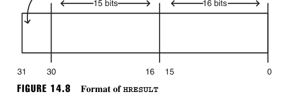

*图 14.8 HRESULT 的格式*

可能的返回类型如下：

-   `E_ABORT`：操作因未指定的错误而中止。
-   `E_ACCESSDENIED`：常规的拒绝访问错误。
-   `E_FAIL`：发生了未指定的失败。
-   `E_HANDLE`：使用了无效的句柄。
-   `E_INVALIDARG`：一个或多个参数无效。
-   `E_NOINTERFACE`：IUnknown 接口的 QueryInterface 方法未识别所请求的接口。该接口不受支持。
-   `E_NOTIMPL`：未实现该方法。
-   `E_OUTOFMEMORY`：该方法无法分配内存。
-   `E_PENDING`：完成操作所需的数据尚不可用。
-   `E_POINTER`：使用了无效的指针。
-   `E_UNEXPECTED`：发生了灾难性失败。
-   `S_FALSE`：方法成功并返回布尔值 FALSE。
-   `S_OK`：方法成功。如果期望返回布尔值，则返回值为 TRUE。

我们可以通过调用宏 SUCCEEDED 和 FAILED 来检查代码中的返回类型，如下面的示例所示：

```
HRESULT hr = SetStrings ();
if (FAILED (hr))
    return hr;
```

```
HRESULT hr2 = PropBag->Read();
if (SUCCEEDED(hr2))
{
    // code
}
```

在测试方法的返回值时，建议使用这些宏，而不是将结果 hr 与原始值进行比较；不过，代码中允许将这些值用作返回类型，例如：

```
HRESULT FinalConstruct()
{
    return S_OK;
}
```

#### 14.9.3 接口定义语言

COM 支持一种工具，使我们能够以标准方式定义接口。它称为*接口定义语言*（IDL），是 Microsoft 的*远程过程调用*（RPC）中 IDL 的扩展，而后者基于开放软件基金会的*分布式计算环境*（OSF DCE）中的 IDL。IDL 以无歧义的方式描述 COM 对象的接口。它允许我们将接口的方法与其 IID 关联起来。我们还可以以一种可由机器处理的形式指定接口的详细信息，以便在创建*动态链接库*（DLL）时生成封送代码：

```
// Interface IDraw
[
    object,                         // 1.
    uuid(D6FCCE1F-8A2D-4303-A974-09AEC422EFFE),  // 2.
    helpstring("My drawing interface"),          // 3.
    pointer_default(unique)                         // 4.
]

interface IDraw : IUnknown
{
    HRESULT draw();
};
```

#### 14.9.4 类标识符

COM 对象是某个类的实例。每个类都被分配一个 GUID，称为*类标识符*（CLSID）。客户端可以将 CLSID 传递给 COM 库以创建该类的实例。不过，这并不是强制性的。CLSID 的主要用途是标识一段特定的代码，供 COM 库为与该 CLSID 对应的类的实例加载并执行。

### 14.10 一个示例

我们给出一个简单示例，演示如何定义 COM 接口和 COM 对象。我们重点关注前面讨论过的语言问题。在本例中，我们定义接口以及一个实现其中一个接口的类。接口定义如下：

```
// Interfaces
interface IDraw : IUnknown
{
    virtual void __stdcall display() = 0;
};

interface ISave : IUnknown
{
    virtual void __stdcall save() = 0;
};
```

相应的生成 ID 如下：

```
// IIDs
//
// {32bb8320-b41b-11cf-a6bb-0080c7b2d682}
static const IID IID_IDraw =
    {0x32bb8320, 0xb41b, 0x11cf,
    {0xa6, 0xbb, 0x0, 0x80, 0xc7, 0xb2, 0xd6, 0x82}};

// {32bb8321-b41b-11cf-a6bb-0080c7b2d682}
static const IID IID_ISave =
    {0x32bb8321, 0xb41b, 0x11cf,
    {0xa6, 0xbb, 0x0, 0x80, 0xc7, 0xb2, 0xd6, 0x82}};
```

现在我们创建一个名为 MyClass 的类，它实现我们在前面第 14.9 节中定义的 IDraw；请注意，这个类还必须实现 IUnknown 的方法：

```
//
// Component
//
class MyClass : public IDraw
{
public:
    // IUnknown implementation
    virtual HRESULT __stdcall QueryInterface(const IID& iid, void** ppv) ;

    virtual ULONG __stdcall AddRef() ;
    virtual ULONG __stdcall Release() ;

    // Interface IDraw implementation
    virtual void __stdcall display() { cout << "display" << endl ;}

    // Constructor
    MyClass() : m_cRef(0) {}

    // Destructor
    ~MyClass() { std::cout << "Bye, bye\n";}

private:
    long m_cRef;
};
```

该组件的实现如下：

```
HRESULT __stdcall MyClass::QueryInterface(const IID& iid, void** ppv)
{
    if (iid == IID_IUnknown)
    {


```
std::cout << "MyClass QI: Return pointer to IUnknown.\n";
*ppv = static_cast<IDraw*>(this) ;
}
else if (iid == IID_IDraw)
{
    std::cout << "MyClass QI: Return pointer to IDraw.\n";
    *ppv = static_cast<IDraw*>(this) ;
}
else
{
    std::cout <<"MyClass QI: Interface not supported.\n";
    *ppv = NULL ;
    return E_NOINTERFACE;
}
reinterpret_cast<IUnknown*>(*ppv)->AddRef() ;
return S_OK ;
}

ULONG __stdcall MyClass::AddRef()
{
    // Use InterlockedIncrement to ensure thread-safeness
    return InterlockedIncrement(&m_cRef) ;
}

ULONG __stdcall MyClass::Release()
{
    // Use InterlockedDecrement to ensure thread-safeness
    if (InterlockedDecrement(&m_cRef) == 0)
    {
        delete this ;
        return 0 ;
    }
    return m_cRef ;
}

//
// Creation function
//
IUnknown* CreateInstance()
{ // Factory method pattern in the form of a function
    IUnknown* pI = static_cast<IDraw*>(new MyClass) ;
    pI->AddRef() ;
    return pI ;
}
```

用于展示如何使用该组件的测试程序如下：

```
int main()
{
    HRESULT hr ;
    IUnknown* pIUnknown = CreateInstance() ;

std::cout << "Client: Get interface IDraw.";

IDraw* pIDraw = NULL ;
hr = pIUnknown->QueryInterface(IID_IDraw, (void**)&pIDraw) ;

if (SUCCEEDED(hr))
{
    std::cout <<"Client: Succeeded getting IDraw.";
    pIDraw->display() ;        // Use interface IDraw.
    pIDraw->Release() ;
}

std::cout << "Client: Get interface ISave which MyClass
does _not_ support.\n";

ISave* pISave = NULL ;
hr = pIUnknown->QueryInterface(IID_ISave, (void**)&pISave) ;
if (SUCCEEDED(hr))
{
    std::cout << "Client: Succeeded getting ISave.";
    pISave->save() ;        // Use interface ISave.
    pISave->Release() ;
}

std::cout << "Client: Release IUnknown interface.";
pIUnknown->Release() ;

return 0;
}
```

该代码的输出为：

```
Client: Get interface IDraw.MyClass QI: Return pointer to IDraw.
Client: Succeeded getting IDraw.display
Client: Get interface ISave which MyClass does _not_ support.
MyClass QI: Interface not supported.
Client: Release IUnknown interface.Bye, bye
```

### 14.11 虚函数表

我们现在讨论 COM 中接口的工作原理，并讨论 COM 中所做相关设计选择的一些后果。特别是，COM 接口是使用纯抽象基类实现的，即仅由纯虚成员函数组成且没有成员数据的类。需要注意的重要一点是，此类类定义了 COM 对接口所需的具体内存结构。事实上，我们正在定义一块内存的布局。

让我们以一个建模金融衍生品定价函数及其敏感性（如 delta 和 gamma）的接口为例：

```
interface IOption
{ // Functions related to option pricing

    virtual void __stdcall price(double* myPrice) = 0;
    virtual void __stdcall delta(double* myDelta) = 0;
    virtual void __stdcall gamma(double* myGamma) = 0;
};
```

与 C++ 通常的做法一样，我们创建一个实现这些纯虚成员函数的类（为方便起见，我们尚未实现完整的 Black–Scholes 公式）：

```
class Option : public IOption
{ // All values are simulated, used for motivational purposes

public:
    virtual void __stdcall price(double* myPrice) { *myPrice = 1.0;}
    virtual void __stdcall delta(double* myDelta) { *myDelta = 0.5;}
    virtual void __stdcall gamma(double* myGamma) { *myGamma = 0.0;}
};
```

一个简单的用法如下：

```
// Option class
IOption* opt = new Option;
double value;
opt->price(&value);
std::cout << value << std::endl;
delete opt;
```

所有实现（例如类 Option）都是具有如图 14.9 所示相同基本布局的内存块。抽象类定义了内存结构，

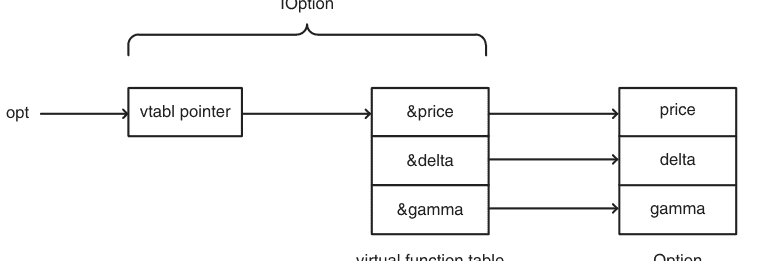

图 14.9 内存布局

它不执行内存分配，这是抽象类的派生类完成的。虚函数表是一个指向纯虚函数实现的指针数组。虚表（vtabl）中的第一个条目包含 price 函数的地址，如派生类中实现的那样。表中的第二个条目是 delta 函数的地址，以此类推。一般来说，COM 接口的布局与 C++ 编译器为抽象基类生成的内存布局相同。因此，抽象类可用于定义 COM 接口。

我们现在讨论在实现多个接口的类 CA 的情况下内存布局的工作方式，该类在第 14.9 节中介绍。我们注意到这些接口都派生自 IUnknown。布局如图 14.10 所示。

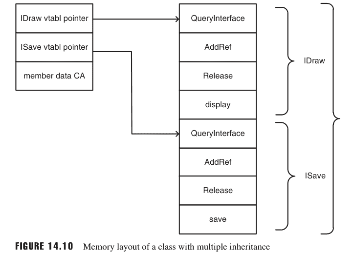

# 图 14.10 具有多重继承的类的内存布局

最后一点说明；一旦客户端从组件获取接口指针，那么客户端和组件之间唯一的联系就是接口的二进制布局。在这种意义上，客户端实际上是在请求组件接口时请求了一块内存。

### 14.12 COM 与面向对象范式的差异

我们以对 COM 方法与 C++ 面向对象模型之间差异的一般讨论来结束本章。首先，COM 仅依赖于接口继承，这意味着类只能从接口派生。这与 C++ 实现继承形成对比，在实现继承中，派生类可以从一个或多个基类继承功能和数据。后一种方法可以而且确实会导致维护问题，有时称为脆弱基类问题（我们指的是基类中的

# 第 15 章

### 单变量统计分布

#### 15.1 引言、目标和目的

在本章中，我们介绍了 *单变量统计分布*、其属性以及一些初步应用。我们重点关注 C++ `<random>` 库和 *Boost Statistics* 库。我们认为这种方法的优势在于我们使用标准化和事实上的标准库。主要主题是：

- C++ 和 Boost 如何支持单变量分布。
- 使用 C++11 误差函数进行 Black–Scholes–Merton 期权定价。计算期权敏感性。
- 使用随机数生成器为数值过程生成输入数据。
- 创建通用类以在 `<random>` 和 Boost 中的各种分布类型之间封装功能。

代码的很大灵活性可归因于 C++ 支持的特性，例如变长参数、元组和模板-模板参数。我们还在回调函数的上下文中引入了 *命令* 设计模式（GOF, 1995）和事件触发机制。

#### 15.2 误差函数及其普适性

*误差函数*（也称为 *高斯误差函数*）定义为：

```
erf(x) = 1/√π ∫_{-x}^{x} e^{-t²} dt = 2/√π ∫_{0}^{x} e^{-t²} dt.    (15.1)
```

在统计学中，该函数具有以下解释：设 X 为均值为 0、方差为 1/2 的正态分布随机变量。则 erf(x) 描述了 X 落在区间 [−x, x] 内的概率，其中 x ≥ 0。*余误差函数* 定义为：

```
erfc(x) = 1 − erf(x) = 2/√π ∫_{x}^{∞} e^{-t²} dt.    (15.2)
```

C++11 同时支持误差函数和余误差函数。两个函数都接受 float、double、long double 和整数参数：

```
// Error functions
int i = 1;
float f = 3.0F;
double d = 3.14;
long double d2 = 2.71;
std::cout << "i, erf(x): " << i << ", " << std::erf(i) << '\n';
std::cout << "f, erf(x): " << f << ", " << std::erf(f) << '\n';
std::cout << "d, erfc(x): " << d << ", " << std::erfc(d) << '\n';
std::cout << "d2, erfc(x): " << d2 << ", " << std::erfc(d2) << '\n';
```

在图 15.1 中，我们给出了误差函数在参数特殊情况下的值。

|  | Erf | Erf c |
| +1 | +1 | + 0 |
| i 1 | -1 | 2 |
| Na N | NaN | NaN |

# 图 15.1 误差函数的错误处理和极值

误差函数与累积分布 Φ（标准正态分布的积分）通过以下公式相关：

Φ(x) ≡ N(x) = 1/2 + 1/2 erf(x/√2). (15.3)

我们可以验证以下关系：

erf(x) = 2Φ(x√2) − 1

erfc(x) = 2Φ(−x√2) = 2(1 − Φ(x√2)). (15.4)

误差函数在统计学、概率论和偏微分方程中有许多应用。

##### 15.2.1 误差函数的近似

由于 C++11 正式支持误差函数，我们建议使用它而不是其他近似，除非有充分的理由不这样做。可以基于多项式或有理函数使用其他近似（Abramowitz and Stegun, 1965）。例如，Abramowitz and Stegun, 1965 中称为“26.2.16”的五阶多项式近似，适用于自变量的非负值，给出为：

```
const double SQRT2PI = std::sqrt(2.0*3.14159);
const double p = 0.33267;
const double a1 = 0.4361836;
```


```
const double a2 = -0.1201876;
const double a3 = 0.9372980;

double Cdf_26_2_16(double x)
{ // 26.2.16 O(-5) accurate

double t = 1.0 / (1.0 + p*x);

double Z = std::exp(-0.5*x*x) / SQRT2PI;

return 1.0 - Z*(t * (a1 + t*(a2 + a3*t)));
}
```

其他实现也是可能的，例如‘26.2.17’（8阶）和‘26.2.18’（4阶），并且可以将其准确性与 C++11 实现进行比较（代码由作者提供的发行介质上）：

// 101 tests of cumulative normal distribution
double x = 2.3;
std::cout << "Cdf_26_2_16 O(5): " << std::setprecision(15)
<< Cdf_26_2_16(x) << '\n';
std::cout << "Cdf_26_2_17 O(8): " << std::setprecision(15)
<< Cdf_26_2_17(x) << '\n';
std::cout << "Cdf_26_2_18 O(4): " << std::setprecision(15)
<< Cdf_26_2_18(x) << '\n';
std::cout << "Cdf C++11 via erfc: " << std::setprecision(15)
<< N(x) << '\n';
```

在最后一种情况下，我们很方便地定义了累积分布的函数，我们在代码中使用它（例如，在期权定价公式中）：

```
double N(double x)
{ // aka CdfN(x)

return 0.5*std::erfc(-x / std::sqrt(2.0));
}
```

例如，该函数可用于 Black–Scholes 公式来对我们也在本章讨论的看涨期权进行定价。

#### 15.2.2 误差函数的应用

我们对误差函数的主要兴趣在于能够恢复累积分布函数。它类似于概率，因为其在实数线上的积分等于一：

1/√π ∫_{-∞}^{∞} e^{-t²} dt = 1. (15.5)

累积函数在计算金融中起着重要作用。为完整起见，我们展示了在寻找偏微分方程的解时误差函数是如何出现的。为此，我们讨论正半无限区间上的一维热方程的初值问题：

\[\frac{\partial u}{\partial t}=a^2\frac{\partial^2u}{\partial x^2},\quad 0<x<\infty,\ t>0\]
\[u(x,0)=f(x),\quad 0\leq x<\infty.\tag{15.6}\]

可以使用拉普拉斯或傅里叶变换方法找到该问题的解析解（参见 Stakgold, 1998）。在常数初始条件 \(f(x)=u_0\) 的情况下，解变为：

\[u(x,t)=u_0\operatorname{erf}\left(\frac{x}{2a\sqrt{t}}\right).\tag{15.7}\]

然后我们可以使用 C++11 误差函数求解系统 (15.6)。对于非恒定初始条件（收益）的情形，请参见 Black–Scholes PDE 背景下的练习 1。

#### 15.3 单因子普通期权

在本节中，我们讨论 Black–Scholes 公式来对单因子普通看跌和看涨期权进行定价。完整的讨论见 Haug (2007)，这里的重点是从多个角度审视公式：

- 测试 C++ 误差函数的准确性。我们以误差函数为基础实现累积正态分布，并测试是否产生预期结果。
- 生成期权看涨价格。我们将有限差分方法产生的期权价格与精确价格进行比较。
- 引入一些有用的设计模式（GOF, 1995），适用于当前上下文。
- 事件、通知和回调。

我们引入广义 Black–Scholes 公式来计算基础资产的看涨期权价格。通常，看涨价格是一个函数：

\[C=C(S,\ K,\ T,\ r,\ \sigma)\tag{15.8}\]

其中：

\(S\) = 资产价格
\(K\) = 行权价
\(T\) = 行权（到期）日期
\(r\) = 无风险利率
\(\sigma\) = 常数波动率。

我们可以将看涨期权价格 C 视为一个函数，因为它将一组参数映射到一个实数值。C 的众所周知的精确公式为：

```
C = S e^{(b - r)T} N(d1) - K e^{-rT} N(d2)  (15.9)
```

其中 N(x) 是标准累积正态（高斯）分布函数，定义为：

```
N(x) = 1/√(2π) ∫_{-∞}^{x} e^{-y²/2} dy  (15.10)
```

并且其中：

```
d1 = [log(S/K) + (b + σ²/2)T] / (σ√T)
d2 = [log(S/K) + (b - σ²/2)T] / (σ√T) = d1 - σ√T.  (15.11)
```

持有成本参数 b 根据证券类型具有特定值（Haug, 2007）：

- b = r 是 Black–Scholes 股票期权模型
- b = r − q 是具有连续股息收益率 q 的 Merton 模型
- b = 0 是 Black–Scholes 期货期权模型
- b = r − R 是 Garman 和 Kohlhagen 货币期权模型，其中 R 是外国无风险利率。

由于我们主要对计算期权价格及其敏感性感兴趣，我们决定在此使用基于子类型多态性的命令设计模式，结合类层次结构（GOF, 1995）来设计软件。其定义为：

> Command 是一种行为设计模式，其中一个对象用于封装执行操作或在稍后时间触发事件所需的所有信息。此信息包括方法名称、拥有该方法对象以及方法参数的值。

在当前情况下，每个专用对象计算期权价格或其其中一个希腊字母。相应的 UML 图如图 15.2 所示，针对看涨期权的情况，为方便起见（省略了看跌期权以及期权 vega、rho 和 theta 的情况）。我们注意到存在一个复合命令类，可以包含其他命令。这样我们就可以创建命令的树和递归聚合。最后，每个命令（执行时）将其结果发送给接收者对象，在当前情况下是控制台，但可以改编为其他接收者，如另一个算法、Excel 或远程 API。复合接收者也是可能的。在这种情况下，事件会被多播到多个接收者。

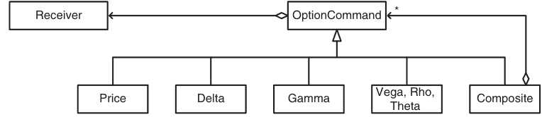

**FIGURE 15.2** Commands for call and put options

这种功能在 *Boost C++ Signals2* 库中得到支持（参见 Demming and Duffy, 2010）。

我们现在讨论如何用 C++ 设计图 15.2 中的配置。该设计基于子类型多态性：

```cpp
class OptionCommand
{
private:

protected:
    double K;    double T; double r; double b; double sig;

public:
    OptionCommand() = default;

    explicit OptionCommand(double strike, double expiration,
                           double riskFree, double costOfCarry, double
                           volatility)
        : K(strike), T(expiration), r(riskFree),
          b(costOfCarry), sig(volatility) {}

    // Want to forbid copy constructor and assignment operator
    OptionCommand(const OptionCommand& c) = delete;
    OptionCommand& operator = (const OptionCommand& c) = delete;

    // The abstract interface
    virtual void execute(double S) = 0;

    // Implement as function object; example of Template Method Pattern
    virtual void operator () (double S)
    {
        // Call derived class' execute()
        execute(S);
    }
};
```

我们看到这个类也是一个函数对象，因为它实现了 *函数调用运算符*，其实现是 *Template Method* 设计模式的一个例子

(GOF, 1995)。我们现在将范围缩小到看涨期权价格、delta 和 gamma。三个派生类为：

```
class CallPrice final : public OptionCommand
{
public:
    explicit CallPrice(double strike, double expiration, double riskFree,
                    double costOfCarry, double volatility)
        : OptionCommand(strike, expiration, riskFree, costOfCarry,
        volatility) {}

    virtual void execute(double S) override
    {
        double tmp = sig * std::sqrt(T);
        double d1 = (std::log(S / K) + (b + (sig*sig)*0.5) * T) / tmp;
        double d2 = d1 - tmp;

        std::cout << "Call Price: " <<
            (S * std::exp((b - r)*T) * N(d1)) (K * std:::
            exp(-r * T)* N(d2))
            << '\n';
    }
};

class CallDelta final : public OptionCommand
{
public:
    explicit CallDelta(double strike, double expiration, double riskFree,
                    double costOfCarry, double volatility)
        : OptionCommand(strike, expiration, riskFree, costOfCarry,
        volatility) {}

    virtual void execute(double S) override
    {
        double tmp = sig * std::sqrt(T);
        double d1 = (std::log(S / K) + (b + (sig*sig)*0.5) * T) / tmp;

        std::cout << "Call delta: " << std::exp((b - r)*T) * N(d1) << '\n';
    }
};

class CallGamma final : public OptionCommand
{
public:
    explicit CallGamma(double strike, double expiration, double riskFree,
                    double costOfCarry, double volatility)
        : OptionCommand(strike, expiration, riskFree, costOfCarry,
        volatility) {}

    virtual void execute(double S) override
{
```


```
double tmp = sig * std::sqrt(T);
double d1 = (std::log(S / K) + (b + (sig*sig)*0.5) * T) / tmp;

std::cout << "Call gamma: "
          << n(d1) * std::exp((b - r)*T) / (S * tmp) << '\n';
}
```

使用方式的一个简单示例是：

```
void TestCP()
{ // Haug 2007 page 3, C = 2.13337, P = 5.84628

    double K = 65.0;
    double T = 0.25;
    double r = 0.08;
    double b = r;
    double sig = 0.3;

    double S = 60.0;

    CallPrice cp(K, T, r, b, sig);
    cp.execute(S);

    PutPrice pp(K, T, r, b, sig);
    pp.execute(S);
}
```

我们现在创建命令集合然后执行它们。设计如下：

```
using CompositeCommandData = std::list<std::shared_ptr<OptionCommand>>;

class CompositeCommand : public OptionCommand
{
private:
    CompositeCommandData data;
public:
    CompositeCommand() : data(CompositeCommandData()) {}

    void add(OptionCommand* cmd)
    {
        data.push_back(std::shared_ptr<OptionCommand>(cmd));
    }

    std::size_t size() const
    {
        return data.size();
    }
```

```
void execute(double S) override
{ // Iterate over each element of the composite and call
    // its execute()

    for (auto it = data.begin(); it != data.end(); ++it)
    {
        (*it)->execute(S); // nested pointer
    }
};
```

该类支持创建任意层级嵌套的期权命令树。它是组合设计模式的一种特例（GOF, 1995）。实现也可以推广为使用共享指针的通用组合（Demming and Duffy, 2010）。换句话说，你可以在新的应用中应用命令模式并“使用该解决方案无数次，而从不以相同的方式重复它”（Alexander, 1979）。

我们给出第一个复合命令的示例：

```
void TestCompositeCommand()
{ // Create a composite option command

    double K = 65.0;
    double T = 0.25;
    double r = 0.08;
    double b = r;
    double sig = 0.3;

    double S = 60.0;

    // Create composite command
    std::cout << "Command on options\n";
    CompositeCommand optionCommand;

    // Add prices and their deltas
    optionCommand.add(new CallPrice(K, T, r, b, sig));
    optionCommand.add(new PutPrice(K, T, r, b, sig));

    optionCommand.add(new CallDelta(K, T, r, b, sig));
    optionCommand.add(new PutDelta(K, T, r, b, sig));

    std::cout << "Size of commandlist: "
              << optionCommand.size();
    optionCommand.execute(S);
}
```

产生的输出为：

```
Command on options
Size of commandlist: 4
```

Call Price: 2.13337
Put Price: 5.84628
Call delta: 0.372483
Put delta: -0.627517

我们现在给出一个将期权价格、delta 和 gamma 分组到各自“迷你复合体”中的示例：

```
void TestCompositeTreeCommand()
{ // Create a (deep) composite option command in tree structure

    double K = 65.0;
    double T = 0.25;
    double r = 0.08;
    double b = r;
    double sig = 0.3;

    double S = 60.0;

    // Create composite command
    std::cout << "Command on options, tree structure\n";
    CompositeCommand optionCommandPrice;
    CompositeCommand optionCommandDelta;
    CompositeCommand optionCommandGamma;

    // Group 1
    optionCommandPrice.add(new CallPrice(K, T, r, b, sig));
    optionCommandPrice.add(new PutPrice(K, T, r, b, sig));

    // Group 2
    optionCommandDelta.add(new CallDelta(K, T, r, b, sig));
    optionCommandDelta.add(new PutDelta(K, T, r, b, sig));

    // Group 3
    optionCommandGamma.add(new CallGamma(K, T, r, b, sig));
    optionCommandGamma.add(new PutGamma(K, T, r, b, sig));

    CompositeCommand optionCommand;
    optionCommand.add(&optionCommandDelta);
    optionCommand.add(&optionCommandPrice);
    optionCommand.add(&optionCommandGamma);

    std::cout << "Executing commandlist of size : "
              << optionCommand.size() << '\n';
    optionCommand.execute(S);
    std::cout << "\nFinished executing commandlist of size : "
              << optionCommand.size() << '\n';
}
```

输出为：

```
Command on options, tree structure
Executing commandlist of size : 3
Call delta: 0.372483
Put delta: -0.627517
Call Price: 2.13337
Put Price: 5.84628
Call gamma: 0.0420434
Put gamma: 0.0420434

Finished executing commandlist of size : 3
```

#### 15.3.1 其他场景

在上一节中，我们在命令对象中计算价格和敏感性，并将结果发送到 *接收者* 对象。在某些情况下，我们可能希望直接在模块中加入代码来计算价格和敏感性。我们特别考虑将价格和敏感性作为一个或两个独立变量的函数进行比较。通常，我们会生成值数组和矩阵。一些示例是：

- 某些参数的期权价格函数。
- 某些参数的期权敏感性函数。
- 两个参数的期权价格函数。
- 两个参数的期权敏感性函数。

我们在本节和下一节中讨论这些用例的若干种，通过复制 Cox 和 Rubinstein（1985）以及 Haug（2007）中的图表。我们首先讨论看涨期权的情况。我们创建一个股票价值数组，然后计算看涨期权价格（通过调用存储的 lambda 函数），最后在 Excel 中显示结果：

```
void DisplayCallPrice()
{
    // Cox and Rubinstein 1985 Figure 5-4

    double K = 50.0;
    double T = 0.4;
    double r = 0.0106;
    double b = r;
    double sig = 0.3;

    // Use lambda function for convenience
    auto callPrice = [&](double S)
    {
        double tmp = sig * std::sqrt(T);
        double d1 = (std::log(S / K) + (b + (sig*sig)*0.5) * T) / tmp;
        double d2 = d1 - tmp;

        return (S * std::exp((b - r)*T) * N(d1)) -
               (K * std::exp(-r * T) * N(d2));
    };
```

```
std::size_t N = 100;
std::vector<double> S(N);
std::vector<double> C(S.size());

// Generate array of underlyings
double startS = 5.0;
std::iota(std::begin(S), std::end(S), startS);

for (std::size_t i = 0; i < S.size(); ++i)
{
    C[i] = callPrice(S[i]);
}

// Display in Excel
ExcelDriver xl; xl.MakeVisible(true);
xl.CreateChart(S, C, "Call Value as a function of S");
}
```

输出如图 15.3 所示。

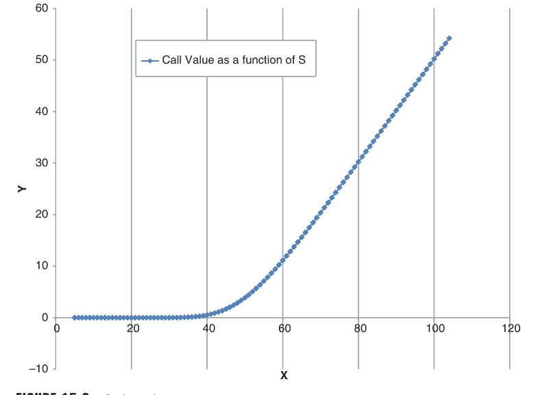

图 15.3 期权价格

可以对看涨期权价格 C 关于任意参数进行微分以产生期权敏感性的公式。例如，一些微分运算让我们可以证明在看涨期权的情况下：

Δ_C ≡ ∂C/∂S = e^{(b−r)T} N(d₁)

Γ_C ≡ ∂²C/∂S² = ∂Δ_C/∂S = [n(d₁) e^{(b−r)T}] / [S σ √T]

Vega_C ≡ ∂C/∂σ = S √T e^{(b−r)T} n(d₁)

Θ_C ≡ −∂C/∂T = −[S σ e^{(b−r)T} n(d₁)] / [2 √T] − (b − r) S e^{(b−r)T} N(d₁) − r K e^{−rT} N(d₂).  (15.12)

我们也可以按如下方式对 delta 和 gamma 进行同样的练习：

```
void DisplayCallDelta()
{ // Cox and Rubinstein 1985 Figure 5-12

    double K = 50.0;
    double T = 0.4;
    double r = 0.0106;
    double b = r;
    double sig = 0.3;

    // Use lambda function for convenience
    auto callDelta = [&](double S)
    {
        double tmp = sig * std::sqrt(T);
        double d1 = (std::log(S / K) + (b + (sig*sig)*0.5) * T) / tmp;

        return std::exp((b - r)*T) * N(d1);
    };

    std::size_t N = 100;
    std::vector<double> S(N);
    std::vector<double> C(S.size());

    // Generate array of underlyings
    double startS = 5.0;
    std::iota(std::begin(S), std::end(S), startS);

    for (std::size_t i = 0; i < S.size(); ++i)
    {
        C[i] = callDelta(S[i]);
    }
```

```
// Display in Excel
ExcelDriver xl; xl.MakeVisible(true);
xl.CreateChart(S, C, "Call Delta as a function of S");
}

void DisplayCallGamma()
{ // Cox and Rubinstein 1985 Figure 5-16

double K = 50.0;
double T = 0.4;
double r = 0.0106;
double b = r;
double sig = 0.3;

// Use lambda function for convenience
auto callGamma = [&] (double S)
{

double tmp = sig * std::sqrt(T);
double d1 = (log(S / K) + (b + (sig*sig)*0.5) * T) / tmp;

return n(d1) * std::exp((b - r)*T) / (S * tmp);
};

std::size_t N = 100;
std::vector <double> S(N);
std::vector <double> C(S.size());

// Generate array of underlyings
double startS = 5.0;
std::iota(std::begin(S), std::end(S), startS);

for (std::size_t i = 0; i < S.size(); ++i)
{
C[i] = callGamma(S[i]);

// Display in Excel
ExcelDriver xl; xl.MakeVisible(true);
xl.CreateChart(S, C, "Call Gamma as a function of S");
}
```

输出分别如图 15.4 和 15.5 所示。

#### 15.4 期权敏感性和曲面

我们现在讨论在 Excel 中作为两个独立变量函数的敏感性显示。Black-Scholes 公式中使用了若干参数作为输入，我们选择其中两个作为独立变量。它们在一定范围内变化，同时保持其他参数恒定。例如，我们可能希望计算期权 delta 作为资产价格和到期天数的函数。我们有一个公式来计算 delta，但在这种情况下我们将其建模为存储的


## 将 Delta 作为 S 的函数调用

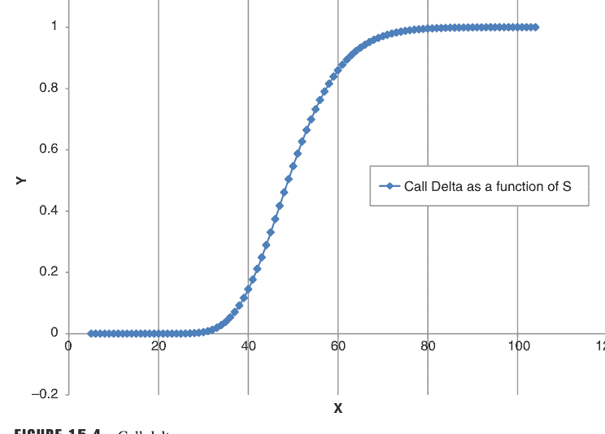

**图 15.4  call delta**

lambda 函数的元数为二，而其他参数是捕获变量。一般来说，我们可以通过让某些参数充当输入参数的角色，同时让其他参数充当捕获变量的角色，以这种方式创建函数族。可以将其视为一种设计模式。在有两个输入参数的情况下，我们称之为曲面。

我们以计算 call option 的 delta 为例。资产价格和到期天数分别充当水平轴和垂直轴。我们创建一个值矩阵（使用我们在第 10 章中介绍的矩阵类之一），如下代码所示：

```
void DisplayCallDeltaSurface()
{ // Haug 2007 page 26

    // Delta as a function of S and T
    // A. Set up option's captured variables
    double K = 100.0;
    //  double T = 0.4;
    double r = 0.07;
    double b = 0.04;
    double sig = 0.3;

    // B. Define function for delta. lambda function for convenience
    auto callDelta = [&] (double S, double T)
    {
        double tmp = sig * std::sqrt(T);
        double d1 = (std::log(S / K) + (b + (sig*sig)*0.5) * T) / tmp;

        return std::exp((b - r)*T) * N(d1);
    };

    // C. Create meshes in the S and T directions
    std::size_t N = 20;
    std::vector<double> S = CreateMesh(N, 25, 150);
    for (auto el : S)
    {
        std::cout << el << '\n';
    }

    std::size_t M = 20;
    std::vector<double> TExpire = CreateMesh(M, 0.01, 0.5);

    // D. Compute the matrix of deltas
    NestedMatrix<double> C(N + 1, M + 1);
    for (std::size_t i = 0; i < C.size1(); ++i)
    {
        for (std::size_t j = 0; j < C.size2(); ++j)
        {
            C(i, j) = callDelta(S[i], TExpire[j]);
        }
    }

    // E. Display in Excel
    ExcelDriver xl; xl.MakeVisible(true);
    std::string sheetName("Call delta surface");
    long row = 1; long col = 1;
    xl.AddMatrix<NestedMatrix<double>>(C, sheetName, row, col);
}
```

输出显示在图 15.6 中。

## 将 Call Gamma 作为 S 的函数

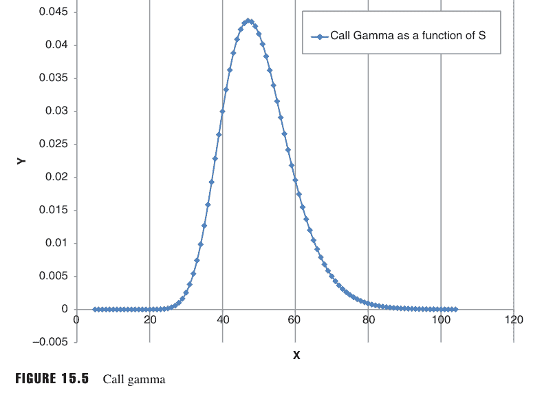

**图 15.5 Call gamma**

#### 15.5 自动化数据生成

本书关注的是计算金融应用中的数值方法。一旦方法被编程，我们就需要编写程序、组织测试用例和测试套件以及控制其运行时的执行。一般来说，开发人员可以使用 Boost.Test 或 Google Test 等库。对这些库的介绍超出了本书的范围。然而，我们讨论了一些相关主题，以自动化测试过程并生成可作为数值过程输入使用的数据。特别是，我们感兴趣的数据集实际上是多态元组或样本的集合。数据集的元数是其包含的样本的元数。多态数据集更简单，因为此类数据集中的所有样本都具有相同的类型和相同的元数。我们在这里的主要重点是自动生成多态数据（主要是参数）和单态数据，后者以包含确定性或随机生成数据的集合的形式存在。一些通用用例是：

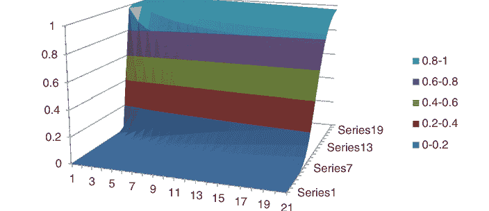

**图 15.6 Spot delta call**

- *生成函数*：选择一个函数，该函数将生成确定性或随机数，以用作我们希望测试的算法的输入参数。
- *可扩展性*：将使用有限数据集工作的测试扩展到可与更大且可能无限的数据集一起工作的测试。
- *组合*：测试函数 `func3`，该函数以类型 `T3` 作为参数，并调用具有类型 `T1` 和 `T2` 作为参数的函数 `func1` 和 `func2`。

我们现在讨论如何使用 STL 和 `<random>` 库结合用户定义代码来生成算法的输入数据。

##### 15.5.1 使用随机数生成器进行数据生成：基础

除了使用控制台向算法提供输入数据外，我们还可以使用随机数生成器生成必须位于给定区间内的数据。生成的随机数遵循特定分布。这种生成数字的方式在许多方面优于从控制台获取用户输入。

第一个用例是基于均匀分布在给定区间 `(a, b)` 中生成随机数，使用以下自由函数：

```
template <typename T> T generateRN(T a, T b)
{ // Generate a uniform random number in interval [a,b]

    std::default_random_engine eng;
    std::random_device rd;
    eng.seed(rd());

    std::uniform_real_distribution<T> uniformVar(a, b);

    return uniformVar(eng);
}
```

此函数易于使用，但它使用了硬编码的随机数引擎和均匀分布。我们每次调用此函数时都会得到不同的随机数，因为我们为每次调用播种引擎。使用的示例是：

```
double A = 0; double B = 1.0;
std::cout << generateRN(A, B) << '\n';
```

此函数允许您在区间内生成均匀随机数，而无需太多麻烦。对于更一般的情况，我们创建一个特殊的通用类，支持 C++ `<random>` 库中的各种分布，包括创建这些分布的变量的 STL 集合的能力。

##### 15.5.2 用于生成随机数的通用类

C++ `<random>` 库支持大约 20 个统计单变量分布。每个分布都是一个函数对象，它允许我们生成根据相关概率函数分布的随机数。函数调用运算符需要一个代表生成器的输入参数。我们以使用线性同余引擎生成极值（Gumbel Type I）分布变量的初始示例为例：

```
// aka minstd_rand0 typedef
std::linear_congruential_engine
    <std::uint_fast32_t, 16807, 0, 2147483647> eng;

// Reinit internal state of random-number engine using new seed value.
std::random_device rd;
eng.seed(rd());

// Create a distribution
double scale = 0.23; double location = 0.5;
std::extreme_value_distribution<double> evd(scale, location);

std::cout << "Extreme value variate: " << evd(eng) << '\n';
```

查看这段代码，我们发现它有用但尚未通用。我们将代码推广以支持以下要求：

- 具有可变数量输入参数的分布（我们使用可变参数）。
- 一些分布在其构造函数中使用初始化列表。
- 必须能够创建随机变量的集合，例如向量、列表和其他 STL 序列容器（为实现此要求，我们使用模板-模板参数方法）。
- 尽可能少地编写代码并尽可能多地重用 STL 算法。在这种情况下，我们使用 std::generate() 结合随机数生成器来创建随机数集合。
- 相关引擎（有状态的随机源）是硬编码的。它可以通过提升为模板参数来推广。此练习超出了当前范围。当前引擎类是 std::default_random_engine。

实现上述要求的类是：

```
template < typename T, template <typename T> class Dist,
    template <typename T, typename Alloc> class Container =
    std::vector,
    typename Alloc = std::allocator<T> >

class RNGerator
{ // Generate random numbers of a given distribution based on
  // ctor parameters
private:
    Dist<T> dist;
    std::default_random_engine eng; // Others possible, e.g. mt19937
public:
    RNGerator() = default;

template <typename... Args> RNGerator(Args... args)
  : dist (Dist<T>(args...)), eng(std::default_random_engine())
{
    // Hard-coded
    std::random_device rd;
    eng.seed(rd());
}

template<typename T2> RNGerator(const std::initializer_list<T2>&
                              initList)
  : dist(initList), eng(std::default_random_engine())
{
    // Hard-coded
    std::random_device rd;
    eng.seed(rd());
}

T operator() ()
{ // STL-compatible function

    return dist(eng);
}

// Template member function using template template parameter trick
Container<T,Alloc> RandomArray(std::size_t n)
{
    Container<T,Alloc> result(n);

    // STL algorithm to assign values generated by a call to this->()
    std::generate(std::begin(result), std::end(result), *this);

    return result;
}

Container<T, Alloc> RandomArrayII(std::size_t n)
{ // Second approach

    Container<T, Alloc> result(n);

    // STL algorithm to assign values generated by a call to this->()
    for (std::size_t i = 0; i < result.size(); ++i)
    {
        result[i] = (*this)();
    }
    return result;
}

void Randomise(std::size_t count, Container<T, Alloc>& con)
{ // Assign random values to the first count elements of
  // container 'con'
```

```cpp
std::generate_n(std::begin(con), count, *this);
}
};
```

我们来看如何使用这个类。代码为：

```cpp
// Generate list and vector of uniform <int> and <double>
double A = 0; double B = 1.0;
RNGerator<double, std::uniform_real_distribution, std::vector> rng(A, B);
std::cout << rng() << '\n';
std::cout << generateRN(A, B) << '\n';

int a = 1; int b = 6;
RNGerator<int, std::uniform_int_distribution, std::list> rng2(a,b);
std::cout << rng2() << '\n';

std::size_t N = 7;
auto vec = rng.RandomArray(N);
print(vec);

std::size_t M = 30;
auto vec2 = rng2.RandomArray(M);
print(vec2);

auto vec3 = rng.RandomArrayII(N);
print(vec3);

// Randomise 1st N elements of a container
N = 4;
std::vector<double> v(8, 3.1);
rng.Randomise(N, v);
print(v);
```

#### 15.5.3 特例：C++ 中的采样分布

C++ 支持三种*采样分布*：

- `discrete_distribution`：在区间 [0, n) 内生成随机整数，其中每个整数的概率等于其权重除以所有 n 个权重之和。
- `piecewise_constant_distribution`：生成随机浮点数，这些数在若干子区间内均匀分布。每个子区间都有自己的权重。
- `piecewise_linear_distribution`：生成随机浮点数，这些数根据每个子区间内的线性概率密度函数均匀分布。每个区间边界处的概率密度恰好是某个预定义值。

我们关注这些类，因为它们的构造函数使用初始化列表来定义适当的权重、密度和区间。为此，RNGerator 类除了支持可变参数外，还应能够支持这些情况。我们在本节讨论 `discrete_distribution`。此分布在区间 [0, n) 内生成随机整数，单个概率为：

p_j = w_j / S,    j = 1, ..., n

其中：

{w_j}_{j=1}^n 是权重，且 S = sum_{j=1}^n w_j。

我们来看一个示例。我们生成大量随机变量，并将每个值放入映射中。在极限情况下，频率直方图应反映权重值。代码如下：

```cpp
// Discrete distributions that use arrays as input
std::cout << "\nDiscrete distribution\n";
std::size_t NTrials = 100'000;
std::discrete_distribution<int> dist({ 10,25,30,25,10 });

// See if we can compute the frequencies
std::random_device rd;
std::mt19937 eng(rd());
std::map<int, int> freq;
for (std::size_t n = 1; n <= NTrials; ++n)
{
    ++freq[dist(eng)];
}
for (auto p : freq)
{
    std::cout << p.first << " generated " << p.second << " times\n";
}
```

该代码的输出为：

```
Discrete distribution
0 generated 9853 times
1 generated 24831 times
2 generated 30179 times
3 generated 25106 times
4 generated 10031 times
```

在这种情况下，可以产生五个随机整数。

#### 15.5.4 使用生产者-消费者隐喻生成数字

在某些应用中，我们可能希望在一个线程中创建随机数，将这些数放入线程安全的队列中，并让其他线程以某种方式使用这些数。一个很好的例子是基于第 9 章系统分解方法的蒙特卡洛期权定价框架。在这种情况下，一个组件生成随机数，而其他组件将这些数用作路径生成算法的一部分，例如。我们可以选择 `std::deque` 作为容器，因为它允许在开头和结尾快速插入和删除。我们将一些测试代码封装在一个函数中：

```cpp
template <typename T, template <typename T> class Dist, typename... Args>
    void ProduceAndConsume(std::size_t N, Args... args)
{
    // Create a deque (fast insertion and deletion at both ends)
        // Can use a FIFO (first-in first-out) apps, e.g. Monte Carlo

        // Create the object of the appropriate type that will generate the
        // numbers we need.

        RNGerator<T, Dist, std::deque> rng(args...);

        // Generate the collection of random numbers
        auto rnCollection = rng.RandomArray(N);

        // Process the numbers "Use and lose"
        while (rnCollection.size() > 0)
        {
            std::cout << rnCollection.front() << ",";
            rnCollection.pop_front();
        }
        std::cout << "\nQueue size " << rnCollection.size() << '\n';
}
```

我们还创建了一个类似的函数，它除了可变参数外还使用初始化器：

```cpp
template <typename T, typename T2, template <typename T> class Dist>
    void ProduceAndConsume(std::size_t N, const std::initializer_list<T2>& initList)
{
        // Create a deque (fast insertion and deletion at both ends)
            // Can use a FIFO (first-in first-out) apps, e.g. Monte Carlo

            // Exercise: fill in the details
            // See Exercise 5
}
```

一些使用示例如下：

```cpp
std::cout << "\nExponential distribution\n";
std::size_t N = 10; float lambda = 0.5;
ProduceAndConsume<float, std::exponential_distribution>(N,lambda);

std::cout << "\nGamma distribution\n";
std::size_t M = 20; double alpha = 0.5; double beta = 0.4;
ProduceAndConsume<double, std::gamma_distribution>(M, alpha, beta);
ProduceAndConsume<int, double, std::discrete_distribution> (NTrials,
                     std::initializer_list<double>{ 5,10,20,30,10,5 });
```

在这里我们看到了可变参数的力量；我们只编写一次供应方代码，并多次复用。

#### 15.5.5 使用 STL 算法生成数字和数据

值得注意的是，STL 有许多用于生成、修改和变更数据容器中值的函数。我们可以使用这些函数生成数据，然后将这些数据用作数值算法的输入。我们将在第 17 章和第 18 章更详细地讨论 STL 算法的主要类别，但在此我们讨论一些更有用且可直接应用的算法：

- `std::iota`：这个*修改算法*创建一个集合，其中的值单调递增，每个值都比前一个大 1。我们需要给出一个*起始值*。示例如下：

  ```cpp
  std::size_t N = 100;
  std::vector <double> S(N);

  // Generate array of underlyings
  double startS = 5.0;
  std::iota(std::begin(S), std::end(S), startS);
  ```

- `std::shuffle`：这个*变更算法*自 C++11 起受支持（它实质上取代了 `std::random_shuffle`）。它使用 `<random>` 中的均匀随机数生成器来打乱一个范围内元素的顺序。示例如下：

  ```cpp
  // C++ 11
  std::vector<int> vecR{ 1, 2, -2, 3, -3, 4, -4, 5, -5, 8, 9, 7 };
  std::default_random_engine eng;
  std::shuffle(vecR.begin(), vecR.end(), eng);

  std::random_shuffle(vecR.begin(), vecR.end());   // old style
  ```

- `std::generate`：这个*修改算法*使用给定的函数对象为范围内的每个元素赋值。一个生成网格点以用于有限差分方案的示例如下：

  ```cpp
  // Mesh
  std::size_t N = 4; double h = 1.0 / static_cast<double>(N);
  std::vector<double> mesh(N + 1, 0.0);
  double val = -h;
  auto sequence = [&h, &val]() { val += h; return val; };

  std::generate(mesh.begin(), mesh.end(), sequence);
  for (auto i = 0; i < mesh.size(); ++i)
  {
      std::cout << mesh[i] << std::endl;
  }
  ```

  此选项也可用于生成随机数。

- `std::generate_n`：这个修改算法将一个函数应用于一个范围的前 *n* 个元素，例如：

  ```cpp
  // Generate 1) new values, 2) overwrite existing values
  std::list<double> myList;
  int dupFactor = 4;
  std::generate_n(std::back_inserter(myList), dupFactor, std::rand);
  ```

我们提到，`<random>` 中关于统计分布的功能仅限于生成单变量分布的随机变量。

#### 15.6 统计分布与函数简介

C++ 随机数库包含随机数引擎和随机数分布的类，这些类将随机数引擎的输出转换为统计分布的变量。在许多应用中，我们需要更多的功能，因此我们概述了 Boost 如何支持其中的一些需求。

我们概述了 *Boost Math Toolkit* 中的单变量统计分布和函数。重点在于讨论该工具包中的功能，特别是：

- 离散和连续分布、它们的成员函数和定义属性。
- 其他非成员函数，例如概率函数和累积密度函数、峰度和偏度。
- 一些示例来说明如何使用工具包中的类。

所有分布都使用随机变量，随机变量是概率空间到其他空间（通常是实数）的映射。*离散概率分布*是指随机变量的分布是离散的，而*连续概率分布*是指其累积分布是连续的。

离散概率分布包括：

- 伯努利分布（单次试验，结果为 0（失败）或 1（成功））。
- 二项分布（用于获取在 *N* 次试验中观察到 *k* 次成功的概率）。
- 负二项分布（用于获取在 *k + r* 次试验中发生 *k* 次失败和 *r* 次成功的概率）。
- 超几何分布（描述从总群体 *N* 中无放回抽取的样本 *n* 中事件数量 *k* 的分布）。


-   众数（概率质量函数或密度函数取得最大值的点）。
-   概率密度函数。
-   极差（包含所有数据的最小区间的长度）。
-   分位数（从累积分布函数上按固定间隔取的点）。
-   偏度（衡量概率分布不对称性的指标）。
-   支集（补集概率为零的最小闭区间/集合）。
-   方差（数值与均值之间的差异程度）。

我们讨论一个著名的案例。正态（或高斯）分布是最重要的统计分布之一，因为它能够对经济学、计算金融学、物理学和社会科学等不同领域的多种现象进行建模。一般而言，正态分布用于描述倾向于围绕均值聚集的变量。现在我们展示如何在 Boost 中实现正态分布，以及如何调用其成员函数和非成员函数：

```
#include <boost/math/distributions/normal.hpp>
#include <boost/math/distributions.hpp>  // 非成员函数。

#include <iostream>
using namespace std;

int main()
{
    // 别忘了告诉编译器使用哪个命名空间。
    using namespace boost::math;

    normal_distribution<> myNormal(1.0, 10.0); // 默认是 'double' 类型。
    cout << "均值: " << myNormal.mean() << ", 标准差: "
         << myNormal.standard_deviation() << endl;

    // 分布属性。
    double x = 10.25;

    cout << "pdf: " << pdf(myNormal, x) << endl;
    cout << "cdf: " << cdf(myNormal, x) << endl;

    // 选择另一种数据类型，现在是一个 N(0,1) 变量。
    normal_distribution<float> myNormal2;
    cout << "均值: " << myNormal2.mean() << ", 标准差: "
         << myNormal2.standard_deviation() << endl;

    cout << "pdf: " << pdf(myNormal2, x) << endl;
    cout << "cdf: " << cdf(myNormal2, x) << endl;

    // 选择精度。
    cout.precision(10); // 小数点后的位数。

    // 其他属性。
    cout << "\n**正态分布:\n";
```

```
```cpp
gamma_distribution<double> myGamma(alpha, beta);

return 0;
}
```
```

类的接口很小，因为它们没有用于统计函数的成员函数，这些统计函数是通过重载的非成员函数实现的。为此，主要函数有：

-   概率密度函数
-   累积分布函数
-   分位数
-   风险函数
-   累积风险函数
-   均值、中位数、众数、方差、标准差
-   峰度、超额峰度
-   极差（给定分布下随机变量的有效范围）
-   支集（外部概率为零的最小闭集）。

我们举一个例子来展示如何使用这些函数。在这个例子中，我们采用自由度为 30 的*学生 t 分布*：

```
```cpp
#include <boost/math/distributions/students_t.hpp>
students_t_distribution<float> myStudent(30);
```
```

那么上述函数列表对应于以下该分布的代码：

```
```cpp
// 其他属性
cout << "\n***学生 t 分布: \n";
cout << "均值: " << mean(myStudent) << endl;
cout << "方差: " << variance(myStudent) << endl;
cout << "中位数: " << median(myStudent) << endl;
cout << "众数: " << mode(myStudent) << endl;
cout << "超额峰度: "
     << kurtosis_excess(myStudent) << endl;
cout << "峰度: " << kurtosis(myStudent) << endl;
cout << "特征函数: " << chf(myStudent, x) << endl;
cout << "风险函数: " << hazard(myStudent, x) << endl;

// 极差和支集
pair<double, double> mySupport = support(myStudent);
cout << "支集: [" << mySupport.first << ","
     << mySupport.second << "]" << endl;
pair<double, double> myRange = range(myStudent);
cout << "极差: [" << myRange.first << ","
     << myRange.second << "]" << endl;
```
```

最后，我们展示如何计算分位数，以及在给定显著性水平下 t 分布所需的自由度：

```
// 分位数以及显著性水平
// （小数形式，0.05）和置信水平（百分比形式，
// 例如 95%）之间的转换
double Alpha = 0.25;
cout << "置信度 1: "
    << quantile(myStudent, Alpha / 2) << endl;
cout << "置信度，百分比: "
    << quantile(complement(myStudent, Alpha / 2)) << endl;

// 学生 t 分布所需的样本量
double M = 1.2;    // 真实均值
double Sm = 1.8;   // 样本均值
double Sd = 2.4;   // 样本标准差
try
{
    double df = students_t::find_degrees_of_freedom (fabs(M-Sm), Alpha,
        Alpha, Sd);
    int dof = ceil(df) + 1;
    cout << "单侧自由度: " << dof << endl;
}
catch(const std::exception& e)
{
    cout << e.what() << endl;
}
```

#### 15.7 高级分布

Boost 统计库中大约有 35 个类，每个类都对一个特定的单变量分布进行建模。为了避免代码重复，我们创建了一个通用的类来封装共有的属性和算法。其设计原理与我们在第 15.5.2 节中创建的用于生成随机数的通用类类似。特别地，我们创建了一个适配器类，它支持所有分布，并在构造函数中使用可变参数。它的接口模仿了相应的 Boost 接口，因为我们使用了相同的成员函数名（注意我们使用了模板-模板参数技巧）：

```
template <typename T, template <typename T> class Dist>
    class Distribution
{
private:
    Dist<T> dist;
public:
    template <typename... Args>
    Distribution(Args... args) : dist(Dist<T>(args...)) {}
```

```
T operator () (T x) const
{ // pdf，作为函数对象

    return boost::math::pdf(dist, x);
}

T pdf (T x) const
{ // pdf

    return (*this)(x);
}

T mean() const
{
    return boost::math::mean(dist);
}

T mode() const
{
    return boost::math::mode(dist);
}

T median() const
{
    return boost::math::median(dist);
}

T standard_deviation() const
{
    return boost::math::standard_deviation(dist);
}

T variance() const
{
    return boost::math::variance(dist);
}

T cdf(T x) const
{ // cdf

    return boost::math::cdf(dist, x);
}

T hazard(T x) const
{ // 风险函数 pdf/(1-cdf)

    return boost::math::hazard(dist, x);
}
```

```
T x = 1.1;
T p = 0.05;

std::cout << "pdf: " << dist.pdf(x) << '\n';
std::cout << "cdf: " << dist.cdf(x) << '\n';

std::cout << "均值: " << dist.mean() << '\n';
std::cout << "众数: " << dist.mode() << '\n';
std::cout << "中位数: " << dist.median() << '\n';

std::cout << "标准差: " << dist.standard_deviation() << '\n';
std::cout << "方差: " << dist.variance() << '\n';

std::cout << "风险函数: " << dist.standard_deviation() << '\n';
std::cout << "累积风险函数: " << dist.variance() << '\n';

std::cout << "峰度: " << dist.kurtosis() << '\n';
std::cout << "偏度: " << dist.skewness() << '\n';

std::cout << "分位数 " << p << ", " << dist.quantile(p) << '\n';
}
```

现在我们可以使用一些具体的分布来调用这个测试函数。我们包含一个 try/catch 块来标记错误的输入参数，例如：

```
template <typename T>
    using DistNormal = boost::math::normal_distribution<T>;

template <typename T>
    using DistBinomial = boost::math::binomial_distribution<T>;
try
{
    Distribution<double, DistNormal> normalDist;
    TestAnyDistribution(normalDist);

    long N = 100; double p = 0.5;
    Distribution<double, DistBinomial> binDist(N,p);
    TestAnyDistribution(binDist);
}
catch(std::exception& e)
{
    std::cout << e.what() << '\n';
}
```

当然，还有许多其他方式可以在客户端代码中使用这个新的通用类。

##### 15.7.1 在 Excel 中显示 Boost 分布

在本章的最后，我们展示如何在 Excel 中“显示”Boost 分布函数生成的数据。在第一个示例中，我们显示任意分布的 pdf 和 cdf。我们


我们使用 `std::transform` 来创建数组，并且我们也使用了在第 14 章中介绍的 Excel 驱动程序：

```cpp
template <typename T, template <typename T> class Dist>
    void DisplayDistributionCurves(const Distribution<T, Dist>& dist,
                                   T a, T b, std::size_t N)
{ // Display a number of functions of a distribution as line graphs

    // Try to use as much of standard C++ and STL as possible

    // A. Create abscissa array
    T h = (b - a) / static_cast<T>(N);
    std::vector<T> x(N+1, h);
    x[0] = a;
    for (std::size_t i = 1; i < x.size(); ++i)
    {
        x[i] = x[i - 1] + h;
    }

    // B. Create arrays for pdf, cdf and hazard functions
    std::vector<T> pdf(x.size());
    std::transform(std::begin(x), std::end(x), std::begin(pdf),
                   [&](T t) { return dist.pdf(t); });

    std::vector<T> cdf(x.size());
    std::transform(std::begin(x), std::end(x), std::begin(cdf),
                   [&](T t) { return dist.cdf(t); });

    // C. Labels and assemble input for Excel
    std::list<std::string> labels{"pdf", "cdf"};

    // The list of Y values
    std::list<std::vector<double> > curves{pdf,cdf};

    ExcelDriver xl; xl.MakeVisible(true);
    xl.CreateChart(x, labels, curves, "pdf", "cdf", "x", "y");
}
```

换句话说，我们创建一个单一对象并调用其两个成员函数（`pdf` 和 `cdf`）。使用示例为：

```cpp
double a = 0.0; double b = 6.0;
std::size_t n = 50;
DisplayDistributionCurves(normalDist,a,b,n);
```

输出结果如图 15.7 所示。

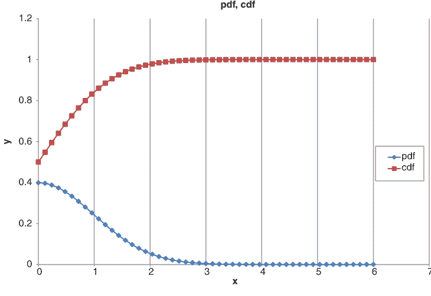

**图 15.7** 正态分布

我们现在给出 *非中心卡方分布* 的一个示例。其构造函数接受两个参数 *k* 和 *λ*，分别代表 *自由度数* 和 *非中心参数*。代码如下：

```cpp
void DisplayNonCentralChiSquared(double a, double b, std::size_t N)
{
    // Display non-central chi^2 pdf for a range of k and lambda.

    using T = double;

    // A. Create abscissa array
    T h = (b - a) / static_cast<T>(N);
    std::vector<T> x(N + 1, h);
    x[0] = a;
    for (std::size_t i = 1; i < x.size(); ++i)
    {
        x[i] = x[i - 1] + h;
    }

    // B. Create arrays for pdf for different values of k and lambda
    Distribution<T, DistNCChiSquared> dist21(2,1);
    Distribution<T, DistNCChiSquared> dist22(2, 2);
    Distribution<T, DistNCChiSquared> dist43(4, 3);

    std::vector<T> pdf21(x.size());
    std::transform(std::begin(x), std::end(x), std::begin(pdf21),
        [&](T t) { return dist21.pdf(t); });

    std::vector<T> pdf22(x.size());
    std::transform(std::begin(x), std::end(x), std::begin(pdf22),
        [&](T t) { return dist22.pdf(t); });

    std::vector<T> pdf43(x.size());
    std::transform(std::begin(x), std::end(x), std::begin(pdf43),
        [&](T t) { return dist43.pdf(t); });

    // C. Labels and assemble input for Excel
    std::list<std::string> labels{
        "k=2, lambda = 1", "k=2, lambda = 2", "k=4, lambda = 3" };

    // The list of Y values
    std::list<std::vector<double> > curves{ pdf21, pdf22, pdf43 };

    ExcelDriver xl; xl.MakeVisible(true);
    xl.CreateChart(x, labels, curves, "NonCentral Chi^2 pdf", "x", "y");
}
```

使用示例为：

```cpp
std::size_t M = 10;
double L = 0.01; double R = 8.0;
DisplayNonCentralChiSquared(L,R, M);
```

输出结果如图 15.8 所示。

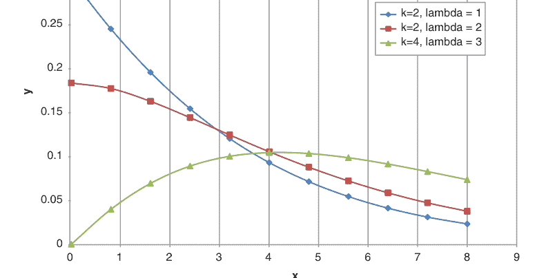

**图 15.8** 修改参数

#### 15.8 总结与结论

在本章中，我们介绍了两个支持随机数生成和单变量统计分布的 C++ 库，即标准 C++ `<random>` 库和 Boost Statistics 库。我们讨论了它们提供的功能，并给出了期权定价和计算期权敏感性的一些应用。我们还创建了两个通用类，用于封装 `<random>` 和 Boost 中分布的功能。最后，我们还展示了如何基于随机数生成器创建数值过程的输入数据集。

#### 15.9 练习与项目

### 1. （PDE 和数值分析项目）

在本练习中，我们将单因子 Black–Scholes PDE 归约为一个更简单的热方程 PDE，然后使用我们在第 13 章中介绍的有限差分方法求解。该 PDE 为：

∂V/∂t + ½ σ² S² ∂²V/∂S² + r S ∂V/∂S − r V = 0

并且我们定义新的变量 u 为：

V(S, t) = e^{αx + βτ} u(x, τ)

其中：

α = −½ (2r/σ² − 1)

β = −¼ (2r/σ² + 1)²

S = e^{x}, t = T − 2τ/σ².

我们可以证明函数 u 满足热方程：

∂u/∂τ = ∂²u/∂x².

回答以下问题：

- a) 验证上述变换是否在无限区间上得到热方程 PDE。

- b) 设 h(x) 为对应于新热方程的 payoff（初始条件）。可以证明（Tolstov, 1962）解为：

  u(x, τ) = 1/(2√(πτ)) ∫_{−∞}^{∞} h(v) e^{−(x−v)²/(4τ)} dv.

  使用你喜欢的数值求积方案对该解进行数值计算。例如，我们可以使用 Tanh–Sinh 求积（Takahasi and Mori, 1974），它使用区间 (−1, 1) 到实线的变换。被积函数以双指数速率衰减。因此该方法也被称为 *双指数（DE）公式*。

- c) 现在使用我们在第 13 章中介绍的 Crank–Nicolson 和 ADE（Barakat 和 Clark 变体）方法近似热方程。你需要将（无限）积分域在空间方向上截断为有界区间并应用数值边界条件。

- d) 比较 c) 部分中方法的相对精度。使用第 14 章的 Excel 驱动软件将期权价格可视化为到期时的值数组。

- e) 将有限差分方法产生的值与基于误差函数的解进行比较。

### 2. （计算期权敏感性/Greeks，小项目）

我们重点计算期权的 delta 和 gamma。*Delta* 是期权对标的资产价格微小变化的敏感性，而 gamma 是 delta 对标的资产价格微小变化的敏感性。目标是使用多种方法计算 delta 和 gamma，然后分析其结果：

- 解析解（参见 Haug, 2007，其中列出了大量公式）。
- 数值 Greeks（Haug, 2007）。在这种情况下，我们使用差商来计算 delta 和 gamma，如第 8 章中更一般地讨论的那样。优点是该方法与模型无关。缺点是数值微分通常是一个不适定过程。
- 使用第 13 章中讨论的三次样条。另见第 13 章练习 3。

对于看涨期权的情况回答以下问题：

- a) 创建股票价格数组并计算每个股票价格对应的期权价格数组（保持其他参数不变）。

- b) 计算每个股票价格的 delta 和 gamma 值数组。使用 delta 和 gamma 的解析公式（参见 Haug, 2007 等）。

- c) 计算每个股票价格的 delta 和 gamma 值数组。使用差商公式计算 delta 和 gamma（参见第 8 章）。

- d) 使用三次样条近似 a) 部分中的值。应用公式（13.38）和（13.37）分别近似 delta 和 gamma。

- e) 通过使用第 14 章的软件在 Excel 中显示它们来比较 b)、c) 和 d) 部分的解。你是否看到不同解产生的精度存在明显差异？

- f) 比较方法的相对运行时间性能。哪一个性能最好？

### 3. （计算期权敏感性/Greeks 第二部分，小项目）

这个练习在某种意义上是练习 2 的镜像，不同之处在于这里我们使用由有限差分方法生成的期权价格数组，而不是练习 2 中使用的解析期权价格（第 20 章至第 25 章）。

回答以下问题：

- a) 创建股票价格数组并计算每个股票价格对应的期权价格数组（保持其他参数不变）。使用 Crank–Nicolson 方法生成期权价格数组。

- b) 计算每个股票价格的 delta 和 gamma 值数组。使用差商计算 delta 和 gamma（参见第 8 章）。尝试向前、向后和中心差分。

- c) 使用三次样条近似 a) 部分中的值。使用公式（13.38）和（13.37）分别近似 delta 和 gamma。


- d) 比较本练习中方法与练习2中方法的精度和运行时性能。

### 4. （测验与头脑风暴，复习题）

我们在15.3节中使用了一些C++11语法（本书前面已经讨论过这些语法）。具体来说，我们在代码中使用了以下关键字：`final`、`override`、`virtual`、`default` 和 `explicit`。

回答以下问题：

- a) 为什么使用它们？使用它们会带来什么后果？
- b) 在旧版C++中，a)部分中的相同目标如何实现？
- c) 与传统的函数对象、自由函数和成员函数相比，lambda函数在可读性和可维护性方面有多大用处？

### 5. （编写代码）

补充15.5.4节中使用初始化列表的生产者–消费者函数所需的代码。测试你的代码。

### 6. （通用分布类的替代设计，头脑风暴）

在15.7节中，我们为Boost统计分布创建了一个通用的*适配器*类。Boost在线文档提出了一种类似的非成员函数设计：

```cpp
template <class RealType>
class any_distribution
{
public:
    template <class Distribution>
        any_distribution(const Distribution& d);
};

// Get the cdf of the underlying distribution:
template <class RealType>
    RealType cdf(const any_distribution<RealType>& d, RealType x);
// etc....
```

回答以下问题：

- a) 创建上述类，并使用我们在本章中使用的相同示例进行测试。
- b) 从易用性、健壮性和可维护性方面比较这两种方法。

# 第16章 二元统计分布与双资产期权定价

#### 16.1 引言与目标

本章继续讨论第15章中引入的统计分布。我们创建高效算法来计算*累积二元正态分布*（BVN）函数，其定义为：

$$M(a,b;\,\rho)=\int_{-\infty}^{a}\int_{-\infty}^{b} f(x,y;\,\rho)\,dx\,dy \tag{16.1}$$

其中：

$$f(x,y;\,\rho)=\frac{1}{2\pi\sqrt{1-\rho^2}}\exp\left[-\frac{x^2-2\rho xy+y^2}{2(1-\rho^2)}\right],\quad -1<\rho<1.$$

该分布有许多应用，我们的兴趣在于使用它对双资产期权进行定价（例如，参见Haug, 2007）。与一元情形相反，可用于计算二元分布的软件似乎很少，在这种情况下，我们采用第三方库和专有代码相结合的方式。我们提出了若干备选方案，最终选择将取决于效率、精度、健壮性和可维护性等一系列要求：

- S1：Drezner方法（Drezner, 1978）。
- S2：Genz方法（Genz, 2004）及其在*QuantLib*（www.quantlib.org）和West（West, 2004）中的实现。
- S3：Abramowitz和Stegun（1965）中的公式26.3.3与Gauss–Legendre数值求积方案相结合。
- S4：将定义累积二元正态分布的二重积分（16.1）转换为*双曲型偏微分方程*，并使用有限差分法进行近似。

总之，本章的主要目标是提出若干计算二元正态分布的算法，并比较它们的相对效率、精度和可用性特征。通过这种方式，我们从S1到S4中选择在给定上下文中最适合我们需求的特定算法。我们将这些算法应用于双因子普通期权的定价。代码使用*可调用对象*实现，期权定价代码将其作为灵活的*插件（mixin）*，从而允许我们在不同实现之间切换。

#### 16.2 使用PDE计算积分

观察方程（16.1），我们可能会天真地认为可以通过精确方法或数值求积来计算这个二重积分。人们似乎普遍认为在这种情况下不存在精确解，因此当我们决定使用哪种数值求积方案时，计算效率和精度将成为主要关注点。我们将在后续章节讨论这一主题。

在本节中，我们采取一种完全不同的方法，注意到某些类型的积分可以写成微分方程，反之亦然。这两种方法相辅相成，正如我们在第24章和第25章讨论常微分方程及其应用时将会看到的那样。在当前上下文中，我们可以对变量*a*和*b*（我们立即将其分别改为*x*和*y*）求方程（16.1）的导数，从而得到一个*双曲型*偏微分方程：

$$\frac{\partial^2 u}{\partial x\partial y}=f(x,y;\rho). \tag{16.2}$$

这是一个双曲型PDE的例子，可以视为二阶波动方程。事实上，变换：

$$\xi=(x+y)/2,\quad \eta=(x-y)/2 \tag{16.3}$$

将方程（16.2）化为如下形式的PDE：

$$\frac{\partial^2u}{\partial\xi^2}-\frac{\partial^2u}{\partial\eta^2}=f. \tag{16.4}$$

方程（16.2）和（16.4）都是*Goursat PDE*（Courant和Hilbert, 1968）的特例。完整处理超出了本书的范围，因为目标是使用相应技术来计算方程（16.1）中的积分。为此，我们意识到与方程（16.2）相关联的边值问题不同于第13章中引入的抛物型PDE所用的边值问题。在当前情况下，我们将问题建模为从起点沿给定方向传播的波。换句话说，信息从边界的单个部分传播，而不是像抛物型问题那样从整个边界传播。我们将无限积分域截断为一个矩形$(AL,x)\times(BL,y)$，其中$AL=BL=-8$，而$x$和$y$是我们希望计算积分（16.1）的值。由此得到下边界值：

$$u(AL,y)=u(x,BL)=0,\qquad AL\le x<\infty,\quad BL\le y<\infty \tag{16.5}$$

这种方法使用*域截断*。参见练习1，了解基于*域变换*的替代方法。

总结，方程（16.2）和（16.5）是我们在16.2.1节中采用的有限差分法的定义方程和起点。

可以应用这种方法的一些用例包括：

- **U1：** 它健壮、精确，并且我们可以针对一系列算术类型（如`double`、`float`和多精度数据类型）调整所需的精度水平。
- **U2：** 该算法易于编程，除Boost矩阵外不需要第三方库。修改代码以使用用户自定义的矩阵类也很容易。
- **U3：** 我们将其作为基准来测试其他算法的精度，例如Genz（2004）中的算法以及West（2004）和*QuantLib*中的对应实现。
- **U4：** 该算法计算所有离散网格点上直至并包括所需值点的矩阵值。然后我们可以将该矩阵用作*查找表*，并结合第13章讨论的线性插值和三次样条插值。该矩阵只需计算一次。
- **U5：** 该算法可应用于任何二元分布以及三元分布，而无需进行大量复杂的数学分析。
- **U6：** 该算法使用了我们在第20至25章讨论的PDE和FDM理论中的方法。

一般来说，给定问题的需求将决定使用哪种特定算法。

##### 16.2.1 Goursat PDE的有限差分法

现在我们讨论应用有限差分法来计算系统（16.2）和（16.5）解的近似值。我们按照第13章所述在x和y方向上定义离散网格。我们将离散解存储为Boost矩阵。由此得到的二阶有限差分格式为：

$$\frac{V_{i,j}-V_{i,j-1}-V_{i-1,j}+V_{i-1,j-1}}{h_xh_y}=f_{i-1/2,j-1/2} \tag{16.6}$$

其中：

$$f_{i-1/2,j-1/2}=f(x_{i-1}+h_x/2,\ y_{j-1}+h_y/2),\quad 1\le i\le I,\quad 1\le j\le J,$$

而$h_x$和$h_y$分别是x和y方向上的恒定网格大小。

为了便于阅读，我们展示该格式的核心算法如何在C++中实现。请注意，我们已重新排列方程（16.6），将所有已知项放在右侧：

```cpp
ublas::matrix<T> Values(NX + 1, NY + 1, 0.0);

T hxy = hx*hy;
```


```cpp
T operator () (T x, T y) const // T is data type
{
    std::size_t NX = xarr.size()-1;
    std::size_t NY = yarr.size()-1;
    T hx = std::abs(x - AL) / static_cast<T>(NX);
    T hy = std::abs(y - BL) / static_cast<T>(NY);

    // Matrix to hold results, boundary conditions == 0
    ublas::matrix<T> Values(NX + 1, NY + 1, 0.0);

    T hxy = hx*hy;

    for (std::size_t j = 1; j < Values.size2(); ++j)
    {
        for (std::size_t i = 1; i < Values.size1(); ++i)
        {
            Values(i,j) = Values(i,j-1)+Values(i-1,j)-Values(i-1,j-1)
                + hxy*(fun(xarr[i-1]+hx/2,yarr[j-1]+hy/2));
        }
    }

    return Values(Values.size1() - 1, Values.size2() - 1);
};
```

我们看到该类可用于一系列二元分布。需要知道如何截断积分域，使得精度不受不利影响。对于正态分布，计算截断域的边界相对容易，但在一般情况下可能并不容易。一种替代方案是将积分域变换为有界域 [−1, 1] × [−1, 1]，如练习 1 中所讨论。

##### 16.2.3 Richardson 外推

这是一种提高数值格式精度的技术。在此情况下，我们将格式 (16.6) 的精度从二阶提高到四阶。以下代码实现了这一目的：

```cpp
template <typename T>
    class GoursatFdmExtrapolation
{
private:
    // Domain
    T AL, BL; // left/lower boundaries
    Function<T> fun;
    std::size_t N1, N2;

public:
    GoursatFdmExtrapolation(T xLower, T yLower,
                            const Function<T>& function,
                            std::size_t NX, std::size_t NY)
        : AL(xLower), BL(yLower), fun(function), N1(NX), N2(NY) {}

    T operator () (T x, T y) const
    {
        std::vector<T> xarr = CreateMesh(N1, AL, x);
        std::vector<T> yarr = CreateMesh(N2, BL, y);

        std::vector<T> xarr2 = CreateRefinedMesh(xarr);
        std::vector<T> yarr2 = CreateRefinedMesh(yarr);

        GoursatFdm<T> fdm(AL, BL, fun, xarr, yarr);
        GoursatFdm<T> fdm2(AL, BL, fun, xarr2, yarr2);

        double v1 = fdm(x,y);
        double v2 = fdm2(x,y);

        return (4.0*v2 - v1) / 3.0;
    }
};
```

该代码可进一步优化以获得更好的性能，但我们主要关心的是使用它来测试其他格式的精度，并作为检验格式 (16.6) 确实具有二阶精度的依据。实践中，我们选择 Genz 算法，但仅在希望在单点计算积分 (16.1) 时才使用。

##### 16.2.4 测试用例

我们给出一些如何用格式 (16.6) 及其外推版本近似积分 (16.1) 的示例。我们将数值与 Genz 算法产生的结果进行比较：

```cpp
int main()
{
    using value_type = double;
    //using value_type = float;
    // Truncated lower boundaries
    value_type AL = -8.0; value_type BL = -8.0;

    // Meshes
    std::size_t NX = 200; std::size_t NY = 200;
    value_type a = 6.0; value_type b = 6.0;
    auto xarr = CreateMesh(NX, AL, a);
    auto yarr = CreateMesh(NY, BL, b);

    // Construct FDM object
    value_type rho = -0.1995;
    BVNFunction<value_type> bvn(rho);
    GoursatFdm<value_type> fdm(AL, BL, bvn, xarr, yarr);

    // Compute a value
    std::cout << "Value: " << std::setprecision(16) << fdm(a, b) << '\n';

    // Extrapolation
    GoursatFdmExtrapolation<value_type> fdm2(AL, BL, bvn, NX, NY);
    std::cout << "Value2: " << std::setprecision(12) << fdm2(a, b) << '\n';

    // Genz/West comparison
    bivarcumnorm(a, b, rho);
    std::cout << "Genz/West: " << bivarcumnorm(a, b, rho) << '\n';
}
```

该程序的输出为：

```
Value: 0.9999999980415676
Value2: 0.999999998027
Genz/West: 0.999999998027
```

该代码可作为更广泛的效率和精度测试的基础。

#### 16.3 DREZNER 算法

我们为完整性讨论该方法。它通过首先进行变量变换将积分域变换为四分平面 [Drezner, 1978] 来近似积分 (16.1)。然后使用 Gauss 求积 [Stroud and Secrest, 1966] 近似积分。该方法在 Haug [2007] 中进一步讨论，并在 QuantLib 库中得到支持。其在后者的使用示例为：

```cpp
double a = 0.0; double b = 0.0;
double rho = 0.0;
QuantLib::BivariateCumulativeNormalDistributionDr78 qlDrezner1978(rho);
std::cout << "*Drezner 1978 QuantLib 1.8 : " << std::setprecision(16)
    << qlDrezner1978(a, b) << '\n';
```

Drezner 方法使用单精度，因此精度低于 Genz 方法。此外，Drezner 方法在 ρ = ±1 附近显示出不准确的迹象。

#### 16.4 GENZ 算法及 WEST/QUANTLIB 实现

Genz 方法似乎是近似积分 (16.1) 的首选方法。该算法使用数值积分来近似积分 (16.1) 的变换版本。数学细节在 Genz [2004] 中讨论。我们关注基于 West [2004] 和 QuantLib 的两个开源实现。West 实现使用在头文件和代码文件中定义的自由函数，而 QuantLib 库实现使用函数对象。

我们现在比较两种 Genz 实现、有限差分格式和 Drezner 方法的相对精度。我们多次 [非常多] 测试了这些格式，并试图发现不同结果之间是否存在差异。为了公平试验，我们使用 C++ 中的随机数生成器产生输入参数：

```cpp
#include <random>

std::default_random_engine eng;
std::default_random_engine eng2;
std::default_random_engine eng3;
std::random_device rd;
eng.seed(rd());
eng2.seed(rd());
eng3.seed(rd());

// Generators for the parameters of BVN
std::uniform_real_distribution<double> uniformX(-8,8);     // x
std::uniform_real_distribution<double> uniformY(-8,8);     // y
std::uniform_real_distribution<double> uniformRho(-1,1);   // rho
```

我们现在创建一个循环，在其中通过第 16.1 节中引入的四种方法 S1、S2、S3 和 S4 计算积分 (16.1)。我们还监控 West 与 QuantLib 实现之间的最大误差，以及 West 与有限差分实现之间的最大误差。代码如下：

```cpp
// Compare the values for different implementations of BVN
double AL = -8.0; double BL = -8.0;
std::size_t NX = 50; std::size_t NY = 50;

int N = 10;// 5'00'000;
double errorGenz = 0.0;
double errorFdm = 0.0;
double errorFdm2 = 0.0;
for (int n = 1; n <= N; ++n)
{

double a = uniformX(eng);
double b = uniformY(eng2);
double rho = uniformRho(eng3);
std::cout << std::setprecision(8)<< "\na, b, rho: "
          << a << "," << b << ", " << rho << '\n';

double val1 = bivarcumnorm(a, b, rho);
std::cout << "*Genz West      : "
          << std::setprecision(16) << val1 << '\n';

QuantLib::BivariateCumulativeNormalDistributionWe04DP nor(rho);
double val2 = nor(a, b);
std::cout << "*Genz QuantLib 1.8   : "
          << std::setprecision(16) << val2 << '\n';
errorGenz = std::max<double>(errorGenz, std::abs(val1 - val2));

// Drezner for good measure
QuantLib::BivariateCumulativeNormalDistributionDr78 qlDrezner1978(rho);

std::cout << "\n*Drezner 1978 QuantLib 1.8: "
            << std::setprecision(16)<<qlDrezner1978(a,b) << '\n';

// FDM solution
BVNFunction<double> bvn(rho);
auto xarr = CreateMesh(NX, AL, a);
auto yarr = CreateMesh(NY, BL, b);
GoursatFdm<double> fdm(AL, BL, bvn, xarr, yarr);
double val3 = fdm(a, b);
std::cout << "*FDM approx          : "
            << std::setprecision(16) << val3 << '\n';
errorFdm = std::max<double>(errorFdm, std::abs(val1 - val3));

// Extrapolated FDM
GoursatFdmExtrapolation<double> fdm2(AL, BL, bvn, NX, NY);
double val4 = fdm2(a, b);
std::cout << "FDM approx extrap    : "
            << std::setprecision(12) << val4 << '\n';
errorFdm2 = std::max<double>(errorFdm2, std::abs(val1 - val4));
}

std::cout << "\nMax error West/QL: " << errorGenz << '\n';
std::cout << "Max error Fdm/West: " << errorFdm << '\n';
std::cout << "Max error Fdm Extrap/West: " << errorFdm2 << '\n';
```

典型输出为：

```
a, b, rho: 0.88323078,1.0534402, -0.35704502
*Genz West                     : 0.6746688773191766
*Genz QuantLib 1.8             : 0.6746688773191766

*Drezner 1978 QuantLib 1.8     : 0.6746688163961295
*FDM approx                    : 0.6752241640580708
FDM approx extrap              : 0.674668544805

a, b, rho: -6.3771756,-0.2349262, -0.19490095
*Genz West                     : 5.617457071256493e-12
*Genz QuantLib 1.8             : 5.617457076309991e-12

*Drezner 1978 QuantLib 1.8     : 5.451316734811666e-12
*FDM approx                    : 5.588220577826419e-12
FDM approx extrap              : 5.61742692845e-12

a, b, rho: -3.6033799,5.1965627, 0.69074304
*Genz West                     : 0.000157052961665832
*Genz QuantLib 1.8             : 0.0001570529616658489

*Drezner 1978 QuantLib 1.8     : 0.0001570529616658489
*FDM approx                    : 0.0001563527750848809
FDM approx extrap              : 0.000157052567171
```


a, b, rho: -1.8787828,-5.8789232, 0.3055131
*Genz West                     : 1.003499500688108e-09
*Genz QuantLib 1.8             : 1.003499502515318e-09

*Drezner 1978 Quantlib 1.8  : 9.854280102848721e-10
*FDM approx                    : 1.001043599137774e-09
FDM approx extrap              : 1.00349809494e-09

a, b, rho: -0.32177054,-2.9262971, -0.46594091
*Genz West                     : 3.560500239620657e-05
*Genz QuantLib 1.8             : 3.560500239620712e-05

*Drezner 1978 Quantlib 1.8  : 3.555883404780285e-05
*FDM approx                    : 3.511401126791778e-05
FDM approx extrap              : 3.56043363362e-05

a, b, rho: 4.7155323,7.8416032, -0.69093606
*Genz West                     : 0.9999987946014995
*Genz QuantLib 1.8             : 0.9999987946014997

*Drezner 1978 Quantlib 1.8  : 0.9999987946014997
*FDM approx                    : 0.9999988671747321
FDM approx extrap              : 0.999998795263

a, b, rho: -1.946981,3.1876528, 0.054292586
*Genz West                     : 0.02575683532947779
*Genz QuantLib 1.8             : 0.02575683532947772

*Drezner 1978 Quantlib 1.8  : 0.0257568435454463
*FDM approx                    : 0.02568591162309218
FDM approx extrap              : 0.025756830355

a, b, rho: -4.7346574,3.0501621, 0.948175
*Genz West                     : 1.097127038323874e-06
*Genz QuantLib 1.8             : 1.097127038329759e-06

*Drezner 1978 Quantlib 1.8  : 1.097127038329759e-06
*FDM approx                    : 1.092586880408237e-06
FDM approx extrap              : 1.09712429482e-06

a, b, rho: 7.2957037,-7.3891475, -0.80360421
*Genz West                     : 7.245942013444848e-14
*Genz QuantLib 1.8             : 7.245942070366185e-14

*Drezner 1978 Quantlib 1.8  : 7.260858581048524e-14
*FDM approx                    : 7.194843962877875e-14
FDM approx extrap              : 7.19003890218e-14

a, b, rho: -2.726639,4.9965896, 0.17220467
*Genz West                     : 0.003199150045498287
*Genz QuantLib 1.8             : 0.003199150045498298

*Drezner 1978 Quantlib 1.8     : 0.003199150046013107
*FDM approx                   : 0.003186916800067802
FDM approx extrap             : 0.00319914563772

Max error West/QL: 1.11022302463e-16
Max error Fdm/West: 0.00055286738894
Max error Fdm Extrap/West: 3.32514473067e-07

我们注意到当 NX = NY = 50 时，有限差分法仍能给出四到六位数字的精度。

基于我们的实验，我们可以得出以下结论：

- West 和 Quantlib 对 Genz 算法的实现在机器精度范围内给出相同的精度。我们使用有限差分法来检验它们，以确保它们不会对参数的某些值给出相同的错误输出。
- 有限差分方法的附加价值在于它可以根据我们的精度要求进行调整。该方案是二阶精度的，我们可以使用 Richardson 外推法达到四阶精度。此外，这些方案输出一个矩阵，这可以节省某些应用类别的重新计算。
- 有限差分方法可以应用于广泛的双变量和三变量分布，例如双变量 t 分布和三变量正态分布。
- Drezner（1978）算法的精度低于其他方案，并且在 ρ = ±1 时会退化。

为完整起见，我们现在讨论另外两种计算 (16.1) 的算法。

#### 16.5 ABRAMOWITZ AND STEGUN 近似

Abramowitz 和 Stegun（1965）给出了若干计算 (16.1) 的方法。我们重点关注由嵌套积分定义的特定情况（‘AS 26.3.3’）：

```
M(a, b; ρ) = ∫_{-∞}^{a} Z(x)dx ∫_{-∞}^{w(x)} Z(t)dt    (16.7)
```

其中：

```
Z(x) = 1/√(2π) e^{-x²/2}
```

并且

```
w(x) = (b - ρx)/√(1 - ρ²).
```

我们推测这种公式化可能比其他方法更容易计算。为此，我们将 (16.7) 写成形式：

```
M(a, b; ρ) = ∫_{-∞}^{a} Z(x) N(w(x)) dx    (16.8)
```

其中一般情况下：

$$N(t) = \int_{-\infty}^{t} Z(s) ds.$$

假设我们有一种计算单变量累积函数 $N(t)$ 的方法（我们有），我们可以应用一些数值求积方案来近似 (16.8) 中的积分。在本例中我们使用二阶 *midpoint rule* 并应用重复的 Richardson 外推法以达到更高阶精度。首先，我们定义以下函数：

```
// Normal variates etc.
double Pdf(double x)
{
    const double A = 1.0 / std::sqrt(2.0 * 3.141592653589793238462);
    return A * std::exp(-x*x*0.5);
}

// C++11 supports the error function
auto cndN = [](double x)
    { return 0.5 * (1.0 - std::erf(-x / std::sqrt(2.0))); };

double Cdf(double x)
{ // The approximation to the cumulative normal distribution
    return cndN(x);
}
```

将 midpoint rule 应用于 (16.8) 的代码为：

```
double BivariateNormal(double a, double b, double rho,
                    double ALower, double BLower, long NX)
{ // 26.3.3 Abramowitz and Stegun
    double res = 0.0;
    double hx = (a - ALower) / NX;
    const double fac = 1.0 / std::sqrt(1 - rho*rho);
    double s = ALower + (0.5*hx);
    double hx2 = hx / 2;
    double x = s;
    double w;
    for (long n = 0; n < NX; n += 1)
    {
        w = fac*(b - rho*(x));
        res += hx*Pdf(x)*Cdf(w);
        x += hx;
    }
}
```

而重复 Richardson 外推法的代码为：

```
double BivariateNormalExtrapolate(double a, double b, double rho,
    double ALower, double BLower, long NX)
{ // 26.3.3 Abramowitz and Stegun

    // Repeated Richardson extrapolation
    double uh = BivariateNormal(a, b, rho, ALower, BLower, NX);
    double uh2 = BivariateNormal(a, b, rho, ALower, BLower, 2 * NX);
    auto vh = (4 * uh2 - uh) / 3.0;

    double uh4 = BivariateNormal(a, b, rho, ALower, BLower, 4 * NX);
    auto vh2 = (4 * uh4 - uh2) / 3.0;

    return (16 * vh2 - vh) / 15;

    return vh;
}
```

最后，我们创建一个测试程序来展示如何在第 16.4 节中的一些示例上使用该算法：

```
int main()
{
    // Range of values to test with
    //double a = 0.88323078; double b = 1.0534402; double rho =
    //-0.35704502;
    //double a = -3.6033799; double b = 5.1965627; double rho = 0.69074304;
    //double a = -6.3771756; double b = 0.2349262; double rho =
    //-0.19490095;
    double a = -1.946981; double b = 3.1876528; double rho = 0.054292586;
    //double a = 6.088323078; double b = 6.0534402; double rho =
    //0.999935704502;

    long N = 20; // Number of subdivisions
    double AL = -8.0; double BL = -8.0;

    std::cout << "*A&S 26.3.3   : " << std::setprecision(16)
              << BivariateNormal(a, b, rho, AL, BL, N) << '\n';

    std::cout << "*A&S 26.3.3 Extrapolated  : " << std::setprecision(16)
              << BivariateNormalExtrapolate(a, b, rho, AL, BL, N) << '\n';

    return 0;
}
```

我们主要为完整性引入了 26.3.3 示例。

在‘AS 26.3.3’（方程 (16.8)）的情况下，我们得到求积方案：

M(a, b, ρ) ≅ ∫_{AL}^{a} Z(x) N(w(x)) dx ≅ ((a - AL)/2) ∑_{j=1}^{n} w_j Z(\tilde{x}_j) N(w(\tilde{x}_j))    (16.11)

其中 \tilde{x}_j = (a-AL)/2 x_j + (a+AL)/2 , j = 1, ..., n 且 AL = 截断点。

我们已通过以下自由函数实现了方程 (16.11)（注意我们使用循环展开来提高性能）：

```
double BivariateNormalGaussLegendre(double a, double b, double rho,
 double ALower)
{ // 26.3.3 Abramowitz and Stegun

 // 20-point Gauss Legendre rule
 // Nodes
 const std::vector<double> x = { -0.0765265211334973,
 0.0765265211334973, -0.2277858511416451,
 0.2277858511416451, -0.3737060887154195,
 0.3737060887154195, -0.5108670019508271,
 0.5108670019508271, -0.6360536807265150,
 0.6360536807265150, -0.7463319064601508,
 0.7463319064601508, -0.8391169718222188,
 0.8391169718222188, -0.912234428513259,
 0.912234428513259, -0.963971927779138,
 0.963971927779138, -0.9931285991850949,
 0.9931285991850949 };

 // Weights
 const std::vector<double> w = { 0.1527533871307258,
 0.1527533871307258, 0.1491729864726037,
 0.1491729864726037, 0.1420961093183820,
 0.1420961093183820, 0.1316886384491766,
 0.1316886384491766, 0.1181945319615184,
 0.1181945319615184, 0.1019301198172404,
 0.1019301198172404, 0.0832767415767048,
 0.0832767415767048, 0.0626720483341091,
 0.0626720483341091, 0.0406014298003869,
 0.0406014298003869, 0.0176140071391521,
 0.0176140071391521 };

 // Using Gauss Legendre 20-point method
 long N = 20;

 double res = 0.0;
 double alpha = (a - ALower) / 2.0;
 double beta = (a + ALower) / 2.0;

 const double fac = 1.0 / std::sqrt(1 - rho*rho);
 double xl, wl;
```


我们重点介绍四个案例，以说明如何使用该代码：

- 两资产相关性期权。
- 两种风险资产的最小值（Haug, 2007, 第211页）。
- 最佳或最差现金或零（摘自Haug, 2007, 第224页）。
- 两资产现金或零期权（四种类型）（Haug, 2007, 第221页）。

生成的C++代码相对直接，它是Haug（2007）中算法的直接映射。在此背景下的附加价值在于，我们有多种高效且精确的方法来计算积分（16.1）。由于代码相对直接，我们不再赘述，直接展示代码：

```
int main()
{

    double a = 8.5; double b = 8.5; double Rho = 0.0;
    std::cout << M(a,b,Rho) << std::endl;
    {
        // 2-asset correlation option (Haug 2007)
        double S1 = 52.0; double S2 = 65.0;
        double T = 0.5;
        double K1 = 50.0; double K2 = 70.0;
        double s1 = 0.2; double s2 = 0.3;
        double r = 0.1;
        double b1 = 0.1; double b2 = 0.1;
        double rho = 0.75;

        // Other variables
        double y1 = (std::log(S1/K1) + (b1 - s1*s1/2)*T) / (s1*sqrt(T));
        double y2 = (std::log(S2/K2) + (b2 - s2*s2/2)*T) / (s2*sqrt(T));

        // 2-asset correlation options
        double call = S2*std::exp((b2-r)*T)*M(y2 + s2*sqrt(T), 1
                     + rho*s2*sqrt(T), rho)
                     - K2*std::exp(-r*T)*M(y2,y1,rho);
        std::cout << "Call correlation: " << call << std::endl;

        double put = K2*std::exp(-r*T)*M(-y2, -y1, rho)
                   - S2*std::exp((b2-r)*T)*M(-y2-s2*sqrt(T),
                     -y1-rho*s2*sqrt(T),rho);
        std::cout << "Put correlation: " << put << std::endl;
    }

    // Minimum of two risky assets (Haug 2007, page 211)
    {
    /* double S1 = 100.0; double S2 = 105.0;
double T = 0.5;
double K = 98.0;
double s1 = 0.11; double s2 = 0.16;
double r = 0.05;
double b1 = 0; double b2 = 0; // Investigate b < 0
double rho = 0.63;*/

double S1 = 85.0; double S2 = 60.0;
double T = 2.0;
double K = 100.0;
double s1 = 0.40; double s2 = 0.25;
double r = 0.08;
double b1 = r; double b2 = r; // Investigate b < 0
double rho = -0.70;

// Other variables
double s = std::sqrt(s1*s1 + s2*s2 - 2.0*rho*s1*s2);
double d = (std::log(S1/S2) + (b1 - b2 + s*s/2)*T)
    / (s*std::sqrt(T));

double y1 = (std::log(S1/K) + (b1 + s1*s1/2)*T) / (s1*sqrt(T));
double y2 = (std::log(S2/K) + (b2 + s2*s2/2)*T) / (s2*sqrt(T));

double rho1 = (s1 - rho*s2)/s;
double rho2 = (s2 - rho*s1)/s;

// As a function of S1,S2,K,T
double cMinK =
    S1*std::exp((b1-r)*T)*M(y1,-d,-rho1)
  + S2*std::exp((b2-r)*T)*M(y2,d-s*std::sqrt(T), -rho2)
  - K*std::exp(-r*T)
  *M(y1 - s1*std::sqrt(T), y2 - s2*std::sqrt(T), rho);
std::cout << "Call min K: " << cMinK << std::endl;

double cMaxK =
    S1*std::exp((b1-r)*T)*M(y1,d,rho1)
  + S2*std::exp((b2-r)*T)*M(y2,-d+s*std::sqrt(T), rho2)
  - K*std::exp(-r*T)*(1.0 - M(-y1 + s1*std::sqrt(T), -y2
  + s2*std::sqrt(T), rho));
std::cout << "Call max K: " << cMaxK << std::endl;
}

// Best-or-worst cash-or-nothing (Haug 2007 page 224)
{
 double S1 = 105.0; double S2 = 100.0;
 double T = 0.5;
 double Q = 5.0;
 double s1 = 0.3; double s2 = 0.2;
 double r = 0.08;
 double b1 = 0.06; double b2 = 0.02;
double rho = 0.75;

double K = 100.0;

// Other variables
double s = std::sqrt(s1*s1 + s2*s2 - 2.0*rho*s1*s2);
double y = (std::log(S1/S2) + (b1 - b2 + s*s/2)*T)
    / (s*std::sqrt(T));

double z1 = (std::log(S1/K) + (b1 + s1*s1/2)*T)
    / (s1*std::sqrt(T));
double z2 = (std::log(S2/K) + (b2 + s2*s2/2)*T)
    / (s2*std::sqrt(T));

double rho1 = (s1 - rho*s2)/s;
double rho2 = (s2 - rho*s1)/s;

// As a function of S1,S2,K,T
double cBest = Q*std::exp(-r*T)*(M(y,z1,-rho1) + M(-y,z2,-rho2));
std::cout << "Call worst cash-or-nothing best: "
    << cBest << std::endl;
}

// 2-asset cash-or-nothing options (4 types) (Haug 2007 page 221)
{
    double S1 = 100.0; double S2 = 100.0;
    double K1 = 110.0; double K2 = 90.0;
    double T = 0.5;
    double Q = 10.0;
    double s1 = 0.2; double s2 = 0.25;
    double r = 0.1;
    double b1 = 0.05; double b2 = 0.06;
    double rho = 0.5;

    double d11 = (std::log(S1/K1) + (b1 - s1*s1/2)*T)
        / (s1*std::sqrt(T));
    double d12 = (std::log(S1/K2) + (b1 - s1*s1/2)*T)
        / (s1*std::sqrt(T));
    double d21 = (std::log(S2/K1) + (b2 - s2*s2/2)*T)
        / (s2*std::sqrt(T));
    double d22 = (std::log(S2/K2) + (b2 - s2*s2/2)*T)
        / (s2*std::sqrt(T));

    double cType1 = Q*std::exp(-r*T)*M(d11,d22,rho);
    double cType2 = Q*std::exp(-r*T)*M(-d11,-d22,rho);
    double cType3 = Q*std::exp(-r*T)*M(d11,-d22,-rho);
    double cType4 = Q*std::exp(-r*T)*M(-d11,d22,-rho);

    std::cout << "Two-asset cash-or-nothing types: " << std::endl;
    std::cout << "Type 1: " << cType1 << std::endl;
    std::cout << "Type 2: " << cType2 << std::endl;
    std::cout << "Type 3: " << cType3 << std::endl;
    std::cout << "Type 4: " << cType4 << std::endl;
}

return 0;
}
```

我们使用Genz/West代码测试了这些算法：

```
double M(double a, double b, double rho)
{
    return bivarcumnorm(a, b, rho);
}
```

输出为：

```
Call correlation: 4.707330012666851
Put correlation: 3.909280147364093
Call min K: 0.0180004745810719
Call max K: 20.94494846250169
Call worst cash-or-nothing best: 2.793935852582142
Two-asset cash-or-nothing types:
Type 1: 2.498749451519521
Type 2: 2.156694921716584
Type 3: 0.2128123872130617
Type 4: 4.644037484557975
```

现在我们使用有限差分格式的外推版本来对这些期权进行定价：

```
double M(double a, double b, double rho)
{
    using value_type = double;

    std::size_t NX = 50;    std::size_t NY = 50;
    value_type AL = -8.0; value_type BL = -8.0;
    auto xarr = CreateMesh(NX, AL, a);
    auto yarr = CreateMesh(NY, BL, b);

    BVNFunction<value_type> bvn(rho);
    GoursatFdmExtrapolation<value_type> fdm(AL, BL, bvn, NX, NY);

    return fdm(a, b);
}
```

此情况下的输出为：

```
Call correlation: 4.707325487726628
Put correlation: 3.909281409246201
Call min K: 0.01787816522478947
Call max K: 20.9451108618852
Call worst cash-or-nothing best: 2.793934246406374
Two-asset cash-or-nothing types:
Type 1: 2.498749988890371
Type 2: 2.156695455034736
Type 3: 0.2128125164628895
Type 4: 4.644034994433958
```

我们将子区间的数量增加到500，此时输出变为：

```
Call correlation: 4.70733001221495
Put correlation: 3.909280147488811
Call min K: 0.01800046275512779
Call max K: 20.94494847804961
Call worst cash-or-nothing best: 2.793935852422795
Two-asset cash-or-nothing types:
Type 1: 2.498749451572514
Type 2: 2.156694921769651
Type 3: 0.2128123872261226
Type 4: 4.644037484309941
```

正如预期的那样，随着积分域细分数量的增加，有限差分格式的精度会提高。您可以尝试使用该代码来测试其他双资产问题。

#### 16.9 三变量正态分布

在本章结尾，我们将讨论如何使用Genz算法以及将偏微分方程（16.2）和有限差分格式（16.6）推广到三维，来计算三变量累积正态分布（简称TVN）。我们讨论了West（2004）中描述的Genz算法的实现，并将其精度与有限差分格式产生的精度进行了比较。

三变量正态分布的累积分布函数定义如下：

```
N(b1, b2, b3; Σ) = 1/((2π)^{3/2} √|Σ|) ∫_{-∞}^{b1} ∫_{-∞}^{b2} ∫_{-∞}^{b3} f(x, y, z; Σ) dz dy dx   (16.12)
```

其中Σ是正定协方差矩阵，|Σ|是其行列式：

```
Σ = ⎛ 1   ρ12  ρ13 ⎞
    ⎜ ρ12  1   ρ23 ⎟
    ⎝ ρ13  ρ23  1  ⎠

f(x, y, z; Σ) = exp( -½ wᵀ Σ⁻¹ w ),   w = (x, y, z)ᵀ
```

Σ⁻¹是Σ的逆矩阵。

我们在C++中通过显式计算协方差矩阵的逆矩阵来实现该函数。我们还使用了概率密度函数的一种更显式的形式：

```
f(b1, b2, b3; Σ) = exp(-w/q) / ((2π)^{3/2} √[1 − (ρ12² + ρ13² + ρ23²) + 2ρ12ρ13ρ23])   (16.13)
```

其中：

```
q = 2(ρ12² + ρ13² + ρ23² − 2ρ12ρ13ρ23 − 1)
w = b1²(ρ23² − 1) + b2²(ρ13² − 1) + b3²(ρ12² − 1)
  + 2[b1b2(ρ12 − ρ13ρ23) + b1b3(ρ13 − ρ12ρ23) + b2b3(ρ23 − ρ12ρ13)]
```

该函数的代码如下：

```
double f(double x, double y, double z, double a12, double a13, double a23)
{
    double q = 2.0*(a12*a12 + a13*a13 + a23*a23 - 2.0*a12*a13*a23 - 1.0);

    // Covariance matrix must be positive semi-definite
    double tmp = 1.0 - (a12*a12 + a13*a13 + a23*a23) + 2.0*a12*a13*a23;
    if (tmp <= 0.0)
        return std::numeric_limits<double>::max();

    double fac = std::sqrt(tmp);

    double fac2 = 2.0*std::sqrt(2.0)*std::pow(3.14159, 1.5);
    // x = b1, y = b2, z = b3

    double w = x*x*(a23*a23 - 1.0) + y*y*(a13*a13 - 1.0) + z*z*(a12*a12 - 1.0)
        + 2.0*(x*y*(a12 - a13*a23) + x*z*(a13 - a12*a23) + y*z*(a23 - a12*a13));

    return std::exp(-w / q) / (fac2 * fac);
}
```

在测试有限差分代码时，计算方程（16.12）中的积分时，我们使用了概率密度函数的两种形式。

与二维情况类似，我们可以对积分求微分，得到三阶双曲型偏微分方程：

```
∂³u / ∂x∂y∂z = f.  (16.14)
```

我们用有限差分法求解（16.14），该方法是格式（16.6）的三维类比：

```
V_{i,j,k} = V_{i-1,j,k} + V_{i,j-1,k} − V_{i-1,j-1,k} + V_{i,j,k-1} − V_{i-1,j,k-1} − V_{i,j-1,k-1} + V_{i-1,j-1,k-1} + h_x h_y h_z f_{i-1/2,j-1/2,k-1/2}  (16.15)
```


其中：

$x_{i-1/2}=x_{i-1}+h_x/2$

$y_{j-1/2}=y_{j-1}+h_y/2$

$z_{k-1/2}=z_{k-1}+h_z/2,\quad 1\leq i\leq NX,\ 1\leq j\leq NY,\ 1\leq k\leq NZ.$

你可以通过在 $x$、$y$ 和 $z$ 方向上组合差分来从第一性原理创建该格式，就像我们在二维情况下所做的那样。此外，我们通过定义边界值来采用启发式方法（类似于 (16.5)）：

$U(AL,y,z)=u(x,BL,z)=u(x,y,CL)\quad \forall\ -\infty<x,y,z<\infty$

其中 $AL$、$BL$ 和 $CL$ 是截断值（通常 $AL=BL=CL=-8$）。

由于我们工作在三维空间中，需要一种数据结构来保存三维离散数据。为此，我们使用 *Boost multi_array* 结构（Demming and Duffy, 2010）。我们按如下方式定义该结构：

```
```cpp
#include <boost/multi_array.hpp>
const int DIM = 3; // 3d matrix
typedef boost::multi_array<double, DIM> Tensor;
typedef Tensor::index Index;
```
```

方案 (16.15) 的代码包括创建三个网格数组、创建并初始化 *tensor* 以保存要生成的值，然后通过将方案 (16.15) 映射到 C++ 代码来更新值：

```
```cpp
// Call this function once and then do table lookup at a given (x,y)
double IntegralValues(double b1, double b2, double b3,
                      double a21, double a31, double a32,
                      int NX, int NY, int NZ)
{ // Matrix of integral values at mesh points

    double hx = std::abs(b1-a1)/static_cast<double>(NX);
    double hy = std::abs(b2-a2)/static_cast<double>(NY);
    double hz = std::abs(b3-a3)/static_cast<double>(NZ);


    // Tensor to hold results
    Tensor Values;
    Values.resize(boost::extents [NX+1] [NY+1] [NZ+1]);

    // Create arrays of mesh points
    ublas::vector<double> xarr (NX+1, 0.0);
    xarr[0] = a1;
    for (std::size_t i = 1; i < xarr.size(); ++i) xarr[i] = xarr[i-1] + hx;

    ublas::vector<double> yarr (NY+1, 0.0);
    yarr[0] = a2;
    for (std::size_t i = 1; i < yarr.size(); ++i) yarr[i] = yarr[i-1] + hy;
```

```
ublas::vector<double> zarr(NZ+1, 0.0);
zarr[0] = a3;
for (std::size_t i = 1; i < zarr.size(); ++i) zarr[i] = zarr[i-1] + hz;

// Init the tensor
for (Index i = 0; i != NX+1; ++i)
{
    for (Index j = 0; j != NY+1; ++j)
    {
        for (Index k = 0; k != NZ+1; ++k)
        {
            Values[i][j][k] = 0.0;
        }
    }
}

for (Index i = 1; i != NX+1; ++i)
{
    for (Index j = 1; j != NY+1; ++j)
    {
        for (Index k = 1; k != NZ+1; ++k)
        {
            Values[i][j][k] = Values[i - 1][j][k]
                + Values[i][j - 1][k] - Values[i - 1][j - 1][k]
                + Values[i][j][k - 1] - Values[i - 1][j][k - 1]
                - Values[i][j - 1][k - 1] + Values[i - 1][j-1][k - 1]

            // Value of RHS as centre of gravity)
            + hx*hy*hz*f(xarr[i-1] + hx/2, yarr[j-1] + hy/2,
                zarr[k-1] + hz/2,
        }
    }
}

return Values[NX][NY][NZ];
}
```

```
double M(double b1, double b2, double b3,
    double a21, double a31, double a32,
    int NX, int NY, int NZ)
{ // The cumulative trivariate normal distribution at (b1,b2,b3,rho)

    double result = IntegralValues(b1,b2,b3, a21, a31, a32, NX,NY, NZ);

    return result;
}
```

一个初始测试用例是：

```
std::cout << "Give the values of x, y and z" << std::endl;
double x, y, z;
```

```
```cpp
std::cin >> x;
std::cin >> y;
std::cin >> z;
std::cout << "Give the values of rho12, rho13 and rho23" << std::endl;
double rho12, rho13, rho23;
std::cin >> rho12;
std::cin >> rho13;
std::cin >> rho23;
std::cout << std::setprecision(6)
          << "The value of TVN Genz(" << x << "," << y << "," << z
          << "," << rho12 << "," << rho13 << "," << rho23 << ") is "
          << trivarcnorm(x,y,z,rho12,rho13,rho23) << std::endl;

std::cout << std::setprecision(6)
          << "The value TVN Goursat(" << x << "," << y << "," << z
          << "," << rho12 << "," << rho13 << "," << rho23 << ") is "
          << IntegralValues(x, y, z,rho12,rho13,rho23,550,550,550);
```
```

一个扩展的示例是对 Genz 算法与有限差分解进行压力测试。在这种情况下，输入是随机生成的，我们多次运行算法。我们首先创建对象来生成随机数：

```
```cpp
std::default_random_engine eng;
std::default_random_engine eng2;
std::default_random_engine eng3;
std::default_random_engine eng4;
std::default_random_engine eng5;
std::default_random_engine eng6;

std::random_device rd;

eng.seed(rd());
eng2.seed(rd());
eng3.seed(rd());
eng4.seed(rd());
eng5.seed(rd());
eng6.seed(rd());

// Generators for the parameters of BVN
std::uniform_real_distribution<double> uniformX(-8.0, 8.0);   // x
std::uniform_real_distribution<double> uniformY(-8.0, 7.9);   // y
std::uniform_real_distribution<double> uniformZ(-8.0, 7.9);   // z
std::uniform_real_distribution<double> uniformRho21(-0.6, 0.6);// rho12
std::uniform_real_distribution<double> uniformRho31(-0.6, 0.6);// rho13
std::uniform_real_distribution<double> uniformRho32(-0.6, 0.6);// rho23

const int NX = 550;
const int NY = NX;
const int NZ = NY;
```
```

```
double maxError = 0.0;
double minError = std::numeric_limits<double>::max();
const int NTrial = 100;
int coun = 0;
for (long long n = 1; n <= NTrial; ++n)
{
    if ((n / 100000) * 100000 == n)
    {
        std::cout << n << ",";
    }
    double b1 = uniformX(eng);
    double b2 = uniformY(eng2);
    double b3 = uniformY(eng3);
    double rho21 = uniformRho21(eng4);
    double rho31 = uniformRho31(eng5);
    double rho32 = uniformRho21(eng6);
    double val1 = trivarcumnorm(b1, b2, b3, rho21, rho31, rho32);
    double val2 = M(b1, b2, b3, rho21, rho31, rho32, NX, NY, NZ);
    std::cout << "Values, error: " << std::setprecision(6)
              << ++coun << " / " << val1 << "," << val2 << ","
              << std::abs(val1 - val2) << '\n';
    if (!std::isnan(val2))
    {
        maxError = std::max(maxError, std::abs(val1 - val2));
        minError = std::min(minError, std::abs(val1 - val2));
    }
}
std::cout << "Max, Min error: " << std::setprecision(16)
          << maxError << ", " << minError << '\n';
```

输出显示在控制台上。一个片段是：

```
Values, error: 1/ 3.36056e-25,8.60479e-26,2.50008e-25
Values, error: 2/ 5.55148e-15,5.55106e-15,4.2039e-19
Values, error: 3/ 0.998061,0.998062,1.55523e-06
Values, error: 4/ 0.667054,0.667056,2.38335e-06
Values, error: 5/ 3.57559e-08,3.57549e-08,9.60296e-13

// ...

Values, error: 96/ 7.25962e-15,7.21828e-15,4.13414e-17
Values, error: 97/ 0.0118934,0.0118931,2.91526e-07
Values, error: 98/ 6.82096e-17,6.19754e-17,6.23427e-18
Values, error: 99/ 9.44464e-07,9.44434e-07,2.96727e-11
Values, error: 100/ -4.16418e-25,1.23604e-73,4.16418e-25

Max, Min error: 6.003088278805357e-06, 1.36752501534285e-45
```

##### 16.9.1 四维分布

有限差分法也可以应用于四维分布。此情况下的 PDE 给出为：

∂⁴u / ∂x∂y∂z∂ρ = f. (16.17)

保存生成离散数据的结构为：

```
const int DIM = 4; // 3d matrix
typedef boost::multi_array<double, DIM> Tensor;
typedef Tensor::index Index;
```

描述有限差分格式的算法精髓是：

```
for (Index i = 1; i != NX+1; ++i)
{
    for (Index j = 1; j != NY+1; ++j)
    {
        for (Index k = 1; k != NZ+1; ++k)
        {
            for (Index p = 1; p != NP+1; ++p)
            {
                Values[i][j][k][p] =

                // A
                Values[i][j][k][p-1] + Values[i-1][j][k][p] - Values[i-1][j][k][p-1] +

                // B
                Values[i][j-1][k][p] - Values[i][j-1][k][p-1] - Values[i-1][j-1][k][p]
                    + Values[i-1][j-1][k][p-1] +

                // C
                Values[i][j][k-1][p] - Values[i][j][k-1][p-1] - Values[i-1][j][k-1][p]
                    + Values[i-1][j][k-1][p-1] +

                // D
                -Values[i][j-1][k-1][p] + Values[i][j-1][k-1][p-1]
                    + Values[i-1][j-1][k-1][p] - Values[i-1][j-1][k-1][p-1] +

                // Value of RHS as centre of gravity (more accurate)
                + hx*hy*hz*hp*f(xarr[i-1] + hx/2, yarr[j-1] + hy/2,
                    zarr[k-1] + hz/2,     parr[p-1] + hp/2);}

                // etc.
```

我们提供了计算零相关四维正态分布的代码。一般来说，我们需要手动求逆 4×4 协方差并计算


二次型 X^T Σ^{-1} X 其中 X = (X1, X2, X3, X4)^T 在式 (16.12) 中，我们尚未进行。我们将其留给勤勉的读者。

有关连续多元分布的更多背景，请参阅 Johnson 和 Kotz (1972) 以及 Kotz、Balakrishnan 和 Johnson (2000)。

#### 16.10 CHOOSER OPTIONS

Chooser option 是一种期权，其持有者在期权生命周期中的某个时点有权选择其为看涨期权还是看跌期权。在选择点 t1 处，chooser option 的价值由下式给出：

```
w(S, Xc, Xp, t, Tc, Tp) = max[CBSM(S, Xc, Tc), PBSM(S, Xp, Tp)]    (16.18)
```

其中 CBSM(S, X, T) 和 PBSM(S, X, T) 分别是期权所对应的看涨期权和看跌期权的值。这类期权可以使用格子方法进行定价，如 Mun (2002) 中使用二叉树方法所讨论的。一种复杂的 chooser option 是基于两个到期日 Tc、Tp 和两个执行价 Kc、Kp 的期权。复杂 chooser option 的价格则为：

```
w = S e^{(b-r)Tc} M(d1, y1; ρ1)
    - Xc e^{-rTc} M(d2, y1 - σ√Tc; ρ1) - S e^{(b-r)Tp} M(-d1, -y2; ρ2)
    + Xp e^{-rTp} M(-d2, -y2 + σ√Tp; ρ2)    (16.19)
```

其中：

```
d1 = [log(S/I) + (b + σ²/2)t] / [σ√t],   d2 = d1 - σ√t

y1 = [log(S/Xc) + (b + σ²/2)Tc] / [σ√Tc],   y2 = [log(S/Xp) + (b + σ²/2)Tp] / [σ√Tp]

ρ1 = √(t/Tc),   ρ2 = √(t/Tp)
```

并且值 I 是非线性方程的解：

```
I e^{(b-r)(Tc - t)} N(z1) - Xc e^{-r(Tc - t)} N(z1 - σ√(Tc - t))
    + I e^{(b-r)(Tp - t)} N(-z2) - Xp e^{-r(Tp - t)} N(-z2 + σ√(Tp - t)) = 0    (16.20)

z1 = [log(I/Xc) + (b + σ²/2)(Tc - t)] / [σ√(Tc - t)],   z2 = [log(I/Xp) + (b + σ²/2)(Tp - t)] / [σ√(Tp - t)].
```

解析解由 (Haug, 2007) 给出：

w = S e^{(b−r)T2} N2(d) − X e^{−rT2} N2(d − σ√T2) − S e^{(b−r)T2} N(−y) + X e^{−rT2} N(−y + σ√T1) (16.21)

其中：

d = [log(S/X) + (b + σ²/2)T2] / [σ√T2],   y = [log(S/X) + b T2 + σ² t1 /2] / [σ√t1].

实现该公式的 C++ 代码如下：

```
namespace SimpleChooser
{
    double S = 50.0;
    double X = 50.0;
    double T2 = 0.5;
    double t1 = 0.25;
    double r = 0.08;
    double b = 0.08;
    double sig = 0.25;

    double SimpleChooserOption()
    { // Haug 2007, page 128
        double d = (std::log(S / X) + (b + (sig*sig)*0.5) * T2) / (sig*sqrt(T2));
        double y = (std::log(S / X) + b*T2 + sig*sig*t1/2) / (sig*sqrt(t1));
        double result = S*std::exp((b - r)*T2)*N(d) - X*std::exp(-r*T2)*N(d - sig*std::sqrt(T2)) - S*std::exp((b - r)*T2)*N(-y) + X*std::exp(-r*T2)*N(-y + sig*std::sqrt(t1));
        return result;
    }
}
```

此情况下的答案为 6.1071。

#### 16.11 CONCLUSIONS AND SUMMARY

在本章中，我们对二元正态分布及其在 C++ 中的实现进行了详细讨论。我们介绍了基于 Genz 算法、数值求积以及一种新颖方法求解的几种解法，该方法将问题表述为偏微分方程

其中：

a(z, w) = 4(1 − z)(1 + z)(1 − w)(1 + w)

并且其中 f̃ tilde 是 f 的一种变体。

使用与式 (16.6) 相同的二阶格式对该新的 PDE 进行离散化。出于可重用性和工作量的考虑，修改代码以适应该新 PDE 的形式。测试该格式。

- b) 计算基于域截断和域变换的有限差分格式的相对精度。顺便说一下，我们将使用域变换技术将半无限区间上的 PDE 变换为单位区间上的 PDE。我们将在第 23 章讨论该技术。
- c) 修改类 GoursatFdmExtrapolation 以支持新的 PDE 并测试其精度。

# 2. (Modelling Bivariate t-Distribution, Medium-Size Project)

应用有限差分法计算 BVT。可能的定义为 (Cornish, 1954; Genz, 2004)：

Tᵥ(b, ρ) = 1/(2π√(1−ρ²)) ∫_{-∞}^{b₁} ∫_{-∞}^{b₂} f(x₁,x₂; ρ, ν) dx₂ dx₁,   b = (b₁,b₂)ᵀ

其中：

f(x₁,x₂; ρ, ν) = ( 1 + (x₁² + x₂² − 2ρx₁x₂)/((1−ρ²)ν) )

并且

Tᵥ(b, ρ) = 2^{1−ν/2}/Γ(ν/2) ∫₀^{∞} f(s,b; ρ, ν) ds

其中：

f(s,b; ρ, ν) = s^{ν−1} e^{−s²/2} M( s/√ν b₁, s/√ν b₂, ρ )

并且 Γ(z) 是 Gamma 函数，Γ(z) = ∫₀^{∞} x^{z−1} e^{−x} dx。

回答以下问题：

- a) 应用有限差分法计算上述积分。类 GoursatFdm 可以不经修改使用，因为它已被设计为可操作于任意二维分布。
- b) 确定在这种情况下，域变换或域截断哪一种更适合将积分区域化为有界域。
- c) 通过先取已知值的例子来测试和调试新代码（例如，完整域上的积分应为 1）。这将是第一次‘合理性’检查。

**d)** 通过将值与 *QuantLib* 产生的值进行比较来测试精度和效率。作为提示，我们给出一些示例代码：

```
```cpp
#include <ql/math/distributions/bivariatestudenttdistribution.hpp>
double dof = 4; double rho = 0.5;
QuantLib::BivariateCumulativeStudentDistribution st1(dof, rho);
std::cout << "BVT QuantLib 1.8 : " << std::setprecision(12)
          << st1(a,b) << '\n';
```
```

# 3. (Two-Asset Option Pricing)

在第 16.8 节中，我们讨论了结合二元正态分布的双资产期权定价。代码易于编写、理解和扩展。

回答以下问题：

- a) 对代码进行审查/校对，确保没有编码错误或笔误。你可以使用 Haug (2007) 中的算法和示例使用 VBA 来检查你的结果，例如。
- b) 你能看到优化代码的机会吗？
- c) 我们使用 Genz、West 和有限差分方法测试了算法。现在使用 *Quantlib* 实现测试算法。
- d) 修改代码以允许其在积分 (16.1) 的不同近似之间切换。
- e) 使用代码实现 Bjerksund 和 Stensland (2002) 中的算法，该算法提供了一因子美式期权价格的（粗略）近似。

# 4. (Improving the Code in Section 16.9, Small Project)

第 16.9 节中的代码是为了展示如何实现三维有限差分格式。在此练习中，我们讨论如何改进代码。

回答以下问题：

- a) 我们在各种参数值上测试了代码。我们将相关性限制在 [−0.5, 0.5] 因为在该范围之外会出现 NaN 值。但对于这些值，矩阵不是有效的相关矩阵。我们在代码中添加了此检查以避免在误差中包含 NaNs：

```
```cpp
if (!std::isnan(val2))
{
    maxError = std::max(maxError, std::abs(val1 - val2));
    minError = std::min(minError, std::abs(val1 - val2));
}
```
```

修改代码使其适用于所有参数值。再次运行程序，使用更大的相关值。确保输出中没有出现 NaNs。你需要创建一个有效的相关矩阵。
- b) 比较 Genz 和有限差分在效率方面的差异。考虑计算单个值和一组值所需的工作量（我们注意到有限差分方法‘免费’地产生了一组值）。
- c) 我们期望（并且应该被证明）格式 (16.15) 是二阶精度的。验证其为二阶的一种方法是应用 Richardson 外推以将精度提升到四阶。
- d) 有限差分方法产生了一组值。将这些值导入 Excel 并使用我们在第 14 章中介绍的 Excel 驱动程序显示它们。
- e) 研究使用 Boost multiprecision（在附录 1 中介绍）以提高格式的精度和鲁棒性。
- f) 将生成的矩阵值用作查找表。有哪些用例以及你将如何实现它们？

# 5. (Trivariate t-Distribution)

考虑多元分布：

Γ[(ν + p)/2] / [Γ(ν/2) ν^{p/2} π^{p/2} √|Σ|] [1 + 1/ν (x − μ)^T Σ^{-1} (x − μ)]^{-(ν+p)/2} (16.22)

其中：

- μ = (μ₁, …, μ)^T 是位置
- Σ = 正定 p × p 协方差矩阵
- ν = 自由度数
- Γ(z) = Gamma 函数。

以与三元正态分布相同的方式，在 p = 3 的情况下测试该分布的有限差分。你将如何确定结果的准确性？你可以尝试更小的网格尺寸和 Richardson 外推，例如。考虑当自由度数趋于无穷时。在这种情况下，该分布应给出与三元正态分布生成的值不同的值。运行程序并比较生成的矩阵。它们‘接近’吗？

# 6. (Chooser Options)

本练习基于第 16.10 节。回答以下问题：

- a) 我们在第 16.10 节中采用的复杂 chooser 示例是特定的，因为我们假设非线性方程 (16.20) 的值 I 已知。一般来说，我们必须使用 Newton–Raphson 等求解器求解 I。为此，使用第 19 章中的代码并再次测试软件。
- b) 部分 a) 代码的另一个测试是在两个执行价和两个到期日相同时的情况。使用与简单 chooser 示例相同的数据。正如之前一样，你应得到值 6.1071。

我们将在第 25 章中讨论使用格子和有限差分方法对复合期权和 chooser 期权进行估值。


# 第17章

### STL 算法的详细说明

#### 17.1 引言与目标

本章的目标是讨论 STL 如何支持一系列在 STL 容器上操作的算法。一般来说，算法是一个完整、分步的程序，用于解决给定问题。每个步骤必须用有限条规则来表达，并且每个步骤保证在有限次应用规则后终止。在大多数情况下，一条规则对应于一个或多个操作的执行。顺序算法一次按顺序执行一个操作。这与可以同时执行许多操作的分布式和并行算法形成对比（Berman and Paul, 2005）。在本章中，我们讨论 STL 如何支持在序列和关联容器上操作的算法。必须指出，STL 算法的设计基于函数式编程范式。与面向对象编程范式中将数据和操作封装在类或结构体中不同，STL 通过迭代器在它们之间充当媒介，从而将数据与算法分离。特别是，一个常见场景是从头到尾在通用容器中迭代，然后对该容器中的每个元素应用一个操作。第 17 章和第 18 章中的代码可被机器读取，并且可作为您自己应用程序的示例代码。

为了说明这一范式，我们引入了 `for_each()` 算法（所有算法都在 `std` 命名空间中），它允许我们以不同方式访问、处理和修改容器中的元素（参见 Josuttis, 2012）。该算法期望两个迭代器和一个函数对象（或 lambda 函数），后者对这两个迭代器之间的每个元素进行操作。让我们举两个例子；我们考虑一个列表，并定义 lambda 函数来打印列表的元素并将列表的每个元素乘以一个常数因子：

```
#include <list>
#include <algorithm>
#include <iostream>

int main()
{
    std::list<double> myList;
    myList.push_back(1.0);myList.push_back(2.0);
    myList.push_back(3.0);myList.push_back(4.0);
```

```
// Modify the elements in the container
std::for_each(myList.begin(), myList.end(), [] (double& d)
    {d *= 2.0;});

// Print the elements of the container
std::for_each(myList.begin(), myList.end(), [] (double d)
    {std::cout << d << ", ";});

    return 0;
}
```

在这里我们看到 lambda 函数如何应用于列表的每个元素。我们也可以使用自由函数重写上面的代码：

```
// Functions that operate on types
template <typename T>
    void Modify(T& t)
{
    t *= 2.0;
}

template <typename T>
    void Print (const T& t)
{
    std::cout << t << ", ";
}

int main()
{ // Using free functions

    std::list<double> myList;
    myList.push_back(1.0); myList.push_back(2.0);
    myList.push_back(3.0);myList.push_back(4.0);

    // Modify the elements in the container
    std::for_each(myList.begin(), myList.end(), Modify<double>);

    // Print the elements of the container
    std::for_each(myList.begin(), myList.end(),
        [] (double d) {std::cout <<d << ", ";});

                    return 0;
}
```

在两种情况下，我们都看到了函数式编程范式背后的基本原理。特别是，大多数 STL 算法都基于在容器中迭代并按顺序对每个元素执行某些操作的一般原则。作为最后一个例子，我们引入 `transform()` 算法，它比 `for_each()` 更灵活（但效率略低）。该算法以某种方式将源转换为目标。我们在以下代码中考虑两种情况；在第一种情况下，我们将源的每个元素乘以二，在第二种情况下，我们还将源的每个元素乘以二，然后制作一份副本并将其传输到目标序列：

```
int main()
{
  // Using transform() with lambda

    std::list<double> myList;
    myList.push_back(1.0);myList.push_back(2.0);
    myList.push_back(3.0);myList.push_back(4.0);

    // Modify elements in container; note return type of lambda function
    std::transform(myList.begin(), myList.end(), myList.begin(),
                   [] (const double& d) -> double {return d*2.0;});

    // Transform modified contents of source (list) into destination
    //   (vector)
    std::vector<double> myVector(myList.size());
    std::transform(myList.begin(), myList.end(), myVector.begin(),
                   [] (const double& d) -> double {return d*2.0;});

  return 0;
}
```

即使现在我们也能看到 STL 的灵活性有多高；例如，可以将列表复制到向量（反之亦然）。上述算法的复杂度是线性的，因为我们在迭代的容器中对每个元素执行一次操作。

总之，我们已经说明了 STL 算法的用途。一旦您理解了本节中代码示例背后的直觉，您就应该能够轻松理解其他算法。为此，我们关注一些需要注意的要点和主要目标：

- 对 STL 中的算法类别进行全局和全面的概述。每个类别包含多个通用且可定制的算法。一般来说，算法应满足许多应用程序的需求，并且可以用作自行创建类似功能的可替代方案。
- 通过采用基本且具有说明性的示例来学习如何使用算法，以便熟悉语法和可提供的功能。
- 我们给出一些一般性指导，说明如何在给定上下文中确定选择哪个算法类别。这种 *模式识别* 活动将在后续章节中进一步阐述，当我们在框架和应用程序中应用算法时。

本章以及第 18 章旨在用作参考。

#### 17.2 绑定器和 std::bind

绑定器是一种函数适配器，允许原本不兼容的代码和函数相互协作。我们在本章中将绑定器作为第一个主要主题引入，因为它们可以与 STL 算法结合使用。一般来说，我们创建由自由函数、对象和静态成员函数以及函数对象、函数指针和存储的 lambda 函数组成的供应商代码。客户端代码并不总是满足供应商期望的要求。导致供应商和客户端不匹配的两个主要问题是函数名称和函数元数。

##### 17.2.1 std::bind 的基本要素

该库起源于 Boost（有关 boost::bind 的讨论，请参阅 Demming and Duffy, 2010）。根据 Boost.Bind 在线文档：

> boost::bind 是标准函数 std::bind1st 和 std::bind2nd 的泛化。它支持任意函数对象、函数、函数指针和成员函数指针，并且能够将任何参数绑定到特定值或将输入参数路由到任意位置。Bind 对函数对象没有任何要求；特别是，它不需要 result_type、first_argument_type 和 second_argument_type 标准 typedef。

我们举一个例子。一般来说，绑定器支持高阶函数，即可以接受其他函数作为输入并且也可以返回函数作为返回类型的函数。在以下示例中，我们定义了一个二元函数，并将其绑定到一元函数和零元函数。给定的二元函数定义为：

```
double func(double x, double y)
{
    return x-y;
}
```

我们现在定义了若干个函数，其中某些参数被赋予值（被绑定），而其他参数未绑定，因此尚未初始化。为此，我们使用占位符来标识这些未绑定的参数。占位符名称为 _1、_2、... 直到实现定义的最大数量。一个初始示例在所有三种情况下都给出值 1（请检查）：

```
// Placeholder objects; the _nth object is the nth unbound argument
// starting from the left-hand side of argument list

using namespace std::placeholders;

{ // Different ways to execute partial function application
    auto f1 = std::bind(&func, _1, 1.0);
    std::cout << "Value == 1? : " << f1(2.0) << '\n';
```


```cpp
auto f2 = std::bind(&func, 2.0, _1);
std::cout << "Value == 1? : " << f2(1.0) << '\n';

auto f3 = std::bind(&func, 2.0, 1.0);
std::cout << "Value == 1? : " << f3() << '\n';
}
```

我们现在讨论在代码中引入两个占位符对象：

```cpp
// Bind params 1 and 2, answer = -1
double result = (std::bind(&func, _1, _2))(1.0, 2.0);
std::cout << "_1, _2: " << result << std::endl;

// Bind params 2 and 1, answer = 1
result = (std::bind(&func, _2, _1))(1.0, 2.0);
std::cout << "_2, _1: " << result << std::endl;

// Binding to params chosen at run-time
std::cout << "Give a value 1: "; int v1; std::cin >> v1;
std::cout << "Give a value 2: "; int v2; std::cin >> v2;

result = (std::bind(&func, _1, _2))(v1, v2);
std::cout << "_1, _2: " << result << std::endl;

// Using placeholders in more than one place in an expression
result = (std::bind(&func, _1, _1))(v1, v2);
std::cout << "_1, _1: " << result << std::endl;

result = (std::bind(&func, _2, _2))(v1, v2);
std::cout << "_2, _2: " << result << std::endl;

result = (std::bind(&func, _2, _1))(v1, v2);
std::cout << "_2, _1: " << result << std::endl;
```

建议你运行此代码并检查输出，以了解已绑定和未绑定变量之间的相互作用。这种语法有时可能有点难懂，但熟能生巧！参见练习 1。

##### 17.2.2 更多示例与应用

由于类及其实例在软件开发中扮演着重要角色，我们需要知道如何将绑定器与它们的成员函数（以及成员数据，虽然我们暂时不讨论成员数据）一起使用。我们来看一个具有代表性的例子：

```cpp
class C
{ // Simple class to which we apply std::bind
//private:
public:
    double _data;
public:
  C(double data) : _data(data) {}

  double operator() (double t1, double t2)
  { // Function object
      return t1 + t2;
  }

  static double compute (double t1, double t2)
  {
      return t1 * t2;
  }

  double computeII(double t)
  {
      return std::exp(t) + _data;
  }

  void print() const
  {
      std::cout << "A class C\n";
  }
};
```

假设我们有客户端软件使用通用函数包装器及其目标方法。我们希望将它们绑定到 C（注意 C 是一个函数对象）的成员以实例化它们，如下例所示：

```cpp
// Bind with function objects
C c(0.0);
std::function<double (double, double)> f2
        = std::bind(c, _1, _2);
std::cout << "f2 : " << f2(4.0, 2.0) << '\n'; // 6

std::function<double (double, double)> f2 = std::bind
(&C::compute, _1, _2);
std::cout << "f2 : " << f2(4.0, 2.0) << '\n'; // 6

std::function<double(double)> f3 = std::bind(&C::computeII, c, _1);
std::cout << "f3 : " << f3(5.0) << '\n'; // 148.413
```

这样，我们就可以看到如何解决函数名称和函数参数数量不匹配的问题。

##### 17.2.3 已弃用的函数适配器

以下预定义的函数适配器类自 C++11 起已被弃用：`bind1st()`、`bind2nd()`、`ptr_fun()`、`mem_fun()`、`mem_fun_ref()`、`not1()`、`not2()`。本书不讨论它们。相关讨论参见 Josuttis (2012)。

我们将讨论 C++11 中的 `std::mem_fn`，它为指向成员的指针生成包装器对象，这些包装器可以存储、复制和调用指向成员的指针。我们使用第 17.2.2 节中的相同示例，并展示如何为指向成员的指针定义包装器。我们首先定义指针，然后在对象上调用该函数，同时提供必要的输入参数：

```cpp
// C++11 mem_fn
C c2(3.1415);

auto f1 = std::mem_fn(&C::print);
f1(c2);

auto f2 = std::mem_fn(&C::computeII);
std::cout << "Compute a value: " << f2(c2, 1.0) << '\n';

auto f3 = std::mem_fn(&C::_data);
std::cout << "data: " << f3(c2) << '\n';
```

使用 `std::mem_fn` 是 `std::bind` 的替代方案，在某些方面它更容易使用，尤其是在访问成员数据时。客户端随后可以将该函数视为简单的自由函数。你可以自行判断它是否比绑定器更容易使用。

##### 17.2.4 结论

有几种方法可以让软件组件相互协作，这感觉像在用 C 或某种过程式语言编程。选择取决于许多标准（一如既往），如健壮性、可读性和可维护性。选择包括：

- Lambda 函数和已存储的 Lambda 函数。
- `std::bind`。
- `std::mem_fn`。
- 创建专门的函数对象。

确定哪个选项在给定上下文中最优的最好方法就是尝试它！

### 17.3 非修改算法

这些算法读取并使用它们所操作的容器中的元素。它们既不会改变这些元素的顺序，也不会改变它们的值。这些算法使用输入迭代器和前向迭代器。通常，容器不需要排序。主要类别有：

- 计算满足特定条件的元素数量。
- 容器中的最小值/最大值。
- 搜索 {第一个、连续、子范围} 连续元素；搜索子范围。
- 比较范围（测试：相等、无序相等、第一个不同、小于）。
- 范围的谓词（（部分）排序、已分区、是否为堆？、{全部/任意/无}）。

我们将通过示例详细讨论这些算法。在可能的情况下，我们会给出一些关于如何将它们用于应用程序并加以扩展的提示。需要记住的一点是，每种算法都有复杂度。例如，在容器中查找最大值具有线性复杂度。进一步讨论参见 Josuttis (2012)。

一般来说，理解这些算法的一个好方法是检查代码示例及其输出，然后理解为什么会产生这样的输出。之后，我们建议动手编写示例。

#### 17.3.1 计算满足特定条件的元素数量

`count()` 算法有两个版本；第一个统计容器中具有给定值的元素数量，第二个统计满足特定条件的元素数量：

```cpp
void Count()
{
    std::cout << "\n*** Block I, Counting ***\n";
    // I. COUNT the number of elements satisfying a certain condition
    std::vector<int> v = { 1, 2, 3, 4, 5, 5, -6 };
    print(v, "vector");

    // Count the number of elements equal to a given value.
    int val = 5;
    std::cout << "Number of elements equal to " << val << " = "
              << std::count(std::begin(v), std::end(v), val) << std::endl;

    // Count the number of even values. O(N) complexity.
    auto Even = [](int n) { return n % 2 == 0; };
    auto Odd = [&](int n) { return !Even(n); };
    std::cout << "Number of even values: "
              << std::count_if(std::begin(v), std::end(v), Even)
              << std::endl;
    std::cout << "Number of odd values: "
              << std::count_if(std::begin(v), std::end(v), Odd)
              << std::endl;

    double upperThreshold = 3; // Captured variable, C++11
    auto Threshold=[&upperThreshold](int n)
                    { return n > upperThreshold; };

    std::cout << "Number of elements greater than " << upperThreshold
              << " is: "
              << std::count_if(std::begin(v),std::end(v),Threshold)
              << std::endl;

    // Use std::bind to do the same thing
    std::cout << "Number of elements using bind greater than "
              << upperThreshold << " is: "
              << std::count_if(v.begin(), v.end(),
```

#### 17.3.2 最小值和最大值

```cpp
result = std::minmax_element(std::begin(v), std::end(v),
                            std::greater<int>());
std::cout << "Min, max pair with function object: "
          << *(result.first) << ", " << *(result.second) << std::endl;
}
```

输出是：

```text
**** Block II, min/max values ****
vector: 1,2,3,4,5,5,-6
Minimum and maximum values: -6, 5
Minimum and maximum ABS values: 1, -6
Min, max pair: -6, 5
Min, max pair with function object: 5, -6
```

#### 17.3.3 搜索元素和元素组

此类别包含在*无序范围*内搜索值的算法。复杂度为线性。在第 18 章中，我们将讨论在*有序范围*中的搜索，此时复杂度为对数或线性。这些情况下返回类型是迭代器；注意我们如何确定一个值是否不在集合中。

```cpp
void Find()
{
    using namespace std::placeholders;

    std::cout << "\n**** Block III, Finding ****\n";
    std::vector<int> v = { 1, 2, 3, 4, 5, 5, -6 };
    print(v, "vector");
    // Searching for elements; find the first element in a container
    // equal to a given value;
    int searchValue = 4;

    // 1. Find position of 1st element in a range
    std::vector<int>::iterator poss
                         = std::find(std::begin(v), std::end(v),
                                     searchValue);

    // Test if value has been found
    if (poss != std::end(v))
    {
        std::cout << "Value found: " << *poss << std::endl;
    }
    else
    {
        std::cout << "Value " << searchValue << " not found\n";
    }

    searchValue = 4;
    // Find position 1st element in range for which unary
```


// predicate is true
std::vector<int>::iterator posF
    = std::find_if(std::begin(v), std::end(v),
                   [&searchValue] (double d)
                   {return d > searchValue - 2; });
if (posF != std::end(v))
{
    std::cout << "First value *found* > "
              << searchValue - 2 << " is: " << *posF << std::endl;
}
else
{
    std::cout << "Value not found\n";
}

输出是：

```
**** Block III, Finding ****
vector: 1,2,3,4,5,5,-6,
Value found: 4
First value *found* > 2 is: 3
```

使用此类算法时，我们需要区分偏移量（offset）和位置（position）；偏移量从零开始计数，而位置的初始索引为一。例如，容器的第一个元素的偏移量为零，位置为一。

#### 17.3.4 搜索子范围

第17.3.3节中的算法用于在一个范围中搜索单个值（通常是第一个找到的元素），而本节中的算法用于在一个范围中搜索子范围的出现：

```
void Search()
{
    std::cout << "\n**** Block IV, Searching ****\n";
    // 3. Find all occurrences of a subrange in a range.
    // Output is the start position.
    std::vector<int> myRange
        = { 0, 1, 2, 3, 4, 5, 6, 6, 1, 2, 2, 9, 9, 9, 8, 7, 1, 2, 3 };
    std::vector<int> mySubRange = { 1, 2, 3 };
    print(myRange, "range to be searched in");
    print(mySubRange, "subrange to be searched for");

    auto pos = myRange.begin();

    // Search first subrange
    pos = std::search(myRange.begin(), myRange.end(),
                      mySubRange.begin(), mySubRange.end());
```

```
// Loop while subrange found
while (pos != myRange.end())
{
        // Distance between the iterators (plus 1):
        // position := distance + 1
        std::cout << "Subcollection search found at offset: "
                  << std::distance(std::begin(myRange), pos) << std::endl;

        pos = std::search(++pos, myRange.end(), mySubRange.begin(),
                          mySubRange.end());
}

// Search first n matching *consecutive* elements with value
// *compared* to myValue. Overloaded version with binary predicate.
std::vector<int> myRangeA
    = { 0, 2, 2, 2, 2, 9, 9, 8, 7, 6, 6, 6, 6, 6, 1, 3, 3, 3, 3, 3 };
print(myRangeA, "range to be searched for consecutive elements");

int count = 4; // Number of consecutive elements
int myValue = 6; // The value with 'consecutive replication'
auto pos22 = std::search_n(std::begin(myRangeA), std::end(myRangeA),
                           count, myValue);

if (pos22 != std::end(myRangeA))
{
        std::cout << count << " Consecutive elems(position==offset + 1): "
                  << std::distance(std::begin(myRangeA), pos22) + 1
                  << std::endl;
}
else
{
        std::cout << "Consecutive elements not found\n";
}

// Find count *consecutive* elements with value > myValue
// Tricky: think about this a bit
std::vector<int> myRangeB
    = { 0, 2, 2, 2, 9, 1, 8, 7, 0, 6, 0, 6, 6, 1, 3, 3, 3, 3, 3 };
print(myRangeB, "range to be searched");
count = 3;
myValue = 2;
auto posB = std::search_n(std::begin(myRangeB), std::end(myRangeB),
                          count, myValue, std::greater<int>());

if (posB != std::end(myRangeB))
{
        std::cout << count << " Consecutive elems(position): >> "
                  << myValue << ": "
                  << std::distance(std::begin(myRangeB), posB) + 1
                  << std::endl;
}
```

```
else
{
    std::cout << "Consecutive elements not found\n";
}
```

这段代码的输出是：

```
**** Block IV, Searching ****
range to be searched in: 0,1,2,3,4,5,6,6,1,2,2,9,9,9,8,7,1,2,3,
subrange to be searched for: 1,2,3,
Subcollection search found at offset: 1
Subcollection search found at offset: 16
range to be searched for consecutive elements:
0,2,2,2,2,2,9,9,8,7,6,6,6,6,1,3,3,3,3,3,
4 Consecutive elements (position == offset + 1): 11
range to be searched: 0,2,2,2,9,9,1,8,7,0,6,0,6,1,3,3,3,3,
3 Consecutive elements {position}: >> 2: 15
```

#### 17.3.5 高级查找算法

本类别的算法关注于在一个范围内查找子范围的第一次及后续出现，以及根据元素的*相邻元素*的值来查找元素的算法：

```
void AdvancedFind()
{
    std::cout << "\n**** Block V, Advanced Find ****\n";
    std::vector<int> myRange
        = { 0, 1, 2, 3, 4, 5, 6, 6, 1, 2, 2, 9, 9, 9, 8, 7, 1, 2, 3 };
    std::vector<int> mySubRange = { 1, 2, 3 };

    print(myRange, "range to be searched");
    print(mySubRange, "subrange to be searched for");

    // Find position of the first element of the first
    // subrange matching the input range.
    auto pos = std::find_first_of(std::begin(myRange), std::end(myRange),
                                  std::begin(mySubRange), std::end(mySubRange));
    std::cout << "First subrange found at position: "
              << distance(std::begin(myRange), pos) + 1 << std::endl;

    // First position of last subcollection in a collection
    pos = std::find_end(std::begin(myRange), std::end(myRange),
                        std::begin(mySubRange),
                        std::end(mySubRange));
    std::cout << "Last subrange found at position: "
              << std::distance(std::begin(myRange), pos) + 1;
}
```

```
std::pair<std::vector<int>::iterator, std::vector<int>::iterator>
    values;
values = std::mismatch(std::begin(myRangeD), std::end(myRangeD),
                        std::begin(myRangeE));

if (values.first == std::end(myRangeD))
{
    std::cout << "No mismatch found in D<E\n";
}
else
{
    std::cout << "First mismatch D,E VALUES: " << *values.first
              << "," << *values.second << std::endl;
}

// Return 1st two corresponding elements of ranges that return
false values = std::mismatch(std::begin(myRangeD), std::end(myRangeD),
                            std::begin(myRangeE), std::less_equal<int>());

if (values.first == std::end(myRangeD))
{
    std::cout << "No mismatch D,E found\n";
}
else
{
    std::cout << "First mismatch (with FO) D,E VALUES: "
              << *values.first << "," << *values.second << std::endl;
}

// Lexicographical comparisons. We use ASCII collating sequence.
std::vector<char> myRangeF; myRangeF = { 'a', 'b', 'c' };// 61, 62, 63
std::vector<char> myRangeG; myRangeG = { 'A', 'B', 'C' };// 41, 42, 43
print(myRangeF, "range F");
print(myRangeG, "range G");
boolalpha(std::cout);
std::cout << "Equality F,G: "
          << std::lexicographical_compare(std::begin(myRangeF),
          std::end(myRangeF), std::begin(myRangeG),
          std::end(myRangeG)) << std::endl;
std::cout << "Comparison using function object: "
          << std::lexicographical_compare(std::begin(myRangeF),
          std::end(myRangeF),std::begin(myRangeG),
          std::end(myRangeG),
          [] (double d1, double d2) -> bool
          { return (d1 > d2); }) << std::endl;
```

输出是：

```
**** Block VI, Ranges and their algorithms ****
range B: 1,3,2,4,5,6,7,
```

```
range C: 1,4,3,
Ranges B, C equal: false
range D: 1,3,2,4,3,27,0,
range E: 2,4,7,5,8,43,3,
Ranges D,E satisfy less relation: true
range D: 1,2,3,4,5,6,
range E: 1,4,9,16,25,36,
Ranges D, E satisfy squared relation: true
range D: 1,2,3,4,5,6,
range E: 1,2,3,8,16,3,
First mismatch D,E VALUES: 4,8
First mismatch (with function object) D,E VALUES: 6,3
range F: a,b,c,
range G: A,B,C,
Equality F,G: false
Comparison using function object: true
```

### 17.4 修改算法

这些算法会改变容器中元素的值。它们可以直接修改一个范围内的元素，也可以在将元素复制到另一个范围时对它们进行修改。

算法类别包括：

- 对范围内的每个元素执行操作。
- 复制一个范围。
- 合并两个范围；交换两个范围。
- 将每个元素的值（或*n*个元素）替换为给定值。
- 将每个元素的值（或*n*个元素）替换为某个操作的结果。
- 用另一个值替换具有特殊值的元素。
- 从范围中移除元素。

我们现在详细讨论这些算法。

#### 17.4.1 复制和移动元素

将一个容器中的元素复制和移动到另一个容器中是很常见的操作。因此，我们考察STL如何支持这些操作。一般来说，使用这些操作比自行编写实现更好。我们注意到这些操作有复制和移动两种变体。主要算法有：

- 将所有元素从源复制到目标。
- 只将满足特定条件的元素从源复制到目标。
- 将源中的前*n*个元素复制到目标。
- 将源复制到目标，从目标的末尾开始（向后复制）。
- 将所有元素从源移动到目标。
- 将源移动到目标，从目标的末尾开始。


展示算法工作原理的示例代码：

```
void Copy()
{
    // I. Copy algorithms
    std::cout << "\n*** Block I, Copying ranges ***\n";
    std::vector<double> v1 = { 1.0, 2.0, 3.0, 4.0 };
    print(v1, "input vector");
    std::list<double> myListA(v1.size());

    // Copy Algorithm; iterate forward in v1.
    std::copy(v1.begin(), v1.end(), myListA.begin());
    print(myListA, "Forward copy to a list");

    // copy_if() and copy_n() are C++11
    myListA.clear();
    // Copy only those elements that satisfies certain criteria
    std::copy_if(v1.begin(), v1.end(), std::inserter(myListA, myListA.begin()), [](const double& d) {return d > 2.0; });
    print(myListA, "Forward copy to a list");

    // Copy 1st n values of input container to output container
    myListA.clear();
    int n = 3; // Copy 3 elements
    std::copy_n(v1.begin(), n, std::back_inserter(myListA));
    print<double, std::list>(myListA, "Forward copy 3 elements to a list");

    // Copy from the back
    std::vector<int> from_vector;
    for (int i = 0; i < 10; i++) {from_vector.push_back(i);}
    print(from_vector, "input vector");
    std::vector<int> to_vector(15);
    std::copy_backward(from_vector.begin(), from_vector.end(), to_vector.end());
    print(to_vector, "output vector of length 15");

    // Do something to each element of a container

    // Modifier, user-defined function
    auto MultiplyByTwo = [](auto t) { t *= 2; };
    std::for_each(v1.begin(), v1.end(), MultiplyByTwo);
    print(v1, std::string("Modifier, multiply by 2, std::for_each():"));
}
```

输出为：

```
**** Block I, Copying ranges ****
input vector: 1, 2, 3, 4,
Forward copy to a list: 1, 2, 3, 4,
Forward copy to a list: 3, 4,
Forward copy 3 elements to a list: 1, 2, 3,
```

```
input vector: 0, 1, 2, 3, 4, 5, 6, 7, 8, 9,
output vector of length 15: 0, 0, 0, 0, 0, 0, 1, 2, 3, 4, 5, 6, 7, 8, 9,
Modifier, multiply by 2, std::for_each(): : 1, 2, 3, 4,
```

#### 17.4.2 转换与组合元素

这类算法中两个广泛适用的用途是：

- 使用一元函数将源转换为目标。
- 将两个源中的元素组合起来并将结果写入目标。二元函数将两个源的元素组合起来，为目标生成一个值。换句话说，它是一个二元标量值函数。这是一个有用的函数。
- 交换两个范围。

示例代码如下：

```
void Transform()
{
    // II. std::transform Algorithms
    std::cout << "\n*** Block II, Transform ranges ***\n";
    std::vector<double> v1 = { 1.0, 2.0, 3.0, 4.0 };
    std::vector<double> v2;

    // Modifier, user-defined function
    auto Square = [](auto t) { return t*t; }; // generic lambda
    std::transform(v1.begin(), v1.end(), v1.begin(), Square);
    print(v1, std::string ("Modifier,square each element,"));
    std::transform(): ");

    // Modifier, predefined function objects
    std::transform(v1.begin(), v1.end(), v1.begin(),
    std::negate<double>());
    print(v1, std::string("Negated values: "));
    std::transform(v1.begin(), v1.end(), v1.begin(), [] (double d)
    { return -d; });
    print(v1, std::string("Negated values: "));

    double val = 2.0;
    // Combining the elements of two sequences
    std::vector<double> v3(v1.size(), 2.1*val);
    std::transform(v1.begin(), v1.end(), v3.begin(), Square);
    print(v3, std::string("Squares of elements, I: "));

    // Squaring the elements using lambda functions
    v3.clear(); v3.resize(v1.size());
    std::transform(v1.begin(), v1.end(), v3.begin(), [] (double d)
        { return d*d; });
    print(v3, std::string("Squares of elements, II: "));
```

```
std::cout << "\n**** Block III, Swapping ranges ****\n";
// Swap ranges starting from a given position in v1 container
std::vector<int> vA = {1, 2, 3, 4, 5, 6};
std::vector<int> vB = { 9, 8, 7, 6, 5, 4, 3, 2, 1 };

// Swap elements in a range in vA with the corresponding
// elements in vB
std::swap_ranges(vA.begin(), vA.end(), vB.begin()); // From L to R
print<int, std::vector>(vA, std::string("std::vector A after swap:"));
print<int, std::vector>(vB, std::string("std::vector B after swap:"));
}
```

输出为：

```
**** Block II, Transform ranges ****
Modifier, square each element, std::transform(): : 1, 4, 9, 16,
Negated values: : -1, -4, -9, -16,
Negated values: : 1, 4, 9, 16,
Squares of elements, I: : 1, 16, 81, 256,
Squares of elements, II: : 1, 16, 81, 256,

**** Block III, Swapping ranges ****
std::vector A after swap:: 9, 8, 7, 6, 5, 4,
std::vector B after swap:: 1, 2, 3, 4, 5, 6, 3, 2, 1,
```

现在我们讨论如何将两个容器组合起来形成一个新的容器。在这种情况下，我们可以使用一个泛型 lambda 表达式：

```
void TransformII()
{ // 2 input sequences and Func to produce output sequence
std::cout << "\n**** Block II, part II, Transform ranges ****\n";
std::vector<double> v1 = { 1,2,3,4 };
std::vector<double> v2(v1.size());
std::reverse_copy(v1.begin(), v1.end(),v2.begin());
print(v1, "first source"); print(v2, "second source");

auto plus = [](auto x, auto y) { return x + y; };

// Add real vectors
std::vector<double> dest(v1.size());
std::transform(v1.begin(), v1.end(), v2.begin(), dest.begin(), plus);
print(dest, "destination");

// Add complex arrays
std::size_t N = 10;
std::vector<std::complex<double>>
    c1(N, std::complex<double> (1.0, 0.0));
std::vector<std::complex<double>>
    c2(N, std::complex<double> (0.0, 1.0));
```

```
```cpp
std::vector<std::complex<double>> dest2(N);
std::transform(c1.begin(), c1.end(), c2.begin(), dest2.begin(), plus);
print(dest2, "complex destination");
}
```
```

这种情况下的输出为：

```
```text
**** Block II, part II, Transform ranges ****
first source: 1, 2, 3, 4,
second source: 4, 3, 2, 1,
destination: 5, 5, 5, 5,
complex destination: (1,1), (1,1), (1,1), (1,1), (1,1), (1,1),
(1,1), (1,1), (1,1), (1,1),
```
```

#### 17.4.3 填充和生成范围

这一类的两种算法将给定值赋给范围内的所有元素，或者将值赋给从给定位置开始的范围内的 *n* 个元素。还可以通过应用一个零元标量值函数来在范围内*生成*值：

```
```cpp
void Fill()
{
    // III. Populating algorithms
    std::cout << "\n**** Block IV, Filling ranges ****\n";
    // Assigning new values
    int N = 5;
    char cval = 'A';
    std::vector<char> vecC(N, cval);
    std::fill(vecC.begin(), vecC.end(), 'z'); // Replace all values by 'z'
    print<char, std::vector>(vecC, std::string("std::vector after fill:"));

    int nFill = 3;
    // Replace nFill values from the beginning by 'z'
    std::fill_n(vecC.begin(), nFill, 'Z');
    print<char, std::vector>(vecC,
        std::string("std::vector after refill:"));

    // Generate 1) new values, 2) overwrite existing values
    std::list<double> myList;
    int dupFactor = 4;
    std::generate_n(std::back_inserter(myList), dupFactor, std::rand);
    print(myList, std::string("generated random variables:"));

    // Modify values in myList; assign values generated by a
    // call to a lambda function
    std::generate(myList.begin(), myList.end(), []() {return 2.71; });
    print(myList, std::string("Modify generate function:"));
}
```
```

输出为：

```
**** Block IV, Filling ranges ****
std::vector after fill:: z, z, z, z, z,
std::vector after refill:: Z, Z, Z, z, z,
generated random variables:: 41, 18467, 6334, 26500,
Modify generate function:: 2.71, 2.71, 2.71, 2.71,
```

#### 17.4.4 替换元素

这一类的两种算法将给定值替换为另一个值，并将满足特定条件的值替换为另一个值：

```
void Replace()
{
    // IV. Replacing algorithms
    std::cout << "\n**** Block V, Replacing ranges ****\n";
    std::vector<double> v1 = { 1.0, 2.0, 3.0, 4.0 };
    std::vector<double> v2;
    int M = 10;
    std::vector<char> vecChar(M, 'd');

    char oldChar = 'd';
    char newChar = 'D';
    std::replace(vecChar.begin(), vecChar.end(), oldChar, newChar);
    print<char, std::vector>(vecChar, std::string("After replace (all):"));

    vecChar[1] = vecChar[3] = 'X';

    print<char, std::vector>(vecChar, std::string("Modified
character array:"));

    // Replace char 'X' by char 'D'
    std::replace_if(vecChar.begin(), vecChar.end(),
                    std::bind2nd(std::equal_to<char>(), 'X'), 'Z');
    print(vecChar, std::string("After replace and predicate:"));

    // Copying and replacing. This is a combination of copy and replace.
    double oldValue = 5;
    double newValue = 4;
    v1.clear();
    v1 = { 5, 1, 2, 3, 4, 5, 6, 5 };
    v2.resize(v1.size()); // Ensure that v2 is big enough to hold data.
    std::replace_copy(v1.begin(), v1.end(), v2.begin(), oldValue,
    newValue);
    print(v1, "v1 after replace_copy()");
    print(v2, "v2 after replace_copy()");

    // Replace all values > 3 and put them into v2.
    v1.clear(); v1 = { 1, 2, 3, 5, 6, 2, 7 };
    v2.clear(); v2.resize(v1.size());
```


```
double thresholdValue = 3;
newValue = 99;
std::replace_copy_if(v1.begin(), v1.end(), v2.begin(),
                    std::bind2nd(std::greater<double>(),
                    thresholdValue), newValue);
print(v2, "v2 after replace_copy_if()");
}
```

输出结果为：

```
**** Block V, Replacing ranges ****
After replace (all):: D, D, D, D, D, D, D, D, D, D,
Modified character array:: D, X, D, X, D, D, D, D, D, D,
After replace and predicate:: D, Z, D, Z, D, D, D, D, D, D,
v1 after replace_copy(): 5, 1, 2, 3, 4, 5, 6, 5,
v2 after replace_copy(): 4, 1, 2, 3, 4, 4, 6, 4,
v2 after replace_copy_if(): 1, 2, 3, 99, 99, 2, 99,
```

```
**** Block VI, Removing elements ****
Before remove (all):: 1, 2, 0, 2, 3, 3, 1, 3, 2, 2, 1,
After remove (all):: 2, 0, 2, 3, 3, 3, 2, 2,
After remove (criterion):: 0,
List without duplicates:: 1, 3, 5, 6,
v1 after remove_copy(): 5, 1, 2, 3, 4, 5, 6, 5,
v2 after remove_copy(): 1, 2, 3, 4, 6,
v2 after remove_copy_if(): 1, 2, 3, 2, 0, 0, 0,
unique elements: 1, 2, 3, 4, 1,
remove elements with previous greater element: 2, 13, 16,
unique elements with copy: 2, 13, 4, 16, 7,
Fixed-size arrays
```

#### 17.4.5 Removing Elements

*Removing algorithms* 是特殊的修改算法。它们可以从单个范围内移除元素，也可以将元素在复制到另一个范围的同时移除。主要算法有：

- 根据给定值移除元素，或移除与给定条件匹配/不匹配的元素。
- 移除相邻重复项。
- 在复制的同时移除相邻重复项。

示例代码如下：

```
void Remove()
{
    // V. Remove algorithms
    // Removing elements from a range or based on a criterion
    std::cout << "\n**** Block VI, Removing elements ****\n";
    std::vector<double> v1 = { 1.0, 2.0, 3.0, 4.0 };
    std::vector<double> v2;
```

```
std::vector<int> vecInt = { 1, 2, 0, 2, 3, 3, 1, 3, 2, 2, 1 };
print<int, std::vector>(vecInt, std::string("Before remove (all):"));

int removeIntValue = 1;
std::vector<int>::iterator pos
    = remove(vecInt.begin(), vecInt.end(), removeIntValue);
vecInt.erase(pos, vecInt.end());

print(vecInt, std::string("After remove (all):"));

pos = std::remove_if(vecInt.begin(), vecInt.end(),
                     std::bind2nd(std::greater<int>(), 0));
vecInt.erase(pos, vecInt.end()); // Physical operation
print(vecInt, std::string("After remove (criterion):"));

// Removing duplicates, C arrays
int src[] = { 1, 1, 1, 3, 5, 5, 6, 6, 6 };
std::list<int> myList1;
std::copy(src, src + (sizeof(src) / sizeof(src[0])),
          back_inserter(myList1));

// remove consecutive duplicates
std::list<int>::iterator end = unique(myList1.begin(), myList1.end());
myList1.erase(end, myList1.end()); // Physical MultiplyByTwo
print(myList1, std::string("List without duplicates:"));

// Copying and removing. This is a combination of copy and remove.
double removeValue = 5; // Copy everything that is not this value
v1.clear(); v1 = { 5, 1, 2, 3, 4, 5, 6, 5 };
v2.clear(); v2.resize(v1.size());   // v2 is big enough to hold data.
std::remove_copy(v1.begin(), v1.end(), v2.begin(), removeValue);

// You need to physically replace unwanted elements.
// Remove redundant space

v2.erase(remove(v2.begin(), v2.end(), 0.0), v2.end());

print(v1, "v1 after remove_copy()");
print(v2, "v2 after remove_copy()");

// Replace all values > 3 and put them into v2.
v1.clear(); v1 = { 1, 2, 3, 5, 6, 2, 7 };
v2.clear(); v2.resize(v1.size());
double thresholdValue = 3;
int newValue = 99;
std::remove_copy_if(v1.begin(), v1.end(), v2.begin(),
                    std::bind2nd(std::greater<double>(),
                                thresholdValue));
print(v2, "v2 after remove_copy_if()");

// Removing *consecutive* duplicates. Sequence must be sorted,
// at the least elements with same value are adjacent.
```

```
v1.clear(); v1 = { 1, 2, 2, 3, 3, 3, 4, 4, 4, 4, 1 };
v1.erase(std::unique(v1.begin(), v1.end()), v1.end());
print(v1, "unique elements");

// Remove elements if there was a previous greater element.
v1.clear(); v1 = { 2, 13, 4, 16, 7 };
v1.erase(unique(v1.begin(), v1.end(), std::greater<int>()), v1.end());
print(v1, "remove elements with previous greater element");

// Remove duplicates while copying.
v1.clear(); v1 = { 2, 2, 13, 13, 4, 16, 7, 7 };
v2.clear(); v2.resize(v1.size());
v2.erase(std::unique_copy(v1.begin(), v1.end(), v2.begin()), v2.end());
print(v2, "unique elements with copy");
}
```

输出结果为：

```
**** Block VI, Removing elements ****
Before remove (all):: 1, 2, 0, 2, 3, 3, 1, 3, 2, 2, 1,
After remove (all):: 2, 0, 2, 3, 3, 3, 2, 2,
After remove (criterion):: 0,
List without duplicates:: 1, 3, 5, 6,
v1 after remove_copy(): 5, 1, 2, 3, 4, 5, 6, 5,
v2 after remove_copy(): 1, 2, 3, 4, 6,
v2 after remove_copy_if(): 1, 2, 3, 2, 0, 0, 0,
unique elements: 1, 2, 3, 4, 1,
remove elements with previous greater element: 2, 13, 16,
unique elements with copy: 2, 13, 4, 16, 7,
Fixed-size arrays
```

### 17.5 COMPILE-TIME ARRAYS

我们通过讨论 C 数组和编译时数组如何与 STL 算法一起使用来结束本章。此选项可能对遗留应用程序有用。一些示例为：

```
void Array()
{
    std::cout << "Fixed-size arrays\n";
    const std::size_t N = 10;
    std::array<double, N> a = { 1,2,3,4 }; a[N - 1] = 3.14;
    Print(a);

    // Copy
    std::vector<double> v1(a.size());
    std::copy(std::begin(a), std::end(a), std::begin(v1));
    Print(v1);
```

```
std::array<double, N> a2;
for (std::size_t i = 0; i < a2.size(); ++i)
    a2[i] = static_cast<double>(i);
Print(a2);

// Copy
std::copy(std::begin(v1), std::end(v1), std::begin(a2));
Print(a2);

// Move
std::array<double, N> a3 = std::move(a2);
Print(a2);
Print(a3);

// Removing duplicates, C arrays
int src[] = { 1, 1, 1, 3, 5, 5, 6, 6, 6 };
std::list<int> myList1;
std::copy(src, src + (sizeof(src) / sizeof(src[0])),
          back_inserter(myList1));
}
```

输出结果为：

```
Fixed-size arrays
1,2,3,4,0,0,0,0,0,3.14,
1,2,3,4,0,0,0,0,0,3.14,
0,1,2,3,4,5,6,7,8,9,
1,2,3,4,0,0,0,0,0,3.14,
1,2,3,4,0,0,0,0,0,3.14,
1,2,3,4,0,0,0,0,0,3.14,
```

### 17.6 SUMMARY AND CONCLUSIONS

在本章中我们介绍了两类算法；首先，*非修改算法* 访问范围内的元素而不修改它们的值或它们在范围内的实时顺序，而 *修改算法* 修改范围内的元素。我们提供了完整的机器可读代码和相应的输出。我们强烈建议你做练习。我们在图 17.1 中以概念图的形式给出了 STL 的总结。假设这些概念你已知。

### 17.7 EXERCISES AND PROJECTS

- 1. *(Simple Binder Example)*
  在本练习中我们检查一个三元简单函数：

```
double func3d(double x, double y, double z)
{
    return x - y + z;
}
```

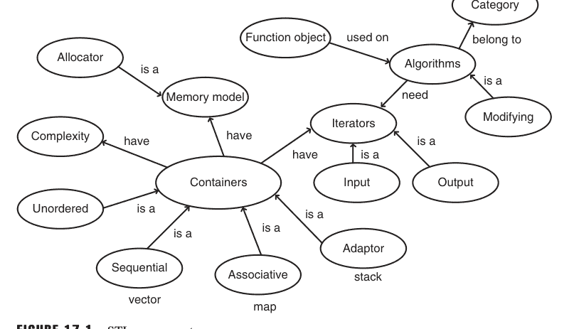

# FIGURE 17.1 STL components

目标是沿着第 17.2 节中讨论的绑定二元函数的示例的思路，对 std::bind 进行实验。

回答以下问题：

- a) 基于函数 func3d 创建零元、一元、二元和三元函数并检查输出。尝试使用占位符。你得到的结果是否符合预期？

- b) 通过将三元函数定义为存储的 lambda 函数并将通用函数包装器分配给 lambda 函数来执行与 a) 相同的练习。

- c) std::bind 的一种替代方案是将绑定变量建模为捕获变量，并将未绑定变量建模为 lambda 函数的输入参数。
  
  使用三元函数进行实验。比较 binders 和 lambda 函数在可读性、可维护性和效率方面的差异。特别是，在应用程序代码中，我们可能需要在某种程度上实现建模 PDE 或 SDE 的函数，并且一个问题是当这些函数在循环中被调用时。它们是否比调用虚函数或纯虚函数更高效或更低效？

- d) 调查对本练习中的示例使用 std::mem_fn（第 17.2.3 节）。你更喜欢哪种方法？

## 2. (Non-modifying Algorithms in C++11, Small Project)

在本练习中我们讨论 C++11 支持的若干新的 STL 算法：

- A1: is_permutation(): 确定两个序列是否包含相同的元素，尽管顺序不同。有两个变体，其中第二个接受比较函数。复杂度在最坏情况下为二次。

- A2: is_sorted(): 确定范围内的元素是否已排序。有四个变体。


+   A3: is_partitioned(): 确定一个范围是否已分区，使得所有满足一元谓词条件的元素都位于不满足该谓词的所有元素之前。例如 {5,3,9,1,3,2,4,8,2,6} 中，奇数与非奇数被分开。

+   A4: partition_point(): 返回分区范围内第一个元素的位置。

+   A5: is_heap(): 确定一个容器是否为堆（最大元素在前）。共有四种变体。

+   A6: all_of(), any_of(), none_of(): 这些算法通过对它们应用一元谓词来确定范围内是否所有、任意（至少一个）或没有元素满足条件。

回答以下问题：
a) 查阅 Josuttis (2012) 和 C++ 在线文档（例如，www.cppreference.com）以确定如何对简单测试用例使用算法 A1 到 A6。
b) 创建一个包含不同元素的向量。创建一份副本并对其应用 std::shuffle()。确定这两个向量是否彼此为排列。
c) 考虑容器 {97,88,95,66,55,95,48,66,35,48,55,62,77,25,38,18,40,30,26,24}。它是一个最大堆吗？
d) 考虑容器 {1,2,3,4,5,6,7,8,9}。当我们对该容器应用算法 A6 时会发生什么？

## 3. (for_each() 算法和 Lambda)

本练习的目的是改编并扩展第 17.1 节中的代码，以便获得一些 STL 算法的经验。
回答以下问题：
a) 概括自由函数 Modify() 以便移除代码中的硬编码（魔术）数字。我们希望能够基于用户提供的数字来缩放容器。使用函数对象和带有相应捕获变量的 lambda 函数实现新功能。
b) 使用 STL 算法 transform() 测试新功能。
c) 在当前上下文中，关于代码可理解性和可维护性，比较自由函数、lambda 函数和函数对象的相对优势。

## 4. (非修改算法)

我们包含了一些处理 STL 容器并产生一些输出的练习，通常是一个数字或一个数据结构。为方便起见，使用 STL 向量作为输入容器，并且请注意给定的问题有几种可能的解决方案，其中一些比其他更高效和/或更易读。设计算法和输出的结构/类型由你决定。
a) 统计容器中每个值的频率。例如，对于 {1,2,4,5,4,1} 我们得到输出 {{1,2}, {2,1}, {4,2}, {5,1}} 作为 {值, 频率} 的对。输出的建模方式取决于你的需求，有不同的方法。
b) 编写一个函数来计算容器中元素的数值值的最小值、最大值、总和和平均值。输出是一个包含四个元素的元组。
c) 考虑容器 S = {1,2,-3,4,5,5,6}。使用 STL 算法找到该值的第一次出现。

5. 现在使用以下函数：
std::bind2nd()
std::bind()
Lambda expression
在 S 中找到第一个偶数的位置。

d) 考虑容器 S = {1,2,5,5,−3,4,5,5,5,6,3,4,5}。确定如何执行以下操作：

+   - 返回前三个连续元素值为 5 的位置。
+   - 返回第一个匹配 {3,4,5} 的子范围的第一个元素的位置。
+   - 返回最后一个匹配 {3,4,5} 的子范围的第一个元素的位置。

e) 考虑容器 S = {1,2,5,5,−3,4,5,5,5,6,3,4,5}。找到 S 中第一个其值等于其后一个元素的值的元素。

f) 考虑容器 S = {1,2,5,5,−3,4,5,5,5,6,3,4,5} 和 S1 = {1,2,5}。确定 S1 中的元素是否等于 S 中的元素。

## 6. (使用哪种风格？)

一些 STL 算法使用一元和二元谓词。两种谓词类型都返回 bool。一元谓词有一个输入参数，而二元谓词有两个输入参数。我们可以用多种方式建模这些谓词和其他类型的函数：

+   - 用户定义的函数对象。
+   - 预定义的 STL 函数对象（例如，std::multiplies<T>()）。
+   - 使用 lambda 函数（可能带有捕获变量）。

回答以下问题：

a) 关于可读性、可理解性和可维护性等质量问题，比较这三种解决方案。

b) 考虑将整数向量转换为整数集合。仅那些绝对值严格大于给定阈值值的元素才应出现在目标中。例如，向量 {1,2,1,4,5,5,−1}。如果阈值值为 2，则输出集合将为 {4,5}。使用上述三种定制方法实现此问题。

c) 在开发并调试了 b) 部分的代码后，从可理解性、可维护性和效率的角度审视这三种解决方案。

## 7. (修改容器的元素)

我们给出一些关于在 STL 中应用修改、替换和删除算法的练习。最初的重点更多在功能上而非效率上。大多数练习使用特定示例，并且你的任务是使用它们作为代码的测试用例。

回答以下问题。

a) 考虑集合 S1 = {a,b,c,d,e,k} 和集合 S2 = {a,e}。从 S1 中删除不在 S2 中的那些元素。输出集合为 {b,c,d,k}。

b) 创建一个类 Point 来建模二维点。提供构造函数、访问点坐标的成员函数以及计算两点之间距离的成员函数。定义一个二元谓词来测试两个点是否相等（它们的 x 和 y 坐标值相同）。现在创建一个点数组（允许重复）。将此数组转换为没有重复的点集合。最后，过滤此集合（即删除点），删除那些不在某个预定义点给定距离范围内的点。

**c)** 我们希望创建处理字符串的函数（某种程度上，我们是在模拟 *Boost C++ String Algorithm* 库的简单版本）。字符串可以看作是一种特殊的向量，其元素是字符。创建函数执行以下操作（在所有情况下输入都是字符串）：

+   - 从字符串中删除所有前导和尾随空白（空格、制表符等）。
+   - 基于一元谓词删除所有前导和尾随空白（例如，是数字，是某个字符集的成员）。
+   - 从字符分隔的字符串中生成字符串向量。
+   - 连接两个字符串。

## 8. (有多少种打印容器的方法？)

本练习的目的是关注 `std::for_each()` 算法并使用它来打印 `std::vector<double>` 的元素。我们使用 C++11 的功能并尝试尽可能多地打印向量。优点是我们可以用新语法获得一些实践经验，并将结果应用于更高级的应用。

回答以下问题：

+   **a)** 编写一个接受向量作为参数的函数，并使用 STL 迭代器的标准功能遍历其元素。
+   
+   **b)** 现在应用 `std::for_each()` 算法来打印向量的元素。使用函数对象和 lambda 函数作为一元过程（算法的最后一个参数）。
+   
+   **c)** 应用 `std::for_each()` 算法来修改向量的元素值。使用函数对象和 lambda 函数作为 *一元过程*（算法参数的最后一个参数）。
+   
+   **d)** 考虑使用 *基于范围的 for* 循环来打印向量的元素：

```
void print(const std::vector<double>& vec)
{
    for (const auto& elem : vec)
    {
        std::cout << elem << ",";
    }
}
```

考虑使用 *统一初始化* 和 *初始化列表* 的功能来在打印前初始化向量。

+   **e)** 我们使用 `std::for_each()` 算法遍历向量并计算向量的最大值、最小值和平均值。使用捕获变量表示这三个量并将其封装为元组，其返回类型为 `std::tuple<double, double, double>`。
+   
+   **f)** 我们将打印向量的函数推广，使其可用于其他序列容器。为此，使用 *模板-模板参数* 技巧。

*Hint:*

```
template <typename T, template <typename S,typename Alloc >
    class Container,typename TAlloc>
```


```cpp
void print(const Container<T, TAlloc>& container,
    const std::string& comment)
{ // A generic print function for general containers

    std::cout << comment << ": ";

    // TBD
}
```

## 9. （复杂度示例）

验证以下内容：

- 17n^(1/6) ∈ O(n^(1/5))
- 10^6 n^2 ∈ O(n^2)
- n log₂ n − 100 ∈ Ω(n).

## 10. （计算复杂度阶）

- a) 设 p(n) 为首项系数为正的次数为 d 的任意多项式，且 a 为任意实数且 a > 1。证明 p(n) ∈ O(a^n)。
- b) 证明若 1 < a < b，则 a^n ∈ O(b^n)。
- c) 证明对所有整数 k ≥ 2，S(n, −k) ∈ Θ(1)，其中 S(n, −k) = Σ_{j=1}^n (1/j)^k。

## 11. （最大公约数 gcd 作为递归函数）

实现并测试一个递归函数来计算两个正整数的最大公约数 gcd(m, n)。该递归函数的代码如下：

```cpp
int gcd(int m, int n)
{
    if (n == 0) return m;

    int rem = m%n;

    if (rem == 0) return n;

    return gcd(n, rem);
}
```

回答以下问题：

- a) 测试上述代码并将你的答案与另一个来源进行比较，例如 Boost Math Common Factor 库。
- b) 编写代码来求整数数组的最大公约数。在 Demming and Duffy (2010) 中，我们将数组转换为栈。然后我们从栈中弹出两个元素 m 和 n，将 gcd(m, n) 压回栈中并重复该过程，直到栈中只剩下一个元素。该值将是数组的最大公约数。
- c) 如何调试这个递归函数？

## 12. （第一类贝塞尔函数）

这些函数在数学物理中很重要，它们可以用涉及伽马函数的无穷级数计算。在本练习中，我们使用递推关系计算这些函数：

J_{n+1}(x) = (2n / x) J_n(x) - J_{n-1}(x),    n ≥ 1

我们假设初始贝塞尔函数 J_0(x) 和 J_1(x) 可在库中使用（例如 Boost Math Toolkit；参见 Demming and Duffy, 2012）。本练习的目的是基于上述递推关系计算第一类贝塞尔函数，并将你的结果的准确性和效率与运行 Boost Math Toolkit 中的贝塞尔函数代码的结果进行比较。

## 13. （集合和多重集合）

这是一个复习问题。

- a) 列举可以应用于集合的最重要操作。这些操作在 STL 中是否受支持？
- b) 集合 S 的幂集（记为 Power(S)）是 S 的所有子集的集合。如果 S 有 n 个元素，Power(S) 有多少个元素？求 Power(S) 若 S = {a, b, c, d}。
- c) 如果你希望建模 i) 英语中的所有字母和 ii) 所有语言中的所有字母，你会使用哪些数据容器？
- d) 一般来说，在 C++ 应用中使用集合有哪些优点？例如，在什么情况下使用集合比使用列表或向量更好？

## 14. （列表与向量）

列表和向量在结构上相似，但在何种上下文中使用每个容器非常重要。确定在以下情况下使用列表、向量还是 deque 更合适：

- a) 从容器开头到结尾迭代并计算其所有元素的平均值。
- b) 移动到容器中的给定（整数）位置。
- c) 在容器的开头和结尾追加和删除元素。
- d) 查找容器中对应于给定值的元素的位置。
- e) 将容器用作创建用于建模矩阵的容器的构建块。
确定上述每种操作的复杂度。考虑使用 map 或 unordered map。它们是否有助于提高性能？

## 15. （交通流）

以下情况和应用最适合哪些容器？

- a) 足球迷通过旋转门进入足球场。体育场有多扇旋转门。
- b) 在餐厅洗盘子并将它们堆放起来，以便为下一批顾客重复使用。
- c) 机场的排队中，预检的乘客可以直接前往登机口。
- d) 基于实时数据馈送计算移动平均值。

### 17.8 附录：STL 容器和复杂度分析的回顾

在应用中我们需要创建、存储和检索数据。数据将根据上下文以各种方式存储。知道使用哪种特定数据结构很重要。在本节中，我们概述了 STL 容器和容器类型。

#### 17.8.1 序列容器

这些容器是*有序集合*，其中每个元素在其各自容器中具有特定位置。位置与元素值无关，但可能取决于插入的时间和地点。STL 中有五个预定义的序列容器类：

- `array`：通过包装静态 C 风格数组来模拟固定大小的数组。它是元素的序列且数组大小恒定。值存储在栈上。
- `vector`：模拟动态数组。它使用动态 C 风格数组管理其元素。值存储在堆上。
- `deque`：与 vector 类似，因为其接口几乎与 vector 相同。而 vector 仅在一端开放，deque 在两端都开放。
- `list`：列表将其元素作为*双向链表*管理。换句话说，列表中的每个元素都有一个值以及指向其在列表中前一个和后一个元素的指针。
- `forward_list`：该容器在 C++11 中引入。它将其元素作为*单向链表*管理。

一般来说，序列容器实现为数组或链表。

#### 17.8.2 关联容器

*关联容器*是有序容器，其中元素的位置取决于其值（或其键）。STL 中有四个预定义的关联容器类：

- `set`：这是数学中*集合类型*的实现。集合中不允许重复。
- `multiset`：与集合类似但允许重复。这种数据结构有时称为*包*。
- `map`：将键/值对作为元素管理。映射不允许重复。
- `multimap`：将键/值对作为元素管理。多重映射允许重复键。

一般来说，关联容器实现为*二叉树*。

#### 17.8.3 无序（关联）容器

这些是无序集合，其中元素的位置并不重要。从概念上讲，这些集合包含以任意顺序插入的所有元素。

这些容器与包相似，因为没有排序标准。与序列容器不同，没有将元素放入特定位置的语义。STL 中有四个预定义的无序容器类：

- `unordered_set`。
- `unordered_multiset`。
- `unordered_map`。
- `unordered_multimap`。

一般来说，无序容器实现为*哈希表*。

#### 17.8.4 特殊容器

STL 支持在某些应用中需要的一些容器。这些被称为*容器适配器*，因为它们是 STL 容器的包装器。它们在其实现中隐藏这些后者容器，并向客户端提供特殊接口。这种设计类似于*适配器*设计模式（参见 GOF, 1995）。最后，STL 还支持类 `bitset<size_t N>`，它模拟固定大小的位数组。

一般来说，只有专门的应用才需要使用这些容器，对于大多数开发工作可能不需要它们。

#### 17.8.5 其他数据容器

出于完整性的考虑，我们简要讨论 C++ 中的一些其他容器：

- *字符串*：STL 支持字符串类 `basic_string`、`string` 和 `wstring`。字符串是元素为字符的向量。我们在本书中不讨论字符串，尽管它们有许多应用。参见 Josuttis (2012) 以获得全面介绍。另见 *Boost String Algorithm* 库。
- *C 风格数组*：这些数组不是类也不是 STL 容器，因为它们没有我们期望的 STL 容器的成员函数。我们在本书中不讨论 C 风格数组。
- STL 支持许多低级且常用的容器和相关算法。一般来说，我们建议使用它们而不是自己编写版本。然而，应用开发者可能需要比 STL 提供的更多功能。一些用例是：
  - U1：创建一个用户定义容器的接口，允许我们直接使用 STL 算法（例如 Boost *uBlas* 中的向量具有此属性）。
  - U2：创建一个使用其他 STL 容器功能的用户定义容器。
  - U3：创建应用特定的容器和算法。

一般来说，我们通过使用 has-a 关系，例如*组合*和*聚合*来扩展 STL 的功能。我们也可能被诱惑通过从 STL 容器派生并添加行为来扩展 STL 容器的行为（参见 Josuttis, 2012, p. 251）。这被认为是不良实践。


#### 17.8.6 复杂度分析

在开发和使用算法时，我们需要有某种方法来分析它们。换句话说，我们必须有一些标准来衡量算法的效率。为此，设 M 是一个包含 n 个元素的算法。那么确定 M 的效率的一种方法是测量它所使用的空间和时间。例如，我们可以通过计算关键操作的次数来衡量时间：

- 对于排序和搜索算法，我们可以计算比较次数。
- 在数值算法中，我们可以计算乘法次数。

关键操作是这样定义的：它们计算起来比其他操作花费更多时间。例如，除法是关键操作，而加法不是关键操作，因为加法在计算上比除法不那么密集。最后，我们通过计算算法所需的内存来衡量空间。

**定义 17.1** 算法 M 的复杂度是一个函数 f(n)，它描述了 M 在输入集合大小为 n 时的运行时间或存储空间需求。

一般来说，“算法 M 的复杂度”指的是 M 的运行时间。复杂度函数 f(n) 给出 M 的运行时间，它取决于输入大小 n 和所使用的数据类型。总结来说，确定算法复杂度的难题归结为分析其对应复杂度函数的性质。例如，我们可能希望当 n 趋于无穷时，用其他函数 g(n) 和 h(n) 分别从上方和下方限制 f(n)。特别是，我们感兴趣的是两种特定情况：

- 最坏情况：对于任意大小的输入数据，f(n) 的最大值。
- 平均情况：f(n) 的期望值。这种情况可以通过概率论来分析。

我们现在给出复杂度分析的详细数学描述。

#### 17.8.7 函数的渐近行为和渐近阶

为了描述算法复杂度，我们将注意力限制在实值函数 f : ℕ → ℝ 上。换句话说，定义域是所有非负整数的集合 ℕ，而值域是实数集合 ℝ。我们感兴趣的是最终为正的函数类型，即存在一个正整数 n₀（取决于 f），使得对于所有 n > n₀，f(n) > 0。我们用 𝔖 表示具有此性质的所有函数的空间。我们现在建立一种数学记号来比较该空间 𝔖 中的函数。

**定义 17.2** 给定一个函数 g ∈ 𝔖，我们定义 Θ(g(n)) 为所有函数 f ∈ 𝔖 的集合，使得：

$$c_1 g(n) \le f(n) \le c_2 g(n) \quad (17.1)$$

其中 c₁、c₂ 和 n₀ 是正常数且 n ≥ n₀。

如果 $f \in \Theta(g(n))$，我们说 $f(n)$ 是 $g(n)$ 的 *big theta*。直观上，我们说 f 被 g 从上方和下方限制。

直观上，我们说函数 f 与函数 g 以相同的速率增长，并且它有效地被夹在 g 的两个常数倍数之间。对不等式 (17.1) 中的函数进行图形化是可能的，但我们需要将这些函数的定义域从正整数集合扩展到正实数集合。

我们举一些例子：

$$n^3 + 2n\log_2 n - 3 \in \Theta(n^3)$$
$$3\sqrt{n} + \log_2 n - 3 \in \Theta(\sqrt{n})$$

**定义 17.3** 两个函数 $f, g \in 𝔖$ 具有 *相同的阶*，如果 $f \in \Theta(g(n))$。

计算机科学中的许多算法具有线性、二次、三次、对数、指数或 $n \log n$ 复杂度。特别是，我们感兴趣的是以下度量。

**定义 17.4** 给定一个函数 $g \in 𝔖$，我们定义 $O(g(n))$ 为所有函数 $f \in 𝔖$ 的集合，满足不等式：

$$f(n) \le c g(n) \quad (17.2)$$

对于所有 $n \ge n_0$，其中 c 和 $n_0$ 为正常数。

如果 $f \in O(g(n))$，我们说 f 是 $g$ 的 *big oh*。直观上，f 被 g 从上方限制。

一些例子是：

$$7n^2 - 9n + 4 \in O(n^2)$$
$$\log_4 n \in O(n^2)$$

我们现在可以按如下方式产生阶层次结构中的递增链：

$$O(1), O(\log n), O(\sqrt{n}), O(n), O(n \log n), O(n^2), O(n^3), O(2^n), O(n2^n), O(n!)$$

我们因此看到阶乘函数增长最快。

例如，一些众所周知的搜索和排序算法的复杂度为：

- 线性搜索：$O(n)$。
- 二分搜索：$O(\log n)$。
- 冒泡排序：$O(n^2)$。
- 归并排序：$O(n \log n)$。

**定义 17.5** 给定一个函数 $g \in 𝔖$，我们定义 $\Omega(g(n))$ 为所有函数 $f \in 𝔖$ 的集合，满足不等式：

$$c g(n) \le f(n) \quad (17.3)$$

如果 $f \in \Omega(g(n))$，我们说 f 是 $g$ 的 *big omega*。直观上，f 被 g 从下方限制。

一般来说，big oh 通常用作解决特定问题的特定算法性能的上限，而 big omega 通常用作问题本身复杂度的下限。

#### 17.8.8 一些示例

我们用一些示例来结束本节。第一个示例讨论一维数据容器中的线性搜索。换句话说，给定长度为 n 的线性数组，我们希望确定特定值 y 是否在数组中。成功可以通过数组中 y 的位置来表示（这是一个在闭区间 [1, n] 中的值）或零，在这种情况下值 y 不在数组中。假设我们从索引 1 开始搜索，最坏情况发生在数组的最后一个元素包含 y 在最后一个位置或数组不包含 y 时。此时 f(n) = n 是线性搜索算法的最坏情况复杂度。平均情况假设输入数据具有某种概率分布。我们假设数据集的可能排列是等可能的。更一般地，假设数字 n₁, n₂, ..., nₖ 以概率 p₁, p₂, ..., pₖ 出现。则期望值或平均值 E 给出为：

$$E = \sum_{j=1}^{k} n_j p_j \quad (17.4)$$

回到当前问题，我们看到值 y 同样可能出现在数组的任何位置。因此，比较次数可以是 1, 2, ..., n 中的任意一个，每个数字出现的概率相等 p = 1/n。因此，平均复杂度是方程 (17.4) 的特例，给出为：

$$E = \sum_{j=1}^{n} j/n = (n + 1)/2 \quad (17.5)$$

直观上，方程 (17.5) 指出找到值 y 位置所需的平均比较次数大约等于数组中元素数量的一半。

第二个示例是考察和：

$$L(b, n) = \sum_{j=1}^{n} \log_b(j) = \log_b(n!) \quad (17.6)$$

对于任意底数 b。例如，L(2, n) 是任何基于比较的排序算法最坏情况复杂度的下界。我们现在断言：

$$\log_b(n!) \in \Theta(n \log_b n) \quad (17.7)$$

显然，$L(b, n) \in O(n \log_b n)$，因为 $\sum_{j=1}^{n} \log_b(j) \le \sum_{j=1}^{n} \log_b(n) = n \log_b(n)$。

我们现在证明 $L(b,n) \in \Omega(n\log_b n)$。设 $x$ 为变量，设 $\lfloor x \rfloor$ 为不大于 $x$ 的最大整数。设 $m = \lfloor n/2 \rfloor$。则：

$$L(b,n) = \sum_{j=1}^{m} \log_b(j) + \sum_{j=m+1}^{n} \log_b(j) \ge \sum_{j=m+1}^{n} \log_b(j) \ge (n - m)\log_b(m + 1)$$
$$\ge (n/2)\log_b(n/2) = (n/2)(\log_b n - \log_b 2) \ge \left(\frac{n}{2}\right)\left(\log_b n - \frac{1}{2}\log_b n\right) \text{ 对于所有 } n \ge n_0$$

因此，$L(b,n) \ge \frac{1}{4} n \log_b n$ 对于所有 $n \ge n_0$，我们因此得出结论 $L(b,n) \in \Omega(n\log_b n)$。因此关系式 (17.7) 已被证明。

有关顺序、并行和分布式算法的复杂度分析的更多信息，请参阅 Berman 和 Paul (2005)。

# 第 18 章：STL 算法 第二部分

#### 18.1 引言和目标

在本章中，我们继续讨论第 17 章中介绍的 STL 算法。特别是，我们讨论以下主要算法类别：

- *变异算法*：这些算法通过以某种方式分配和交换它们的值来改变范围内元素的顺序（而不是它们的值）。示例：反转容器中元素的顺序。
- *排序算法*：这些是特殊的变异算法，因为它们改变范围内元素的顺序。在选择特定排序算法时，我们必须考虑复杂度。示例：使用 *heapsort* 对容器进行排序。该算法具有 $O(n \log n)$ 复杂度。
- *已排序范围算法*：已排序范围算法要求它们操作的范围根据其 *排序准则* 进行排序。示例：处理两个范围的已排序并集。
- *数值算法*：这些算法以不同的方式组合数值元素。虽然该类别仅包含四个算法，但它们可以通过为其提供许多种函数来使用，从而允许开发人员对其进行自定义。示例：计算两个范围或两个容器的内积。

与第 17 章一样，我们讨论每个类别的意图，并使用紧凑的示例描述其算法。我们还展示每个算法产生的输出，以便帮助我们理解代码。本章可作为参考使用；您可以取示例代码并将其改编到自己的应用程序中。

#### 18.2 变异算法

这些算法通过以某种方式分配和交换它们的值来改变容器中元素的顺序。主要的算法有：

- 反转范围内元素的顺序（有复制和无复制）。
- 旋转元素。


- 排列元素。
- 将元素置于随机顺序。
- 更改元素的顺序，使符合条件的元素位于范围的前部。

##### 18.2.1 反转元素的顺序

本类别中的两个算法反转范围内元素的顺序，要么修改范围，要么创建新的范围。*调用者必须确保目标范围有足够的容量*来容纳元素，或者 alternatively 你可以使用一个*插入迭代器*。如果不是，将会发生运行时间错误。对于列表，我们注意到使用 `reverse()` 成员函数比对应的 STL 算法更高效，因为它重新链接元素指针而不是分配元素值。

使用示例为：

```cpp
void Reverse()
{
    std::cout << "\n**** Block I, Reverse ****\n";
    int size = 6;
    double val = 2.0;
    std::vector<double> vec(size, val);
    vec[0] = 2.0; vec[vec.size() - 1] = -23.4;
    print(vec, std::string("Original vector: "));

    //****************************************************
    // I. Reversing the order of elements
    std::reverse(vec.begin(), vec.end());
    print(vec, std::string("Modifier, vector reversed: "));

    // Reverse order of elements while copying them.
    std::vector<double> vec2;

    // Ensure that vec2 can hold the data or use an insert iterator
    std::reverse_copy(vec.begin(), vec.end(), std::back_inserter(vec2));
    print(vec2, std::string("Selector(copy), vector reversed: "));
}
```

输出为：

```text
**** Block I, Reverse ****
Original vector: 2, 2, 2, 2, 2, -23.4,
Modifier, vector reversed: -23.4, 2, 2, 2, 2, 2,
Selector(copy), vector reversed: 2, 2, 2, 2, 2, -23.4,
```

##### 18.2.2 旋转元素

我们可以将范围内的元素向*左*或向*右*旋转，使给定元素成为新的第一个元素。示例为：

```cpp
void Rotate()
{
    // II. Rotations
    std::cout << "\n*** Block II, Rotate ***\n";
    // Rotating elements in a sequence
    using namespace boost::assign;
    std::vector<int> myVec = { 1, 2, 3, 4, 5, 6, 7, 8, 9 };
    print(myVec, "input vector");

    //std::cout << "Choose size of offset to right: "; int offset;
    // std::cin >> offset;
    int offset = 3;

    offset = std::abs(offset);
    std::rotate(myVec.begin(), myVec.begin() + offset, myVec.end());
    print(myVec, std::string("Modifier, vector rotated "));

    // Rotate with copy
    std::multiset<int> mySet = { 11, 22, 33, 44, 55, 66, 77, 88, 99 };
    std::cout << "Input multiset: ";
    for (auto el : mySet)
    {
        std::cout << el << ",";
    }
    std::cout << '\n';
    std::multiset<int>::iterator pos = mySet.begin();
    std::advance(pos, offset);    // increment the position of an iterator

    std::vector<int> vecOut;
    std::rotate_copy(mySet.begin(), pos, mySet.end(),
                     std::back_inserter(vecOut));
    print(vecOut, std::string("Selector, set rotated "));

    // Rotate from position having a given value
    std::multiset<int>::iterator posValue = mySet.find(55);
    vecOut.clear();

    std::rotate_copy(mySet.begin(), posValue, mySet.end(),
                     std::back_inserter(vecOut));
    print(vecOut, std::string("Selector, set rotated: "));
}
```

输出为：

```text
**** Block II, Rotate ****
input vector: 1, 2, 3, 4, 5, 6, 7, 8, 9,
Modifier, vector rotated: 4, 5, 6, 7, 8, 9, 1, 2, 3,
Input multiset: 11, 22, 33, 44, 55, 66, 77, 88, 99,
Selector, set rotated: 44, 55, 66, 77, 88, 99, 11, 22, 33,
Selector, set rotated: 55, 66, 77, 88, 99, 11, 22, 33, 44,
```

##### 18.2.3 排列元素

```text
next permutation I, vecA: 1, 3, 2,
next permutation I, vecA: 2, 1, 3,
next permutation I, vecA: 2, 3, 1,
next permutation I, vecA: 3, 1, 2,
next permutation I, vecA: 3, 2, 1,
previous permutation II, vecA: 1, 3, 2,
previous permutation II, vecA: 2, 1, 3,
previous permutation II, vecA: 2, 3, 1,
previous permutation II, vecA: 3, 1, 2,
previous permutation II, vecA: 3, 2, 1,
input string A,B,C,D
Original set, char: A, B, C, D,
next permutation: A, B, D, C,
next permutation: A, C, B, D,
next permutation: A, C, D, B,
next permutation: A, D, B, C,
next permutation: A, D, C, B,
next permutation: B, A, C, D,
next permutation: B, A, D, C,
next permutation: B, C, A, D,
next permutation: B, C, D, A,
next permutation: B, D, A, C,
next permutation: B, D, C, A,
next permutation: C, A, B, D,
next permutation: C, A, D, B,
next permutation: C, B, A, D,
next permutation: C, B, D, A,
next permutation: C, D, A, B,
next permutation: C, D, B, A,
next permutation: D, A, B, C,
next permutation: D, A, C, B,
next permutation: D, B, A, C,
next permutation: D, B, C, A,
next permutation: D, C, A, B,
next permutation: D, C, B, A,
Now the result of size: 23
{A,B,D,C} {A,C,B,D} {A,C,D,B} {A,D,B,C} {A,D,C,B} {B,A,C,D}
{B,A,D,C} {B,C,A,D} {B,C,D,A} {B,D,A,C} {B,D,C,A} {C,A,B,D}
{C,A,D,B} {C,B,A,D} {C,B,D,A} {C,D,A,B} {C,D,B,A} {D,A,B,C}
{D,A,C,B} {D,B,A,C} {D,B,C,A} {D,C,A,B} {D,C,B,A}
input string A,B,C
Now the result of size: 23
```

排列是算法分析和纯数学中非常重要的工具（例如群论及其应用）。更多细节请参阅 Knuth (1997)。

##### 18.2.4 洗牌元素

本类别中的算法洗牌范围内元素的顺序：

```cpp
void Shuffle()
{
    // IV. Shuffling
    std::cout << "\n**** Block IV, Shuffling ****\n";
    // Shuffle
    std::vector<int> vecR = { 1, 2, -2, 3, -3, 4, -4, 5, -5, 8, 9, 7 };

    std::random_shuffle(vecR.begin(), vecR.end());
    print(vecR, std::string("Modified, random shuffle: "));

    // C++11
    std::default_random_engine eng;
    std::shuffle(vecR.begin(), vecR.end(), eng);
    print(vecR, std::string("vecR after shuffle"));

    // Moving elements to the front
    std::vector<int> vecP = { 1, 2, 3, 4, 5, 6, 2, 7, 8, 9 };
    print(vecP, "vecP");
}
```

输出为：

```text
**** Block IV, Shuffling ****
Modified, random shuffle: 9, 2, 8, -2, 1, 7, 5, 3, -3, -4, -5, 4,
vecR after shuffle: 1, 9, -2, 2, -5, 3, 5, 4, -4, -3, 7, 8,
vecP: 1, 2, 3, 4, 5, 6, 2, 7, 8, 9,
```

这些算法在洗牌随机生成数字时很有用。

##### 18.2.5 创建分区

本类别中有三个算法：

- 返回一元谓词返回 `false` 的第一个位置（两个函数）。
- 将范围划分为两个子范围。

代码示例为：

```cpp
void RangePartition()
{
    // V. Partitioning a range
    std::cout << "\n**** Block V, Moving elements to front ****\n";
    std::vector<int> vecP = { 1, 2, 3, 4, 5, 6, 2, 7, 8, 9 };
    print(vecP, "vecP");

    // Partitioning: moving all the elements in a range to the front.
    // All elements greater than or equal to 5; relative order not preserved
    std::vector<int>::iterator posP = std::partition(vecP.begin(), vecP.end(),
        std::bind2nd(std::greater_equal<int>(), 5));
    print(vecP, std::string("Partitioned, relative order not preserved: "));
    std::cout << "Position 1st element: " << *posP << std::endl;

    // All elements greater than or equal to 5; relative order is preserved
    posP = std::stable_partition(vecP.begin(), vecP.end(),
        std::bind2nd(std::greater_equal<int>(), 5));
    print(vecP, std::string("Partitioned, relative order preserved: "));
    std::cout << "Position 1st element: " << *posP << std::endl;

    // Split elements in a range into two subranges based on a predicate
    std::vector<int> coll = { 1, 2, 3, 5, 6, 7, 9, 11 };

    std::vector<int> evenColl;
    std::vector<int> oddColl;

    std::partition_copy(coll.begin(), coll.end(),
        std::back_inserter(evenColl),
        std::back_inserter(oddColl),
        [] (int elem) { return elem % 2 == 0; });

    std::cout << "Even and odd sizes: "
        << evenColl.size() << ", " << oddColl.size() << std::endl;

    // Two sets, above barrier H
    double H = 100.0;
    std::vector<double> stock = { 1, 2, 3, 6, 7, 9, 11, 30, 50, 60, 110, 120, -1 };
    print(stock, "input values");
    std::vector<double> outsideColl;
    std::vector<double> insideColl;

    auto constraint = [&H] (double x) { return x > H; };
    std::partition_copy(stock.begin(), stock.end(),
        std::back_inserter(outsideColl),
        std::back_inserter(insideColl),
        constraint);

    print(outsideColl, "Outside values");
    print(insideColl, "Inside values");
}
```

输出为：

```text
**** Block V, Moving elements to front ****
vecP: 1, 2, 3, 4, 5, 6, 2, 7, 8, 9,
Partitioned, relative order not preserved: 9, 8, 7, 6, 5, 4, 2, 3, 2, 1,
Position 1st element: 4
Partitioned, relative order preserved: 9, 8, 7, 6, 5, 4, 2, 3, 2, 1,
Position 1st element: 4
```


```text
Even and odd sizes: 2, 6
input values: 1, 2, 3, 6, 7, 9, 11, 30, 50, 60, 110, 120, -1,
Outside values: 110, 120,
Inside values: 1, 2, 3, 6, 7, 9, 11, 30, 50, 60, -1,
```

### 18.3 数字算法

这些算法将范围内的数字元素组合起来：

- 以某种方式组合所有元素（例如，求和、求积）。
- 使用不同类型的运算符进行内积。
- 相邻差；将每个元素与其前驱组合。
- 部分和；将每个元素与其所有前驱组合。

#### 18.3.1 基于某些准则在容器中累积值

这是一种对范围元素求和的算法。通过这种方式，我们可以将范围的元素聚合起来，以产生数学上相关的属性，例如和、平均值、范数和统计属性等。一些示例是：

```cpp
void Accumulate()
{
    // I. Accumulate
    std::cout << "\n*** Block I, Accumulate ****\n";
    std::vector<int> vec = { 1,2,3,4,5 };
    // Accumulate: Computing the result of one sequence.
    int initVal = 1;            // Must be initialised to a value; Add
                                // initVal to all elements
    int acc1 = std::accumulate(vec.begin(), vec.end(), initVal);
    std::cout << "Sum 1, classic sum: " << acc1 << std::endl;

    // A. Multiply (by predefined function object) each element by initVal
    int acc2 = std::accumulate(vec.begin(), vec.end(), initVal,
        std::multiplies<int>());
    std::cout << "Sum 2, predefined FO: " << acc2 << std::endl;

    // B. C++11 Lambda style
    int acc3 = initVal;
    std::for_each(vec.begin(), vec.end(), [&](int i) -> double
    {
        acc3 *= i; return acc3;
    });
    std::cout << "Sum 3, embedded lambda: " << acc3 << std::endl;

    // C. Using a 'reusable' Lambda function and new 'auto' variable decl
    auto MyMultiply = [](auto x, auto y) { return x*y; };

    int acc4 = std::accumulate(vec.begin(), vec.end(), initVal,
        MyMultiply);
    std::cout << "Sum 4, generic lambda: " << acc4 << std::endl;

    // User-defined function object
    int accA = accumulate(vec.begin(), vec.end(), initVal, FOMultiply());
    std::cout << "Sum 5, with user-defined function object: " << accA;
}
```

输出结果为：

```
**** Block I, Accumulate ****
Sum 1, classic sum: 16
Sum 2, predefined FO: 120
Sum 3, embedded lambda: 120
Sum 4, generic lambda: 120
Sum 5, with user-defined function object: 120
```

#### 18.3.2 内积

向量内积（或点积）的概念在数学中是众所周知的。例如，设 (a₀, ..., a_J) 和 (b₀, ..., b_J) 为两个容器。则支持以下属性（以及更多）：

```
⎧ ∏_{j=0}^J (a_j ± b_j),  ∏_{j=0}^J a_j * b_j
⎨
⎩ ∑_{j=0}^J (a_j ± b_j),  ∑_{j=0}^J a_j * b_j.   (18.1)
```

更一般地，我们可以定义两个运算符（我们称之为 op1 和 op2）。那么内积的算法形式为：

```
initVal op1(a₀ op2 b₀) ... op1(a_J op2 b_J).   (18.2)
```

一些示例是：

```cpp
void InnerProduct()
{
    // II. Inner products
    std::cout << "\n**** Block II, Inner Products ****\n";
    std::vector<int> vec = { 1,2,3 };

    // Sums of products + initVal
    int initVal = 0;

    int ip1 = std::inner_product(vec.begin(), vec.end(), vec.begin(), initVal);
    std::cout << "Inner product 1: " << ip1 << std::endl; // 14

    // Two predefined function objects using inner and outer operations
    double ip2 = std::inner_product(vec.begin(), vec.end(), vec.begin(), 1,
                    std::multiplies<int>(),    // outer
                    std::plus<int>());         // inner
    std::cout << "Inner product 2: " << ip2 << std::endl;    // 48

    double ip3 = inner_product(vec.begin(), vec.end(), vec.begin(), 0,
                    std::plus<int>(),          // outer
                    std::multiplies<int>());   // inner
    std::cout << "Inner product 3: " << ip3 << std::endl;    // 14

    // Sum of max values
    std::vector<int> vec1 = { 1,-2,3,-4,5 };
    std::vector<int> vec2 = { -1,2,-3,10,-5 };

    auto myMax = [] (auto x, auto y) {return std::max(x,y); };
    auto myPlus = [] (auto x, auto y) {return x+y; };
    double ip4 = inner_product(vec1.begin(), vec1.end(), vec2.begin(), 0,
                    myPlus,                    // outer
                    myMax);                    // inner
    std::cout << "Sum of max values: " << ip4 << std::endl;    // 21

    double ip5 = inner_product(vec1.begin(), vec1.end(), vec2.begin(), 0,
                    myMax,                     // outer
                    myPlus);                   // inner
    std::cout << "Max of summed values: " << ip5 << std::endl;    // 6
}
```

输出结果为：

```
**** Block II, Inner Products ****
Inner product 1: 14
Inner product 2: 48
Inner product 3: 14
Sum of max values: 21
Max of summed values: 6
```

#### 18.3.3 部分和

此类中的两个算法将相对值转换为绝对值。一个示例是：

```cpp
void PartialSum()
{
    // III. Relative and absolute values conversions: partial sums
    // Converting relative values into absolute values

    std::cout << "\n**** Block III, Partial sums ****\n";
    std::vector<int> vec = { 1,2,3,4,5 };
    std::partial_sum(vec.begin(), vec.end(), vec.begin());
    print(vec, std::string("partial sum: "));

    // Call multiply for every element in the source (vec)
    std::vector<int> vec2(vec.size());
    print(vec2, std::string("input vector: "));
    partial_sum(vec.begin(), vec.end(), vec2.begin(),
        std::multiplies<int>());
    print(vec2, std::string("partial sum with mult. operator: "));
}
```

输出结果为：

```
**** Block III, Partial sums ****
partial sum: : 1,3,6,10,15,
input vector: : 0,0,0,0,0,
partial sum with mult. operator: : 1,3,18,180,2700,
```

#### 18.3.4 相邻差

此类中的两个算法将绝对值转换为相对值：

```cpp
void AdjacentDifference()
{
    // IV. Converting absolute values into relative values.
    std::cout << "\n**** Block IV, Adjacent differences ****\n";
    // Converting absolute values into relative values
    std::vector<int> vecA(6);
    for (int j = 0; j < vecA.size(); ++j) { vecA[j] = j + 1; }
    std::vector<int> vecB(vecA.size());

    print(vecA, std::string("input vector to adjacent_difference"));
    std::adjacent_difference(vecA.begin(), vecA.end(), vecB.begin());
    print(vecB, std::string("adjacent difference 1: "));

    std::adjacent_difference(vecA.begin(), vecA.end(), vecB.begin(),
        std::plus<int>());
    print(vecB, std::string("adjacent difference 2: "));

    std::adjacent_difference(vecA.begin(), vecA.end(), vecB.begin(),
        std::multiplies<int>());
    print(vecB, std::string("adjacent difference 3: "));
}
```

输出结果为：

```
**** Block IV, Adjacent differences ****
input vector to adjacent_difference: 1,2,3,4,5,6,
adjacent difference 1: : 1,1,1,1,1,1,
adjacent difference 2: : 1,3,5,7,9,11,
adjacent difference 3: : 1,2,6,12,20,30,
```

### 18.4 排序算法

STL 有许多用于对范围元素进行排序的算法：

- 基于运算符 < 对所有元素进行排序。
- 基于 *二元谓词* 对所有元素进行排序。
- 基于运算符 < 对所有元素进行部分排序。
- 基于二元谓词对所有元素进行部分排序。
- 堆算法。

我们集中于此类中的主要算法。更多信息请参见 Josuttis (2012)。

#### 18.4.1 完全排序

此子类别中有四种算法。默认比较器是运算符 <，同时也可以提供用户定义的比较函数。算法 `std::sort()`（通常基于 *快速排序*）保证良好的性能，一般情况下复杂度为 O(n log n)。如果最坏情况性能很重要，我们应使用 `std::stable_sort()`。我们举一个例子，按两种不同方式对范围进行排序：

```cpp
void FullSort()
{
    std::cout << "\n*** Block I, Full sort ****\n";
    std::vector<double> v = { 1.0, -1.0, 2.0, -2.0, 3.0, -3.0 };
    print(v, "input vector: ");

    // Sort using default <
    std::sort(std::begin(v), std::end(v));
    print(v, "sorted vector using operator <: ");

    auto DESCENDING = [](int d1, int d2) { return (d1 > d2); };
    std::sort(std::begin(v), std::end(v), DESCENDING);
    print(v, "sorted vector using lambda op: ");

    // Stable sort: avoids worst-case performance
    std::stable_sort(std::begin(v), std::end(v));
    print(v, "stable sorted vector using operator <: ");

    std::stable_sort(std::begin(v), std::end(v), DESCENDING);
    print(v, "stable sorted vector using lambda op: ");

    auto ASCENDING = [](int d1, int d2) { return (d1 < d2); };
    std::stable_sort(std::begin(v), std::end(v), ASCENDING);
    print(v, "stable sorted vector using lambda op: ");
}
```


The output is:

```
**** Block I, Full sort ****
input vector:  1, -1, 2, -2, 3, -3,
sorted vector using operator <:  -3, -2, -1, 1, 2, 3,
sorted vector using lambda op:  3, 2, 1, -1, -2, -3,
stable sorted vector using operator <:  -3, -2, -1, 1, 2, 3,
stable sorted vector using lambda op:  3, 2, 1, -1, -2, -3,
stable sorted vector using lambda op:  -3, -2, -1, 1, 2, 3,
```

#### 18.4.2 Partial Sort

There are four algorithms in this category: first, we can choose between the option to sort a range based on the operator < or by providing a user-defined comparison function and second, we can sort a range in-place as it were or we can create a new sorted array from an input range.

In general, partial sorting entails sorting a range until the first n elements have been sorted.

A code sample to show how to use the five algorithms is as follows:

```
void PartialSort()
{
    std::cout << "\n**** Block II, Partial sort ****\n";
    std::vector<double> v
        = { 1.0,-1.0,2.0,-2.0,3.0,-3.0,100.0,-100.0,200.0,
            -200.0 };
    print(v, "input vector: ");

    // Sort using default <
    auto pos = std::begin(v) + 5;
    std::partial_sort(std::begin(v), pos, std::end(v));
    print(v, "sorted vector using operator <: ");

    auto DESCENDING = [](int d1, int d2) { return (d1 > d2); };
    std::partial_sort(std::begin(v), pos, std::end(v), DESCENDING);
    print(v, "sorted vector using lambda op: ");

    // Copy from source range sorted into the destination range
    std::deque<double> dq(v.size());
    std::partial_sort_copy(std::begin(v), std::end(v),
                           std::begin(dq), std::end(dq));
    print(dq, "sorted copied vector using operator <: ");

    std::partial_sort_copy(std::begin(v), std::end(v),
                           std::begin(dq), std::end(dq), DESCENDING);
    print(dq, "sorted copied vector using lambda op: ");
}
```

The output is:

```
**** Block II, Partial sort ****
input vector:  1, -1, 2, -2, 3, -3, 100, -100, 200, -200,
sorted vector using operator <:          -200, -100, -3, -2, -1, 3, 100,
2, 200, 1,
sorted vector using lambda op:          200, 100, 3, 2, 1, -200, -100,
-3, -2, -1,
sorted copied vector using operator <:  -200, -100, -3, -2, -1,
1, 2, 3, 100, 200,
sorted copied vector using lambda op:  200, 100, 3, 2, 1, -1, -2,
-3, -100, -200,
```

#### 18.4.3 Heap Sort

A max heap is a special kind of binary tree with the properties:

- The value of each node is not less than the values stored in each of its children.
- The tree is perfectly balanced and the leaves in the last level are all in the leftmost positions.

It is also possible to define a min heap. Heaps and heap algorithms are supported in both Boost and C++. A special case is the priority queue in STL.

Sample code is:

```
void Heap()
{
    std::cout << "\n*** Block III, heap sort etc. ***\n";
    std::vector<int> v4 = { 3, 4, 5, 6, 7, 5, 6, 7, 8, 9, 1, 2, 3, 4 };
    print(v4, "input vector");

    // Construct a max heap using < as comparison operator
    // as well as a user-defined one
    std::make_heap(v4.begin(), v4.end());
    print(v4, "heap sorted vector");

    // Descending
    std::vector<int> v2 = { 3, 4, 5, 6, 7, 5, 6, 7, 8, 9, 1, 2, 3, 4 };
    print(v2, "2nd input vector");
    auto comp = [] (int n, int m)->bool { return n > m; };
    std::make_heap(v2.begin(), v2.end(), comp);
    print(v2, "2nd heap sorted input vector");

    std::pop_heap(v4.begin(), v4.end());  // Largest to end and vice versa
    print(v4, "popped");
    v4.pop_back();                        // No largest element in the heap
    print(v4, "popped vector");

    v4.push_back(17);
    std::push_heap(v4.begin(), v4.end());
    print(v4, "Value 17 pushed");
```

```
std::sort_heap(v4.begin(), v4.end());
print(v4, "Sorted heap");
}
```

The output is:

```
**** Block III, heap sort etc. ****
input vector 3, 4, 5, 6, 7, 5, 6, 7, 8, 9, 1, 2, 3, 4,
heap sorted vector 9, 8, 6, 7, 7, 5, 5, 3, 6, 4, 1, 2, 3, 4,
2nd input vector 3, 4, 5, 6, 7, 5, 6, 7, 8, 9, 1, 2, 3, 4,
2nd heap sorted input vector 1, 3, 2, 6, 4, 3, 4, 7, 8, 9, 7,5,5, 6,
popped 8, 7, 6, 7, 4, 5, 3, 6, 4, 1, 2, 3, 9,
popped vector 8, 7, 6, 7, 4, 5, 6, 3, 6, 4, 1, 2, 3,
Value 17 pushed 17, 7, 8, 7, 4, 5, 6, 3, 6, 4, 1, 2, 3, 5,
Sorted heap 1, 2, 3, 3, 4, 4, 5, 5, 6, 6, 7, 7, 8, 17,
```

### 18.5 SORTED-RANGE ALGORITHMS

The algorithms in this category operate on ranges that have already been sorted according to their sorting criterion. These algorithms have significantly better performance than similar algorithms for unsorted ranges that we discussed in Chapter 17.

The algorithms address the following functionality:

- Does a sorted range contain a given value?
- Does a sorted range contain all elements of another sorted range?
- Give the position of the first element in a sorted range with value equal to or greater than a given value.
- Give the position of the first element in a sorted range with value greater than a given value.
- The range of elements that is equal to a given value.
- Merge sorted ranges.
- Set algorithms (union, intersection, difference, symmetric difference).
- Merge consecutive sorted ranges.

#### 18.5.1 Binary Search

Binary search in an ordered range is a divide-and-conquer approach. Instead of sequentially searching in a range to determine if a given value is in that range (linear O(n) complexity) we decompose a problem into two or more smaller subproblems. Complexity in this case is logarithmic.

An example of use is:

```
void BinarySearch()
{
    std::cout << "\n** Block I, Binary search\n";
    // I. Binary search
    // Binary search: check if one element is present. Range must be sorted!
    std::list<int> myList = { 3,5,6,-1,234,100,32,99,0,-2 };
    print(myList, "input list, not sorted ");
    int val = 100;
    if (std::binary_search(myList.begin(), myList.end(), val))
    {
        std::cout << "Value " << val << " found in list\n";
    }
    else
    {
        std::cout << "Value " << val << " NOT found in list\n";
    }

    // Binary search with defined sorting algo
    myList.sort(DESCENDING); // Algo will not work if list is not sorted
    print(myList, "list, DESC");

    val = 100;
    if (std::binary_search(myList.begin(), myList.end(), val, DESCENDING))
    {
        std::cout << "Value " << val << " found in list\n";
    }
    else
    {
        std::cout << "Value " << val << " NOT found in l\n";
    }
}
```

The output in this case is:

```
** Block I, Binary search
input list, not sorted  3, 5, 6, -1, 234, 100, 32, 99, 0, -2,
Value 100 NOT found in list
list, DESC 234, 100, 99, 32, 6, 5, 3, 0, -1, -2,
Value 100 found in list
```

The container must be sorted for the binary search algorithm to work.

#### 18.5.2 Inclusion

The two algorithms in this category determine whether one range contains all the elements of another range. The complexity is at most 2 * (N + M), where N is the number of elements to be searched in and M is the number of elements in the range whose occurrence in the first range of size N we are trying to determine:

```
void Includes()
{
    std::cout << "\n** Block II, Range includes\n";
    std::list<int> range = { 1,2,3,4,5 };
    std::list<int> searchRange = { 2,3,4 };
    std::cout << ": found? " << std::boolalpha
          << std::includes(range.begin(), range.end(),
                           searchRange.begin(), searchRange.end())<< '\n';

    auto CmpNoCase = [](char a, char b)
    {return std::tolower(a) < std::tolower(b);};

    std::vector<char> v1 = { 'a', 'b', 'c', 'f', 'h', 'x' };

    std::vector<char> v2 = { 'A', 'B', 'C' };
    std::cout << ": (case-insensitive) " << std::boolalpha
          << std::includes(v1.begin(), v1.end(), v2.begin(), v2.end(),
                           CmpNoCase) << '\n';
}
```

The output is:

```
** Block II, Range includes
: found? true
: (case-insensitive) true
```

#### 18.5.3 First and Last Positions

The four algorithms in this category are similar to the non-modifying algorithms `std::find` and `std::find_if` that we already discussed in Chapter 17 (Section 17.3.3) but in the current case complexity is logarithmic for random-access iterators and linear otherwise. The complexity of the algorithms in Section 17.3.3 is always linear.

The main functionality is:

- Find the first element that has a value not less than a given target value (`lower_bound`).
- Return the position of the first element that has a value greater than the target value (`upper_bound`).

An example of use is:

```
void Bounds()
{
    std::cout << "\n** Block III, Lower and upper bounds\n";
    // Searching for first and last possible positions.
    // We do not take the option of using a binary predicate.
    std::list<int> myListA
        = { 3, 5, 6, -1, 234, 100, 100, 100, 32, 99, 0, -2 };

    // Default sort is ascending.
    myListA.sort();
    print(myListA, "list, ASC");

    int searchValue = 100;
    std::list<int>::iterator posFirst, posLast;
```


```
posFirst = std::lower_bound(myListA.begin(), myListA.end(),
    searchValue);
posLast = std::upper_bound(myListA.begin(), myListA.end(),
    searchValue);

std::cout << "Value " << searchValue << " position "
    << distance(myListA.begin(), posFirst) + 1
    << " up to " << distance(myListA.begin(), posLast) + 1
    << " contiguously" << std::endl;
}
```

输出结果为：

```
** Block III, Lower and upper bounds
list, ASC -2, -1, 0, 3, 5, 6, 32, 99, 100, 100, 100, 234,
Value 100 position 9 up to 12 contiguously
```

为了同时获得下界和上界算法的结果并将其作为一对返回，我们使用现在要讨论的 std::equal_range 算法。

#### 18.5.4 作为一对的第一和最后可能位置

此类中的两个算法都返回等于目标值的元素的范围。该范围包含可插入元素而不破坏排序顺序的第一个位置和最后一个位置。换句话说，该范围是闭开区间 [begin, end)。

```
void EqualRanges()
{
    std::cout << "\n** Block IV, Equal ranges\n";
    std::list<int> myListA = { 3,5,6,-1,234,100,100,100,32,6,99,0,
        -2,6,6 };

    int searchValue = 6;
    print(myListA, "list, unsorted");
    myListA.sort();
    print(myListA, "list, sorted");

    // Find the range of values that contain a given value.
    typedef std::list<int>::iterator it;
    std::pair<it, it> range
        = equal_range(myListA.begin(),
            myListA.end(), searchValue);

    std::cout << "Value " << searchValue
        << " lies in OFFSET closed-open range ["
        << distance(myListA.begin(), range.first)
        << "," << distance(myListA.begin(), range.second)
        << "]" << std::endl;
}
```

输出结果为：

```
** Block IV, Equal ranges
list, unsorted 3,5,6,-1,234,100,100,100,32,6,99,0,-2,6,6,
list, sorted -2,-1, 0, 3, 5, 6, 6, 6, 6, 32, 99, 100, 100, 100, 234,
Value 6 lies in OFFSET closed-open range [5,9)
```

#### 18.5.5 合并

此类中的算法以多种方式合并两个范围：

- 将两个源范围合并到目标范围。
- 对类集合容器进行集合运算：并集、交集、差集、对称差集（‘Venn 图相关’）。

使用第一个算法的示例为：

```
void Merge()
{
    std::cout << "\n** Block V, Merge\n";
    std::list<int> myListA = { 3,5,6,1,2,3 };
    std::list<int> myListB = { -3,-5,-6,1,2,3 };

    myListA.sort(); myListB.sort();
    print(myListA, "List A");
    print(myListB, "List B");
    std::list<int> mergedList;
    std::merge(myListA.begin(), myListA.end(), myListB.begin(),
               myListB.end(),
               std::front_insert_iterator<std::list<int>>(mergedList));
    print(mergedList, "Merged list front insert");

    std::list<int> mergedListII;
    std::merge(myListA.begin(), myListA.end(), myListB.begin(), myListB.end(),
               std::back_insert_iterator<std::list<int>>(mergedListII));
    print(mergedListII, "Merged list back insert");
}
```

输出结果为：

```
** Block V, Merge
List A 1, 2, 3, 3, 5, 6,
List B -6, -5, -3, 1, 2, 3,
Merged list front insert 6, 5, 3, 3, 3, 2, 2, 1, 1, -3, -5, -6,
Merged list back insert -6, -5, -3, 1, 1, 2, 2, 3, 3, 3, 5, 6,
```

我们给出一个最终示例来展示如何计算两个集合的并集和交集：

```
void SetUnion()
{ // Union etc. of sets
std::cout << "\n** Block VI, Union\n";
std::set<int> v1 = { 1, 2, 3, 4, 5 };
std::set<int> v2 = { 3, 4, 5, 6, 7 };
std::vector<int> dest;

std::set_union(std::begin(v1), std::end(v1),
               std::begin(v2), std::end(v2),
               std::back_inserter(dest));

for (auto e : dest) { std::cout << e << ", "; }

dest.clear();
std::set_intersection(std::begin(v1), std::end(v1),
                      std::begin(v2), std::end(v2),
                      std::back_inserter(dest));

std::cout << '\n';
for (auto e : dest) { std::cout << e << ", "; }
}
```

输出结果为：

```
** Block VI, Union
1, 2, 3, 4, 5, 6, 7,
3, 4, 5,
```

最后，我们回顾一下，第 17 章练习 2 中的算法可用于测试一个范围是否已排序。

### 18.6 辅助迭代器函数

为完整起见，我们讨论了一些处理迭代器的辅助函数，这些函数在使用和扩展 STL 算法时很有用。特别是 distance() 算法很重要且很有用。

这些算法解决以下问题：

- 通过正负偏移量推进迭代器的位置。
- 移动到下一个或上一个迭代器位置的辅助函数。
- 查找两个迭代器之间的差异。
- 交换两个迭代器所引用的值。

#### 18.6.1 advance()

此算法递增作为参数传递的迭代器的位置。迭代器允许向前或向后移动：

```
void Advance()
{
using List = std::list<int>;
List myList{ 1, 2, 3, 4, 5, 6 };

// advance()
auto pos = myList.begin();  // 1
std::cout << *pos << '\n';

std::advance(pos, 3);      // 4
std::cout << *pos << '\n';
std::advance(pos, -1);     // 3
std::cout << *pos << '\n';

// In general, advancing outside container
// results in undefined behaviour
pos = myList.begin();
std::advance(pos, 8);      // I get '2'
std::cout << *pos << '\n';
}
```

输出结果为：

```
**** Block I, advance() ****
1,4,3,2,
```

该算法不会检查是否越过序列的末尾；在这种情况下，结果会导致未定义行为。对于随机访问迭代器，复杂度为常数，对于其他迭代器为线性。

#### 18.6.2 next() 和 prev()

这些辅助函数用于移动到后续或之前的迭代器位置。它们可用于在迭代范围内检查下一个或上一个元素的值。它们也可用于简化与迭代器关联的预增量和后增量运算符：

```
void NextPrev()
{
    // prev() left as an exercise!

    std::cout << "\n**** Block II, next() and prev() ****\n";
    using List = std::list<int>;
    List myList{ 1, 2, 3, 4, 5, 6 };

    // advance()
    auto pos = myList.begin();      // 1
    std::cout << *pos << ",";
    while (pos != std::end(myList) && std::next(pos) != std::end(myList))
    {
        ++pos;
        std::cout << *pos << ",";
    }
}
```

输出结果为：

```
**** Block II, next() and prev() ****
1,2,3,4,5,6,
```

与 advance() 一样，next() 不会检查是否越过序列的末尾，prev() 也不检查是否越过序列的开头。

#### 18.6.3 distance()

此函数计算两个迭代器之间的差异。对于随机访问迭代器，该值是迭代器的差值，复杂度为常数。对于其他迭代器，复杂度为线性。因此，建议不要对非随机访问迭代器使用此函数：

```
void Distance()
{
    std::cout << "\n**** Block III, distance() ****\n";

    using List = std::list<int>;
    List myList{ 1, 2, 3, 4, 5, 6 };

    auto pos2 = std::find(std::begin(myList), std::end(myList), 3);
    std::cout << std::distance(std::begin(myList), pos2) << '\n';      // 2

    auto pos3 = std::find(pos2, std::end(myList), 6);
    if (pos3 != std::end(myList))
    {
        std::cout << std::distance(pos2, pos3) << '\n';                // 3
    }

    auto pos4 = std::find(std::begin(myList), std::end(myList), 6);
    std::cout << std::distance(std::begin(myList), pos4) << '\n';// 5

    auto pos5 = std::find(std::begin(myList), std::end(myList), 1);
    std::cout << std::distance(std::begin(myList), pos5) << '\n';      // 0
}
```

输出结果为：

```
**** Block III, distance() ****
2
3
5
0
```

#### 18.6.4 iter_swap()

此函数交换两个迭代器所引用的值：

```
void IterSwap()
{
    std::cout << "\n**** Block IV, iter_swap() ****\n";
    // 101 examples
    int* j = new int; int* i = new int;
    *j = 1; *i = 2;
    std::cout << "Before swap: " << *i << ", " << *j << '\n';
    std::iter_swap(j, i);
    std::cout << "After swap: " << *i << ", " << *j << '\n';
    delete j; delete i;

    // Part 2
    std::vector<int> v1 = { 0,1 };
    std::vector<bool> v2 = { true, false };

    print(v1, "v1");
    print(v2, "v2");
    std::iter_swap(std::begin(v1), std::begin(v1) + 1);
    std::iter_swap(std::begin(v2), std::begin(v2) + 1);
    print(v1, "v1");
    print(v2, "v2");
}
```

输出结果为：

```
**** Block IV, iter_swap() ****
Before swap: 2, 1
After swap: 1, 2

v1 0, 1,
v2 true, false,

v1 1, 0,
false, true,
```

### 18.7 寻找正确的 STL 算法：大海捞针

我们现在已完成对 STL 算法的讨论。在本节中，我们提供一些规则来帮助找到最合适的算法或算法组合来实现给定的需求。首先，重要的是要知道问题是什么以及需求是什么（例如，效率、与当前软件框架的互操作性和可维护性）。其次，我们确定需求属于哪个类别（例如，排序范围算法），然后确定该类别中哪个具体算法实现该需求。一些一般性问题是：

- A1: 最合适的容器是什么？
- A2: 对容器通常要执行哪些操作？


### 18.8 计算金融中的应用

本书讨论的许多数值应用都可以使用 STL 算法。我们可以创建函数机制、包装器和适配器（例如在第 11 章和第 12 章中看到的那样），使用这些算法而无需重新发明轮子。为此，我们列出了一系列可以用一个或多个算法实现的典型示例：

- E1：统计股票穿越障碍的次数。
- E2：股票的最大值和最小值。
- E3：在容器中定位值的首次出现。
- E4：基于函数对象创建离散数组（如第 14 章的 Excel 驱动代码中所示）。
- E5：比较 `std::copy()` 和 `std::move()` 时的性能提升。
- E6：生成并重用随机生成的数据，用于蒙特卡洛和其他数值方案。
- E7：在（已排序的）网格数组中搜索数据和索引值。

这些算法适用于一维容器。在许多情况下我们需要二维矩阵。为此，我们注意到 Boost C++ *uBLAS* 矩阵库与 STL 兼容。这意味着适用于 `std::vector` 的算法可以直接应用于 Boost 向量，如 `boost::numeric::ublas::vector` 所定义。

最后，我们注意到 STL 算法通常不是线程安全的。这意味着如果多个线程并发访问容器数据，就会发生非确定性行为。我们将在第 28 章至第 32 章讨论多线程和并行处理。

### 18.9 STL 算法的优势

我们对 C++ 支持的 STL 算法进行了详细而紧凑的总结。一般来说，使用 STL 算法可以带来高效、可移植和标准化的代码。因此我们建议使用它们，而不是创建自己的自制算法版本。

- A3：A2 中的操作属于哪些类别？非修改、修改和已排序范围算法可能是不错的起点。
- A4：使用预定义函数对象、用户定义函数对象、绑定器和 lambda 函数；选择可能取决于可读性和可维护性要求。
- A5：我们是否需要创建 *适配器* 和 *包装器* 以使软件能够与 STL 互操作？

这些只是我们可以提出的一些问题，以确定是否可以在我们的应用程序中使用 STL 算法。

### 18.10 总结与结论

在本章中，我们介绍了 *变异、排序、已排序范围* 和 *数值算法*。我们提供了完整的机器可读和可运行的代码以及相应的输出。我们建议你完成练习。

### 18.11 练习与项目

1. （选择合适的算法调查）

考虑一个通用序列容器，例如为方便起见使用 `std::list`。这涉及再次阅读第 17 章和第 18 章。以下算法属于哪些类别，在每种情况下你会使用哪种特定算法？确定每种情况下的输出是什么。

- a) 将所有值按给定因子缩放。
- b) 统计值在给定范围内的元素数量。
- c) 查找容器中的平均值、最小值和最大值。
- d) 查找第一个在（不在）范围内的元素。
- e) 在容器中搜索所有出现的‘3456’。
- f) 判断两个范围的元素是否相等。
- g) 判断一个集合是否是‘12345’的某种排列。
- h) 容器是否已排序？
- i) 将一个容器复制到另一个容器。
- j) 将容器的最后 10 个元素移动到容器前面。
- k) 在给定位置交换两个范围。
- l) 根据某个公式在容器中生成值。
- m) 将所有奇数替换为零。
- n) 删除所有值小于 100 的元素。
- o) 使用 C++11 前后版本随机打乱容器。
- p) 计算容器中值的一侧差商。

现在取特定的容器，例如 `std::vector`，并实现上述每个操作。这里的挑战在于找到最合适的 STL 算法来使用，然后实现它。

对于上述每个问题 a) 到 p)，问自己以下问题：

- 算法输入是什么？输出是什么？
- 输入在输出时是否被修改？
- 算法属于哪个类别？
- 选择最合适的算法并实现它。
- 检查并理解输出。
- 思考从输入产生输出的过程。
- 思考（其他示例）你可以在哪里使用该算法。

当你执行了这些步骤时，你就知道你已成功完成练习。理解输出。完成这些练习后，你肯定会对 STL 算法有很好的理解。

2. （优先级队列）

在本练习中，我们创建 STL 中支持的 *优先级队列*：

```cpp
template<class T, class Container = std::vector<T>,
         class Compare = std::less<typename Container::value_type>>
class priority_queue;
```

在这种情况下，元素是根据其优先级读取的。
回答以下问题：

- a) 创建一个默认的整数优先级队列，元素为 {10,5,20,30,25,7,40}。打印队列。
- b) 使用 `std::greater<int>` 作为比较函数修改 a) 部分的队列。打印队列。

使用你选择的底层数据容器和以下 lambda 函数作为比较器创建优先级队列：

```cpp
auto cmp = [](int left, int right)->bool { return (left > right); };
```

3. 以下哪个数组是 *堆*？

**a)** 9 8 6 7 7 5 5 3 6 4 1 2 3 4

**b)** 1 2 3 3 4 5 5 6 6 7 7 8 9

**c)** 8 22 33 25 44 40 55 55 33

**d)** 1 2 −4 6

*提示：* 绘制堆的相应 *完全二叉树* 表示。

4. 以下关于堆的陈述哪些是正确的？

**a)** 它是每个层级都满的二叉树（即最后一层也是满的）。

**b)** 它是具有最小值或最大值的完全二叉树。

**c)** 它是完全满二叉树。

**d)** 它是扩展二叉树。

5. （STL 算法与计算金融）

考虑第 18.8 节中的需求 E1、E2、…、E7。确定使用哪些 STL 算法来实现它们。

# 第 19 章

### 优化与非线性方程求解简介

#### 19.1 引言与目标

在本章中，我们介绍了一系列用于求解非线性方程和寻找单变量函数最小值的算法。这分别称为 *单变量求根* 和 *最小化*。我们将范围缩小到单变量函数和隐含波动率的计算。即使对于这个看似简单的问题，也有很多主题需要考虑。

目标是：

- 求解非线性方程和计算函数最小值的算法。在这种情况下，我们对问题的数学和数值基础感兴趣。
- 实例化我们在第 9 章中介绍的软件模型，以创建一个求解非线性问题的通用系统。这是设计步骤。
- 将新开发的代码应用于计算 *隐含波动率*。
- 采用现代 C++ 多范式语法和语言特性以提高开发人员生产力。

我们研究了计算函数的 *根* 和 *函数最小化* 这一对主题，以及在 C++ 中的后续实现。一些优势在于，我们采用了定义明确的过程来创建软件框架以解决问题，如第 9 章所述。

本章带来的一些好处是：

- 它基于 C++11 和 Boost C++ 库讨论了多种稳健的单变量函数非线性求解器。我们将这些求解器汇集在一个地方以便参考。
- 我们说明了算法的工作原理和原因。此外，这些算法可与 C++ 中的多种函数类型结合使用，并配合输入参数和相关参数。
- 我们使用第 9 章中的设计蓝图实现代码。它是一个小型可重用软件框架，设计可以推广到其他应用。
- 我们还讨论了如何计算隐含波动率这一重要主题。


更多详细和技术性的信息见附录2。本章重点讨论数学和软件设计问题。

#### 19.2 数学与数值背景

考虑标量函数 f: R^n → R^1，n ≥ 1，它将 n 维欧几里得空间映射到实数轴。一般来说，我们希望找到 n 维欧几里得空间中的一个点 x，使该函数最小化或最大化。一般优化问题为：

优化 z = f(x)，    x = (x₁, ..., xₙ)ᵀ。    (19.1)

这里，f 称为目标函数，xᵀ 是向量 x 的转置。该问题是无约束的，因为对解 x 的位置没有任何限制。我们注意到，f(x) 的最大化等同于其加法逆元 −f(x) 的最小化。在大多数情况下，我们通常关注最小化问题。

一般来说，求解优化问题 (19.1) 的点 x 没有任何约束。如果存在一个围绕 x₀ 的区间（或更一般地，一个邻域），使得对于所有在该处有定义的 x，都有 f(x) ≥ f(x₀)，则目标函数在 x₀ 处有局部（或相对）最小值。如果对于所有有定义的 x，都有 f(x) ≥ f(x₀)，则 x₀ 称为全局（绝对）最小值。一般地，优化问题 (19.1) 可能有零个、一个或多个解。

我们可以通过讨论带约束的多变量优化问题来扩展问题 (19.1)。约束有多种，例如：

- 等式约束：

  g(x) = 0。    (19.2)

- 不等式约束：

  g(x) ≥ 0。    (19.3)

- 线性约束：

  g(x) = A xᵀ − b (g(x) = (g₁(x), ..., gₘ(x))ᵀ)    (19.4)

  其中 A 是常数 n × m 矩阵，b 是 m 维向量，x 是 n 维向量，g 是其自变量的给定函数，符号 T 表示向量或矩阵的转置。

一个特例是二次规划，其中每个约束都是线性的，且目标函数具有以下形式：

f(x₁, ..., xₙ) = Σᵢ=1ⁿ Σⱼ=1ⁿ cᵢⱼ xᵢ xⱼ + Σⱼ=1ⁿ dⱼ xⱼ    (19.5)

其中 cᵢⱼ 和 dⱼ 是已知常数，1 ≤ i, j ≤ n。

现在我们将本章问题的范围缩小为单变量无约束非线性问题，其形式为：

优化 z = f(x)，x ∈ (−∞, ∞)。 (19.6)

在某些情况下，我们可能希望在区间内找到局部或全局最小值，从而产生单变量约束问题：

优化 z = f(x)，受限于 a ≤ x ≤ b。 (19.7)

与优化密切相关的是求非线性函数的零点（或根）的问题：

f(x) = 0，x ∈ (−∞, ∞)。 (19.8)

一般来说，无法找到该问题的解析解，我们必须采用数值方法，例如二分法或牛顿–拉夫森方法。

可以求解 n 个非线性方程组的解：

f(x) = 0，x = (x₁, …, xₙ)ᵀ ∈ ℝⁿ (19.9)

其中：

f(x) = (f₁(x), …, fₙ(x))ᵀ，f : ℝⁿ → ℝⁿ

F(x) = Σⱼ=1ⁿ fⱼ²(x) = f(x)ᵀ f(x)

通过定义以下目标函数：

f(x*) = 0 ⇔ x* 是 F(x) 的最小值点。 (19.10)

期望的解为 F(x*) = 0，这仅在 x* 满足 (19.9) 时才成立。函数 F(x) 可能有任意多个满足 F(x*) > 0 的局部极小值，这些极小值除作为干扰外，与当前问题无关。因此，如果确实存在任何解，我们需要的正是全局最小值。这对于单峰函数的一维情况是有利的。在区间上定义的单峰函数 f(x) 是指在该区间内只有一个点使 f(x) 达到局部最小值或局部最大值。

#### 19.3 顺序搜索方法

在某些情况下，可以使用学校所学的微积分来找到函数最小值，但一般来说我们需要采用数值方法。本节我们讨论两种用于区间上单峰函数的方法：

- 三点区间搜索。
- 黄金分割搜索。

这些方法可以看作是分治方法，因为我们将区间括起来划分为子区间，并丢弃那些我们知道最小值不在其中的子区间。三点区间搜索法将区间分成四等份，并在三个等距的内部点上评估目标函数。确定出目标函数值最优的内部点。新的子区间现在以该点为中心，由当前区间的两个四分之一部分组成。黄金分割搜索法适用于严格单峰函数，通过不断缩小已知极值所在的值范围来实现。在这种情况下，算法维护三组点的函数值，这些点的距离构成黄金比例。关于这些方法的易读讨论可在 Bronson 和 Naadimuthu (1997) 中找到。

#### 19.4 非线性方程的求解

非线性方程的理论已非常完善。本节我们讨论求满足方程的实值 x 的问题：

f(x) = 0

其中 f 是一个实值函数。将要讨论的方法有：

- 二分法。
- 牛顿法。
- 割线法。
- 斯特芬森迭代。

二分法假设函数 f(x) 在区间 (a, b) 内有一个零点，并且我们假设端点处的符号相反，即 f(a)f(b) < 0。为方便起见，我们假设 f(a) < 0。该方法将区间等分，直到得到一个足够小的区间，其中包含函数的零点，并且小到满足给定的容差。基本算法使用一系列不断缩小的区间来定义：

(a, b) ⊃ (a₁, b₁) ⊃ (a₂, b₂) ⊃ (a₃, b₃) ⊃ ...

其中：

(aₖ, bₖ) = { (mₖ, bₖ₋₁) 如果 f(mₖ) < 0
(aₖ₋₁, mₖ) 如果 f(mₖ) > 0 } (19.11)

且

mₖ = ½(aₖ₋₁ + bₖ₋₁)。

经过 n 步后，根位于一个长度由下式给出的区间内：

bₙ − aₙ = 2⁻¹(bₙ₋₁ − aₙ₋₁) = 2⁻ⁿ(b − a) (19.12)

mₙ₊₁ (即为根)。 (19.13)

因此，与精确根 α 的偏差由下式给出：

α = m_{n+1} ± d_n，d_n = 2^{-n-1}(b − a)。 (19.14)

一般来说，我们希望在给定的容差 TOL 内定位函数的零点。这意味着我们要计算原始区间 (a, b) 的细分次数。为此，基于方程 (19.14) 的一些算术运算给出以下估计：

n > [log((b−a)/TOL)] / log 2 − 1。 (19.15)

二分法的优点是我们总能定义一个任意大小的区间，其中包含零点。缺点是收敛速度慢。实际上，每步我们只提高一位二进制数字的精度。我们还注意到，收敛速度与给定函数 f(x) 无关。该方法可用于为二阶非线性求解器提供良好的初始近似值。

牛顿–拉夫森法可能是数值分析中最著名的迭代方案之一。牛顿–拉夫森法的主要优点是收敛速度快。我们说其收敛阶数为二，这意味着每次迭代的误差呈二次方减小：

x_{n+1} = x_n + h_n，h_n = − f(x_n)/f'(x_n)，n = 0, 1, 2, … (19.16)

缺点是初始近似值的选择至关重要。如果选择不当，该方法可能根本不收敛，甚至可能收敛到错误的解。一种可能的解决方案是先用二分法将解括到给定精度（例如 10^{−1}），然后再应用牛顿–拉夫森法。此外，我们必须有 f 的导数的解析表达式，而这并不总是可用的。

割线法可以通过用差商逼近导数从牛顿–拉夫森法推导出来。所得迭代格式变为：

x_{n+1} = x_n + h_n，h_n = −f_n (x_n − x_{n−1})/(f_n − f_{n−1})，f_n ≠ f_{n−1}，其中 f_n = f(x_n)。 (19.17)

我们注意到，割线法需要两个初始近似值，而牛顿–拉夫森法只需要一个初始近似值。一般来说，当函数值彼此接近，或第 n 层与第 n + 1 层的解彼此接近时，我们在编程实现割线法时必须小心；在这种情况下，我们计算出的项实际上就是 0/0！

割线法的一个缺点是它只有一阶精度。为了在不计算导数的情况下达到二阶精度，我们提出斯特芬森方法，其格式如下：

x_{n+1} = x_n − f(x_n)/g(x_n)


其中：

$$g(x_n) = \frac{f(x_n + f(x_n)) - f(x_n)}{f(x_n)}.$$ (19.18)

该迭代格式需要两次函数求值，但无需计算导数。

除二分法之外，选择一个好的初始近似值至关重要，并且它必须“接近”精确解，否则迭代格式可能不收敛。也有一些基于延拓（或同伦）方法的迭代法，即使初始猜测不佳，也能收敛到真实解；附录 2 中讨论了这些技术。我们已在第 6 章讨论过同伦理论。

#### 19.5 不动点迭代

设 f 是从空间 X 到空间 Y 的映射。设 x0 是 X 的某个元素，并考虑如下定义的迭代格式：

$$x_{n+1} = f(x_n),\ n = 0, 1, 2, \dots$$ (19.19)

在某些情况下，该序列可能收敛到某个称为不动点的点，即：

$$x = f(x),\ \lim_{n\to\infty} x_n = x.$$ (19.20)

许多问题都可以写成（19.20）的形式，从而使我们能够在许多领域证明线性和非线性问题解的存在性和唯一性（Haaser and Sullivan, 1991）：

- a) 计算线性代数方程组的解（Hageman and Young, 1981）。例如，求解线性系统 Au = b 会产生如下迭代：

$$u_{n+1} = G u_n + k,\ n = 0, 1, 2, \dots$$ (19.21)

这里，A 和 G 是 N × N 矩阵，b 和 k 是已知向量，u 是待求解的向量。选择不同的 G 会得到不同的格式，每种格式都有各自的稳定性特性和收敛速度。例如，G = I − A 得到 Richardson 方法，其中 I 是 N 阶单位矩阵。其他分裂方式则产生 Jacobi、Gauss–Seidel、SOR 和 SSOR 方法。

- b) Fredholm 和 Volterra 积分方程解的存在性和唯一性结果。

- c) 常微分方程组解的存在性和唯一性结果（Picard–Lindelöf 理论）。我们将在第 24 章讨论这一主题。

可由方程（19.8）构造的一些一维不动点迭代示例如下：

- $x = \cos x$.
- $x^2 = 2$, $x = \frac{1}{2}\left(x + \frac{2}{x}\right)$.
- $x^3 + 2x^2 + 10x - 20 = 0$, $x = 20/(x^2 + 2x + 10)$ （斐波那契）.

这些映射中的每一个都在某个区间内有一个不动点。在本章附录中，我们讨论 Banach 不动点定理，该定理将不动点迭代推广到 Banach 空间。

#### 19.6 Aitken 加速过程

一般来说，格式（19.19）具有线性收敛性。采用 Aitken 的 Δ² 过程可以提高序列的收敛速度。为此，令：

```
\{x_n\}, \ n = 0, 1, 2, \dots \tag{19.22}
```

为一个序列，并考虑由下式定义的新序列：

```
y_n = x_{n+2} - \frac{(x_{n+2} - x_{n+1})^2}{(x_{n+2} - x_{n+1}) - (x_{n+1} - x_n)}, \ n = 0, 1, 2, \dots \tag{19.23}
```

或

```
y_n = x_{n+2} - \frac{(\Delta x_{n+1})^2}{\Delta^2 x_n} \tag{19.24}
```

其中：

```
\Delta x_n = (x_{n+1} - x_n), \ \Delta x_{n+1} = (x_{n+2} - x_{n+1}) 
\Delta^2 x_n = x_{n+2} - 2x_{n+1} + x_n = \Delta x_{n+1} - \Delta x_n.
```

我们在附录 2 中给出更多代码细节。

#### 19.7 软件框架

现在，我们将刚刚讨论的数学和数值实体映射到软件组件上。对于每种方法，我们需要知道何时使用它，以及为达到给定精度所需的工作量。我们还需要说明当方法不收敛时会发生什么，例如，是返回迄今为止的最佳估计，还是抛出异常？解决了这些问题之后，我们将数值算法集成到一个基于第 9 章介绍的系统分解技术的软件框架中。在这一阶段，我们设计一个通用软件框架，一方面便于（由供应商）创建和扩展，另一方面便于客户端代码使用。问题的每个方面都是可定制的，设计如图 19.1 所示。每个模块都有单一职责，并且这些模块包含了实现需求所需的功能。理解系统中的数据流很重要，其中每个模块接收输入并产生输出。

求极小值的核心过程的主要步骤如下：

- 选择要极小化的函数。
- 定义算法的终止准则。
- 选择求解器并计算极小值。
- 呈现计算过程的中间结果和最终结果。

图 19.1 中系统的设计基于以下接口（这里的基本原理是，我们使用 `std::function` 用一个函数来模拟每个接口）：

```
// Interfaces.hpp
//
// The specifications for the components with interval search methods.
// These will be the interfaces between the mediator and the other
// components in the system context diagram.
//
// (C) Datasim Education BV 2017

#ifndef Interfaces_HPP
#define Interfaces_HPP

#include <functional>
#include <tuple>
```

```
// Interface I1. Scalar-valued functions of a single variable
template <typename T>
    using IFunctionType = std::function<T (T)>;

// 2. Termination I2; test if interval [a,b] is less than a TOL
template <typename T>
    using ITerminationType = std::function<bool (T a, T b)>;

// 3. Solver I3; compute new interval [a,b] and values
template <typename T>
    using ISolverType = std::function<void (T& a,T& b,T& fa,T& fb)>;

// 4. Progress MIS component i4; send current interval [a,b] and the
// function values at a and b.
template <typename T>
    using IMISType = std::function<void (T a, T b, T fa, T fb)>;

// 5. Core data to client I5, i.e. comprising a, b, fa, fb. A function
// that returns a tuple
template <typename T>
    using IReportType = std::function<void(T a, T b, T fa, T fb)>;;

#endif
```

使用该软件框架时，我们可以通过函数对象、lambda 函数、自由函数或绑定成员函数来实例化这些接口。我们为以下算法创建了类：三点区间搜索、黄金分割搜索、不动点迭代和 Aitken 加速法。我们还创建了一个适配器类，它委托给 Boost C++ Math Toolkit 库中的 Brent 求解器。例如，三点区间搜索方法的代码如下：

```
template <typename T>
    class ThreePointIntervalSolver
{
private:
    IFunctionType<T> f;      // Function to be minimised

    // Extra vars
    T h, a1, a2, a3, fa1, fa2, fa3;
    T a, b;

public:
    ThreePointIntervalSolver(const IFunctionType<T>& function, T A, T B)
        : f(function)
    {
        // std::cout << "3-pt scheme\n";
        // Iniitialisation
        h = 0.25 * std::abs(B-A);
        a = (A < B) ? A : B;
        a1 = a + h;
        a2 = a1 + h;
        a3 = a2 + h;
        b = a3 + h;
        fa1 = f(a1);
        fa2 = f(a2);
        fa3 = f(a3);
    }
    void operator () (T& lower, T& upper, T& funcLower, T& funcUpper)
    {
        funcLower = std::numeric_limits<double>::max();
        funcUpper = std::numeric_limits<double>::max();
        if ((fa1 < fa2) && (fa1 < fa3))
        {
            b = a2; a2 = a1; funcUpper = fa2; fa2 = fa1;
        }
        else if ((fa2 < fa1) && (fa2 < fa3))
        {
            a = a1; funcLower = fa1; b = a3; funcUpper = fa3;
        }
        else if ((fa3 < fa1) && (fa3 < fa2))
        {
            a = a2; a2 = a3; funcLower = fa2; fa2 = fa3;
        }
        h *= 0.5;
        a1 = a + h;
        a3 = a2 + h;
        fa1 = f(a1);
        fa3 = f(a3);
        if (funcLower == std::numeric_limits<T>::max()) funcLower = f(a);
        if (funcUpper == std::numeric_limits<T>::max()) funcUpper = f(b);
        lower = a;
        upper = b;
    }
    T value() const
    {
        return 0.5*(a + b);
    }
};
```

为了使用求解器，我们需要实例化图 19.1 中的模块。你可以选择使用预定义的类，也可以提供自己的代码。例如，定义终止条件的典型代码如下：

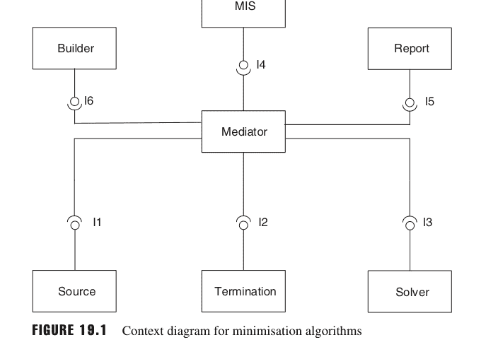

# 图 19.1 极小化算法的系统上下文图


```cpp
template <typename T>
    class TerminatorT
{
private:
    T tol;    // Tolerance

public:
    TerminatorT() : tol(1.0e-6) {}
    TerminatorT(T tolerance) : tol(tolerance) {}

    bool operator()(T a, T b)
    {
        T m = 0.5*std::abs(a + b);
        if (m <= 1.0)
        {
            if (std::abs(b - a) < tol)
            {
                return true;
            }
            return false;
        }

        if (std::abs(b - a) < tol*m)
        {
            return true;
        }
        return false;
    }
};
```

典型的报告和 MIS 类为：

```cpp
template <typename T>
    class ReportingDefault
{
private:

public:
    ReportingDefault()  {}

    void operator () (T a, T b, T fa, T fb)
    {
        std::cout << "** Final report ** \n";
        std::cout << std::setprecision(16)
                  << "Bracket + avg Value:  ["<< a << ", " <<b<< " ]"
                  << "<< (a+b)/2 << '\n';
        std::cout << std::setprecision(16) << "Averaged function value "
                  << 0.5*(fa + fb) << "\n";
    }
};
```

```cpp
template <typename T>
    class MISDefault
{
private:

public:
    MISDefault() {}

    void operator () (T a, T b, T fa, T fb)
    {
        std::cout << std::setprecision(12)
            << "***Stats [A,B] [" << a << "," << b << "]\n";
        std::cout << std::setprecision(12)
            << "***Stats [fA,fB] [" << fa << "," << fb << "]\n";
    }
};
```

##### 19.7.1 使用中介者减少耦合

中介者设计模式（GOF, 1995）是一种强大的技术，用于封装一组对象和模块之间的交互。其使用通过确保对象不显式相互引用来促进松散耦合。在当前问题中，我们按如下方式实现（默认）中介者类：

```cpp
template <typename T>
    class Mediator
{
private:

    T A, B, fA, fB;
    IFunctionType<T> f;
    ITerminationType<T> stop;
    ISolverType<T> sol;
    IMISType<T> mis;
    IReportType<T> rep;

public:                                            // Interfaces
    Mediator(const IFunctionType<T> func, T a, T b,    // 1
        const ITerminationType<T>& stopping,          // 2
        const ISolverType<T>& solver,                 // 3
        const IMISType<T>& statistics,                // 4
        const IReportType<T>& report)                 // 5
    : f(func), stop(stopping), sol(solver), rep(report)
    {
        A = a; B = b; fA = fB = 0.0;
        mis = statistics;
    }

    void run()
```

```
med3.run();
std::cout << "\nend\n";
}

// Functions suitable for fixed point
double func7(double x)
{ // g(x) = x - f(x)/m (g(x) == x <=> f(x) == 0)

    return std::cos(x);
}

double func8(double x)
{ // x^2 = 2 => x = (x + 1/x)/2

    return 0.5*(x + 25.0 / x);
}

double func9(double x)
{ // Fibonacci x^3 + 2 x^2 + 10x - 20 = 0 ==> x = 1.368 808 107

    return 20.0 / (x*x + 2.0*x + 10.0);
}

void TestAitken()
{
    // Define common satellite systems
    TerminatorI<double> stopping(1.0e-7);
    IMISType<double> mis = [] (double a, double b, double fa, double fb) {};
    ReportingDefault<double> report;

    // Test on functions 7, 8 and fibonacci

    std::cout << "\nstart Aitken\n";
    AitkenFixedPointSolver<double> solver1(func7, -1.0,1.5, 0.7, stopping);
    AitkenFixedPointSolver<double> solver2(func8, 1, 2, 1, stopping);
    AitkenFixedPointSolver<double> solver3(func9, 1,2, 1,stopping);

    // Build mediators
    Mediator<double> med1(func7, 0,2, stopping, solver1, mis, report);
    Mediator<double> med2(func8, 1,2, stopping, solver2, mis, report);

    Mediator<double> med3(func9, 1,2, stopping, solver3, mis, report);

    // Run the algos
    med1.run();
    med2.run();
    med3.run();
    std::cout << "\nend\n";
}
```

我们建议您运行程序并检查输出。

### 19.10 总结与结论

在本章中，我们基于第 9 章中定义的流程设计并实现了一个用于单变量优化问题的软件框架。该框架应可定制和扩展，因此我们选择了图 19.1 中的上下文图。从某种意义上说，这是最具远见的章节，因为它涉及了我们在本书中介绍的许多主题。我们在此总结如下：

- 构造性数学（Bishop, 1967），特别是 Banach 不动点定理。
- 数值算法，在本例中为寻找函数最小值的算法。
- PBD 解决方案和标准化系统接口。
- C++ 语法和语言特性的应用。
- 计算隐含波动率。

我们将一些更技术性的细节和代码下放到附录 2，包括高阶数学函数和多元优化。

本章的方法和技术可应用于数值分析应用中的软件库和框架的构建，例如插值和数值求积。

### 19.11 练习与项目

1. （凸函数和凹函数）
我们现在讨论凸函数和凹函数。定义在区间 [a,b] 上的实函数 f，其中 −∞ < a < b < ∞，如果满足：

f((1 − λ)x + λy) ≤ (1 − λ)f(x) + λf(y) for x,y ∈ (a,b) and 0 ≤ λ ≤ 1.

则称为凸函数。函数 f 被称为凹函数，如果函数 F = −f 是凸的，即：

f((1 − λ)x + λy) ≥ (1 − λ)f(x) + λf(y).

任何凸函数的局部最小值也是全局最小值。
回答以下问题：

- a) 证明以下函数是凸的：x², x⁴, |x|ᵖ 对于 1 ≤ p, √x, log x 和 eˣ。
- b) 设函数 f 在区间 (a,b) 中递增。证明函数 A(x) = ∫ₐˣ f(t)dt, ∀x ∈ (a,b) 是凸的。
- c) 证明如果 f 和 g 是凸函数，则 m(x) = max {f(x), g(x)} 和 h(x) = f(x) + g(x) 也是凸函数。
- d) 使用三点区间搜索、Brent 和黄金分割法近似函数 f(x) = x² sin x 在 [0,π] 上的全局最大值。比较每种方法所达到的相对精度。

2. （三分搜索）
该技术在区间内寻找单峰函数的最小值或最大值。它确定最小值或最大值不可能在区间的第一三分之一或最后三分之一中。确定之后，我们继续在剩余的中间三分之一区间中搜索。

我们将方法描述如下；设区间为 (a,b) 并定义点：

$$m_1 = a + (b-a)/3$$
$$m_2 = b - (b-a)/3.$$

目标是通过修改区间 (a,b) 来寻找最小值或最大值，如以下伪代码所示：

```
if $f(m_1) < f(m_2)$, $b = m_2$ else $a = m_1$.
```

我们不断迭代，直到区间长度小于规定的大小。

回答以下问题：

- a) 基于第 19.7 节的标准接口创建实现此算法的代码。使用已呈现的示例测试代码。
- b) 当在此框架中添加此新模块时，框架是否保持稳定，即我们是否需要修改图 19.1 中的某些模块、类和接口？
- c) 将新代码应用于函数 $f(x)=(x-1)^2(x-2)^2$ 在区间 $(0,3)$ 上。它是否有效？

3. *（生成器模式（GOF, 1995））*

在图 19.1 中我们看到 *Builder* 模块的存在，其职责是创建中介者与其通信的对象。引入此模式的原因是为了将对象创建本地化到专门的工厂类中，从而避免在包含 `main()` 的文件中出现许多构造函数调用、初始化例程、if…else 逻辑等。

回答以下问题：

- a) 检查包含 `main()` 的典型文件，并确定哪些代码可以移至专门的构建器模块。
- b) 确定构建器的接口 $I6$（它通常返回新创建对象的元组）以及它如何与图 19.1 中的中介者类交互。
- c) 创建一个具体的构建器类并使用已知输出的示例测试新代码。
- d) 使用构建器在多大程度上促进了代码的可维护性，以及在何种情况下会应用它？

4. *（基于策略的设计，中型项目）*

在第 19.7 节中，我们应用了第 9 章的设计方法来为单变量函数优化创建一个框架。我们为图 19.1 中的情况设计了上下文图，其中接口（每个接口由单个方法组成）使用 `std::function` 定义（称为方法 I 解决方案）。然后我们可以通过使用自由函数、lambda 函数、静态方法和对象方法实例化这些接口来自定义它们。

本练习的目标是使用我们在第 9 章中介绍的另外两种设计方法实现图 19.1 中的设计蓝图：

- 方法 II：创建一个模板化中介者类，其模板参数为图 19.1 中的其他模块。我们使用第 9.3.4 节玩具示例中讨论的私有继承。这是一种基于策略的设计方法。


方法 III：创建一个模板化中介类，其模板参数为图 19.1 中的其他模块。但在这种情况下，我们使用的是组合（而不是私有继承），其精神与我们在第 9.5.1 节中给出的 C# 示例相同，即：

```
/*
interface IInput
{
    string message();
}

interface IOutput
{
    void print(string s);
}
*/

class SUD<I,O>
    // where I : IInput
    // where O : IOutput
{
    private I i_;
    private O o_;

    public SUD(I i, O o)
    {
        i_ = i;
        o_ = o;
    }

    public void run()
    {
        o_.print(i_.message());
    }
}
```

在撰写本文时，C++ 不支持概念（C# 中的约束），这就是上述注释代码的原因。尽管如此，该代码是 C++ 等效实现的一个起点。

回答以下问题：

- a) 为图 19.1 的设计蓝图实现方法 II，并使用本章中已讨论的示例测试代码。
- b) 为图 19.1 的设计蓝图实现方法 III，并使用本章中已讨论的示例测试代码。
- c) 比较基于三种方法的解决方案和代码。你能根据运行时间效率、互操作性和可维护性对它们进行评级吗？可读性如何？

### 19.12 附录：巴拿赫不动点定理

我们处理集合和其他数学结构，其中可以为其任意两个元素指定一个 *距离函数* 或 *度量*。设 X 是一个集合，x、y 和 z 是 X 的元素。那么 X 上的 *度量 d* 是两个变量的非负实值函数，具有以下性质：

- D1: d(x, y) ≥ 0；当且仅当 x = y 时 d(x, y) = 0
- D2: d(x, y) = d(y, x) （对称性）
- D3: d(x, y) ≤ d(x, z) + d(z, y)，其中 x, y, z ∈ X （三角不等式）。

距离的概念是两个实数之差的概念或 n 维欧几里得空间中两点之间距离概念的推广，例如。

在集合 X 上定义了度量 d 后，我们就说对 (X, d) 是一个 *度量空间*。我们给出一些度量和度量空间的例子：

- 1. 集合 X 为区间 [a, b] 上所有一元连续实值函数（我们用 C[a, b] 表示该空间），我们定义度量：

    d(f, g) = max |f(t) − g(t)|, t ∈ [a, b].

    那么 (X, d) 是一个度量空间。

- 2. n 维欧几里得空间，由实数或复数的向量组成，形式为：

    x = (x₁, …, xₙ), y = (y₁, …, yₙ)

    度量为 d(x, y) = max{|xⱼ − yⱼ|, j = 1, …, n} 或使用范数记号 d(x, y) = ‖x − y‖∞。

- 3. 设 L²[a, b] 为区间 [a, b] 上所有平方可积函数：

    ∫ₐᵇ |f(x)|² dx < ∞.

    我们可以在该空间中定义两个函数 f 和 g 之间的距离，度量为：

    d(f, g) = ‖f − g‖₂ ≡ { ∫ₐᵇ |f(x) − g(x)|² dx }¹/².

    该度量空间在许多数学分支中都很重要，包括概率论和随机演算。

- 4. 设 X 为非空集合，度量 d 定义为：

    d(x, y) = { 0, if x = y
                1, if x ≠ y }.

    那么 (X, d) 是一个度量空间。你应该验证度量 d 满足公理 D1、D2 和 D3。

数学中许多结果和定理对度量空间有效，这一事实意味着相同的结果对这些空间的所有特化也有效。

我们定义度量空间 X 中元素序列收敛到 X 中可能存在也可能不存在的某个元素的概念。我们引入一些定义，我们对实数集陈述，但它们对任何有序域都有效，这基本上是一个数集，其中每个非零元素都有乘法逆元，并且该域中的数之间存在某种排序。

### 定义 19.1

实数线 ℝ 上的元素序列 {aₙ} 称为收敛，如果存在元素 a ∈ ℝ 使得对于 ℝ 中的每个正元素 ε 都存在正整数 n₀ 使得：

|aₙ − a| < ε 当且仅当 n ≥ n₀ 时。

一个简单的例子是证明序列 {1/n}，n ≥ 1 的有理数收敛于 0。为此，设 ε 为正实数。则存在正整数 n₀ > 1/ε 使得 |1/n − 0| = 1/n < ε 当且仅当 n ≥ n₀ 时。

我们注意到定义 19.1 也适用于任何有序域。

### 定义 19.2

有序域 F 的元素序列 {aₙ} 称为柯西序列，如果对于 F 中每个 ε > 0 都存在正整数 n₀ 使得：

|aₙ − aₘ| < ε 当且仅当 m, n ≥ n₀ 时。

换句话说，柯西序列中的项彼此接近，而收敛序列中的项接近某个固定元素。收敛序列总是柯西序列，但属于域 X 的柯西序列不一定收敛到 X 中的元素。为了举例，设 X 为有理数集；考虑由斐波那契递推关系定义的整数序列：

- F₀ = 0
- F₁ = 1
- Fₙ = Fₙ₋₁ + Fₙ₋₂, n ≥ 2.

通过求解该递推关系可以证明：

Fₙ = 1/√5 [αⁿ − βⁿ], where α = (1+√5)/2, β = (1−√5)/2.

现在定义有理数序列：

xₙ = Fₙ / Fₙ₋₁, n ≥ 2.

我们可以证明：

$$\lim_{n\to\infty} x_n = \alpha = \frac{1+\sqrt{5}}{2}\ \text{(the Golden Ratio)}$$

并且该极限不是有理数。顺便说一下，斐波那契数在许多应用中很有用，例如优化（寻找函数的最小值或最大值）和随机数生成。

我们现在定义一个 *完备度量空间* $X$ 为其中每个柯西序列都收敛到 $X$ 中的元素的空间。完备度量空间的例子有：

- 欧几里得空间 $\mathbb{R}^n$。
- 区间 $[a,b]$ 上连续函数的度量空间 $C[a,b]$。
- 根据定义，巴拿赫空间是完备的赋范线性空间。赋范线性空间具有基于范数的度量，即 $d(x,y)=\|x-y\|$。
- $L^p(0,1)$ 是由范数定义的函数 $f:[0,1]\to\mathbb{R}$ 的巴拿赫空间：

$$\|f\|_p = \left(\int_0^1 |f(x)|^p dx\right)^{1/p} < \infty\ \text{for}\ 1 \le p < \infty.$$

### 定义 19.3

度量空间 X 中集合 $E$ 的 *开覆盖* 是 X 的开子集的集合 $\{G_j\}$ 使得 $E \subset \bigcup_j G_j$。最后我们说度量空间 X 的子集 $K$ 是 *紧致* 的，如果 K 的每个开覆盖都包含一个有限子覆盖，即 $K \subset \bigcup_{j=1}^N G_j$ 对于某个有限的 N。

我们现在考察将一个度量空间映射到另一个度量空间的函数。特别是，我们讨论 *连续性* 和 *利普希茨连续性* 的概念，因为它们在证明常微分方程和随机微分方程解的存在性和唯一性时使用，我们将在第 24 章介绍该主题。

在度量空间的背景下讨论这些概念很方便。

### 定义 19.4

设 $(X,d_1)$ 和 $(Y,d_2)$ 为两个度量空间。函数 $f$ 从 X 到 Y 称为在点 $a \in X$ *连续*，如果对于每个 $\varepsilon > 0$ 存在 $\delta > 0$ 使得：

$$d_2(f(x),f(a)) < \varepsilon\ \text{whenever}\ d_1(x,a) < \delta.$$

我们应该注意，这个定义指的是函数在单个点的连续性。因此，函数可以在某些点连续而在其他点不连续。

### 定义 19.5

函数 $f$ 从度量空间 $(X,d_1)$ 到度量空间 $(Y,d_2)$ 称为在集合 $E \subset X$ 上 *一致连续*，如果对于每个 $\varepsilon > 0$ 存在 $\delta > 0$ 使得：

$$d_2(f(x),f(y)) < \varepsilon\ \text{whenever}\ x,y \in E\ \text{and}\ d_1(x,y) < \delta.$$

如果函数 $f$ 一致连续，则它是连续的，但反之不一定成立。一致连续性适用于集合 $E$ 中的所有点，而“正常”连续性适用于单个点。


**定义 19.6** 设 $f:[a,b]\to\mathbb{R}$ 是一个实值函数，并假设我们能找到两个常数 $M$ 和 $\alpha$，使得对于任意 $x,y\in[a,b]$ 且 $\alpha>0$，有 $|f(x)-f(y)|\le M|x-y|^\alpha$。那么我们称 $f$ 满足阶为 $\alpha$ 的利普希茨条件，并记 $f\in Lip(\alpha)$。

我们来看一个例子。设 $f(x)=x^2$ 在区间 $[a,b]$ 上。则：

$$|f(x)-f(y)|=|x^2-y^2|=|(x+y)(x-y)|\le |x+y|\,|x-y|$$
$$\le (|x|+|y|)|x-y|$$
$$\le M|x-y|,\quad\text{其中 }M=2\max(|a|,|b|).$$

因此，$f\in Lip(1)$。与利普希茨连续相关的一个概念是压缩映射。

**定义 19.7** 设 $(X,d_1)$ 和 $(Y,d_2)$ 是度量空间，其中 $d_1$ 和 $d_2$ 是度量。如果存在数 $\lambda\in(0,1)$，使得对于所有 $x,y\in X$，有 $d_2(T(x),T(y))<\lambda d_1(x,y)$，则称从 $X$ 到 $Y$ 的变换 $T$ 为 *压缩映射*。

一般来说，压缩映射将一对点映射为另一对距离更近的点。压缩映射总是连续的。

发现和应用压缩映射的能力具有相当大的理论和数值价值。例如，可以利用不动点定理证明随机微分方程（SDE）有唯一解（Bharucha-Reid, 1972; Tsokos and Padgett, 1974）。一些具体的例子有：

- 布劳威尔不动点定理。
- 角谷不动点定理。
- 巴拿赫不动点定理。
- 绍德尔不动点定理。

我们这里关注的是如下不动点定理。

**定理 19.1** *(巴拿赫不动点定理)* 设 $T$ 是完备度量空间 $X$ 到其自身的一个压缩映射：

$$d(T(x),T(y))\le\lambda d(x,y),\quad \lambda\in(0,1).$$

则 $T$ 有唯一不动点 $x$。此外，如果 $x_0$ 是 $X$ 中任意一点，序列 $\{x_n\}$ 由公式 $x_n=T(x_{n-1})$（$n=1,2,\ldots$）递归定义，那么 $\lim x_n=\bar{x}$ 且：

$$d(\bar{x},x_n)\le\frac{\lambda}{1-\lambda}d(x_{n-1},x_n)\le\frac{\lambda}{1-\lambda}d(x_0,x_1).\tag{19.25}$$

一般情况下，我们假设 $X$ 是巴拿赫空间，$T$ 是 $X$ 到其自身的线性或非线性映射。如果 $Tx=x$，则称 $x$ 是 $T$ 的不动点。

# 第 20 章

# 偏微分方程的有限差分法：数学背景

## 20.1 引言与目标

在本章中，我们概述用于衍生品定价的线性单因子偏微分方程。在数学上，这些是依赖于时间的*对流–扩散–反应*方程。我们研究它们的定性性质，包括将其转化为更易处理的形式。在大多数情况下，这些偏微分方程没有解析解，因此我们使用数值方法。在本书中，我们选择流行的*有限差分法*（FDM），因为它是数值分析中一个成熟的领域，易于实现，并且具有良好的运行时性能和精度特性。我们关注描述布莱克–舒尔斯方程及其推广的偏微分方程，而且我们的许多结果适用于一系列单因子和双因子偏微分方程。

本章的目标是介绍足够的数学知识来对偏微分方程进行建模，用 FDM 算法对其近似，然后将这些算法映射到 C++。我们特别关注使用布莱克–舒尔斯偏微分方程进行期权定价。我们假设读者对 PDE 和 FDM 有一定了解。关于背景知识，关于时间依赖的抛物型偏微分方程的 FDM 及其数值近似，可参见 Thomas (1995)；关于计算金融中的应用，包括有限差分格式的数值分析，参见 Duffy (2006)。

为学习本章及后续章节做准备的一个好方法是复习第 13 章中的主题，尤其是第 13.3 节和第 13.4 节（Crank–Nicolson 和 ADE 方法）、第 13.2 节（求解三对角矩阵方程组）以及第 13.5 节（样条插值）。

本章内容的复杂度处于中等水平。我们试图让对 PDE 和 FDM 理论接触较少的读者也能理解。对于这类读者，我们推荐 Smith (1978) 作为实用入门。计算金融应用方面的内容参见 Duffy (2006)。

## 20.2 一般对流–扩散–反应方程与布莱克–舒尔斯偏微分方程

我们概述 *n* 维空间中的对流–扩散–反应方程，然后讨论布莱克–舒尔斯方程的特例。

一般来说，相关的偏微分方程是 $n$ 个空间变量和一个时间变量的*对流–扩散–反应*类型。空间变量对应于基础金融量，如资产、波动率或利率，而非负时间变量 $t$ 以*到期日* $T$ 为上界。空间变量通常定义在各自的正半平面内。

我们通过抛物型的*初边值问题*来对衍生品建模。为此，考虑一般抛物型方程：

$$L u \equiv \sum_{i,j=1}^{n} a_{ij}(x,t)\frac{\partial^{2}u}{\partial x_{i}\partial x_{j}} + \sum_{j=1}^{n} b_{j}(x,t)\frac{\partial u}{\partial x_{j}} + c(x,t)u - \frac{\partial u}{\partial t} = f(x,t)\tag{20.1}$$

其中函数 $a_{ij}, b_{j}, c$ 和 $f$ 是实值的，$a_{ij}=a_{ji}$，且：

$$\sum_{i,j=1}^{n} a_{ij}(x,t)a_{i}a_{j} > 0 \quad \text{如果}\quad \sum_{j=1}^{n} a_{j}^{2} > 0.\tag{20.2}$$

在方程 (20.1) 中，变量 $x$ 是 $n$ 维空间中的一个点，$t$ 被视为正时间变量。方程 (20.1) 是描述许多衍生品类型行为的一般方程。例如，在一维情形（$n=1$）下，它退化为布莱克–舒尔斯方程（这里 $t^{*}=T-t$）：

$$\frac{\partial V}{\partial t^{*}} + \frac{1}{2}\sigma^{2}S^{2}\frac{\partial^{2}V}{\partial S^{2}} + (r-D)S\frac{\partial V}{\partial S} - rV = 0\tag{20.3}$$

其中 $V$ 是衍生品类型（例如看涨期权或看跌期权），$S$ 是标的资产（或股票），$\sigma$ 是常数波动率，$r$ 是常数利率，$D$ 是常数股息。方程 (20.3) 是单因子情形，它可以推广到多变量情形，例如：

$$\frac{\partial V}{\partial t^{*}} + \sum_{j=1}^{n}(r-D_{j})S_{j}\frac{\partial V}{\partial S_{j}} + \frac{1}{2}\sum_{i,j=1}^{n}\rho_{ij}\sigma_{i}\sigma_{j}S_{i}S_{j}\frac{\partial^{2}V}{\partial S_{i}\partial S_{j}} - rV = 0.\tag{20.4}$$

该方程模拟多资产环境。在这种情况下，$\sigma_{i}$ 是第 $i$ 个资产的波动率，$\rho_{ij}$ 是资产 $i$ 和 $j$ 之间的相关系数（$-1 \le \rho_{ij} \le 1$）。$D_{j}$ 是资产 $j$ 的常数股息。此时我们看到，方程 (20.4) 的椭圆部分（$t^{*}=T-t$，其中 $T$ 是到期日）可以写成三项之和：

- 现金头寸赚取的利息：

$$r\left(V - \sum_{j=1}^{n} S_{j}\frac{\partial V}{\partial S_{j}}\right).\tag{20.5}$$

- 股息收益：

$$\sum_{j=1}^{n} D_j S_j \frac{\partial V}{\partial S_j}.$$

(20.6)

- 对冲成本或滑点：

$$-\frac{1}{2}\sum_{i,j=1}^{n} \rho_{ij}\sigma_i\sigma_j S_i S_j \frac{\partial^2 V}{\partial S_i \partial S_j}.$$

(20.7)

我们关注的是发现稳健的数值格式，无论方程 (20.4) 中参数值的大小如何，这些格式都能产生可靠且精确的结果。

方程 (20.1) 一般有无穷多个解。为了定义一个唯一解，我们需要定义一些约束条件。为此，我们为 (20.1) 定义初始条件和边界条件。我们通过定义方程 (20.1) 被认为成立的空间来实现这一点。一般情况下，我们注意到与方程 (20.1) 相关的边界条件有三类，分别是：

- 第一边值问题（狄利克雷问题）。
- 第二边值问题（诺伊曼、罗宾问题）。
- 柯西问题。

第一边值问题关注方程 (20.1) 在有界区域 $D = \Omega \times (0,T)$ 中的解，其中 $\Omega$ 是 $\mathbb{R}^n$ 的有界子集，$T$ 是正数。在这种情况下，我们求方程 (20.1) 满足以下条件的解：

$$u|_{t=0}=\phi(x)\quad\text{(初始条件)}$$ $$u|_{\Gamma}=\psi(x,t)\quad\text{(边界条件)}$$

(20.8)

其中 $\Gamma$ 是 $\Omega$ 的边界。 (20.8) 中的边界条件称为狄利克雷边界条件，因为解在边界上给出。当我们对单因子情形下的单障碍和双障碍期权建模时，会出现这些条件（参见 Duffy, 2006）。当我们对变换或截断区域上的普通期权建模时，也会出现这些条件。

第二边值问题与 (20.8) 类似，区别在于不是在边界 $\Gamma$ 上给出 $u$ 的值，而是包含方向导数，如下例所示：

$$\left(\frac{\partial u}{\partial \eta}+a(x,t)u\right)=\psi(x,t),\quad x\in\Gamma.$$

(20.9)

在这种情况下，$a(x,t)$ 和 $\psi(x,t)$ 是 $x$ 和 $t$ 的已知函数，$\frac{\partial}{\partial \eta}$ 表示 $u$ 在 $\Gamma$ 处沿外法线 $\eta$ 的导数。 (20.9) 的一个特例是当 $a(x,t)\equiv0$ 时；那么


(20.9) 表示诺伊曼边界条件。最后，方程 (20.1) 在无穷区域 ℝⁿ × (0, T) 上柯西问题的解由初始条件给出：

u|_{t=0} = φ(x)  (20.10)

其中 φ(x) 是一个给定的连续函数且 u(x, t) 满足 ℝⁿ × (0, T) 中的方程 (20.1) 以及初始条件 (20.10)。该问题允许自变量 x = (x₁, ..., xₙ) 的分量取负值。柯西问题的一个特例可在对单因子欧式和美式期权建模时看到，其中 x 扮演标的资产 S 的角色。边界条件由 S = 0 和 S = ∞ 处的值给出。对于欧式看涨期权，这些条件为：

C(0, t) = 0
C(S, t) → S as S → ∞.  (20.11)

这里 C（在方程 (20.1) 中由 u 扮演的角色）是看涨期权的价格。对于欧式看跌期权，边界条件为：

P(0, t) = K e⁻ʳᵗ
P(S, t) → 0 as S → ∞.  (20.12)

这里 P（在方程 (20.1) 中由 u 扮演的角色）是代表看跌期权价格的变量，K 是执行价，r 是无风险利率，T 是到期日，t 是当前时间。

我们有时假设算子 L 在方程 (20.1) 中单因子情形下的‘规范’形式为：

Lu ≡ −∂u/∂t + σ(x, t) ∂²u/∂x² + μ(x, t) ∂u/∂x + b(x, t)u = f(x, t)  (20.13)

其中 σ、μ、b 和 f 是 x 和 t 的已知函数。

为完整起见，我们表述单因子初边值问题，其解我们希望用有限差分法近似。为此，我们定义区间 Ω = (A, B)，其中 A 和 B 是满足 A < B 的两个实数。此外，设 T > 0 且 D = Ω × (0, T)。表述如下：

求函数 u : D → ℝ¹ 使得：

Lu = −∂u/∂t + σ(x, t) ∂²u/∂x² + μ(x, t) ∂u/∂x + b(x, t)u = f(x, t) in D  (20.14)
u(x, 0) = φ(x), x ∈ Ω  (20.15)
u(A, t) = g₀(t), u(B, t) = g₁(t), t ∈ (0, T).  (20.16)

初边值问题 (20.14)–(20.16) 包含许多特例（尤其是它是 Black–Scholes 方程的推广）。

一般而言，系数 σ(x, t) 和 μ(x, t) 分别代表波动率（扩散率）和漂移（对流）。方程 (20.14) 称为对流-扩散-反应方程。它可作为许多问题的模型。这一领域已开展了大量研究，既有对连续问题的研究，也有对其离散化形式的研究（例如使用有限差分法和有限元法）。

有限差分法的精髓在于通过定义 *离散网格点* 并在这些网格点上近似该系统未知解的导数，来离散化方程 (20.14)–(20.16)。目标是找到准确的格式，可在诸如 C++ 和 C# 之类的编程语言中实现。一些典型的注意事项是：

- 所近似的偏微分方程可能需要以某种方式预处理，例如将其从半无限域上的方程变换为有界域上的方程。
- 根据精度、效率和可维护性等要求确定使用哪些具体的有限差分格式。
- 需要解决的基本困难：*对流主导*、避免振荡以及如何处理不连续的初始条件等。
- 在实现之前开发算法并组装离散方程组。

## 20.3 PDE 预处理

PDE 定义在由变量 x（底层空间）和时间 t 定义的二维空间区域中。关于 x 变量，其取值范围可以为：

−∞ < x < ∞（无限域）
0 < x < ∞（半无限域）
A < x < B，其中 −∞ < A < B < ∞（有界域）。

用 FDM 近似 PDE 时，底层域必须变换为有界域。因此，我们可以在用 FDM 近似之前以某种方式修改 PDE：

- 改变 PDE 的系数。
- 将无限或半无限域截断为有界域。
- 通过自变量的改变将无限或半无限域变换为有界域。
- 改变 PDE 的结构（例如，我们可以使用 *积分因子* 将非守恒 PDE 变换为守恒 PDE）。

确定修改 PDE 时的后果非常重要。我们现在讨论上述每个主题。

### 20.3.1 对数变换

这是一种流行的方法，用于将半无限区间上的 Black–Scholes PDE 变换为无限区间上具有常系数的 PDE。例如，我们定义 y = \log S 并在方程 (20.3) 中使用该新变量来产生具有常系数的 PDE：

$$\frac{\partial V}{\partial t^*}+\frac{1}{2}\sigma^2\frac{\partial^2 V}{\partial y^2}+\nu\frac{\partial V}{\partial y}-rV=0 \quad \text{where } \nu=r-D-\frac{1}{2}\sigma^2$$ (20.17)

在某些情况下这在计算上可能更具吸引力。此外，我们可以通过将方程 (20.17) 写成 *守恒形式* 来消除对流项的显式依赖：

$$\frac{\partial V}{\partial t^*}+A\frac{\partial}{\partial y}\left(B\frac{\partial V}{\partial y}\right)-rV=0 \quad \text{where } A=\frac{1}{2}\sigma^2e^{cy},\ B=e^{-cy},\ c=\frac{2\nu}{\sigma^2}.$$ (20.18)

### 20.3.2 将 PDE 化为守恒形式

方程 (20.18) 是应用积分因子将 PDE 化为更简单形式后得到的一个例子。我们现在将该技术应用于常微分方程：

$$Lu=a(x)u''+b(x)u'+c(x)u.$$ (20.19)

我们通过变量替换将方程 (20.19) 变换为更方便的形式（所谓的 *正规形式*）。为方便起见，我们假设方程 (20.19) 中的右端项 $f$ 为零。为此，定义：

$$p(x)=\exp\int\frac{b(x)}{a(x)}dx,\quad q(x)=\frac{c(x)p(x)}{a(x)}.$$ (20.20)

如果我们用 $p(x)/a(x)$ 乘以方程 (20.19)（注意 $f=0$）我们得到：

$$\frac{d}{dx}\left(p(x)\frac{du}{dx}\right)+q(x)u=0.$$ (20.21)

该方程有时被称为 *自伴形式*。进一步的变量替换：

$$\zeta=\int\frac{dx}{p(x)}$$ (20.22)

使我们能够将 (20.21) 写成更简单的形式：

$$\frac{d^2u}{d\zeta^2}+p(x)q(x)u=0.$$ (20.23)

一般而言，方程 (20.23) 比方程 (20.19) 更易求解。

### 20.3.3 域截断

计算金融中许多 PDE 定义在半无限区间上。不幸的是，无穷大并不很好地适合计算机，我们于是决定将域变换为有界域。一个常见的经验法则是将截断的远场边界定义为执行价的三或四倍。换句话说，创建了一个人工边界（参见 Kangro and Nicolaides, 2000 详细分析）。作者处理的数学问题包括：

- 证明 PDE 的解（原始形式和截断形式）在存在性和唯一性上成立（Friedman, 1992，尤其是该书第 2 章第 10 定理）。
- 截断 PDE 的解是原始 PDE 解的准确近似。
- 计算人工边界并在其上定义边界条件。

对这些主题的详细讨论超出了本书范围。关于最后一个主题，一种方法是使用 PDE 的初始条件（在期权定价问题中为 payoff 函数）在人工边界上定义狄利克雷边界条件。这可能是确定给定问题最准确边界条件时的一种策略。

### 20.3.4 域变换

与其截断域（在第 20.3.3 节中），我们可以将无限或半无限域映射到有界域，例如映射到区间 (0, 1)。这是一种优雅的方法，可避免我们截断域。我们已在 Duffy and Germani (2013) 中讨论了该技术；更多关于双因子问题的例子可在 Lewis (2016) 和 Wilmott, Lewis and Duffy (2014) 中找到。事实上，我们在第 23 章中详细讨论了该技术。

域变换的思想是在单位区间 (0, 1) 上定义一个新的独立空间变量。我们取变换：

y = x / (x + α)  (20.24)

其中 α 是用户可选择的尺度因子。我们发现该变换对我们的应用很有用，我们还指出存在其他可能的变换，例如：

y = tanh αx
y = 1 / (1 + αx)
y = e^{-αx}
y = 1 + e^{-αx}
y = coth αx.  (20.25)

这些和其他公式在流体动力学和计算金融中使用。例如，(20.25) 中的第二个公式已用于双因子抵押品建模中，其中


自变量是房价和利率（Sharp, 2006）。第三种变换适用于常数方差弹性（CEV）模型。我们将在第31章和第32章讨论CEV模型。

确定了变换（20.24）后，我们现在可以将PDE（20.13）用新的坐标 $(y,t)$ 重写。为此，我们进行一些代数运算。首先，逆变换为：

$$
x = \frac{\alpha y}{1-y}
$$

并且进一步：

$$
\frac{\partial y}{\partial x} = \frac{(1-y)^2}{\alpha}, \qquad
\frac{\partial^2 y}{\partial x^2} = -\frac{2}{\alpha}(1-y)^3
$$

$$
\frac{\partial u}{\partial x} = \alpha^{-1}(1-y)^2 \frac{\partial u}{\partial y}
$$

$$
\frac{\partial^2 u}{\partial x^2} = \alpha^{-2}(1-y)^2 \frac{\partial}{\partial y}\left\{ (1-y)^2 \frac{\partial u}{\partial y} \right\}.
$$

一般而言，我们对以下形式的对流-扩散-反应PDE进行建模：

$$
\frac{\partial u}{\partial t} = a(x,t)\frac{\partial^2 u}{\partial x^2} + b(x,t)\frac{\partial u}{\partial x} + c(x,t)u + f(x,t), \quad 0 < x < \infty. \tag{20.26}
$$

应用变换（20.24）时，我们可以将PDE（20.26）变换为涉及变量 $y$ 的方程，具有新的（修正的）漂移和扩散项：

$$
\frac{\partial u}{\partial t} = A(x,t)\frac{\partial^2 u}{\partial y^2} + B(x,t)\frac{\partial u}{\partial y} + C(y,t)u + F(y,t), \quad 0 < x < \infty. \tag{20.27}
$$

在计算金融中，漂移和扩散项往往是 $x$ 的低阶单项式，变换后它们将是低阶多项式的乘积，例如当 $\alpha = 1$ 时：

$$
x^\beta \frac{\partial^2 u}{\partial x^2}
= \left(\frac{y}{1-y}\right)^\beta (1-y)^2 \frac{\partial}{\partial y}\left\{ (1-y)^2 \frac{\partial u}{\partial y} \right\}
= y^\beta (1-y)^{2-\beta} \frac{\partial}{\partial y}\left\{ (1-y)^2 \frac{\partial u}{\partial y} \right\}
$$

并且

$$
x^\beta \frac{\partial u}{\partial x} = y^\beta (1-y)^{2-\beta} \frac{\partial u}{\partial y}, \quad \text{for } \beta \in \mathbb{R}.
$$

我们现在考察Black–Scholes PDE：

$$
\frac{\partial V}{\partial t} = \frac{1}{2}\sigma^2 S^2 \frac{\partial^2 V}{\partial S^2} + rS \frac{\partial V}{\partial S} - rV, \quad 0 < S < \infty, \ 0 < t < T. \tag{20.28}
$$

不等式（20.29）表明 $u$ 的增长被其初始值和边界值所限制。有趣的是，在特殊情况 $b \equiv 0$ 且 $f \equiv 0$ 时，我们可以推导出热方程的最大值和最小值原理。

### 推论 20.1

假设定理 20.2 的条件得到满足，并且在方程（20.13）中 $b \equiv 0$，$c \equiv 0$，$a \equiv 1$ 且 $f \equiv 0$。则函数 $u(x,t)$ 在 $\Gamma$ 上取得其最小值和最大值，即：

$$
m_1 = \min u(x,t) \le u(x,t) \le \max\ u(x,t) \equiv m_2.
$$

定理 20.1 和 20.2 以及推论 20.1 的结果非常有吸引力：你无法从正输入得到解 $u$ 的负值。我们将为逼近（20.13）的有限差分格式产生类似的结果，并且我们将展示如何通过 *离散最大值原理* 证明稳定性，而无需诉诸更受限制且被误用的 *von Neumann 稳定性技术*。我们现在以一个结果结束本节，该结果在证明（20.13）在无界域中的解的正性时具有特别重要的意义，例如在欧洲和美式期权问题中即为这种情况。

### 定理 20.3

（Cauchy问题的最大值原理）设 $u(x,t)$ 在 $D = \mathbb{R}^n \times (0,T)$ 中连续且有下界，即 $u(x,t) \ge -m$，$m > 0$。进一步假设 $u(x,t)$ 在 $D$ 中具有到 $x$ 的二阶和到 $t$ 的一阶的连续导数，并且 $Lu \le 0$。设函数 $\sigma$、$\mu$ 和 $b$ 满足：

$$
|\sigma(x,t)| \le M(x^2 + 1), \quad |\mu(x,t)| \le M\sqrt{x^2 + 1}, \quad b(x,t) \le M.
$$

则若 $u(x,0) \ge 0$，则 $u(x,t) \ge 0$ 在 $D$ 处处成立。

我们可以将定理 20.3 应用于单因子Black–Scholes方程，以使我们确信期权的价格永远不会取负值。

## 20.5 FICHERA 理论

再次考察PDE（20.13）我们看到它在 $x$ 中具有二阶导数。我们现在将注意力限制在PDE定义在单位区间 $(0,1)$ 的情形。然后在点 $\{0,1\}$ 处添加边界条件的可能性有两种互斥的情况：

- 选项 1：不需要也不允许边界条件。
- 选项 2：需要边界条件并且可以确定。

确定适当的边界条件的主题有些模糊。在本节中，我们定义一个过程来帮助我们为具有 *非负特征* 形式的一般抛物型偏微分方程（Oleinik and Radkevic, 1973）找到数学上和金融上适当的边界条件，特别是对于衍生品定价中的单因子和多因子PDE。为此，我们讨论 *Fichera 理论*。

Fichera 理论适用于一系列椭圆、抛物和双曲PDE，并且对于其系数在 $n$ 维空间中有界域 $\Omega$ 的某些边界上为零的PDE特别有用（更多信息请参见 Fichera, 1956, Oleinik and Radkevic, 1973）。我们将该域、其边界 $\Sigma$ 和内法向单位向量 $\nu$ 描绘在图 20.1 中。

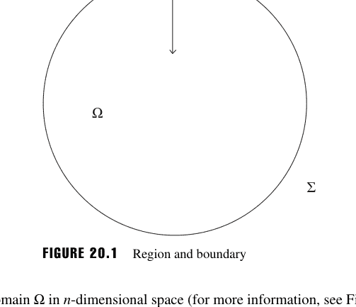

**图 20.1** 区域和边界

让我们考察由以下定义的椭圆方程：

$$
Lu \equiv \sum_{i,j=1}^n a_{ij} \frac{\partial^2 u}{\partial x_i \partial x_j} + \sum_{i=1}^n b_i \frac{\partial u}{\partial x_i} + cu = f \quad \text{in } \Omega \tag{20.31}
$$

其中：

$$
\sum_{i,j=1}^n a_{ij} \xi_i \xi_j \ge 0 \quad \text{in } \Omega \cup \Sigma \quad \forall \xi = (\xi_1, \ldots, \xi_n) \in \mathbb{R}^n. \tag{20.32}
$$

特征形式（20.32）在大多数情况下严格为正，但我们感兴趣的是它为零的地方，特别是边界 $\Sigma$ 的子集上它为零的地方。为此，我们定义：

$$
\Sigma_3 = \left\{ x \in \Sigma : \sum_{i,j=1}^n a_{ij} \nu_i \nu_j > 0 \right\}. \tag{20.33}
$$

只有在特征形式为零的边界上（即特征边界，亦即 $\Sigma - \Sigma_3$）我们才定义Fichera函数：

$$
b \equiv \sum_{i=1}^n \left( b_i - \sum_{k=1}^n \frac{\partial a_{ik}}{\partial x_k} \right) \nu_i \tag{20.34}
$$

其中 $\nu_i$ 是 $\Sigma$ 上内法向 $\nu$ 的第 $i$ 个分量。计算出Fichera函数后，我们然后确定其在特征边界所有部分上的符号。有三种互斥的选项：

$$
\Sigma_0 : b = 0, \qquad \Sigma_1 : b > 0, \qquad \Sigma_2 : b < 0. \tag{20.35}
$$

换句话说，边界由以下子边界组成：

$$
\Sigma \equiv \Sigma_0 \cup \Sigma_1 \cup \Sigma_2 \cup \Sigma_3.
$$

我们要求当Fichera函数为零或为正时（即 $\Sigma_0$ 和 $\Sigma_1$）不允许边界条件（BC），然后PDE（20.31）在这些边界上退化为低阶PDE。当 $b < 0$（即在 $\Sigma_2$ 上）时我们需要定义边界条件。边界条件是什么取决于具体背景。

我们将抛物型PDE写成：

$$
\frac{\partial u}{\partial t} = Lu + f \quad \text{or} \quad -\frac{\partial u}{\partial t} + Lu = -f \tag{20.36}
$$

其中椭圆算子 $L$ 已在方程（20.31）中定义。然后关于特征和非特征边界的结论与椭圆情形相同。换句话说，当我们希望计算Fichera函数时，我们关注PDE的椭圆部分。

让我们举一个例子。在此情况下我们考察在Cox–Ingersoll–Ross（CIR）利率模型下定价零息债券的PDE：

$$
\frac{\partial B}{\partial t} + \frac{1}{2}\sigma^2 r \frac{\partial^2 B}{\partial r^2} + (a - cr)\frac{\partial B}{\partial r} - rB = 0. \tag{20.37}
$$

请注意，在此情况下我们使用的是向后时间，因此与方程（20.36）相比符号有所不同。你应该意识到这一微妙之处。利用方程（20.34）中的定义我们看到Fichera函数为：

$$
b = \left( (a - cr) - \frac{\sigma^2}{2} \right) \nu \tag{20.38}
$$

其中 $\nu$ 是在 $r = 0$ 处（$\nu = 1$）或在 $r = 1$ 处（$\nu = -1$）的内单位法向。

我们感兴趣的是 $r = 0$ 的情况（因为这是该问题的唯一特征边界），我们看到每种选择在（20.35）中都可以成立，这取决于参数 $a$ 和 $\sigma$ 的相对大小：

$$
\Sigma_2 : b < 0 \rightarrow \sigma > \sqrt{2a} \quad \text{（需要BC）}
$$

$$
\Sigma_0 : b = 0 \rightarrow \sigma = \sqrt{2a} \quad \text{（不需要BC）}
$$

$$
\Sigma_1 : b > 0 \rightarrow \sigma < \sqrt{2a} \quad \text{（不需要BC）}. \tag{20.39}
$$

在最后两种情况下，我们看到不允许（或不需要）边界条件，然后PDE（20.37）退化为双曲PDE：

$$
\frac{\partial B}{\partial t} + a \frac{\partial B}{\partial r} = 0 \tag{20.40}
$$

在 $r = 0$ 上。这些结果与Tavella和Randall（2000，第126–128页）中的结论一致。一般而言，我们需要解析或数值求解（20.40）。从金融角度来看，（20.39）中Fichera函数为正的第三个条件表明利率不可能变为负值。该不等式在这种情况下称为CIR过程的 *Feller条件*。我们也已对其在Heston平方根模型中的过程进行了研究，并重现了众所周知的 *Feller条件*：

$$
\kappa\theta \geq \frac{1}{2}\sigma^2. \tag{20.41}
$$

对该主题的完整讨论以及方程（20.41）中相应的记号超出了本书的范围。关于使用有限差分方法求解Heston PDE的讨论，请参见Sheppard（2007）的论文（也可从网站 www.datasimfinancial.com 获取）。

我们总结了在应用Fichera理论确定初始边界值问题的边界条件时应采取的步骤。读者在计算Fichera函数时可能会遇到困难。数学并不难理解，但步骤必须按以下规定顺序正确执行：

- 1. 确定域的边界及其单位内法向。在许多情况下边界是与坐标轴平行的超平面的并集。
- 2. 计算导致特征边界的特征形式（方程（20.33））。
- 3. 在特征边界上计算Fichera函数（方程（20.34））。
- 4. 确定不需要边界条件的边界子集（方程（20.35））。确定在此子集上定义了何种方程。
- 5. 在Fichera函数为负的情况下，你还必须确定边界条件是什么。这在许多情况下是Dirichlet边界条件。

### 20.5.1 示例：单因子Black–Scholes PDE的边界条件

我们现在将Fichera函数（20.34）应用于第20.3.4节末尾所述的变换Black–Scholes PDE。在此情况下Fichera函数变为：

$$
b = \left( r y(1-y) - 2\sigma^2 y(1-y)^2 \right) \nu(y) \tag{20.42}
$$

其中：

$$
\nu(0) = 1, \quad \nu(1) = -1.
$$


我们因此看到菲谢拉函数在端点 \(y = 0\) 和 \(y = 1\) 处为零，在这些点处无需规定边界条件。相反，PDE 在这些点退化为如下常微分方程：

\[
\frac{\partial V}{\partial t} + rV = 0 \quad \text{at } y = 0,\ y = 1. \tag{20.43}
\]

(20.43) 的解为：

\[
V(y, t) = C(y)e^{-rt} \quad \text{at } y = 0,\ y = 1. \tag{20.44}
\]
其中因子 \(C(y)\) 可通过要求解 (20.44) 与 PDE 在点 \(y = 0,\ y = 1\) 处的初始条件相容来求得。执行此操作将导致布莱克-斯科尔斯方程的众所周知的边界条件。例如，对于看跌期权 \(C(y) = K\)。

## 20.6 有限差分格式：性质与要求

让我们回顾一下本章所取得的成果。我们已经描述了一个初边值问题 (IBVP)，其由以下组成部分构成：

- A1：对流-扩散-反应类型的 PDE。
- A2：PDE 所定义的 \((x, t)\) 空间的有界或无界区域（域）。
- A3：PDE 解所满足的边界条件。
- A4：解在 \(t = 0\) 时的初始条件（我们使用从 \(t = 0\) 到到期日的正向时间）。

在我们着手对将近似 IBVP 的有限差分格式进行编码之前，了解 IBVP 的定性性质是有利的。我们需要在开始设计算法之前对以下关注点进行良好的分析：

- A5：初始化 PDE 的系数（可能有解析公式，也可能需要校准）。特别注意小扩散或大对流项（对流主导）。
- A6：将无界域变换为有界/截断域。
- A7：确定边界条件应为何（如果此时可行；我们可能要等到可以定义数值边界条件时）。边界条件可以是狄利克雷、诺伊曼或罗宾类型。甚至可能不需要或不允许边界条件（参见第 20.5 节），我们可能最终需要在边界上求解 PDE 或 ODE。
- A8：如何处理初始条件（支付函数）中的不连续性。我们可能需要在初始条件上执行平滑操作。

通过研究相关文献并尝试将其作为 FDM 算法的一部分来实现，可以理解这些点的复杂性。为此，我们在将 PDE 映射到 FDM 时处理以下步骤：

- A9：在 \((x, t)\) 空间中创建 *离散域*；我们选择恒定网格还是自适应网格？
- A10：用 *差商* 近似时间、扩散和对流导数。
- A11：*数值边界条件*，例如点 A7 中边界条件的数值近似。
- A12：计算初始条件的离散变体，同时考虑不连续点。

我们还没到那一步！用差商近似导数会引入误差，这就引出了我们所提议使用的有限差分格式的稳定性和准确性的讨论。更详细的关注点是：

- A13：我们使用 *单步* 还是 *多步* 时间方法？
- A14：从 \(t = 0\) 到 \(t = T\) 使用何种推进格式（*显式或隐式方法*）。
- A15：我们是否创建自己的求解器在时间方向上推进（例如 Crank-Nicolson），或使用商业或开源 ODE（常微分方程）求解器，例如 Boost C++ *odeint* 库。
- A16：精度要求（*一阶、二阶、更高阶*）。
- A17：通过使用 *外推方法* 等来提高精度，例如。
- A18：将离散方程组组装成矩阵系统或非线性方程组。

这 18 个关注点构成了用有限差分方法近似线性初边值问题所需技能和行动点的相当完整的描述。我们将在本章及后续章节中看到示例。

上述步骤和行动点也适用于双因子和非线性问题。

## 20.7 示例：线性两点边值问题

我们通过考察 *时间无关的二阶两点边值问题* (TPBVPs) 进入 FDM 的领域，该问题具有定义在有界区间上的狄利克雷边界条件。TPBVPs 有趣的原因有若干：

- 我们可以用有限差分方法近似 TPBVPs，组装方程组并使用我们在第 13 章中介绍的 Thomas 或 Double Sweep 算法求解系统。这可以视为我们对布莱克-斯科尔斯 PDE 的有限差分方法处理的准备（参见练习 5）。它帮助我们深入了解在更大问题中出现的数值问题。

**水平线方法（Rothe 方法）：** 我们可以通过在 \(t\) 方向离散化将初边值问题化为 TPBVP（Ladyženskaja, Solonnikov and Ural’ceva, 1988, p. 241; Meyer, 2015, p. 61; Rothe, 1930）。例如，我们可以用全隐式方法 (BTCS)（符号参见第 13 章）对式 (20.13) 在时间上离散化，产生二阶常微分方程组：

\[
-\frac{u^{n+1} - u^n}{\Delta t} + \sigma(x, t_{n+1}) \frac{d^2 u^{n+1}}{dx^2} + \mu(x, t_{n+1}) \frac{d u^{n+1}}{dx} + b(x, t_{n+1}) u^{n+1} = f(x, t_{n+1}), \quad 0 \leq n \leq N - 1.
\]

在此情况下我们使用一阶向后差商来近似时间导数（另一种选择是基于中心差分的二阶 Crank–Nicolson 方法）。我们用适当的边界和初始条件补充这些 ODE。

- Rothe 方法对于具有不连续支付、提前行权特征以及具有跳跃和随底层 \(S\) 快速变化的布莱克-斯科尔斯方程解的问题很有用（Meyer, 2015）。
- 该示例展示了某些有限差分方法如何导致非单调格式，以及如何通过应用指数拟合方法（Duffy, 1980, 2006）使其单调化。关于两点边值问题的数值方法的详细讨论，参见 Keller (1968)。

### 20.7.1 示例

我们的目标是用有限差分格式近似初边值问题 (20.14)–(20.16)。我们首先定义一些记号。为此，我们将区间 \([A, B]\) 分成 \(J\) 个相等子区间：

\[
A = x_0 < x_1 < \ldots < x_J = B
\]

并且为了方便起见，我们假设网格点 \(\{x_j\}_{j=0}^{J}\) 等距，即：

\[
x_j = x_{j-1} + h, \quad j = 1, \ldots, J \quad (h = (B-A)/J).
\]

此外，我们将区间 \([0, T]\) 分成 \(N\) 个相等子区间：

\[
0 = t_0 < t_1 < \ldots < t_N = T
\]

有限差分方法的精髓在于用网格点 \((x_j, t_n)\) 处的差商代替式 (20.14) 中的导数。因此我们按如下方式定义 \(x\) 方向的差分算子：

\[
D_+ u_j = \frac{u_{j+1} - u_j}{h}, \qquad
D_- u_j = \frac{u_j - u_{j-1}}{h}
\]

\[
D_0 u_j = \frac{u_{j+1} - u_{j-1}}{2h}, \qquad
D_+ D_- u_j = \frac{u_{j+1} - 2u_j + u_{j-1}}{h^2}.
\]

可通过泰勒展开证明 \(D_+\) 和 \(D_-\) 是 \(\frac{\partial}{\partial x}\) 的一阶近似，而 \(D_0\) 是 \(\frac{\partial}{\partial x}\) 的二阶近似。最后，\(D_+D_-\) 是 \(\frac{\partial^2}{\partial x^2}\) 的二阶近似。

我们首先考虑以下简单的 TPBVP。我们寻找函数 \(u\) 使得：

\[
\sigma \frac{d^2 u}{dx^2} + 2 \frac{du}{dx} = 0 \quad \text{in } (0,1) \tag{20.45}
\]

\[
u(0) = 1, \quad u(1) = 0.
\]

我们假设 \(\sigma\) 为正常数。我们现在用相应的中心差分代替 (20.45) 中的导数，产生如下有限差分方法。我们寻找网格函数 \(\{U_j\}_{j=1}^{J-1}\) 使得：

\[
\sigma D_+ D_- U_j + 2D_0 U_j = 0, \quad j = 1, \ldots, J-1 \tag{20.46}
\]

\[
U_0 = 1, \quad U_J = 0.
\]

格式 (20.46) 有时称为 *中心差分格式*，是近似对流-扩散方程的流行方法。

可以验证 (20.45) 的精确解为：

\[
u(x) = \frac{e^{-2x/\sigma} - e^{-2/\sigma}}{1 - e^{-2/\sigma}}. \tag{20.47}
\]

也可以验证 (20.46) 的精确解为：

\[
U_j = \frac{\lambda^j - \lambda^J}{1 - \lambda^J}, \quad \text{where } \lambda = \frac{1 - h/\sigma}{1 + h/\sigma}. \tag{20.48}
\]

现在假设式 (20.48) 中 \(\sigma < h\)。这意味着 \(\lambda < 0\)，因此

\[
U_j - u(x_j) = \frac{\lambda^j - \lambda^J}{1 - \lambda^J} - \frac{r^j - r^J}{1 - r^J}, \qquad r = e^{-2h/\sigma}
\]

的正负取决于 \(j\) 为偶数还是奇数。此外，

\[
\lim_{\sigma \to 0} U_j = \frac{(-1)^j + 1}{2} \quad \text{if } J \text{ is odd}.
\]

因此 \(U_j\) 对于所有满足 \(\sigma < h\) 的 \(\sigma\) 以有界方式振荡。我们因此得出结论，中心有限差分格式不适用于当 \(\sigma < h\) 时问题 (20.45) 的数值求解。甚至可以证明该差分格式产生的解趋向于


当 σ → 0 时为无穷大。这个非常简单的一维例子让我们得出结论：标准的有限差分格式也会遇到类似的问题。

还有希望吗？除了中心差分之外，我们可以用迎风有限差分格式来近似 (20.45)：

```
σD₊D₋Uⱼ + 2D₊Uⱼ,   j = 1, ..., J − 1
U₀ = 1, U_J = 0.                                    (20.49)
```

(20.49) 的解为：

```
Uⱼ = (λʲ − λᴶ)/(1 − λᴶ),     λ = 1/(1 + 2h/σ).
```

我们注意到：

```
U₁ − u(x₁) = (λ − λᴶ)/(1 − λᴶ) − (r − rᴶ)/(1 − rᴶ),   r = e^{−2h/σ}
```

其中 u = u(x) 是由 (20.47) 定义的解。现在我们令 σ/h = 1，并让 J → ∞。于是：

```
U₁ − u(x₁) = 1/3 − e^{−2} = 0.197998.
```

这意味着无论 h 取多大，最大逐点误差大约为 20%。我们的结论是，对于这个问题，中心差分格式或单侧差分格式要么会产生伪振荡，要么会产生不精确的解，甚至两者兼而有之。

现在，我们针对一般的两点边值问题引入一类指数拟合格式，并将这些格式应用于 Black–Scholes 方程。指数拟合格式是稳定的，具有良好的收敛性质，并且不会产生伪振荡（Duffy, 1980）。为了说明指数拟合差分格式的动机，让我们考察两点边值问题：

```
σ d²u/dx² + μ du/dx = 0 in (A, B)
u(A) = β₀,    u(B) = β₁.                                    (20.50)
```

这里我们暂时假设 σ 和 μ 是正常数。现在我们用如下差分格式来近似 (20.50)：

```
σρD₊D₋Uⱼ + μD₀Uⱼ = 0,   j = 1, ..., J − 1
U₀ = β₀, U_J = β₁                                    (20.51)
```

其中 ρ 是拟合因子（在中心差分格式 (20.46) 的情况下，该因子恒等于 1）。现在我们选择 ρ，使得在常系数情形下，(20.50) 与 (20.51) 的解在网格点上完全相同。一些简单的计算表明，实现这一要求的参数由下式给出：

ρ = (μh)/(2σ) coth (μh)/(2σ)

其中 coth 是双曲余切函数，定义为：

coth x = (e^x + e^{-x})/(e^x - e^{-x}) = (e^{2x} + 1)/(e^{2x} - 1).

在为更一般的问题构造拟合差分格式时，将用到这个拟合因子，特别是：

σ(x) d²u/dx² + μ(x) du/dx + b(x)u = f(x)
 u(A) = β₀, u(B) = β₁
(20.52)

其中 σ、μ 和 b 是给定的连续函数，并且：

σ(x) ≥ 0,   μ(x) ≥ α > 0,   b(x) ≤ 0 对 x ∈ (A, B) 成立。

近似 (20.52) 的拟合差分格式定义为：

ρ_j^h D_+ D_- U_j + μ_j D₀ U_j + b_j U_j = f_j,   j = 1, ..., J - 1
 U₀ = β₀,   U_J = β₁
(20.53)

其中：

ρ_j^h = (μ_j h)/2 coth (μ_j h)/(2σ_j),   σ_j = σ(x_j),   μ_j = μ(x_j),   b_j = b(x_j),   f_j = f(x_j).   (20.54)

我们现在看到，拟合因子不再是一个常数，而是一个离散网格函数。

## 20.8 时间依赖偏微分方程的指数拟合格式

我们讨论如何将指数拟合格式应用于抛物型初边值问题：

Lu ≡ -∂u/∂t + σ(x,t) ∂²u/∂x² + μ(x,t) ∂u/∂x + b(x,t)u = f(x,t) in D = (A,B) × (0,T)
 u(x,0) = φ(x),   x ∈ (A,B)
 u(A,t) = g₀(t),   u(B,t) = g₁(t),   t ∈ (0,T).
(20.55)

现在我们讨论如何近似 (20.55)。特别地，我们提出在空间方向上采用指数拟合格式，在时间方向上采用全隐式离散（BTCS）。这些结果基于 Duffy (1980, 2006)，其中提出并证明了主要定理，且这些结果对依赖于 x 和 t 的系数同样成立。

我们将矩形 [A, B] × [0, T] 离散如下：

A = x₀ < x₁ < ⋯ < x_J = B (h = x_j − x_{j−1}), h 为常数
0 = t₀ < t₁ < ⋯ < t_N = T (k = T/N), k 为常数。

再次考虑方程 (20.55) 中的算子 L，其定义为：

Lu ≡ − ∂u/∂t + σ(x,t) ∂²u/∂x² + μ(x,t) ∂u/∂x + b(x,t)u.

我们用相应的差商替换该算子中的导数，并定义离散算子 L_k^h：

L_k^h U_j^n ≡ − (U_j^{n+1} − U_j^n)/k + ρ_j^{n+1} D_+ D_- U_j^{n+1} + μ_j^{n+1} D_0 U_j^{n+1} + b_j^{n+1} U_j^{n+1}. (20.56)

这里我们使用记号：

φ_j^{n+1} = φ(x_j, t_{n+1})

以及

ρ_j^{n+1} ≡ (μ_j^{n+1} h / 2) coth (μ_j^{n+1} h / (2 σ_j^{n+1})).

定义了算子 L_k^h 之后，我们现在构造近似系统 (20.55) 的全离散格式。我们求一个离散函数 {U_j^n}，使得：

L_k^h U_j^n = f_j^{n+1}, j = 1, …, J − 1, n = 0, …, N − 1
U_0^n = g_0(t_n), U_J^n = g_1(t_n), n = 0, …, N
U_j^0 = φ(x_j), j = 1, …, J − 1. (20.57)

这是一个单步隐式格式。我们希望证明格式 (20.57) 是稳定的，并且与初边值问题是相容的。我们将通过离散最大值原理而不是 von Neumann 稳定性分析来证明 (20.57) 的稳定性。von Neumann 方法广为人知，但离散最大值原理更一般、更易于理解，在数学上也更严格。它也是证明有限差分格式稳定性的事实上标准技术。

### 引理 20.1 设离散函数 $w_j^n$ 在离散网格域内部满足 $L_k^h w_j^n \le 0$，且在离散边界上满足 $w_j^n \ge 0$。则：

$w_j^n \ge 0, \ \forall j = 0, \dots, J, n = 0, \dots, N.$

*证明：* 我们将不等式 $L_k^h w_j^n \le 0$ 转化为等价的向量不等式。为此，定义向量 $W^n = (w_1^n, \dots, w_{J-1}^n)$。则不等式 $L_k^h w_j^n \le 0$ 等价于向量不等式：

$A^n W^{n+1} \ge W^n$ (20.58)

其中：

$A^n = \begin{pmatrix} \ddots & \ddots & & 0 \\ & \ddots & t_j^n \\ \ddots & & s_j^n & \ddots \\ & r_j^n & & \ddots \\ 0 & & \ddots & \ddots \end{pmatrix}$

$r_j^n = \left(-\frac{\rho_j^n}{h^2} + \frac{\mu_j^n}{2h}\right) k, \quad s_j^n = \left(-\frac{2\rho_j^n}{h^2} - b_j^n + k^{-1}\right) k, \quad t_j^n = \left(-\left(\frac{\rho_j^n}{h^2} + \frac{\mu_j^n}{2h}\right)\right) k.$

容易证明，矩阵 $A^n$ 的非对角元非正，对角元严格为正，并且是不可约对角占优的。因此（参见 Varga, 1962, pp. 84–85）$A^n$ 是非奇异的，且其逆矩阵是非负的；也就是说，其所有元素都是非负的，$(A^n)^{-1} \ge 0$。该矩阵是一个 $M$-矩阵。

将此结果用于 (20.58)，即得所需结论。

### 引理 20.2 设 $\{U_j^n\}$ 是格式 (20.57) 的解，并且假设：

$\max |U_j^n| \le m$ 对所有 $j$ 和 $n$ 成立
$\max |f_j^n| \le N$ 对所有 $j$ 和 $n$ 成立。

则：

$\max_j |U_j^n| \le -\frac{N}{\beta} + m$ 在 $\bar{Q}$ 中成立，其中 $b(x,t) \le \beta < 0.$

*证明：* 定义离散障碍函数：

$w_j^n = -\frac{N}{\beta} + m \pm U_j^n.$

下一个格式称为 Crank–Nicolson（或 Box）格式，它可以看作显式 Euler 格式和隐式 Euler 格式的平均。其形式为：

```
u^{n+1} - u^{n} / k + a^{n,1/2} u^{n,1/2} = f^{n,1/2},  n = 0, ..., N - 1

u^0 = A where u^{n,1/2} ≡ 1/2 (u^n + u^{n+1}) and a^{n,1/2} = a(t_n + k/2).  (20.63)
```

现在，我们介绍一种能够提高有限差分格式精度的技术。这被称为 Richardson 外推。我们取一个具体情形来展示该方法的本质，即隐式 Euler 方法 (20.62)。我们知道该格式是一阶精度的，并且是无条件稳定的。现在我们将该方法应用于步长为 k 和 k/2 的网格，并且可以证明近似解 u^k 和 u^{k/2} 可表示为：

```
u^k = u + m k + O(k^2)

u^{k/2} = u + m (k/2) + O(k^2)
```

于是：

```
2 u^{k/2} - u^k = u + O(k^2).
```

常数 m 与 k 无关，这就是为什么我们可以在前面的等式中消去它，从而得到一个二阶精度的格式。同样的技巧也可以用于 Crank–Nicolson 格式，以产生一个四阶精度的格式，如下所示：

```
u^k = u + m k^2 + O(k^4)

u^{k/2} = u + m (k/2)^2 + O(k^4).
```

于是：

```
4/3 u^{k/2} - 1/3 u^k = u + O(k^4).
```

一般来说，使用重复外推方法时，我们会声明所需的精度。我们将区间 [0, T] 划分为更小的子区间，直到相邻网格上的解之差小于给定的容差。

现在我们讨论 Richardson 外推在 PDE 和 FDM 中的应用。我们首先讨论热方程 (13.14)（第 13 章）及其在空间变量上的半离散化 (13.17)，后者写成矩阵形式 (13.18)。精确解用矩阵指数表示（其中我们显式地展示了解对网格大小 k 的依赖）：

```
U(t) = exp(t A) U(0)

U(t + k) = exp(k A) U(t),  t = 0, k, 2k, ... where k is a step size.
```


在这种情况下时间变量仍然是连续的。我们可以用 BTCS（隐式欧拉）格式在时间上对其进行离散化：

```
\frac{U(t + k) - U(t)}{k} = A U(t + k)
```

或

```
(I - kA)U(t + k) = U(t)
```

或

```
U(t + k) = (I - kA)^{-1} U(t).
```

这现在是对精确解的一阶近似。与之前的例子一样，我们可以在大小为 k 和 2k 的网格上定义两个近似解，以得到二阶精度的解外推算法：

```
U^{(1)}(t + 2k) = (I - 2kA)^{-1} U(t)
U^{(2)}(t + 2k) = (I - kA)^{-1} (I - kA)^{-1} U(t)
U(t + 2k) = 2 * U^{(2)} - U^{(1)}.
```

BTCS 的 Richardson 外推具有若干优点：

- 它在时间上是二阶精度的。
- 它是 L-稳定方法（Lawson and Morris, 1978），这使其适用于刚性方程和具有不连续初始条件的方程。Crank–Nicolson 方法仅是 A-稳定的，并且可能产生振荡。一个解决方法是应用 Rannacher (1984) 中描述的方法，其中在最初几个时间步使用 BTCS 格式，然后当初始振荡减弱后使用 Crank–Nicolson。
- 它可以并行化；网格大小为 k 和 k/2 的格式可以并行运行。

我们将在第 21 章讨论该方法的实现。

## 20.10 SUMMARY AND CONCLUSIONS

在本章中，我们引入了一因子 PDE，并定义了它们如何被纳入 IBVP 中，然后我们使用有限差分法对其进行近似。我们试图概述在设计相关算法及其随后在 C++ 中的实现之前需要理解的主要数学和数值主题。特别是，在第 20.6 节中，我们提出了 18 个你在处理 FDM 时应熟悉的注意事项。有关有限差分法的更详细说明，请参阅 Duffy (2006)。

## 20.11 EXERCISES AND PROJECTS

1. (Kinds of PDEs in Computational Finance, Initial Investigations and Small Project)
一因子 PDE 在计算金融中很常见，例如：

- CIR (see Cox, Ingersoll and Ross, 1985).
- CEV (see Beckers, 1980).
- Hull–White and extended Vasicek models (see Hull and White, 1996).

回答以下问题：

- a) 确定这些情况下 PDE 的系数（见公式 (20.13)）。
- b) 你能否改变自变量以某种方式简化 PDE（见第 20.3 节）？在变量变换前后，底层变量的取值范围是什么？
- c) PDE 通常定义在无限或半无限区间上。讨论使用域截断和域变换将这些 PDE 归约为有界域的使用。第 20.3.4 节中的哪些变换是好的候选？
- d) 基于 c) 部分，基于启发式推理、Fichera 理论或 Feller 理论确定应应用哪些边界条件。特别是，哪些边界需要边界条件，哪些边界不需要？

2. (Quiz: Crank Nicolson Method)
以下关于 Crank–Nicolson 方法的陈述中哪一个是正确的？

- a) 它在时间上是二阶精度的。
- b) 它在空间中使用二阶差商。
- c) 它是单调格式。
- d) 当应用于方程 (20.13) 时，它导致三对角矩阵系统。

3. (Choice of Domain Transformer)
在本练习中，我们讨论与公式 (20.24) 类似的域变换的适用性，即：

y = tanh αx (Case 1) and y = 1 / (1 + αx) (Case 2).

a) 验证以下内容：

x = (1 / 2α) log((1 + y)/(1 - y)) = log((1 + y)/(1 - y))^{1/2α}
 dy/dx = α(1 - y²)
 ∂u/∂x = α(1 - y²) ∂u/∂y
 ∂²u/∂x² = α²(1 - y²) ∂/∂y ((1 - y²) ∂u/∂y)
for Case 1 and
x = (1 - y)/(αy), dy/dx = -αy²
∂u/∂x = -αy² ∂u/∂y
∂²u/∂x² = α²y² ∂/∂y (y² ∂u/∂y)

for Case 2. 在后一种情况下，我们注意到半区间的映射到区间 (1, 0)，即端点被交叉！Case 2 在利率应用中很流行。

b) 确定将这两个变换应用于一因子 Black–Scholes PDE 时变换后 PDE 的系数（见公式 (20.13)）。哪个变换后的 PDE 更适合有限差分法？

# 4. (Domain Transformation for Infinite Intervals)

考虑一维波动方程和热方程在无限区间上的以下偏微分方程：

∂u/∂t + a ∂u/∂x = 0,    −∞ < x < ∞,    t > 0,
∂u/∂t = a² ∂²u/∂x²,    −∞ < x < ∞,    t > 0.

回答以下问题：

a) 使用变换将这些 PDE 变换到区间 [−1, 1] 上的 PDE：

y = tanh αx
y = coth αx.

比较这些变换得到的 PDE 的形式。

b) 计算本练习 a) 部分中每个 PDE 的 Fichera 函数。由此得到的边界条件是什么？

c) 对变换后的每个 PDE 应用 ADE。将其方法与 Crank–Nicolson 方法进行比较。

# 5. (Solving Two-Point Boundary Value Problems, Non-trivial Project)

我们考察第 20.7.1 节中的例子，为后面的章节做准备。我们关注由系统 (20.50) 定义的 TPBVP，并从多个角度对其进行分析。回答以下问题：

a) 使用常数网格上的中心差分格式近似系统 (20.50)。该格式的代码应足够灵活，以便容纳格式 (20.51) 中的指数拟合方法和拟合因子等于 1 的经典有限差分格式（你可能需要使用 mixin 方法或函数对象来实现这种灵活性）。

b) 从 a) 部分建立三对角方程组，并使用 Thomas 和 Double Sweep 算法求解。你在每种情况下得到相同的答案吗？

c) 证明拟合格式对应的矩阵对扩散项和对流项的所有取值都是单调的。对于使用空间中心差分的经典有限差分格式，矩阵要保持单调，常数网格尺寸的约束是什么？

d) 考虑扩散很小和/或对流很大的情况，对两种格式。你得到正确的结果吗？

e) 我们对经典有限差分格式应用 Richardson 外推，将精度从二阶提高到四阶（Keller, 1968）。为此，令

$u_{2j}(h/2)$ and $u_j(h)$, $j=0,\ldots,J$ be the finite difference solutions on the meshes $h/2$ and $h$, respectively. Now construct the array:

$$\bar{u}_j=\frac{4}{3}u_{2j}(h/2)-\frac{1}{3}u_j(h)\qquad 0\leq j\leq J.$$

通过数值实验验证它是精确解的四阶近似。

- **f)** 使用方程 (20.47) 中的一阶迎风格式。由此得到的矩阵是单调的吗？你能重现第 20.7.1 节中报告的该格式的数值结果吗？
- **g)** 将系统 (20.50) 转换为守恒形式，并使用有限差分法对其进行近似。
- **h)** 我们现在回到第 13 章，通过 Rothe 方法求解热方程。ODE 的 *半离散系统* 将是使用时间隐式欧拉的以下方程的特例：

$$-\frac{u^{n+1}-u^n}{\Delta t}+\sigma(x,t_{n+1})\frac{d^2u^{n+1}}{dx^2}+\mu(x,t_{n+1})\frac{du^{n+1}}{dx}+b(x,t_{n+1})u^{n+1}=f(x,t_{n+1}),$$

$$0\leq n\leq N-1.$$

使用显式欧拉（为方便起见）作为时间导数的近似，在 C++ 中实现该格式。重点是创建一种可以轻松映射到 C++ 的算法。该算法需要实现问题的时步推进方面。

## CHAPTER 21

## Software Framework for One-Factor Option Models

### 21.1 INTRODUCTION AND OBJECTIVES

在本章中，我们专注于实现第 20 章中有限差分格式所描述的算法。我们使用 C++ 所提供的多种风格的组合来展示可能实现的内容。第 20 章处理问题的数学和相关数值方法，而本章则关注如何将算法映射到 C++。因此，有明确的关注点分离。更精确地说，本章的目标是：

- 创建从 FD 算法到 C++ 的无缝映射，从而帮助我们创建可维护和可扩展的代码。我们通过使用系统分解方法和设计模式来实现这一目标。
- 尝试一系列 FD 格式（其中一些在金融中是新的）并确定它们的稳定性和准确性。
- 在确定某个格式符合我们要求后，通过修改设计或代码以某种方式来优化代码以提高性能。

我们讨论了满足前两个目标的多种设计和编码风格。然后我们测量代码的运行时间性能，以确定它是否满足第三个目标。

本章开发的技能可以应用于一系列应用。我们基于我们在第 9 章中设计问题的方式做出这一声明。关键问题是决定初始的高层架构将是什么，以及我们如何设计类、类层次结构和多态函数。

在第 22 章和第 23 章中，我们讨论如何对其他类型的一因子和两因子期权问题进行定价，以及如何扩展软件以适应新的需求。

### 21.2 A SOFTWARE FRAMEWORK: ARCHITECTURE AND CONTEXT

我们考察非守恒型线性对流-扩散-反应 PDE 及其有限差分格式的近似。初始系统布局如图 21.1 所示


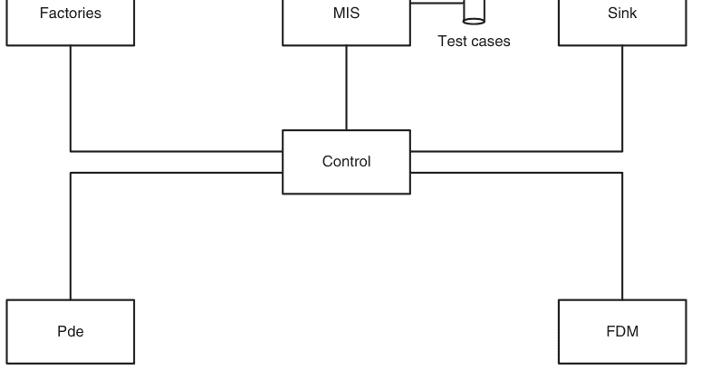

*图 21.1 架构的简单框图*

该架构基于我们在第 9 章中介绍的设计理念。每个块将包含具有特定职责的类。

- Pde：对第 20 章中介绍的 PDE 进行建模的 C++ 类。
- FDM：类层次结构中用于近似求解 PDE 的类。我们将在 21.4 节中回顾一些有限差分格式。
- Sink：有限差分求解器的结果所发送到的系统。
- MIS：包含可用于将候选有限差分格式的精度和效率与某个目标/基准格式（例如精确解或另一个有限差分格式）进行比较的信息的系统。可选地，该系统可以包含测试用例和解决方案的数据库（存储库）。
- Factories：负责创建 PDE 和 FDM 类实例的专用类。
- Control：在图 21.1 中其他类之间进行协调的中心类或函数。它可以是一个专门的 mediator 类，也可以硬编码在 `main()` 中。在第 23 章中，我们将基于函数式编程模型和接口编程，为路径依赖的 PDE 设计一个软件框架。

## 21.3 对 PDE 和有限差分格式进行建模：支持哪些内容？

我们在本章中实现多种单步格式；它们都有一个共同性质，即根据第 n 个时间级别的解来计算第 n + 1 个时间级别的解。此外，某些格式是隐式的（例如下面的 S2、S4 和 S5），这要求我们在每个时间级别求解一个三对角系统（使用第 13 章中的两个矩阵求解器），而其他格式是显式的（S1、S3），此时第 n + 1 个时间级别的解直接根据第 n 个时间级别的解计算，无需求解矩阵系统。这些格式如下。

- S1：显式欧拉（FTCS）格式。
- S2：全隐式（BTCS）格式。
- S3：ADE（基于我们如何近似 PDE 中的扩散、对流和反应项，有多种变体）。
- S4：Crank–Nicolson 格式。
- S5：对格式 S2 应用 Richardson 外推（在第 20 章 20.9 节中讨论）。

这些格式适用于广泛的非守恒型线性对流–扩散–反应 PDE，我们的兴趣在于对普通期权进行定价。

我们将半无限域映射为有界域，如第 20 章所讨论的那样。我们在本章中选择域截断，因为该技术不会影响所建模 PDE 的形式，并且使我们能够专注于软件设计的细节。它几乎和域变换一样易于使用。参见练习 1。

## 21.4 交替方向显式方法的若干版本

交替方向显式（ADE）方法最初由 Saul’yev（1964）提出，并首次应用于计算金融领域是在 Duffy（2009）中。此后，该领域发表了许多研究成果，例如 Pealat 和 Duffy（2011）、Duffy 和 Germani（2013）、Buchova、Ehrhardt 和 Guenther（2015），以及作者的多位硕士研究生。

我们注意到 ADE 是一族格式；基于扩散、对流和反应项的近似方式不同，存在多种变体。我们逐一考虑每种选项。首先，让我们通过热方程及其 ADE 变体来考察扩散项（我们假设 Dirichlet 边界条件）。

- Saul’yev（1964）：我们使用单个存储数组。在奇数时间级别，我们使用前向扫描：

  $$
  \frac{u_j^{n+1} - u_j^{n}}{k} = \frac{u_{j-1}^{n+1} - u_j^{n+1} - u_j^{n} + u_{j+1}^{n}}{h^2} \tag{21.1}
  $$

  而在偶数时间级别，我们使用后向扫描：

  $$
  \frac{u_j^{n+2} - u_j^{n+1}}{k} = \frac{u_{j-1}^{n+1} - u_j^{n+1} - u_j^{n+2} + u_{j+1}^{n+2}}{h^2}. \tag{21.2}
  $$

  该方法无条件稳定，截断误差为 $O[k^2, h^2, (k/h)^2]$，因此由于不一致项 $(k/h)^2$ 的存在，仅具有一阶精度。我们注意到，这些格式分别从左到右和从右到左扫描解。

- Barakat 和 Clark（B&C）（1966）：在这种情况下，格式同时向两个方向扫描，然后对所得解进行平均：

  $$
  \frac{U_j^{n+1}-U_j^n}{k}=\frac{1}{h^2}\left(U_{j+1}^n-U_j^n-U_j^{n+1}+U_{j-1}^{n+1}\right),\ 1\le j\le J-1,\ n\ge0. \tag{21.3}
  $$

  $$
  \frac{V_j^{n+1}-V_j^n}{k}=\frac{1}{h^2}\left(V_{j+1}^{n+1}-V_j^{n+1}-V_j^n+V_{j-1}^n\right),\ J-1\ge j\ge1,\ n\ge0. \tag{21.4}
  $$

  $$
  u_j^{n+1}=\frac{1}{2}\left(U_j^{n+1}+V_j^{n+1}\right),\ 0\le j\le J,\ n\ge0. \tag{21.5}
  $$

  截断误差为 $O[k^2,h^2]$，因为扫描中 $(k/h)^2$ 项相互抵消。因此，该方法具有二阶精度。详细分析可见 Buchova、Ehrhardt 和 Guenther（2015）。

- Larkin（1966）：该格式与 B&C 格式类似：

  $$
  \frac{U_j^{n+1}-u_j^n}{k}=\frac{U_{j-1}^{n+1}-U_j^{n+1}-u_j^n+u_{j+1}^n}{h^2}. \tag{21.6}
  $$

  $$
  \frac{V_j^{n+1}-u_j^n}{k}=\frac{u_{j-1}^n-u_j^n-V_j^{n+1}+V_{j+1}^{n+1}}{h^2}. \tag{21.7}
  $$

  $$
  u_j^{n+1}=\frac{1}{2}\left(U_j^{n+1}+V_j^{n+1}\right),\ 0\le j\le J,\ n\ge0. \tag{21.8}
  $$

  有轶事证据表明，该方法的精度不如 B&C 格式（Tannehill、Anderson 和 Pletcher，1997）。我们也在使用该格式时注意到了精度的损失。

为了近似对流项，我们请读者参阅 Pealat 和 Duffy（2011）以及 Duffy 和 Germani（2013）。

有趣的是，ADE 早于交替方向隐式（ADI）和局部一维（LOD）（“苏联分裂”）方法。LOD 首次应用于计算金融领域似乎是 Alex Levin 和作者的联合工作。Sheppard（2007）讨论了 LOD 在 Heston 模型中的应用。关于对流–扩散方程的 ADE 稳定性分析可参见 Campbell 和 Yin（2006）。

### 21.4.1 空间放大与 ADE

B&C ADE 方法无条件稳定且具有二阶精度。然而，von Neumann 方法无法捕捉可能由机器舍入等原因引起的空间放大误差（参见 Campbell 和 Yin，2006；Roache，1998）。在左向或右向计算扫描开始时，边界条件中的任何误差都可能在计算随空间推进的过程中被放大（而不是随时间推进）。

我们以一个看跌期权定价为例（我们将在后面的章节中解释完整背景）：

```cpp
Option myOption;
myOption.sig = 0.3; myOption.K = 65.0; myOption.T = 0.25;
myOption.r = 0.08; myOption.b = 0.08; myOption.beta = 1.0;
myOption.SMax = 325.0; myOption.type = 'P';
myOption.earlyExercise = false;
```

设置固定 NT = 325，NX = {325, 650, 1300, 2600, 5200, 10400}。随着我们在固定 NT 的同时增大 NX，看跌期权的值会逐渐变差，即值变为 {5.841754, 5.844434, 5.84294, 5.834118, 5.801135, 5.72656}。我们应该意识到这种有点病态的行为。它就像这类有限差分格式的万有引力定律。我们尚未解决这个问题。一个经验法则是上限为 NX ~ 4*NT。另一方面，保持 NX 固定并增大 NT 不会导致放大误差。

一个有趣的练习是确定原始的 Saul’yev 格式是否会引起空间放大误差。

## 21.5 软件框架：详细设计与实现

在总体上确定了架构设计（图 21.1 中的上下文图）之后，我们现在需要决定详细的类设计以及代码应实现的灵活性水平。有几种备选方案：

- A1：过程式解决方案；将图 21.1 中的模块实现为自由函数或非多态类。
- A2：传统的类层次结构，使用继承和子类型（动态）多态。
- A3：使用奇异递归模板模式（CRTP）和静态（编译时）多态的模型类层次结构。
- A4：不使用类层次结构（如选项 A2 和 A3），而是创建一个由通用函数包装器（`std::function` 的实例）组成的单一类。这是我们在第 23 章中将采用的方法。
- A5：使用第 9 章中讨论的基于策略的设计（PBD）和鸭子类型。
- A6：选项 A1–A5 的组合。换句话说，我们选择我们认为最适合图 21.1 中每个模块的方法。

在本章中，我们实现选项 A2（用于 PDE 类和几个 FDM 类）和 A3（用于实现 ADE 变体的类），同时使用选项 A1（主要是 `main()` 函数）来配置应用程序。UML 图如图 21.2 所示。其设计具有若干理想特性：

- 每个类都有单一的主要职责。
- 关注点分离：每个 FDM 类都是通用对流–扩散–反应 PDE 的客户端。这有助于可维护性。


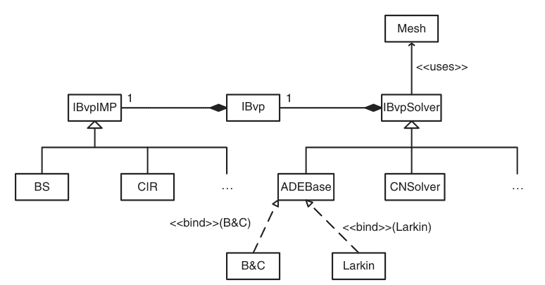

## FIGURE 21.2 UML structure of framework

All PDE and FDM classes have polymorphic interfaces and they can be extended by using a number of design patterns (namely Bridge, Template Method and Factory Method; see GOF, 1995).

We now discuss the classes in Figure 21.2 in more detail.

## 21.6 C++ CODE FOR PDE CLASSES

It is obvious that the software framework should be as flexible and customisable as possible if we wish it to be used. For example, we write algorithms that apply to a range of PDE types. To this end, we focus on linear convection–diffusion–reaction equations in non-conservative form and their numerical approximation as discussed in Chapter 20. This translates into a clear requirement to apply the Bridge design pattern (see GOF, 1995). Its intent is to:

- Decouple an abstraction from its implementations so that the two can vary independently.
- Publish interfaces in an inheritance hierarchy, and place implementation classes in an inheritance hierarchy.

In this case we identify the class IBvp that is the abstract interface which clients (for example, FDM classes) use. IBvp also contains a reference to an instance of IBvpImp that is the base class for all specific PDE implementations in the Bridge pattern. The interfaces of these two classes are:

```
class IBvp
{ // Models linear convection diffusion reaction PDE with associated
// boundary and initial conditions
private:
public:
    Range<double> xaxis;        // Space interval
    Range<double> taxis;        // Time interval
```

```
// Bridge pattern: IBvp is the 'abstraction' object that is decoupled
// from its various implementations.
IBvpImp* imp;                         // Bridge implementation

public:

    IBvp() = delete;

public:
    IBvp (IBvpImp& executor, const Range<double>& xrange,
          const Range<double>& trange);

    // Coefficients of parabolic second order operator

    // Coefficient of second derivative
    double Diffusion(double x, double t) const;

    // Coefficient of first derivative
    double Convection(double x, double t) const;

    // Coefficient of zero derivative
    double Reaction(double x, double t) const;

    // Inhomogeneous forcing term
    double Rhs(double x, double t) const;

    // Boundary and initial conditions

    // Left hand boundary condition
    double Bcl(double t) const;

    // Right hand boundary condition
    double Bcr(double t) const;

    // Initial condition
    double Ic(double x) const;

    // The domain in which the PDE is 'played'
    const Range<double>& xrange() const;
    const Range<double>& trange() const;
};

class IBvpImp
{ // Abstract base class modelling the implementation objects in the
    // Bridge pattern. Derived classes (e.g. BS, CEV, CIR) must implement
    // all the pure virtual functions in IBvpImp.

public:

    // Selector functions
    // Coefficients of parabolic second order operator
    virtual double Diffusion(double x, double t) const = 0;
```

```
virtual double Convection(double x, double t) const = 0;
virtual double Reaction(double x, double t) const = 0;
virtual double Rhs(double x, double t) const = 0;

// Boundary and initial conditions
virtual double Bcl(double t) const = 0;
virtual double Bcr(double t) const = 0;
virtual double Ic(double x) const = 0;
};
```

We note that IBvp also has two members (instances of Range) representing the rectangular domain in which the PDE is defined. Furthermore, Dirichlet boundary conditions are supported. We use raw pointers in this version of the software.

We are now in a position to define specific PDE classes. We take the one-factor Black–Scholes equation as an initial example:

```
class BlackScholesPde : public IBvpImp
{
public:

    Option opt;

    BlackScholesPde(const Option& option);

    double Diffusion(double x, double t) const;
    double Convection(double x, double t) const;
    double Reaction(double x, double t) const;
    double Rhs(double x, double t) const;

    // Boundary and initial conditions
    double Bcl(double t) const;
    double Bcr(double t) const;
    double Ic(double x) const;
};
```

We also give the code of the member functions for completeness:

```
BlackScholesPde::BlackScholesPde(const Option& option) : opt(option)
{
}
```

```
double BlackScholesPde::Diffusion(double x, double t) const // Diffusion
{

    double v = opt.sig;
    return 0.5*v*v*x*x;
}
```

```
double BlackScholesPde::Convection(double x, double t) const // Drift
```

```
{
    return (opt.b) * x; // r == interest rate
}

double BlackScholesPde::Reaction(double x, double t) const // Zero
    // derivative
{
    return - (opt.r);
}

double BlackScholesPde::Rhs(double x, double t) const  // Inhomogeneous
    // term
{
    return 0.0;
}

// Boundary and initial conditions
double BlackScholesPde::Bcl(double t) const // Left hand boundary
    // condition
{
    if (opt.type == 'C')
    {
        return 0.0;   //C
    }
    else
    {
        return (opt.K) * std::exp(- (opt.r) * ((opt.T) - t)); // P
    }
}

double BlackScholesPde::Bcr(double t) const   // Right boundary condition
{
    if (opt.type == 'C')
    {
        return opt.SMax - (opt.K) * std::exp(- (opt.r) * ((opt.T) - t));
    }
    else
    {
        return 0.0; //P
    }
}

double BlackScholesPde::Ic(double x) const      // Initial condition
{
```

```
```cpp
return std::max<double>(x - opt.K, 0.0);
}
else
{
    return std::max<double>(opt.K - x, 0.0);
}
}
```
```

We note that we have used hard-coded if…else logic to distinguish between call and put options. This can be made more flexible. We have also created a simple structure to hold relevant data:

```
```cpp
class Option : public Instrument
{
public:
    // PUBLIC, FOR CONVENIENCE
    double r;                 // Interest rate
    double sig;               // Volatility
    double K;                 // Strike price
    double T;                 // Expiry date
    double b;                 // Cost of carry
    double beta;              // Elasticity factor
    double SMax;              // Far field condition
    char type;                // Call or put
    bool earlyExercise;       // American option

    Option()
    {
    }

    void print()
    {
        std::cout << "Interest: " << r << std::endl;
        std::cout << "Vol: " << sig << std::endl;
        std::cout << "Strike: " << K << std::endl;
        std::cout << "Expiry: " << T << std::endl;
        std::cout << "Cost of carry: " << b << std::endl;
        std::cout << "Elasticity factor: " << beta << std::endl;
        std::cout << "Option type: " << type << std::endl;
        std::cout << "Far field: " << SMax << std::endl;
        std::cout << "American?: " << std::boolalpha << earlyExercise;
    }

    OneFactorPayoff OptionPayoff;
};
```
```

An example of use is:

```
Option myOption;
myOption.sig = 0.3; myOption.K = 65.0; myOption.T = 0.25;
myOption.r = 0.08; myOption.b = 0.08; myOption.beta = 1.0;
myOption.SMax = 325.0; myOption.type = 'P'; myOption.earlyExercise = false;

BlackScholesPde myImp(myOption);

Range<double> rangeX(0.0, myOption.SMax);
Range<double> rangeT(0.0, myOption.T);

IBvp currentImp(myImp, rangeX, rangeT);
```

Please refer to the source code provided with the book for more details.
More generally, the Bridge pattern is used in applications where portability is important. In these cases classes can have several implementations and we wish to shield clients from the latter’s specific code. Some examples are:

- Portable graphical user interfaces (GUIs). For example, the Qt toolkit is a cross-platform application framework that is used for developing software that runs on various software and hardware platforms. Clients interact with graphical objects without having to know their internals or the details of the corresponding SDK (software developer kit). See Ezust and Ezust (2006) for a discussion on design patterns in the context of Qt.
- In embedded and hardware systems. Hardware and software change and we wish to shield clients from changes when systems upgrade to new environments. Clients communicate with a virtual machine that can have multiple implementations. A good example is a sensor abstraction that specifies a certain abstract interface. Commercial sensor drivers can then be adapted to conform to these abstract interfaces.
- There are many opportunities to apply the Bridge pattern in computational finance. In this section, we have seen its application in the context of convection–diffusion–reaction PDEs. We define a PDE abstraction that clients communicate with. Clients define implementations to suit new requirements without the need to modify other parts of the code. Another example is to define an abstraction for a one-factor stochastic differential equation (SDE). Then clients create implementations corresponding to well-known SDEs such as geometric Brownian motion (GBM), for example.
- We have seen in this section that a PDE can be approximated by many FD schemes while a given FD scheme can be applied to many PDEs. This is possible mainly due to the Bridge pattern.

In Exercise 5 we discuss a number of alternative implementations of the Bridge pattern.

## 21.7 C++ CODE FOR FDM CLASSES

The classes that we use to model finite difference algorithms are shown in Figure 21.2 and they implement the schemes from Chapter 20. This part of the framework uses a mixture of programming styles.


- IBVpSolver：所有有限差分格式的基类。可以说它是一个中央中介，因为它在空间和时间上创建网格，并且包含状态机逻辑，将近似解推进到到期。结果是在离散网格点上的期权价格向量。非网格点的期权值可以通过线性或三次样条插值产生（见第13章讨论）。
- 实现显式欧拉（FTCS）、全隐式（BTCS）、Crank–Nicolson 和 Richardson 外推格式的类。我们使用子类型多态来改变行为。
- 使用 CRTP 的 ADE 格式变体。

IBvpSolver 的接口是：

```
using Vector = std::vector<double>;

class IBvpSolver
{ // Base class for a Set of finite difference schemes
    // to solve scalar initial boundary value problems

private:

    // Utility functions
    void initMesh(long NSteps, long JSteps);
    void initIC();

protected:

    IBvp* ibvp;      // Pointer to 'server'

    long N;          // The number of subdivisions of interval in IBVP
    double k;        // Step length; redundant data but is efficient

    long J;          // The number of subdivisions of interval in IBVP
    double h, h2;    // Step length; redundant data but is efficient

    double DN;
    double DJ;
    double DJJ;

    double tprev, tnow, T;
    long currentIndex, maxIndex, tIndex;

public:
    Vector xarr; // Useful work array
    Vector tarr; // Useful work array

    // Other data
    long n;  // Current counter
    Vector vecOld;
    Vector vecNew;

public:
    IBvpSolver(const IBvpSolver& source) = delete;
```

```
void IBvpSolver::initIC()
{ // Utility function to initialise the payoff function

    // Initialise at the boundaries
    vecOld[ 0 ] = ibvp->Bcl( ibvp->trange().low() );
    vecOld[ vecOld.size()-1 ] = ibvp->Bcr( ibvp->trange().high() );

    // Initialise values in interior of interval using
    // the initial function 'IC' from the PDE
    for( std::size_t j = 1; j < xarr.size() - 1; ++j)
    {
        vecOld[ j ] = ibvp->Ic( xarr[ j ]);
    }
}

IBvpSolver::IBvpSolver(IBvp& source, long NSteps, long JSteps)
{
    ibvp = &source;

    // Create a mesh
    initMesh(NSteps, JSteps);

    // Initialise from the payoff function
    initIC();
}

IBvpSolver::~IBvpSolver() {}

Vector& IBvpSolver::result()
{
    // Initialise time.

    // The state machine, really; we march from t = 0 to t = T.
    for (std::size_t n = 1; n < tarr.size(); ++n)
    {
        tnow = tarr[n];

        // The two methods that represent the variant parts
        // of the Template Method Pattern.
        calculate();

        tprev = tnow;

        for (std::size_t j = 0; j < vecNew.size(); ++j)
        { // Combine in previous loop

            vecOld[j] = vecNew[j];
        }
    }
```

```
return vecNew;
}
```

```
const Vector& IBvpSolver::XValues() const
{ // Array of x values

    return xarr;
}
```

```
const Vector& IBvpSolver::TValues() const
{ // Array of time values

    return tarr;
}
```

我们看到计算发生在 result() 中；顺便说一下，我们看到了模板方法模式（Template Method Pattern，GOF，1995）的例子，在这种情况下，一个算法由不变部分（对所有派生类都通用），即 result() 中的代码，和一个变体部分 calculate() 组成，每个 IBvpSolver 的派生类都必须以自己的方式实现。

使用这种设计模式在创建派生类时有后果，特别是使用了实现继承。我们现在描述特定的 FD 类。

## 21.7.1 基于子类型多态的类

该组中的类是一步显式和隐式有限差分方法。我们重点关注 Crank–Nicolson 方法，因为它是一种稳定的二阶格式，并且尽管有一些怪癖，但非常流行（参见 Duffy，2004A 对该方法的分析）。该格式产生一个三对角矩阵系统，其非零元素存储为数组 A、B 和 C：

```
class CNIBVP : public IBvpSolver
{
private:

    // Notice that we store the data that 'belongs' to
    // this class. It is private and will not pollute the
    // other classes.
    Vector A, B, C;      // Lower, diagonal, upper
    Vector F;            // Right-hand side of matrix

public:
    CNIBVP();
    CNIBVP(IBvp& source, long NSteps, long JSteps);

    void calculate();

};
```

其主体为：

```
CNIBVP::CNIBVP(): IBvpSolver(), A(Vector(J + 1)), B(Vector(J + 1)),
                 C(Vector(J + 1)), F(Vector(J + 1)){}

CNIBVP::CNIBVP(IBvp& source, long NSteps, long JSteps)
        : IBvpSolver(source, NSteps, JSteps),
          A(Vector(J + 1)), B(Vector(J + 1)), C(Vector(J + 1)),
          F(Vector(J + 1)){}

void CNIBVP::calculate()
{
  // Tells how to calculate sol. at n+1

  // In general we need to solve a tridiagonal system

  double t1, t2, t3, Low, Mid, Upp;

  for (std::size_t i = 0; i < F.size(); i++)
  {
    t1 = (0.5*k*ibvp->Diffusion(xarr[i], tnow);
    t2 = 0.25*k * h* ibvp->Convection(xarr[i], tnow);
    t3 = 0.5*k*h2*ibvp->Reaction(xarr[i], tnow);

    // Coefficients of the U terms
    A[i] = t1 - t2;
    B[i] = -h2 - 2.0*t1 + t3;
    C[i] = t1 + t2;

    // Coefficients of the U terms
    double t1A = 0.5*k*ibvp->Diffusion(xarr[i], tnow);
    double t2A =
          0.25 * k * h* ibvp->Convection(xarr[i], tprev);
    double t3A = 0.5*k*h2*ibvp->Reaction(xarr[i],tprev);

    Low = -t1A + t2A;
    Mid = -h2 + 2.0*t1A - t3A;
    Upp = -t1A - t2A;

    F[i] = Low*vecOld[i-1] + Mid*vecOld[i] + Upp*vecOld[i+1]
           +0.5*k*h2*ibvp -> Rhs(xarr[i], tnow)
           +0.5*k*h2*ibvp -> Rhs(xarr[i], tprev);
  }

  double BCL = ibvp->Bcl(tnow);
  double BCR = ibvp->Bcr(tnow);
  DoubleSweep<double> mySolver(A, B, C, F, BCL, BCR);

  // The matrix must be diagonally dominant; we call the
  // assert macro and the program stops
  // assert (mySolver.diagonallyDominant() == true);

  vecNew = mySolver.solve();
}
```

我们使用了双扫掠法在每个时间层求解方程组。我们在第13章引入了该方法，并报告说它比 Thomas 算法快 20%。一个不错的练习是在上述代码中使用后一种方法。

我们举一个使用 Crank–Nicolson 方法的例子：

```
long J = 500;
long N = 500;
std::cout << "Number of space divisions: ";
std::cin >> J;

std::cout << "Number of time divisions: ";
std::cin >> N;

CNIBVP fdmCN(currentImp, N, J);
```

一个可能的优化是，如果问题的系数与时间无关，双扫掠法只需调用一次。

## 21.7.2 基于 CRTP 的类

我们将所有 ADE 变体建模为 IBvpSolver 的派生类。所有 ADE 格式的基类的接口和代码主体为：

```
template <typename D>
  class ADE_CRTP: public IBvpSolver
{
protected:

  // Derived classes contain the necessary data structures

public:
  ADE_CRTP();
  ADE_CRTP(IBvp& source, long NSteps, long JSteps);

  // Hook function for Template Method pattern
  void calculate();
};

#include "ADESolver_CRTP.cpp"

template <typename D>
  ADE_CRTP<D>::ADE_CRTP() : IBvpSolver()
{
}

template <typename D>
  ADE_CRTP<D>::ADE_CRTP(IBvp& source, long NSteps, long JSteps)
  : IBvpSolver(source, NSteps, JSteps){ }
```

```
template <typename D>
    void ADE_CRTP<D>::calculate()
{ // Tells how to calculate sol. at n+1, Explicit ADE schemes

    static_cast<D*>(this) -> calculate();
}
```

最有趣的函数是 calculate()，因为它将请求转发给其模板参数。我们讨论实现扩散项的 Barakat 和 Clark 格式和实现对流项的 Towler–Yang 格式（派生类）的派生类：

```
class ADE_BC_CRTP: public ADE_CRTP<ADE_BC_CRTP>
{
private:

    // Intermediate values
    Vector U;
    Vector V;
    Vector UOld;
    Vector VOld;

public:
    ADE_BC_CRTP(IBvp& source, long NSteps, long JSteps);

    // Hook function for Template Method pattern
    void calculate();
};

#include "ADESolver_BC_CRTP.cpp"
```

相应的代码基于第20章中的算法：

```
ADE_BC_CRTP::ADE_BC_CRTP(IBvp& source, long NSteps, long JSteps)
    : ADE_CRTP<ADE_BC_CRTP>(source, NSteps, JSteps),
      U(Vector(vecNew)), V(Vector(vecNew)), UOld(Vector(vecOld)),
      VOld(Vector(vecOld)) { }
```

```
// Sequential version
void ADE_BC_CRTP::calculate()
{ // Tells how to calculate sol. at n+1, Explicit ADE_BC_CRTP schemes

    U[0] = ibvp->Bcl(tnow);
    U[U.size()-1] = ibvp->Bcr(tnow);

    // Necessary?
    V[0] = ibvp->Bcl(tnow);
    V[V.size()-1] = ibvp->Bcr(tnow);
```


其中我们创建了一个实用函数：

```
std::vector<double> OptionPrice(IBvpSolver& fdm)
{ // Compute option price using a FD scheme

    return fdm.result();
}
```

该函数为每个离散网格点在到期时产生期权价格数组。

## 21.7.3 从更简单的格式组装 FD 格式

可以把全隐式格式 BTCS 的精度从时间上的一阶提升到二阶（Lawson and Morris, 1978）。我们定义 IBvpSolver 的派生类并重写其成员函数 result()：

```
class ExtrapolatedImplicitEulerIBVP : public IBvpSolver
{
private:
    // We must build these in constructors

    // Notice that we store the data that 'belongs' to
    // this class. It is private and will not pollute the
    // other classes.
    Vector A, B, C;  // Lower, diagonal, upper
    Vector F;        // Right-hand side of matrix

    // Vectors on mesh of size k/2, i.e. extrapolated values
    Vector vecNewE; // Computed 'real' value time level n+1 (new)
    Vector vecOldE; // Computed 'real' value at time level n (old)

    void initICExtrapolated();

public:
    ExtrapolatedImplicitEulerIBVP(IBvp& source, long NSteps, long JSteps);

    // The overridden functions in the Template Method pattern
    void calculate() override;

    Vector& result() override;
};
```

```
void ExtrapolatedImplicitEulerIBVP::initICExtrapolated()
{ // Initialise the extrapolated array at t = 0.

    // Initialise at the boundaries
    vecOldE[ 0 ] = ibvp->Bcl( ibvp->trange().low() );
    vecOldE[ vecOldE.size()-1 ] = ibvp->Bcr( ibvp->trange().high() );
```

```
// Now initialise values in interior of interval using
// the initial function 'IC' from the PDE
for(std::size_t j = 1; j < xarr.size() - 1; ++j )
{
    vecOldE[j] = ibvp->Ic( xarr[ j ] );
}
}
```

```
ExtrapolatedImplicitEulerIBVP::ExtrapolatedImplicitEulerIBVP(IBvp& source,
    long NSteps, long JSteps)
    : IBvpSolver(source, NSteps, JSteps),
      A(Vector(J + 1)), B(Vector(J + 1)), C(Vector(J + 1)),
      F(Vector(J + 1)),
      vecNewE(Vector(vecNew)), vecOldE(Vector(vecOld))
{
    initICExtrapolated();
}
```

```
void ExtrapolatedImplicitEulerIBVP::calculate()
{ // Tells how to calculate sol. at n+1

    ImplicitEulerIBVP i1(*ibvp, N, J);
    auto vecNew = i1.result();

    ImplicitEulerIBVP i2(*ibvp,2*N, J);
    auto vecNewE = i2.result();

    for (std::size_t j = 0; j < vecNew.size(); ++j)
    { // Combine in previous loop

        vecNew[j] = 2.0*vecNewE[j] - vecNew[j];
    }

}
```

```
Vector& ExtrapolatedImplicitEulerIBVP::result()
{
    ImplicitEulerIBVP i1(*ibvp, N, J);
    vecNew = i1.result();

    ImplicitEulerIBVP i2(*ibvp, 2 * N, J);
    auto vecNewE = i2.result();

    for (std::size_t j = 0; j < vecNew.size(); ++j)
    { // Combine in previous loop

        vecNew[j] = 2.0*vecNewE[j] - vecNew[j];
    }

    return vecNew;
}
```

我们通过比较全隐式 IE、Crank–Nicolson CN 和 Richardson 外推 RIE 格式对看跌期权和看涨期权价格的精度来结束对有限差分格式的讨论（对于 S = 60，精确价格分别为 5.84628209 和 2.133368），数据如下：

```
Option myOption;
myOption.sig = 0.3; myOption.K = 65.0; myOption.T = 0.25;
myOption.r = 0.08; myOption.b = 0.08; myOption.beta = 1.0;
myOption.SMax = 325.0; myOption.type = 'P';
myOption.earlyExercise = false;
```

一般而言，CN 和 RIE 是最精确的，并且产生相似的结果。IE 的精度较低，这与它是一阶精度的预期一致。我们给出一些数值结果，并重点关注 NX = NT = {325, 650, 1300}。对于看跌期权，我们得到：

- IE: 5.841284, 5.844843, 5.845828.
- CN: 5.842044, 5.845223, 5.846018.
- RIE: 5.842043, 5.845223, 5.846017.

对于看涨期权，我们得到 NX = NT = {325, 650, 1300, 2600}：

- IE: 2.128331, 2.131910, 2.132904, 2.133202.
- CN: 2.129132, 2.132315, 2.133104, 2.133303.
- RIE: 2.129129, 2.132309, 2.133104, 2.133302.

ADE 方法也是二阶精度的。例如，Barakat–Clark–Towler–Yang 和 Larkin–Roberts–Weiss 方法分别给出以下结果：

- ADE_1: 5.841828, 5.845019, 5.84582, 5.84602.
- ADE_2: 5.841764, 5.844956, 5.845756, 5.845902.

我们看到 Larkin 方法的精度低于 Barakat–Clark 方法。我们不讨论这些格式的性能。

## 21.8 示例和测试用例

我们给出一些初始示例。在此情况下，我们感兴趣的是比较不同格式的精度。对于每种格式，我们显示到期时的期权价格数组。为了可视化结果，我们使用第 14 章中介绍的 Excel 驱动程序的功能。我们已经在第 14 章中展示了以下代码的片段，因此在此我们给出完整程序的代码而不做进一步说明：

```
std::vector<double> OptionPrice(IBvpSolver& fdm)
{ // Compute option price using a FD scheme

    return fdm.result();
}
```

```
auto vADELarkin= OptionPrice(fdmADELarkin);
auto vADEBCUpwind = OptionPrice(fdmADEBCUpwind);

// Names of each vector
std::list<std::string> labels
    { "EE", "CN", "IE", "RIE","ADEBC",
      "Larkin", "ADE upwind"};

// The list of Y values
std::list<std::vector<double> > curves
    { vEE, vCN, vIE, vEIE, vADEBC,
      vADELarkin, vADEBCUpwind };

ExcelDriver xl; xl.MakeVisible(true);
xl.CreateChart(fdmEE.XValues(), labels, curves,
    "Comparing Schemes", "S", "price");

return 0;
}
```

我们给出生成的 Excel 表格的快照，以便可以比较不同格式产生的值，如表 21.1 所示。

# 表 21.1 方法比较

| S | EE | CN | IE | RIE | ADEBC | Larkin | ADE upwind |
|---|---|---|---|---|---|---|---|
| 0 | 65 | 65 | 65 | 65 | 65 | 65 | 65 |
| 1 | 62.71292 | 62.71292 | 62.71295 | 62.71292 | 62.71256 | 62.71295 | 62.70956 |
| 2 | 61.71291 | 61.71291 | 61.71293 | 61.71291 | 61.71293 | 61.71293 | 61.71279 |
| 3 | 60.71291 | 60.71291 | 60.71294 | 60.71291 | 60.71294 | 60.71294 | 60.71293 |
| 4 | 59.71291 | 59.71291 | 59.71294 | 59.71291 | 59.71294 | 59.71294 | 59.71294 |
| 5 | 58.71291 | 58.71291 | 58.71294 | 58.71291 | 58.71294 | 58.71294 | 58.71294 |
| 6 | 57.71291 | 57.71291 | 57.71294 | 57.71291 | 57.71294 | 57.71294 | 57.71294 |
| 7 | 56.71291 | 56.71291 | 56.71294 | 56.71291 | 56.71294 | 56.71294 | 56.71294 |
| 8 | 55.71291 | 55.71291 | 55.71294 | 55.71291 | 55.71294 | 55.71294 | 55.71294 |
| 9 | 54.71291 | 54.71291 | 54.71294 | 54.71291 | 54.71294 | 54.71294 | 54.71294 |
| 10 | 53.71291 | 53.71291 | 53.71294 | 53.71291 | 53.71294 | 53.71294 | 53.71294 |
| 11 | 52.71291 | 52.71291 | 52.71294 | 52.71291 | 52.71294 | 52.71294 | 52.71294 |
| 12 | 51.71291 | 51.71291 | 51.71294 | 51.71291 | 51.71294 | 51.71294 | 51.71294 |
| 13 | 50.71291 | 50.71291 | 50.71294 | 50.71291 | 50.71294 | 50.71294 | 50.71294 |
| 14 | 49.71291 | 49.71291 | 49.71294 | 49.71291 | 49.71294 | 49.71294 | 49.71294 |
| 15 | 48.71291 | 48.71291 | 48.71294 | 48.71291 | 48.71294 | 48.71294 | 48.71294 |
| 16 | 47.71291 | 47.71291 | 47.71294 | 47.71291 | 47.71294 | 47.71294 | 47.71294 |
| 17 | 46.71291 | 46.71291 | 46.71294 | 46.71291 | 46.71294 | 46.71294 | 46.71294 |
| 18 | 45.71291 | 45.71291 | 45.71294 | 45.71291 | 45.71294 | 45.71294 | 45.71294 |
| 19 | 44.71291 | 44.71291 | 44.71294 | 44.71291 | 44.71294 | 44.71294 | 44.71294 |
| 20 | 43.71291 | 43.71291 | 43.71294 | 43.71291 | 43.71294 | 43.71294 | 43.71294 |
| 21 | 42.71291 | 42.71291 | 42.71294 | 42.71291 | 42.71294 | 42.71294 | 42.71294 |

# 表 21.1 （续）

| S | EE | CN | IE | RIE | ADEBC | Larkin | ADE upwind |
|---|---|---|---|---|---|---|---|
| //... |  |  |  |  |  |  |  |
| 50 | 13.90229 | 13.90232 | 13.90291 | 13.90232 | 13.90242 | 13.9024 | 13.90944 |
| 51 | 12.97235 | 12.97238 | 12.97298 | 12.97238 | 12.97248 | 12.97246 | 12.9811 |
| 52 | 12.06168 | 12.06171 | 12.06228 | 12.06171 | 12.0618 | 12.06178 | 12.07216 |
| 53 | 11.17351 | 11.17353 | 11.17404 | 11.17353 | 11.17362 | 11.17359 | 11.18582 |
| 54 | 10.31111 | 10.31113 | 10.31155 | 10.31113 | 10.31119 | 10.31117 | 10.3253 |
| 55 | 9.47769 | 9.477705 | 9.478009 | 9.477705 | 9.477753 | 9.477725 | 9.493789 |
| 56 | 8.676324 | 8.676332 | 8.676496 | 8.676332 | 8.676356 | 8.676326 | 8.694279 |
| 57 | 7.90982 | 7.90982 | 7.909825 | 7.90982 | 7.909815 | 7.909785 | 7.929533 |
| 58 | 7.180647 | 7.180638 | 7.180475 | 7.180638 | 7.180603 | 7.180574 | 7.20197 |
| 59 | 6.490865 | 6.490849 | 6.490517 | 6.490849 | 6.490782 | 6.490754 | 6.513605 |
| 60 | 5.842068 | 5.842044 | 5.84155 | 5.842043 | 5.841946 | 5.84192 | 5.865992 |
| 61 | 5.235345 | 5.235313 | 5.234673 | 5.235313 | 5.235187 | 5.235163 | 5.260194 |
| 62 | 4.671269 | 4.671231 | 4.670464 | 4.67123 | 4.671079 | 4.671058 | 4.696763 |
| 63 | 4.149897 | 4.149854 | 4.148989 | 4.149853 | 4.149681 | 4.149664 | 4.175751 |
| 64 | 3.670797 | 3.670751 | 3.669818 | 3.67075 | 3.670562 | 3.67055 | 3.696726 |
| 65 | 3.233083 | 3.233035 | 3.232065 | 3.233035 | 3.232837 | 3.232829 | 3.258812 |
| 66 | 2.835464 | 2.835416 | 2.83444 | 2.835415 | 2.835213 | 2.83521 | 2.860739 |
| 67 | 2.476302 | 2.476255 | 2.475302 | 2.476254 | 2.476053 | 2.476055 | 2.500892 |
| 68 | 2.153675 | 2.153631 | 2.152728 | 2.15363 | 2.153436 | 2.153443 | 2.17738 |
| 69 | 1.865444 | 1.865403 | 1.864572 | 1.865402 | 1.86522 | 1.865231 | 1.888096 |
| 70 | 1.609313 | 1.609276 | 1.608533 | 1.609275 | 1.609109 | 1.609124 | 1.630778 |
| 71 | 1.382891 | 1.382859 | 1.382218 | 1.382858 | 1.382711 | 1.382729 | 1.40307 |
| 72 | 1.183749 | 1.183722 | 1.18319 | 1.183722 | 1.183596 | 1.183617 | 1.202574 |
| 73 | 1.009467 | 1.009446 | 1.009025 | 1.009445 | 1.009342 | 1.009365 | 1.026901 |
| 74 | 0.857675 | 0.85766 | 0.857349 | 0.85766 | 0.85758 | 0.857604 | 0.87371 |
| 75 | 0.726091 | 0.726081 | 0.725876 | 0.726081 | 0.726024 | 0.72605 | 0.740741 |
| 76 | 0.612542 | 0.612537 | 0.61243 | 0.612537 | 0.612502 | 0.612528 | 0.625841 |
| 77 | 0.514989 | 0.514987 | 0.514969 | 0.514987 | 0.514973 | 0.514999 | 0.526988 |

总体而言，ADE 方法比 Crank–Nicolson 或全隐式方法快约 40%。Richardson 外推是最慢的，这与预期一致，但其性能可通过代码并行化得到改善。

## 21.9 总结与结论

在本章中，我们引入了一个软件框架（图 21.2），它允许我们通过有限差分方法近似求解非守恒形式的线性对流-扩散-反应偏微分方程的解。然后我们讨论了其对单因子欧式期权定价问题的适用性。设计和记录的经验可以应用于其他类型的应用。

我们在第 22 章中继续给出更多示例和扩展。


## 21.10 练习与项目

### 1. （FDM 与域变换）

对于看涨期权，边界条件在 \(y=0\) 和 \(y=1\) 时始终是有界的。相同的结论也适用于收益函数（初始条件）；它始终是有界的。对于看跌期权，另一方面，收益函数变为：

\[
\max(S-K,0)=\max\left(\frac{\alpha y}{1-y}-K,0\right).
\]

在这种情况下我们看到收益在 \(y=1\) 处无界。在这种情况下我们采用启发式方法，通过将边界偏移一个很小的量 \(\varepsilon\)（通常为 0.001）然后使用 \(1-\varepsilon\) 作为新的边界点。

### 2. （Cox–Ingersoll–Ross 模型的 ADE）

在本练习中我们使用标准隐式差分方法（BTCS）近似 CIR PDE。将结果与使用域变换的 ADE 方法进行比较。在这两种情况下我们都假设 Feller 条件 \(\sigma<\sqrt{2a}\) 成立，然后在 \(r=0\) 处不需要规定边界条件。

我们取一个因子零息债券的例子（参见 Tavella 和 Randall，2000）。初始边值问题由下式给出：

\[
\begin{cases}
-\dfrac{\partial B}{\partial t}+\frac12\sigma^2 r\dfrac{\partial^2 B}{\partial r^2}+(a-br)\dfrac{\partial B}{\partial r}-rB=0, & 0<r<r_{\max},\quad t>0,\\
B(r_{\max},t)=0, & t>0,\\
-\dfrac{\partial B}{\partial t}(0,t)+a\dfrac{\partial B}{\partial r}(0,t)=0, & t>0,\quad a>0,\\
B(r,0)=H(r)\ \text{(payoff)}, & 0<r<r_{\max}.
\end{cases}
\]

请注意我们使用的是向前时间。棘手的部分是 \(r=0\) 处的边界条件；它是一个一阶双曲方程。因此我们得出结论，债券价格 \(B\) 在 \(r=0\) 处未知。为此，隐式 Euler 格式为：

\[
\begin{cases}
-\dfrac{B_j^{n+1}-B_j^n}{k}+\sigma_j^{n+1}D_+D_-B_j^{n+1}+\mu_j^{n+1}D_0B_j^{n+1}-r_jB_j^{n+1}=0, & 1\le j\le J-1,\\
\sigma\equiv\frac12\sigma^2 r & \text{(轻微的符号误用)},\\
\mu\equiv a-br.
\end{cases}
\]

而在 \(r=0\) 处的格式由迎风格式给出（\(h\) 和 \(k\) 分别是 \(r\) 和 \(t\) 方向上的步长）：

\[
\begin{cases}
-\dfrac{B_j^{n+1}-B_j^{n}}{k}+a\dfrac{B_{j+1}^{n+1}-B_j^{n}}{h}=0, & (j=0),\\
\text{或}\\
B_0^{n+1}(1+\lambda)=B_0^n+\lambda B_1^{n+1}, & \lambda\equiv\dfrac{ak}{h}.
\end{cases}
\]

我们现在组装离散方程。定义未知向量 \(B\) 为：

\[
B^{n+1}=\left(B_0^{n+1},\dots,B_{J-1}^{n+1}\right)^{\top}.
\]

则方程组为：

\[
A^{n+1}B^{n+1}=F^n
\]

其中：

\[
A^n=\begin{pmatrix}
1+\lambda & -\lambda & & & \\
a_2^n & b_1^n & c_1^n & & \\
& \ddots & \ddots & \ddots & 0\\
0 & & \ddots & \ddots & \ddots\\
& & & a_J^n & b_{J-1}^n & c_{J-1}^n
\end{pmatrix}
\]

并且

\[
F^n=\left(B_0^n,0,\dots,0\right)^{\top}.
\]

矩阵 \(A\) 是一个 \(M\)-矩阵，因此它具有正的逆。我们因此得出结论，我们的有限差分格式是单调的。

回答以下问题：

- a) 实现完全隐式方法。你需要尝试远场截断域值的确定以及远场边界条件的选择。将近似解与众所周知的精确仿射解进行比较。
- b) 我们现在将 ADE 方法应用于 CIR PDE。首先，使用域变换将 CIR PDE 变换为单位区间 \((0,1)\) 上的 PDE。假设 Feller 条件成立，确定 \(y=0\) 和 \(y=1\) 处的边界条件。
- c) 将 ADE 应用于变换后 CIR PDE 的非守恒形式。使用 Barakat–Clark 平均。
- d) 将 CIR PDE 转换为守恒形式。
- e) 我们需要在 \(y=0\) 处近似一阶双曲 PDE 并将其整合到主 ADE 格式中。理想情况下，该近似应无条件稳定且二阶精确。一个可能性是盒格式（参见 Duffy，2006，第 110 页），它本质上是空间和时间上的一步平均：

\[
-\frac{B_{j+1/2}^{n+1}-B_{j+1/2}^{n}}{\Delta t}+\alpha\frac{B_{j+1}^{n+1/2}-B_j^{n+1/2}}{h}=0
\]

其中：

\[
B_{j+1/2}^{n}\equiv\frac12\left(B_{j+1}^{n}+B_j^n\right),\qquad
B_j^{n+1/2}\equiv\frac12\left(B_j^{n+1}+B_j^n\right).
\]

- f) 通过求解 \(B_0^{n+1}\) 和 \(B_1^{n+1}\) 创建 \(y=0\) 附近的迷你 ADE 格式，然后从空间中的第二个网格点开始应用标准 ADE 方法。
- g) 比较所有 ADE 格式及其变体与精确解的精度。

### 3. （二维问题的 ADE 项目）

为完整起见，我们讨论 ADE 对 \(n\) 因子 PDE 的适用性。为此，我们考虑具有给定非齐次强迫项 \(f(x,y,t)\) 和单位正方形上 Dirichlet 边界条件 \(g(x,y)\) 的二维热方程：

\[
\frac{\partial u}{\partial t}=\frac{\partial^2u}{\partial x^2}+\frac{\partial^2u}{\partial y^2}+f(x,y,t)\quad\text{in }(0,1)^2\times(0,T)
\]

\[
u(x,y,t)=g(x,y)\quad\text{on the boundary of }(0,1)^2.
\]

回答以下问题：

- a) 在四分之一平面 \((0,\infty)\times(0,\infty)\) 中热方程的情况下，使用由下式定义的域变换：

\[
z=\frac{x}{x+\alpha_1},\qquad w=\frac{y}{y+\alpha_2}
\]

在这种情况下 \(\alpha_1\) 和 \(\alpha_2\) 是用户定义的参数。\(z\) 和 \(w\) 坐标下的新 PDE 是什么？
- b) 我们考虑二维网格和相应的离散网格函数，分别在 \(x\) 和 \(y\) 方向上用指标 \(i\) 和 \(j\) 索引。Barakat–Clark 方法向二维的直接推广是：

\[
\frac{U_{i,j}^{n+1}-U_{i,j}^{n}}{k}
=
\frac{1}{h_1^2}\left(U_{i-1,j}^{n+1}-U_{i,j}^{n+1}-U_{i,j}^{n}+U_{i+1,j}^{n}\right)
+
\frac{1}{h_2^2}\left(U_{i,j-1}^{n+1}-U_{i,j}^{n+1}-U_{i,j}^{n}+U_{i,j+1}^{n}\right),
\]

\[
\frac{V_{i,j}^{n+1}-V_{i,j}^{n}}{k}
=
\frac{1}{h_1^2}\left(V_{i-1,j}^{n}-V_{i,j}^{n}-V_{i,j}^{n+1}+V_{i+1,j}^{n+1}\right)
+
\frac{1}{h_2^2}\left(V_{i,j-1}^{n}-V_{i,j}^{n}-V_{i,j}^{n+1}+V_{i,j+1}^{n+1}\right),
\]

\[
u_{i,j}^{n}=\frac12\left(U_{i,j}^{n}+V_{i,j}^{n}\right).
\]

该格式由两个“扫描”组成；第一次扫描使用从角点 \((0,0)\) 开始的边界条件，而第二次扫描使用从角点 \((1,1)\) 开始的边界条件。见图 21.3。

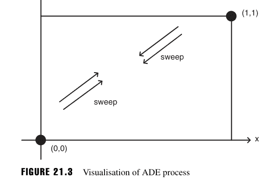

**图 21.3** ADE 过程的可视化。

该格式的一种修改由 Larkin（1964）提出，并使用每个时间层上的平均解的值：

\[
\frac{U_j^{n+1}-u_j^n}{k}
=
\frac{U_{j-1}^{n+1}-U_j^{n+1}-u_j^n+u_{j+1}^n}{h^2}
\]

\[
\frac{V_j^{n+1}-u_j^n}{k}
=
\frac{u_{j-1}^n-u_j^n-V_j^{n+1}+V_{j+1}^{n+1}}{h^2}
\]

\[
u_j^{n+1}=\frac12\left(U_j^{n+1}+V_j^{n+1}\right).
\]

二维版本可以通过修改部分 b) 中的 Barakat 和 Clark 格式来实现。实现这些格式并比较它们的相对精度。
- c) 对于具有对流项的两因子 PDE，考虑 Towler–Yang 和 Roberts–Weiss 格式。
- d) 在混合导数的情况下，使用 Yanenko 策略（Duffy，2006；Yanenko，1971）结合 ADE。
- e) 实现部分 c) 和 d) 中的算法并将其整合到两因子 Black–Scholes PDE 的 ADE 格式中。将你的答案与一些精确解进行比较，例如 Margrabe 闭式方程（参见 Haug，2007）。

### 4. （将 Saul’yev ADE 与对流项中的迎风格式结合）

众所周知，Barakat–Clark 方法结合 Roberts–Weiss 方法会因边界处的机器舍入误差而产生空间放大误差，例如（参见 Roache，1998，其中还声称扩散方程的 Saul’yev 方法不会产生放大误差）。von Neumann 稳定性分析并不能揭示这些计算不稳定性的存在。

本练习的目标是使用 Saul’yev 方法结合对流项的迎风格式。我们首先集中于常系数对流-扩散方程：

\[
\frac{\partial u}{\partial t}+c\frac{\partial u}{\partial x}=v\frac{\partial^2u}{\partial x^2}\qquad(c,v>0)
\]

除 Dirichlet 边界条件和初始条件外。回答以下问题：

- a) 验证 Saul’yev 格式与迎风格式导致奇数和偶数时间层的以下扫描：

\[
(1+\rho)u_j^{n+1}=(1-\rho)u_j^n+\rho\left(u_{j-1}^{n+1}+u_{j+1}^n\right)-\tau\left(u_j^n-u_{j-1}^n\right)
\]

和

\[
(1+\rho)u_j^{n+1}=(1-\rho)u_j^n+\rho\left(u_{j+1}^{n+1}+u_{j-1}^n\right)-\tau\left(u_j^n-u_{j-1}^n\right)
\]

其中：

\[
\tau=\frac{c\Delta t}{h},\qquad \rho=\frac{v\Delta t}{h^2}.
\]

- b) 对线性对流-扩散方程实现该格式：

\[
\frac{\partial u}{\partial t}+c\frac{\partial u}{\partial x}=v\frac{\partial^2u}{\partial x^2},\qquad 0\le x\le20,\quad t\ge0
\]

初始条件为：

\[
u(x,0)=\exp\left(-\alpha(x-x_1)^2\right),\qquad \alpha=6,\ x_1=2.
\]

精确解为：

\[
u(x,t)=(1+4\alpha vt)^{-1/2}\exp\left\{-\frac{\alpha(x-x_1-ct)^2}{1+4\alpha vt}\right\}.
\]

- c) 对粘性 Burgers 方程实现该格式：

\[
\frac{\partial u}{\partial t}+u\frac{\partial u}{\partial x}=v\frac{\partial^2u}{\partial x^2},\qquad 0\le x\le10,\quad t\ge0
\]

初始条件为：

\[
u(x,0)=\begin{cases}1, & 0\le x<1,\\0, & 1<x\le10.\end{cases}
\]


精确解由下式给出：

```
u(x,t) = 1/2 ( 1 - tanh [ (1/2 (x - t/2 - 1)) / (2v) ] )
```

你可以使用以下近似来处理非线性项：

```
u ∂u/∂x ~ u_j^n (u_j^n - u_{j-1}^n)/h
```

d) 在软件框架中创建一个类，实现 Saul’yev 方法并结合迎风格式：

```
u ∂u/∂x ~ u_j^n (u_j^n - u_{j-1}^n)/h
```

我们指出，如果 |τ| ≤ 1，则该方法稳定，其中 τ = cΔt/h，如 Roache (1998) 所示。

e) 在对流项中使用迎风格式实现 B&C 方法。你会得到放大误差吗？（尝试 Δt >> h。对该格式在 Black–Scholes 方程上进行测试。）

## 5. （重新审视桥接模式）

在第 21.6 节中，我们应用了 GOF (1995) 中介绍的桥接模式。在本练习中，我们研究了该设计的几种替代方案并讨论每种替代方案的相对优缺点。回答以下问题：

+ a) 修改代码以基于 CRTP 产生设计（我们对一些 FDM/ADE 类就是这样做的）。这种变化对图 21.2 中的类有何影响？
+ b) 修改代码以基于通用函数包装器产生设计。换句话说，我们创建一个由多个 std::function 实例组成的单一类。这种变化对图 21.2 中的类有何影响？
+ c) 确定与这三种替代方案相对应的 PDE 类实例在设计中使用的难易程度。在哪些情况下抽象与其实现是按 GOF (1995) 中讨论的方式解耦的？
+ d) 测量三种解决方案的运行时间性能。

## 6. （桥接设计模式测验）

在练习 5 中我们讨论了实现桥接设计模式的三种方法。确定每种解决方案在多大程度上满足 GOF (1995) 中讨论的以下适用性要求：

+ a) 避免抽象与其实现之间的永久绑定。
+ b) 抽象及其实现都可以通过子类化进行扩展。
+ c) 抽象实现的更改不应影响客户端。
+ d) 我们隐藏抽象的实现以免客户端知晓。
+ e) 我们可能希望在多个对象之间共享一个实现。
+ f) 避免类和类层次结构的激增。

总体而言，本练习的目的是分析练习 5 中的每种解决方案在多大程度上满足上述要求 a)–f)。换句话说，对解决方案进行比较。

## 扩展软件框架

## 22.1 引言与目标

本章是第 20 章和第 21 章的方法和代码的应用。我们特别感兴趣的是估计 delta 和 gamma，它们分别是期权价格相对于股票的第一个和第二个导数。这两种敏感性用于管理期权头寸的风险。正因如此，我们对其进行了详细讨论，并提出了几种计算方法。

采用的方法是先在到期时计算期权价格数组，然后使用它通过差商来计算 delta 和 gamma。我们必须谨慎选择有限差分格式，因为某些格式（例如 Crank–Nicolson）由于 payoff 可能不连续或在某些点、尤其是执行价处存在拐点而产生振荡（参见 Duffy, 2004A 的讨论）。我们通过采用更多时间步来阻尼不需要的特征值（参见 Lawson 和 Morris, 1978）或使用全隐式（BTCS）格式来解决该问题。然而，该格式仅为一阶精度。另一种选择是先使用 BTCS 进行最初几个时间步，然后在执行价附近的振荡消失后切换到 Crank–Nicolson。

我们也可以从软件测试的角度来看待本章，即代码使用了第 13 章、第 20 章和第 21 章中的函数和类。由于我们有 delta 和 gamma 的解析公式（以及 Haug, 2007 中列举的其他敏感性），我们可以通过将近似结果与精确结果进行比较来测试代码的准确性、鲁棒性和效率。这样，我们就测试了有限差分格式、矩阵求解器和三次样条插值算法以产生最终结果。这是对代码的全面测试。最后，将结果显示在 Excel 中的功能非常方便，因为我们可以一目了然地看到结果。我们还讨论了用于扩展和定制软件系统功能的软件设计模式。我们还提出了改进这些设计模式的一些指导方针。

## 22.2 期权价值的三次样条插值

在第 20 章和第 21 章中，我们介绍了有限差分法及其在 C++ 中的实现。该方法在离散网格点上近似 PDE 的精确解。为了计算网格点之间的近似值，我们需要进行某种插值。一些流行的选择是（Duffy and Germani, 2013）：

- 线性插值。
- 三次样条插值（参见本书第 13 章）。
- Akima 方法。
- Hermite 单调保持三次样条（Doughtery, Edelman and Hyman, 1989）。我们在第 27 章讨论 Akima 和 Hyman 方法的实现。

在所有情况下，我们都希望在区间内的某些点上插值数据。在本节中，我们使用三次样条，因为在这种情况下网格点是均匀分布的，并且不会出现第 13.5.2 节中描述的某种病态情况。

本节的设计策略如下：

- A. 选择一个 PDE 并用 FD 格式近似它。
- B. 使用 FD 的网格数组和期权价值数组作为三次样条插值算法的输入。
- C. 计算一系列标的价值的期权价值。

在初始示例中，我们使用 Crank–Nicolson 方法对看涨期权进行定价。我们将生成的期权价格数组作为三次样条求解器的输入。我们通过随机生成一个标的（横坐标）值来进行简单测试，在该值处比较精确期权价格和近似期权价格：

```
#include "General.hpp"
#include "ExcelDriverlite.hpp"
#include <random>
#include <iostream>
#include "CubicSpline.hpp"
#include "OptionCommand.hpp"

int main()
{
    Option myOption;
    myOption.sig = 0.3; myOption.K = 65.0; myOption.T = 0.25;
    myOption.r = 0.08; myOption.b = 0.08; myOption.beta = 1.0;
    myOption.SMax = 325.0; myOption.type = 'C';
    myOption.earlyExercise = false;

    BlackScholesPde myImp(myOption);

    Range<double> rangeX(0.0, myOption.SMax);
    Range<double> rangeT(0.0, myOption.T); // Time horizon

    IBvp currentImp(myImp, rangeX, rangeT);

    // Finite Difference Schemes
    long J = 5;
```

```
long N = 50;
std::cout << "Number of space divisions: ";
std::cin >> J;

std::cout << "Number of time divisions: ";
std::cin >> N;

CNIBVP fdmCN(currentImp, N, J);

std::cout << "Starting fdm...";

auto sol = fdmCN.result();

ExcelDriver xl; xl.MakeVisible(true);
std::string title = std::string("Crank Nicolson");
auto xarr = fdmCN.XValues();
xl.CreateChart(xarr, sol, title);

// Now do some interpolation with xarr and sol as input arrays
// Generate a random number in [a,b]
std::default_random_engine eng;
std::random_device rd;
eng.seed(rd());

double a = 57.0; double b = 68.0;
std::uniform_real_distribution<double> dist(a, b);
double xvar = dist(eng);

// Discussed in chapter 13, section 13.5
CubicSplineInterpolator csi(xarr, sol, SecondDeriv);

// Generate the exact price
CallPrice cp(myOption.K, myOption.T, myOption.r, myOption.b, myOption.sig);
try
{
    double result = csi.Solve(xvar);
    std::cout << "Interpolated value at " << xvar << " "
              << std::setprecision(16) << result << ", "
              << cp.execute(xvar) << '\n';
}
catch (std::exception& e)
{ // Catch not in range of values
    std::cout << e.what() << '\n';
}
return 0;
}
```

有关插值相关的其他用例和场景，请参阅练习 1。


## 22.3 数值微分基础

本节讨论用于近似函数一阶导数和二阶导数的数值技术。在许多应用中我们都需要计算这些量，例如常微分方程和偏微分方程的数值近似、积分方程，以及更具体地计算期权敏感性。我们将讨论这些数值方法及其在 C++ 中的实现，还会讨论为什么数值微分是一个不稳定过程，以及如何解决这一问题。

### 22.3.1 数学基础

本节我们考察一个实变量的实值函数：

y = f(x).  (22.1)

一般而言，我们感兴趣的是找到函数 f 的一阶导数和二阶导数的近似值。在本书中之所以需要这样做，是因为函数 f 的形式通常是未知的，因此无法解析地计算其导数。其次，计算导数可能代价高昂。为此，我们求助于数值近似。假设我们希望近似 y 在某点 a 处的一阶导数（见图 22.1），并假设 h 是一个（小的）正数。

第一种近似（称为中心差分公式）由下式给出：

f'(a) ≈ [f(a + h) - f(a - h)] / 2h.  (22.2)

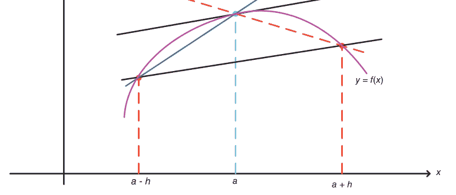

图 22.1 差商的动机

另一种近似称为向前差分公式，由下式给出：

$f'(a) \approx \frac{f(a+h)-f(a)}{h}.$  (22.3)

最后，向后差分公式由下式给出：

$f'(a) \approx \frac{f(a)-f(a-h)}{h}.$  (22.4)

我们使用以下记号：

$D_0 f(a) \equiv \frac{f(a+h)-f(a-h)}{2h}$  (22.5a)

$D_+ f(a) \equiv \frac{f(a+h)-f(a)}{h}$  (22.5b)

$D_- f(a) \equiv \frac{f(a)-f(a-h)}{h}.$  (22.5c)

让我们考察中心差分情形，即公式 (22.5a)。我们使用带精确余项的泰勒展开来证明：

$ \begin{cases} f(a \pm h)=f(a) \pm h f'(a)+\frac{h^2}{2!}f''(a)\pm \frac{h^3}{3!}f'''(\eta_{\pm}) \\ \eta_- \in (a-h,a),\eta_+ \in (a,a+h) \end{cases}$  (22.6)

由此我们可以得出结论，在这种特殊情形下：

$D_0 f(a)=f'(a)+\frac{h^2}{6}\left(\frac{f'''(\eta_+)+f'''(\eta_-)}{2}\right).$  (22.7)

我们看到，当 $h$ 足够小且 $f$ 具有直到三阶的连续导数时，中心差分给出了一阶导数的二阶近似。类似地，简单的计算表明，$f$ 在点 $a$ 处的一阶导数的向前和向后差分近似分别为：

$D_+ f(a)=f'(a)+\frac{h}{2}f''(\eta_+),\ \eta_+ \in (a,a+h)$  (22.8)

$D_- f(a)=f'(a)-\frac{h}{2}f''(\eta_-),\ \eta_- \in (a-h,a).$

我们看到这些单侧格式只有一阶精度。另一方面，它们对函数 $f$ 的连续性要求较低，即我们只需假设其二阶导数连续即可。

我们现在讨论 $f$ 在某点 $a$ 处的二阶导数的差商。为此，我们提出如下常用的三点公式（参见 Conte 和 de Boor, 1981）：

$D_+ D_- f(a) \equiv \frac{f(a-h)-2f(a)+f(a+h)}{h^2}.$  (22.9)

因此，这个差商是 $f$ 在点 $a$ 处二阶导数的二阶近似，并且我们假设该函数具有直到四阶（含四阶）的连续导数。离散化误差由下式给出：

$$D_{+}D_{-}f(a) \equiv f''(a) + \frac{h^2}{4!}\left(f^{(iv)}(\eta_{+}) + f^{(iv)}(\eta_{-})\right). \tag{22.10}$$

我们通常将公式 (22.5) 中定义的差商应用于偏微分方程。

### 22.3.2 使用三次样条

我们在第 13 章（公式 (13.38) 和 (13.37)）已经看到如何使用三次样条近似函数的一阶和二阶导数。这是对第 22.3.1 节中方法的一种替代。其数学理论在 Ahlberg、Nilson 和 Walsh (1967) 中有详细讨论。当有足够精确的数据可用时，样条近似对于高精度数值微分非常有用。参考第 13.5 节的记号，我们可以看到三次多项式在每个子区间内有四个未知常数，因此总共有 $4n$ 个常数需要求值。内部网格点处的下列连续性条件使我们能够求出其中 $3(n − 1) + n + 1$（总共 $4n − 2$）个常数，这可以从下列关系式中看出：

$$\begin{cases} S(x_j^-) = S(x_j^+) \\ S'(x_j^-) = S'(x_j^+) \\ S''(x_j^-) = S''(x_j^+) \end{cases} \quad 1 \le j \le n-1$$ 

$$S(x_j) = y_j, \ 0 \le j \le n. \tag{22.11}$$

我们还需要找到两个额外的条件。为此，必须满足以下各组边界条件之一（Gao、Zhang 和 Cao, 2011）：

- a) *固定样条：* $S'(x_0)=y_0', S'(x_n)=y_n'$

- b) *曲率调整三次样条：* $S''(x_0)=y_0'', S''(x_n)=y_n''$

- c) *周期样条：* $S(x_0)=S(x_n), S'(x_0)=S'(x_n), S''(x_0)=S''(x_n)$

本书不讨论周期样条。顺便提一下，三次样条也可用作函数的数值积分器。一般来说，数值微分比数值积分更加困难。

### 22.3.3 初始示例

我们简要介绍在计算数值导数时需要注意的一些问题。我们提到，数值微分是一个*不适定*问题。这意味着输入参数的微小变化可能导致输出的巨大变化。其次，精度可能会受到灾难性*抵消*的影响，例如当两个几乎相等的数相减时，如第 8 章所讨论的那样。

我们举一个基于朴素假设的例子，即一个能够很好逼近函数的多项式，只需对该多项式求导，就能很好地逼近函数的导数！下面的反例表明这一前提是多么错误。为此，我们用指数函数泰勒展开的前三项来逼近它：

$f(x) = e^x$
$Q(x) = 1 + x + \frac{1}{2}x^2.$

然后：

$f = f' = f'' = f'''$
$Q'(x) = 1 + x,\ Q''(x) = 1,\ Q'''(x) = 0.$

对于 $x \in [-0.1,0.1]$，我们得到：

$\max |f(x) - Q(x)| \approx 2 \times 10^{-4}$
$\max |f'(x) - Q'(x)| \approx 5 \times 10^{-3}$
$\max |f''(x) - Q''(x)| \approx 10^{-1}$
$\max |f'''(x) - Q'''(x)| \approx 1.$

我们可以看到，精度逐渐变差。作为一项新实验，我们使用三次样条来逼近上述函数及其前两阶导数。我们使用第 13 章中的 C++ 样条插值类及其成员函数来计算这些量。逼近指数函数的代码如下：

```
std::cout << "Cubic spline\n";
// Now choose Clamped Spline type, 1st derivatives specified at
// end-points. Approximate exp(x) on the interval [-0.1, 0.1]
double a = -0.1;
double b = 0.1;

double leftBC = std::exp(a);
double rightBC = std::exp(b);

std::size_t N = 10;
auto xarr = CreateMesh(N, a,b);

auto fun = [] (double x) { return std::exp(x); };

CubicSplineInterpolator csi(xarr,fun, FirstDeriv, leftBC, rightBC);
double xVal = 0.009; // N.B. make sure this value is in the range [a,b]
double result = csi.Solve(xVal);
std::cout << "Interpolated + exact values: " << std::setprecision(12)
          << result << ", " << fun(xVal) << '\n';
std::cout << "Derivative value: " << std::setprecision(12)
          << csi.Derivative(xVal) << '\n';

auto tup = csi.ExtendedSolve(xVal);
```

```
std::cout << "Zero, 1st and 2nd derivatives: " << std::setprecision(12)
    << std::get<0>(tup) << ", " << std::get<1>(tup) << ", "
    << std::get<2>(tup) << '\n';

double exactIntegral = fun(b) - fun(a);
std::cout << "Integrals: " << std::setprecision(12)
    << csi.Integral() << ", " << exactIntegral << '\n';
```

上述代码产生如下输出：

```
Cubic spline
Interpolated + exact values: 1.00904061683, 1.00904062177
Derivative value: 1.00904183989
Zero, 1st and 2nd derivative value:
1.00904061683, 1.00904183989,1.00883252589
Integrals: 0.200333499995, 0.20033350004
```

正如预期的那样，导数阶数越高，近似的精度越低。

### 22.3.4 差商

在第 22.3.1 节中，我们讨论了计算函数一阶导数和二阶导数近似值的几个公式。当被逼近的函数及其导数计算代价高昂或难以计算时，这些方法非常有用。在这些情况下，使用有限差分是一种合适的替代方案。主要挑战在于通过选择合适的步长 h 来决定我们希望达到的近似精度。第 22.3.1 节公式中的两个主要误差来源是：

- 由泰勒级数展开中的高阶项引起的截断（离散化）误差。

- 由计算机有限字长以及两个几乎相等的量相减时所产生的有效位丢失引起的舍入误差。一种补救措施是，当步长 h 变小时，通过使用保护位或多精度运算等方式，增加函数计算时保留的有效数字位数。

我们使用 32 位、64 位和多精度数据类型给出一些代码示例。自由函数实现了第 22.3.1 节中的公式：

```
#include <cmath>
#include <iostream>
#include <limits>
#include <functional>
#include <boost/multiprecision/cpp_dec_float.hpp>

template <typename T>
    using FunctionType = std::function<T(const T& t)>;

// Choice of floating point types
//using value_type = float;
//using value_type = double;
using value_type = boost::multiprecision::cpp_dec_float_100;
```


//using value_type = boost::multiprecision::cpp_dec_float_50;

template <typename T>
    T firstDividedDifference(const FunctionType<T>& f, T xval, T h)
{ // 2nd order approximation h^2/6

    return (f(xval+h) - f(xval-h)) / (2.0 * h);
}

//double optmalStep()
template <typename T>
    T secondDividedDifference(const FunctionType<T>& f, T xval, T h)
{ // 2nd order h^2/12

    return (f(xval+h) - (2.0 * f(xval)) + f(xval-h)) / (h * h);
}

一个简单的测试程序如下：

```
int main()
{
    namespace mp = boost::multiprecision;

    // Take numerical derivative at specific point
    value_type x = 2.0;
    value_type h;
    char ans;

L1:

    std::cout << "Give step size: ";
    std::cin >> h;

    std::cout << "Approximation to exp(x)...\n";

    // You can define your own functions here to test the errors
    FunctionType<value_type> fun = [] (value_type x) -> value_type
        { return x*x; };

    std::cout << std::setprecision(12)
              << "1st divided difference "
              << firstDividedDifference<value_type>(fun, x, h)
              << "\n2nd divided difference "
              << secondDividedDifference<value_type>(fun,x,h);

    std::cout << "continue? ";
    std::cin >> ans;

    if (ans == 'y') goto L1;

    return 0;
}
```

你可以使用各种浮点类型和不同的 h 值来试验这段代码。例如，我们可以让 h 每次减小 10 倍，以确定对于给定浮点类型，差商何时开始产生不正确的结果。例如，在某些情况下，差商公式 (22.9) 可能产生零值，即使精确的二阶导数不为零！我们将在本书附录 1 中讨论使用多精度数据类型进行数值微分。

## 22.3.5 什么是最优步长？

能使舍入误差和离散化误差的绝对值之和最小的最优 h 值是什么（Conte and de Boor, 1981）？为具体回答此问题，我们再次使用第 22.3.3 节中的例子。假设计算 e^x 的误差为 ±1 × 10^-8。那么可以证明，使用公式 (22.7) 时的舍入误差为：

R = ± (2 × 10^-8) / (2h)。

离散化误差可由公式 (22.7) 近似计算：

T = -1/6 h^2 (f''' ~ 1)。

因此要最小化的函数是：

g(h) = |R| + |T| = 10^-8 / h + 1/6 h^2。

最小值是 g'(h) = 0 的解，即 h^3 = 3 × 10^-8。因此最优值为：

h = 10^-3 ∛30 ≈ 0.003。

你可以用不同的值进行试验来验证这一结果。另见练习 4。

## 22.4 数值 Greeks

现在我们来讨论计算期权敏感性的主题，以及如何用它们来降低风险。更多细节请参考 Haug (2007) 和 Hull (2006)。期权敏感性是期权对 Black–Scholes 方程中一个或多个参数的导数。我们重点关注期权 delta，它是期权价值对标的资产 S 的导数，而 gamma 是 delta 对 S 的导数。总体而言，我们希望准确高效地计算期权。下面列出一些选择：

- G1：精确 Greeks（Haug, 2007）。
- G2：数值 Greeks（Haug, 2007）。
- G3：使用蒙特卡洛及相关模拟方法（Glasserman, 2004）。
- G4：使用二叉树方法。
- G5：使用有限差分期权定价器的值（Duffy, 2004）并应用方法 G2。
- G6：使用有限差分期权定价器的值，构造三次样条以产生期权的 delta 和 gamma。
- G7：‘样条上样条’：在这种情况下我们使用两个样条。这是计算二阶导数的有效工具。技巧如下：我们以通常方式对数据应用三次样条，并计算样条的斜率（一阶导数）。然后我们拟合这些斜率本身（此时它们作为输入），并将结果导数用作所需的二阶导数。从这个意义上说，我们逼近一阶导数的一阶导数。

为了管理头寸，计算期权的敏感性非常重要。首先，delta 衡量期权价格对标的资产价格微小变化的绝对变化量，例如对于看涨期权。公式为：

```
Δc = ∂C/∂S.
```

delta 代表对冲比率，即为了创建无风险投资组合而需要卖出或买入的期权数量。对于深度虚值期权，delta 趋近于零；对于深度实值看涨期权，delta 趋近于一。如果我们考察收益函数，这一点就很清楚。然而，delta 在行权价 K 处并不连续，因为对于看涨期权，它在 K 左侧为零，在 K 右侧为一。因此我们预期在 K 附近会出现问题；而在实践中，当我们使用 Crank–Nicolson 时间平均等方法时，会出现伪振荡或非物理振荡，这印证了这一点（Duffy, 2004A）。

delta 的近似通过使用差商来实现。我们可以在前向、后向和中心差分格式之间选择。例如，我们在区域内部使用中心差分，而在边界处使用单侧差商：

### 离散 delta：

```
c_{j+1}^n - c_{j-1}^n / 2h , 1 ≤ j ≤ J - 1
c_1^n - c_0^n / h (j = 0)
c_J^n - c_{J-1}^n / h (j = J). (22.14)
```

gamma 衡量 delta 的变化：

```
Γ_C = ∂²C/∂S² = ∂Δc/∂S. (22.15)
```

对于平值期权，该值最大；对于深度实值或深度虚值期权，该值几乎为零。gamma 让我们了解对冲比率的脆弱性。

我们通过差商来近似 gamma 的公式 (22.15)：

```
Discrete gamma = (c_{j+1}^n - 2c_j^n + c_{j-1}^n)/h² , 1 ≤ j ≤ J - 1. (22.16)
```

```
```cpp
for (std::size_t j = 0; j < zarr.size(); ++j)
{
    delta[j] = (sol[j+2] - sol[j]) / (2*h);
}

// Exact solution
// OptionCommand(double strike, double expiration,
// double riskFree, double costOfCarry, double volatility)
CallDelta cDelta (myOption.K, myOption.T, myOption.r,
myOption.b, myOption.sig);
// PutDelta cDelta (myOption.K, myOption.T, myOption.r,
// myOption.b, myOption.sig);

std::vector<double> cDeltaPrices(zarr.size());
for (std::size_t j = 0; j < zarr.size(); ++j)
{
    cDeltaPrices[j] = cDelta.execute(zarr[j]);
}

// Compute delta from cubic splines
CubicSplineInterpolator csi2(xarr, sol, SecondDeriv);
std::vector<double> splineDelta(zarr.size());
for (std::size_t j = 0; j < zarr.size(); ++j)
{
    splineDelta[j] = csi2.Derivative(zarr[j]);
}
```
```

计算期权 gamma 的代码如下：

```
```cpp
std::vector<double> splineGamma(zarr.size());
for (std::size_t j = 0; j < zarr.size(); ++j)
{
    splineGamma[j] = std::get<2>(csi2.ExtendedSolve(zarr[j]));
}

// CallGamma cGamma(myOption.K, myOption.T, myOption.r,
// myOption.b, myOption.sig);
PutGamma cGamma (myOption.K, myOption.T, myOption.r, myOption.b,
myOption.sig);
std::vector<double> cGammaPrices(zarr.size());
for (std::size_t j = 0; j < zarr.size(); ++j)
{
    cGammaPrices[j] = cGamma.execute(zarr[j]);
}

// Gamma array: eq. (22.16)
std::vector<double> gamma(zarr.size());
for (std::size_t j = 0; j < zarr.size(); ++j)
{
    gamma[j] = (sol[j + 2] - 2*sol[j+1] + sol[j]) / (h * h);
}
```
```

我们可以按照第 14 章讨论的方式在 Excel 驱动程序中显示这些数组：

```
ExcelDriver x1; x1.MakeVisible(true);
std::list<std::string> labels{ "d exact", "d Fdm", " d spline",
"g exact", "g fdm", "g spline" };
std::list<std::vector<double>> curves
{cDeltaPrices,delta,splineDelta,cGammaPrices,gamma,
splineGamma };
x1.CreateChart(zarr, labels, curves, "Deltas", "S", "dV/dS");
```

Excel 输出的快照如表 22.1 所示。

检查表 22.1 中结果的精度（另见练习 9），我们看到 Crank–Nicolson 方法和三次样条插值器对 delta 产生了相似的结果，而插值器对 gamma 的精度不如 Crank–Nicolson 方法。原因是什么？对于光滑函数，一阶和二阶导数的中心差商逼近具有二阶精度。这种方法基于泰勒展开。三次样条是多项式，它们是对光滑函数的三阶精度的逼近。样条的一阶导数是对精确 delta 的二阶逼近，而样条的二阶导数是对精确 gamma 的一阶逼近。这一理论结果已在 Alberg、Nilson 和 Walsh（1967，定理 3.11.1，第 94 页）中数学上得到证明。三次样条插值器为了始终生成视觉上美观的曲线可能会过冲，这可能解释了为什么 gamma 的值会大于精确 gamma 甚至大于 Crank–Nicolson gamma。

当需要逼近一个光滑函数的二阶导数时，我们可以先使用一阶导数值作为输入来逼近二阶导数。这称为样条上样条计算（spline-on-spline computation）（Alberg、Nilson 和 Walsh，1967，第 48–50 页；Hilderbrand，1974，第 492 页），并且精度提升是可见的。在当前情况下，一个有用的练习是将基于这种变体得到的 gamma 值与生成表 22.1 结果时采用的原始方法进行比较。我们预期会得到对 gamma 更好的逼近。

## 表 22.1 步骤 1–5 的输出；数据为 K = 65, T = 0.25, r = b = 0.8, v = 0.3, NS = 325, NT = 1000

| S | 精确 delta | CN delta | 样条 delta | 精确 gamma | CN gamma | 样条 gamma |
|---|---|---|---|---|---|---|
| 59 | 0.330935233 | 0.330702564 | 0.330478248 | 0.040967715 | 0.04098453 | 0.041068871 |
| 60 | 0.372482798 | 0.372232265 | 0.372093554 | 0.042043376 | 0.042074873 | 0.042161739 |
| 61 | 0.41484882 | 0.414593361 | 0.414541127 | 0.042603904 | 0.042647319 | 0.042733408 |
| 62 | 0.457519085 | 0.457270132 | 0.457302102 | 0.042654217 | 0.042706223 | 0.042788541 |
| 63 | 0.499993235 | 0.499760129 | 0.499871257 | 0.042216737 | 0.04227377 | 0.042349769 |
| 64 | 0.541801022 | 0.541590678 | 0.541773643 | 0.041328768 | 0.041387329 | 0.041455004 |
| 65 | 0.582515647 | 0.582332471 | 0.582578239 | 0.040039354 | 0.040096257 | 0.040154187 |
| 66 | 0.62176381 | 0.621609821 | 0.621908227 | 0.038405882 | 0.038458444 | 0.038505789 |
| 67 | 0.659232357 | 0.659107471 | 0.659447781 | 0.036490702 | 0.036536856 | 0.03657332 |
| 68 | 0.694671633 | 0.694574052 | 0.694945475 | 0.034357967 | 0.034396306 | 0.034422069 |
| 69 | 0.727895851 | 0.727822509 | 0.728214631 | 0.032070838 | 0.032100608 | 0.032116243 |
| 70 | 0.758780913 | 0.758727922 | 0.759131055 | 0.029689185 | 0.029710218 | 0.029716604 |
| 71 | 0.787260172 | 0.787223244 | 0.787628682 | 0.027267796 | 0.027280425 | 0.027278649 |


## 22.5 常数方差弹性模型

该模型的 PDE 由下式给出：

$$\frac{\partial V}{\partial t}=\frac{1}{2}\sigma^2S^{2\beta}\frac{\partial^2V}{\partial S^2}+rS\frac{\partial V}{\partial S}-rV \tag{22.17}$$

它是一个更通用的对流-扩散-反应 PDE 的特例：

$$\frac{\partial u}{\partial t}=a(x,t)\frac{\partial^2u}{\partial x^2}+b(x,t)\frac{\partial u}{\partial x}+c(x,t)u+f(x,t),\quad 0<x<\infty,\quad 0<t<T \tag{22.18}$$

我们讨论将 PDE (22.18) 变换到有界域上的 PDE。我们以要点形式描述步骤，你应核对步骤的准确性：

- 1. **引入新的自变量：**
  
  $$y=\frac{x}{x+\alpha}. \tag{22.19}$$

- 2. **变换后的 PDE 变为：**
  
  $$\frac{\partial u}{\partial t}=A(y,t)\frac{\partial^2u}{\partial y^2}+B(y,t)\frac{\partial u}{\partial y}+C(y,t)u+F(y,t),\quad 0<y<1 \tag{22.20}$$

其中：

$$A(y,t)=\frac{1}{2}\sigma^2\alpha^{2\beta-2}y^{2\beta}(1-y)^{4-2\beta}$$

$$B(y,t)=-\sigma^2\alpha^{2\beta-2}y^{2\beta}(1-y)^{3-2\beta}+ry(1-y),\qquad y=\frac{S}{S+\alpha} \tag{22.21}$$

$$C(y,t)=-r,\quad F(y,t)=0.$$

- 3. **未变换坐标中的边界条件为：**
  
  $$C(0,t)=0$$
  
  $$C(S,t)\to S\text{ as }S\to\infty. \tag{22.22}$$

- 4. **变换坐标中的边界条件必须根据式 (22.22) 计算。**

我们在后面的章节中更详细地讨论该问题。

## 22.6 使用软件设计（GOF）模式

在本节中，我们对在 1990 年代中期首次进入主流 C++ 软件开发项目的著名软件设计模式进行高层次概述。关于该主题的第一本教科书是 GOF (1995)，它为开发人员提供了设计技术和词汇，帮助他们编写灵活且可维护的软件。其描述（摘自维基百科）为：

> 在软件工程中，软件设计模式是在给定软件设计上下文中对常见问题的一种通用可重用解决方案。它不是可以直接转换为源代码或机器代码的成品设计。它是解决问题的描述或模板，可在许多不同情况下使用。设计模式是程序员在设计应用程序或系统时可用来解决常见问题的正式化最佳实践。

设计模式可被视为介于编程范式和具体算法层级之间的一种结构化计算机编程方法。

在过去 20 年里，设计模式变得非常流行，这一点可以从为 Java、C#、C++ 等面向对象语言所著的书籍数量中看出。在过去 20 年里，模式的结构和数量变化不大，因为大多数文献似乎都在模仿 GOF (1995) 中的 23 种模式。从某种意义上说，这些模式是在 C++ 仍处于起步阶段、并且仅支持基于子类型多态（虚函数）和类层次结构的传统面向对象技术时发明的。我们的基本前提是，GOF 模式代表的知识尚未适应软件、硬件和开发方法的改进。我们希望解决的与传统使用设计模式相关的一些问题是：

- A1：面向对象的风格并不总是适用于所有应用的最合适的模型。
- A2：GOF 模式对于大型复杂系统的软件过程而言过于底层和过于详细。
- A3：没有必要从头实现给定的 GOF 模式；例如，Boost 提供了许多即用型模式，如 *Flyweight*、*Functional Factory*（Demming and Duffy, 2010, 2012）、*Meta State Machine*（MSM）和 Boost *signals2*。
- A4：似乎设计模式的文档尚未更新以反映 C++ 的新发展，例如智能指针、lambda 函数和函数式编程风格。
- A5：GOF 不支持 *parallel design patterns* 和用于在多核处理器上运行的应用的 *design blueprints*。
- A6：“生活中不只有设计模式。” 总体而言，根据我们的经验，设计模式对于成功的软件系统既非必要也非充分。我们可能冒着为错误的问题使用错误模式的风险。没有 *no silver bullet*（Brooks, 1995）：

> 在我们民间传说中充斥着所有怪物中，没有什么比狼人更令人恐惧，因为它们会从熟悉的事物意外地转变为恐怖。对于这些，我们寻求能神奇地将其制服的银弹。

- A7：面向对象技术，特别是设计模式，以自底向上的方式构建代码。这种状况导致代码难以维护，尤其是如果文档很差的话。
- A8：我们希望将软件设计模式与第 9 章中介绍的自顶向下分解方法集成。

我们在接下来的章节中扩展这些主题。由于篇幅限制，我们无法详细讨论单个模式。我们将在即将出版的文本中解决这些问题。

### 22.6.1 潜在假设和后果

GOF 设计模式基于对象模型，这意味着模式是使用对象、类和类层次结构结合子类型多态实现的。这意味着软件设计的灵活性方面的抽象需求必须通过引入不可计算概念的代理来转化为显式数据模型。此过程称为物化，它允许编程语言的任何方面在语言本身中表达。在此意义上，我们说物化数据被转变为一等对象。

我们从模式目录中举一个物化的例子。计算应用中的一个常见需求是避免在代码中硬编码算法。这是因为我们可能希望用具有相同签名但性能更好或精度更好的另一个算法替换该算法。例如。策略模式的简短描述为：

> 定义一组算法，对每个算法进行封装，并使它们可以互换。策略使算法能够独立于使用它的客户端而变化。将抽象捕获在接口中；将实现细节隐藏在派生类中。

为了实现该模式，我们创建一个类层次结构，其中每个类封装算法的特定实现。客户端随后可以通过组合（将算法对象嵌入为客户端成员数据）或通过调用客户端中的成员函数并将算法对象作为输入参数来使用算法。

一般而言，在当前上下文中需要物化，因为许多软件需求没有直接映射到对象或相关编程语言。我们随后创建类以某种方式适配和封装这些需求。为此，GOF (1995) 中的一些示例为：

- 工厂方法（也称为虚拟构造函数）模式定义了创建对象的抽象接口（通过抽象类）。C++ 仍不支持 C# 和 COM 中的接口（Albahari and Albahari, 2016; Rogerson, 1997），正因如此，工厂方法模式和若干其他创建型模式必须创建类层次结构。
- 基于信号和槽隐喻实现事件通知机制的观察者模式。同样，我们需要物化这些概念，从而产生两个类层次结构。其他语言和库如 C# 和 Boost 分别以（多播）委托和信号与槽的形式直接支持这些概念。
- 命令模式将请求或消息封装为对象。我们创建一个类层次结构，其中每个派生类在接收者上实现一个请求。
- 访问者模式通过允许开发人员在无需更改其操作的元素的类情况下创建新方法，从而扩展类（数据）层次结构的功能。

GOF 中的大多数其他模式都采用与上述讨论类似的物化过程。


- *代理*（一种对象，是另一个对象的替身/占位符，用于控制对它的访问）。
- *行为型*：这些模式关注对象之间的通信，特别是*算法*的实现和对象间责任的分配。这些模式描述了应用程序中的运行时控制和数据流。我们可以进一步将这些模式划分如下：
  - *变体*：以某种方式定制类方法的模式。通常，这些模式将实现成员函数的代码外部化。主要的模式有：
  - *策略*（可互换算法族）。
  - *模板方法*（在基类中定义算法的骨架；某些可变步骤委托给派生类；公共或*不变*的功能在基类中定义）。
  - *命令*（将请求封装为对象；执行命令）。
  - *状态*（允许对象在其内部状态改变时改变行为）。
  - *迭代器*（提供一种按顺序访问聚合对象元素而无需暴露其内部表示的方法）。
- *通知*：这些模式定义并维护对象之间的依赖关系：
  - *观察者*（定义*发布者*与其依赖的订阅者之间的一对多依赖）。
  - *中介者*（定义一个对象，使对象之间无需相互感知即可通信；该模式促进*松耦合*）。
  - *责任链*（发送请求时避免*发送者*和*接收者*对象之间的耦合；给多个对象处理请求的机会）。
- *扩展*：允许我们向类层次结构中的类添加新功能（以成员函数形式）的模式。在GOF（1995）中只有一种这样的模式：
  - *访问者*（以非侵入方式在类层次结构的类上定义新操作）。

GOF（1995）中还有一些其他不太通用的行为型模式：

- *备忘录*（捕获并外部化对象的内部状态，以便稍后可以恢复）。
- *解释器*（给定一种语言，定义其语法的表示，并定义解释器来解释该语言中的句子）。

在开发应用程序时，哪些GOF模式是有用的？根据我们的经验，一个初步的回答是：20%的设计模式贡献了80%的开发者生产力。许多应用程序具有相似的特征，一旦确定了这些特征，我们就能确定该使用哪些设计模式。一般来说，应用程序开发涉及以下活动：

- A1：使用*结构型模式*来组合类和类层次结构。特别是，我们可以通过继承和组合来扩展类的功能。最重要的三种模式是*适配器*、*组合*和*装饰器*。
- A2：使用*行为型模式*来扩展和/或修改活动A1中的类。一方面，我们可能希望扩展类层次结构的功能（使用*访问者*模式），在单个类（*策略*）中以及类层次结构中创建灵活的算法（模板方法模式）。我们还希望保持对象网络中的对象一致性，在这种情况下，我们可以应用观察者模式，尽管其如GOF（1995）中所描述的实现基于OOP（它甚至不算错），更好的解决方案是使用基于信号的方法（如Demming和Duffy，2010所述）或使用.NET委托，我们将在第27章中描述。例如，观察者模式的大部分功能都可以通过.NET事件模式来实现。
- A3：一旦我们知道了要使用哪些结构型和行为型模式，我们就用类和对象来实现它们。我们还描述了这些类和对象之间的结构关系。当然，我们要实例化这些类，而且这个过程必须是可定制的，以便我们能够以尽可能灵活的方式、用不同的方法实例化类。为此，我们使用创建型模式，如工厂方法（针对特定类）、抽象工厂（针对相互关联的类和类层次结构）以及构建器（用于配置完整应用程序中的所有对象）。

## 22.6.3 模式：增量改进

可以通过多种方式升级GOF模式：

- S1：保持并按其当前形式使用这些模式，不做更改。
- S2：通过使用新的改进的C++功能（如共享指针和本书前10章中讨论的语法）来改进这些模式。这些是相对较小的改进。
- S3：例如，对使用泛型和函数式编程模型可更轻松、更正确实现的那些模式进行重构。
- S4：暂时不要使用设计模式，而是在设计过程中尽可能推迟它们的使用。相反，我们使用第9章的系统分解技术，并希望达到与GOF模式相同（甚至可能改进）的灵活性水平，但通过其他方式实现，具体而言是在组件之间定义标准化接口。

一般来说，我们区分可能需要升级的遗留软件系统和从头设计的系统。在前一种情况下，升级策略S1和S2可能适用，而策略S3适用于那些设计良好、升级对软件系统稳定性影响最小的设计模式。在后一种情况下，我们拥有最大的自由度，可以选择最合适的设计模式（或模式组合）来满足我们的需求。

## 22.7 多范式设计模式

在本书中，我们讨论在GOF模式诞生时并不存在的C++新特性。我们可以推测，这些模式是为了解决语言诞生之初的一些缺陷而创建的，还是它们确实是可复用于各种应用程序的健壮设计技术。一些模式已经年久失修，而另一些则可以通过升级焕发新生。还有一些模式将会被发现，而这些模式在GOF（1995）中是难以预见的。

随着本书的深入，我们会提及并介绍几种设计模式。现在，我们概述（在我们看来）有助于升级设计模式的顶级C++特性。我们还针对S2和S3用例给出这些特性的一些要点。

- **共享指针和唯一指针：** 最初的GOF模式使用原始指针。使用智能指针可以使代码更健壮、更可靠。
- **元组：** 提供将一组异构数据作为单一实体进行分组的能力。它们作为*抽象工厂*和*构建器*模式的一部分特别有用。返回类型是新创建对象的元组。GOF模式接口为每个产品提供一个抽象工厂方法。类似地，我们可以扩展*构建器*模式，使其返回一个元组，其元素可以由*分包商*创建。目前，我们没看到元组在改进结构型和行为型模式方面有太多用途。随着元组新应用的发现，这种情况可能会改变。
- **通用函数包装器**（`std::function`）：这些是抽象函数，可以通过将它们分配给可调用对象的*目标方法*来“实例化”，例如。这些实际上是多态函数，利用这一点可以减少在*命令*、*策略*、*模板方法*和*观察者*等模式中需要创建的派生类数量。这种方法减少了应用程序中的类数量，从而提高了可维护性（参见第7.6.4节的度量M13和M12）。
- **Boost signals2：** 该库支持*信号与槽*，并且优于*观察者*和*责任链*模式。在我们看来，使用类层次结构来模拟事件有些牵强。
- **Lambda函数**和存储的Lambda函数：这些函数使我们可以不必创建类和自由函数，从而减少了繁重的工作和维护成本。这些函数在开发创建型模式代码时最有用。
- **可变参数模板**和*可变参数函数*：这些特性有助于减少代码膨胀。在第一种情况下，我们只需要定义一次模板类并实例化多次；而在第二种情况下，我们只需要定义一次具有可变参数的函数。

对这些主题的全面讨论超出了本书的范围，它们将在后续著作中讨论。

## 22.8 总结与结论

在本章中，我们讨论了如何计算一些期权敏感性，特别是delta和gamma。这些用于*对冲*。对冲是通过利用各种风险投资之间的关系来降低风险。*Delta对冲*涉及通过定义期权与其标的之间的对冲来完全消除所有风险。*Gamma对冲*用于减少每次对冲的规模，从而降低成本。它是一种比delta对冲更准确的对冲形式。在本章中，我们讨论了计算这些量的方法。

## 22.9 练习与项目

- 1.（插值）
  创建C++代码以执行线性插值。以与第22.2节代码相同的方式测试代码。在Excel中显示结果。将结果与第22.2节中三次样条插值产生的结果进行比较。
- 2.（自动化FDM测试器，中型项目）
  本练习的目标是开发一个*概念验证*软件框架，用于测试给定有限差分格式的准确性、健壮性和运行时性能。


The rationale is that an automated procedure can be run without human intervention and it produces a management report (for example, the results could be stored in a database) on the quality of the finite difference scheme that we are testing. In order to scope the problem we consider testing ADE against the Crank–Nicolson (CN) method and we can assume that the results produced by CN are accurate. Some of the features and requirements (accuracy and efficiency are the most important quality issues) are:

- F1: Test the accuracy of ADE against CN. Determine those regions in which ADE produces values that deviate from those produced by CN.
- F2: Test the robustness of ADE for a range of input parameters (which may be randomly generated).
- F3: Investigate the accuracy in the case of convection dominance, large and small expiration and other stressful cases.
- F4: Examine performance and accuracy of the different ADE variants for a range of mesh sizes and time steps.
- F5: Compute option sensitivities (in particular, delta and gamma).

Answer the following questions:

- a) Apply the methods in Chapter 9 to scope this problem by creating a system context diagram, describing what the major output and input are and how the core process maps input to output.
- b) Determine the interfaces of the modules in the system context diagram. Implement each module as an adapter class that reuses existing code.
- c) Determine how to model the input data. In an initial version it can be hardwired in the code. If time permits you can consider using XML files, regular expressions (C++ has a regex library) or the Boost Parameter library. An important part of the project is to define the data structures to hold both the input data and the generated output data.
- d) Do you see any opportunities for parallelising the code?

## 3. (Numerical Integrals and Derivatives with Cubic Splines, Small Project)

We gave an example in Section 22.3.3 of using a cubic spline to approximate a function and its derivatives. We also saw in Chapter 13 that cubic splines can be used for numerical integration (see also Stroud, 1974 for a mathematical discussion).

The main goal of this exercise is to determine how to use cubic splines in your applications as a competitor to other methods. Some of the reasons for doing so could be:

- Other methods may not be robust enough.
- Cubic splines have many applications and are easy to use.
- Cubic splines are accurate and have good performance characteristics.

Answer the following questions:

a) Compute the following integrals using cubic splines with different mesh sizes. How does the accuracy compare with the exact values and with those produced by other numerical integration rules (for example, the Gaussian methods that we discussed in Chapter 8)?

∫₁² dx/x (exact value 0.69314718055)
∫₀¹⁰ dx/(1 + x²) (exact value 1.471127674304)
∫₀ˣ e^(-y²/2) dy where 0 < x < ∞.

b) In Section 22.4 we discussed a number of methods to compute option sensitivities. Take some relevant examples and compare the methods with regard to accuracy and performance.

## 4. (Optimum Step Size in Numerical Differentiation)

Generalise the analysis (as far as possible) in Section 22.3.5 to compute the optimum h for an arbitrary function whose third derivative can be bounded from above. The error in computing function values is also an input value.

Find the function of h to be minimised and find the optimum h by solving a polynomial equation or using one of the nonlinear solvers in Chapter 19.

You may also find the C++ features regarding numerical precision in Chapter 8 to be useful.

## 5. (Binary Call Option)

This exercise involves computing the price, delta and gamma of a binary call option that has a payoff of 0 when S ≤ K at expiration and 1 otherwise. In other words, the payoff is a Heaviside function:

Payoff (S) = H(S − K)

where:

H(x) = { 1, x > 0
0, x ≤ 0. }

Answer the following questions:

- a) Carry out an analysis similar to that in Section 22.4.1 using this option type as test case. We wish to compare the relative accuracy of the CN and ADE methods.
- b) Compute the delta and gamma of a binary call option using the exact form as well as the finite difference and cubic spline approaches (Haug, 2007).

## 6. (Estimating Speed, Open Question)

The speed of an option is the rate of change of the gamma with respect to the stock price. It is the same quantity for both calls and puts:

∂³C/∂S³ = ∂³P/∂S³ = ∂Γ/∂S

where Γ is the option gamma.

The corresponding exact formulae are (Haug, 2007; Wilmott, 2006):

−Γ/S ( d₁/(σ√T) + 1 ) where d₁ = [log(S/K) + (r − b + ½σ²)T] / (σ√T).

A large value indicates that the gamma is very sensitive to changes in the underlying asset and it is useful when gamma is at its maximum with respect to the asset price.

The objective of this exercise is to determine how to estimate speed accurately and efficiently. Investigate the following alternatives:

- a) Using a simple finite difference approximation to the third derivative:
f'''(x) ≈ (f(x + 2h) − f(x − 2h) − 2(f(x + h) − f(x − h))) + O(h²).
b) Using the analytical formula.
c) Using cubic splines to compute its third derivative (why do we not expect that the approximation will be very good?).

Then:

S''(x) = M_j ( (x_{j+1} - x)/h_{j+1} ) + M_{j+1} ( (x - x_j)/h_j ), x ∈ [x_j, x_{j+1}], j = 0, ..., n - 1.

S'''(x) = -M_j / h_{j+1} + M_j / h_j, x ∈ [x_j, x_{j+1}] j = 0, ..., n - 1.

d) Using the first-order divided difference on the analytical formula for gamma.
e) ‘Spline on spline’: compute the array of gamma prices as second derivative of a cubic spline and then use these prices as the independent variable array for another round of cubic spline interpolation. In this latter case we take the first derivative to give us the value for the speed.

## 7. (Far-Field Condition, Again)

Examine the effects on accuracy of finite difference schemes (option price and greeks) when we truncate the asset domain at six-sigma from the spot price:

S_max = S_0 e^{6σ√T}

where S_0 = spot price, σ = volatility, T = expiration.

## 8. (Software Maintenance and Design Patterns)

We have given a global overview of the traditional GOF patterns in Section 22.6 and the possibility of improving them in some sense by trying to incorporate C++ syntax features. To make the exercise more focused, we place these patterns under the microscope as it were from the viewpoint of the software metrics that we described in Section 7.6. Answer the following questions:

a) In general, how far do GOF patterns promote ‘good’ software practice by keeping the values of the metrics in Section 7.6 within reasonable limits?
b) Which C++ features help to achieve the goals of software metrics?
c) Can you think of metrics that are not discussed in Section 7.6?
d) Determine the impact on software metrics if we decide to employ universal function pointers and tuples. Will their use result in better software by reducing the values of the threshold values?

## 9. (Producing ‘Better’ Gammas, Mini Project)

In Section 22.4.1 we discussed the different ways to calculate option delta and gamma using the analytic, CN and cubic spline interpolation approaches. We explained why these methods give the results that they do. In this exercise we ask you to use the spline-on-spline computation (explained in Section 22.4.1) to improve the accuracy of the gamma approximation. Answer the following questions:

a) Implement the spline-on-spline algorithm and encapsulate it as a reusable C++ module.
b) Test the module by running it on the data used to generate the results in Table 22.1. Do you get improved results compared to the values in the last column of that table?
c) Stress test the module for large and small values of the input parameters, for example the convection dominance case (small diffusion and/or large convection terms).
d) Calculate the delta and gamma for the CEV model that we discuss in Section 22.5.

## 10. (Hitting Times and First Exit Times)

In this exercise we examine a topic that is related to the determination of when a stochastic process reaches or ‘hits’ a given subset of state space. This is called the hitting time (or first hit time). A good example is when modelling path-dependent options, for example barrier options. In this case the payoff depends on whether the barrier has been triggered and we are interested in determining the likelihood of the barrier being triggered before expiration.

We apply the ADE method to compute the first exit time for diffusion processes (Patie and Winter, 2008; Wilmott, 2006). We use it to compute the probability of the first exit time from a bounded domain for multidimensional distributions. To this end, let (Ω, (F_t)_{t≥0}, P) be a filtered probability space and X := (X^1, …, X^d)^T be the solution to the following system of stochastic differential equations:

dX_t^i = b_i(X_t) dt + Σ_{j=1}^d σ_{ij}(X_t) dW_t^j,   1 ≤ i ≤ d

where W := (W^1, …, W^d)^T is a d-dimensional standard Brownian motion with d ≥ 1 and the coefficients b_i and σ_{ij} smooth, for 1 ≤ i, j ≤ d.

We denote the infinitesimal generator of X which has the form:

Lf(x) = 1/2 Σ_{i=1}^d Σ_{j=1}^d a_{ij}(x) ∂²f(x)/∂x_i∂x_j + Σ_{i=1}^d b_i(x) ∂f(x)/∂x_i

where a = σ^T σ and f ∈ C_K^2(ℝ^d), the space of twice continuously differentiable functions on ℝ^d with compact support; in other words, these functions are identically zero outside a closed bounded subset of ℝ^n.

Let A be an open bounded Borel subset of ℝ^d with boundary ∂A. We define the stopping time:

τ_A = inf { u ≥ 0; X_u ∉ A }.

This is the first exit time of X from domain A where we assume that ∂A is smooth. It is a random variable.

Let us denote by Q(t, x) the probability that X starting from x did not exit the domain A before t, that is:

Q(t, x) = 1 − P_x(τ_A < t).

Then Q coincides with the solution of the following backward Kolmogorov equation:

∂u/∂t (t, x) = L u(t, x) on (t, x) ∈ ℝ^+ × A


associated with the process X with initial condition and boundary conditions:

```
u(0, x) = 1,    x ∈ A
```

```
u(t, x) = 0,    x ∈ ∂A, t > 0.
```

In this case the function u(x, t) is the probability of a random variable leaving the region A before a given time.

Answer the following questions:

+   a) Compute the solution to the (n = 1) exit time PDE for the one-dimensional heat equation with initial condition = 1 and boundary conditions = 0 using ADE. Compute the solution at the space mesh points for T = 0.1, 1.0, 2.0, 10.0, 100.0 and 1000.0.

+   b) Check that the computed result is always in the range [0, 1].

+   c) Now implement this problem using the Crank–Nicolson scheme. Compare its accuracy and efficiency to that of the ADE method.

+   d) Carry out the same exercise for two-dimensional diffusions. In this case we solve a two-factor convection–diffusion PDE with zero Dirichlet boundary conditions.

Concluding, we can compute the distribution of the first exit time from a bounded domain for n-dimensional diffusions.

## CHAPTER 23

## A PDE Software Framework in C++11 for a Class of Path-Dependent Options

### 23.1 INTRODUCTION AND OBJECTIVES

In this chapter we discuss how to analyse, design and implement a C++ software framework for a class of partial differential equations (an exemplar of which is discussed in Wilmott, Lewis and Duffy, 2014 (subsequently called WLD, 2014)). The focus is on applying the author’s system decomposition techniques (Duffy, 2004) in combination with the new features in C++11 to produce a customisable software framework that reproduces the numerical results in WLD (2014) and that can also be extended to other kinds of PDEs and finite difference schemes. We realise a certain level of flexibility in the new framework due to the following features:

- Each subsystem has a single major responsibility and well-defined and narrow interfaces. Complex mathematical operations are hidden behind these interfaces.
- We model PDEs as compositions of universal function wrappers using the *functional programming model*. In this way we avoid code bloat and proliferation of classes that arise when creating traditional class hierarchies based on subtype polymorphism or by using the curiously recurring template pattern (CRTP).
- We begin with the C++ code that we used to implement the Alternating Direction Explicit (ADE) in WLD (2014) and we port it to code that fits into the new software framework.
- Lambda functions help reduce code bloat, especially when configuring the application. Their use promotes code readability and maintainability.

Having created the application we can then apply a range of finite difference schemes to various PDEs. We are interested in the relative accuracy of the schemes and we would like to compute approximate option values in an efficient manner. We can improve speedup by testing the resulting sequential code against multithreading and multitasking code. Specifically, we can use C++11 threads and tasks as well as tasks in the Microsoft *Parallel Patterns Library* (PPL). We shall discuss these topics in Chapters 28 to 32.

This chapter is useful for model validators and front-office developers who wish to create pluggable applications in which components can be replaced by other components having similar functionality. An important assumption underlying our approach is that we design

software systems with change in mind. We propose three different solutions for this problem and we discuss the flexibility of each one.

### 23.2 MODELLING PDEs AND INITIAL BOUNDARY VALUE PROBLEMS IN THE FUNCTIONAL PROGRAMMING STYLE

Mathematically, a PDE is an aggregation or composition of its defining functions such as diffusion, convection, reaction and inhomogeneous terms. Time-dependent PDEs have one time input argument and n input arguments that represent the space dimension (in this chapter we have n = 2 because we are investigating a special two-factor PDE). Furthermore, a PDE is defined in a bounded or unbounded region of space-time with corresponding initial and boundary conditions. To this end, we create a class that models the terms of the PDE and a class that models the domain in which the PDE is defined. The first class has the interface:

```
template <typename T> class TwoFactorPde
{ // Model a convection-diffusion-reaction PDE as a
// composition of universal function wrappers.

public:
    // U_t = a11U_xx + a22U_yy + b1U_x + b2U_y + cU_xy + dU + F;
    // f = f(x,y,t) in general

    std::function<T (T,T,T)> a11;
    std::function<T (T,T,T)> a22;
    std::function<T (T,T,T)> c;
    std::function<T (T,T,T)> b1;
    std::function<T (T,T,T)> b2;
    std::function<T (T,T,T)> d;
    std::function<T (T,T,T)> F;

    TwoFactorPde() = default;
};
```

This interface supports many of the linear two-factor PDEs in computational finance, for example basket and rainbow options, the Heston model, Asian options and PDEs in fixed-income applications (Duffy, 2006).

Basket options:

∂V/∂t + ½ σ₁² S₁² ∂²V/∂S₁² + (r − D₁) S₁ ∂V/∂S₁ + ½ σ₂² S₂² ∂²V/∂S₂² + (r − D₂) S₂ ∂V/∂S₂ + ρ σ₁ σ₂ S₁ S₂ ∂²V/∂S₁∂S₂ − r V = 0. (23.1)

it) can be associated with several domains. For example, we could consider the following use cases:

- U1: A PDE that is defined on two separate domains (one using domain truncation and the other using domain transformation).
- U2: A PDE that is associated with different sets of boundary conditions.
- U3: Defining a single PDE instance that is shared by a domain for call options and a domain for put options.

These use cases are useful when we wish to test a new scheme and to determine the optimal far-field condition, choosing those boundary conditions that produce the most accurate results. It is also possible to associate multiple PDE instances with a single domain. The potential advantages are less code duplication and opportunities to write multitasking code.

We note that the class TwoFactorPde corresponds to the abstraction role in the Bridge pattern. Finally, we can model PDEs by creating instances of TwoFactorPde for all cases. For example, each of the models in equations (23.1), (23.2) and (23.3) is mapped to an object and not a class. Using traditional OOP with inheritance usually entails creating a class for each new application. Our approach reduces any possible explosion in the number of classes.

#### 23.2.1 A Special Case: Asian-Style PDEs

A special case of the two-factor models just discussed is when there is one stochastic factor which leads to a PDE in which there is one diffusion term and no mixed derivative term. An example is an Asian option defined by the following PDE:

$$\frac{\partial V}{\partial t}+S\frac{\partial V}{\partial I}+\frac{1}{2}\sigma^2S^2\frac{\partial^2V}{\partial S^2}+rS\frac{\partial V}{\partial S}-rV=0$$

$$I=\int_{t}^{T}S(\tau)\,d\tau.$$

Our interest is in the model that we have already discussed in WLD (2014):

$$dA=\lambda(S-A)\,dt$$

where:

$$A=\lambda\int_{-\infty}^{t}e^{-\lambda(t-\tau)}S(\tau)\,d\tau$$

with $\lambda$ a measure of the extent of memory.

We then get the PDE:

$$\frac{\partial V}{\partial t}=\frac{1}{2}\sigma^2\left(\frac{S}{A}\right)^2S^2\frac{\partial^2V}{\partial S^2}+rS\frac{\partial V}{\partial S}-rV+\lambda(S-A)\frac{\partial V}{\partial A}.$$

The parameter $\lambda$ is a measure of the extent of memory in the anchoring model in WLD (2014). We now discuss how to model the PDE in equation (23.6) and to this end we create

a new dedicated class rather than instantiating TwoFactorPde and setting one diffusion term and the cross-derivative term to zero. This new approach also leads to more readable and maintainable code at the expense of less generality and some extra code duplication. The class is thus a special case of TwoFactorPde:

```
template <typename T> class TwoFactorAsianPde
{   // Model a convection-diffusion-reaction PDE as a composition
    // of universal function wrappers. Asian-style PDE.

public:
    // U_t = a11U_xx + b1U_x + b2U_y + dU + F;
    // f = f(x,y,t) in general
    std::function<T (T,T,T)> a11;
    std::function<T (T,T,T)> b1;
    std::function<T (T,T,T)> b2;
    std::function<T (T,T,T)> d;
    std::function<T (T,T,T)> F;

    TwoFactorAsianPde() = default;
    TwoFactorAsianPde(const TwoFactorAsianPde& pde)
      : a11(pde.a11),b1(pde.b1),b2(pde.b2),d(pde.d),F(pde.F) {}
};
```

The class TwoFactorAsianPde is the one that we will be using in the rest of this discussion. The original form defined by equation (23.6) is defined on a quarter plane 0 < S < ∞, 0 < A < ∞. As in WLD (2014) we transform this domain to the unit square.

We note that TwoFactorAsianPde is an abstract class in a certain sense. It cannot be instantiated directly without its members (which are universal function wrappers) being assigned to concrete target methods. In this sense TwoFactorAsianPde plays the role of the abstraction in the Bridge pattern. Clients instantiate this class as objects without the need to create classes or heavyweight class hierarchies.

### 23.3 PDE PREPROCESSING

We transform PDE (23.6) to one using new variables x and y defined by:

x = S/(S + a), y = A/(A + b), 0 < x, y < 1.

Here a and b are scaling factors which can be chosen in such a way as to allow us to define hotspot values in both original and transformed spaces. For example, the hotspot value (0.5, 0.5) in (x, y) space is usually the choice. Then the factors a and b are chosen in such a way that this hotspot corresponds to the user-defined hotspot (S0, A0) in (S, A) space, that is a = S0, b = A0.


The C++ class that models the PDE in equation (23.6) based on the new coordinates becomes:

∂V/∂t = 1/2 σ²(S/A) x²(1−x)² ∂²V/∂x² + { r x(1−x) − σ²(S/A) x²(1−x)² } ∂V/∂x + (λ (S−A)(1−y)² / b) ∂V/∂y − r V
for 0 < x < 1, 0 < y < 1 ( S = a x / (1−x), A = b y / (1−y) ). (23.7)

We thus see that equation (23.7) is a PDE defined on the unit square (0,1)×(0,1). In order to describe the resulting initial boundary value problem we need to impose boundary conditions. For x = 0 and x = 1 we impose the well-known boundary conditions that apply to plain call or put options. For y = 0 and y = 1 no boundary conditions are needed, as mentioned in WLD (2014). This fact can be verified and motivated by application of the Fichera theory (see Duffy, 2009; Duffy and Germani, 2013) or by the method of characteristics.

## 23.4 THE ANCHORING PDE

The financial background to the current problem is given in WLD (2014). We define a volatility function σ(ξ), where ξ = S/A and the model is:

dS = μ S dt + σ(ξ) S dW. (23.8)

We model the problem as one with memory. To this end, we define a variable A that represents an average or an anchoring value. One of the simplest and most tractable models is given by the following sigmoidal function:

σ(ξ) = a + (b − a) / (1 + e^{−c(log ξ − d)}). (23.9)

where a, b, c and d are known parameters.

The form of this function has been determined from time series (see WLD, 2014) and it will be used as the volatility function in the PDE that is represented in equations (23.6) and (23.7).

Moving to C++ design of the anchoring PDE, we first note that it plays the role of the implementer of TwoFactorAsianPde in the Bridge pattern. It is an instance of TwoFactorAsianPde that is created by a factory method. In this case we choose from the following alternatives:

- A1: Defining the PDE components in a namespace.
- A2: Creating a void function that initialises an already created reference to an instance of TwoFactorAsianPde.
- A3: A factory method (as discussed in GOF, 1995) that creates an instance of std::shared_ptr<TwoFactorAsianPde<double>>.

We discuss each of these options as possible ways to create the objects that we need. Each choice has its advantages and disadvantages. The ultimate choice depends on the context. The traditional object-oriented programming style would tend to employ subtype polymorphism or the CRTP, both of which necessitate the creation of class hierarchies. The choices A1, A2 and A3 avoid this step.

First, choice A1 involves placing all relevant data and functions in a humble name-space:

```cpp
namespace AnchorPde
{ // Similar to an Asian PDE.

double SIGMOID2(double t)
{ // t = S/A

    // Example of Table 2
    const double a=0.6; // (vol for low S/I)
    const double b=0.15; // (vol for high S/I)
    const double c=10.0;
    const double d=-0.3; // (when S=I vol is in the middle)
    const double ecd = std::exp(c*d);

    // Sigmoid2 function
    double val = exp(-c*(log(t) - d));

    double val2 = a + (b-a)/(1.0 + val);
    return val2;
}

// Scale factors (hotspots)
double scale1;
double scale2;

// Parameters of PDE
double r;
double lambda;
double K;

// Domain information
double T;
double xMax, yMax;

std::function<double(double S1, double S2)> payoff;

double a11(double x, double y, double t)
{

double tx = 1.0-x; double ty = 1.0-y;

double S = scale1*x/tx;
double I = scale2*y/ty;

// Straight computation, i.e. function call
double s1 = SIGMOID2(S / I);

return 0.5*s1*s1*x*x*tx*tx;
}

double b1(double x, double y, double t)
{
    double tx = 1.0-x; double ty = 1.0 - y;

    double S = scale1*x/tx;
    double I = scale2*y/ty;
    double s1 = SIGMOID2(S / I);
    return r*x*tx - s1*s1*x*x*tx;
}

double b2(double x, double y, double t)
{
    double tx = 1.0-x; double ty = 1.0 - y;

    double S = scale1*x/tx;
    double I = scale2*y/ty;

    return lambda*(S - I)*ty*ty/scale2;
}

double d(double x, double y, double t)
{
    return -r;
}

double F(double x, double y, double t)
{
    return 0;
}

double IC(double x, double y)
{ // Initial condition

    // Workaround/fudge to avoid spike
    if (x == 1.0)
        x -= 0.0001;

    if (y == 1.0)
        y -= 0.0001;

    return payoff(scale1*x/(1.0-x), scale2*y/(1.0-y));
}

// Approach:
double BCLower(double x, double t)
{    // V1 rough and ready
    return 0;
}
double BCUpper(double x, double t)
{    // Tricky one for variable I
    return 0; // Force the solution to be BS classic.
}
double BCLeft(double y, double t)
{ // y is S2
    // return 0; // C
    return K* exp(-r*t); // P
}
double BCRight(double y, double t)
{
    return 0; // P
    double S = scale1*xMax / (1 - xMax+0.001);
    return S -K*std::exp(-r*t); // C
}
}
```

The above variables in the namespace AnchorPde are initialised in main():

```cpp
using namespace AnchorPde;
r = 0.049;
std::cout << "T: "; std::cin >> T;
double S = 100; double I = 100;    // Values where price is calculated    // S/I == 1
std::cout << "K: "; std::cin >> K;
lambda = 0.5;
// Define payoff as a lambda function
int cp = -1;
if (cp > 0) // Call
    payoff=[=](double S, double A)->double {return std::max(S - K, 0.0);};
else
    payoff=[=](double S, double I)->double {return std::max(K - S, 0.0);};
// Domain transformation data; we use the transform z = x/(x + scale1),
```

```cpp
double K;
cout << "K: "; cin >> K;

double lambda = 0.5;

// Define payoff as a lambda function

double xMax = 1.0;        // x far field
double yMax = 1.0;        // y FF

double xHotSpot = 0.5; double yHotSpot = 0.5;
double scale1 = S*(1.0 - xHotSpot) / xHotSpot;
double scale2 = I*(1.0 - yHotSpot) / yHotSpot;

TwoFactorAsianPde<double> pde;

// Build components of pde
auto SIGMOID2 = [] (double t)
{ // t = S/A

    // Example of Table 2
    const double a = 0.6;  // (vol for low S/I)
    const double b = 0.15; // (vol for high S/I)
    const double c = 10.0;
    const double d = -0.3; // (when S=I vol is in the middle)
    const double ecd = std::exp(c*d);

    // Sigmoid2 function
    double val = exp(-c*(log(t) - d));

    double val2 = a + (b - a) / (1.0 + val);
    return val2;
};

auto a11 = [=] (double x, double y, double t)
{
    // return 0;
    double tx = 1.0 - x; double ty = 1.0 - y;

    double S = scale1*x / tx;
    double I = scale2*y / ty;

    // Straight computation, i.e. function call
    double s1 = SIGMOID2(S / I);

    return 0.5*s1*s1*x*x*tx*tx;
};

auto b1 = [=] (double x, double y, double t)
{
    double tx = 1.0 - x; double ty = 1.0 - y;

    double S = scale1*x / tx;
    double I = scale2*y / ty;
    double s1 = SIGMOID2(S / I);
    return r*x*tx - s1*s1*x*x*tx;
};

auto b2 = [=] (double x, double y, double t)
{
    double tx = 1.0 - x; double ty = 1.0 - y;
    double S = scale1*x / tx;
    double I = scale2*y / ty;
    return lambda*(S - I)*ty*ty / scale2;
};

auto d = [=] (double x, double y, double t)
{
    return -r;
};

auto F = [=] (double x, double y, double t)
{
    return 0;
};

pde.a11 = a11;

// a22 = c = 0

pde.b1 = b1;
pde.b2 = b2;
pde.d = d;
pde.F = F;

return std::shared_ptr<TwoFactorAsianPde<double>>
(new TwoFactorAsianPde<double>(pde));
}
```

Finally, we show the code (using design choice A1) that creates the domain in which the anchoring PDE is defined:

```cpp
void CreateAnchorPdeDomain(TwoFactorPdeDomain<double>& pdeDomain,
    double xMax, double yMax, double T,
    const std::function<double(double, double)>& IC)
{
    using namespace AnchorPde;

    pdeDomain.rx = Range<double>(0.0, xMax);
    pdeDomain.ry = Range<double>(0.0, yMax);
    pdeDomain.rt = Range<double>(0.0, T);

    pdeDomain.LeftBC = BCLeft;
    pdeDomain.RightBC = BCRight;
    pdeDomain.UpperBC = BCUpper;
    pdeDomain.LowerBC = BCLower;

    pdeDomain.IC = IC;
}
```

We now discuss each of the solutions A1, A2 and A3 as input to the ADE scheme.

## 23.5 ADE FOR ANCHORING PDE

The ADE method is well documented. For more background information see Saul’yev (1964), Campbell and Yin (2006), Duffy (2009), Pealat and Duffy (2011), Duffy and Germani (2013) and Buchova, Ehrhardt and Guenther (2015). In the current case we apply both the Barakat–Clark and Saul’yev variants of ADE to the *x* factor terms in equation (23.7) while we use *implicit upwinding* for the *y* factor terms in equation (23.7).

We focus on the Barakat–Clark ADE variant with design choice A1. The corresponding class is called `TwoFactorAsianADESolver` and it has the following member functions:

- Constructor: initialises mesh arrays and matrices holding option prices.
- `calculate()`: computes the left-to-right and right-to-left sweeps and their averages at each time level.
- `calculateBC()`: calculates the boundary conditions on each of the four boundaries of the domain of integration at each time level.
- `initIC()`: initialises the solution at *t* = 0 by assigning it to the discretised values at the mesh points of the payoff function.
- `result()`: this is the implementation of what is essentially the *state machine* that marches the solution from payoff up to expiration. In a later version of the software it will be a member function of a *mediator* class, as already discussed in our work.

The code in this case is given by (notice that we are using the Boost *uBlas* library to model matrices):

```cpp
namespace u = boost::numeric::ublas;
using namespace AnchorPde;

class TwoFactorAsianADESolver
{
private:
    TwoFactorPdeDomain<double> pdeDomain;  // Domain, BC, IC

    // Data structures
    u::matrix<double> U;                    // upper sweep, n+1
    u::matrix<double> V;                    // lower sweep, n+1
```


```cpp
public:
    u::matrix<double> MatNew;                 // averaged solution, level n+1
private:
    // Mesh-related data
    double hx, hy, delta_k, hx1, hy1, hx2, hy2;

    // Mesh-point values of coefficients
    double A,B,C,D,E,F,G;
    double t2,tx1,ty1;

    // Other variables
    double tprev, tnow, T;
    std::size_t NX, NY, NT;

public:
    std::vector<double> xmesh;
    std::vector<double> ymesh;
    std::vector<double> tmesh;

public:

    TwoFactorAsianADESolver(const TwoFactorPdeDomain<double>& domain,
                            const std::vector<double>& xarr,
                            const std::vector<double>& yarr,
                            const std::vector<double>& tarr)
        : xmesh(xarr), ymesh(yarr), tmesh(tarr)
    {
        cout << "Two-factor ADE Asian classic version\n";
        pdeDomain = domain;

        hx=pdeDomain.rx.spread() / static_cast<double>(xmesh.size() - 1);
        hy=pdeDomain.ry.spread() / static_cast<double>(ymesh.size() - 1);
        delta_k = pdeDomain.rt.spread()
                / static_cast<double>(tmesh.size() - 1);

        T = pdeDomain.rt.high();

        // Extra, handy variables
        hx1 = 1.0/hx;
        hx2 = 1.0/(hx*hx);
        hy1 = 1.0/hy;
        hy2 = 1.0/(hy*hy);

        // Some optimising variables
        t2 = delta_k * hx2;
        tx1 = delta_k * hx1;
        ty1 = delta_k * hy1;

        // Initialise U, Uold, V, Vold, MatNew data structures
        // NumericMatrix(I rows, I columns, I rowStart, I columnStart);
        // Constructor with size & start index
    }
```

U = u::matrix<double>(xmesh.size(), ymesh.size());
V = u::matrix<double>(xmesh.size(), ymesh.size());

MatNew = u::matrix<double>(xmesh.size(), ymesh.size());

initIC();
}

~TwoFactorAsianADESolver()
{
}

////////////////////////////////////////////////////////////
void initIC()
{ // Utility function to initialise payoff function and BCs at t = 0

tprev = tnow = tmesh[0];

// Now initialise values in interior of interval using
// the initial function 'IC' from the PDE
for (std::size_t i = 0; i < xmesh.size(); ++i)
{
    for (std::size_t j = 0; j < ymesh.size(); ++j)
    {
        MatNew(i,j) = U(i, j) = V(i, j) = AnchorPde::IC(xmesh[i], ymesh[j]);
    }
}
}

void calculateBC()
{ // Calculate the discrete BC on the FOUR edges of the boundary

// Lower and Upper BC
std::size_t lower = 0;
std::size_t upper = ymesh.size()-1;
for (std::size_t i = 0; i < xmesh.size(); ++i)
{
    MatNew(i, lower) = U(i, lower) = V(i, lower)
        = AnchorPde::BCLower(xmesh[i], tnow);// N/A
        // anymore
    MatNew(i, upper) = U(i, upper) = V(i, upper)
        = AnchorPde::BCUpper(xmesh[i], tnow);
}

// Left and Right BC
std::size_t left = 0;
std::size_t right = xmesh.size() -1;
for (std::size_t j = 0; j < ymesh.size(); ++j)
{
```

sgn = MySign(E);
F = AnchorPde::d(mx, my, tnow) * delta_k;
G = AnchorPde::F(mx, my, tnow) * delta_k;

// Larkin + 1st order upwind
V(i, j) = (V(i, j)*(1.0 - A) + V(i - 1, j)*(A - D)
          + V(i+1, j)*(A + D) + sgn*E*V(i, j + sgn) + G)
          / (1.0 + A - F + sgn*E);
}
}

for (std::size_t i = 0; i < MatNew.size1(); ++i)
{
    for (std::size_t j = 0; j < MatNew.size2(); ++j)
    {
        MatNew(i,j) = 0.5 * (U(i,j) + V(i,j));
        U(i, j) = MatNew(i, j);
        V(i, j) = MatNew(i, j);
    }
}

void result()
{ // The result of the calculation

    cout << "result";

    for (std::size_t n = 1; n < tmesh.size(); ++n)
    {
        if ((n/100)*100 == n)
        {
            cout << n << ", ";
        }

        tnow = tmesh[n];

        calculateBC();    // Calculate the BC at n+1
        calculate ();     // Calculate the solution at n+1

        tprev = tnow;
    }
}

// Domain
TwoFactorPdeDomain<double> pdeDomain;
CreateAnchorPdeDomain(pdeDomain, xMax, yMax, T, payoff);

An example of use is:

```
// Meshes. Create the mesh
long NX = 100; long NY = 100; long NT = 100;
cout << "Give NX \n"; cin >> NX;
cout << "Give NY \n"; cin >> NY;
cout << "Give NT \n"; cin >> NT;

std::vector<double> xmesh = pdeDomain.rx.mesh(NX);
std::vector<double> ymesh = pdeDomain.ry.mesh(NY);
std::vector<double> tmesh = pdeDomain.rt.mesh(NT);

cout << "Now creating solver\n";

TwoFactorAsianADESolver solver(pdeDomain, xmesh, ymesh, tmesh);
solver.result();
```

Then we can access the option values in solver.MatNew by displaying them in Excel, for example.

## 23.5.1 The Saul’yev Method and Factory Method Pattern

我们现在讨论如何应用第 23.4 节中提到的选择 A3 来实现 Saul’yev (1964) 中发展的原始 ADE 方法。在这种情况下，我们创建一个实现该方法的类，该类由域和对式 (23.7) 建模的 PDE 组成。这种设计比基于选择 A1 和 A2 的设计更易于维护，因为现在类具有紧密的内部内聚性，并且与其他类松散耦合。此外，每个类都有单一的主要职责。

我们现在讨论的类几乎与第 23.5 节中的类相同，只是它额外包含了一个嵌入的 PDE 实例（换句话说，我们使用组合）：

```
class SaulyevTwoFactorAsianADESolverVersion2
{
private:
    TwoFactorPdeDomain<double> pdeDomain;          // Domain, BC, IC
    std::shared_ptr<TwoFactorAsianPde<double>> pde; // The new extra
                                                    // member
    // ETC. as in section 23.5
};
```

该类的组件通过其构造函数进行初始化：

```
SaulyevTwoFactorAsianADESolverVersion2
(const std::shared_ptr<TwoFactorAsianPde<double>>& asianPde,
    const TwoFactorPdeDomain<double>& domain,
    const std::vector<double>& xarr,
    const std::vector<double>& yarr,
    const std::vector<double>& tarr)
{
    // body
}
```

由于我们有不同的方式来创建 PDE，我们将每种选择封装在一个工厂方法中，其唯一职责是根据来自给定源的输入创建 PDE 实例。为此，我们考虑了多个工厂，其中之一是（我们注释掉并移除了第 23.4 节中已引入的代码）：

```
std::shared_ptr<TwoFactorAsianPde<double>> CreateAsianPde(double K,
 double T)
{ // Factory method to create an Asian pde for input to FDM

    // Steps
    // 1. Get input data
    // 2. Create the components of the PDE
    // 3. Return the instance of AsianPde

    double r = 0.049;

    // Values where price is calculated S/I == 1
    double S = 100; double I = 100;

    double lambda = 0.5;

    // Define payoff as a lambda function
    double xMax = 1.0;            // x far field
    double yMax = 1.0;            // y FF

    double xHotSpot = 0.5; double yHotSpot = 0.5;
    double scale1 = S*(1.0 - xHotSpot) / xHotSpot;
    double scale2 = I*(1.0 - yHotSpot) / yHotSpot;

    TwoFactorAsianPde<double> pde;

    // Build components of pde
    auto SIGMOID2 = [] (double t)
    { // t = S/A

        //

    };

    auto a11 = [=] (double x, double y, double t)
    {
        //

    };

    auto b1 = [=] (double x, double y, double t)
    {
        //
    };

    auto b2 = [=] (double x, double y, double t)
```

```
{
    //
};

auto d = [=] (double x, double y, double t)
{
    //
};

auto F= [=] (double x, double y, double t)
{
    //
};

pde.a11 = a11;

// a22 = c = 0

pde.b1 = b1;
pde.b2 = b2;
pde.d = d;
pde.F = F;

return std::shared_ptr<TwoFactorAsianPde<double>>
    (new TwoFactorAsianPde<double>(pde));
}
```

这种设计可以应用于通过有限差分方法近似 PDE 的各种问题。它是结构模式和创建模式的结合，分别是 *Adapter* 和 *Factory Method*（见 GOF, 1995 中讨论）。设计步骤总结如下：

- 1. 创建一个由通用函数包装器组成的抽象 PDE 类。
- 2. 创建一个 FD 类，其中嵌入指向 PDE 类实例的指针以及嵌入的域对象。
- 3. 创建一个工厂方法来实例化步骤 1 中的 PDE 类，并在步骤 2 中的 FD 类的构造函数中提供新创建的对象。

简而言之，我们使用 *组合*（HAS-A 关系）而不是表征子类型多态和类层次结构的更普遍的 IS-A 关系。例如，可以基于此设计在 C++ 中实现 Barakat 和 Clark 变体的 ADE。这将是一个有用的练习。

## 23.6 USEFUL UTILITIES

我们已使用域变换将 $(S, A)$ 空间映射到 $(x, y)$ 空间，如第 23.3 节所述。然后我们通过用有限差分格式在 $(x, y)$ 空间中近似 PDE 来计算期权价格。由此得到的数据结构是在到期时间 $t = T$ 时 $(x, y)$ 空间中的离散值的矩阵。一个具体场景是计算热点 $(0.5, 0.5)$ 处的


一般来说，在创建更高级别的功能时，建议将 STL 算法用作构建块。这避免了软件轮子的重新发明。特别是，我们在第 17 章和第 18 章中讨论了相关的 STL 算法。

## 23.7 精度和性能

我们知道 Saul’yev 格式是无条件稳定的，并且是一阶精度的（Saul’yev, 1964）。这与 FTCS 格式形成对比，后者也是<|message|>一阶精度但仅有条件稳定。这意味着我们需要选择大量的时间步长以避免振荡。此外，我们根据对流系数的符号在方程 (23.7) 的 y 变量中使用迎风或下风格式。该方法可以应用于模型问题：

∂u/∂t + a ∂u/∂x = 0,  −∞ < x < ∞, t > 0.  (23.10)

最简单的迎风格式是显式一阶迎风格式，定义为：

u_j^{n+1} − u_j^{n} / Δt + a (u_j^{n} − u_{j−1}^{n}) / h = 0 for a > 0  (23.11)

和

u_j^{n+1} − u_j^{n} / Δt + a (u_{j+1}^{n} − u_j^{n}) / h = 0 for a > 0.  (23.12)

可以利用 von Neumann 稳定性分析（参见 Duffy, 2006）证明该格式在满足 Courant–Friedrichs–Lewy (CFL) 条件时是稳定的：

c = |a Δt / h| ≤ 1.  (23.13)

格式 (23.11) 和 (23.12) 在空间和时间上都是一阶精度的，但在存在大梯度时，它们会因数值扩散和耗散而在解中引入严重的数值扩散。在我们这里的工作中，我们采用了格式 (23.11) 和 (23.12) 的修改版本，即：

u_j^{n+1} − u_j^{n} / Δt + a (u_j^{n+1} − u_{j−1}^{n}) / h = 0 for a > 0  (23.14)

和

u_j^{n+1} − u_j^{n} / Δt + a (u_{j+1}^{n} − u_j^{n+1}) / h = 0 for a > 0.  (23.15)

格式 (23.14) 和 (23.15) 可以称为半隐式格式。
我们可以通过 von Neumann 稳定性分析再次验证，该格式是无条件稳定的，因此我们在代码中忽略了约束条件 (23.13)，这非常有益。我们已将格式 (23.14) 和 (23.15) 纳入第 23.5 节的 C++ 代码中（参见成员函数 calculate()）。

我们现在通过检查 WLD (2014) 表 2 中的数值来测试 Saul’yev 格式的精度，并尝试重现它们。我们注意到该表中的结果是使用 Mathematica NDSolve 包计算的。一般来说，对空间导数应用二阶（或更高阶）差分，导致得到常微分方程组（ODEs），然后使用自适应高阶积分器（如 Bulirsch–Stoer 方法等）求解时间。在 WLD (2014) 中，网格尺寸 NX = NY = 250 被指定。在我们对 ADE 的测试中，我们取 NX = NY = 500，NT = 2000，这在某种意义上使得方法之间的直接比较变得有些困难。然而，我们可以获得两到三位数的精度。

我们自动化了检查 WLD (2014) 表 2 中计算值的过程。为此，我们首先创建两个表示到期时间和执行价的数组：

// Input data to the option pricer
std::vector<double> expiries = { 0.25, 1.0, 3.0, 10.0 };
std::vector<double> strikes = { 60.0, 80.0, 100.0, 120.0, 140.0 };

我们还需要定义一些额外的变量和对象：

// Values where price is calculated S/I == 1
double S = 100; double I = 100;

double xMax = 1.0;   // x far field
double yMax = 1.0;   // y FF

double xHotSpot = 0.5; double yHotSpot = 0.5;
double scale1 = S*(1.0 - xHotSpot) / xHotSpot;
double scale2 = I*(1.0 - yHotSpot) / yHotSpot;

long NX = 500; long NY = 500; long NT = 2000;
std::cout << "NX, NY, NT (put Saul'yev): "
          << NX << "," << NY << "," << NT << '\n';

TwoFactorPdeDomain<double> pdeDomain;
CreateAnchorPdeDomain(pdeDomain, xMax, yMax, expiries[t], payoff);
std::vector<double> xmesh = pdeDomain.rx.mesh(NX);
std::vector<double> ymesh = pdeDomain.ry.mesh(NY);
std::vector<double> tmesh = pdeDomain.rt.mesh(NT);

下面的双重循环为每个到期日和执行价计算期权价格：

```
for (std::size_t k = 0; k < strikes.size(); ++k)
{
    // Define payoff as a lambda function
    int cp = -1;
    if (cp > 0)
        payoff = [=](double S, double A) -> double
        { return std::max(S - strikes[k], 0.0); }; // call
```

```
else
    payoff = [](double S, double I) -> double
    {
        return std::max(strikes[k] - S, 0.0);
    }; // put

    for (std::size_t t = 0; t < expiries.size(); ++t)
    {
        std::cout << "T: " << expiries[t] << ", K: " << strikes[k] << ", ";

        auto pde = CreateAsianPde(strikes[k], expiries[t]);
        SaulyevTwoFactorAsianADESolverVersion2 solver(pde, pdeDomain,
        xmesh, ymesh, tmesh);
        solver.result();

        // Postprocessing: index ranges to analyse the error.
        auto values = FindMeshValues (solver.xmesh, solver.ymesh,
        xHotSpot, yHotSpot);
        cout << "price at hot spot: "
             << solver.MatNew (std::get<0>(values), std::get<1>(values));
    }
    std::cout << '\n';
}
```

该代码的输出显示在表 23.1 中。结果与 WLD (2014) 中的结果相似。

## 23.8 总结与结论

在本章中，我们将 ADE 方法（Barakat–Clark 和 Saul’yev 变体）应用于一种特殊的路径依赖期权模型，该期权具有一个随机因子和一个确定性因子。由此产生的 PDE 与定价亚式期权和 Cheyette 模型中使用的 PDE 相似。我们能够重现 WLD (2014) 中使用 Mathematica 中的 NDSolve 包计算的结果。我们看到，即使使用适中的网格点数（例如在 [200, 400] 范围内），我们也可以在到期日为 3 年及更长时间内实现两到三位数的精度。ADE 是一种高效的格式（参见 Pealat 和 Duffy, 2011），一个可能的研究项目可能是校准的可行性研究。

从数值分析的角度来看，我们对选择稳定的、精确的有限差分格式以逼近方程 (23.7) 定义的 PDE 的一阶双曲部分的问题给予了一些关注。特别是，我们展示了如何避免在使用关于平均变量 A 的三点二阶近似（或在我们执行域变换后）对一阶导数进行近似时，在上游和下游边界处出现的非物理反射。许多量化分析师也是通过艰难的方式学到了这一教训。

学到的其他一些经验教训是：（1）将 ADE 应用于路径依赖期权，（2）对一阶双曲 PDE 的数值格式进行分析，以及（3）在 C++ 中使用函数式编程风格为本章讨论的问题类别设计稳定的软件框架。

**表 23.1** Saul’yev ADE 格式计算的期权价值

```text
NX, NY, NT (put Saul'yev): 500,500,2000
T: 0.25, K: 60, price at hot spot: 0.000493322
T: 1, K: 60, price at hot spot: 0.169892
T: 3, K: 60, price at hot spot: 0.968049
T: 10, K: 60, price at hot spot: 1.94742

T: 0.25, K: 80, price at hot spot: 0.0431205
T: 1, K: 80, price at hot spot: 0.850115
T: 3, K: 80, price at hot spot: 2.3882
T: 10, K: 80, price at hot spot: 3.57465

T: 0.25, K: 100, price at hot spot: 2.8833
T: 1, K: 100, price at hot spot: 4.8688
T: 3, K: 100, price at hot spot: 6.05442
T: 10, K: 100, price at hot spot: 6.06422

T: 0.25, K: 120, price at hot spot: 18.5937
T: 1, K: 120, price at hot spot: 16.2815
T: 3, K: 120, price at hot spot: 13.7188
T: 10, K: 120, price at hot spot: 9.68991

T: 0.25, K: 140, price at hot spot: 38.2958
T: 1, K: 140, price at hot spot: 33.5593
T: 3, K: 140, price at hot spot: 25.4875
T: 10, K: 140, price at hot spot: 14.6057
```

## 23.9 练习与项目

- 1. **（头脑风暴测验 1）**
  
  我们希望确定对给定 PDE 的定义函数的输入参数进行建模的最佳方式。一些可能的要求是：
  
  **a)** 使用同质和异质类型的参数（例如，一些参数是 double，而另一些是 complex）。
  
  **b)** 能够创建一个可以专门化为单因子、双因子和三因子模型的单一 PDE 类。
  
  **c)** 性能：初始化参数、打包和解包它们并将它们传递给函数调用。挑战主要在于确定用于保存参数的最合适数据类型，以及在复制语义和移动语义之间的选择，例如。
  
  **d)** 可维护性：一般来说，我们希望避免编写 *样板代码* 和可怕的 *复制粘贴* 综合症。
  
  本练习的目的是确定以下候选解决方案在多大程度上满足上述要求：
  
  **i)** 变参函数（参见第 4.2.2 节）。
  
  **ii)** C++11 变参参数。
  
  **iii)** 用于存储参数的固定大小数组 `std::array` 类。


iv) 将时间与空间变量硬编码为参数列表（我们在第 23.2 节中讨论过）。
v) 使用元组来建模输入参数（‘打包和解包’）。
vi) 你能使用类型特征（第 6 章）来提高代码的健壮性吗？

回答这些问题的一种方法是先在 C++ 中创建一个小型原型，然后衡量不同解决方案的性能和代码质量。例如，我们猜测方案 v) 性能最差，而方案 ii) 在候选方案中是最易维护的（并且可能也是最高效的）。为了限定问题范围，你应以一维和二维的热扩散方程作为初始示例。取扩散系数为空间和时间的函数。

## 2.（下一代桥接模式）

在第 23.2 节中，我们使用通用函数包装器实现了类 TwoFactorPde。事实上，它就是桥接模式中的抽象角色。我们不再需要类层次结构。研究本章中的代码，然后回答以下问题以比较第 23.2 节的解决方案与基于子类型多态和 CRTP 的解决方案：

+ a) 哪种解决方案涉及最少的代码编写量、代码膨胀和类的 proliferate？
+ b) 哪种解决方案具有最佳的运行时间性能？
+ c) 哪种解决方案在支持一系列编程风格的能力方面最灵活？

## 3.（PDE 工厂代码）

在第 23.4 节中，我们提出了三种设计来创建类 TwoFactorAsianPde 的实例。回答以下问题：

+ a) 哪种解决方案会导致最可维护和最可靠的代码？
+ b) 将其可维护性与基于子类型多态和 CRTP 的解决方案进行比较。
+ c) 基于命名空间方法的解决方案是否满足单一职责原则（SRP）？这种方法的缺点主要是什么？有没有任何优点？
+ d) 在每种情况下，重用代码有多容易？
+ e) 为 Barakat–Clark 变体的 ADE 创建工厂方法设计模式的实现。测试该方案并将结果的准确性与 Saul’yev 方法产生的结果进行比较。

## 4.（相似性约化和亚洲期权，中型项目）

与本章主题密切相关的是期权定价问题，其中收益取决于在规定期间内标的变量平均价格（Wilmott, 2006）。这是一类亚洲期权，具体类型取决于平均值的定义方式以及监控是连续还是离散。

我们通过考察连续采样算术平均来缩小范围：

I = I(t) = ∫₀ᵗ S(τ) dτ. (23.16)

相应的 PDE 为：

∂V/∂t = ½ σ² ∂²V/∂S² + r S ∂V/∂S + S ∂V/∂I − r V = 0. (23.17)

我们考察 PDE (23.17) 并通过定义新的变量 \(R=I/S\) 和函数 \(H\)（Wilmott, 2006）来考虑 *相似性约化* 技术，使得：

$$V(S,R,t)=SH(R,t).$$

你可以验证函数 \(H\) 满足以下 PDE：

$$-\frac{\partial H}{\partial t}+\frac{1}{2}\sigma^2R^2\frac{\partial^2H}{\partial R^2}+(1-rR)\frac{\partial H}{\partial R}=0. \tag{23.18}$$

\(H\) 的初始/末端条件现在为：

$$H(R,0)=\frac{V(S,R,0)}{S(0)}=g\bigl(S(0),I(0)\bigr). \tag{23.19}$$

其中 \(g\) 是某个函数。

当 \(R\) 取得大值时，\(H\) 的值为零：

$$\lim_{R\to\infty}H(R,t)=0. \tag{23.20}$$

而当 \(R=0\) 时，PDE 退化为一阶双曲 PDE：

$$-\frac{\partial H}{\partial t}+\frac{\partial H}{\partial R}=0. \tag{23.21}$$

收益由 \(H(r,0)=I\max\left(R-\frac{1}{r},0\right)\) 给出。

本练习的目的是使用 ADE 方法近似方程 (23.18)--(23.21)。回答以下问题：

+ a) 在此情况下使用域截断，因为它比域变换对 PDE 的预处理更少。
+ b) 使用 Saul’yev 和 Barakat–Clark 格式离散化方程 (23.18)。
+ c) 确定如何离散化一阶双曲 PDE (23.21) 以及如何将其整合到完整的离散方程组中。
+ d) 将方程 (23.20) 和 (23.21) 中的边界条件与以下替代边界条件进行比较：
+ $$H(0,t)=0,$$
+ $$H(R,t)\sim R\text{ as }R\to\infty.$$
+ Fichera 理论对该问题的边界条件告诉我们什么？
+ e) 将 ADE 产生的近似值与 Crank–Nicolson 方法和 Turnbull 与 Wakeman 的近似值（见 Haug, 2007 中讨论）进行比较。
+ f) 将 ADE 产生的近似值与显式 Euler（FTCS）方法产生的值进行比较。

## 5.（亚洲期权 PDE 的直线法）

本练习的目的是仅对 \(x\) 和 \(y\) 变量离散化 PDE (23.7)。由此得到的 *半离散格式* 是一个常微分方程组。我们在 \(x\) 和 \(y\) 变量中使用了二阶三点中心差分格式。我们必须小心

在使用三点中心差分格式对一阶双曲 PDE 进行近似时，在边界 $y = 0$ 和 $y = 1$ 处的近似（Vichnevetsky and Bowles, 1982）。特别是，我们担心在 $y = 0$ 和 $y = 1$ 处产生 *虚假（非物理）反射*。我们通过用 *二点迎风近似* 替换三点格式来避免这些问题。为演示，考虑 PDE (23.10) 及其半离散近似：

$$\frac{du_j}{dt}+a\left(\frac{u_{j+1}-u_{j-1}}{2h}\right)=0,\qquad 1\leq j\leq J-1. \tag{23.22}$$

我们需要在边界点 $j = 0$ 和 $j = J$ 处非常小心。在这种情况下，我们可以使用 *迎风近似*：

$$\frac{du_0}{dt}+a\left(\frac{u_1-u_0}{h}\right)=0,$$

$$\frac{du_J}{dt}+a\left(\frac{u_J-u_{J-1}}{h}\right)=0. \tag{23.23}$$

该格式的截断误差为 $O(h)$。尽管这种低阶精度，半离散格式 (23.22) 的整体阶精度仍然是二阶。

+ 回答以下问题：
+ **a)** 考虑对出口边界点进行改进的二阶处理，例如在 $j = J$ 处：
+ $$\frac{du_J}{dt}+a\left(\frac{3u_J-4u_{J-1}+u_{J-2}}{2h}\right)=0. \tag{23.24}$$
+ **b)** 研究应用 Fichera 理论（见第 20 章，第 20.5 节）作为确定该问题边界条件的技术。

# CHAPTER 24
## 普通微分方程及其数值近似

### 24.1 引言与目标

在本章中，我们介绍了一阶常微分方程（ODE）及其在 C++ 中的数值近似。一般来说，很难找到这些问题的解析解，因此我们使用有限差分法来计算近似解。这一数值分析领域有大量的文献。我们限定该领域并尝试涵盖以下主题：

- A1: 什么是 ODE，它在给定区间内是否有解且解是否唯一？
- A2: ODE 解的定性性质。
- A3: 线性和非线性标量 ODE 以及 ODE 系统。
- A4: ODE 的数值解。
- A5: Boost C++ odeint 库求解 ODE 的介绍。
- A6: 计算金融中 ODE 的一些应用。

我们在本章讨论这些主题中的若干个。我们将在第 25 章继续更高级的案例和应用。一些相关文献有 Henrici (1962)、Brauer and Nohel (1969)、Conte and de Boor (1981) 和 Lambert (1991)，仅举几例。一般来说，每位读者都会有自己对哪些书籍最相关的个人偏好。

### 24.2 什么是 ODE？

ODE 是一个定义了未知函数 y 关于单个变量的导数关系的方程。方程中最高阶导数决定了方程的阶数。标量线性 n 阶 ODE 的一个例子由下式给出：

∑_{j=0}^{n} a_j(x) d^j y / dx^j = f(x)  (24.1)

其中 f(x) 和 a_j(x) 是 x 的函数，j = 0, ..., n 且 a_n(x) ≠ 0。


一般来说，这个问题有许多解。为了指定一个可能的*唯一解*，我们在*x = 0*处给出*n*个初始条件：

$$\frac{d^j y(0)}{dx^j} = \alpha_j, \text{ where } \alpha_j \text{ is a given constant, } j = 0, \dots, n-1.$$

一般而言，ODE 在某个区间内定义，我们需要定理来确保 ODE 在该区间内存在唯一的解。本章我们主要关注*一阶方程 (n = 1)*，在较小程度上关注*二阶方程 (n = 2)*。我们总可以将标量二阶 ODE 化为 2×2 的一阶 ODE 系统。

我们以一个线性*n*阶齐次 ODE 为例，称为*欧拉-柯西方程*：

$$\sum_{j=0}^{n} a_j x^j \frac{d^j y}{dx^j} = 0, \text{ where } a_j \text{ is a given constant, } j = 0, \dots, n. \tag{24.2}$$

代换 $x = e^u$ 将此方程化为关于自变量的常系数线性 ODE。或者，可使用试解 $y = x^m$（其中 $m$ 为待定的常数）来求解这类方程。

## 24.3 ODE 的分类

我们可以根据各种标准对 ODE 进行分类，例如：

- C1: 线性与非线性 ODE。
- C2: 标量 ODE 与 ODE 系统。
- C3: 一阶/高阶 ODE。
- C4: 具有特殊形式的方程。

方程 (24.1) 是*线性方程*的例子，因为系数与未知解 $y$ 无关，$y$ 称为*因变量*，且导数项是线性的。以下 ODE 是非线性标量 ODE 的例子：

$$y' = xy - \sin y, y(0) = 2$$
$$y' = 3y^{2/3}, y(2) = 0$$
$$y' = \frac{2y}{x}, y(x_0) = y_0, \text{ for some } x_0.$$

ODE 系统涉及两个或多个因变量。例如，考虑带初始条件的标量二阶 ODE：

$$a_0 y'' + a_1 y' + b y = 0$$
$$y(0) = A, y'(0) = B_0.$$

通过变量替换可知，此 ODE 可化为 2×2 的一阶 ODE 系统：

$$a_0 v' + a_1 v + b y = 0, \ y' = v$$
$$y(0) = A, \ v(0) = B_0.$$

我们以对这一简短概述的讨论结束，讨论一类特殊的 ODE。为此，我们说函数 $f(x, y)$ 是*m*次*齐次*的，如果：

$$f(\lambda x, \lambda y) = \lambda^m f(x, y),\ m \ge 0.$$

这里 $m$ 是常数，$\lambda$ 是实数。ODE $M(x, y)dx + N(x, y)dy = 0$ 称为*齐次*的，如果 $M(x, y)$ 和 $N(x, y)$ 都是齐次且次数相同。齐次 ODE 的一个例子是 $(x^2 - y^2)dx + 2xy dy = 0$（次数为 2）。

## 24.4 模型 ODE 的调色板

在本节中，我们给出若干典型的一阶 ODE 例子。它们本身就很有趣，并且作为计算金融中更大问题的组成部分出现。此外，理解它们将帮助你深入理解其他问题，它们也可以用作近似求解 ODE 的数值方法的测试用例。

### 24.4.1 Logistic 函数

*Logistic 函数*（或 logistic 曲线）是由方程定义的 S 形 Sigmoid 曲线：

$$f(x) = \frac{L}{1 + e^{-k(x - x_0)}}\tag{24.3}$$

其中：

- $x_0$ = $x$-value of sigmoid’s midpoint
- $L$ = curve’s maximum value
- $k$ = steepness of the curve.

一个特例是当 $k = 1, x_0 = 0, L = 1$ 时，得到*标准 logistic 函数*，由方程定义：

$$f(x) = \frac{1}{1 + e^{-x}}.\tag{24.4}$$

我们可以由方程 (24.4) 验证，logistic 函数满足*非线性初值问题*：

$$\frac{df}{dx} = f(1 - f), f(0) = \frac{1}{2}.\tag{24.5}$$

Logistic 函数在多个领域建模过程，例如人工神经网络（学习算法中称为*激活函数*）、经济学、概率与统计等。回想一下，第 23 章中的波动率函数就是一种 logistic 函数。

方程 (24.4) 的一个特例是*阈值信号函数*，定义为：

S(x^{k+1}) = \begin{cases} 1 \text{if } x > T \\ S(x^{k}) \text{if } x = T \\ 0 \text{if } x < T \end{cases} \quad (24.6)

对于某个任意实值阈值 T，其中下标 k 表示离散时间步。此函数将激活转导为信号。当激活在时间 k + 1 达到阈值时，信号保持其在时间 k 时的相同值。

### 24.4.2 Bernoulli 微分方程

此 ODE 以雅各布·伯努利命名。它是特殊的，因为它是非线性方程且有精确解：

y' + P(x)y = Q(x)y^{n} \quad (n \neq 0, n \neq 1). \quad (24.7)

在 $n = 0$ 和 $n = 1$ 的情况下且 $P$ 和 $Q$ 为常数时，此方程是线性的，此时可找到精确解。我们通过代换 $v = y^{1-n}$（$v' = (1 - n) y^{-n} y'$）将方程 (24.7) 化为线性方程，得到以下线性 ODE：

v' + (1 - n)Pv = (1 - n)Q. \quad (24.8)

### 24.4.3 Riccati 微分方程

这是一种非线性 ODE，形式为：

y' = P(x) + Q(x)y + R(x)y^{2} + N(x, y). \quad (24.9)

此 ODE 有许多应用，例如利率模型（Duffie and Kan, 1996）。在某些情况下，方程 (24.9) 有闭式解，但在本书中，我们的重点是使用有限差分法近似求解。

我们现在讨论 Riccati 方程与零息债券定价 $P(t, T)$ 之间的关系，$P(t, T)$ 是一种在到期日 T 提供一美元的合约。根据定义，仿射期限结构模型假设 $P(t, T)$ 具有形式：

P(t, T) = exp[A(t, T) - B(t, T)r(t)]. \quad (24.10)

假设短期利率由以下 SDE 描述：

dr = \mu(t, r)dt + \sigma(t, r)dW_t \quad (24.11)

其中 $W_t$ 是风险中性等价测度下的标准布朗运动，$\mu$ 和 $\sigma$ 是给定的函数。

Duffie 和 Kan 证明了 $P(t,T)$ 是指数仿射的当且仅当漂移 $\mu$ 和波动率 $\sigma$ 具有形式：

$\mu(t,r)=\alpha(t)r+\beta(t),\quad \sigma(t,r)=\sqrt{\gamma(t)+\delta(t)}$
(24.12)

其中 $\alpha(t)$、$\beta(t)$、$\gamma(t)$ 和 $\delta(t)$ 是 $t$ 的给定函数。

此外，系数 $A(t,T)$ 和 $B(t,T)$ 由以下 ODE 确定：

$\frac{dB}{dt}=\frac{\gamma(t)}{2}B(t,T)^2-\alpha(t)B(t,T)-1,\quad B(T,T)=0$
(24.13)

和

$\frac{dA}{dt}=\beta(t)B(t,T)-\frac{\delta(t)}{2}B(t,T)^2,\quad A(T,T)=0.$
(24.14)

第一个方程 (24.13) 对 $B(t,T)$ 是 Riccati 方程，第二个方程 (24.14) 可由第一个通过积分容易求解。

### 24.4.4 人口增长与衰减

ODE 可用作人口增长的简单模型，例如假设人口规模 $P$ 的繁殖率与现有人口和可用资源成正比。ODE 为：

$\frac{dP}{dt}=rP\left(1-\frac{P}{K}\right),\quad P(0)=P_0$
(24.15)

其中 $r$ 是增长率，$K$ 是环境容纳量。初始人口为 $P_0$。很容易验证以下恒等式：

$P(t)=\frac{KP_0e^{rt}}{K+P_0(e^{rt}-1)}$ and $\lim_{t\to\infty}P(t)=K.$
(24.16)

对该方程的变换导致 logistic ODE：

$\frac{dn}{dr}=n(1-n)$
(24.17)

其中 $n$ 是以环境容纳量为单位的人口（$n=P/K$），$r$ 以 $1/r$ 为单位衡量时间。方程 (24.17) 与方程 (24.5) 具有相同的形式。

对于系统，我们可以考虑由狐狸和兔子组成的捕食者-猎物模型：

$\frac{dr(t)}{dt}=ar(t)f(t)+br(t)$
$\frac{df(t)}{dt}=pf(t)+qf(t)r(t)$
(24.18)

其中：

- $r(t)$ = number of rabbits at time $t$
- $f(t)$ = number of foxes at time $t$
- $br(t)$ = birth rate of rabbits
- $-ar(t)f(t)$ = death rate of rabbits
- $b$ = unit birth rate of rabbits
- $-pf(t)$ = death rate of foxes
- $qf(t)r(t)$ = birth rate of foxes
- $q$ = unit birth rate of foxes.

此 ODE 系统是封闭生态环境的模型，其中狐狸和兔子是唯一的动物种类。兔子吃草（供应恒定）、繁殖并被狐狸吃掉。所有狐狸都吃兔子、繁殖并因老年病死亡。

系统 (24.18) 有时称为*Lotka–Volterra 方程*，它是更一般的*Kolmogorov 模型*的例子，用于建模具有捕食者-猎物相互作用、竞争、疾病和互利的生态系统动力学（Lotka, 1956）。

## 24.5 存在性与唯一性结果

我们给出了若干 ODE 的例子，在某些情况下可以找到解析解或数值解。我们感兴趣的是寻找 ODE 及其相关初始条件在给定区间内具有唯一解的必要充分条件。我们首先考虑线性标量一阶 ODE，因为它们有解析解，并且还可以用作测试数值格式的稳定性和精度性质的测试输入。

考虑有界区间 $[0, T]$，其中 $T > 0$。该区间可以代表时间或距离，例如，但在大多数情况下我们将该区间视为代表时间值。在该区间内我们定义*初值问题*（IVP）：

$Lu \equiv u'(t) + a(t)u(t) = f(t), \quad t \in [0, T]$  
$u(0) = A, \; a(t) \ge \alpha > 0, \quad \forall t \in [0, T]$  
(24.19)

其中 $L$ 是关于时间变量的 $u$ 的导数的一阶线性算子，$a = a(t)$ 是 $[0, T]$ 中严格正的函数。项 $f(t)$ 称为*非齐次强迫*项，它与 $u$ 无关。最后，IVP 的解必须在某个初始点指定，例如 $t = 0$；这是*初始条件*。一般而言，问题 (24.19) 有唯一的解，由下式给出：

$u(t) = I_1(t) + I_2(t)$  
(24.20)

其中：

$I_1(t) = A \exp\left(-\int_0^t a(s) ds\right), \; I_2(t) = \exp\left(-\int_0^t a(s) ds\right) \int_0^t \exp\int_0^x a(s) ds f(x) dx.$

（参见 Hochstadt, 1964，其中使用*积分因子法*求解）。


设 B 为 n + 1 维空间的一个区域，设 f 关于 t 以及关于 y 的所有分量在 B 的所有点上都连续可微。我们假设以下不等式成立：

$$\left|\frac{\partial f}{\partial y_j}(t,y)\right| \le K \text{ for some } K > 0 \quad j = 1,\dots,n \tag{24.25}$$

和

$$|f(t,y)| \le M \text{ for some } M > 0. \tag{24.26}$$

## 定理 24.2

设 f 和 $\frac{\partial f}{\partial y_j} (j = 1,\dots,n)$ 在盒子 $B = \{(t,y) : |t - t_0| \le a, |y - \eta| \le b\}$ 中连续，其中 a 和 b 为正数，满足在 B 中 $(t,y)$ 的界 (24.25) 和 (24.26)。设 $\alpha$ 为数 $a$ 和 $b/M$ 中较小者，并定义逐次逼近：

$$\phi_0(t) = \eta$$ $$\phi_n(t) = \eta + \int_{t_0}^{t} f(s, \phi_{n-1}(s)) ds, n \ge 1. \tag{24.27}$$

则逐次逼近序列 $\{\phi_j\}$ $(j \ge 0)$ 在区间 $|t - t_0| \le a$ 上一致收敛到 (24.24) 的解 $\phi(t)$，满足初始条件 $\phi(t_0) = \eta$。

方法 (24.27) 称为皮亚诺迭代法，用于证明常微分方程组 (24.24) 解的存在性。它主要具有理论价值，因为不一定应将其视为构造解的实用方法。另一方面，构造方程 (24.27) 中的迭代序列对于某些简单（大多是标量线性）情形是一个有用的练习。

## 24.5.1 一个测试案例

我们取自治非线性标量常微分方程：

$$y' = f(y) = y^2, y(t_0) = a \tag{24.28}$$

其解为：

$$y(t) = \frac{a}{1 - a(t - t_0)}. \tag{24.29}$$

通用函数包装器以更优雅的方式实现相同目的。我们决定使用 `std::vector` 作为底层数组结构。在以后的版本中，我们可以采用更通用的方法，包括也支持 `std::array` 的方法。

本章中我们支持的两类函数是实值函数和向量值函数。我们通过专注于 double 来缩小范围，但它可以很容易地推广到其他算术类型。数据类型有别名以使客户端代码更易读：

```
using RealValuedFunction = std::function
        <double (double x, const std::vector<double>& y)>;

using VectorValuedFunction
        = std::vector< RealValuedFunction >;
```

换句话说，RealValuedFunction 将数组映射到标量，而 VectorValuedFunction 是 RealValuedFunction 实例的数组。第一个例子是：

```
auto f = [](double t, const std::vector<double>& y)
    { return t + y[0]*(1.0 - y[1]); };

double t = 1.0;
std::vector<double> y(2); y[0] = 0.5; y[1] = 0.5;
RealValuedFunction rvf = f;
std::cout << "Real-valued function: " << rvf(t, y) << '\n';
```

第二个例子来自方程 (24.51)，我们将在第 24.6.6 节中看到：

```
double lambda1 = -100.1; double lambda2 = -0.1;
double a = (lambda1 + lambda2) / 2; double b = (lambda1 - lambda2) / 2;
VectorValuedFunction func(2);

// Component functions of fun
RealValuedFunction f1 = [=](double x, std::vector<double> y)
        { return a*y[0] + b*y[1]; };
RealValuedFunction f2 = [=](double x, std::vector<double> y)
        { return b*y[0] + a*y[1]; };
func[0] = f1; func[1] = f2;
```

这种方法与我们在第 25 章中讨论的 Boost C++ *odeint* 库中采用的方法类似。

我们编写了一些代码来计算数组的 *max norm* 以及两个数组之间的最大距离。这些 *utility functions* 在使用迭代方法例如预测-校正方法时很有用，当我们希望测试收敛性时，例如：

```
// Utilities
double LInfinityNorm(const std::vector<double>& arr)
{
```

其中：

k₁ = f(t, y)
k₂ = f(t + h/2, y + ½ h k₁)
k₃ = f(t + h/2, y + ½ h k₂)
k₄ = f(x + h, y + h k₃).

其他方法是：

## 二阶 Ralston 方法：

yₙ₊₁ = yₙ + ¼(k₁ + 3k₂)
k₁ = h f(tₙ, yₙ)    (24.34)
k₂ = h f(tₙ + 2h/3, yₙ + 2k₁/3).

## Heun 的（改进 Euler）方法：

ỹₙ₊₁ = yₙ + h f(tₙ, yₙ)
yₙ₊₁ = yₙ + h/2 [f(tₙ, yₙ) + f(tₙ₊₁, ỹₙ₊₁)].    (24.35)

这是一种预测-校正方法，也可应用于随机微分方程。

一般来说，显式 Runge–Kutta 方法不适用于刚性常微分方程。

## 24.6.3 Richardson 外推法

外推程序通常应用于偏微分方程，但也可以应用于常微分方程组的 Runge–Kutta 方法。假设我们使用 Runge–Kutta 方法来近似系统 (24.24) 的解。那么在步长 h 和 h/2 的网格上我们有以下误差估计：

yʰ = y + M hᵖ⁺¹ + O(hᵖ⁺²)
yʰ/² = y + M (h/2)ᵖ⁺¹ + O(hᵖ⁺²).    (24.36)

在 (24.36) 中，常数 M 与 h 无关但依赖于 y。

一些基本数学运算使我们能够提高精度。我们定义网格函数 wʰ/² 为：

wʰ/² = [2ᵖ⁺¹ uʰ/² − uʰ] / [2ᵖ⁺¹ − 1] = u + O(hᵖ⁺²).    (24.37)

例如，外推可以应用于 Ralston 方法 (24.34) 在 ρ = 1 的情形。

## 24.6.4 嵌入式 Runge–Kutta 方法

这些是包含另一种方法的 Runge–Kutta 方法，并且它们一起产生单个 Runge–Kutta 步的局部截断误差估计。流行的嵌入式方法是 Fehlberg、Cash–Karp (Cash and Karp, 1990) 和 Dormand–Prince，它们在 Boost C++ odeint 库中得到支持。特别是，Cash–Karp 方法适用于具有尖锐前沿或间断的解的常微分方程，其中低阶解通常具有非常好的精度而高阶解具有非常差的精度。

## 24.6.5 隐式 Runge–Kutta 方法

Runge–Kutta 方法 (24.33) 是显式的，因为所有未知项都在方程的左边，所有右边项都是已知的。因此，解可以在不需要求解矩阵或非线性系统的情况下计算。隐式方法不具备这一特性。

可以证明系统 (24.24) 的解满足由以下定义的第二类非线性 Volterra 积分方程 (Haaser and Sullivan, 1991)：

y(t) = y(t₀) + ∫ₜ₀ᵗ f(s, y(s)) ds,   t ∈ I   (24.38)

其中 I 是某个区间。

我们可以使用积分的均值定理 (Widder, 1989) 来证明存在一点 (t̃, ỹ)，t₀ < t̃ < t，y(t₀) < ỹ < y(t)，使得：

y(t) = y(t₀) + h f(t̃, ỹ)   (24.39)

其中 h = t − t₀ 或参数形式：

y(t) = y(t₀) + h f(t₀ + θ h, y(t₀) + ψ (y(t) − y(t₀))),   0 ≤ θ, ψ ≤ 1.   (24.40)

一些例子是隐式 Euler 方法 θ = ψ = 1：

y(t) = y(t₀) + h f(t, y(t)), h = t − t₀   (24.41)

我们使用二次插值来产生格式：

$$y\left(t_0+\frac{2}{3}h\right)\approx\frac{5}{9}y(t_0)+\frac{4}{5}y(t)+\frac{2}{9}hf\left(t_0,y(t_0)\right). \tag{24.44}$$

由此得到 Hammer 和 Hollingsworth 格式：

$$\begin{aligned}
k_1 &= f(t_0,y_0),\\
k_2 &= f\left(t_0+\frac{2}{3}h,t_0+\frac{h}{3}(k_1+k_2)\right),\\
y_1 &= y(t_0)+\frac{h}{4}(k_1+3k_2).
\end{aligned} \tag{24.45}$$

隐式和半隐式方法的详细讨论见 Lambert (1991)。这些方法实现成本高昂，当所求解的问题不是刚性问题时，它们无法与预测-校正或显式 Runge–Kutta 方法相媲美。

## 24.6.6 刚性常微分方程：概述

什么是 *刚性* 常微分方程？在定义该术语之前，让我们给出一些 *棘手* 的常微分方程的例子；即对标准有限差分格式造成问题的常微分方程。

常微分方程中不同时间尺度的存在在使用标准有限差分格式近似它们时导致了许多挑战。特别是，显式和隐式 Euler、Crank–Nicolson 和预测-校正等格式除非使用过小的步长，否则无法很好地近似这些系统。让我们以以下例子为例 (Dahlquist and Björck, 1974)：

$$\frac{dy}{dt}=100(\sin t-y),\quad y(0)=0 \tag{24.46}$$

其精确解为：

$$y(t)=\frac{\sin t-0.01\cos t+0.01e^{-100t}}{1.0001}. \tag{24.47}$$

这是刚性问题，因为存在不同的时间尺度，这可以通过解中指数项的存在（快速衰减）看出。其他项衰减得不那么快，它们代表长期行为。

我们使用显式 Euler 方法进行了一次实验，为了实现三位小数精度，我们必须将区间 [0, 3] 分成 120 万个子区间。隐式 Euler 和 Crank–Nicolson 方法好不到哪里去。

我们现在以以下 2×2 系统为例 (Lambert, 1991)：

$$\begin{aligned}
\frac{dy_1}{dt} &= 2y_1+y_2+2\sin x,\\
\frac{dy_2}{dt} &= y_1-2y_1+2(\cos x-\sin x),\\
y_1 &= 2,\ y_2(0)=3.
\end{aligned} \tag{24.48}$$


and

$$\frac{dy_1}{dt}=-2y_1+y_2+2\sin x$$
$$\frac{dy_2}{dt}=998y_1-999y_2+(\cos x-\sin x)$$
$$y_1(0)=2,\ y_2(0)=3.$$

Both problems have the same exact solutions, namely:

$$y_1(t)=2e^{-t}+\sin t$$
$$y_2(t)=2e^{-t}+\cos t.$$

In this case we say that problem (24.48) is *non-stiff* and problem (24.49) is *stiff*. For the latter case many methods (for example, the fourth-order Runge–Kutta method) can only solve it at the cost of cutting the step size down to an unacceptably small value while these methods have less difficulty with problem (24.48), in which case the methods approximate this ODE system well even using fairly large average step size.

We take another 2×2 system as an example from Stoer and Bulirsch (1980, p. 462):

$$\frac{dy_1}{dt}=\frac{\lambda_1+\lambda_2}{2}y_1+\frac{\lambda_1-\lambda_2}{2}y_2$$
$$\frac{du_2}{dt}=\frac{\lambda_1-\lambda_2}{2}y_1+\frac{\lambda_1+\lambda_2}{2}y_2$$

with constants $\lambda_1$ and $\lambda_2$ with $\lambda_1,\lambda_2<0$.

The solution of this system is given by:

$$y_1(t)=c_1e^{\lambda_1t}+c_2e^{\lambda_2t}$$
$$y_2(t)=c_1e^{\lambda_1t}-c_2e^{\lambda_2t}\}\quad t\ge 0$$

where $c_1$ and $c_2$ are constants of integration.

It is possible to compute a ‘closed solution’ based on the explicit Euler method:

$$Y_{1j}=c_1(1+h\lambda_1)^j+c_2(1+h\lambda_2)^j$$
$$Y_{2j}=c_1(1+h\lambda_1)^j-c_2(1+h\lambda_2)^j.$$

The exact solution (24.52) converges to zero for large $j$. The corresponding discrete solution (24.53) also converges to zero for large values of the index $j$ if $|1+h\lambda_j|<1$, $j=1,2$ or equivalently $h<2/|\lambda_2|$ in the case when $|\lambda_2|\gg|\lambda_1|$. For example, if $\lambda_1=-1$, $\lambda_2=-1000$, then we must have $h<0.002$ even though $e^{-1000t}$ contributes almost nothing to the solution.

Summarising, we can characterise *stiffness* in a number of ways:

> *Significant difficulties can occur when standard numerical techniques are applied to approximate the solution of a differential equation when the exact solution contains terms of the form $e^{\lambda t}$, where $\lambda$ is a complex number with negative real part.*

Problems involving rapidly decaying transient solutions occur naturally in a wide variety of applications, including the study of spring and damping systems, the analysis of control systems, and problems in chemical kinetics. These are all examples of a class of problems called stiff (mathematical stiffness) systems of differential equations, due to their application in analysing the motion of spring and mass systems having large spring constants (physical stiffness).

Other characterisations of stiffness are (Lambert, 1991):

- 1. A linear constant coefficient system is stiff if all of its eigenvalues have negative real part and the stiffness ratio (the quotient of the largest and smallest eigenvalues) is large.
- 2. Stiffness occurs when stability requirements, rather than those of accuracy, constrain the step length.
- 3. Stiffness occurs when some components of the solution decay much more rapidly than others.

## 24.7 CREATING ODE SOLVERS IN C++

We now discuss how to model scalar ODEs, systems of ODEs as well as their numerical approximation in C++. Some of the advantages of writing our own code at this stage are:

- We get practical hands-on experience of ODEs and their numerical approximation. This makes the transition to understanding ODE solvers such as Boost odeint all the easier.
- You can test the accuracy of a scheme with minimum fuss (you don’t need to install and learn how to use a library).
- We use features in C++11 to write code having a small semantic distance from the mathematical formulation and the numerical algorithms that it realises. In particular, universal function wrappers and lambda functions help bridge the gap.
- More generally, knowing ODE theory and how to approximate ODEs are useful skills that are needed when studying stochastic differential equations (SDEs) and partial differential equations (PDEs).

We now show how we implemented a number of the numerical schemes that we have discussed in this chapter. We have implemented each scheme as a free function. In the scalar case the interface is:

```
// y' = f(x,y)
double AnyMethod(const std::function<double(double x, double y)>& f,
                double x, double y0,      // Initial x and y0
                double T,                // End point of interval [0, T]
                std::size_t N,           // Number of subdivisions
                double TOL)              // Prescribed stopping
{ // Some method

// Code
}
```

and in the system case it is:

```
// y' = f(x,y)
std::vector<double> AnyMethod(const VectorValuedFunction& f, // y' = f(x,y)
                              double x, std::vector<double>& y, // Initial x and y
                              double T,                         // End point of interval [x, T]
                              std::size_t N,                    // Number of subdivisions
                              double TOL)                       // Prescribed stopping
{
    // Some method

    // Code
}
```

In general, the code has been written with readability in mind and no attempt has been made at this stage to optimise its run-time performance.

### 24.7.1 Explicit Euler Method

This scheme implements equation (24.41) and it is the simplest finite difference scheme to approximate the solution of system (24.24). The code for scalar and systems cases is:

```
// y' = f(x,y)
double Euler(const std::function<double(double x, double y)>& f,
             double x, double y,              // Initial x and y
             double T,                         // End point of interval [x, T]
             std::size_t N,                    // Number of subdivisions
             double TOL)                        // Prescribed stopping
{                                                // Explicit Euler method
    double h = (T - x) / static_cast<double>(N);

    // Variables
    double ynP1;    // y(n+1)

    for (std::size_t n = 1; n <= N; ++n)
    {
        ynP1 = y + h*f(x,y);
        // Go to next level
        x += h;
        y = ynP1;
    }

    return ynP1;
}

// y' = f(x,y)
std::vector<double> Euler(const VectorValuedFunction& f,
                          double x, std::vector<double>& y, // Initial x and y
                          double T,                         // End point of interval [x, T]
                          std::size_t N,                    // Number of subdivisions
                          double TOL)                        // Prescribed stopping
```

```
{ // Explicit Euler method

    double h = (T - x) / static_cast<double>(N);

    // Variables
    std::vector<double> ynP1(y.size());   // y(n+1)

    for (std::size_t n = 1; n <= N; ++n)
    {
        for (std::size_t j = 0; j < ynP1.size(); ++j)
        {
            ynP1[j] = y[j] + h*f[j](x, y);
        }

        // Go to next level
        x += h;

        std::copy(ynP1.begin(), ynP1.end(), y.begin());
    }

    return ynP1;
}
```

### 24.7.2 Runge–Kutta Method

The fourth-order Runge–Kutta method (24.33) has the following implementations in the scalar and systems cases:

```
// y' = f(x,y)
double RK4(const std::function<double(double x, double y)>& f,
           double x, double y,        // Initial x and y
           double T,                  // End point of interval [x, T]
           std::size_t N,             // Number of subdivisions
           double TOL)                // Prescribed stopping
{ // Order 4 Runge Kutta method

    double h = (T - x) / static_cast<double>(N);

    // Variables
    double k1, k2, k3, k4;
    double ynP1;    // y(n+1)

    for (std::size_t n = 1; n <= N; ++n)
    {
        k1 = f(x, y);
        k2 = f(x + h / 2, y + h*k1 / 2);
        k3 = f(x + h / 2, y + h*k2 / 2);
        k4 = f(x + h, y + h*k3);
```

```
ynP1 = y + h*(k1 + 2*k2 + 2*k3 + k4)/6;
// Go to next level
x += h;
y = ynP1;
}

return ynP1;

}

// y' = f(x,y)
std::vector<double> RK4(const VectorValuedFunction& f,
        double x, std::vector<double> y,   // Initial x and y
        double T,                           // End point of interval [x, T]
        std::size_t N,                      // Number of subdivisions
        double Tol)                          // Prescribed stopping
{ // Order 4 Runge Kutta method

    double h = (T - x) / static_cast<double>(N);
    std::cout << h << '\n';

    // Variables
    std::vector<double> k1(y.size()), k2(y.size()),
            k3(y.size()), k4(y.size());
    std::vector<double> ynP1(y.size());   // yn+1
    std::vector<double> tmp(y.size());    std::vector<double> tmp2(y.size());
    /*
    k1 = f(x, y);
    k2 = f(x + h / 2, y + h*k1 / 2);
    k3 = f(x + h / 2, y + h*k2 / 2);
    k4 = f(x + h, y + h*k3);

    ynP1 = y + h*(k1 + 2*k2 + 2*k3 + k4)/6;
    */
    for (std::size_t n = 1; n <= N; ++n)
    {

        for (std::size_t j = 0 ; j < k1.size(); ++j)
        {
            k1[j] = f[j](x, y);
            tmp[j] = y[j] + h*k1[j] / 2;
        }

        for (std::size_t j = 0 ; j < k2.size(); ++j)
        {
            k2[j] = f[j](x + h/2, tmp);
            tmp2[j] = y[j] + h*k2[j] / 2;
        }

        for (std::size_t j = 0 ; j < k3.size(); ++j)
```


{
    k3[j] = f[j](x + h / 2, tmp2);
    tmp[j] = y[j] + h*k3[j];
}

for (std::size_t j = 0; j < k4.size(); ++j)
{
    k4[j] = f[j](x + h, tmp);
}

for (std::size_t j = 0; j < ynP1.size(); ++j)
{
    ynP1[j] = y[j] + h*(k1[j] + 2*k2[j] + 2*k3[j] + k4[j]) / 6;
}
// Go to next level
x += h;

std::copy(ynP1.begin(), ynP1.end(), y.begin());
}

return ynP1;
}

最后，我们给出一些关于创建 ODE 及其在本章方法近似的示例代码：

```
auto f = [](double x, double y) { return y*(1.0 - y); };    // (24.5)
double x = 0.0; double y = 0.5;
double T = 2.0;
std::size_t N = 100; double TOL = 1.0e-4;

auto val = PredictorCorrector(f, x, y, T, N, TOL);
std::cout << "Solution PC: " << val << '\n';

auto val2 = RK4(f, x, y, T, N, TOL);
std::cout << "Solution RK4: " << val2 << '\n';

auto val3 = Heun(f, x, y, T, N, TOL);
std::cout << "Solution Heun: " << val3 << ", "
          << 1.0/(1.0 + std::exp(-T)) << '\n';

auto val4 = Ralston2(f, x, y, T, N, TOL);
std::cout << "Solution Ralston2: " << val4 << '\n';

auto val5 = Ralston4(f, x, y, T, N, TOL);
std::cout << "Solution Ralston4: " << val5 << '\n';

// 2X2 system
std::size_t n = 2;
```

```
```cpp
std::vector<double> y0{ 1.0, 1.0 };

// System (24.48)
VectorValuedFunction func(2);
RealValuedFunction f1 = [](double x, std::vector<double> y)
    { return -2*y[0] + y[1] + 2*std::sin(x); };
RealValuedFunction f2 = [](double x, std::vector<double> y)
    { return -2 * y[1] + 1*y[0] + 2 * (std::cos(x) - std::sin(x)); };

func[0] = f1; func[1] = f2;

auto valSystem = PredictorCorrector(func, x, y0, T, N, TOL);
std::cout << "Solution PC system: " << valSystem[0] << ", "
          << valSystem[1] << ", " << '\n';
auto valRK4 = RK4(func, x, y0, T, N, TOL);
std::cout << "Solution RK system: " << valRK4[0] << ", "
          << valRK4[1] << ", " << '\n';

auto valEuler = Euler(func, x, y0, T, N, TOL);
std::cout << "Solution Euler system: " << valEuler[0] << ", "
          << valEuler[1] << ", " << '\n';

auto y1 = 2 * std::exp(-T) + std::sin(T);
auto y2 = 2 * std::exp(-T) + std::cos(T);
std::cout << "Exact solution PC system: " << y1 << ", "
          << y2 << ", " << '\n';
```
```

## 24.7.3 刚性系统

我们以刚性系统 (24.51) 的数值近似结束本章：

```
```cpp
// 2X2 system
std::size_t n = 2;
std::vector<double> y0{ 2.0, 0.0 };

double T = 1.0; double x = 0.0;
std::size_t N = 1200; double TOL = 1.0e-4;

double lambda1 = -1.0; double lambda2 = -1000;
double a = (lambda1 + lambda2) / 2; double b = (lambda1 - lambda2) / 2;
VectorValuedFunction func(2);

// Component functions of fun
RealValuedFunction f1 = [](double x, std::vector<double> y)
    { return a*y[0] + b*y[1]; };
RealValuedFunction f2 = [](double x, std::vector<double> y)
    { return b*y[0] + a*y[1]; };
func[0] = f1; func[1] = f2;
```
```

```
auto valSystem = PredictorCorrector(func, x, y0, T, N, TOL);
std::cout << "Solution PC system: " << valSystem[0] << ", "
    << valSystem[1] << ", " << '\n';
auto valRK4 = RK4(func, x, y0, T, N, TOL);
std::cout << "Solution RK system: " << valRK4[0] << ", "
    << valRK4[1] << ", " << '\n';

auto valEuler = Euler(func, x, y0, T, N, TOL);
std::cout << "Solution Euler system: " << valEuler[0] << ", "
    << valEuler[1] << ", " << '\n';

// Equation (24.52) of book
auto y1 = std::exp(lambda1*T) + std::exp(lambda2*T);
auto y2 = std::exp(lambda1*T) - std::exp(lambda2*T);

std::cout << "Exact solution system: " << y1 << ", "
    << y2 << ", " << '\n';
```

## 24.8 总结与结论

在本章中，我们概述了常微分方程及其数值近似。我们还开发了 C++ 代码来实现这些方法，并使用代码测试了一些模型问题。对 ODE 的实践知识是有用的，并且如果我们希望理解 SDE 和 PDE，则可能是必不可少的。在前一种情况下，我们可以使用本章介绍的 ODE 有限差分方法的变体，而在第二种情况下，可以将线方法应用于 PDE。该过程产生一个常微分方程组。我们在第 25 章中讨论线方法。

## 24.9 练习与项目

+ 1. (激活函数)
+ 考虑激活函数：
+ 
+ $f(x) = \tanh x = \frac{2}{1 + e^{-2x}} - 1.$
+ 
+ 验证该函数满足 ODE：
+ 
+ $\frac{df}{dx} = 1 - f^2.$
+ 
+ 通过构造 Picard 迭代，确定 x 的值，使得该问题具有唯一解。用本章讨论的有限差分格式近似 ODE。对 logistic ODE (24.5) 进行同样的练习。

# 2. (Bernoulli 方程，n = 5)

将非线性方程 y′ − y/(2x) = 5x²y⁵ 变换为线性形式 v′ + 2/x v = −20x²，其中 v = y⁻⁴。精确解为 y = 1 / 四次方根 of (c x² − 4x³)，其中 c 为常数。独立变量 x 的哪些值使该问题具有实数解？使用预测-校正和 Runge-Kutta 方法近似该 ODE 的未修改形式。将结果与精确解进行比较。

# 3. (Cauchy–Euler 方程)

本练习中讨论的技术与用于正轴上 Black–Scholes PDE 以将其化为常系数 PDE 的技术类似。

考虑 ODE：

x² d²y/dx² + a x dy/dx + b y = 0

其中 a 和 b 为常数。

定义变量替换：

t = log(x), y = φ(log(x)) = φ(t)。

证明：

d²φ/dt² + (a − 1) dφ/dt + b φ = 0。

使用其特征多项式求解该 ODE，根不同时：

φ(t) = c₁ e^{λ₁ t} + c₂ e^{λ₂ t}。

当 λ₁ 和 λ₂ 为特征多项式 λ² + (a − 1)λ + b = 0 的根且 c₁ 和 c₂ 为常数时。

# 4. (齐次 ODE)

证明以下 ODE 是齐次的并求出相应的次数：

(x² − y²)dx + 2xy dy = 0
x dy − (y + √(x² − y²)) dx = 0。

证明：

(x² − y²)dx + (x − y)dy = 0

不是齐次 ODE。

# 5. (Picard 迭代)

应用第 24.5.1 节的技术确定以下问题具有唯一解（或不具有）的区间：

dy/dt = y(1 − y), y(0) = 1/2

dy/dt = 1 + y², y(0) = 0 (解 y(t) = tan(t))

dy/dt = 2y/x, y(t₀) = y₀。

# 6. (Runge–Kutta 方法)

回答以下问题：

+ a) 构造格式 (24.34) (Ralston) 和 (24.35) (Heun) 的 Butcher 表（见第 24.10 节 (附录) 的定义）。
+ b) 比较这两种方法的准确性。
+ c) 构造并实现由以下 Butcher 表定义的第三阶 Runge–Kutta 方法：

|   |   |   |   |
|---|---|---|---|
| 0 | 0 | 0 | 0 |
| 1/2 | 1/2 | 0 | 0 |
| 1 | -1 | 2 | 0 |
|   | 1/6 | 2/3 | 1/6 |

以算法形式写出该格式。

# 7. (编码练习)

本练习的目标是实现 (24.24) 的若干格式，并在本章的一些示例上进行测试。

回答以下问题：

+ a) 实现二阶 Ralston 方法 (24.34) 及其外推的四阶版本（见第 24.6.3 节）。比较这些方法在标量刚性和非刚性 ODE 上的准确性。对 ODE 系统进行同样的练习。
+ b) 实现 Heun 方法 (24.35) 并按 a) 部分概述的步骤进行。
+ c) 使用显式 Euler、四阶 Runge-Kutta 和 Ralston 方法对非刚性和刚性系统 (24.48) 和 (24.49) 进行一系列时间步长的测试。比较相对准确性。

## 24.10 附录

Runge–Kutta 方法是常微分方程数值求解的一步方法：

dy/dt = f(t, y)

其形式为：

```
$$\begin{aligned}
y_{n+1} &= y_n + h\sum_{i=1}^{s} b_i k_i \\
k_1 &= f(t_n,y_n),\\
k_2 &= f(t_n+c_2h,y_n+h(a_{21}k_1)),\\
k_3 &= f(t_n+c_3h,y_n+h(a_{31}k_1+a_{32})),\\
&\vdots\\
k_i &= f\left(t_n+c_i h,y_n+h\sum_{j=1}^{i-1}a_{ij}k_j\right).
\end{aligned}$$
```

每个方法由其 *Butcher 表* 定义，该表将方法的系数放在表格中如下：

$$\begin{array}{c|cccc}
 c_1 & a_{11} & a_{12} & \cdots & a_{1s} \\
 c_2 & a_{21} & a_{22} & \cdots & a_{2s} \\
 \vdots & \vdots & \vdots & \ddots & \vdots \\
 c_s & a_{s1} & a_{s2} & \cdots & a_{ss} \\
 \hline
 & b_1 & b_2 & \cdots & b_s
\end{array}$$

一个有用的练习是为本章介绍的格式构造 Butcher 表。


## 第25章

## 高级常微分方程与行进波方法

## 25.1 引言与目标

我们从第24章继续讨论一阶常微分方程组的数值求解问题。在第24章中我们自行开发代码来近似求解常微分方程，而现在我们使用 Boost odeint 库来为我们完成工作。然后我们引入行进波方法（Method of Lines, MOL），它允许我们将第20章到第23章中讨论的时间相关抛物型偏微分方程的解近似为常微分方程组。在这种意义上，MOL 是对手工制作的时间离散化方法（如 BTCS 和 Crank–Nicolson 等）的竞争者。MOL 具有以下若干优点：

- **A1:** 它可以应用于具有多种边界条件的线性时变偏微分方程。
- **A2:** 它可以应用于非线性偏微分方程，如 UVM（Pealat and Duffy, 2011）、CVA（Green, 2016）以及使用惩罚和屏障方法进行美式期权定价。
- **A3:** 我们可以从多种时间推进格式中选择，选择最适合手头问题的格式。例如，我们可能希望产生高度精确的结果，或选择适合刚性方程的格式。
- **A4:** MOL 易于应用于 2 因子和 3 因子偏微分方程，例如二维热方程、篮子期权、Heston 模型以及第23章的锚定问题。
- **A5:** 运行性能。MOL 是一种通用方法，适用于线性和非线性偏微分方程，通常比手工制作的代码慢。然而，这并不总是如此，尤其对于非线性偏微分方程。
- **A6:** MOL 通常比手工制作的有限差分格式更稳健。

在本章的所有情况下，我们都将使用 Boost odeint 作为常微分方程求解器来近似求解时变对流-扩散-反应偏微分方程的解。我们举例说明，并给出若干关于应用 MOL 并将其与第20章到第23章中讨论的有限差分方法进行比较的重要且具有挑战性的练习。

## 25.2 Boost *ODEINT* 库简介

有若干库支持 MOL。例如在 *Mathematica* 中，NDSolve 包使用数值方法近似求解常微分方程组，并且在 NAG 库中也有支持。这些来源可作为背景参考。此外，关于 MOL 及其相关主题的数学和数值基础的良好讨论，可见 Lambert (1991)、Henrici (1962) 和 Crank (1984)。

在本章中我们重点关注 Boost *odeint*。根据在线文档，该库描述如下：

> *odeint 的主要关注点是提供以算法完全独立于用于表示状态的数据结构的方式实现的数值方法。通过这样做，odeint 可应用于广泛的应用，并且可与许多其他库一起使用。除了状态定义为 `std::vector` 或 `boost::array` 的常见情况外，odeint 还为以下库提供支持：*

- *Boost.uBLAS.*
- *Thrust，允许 odeint 在 CUDA 设备上运行。*
- *gsl_vector 以便与 GSL 中的众多数值函数兼容。*
- *Boost.Range.*
- *Boost.Fusion（状态类型可以是 fusion 向量）。* 
- *Boost.Units.*
- *Intel Math Kernel Library 以获得最大性能。*
- *VexCL 用于 OpenCL。*
- *Boost.Graph.*

我们不讨论这些特性，因为我们更感兴趣的是 odeint 支持的 *步进算法* 和 *积分函数*。

### 25.2.1 步进器

*odeint* 中的 *stepper* 执行单步，例如从时间层 *t* 到时间层 *t + dt*，其中 *dt* 是步长。换句话说，它执行常微分方程解 *x(t)* 的单步以得到 *x(t + dt)*，使用给定的步长 *dt*。为此，每个步进器都有 `do_step` 方法的两个重载版本，即 *原地变换* 的当前状态和 *非原地变换*：

- `do_step(sys, inout, t, dt)`
- `do_step(sys, in, t, out, dt)`

分别为，其中：

- `sys`：常微分方程右端 *dy/dt = rhs*。
- `inout`：时间 *t* 处的解，随后变为时间 *t + dt* 的解（前值被覆盖）。
- `in` 和 `out`：分别在时间层 *t* 和 *t + dt* 处的值。

通常，你不需要了解这一层细节，因为它由我们在第 25.2.3 节中讨论的各种 *积分函数* 处理。主要步进器特化如下。

- *显式步进器*：常微分方程的新状态可以直接从当前状态计算得出，而无需求解隐式（通常是非线性）方程。
- *辛步进器*：这些步进器用于 *哈密顿系统*，超出本书范围。
- *隐式步进器*：这些是适用于 *刚性系统* 的步进器，后者通常具有两个或多个数量级截然不同的时间尺度。我们在第24章看到经典 Runge–Kutta 方法不适用于刚性系统。通常，我们使用非线性求解器（如 Newton–Raphson 方法），因此我们需要计算系统雅可比矩阵。
- *受控步进器*：这些步进器具有使用 *自适应步长控制* 的能力。我们可以根据当前误差是否小于或大于给定容差来减小或增大步长。一个例子是 bulirsch_stoer。
- *稠密输出步进器*：这些步进器可能采取较大步长并在两个连续点之间插值解。一个例子是 euler。
- *误差步进器*：计算常微分方程解 x(t) 的一步，步长为 dt，以产生 x(t + dt)，同时计算结果的误差估计。

一些具体步进器为：

- runge_kutta4
- euler
- runge_kutta_cash_karp54
- runge_kutta_dopri5
- runge_kutta_fehlberg78
- modified_midpoint
- rosenbrock4

典型的 C++ 代码为（便于参考）：

```
// Steppers: a stepper maps the solution x(t) -> x(t+dt) ->
// x(t + 2dt) -> ...
Bode::modified_midpoint<state_type, value_type> mmpStepper;          // O(2)
Bode::bulirsch_stoer<state_type, value_type> bsStepper;             // Variable
Bode::runge_kutta_fehlberg78<state_type, value_type> rkfStepper;     // O(8)
Bode::runge_kutta_dopri5<state_type, value_type> rkdopiStepper;     // O(5)
Bode::euler<state_type, value_type> eulerStepper;                   // O(1)
Bode::runge_kutta_cash_karp54<state_type, value_type> rkccStepper;  // O(5)
Bode::runge_kutta4<state_type, value_type> rk4Stepper;              // O(4)
Bode::rosenbrock4<value_type> rosenbrock4Stepper;                   // O(4)
```

参数 state_type 和 value_type 是用户可定义的类型，如我们将看到的那样。例如，前者类型可以是 std::vector<double>，而后者类型可以是 double。

我们现在讨论如何使用步进器与 *积分函数*。有关数学和数值背景，请参阅 Press et al. (2002)、Henrici (1962) 以及尤其是 Lambert (1991)。

### 25.2.2 步进器示例

步进器可以看作是 odeint 的构建块，因为它们实现了常微分方程的一步求解器。它们类似于我们在第24章中创建的步进器。了解它们的工作方式很有用，包括在子区间 [t, t + dt] 中估计误差的能力。我们通过定义一个具体的常微分方程（负指数函数）来举例：

```
using value_type = double;
using state_type = std::vector<value_type>;

// Simple ODE system (scalar (vector of length 1))
struct Ode01
{ // du/dt = -u, u(0) = 1; u(t) = exp(-t)

    void operator() (const state_type &x, state_type &dxdt,
                     const value_type t)
    {
        dxdt[0] = -x[0];
    }
};
```

然后我们可以使用步进器计算近似解。以下是一个使用三个步进器（四阶 Runge–Kutta、修正中点和 Cash–Karp）的示例：

```
int main()
{
    namespace Bode = boost::numeric::odeint;

    state_type x(1); // state, vector of 1 element (scalar problem)
    x[0] = 1.0;

    state_type y(1);
    state_type z(1);
    state_type err(1);

    // Integration parameters
    value_type t = 0.0;
    value_type dt = 0.1;
    size_t nSteps = 7;

    // Create stepper
    Bode::runge_kutta4<state_type> rk4;
    Bode::modified_midpoint<state_type> mmp;
    Bode::runge_kutta_cash_karp54<state_type> rkck54;
```


```
0.5 Exact, approx      : 0.60653066, 0.60653093
0.6 Exact, next approx  : 0.54881164, 0.54883468
0.6 Error stepper + error : 0.54881164, 0.54881188, error 1.4698059e-09
```

```
0.6 Exact, approx      : 0.54881164, 0.54881193
0.7 Exact, next approx  : 0.4965853, 0.4966062
0.7 Error stepper + error : 0.4965853, 0.49658557, error 1.3299355e-09
```

```
0.7 Exact, approx      : 0.4965853, 0.49658562
0.8 Exact, next approx  : 0.44932896, 0.44934791
0.8 Error stepper + error : 0.44932896, 0.44932925, error 1.2033755e-09
```

你可以查看代码和此输出以帮助你理解这些步进器的工作原理。最后，库中的误差步进器为：

- `runge_kutta_cash_karp54`
- `runge_kutta_dopri5`
- `runge_kutta_fehlberg78`
- `rosenbrock4`

它们计算一个新值并给出误差估计。

## 25.2.3 积分函数和观察者

*积分函数* 将常微分方程从起始时间 $t_0$ 进行时间推进到给定的结束时间 $t_1$。下一步是使用它们在你的应用中从状态 $x_0$ 开始，通过对给定步进器的 `do_step` 方法的调用来应用它们。也可以通过向积分函数提供两个额外的功能作为输入参数来实现：

- 一个*观察者函数*，在系统演化过程中分析状态（通常在离散网格点上），例如显示当前状态或将值存储在集合中以供以后使用。
- 如果在观察者调用之间采取的步数过多则抛出异常。为此，我们使用整数值实例化轻量级类 `max_step_checker`，该值表示在抛出异常之前允许的最大步数。这实际上是在没有进展时进行的溢出检查。

有四个积分函数，每个函数在积分过程中都有自己关于何时以及如何调用观察者函数的策略。每个积分函数（`integrate_n_steps` 除外）都可以用任何步进器调用。积分函数根据步进器的能力使用步长控制或稠密输出：

- 1. 如果需要在*等距*时间间隔调用观察者，则我们使用 `integrate_const` 或 `integrate_n_steps`。前一个函数以结束时间为参数，而后一种方法以时间步数作为参数。

```
dxdt[0] = rhs(t,x[0]);
}
};
```

我们还创建了一个相关的观察者类，它存储相关状态信息（例如每个时间层级的解），该信息稍后可以用 Excel 驱动程序使用，例如：

```
class WriteOutput
{
    private:
    public:
        std::vector<value_type>& tValues;
        std::vector<value_type>& yValues;
    public:
        WriteOutput():tValues(std::vector<value_type>()),
                        yValues(std::vector<value_type>())
        {}

        void operator()( const state_type &x , const value_type t )
        {
            tValues.push_back(t); yValues.push_back(x[0]);
        }

        const std::vector<value_type>& xAxis() const
        {
            return tValues;
        }

        const std::vector<value_type>& yAxis() const
        {
            return yValues;
        }
};
```

通常，我们使用工厂对象实例化类 Ode。在此，我们采用第 24.4.3 节中介绍的 Riccati 方程的一个特定案例作为动机。我们使用共享指针：

```
std::shared_ptr<GeneralisedRiccati> CreateRiccati()
{ // Factory method, specific case

    const double P = 0.0;
    const double Q = -10.8;
    double R = 0.5 * 2.44 * 2.44;
    const double eta = 0.96;
    const double lambda = 0.13;
    double A = 0.42;

    // Generalised Riccati
    auto p = [=] (double x) { return P; };
    auto q = [=] (double x) { return Q; };
    auto r = [=] (double x) { return R; };
    auto n = [=] (double x, double y)
    { return (lambda*y) / (eta - y); };

    return std::shared_ptr<GeneralisedRiccati>
        (new GeneralisedRiccati (p, q, r, n));
}
```

我们现在准备展示如何使用第 25.2.3 节中介绍的积分函数来模拟此问题。你可以运行代码并在 Excel 中检查输出：

```
namespace Bode = boost::numeric::odeint;

// Initial condition
state_type x(1);
double A = 0.42;
x[0] = A;

// Interval of integration [0,T]
double L = 0.0;
double U = 1.0;

auto riccatiEquation = CreateRiccati();
//auto riccatiEquation = CreateBernoulli();
Ode ode(*riccatiEquation); WriteOutput wo;

double dt = 0.0001;
std::size_t steps1 = Bode::integrate(ode, x, L, U, dt, wo);
std::cout << "Steps integrate() " << steps1 << ", value " << x[0];
ExcelDriver xl; xl.MakeVisible(true);
xl.CreateChart(wo.xAxis(), wo.yAxis(), std::string("integrate() for Riccati"));

// Steppers: maps the solution x(t) -> x(t+dt) -> x(t + 2dt) -> ...
Bode::modified_midpoint<state_type, value_type> mmpStepper;
Bode::bulirsch_stoer<state_type, value_type> bsStepper;
Bode::runge_kutta_fehlberg78<state_type, value_type> rkfStepper;
Bode::runge_kutta_dopri5<state_type, value_type> rkdopiStepper;
Bode::euler<state_type, value_type> eulerStepper;
Bode::runge_kutta_cash_karp54<state_type, value_type> rkccStepper;
Bode::runge_kutta4<state_type, value_type> rk4Stepper;
Bode::rosenbrock4<value_type> rosenbrock4Stepper;

dt = 0.01;
x[0] = A;
WriteOutput wo2;
std::size_t steps2
    = Bode::integrate_const(bsStepper, ode, x, L, U, dt, wo2);
std::cout << "Value from equidistant time interval: " << "steps "
    << steps2 << ", value " << x[0] << std::endl;
xl.CreateChart(wo2.xAxis(), wo2.yAxis(),
    std::string("integrate_const() for Riccati"));

dt = 0.0001;
x[0] = A;
WriteOutput wo3;
std::size_t steps3
    = Bode::integrate_adaptive(rkfStepper, ode, x, L, U, dt, wo3);
std::cout << "integrate_adaptive() for Riccati: " << "steps "
    << steps3 << ", value " << x[0] << std::endl;
xl.CreateChart(wo3.xAxis(), wo3.yAxis(),
    std::string("integrate_adaptive for Riccati"));

WriteOutput wo4;
std::size_t n = 10000;
dt = 0.0001;
x[0] = A;

// Integrate until the time t_0 + n*dt.
std::size_t steps4
    = Bode::integrate_n_steps(rk4Stepper, ode, x, L, dt, n, wo4);
std::cout << "integrate_n_steps() for Riccati: " << "steps "
    << steps4 << ", value " << x[0] << std::endl;
xl.CreateChart(wo4.xAxis(), wo4.yAxis(),
    std::string("integrate_n_steps for Riccati"));

Bode::runge_kutta_dopri5<state_type, double> rkdStepper;
std::size_t N = 10;
auto mesh = CreateMesh(L, U, N);
WriteOutput wo5;

// Call the observer at certain user points
x[0] = A;
std::size_t steps5 = Bode::integrate_times(rkdStepper, ode, x,
    boost::begin(mesh), boost::end(mesh), dt, wo5);
std::cout << "integrate_times() for Riccati: " << "steps "
    << steps5 << ", value " << x[0] << std::endl;
xl.CreateChart(wo5.xAxis(), wo5.yAxis(),
    std::string("integrate_times() for Riccati"));

Bode::modified_midpoint<state_type, double> modifiedMPStepper;
std::size_t M = 10;
auto mesh2 = CreateMesh(L, U, M);
WriteOutput wo6;

// Call the observer at certain user points
x[0] = A;
dt = 0.01;
std::size_t steps6
    = Bode::integrate_times(rkfStepper, ode, x,
        boost::begin(mesh2), boost::end(mesh2), dt, wo6);
std::cout << "integrate_times() II for Riccati: " << "steps "
    << steps6 << ", value " << x[0] << std::endl;
xl.CreateChart(wo6.xAxis(), wo6.yAxis(),
    std::string("integrate_times() II"));
```

## 25.3 刚性和非刚性方程组

我们在第 24.6.6 节中对刚性常微分方程进行了简要介绍。并非所有求解器对于这类问题都同样高效，因为存在不同的时间尺度。我们现在在 Boost odeint 的上下文中讨论刚性常微分方程。我们专注于具体的示例以作动机。

### 25.3.1 标量常微分方程

我们讨论系统 (24.46) 及其解 (24.47)。我们已经注意到，标准有限差分格式如 Euler 和 Crank–Nicolson 需要采用非常小的步长才能获得准确的结果。在本节中，我们讨论如何改进性能。为此，我们研究 Cash–Karp 和 Bulirsch–Stoer 方法。首先，我们将常微分方程建模为自由函数（参见方程 (24.46)）：

```
// Free function to model RHS in dy/dt = RHS(t,y)
void Stiff101 (const state_type &x, state_type &dxdt, const double t)
{
    dxdt[0] = 100.0*(std::sin(t) - x[0]);
}
```

精确解由下式给出（参见方程 (24.47)）：

```
double exact(double t)
{
    return (std::sin(t) - 0.01*cos(t)
        + 0.01*std::exp(-100.0*t)) / 1.0001;
}
```

我们使用以下数据类型和状态：

```
using value_type = double;
using state_type = std::vector<value_type>;
```

测试程序为：

```
int main()
{
    namespace Bode = boost::numeric::odeint;
```


// 初始条件
value_type L = 0.0;
value_type T = 20.0;
value_type dt = 0.001;

// 初始条件
state_type x(1);
value_type A = 0.0;
x[0] = A;

std::size_t steps = Bode::integrate(Stiff101, x, L, T, dt);
std::cout << "Number of steps Cash Karp 54: "
          << std::setprecision(16) << steps
          << ", exact: " << exact(T) << ", approximate: "
          << x[0] << '\n';

x[0] = A;
Bode::bulirsch_stoer<state_type, value_type> bsStepper;
steps = Bode::integrate_const(bsStepper, Stiff101, x, L, T, dt);
std::cout << "Number of steps Bulirsch-Stoer: " << steps
          << ", exact: " << exact(T) << ", approximate: " << x[0];

return 0;
}

我们发现 Cash–Karp 在 1,200 次函数求值下给出 4 位精度，而 Bulirsch–Stoer 在 20,000 次函数求值下给出 10 位精度。

## 25.3.2 常微分方程组

我们考察系统 (24.48)（非刚性）和 (24.49)（刚性）作为在 Boost odeint 中实现常微分方程组的良好代表或范例。我们主要关注刚性情形以及合适的方法的讨论。我们定义系统 (24.24) 的雅可比矩阵 J，其元素定义如下：

$$J_{ij} = \frac{\partial f_i}{\partial y_j},\ 1 \le i,j \le n.$$ (25.1)

该公式用作常微分方程求解器的输入，此时索引从 0 开始（C 语言标准）。对于系统 (24.48)，雅可比矩阵为：

$$J = \begin{pmatrix} -2 & 1 \\ 1 & -2 \end{pmatrix}$$ (25.2)

而对于系统 (24.49) 它为：

$$J = \begin{pmatrix} -2 & 1 \\ 998 & -999 \end{pmatrix}.$$ (25.3)

计算每种情况下的特征值将显示系统 (24.49) 为何是刚性的。

我们现在将注意力转向在 C++ 中实现系统 (24.49)（代码中注释了 (24.48)）的问题。扩充的常微分方程类为：

```
using value_type = double;
using vector_type = boost::numeric::ublas::vector<value_type>;
using matrix_type = boost::numeric::ublas::matrix<value_type>;

struct StiffSystem
{
    void operator()(const vector_type& x , vector_type& dxdt ,
                    value_type t)
    { // Lambert page 213

        // Non-stiff form
        /* dxdt[0] = -2.0 * x[0] + 1.0 * x[1] + (2.0*std::sin(t));
           dxdt[1] = 1.0 * x[0] - 2.0 * x[1]
             + (2.0*(std::cos(t) - std::sin(t)));*/

        // Stiff form
        dxdt[0] = -2.0 * x[0] + 1.0 * x[1] + (2.0*std::sin(t));
        dxdt[1] = 998.0 * x[0] - 999.0 * x[1]
            + (999.0*(std::cos(t) - std::sin(t)));
    }
};
```

```
struct StiffSystemJacobi
{
    void operator()(const vector_type& /* x */ , matrix_type& J ,
                    const value_type& t, vector_type& dfdt )
    {
        // Non-stiff form
        /* J(0,0) = -2.0;
        J(0,1) = 1.0;
        J(1,0) = 1.0;
        J(1,1) = -2.0;*/

        // Stiff form
        J(0,0) = -2.0;
        J(0,1) = 1.0;
        J(1,0) = 998.0;
        J(1,1) = -999.0;

        // Derivative wrt t of RHS
        // Non-stiff
        /*dfdt[0] = 2.0 * std::cos(t);
        dfdt[1] = 2.0 * (-std::sin(t) - std::cos(t));*/

        // Stiff
        dfdt[0] = 2.0 * std::cos(t);
        dfdt[1] = 999.0 * (-std::sin(t) - std::cos(t));

}
};
```

你应该检查代码以确保雅可比矩阵计算正确！
为了便于可视化和调试，我们还创建了一个观察者类来存储计算值数组，我们可以在 Excel 中显示：

```
class WriteOutput
{
private:

public:
    std::vector<value_type> tValues;
    std::vector<value_type> y1Values;
    std::vector<value_type> y2Values;
public:
    WriteOutput() : tValues(std::vector<value_type>()),
                    y1Values(std::vector<value_type>()),
                    y2Values(std::vector<value_type>()) {}

    void operator ()(const vector_type &x, const value_type t)
    {
        tValues.push_back(t);
        y1Values.push_back(x[0]);
        y2Values.push_back(x[1]);
    }

    const std::vector<value_type>& xAxis() const
    {
        return tValues;
    }

    const std::vector<value_type>& y1Axis() const
    {
        return y1Values;
    }

    const std::vector<value_type>& y2Axis() const
    {
        return y2Values;
    }
};
```

测试程序为：

```
// Example based on Lambert "Numerical Methods for Ordinary
// Differential Equations" Wiley 1991. page 213
```

```
// Initial condition
vector_type x(2);
x[0] = 2.0; x[1] = 3.0;

// Error tolerances
value_type absErr = 1.0e-6;
value_type relErr = 1.0e-6;

// Integration range
value_type L = 0.0;
value_type T = 10.0;
value_type dt = 0.001;

WriteOutput wo;
std::size_t steps = Bode::integrate_const
(Bode::make_dense_output<Bode::rosenbrock4<value_type>>
(absErr,relErr), std::make_pair(StiffSystem(),
StiffSystemJacobi()), x , L, T, dt, std::ref(wo));

// std::size_t steps = Bode::integrate(StiffSystem(), x, L, T, dt,
// std::ref(wo));

std::cout << steps << std::endl;
```

我们注意到使用生成器函数 make_dense_output 来从更简单的步进器创建稠密输出步进器。在这里我们看到如何将绝对误差和相对误差引入步进器。

为完整起见，我们包含精确解 (24.50) 以便给出误差估计：

```
// Post processing: computing error and displaying the values in Excel
value_type f1 = 2.0 * std::exp(-T); value_type f2 = f1;
double exact1 = f1 + std::sin(T);
double exact2 = f2 + std::cos(T);
std::cout << "Exact: [" << std::setprecision(16)
<< exact1 << ", " << exact2 << "]\n";
std::cout << "Approximate: [" << x[0] << ", " << x[1] << "]\n";
std::cout << "Errors: " << exact1 - x[0] << ", "
<< exact2 - x[1] << '\n';
```

最后，我们可以在 Excel 中显示值：

```
// Display in Excel Driver
ExcelDriver xl; xl.MakeVisible(true);
xl.CreateChart(wo.xAxis(), wo.y1Axis(), std::string("y1 values"));
xl.CreateChart(wo.xAxis(), wo.y2Axis(), std::string("y2 values"));
```

本节的设计和代码可作为模板（cookie cutter），当你设计类似系统时可以使用。

## 25.4 矩阵微分方程

Boost *odeint* 库可用于求解矩阵常微分方程，例如：

$$\frac{dY}{dt} = AY + YB \tag{25.4}$$

其中 $A$、$B$ 和 $Y$ 都是 $n \times n$ 矩阵。

可以证明系统 (25.4) 的解可以写成（参见 Brauer 和 Nohel，1969）：

$$Y(t) = e^{At} C e^{Bt}, \text{where } Y(0) = C \text{ and } C \text{ is a given matrix.} \tag{25.5}$$

一个特例是当：

$$\begin{aligned}
B &= 0 \text{（零矩阵）} \\
C &= 1 \text{（单位矩阵）}
\end{aligned} \tag{25.6}$$

此时我们有解即矩阵的 *指数*：

$$Y(t) = e^{At}. \tag{25.7}$$

结论是我们现在可以通过求解矩阵常微分方程来计算矩阵的指数。我们使用 C++ 讨论这一主题。为此，我们考察系统：

$$\begin{cases}
\dfrac{dY}{dt} = AY \\
Y(0) = C
\end{cases} \tag{25.8}$$

其中 $C$ 是给定的向量。

我们用以下 C++ 类对该系统进行建模：

```
namespace ublas = boost::numeric::ublas;

using value_type = double;
using state_type = boost::numeric::ublas::matrix<value_type>;

class MatrixOde
{
private:
    // dB/dt = A*B, B(0) = C;
    ublas::matrix<value_type> A_;
    ublas::matrix<value_type> C_;
public:
    MatrixOde(const ublas::matrix<value_type>& A,
              const ublas::matrix<value_type>& IC)
        : A_(A), C_(IC) {}
```

```
void operator()(const state_type &x , state_type &dxdt,
    double t ) const
{
    for( std::size_t i=0 ; i < x.size1();++i )
    {
        for( std::size_t j=0 ; j < x.size2(); ++j )
        {
            dxdt(i, j) = 0.0;
            for (std::size_t k = 0; k < x.size2(); ++k)
            {
                dxdt(i, j) += A_(i,k)*x(k,j);
            }
        }
    }
};
```

一个初始示例为：

```
namespace Bode = boost::numeric::odeint;

std::size_t N = 2;
ublas::identity_matrix<value_type> C(N);
ublas::matrix<value_type> A(N,N);
A(0, 0) = 6.0;  A(0, 1) = -1.0; A(1,0) = 9.0; A(1, 1) = 0.0;

ublas::matrix<value_type> B(N,N);

// Initialise the solution matrix B
B = C;

MatrixOde ode(A, C);
double L = 0.0;
double T = 3.0;
double dt = 0.001;

std::size_t steps = Bode::integrate(ode, B, L, T, dt, write_out);

std::cout << "Value at time: " << T << '\n';
std::cout << B << '\n';

// Computing the exact matrix
ublas::matrix<value_type> check(N, N);
double e = std::exp(3.0*T);
check(0, 0) = (1.0 + 3.0*T)*e;
check(0, 1) = -T*e;
check(1, 0) = 9.0*T*e;
check(1, 1) = (1.0 - 3.0*T)*e;
std::cout << check << '\n';
```


最后，我们注意到计算矩阵的指数以及近似求解矩阵微分方程的解的需求，在科学、工程和金融的许多分支中都是普遍感兴趣的。例如，在信用评级（Wilmott, 2006, Vol. 2, pp. 665–668）、从观测数据估计转移矩阵（Inamura, 2006）和矩阵 Riccati 方程（Boyle and Guan, 2002）。为完整起见，我们简要讨论该方程。给定 n 个状态变量 X1, …, Xn 满足向量 SDE：

dX = (K0 + K1 X) dt + σ(X) dW
其中：
X = (X1, …, Xn)T, K0 ∈ ℝn, K1 ∈ ℝn×n, σ : ℝn → ℝn×n
W(t) = (W1(t), …, Wn(t))T （n 维布朗运动）。(25.9)

短期利率由下式给出：
r(t) = Σ_{j=1}^n Xj(t). (25.10)

则在时间 t 到期时间为 T 的零息债券价格由下式给出：
P(t, T) = exp(A(t, T) − B(t, T) X) (25.11)

相应的矩阵 Riccati 方程由下式给出：
dB/dt = 1/2 Bᵀ H B − K1ᵀ B − a
dA/dt = K0 B
其中：
{ B = B(t, T), A = A(t, T)
a = (1, …, 1)ᵀ
H = (Hij) ∈ ℝn×n 且 Hij(x) = (σ(x) σ(x)ᵀ)ij, 1 ≤ i, j ≤ n. } (25.12)

该方程组可使用 odeint 数值求解。

## 25.5 线法：它是什么以及其优势？

在第 20 至 23 章中，我们介绍了用于时变对流-扩散-反应 PDE 的有限差分法（FDM）。方法是同时对 PDE 在空间和时间上离散化，然后在每个时间步求解由此产生的线性或非线性方程组。这是计算金融中普遍接受的做法。在本节中，我们采用不同的方法，仅使用标准中心

- 2. 所得到的 ODE 系统可进行分析，包括存在性和唯一性结果以及 ODE 系统的定性性质。
- 3. 高精度、专业且稳健的开源和商业 ODE 求解器可用。无需创建自己的自制求解器。大多数开发者并非全职从事数值分析的数值分析师，将项目这一部分外包比创建自己的求解器更好。
- 4. MOL 可应用于非线性 PDE 和具有不连续初始条件（payoff）的 PDE。特别是，可以使用特殊的 ODE 求解器求解 *stiff* ODE。
- 5. MOL 是 ADI 和“苏联分裂”方法的竞争者，因为将 *n* 维 PDE 分裂为一系列一维 PDE 可能是多余的。ADI 和分裂方法比 MOL 更难应用于非线性和刚性问题。
- 6. 上市时间和开发时间：使用 MOL 和 ODE 求解器的代码编写和调试所需时间少于手工制作的代码。与我们在第 20 至 23 章中编写求解器所花费的时间相比，我们发现了这一点。
- 7. 对于 PDE 初学者来说，通过委托给 ODE 求解器来应用有限差分法比尝试手工制作、测试和调试自己的 Crank–Nicolson 求解器更容易，至少在短期内是如此。

我们提到在当前上下文中的 MOL 是 VMOL（*垂直 MOL*），因为离散化在垂直方向进行。这与 HMOL（*水平 MOL*，也称为 *Rothe 方法*）形成对比，其中离散化在水平方向进行。有关该方法的讨论可参见 Ladyženskaja, Solonnikov 和 Ural’ceva (1988) 和 Meyer (2015)。为完整起见，我们展示如何使用 HMOL 对系统 (25.13) 进行离散化。我们使用 BTCS（隐式欧拉）格式在时间上离散化。这导致在每个时间层级对函数 $u^n \equiv u^n(x)$ 的 *两点边值问题*：

\begin{align*}
\frac{u^{n+1} - u^n}{\Delta t} &= \frac{d^2 u^{n+1}}{dx^2}, \quad n = 0, \dots, N-1 \\
u^{n+1}(0) = u^{n+1}(1) = 0 \\
u^0(x) = f(x), \ 0 \le x \le 1.
\end{align*}
(25.16)

我们现在可以使用第 13 章中介绍的有限差分法、矩阵求解器和插值器来近似求解 (25.16)。

## 25.6 计算金融的初步尝试：单因子 Black–Scholes PDE 的 MOL

在讨论了 Boost *odeint* 和 MOL 之后，我们现在转向使用这些技术创建第一个期权定价代码。我们通过对具有提前行权特征的看跌期权进行定价来缩小范围。我们故意避免过度设计解决方案，并使用全局数据和函数生成解决方案。目标是在短期内获得准确的价格。对于此问题，我们可以认为价格 P = 6.2995968 是参考价格，各种求解器应以此为基准。

关于提前行权约束，我们向 PDE 添加 *惩罚项*。该方法基于优化方法。更一般地，考虑 *约束优化* 问题：

min f(x), f : ℝⁿ → ℝ, x ∈ ℝⁿ
受约束
gⱼ(x) ≥ 0,   j = 1, …, m.  (25.17)

惩罚方法允许我们引入新参数 μ → ∞，我们得到新的 *无约束优化* 问题：

minₓ ( f(x) + μ Σⱼ=1ᵐ |gⱼ(x)|² ).  (25.18)

转向 Black–Scholes PDE，等价的提前行权约束为：

V ≥ φ 其中 φ = φ(x) 是期权 payoff 且 V 是期权价格  (25.19)

可写成更通用的形式以产生惩罚项：

g(V, x) = V − φ(x) ≥ 0  (25.20)

其中 V 是期权价格。所有这些数学使我们得出惩罚项的 C++ 代码：

```
// For American options
value_type penalty(value_type x, value_type u)
{
    // The rationale is that if correction < 0 the
    // constraint is satisfied and the penalty = 0.
    // Otherise, we have to include a non-zero penalty

    value_type correction = payoff(x) - u;

    // Constraint already satisfied
    if (correction <= 0.0)
        return 0.0;

    // A. (Courant) quadratic barrier function
    value_type lambda = 1.0e+12;
    value_type penalty = lambda*correction*correction;
    return penalty;
}
```

一般来说，我们用 *微分不等式* 替换：

∂V/∂t ≥ ½ σ² S² ∂²V/∂S² + r S ∂V/∂S − r V  (25.21)

用 *半线性* PDE：

$$\frac{\partial V}{\partial t}=\frac{1}{2}\sigma^2S^2\frac{\partial^2V}{\partial S^2}+rS\frac{\partial V}{\partial S}-rV+\lambda g(V,S)=0 \tag{25.22}$$

并且这是我们近似的方程。我们选择 $\lambda$ 的大值。换句话说，我们在空间上进行 *半离散化*，由此产生的方程组封装在一个类中：

```cpp
class OdeBlackScholes
{ // Basic ODE class for plain Black Scholes

    std::vector<value_type> mesh;
    double h;

public:
    OdeBlackScholes(std::size_t NX, double meshSize)
        :mesh(std::vector<value_type>(NX+1,0.0)), h(meshSize)
    {
        mesh[0] = 0.0;
        for (std::size_t j = 1; j < mesh.size(); ++j)
        {
            mesh[j] = mesh[j - 1] + h;
        }
    }

    void operator() (const state_type& U, state_type& dUdt,
                     const value_type t)
    {
        double xval, diff, con;

        value_type h2 = 1.0 / (h*h);
        value_type hm1 = 1.0 / (2.0*h);

        // Boundaries

        // Left boundary (j = 1)
        std::size_t index = 1;
        xval = mesh[index];
        dUdt[index]
            = diffusion(xval,t)*h2*(U[index + 1]-2.0*U[index] + bcl(t))
            + 0.5*convection(xval, t)*(U[index + 1] - bcl(t)) / h
            + reaction(xval, t)*U[index]
            + penalty(mesh[index], U[index]);

        // Right boundary (j = J-1)
        index = U.size() - 2;
```

```cpp
xval = mesh[index];
dUdt[index]
    = diffusion(xval,t)*h2*(bcr(t) - 2.0*U[index] + U[index - 1])
    + 0.5*convection(xval, t)*(bcr(t) - U[index - 1]) / h
    + reaction(xval, t)*U[index]
    +penalty(mesh[index], U[index]);

// Interior of domain (1 < j < J-1)
for (std::size_t index = 2; index < U.size() - 2; ++index)
{

    xval = mesh[index];
    diff = diffusion(xval, t)*h2;
    con = convection(xval, t)*hm1;
    dUdt[index] =
        (diff + con) *U[index + 1]
        + (-2.0*diff + reaction(xval, t))*U[index]
        + (diff - con) *U[index - 1]
        + penalty(mesh[index], U[index]);
}
}

void operator () (const state_type& U, const value_type t)
{
    if (t >= T)
    { // To avoid explosion of output at the moment

        // Your code here

    }
}
};

void write_out(const state_type& U, const value_type t)
{

    if (t >= T)
    { // To avoid explosion of output at the moment

        std::cout << "\nTime: " << t << std::endl;
        for (std::size_t j = 0; j < U.size(); ++j)
        {
            std::cout << "[" << j << "," << U[j] << "] ";
        }
    }
}
```


We can now configure and start the application:

```
int main()
{
    namespace Bode = boost::numeric::odeint;

    // Input data
    const value_type T_0 = 0.0;
    const value_type dt = 1.0e-1;

    const value_type A = 0.0;
    value_type B = 6 * K;
    const int NX = 20*static_cast<int>(B);
    value_type h = (B - A) / static_cast<value_type>(NX);

    // Initial condition; discretise IC
    state_type U(NX+1); // [0,J]
    U[0] = bcl(0.0); U[U.size()-1] = bcr(0.0); // Compatibility

    value_type x = A + h;
    for (std::size_t j = 1; j < U.size() - 1; ++j)
    {
        U[j] = payoff(x); x += h;
    }

    // Integration_class
    OdeBlackScholes ode(NX, h);

    Bode::bulirsch_stoer<state_type, value_type> myStepper;
    std::size_t steps = Bode::integrate_adaptive
        (myStepper, ode, U, T_0, T, dt, write_out);
    std::cout << "Steps: " << steps << '\n';

    // std::size_t steps = Bode::integrate(ode, U, T_0, T, dt, write_out);
    // std::cout << "Steps: " << steps << '\n';

    ExcelDriver xl; xl.MakeVisible(true);
    xl.CreateChart(ode.mesh, U, "Barrier option");
}
```

## 25.7 BARRIER OPTIONS

Barrier options are options where the payoff depends on whether the underlying asset’s price reaches a given level during a certain period of time before expiration. There are two kinds of barriers:

- In barrier: this is reached when the asset price S hits the barrier value H before maturity. In other words, if S never hits H before maturity then the payout is zero.

## 25.8 USING EXPONENTIAL FITTING OF BARRIER OPTIONS

The exponentially fitted schemes were developed specifically for boundary layer problems and convection–diffusion equations whose solutions have large gradients in certain regions of the domain of interest (Duffy, 1980). In particular, the schemes are ideal for approximating the solution of PDEs that describe barrier options. We use *exponential fitting* in the space S direction and implicit Euler time marching in the t direction. If needed, we can employ extrapolation techniques in the time direction in order to promote accuracy. For convenience, we write the Black–Scholes equation in the more general and convenient form:

```
LV ≡ − ∂V/∂t + σ(S,t) ∂²V/∂S² + μ(S,t) ∂V/∂S + b(S,t) V   (25.26)
```

where:

```
σ(S,t) = ½ σ² S², μ(S,t) = r S, b(S,t) = −r.
```

The corresponding fitted scheme is now defined as:

```
L_k^h V_j^n ≡ − (V_j^{n+1} − V_j^n)/k + ρ_j^{n+1} D + D − V_j^{n+1} + μ_j^{n+1} D_0 V_j^{n+1} + b_j^{n+1} V_j^{n+1}, 1 ≤ j ≤ J − 1   (25.27)
```

where:

```
ρ_j^n ≡ (μ_j^n h)/2 coth (μ_j^n h)/(2 σ_j^n).
```

We define the discrete variants of the initial condition and boundary conditions (25.25) and (25.23) and we realise them as follows:

```
V_j^0 = max(S_j − K, 0),   1 ≤ j ≤ J − 1
```

and

```
V_0^n = g_0(t_n)
V_J^n = g_1(t_n)   0 ≤ n ≤ N.
```

The system can be cast as a linear matrix system:

```
A^n U^{n+1} = F^n, n ≥ 0   (25.28)
```

with U^0 given and we solve this system using LU decomposition, for example.

## 25.9 SUMMARY AND CONCLUSIONS

In this chapter we have given a short introduction to the MOL that allows us to transform a time-dependent PDE into a system of ODEs by discretising the former’s space variables while

keeping the time variable continuous. We then used the Boost odeint library to discretise the ODE system in time. There are several solvers in the library.

We have given both generic examples and applications to computational finance. Finally, we conclude this chapter with a number of exercises and projects that have been discussed in Chapters 20 to 24. What we have done now is to revisit them from the perspective of the MOL.

## 25.10 EXERCISES AND PROJECTS

- 1. (ADE versus MOL)
- We re-examine the test case of the two-dimensional heat equation with Dirichlet boundary conditions that we introduced in Exercise 22.3 and that we solved using the ADE method. In the current exercise we solve the same problem using the MOL (parts a), b) and c) of Exercise 22.3).
- Answer the following questions:
- a) Implement the problem using the MOL and odeint (use the Cash–Karp integrate function that is called integrate()).
- b) Which scheme takes more effort to program?
- c) Compare the relative accuracy and run-time performance of the two schemes for given mesh sizes in the x and y directions.
- d) Run the MOL scheme using the Bulirsch–Stoer and fourth-order Runge–Kutta methods (we discussed the latter method in Section 24.6.2). Again, compare the relative accuracy and run-time performance of the two schemes.

- 2. (A Generic One-Factor Software Framework Based on Chapter 20)
- In Section 25.6 we developed a prototype to price one-factor plain options using odeint. No attempt was made at creating a generic solution because the aim was to have a proof-of-concept solution to test the accuracy of the odeint library. In particular, we used the Bulirsch–Stoer method.
- We now create a more generic solution.
- Answer the following questions:
- a) Identify the separate concerns and create an initial context diagram as discussed in Chapter 9. In particular, identify the major modules, their responsibilities and interfaces.
- b) Determine how to model system (20.14)–(20.16) as one or more C++ classes. One choice is the class hierarchy that we introduced in Section 21.6.
- c) Generalise the class OdeBlackScholes to accommodate the classes in part b). This now means that we are in a position to model a range of convection–diffusion–reaction PDEs using odeint.
- d) The code in part c) should support exponential fitting as discussed in Sections 20.8 and 25.8 as well as a scheme that does not use exponential fitting.
- e) Test the code on the Black–Scholes equation by using the integrate functions and observers from Section 25.2.3.
- f) Summarise your findings on the accuracy, efficiency and robustness of your solution.

- 3. (MOL with Neumann and Other Boundary Conditions)
- Some PDE problems can have associated Robin or Neumann boundary conditions (see, for example, equation (20.9)) and we must devise a way to incorporate them

It can be shown that:

$$dy(t)=\kappa[\theta-v(t)]\,dt+\sigma\sqrt{v(t)}dW_t^{(2)}$$

where:

- $\sigma$ = volatility of the variance  
- $0<\theta$ = long-term variance  
- $\theta<\kappa$ = rate of mean reversion  
- $W_t^{(2)}$ = a Wiener process and $\rho$ is the correlation value.

The correlation between the two Wiener processes is given by:

$$dW_t^{(1)}\,dW_t^{(2)}=\rho\,dt.$$

In general, an increase in $\rho$ generates an asymmetry in the distribution while a change of volatility of variance $\sigma$ results in a higher kurtosis. Finally (as discussed in Heston, 1993) the PDE for a contingent claim $U$ is given by:

$$\frac{\partial U}{\partial t}+L_S U+L_v U+\rho\sigma vS\frac{\partial^2U}{\partial S\partial v}=0$$

where:

$$L_SU\equiv\frac{1}{2}vS^2\frac{\partial^2U}{\partial S^2}+rS\frac{\partial U}{\partial S}-rU=0$$

$$L_vU\equiv\frac{1}{2}\sigma^2v\frac{\partial^2U}{\partial v^2}+\{\kappa[\theta-v(t)]-\lambda(S,v,t)\}\frac{\partial U}{\partial v}=0$$

and $\lambda$ is the market price of volatility risk.

The boundary conditions in the case of call options are:

- $$U(0,v,t)=0\quad(S=0)$$  
- $$\frac{\partial U}{\partial S}(\infty,v,t)=1\quad(S=\infty)$$  
- $$\frac{\partial U}{\partial t}+rS\frac{\partial U}{\partial S}-rU+\kappa\theta\frac{\partial U}{\partial v}=0\quad(v=0)$$  
- $$U(S,\infty,t)=S\quad(v=\infty).$$

Answer the following questions:

- **a)** Implement this PDE model using the MOL. In the first version you can assume that the *correlation is zero*. Compare your answers with the analytic solution or some other accurate approximation. Use centred differencing for both the diffusion and convection terms.
- 
- **b)** Add exponential fitting in both directions in the algorithm in part a) to produce a monotone scheme.


c) 我们现在向模型中加入相关性。为此，我们使用 Yanenko 对混合导数的近似（Duffy, 2006; Yanenko, 1971）。设 u_{i,j} 表示近似期权价值。则：

∂²u / ∂x∂y (x_i, y_j) ~ 1/(4 h_x h_y) (u_{i+1,j+1} - u_{i+1,j-1} - u_{i-1,j+1} + u_{i-1,j-1})

其可按如下方式得到动机：

Δ_x Δ_y u_{ij} = 1/(2 h_y) Δ_x (u_{i,j+1} - u_{i,j-1}) = 1/(4 h_x h_y) [(u_{i+1,j+1} - u_{i-1,j+1}) - (u_{i+1,j-1} - u_{i-1,j-1})] = 1/(4 h_x h_y) (u_{i+1,j+1} - u_{i-1,j+1} - u_{i+1,j-1} + u_{i-1,j-1})

其中：

Δ_x u_{i,j} = (u_{i+1,j} - u_{i-1,j}) / (2 h_x)
Δ_y u_{i,j} = (u_{i,j+1} - u_{i,j-1}) / (2 h_y).

计算相关项的一系列取值下的解。

## 5. （美式期权定价的精度测试；Brennan–Schwartz 方法的替代方案）

我们研究了多种计算具有提前行权特征的看跌期权价格的方法。我们假设股息为零。其中最流行的方法之一是 Brennan–Schwartz 算法（Brennan and Schwartz, 1977）。该方法求解三对角方程组，如欧式期权的情况一样，只是我们在每个时间层级必须满足方程 (25.20) 中的约束条件。这就是我们在第 11 章和第 12 章中采用的方法，我们在其中使用格子方法对美式期权进行定价。特别地，我们在向后归纳算法期间在格子的每个节点上检查约束条件。我们回顾：

```
auto Payoff = [&K] (double S) -> double
    {return std::max<double>(K-S, 0.0);};
// The early exercise constraint
auto AmericanAdjuster = [&Payoff] (double& V, double S) ->void
{ // e.g. early exercise

    V = std::max<double>(V, Payoff(S));
};
```

同样的思路可以应用于有限差分方法，并且是定价美式期权的一种有效手段。我们基于后一种模型给出了一些基准结果：

- 使用 sigma = 0.2、r = 0.1、K = 100、S = 100 和 T = 0.25 的 Black–Scholes 模型。截断边界在 S = 400 处。
- 离散化在非均匀时空网格上进行，采用中心有限差分和 Rannacher 时间步进。
- 所得的 LCPs 使用 Brennan–Schwartz 算法求解。
- 六个不同网格上的数值结果（时间步长、空间步长和运行时间）：
  {10; 40; 3.0106496; -5.9e-02 0.1}, {18; 80; 3.0553799; -1.5e-02 0.3},
  {34; 160; 3.0663983; -3.7e-03 0.9}, {66; 320; 3.0691617; -9.5e-04 3.6},
  {130; 640; 3.0698666; -2.4e-04 14.2}, {258; 1280; 3.0700463; -6.0e-05 57.2}.

该方案的代码是为手头问题手工制作并优化的。因此，我们预计通用求解器效率会更低。

回答以下问题：

- a) 将上述结果与 ADE 方法产生的结果进行比较，即使用相同的期权数据和网格尺寸。
- b) 使用 MOL 执行与 a) 部分相同的实验（例如，使用 Boost odeint 中的 Cash–Karp 和其他积分函数）。关于提前行权特征，研究如何在代码中嵌入 Brennan–Schwartz 算法（可能在观察者中）。
- c) 执行与 b) 部分相同的实验，在此情况下使用方程 (25.22) 中定义的半线性 PDE。使用 MOL 结合 barrier/penalty 方法求解问题。

## 6. （压力测试美式看跌期权，第 25.6 节）

在本练习中，我们希望测试 MOL 与 Courant 二次惩罚函数结合使用的准确性，如方程 (25.18) 所示（有关更多细节请参见 Fiacco and McCormick, 1968）。练习的目标是使用默认参数值的 Cash–Karp ODE 求解器，并在底层上取较大数目的步长 NS，直到我们得到以下测试用例的相同答案：

Case A: S = K = 50, T = 1, ν = 0.4, r = 0.08, d = 0.0; p = 6.299597.

Case B: S = 120, K = 100, T = 3, ν = 0.2, r = 0.08, d = 0.08; p = 5.929805.

回答以下问题：

- a) 尝试不同的 NS 值。需要哪个 NS 值才能重现案例 A 和 B 中的看跌期权价格？（我们已使用第 25.6 节的代码测试了这些案例并得到了准确结果；我们没有说明我们使用了哪个 NS 值。）
- b) 在代码中我们将惩罚参数值设为 1.0e+12。这是最优的吗？其他（更小、更大）值是否会给出更好的结果，例如我们能否用更小的 NS 值得到可比较的结果？
- c) 现在使用 Cash–Karp ODE 求解器结合观察者（见第 25.2.3 节）。在观察者代码中实现 Brennan–Schwartz 算法。在这种情况下，你需要多少步 NS 才能模拟案例 A 和 B 中的看跌期权价格？
- d) 使用 Bulirsch–Stoer 方法作为步进器再次运行案例 A 和 B。这种方法是否比 a) 部分的方法更有效或更准确？
- e) 如果我们希望得到 6 位数字的精度，二项式方法需要多少步？将第 11 章和第 12 章的格子方法应用于此问题。轶事证据表明，使用二项式方法需要两百万到四百万步。
- f) 如果我们希望得到 6 位数字的精度，ADE 方法需要多少步？将第 20 章到第 23 章的方法应用于此问题。作为指示，对于 NS = 2700 我们得到 P = 6.28858，对于 NS = 5400 我们得到 P = 6.299595，对于 NS = 10800 我们得到 P = 6.299596。

## 7. （障碍期权）

我们在第 25.7 节中介绍了障碍期权及其使用 BTCS（全隐式格式）和指数拟合的数值近似，并为参考目的制作了多个数值表。在本练习中，我们希望使用 MOL 对障碍期权进行定价。

回答以下问题：

- a) 比较 MOL 与第 20 章和第 21 章中的有限差分格式在编程简便性、支持功能（例如，八种障碍类型、其价格和敏感性）、连续和离散监控以及鲁棒性（例如，障碍临近到期时的行为）方面的可能优势。
- b) 使用 MOL 作为这些章节代码的变体创建一个软件框架。特别注意建模边界条件、回扣等。
- c) 编写代码以数值计算障碍期权的 delta 和 gamma。使用第 14 章和第 22 章中讨论的 Excel 驱动程序显示它们（特别是第 22.4 节）。
- d) 基于 c) 部分的输出，从金融角度比较数值与普通期权（见 Derman and Kani, 1996）。

## 8. （复合期权，项目）

本练习的目的是使用二项式方法对复合期权进行定价。*复合期权*是对期权的期权。其收益涉及在同时或顺序执行的另一期权价值。因此，复合期权通常有两个到期日和两个执行价格。这些期权用于货币和固定收益市场，以及对可能被接受或不被接受的商业项目投标进行对冲（Mun, 2002）。定价复合期权有两步：

- 对底层期权定价。
- 对复合期权定价。

例如，*看涨期权上的看涨期权*的收益，其中底层执行价格为 K₁，复合期权执行价格为 K₂ 给出为：

$$F(S) = \max(S-K_1,0)$$
$$G(V_2) = \max(V_2-K_2,0).$$

复合期权赋予持有人买入或卖出另一期权的权利。四种基本类型是看涨期权上的看涨、看涨期权上的看跌、看跌期权上的看跌和看跌期权上的看涨。

我们使用 PDE 描述复合期权定价。到期日为 T₁ 的底层期权的 PDE 给出为：

$$\frac{\partial V_1}{\partial t}+\frac{1}{2}\sigma^2S^2\frac{\partial^2V_1}{\partial S^2}+rS\frac{\partial V_1}{\partial S}-rV_1=0$$
$$V_1(S,T_1)=F(S).$$

设 T₂ 为复合期权的到期日。我们计算 V(S, T₂)。计算复合期权的 PDE 给出为：

∂V₂/∂t + ½ σ² S² ∂²V₂/∂S² + r S ∂V₂/∂S − r V₂ = 0
V₂(S, T₂) = G(V₁(S, T₁) − K₂) where T₂ < T₁. (25.35)

复合期权可以用多种方式定价：

- S1: 解析公式（Haug, 2007）。
- S2: 二项式方法（Mun, 2002）。
- S3: 使用有限差分方法，特别是本练习关注的 MOL。

我们首先展示使用二项式方法对该问题进行定价的 C++ 代码（它基于 Mun, 2002, pp. 185–195）。我们创建三个格子；第一个格子用于底层资产，第二个格子用于股权期权，而第三个格子对应于复合期权。我们创建一个格子对象（出于效率原因），对其应用一次向前归纳和两次向后归纳算法。一般来说，我们需要做以下工作（Mun, 2002）：

- 选择一个现价并基于向前归纳算法（如 Tian 或 CRR 模型）构建底层格子。
- 创建一个延伸到到期日 T₁ 的基础期权股权格子，以基础期权收益为输入。
- 创建到期日 T₂ 的期权估值格子，并使用复合期权收益为输入进行回溯。

实现完整算法的代码基于第 11 章和第 12 章的功能（注意 Tian 模型在此版本中是硬编码的）：

```
double CompoundOption(const FunctionType& compoundPayoff, double T1,
    const FunctionType& basePayoff,
    const OptionData& opt, std::size_t N, double S0)
{

// Steps:
//
// 1. Create underlying lattice.
// 2. Create equity lattice.
// 3. Create compound option lattice.

// 1.
double dt = opt.T / static_cast<double>(N);
std::cout << "dt " << dt << std::endl;

const int TYPEB = 2;

// The function that implements forward and backward induction
LatticeMechanisms::TianLatticeAlgorithms algorithm(opt, dt);
```


```cpp
// Create basic structure for plain options
Lattice<double, TYPEB> lattice(N, 0.0); // init
LatticeMechanisms::ForwardInduction<double>(lattice, algorithm, S0);

// 2.
// Price a plain option
double V0 = LatticeMechanisms::BackwardInduction<double>
            (lattice, algorithm, basePayoff);

// 3.
// a. Find lattice index corresponding to t = T1.
// b. Backtrack from that T1 index.

// a. Find index at t = T1
std::size_t indexT1 = static_cast<std::size_t>(T1/dt);

// b.
double CV0 = LatticeMechanisms::BackwardInduction<double>
              (lattice, algorithm, compoundPayoff, indexT1);

return CV0;
}
```

我们现在以 Haug (2007, p. 136) 中的示例为例（买入看涨期权）。输入为：

```cpp
// Option data for 'base' option
OptionData opt;

// Haug 2007 page 136
opt.K = 520.0;
opt.T = 0.5;
opt.r = 0.08;
opt.q = 0.03;
opt.sig = 0.35;
double S0 = 500.0;
std::size_t N = 13000;

// Payoff as a lambda function
double K2 = opt.K;
auto baseCallPayoff = [&K2] (double S) -> double
  {return std::max<double>(S - K2, 0.0);};

double K1 = 50.0;
auto compoundPutPayoff = [&K1] (double V) -> double
  {return std::max<double>(K1 - V, 0.0);};
double T1 = 0.25;

double compoundOptionValue = CompoundOption
            (compoundPutPayoff, T1, // Compound option
```

```
baseCallPayoff, opt,       // Equity option
N,                          // Lattice size
S0);                        // Underlying value
```

我们得到的答案是 21.1959。

回答以下问题：

+   a) 根据以下数据为看涨期权上的看涨期权定价（Mun, 2002, p. 187）：

```
opt.K = 900.0; // Mun 2002 page 187
opt.T = 3.0;
opt.r = 0.077;
opt.q = 0.0;
opt.sig = 0.30;
double S0 = 1000.0;
double K1 = 500.0;
```

我们得到的答案是 165.174。

+   b) 修改函数 `CompoundOption()` 的代码以包含除 **Tian 方法** 之外的其他前向归纳算法（见第 11 章和第 12 章讨论）。测试这些方案。

# 9. （复合期权，PDE 方法）

本练习的目的是使用有限差分法对复合期权进行定价。我们已在练习 8 中解释了背景。基础期权和复合期权收益的 PDE 已由公式 (25.33)、(25.34) 和 (25.35) 定义。

回答以下问题：

+   a) 将系统 (25.33)、(25.34) 和 (25.35) 写成如第 20 章至第 23 章中所示的初边值问题。

+   b) 使用 MOL 为此问题创建一个软件框架。你需要处理基础期权计算的离散收益。将结果与练习 8 中产生的结果进行比较。

+   c) 使用 ADE 方法求解系统 (25.33)、(25.34) 和 (25.35)。

# 10. （选择期权）

*选择期权* 允许购买者决定衍生品将是欧式看涨期权还是看跌期权。这些期权类型可以使用 Mun (2002) 和练习 8 中讨论的格子方法通过二叉树方法进行定价，但在本次练习中我们使用 PDE 模型。两个基础期权的底层 PDE 给出为：

$$\frac{\partial V_j}{\partial t}+\frac{1}{2}\sigma^2S^2\frac{\partial^2 V_j}{\partial S^2}+rS\frac{\partial V_j}{\partial S}-rV_j=0,\quad j=1,2$$  (25.36)

其执行价分别为 $K_1$ 和 $K_2$（这称为 *复杂选择期权*）。选择期权的 PDE 为：

$$\frac{\partial C_h}{\partial t}+\frac{1}{2}\sigma^2S^2\frac{\partial^2 C_h}{\partial S^2}+rS\frac{\partial C_h}{\partial S}-rC_h=0$$  (25.37)

其收益定义为：

$$C_h(S,T_2)=\max\left(V_1(S,T_2)-K_1,\ V_2(S,T_2)-K_2,\ 0\right). \tag{25.38}$$

回答以下问题：

+   a) 使用 MOL 求解此系统。使用以下数据（Haug, 2007, p. 130）进行代码测试，使用下划线表示看涨和看跌：
+   
+   $$S=50$$
+   $$K_c=55;\ K_p=48$$
+   $$T_c=0.5;\ T_p=0.5833$$
+   $$T=0.25\ \text{(chooser)}$$
+   $$r=0.1;\ b=0.1-0.05;\ \sigma=0.35.$$

+   b) *复杂选择期权* 的价格具有解析解，可以用双变量正态累积分布函数表示（Haug, 2007；Mun, 2002；Rubinstein, 1991），我们在第 16 章中讨论过。实现该公式并将结果与 a) 部分产生的结果进行比较。

+   c) *简单选择期权* 给予持有人在时间 $t_1$ 后选择期权是标准看涨还是看跌的权利，执行价为 $K$，到期时间为 $T_2$（$t_1<T_2$）。按照 Haug (2007) 和 Rubinstein (1991) 中的方法实现该公式。

# 11. （粘性 Burgers 方程）

在本练习中我们研究了练习 21.4 中引入的粘性 Burgers 方程。它是一个带有扩散项的非线性波动方程。它模拟流体流动，是数值实验的简单非线性方案。

本练习的目的是将 MOL 应用于此问题。将结果与基于 ADE 方法的结果进行比较。

## 26.2 什么是随机数生成器？

我们介绍多种生成随机数的方法。给出我们引入的 C++ 代码的一些数学背景是有用的。

### 26.2.1 均匀随机数生成

我们的起点是生成具有 *均匀分布* 的数。为此，假设 $X$ 是一个连续随机变量，取闭区间 $[a,b]$ 内的所有值，其中 $a$ 和 $b$ 为有限。若 $X$ 的 *概率密度函数*（pdf）由以下给出：

$$f(x)=\begin{cases}\dfrac{1}{b-a}, & a\le x\le b\\0, & \text{otherwise}\end{cases} \tag{26.1}$$

则我们说 $X$ 在区间 $[a,b]$ 上 *均匀分布*。简写记号为 $X$ 为 $U(a,b)$。我们通过使用已在 C 或 C++ 中编程的算法来生成均匀分布的随机数。

我们现在介绍两种几年前流行的两种方法。我们在这里出于历史原因包含它们。我们还在第 31 章和第 32 章中随机微分方程（SDE）的数值求解的背景下介绍它们。

### 26.2.2 极坐标 Marsaglia 方法

该方法利用了如果随机变量 $U$ 为 $U(0,1)$，则随机变量 $V$ 定义为 $V=2U-1$ 为 $U(-1,1)$ 的事实。我们现在选择两个变量定义为：

$$V_j=2U_j-1 \quad \text{where}\quad U_j\sim U(0,1),\quad j=1,2.$$

然后我们定义：

$$W=V_1^2+V_2^2\le 1,\quad W\sim U(0,1).$$

我们不断尝试不同的值直到该不等式成立，即直到 $W>0.0$ 且 $W^2\le 1$。继续，我们定义中间值：

$$Y=\sqrt{-2\log(W)/W}.$$

最后，由以下定义的成对值：

$$N_j=V_jY,\quad j=1,2 \tag{26.2}$$

构成两个标准正态（高斯）分布的随机变量。

生成随机变量。设 X 为具有累积概率分布函数 F_X(x) 的随机变量。由于 F_X(x) 是一个非递减函数，逆函数 F_X^{-1}(y) 对 0 到 1 之间的任何值都有定义：

F_X^{-1}(y) = inf {x : F_X(x) ≥ y},      0 ≤ y ≤ 1.

在这种情况下变量 y 给出。

为了从给定分布创建随机变量，设 U 在 (0, 1) 上均匀分布。然后：

X = F_X^{-1}(U) (26.6)

是给定分布的随机变量。

通常，我们需要使用数值方法（例如 Newton–Raphson 方法或不动点迭代）来计算方程 (26.6) 中的随机变量 X。在特殊情况下，可能给出解析解，但这更像是例外而不是规则。为完整起见，我们给出一些例子。

# 26.3.1 随机变量计算的解析解

我们考察区间 (a, b) 上的单维均匀分布，其 pdf 由以下给出：

f_X(x) = { 1/(b - a),  a < x < b ; 0, otherwise } (26.7)

相应的 cdf 为：

F_X(x) = ∫_0^x f_X(y) dy = { 0, x < a ; (x - a)/(b - a), a ≤ x < b ; 1, x ≥ b. } (26.8)

那么，区间 (a, b) 上均匀分布的随机变量由方程给出：

X = F_X^{-1}(U) = a + (b - a)U. (26.9)

参数 β > 0 的指数变量 X 具有密度（pdf）：

f(x) = f_X(x) = { (1/β) e^{-x/β}, 0 ≤ x < ∞, β > 0 ; 0, otherwise } (26.10)

并表示为 exp(β)。


均值和方差由下式给出：

$$E(X)=\beta$$

$$V(X)=\beta^2$$

分别为。我们通过 *逆变换方法* 生成随机指数变量，如下所示：

$$U=F_X(x)=\int_0^x \frac{1}{\beta}e^{-y/\beta}\,dy=1-e^{-x/\beta} \tag{26.11}$$

其中 $U$ 是标准均匀变量。然后，由于 $1-U$ 和 $U$ 具有相同的分布，我们有：

$$X=-\beta\log(1-U)\ \text{or}\ X=-\beta\log U. \tag{26.12}$$

### 26.3.2 计算随机变量的其他方法

*接受-拒绝方法* 由 John von Neumann 提出，其思想是通过先从更方便的分布生成候选样本来从目标分布采样随机变量。然后我们拒绝生成候选样本中的随机子集。拒绝机制确保被接受的样本确实服从目标分布。该方法在更高维度中也适用。

思路如下：假设我们希望从集合 $A$ 中的分布 $f$ 生成样本。设 $g$ 也是在 $A$ 上定义的密度函数，满足以下不等式：

$$f(x)\leq cg(x)\quad \forall x\in A \tag{26.13}$$

其中 $c$ 是已知的正常数。

我们从 $g$ 生成样本 $X$（*主导函数*），并以概率 $f(X)/cg(X)$ 接受该样本。我们可以通过在区间 $(0,1)$ 上采样 $U$ 并在 $U\leq f(X)/cg(X)$ 时接受 $X$ 来实现此方法。如果 $X$ 被拒绝，我们继续从 $g$ 采样，直到通过接受测试为止。

该算法可表述如下：

1. 从分布 $g$ 生成 $X$。
2. 生成区间 $(0,1)$ 上的均匀变量 $U$。
3. 如果 $U\leq f(X)/cg(X)$ 则返回 $X$，否则转到步骤 1。

我们给出一个寻找可从中生成随机变量的函数 $g$ 的例子。为此，让我们定义分布：

$$f(x)=3x^2,\quad 0\leq x\leq 1.$$

我们通过 $g(x)=1$，$0\leq x\leq 1$ 定义分布 $g$（这是 $U(0,1)$ 分布的密度）。因此：

$$\sup_{0\leq x\leq 1}\frac{f(x)}{g(x)}=3=c$$

并且

$$\frac{f(x)}{cg(x)}=x^2.$$

然后算法为：

1. 从 $U(0,1)$ 生成 $U_1$、$U_2$。
2. 如果 $U_2\le U_1^2$ 则接受 $U_1$ 作为来自 $f$ 的随机变量。否则，转到步骤 1。

这不是一个非常高效的算法，因为用常数近似二次函数并不十分准确。练习 4 讨论了更精确的方法。

逆变换方法的第二种替代方法是 *合成方法*。当分布函数 $F$ 可以表示为其他分布函数 $F_1$、$F_2$、… 的线性组合时，我们使用此方法，使得：

$$F(x)=\sum_{j=1}^{\infty}p_jF_j(x),\qquad p_j\ge 0,\qquad \sum_{j=1}^{\infty}p_j=1. \tag{26.14}$$

当从分量分布采样比从分布 $F$ 本身采样更容易时，此方法很有用。从 $F$ 采样的一般步骤为：

1. 生成索引 $I$，使得 $\operatorname{Prob}(I=i)=p_i$，$i=1,2,\ldots$
2. 生成具有分布函数 $F_I$ 的随机变量 $x$。

我们举一个简单的例子：

$$f_X(x)=\frac{5}{12}[1+(x-1)^4],\qquad 0\le x\le 2$$

我们可以将其写成加权平均：

$$f_X(x)=\frac{5}{6}f_1(x)+\frac{1}{6}f_2(x),\quad 0\le x\le 2$$

其中：

$$f_1(x)=\frac{1}{2},\quad f_2(x)=\frac{5}{2}(x-1)^4,\quad 0\le x\le 2.$$

一些简单的代数运算表明：

$$x=\begin{cases}2U, & \text{if } U<5/6\\1+\sqrt[5]{2U}, & \text{if } U\ge 5/6.\end{cases}$$

## 26.4 一些初始示例

在讨论了生成随机变量的数学背景之后，我们展示 C++11 如何实现此功能。目标是熟悉该功能并举例说明。

第一个示例展示了如何通过选择默认引擎来生成区间 [A, B] 上的实值均匀随机变量。我们然后使用该引擎生成所需分布的变量：

```
#include <random>

std::default_random_engine rng;

// Generate uniform random variates in interval [A, B]
double A = 0.0;
double B = 1.0;
std::uniform_real_distribution<double> dist(A, B);

int nTrials = 30;
for (int i = 1; i <= nTrials; ++i)
{ // Produce uniform variates
    std::cout << dist(rng) << ", ";
}
```

以下代码创建一个向量，我们使用 shuffle() 算法来打乱其元素的顺序。我们为引擎提供一个种子值以产生不可预测的随机值（如果引擎未接收种子，则每次打乱向量时都会产生相同的结果，也就是说值会被复制；顺便说一下，在某些应用中，这可能是一个理想的特性）：

```
// Create and shuffle an array
std::vector<double> v = { 1, 2, 3, 4, 5, 6, 7, 8, 9, 0 };

std::default_random_engine rng;

// Seed, initialise just once
unsigned int mySeed = static_cast<unsigned int>(time(0));
rng.seed(mySeed);
std::shuffle(v.begin(), v.end(), rng);

for (std::size_t i = 0; i < v.size(); ++i)
{
    std::cout << v[i] << ", ";
}
```

最后，计算引擎种子的另一种方法是使用应保证随机性的随机设备引擎。一个例子是：

```
// Random device generates uniform integer random variables
std::random_device rd;

for (std::size_t i = 0; i < v.size(); ++i)
{
    std::cout << rd() << ", ";
}
```

在下一节中，我们将看到如何使用随机设备引擎为另一个引擎生成单个种子。一般来说，建议将它用于此目的，而不是用于生成随机数数组。

### 26.4.1 计算圆的面积

考虑图 26.1 中的正方形和四分之一圆。我们知道它们的面积，分别为 $r^2$ 和 $\frac{1}{4}\pi r^2$。通过将一个面积除以另一个面积，我们可以看到可以估计 $\pi$。现在，我们想象向图 26.1 中的区域投掷许多飞镖。我们统计落在四分之一圆内的飞镖数与投掷的总飞镖数（我们假设所有飞镖都落在正方形某处）。这两个数的商将是对 $\frac{1}{4}\pi$ 的估计。我们现在创建一个循环并生成两个标准均匀变量，它们将分别表示飞镖落下的位置的 $x$ 和 $y$ 坐标。然后我们确定飞镖是否落在四分之一圆内。

C++11 中的代码改编自 Demming 和 Duffy (2010) 中使用 *Boost Random* 库的代码：

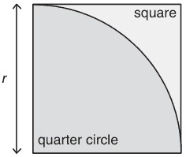

**图 26.1**  计算 $\pi$

```
std::default_random_engine rng;

std::random_device rd;
rng.seed(rd());
std::uniform_real_distribution<double> uni(0.0,1.0);

// Choose the desired accuracy
std::cout << "How many darts to throw? "; long N; std::cin >> N;

// Throw the dart; does it fall in the circle or outside
// Start throwing darts and count where they land
long hits = 0;
double x, y, distance;
for (long n = 1; n <= N; ++n)
{
    x = uni(rng); y = uni(rng);
    distance = std::sqrt(x*x + y*y);

    if (distance <= 1.0)
    {
        hits++;
    }
}

std::cout << "#hits, PI is: " << hits << ", " << 4.0 * double(hits) / double(N);
```

## 26.5 引擎详解

C++ 随机库支持 16 个生成随机数的引擎。一般来说，引擎是随机性的有状态源。每个引擎都是函数对象，因为它实现了函数调用运算符() 来产生新的随机值。内部状态被更改以产生新的随机值。

以下引擎类别和类（在 std 命名空间中）受支持：

- 提供生成随机值的算法的基础引擎：
  - linear_congruential_engine
  - mersenne_twister_engine
  - subtract_with_carry_engine

- 引擎适配器是可以由（基础）引擎初始化的类：
  - discard_block_engine：通过每次丢弃生成的指定数量的值来适配引擎；
  - independent_bits_engine：适配引擎以生成具有指定位数数的随机值；
  - shuffle_order_engine：通过置换其生成值的顺序来适配引擎。

- 具有预定义参数的适配器——这些是具有实例化模板参数的易于使用的类：
  - minstd_rand0
  - minstd_rand
  - mt19937
  - mt19937_64
  - ranlux24_base
  - ranlux48_base


ranlux24
ranlux48
knuth_b

根据 C++ 标准，这些引擎是实现无关的。它们保证在不同平台上生成相同的数值序列。

本章不讨论上述引擎的效率和准确性。看起来 C++ 随机库的动机来自 Boost Random 库。

## 26.5.1 为引擎播种

为了在使用随机数引擎时生成不同的随机序列，我们必须用种子初始化引擎，该种子将成为实现它的线性（或非线性）同余生成器的初始值。因此，一旦我们创建了一个引擎，就有风险每次使用它时都会生成相同的数值序列。为了避免这个问题，我们基于精细的系统时钟计算种子，或使用 std::random_device，如前所述。换句话说，我们希望避免在每次运行中重复引擎的种子。另一方面，重复可能是必需的，例如在调试程序或重现结果时。为此，我们举例说明如何使用默认种子和用户定义种子组合创建多个引擎。在这里我们可以看到一些可能性，包括保存和恢复引擎的状态：

```
// Lines of code to show the ability to seed an engine

// Default ctor and default initial state
std::mt19937_64 eng1;

// Engine with seeds
std::mt19937_64 eng2(1234);

unsigned int mySeed = static_cast<unsigned int>(time(0));
std::mt19937_64 eng3(mySeed);

std::mt19937_64 eng4;
eng4.seed();

// Random device for uniformly integer random variables
std::random_device rd;

std::mt19937_64 eng5(rd());

// Save and restore state of engine
std::stringstream engState;
engState << eng5;          // Save state

eng5.seed(); // Go back to default state

engState >> eng5;          // Restore state
```

```
// Advance to nth next state (similar to n calls to eng())
std::mt19937_64 eng6;
int n = 10;
eng6.discard(n);

// Now produce the next random value and advance state
std::cout << "eng1: " << eng1() << std::endl;
std::cout << "eng2: " << eng2() << std::endl;
std::cout << "eng3: " << eng3() << std::endl;
std::cout << "eng4: " << eng4() << std::endl;
std::cout << "eng5: " << eng5() << std::endl;
std::cout << "eng6: " << eng6() << std::endl;
```

我们还可以看到如何使用种子为随机数引擎提供可重复/不可重复的场景。

## 26.5.2 为一组随机数引擎播种

在某些情况下，我们可能希望为大量随机数引擎播种。为此，类 std::seed_seq 消耗一系列整数值数据并根据所消耗的数据生成请求数量的无符号整数值 i，范围为 0 ≤ i ≤ 2³²。它有一个构造函数并且可以被播种。成员函数 generate() 计算一组消除偏差、均匀分布的 32 位值。

第一个示例创建了一个播种序列，然后计算长度为 10 的播种数组：

```
std::seed_seq seq{ 1, 2, 3, 4, 5 };

std::vector<std::uint32_t> seeds(10);
seq.generate(seeds.begin(), seeds.end());

for (auto n : seeds)
{ // The same sequence will always be generated

    std::cout << n << ",";
}
```

第二个示例使用基于时钟时间的播种序列，并在每次运行中产生不同的值：

```
std::seed_seq seq2{ static_cast<unsigned int>(time(0)) };
std::vector<std::uint32_t> seeds2(10);
seq2.generate(seeds2.begin(), seeds2.end());

for (auto n : seeds2)
{ // A different sequence will be generated for each run

    std::cout << n << ",";
}
```

最后一个示例使用随机设备生成种子：

```
std::random_device rd;
std::seed_seq seq3{ rd() };
std::vector <std::uint32_t> seeds3(10);
seq3.generate(seeds3.begin(), seeds3.end());

for (auto n : seeds2)
{ //  A different sequence will be generated for each run

    std::cout << n << ",";
}
```

你可以运行这段代码并检查输出。上述选项在并行编程应用中可能很有用，其中每个线程都有自己的随机数生成器。这实际上是一个开放的研究课题。当然，我们必须避免竞争条件以及生成相关数字的风险。该主题超出了本书的范围。

## 26.6 C++ 中的分布：列表

我们关注 C++ 中支持的五类离散和连续分布，即：

- Uniform distributions
  - uniform_int_distribution
  - uniform_real_distribution
- Bernoulli distributions
  - bernoulli_distribution
  - binomial_distribution
  - geometric_distribution
  - negative_binomial_distribution
- Poisson distributions
  - poisson_distribution
  - exponential_distribution
  - extreme_value_distribution
  - gamma_distribution
  - weibull_distribution
- Normal distributions
  - normal_distribution
  - cauchy_distribution
  - chi-squared_distribution
  - fisher_f_distribution
  - lognormal_distribution
  - student_t_distribution
- Sampling distributions
  - discrete_distribution
  - piecewise_constant_distribution
  - piecewise_linear_distribution

对所有这些分布的详细讨论超出了当前范围。然而，本章中有一些练习涉及上述某些分布。一般来说，你的具体应用将决定使用哪些分布。

## 26.7 回到未来：C 风格的伪随机数生成

在遥远的（和不那么遥远的）过去，从大型机到个人计算机的随机数生成器的质量都很低。Press 等人（2002 年，第 7 章）给出了轶事历史证据。在本节中，我们概述了 C 函数 `rand()`，它产生范围为 (0, RAND_MAX) 的 *伪随机* 数，RAND_MAX 是在 `<cstdlib>` 中定义的一个常量。它通常是一个 16 位整数，值为 32,767。这意味着随机数将在实现 `rand()` 的（线性）同余生成器迭代有限次数后重复。更多的轶事证据表明，随机数在 2000 万次迭代后重复。当我们为蒙特卡洛模拟生成随机数时，这将是灾难性的。简而言之，如果可能的话，我们应该避免使用此函数。然而，我们在这里包含讨论，因为可能存在使用此函数的遗留系统，并且希望在 C++ 中使用新的生成器。

作为快速总结，我们有：

- `rand()`: 生成伪随机数。
- `RAND_MAX`: `rand()` 生成的最大可能值。
- `srand()`: 为伪随机数生成器播种。

我们给出使用示例。我们首先包含一些库文件：

```cpp
#include <cstdlib>        // for rand, srand
#include <ctime>           // time()
#include <iostream>
#include <limits>          // numeric limits
#include <vector>
```

第一个示例生成一个随机数：

```cpp
// Seed, initialise just once
unsigned int mySeed = static_cast<unsigned int>(time(0));
srand(mySeed);

int N = 10;
```

```
// Generate a random number in the range [0,N-1]
int val = rand() % N;
std::cout << "Random number: " << val << std::endl;
```

第二个示例生成使用更高阶位数的随机数，这些位数比低阶位数更随机：

```
// Random number between 1 and 10
int val2 = 1 + int(10.0*rand()/(RAND_MAX + 1.0));
std::cout << "Random number: " << val2 << std::endl;
```

最后，我们执行一个模拟来计算在闭区间 [0, N−1] 中每个生成数字的频率（本例中 N = 10）。我们期望对于一个好的随机数生成器，频率是相同的：

```
// Test: generate many random numbers; each number in [0,N-1] should
// occur with equal frequency.
std::vector<std::size_t> histogram(N,0);

std::size_t M = std::numeric_limits<std::size_t>::max();
for (std::size_t i = 1; i <= M; ++i)
{ // Generate random number in [0,N-1] and place in bucket

    val = rand() % N;
    histogram[val]++;
}

for (std::size_t i = 0; i < histogram.size(); ++i)
{ // Print the histogram

    std::cout << "Bucket number: " << i << ", frequency: "
              << histogram[i] << std::endl;
}
```

在 1 亿次运行的情况下，典型输出为：

```
Bucket number: 0, frequency: 9994999
Bucket number: 1, frequency: 9996847
Bucket number: 2, frequency: 9998909
Bucket number: 3, frequency: 9999474
Bucket number: 4, frequency: 10001231
Bucket number: 5, frequency: 10005179
Bucket number: 6, frequency: 10004794
Bucket number: 7, frequency: 9998955
Bucket number: 8, frequency: 10000133
Bucket number: 9, frequency: 9999479
```

这完成了我们对该随机数生成器的讨论。我们不推荐它，尤其是在多线程中并发调用 rand() 或 srand() 的情况下


applications because *data races* can occur. These functions access and modify the internal state of objects. This is a general problem when we use random number generators with internal state that can be non-deterministically modified by threads.

## 26.8 CRYPTOGRAPHIC GENERATORS

In the interest of completeness, we give a brief overview of random generators that are used in *cryptography*. This is the study of techniques to ensure data security and secure communications in the presence of eavesdroppers and adversaries. To this end, we need to generate random numbers for key generation, SSL (*Secure Sockets Layer*) and challenge/response algorithms. We note that pseudo-random number generators are not suitable for cryptographic applications because the requirements for *statistical randomness* differ from those for *cryptographic randomness*. A sequence of numbers can be statistically random but cryptographically insecure if an attacker can predict the sequence of the generated numbers by understanding the algorithm and the random seed used. This means that data will not be secure. We need *cryptographic random numbers*. For a sequence of random numbers to be deemed *cryptographically secure* it must be computationally infeasible to regenerate the same sequence of random numbers. In the case of pseudo-random numbers all we need to know is the pseudo-random number generator and the seed. It is intuitively clear that it takes more time to create a cryptographically secure random number than a pseudo-random number. In the case of the C# language, for instance, it can be up to eight times slower.

## 26.9 MATRIX DECOMPOSITION METHODS

The generation of correlated and uncorrelated standard normal variates is important in several areas in finance, such as Monte Carlo option pricing and multidimensional diffusions (Kienitz and Wetterau, 2012). We introduce a number of algorithms that are used in these applications. The algorithms are concerned with operations on matrices whose elements are real valued or complex valued. This is a major area of research (Golub and van Loan, 1996) and we focus on a number of methods that are directly applicable in the current book.

We introduce some notation. The *Hermitian transpose* of a square matrix A of size n with complex elements (denoted by $A^H$) is the complex conjugate transpose of A, that is $A^H = \overline{A}^{T}$ or $(A^H)_{ij}=\overline{A}_{ji}$, $1 \leq i,j \leq n$, where in general $\overline{z}$ denotes the complex conjugate of the complex number z, that is $\overline{z}=x-iy$ where $z=x+iy$.

An example is:

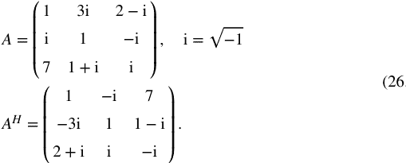

In other words, we mirror the corresponding elements on each side of the main diagonal and then we take the complex conjugate of each mirrored element. A special case is when the elements are real valued and we then speak of the *transpose* of a matrix. An example is:

$$A=\begin{pmatrix}1&0.9&0.7\\0.5&1&0.6\\2.0&-3.0&1\end{pmatrix}$$

$$A^{\mathsf T}=\begin{pmatrix}1&0.5&2.0\\0.9&1&-3.0\\0.7&0.6&1\end{pmatrix}.$$

This is called transposing the matrix.

A matrix $A$ is called *Hermitian* if it is equal to its own Hermitian transpose, that is $A=A^H$. We say that a matrix is *normal* if $AA^H=A^HA$. A matrix is *symmetric* if it is its own transpose, that is $A=A^{\mathsf T}$.

Let $x$ and $y$ be two complex-valued $n$-dimensional vectors $x=(x_1,\ldots,x_n)^{\mathsf T}$, $y=(y_1,\ldots,y_n)^{\mathsf T}$. Then the *Euclidean inner product* is defined as:

$$(x,y)=\sum_{j=1}^{n}x_j\overline{y_j},\quad x_j,y_j\in\mathbb C,\ j=1,\ldots,n$$

where in general $\bar a$ is the complex conjugate of $a\in\mathbb C$. We now say that a Hermitian matrix $A$ is *positive definite* if:

$$(Ax,x)>0$$

for all nonzero $n$-dimensional vectors $x$, where $Ax$ denotes matrix–vector multiplication of $A$ and $x$. Furthermore, the matrix $A$ is called *positive semi-definite* if:

$$(Ax,x)\geq 0.$$

A *lower-triangular matrix* $L$ is one whose elements above the main diagonal are zero while an *upper-triangular matrix* $U$ is one whose elements below the main diagonal are zero. An example is given by:

$$L=\begin{pmatrix}1&0&0\\7&2&0\\8&9&4\end{pmatrix}$$

$$U=\begin{pmatrix}1&7&8\\0&2&9\\0&0&4\end{pmatrix}.$$

A matrix $U$ is called *unitary* if its inverse equals its Hermitian transpose, that is:

$$U^{-1}=U^H=\overline{U}^{\mathsf{T}}.$$  (26.20)

An *orthogonal matrix* $P$ is a unitary matrix whose elements are all real and that satisfies:

$$P^{-1}=P^{\mathsf{T}}.$$  (26.21)

### 26.9.1 Cholesky (Square-Root) Decomposition

This is a method to factor a positive definite matrix $A$ into the product of a lower-triangular matrix $L$ and its Hermitian transpose $L^H$:

$$A=LL^H.$$  (26.22)

In this section we use the *Boost uBLAS* library that supports vectors and matrices. We mention that this library does not have operations for numerical linear algebra. We already discussed this library in Chapter 10. See also Demming and Duffy (2012).

For symmetric positive definite matrices the Cholesky decomposition algorithm takes on a particularly simple form:

$$A=LL^{\mathsf{T}}.$$

The algorithm to compute the matrix $L$ is given by (see Dahlquist and Björck, 1974):

$$l_{jj}=\left(a_{jj}-\sum_{k=1}^{j-1}l_{jk}^{2}\right)^{1/2},\qquad 1\leq j\leq n$$

$$l_{ij}=\left(a_{ij}-\sum_{k=1}^{j-1}l_{ik}l_{jk}\right)/l_{jj},\qquad i=j+1,\ldots,n.$$

The C++ code that implements this algorithm is:

```cpp
// Cholesky decomposition.
void Cholesky(const ublas::matrix<double>& A,
              ublas::triangular_matrix<double, ublas::lower>& L)
{
    double sum;
    size_t N = A.size();

    for (size_t j = 0; j < N; ++j)    // Loop over columns.
    {
        sum = 0.0;
        for (size_t k = 0; k < j; ++k)
        {
            sum += L(j,k)*L(j,k);
        }
        L(j,j) = sqrt(A(j,j) - sum);

        for (size_t i = j+1; i < N; ++i) // Rows.
        {
            sum = 0.0;
            for (size_t k = 0; k < j; ++k)
            {
                sum += L(i,k)*L(j,k);
            }
            L(i,j) = (A(i,j) - sum) / L(j,j);
        }
    }
}
```

Finally, an example of how to use the Cholesky algorithm (notice we used a dense matrix in Boost uBLAS) is:

```cpp
// Correlation matrix.
unsigned D = 4;
u::matrix<double> Corr(D,D);
Corr(0,0) = Corr(1,1) = Corr(2,2) = Corr(3,3) = 1.0;
Corr(0,1) = Corr(1,0) = 0.5;
Corr(0,2) = Corr(2,0) = 0.2;
Corr(0,3) = Corr(3,0) = 0.01;
Corr(1,2) = Corr(2,1) = 0.01;
Corr(1,3) = Corr(3,1) = 0.30;
Corr(3,2) = Corr(2,3) = 0.30;
cout << "Original matrix:" << endl << Corr << endl << endl;
```

A test case is:

```cpp
// Cholesky decomposition.
cout << endl << "--- Do Cholesky decomposition ---" << endl << endl;
ublas::triangular_matrix<double, ublas::lower> L(D,D);
Cholesky(Corr, L);
cout << "L:" << endl << L << endl << endl;
```

Now we remark on testing the Cholesky method. In particular, we wish to double-check our algorithm while at the same time using some of the functionality of uBLAS. We try to recover the original matrix that we used in the algorithm by multiplying the constructed lower-triangular matrix by its transpose:

```cpp
// Recover the original matrix; a kind of check.
ublas::triangular_matrix<double, ublas::upper> U = LowerToUpper(L);
cout << "U:" << endl << U << endl << endl;
cout << "L*U (same as original matrix):" << endl << L*U << endl << endl;
```

where LowerToUpper() is a user-defined free function that converts a lower-triangular matrix to an upper-triangular matrix:

```cpp
// Transpose a lower triangular matrix to form an upper triangular matrix.
ublas::triangular_matrix<double, ublas::upper> LowerToUpper
    (const ublas::triangular_matrix<double, ublas::lower>& L)
{
    ublas::triangular_matrix<double, ublas::upper> U(L.size2(), L.size1());
    for (size_t i = 0; i < U.size1(); ++i)
    {
        for (size_t j = i; j < U.size2(); ++j)
        {
            U(i,j) = L(j,i);
        }
    }
    return U;
}
```

We conclude this section by showing how to recover the original matrix by multiplying the upper- and lower-triangular matrices:

```cpp
// Create LU matrices.
cout << "--- Recover original matrix from LD & LD ---" << endl << endl;
ublas::triangular_matrix<double, ublas::lower> LD(D,D);
ublas::triangular_matrix<double, ublas::upper> UD(D,D);
InitLU(Corr, LD, UD);      // Documented in section 26.9.2 This factor
                           // decomposes the
                           // matrix Corr into product of LD and UD
cout << "LD: " << endl << LD << endl << endl;
cout << "UD: " << endl << UD << endl << endl;

// Recover original matrix in different ways.
cout << "LD*UD (same as original matrix): " << endl << LD*UD << endl;
cout << "UD*LD (same as original matrix): " << endl << UD*LD << endl;
```

where we have created user-defined operators for multiplying lower- and upper-triangular matrices:

```cpp
// Compute Lower*Upper.
ublas::matrix<double> operator * (
    const ublas::triangular_matrix<double, ublas::lower>& L,
    const ublas::triangular_matrix<double, ublas::upper>& U)
{
    ublas::matrix<double> result(L.size1(), L.size2());
    double sum; size_t r;
    for (size_t i = 0; i < result.size1(); ++i)
    {
        for (size_t j = 0; j < result.size2(); ++j)
        {
            sum = 0.0;
            r = std::min(i,j);
            for (size_t p = 0; p <= r; ++p)
```


{
    sum += L(i,p)*U(p,j);
}

result(i,j) = sum;
}
}

return result;
}
```

```
// Compute Upper*Lower.
ublas::matrix<double> operator * (
    const ublas::triangular_matrix<double, ublas::upper>& U,
    const ublas::triangular_matrix<double, ublas::lower>& L)
{
    // Rough and Ready, but it works; it is a test of uBLAS::transpose.
    ublas::triangular_matrix<double, ublas::upper> Upper = trans(L);
    ublas::triangular_matrix<double, ublas::lower> Lower = trans(U);

    return Lower*Upper;
}
```

我们可以运行这段代码并看到在所有情况下结果都相同。最后，另一个测试是把原始矩阵从两个乘积中减去，然后取相应的最大范数：

// Look at matrix norms.
ublas::matrix<double> m1 = Corr - UD*LD;
ublas::matrix<double> m2 = Corr - LD*UD;
cout << "A - U*L max error: " << ublas::norm_inf(m1) << endl;
cout << "A - L*U max error: " << ublas::norm_inf(m2) << endl << endl;
```

这些值应该非常小。
一个使用示例是：

// Correlation matrix,
// This is the example in MC book page 145 where we use Cholesky
// decomposition.

unsigned D = 4;
u::matrix<double> Corr (D,D);
Corr(0,0) = Corr(1,1) = Corr(2,2) = Corr(3,3) = 1.0;

Corr(0,1) = Corr(1,0) = 0.5;
Corr(0,2) = Corr(2,0) = 0.2;
Corr(0,3) = Corr(3,0) = 0.01;

Corr(1,2) = Corr(2,1) = 0.01;
Corr(1,3) = Corr(3,1) = 0.30;

Corr(3,2) = Corr(2,3) = 0.30;
std::cout << "Original matrix: " << Corr << std::endl;

u::matrix<double> Backup(Corr);

u::triangular_matrix<double, u::lower> LD(D,D);
u::triangular_matrix<double, u::upper> UD(D,D);

InitLU(Corr, LD, UD);

// Recover original matrix in different ways
Corr = LD * UD;
std::cout << "LD*UD: " << Corr << std::endl;

Corr = UD * LD;
std::cout << "UD*LD: " << Corr << std::endl;

// Look at matrix norms
u::matrix<double> m1 = Backup - UD*LD;
std::cout << "A - U*L max error: " << u::norm_inf(m1) << std::endl;

u::matrix<double> m2 = Backup - LD*UD;
std::cout << "A - L*U max error: " << u::norm_inf(m2) << std::endl;

// Now test Cholesky directly
u::triangular_matrix<double, u::lower> L(D,D);
Cholesky(Backup, L);

u::matrix<double> Product  = L * trans(L);
std::cout << "Cholesky, L*trans(L): " << Product << std::endl;
std::cout << "A - L*trans(L) max error: "
          << u::norm_inf(Backup - Product) << std::endl;

Product  = trans(L)*L;
std::cout << "Cholesky, trans(L)*L: " << Product << std::endl;
std::cout << "A - trans(L)*L max error: "
          << u::norm_inf(Backup - Product) << std::endl;
```

Cholesky 分解也适用于具有复数系数的矩阵；然而，我们需要对代码进行修改（我们需要取转置矩阵元素的复共轭）：

```
template <typename T>
    void CholeskyComplex(const u::matrix<std::complex<T>>& A,
                        u::triangular_matrix<std::complex<T>, u::lower>& L)
{ // Cholesky decomposition

    std::complex<T> sum;
    unsigned N = A.size1();

for (unsigned j = 0; j < N; ++j) // Loop over columns
{
    sum = 0.0;
    for (unsigned k = 0; k < j; ++k)
    {
        // Modification for complex numbers, use conjugate
        sum += L(j, k)*std::conj(L(j, k));
    }
    L(j, j) = std::sqrt(A(j, j) - sum);

    for (unsigned i = j + 1; i < N; ++i) // Rows
    {
        sum = 0.0;
        for (unsigned k = 0; k < j; ++k)
        {
            // Modification for complex numbers
            sum += L(i, k)*std::conj(L(j, k));
        }
        L(i, j) = (A(i, j) - sum) / L(j, j);
    }
}
```

## 26.9.2 LU 分解

该算法将一般矩阵 A 分解为下三角矩阵 L 和上三角矩阵 U 的乘积。该算法在 Dahlquist 和 Björck（1974）以及 Isaacson 和 Keller（1966）中有所记载，例如。结合 uBLAS 的 C++ 代码以自由函数的形式给出：

// LU decomposition: A -> L*U
void InitLU(const ublas::matrix<double>& A,
            ublas::triangular_matrix<double, ublas::lower>& L,
            ublas::triangular_matrix<double, ublas::upper>& U)
{
    double sum;
    unsigned N = A.size1();

    // Common to make all diagonal elements == 1.0
    for (size_t k = 0; k < N; ++k)
    {
        L(k,k) = 1.0;
    }

    for (size_t j = 0; j < N; ++j)      // Loop over columns.
    {
        // U
        for (size_t i = 0; i <= j; ++i)     // Columns.
```
```cpp
{
    sum = 0.0;
    for (size_t k = 0; k < i; ++k)
    {
        sum += L(i,k)*U(k,j);
    }
    U(i,j) = A(i,j) - sum;
}
// L
for (size_t i = j+1; i < N; ++i)    // Rows.
{
    sum = 0.0;
    for (size_t k = 0; k < j; ++k)
    {
        sum += L(i,k)*U(k,j);
    }
    L(i,j) = (A(i,j) - sum) / U(j,j);
}
}
```

计算出矩阵 *L* 和 *U* 后，我们就可以分两步求解矩阵系统；首先分解矩阵 *A*，然后按顺序求解下三角和上三角系统：

$$Ax=b$$

$$(LU)x=b \text{ and } Ly=b \text{ and } Ux=y.$$

该序列步骤的代码为：

```
```cpp
// Solve Ax = b
ublas::vector<double> SolveLU(const ublas::vector<double>& b,
                              const ublas::triangular_matrix<double, ublas::lower>& L,
                              const ublas::triangular_matrix<double, ublas::upper>& U)
{
    size_t N = b.size();
    ublas::vector<double> result(N);

    double sum;

    // Forward sweep Ly = b
    result[0] = b[0] / L(0,0);
    for (size_t i = 1; i < N; ++i)
    {
        sum = 0.0;
        for (size_t k = 0; k < i; ++k)
        {
            sum += L(i,k)*result[k];
        }
        result[i] = (b[i] - sum) / L(i,i);
    }
```

```
// Backward sweep Ux = y
result[N-1] = result[N-1]/U(N-1, N-1);
for (size_t i = N-2; i >= 0 && i < N; --i)
{
    sum = 0.0;
    for (size_t k = i+1; k < N; ++k)
    {
        sum += U(i,k)*result[k];
    }
    result[i] = (result[i] - sum) / U(i,i);
}

return result;
}
```

一个简单的示例是：

```
unsigned N = 4;

// Input for Ax = b
ublas::matrix<double> A(N, N);
ublas::vector<double> b(N);
for (size_t i = 0; i < A.size1(); ++i)
{
    b[i] = 1.0;
    for (size_t j = 0; j < A.size2(); ++j)
    {
        A(i, j) = 0.0;
    }
    A(i,i) = 1.0;
}
std::cout << "Initial matrix A: " << A << std::endl;
cout << "Initial vector b: " << b << endl;

// Determine the L and U matrices.
ublas::triangular_matrix<double, ublas::lower> L(N,N); Init(L, 0.0);
ublas::triangular_matrix<double, ublas::upper> U(N,N); Init(U, 0.0);
InitLU(A, L, U);
cout << "Matrix L: " << L << endl;
cout << "Matrix U: " << U << endl;

// Solve 'Ax=b'.
ublas::vector<double> result = SolveLU(b, L, U);
cout << "Result vector Ax=b: " << result << endl;
```

## 26.9.3 QR 分解

该算法将矩阵 A 分解为酉矩阵 Q 和上三角矩阵 R 的乘积：

A = QR. (26.23)

输出为：

```
[3,3]((-0.512148,0.494524,0.702247),
    (0.384111,-0.599423,0.702247),
    (0.768221,0.629394,0.117041))

[3,3]((7.81025,2.4327,0.128037),
    (0,6.56369,-0.809221),
    (0,0,3.51123))
```

QR 后处理结果

```
Differences of A and Q*R: 2.22045e-16
Differences of trans(Q)*Q and identity I: 1.38778e-16
Differences of trans(Q)*A and R: 1.9984e-15
```

对于更大的矩阵，控制台输出难以阅读，我们可以然后使用我们在第 14 章中介绍的 Excel 驱动程序：

// Start Excel
using NumericMatrix = boost::numeric::ublas::matrix<double>;
ExcelDriver& excel = ExcelDriver::Instance();
excel.MakeVisible(true);            // Default is INVISIBLE!

std::string sheetName("Test Case Q Matrix");
long row = 4; long col = 2;
excel.AddMatrix<NumericMatrix>(Q, sheetName, row, col);

std::string sheetName2("Test Case R Matrix");
excel.AddMatrix<NumericMatrix>(R, sheetName2, row, col);
```

该选项不仅用于可视化目的，而且还允许我们将矩阵和向量数据导出到 Excel，以便在 VBA 或 C# 等中进一步处理。运行代码并可视化输出是有用的。

## 26.10 生成随机数

协方差矩阵（也称为离散矩阵或方差-协方差矩阵）是一个矩阵，其第 (i,j) 位置的元素是随机向量第 i 个和第 j 个元素的协方差。

多元正态分布 N(μ, Σ) 由其均值向量 μ 和协方差矩阵 Σ 指定。协方差矩阵可通过其对角线条目 σ_i² 和相关系数 ρ_ij 隐式指定，使用 ρ_ij = Σ_ij / σ_i σ_j 以矩阵形式：


在二维情况下，协方差矩阵为：

$$\Sigma=\begin{pmatrix}\sigma_1^2 & \sigma_1\sigma_2\rho\\ \sigma_1\sigma_2\rho & \sigma_2^2\end{pmatrix}$$

其中：

$\sigma_1,\sigma_2>0$ 且 $-1\leq\rho\leq1$。

在这种情况下，Cholesky 分解变为：

$$\Sigma=LL^{\mathrm T}$$

其中：

$$L=\begin{pmatrix}\sigma_1 & 0\\ \rho\sigma_2 & \sqrt{1-\rho^2}\sigma_2\end{pmatrix}.$$

因此，为了从 *二元正态分布* $N(\mu,\Sigma)$ 中采样，其中 $(\mu=\mu_1,\mu_2)^{\mathrm T}$，我们使用公式：

$$X_1=\mu_1+\sigma_1Z_1$$
$$X_2=\mu_2+\sigma_2Z_1+\sigma_2\sqrt{1-\rho^2}Z_2.$$

最后，生成相关随机数数组的算法为：

- a) 生成一个不相关的 $N(0,1)$ 向量 $Z$。
- b) 计算矩阵 $\Sigma$ 的 Cholesky 下三角矩阵 $C$。
- c) 计算新的相关随机向量 $X=CZ+m$，其中 $m$ 是 $X$ 的均值。

另见练习 8。

## 26.10.1 附录：*Eigen* 矩阵库概述

*Eigen* 是一个用于线性代数、矩阵和向量运算、几何变换、数值求解器及相关算法的高级 C++ 模板头文件库。*Eigen* 是一个开源库，它使用 *表达式模板元编程* 技术实现；在编译时构建表达式树并生成自定义代码来求值它们。利用表达式模板和浮点运算的成本模型，库执行自己的 *循环展开和向量化*。

*Eigen* 的主要特性总结如下：

- 矩阵和数组类以及基础线性代数；数组操作。
- LU 分解。
- LLT 和 LDLT Cholesky 分解。
- 奇异值分解（SVD）和最小二乘求解器。
- QR 分解（Householder）。
- 特征值和特征向量分解。
- 稀疏矩阵存储及相关基础线性代数。

学习 Eigen 并将其应用于计算金融应用的一种方法是复制示例代码然后修改以适应当前应用。如果你了解数值线性代数以及另一种 C++ 矩阵库，那么学习 Eigen 应该很容易。

作为最后一个例子，我们讨论如何求解一个超定线性系统：给定一个 m × n 矩阵 A，其中 m ≥ n 和一个 m × 1 向量 b，求一个向量 x 使得 Ax 是对 b 的“最佳”近似。

系统 Ax = b 是超定的，因此无法精确求解。但它确实有一个最小二乘解：

```
Aᵀ (b − Ax) = 0 or (AᵀA) x = Aᵀb  (26.28)
```

满足：

```
‖b − Ax‖ ≤ ‖k − Ay‖ ∀y ∈ ℝⁿ.
```

系统 (26.28) 称为正规方程（Dahlquist and Björck, 1974, p. 197）。

代码如下：

```
// Create overdetermined system
// From Dahlquist's bookpage 199: answer is (5/4, 7/4, 3)
int M = 6; int N = 3;
Eigen::MatrixXd A(M, N);
A(0, 0) = 1.0; A(0, 1) = 0.0; A(0, 2) = 0.0;
A(1, 0) = 0.0; A(1, 1) = 1.0; A(1, 2) = 0.0;
A(2, 0) = 0.0; A(2, 1) = 0.0; A(2, 2) = 1.0;
A(3, 0) = -1.0; A(3, 1) = 1.0; A(3, 2) = 0.0;
A(4, 0) = 0.0; A(4, 1) = -1.0; A(4, 2) = 1.0;
A(5, 0) = -1.0; A(5, 1) = 0.0; A(5, 2) = 1.0;

Eigen::VectorXd b(M);
b[0] = 1.0; b[1] = 2.0; b[2] = 3.0; b[3] = 1.0; b[4] = 2.0; b[5] = 1.0;

// Set up and solve overdetermined system
auto AT = A.transpose();
auto ATb = AT*b;
auto ATA = AT*A;
Eigen::VectorXd x = ATA.ldlt().solve(ATb);
std::cout << "Solution(5/4, 7/4, 3): " <<x[0]<<","<<x[1]<< "," << x[2];

// Compute the residual
auto r = AT*A*x - AT*b;
std::cout << "Residual size: " << r.norm() << std::endl;
```

最后，我们将 Cholesky 方法应用于 Kienitz 和 Wetterau (2012, p. 138) 中的例子；我们得到相同的输出：

```
unsigned D = 4;
Eigen::MatrixXd corr(D, D);

corr(0, 0) = corr(1, 1) = corr(2, 2) = corr(3, 3) = 1.0;

corr(0, 1) = corr(1, 0) = 0.748733508;
corr(0, 2) = corr(2, 0) = 0.888524896;
corr(0, 3) = corr(3, 0) = 0.821526502;

corr(1, 2) = corr(2, 1) = 0.726662801;
corr(1, 3) = corr(3, 1) = 0.683150423;

corr(3, 2) = corr(2, 3) = 0.878266274;
std::cout << "\nThe correlated matrix is" << std::endl << corr;

// Compute the Cholesky decomposition of matrix corr
Eigen::LLT<Eigen::MatrixXd> lltOfA(corr);
// Retrieve factor L in the decomposition
Eigen::MatrixXd L = lltOfA.matrixL();
// Previous two lines can also be written as "L = A.llt().matrixL()"

std::cout << "\nThe Cholesky factor L is" << std::endl << L;
std::cout << "\nTo check this, let us compute L * L.transpose()" ;
std::cout << L * L.transpose() << std::endl;
std::cout << "\nThis should equal the matrix corr matrix" << std::endl;

// Sanity check
auto Diff = corr - L * L.transpose();
std::cout << "\nThis should equal zero? " << Diff << std::endl;
```

## 26.11 总结与结论

我们概述了 C++ 中的随机数生成和统计分布。我们首先对随机数生成的数学基础以及一些相关用例进行了简短介绍，例如生成均匀随机变量和来自给定单变量分布的变量。有若干基本引擎、引擎适配器以及带预定义参数的适配器，并且还有 20 个分布分为五大类。

未来该库的采用情况将很有趣。一个优点是我们不再需要依赖专有库。另一方面，标准 C++ 中的功能可能不适合计算金融中的所有应用，在这些情况下我们可能需要求助于更专业的库。

第 31 章和第 32 章将本章的结果应用于计算金融。

## 26.12 练习与项目

- 1. **（遗留代码迁移）**

一些遗留系统可能仍在使用基于 `std::rand()` 的 *极坐标 Marsaglia*（公式 (26.2)）或 *Box–Muller*（公式 (26.3)）方法等。本练习的目的是使用 C++11 中的引擎为这些方法编写函数。返回类型是一个值元组，每个字段都是一个标准正态随机变量。测试你的代码。检查创建和解包元组相关的可能性能问题，尤其是在循环中执行时。考虑返回单个值的接口。

- 2. **（随机变量）**

生成一个概率密度函数为的随机变量：

$$
f_X(x)=
\begin{cases}
2x, & 0 \le x \le 1\\
0, & \text{otherwise.}
\end{cases}
$$

证明累积分布函数为：

$$
F_X(x)=
\begin{cases}
0, & x<0\\
x^2, & 0\le x\le 1\\
1, & x>1
\end{cases}
$$

并且：

$$X=F_X^{-1}(U)=\sqrt{U},\quad 0\le U\le 1.$$

换句话说，为了从该分布生成一个变量，我们生成区间 $(0,1)$ 上的均匀变量 $U$（例如使用 C++ 引擎），然后取 $U$ 的平方根。

- 3. **（C++11 中不支持的分布）**

在某些情况下，我们可能希望从 C++11 中不支持的分布生成随机变量。这种情况下我们该怎么办？基本上只有两种选择；首先，可能已知精确公式，如果没有，我们就求助于数值方法。在第一种情况下，我们以 *Rayleigh 分布* 为例，它有许多应用，例如当我们将起始于原点的标准布朗运动条件为在时间 1 时具有值 $b$（Glasserman, 2004, p. 56）。那么闭区间 $[0,1]$ 上的最大值由下式给出：

$$F(x)=1-e^{2x(x-b)},\quad x\ge b.$$

如果我们求解方程 $F(X)=U$，其中 $U\in(0,1)$，我们得到根：

$$X=\frac{b}{2}\pm\frac{\sqrt{b^2-2\log(1-U)}}{2}.$$

我们取较大的根，因为布朗路径的最大值必须至少为 $b$。由于 $U$ 和 $1-U$ 具有相同的分布，我们得到值：

$$X = \frac{b}{2} + \frac{\sqrt{b^2 - 2 \log(U)}}{2}.$$

使用 C++11 中的一个引擎将此公式实现为 C/C++ 函数。最后，使用逆变换方法 (26.6) 结合 Boost C++ Math Toolkit（另见第 19 章）实现相同的功能，该工具包包含 Rayleigh 分布的类。

- 4. **（接受-拒绝方法）**

第 26.3.2 节中的算法效率可以提高，因为主导函数 $g$ 并不是很精确。我们提出一个更好的函数以降低拒绝率。为此，让我们考虑主导函数：

$$g(x) = 2x, \quad 0 \le x \le 1.$$

我们可以验证累积分布函数为 $F(x) = x^2$，因此逆变换方程 (26.6) 告诉我们 $X = F_X^{-1}(U) = \sqrt{U}$。证明接受测试变为 $U_2 \le \frac{3}{2}\sqrt{U_1}$，然后我们接受 $U_1$ 作为来自 $f$ 的随机变量。

测试此过程的效率与第 26.3.2 节中给出的解相比。

- 5. **（Weibull 分布）**

考虑形状参数 $k > 0$ 和尺度参数 $\lambda > 0$ 的 Weibull 分布。证明累积分布函数为：

$$F(x) = \begin{cases} 1 - e^{-\left(\frac{x}{\lambda}\right)^k} & x \ge 0 \\ 0, & x < 0. \end{cases}$$

证明该分布的随机变量为：

$$X = (\lambda - \log U)^{1/k}$$

其中 $U$ 是区间 $(0, 1)$ 上的均匀变量。我们注意到 C++ 支持 Weibull 分布。

- 6. **（多元正态分布）**

随机向量 $X = (X_1, \dots, X_n)$ 具有多元正态分布，如果其概率密度函数为：

$$f_X(x) = \frac{1}{(2\pi)^{n/2} |\Sigma|^{1/2}} \exp\left[-\frac{1}{2} (x - \mu)^\top \Sigma^{-1} (x - \mu)\right]$$


其中 $|\Sigma|$ 是由以下定义的 $n \times n$ 协方差矩阵的行列式：

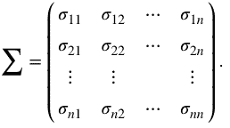

这里 $\Sigma^{-1}$ 是 $\Sigma$ 的逆。 此外，$x$ 和 $\mu$ 是 $n$ 维向量。 一个特例是标准 $n$ 维正态 $N(0,I_n)$ 具有形式

$$\frac{1}{(2\pi)^{n/2}}\exp\left(-\frac{1}{2}x^Tx\right)$$

其中 $x^T$ 是向量 $x$ 的转置。 这里 $I_n$ 是 $n \times n$ 单位矩阵。

我们注意到对称矩阵 $\Sigma$ 是正定的，即 $x^T\Sigma x > 0\ \forall x \in \mathbb{R}^n$ 且我们可以将其表示为 Cholesky 分解形式，即 $\Sigma = CC^T$，其中 $C$ 是下三角矩阵。

本练习的目标是生成一个相关向量 $X$。 我们描述执行该算法的步骤。

+   回答以下问题：
+   
+    a) 生成一个不相关的 $N(0,1)$ 向量 $Z$。
+   
+    b) 计算 Cholesky 下三角矩阵 $C$。
+   
+    c) 计算新的相关随机向量 $X = CZ + m$，其中 $m$ 是 $X$ 的均值。

使用 C++11 结合矩阵库实现解决方案，例如 *Eigen*、*Boost uBLAS* 或您喜欢的库。

## 7. （拉普拉斯分布）

即使 C++ 不支持所有单变量分布，这并不意味着一切都丢失了！ 在某些情况下，如果我们有其 cdf 的解析形式，例如，我们可能能够从给定分布生成随机数。 更具体地说，我们可能能够反转 cdf，然后就完成了，或者如果失败，我们可以使用 Newton–Raphson 方法或不动点方法迭代计算解。 在本练习中，我们通过考察 *Laplace* 和 *极值* 分布来集中于解析方法，后者已在 C++11 中得到支持。

*Laplace 分布*（也称为 *双指数分布*）可以看作是两个独立同分布指数随机变量之差。 它依赖于 *位置参数* $\mu$ 和 *尺度（多样性）参数* $b \ge 0$。 在 $\mu = 0$ 且 $b = 1$ 的情况下，我们得到在正半轴上按因子 $1/2$ 缩放的指数分布。 Laplace 分布的 pdf 和 cdf 分别由以下给出：

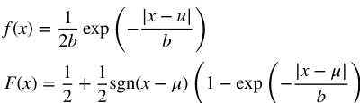

证明该分布的随机变量由下式给出：

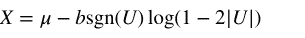

其中 U 从区间 $(-1/2, 1/2)$ 中的均匀分布中抽取。

第二个例子是极值分布，其 pdf 和 cdf 分别由以下给出：

$f(x) = \sigma^{-1} \exp\left(-\frac{x - \mu}{\sigma}\right) \exp\left(-\exp\left(-\frac{x - \mu}{\sigma}\right)\right), \ x \in \mathbb{R}$

$F(x) = \exp\left(-\exp\left(-\frac{x - \mu}{\sigma}\right)\right), \ x \in \mathbb{R}.$

证明：

$X = -\sigma \log(-\log(U)) + \mu$

其中 U 从区间 $(0, 1)$ 中的均匀分布中抽取。 在极值分布的情况下，将您的结果与 C++11 的结果进行比较。

编写 C++ 函数来计算这两个分布的随机变量。

## 8. （随机数生成的可重用框架）

本练习的目标是创建一个包含计算金融中随机数生成所需的功能的软件框架。 我们专注于生成相关随机数数组。 主要要求是短期内的效率和准确性，然后在框架的第二阶段进行可扩展性。 您应使用第 15.5.2 节中的通用类 RNGgenerator，因为它包含可在框架中使用的功能。

回答以下问题：
a) 扩展 RNGgenerator 的功能以创建具有随机值的矩阵。
b) 创建自由函数以生成具有给定相关性的两个相关标准正态变量。
c) 创建两个单独的函数，使用 Cholesky 分解生成相关随机数数组； 一个函数使用第 26.9.1 节中介绍的代码，而第二个函数使用 Eigen 库。 在示例上测试这些函数以比较效率和准确性。 Eigen 是否支持具有复系数的矩阵的 Cholesky 分解？
d) 压力测试：创建一个循环，并在循环中创建一个随机协方差矩阵。 应用第 c) 部分的函数。 计算两个解之间的最大误差。
e) 修改代码使其可以在不同的 Cholesky 算法实现之间切换（我们通常考虑策略设计模式（GOF, 1995）或 mixin）。 使用 CRTP 和 std::function 作为嵌入算法来实现此代码。
f) 您能否发现新的需求和功能，希望添加到软件框架中？

# 第 27 章

# Microsoft .Net、 C# 和 C++11 互操作性

## 27.1 引言和目标

在本章中，我们介绍 C++/CLI（Common Language Infrastructure）语言。 它是一种 .NET 编程语言，与 C# 和 VB.NET 在效率和功能方面相似，但具有附加优势，即可以编写包含 C++/CLI、C# 和原生 C++ 代码混合的应用程序。

在讨论 C++/CLI 语言之前，我们概述了为了熟悉该语言所需的编程知识和技能。 特别是，理解原生 C++ 与 C++/CLI 之间的相似性和差异（以及在较小程度上 C# 与 C++/CLI 之间的差异）非常重要。 理想情况下，良好的 C++ 工作知识是理解 C++/CLI 的先决条件，包括指针、内存管理、类和模板。 C++/CLI 代码可以与原生 C++ 代码混合使用。 区分两种语言很重要，这需要对每种语言都有良好的了解。 此外，对于已经用 C# 编程的开发人员来说，C++/CLI 相对容易学习。 由于 C# 和 C++/CLI 都是 .NET 语言，它们共享通用语法。 用 C# 编写的程序很容易被了解 C++/CLI 的开发人员理解，对于 C# 开发人员来说，理解 C++/CLI 也并不困难。

我们总结本章的目标和内容：

- C++/CLI .NET 语言的全局概述。
- .NET 中的内存管理。
- 创建多语言（C#、C++ 和 C++/CLI）应用程序的各种方法。
- 在 .NET 应用程序中使用 C++ 库（例如 Boost 和 Quantlib）。
- 下一代观察者设计模式（使用 .NET 事件）以及在原生 C++ 中使用它。
- 与遗留 C、原生 C++ 和 COM 代码集成。
- .NET 程序集及其与第 9 章中介绍的软件框架的集成。

由于篇幅有限，我们无法讨论所有想要讨论的内容。 然而，我们正在准备一本后续文本，在其中扩展这些互操作性主题。

## 27.2 全局概览

C++/CLI 与 C++ 有许多不同之处。 其中一些差异与 C++/CLI 是 .NET 语言这一事实有关，它拥有 C++ 不支持的许多功能：

- a) 它是一种动态语言，支持内省（Reflection）、程序集（dlls）的动态加载和动态对象创建。
- b) 访问 .NET 库，例如数据库、序列化、网络、图形用户界面和 Web 服务。
- c) 支持多线程和并行编程。
- d) 自动内存管理和垃圾回收支持。
- e) 支持接口。
- f) 支持委托和事件。
- g) 支持属性（成员数据的标准化 getter 和 setter）。

学习 C++/CLI 的挑战之一是知道原生 C++ 中的哪些功能在该语言中有效，哪些无效，以及两种语言如何协同工作。 它们有很多共同点，但也有差异。

C++/CLI 是对 C++ 的扩展，以受益于 CLI 实现提供的服务。 它是一种 .NET 语言，如果您了解（原生）C++ 和一些 C#，您会发现它很容易学习。 特别是，您可以在项目中自由混合 C++/CLI 和 C++ 代码，从这个意义上说，我们说 C++/CLI 是双语的，因为它可以与 .NET 代码和原生 C++ 代码对话。 来自 Wikipedia 的语言总结如下：

> C++/CLI（为 CLI 修改的 C++）是由 Microsoft 创建的语言规范，旨在取代 Managed Extensions for C++。 它是对旧版 Managed C++ 语法进行简化、彻底修订的版本，现已弃用。 C++/CLI 已由 Ecma 标准化为 ECMA-372。 它目前可在 Visual Studio 2005、2008、2010、2012、2013、2015 和 2017 中使用，包括 Express 版本。

如前所述，如果您已经了解 C#，C++/CLI 的语法将很容易学习。 了解（原生）C++ 是一个额外的优势。 C++ 和 C++/CLI 之间存在一些差异，其中之一是 .NET 中的内存模型。 对象当然是类的实例，在 .NET 中它们始终在堆上创建（除非我们定义值类型）。 这与 C++ 不同，在 C++ 中对象也可以在栈上创建。 C++/CLI 中的对象会自动垃圾回收。 相比之下，值类型的值存在于栈上，不会被垃圾回收。 在 .NET 中区分值类型和引用类型很重要，因为这可能是混淆的来源。 默认情况下，所有类都派生自 System::Object，它几乎所有 .NET 类型的最低公分母。 该基类可以引用任何类型的对象或值，其数据存在于堆上。 我们需要讨论如何将值转换为对象（装箱）以及如何将对象转换为值（拆箱）。 一个简单的例子是：

```
int i = 42;
Object^ obj = (Object^)i;                  // boxing
Console::WriteLine("Values: {0}", obj->ToString());   // 42
```


// Unbox using a safe cast
int j = safe_cast<int>(obj);                // 42
long k = safe_cast<long>(obj) + 10;         // 52

Console::WriteLine("Values: {0},{1}", j, k);

我们现在进入 C++/CLI 代码，创建一个类层次结构，创建派生类的实例，并在层次结构中进行类型转换。代码中记录了语法，主要亮点如下：

-   继承机制（默认是公有继承）。
-   静态构造函数、默认构造函数、复制构造函数以及其他构造函数。
-   静态成员数据。
-   终结器（看起来像 C++ 析构函数；托管类不需要）。
-   以标准方式设置和获取成员数据的属性语法。
-   抽象类和抽象（无函数体）方法的使用。
-   虚（多态）方法及其重写。

这个列表像是一门迷你课程，但读者理解代码应该没什么困难。作为示例，我们定义基类：

```
#pragma once                         // Prevent multiple inclusion

public ref class Shape abstract       // ref => on heap
{
public:
    Shape() { }                       // Default constructor

    Shape(Shape^ source) { }          // Copy constructor

    // Finaliser
    !Shape() { }

    // Return descriptive string
    virtual String^ ToString() override
    {
        return "Shape";
    }

    // The draw function is abstract because
    // Shape is not concrete. It can't be drawn.
    virtual void Draw() abstract;
};
```

派生类 Point 如下：

```
#pragma once   // Prevent multiple inclusion

#include "Shape.hpp"

public ref class Point: Shape                // Point class derived from
                                         // Shape
{
private:
    double x;                               // Space for x-coordinate
    double y;                               // Space for y-coordinate

    static int numPoints = 0;               // Number of points created
    static Point^ origin=gcnew Point(0.0, 0.0); // Origin point
    static int test;
public:

    /* Constructors */

    // Static constructor
    static Point()
    { // Ctor called prior to when the class is first initialised

        test = 42;
    }

    // Default constructor
    Point(): Shape(), x(0.0), y(0.0)
    {
        numPoints++;
    }

    // Copy constructor
    Point(Point^ source): Shape(source), x(source->x), y(source->y)
    {
        numPoints++;
    }

    // Constructor with coordinates
    Point(double x, double y): Shape(), x(x), y(y)
    {
        numPoints++;
    }

    // Finaliser invoked just before object is garbage collected
    !Point()
    {
        numPoints--;   // Decrease counter
    }

    // Return the number of created points
    // Note, in static members you can't use 'this'
    static int GetPoints()
    {
        return numPoints;
    }
}
```

```
/* Properties */

// Access the x-coordinate
property double X
{
    double get()
    {
        return x;
    }

    void set(double x)
    {
        this->x=x;
    }
}

// Access the y-coordinate
property double Y
{
    double get()
    {
        return y;
    }

    void set(double y)
    {
        this->y=y;
    }
}

// Read only property to access origin point
static property Point^ Origin
{
    Point^ get()
    {
        return origin;
    }
}

// Return descriptive string
virtual String^ ToString() override
{
    return Shape::ToString()
        + String::Format(": Point ({0}, {1})", x, y);
}

// Draw point, emulated with printing text
virtual void Draw() override
{
    System::Console::WriteLine("Draw Point ({0}, {1})", x, y);
}
};
```

测试程序如下：

```
using namespace System;

#include "Point.hpp"

int main()
{
    Point^ p=gcnew Point(1.0, 3.0);      // Create Point
    // Shape^ s=gcnew Shape();             // can't be created
    Shape^ sp=gcnew Point(4.5, 3.1);

    p->Draw();                            // Prints 'Draw Point(1.0, 3.0)'
    sp->Draw();                            // Prints 'Draw Point(4.5, 3.1)'

    // Casting
    Shape^ sp2 = gcnew Point(1.0, 2.0);
    try
    {
        Point^ pt = safe_cast<Point^>(sp2);
        Console::WriteLine(L"Coordinates: {0},{1} ", pt->X, pt->Y);
    }
    catch (System::InvalidCastException^ e)
    {
        Console::WriteLine("Cast failed");
    }

    return 0;
}
```

这段代码可供学习和运行，并可推广到其他问题。

## 27.3 类型

*公共类型系统*（CTS）是 *公共语言运行时*（CLR）中的关键组件。它允许开发人员创建多语言应用程序。具体而言，它具有以下功能：

-   a) 一个面向对象的数据模型，用于支持所有 .NET 编程语言的数据类型。
-   b) 一组约束条件，.NET 编程语言的数据类型必须满足这些约束，才能与其他 .NET 语言进行交互。
-   c) 一个框架，允许 .NET 语言相互操作并确保数据类型安全。

两种主要数据类型是值类型和引用类型。*值类型*（例如 int、float 和 double）以及用户定义的值类型存储为引用类型。*引用类型*（例如数组、类和句柄）作为对数据类型位置的引用存储在托管堆上。

C++/CLI 中的 CTS 类型与 C# 中的类型相似，但有一些新增：

-   表示整数、实数、布尔值和字符的内置值类型。
-   一维和多维数组。
-   引用类类型：这些是用户定义的类型。
-   委托：委托是一种保存对方法引用的类型。
-   接口类型：与抽象类类似，不同之处在于接口只能包含公共纯虚方法，并且不能包含数据。
-   句柄类型：这是对某个类型的引用，类似于原生 C++ 指针，但数据句柄不能进行操作，换句话说，与原生 C++ 指针相比，不能对句柄进行偏移量的加减。
-   用户定义的值类型：对标准（基本）值类型的用户定义扩展。
-   枚举：命名整数常量的列表。
-   装箱值类型：对值类型的临时引用，允许将其放置在托管堆上。

## 27.4 内存管理

开发人员对内存管理应该不会陌生。例如，.NET Framework 有一个垃圾回收器，负责从托管堆中移除对象。因此，当对象不再被使用时，开发人员无需担心将对象从 CLI（托管）堆中移除。原生 C++ 使用非托管运行时（CRT）堆，在这种情况下，程序员有责任显式地从堆内存中移除对象。换句话说，原生 C++ 使用（不安全的）指针，而 C++/CLI 同时支持不安全指针和句柄。句柄是对某个类型的引用。

.NET 垃圾回收由 CLR 自动处理。在某些情况下，可能需要修改垃圾回收的频率，为此我们可以使用 System::GC 类来触发垃圾回收过程。由于垃圾回收器仅处理托管内存，不感知非托管内存，它会低估调度垃圾回收的紧迫性，例如，一个托管对象分配了大量非托管内存时就是如此。因此，我们需要一种机制，在分配了非托管内存之后以及释放了这些非托管内存之后，通知垃圾回收器。为此，System::GC 类提供了以下静态方法：

-   GC::AddMemoryPressure()：通知运行时，在调度垃圾回收时，应考虑大块非托管内存的分配。
-   GC::RemoveMemoryPressure()：通知运行时，大块非托管内存已被释放，不再需要在垃圾回收时加以考虑。

使用示例如下：

```
// Allocate some unmanaged memory
long long N = 1e8;
double* darr = new double[N];
```


```
// Inform runtime that unmanaged memory has been allocated
GC::AddMemoryPressure(N);

// Release unmanaged memory and inform runtime
delete [] darr;
GC::RemoveMemoryPressure(N);
```

当混合使用 C++/CLI 和原生 C++ 代码来管理大型数据结构（例如数组、向量和矩阵）时，这种技术会很有用。

由于在 CLI（托管）堆和 CRT（C/C++ 运行时）（非托管）堆上工作时涉及一些微妙的问题，因此此时总结一些与垃圾回收相关的事实会很有帮助：

+   1. 垃圾回收器跟踪并回收在托管内存中分配的对象。它不识别来自非托管代码的对象引用。
+   2. 垃圾回收器只有在断定某个对象没有引用时才会释放它。
+   3. 垃圾回收器不维护对象所持有资源（例如文件句柄或数据库连接）的信息。通过在使用了非托管资源的类型中实现终结器可以解决此问题。这些非托管资源必须在类型实例被回收之前释放。
+   4. 垃圾回收器使用“代”来支持对象老化。代是内存中对象相对年龄的度量单位。可以强制对一定范围内的代中的对象进行垃圾回收。

本节的目标是让读者了解 .NET 中垃圾回收的工作方式，以及在混合 C++ 环境中开发代码时会出现的问题。

C++/CLI 中有两种析构函数。第一种与释放先前分配的内存有关，第二种与释放托管或非托管资源有关。

使用 `gcnew` 在 CLI 堆上分配的对象需要被释放。有以下几种选择：

+   对 ref 类对象的句柄调用 `delete` 运算符。这样，托管内存将按与分配相反的顺序立即释放。在这种情况下，程序员可以完全控制对象最终清理的时机。
+   在某些情况下，程序员并不关心内存何时被回收。这时就不必调用 `delete` 运算符。CLR 会检测到对象不再需要，并在适当的时候对其内存进行垃圾回收。因此，在大多数情况下并不需要使用 `delete` 运算符。

当我们对对象句柄调用 `delete` 运算符时，会调用相应的析构函数（如果存在）。在析构函数体中，我们通常会对 ref 类需要清理的任何对象调用 `delete` 运算符。最后，如果 ref 类不分配内存，则无需创建析构函数，在这种情况下会调用默认析构函数。当我们为原生 C++ 对象创建 .NET 包装器时，会看到一些使用的示例。

## 27.5 原生类简介

原生类（也称为非托管类或不安全类）是一种标准的、与编译器无关的 C++ 类。其实例位于 CRT 堆上，而不是 CLI 堆上。这意味着 .NET 垃圾回收器不管理非托管内存。因此，程序员有责任在代码中管理内存（这是 C++ 开发人员所熟悉的事情）。创建原生类时需要记住以下几点：

+   - 如果没有指定显式基类，该类就是独立根类；相比之下，托管类在未指定显式基类时会默认派生自 `System::Object`。
+   - 原生类支持多重继承；托管类不支持多重继承，但 C++/CLI 支持接口，这弥补了这一点。
+   - 原生类支持友元，而托管类不支持。
+   - 原生类只能继承原生类，托管类只能继承托管类。
+   - 原生类可以包含指向原生类的指针类型的数据成员，但不能包含指向托管类的句柄。换句话说，我们不能在原生 C++ 类中嵌入 C++/CLI 类。
+   - 托管类既可以包含指向原生类的指针类型的数据成员，也可以包含指向托管类的句柄。

因此我们可以看到，托管类可以由原生类组成（并因此委托给它们），但原生类不能委托给托管类。我们将看到如何使用托管类作为包装器，来延长原生 C++（遗留）代码在 .NET 中的生命周期。我们还看到，从原生 C++ 调用 .NET 代码是不可能的，至少不能直接调用。但是，通过创建一种特殊的 CCW（COM 可调用包装器）对象来桥接 COM 与 .NET 世界，可以在 COM（组件对象模型）中使用 .NET 对象。

## 27.6 接口与抽象类

接口是置于一个内聚单元中的抽象方法和属性的集合。它不能有（一定不能有）任何数据成员。因此，接口不包含任何实现（甚至不包含数据），这一概念在 C# 和 Java 等语言中已经得到了很好的确立。类通过为接口的每个抽象方法和属性提供定义（函数体）来实现接口。接口定义了一种契约。

在 C++/CLI 中，抽象类的定义是：至少包含一个纯虚成员或抽象方法的类。它可以有方法、属性、构造函数和析构函数，但关键是不能实例化。

我们注意到，接口是纯粹行为的规范（是一种非结构化描述），而抽象类可以包含结构化组件。一种有用的设计模式是：抽象类实现接口的部分方法和属性，而将接口其余方法和属性的实现留给抽象类的派生类。

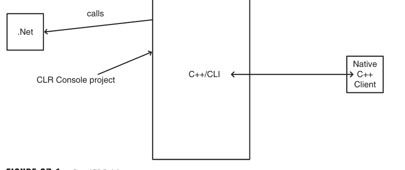

### 图 27.1 C++/CLI 驱动程序

## 27.7 用例：将 C++/CLI 作为“主语言”

我们现在开始讨论如何编写结合使用 C++/CLI、原生 C++ 和 C# 的应用程序。一般来说，我们会创建某种 Visual Studio 项目（例如 CLR 控制台项目），并向其中添加使用 C# 或 C++/CLI 创建的引用（程序集/DLL）。在本节中，我们讨论如图 27.1 所示的用例。

在本例中，我们创建一个 CLR 控制台项目，其中混合了 C++/CLI 代码和原生 C++ 代码。由于这是一个 .NET 项目，我们可以使用 .NET 的功能，也可以使用其他来源的功能。为了说明问题，我们举一个具体例子。在本例中，我们讨论使用 C++/CLI 和 C++ 创建向量并对其元素求和的不同方法。此外，我们提供一个简单示例，演示如何通过调用 .NET `Regex` 库中的函数来解析正则表达式（我们原本可以使用 C++11 或 Boost 中的正则表达式功能，但开发团队可能尚未使用 C++11，而且在这种情况下安装完整的 Boost 库可能有些大材小用；使用 .NET 更简单）。我们还给出了 STL/CLR 库中向量的示例，因为 C++/CLI 支持模板。首先，我们创建一个 STL 向量、一个 .NET 数组和一个原生 C++ 数组，并计算它们元素的和。代码如下：

```
#include <vector>
#include <algorithm>
#include <numeric>
#include <iostream>

// STL/CLR
#include <cliext/vector>

using namespace System;
using namespace System::Collections::Generic;
using namespace System::Text::RegularExpressions;
```

```
// Calling the .Net Regular Expression library
cli::array<String^>^ sentence =
{
    "Daisy, Daisy",
    "Give me your answer do",
    "I'm half crazy",
    "All for the love of you"
};

String^ matchStr = "Daisy";
for (int i = 0; i<sentence->Length; i++)
{
    Console::Write("*{0}", sentence[i]);
    if (Regex::IsMatch(sentence[i], matchStr, RegexOptions::IgnoreCase))
    {
        Console::WriteLine
            ("({match for '{0}' found)", matchStr);
    }
    else
    {
        Console::WriteLine("");
    }
}
```

这一组示例构成了我们可以称之为 C++/CLI 基础训练的内容。在本章中我们无法深入更多语法，因为我们希望讨论应用。有关更多背景信息，请参阅 Heege（2007）、Hogenson（2008）和 Templeman（2013）。总的来说，我们认为 Heege（2007）是适合 C++ 程序员的参考资料。

## 27.8 用例：为遗留 C++ 应用程序创建代理、适配器和包装器

我们讨论如何通过使用同一种或其他语言（称为 B）的功能，来创建用给定语言（称为 A）编写的应用程序。一般来说，我们首先需要调整 B 的接口以适应 A 的需求；其次，我们需要控制对 B 的访问，因为我们只对导出或公开 B 的一部分功能感兴趣。需要使用的设计模式是适配器（Adapter）、外观（Façade）和代理（Proxy）（GOF，1995）。

在软件工程中，适配器模式是一种软件设计模式（也称为包装器，这是与装饰器模式共享的另一种叫法），它允许将现有类的接口用作另一个接口。它通常用于让现有类与其他类协同工作，而无需修改其源代码。

外观模式（Façade，也写作 Facade）是一种常用于面向对象编程的软件设计模式。其名称来源于与建筑立面（façade）的类比。外观是一个为较大规模代码体（如类库）提供简化接口的对象。外观可以：

+   - S1：使软件库更易于使用、理解和测试，因为外观为常见任务提供了便捷方法。


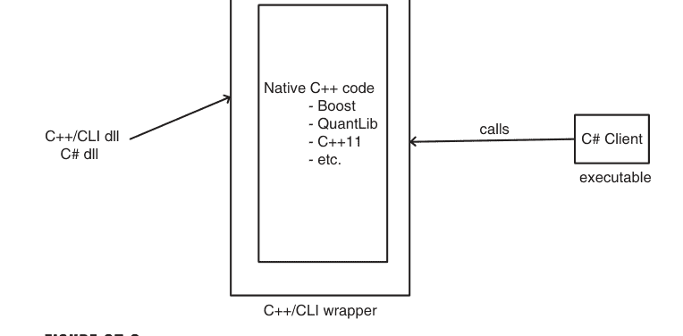

## 图 27.2 包装遗留 C++ 代码

- S2：使库更易读。
- S3：减少客户端代码与库内部实现之间的依赖，因为大多数代码使用的是外观，从而在开发系统时提供更大的灵活性。
- S4：用单一设计良好的 API 包装一组设计不良的 API。

第三种设计模式是代理：

> 代理在其最一般的形式中，是作为对其他事物的接口而工作的类。代理可以接口到任何东西：网络连接、内存中的大型对象、文件，或其他昂贵或无法复制的资源。简而言之，代理是一个包装器或代理对象，由客户端调用以在幕后访问真实对象。使用代理可以简单地转发到真实对象，也可以提供额外的逻辑。在代理中，可以提供额外功能，例如当对真实对象的操作资源密集时进行缓存，或在对真实对象调用操作之前检查前置条件。对于客户端，使用代理对象与使用真实对象类似，因为两者都实现相同的接口。

我们对这些模式的首次应用在图 27.2 中进行了概述。在这种情况下，我们创建一个由原生 C++ 类组成并其成员函数委托给后者的类的 C++/CLI 类。在这种情况下，我们有兴趣包装来自 Boost 和 Quantlib 的函数。我们首先创建一个 C++/CLI 类库 dll，然后创建一个引用此 dll 的 C# 控制台项目。为此，Boost 和 Quantlib 的包装类（我们在此不展示头文件；它们可以在发行介质上找到）是：

```
#include "stdafx.h"

#include "BoostMath.hpp"
#include "BVNWrapper.hpp"
```

```
namespace Wrapper
{
    // Cdf

    double BoostMath::Cdf(UniformDistribution^ distribution, double x)
    {
        return boost::math::cdf(*distribution->GetNative(), x);
    }

    double BoostMath::Cdf(BernoulliDistribution^ distribution, double x)
    {
        return boost::math::cdf(*distribution->GetNative(), x);
    }

    double BoostMath::Cdf(ChiSquaredDistribution^ distribution, double x)
    {
        return boost::math::cdf(*distribution->GetNative(), x);
    }

    double BoostMath::Cdf(NonCentralChiSquaredDistribution^ distribution,
            double x)
    {
        return boost::math::cdf(*distribution->GetNative(), x);
    }

    // Pdf

    double BoostMath::Pdf(UniformDistribution^ distribution, double x)
    {
        return boost::math::pdf(*distribution->GetNative(), x);
    }

    double BoostMath::Pdf(BernoulliDistribution^ distribution, double x)
    {
        return boost::math::pdf(*distribution->GetNative(), x);
    }

    double BoostMath::Pdf(ChiSquaredDistribution^ distribution, double x)
    {
        return boost::math::pdf(*distribution->GetNative(), x);
    }

    double BoostMath::Pdf(NonCentralChiSquaredDistribution^ distribution,
            double x)
    {
        return boost::math::pdf(*distribution->GetNative(), x);
    }
}
```

```
// Quantile

double BoostMath::Quantile(UniformDistribution^ distribution, double x)
{
    return boost::math::quantile(*distribution->GetNative(), x);
}
double BoostMath::Quantile(BernoulliDistribution^ distribution,
            double x)
{
    return boost::math::quantile(*distribution->GetNative(), x);
}

double BoostMath::Quantile(ChiSquaredDistribution^ distribution,
            double x)
{
    return boost::math::quantile(*distribution->GetNative(), x);
}

double BoostMath::Quantile
    (NonCentralChiSquaredDistribution^ distribution, double x)
{
    return boost::math::quantile(*distribution->GetNative(), x);
}
}
```

这些是接受 C++/CLI 类作为输入参数的静态成员函数。对于均匀分布类（其他类相同），包装类是：

```
#include "stdafx.h"

#include "UniformDistribution.hpp"

namespace Wrapper
{
    // Default constructor
    UniformDistribution::UniformDistribution()
    {
        m_distribution=new boost::math::uniform_distribution<>();
    }

    // Constructor with lower and upper value
    UniformDistribution::UniformDistribution(double lower, double upper)
    {
        m_distribution=new boost::math::uniform_distribution<>
                    (lower, upper);
    }

    // Finaliser (called by garbage collector or destructor)
    UniformDistribution::!UniformDistribution()
```

```
{
    delete m_distribution;
}

// Destructor (Dispose)
UniformDistribution::~UniformDistribution()
{
    // Call finaliser
    this->!UniformDistribution();
}

// Get the lower value
double UniformDistribution::Lower()
{
    return m_distribution->lower();
}

// Get the upper value
double UniformDistribution::Upper()
{
    return m_distribution->upper();
}

// Get the native object
boost::math::uniform_distribution<>* UniformDistribution::GetNative()
{
    return m_distribution;
}
}
```

Quantlib 的包装类是：

```
#include <string>
#include <memory>

#include <ql/quantlib.hpp>
#include <ql/math/distributions/bivariatenormaldistribution.cpp>
using NativeClass = QuantLib::BivariateCumulativeNormalDistributionWe04DP;

using namespace System;

namespace Wrapper
{
    // ManagedWrapper has similar interface to native that it wraps
    public ref class ManagedWrapper
    {
    private:
        NativeClass* m_nativeClass;    // The embedded native class
        // std::unique_ptr<NativeClass> m_nativeClass;    // not possible!
        double _rho;

public:
    // Constructor with data
    ManagedWrapper(double rho) : _rho(rho)
    {
        // Create native class instance with data
        m_nativeClass = new NativeClass(_rho);
    }

    double Compute(double a, double b)
    {
        return (*m_nativeClass)(a, b);
    }

    // Get- and set data as property
    property double Correlation
    {
        double get() { return _rho; }
        void set(double value)
        {
            _rho = value;

            delete m_nativeClass;
            m_nativeClass = new NativeClass(_rho);
        }
    }

    !ManagedWrapper()
    {
        delete m_nativeClass;
    }

    ~ManagedWrapper()
    {
        this->!ManagedWrapper();
    }
};
```

Native class 类包含相关的 Quantlib 功能。

我们出于方便将两组源代码放在同一个文件中。出于维护的考虑，我们更愿意为每个库创建单独的 dll。在这种情况下，类库项目应引用头文件和库文件（如适用）。

我们如何使用新的包装代码？再次参考图 27.2，我们创建一个 C# 控制台项目并添加相关 dll 作为引用：

```
using System;

using Wrapper;

class MainClass
```

```
{
    static void Main(string[] args)
    {
        double x=0.25;
        int k=0;

        // Uniform distributions
        UniformDistribution myUniform=new UniformDistribution(0.0, 1.0);
        Console.WriteLine("Lower value: {0}, Upper value: {1}",
                    myUniform.Lower(), myUniform.Upper());

        Console.WriteLine("pdf of Uniform: {0}", BoostMath.Pdf
        (myUniform, x));
        Console.WriteLine("cdf of Uniform: {0}", BoostMath.Cdf
        (myUniform, x));
        Console.WriteLine();

        // Bernoulli distributions
        BernoulliDistribution myBernoulli=new BernoulliDistribution(0.4);
        Console.WriteLine("Probability of success: {0}",
                    myBernoulli.SuccessFraction());

        Console.WriteLine("pdf of Bernoulli: {0}", BoostMath.Pdf
        (myBernoulli, k));
        Console.WriteLine("cdf of Bernoulli: {0}", BoostMath.Cdf
        (myBernoulli, k));
        Console.WriteLine();

        // Chi squared distributions
        ChiSquaredDistribution myChiSquared =new
        ChiSquaredDistribution(0.4);

        Console.WriteLine("pdf of ChiSquared: {0}", BoostMath.Pdf
        (myChiSquared, 2));
        Console.WriteLine("cdf of ChiSquared: {0}", BoostMath.Cdf
        (myChiSquared, 2));
        Console.WriteLine();

        // Non central chi squared distributions
        NonCentralChiSquaredDistribution myNonCentralChiSquared
            = new NonCentralChiSquaredDistribution(2, 2);

        Console.WriteLine("pdf of NonCentralChiSquared: {0}",
                    BoostMath.Pdf(myNonCentralChiSquared, 2));
        Console.WriteLine("cdf of NonCentralChiSquared: {0}",
                    BoostMath.Cdf(myNonCentralChiSquared, 2));
        Console.WriteLine();

        // C# code here: Check output data from chapter 16, section 16.4
        ManagedWrapper mw = new ManagedWrapper(0.948175);
        Console.WriteLine("rho {0}", mw.Correlation);
    }
```


```
Console.WriteLine("value {0}",
    mw.Compute(-4.7346574, 3.0501621));

mw.Correlation = 0.17220467;
Console.WriteLine("rho {0}", mw.Correlation);
Console.WriteLine("value {0}", mw.Compute(-2.726639,4.9965896));

mw.Correlation = 0.054292586;
Console.WriteLine("rho {0}", mw.Correlation);
Console.WriteLine("value {0}", mw.Compute(-1.946981,3.1876528));
}
}
```

输出为：

```
Lower value: 0, Upper value: 1
pdf of Uniform: 1
cdf of Uniform: 0.25

Probability of success: 0.4
pdf of Bernoulli: 0.6
cdf of Bernoulli: 0.6

pdf of ChiSquared: 0.0400666483385111
cdf of ChiSquared: 0.947619568720922

pdf of NonCentralChiSquared: 0.154254161276836
cdf of NonCentralChiSquared: 0.345745838723165

rho 0.948175
value 1.09712714868593E-06
rho 0.17220467
value 0.00319914983444984
rho 0.054292586
value 0.0257568370067285
```

该输出与第 16.4 节中产生的结果一致。当你希望在不将该 C++ 代码移植到 C# 的情况下使用原生 C++ 代码时，可以采用这种方法。这促进了代码的重用。

## 27.8.1 替代方案：SWIG（简化包装器和接口生成器）

SWIG 基于成熟的接口定义语言（IDL）概念（Rogerson, 1997）。该 IDL 基于开放软件基金会（OSF）分布式计算环境（DCE）。其语法类似于 C 和 C++，能够描述客户端与客户端希望访问其服务的组件之间共享的接口和数据。在用 IDL 描述了接口和组件之后，下一步是通过

某种 IDL 编译器（例如 Microsoft 的 MIDL 或 SWIG 转换工具）运行它们。编译器将 IDL 文件作为输入，并生成某种语言的代码，例如 C#。在 SWIG 的特定情况下，我们从 C# 调用原生 C++ 函数。SWIG 工具创建源代码，这是在 C++ 和目标语言之间的粘合代码。我们注意到 SWIG 不能用于从原生 C++ 调用目标语言中的函数。我们注意到 Quantlib 支持 SWIG。

## 27.9 “回到未来”用例：从 C++11 调用 C# 代码

我们现在转向如图 27.3 所示的用例。在这种情况下，我们希望使用用 C# 编写的代码，并从原生 C++ 调用它。一个原因是 C# 代码已经存在，经过测试并有文档记录，我们没有资源再次将代码重写为 C++。因此我们创建一个 CLR dll 并将 C# 代码包含在其中。然后我们创建一个 CLR 控制台项目并调用 dll 中的代码。完成！我们不必创建包装器。

我们以一个我们为固定收益应用用 C# 编写的数据插值库为例（完整细节请参见 Duffy 和 Germani, 2013）。流行的插值器有：

- Akima
- Hyman 1989 滤波器
- Hagan 和 West
- Linear
- Cubic spline.

在本节中，我们创建一个 dll 并将 Akima 和 Hyman 方法的代码放入其中。我们还出于方便将 C# 版本的 Excel 驱动程序代码（第 14 章讨论了 C++ 版本）放入 dll 中。源代码在 Duffy 和 Germani（2013）中，我们由于篇幅限制

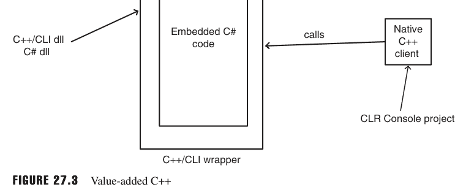

图 27.3 增加价值的 C++

未在此处包含。我们将测试代码（但不保留在 C# 中的库代码）从 C# 移植到 C++/CLI。一个测试程序是：

```
// Author Andrea Germani
// Copyright (C) 2012. All right reserved
//
// Ported to C++/CLI Daniel J. Duffy
//
// (C) Datasim Education BV 2018
//
// ----------------------------------------------------------------------------
using namespace System;
using namespace System::Collections::Generic;
//using namespace System::Linq;
using namespace System::Text;

#include <vector>

// Based on Datasim interpolators
public ref class InterpolatorExample101
{
public:

    // 13.12.1  The 101 Example, from A to Z
    static void Example101()
    {
        // My excel mechanism
        ExcelMechanisms^ exl = gcnew ExcelMechanisms();
        // I Create initial t and r arrays.
        std::vector<double> v = { 0.1, 1.0, 4.0, 9.0, 20.0, 30.0 };
        Vector<double>^ t = gcnew Vector<double>(6, 0);
        for (int j = t->MinIndex; j <= t->MaxIndex; j++)
        {
            t[j] = v[j];
        }

        // (gcnew double() { 0.1, 1, 4, 9, 20, 30 }, 0);
        Vector<double>^ r = gcnew Vector<double>(6, 0);
        r[0] = 0.081; r[1] = 0.07; r[2] = 0.044;
        r[3] = 0.07; r[4] = 0.04; r[5] = 0.03;

        // Compute log df
        Vector<double>^ logDF = gcnew Vector<double>(r->Size, r->MinIndex);
        for (int n = logDF->MinIndex; n <= logDF->MaxIndex; ++n)
        {
            logDF[n] = Math::Log(Math::Exp(-t[n] * r[n]));
        }
        exl->printOneExcel<double> (t, logDF, "logDF", "time", "logDF", "logDF");
```

```
// II Hyman interpolator
HymanHermiteInterpolator_V4^ myInterpolatorH
    = gcnew HymanHermiteInterpolator_V4(t, logDF);

// Create the abscissa values f (hard-coded for the moment)
int M = 299;
Vector<double>^ term = gcnew Vector<double>(M, 0);
term[term->MinIndex] = 0.1;
double step = 0.1;
for (int j = term->MinIndex + 1; j <= term->MaxIndex; j++)
{
    term[j] = term[j - 1] + step;
}

// III Compute interpolated values
Vector<double>^ interpolatedlogDFH = myInterpolatorH->Curve(term);
exl->printOneExcel<double>(term, interpolatedlogDFH,
    "Hyman cubic", "time", "int logDF", "int logDF");

Akima1970Interpolator ^ myInterpolatorA
    = gcnew Akima1970Interpolator(t, logDF);

// IV Compute continuously compounded risk free rate from the
// ZCB Z(0,t),using equation (3)Hagan and West (2008).
Vector<double>^ rCompounded = gcnew Vector<double>
    (interpolatedlogDFH->Size, interpolatedlogDFH->
    MinIndex);

for (int j = rCompounded->MinIndex; j <= rCompounded->MaxIndex; j++)
{
    rCompounded[j] = -interpolatedlogDFH[j] / term[j];
}
exl->printOneExcel<double>(term, rCompounded,
    "RCompound Hyman Cubic", "time",
    "r continuously comp.", "r cont");

// Akima
Vector<double>^ interpolatedlogDFA = myInterpolatorA->Curve(term);
exl->printOneExcel<double>(term, interpolatedlogDFA,
    "Akima cubic", "time", "int logDF", "int logDF");

Vector<double>^ rCompounded2 = gcnew
Vector<double>(interpolatedlogDFH->Size,
    interpolatedlogDFH->MinIndex);

for (int j = rCompounded->MinIndex;j<=rCompounded->MaxIndex; j++)
{
    rCompounded[j] = -interpolatedlogDFH[j] / term[j];
}
exl->printOneExcel<double>(term, rCompounded,
```

```
"RCompound Hyman Cubic", "time", "r continuously comp.",
"r cont");

// Compute discrete forward rates equation (6) Hagan and West (2008)
Vector<double>^ f = gcnew Vector<double>
    (rCompounded->Size, rCompounded->MinIndex);
f[f->MinIndex] = 0.081;

for (int j = f->MinIndex + 1; j <= rCompounded->MaxIndex; j++)
{
    f[j] = (rCompounded[j] * term[j] - rCompounded[j - 1]
        * term[j - 1]) / (term[j] - term[j - 1]);
}
exl->printOneExcel<double>(term, f, "Hyman Cubic", "time",
    "discrete forward", "dis fwd");
}
```

```
};
```

一个简单的测试程序是：

```
int main()
{
    InterpolatorExample101::Example101();

    return 0;
}
```

部分输出如图 27.4 所示。这反映了 Duffy 和 Germani（2013）中的结果。

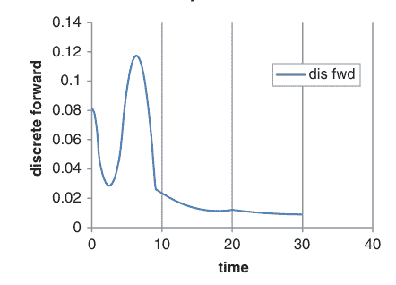

图 27.4 Hyman 插值应用于离散远期利率

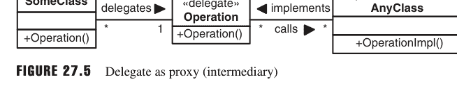

# 图 27.5 委托作为代理（中间件）

## 27.10 使用委托对事件驱动应用程序建模

在本节中，我们介绍 .NET Framework 中的委托。从设计角度来看，委托是代理模式的实现；在这种情况下，委托充当代理的角色，它引用一个目标方法，该方法的签名与代理接口相同。客户端与委托通信，而无需知道（或需要知道）委托“背后”目标方法的细节。可以随时替换一个目标方法。客户端代码直接与委托通信，而不是与任何目标方法通信。显示这些实体之间结构关系的 UML 图如图 27.5 所示。

委托类型是对函数签名的规范，即它具有返回类型、名称和零个或多个输入参数。在此意义上，委托类型代表协议或契约。我们注意到委托类型没有主体。在某种意义上它类似于抽象方法，因为它必须被实例化，以便客户端可以使用它。在原生 C++ 中，委托类似于通用函数包装器 std::function。为此，我们引入委托实例的概念，它是一个具有符合委托类型签名的具体方法体。

我们以 C# 中的第一个示例为例。考虑指定标量变量的标量值函数的委托类型：

```
delegate double ComputableFunction(double x);  // The protocol
```

现在可以将此类型分配给特定的委托实例（称为目标方法），如果这些实例的签名与该类型的签名相同。为了方便起见，我们将一些实例定义为静态方法：

```
class Delegates

    // Some delegate instances
    public static double Square(double x)
    {
        return x * x;
    }

    public static double Cube(double x)
    {
        return x * x * x;
    }
```


```csharp
public static double ModifiedExponential(double x)
{
    return x * Math.Exp(x);
}

//

// end of class
```

客户端随后可以将给定的类型分配给这些实例中的任何一个，例如：

```csharp
// Basic usage of delegates
ComputableFunction fun = Delegates.Square;
double val = 2.0;
Console.WriteLine("Square of {0} is {1}", val, fun(val));

fun = Delegates.Cube;
Console.WriteLine("Cube of {0} is {1}", val, fun(val));

fun = Delegates.ModifiedExponential;
Console.WriteLine("Mod. exponential of {0} is {1}", val, fun(val));
```

我们可以看到客户端代码被屏蔽了具体的实现，因为它使用了变量 `fun`，该变量是一个委托类型，可以被分配给任何 *conforming* 的目标方法。在此情况下，客户端负责委托实例的创建以及将委托类型分配给它们。在更通用的设置中，客户端不会直接创建这些实例，而是将其创建外包给专门的工厂对象（符合 SRP）。总体而言，我们可以说委托类似于 *callback* 和 C *function pointer*。

## 27.10.1 下一代策略（插件）模式

软件设计模式的一个目标是创建可修改以满足新需求的代码。存在许多相应的用例和解决方案，在本节中我们讨论能够自定义方法体这一特定情况。为此，我们通过使用一个与方法签名一致的委托来抽象出方法体。不是对方法进行硬编码（缺乏灵活性），我们使用在 *server* 代码中可以被 *client* 分配给目标方法的委托。但我们在哪里定义委托以及它在服务器中如何使用？有两种选择：

- *State based*: 服务器在构造时嵌入一个委托。
- *Stateless*: *plug-in method* 通过提供委托作为输入参数来调用。

我们以一个生成数字数组的类为例。我们通过对每个元素应用一个函数来转换数组。为了方便起见，我们在一个类中同时考虑基于状态和无状态的解决方案。我们定义：

```csharp
delegate double ComputableFunction(double x);    // The protocol
```

生成数字的 C# 类是：

```csharp
public class ArrayGenerator
{ // Create an array of values based on a customisable mathematical
  // function that is implemented using delegates

  private ComputableFunction func;      // Embedded Strategy algo
                                   // (plugin method)

  public ArrayGenerator(ComputableFunction myFunction)
  {
    func = myFunction;
  }

  // State-based delegate form
  public double[] ComputeArray(double[] array)
  { // Compute new arrays using the plugin method as data member

    double[] result = new double[array.Length];

    for (int j = 0; j < result.Length; j++)
    {
      result[j] = func(array[j]);
    }
    return result;
  }

  // Stateless delegate form
  static public void ComputeArray(ref double[] array,
  ComputableFunction plugin)
  { // Compute new arrays using a plugin method as input argument

    for (int j = 0; j < array.Length; j++)
    {
      array[j] = plugin(array[j]);
    }
  }

  static public void Print(double[] array)
  {
    Console.WriteLine('\n');
    for (int j = 0; j < array.Length; j++)
    {
      Console.Write("{0},", array[j]);
    }
  }
}
```

该类是一个简单的工厂，用于使用基于状态和无状态的委托将输入数组转换为输出数组。为了测试代码，我们以一个对数组元素进行平方运算的示例操作为例。然后我们对变换后数组的元素取平方根。以下代码使用 C# lambda 函数（为了可读性）来定义变换。C# 代码如下：

```
// Basic input array
int M = 2;
double[] array = new double[M]; array[0] = 2.0; array[1] = 2.0;

ComputableFunction SquareRoot = x => Math.Sqrt(x);
ComputableFunction Square = x => x*x;

ArrayGenerator generator = new ArrayGenerator(M, Square);
double[] transformedArray = generator.ComputeArray(array);            // Square elements
ArrayGenerator.Print(transformedArray);                              // 4,4

ArrayGenerator.ComputeArray(ref transformedArray, SquareRoot);      // Square root
ArrayGenerator.Print(transformedArray);                              // 2,2
```

上述代码本质上是使用委托的策略模式。与面向对象的策略模式相比，它更灵活，因为服务器与客户端之间的耦合度降低了（我们不需要指向基类的指针）。重点在于函数签名而不是子类型多态性。此外，与策略模式不同，不需要创建类层次结构。

这种方法的推广是当算法更复杂时。例如，算法可能具有由若干可定制步骤组成的明确结构，每个步骤代表算法的一部分。在这种情况下，我们可以使用无状态和基于状态的委托的组合来实现每个步骤，这对应于 GOF（1995）中讨论的模板方法模式。此示例的 C++/CLI 代码（从相应的 C# 代码中分离出来）如下：

```
// TestStrategy.cpp
//
// Not: Showing the use of Delegates and lambda functions.
// Showing how to achieve the same effect with interfaces.
//
// Ported from C#
//
// (C) Datasim Education BV 2010-2018
//
using namespace System;
using namespace System::Collections::Generic;
using namespace System::Text;
using namespace System::Text::RegularExpressions;

public delegate double ComputableFunction(double x);   // The protocol
```

```cpp
/* interface class ICompute
{
    double ComputableFunction(double x);
};*/

public ref class ArrayGenerator
{
    // Create an array of values based on a customisable mathematical
    // function that is implemented using delegates

private:
    int N;                         // Size of array
    ComputableFunction^ func;

public:
    ArrayGenerator(int size, ComputableFunction^ myFunction)
    {
        N = size;
        func = myFunction;
    }

    List<double>^ ComputeArray()
    {
        List<double>^ result = gcnew List<double>();

        for (int j = 0; j < N; j++)
        {
            result->Add(func(Convert::ToDouble(j)));
        }
        return result;
    }

    void ComputeAndPrint()
    {
        List<double>^ arr = ComputeArray();
        Console::WriteLine('\n');
        for (int j = 0; j < N; j++)
        {
            Console::Write(", {0}", arr[j]);
        }
        Console::WriteLine('\n');
    }
};

public ref class Delegates
{
public:
    static double Square(double x)
    {
        return x * x;
    }
}
```

```cpp
double Cube(double x)
{
    return x * x * x;
}
```

C++/CLI 中的测试程序为：

```cpp
int main()
{
    int N = 4;
    ComputableFunction^ cFun = gcnew ComputableFunction
    (Delegates::Square);

    Delegates^ del = gcnew Delegates();
    ComputableFunction^ cFun2 = gcnew ComputableFunction
    (del, &Delegates::Cube);
    ArrayGenerator^ a1 = gcnew ArrayGenerator(N, cFun);
    ArrayGenerator^ a2 = gcnew ArrayGenerator(N, cFun2);

    a1->ComputeAndPrint();
    a2->ComputeAndPrint();

    return 0;
}
```

## 27.10.2 事件和多播委托

.NET Framework 有一种定义多播事件的模式。在讨论细节之前，我们先概述一下在研究软件系统中模块间通信的基础时出现的一些问题（参见 Shaw and Garlan, 1996）。特别是，我们根据模块间通信是否依赖于共享状态、事件或两者来对系统进行分类。为此，事件是在离散时间发生的传输信息。这种分类为：

- a) Events: 无共享状态；模块间的所有通信都依赖于事件。
- b) Pure state: 通信完全通过共享状态进行；接收者（客户端）必须反复检查或轮询状态变量以检测变化。
- c) State with hints: 通信通过共享状态进行，但接收者通过事件机制被动地通知变化。无需轮询状态。接收者可以选择忽略事件并从共享状态重建所有必要信息。在这种情况下，事件是对接收者的提示。
- d) State and events: 同时使用共享状态和事件。事件至关重要，因为它们提供了通过监控状态无法获得的信息。

标准事件模式是对上述 a)、c) 和 d) 情况的实现。为此，预定义类 System.EventArgs（或 C++/CLI 中的 System::EventArgs）是一个包含与事件相关的信息的基类。System.EventArgs 的子类


将数据作为属性或只读字段公开。我们还需要为事件定义委托。规则如下：

- 委托的返回类型必须是 void。
- 委托必须有两个参数。第一个参数的类型为 object，它表示事件的发送方，而第二个参数包含要传达给接收方的额外信息。
- 委托的名称必须以 EventHandler 结尾。

通常，我们感兴趣的是满足这些规则的通用委托 System.EventHandler<>，其通用参数对应于从发送方传向接收方的数据（或数据子集）的类。显示实体之间关系的 UML 类图如图 27.6 所示。它类似于观察者（发布者-订阅者）模式：


图 27.6 标准事件模式模型

我们举一个例子。在这种情况下，对象值的变化会导致连接的订阅者收到通知。新的 C#（或 C++/CLI）代码与我们实现观察者模式的方式类似。解决方案现已标准化。从发送方传向接收方的数据模型为：

```
// V1: public delegate void ChangeHandler(double oldValue,
// double newValue);
public class ValueChangedEventArgs : EventArgs
{ // The class containing the conveyed data from sender to receiver

    public readonly double oldValue;
    public readonly double newValue;

    public ValueChangedEventArgs(double o, double n)
    {
        oldValue = o;
        newValue = n;
    }
}
```

接下来，扮演广播者角色的类为：

```
public class Subject
{ // The Broadcaster

    private double val;

    public Subject(double myValue) { val = myValue; }

    // V1: public event ChangeHandler ch;
    public event EventHandler<ValueChangedEventArgs> valueChanged;

    protected virtual void OnValueChanged(ValueChangedEventArgs e)
    {
        if (valueChanged != null) valueChanged(this, e);
    }

    public double Value
    {
        get { return val; }
        set
        {
            if (val == value) return;

            double oldValue = val;
            val = value;

            // Update the subscriber
            OnValueChanged(new ValueChangedEventArgs(oldValue, val));
        }
    }
}
```

每次广播者中的数据发生变化时，所有订阅者都会被更新。例如，一个特殊情况是当旧值相对增加超过 10% 时：

```
public static void MyChange(object sender, ValueChangedEventArgs e)
{
    if ((e.newValue - e.oldValue) / e.oldValue > 0.1)
    {
        Console.WriteLine("Alert, more than 10% rise");
    }
    else
    {
        Console.WriteLine("No news, good news");
    }
}
```

最后，一个使用示例为：

```
static void Main()
{
    // Define broadcaster with empty event
    Subject s = new Subject(3.90);

    // Define target method for broadcaster's event
    s.valueChanged += MyChange;

    // Change propagation method
    s.Value = 24.0;
}
```

这个特定示例很有趣，因为它展示了如何在 C# 中应用事件通知模式。代码可以改编为更一般的情况，例如观察者模式以及涉及图形用户界面（GUI）和数据库应用程序的事件。

我们现在以观察者模式的最后一个示例来监控时间的流逝。我们将代码（我们从 C# 移植而来）在 C++/CLI 中实现。为此，我们创建一个带有嵌入式可变时间的时钟类：

```
using namespace System;
using namespace System::Threading;

public ref class TimeChangeEventArgs : EventArgs
{
public:
    DateTime dt;

    TimeChangeEventArgs(DateTime dt)
    { // Constructor
        this->dt = dt;
    }
};

public ref class Clock
{
public:
    // Define event delegate
    delegate void TimeChangeEventHandler(Object^ sender,
    TimeChangeEventArgs^ e);

    // Event variable to store subscribers. Note, it also works
    // without the "event" keyword but with "event".
    event TimeChangeEventHandler^ OnTimeChange;

    void Run()
    {
```

```
for (;; Thread::Sleep(1000)) // Infinite loop, sleeps
{
    // Get the current time
    TimeChangeEventArgs^ args
        = gcnew TimeChangeEventArgs(DateTime::Now);

    // Raise event and call event methods
    // C# and C++/CLI versions
    // if (OnTimeChange != nullptr) OnTimeChange(this, args);
    OnTimeChange(this, args);// Not necessary to check for null
}
};
```

我们现在创建一个订阅者类，具有以不同方式显示时钟信息的功能：

```
public ref class ClockSubscriber
{
public:
    static void DisplayTime1(Object^ sender,
        TimeChangeEventArgs^ args)
    { // TimeChangeEventHandler 1

        Console::WriteLine("DisplayTime 1: {0}", args->dt);
    }

    static void DisplayTime2(Object^ sender, TimeChangeEventArgs^ args)
    { // TimeChangeEventHandler 2

        // Display time with an offset
        int h = 24; int d = 0; int m = 0;
        TimeSpan ts(h, d, m);

        Console::WriteLine("Offset, DisplayTime 2: {0}", args->dt + ts);
    }
};
```

最后，一个测试程序为：

```
int main()
{
    // Create clock instance
    Clock^ clock = gcnew Clock();

    // Subscribe event handlers for Clock.TimeChangeEvent
    clock->OnTimeChange += gcnew
        Clock::TimeChangeEventHandler(ClockSubscriber::
        DisplayTime1);
```

```
clock->OnTimeChange += gcnew
    Clock::TimeChangeEventHandler(ClockSubscriber::
    DisplayTime2);

// Start the clock
clock->Run();

return 0;
}
```

在这个示例中，我们可以看到在事件源（发布者）和事件接收器（订阅者）之间创建一对多关系是多么容易。

## 27.11 使用案例：与遗留代码接口

我们通过讨论如何将 .NET 代码与遗留 C 和 COM（组件对象模型）接口来结束本章。

### 27.11.1 遗留 DLL

在某些情况下，我们可能希望调用 Win32 库函数（例如从 .NET 调用），这些函数在 .NET 中没有等价物或尚未转换为 .NET。为此，我们使用 PInvoke（平台调用服务）使用 DLL 函数。我们使用 DllImport 属性导入函数，并将它们声明为 extern。.NET Framework 处理数据类型转换。一个典型的使用示例为：

```
using namespace System;
using namespace System::Text;
using namespace System::Runtime::InteropServices;

// Import "kernel32.dll" function: BOOL Beep(DWORD dwFreq, DWORD
// dwDuration)
[DllImport("kernel32.dll")] extern bool Beep
    (int frequency, int duration);

int main()
{
    // Play sound
    for (int i=37; i<=5000; i+=20) Beep(i, 10);
    for (int i=5000; i>=37; i-=20) Beep(i, 10);

    return 0;
}
```

在这种情况下，我们创建了一个 CLR 控制台项目。


图 27.7 运行时可调用包装器（RCW）

### 27.11.2 运行时可调用包装器（RCW）

当我们希望使用现有的 ActiveX 控件或使用 Office 产品如 Word 和 Excel 时，可以使用这些包装器。一般设计如图 27.7 所示。我们看到在 .NET 客户端代码和 COM 组件之间有一个 RCW 代理。运行时创建被调用的 COM 对象以及该对象的包装器。此外：

- 运行时为每个进程中的每个对象维护一个 RCW 对象。
- 它在 COM 对象上维护接口指针的缓存。
- 当不再需要时，它释放对 COM 对象的引用。
- 运行时对 RCW 执行垃圾回收。
- RCW 代表被包装对象在托管代码和非托管代码之间封送数据，包括方法参数和返回值，当客户端和服务器之间对数据的表示不同时。

我们给出一个 .NET 客户端创建 Word 文档并在其中放置一些文本的示例：

```
using namespace System;
namespace Word=Microsoft::Office::Interop::Word;

void main()
{
    // Object to pass as missing argument. Not the same as 'null'
    Object^ objMissing=System::Reflection::Missing::Value;

    try
    {
        // Create instance of Word and show it
        Word::Application^ app=gcnew Word::ApplicationClass();
        app->Visible=true;

        // Add document
        Word::Document^ doc=app->Documents->Add
            (objMissing, objMissing, objMissing, objMissing);
```


// Set text of the document
Word::Range^ range=doc->Content;
range->default="Datasim Education BV";
}
catch(System::Runtime::InteropServices::COMException^ ex)
{
    Console::WriteLine("HRESULT: {0}\n{1}",
    ex->ErrorCode, ex->Message);
}

## 27.11.3 COM 可调用包装器 (CCW)

对于某些应用程序，我们可能希望从非 .NET 应用程序中使用 .NET 组件，例如在 .NET 中创建 Office 插件或从 VBA 访问 .NET 代码。为此，运行时会在 .NET 类周围自动创建一个 COM 代理类。设计如图 27.8 所示。该设计的某些显著特征是：

- 运行时为托管对象创建恰好一个 CCW，而不论有多少个 COM 客户端请求其服务。
- 多个 COM 客户端持有对暴露接口的 CCW 的引用。
- CCW 持有实现接口的单个引用。它会被垃圾回收。
- CCW 对在 .NET Framework 中运行的其他类不可见。
- CCW 在托管代码和非托管代码之间封送调用。它们还管理它们包装的托管对象的对象标识和对象生命周期。

有关本节主题的更多详细信息，请参阅 Bovey et al. (2009)。


FIGURE 27.8 COM Callable Wrapper (CCW)

## 27.12 C++/CLI 的程序集和命名空间

在原生 C++ 中开发应用程序时，我们必须决定如何将代码分发给客户端。有几种选择。首先，供应商可以将代码作为仅包含头文件的集合交付（如 *Boost* 中的大多数库，例如）或作为源文件和（静态）库文件的组合（如 *QuantLib* 例如）。我们已经在第 8 章讨论了如何创建静态库。

我们现在通过部署程序集在 .NET 中创建应用程序。*程序集* 是 .NET 中的基本 *部署单元*。它包含编译后的类型、*中间语言* (IL) 代码、运行时资源以及与版本控制、安全性和引用其他程序集相关的信息。在文件级别，应用程序是一个具有 .exe 扩展名的程序集，而可重用的库是一个具有 .dll 扩展名的程序集。

程序集包含以下实体：

- *程序集清单*：这是程序集内容的描述，例如构成程序集的类型、资源和文件列表、该程序集引用的程序集列表以及运行程序集中代码所需的权限。它还包含程序集的名称、其版本和 *culture*（culture 代表特定的人类语言；.NET 支持 RFC 1766 标准，该标准将 culture 和子文化表示为双字母代码。例如，英语和德语 culture 的代码分别为 en 和 de，而澳大利亚英语和奥地利德语的代码分别为 en-AU 和 de-AT，分别）。
- *应用程序清单*：它为操作系统提供有关程序集应如何部署的信息。应用程序清单是一个 XML 文件，向操作系统传达有关程序集的信息。
- *编译代码*：程序集中类型和方法的 IL 代码和元数据。元数据的存在意味着程序集是 *自描述的*。
- *资源*：附加数据和非可执行代码，例如字符串、位图和可本地化文本。

### 27.12.1 程序集类型

程序集与传统的 DLL 类似，因为两者都是部署单元。但与 DLL 不同，程序集不需要定义 *Windows 注册表* 设置。此外，程序集支持版本控制而 DLL 不支持，并且可以安装多个程序集版本。

两种主要的程序集类型称为 *私有* 和 *共享程序集*。*私有程序集* 是只能由单个应用程序使用的程序集。相应的 .dll 文件存储在应用程序目录中。要创建程序集 DLL，我们在 Visual Studio 中创建一个 *类库* 项目，将相关类添加到项目中，然后编译和构建项目。完成此操作后，我们通过将其作为 *引用* 添加到 Windows 或控制台应用程序项目中使用此程序集 DLL。我们注意到程序集 DLL 必须位于主 .exe 文件所在的目录中或其子目录中。私有程序集的典型示例是包含日期、计日约定和日历类的程序集。它可用于许多固定收益应用程序。

从软件设计角度来看，我们可以将软件系统设计为一组松散耦合的子系统。我们将每个子系统打包为单独的程序集，每个程序集都可以独立于其他程序集进行设计和测试。完成此操作后，我们可以将这些程序集部署为各种应用程序中的可重用组件，并且可以单独进行版本控制。最后，程序集可以在运行时加载，这提高了性能和互操作性。

共享程序集是可以被许多应用程序使用的程序集。它必须存储在称为全局程序集缓存 (GAC) 的特殊目录中，GAC 是集中版本化程序集的中央存储库。作为开发人员，可以创建共享程序集并将其放置在 GAC 中，但本主题的讨论超出了本书的范围。然而，我们确实需要了解 GAC 的结构以及程序集版本控制和安全性的实现。为此，我们对唯一标识 GAC 中程序集的强名称进行简要介绍。

强名称由以下组件生成：

- 程序集“简单”名称（这是一个字符串）。
- 版本号（形式为 a.b.c.d 包含数值）。
- culture。
- 程序集的公钥。

每个程序集都有形式为 a.b.c.d 的版本号，其中 a 代表主要版本，b 代表次要版本，c 是构建号，d 是修订号。默认值是 0.0.0.0。GAC 可以包含共享程序集的多个版本，并且可以同时实例化不同的程序集版本。客户端决定使用哪个版本。

我们可以通过检查目录 C:\Windows\assembly 的内容来查看 GAC 的内容。在创建 Visual Studio 项目时，可以使用添加引用选项从 GAC 添加程序集。我们可以在 .NET 和 .COM 组件之间进行选择。例如，我们使用 GAC 将 Excel 互操作包含到应用程序中，从而允许我们访问 Excel 对象模型。

### 27.12.2 在 AssemblyInfo.cs 中指定程序集属性

可以通过设置名为 AssemblyInfo.cs（或 AssemblyInfo.cpp）的文件中的属性值在很大程度上控制程序集的内容，该文件在每个新的 C# 或 C++/CLI 项目中自动创建。它包含默认值，您可以更改以满足您的需求。

一些相关属性是：

- AssemblyTitle：程序集的友好名称。
- AssemblyDescription：程序集的描述。
- AssemblyConfiguration：指定程序集是用于调试还是发布模式。
- AssemblyCompany：指定程序集的创建者。
- AssemblyProduct：指定产品的名称。
- AssemblyCopyright：版权信息字符串。
- AssemblyTrademark：指定商标信息。
- AssemblyCulture：此属性指定支持的语言；如果程序集是语言中立的，我们将其留空。

程序集文件的示例是：

```
using System.Reflection;
using System.Runtime.CompilerServices;
using System.Runtime.InteropServices;

// General Information about an assembly is controlled through the
// following set of attributes. Change these attribute values to modify
// the information associated with an assembly.
[assembly: AssemblyTitle("LoadDateLibrary")]
[assembly: AssemblyDescription("Dates and Day Counts")]
[assembly: AssemblyConfiguration("release")]
[assembly: AssemblyCompany("Datasim Education BV")]
[assembly: AssemblyProduct("Germani and Duffy")]
[assembly: AssemblyCopyright("Copyright © Datasim Education BV 2010")]
[assembly: AssemblyTrademark("TM Duffy Germani")]
[assembly: AssemblyCulture("")]

// Setting ComVisible to false makes the types in this assembly not
// visible to COM components. If you need to access a type in this
// assembly from COM, set the ComVisible attribute to true on that type.
[assembly: ComVisible(false)]

// The following GUID is for the ID of the typelib if this
// project is exposed to COM
[assembly: Guid("ec444bce-76db-4935-9017-78f5aed1e693")]

[assembly: AssemblyVersion("2.0.0.0")]
[assembly: AssemblyFileVersion("2.0.0.0")]
```

### 27.12.3 一个示例：从程序集中动态加载算法

我们在第 8.9 节中看到了如何创建 C++ 静态库。它们解决了必须向客户端提供源代码的问题。此解决方案不够灵活，因为静态库往往是庞大的单体野兽，并且不能在运行时被其他库替换。另一方面，.NET Framework 支持可配置的程序集。为了展示程序集使用的有效性，我们从 CAD（计算机辅助设计）中取一个模型示例，在其中创建几何对象。特别是，我们创建灵活的算法（策略设计模式）来计算两点之间的距离。

UML 类图如图 27.9 所示，最初在 Duffy 和 Germani (2013) 中讨论，并在 C# 中编程。我们所做的是重用该书中的 C# 代码，该代码实现了距离算法，并通过封装它们来测试它们


## FIGURE 27.9 Dynamic assembly loading

assembly and then referencing the assembly in a CLR Console project containing C++/CLI code. For completeness, the C# code for the algorithms is:

```
public interface ICalculateDistance
{
    // Calculate the distance. We can't pass a point because then we
    // need to know about point but the point must know about this
    // interface. Then we get circular dependencies.
    double Distance(double x1, double y1, double x2, double y2);
}

public class PythagorasDistanceCalculation: ICalculateDistance
{
    public double Distance(double x1, double y1,
            double x2, double y2)
    {
        double dx=x1-x2;
        double dy=y1-y2;

        return Math.Sqrt(dx*dx+dy*dy);
    }
}

public class TaxiDriverDistanceCalculation: ICalculateDistance
{
    public double Distance(double x1, double y1,
            double x2, double y2)
    {
        double dx=x1-x2;
        double dy=y1-y2;

        return Math.Abs(dx) + Math.Abs(dy);
    }
}
```

We also implement a C# class implementing two-dimensional points containing an embedded global distance algorithm:

```
public class Point
{
    // The distance algorithm to use
    private static ICalculateDistance s_distanceAlgorithm;
    // Access the distance calculation algorithm
    public static ICalculateDistance DistanceAlgorithm
    {
        get { return s_distanceAlgorithm; }
        set { s_distanceAlgorithm=value; }
    }

    // Data members.
    private double m_x;
    private double m_y;

    // Default constructor
    public Point()
    {
        m_x=0.0;
        m_y=0.0;
    }

    // Constructor.
    public Point(double x, double y)
    {
        m_x=x;
        m_y=y;
    }

    // X property.
    public double X
    {
        get { return m_x; }
        set { m_x=value; }
    }

    public double Y
    {
        get { return m_y; }
        set { m_y=value; }
    }

    // Calculate distance between two points
    public double Distance(Point p)
    {
```

```
// Is there an algorithm installed
if (s_distanceAlgorithm==null) throw new
ApplicationException
    ("No distance calc algorithm installed.");

// Calculate the distance using the installed algorithm
return s_distanceAlgorithm.Distance
    (m_x, m_y, p.m_x, p.m_y);
}

// String conversion.
public override string ToString()
{
    return String.Format("Point({0}, {1})", m_x, m_y);
}
}
```

Finally, the client code is C++/CLI and it uses the above C# code for Point and algorithms:

```
using namespace System;

int main()
{
    try
    {
        // Load the algorithm, later
        //Point.DistanceAlgorithm=LoadDistanceAlgorithm(args[0]);

        Point::DistanceAlgorithm =
            gcnew PythagorasDistanceCalculation();
        // Point::DistanceAlgorithm =
        //     gcnew TaxiDriverDistanceCalculation();

        Point^ p1=gcnew Point(0.0, 0.0);
        Point^ p2=gcnew Point(1.0, 1.0);

        Console::WriteLine("p1.Distance(p2): {0}",
            p1->Distance(p2));
    }
    catch (Exception^ e)
    {
        Console::WriteLine("Error: {0}", e->Message);
    }
}
```

The choice of algorithm is hard-coded in the above example. It could be made more flexible by allowing the user to make a choice as to which specific algorithm to use. Unfortunately, if we wish to use another algorithm we will need to modify the source code and build a new executable file. A more flexible and elegant solution is to employ the .NET Reflection to open

an assembly in an application and then extract the algorithm from it by instantiating the class that implements `ICalculateDistance`. In particular, we use the following functions:

- `LoadFrom` and `LoadFile` methods: load an assembly from a file.
- `Activator` class: has a method called `CreateInstance` that accepts a type and optional parameters that get passed to a constructor.

An example to instantiate a distance algorithm is:

```
```csharp
// Load distance algorithm
private static ICalculateDistance LoadDistanceAlgorithm
                                      (string assemblyFile)
{
    // Load the specified assembly
    Assembly ass=Assembly.LoadFrom(assemblyFile);

    // Get all the types from the assembly and
    // find the class that implements our interface
    foreach (Type t in ass.GetExportedTypes())
    {
        if (t.IsClass)
        {
            foreach (Type i in t.GetInterfaces())
            {
                // Class found so create instance
                if (i==typeof(ICalculateDistance))
                    return (ICalculateDistance)Activator.CreateInstance(t);
            }
        }
    }

    // Not found, in version 2 use exception handling
    return null;
}
```
```

We can use this function in the main method as follows:

```
```csharp
Point.DistanceAlgorithm=LoadDistanceAlgorithm(args[0]);
```
```

This simple example is a prototype for larger and more complex applications. We are unable to elaborate on this topic but see Exercise 4 for a discussion of some interesting use cases.

## 27.13 SUMMARY AND CONCLUSIONS

In this chapter we introduced the C++/CLI and C# languages in the .NET Framework and we showed how it is possible to enhance the functionality of native C++ by the ability to create multi-language applications. Some important use cases were:

- Using C++/CLI as language of choice (instead of C#).
- Creating wrappers for C++ classes (for example, Boost, Quantlib, C++11 libraries) and using them in C# and C++/CLI applications.
- Creating wrappers for C# and C++/CLI code and then using this code in native C++ applications.

The main advantages are interoperability, reusability and maintainability.

## 27.14 EXERCISES AND PROJECTS

1. (Using Façade Design Pattern)

The Façade design pattern is often used when a system is very complex or difficult to understand because the system has a large number of interdependent classes. This pattern hides the complexities of the larger system and provides a simpler interface to the client. It typically involves a single wrapper class that contains a set of members required by the client. These members access the system on behalf of the Façade client and hide the implementation details.

Answer the following questions:

- a) In Section 27.8 we enumerated the use cases whose presence in an application might persuade us to apply the Façade pattern. Which ones are most important in the general context of C++, C# and C++/CLI interoperability? For example, which features in the languages help in the construction of this pattern?
- b) We now consider the use cases S1, S2, S3 and S4 in Section 27.8 when we wish to create user-friendly wrappers for the financial models in Quantlib for C# developers who do not necessarily have C++ knowledge. Which of the scenarios S1, S2, S3 and S4 are important in this case?
- c) Now consider a (native) C++ developer who wishes to access .NET functionality. Which of the scenarios S1, S2, S3 and S4 are important in this case?
- d) In GOF (1995) some of the consequences of using this pattern are:
  - It shields clients from subsystem components.
  - It promotes weak coupling between the subsystems and clients, especially for subsystems with tightly coupled components, for example poorly designed object-oriented code.
  - The pattern does not prevent clients from using the subsystem classes directly if they wish to do so. Thus, clients can choose between ease of use and generality. New users can use the simpler interface before moving to the internals.

Given these features, how would you integrate Façade into the design philosophy that we introduced in Chapter 9?

e) What are the advantages of defining standardised interfaces between a client and a façade? How can the Bridge pattern be applied in order to create interchangeable façades?

2. (Database Coupling and Integration, Brainstorming)

C++ is primarily a systems language and there is no native support for persistence. In general, objects do not survive the life of the program in which they are created (these are called transient objects). A persistent object store is a type of computer storage system that records and retrieves complete objects, or provides the illusion of doing so. Simple


在上下文图中系统之间。在后面的设计阶段，我们可能会看到在详细类级别使用这些设计模式的机会。

4.（通过组合程序集构建应用程序，头脑风暴）

在 .NET 中，可以通过从预编译的自感知二进制程序集构建来组合应用程序，如第 27.12 节所述。原则上，该功能使我们能够定义新一代的软件设计模式，并为我们在第 9 章中介绍的设计蓝图提供扩展的机会。

本练习的目标是提出一系列问题，以触发关于如何将程序集集成到第 9 章的设计哲学中以及如何扩展传统的软件设计模式（GOF，1995）以纳入反射（Albahari 和 Albahari，2015）的讨论。我们关注创建型设计模式。为了缩小范围，我们提出关于第 9 章图 9.4 中的规范上下文图的问题。目标是通过引用程序集来配置应用程序，每个程序集都实现为 dll。

回答以下问题：

+   a) 确定对第 9 章中的设计蓝图进行修改和扩展以支持程序集。定义一种策略以确保应用程序中各个程序集之间没有函数或类名称冲突。考虑使用命名空间以及它们与程序集之间的多对多关系。

+   b) 通过实现第 9.3.4 节中的‘101’应用程序（输入、处理、输出和 SUD 组件）来测试 a) 部分的答案。为输入、处理和输出分别创建程序集。编写代码以允许在运行时加载程序集。

+   c) 调整生成器模式（以及其他创建型模式）以适应程序集。特别是，我们希望从嵌入在应用程序中的代码创建对象，同时能够从程序集中加载代码并使用 Activator.CreateInstance 创建对象。客户端不应（也不必）知道哪个软件组件负责实例化。

+   d) 研究将程序集与策略、命令和访问者模式集成的影响。特别是，我们不希望将源代码嵌入到可执行文件中，而是根据需要从外部程序集中加载功能。例如，传统命令模式的一个主要问题是应用程序需要许多（有时数百个）命令类和实例。代码必须链接到应用程序中。我们通过使用程序集来避免这个问题。这种方法减少了可执行文件的占用空间。

总体而言，练习的答案在一定程度上实现了 Leavens 和 Sitarman（2000）中讨论的软件架构。

## C++ 并发，第 I 部分 线程

### 28.1 引言和目标

在本章中，我们首先关注它如何支持多线程，即创建由多个独立控制线程执行的程序，通过首先关注它如何支持多线程来介绍 *C++ 并发* 库。本章的主要目标是展示库如何支持多线程，通过介绍库中的每个语法特性，创建示例，然后使用这些特性编写简单而完整的多线程程序。我们还给出了基于前面章节中已讨论的一些数值方法和期权定价模型的计算金融的初始示例和练习。

本章对以下读者群体有用：

+   - 几乎没有或没有编写多线程程序经验的开发人员。本章的结构使得代码示例可以运行和扩展，以便对库有实践经验。
+   - 具有专有或开源多线程库经验的开发人员，他们希望将这些库的功能与 *C++ 并发* 提供的功能进行比较。
+   - 已经使用 *C++ 并发* 的 C++ 开发人员。然后本章可以作为功能紧凑的总结，示例和练习 hopefully 提供对我们在本书前面章节中讨论的许多数值算法的简单多线程代码的见解。

在第 29 章中，我们讨论如何使用任务编写并行程序。*任务* 是与其它任务一起工作以执行更大操作顺序操作（参见 Campbell 和 Miller，2011 关于 Visual C++ 中并行编程的优秀讨论）。我们将问题分解为可以分配给任务的粗粒度组件。使用任务使我们摆脱了如果我们决定使用线程将面临的许多低级细节。

在第 30 章中，我们介绍 Microsoft *Parallel Patterns Library*（PPL），它在 C++ 中实现了许多 *并行设计模式*（参见 Campbell 和 Miller，2011；Mattson，Sanders 和 Massingill，2006）。

本章中的许多示例包含最初使用 *Boost Thread* 库（Demming 和 Duffy，2010）编写的代码。在大多数情况下，我们只需将命名空间 boost 替换为命名空间 std 即可重新编译和运行代码。

确定系统上有多少个处理器有用的 C++ 语法是：

```
// Display the number of processors/cores
std::cout<<std::thread::hardware_concurrency();
```

*线程通知* 的讨论超出了本章的范围。

### 28.2 线程基础

在 C++ 中，创建和运行线程的方法是实例化类 std::thread。它有多个构造函数：

+   - 默认构造函数（不是线程）。
+   - 移动构造函数。
+   - 使用 *可调用对象* 作为输入参数创建线程。
+   - （拷贝构造函数不受支持。）

我们使用两个存储的 lambda 函数作为 *线程函数* 来创建线程（我们将在第 28.3 节中给出更多可调用对象的示例）。第一个函数没有输入参数，而第二个函数有两个输入参数。代码是：

```
int main()
{
    // Create a thread + thread function
    auto f = []() { std::cout << "Hello world\n"; };
    std::thread t(f);
    // Wait for thread to finish (mandatory)
    t.join();

    // Thread function having input arguments
    auto f2 = [](int n, std::string& s)
        { std::cout << n << " Hello world " << s; };
    std::thread t2(f2, 42, std::string("and beyond\n"));
    // Wait for thread to finish (mandatory)
    t2.join();
}
```

在这种情况下，主线程创建（*fork*）两个线程，它们立即开始执行。主线程通过在每个线程上调用 join() 等待其他线程完成。

可以查询线程的一些属性，例如它是否仍在运行、线程的 ID、获取 POSIX 兼容的线程句柄以及查询实现支持的并发线程数：

```
void ThreadStatus(std::thread& t)
{
    std::cout << "Still running?"<<std::boolalpha
              << t.joinable() << '\n';
    std::cout << "Thread ID:  " << t.get_id() << '\n';
```

```
// POSIX thread implementation
std::cout << "Native handle:  " << t.native_handle() << '\n';
std::cout << "Number of processors:  "
    << t.hardware_concurrency() << '\n';
}
```

我们继续另一个与计算金融更密切相关的示例。在这种情况下，我们查看 STL 算法，我们已在第 17 章和第 18 章中详细讨论，特别是数值算法，尽管同样的原则可以应用于其他算法类别。我们以计算只读向量的元素之和和乘积为例。在这种情况下没有数据竞争（我们在第 28.7 节中介绍数据竞争的主题）。为此，我们定义了两个封装数据和 STL 算法的 lambda 函数。这些函数然后用作线程的输入参数：

```
void STLInThreads(std::size_t n)
{ // Run two algorithms in parallel

    std::vector<double> v(n);
    std::iota(std::begin(v), std::end(v), 1);

    // Sum and product of elements of vector
    // Define lambda functions
    auto sum = [&]()
    { // For vector of length n -> n(n+1)/2

        double initVal = 0.0;  // Must be initialised to a value
        // Add initVal to all elements
        double acc = std::accumulate(v.begin(), v.end(), initVal);
        std::cout << "Sum:  " << acc << std::endl;
    };

    auto product = [&]()
    {
        double initVal = 1.0;
        double acc = std::accumulate(v.begin(), v.end(), initVal,
            std::multiplies<double>());
        std::cout << "Product:  " << acc << std::endl;
    };

    std::thread t1(sum); std::thread t2(product);
    t1.join(); t2.join();
}
```

这段代码只是提高顺序计算加速的一种方法。对于小型数组，以上并行代码甚至可能比相应的顺序代码更慢，对于大型数组，使用 OpenMP 中的归约变量可能更有效（或使用 PPL 中的循环并行，如我们在第 30 章中将看到的）。


## 28.2.1 进入 OpenMP 世界的一个小插曲

我们使用与上面类似的 OpenMP 代码来计算向量元素的和与积。事实上，学习一些 OpenMP 是深入了解多线程的好方法。编写代码并观察其行为很容易。我们首先展示如何查询硬件环境并设置要使用的线程数：

// Maximum # of threads in current team, here == 1 , master thread
std::cout << "Maximum number of threads: " << omp_get_max_threads();
std::cout << "Number of available processors: " << omp_get_num_procs();

// Set the number of threads to use
omp_set_num_threads(4);      // Number of threads = 4
```

我们现在给出计算和与积的三种解决方案：

- 使用 *共享变量* 结合 *临界区*（确保只有一个线程可以更新它们）。这是一种非常低效的解决方案。
- 使用 *归约变量*。这是一种高效的解决方案。
- 一种没有对变量加锁的多线程解决方案。这是一种高效的解决方案，但它会给出错误的结果，因为发生了数据竞争。

这三种情况对应的代码是：

// Using reduction-like variables
double sum = 0.0;
double product = 1.0;

long long N = 4;
std::vector<double>v(N, 0.0);
for (std::size_t j = 0; j < v.size(); ++j)
    { v[j] = 1.0 / static_cast<double>(j + 1); }

#pragma omp parallel for shared(N,v, sum, product)
for (long long j = 0; j < v.size(); ++j)
{
    #pragma omp critical
    { // Slow but thread-safe
        sum +=v[j];
        product *=v[j];
    }
}

std::cout << "Reduction, I: " << sum << ", " << product << '\n';

sum = 0.0;
product = 1.0;
#pragma omp parallel for reduction(+: sum), reduction(*: product)
for (long long j = 0; j < v.size(); ++j)
{
    sum +=v[j];
    product *=v[j];
}

std::cout << "Reduction, II: " << sum << ", " << product << '\n';

// Non thread-safe
{
    double sum = 0.0;
    double product = 1.0;
    #pragma omp parallel for //reduction(+: sum), reduction(*: product)
    for (long long j = 0; j < v.size(); ++j)
    {
        sum += v[j];
        product *= v[j];
    }
    std::cout << "Reduction, III: " << sum << ", " << product;
}
```

C++11 不支持归约变量。遗憾的是，本书的范围不包括对 OpenMP 的进一步讨论。

## 28.3 创建线程的六种方法

在介绍了 std::thread 并给出一些使用简单线程函数（存储的 lambda 函数）编写多线程代码的示例之后，我们现在讨论容纳各种可调用对象的其他方法，其中一些在本书的第 2 章和第 3 章中已介绍过：

- 1. 使用全局/自由函数的线程。
- 2. 使用静态函数的线程。
- 3. 使用可调用类型的线程。
- 4. 使用成员函数（无参数）的线程。
- 5. 使用成员函数（带参数）的线程。
- 6. 使用 lambda 函数的线程。

我们采用通用示例来展示代码的工作原理。然后就可以将代码扩展和推广到更广泛的示例和计算金融中的应用。为此，我们创建一个函数，根据选择返回 std::thread 的实例：

// Function to create a thread with different styles of functions
std::thread CreateThread(int i)
{
    // Create a thread using the requested function
    switch (i)
{
    default:
    case 1:
    {
        // Create thread with a function pointer to a
        // global function (& can be left out)
        return std::thread(&GlobalFunction);
    }

    case 2:
    {
        // Create thread with a function pointer to a
        // static function (& can be left out)
        return std::thread(&CallableClass::StaticFunction);
    }

    case 3:
    {
        // Ask the number of iterations
        std::cout<<"Number of iterations: ";
        int iterations;
        std::cin>>iterations;

        // Create thread with a callable class (has operator() )
        // CallableClass object is copied to the thread so its
        // lifetime is the same as that of the thread
        CallableClass c(iterations);
        return std::thread(c);
    }

    case 4:
    {
        // Ask the number of iterations
        std::cout << "Number of iterations: ";
        int iterations;
        std::cin >> iterations;

        // Create thread with a callable class (has operator() )
        // CallableClass object is copied to the thread so
        // its lifetime is the same as that of the thread
        CallableClass c(iterations);
        return std::thread(&CallableClass::Algorithm, &c);
    }
    case 5:
    {
        // Ask the number of iterations
        std::cout << "Number of iterations: ";
        int iterations;
        std::cin >> iterations;

CallableClass c(iterations);
return std::thread(&CallableClass::AlgorithmII, &c, 20);
}
case 6:
{
    // Create thread with a lambda function
    return std::thread([]()
    { std::cout << "lambda called\n"; });
}
}
}
```

自由（全局）函数的代码为：

// Global function called by thread
void GlobalFunction()
{
    for (int i=0; i<10; i++)
    {
        std::cout<< i
                 <<" - Do something in parallel of main "<<'\n';
        std::this_thread::yield();
    }
}
```

此代码中使用的类 CallableClass 具有以下接口和主体：

// Class that is a callable type (has operator() )
class CallableClass
{
private:
    // Number of iterations
    int m_iterations;

public:
    // Default constructor
    CallableClass()
    {
        m_iterations=10;
    }

    // Constructor with number of iterations
    CallableClass(int iterations)
    {
        m_iterations=iterations;
    }

    // Copy constructor
    CallableClass(const CallableClass& source)
{
    m_iterations=source.m_iterations;
}

// Destructor
~CallableClass()
{
}

// Assignment operator
CallableClass& operator = (const CallableClass& source)
{
    m_iterations=source.m_iterations;
    return *this;
}

// Static function called by thread
static void StaticFunction()
{
    for (int i=0; i<10; i++)
    {
        std::cout<<i<<
            " - Do something in parallel static"<<'\n';
        std::this_thread::yield();
    }
}

// Operator() called by the thread
void operator () ()
{
    for (int i=0; i<m_iterations; i++)
    {
        std::cout<<i<<"Do with main method ()"<<'\n';
        std::this_thread::yield();
    }
}

void Algorithm ()
{
    for (int i = 0; i<m_iterations; i++)
    {
        std::cout << i << " - Cooperative processing";
        std::this_thread::yield();
    }
}

void AlgorithmII(int count)
{
    for (int i = 0; i<count; i++)
    {
        std::cout << i << "Algorithm with parameter, value " << count;
        std::this_thread::yield();
    }
}
};
```

一个简单的测试程序是：

// Entry point of the program.
int main()
{
    // Display the number of processors/cores
    std::cout<<std::thread::hardware_concurrency()
        <<" processors/cores detected."<<'\n'<<'\n';

    int choice;

    // Do till exit
    do
    {
        // Display menu
        std::cout<<"1. Thread with global/free function"<<'\n';
        std::cout<<"2. Thread with static functions"<<'\n';
        std::cout<<"3. Thread with callable type"<<'\n';
        std::cout <<"4.Thread with member func(no args)"<< '\n';
        std::cout << "5. Thread with member func(+ arg)" << '\n';
        std::cout << "6. Thread with lambda function" << '\n';
        std::cout<<"0. Exit"<<'\n';
        std::cout<<"Your choice: ";

        // Read input
        std::cin>>choice;

        if (choice>0 && choice<7)
        {
            // Create and start thread
            std::thread t(CreateThread(choice));

            // Do something
            for (int i=0; i<10; i++)
            {
                std::cout<<i<<" - Do something in main."<<'\n';
                std::this_thread::yield();
            }

            // Wait till thread is finished
            t.join();
        }

        // Empty line
        std::cout<<'\n';


```cpp
}
while (choice!=0);    // Exit if 0 was chosen

return 0;
}
```

类 `CallableClass` 的附加价值在于它可以作为你创建的、将在多线程模式下运行的更复杂代码的 *exemplar*。它可以作为精确语法细节的提醒和复习。

### 28.3.1 分离线程

从上面的示例我们看到，调用线程必须通过调用 `join()` 成员函数来等待其子线程。然而，也有一个选项，即子线程可以从调用线程中分离。它将执行线程与线程对象分离，允许执行独立于父线程继续进行。一旦线程退出，任何分配的资源将被释放。使用示例为：

```cpp
// Detached thread; independent execution
std::size_t n = 100;
std::vector<double> v(n);
std::iota(std::begin(v), std::end(v), 1);

{
    auto EvenOdd = [&]()
    {
        auto Even = [&](int n) { return n % 2 == 0; };
        auto Odd = [&](int n) { return !Even(n); };
        std::cout << "Number of even values: "
                  << std::count_if(std::begin(v), std::end(v), Even);
        std::cout << "Number of odd values: "
                  << std::count_if(std::begin(v), std::end(v), Odd);
    };
    std::thread t3(EvenOdd); t3.detach();

    // Put a break in order to view output
    std::cout << "Press a key ...";
    int t; std::cin >> t;
}
```

从某种意义上说，我们对分离的线程采用‘发射即忘’的方式。调用线程不必等待分离的线程。用法类似于在对象上执行命令。

### 28.3.2 线程的协作式任务

多线程在 *pre-emptive* 意义上是抢占式的，即调度程序为每个线程分配固定量的时间（一个 *quantum*），在此之后线程会转入 *sleep* 或 *wait-to-join* 模式。例如，一个线程可以睡眠一段时间，例如随机时间：

```cpp
// Wait a while
std::default_random_engine dre(42);
std::uniform_int_distribution<int> delay(0, 1000);
int duration = delay(dre);
std::this_thread::sleep_for(std::chrono::milliseconds(duration));
```

此功能在某些应用程序中很有用，其中一个操作（例如备份或检查资源可用性）由线程不时执行，然后返回睡眠状态，从而释放资源。另一种情况是当一个线程给其他线程运行的机会时。换句话说，线程放弃对 CPU 的控制。代码片段为：

```cpp
std::this_thread::yield();  // Allow other threads to run
```

此功能在可能很长且计算密集的操作暂时挂起以给其他线程运行机会的应用程序中很有用。这提高了使用多线程的程序的整体响应能力，例如计算数字或矩阵的幂，如以下代码片段所示：

```cpp
// Calculate m^n. Supposes n>=0.
void operator () ()
{
    result=m;                    // Start with m^1
    for (int i=1; i<n; i++)
    {
        result*=m;               // result=result*m
        std::this_thread::yield();  // Allow other threads to run
    }
    if (n==0) result=1;          // m^0 is always 1
}
```

完整的上下文和代码可在作者提供的源代码中找到。

总结：我们使用 `yield()` 来给其他线程运行的机会或尽快重新获得处理器，而我们使用 `sleep()` 来给其他线程运行的机会，当我们不需要处理器一段时间或按固定间隔执行某些工作时。

## 28.4 INTERMEZZO: PARALLELISING THE BINOMIAL METHOD

在介绍了 C++ 中的线程后，我们现在讨论如何使用它们来提高计算密集型应用程序的加速比。为此，我们讨论如何并行化二项式方法（参见第 11 章和第 12 章），在第 11.7 节讨论的特定情况下，我们使用二项式方法对四个期权（看涨和看跌，欧式和美式变体）进行定价。我们创建一个保存标的物（股票）数据的单一格子和一个保存期权数据的格子，每个期权类型一个格子。因此，就本次测试而言，我们将在内存中拥有五个格子。我们目前不关心创建通用框架，也不关心最节省内存的解决方案，但我们希望展示如何使用线程来提高程序加速比。我们讨论以下解决方案，并可以比较它们的运行时间性能和准确性。

我们现在描述所提出解决方案的步骤和代码。我们首先定义期权相关数据和时间步数（我们取 N = 7000 用于压力测试）：

```cpp
// Option data
OptionData opt;

opt.K = 65.0;
opt.T = 0.25;
opt.r = 0.08;
opt.q = 0.0;
opt.sig = 0.3;

int N = 7000;
double dt = opt.T / static_cast<double>(N);
std::cout << "Stress test, number of time steps: " << N << '\n';
```

接下来我们使用选择二项式参数的流行方法之一构建标的物股票价格格子（如第 11 章练习 7 中讨论的，以及 Haug, 2007 和 Clewlow and Strickland, 1998 中所述），例如：Cox–Rubinstein–Ross、Tian、Leisen–Reimer、Rendleman Bartter、Jarrow–Rudd 和 Trigeorgis：

```cpp
// Choice of lattice parameters
// LatticeMechanisms::CRRLatticeAlgorithms algo(opt, dt);
LatticeMechanisms::TianLatticeAlgorithms algo(opt, dt);
// LatticeMechanisms::JRLatticeAlgorithms algorithm(opt, dt);
// LatticeMechanisms::ChangPalmerLatticeAlgorithms
// algorithm(opt,dt,rootVal,100);
// LatticeMechanisms::RandomWalkLatticeAlgorithms algorithm(opt, dt);

// Create basic asset lattice
Lattice<double,2> asset(N, 0.0); // init
double rootVal = 60.0;      // S(0)
LatticeMechanisms::ForwardInduction<double>(asset, algo, rootVal);
```

我们支持看跌和看涨期权（参见练习 9 中其他类型的收益）：

```cpp
// Kinds of payoff as lambda functions
double K = opt.K;
auto PutPayoff = [&K] (double S)-> double
    {return std::max<double>(K - S, 0.0);};
auto CallPayoff = [&K] (double S)-> double
    {return std::max<double>(S - K, 0.0);};

// American early exercise constraint
auto AmericanPutAdjuster = [&PutPayoff] (double& V, double S)->void
{ // e.g. early exercise

    V = std::max<double>(V, PutPayoff(S));
};

auto AmericanCallAdjuster = [&CallPayoff] (double& V, double S)->void
{ // e.g. early exercise

    V = std::max<double>(V, CallPayoff(S));
};

auto EmptyAdjuster = [] (double& V, double S)->void
{ // No action executed at a node

    // Do nothing, no code generated in client code
};
```

我们注意到存在方便的 lambda 函数，它们被应用于接受通用函数作为参数的向后归纳算法的格子节点。这种方法导致代码非常灵活。

我们现在创建四个期权格子并按顺序对相应的期权进行定价：

```cpp
// Create various 'derivative lattices' and compute the option prices
// This is a kind of demultiplexing: one signal/source 'fanned' out to
// multiple option pricers.
StopWatch<> sw;
sw.Start();

Lattice<double,2> euroPut(N, 0.0);
LatticeMechanisms::ForwardInduction<double>(euroPut, algo, rootVal);
Lattice<double,2> euroCall(N, 0.0);
LatticeMechanisms::ForwardInduction<double>(euroCall, algo, rootVal);
Lattice<double,2> earlyPut(N, 0.0);
LatticeMechanisms::ForwardInduction<double>(earlyPut, algo, rootVal);
Lattice<double,2> earlyCall(N, 0.0);
LatticeMechanisms::ForwardInduction<double>(earlyCall, algo, rootVal);

// Compute option prices
using namespace LatticeMechanisms;
double euroPutPrice = BackwardInduction<double>
    (asset, euroPut, algo, PutPayoff, EmptyAdjuster);
std::cout << "Euro put: " << euroPutPrice << std::endl;

double euroCallPrice = BackwardInduction<double>
    (asset, euroCall, algo, CallPayoff, EmptyAdjuster);
std::cout << "Euro call: " << euroCallPrice << std::endl;

// Price an early exercise option
double earlyPutPrice = BackwardInduction<double>
    (asset, earlyPut, algo, PutPayoff, AmericanPutAdjuster);
std::cout << "Early put: " << earlyPutPrice << std::endl;
double earlyCallPrice = BackwardInduction<double>
    (asset, earlyCall, algo, CallPayoff, AmericanCallAdjuster);
std::cout << "Early call: " << earlyCallPrice << std::endl;

sw.Stop();
std::cout<<"Elapsed time (seconds) sequential code:"<<sw.GetTime();
```


我们现在通过使用 lambda 函数将上述功能封装起来，以泛化和改进这段代码，并将其用于并行代码中：

```
auto fn1 = [&]()
{
    LatticeMechanisms::ForwardInduction<double>
        (euroPut, algo, rootVal);
    std::cout << "Euro put: " << BackwardInduction<double>
        (asset, euroPut, algo, PutPayoff, EmptyAdjuster) << '\n';
};
```

```
auto fn2 = [&]()
{
    LatticeMechanisms::ForwardInduction<double>
        (euroCall, algo, rootVal);
    std::cout << "Euro call: " << BackwardInduction<double>
        (asset, euroCall, algo, CallPayoff, EmptyAdjuster) << '\n';
};
```

```
auto fn3 = [&]()
{
    LatticeMechanisms::ForwardInduction<double>
        (earlyPut, algo, rootVal);
    std::cout << "Early put: " << BackwardInduction<double>
        (asset, earlyPut, algo, PutPayoff, AmericanPutAdjuster);
};
```

```
auto fn4 = [&]()
{
    LatticeMechanisms::ForwardInduction<double>
        (earlyCall, algo, rootVal);
    std::cout << "Early call: " << BackwardInduction<double>
        (asset, earlyCall, algo, CallPayoff, AmericanCallAdjuster);
};
```

我们现在讨论多种并行化上述代码的方法。每种解决方案都基于分叉-汇合模型，在该模型中，主线程创建一组子线程，向它们分配任务，然后等待它们完成：

+   S1：使用 C++ 线程。
+   S2：使用 C++ 线程数组。
+   S3：使用 Boost 线程组。
+   S4：使用 OpenMP 并行循环。
+   S5：使用 C++ future（异步任务）（将在第 29 章讨论）。

此处的解决方案易于编程，因为共享数据是只读的，每个线程操作自己的线程局部数据。因此，在这种情况下，我们不必采用锁定机制来避免数据竞争，因为数据竞争会对运行时性能产生不利影响。在当前情况下，我们不需要锁定共享数据。

```
boost::thread_group threads;
for (std::size_t i = 0; i < tGroupFunctions.size(); ++i)
{
    threads.create_thread(tGroupFunctions[i]);
}
std::cout << "Thread group size: " << threads.size() << '\n';

threads.join_all();

sw.Stop();
std::cout <<"Elapsed time BOOST thread groups in seconds:"
          << sw.GetTime() << '\n';
```

解决方案 S4 与解决方案 S2 形式相同，但在这种情况下，我们不必显式创建线程。在这种情况下，我们使用 pragma 来声明应创建一组线程。每个线程执行工作集的一个子集。循环体之后有一个默认屏障，每个线程在那里等待所有其他线程到达。只有当所有线程都到达此屏障时，代码才会继续执行（屏障指令）。换句话说，屏障会同步并行区域中执行的所有线程：

```
sw.Start();
std::cout << '\n';
#pragma omp parallel for
for (long i = 0; i < tGroupFunctions.size(); ++i)
{
    tGroupFunctions[i]();
}
sw.Stop();
std::cout << "Elapsed time OpenMP thread groups in seconds: "
          << sw.GetTime() << '\n';
```

同样，不会出现竞争条件，因为每次循环迭代都由单个线程执行，而且每个线程操作自己的线程局部数据。

最后，我们预览一下 C++ 如何支持多任务处理，并允许开发人员使用更高级别的语法（解决方案 S5）创建并行代码。具体来说，我们运行异步任务并等待它们完成：

```
sw.Start();
std::cout << '\n';
// Start future by running the functions asynchronously
std::future<void> fut1(std::async(fn1));
std::future<void> fut2(std::async(fn2));
std::future<void> fut3(std::async(fn3));
std::future<void> fut4(std::async(fn4));

// Wait for results to become available
fut1.wait();
fut2.wait();
fut3.wait();
fut4.wait();
```

```
// No shared data so we define 1 barrier/rendezvous point
fut1.get();
fut2.get();
fut3.get();
fut4.get();

sw.Stop();
std::cout << "Elapsed time C++11 futures in seconds: " << sw.GetTime();
```

最后，上述代码的输出如下：

```
Stress test, number of time steps: 7000
Interest: 0.08
Vol: 0.3
Strike: 65
Expiration: 0.25
Dividend: 0
4 processors/cores detected.

Euro put: 5.8464
Euro call: 2.13349
Early put: 6.12361
Early call: 2.13349
Elapsed time (seconds) sequential code: 1.68254

Euro call: 2.13349
Early call: 2.13349
Euro put: 5.8464
Early put: 6.12361
Elapsed time C++11 threads in seconds: 0.714551

Euro call: 2.13349
Early call: 2.13349
Euro put: 5.8464
Early put: 6.12361
Elapsed time C++ thread array in seconds: 0.714546

Thread group size: 4
Euro call: 2.13349
Early call: 2.13349
Euro put: 5.8464
Early put: 6.12361
Elapsed time BOOST thread groups in seconds: 0.719553

Euro call: 2.13349
Early call: 2.13349
Euro put: 5.8464
Early put: 6.12361
Elapsed time OpenMP thread groups in seconds: 0.702057
```

```
Euro call: 2.13349
Early call: 2.13349
Euro put: 5.8464
Early put: 6.12361
Elapsed time C++11 futures in seconds: 0.707558
```

我们将在第 29 章和第 30 章正式讨论多任务处理。本节中的代码可以用作我们想要并行化的其他类似应用的模板（或*现成模板*），我们将在第 32.2 节中使用蒙特卡罗方法计算期权价格时看到这一点。

## 28.5 原子操作

C++11 最具深远影响的特性之一是它支持一种新的*多线程感知内存模型*（详细讨论见 Williams，2012）。我们暂不深入探讨，而是引入一些相关概念。*原子操作*是一种不可分割的操作。它不能半途而废；要么成功执行，要么根本不执行。在数据库应用中，它类似于*事务*，要么完全执行，要么完全不执行。在本章中，我们希望确保在任意时刻只有一个线程能够访问某个对象、资源或内存片段。并非所有操作都是原子的。例如，对 64 位变量的赋值语句可能不是原子的，因为一个线程可能正在更新高 32 位部分，而另一个线程同时可能在更新低 32 位部分。一般而言，硬件级别的原子操作是不可中断的，并且必须保证终止，例如它永远不可能陷入无限循环。

*原子类型*是这样一种类型，其所有操作都是原子的，并且从语言意义上说，只有对这些类型的操作才是原子的。C++ 通过模板结构体 `std::atomic` 支持原子类型。它支持标准类型，如 char、int、long（包括有符号和无符号版本），以及用于提高性能的*快速整数类型*。成员函数包括：

+   - 构造函数：默认构造函数和接受一个值的构造函数（后者不是原子的）。
+   - 原子对象是否*无锁*（能否有多个线程同时访问该对象）？这允许开发人员确定对给定类型的操作是直接使用原子指令执行，还是使用编译器和库内部的锁执行。
+   - 存储：以非原子实参原子性地替换原子对象的值。
+   - 加载：原子性地获取原子对象的值。
+   - 从原子对象加载值。
+   - 交换：原子性地替换原子对象的值，并获得先前持有的值。

此外，还有一些专门用于原子加法和减法以及按位与、或和异或的成员函数。最后，还有用于原子自增和自减的运算符。

现在，基于以上讨论，我们给出一些使用 `std::atomic` 的示例：

```
#include <atomic>
#include <iostream>

int main()
{
    // Full specification std::atomic<long long>
    std::atomic_llong v1(std::numeric_limits<long long>::max());
    std::atomic_llong v2;

    // Lock-free ADT more than 1 thread can access it concurrently
    std::cout << "Lock-free? " << std::boolalpha
              << v1.is_lock_free();

    std::cout << "Value v1, v2: "<<v1 << ", " <<v2; // max, random value

    // Atomically replace the value of v2 by the value of v1
    v2.store(v1);
    std::cout << "Value v1, v2: "<<v1<<", " << v2; // max, max

    // Automatically load and return current value
    std::cout << "Current values v1, v2: " << v1.load() << ", "
              << v2.load() << std::endl; // max, max

    v2.store(0);
    std::cout << "Exchanged: " << v1.exchange(v2)
              << ", " << v2 << std::endl; // max, 0
    std::cout << "Current values v1, v2: " << v1.load() << ", "
              << v2.load() << std::endl; // 0, 0

    // Increment/decrement
    std::atomic_int_fast16_t v3(1);
    //std::atomic_int_fast16_t v4(v3); NO

    std::atomic_int_fast16_t v4;
    v4.store(10);

    std::cout << "Current values v3, v4: " << v3.load() << ", "
              << v4.load() << std::endl; // 1, 10

    v3++; v4--;
    std::cout << "Current values v3, v4: " << v3.load() << ", "
              << v4.load() << std::endl; // 2, 9

    // Addition and substraction
    std::atomic<long long> v5(0);
    std::atomic<int> v6(10);

    v5.fetch_add(10); v6.fetch_sub(20);
    std::cout << "Current values v5, v6: " << v5.load() << ", "
              << v6.load() << std::endl; // 10, -10
```


// Bitwise operations
std::atomic<int> v7(0);
std::cout << "Current values v7: " << v7.load() << '\n'; // 0

v7 += 20; v7 -= 30; v7 &= 40; v7 ^= 10;
std::cout << "Current values v7: " << v7.load() << '\n'; // 0

return 0;
}

我们建议你学习并运行这段代码。

## 28.5.1 C++ 内存模型

针对共享内存并行编程，人们已经提出了各种内存模型，但从程序员的角度来看，核心问题是共享数据的新值如何为未执行更新的线程所用。写入线程要么将新值写回内存，要么使数据的其他副本失效，以便它们能够更新。显然，我们需要规范更新执行的顺序。一般来说，我们关心的是正确性，并且有几个相关条件，例如顺序一致性：

> 如果一个多处理器系统的任何执行结果与所有处理器的操作按某种顺序执行的结果相同，并且每个处理器各自的操作在该序列中按其程序指定的顺序出现，那么该系统是顺序一致的。

该模型要求共享数据的值在执行线程之间保持一致。换句话说，如果一个线程创建了一个新值，并且该值在后续语句中被立即使用，那么执行该语句的线程必须使用这个新值。其后果是：

+   对程序员有利，他们不必担心协调数据访问。
+   对性能不利：每次修改共享变量的操作之后，以及可能每次使用共享变量之前，都需要更新内存。
+   还提出了其他宽松的一致性模型（性能更好，但编程更难）。

在 C++ 中，枚举 `std::memory_order` 指定常规非原子内存访问如何围绕原子操作进行排序。库中的默认排序提供了顺序一致的排序。这个默认值可能会影响性能，但可以指定确切的约束条件。在没有任何约束的情况下，值是不确定的（我们不讨论 `memory_order_consume` 或 `memory_order_acq_rel`）：

+   `memory_order_relaxed`：无同步或排序约束；需要原子性。
+   `memory_order_acquire`：加载操作；确保其他线程中的写入在当前线程中可见。
+   `memory_order_release`：存储操作；当前线程中的所有写入在其他线程中可见。
+   `memory_order_seq_cst`：存在单一全序，所有线程以相同顺序观察到所有修改。

我们举一个简单的例子，创建若干线程，原子地递增一个计数器。我们使用顺序模型，以便所有线程都能看到这些修改：

```
#include <vector>
#include <iostream>
#include <thread>
#include <atomic>
#include <chrono>
#include <ctime>

std::atomic<long long> cnt = { 0 };

void f()
{
    int arg = 10;
    int repetitions = 10000;
    // No synchronisation or ordering constraints; atomicity required
    for (int n = 0; n < repetitions; ++n)
    {
        // increment cnt by arg
        cnt.fetch_add(arg, std::memory_order_relaxed);
    }
}

void f1()
{
    int repetitions = 10;
    // No synchronisation or ordering constraints; atomicity required
    for (int n = 0; n < repetitions; ++n)
    {
        cnt++;
    }
}

void f2()
{
    int arg = 1;
    int repetitions = 1000'000'0;
    for (int n = 0; n < repetitions; ++n)
    {
    // cnt.fetch_sub(arg, std::memory_order_relaxed);
        cnt.fetch_sub(arg, std::memory_order_seq_cst);
    }
}
```

+   不支持赋值运算符（它被*删除*了）。
+   Clear：将原子标志的状态更改为 false。
+   原子地将原子标志的状态更改为 set（true），并返回它之前持有的值。

我们给出一个简单示例，创建线程数组并编写自旋锁代码。主方法如下：

```
int main()
{
    using ThreadGroup = std::vector<std::thread>;
    ThreadGroup v;

    // Append a new element to the end of the container
    for (int n = 0; n < 10; ++n) { v.emplace_back(func, n); }

    // Join all threads
    for (auto& t : v) {t.join();}

    std::cout << "All threads finished, thread number and data: "
              << this_id << ", " << data << std::endl;

    return 0;
```

而线程函数 func() 如下：

```
#include <thread>
#include <vector>
#include <atomic>
#include <iostream>

// Common data structure
double data = 0.0;

// Put flag in clear state
std::atomic_flag lock = ATOMIC_FLAG_INIT;

std::thread::id this_id;

void func(int n)
{ // Locking using atomic flag

    this_id = std::this_thread::get_id();

    for (int i = 0; i < 1; ++i)
    {
        while (lock.test_and_set(std::memory_order_acquire))
        {// all *writes* from threads visible in current thread
```

```
// Set the data and set the boolean to true (i.e. ready)
data = 3.1415;

ready.store(true);
}

void Consumer(int n)
{
    // Hang around wait waiting for the data to be ready
    while (!ready.load())
    {
        std::cout.put('.').flush();

        // Go back to sleep
        std::this_thread::sleep_for
            (std::chrono::milliseconds(100));
    }

    std::cout << "\nValue of data is from consumer: "
              << n << ", " << data << std::endl;
}
```

一个使用线程和 C++ 任务（如第 29 章所讨论）的测试程序如下：

```
#include <thread>
#include <future>
#include <atomic>
#include <chrono>
#include <iostream>

int main()
{
    std::thread producer (Producer);
    std::thread consumer1 (Consumer, 1);
    std::thread consumer2(Consumer, 2);

    producer.join();
    consumer1.join();
    consumer2.join();

    std::cout << "\n\nSolution using tasks\n";
    // Same using tasks and async()
    auto p = std::async(std::launch::async, Producer);
    auto c1 = std::async(std::launch::async, Consumer, 1);
    auto c2 = std::async(std::launch::async, Consumer, 2);

    return 0;
}
```

这是有用的代码，因为它可以推广到更复杂的应用。主要优势在于我们使用原子量作为通知机制。

## 28.6 智能指针与线程安全指针接口

共享指针通常不是线程安全的。一个线程读取指针的使用计数，而另一个线程修改数据，不会导致竞争条件；但是该值可能不是最新的。如果多个线程访问 `std::shared_ptr<T>` 的非 const 成员函数，就会发生数据竞争。这是一个不理想的特性，因此我们使用相应的 load、store 和 exchange 访问函数的重载，称为*高级接口*。我们举一个例子来展示这些函数是如何工作的。为了可读性，我们检查以下类并定义别名：

```
struct X
{
    double val;

    X() : val(0.0) {}
    void operator ()()
    {
        std::cout << "An X " << val << std::endl;
    }
};

template <typename T>
    using GenericPointerType = std::shared_ptr<T>;

using PointerType = GenericPointerType<X>;
```

下一步是为 struct X 的实例创建更智能的指针：

```
// Two shared ptrs s and s2
PointerType s(new X);
s->val = 3.14;
std::cout << "Use count s:" << s.use_count() << '\n';

// False
std::cout << "Atomic interface is lock free " << std::boolalpha
          << std::atomic_is_lock_free(&s) << std::endl;

PointerType s2 = nullptr;
std::atomic_store(&s2, s);
std::cout << "Use count s2,s: " << s2.use_count() << ","
          << s.use_count() << '\n';
std::cout << "Value in stored pointer s2: "
          << s2->val << std::endl; // 3.14
```

```
s->val = 2.71;
std::cout << "Value in stored pointer s2 now: "
        << s2->val << std::endl; // 2.71

// Load s2 into memory
std::atomic_load(&s2);
std::cout << "s2 val loaded " << s2->val << std::endl;

// Exchange s2 and s and return *previous* value of s2
s->val = 148.333;
std::atomic_exchange(&s2, s);
std::cout << "s2 val after exchange: " << s2->val << std::endl;

// Load s2 and s
std::atomic_load(&s);
std::atomic_load(&s2);
std::cout << "Use count s2,s: " << s2.use_count()
        << "," << s.use_count() << '\n';
std::cout << "Values s2,s: " << s2->val << "," << s->val << '\n';

// Now s3
PointerType s3(new X);
s3->val = 42.0;
std::atomic_store(&s, s3);
std::atomic_store(&s2, s3);
std::cout << "Use count s2,s from s3: " << s2.use_count()
        << "," << s.use_count() << '\n';
std::cout << "Values s2,s from s3: " << s2->val
        << "," << s->val << '\n';

// End Two shared ptrs s and s2

PointerType p1(new X);
PointerType p2(new X); p2->val = 42.0;

std::cout << "p1 val " << p1->val << std::endl;        // 0
std::cout << "p2 val " << p2->val << std::endl;        // 42
auto former = std::atomic_exchange(&p1, p2);
std::cout << "former " << former->val << std::endl;    // 0

std::cout << "p1 val " << p1->val << std::endl;        // 42
std::cout << "p2 val " << p2->val << std::endl;        // 42

std::atomic_load(&p2);
std::cout << "p2 val loaded " << p2->val << std::endl;    // 42

p2 = std::atomic_exchange(&p1, p2);
std::cout << "p2 val " << p2->val << std::endl;        // 42
```


| **表 28.1** | **线程同步** |  |
|---|---|---|
| **线程 1** | **线程 2** | **余额** |
| if (70>balance) |  | 100 |
|  | if (90>balance) | 100 |
| balance==70 |  | 30 |
|  | balance==90 | −60 |

同时从一个账户提取资金。执行此交易的顺序程序的步骤如下：

- 1. 检查余额（账户中是否有足够的资金？）。
- 2. 支付要提取的金额。
- 3. 提交交易并更新账户。

当有两个线程参与时，步骤 1、2 和 3 可能会被 *交错*，这意味着线程可以在非确定性的方式下更新数据。例如，表 28.1 中的场景显示，在提取 70 和 90 个货币单位后，余额为 −60 个货币单位，这破坏了 *不变条件*，该条件规定，在本例中，余额绝不能变为负数。为什么这笔交易会出错？

解决方案是确保步骤 1、2 和 3 构成一个 *原子事务*，我们指的是它们在任何一个时刻都由单个线程锁定。*Boost.Thread* 有许多用于线程同步的类，而 C++11 也有类似的构造（代码相同；我们只需使用命名空间 *std* 而不是命名空间 *boost*）。第一个类称为 mutex（*互斥*），它允许我们在代码块上定义锁，并在线程完成执行代码块后释放锁。为此，我们创建一个包含嵌入式 mutex 的 Account 类：

```
class Account
{
private:

    // The mutex to synchronise on
    boost::mutex m_mutex;

    // more...
};
```

我们现在给出从账户提取资金的代码。请注意 *线程不安全版本*（可能导致竞争条件）和使用 mutex 的 *线程安全版本*：

```
// Withdraw an amount (not synchronised). Scary!
void Withdraw(int amount)
{
    if (m_balance-amount>=0)
    {
        // For testing we now give other threads a chance to run
        boost::this_thread::sleep(boost::posix_time::seconds(1));
```
```
m_balance-=amount;
}
else throw NoFundsException();
}
```

```
// Withdraw an amount (locking using mutex object)
void WithdrawSynchronized(int amount)
{
    // Acquire lock on mutex.
    // If lock already locked, it waits till unlocked
    m_mutex.lock();

    if (m_balance-amount>=0)
    {
        // For testing we now give other threads a chance to run
        boost::this_thread::sleep(boost::posix_time::seconds(1));

        m_balance-=amount;
    }
    else
    {
        // Release lock on mutex. Forget this and it will hang
        m_mutex.unlock();
        throw NoFundsException();
    }

    // Release lock on mutex. Forget this and it will hang
    m_mutex.unlock();
}
```

任何时候只有一个线程拥有锁。如果另一个线程尝试锁定已被锁定的 mutex，它将进入 *SleepWaitJoin* 状态，直到原始线程释放锁。总结一下，只有一个线程可以持有 mutex 的锁，并且在调用 `mutex.lock()` 之后的代码只能由一个线程在给定时间执行。

使用 mutex 的一个主要缺点是，如果忘记调用 `mutex.unlock()`，系统将 *死锁*（‘挂起’）。因此我们使用 `unique_lock<Lockable>` 适配器类，该类在其构造函数中锁定 mutex，并在其析构函数中解锁 mutex。取款成员函数的新的版本将是：

```
// Withdraw an amount (locking using unique_lock)
void WithdrawSynchronized2(int amount)
{
    // Acquire lock on mutex. Will be automatically unlocked
    // when lock is destroyed at the end of the function
    boost::unique_lock<boost::mutex> lock(m_mutex);
    if (m_balance-amount>=0)
    {
        // For testing we now give other threads a chance to run
        boost::this_thread::sleep(boost::posix_time::seconds(1));
```
```
m_balance-=amount;
}
else throw NoFundsException();
} // Mutex automatically unlocked here
```

请注意，在这种情况下不需要显式解锁 mutex。

## 28.8 何时应使用线程？

设计使用 C++ 线程的并行应用程序可能会产生具有良好运行时间性能的代码，但通常获得潜在收益需要付出代价。编写正确且高效的多线程 C++ 代码非常困难（即使对于经验丰富的程序员也是如此）。一些挑战（无特定顺序）如下：

- 调试多线程代码很困难，因为存在错误，其中许多错误难以重现。更严重的是，并行程序的语义可能与其顺序等价物根本不同。换句话说，实现 *顺序一致性* 是一个主要挑战。其他 *故障排除* 问题在 Chapman、Jost 和 Van Der Pas（2008）中讨论。
- 使用传统的 *面向对象技术*（OOT）与 C++ 线程有些不匹配。对象封装数据，在许多情况下我们可能希望在线程之间共享此数据。当然，我们可以使用 mutex 锁定数据，但这会影响 resulting 代码的效率和可靠性。特别是，将遗留 C++ 库迁移到多线程版本将是一项非平凡的任务，甚至可能不可能。
- 学习如何创建和使用 C++ 线程是一项重要的技能。即使我们不直接使用线程，仍然有必要理解多线程基础。这种方法结合学习 OpenMP 的项目是获得实践经验的好方法。
- 在第 29 章和第 30 章中，我们将介绍多线程的另一种方法。我们将系统分解为并发任务。对于计算金融中的许多应用程序来说，这是一种很好的方法，我们将为蒙特卡罗方法提供几个示例。

## 28.9 总结与结论

在本章中，我们介绍了 C++ *并发库*。我们讨论了线程是什么以及如何通过提供 *可调用对象* 来创建它，该对象充当算法或 *线程函数* 的角色。通常，我们将问题分解为子问题，然后将每个子问题分配给特定线程。我们必须意识到，开发人员负责协调线程，特别是当它们修改共享数据时。默认情况下，对数据的访问是非确定性的，我们使用锁定机制来确保在任何时刻只有一个线程可以修改共享数据。一类特殊的对象是 *原子变量*，其操作保证是线程安全的。我们注意到智能指针通常不是线程安全的，但 C++ 为它们提供了几种原子操作。

作为 C++ 线程的相关应用，我们回到第 11 章和第 12 章中讨论的格子期权定价模型。我们介绍了许多用例，我们

b) 绘制一个 *数据依赖图*，其中任务是 STL 算法，弧表示每个算法的输出。哪些任务可以并行运行，哪些任务必须顺序运行（数据依赖图在第 29 章中介绍）？

c) 使用两个线程然后使用四个线程设计第 b) 部分的图。加速比是多少？

d) 如果你有 OpenMP 经验，请使用 OpenMP sections 设计第 b) 部分的图。加速比是多少？

所有代码都应使用第 17 章和第 18 章中的算法。

# 3. （测验）

检查以下代码。运行它时会发生什么以及问题是如何解决的？

```
auto threadfunc = []() { std::cout << "whoopsy-daisy\n"; };

std::thread t1(threadfunc);
auto t2 = std::move(t1);

t2.join();
t1.join();
```

- 4. 以下哪项陈述最好描述 *线程*？
  a) 它们是独立的执行单元。
  b) 线程通过消息传递进行通信。
  c) 线程通常共享内存。
  d) 顺序程序有一个线程。

- 5. 编写多线程代码的两个原因是：
  a) 它总是比顺序代码运行得更快。
  b) 它用于提高长时间运行算法的性能。
  c) 它导致代码比顺序代码更容易维护。
  d) 它可以使 GUI 应用程序看起来更具响应性。

- 6. 多线程代码的可能缺点是：
  a) 输出可能与串行/顺序情况不同。
  b) 运行代码中可能产生不可预测的虚假结果。
  c) 多线程应用程序可能比等效的顺序代码性能更差。
  d) 一个线程可能导致另一个线程中止。

- 7. 关于 C++11 线程，以下哪些陈述是正确的？
  a) 线程有一个 *线程函数*，可以使用任何 *可调用对象* 创建。
  b) 线程创建后立即开始执行。
  c) 线程的返回类型与其线程函数相同。
  d) 当其线程函数完成处理时，线程被认为已完成其运行。

- 8. 什么是 *线程同步* 以及它如何在 C++11 中实现？
  a) 它是一种允许线程相互通知线程状态变化的机制。
  b) 它是为避免非确定性 *竞争条件* 所必需的。
  c) C++11 使用 *互斥锁* 实现线程同步。
  d) C++11 使用 *条件变量* 实现线程同步。

# 9. （使用各种收益并行化二叉树）

在第 28.4 节中，我们开发了多线程代码来定价欧式和美式看跌期权和看涨期权。修改代码以支持以下类型的收益：


```cpp
// Define variables needed by payoffs and pricers
double r = opt.r; double q = opt.q;
double T = opt.T;
double K = opt.K;
double S = opt.sig;
double S0 = 100.0;
double Q = 10.0;

// Define payoffs
double d1 = (std::log(S0/K)
          + (r -q + 0.5*s*s)*T) / (s*std::sqrt(T));
double d2 = d1 - s*std::sqrt(T);

// Cash-or-nothing options
auto CashOrNothingCallPayoff = [_] (double S)-> double
{
    if (S <= K) return 0.0;
    return Q;
};

auto CashOrNothingPutPayoff = [_] (double S)-> double
{
    if (S >= K) return 0.0;
    return Q;
};

auto CashOrNothingCallPrice = [_] (double S)-> double
{
    return Q*std::exp(-r*T)*NCdf(d2);
};

auto CashOrNothingPutPrice = [&] (double S)-> double
{
    return Q*std::exp(-r*T)*NCdf(-d2);
};

// Exercise to test this

// Asset-or-nothing options
auto AssetOrNothingCallPayoff = [_] (double S)-> double
{
    if (S <= K) return 0.0;
    return S;
};

auto AssetOrNothingPutPayoff = [_] (double S)-> double
{
    if (S >= K) return 0.0;
    return S;
};

auto AssetOrNothingCallPrice = [=] (double S) -> double
{
    return S*std::exp(-q*T)*NCdf(d1);
};

auto AssetOrNothingPutPrice = [=] (double S) -> double
{
    return S*std::exp(-q*T)*NCdf(-d1);
};

double NCdf(double x)
{
    // Normal cumulative distribution

    boost::math::normal_distribution<> myNormal(0.0, 1.0);
    return boost::math::cdf(myNormal, x);
}
```

## 10. （广义二项式方法的并行化）

本练习的目的是并行化用于计算方程 (12.5) 和 (12.6) 中一系列收益的看涨期权和看跌期权价格的算法。在所有情况下，我们都以 2 元组的形式返回价格。

回答以下问题：

+   a) 使用伯努利路径通过顺序 C++（单线程）实现方程 (12.5) 和 (12.6)。测试代码对标准看涨期权和看跌期权以及以下两种期权类型的适用性：
+   
+   **标准幂合约：**
+   
+   \[
+   g(S) = \max(K - S^p, 0), \quad \text{(put)}\ p > 0
+   \]
+   \[
+   g(S) = \max(S^p - K, 0), \quad \text{(call)}\ p > 0
+   \]
+   
+   **幂合约：**
+   
+   \[
+   g(S) = (S/K)^p, \quad p > 0.
+   \]

对于标准幂合约，我们使用以下数据：S = 555，K = 550，r = 0.06，波动率 = 0.15，股息收益率 = 0.04，T = 0.5。对于 p = 0.96，我们得到 C = 0.17614，对于 p = 1.05，我们得到 C = 213.01648。

+   b) 我们希望使用 C++ 线程并行化 a) 部分的代码。为此，我们将方程 (12.5) 和 (12.6) 中的索引范围 [0, n] 分成四个子范围。然后我们将每个子范围分配给一个单独的线程，每个线程计算价格的一部分。然后将部分和相加得到最终答案。将价格与 a) 部分计算的价格进行比较。
+   
+   c) 比较 a) 和 b) 部分解决方案的运行时间性能。
+   
+   d) （在阅读完第 30 章第 30.2.4 节和 30.4 节后。）现在的目标是应用 PPL 中的 *并行归约技术* 和 *聚合/归约模式* 来实现与 b) 部分相同的结果。
+   
+   e) 使用 OpenMP 的 *reduction* 子句解决当前问题。 一个简单的示例来激励你的解决方案是：

```
int N = 10000;
double vec1[N];
double vec2[N];
double sum = 0.0;
int i;
#pragma omp parallel for reduction (+:sum)
for (i = 0; i < N; ++i)
    sum += vec1[i]*vec2[i];
```

## 11. （有限差分方法的并行化）

在第 20 章到第 23 章中，我们讨论了如何使用有限差分方法近似求解偏微分方程的解。我们提出了若干方案，并给出了一些示例（有关更多详细信息，请参阅第 21.8 节）：

```
CNIBVP fdmCN(currentImp, earlyExercise,N, J);
ImplicitEulerIBVP fdmIE(currentImp, earlyExercise,N, J);
ExtrapolatedImplicitEulerIBVP fdmEIE (currentImp,earlyExercise,N, J);
ADE fdmADE(currentImp, earlyExercise,N, J);
ADE_BC_CRTP fdmADE2(currentImp, earlyExercise,N, J);
ADE_Larkin_RW_CRTP fdmADE3(currentImp, earlyExercise,N, J);
ADEExtrapolated fdmADE4(currentImp, earlyExercise, N, J);
```

一般来说，我们可以从几个用例和观点来思考，以便测试有限差分方案的准确性和性能：

+   UC1： 将新的有限差分方案的准确性与准确的基线方案或精确解进行比较。
+   UC2： 对 PDE 的一系列输入参数进行方案的压力测试。参数是使用我们在第 16 章中使用的设计随机生成的（特别是第 16.4 节）。重点是确定方案在各种输入参数下的鲁棒性和准确性。
+   UC3： 计算输入数据集的期权价格。

我们关注与 UC3 案例相关的问题。

回答以下问题：

+   a) 修改第 28.4 节中的代码来测试 Crank–Nicolson、ADE 和 MOL 彼此之间的表现。每个方案将在其自己的线程中运行。
+   b) 计算每种情况下的期权价格并比较价格的准确性。重点关注差异大于给定容差的情况。
+   c) 将 a) 和 b) 部分中的代码扩展到输入数据使用第 16.4 节中我们使用的技术生成的情形。创建一个具有给定迭代次数的循环，并计算随机生成输入数据的所有运行中解决方案之间的全局最大误差。

这种方法的优点是你可以以批处理模式运行程序，就像你去吃午饭回来时，它会给出你正在测试的方案的准确性输出。

## C++ 并发，第 II 部分 任务

## 29.1 引言和目标

在本章中，我们讨论了 C++ 如何支持通过将其分解为可以潜在并行运行的组件来创建程序和算法。一般来说，可利用的并发性涉及能够将代码结构化以允许问题的子问题在多个处理器上运行。每个子问题由一个任务实现。任务（Quinn, 2004）是本地内存中的程序加上一组 I/O 端口的集合。任务通过其输出端口将数据发送给其他任务，并通过其输入端口从其他任务接收数据。显而易见的是，任务可以依赖于其他任务，因为它们需要由其他任务产生的数据。我们通过数据依赖图或任务图来建模这些依赖关系。这是一个有向图，其中每个顶点代表一个待完成的任务，从顶点 a 到顶点 b 的边意味着任务 a 必须在任务 b 开始之前完成。两个顶点之间没有边意味着它们之间没有依赖关系，因此相关的任务可以并行运行。

本章的目标是：

+   1. 分析程序的潜在并行性。创建数据依赖图以识别主要任务及其依赖关系。
+   2. 应用任务和数据分解模式来将程序分解为可以并发执行的片段（Mattson, Sanders and Massingill, 2005）。
+   3. 选择一种有效、简单且可移植的算法结构模式（Mattson, Sanders and Massingill, 2005）。
+   4. 将步骤 3 的产品映射到 C++ 中的多任务语言特性。

从这个列表中我们注意到，没有提到面向对象编程模型或线程。在前一种情况下，我们不认为对象技术是并行编程设计的主要驱动因素，在后一种情况下，我们将看到任务比使用线程更容易应用且不易出错。简而言之，我们希望任务与其在 C++ 中的实现之间有一一对应关系。为此，我们讨论以下语言特性：

+   - 实现异步操作。
+   - 使用 futures 和 promises 来访问异步操作的结果。
+   - 通过调用 `std::async` 异步运行一个函数。
+   - 使用 *共享 futures* 来访问异步操作的结果。这些与“普通” futures 类似，只是前者允许多个线程等待同一个共享状态。
+   - 创建一个 *packaged task* 来包装一个 *可调用对象*（例如，自由函数、lambda 函数、bind 表达式或函数对象），以便它可以异步调用。
+   - 多任务应用程序中的异常处理。

总结来说，我们从初始需求追踪到在 C++ 中实现并行程序的设计轨迹。我们以更简单的示例作为动机，并检查 C++ *并发* 库对本书中许多应用程序的适用性，例如蒙特卡洛和有限差分方法。这些设计技术也可以应用于计算金融中的其他问题。

## 29.2 寻找并发：动机

*并发* 指的是存在多个执行线程，每个线程在被另一个线程抢占之前获得一小段时间来执行。并发是程序必须对外部事件做出反应以及由于用户输入设备和传感器的数据传输而产生的刺激所必需的。并发程序的典型示例是操作系统和计算机游戏。我们注意到，即使在一核机器上，程序也可以是并发的。*并行* 涉及多个线程在多个核心上同时执行。*并行编程* 的主要目标是提高在多个核心上运行时不应被中断的计算密集型应用程序的性能。任务是并发可利用的最小单元。

我们感兴趣的是由在多个处理器上运行的并发任务组成的应用程序。问题是如何设计一个系统，使其能够最大限度地利用可用硬件。简而言之，我们希望提高 *加速比*。加速比是一个标量值，表示并行程序比其顺序对应程序快多少倍。显而易见的是，我们必须找到一种方法将系统分解为任务，每个任务在单个处理器上运行。任务不应太 *粗粒度* 或太 *细粒度*。

作者尚不清楚传统的面向对象技术如何用作系统分解为并发任务的驱动因素。即使对于将在单线程模式下运行的系统，我们也使用第 9 章中介绍的系统分解方法，而不是一开始就寻找对象和类。相关地，我们可以想象将单线程 C++ 应用程序移植到并行代码将非常耗时，最坏的情况下是不可能的。这是一个困境，可选方案是完全不修改应用程序或从头重新设计它。

我们现在开始讨论如何分析和设计并行程序。在所有情况下和每个抽象级别，我们都在寻找将系统分解为（准）独立并发任务的方法。在某个阶段，对象和类将发挥作用，但只有在我们相当确定 *设计蓝图* 稳定之后。

### 29.2.1 数据并行和任务并行

将问题分解为可以并发执行的子问题的两个主要分解模式基于数据和任务。*任务并行*（也称为 *函数并行*


FIGURE 29.1 My first data dependency graph

其产生的输出以及总运行时间。我们将这些结果与基于任务的解决方案产生的结果进行比较。首先，简单的函数 F1、F2、F3 和 F4 定义为：

```
double F1(double a)
{
    std::cout << "F1\n";
    return a;
}
```

```
double F2(double x)
{
    std::cout << "F2\n";
    return x - 12.0;
}
```

```
double F3(double x)
{
    std::cout << "F3\n";
    return x + 10.0;
}
```

```
double F4(double x, double y)
```

```
{
    std::cout << "F4\n";
    return x + y;
}
```

实现图 29.1 中有向图的 C++ 顺序代码为：

```
double SequentialTaskGraph(double a)
{ // Single thread of control
    std::cout << "Sequential \n";
    double b = F1(a);
    double c = F2(a);
    double d = F3(c);
    double f = b + d;
    return f;
}
```

一个简单的测试用例为：

```
int main()
{
    double a = 22.0;
    std::cout << SequentialTaskGraph(a) << std::endl;
    return 0;
}
```

最终输出值为 42。此代码可以运行，但它没有利用图中潜在的并行性，因为 F1 和 F2 可以并行运行，F1 和 F3 也可以。我们还注意到此代码中没有副作用，因为所有函数都是纯的。我们将在第 29.4 节中了解如何使用 C++ 并发来并行化此代码。

## 29.3.2 Data Dependency Graph: Generalisations

在开始编程之前，我们给出一些数据依赖图的其他示例，以帮助我们深入了解发现并行性的方法。大多数图属于以下两类之一：

- Data flow graph: data is passed along the graph’s edges. Vertices receive data messages, transform them and then pass them on to other vertices.
- Data dependence graph: vertices operate directly on shared data and data is not passed along edges.

图 29.2 的示例是数据并行的示例，其中操作 B 使用来自操作 A 的三个不同输入执行。在这里我们看到相同的操作 B 对相同数据的不同子集执行。Bs 的输出在操作 C 中合并。图 29.3 是任务并行的示例，其中操作 B、C 和 D 可以并发执行。最后，图 29.4 是一个顺序依赖图。


## FIGURE 29.2 Data parallelism

我们将在第 30 章讨论如何使用 Microsoft 的 Parallel Patterns Library (PPL) 实现数据依赖图。我们注意到 Intel 的 Threading Building Blocks (TBB) 对这些数据结构提供支持，尽管讨论 TBB 超出了本书的范围。在第 30 章中我们还将讨论基于任务的消息传递和数据流模型。

## 29.3.3 Steps to Parallelisation

很明显，我们需要一个流程来分析和设计在多处理器硬件上执行的程序，并实现它们。代码必须给出准确的结果，并且必须针对性能进行优化。为此，主要步骤的总结如下：

- 1. *Decomposition:* break the program into tasks.
- 2. *Assignment:* assign tasks to processes.


## FIGURE 29.3 Functional parallelism


**FIGURE 29.4** Sequential computation

- 3. *Orchestration*: data access, communication and synchronisation of processes.
- 4. *Mapping*: bind processes to processors.

这是一个迭代的过程，有时结合试错实验，我们可以花费大量时间使程序正确、无竞态条件并提高其加速比。

## 29.4 FUTURES AND PROMISES

这些术语起源于 20 世纪 70 年代末。Futures 和 promises 是用于在编程语言中同步程序执行的构造。它们描述了一个对象，该对象充当最初未知的结果的代理（术语 *delayed* 和 *deferred* 也被使用）。结果未知是因为计算该值尚未完成。

更精确地说，*future* 表示变量的只读占位符视图，而 *promise* 是可写的、单次赋值的实体，它设置 future 的值。简而言之，future 是值，而 promise 是设置值的（异步）函数。我们可以在不指定哪个特定 promise 将设置其值的情况下定义 future。不同的可能 promise 可能会设置 future 的值；然而，*值只能设置一次*。可以将 future 和 promise 关联起来，正如我们将看到的那样。

有很多功能需要介绍。为此，类模板
`std::future` 具有以下功能：

- 1. Create a future to hold the result of an asynchronous operation that is created using `std::async`, `std::packaged_task` or `std::promise`.
- 2. We can use several methods to query, wait for or extract a value from the `std::future`.
- 3. The asynchronous operation can modify *shared state* (which is linked to the created `std::future`) when it is ready to send the result to the creator.

类模板 `std::promise` 提供了一种设施，用于存储稍后通过 `std::future` 实例异步获取的结果/值或异常。它具有以下功能：

- 1. *Make ready*: store the result or exception in the shared state. The state is marked as ready.
- 2. *Release*: the promise gives up its reference to the shared state.
- 3. *Abandon*: the promise stores the exception of type `std::future_errc::broken_promise`, makes the shared state *ready* and then *releases* it.

类模板 `std::async` 异步运行一个函数（可能在单独的线程中），并返回一个 `std::future` 实例，该实例最终将保存函数调用的结果。类模板 `std::packaged_task` 包装一个 *callable object*（自由函数、lambda 表达式、bind 表达式或函数对象），以便它可以异步调用。其返回值或异常存储在共享状态中，可以通过 `std::future` 实例访问。

### 29.4.1 Examples of Futures and Promises in C++

我们现在给出一些如何定义异步函数的示例。一旦我们了解了在这些简单情况下如何使用功能，我们就可以将结果推广到更大的问题（依赖图）以及涉及可写共享数据的更复杂算法和应用程序。特别是，在此阶段很有趣的是思考如何将并行编程代码用于我们在第 9 章中介绍的设计。

方法是创建一个模拟真实算法的简单函数。在此情况下我们引入一个 *sleep operation*，它模拟 *load balancing* 效果和延迟：

```
double compute(double x)
{
    // Wait a while; simulates delays and load balancing effects
    std::default_random_engine dre(42);
    std::uniform_int_distribution<int> delay(0, 4000);
    std::this_thread::sleep_for (std::chrono::milliseconds(delay(dre)));

    return x*x;
}
```

我们还提供了一个使用 promise 作为输入参数的变体：

```
void computePromise(double x, std::promise<double> &p)
{
    // Wait a while
    std::default_random_engine dre(42);
    std::uniform_int_distribution<int> delay(0, 10);
    std::this_thread::sleep_for (std::chrono::milliseconds(delay(dre)));

    p.set_value(x*x);
}
```

在此后一种情况下请注意 promise 存储一个值，该值将在稍后阶段由 future 获取。

我们现在准备讨论运行算法的不同方式。第一个选项异步运行：

```
double x = std::sqrt(42.0);

// A. 'Direct' tasks
std::future<double> fut = std::async(compute, x);

// Get the shared data
double result = fut.get();
std::cout << "Result async : " << result << '\n';
```

第二个选项更复杂，因为我们正在创建一个 promise 并将其与 future 关联。我们显式创建一个运行算法的线程，并且 promise 存储计算结果。future 在算法完成之前等待获取值。调用方还等待线程完成（注意使用移动语义）：

```
// B. Using a promise
std::promise<double> pr;
std::future<double> futP = pr.get_future();

std::thread t(computePromise, x, std::move(pr));
futP.wait();
std::cout << "Result promise : " << futP.get() << '\n';
t.join();
```

第三个选项是使用在调用方同一线程中运行的 packaged task：

```
// C. (Delayed) packaged task
std::packaged_task<double(double)> task(compute);
std::future<double> fut2 = task.get_future();

task(x);
// Get the shared data
std::cout << "Starting packaged task: " << fut2.get() << '\n';
```

第四个也是最后一个选项是我们在自己的线程中运行任务时：

```
// D. Packaged task in a separate thread
{
    std::packaged_task<double(double)> task(compute);
    std::future<double> fut2 = task.get_future();

    std::thread t(std::move(task), x);
    t.join();

    // Get the shared data
    std::cout << "Starting packaged task from a separate thread: "
              << fut2.get() << '\n';
}
```


这些测试用例和对应的代码可以视为其他应用的范例或模板。我们注意到第四个选项中使用了移动语义。最后，在所有情况下输出的都是魔数 42。

Futures 用于特定的 *一次性事件*。客户端可以在事件发生前执行其他任务，并在可以继续之前等待该事件发生。它等待 future 变为 *就绪*。*一旦该事件发生，future 就无法重置。* 换句话说，future 与事件之间存在一对一的对应关系。结论是，future 提供了一种从任务中直接返回值的简便方法，而在线程中这种理想特性是缺失的。

## 29.4.2 将依赖图映射到 C++

在讨论了 promises 和 futures 是什么并给出了一些初始示例后，我们现在讨论它们如何扩展到更大规模的问题，例如通过将它们应用于图 29.1 中的任务图。并行化该图的方式有多种，选项如下所示：

```
void F1Promise(std::promise<double>& p)
{
    std::cout << "F1Promise\n";
    p.set_value(22.0);
}
```

```
void F2Promise(std::promise<double>& p, double x)
{
    std::cout << "F2Promise\n";
    p.set_value(x - 12.0);
}
```

```
double ParallelTaskGraphI(double a)
{ // Parallel with futures

    std::cout << "Parallel I \n";
    // double b = F1(a);
    std::future<double> b(std::async(F1, a));
    double c = F2(a);
    double d = F3(c);

    double f = b.get() + d;

    return f;
}
```

```
double ParallelTaskGraphII(double a)
{ // Parallel with futures

    std::cout << "Parallel II \n";
    //    double b = F1(a);
```

```
std::future<double> b(std::async(F1, a));
//double c = F2(a);
std::future<double> c(std::async(F2, a));
double d = F3(c.get());

double f = b.get() + d;

return f;
}
```

```
double ParallelThreadPromises(double a)
{ // Parallel with threads and promises

// We create 2 'child' threads, one of which is detached
//
// !! creating two detached threads does not seem to work

std::cout << "Parallel Promises \n";

std::promise<double> b;
std::thread t(F1Promise, std::ref(b));
// t.detach();
std::future<double> futB(b.get_future());

std::promise<double> c;
std::thread t2(F2Promise, std::ref(c), a);
std::future<double> futC(c.get_future());

t.join();
t2.join();

double d = F3(futC.get());

// Fulfill promise; synchronise with getting the future
double f = futB.get() + d;

return f;
}
```

这些解决方案可作为更复杂系统的模板。值得研究代码并检查上述每个函数是否都是图 29.1 中任务图的实现。

## 29.5 共享 FUTURES

我们在第 29.4 节中介绍了可称为唯一 futures 的内容。它们基于 std::unique_ptr 进行建模。类模板 std::shared_future 提供了一种机制来

访问异步操作的结果。多个线程允许等待同一个共享状态。与 `std::future` 仅可移动（因此只有一个实例可以引用任何特定异步结果）不同，`std::shared_future` 可复制，多个 shared future 对象可以引用同一个共享状态。从多个线程访问同一个共享状态是安全的，如果每个线程都通过其自己的 shared future 对象副本来执行此操作。

我们可以使用构造函数创建 shared future：

- 默认构造函数：创建一个空的 shared future（不引用共享状态）。
- 构造一个引用另一个 shared future 的 shared future。
- 使用移动语义从 future 或 shared future 转移所有权。

此外，`std::future` 有一个成员函数 `share()` 用于将状态转移到新的共享状态。

我们现在展示一些创建 shared futures 的示例。代码不言自明：

```
```cpp
// Shared future 101
std::future<int> fut = std::async(GetNumber);
std::shared_future<int> sfut = fut.share();          // move
std::shared_future<int> sfut2 = fut.share();         // fut is empty
std::cout << "sfut " << sfut.get() << std::endl;
std::cout << "sfut*2 " << sfut.get() * 2 << std::endl;

if (sfut2.valid())
{ // Check for empty state

    std::cout << "sfut2 " << sfut2.get() << std::endl;
}
else
{
    std::cout << "No valid state\n";
}

// Other ways to create a shared future
std::future<int> fut3 = std::async(GetNumber);
std::shared_future<int> sfut3(std::move(fut3));
std::shared_future<int> sfut4(sfut3); // Both refer same shared state
std::cout << "sfut3 " << sfut3.get() << std::endl;
std::cout << "sfut4 " << sfut4.get() << std::endl;

std::future<int> fut4 = std::async(GetNumber);
std::shared_future<int> sfut5(std::move(fut4));

// End of 101 code
```
```

我们以一个扩展示例结束对 shared futures 的讨论，其中我们启动了三个线程。首先，所有三个线程都执行的线程函数是：

```
```cpp
void DoIt(char c, std::shared_future<int> f)
{ // Thread function that uses a shared future whose state can be
```

```
// referenced by multiple futures.

try
{
    // Wait for number of characters to print
    int num = f.get();

    for (int i = 0; i < num; ++i)
    {
        std::this_thread::sleep_for
            (std::chrono::milliseconds(100));

        // Locking just to avoid a mess on the console
        std::mutex mut;
        mut.lock();
        std::cout.put(c).flush();
        mut.unlock();
    }
}
catch (const std::exception& e)
{
    std::cerr << "Exception in thread "
              << std::this_thread::get_id()
              << ", " << e.what() << std::endl;
}
```
```

我们在 try 块中使用了锁，以避免在向控制台写入时出现非确定性竞争条件。接下来，我们创建一个 shared future：

```
std::shared_future<int> f = std::async(GetNumber);

int GetNumber()
{
    return 40;
}
```

最后，我们启动三个线程：

// Launch 3 threads that all write to Console
char c = '.';
auto fA = std::async(std::launch::async, DoIt, c, f);

c = '+';
auto fB = std::async(std::launch::async, DoIt, c, f);

c = '*';
auto fC = std::async(std::launch::async, DoIt, c, f);

// Now return the values
fA.get();fB.get(); fC.get();
```

从本节开头的所有代码中典型的输出是：

```
sfut 40
sfut*2 80
No valid state
sfut3 40
sfut4 40

*+. *+. *+. *+. *+. .+* *+. +. *+. **. *+. +. *+*+. .**+. +. *+. +. *+*+. .+* .**+. ++. *+. *
+. .+* .*. *+** .++. *+. .+* .+** .+* .+* .+. *+* .*. *+* .*. *+. .
```

## 29.6 等待任务完成

典型的应用程序实现某种任务图，如图 29.1 至 29.4 所示。我们指出，任务和线程需要等待其他任务和线程完成处理。我们回顾一下，在线程的情况下我们有若干选项：

- 等待线程可以持续检查共享数据中的标志。一旦‘被调用’的线程完成，它可以设置标志。
- 等待线程可以睡眠很短的时间然后唤醒以检查标志是否已设置。
- 第三种（也是首选）选项是使用条件变量等待事件发生。一个或多个线程可以等待条件得到满足。当其中一个等待线程确定条件已满足时，它将通知一个或多个等待条件变量的线程然后唤醒它们以便它们可以继续处理。

上述前两个选择通常不推荐，因为它们浪费资源。在本节中我们讨论任务如何等待其他任务。为此，futures 和 shared futures 的类模板有三个成员函数：

- wait: 阻塞等待任务直到资源可用。
- wait_for: 阻塞直到指定持续时间已过去或结果可用（以先发生者为准）。返回结果的状态。
- wait_until: 等待结果可用。任务阻塞直到达到指定时间或结果可用。返回值指示 wait_until 返回的原因。

我们给出计算普遍的斐波那契数的示例。我们在计算中引入了延迟以模拟超时。你可以修改值并运行代码以查看产生的输出。要启动的函数和对应的 futures 为：

```
#include <iostream>
#include <future>
#include <thread>
#include <chrono>

int fib(int n)
{
```


已完成。如果抛出异常，则后续的 continuation 可以在 try-catch 块中处理它。

我们举两个例子。第一个例子是图 29.1 中图的实现。实现与图并非完全一一对应，但代码在做什么很清楚（并且我们仍然得到值 42）：

```
```cpp
double ParallelTaskContinuation(double a)
{
  // Parallel with futures in BOOST

  std::cout << "Parallel with future continuations \n";
  //       double b = F1(a);
  boost::future<double> b = boost::async([=]() { return F1(a); });

  double val = 10.0;
  boost::future<double> c = b.then([&val] (boost::future<double> f)
                                   {return f.get() + val; });

  double f = F3(c.get());

  return f; // a = 22 => f == 42
}
```
```

第二个例子是数学中函数组合的应用：

```
```cpp
double ChainingContinuation()
{
  // Parallel with futures in BOOST, composing functions
  //   exp(sqrt(x*x));

  double x = 5.0;

  // Functions to be composed in a pipeline
  auto f1 = [](double x) { return x*x; };
  auto f2 = [](double x) { return std::sqrt(x); };
  auto f3 = [](double x) { return std::exp(x); };

  std::cout << "Parallel with future chaining continuations \n";
  boost::future<double> fut1 = boost::async([=]() { return f1(x); });

  boost::future<double> fut2 = fut1.then([=](boost::future<double> f)
                                         { return f2(x); });
  boost::future<double> fut3 = fut2.then([=](boost::future<double> f)
                                         { return f3(x); });

  return fut3.get(); // should be 148.413
}
```
```

此代码可以描述为实现了一个简单的数据流程序。
这种设计方法可以很容易地扩展和推广到更复杂的情况。
使用 `.then` 函数注册的 Continuations 避免了阻塞等待或浪费线程进行轮询，从而大大提高了应用程序的响应性和可扩展性。构造 `future.then()` 提供了通过声明一个为另一个的 *continuation* 来顺序组合两个 futures 的能力。使用 `then()`，前置 future 必须准备就绪（在共享状态中存储值或异常）后，continuation 才会开始。我们注意到，截至撰写本文时，C++ 不支持 continuation。

## 29.8 纯函数

*纯函数* 的概念在函数式编程中无处不在。以下陈述适用于这类函数：

- 函数对相同输入始终求值为相同结果。它既不包含隐藏信息（状态），也不能修改任何外部状态。
- 求值结果不会引起任何语义上可观察的 *副作用* 或输出，例如可变对象的突变。

换句话说，纯函数不必依赖于所有参数值，但它只能依赖于其中一部分，并且不依赖于其他任何东西。如果参数按引用传递，函数将是 *不纯* 的。例如，在这种情况下，任何参数突变都会改变函数外部参数的值。

纯函数的例子是：

- C++ 数学函数，例如 `std::cos(x)`。
- 3+3，148.413*4。

不纯函数的例子是：

- 闭包中捕获变量作为修改引用的 Lambda 函数。
- 返回当前日期或时间的函数。
- 许多随机数生成器，例如使用并更新全局‘种子’状态的 `std::rand()`。
- C 函数 `printf()` 是不纯的，因为它会导致向 I/O 设备输出。

不纯函数的一个缺点是，意外的副作用可能导致错误。此外，函数可能对相同输入返回不同的结果。这种情况在并行和多线程代码中会变得更加复杂，因为管理全局副作用变得更加困难。简而言之，使用全局数据可能导致 *竞态条件*。

理想情况下，我们可以将任务实现为纯函数，在这种情况下，我们使用数据依赖图（例如图 29.1 所示）设计系统，而无需过多担心共享状态的同步。

总结来说，纯函数的特点是：

- 它们在给定相同输入参数时始终产生相同的结果。
- 它们永远没有副作用。
- 它们永远不改变状态。

能够为问题创建任务依赖图增加了发现潜在并发并创建具有良好加速比的软件的机会。此外，我们确定了问题的最合适的 *架构风格*。一些常见的高级风格和模式是（Mattson, Sanders and Massingill, 2005；POSA, 1996；Shaw and Garlan, 1996）：

- S1，*任务并行*：将问题分解为并发运行的任务集合。并行算法是一组并发任务。一个复杂情况是当这些任务读取和写入它们之间共享的数据时。
- S2，*分而治之（递归分解）*：将问题分解为若干个较小的子问题，独立求解每个子问题，然后将子问题合并为完整问题的解。这是在实现顺序算法时众所周知的技术。该并行模式的目标是使用并发任务做同样的事情。换句话说，这是一种用于使用树和图等数据结构的应用程序的 *动态任务并行* 形式。
- S3，*几何分解*：围绕已被分解为可并发更新块的数据结构组织算法。在这种情况下，核心数据结构是已知或易于找到的，一般情况是独立任务对数据结构的不同的部分或子集应用相同的（或不同的）操作。
- S4，*SPMD（单程序，多数据）*：单个任务在单独的（半）独立数据块上操作。
- S5，*流水线*：对许多数据集执行一系列计算，其中计算可以看作数据流经一系列 *阶段*。该模型假设（a）长输入流，（b）每个输入单元必须处理的子操作（阶段/过滤器）系列，以及（c）每个处理阶段可以在给定时间处理不同的输入单元。一个好的类比是汽车制造装配线。
- S6，*生产者–消费者*（Demming and Duffy, 2010）：这是 *流水线* 模式的特殊情况。在这种情况下，*生产者代理*（数据源）向消息块发送消息，而 *消费者代理*（数据接收器）从该块读取消息。换句话说，生产者和消费者代理是通过 *进程间通信* 进行通信的并发任务。
- S7，*主/工作*（另见 Nichols, Buttlar and Farrell, 1996）：该模式由两个主要实体组成；首先是启动计算的 *主* 节点，以及一个或多个工作节点。主节点创建一个任务包并等待所有任务完成。工作节点从任务包中取出任务，执行它，然后获取下一个任务。这是一种 *工作窃取* 形式。
- S8，*循环并行*：该模式关注于并行化计算密集型循环。这是在许多数值应用中常见的问题，这些应用大量使用向量和矩阵数据结构。
- S9，*共享队列*：该模式描述了当多个任务或线程以安全方式共享队列数据结构时应采取的步骤。这是更一般问题的一个特例，即创建并发容器和并发对象。
- S10，*并行归约/并行聚合*：该模式与 *循环并行* 模式密切相关。在这种情况下，多个输入被合并为单个输出。形式上，*归约* 是一种使用二元结合运算符组合一组


将值聚合为单个值。 一个很好的例子是将大型数组的值求和以产生单个值。

S11，消息传递范式：这是一种无处不在的范式，也是并发模型和面向对象编程的关键组成部分。 使用消息是一种替代方案，可避免在共享数据结构与锁和信号量结合使用时出现竞争条件。 使用消息交换信息的任务之间没有共享数据。 在这种情况下，我们称之为隔离状态。 使用此范式的库示例是我们在第 30 章和第 32 章中讨论的异步代理库。

这 11 种模式代表了分析和设计并发系统的成熟方法。 为了确定使用哪种模式（或模式组合），我们可以部署数据或任务分解来寻找潜在的并行性，而不是使用传统的面向对象分解。 我们将在后面的章节中详细阐述这些主题，在那里我们将研究扩展的示例和应用。 这些示例在进入更高级的主题之前突出了基本特征和功能。

## 29.11 总结与结论

在本章中，我们使用 C++ 并发库的功能介绍了多任务和并行编程。 与低级线程（第 28 章中介绍）不同，我们采用自上而下的方法，通过数据依赖图将问题分解为并发任务。 我们从初始数据依赖图追踪完整的软件问题，直到使用 C++ futures 的实现。

我们在第 30 章继续介绍 Microsoft 的 PPL，该库支持多任务。 在第 32 章中，我们展示了如何应用 C++ 并发和 PPL 来提高蒙特卡罗应用的加速比。

## 29.12 测验、练习和项目

+   1. （并发与并行，测验）
+      以下哪些陈述适用于并发或并行（或两者）？
+      a) 共享资源的使用。
+      b) 目标是正确性、性能（吞吐量）和鲁棒性。
+      c) 降低延迟（延迟是服务请求的固定成本）。
+      d) 防止线程饥饿（绝不允许程序处于空闲状态）。
+      e) 并发是优化，并行是功能需求。

+   2. （数据并行与任务并行，测验）
+      以下哪些陈述最准确地描述了数据并行，哪些最准确地描述了任务并行？
+      a) 同步/异步计算。
+      b) 最优负载均衡/负载均衡取决于硬件可用性和调度算法。
+      c) 对相同数据执行不同的操作。
+      d) 并行化程度取决于独立任务的数量/输入数据大小。
+      e) 更少/更多加速用例。

3. （Black–Scholes 并行化，动手实践很有用）

我们改编第 29.4.1 节中的代码，使其更贴近计算金融。 可以研究的用例包括：

+   - 运行我们在第 28 章中看到的格子、有限差分和蒙特卡罗算法的多个实例。 我们可以设想共享数据和线程本地数据的组合。
+   - 压力测试数值算法，例如使用随机生成的数据运行 ADE 和 Crank–Nicolson 方法一百万次并比较生成的输出。
+   - Richardson 外推：使用步长 dt 和 dt/2 并发运行 BTCS 格式。
+   - 比较二项式方法与有限差分方法的准确性。

在本练习中，我们采用一个更简单的案例，然后再扩展。 目标是使用精确的 Black–Scholes 公式和 ADE 方法计算看涨期权和看跌期权价格。 回答以下问题：

+   a) 使用两个存储的 lambda 函数封装使用上述两种算法对期权进行定价的功能。 指定每个函数的签名（输入-输出）。
+   b) 使用第 29.4.1 节中的每个选项实现这些算法。 所有情况下的输出应相同。
+   c) 你能否看到修改代码以测试上述某些用例的机会，例如，在各自的线程中运行 Crank–Nicolson 和 ADE 方法？

4. （任务 101：异步运行函数）

完成此练习需要了解 C++11 futures、std::async 和线程/任务启动策略。

此练习涉及基于各种启动策略运行同步和异步函数。 函数应具有 void 和非 void 返回类型。 目标是展示任务如何执行和交换信息。

回答以下问题：

+   a) 创建两个具有以下签名的函数：

```
void func1()
{

}
```

```
double func2(double a, double b)
{

}
```

你可以在这些函数的主体中插入任何你认为合适的代码以用于本练习。

+   b) 使用 std::async（默认设置）启动 func1 和 func2。 获取计算结果并在适用时打印它们。 在获取结果之前和之后检查相关 future 的有效性。
+   c) 如果你尝试多次获取 std::future 的结果会发生什么？
+   d) 现在使用启动参数 std::launch::async 测试相同的代码。 你注意到任何差异吗？

```
{
    // 等待一段时间
    std::default_random_engine dre(42);
    std::uniform_int_distribution<int> delay(0, 1000);
    std::this_thread::sleep_for (std::chrono::milliseconds(delay(dre)));

    return std::cos(x) * std::exp(y);
}
```

编写代码以启动任务：

```
double x = 0.0; double y = 2.71;

// A. '直接' 任务
std::future<double> fut = std::async(compute, x, y);

// 获取共享数据
double result = fut.get();
std::cout << "Result: " << result << '\n';
```

b) 重写/移植代码以使用打包任务和延迟执行。
c) 创建一个打包任务队列，逐个出队并在队列中执行每个任务。


图 29.5 替代依赖图


# 图 29.6 替代依赖图，版本 2

9. （任务图）
我们在图 29.5 和 29.6 中给出了两个依赖图示例，其中节点由以下函数实现（我们使用花哨的希腊名称来区分函数和变量）：

```
v = α()
w = β()
x = γ(v, w)
y = δ()
z = ε(x, y).
```

这些函数未指定，你可以选择变量 v、w、x、y 和 z 的类型。
回答以下问题：

+   a) 使用类似于第 29.4.1 节和 29.4.2 节的 C++ 功能实现这些图。 让变量 v、w、x、y 和 z 为 double。 确保两种情况下的最终输出相同。
+   b) 现在选择其他、更重量级的类型，例如矩阵和向量，以模拟非平凡的数值算法。 同样，确保两种情况下的最终输出相同。
+   c) 测量 b) 部分中每个解决方案的性能。
+   d) 你将如何使用 OpenMP 实现图 29.5 和 29.6 中的任务组？

## 并行模式语言（PPL）

## 30.1 引言与目标

在本章中，我们介绍了并行模式库（PPL），它实现了一种命令式编程模型，以在开发并发应用程序时促进可扩展性和易用性。 PPL 是 Microsoft 的产品，自 Visual C++ 2010 起得到支持。 它不是 C++ 标准的一部分，还有其他库（如 Intel 的线程构建模块（TBB））提供类似功能。 预测很困难，但我们的猜测是，未来版本的 C++ 标准可能包含与 PPL 和 TBB 不无相似的功能。 PPL 易于学习和使用于应用程序中。 语法类似于 STL，并且支持 C++11。 现在的主要挑战是知道在给定上下文中使用哪种设计模式。

我们假设读者具备以下先决条件（这些主题已在前几章中讨论）：

+   - 熟练掌握 lambda 函数、存储的 lambda 函数、捕获变量和闭包。
+   - 知道并行设计模式是什么以及如何在应用程序中识别它们。
+   - 知道使用并行库的原因以及由此产生的后果。

在详细讨论 PPL 之前，我们首先概述称为并发运行时的底层组件。 从某种意义上说，它抽象了与并发相关的低级基础设施细节。 其两个主要组件是：

+   - 任务调度器：该组件可视为一种特殊的线程池，用于优化大量细粒度工作请求。 当请求到达时，它不会自动创建新的工作线程，而是将新任务排队，并在处理器资源可用时执行它。
+   - 资源管理器：该组件在应用程序的任务调度器之间分配处理器核心。 它确保相关任务以最佳方式执行，即访问硬件缓存。 它还提供动态资源管理，根据核心利用率在组件之间调整并发级别。


我们不在本书中讨论任务调度器和资源管理器。并发运行时提供了一个默认调度器。

PPL 提供了以下功能：

- 任务并行：一种在 Windows ThreadPool 之上工作的机制，用于并行执行多个工作项（任务）。
- 并行算法：通用的算法，在并发运行时之上工作，以并行方式对数据集合进行操作。
- 并行容器和对象：通用的容器类型，提供对其元素和状态的安全并发访问。

我们现在介绍 PPL 中的主要特性。我们希望你觉得它有趣并且能为其找到应用。

## 30.2 并行算法

在第 17 章和第 18 章中我们详细讨论了 STL 算法，但它们不是线程安全的。PPL 确实提供了一系列并行算法，避免了手动设计将工作划分给线程的劳动。

PPL 中（在 namespace concurrency 中）的并行算法有：

- parallel_for：并行重复执行相同的任务。每个任务都由一个迭代值参数化。该算法在循环体在循环迭代之间不共享资源时很有用。
- parallel_for_each：这与对应的 std::for_each 相似，只是现在任务是并行执行的。
- parallel_invoke：并行执行一组任务。它在每个任务完成时返回。该算法在我们有多个必须并行执行的独立任务时很有用。
- parallel_transform：这是 std::transform 的并行版本。然而，操作顺序不是确定的，因为计算是并行进行的。
- parallel_reduce：这是 std::accumulate 的并行版本。然而，操作顺序不是确定的，因为计算是并行执行的。

为了使 parallel_transform 和 parallel_reduce 达到良好的性能，我们需要使用大型数组。对于大小低于某个阈值的数组，我们会发现对应的 STL 算法通常表现更好。

- parallel_sort, parallel_buffered_sort, parallel_radixsort：这些算法对于可以从并行排序中受益的大型数据集很有用。这些算法就地排序元素，我们的意思是，我们在包含输入的同一内存空间中产生输出，通过不断转换该数据直到产生输出。这避免了使用两倍存储量的需求——一个用于输入的数组和一个等大小的用于输出的数组。

### 30.2.1 并行 For

顺序循环无需介绍。大多数 C++ 计算金融应用使用单循环和双循环。我们以一个打印向量元素到控制台的简单循环为例：

// Sequential loop
std::size_t n = 5; int start = 42;
std::vector<int> v(n);
std::iota(std::begin(v), std::end(v), start);

for (std::size_t i = 0; i < v.size(); ++i)
{
    std::cout << v[i] << ",";
}
```

由于只有一个控制线程并且访问控制台时没有竞争，我们可以运行此代码并得到可预测的输出 {42,43,44,45,46,}。换句话说，我们按顺序在向量中迭代并依次打印其每个元素。查看代码我们发现它可以被并行化（至少在原则上）因为循环体中操作之间的独立性。为此，PPL 在 concurrency 命名空间中支持 parallel_for 操作。在这种情况下，并行代码为：

// Parallel for uses a lambda function in closed-open range [first, last)
concurrency::parallel_for(std::size_t(0), v.size(), [&](std::size_t i)
{
    std::cout << v[i] << "*";
});
```

我们可以多次运行此代码；每次输出都不同。典型的输出是 {464542*43*44***} 和 {46*44*45*42*43*}，相当混乱且非确定性。发生了什么？首先，现在有多个任务负责处理的一部分，并且没有保证向量元素处理的顺序。其次，每个任务都在控制台上打印数据，这可能导致数据竞争（因此输出混乱）。后一个问题可以通过锁定代码来解决，但它会对性能产生严重后果（在这种情况下它可能比相应的顺序代码慢得多）：

// Parallel code and locking the console
std::mutex my_mutex;
concurrency::parallel_for(std::size_t(0), v.size(), [&](std::size_t i)
{
    std::lock_guard<std::mutex> guard(my_mutex);
    std::cout << v[i] << ";";
});
```

在这种情况下，控制台输出将不再混乱；然而，元素将以随机顺序打印。典型输出是 {46:44:42:43:45:} 和 {46:42:43:45:44}。

### 30.2.2 并行 for_each

该算法是 STL 中对应 for_each 算法的并行版本。它非常灵活，因为它允许我们以不同方式访问和修改容器的元素。具体来说，我们可以使用 lambda 函数、函数对象或存储的 lambda 函数来访问或修改容器的各个元素。我们以一个简单的例子来平方一个 long 向量的元素，使用 lambda 函数：

// 0. Sequential code to square each element
std::for_each(std::begin(values), std::end(values), [] (long& n) { n *= n; });
```

为了利用多核，PPL 支持以下代码：

```
concurrency::parallel_for_each(std::begin(values), std::end(values),
    [] (long& n) { n *= n; });
```

当然，除了 lambda 函数，我们还可以使用函数对象和通用 lambda 函数并再次调用该算法：

```
template<class Ty>
    class SquareFunctor
{
public:
    void operator() (Ty& n) const
    {
        n *= n;
    }
};
```

```
// Use a function object (functor) to square each element.
concurrency::parallel_for_each(std::begin(values), std::end(values),
    SquareFunctor<long>());
```

```
// Use a generic lambda C++14 function pointer to square each element.
auto sf = [] (auto& n) { n *= n; };
concurrency::parallel_for_each(std::begin(values), std::end(values), sf);
```

通常，我们可以期望在双核机器上运行并行代码时获得（略少于）两倍的加速（考虑到并行开销）。没有数据竞争，因为没有共享数据。

并行和顺序版本的 for_each 算法之间存在差异，即前者不保证执行顺序。

该算法可以看作是 SPMD（单程序多数据）的一个非常简单的案例。它可以应用于对复杂数据结构进行更计算密集型操作的算法。

### 30.2.3 并行 Invoke 和任务组

这些操作允许我们将一组任务定义为一个单元或组并运行所有任务。没有预定义的执行顺序。

我们首先讨论 parallel invoke 功能。第一个示例涉及两个工作函数 f1() 和 f2()，我们并行运行它们：

```
void f1()
{
    std::cout << "first function\n";
}

void f2()
{
    std::cout << "second function\n";
    int f = 2;
}

// Parallel Invoke using lambda functions
concurrency::parallel_invoke(

    []() { f1(); },
    []() { f2(); }
);
```

第二个示例展示了调用有两个输入参数的工作函数的用法：

```
void Compute(double x, std::vector<double>& result)
{
    for (std::size_t i = 0; i < result.size(); ++i)
    {
        result[i] =
            static_cast<double>(i) * std::cos(x) * std::sin(x);
    }

    std::cout << "\nFinished Compute \n";
}

void Print(double x)
{
    std::cout << "\nFinished Print, " << x << '\n';
}
```

我们现在并行执行这些函数：

// Parallel Invoke using lambda functions
double x = 3.14; long n = 1'000'000;
std::vector<double> v(n);

concurrency::parallel_invoke(

    [&]() { Compute(x, v); },
    [&]() { Print(v[v.size()-1]); }
);
```


如果其中一个工作函数抛出异常，则该异常将被延迟，并在所有任务完成后重新抛出。在抛出多个异常的情况下，运行时会选择其中一个异常进行重新抛出。剩余的异常将不会被外部观察到。我们模拟一个抛出异常的任务应用：

// Functions throwing exceptions
void exception1()
{
    throw -1;
}

void exception2()
{
    throw 'Z';
}

// Parallel invoke with exceptions
try
{
    concurrency::parallel_invoke(
        [&]() { exception1(); },
        []() { f1(); },
        [&]() { exception2(); }
    );
}
catch (int& e)
{
    std::cout << "\ninteger exception " << e << '\n';
}
catch (char& e)
{
    std::cout << "\ncharacter exception " << e << '\n';
}
```

你可以运行这段代码并看看会发生什么。

我们可以通过创建一个任务组并调用其 run 和 wait 方法来重现 parallel_invoke 的功能。第一个示例是：

// Parallel task using task group
concurrency::task_group tg;

tg.run([]() { f2(); });
tg.run([]() { f1(); });
tg.wait();
```

还可以将 run 和 wait 方法合并为一个操作：

// Parallel task using task group
concurrency::task_group tg2;

std::cout << "* Run and wait combined\n";
tg2.run([]() { f2(); });
tg2.run_and_wait([]() { f1(); });
```

run_and_wait 方法充当调度器的提示，表明它可以重用当前上下文来执行新任务。

## 30.2.4 并行转换和并行归约

这些有用的算法分别是 STL 算法 `std::transform` 和 `std::accumulate` 的并行版本。它们支持随机访问、双向和前向迭代器。

我们给出示例，并且为完整性起见，我们还给出了顺序情况下的代码：

```
std::vector<double> v1 = { 1.0, 2.0, 3.0, 4.0};

// Sequential transform
// Modifier, predefined function objects
std::transform(v1.begin(), v1.end(), v1.begin(),
               std::negate<double>());
print(v1, std::string("Negated values: "));

std::transform(v1.begin(), v1.end(), v1.begin(),
               [](double d) { return -d; });
print(v1, std::string("Negated values: "));

// Parallel transform
auto MyNegate = [](double d) { return - d; };
concurrency::parallel_transform(std::begin(v1), std::end(v1),
                                std::begin(v1), MyNegate);
print(v1, std::string("Negated values: "));

// Reduce
double initVal = 0.0;
std::cout << concurrency::parallel_reduce(std::begin(v1),
                                          std::end(v1), initVal) << '\n';

double acc1 = std::accumulate(std::begin(v1), std::end(v1), initVal);
std::cout << "Sum , classic sum: " << acc1 << std::endl;
```

## 30.3 工作分区

通常，我们通过将容器的索引空间划分为范围，然后将每个范围分配给一个线程，来提高对容器操作的算法性能。换句话说，我们将连续的数据块在线程之间进行分配。我们可以手动执行这种分区，但最终结果不可扩展。尽管如此，编写用户定义的代码来感受 PPL 的工作原理是有启发性的。此外，由于在撰写时 C++ 不支持 *自动分区*，你将需要手工制作解决方案。为此，我们讨论了 *分而治之* 并行设计模式（Mattson, Sanders and Massingill, 2005）应用于顺序容器排序的一个示例。我们将问题拆分为若干个较小的子问题，独立解决每个子问题，然后将子解决方案合并为整个问题的解决方案。我们讨论了一个用户定义的快速排序算法，具有三种实现，分别是顺序 C++、C++ 线程和 PPL 的 parallel_invoke。首先，顺序版本是：

```
template <typename ForwardIt>
    void QuickSort(ForwardIt first, ForwardIt last)
{ // Sequential recursive implementation of Hoare's Quicksort algorithm

    // Base case for recursion
    if (first == last) return;

    // Get value at given distance std::distance(first, last) / 2
                                    // from first
    auto pivot = *std::next(first, std::distance(first, last) / 2);

    // Move elements in [first,last] to front for t < pivot value
    ForwardIt middle1
        = std::partition(first, last, [pivot](const auto& t)
        { return t < pivot; });
    // Move elements in [middle,last] to front for t >= pivot value
    ForwardIt middle2
        = std::partition(middle1, last, [pivot](const auto& t)
        { return pivot >= t; });

    QuickSort(first, middle1);
    QuickSort(middle2, last);
}
```

对于 C++ 情况，我们创建两个线程然后合并它们各自的结果：

```
template <typename T>
    void MergeSort(std::list<T>& con)
{ // Parallel mergesort

    // 1. Split container into two pieces
    // 2. Quicksort the pieces
    // 3. Merge the pieces

    auto first = std::begin(con); auto last = std::end(con);
    if (first == last) return;

    auto pivot = std::next(first, std::distance(first, last) / 2);

    auto fn = [](auto f, auto s) {QuickSort(f, s); };

    std::thread t1(fn,first, pivot);
    std::thread t2(fn, pivot, last);

// Wait on t1 and t2
t1.join();
t2.join();

// Clumsy code; slows things down somewhat
std::list<T> result;
std::merge(first, pivot, pivot, last, std::back_inserter(result));
con = std::move(result);
}
```

PPL 解决方案是：

```
template <typename T>
void MergeSortPPL(std::list<T>& con)
{ // Parallel mergesort

// 1. Split container into two pieces
// 2. Quicksort the pieces
// 3. Merge the pieces

auto first = std::begin(con); auto last = std::end(con);
if (first == last) return;

auto pivot = std::next(first, std::distance(first, last) / 2);

concurrency::parallel_invoke(
    [&first, &pivot]() {QuickSort(first, pivot); },
    [&pivot, &last]() {QuickSort(pivot, last); }
);

// Clumsy code; slows things down somewhat
std::list<T> result;
std::merge(first, pivot, pivot, last, std::back_inserter(result));
con = std::move(result);
}
```

创建此代码的目的是展示如何将问题划分为子问题并解决每个子问题。通常，我们（以及大多数开发人员）没有时间为这类问题构建生产级软件，更倾向于使用 PPL 或 TBB 等库。特别是，PPL 的 parallel_for、parallel_for_each 和 parallel_transform 算法提供了重载版本，这些版本接受一个额外的参数称为 partitioner，它定义了工作的划分方式。默认的分区机制会创建初始工作负载，然后使用工作窃取算法和范围窃取算法在工作负载不平衡时平衡分区。

有四种分区选项：

- Static Partitioner: 该分区器将工作划分为固定数量的范围。它不使用工作窃取，因此开销更小。当并行循环的每次迭代执行固定且均匀的工作量时，使用它是最优的。
- **Affinity Partitioner:** 该分区器将工作划分为固定数量的范围。它与静态分区器相似，但由于它将范围映射到工作线程的方式，它改进了 *缓存亲和性*（使工作负载的线程更靠近）。
- **Auto Partitioner:** 该分区器将工作划分为初始数量的范围。运行时将此数量用作默认值。每个范围可以被划分为子范围，从而允许进行负载平衡。运行时会将其他线程的工作子范围重新分配给该线程。
- **Simple Partitioner:** 该分区器将工作划分为范围，使得每个范围至少具有由给定的 *块大小* 指定的迭代次数。此选择支持负载平衡。然而，运行时不会将范围划分为子范围。

我们给出一个示例：

// Partitioners
auto negate = [] (double d) { return -d; };

concurrency::static_partitioner stap;
concurrency::simple_partitioner simp(4); // Chunk size
concurrency::auto_partitioner autp;
concurrency::affinity_partitioner affp;

std::vector<double> v(10'000'000);
concurrency::parallel_transform(v.begin(), v.end(), v.begin(), negate, stap);
concurrency::parallel_transform(v.begin(), v.end(), v.begin(), negate, simp);
concurrency::parallel_transform(v.begin(), v.end(), v.begin(), negate, autp);
concurrency::parallel_transform(v.begin(), v.end(), v.begin(), negate, affp);
```

我们以此备注结束本节：应用程序的类型及其工作负载将决定在给定上下文中使用哪种分区器。建议你进行实验以确定哪种选项最适合你的应用程序。

### 30.3.1 并行排序

PPL 支持三种排序算法：

- **Parallel Sort:** 这是一种通用的 *基于比较* 的算法，意味着元素按值进行比较。它没有额外的内存需求，适用于通用排序。
- **Parallel Buffered Sort:** 这是一种基于比较的算法。它比通用并行排序算法性能更好，但需要额外的 *O(N)* 空间。
- **Radix Sort:** 这是一种 *基于哈希* 的算法，因为它使用键来排序元素。我们可以计算元素的目标位置，而无需使用比较操作。它需要额外的 *O(N)* 空间。

一个示例是：

```
void ParallelSort()
{ // Sorting in PPL


```
std::vector<double> v(25'000'000);
std::generate(std::begin(v), std::end(v), std::mt19937(42));

// General-purpose sort
concurrency::parallel_sort(std::begin(v), std::end(v));

auto DESCENDING = [](double d1, double d2) { return (d1 > d2); };
concurrency::parallel_sort(std::begin(v), std::end(v), DESCENDING);

// Faster general-purpose sort
concurrency::parallel_buffered_sort(std::begin(v), std::end(v));

// Integer key-based sort
auto metric = [](double d)->std::size_t
    { return std::hash<double>{}(d); };
concurrency::parallel_radixsort(std::begin(v), std::end(v), metric);
}
```

为完整起见，我们展示了出于比较目的，使用 STL 算法对容器进行排序的方法（参见第 17 章和第 18 章）：

```
void SequentialSort()
{
    std::cout << "\n**** Block I, Full sort ****\n";
    std::vector<double> v = { 1.0, -1.0, 2.0, -2.0, 3.0, -3.0 };
    print(v, "input vector: ");

    // Sort using default <
    std::sort(std::begin(v), std::end(v));
    print(v, "sorted vector using operator <: ");

    auto DESCENDING = [](int d1, int d2) { return (d1 > d2); };
    std::sort(std::begin(v), std::end(v), DESCENDING);
    print(v, "sorted vector using lambda op: ");

    // Stable sort: avoids worst-case performance
    std::stable_sort(std::begin(v), std::end(v));
    print(v, "stable sorted vector using operator <: ");

    std::sort(std::begin(v), std::end(v), DESCENDING);
    print(v, "stable sorted vector using lambda op: ");

    auto ASCENDING = [](int d1, int d2) { return (d1 < d2); };
    std::sort(std::begin(v), std::end(v), ASCENDING);
    print(v, "stable sorted vector using lambda op: ");
}
```

## 30.4 PPL 中的聚合/归约模式

在第 30.3 节中，我们看到了如何使用并行技术将相同的 *独立* 操作应用于许多输入值。然而，在某些情况下，并行循环的主体并不独立执行，并且存在产生数据竞争的危险。例如，让我们考虑顺序代码以两种不同方式对向量元素求和的情况：

```
long M = 1'000'000'0;
std::vector<int> vec(M, 1);
int startValue = 0;
int sum = std::accumulate(std::begin(vec), std::end(vec),
                        startValue, std::plus<int>());
std::cout << "Sequential sum: " << sum << '\n';

sum = 0;
for (std::size_t i = 0; i < vec.size(); ++i)
{
    sum += vec[i];
}
std::cout << "Sequential sum: " << sum << '\n';
```

在这种情况下，由于算法是顺序的，并且循环体中没有对共享状态的竞争，因此两种情况下都会产生正确的输出。我们现在考虑如果天真地使用 PPL 会发生什么：

```
sum = 0;
concurrency::parallel_for(std::size_t(0), vec.size(),
                          [&sum, &vec](std::size_t i)
{
    sum += vec[i];
});
std::cout << "Parallel sum, no mutex: " << sum << '\n';
```

即使与顺序情况相比加速有所提高（如果数组足够大），结果也会不正确，因为循环包含一个未受保护的共享变量，即 sum。我们可以通过使用互斥锁来解决这个问题，但加速会比顺序情况更差：

```
std::mutex sum_mutex;
sum = 0;
concurrency::parallel_for(std::size_t(0), vec.size(),
                          [&sum, &sum_mutex, &vec](std::size_t i)
{
    std::lock_guard<std::mutex> guard(sum_mutex);
    sum += vec[i];
});
std::cout << "Parallel sum, with mutex: " << sum << '\n';
```

那么，如何同时实现良好的加速并避免数据竞争呢？有希望，因为 PPL 聚合（归约）模式来救援。它是第 29.10 节中讨论的主/从模式的一个例子。它高效且安全地将多个输入组合成单个输出。为此，PPL 有一个特殊的模板数据结构 combinable<T>，它允许我们在并行中创建每个任务的局部结果，然后将这些结果作为最终的顺序步骤合并。换句话说，它在并行算法执行期间执行无锁的线程局部子计算。数据结构被称为无锁，如果多个线程必须能够同时访问该数据结构。它可以用作共享变量的替代，并且由于没有对共享变量的竞争，因此性能得到改善。该类具有默认和拷贝构造函数，以及一个以可调用对象作为参数的构造函数。它还具有成员函数 local()，返回对线程私有子计算的引用，以及 combine()，从一组线程局部计算中计算最终值，如以下计算向量元素和的代码所示：

```
// Define the local combiner sum
concurrency::combinable<int> sum3 ([]() { return 0; });

// Compute each local sum
concurrency::parallel_for_each(std::begin(vec),
    std::end(vec), [&sum3, &vec] (std::size_t i)
{
    // Each 'local' is an int
    sum3.local() += vec[i];
});

// Add up local contributions and print it
std::cout << "Parallel PPL (combiner) sum: " <<
    sum3.combine(std::plus<int>()) << '\n';
```

在这种情况下，正确的聚合值将像以前一样产生。为完整起见，我们提到如何调用其他构造函数：

```
concurrency::combinable<int> sum4;
concurrency::combinable<int> sum5(sum3);
```

我们现在讨论 PPL 聚合对非标量数据类型的用法。特别是，它可以应用于 map/reduce 设计模式（参见 Miner and Shook, 2012）和数据分析应用。

### 30.4.1 一个扩展示例：计算素数

我们讨论如何计算素数以及素数作为正整数子集的分布。我们使用 PPL、STL、Boost 动态位集库和 C++ std::bitset<T> 类的组合讨论顺序和并行计算。我们根据准确性和性能比较解决方案。我们首先给出数论的简短数学介绍。素数（或质数）是除自身和 1 之外没有正因数的自然数。例如，5 是素数，而 8 不是素数，因为 1、2、4 和 8 都是它的因数。非素数称为合数。素数的性质称为素性。有几种高效（和不那么高效）的算法来测试素性。我们在这里用来测试整数 n 的素性的方法称为试除法，它包括用介于 1 和小于或等于 n 的平方根之间的每个整数除 n。然后如果这些除法中任何一个是整数，则 n 不是素数；否则它是素数。代码是：

```
bool IsPrime(int n)
{
    if (n < 2)
        return false;
    for (int i = 2; i*i <= n; ++i)
    { // simple loop
        if ((n % i) == 0)
        {
            return false;
        }
    }
    return true;
}
```

还有其他算法来测试素性，例如埃拉托斯特尼筛法和阿特金筛法，但讨论超出了本书的范围。

我们现在讨论查找给定整数范围 [0,n] 中素数个数的算法。目前的重点更多在于展示如何使用 PPL，而不是创建高度优化的代码。为此，我们使用数据结构 std::bitset<n> 来记录信息，具体来说，如果对应整数是素数，则位位置 j 被设置，如果 j 不是素数则设置为 0。生成线程局部贡献的代码是：

```
// Create the thread-local result localPrimes
std::bitset<n> result;
concurrency::combinable<std::bitset<n>> localPrimes;
concurrency::parallel_for(0, n, [&](int i)
{
    if (IsPrime(i))
        localPrimes.local().set(i);
});
```

算法的归约/聚合部分现在是：

```
// Merge each thread-local computation into the final result.
localPrimes.combine_each([&](std::bitset<n>& local)
{
    result |= local;
});
```

当生成非常多的素数时，我们也可以根据素数定理对素数的分布给出粗略估计。为此，让 π(x) 表示素数的个数


不超过 x 的数（这称为素数计数函数）。然后素数定理（Hunter, 1964）指出：

lim x → ∞ π(x) / (x / log x) = 1. (30.1)

我们还可以比较使用 PPL 的处理时间与相应的顺序代码。一种使用 Boost 动态位集的实现是：

```
const int n = 20;
std::set<int> mySet2;
std::cout << "Add elements to set ...: " << '\n';

for (std::size_t i = 0; i < n; ++i)
{
    mySet2.insert(i);
}

boost::dynamic_bitset<unsigned int> bs(n);

for (auto i = std::begin(mySet2); i != std::end(mySet2); ++i)
{
    if (IsPrime(*i))
    {
        bs.flip(static_cast<unsigned int>(*i));
    }
}
```

最后，我们可以检查所产生的数字确实是素数，因为对于任意两个素数，它们的最大公约数是 1，最小公倍数是它们的乘积。为此，我们应用 Boost Math Common Factor 库中的功能：

```
// Using unsigned long (compile time)
unsigned int p1 = 167; unsigned int p2 = 661;

// GCD(p1,p2) = 1 LCM(p1,p2) = p1*p2 for two primes p1 and p2
std::cout << "GCD and LCM of " << p1 << " and " << p2 << " are "
          << boost::math::gcd<unsigned int>(p1, p2) << " and "
          << boost::math::lcm<unsigned int>(p1, p2) << ", p1*p2: "
          << p1*p2 << '\n';
```

数论曾经被认为是一个没有实际应用的领域，但在近年来越来越多的素数被用作公钥密码算法的基础。它们也用于哈希表和伪随机数生成器。

## 30.4.2 一个扩展示例：合并和过滤集合

在本节中，我们给出一个可视为 MapReduce 简单情况的示例（参见 Miner and Shook, 2012）。MapReduce 是一种编程模型和实现，用于使用集群上的并行分布式算法处理和生成大型数据集。MapReduce 程序由一个执行过滤和排序的 Map( ) 方法和一个执行汇总操作的 Reduce( ) 方法组成。该模型是数据分析中 split-apply-combine 策略的特化。

作为这种模式的第一个示例，我们考虑创建一个集合集合，计算它们的成对并集，然后将这些集合合并为一个集合，即它们的并集。这样我们就避免了重复，从而减少了需要存储的数据量。首先，我们创建集合：

```
std::set<int> ms1;
for (int n = 1; n <= 5; ++n) { ms1.insert(n); }
std::set<int> ms2;
for (int n = 1; n <= 10; ++n) { ms2.insert(n); }
std::set<int> ms3;
for (int n = 11; n <= 50; ++n) { ms3.insert(n); }
std::set<int> ms4;
for (int n = 41; n <= 100; ++n) { ms3.insert(n); }

std::vector<std::set<int>> input{ ms1, ms2, ms3, ms4 };
```

下一步是定义从输入集合的元素计算的线程本地集合：

```
// Define and compute the local combiner sum (in parallel)
concurrency::combinable<std::set<int>> localSet([]()
{ return std::set<int>(); });

// Compute each local sum
concurrency::parallel_for(std::size_t(0), input.size(),
[&] (std::size_t i)
{
    // Each 'local' is a set<int>. Take the union of the current set and
    // thread-local set. 'Union' is a handy wrapper function for STL
    // std::set_union()
    Union<int>(input[i], localSet.local());
});
```

最后，我们聚合线程本地集合以产生最终结果，我们就完成了！

```
std::set<int> result;
// Add up local contributions and print it
// Merge each thread-local computation into the final result.
localSet.combine_each([&] (std::set<int>& local)
{
    Union<int>(local, result);
});

// Print the result
for (const auto& elem : result)
{
    std::cout << elem << ",";
}
```

```
void InsertValues(Vector& v, std::size_t L, std::size_t U)
{
    for (std::size_t i = L; i < U; ++i)
    {
        std::this_thread::sleep_for(std::chrono::milliseconds(2000));
        v.push_back(i);
    }
}

int main()
{
    Vector v;

    std::thread t1(InsertValues, std::ref(v), 0, 50);
    std::thread t2(InsertValues, std::ref(v), 50, 100);
    std::thread t3(InsertValues, std::ref(v), 100, 201);

    t1.join(); t2.join(); t3.join();
    std::cout << "Size: " << v.size() << '\n';

    // Combine the results.
    concurrency::combinable<int> sums;

    for (auto i = std::begin(v); i != std::end(v); ++i)
    {
        sums.local() += *i;
    }

    // Sum of 1st n integers = n(n+1)/2
    std::cout << "sum = " << sums.combine(std::plus<int>()) << '\n';
}
```

*并发对象* 是在组件之间并发共享的。并行计算并发对象的状态的过程产生的结果与串行计算相同状态的另一个过程产生的结果相同。`concurrency::combinable` 类（在第 30.4.1 节和第 30.4.2 节中引入）是并发对象类型的一个示例。*combinable* 类允许您并行执行计算，然后将这些计算合并为最终结果。我们在原本会使用同步机制的地方使用并发对象，例如使用互斥锁来同步对共享变量或资源的访问。

## 30.6 异步代理库和基于事件系统的介绍

在本节中，我们简要概述了一种并发模型，可视为基于共享状态的模型的替代方案。该模型基于 *独立组件* 之间的数据流，它们通过发送和接收消息相互通信。一种底层通信模式称为 *隐式调用*（也称为 *通知和发布-订阅* 惯用法（参见 GOF, 1995））。在这种情况下，我们不直接调用一个过程，而是组件宣布或广播一个或多个事件。系统中的其他组件可以通过将过程与其关联来注册（订阅）对事件的兴趣。当事件被宣布时，系统本身会调用所有为该事件注册的过程。因此，事件公告‘隐式’地导致其他模块中过程的调用（Shaw and Garlan, 1996）。简而言之，我们谈论的是基于事件或事件驱动的系统，这些系统的起源在于分组交换网络。特别是，没有全局时钟，时间模型受量子力学和狭义相对论的启发。每个代理都有自己的本地时间。

实现基于事件的系统的方法有很多。一些示例是：

- 使用面向对象的观察者模式（GOF, 1995）。
- 使用 Boost signals2 库（信号和槽）。
- 使用异步代理库（在本节中讨论）。

关于观察者模式和 Boost signals2 的讨论见 Demming and Duffy (2010)。

异步代理库（或简称为代理库）提供了基于参与者的编程模型（参见 Agha, 1990）和用于粗粒度数据流和流水线应用的消息传递接口。异步代理使应用程序能够利用延迟，在其他组件等待数据时执行工作。此功能减少了我们在使用线程时遇到的死锁。

### 30.6.1 代理库概述

异步代理（或代理）是与其它代理通信以解决更大计算任务的应用程序组件。并发运行时任务调度程序提供了一种高效的机制，使代理能够在无需抢占的情况下协作地阻塞和让出。

代理的生命周期如图 30.1 所示。代理在其生命周期中处于各种状态：

- created: 代理已被安排执行。
- runnable: 运行时正在为代理安排执行。
- started: 代理已启动并正在运行。
- done: 代理已完成处理。
- cancelled: 代理在进入 started 状态前已被取消。

异步代理库包括以下类型的消息块，在各种情况下很有用（也可以实现用户定义的消息块）：

- unbounded_buffer: 无界大小的并发队列。
- overwrite_buffer: 可多次更新的单个值。
- single_assignment: 只能设置一次的单个值。进一步的更新将被忽略。
- call: 每当向消息块添加值时就会被调用的函数。它是一个回调。
- transformer: 每当向消息块添加值时就会被调用的函数；函数的返回值会被添加到输出消息块。


**图 30.1** 代理生命周期

- *choice*：从一组源中选择一条消息。
- *join*：等待多个源完成后继续。
- *multitype_join*：与 join 相同，区别在于输入可能有多种消息类型。
- *timer*：基于时间间隔产生消息。

该库的功能远不止此处所描述的，遗憾的是，讨论这些内容超出了本书的范围。我们通过一些示例来展示如何使用该库。在第 32 章中，我们将在蒙特卡洛模拟中使用该库进行期权定价。

## 30.6.2 初始示例与基本语法

在本节中，我们给出一些使用消息块类型的示例。我们以一个简单的情况为例：发送和接收三个字符，为了方便起见，我们将这些操作封装在多个函数中以减少代码重复：

```cpp
template <typename Buffer>
void Send(Buffer& buffer)
{
    concurrency::send(buffer, 'a');
    concurrency::send(buffer, 'b');
    concurrency::send(buffer, 'c');
}

template <typename Buffer>
void Receive(Buffer& buffer)
{
    std::cout << concurrency::receive(buffer) << ',';
    std::cout << concurrency::receive(buffer) << ',';
    std::cout << concurrency::receive(buffer) << '\n';
}
```

```
template <typename Buffer>
void SendAndReceive(Buffer& buffer)
{
    Send(buffer);
    Receive(buffer);
}
```

现在我们展示三种最常见的消息块类型的使用方法：

```
// 一个供代理共享的消息缓冲区。
concurrency::unbounded_buffer<char> buffer1;
concurrency::overwrite_buffer<char> buffer2;
concurrency::single_assignment<char> buffer3;

SendAndReceive<concurrency::unbounded_buffer<char>>(buffer1);
// a,b,c

SendAndReceive<concurrency::overwrite_buffer<char>>(buffer2);
// c,c,c

SendAndReceive<concurrency::single_assignment<char>>(buffer3);
// a,a,a
```

下一个示例演示如何使用 `call` 类创建回调。当事件触发时执行回调：

```
// 'call' 类。当收到数据时执行工作函数
// 'event' 是用于执行流程的同步对象
concurrency::event receivedAll;

int receiveCount = 0; int maxReceiveCount = 3;
concurrency::call<char> callback = [&] (char c)
{
    std::cout << c << ",";
    if (++receiveCount == maxReceiveCount)
    {
        receivedAll.set(); // 将事件设置为已触发状态
    }
};

Send(callback);      // 注意：callback 也是一个消息缓冲区
// 等待 call 对象处理完所有项目
receivedAll.wait();  // a,b,c
```

下一个示例演示如何将输入转换为输出（使用 transformer 类，输入和输出可以是不同的类型；在此例中，输入是 char，输出是 int）：

```
// 不同输入和输出类型的转换器
std::cout << '\n';
concurrency::transformer<char,int> converter = [] (char c)
```

```
{
    return int(c); // 简单测试
};

SendAndReceive(converter);        // Converter 是一个消息缓冲区

long relation (long n)
{
    if (n < 2) return n;

    return relation(n - 1) + relation(n - 2);
}
```

在本节结束时，我们介绍 `choice` 和 `join` 类。这两种选择都涉及一组消息的处理。在第一种情况下，选择最先完成的函数（在竞争任务中选择）而在第二种情况下，选择所有函数：

```
// Choice：从一组源中选择第一个可用的消息
concurrency::overwrite_buffer<long> rel1;
concurrency::overwrite_buffer<long> rel2;
concurrency::single_assignment<long> rel3;

auto selectOne = concurrency::make_choice(&rel1, &rel2, &rel3);

concurrency::parallel_invoke(
    [&rel1] {concurrency::send(rel1, relation(22)); },
    [&rel2] {concurrency::send(rel2, relation(14)); },
    [&rel3] {concurrency::send(rel3, relation(13)); }
);

// 看看谁先响应
switch (concurrency::receive(selectOne))
{
case 0:
    std::cout << "rel1 " << concurrency::receive(rel1) << '\n';
    break;
case 1:
    std::cout << "rel2 " << concurrency::receive(rel2) << '\n';
    break;
case 2:
    std::cout << "rel3 " << concurrency::receive(rel3) << '\n';
    break;
default:
    std::cout << "oops\n";
    break;
}
```

```
// 运行多个任务
concurrency::single_assignment<long> relA;
concurrency::single_assignment<long> relB;
concurrency::single_assignment<long> relC;

auto joinAll = concurrency::make_join(&relA, &relB, &relC);
```

```
concurrency::parallel_invoke(
    [&relA] {concurrency::send(relA, relation(6)); },
    [&relB] {concurrency::send(relB, relation(7)); },
    [&relC] {concurrency::send(relC, relation(10)); }
);

auto result = concurrency::receive(joinAll);

std::cout << "relA " << std::get<0>(result)
    << ", relB " << std::get<1>(result)
    << ", relC " << std::get<2>(result) << '\n';
```

本节完整代码的输出为：

```
a,b,c
c,c,c
a,a,a
a,b,c,
97,98,99
rel3 233
relA 8, relB 13, relC 55
```

## 30.6.3 模拟股票报价工作流

使用 Agents 库实现生产者-消费者模式，比使用线程组合同步队列更为简单（参见 Demming 和 Duffy，2010）。在当前情况下，我们无需担心锁定共享数据（因为没有共享数据），代理仅通过消息传递进行通信。代理的状态被认为是隔离的。

以下示例模拟了一个股票报价应用程序。从外部设备读取股票值，并将数组中的每个项目发送给消费者以供显示，例如在 Excel、控制台或其他输出设备中显示。两个代理类都派生自抽象基类 `concurrency::agent`，该基类具有纯虚成员函数 `run()`。派生类当然必须实现此函数。我们使用 `ITarget` 和 `ISource` 分别表示生产者和消费者的通信端点。生产者类为：

```
class Producer : public concurrency::agent
{
private:
    // 要写入的目标缓冲区。
    concurrency::ITarget<double>& _target;
public:
    explicit Producer(concurrency::ITarget<double>& target)
        : _target(target) {}

    void run()
    {
        // 为了演示，创建一个预定义的股票报价数组。
        // 真实应用程序会从外部源读取这些报价，
```

```cpp
// 例如网络连接或数据库。
std::array<double, 6> quotes =
                         { 24.44, 24.65, 24.99, 23.76, 22.30, 25.89 };

// 将每个报价发送到目标缓冲区。
std::for_each(begin(quotes), end(quotes), [&](double quote)
{
    send(_target, quote);

    // 在发送下一个报价之前暂停。
    concurrency::wait(20);
});
// 发送一个负值（哨兵值）以指示处理结束。
concurrency::send(_target, -1.0);

// 将代理设置为完成状态。
done();
}
};
```

消费者类为：

```cpp
class Consumer : public concurrency::agent
{
private:
    // 要读取的源缓冲区。
    concurrency::ISource<double>& _source;
public:
    explicit Consumer(concurrency::ISource<double>& source)
        : _source(source){}

    void run()
    {
        // 从源缓冲区读取报价，直到收到负值。
        double quote;

        // 轮询以查看是否有新值到达
        while ((quote = concurrency::receive(_source)) >= 0.0)
        {
            // 打印报价。
            std::cout.setf(std::ios::fixed);
            std::cout.precision(2);
            std::cout << "Current quote is " << quote << '\n';

            // 在读取下一个报价之前暂停。
            concurrency::wait(10);
        }
    }
}
```

```
// 将代理设置为完成状态。
done();
}
```

```
};
```

最后，测试程序为：

```
int main()
{
    // 一个供代理共享的消息缓冲区。
    concurrency::overwrite_buffer<double> buffer;

    // 创建并启动生产者和消费者代理。
    Producer producer(buffer);
    Consumer consumer(buffer);
    producer.start();
    consumer.start();

    // 等待代理完成。
    concurrency::agent::wait(&producer);
    concurrency::agent::wait(&consumer);
}
```

注意生产者在发送负值（哨兵值）。

## 30.6.4 使用代理的蒙特卡洛期权定价

这是一个我们将在第 32 章讨论的示例。这是一个生产者-消费者应用程序，其中生产者是一个基于欧拉有限差分法的路径演化器，而消费者是一个或多个期权定价器。

## 30.6.5 结论与结语

我们决定介绍 Agents 库，因为它填补了设计领域的一个空白。在这种情况下，我们关注的是基于事件的分布式系统。从已经给出的示例中可以看出，其设计理念与第 9 章中采用的设计方法并不矛盾，我们将在第 32 章中说明原因。该库可用于应用传统且严格的观察者模式或更灵活的 Boost signals2 库的应用程序中。主要区别在于我们不调用对象方法；代理通过消息传递发送和接收数据。

在本节结束时，我们列出使用代理编程时需要考虑的功能清单和提高效率的技巧：

- 异步代理非常有效，因为它们将其内部状态与其他代理隔离。这有助于减少对共享内存的争用。状态隔离减少了死锁和竞态条件的可能性，因为组件不必同步对共享数据的访问。


+   - 某些缓冲类型（例如，`concurrency::unbounded_buffer<char>`）在理论上可以保存无限数量的消息，其后果是如果生产者向数据管道发送消息的速度快于消费者处理的速度，应用程序可能会进入低内存或内存不足状态。我们可以通过引入 *节流机制*（例如，*信号量*）来限制数据管道中并发活动的消息数量。
+   - 数据管道应用程序中的工作应为 *粗粒度*。这是因为消息传递涉及的开销比 *细粒度* 工作更大（后者更适合 PPL 任务组）。我们可以通过定义一个粗粒度的数据网络，在每个处理阶段（以及其内部）使用细粒度并行来将这两种方法结合起来。
+   - 避免按值传递大型消息有效载荷。例如，`overwrite_buffer<char>` 会向其每个目标提供收到的每条消息的副本。我们可以使用指针或引用来提高传递具有大型有效载荷的消息时的内存性能。
+   - 在某些情况下，消息在数据管道中传输时，内存何时或在何处释放并不明确。特别是，我们应使用 `std::shared_ptr`。
+   - 默认情况下，每个参与者都在单个线程中运行。它按顺序执行每条消息。

我们在第 32.5 节使用代理创建了一个小型蒙特卡罗框架。

## 30.7 使用消息传递和其他方法实现框架的设计计划

本书采用的方法（特别是第 9 章）是使用系统分解技术将问题分解为松散耦合的 *逻辑组件*，我们希望尽早确定其黑盒接口规范。从某种意义上说，我们希望尽可能晚地推迟做出实现决策。在创建了 *逻辑模型* 之后，我们就可以研究该问题的 *详细设计* 的不同方案。一些选择和特殊情况是：

+   - S1：基于继承和子类型多态的传统面向对象解决方案。
+   - S2：与情况 S1 相同的方法，但我们使用静态多态和 *好奇递归模板模式*（CRTP）。
+   - S3：使用通用函数包装器（C++11 `std::function`）在无需创建类层次结构的情况下实现多态函数。
+   - S4：使用线程、任务或消息传递创建并行解决方案（Campbell and Miller, 2011; Williams, 2012）。
+   - S5：使用 *参与者模型* 和消息传递。
+   - S6：情况 S1 到 S4 的组合。

在上述所有情况下（S5 除外），连接都是对象到对象（我们称之为 *对象连接架构*）。换句话说，网络中的一个对象调用另一个对象的成员函数。一个主要缺点是模块（例如类和类层次结构）必须在架构定义之前构建（Leavens and Sitarman, 2000）。另一个主要问题是面向对象接口

+   - C2（纯状态）：通信完全通过共享状态进行；调用者（数据接收者）必须反复检查状态变量以检测变化。换句话说，接收方必须轮询共享状态以查找变化。
+   - C3（带提示的状态）：通信通过共享状态进行，但接收方会通过事件机制主动获知变化。这意味着无需轮询状态。提示是效率提示而非必要信息，接收方可以忽略提示并从共享状态重建所有必要信息。
+   - C4（状态和事件）：同时使用共享状态和事件：事件是必需的，因为它们包含状态监控无法获得的基本信息。

这些选择需要在详细设计级别解决。从这个意义上说，本节中的活动补充了第 9 章的系统分解方法。

我们以讨论如何将 Agents 库融入第 9 章的软件流程中结束本节。该库基于数据流模型，而非事件模型。重要的是要确定和指定代理提供的和期望的服务（如第 9.3.3 节所述）。换句话说，我们必须知道代理发送和接收的数据类型。我们需要知道对于哪些数据代理是源，对于哪些数据代理是目标。最后，我们需要设计启动和关闭系统的用例

最后一点，我们讨论了两种不同的编程风格（DeRemer and Kron, 1975）；大规模编程可能涉及更大群体的编程。重点放在将工作划分为具有精确指定交互的模块。大型编程需要抽象创建技能。直到模块被实现，它仍然是一个抽象。综合起来，抽象应创建一个不太可能需要更改的架构。它们应定义具有精确性和可证明正确性的交互。

另一方面，小规模编程描述了编写小型程序的活动。它们在源代码大小上很小，易于指定，编码速度快，通常能很好地执行一项或多项任务。小规模编程可能涉及个人或小团队在较短时间内编程，可能涉及较不正式的做法（例如，对文档或测试的重视程度较低）、工具和编程语言。小规模编程也可以描述创建原型软件的方法，或在快速应用开发比稳定性和正确性更重要的情况下的方法。

## 30.8 总结和结论

本章是第 29 章的延续，在第 29 章中我们介绍了 Parallel Patterns Library（PPL），它使我们能够创建基于任务的并发软件系统。该库支持一系列并行设计模式，如聚合/归约、任务组和管道模型。我们还讨论了工作划分算法以帮助提高系统性能。我们介绍了异步代理库，它支持基于消息传递的参与者应用的创建。

我们将在第 32 章中给出使用蒙特卡罗方法进行期权定价的 C++ 并发、PPL 和异步代理库的一些应用。

## 30.9 练习和项目

+   1. **（测验）**
+   
+   本练习中的问题最好通过编写代码、测试假设和检查输出来回答。为此，我们给出了一些断言和问题，你需要确定它们是真还是假：
+   
+   **a)** 忘记调用 `task_group::wait` 会导致运行时错误。
+   
+   **b)** *Parallel Invoke* 的主体可以包含 lambda 函数和存储的 lambda 函数的组合。
+   
+   **c)** 即使发生多个异常，使用 *Parallel Invoke* 时也只有一个异常可见。
+   
+   **d)** 任务组中任务的执行顺序是非确定性的（没有规定的执行顺序）。
+   
+   **e)** 任务协调是通过 *协作式阻塞* 实现的。

+   2. **（重新审视格子模型）**
+   
+   我们检查第 11 章和第 12 章中的模型、设计和代码（这些章节涉及将二项式方法应用于单因子欧式和美式期权定价问题）。我们在这里重点关注使用并行 C++ 提高代码的 *加速比*。一些驱动因素和问题是：
+   
+   **a)** 是否值得并行化代码？例如，程序的 *串行部分* 可能超过 10%，而 Amdahl 定律将给出多核 CPU 上加速比的悲观上限。
+   
+   **b)** 并行代码可能与串行代码产生不同的结果，因为非确定性的舍入行为，或者更糟糕的是，并行代码不是线程安全的。当程序使用一个线程或多个线程执行时产生相同的结果（除舍入误差外）时，我们称其为 *顺序等价*（串行等价）。
+   
+   **c)** 为了获得并行性能，我们需要在多大程度上重构串行程序？当代码未记录且结构不良时，这个问题的答案变得更加困难。在循环的常见情况下，例如，我们可以通过对循环进行一系列转换将顺序程序转换为并行程序。特别是，我们可能希望消除 *循环携带依赖* 并保持整体程序语义不变。这些称为 *语义中性转换*。重要的是转换不会“破坏”程序，即它开始产生不同的输出。
+   
+   **d)** 仅仅使用并行 C++ 并不能自动保证良好的加速比。问题必须足够计算密集以证明其合理性。
+   
+   **e)** 决定使用线程还是任务，以及哪种并行设计模式（或模式）最适合手头的工作。

根据第 11 章和第 12 章回答以下问题：

+   1. 检查第 11.4 节中的代码。确定是否值得并行化，如果值得，你将如何进行。特别是，重新设计代码并创建任务图；使用 futures 和并行循环的组合实现它。
+   
+   2. 在第 11.8 节中我们讨论了两个格子的合并。确定如何并行化代码，然后将其推广到合并四个格子。
+   
+   3. 在第 11.4.2 节中我们讨论了格子创建。相应的代码可以并行化吗？如果可以，如何实现，如果不可以，为什么不可以？
+   
+   4. 在第 12.3 节中我们给出了使用 *Bernstein 多项式* 计算期权价格的公式。确定在何种情况下编写并行代码是有利的。


for equations (12.5) and (12.6). Consider the use of reduction variables. Consider how to use tasks and task groups to price the following option set: {plain call, plain put, cash-or-nothing, supershare call, supershare put}. You can use lambda functions and captured variables to implement the payoff functions, for example:

```
// Supershare option (Haug 2007 page 176)
double KL = 90.0;
double KH = 110.0;

auto Payoff = [&](double S)-> double
{ if (S < KH && S >= KL) return S/KL; return 0.0; };
```

5. Write parallel code to compute vega, theta and rho as given in equation (12.14). It might be a good idea to first draw a task graph to find sources of potential parallelism. Then decide on which parallel design pattern to apply. Measure speedup. Are the sequential and parallel results the same?

When we say ‘parallel C++’ we refer to both the functionality in C++ Concurrency and in PPL.

3. (Parallelising Finite Difference Schemes)

The objective of this exercise is to parallelise the process of comparing the accuracy of finite difference schemes (as discussed in Chapters 20 to 22) using task groups and parallel_for. In order to scope the problem we compare the option price, delta and gamma produced by the Crank–Nicolson and ADE schemes with regard to accuracy. Some requirements are:

+   R1: Compute option price, delta and gamma by the Crank–Nicolson and ADE schemes.
+   R2: Produce an error report showing how the two methods differ from each other with respect to accuracy.
+   R3: In this version, use a fixed set of option data.
+   R4: Compare the schemes for a range of step sizes in the underlying space and in time directions.

Answer the following questions:

+   a) Create a context diagram for this problem and describe the data flow from source input data to desired output.
+   b) Use the results in part a) to find potential concurrency and then create a task dependency graph consisting of tasks and the data flow between them.
+   c) Implement and test the task dependency graph.
+   d) We relax the requirement R3 in order to support randomly generated input data. What impact has this new requirement on the task dependency graph and its implementation?

4. (Parallel Aggregation)

PPL supports concurrency::parallel_reduce that computes the sum of all elements in a given range by computing successive partial sums. It can also compute the result of successive partial results obtained from using an arbitrary specified binary operator. It is semantically similar to std::accumulate but it requires the binary operation to be associative and an identity value is needed instead of an initial value. It has three overloaded versions based on the number of input arguments and we discuss a specific one. The parameters are:

+   The begin and end iterators (STL style) of the range to be reduced, in other words the iteration bounds.
+   - The value of the reduction’s identity element (0 for addition, 1 for multiplication; for aggregate set union the identity element is the empty set).
+   - The function object that can be applied on a subrange of an iterator range to produce a local partial aggregation. The return value is the local partial result from the first phase of the Parallel Aggregation pattern.
+   - The reduction function that combines the partial results that each subrange has computed.

Answer the following questions:

+   a) Apply this algorithm to the examples in Section 30.4 (for example) and compare it with other aggregation algorithms in that section with regards to efficiency and understandability.
+   b) Determine what the following piece of code is doing:

```
std::vector<long> vec2(2000, 4);
int sumV = 0;
vec2[600] = 4;
auto d = concurrency::parallel_reduce(std::begin(vec2),
std::end(vec2), sumV); std::cout << "Parallel_reduce PPL sum : "
<< d << '\n';
```

How does its performance compare to other aggregation algorithms?

+   c) Compare the performance of PPL aggregation algorithms with that of OpenMP:

```
// OpenMP and reduction variable
M = 8;
std::vector<int> vecA(M, 2);
int sum2 = 0;
int prod2 = 1;
int i;
#pragma omp parallel for private(i), reduction (+ : sum2),
reduction (* : prod2)
for (long i = 0; i < vecA.size(); ++i)
{ // vec is some vector

    sum2 += vecA[i];
    prod2 *= vecA[i];
}
std::cout << "Parallel OpenMP sum and product: "
    << sum2 << ", " << prod2 << '\n';
```

In the case of floating-point data the order in which thread-specific values are combined is non-deterministic in general and hence the final result may not be precisely the same as when the reduction is performed serially. This is caused by the fact that floating-point operations can introduce roundoff errors. This could be a cause of concern in computational finance applications where reproducible and accurate results are needed. We may even decide not to parallelise the specific loop if the error resulting from roundoff becomes unacceptable.

Investigate this anomaly using PPL and OpenMP. Take examples to exhibit the effect of roundoff error.

# CHAPTER 31

# Monte Carlo Simulation, Part I

> Analyse a little, design a little, program a little.
> —Grady Booch

> Why are software process models important? Primarily because they provide guidance on the order (phases, increments, prototypes, validation tasks) in which a project should carry out its major tasks. Many software projects have come to grief because they pursued their various development and evolution phases in the wrong order.
> —Barry Boehm

## 31.1 INTRODUCTION AND OBJECTIVES

In this chapter and in Chapter 32 we initiate a project to design and implement an option pricing software framework using the Monte Carlo method. In order to reduce the scope and keep the presentation manageable we focus on the pricing of a range of one-factor options whose underlying variable is described by stochastic differential equations (SDEs). In general, analytical solutions are not available and we resort to numerical methods, in particular the finite difference method (FDM).

Some of the goals of this chapter are:

-   - To develop a process to design the software framework that produces a series of software prototypes with each prototype containing more functionality than its predecessor. In this case we attempt to simulate the lifecycle of real software projects (for example, market-driven products or in-house development projects).
-   - To show how the techniques that we introduced in Chapter 9 can be applied to the design of flexible and extendible code. In this chapter we show how to achieve this goal in a bottom-up manner by creating a series of software prototypes while in Chapter 32 we formalise the design when we present a predefined architecture that can be instantiated to reproduce the results in this chapter as a special case.
-   - Rather than using only the object-oriented style to design the software framework (as in Duffy and Kienitz, 2009), we augment this style with generic and functional styles that are now supported in C++.

We introduce and describe the following software prototypes:

-   - P1: A *monolithic program* (‘ball of mud’) that prices one-factor plain call and put options using the explicit Euler method. This prototype functions as a requirements document and *feature list* (in the sense of the discussion in Section 9.3.2) that can be extended in later prototypes.
-   - P2: A solution based on policy-based design (PBD) and templates as discussed in Section 9.3.4.
-   - P3: This is a variation of solution P2 in which class hierarchies based on subtype/dynamic polymorphism are replaced by the *Curiously Recurring Template Pattern* (CRTP). CRTP is described in Chapter 21 (in particular, Section 21.7.2) where we apply it to PDE models.
-   - P4: A design based on the approach that we introduced in Section 6.8 that will be presented in Chapter 32. In this case we try to play down the role of classes and objects and focus more on system decomposition and the implementation of inter-component interface contracts using universal function wrappers (the class `std::function`).

There is no unique way to choose which prototypes to develop or in which order. However, there is a wrong way and a right way. In practice, customer and market requirements will determine how a software project evolves. We now discuss this topic.

### 31.1.1 Software Product and Process Management

From a software process viewpoint, the approach in this chapter is similar to that in the *Spiral Model* (Boehm, 1986). The spiral model is a risk-driven process for software projects. Based on the unique risk patterns of a given project, the spiral model guides a team to adopt elements of one or more process models, such as incremental, waterfall or evolutionary prototyping. The basic principles are (www.wikipedia.org):

+   a) Focus is on risk assessment and on minimising project risk by breaking a project into smaller segments and providing more ease of change during the development process, as well as providing the opportunity to evaluate risks and weigh consideration of project continuation throughout the life cycle.
+    b) Each cycle involves a progression through the same sequence of steps, for each part of the product and for each of its levels of elaboration, from an overall concept-of-operation document down to the coding of each individual program.
+    c) Each trip around the spiral traverses four basic quadrants: (1) determine objectives, alternatives, and constraints of the iteration, (2) evaluate alternatives; identify and resolve risks, (3) develop and verify deliverables from the iteration and (4) plan the next iteration. We begin each cycle with an identification of stakeholders and their “win conditions”, and we end each cycle with review and commitment.

We see Boehm’s *Spiral Model* as complementing the approach taken in Chapter 9. It is a *process driver* that helps deliver more functionality after the completion of each cycle. It is not the only model around and it may not be the best one in all cases. A discussion of the relative merits of the competing software development processes (such as *Agile* and *Waterfall*) is outside the scope of this chapter. See Exercise 1 where we discuss the spiral model from a project management viewpoint.


在特定应用中的最终选择取决于需求，例如：

- R1：效率方面的考量，打包和解包函数参数的成本有多高？
- R2：数据是同质的还是异质的？
- R3：是否需要支持嵌套数据结构？
- R4：支持配置数据和运行时数据。

我们在本节中讨论这些选项中的每一个，从选项A5开始。Boost *Parameter* 支持 *命名参数*。由于命名参数可以按任意顺序传递，因此当函数或模板有多个具有有用默认值的参数时，可以使用它们。该库将每个参数名称与一个关键字关联起来。现在，用户可以按名称而不是按位置来标识参数。

在本节中，我们以建模三维空间中的点的类作为初始示例：

```
struct Point
{ // 3d 点

    double x;
    double y;
    double z;

    // ...
};
```

第一步是定义将在客户端代码中使用的关键字：

```
namespace PointParams
{

    BOOST_PARAMETER_KEYWORD(Tag, X)
    BOOST_PARAMETER_KEYWORD(Tag, Y)
    BOOST_PARAMETER_KEYWORD(Tag, Z)
}
```

我们需要创建一个特殊的构造函数，如下所示：

```
template <typename ArgPack> Point(const ArgPack& args)
{ // Boost Parameter

    x = args[PointParams::X];
    y = args[PointParams::Y];
    z = args[PointParams::Z];
}
```

最后，我们可以按如下方式创建点：

```
Point p1((PointParams::X = 1.0, PointParams::Y = 2.0,
          PointParams::Z = 2.0));
p1.print();
```

这个简单的想法可以扩展到计算金融领域的示例。

```
z = args[PointParams::Z];
}

void print() const
{
    std::cout << "(" << x << "," << y << "," << z << ")\n";
}
};
```

一个简单的测试程序是：

```
#include "Point.hpp"

int main()
{
    // Boost parameter
    Point p1((PointParams::X = 1.0, PointParams::Y = 2.0,
    PointParams::Z = 2.0));
    p1.print();

    using namespace PointParams;
    Point p2((X = -1.0, Y = -2.0, Z = -2.0));
    p2.print();

    // 直接初始化成员数据
    Point p3;
    p3.print();
    p3.x = p3.y = p3.z = std::numeric_limits<double>::max();
    p3.print();

    // 统一初始化
    Point p4 { 2.71, 3.14, 22.0 / 7.0 };
    p4.print();

    // 从元组创建点
    auto tup = std::make_tuple(-3.14, -3.14, -3.1415);
    Point p5(tup);
    p5.print();

    // 从动态和固定大小的数组创建
    std::array<double, 3> arr = { 5.2, 3.3, 2.3 };
    Point p6(arr);
    p6.print();

    std::vector<double> arr2 = { -5.2, -3.3, -2.3 };
    Point p7(arr2);
    p7.print();

    return 0;
}
```

该程序的输出是：

```
(1,2,2)
(-1,-2,-2)
(0,0,0)
(1.79769e+308,1.79769e+308,1.79769e+308)
(2.71,3.14,3.14286)
(-3.14,-3.14,-3.1415)
(5.2,3.3,2.3)
(-5.2,-3.3,-2.3)
```

在处理更扩展的示例时，本节中的代码是一个模板或范本。参见练习2。

## 31.2.2 Boost Parameter 与期权数据

我们继续讨论 Boost Parameter，并将其应用于创建单因子期权定价应用中蒙特卡洛方法所需的参数。我们将这些参数定义为关键字：

```
#include <boost/parameter.hpp>

namespace OptionParams
{
    BOOST_PARAMETER_KEYWORD(Tag, strike)
    BOOST_PARAMETER_KEYWORD(Tag, expiration)
    BOOST_PARAMETER_KEYWORD(Tag, interestRate)
    BOOST_PARAMETER_KEYWORD(Tag, volatility)
    BOOST_PARAMETER_KEYWORD(Tag, dividend)
    BOOST_PARAMETER_KEYWORD(Tag, optionType)
}
```

我们将期权数据封装在一个具有适当构造函数的结构体中：

```
// 将所有数据封装在一个地方
struct OptionData
{ // 期权数据 + 行为
    double K;
    double T;
    double r;
    double sig;
    // 额外数据
    double D;      // 股息
    int type;      // 1 == 看涨期权, -1 == 看跌期权
```

```
explicit constexpr OptionData(double strike, double expiration,
    double interestRate,double volatility,
    double dividend, int PC): K(strike),
    T(expiration), r(interestRate),
    sig(volatility), D(dividend), type(PC) {}
```

```
template <typename ArgPack> OptionData(const ArgPack& args)
{
    K = args[OptionParams::strike];
    T = args[OptionParams::expiration];
    r = args[OptionParams::interestRate];
    sig = args[OptionParams::volatility];
    D = args[OptionParams::dividend];
    type = args[OptionParams::optionType];
}

// ..
};
```

使用示例：

```
// 通过命名的 Boost 变量初始化
OptionData myOption((OptionParams::strike = 65.0,
OptionParams::expiration = 0.25,
OptionParams::volatility = 0.3,
OptionParams::dividend = 0.0,
OptionParams::optionType = -1,
OptionParams::interestRate = 0.08));
```

## 31.3 蒙特卡洛版本1：巨石程序（“泥球”）

对于所有软件项目来说，自然的反应是编写代码来证明项目的可行性。在当前情况下，我们采用波利亚的启发式规则 H10（特化）（见第9章）来解决一个比当前问题更具体的问题。在这种情况下，我们可以想象编写代码，使用蒙特卡洛方法及其推广形式对一系列多因子期权进行定价。在没有首先界定问题范围的情况下，不可能设计这样的系统。因此，我们讨论最简单的问题作为基线案例：

- 基础过程由几何布朗运动（GBM）描述。
- 对单因子普通看涨期权和看跌期权进行定价。
- 使用 C++11 `<random>` 生成标准正态变量。
- 该算法使用双重循环。

C++ 代码易于理解：

```
class SDE
{ // 定义漂移 + 扩散 + 数据
```

```
```cpp
private:
    std::shared_ptr<OptionData> data;     // 期权的数据
public:
    SDE(const OptionData& optionData)
        : data(new OptionData(optionData)) {}

    double drift(double t, double S)
    { // 漂移项

        return (data->r - data->D)*S; // r - D
    }

    double diffusion(double t, double S)
    { // 扩散项

        return data->sig * S;
    }

};
```
```

一个整体式测试程序是：

```
```cpp
int main()
{
    std::cout << "1 factor MC with explicit Euler\n";

    // 通过参数位置初始化

    // 通过命名的 Boost 变量初始化
    OptionData myOption(OptionParams::strike = 65.0,
    OptionParams::expiration = 0.25,
    OptionParams::volatility = 0.3,
    OptionParams::dividend = 0.0,
    OptionParams::optionType = -1,
    OptionParams::interestRate = 0.08));

    SDE sde(myOption);

    // SDE 的初始值
    double S_0 = 60;

    // 底层股票的变量
    double X;
    double VOld = S_0;
    double VNew;

    long NT = 100;
    std::cout << "Number of time steps: ";
    std::cin >> NT;

    long NSIM = 50000;
```
```

```
```cpp
std::cout << "Number of simulations: ";
std::cin >> NSIM;
double M = static_cast<double>(NSIM);

double dt = myOption.T / static_cast<double> (NT);
double sqrtd = std::sqrt(dt);

// 正态随机数
double dW;
double price = 0.0;    // 期权价格
double payoffT;
double avgPayoffT = 0.0;
double squaredPayoff = 0.0;
double sumPriceT = 0.0;

// 正态 (0,1) 随机数生成器
std::default_random_engine dre;
std::normal_distribution<double> nor(0.0, 1.0);

// 创建一个随机数
dW = nor(dre);
long coun = 0; // S 到达原点的次数

StopWatch<> sw;
sw.Start();

for (long i = 1; i <= M; ++i)
{ // 每次迭代计算一条路径

    if ((i/100'000) * 100'000 == i)
    {// 每第 10000 次迭代后给出状态

        std::cout << i << ", ";
    }

    VOld = S_0;
    x = 0.0;
    for (long index = 0; index <= NT; ++index)
    {

        // 创建一个随机数
        dW = nor(dre);

        // FDM（本例中为显式欧拉法）
        VNew = VOld + (dt * sde.drift(x, VOld)
            +(sqrtd * sde.diffusion(x, VOld) * dW);

        VOld = VNew;
        x += dt;
    }
}
```
```

```
// 汇总数量（后处理）
payoffT = myOption.myPayOffFunction(VNew);
sumPriceT += payoffT;
avgPayoffT += payoffT/M;
avgPayoffT *= avgPayoffT;

squaredPayoff += (payoffT*payoffT);
}

// 最后，对平均价格进行贴现
price = std::exp(-myOption.r * myOption.T) * sumPriceT/M;

std::cout << "Price, after discounting: "
          << price << ", " << std::endl;
double SD = std::sqrt((squaredPayoff / M)
                  - sumPriceT*sumPriceT/(M*M));
std::cout << "Standard Deviation: " << SD << ", " << std::endl;

double SE = SD / std::sqrt(M);
std::cout << "Standard Error: " << SE << ", " << std::endl;

sw.Stop();
std::cout << "Elapsed time in seconds: " << sw.GetTime() << '\n';

return 0;
}
```

这段代码不会为我们赢得诺贝尔奖，但我们将其作为一个初始软件原型，并逐步改进。在这个阶段，我们希望获得准确的结果并了解处理时间。当然，这个设计是巨石式的。

拥有这个初始原型的好处是，我们可以跟踪系统中从主要输入到主要输出的数据流。换句话说，我们能够可视化核心流程中的各个活动。我们甚至可能会发现一些缺失的活动，需要在未来的原型中包含这些活动。

## 31.4 基于策略的设计：动态多态性

上一节中的初始原型解决了一个特定的问题，要使其当前形式适应新的需求将是一项重大任务。尝试调整代码以适应新需求是很诱人的，但这会导致麻烦。我们将其视为一个一次性原型，更倾向于重新开始，应用第9章中的系统分解技术来发现内聚且松散耦合的组件，这些组件协同工作以满足当前和未来的需求。在第二个版本中，我们希望支持一系列SDE、随机数生成器和有限差分方案。我们仍然专注于单因子普通期权。我们通过在此周期中不过度尝试来降低风险，因为即使我们还没有一个稳定的设计，这也意味着需要编写和调试大量代码。

现在的目标是将系统分解为子系统，在这种情况下，我们遵循第9.3.4节（使用模板和私有继承的基于策略的设计）中采用的方法。


在当前案例中，中介者/SUD 类由它的模板参数构成（使用共享指针）。中介者类的形式如下：

```cpp
template <typename Sde, typename Pricer, typename Fdm, typename Rng>
class SUD : private Sde, private Pricer, private Fdm, private Rng
{ // System under discussion

private:
    // Four main components
    std::shared_ptr<Sde> sde;
    std::shared_ptr<Fdm> fdm;
    std::shared_ptr<Rng> rng;
    std::shared_ptr<Pricer> pricer;

private:
    // Other MC-related data

    int NSim;
    std::vector<double> res;      // Generated path per simulation

public:
    SUD() {}
    SUD(const std::shared_ptr<Sde>& s,
    const std::shared_ptr<Pricer>& p,
    const std::shared_ptr<Fdm>& f,
    const std::shared_ptr<Rng>& r,
    int numberSimulations, int NT)
        : sde(s), pricer(p), fdm(f), rng(r)
    {
        NSim = numberSimulations;
        res = std::vector<double>(NT + 1);
    }

    void start()
    { // Main event loop for path generation

        double VOld, VNew;

        for (int i = 1; i <= NSim; ++i)
        { // Calculate a path at each iteration

            if ((i / 100000) * 100000 == i)
            { // Give status after a given number of iterations

                std::cout << i << ",";
            }

            VOld = sde->InitialCondition(); res[0] = VOld;

            for (std::size_t n = 1; n < res.size(); n++)
            { // Compute the solution at level n+1

                VNew = fdm->advance(VOld, fdm->x[n - 1], fdm->k,
                    rng->GenerateRn(), rng->GenerateRn());
                res[n] = VNew; VOld = VNew;
            }

            // Send path data to the Pricer(s)
            // This step can be optimised
            pricer->ProcessPath(res);
            pricer->PostProcess();
        }

    }
};
```

我们注意到存在一个 `start()` 方法，它实现了蒙特卡洛路径演化器。

在本案例中，我们使用子类型多态对 `Pricer` 和 `Rng` 类进行了建模：

```cpp
class Pricer
{
public:
    // Create a single path
    virtual void ProcessPath(const std::vector<double>& arr) = 0;

    // Notify end of simulation
    virtual void PostProcess() = 0;

    // Discounting, should be a delegate/signal
    virtual double DiscountFactor() = 0;

    // Option price
    virtual double Price() = 0;

    std::function<double (double)> m_payoff;
    std::function<double()> m_discounter;

    Pricer() = default;
    Pricer(const std::function<double(double)>& payoff,
        const std::function<double()>& discounter)
    {
        m_payoff = payoff;
        m_discounter = discounter;
    }
};

// Pricing Engines
class EuropeanPricer : public Pricer
{
private:
    double price;
    double sum;
    int NSim;

public:
    EuropeanPricer() {}
    EuropeanPricer(const std::function<double(double)>& payoff,
        const std::function<double()>& discounter)
        : Pricer(payoff, discounter)
    {
        price = sum = 0.0; NSim = 0;
    }

    void ProcessPath(const std::vector<double>& arr) override
    { // A path for each simulation/draw

        // Sum of option values at terminal time T
        sum += m_payoff(arr[arr.size() - 1]); NSim++;
    }

    double DiscountFactor() override
    { // Discounting

        return m_discounter();
    }

    void PostProcess() override
    {
        price = DiscountFactor() * sum / NSim;
    }

    double Price() override
    {
        return price;
    }
};
```

以及

```cpp
#include <random>

class Rng
{
public:
    virtual double GenerateRn() = 0;
};
```

```cpp
class PolarMarsaglia : public Rng
{ // Only for educational purposes

private:
    std::default_random_engine dre;
    std::uniform_real_distribution<double> unif;
public:
    PolarMarsaglia() : dre(std::default_random_engine()),
        unif(std::uniform_real_distribution<double>(0.0, 1.0)) {}

    double GenerateRn() override
    {
        double u, v, S;
        do
        {
            u = 2.0 * unif(dre) - 1.0;
            v = 2.0 * unif(dre) - 1.0;
            S = u * u + v * v;
        } while (S > 1.0 || S <= 0.0);
        double fac = std::sqrt(-2.0 * std::log(S) / S);
        return u * fac;
    }
};
```

```cpp
class CPPRng : public Rng
{ // C++11 versions

private:
    // Normal (0,1) rng
    std::default_random_engine dre;
    std::normal_distribution<double> nor;
public:
    CPPRng() : dre(std::default_random_engine()),
        nor(std::normal_distribution<double>(0.0, 1.0)) {}

    double GenerateRn() override
    {
        return nor(dre);
    }
};
```

在后续版本中，我们需要修改代码以允许为这些随机数生成器设置种子。

子类型多态使我们能够定义各种类型的定价器和随机数生成器。在本原型中，随机微分方程和有限差分方法的类是硬编码的。`Pricer` 层次结构的设置方式使其可以融入一种设计：在该设计中，SUD 以透明的方式向多个定价器发送消息，例如使用 Boost signals2 或 .NET 委托。

SDE 和 FDM 类在本版本中是硬编码的，并未从基类派生：

```cpp
// Instance Systems
class GBM
{ // Simple SDE
private:
    double mu;       // Drift
    double vol;      // Constant volatility
    double d;        // Constant dividend yield
    double ic;       // Initial condition
    double exp;      // Expiry

public:
    GBM() = default;
    GBM(double driftCoefficient, double diffusionCoefficient,
        double dividendYield, double initialCondition,
        double expiry)
    {
        mu = driftCoefficient;
        vol = diffusionCoefficient;
        d = dividendYield;
        ic = initialCondition;
        exp = expiry;
    }

    double Drift(double x, double t) { return (mu - d) * x; }
    double Diffusion(double x, double t) { return vol * x; }

    double DriftCorrected(double x, double t, double B)
    {
        return Drift(x, t) - B * Diffusion(x, t)*DiffusionDerivative(x, t);
    }

    double DiffusionDerivative(double x, double t)
    {
        return vol;
    }

    // Property to set/get initial condition
    double InitialCondition() const
    {
        return ic;
    }

    // Property to set/get time T
    double Expiry() const
    {
        return exp;
    }
};
```

```cpp
double diffusionCoefficient = 0.3;
double dividendYield = 0.0; double initialCondition = 60.0;
double expiry = 0.25;

auto sde = std::shared_ptr<GBM>
    (new GBM(driftCoefficient, diffusionCoefficient,
            dividendYield, initialCondition, expiry));

double K = 65.0;

// Factories for objects in context diagram
std::function<double(double)> payoffPut = [&K] (double x)
    {return std::max<double>(0.0, K - x); };
std::function<double(double)> payoffCall = [&K] (double x)
    {return std::max<double>(0.0, x - K); };
double r = 0.08; double T = 0.25;
std::function<double()> discounter = [&r, &T] ()
    { return std::exp(-r * T); };

auto pricerCall = std::shared_ptr<Pricer>
    (new EuropeanPricer(payoffCall, discounter));
auto pricerPut = std::shared_ptr<Pricer>
    (new EuropeanPricer(payoffPut, discounter));

auto fdm = std::shared_ptr<EulerFdm<GBM>>
    (new EulerFdm<GBM>(sde, NT));

auto rngPM = std::shared_ptr<Rng>(new PolarMarsaglia());
auto rngCPP = std::shared_ptr<Rng>(new CPPRng());

StopWatch<> sw;
sw.Start();

SUD<GBM, EuropeanPricer, EulerFdm<GBM>, CPPRng>
    s(sde, pricerPut, fdm, rngPM, NSim, NT);

s.start();

std::cout << "\n C++11 Rng: " << pricerPut->Price() << '\n';

sw.Stop();
std::cout << "Elapsed time in seconds: " << sw.GetTime() << '\n';

sw.Start();
SUD<GBM, EuropeanPricer, EulerFdm<GBM>, CPPRng>
    s2(sde, pricerCall, fdm, rngCPP, NSim, NT);

s2.start();

std::cout << "\n Polar Marsaglia: " << pricerCall->Price();

sw.Stop();
std::cout << "Elapsed time in seconds: " << sw.GetTime() << '\n';

return 0;
}
```

你可以运行这段代码并检查输出。在第 32 章中，我们将在并行模式下运行该代码。

## 31.5 基于策略的设计方法：CRTP 与静态多态

我们已经在第 21 章（尤其是第 21.7.2 节）中展示了如何将 CRTP 应用于 PDE。现在我们通过将 `Pricer` 和 `Rng` 类层次结构转换为 CRTP 形式，将 CRTP 应用于第 31.4 节中的代码。我们应当始终表明使用这种模式的原因，例如效率、可靠性和可维护性。就 CRTP 而言，效率无疑是使用它的一个重要原因，因为它没有运行时开销。CRTP 形式的两个类层次结构现在如下：

```cpp
template <typename D>
class Pricer
{
public:
    void ProcessPath(const std::vector<double>& arr)
    { // Create a single path

        return static_cast<D*>(this)->ProcessPath(arr);
    }

    void PostProcess()
    { // Notify end of simulation

        return static_cast<D*>(this)->PostProcess();
    }

    virtual double DiscountFactor()
    { // Discounting, should be a delegate

        return static_cast<D*>(this)->DiscountFactor();
    }

    virtual double Price()
    { // Option price

        return static_cast<D*>(this)->Price();
    }

    std::function<double (double)> m_payoff;
```


std::function<double()> m_discounter;

Pricer() = default;
Pricer(const std::function<double(double)>& payoff,
    const std::function<double()>& discounter)
{
    m_payoff = payoff;
    m_discounter = discounter;
}
};

// Pricing Engines
class EuropeanPricer : public Pricer< EuropeanPricer>
{
private:
    // ...

public:
    // Code same as in section 31.4
};

and

```
template <typename D> class Rng
{
public:
    double GenerateRn()
    {
        return static_cast<D*>(this)->GenerateRn();
    }
};
```

```
class PolarMarsaglia : public Rng<PolarMarsaglia>
{ // Only for educational purposes

private:
    std::default_random_engine dre;
    std::uniform_real_distribution<double> unif;
    // ...
public:
    // ...
};
```

The code to test this new hierarchy is similar to that in Section 31.4 and we see the emergence of instantiated pricer and random number classes:

```
auto pricerCall = std::shared_ptr<Pricer<EuropeanPricer>>
    (new EuropeanPricer(payoffCall, discounter));
```

```
auto pricerPut = std::shared_ptr<Pricer<EuropeanPricer>>
    (new EuropeanPricer(payoffPut, discounter));

auto fdm = std::shared_ptr<EulerFdm<GBM>>(new EulerFdm<GBM>(sde, NT));

auto rngPM = std::shared_ptr<Rng<PolarMarsaglia>>
    (new PolarMarsaglia());
auto rngCPP = std::shared_ptr<Rng<CPPRng>>(new CPPRng());

StopWatch<> sw;
sw.Start();

SUD<GBM, EuropeanPricer, EulerFdm<GBM>, CPPRng>
    s(sde, pricerPut, fdm, rngCPP, NSim, NT);
s.start();
```

## 31.6 BUILDERS AND THEIR SUBCONTRACTORS (FACTORY METHOD PATTERN)

The PDB approach promotes loose coupling between components but we have to create these components first. This was done in main() in Sections 31.4 and 31.5. The impending maintainability issue is that this function does not satisfy the Single Responsibility Principle (SRP) because it first creates the components (including the mediator/SUD) and then it runs the application. We separate out the code to create objects and we place this responsibility in a new Builder class. This class may in its turn delegate to more specialised factory objects. A factory class creates an object of a specific type. This new requirement necessitates a major modification of the design and code that we created in Sections 31.4 and 31.5. Fortunately, the only component that needs to be modified is the mediator. The main steps are:

- 1. Create a factory class that creates an instance of one of the components that communicates with the mediator. In a sense, these factories are subcontractors.
- 2. Create a builder class that is composed of the factory objects in part 1. It has an interface consisting of a tuple having components that the mediator communicates with.
- 3. main() plays the role of the director in the Builder pattern (as described in GOF, 1995). It chooses which builder to use, calls its interface function to create the components and then delivers them to the mediator.
- 4. The director calls the mediator’s start/run method to compute the option price.

These steps can be executed in phases. First, we split the code in main() into a free function that creates a tuple of components that is used in main() and then we run the application. Having done that and checked that the code works as before we can then redesign the builder component as an aggregation of dedicated factory objects. Some modifications to the code are needed. For example, the mediator accepts a tuple of components:

```
SUD(const std::tuple<std::shared_ptr<Sde>, std::shared_ptr<Pricer>,
    std::shared_ptr<Fdm>, std::shared_ptr<Rng>>& parts,
    int numberSimulations, int NT)
```

```
: sde(std::get<0>(parts)), pricer(std::get<1>(parts)),
  fdm(std::get<2>(parts)), rng(std::get<3>(parts))
{
    NSim = numberSimulations;
    res = std::vector<double>(NT + 1);
}
```

Clients then need to create components, encapsulate them in a tuple and then call this constructor, for example in the case of a CEV option:

```
{ // CEV
    double K = 110.0;
    double r = 0.05; double sig = 0.2; double T = 0.5;

    // Payoff function factories
    std::function<double(double)> payoff = [=](double x)
    {return std::max<double>(0.0, x - K); };

    std::function<double()> discounter = [=]()
    { return std::exp(-r * T); };
    auto pricer = std::shared_ptr<Pricer>
        (new EuropeanPricer(payoff, discounter));

    auto cevSde = ChooseSde<double>(2);

    auto fdmPCMid = std::shared_ptr<EulerFdm>
        (new EulerFdm(cevSde, NT));

    SUD sPCMid(cevSde, pricer, fdmPCMid, rng, NSim, NT);
    sPCMid.start();
    std::cout << "\nMidpoint Normal CEV 32.10: "
              << std::setprecision(16) << sPCMid.Price() << '\n';
}
```

There are many ways to extend the code to make it more flexible and we delegate these issues to the exercises here and to the exercises in Chapter 32.

## 31.7 PRACTICAL ISSUE: STRUCTURING THE PROJECT DIRECTORY AND FILE CONTENTS

As in all software projects, maintainability will play an important role as more functionality is added to the software framework. The software tends to become more difficult to modify, mainly due to the coupling between the modules in the object network. We should try to ensure that each module satisfies the SRP and that there is loose coupling between modules. One possible approach to achieve the latter objective is to apply the *Layers* design pattern that we discussed in Chapters 11 and 12. In this section we discuss the practical issue on how to set up the directory and file structure that reflects the layered design shown in Figure 31.1. Each box can be a function or class in its own file. In most cases we adhere to the principles of SRP,


# FIGURE 31.1 Layered design

although in some cases we may decide to place the code for a class and its related factories in a single file for convenience. We can also decide to create libraries and DLLs and place models in them as discussed in Chapter 8.

For example, we can write code to implement the Factory Method design pattern (GOF, 1995), in this case an interface to create an SDE. A specific example is:

```
template <typename T>
    using ISde = std::tuple<FunctionType<T>, FunctionType<T>>;

template <typename T>
    std::shared_ptr<Sde<T>> ChooseSde(int choice)
{ // Simple factory method

// Initial condition for SDE
T S0 = 60.0;
T expiry = 0.25;

if (1 == choice)
{
std::cout << "GBM\n";
// Second test case; GBM dS = a S dt + sig S dW
T r = 0.08; T sig = 0.3;
auto Drift = [=](T t, T S) { return r * S; };
auto gbmDiffusion = [=](T t, T S) { return sig * S; };

ISde<T> gbmFunctions =
    std::make_tuple(Drift, gbmDiffusion);

// Create Sde
return std::shared_ptr<Sde<T>>
    (new Sde<T>(gbmFunctions, S0, expiry));
}
```

```
else
{
    std::cout << "CEV\n";
    double r = 0.08; double sig = 0.3;
    auto Drift = [=](double t, double S) { return r * S; };
    auto gbmDiffusion = [=](double t, double S) { return sig * S; };

    double beta = 0.5;
    auto cevDiffusion =
        [=](double t, double S) {return sig *
        std::pow(S, beta); };

    ISde<double> cevFunctions
        = std::make_tuple(Drift, cevDiffusion);

    // Create Sde
    return std::shared_ptr<Sde<T>>
        (new Sde<T>(cevFunctions, S0, expiry));
    }
}
```

In a later version we would place this code in a dedicated file, for example Sde Factory.hpp. An example of use is:

```
// Using factories
auto sde = ChooseSde<double>(1);
double S = 100.0; double t = 0.5;
std::cout << "Drift, diffusion: " << sde->drift(t,S) << ", "
    << sde->diffusion(t,S) << '\n';
```

## 31.8 SUMMARY AND CONCLUSIONS

In this chapter we applied the system decomposition methods that we introduced in Chapter 9 to the creation of a software framework to price one-factor plain options using the Monte Carlo method. We know what the final design should look like but instead of implementing the design blueprints based on Figure 9.4 (for example) we embarked on a process of bottom-up discovery in which we produced a series of software prototypes, each one having more structure and functionality than the one preceding it. In this way we can apply a risk-driven software process to determine which functionality to add for each new prototype.

This chapter gives an indication of how to develop a software system in an incremental fashion while at the same time attempting to keep the code maintainable.

Some of the open issues that could be used as requirements for a new cycle of the Spiral Model are:

- R1: More general SDEs, for example support for corrected drift functions and calculating the derivative of the diffusion term.
- R2: Support for a range of finite difference schemes, for example the predictor–corrector and Milstein methods.


- R3：基于 C++ `<random>` 库的随机数生成提供更多支持。
- R4：通过使用多线程和多任务代码提高加速（例如，使用 *C++ Concurrency*）。
- R5：创建一个中介类，以无缝的方式对多种期权类型进行定价（使用由 .NET *delegates* 支持的 *events* 或由 Boost *signals2* 库支持的事件）。价格使用路径演化器提供的相同路径信息。
- R6：开发灵活的模块（例如，构建器和工厂），以在保持代码可维护性的同时配置软件框架。

我们在第 32 章讨论这些新需求。代码总能得到改进。

## 31.9 练习与项目

### 1.（螺旋模型，小型项目）

本练习的目标是应用 *风险驱动* 的方法来软件开发过程。你扮演 *软件项目经理* 的角色。我们在此处基于 *螺旋模型*（Boehm, 1986）以及更一般地基于 Sommerville 和 Sawyer（1997）所采用的方法提出问题。一般而言，本练习的目标是准确、按时、在预算内设计并实现第 31.8 节中 R1 到 R6 的功能。我们需要了解这些需求的数学和金融背景。然后我们将这些需求映射到 C++ 代码，并将此代码集成到本章所介绍的软件框架中。

回答以下问题：

- a) 确定与功能 R1 到 R6 相关的主要风险。例如，如果数学或金融背景尚未知晓，可能存在稳定性、流程、性能或其他种类的风险（Sommerville and Sawyer, 1997）。特别是，根据其对项目成功的重要性及其无法实现的风险，对每个功能进行排序。
- b) 估计完成每个需求 R1 到 R6 的预期时间。

我们现在讨论估计 *活动时间* 的问题。一般而言，估计完成一项活动所需的时间并非易事，因为它需要洞察力、准备和经验。*关键路径法*（CPM）网络方法假设每个活动的所需时间有一个单一值估计可用。*项目评估与评审技术*（PERT）则明确承认活动时间估计的不确定性。我们将活动持续时间建模为具有三个 *不确定性参数* 的 *三角概率分布*：

- 变量 *a* = 完成项目或活动的 *最乐观（最短）* 时间。我们假设一切进展比通常预期更好。
- 变量 *b* = *最可能（众数）* 时间。我们假设一切按预期进行。
- 变量 *c* = *最悲观（最长）* 时间。我们假设一切都出了问题（但同时避免重大的灾难）。

我们注意到 Boost 支持 *三角分布* 及其统计特性，如 *Math Toolkit* 库中所述，以及 *Random* 库，该库允许我们生成三角分布的随机变量。继续，基于上述三个估计，我们通过公式计算完成一项活动的 *预期时间* 或 *最佳估计*：

$T_e \equiv (a + 4b + c)/6.$

一般而言，我们将此公式应用于项目中的每个活动。此预期时间类似于 CPM 方法中的单一值估计。

- c) 确定当前情况下应使用多少个周期。识别每个周期的不确定性区域，确定目标，考虑实现周期各部分的替代手段（购买/重用/设计），考虑成本、进度和接口约束。
- d) 完成一个周期后，你将如何审查迄今为止的进展？
- e) *螺旋模型* 是风险驱动的。与 *文档驱动或代码驱动* 的软件过程模型相比，它有哪些优势？它与你当前的实践相比如何？
- f) 你将如何启动一个使用蒙特卡洛方法对 *n* 因子问题进行定价的项目？

### 2.（函数参数）

在第 31.2 节中，我们讨论了选项 A1 到 A5 将参数作为函数输入参数打包，以及需求 R1 到 R4，这些需求在特定情况下可能需要或不需要满足。

回答以下问题：

- a) 给定一个需求（例如 R1），A1、...、A5 中哪一个是满足它的好选择？哪些有负面影响？同时考虑一次性配置数据和持续或定期更新的运行时间数据。
- b) 考虑第 31.3 节中的代码。不是每次需要时都在 *内部循环* 中生成随机数，我们为模拟的每个 *抽样*（在 *外部循环* 中）创建一个随机数数组：

```
// Normal random number array
std::vector<double> dW(NT + 1);
for (long i = 1; i <= M; ++i)
{ // Calculate a path at each iteration

// ...

// Precompute array of random variates
generateRN(dW);

for (long index = 0; index < dW.size(); ++index)
{

// The FDM (in this case explicit Euler)
VNew = VOld + (k * sde.drift(x, VOld))
    +(sqrtk * sde.diffusion(x, VOld) * dW[index]);

VOld = VNew;
x += k;
}
// ...
}
```

其中：

| 参数 | 含义 |
| --- | --- |
| \(r\) | 无风险利率 |
| \(q\) | 恒定股息 |
| \(\sigma\) | 波动率尺度参数 |
| \(\beta\) | 波动率弹性因子（常数） |
| \(W\) | 维纳过程 |

该 SDE 将一些众所周知的模型作为特例包含；对于 \(\beta = 1\)，过程简化为几何布朗运动，而当 \(\beta = 0\) 时我们得到 *Ornstein–Uhlenbeck 过程*。对于 \(\beta = 0.5\) 我们得到 *平方根过程*。

我们如何解释 CEV 模型？当 \(\beta < 1\) 时，局部波动率随着股价下降而增加。这意味着左尾较重而右尾较轻，正如股票期权所见。经验证据表明，\(\beta = -3\) 和 \(\beta = -4\) 的值适用于标准普尔 500 指数。当 \(\beta > 1\) 时，局部波动率随着股价上升而增加。这意味着右尾较重而左尾较轻，正如期货期权所见。一般而言，CEV 参数是通过 *校准过程* 估计的。

我们现在讨论如何基于方程 (31.1) 中的过程对看涨期权和看跌期权进行定价。我们将其写成形式：

$$dS = (r-q)S\,dt + (\sigma S^{\beta-1})S\,dW. \tag{31.2}$$

我们现在给出基于蒙特卡洛方法的一系列数据集和期权价值。这些集合取自 Wong and Jing (2008)；测试值为 \(r = 0.05\)，\(q = 0.0\)，\(\sigma = 0.20\)，\(S_0 = 100.0\)，\(T = 0.5\)。参数 \(K\) 和 \(\beta\) 可变，我们集中于看跌价格。欧洲期权的精确值为：

| \(K\) | \(\beta\) | \(P\) |
| --- | --- | --- |
| 90 | 0 | 1.4680 |
| 110 | 0 | 9.9552 |
| 90 | \(2/3\) | 1.3380 |
| 110 | \(2/3\) | 10.1099 |
| 90 | -3 | 2.2210 |
| 110 | -3 | 9.3486 |

蒙特卡洛方法通常给出良好结果，除了 \(\beta = -3\) 的情况，在这种情况下，无论时间步数、模拟次数和使用的方法如何，价值都徘徊在 8.83 左右。这是一个需要注意的点。

回答以下问题：

- a) 在 C++ 中建模 SDE (31.1)/(31.2) 并将其添加到软件框架中。此新功能是否对代码的稳定性有影响，即需要修改多少代码？
- b) 使用 Euler 和 Milstein 方法计算看跌期权价格。

我们也可以将问题表述为偏微分方程（PDE）：

$$-\frac{\partial V}{\partial t} + \frac{1}{2}\sigma^2 S^{2\beta}\frac{\partial^2 V}{\partial S^2} + (r-q)S\frac{\partial V}{\partial S} - rV = 0, \qquad S \ge 0,\ 0 < t \le T. \tag{31.3}$$

其中我们使用简写符号：

$\mu=\mu(t_n,X_n),\ \sigma=\sigma(t_n,X_n),\ \sigma''=\frac{\partial^2\sigma}{\partial X^2},\ \mu'=\frac{\partial\mu}{\partial X},\ \mu''=\frac{\partial^2\mu}{\partial X^2}$

且 $\Delta Z_n$ 为 $N(0,1)$ 正态分布。

我们按如下方式计算对 $(\Delta W,\Delta Z)$：

$$\begin{aligned}
\Delta W &= U_1\sqrt{\Delta t}\\
\Delta Z &= \frac{1}{2}\Delta t^{3/2}\left(U_1+\frac{1}{\sqrt{3}}U_2\right)
\end{aligned} \tag{31.10}$$

其中 $U_1$ 和 $U_2$ 是两个独立的 $N(0,1)$ 分布随机变量。

强泰勒近似有若干缺点，例如需要计算漂移和扩散函数的导数（这些导数可能不连续）。由于需要多次函数求值和生成标准正态随机变量对，性能可能不是最优的。其中一些缺点可以通过采用避免使用导数的方案来缓解。为了激励这一类方案，我们再次考察方程 (31.7)。我们考虑以下 *无导数* 方法（Milstein 方案 (31.8) 的变体）：

$$\begin{aligned}
X_{n+1} &= X_n+\mu\Delta t+\sigma\Delta W_n+\frac{1}{2\sqrt{\Delta t}}\{\sigma(t_n,\bar X_n)-\sigma(t_n,X_n)\}\{(\Delta W_n)^2-\Delta t\}\\
\bar X_n &= X_n+\mu\Delta t+\sigma\sqrt{\Delta t}
\end{aligned} \tag{31.11}$$

其中我们使用与方程 (31.9) 相同的记号。我们看到该方案与方案 (3.18) 相似，当我们意识到项：

$$\frac{1}{\sqrt{\Delta t}}\{\sigma(t_n,X_n+\mu\Delta t+\sigma\sqrt{\Delta t})-\sigma(t_n,X_n)\} \tag{31.12}$$

是对 $(t_n,X_n)$ 处 $\sigma\sigma'$ 的近似时。这是一个显式强阶 1.0 方案。

回答以下问题：

- a) 实现方案 (31.8) 和 (31.11) 并将其添加到软件框架中。在 GBM 和 CEV 模型上测试这些方案。
- b) 将这些方案的准确性和效率与 Euler 方法提供的结果进行比较。
- c) 实现你选择的有限差分方案并执行 a) 和 b) 部分。将它的准确性与本章中我们介绍的其他方案进行比较。


## 32.2.1 某些随机数生成器

直到最近，C 和 C++ 用于随机数生成和统计分布的标准库很少。但正如第 26 章所讨论的，我们看到 C++ 支持 16 个随机数引擎和 30 个分布。此外，Boost Random 库支持 30 个随机数引擎和 28 个分布。它包含了 C++ `<random>` 中的功能，并且在撰写本文时包含了一些 C++ 中找不到的有用函数。

在第 31 章中，我们将几个随机数生成器定义为可在软件框架中使用的 C++ 类。现在我们基于梅森旋转器和 Boost 滞后 Fibonacci 算法的 64 位版本分别定义另外两个类。代码基于 CRTP 模式：

```
class MTRng64 : public Rng<MTRng64>
{ // C++11 versions

private:
    // Normal (0,1) rng
    std::mt19937_64 dre;
    std::normal_distribution<double> nor;
public:
    MTRng64() : dre(std::mt19937_64()),
        nor(std::normal_distribution<double>(0.0, 1.0)) {}

    double GenerateRn()
    {
        return nor(dre);
    }
};
```

和

```
using FibGenerator = boost::variate_generator
    <boost::lagged_fibonacci607, boost::normal_distribution<double>>;

class FibonacciRng : public Rng<FibonacciRng>
{ // C++11 versions

private:
    // Normal (0,1) rng
    boost::lagged_fibonacci607 dre;
    boost::normal_distribution<double> nor;

    FibGenerator gen;

public:
    FibonacciRng() : dre(boost::lagged_fibonacci607()),
        nor(boost::normal_distribution<double>(0.0, 1.0)),
        gen (FibGenerator(dre, nor)){}
```

```
```cpp
double GenerateRn()
{
    return gen();
};
```
```

通常，通过复制代码、更改类名并用你选择的随机数引擎和分布替换随机数引擎和分布，很容易创建新类。例如，这就是我们设计 MTRng64 和 FibonacciRng 类的方式。另见练习 1。

## 32.2.2 一个测试用例

我们取一个示例（用于动机），其中我们对四个期权进行定价。每个期权将在其自己的线程中进行定价。我们避免竞争条件，因为首先，共享数据是只读的，其次，每个线程使用自己的随机数引擎。在更高级的示例中，我们可能不在这种有利的位置，然后我们需要对可写的共享数据创建锁。这会对加速产生负面影响。

我们在此介绍的各种多线程实现都基于 *fork/join* 模式（Mattson, Sanders and Massingill, 2005; Nichols, Buttlar and Farrell, 1996）。我们在图 32.1 中描述了该模式。程序作为单个执行线程开始。然后在 *parallel region* 开始时创建一个线程团队（fork）并启动。线程在同步点或 *barrier* 处汇合，当每个线程运行完毕时。在这种情况下，我们可以谈论 *parent thread*（或任务）和 *child threads*（或任务）。我们注意到线程可以在程序执行过程中动态创建。*fork/join* 模式是 OpenMP 中的核心模型（Chapman, Jost and Van der Pas, 2008）。

该测试用例的任务图很容易绘制，并显示在图 32.1 中。每个任务对应于基于特定随机数引擎的期权定价器。计算出的期权价格记为变量 *a*、*b*、*c* 和 *d*。

在展示多线程代码之前，我们创建线程函数，每个函数将在其自己的线程中运行。请注意，我们创建了四个随机数生成器和四个线程。这样我们暂时避免了对线程安全和可重入代码的讨论：

```
```cpp
int NSim = 1'000'000;
int NT = 500;

double driftCoefficient = 0.08; double diffusionCoefficient = 0.3;
double dividendYield = 0.0; double initialCondition = 60.0;
double expiry = 0.25;
auto sde = std::shared_ptr<GBM>
    (new GBM(driftCoefficient, diffusionCoefficient, dividendYield,
             initialCondition, expiry));

double K = 65.0;

// Factories for objects in context diagram
std::function<double(double)> payoffPut
    = [&K](double x) { return std::max<double>(0.0, K - x); };
```


MT = Mersenne Twister
MT64 = Mersenne Twister, 64 bit
PM = Polar Marsaglia
Fib = Lagged Fibonacci

### FIGURE 32.1 Task graph for test case

```
std::function<double(double)> payoffCall
    = [&K] (double x) {return std::max<double>(0.0, x - K); };
double r = 0.08; double T = 0.25;
std::function<double()> discounter = [&r, &T] ()
    { return std::exp(-r * T); };

auto pricerCall = std::shared_ptr<Pricer<EuropeanPricer>>
    (new EuropeanPricer(payoffCall, discounter));
auto pricerPut = std::shared_ptr<Pricer<EuropeanPricer>>
    (new EuropeanPricer(payoffPut, discounter));

auto fdm = std::shared_ptr<EulerFdm<GBM>>(new EulerFdm<GBM>(sde, NT));

// Random number generators
auto rng1 = std::shared_ptr<Rng<PolarMarsaglia>>(new PolarMarsaglia());
auto rng2 = std::shared_ptr<Rng<MTRng>>(new MTRng());
auto rng3 = std::shared_ptr<Rng<MTRng64>>(new MTRng64());
auto rng4 = std::shared_ptr<Rng<FibonacciRng>>(new FibonacciRng());

SUD<GBM, EuropeanPricer, EulerFdm<GBM>, PolarMarsaglia>
    s(sde, pricerPut, fdm, rng1, NSim, NT);
```

```
SUD<GBM, EuropeanPricer, EulerFdm<GBM>, MTRng>
    s2(sde, pricerPut, fdm, rng2, NSim, NT);
SUD<GBM, EuropeanPricer, EulerFdm<GBM>, MTRng64>
    s3(sde, pricerCall, fdm, rng3, NSim, NT);
SUD<GBM, EuropeanPricer, EulerFdm<GBM>, FibonacciRng>
    s4(sde, pricerCall, fdm, rng4, NSim, NT);
```

```
auto fn1 = [&]()
{ s.start(); std::cout << "\n Polar Marsaglia: " << s.Price(); };
auto fn2 = [&]()
{ s2.start(); std::cout << "\n MT: " << s2.Price(); };
auto fn3 = [&]()
{s3.start(); std::cout << "\n MT64:" << s3.Price(); };
auto fn4 = [&]()
{ s4.start(); std::cout << "\n Fibonacci: " << s4.Price(); };
```

测试是（我们在后面的章节中讨论它们）：

```
int main()
{
    SequentialMonteCarlo();
    MonteCarloPPLParallel_Invoke();
    MonteCarloCPP11_Futures();
    MonteCarloCPP11_Threads();
    MonteCarloCPP11_OpenMP();

    return 0;
}
```

每个测试的输出和运行时间性能为：

### Sequential

```
Polar Marsaglia: 5.85298
MT: 5.84891
MT 64: 2.12642
Fibonacci: 2.13177
```

```
Elapsed time sequential in seconds: 585.127
```

### PPL tasks

```
Fibonacci: 2.13151
MT 64: 2.13177
MT: 5.84637
Polar Marsaglia: 5.84895
```

```
Elapsed time PPL tasks in seconds: 299.583
```

### C++11 futures

```
Fibonacci: 2.13216
MT: 5.84738
MT 64: 2.13177
Polar Marsaglia: 5.84893

Elapsed time C++11 futures in seconds: 305.51
```

### C++11 threads

```
Fibonacci: 2.13207
MT 64: 2.13183
MT: 5.84703
Polar Marsaglia: 5.84892

Elapsed time C++11 threads in seconds: 305.284
```

```
Fibonacci: 2.13099
MT: 5.84623
MT 64: 2.13085
Polar Marsaglia: 5.84544

Elapsed time C++11 thread groups in seconds: 308.631
```

### OpenMP, parallel loops

```
Fibonacci: 2.13195
MT 64: 2.13177
MT: 5.84646
Polar Marsaglia: 5.8489

Elapsed time OpenMP, parallel loops in seconds: 310.269
```

精确值是 P = 5.8462822, C = 2.1333684。

## 32.2.3 C++ Threads

我们现在解释输出背后的代码。这是对图 32.2 所示的普遍 fork/join 模式的直接映射；我们将每个定价选择封装在专用线程中。为了方便起见，我们假设没有共享状态或共享状态是只读的。此外，线程函数返回的任何返回值都被忽略。我们已在第 32.2.2 节中讨论了线程函数 fn1、fn2、fn3 和 fn4。

```
std::thread t1(fn1);
std::thread t2(fn2);
std::thread t3(fn3);
std::thread t4(fn4);
```


### FIGURE 32.2 Fork/join pattern

```
// No shared data so we define 1 barrier/rendezvous point
t1.join();
t2.join();
t3.join();
t4.join();
```

此代码扩展性不佳。一个可能的解决方法是定义一个（动态）线程数组，我们启动它们并等待完成：

```
std::vector<std::shared_ptr<std::thread>> threadGroup;
std::vector <std::function<void()>>
    tGroupFunctions = { fn1, fn2, fn3, fn4 };

for (std::size_t i = 0; i < tGroupFunctions.size(); ++i)
{
    threadGroup.emplace_back(std::shared_ptr<std::thread>
        (new std::thread(tGroupFunctions[i])));
}

for (std::size_t i = 0; i < tGroupFunctions.size(); ++i)
{
    if (threadGroup[i]->joinable())
    {
        threadGroup[i]->join();
    }
}
```

更高效的解决方案是创建一个线程池。线程可以在需要时被回收，而不是在需要时启动并停止。


## 32.2.4 C++ Futures

我们回顾一下，C++ std::future 是一种访问异步操作结果的机制。它具有可用于后续代码的返回类型（与线程不同）。future 的创建者可以使用多种方法来查询、等待或从 std::future 中提取值。在我们的例子中返回类型为 void，代码会阻塞（通过调用 wait()）直到结果可用，然后我们得到：

```
std::future<void> fut1(std::async(fn1));
std::future<void> fut2(std::async(fn2));
std::future<void> fut3(std::async(fn3));
std::future<void> fut4(std::async(fn4));
```

```
// Wait for results to become available
fut1.wait();
fut2.wait();
fut3.wait();
fut4.wait();
```

```
fut1.get();
fut2.get();
fut3.get();
fut4.get();
```

## 32.2.5 PPL Parallel Tasks

PPL 支持任务，这些任务隐藏了使用线程时遇到的低级细节。与线程不同，新任务不一定会立即开始执行。相反，它们在关联的任务调度程序将其从工作队列中移除时运行。程序的性能随核心数量而扩展。

PPL 并行任务的一个简单例子是 parallel_invoke 函数：

// Start the work functions
concurrency::parallel_invoke
(
    fn1,
    fn2,
    fn3,
    fn4
);
```

parallel_invoke 函数有重载版本，可接受多达九个参数，每个参数对应一个要与其他函数并行运行的函数。待运行的函数可以正常完成，也可以抛出异常而结束。

我们可以通过创建任务组对象并调用其 run 和 wait 方法来重现 parallel_invoke 的功能，例如：

// Parallel task using task group
concurrency::task_group tg;
```

```
tg.run(fn1);
tg.run(fn2);
tg.run(fn3);
tg.run(fn4);

tg.wait();
```

一种可以更好地利用线程的变化是将 run 和 wait 步骤合并为一个操作：

```
tg.run(fn1);
tg.run(fn2);
tg.run(fn3);
tg.wait();
tg.run_and_wait(fn4);
```

## 32.2.6 OpenMP Parallel Loops

OpenMP 支持循环并行模式（Chapman, Jost and Van der Pas, 2008; Mattson, Sanders and Massingill, 2005）。我们创建一个计算密集型函数数组并并行运行它们：

```
std::vector <std::function<void()>>
    tGroupFunctions = { fn1, fn2, fn3, fn4 };

#pragma omp parallel for
for (int i = 0; i < tGroupFunctions.size(); ++i)
{
    tGroupFunctions[i]();
}
```

我们必须确保并行程序在使用一个线程或使用多个线程执行时产生相同的结果。这称为顺序等价。由于舍入误差等原因，此要求可能并不总是可行。

OpenMP 中的循环并行非常容易编程，并且具有良好的性能特性。

## 32.2.7 Boost Thread Group

C++ Concurrency 没有将线程组建模为一个实体的功能。然而，我们将其模拟为线程数组，如第 32.2.3 节中已看到。我们回顾：

```
std::vector<std::shared_ptr<std::thread>> threadGroup;
std::vector <std::function<void()>>
    tGroupFunctions = { fn1, fn2, fn3, fn4 };
for (std::size_t i = 0; i < tGroupFunctions.size(); ++i)
```

```
```cpp
{
    threadGroup.emplace_back(std::shared_ptr<std::thread>
        (new std::thread(tGroupFunctions[i])));
}

for (std::size_t i = 0; i < tGroupFunctions.size(); ++i)
{
    if (threadGroup[i]->joinable())
    {
        threadGroup[i]->join();
    }
}
```
```

*Boost.Thread* 包含类 `thread_group`，它支持将一组线程作为一个实体创建和管理。组中的线程以某种方式相关。功能如下：

- 创建一个没有线程的新线程组。
- 删除组中的所有线程。
- 创建一个新线程并将其添加到组中。
- 在不删除线程的情况下从组中移除线程。
- `join_all()`: 对组中的每个线程调用 `join()`。
- `size()`: 给出组中线程的数量。

使用第 32.2.3 节中的变量，对应的代码为：

```
```cpp
boost::thread_group threads;
for (std::size_t i = 0; i < tGroupFunctions.size(); ++i)
{
    threads.create_thread(tGroupFunctions[i]);
}
std::cout << "Thread group size: " << threads.size() << '\n';

threads.join_all();
```
```

如果您不想为此问题使用 Boost 库，可以创建自己的类来模拟 Boost 线程组。

## 32.3 一族预测-校正格式

我们现在讨论一种用于单因子和多因子 SDE 的格式。它被称为 *predictor–corrector* 方法，是用于求解常微分方程的类似格式的推广（Lambert, 1991）。为了将其应用于 SDE，我们检查方程 (31.7) 给出的非线性问题。如果我们使用梯形法则离散化此 SDE，我们将在每个时间层得到一个非线性方程组，我们需要使用牛顿法或 Steffensen 方法等求解，例如：

X_{n+1} = X_n + { σ μ(X_{n+1}) + (1 − α) μ(X_n) } Δt + { β σ(X_{n+1}) + (1 − β) σ(X_n) } ΔW_n,    n ≥ 0
其中：
0 ≤ α ≤ 1,    0 ≤ β ≤ 1.    (32.4)

与其求解此方程，我们尝试通过用另一个已知量（称为预测值）替换“有问题的”时间层 n + 1 的未知解来将其线性化，该量 hopefully 接近它。为此，我们计算显式欧拉预测值：

X̃_{n+1} = X_n + μ(X_n) Δt + σ(X_n) ΔW_n,    n ≥ 0    (32.5)

随后我们将其用于校正方程：

X_{n+1} = X_n + { α μ(X_{n+1}) + (1 − α) μ(X_n) } Δt + { β σ(X̃_{n+1}) + (1 − β) σ(X_n) } ΔW_n,    n ≥ 0.    (32.6)

然而，我们通过使用校正的漂移函数修改方程 (31.7)：

μ̄_ρ(x) = μ(x) − β σ(x) ∂σ/∂x (x).    (32.7)

新的校正方程为：

X_{n+1} = X_n + { α μ̄_ρ(X̃_{n+1}) + (1 − α) μ̄_ρ(X_n) } Δt + { β σ(X̃_{n+1}) + (1 − β) σ(X_n) } ΔW_n, n ≥ 0.    (32.8)

该格式的解可以在无需使用非线性求解器的情况下找到。此外，您可以自定义该格式以支持漂移和扩散项应用于方程 (32.4) 和 (32.8) 的不同隐式和显式程度：

- A. 完全显式（α = β = 0）
- B. 完全隐式（α = β = 1）
- C. 漂移隐式扩散显式（α = 1, β = 0）
- D. 对称（α = β = 1/2）。    (32.9)

我们需要确定哪种参数组合会产生稳定的格式。我们已经看到，减少时间步长（这与增加区间 [0, T] 的细分数量相同）并不总是会提高精度，甚至可能导致严重的失真。这种现象在离散化确定性方程时并不常见，其中收敛通常是关于步长的单调的。

为了在 C++ 中建模这些格式，我们需要扩展 SDE 功能以包含扩散项的导数和由方程 (32.7) 定义的校正漂移函数（另见 Kloeden, Platen and Schurz, 1997, p. 198）。为此，我们提出一个类，它本质上是第 31 章中相应类的扩展：

// Functions of arity 2 (two input arguments)
template <typename T>
    using FunctionType = std::function<T (const T& arg1, const T& arg2)>;

// Interface to simulate any SDE with Drift/Diffusion
// Use a tuple to aggregate two functions into what is similar to an
// interface in C# or Java.
template <typename T>
    using ISde = std::tuple<FunctionType<T>, FunctionType<T>>;

template <typename T = double> class Sde
{
private:
    FunctionType<T> dr_;
    FunctionType<T> diff_;

    FunctionType<T> drCorr_;
    FunctionType<T> diffDeriv_;

    T ic;  // Initial condition
    T exp_; // Expiry

public:
    Sde() = default;
    Sde(const Sde<T> & sde2, const T& initialCondition, const T& expiry)
        : dr_(sde2.dr_), diff_(sde2.diff_), ic(initialCondition),
          drCorr_(sde2.drCorr_),diffDeriv_(sde2.diffDeriv_),exp_(expiry) {}
    Sde(const ISde<T> & functions, const FunctionType<T>&
        driftCorrected,
        const FunctionType<T>& diffusionDerivative,
        const T& initialCondition,const T& expiry)
        : dr_(std::get<0>(functions)),diff_(std::get<1>(functions)),
          drCorr_(driftCorrected), diffDeriv_(diffusionDerivative),
          ic(initialCondition), exp_(expiry) {}

    T Drift(const T& t, const T& S)
    {
        return dr_(t,S);
    }

    T Diffusion(const T& t, const T& S)
    {
        return diff_(t,S);
    }

    double DriftCorrected(double t, double x, double B)
    {
        return Drift(t,x)
            - B * Diffusion(t,x) * DiffusionDerivative(t,x);
    }
```


```cpp
double DiffusionDerivative(double t, double x)
{
    return diffDeriv_(t, x);
}

// Property to set/get initial condition
double InitialCondition() const
{
    return ic_;
}

// Property to set/get time T
double Expiry() const
{
    return exp_;
}
};
```

我们看到与第31章中的 SDE 类相比，这里多了两个额外的数据成员。继续来看，式 (32.8) 中的校正步取了所讨论子区间端点处值的平均值。这与梯形法则的做法相似（Conte and de Boor, 1981）。我们现在提出基于取所讨论子区间中点处的值的式 (32.8) 的变体（中点法则；Conte and de Boor, 1981）：

$X_{n+1}=X_n+\bar{\mu}_{\beta}(\alpha\tilde{X}_{n+1}+(1-\alpha)X_n)\Delta t+\sigma(\beta\tilde{X}_{n+1}+(1-\beta)X_n)\Delta W_n,\quad n\geq 0.\tag{32.10}$

总结一下，格式 (32.8) 和 (32.10) 分别使用基于梯形法则和中点法则的校正漂移。一般而言，它们比欧拉方法更精确。此外，格式 (32.8) 通常比格式 (32.10) 更精确一些，尽管无法给出硬性规则。数学和数值分析应辅以大量的数值测试，以确保给定的方法稳健且精确。

我们注意到式 (32.6) 的形式与式 (32.8) 相同，只是我们使用漂移项而不是校正漂移项。同样，对于正常漂移情况，格式 (32.10) 的中点等价形式为：

$X_{n+1}=X_n+\mu(\alpha\tilde{X}_{n+1}+(1-\alpha)X_n)\Delta t+\sigma(\beta\tilde{X}_{n+1}+(1-\beta)X_n)\Delta W_n,\quad n\geq 0.\tag{32.11}$

我们发现格式 (32.6) 和 (32.11) 比格式 (32.8) 和 (32.10) 的精度更低。我们现在展示格式 (32.8) 的代码，可将其集成到软件框架中（其他格式在结构上类似）：

```cpp
class PredictorCorrectorTrapezoidCorrected : public IFdm
{
    // 32.8

private:
    double A;
    double B;
```

```cpp
public:
    PredictorCorrectorTrapezoidCorrected() :IFdm() {}

    PredictorCorrectorTrapezoidCorrected
    (const std::shared_ptr<Sde<double>>& stochasticEquation,
    int numSubdivisions, double alpha = 0.5, double beta = 0.5)
    : IFdm(stochasticEquation, numSubdivisions), A(alpha), B(beta) {}

    double advance(double xn, double tn, double dt,
            double normalVar, double normalVar2) const override
    {
        double Wincr = dtSqrt*normalVar;
        double adjDriftTerm, diffusionTerm;

        // Predictor part; Euler with 'normal' drift function
        double VMid = xn + k * sde->Drift(tn, xn)
            + sde->Diffusion(tn, xn)* Wincr;

        // Corrector part
        adjDriftTerm = (A*sde->DriftCorrected(tn + dt, VMid, B)
            + (1.0 - A)*sde->DriftCorrected(tn,xn, B))*k;
        diffusionTerm = (B * sde->Diffusion(tn + dt, VMid)
            + (1.0 - B)*sde->Diffusion(tn, xn))*Wincr;

        return xn + adjDriftTerm + diffusionTerm;
    }
};
```

我们注意到该格式支持式 (32.9) 所示的格式范围。一个使用该格式及其他格式的示例为：

```cpp
int NSim = 10'000'000;
int NT = 1000;

double r = 0.2; double sig = 0.3; double T = 1.0;
double ic = 60.0;
auto drift = [=](double t, double S) { return r * S; };
auto gbmDiffusion = [=](double t, double S) { return sig * S; };
auto gbmDiffusionDerivative = [=](double t, double S) { return sig; };
auto driftCorrected = [=](double t, double S)
{
    return drift(t, S)
        - 0.5 * gbmDiffusion(t, S)*gbmDiffusionDerivative(t, S);
};

ISde<double> gbmFunctions = std::make_tuple(drift, gbmDiffusion);

// Create Sdes
auto sdeGbm = std::shared_ptr<Sde<double>>
```

我们本节关注欧式期权。相应的公式为：

for β < 1
P = K e^{-rT}[1 − χ²(d, c, d)] − S₀ e^{−qT} χ²(b, c + 2, d)
C = S e^{−qT}[1 − χ²(b; c + 2, d)] − K e^{−rT} χ²(d; c, b)
for β > 1
P = K e^{−rT}[1 − χ²(b, 2 − c, d)] − S₀ e^{−qT} χ²(d, −c, b)
C + S e^{−qT}[1 − χ²(d; −c, d)] − K e^{−rT} χ²(b; 2 − c, d)

其中：

b = [K e^{−(r−q)T}]^{2(1−β)} / [(1 − β)² ω],   c = 1 / (1 − β)   (32.13)

d = S₀^{2(1−β)} / [(1 − β)² w]

且

ω = σ² / [2(r − q)(β − 1)] [e^{2(r−q)(β−1)T} − 1].

第 32.3 节中的通用 SDE C++ 类由四个通用函数包装器组成，将由与 CEV 模型相关的特定目标函数初始化。换句话说，我们不需要创建类，而是实例化 SDE 类。为了保持一致性，我们将创建过程封装在工厂类中。在此我们展示 GBM 和 CEV 模型的代码：

```cpp
template <typename T>
    std::shared_ptr<Sde<T>> ChooseSde(int choice)
{ // Simple factory method

    // Initial condition for SDE
    if (1 == choice)
    {
        T S0 = 1.0;
        T expiry = 0.5;

        std::cout << "GBM\n";
        // Second test case; GBM dS = a S dt + sig S dW
        T r = 0.08; T sig = 0.3;
        auto Drift = [=] (T t, T S) { return r * S; };
        auto gbmDiffusion = [=] (T t, T S) { return sig * S; };

        ISde<T> gbmFunctions
            = std::make_tuple(Drift, gbmDiffusion);

        // Create Sde
        return std::shared_ptr<Sde<T>>(new Sde<T>
            (gbmFunctions, S0, expiry));
    }
```

```cpp
else
{
    std::cout << "CEV\n";
    T S0 = 100.0;
    T expiry = 0.5;

    double r = 0.05; double sigA = 0.2;
    double beta = 4;
    double sig = sigA*std::pow(S0, 1.0 - beta);
    auto drift = [=](double t, double S) { return r * S; };

    auto cevDiffusion = [=](double t, double S)
        { return sig * std::pow(S, beta); };

    ISde<double> cevFunctions
        = std::make_tuple(drift, cevDiffusion);

    auto cevDiffusionDerivative = [=](double t, double S)
        { return beta*sig*std::pow(S, beta-1); };

    // Create Sde
    return std::shared_ptr<Sde<T>>(new Sde<T>
        (cevFunctions, cevDiffusionDerivative, S0, expiry));
}
}
```

我们展示如何调用此工厂方法并对 CEV 期权定价：

```cpp
K = 110.0;
double r = 0.05; double sig = 0.2; double T = 0.5;

// Payoff function factories
std::function<double(double)> payoff = [=](double x)
    {return std::max<double>(0.0, x - K); };
//  std::function<double(double)> payoff = [=](double x)
// {return std::max<double>(0.0, K - x); };

std::function<double()> discounter = [=]()
    { return std::exp(-r * T); };
auto pricer = std::shared_ptr<Pricer>
    (new EuropeanPricer(payoff, discounter));

auto cevSde = ChooseSde<double>(2);

// FDM factories
// auto fdmPCMid = std::shared_ptr<PredictorCorrectorMidpointCorrected>
//(new PredictorCorrectorMidpointCorrected(cevSde, NT));

auto fdmPCMid = std::shared_ptr<EulerFdm>(new EulerFdm(cevSde, NT));

// auto fdmPCMid =
```

```cpp
// std::shared_ptr<PredictorCorrectorTrapezoidCorrected>
// (new PredictorCorrectorTrapezoidCorrected(cevSde, NT));

SUD sPCMid(cevSde, pricer, fdmPCMid, rng, NSim, NT);
sPCMid.start();
std::cout << "\nMidpoint Normal CEV 32.10: " << sPCMid.Price();
```

你可以运行并测试代码。

## 32.5 使用异步代理库实现蒙特卡洛方法

在第 30 章中我们介绍了代理库并讨论了一些使用该库的示例和好处。我们现在研究其与第 9 章的系统分解方法结合设计新型蒙特卡洛期权定价器的适用性。我们特别感兴趣回答以下问题：

- Q1: 我们能否将第 9 章的设计蓝图轻松实现为通过消息传递通信的松耦合代理？
- Q2: 知道代理具有隔离状态因此不能干扰其他代理的内部状态是否有优势？特别是它们是否解决了随机数生成器可能出现的竞争条件问题？
- Q3: 系统中数据如何流动？我们如何使用控制流来启动和停止系统？
- Q4: 在上下文图中的各种路径演化器、期权定价器和其他系统背景下配置应用程序有多容易？例如，我们能否在运行时添加或删除组件？使用代理和代理库的软件系统维护性如何？
- Q5: 基于代理的解决方案的性能与本章讨论的其他设计（例如，第 32.2.2 节）相比如何？
- Q6: 我们如何配置基于代理的系统？

与我们为每个特定定价器创建专用路径的蒙特卡洛模拟器不同，我们现在使用单个代理创建路径信息。然后多个定价器可以接收此路径作为输入以产生期权价格。设计如图 32.3 所示，其中我们设计了三个代理（在此版本中代理 MIS 收集运行模拟器的统计信息，例如显示完成百分比信息）。代理通过消息传递进行通信。两种数据类型为：

- 数值数据 d1（路径信息）和 d2（完成百分比数据）。
- 控制数据 c1（布尔值）和 c2（布尔值）用于启动和停止应用程序。

我们通过定义源和目标来连接图 32.3 中的代理。我们关注 PathEvolver 和 Pricer 代理：

```cpp
class PathEvolver : public concurrency::agent
{
```


数据流
控制流（开始/停止）

## FIGURE 32.3 消息传递用于蒙特卡洛

```
private:
    // The target buffer to write to.
    concurrency::ITarget<double>& _target;
    // The sentinel value
    concurrency::ITarget<bool>& _stop;

    // MIS
    concurrency::ITarget<std::size_t>& _mis;

    int NT;
    int NSIM;

    std::shared_ptr<Sde> sde;
    double S0;

    // ...
};

class OptionPricer : public concurrency::agent
{
private:
    // The source buffer to read from.
    concurrency::ISource<double>& _source;

    // Send sentinel value to target
    concurrency::ISource<bool>& _stop;

    // ...
};
```

类 PathEvolver 启动并停止应用程序。其他代理就像从它那里接收指令一样。我们可以通过检查它们的 run() 方法来了解代理如何通信：

```
void run()
{
    // Path Evolver
    ThreadSafePrint("Starting producer");
    concurrency::send(_stop, false);
    std::default_random_engine dre;
    std::random_device rd;
    dre.seed(rd());
    std::normal_distribution<double> nor(0.0, 1.0);

    double k = sde->expiration() / static_cast<double>(NT);
    double sqrk = std::sqrt(k);
    double v;

    for (std::size_t n = 0; n < NSIM; ++n)
    {
        concurrency::send(_mis, n);

        double VOld = S0; double VNew;
        double x = 0.0;

        for (long index = 0; index < NT; ++index)
        {
            v = nor(dre);
            // FDM (explicit Euler), equation (9.2) from the text
            VNew = VOld + (k * sde->drift(x, VOld))
                + (sqrk * sde->diffusion(x, VOld) * v);

            VOld = VNew;
            x += k;
        }
        concurrency::send(_target, VNew);
    }
    concurrency::send(_stop, true);

    // Set the agent to the finished state.
    done();
    ThreadSafePrint("Exit producer");
}
```

和

```
// Option Pricer
void run()
{
```

```
double payoffT;
double avgPayoffT = 0.0;
double squaredPayoff = 0.0;
double sumPriceT = 0.0;
int NSIM = 0;
double VNew;

bool stop;
while ((stop = concurrency::receive(_stop)) == false)
{
    // Assemble quantities (postprocessing)
    VNew = concurrency::receive(_source);
    payoffT = myOption.myPayOffFunction(VNew);

    sumPriceT += payoffT;
    avgPayoffT += payoffT / NSIM;
    avgPayoffT *= avgPayoffT;

    squaredPayoff += (payoffT*payoffT);
    NSIM++;
}

// Finally, discounting the average price

price = std::exp(-myOption.r * myOption.T) * sumPriceT
        / static_cast<double>(NSIM);

done();
ThreadSafePrint("Exit consumer");
}
```

管理系统从路径演化器接收进度信息：

```
class MIS : public concurrency::agent
{
private:
    concurrency::ISource<std::size_t>& _mis;
    // Send sentinel value to target
    concurrency::ISource<bool>& _stop;

    std::size_t freq;

public:
    explicit MIS(concurrency::ISource<std::size_t>& mis,
    concurrency::ISource<bool>& stop,std::size_t frequency)
        : _mis(mis), _stop(stop), freq(frequency) {}

    void run()
{
```

```
bool stop;
std::size_t f;
while ((stop = concurrency::receive(_stop)) == false)
{
    f = concurrency::receive(_mis);
    if (((f/freq)*freq == f))
    {
        std::cout << f << ",";
    }
}

done();
ThreadSafePrint("Exit MIS");
};
```

为完整起见，我们展示了以线程安全方式在控制台打印文本的实用函数：

```
void ThreadSafePrint(const std::string& s)
{ // Function to avoid garbled output on the console

    std::mutex my_mutex;
    std::lock_guard<std::mutex> guard(my_mutex);
    std::cout << s << '\n';
}
```

我们现在讨论根据 Actor 模型配置蒙特卡洛期权计算器所需的步骤。该模型基于设计决策，即路径演化器将数据传递给多个定价代理，并且还可以向多个管理和看守系统发送进度信息。我们在图 32.4 中用 UML 图表示这些需求。换句话说，该图提供了如何配置应用程序的见解。特别是，我们注意到代理之间的 1:N 多重性关系。我们讨论一个示例。首先，我们创建消息缓冲区和期权相关数据：


FIGURE 32.4 UML 类图（带多重性）

// A message buffer that is shared by the agents.
concurrency::overwrite_buffer<double> buffer;
concurrency::overwrite_buffer<bool> sentinel;

// Communication with MIS agent (draw count)
concurrency::overwrite_buffer<std::size_t> misCount;

// Create and start the producer and consumer agents.
OptionData myOption((
    OptionParams::strike = 65.0, OptionParams::expiration = 0.25,
    OptionParams::volatility = 0.3, OptionParams::dividend = 0.0,
    OptionParams::optionType = 1,OptionParams::interestRate = 0.08));

OptionData myOption2((
    OptionParams::strike = 65.0, OptionParams::expiration = 0.25,
    OptionParams::volatility = 0.3, OptionParams::dividend = 0.0,
    OptionParams::optionType = -1,OptionParams::interestRate= 0.08));

// ATM
OptionData myOption3((
    OptionParams::strike = 60.0, OptionParams::expiration = 0.25,
    OptionParams::volatility = 0.3, OptionParams::dividend = 0.0,
    OptionParams::optionType = -1,OptionParams::interestRate= 0.08));

我们现在创建一个路径演化器和四个定价器（它们是路径信息的消费者）：

```
int NT = 500;
int NSIM = 1'000'000;

StopWatch<> sw;
sw.Start();

// Create SDE
auto sde1 = std::shared_ptr<Sde>(new Sde(myOption));
double S0 = 60.0;
PathEvolver producer(buffer, sentinel, misCount, NT, NSIM, sde1, S0);

// Define pricers
OptionPricer consumer(buffer, sentinel,myOption);
OptionPricer consumer2(buffer, sentinel, myOption2);
OptionPricer consumer3(buffer, sentinel, myOption);
OptionPricer consumer4(buffer, sentinel, myOption3);
MIS mis(misCount, sentinel, 100'000);
```

最后，我们启动代理，等待它们完成，然后计算期权价格：

```
producer.start();
consumer.start();
```

```
consumer2.start();
consumer3.start();
consumer4.start();
mis.start();

// Wait for the agents to finish.
concurrency::agent::wait(&producer);
concurrency::agent::wait(&consumer);
concurrency::agent::wait(&consumer2);
concurrency::agent::wait(&consumer3);
concurrency::agent::wait(&consumer4);
concurrency::agent::wait(&mis);

sw.Stop();
std::cout << "Elapsed time, Raw creation: " << sw.GetTime() << '\n';

std::cout << '\n' << consumer.Price() << '\n';
std::cout << '\n' << consumer2.Price() << '\n';
std::cout << '\n' << consumer3.Price() << '\n';
std::cout << '\n' << consumer4.Price() << '\n';
```

此示例展示了使用 Agents 库在蒙特卡洛期权定价模拟器中使用时需要采取的基本步骤。

## 32.6 SUMMARY AND CONCLUSIONS

### 32.6.1 Appendix: C++ for Closed-Form Solution of CEV Option Prices

我们将有限差分格式对 CEV 期权价格的近似与公式 (32.13) 中的闭式解进行了测试。我们讨论了如何对这些后者公式进行编码。我们在斜率参数 β 小于一和大于一的情况下计算看跌期权和看涨期权价格。当它恒等于一时，我们得到 Black–Scholes 价格，并且当前公式不应使用，因为我们会得到除以零异常。

因此，我们有四个公式来计算 CEV 期权价格，我们根据公式 (32.13) 描述了代码的结构。首先，主函数是：

```
std::tuple<double, double> CEV(const OptionData& opt, double S, int beta)
{ // Main function to compute exact CEV puts and calls.

    if (beta < 1)
    {
        return CEV_I(opt, S, beta);
    }
    else
    {
        return CEV_II(opt, S, beta);
    }
}
```

```
```cpp
double c = 1.0 / (1.0 - beta);
double w = 0.5*sig*sig*
(std::exp(2.0*(r - q)*(beta - 1.0)*T) - 1.0)/((r - q)*(beta - 1.0));
double b = std::pow(K*std::exp(-(r - q)*T), 2.0*(1.0 - beta)) * c * c/w;
double d = std::sqrt(S, 2.0*(1.0 - beta)) * c * c / w;

boost::math::non_central_chi_squared_distribution<double> dist1(c, b);
val1 = boost::math::cdf(dist1, d);
boost::math::non_central_chi_squared_distribution<double>
                                      dist2(c+2, d);

val2 = boost::math::cdf(dist2, b);
}

void ChiSquaredValues2(const OptionData& opt, double S, int beta,
                       double &val1, double &val2)
{

    double r = opt.r; double K = opt.K; double q = opt.D;
    double T = opt.T; double sig = opt.sig;

    double c = 1.0 / (1.0 - beta);
    double w = 0.5*sig*sig*
    (std::exp(2.0*(r - q)*(beta - 1.0)*T) - 1.0) / ((r - q)*(beta - 1.0));
    double b = std::pow(K*std::exp(-(r - q)*T), 2.0*(1.0 - beta)) * c * c/w;
    double d = std::sqrt(S, 2.0*(1.0 - beta)) * c * c / w;

    boost::math::non_central_chi_squared_distribution<double> dist1(-c, b);
    val1 = boost::math::cdf(dist1, d);
    boost::math::non_central_chi_squared_distribution<double>
                                      dist2(2-c, d);

    val2 = boost::math::cdf(dist2, b);
}
```
```

作为健全性检查，我们创建一个测试 *put–call parity* 的函数（以防代码或公式在某些情况下出现错误或失效）：

```
```cpp
void PutCallParity(const OptionData& opt, double S, int beta)
{
    // Calculate prices
    auto tup = CEV(opt, S, beta);

    double P = std::get<0>(tup);
    double C = std::get<1>(tup);

    double lhs = C + opt.K*std::exp(-opt.r*opt.T);
    double rhs = P + S;

    std::cout << "put call parity " << lhs - rhs << '\n';
}
```
```


最后，我们展示如何使用此代码计算 CEV 期权价格：

// Using Boost Parameter
OptionData  opt((OptionParams::strike=110.0,OptionParams::expiration=0.5,
OptionParams::volatility = 0.2, OptionParams::dividend = 0.0,
OptionParams::optionType = -1, OptionParams::interestRate = 0.05));

double beta = 4.0;
double S = 100.0;
double sig = opt.sig*std::pow(S, 1.0 - beta);
opt.sig = sig;
auto res = CEV(opt, S, beta);
std::cout << std::get<0>(res) << ", " << std::get<1>(res) << '\n';

PutCallParity(opt, S, beta);
```

我们以关于非中心卡方分布的一些说明结束本附录。首先，我们按如下方式创建此类分布：

// Initial test
double dof = 3.0; double lambda = 1.5;
boost::math::non_central_chi_squared_distribution<double>
    dist(dof, lambda);

double x = 9.0;
std::cout << boost::math::cdf(dist, x) << '\n';
```

此外，我们使用生成随机变量的功能（基于 Glasserman, 2004, 第 124 页的算法 3.5）来生成非中心卡方分布的变量，可用于通过从转移密度中采样来生成 CIR 模型路径（Glasserman, 2004）。一个测试用例是：

```
#include <boost/random.hpp>
// Simple 101 example to show how to use
double k = 2; double lambda = 2.0;
std::random_device rd;

std::default_random_engine eng(rd());
boost::random::non_central_chi_squared_distribution<> dist(k, lambda);

std::cout << "Variate: " << dist(eng) << '\n';
```

我们注意到，我们已在第 15.7.1 节中讨论了该分布的其他相关属性。我们注意到 C++ 不支持非中心卡方分布。

## 32.7 练习与项目

+   1. （使随机数类更通用）

在第 31 章和第 32.2.1 节中，我们创建了一个类层次结构，其中包含封装 C++ <random> 和 Boost Random 中特定随机数引擎的类。从长远来看，这是一个不优雅的解决方案，因为存在代码重复。本练习的目标是应用基于签名的方案，在该方案中我们创建一个包含可定制函数对象（或可能两个）的类，该类可由上述库中的功能实例化。

这种方法的优点是什么？

# 2. （具有非 void 返回类型的 C++ 未来）

修改第 32.2.3 节中的代码以创建返回对应于期权价格的 double 值的 future。测试新代码。此外，调查不为每个 future 调用 wait() 的后果。你得到的结果与之前相同吗？

# 3. （数据馈送和计算，项目）

本练习的目标是使用异步代理库设计一种特殊类型的管道模式。我们概述了一个在许多业务活动中出现的简单数据馈送应用案例，例如统计分析、损益计算和处理工作流管理（Fayad, Schmidt and Johnson, 1999）。一般来说，我们谈论的是管道模型（POSA, 1996），它由以下部分组成：

+   - 一个长输入流。
+   - 一系列子操作（称为阶段或过滤器），每个输入单元必须通过这些操作进行处理。
+   - 每个过滤器可以在给定时间处理不同的输入单元。

我们通过采用图 32.5 中的示例来缩小范围，在该示例中我们确定了三个过滤器：

+   - S1（数据生产者）。
+   - S2（数据转换器）。
+   - S3（数据消费者）。

一般来说，S1 生产数据块。每个块发送到 S2 进行转换到另一种格式。转换后的数据发送到 S3（例如，它在用户屏幕上显示数据）。应用程序由系统 S1 启动和停止。

回答以下问题：

+   a) 使用异步代理库设计图 32.5 所示的系统。你的设计应基于第 32.5 节中的方法。特别注意使用过滤器共享的最合适的消息块类型，以便在系统中同时模拟数据流和控制流。
+   b) 考虑系统 S1 和 S2 的单个实例以及系统 S3 的多个实例的情况。在这种情况下你将如何配置应用程序？


C1, C2: start/stop（控制流）
D1, D2: data transfer（数据流）

# 图 32.5 工作流示例

c) 将设计专门化为使用有限差分法（见第 21 章）对期权批次进行定价。在这种情况下，系统 S1 产生期权数据的连续流，系统 S2 计算每个期权价格，系统 S3 在控制台上显示所有期权价格。

d) 你将如何使用第 9 章中采用的设计方法结合多线程来设计图 32.5 中的应用程序？

## 附录 1

## 多精度算术

### A1.1 引言与目标

本附录的目的是介绍多精度算术（有时称为任意精度算术或大数算术），用于对数字的精度位数仅受主机系统可用内存限制的计算。特别是，我们介绍 Boost C++ multiprecision 库，该库支持超出 C++11 中 64 位精度的高精度十进制和整数类型。

多精度在算术速度不是硬性要求的应用程序中很有用。多精度计算比使用浮点算术的计算慢。那么为什么以及何时我们会选择多精度解决方案？一些场景是：

+   a) 避免计算中可能困扰固定精度计算的溢出。溢出可能因多种原因而发生，例如当计算结果是一个不适合浮点值的较大数字时，或当将一个数字除以一个非常小的数字时。
+   b) 在算术计算（例如使用加法）中，输入为浮点但结果超过机器字长。在这种情况下，我们可以决定将结果定义为多精度数据类型。
+   c) 许多数学和数值方法使用大数，例如阶乘和计算合流超几何函数的结果，仅举两个例子。
+   d) 人工限制和溢出不相关的应用程序。
+   e) 计算基本数学常数到一百万（或更多）位数。最著名的例子可能是将 π 计算到一百万位精度。这些是吸引大众想象力的例子。
+   f) 公钥密码学和数据安全。在此领域，特殊算法采用具有数百位数字的整数密钥的算术。

情况 a) 到 d) 可能对计算金融最相关。我们将在后面的章节中详细讨论它们。

我们提到多精度算术比浮点算术慢。多精度算术通常在软件中执行。浮点算术在硬件中执行。因此，我们必须决定在应用程序中何时使用多精度算术。

本附录的主要目标是使读者熟悉 Boost 中的多精度计算。

### A1.2 多精度数据类型

该库支持具有扩展精度的多种数值数据类型：

+   - 固定精度和任意精度整数类型（每种类型可以是有符号或无符号），例如具有 128、256、512 和 1024 位精度。
+   - 任意精度有理数。
+   - 支持动态内存分配；我们可以将整数值存储在动态内存中。
+   - 检查（或不检查）错误和不一致的计算，例如决定在尝试对负值执行按位操作时是否抛出范围错误，或者在未强制检查时仅返回值而不返回位模式。
+   - 从外部存储导入和导出高精度整数的原始位。

模板类定义如下，我们将给出示例以说明其模板参数的意图：

```
typedef unspecified-type limb_type;

enum cpp_integer_type { signed_magnitude, unsigned_magnitude };
enum cpp_int_check_type { checked, unchecked };

template <unsigned MinBits = 0,unsigned MaxBits = 0,
          cpp_integer_type SignType = signed_magnitude,
          cpp_int_check_type Checked = unchecked,
          class Allocator = std::allocator<limb_type> >
class cpp_int_backend;

typedef number<cpp_int_backend<> > cpp_int;
typedef rational_adaptor<cpp_int_backend<> > cpp_rational_backend;
typedef number<cpp_rational_backend> cpp_rational;

// Fixed precision unsigned types
typedef number<cpp_int_backend<128, 128, unsigned_magnitude,
                              unchecked, void> > uint128_t;
typedef number<cpp_int_backend<256, 256, unsigned_magnitude,
                              unchecked, void> > uint256_t;
// and many more...
```

该库支持基于给定十进制位数的高精度浮点数。一般来说，对应的类不分配内存；然而，


随着位数增长，算术运算变得非常昂贵。其一些特性和属性如下：

- 类似于 IEEE 单精度、双精度和四精度浮点数据类型以及 Intel 扩展双精度类型的类比。
- 这些类型的 `std::numeric_limits` 的特化。
- 能够定义基数 2 和基数 10 的数字类型。
- 这些类型支持无穷大（当结果会溢出时生成无穷大）和 NaN（对于任何数学上未定义的操作都会生成）。

该库同时支持基数 2 和基数 10 类型或数制。数制使用有限数量的不同的符号。每个符号称为一个数字，它表示一个量。这些不同符号的数量称为数制的基数或基数。二进制数制（基数 2）具有数字符号 {0, 1}，十进制数制（基数 10）具有数字符号 {0, 1, 2, 3, 4, 5, 6, 7, 8, 9}，而十六进制数制（基数 16）具有数字符号 {0, 1, 2, 3, 4, 5, 6, 7, 8, 9, A, B, C, D, E}。数字是通过并置数字形成的。

模板类定义为：

```
enum digit_base_type
{
    digit_base_2 = 2,
    digit_base_10 = 10
};
```

```
template <unsigned Digits, digit_base_type base = digit_base_10,
    class Allocator = void, class Exponent = int,
    ExponentMin = 0, ExponentMax = 0>
class cpp_bin_float;
```

```
typedef number<cpp_bin_float<50> > cpp_bin_float_50;
typedef number<cpp_bin_float<100> > cpp_bin_float_100;
```

```
typedef number<backends::cpp_bin_float<24,
    backends::digit_base_2,void,boost::int16_t,-126,127>, et_off>
cpp_bin_float_single;
```

```
typedef number<backends::cpp_bin_float<53,
    backends::digit_base_2,
    void, boost::int16_t, -1022, 1023>, et_off>
cpp_bin_float_double;
```

该库中还有类可提供分别达到 50 和 100 位十进制数字精度的算术类型：

```
template <unsigned Digits10, class ExponentType=boost::int32_t, class Allocator=void>
class cpp_dec_float;
```

```
typedef number<cpp_dec_float<50> > cpp_dec_float_50;
typedef number<cpp_dec_float<100> > cpp_dec_float_100;
```

一般而言，Boost multiprecision 将在我们希望避免溢出或需要计算非常大的数字时使用，无论是永久使用还是用于其他应用程序。

一些典型问题是：

- S1: 我们希望具有任意精度还是定点精度？
- S2: 我们希望使用二进制还是十进制数制？
- S3: 在整数和浮点数之间进行选择。
- S4: 确定应用程序的性能和精度要求。

我们现在通过一些简单的示例介绍该库，以帮助我们熟悉语法。

## A1.3 初始示例和应用

在本节中，我们介绍多精度数据类型以及如何在数值应用中使用它们。

### A1.3.1 计算圆的面积

如果一本书中至少没有提到如何以给定精度计算 π，那么这本书就不完整了。这个数字对应于半径为 1 的圆的面积：

```
template<typename T>
T CircleArea(const T& r)
{
    using boost::math::constants::pi;
    return pi<T>() * r * r;
}
```

```
// radius == 1, so area = pi
const int r = 1;
float r_f = r;
float a_f = CircleArea(r_f);

double r_d = static_cast<double>(r);
double a_d = CircleArea(r_d);
```

```
cpp_dec_float_50 r_mp = static_cast<cpp_dec_float_50>(r);
cpp_dec_float_50 a_mp = CircleArea(r_mp);

cpp_dec_float_100 r_mp100 = static_cast<cpp_dec_float_100>(r);
cpp_dec_float_100 a_mp100 = CircleArea(r_mp100);

std::cout << std::setprecision(std::numeric_limits<float>::digits10)
          << a_f << std::endl;

std::cout << std::setprecision(std::numeric_limits<double>::digits10)
          << a_d << std::endl;

std::cout
    << std::setprecision(std::numeric_limits<cpp_dec_float_50>::digits10)
    << a_mp << std::endl;

std::cout
    << std::setprecision(std::numeric_limits<cpp_dec_float_100>::digits10)
    << a_mp100 << std::endl;
```

该程序的输出为：

```
3.14159
3.14159265358979
3.1415926535897932384626433832795028841971693993751
3.14159265358979323846264338327950288419716939937510582097494459230781640
628620899628034825342117068
```

精确值为：

```
3.14159265358979323846264338327950288419716939937510582097494459230781
64062862089962803482534211706798
```

上面的代码出于教学目的编写，以展示如何定义和显示多精度数据。我们现在讨论叙拉古的阿基米德实际上是如何计算 π 的（详见 Dörrie, 1965）。阿基米德通过外切多边形的周长 a 和内切多边形的周长 b 来近似半径为 r 的圆的周长（我们取 r = 1/2）。该算法基于这样一个事实：两个数 x 和 y 的 *调和平均* 小于它们的 *几何平均*：

$$\frac{2xy}{x+y} < \sqrt{xy}.$$

周长 a 和 b 的阿基米德递推公式为：

$$a_{n+1}=\frac{2a_nb_n}{a_n+b_n},\qquad b_{n+1}=\sqrt{b_na_{n+1}},\ n\ne 0$$

初始值为：

$a_0 = 2\sqrt{3},\ b_0 = 3\ \text{(radius = 1/2)}.$

该算法的代码为：

```
```cpp
template <typename T>
    void ArchimedesPi(int N)
    { // N == number of iterations

      T an, anp1, bn, bnp1;
      an = T(2.0)*boost::multiprecision::sqrt(T(3.0)); bn = T(3.0);

      for (int n = 1; n <= N; ++n)
      {
          anp1 = T(2.0)*an*bn / (an + bn);
          bnp1 = boost::multiprecision::sqrt(bn*anp1);

          an = anp1; bn = bnp1;
      }

      std::cout << "N, value: "
                << std::setprecision(std::numeric_limits<T>::digits10)
                << N << "/" << bn << "\\n\\n";

      std::cout << "Error: " << std::setprecision(8)
                << boost::multiprecision::abs(bn - an) << "\\n";
    }
```
```

我们多次调用此函数并显示输出的子集：

```
```cpp
int N = 200;

for (int n = 0; n <= N; n += 10)
{
    ArchimedesPi< cpp_dec_float_100 >(n);
}
```
```

输出为：

```
```
N, value:
20/3.141592653589662682701706171090774719985979379159334657412021084377287
605362950884738001859546262235

Error: 3.9166728e-13

N, value:
40/3.14159265358979323846264338327930025868175440272163320532165222527356
511645931880184364385214446692
```

```
Error: 3.5621932e-25

N, value:
60/3.141592653589793238462643383279502884089176205070734653848659243661099
9692877181976336684872480311458

Error: 3.2397958e-37

N, value:
80/3.141592653589793238462643383279502884197169399375007601736897232360797
37032492766828422638159104739

Error: 2.9465771e-49

N, value:
100/3.14159265358979323846264338327950288419716939937510582097494450297793
9790038327551870396055373551631

Error: 2.6798963e-61

N, value:
120/3.14159265358979323846264338327950288419716939937510582097494459230781
6406204963949135527982537650455

Error: 2.4373515e-73

N, value:
140/3.14159265358979323846264338327950288419716939937510582097494459230781
6406286208998627960933400058354

Error: 2.2167583e-85

N, value:
160/3.14159265358979323846264338327950288419716939937510582097494459230781
6406286208998628034825342117001

Error: 2.0161299e-97

N, value:
180/3.14159265358979323846264338327950288419716939937510582097494459230781
6406286208998628034825342117068

Error: 1.833314e-109
```

我们因此看到，随着我们增加多边形的边数，近似值会改善。

### A1.3.2 数值微分

在第 22 章（第 22.3 节）中，我们讨论了使用差商和三次样条近似单变量函数的<|message|> 和二阶导数的几种技术。我们还讨论了当我们减去两个几乎相等的数时发生的 *灾难性抵消*。在这种情况下，该操作会使相对精度增加得远大于绝对误差的增加。这种现象也称为 *有效数字丢失*。在近似导数的情况下，我们在第 22.3.5 节中看到，存在一个步长的临界值，低于该值近似值会产生灾难性结果。我们使用浮点运算计算了指数函数的该临界值（大约为 0.003）。

我们使用以下通用差商公式来近似函数的导数：

```
template <typename T>
    T firstDividedDifference(const FunctionType<T>& f, T xval, T h)
{ // 2nd order approximation h^2/6

    return (f(xval+h) - f(xval-h)) / (T(2) * h);
}
```

```
template <typename T>
    T RichardsonfirstDividedDifference(const FunctionType<T>& f,
                                    T xval, T h)
{ // 4th order approximation to df/dx using Richardson extrapolation

    T h2 = h * T(0.5);
    T f1 = 4*firstDividedDifference(f, xval, h2);
    T f2 = firstDividedDifference(f, xval, h);

    return (f1 - f2) / 3;
}
```

```
template <typename T>
    T firstDividedDifferenceOrder4(const FunctionType<T>& f, T xval, T h)
{ // 4th order approximation h^4/30

    return (f(xval -2*h) - 8*f(xval -h) + 8*f(xval + h)
        - f(xval + 2*h)) / (12 * h);
}
```

```
template <typename T>
    T secondDividedDifference(const FunctionType<T>& f, T xval, T h)
{ // 2nd order h^2/12

    return (f(xval+h) - (2 * f(xval)) + f(xval-h)) / (h * h);
}
```

```
template <typename T>
    T secondDividedDifferenceOrder4(const FunctionType<T>& f, T xval, T h)
{ // 4th order h^4/90

    return (-f(xval - 2*h) + 16*f(xval - h) - 30*f(xval)
        + 16*f(xval + h) - f(xval + 2*h)) / (12 * h * h);
}
```


我们可以用这些函数与一系列函数和数据类型一起使用，例如：

```
template <typename T>
    using FunctionType = std::function<T(const T& t)>;

using value_type = boost::multiprecision::cpp_dec_float_100;

value_type h = 0.001;

FunctionType<value_type> fun = [] (value_type x) -> value_type
    { return exp(x); };

std::cout << std::setprecision(20) << "1st divided difference "
    << firstDividedDifference<value_type> (fun, x, h) << ", "
    << firstDividedDifferenceOrder4 <value_type>(fun, x, h)
    << ", "
    << RichardsonFirstDividedDifference<value_type>(fun, x, h)
    << "\n2nd divided difference "
    << secondDividedDifference<value_type>(fun,x,h)
    << ","
    << secondDividedDifferenceOrder4<value_type>(fun,x,h);
```

一般而言，如果我们采用稳定的算法来求解良态问题，就可以避免灾难性抵消。您可以使用多精度数据类型测试此代码。

## A1.3.3 std::numeric_limits<> 常量和函数

一般而言，此类模板中的大多数常量和函数对多精度类型是有意义的（有一些例外，例如无穷大对任意精度算术后端来说毫无意义）。下面的函数打印其中的一些常量和函数：

```
template <typename T>
    void ExamineType(const std::string& s)
{
    std::cout << "\nRadix (integer) base: "
        << std::numeric_limits<T>::radix << "\n";
    std::cout << "Type: " << s
        << ", number of representable base-10 digits: "
        << std::numeric_limits<T>::digits10 << "\n";
    std::cout << "Rounding style: "
        << std::numeric_limits<T>::round_style << "\n";
    std::cout << "Largest finite value: "
        << std::numeric_limits<T>::max() << "\n";
    std::cout << "Smallest finite value: "
        << std::numeric_limits<T>::min() << "\n";
    std::cout << "Infinity: "
        << std::numeric_limits<T>::infinity() << "\n";
    std::cout << "Epsilon: "
        << std::numeric_limits<T>::epsilon() << "\n";
```

```
std::cout << "Return quite NaN: "
    << std::numeric_limits<T>::quiet_NaN() << "\n";
std::cout << "Max rounding error: "
    << std::numeric_limits<T>::round_error() << "\n\n";
}
```

一些示例为：

```
ExamineType<float>(std::string("float"));
ExamineType<double>(std::string("double"));
ExamineType<boost::multiprecision::cpp_dec_float_50>
    (std::string("cpp_dec_float_50"));
ExamineType<boost::multiprecision::cpp_dec_float_100>
    ( std::string("cpp_dec_float_100"));
```

输出为：

```
Radix (integer) base: 2
Type: float, number of representable base-10 digits: 6
Rounding style: 1
Largest finite value: 3.40282e+38
Smallest finite value: 1.17549e-38
Infinity: inf
Epsilon: 1.19209e-07
Return quite NaN: nan
Max rounding error: 0.5
```

```
Radix (integer) base: 2
Type: double, number of representable base-10 digits: 15
Rounding style: 1
Largest finite value: 1.79769e+308
Smallest finite value: 2.22507e-308
Infinity: inf
Epsilon: 2.22045e-16
Return quite NaN: nan
Max rounding error: 0.5
```

```
Radix (integer) base: 10
Type: cpp_dec_float_50, number of representable base-10 digits: 50
Rounding style: -1
Largest finite value: 1e+67108864
Smallest finite value: 1e-67108864
Infinity: inf
Epsilon: 1e-49
Return quite NaN: nan
Max rounding error: 0.5
```

```
Radix (integer) base: 10
Type: cpp_dec_float_100, number of representable base-10 digits: 100
Rounding style: -1
Largest finite value: 1e+67108864
Smallest finite value: 1e-67108864
Infinity: inf
Epsilon: 1e-99
Return quite NaN: nan
Max rounding error: 0.5
```

浮点类型无法精确存储所有实值（即集合 ℝ 中的值）。例如，0.5 可以在二进制浮点中精确存储，但 0.1 不能。存储的是最接近的可表示实值。定点类型（通常为十进制）也被定义为精确的，因为它们仅存储固定精度。计算结果会向上或向下舍入。

## A1.4 多精度与特殊函数

许多数值应用涉及数学函数的计算、级数求和以及浮点类型的相等性测试。使用 32 位或 64 位类型时，我们可能会遇到溢出、下溢和灾难性抵消，这些问题在许多情况下可以通过使用多精度数据类型来解决。

我们以计算勒让德多项式为例。代码如下：

```cpp
int main()
{
    namespace mp = boost::multiprecision;
    using namespace boost::math;

    std::cout << "Degree n of Legendre polynomial: ";
    int n; std::cin >> n;
    std::cout << "Degree m for associated Legendre polynomial: ";
    int m; std::cin >> m;

    // '101' test
double x = 0.5;
std::cout<<std::setprecision(16);
try
{
    // Legendre 1ˢᵗ and 2ⁿᵈ kinds
    std::cout << legendre_p<double>(n, x) << std::endl;
    std::cout << legendre_q<double>(n, x) << std::endl;

    // Associated Legendre polynomials
    std::cout << legendre_p<double>(n, m, x) << std::endl;
}
catch (std::exception& e)        // x in closed range [-1,1]
{
    std::cout << e.what();
}

{
    using value_type = boost::multiprecision::cpp_dec_float_50;
    value_type z = 0.5;
    std::cout << std::setprecision(50);
}
```

```
try
{
    std::cout << legendre_p<value_type>(n, z);
    std::cout << legendre_q<value_type>(n, z);

    // Associated Legendre polynomials
    std::cout << legendre_p<value_type>(n, m, z);
}
catch (std::exception& e)      // x in closed range [-1,1]
{
    std::cout << e.what();
}
}
```

```
{

using value_type
    = boost::multiprecision::cpp_dec_float_100;
value_type z = 0.5;
std::cout << std::setprecision(100);

try
{
    std::cout << legendre_p<value_type>(n, z);
    std::cout << legendre_q<value_type>(n, z);

    // Associated Legendre polynomials
    std::cout << legendre_p<value_type>(n, m, z);
}
catch (std::exception& e)      // x in closed range [-1,1]
{
    std::cout << e.what();
}

return 0;
}
```

另见练习 4 和 5。

## A1.5 常微分方程的数值解

在第 24 章和第 25 章中我们讨论了常微分方程的数值解。在第 25 章中我们讨论了 Boost odeint 库在这些问题中的应用。我们注意到该库支持多精度数据类型。当我们希望获得更精确的结果或希望避免病态或刚性系统中的舍入误差时，这是一种有用的方法。

作为示例，我们以计算 Fresnel 积分的情况为例，如第 8 章练习 5 中所讨论的那样。这些积分除特殊情况外，无法用初等函数以闭式表示。因此我们求助于数值方法，如我们在练习 8.5 中所见，在此情况下作为常微分方程的解。被积函数振荡，但随着自变量增大，振荡幅度减小。

在此情况下使用多精度数据的常微分方程类为：

```
#include <iostream>
#include <vector>
#include <cmath>

#include <boost/numeric/odeint.hpp>
#include <boost/numeric/odeint/stepper/bulirsch_stoer.hpp>
#include <boost/multiprecision/cpp_dec_float.hpp>
#include <boost/multiprecision/cpp_int.hpp>

// The type of container used to hold the state vector

// C++ types
//using value_type = double;
//using value_type = float;

// Boost types
//using value_type = boost::multiprecision::cpp_dec_float_50;
using value_type = boost::multiprecision::cpp_dec_float_100;

using state_type = std::vector<value_type>;

namespace Bode = boost::numeric::odeint;
using namespace boost::numeric::odeint;

// The rhs of x' = f(x) defined as a class
const value_type piD2
    = static_cast<value_type>(3.14159265358979323846 * 0.5);

class OdeExp
{
public:
public:
    OdeExp() { }

    void operator() (const state_type &x, state_type &dxdt,
                     const value_type t)
    {
        // C++ standard
        //  dxdt[0] = std::cos(piD2*t*t);
        //  dxdt[0] = std::sin(piD2*t*t);

        // Boost Multiprecision
        // dxdt[0] = boost::multiprecision::sin(piD2*t*t);
        dxdt[0] = boost::multiprecision::cos(piD2*t*t);
    }
};
```


```cpp
class WriteOutput
{
public:

public:
    WriteOutput() { }

    void operator ()( const state_type &x , const value_type t )
    {
        std::cout << "Time and value (FO): " << t << " "
                  << x[0] << std::endl;
    }
};
```

一个测试程序是：

```cpp
int main()
{
    namespace Bode = boost::numeric::odeint;

    // Initial condition
    state_type x(1);
    value_type A = value_type(0.0);
    x[0] = A;


    // [L,U]
    value_type L = value_type(0.000000);
    value_type U = value_type(6.0);
    value_type dt = value_type(1.0e-15);

    WriteOutput wo;
    OdeExp ode;

    // std::size_t steps
    //     = Bode::integrate(ode, x, L, U, dt, std::ref(wo));

    // Bode::runge_kutta_dopri5<state_type, value_type> myStepper;
    Bode::bulirsch_stoer<state_type, value_type> myStepper;

    std::size_t steps = Bode::integrate_adaptive (myStepper,ode,x,L,U,dt,
    std::ref(wo));

    std::cout.precision(100);
    std::cout << "Approximate answer, steps: " << x[0] << ", "
              << steps << std::endl;

    return 0;
}
```

```cpp
std::cout << "\n\n";
std::cout << std::setprecision(precision);
for (int n = 0; n<number; ++n)
{
    std::cout << std::generate_canonical<T, bits>(gen) << ", ";
}
std::cout << "\n\n";
}
```

一个测试程序是：

```cpp
// Generate canonical
int number = 4;
CanonicalGenerator<double>(number, 16);

using boost::multiprecision::cpp_dec_float_50;
CanonicalGenerator<double>(number, 50);
```

典型输出是：

```text
0.6443861122559016, 0.9267760353530851, 0.8461941290458814, 0.9296946958489013,

0.80979306562688702086916237021796405315399169921875,
0.86959590730995528495839153038104996085166931152344,
0.6135122815448957878103897201071958989049530029297,
0.244033083049029708710975522831405512988567352294922,
```

算法 *independent_bits_engine* 的输入参数为被包装引擎的类型、生成的数字应具有的位数以及生成的随机数字的类型（应为无符号整数）。一个示例是：

```cpp
std::random_device rd;
const std::size_t W = 32;
std::independent_bits_engine<std::mt19937, W, std::uint_fast64_t>
    generator(rd());

std::cout << "\n\n";
std::cout << std::setprecision(precision);
for (int n = 0; n<number; ++n)
{
    std::cout << generator() << ", ";
}
std::cout << "\n\n";

// Construct the underlying engine with a seed sequence
std::seed_seq seedSeq = { -1,0, 1 };
std::independent_bits_engine<std::mt19937, W, std::uint_fast64_t>
    generator2(rd());
std::cout << "\n\n";

for (int n = 0; n<number; ++n)
{
    std::cout << generator2() << ", ";
}
std::cout << "\n";
```

我们运行此代码时得到的输出如下：

```text
3224128699, 1790518196, 367697637, 3964670867,

1545172431, 2759616371, 502877303, 3738674815,
```

为完整起见，我们给出一些 std::seed_seq 产生的值分布在整个 32 位范围内的示例。这提供了一种方法来为大量随机数引擎播种，或为需要大量熵的生成器播种，而初始种子或初始种子序列分布不良或种子很小：

```cpp
void SeedSequence()
{
    // Initial seed sequence of length 0
    std::seed_seq s1;

    // Iterate over a range
    int a[4] = { 1,2,3,4 };
    std::seed_seq s2(a, a + 4);

    // Initialiser list
    std::seed_seq s3 = { -1,0, 1 };
}
```

## A1.7 总结与结论

在本附录中，我们概述了 *Boost Multiprecision* 库。它支持高精度整数和浮点数据类型。可以对这些类型执行通常的算术运算，并且 std 命名空间中常见的数学函数（<cmath> 库） 在 boost::multiprecision 命名空间中有其等价物。我们还讨论了如何将多精度数据类型与我们在前几章中讨论的 C++ 语言特性和库集成。

在大多数应用中，除非您遇到下溢或上溢问题，否则可能不需要使用多精度数据类型。增加的鲁棒性代价是通常性能的降低。

## A1.8 练习与项目

### 1. （刚性 ODE 和多精度）

我们在第 24 章中看到，显式有限格式（例如欧拉和龙格-库塔方法）对于具有 *多个时间尺度* 的 ODE 表现很差。本练习的目的是确定使用多精度数据类型的效果是否可以弥补这一问题。回答以下问题：

- a) 使用多精度数据类型将显式欧拉方法应用于 ODE (24.46)。这与使用 double 相比是否有所改进？
- b) 现在使用多精度数据类型将 Cash–Karp 应用于 ODE (24.46) 并研究潜在的改进。
- c) 根据 a) 和 b) 部分的发现，考虑将 Boost odeint 应用于系统 (24.51)。

完成本练习后，您应该能够对使用多精度数据类型计算刚性 ODE 的数值解的有用性（或没有）发表意见。

### 2. （Boost odeint 用于复状态类型）

系数为复数的微分方程出现在许多应用中，例如傅里叶变换和 PDE 到 ODE 的转换。

求解具有复值系数的 ODE 有两种主要方法。第一种方法是在以下简单示例所示的情况下使用 Boost odeint 处理复数：

```cpp
// C++ types
using value_type = double;
using state_type = std::complex<value_type>;

namespace Bode = boost::numeric::odeint;

// Global parameters of ODE
std::complex<double> a(2,3);   // 2 + 3i
std::complex<double> A(10,0);  // 10

class OdeExp
{
public:

public:
    OdeExp() { }

    void operator() (const state_type &x, state_type &dxdt,
        const value_type t)
    {
        // C++ standard
        dxdt = -a * x;
    }
};

int main()
{
    namespace Bode = boost::numeric::odeint;

    // Initial condition
    state_type x;
    x = A;

    // [L,U]
    value_type L = value_type(0.000000);
    value_type U = value_type(1.0);
    value_type dt = value_type(1.0e-15);

    OdeExp ode;
    std::size_t steps = Bode::integrate(ode, x, L, U, dt);

    std::cout.precision(16);
    std::cout << "Approximate answer, steps: " << x << ", "
              << steps << std::endl;
    std::cout << "Exact answer: " << A*std::exp(-a*U)
              << ", " << std::endl;

    return 0;
}
```

第二种方法是把复 ODE 重新表述为一对实 ODE。为此我们考虑 ODE：

$$\frac{du}{dt}+\lambda u=0, \qquad u(0)=A, \qquad (\lambda,\ A\in\mathbb{C})$$

$$u:[0,T]\to\mathbb{C}$$
$$u(t)=v(t)+iw(t)$$

$$\lambda=\alpha+i\beta$$
$$A=a+ib, \qquad (i=\sqrt{-1}).$$

然后该 ODE 可以解耦为一对 ODE（只需分组实部和虚部）：

$$\frac{dv}{dt}+\alpha v-\beta w=0$$

$$\frac{dw}{dt}+\alpha w+\beta v=0$$

$$v(0)=a,\ w(0)=b$$
$$u(t)=v(t)+iw(t).$$

回答以下问题：

- a) 使用 Boost odeint 实现方程组并将解与本练习中给出的第一个解进行比较。
- b) 将本练习中的两种解推广到第 20、21 和 25 章中讨论的一因子对流-扩散-反应 PDE。在这种情况下，解和 PDE 系数都可以是复值。
- **c)** 在 A1.5 节中，我们将 Fresnel 积分计算为两个实 ODE 的数值解。可以将此类积分写成具有复值被积函数的单个积分：

  $$\psi(x)=\int_0^x e^{\frac{i\pi}{2}t^2}\,dt.$$

  该公式出现在衍射应用中。我们现在可以对该积分求导以产生复 ODE：

  $$\frac{d\psi}{dx}=e^{\frac{i\pi}{2}x^2},\quad x>0$$

  $$\psi(0)=0.$$

  使用上述介绍性代码中的相同代码实现此 ODE。

### 3. （二次方程）

考虑计算二次方程的根：

$$94906265.625x^2-189812534x+94906268.375=0.$$

其根为：

$x_1=1.00000002897958$

$x_2=1.00000000000000$

而使用 IEEE 754 双精度算术对应于 15 和 17 位有效数字的精度时，计算出的根为：

$x_1=1.000000014487979$

$x_2=1.000000014487979$

使用 Boost multiprecision 数据类型计算该二次方程的根。

### 4. （热方程与分离变量）

考虑具有狄利克雷边界条件的有界域上的热方程：

$$\frac{\partial u}{\partial t}=\frac{\partial^2u}{\partial x^2},\quad 0<x<1,\ t>0$$

$$u(0,t)=u(1,t)=0$$

$$u(x,0)=2x,\quad 0\le x\le \frac{1}{2}$$

$$u(x,0)=2(1-x),\quad \frac{1}{2}\le x\le 1.$$


解析解可以通过分离变量法求得（Smith, 1978）：

$$u(x,t)=\frac{8}{\pi^2}\sum_{n=1}^{\infty}\frac{1}{n^2}\left(\sin\frac{1}{2}n\pi\right)(\sin\,n\pi x)e^{-n^2\pi^2 t}.$$

回答以下问题：

- a) 使用双精度和多精度数据类型实现上述解。特别地，确定在级数中需要取多少项才能达到给定的精度。
- b) 通过使用第 30 章中的并行归约和聚合代码，对 a) 部分的代码进行并行化。
- c) 使用从第 13 章开始的有限差分方法近似求解热方程。

## 5. （合流超几何函数）

该函数定义如下（Abramowitz and Stegun, 1965）：

$$M(\alpha,\gamma,z)=\sum_{n=0}^{\infty}\frac{\Gamma(\alpha)\Gamma(\alpha+n)}{\Gamma(\alpha)\Gamma(\gamma+n)}\frac{z^{n}}{n!}$$

其中 $\Gamma(z)$ 为伽马函数，即 $\Gamma(z)=\int_{0}^{\infty}t^{z-1}e^{-t}dt$。

回答以下问题：

- a) 将此公式实现为项的和，每一项都是以下 C++ 与 Boost 代码的混合：

```
template <typename T>
std::complex<T> CHFTerm(T alpha, T gamma, int n,
    const std::complex<T>& z)
{
    using boost::math::tgamma;
    using boost::math::factorial;

    T nt = static_cast<T>(n);
    T coeff = (tgamma(gamma) * tgamma(alpha + nt))
              / (tgamma(alpha) * tgamma(gamma + nt));

    // Write z^n in polar form
    T x = z.real(); T y = z.imag();
    T r = boost::multiprecision::sqrt(x*x + y*y);
    T rn  = boost::multiprecision::pow(static_cast<T>(r),
                static_cast<T>(n));
    std::complex<T> inTheta(static_cast<T>(0.0),
                static_cast<T>(n)*std::arg(z));
    std::complex<T> zn = rn*std::exp<T>(inTheta);
    T fac = 1.0 / factorial<T>(n);

    return coeff * zn * fac;
}
```

- b) 使用以下情况测试代码：
  
  \[
  \begin{aligned}
  M(0.3, 0.2, -0.1) &= 0.8578490\\
  M(-1.3, 1.2, .1) &= 0.8924108\\
  M(17, 16, 1) &= 2.8881744\\
  M'(-0.7, -0.6, 0.5) &= 1.724128 \text{ where } M'(a,b,z)=\frac{a}{b}M(a+1,b+1,z)\\
  M(a,b,z) &= e^z M(b-a,b,-z).
  \end{aligned}
  \]

- c) 现在使用多精度数据类型实现算法。你在 32 位和 64 位情况下得到的结果是否更好？

- d) 对代码进行并行化。

我们指出，合流超几何函数可用于计算描述某些类别期权的部分微分方程的解析近似。参见例如 Lewis (2016) 和 Linetsky (2004)，其中它被用于计算 CIR 扩散过程的击中时间。

## 6. （阶乘与伽马函数）

我们在第 11 章和第 12 章中已经看到如何计算阶乘：

\[
n! = n(n-1)\ldots 3.2.1.
\]  \hfill (A1.1)

对于整数自变量的较大值，我们采用伽马函数：

\[
\Gamma(z)=\int_0^\infty x^{z-1}e^{-x}\,dx,\quad z\in\mathbb{C}
\]  \hfill (A1.2)

$\Gamma(n)=(n-1)!$ 若 $n$ 为正整数。

本练习的目的是比较这两种算法计算阶乘的相对效率、鲁棒性和精度。

回答以下问题：

- a) 对一系列积分值实现算法，例如 $N=10^a$ 其中 $a$ 为整数。对于哪些 $a$ 值两种算法都会溢出？
- b) 添加类型特征库的代码以测试无限数、NaN 以及其他可能的溢出事件。
- c) 使用 Boost multiprecision 库创建部分 a) 和 b) 中算法的等价物，使用扩展数据类型，例如：

```
boost::multiprecision::cpp_dec_float_100 input(10'000'001);
std::cout << boost::math::tgamma(input) << '\n';
```

- d) 测试部分 a) 到 c) 中所有算法的相对运行时间性能。

## 附录 2

## 计算隐含波动率

> ... 所有伟大数学的源头都是特殊情形，具体例子。数学中经常出现，每个一般概念的实例本质上都与一个小而具体的特例相同。
> 
> —Paul Halmos

### A2.1 引言与目标

本附录有若干目的。首先，它通过关注一个具体问题（计算隐含波动率）并使用本章讨论的各种方法，对第 19 章中的主题进行了阐述。其次，它使用了我们在本书各章中讨论的一些概念、模型和方法，例如：

- 计算隐含波动率。
- 用于根查找和单变量优化的数值方法。
- 同伦方法和非线性方程的求解。
- 基于我们在第 9 章中介绍的设计原则创建函数优化的软件框架（另见图 19.1）。
- 在 C++ 中做数学；高阶函数。这是小研究课题。
- 无约束多变量优化。

最后，我们将在以后的工作中更详细地讨论一些新主题（例如高阶数学函数、差分进化以及多变量优化）。

### A2.2 通过最小二乘优化计算隐含波动率

在 Black–Scholes 模型中，普通期权的理论价值是标的资产波动率的单调递增函数。这意味着通常可以从期权给定的市场价格计算出唯一的隐含波动率。该隐含波动率

最好被视为期权价格的重标定，使得不同行权价、到期日和标的之间的比较更容易、更直观。基于这些观察，我们制定了以下 *非线性最小二乘问题*，我们将其写为：

```
f = market price − option price (σ)
optimise z = min_σ f²(σ).  (A2.1)
```

更一般地，在 n 维中，非线性方程组：

```
f(x) = 0, x ∈ ℝⁿ  (A2.2)
```

可以写成 *最小化问题*：

```
min_{x∈ℝⁿ} F(x)  (A2.3)
```

其中：

```
F(x) = Σ_{j=1}^n f_j²(x) = fᵀ(x)f(x).
```

另一种看待隐含波动率的方法是将其视为价格，而不是未来股价变动的衡量。我们简单地将其视为一种比货币更方便的方式来传达期权价格（Natenberg, 2007）。

我们现在讨论如何使用黄金搜索、三点区间搜索和 Brent 方法计算隐含波动率（我们使用 Boost 中的 Brent 方法）。我们的意图是在图 19.1 中的上下文图中描述每个参与类。每个组件的代码都放在自己的文件中以利于可维护性（我们在此版本中没有创建构建器）：

```
#include "Interfaces.hpp"
#include "Termination.hpp"
#include "Solvers.hpp"
#include "MIS.hpp"
#include "Reporting.hpp"
#include "Mediator.hpp"
#include "Pricers.hpp"
```

这些类中的一些代码已在第 19.7 节中给出，这里不再重复。当前的问题是从看涨期权（或看跌期权）价格计算隐含波动率。我们将这些需求封装在一个类中，该类实现了上述方程 (A2.1) 到 (A2.3)：

```
// Standardised interface
using IPricingFunction = std::function<double(double sig)>;

class ImpliedVolatilityEstimator
{ // Computes iv from call or put prices; we are using least squares
  // such Golden mean, Brent, 3-point interval, Differential Evolution
private:
    double mp;                  // Market price
    IPricingFunction pricer;    // Call or put price
public:
    ImpliedVolatilityEstimator
        (double marketPrice, const IPricingFunction& optionPricer)
        : mp(marketPrice), pricer(optionPricer) {}

    double operator () (double sig) const
    { // Compute current residual

        double calculatedValue = pricer(sig);
        double d = -mp + calculatedValue;

        // Least-squares form
        return d*d;
    }
};
```

通常，我们使用众所周知的定价器使用此类：

```
class Pricer
{ // Special adapter class to work with implied volatility
private:
    OptionData opt;
public:
    Pricer(const OptionData& optionData) : opt(optionData) {}

    double PutPrice(double sig) const
    {
        double tmp = sig * std::sqrt(opt.T);

        double d1 = (std::log(opt.S / opt.K)
                    + (opt.b + (sig*sig)*0.5) * opt.T) / tmp;
        double d2 = d1 - tmp;

        return opt.K * std::exp(-opt.r * opt.T)* N(-d2)
               - opt.S* std::exp((opt.b - opt.r)*opt.T) * N(-d1);
    }

    double CallPrice(double sig) const
    {
        double tmp = sig * std::sqrt(opt.T);

        double d1 = (std::log(opt.S / opt.K)
                    + (opt.b + (sig*sig)*0.5) * opt.T) / tmp;
        double d2 = d1 - tmp;
```


```cpp
return (opt.S * std::exp((opt.b - opt.r)*opt.T) * N(d1))
    - (opt.K * std::exp(-opt.r * opt.T)* N(d2));
}

double Vega(double sig) const
{
    double tmp = sig * std::sqrt(opt.T);
    double d1 = (log(opt.S / opt.K)
        + (opt.b + (sig*sig)*0.5) * opt.T) / tmp;

    return opt.S * std::exp((opt.b - opt.r)*opt.T) * n(d1)
        * sqrt(opt.T);
}

double DVegaDVol(double sig) const
{ // Needed in Halley's and Schroeder's methods

    double tmp = sig * std::sqrt(opt.T);
    double d1 = (log(opt.S / opt.K)
        + (opt.b + (sig*sig)*0.5) * opt.T) / tmp;
    double d2 = d1 - tmp;

    return (Vega(sig)*d1*d2) / sig;
}

};
```

下一步是对图 19.1 中的此类以及其他类进行配置。我们举一些具体例子：

```cpp
OptionData opt;
opt.K = 65.0;
opt.T = 0.25;
opt.r = 0.08;
opt.b = opt.r;
opt.sig = 0.3;
opt.S = 60.0;

// sig = 0.3
value_type putMarketPrice = 5.8462'8220'986;
value_type callMarketPrice = 2.1333'6844'496;

// We create 3 optimisers (3 point, Golden Section, Brent)
auto pricer1
    = std::bind(&Pricer::PutPrice, option, std::placeholders::_1);
ImpliedVolatilityEstimator ivp1(putMarketPrice, pricer1);

auto pricer2
    = [&option] (value_type sig) { return option.CallPrice(sig); };

ImpliedVolatilityEstimator ivp2(callMarketPrice, pricer2);

//  auto callPricer = std::bind(PutPrice, std::placeholders::_1);

// Bounds for implied volatility
value_type sigL = 0.0023; value_type sigH = 0.9;
value_type fL = 0.0;
value_type fH = 0.0;

Terminator<value_type> stopping(1.0e-12);
ReportingDefault<value_type> report;
MISDefault<int> mis;

ThreePointIntervalSolver<value_type> solver1(ivp1, sigL, sigH);
GoldenSectionIntervalSolver<value_type> solver2(ivp2, sigL, sigH);
BrentIntervalSolver<value_type> solver3(ivp2, sigL, sigH);
```

最后，我们创建并运行中介者：

```cpp
Mediator<value_type> med1(ivp1, sigL, sigH, stopping,
                             solver1, mis, report);
med1.run();

Mediator<value_type> med2(ivp2, sigL, sigH, stopping,
                             solver2, mis, report);
med2.run();

Mediator<value_type> med3(ivp2, sigL, sigH, stopping,
                             solver3, mis, report);
med3.run();
```

也可以使用轻量级的 lambda 函数来创建图 19.1 中的类的实例化（我们不需要像传统面向对象风格那样创建类）：

```cpp
ITerminationType<value_type> brentTerm
    = [](value_type a, value_type b) { return true; };

IMISType<value_type> mis4
    = [](value_type a, value_type b, value_type fa,value_type fb) {};

auto report4
    = [](value_type a, value_type b, value_type fa, value_type fb)
      {std::cout << std::setprecision(16) << "Brent " << (a + b)/2; };

GoldenSectionIntervalSolver<value_type> brentSolver(ivp1, sigL, sigH);

Mediator<value_type> med4
    (ivp1, sigL, sigH, stopping, brentSolver, mis4, report4);
med4.run();
```

运行这四个中介者的输出为：

```text
** Final report **
Bracket + avg Value: [0.3,0.3] 0.3
Averaged function value (~ 0?): 2.1486703e-23

** Final report **
Bracket + avg Value: [0.3,0.3] 0.3
Averaged function value (~ 0?): 1.5536833e-23

** Final report **
Bracket + avg Value: [0.3,0.3] 0.3
Averaged function value (~ 0?): 1.6535216e-19

Brent 0.3000000000362369
```

为了完整性，我们为 Boost 中的 Brent 算法创建了一个适配器类（GOF, 1995），以便将其集成到我们的软件框架中：

```cpp
template <typename T>
class BrentIntervalSolver
{
private:
    IFunctionType<T> f;      // Function to be minimised
    T a, b;
    boost::uintmax_t maxIter;
public:
    BrentIntervalSolver (const IFunctionType<T>& function, T A, T B,
                         int maxIterations = 1000)
    : f(function), a(A), b(B), maxIter(maxIterations) {}

    void operator () (T& a, T& b, T& fa, T& fb)
    {
        int bits = std::numeric_limits<double>::digits;

        std::pair<T,T> result = boost::math::tools::brent_find_minima
            (f, a, b, bits, maxIter);

        a = b = result.first;
        fa = fb = result.second;
    }

    T value() const
    {
        return 0.5*(a + b);
    }

    int NumberIterations() const
    {
        return maxIter;
    }
};
```

## A2.3 通过不动点迭代的隐含波动率

我们在第 19.5 节、第 19.6 节以及该章附录（第 19.12 节）中讨论了不动点迭代。原始问题必须表述为如下的不动点问题：

f(x) = 0  ⇔  x = g(x)   (A2.4)

其中：

g(x) = x - f(x)/m

并且 m 的选择是为了使 g(x) 成为压缩映射。一般而言，函数 g(x) 将是压缩映射，如果：

g'(x) = f'(x)/m = (∂C/∂σ)/m < 1  或  m > ∂C/∂σ.   (A2.5)

C++ 代码为：

```cpp
// Fixed point iteration
value_type callMarketPrice = 2.1333'6844'496;
auto callPricer = [&] (value_type x, value_type mktValue)
{
    return -mktValue + option.CallPrice(x);
};

auto callPricerFP = [&] (value_type x)
{
    value_type tmp = opt.sig * std::sqrt(opt.T);
    value_type d1 = (log(opt.S / opt.K)
        + (opt.b + (opt.sig*opt.sig)*0.5) * opt.T) / tmp;

    value_type m = opt.S* sqrt(opt.T);

    value_type x0 = opt.sig;

    return x - (callPricer(x, callMarketPrice) / m);
};
```

Banach 不动点定理在第 19.12 节中作为定理 1 提出。我们已按如下方式实现该算法：

```cpp
template <typename T>
class BanachFixedPointSolver
{ // 1st order fixed point iteration
private:
    IFunctionType<T> f;    // Function to be minimised
    T x0;                   // Initial guess
    ITerminationType<T> tol;
    T a, b;
    int incr;
public:
    BanachFixedPointSolver
        (const IFunctionType<T>& function, T A, T B, T initialGuess,
         const ITerminationType<T>& termination)
        : f(function), a(A), b(B), x0(initialGuess), tol(termination), incr(0)
    {
    }

    void operator () ()
    {
        double x1, x2;

        do
        {
            x1 = f(x0);
            x2 = f(x1);

            x0 = x2;
            ++incr;

        } while (!tol(x2, x1));

        a = x1;
        b = x2;
    }

    T value() const
    {
        return 0.5*(a + b);
    }

    int NumberIterations() const
    {
        return incr;
    }
};
```

并且实现 Aitken 算法的类由以下给出：

```cpp
template <typename T>
class AitkenFixedPointSolver
{
private:
    IFunctionType<T> f;    // Function to be minimised
    T x0;                   // Initial guess
    ITerminationType<T> tol;
    T a, b;
    int incr;
public:
    AitkenFixedPointSolver (const IFunctionType<T>& function, T A, T B,
                            T initialGuess, const ITerminationType<T>&
                            termination)
        : f(function), a(A), b(B), x0(initialGuess), tol(termination), incr(0)
    {}

    //void operator () (T& a, T& b, T& fa, T& fb)
    void operator () ()
    {

        double x1, x2, ait;

        // Kick-off the first 3 values.
        do
        {
            x1 = f(x0);
            x2 = f(x1);

            double den = (x2 - x1) - (x1 - x0);

            double num = x2 - x1;
            ait = x2 - (num*num) / den;

            x0 = ait;
            ++incr;

        } while (!tol(x2, ait));

        a = b = ait;

    }

    T value() const
    {
        return 0.5*(a + b);
    }

    int NumberIterations() const
    {
        return incr;
    }
};
```

一个测试用例如下：

```cpp
value_type guess = 0.0002;
BanachFixedPointSolver<value_type> solver4
        (callPricerFP, sigL, sigH, guess, stopping);
solver4();
std::cout << "\nBanach FPT + #iterations: " << solver4.value()
          << ", " << solver4.NumberIterations() << '\n';

AitkenFixedPointSolver<value_type> solver5
        (callPricerFP, sigL, sigH, guess, stopping);
solver5();
std::cout << "\nAitken fpt + #iterations: " << solver5.value()
          << ", " << solver5.NumberIterations() << '\n';
```

输出为：

```text
Banach FPT + #iterations: 0.300000000027625, 25

Aitken fpt + #iterations: 0.300000000038584, 4
```

我们讨论不动点算法有若干原因。首先，它们可作为证明广泛的线性及非线性方程解的存在性（和唯一性）的工具（Smart, 1974）。其次，它们可以很容易地以算法形式描述，然后用 C++ 编码。最后，它们可以用作替代诸如 Newton-Raphson 方法等其他基于导数的求解器，后者要求初始猜测接近精确解，并且我们必须计算导数，无论是解析的还是数值计算的。一般而言，我们在不动点算法中没有这些问题。

可以组合上述两个不动点算法；在第一阶段我们使用 Banach 算法将解 *限定* 到给定精度（例如 1/10），然后将此计算值用作 Aitken 方法的初始猜测。方程 (19.25) 给出了在切换到 Aitken 之前在 Banach 算法中应进行多少次迭代的指示。因此我们实现了算法的稳健性和效率。

## A2.4 通过同伦和 ODE 求解器的波动率

我们已在第 6.6.2 节中定义了同伦的概念。我们现在展示如何通过将其嵌入同伦映射然后将该映射转换为 ODE 来求解非线性方程。为此，再次考虑非线性方程：

$$f(x)=0$$

(A2.6)

我们将其嵌入为：

$$H(x,t)=f(x)-(1-t)f(x_0),\qquad 0\le t\le 1.$$

(A2.7)

（这里，$x_0$ 是一个任意猜测。）


return S * std::exp((b-r)*T)*n(d1) * sqrt(T);
}

// The rhs of x' = f(x) defined as a class
class Davidenko
{
private:
    state_type x0;

public:
    Davidenko(state_type guess) : x0(guess) {}
    void operator() (const state_type& x, state_type& dxdt,
        const value_type t)
    {
        dxdt[0] = -Function(x0) / FunctionDeriv(x);
    }
};

A test program is:

```
typedef double value_type;
typedef std::vector<value_type> state_type;

int main()
{
    namespace Bode = boost::numeric::odeint;

    // Initial condition
    state_type x(1, 0.0); // vector
    x[0] = 0.113;

    Davidenko ode(x);

    value_type L = 0.0;
    value_type U = 1.0; // upper limit
    value_type dt = 1.0e-9;

    std::size_t steps = Bode::integrate(ode, x, L, U, dt);
    std::cout << "Value from 101 integrator: "
              << std::setprecision(8)  << x[0] << std::endl;

    Bode::runge_kutta_dopri5<state_type, value_type> myStepper;

    x[0] = 0.113;
    dt = 1.0e-1;
    int n = static_cast<int>((U - L)/dt);
```

Some examples of use are:

```
double G(double x)
{
    return x+1;
}

double H(double x, double y)
{
    return x + y;
}

FType<double> e = [] (double x) { return 5.0; };
FType<double> f = [] (double x) { return G(x); };
FType<double> g = [] (double x) { return x*x; };

FType<double> bindFun = std::bind(H, 1.0, std::placeholders::_1);
auto func1 = g + bindFun;
std::cout << "13? " << func1(3.0) << "\n";

auto h1 = f + g;
FType<double> h2 = f + exp(e);
FType<double> h3 = g + f;
```

We see that this manner of coding is very close to the way we do mathematics. In the same vein as above we define the following set of functions:

```
template <typename T>
    FType<T> operator + (const FType<T>& f, T a)
{ // Scalar addition

    return [=] (T x)
    {
        return f(x) + a;
    };
}

template <typename T>
    FType<T> operator * (T a, const FType<T>& f)
{ // Scalar multiplication

    return [=] (T x)
    {
        return a*f(x);
    };
}

template <typename T>
    FType<T> operator - (const FType<T>& f, FType<T>& g)
```

{ // Subtraction

    return [=] (T x)
    {
        return f(x) - g(x);
    };
}

template <typename T>
    FType<T> operator - (const FType<T>& f)
{ // Unary negation

    return [=] (T x)
    {
        return -f(x);
    };
}

template <typename T>
    FType<T> operator + (const FType<T>& f)
{ // Unary plus

    return [=] (T x)
    {
        return +f(x);
    };
}

template <typename T>
    FType<T> operator << (FType<T>& f, FType<T>& g)
{ // Composition of functions

    return [=] (T x)
    {
        return f(g(x));
    };
}

template <typename T>
    FType<T> assign(T constant)
{ // Create a function from a scalar constant

    return [=] (T x)
    {
        return constant;
    };
}

template <typename T>
    FType<T> exp(const FType<T>& f)
{ // exp
```

```
return [-1](T x)
{
    return std::exp(f(x));
};
}
```

```
template <typename T>
    FType<T> log(const FType<T>& f)
{ // log

    return [-1](T x)
    {
        return std::log(f(x));
    };
}
```

```
template <typename T>
    FType<T> pow(const FType<T>& f, int n)
{ // powers of a function f(x)*...*f(x) (n times)

    return [-1](T x)
    {
        return std::pow(f(x), n);
    };
}
```

This list is by no means exhaustive (nor is it meant to be) but it is easy to define your own functions and variations including algebra for vector functions, vector-valued functions and specialisations of the underlying data types such as complex numbers, for example.

We now give more examples of using this new functionality. The code compiles in all cases and is easy to understand. The first example computes the fourth power of a function:

```
FType<double> f = [](double x) { return x*x; };
int n = 4;
auto prodFun = pow(f, n);

double x = 2.0;
std::cout << "Power: " << prodFun(x) << "\n";
```

Strictly speaking, we should place these functions in a namespace to avoid confusing them with standard C++ functions such as std::pow, for example (we leave this as an exercise). The second example is a kind of *sanity check* to see how the code with unary minus and unary plus gives the expected result (the code compiles with flying colours):

```
{ // unary minus and plus

    auto f = assign(5.0);
    auto f1 = exp(f);
    auto f2 = +exp(f);
```

```
auto f3 = -exp(f);
auto f4 = -(−exp(f));
auto f5 = +(−exp(f));
auto f6 = −(+exp(f));

double x = 5.0;
std::cout << "exp stuff: " << f1(x) << ", " << f2(x) << ", "
          << f3(x) << ", " << f4(x) << ", " << f5(x)
          << ", " << f6(x) << '\n'; // {+,-} 148.413
}
```

We can concoct many more cases but they will all follow the same pattern as above. We now move on to create complex functions from simpler ones.

## A2.5.2 Assembling Functions, Piece by Piece

Since we have created an algebra of functions we are now in a position to construct a complex function from a library of simpler functions. As a first example we examine the *n*-dimensional *Ackley function*, which is one multimodal test function for optimisation algorithms (Price, Storn and Lampinen, 1996):

$$f(x) = -20\exp\left(-0.2\sqrt{\frac{1}{n}\sum_{j=0}^{n-1}x_j^2}\right) - \exp\left(\frac{1}{n}\sum_{j=0}^{n-1}\cos(2\pi x_j)\right) + 20 + e$$

$-30 \leq x_j \leq 30,\quad j=0,\ldots,n-1.$

We reduce the scope by taking the one-dimensional case and implementing it as a free function:

```
double AckleyGlobalFunction(double x)
{
    double a = 20.0; double b = 0.2; double c = 2.0*3.14159;

    return -a*std::exp(-b*x) - std::exp(std::cos(c*x))
         + a + std::exp(1.0);
}
```

We can also choose the function in equation (A2.10) as the sum of three functions, just to show how our function algebra works:

```
double AckleyGlobalFunctionII(double x)
{ // Building the functions in a HOF assembly process

    double a = 20.0; double b = 0.2; double c = 2.0*3.14159;

    // Bit unwieldy; used to show function vector spaces.
    FType<double> f11 = [&] (double x) {return -b*x; };
    FType<double> f1 = -a*exp(f11);
```

```
```cpp
FType<double> f22 = [&] (double x) { return std::cos(c*x); };
FType<double> f2 = -exp(f22);
FType<double> f3 = assign(a + std::exp(1.0));
FType<double> Ackley = f1 + f2 + f3;

return Ackley(x);
}
```
```

We can test if these functions give the same output by running a simple test program:

```
```cpp
double x = -1.0;
while (x < 1.0)
{
    std::cout << AckleyGlobalFunction(x) - AckleyGlobalFunctionII(x);
    x += 0.1;
}
```
```

The output should be (almost) zero in all cases.
As a final example we take the function:

$x^2 + x^4 + x^8, \quad -10 \leq x \leq 10.$  (A2.11)

A possible implementation is:

```
```cpp
double TestFunction(double x)
{ // To show how function algebra works

    // Bit unwieldy; used to show function vector spaces.
    FType<double> f1 = [] (double x) {return x*x; };
    FType<double> f2 = [&] (double x) {return f1(x)*f1(x); };
    FType<double> f3 = [&] (double x) {return f2(x)*f2(x); };

    FType<double> sumFunc = f1 + f2 + f3;

    return sumFunc(x);
}
```
```

We can check this code with a straightforward implementation using the power function
as follows:

```
```cpp
double x = 2.710;
std::cout << "Test vs exact: " << TestFunction(x) << ", "
          << std::pow(x, 2.0) + std::pow(x, 4.0) + std::pow(x, 8.0);
```
```

The output is:

```
```text
Test vs exact: 2970.35, 2970.35
```
```

## A2.5.3 Higher-Order Functions and Optimisation

We conclude with a discussion of using Brent’s method with functions that have been created as above. We define a convenience function:

```
template <typename T>
    void BrentMinimum(const FType<T>& fun, T minV, T maxV,
        const std::string& s)
{
    std::cout << "Function " << s << ", ";
    int bits = 50;
    boost::uintmax_t maxIter = 10000;

    std::pair<double, double> result
        = boost::math::tools::brent_find_minima
            (fun, minV, maxV, bits, maxIter);
    std::cout << "x and y values: " << result.first
              << ", " << result.second << std::endl;
}
```

We apply this optimiser to equations (A2.10) and (A2.11), the Ackley function, the sphere function as well as the one-dimensional case of the Rastrigin function:

f(x) = Σ_{j=0}^{n-1} (x_j² - 10 cos(2π x_j) + 10)
-5.12 ≤ x_j ≤ 5.12,   j = 0, …, n - 1.    (A2.12)

The code is:

```
// Define interval [min, max] where search will take place
double minV = -30.0; double maxV = -minV;
BrentMinimum<double>(AckleyGlobalFunctionII, minV, maxV, "Ackley");

minV = -5.12; maxV = -minV;
BrentMinimum<double>(RastriginGlobalFunction, minV, maxV, "Rastrigin");

minV = -1000.0; maxV = -minV;
BrentMinimum<double>(SphereGlobalFunction, minV, maxV, "Sphere");

minV = -10.0; maxV = -minV;
BrentMinimum<double>(TestFunction, minV, maxV, "Test");
```

where we have used the functions:

```
double RastriginGlobalFunction(double x)
{
    double A = 10.0;

    return A + x*x - A*std::cos(2.0*3.14159);
}
```


```
double SphereGlobalFunction(double x)
{
    return x*x;
}
```

输出结果为：

```
Function Ackley, x and y values: -30, -8048.57
Function Rastrigin, x and y values: 2.87297e-08, 1.40831e-10
Function Sphere, x and y values: 2.84217e-14, 8.07794e-28
Function Test, x and y values: 8.09975e-21, 6.5606e-41
```

一般来说，文献中许多基准多元优化示例的设计目的是产生易于检查的结果：

```
f(x*) = 0,  where x* = (x*_0, ..., x*_{n-1}),    x*_j = 0,    j = 0, ..., n - 1.      (A2.13)
```

## A2.6 多元优化

我们以多元优化的简要概述结束本附录，多元优化是将一维方法推广到 n 个独立变量。我们重点介绍最速上升（下降）方法，建立一个基本软件框架并给出两个因子问题的一些示例。

## A2.7 非线性规划与多变量优化

在本节中，我们介绍无约束多变量优化问题的数学表述（最小化或最大化给定的目标函数）。

考虑标量函数 F : ℝⁿ → ℝ¹，n ≥ 1，它将 n 维欧几里得空间映射到实数轴。一般来说，我们希望找到欧几里得空间中的一个点 x 来最小化或最大化该函数。一般的优化问题是找到一个实数 z 使得：

```
optimise  z = F(x),    x = (x₁, ..., xₙ)ᵀ.      (A2.14)
```

这里 F 称为目标函数，且问题是无约束的，因为 x 没有任何限制。我们注意到，F(x) 的最大化等同于其加性逆 − F(x) 的最小化。总的来说，我们通常对最小化问题感兴趣。

我们现在引入一些术语。与 F = F(x₁, ..., xₙ) 相关的梯度函数 ∇F 定义为一个向量：

```
∇F = ( ∂F/∂x₁, ..., ∂F/∂xₙ )ᵀ.      (A2.15)
```

与 F 相关的 Hessian 矩阵 $H_F$ 定义为：

$$H_F = \left( \frac{\partial^2 F}{\partial x_i \partial x_j} \right), \quad i,j = 1,\dots,n. \tag{A2.16}$$

我们举一个简单的例子，为此我们考虑 n = 2 的情况。设 $F(x) = x_1^2 + x_2^2$。则：

$$\nabla F(x) = (2x_1,\ 2x_2)^\top$$ $$H_F = \begin{pmatrix} 2 & 0 \\ 0 & 2 \end{pmatrix}.$$

我们讨论两种求解问题 (A2.14) 的方法。首先，最速下降法定义了一个迭代格式来计算一系列值：

$$x_{k+1} = x_k + \lambda_k^* \nabla F(x_k), \quad k = 0,1,2,\dots \tag{A2.17}$$

其中 $x_0$ 是初始向量，$\lambda_k^*$ 是一个正标量，使得 $F(x_k + \lambda \nabla F(x_k))$ 最小化。这个单变量问题可以用 Brent 方法或顺序搜索技术求解，例如，在这种情况下找到局部最小值是可以接受的。方程 (A2.17) 中的迭代过程在相继两次迭代的解值之差（按某种范数）小于预设容差时终止。最后计算的 x-向量被视为问题 (A2.14) 的解 $x^*$ 的最终近似值。

另一种近似是牛顿-拉夫逊方法。同样，我们选择一个初始向量 $x_0$。我们然后通过以下迭代格式生成一系列向量：

$$x_{k+1} = x_k + H_F(x_k)^{-1} \nabla F(x_k), \quad k = 0,1,2,\dots \tag{A2.18}$$

其中 $H_F$ 定义在方程 (A2.16) 中。

停止准则与格式 (A2.17) 相同。如果 Hessian 矩阵是正定的，则格式 (A2.18) 收敛到局部最小值。如果初始向量选择不正确，则格式 (A2.18) 可能不会收敛到局部最小值，甚至可能根本不收敛。

我们希望通过讨论带约束的多变量优化问题来扩展问题 (A2.14)。可以使用几种类型的约束，例如：

- 等式约束：$g(x) = 0.$  (A2.19)
- 不等式约束：$g(x) \ge 0.$  (A2.20)
- 线性约束：$\bigl(g(x) = Ax - b = 0(g_1(x),\dots,g_m(x)^\top)\bigr)$  (A2.21)

其中 $A$ 是一个常数 $n \times m$ 矩阵，$b$ 是一个 m 维向量，符号 $\top$ 表示向量或矩阵的转置。函数 $g$ 已给出。

我们现在考虑受约束 (A2.19) 限制的问题 (A2.14)，并假设 $m<n$（即问题 (A2.14) 的约束数少于变量数）。为了解决这个问题，我们构造 *Lagrangian* 函数：

$$L(x_1,\ldots,x_n,\lambda_1,\ldots,\lambda_m)\equiv F(x)-\sum_{j=1}^{m}\lambda_jg_j(x)$$

其中 $\lambda_j(j=1,\ldots,m)$ 是称为 *Lagrange multipliers* 的未知常数。然后我们求解方程组：

$$\frac{\partial L}{\partial x_j}=0,\qquad j=1,\ldots,n$$

和

$$\frac{\partial L}{\partial \lambda_j}=0,\qquad j=1,\ldots,m.$$

一般来说，拉格朗日乘数法等价于使用约束方程从目标函数中消去一些 x 变量，然后在剩余变量中求解无约束最小化问题。

可以使用牛顿-拉夫逊方法求解系统 (A2.22)。为此，我们定义扩展向量 $z=(x_1,\ldots,x_n,\lambda_1,\ldots,\lambda_m)$，然后定义格式：

$$z_{k+1}=z_k+H_L(z_k)^{-1}\nabla L(z_k),\qquad k=0,1,2,\ldots$$

该格式的问题在于很难找到初始向量，如果初始向量不正确，则牛顿-拉夫逊方法不会收敛到正确的值，或者方法甚至会发散。求解系统 (A2.22) 的其他方法在 Scales (1985) 和 Bronson and Naadimuthu (1997) 中讨论。

## A2.8 非线性最小二乘

我们现在讨论目标函数 (A2.14) 的一个特殊类别，即函数 $F(x)$ 是其他非线性函数的平方和：

$$F(x)=\sum_{j=1}^{m}f_j^2(x)$$

其中：

$$x\in\mathbb{R}^n\text{ and }f(x)=(f_1(x),\ldots,f_m(x))^{\mathsf T}.$$

这种函数的最小化称为 *nonlinear least squares*。我们看到，对于这类问题，目标函数永远不会取负值。我们可以将方程 (A2.14) 写成等价形式：

F(x) = fᵀ(x)f(x)  (A2.27)

其中 fᵀ 是 f 的转置。

### A2.8.1 基本算法和 C++ 代码

我们现在展示如何实现方程 (A2.17) 中描述的最速下降法。我们提到，最速下降法找到函数最小值，而最速上升法计算函数最大值（你可以通过简单地改变目标函数的符号将后一个问题转化为前一个问题）。

我们描述为了实现方程 (A2.17) 的算法需要做什么。首先，我们为将向量映射到标量的函数（*实值函数*）和将向量映射到向量的函数（*向量值函数*）定义统一的函数包装器：

```
#include <boost/numeric/ublas/vector.hpp>
#include <boost/numeric/ublas/io.hpp>

namespace u = boost::numeric::ublas;

// Function categories used in optimisation
using FunctionType
    = std::function<double (const u::vector<double>&)>;
using GradientType
    = std::function<u::vector<double> (const u::vector<double>&)>;
```

下一步是设计一个 C++ 类来实现最速下降法。*初始版本* 的成员和构造函数为：

```
class SteepestDescent
{ // Classic steepest descent method

private:

    FunctionType func;          // Function + gradient

    GradientType grad;

    u::vector<double> Xk;       // Value at iteration k
    u::vector<double> X0;       // Initial seed
    u::vector<double> XkP1;     // Value at iteration k+1
    u::vector<double> gXk;      // Gradient at iteration k

    double minV, maxV;          // Bracket for Brent method
    double TOL;                 // Tolerance
```

它使用以下成员函数：

```
const u::vector<double>& result() const
{ // Updated value

    return XkP1;
}
```

```
double operator () (double x) const
{ // Function call operator (needed for Brent)

    return func(Xk + (x * gXk));
}
```

最后，关于算法效率和精度的信息由报告函数给出：

```
void Statistics() const
{ // Both strategic and operational reporting

    std::cout << "**** Steepest descent statistics ****" << "\n\n";
    std::cout << "*TOL and [min, max] for Brent: " << TOL
              << ", [" << minV << ", " << maxV << "]" << '\n';
    std::cout << "*Error and number of iterations needed: "
              << error << ", " << errors.size() << "\n\n";

    int n = 11;
    for (auto error : errors)
    {
        std::cout << "(" << n++ << "," << error << ")";
    }

    std::cout << "\nInitial guess: " << X0 << '\n';
    std::cout << "Final result: " << result() << '\n';

    std::cout << "Function value: " << func(result()) << '\n';

    std::cout << '\n';
}
```

### A2.8.2 示例

我们给出一个示例来展示如何使用该算法：

x = F(x, y) = sin(x + y),    y = G(x, y) = cos(x − y)    (A2.28)

或以最小二乘形式：

min_{(x,y)} ((x − sin(x + y))² + (y − cos(x − y))²).    (A2.29)


我们需要提供以下输入来描述初始猜测、函数及其梯度：

```
namespace Schaum329
{ // Objective function + gradient; solution is x = .935, y = .998

double minV = 0.8;
double maxV = 0.4;

u::vector<double> Seed()
{
    u::vector<double> result(2);

    result[0] = 0.5;
    result[1] = 0.5;

    return result;
}

double MyFunction(const u::vector<double>& a)
{ // Objective function in NL minimax solvers

double x = a[0]; double y = a[1];
double sp = std::sin(x+y); double cm = std::cos(x-y);

double f = (x-sp);
double g = (y-cm);

    return f*f + g*g;
}

u::vector<double>MyGradient(const u::vector<double>& a)
{ // Gradient function in NL minimax solvers

double x = a[0]; double y = a[1];
double sp = std::sin(x+y); double cm = std::cos(x-y);
double sm = std::sin(x-y); double cp = std::cos(x+y);

u::vector<double>result(2);
double fx = 1.0 - cp;
double gx = sm;
double fy = cp;
double gy = 1.0 - sm;

double f = 2.0*(x-sp);
double g = 2.0*(y-cm);
result[0] = f*fx + g*gx;
result[1] = f*fy + g*gy;

    return result;
}

} // End of namespace
```

一个测试程序及其输出如下：

```
using namespace Schaum329;                // Checked

u::vector<double>Xk(Seed());             // Copy seed
u::vector<double>XkP1(Xk.size());

// Local bracket
double minBrent = -3.0;
double maxBrent = 3.0;

double TOL = 1.0e-9;
SteepestDescent sa
    (MyFunction, MyGradient, Xk, TOL, minBrent, maxBrent);

sa.run();

std::cout << sa.result() << ", "
    << MyFunction(sa.result()) <<std::endl;
sa.Statistics();
```

```
**** Steepest descent statistics ****

*TOL and [min, max] for Brent: 1e-09, [-3, 3]
*Error and number of iterations needed: 3.08748e-10, 15

(1,0.511685) (2,0.322599) (3,0.067237) (4,0.02977) (5,0.000885976)
(6,0.000644228) (7,5.4778e-05) (8,2.09649e-05) (9,5.78459e-06) (10,4.73895e-07) (11,3.47721e-07) (12,1.66439e-08) (13,9.4501e-09) (14,1.6198e-09) (15,3.08748e-10)

Initial guess: [2] (0.5,0.5)
Final result: [2] (0.935082,0.99802)
Function value: 3.58129e-20
```

你可以将这种方法应用于其他问题。

## A2.8.3 下一步是什么？

我们已经讨论了无约束单变量和多变量基于导数的优化。在许多情况下，我们需要求解如式 (A2.19) 到 (A2.24) 所示的约束优化问题。讨论超出了本书的范围。此外，最速下降法存在一些需要解决的问题：

- 1. 如果初始猜测不在精确解的邻域内，它可能并不总是收敛。
- 2. 解并不总是收敛到*全局最小值*；在许多情况下它收敛到*局部最小值*。
- 3. 我们需要计算梯度，可以是解析的也可以是数值计算的。

- 4. 对于某些方法，我们可能需要计算雅可比矩阵和海森矩阵，从而引入新的数值挑战。
- 5. 这些方法难以并行化。
- 6. 收敛缓慢。

有许多算法可以解决这些问题，其中之一称为*差分进化* (DE)（参见 Price, Storn and Lampinen, 1996）。该方法不需要精确的种子，不使用导数并且可以并行化。我们希望在以后的工作中讨论 DE 及其一些应用。顺便说一下，我们发现 DE 与最小二乘法结合起来是计算隐含波动率最稳健的方法。

## A2.9 总结与结论

在本附录中，我们扩展了第 19 章中介绍的主题。特别是，我们讨论了设计和代码细节，以使数学内容和设计方法更易于处理。我们以使用多种方法计算隐含波动率为例。我们将讨论扩展到使用*最速下降*方法的多变量优化。最后，我们介绍了使用 C++ 模拟数学函数和运算的入门。

## A2.10 练习与项目

- 1. *(实现上下文图 19.1)*
  
  本练习考察第 A2.2 节和 A2.3 节中的设计和代码。
  
  a) 对期权数据的以下更改运行第 A2.2 节和 A2.3 节中的求解器：

```
// sig = 0.25, K = 60
value_type putMarketPrice = 2.4042'3949'490;
value_type callMarketPrice = 3.5923'1909'650;
```

尝试图 19.1 中类的不同实例。

- b) 压力测试：尝试 ATM、ITM 和 OTM 期权。数值公式在什么取值范围内有效？
  
- c) 用你自己的话描述第 19.7 节中采用的设计方法的优点，特别是黑盒接口规范以及它如何增加代码的可读性、可维护性和效率。
  
- d) 如本书所述并行运行代码，例如使用 C++ 线程和任务。
  
- e) Banach 不动点和 Aitken 算法对初始猜测（种子）的选择有多敏感？前者的情况下，任何起始值都保证收敛，但后一种方法可以说什么？
  
- f) 考虑使 Banach 不动点和 Aitken 算法的代码更稳健，例如如果在一定迭代次数内未达到收敛则停止，或当 Aitken 算法中的分母变得非常小时停止。

- 2. *(计算平方根)*
  
  使用 Banach 不动点定理求解以下非线性方程的解：
  
  a) $x^2 = 2,\quad x_{n+1}=\frac{1}{2}\left(x_n+\frac{2}{x_n}\right),\quad n\ge 0,\quad x_0=1.$

你能说明我们是如何得到这个迭代的吗？

b) x = sin(x + y)
y = cos(x − y)
x₀ = y₀ = 0.5.
现在使用 Aitken 算法加速收敛。

# 3. (不动点与多项式)

我们通过递归 xₙ = f(xₙ₋₁)，n ≥ 0，求解方程 x = f(x)，给定 x₀。递归收敛到根的条件是：|f′(x)| ≤ L < 1 且误差 eₙ 给出为 eₙ ∼ f′(r)eₙ₋₁。
将此方法应用于求解方程：

F(x) = x³ + 2x² + 10x − 20 = 0

将其写成形式：

x = 20/(x² + 2x + 10)

（近似解为 x = 1.368808107，它最初由 Leonardo of Pisa (Fibonacci) 于 1225 年计算得出）。

# 4. (同伦与常微分方程)

本练习中的问题参考第 A2.4 节：

- a) 推广代码，使类 Davidenko 可以与任何看涨或看跌期权一起使用。
- b) 像练习 1 中那样测试软件。
- c) 调查以下步进器的相对精度：

```
// Bode::runge_kutta4<state_type, value_type> myStepper;
// Bode::runge_kutta_dopri5<state_type, value_type> myStepper;
// Bode::euler<state_type, value_type> myStepper;
// Bode::bulirsch_stoer<state_type, value_type> myStepper;
// Bode::runge_kutta4<state_type, value_type> myStepper;
// Bode::modified_midpoint<state_type, value_type> myStepper;
```

d) 编写一个观察者类来存储解的中间值和对应的网格点，通过修改以下类并在 ODE 求解器中使用它：

```
class WriteOutput
{ // User-defined observer

public:

public:
    WriteOutput() { }

    void operator()(const state_type &x ,const value_type t)
    {
        // TBD
    }
};
```

# 5. (收益率计算，项目)

本*中等规模项目*的目标是将第 19 章和本附录的方法应用于收益率计算。推荐此项目，因为你将获得数值分析的实践经验。

我们在一项固定收益应用问题上测试了 Boost 库中的二分法和牛顿法。在此情况下，我们计算债券的收益率度量，从而衡量其相对吸引力。收益率 y 在此情况下是使投资现金流的现值等于投资价格（或成本）的利率。收益率 y 满足方程：

$$P = \sum_{t=1}^{n} \frac{CF_t}{(1+y)^t} \tag{A2.30}$$

其中：

$P$ = 现值  
$CF_t$ = 第 t 年的现金流  
$n$ = 年数。

我们将其写成适合计算的形式：

$$f(y) = P - \sum_{t=1}^{n} \frac{CF_t}{(1+y)^t} = 0. \tag{A2.31}$$

我们现在有一个未知变量 y 的函数，实际上我们希望求方程 (A2.31) 的根。

- 回答以下问题：
  
  **a)** 必须已知求解的区间 $(a,b)$。
  
  **b)** 在二分法的情况下，我们必须有 $f(a)f(b) < 0$；值 $a = 0$（零利率）和 $b = 0.25$（25% 利率）可能是好的选择，但你可能需要用一些样本值进行实验。
  
  **c)** 在牛顿法的情况下，我们需要计算 $f$ 对 $y$ 的导数，即：

$$\frac{df}{dy} = \sum_{t=1}^{n} \frac{tCF_t}{(1+y)^{t+1}}. \tag{A2.32}$$

- **d)** 在使用牛顿法时常见的挑战是初始猜测（种子）的选择。如果它远离精确解，则方法将无法收敛，正如我们在基于 Black、Derman 和 Toy (BDT) 模型对短期利率的 MBS 应用中发现的那样。在某些情况下我们发现牛顿法无法收敛。我们通过先用二分法将解限定到例如 1/10 的精度来找到粗略近似，然后将该粗略近似用作牛顿法的种子来解决该问题。
  
- **e)** 将这种混合方法应用于当前问题。这种方法比二分法和牛顿法更稳健或更高效吗？


回答以下问题：

- a) 创建函数来加、乘和减两个函数。创建函数的单目加法逆元以及表示标量乘法的函数。一个典型示例是：

```
template <typename R, typename D>
    FunctionType<R,D> operator + (const FunctionType<R,D>& f,
                                const FunctionType<R,D>& g)
{ // Addition of functions

    return [=] (const D& x)
    {

        return f(x) + g(x);
    };
}
```

你需要创建的典型功能是：

```
// Scalar functions: double to double
ScalarFunction f = [] (double x) {return x*x; };
ScalarFunction g = [=] (double x) { return x; };
std::cout << g(2) << ", " << g(8) << "*";
```

```
// Set I: Arithmetic functions
double scale = 2.0;
auto fA = 2.0*(f + g);
auto fM = f - g;
auto fD = f / g;
auto fMul = f * g;
auto fC = g << g << 4.0*g;   // Compose
auto fMinus = -(f + g);
double x = 5.0;
std::cout << fA(x) << ", " << fM(x) << ", " << fD(x) << ", "
          << fMul(x)<<", compose: "<< fC(x)
          << ", " << fMinus(x);
```

- b) 创建三角函数和其他 `<cmath>` 中的函数。例如：

```
template <typename R, typename D>
    FunctionType<R,D> exp(const FunctionType<R,D>& f)
{ // The exponential function

    return [=](const D& x)
    {
        return std::exp(f(x));
    };
}
```

你需要创建的典型功能是：

```
auto ftmp = log(g); auto ftmp2 = cos(f);
auto f2 = (abs(exp(g))*log(g) + sqrt(ftmp)) / ftmp2;
std::cout << f2(x) << std::endl;
```

- c) 最后，生成允许你执行以下操作的的代码：

```
auto h1 = min(f, g);
auto h2 = max(f, g);
std::cout << "min(f,g): " << h1(2.0) << '\n';
std::cout << "max(f,g): " << h2(2.0) << '\n';

auto h3 = min(h1, max(2 * f, 3 * g));
auto h4 = max(h2, max(-2 * f, 3 * g));
```

## 7. （迭代方法）

我们在本附录第 A2.8.2 节中将系统 (A2.28) 作为最小二乘问题求解。现在用以下迭代格式求解此问题：

```
x_n = F(x_{n-1}, y_{n-1})
y_n = G(x_{n-1}, y_{n-1}) with x_0 = y_0 = 0.5.    (A2.33)
```

精确解为：

```
x ~ 0.934, y ~ 0.998.    (A2.34)
```

将此解与最小二乘解在效率和精度方面进行比较。

## 8. （软件新版本）

本附录和第 19 章中的代码需要变得更灵活，以便容纳其他非线性求解器，例如随机梯度下降和模拟退火（Goodfellow, Bengio and Courville, 2016）。

回答以下问题：

- a) 通过识别图 19.1 中系统 SUD 以及 S1 到 S5 的等价物来重新设计现有代码。现有代码应放置在适当的系统中。你的新设计不应与图 19.1 中的设计相差太大。
- b) 用你选择的示例测试重新设计的代码。
- c) 形式化和标准化系统间的接口，以便其他求解器如 DE、Levenberg–Marquardt、模拟退火和 SQP 可以在最小干扰下被容纳（Kienitz and Wetterau, 2012）。
- d) 考虑如何在框架中纳入约束。

## 参考文献

- Abrahams, D. and Gurtovoy, A. (2005) *C++ Template Metaprogramming*. New York: Addison-Wesley.
- Abramowitz, M. and Stegun, I. A. (1965) *Handbook of Mathematical Functions*. New York: Dover.
- Agha, G. (1990) *Actors, A Model of Concurrent Computation in Distributed Systems*. Boston, MA: MIT Press.
- Ahlberg, J. H., Nilson, E. N. and Walsh, J. L. (1967) *The Theory of Splines and Their Applications*. New York: Academic Press.
- Albahari, J. and Albahari, B. (2016) *C# 6.0 in a Nutshell*. Sebastopol, CA: O’Reilly.
- Alexander, A. (1979) *The Timeless Way of Building*. Oxford: Oxford University Press.
- Alexandrescu, A. (2001) *Modern C++ Design*. New York: Addison-Wesley.
- Allgower, E. L. and Georg, K. (2003) *Introduction to Numerical Continuation Method*. Philadelphia, PA: SIAM Publications.
- Aziz, A. K. and Hubbard, B. E. (1964) Bounds on the truncation error by finite differences for the Goursat problem. *Mathematics of Computation*, 18(85), 19–35.
- Barakat, H. Z. and Clark, J. A. (1966) On the solution of diffusion equation by numerical methods. *Journal of Heat Transfer*, 88, 421–427.
- Beckers, S. (1980) The constant elasticity of variance model and its implications for option pricing, *Journal of Finance*, 35(3), 661–673.
- Berman, K. A. and Paul, J. L. (2005) *Algorithms*. Stamford, CT: Thomson Course Technology.
- Bharucha-Reid, A. T. (1972) *Random Integral Equations*. New York: Academic Press.
- Bishop, E. (1967) *Foundations of Constructive Analysis*. New York: McGraw-Hill.
- Bjerksund, P. and Stensland, G. (2002) Closed-form valuation of American options. Working Paper, NHH.
- Boehm, B. (1986) A spiral model of software development and enhancement, ACM SIGSOFT Software Engineering Notes, Vol. 11, Issue 4.
- Bovey, R., Wallentin, D., Bullen, S. and Green, J. (2009) *Professional Excel Development*. New York: Addison-Wesley.
- Boyle, P. and Guan, F. (2002) The Riccati equation in mathematical finance. *Journal of Symbolic Computation*, 33(3), 343–355.
- Brauer, F. and Nohel, J. A. (1969) *The Qualitative Theory of Ordinary Differential Equations*. New York: Dover.
- Brennan, M. and Schwartz, E. (1977) The valuation of American put options, *Journal of Finance*, 32(2), 449–462.
- Bronson, R. and Naadimuthu, G. (1997) *Operations Research*. Schaum’s Outline Series. New York: McGraw-Hill.
- Brooks, F. (1995) *The Mythical Man-Month*. New York: Addison-Wesley.
- Buchanen, G. R. (1994) *Finite Element Analysis*. Schaum’s Outline Series. New York: McGraw-Hill.
- Buchova, Z., Ehrhardt, M. and Guenther, M. (2015) Alternating direction explicit methods for convection diffusion equations, *Acta Mathematica Universitatis Comenianae*, 84(2), 309–325.
- Campbell, C. and Miller, A. (2011) *Parallel Programming with Microsoft Visual C++*. London: Microsoft Press.
- Campbell, L. J. and Yin, B. (2006) *On the Stability of Alternating-Direction Explicit Methods for Advection-Diffusion Equations*. Hoboken, NJ: Wiley Interscience.
- Cash, J. R. and Karp, A. H. (1990) A variable order Runge–Kutta method for initial value problems with rapidly varying right-hand sides, *ACM Transactions on Mathematical Software*, 16(3), 201–222.
- Chapman, B., Jost, G. and Van der Pas, R. (2008) *Using OpenMP*. Boston, MA: MIT Press.
- Clewlow, L. and Strickland, C. (1998) *Implementing Derivatives Models*. Chichester: Wiley.
- Conte, S. D. and de Boor, C. (1981) *Elementary Numerical Analysis*. New York: McGraw-Hill.
- Cornish, E. A. (1954) The multivariate t-distribution associated with a set of normal sample deviates, *Australian Journal of Physics*, 7(4), 531–542.
- Corrado, C. J. and Miller, T. W. (1996) A note on a simple, accurate formula to compute implied standard deviations, *Journal of Banking and Finance*, 20(3), 595–603.
- Courant, R. and Hilbert, D. (1968) *Methoden der Mathematischen Physik II*. Berlin: Springer.
- Cox, J. C., Ingersoll, J. E. and Ross, S. A. (1985) An intertemporal general equilibrium model of asset prices, *Econometrica*, 53, 363–384.
- Cox, J. C. and Ross, S. A. (1976) The valuation of option for alternative stochastic processes, *Journal of Financial Economics*, 3, 145–166.
- Cox, J. C. and Rubinstein, M. (1985) *Options Markets*. Englewood Cliffs, NJ: Prentice Hall.
- Crank, J. (1984) *Free and Moving Boundary Problems*. Oxford: Clarendon Press.
- Dahlquist, G. and Björck, A. (1974) *Numerical Methods*. New York: Dover.
- Date, C. J. (1981) *An Introduction to Database Systems*. New York: Addison-Wesley.
- De Marco, T. (1978) *Structured Analysis and System Specification*. Boston, MA: Yourdon Press.
- Demming, R. and Duffy, D. (2010) *Introduction to the Boost C++ Libraries, Volume I*. Koedijk: Datasim Press.
- Demming, R. and Duffy, D. (2012) *Introduction to the Boost C++ Libraries, Volume II*. Koedijk: Datasim Press.
- DeRemer, F. and Kron, H. (1975) *Programming-in-the-Large versus Programming-in-the-Small*, Proceedings of the International Conference on Reliable Software. Los Angeles, CA: Association for Computing Machinery, pp. 114–121.
- Derman, E. and Kani, I. (1996) The ins and outs of barrier options: Part 1. *Derivatives Quarterly*, Winter, 55–67.
- Ditchburn, R. W. (1991) *Light*. New York: Dover.
- Dörrie, H. (1965) *100 Great Problems of Elementary Mathematics*. New York: Dover.
- Doughty, R. L., Edelman, A. and Hyman, J. M. (1989) Nonnegativity-, monotonicity-, or convexity-preserving cubic and quintic hermite interpolation, *Mathematics of Computation*, 52(186), 471–476.
- Drezner, Z. (1978) Computation of the bivariate normal integral, *Mathematics of Computation*, 32(141), 277–279.
- Duffie, D. and Kan, R. (1996) A yield-factor model of interest rates, *Mathematical Finance*, 6, 379–406.
- Duffy, D. J. (1980) Uniformly convergent difference schemes for problems with a small parameter in the leading derivative. PhD thesis, Trinity College Dublin.
- Duffy, D. J. (2004) *Domain Architectures*. Chichester: Wiley.
- Duffy, D. J. (2004A) A critique of the Crank–Nicolson scheme, strengths and weaknesses for financial engineering. *Wilmott Magazine*, July, 68–76.
- Duffy, D. J. (2004B) *Financial Instrument Pricing Using C++*, First Edition. Chichester: Wiley.
- Duffy, D. J. (2006) *Finite Difference Methods in Financial Engineering*. Chichester: Wiley.
- Duffy, D. J. (2006A) *Introduction to C++ for Financial Engineers*. Chichester: Wiley.
- Duffy, D. (2009) Unconditionally stable and second-order accurate explicit finite difference schemes using domain transformation: Part I One-factor equity problems. Available at SSRN: https://ssrn.com/abstract=1552926.
- Duffy, D. and Germani, A. J. (2013) *C# for Financial Markets*. Chichester: Wiley.
- Duffy, D. and Kienitz, J. (2009) *Monte Carlo Frameworks*. Chichester: Wiley.


## 参考文献

Emanuel, D. and Macbeth, J. (1982) 关于常弹性方差期权定价模型的进一步结果, *Journal of Financial and Quantitative Analysis*, 17(4), 533–554。

Ezust, A. and Ezust, P. (2006) *使用 QT4 进行 C++ 设计模式入门*. Englewood Cliffs, NJ: Prentice Hall。

Fayad, M. E., Schmidt, D. C. and Johnson, R. E. (1999) *应用框架的实现*. New York: Wiley。

Fiacco, A. V. and McCormick, G. P. (1968) *非线性规划：序列无约束极小化技术*. New York: Wiley。

Fichera, G. (1956) 关于二阶线性椭圆-抛物型微分方程, *Atti Accad. Naz. Lincei. Mem. Cl. Sci. Fis. Mat. Nat. Sez.* I(8), 5, 1–30. MR 19, 658; 1432。

Friedman, A. (1992) *抛物型偏微分方程*. New York: Dover。

Gao, S., Zhang, Z. and Cao, C. (2011) 三次样条插值的微分与数值积分, *Journal of Computers*, 6(10), 2037–2044。

Genz, A. (2004) 矩形二元和三元正态及 t 分布概率的数值计算, *Statistics and Computing*, 14, 251–260。

Glasserman, P. (2004) *金融工程中的蒙特卡洛方法*. New York: Springer。

Godounov, S. K. and Riabenki, V. S. (1977) *差分格式*. Paris: Dunod。

GOF (1995) [Gamma, E., Helm, R., Johnson, R. and Vlissides, J.] *设计模式*. New York: Addison-Wesley。

Golub, G. H. and van Loan, C. F. (1996) *矩阵计算*. Baltimore, MD: Johns Hopkins University Press。

Goodfellow, I., Bengio, Y. and Courville, A. (2016) *深度学习*. Boston, MA: MIT Press。

Green, A. (2016) *XVA、信用、融资和资本估值调整*. Chichester: Wiley。

Gropp, W., Lusk, E. and Skjellum, A. (1997) *使用 MPI*. Boston, MA: MIT Press。

Grunspan, C. (2011) 对数正态隐含波动率的渐近展开：一种模型无关方法. 可在 SSRN 获取: https://ssrn.com/abstract=1965977。

Haaser, N. B. and Sullivan, J. A. (1991) *实分析*. New York: Dover。

Hagan, P. S. and West, G. (2006) 曲线构造的插值方法, *Applied Mathematical Finance*, 13(2), 89–129。

Hagan, P. S. and West, G. (2008) 收益率曲线构建方法, *Wilmott Magazine*, May, 70–81。

Hageman, L. A. and Young, D. M. (1981) *应用迭代方法*. New York: Dover。

Halter, S. (2002) *JavaSpaces 示例精讲*. Englewood Cliffs, NJ: Prentice Hall。

Handoko, A. (2014) *使用线方法进行常弹性方差下的单因素和双因素篮子美式期权定价*. MSc in Mathematical Finance, University of Birmingham。

Harel, D. and Politi, M. (2000) *使用状态图建模反应系统*. New York: McGraw-Hill。

Hatley, D. J. and Pirbhai, I. M. (1988) *实时系统规范策略*. New York: Dorset House。

Haug, E. (2007) *期权定价公式完全指南*. New York: McGraw-Hill。

Heege, M. (2007) *Expert C++/CLI*. New York: Apress。

Henrici, P. (1962) *常微分方程中的离散变量方法*. New York: Wiley。

Heston, S. L. (1993) 具有随机波动率的期权闭式解及其在债券和货币期权中的应用, *Review of Financial Studies*, 6(2), 327–343。

Hildebrand, F. B. (1974) *数值分析导论*. New York: Dover。

Hochstadt, H. (1964) *微分方程*. New York: Dover。

Hocking, J. G. and Young, G. S. (1961) *拓扑学*. New York: Dover。

Hogenson, G. (2008) *C++/CLI 基础*. New York: Apress。

Hsu, H. (1997) *概率、随机变量和随机过程*. Schaum’s Outline Series. New York: McGraw-Hill。

Hughes, W. F. and Brighton, J. A. (1967) *流体动力学*. Schaum’s Outline Series. New York: McGraw-Hill。

Hull, J. (2006) *期权、期货及其他衍生产品*. Englewood Cliffs, NJ: Prentice Hall。

Mattson, T. G., Sanders, B. A. and Massingill, B. L. (2005) 并行编程模式. New York: Addison-Wesley。

McConnell, S. (2004) 代码大全. London: Microsoft Press。

Meyer, B. (1997) 面向对象软件构造. Englewood Cliffs, NJ: Prentice Hall。

Meyer, G. H. (2015) 期权和债券的时间离散线方法. Singapore: World Scientific。

Miller, G. A. (1956) 神奇数字七，正负二，我们处理信息能力的某些限制, Psychological Review, 63(2), 81–97。

Miner, D. and Shook, A. (2012) MapReduce 设计模式. Sebastopol, CA: O’Reilly。

Moler, C. and Van Loan, C. (2003) 计算矩阵指数的十九种可疑方法，二十五年后, SIAM Review, 45(1), 3–49。

Morton, K. W. and Mayers, D. F. (1994) 偏微分方程的数值解 – 导论. Cambridge: Cambridge University Press。

Müller, S. (2009) 期权估值的二项式方法. Thesis, Technical University Kaiserslautern。

Mun, J. (2002) 实物期权分析. New York: Wiley。

Nadarajah, S. and Kotz, S. (2005) 多元 t 分布的概率积分, Canadian Applied Mathematics Quarterly, 13(1), 43–87。

Natenberg, S. (2007) 期权波动率交易策略. Chichester: Wiley。

Nelson, D. B. and Ramaswamy, K. (1990) 作为金融模型中扩散近似的简单二项式过程, Review of Financial Studies, 3(3), 393–430。

Nichols, B., Buttlar, D. and Farrell, J. (1996) Pthreads 编程. Sebastopol, CA: O’Reilly。

Oleinik, O. A. and Radkevic, E. V. (1973) 具有非负特征形式的二阶方程. Translated from the Russian by Paul C. Fife. Providence, RI: American Mathematical Society。

Parnas, D. (1972) 用于将系统分解为模块的标准, Communications of the ACM, 15(5), 330–336。

Patie, P. and Winter, C. (2008) 多维扩散的首次退出时间概率：基于 PDE 的方法, Journal of Computational and Applied Mathematics, 222, 42–53。

Pealat, G. and Duffy, D. (2011) 单因素问题的交替方向显式方法, Wilmott Magazine, July, 54–60。

Pólya, G. (1990) 如何解题. Harmondsworth: Penguin Books。

Pólya, G. (1990A) 数学与或然推理. Princeton, NJ: Princeton University Press。

POSA (1996) [Bushmann, F., Meunier, R., Rohnert, H., Sommerlad, P. and Stal, M.] 模式导向软件架构：模式系统. Chichester: Wiley。

Press, W. H., Teukolsky, S. A., Vetterling, W. T. and Flannery, B. P. (2002) C++ 数值 recipes. Cambridge: Cambridge University Press。

Price, V. P., Storn, R. M. and Lampinen, J. A. (1996) 差分进化. New York: Springer。

Quinn, M. J. (2004) 使用 MPI 和 OpenMP 的 C 并行编程. New York: McGraw-Hill。

Rannacher, R. (1984) 不规则数据扩散问题的有限元求解, Numerische Mathematik, 43, 309–327。

Roache, P. J. (1998) 流体动力学基础. Albuquerque, NM: Hermosa。

Rogerson, D. (1997) Inside COM. London: Microsoft Press。

Ron, U. (2000) 掉期曲线构建的实用指南. Working Paper, Bank of Canada。

Rothe, E. (1930) 二维抛物型边值问题作为一维边值问题的极限情况, Mathematische Annalen, 102, 650–670。

Rubinstein, M. (1991) 为犹豫不决者提供的期权, Risk Magazine, 4(4), 43。

Saul’yev, V. K. (1964) 网格法求解抛物型方程. Oxford: Pergamon Press。

Scales, L. E. (1985) 非线性优化导论. Basingstoke: Macmillan。

Sharp, N. J. (2006) 抵押估值的进展：期权理论方法. PhD thesis, Manchester University。

Shaw, M. and Garlan, D. (1996) 软件架构：新兴学科的视角. Englewood Cliffs, NJ: Prentice Hall。

Sheppard, R. (2007) 随机波动率下股票衍生品定价：偏微分方程方法. MSc thesis, University of the Witwatersrand。

Shilov, G. E. (1977) 线性代数. New York: Dover。

Smart, D. R. (1974) 不动点定理. Cambridge: Cambridge University Press。

Smith, G. D. (1978) 偏微分方程的数值解：有限差分方法. Oxford: Oxford University Press。

Sommerville, I. and Sawyer, P. (1997) 需求工程. Chichester: Wiley。

Stakgold, I. (1998) 格林函数与边值问题. Hoboken, NJ: Wiley Interscience。

Stoer, J. and Bulirsch, R. (1980) 数值分析导论. New York: Springer。

Strang, G. and Fix, G. (1993) 有限元方法分析. Englewood Cliffs, NJ: Prentice Hall。

Stroud, A. H. (1974) 数值求积与常微分方程求解. New York: Springer。

Stroud, A. H. and Secrest, D. (1966) 高斯求积公式. Englewood Cliffs, NJ: Prentice Hall。

Takahasi, H. and Mori, M. (1974) 数值积分的双指数公式, Publications of the Research Institute for Mathematical Science, 9(3), 721–741。

Tannehill, J. C., Anderson, D. A. and Pletcher, R. H. (1997) 计算流体力学与传热. Abingdon: Taylor and Francis。

Tavella, D. and Randall, C. (2000) 定价金融工具，有限差分法. New York: Wiley。

Templeman, J. (2013) Microsoft Visual C++/CLI. London: Microsoft Press。

Thomas, J. W. (1995) 数值偏微分方程，第一卷：有限差分方法. New York: Springer。

Thomas, L. H. (1949) 网络上线性差分方程的椭圆问题. Technical Report, Columbia University。

Tian, Y. S. (1999) 一个灵活的二项式期权定价模型, Journal of Future Markets, 19, 817–843。

Tolstov, G. P. (1962) 傅里叶级数. New York: Dover。

Topper, J. (2005) 有限元的金融工程. Chichester: Wiley。

Trefethen, L. N. (2011) 多项式插值与求积的六大神话, Mathematics Today, 47(4), 184–188。

Tsokos, C. P. and Padgett, W. J. (1974) 随机积分方程. New York: Academic Press。

Varga, R. S. (1962) 矩阵迭代分析. Englewood Cliffs, NJ: Prentice Hall。

Vichnevetsky, R. and Bowles, J. B. (1982) 双曲方程数值近似的傅里叶分析. Philadelphia, PA: SIAM Publications。

Walsh, J. B. (2003) 二项式树格式的收敛速率, Finance and Stochastics, 7(3), 337–361。

West, G. (2004) 累积正态函数的更好近似. Report of the Financial Modelling Agency。

Widder, D. V. (1989) 高等微积分. New York: Dover。

Wijngaarden, A. van and Scheen, W. L. (1949) Fresnel 积分表. Amsterdam: North Holland。

Wildi, T. (1995) 公制单位与换算图表. New York: IEEE Press。

Williams, A. (2012) C++ 并发实战. New York: Manning。

Wilmott, P. (2006) Paul Wilmott 数量金融学，第 1–3 卷. Chichester: Wiley。

Wilmott, P., Howison, S. and Dewynne, J. (1995) 金融衍生品的数学，学生导论. Cambridge: Cambridge University Press。

Wilmott, P., Lewis, A. and Duffy, D. (2014) 锚定下的波动率建模与衍生品估值, Wilmott Magazine, 73, 48–57。


# 索引

Abramowitz and Stegun 近似 515, 525–7
绝对误差 223–4, 795
绝对值 599–600
抽象类 155–6, 861–2
抽象数据类型（ADTs） 338–9, 342, 352, 369, 372, 376
*Abstract Factory* 设计模式 135–6
加速过程，Aitken 623, 625
接受-拒绝方法 823–4
访问控制系统（ACSs） 249, 253–4, 257, 268
准确性 519–21, 749–50
Ackley 函数 1091, 1093
ACSs *参见* 访问控制系统
actor 模型 1045
适配器类 504, 1080
*Adapter* 设计模式 246, 746, 864
适配器 864–72
ADE *参见* 交替方向显式格式
相邻差分 600–1
ADLs *参见* 体系结构定义语言
ADTs *参见* 抽象数据类型
`advance()` 609–10
高级查找算法 563–5
高级 lambda 147
高级 ODEs 781–818
高级模板编程 89–121
仿射期限结构模型 758–9
*Affinity Partitioner* 970
代理 *参见* 异步代理库
聚合对象 197–8
*Aggregation (Reduction)* 设计模式 971–7
  示例 973–7
  合并/过滤集合 975–7
  素数计算 973–5
Aitken 方法 623, 625, 1082, 1084
代数不动点定理 639–40
`Algorithm()` 函数 197
算法 8–10, 283, 333
  修改 567–76
  STL 551–615
  *另见* 各类
别名 39–41, 149–50, 317
`alias template` 39–41
交替方向显式（ADE）格式
锚定 PDEs 739–46
CEV 模型 1038
FDM 类代码 680, 685, 690
单因子期权模型 671–3, 680, 685, 690, 692–3
路径依赖期权 727, 739–46
Saul’yev 方法 744–6
空间放大 672–3
三对角系统 405, 411–15
变体 671–3
阿姆达尔定律 1024
美式期权
下行敲出看涨期权 335–8, 352
格子模型 335–8, 343, 347–9, 352–7
MOL 用于单因子 Black–Scholes PDEs 803
并行化二叉树方法 909–16
永久性 376–7
锚定 PDEs 732–46
匿名函数 *参见* lambda 函数
匿名联合体 48
应用程序对象，Excel 434, 435
近似 476–7, 704–5, 755–79
叙拉古的阿基米德 1057
*Architectural Definition Languages*（ADLs） 987
体系结构风格 250, 954–5
圆面积 826–7, 1056–9
算术
  多精度 1053–74
  操作 288–90, 292, 320
运算符 91–3
SDEs 176–7
类型 113, 147–8
算子
数据集 491
*另见* 算子函数
数组
  *Boost.Array* 309, 311–12
  编译时 306, 309–11, 575–6
  Excel 中的分布 507, 509
  不规则 338, 352
  移动语义 38
ODEs 764–5
数组 *(续)*
  PDE 软件框架 747
  作用域 22
  共享 22
  三对角系统 397–8, 399–401, 402, 405, 411, 418–9
  TVN 538–9
  类型特征 152–4
亚洲期权 730–1
亚洲式 PDEs 730–1
程序集 889–95
  动态加载算法 891–5
  指定属性 890–1
  类型 889–90
AssemblyInfo.cs 890–1
资产
  资产格子 353
  二叉树模型 374–7
    含股息 374–7
  多资产环境 642–3
  价格 336, 355–7, 382–3
  两资产期权定价 515, 531–6
关联容器 583
渐近阶 585–6
异步性
  futures 14, 1031
  任务 912, 914, 935, 910–2, 946, 950, 953
*Asynchronous Agents Library* 978–86, 989
  代理生命周期 980
  基本语法 980–3
  示例 980–3
  值得注意的功能 985–6
  蒙特卡洛期权定价 985
  蒙特卡洛模拟 1023, 1041–7
  概述 979–80
  股票报价工作流模拟 983–5
原子操作 916–24
  原子标志 920–2
  内存模型 916, 918–20
  生产者-消费者示例 922–4
  线程同步 927
属性 `[[deprecated]]` 45–7
属性-值对 130
自动内存管理 21
自动类型推导 41–2
自动化数据生成 491–9
*Auto Partitioner* 970
auto 41–2, 161–2, 165
辅助迭代函数 609–12
辅助特征 98–100

B&C *参见* Barakat 和 Clark 格式
向后差分公式 705
向后归纳 337, 343–6, 348–9, 352–3, 355, 385

Backward in Time Centred in Space（BTCS）
  显式 FDM 387–8
  PDEs 的 FDMs 656, 660, 663, 665
  Theta 方法 409–11
  *另见* 全隐式（BTCS）方法
Banach 不动点定理 636–40, 1081, 1084
Banach 空间 638, 639–40
带矩阵 395
Barakat 和 Clark（B&C）ADE 方法 672, 686, 690, 739, 746
屏障函数 649
屏障期权 806–8
屏障 914, 1026
基本维度 116
基本线性代数子程序（BLAS） 296, 314–15
  *另见* Boost uBLAS 库
篮子期权 728
行为设计模式 251, 719–20
Bernoulli 微分方程 758
Bernoulli 分布 830
Bernoulli 路径 367, 372–4
二进制数系统 1055
二进制运算符 125
二分查找 604–5
二叉树 603
绑定器 554–7
绑定 70–5
  *Bind* 库 73
  免费函数 73–4
  函数对象 72–3
  子类型多态 74–5
二项式系数 368–70
二项式格子 333, 335, 340–1, 343–4, 346–7, 382
二项式方法 379–83
  对流主导 381
  负概率 381
  非单调收敛 380
  衡量误差时的范数 381–2
  数值分析 379–82
  数值希腊字母 710
  并行化 909–16
  Richardson 外推 382
  线程 909–16
  二维 382–3
二项式模型 374–7
  含股息资产 374–7
  已知离散比例股息 375–7
  永久美式期权 376–7
二分法 619, 620, 622, 631–2
位集 283–8
  布尔运算 286
  动态 287–8
  类型转换 286–7
双变量分布 515–49
  Abramowitz and Stegun 近似 515, 525–7
  选择期权 543–6
使用 PDEs 计算积分 516–21, 538
Drezner 算法 515, 521, 525
Gauss–Legendre 求积 515, 359–532
Genz 算法 515, 520–5, 528–9, 531, 535, 537, 540
正态分布 442–4, 515, 519, 528, 544, 846
性能测试 528–9
Quantlib 库 517, 518, 521–5, 544
三变量正态分布 541–7
两资产期权定价 515, 531–6
West 实现 517, 521–5
双变量正态分布（BVN） 442–4, 515, 519, 528, 544, 846
Black–Scholes 公式 6, 478, 488
Black–Scholes 模型 479, 631
Black–Scholes PDEs
屏障期权 808
对流-扩散-反应 PDEs 641–5
误差函数 478
FDM 641–2, 644, 650, 654, 656
单因子 386, 409, 653–4, 676–7, 691, 801–6
PDE 预处理 645, 648
三对角系统 409, 415
两点边值问题 655–6
Black–Scholes 价格 380
Black–Scholes–Merton 公式 475, 544
BLAS *参见* 基本线性代数子程序
布尔运算 286
boost::array<> 309–12
boost::bind 554
boost::variant 49–52
Boost.Array 库 309, 311–12
Boost.Bind 库 73
Boost.Chrono 库 300
Boost.date-time 库 301–6
Boost 日期类型 342
Boost 分布 507–10
Boost DLL 库 239
Boost 动态位集库 283–8
Boost Fusion 库 139–40
Boost 延迟 Fibonacci 算法 1025, 1027–9
Boost 库 16, 114, 633, 865–7
*另见* Boost ...
Boost Math Common Factor 库 975
Boost Math Toolkit 库 137, 369, 499–504, 625, 633
Boost.MultiArray 库 312, 538
Boost.Multiprecision 库 215, 219, 1053–6
Boost odeint 库
integrate 函数 783, 784, 786–7
矩阵 ODEs 796–9
建模 ODEs 787–91
MOL 782
多精度算术 1064
观察者函数 786–91
ODEs 781–99
PDEs 755, 763–4
步进器 782–6
刚性/非刚性 ODEs 791–5
Boost Parameter 库
定义参数 995–6
初始化数据 997–9
期权定价软件 995–1000
SDEs 的路径生成 59
Boost Phoenix 库 171
Boost Pool 库 405
Boost Random 库 819, 826, 1023, 1025
Boost signals2 库 272–3, 480, 721, 985, 987–8
Boost 智能指针库 21, 466
Boost Statistics 库 475, 504
Boost 线程组 912–14, 1032–3
Boost Thread 库 899
Boost Tuple 库 138
Boost uBLAS 库 313–15
BLAS 314–15
ExcelDriver 437, 439
线性方程组 322–30
矩阵分解 835–6, 844
Boost Units 库 96, 102
边界条件
屏障期权 808
对流-扩散-反应 PDEs 643–4
域截断 647
FDM 属性 654
Fichera 理论 650–4
单因子 Black–Scholes PDEs 653–4
抛物型 PDEs 649–50
TPBVPs 656
三对角系统 396–9, 404, 406, 410, 412, 413, 416, 417
*另见* Dirichlet 边界条件
边值问题
双曲型 PDEs 516
IBVPs 654–5, 728–31, 800
TPBVPs 396, 403, 405, 655–9, 801
绑定参数 554–5
装箱 854
Box 格式 *参见* Crank–Nicolson 格式
Box–Muller 方法 140, 821
大括号初始化 *参见* 统一初始化
Brent 方法
函数最小化 625, 633
隐含波动率 1076, 1080, 1093, 1095
Bridge 设计模式 78, 81, 159–61, 246, 674–9, 731–2
广播器类 883–4
BTCS *参见* Backward in Time Centred in Space
构建器类 1013–14
Builder 设计模式
格子模型 338, 347
多范式设计 206
下一代设计 135–6
SDEs 176


## 索引

- Bulirsch–Stoer 方法 791–2
- 牛市价差收益 199–201, 205
- Butcher 表 779
- BVN *见* 二元正态分布
- C# 853
  - 程序集 890, 891–4
  - C++/CLI 作为主要语言 862
  - 从 C++11 调用代码 872–6
  - 委托 876, 878–9, 882, 884
  - 接口 861
  - 插值器 872
  - 语言 266–7, 862
  - 遗留 C++ 应用程序 869–71
  - 策略模式 878–9
  - 类型 859
- C++11 6–12, 853
  - 从 C++11 调用 C# 872–6
  - 随机变量生成 925–7
  - 归约变量 903
  - 软件框架 727–54
- C++
  - 异步期约 14
  - 概念图 15–16
  - 定义 1–2
  - 示例 6–12
  - 指南 17–18
  - 新功能 64–9
  - 概述 1–19
  - 并行编程 12–14
  - 编程范式 2–3
  - 用途 2
  - 编写应用程序 14–16
- C++/CLI 853–5, 873
  - 抽象类 861–2
  - 程序集 889–95
  - 基础培训 864
  - 委托 879, 881–2, 884
  - 事件 881–2, 884
  - 语言 16, 862–4
  - 内存管理 859–60
  - 命名空间 889–95
  - *代理*设计模式 865
  - 类型 859
- C++ *并发*库 899–934
  - Boost 线程组 1032
  - 并行编程 12
  - 任务 935–59
  - 线程 899–934
  - 编写 C++ 应用程序 16
- C++ *随机*库 819, 827–30
- CAD（计算机辅助设计）193–4, 206, 247, 248, 891
  - `calculate()` 686, 739, 742
  - `calculateBC()` 739, 741
  - `call` 979, 981
- `CallableClass` 905–6, 908
- 可调用对象 69–70, 903
- 回调 267
- 按需调用求值 63
- 看涨期权
  - 美式 335–8, 352–5
  - C++ 示例 9–12
  - CEV 闭式解 1047–8
  - 选择者期权 543–6
  - PDE 类的编码 678
  - 向下敲出 335–8, 352, 807
  - 格点模型 343, 354–5
  - 期权定价软件 1000, 1009
  - 并行化二叉树方法 909–16
  - 单变量分布 478–91
- 看涨期权收益 199–206
- 捕获 68–9, 171–4
- 现金或无价值期权 532, 533–4
- Cash–Karp 方法 784, 791–2
- 灾难性抵消 224, 706, 1060–1
- Cauchy
  - Euler–Cauchy 方程 756
  - 问题 644, 650
  - 序列 637–8
- CCW *见* COM 可调用包装器
- cdfs *见* 累积分布函数
- 中心差分公式 656–8, 704–5
- CEV *见* 恒定方差弹性
- CFL *见* Courant–Friedrichs–Lewy 条件
- CGM *见* 共轭梯度法
- Excel 图表对象 434
- 子线程 908, 912, 1026
- 卡方分布 509–10, 1038, 1050
- `choice` 980, 982
- Cholesky 分解 322, 327–30, 835–40, 846, 848
- 选择者期权 543–6
- `<chrono>` 283
- *chrono* 库 288–300
  - *Boost Chrono* 库 300
  - 时钟 288, 292–3, 300
  - 编译期分数 288–90
  - 持续时间 291–2
  - 示例/应用 295–300
  - 秒表类 293–5, 298–9
  - 时间点 292–3
- CIR *见* Cox–Ingersoll–Ross 模型
- 圆面积 826–7, 1056–9
- 固支样条 418
- Clark *见* Barakat and Clark
- 类耦合 208–9
- 类
  - FDM 类的代码 679–90
  - PDE 类的代码 673–9
  - 对 SDE 建模 174–8
  - 多范式设计 190–9
  - *另见* 各个类
- 类层次结构 164–7, 206
- 类标识符（CLSID）468
- 类内部细节 207–8
- 类不变量 187
- 类规模 206
- CLI 见公共语言基础结构语言
- 时钟类 884–6
- 时钟 288, 292–3, 300, 884–6
- 左闭右开区间 607
- 闭包，函数 61–2
- 代码
  - 膨胀 149, 162, 175
  - 从 C++11 调用 C# 代码 872–6
  - 带注释的 192–3
  - FDM 类 679–90
  - “先让它跑起来”代码 270, 378
  - 多线程 296–300, 929
  - PDE 类 674–9
  - 伪代码 62
  - 单线程 296–300
  - 智能指针 23–30
  - 源代码 19
  - 供应商 554
  - 元组 133–8, 142–3
  - 另见遗留代码
- 内聚性度量 208
- 协作 208
- COM 见组件对象模型
- combinable<Ts> 972–3
- COM 可调用包装器（CCW）861, 888
- 命令设计模式 475, 479, 483, 717
- 命令 109, 479–85
- 带注释的代码 192–3
- 公共语言基础结构（CLI）语言见 C++/CLI
- 公共语言运行时（CLR）858–9, 861–2, 872, 886, 892
- 公共类型系统（CTS）858–9
- 交换律 159
- 编译期
  - 数组 306, 309–12, 575–6
  - 设计模式 167
  - 分数 288–90
  - 矩阵 283
- 互补误差函数 475–6
- 完备度量空间 638, 639
- 复合选择者期权 543
- 复系数 839
- 复杂度分析 585–8
  - 函数的渐近行为 585–6
  - 渐近阶 585–6
  - 算法复杂度的定义 585
  - 示例 587–8
  - 关键操作 585–6
- 复杂度，STL 558, 560, 604–7, 610–11
- 复数 114
- 组件对象模型（COM）434, 463–74
  - 调用约定 464
  - CLSID 468
  - 组件 463, 466
  - 示例 468–71
  - HRESULT 466–7, 469, 470
  - IDL 468
  - 初始化库 474
  - 接口 463–6, 468–75
  - 遗留代码 886–7
  - 本机类 861
  - 面向对象范式 473
  - 对象 465–6, 468–71
  - 返回类型 466–7
  - 虚函数表 471–3
- 复合命令 483–4
- 组合设计模式 483
- 复合类型类别 153–5
- 基于组合的委托 78
- 组合方法 824
- 复合类型 153–5
- 计算机辅助设计（CAD）193–4, 206, 247, 248, 891
- 并发 936–7, 977–8
  - 另见 C++ 并发库
- 并发容器 977–8
- 并发对象 978
- 条件变量 948
- 配置
  - 程序集 891
  - C++ 示例 10–12
  - std::bind 205
  - 元组 130–1
- 共轭梯度法（CGM）322, 323–4
- 控制台项目 862, 869–71, 872, 886, 892
- 恒定方差弹性（CEV）715, 1038–41
  - 闭式解 1047–50
  - 对 SDE 建模 176
  - 期权定价软件 1014, 1038–41, 1047–50
  - PDE 预处理 648
- 常量 193, 1061–3
- constexpr 关键字 193–5
- 约束优化问题 803
- 约束 618–19, 643
- 构造函数 157–8, 179
  - 原子类型 916, 920
  - 位集 284
  - 三次样条 418
  - 日期 302
  - 默认 191, 231
  - 格点模型 340
  - 移动 35–7, 191
  - OptionData 456
  - 期权定价软件 1014
  - 随机数引擎的种子设定 829
  - 线程 900, 916, 920
- const volatile 221
- 容器 283
  - 并发 977–8
  - 从容器复制/移动元素 567–8
- count() 算法 558–9
  - 维度 613
  - 最小值/最大值 559–60
  - 变易算法 589
  - 数值算法 597–8
  - 划分工作 968, 977
  - STL 算法 551–3, 557–60, 567–9, 583–5, 589, 596–7, 613
  - 类型 583–5
- 续延 63–4, 622, 950–2
- 连续性 638–9
- 连续股息收益率 374–7
- 连续函数 442–4
- 连续最大值原理 649
- 连续概率分布 500
- 压缩映射 639
- 受控步进器 783
- 对流-扩散-反应 PDE
  - CEV 模型 715
  - PDE 的 FDM 641–5, 648, 654
  - MOL 781, 799–800
  - 软件框架 669–70, 673
- 对流主导 381, 386, 387
- 收敛 385, 637–8
- 收敛序列 637–8
- 转换器对象 258
- 协作式任务调度 908–9
- 修正漂移函数 1023, 1034, 1036
- 校正方程 1034
  - 另见预测–校正方法
- 降低耦合 628–9
- Courant–Friedrichs–Lewy（CFL）条件 746
- 协方差矩阵 845–6
- Cox–Ingersoll–Ross（CIR）模型 652–3, 1050
- Cox–Rubinstein–Ross（CRR）方法 347, 367, 373, 378, 381
- CPU 时间 288, 300
- Crank–Nicolson 方法
  - FDM 类的代码 680, 683, 685, 690
  - PDE 的 FDM 656, 662, 664–5
  - 数值希腊值 712–14
  - 单因子期权模型 671, 680, 683, 685, 690, 692–3
  - 软件框架 701, 702, 712–14
  - 刚性 ODE 768
  - 三对角系统 405–9, 413, 415
- CreateMesh 443
- 创建型设计模式 134–6, 176, 250, 718
- 信用评级 799
- CRR 见 Cox–Rubinstein–Ross 方法
- CRRLatticeAlgorithms 347–8, 353, 356, 379
- CRTP 见奇异递归模板模式
- 密码学随机数生成器 833
- CTS 见公共类型系统
- 三次样条 419–27
  - 示例 424–6
  - 失败条件 426–7
  - 插值 419–27
  - 数值希腊值 711, 714
  - 软件框架 706, 707–8, 711, 714
  - 稀疏输入数据 426–7
- 累积二元正态分布 515, 528, 544
- 累积分布函数（cdf）477–9, 507–8
- 累积分布 476–9, 507–8, 515, 528, 544
- 奇异递归模板模式（CRTP）
  - FDM 类的代码 680, 685–7
  - 多范式设计 185, 203, 209–10
  - 单因子期权模型 680, 685–7
  - 期权定价软件 994, 1011–13, 1025
  - 路径依赖期权 727
  - SDE 的路径生成 451
- 柯里化 62
- 循环依赖 28
- 悬空指针 22
- 悬空引用 171
- 数据分块 142
- 数据依赖图 939
- 数据依赖图 928, 937–40, 944–5, 953–4
- DataFlow 类 195–7
- 数据流图（DFD）249, 252–4
- 数据流图 939
- 数据生成
  - 自动化 491–9
  - 分布 499–500
  - 函数 499–500
  - 泛型编码 492–5
  - 生产者–消费者隐喻 497–8
  - 随机数 491–9
  - 采样分布 496–7
  - STL 算法 498–9
- 数据并行 936–7, 939–40
- 数据竞争 833, 901, 924, 972
- 数据集 491
- 数据类型
  - ADT 338–9, 342, 352, 369, 372, 376
  - CTS 858–9
  - 异构 101–6
  - 多精度 216, 1054–6
  - 新增 44–5, 283
- 数据可视化 433–74
  - 在 Excel 中 433–74
- ExcelDriver 437–48
- Excel 基础设施 435–7


矩阵 437–44
SDE 的路径生成 448–59
单/多曲线 445–8
对象的结构 433–4
向量 444–8
日期 301, 302–6, 342
日期时间库 301–6
Davidenko 方法 1085
DE 见 差分进化
死锁系统 928
十进制数字系统 1055
decltype 说明符 94–106
  辅助特征 98–100
  表达式 99–101
  扩展示例 96–8
  初始示例 94–6
  之前/之后 101–6
  左值/右值/将亡值 99–101
分解
  Cholesky 322, 327–30, 835–40, 846, 848
  浮点 219–21
  矩阵 833–45
  QR 842–5, 847
  任务 937–41
  统一软件设计（USD） 251–9
  参见 LU 分解
默认构造函数 191, 231
默认函数 191–3
自由度 503–4, 509–10
委托实例 876–7
委托 272–3, 876–86
委托类型 876–7
已删除的函数体 36
删除函数 191–3
delete 运算符 860
删除器 24–5
delta
  软件框架 701, 710–14
  单变量分布 481, 484, 487, 488–9
  虚函数表 471–3
Aitken delta 平方选项 623
稠密矩阵 319–22, 328
  Cholesky 分解 836
  创建/访问 320–1
  分层方法 342–3, 350–2
  调整大小 320–1
  大小函数 320
  特殊矩阵 321–2
  结构 319
稠密输出步进器 783, 795
稠密向量 316–18
  创建/访问 317–18
  调整大小 318
  特殊 318
依赖图 928, 937–40, 944–5, 953–4
已弃用的函数适配器 556

衍生品 471–2, 643
  *另见* 期权…
设计 *见* 多范型设计；下一代设计；基于策略的设计；统一软件设计
设计模式
  编译期 167
  定义 716
  *分而治之* 967
  要解决的问题 716
  分层系统模式 338–9
  *循环并行* 1032
  多范型设计 147, 178–9, 200, 202–3, 720–1
  下一代 17, 59, 877–81
  面向对象 31–4
  并行 953–5, 961–92
  模式分类 718–20
  *单例* 43
  智能指针 30–4
  *标准事件模式* 881–2
  策略 877–81
  *模板方法* 195, 480–1, 683, 879
  *另见* 奇异递归模板模式；GOF 设计模式；*并行模式库*；POSA 设计模式
析构函数 157–8
DFD *见* 数据流图
对角占优 400, 402, 405–6
差分格式 761
  *另见* 有限差分法
微分方程 796–9
  *另见* 常微分方程；偏微分方程；随机微分方程
差分进化（DE） 1102
数值微分 704–10, 1059–61
扩散 *见* 对流-扩散-反应偏微分方程
数字分隔符 47
量纲分析 96, 101, 116–18
有向舍入 217–18
方向导数 643
狄利克雷边界条件
  偏微分方程的有限差分法 643, 647, 653, 655
  直线法 800
  单因子期权模型 671, 676
  路径依赖期权 729
  三对角系统 398–9, 405, 407, 412
禁用函数 113–14
不连续性 654
discrete_distribution 496–7
离散函数 442–4
离散最大值原理 650, 660
离散概率分布 499
离散化误差 706, 710
离散化方法 408
distance() 611

距离算法 895
距离函数 636–7
分布式算法 551
分布 499–510
  高级 504–10
  Excel 中的 Boost 507–8
  Boost 数学工具包 499–504
  卡方 509–10, 1038, 1050
  累积 476–7, 507–8, 515, 528, 544
  在 Excel 中显示 507–10
  示例 502–4
  四维 542–3
  伽马 502–3
  泊松 830
  随机数 819, 821–4, 830–1
  采样 496–7, 831
  学生 t 分布 503–4
  C++ 支持 830–1
  什么是分布 821–4
  另见 双变量分布；正态分布；单变量分布
分治方法 604, 620, 954, 967
均差
  直线法 800
  数值 Greeks 711
  软件框架 705–6, 708–10, 711
  两点边界问题 656–7
股息 374–7
DLL 见 动态链接库
领域架构 249, 255–9
领域特定嵌入式语言（DSEL） 149
域变换 647–9
域截断 516–7, 519, 645, 647
点（内）积 598–9
双重障碍期权 807
双重释放缺陷 22
双扫描方法 396–9, 403–4, 408–9, 411, 685
双向链表 306–8
向下敲出看涨期权 335–8, 352, 807
顺风处理 746
Drezner 算法 515, 521, 525
漂移 644, 1023, 1034, 1036
饮料自动售货机（DVM）问题 253–5, 256, 267–73
DSEL 见 领域特定嵌入式语言
鸭子类型 164–7, 260, 266
持续时间 291–2, 301
DVM 见 饮料自动售货机问题
Dynamic Bitset 库 283–8
动态位集 287–8
动态不稳定性 388
动态链接库（DLL） 237–8
  优点 237–8
  程序集 889
属性 [[deprecated]] 45–6
Boost DLL 239
导出/导入文件 238
旧版 DLL 886–7
动态多态 1003–11
另见 子类型多态
急切求值 63
提前行权约束 802–3
Eigen 矩阵库 846–8
特征值/特征向量 847
电学单位 96
嵌入式全局距离算法 893
嵌入式指针 30–1
嵌入式 Runge–Kutta 方法 767
启用函数 113
enum float_round_style 223
枚举（enums） 44, 149, 223
等式约束 618
误差分析 223–4
误差函数 475–8
  应用 577–8
  近似 476–7
  C++ 示例 8–9
  单因子期权 478
  普适性 475–8
误差
  高级 ODE 783, 785–6, 795
  二叉树法 380, 381–2
  设计 188
  均差 708
  格点模型 372, 379, 380–2
  SFINAE 107–8
  空间放大 672–3
  三种度量 382
  三对角系统 427–9
误差步进器 783, 785–6
Euler 方法
ODE 765, 767–9, 771–2
单因子期权模型 671, 680, 688, 690, 692–3
SDE 的路径生成 448, 452, 458
预测-校正方法 1034
Richardson 外推 663–5
元组与运行时效率 140
Euler–Cauchy 方程 756
欧式期权 347–9, 909–16, 1039
事件驱动应用 876–86
事件通知 988
事件 272–3, 876–86, 978–82, 988
基于事件的系统 978–82
Excel 433–74
  高级 ODE 788–9, 794–5
  Boost 分布 507–10
  C# 872
  COM 体系结构 463–74
  连续函数 442–4
  离散函数 442–4
  显示矩阵 439–42

## 索引

+   ExcelDriver 436–48
+   基础结构检查 435–7
+   标记矩阵 439–40
+   查找表 436, 442–4
+   矩阵 436–44
+   对象 433–4, 435
+   单因子期权模型 690, 692–3
+   期权敏感度 488–91
+   SDE 的路径生成 448–59
+   QR 分解 845
+   RCW 887
+   单/多曲线 445–8
+   软件框架 701, 703, 714
+   向量 444–8
+   异常处理 199, 218
+   异常中立函数 199
+   异常安全指针 26–8
+   异常抛出 966
+   独占所有权 26–8, 34
+   可执行文件 237–8
+   执行示例 10–12
+   存在性定理 640
+   explicit 说明符 190–1
+   显式 Euler 方法
+     ODE 765, 768–9
+     单因子期权模型 671, 680, 692–3
+     SDE 的路径生成 448, 452, 458
+     预测-校正格式 1034
+     Richardson 外推 663
+     ODE 求解器 771–2
+   显式 FDM 386–9, 411
+   显式 Runge–Kutta 方法 768
+   显式步进器 783
+   可利用的并发 935, 953
+     *另见* 潜在并发
+   指数拟合 389, 659–63, 808
+   矩阵指数 796, 798–9
+   表达式 35, 94, 99–101, 313, 846
+   表达式模板 313, 846
+   扩展/可扩展精度格式 219
+   外观设计模式（Façade） 246, 864–5
+   工厂类
+     抽象工厂设计模式 135
+     下一代模式 878
+     期权定价软件 1013–14
+     SDE 的路径生成 453
+     工厂方法设计模式
+       期权定价软件 1013–16
+       路径依赖期权 736, 744–6
+       SDE 177
+       智能指针 30, 31–4
+       使用软件模式 717
+   工厂方法 732, 736, 1040
+   工厂对象 176–8
+   FDM *见* 有限差分法

+   Feller 条件 653
+   FEM *见* 有限元法
+   Fibonacci 算法 1025, 1027–9
+   Fibonacci 递推关系 637–8
+   Fibonacci 数列 368, 370–1, 948
+   Fichera 理论 650–4
+   字段 159–61
+   过滤器 62, 66
+   final 关键字 195–7
+   有限差分法（FDM） 641–68
+     高级 ODE 799, 807–8
+     双变量分布 515, 517–8, 521–3, 525, 528–9, 535, 538, 540, 542–3
+     类代码 679–90
+     显式 386–9, 411
+     四维分布 542–3
+     建模 670–1
+     数值 Greeks 712
+     ODE 755, 763, 765, 768, 771
+     单因子期权模型 669–71, 673–4, 679–90
+     期权定价软件 993, 1008–9, 1023, 1038
+     路径依赖期权 727
+     SDE 的路径生成 448, 450–3, 455
+     PDE 641–68
+     性质/要求 654–5
+     Richardson 外推 664–5, 680, 690
+     标量 ODE 791，由更简单格式得到的 5 种格式 688–90
+     样条插值 702
+     稳定性 660
+     子类型多态 683–5
+     TPBVP 655–9
+     三对角系统 399, 416
+     迎风 658
+   有限元法（FEM） 800
+   一阶 ODE 756, 757–60
+   带 Ito 系数的一阶 Runge–Kutta（FRKI）
+     格式 449
+   拟合因子 658–9
+   不动点迭代 622–3, 625, 640, 1081–4
+   不动点定理 636–40
+   定价日期 342
+   浮点
+     参数 110
+     计算 216
+     分解函数 219–21
+     类型 151–3, 710, 1063
+   折叠 63, 66
+   for_each() 算法 551, 553
+   fork-and-join 模型 912
+   fork/join 模式 1026, 1029–30
+   基于范围的 for 循环 42–3
+   格式 216–17
+   前向差分公式 705
+   前向归纳 343–6, 348–9, 354, 356, 385
+   转发参数 125–7


forwards lists 306–8
Forward in Time Centred in Space (FTCS) 387–9, 411, 746
    另见 explicit Euler method
four-dimensional distributions 542–3
fpclassify 220–1
free functions 625, 629–30
    binding 73–4
    modelling functions 64–5, 73–4
    threads 905
Fresnel integrals 1064–7
Friedrichs see Courant–Friedrichs–Lewy
FRKI see first-order Runge–Kutta with Ito coefficient scheme
FTCS see Forward in Time Centred in Space
full sorts 601–2
fully implicit (BTCS) method
    FDM for PDEs 656, 660
    one-factor option models 671, 680, 688, 690, 692–3
    software frameworks 701
function adapters 70–5
functional parallelism 936, 940, 953–4
    另见 task parallelism
functional programming 3, 4, 60–1, 551–3, 728–31
function closure 61–2
function composition 950–1
function input arguments 136–8
function objects 72–3
functions
    modelling in C++ 59–87
    另见 function…; individual functions
functions of arity 72, 73
    binders 554
    different arities 149
    modelling an SDE 175
    scalar-valued 569, 571
fundamentals 21–58
Fusion library 139–40
futures 935, 941–8
    asynchronicity 14, 1031
    in Boost 950–2
    dependency graphs 944–5
    examples 942–4
    shared 935, 945–8
GACs see Global Assembly Caches
gamma 710–14
    distributions 502–3
    software frameworks 701, 710–14
    univariate distributions 481, 484, 487, 490
    virtual function tables 471–3
garbage collection (GB) 22–3, 859–60
Garian–Shaw architecture 250
Garman and Kohlhagen currency option model 479
Gaussian distribution see normal distribution
Gaussian quadrature 224–8, 521, 531
Gauss–Legendre quadrature 515, 530–2
GB see garbage collection
GBM see geometric Brownian motion
general Black–Scholes–Merton formula 544
generalised Black–Scholes formula 478
generalised lambda capture 171–4
    by local variable and move 173
    capture by reference 172
    capture by value 172–3
    living without 173–4
general parabolic PDEs 650
generate() 829
generate_canonical 1067–8
generic lambdas 161–71
    avoiding class hierarchies 164–7
    combining auto and templates 161–2
    composing functions 163
    duck typing 164–7
    future usefulness 164–71
    homotopy theory 168–71
    use of 162–3
generic programming 2, 4
Genz algorithm 515, 520–5, 528–9, 531, 535, 536, 540
geometric Brownian motion (GBM)
    CEV model 1039
    modelling an SDE 176
    monolith program 1000
    trinomial method 384
    ‘get it working’ code 270, 378
Global Assembly Caches (GACs) 890
global distance algorithms 893
Globally Unique Identifiers (GUIDs) 466, 468
GOF design patterns 17
    Abstract Factory 135–6
    Adapter 246, 746, 864
    application development 719–20
    assumptions/consequences 717
    behavioural design 251, 719–20
    Bridge 78, 81, 159–61, 246, 673–9, 731–2
    Builder 135–6, 176, 206, 338, 347
    categories 718–9
    Command 475, 479, 483, 717
    Composite 483
    creational design 134–6, 176, 250, 718
    Façade 246, 864–5
    incremental improvements 720
    layered method 338–9, 338, 347
    Mediator 628–9
    modelling functions 76–8, 79, 82
    Observer 267, 272, 717, 884, 979, 985, 987
    one-factor plain options 478–81, 483
    pattern classification 718–20
    PBD 260
    Prototype design pattern 110–11
    Proxy 864–5, 876

## Index

software framework 715–21
structural 250–1, 718–20
USD 246–7, 250–1, 260
*Visitor* 717
*see also* Factory Method design pattern; Strategy design pattern
golden-mean search method 619–20, 625
Golden Search 1076
Goursat PDEs 516, 517–8
*Gram* see modified Gram–Schmidt method
greeks 367, 377–9, 710–14
  *see also* delta: gamma
Gregorian time 302
GUIDs *see* Globally Unique Identifiers

Hammer and Hollingsworth scheme 768
Hatley–Pirbhal method 248–9, 252–3
header-only libraries 239
heap-based memory 22
heap sorts 603–4
heat equations 405–15, 478, 650, 664–5, 671, 800
hedge ratios 711
helper functions 610–11
Hermitian matrix 833–4
Hessian matrix 1095
Heston model 728–9
heterogeneous data types 101–6, 123
Heun method 448, 452, 766
higher-order functions (HOFs) 61, 62, 168
high-resolution clocks 293
HMOL *see* Horizontal MOL
HOFs *see* higher-order functions
Hollingsworth *see* Hammer and Hollingsworth
homogeneous ODEs 756–7
homotopy theory 167–71
  example of use 169
  flexibility 168–9
  generic lambdas 167–71
  mappings 167–71
  methods 622
  nonlinear equation systems 170–1
  numerical analysis 170–1
  volatility 1084–7
Horizontal MOL (HMOL) 656, 801
host classes 264–6, 268
hotspots 731, 746–7
HRESULT 466–7, 469, 470
Hyman interpolation 872–5
hyperbolic cotangent functions 659, 662
hyperbolic PDEs 515, 516, 538, 653

IBvp class 673–6
IBVPs *see* initial boundary value problems
IBvpSolver 680–2, 688–9
identity matrices 321
IDL *see* Interface Definition Language

IDraw 468, 469–71
IEEE 764 technical standard 215–18
  exception handling 216, 218
  formats 216–17
  rounding rules 216, 217–18
IIDs *see* interface identifiers
imperative programming languages 60–1
  implementation 187, 683
  implementation inheritance 683
implicit conversions 91–3, 124, 190, 191
implicit Euler method 663–5, 767, 768
implicit invocation 978–9
implicit midpoint rule 767
implicit Runge–Kutta methods 767–8
implicit steppers 783
implicit upwind schemes 663
implied volatility 1075–107
  CEV model 1038
  fixed-point iteration 1081–4
  homotopy 1084–7
  least squares optimisation 1075–80
  multivariate optimisation 1094–6
  nonlinear least squares 1096–102
  nonlinear programming 1094–6
  ODE solvers 1084–7
  optimisation 617, 631, 1075–80, 1094–6
  vector spaces 1087–94
improvements 21–58
impure functions 952
in barriers 806
inclusion 605–6
increment functions 765
independent_bits_engine 1067–8
inequality constraints 618
inequality operator 125
information hiding 199
Ingersoll *see* Cox–Ingersoll–Ross
inheritance 200, 206, 209–10, 463, 683
initial boundary value problems (IBVPs) 654–5, 728–31, 800
initialiser lists 198–9
initial value problem (IVP) 760–1, 763
init() 739, 741
inner (dot) products 598–9
in-place lambda functions 176
insert iterators 590
integral arguments 110
integral equations 640
integrals 516–21, 538
integral types 150–3
integrate functions 783, 784, 786–7
integration 224–8, 530–2
inter-class relationships 209
interest-rate models 652
Interface Definition Language (IDL) 468, 871–2
interface identifiers (IIDs) 466, 469–70

interface programming 178
interfaces 861–2
  COM 463–6, 468–74
  SWIG 871–2
  thread safe pointer 924–6
interleaved threads 927
interpolation
  C# example 872
  cubic splines 419–27
  splines 419–27, 701–3, 707–8, 714
intersections of sets 608–9
intrusive pointers 22
inverse transform method 823–4
INVOKE operation 106
iteration
  fixed-point 622–3, 625, 640, 1081–4
  functions 609–12
  Newton–Raphson method 137–8, 619, 621, 631–2, 1084, 1095–6
iteration functions 609–12
  advance() 609–10
  distance() 611
  iter_swap 611–12
  next() 610–11
  prev() 610–11
iter_swap 611–12
Ito coefficient, FRKI 448
IUnknown interface 466, 468–71, 473
IVP see initial value problem

Jackson, Michael 248, 252
Jacobean matrix 792–4
jagged arrays 338, 352
join 980, 982

Karp see Cash–Karp
Kohlhagen see Garman and Kohlhagen
Kolmogorov models 760
Kutta see Runge–Kutta

Lagrange multipliers 1096
Lagrangian function 1096
lambda expressions 65
lambda functions 3, 62–3, 65–9
  advanced 147, 161–71, 171–4
  anchoring PDEs 736–7
  basic syntax 65–6
  Black–Scholes PDEs 802
  C# 879
  capturing member data 68–9
  classes 68–9
  decltype specifier 94–6
  ExcelDriver 445
  implied volatility 1079, 1087
  initial example 66–8
  lattice models 335, 338, 343, 347, 349, 354
  multiparadigm design 721
  optimisation software 625, 629–30
  parallelising the method 910–12
  PDE software framework 727, 736–7, 745, 749
  polymorphism 206
  PPL 961, 964
  Saul’yev method 745
  SDEs 175, 176
  STL algorithms 551–2, 556
  stored 69, 485, 488, 556, 721, 900
  threads 900–1, 903, 905, 910–12
  univariate distributions 485–90
  vectors 445
  *see also* generalised capture lambdas; generic lambdas
Larkin method 690, 692–3
lattice models 333–94
  background 334
  Bernoulli paths 367, 372–4
  binomial method 379–83
  binomial model 374–7
  chooser options 543
  computational finance 367–94
  current approaches 334
  defects/faults 372
  explicit FDMs 386–9
  layered method 335–52
  merging 355–7
  new requirements 335
  option pricing 335–49, 372–4, 909–12
  option sensitivities 378
  parallelising the binomial method 909–12
  Pascal’s triangle 367, 368–2
  previous versions 334
  Richardson extrapolation 382
  software design 333–57
  stress testing 368–2
  trinomial method 384–5
*Layers* design pattern 142–3, 335, 338, 351, 1014–15
layered method 335–52
  efficiency 353–7
  functionality 350–1
  lattice models 335–52
  layer 1: data structures 338–42
  layer 2: operations on lattices 338, 342–6
  layer 3: application configurations 338, 346–7
  layering advantages 349–52
  layers system pattern 339–9
  maintainability 350
  reliability 352–3
  three-layer regime 338–47
lazy evaluation 63
LCMs *see* lifecycle models


## 索引
- 最小二乘
  - 非线性 1076, 1096–1102
  - 优化 1075–80
  - 解 847
- 遗留 C++ 应用程序 864–72
- 遗留代码 886–8
- 遗留 DLL 886–7
- 遗留软件系统 720
- 勒让德多项式 224–8, 1063
  - 另见 高斯–勒让德求积
- 莱维过程 117–18
- Lewy 参见 Courant–Friedrichs–Lewy
- 字典序比较 565
- 库
  - C++ 示例 8–10
  - C++ 随机库 819, 827–30
  - 类大小信息 207
  - COM 474
  - 创建 231–39
  - Eigen 矩阵库 846–8
  - 仅头文件 239
  - OpenMP 库 13
  - 并行编程 12–14
  - Quantlib 517–8, 521–5, 544, 865, 868–9
  - 元组 139–40
  - 类型特征 127
  - 另见 Boost ...；C++ 并发库；chrono 库；动态链接库；<random>；标准模板库
- 生命周期模型 (LCMs) 249, 251
- 线性代数 314–15, 395–431
- 线性同余算法 819, 821
- 线性约束 618
- 线性常微分方程 755–6
- 线性方程组 322–30, 395
- 利普希茨连续性 638–9
- 里氏替换原则 (LSP) 185, 186–7
- 列表 306–8
- 负载平衡 942–3, 953
- 局部一维 (LOD) 方法 672
- 局部变量 172
- 无锁数据结构 973
- 锁定 920–2, 927–9, 947
- LOD 参见局部一维方法
- 逻辑模型 986
- 逻辑线程 953
- 逻辑函数 757–8
- 对数变换 645–6
- 查找表 436, 442–4
- 循环并行设计模式 1032
- 循环 963, 1000, 1032
- 有效数字丢失 224
  - 另见 灾难性抵消
- 洛特卡–沃尔泰拉方程 760
- 下界算法 611
- 下三角矩阵 834–42
- LSP 参见里氏替换原则
- LU 分解
  - 障碍期权 808
  - 随机数生成 839–42, 846
  - 求解线性方程 322, 325–7
  - Thomas 算法 399
- 左值 94, 99–101, 150
- MAN 参见制造系统
- 管理信息系统 (MISs)
  - 单因子期权模型 670
  - 期权定价软件 1041–2, 1044
  - USD 249, 251, 253–4, 257
- 制造 (MAN) 系统 249, 251, 257
- MapReduce 程序 975–6
- 映射函数 62, 66
- 火星气候轨道器项目 115–16
- Math Common Factor 库 975
- 数学函数 228–31
- Math Toolkit 库 137, 369, 499–504, 625, 633
- 矩阵 319–22
  - BLAS 运算 296
  - Boost.Array 库 309, 311–12
  - Boost uBLAS 库 313–15, 322–30
  - CGM 322, 323–4
  - Cholesky 分解 322, 327–30, 835–40, 846, 848
  - 编译期 283
  - 复数系数 839
  - 分解方法 833–45
  - 稠密 319–22, 328, 342–3, 351–2
  - ExcelDriver 436–44
  - Hessian 矩阵 1095
  - 线性代数运算 102
  - LU 分解 322, 325–7, 839–42
  - 矩阵-矩阵运算 315
  - 矩阵-向量运算 314
  - 常微分方程 796–9
  - QR 分解 842–5
  - 随机数生成 833–45
  - 运行时 283
  - 三角 352
  - 三对角系统 395–406
  - 二维方形 295–300
    - 另见 三对角矩阵
- 最大堆 603
- 最大值原理 387–9, 649–50, 660
- 最大范数 838
- 中介者设计模式 628–31
- 中介者 450, 455–6, 458, 1004, 1013, 1023
- 成员数据 68–9
- 内存分配器 25–6
- 内存布局 471–2
- 内存泄漏 22
- 内存管理 21, 22–3, 859–60
- 内存模型 916, 918–20
- 梅森旋转算法 141, 260, 819, 1025–9
- Merton 参见 Black–Scholes–Merton
- Merton 模型 479
- 网格数组 747
- 网格点 645, 656–7, 659
- 消息缓冲区 1045–6
- 消息传递 986, 1041–2
- 消息块 979–83
- 元函数 89–91, 109–12, 149
- 直线法 (MOL)
  - 优点 800–1
  - Boost odeint 库 782
  - CEV 模型 1038
  - 常微分方程 781–2, 799–806
  - 单因子 Black–Scholes 偏微分方程 801–6
  - 三对角系统 408
- 度量空间 636–40
- Microsoft
  - Visual Studio 231–2, 238
  - 另见 并行模式库
- Microsoft.Net 853–4
  - 程序集 889
  - C++/CLI 语言 16, 863
  - CCWs 887–8
  - 委托 876–86
  - 事件驱动应用程序 876–86
  - Framework 881, 891
  - 与遗留代码的接口 886
  - 内存管理 859–60
  - 多播事件 881–6
  - 本机类 861
  - RCWs 887–8
  - 反射 894
  - 类型 858
- 中点法则 78–81, 526, 1036
- Milstein 格式 449
- 最小堆 603
- 最小化 617–20, 624, 633, 1076
- MIS 1041, 1044
- MISs 参见管理信息系统
- 混合模式算术 91–3, 95
- 混合模式浮点运算 101–3
- M-矩阵 406
- 建模函数 59–87
  - 分析/分类 60–4
  - 应用领域 75
  - 绑定 70–5
  - 可调用对象 69–70
  - 函数适配器 70–5
  - 使用方法 60
  - lambda 函数 62–3, 65–9
  - 数值求积 78–82
  - std::function 64–5, 69, 70, 71–2, 76
  - 策略模式示例 75–8
- 修正的 Gram–Schmidt 方法 843
- 修改算法 567–76
  - 类别 567
  - 复制/移动元素 567–8
  - 填充/生成范围 571–2
  - 移除元素 573–6
  - 替换元素 572–4
  - 变换/组合元素 569–71
- 模块 239
- MOL 参见直线法
- 单体程序 994, 1000–3
- 单态数据集 491
- 蒙特卡洛 ‘命中或未命中’ 法则 78–81
- 蒙特卡洛期权定价 497, 985
- 蒙特卡洛路径演化器 140
- 蒙特卡洛定价器 141
- 蒙特卡洛模拟 831, 993–1052
  - 异步代理库 1041–7
  - CEV 模型 1038
  - 协作 208
  - 单体程序 1000–3
  - 数值 Greeks 710
  - 单因子期权模型 993–1022, 1023–52
  - 期权定价软件 993–1052
  - 并行处理 1023–33
  - 关注点分离 188–90
- 移动赋值运算符 35–6, 191
- 移动构造函数 35–7, 191
- 移动语义 21, 34–8
  - 表达式类别 35
  - 泛化 lambda 捕获 171, 173–4
  - 必要性 36–7
  - 性能 37–8
  - 共享指针 38–9
  - 值类别 35
  - vector 示例 37–8
- Muller 参见 Box–Muller
- MultiArray 库 313, 538
- 多资产环境 642–3
- 多播委托/事件 881–6
- 多范式设计 147, 185–213
  - constexpr 关键字 193–5
  - 默认化函数 191–3
  - 删除函数 191–3
  - final 关键字 195–7
  - 继承 200, 206, 209–10
  - 初始化列表 198–9
  - 底层类设计 190–9
  - LSP 185, 186–7
  - 建模技术 185–90
  - 蒙特卡洛模拟 188–90
  - noexcept 关键字 199
  - 面向对象软件度量 207–10
  - override 关键字 195–7
  - 模式 147, 178–9, 200, 202–3, 720–1
  - 多态 199–206
  - 关注点分离 188–90
  - SRP 185, 187–90
  - 统一初始化 197–8
- 多范式编程语言 2–3
- 多范式编程模型 350
- 多重继承 463
- 多精度算术 1053–74
  - 应用 1056–63
  - 圆面积 1056–9
  - 常量 1061–3
  - 数据类型 1054–6
  - 示例 1056–63
  - 函数 1061–3
  - 数值微分 1059–61
  - 常微分方程 1064–7
  - 随机数生成 1067–9
  - 特殊函数 1063–4
- 多精度数据类型 216
- Multiprecision 库 215, 219, 1053–6
- 多任务 13, 914, 916, 1023
- 多线程
  - C++ 并发库 13, 899
  - 代码 296–300, 929
  - 协作式任务 908
  - 内存模型 916
  - 蒙特卡洛模拟 1023, 1026
- 多元正态分布 845
- 多元优化 1094–6
- 可变 lambda 函数 172–3
- 变异算法 589–97
  - 创建分区 595–7
  - 排列元素 592–4
  - 反转元素顺序 590
  - 旋转元素 590–1
  - 随机打乱元素 594–5
- 互斥锁 920, 927–9, 972
- MyClass 469–70
- 命名参数 996
- 命名变量 456
- 命名空间 732–6, 733–4, 889–95, 1067, 1090
- NaN (非数值) 215–17, 220–1
- 棘手的常微分方程 768
- 本机 C++ 853–4, 859–60, 862–3, 865, 871–2, 889
- 本机类 861, 869
- 自然样条 418
- n 维 Ackley 函数 1091, 1093
- n 维几何 311
- 负概率 381
- 嵌套对 128–30
- 嵌套元组 130–1
- 嵌套向量 340
- .Net 参见 Microsoft.Net
- 诺依曼边界条件 644
- 牛顿–拉夫逊法 619, 621
  - 隐含波动率 631–2, 1084, 1095–6
  - 元组 137–8
- next() 610–11
- 下一代设计 16, 59
  - 建造者模式 135–6
  - 插件模式 877–81
  - 策略模式 877–81
  - 元组 134, 135–6
- Nicholson 参见 Crank–Nicolson
- noexcept 关键字 199
- 非中心卡方分布 509–10, 1038, 1050
- 非线性方程 170–1, 617–40, 1034
- 非线性最小二乘 1076, 1096–1102
- 非线性常微分方程 755, 756, 758–9, 761–3
- 非线性规划 1094–6
- 非线性方程组 170–1, 1034
- 非成员函数 500, 503
- 非修改算法 556–67
  - 高级查找算法 563–5
  - count() 算法 558–9
  - 搜索元素 560–1
  - 容器中的最小/最大值 559–60
  - 范围谓词 565–7
  - 搜索子范围 561–3
- 非单调收敛 380
- 非刚性常微分方程 763, 769, 791–5
- 非严格求值 61
- 正态分布 424, 479, 500–1, 830
  - 二元 442–4, 515, 519, 528, 544, 846
  - 四维 543
  - 多元 845
  - 三元 536–43
- 非数值 (NaN) 215–17, 220–2
- n 元组 128–9
- 空指针 43–44, 152–4
- 数值近似 704–5
- 数值微分 704–10
  - 三次样条 706
  - 差商 705–6, 708–10
  - 示例 706–8
  - 数学基础 704–6
  - 多精度算术 1059–61
  - 最优步长 710
- 数值扩散/耗散 746
- 数值效率 382
- 数值算法 589, 596–601
  - 相邻差 600–1
  - 内积 598–9
  - 部分和 599–600
  - 对容器中的值求和 597–8
- 数值 Greeks 710–14
  - 另见 delta；gamma
- 数值线性代数 395–431
- 数值求积 78–82, 224–8
- 数值计算 215–43


## 索引

- object connection architecture 986
- object interfaces 988–9
- objective functions 618–19, 1094
- object-oriented paradigm 473
- object-oriented programming 2, 4
- object-oriented software metrics 207–10
- object-oriented technology
  - design patterns 31–4, 716
  - PPL 987–8
  - tasks 935, 936
  - threads 929
- objects
  - aggregate 197–8
  - callable 69–70, 903
  - concurrent 978
  - converter 258
  - in Excel 433–4, 435
  - factory 176
  - function 176
  - structure of 433–4
  - types 153–5
  - Whole-Part 458
  - *see also* Component Object Model
- observer class 794
- *Observer* design pattern 267, 272, 717, 884, 979, 985, 987
- observer functions 786–91
- *odeint* library *see* Boost odeint library
- ODEs *see* ordinary differential equations
- offsets 561
- one-factor Black–Scholes PDEs 386, 409, 653–4, 676–7, 691, 801–6
- one-factor option models 669–726
  - ADE method 671–3, 680, 685, 690, 692–3
  - code for FDM classes 679–90
  - code for PDE classes 674–9
  - examples/test cases 690–3
  - FDMs 670–1, 679–90
  - option pricing software 993–1052
  - payoffs 32
  - PDEs 670–1, 674–9
  - plain options 478–89
  - software frameworks 669–726
- one-step schemes 451, 670–1, 821
- OpenMP
  - library 13
  - option pricing software 1026, 1032
  - threads 901–3, 912, 929
- operating environments 259–60
- optimisation 617–40
  - least squares 1075–80
  - mathematical background 618–19
  - multivariate 1094–6
  - USD 255–9
  - vector spaces 1093–4
- OptionData 455–6
- option data 999–1000
- option pricing/prices
  - ADE 673
  - American options 335–6, 343, 347–9, 352–7
  - assets with dividends 374–7
  - Bernoulli paths 372–4
  - binomial methods 379–83
  - binomial models 374–7
  - Black–Scholes formula 6–12, 478, 488
  - Black–Scholes PDEs 801–6
  - Black–Scholes–Merton formula 475, 544
  - chooser options 548–9
  - code for FDM classes 690
  - cumulative distribution functions 477
  - European options 347–9, 909–16
  - FDMs 641, 690
  - implied volatility 631
  - improving efficiency 352–7
  - lattice models 333–65, 372–85, 909–12
  - layered method 335–52
  - MOL for Black–Scholes PDEs 801–6
  - Monte Carlo 497, 985
  - one-factor plain options 478–89
  - option sensitivities 378–9
  - parallelising the binomial method 909–16
  - PDEs 746–7, 749, 801–6
  - plain options 9–10, 343, 354–5, 478–89
  - software frameworks 701–3, 712–13
  - trinomial method 384–5
  - two-asset 515, 531–6
- option pricing software 993–1052
  - *Asynchronous Agents Library* 1023, 1041–7
  - *Boost Parameter library* 995–1000
  - builder classes 1013–14
  - CEV model 1014, 1038–41, 1047–50
  - CRTP 994, 1011–13, 1025
  - dynamic polymorphism 1003–11
  - *Factory Method* design pattern 1013–16
  - modelling points in 3D space 996–7
  - monolithic program 1000–3
  - Monte Carlo simulation 993–1022
  - one-factor option models 669–726
  - parallel processing 1023–33
  - PBD 994, 1003–13
  - PPL 1023, 1031–2
  - predictor–corrector methods 1023, 1033–8
  - process management 994
  - static polymorphism 1011–13
  - structuring issues 1014–16
- options
  - Asian 730–1
  - barrier 806–8
  - basket 728
  - cash-or-nothing 532, 533–4
- partial differential equations (PDEs)
  - modelling 670–1, 728–31
  - MOL 781
  - numerical greeks 714
  - one-factor option models 669–71, 673–9
  - parabolic 641–2, 649–54
  - path-dependent options 727–54
  - preprocessing 645–9, 731–2
  - reduction to conservative form 646
  - Richardson extrapolation 664–5
  - Saul’yev method 744–6
  - self-adjoint form 646
  - software design 673–4
  - software framework in C++11 727–54
  - spline interpolation 702
  - time-dependent 659–63
  - tridiagonal systems 399, 405, 406
  - see also Black–Scholes PDEs; convection-diffusion-reaction PDEs
- partial function application 62
- partial sorts 602–3
- partial sums 599–600
- partitioning work 967–71
  - four options 969–70
  - mutating algorithms 595–7
  - parallel sorts 962, 970–1
- Pascal’s triangle 341–2, 367, 368–9
  - binomial coefficients 368–9
  - defects/errors/faults 372
  - Fibonacci sequence 370–1
  - powers of two 370
  - triangular numbers 371–4
- path-dependent options 727–54
  - accuracy/performance 746–8
  - PDE software framework 727–54
  - software framework in C++11 727–54
  - useful utilities 746–8
- path evolvers 1043, 1045–6
- path generation, SDEs 448–59
- patterns see design patterns
- payoff functions 199–206
- payoffs 32–4
- PBD see policy-based design
- PCSs see process control systems
- PDEs see partial differential equations
- pdfs see probability density functions
- Peano iterative method 762
- penalty method 802–3
- percentage error 223
- performance
  - bivariate distributions 528–9
  - move semantics 37–8
  - PDE software framework 746–8
  - tridiagonal matrices 405
- permutations 592–4
- perpetual American options 376–7
- Person class 198
- Phoenix library 171
- Picard iterates 763
- piecewise_constant_distribution 496
- piecewise_linear_distribution 496
- Pirbhai see Hatley–Pirbhai
- placeholders 73–4, 554–5
- plain options
  - C++ calls example 9–10
  - lattice models 343, 354–5
  - one-factor 478–89
  - pricing 9–10, 343, 354–5, 478–89
- plug-in patterns 877–81
- Point 309–11
- pointers
  - deprecated function adapters 557
  - thread safe pointer interface 924–6
  - type traits 150–5
  - see also shared pointers; smart pointers; unique pointers
- Poisson distributions 830
- polar Marsaglia method 820, 1009, 1027–9
- policies 260, 264–7, 267, 500–2
- policy-based design (PBD) 7–8, 260–74
  - advantages 266–7
  - CRTP 1011–13
  - delegates 272–3
  - DVM problem 268–73
  - dynamic polymorphism 1002–11
  - events 272–3
  - idiom 7–8
  - limitations 266–7
  - modelling functions 59
  - option pricing software 994, 1003–13
  - process guidelines 268
  - static polymorphism 1011–13
  - USD 259, 260–74
- policy classes 264, 266–7, 268–9
- Pólya, György 246, 247, 255, 995, 1000
- polymorphic behaviour 141
- polymorphic class type 155
- polymorphic tuples 491
- polymorphism 199–206
  - class diagram 200
  - duck typing 165–7
  - see also dynamic polymorphism; static polymorphism; subtype polymorphism
- polynomials 224–8, 476–7, 1063
- Pool library 405
- population growth/decay 759–60
- POSA design patterns
  - Layers 142–3, 335, 338, 351, 1014–15
  - tasks 954
  - USD 250
- positive definite matrices 405, 834–5
- positivity property 761
- potential concurrency 935, 954
  - see also exploitable concurrency
- powers of two 370
- PPL see Parallel Patterns Library
- predator-prey models 759–60
- predictor–corrector methods 766, 768, 1023, 1033–8
- prev() 610–11
- Pricer 1005, 1007, 1011
- pricing/prices
  - assets 336, 355–7, 382–3
  - derivatives 471–2
  - lattice models 333, 335–57, 372–86, 909–12
  - Monte Carlo methods 141, 497, 985, 993–1052
  - see also option pricing…
- primary type categories 151–3
- prime numbers 973–5
- Prime Numbers Theorem 974–5
- priority queues 603
- private assemblies 889
- probability density functions (pdfs)
  - bivariate normal 442–4
  - Boost distributions in Excel 507–10
  - random numbers 820
  - TVN 536–8
- probability functions, discrete 499
- problem frames 248
- procedural programming 2
- process control systems (PCSs) 249, 257
- process management 994
- producer-consumer metaphors 497–8
- Producer–Consumer design pattern 922–4, 954, 983
- programming
  - in the large 989
  - paradigms 2–3
  - in the small 989
  - see also individual types
- promises 935, 941–5
- Prototype design pattern 110–11
- proxies 864–72, 876
- Proxy design pattern 864–5, 876
- prvalues 94
- pseudocode 62
- pseudo-random numbers 819, 831–3
- pure abstract base classes 471
- pure behaviour 861
- pure functions 952
- purity, definition 61
- put-call parity 1049
- put options
  - ADE variants 673
  - American 354–5, 356–7
  - C++ example 9–12
  - CEV closed-form solution 1047–8
  - chooser options 543–6
  - coding for PDE classes 678
  - one-factor plain 478–89
  - option pricing software 1000, 1009
  - parallelising the binomial method 909–16
  - plain 354–5, 478–89
- qNaNs see quiet NaNs
- QR decomposition 842–5, 847
- quadratic programs 618
- quadruple precision 219
- quantities 96, 115–18
- QuantLib library 517–8, 521–5, 544, 865, 868–9
- QueryInterface 466, 469, 470
- quicksort algorithms 968
- quiet NaNs (qNaNs) 216
- race conditions 926–7, 952
- Radau scheme 767
- Ralston method 766
- rand() 831–2
- `<random>` 819, 1023
  - dynamic polymorphism 1009
  - monolith program 1000
  - path generation for SDEs 452
  - tridiagonal systems 428
  - univariate distributions 475, 491–2
- Random library
  - Boost 819, 826, 1023, 1025
  - C++ 819, 827–30
- random number generation 819–52, 1023
  - automating generation 491–9
  - C++ random library 819, 827–30
  - cryptographic generators 833
  - definition of generator 820–1
  - distributions 819, 821–4, 830–1
  - Eigen matrix library 846–8
  - engines 825–30
  - examples of generation 828–30
  - generators 820–1, 833, 1025–9
  - matrix decomposition 833–45
  - multiple-precision arithmetic 1067–9
  - numerical quadrature 80–1
  - option pricing software 1000, 1007, 1009
  - parallel processing 1025–9
  - pseudo-random numbers 819, 831–3
  - random variates 822–7, 1000
  - seeding engines 828–30
  - TVN 540
  - uniform generation 820
- random variables 821–2
- random variates 822–7
  - acceptance–rejection method 823–4
  - analytical solutions 822–3
  - composition method 824
  - generating in C++ 825–7
  - inverse transform method 823–4
  - monolith program 1000


基于范围的 for 循环 42–3
range 对象，Excel 434
范围
  修改算法 569, 571–2
  非修改算法 560, 561–7
  STL 算法 590, 594–5, 597, 601–2, 604–9
Raphson 参见 Newton–Raphson
Rastrigin 函数 1093
比率 288–90
RAT 系统 参见资源分配与跟踪系统
RCWs 参见运行时可调用包装器
反应 参见对流-扩散-反应偏微分方程
实时 248–9, 288
实值函数 763–4, 1097
矩形矩阵 321–2
递推关系 397, 637–8
递归 61
递归元函数 90
归约变量 901–3
引用计数 22–3, 466
引用
  悬空 171
  数据类型 858–9
  泛化 lambda 捕获 171–3
  元组 127
  类型特征 153–5
再化 17, 717
关系演算 129–30
关系，类间 209
相对误差 223–4, 795
相对值 600–1
释放所有权 28
可靠性 215
重复外推方法 664
资源分配与跟踪 (RAT) 系统 249, 251, 257
资源 23–6, 249, 251, 257
责任，USD 255
result() 688, 739, 743
返回类型 466–7
Riccati 方程 758–9, 788–9, 799
Richardson 外推 663–5
  Abramowitz 和 Stegun 近似 527
  二项式格子 382
  FDM 类代码 680, 690
  使用偏微分方程计算积分 519–21
  数值方法用于常微分方程 766
  单因子期权模型 671, 680, 690, 692–3
  风险中性 GBM 385
Rng 1005, 1011
健壮编程 215
函数根 617
Ross 参见 Cox–Ingersoll–Ross；Cox–Rubenstein–Ross
Rothe 模型 656
舍入规则 217–18
舍入误差 224, 708, 710
Rubenstein 参见 Cox–Rubenstein–Ross
三/五法则 36
run() 1043
run_and_wait 方法 966–7
Runge–Kutta 方法 765–9, 778–9
  Boost odeint 库 784, 790
  Butcher 表 779
  嵌入式 767
  显式 768
  FRKI 格式 449
  隐式 767–8
  Richardson 外推 766
  常微分方程求解器 772–5
运行期
  效率 140–1, 295–300
  矩阵 283
  内存管理 859–60
  原生类 861
  系统 164, 206
运行时可调用包装器 (RCWs) 887–8
右值 34–8, 94, 99–101, 150
采样分布 496–7, 831
Saul’yev 方法 744–6, 746–7
锯齿效应 380
标量场值 159
标量函数 618
标量初值问题 663–5
标量矩阵 322
标量常微分方程
  Boost odeint 库 787
  常微分方程分类 756
  创建求解器 770–5
  常微分方程定义 755
  常微分方程测试用例 762–3
  刚性/非刚性常微分方程 791–2
标量类型 153–5, 159–61
元数标量值函数 569, 571
标量向量 318
Schmidt 参见修正 Gram–Schmidt 方法
Scholes 参见 Black–Scholes
作用域数组 22
作用域枚举 44–45
作用域指针 21
Sde<> 176–8
SDEs 参见随机微分方程
密封类 195
搜索方法 619–20, 625
割线法 621–2
随机数引擎种子 828–30
偏微分方程自伴形式 646
半离散化 800, 804
半隐式 Euler 方法 448
半隐式格式 448, 746
敏感性 参见期权敏感性
关注点分离
  Hatley–Pirbhal 方法 249
  蒙特卡洛模拟 188–90
  SDE 工厂 176
  软件框架 669, 673
  USD 249, 273
变量分离 406
序列容器 583–4
顺序算法 551
顺序编码 972
顺序一致性 918
顺序容器 968
顺序等价 1024, 1032
顺序搜索方法 619–20
集合 975–7
SFINAE 参见替换失败不是错误
share() 946
共享数组 22
共享程序集 889–90
共享数据 918, 926
共享未来 935, 945–8
共享所有权 23–6
共享指针
  移动语义 38
  多范式设计 721
  多态 200
  智能指针 21, 23–30
  元组 128
Shaw 参见 Garian–Shaw
shuffle() 825
sigmoidal 函数 732
信号 NaNs (sNaNs) 216–17
signals2 库 272–3, 480, 721, 985, 987–8
信号 272–3, 987–8
显著性损失 224
Simple Partitioner 970
简化包装与接口生成器 (SWIG) 871–2
模拟 983–5
  另见蒙特卡洛模拟
联立方程 323–4
single_assignment 979, 981–2
单程序多数据 (SPMD) 964
单一职责原则 (SRP)
  工厂方法模式 1013
  多范式设计 185, 187–90
  数值求积 79
  PBD 268
  元组 141
  USD 273
单线程代码 296–300
单例设计模式 441
单向链表 306
sink 类 8, 10–11
sinks 8, 10–11, 272, 272–3
SI 单位 290, 291–2
睡眠操作 942–3
slot 函数 272–3
智能指针 21–34
  类 23–9, 30–1
  使用示例 30–4
  内存管理 22–3
  智能指针库 21, 466
  线程 924–6
  代码中使用 23–30
  何时使用 29–30
sNaNs 参见信号 NaNs
软件错误 374
软件设计 518–9, 673–4
  另见统一软件设计
软件框架 669–754, 993–1052
  分层方法 335–57
  蒙特卡洛模拟 993–1052
  单因子期权模型 669–726
    架构/上下文 669–70
    CEV 模型 715
    设计/实现 673–4
    扩展软件 701–26
    GOF 设计模式 715–21
    多范式设计 720–1
    数值微分 704–10
    数值希腊字母 710–14
    样条插值 701–3, 707–8, 714
    UML 结构图 674
  优化 623–31
  C++11 中的偏微分方程 727–54
    精度/性能 746–8
    路径依赖期权 727–54
    有用工具 746–8
软件度量 207–10
软件系统 18
求解器
  Boost 库 633
  常微分方程 770–6, 792, 798, 1084–7
  软件框架 624–5, 626
排序范围算法 589, 604–9
  二分搜索 604–5
  首/末位置 606–7
  首/末位置作为一对 607
  包含 605–6
  合并范围 608–9
排序算法
  完全排序 601–2
  堆排序 603–4
  部分排序 602–3
  PPL 962, 970–1
  STL 算法 589, 601–4
源类 8, 10–11
源代码 19
空间放大误差 672–3
特殊容器 585
特殊稠密矩阵 321–2
特殊稠密向量 318
特殊函数 1063–4
特殊成员函数 36, 191
特殊常微分方程 756–7
加速比 1023–4
自旋锁互斥量 920
螺旋模型 994
样条插值 419–27, 701–3, 707–8, 714
  另见三次样条
SPMD 参见单程序多数据
方阵 295–300, 321
平方根分解 参见 Cholesky 分解
SRP 参见单一职责原则
稳定性
显式 FDM 387–8
偏微分方程的 FDM 650, 660, 662, 665
偏微分方程软件框架 746
三项式方法 386
标准事件模式 881–2
标准逻辑函数 757
标准模板库 (STL) 76
算法 551–615
自动化数据生成 491–2, 494, 498–9
异构数据类型 103–6
偏微分方程软件框架 747–8
标准模板库 (STL) 算法 551–615
优点 613
金融应用 613
辅助迭代函数 609–12
绑定器 554–7
编译期数组 575–6
复杂度分析 585–8
容器 551–3, 557–60, 567–8, 583–5, 589, 597–8, 613
找到合适的 612–13
有用的问题 612
修改算法 567–76
突变算法 589–97
非修改算法 556–67
数值算法 589, 597–601
偏微分方程软件框架 746
PPL 962, 977, 977
排序范围算法 589, 604–9
排序算法 589, 601–4
线程 901
start() 1005
基于状态/无状态委托 877, 879
静态不稳定 388
静态库 231–7
Static Partitioner 969
静态多态 210, 1011–13
Statistics 库 475, 504
std::array<> 309–11
std::async 935, 942
std::atomic 916–18
std::bind 173–4, 178, 205, 554–7
std::bitset<N> 283–8
std::decay() 114–15
std::declval 98–9
std::deque 497–8
std::enable_if 108–14
std::equal_range 607
std::find_if 747
std::forward_list<> 306–8
std::function 64–5, 69–72, 75, 272, 343
std::future 941–2, 946, 1031
std::generate 498
std::generate_n 498
std::ignore 135
std::inner_product 104–6
std::integral_constant<> 149–50
std::iota 498
std::make_pair 124
std::mem_fn 557
std::memory_order 918–19
std::numeric_limits<> 221–3, 1061–3
std::packaged_task 942
std::pair 123–8
std::promise 942
std::ratio<> 288–90
std::result_of 106–8
std::seed_seq 829, 1069
std::shared_future 945–6
std::shuffle 498–9
std::sort() 601
std::stable_sort() 601
std::thread 900, 903, 913
std::tie 127, 134–5
std::transform 507–10
std::tuple 123, 125–6
std::variant 49–52
std::vector 764
稳态时钟 293
最陡上升/下降法 1094–5, 1101–2
Stegun 参见 Abramowitz 和 Stegun
步进器 782–6, 789
刚性常微分方程 768–70, 775–6, 791–5
STL 参见标准模板库
随机微分方程 (SDEs)
建模 SDE 的类 175–8
Excel 448–59
工厂 176–8
格子模型 374, 382–3
期权定价软件 993, 1008–9, 1015, 1023, 1033–8, 1038–9
Excel 中的路径生成 448–59
上下文图 450
主要类 450–6
测试设计 456–9
随机数生成 820
元组 140


## 索引

- 股票报价工作流程 983–5
- Stoer 参见 Bulirsch–Stoer
- 秒表
  - 二元分布 529
  - chrono库 293–5, 298–9
  - 三对角系统 404, 411, 414
- 存储的lambda函数 69
  - 组件互操作性 556
  - 多范式设计 721
  - 线程 900
  - 一元分布 485, 488
  - 另见lambda函数
- 策略设计模式
  - 使用后果 263–4
  - 建模函数 76–8
  - 多范式设计 185, 200, 202–3
  - 下一代设计 879
  - PBD 260–4
  - std::enable_if 108
  - 使用GOF模式 717
- 策略模式 877–81
- 严格求值 61
- 严格所有权 26–8
- 强行为子类型 186
- 强类型枚举 44–45
- 强名称 890
- 结构型设计模式 250–1, 718–20
- 结构子类型 187
- 学生t分布 503–4
- 子范围 561–3, 595
- 订阅者 883, 885–6
- 替换失败不是错误（SFINAE）107–8
- 子类型多态
  - 绑定 74–5
  - FDM类的代码 683–5
  - 鸭子类型 164
  - 多范式设计 199, 207
  - 单因子期权模型 479–80, 680, 683–5
  - 期权定价软件 1005, 1007
  - PBD 260, 262
  - 元组 142
- 逐次逼近过程 640
- SUD 参见 system under discussion
- 供应商代码 554
- 曲面 488–9
- 扫描 671–2, 687
- SWIG 参见简化包装器和接口生成器
- 对称群 592
- 对称矩阵 834–5
- 辛步进器 783
- 线程同步 926–9
- 同步机制 978
- 系统架构 6–7
- 系统时钟 293
- System.EventHandler<> 882
- 系统时间 288, 300

- 讨论中的系统（SUD）
  - 中介者 1004
  - PBD 268, 269
  - USD 251–3, 256–7, 260
- 尾递归 133
- 目标方法 876–7
- 任务图 1026–7
  - 另见数据依赖图
- 任务组 964–7
- 任务并行性 936–7, 954, 962
  - 另见函数并行性
- 任务 935–59
  - 优点 953
  - 架构风格 954–5
  - 并发 936–7
  - 延续 950–2
  - 分解 937–41
  - 期物 935, 941–8, 950–2
  - 并行设计模式 953–5
  - 并行性 936, 939–41, 944–5, 953–5
  - 并行任务 1031–2
  - 承诺 935, 941–5
  - 纯函数 942
  - 线程 899, 912, 914, 923–5, 948, 953
  - 等待完成 948–50
- 泰勒展开 657, 705
- TBB 参见线程构建块
- 模板元编程（TMP）89–121, 149
  - 应用 115–18
  - 算术运算符 91–3
  - decltype说明符 94–106
  - 隐式转换 91–3
  - SFINAE 107–8
  - std::decay() 114–15
  - std::enable_if 108–11
  - std::result_of 106–8
  - 值类别 94
  - 可变参数函数 93–4
- 模板方法模式 195, 480–1, 683, 879
- 模板参数包 148
- 模板编程 2, 89–121
- 模板
  - 别名 39–41
  - 表达式 313, 846
  - 泛型lambda 161–2
  - 可变参数 148–9, 721
  - 等待 948–50
  - 另见奇怪递归模板模式；标准模板库…；模板…
- 模板-模板参数 397, 504
- 模板typedef 39
- 时间类型 301
- then() 952
- Theta方法 406, 409–11
- Thomas算法 399–406, 408–9

线程构建块（TBB）940, 961, 969
线程库 899
线程本地数据 912, 914
线程本地集合 976
线程池 1030
线程 899–934
  原子操作 916–24
  协作任务分配 908–9
  创建 903–9
  分离 908
  基础 900–3
  期物 943–4, 946–7
  并行算法 962
  并行化二项式方法 909–16
  并行处理 1029–30, 1032–3
  工作分区 968–9
  承诺示例 943–4
  共享期物 946–7
  智能指针 924–6
  同步 926–9
  任务 899, 912, 914, 923–5, 948, 953
  使用时机 929
另见多线程
线程安全指针接口 924–6
三点公式 705
三点区间搜索 619–20, 625, 1076
阈值信号函数 758
时间 288–306
  Boost日期时间库 301–6
  chrono库 288–300
  定义 288
时间相关偏微分方程 659–63
时间无关TPBVP 655–9
时间点 292–3, 301
时间序列 732
TMP 参见模板元编程
拓扑不动点定理 640
拓扑 167–71, 640
to_string() 286–7
to_ulong() 286–7
Towler–Yang方案 686–7, 690
玩具晶格 345
TPBVP 参见两点边值问题
transform()算法 553
转换器 979, 981–2
转移矩阵 799
矩阵转置 327, 328–9
对换 592
梯形法则 1033–4, 1036
树 386, 479, 484–5, 603
三角矩阵 352
三角数 371–4
三对角矩阵 395–406
  应用 405
  三次样条 417
  对角占优 400, 402, 405–6
  双重扫描法 396–9, 403–4
  示例 403–5
  M矩阵 406
  性能问题 405
  正定 405
  Thomas算法 399–405
三对角系统 395–431
  ADE方法 405, 411–15
  Crank–Nicolson方法 406–9, 413, 419
  三次样条 419–27
  误差测试 427–9
  矩阵系统 395–406
  单因子期权模型 670, 683
  Theta方法 406, 409–11
三项式网格 333, 335, 340–1, 343, 347
三项式方法
  资产价格 384–5
  收敛 385
  显式FDM 387
  稳定性 385
  树 386
三变量正态分布（TVN）536–43
截断误差 708
try块 507, 947
try/catch块 507
元组 123–45
  高级 130–3
  优点 142–3
  应用 142–3
  Boost元组库 138
  C++示例 9–10
  “组合”元组 136–7
  函数 129, 133–8
  基础 130
  格点模型 335, 343–4, 355
  库 138–40
  数学背景 128–30
  对SDE建模 175
  多范式设计 721
  嵌套 130–1
  期权定价软件 1014
  多态 491
  运行时效率 140–1
  简单示例 130
  标准化 142
  std::pair 123–8
  三对角系统 424, 427
  在代码中使用 133–8
  可变参数 132–3, 142, 178–9
TVN 参见三变量正态分布
双资产期权定价 515, 531–6
二维二项式方法 382–3
二维方阵 295–300
TwoFactorAsianADESolver 739–41, 744
TwoFactorAsianPde 731, 732, 736–7, 745, 746
TwoFactorPde 730–1

## 索引

- 两点边值问题（TPBVP）396, 403, 405, 655–9, 801
- 类型生成器惯用法 90–1
- 类型安全枚举 44–45
- 类型安全访问 50
- 类型萃取 147, 150–61
  - *桥接*模式 159–61
  - * 复合类型类别 153–5
  - * 初始示例 158–61
  - * “内部”属性 157–8
  - * 主要类别 151–3
  - * `std::dec1val` 99–9
  - * TMP 107–9
  - * 类型属性 155–6
  - * 类型关系 156–7
  - * *类型萃取*库 127

- `u::matrix_column` 844
- * uBlas库 参见Boost uBlas库
- UML 参见统一建模语言
- unbounded_buffer 979, 981
- 未绑定参数 554–5
- 拆箱 854–5
- 无约束问题 1094
- 反柯里化 62
- 未定义行为 610
- 统一建模语言（UML）6–7, 674, 1045
- 统一软件设计（USD）245–81
  - * 优点 273
  - * 背景 247–51
  - * 清单问题 259
  - * 核心过程 246, 247, 255, 270
  - * 领域架构 249, 255–9
  - * DVM问题 253–4
  - * 期望 246–7
  - * 未来预测 246–7
  - * Garian–Shaw架构 250
  - * GOF设计模式 246–7, 250–1, 260
  - * Hatley–Pirbal方法 248–9, 252–3
  - * 初始分解 251–9
  - * Jackson问题框架 248, 252
  - * 运行环境 260
  - * 优化 255–9
  - * PBD 259, 260–74
  - * 阶段 247
  - * 职责 255–6
  - * 服务 255–6
  - * 系统上下文 251–9
  - * 系统范围 251–9
- 均匀分布 502–3, 822, 830, 867–8
- 统一初始化 197–8
- 均匀随机数生成 820
- 单峰函数 371, 619–20
- Union() 977
- 联合 47–9
- 集合的并集 608–9

- 唯一期物 945
- 唯一指针
  - * 移动语义 38
  - * 多参数分派 721
  - * 智能指针 26–8, 30, 34
- 唯一解 756
- 酉矩阵 835, 842
- 单位 96, 102, 115–18, 290–2
- * Units库 96, 102
- 单位向量 318
- 一元分布 475–513
  - * 自动化数据生成 491–9
  - * 误差函数 475–8
  - * 函数 233, 475–8, 498–504
  - * 单因子普通期权 478–89
  - * 期权敏感性 488–9
  - * 曲面 488–9
- 一元正态分布函数 233
- 一元求根 617
- 一元无约束非线性问题 619
- 通用函数包装器 556, 721, 764
- 无序容器 583
- 无序范围 560
- 非受限联合 47–9
- 未排序范围 604
- 上界算法 606–7
- 上三角矩阵 834, 836–42
- 迎风有限差分法 658
- 迎风 389, 746
- 可用性增强 39–52
- USD 参见统一软件设计

- 值类别 94
- 值类型 858–9
- 可变参数函数 93–4, 721
- 可变参数 497–8
- 可变参数模板 148–9, 721
- 变量类型 132–3, 142, 178–9
- 方差伽马（VG）过程 117–18
- 变体 49–52
- 向量常微分方程 787
- 向量 316–18
  - *Boost uBLAS*库 313
  - 复制操作 37–8
  - 稠密 316–18
  - Excel 444–8
  - 嵌套 340
  - QR分解 843
- 向量空间 159–61, 1087–94
- 向量值函数 763–4, 1097
- 向量-向量运算 314
- 垂直MOL（VMOL）801
- VG 参见方差伽马过程
- 虚函数 155, 195, 199, 202, 471–3
- 虚函数表 471–3
- *访问者*设计模式 717


- Visual Studio 231–2, 239
- VMOL 见 Vertical MOL
- void 函数 732, 736
- 波动率 644, 662–3, 732
  - 另见 隐含波动率
- 第二类沃尔泰拉积分方程 767
  - 另见 Lotka–Volterra 方程
- 冯·诺依曼方法 650, 660, 672, 746
- 等待模板 948–50
- 墙钟时间 288, 300
- 弱稳定格式 662
- 弱指针 22, 28–9
- West 实现 517, 521–5
- 整体-部分对象 458
- 野指针 22
- Word, RCWs 887
- WLD 727, 730–2, 749–50
- 工作簿对象 434
- 工作表对象 434
- 包装器
  - CCWs 861, 888
  - 旧版 C++ 应用程序 864–72
  - RCWs 887–8
  - SWIG 871–2
- xvalues 94, 99–101
- Yang 见 Towler–Yang
- yield() 909
- 零息债券 652, 758, 799
- 零矩阵 321–2
- 零向量 318
