# C++ 金融数值秘籍


本书讨论了金融中特定公式的计算。金融领域近年来发展迅速，数学复杂度不断提高。虽然该领域的形式化可以追溯到Markowitz（1952）关于投资者均值-方差决策的工作以及Modigliani和Miller（1958）关于资本结构问题的工作，但真正开启金融数学化起点的是Black和Scholes（1973）以及Merton（1973）对看涨期权定价的求解。从那以后，衍生品和固定收益领域一直是使用复杂公式的主要领域。本书旨在帮助那些既想理解又想使用这些公式的人，这也解释了为什么书中后来介绍的大多数算法都是衍生品定价。

这个项目始于我在不列颠哥伦比亚大学教授衍生品课程期间，当时我坐下来编写了计算我所教授公式的代码。我始终发现，实现有助于理解这些事物。对于教授如此复杂的材料，实际查看计算在实践中是如何实现的通常很有用。因此，本书的主要目的是教学性的，尽管我相信所介绍的所有例程都是正确且相当高效的，并且我知道它们也被人们用于对真实期权进行定价。

为了在计算机语言中实现算法，我选择了C++。我的学生总是问，为什么有人会想要使用如此偏僻的计算机语言，他们认为电子表格可以解决世界上所有的问题。我对替代计算系统有一些经验，无论如何，最终你都会对高级“语言”（如Matlab和R，更不用说电子表格这种束手束脚的工具）感到沮丧，并回到使用标准语言进行实现。在我的实证金融经验中，我认识到没有什么能胜过掌握一门真正的计算机语言。这曾经是FORTRAN，然后是C，现在是C++。因此，所有示例算法都使用C++编码。我承认，像MatLab这样的矩阵工具非常适合快速原型设计和紧凑计算，并且除了C++之外，在某些地方我还将展示MatLab以及其他（公共领域）工具的使用。

该手稿在互联网上放置了几年，在此期间，根据我收到的关于例程的大量邮件来看，已有大量人士访问过它。当前（2014）版本主要扩展了对例程的背景讨论，内容更为详尽，（但它不能取代真正的教科书）。我还添加了一些关于如何用C++编程的入门材料，因为一些问题清楚地表明，这份手稿被一些懂金融但不懂C++的人使用。所有例程都已符合新的ISO/ANSI C++标准，使用了命名空间和标准模板库等概念。最新的（2011）C++标准引入了一些有用的简化，并在某些地方予以采用。

因此，当前手稿面向多种读者群。主要面向希望看到某些公式的完整讨论和实现的金融专业学生。但该手稿也对想要学习C++的金融专业学生，以及希望理解其被要求实现并嵌入到程序中的金融算法的计算机科学家有用。

在进行实现时，我尽可能地做到通用，并在所使用的C++方面也是如此，但我利用了语言在抽象和模块化方面提供的一些可能性。这也将作为一堂关于为什么真正的计算机语言有用的课程。例如，我将利率期限结构封装为类的使用示例。

这不是关于底层理论的教科书，对于理论有很多很好的替代选择。对于大部分材料，最佳参考教科书是Hull（2011）和McDonald（2013），我已将它们用作参考。本手稿的记号法也与这些书类似。

## 第1章

## 关于C++和编程

| 节 | 标题 | 页码 |
|---|---|---|
| 1.1 | 编译与链接 | 5 |
| 1.2 | C++程序的结构 | 6 |
| 1.2.1 | 类型 | 6 |
| 1.2.2 | 运算 | 6 |
| 1.2.3 | 函数与库 | 7 |
| 1.2.4 | 模板与库 | 7 |
| 1.2.5 | 流程控制 | 8 |
| 1.2.6 | 输入输出 | 8 |
| 1.2.7 | 拆分程序 | 8 |
| 1.2.8 | 命名空间 | 9 |
| 1.3 | 扩展语言，类的概念 | 9 |
| 1.3.1 | date，示例类 | 10 |
| 1.4 | const引用 | 16 |
| 1.5 | 其他C++概念 | 16 |

本章介绍C++并讨论如何运行用C++编写的程序。这绝非C++编程的完整参考，旨在提供足够的信息以理解本书的其余部分。本章也仅讨论C++的一个子集，专注于本书其余部分所使用的语言部分。要真正学习C++，需要一本教科书。我认为Lippman和Lajoie（1998）是学习该语言的极佳入门书。1 关于该语言的权威来源是Stroustrup（1997b）。

### 1.1 编译与链接

要进行C++编程，必须先编写一个包含程序的单独文件，然后将其编译为低级指令（机器语言），并与库链接以生成完整的可执行程序。编译和链接的具体操作因系统而异，我们将这些细节留给读者作为练习。

1 我是从该书的前一版（Lippman，1992）学习C++的。从我所能判断的情况来看，当前版本似乎仍然是学习该语言的好方法，但近年来C++发生了很大变化。

### 1.2 C++程序的结构

关于C++首先要意识到的是，它是一门强类型语言。所有内容在使用前都必须声明，包括变量和函数。C++有几个基本构建块，可分为类型、运算和函数。

### 1.2.1 类型

本书中我们将使用的类型有bool、int、long、double和string。

以下是一些示例定义

```cpp
bool this_is_true=true;
int i = 0;
long j = 123456789;
double pi = 3.141592653589793238462643;
string s("this is a string");
```

C++最重要的部分在于，这些基本类型可以通过类进行扩展，关于类我们将在后面详细介绍。

### 1.2.2 运算

可以对这些基本类型应用常见的数学运算，例如加法、减法、乘法和除法：

```cpp
int i = 100 + 50;
int j = 100 - 50;
int n = 100 * 2;
int m = 100 / 2;
```

这些运算适用于所有常见数据类型，字符串类型除外。程序员也可以为其他数据类型定义此类运算。

**增量和减量** 除了这些基本运算之外，还有一些带有专用简写的附加运算。我们将经常使用的一个示例是对变量进行增量和减量。当我们想要将某个项目的值增加1时，在大多数语言中这样写：

```cpp
int i=0;
i = i+1;
i = i+1;
```

在C++中，此操作有其自身的简写：

```cpp
int i=0;
i++;
i--;
```

虽然这似乎不直观，认为此操作并非真正必要也是可以理解的，但它对于更抽象的数据结构确实很有用。例如，如我们稍后将看到，如果定义一个带有必要运算的date类，那么获取下一个日期只需：

```cpp
date d(1,1,1995);
d++;
```

这两条语句将使d中的日期变为2jan95。


### 1.2.3 函数和库

除基本数学运算之外，还可以对任何类型执行大量其他操作。然而，这些并非核心语言的一部分，它们被实现为独立函数（其中大多数实际上是用 C 或 C++ 编写的）。这些函数包含在随任何 C++ 安装一起提供的大型库中。由于它们不是核心语言的一部分，因此在使用之前必须向编译器定义它们。此类定义通过 include 语句来完成。

例如，求幂和指数运算等数学运算定义在数学库 cmath 中。在 C++ 程序中，将编写

```
#include <cmath>
```

cmath 实际上是一个包含大量函数定义的文件，其中包含计算 x^n 的 pow(x,n) 和计算 e^r 的 exp(r)。以下编程桩计算 a = 2^2 和 b = e^1。

```
#include <cmath>
double a = pow(2,2);
double b = exp(1);
```

这将分别使变量 a 和 b 赋值为 4 和 2.718281828...。

### 1.2.4 模板和库

库的使用不仅限于函数。标准库中还包含可用于任何数据类型的泛型数据结构。我们将主要考虑的示例是 vector<>，它定义了一个数组或变量向量。

```
#include <vector>
vector<double> M(2);
M[0]=1.0;
M[1]=2.0;
M.push_back(3);
```

此示例定义了一个包含三个 double 类型元素的数组

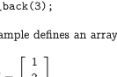

此处需注意一些特殊之处。首次使用语句定义向量时

```
vector<double> M(2);
```

我们定义了一个包含 2 个 double 类型元素的数组，随后用值 1 和 2 对其进行填充。在填充数组时，我们直接访问每个元素。请注意，在语句

```
M[0]=1.0;
```

中隐藏着从其他语言转到 C 或 C++ 的程序员容易掉入的主要陷阱之一。数组索引从零开始，而不是从一开始。M[0] 实际上表示数组的第一个元素。

最后一条语句

```
M.push_back(3);
```

展示了程序员在数组定义后更改其大小的能力。push_back 是数组上的标准操作，它将元素“推入”数组末尾，使数组大小增加一个元素。大多数编程语言不允许程序员“即时”指定可变大小的数组。在 FORTRAN 或 Pascal 中，我们通常需要为每个数组设置最大长度，并希望不需要超过该长度。C++ 的 vector<> 模板消除了程序员在此类数组操作中进行“簿记”的需求。

### 1.2.5 流程控制

要多次重复语句，将使用流程控制的可能性之一，例如 for 或 while 结构。例如，要重复一个操作 n 次，可以使用以下 for 循环：

```
for (int i=0; i<n; i++) {
    some_operation(i);
};
```

for 语句有三个部分。第一部分给出初始条件（i=0）。下一部分是终止条件（i<n），它表示当 i<n 不满足时停止，即在第 n 次迭代时。最后一部分是增量语句（i++），说明每次迭代要做什么。在此例中，i 的值在每次迭代中增加 1。这是典型的 for 语句。C 语言以简洁著称的原因之一，是存在复杂的 for 结构，最终几乎无法阅读。在本书介绍的算法中，我们将尽量避免任何晦涩的 for 语句，并坚持使用基本情况。

### 1.2.6 输入输出

任何程序要做任何有用的事情，都需要能够输出其结果。输入和输出操作定义在几个库中，即 iostream 和 fstream。前者涵盖标准终端的输入/输出，后者涵盖文件的输入/输出。

要向标准输出 cout（终端）写入，将按以下方式进行：

```
#include <iostream>
cout << "This is a test" << endl;
```

要向文件 "test.out" 写入，将按以下方式进行：

```
#include <fstream>
ofstream outf;
outf.open("test.out");
outf << "This is a test" << endl;
outf.clear();
outf.close();
```

### 1.2.7 拆分程序

C++ 中任何非平凡程序都会拆分为若干部分。通常每个部分都写为一个返回给定类型值的函数。为示例，我们提供一个完整的示例程序，如 C++ 代码 1.1 所示。

```
#include <iostream> // input output operations
#include <cmath> // mathematics library
using namespace std; // the above is part of the standard namespace
double power(double x, double n)
{
    // define a simple power function
    double p = exp(n*log(x));
    return p;
};
int main(){
    for (int n=1;n<6;n++){
        cout << " 2^" << n << " = " << power(2,n) << endl;
    }
};
```

C++ 代码 1.1：一个完整程序

该程序定义了一个执行数学幂运算的函数 power(x, n)，它通过恒等式 x^n = e^{n ln(x)} 计算 x^n。随后使用该函数计算并打印 2 的前 5 次幂。

编译、链接并运行后，程序将输出以下内容

2^1 = 2
2^2 = 4
2^3 = 8
2^4 = 16
2^5 = 32

### 1.2.8 命名空间

为帮助构建大型程序，引入了命名空间的概念。命名空间是一种将定义的变量和函数保持在其使用上下文中局部化的手段。目前需要知道的是，标准 C++ 库中的任何函数都位于其自己的命名空间中，称为标准命名空间。要实际访问这些库函数，有必要通过语句明确指定要访问标准命名空间

```
using namespace std;
```

与采用这种一般方法不同，也可以按元素逐个指定命名空间，但这更多是专门 C++ 教材的话题，出于当前目的，我们将允许所有例程访问整个标准命名空间。

### 1.3 扩展语言，类概念。

C++ 相对于其他编程语言的主要进步之一，是程序员能够通过创建新数据类型并在这些数据类型上定义标准操作来扩展语言。这正是 C++ 被称为面向对象编程语言的原因，因为大部分编程工作是通过创建对象来完成的。对象最好被视为带有定义在其上的操作的数据结构。如何使用对象，最好通过示例来展示。

## 1.3.1 date，一个示例类

考虑日期的抽象概念。日期可以以多种方式指定。让我们限制在公历范围内。2003 年 8 月 12 日是指定日期的常见方式。然而，它也可以由字符串表示："2003/8/12"、"12/8/2003" 等等，或者由自 1900 年 1 月 1 日以来的年数、自一月以来的月数以及月份中的日期表示（这是 UNIX 程序员会考虑的方式）。

然而，对于大多数编写程序的人来说，日期的表示方式并不重要，他们希望能以某种抽象方式输入日期，然后关注以下问题：

- 两个日期是否相等？
- 一个日期是否早于另一个？
- 两个日期之间相差多少天？

C++ 程序员将使用一个体现日期概念这些用法的类。通常人们会寻找一个已经实现此功能的现有类，但我们将展示一个简单的 date 类作为如何创建类的示例。

```
class date {
protected:
    int year_;
    int month_;
    int day_;
public:
    date();
    date(const int& d, const int& m, const int& y);
    bool valid() const;
    int day() const;
    int month() const;
    int year() const;
    void set_day (const int& day );
    void set_month( const int& month );
    void set_year( const int& year );
    date operator ++(); // prefix
    date operator ++(int); // postfix
    date operator --(); // prefix
    date operator --(int); // postfix
};

bool operator == (const date&, const date&); // comparison operators
bool operator != (const date&, const date&);
bool operator < (const date&, const date&);
bool operator > (const date&, const date&);
bool operator <= (const date&, const date&);
bool operator >= (const date&, const date&);
```

## 头文件 1.1：定义 date 类

类在头文件中定义，如头文件 1.1 所示。日期的内部表示选择三个整数 day_、month_ 和 year_。这是随后由下面定义的各种函数操作的数据结构。

这些函数用于


- 创建日期变量：date(const int& d, const int& m, const int& y);
- 通过三个整数函数 day()、month() 和 year() 输出日期的函数。
- 设置日期的函数 set_day(int)、set_month(int) 和 set_year(int)，通过向函数提供整数参数来使用。
- 递增和递减函数 ++ 和 --
- 比较函数 <、<=、>、>=、== 和 !=。

包含此头文件后，使用此类的程序员将把 date 类型的对象视同其他任何对象。

例如，

```
date d(1,1,2001);
++d;
```

将导致日期对象 d 包含日期 2001年1月2日。

任何想要使用此日期对象的 C++ 程序员只需查看头文件，即可了解可以与日期对象一起使用的所有可能函数，并无需了解这些函数的实现细节而感到高兴。这是面向对象编程的封装部分，关于日期对象的所有相关信息均由头文件指定。这是唯一的交互点，使用此对象的代码中不会用到类对象及其函数的所有实现细节。事实上，类的用户可以安全地忽略类的私有成员，这毕竟只是良好的编程习惯。

让我们来看看其实现。

代码 1.2 定义了基本操作、初始化、设置日期以及检查日期是否有效。

```
#include "date.h"

date::date(){ year = 0; month = 0; day = 0; }

date::date(const int& day, const int& month, const int& year){
day = day;
month = month;
year = year;
};

int date::day() const { return day; }
int date::month() const { return month; }
int date::year() const { return year; }

void date::set_day (const int& day) { date::day = day; }
void date::set_month(const int& month) { date::month = month; }
void date::set_year(const int& year) { date::year = year; }

bool date::valid() const {
// This function will check
// If the date is not valid then it will return the value false.
// Need some more checks on the year, though
if (year < 0)
return false;
if (day < 1 || month < 1) return false;
if (day > 31 || day < 1) return false;
if (day == 31 && (month == 2 || month == 4 || month == 6 || month == 9 || month == 11)) return false;
if (day == 30 && month == 2) return false;
// should also check for leap years, but for now allow for feb 29 in any year
return true;
};
```

### C++ 代码 1.2：日期类的基本操作

对于许多抽象类型，可以定义一种排序。对于日期，存在自然排序。C++ 代码 1.3 展示了如何定义此类比较操作。

```
#include "date.h"

bool operator ==(const date& d1,const date& d2){ // check for equality
 if ( (!d1.valid()) && (!d2.valid()) ) { return false; }; /* if dates not valid, not clear what to do.
 alternative: throw exception */
 return (d1.day()==d2.day()) && (d1.month()==d2.month()) && (d1.year()==d2.year());
};

bool operator <(const date& d1, const date& d2){
 if ( (!d1.valid()) && (!d2.valid()) ) { return false; }; // see above remark
 if (d1.year()==d2.year()) { // same year
   if (d1.month()==d2.month()){ // same month
     return (d1.day()<d2.day());
   }
   else {
     return (d1.month()<d2.month());
   }
 }
 else { // different year
   return (d1.year()<d2.year());
 }
};

// remaining operators defined in terms of the above

bool operator <=(const date& d1, const date& d2){
 if (d1==d2) { return true; }
 return (d1<d2);
}

bool operator >(const date& d1, const date& d2) {
 if (d1==d2) { return true; }
 return (d1>d2);
};

bool operator >=(const date& d1, const date& d2) { return !(d1<d2);};
bool operator !=(const date& d1, const date& d2){ return !(d1==d2);};
```

### C++ 代码 1.3：日期类的比较运算符

C++ 代码 1.4 展示了用于查找前一个和后一个日期的操作，称为迭代运算符。

```
#include "date.h"

date next_date(const date& d){
    if (!d.valid()) { return date(); }; //
    date ndat = date(d.day()+1,d.month(),d.year()); // first try adding a day
    if (ndat.valid()) return ndat; // then try adding a month
    ndat=date(1,d.month()+1,d.year());
    if (ndat.valid()) return ndat;
    ndat = date(1,1,d.year()+1); // must be next year
    return ndat;
}

date previous_date(const date& d){
    if (!d.valid()) { return date(); }; // return the default date
    date pdat = date(d.day()-1,d.month(),d.year()); if (pdat.valid()) return pdat; // try same month
    pdat = date(31,d.month()-1,d.year()); if (pdat.valid()) return pdat; // try previous month
    pdat = date(30,d.month()-1,d.year()); if (pdat.valid()) return pdat;
    pdat = date(29,d.month()-1,d.year()); if (pdat.valid()) return pdat;
    pdat = date(28,d.month()-1,d.year()); if (pdat.valid()) return pdat;
    pdat = date(31,12,d.year()-1); // try previous year
    return pdat;
}

date date::operator ++(int){ // postfix operator
    date d = *this;
    *this = next_date(d);
    return d;
}

date date::operator ++(){ // prefix operator
    *this = next_date(*this);
    return *this;
}

date date::operator --(int){ // postfix operator, return current value
    date d = *this;
    *this = previous_date(*this);
    return d;
}

date date::operator --(){ // prefix operator, return new value
    *this = previous_date(*this);
    return *this;
}
```

### C++ 代码 1.4：日期类的迭代运算符

## 练习 1.1.

日期类中的 valid() 函数接受每年的2月29日，但理想情况下这只应发生在闰年。修改该函数，使其在年份不是闰年时返回 false。

## 练习 1.2.

典型的操作系统具有处理日期的函数，典型的 C++ 实现可以调用这些函数。在你的实现中找到相关函数，并

- 1. 实现一个查询操作系统当前日期并返回该日期的函数。
- 2. 实现一个查询操作系统给定日期星期几的函数，并返回星期的表示形式，作为集合的成员：
- 3. 使用系统调用重新实现 valid() 函数。

```
{“mon”,“tue”,“wed”,“thu”,“fri”,“sat”,“sun”}
```

## 练习 1.3.

一旦日期类可用，许多显而易见的函数亟待实现。你将如何

- 1. 向日期添加给定数量的天数？
- 2. 转到月份的末尾或开头？
- 3. 查找两个日期之间的距离（以天或年为单位）？
- 4. 从字符串中提取日期？（这里需要对格式做一些假设）

## 练习 1.4.

查看各种计算环境中如何处理日期，例如操作系统（Unix、Windows）、应用程序（电子表格）、编程语言等。接口处于什么抽象级别？你需要知道日期是如何“实现”的吗？对于同时拥有 Matlab 和 Windows 访问权限的人来说，你为什么会说 Matlab 相对于 Windows 存在“差一”问题？

## 1.4 常量引用

现在让我们讨论一个更具技术性的概念。考虑由函数调用定义的两种替代函数调用：

```
some_function(double r);
some_function(const double& r);
```

两者都由一个 double 类型的参数调用，且该参数在调用函数中保证不会被更改，但它们的工作方式不同。在第一种情况下，会为参数中引用的变量创建一个副本以在函数中使用；而在第二种情况下，使用的是同一个变量，参数是指向变量位置的引用。后者效率更高，尤其是当参数是一个大型类时。然而，人们担心被引用的变量会在函数中被更改，而这在大多数情况下是不希望的。因此使用 const 限定符，它表示函数不能修改其参数。如果尝试修改此类变量，编译器会向程序员发出警告。

出于效率考虑，在以下大多数例程中，参数因此被传递为常量引用。

## 1.5 其他 C++ 概念

其他一些 C++ 概念，例如函数原型和模板，将在特定上下文中稍后介绍。它们只出现在少数几个地方，最好在使用时再介绍。


## 第 2 章

## 矩阵工具

计算机素养意味着要了解多种计算机工具，并能为手头的问题选择最合适的工具。许多人却恰恰相反，试图将任何问题都套用到他们熟悉的计算机工具上。对于商学院学生来说，一个非常常用的工具是像 _Excel_ 这样的电子表格。当然，电子表格在许多商业应用中非常有用。然而，它并不是处理计算密集型任务的最佳工具。

虽然本书主要涉及 C++，但在许多金融应用中，一种非常实用的工具是使用线性代数来操作向量和矩阵的语言。有许多不同的程序表现得非常相似，其语法源自线性代数的数学表述。这类早期工具之一是 _matlab_，大量程序都复制了该程序的大部分语法。因此，出现了大量语法与 Matlab 相似、执行类似分析的程序。通用工具包括 Mathworks 销售的商业软件包 Matlab，以及公共领域程序 octave 和 scilab。类似但更侧重于计量经济学的工具包括 Gauss、Ox 及其公共领域“克隆”版 R 的 _S_。至于安装什么程序，没有标准答案。对于学习这些工具的基本工作原理，上述任何软件包都能胜任。对于预算有限的学生，公共领域工具 octave、scilab 和 R 是明显的选择。它们都能执行商业 Matlab 软件包的基本操作，适合学习此类矩阵工具的基础知识。

所有这些工具都是允许用户使用非常紧凑的符号来操作向量和矩阵的程序。虽然紧凑符号总是容易被滥用，导致使用它的程序难以阅读，但在 Matlab 中这并不是一个大问题，其符号往往与数学家书写的方式非常接近，因此程序相对容易理解。对于不谨慎的用户，存在一些陷阱，特别是容易“忽略”对整个矩阵操作的命令与相应的逐元素操作之间的区别。例如，考虑下面的简短示例，其中运算符 `^` 表示将矩阵 A 取 2 次幂（与自身相乘），而运算符 `.^` 表示将矩阵 A 的每个元素取 2 次幂。这两个命令给出非常不同的答案。

```
>> A = [1 1 ; 1 1]
A =
 1   1
 1   1
>> A^2
ans =
 2   2
 2   2
>> A .^2
ans =
```

本章余下部分将介绍此类工具。

### 2.1 第一个屏幕

启动你正在使用的特定工具的方式取决于你使用的程序和操作系统。如何启动的详细信息留给读者作为练习。

这些工具是交互式的，它们会显示一个提示符，并期望你开始编写命令。

我们将使用 `>>` 作为提示符，这意味着程序已准备好接收命令。

在文本中，矩阵工具的输出将以打字机形式显示为：

```
>> A = [1, 2, 3; 4, 5, 6]
```

这个特定命令定义了一个矩阵 A，矩阵工具将通过打印刚刚定义的矩阵来响应此命令：

```
A =
  1 2 3
  4 5 6
```

### 2.2 线性代数

要使用此类工具，你需要一些线性代数知识。我们假设读者具备这些基本知识，如果没有，则需要快速浏览一本关于线性代数的标准数学教材。

### 2.2.1 基本矩阵运算

在矩阵代数中，有一套用于对基本元素（实数、向量和矩阵）进行运算的数学规则。在 Matlab 中，每个变量的类型在首次定义时确定。

```
>> a=1
a = 1
>> b=2
b = 2
>> c=3
c = 3
>> y=[1;2;3]
y =
  1
  2
  3
>> x=[1,2,3]
x =
  1 2 3
```

```
>> A=[1 2 3;4 5 6]
A =
1 2 3
4 5 6
```

请注意，在填充向量或矩阵时，空格或逗号表示一个新数字，分号表示一新行。要抑制打印刚刚定义的内容，请在行尾加上分号：

```
>> A=[1,2,3,4];
>> A=[1,2,3,4]
A =
1 2 3 4
>>
```

你也可以使用已定义的变量来定义新变量，只要维度合理即可。例如，根据上面的定义：

```
>> B=[c x]
B =
3 1 2 3
C = 1 2 3
>> C = [A;x]
C =
1 2 3
4 5 6
1 2 3
>> D = [A y]
error: number of rows must match
error: evaluating assignment expression near line 22, column 3
```

如果维度错误，你会收到错误消息，并且变量未定义。要查看变量中的内容，请通过给出变量名让 Matlab 打印其值：

```
>> a
a = 1
>> A
A =
1 2 3
4 5 6
```

请注意，Matlab 区分大小写，A 和 a 均已定义。

### 2.2.2 算术矩阵运算

现在我们来介绍 Matlab 的重要部分，即其内置的矩阵算术运算。根据上面的定义，让我们按照矩阵代数规则对一些元素进行加减运算。我们首先展示如何操作数字和向量：

```
>> a=1
a = 1
>> b=2
b = 2
>> a+b
ans = 3
```

```
>> x=[1 2 3 4]
x =
1 2 3 4
>> y=[4 3 2 1]
y =
4 3 2 1
>> x.*y
ans =
5 5 5 5
>> y-x
ans =
3 1 -1 -3
>> a.*x+b.*y
ans =
9 8 7 6
```

同样，对于矩阵：

```
A=[1 2 3; 4 5 6]
A =
1 2 3
4 5 6
>> B=[6 5 4; 3 2 1]
B =
6 5 4
3 2 1
>> A+B
ans =
7 7 7
7 7 7
>> A-B
ans =
-5 -3 -1
1 3 5
>> a.*A+b.*B
ans =
13 12 11
10 9 8
>> A*B
ans =
28 10
73 28
```

在线性代数中，你需要意识到矩阵乘法不是逐元素乘法，而是一种更复杂的运算，其中所有可能的向量组合相互相乘。在乘以矩阵时，你需要更小心地注意维度，但在记法上它就像向量乘法一样。

```
>> A=[1 2 3;4 5 6]
A =
1 2 3
4 5 6
>> B = [1 2 3;4 5 6]
B =
 1  2
 3  4
 5  6
>> A*B
ans =
 22  28
 49  64
>> B*A
ans =
  9  12  15
 19  26  33
 29  40  51
```

对于这些矩阵，AB 和 BA 都是定义好的运算，但请注意结果不同，事实上，乘积的维度也不同。

如果让 B 成为一个 2×2 矩阵，那么乘以 AB 将是一个错误。

```
>> B=[1 2;3 4]
B =
 1  2
 3  4
>> A*B
error: nonconformant matrices (op1 is 2x3, op2 is 2x2)
>> B*A
ans =
  9  12  15
 19  26  33
```

现在让我们讨论一些标准的矩阵概念。

矩阵 A 的转置在 Matlab 中表示为 A'：

```
>> A
A =
 1  2  3
 4  5  6
>> A'
ans =
 1  4
 2  5
 3  6
```

两个特殊的矩阵是零矩阵和单位矩阵：

```
>> null = zeros(3,3)
null =
 0  0  0
 0  0  0
 0  0  0
```

```
>> ident = eye(3,3)
ident =
 1  0  0
 0  1  0
```

矩阵的秩是矩阵中独立行或列的数量，计算方法如下

```
>> A
A =
1 2 3
4 5 6
>> rank(A)
ans =
2
```

方阵 A 的逆矩阵是矩阵 inv(A)，使得 A*inv(A) 等于单位矩阵，或在数学记法中 AA^-1 = I。

```
>> D=[1 2;1 4]
D =
1 2
1 4
>> inv(D)
ans =
2.00000 -1.00000
-0.50000 0.50000
>> D^-1
ans =
2.00000 -1.00000
-0.50000 0.50000
```

为了确认这是逆矩阵，将 D 和 inv(D) 相乘：

```
>> D * inv(D)
ans =
1 0
0 1
```

### 行列式

```
>> B
B =
1 2
3 4
>> det(B)
ans = -2
```

### 2.3 求解线性方程组

考虑基本线性方程

```
Ax = b
```

如果 A 的秩等于 [A|b] 的秩，则该方程有定义的解。如果 A 是非奇异的，我们通过找到唯一解来求解线性方程

```
x = A^-1b
```

考虑线性方程组

3x_1 + 4x_2 = 5
4x_1 + 6x_2 = 8

通过定义以下内容将其写成矩阵形式：

```
A = [ 3 4 ; 4 6 ]

b = [ 5 ; 8 ]
```

让我们首先检查这个系统是否可解

```
>> A = [3 4; 4 6]
A =
3 4
4 6
```

```
>> b=[5;8]
b =
5
8
```

```
>> rank(A)
ans =
2
```

```
>> rank([A b])
ans =
2
```

请注意如何通过 [A b] 创建增广矩阵 [A|b]。两者的秩相同。由于 A 是方阵，我们可以按如下方式计算解：

```
>> inverse(A)
ans =
3.0000 -2.0000
-2.0000 1.5000
```

```
>> x = inverse(A) * b
x =
-1
2
```

方程组的解为

```
x = [ -1 ; 2 ]
```

在此示例中，我们通过求逆来计算解。但你应该意识到，通过计算逆矩阵来求解线性方程组并不是数值上最稳定的方法。Matlab 内置了一个直接线性矩阵求解器，通过左除运算符调用

```
>> x = A\b
x =
-1
2
```


这直接求解方程组，通常是执行此操作的首选方法，除非需要逆矩阵用于其他目的。

## 2.4 元素逐元素操作

当命令以句点开头时，意味着该命令作用于向量或矩阵的每个元素，而不是向量或矩阵本身。

例如，对于下面的两个向量，考虑直接相乘与逐元素相乘的区别：

```
> x=[1 2 3 ]
x =
 1  2  3
> t=[1 2 3]
t =
 1  2  3
>> x*t,
ans =  14
> x .* t
ans =
 1   4   9
```

同样，对矩阵求幂时

```
> A=[1 1;1 1]
A =
 1  1
 1  1
>> A^10
ans =
  512   512
  512   512
>> A .^10
ans =
 1  1
 1  1
```

## 2.5 函数定义

## 2.6 m 文件

## 2.7 流程控制

## 2.8 绘图

像 Matlab 这样的工具非常重要的用途之一，是其能够绘制数学关系图。在说明数学关系时，一张二维或三维图片可能胜过千言万语。

## 2.9 库

## 2.10 参考文献

你需要所选软件包的手册。

## 第 3 章

## 时间的价值

| 节 | 标题 | 页码 |
|---|---|---|
| 3.1 | 现值 | 26 |
| 3.2 | 带年复利的单一利率 | 27 |
| 3.2.1 | 内部收益率 | 30 |
| 3.3 | 连续复利 | 34 |
| 3.3.1 | 现值 | 35 |
| 3.4 | 进一步阅读 | 35 |

金融作为一门学科，有时被有些轻率地说是研究两样东西的价值：*时间* 和 *风险*。虽然这并非全部，但其中确实有不少道理。这两个问题始终存在。我们开始讨论时，先忽略风险，只考虑这样一个事实的含义：任何人都宁愿早点得到东西而不是晚点，也就是时间的价值。

### 3.1 现值

现值是未来一系列付款的当前值。设 $C_t$ 为时刻 $t$ 的现金流量。假设我们有 $N$ 个未来现金流量，分别发生在 $t_1, t_2, \cdots, t_N$ 时刻。

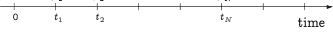

要计算这些未来现金流量的*现值*，需要一组未来现金流量的价格。假设 $d_t$ 是今天为获得未来日期 $t$ 一美元收取权所愿意支付的价格。这种价格也称为*贴现因子*。为了进一步复杂化，这些价格将取决于未来现金流量的风险程度。目前我们专注于一组特定的价格，即*无风险*未来现金流量的价格。我们将稍后讨论如何为有风险现金流量调整价格。

如果知道未来一美元索赔的一组价格 $d_1, d_2, \dots$，则可以将现值计算为各元素现值之和。

```
PV = \sum_{i=1}^N d_i C_{t_i}
```

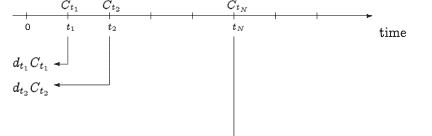

然而，了解所有未来日期现金流量的这一组当前价格并不总是可行的，必须找到某种方法来简化此类一般现值计算固有的数据需求。

### 3.2 带年复利的单一利率

简化现值计算的最著名方法是通过以下关系将贴现因子改写为利率或收益率：

\( d_t = \frac{1}{(1+r_t)^t} \)

其中 \( r_t \) 是与 t 期投资相关的利率（通常称为即期利率）。为了进一步简化此计算，可以假设该利率 \( r \) 在所有期限内保持不变。这被称为*平坦*期限结构。我们将在下一章放宽这一简化假设。用于对未来付款 \( d_t \) 进行估值的价格是根据该利率计算的：

\( d_t = \frac{1}{(1+r)^t} \)

在这种情况下，对于在离散日期 \( t = 1, 2, \dots N \) 支付的一系列现金流量，现值计算如下

\( PV = \sum_{t=1}^N \frac{C_t}{(1+r)^t} \)

该计算的实现如 C++ 代码 3.1 所示。

```
#include <cmath>
#include <vector>
using namespace std;
#include <cmath>
double cash_flow::pr_discrete(const vector<double>& cflow_times,
                              const vector<double>& cflow_amounts,
                              const double& r){
    double PV=0.0;
    for (int t=0; t<cflow_times.size();t++) {
        PV += cflow_amounts[t]/pow(1.0+r,cflow_times[t]);
    }
    return PV;
};
```

C++ 代码 3.1：离散复利现值

示例

一个投资项目今天的投资成本为 100，未来两年每年产生 75 的现金流量。该项目的净现值是多少？

```
Matlab program:
C=[-100 75 75]
t=[0 1 2]
r = 0.1
d=(1/(1+r)).^t
NPV=C*d'
```

```
Output from Matlab program:
C =
 -100  75  75

t =
 0   1   2

r =  0.10000

d =
 1.00000  0.90909  0.82645

NPV =  30.165
```

```
C++ program:
vector<double> cflows; cflows.push_back(-100.0); cflows.push_back(75); cflows.push_back(75);
vector<double> times; times.push_back(0.0); times.push_back(1); times.push_back(2);
double r=0.1;
cout << " Present value, 10 percent discretely compounded interest = "
     << cash_flow_pv_discrete(times, cflows, r) << endl;
```

```
Output from C++ program:
Present value, 10 percent discretely compounded interest = 30.1653
```

在假设离散年利率的前提下，有一些有用的现金流特殊情况，可以以简化的方式计算现值。其中一些将在以下练习中展示。

### 练习 3.1

永续年金是承诺在无限期未来每期支付固定金额 X。假设存在固定利率 r。

- 1. 证明该现金流序列的现值简单计算为

\( PV = \sum_{t=1}^\infty \frac{X}{1+r} = \frac{X}{r} \)

### 练习 3.2

增长型永续年金同样是一个无限现金流序列，第一年的支付额为 X，之后每次支付以固定增长率 g 增长，即第 2 期支付为 X(1+g)，第 3 期支付为 X(1+g)^2，以此类推。

- 1. 证明该永续年金的现值简化为

\( PV = \sum_{t=1}^\infty \frac{X(1+g)^{t-1}}{(1+r)^t} = \frac{X}{r-g} \)

### 练习 3.3

_年金_ 是指在给定年限内（例如未来 _T_ 期）的一系列现金流。考虑一份每期支付固定金额 _X_ 的年金。利率为 _r_。

- 1. 证明该现金流序列的现值可简化为

```
PV = \sum_{t=1}^T \frac{X}{(1+r)^t} = X \left[ \frac{1}{r} - \frac{1}{r} \frac{1}{(1+r)^T} \right]
```

### 练习 3.4

_增长型年金_ 是指在给定年限内（例如未来 _T_ 期）的一系列现金流，每期支付按给定因子增长。考虑一个 _T_ 期年金，第一期支付 _X》。之后，支付每年以 _g_ 的利率增长，即第二年现金流为 _X_(1+_g_)，第三年为 _X_(1+_g_)<sup>2</sup>，以此类推。

- 1. 证明该增长型年金的现值可简化为

```
PV = \sum_{t=1}^T \frac{X(1+g)^{(t-1)}}{(1+r)^t} = X \left[ \frac{1}{r-g} - \left( \frac{1+g}{1+r} \right)^T \frac{1}{r-g} \right]
```

### 练习 3.5

按现值对以下现金流进行排序。使用 5% 的利率。

- 1. 年支付额为 100 美元的永续年金。
- 2. 增长型永续年金，首次支付 75 美元，之后每次支付增长 2%。
- 3. 年支付额为 90 美元的 10 年年金。
- 4. 首次支付 85 美元，之后每次支付增长 5% 的 10 年增长型年金。

### 3.2.1 内部收益率

除了在简化现值计算中的作用外，利率还有进一步的用途。投资的百分比回报是投资盈利能力的摘要衡量指标。说一项投资每年获得 10% 的回报，是以一种不依赖于初始投资金额的方式总结现金流的好方法。因此，回报是盈利能力的相对衡量指标。

要估计一组现金流的回报，我们计算内部收益率。一组现金流的内部收益率是使现金流现值等于零的利率。当存在唯一定义的内部收益率时，我们就得到一组现金流盈利能力的相对衡量指标，以回报表示，通常以百分比表示。请注意此处的一些隐含假设。我们假设相同的利率适用于所有未来日期（即平坦期限结构）。IRR 方法还假设中间现金流按内部收益率再投资。

假设现金流为 \(C_0, C_1, C_2, \dots C_T\)。寻找内部收益率就是寻找方程的解 \(y\)

```
\(\sum_{t=1}^T \frac{C_t}{(1+y)^t} - C_0 = 0\)
```

请注意这是一个多项式方程，当 \(T\) 很大时，无法找到方程的显式解。因此需要数值求解。对于行为良好的现金流（即我们知道只有一个 IRR 的情况），C++ 代码 3.2 中实现的方法是合适的，这是一种称为二分法的迭代过程。它是对 (Press, Teukolsky, Vetterling, and Flannery, 1992, Chapter 9) 中讨论的括弧法的改编，


```cpp
#include <cmath>
#include <algorithm>
#include <vector>
using namespace std;
#include "fin_recipes.h"

const double ERROR=-1e30;

double cash_flow_irr_discrete(const vector<double>& cflow_times,
                 const vector<double>& cflow_amounts) {
    // simple minded irr function. Will find one root (if it exists.)
    // adapted from routine in Numerical Recipes in C.
    if (cflow_times.size()!=cflow_amounts.size()) return ERROR;
    const double ACCURACY = 1.0e-5;
    const int MAX_ITERATIONS = 50;
    double x1 = 0.0;
    double x2 = 0.0;

    // create an initial bracket, with a root somewhere between bot,top
    double f1 = cash_flow_pv_discrete(cflow_times, cflow_amounts, x1);
    double f2 = cash_flow_pv_discrete(cflow_times, cflow_amounts, x2);
    for (int i=0;i<MAX_ITERATIONS;++i) {
        if ((i==0)||(f2<0.0)) { break; } // (fab(f1)<fab(f2)) {
        if ((fabs(f1)<fabs(f2)) {
        f1 = cash_flow_pv_discrete(cflow_times,cflow_amounts, x1+=1.6*(x1-x2));
    }
    else {
        f2 = cash_flow_pv_discrete(cflow_times,cflow_amounts, x2+=1.6*(x2-x1));
    }
    }
    if (f2*f1>0.0) { return ERROR; };
    double f = cash_flow_pv_discrete(cflow_times,cflow_amounts, x1);
    double rtb;
    double dx=0;
    if (f<0.0) {
        rtb=x1;
        dx=x2-x1;
    }
    else {
        rtb = x2;
        dx = x1-x2;
    }
    for (i=0;i<MAX_ITERATIONS;++i){
        dx *= 0.5;
        double x_mid = rtb+dx;
        double f_mid = cash_flow_pv_discrete(cflow_times,cflow_amounts, x_mid);
        if ((f_mid<0.0)) { rtb = x_mid; }
        if ((fabs(f_mid)<ACCURACY) || (fabs(dx)<ACCURACY) ) return x_mid;
    }
    return ERROR; // error.
}
```

### C++ 代码 3.2：内部收益率的估算

## 示例

我们正在考虑一项投资，其在日期 0、1 和 2 的现金流如下：

$C_0 = -100, C_1 = 10, C_2 = 110$

- 1. 当前利率（按离散、年度复利计算）为 5%。确定现金流的现值。
- 2. 求这组现金流的内部收益率。

```
Matlab program:
C=[-100 10 110]
t=[0 1 2]
r = 0.05
d=(1/(1+r)).^t
NPV=C*d'
IRR = irr(C)
Output from Matlab program:
C =
 -100  10  110
t =
 0  1  2
r =
 0  0.050000
d =
 1.00000  0.95238  0.90703
NPV =  9.2971
IRR =  0.100000
```

```
C++ program:
vector<double> cflows; cflows.push_back(-100.0); cflows.push_back(10.0); cflows.push_back(110.0);
vector<double> times; times.push_back(0); times.push_back(1); times.push_back(2);
double r=0.05;
cout << " present value, 5 percent discretely compounded interest = " ;
cout << cash_flow_pv_discrete(times, cflows, r) << endl;
cout << " internal rate of return, discrete compounding = ";
cout << cash_flow_irr_discrete(times, cflows) << endl;
Output from C++ program:
present value, 5 percent discretely compounded interest = 9.29705
internal rate of return, discrete compounding = 0.1
```

除了对内部收益率解释的上述经济资格外，我们还必须处理源于以下事实的技术问题：任何多项式方程都可能有多个解，其中一些可能是虚数。这里的虚数是指我们从实数线移动到复数集合。在经济学中，我们偏好实数解，复数利率不是我们有太多直觉的东西……为了查看我们是否可能在识别单个有意义的 IRR 时遇到问题，代码 3.3 中显示的代码实现了一个简单的检查。它只是唯一 IRR 的必要条件，而不是充分条件，因此即使此检查返回 false，您仍可能拥有定义明确的 IRR。第一个测试只是计算现金流中符号变化的次数。根据笛卡尔法则，我们知道如果只有一个符号变化，则实根的数量为一。如果现金流符号有多次变化，我们可以进一步检查汇总现金流的符号变化（参见 Norstrom (1972)）。

```cpp
#include <cmath>
#include <vector>
using namespace std;
inline int sgn(const double& r) { if (r>=0) {return 1;} else {return -1;} };
bool cash_flow_unique_irr(const vector<double>& cflow_times,
             const vector<double>& cflow_amounts) {
  int sign_changes=0; // first check Descartes rule
  for (int t=1;t<cflow_times.size();++t){
    if (sgn(cflow_amounts[t-1])*sgn(cflow_amounts[t])) sign_changes++;
  }
  if (sign_changes==0) return false; // can not find any irr
  if (sign_changes==1) return true;
  double A = cflow_amounts[0]; // check the aggregate cash flows, due to Norstrom
  for (int t=1;t<cflow_times.size();++t){
    if (sgn(A) != sgn(A+=cflow_amounts[t])) sign_changes++;
  }
  if (sign_changes<=1) return true;
  return false;
}
```

### C++ 代码 3.3：IRR 唯一性测试

更好地了解利率与现值之间关系的方法，就是将现值作为利率的函数进行绘图。下图说明了两组不同现金流的方法。请注意，右侧的现金流组有两个可能的利率，可使现值等于零。

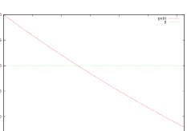

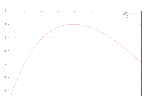

$C_0 = -100, C_1 = 10, C_2 = 100$

$C_0 = -100, C_1 = 201, C_2 = -100$

## 练习 3.6。

估算 IRR 的一种替代方法是使用查找多项式方程根的外部子程序。搜索合适的通用根查找子程序，并用对该子程序的调用替换 IRR 估算。

## 3.3 持续复利

我们刚刚讨论的这种离散复利并不是近似贴现因子的唯一方法。离散复利情况假设利息在离散的时间点加入（因此得名）。然而，另一种假设是假设利息是连续加入的。如果复利是连续的，且 r 为利率，则在未来日期 t 收到一美元的当前价格 $d_t$ 计算如下

$d_t = e^{-rt}$，

公式 3.1 总结了在持续复利和离散复利利率之间转换的一些规则。

| 公式 |
|---|
| $r = n \ln(1 + r_n/n)$ |
| $r_n = n(e^{r/n} - 1)$ |
| 终值 = $e^{rt}$ |
| 现值 = $e^{-rt}$ |
| 符号说明：$r_n$：离散复利利率，n：每年复利期数。r：持续复利利率，t：距到期的时间。 |

公式 3.1：离散与持续复利之间的转换

## 示例

- 1. 已知按月复利的利率为 15%，计算等效的持续复利利率。
- 2. 已知持续复利利率为 12%，求等效的按季度复利利率。

进行计算：

- 1. $r_{12} = 15\%$, $r = 12 \ln(1 + 0.15/12) = 14.91\%$
- 2. $r = 12\%$, $r_4 = n(e^{r/n} - 1) = 4(e^{0.12/4} - 1) = 12.18\%$

使用 Matlab 进行计算：

```
Matlab program:
r = 12 * log(1+0.15/12)
r4 = 4 * (exp(0.12/4)-1)
```

Matlab 程序输出：

```
r = 0.14907
r4 = 0.12182
```

## 3.3.1 现值

将此应用于未来日期 \(t_1, t_2, \cdots, t_n\) 的一组现金流，我们得到以下现值计算：

\(PV = \sum_{i=1}^n e^{-rt_i} C_{t_i}\)

此计算在 C++ 代码 3.4 中实现。

```cpp
#include <cmath>
#include <vector>
using namespace std;

double cash_flow_pv( const vector<double>& cflow_times,
                     const vector<double>& cflow_amounts,
                     const double& r){
    double PV=0.0;
    for (int t=0; t<cflow_times.size();t++){
        PV += cflow_amounts[t] * exp(-r*cflow_times[t]);
    };
    return PV;
};
```

### C++ 代码 3.4：持续复利的现值计算

在接下来的大部分内容中，我们将使用持续复利的情况。这样做有多种原因，但一个主要原因是，使用持续复利比使用离散复利更容易，因为处理不均匀的时间段更容易。离散复利在现金流均匀分布（例如年度现金流）时易于使用，但否则则较困难。

## 3.4 建议阅读

本章内容在大多数标准的公司财务教材（例如 Brealey, Myers, and Allen (2010) 或 Ross, Westerfield, and Jaffe (2009)）和投资教材（例如 Bodie, Kane, and Marcus (2007)、Haugen (2001) 或 Sharpe, Alexander, and Bailey (1999)）中都有涵盖。


## 第 4 章

## 利率期限结构平坦时的债券定价

## 目录

- 4.1 采用离散年复利的平坦利率期限结构 ..... 37
- 4.1.1 债券价格 ..... 37
- 4.1.2 到期收益率 ..... 38
- 4.1.3 久期 ..... 41
- 4.1.4 衡量债券对利率变动的敏感性 ..... 43
- 4.2 连续复利 ..... 47
- 4.3 建议进一步阅读 ..... 50

在本节中，我们使用上一章的现值框架来对债券和其他固定收益证券进行定价。债券的特点在于，未来的付款在证券发行时就已确定。最简单、最典型的债券是一种固定利率、固定期限且无违约风险的债券。然而，债券存在大量替代性合同特征。例如，债券可以是年金债券，每期支付固定金额。对于此类债券，未偿还本金会在债券存续期间逐步偿还。债券支付的利率不必固定，可以是浮动利率，支付的利率可以是某些市场利率的函数。许多债券由公司发行，在这种情况下，存在发行债券的公司违约、债券无法支付完整承诺金额的风险。使债券定价在实践中变得困难的另一点是，利率往往会随时间变化。

我们首先假设所有承诺的付款都是确定的。

然后，债券的当前价格 \( B_0 \) 可以通过这些付款的现值得到。定价的第一步是利用债券条款找出承诺的付款。我们首先考虑一种无违约风险的固定利率债券。此类债券通常由政府发行。债券是承诺在从现在起 \( T \) 期后的到期日 \( T \) 支付面值 \( F \)。每期，债券支付面值的固定百分比作为票面利息 \( C \)。债券的现金流量如下所示。

| t = | 0 | 1 | 2 | 3 | ... | T |
|---|---|---|---|---|---|---|
| 票面利息 | C | C | C | ... | C | C |
| 面值 | | | | | | F |
| 总现金流量 | \( C_1 = C \) | \( C_2 = C \) | ... | | | \( C_T = C + F \) |

通常，债券价格是通过现值得到的

```
\( B_0 = d_1 C_1 + d_2 C_2 + \cdots + d_T C_T = \sum_{t=1}^T d_t C_t \)
```

其中 \( d_t \) 是折现因子，即时刻 \( t \) 支付 1 的时刻 0 价格。为了完全明确问题，需要找到所有折现因子 \( d_t \)。在本章中，我们将使用一种特别简单的利率期限结构规范，即它是平坦的，并由利率 \( r \) 指定。

### 4.1 采用离散年复利的平坦利率期限结构

这是利率期限结构最简单的可能规范，

\(d_t = \left( \frac{1}{1+r} \right)^t = \frac{1}{(1+r)^t}\)

### 4.1.1 债券价格

债券的当前价格（\(B_0\)）是债券现金流量的现值

\(B_0 = \sum_{t=1}^T \left( \frac{1}{(1+r)^t} \right) C_t = \sum_{t=1}^T \frac{C_t}{(1+r)^t}\) (4.1)

如果我们继续以标准固定利率债券为例，其中当 \(t < T\) 时 \(C_t = C\)，且 \(C_T = C + F\)，并展示如何使用 Matlab 计算债券价格。

### 示例

- 1. 确定当前债券价格。

当前债券价格：\(B_0 = \frac{10}{(1+0.09)^1} + \frac{10}{(1+0.09)^2} + \frac{110}{(1+0.09)^3} = 102.531\)。

以下是计算过程：

```
Matlab program:

C =[10,10,110]
t = 1:3
r = 0.09
d=(1./(1+r).^t)
B= d * C'

Output from Matlab program:

C =

10 10 110

t =

1 2 3

r = 0.090000

d =

0.91743 0.84168 0.77218

B = 102.53
```

```
C++ program:

vector<double> cflows; cflows.push_back(10); cflows.push_back(10); cflows.push_back(110);
vector<double> times; times.push_back(1); times.push_back(2); times.push_back(3);
double r=0.09;

cout << " bonds price = " << bonds_price_discrete(times, cflows, r) << endl;

Output from C++ program:

bonds price = 102.531
```

计算采用离散年复利的债券价格的通用 C++ 代码如 C++ 代码 4.1 所示。

```
#include <cmath>
#include <vector>
using namespace std;
double bonds_price_discrete(const vector<double>& times,
                             const vector<double>& cashflows,
                             const double& r) {
    double p=0;
    for (int i=0;i<times.size();++i) {
        p += cashflows[i]/(pow((1+r),times[i]));
    }
    return p;
}
```

C++ 代码 4.1：采用离散年复利的债券价格计算。

### 4.1.2 到期收益率

由于债券是以利率条款发行的，因此找到一个概括债券条款的利率数字也很有用。显而易见的方法是提出这样一个问题：现在购买债券并持有至到期的投资的内部收益率是多少？这个问题的答案就是债券的到期收益率。到期收益率是使未来票面付款的现值等于当前债券价格的利率，即，对于已知价格 \( B_0 \)，到期收益率是方程的解 \( y \)

\( B_0 = \sum_{t=1}^T \frac{C_t}{(1+y)^t} \) (4.2)

因此，此计算与前面讨论的计算内部收益率（IRR）具有相同的前提条件，即假设按债券收益率（即 IRR）再投资票面利息。

在对债券进行这种到期收益率估计时，出现多个解导致技术问题的可能性要小得多，因为现金流量的结构使得方程只有一个解。因此，C++ 代码 4.2 中所示的查找债券到期收益率的算法是简单的二分法。我们知道债券收益率高于零，并将零设为债券收益率的下界。然后，我们通过提高利率直到该利率下的债券价格为负数来找到收益率的上界。接着，我们对上界和下界之间的区间进行二分，直到“足够接近”。C++ 代码 4.2 实现了这一想法。

```
#include <cmath>
using namespace std;
#include "fin_recipes.h"
double bonds_yield_to_maturity_discrete( const vector<double>& times,
const vector<double>& cashflows,
const double& bond_price){
const double ACCURACY = 1e-5;
const int MAX_ITERATIONS = 200;
double bot=0, top=1.0;
while (bonds_price_discrete(times, cashflows, top) > bond_price) { top = top*2; };
double r = 0.5 * (top+bot);
for (int i=0;i<MAX_ITERATIONS;++i){
double diff = bonds_price_discrete(times, cashflows,r) - bond_price;
if (fabs(diff)<ACCURACY) return r;
if (diff<0.0) { bot=r; }
else { top=r; }
r = 0.5 * (top+bot);
};
return r;
};
```

C++ 代码 4.2：采用离散年复利的债券收益率计算

### 示例

- 1. 找到债券的当前价格。
- 2. 找到债券的到期收益率。

```
Matlab program:
C = [ 10 10 110 ];
t = 1:3;
r=0.09;
B = C * (1./(1+r).^t)';
y = irr([-B C ])

Output from Matlab program:
B = 102.53
y = 0.090000
```

```
C++ program:
vector<double> cflows; cflows.push_back(10); cflows.push_back(10); cflows.push_back(110);
vector<double> times; times.push_back(1); times.push_back(2); times.push_back(3);
double r=0.09;
double B = bonds_price_discrete(times, cflows, r);
cout << " Bond price, 9 percent discretely compounded interest = " << B << endl;
cout << " bond yield to maturity = " << bonds_yield_to_maturity_discrete(times, cflows, B) << endl;

Output from C++ program:
Bond price, 9 percent discretely compounded interest = 102.531
bond yield to maturity = 0.09
```

### 4.1.3 久期

持有债券时，人们希望了解债券价值对经济环境变化的敏感程度。经济环境中最相关的部分是当前利率。此类计算的一个重要组成部分是债券的 _久期_。债券的久期应被解释为债券的加权平均期限，并按以下公式计算

\(\text{Duration}=\frac{\sum_t t \frac{C_t}{(1+r)^t}}{\text{Bond Price}},\)
(4.3)

其中 \(C_t\) 是第 \(t\) 期的现金流量，\(r\) 是利率。使用方程 4.1 中计算的债券价格，我们按以下方式计算久期

\(D=\frac{\sum_t t \frac{C_t}{(1+r)^t}}{\sum_t \frac{C_t}{(1+r)^t}}\)
(4.4)

如 C++ 代码 4.3 所示。

```
#include <cmath>
#include <vector>
using namespace std;

double bonds_duration_discrete(const vector<double>& times,
 const vector<double>& cashflows,
 const double& r) {
 double B=0;
 double D=0;
 for (int i=0;i<times.size();++i){
 B += times[i] * cashflows[i] / pow(1+r,times[i]);
 D += cashflows[i] / pow(1+r,times[i]);
 };
 return D/B;
 };
```

C++ 代码 4.3：使用离散年复利和平坦利率期限结构计算债券久期

计算久期的另一种方法是计算债券的到期收益率 \(y\)，并用它来估计债券价格。这被称为 _Macaulay 久期_。首先，根据以下公式计算 \(y\)，即到期收益率

\(\text{Bond price}=\sum_{t=1}^T \frac{C_t}{(1+y)^t}\)

然后将此 \(y\) 用于久期计算：

\(\text{Macaulay duration}=\frac{\sum_t t \frac{C_t}{(1+y)^t}}{\sum_t \frac{C_t}{(1+y)^t}}\)
(4.5)

C++ 代码 4.4 实现了此计算。

不过请注意，在当前情况下，采用平坦利率期限结构，这两种方法应得出相同的数字。如果债券定价正确，到期收益率必须等于当前利率。如果 \(r=y\)，方程 (4.4) 和 (4.5) 中的两种计算显然会产生相同的数字。

### 示例

面值为 100 美元的 3 年期债券每年支付 10% 的票面利息。当前利率（采用年复利）为 9%。


```cpp
#include "fin_recipes.h"
double bonds_duration_macaulay_discrete(const vector<double>& times,
                                       const vector<double>& cashflows,
                                       const double& bond_price){
    double y = bonds_yield_to_maturity_discrete(times, cashflows, bond_price);
    return bonds_duration_discrete(times, cashflows, y); // use YTM in duration calculation
};
```

### C++ 代码 4.4：计算债券的麦考利久期

- 1. 确定当前债券价格。
- 2. 使用当前利率计算久期。
- 3. 使用麦考利定义计算久期。

需要计算以下内容：

当前债券价格：\( B_0 = \frac{10}{(1+0.09)^1} + \frac{10}{(1+0.09)^2} + \frac{110}{(1+0.09)^3} = 102.531 \)。

债券的久期：\( D = \frac{102.531}{\frac{10}{1.09} + \frac{10}{1.09^2} + \frac{110}{1.09^3}} = 2.74 \)。

```
Matlab program:
C = [10,10,110];
t = 1:3;
r = 0.09;
B = C' * (1./((1+r).^t));
D = (1/B)'*C .* (1./(1+r).^t)'
y = irr([-B C])
DM=(1/y)'.*C .* (1./(1+y).^t)'
```

```
Output from Matlab program:
B = 102.53
D = 2.7390
y = 0.090000
DM = 2.7390
```

```
C++ program:
vector<double> cflows; cflows.push_back(10); cflows.push_back(10); cflows.push_back(110);
vector<double> times; times.push_back(1); times.push_back(2); times.push_back(3);
double r=0.09;
double B = bonds_price_discrete(times, cflows, r);
cout << " bonds price = " << B << endl;
cout << " bond duration = " << bonds_duration_discrete(times, cflows, r) << endl;
cout << " bond macaulay = " << bonds_duration_macaulay_discrete(times, cflows, B) << endl;
```

```
Output from C++ program:
bonds price = 102.531
bond duration = 2.73895
bond macaulay = 2.73895
```

## 4.1.4 衡量债券对利率变化的敏感性

现在，我们之所以说可以使用久期来衡量债券价格的敏感性。作为一阶近似，\(\Delta B_0\)，即利率小幅变化 \(\Delta r\) 引起的债券价格变化，可以计算为

\(\frac{\Delta B_0}{B_0} \approx -\frac{D}{1+r} \Delta r\)

其中 \(D\) 是债券的久期。为简化起见，人们通常直接计算上式中 \(\Delta y\) 前面的项 \(\frac{D}{1+r}\)，并将其称为债券的*修正久期*。

\(\text{Modified Duration} = D^* = \frac{D}{1+r}\)

于是灵敏度计算为

\(\frac{\Delta B_0}{B_0} \approx -D^* \Delta r\)

修正久期也可以用债券的到期收益率 \(y\) 表示，即

\(D^* = \frac{D}{1+y}\)

C++ 代码 4.5 展示了此计算。

```
#include <vector>
using namespace std;
#include "fin_recipes.h"

double bonds_duration_modified_discrete (const vector<double>& times,
                                         const vector<double>& cashflows,
                                         const double& bond_price){
    double y = bonds_yield_to_maturity_discrete(times, cashflows, bond_price);
    double D = bonds_duration_discrete(times, cashflows, y);
    return D/(1+y);
};
```

### C++ 代码 4.5：修正久期

使用久期近似债券价格变化如下图所示。

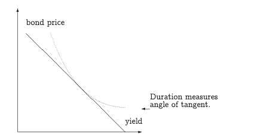

修正久期衡量的是当前债券收益率处切线的角度。因此，使用久期近似债券价格变化仅是一阶近似。为了改进这一近似，我们还需要考虑债券价格与利率之间关系的曲率。为了量化这种曲率，我们计算债券的*凸性*。

Convexity = \(Cx = \frac{1}{B_0} \frac{1}{(1+r)^2} \sum_{t=1}^T (t+t^2) \frac{C_t}{(1+r)^t}\) (4.6)

此计算在 C++ 代码 4.6 中实现。为了改进对债券价格

```
#include <cmath>
#include "fin_recipes.h"

double bonds_convexity_discrete(const vector<double>& times,
                                const vector<double>& cashflows,
                                const double& r ){
    double Cx=0;
    for (int i=0;i<times.size();i++){
        Cx+= cashflows[i]*times[i]*(times[i]+1)/(pow((1+r),times[i]));
    };
    double B=bonds_price_discrete(times, cashflows, r);
    return (Cx/(pow((1+r),2)))/B;
};
```

### C++ 代码 4.6：具有平坦期限结构和年度复利的债券凸性

随利率变化而变化，你将计算

\(\frac{\Delta B_0}{B_0} \approx -D^* \Delta y + \frac{1}{2} C_x (\Delta y)^2\)

公式 4.1 总结了上述计算。

| 债券价格 (\(B_0\)) | 修正久期 |
|---|---|
| \(B_0 = \sum_{t=1}^T \frac{C_t}{(1+r)^t}\) | \(D^* = \frac{D}{1+y}\) |
| 到期收益率 \(y\) 求解 | 凸性 (\(Cx\)) |
| \(B_0 = \sum_{t=1}^T \frac{C_t}{(1+y)^t}\) | \(Cx = \frac{1}{B_0} \frac{1}{(1+r)^2} \sum_{t=1}^T (t+t^2) \frac{C_t}{(1+r)^t}\) |
| 久期 (\(D\)) | 债券价格变化的近似 |
| \(D = \frac{1}{B_0} \sum_{t=1}^T \frac{t C_t}{(1+r)^t}\) | \(\frac{\Delta B_0}{B_0} \approx -D^* \Delta y\) |
| 麦考利久期 | \(\frac{\Delta B_0}{B_0} \approx -D^* \Delta y + \frac{1}{2} \times Cx \times (\Delta y)^2\) |
| \(D = \frac{1}{B_0} \sum_{t=1}^T \frac{t C_t}{(1+y)^t}\) | |

\(C_t\)：时刻 \(t\) 的现金流。\(r\)：利率，\(y\)：债券到期收益率，\(B_0\)：当前债券价格。债券在均匀间隔的日期 \(t = 1, 2, 3, \dots, T\) 支付票息。

### 公式 4.1：具有平坦期限结构和离散年度复利的债券定价公式

## 示例

- 1. 确定当前债券价格。
- 2. 假设利率变为 10%，通过直接计算确定债券的新价格。
- 3. 使用久期估计新价格，并将其与正确价格进行比较。
- 4. 使用凸性改进仅使用久期的估计。

需要计算以下内容：

当前债券价格：\( B_0 = \frac{10}{(1+0.09)^1} + \frac{10}{(1+0.09)^2} + \frac{110}{(1+0.09)^3} = 102.531 \)。
债券的久期：\( D = \frac{10 \times 1}{102.531} \frac{1}{(1.09)} + \frac{2 \times 10}{102.531} \frac{1}{(1.09)^2} + \frac{3 \times 110}{102.531} \frac{1}{(1.09)^3} = 2.74 \)
修正久期：\( D^{mod} = \frac{D}{1+r} = \frac{2.74}{1.09} = 2.51 \)。
凸性：\( Cx = \frac{1}{(1+0.09)^2} \frac{10 \times 1 \times 2}{102.531} (\frac{1+1 \times 10}{1.09} + \frac{2^2+2 \times 10}{1.09^2} + \frac{(3+3)^2 \times 110}{1.09^3}) = 8.93 \)。

以下是计算过程：

```
Matlab program:
C = [10,10,110];
t = 1:3;
r = 0.09;
B = C * (1./(1+r).^(-t));
De = (1/B)'* C .* (1./(1+t).^-2.*C .* (1./(1+r).^-t)');
Cx = (1/(1+t+2)) * (1/(B).^t).*2.*C .* (1./(1+r).^-t)';
newB=C* (1./(1+0.1).^-t);
```

Matlab 程序输出：
B = 102.53
D = 2.7390
Cx = 6.6272
newB = 100.000

```
C++ program:
vector<double> cflows; cflows.push_back(10); cflows.push_back(10); cflows.push_back(110);
vector<double> times; times.push_back(1); times.push_back(2); times.push_back(3);
double r=0.09;
double B = bonds_price_discrete(times, cflows, r);
cout << " bond price = " << B << endl;
cout << " bond duration = " << bonds_duration_discrete(times, cflows, r) << endl;
cout << " bond duration modified = " << bonds_duration_modified_discrete(times, cflows, B) << endl;
cout << " bond convexity = " << bonds_convexity_discrete(times, cflows, r) << endl;
cout << " new bond price = " << bonds_price_discrete(times, cflows, 0.1);
```

C++ 程序输出：
bonds price = 102.531
bond duration = 2.73895
bond duration modified = 2.5128
bond convexity = 8.93248
new bond price = 100

使用这些数字来回答问题，让我们看看当利率上升至 10% 时会发生什么。这意味着债券将按面值 100 出售，可以通过直接计算来验证：

```
\( B_0 = \frac{10}{(1 + 0.1)^1} + \frac{10}{(1 + 0.1)^2} + \frac{110}{(1 + 0.1)^3} = 100 \)
```

使用久期估计利率单位变化引起的债券价格变化：

```
\( \frac{\Delta B_0}{B_0} = -D^* \Delta y = -2.51 \cdot 0.01 = -0.0251 \)
```

使用基于久期的这个数值来估计新的债券价格。

```
\( \hat{B} = B_0 + \left( \frac{\Delta B_0}{B_0} \right) B_0 = 102.531 - 0.0251 \cdot 102.531 = 99.957 \)
```

此外，使用凸性来估计债券价格的变化：

```
\( \frac{\Delta B_0}{B_0} = -D^* \Delta y + \frac{1}{2} C \Delta y^2 = -2.51 \cdot 0.01 + \frac{1}{2} 8.93(0.01)^2 = -0.0251 + 0.00044 = -0.02465 \)
```

```
\( \hat{B} = 102.531 \left( 1 + \left( \frac{\Delta B_0}{B_0} \right) \right) = 102.531(1 - 0.02465) = 100.0036 \)
```

## 练习 4.1。

### 永续久期 [4]

期限结构为平坦，采用年度复利。考虑永续债券的定价。设 \( C \) 为每期现金流

```
\( B_0 = \sum_{t=1}^{\infty} \frac{C}{(1 + r)^t} = \frac{C}{r} \)
```

- 1. 确定价格对利率的一阶导数。
- 2. 求债券的久期。

## 练习 4.2。

### [5]

考虑由债券 A 和 B 组成的等权重投资组合。债券 A 是一年期零息债券。债券 B 是三年期零息债券。两种债券的面值均为 100。当前利率为 5%。

- 1. 确定债券价格。
- 2. 你的投资组合目前价值 2000。求每种债券的投资数量。
- 3. 确定投资组合的久期。
- 4. 确定你的头寸的凸性。


### 4.2 持续复利

我们将回顾债券定价一节中涵盖的相同概念。计算中存在某些细微差别。公式 4.2 对应于公式 4.1 中的早期总结。

| 债券价格 \( B_0 \): \( B_0 = \sum_t e^{-rt_i} C_{t_i} \) | 凸性 \( Cx \): \( Cx = \frac{1}{B_0} \sum_t C_{t_i} t_i^2 e^{-rt_i} \) |
|---|---|
| 到期收益率 \( y \) 求解: \( B_0 = \sum_t C_{t_i} e^{-yt_i} \) | 债券价格变化近似 \( \frac{\Delta B_0}{B_0} \approx -D \Delta y \) |
| 久期 \( D \): \( D = \frac{1}{B_0} \sum_t t_i C_{t_i} e^{-rt_i} \) | \( \frac{\Delta B_0}{B_0} \approx -D \Delta y + \frac{1}{2} \times Cx \times (\Delta y)^2 \) |
| 马考利久期 \( D = \frac{1}{B_0} \sum_t t_i C_{t_i} e^{-yt_i} \) | |
| 在时间 \( t_1, t_2, \dots \) 支付现金流 \( C_{t_1}, C_{t_2}, \dots \) 的债券。符号: \( B_0 \): 当前债券价格。\( e \): 自然指数。 | |

### 公式 4.2：具有持续复利和平坦期限结构的债券定价公式

值得指出一些重要差异。使用持续复利时，不需要 *修正久期* 的概念。在持续复利情况下，直接使用计算出的久期来近似债券变化，如债券价格变化近似公式所示。还要注意 *凸性计算* 的差异，在持续复利公式中不除以 \( (1+y)^2 \)，如离散情况中所做的那样。

C++ 代码 4.7、C++ 代码 4.8、C++ 代码 4.9 和 C++ 代码 4.10 展示了针对离散复利情况的早期代码的持续复利类似物。

```cpp
#include <cmath>
#include <vector>
using namespace std;
double bonds_price(const vector<double>& cash_flow_times,
                   const vector<double>& cashflows,
                   const double& r) {
    double p=0;
    for (int i=0;i<cash_flow_times.size();++i) {
        p += exp(-r*cash_flow_times[i])*cashflows[i];
    }
    return p;
};
```

### C++ 代码 4.7：具有持续复利和平坦期限结构的债券价格计算

```cpp
#include <cmath>
#include <vector>
using namespace std;

double bonds_duration(const vector<double>& cashflow_times,
                      const vector<double>& cashflows,
                      const double& r) {
    double S=0;
    double D1=0;
    for (int i=0;i<cashflow_times.size();++i){
        S += cashflows[i] * exp(-r*cashflow_times[i]);
        D1 += cashflow_times[i] * cashflows[i] * exp(-r*cashflow_times[i]);
    }
    return D1 / S;
}
```

### C++ 代码 4.8：具有持续复利和平坦期限结构的债券久期计算

```cpp
#include "fin_recipes.h"

double bonds_duration_macaulay(const vector<double>& cashflow_times,
                               const vector<double>& cashflows,
                               const double& bond_price) {
    double y = bonds_yield_to_maturity(cashflow_times, cashflows, bond_price);
    return bonds_duration(cashflow_times, cashflows, y); // use YTM in duration
}
```

### C++ 代码 4.9：计算具有持续复利和平坦期限结构的债券的马考利久期

```cpp
#include <cmath>
#include "fin_recipes.h"

double bonds_convexity(const vector<double>& times,
                       const vector<double>& cashflows,
                       const double& r) {
    double C=0;
    for (int i=0;i<times.size();++i){
        C += cashflows[i] * pow(times[i],2) * exp(-r*times[i]);
    }
    double B=bonds_price(times, cashflows,r);
    return C/B;
}
```

### C++ 代码 4.10：具有持续复利和平坦期限结构的债券凸性计算

### 示例

- 1. 计算债券的价格、到期收益率、久期和凸性。
- 2. 假设利率下降至 8%。使用久期估计新的债券价格，并使用正确的利率与实际债券价格进行比较。

计算：

```
C =[10,10,110]
t = 1:3
r = 0.09
d=(1./(1+r).^t)
B = C * d'
D=1./B*C'*t
Dadj=D/(1+r)
r=0.08
actualB = C*(1./(1+r).^t)'
```

MATLAB 程序的输出：
C =
 10 10 110
t =
 1 2 3
r = 0.090000
d =
 0.91743 0.84168 0.77218
B = 102.53
D = 2.7390
Dadj = 2.5128
r = 0.10000
actualB = 100.000

```cpp
vector<double> cflows; cflows.push_back(10); cflows.push_back(10); cflows.push_back(110);
vector<double> times; times.push_back(1); times.push_back(2); times.push_back(3);
double r=0.09;
double B = bonds_price(times, cflows, r);
cout << " bonds price = " << B << endl;
cout << " bond duration = " << bonds_duration(times, cflows, r) << endl;
cout << " bond convexity = " << bonds_convexity(times, cflows, r) << endl;
cout << " new bond price = " << bonds_price(times, cflows, 0.08);
```

C++ 程序的输出：
bonds price = 101.464
bond duration = 2.73753
bond convexity = 7.86779
new bond price = 104.282

期限结构是平坦的，且复利是连续的。考虑两种久期定义，“通常”定义 \( D = \frac{1}{B_0} \sum_i t_i C_{t_i} e^{-rt_i} \) 和马考利定义：\( D = \frac{1}{B_0} \sum_i t_i C_{t_i} e^{-yt_i} \)，其中 \( B_0 \) 是当前债券价格，\( C_{t_i} \) 是日期 \( t_i \) 的票面支付，\( r \) 是当前利率，\( y \) 是债券的到期收益率。

- 1. 证明如果债券定价正确，这两个定义将产生相同的数值。

### 4.3 进一步阅读

本章内容在大多数标准投资教材中都有涵盖（例如 Bodie et al. (2007)、Haugen (2001) 或 Sharpe et al. (1999)）。更多细节可在固定收益教材中找到，例如 Sundaresan (2001)。

## 第 5 章

## 利率期限结构与一类对象课

### 目录

| 节 | 标题 | 页码 |
|---|---|---|
| 5.1 | 贴现因子、即期利率和远期利率的可互换性 | 52 |
| 5.2 | 期限结构作为对象 | 55 |
| 5.2.1 | 基类 | 55 |
| 5.2.2 | 平坦期限结构 | 57 |
| 5.3 | 使用当前观察到的期限结构 | 58 |
| 5.3.1 | 线性插值 | 59 |
| 5.3.2 | 插值期限结构类 | 61 |
| 5.4 | 具有一般期限结构和连续复利的债券计算 | 64 |

在本章中，我们通过放松前一章中使用的“单一利率”假设，并允许即期利率随贴现时间变化而变化，来扩展前一章的分析。

请回顾，我们说过一组现金流的现值计算为

```
PV = \sum_{t=1}^N d_t C_{t_i}
```

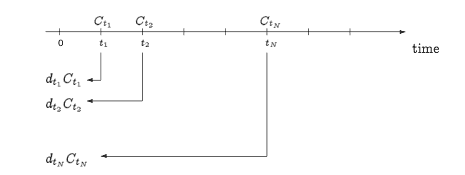

为了使其适用于任何未来日期 t 收到的现金流，我们可能需要无限数量的贴现因子 d_t。这不可行，因此需要找到一种更低维的方法来近似 d_t，但要比极其强的假设更具灵活性，即只有一个固定利率 r，并且任何时间 t 的贴现因子要么计算为 d_t = 1/(1+r)^t（离散复利），要么计算为 d_t = e^{-rt}（连续复利），我们在前一章中使用了这些。

在本章中，我们首先表明，这种贴现因子的近似可以直接用贴现因子、利率或远期利率来表示。这些都是制定期限结构的有用方法，并且可以使用其中任何一种，因为这三者之间存在一对一的转换。然后，我们将展示 C++ 的一个特性，即能够创建作为对象或类的抽象数据类型，对于定义和使用期限结构这一特定应用非常有用。事实上，正是这种特定应用，即创建期限结构类，真正说明了 C++ 的强大之处，以及为什么对于许多金融计算，你希望使用面向对象语言，而不是像 FORTRAN 和 C 这样的经典语言，或者像 Gauss 或 Matlab 这样的矩阵语言。

### 5.1 贴现因子、即期利率和远期利率的可互换性

期限结构可以用贴现因子、即期利率或远期利率来指定。贴现因子是未来（时间 t）支付一美元的当前价格。要找到现金流 C_t 的当前价值 PV，我们计算 PV = d_t C_t。这个贴现因子也可以用利率来指定，其中我们让 r_t 成为贴现 t 期现金流的相关利率（即期利率）。然后我们知道现值 PV = e^{-r_t t} C_t。由于这两种计算现值的方法必须一致，

```
PV = d_t C_t = e^{-r_t t} C_t
```

因此

```
d_t = e^{-r_t t}
```

请注意，此方程在给定 r_t 时计算 d_t。重新排列此方程，我们可以用贴现因子表示即期利率 r_t

```
r_t = \frac{-\ln(d_t)}{t}
```

一个非常有用的替代概念是远期利率，即在未来某个日期 t_1 借款并在稍后日期 t_2 偿还的收益率。让 f_{t_1, t_2} 成为这个利率。如果我们今天投资一美元，直到 t_1 期按当前即期利率，以及从 t_1 到 t_2 期间按远期利率（这是进行实际投资所必须做的），你将获得以下未来价值

```
FV = e^{r_{t_1} t_1} e^{f_{t_1, t_2} (t_2 - t_1)}
```

使用时间 t_2 的贴现因子对这个远期价值的现值必须等于一：

```
d_{t_2} FV = 1
```

这些考虑足以计算相关的转换。在时间 t_1 借款并在时间 t_2 交付的远期利率计算为

```
f_{t_1, t_2} = \frac{-\ln\left(\frac{d_{t_2}}{d_{t_1}}\right)}{t_2 - t_1} = \frac{\ln\left(\frac{d_{t_1}}{d_{t_2}}\right)}{t_2 - t_1}
```

远期利率也可以直接从收益率计算为

```
f_{t_1, t_2} = r_{t_2} \frac{t_2}{t_2 - t_1} - r_{t_1} \frac{t_1}{t_2 - t_1}
```


$d_t = e^{-r_t t}$

$r_t = \frac{-\ln(d_t)}{t}$

$f_{t_1, t_2} = \frac{\ln(\frac{d_{t_1}}{d_{t_2}})}{t_2 - t_1}$

$f_{t_1, t_2} = r_{t_2} \frac{t_2}{t_2 - t_1} - r_{t_1} \frac{t_1}{t_2 - t_1}$

符号：$d_t$ 时间 $t$ 付款的贴现因子，$r_t$：适用于时间 $t$ 现金流的即期利率。$f_{t_1, t_2}$ 时间 $t_1$ 和 $t_2$ 之间的远期利率，即你今天同意用于未来交易的利率。

```
#include <cmath>
using namespace std;
double term_structure_yield_from_discount_factor(const double& d, const double& t) {
return (-log(d)/t);
}
double term_structure_discount_factor_from_yield(const double& r, const double& t) {
return exp(-r*t);
};
double term_structure_forward_rate_from_discount_factors(const double& d1, const double& d2,
const double& time) {
return (log (d1/d2))/time;
};
double term_structure_forward_rate_from_yields(const double& r1, const double& r2,
const double& t1, const double& t2) {
return r2*t2/(t2-t1)-r1*t1/(t2-t1);
};
```

C++ 代码 5.1：期限结构转换

C++ 代码 5.1 展示了这些转换的实现。

### 示例

给定一期期限结构即期利率 $r_1 = 5\%$ 和两期贴现因子 $d_2 = 0.9$。计算两期即期利率以及从 1 到 2 的远期利率。

### C++ 程序：

```
double t1=1; double r1=0.05; double d1=term_structure_discount_factor_from_yield(r1,t1);
cout << " a " << " < t1 < " << " period spot rate of " << r1
<< " corresponds to a discount factor of " << d1 << endl;

double t2=2; double d2 = 0.9;
double r2 = term_structure_yield_from_discount_factor(d2,t2);
cout << " a " << " < t2 < " << " period discount factor of " << d2
<< " corresponds to a spot rate of " << r2 << endl;

cout << " the forward rate between " << t1 << " " << " and " << t2
<< " using " << " term_structure_forward_rate_from_discount_factors(d1,d2,t2-t1) is " << term_structure_forward_rate_from_discount_factors(d1,d2,t2-t1)
<< endl;
cout << " and is " << term_structure_forward_rate_from_yields(r1,r2,t1,t2)
<< " using yields" << endl;
```

### C++ 程序输出：

```
a 1 period spot rate of 0.05 corresponds to a discount factor of 0.951229
a 2 period discount factor of 0.9 corresponds to a spot rate of 0.0526803
the forward rate between 1 and 2 is 0.0553605 using discount factors
and is 0.0553605 using yields
```

## 5.2 将期限结构作为对象

从前面可以看出，期限结构可以用贴现因子、即期利率或远期利率来描述，但这并不能帮助我们解决维度问题。如果从贴现因子的角度思考，要对当前期限结构进行完全说明，需要无限多个贴现因子 $\{d_t\}_{t \in R+}$。也许将这组贴现因子视为一个函数 d(t) 更容易理解，该函数给定非负时间 t，返回贴现因子。既然我们已经确立了定义期限结构的三种等价方式——贴现因子、即期利率和远期利率，因此我们可以将期限结构描述为三个不同函数的集合，它们对同一底层对象提供不同的视图。

期限结构是一个抽象对象，对用户而言应提供

- 贴现因子 d（零息债券价格）。
- 即期利率 r（零息债券收益率）。
- 远期利率 f

针对任何未来到期期限 t。期限结构的用户不需要知道期限结构是如何实现的，只需要一个指定上述三个函数的接口。

这非常适合作为 C++ 类来实现。在 C++ 术语中，类是一组数据结构和操作这些数据结构的函数。在当前语境下，它是指定这三个函数的一种方式。

```
r(t)
d(t)
f(t)
```

### 5.2.1 基类

头文件 5.1 展示了如何将通用期限结构描述为 C++ 类。

```
#ifndef _TERM_STRUCTURE_CLASS.H_
#define _TERM_STRUCTURE_CLASS.H_
class term_structure_class {
public:
    virtual double r(const double& t) const; // yield on zero coupon bond
    virtual double d(const double& t) const; // discount factor/price of zero coupon bond
    virtual double f(const double& t1, const double& t2) const; // forward rate
};
// term_structure.class();
#endif
```

头文件 5.1：描述 term_structure 基类的头文件

这些函数的代码使用了本章前面描述的用于在期限结构各种视图之间转换的算法。期限结构类仅为这些算法提供一个方便的接口。代码如 C++ 代码 5.2 所示

请注意，计算定义是循环的。任何给定的特定类型期限结构都必须至少重写函数 r（收益率）、d（贴现因子）或 f（远期利率）中的一个。

接下来我们考虑两个特定期限结构的示例。

```
#include "fin_recipes.h"

term_structure_class::term_structure_class(){};

double term_structure_class::f(const double& t1, const double& t2) const{
  double d1 = d(t1);
  double d2 = d(t2);
  return term_structure_forward_rate_from_discount_factors(d1,d2,t2-t1);
};

double term_structure_class::r(const double& t) const{
  return term_structure_yield_from_discount_factor(d(t),t);
};

double term_structure_class::d(const double& t) const {
  return term_structure_discount_factor_from_yield(r(t),t);
};
```

C++ 代码 5.2：期限结构类中贴现因子、即期利率和远期利率之间转换的默认代码

### 5.2.2 平坦期限结构。

平坦期限结构重写了基类的收益率成员函数。这种类型的期限结构只需要一个利率这一数据。

```
#ifndef _TERM_STRUCTURE_CLASS_FLAT_
#define _TERM_STRUCTURE_CLASS_FLAT_

#include "term_structure_class.h"

class term_structure_class_flat : public term_structure_class {
private:
    double R_; // interest rate
public:
    term_structure_class_flat(const double& r);
    virtual double r(const double& t) const;
    void set_int_rate(const double& r);
};

#endif
```

头文件 5.2：使用平坦期限结构的期限结构类头文件

```
#include "fin_recipes.h"

term_structure_class_flat::term_structure_class_flat(const double& r) { R_ = r; };

term_structure_class_flat::~term_structure_class_flat(){};

double term_structure_class_flat::r(const double& T) const { if (T>=0) return R_; return 0; };

void term_structure_class_flat::set_int_rate(const double& r) { R_ = r; };
```

C++ 代码 5.3：使用平坦期限结构实现期限结构类

### 示例

期限结构为平坦，r = 5%。确定第 1 年和第 2 年的贴现因子以及 1 到 2 之间的远期利率。

C++ 程序：

```
term_structure_class_flat ts(0.05);
double t1=1;
cout << "discount factor t1 = " << t1 << "," << ts.d(t1) << endl;
double t2=2;
cout << "discount factor t2 = " << t2 << "," << ts.d(t2) << endl;
cout << "spot rate t = " << t1 << " = " << ts.r(t1) << endl;
cout << "spot rate t = " << t2 << " = " << ts.r(t2) << endl;
cout << "forward rate from t1= " << t1 << " to t2= " << t2 << "," << ts.f(t1,t2) << endl;
```

C++ 程序输出：

```
discount factor t1 = 1:0.951229
discount factor t2 = 2:0.904837
spot rate t = 1:0.05
spot rate t = 2:0.05
forward rate from t1= 1 to t2= 2:0.05
```

## 5.3 使用当前观察到的期限结构。

构建一般期限结构的第一步是使用债券价格和利率的市场数据来推断贴现因子。表达此问题的最简单方式是使用线性代数。假设我们有三种债券，现金流分别发生在时间 1、2 和 3。

```
B_1 = d_1 C_{11} + d_2 C_{12} + d_3 C_{13}
B_2 = d_1 C_{21} + d_2 C_{22} + d_3 C_{23}
B_3 = d_1 C_{31} + d_2 C_{32} + d_3 C_{33}
```

用矩阵表示

```
\begin{bmatrix} B_1 \\ B_2 \\ B_3 \\ \end{bmatrix} = \begin{bmatrix} d_1 \\ d_2 \\ d_3 \\ \end{bmatrix} \begin{bmatrix} C_{11} & C_{12} & C_{13} \\ C_{21} & C_{22} & C_{23} \\ C_{31} & C_{32} & C_{33} \\ \end{bmatrix}
```

求解贴现因子

```
\begin{bmatrix} d_1 \\ d_2 \\ d_3 \\ \end{bmatrix} = \begin{bmatrix} C_{11} & C_{12} & C_{13} \\ C_{21} & C_{22} & C_{23} \\ C_{31} & C_{32} & C_{33} \\ \end{bmatrix}^{-1} \begin{bmatrix} B_1 \\ B_2 \\ B_3 \\ \end{bmatrix}
```

或

```
d = C^{-1}B
```

使用明显的矩阵定义

```
B = \begin{bmatrix} B_1 \\ B_2 \\ B_3 \\ \end{bmatrix} \quad d = \begin{bmatrix} d_1 \\ d_2 \\ d_3 \\ \end{bmatrix} \quad C = \begin{bmatrix} C_{11} & C_{12} & C_{13} \\ C_{21} & C_{22} & C_{23} \\ C_{31} & C_{32} & C_{33} \\ \end{bmatrix}
```

### 示例

观察到以下债券和债券价格：

| 债券 | 债券价格 | 0 | 0.5 | 1 | 1.5 | 2 | 3 | 4 |
|---|---|---|---|---|---|---|---|---|
| 1 | 98 | | 100 | | | | | |
| 2 | 96 | | | 100 | | | | |
| 3 | 92 | | | | 100 | | | |
| 4 | 118 | | 10 | 10 | 10 | 110 | | | |
| 5 | 109 | | 8 | 8 | 8 | 8 | | 108 |
| 6 | 112 | | 9 | 9 | 9 | 9 | 9 | 109 |

这些债券是国债证券，可以被视为名义上无风险。

- 1. 对于哪些到期期限可以推断贴现因子？
- 2. 确定市场中的隐含贴现因子。
- 3. 这一组贴现率隐含的利率是多少？

在这里，我们可以找到到期期限为 0.5、1、1.5、2、3 和 4 的贴现因子。


Matlab 程序：
```
C=[100 0 0 0 0 0 100 0 0 0 0; 0 100 0 0 0 10 10 110 0 0 8 8 8 108 0 9 9 9 9 109]
B=[96 94 92 118 109 112]
d=B'*inv(C)'
t=[0.5 1 1.5 2 3 4]
r=d.^(-1./t)-1
----------------
Matlab 程序输出：
C =
100 0 0 0 0 0
0 100 0 0 0 0
0 0 100 0 0 0
10 10 10 110 0 0
8 8 8 8 108 0
9 9 9 9 9 109
B =
96 94 92 118 109 112
d =
0.96000 0.94000 0.92000 0.81636 0.73990 0.66618
t =
0.50000 1.00000 1.50000 2.00000 3.00000 4.00000
r =
0.085069 0.063830 0.057162 0.106772 0.105628 0.106884
```

若要仅使用当前的期限结构，我们需要获取市场上观察到的贴现因子（\(d_t\)）的观测值，并利用这些值生成期限结构。做到这一点最简单的方法是对当前可观察的贴现因子进行线性插值。

## 5.3.1 线性插值

如果给定各种期限的贴现因子（\(d_t\)）集合，构建期限结构最简单的方法是，在我们已有的观测值之间进行简单的线性插值，以找到中间时间点。对于许多目的来说，这“足够好了”。这种插值可以基于零息债券收益率、贴现因子或远期利率，我们以现货（零息）利率的线性插值为例进行说明。

计算机算法，收益率的线性插值。请注意，该算法假设收益率按到期时间递增的顺序排列。

### 示例

你观察到以下现货利率期限结构

| 时间 | r |
|---|---|
| 0.1 | 0.1 |
| 0.5 | 0.2 |
| 1 | 0.3 |
| 5 | 0.4 |
| 10 | 0.5 |

在时间 0.1、0.5、1、3、5 和 10 处插值现货利率（零利率）。

## C++ 代码 5.4：从现货利率插值得到的期限结构

```
#include <vector>
using namespace std;
#include "fin_recipes.h"

double term_structure_yield_linearly_interpolated(const double& time,
                                                 const vector<double>& obs_times,
                                                 const vector<double>& obs_yields) {
    // assume the yields are in increasing time to maturity order.
    int no_obs = int(obs_times.size());
    if (no_obs == 1) return 0;
    double t_min = obs_times[0];
    if (time <= t_min) return obs_yields[0]; // earlier than lowest obs.
    double t_max = obs_times[no_obs-1];
    if (time >= t_max) return obs_yields[no_obs-1]; // later than latest obs
    int t=1; // find which two observations we are between.
    while ( (t<no_obs) && (time>obs_times[t]) ) { ++t; };
    double lambda = (obs_times[t]-time)/(obs_times[t]-obs_times[t-1]);
    // by ordering assumption, time is between t-1,t
    double r = obs_yields[t-1] * lambda + obs_yields[t] * (1.0-lambda);
    return r;
};
```

```
C++ program:

vector<double> times;
vector<double> yields;
times.push_back(0.1); times.push_back(0.5); times.push_back(1);
times.push_back(0.1); yields.push_back(0.1); yields.push_back(0.2); yields.push_back(0.3);
times.push_back(0.5); times.push_back(10);
times.push_back(0.4); yields.push_back(0.5);
cout << " yields at times: " << endl;
cout << " t=0.1 " << term_structure_yield_linearly_interpolated(0.1,times,yields) << endl;
cout << " t=0.5 " << term_structure_yield_linearly_interpolated(0.5,times,yields) << endl;
cout << " t=1 " << term_structure_yield_linearly_interpolated(1,times,yields) << endl;
cout << " t=3 " << term_structure_yield_linearly_interpolated(3,times,yields) << endl;
cout << " t=5 " << term_structure_yield_linearly_interpolated(5,times,yields) << endl;
cout << " t=10 " << term_structure_yield_linearly_interpolated(10,times,yields) << endl;

Output from C++ program:

yields at times:
t=0.1 0.1
t=0.5 0.2
t=1 0.3
t=3 0.35
t=5 0.4
t=10 0.5
```

## 5.3.2 插值期限结构类

此处实现的插值期限结构以一组收益率观测值为基础，对于介于观测值之间的情况，将在两个最近的观测值之间进行插值。以下仅提供收益率计算的实现，另外两项则依赖基类代码。

如头文件 5.3 和 C++ 代码 5.5 所示，这里涉及更多的簿记工作，需要有代码来存储时间和收益率的观测值。

```
#ifndef _TERM_STRUCTURE_CLASS_INTERPOLATED_
#define _TERM_STRUCTURE_CLASS_INTERPOLATED_

#include "term_structure_class.h"
#include <vector>
using namespace std;

class term_structure_class_interpolated : public term_structure_class {
private:
    vector<double> times_; // use to keep a list of yields
    vector<double> yields_;
    void clear();
public:
    term_structure_class_interpolated();
    term_structure_class_interpolated(const vector<double>& times, const vector<double>& yields);
    virtual ~term_structure_class_interpolated();
    term_structure_class_interpolated(const term_structure_class_interpolated&);
    term_structure_class_interpolated& operator= (const term_structure_class_interpolated&);
    int no_observations() const { return times_.size(); };
    virtual double r(const double& T) const;
    void set_interpolated_observations(vector<double>& times, vector<double>& yields);
};
#endif
```

头文件 5.3：描述使用现货利率之间线性插值的期限结构类的头文件

```
#include "fin_recipes.h"

void term_structure_class_interpolated::clear(){
    times_.erase(times_.begin(), times_.end());
    yields_.erase(yields_.begin(), yields_.end());
};

term_structure_class_interpolated::term_structure_class_interpolated(){clear();};

term_structure_class_interpolated::term_structure_class_interpolated(const vector<double>& in_times,
                                                 const vector<double>& in_yields){
    clear();
    if (in_times.size()!=in_yields.size()) return;
    times_ = vector<double>(in_times.size());
    yields_ = vector<double>(in_yields.size());
    for (int i=0;i<in_times.size();i++){
        times_[i]=in_times[i];
        yields_[i]=in_yields[i];
    };
};

term_structure_class_interpolated::term_structure_class_interpolated(const term_structure_class_interpolated& term){
    times_ = vector<double>(term.no_observations());
    yields_ = vector<double>(term.no_observations());
    for (int i=0;i<term.no_observations();i++){
        times_[i] = term.times_[i];
        yields_[i] = term.yields_[i];
    };
};

term_structure_class_interpolated::operator=(const term_structure_class_interpolated& term){
    times_ = vector<double>(term.no_observations());
    yields_ = vector<double>(term.no_observations());
    for (int i=0;i<term.no_observations();i++){
        times_[i] = term.times_[i];
        yields_[i] = term.yields_[i];
    };
    return (*this);
};

double term_structure_class_interpolated::r(const double& T) const {
    return term_structure_yield_linearly_interpolated(T, times_, yields_);
};

void term_structure_class_interpolated::set_interpolated_observations(vector<double>& in_times,
                                                 vector<double>& in_yields){
    clear();
    if (in_times.size()!=in_yields.size()) return;
    times_ = vector<double>(in_times.size());
    yields_ = vector<double>(in_yields.size());
    for (int i=0;i<in_times.size();i++){
        times_[i]=in_times[i];
        yields_[i]=in_yields[i];
    };
};
```

| 时间 | r |
|---|---|
| 0.1 | 0.05 |
| 1 | 0.07 |
| 5 | 0.08 |

确定时间 1 和 2 处的贴现因子和现货利率，以及 1 到 2 之间的远期利率。

```
C++ program:
vector<double> times; times.push_back(0.1);
vector<double> spotrates; spotrates.push_back(0.05);
times.push_back(1); times.push_back(5);
spotrates.push_back(0.07);spotrates.push_back(0.08);
term_structure_class_interpolated ts(times,spotrates);
double t1=1;
cout <<"discount factor t1 = " << t1 << " : " << ts.d(t1) << endl;
double t2=2;
cout <<"discount factor t2 = " << t2 << " : " << ts.d(t2) << endl;
cout << "spot rate t = " << t1 << " : " << ts.r(t1) << endl;
cout << "spot rate t = " << t2 << " : " << ts.r(t2) << endl;
cout << "forward rate from t1= " << t1 << " to t2= " << t2 << " : "
<< ts.f(t1,t2) << endl;
```

C++ 程序输出：
贴现因子 t1 = 1:0.932394
贴现因子 t2 = 2:0.865022
现货利率 t = 1:0.07
现货利率 t = 2:0.0725
从 t1= 1 到 t2= 2 的远期利率:0.075


## 5.4 采用一般期限结构和连续复利的债券计算

在时间 \(t_1, t_2, \dots\) 支付票息的附息债券：
债券价格 \(B_0\)：
\(B_0 = \sum_i d_i C_{t_i} = \sum_i e^{-r_{t_i} t_i} C_{t_i}\)
久期 \(D\)：
\(D = \frac{1}{B_0} \sum_i t_i d_i C_{t_i}\)
\(D = \frac{1}{B_0} \sum_i t_i e^{-r_{t_i} t_i} C_{t_i}\)
\(D = \frac{1}{B_0} \sum_i t_i e^{-y t_i} C_{t_i}\)

到期收益率 \(y\) 满足：
\(B_0 = \sum_i C_{t_i} e^{-y t_i}\)
凸性 \(Cx\)：
\(Cx = \frac{1}{B_0} \sum_i t_i^2 d_i C_{t_i}\)
\(Cx = \frac{1}{B_0} \sum_i t_i^2 e^{-r_{t_i} t_i} C_{t_i}\)
\(Cx = \frac{1}{B_0} \sum_i t_i^2 e^{-y t_i} C_{t_i}\)

### 公式 5.1：采用连续复利期限结构的债券定价

C++ 代码 5.6 和 C++ 代码 5.7 说明了如果拥有期限结构类，如何计算债券价格和久期。

```cpp
#include "fin_recipes.h"

double bonds_price(const vector<double>& times,
                   const vector<double>& cashflows,
                   const term_structure_class& d) {
    double p = 0;
    for (unsigned i=0; i<cashflow_times.size(); i++) {
        p += d.d(cashflow_times[i])*cashflows[i];
    }
    return p;
}
```

### C++ 代码 5.6：使用期限结构类对债券定价

```cpp
#include "fin_recipes.h"

double bonds_duration(const vector<double>& cashflow_times,
                      const vector<double>& cashflow_amounts,
                      const term_structure_class& d ) {
    double S=0;
    double D1=0;
    for (unsigned i=0;i<cashflow_times.size();i++){
        S += cashflow_amounts[i] * d.d(cashflow_times[i]);
        D1 += cashflow_times[i] * cashflow_amounts[i] * d.d(cashflow_times[i]);
    }
    return D1/S;
}
```

### C++ 代码 5.7：使用期限结构类计算债券久期

```cpp
#include "fin_recipes.h"
#include <cmath>

double bonds_convexity(const vector<double>& cashflow_times,
                       const vector<double>& cashflow_amounts,
                       const term_structure_class& d ) {
    double B=0;
    double Cx=0;
    for (unsigned i=0;i<cashflow_times.size();i++){
        B += cashflow_amounts[i] * d.d(cashflow_times[i]);
        Cx += pow(cashflow_times[i],2) * cashflow_amounts[i] * d.d(cashflow_times[i]);
    }
    return Cx/B;
}
```

### C++ 代码 5.8：使用期限结构类计算债券凸性

### 示例

期限结构为平坦，r = 10% 连续复利。计算一只 10%、2 年期债券的价格、久期和凸性。

```cpp
C++ program:
vector <double> times; times.push_back(1); times.push_back(2);
vector <double> cashflows; cashflows.push_back(10); cashflows.push_back(110);
term_structure_class tsfalt = flat_ts(0.1);
cout << " price = " << bonds_price(times, cashflows, tsfalt) << endl;
cout << " duration = " << bonds_duration(times, cashflows, tsfalt) << endl;
cout << " convexity = " << bonds_convexity(times, cashflows, tsfalt) << endl;
Output from C++ program:
price = 99.1088
duration = 1.9087
convexity = 3.72611
```

参考文献 Shiller (1990) 是关于期限结构应用的良好参考。

## 第 6 章

## 均值-方差边界

## 目录

- 6.1 设置 .................................................... 67
- 6.2 最小方差边界 ........................ 69
- 6.3 边界组合计算 ................... 69
- 6.4 全局最小方差组合 ................ 72
- 6.5 有效组合 ................................... 72
- 6.6 零贝塔组合 ................................ 73
- 6.7 考虑无风险资产 .......................... 73
- 6.8 含无风险资产的有效集 ................... 74
- 6.9 卖空约束 ................................. 75
- 6.10 夏普比率 ...................................... 75
- 6.11 均衡：CAPM ..................................... 76
  - 6.11.1 特雷诺 ........................................... 76
  - 6.11.2 詹森 ............................................ 76
- 6.12 使用均值-方差和 CAPM ................. 76
- 6.13 使用矩阵库进行均值-方差分析 ....... 77

我们现在讨论金融中的一个经典主题：均值-方差分析。这引出了考虑现金流风险性的方法。

均值-方差分析关注投资者在风险资产组合之间的选择，以及投资者如何选择组合权重。设 r_p 为组合收益率。我们假设投资者对组合 p 的偏好满足均值-方差效用表示，u(p) = u(E[r_p], \sigma(r_p))，效用随预期收益增加而增加（\partial u / \partial E[r_p] > 0），随方差增加而减少（\partial u / \partial \text{var}(r_p) < 0）。在此部分，我们考虑此类决策者的组合机会集的表示。该机会集具有若干有用特性，这些特性纯粹源于优化问题的数学表述。我们在此关注这些特性。

## 6.1 设置

我们假设存在 n \ge 2 种风险证券，其预期收益为 e

\[
e = \begin{bmatrix} E[r_1] \\ E[r_2] \\ \vdots \\ E[r_n] \end{bmatrix}
\]

和协方差矩阵 V：

\[
\mathbf{V} = \begin{bmatrix} \sigma(r_1, r_1) & \sigma(r_1, r_2) & \dots \\ \sigma(r_2, r_1) & \sigma(r_2, r_2) & \dots \\ \vdots & & \\ \sigma(r_n, r_1) & & \dots & \sigma(r_n, r_n) \end{bmatrix}
\]

假设协方差矩阵 V 可逆。

组合 \(\rho\) 由投资于风险资产的一组权重 w 定义。

\[
\mathbf{w} = \begin{bmatrix} \omega_1 \\ \omega_2 \\ \vdots \\ \omega_n \end{bmatrix}
\]

其中 \(w_i\) 是投资于资产 \(i\) 的投资者财富比例。注意权重之和为一。

组合的预期收益计算如下

\(E[r_p] = \mathbf{w}'\mathbf{e}\)

组合的方差为

\(\sigma^2(r_p) = \mathbf{w}'\mathbf{Vw}\)

### 示例

| t | 资产 | E[r] | \(\sigma^2(r)\) |
|---|---|---|---|
| 1 | | 10% | 0.20 |
| 2 | | 11.5% | 0.10 |
| 3 | | 8% | 0.15 |

这三种资产相互独立（不相关）。

- 1. 确定三种资产等权重组合的预期收益和标准差

```
Matlab program:
e=[0.1 0.11 0.08]
V=[0.2 0.0 0.0; 0.0 0.1 0 ; 0 0 0.15]
w=1/3*[1 1 1]
er = w*e'
sigma=sqrt(w*V*w*')
Output from Matlab program:
e =
 0.10000 0.11000 0.08000
V =
 0.20000 0.00000 0.00000
 0.00000 0.10000 0.00000
 0.00000 0.00000 0.15000
w =
 0.33333 0.33333 0.33333
er = 0.096667
sigma = 0.22361
```

## 6.2 最小方差边界

如果一个组合在给定预期收益下使方差最小化，则称其为*边界*组合，即边界组合 $p$ 求解

$$
\mathbf{w}_p = \arg \min_{\mathbf{w}} \frac{1}{2} \mathbf{w}' \mathbf{V} \mathbf{w}
$$

约束条件为：

$$
\mathbf{w}' \mathbf{e} = E[\bar{r}_p]
$$

$$
\mathbf{w}' \mathbf{1} = 1
$$

所有边界组合的集合称为*最小方差边界*。

## 6.3 边界组合计算

**提议 1** 如果矩阵 $\mathbf{V}$ 满秩，且没有卖空限制，则均值为 $E[\bar{r}_p]$ 的边界组合 $p$ 的权重 $\mathbf{w}_p$ 可表示为

$$
\mathbf{w}_p = \mathbf{g} + \mathbf{h} E[\bar{r}_p]
$$

其中

$$
\mathbf{g} = \frac{1}{D} (B\mathbf{1} - A\mathbf{e}') \mathbf{V}^{-1}
$$

$$
\mathbf{h} = \frac{1}{D} (C\mathbf{e} - A\mathbf{1}') \mathbf{V}^{-1}
$$

$$
A = \mathbf{1}' \mathbf{V}^{-1} \mathbf{e}
$$

$$
B = \mathbf{e}' \mathbf{V}^{-1} \mathbf{e}
$$

$$
C = \mathbf{1}' \mathbf{V}^{-1} \mathbf{1}
$$

$$
\mathbf{\Lambda} = \begin{bmatrix} B & A \\ A & C \end{bmatrix}
$$

$$
D = BC - A^2 = |\mathbf{\Lambda}|
$$

**证明**

任何最小方差组合都求解以下规划问题

$$
\mathbf{w}_p = \arg \min_{\mathbf{w}} \frac{1}{2} \mathbf{w}' \mathbf{V} \mathbf{w}
$$

约束条件为

$$
\mathbf{w}' \mathbf{e} = E[\bar{r}_p]
$$

$$
\mathbf{w}' \mathbf{1} = 1
$$

为此问题构建拉格朗日函数

$$
L(\mathbf{w}, \lambda, \gamma | \mathbf{e}, \mathbf{V}) = \frac{1}{2} \mathbf{w}' \mathbf{V} \mathbf{w} - \lambda \left( E[\bar{r}_p] - \mathbf{w}' \mathbf{e} \right) - \gamma (1 - \mathbf{w}' \mathbf{1})
$$


## 求导

$$
\frac{\partial L}{\partial w} = \mathbf{w}'\mathbf{V} - \lambda \mathbf{e}' - \gamma \mathbf{1}' = 0
$$

$$
\frac{\partial L}{\partial \lambda} = E[r_p] - \mathbf{w}'\mathbf{e} = 0
$$

$$
\frac{\partial L}{\partial \gamma} = 1 - \mathbf{w}'\mathbf{1} = 0
$$

将上述条件改写为（注意这要求 V 可逆）。

$$
\mathbf{w}' = \lambda \mathbf{e}' \mathbf{V}^{-1} - \gamma \mathbf{1}' \mathbf{V}^{-1} \tag{6.1}
$$

$$
\mathbf{w}'\mathbf{e} = E[r_p] \tag{6.2}
$$

$$
\mathbf{w}'\mathbf{1} = 1 \tag{6.3}
$$

用 e 对方程 (6.1) 右乘，并识别第二个方程中 \( E[r_p] \) 的表达式

$$
\mathbf{w}'\mathbf{e} = \lambda \mathbf{e}' \mathbf{V}^{-1} \mathbf{e} + \gamma \mathbf{1}' \mathbf{V}^{-1} \mathbf{e}
$$

同样地，用 1 对方程 (6.1) 右乘，并识别第三个方程中 1 的表达式

$$
\mathbf{w}'\mathbf{1} = 1 = \lambda \mathbf{e}' \mathbf{V}^{-1} \mathbf{1} + \gamma \mathbf{1}' \mathbf{V}^{-1} \mathbf{1}
$$

根据上述 A、B、C 和 D 的定义，这变成了以下方程组

$$
\left\{\begin{array}{l l }
E[r_p] = \lambda B + \gamma A \\
1 = \lambda A + \gamma C
\end{array}\right.
$$

求解 \(\lambda\) 和 \(\gamma\)，得到

$$
\gamma = \frac{B - A E[r_p]}{D}
$$

$$
\lambda = \frac{C E[r_p] - A}{D}
$$

将 \(\lambda\) 和 \(\gamma\) 的表达式代入上述方程 (6.1)，得到

$$
\mathbf{w}' = \frac{1}{D} \left( B \mathbf{1}' - A \mathbf{e}' \right) \mathbf{V}^{-1} + \frac{1}{D} \left( C \mathbf{e}' - A \mathbf{1}' \right) \mathbf{V}^{-1} E[r_p] = \mathbf{g} + h E[r_p]
$$

由权重 g 定义的投资组合是预期收益为 0 的投资组合。由权重 \( (\mathbf{g} + \mathbf{h}) \) 定义的投资组合是预期收益为 1 的投资组合。这意味着有用的性质 \(\mathbf{g}'\mathbf{1} = 1\)，且 \(\mathbf{h}'\mathbf{1} = 0\)。

## 示例

投资者可以投资于三种资产，其预期收益和方差如下表所示。

| t | 资产 | E[r] | \(\sigma^2(r)\) |
|---|---|---|---|
| 1 | | 10% | 0.20 |
| 2 | | 11.5% | 0.10 |
| 3 | | 8% | 0.15 |

这三种资产相互独立（不相关）。

- 1. 均值为 9% 的最小方差投资组合的权重是多少？

## Matlab 程序：

```
e=[0.1 0.11 0.08];
V=[0.2 0 0; 0 0.1 0 ; 0 0 0.15]
r=0.09
n = length(e)
a = ones(1,n)*inv(V)*e
b = e'*inv(V)*e
c = ones(1,n)*inv(V)*ones(n,1)
A = [b ; c]
d = det(A)
g = 1/(d*(b*ones(1,n) - a*e'))*inv(V)
h = h = 1/(d*(c*e' - a*ones(1,n)))*inv(V)
w=g+h*r;
```

## Matlab 程序输出：

```
e =
    0.100000
    0.110000
    0.080000
V =
    0.200000  0.000000  0.000000
    0.000000  0.100000  0.000000
    0.000000  0.000000  0.150000
r =  0.090000
n =  3
a =  2.1333
b =  0.21367
c =  21.667
A =
    0.21367   2.13333
    2.13333   21.66667
d =  0.078333
g =
    0.021277  -2.680851   3.659574
h =
    2.1277   31.9149  -34.0426
w =
    0.21277   0.19149   0.59574
```

此计算被放入 Matlab Code 6.1 中的一个 Matlab 函数。

```
function w = min_variance_portfolio(e,V,r)
n = length(e);
a = ones(1,n)*inv(V)*e;
b = e'*inv(V)*e;
c = ones(1,n)*inv(V)*ones(n,1);
A = [b ; c];
d = det(A);
g = 1/(d*(b*ones(1,n) - a*e'))*inv(V);
h = h = 1/(d*(c*e' - a*ones(1,n)))*inv(V);
w=g+h*r;
end
```

## Matlab 代码 6.1：给定收益的最小方差投资组合计算

## 给定利率下计算最小方差投资组合的权重

```
w_p = g + h E[r_p]
```

其中

```
g = \frac{1}{D} (B1' - Ae') V^{-1}
h = \frac{1}{D} (Ce' - A1') V^{-1}
A = 1'V^{-1}e
B = e'V^{-1}e
C = 1'V^{-1}1
D = BC - A^2 =
```

符号说明：r_p 所需投资组合收益；V：资产收益协方差矩阵；e：预期资产收益向量。

## 6.4 全局最小方差投资组合

无论预期收益如何，使方差最小化的投资组合称为全局最小方差投资组合。设 mvp 为全局最小方差投资组合。

### 提议 2（全局最小方差投资组合）全局最小方差投资组合的权重为

```
w'_{mvp} = (1'V^{-1}1)^{-1} 1'V^{-1} = \frac{1}{C} 1'V^{-1},
```

预期收益 E[r_{mvp}] = \frac{A}{C} 和方差 var(r_{mvp}) = \frac{1}{C}。

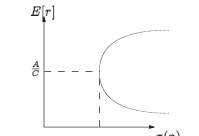

## 6.5 有效投资组合

最小方差前沿上预期收益高于或等于 E[r_{mvp}] 的投资组合称为有效投资组合。

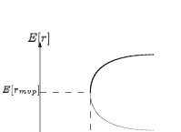

## 6.6 零贝塔投资组合

### 提议 3 对于前沿上的任何投资组合 p，存在一个前沿投资组合 zc(p)，满足

$$cov(r_{zc(p)}, r_p) = 0.$$

该投资组合相对于 p 称为零贝塔投资组合。零贝塔投资组合 zb(p) 的收益为

$$E[r_{zc(p)}] = \frac{A}{C} - \frac{\frac{D}{C}}{E[r_p] - \frac{A}{C}}$$

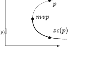

注意，如果 p 是均值方差前沿上的有效投资组合，则 zc(p) 是无效的。反之，如果 p 是无效的，则 zc(p) 是有效的。

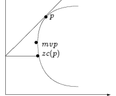

## 6.7 允许无风险资产。

假设我们有 N 个风险资产，权重为 w，以及一个收益为 r_f 的无风险资产。

直观地，混合风险资产和无风险资产的投资组合收益可以写为

$$E[r_p] = \text{weight in risky} \times \text{return risky} + \text{weight riskless} \times r_f$$

其向量形式为：

$$E[r_p] = w'e + (1 - w'1)r_f$$

### 提议 4 在存在无风险资产的情况下，有效投资组合的权重为

$$w_p = V^{-1}(e - 1r_f) \frac{E[r_p] - r_f}{H}$$

其中

$$H = (e - 1r_f)'V^{-1}(e - 1r_f)$$

有效投资组合的方差为

$$
\sigma^2(r_p) = \frac{(E[r_p] - r_f)^2}{H}
$$

注意，标准差是 \(E[r_p]\) 的线性函数。有效集合在均值-标准差空间中是一条直线。

## 6.8 带有无风险资产的有效集合。

假设 \(r_f < \frac{A}{C}\)。那么有效集合是从 \((0, r_f)\) 出发，经过风险资产有效集合切点的直线。

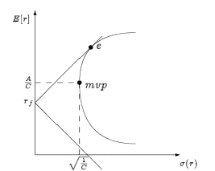

假设 \(r_f > \frac{A}{C}\)。那么有效集合是从 \((0, r_f)\) 出发的两条半直线。

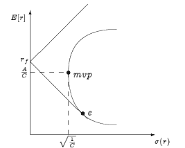

如果 \(r_f = \frac{A}{C}\)，则无风险资产的权重为 1。风险投资组合是零投资投资组合。有效集合由通向风险资产有效集合的两条渐近线组成。

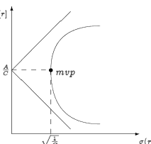

## 6.9 禁止卖空约束

迄今为止，分析未对定义最小方差前沿的权重集合 \(w_p\) 施加任何限制。对于实际应用，存在负权重是有问题的，因为这涉及卖空证券。

这导致对受限均值方差前沿的研究，其中权重被约束为非负。

### 定义 1 禁止卖空受限的最小方差投资组合 p 求解

```
w_p = \arg \min_w \frac{1}{2} w' V w
subject to
w'e = E[r_p]
w'1 = 1
w' \ge 0
```

此类禁止卖空受限的最小方差投资组合在解析上难以处理得多，因为它们不承认一般解，相反，必须研究角点解的 Kuhn-Tucker 条件等。在实践中处理此问题时，将使用求解受限优化问题的子程序。

## 6.10 夏普比率

给定投资组合 p 的夏普比率定义为

```
S_p = \frac{E[r_p] - r_f}{\sigma(r_p)}
```

投资组合 p 的夏普比率 \(S_p\) 是在均值-标准差空间中，从无风险利率通过 p 的直线的斜率。注意，在存在无风险资产的情况下，切点投资组合在有效前沿上具有最大的夏普比率。

## 6.11 均衡：CAPM

在某些额外假设下，均值方差优化者经济将汇总为一个资本资产定价模型（CAPM）成立的经济。根据 CAPM，任何资产收益将满足。

$E[r_i] = r_f + \beta_i(E[r_m] - r_f)$

其中 $r_i$ 是资产 i 的收益，$r_f$ 是无风险资产的收益，

### 6.11.1 特雷诺比率

$T_p = \frac{r_p - r_f}{\beta_p}$

### 6.11.2 詹森阿尔法

$\alpha_p = r_p - (r_f + \beta_p(r_m - r_f))$

## 6.12 使用均值方差和 CAPM

均值方差优化和 CAPM 中的计算问题并不重大，除了受卖空约束的投资组合情况（二次规划）。更令人担忧的问题是估计协方差和贝塔等参数。

```
function s = sharpe(r,rf)
s=(mean(r)-mean(rf))/std(r-rf);
endfunction
```

## Matlab 代码 6.2：夏普比率

```
function t = treynor(r, m, rf)
beta = cov(r,m)/var(m);
t = (mean(r-rf))/beta;
endfunction
```

## Matlab 代码 6.3：特雷诺比率

```
function alpha = jensen(r, m, rf)
beta = cov(r,m)/var(m);
alpha = mean(r) - (rf+beta*(mean(m)-rf));
endfunction
```

## Matlab 代码 6.4：詹森阿尔法

## 阅读与来源

本材料的经典来源是 Merton (1972) 和 Roll (1977a)。(Huang and Litzenberger, 1988, 第 3 章) 对此有很好的教科书讨论。


## 6.13 使用矩阵库进行均值方差分析

让我们现在考虑如何在 C++ 中实现均值方差分析。如使用 Matlab 所示，计算是相对简单的矩阵表达式。要在 C++ 中实现计算，最好的方法是使用线性代数类来处理计算。为了说明目的，我们将展示两个不同矩阵类的用法，Newmat 和 IT++。这些类在附录中有更详细的描述，并附有如何获取和安装它们的参考。

在 C++ 代码 6.1 和 C++ 代码 6.2 中，我们展示了如何使用这两个类进行基本的均值方差计算，计算均值和标准差。请注意矩阵和向量乘法的执行方式与使用 Matlab 相似。还请注意两个类之间的一个重要区别。在 IT++ 中，元素索引从零开始，这是通常的 C++ 方式。因此，在 IT++ 示例中访问元素 tmp(0,0) 时，我们获取的是第一个元素。在 Newmat 中，默认索引从一开始，这是 Matlab 的方式。因此，在 Newmat 示例中访问 tmp(1,1) 时，我们也获取的是第一个元素。这提醒我们要仔细阅读文档，像这样混合使用库时，“偏一”错误是非常常见的情况。

```
#include <cmath>
using namespace std;

#include <itpp/itbase.h>
using namespace itpp;

double mv_calculate_mean(const vec& e, const vec& w){
  vec tmp = e.transpose()*w;
  return tmp(0);
};

double mv_calculate_variance(const mat& V, const vec& w){
  mat tmp = w.transpose()*V*w;
  return tmp(0,0);
};

double mv_calculate_av_stdev(const mat& V, const vec& w){
  double var = mv_calculate_variance(V,w);
  return sqrt(var);
};
```

C++ 代码 6.1：使用 IT++ 进行均值方差计算

### 示例

均值方差计算。

\(\mathbf{e} = \begin{bmatrix} 0.05 \\ 0.1 \end{bmatrix}\)

\(\mathbf{V} = \begin{bmatrix} 1.0 & 0.0 \\ 0.0 & 1.0 \end{bmatrix}\)

计算投资组合的均值、方差和标准差

\(\mathbf{w} = \begin{bmatrix} 0.5 \\ 0.5 \end{bmatrix}\)

```
#include <cmath>
using namespace std;

#include "newmat.h"
using namespace NEWMAT;

double mv_calculate_mean(const Matrix& e, const Matrix& w){
    Matrix tmp = e.t()*w;
    return tmp(1,1);
};

double mv_calculate_variance(const Matrix& V, const Matrix& w){
    Matrix tmp = w.t()*V*w;
    return tmp(1,1);
};

double mv_calculate_std_dev(const Matrix& V, const Matrix& w){
    double var = mv_calculate_variance(V,w);
    return sqrt(var);
};
```

C++ 代码 6.2：使用 Newmat 进行均值方差计算

### C++ 程序：

```
cout << "Simple example of mean variance calculations " << endl;
Matrix e(2,1);
e(1,1)=0.05; e(2,1)=0;
Matrix V(2,2);
V(1,1)=1.0; V(2,1)=0.0;
V(1,2)=0.0; V(2,2)=1.0;
Matrix w(2,1);
w(1,1)=0.5;
w(2,1)=0.5;
cout << " mean " << mv_calculate_mean(e,w) << endl;
cout << " variance " << mv_calculate_variance(V,w) << endl;
cout << " stdev " << mv_calculate_std_dev(V,w) << endl;
```

### C++ 程序输出：

```
Simple example of mean variance calculations
mean 0.075
variance 0.5
stdev 0.707107
```

在 C++ 代码 6.4 和 C++ 代码 6.3 中，我们展示了如何为给定的要求收益率计算均值方差最优投资组合。这是权重没有约束的情况，我们直接使用解析解。

```
#include "newmat.h"
using namespace NEWMAT;
ReturnMatrix mv_calculate_portfolio_given_mean_unconstrained(const Matrix& e,
                                 const Matrix& V,
                                 const double& r){
  int no_assets=nRows();
  Matrix ones = Matrix(no_assets,1); for (int i=0;i<no_assets;++i) ones.element(i,0) = 1;
  Matrix Vinv = V.i(); // inverse of V
  Matrix A = (ones.t()*Vinv*e); double a = A.element(0,0);
  Matrix B = e.t()*Vinv*e; double b = B.element(0,0);
  Matrix C = ones.t()*Vinv*ones; double c = C.element(0,0);
  double d = b*c - a*a;
  Matrix Vinv1=Vinv*ones;
  Matrix Vinve=Vinv*e;
  Matrix g = ((Vinv1*b - Vinve*a)*(1.0/d));
  Matrix h = (Vinv*e - Vinv1*a)*(1.0/d);
  Matrix w = r * g + h*r;
  w.Release();
  return w;
};
```

C++ 代码 6.3：使用 Newmat 计算给定预期收益的无约束前沿投资组合

### 示例

均值方差计算。

\(\mathbf{e} = \left[ \begin{array} { c } { 0.05 } \\ { 0.1 } \\ \end{array} \right]\)

\(\mathbf{V} = \left[ \begin{array} { c c } { 1.0 } & { 0.0 } \\ { 0.0 } & { 1.0 } \\ \end{array} \right]\)

找到收益率为 \(r = 0.075\) 的最优最小方差投资组合。

C++ 程序：

```
cout << "Testing portfolio calculation " << endl;
Matrix e(2,1);
e(1,1)=0.05; e(2,1)=0.1;
Matrix V(2,2);
V(1,1)=1.0; V(2,1)=0.0;
V(1,2)=0.0; V(2,2)=1.0;
double r=0.075;
Matrix w = mv_calculate_portfolio_given_mean_unconstrained(e,V,r);
cout << "suggested portfolio: ";
cout << " w1 = " << w(1) << " w2 = " << w(2,1) << endl;
```

C++ 程序输出：

```
Testing portfolio calculation
suggested portfolio: w1 = 0.5 w2 = 0.5
```

```
#include <itpp/itbase.h>
using namespace itpp;

mat mv_calculate_portfolio_given_mean_unconstrained(const vec& e, 
                                                    const mat& V, 
                                                    const double& r){
    int no_assets=e.size();
    vec one=ones(no_assets);
    mat Vinv = inv(V); // inverse of V
    mat A = e.transpose()*Vinv*e;
    double a = A(0,0);
    mat B = transpose(one)*Vinv*e;
    double b = B(0,0);
    mat C = one.transpose()*Vinv*one;
    double c = C(0,0);
    double d = b*c-a*a;
    mat Vinv1=Vinv*one;
    mat Vinve=Vinv*e;
    mat g = ((Vinv*e - Vinv*one*a)*(1.0/d));
    mat h = ((Vinv*one*b - Vinv*e*a)*(1.0/d));
    mat w = g + h*r;
    return w;
}
```

C++ 代码 6.4：使用 IT++ 计算给定预期收益的无约束前沿投资组合

## 第 7 章

## 期货算法

### 目录

- 7.1 期货合约定价 . . . . . . . . . . . . . . . . . . . . 81

在此，我们讨论用于估值期货合约的算法。

## 7.1 期货合约定价。

无分红资产的期货价格是该资产当前价格的未来值。

$f_t = e^{r(T-t)}S_t$

```
#include <cmath>
using namespace std;
double futures_price(const double& S,
                     const double& r,       // current price of underlying asset
                     const double& time_to_maturity) { // risk free interest rate
    return exp(r*time_to_maturity)*S;
};
```

C++ 代码 7.1：期货价格

### 示例

设 S = 100，r = 10%。到期时间为半年的合约的期货价格是多少？

C++ 程序：

```
double S=100; double r=0.10; double time=0.5;
cout << " futures price = " << futures_price(S,r, time) << endl;
```

C++ 程序输出：

```
futures price = 105.127
```

## 第 8 章

## 二叉树期权定价

### 目录

| 8.1 期权 | 82 |
| 8.2 定价 | 82 |
| 8.3 多期二叉树定价 | 85 |

## 8.1 期权

期权及其他衍生品定价是现代金融的主要“成功故事”之一。期权是一种衍生证券，该证券的现金流是某些 *其他* 证券价格的函数，通常称为基础证券。看涨期权是一种权利，但不是义务，在一定时间内以特定价格（称为行权价 $K$）购买给定数量的基础证券。看跌期权是一种权利，但不是义务，在一定时间内以商定的行权价 *出售* 给定数量的基础证券。如果期权只能在特定日期（时间间隔为一天）行权（使用），则该期权称为欧洲期权。如果期权可以在直到特定日期的整个时间段内使用，则该期权称为美式期权。

$C_T = \max(0, S_T - K)$
$P_T = \max(0, K - S_T)$

期权定价的挑战在于确定期权权利金 $C_0$（看涨期权价格）和 $P_0$（看跌期权价格）。

## 8.2 定价

所有定价都使用衍生品的现金流是基础证券价格的直接函数这一事实。因此，定价可以相对于基础证券的价格进行 *相对* 定价。要对期权进行定价


有必要对标的证券价格变动的概率分布做出假设。我们首先在一个特别简单的框架中考虑这一点，即二项假设。标的证券的当前价格为 $S_0$。下一期价格只能取两个值，$S_u$ 和 $S_d$。

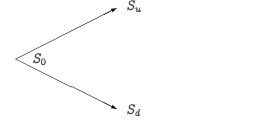

如果能找到所有可能的未来“状态”，即对所有可能性进行枚举，就可以通过构造人为的“概率”（称为“状态价格概率”）来对证券进行估值，并使用这些概率求出标的证券的人为期望值，然后按无风险利率进行贴现。二项框架特别简单，因为只有两种可能的状态。如果我们找到一种状态的“概率” q，也就同时得到了另一种状态的概率 $(1-q)$。方程 8.1 展示了针对标的证券的这一计算。

$S_0 = e^{-rT}(qS_u + (1-q)S_d)$ (8.1)

现在，基于该标的证券的任何衍生证券都可以使用相同的“概率” q 进行定价。二项期权定价的贡献在于实际计算 q 的值。要进行估值，首先引入常数 u 和 d，它们由 $S_u = uS_0$ 和 $S_d = dS_0$ 隐式定义，从而得到如图 8.1 所示的价格过程。

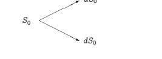

图 8.1：二项树

并计算人为的“概率” q 如下

$q = \frac{e^r - d}{u - d}$

二项框架下一期看涨期权的价格如公式 8.1 所示，并在 C++ 代码 8.1 中实现。

“状态价格概率” q 是基于无套利机会假设得出的。如果可以交易标的证券和无风险债券，就可以构建这两种资产的投资组合，以精确复制衍生证券的未来收益。由于该投资组合与衍生证券具有相同的未来收益，衍生证券的价格必须等于复制投资组合的成本。通过推导代数表达式，可以得到 q 作为上涨和下跌变动 u 和 d 的函数。

## 练习 8.1。

标的证券的价格遵循二项过程

$C_u = \max(0, S_u - K)$
$C_d = \max(0, S_d - K)$
$C_0 = e^{-r} (q C_u + (1-q) C_d)$
$q = \frac{e^r - d}{u - d}$
$S_u = u S_0$ 和 $S_d = d S_0$ 是下一期标的证券的可能值，$u$ 和 $d$ 是常数，$r$ 是（连续复利）无风险利率，$K$ 是看涨期权行权价。

## 公式 8.1：单期二项看涨期权价格

```
#include <cmath>        // standard mathematical library
#include <algorithm>    // defining the max() operator
using namespace std;

double option_price_call_european_binomial_single_period( const double& S, // spot price
        const double& X, // exercise price
        const double& r, // interest rate (per period)
        const double& u, // up movement
        const double& d){ // down movement
    double p_u = ( exp(r)-d)/(u-d);
    double p_down = 1.0-p_u;
    double c_u = max(0.0,(u*S-X));
    double c_d = max(0.0,(d*S-X));
    double call_price = exp(-r)*(p_u*c_u+p_down*c_d);
    return call_price;
};
```

## C++ 代码 8.1：欧式二项期权，单期

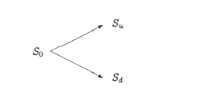

单期看涨期权的收益为

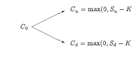

- 1. 展示如何将标的证券头寸与无风险债券头寸相结合，构建一个精确复制看涨期权收益的投资组合。
- 2. 利用此结果，展示公式 8.1 中所示的单期看涨期权定价公式。

## 8.3 多期二项定价

当然，假设下一期只有两种可能的未来状态有些不现实，但如果我们迭代这一假设，并假设每个日期，下一期只有两种可能的结果，而对于这两种结果中的每一种，又有两种新的结果，如下图所示：

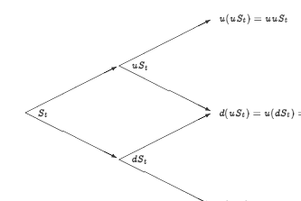

再多迭代几次这个想法，不同的终端状态数量会显著增加，我们就能更接近标的证券在终端日期的未来价格的现实分布。需要注意的是，要得到这样的图景，一个关键假设是因子 u 和 d 在每个日期都相同。


在这样的环境下，定价是通过逆向推导进行的，从终端日期开始。在这里，我们知道标的证券的所有可能值。对于每个值，我们计算衍生证券的收益，并找出一期前可能的衍生证券价格集合。基于这些，我们可以再找出再前一期的期权价格，以此类推。沿着树向下推导到根节点，期权价格即为第一个节点的衍生证券价格。

例如，假设我们有两期，并对行权价为 K 的两期看涨期权进行定价。

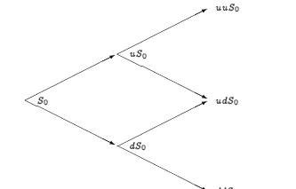

第一步：求出衍生证券的终端收益

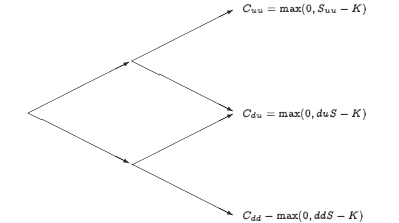

下一步：求出时刻 1 的两种可能看涨期权价格

$C_u = e^{-r}(qC_{uu} + (1-q)C_{ud})$
$C_d = e^{-r}(qC_{ud} + (1-q)C_{dd})$

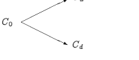

最后一步：使用时刻 1 的两种可能收益 $C_u$ 和 $C_d$，求出时刻 0 的期权价值

$C_0 = e^{-r}(qC_u + (1-q)C_d)$

因此，二项定价实际上涉及在二项树中“向后推导”，编程因此涉及遍历此类树的高效方式。描述此类树的明显数据结构在 C++ 代码 8.2 中所示，其中每个节点的值是通过计算到达该特定节点所使用的上涨和下跌步数来计算的。

## 练习 8.2。

```
#include <vector>
#include <cmath>
using namespace std;
vector< vector<double> > binomial_tree(const double& S0,
                                       const double& u,
                                       const double& d,
                                       const int& no_steps){
  vector< vector<double> > tree;
  for (int i=1;i<=no_steps;++i){
    vector<double> S(i);
    for (int j=0;j<i;++j){
      S[j] = S0*pow(u,j)*pow(d,i-j-1);
    }
    tree.push_back(S);
  }
  return tree;
};
```

## C++ 代码 8.2：构建二项树

从计算效率来看，C++ 代码 8.2 的方法并不最优，因为它需要大量调用 pow() 函数。更高效的方法是从前一节点进行乘法来构建树，例如第 j 个向量是第 j-1 个向量乘以 u，然后通过将最低元素乘以 d 来添加一个额外节点。

- 1. 实现这种替代的树构建过程。

基于 C++ 代码 8.2 中所示的三角数组结构对衍生品价格进行递归计算是最自然的方法，但基于对二项树结构的理解，通过一些巧妙的方法，我们可以使用 C++ 代码 8.3 中所示的更高效算法。请注意，这里我们只使用一个 vector<double>，而不是上面构建的三角数组。

## 示例

设 S = 100.0, K = 100.0, r = 0.025, u = 1.05 和 d = 1/u。

- 1. 对单期和两期欧洲式看涨期权进行定价。

```
C++ program
double S = 100.0; double K = 100.0; double r = 0.025;
double u = 1.05; double d = 1/u;
cout << " one period european call = "
     << option_price_european_binomial_single_period(S,K,r,u,d) << endl;
int no_periods = 2;
cout << " two period european call = "
     << option_price_european_binomial_multi_period_given_ud(S,K,r,u,d,no_periods) << endl;
Output from C++ program:
one period european call = 3.64342
two period european call = 5.44255
```

## 练习 8.3。

实现单期和多期二项看跌期权定价。

## 延伸阅读

单期二项模型的推导见例如 Bossaerts 和 Ødegaard (2001)、Hull (2011) 或 McDonald (2013)。


## C++ 代码 8.3: 欧洲看涨期权二叉树多期定价

```
#include <cmath>        // standard mathematical library
#include <algorithm>    // defining the max() operator
#include <vector>       // STL vector templates
using namespace std;

double option_price_call_european_binomial_multi_period_given_ud(const double& S, // spot price
                                                                 const double& K, // exercise price
                                                                 const double& r, // interest rate (per period)
                                                                 const double& u, // up movement
                                                                 const double& d, // down movement
                                                                 const int& no_periods){ // no steps in binomial tree
    double Rinv = exp(-r);            // inverse of interest rate
    double uu = u*u;
    double p_up = (exp(r)-d)/(u-d);
    double p_down = 1.0-p_up;
    vector<double> prices(no_periods+1); // price of underlying
    vector<double> call_values(no_periods+1); // fill in the endnodes.
    for (int i=1; i<=no_periods; ++i) prices[i] = u*prices[i-1];
    for (int i=0; i<=no_periods; ++i) call_values[i] = max(0.0, (prices[i]-K)); // call payoffs at maturity
    for (int step=no_periods-1; step>=0; --step) {
        for (int i=0; i<=step; ++i) {
            call_values[i] = (p_up*call_values[i+1]+p_down*call_values[i])*Rinv;
        }
    }
    return call_values[0];
}
```

## 第 9 章

## 基本期权定价，Black Scholes 公式

## 目录

| 9.1 | 公式 | 90 |
| --- | --- | --- |
| 9.2 | 理解公式的原理 | 92 |
| 9.2.1 | 原始 Black Scholes 分析 | 93 |
| 9.2.2 | 二叉树案例的极限 | 93 |
| 9.2.3 | 代表性代理人框架 | 93 |
| 9.3 | 偏导数 | 93 |
| 9.3.1 | Delta | 93 |
| 9.3.2 | 其他衍生物 | 94 |
| 9.3.3 | 隐含波动率 | 96 |
| 9.4 | 参考文献 | 98 |

期权及相关工具的定价是金融理论在实际应用中的一项重大突破。自 Black 和 Scholes (1973) 以及 Merton (1973) 的原始论文发表以来，涌现出大量实际和理论应用。我们将现在考虑期权的原始 Black Scholes 公式，以及它是如何计算和使用的。关于期权定价的基本直觉，读者应首先阅读前一章中关于二叉树模型的讨论，因为那是理解实际计算内容的更佳环境。

期权是一种衍生证券，其价值取决于其他某些基础证券（称为基础证券）的价值或价格。令 \( S \) 表示该基础证券的价值或价格。我们需要记录该价格观察的时间，因此令 \( S_t \) 表示价格在时间 \( t \) 时被观察。看涨（看跌）期权赋予持有者在给定日期 \( T \) 或之前以给定价格 \( K（称为行权价）买入（卖出）某些基础资产的权利，但不是义务。如果期权是所谓的欧洲期权，它只能在到期日使用（行权）。如果期权是所谓的美国类型，它可以在包括到期日 \( T \) 在内的任何日期使用（行权）。如果在时间 \( T \) 行权，看涨期权提供的收益为

```
C_T = \max(0, S_T - K)
```

和看跌期权提供的收益为

```
P_T = \max(0, K - S_T)
```

Black Scholes 公式为欧洲看跌和看涨期权（只能在期权到期日行权的期权）提供解析解。Black 和 Scholes 表明，定价期权所需的额外信息是（连续复利）无风险利率 r、基础资产的波动性（由（对数）价格变化的标准差 σ 衡量）以及期权的到期时间（T − t，以年为单位）。原始公式是在假设期权存续期内基础证券没有支付（如股票股息）的前提下推导的。此类支付将影响期权价值，这一点将在后面变得明显。

### 9.1 公式

公式 9.1 给出了看涨期权的精确公式，同一看涨期权的计算在 C++ 代码 9.1 和 Matlab 代码 9.1 中展示。

c = SN(d_1) - Ke^{-r(T-t)}N(d_2)

where

d_1 = \frac{\ln(\frac{S}{K}) + (r + \frac{1}{2}\sigma^2)(T - t)}{\sigma\sqrt{T - t}}

and

d_2 = d_1 - \sigma\sqrt{T - t}

Alternatively one can calculate d_1 and d_2 as

d_1 = \frac{\ln(\frac{S}{K}) + r(T - t)}{\sigma\sqrt{T - t}} + \frac{1}{2}\sigma\sqrt{T - t}

d_2 = \frac{\ln(\frac{S}{K}) + r(T - t)}{\sigma\sqrt{T - t}} - \frac{1}{2}\sigma\sqrt{T - t}

S 是基础证券的价格，K 是行权价，r 是（连续复利）无风险利率，σ 是基础资产的标准差，t 是当前日期，T 是到期日，T − t 是期权的到期时间，N(·) 是累积正态分布。

公式 9.1：Black Scholes 公式

```
#include <cmath> // mathematical C library
#include "normdist.h" // the calculation of the cumulative normal distribution
double option_price_call_black_scholes(const double& S, // spot (underlying) price
const double& K, // strike (exercise) price,
const double& r, // interest rate
const double& sigma, // volatility
const double& time) // { time to maturity
{
double time_sqrt = sqrt(time);
double d1 = (log(S/K)+r*time)/(sigma*time_sqrt)+0.5*sigma*time_sqrt;
double d2 = d1-(sigma*time_sqrt);
return S*N(d1) - K*exp(-r*time)*N(d2);
};
```

C++ 代码 9.1：使用 Black Scholes 公式的欧洲看涨期权定价

```
function c = black_scholes.call(S,K,r,sigma,time)
time_sqrt = sqrt(time);
d1 = (log(S/K)+r*time)/(sigma*time_sqrt)+0.5*sigma*time_sqrt;
d2 = d1-(sigma*time_sqrt);
c = S * normcdf(d1) - K * exp(-r*time) * normcdf(d2);
endfunction
```

Matlab 代码 9.1：使用 Black Scholes 公式的欧洲看涨期权定价

### 示例

XYZ 公司股票目前交易价格为 50。考虑一份 XYZ 股票的看涨期权，行权价 K = 50，到期时间为 6 个月。XYZ 股票的波动率估计为 \(\sigma = 30\%\)。六个月借款的当前无风险利率（连续复利）为 10%。

- 1. 确定期权价格。

要计算该期权的价格，我们使用 Black Scholes 公式，输入 \(S = 50\) 和 \(K = 50\)，\(r = 0.10\)，\(\sigma = 0.3\) 以及 \((T - t) = 0.5\)。

Matlab 程序：

```
S = 100;
K = 100;
r = 0.1;
sigma = 0.1;
time = 1;
c = black.scholes.call(S,K,r,sigma,time)
```

Matlab 程序输出：

c = 10.308

C++ 程序：

```
double S = 50; double K = 50; double r = 0.10;
double sigma = 0.30; double time=0.50;
cout << " Black Scholes call price = ";
cout << option_price_call_black_scholes( S, K , r, sigma, time) << endl;
```

C++ 程序输出：

Black Scholes 看涨期权价格 = 5.45325

### 练习 9.1。

看跌期权的 Black Scholes 价格为：

\(p = Ke^{-r(T-t)} N(-d_2) - SN(-d_1)\)

其中 \(d_1\) 和 \(d_2\) 与看涨期权相同：

\(\displaystyle d_1 = \frac{\ln \left(\frac{S}{K}\right) + (r + \frac{1}{2}\sigma^2)(T - t)}{\sigma \sqrt{T - t}}\)

\(d_2 = d_1 - \sigma \sqrt{T - t},\)

\(S\) 是基础证券的价格，\(K\) 是行权价，\(r\) 是（连续复利）无风险利率，\(\sigma\) 是基础资产的标准差，\(T - t\) 是期权的到期时间，\(N(\cdot)\) 是累积正态分布。

- 1. 实现此公式。

### 9.2 理解公式的原理

要理解 Black Scholes 公式及其有效性，需要深入研究其推导背后的数学细节。证明 Black Scholes 公式的方法取决于设定，有多种方式，这并没有帮助。事实证明，其中两种方法对于计算目的很重要，即原始的 Black Scholes 连续时间方法，以及 Cox、Ross 和 Rubinstein (1979) 的“二叉树过程极限”方法。


### 9.2.1 最初的 Black Scholes 分析

Black Scholes 分析的主要假设涉及管理底层资产价格的随机过程。底层资产的价格 S 被假设遵循几何 Brownian Motion 过程，可以方便地以以下任一简写形式表示

```
dS = μSdt + σSdZ
```

或

```
dS/S = μdt + σdZ
```

其中 μ 和 σ 是常数，Z 是 Brownian motion。

利用 Ito 引理、无套利假设以及连续交易的能力，Black 和 Scholes 表明，任何基于底层资产的或有索偿的价格必须求解 *偏微分方程* (9.1)。

```
∂f/∂S S + ∂f/∂t + 1/2 ∂²f/∂S² σ²S² = rf (9.1)
```

对于任何 *特定* 的或有索偿，索偿的条款将给出若干 *边界条件*，从而确定定价公式的形式。

Black 和 Scholes 表明，方程 (9.1) 给出的偏微分方程，结合边界条件 c_T = max(0, S_T - K)，具有解析解，其函数形式如 Black Scholes 公式 9.1 所示。

### 9.2.2 二项式情况的极限

另一种方法是使用二项式过程的极限（Cox et al., 1979）。后者尤其有趣，因为它使我们能够将 Black Scholes 公式与二项式联系起来，从而允许将二项式框架用作近似。

### 9.2.3 代表性代理人框架

展示 BS 公式的最后一种方法是假设存在代表性代理人和对数正态性，如 Rubinstein (1976) 所做。

## 9.3 偏导数。

在期权交易中，期权定价公式的若干偏导数非常重要。

### 9.3.1 Delta

期权价格相对于底层证券价格的第一个导数称为期权价格的 *delta*。这是大多数人会遇到的导数，因为它在期权对冲中很重要。

```
∂c/∂S = N(d₁)
```

C++ 代码 9.2 显示了看涨期权 delta 的计算。

```cpp
#include <cmath>
#include "normdist.h"

double option_price_delta_call_black_scholes(const double& S, // spot price
         const double& K, // Strike (exercise) price,
         const double& r, // interest rate
         const double& sigma, // volatility
         const double& time){ // time to maturity

        double time_sqrt = sqrt(time);
        double d1 = (log(S/K)+r*time)/(sigma*time_sqrt) + 0.5*sigma*time_sqrt;
        double delta = N(d1);
        return delta;
    };
```

C++ 代码 9.2：计算 Black Scholes 看涨期权价格的 delta

### 9.3.2 其他导数

其余的导数使用较少，但它们都很重要。所有这些都列在公式 9.3.2 中。

Delta ($\Delta$)

$\Delta = \frac{\partial c}{\partial S} = N(d_1)$

Gamma ($\Gamma$)

$\frac{\partial^2 c}{\partial S^2} = \frac{n(d_1)}{S\sigma\sqrt{T-t}}$

Theta ($\Theta$) (注意你想要的是哪一个)

$\frac{\partial c}{\partial(T-t)} = Sn(d_1)\frac{1}{2}\sigma\frac{1}{\sqrt{T-t}} + rKe^{-r(T-t)}N(d_2)$

$\frac{\partial c}{\partial t} = -Sn(d_1)\frac{1}{2}\sigma\frac{1}{\sqrt{T-t}} - rKe^{-r(T-t)}N(d_2)$

Vega

$\frac{\partial c}{\partial \sigma} = S\sqrt{T-t}n(d_1)$

Rho ($\rho$)

$\frac{\partial c}{\partial r} = K(T-t)e^{-r(T-t)}N(d_2)$

$S$ 是底层证券的价格，$K$ 是行权价，$r$ 是（连续复利）无风险利率，$\sigma$ 是底层资产的标准差，$t$ 是当前日期，$T$ 是到期日期，$T-t$ 是期权的到期时间。
$n(.)$ 是正态分布函数（$n(z) = \frac{1}{\sqrt{2\pi}}e^{-\frac{1}{2}z^2}$），$N(.)$ 是累积正态分布（$N(z) = \int_{-\infty}^z n(d)d$）。

公式 9.2：Black Scholes 看涨期权公式的偏导数

C++ 代码 9.3 显示了看涨期权所有这些偏导数的计算。

### 示例

再次考虑 XYZ 股票的六个月期看涨期权。期权将在 6 个月后到期，届时期权持有人可以通过支付行权价 K = 50 获得一单位底层证券。底层证券的当前价格为 S = 50。底层证券的波动率为 \(\sigma = 30\%\)。六个月期借款的当前无风险利率（连续复利）为 10%。

### C++ 程序：

```cpp
#include <cmath>
#include "normdist.h"
using namespace std;

void option_price_partials_call_black_scholes( const double& S, // spot price
const double& K, // Strike (exercise) price,
const double& r, // interest rate
const double& sigma, // volatility
const double& time, // time to maturity
double& Delta, // partial wrt S
double& Gamma, // second prt wrt S
double& Theta, // partial wrt time
double& Vega, // partial wrt sigma
double& Rho)// partial wrt r
{
double time_sqrt = sqrt(time);
double d1 = (log(S/K)+r*time)/(sigma*time_sqrt) + 0.5*sigma*time_sqrt;
double d2 = d1-sigma*time_sqrt;
Delta = N(d1);
Gamma = n(d1)/(S*sigma*time_sqrt);
Theta = -(S*sigma*n(d1))/(2*time_sqrt) - r*K*exp(-r*time)*N(d2);
Vega = S * time_sqrt*n(d1);
Rho = K*time*exp(-r*time)*N(d2);
}
```

C++ 代码 9.3：计算 Black Scholes 看涨期权的偏导数

- 1. 计算该期权的偏导数（Delta、Gamma、Theta、Vega 和 Rho）。

要计算偏导数，我们使用输入 S = 50、K = 50、r = 0.10、sigma = 0.3 和 (T - t) = 0.5。

### C++ 程序：

```cpp
cout << " Black Scholes call partial derivatives " << endl;
double S = 50; double K = 50; double r = 0.10;
double sigma = 0.30; double time=0.50;
double Delta, Gamma, Theta, Vega, Rho;
option_price_partials_call_black_scholes(S,K,r,sigma, time, Delta, Gamma, Theta, Vega, Rho);
cout << " Delta = " << Delta << endl;
cout << " Gamma = " << Gamma << endl;
cout << " Theta = " << Theta << endl;
cout << " Vega = " << Vega << endl;
cout << " Rho = " << Rho << endl;
```

### C++ 程序输出：

```
Black Scholes call partial derivatives
Delta = 0.633737
Gamma = 0.0354789
Theta = -6.61473
Vega = 13.3046
Rho = 13.1168
```

### 9.3.3 隐含波动率。

在期权定价公式的计算中，特别是 Black Scholes 公式中，唯一的未知数是底层股票的标准差。期权定价中一个常见的问题是，根据市场上观察到的报价找到隐含波动率。例如，给定看涨期权价格 \(c_0\)，应求解以下方程以得到 \(\sigma\) 的值：

\(c_0 = c(S, K, r, \sigma, T - t)\)

不幸的是，该方程没有解析解，这意味着必须通过数值方法求解 \(\sigma\)。可能是算法上最简单的求解方法是使用二分查找算法，该算法在 C++ 代码 9.4 中实现。我们首先通过找到使 BS 价格高于观察价格的高 sigma 来对 sigma 进行区间限定，然后，给定区间，我们以系统的方式搜索波动率。这显示了这样的计算。

```cpp
#include <cmath>
#include "fin_recipes.h"

double option_price_implied_volatility_call_black_scholes_bisections(const double& S,
        const double& K,
        const double& r,
        const double& time,
        const double& option_price){
    if (option_price<0.99*(S-K*exp(-time*r))) { // check for arbitrage violations
        return 0.0;
        // Option price is too low if this happens
    };
    // simple binomial search for the implied volatility.
    // relies on the value of the option increasing in volatility
    const double ACCURACY = 1.0e-5; // make this smaller for higher accuracy
    const int MAX_ITERATIONS = 100;
    const double HIGH_VALUE = 1e10;
    const double ERROR = -1e40;
    // want to bracket sigma, first find a maximum sigma by finding a sigma
    // with a estimated price higher than the actual price.
    double sigma_low=1e-5;
    double sigma_high=0.3;
    double sigma=option_price_call_black_scholes(S,K,r,sigma_high,time);
    while (price < option_price){
        sigma_high = 2.0 * sigma_high;
        sigma = option_price_call_black_scholes(S,K,r,sigma_high,time);
        if (sigma_high>HIGH_VALUE) return ERROR; // panic, something wrong.
    }
    for (int i=0;i<MAX_ITERATIONS;++i){
        double sigma = (sigma_low+sigma_high)*0.5;
        price = option_price_call_black_scholes(S,K,r,sigma,time);
        double test = (price-option_price);
        if (fabs(test)<ACCURACY) { return sigma; };
        if (test < 0.0) { sigma_low = sigma; }
        else { sigma_high = sigma; }
    };
    return ERROR;
}
```

C++ 代码 9.4：使用二分法计算 Black Scholes 的隐含波动率

与这种简单的区间限定不同，它实际上非常快，并且几乎总能找到解，我们可以使用 Newton–Raphson 公式来求解单变量方程的根。这种方法的一般描述是从一个我们想要找到其根的函数 \(f()\) 开始。

\(f(x) = 0.\)


函数 f() 需要是可微的。给定初始猜测 x0，通过以下方式迭代

\( x_{i+1} = x_i - \frac{f(x_i)}{f'(x_i)} \)

直到

\( |f(x_i)| < \epsilon \)

其中 \(\epsilon\) 是所需精度。1

在本例中

\( f(x) = c_{obs} - c_{BS}(\sigma) \)

并且，每次新迭代将计算

\( \sigma_{i+1} = \sigma_i + \frac{c_{obs} - c_{BS}(\sigma_i)}{\frac{\partial c_{BS}(\sigma)}{\partial \sigma}} \)

C++ 代码 9.5 展示了使用 Newton-Raphson 方法计算隐含波动率。

```
#include "fin_recipes.h"
#include "normdist.h"
#include <cmath>
#include <iostream>

double option_price_implied_volatility_call_black_scholes_newton(const double& S,
                                         const double& K,
                                         const double& r,
                                         const double& time,
                                         const double& option_price) {
  if (option_price<0.99*(S-K*exp(-time*r))) { // check for arbitrage violations. Option price is too low if this happens
    return 0.0;
  };

  const int MAX_ITERATIONS = 100;
  const double ACCURACY = 1.0e-5;
  double t_sqrt = sqrt(time);

  double sigma = (option_price/S)/(0.398*t_sqrt); // find initial value
  for (int i=0;i<MAX_ITERATIONS;++i){
    double price = option_price_call_black_scholes(S,K,r,sigma,time);
    double diff = option_price-price;
    if (fabs(diff)<ACCURACY) return sigma;
    double d1 = (log(S/K)+(r*time))/(sigma*t_sqrt) + 0.5*sigma*t_sqrt;
    double vega = S * t_sqrt * n(d1);
    sigma = sigma + diff/vega;
  };

  return -99e10; // something screwy happened, should throw exception
}
```

### C++ 代码 9.5: 使用 Newton-Raphson 方法计算 Black-Scholes 隐含波动率

请注意，要使用 Newton-Raphson 方法，我们需要期权价格的导数。对于 Black-Scholes 公式，这个导数是已知的，我们可以直接使用。但对于像二叉树这样的定价公式，其中偏导数不容易计算，简单的二分法是首选算法。

示例 再次考虑 XYZ 股票的六个月期看涨期权。期权将在 6 个月后到期，届时期权持有者可以通过支付行权价 K = 50 获得一单位标的证券。

标的证券的当前价格为 $S = 50$。六个月期借款的当前无风险利率（连续复利）为 10%。

- 1. 当前期权价格为 $C = 2.5$。确定该价格隐含的波动率。

隐含波动率是 $\sigma$，将其与其他输入一起代入 Black-Scholes 公式，将产生 $C = 2.5$ 的期权价格。

计算时我们使用输入 $S = 50, K = 50, r = 0.10$ 和 $(T - t) = 0.5$。

```
C++ program:
double S = 50; double K = 50; double r = 0.10; double time=0.50;
double C=2.5;
cout << " Black Scholes implied volatility using Newton search = ";
cout << option_price_implied_volatility_call_black_scholes_newton(S,K,r,time,C) << endl;
cout << " Black Scholes implied volatility using bisections = ";
cout << option_price_implied_volatility_call_black_scholes_bisections(S,K,r,time,C) << endl;
Output from C++ program:
Black Scholes implied volatility using Newton search = 0.0500427
Black Scholes implied volatility using bisections = 0.0500419
```

### 9.4 参考文献

Black 和 Scholes (1973) Merton (1973)

Gray 和 Gray (2001) 对该公式给出了一个简单的证明。

## 第 10 章

## 权证

### 目录

| 项目 | 页码 |
|---|---|
| 10.1 以资产为基础的权证价值 | 99 |
| 10.2 在观察股票价值时对权证进行估值 | 100 |
| 10.3 阅读材料 | 101 |

权证是一种股票期权类证券，但它是由发行股票的同一家公司发行的，并且当权证被行权时，会发行新股。这种新股以权证行权价发行，该价格低于当前股票价格（如果不是这样，权证就不会被行权）。由于新股是对所有现金流的分摊性权利，这种股票发行会稀释公司的股权。稀释程度取决于发行了多少份权证。

### 10.1 以资产为基础的权证价值

设 \( K \) 为行权价，\( n \) 为流通在外的股票数量，\( m \) 为发行的权证数量。假设每份权证对应 1 股新股，并设 \( A_t \) 为公司当前的资产价值。假设所有权证同时被行权。那么公司的资产将增加权证数量乘以权证行权价。

```
\( A_t + mK \),
```

但这个新的资产价值被分摊到更多股票上，因为每个被行权的权证现在都是股权。公司的资产被分摊到所有股票上，因此每股新股的价值为：

```
\(\frac{A_t + mK}{m + n}\)
```

这使得每个被行权的权证价值为：

```
\(\frac{A_t + mK}{m + n} - K = \frac{n}{m + n} \left( \frac{A_t}{n} - K \right)\)
```

如果我们知道公司当前的资产价值，可以分两步对权证进行估值：

- 1. 使用 Black-Scholes 公式对期权进行估值，并将 \(\frac{A_t}{n}\) 作为当前股票价格。
- 2. 将得到的看涨期权价格乘以 \(\frac{n}{m+n}\)。

如果设 \( W_t \) 为权证价值，上述论点可总结为：

```
\( W_t = \frac{n}{n+m} C_{BS} \left( \frac{A}{n}, K, \sigma, r, (T-t) \right) ,\)
```

其中 \( C_{BS}(\cdot) \) 是 Black-Scholes 公式。

### 10.2 在观察股票价值时对权证进行估值

然而，人们不一定能观察到公司的资产价值。通常只能观察到公司的股权价值。如果设 \( S_t \) 为当前股票价格，那么资产价值实际上是：

\( A_t = nS_t + mW_t \)

使用股票价格，人们会按如下方式对权证进行估值

\( W_t = \frac{n}{n+m} C_{BS} \left( \frac{nS_t + mW_t}{n}, K, \sigma, r, (T-t) \right) \)

或

\( W_t = \frac{n}{n+m} C_{BS} \left( S_t + \frac{m}{n} W_t, K, \sigma, r, (T-t) \right) \)

请注意，这将 \( W_t \) 的值表示为 \( W_t \) 的函数。需要数值求解该方程以找到 \( W_t \)。

\( W_t \) 的数值解是使用 Newton-Raphson 方法求得的。设

\( g(W_t) = W_t - \frac{n}{n+m} C_{BS} \left( S_t + \frac{m}{n} W_t, K, \sigma, r, (T-t) \right) \)

从权证价值 \( W_t^i \) 的初始猜测开始，Newton-Raphson 方法的迭代如下

\( W_t^i = W_t^{i-1} - \frac{g(W_t^{i-1})}{g'(W_t^{i-1})}, \)

其中 \( i \) 表示第 \( i \) 次迭代，直到准则函数 \( g(W_t^{i-1}) \) 低于给定的精度 \( \epsilon \)。在此情况下

\( g'(W_t) = 1 - \frac{m}{m+n} N(d_1) \)

其中

\( d_1 = \frac{\ln \left( \frac{S_t + \frac{m}{n} W_t}{K} \right) + (r + \frac{1}{2} \sigma^2)(T-t)}{\sigma \sqrt{T-t}} \)

一个明显的初始值是使用当前股票价格计算 Black-Scholes 值，然后将其乘以 \( \frac{m}{m+n} \)。

C++：代码 10.1 实现了此计算。

### 示例

某股票当前价格为 \( S = 48 \)。考虑同一公司的权证，行权价为 \( K = 40 \)，距离到期还有六个月。该公司有 \( n = 10000 \) 股流通在外，并发行了 \( m = 1000 \) 份权证。当前（连续复利）无风险利率为 8%。确定当前权证价格。

```
#include "fin_recipes.h"
#include "normdist.h"
#include <cmath>

const double EPSILON=0.00001;

double warrant_price_adjusted_black_scholes(const double& S,
                                         const double& K,
                                         const double& r,
                                         const double& sigma,
                                         const double& time,
                                         const double& m, // number of warrants outstanding
                                         const double& n) { // number of shares outstanding

    double time_sqrt = sqrt(time);
    double w = (n/(n+m))*option_price_call_black_scholes(S,r,sigma,time);
    double g = w-(n/(n+m))*option_price_call_black_scholes(S+(m/n)*w,K,r,sigma,time);
    while (fabs(g)>EPSILON) {
        double d1 = (log((S+(m/n)*K)/K)+r*time)/(sigma*time_sqrt)+0.5*sigma*time_sqrt;
        double prime = 1-(m/n)*N(d1);
        w=w/g/prime;
        g = w-(n/(n+m))*option_price_call_black_scholes(S+(m/n)*w,K,r,sigma,time);
    }
    return w;
};
```

### C++ 代码 10.1: 权证的调整 Black-Scholes 价值

C++ 程序：

double S = 48; double K = 40; double r = 0.08; double sigma = 0.30;
double time = 0.5; double m = 1000; double n = 10000;
double w = warrant_price_adjusted_black_scholes(S,K,sigma, time, m, n);
cout << " warrant price = " << w << endl;

C++ 程序输出：
warrant price = 10.142

### 练习 10.1。

该解法假设所有权证同时被行权。你能看出这个假设在哪里被使用吗？

### 10.3 阅读材料

McDonald (2013) 和 Hull (2011) 是通用参考文献。权证的一个问题是，同时行权所有权证不一定是最优的。

Press 等人 (1992) 讨论了用于求根的 Newton-Raphson 方法。


## 第 11 章

## 扩展布莱克-舒尔斯公式

| 章节 | 标题 | 页码 |
|---|---|---|
| 11.1 | 调整标的资产的支付 | 102 |
| 11.1.1 | 标的资产的连续支付 | 102 |
| 11.1.2 | 股息 | 103 |
| 11.2 | 美式期权 | 104 |
| 11.2.1 | 标的资产在期限内支付一次股息时的美式看涨期权精确公式 | 105 |
| 11.3 | 期货期权 | 108 |
| 11.3.1 | 布莱克模型 | 108 |
| 11.4 | 外汇期权 | 109 |
| 11.5 | 永久看跌和看涨期权 | 110 |
| 11.6 | 参考资料 | 111 |

### 11.1 调整标的资产的支付

对于股票以外的其他金融工具期权，必须考虑到标的资产在期权存续期间可能会有支付的情况。例如，在处理商品期权时，如果通过购买标的资产来对冲期权，通常会产生一些仓储成本。

### 11.1.1 标的资产的连续支付

最简单的情况是支付是连续进行的。对欧洲期权进行定价，只需对布莱克-舒尔斯公式进行简单调整即可。设 \( q \) 为标的商品的*连续支付*。

欧洲看涨期权和看跌期权的价格随后由公式 11.1 给出，其实现在 C++ 代码 11.1 中。

### 练习 11.1。

标的资产具有连续支付 \( q \) 的看跌期权价格为：

```
p = Ke^{-r(T-t)}N(-d_2) - Se^{-q(T-t)}N(-d_1)
```

- 1. 实现此公式。

c = Se^{-q(T-t)}N(d_1) - Ke^{-r(T-t)}N(d_2)

where

d_1 = \frac{\ln(\frac{S}{K}) + (r - q + \frac{1}{2}\sigma^2)(T - t)}{\sigma\sqrt{T - t}}

d_2 = d_1 - \sigma\sqrt{T - t}

S 为标的资产价格，K 为行权价，r 为无风险利率，q 为（连续）支付，\sigma 为标的资产的标准差，t 为当前日期，T 为到期日期，T - t 为期权的剩余期限，N() 表示正态分布。

### 公式 11.1：具有 q 支付的标的资产欧洲看涨期权的解析价格

```
#include <cmath> // mathematical library
#include "normdist.h" // this defines the normal distribution
using namespace std;

double option_price_european_call_payout( const double& S, // spot price
                                          const double& X, // Strike (exercise) price,
                                          const double& r, // interest rate
                                          const double& q, // yield on underlying
                                          const double& sigma, // volatility
                                          const double& time ) { // time to maturity
  double sigma_sqr = pow(sigma,2);
  double time_sqrt = sqrt(time);
  double d1 = (log(S/X) + (r - q + 0.5*sigma_sqr)*time)/(sigma*time_sqrt);
  double d2 = d1 - (sigma*time_sqrt);
  double call_price = S * exp(-q*time) * N(d1) - X * exp(-r*time) * N(d2);
  return call_price;
};
```

### C++ 代码 11.1：期权价格，标的资产的连续支付

### 11.1.2 股息

标的资产支付的一种特殊情况是股票支付股息时的股票期权。当股票支付股息时，定价公式需要调整，因为股息会改变标的资产的价值。

连续股息的情况最容易处理。它对应于我们之前研究过的连续支付。问题是大多数股息是在离散日期支付的。

### 支付股息股票的欧洲期权

为了将已知股息纳入欧洲期权定价，在计算布莱克-舒尔斯价值时，只需从标的资产当前价格中减去股息的现值即可。

### 示例

考虑一个股票期权，给定以下数据：S = 100，K = 100，r = 0.1，\sigma = 0.25，距到期一年。股息收益率 = 5%。股息支付时间为 0.25 和 0.75。

- 确定期权价格

```
#include <cmath>        // mathematical library
#include <vector>
#include "fin_recipes.h" // define the black scholes price
double option_price_european_call_dividends( const double& S,
    const double& K,
    const double& r,
    const double& sigma,
    const double& time_to_maturity,
    const vector<double>& dividend_times,
    const vector<double>& dividend_amounts ) {
    double adjusted_S = S;
    for (int i=0; i<dividend_times.size();++i) {
        if ((dividend_times[i]<time_to_maturity)){
            adjusted_S -= dividend_amounts[i] * exp(-r*dividend_times[i]);
        };
    };
    return option_price_european_call_black_scholes(adjusted_S,K,r,sigma,time_to_maturity);
};
```

### C++ 代码 11.2：支付股息股票的欧洲期权价格

```
C++ program:
double S = 100.0; double K = 100.0;
double r = 0.1; double sigma = 0.25;
double time=1.0;
double dividend_yield_times=0.05;
vector<double> dividend_times; vector<double> dividend_amounts;
dividend_times.push_back(0.25); dividend_amounts.push_back(2.5);
dividend_times.push_back(0.75); dividend_amounts.push_back(2.5);
cout << " european call option with continuous dividend = "
     << option_price_european_call_payout(S,K,r,dividend_yield,sigma,time) << endl;
cout << " european stock call option with discrete dividend = "
     << option_price_european_call_dividends(S,K,r,sigma,time,dividend_times,dividend_amounts) << endl;
Output from C++ program:
european stock call option with continuous dividend = 11.7344
european stock call option with discrete dividend = 11.8094
```

### 11.2 美式期权

美式期权比欧洲期权难处理得多。问题在于，在最终到期日之前行使期权可能是最优的。这种最优行权策略会影响期权的价值，并且在求解偏微分方程时需要知道行权策略。然而，行权策略是未知的。因此，美式看涨期权和看跌期权没有通用的解析解。存在一些特殊情况。对于不产生任何支付的资产的美式看涨期权，其美式看涨期权价格与欧洲式相同，因为最优行权策略是不行权。对于美式看跌期权则不然，提前行权可能是有利的。当标的资产有支付时，提前行权美式看涨期权也可能是有利的。美式看涨期权有一个已知的解析价格，即标的股票在期权存续期间支付一次已知股息的情况，这将在下一节讨论。在所有其他情况下，美式期权价格必须使用后续章节讨论的一种技术进行近似：二叉树近似、偏微分方程的数值解或另一种数值近似。

### 11.2.1 标的资产在期限内支付一次股息时的美式看涨期权精确公式

当股票支付股息时，股票上的看涨期权可能在股票除息日之前被最优行权。虽然一般股息问题通常以某种方式近似，但对于期权存续期间只有一次股息支付的特殊情况，存在一个解析解，由 Roll-Geske-Whaley 提出。

设 S 为股票价格，K 为行权价，D1 为支付的股息金额，t1 为股息支付时间，T 为期权到期日期，我们表示距股息支付的时间为 \(\tau_1 = T - t_1\)，距到期的时间为 \(\tau = T - t\)。

提前行权的首要检查是：

\(D_1 \le K \left( 1 - e^{-r(T-t_1)} \right)\)

如果该不等式成立，则提前行权不是最优的，期权的价值为

\(c(S - e^{-r(t_1-t)} D_1, K, r, \sigma, (T-t))\)

其中 c(.) 是常规的布莱克-舒尔斯公式。

如果不等式不成立，则执行公式 11.2 中所示的计算，并在 C++ 代码 11.3 中实现。

```
C = (S - D_1 e^{-r(\tau_1-t)}) (N(b_1) + N(a_1, -b_1, \rho)) + K e^{-r(T-t)} N(a_2, -b_2, \rho) - (K - D_1) e^{-r(\tau_1-t)} N(b_2)
where
\(\rho = - \sqrt{\frac{(t_1 - t)}{T - t}}\)
\(a_1 = \frac{\ln \left( \frac{S - D_1 e^{-r(\tau_1)}}{K} \right) + (r + \frac{1}{2} \sigma^2) \tau}{\sigma \sqrt{\tau}}\)
\(a_2 = a_1 - \sigma \sqrt{T - t}\)
\(b_1 = \frac{\ln \left( \frac{S - D_1 e^{-r(\tau_1-t)}}{S} \right) + (r + \frac{1}{2} \sigma^2) (t_1 - t)}{\sigma \sqrt{(t_1 - t)}}\)
\(b_2 = b_1 - \sigma \sqrt{T - t}\)
and \(\tilde{G}\) solves
\(c(\tilde{S}, t_1) = \tilde{S} + D_1 - K\)
```

S 为标的资产价格，K 为行权价，r 为无风险利率，D1 为股息金额，\sigma 为标的资产的标准差，t 为当前日期，T 为到期日期，\(\tau = T - t\) 为期权的剩余期限，N(.) 为累积正态分布。带一个参数的 N(.) 是一元正态累积分布，带三个参数的 N(.) 是二元正态累积分布，两个正态分布之间的相关系数作为第三个参数给出。

### 公式 11.2：支付一次固定股息的美式看涨期权的 Roll-Geske-Whaley 价格

### 示例

考虑一个支付一次股息的股票期权。相关数据为 S = 100，K = 100，r = 0.1，\(\sigma = 0.25\)，\(\tau = 1.0\)，\(\tau_1 = 0.5\) 且 D1 = 10。

对期权进行定价。


```cpp
double S = 100.0; double K = 100.0;
double r = 0.1; double sigma = 0.25;
double tau = 1.0; double tau1 = 0.5;
double D1 = 10.0;
cout << " american call price with one dividend = "
<< option_price_american_call_one_dividend(S,K,r,sigma,tau,D1, tau1)<< endl;
```
C++ 程序输出：
带一个股息的美式看涨期权价格 = 10.0166

## 练习 11.2。

Black 近似法用于计算支付固定股息的看涨期权价格，它是对看涨期权价值的近似。假设股息在期权到期日 T 之前的某个日期 t1 支付。Black 近似法使用 Black-Scholes 公式计算两个欧洲期权的价值。一个期权的到期日等于期权的除息日。另一个期权的到期日等于期权到期日，但标的证券的当前价格需按股息金额向下调整。

- 1. 实现 Black 近似法。

```cpp
#include <cmath>
#include "normdist.h" // define the normal distribution functions
#include "fin_recipes.h" // the regular black scholes formula
double option_price_american_call_one_dividend(const double& S,
                                               const double& K,
                                               const double& r,
                                               const double& sigma,
                                               const double& tau,
                                               const double& D1){
    if (D1 <= K* (1.0-exp(-(tau-tau1)))) // check for no exercise
        return option_price_call_black_scholes(S-exp(-r*tau)*D1,K,r,sigma,tau);
    const double ACCURACY = 1e-6; // decrease this for more accuracy
    double sigma_sqr = sigma*sigma;
    double tau_sqrt = sqrt(tau);
    double tau1_sqrt = sqrt(tau1);
    double rho = - sqrt(tau1/tau);
    double S_bar = 0; // first find the S.bar that solves c=S.bar+D1-K
    double S_low=0; // the simplest: binomial search
    double S_high=S; // start by finding a very high S above S.bar
    double c=option_price_call_black_scholes(S_high,K,r,sigma,tau-tau1);
    double c_low = S_high-D1+K;
    double test;
    while ((test>0.0) && (S_high-S_low>1e-10) ) {
    S_high *= 20;
    c = option_price_call_black_scholes(S_high,K,r,sigma,tau-tau1);
    test = c-S_high-D1+K;
    };
    if (S_high>1e10) { // early exercise never optimal, find BS value
    return option_price_call_black_scholes(S-D1*exp(-r*tau1),K,r,sigma,tau);
    }
    S_bar = 0.5 * S_high; // now find S.bar that solves c=S.bar+D1-K
    c = option_price_call_black_scholes(S_bar,K,r,sigma,tau-tau1);
    test = c-S_bar-D1-K;
    while ((fabs(test)>ACCURACY) && ((S_high-S_low)>ACCURACY) ) {
    if (test<0.0) { S_high = S_bar; }
    else { S_low = S_bar; };
    S_bar = 0.5 * (S_high + S_low);
    c = option_price_call_black_scholes(S_bar,K,r,sigma,tau-tau1);
    test = c-S_bar-D1-K;
    };
    double a1 = (log((S-D1*exp(-r*tau1))/K) + (r+0.5*sigma*sigma)*tau1)/ (sigma*tau1_sqrt);
    double a2 = a1 - sigma*tau1_sqrt;
    double b1 = (log((S-D1*exp(-r*tau1))/S_bar)+(r+0.5*sigma_sqr)*tau1)/(sigma*tau1_sqrt);
    double b2 = b1 - sigma * tau1_sqrt;
    double C = (S-D1*exp(-r*tau1)) * N(b1) + (S-D1*exp(-r*tau1)) * N(a1-b1*rho);
    return (K*exp(-r*tau))*N(a2-b2*rho) - (K-D1)*exp(-r*tau1)*N(b2);
};
```

### C++ 代码 11.3: 股息支付股票的期权价格，Roll-Geske-Whaley 看涨期权公式

## 11.3 期货期权

### 11.3.1 Black 模型

对于写在期货合约上的欧洲期权，我们使用 Black (1976) 开发的 Black-Scholes 解的调整版本。本质上，我们在 Black-Scholes 公式中将 \(S_0\) 替换为 \(e^{-r(T-t)}F\)，从而得到如公式 11.3 所示并在 C++ 代码 11.4 中实现的公式。

\(c = e^{-r(T-t)} \left( FN(d_1) - KN(d_2) \right)\)

其中

\(d_1 = \frac{\ln\left(\frac{F}{K}\right) + \frac{1}{2}\sigma^2(T-t)}{\sigma\sqrt{T-t}}\)

\(d_2 = d_1 - \sigma\sqrt{T-t}\)

\(F\) 是期货价格，\(K\) 是行权价，\(r\) 是无风险利率，\(\sigma\) 是期货价格的波动率，\(T-t\) 是期权到期时间（以年为单位）。

### 公式 11.3: 以期货合约为标的资产的欧洲看涨期权 Black 定价公式

```cpp
#include <cmath>
#include "normdist.h"
using namespace std;

double futures_option_price_call_european_black(const double& F, // futures price
        const double& K, // exercise price
        const double& r, // interest rate
        const double& sigma, // volatility
        const double& time){ // time to maturity
    double sigma_sqr = sigma*sigma;
    double time_sqrt = sqrt(time);
    double d1 = ( log(F/K) + 0.5 * sigma_sqr * time ) / (sigma * time_sqrt);
    double d2 = d1 - sigma * time_sqrt;
    return exp(-r*time) * (F * N(d1) - K * N(d2));
};
```

### C++ 代码 11.4: 期货合约上的欧洲看涨期权定价

## 示例

在 Black 框架下对期货期权进行定价。信息：\(F = 50, K = 45, r = 8\%, \sigma = 0.2\)，到期时间为半年。

```cpp
C++ program:

double F = 50.0; double K = 45.0;
double r = 0.08; double sigma = 0.2;
double time=0.5;

cout << " european futures call option = "
<< futures_option_price_call_european_black(F,K,r,sigma,time) << endl;
```

C++ 程序输出：

欧洲期货看涨期权 = 0.851476

## 练习 11.3。

期货合约看跌期权的 Black 公式为

$$p = e^{-r(T-t)} (KN(-d_2) - FN(-d_1))$$

其中变量与看涨期权定义的相同。

- 1. 实现看跌期权价格。

## 11.4 外汇期权

当标的资产是货币汇率（即期汇率）时，Black-Scholes 公式会出现另一种相对简单的调整。在这种情况下，需要根据利率差调整 Black-Scholes 方程。

设 \(S\) 为期汇率，\(r\) 为国内利率，\(r_f\) 为国外利率。\(\sigma\) 则为汇率变动的波动率。欧洲看涨期权的定价如公式 11.4 所示，并在 C++ 代码 11.5 中实现。

$$c = Se^{-r_f(T-t)}N(d_1) - Ke^{-r(T-t)}N(d_2)$$

其中

$$d_1 = \frac{\ln(\frac{S}{K}) + (r - r_f + \frac{1}{2}\sigma^2)(T-t)}{\sigma\sqrt{T-t}}$$

$$d_2 = d_1 - \sigma\sqrt{T-t}$$

\(S\) 是期汇率，\(K\) 是行权价。\(r\) 是国内利率，\(r_f\) 是国外利率。\(\sigma\) 是汇率变动的波动率。\(T - t\) 是期权到期时间。

### 公式 11.4: 欧洲货币看涨期权

```cpp
#include <cmath>
#include "normdist.h" // define the normal distribution function

double currency_option_price_call_european( const double& S, // exchange rate
        const double& X, // exercise
        const double& r, // r_domestic,
        const double& r_f, // r_foreign,
        const double& sigma, // volatility,
        const double& time) // time to maturity
{
    double sigma_sqr = sigma*sigma;
    double time_sqrt = sqrt(time);
    double d1 = (log(S/X) + (r-r_f + 0.5*sigma_sqr)* time)/(sigma*time_sqrt);
    double d2 = d1 - sigma*time_sqrt;
    return S * exp(-r_f*time) * N(d1) - X * exp(-r*time) * N(d2);
};
```

### C++ 代码 11.5: 货币上的欧洲期货看涨期权

## 示例

根据以下信息对欧洲货币看涨期权进行定价：\(S = 50, K = 52, r = 8\%, r_f = 5\%, \sigma = 20\%\)，到期时间 = 0.5 年。

```cpp
C++ program:
double S = 50.0;     double K = 52.0;
double r = 0.08;     double r_f=0.05;
double sigma = 0.2;  double time=0.5;
cout << " european currency call option = "
     << currency_option_price_call_european(S,K,r,r_f,sigma,time) << endl;
```

C++ 程序输出：

欧洲货币看涨期权 = 2.22556

## 练习 11.4。

货币期权的欧洲看跌期权价格为

$$p = Ke^{-r(T-t)}N(-d_2) - Se^{-q(T-t)}N(-d_1)$$

- 1. 实现此公式。

## 11.5 永久看跌和看涨期权

永久期权是没有到期日、寿命无限的期权。当然，只有美式永久期权才有意义，欧洲永久期权可能很难出售¹。对于看跌期权和看涨期权，都已开发出解析公式。我们考虑美式看涨期权的价格，并在练习中讨论看跌期权。公式 11.5 给出了解析解。

$$C^P = \frac{K}{h_1 - 1} \left( \frac{h_1 - 1}{h_1} \frac{S}{K} \right)^{h_1}$$

其中

$$h_1 = \frac{1}{2} - \frac{r-q}{\sigma^2} + \sqrt{\left( \frac{r-q}{\sigma^2} - \frac{1}{2} \right)^2 + \frac{2r}{\sigma^2}}$$

\(S\) 是标的证券的当前价格，\(K\) 是行权价，\(r\) 是无风险利率，\(q\) 是股息收益率，\(\sigma\) 是标的资产的波动率。

### 公式 11.5: 永久看涨期权定价

```cpp
#include <cmath>
using namespace std;
double option_price_american_perpetual_call(const double& S,
                                               const double& K,
                                               const double& r,
                                               const double& q,
                                               const double& sigma){
  double sigma_sqr=pow(sigma,2);
  double h1 = 0.5 - ((r-q)/sigma_sqr);
  h1 += sqrt(pow(((r-q)/sigma_sqr-0.5),2)+2.0*r/sigma_sqr);
  double price=(K/(h1-1.0))*pow(((h1-1.0)/h1)*(S/K),h1);
  return price;
};
```

### C++ 代码 11.6: 永久美式看涨期权定价


## 示例

对永续看涨期权进行定价，已知以下信息 \( S = 50.0, K = 40.0, r = 0.05, q = 0.02, \sigma = 0.05 \)

```
C++ program:

double S=50.0; double K=40.0;
double r=0.05; double q=0.02;
double sigma=0.05;
double price = option_price_american_perpetual_call(S,K,r,q,sigma);
cout << " perpetual call price = " << price << endl;

Output from C++ program:

perpetual call price = 19.4767
```

## 练习 11.5.

永续美式看跌期权的价格为

\( P^p = \frac{K}{1-h_2} \left( \frac{h_2-1}{h_2} \frac{S}{K} \right)^{h_2} \)

其中

\( h_2 = \frac{1}{2} - \frac{r-q}{\sigma^2} - \sqrt{ \left( \frac{r-q}{\sigma^2} - \frac{1}{2} \right)^2 + \frac{2r}{\sigma^2} } \)

- 1. 实现该公式的计算。

## 11.6 参考文献

Hull (2011) 和 McDonald (2013) 是通用参考文献。带股息的分析式看涨期权价格的首个表述出自 Roll (1977b)。该表述存在一些错误，部分由 Geske (1979) 修正，随后 Whaley (1981) 给出了最终正确的公式。教材摘要请参见 Hull (2011)。Black (1976) 是期货期权的原始提出。欧洲外汇期权价格的原始表述见 Garman and Kohlhagen (1983) 和 Grabbe (1983)。永续看跌期权的价格最早由 Merton (1973) 展示。永续看涨期权请参见 McDonald and Siegel (1986)。永续看跌和看涨期权的符号遵循 (McDonald, 2013, 第 393 页) 中的摘要。

## 第 12 章

## 二项式逼近期权定价

## 目录

- 12.1 简介 ........................ 112
- 12.2 Black Scholes 框架下的期权定价 .................... 113
- 12.2.1 欧式期权 .................... 114
- 12.2.2 美式期权 .................... 114
- 12.2.3 Matlab 实现 ............... 116
- 12.3 二项式逼近效果如何？ ............ 119
- 12.3.1 估计偏数。 ................ 120
- 12.4 标的资产派息调整 ............ 123
- 12.5 使用二项式逼近对派息股票期权定价 ............ 124
- 12.5.1 二项式模型中的提前行权检查。 ............ 124
- 12.5.2 比例股息。 ............. 124
- 12.5.3 离散股息 .................. 126
- 12.6 期货期权 ..................... 128
- 12.7 外汇期权 .............. 130
- 12.8 参考文献 ............................ 131

## 12.1 简介

我们在第 8 章中展示了在上涨和下跌波动下的二项式计算。然而，通过明智地选择常数 u 和 d，二项式期权定价也可以被视为对连续时间分布的 *近似*。为此，人们不得不问：是否可以找到一个二项式过程的参数化（u 和 d 的选择）

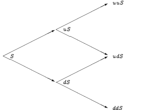

使其具有与具有相同均值和波动率的（连续时间）过程相同的时间序列属性？构建这种方法实际上有很多种，因此人们利用一个自由度来强制节点 *重新连接*，即通过施加 \(u = \frac{1}{d}\)。

（使用这种方法对期权定价时，我们指定将到期时间 \((T - t)\) 分割为 \(n\) 个周期，然后使用具有该步数的二项式树计算期权。

给定 \(S, X, r, \sigma, T\) 和周期数 \(n\)，计算

```
\(\Delta t = \frac{T - t}{n}\)
\(u = e^{\sigma \sqrt{\Delta t}}\)
\(d = e^{-\sigma \sqrt{\Delta t}}\)
```

我们还重新定义了“风险中性概率”

```
\(R = e^{r \Delta t}\)
\(q = \frac{R - d}{u - d}\)
```

要计算期权价格，将“向后推演”。在节点 \(t\)，计算时间 \(t+1\) 时两种可能结果的看涨期权价格作为函数。例如，如果只有一步，

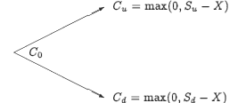

在时间 0 时求看涨期权价格为

```
\(C_0 = e^{-r\tau}(qC_u + (1 - q)C_d)\)
```

当有更多周期时，将如第 8 章中讨论的那样“向后推演”

## 12.2 Black Scholes 框架下的期权定价

考虑不派息的标的证券期权。

### 12.2.1 欧式期权

对于欧式期权，二项式树用得不多，因为 Black Scholes 模型会给出正确答案，但查看不包含提前行权检查（即美式情况）的二项式树构建是有用的。

下面的二项式计算机算法值得一些评论。只有一个看涨期权价格向量，有人可能认为需要两个，一个在时间 \( t \)，另一个在时间 \( t+1 \)。（在查看下面的算法之前，先试着写下你会如何解决它。）但通过利用分支重新连接的事实，可以使用下面的算法，少用一个数组。你可能想检查一下这是如何工作的。这也是确保理解二项式期权定价的一种有用方法。

```
#include <cmath> // standard mathematical library
#include <algorithm> // defining the max() operator
#include <vector> // STL vector templates
using namespace std;

double option_price_call_european_binomial(const double& S, // spot price
const double& K, // exercise price
const double& r, // interest rate
const double& sigma, // volatility
const double& time, // time to maturity
const int& no_steps) // no steps in binomial tree
{
double R=exp(r/no_steps); // interest rate for each step
double Rinv = 1.0/R; // inverse of interest rate
double u = exp(sigma*sqrt(time/no_steps)); // up movement
double uu = u*u;
double d = 1.0/u;
double p_up = (R-d)/(u-d);
double p_down = 1.0-p_up;
vector<double> prices(no_steps+1); // price of underlying
prices[0] = S*pow(u,double(no_steps)); // S*u^n
for (int i=1; i<=no_steps; ++i) prices[i] = uu*prices[i-1];
vector<double> call_values(no_steps+1); // value of corresponding call
for (int i=0; i<=no_steps; ++i) call_values[i] = max(0.0, (prices[i]-K)); // call payoffs at maturity
for (int step=no_steps-1; step>=0; --step) {
for (int i=0; i<=step; ++i) {
call_values[i] = (p_up*call_values[i+1]+p_down*call_values[i])*Rinv;
}
};
return call_values[0];
};
```

C++ 代码 12.1：二项式欧式期权定价

### 12.2.2 美式期权

美式期权与欧式期权的区别在于行权可能性。美式期权可以在到期日之前的任何时间行权，而欧式期权只能在到期时行权。一般来说，不幸的是，美式期权问题没有解析解，但在某些情况下可以找到。例如，对于不派息股票的美式看涨期权，美式价格与欧式看涨期权相同。

在允许提前行权可能性的美式期权情况下，二项式逼近很有用。在每个节点，我们计算期权价值作为下一期价格的函数，然后检查立即行权的价值

C++ 代码 12.2 说明了美式看涨期权价格的计算。

```
#include <cmath>
#include <vector>
using namespace std;

double option_price_call_american_binomial( const double& S,
    const double& K,
    const double& r,
    const double& sigma,
    const double& t,
    const int& steps) {
    double R = exp(r*(t/steps));
    double Rinv = 1.0/R;
    double u = exp(sigma*sqrt(t/steps));
    double d = 1.0/u;
    double p_up = (R-d)/(u-d);
    double p_down = 1.0-p_up;

    vector<double> prices(steps+1); // price of underlying
    prices[0] = S*pow(d, steps); // fill in the endnodes.
    double uu = u*u;
    for (int i=1; i<=steps; ++i) prices[i] = uu*prices[i-1];

    vector<double> call_values(steps+1); // value of corresponding call
    for (int i=0; i<=steps; ++i) call_values[i] = max(0.0, (prices[i]-K)); // call payoffs at maturity

    for (int step=steps-1; step>=0; --step) {
        for (int i=0; i<=step; ++i) {
            call_values[i] = (p_up*call_values[i+1]+p_down*call_values[i])*Rinv;
            prices[i] = d*prices[i+1];
            call_values[i] = max(call_values[i],prices[i]-K); // check for exercise
        }
    }
    return call_values[0];
};
```

C++ 代码 12.2：使用二项式逼近的美式看涨期权定价

实际上，对于这种特定情况，美式价格将等于欧式价格。


## 12.2.3 Matlab 实现

为了说明 Matlab 与 C++ 之间的差异，请参考 Matlab 代码 12.1 和 Matlab 代码 12.2 中的两个实现。通过明智地使用数组索引，看跌期权的计算更加紧凑，循环更少。

```matlab
function c = bin_am_call(S, K, r, sigma,t,steps)

R = exp(r*(t/steps));
Rinv = 1.0/R;
u = exp(sigma*sqrt(t/steps));
d = 1.0/u;
p_up = (R-d)/(u-d);
p_down = 1.0-p_up;
prices = zeros(steps+1);
prices(1) = S*(d^steps);
uu = u*u;
for i=2:steps
    prices(i) = uu*prices(i-1);
end

call_values = max(0.0, (prices-K));
for step=steps-1:-1
    for i=1:step+1
        call_values(i) = (p_up*call_values(i+1)+p_down*call_values(i))*Rinv;
        prices(i) = d*prices(i+1);
        call_values(i) = max(call_values(i),prices(i)-K);
    end
end
c = call_values(1);
end
```

Matlab 代码 12.1: 使用二叉树近似计算美国看涨期权价格

```matlab
function p = bin_am_put( S, K, r, sigma, t, steps)
R = exp(r*t/steps);
Rinv = 1.0/R;
u = exp(sigma*sqrt(t/steps));
d = 1.0/u;
p_up = (R-d)/(u-d);
p_down = 1.0-p_up;

prices = zeros(steps+1,1);
prices(1) = S*(d^steps);
uu = u*u;
for i=2:steps+1
    prices(i) = uu*prices(i-1);
end
values = max(0.0, (K-prices));
for step=steps-1:-1:1
    values = Rinv .* ( p_up*values(2:step+1) + p_down*values(1:step) );
    prices = u*prices(1:step);
    values = max(values,K-prices);
end
p=values(1);
end
```

Matlab 代码 12.2: 使用二叉树近似计算美国看跌期权价格

## 示例

给定期权的以下信息：S = 100, K = 100, r = 0.1, sigma = 0.25 和距离到期还有 1 年。使用 100 步的二叉树近似来定价美国看涨期权和看跌期权。

```cpp
double S = 100.0; double K = 100.0;
double r = 0.1; double sigma = 0.25;
double time=1.0; int no_steps = 100;
cout << " european call=" << option_price_call_european_binomial(S,K,r,sigma,time,no_steps) << endl;
cout << " american call= " << option_price_call_american_binomial(S,K,r,sigma,time,no_steps) << endl;
cout << " american put = " << option_price_put_american_binomial(S,K,r,sigma,time,no_steps) << endl;
```

C++ 程序输出：
european call= 14.9505
american call= 14.9505
american put = 6.54691

```matlab
S=100;
K=100;
r=0.1;
sigma=0.25;
time=1;
no_steps=100;
C = bin_am_call(S,K,r,sigma,time,no_steps)
P = bin_am_put(S,K,r,sigma,time,no_steps)
```

Matlab 程序输出：
C = 14.951
P = 6.5469

## 12.3 二叉树近似效果如何？

为了说明二叉树近似的行为，图 12.1 绘制了二叉树近似作为 $n$（二叉树近似中的步数）的函数与期权真实值（Black Scholes 值）的比较。请注意 *锯齿* 模式，对于较小的 $n$ 值，二叉树近似在真实值周围来回跳变，但随着 $n$ 增加，它会迅速趋向 Black Scholes 值。

图 12.1: 说明二叉树向 Black Scholes 收敛

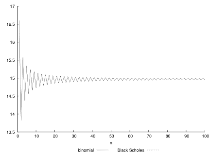

### 12.3.1 估计偏导数。

计算期权价格的同时，始终有必要计算偏导数。让我们从 Delta 开始，即期权价格对标的资产的导数。二叉树方法也为我们提供了近似这些值的方法。二叉树情况下如何求取这些值在 Hull (2011) 中有描述。C++ 代码 12.3 中的实现适用于不派息情况。

```cpp
#include <cmath>
#include <algorithm>
#include <vector>
using namespace std;
double option_price_delta_american_call_binomial(const double& S,
    const double& K,
    const double& r,
    const double& sigma,
    const double& t,
    const int& no_steps){ // steps in binomial
double R = exp(t/no_steps);
double Rinv = 1.0/R;
double u = exp(sigma*sqrt(t/no_steps));
double d = 1.0/u;
double uu = u*u;
double pUp = (R-d)/(u-d);
double pDown = 1.0 - pUp;
vector<double> prices (no_steps+1);
prices[0] = S*pow(d, no_steps);
for (int i=1; i<=no_steps; ++i) prices[i] = uu*prices[i-1];
vector<double> call_values (no_steps+1);
for (int i=0; i<=no_steps; ++i) call_values[i] = max(0.0, (prices[i]-K));
for (int curr_step=no_steps-1; curr_step>=0; --curr_step) {
    for (int i=0; i<=curr_step; ++i) {
        prices[i] = d*prices[i+1];
        call_values[i] = (pDown*call_values[i]+pUp*call_values[i+1])*Rinv;
        call_values[i] = max(call_values[i], prices[i]-K); // check for exercise
    };
};
double delta = (call_values[1]-call_values[0])/(S*u-S*d);
return delta;
};
```

C++ 代码 12.3: Delta

所有导数的计算如 C++ 代码 12.4 所示。

```cpp
#include <cmath>
#include <algorithm>
#include "fin_recipes.h"

void option_price_partials_american_call_binomial(const double& S, // spot price
const double& K, // Exercise price,
const double& r, // interest rate
const double& sigma, // volatility
const double& time, // time to maturity
int& no_steps, // steps in binomial
double& delta, // partial wrt S
double& gamma, // second deriv wrt S
double& theta, // partial wrt time
double& vega, // partial wrt sigma
double& rho) // partial wrt r
{
vector<double> prices(no_steps+1);
vector<double> call_values(no_steps+1);
double delta_t = time/no_steps;
double R = exp(delta_t);
double Rinv = 1.0/R;
double u = exp(sigma*sqrt(delta_t));
double d = 1.0/u;
double uu = u*u;
double pUp = (R-d)/(u-d);
double pDown = 1.0 - pUp;
prices[0] = S*pow(d, no_steps);
for (int i=1; i<=no_steps; ++i) prices[i] = uu*prices[i-1];
for (int i=0; i<=no_steps; ++i) call_values[i] = max(0.0, (prices[i]-K));
for (int i=no_steps-1; i>=0; --i) {
    for (int j=0; j<=i; ++j) {
        prices[j] = d*prices[j+1];
        call_values[j] = (pDown*call_values[j]+pUp*call_values[j+1])*Rinv;
        call_values[j] = max(call_values[j], prices[j]-K); // check for exercise
    };
};
double E2 = call_values[2];
double E1 = call_values[1];
double E0 = call_values[0];
for (int i=0;i<1;++i) {
    prices[i] = d*prices[i+1];
    call_values[i] = (pDown*call_values[i]+pUp*call_values[i+1])*Rinv;
    call_values[i] = max(call_values[i], prices[i]-K); // check for exercise
};
double f11 = call_values[1];
double f10 = call_values[0];
double f00 = call_values[0];
prices[0] = d*prices[1];
call_values[0] = (pDown*call_values[0]+pUp*call_values[1])*Rinv;
call_values[0] = max(call_values[0], S-K); // check for exercise on first date
double f00 = call_values[0];
double delta = (f11-f00)/(S*u-S*d);
double h = 0.5 * S * ( uu - d*d);
gamma = ( (22-121)/((S*u-1)) - (21-20)/((S*(1-d*d)) ) / h;
theta = (21-f00- f00) / (2*delta_t);
double diff = 0.02;
double tmp_sigma = sigma+diff;
double tmp_price = option_call_american_binomial(S,K,r,tmp_sigma,time,no_steps);
vega = (tmp_price-f00)/diff;
diff = 0.05;
double tmp_r = r+diff;
tmp_price = option_call_american_binomial(S,K,tmp_r,sigma,time,no_steps);
rho = (tmp_price-f00)/diff;
};
```

C++ 代码 12.4: 对冲参数

## 示例

给定以下信息：\( S = 100, K = 100, r = 0.1, \sigma = 0.25 \) 和距离到期还有 1 年，在二叉树近似中使用 100 步。

- 1. 估计期权的所有 “希腊字母”：delta(\(\Delta\))、gamma、theta、vega 和 rho。

```cpp
double S = 100.0; double K = 100.0;
double r = 0.1; double sigma = 0.25;
double time=1.0; int no_steps = 100;
double delta, gamma, theta, vega, rho;
option_price_partials_american_call_binomial(S,K,r, sigma, time, no_steps,
delta, gamma, theta, vega, rho);
cout << " Call price partials" << endl;
cout << " delta = " << delta << endl;
cout << " gamma = " << gamma << endl;
cout << " theta = " << theta << endl;
cout << " vega = " << vega << endl;
cout << " rho = " << rho << endl;
```

C++ 程序输出：
Call price partials
delta = 0.699792
gamma = 0.0140407
theta = -9.89067
vega = 34.8536
rho = 56.9652

## 练习 12.1

考虑一项不派息股票的美国看涨期权，其中 \( S = 100, K = 100, \sigma = 0.2, (T - t) = 1 \) 且 \( r = 0.1 \)。

- 1. 使用 Black Scholes 计算该期权的价格
- 2. 使用二叉树近似计算价格，在近似中分别使用 10、100 和 1000 步
- 3. 讨论估计价格差异的来源


## 12.4 调整标的资产的支付

支付的最简单情况与我们在 Black Scholes 案例中看到的情况类似，即连续支付 y。需要将此 y 引入二叉树框架。这里我们使用它来调整概率：

\(\Delta t = \sqrt{(T-t)/n}\)
\(u = e^{\sigma \Delta t}\)
\(d = \frac{1}{u}\)
\(p_u = \frac{e^{(r-y)\Delta t} - d}{u - d}\)
\(p_d = 1 - p_u\)

例如，最后一个节点

\(C_0 = e^{-r\Delta t}(p_u C_u + (1 - p_u)C_d)\)

```
#include <cmath> // standard mathematical library
#include <algorithm> // defines the max() operator
#include <vector> // STL vector templates
using namespace std;
double option_price_call_american_binomial( const double& S, // spot price
const double& K, // exercise price
const double& r, // interest rate
const double& y, // continuous payout
const double& sigma, // volatility
const double& t, // time to maturity
const int& steps) { // no steps in binomial tree
double R = exp((r*(t/steps)); // interest rate for each step
double Rinv = 1.0/R; // inverse of interest rate
double u = exp(sigma*sqrt(t/steps)); // up movement
double uu = u*u;
double d = 1.0/u;
double p_up = (exp((r-y)*(t/steps))-d)/(u-d);
double p_down = 1.0-p_up;
vector<double> prices(steps+1); // price of underlying
prices[0] = S*pow(d,steps); // fill in the endnodes.
for (int i=1; i<=steps; ++i) prices[i] = uu*prices[i-1];
vector<double> call_values(steps+1); // value of corresponding call
for (int i=0; i<=steps; ++i) call_values[i] = max(0.0, (prices[i]-K)); // call payoffs at maturity
for (int step=steps-1; step>=0; --step)
for (int i=0; i<=step; ++i) {
call_values[i] = (p_up*call_values[i+1]+p_down*call_values[i])*Rinv;
call_values[i] = max(call_values[i],prices[i]-K); // check for exercise
};
};
return call_values[0];
};
```

## 12.5 使用二叉树近似法对股息股票期权定价

### 12.5.1 在二叉树模型中检查提前行权

如果标的资产是在期权存续期内支付股息的股票，则期权条款不会调整以反映这笔现金支付，这意味着期权价值将反映股息支付。

在二叉树模型中，股息的调整取决于股息是离散的还是按比例的。

### 12.5.2 按比例股息

对于按比例股息，我们只需用调整因子乘以除息日股价，二叉树中的节点将再次“连接”，我们可以使用相同的“回溯”过程。

```
#include <cmath>
#include <algorithm>
#include <vector>
#include "trin_recipes.h"
#include <iostream>

double option_price_call_american_proportional_dividends_binomial(const double& S,
                                                                  const double& K,
                                                                  const double& r,
                                                                  const double& sigma,
                                                                  const double& time,
                                                                  const int& no_steps,
                                                                  const vector<double>& dividend_times,
                                                                  const vector<double>& dividend_yields) { // note that the last dividend date should be before the expiry date
    // no.dividends = int(dividend_times.size());
    int no_dividends = int(dividend_times.size());
    if (no_dividends == 0) {
        return option_price_call_american_binomial(S,K,r,sigma,time,no_steps); // price w/o dividends
    };

    double delta_t = time/no_steps;
    double R = exp(r*delta_t);
    double Rinv = 1.0/R;
    double u = exp(sigma*sqrt(delta_t));
    double uu = u*u;
    double d = 1.0/u;
    double p_up = (R-d)/(u-d);
    double p_down = 1.0 - p_up;
    vector<int> dividend_steps(no_dividends); // when dividends are paid
    for (int i=0; i<no_dividends; ++i) {
        dividend_steps[i] = (int)(dividend_times[i]/time*no_steps);
    };

    vector<double> prices(2*no_steps+1);
    vector<double> call_prices(no_steps+1);
    prices[0] = S*pow(u,no_steps); // adjust downward terminal prices by dividends
    for (int i=0; i<no_steps; ++i) prices[i+1] = u*prices[i]/(1.0-dividend_yields[i]);
    for (int i=1; i<=no_steps; ++i) {
        prices[i] = prices[i-1]*d;
        call_prices[i] = max(0.0, (prices[i]-K));
    };

    for (int step=no_steps-1; step>=0; --step) {
        for (int i=0;i<=no_steps;++i) { // check whether dividend paid
            if (step==dividend_steps[i]) {
                for (int j=0;j<=(step+1);++j) {
                    prices[j]=(1.0/(1.0-dividend_yields[i]));
                };
            };
        };
        for (int i=0; i<=step; ++i) {
            call_prices[i] = (p_down*call_prices[i]+p_up*call_prices[i+1])*Rinv;
            prices[i] = d*prices[i+1];
            call_prices[i] = max(call_prices[i], prices[i]-K); // check for excercise
        };
    };
    return call_prices[0];
};
```

### 12.5.3 离散股息

问题在于当股息为固定美元金额时。在这种情况下，二叉树的节点不会“连接”，分支数量会急剧增加，这意味着计算时间会增加。

C++ 代码 12.7 中介绍的算法实现了这种无连接的情况，即构建一棵直到除息日的二叉树，然后在该树的终端节点上，自身递归调用一次，减少一次股息支付，期权到期时间为除息日剩余时间。这样计算出除息日的期权价值，然后将其与除息日前行权的价值进行比较。这是一个使用递归简化计算的有教益的示例，但与大多数递归解决方案一样，它在计算时间上有代价。对于大型二叉树和多个股息，此过程在计算时间上代价高昂。

```
#include <cmath>
#include <vector>
#include "fin_recipes.h"
#include <iostream>

double option_price_call_american_discrete_dividends(const double& S,
        const double& K,
        const double& r,
        const double& sigma,
        const double& t,
        const vector<double>& dividend_times,
        const vector<double>& dividend_amounts) {
    int no_dividends = int(dividend_times.size());
    if (no_dividends==0) return option_price_call_american_binomial(S,K,r,sigma,t,steps); // just do regular
    int steps_before_first_dividend = (int)(dividend_times[0]/t*steps);
    const double R = exp(r*(t/steps));
    const double Rinv = 1.0/R;
    const double u = exp(sigma*sqrt(t/steps));
    const double d = 1.0/u;
    const double p_up = (R-d)/(u-d);
    const double p_down = 1.0 - p_up;
    vector<double> dividend_amounts_temporaries(no_dividends-1); // temporaries with
    vector<double> dividend_times_temporaries(no_dividends-1); // one less dividend
    for (int i=0;i<(no_dividends-1);++i) {
        tmp.dividend_amounts[i] = dividend_amounts[i+1];
        tmp.dividend_times[i] = dividend_times[i+1] - dividend_times[0];
    }
    vector<double> prices(steps_before_dividend+1);
    vector<double> call_values(steps_before_dividend+1);
    prices[0] = S*pow(d, steps_before_dividend);
    for (int i=1; i<=steps_before_dividend; ++i) prices[i] = u*prices[i-1];
    for (int i=steps_before_dividend; i>=0; --i) {
        double value_alive = option_price_call_american_discrete_dividends.binomial(prices[i]-dividend_amount.K, r, sigma,
        t-dividend_times[0],// time after first dividend
        steps-steps_before_dividend,
        tmp.dividend_times,
        tmp.dividend_amounts);
        call_values[i] = max(value_alive,(prices[i]-K)); // compare to exercising now
    }
    for (int step=steps_before_dividend-1; step>=0; --step) {
        for (int i=0; i<=step; ++i) {
            prices[i] = d*prices[i+1];
            call_values[i] = (p_down*call_values[i]+p_up*call_values[i+1])*Rinv;
            call_values[i] = max(call_values[i], prices[i]-K);
        }
    }
    return call_values[0];
}
```

## C++ 代码 12.7：股票支付离散股息的股票期权二叉树定价


### 示例

给定以下信息 S = 100, K = 100, r = 0.1, sigma = 0.25，距离到期还有 1 年，根据股息的两种不同假设计算期权价格：

- 1. 连续支付，d = 0.02。
- 2. 离散支付，在 0.25 和 0.75 时点 d = 0.025。

```cpp
C++ program:
double S = 100.0;  double K = 100.0;
double r = 0.10;   double sigma = 0.25;
double time=1.0;
int no_steps = 100;
double d=0.02;
cout << "call price with continuous dividend payout = "
     << option_price_call_american_binomial(S,K,r,d,sigma,time,no_steps) << endl;
vector<double> dividend_times; vector<double> dividend_yields;
dividend_times.push_back(0.25); dividend_yields.push_back(0.025);
dividend_times.push_back(0.75); dividend_yields.push_back(0.025);
cout << " call price with proportional dividend yields at discrete dates = "
     << option_price_call_american_proportional_dividends.binomial(S,K,r,sigma,time,no_steps,
                                                                  dividend_times, dividend_yields)
     << endl;
vector<double> dividend_amounts; dividend_amounts.push_back(2.5); dividend_amounts.push_back(2.5);
cout << " call price with proportional dividend amounts at discrete dates = "
     << option_price_call_american_discrete_dividends.binomial(S,K,r,sigma,time,no_steps,
                                                               dividend_times, dividend_amounts)
     << endl;
Output from C++ program:
call price with continuous dividend payout = 13.5926
call price with proportional dividend yields at discrete dates = 11.8604
call price with proportional dividend amounts at discrete dates = 12.0233
```

### 12.6 期货期权

对于美式期权，由于提前行权的可行性，二叉树模型被用于近似看涨期权和看跌期权的期权价值。

### 示例

F = 50.0, K = 45.0, r = 0.08, sigma = 0.2, time=0.5, 步数=100；对期货期权定价

```cpp
C++ program:
double F = 50.0;   double K = 45.0;
double r = 0.08;   double sigma = 0.2;
double time=0.5;
int no_steps=100;
cout << " european futures call option = "
     << futures_option_price_call_american_binomial(F,K,r,sigma,time,no_steps) << endl;
Output from C++ program:
european futures call option = 5.74254
```

```cpp
#include <cmath>
#include <algorithm>
#include <vector>
using namespace std;

double futures_option_price_call_american_binomial(const double& S, // price futures contract
                                                   const double& K, // exercise price
                                                   const double& r, // interest rate
                                                   const double& sigma, // volatility
                                                   const double& time, // time to maturity
                                                   const int& no_steps) { // number of steps
    vector<double> futures_prices(no_steps+1);
    vector<double> call_values(no_steps+1);
    double delta_t = time/no_steps;
    double Rinv = exp(-r*delta_t);
    double u = exp(sigma*sqrt(delta_t));
    double d = 1.0/u;
    double uu = u*u;
    double p_up = (Rinv-d)/(u-d); // how probability is calculated
    double p_down = 1.0 - p_up;
    futures_prices[0] = S*pow(d,no_steps);
    for (i=0; i<=no_steps; ++i) futures_prices[i] = uu*futures_prices[i-1]; // terminal tree nodes
    for (i=0; i<=no_steps; ++i) call_values[i] = max(0.0, (futures_prices[i]-K));
    for (int step=no_steps-1; step>=0; --step) {
        for (i=0; i<=step; ++i) {
            futures_prices[i] = d*futures_prices[i+1];
            call_values[i] = (p_down*call_values[i]+p_up*call_values[i+1])*Rinv; // check for exercise
            call_values[i] = max(call_values[i], futures_prices[i]-K);
        }
    };
    return call_values[0];
};
```

C++ 代码 12.8：使用二叉树近似对期货期权的美式看涨期权定价

### 12.7 外汇期权

对于美式期权，常用方法是使用二叉树近似，检查由于利率差异而提前行权的情况。

```cpp
#include <cmath>
#include <algorithm>
#include <vector>
using namespace std;
double currency_option_price_call_american_binomial(const double& S,
        const double& K,
        const double& r,
        const double& r_f,
        const double& sigma,
        const double& time,
        const int& no_steps) {
    vector<double> exchange_rates(no_steps+1);
    vector<double> call_values(no_steps+1);
    double t_delta = time/no_steps;
    double Rinv = exp(-r*t_delta);
    double u = exp(sigma*sqrt(t_delta));
    double d = 1.0/u;
    double pUp = (exp((r-r_f)*t_delta)-d)/(u-d); // adjust for foreign int.rate
    double pDown = 1.0 - pUp;
    exchange_rates[0] = S*pow(d, no_steps);
    for (i=1; i<=no_steps; ++i) {
        exchange_rates[i] = u*exchange_rates[i-1]; // terminal tree nodes
    }
    for (i=0; i<=no_steps; ++i) call_values[i] = max(0.0, (exchange_rates[i]-K));
    for (int step=no_steps-1; step>=0; --step) {
        for (i=0; i<=step; ++i) {
            exchange_rates[i] = d*exchange_rates[i+1];
            call_values[i] = (pDown*call_values[i]+pUp*call_values[i+1])*Rinv;
            call_values[i] = max(call_values[i], exchange_rates[i]-K); // check for exercise
        }
    }
    return call_values[0];
}
```

C++ 代码 12.9：使用二叉树近似对货币期权的美式看涨期权定价

### 示例

使用以下信息对期货货币期权定价：S = 50, K = 52, r = 0.08, rf = 0.05, sigma = 0.2, time=0.5，步数 = 100。

```cpp
C++ program:
double S = 50.0; double K = 52.0;
double r = 0.08; double rf=0.05;
double sigma = 0.2; double time=0.5;
int no_steps = 100;
cout << " european currency option call = "
     << currency_option_price_call_american_binomial(S,K,r,rf,sigma,time,no_steps) << endl;
```

C++ 程序输出：

european currency option call = 2.23129

### 12.8 参考文献

二叉树期权定价的原始来源是 Cox 等人（1979）的论文。教科书讨论见 Cox 和 Rubinstein（1985）、Bossaerts 和 Ødegaard（2001）以及 Hull（2011）。

## 第 13 章

## 有限差分

### 目录

- 13.1 显式有限差分 . . . . . . . . . . . . . . . . . . . . 132
- 13.2 欧式期权 . . . . . . . . . . . . . . . . . . . . . . . . 132
- 13.3 美式期权 . . . . . . . . . . . . . . . . . . . . . . . . 134
- 13.4 隐式有限差分 . . . . . . . . . . . . . . . . . . 137
- 13.5 矩阵类示例 . . . . . . . . . . . . . . . . . . . . 137
- 13.6 有限差分 . . . . . . . . . . . . . . . . . . . . . . . 137
- 13.7 美式期权 . . . . . . . . . . . . . . . . . . . . . . . . 137
- 13.8 欧式期权 . . . . . . . . . . . . . . . .
- 13.9 参考文献 . . . . . . . . . . . . . . . . . . . . . . . . . . . 141

### 13.1 显式有限差分

对于任何需要求解微分方程的工程师来说，首选方法是使用有限差分方案进行数值近似，即用离散差分方程近似连续微分方程，并求解该差分方程。

### 13.2 欧式期权。

对于欧式期权，我们不需要使用有限差分方案，但我们展示如何为了比较目的计算欧式期权价格。我们展示了在 C++ 中的显式有限差分方案情况。代码 13.1。显式版本的一个问题是，对于某些输入组合，它可能不收敛。

```cpp
#include <cmath>
#include <vector>
using namespace std;

double option_price_put_european_finite_diff_explicit(const double& S,
        const double& X,
        const double& r,
        const double& sigma,
        const double& time,
        const int& no_S_steps,
        const int& no_time_steps) {
    double sigma_sqr = pow(sigma,2);
    int M=no_S_steps; if ((no_S_steps%2)==1) { ++M; } // need no_S.steps to be even:
    double delta_S = 2.0*S/M;
    vector<double> S_values(M+1);
    for (unsigned m=0;m<=M;m++) { S_values[m] = m*delta_S; }
    int N=no_time_steps;
    double delta_t = time/N;
    vector<double> a(M);
    vector<double> b(M);
    vector<double> c(M);
    double r1=1.0/(1.0+r*delta_t);
    double r2=delta_t/(1.0+r*delta_t);
    for (unsigned int j=1;j<=M;j++) {
        a[j] = r2*0.5*j*j*(-r+sigma*sigma*j);
        b[j] = 1 + r1*(1.0-sigma*sigma*j*j)*delta_t;
        c[j] = r2*0.5*j*j*(r+sigma*sigma*j);
    };
    vector<double> f_next(M+1);
    for (unsigned m=0;m<=M;m++) { f_next[m]=max(0.0,X-S_values[m]); };
    for (int t=N-1;t>=0;--t) {
        f[0]=X;
        for (unsigned m=1;m<M;m++) {
            f[m]=a[m]*f_next[m-1]+b[m]*f_next[m]+c[m]*f_next[m+1];
        };
        f[M] = 0;
        for (unsigned m=0;m<=M;m++) { f_next[m] = f[m]; };
    };
    return f[M/2];
};
```

C++ 代码 13.1：欧式看跌期权的显式有限差分计算


### 13.3 美式期权.

我们现在比较相同算法的美式版本，唯一的区别在于每个点都要检查行权。C++ 代码 13.2 展示了美式看跌期权的 C++ 代码，Matlab 代码 13.1 展示了在 Matlab 中实现的相同内容。

```cpp
#include <cmath>
#include <algorithm>
#include <vector>
using namespace std;

double option_price_put_american_finite_diff_explicit( const double& S,
                                                       const double& K,
                                                       const double& r,
                                                       const double& sigma,
                                                       const double& time,
                                                       const int& no_S_steps,
                                                       const int& no_time_steps )
{
   double sigma_sqr = sigma*sigma;
   int M=no_S_steps+(no_S_steps%2); // no need no_S_steps to be even:
   double delta_S = 2.0*S/M;
   vector<double> S_values(M+1);
   for (int m=0;m<=M;m++) { S_values[m] = m*delta_S; };
   int N=no_time_steps;
   double delta_t = time/N;

   vector<double> a(M);
   vector<double> b(M);
   vector<double> c(M);
   double r1=1.0/(1.0+r*delta_t);
   double r2=delta_t/(1.0+r*delta_t);
   for (int j=1;j<M;j++){
      a[j] = r2*0.5*j*j*(-r+sigma*sigma*j);
      b[j] = 1.0*(1.0-sigma*sigma*j*j)*delta_t;
      c[j] = r2*0.5*j*j*(r+sigma*sigma*j);
   };

   vector<double> f_next(M+1);
   for (int m=0;m<M+1;m++) { f_next[m]=max(0.0,K-S_values[m]); };
   vector<double> f(M+1);
   for (int t=N-1;t>=0;--t) {
      f[0]=K;
      for (int m=1;m<M;++m) {
         f[m]=a[m]*f_next[m-1]+b[m]*f_next[m]+c[m]*f_next[m+1];
         f[m] = max(f[m],K-S_values[m]); // check for exercise
      };
      f[M] = 0;
      for (int m=0;m<=M;m++) { f_next[m] = f[m]; };
   };
   return f[M/2];
};
}
```

C++ 代码 13.2：美式看跌期权的显式有限差分计算

```matlab
function P = findiff_exp_am_put(S,K,r,sigma,time,no_S_steps,no_t_steps)
sigma_sqr = sigma^2;
M=no_S_steps + rem(no_S_steps,2); # need no_S_steps to be even:
delta_S = 2*S/M;
S_values = delta_S * (0:M)';
N=no_t_steps;
delta_t = time/N;
r1=1/(1+r*delta_t);
r2=delta_t/(1+r*delta_t);
a=zeros(M-1,1);
b=zeros(M-1,1);
c=zeros(M-1,1);
for j=1:M-1,
a(j) = r2*0.5*sigma^2*(-j+sigma_sqr);
b(j) = 1+r1*(0.5-sigma_sqr)*delta_t;
c(j) = r2*0.5*(j+sigma_sqr);
endfor
f_next = max(0,K-S_values);
for t=N-1:-1:0
f = [K; a.*f_next(1:M-1)+b.*f_next(2:M)+c.*f_next(3:M+1); 0];
f = max(f,K-S_values);
f_next=f;
endfor
P=f(1+M/2);
endfunction
```

Matlab 代码 13.1：美式看跌期权的显式有限差分计算

### 示例

给定以下参数：S = 50，K = 50，r = 10% 且 σ = 0.4。距离到期的时间为 0.4167。

使用有限差分法对欧式和美式看跌期权进行定价，S 维度步数为 20，时间维度步数为 11。

```cpp
double S = 50.0;
double K = 50.0;
double r = 0.1;
double sigma = 0.4;
double time=0.4167;
int no_S_steps=20;
int no_t_steps=11;
cout << " explicit finite differences, european put price = ";
cout << option_price_put_european_finite_diff_explicit(S,K,r,sigma,time,no_S_steps,no_t_steps);
cout << endl;
cout << " explicit finite differences, american put price = ";
cout << option_price_put_american_finite_diff_explicit(S,K,r,sigma,time,no_S_steps,no_t_steps);
cout << endl;
```
C++ 程序输出：
显式有限差分，欧式看跌期权价格 = 4.03667
显式有限差分，美式看跌期权价格 = 4.25085

参考阅读：Brennan 和 Schwartz (1978) 是有限差分在金融领域的最早应用之一。Hull (1993) 第 14.7 节对有限差分做了简要介绍。Wilmott、Dewynne 和 Howison (1994) 是从求解偏微分方程角度探讨期权定价的详尽资料。

### 13.4 隐式有限差分

真正区分 C++ 与标准 C 的在于，可以通过创建类并将这些类收集到库中来 _扩展_ 语言。库是为某一特定目的而收集的类和例程的集合。我们在创建 date 和 term_structure 类时已经见过这一思想。然而，不一定总是要从头开始创建此类类。使用他人的类同样可以，只要它正确、文档齐全且满足特定目的即可。

### 13.5 矩阵类示例

使用 Newmat 作为示例矩阵类。

### 13.6 有限差分

我们使用隐式有限差分计算的案例来说明矩阵计算的实际应用。

对于任何需要求解微分方程的工程师来说，首选方法是使用有限差分方案进行数值近似，即用离散差分方程近似连续微分方程，并求解该差分方程。

在以下内容中，我们实现 _隐式有限差分_。显式有限差分之前已讨论过，我们将隐式情况推迟到现在，因为矩阵库大大简化了它。

### 13.7 美式期权

让我们先看看这种定价在 Matlab 中是如何实现的。Matlab 代码 13.2 展示了实现。使用 Newmat 库的 C++ 代码 13.3 和使用 IT++ 库的 C++ 代码 13.4 实现了相同的计算。

```matlab
function P = findiff_imp_am_put(S,K,r,sigma,time,no_S_steps,no_t_steps)
sigma_sqr = sigma^2;
M=no_S_steps + rem(no_S_steps,2); # need no_S_steps to be even:
delta_S = 2.0*S/double(M);
S_values = delta_S.*(1:M+1)';
No=no_t_steps;
delta_t = time/No;
A = zeros(M+1,M+1);
A(1,1)=1.0;
for j=2:M
    A(j,j-1) = 0.5*j*delta_t.*((r-sigma_sqr)*j);
    A(j,j) = 1.0 + delta_t.*((r+sigma_sqr)*j^2);
    A(j,j+1) = 0.5*j*delta_t.*(-(r-sigma_sqr)*j);
endfor
A(M+1,M+1)=1.0;
B = max(0,K-S_values);
P = inv(A)*B;
for i = No-1:-1:1
    B = P;
    F = A\B;
    P=max(F,P,K-S_values);
endfor
P = P(M/2);
endfunction
```

Matlab 代码 13.2：使用隐式有限差分计算美式看跌期权价格

```cpp
#include <cmath>
#include "newmat.h" // definitions for newmat matrix library
using namespace NEWMAT;

#include <vector>
#include <algorithm>
using namespace std;

double option_price_put_american_finite_diff_implicit(const double& S,
const double& K,
const double& r,
const double& sigma,
const double& time,
const int& no_S_steps,
const int& no_t_steps) {
double sigma_sqr = sigma*sigma;
int M=no_S_steps + (no_S_steps%2); // need no_S_steps to be even.
// int M=no_S_steps; if ((no_S_steps%2)==1) ++M; // need no_S_steps to be even.
double delta_S = 2.0*S/double(M);
double S_values[M+1];
for (int m=0;m<M;m++) { S_values[m] = m*delta_S; };
int N=no_t_steps;
double delta_t = time/N;

BandMatrix A(M+1,1); A=0.0;
A.element(0,0) = 1.0;
for (int j=1;j<M;++j) {
A.element(j,j-1) = 0.5*delta_t*(r-sigma_sqr*j); // a[j]
A.element(j,j) = 1.0 + delta_t*(r+sigma_sqr*j*j); // b[j];
A.element(j,j+1) = 0.5*delta_t*(-r-sigma_sqr*j); // c[j];
};
A.element(M,M)=1.0;
ColumnVector B(M+1);
for (int m=0;m<M;++m) { B.element(m) = max(0.0,K-S_values[m]); };
ColumnVector F=A.i()*B;
for (int t=N-1;t>=0;--t) {
B = F;
F = A.i()*B;
for (int m=1;m<M;++m) { // now check for exercise
F.element(m) = max(F.element(m), K-S_values[m]);
};
};
return F.element(M/2);
}
```

C++ 代码 13.3：使用 Newmat 矩阵库的隐式有限差分计算美式看跌期权价格

```cpp
#include <cmath>
//#include <vector>
//#include <algorithm>
using namespace std;
#include <itpp/base/vec.h>
#include <itpp/base/mat.h>
#include <itpp/base/matfunc.h>
using namespace itpp;
double option_price_put_american_finite_diff_implicit_itpp(const double& S,
    const double& K,
    const double& r,
    const double& sigma,
    const double& time,
    const int& no_S_steps,
    const int& no_time_steps) {
    double sigma_sqr = sigma*sigma;
    int M=no_S_steps + (no_S_steps%2); // need no_S_steps to be even:
    double delta_S = 2.0*S/double(M);
    double S_values[M+1];
    for (int m=0;m<=M;m++) { S_values[m] = m*delta_S; };
    int no_t_steps;
    double delta_t = time/no_t_steps;
    mat A(M+1,M+1);
    A.zeros();
    A(0,0) = 1.0;
    for (int j=1;j<M;++j) {
        A(j,j-1) = 0.5*delta_t*(-r+sigma_sqr*j); // a[j]
        A(j,j) = 1.0 + delta_t*(r+sigma_sqr*j*j); // b[j];
        A(j,j+1) = 0.5*delta_t*(-r-sigma_sqr*j); // c[j];
    };
    A(M,M)=1.0;
    vec B(M+1);
    for (int m=0;m<=M;m++) { B(m) = max(0.0,K-S_values[m]); };
    mat invA = inv(A);
    vec F(M+1);
    for (int n=no_t_steps-1;n>=0;--n) {
        B = F;
        F = invA*B;
        for (int m=1;m<M;++m) { // now check for exercise
            F(m) = max(F(m), K-S_values[m]);
        };
    };
    return F(M/2);
};
```
```

C++ 代码 13.4：使用 IT++ 矩阵库的隐式有限差分计算美式看跌期权价格


## 13.8 欧式期权

对于欧式期权，我们不需要使用有限差分方案，但为了比较目的，C++ 代码 13.5 展示了如何计算欧式期权价格。

```cpp
#include <cmath>
#include "newmat.h" // definitions for newmat matrix library
using namespace NEWMAT;
#include <vector> // standard STL vector template
#include <algorithm>
using namespace std;
double option_price_put_european_finite_diff_implicit(const double& S,
                               const double& K,
                               const double& r,
                               const double& sigma,
                               const double& time,
                               const int& no_S_steps,
                               const int& no_t_steps) {
    double sigma_sqr = sigma*sigma;
    int M=no_S_steps + (no_S_steps%2); // need no_S_steps to be even.
    double delta_S = 2.0*S/M;
    vector<double> values(M+1);
    for (int m=0; m<=M; ++m) { values[m] = m*delta_S; };
    int N=no_t_steps;
    double delta_t = time/N;
    BandMatrix A(M+1,1); A=0.0;
    A.element(0,0) = 1.0;
    for (int j=1;j<M;++j) {
        A.element(j,j-1) = 0.5*delta_t*(-(r-sigma_sqr)); // / a[j];
        A.element(j,j) = 1.0 + delta_t*(r+sigma_sqr*j*j); // / b[j];
        A.element(j,j+1) = 0.5*delta_t*(-(r-sigma_sqr)); // / c[j];
    };
    A.element(M,M)=1.0;
    ColumnVector B(M+1);
    for (int m=0;m<=M;++m) { B.element(m) = max(0.0,K-values[m]); };
    ColumnVector F=A.i()*B;
    for (int t=N-1;t>=0;--t) {
        B = F;
        F = A.i()*B;
    };
    return F.element(M/2);
};
```

C++ Code 13.5: 使用隐式有限差分计算欧式看跌期权价格

### 练习 13.1.

上述例程直接使用 A 的逆矩阵进行乘法运算。是否存在数值上更稳定的替代方法？

### 示例

给定参数 S = 50, K = 50, r = 0.1, sigma = 0.4, time=0.5, no_S_steps=200; no_t_steps=200;

- 1. 使用 Black Scholes 和隐式有限差分两种方法对欧式看跌期权进行定价。
- 2. 使用隐式有限差分对美式看跌期权进行定价。

```cpp
double S = 50.0; double K = 50.0;
double r = 0.1; double sigma = 0.4; double time=0.5;
int no_S_steps=200; int no_t_steps=200;
cout << "<b> black scholes put price = " << option_price_put_black_scholes(S,K,r,sigma,time)<< endl;
cout << "<b> implicit Euro put price = ";
cout << option_price_put_european_finite_diff_implicit(S,K,r,sigma,time,no_S_steps,no_t_steps) << endl;
cout << "<b> implicit American put price = ";
cout << option_price_put_american_finite_diff_implicit(S,K,r,sigma,time,no_S_steps,no_t_steps) << endl;
```

C++ 程序输出：
black scholes put price = 4.35166
implicit Euro put price = 4.34731
implicit American put price = 4.60064

```matlab
S = 50.0;
K = 50.0;
r = 0.1;
sigma = 0.4;
time=0.5;
no_S_steps=200;
no_t_steps=200;
P = findiff_im_am_put(S,K,r,sigma,time,no_S_steps,no_t_steps)
```

MATLAB 程序输出：
P = 4.6006

### 练习 13.2.

Newmat 库只是众多可用矩阵库中的一个，包括公共领域和商业产品。研究替代库并用其中一个替代库取代 Newmat。期权定价公式中需要做哪些更改？

## 13.9 参考文献

Hull (2011)。参见 natbib 文档。

## 第 14 章

## 通过模拟进行期权定价

## 目录

| 节 | 页码 |
|---------|------|
| 14.1 模拟服从对数正态分布的随机变量 | 143 |
| 14.2 欧式看涨期权定价 | 143 |
| 14.3 对冲参数 | 144 |
| 14.4 更一般的收益。函数原型 | 146 |
| 14.5 提高模拟效率 | 147 |
| 14.5.1 控制变量。 | 147 |
| 14.5.2 反向变量。 | 148 |
| 14.6 更多异国期权 | 151 |
| 14.7 参考文献 | 152 |

我们现在考虑使用蒙特卡洛方法来估计欧式期权的价格，首先考虑“通常”的欧式看涨期权情况，该期权可以通过 Black Scholes 方程定价。由于此情况已有封闭式解，因此使用模拟并非真正必要，但我们使用标准看涨期权的情况作为说明目的。

到期时，看涨期权的价值为

\( c_T = \max(0, S_T - X) \)

在较早的日期 t，期权价值将是此的预期现值。

\( c_t = E[PV(\max(0, S_T - X))] \)

现在，期权定价的一个重要简化特征是“风险中性结果”，这意味着如果我们也修改基础资产的预期回报使其获得无风险利率，我们可以将（适当转换的）问题视为风险中性决策者的决策。

\( c_t = e^{-r(T-t)} E^*[\max(0, S_T - X)] \)

其中 \( E^*[\cdot] \) 是原始期望的转换。估计看涨期权价值的一种方法是根据假设的价格过程模拟大量 \( S_T \) 的样本值，并将模拟值的平均值作为估计的看涨期权价格。通过诉诸大数定律，该平均值将收敛到实际的看涨期权价值，收敛速度取决于我们执行多少次模拟。

### 14.1 模拟服从对数正态分布的随机变量

对数正态变量的模拟如下。设 \(\tilde{x}\) 为均值为零、方差为一的正态分布变量。如果 \(S_t\) 服从对数正态分布，则下一期价格 \(S_{t+1}\) 的模拟为

\(S_{t+1} = S_t e^{(r - \frac{1}{2}\sigma^2) + \sigma \tilde{x}}\)

或者更一般地，如果当前时间为 \(t\) 且到期日为 \(T\)，t 和 T 之间的时间为 \((T-t)\)，

\(S_T = S_t e^{(r - \frac{1}{2}\sigma^2)(T-t) + \sigma \sqrt{T-t} \tilde{x}}\)

服从对数正态分布的随机变量模拟由 C++ 代码 14.1 说明。

```cpp
#include <cmath>
using namespace std;
#include "normdist.h"
double simulate_lognormal_random_variable(const double& S, // current value of variable
                                          const double& r,   // interest rate
                                          const double& sigma, // volatility
                                          const double& time) { // time to final date
    double R = (r - 0.5 * pow(sigma,2)) * time;
    double SD = sigma * sqrt(time);
    return S * exp(R + SD * random_normal());
};
```

C++ Code 14.1: 模拟服从对数正态分布的随机变量

### 14.2 欧式看涨期权定价

为了进行欧式看涨期权价格的蒙特卡洛估计

\(c_t = e^{-r(T-t)} E[\max(0, S_T - X)]\)

请注意，这里只需模拟基础资产的到期价格 \(S_T\)，t 和 T 之间任何时间的基础资产价格与定价无关。我们通过模拟服从对数正态分布的随机变量来进行，这为我们提供了一组到期价格 \(S_T\) 的观察值。如果我们让 \(S_{T,1}, S_{T,2}, S_{T,3}, \dots, S_{T,n}\) 表示 n 个模拟值，我们将 \(E[\max(0, S_T - X)]\) 估计为到期时期权收益的平均值，按无风险利率贴现。

\(\hat{c}_t = e^{-r(T-t)} \left( \sum_{i=1}^n \max(0, S_{T,i} - X) \right)\)

C++ 代码 14.2 展示了欧式看涨期权蒙特卡洛估计的实现。

### 示例

给定 \(S = 100, K = 100, r = 0.1, \sigma = 0.25, \text{time}=1\)。使用 5000 次模拟。使用 Black Scholes 和模拟对看跌期权和看涨期权进行定价。

```cpp
#include <cmath> // standard mathematical functions
#include <algorithm> // define the max() function
using namespace std;
#include "normdist.h" // definition of random number generator

double option_price_call_european_simulated( const double& S,
const double& K,
const double& r,
const double& sigma,
const double& time,
const int& no_sims){
double R = (r - 0.5 * pow(sigma,2))*time;
double SD = sigma * sqrt(time);
double sum_payoffs = 0.0;
for (int n=1; n<=no_sims; n++ ) {
double S_T = S * exp(R + SD * random_normal());
sum_payoffs += max(0.0, S_T-K);
};
return exp(-r*time) * ( sum_payoffs/double(no_sims));
};
```

C++ Code 14.2: 通过模拟定价欧式看涨期权

```cpp
C++ program:

double S=100.0; double K=100.0; double r=0.1; double sigma=0.25;
double time=1.0; int no_sims=5000;
cout << " call: black scholes price = " << option_price_call_black_scholes(S,K,r,sigma,time) << endl;
cout << " simulated price = " << option_price_call_european_simulated(S,K,r,sigma,time,no_sims) << endl;
cout << " put: black scholes price = " << option_price_put_black_scholes(S,K,r,sigma,time) << endl;
cout << " simulated price = " << option_price_put_european_simulated(S,K,r,sigma,time,no_sims) << endl;

Output from C++ program:

call: black scholes price = 14.9758
simulated price = 14.8404
put: black scholes price = 5.45954
simulated price = 5.74588
```

### 14.3 对冲参数

当然，与标准情况一样，估计对冲参数和期权价格也是可取的。我们将展示如何估计期权的 delta，即看涨期权价格相对于基础证券的一阶导数：\(\Delta = \frac{\partial c}{\partial S}\)。要了解如何进行此估计，让我们回顾一下函数 \(f\) 的一阶导数定义为极限

\(f'(x) = \lim_{h \to 0} \frac{f(x+h) - f(x)}{h}\)

将 \(f(S)\) 视为期权定价公式 \(c_t = f(S, X, r, \sigma, (T-t))\)，我们可以看到，可以在基础资产的两个不同值 \(S\) 和 \(S+q\) 下计算期权价格，其中 \(q\) 是一个小量，并将期权 delta 估计为

\(\widehat{\Delta} = \frac{f(S+q) - f(S)}{q}\)


在蒙特卡洛估计中，非常重要的是使用同一组随机变量序列来估计基础资产价格为 $S$ 和 $S + q$ 时的两个期权价格。C++ 代码 14.3 实现了期权 Delta 的此项估计。

```cpp
#include <cmath> // standard mathematical functions
#include <algorithm> // define the max() function
using namespace std;
#include "normdist.h" // definition of random number generator
double option_price_delta_call_european_simulated(const double& S,
const double& K,
const double& r,
const double& sigma,
const double& time,
const int& no_sims){
double R = (r - 0.5 * pow(sigma,2))*time;
double SD = sigma * sqrt(time);
double sum_payoffs = 0.0;
double sum_payoffs_q = 0.0;
double q = 0.001;
for (int n=0; n<no_sims; n++ ) {
double Z = random_normal();
double S_T = S * exp(R + SD * Z);
sum_payoffs += max(0.0,S_T-K);
double S_T_q = (S+q)* exp(R + SD * Z);
sum_payoffs_q += max(0.0,S_T_q-K);
};
double c = exp(-r*time) * (sum_payoffs/no_sims);
double c_q = exp(-r*time) * (sum_payoffs_q/no_sims);
return (c_q - c)/q;
};
```

### C++ 代码 14.3：使用蒙特卡洛定价的欧洲看涨期权 Delta 估计

可以用类似的方法估计其他对冲参数。

示例 给定 $S = 100, K = 100, r = 0.1, \sigma = 0.25, time=1$。使用 5000 次模拟。使用 Black Scholes 和模拟方法计算看跌期权和看涨期权的 Delta。

```cpp
C++ program:
double S=100.0; double K=100.0; double r=0.1; double sigma=0.25;
double time=1.0; int no_sims=5000;
cout << " call: bs delta = " << option_price_delta_call_black_scholes(S,K,r,sigma,time)
<< " sim delta = " << option_price_delta_call_european_simulated(S,K,r,sigma,time,no_sims)
<< " end;";
cout << " put: bs delta = " << option_price_delta_put_black_scholes(S,K,r,sigma,time)
<< " sim delta = " << option_price_delta_put_european_simulated(S,K,r,sigma,time,no_sims)
<< " end;";
```

C++ 程序输出：

| 看涨期权: bs delta = 0.700208 | sim delta = 0.701484 |
| 看跌期权: bs delta = -0.299792 | sim delta = -0.307211 |

## 14.4 更通用的收益。函数原型

上文展示了看涨期权的情况。如果我们想要定价其他类型的期权，具有不同的收益，我们可以为每种可能的情况编写类似的例程。但这会很浪费，稍加思考便可让我们为任何只取决于到期时基础资产价值的期权编写期权估值。现在让我们朝着使用蒙特卡洛方法定价衍生品的通用例程迈进。这依赖于 C++ 编写子例程的能力，即在调用子例程/函数时提供一个函数而不是变量。考虑标准欧洲看跌期权和看涨期权的定价。到期时，每个期权仅通过以下关系取决于基础资产价值 $S_T$ 和行权价 $X$：

$C_T = \max(S_T - X, 0)$
$P_T = \max(X - S_T, 0)$

C++ 代码 14.4 展示了计算此内容的两个 C++ 函数。

```cpp
#include <algorithm>
using namespace std;

double payoff_call(const double& S,
                   const double& K){
  return max(0.0,S-K);
};

double payoff_put (const double& S,
                   const double& K) {
  return max(0.0,K-S);
};
```

### C++ 代码 14.4：看涨期权和看跌期权的收益

有趣的部分在于，当人们意识到可以编写一个通用的模拟例程，向其中提供上述函数之一，或其他仅取决于基础资产价格和某个常数的收益描述函数时。C++ 代码 14.5 展示了如何实现这一点。

```cpp
#include <cmath>
using namespace std;
#include "fin_recipes.h"

double derivative_price_simulate_european_option_generic(const double& S,
                                                         const double& K,
                                                         const double& r,
                                                         const double& sigma,
                                                         const double& time,
                                                         double payoff(const double& price, const double& X),
                                                         const int& no_sims) {
  double sum_payoffs=0;
  for (int n=0; n<no_sims; n++) {
    double S_T = simulate_lognormal_random_variable(S,r,sigma,time);
    sum_payoffs += payoff(S_T, K);
  };
  return exp(-r*time) * (sum_payoffs/no_sims);
};
```

### C++ 代码 14.5：通用模拟定价

请注意子例程调用中存在以下行：

double payoff(const double& S, const double& K),

调用此函数时，调用程序需要提供一个函数放在那里，如上面的 Black Scholes 示例所示。下一个示例展示了如何完整地实现这一点。

### 示例

给定 S = 100, K = 100, r = 0.1, sigma = 0.25, time = 1, no_sims = 50000。

```cpp
C++ program:

double S = 100; double K = 100; double r = 0.1;
double sigma = 0.25; double time = 1.0; int no_sims = 50000;
cout << "Black Scholes call option price = " << option_price_call_black_scholes(S,K,r,sigma,time) << endl;
cout << "Simulated call option price = "
<< derivative_price_simulate_european_option_generic(S,K,r,sigma,time,payoff_call,no_sims)
<< endl;
cout << "Black Scholes put option price = " << option_price_put_black_scholes(S,K,r,sigma,time) << endl;
cout << "Simulated put option price = "
<< derivative_price_simulate_european_option_generic(S,K,r,sigma,time,payoff_put,no_sims)
<< endl;
```

C++ 程序输出：

Black Scholes 看涨期权价格 = 14.9758
模拟看涨期权价格 = 14.995
Black Scholes 看跌期权价格 = 5.45954
模拟看跌期权价格 = 5.5599

如我们所见，即使进行多达 50,000 次模拟，使用蒙特卡洛方法估计的期权价格仍与“真实”值存在相当大的差异。

## 14.5 提高模拟效率

有许多“改进”蒙特卡洛估计实现的方法，使得估计值更接近真实值。

### 14.5.1 控制变量法。

其中一种方法是控制变量法。其思路很简单。当生成基础证券的一组到期值时，可以使用同一组到期值对多个衍生品进行定价。如果我们使用到期值定价的衍生品之一恰好是我们有解析解的衍生品，会怎样？例如，假设我们同时使用（解析）Black Scholes 公式和蒙特卡洛模拟来计算一份平价欧洲看涨期权的价值。如果蒙特卡洛估计高估了期权价格，我们认为使用同一组模拟到期值定价的其他衍生品也会出现这种情况。因此，我们将感兴趣衍生品的价格估计向下调整。

因此，假设我们想要定价一份欧洲看跌期权，并使用平价欧洲看涨期权的价格作为控制变量。使用同一组模拟到期值 \(S_{T,i}\)，我们使用蒙特卡洛方法估计这两个期权，如下所示：

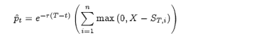

\(\hat{c}_t = e^{-r(T-t)} \left( \sum_{i=1}^n \max(0, S_{T,i} - X) \right)\)

我们计算看涨期权的 Black Scholes 值 \(\hat{c}_T^{bs}\)，并计算 \(\hat{p}_T^{cv}\)，即带有控制变量调整的看跌期权价格估计，如下所示

\(\hat{p}_T^{cv} = \hat{p}_t + (\hat{c}_t^{bs} - \hat{c}_t)\)

可以使用平价看涨期权以外的其他衍生品作为控制变量，唯一的限制是它必须具有可处理的解析解。

C++ 代码 14.6 展示了使用平价欧洲看涨期权作为控制变量的蒙特卡洛估计实现。

```cpp
#include <cmath>
using namespace std;
#include "fin_recipes.h"

double
derivative_price_simulate_european_option_generic_with_control_variate(const double& S,
                                                                      const double& X,
                                                                      const double& r,
                                                                      const double& sigma,
                                                                      const double& time,
                                                                      double payoff(const double& S,
                                                                                    const double& X),
                                                                      const int& no_sims) {
    double c_bs = option_price_call_black_scholes(S,S,r,sigma,time);// price an at the money Black Scholes call
    double sum_payoffs=0;
    double sum_payoffs_bs=0;
    for (int n=0; n<no_sims; n++) {
        double S_T= simulate_lognormal_random_variable(S,r,sigma,time);
        sum_payoffs += payoff(S_T,X);
        sum_payoffs_bs += payoff(call(S,T,S)); // simulate at the money Black Scholes price
    }
    double c_sim = exp(-r*time) * (sum_payoffs/no_sims);
    double c_bs_sim = exp(-r*time) * (sum_payoffs_bs/no_sims);
    double c_sim = (c_bs-c_bs_sim);
    return c_sim;
};
```

### C++ 代码 14.6：带控制变量的通用方法

### 14.5.2 对偶变量法。

使用控制变量的替代方法是考虑对偶变量法。其背后的想法是，如果模拟变量尽可能贴近真实分布地“分布”开来，蒙特卡洛效果最好。这里我们模拟的是单位正态随机变量。正态分布的一个特性是它围绕零对称，且中位数为零。为什么不在模拟的到期值中强制执行这一点呢？一种简单的方法是先模拟一个单位随机正态变量 Z，然后同时使用 Z 和 -Z 来生成对数正态随机变量。C++ 代码 14.7 展示了此想法的实现。

Boyle (1977) 表明，使用对偶变量带来的效率提升并不特别大。还有其他方法可以确保模拟值真正覆盖整个样本空间，有时称为“伪蒙特卡洛”。


## C++ 代码 14.7：带反向变量的泛型

```cpp
#include "fin_recipes.h"
#include "normdist.h"
#include <cmath>
using namespace std;

double
derivative_price_simulate_european_option_generic_with_antithetic_variates(const double& S,
        const double& K,
        const double& r,
        const double& sigma,
        const double& time,
        double payoff(const double& X),
        const int& no_sims) {
    double R = (r - 0.5 * pow(sigma,2)) * time;
    double SD = sigma * sqrt(time);
    double sum_payoffs=0.0;
    for (int n=0; n<no_sims; n++){
        double x=random_normal();
        double S1 = S * exp(R + SD * x);
        double payoff1 = payoff(S1);
        double S2 = S * exp(R - SD * x);
        sum_payoffs += payoff(S2);
    }
    return exp(-r*time) * (sum_payoffs/(2*no_sims));
};
```

### 示例

给定 S = 100、K = 100、r = 0.1、sigma = 0.25、time = 1、no_sims = 50000。使用布莱克-斯科尔斯模型和模拟方法对看跌期权和看涨期权进行定价。该模拟方法同时使用控制变量法和反向变量法。

```cpp
C++ program:
double S = 100; double K = 100; double r = 0.1;
double sigma = 0.25; double time = 1; int no_sims = 50000;
cout << "Black Scholes call option price = " << option_price_put_black_scholes(S,K,r,sigma,time) << endl;
cout << "Simulated call option price = "
<< "derivative_price_simulate_european_option_generic(S,K,r,sigma,time,payoff_call,no_sims)
<< endl;
cout << "Simulated call option price, CV = "
<< "derivative_price_simulate_european_option_generic_with_control_variate(S,K,r,sigma,time,
payoff_call,no_sims)
<< endl;
cout << "Simulated call option price, AV = "
<< "derivative_price_simulate_european_option_generic_with_antithetic_variates(S,K,r,sigma,time,
payoff_call,no_sims)
<< endl;
cout << "Black Scholes put option price = " << option_price_put_black_scholes(S,K,r,sigma,time) << endl;
cout << "Simulated put option price = "
<< "derivative_price_simulate_european_option_generic(S,K,r,sigma,time,payoff_put,no_sims) << endl;
cout << "Simulated put option price, CV = "
<< "derivative_price_simulate_european_option_generic_with_control_variate(S,K,r,sigma,time,
payoff_put,no_sims)
<< endl;
cout << "Simulated put option price, AV = "
<< "derivative_price_simulate_european_option_generic_with_antithetic_variates(S,K,r,sigma,time,
payoff_put,no_sims)
<< endl;
```

C++ 程序输出：
布莱克-斯科尔斯看涨期权价格 = 14.9758
模拟看涨期权价格 = 14.995
模拟看涨期权价格，CV = 14.9758
模拟看涨期权价格，AV = 14.9919
布莱克-斯科尔斯看跌期权价格 = 5.45954
模拟看跌期权价格 = 5.41861
模拟看跌期权价格，CV = 5.42541
模拟看跌期权价格，AV = 5.46043

## 14.6 更多奇异期权

这些通用例程也可用于定价其他期权。任何仅取决于标的资产价格终端价值的欧洲期权都可以定价。考虑 Hull (2011) 等人讨论的*二元期权*。*现金或无一物看涨期权*在到期时若资产价格高于行权价，则支付固定金额 $Q$，否则一无所获。*资产或无一物看涨期权*在到期时若资产价格高于行权价，则支付资产价格，否则一无所获。使用上述通用例程可以轻松实现这两种期权，只需提供如 C++ 代码 14.8 所示的收益函数即可。

```cpp
double payoff_cash_or_nothing_call(const double& S,
                                     const double& K){
  if (S>=K) return 1;
  return 0;
};
double payoff_asset_or_nothing_call(const double& S,
                                    const double& K){
  if (S>=K) return S;
  return 0;
};
```

C++ 代码 14.8：二元期权收益

如今，许多奇异期权不仅仅是标的资产终端价格的函数，还取决于从“现在”到期权到期日之间价格的演变过程。例如，取决于标的资产平均价格的期权（亚洲期权）。对于此类情况，需要模拟整个路径。我们将在定价奇异期权的章节中再次讨论这些情况。

### 示例

给定 $S = 100$、$K = 100$、$r = 0.1$、$\sigma = 0.25$、time = 1。使用 5000 次模拟。对 $Q = 1$ 的现金或无一物期权进行定价。

对资产或无一物期权进行定价。

在两种情况下，均需使用控制变量法和反向变量法对比结果。

```cpp
C++ program:
double S=100.0; double K=100.0; double r=0.1; double sigma=0.25;
double time=1.0; int no_sims=5000;
cout << " cash or nothing, Q=1: "
<< derivative_price_simulate_european_option_generic(S,K,r,sigma,time,
payoff_cash_or_nothing_call,
no_sims)
<< endl;
cout << " control variate "
<< derivative_price_simulate_european_option_generic_with_control_variate(S,K,r,sigma,time,
payoff_cash_or_nothing_call,
no_sims)
<< endl;
cout << " antithetic variate "
<< derivative_price_simulate_european_option_generic_with_antithetic_variates(S,K,r,sigma,time,
payoff_cash_or_nothing_call,
no_sims)
<< endl;
cout << " asset or nothing: "
<< derivative_price_simulate_european_option_generic(S,K,r,sigma,time,
payoff_asset_or_nothing_call,
no_sims)
<< endl;
cout << " control variate "
<< derivative_price_simulate_european_option_generic_with_control_variate(S,K,r,sigma,time,
payoff_asset_or_nothing_call,
no_sims)
<< endl;
cout << " antithetic variate "
<< derivative_price_simulate_european_option_generic_with_antithetic_variates(S,K,r,sigma,time,
payoff_asset_or_nothing_call,
no_sims)
<< endl;
```
C++ 程序输出：
现金或无一物，Q=1：0.547427
控制变量 1.02552
反向变量 0.549598
资产或无一物：70.2592
控制变量 69.8451
反向变量 70.2205

## 练习 14.1。

考虑代码 14.2 中实现的欧洲看涨期权定价，以及代码 14.5 中实现的仅取决于标的资产终端价值的欧洲期权蒙特卡洛定价通用公式。

请注意终端值对数正态模拟实现中的差异。为什么可以说第一种实现比另一种更高效？

## 14.7 参考文献

Boyle (1977) 是关于使用蒙特卡洛技术对衍生品进行定价的早期优秀参考资料。Hull (2011) 也涵盖了模拟方法。

## 第 15 章

## 美国期权定价 – 近似方法

## 目录

- 15.1 Johnson (1983) 近似法 . . . . . . . . . . . . . . . . . . . . 153
- 15.2 Geske 和 Johnson (1984) 的美国看跌期权近似法 . . . . . . . . . . . . . . . . . . . . 156
- 15.3 Barone-Adesi 和 Whaley 的美国期权二次近似法 . . . . . . . . . . . . . . . . . . . . 159
- 15.4 Bjerksund 和 Stensland (1993) 的美国期权替代近似法 . . . . . . . . . . . . . . . . . . . . 162
- 15.5 建议阅读 . . . . . . . . . . . . . . . . . . . . 165

已针对各种特定期权开发出一些有用的_近似方法_。当然，近似的对象是美国期权。我们将探讨多种近似方法，既因为它们本身的实用性，也作为生成近似值的不同方法的示例。我们首先要探讨的是 Johnson (1983) 对美国看跌期权的近似法。这是一种纯粹的经验方法，用于估计函数形式，参数通过回归进行估计。Geske 和 Johnson (1984) 的方法是将美国期权视为行权时间数量不断增加的百慕大期权序列的极限。通过对百慕大期权值进行前向插值得到美国期权价值。Barone-Adesi 和 Whaley (1987) 近似法将美国期权分解为两部分：欧洲期权价值和提前行权溢价。提前行权溢价相对较小，更容易近似。最后，Bjerksund 和 Stensland (1993) 是通过寻找期权价值的下界来对期权价值进行界定的示例。典型的做法是指定某种（次优）行权策略。一旦行权策略已知，期权就很容易定价了。

近似方法很有用，但应谨慎使用。通常，近似方法在某一参数范围内效果良好，但对于某些不幸的参数组合可能会出现严重错误。建议用户考虑替代近似方法，至少在计算中使用相应的欧洲期权价格作为“合理性检查”。（事实上，在以下多个例程中，数值均与布莱克-斯科尔斯值进行核对。）

## 15.1 Johnson (1983) 近似法

Johnson (1983) 对美国看跌期权价格进行解析近似的早期尝试。**公式 15.1** 提供了详细信息，C++ 代码 15.1 提供了实现。

### 示例

使用参数 $r = 0.125$、$S = 1.1$、$X = 1$、$\sigma = 0.5$ 以及一年到期时间，使用 Johnson (1983) 近似法计算美国看涨期权价格。


P(X) = \alpha p(X e^{r(T-t)}) + (1-\alpha)p(X)

\alpha = \left( \frac{r(T-t)}{a_0 \sigma(T-t) + a_1} \right)^l, \text{ 其中 } l = \frac{\ln(S/C_e)}{\ln(X/S_e)}

S_c = X \left( \frac{\gamma}{1+\gamma} \right)^m, \text{ 其中 } m = \frac{\sigma^2(T-t)}{b_0 \sigma^2(T-t) + b_1} \quad \gamma = 2r/\sigma^2

常数 $a_0, a_1, b_0$ 和 $b_1$ 是常数。它们的参数值估计如下

$a_0 = 3.9649 \quad a_1 = 0.032325$

$b_0 = 1.040803 \quad b_1 = 0.00963$

$S$: 基础证券的当前价值。$X$: 美式看跌期权的行权价。$\sigma$: 基础证券的波动率。$r$: 无风险利率。$(T-t)$: 期权到期时间。

### 公式 15.1: Johnson (1983) 美式看跌期权价值近似的函数形式

### C++ 程序：

```
double r=0.125; double S=1.1; double X=1;
double sigma=0.5; double time = 1;
cout << "* American put price using Johnson approximation = "
<< option.price.american_put_approximated_johnson(S, X, r, sigma, time)
<< endl;
```

### C++ 程序输出：

使用 Johnson 近似的美式看跌期权价格 = 0.11582

Barone-Adesi (2005) 指出，该近似在论文考虑的参数范围之外是不准确的。

```
#include <cmath>
#include "fin_recipes.h"

double option_price_american_put_approximated_johnson( const double& S,
        const double& X,
        const double& r,
        const double& sigma,
        const double& time ){

        double sigma_sqr=pow(sigma,2);
        double a0= 9.3649 ;
        double a1= 0.032325;
        double b0= 1.040803;
        double b1= 0.009834;
        double time_sqrt=sqrt(time);
        double m = (sigma_sqr*time)/(b0*sigma_sqr*time+b1);
        double Sc = X * pow( (gamma/(1+gamma)),m);
        double l = log(S/Sc)/log(X/Sc);
        double alpha = pow ( ( (r*time)/(a0*r*time+a1) ) , l );
        double P = alpha*option_price_put_black_scholes(S,X,exp(r*time),r,sigma,time)
            + (1-alpha)*option_price_put_black_scholes(S,X,r,sigma,time);
        double p=option_price_put_black_scholes(S,X,r,sigma,time); // for safety use the Black Scholes as lower bound
        return max(p,P);
};
```

### C++ 代码 15.1: 美国看跌期权价格的 Johnson (1983) 近似

## 15.2 由 Geske 和 Johnson (1984) 提出的美国看跌期权近似

Geske 和 Johnson (1984) 为美国看跌期权问题开发了一种近似方法。求解技术是将美国看跌期权视为一系列百慕大期权，行权日期数量不断增加。正确值是该序列的极限。

定义 \(P_i\) 为还剩 \(i\) 个行权日期的看跌期权价格。\(P_1\) 则是只有一个行权日期（即到期日）的欧洲期权价格。\(P_2\) 是可以行权两次的期权价格，一次在当前与到期日之间的中点，另一次在到期日。Geske-Johnson 展示了如何对这些期权定价，并随后开发了一组收敛到正确价格的近似价格序列。涉及 3 次期权估值的近似为

```
\(\hat{P} = P_3 + \frac{7}{2}(P_3 - P_2) - \frac{1}{2}(P_2 - P_1)\)
```

要计算这些值，首先定义

```
\(d_1(q, \tau) = \frac{\ln\left(\frac{S}{q}\right) + (r + \frac{1}{2}\sigma^2)\tau}{\sigma\sqrt{\tau}}, d_2(q, \tau) = d_1 - \sigma\sqrt{\tau}\)
```

和

```
\(\rho_{12} = \frac{1}{\sqrt{2}}, \rho_{13} = \frac{1}{\sqrt{3}}, \rho_{23} = \sqrt{\frac{2}{3}}\)
```

在此记法中，\(P_1\) 是普通（欧洲）Black Scholes 值：

```
\(P_1 = Xe^{-rT}N_1(-d_2(X, T)) - SN_1(d_1(X, T))\)
```

要计算 \(P_2\)：

```
\(P_2 = Xe^{-r\frac{T}{2}}N_1 \left(-d_2 \left(\overline{S}_{\frac{T}{2}}, \frac{T}{2}\right)\right) - SN_1 \left(-d_1 \left(\overline{S}_{\frac{T}{2}}, \frac{T}{2}\right)\right) + Xe^{-rT}N_2 \left(d_2 \left(\overline{S}_{\frac{T}{2}}, \frac{T}{2}\right), -d_2(X, T); -\rho_{12}\right) - SN_2 \left(d_1 \left(\overline{S}_{\frac{T}{2}}, \frac{T}{2}\right), -d_1(X, T); -\rho_{12}\right)\)
```

并且 \(\overline{S}_{\frac{T}{2}}\) 满足

```
\(S = X - p \left( S, X, \frac{T}{2}, r, \sigma \right) = \overline{S}_{\frac{T}{2}}\)
```

要计算 \(P_3\)：

```
\(P_3 = Xe^{-r\frac{T}{3}}N_1 \left(-d_2 \left(\overline{S}_{\frac{T}{3}}, \frac{T}{3}\right)\right) - SN_1 \left(-d_1 \left(\overline{S}_{\frac{T}{3}}, \frac{T}{3}\right)\right) + Xe^{-r\frac{2T}{3}}N_2 \left(d_2 \left(\overline{S}_{\frac{T}{3}}, \frac{T}{3}\right), -d_2 \left(\overline{S}_{\frac{2T}{3}}, \frac{2T}{3}\right); -\rho_{12}\right) - SN_2 \left(d_1 \left(\overline{S}_{\frac{T}{3}}, \frac{T}{3}\right), -d_1 \left(\overline{S}_{\frac{2T}{3}}, \frac{2T}{3}\right); -\rho_{12}\right) + Xe^{-rT}N_3 \left(d_1 \left(\overline{S}_{\frac{T}{3}}, \frac{T}{3}\right), d_1 \left(\overline{S}_{\frac{2T}{3}}, \frac{2T}{3}\right), -d_1(X, T); \rho_{12}, -\rho_{13}, -\rho_{23}\right) - SN_3 \left(d_2 \left(\overline{S}_{\frac{T}{3}}, \frac{T}{3}\right), d_2 \left(\overline{S}_{\frac{2T}{3}}, \frac{2T}{3}\right), -d_2(X, T); \rho_{12}, -\rho_{13}, -\rho_{23}\right)\)
```

其中临界股价满足

$$S = X - P_2 \left( S, X, \frac{2T}{3}, r, \sigma \right) = \overline{S}_{T/3}$$

$$S = X - p \left( S, X, \frac{T}{3}, r, \sigma \right) = \overline{S}_{2T/3}$$

实现该公式的主要问题（除了保持记法清晰之外）是 $P_3$ 的估值，因为它涉及三元正态累积分布的估计。$N_3()$ 的估计将在后面描述，因为它涉及调用用于数值积分的外部例程。

要求解

$$S = X - p \left( S, X, \frac{T}{2}, r, \sigma \right) = \overline{S}_{\frac{T}{2}}$$

涉及牛顿迭代步。定义

$$g(S) = S - X + p \left( S, X, \frac{T}{2}, r, \sigma \right)$$

对 S 进行迭代

$$S = S - \frac{g}{g'}$$

直到 g 在给定容差下等于零。

```
#include <cmath>
#include "normdist.h"
#include "fin_recipes.h"
#include <iostream>

const double ACCURACY=1e-6;

inline double d1(const double& S, const double& X, const double& r, const double& sigma, const double& tau){
    return (log(S/X) + (r+0.5*pow(sigma,2))*tau)/(sigma*sqrt(tau));
};

inline double d2(const double& S, const double& X, const double& r, const double& sigma, const double& tau){
    return d1(S,X,r,sigma,tau)-sigma*sqrt(tau);
};

inline double calcP2(const double& S, const double& X, const double& r, const double& sigma, const double& time,
                     double& t2, const double& S2_bar, const double& rho12){
    double P2 = X*exp(-r*t2)*N(-d2(S,S2_bar,r,sigma,t2));
    P2 -= S*N(-d1(S2_bar,X,r,sigma,t2));
    P2 += X*exp(-r*t2)*N(d2(S,S2_bar,r,sigma,t2),-d2(S,X,r,sigma,time),-rho12);
    P2 -= S*N(d1(S2_bar,X,r,sigma,t2),-d1(S,X,r,sigma,time),-rho12);
    return P2;
};

double option_price_american_put_approximated_geske_johnson( const double& S, const double& X, const double& r,
                                                             const double& sigma, const double& time ){
    double P1 = option_price_put_black_scholes( S,X,r,sigma,time);
    double rho12=1.0/sqrt(2.0); double rho13=1.0/sqrt(3.0); double rho23=sqrt(2.0/3.0);
    double t2 = time/2.0; double t23 = time*2.0/3.0; double t3 = time/3.0;
    double S1=S; double S2_bar=S;
    double g=1; double gprime=1;
    while (fabs(g)>ACCURACY){
        g=(S1-X)-option_price_put_black_scholes(S1,X,r,sigma,t2);
        gprime=1.0-option_price_delta_put_black_scholes(S1,X,r,sigma,t2);
        S2_bar=S1;
        S1=S1-g/gprime;
    };
    double P2 = calcP2(S,X,r,sigma,time,t2,S2_bar,rho12);
    P2=max(P1,P2); // for safety, use one less step as lower bound
    double S23_bar=S2_bar;
    g=1;
    while (fabs(g)>ACCURACY){
        g=S1-X-option_price_put_black_scholes(S1,X,r,sigma,t23);
        gprime=1.0-option_price_delta_put_black_scholes(S1,X,r,sigma,t23);
        S23_bar=S1;
        S1=S1-g/gprime;
    };
    double S3_bar=S23_bar;
    g=1;
    while (fabs(g)>ACCURACY){
        g=S1-X-option_price_put_black_scholes(S1,X,r,sigma,t3);
        gprime=1.0-option_price_delta_put_black_scholes(S1,X,r,sigma,t3);
        S3_bar=S1;
        S1=S1-g/gprime;
    };
    double P3 = X * exp(-r*t3) * N(-d1(S3_bar,X,r,sigma,t3));
    P3 += -S*N(-d1(S3_bar,X,r,sigma,t3));
    P3 += S*N(-d1(S3_bar,X,r,sigma,t3));
    P3 += S*N(d1(S3_bar,X,r,sigma,t3),-d1(S23_bar,X,r,sigma,t23),-rho12);
    P3 += -S*N(-d1(S23_bar,X,r,sigma,t23),-d1(S,X,r,sigma,time),-rho12);
    P3 += -S*N(d2(S,S3_bar,r,sigma,t3),d2(S,S23_bar,r,sigma,t23),-d1(S,X,r,sigma,time),rho12,-rho13,-rho23);
    P3 = max(P2,P3); // for safety, use one less step as lower bound
    return P3+4.5*(P3-P2)-0.5*(P2-P1);
};
```

### C++ 代码 15.2: Geske Johnson 对美国看跌期权的近似


## 15.3 Barone-Adesi 和 Whaley 的美国期权价格二次近似

我们现在讨论一种商品美国期权期权价格的近似方法，该方法在 Barone-Adesi 和 Whaley (1987) (BAW) 中有所描述。1 假设该商品具有连续支付 b。近似的起点是适用于任何价格为 V 的衍生品价值的（Black-Scholes）随机微分方程。

$$
\frac{1}{2}\sigma^2 S^2 V_{SS} + b S V_S - r V + V_t = 0
$$ (15.1)

这里 V 是决定或有索偿价格的（未知）公式。对于欧洲期权，V 的值有一个已知解，即调整后的 Black-Scholes 公式。对于美国期权，由于可能提前行权，没有已知的解析解。

为了进行近似，BAW 将美国期权价格分解为欧洲期权价格和提前行权溢价

$$
C(S, T) = c(S, T) + \epsilon_C(S, T)
$$

这里 $\epsilon_C$ 是提前行权溢价。BAW 使用的洞察是，$\epsilon_C$ 也必须满足同一个偏微分方程。为了得出近似，BAW 将方程 (15.1) 转换为一个涉及 $V_t$ 的项可以忽略的方程，删除了这些项，最终得到一个标准线性齐次二阶方程，该方程有已知解。

近似的函数形式如公式 15.2 所示。

$$
C(S, T) = \begin{cases} c(S, T) + A_2 \left(\frac{S}{S^*}\right)^{q_2} & \text{if } S < S^* \\ S - X & \text{if } S \ge S^* \end{cases}
$$
where
$$
q_2 = \frac{1}{2} \left( -(N-1) + \sqrt{(N-1)^2 + \frac{4M}{K}} \right)
$$
$$
A_2 = \frac{S^*}{q_2} \left( 1 - e^{(b-r)(T-t)} N(d_1(S^*)) \right)
$$
$$
M = \frac{2r}{\sigma^2}, N = \frac{2b}{\sigma^2}, K(T) = 1 - e^{-r(T-t)}
$$
and $S^*$ solves
$$
S^* - X = c(S^*, T) + \frac{S^*}{q_2} \left( 1 - e^{(b-r)(T-t)} N(d_1(S^*)) \right)
$$

符号说明：S 股票价格，X：行权价。

### 公式 15.2：Barone-Adesi Whaley 对美国看涨期权价值近似的函数形式

在实现该公式时，唯一的问题是找到临界值 $S^*$。这是寻找方程根的经典问题

$$
g(S^*) = S^* - X - c(S^*) - \frac{S^*}{q_2} \left( 1 - e^{(b-r)(T-t)} N(d_1(S^*)) \right) = 0
$$

1 该近似方法也在 Hull (2011) 中讨论。

这使用牛顿法求解根来求解。我们首先找到一个初始“种子”值 $S_0$。$S_i$ 的下一个估计值通过以下方式找到：

\( S_{i+1} = S_i - \frac{g()}{g'()} \)

在每一步中，我们需要计算 \( g() \) 及其导数 \( g'() \)。

\( g(S) = S - X - c(S) - \frac{1}{q_2} S \left( 1 - e^{(b-r)(T-t)} N(d_1) \right) \)

\( g'(S) = (1 - \frac{1}{q_2}) \left( 1 - e^{(b-r)(T-t)} N(d_1) \right) + \frac{1}{q_2} (e^{(b-r)(T-t)} n(d_1)) \frac{1}{\sigma \sqrt{T-t}} \)

其中 \( c(S) \) 是商品的 Black-Scholes 价值。代码 15.3 展示了该公式对看涨期权价格的实现。

### 示例

考虑以下参数集，这些参数在 Barone-Adesi 和 Whaley (1987) 论文中用作示例：\( S = 100, X = 100, \sigma = 0.20, r = 0.08, b = -0.04 \)。

- 1. 对到期时间为 3 个月的看涨期权进行定价。

```
C++ program:
double S = 100; double X = 100; double sigma = 0.20;
double r = 0.08; double b = -0.04; double time = 0.25;
cout << " Call price using Barone-Adesi Whaley approximation = "
<< option_price_american_call_approximated_baw(S,X,r,b,sigma,time) << endl;
Output from C++ program:
Call price using Barone-Adesi Whaley approximation = 5.74339
```

### 练习 15.1。

Barone-Adesi – Whaley 的洞察也可以用于对看跌期权进行定价，通过近似提前行权溢价的价值。对于看跌期权，近似为

\( P(S) = \begin{cases} p(S,T) + A_1 \left( \frac{S}{S^{**}} \right)^{q_1} & \text{if } S > S^{**} \\ X - S & \text{if } S \le S^{**} \end{cases} \)

\( A_1 = -\frac{S^{**}}{q_1} (1 - e^{(b-r)(T-t)} N(-d_1(S^{**}))) \)

再次迭代求解 \( S^{**} \)，例如使用牛顿法，此时应使用

\( g(S) = X - S - p(S) + \frac{S}{q_1} \left( 1 - e^{(b-r)(T-t)} N(-d_1) \right) \)

\( g'(S) = (\frac{1}{q_1} - 1) \left( 1 - e^{(b-r)(T-t)} N(-d_1) \right) + \frac{1}{q_1} e^{(b-r)(T-t)} \frac{1}{\sigma \sqrt{T-t}} n(-d_1) \)

- 1. 使用 BAW 方法实现美国看跌期权价格的计算。

```cpp
#include <cmath>
#include <algorithm>
using namespace std;
#include "normdist.h"
#include "fin_recipes.h"

const double ACCURACY=1.0e-6;

double option_price_american_call_approximated_baw( const double& S,
        const double& X,
        const double& r,
        const double& b,
        const double& sigma,
        const double& time ){
    double sigma_sqr = sigma*sigma;
    double time_sqrt = sqrt(time);
    double m = 2.0*b/sigma_sqr;
    double n = 2.0*r/sigma_sqr;
    double K = 1.0-exp(-1.0*time);
    double q2 = (-(m-1)+sqrt(pow((m-1),2.0)+(4*n/K)))*0.5;
    double q2_inf = 0.5 * (-(n-1) + sqrt(pow((m-1),2.0)+4.0*n))*0.5; // seed value from paper
    double S_star_inf = X * (1.0 - 1.0/q2_inf);
    double h2 = -(b*time+2.0*sigma*sqrt(time)*sqrt(X/(S_star_inf-X)));
    double S_seed = X + (S_star_inf-X)*(1.0-exp(h2));

    int no_iterations=0; // iterate on S to find S_star, using Newton steps
    double Si=S_seed;
    double g=1;
    double gprime=1.0;
    while ((fabs(g) > ACCURACY) &&
           (fabs(gprime)>ACCURACY) // to avoid exploding Newton's
           && (no_iterations++ < 500) )
    {
        double C=option_price_european_call_payoff(Si,X,r,b,sigma,time);
        double d1 = (log(Si/X)+(b+0.5*sigma_sqr)*time)/(sigma*time_sqrt);
        double d2 = d1-sigma*time_sqrt;
        g=(1.0-1.0/q2)*Si-X+C+(1.0/q2)*Si*exp((b-r)*time)*N(d1)
        +(1.0-1.0/q2)*pow((1.0-exp((b-r)*time))*N(d1)
        +(1.0/q2)*exp((b-r)*time)*N(d1)*(1.0/(sigma*time_sqrt));
        Si=Si-(g/gprime);
    }
    double S_star = 0;
    if ((fabs(g) > ACCURACY) { S_star = S_seed; } // did not converge
    else { S_star = Si; };
    double C=0;
    double c = option_price_european_call_payoff(S,X,r,b,sigma,time);
    if (S<=S_star) {
        C=S-X;
    }
    else {
        double d1 = (log(S_star/X)+(b+0.5*sigma_sqr)*time)/(sigma*time_sqrt);
        double A2 = (1.0-exp(-b*time))*N(d1) * (S_star/q2);
        C=A2*pow((S/S_star),q2);
    };
    return max(C,c); // known value will never be less than BS value
};
```

### C++ 代码 15.3：看涨期权价格的 Barone-Adesi 二次近似

## 15.4 Bjerksund 和 Stensland (1993) 的美国期权替代近似

Bjerksund 和 Stensland (1993) 提供了一种美国期权价格的替代近似方法。他们的近似是计算期权价值下界的一个示例。他们的定价依赖于使用一种已知的、虽然是次优的但足够接近（未知）行权策略的行权策略，使得近似值是

The corresponding put option can be estimated as

$$
P(S, X, T, r, b, \sigma) = C(X, S, T, r - b, -b, \sigma)
$$

The call option is found as

$$
C(S, K, T, r, b, \sigma; X) = \alpha(X)S^\beta - \alpha(X)\varphi(S, T|\beta, X, X) + \varphi(S, T|1, X, X)
-\varphi(S, T|1, K, X) - X\varphi(S, T|0, X, X) + X\varphi(S, T|0, K, X)
$$

where

$$
\alpha(X) = (X - K)X^{-\beta}
$$
$$
\beta = \left(\frac{1}{2} - \frac{b}{\sigma^2}\right) + \sqrt{\left(\frac{b}{\sigma^2} - \frac{1}{2}\right)^2 + 2\frac{r}{\sigma^2}}
$$
$$
\varphi(S, T|\gamma, H, X) = e^{\lambda S^T} \left[ N(d_1) - \left(\frac{X}{S}\right)^\kappa N(d_2) \right]
$$
$$
\lambda = \left( -r + \gamma b + \frac{1}{2}\gamma(\gamma - 1)\sigma^2 \right) T
$$
$$
d_1 = - \frac{\ln(S/H) + (b + (\gamma - \frac{1}{2})\sigma^2)T}{\sigma\sqrt{T}}
$$
$$
d_2 = - \frac{\ln(X^2/SH) + (b + (\gamma - \frac{1}{2})\sigma^2)T}{\sigma\sqrt{T}}
$$
$$
\kappa = \frac{2b}{\sigma^2} + (2\gamma - 1)
$$
$$
X_T = B_0 + (B_\infty - B_0)(1 - e^{h(T)})
$$
$$
h(T) = -\left( bT + 2\sigma\sqrt{T} \right) \left( \frac{B_0}{B_\infty - B_0} \right)
$$

or (suggested in a later paper Bjerksund and Stensland (2002))

$$
h(T) = -\left( bT + 2\sigma\sqrt{T} \right) \left( \frac{K^2}{B_\infty - B_0} \right)
$$

$$
B_\infty = \frac{\beta}{\beta - 1} K
$$
$$
B_0 = \max \left( K, \left( \frac{r}{r - b} \right) K \right)
$$

S：标的证券价格。K：行权价。

### 公式 15.3：Bjerksund 和 Stensland (1993) 对美国看涨期权价值的下界近似


```cpp
#include "fin_recipes.h"
#include <cmath>
#include <normdist.h>

inline double phi(double S, double T, double gamma, double H, double X, double r, double b, double sigma){
    double sigma_sqr=pow(sigma,2);
    double kappa = 2.0*b/sigma_sqr + 2.0*gamma - 1.0;
    double lambda = (-r + gamma + b + 0.5*sigma_sqr*(gamma-1.0)*sigma_sqr)/T; // check this, says lambda in text
    double d1= - (log(S/H)+(b+(gamma-0.5)*sigma_sqr)*T)/(sigma*sqrt(T));
    double d2= - (log((X*X/S)/H)+(b+(gamma-0.5)*sigma_sqr)*T)/(sigma*sqrt(T));
    double phi = exp(lambda) * pow(S,gamma) * (N(d1) - pow((X/S),kappa) * N(d2));
    return phi;
};

double option_price_american_call_approximated_bjerksund_stensland( const double& S,
    const double& K,
    const double& r,
    const double& b,
    const double& sigma,
    const double& T ){
    double sigma_sqr=pow(sigma,2);
    double B0=max(K,(r/(r-b))*K);
    double beta = (0.5 - b/sigma_sqr) + sqrt( pow((b/sigma_sqr-0.5),2) + 2.0 * r/sigma_sqr);
    double Binf = beta/(beta-1.0)*K;
    double hT= - (b*T + 2.0*sigma*sqrt(T))*((K*K)/(Binf-B0));
    double XT = B0+(Binf-B0)*(1.0-exp(hT));
    double alpha = (XT-K)*pow(XT,-beta);
    double C=alpha*pow(S,beta);
    C += phi(S,T,1.0,XT,XT,r,b,sigma);
    C += - phi(S,T,1.0,XT,r,b,sigma);
    C += - phi(S,T,1.0,K,XT,r,b,sigma);
    C += K*phi(S,T,0.0,XT,r,b,sigma);
    C += - K*phi(S,T,0.0,K,XT,r,b,sigma);
    double c=option_price_european_call_payoff(S,K,r,b,sigma,T); // for safety use the Black Scholes as lower bound
    return max(c,C);
};
```

### C++ 代码 15.4：伯杰克伦德和斯滕斯兰（1993）美式看涨期权近似

```cpp
#include "fin_recipes.h"

double option_price_american_put_approximated_bjerksund_stensland( const double& S,
    const double& X,
    const double& r,
    const double& q,
    const double& sigma,
    const double& T ){
    return option_price_american_call_approximated_bjerksund_stensland(X,S,r-(r-q),r-q,sigma,T);
};
```

### C++ 代码 15.5：伯杰克伦德和斯滕斯兰（1993）美式看跌期权近似

### 练习 15.2.

如果远期价格 $F$ 等于行权价，则期权处于“远期平价”。

- 1. 证明对于不支付股息资产上处于“远期平价”的看涨期权，Black-Scholes 价值的一个合理近似是

$C = 0.4\sigma\sqrt{T-t}PV(F)$

其中 $F$ 是远期价格，$PV(\cdot)$ 表示现值算子，$T-t$ 是到期时间，$\sigma$ 是波动率。

### 15.5 参考文献

参见 Broadie and Detemple (1996) 以了解各种近似的比较。涵盖期权定价（包括美式期权）的综述见 Broadie and Detemple (2004)。Barone-Adesi (2005) 总结了美式看跌期权近似的历史。

## 第 16 章

## 平均、回顾及其他 exotic 期权

### 目录

| 节 | 页码 |
| :--- | :--- |
| 16.1 百慕大期权 | 166 |
| 16.2 亚洲期权 | 169 |
| 16.3 回顾期权 | 170 |
| 16.4 取决于整个价格路径的期权的蒙特卡洛定价 | 172 |
| 16.4.1 生成一系列对数正态分布变量 | 172 |
| 16.5 对照变量 | 175 |
| 16.6 参考文献 | 176 |

我们现在来看一种近年来备受关注的期权类型。这些期权的区别特征在于，它们取决于当天至期权到期之间标的证券的整个价格路径。

### 16.1 百慕大期权

百慕大期权，正如其名称所暗示的那样，¹ 是欧洲期权和美国期权的混合体。它是一种标准的看跌或看涨期权，只能在期权存续期内的离散日期行权。对其定价最简单的方法仍然是二项式近似，但现在，不再在每个节点检查是否最优提前行权，而只检查对应于潜在行权时间的节点。C++ 代码 16.1 展示了使用二项式近似计算百慕大期权价格的方法。行权可以发生的时间作为向量参数传递给例程，在二项式树中，会计算并检查每一步中可以行权的节点列表。

### 示例

对百慕大看跌期权进行定价。给定以下信息：S = 80，K = 100，r = 0.20；time = 1；σ = 0.25，steps = 500，q = 0.0。潜在行权时间 = 0.25、0.5 和 0.75。

¹因为百慕大地处美洲和欧洲之间...

### C++ 程序：

```cpp
double S=80; double K=100; double r = 0.20;
double time = 1.0; double sigma = 0.25;
int time_steps = 500;
double q=0.0;
vector<double> potential_exercise_times; potential_exercise_times.push_back(0.25);
potential_exercise_times.push_back(0.5); potential_exercise_times.push_back(0.75);
cout << " Bermudan put price = "
<< option_price_put_bermudan_binomial(S,K,r,q,sigma,time,potential_exercise_times,steps)
<< endl;
```

### C++ 程序输出：

百慕大看跌期权价格 = 15.8869

```cpp
#include <cmath> // standard C mathematical library
#include <algorithm> // defines the max() operator
#include <vector> // STL vector templates
using namespace std;

double option_price_put_bermudan_binomial( const double& S,
const double& X,
const double& r,
const double& q,
const double& sigma,
const double& time,
vector<double>& potential_exercise_times,
const int& steps) {
double delta_t=time/steps;
double R = exp(r*delta_t);
double Rinv = 1.0/R;
double u = exp(sigma*sqrt(delta_t));
double uu = u*u;
double d = 1.0/u;
double p_up = (exp((r-q)*delta_t)-d)/(u-d);
double p_down = 1.0-p_up;
vector<double> prices(steps+1);
vector<double> put_values(steps+1);
vector<int> potential_exercise_steps; // create list of steps at which exercise may happen
for (int i=0; i<potential_exercise_times.size();++i){
double t = potential_exercise_times[i];
if ((t>0.0)&(t<time)) {
potential_exercise_steps.push_back(int(t/delta_t));
}
};
prices[0] = S*pow(d, steps); // fill in the endnodes.
for (int i=1; i<=steps; ++i) prices[i] = u*prices[i-1];
for (int i=0; i<=steps; ++i) put_values[i] = max(0.0, (X-prices[i])); // put payoffs at maturity
for (int step=steps-1; step>=0; --step) {
bool check_exercise=this_step=false;
for (int j=0; j<potential_exercise_steps.size();++j){
if (step==potential_exercise_steps[j]) { check_exercise.this_step=true; }; }
for (int i=0; i<=step; ++i) {
put_values[i] = (p_up*put_values[i+1]+p_down*put_values[i])*Rinv;
prices[i] = d*prices[i+1];
if (check_exercise.this_step) put_values[i] = max(put_values[i], X-prices[i]);
};
};
return put_values[0];
}
```

### C++ 代码 16.1：百慕大看跌期权的二项式近似

### 16.2 亚洲期权

支付取决于标的资产价格的平均值。一个 *平均价格看涨期权* 的支付为

$$C_T = \max(0, \bar{S} - X),$$

其中 $\bar{S}$ 是 $t$ 到 $T$ 期间标的资产的平均值。

另一种亚洲期权是 *平均行权价看涨期权*

$$C_T = \max(0, S_T - \bar{S})$$

根据平均值 $\bar{S}$ 的计算方式，存在不同类型的亚洲期权。在 $\bar{S}$ 服从对数正态分布且平均值 $\bar{S}$ 为几何平均值的情况下，存在由 Kemna and Vorst (1990) 提出的解析公式。Hull (2011) 也讨论了这种情况。结果表明，可以使用标准 Black-Scholes 公式，将波动率调整为 $\sigma/\sqrt{3}$，将股息收益率调整为

$$\frac{1}{2} \left( r + q + \frac{1}{6} \sigma^2 \right)$$

在对标的资产价格分布进行连续采样的情况下。

C++ 代码 16.2 展示了亚洲几何平均价格看涨期权解析价格的计算方法。

```cpp
#include <cmath>
using namespace std;
#include "normdist.h" // normal distribution definitions
double
option_price_asian_geometric_average_price_call(const double& S,
const double& K,
const double& r,
const double& q,
const double& sigma,
const double& time){
double sigma_sqr = pow(sigma,2);
double adj_div_yield=0.5*(r+q+sigma_sqr/6.0);
double adj_sigma=sigma/sqrt(3.0);
double adj_time=time;
double adj_S=S*exp((adj_div_yield-r)*time);
double d1 = (log(S/K) + (r-adj_div_yield + 0.5*adj_sigma_sqr)*time)/(adj_sigma*sqrt(time));
double d2 = d1-(adj_sigma*sqrt(time));
double call_price = S * exp(-adj_div_yield*time)* N(d1) - K * exp(-r*time) * N(d2);
return call_price;
};
```

### C++ 代码 16.2：亚洲几何平均价格看涨期权的解析价格

### 示例

相关参数：$S = 100, K = 100, q = 0, r = 0.06, \sigma = 0.25$，到期时间为一年。对亚洲几何平均价格看涨期权进行定价。

### C++ 程序：

```cpp
double S=100; double K=100; double q=0;
double r=0.06; double sigma=0.25; double time=1.0;
cout << "Analytical geometric average = "
<< option_price_asian_geometric_average_price_call(S,K,r,q,sigma,time)
<< endl;
```

### C++ 程序输出：

解析几何平均值 = 6.74876


## 16.3 回顾期权

回顾期权的收益取决于标的资产在整个期间内达到的最大值或最小值。回顾看涨期权的收益为标的资产的期末价格减去最小值

$$C_T = \max(0, S_T - \min_{\tau \in [t,T]} S_\tau)$$

对于这种特定期权，Goldman、Sosin 和 Gatto (1979) 已找到解析解，如公式 16.1 所示，并在 C++ 代码 16.3 中实现。

$$C = Se^{-q(T-t)}N(a_1) - Se^{-r(T-t)}\frac{\sigma^2}{2(r-q)}N(-a_1) - S_{min}e^{-r(T-t)}\left(N(a_2) - \frac{\sigma^2}{2(r-q)}e^{Y_1}N(-a_3)\right)$$

$$a_1 = \frac{\ln\left(\frac{S}{S_{min}}\right) + (r - q + \frac{1}{2}\sigma^2)(T - t)}{\sigma\sqrt{T - t}}$$

$$a_2 = a_1 - \sigma\sqrt{T - t}$$

$$a_3 = \frac{\ln\left(\frac{S}{S_{min}}\right) + (-r + q + \frac{1}{2}\sigma^2)(T - t)}{\sigma\sqrt{T - t}}$$

$$Y_1 = \frac{2\left(r - q - \frac{1}{2}\sigma^2\right)\ln\left(\frac{S}{S_{min}}\right)}{\sigma^2}$$

公式 16.1: 回顾看涨期权的解析公式

```cpp
#include <cmath>
using namespace std;
#include "normdist.h"
double option_price_european_lookback_call(const double& S,
const double& Smin,
const double& r,
const double& q,
const double& sigma,
const double& time){
if (r==q) return 0;
double sigma_sqr = sigma*sigma;
double time_sqrt = sqrt(time);
double a1 = (log(S/Smin) + (r-q+sigma_sqr/2.0)*time)/(sigma*time_sqrt);
double a2 = a1-sigma*time_sqrt;
double a3 = (log(S/Smin) + (-r+q+sigma_sqr/2.0)*time)/(sigma*time_sqrt);
double Y1 = 2.0 * (r-q-sigma_sqr/2.0)*log(S/Smin)/sigma_sqr;
return S * exp(-q*time)*N(a1) - S*exp(-q*time)*exp(sigma_sqr/2.0*(r-q))*N(-a1)
- Smin * exp(-r*time)*N(a2)-(sigma_sqr/(2*(r-q)))*exp(Y1)*N(-a3);
};
```

C++ 代码 16.3: 回顾看涨期权定价

### 示例

参数 \( S = 100, Smin = S, q = 0, r = 0.06, \sigma = 0.346, \text{time} = 1.0 \)。定价欧洲回顾看涨期权。

### C++ 程序:

```cpp
double S=100; double Smin=S; double q = 0; double r = 0.06;
double sigma = 0.346; double time = 1.0;
cout << " Lookback call price = " << option_price_european_lookback_call(S, Smin, r, q, sigma, time) << endl;
```

### C++ 程序输出:

回顾看涨期权价格 = 27.0713

## 16.4 依赖于整个价格路径的期权的蒙特卡洛定价

蒙特卡洛模拟可用于定价多种不同的期权。其限制是期权应为欧洲式期权。美式期权无法通过模拟方法定价。对此至少有两个原因。首先，必须知道最优行权策略。但如果行权策略已知，就会存在解析解。其次，基于蒙特卡洛的近似依赖于大数定律。但如果移除了一些样本路径，大数定律将失效。

在第 14 章中，我们研究了一个一般模拟案例，其中编写了一个通用例程并将收益函数传递给它，收益函数是定义期权价值所需的全部内容。在那种情况下，收益函数是标的证券期末价格的函数。与前一种情况的唯一区别是，我们现在需要生成一个价格序列，并以此为基础编写衍生品的期末收益，而不仅仅是根据对数正态假设生成标的证券的期末值。

### 16.4.1 生成一系列对数正态分布变量

回顾，生成对数正态分布变量的方法如下

$$S_T = S_t e^{(r - \frac{1}{2}\sigma^2)(T-t) + \sigma \sqrt{T-t} \varepsilon}$$

其中当前时间为 \( t \)，期末日期为 \( T \)。要模拟价格序列，将此期间划分为 \( N \) 个子期间，每个子期间的长度为

$$\Delta t = \frac{T - t}{N}$$

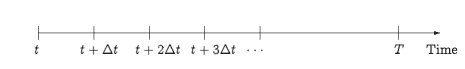

模拟价格序列中的每一步为

$S_{t+\Delta t} = S_t e^{(r - \frac{1}{2}\sigma^2)\Delta t + \sigma \sqrt{\Delta t} \varepsilon}$

C++ 代码 16.4 展示了如何模拟一系列对数正态分布变量。然后在通用例程中使用此代码进行计算，如 C++ 代码 16.5 所示。

要定价期权，我们只需要定义一个收益函数。我们考虑几个示例。一个是亚洲期权的情况，如 C++ 代码 16.6 所示。

另一个是回顾期权的收益，如 C++ 代码 16.7 所示。

```cpp
#include <cmath>
#include <vector>
using namespace std;
#include "normdist.h"

vector<double>
simulate_lognormally_distributed_sequence(const double& S,
    const double& r,
    const double& sigma,
    const double& time, // time to final date
    const int& no_steps){ // number of steps
    vector<double> prices(no_steps);
    double delta_t = time/no_steps;
    double R = (r-0.5*pow(sigma,2))*delta_t;
    double SD = sigma * sqrt(delta_t);
    double S_t= S; // initialize at current price
    for (int i=0; i<no_steps; ++i) {
        S_t = S_t * exp(R + SD * random_normal());
        prices[i]=S_t;
    }
    return prices;
};
```

C++ 代码 16.4: 模拟一系列对数正态分布变量

```cpp
#include <cmath>
using namespace std;
#include "fin_recipes.h"

double
derivative_price_simulate_european_option_generic(const double& S,
    const double& K,
    const double& r,
    const double& sigma,
    const double& time,
    double payoff(const vector<double>& prices, const double& X),
    const int& no_steps,
    const int& no_sims) {
    double sum_payoffs=0;
    for (int n=0; n<no_sims; n++) {
        vector<double> prices = simulate_lognormally_distributed_sequence(S,r,sigma,time,no_steps);
        sum_payoffs += payoff(prices,K);
    }
    return exp(-r*time) * (sum_payoffs/no_sims);
};
```

C++ 代码 16.5: 欧洲期权定价的通用例程

```cpp
#include <cmath>
#include <numeric>
#include <vector>
using namespace std;

double payoff_arithmetic_average_call(const vector<double>& prices, const double& K) {
    double sum = accumulate(prices.begin(), prices.end(), 0.0);
    double avg = sum/double(prices.size());
    return max(0.0,avg-K);
};

double payoff_geometric_average_call(const vector<double>& prices, const double& K) {
    double logsum = log(prices[0]);
    for (unsigned i=1;i<prices.size();++i) { logsum+=log(prices[i]); };
    double avg = exp(logsum/double(prices.size()));
    return max(0.0,avg-K);
};
```

C++ 代码 16.6: 亚洲看涨期权的收益函数

```cpp
#include <vector>
#include <algorithm>
using namespace std;

double payoff_lookback_call(const vector<double>& prices, const double& unused_variable) {
    double m = *min_element(prices.begin(),prices.end());
    return prices.back()-m; // always positive or zero
};

double payoff_lookback_put(const vector<double>& prices, const double& unused_variable) {
    double m = *max_element(prices.begin(),prices.end());
    return m-prices.back(); // max is always larger or equal.
};
```

C++ 代码 16.7: 回顾期权的收益函数

## 16.5 控制变量法

如第 14 章所讨论，控制变量是一种我们既有解析解又能通过蒙特卡洛得到价格的资产。这两个价格之间的差异是蒙特卡洛估计中偏差的度量，并用于调整使用相同随机序列定价的其他衍生品的蒙特卡洛估计。

C++ 代码 16.8 展示了用作控制变量的 Black-Scholes 价格。另一种选择可以是解析回顾期权价格，或前面展示的几何平均价格看涨期权的解析解。

```cpp
#include "fin_recipes.h"

#include <cmath>

using namespace std;

double
derivative_price_simulate_european_option_generic_with_control_variate(const double& S,
                                                                         const double& K,
                                                                         const double& r,
                                                                         const double& sigma,
                                                                         const double& time,
                                                                         double payoff(const vector<double>& prices,
                                                                                     const double& X),
                                                                         const int& no_sims,
                                                                         const int& no_steps) {
    double c_bs = option_price_call_black_scholes(S, S, r, sigma, time); // price at the money Black Scholes call
    double sum_payoffs = 0;
    double sum_payoffs_bs = 0;
    for (int n = 0; n < no_sims; n++) {
        vector<double> prices = simulate_lognormally_distributed_sequence(S, r, sigma, time, no_steps);
        double S1 = prices.back();
        sum_payoffs += payoff(prices, K);
        sum_payoffs_bs += payoff_call(S1, K); // simulate at the money Black Scholes price
    };
    double c_sim = exp(-r * time) * (sum_payoffs / no_sims);
    double c_bs_sim = exp(-r * time) * (sum_payoffs_bs / no_sims);
    c_sim += (c_bs - c_bs_sim);
    return c_sim;
};
```

C++ 代码 16.8: 控制变量法

### 示例

使用参数 S = 100, K = 120, r = 0.10, time = 1.0, sigma = 0.25, no sims = 10000, no steps = 250, q = 0，通过通用模拟定价算术平均和几何平均看涨期权。


```cpp
C++ program:
cout << "Testing general simulation of European options " << endl;
double S=100; double K=120; double r = 0.10;
time = 1.0; double sigma = 0.25; int no_sims = 10000; int no_steps = 250;
double q=0;
cout << "simulated arithmetic average " << endl;
<< " S= " << S << " r= " << r << " price="
<< derivative_price_simulate_european_option_generic(S,K,r,sigma,time,
payoff_arithmetic_average_call,
no_steps,no_sims)
<< endl;
cout << " simulated geometric average = " << endl;
<< derivative_price_simulate_european_option_generic(S,K,r,sigma,time,
payoff_geometric_average_call,
no_steps,no_sims)
<< endl;
cout << " analytical lookback put = " << endl;
<< option_price_european_lookback_put(S,S,r,q,sigma,time)
<< endl;
cout << " simulated lookback = " << endl;
<< derivative_price_simulate_european_option_generic(S,0,r,sigma,time,
payoff_lookback_put,
no_steps,no_sims)
<< endl;
cout << " analytical lookback call = " << endl;
<< option_price_european_lookback_call(S,S,r,q,sigma,time)
<< endl;
cout << " simulated lookback call = " << endl;
<< derivative_price_simulate_european_option_generic(S,0,r,sigma,time,
payoff_lookback_call,
no_steps,no_sims)
<< endl;
cout << " simulated lookback call using control variates = " << endl;
<< derivative_price_simulate_european_option_generic_with_control_variate(S,0,r,sigma,time,
payoff_lookback_call,
no_steps,no_sims)
<< endl;
```

```
Output from C++ program:
Testing general simulation of European options
simulated arithmetic average S= 100 r= 0.1 price=1.49696
simulated geometric average = 1.38017
analytical lookback put = 16.2665
simulated lookback put = 14.9846
analytical lookback call = 22.8089
simulated lookback call = 21.9336
simulated lookback call using control variates = 22.0685
```

## 16.6 参考文献

异国期权在 Hull (2011) 中有所介绍。Rubinstein (1993) 对各种异国期权的分析解进行了广泛讨论。Gray 和 Gray (2001) 也探讨了一些分析解。

## 第 17 章

## 通用二叉树定价

| 项目 | 页码 |
|---|---|
| 17.1 简介 | 177 |
| 17.2 Delta 计算 | 182 |

## 17.1 简介

在前面的章节中，我们已经看到大量不同版本的二叉树定价公式。在本章中，我们将了解如何构建一个二叉树定价框架，使我们能够编写一个通用例程，可用于各种衍生品的二叉树近似。使我们能够编写此类通用例程的重要特点在于，衍生品的条款仅出现在计算每个节点价值的地方。请参考第 12 章中美国看涨期权的二叉树近似，即 C++ 代码 12.2，下面为方便起见重复为 C++ 代码 17.1。

衍生品的条款仅在计算节点价值时出现，其中出现了计算 max(prices[] -K,0)。构建通用二叉树例程的关键在于用通用例程替换此计算。C++ 代码 17.2 展示了通用例程的实现方式。

```cpp
#include <cmath>
// standard mathematical library
#include <algorithm>
// defines the max() operator
#include <vector>
// STL vector templates
using namespace std;

double option_price_call_american_binomial( const double& S, // spot price
const double& X, // exercise price
const double& r, // interest rate
const double& sigma, // volatility
const double& t, // time to maturity
const int& steps) { // no steps in binomial tree
double R = exp(r*(t/steps)); // interest rate for each step
double Rinv = 1.0/R; // inverse of interest rate
double u = exp(sigma*sqrt(t/steps)); // up movement
double d = 1.0/u;
double p_up = (R-d)/(u-d);
double p_down = 1.0-p_up;

vector<double> prices(steps+1); // price of underlying
prices[0] = S*pow(d,steps); // fill in the endnodes.
double uu = u*u;
for (int i=1; i<=steps; ++i) prices[i] = uu*prices[i-1];

vector<double> call_values(steps+1); // value of corresponding call
for (int i=0; i<=steps; ++i) call_values[i] = max(0.0, (prices[i]-X)); // call payoffs at maturity

for (int step=steps-1; step>=0; --step) {
for (int i=0; i<=step; ++i) {
call_values[i] = (p_up*call_values[i+1]+p_down*call_values[i])*Rinv;
call_values[i] = max(call_values[i],prices[i]-X); // check for exercise
}
}
return call_values[0];
}
```

## C++ 代码 17.1：美国看涨期权的二叉树定价

```cpp
#include <cmath>        // standard mathematical library
#include <algorithm>    // defines the max() operator
#include <vector>       // STL vector templates
using namespace std;

double option_price_generic_binomial( const double& S,
                                      const double& K,
                                      const double& r,
                                      const double& sigma,
                                      const double& t,
                                      const int& steps) {
    // interest rate for each step
    double R = exp(r*(t/steps));
    // inverse of interest rate
    double Rinv = 1.0/R;
    // up movement
    double u = exp(sigma*sqrt(t/steps));
    double d = 1.0/u;
    double p_up = (R-d)/(u-d);
    double p_down = 1.0-p_up;

    vector<double> prices(steps+1); // price of underlying
    prices[0] = S*pow(d, steps); // fill in the endnodes.
    double uu = u*u;
    for (int i=1; i<=steps; ++i) prices[i] = uu*prices[i-1];

    vector<double> values(steps+1); // value of corresponding call
    for (int i=0; i<=steps; ++i) values[i] = generic_payoff(prices[i],K); // payoffs at maturity

    for (int step=steps-1; step>=0; --step) {
        for (int i=0; i<=step; ++i) {
            values[i] = (p_up*values[i+1]+p_down*values[i])*Rinv; // value by not exercising
            prices[i] = d*prices[i+1];
            values[i] = max(values[i],generic_payoff(prices[i],K)); // check for exercise
        }
    }
    return values[0];
};
```

## C++ 代码 17.2：通用二叉树计算

使用此例程只需提供衍生品的收益定义即可。C++ 代码 17.3 展示了标准看涨期权和看跌期权的收益定义方式。对美国看跌期权和看涨期权进行定价，只需将这些收益定义提供给通用二叉树例程即可。

```cpp
#include <algorithm>
using namespace std;

double payoff_call(const double& S, const double& K){
    return max(0.0,S-K);
};

double payoff_put (const double& S, const double& K) {
    return max(0.0,K-S);
};
```

## C++ 代码 17.3：看跌期权和看涨期权的收益定义

## 示例

考虑非分红股票上的美国看涨期权和看跌期权，其中 S = 100，K = 100，sigma = 0.2，(T - t) = 1，r = 0.1。

- 1. 使用 100 步的二叉树近似对期权进行定价。

C++ 程序：

```cpp
double S = 100.0;
double K = 100.0;
double r = 0.1;
double sigma = 0.25;
double time_to_maturity=1.0;
int steps = 100;

cout << " american call price = "
     << option_price_generic_binomial(S,K,payoff_call, r, sigma, time_to_maturity, steps)
     << endl;
cout << " american put price = "
     << option_price_generic_binomial(S,K,payoff_put, r, sigma, time_to_maturity, steps)
     << endl;
```

----------------------------------------
C++ 程序输出：
```
american call price = 14.9505
american put price = 6.54691
```

使用相同的方法也可以计算更多异国期权。例如，C++ 代码 17.4 展示了两个二元期权的收益定义，这类期权在标的资产价格高于 K（看涨）或低于 K（看跌）时支付一美元。典型的此类期权是欧式期权，是否价内的检查在到期时进行，但也可以设想二元期权在标的资产价格 S 达到“障碍” K 时立即支付一美元的情况。

## 示例

考虑二元期权，如果标的资产价格 S 在某段时间内上涨至 K 或以上，则支付一美元。假设标的资产当前价格为 S = 100。使用 sigma = 0.2，(T - t) = 1 和 r = 0.1，当 K = 120 时对该二元期权进行定价。


```cpp
double payoff::binary::call(const double& S, const double& K){
    if (S>=K) return 1;
    return 0;
}

double payoff::binary::put(const double& S, const double& K){
    if (S<=K) return 1;
    return 0;
}
```

C++ 代码 17.4：二叉树期权的收益函数定义

```cpp
C++ program:

double S = 100.0;
double K = 120.0;
double r = 0.1;
double sigma = 0.25;
double time_to_maturity=1.0;
int steps = 100;
cout << " binary option price = "
     << option_price_generic::Binomial(S,K,payoff::binary::call, r, sigma, time_to_maturity, steps)
     << endl;
-------------------------------------------
Output from C++ program:

binary option price = 0.498858
```

## 17.2 Delta 计算

Delta 和其他 Greeks 采用相同风格的通用例程进行计算。C++ 代码 17.5 展示了如何使用相同的通用方法计算 Delta。

```cpp
#include <cmath>
#include <algorithm>
#include <vector>
using namespace std;

double option_price_delta_generic_binomial(const double& S,
                                          const double& K,
                                          double generic_payoff(const double& S, const double& K),
                                          const double& r,
                                          const double& sigma,
                                         const double& t,
                                         const int& no_steps){
    double R = exp(r*(t/no_steps));
    double Rinv = 1.0/R;
    double u = exp(sigma*sqrt(t/no_steps));
    double d = 1.0/u;
    double uu = u*u;
    double pUp = (R-d)/(u-d);
    double pDown = 1.0 - pUp;

    vector<double> prices(no_steps+1);
    prices[0] = S*pow(d, no_steps);
    for (int i=1; i<=no_steps; ++i) prices[i] = uu*prices[i-1];

    vector<double> values(no_steps+1);
    for (int i=0; i<=no_steps; ++i) values[i] = generic_payoff(prices[i],K);

    for (int CurrStep=no_steps-1; CurrStep>=1; --CurrStep) {
        for (int i=0; i<=CurrStep; ++i) {
            prices[i] = d*prices[i+1];
            values[i] = (pDown*values[i]+pUp*values[i+1])*Rinv;
            values[i] = max(values[i], generic_payoff(prices[i],K));
        };
    };
    double delta = (values[1]-values[0])/(S*(u-u*d));
    return delta;
};
```

### C++ 代码 17.5：Delta 的通用二叉树计算

### 练习 17.1。

本章讨论的通用例程均针对美式期权。应如何修改它们以适用于欧式期权？

## 第 18 章

## 三叉树

### 目录

- 18.1 简介 .................................................... 183
- 18.2 实现 .................................... 183
- 18.3 进一步阅读 .................................... 185

### 18.1 简介

三叉树与二叉树类似，只是多了一个分支。在每个时间点，标的资产 S 都有三种可能的未来价值。

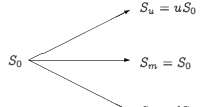

### 18.2 实现

三叉树可以采用多种参数化方式实现。我们将使用以下参数化方式展示计算过程：

```
u = e^{\sigma \sqrt{\Delta t}}

e = \frac{1}{u}

p_u = -\sqrt{\frac{\Delta t}{12\sigma^2}} \left( r - q - \frac{\sigma^2}{2} \right) + \frac{1}{6}

p_m = \frac{2}{3}

p_d = \sqrt{\frac{\Delta t}{12\sigma^2}} \left( r - q - \frac{\sigma^2}{2} \right) + \frac{1}{6}
```

我们使用通常的回溯过程计算期权价格，持续价值为

e^{-r \Delta t} (p_u f_u + p_m f_m + p_d f_d)

```cpp
#include <vector>
#include <cmath>
using namespace std;

double option_price_put_american_trinomial( const double& S,
        const double& K,
        const double& r,
        const double& q,
        const double& sigma,
        const double& t,
        const int& steps) {
    double delta_t = t / steps;
    double Rinv = exp(-r*(delta_t));
    double sigma_sqr = pow(sigma,2);
    double u = exp(sigma*sqrt(3.0*delta_t));
    double d = 1.0/u;
    double p_u = 1.0/6.0 + sqrt(delta_t/(12.0*sigma_sqr)) * (r-q-0.5*sigma_sqr);
    double p_m = 2.0/3.0;
    double p_d = 1.0/6.0 - sqrt(delta_t/(12.0*sigma_sqr)) * (r-q-0.5*sigma_sqr);

    vector<double> values; // price of underlying in a tree
    vector<double> Svec;
    Svec.push_back(S);
    for (int step=1; step<=steps; ++step){
        Svec.push_back(Svec[step-1]*u); // use the fact that only the extreme values change.
        Svec.push_back(Svec[step-1]*d);
    }

    vector<double> values_next;
    for (int i=0; i<m; ++i) values_next[i] = max(0.0, K-Svec[i]); // call payoffs at maturity
    vector<double> values; // value of option
    for (int step=steps-1; step>=0; --step) {
        int m = (int)(Svec[step].size());
        values = vector<double>(m); // value of option
        for (int i=0; i<m; ++i) {
            values[i] = (p_u*values_next[i+2]+p_m*values_next[i+1] + p_d*values_next[i])*Rinv;
            values[i] = max(values[i], K-Svec[step][i]); // check for exercise
        }
        values_next=values;
    }
    return values[0];
};
```

### C++ 代码 18.1：使用三叉树计算美式看跌期权价格

### 示例

给定某期权的以下信息：S = 100，K = 100，r = 0.1，sigma = 0.25，到期时间为 1 年。使用 100 步的三叉树近似计算美式看跌期权价格。

```matlab
function P = opt_price_trinomial_am_put(S, K, r, q, sigma, t, steps)
delta_t = t/steps;
sigma_sqr=sigma^2;
R=exp(r*delta_t);
u = exp(sigma*sqrt(3.0*delta_t));
d = 1.0/u;
p.u = 1/6 + sqrt(delta_t/(12*sigma_sqr)) * (r-q-0.5*sigma_sqr);
p.m = 2/3;
p.d = 1/6 - sqrt(delta_t/(12*sigma_sqr)) * (r-q-0.5*sigma_sqr);
Svec = [ S ];
Stre = [ Svec ];
Sd = [ ];
for step=1:steps+1
    Su = Su*u;
    Sd = Sd*d;
    Svec = [ Sd; Svec; Su ];
    Stre= [ Stre, zeros(2,steps), Stre ];
end
values_next = max(K-Svec, 0);
for step = 2:steps+1
    m = 2*step-1;
    values = R*(p.u*values_next(1:3+m-2)+p.m*values_next(2:m+1)+p.d*values_next(1:m));
    values_next = max(values, K-Stre(1:m, step+1));
end
P = values;
end
```

### Matlab 代码 18.1：使用三叉树计算美式看跌期权价格

```cpp
C++ program:
double S = 100.0; double K = 100.0;
double r = 0.1; double q = 0; double sigma = 0.25;
double time=1.0; int no_steps = 100;
cout << " american put = " << option_price_put_american_trinomial(S,K,r,q,sigma,time,no_steps) << endl;
Output of C++ program:
american put = 6.52719
```

### 练习 18.1。

在三叉树代码中，标的资产价格被存入三角形数据结构。由于每增加一步只需在顶部和底部各加一个价格，因此可以将其合并为一个数组。如果跟踪当前数组的顶部和底部，就可以通过对标的资产价格单一向量进行巧妙索引来访问价格。

### 练习 18.2。

类似于二叉树情况，可以构建一个通用三叉树，其中收益函数作为参数传递给例程。实现这样的通用三叉树。

### 18.3 进一步阅读

Hull (2011)

## 第 19 章

## 替代 Black-Scholes 类型期权公式的方法

### 目录

| 节 | 页码 |
|---|---|
| 19.1 Merton 的跳跃扩散模型。 | 186 |
| 19.2 随机波动性模型的 Heston 定价公式 | 188 |

已有大量替代 Black-Scholes 分析的公式被提出。其中少数获得了广泛应用，但我们将探讨其中一些替代方案。

### 19.1 Merton 的跳跃扩散模型。

Merton (1976) 提出了一种模型，除了布朗运动项外，标的资产的价格过程还允许出现跳跃。假设这些跳跃的风险不进行定价。

在以下内容中，我们将研究 Merton 模型的一个特例，该特例在 (Hull, 1993, pg 454) 中有描述，其中跳跃大小服从正态分布。\(\lambda\) 和 \(\kappa\) 是跳跃分布的参数。欧式看涨期权的价格在公式 19.1 中给出，并在 C++ 代码 19.1 中实现。

```
c = \sum_{n=0}^{\infty} \frac{e^{\lambda \tau} (\lambda \tau)^n}{n!} C_{BS}(S, X, r_n, \sigma_n^2, T - t)

where

\tau = T - t

\lambda' = \lambda(1 + \kappa)

C_{BS}(\cdot) is the Black Scholes formula, and

\sigma_n^2 = \sigma^2 + \frac{n \delta^2}{\tau}

r_n = r - \lambda \kappa + \frac{n \ln(1 + \kappa)}{\tau}
```

公式 19.1：Merton (1976) 模型的期权定价公式

在实现此公式时，我们需要在某个点终止无穷求和。但由于


阶乘函数的增长速度远高于任何其他函数，这不是问题，在 n = 50 处终止应属于保守做法。为避免数值困难，请使用以下计算方法：

$$
\frac{e^{\lambda \tau}(\lambda \tau)^n}{n!} = exp \left( \ln \left( \frac{e^{\lambda \tau}(\lambda \tau)^n}{n!} \right) \right) = exp \left( -\lambda \tau + n \ln(\lambda \tau) - \sum_{i=1}^n \ln i \right)
$$

```cpp
#include <cmath>
#include "fin_recipes.h"

double option_price_call_merton_jump_diffusion( const double& S,
                                                const double& X,
                                                const double& r,
                                                const double& sigma,
                                                const double& time_to_maturity,
                                                const double& lambda,
                                                const double& kappa,
                                                const double& delta) {
    const int MAXN=50;
    double tau=time_to_maturity;
    double sigma_sqr = sigma*sigma;
    double delta_sqr = delta*delta;
    double lambdaprime = lambda * (1+kappa);
    double gamma = log(1+kappa);
    double c = exp(-lambdaprime*tau)*option_price_call_black_scholes(S,X,r-lambda*kappa,sigma,tau);
    double log_n = 0;
    for (int n=1; n<=MAXN; ++n) {
        log_n += log((double)n);
        double gamma_n = sqrt( sigma_sqr+n*delta_sqr/tau ) ;
        double r_n = r - lambda*kappa+n*gamma/tau;
        c += exp(-lambdaprime*tau+n*log(log(gamma*tau))-log_n)*
        option_price_call_black_scholes(S,X,r_n,sigma,tau);
    };
    return c;
};
```

### C++ 代码 19.1：默顿跳跃扩散公式

### 示例

使用默顿跳跃扩散公式对期权进行定价，使用以下参数

$S=100, K=100, r=0.05, \sigma=0.3, \lambda=0.5, \kappa=0.5, \delta=0.5$. 距到期时间 $= 1$.

### C++ 程序：

```cpp
double S=100; double K=100; double r=0.05;
double sigma=0.3; double time_to_maturity=1;
double lambda=0.5; double kappa=0.5; double delta=0.5;
cout << " Merton Jump diffusion call = "
<< option_price_call_merton_jump_diffusion(S,K,r,sigma,time_to_maturity,lambda,kappa,delta)
<< endl;
```

### C++ 程序输出：

Merton 跳跃扩散看涨期权 = 23.2074

## 19.2 随机波动率模型的赫斯顿定价公式

Heston (1993) 通过引入随机波动率，放宽了布莱克-舒尔斯关于恒定波动率的假设。他找到了欧洲期权的精确解。

设 S 为股票价格，v 为波动率。假设这两个变量遵循联合随机过程。

$$
dS(t) = \mu S dt + \sqrt{v(t)} S dz_1(t)
$$

$$
d\sqrt{v(t)} = -\beta \sqrt{v(t)} dt + \delta v(t) S dz_2(t)
$$

两个过程 z1 和 z2 具有相关系数 \rho。将波动率过程改写为

$$
dv(t) = \kappa (\phi - v(t)) dt + \sigma \sqrt{v(t)} dz_2
$$

设 \Lambda(S, v, t) 为波动率风险价格。在恒定利率 r 下

$$
P(T, T) = e^{-r(T-t)}
$$

考虑一个行权价为 K 的看涨期权。其价格由公式 19.2 给出。

使用赫斯顿公式计算看涨期权价格。期权价格为

$$
C(s, v, t) = S P_1 - K P(T, T) P_2
$$

其中

$$
P_j(x, v, T, ln(K)) = \frac{1}{2} + \frac{1}{\pi} \int_0^\infty Re \left[ \frac{e^{-i\phi ln(K)} f_j(x, v, T, \phi)}{i\phi} \right] d\phi
$$

$$
f_j(x, v, T, \phi) = e^{C(\tau, \phi) + D(\tau, \phi) v + i\phi x}
$$

$$
C(\tau, \phi) = r\phi i\tau + \frac{a}{\sigma^2} \left\{ (b_j - \rho \sigma \phi i + d) \tau - 2 \ln \left[ \frac{1 - g e^{d\tau}}{1 - g} \right] \right\}
$$

$$
D(\tau, \phi) = \frac{b_j - \rho \sigma \phi i + d}{\sigma^2} \left[ \frac{1 - e^{d\tau}}{1 - g e^{d\tau}} \right]
$$

$$
u_1 = \frac{1}{2}, \quad u_2 = -\frac{1}{2}
$$

$$
a = \kappa \theta
$$

$$
b_1 = \kappa + \lambda - \rho \sigma \quad b_2 = \kappa + \lambda
$$

$$
x = ln(S)
$$

$$
g = \frac{b_j - \rho \sigma \phi i + d}{b_j - \rho \sigma \phi i - d}
$$

$$
d = \sqrt{(\rho \phi i - b_j)^2 - \sigma^2 (2 u_j \phi i - \phi^2)}
$$

注：S：标的证券价格。K：行权价。

该定价公式的实现具有一些值得借鉴的 C++ 特性。首先，它说明了复变量的计算。复数是 C++ 标准的一部分，通过包含

```cpp
#include <complex>
```

语句。复数是模板化的，有必要指定要使用的浮点类型，例如 complex<double> 或 complex<long double>。

为了计算价格，还需要进行数值积分。在计算中，这是通过调用外部例程来解决的。我们使用由 GNU GSL 项目提供的例程。

### 示例

给定以下参数集：\( S = 100, K = 100, r = 0.01, v = 0.01, \tau = 0.5, \rho = 0, \kappa = 2, \lambda = 0, \theta = 0.01 \) 和 \( \sigma = 0.01 \)，使用赫斯顿公式对看涨期权进行定价

### C++ 程序：

```cpp
double S=100; double K=100; double r=0.01; double v=0.01;
double tau=0.5; double rho=0; double kappa=2; double lambda=0.0;
double theta=0.01; double sigma=0.01;
cout << "heston call price " << heston_call_option_price( S, K, r, v, tau, rho, kappa, lambda, theta, sigma) << endl;
```

### C++ 程序输出：

赫斯顿看涨期权价格 3.06944

```cpp
#include <iostream>
#include <cmath>
#include <complex>
using namespace std;
#include "gsl/gsl_integration.h"

struct heston_parms {double K; double x; double r; double v; double tau; double kappa; double theta;
                     double rho; double sigma; double lambda; int j;};

extern "C"{
    double heston_integrand_j(double phi, void *p){
        struct heston_parms* parms = (struct heston_parms*)p;
        double K = (parms->K); double x = (parms->x);
        double v = (parms->v); double r = (parms->r);
        double kappa = (parms->kappa);
        double theta = (parms->theta);
        double rho = (parms->rho);
        double sigma = (parms->sigma);
        double lambda = (parms->lambda);
        double tau = (parms->tau);
        double j = (parms->j);
        double sigma_sq = pow(sigma,2);
        double uj;
        double bj;
        if (j == 1) { uj = 0.5; bj = kappa + lambda - rho * sigma; }
        else { uj = -0.5; bj = kappa + lambda; };
        complex<double> i(0,1);
        complex<double> h = sqrt(pow(rho*sigma*phi+i*bj,2)-sigma_sq*(2*uj*phi*i-pow(phi,2)));
        complex<double> g = (bj - rho*sigma*phi+i*h)/(bj-rho*sigma*phi-i*h);
        complex<double> C = r*phi*i*tau+(kappa*theta/sigma_sq)*((bj-rho*sigma*phi+i*h)*tau-2.0*log((1.0-g*exp(h*tau))/(1.0-g)));
        complex<double> D = (bj-rho*sigma*phi+i*h)/sigma_sq * ( (1.0-exp(h*tau))/(1.0-g*exp(h*tau)) );
        complex<double> f1 = exp(C+D*v+i*phi*x);
        complex<double> F = exp(-phi*i*log(K))*f1/(i*phi);
        return real(F);
    }
}

inline double heston_Pj(double S, double K, double r, double v, double tau, double sigma,
                        double kappa, double lambda, double rho, double theta, int j){
    double x=log(S);
    struct heston_parms parms = { K, x, r, v, tau, kappa, theta, rho, sigma, lambda, j};
    size_t n=10000;
    gsl_integration_workspace* w = gsl_integration_workspace_alloc(n);
    gsl_function F;
    F.function = &heston_integrand_j;
    F.params=&parms;
    double result,error;
    gsl_integration_qagiu(&F,0,1e-7,1e-7,n,w,&result,&error); // integral to infinity starting at zero
    gsl_integration_workspace_free(w);
    return 0.5 + result/M_PI;
}

double heston_call_option_price(const double& S, const double& K, const double& r, const double& v,
                                const double& tau, const double& kappa, const double& theta,
                                const double& lambda, const double& rho, const double& sigma){
    double P1 = heston_Pj(S,K,r,v,tau,sigma,kappa,lambda,rho,theta,1);
    double P2 = heston_Pj(S,K,r,v,tau,sigma,kappa,lambda,rho,theta,2);
    double C=S*P1-K*exp(-r*tau)*P2;
    return C;
};
```

### C++ 代码 19.2：随机波动率模型的赫斯顿定价公式


## 第 20 章
## 债券期权定价，基本模型
## 目录

| 20.1 Black Scholes 债券期权定价 | 191 |
| --- | --- |
| 20.2 二叉树债券期权定价 | 193 |

固定收益证券领域正在大量开发用于定价金融证券（尤其是固定收益衍生品）的高级数学模型。该领域建模的重点是对利率期限结构及其随时间的演变进行建模，然后用于定价债券和固定收益衍生品。但是，在某些情况下，不需要我们将在后续章节中介绍的期限结构建模的复杂机制，而是通过直接对债券价格的演变进行建模来定价衍生品。

具体来说，假设债券价格遵循几何布朗运动过程，就像我们之前研究过的情况一样。这对债券价格的长期行为来说并不是一个特别现实的假设，因为任何债券价格在债券到期时都会收敛到债券面值。几何布朗运动对于长期债券的短期期权可能是可以接受的。

### 20.1 Black Scholes 债券期权定价

根据假设的布朗运动过程，欧洲债券期权的价格可以使用通常的 Black Scholes 公式来确定，如 C++ 代码 20.1 所示用于零息债券，C++ 代码 20.2 所示用于附息债券期权的情况。

```cpp
#include <cmath>
#include "normdist.h"
double bond_option_price_put_zero_black_scholes(const double& B,
                 const double& X,
                 const double& r,
                 const double& sigma,
                 const double& time){
double time_sqrt = sqrt(time);
double d1 = (log(B/X)+r*time)/(sigma*time_sqrt) + 0.5*sigma*time_sqrt;
double d2 = d1-(sigma*time_sqrt);
double p = X * exp(-r*time) * N(-d2) - B * N(-d1);
return p;
};
```

C++ 代码 20.1: 欧洲零息债券看跌期权的 Black Scholes 价格

```cpp
#include <cmath>
#include <vector>
using namespace std;
#include "normdist.h"
#include "fin_recipes.h"

double bond_option_price_put_coupon_bond_black_scholes( const double& B,
        const double& X,
        const double& r,
        const double& sigma,
        const double& time,
        const vector<double>& coupon_times,
        const vector<double>& coupon_amounts){
    double adjusted_B=B;
    for (unsigned int i=0;i<coupon_times.size();i++) {
        if (coupon_times[i]<time) {
            adjusted_B -= coupon_amounts[i] * exp(-r*coupon_times[i]);
        };
    };
    return bond_option_price_put_zero_black_scholes(adjusted_B,X,r,sigma,time);
};
```

C++ 代码 20.2: 欧洲附息债券看跌期权的 Black Scholes 价格

### 20.2 二叉树债券期权定价

由于我们处于几何布朗运动的情况下，通常的二叉树近似可以用于定价美国期权，其中债券是标的证券。C++ 代码 20.3 显示了看跌期权价格的计算

```cpp
#include <cmath> // standard mathematical library
#include <algorithm> // defining the max() operator
#include <vector> // STL vector templates
using namespace std;

double bond_option_price_put_american_binomial( const double& B, // Bond price
const double& K, // exercise price
const double& r, // interest rate
const double& sigma, // volatility
const double& t, // time to maturity
const int& steps) // no steps in binomial tree
{
double R = exp((r/t*steps)); // interest rate for each step
double Rinv = 1.0/R; // inverse of interest rate
double u = exp(sigma*sqrt(t/steps)); // up movement
double uu = u*u;
double d = 1.0/u;
double p_up = (R-d)/(u-d);
double p_down = 1.0-p_up;
vector<double> prices(steps+1); // price of underlying
vector<double> put_values(steps+1); // value of corresponding put
prices[0] = B*pow(d,steps); // fill in the endnodes
for (int i=1; i<=steps; ++i) prices[i] = uu*prices[i-1];
for (int i=0; i<=steps; ++i) put_values[i] = max(0.0,(K-prices[i])); // put payoffs at maturity
for (int step=steps-1; step>=0; --step) {
for (int i=0; i<=step; ++i) {
put_values[i] = (p_up*put_values[i+1]+p_down*put_values[i])*Rinv;
prices[i] = d*prices[i+1];
put_values[i] = max(put_values[i],(K-prices[i])); // check for exercise
}
};
return put_values[0];
};
```

C++ 代码 20.3: 美国看跌债券期权价格的二叉树近似

### 示例

参数：B = 100, K = 100, r = 0.05, sigma = 0.1, time=1。

还有一种附息债券，债券价格相同，但在日期 1 支付 0.5 的票息。

- 使用 Black Scholes 定价零息债券的欧洲看跌期权。
- 使用 Black Scholes 定价附息债券的欧洲看跌期权。
- 使用 100 步的二叉树近似定价零息债券的欧洲看跌期权。

```cpp
double B=100;
double K=100;
double r=0.05;
double sigma=0.1;
double time=1;
cout << " zero coupon put option price = "
<< bond_option_price_put_zero_black_scholes(B,K,r,sigma,time) << endl;
vector<double> coupon_times; coupon_times.push_back(0.5);
vector<double> coupons; coupons.push_back(1);
cout << " coupon bond put option price = "
<< bond_option_price_put_coupon_bond_black_scholes(B,K,r,sigma,time,coupon_times,coupons);
<< endl;
int steps=100;
cout << " zero coupon american put option price, binomial = "
<< bond_option_price_put_american_binomial(B,K,r,sigma,time,steps) << endl;
```

C++ 程序输出：
零息债券看跌期权价格 = 1.92791
附息债券看跌期权价格 = 2.22852
零息债券美国看跌期权价格，二叉树 = 2.43282

## 第 21 章
## 信用风险
## 目录

- 21.1 Merton 模型 . . . . . . . . . . . . . . . . . . . . 195
- 21.2 实现中的问题 . . . . . . . . . . . . . . . . . . 196

期权定价在风险债券定价方面有明显的应用。

### 21.1 Merton 模型

这建立在 Black and Scholes (1973) 和 Merton (1973) 框架之上，以求公司发行债务的价值。这些想法已经在 Black and Scholes 中提出，他们讨论了将公司视为看涨期权的观点。

假设债务结构：只有一笔债务发行。债务作为零息债券发行。债券在给定日期 T 到期。

假设公司价值 V 遵循通常的布朗运动过程，债务被找到为闭式解，其结构类似于看涨期权的 Black Scholes 方程。

最容易从将公司债务解释为无风险债券价格减去看跌期权价值的角度来理解。

按无风险债券价格 B 定价债务，然后减去看跌期权的价格，使用 Black Scholes 公式。

看涨期权的 Black Scholes 公式为

```
c = S . N(d1) - K . e^{-r(T-t)} N(d2)
```

其中

```
d1 = \frac{\ln(\frac{S}{K}) + (r + \frac{1}{2}\sigma^2)(T - t)}{\sigma\sqrt{T - t}}
```

```
d2 = d1 - \sigma\sqrt{T - t}
```

N(.) = 累积正态分布

```
p = Ke^{-r(T-t)}N(-d2) - SN(-d1)
```

在此背景下，将 S 重新解释为 V，即公司价值。看跌期权定价为

```
p = Ke^{-r(T-t)}N(-d2) - V_t N(-d1)
```

其中

$d_1 = \frac{\ln(\frac{V}{F}) + (r + \frac{1}{2}\sigma^2)(T-t)}{\sigma\sqrt{T-t}}$

解释说明：风险债券与无风险债券之间的利差完全由看跌期权的价格决定。

### 示例

公司当前价值 V = 100。公司发行了一张面值 90 的债券，将在一年后到期。无风险利率为 5%，公司价值的波动率为 25%。确定债务的价值。

```cpp
C++ program:
cout << " Credit Risk Calculation " << endl;
double V=100, F=90, r=0.05, T=1; double sigma=0.25;
double p = option_price_put_black_scholes(V,F,r,sigma,T);
cout << " Debt value = " << exp(-r*T)*F - p << endl;
------------------------------------------------------------
C++ 程序输出：
信用风险计算
债务价值 = 81.8592
```

### 21.2 实现中的问题

- 公司价值和公司波动率是不可观察的。
- 该模型假设简单的债务结构，大多数债务结构往往更加复杂。


## 第 22 章 期限结构模型

### 目录

| 节 | 页码 |
|---|---|
| 22.1 Nelson Siegel 期限结构近似 | 198 |
| 22.2 扩展 Nelson Siegel 模型 | 200 |
| 22.3 三次样条 | 202 |
| 22.4 Cox Ingersoll Ross | 205 |
| 22.5 Vasicek | 208 |
| 22.6 推荐阅读 | 210 |

我们现在对第 5 章中的期限结构分析进行扩展。如所示，期限结构最好被视为一个抽象类，它作为到期期限的函数，提供零息债券价格（贴现因子）、零息债券收益率（即期利率）或远期利率。在之前的情况中，我们考虑了期限结构的两种特定实现。一种是平坦期限结构，另一种是通过对即期利率进行线性插值来估计的期限结构。我们现在考虑若干替代期限结构模型。本章的重点是实证性的。我们考虑以一种低维方式指定期限结构的方法。本质上，我们正在研究曲线拟合的方法，即估计时间与贴现因子之间，或时间与即期利率之间的非线性关系。由于关系是非线性的，这是一个非平凡问题。必须选择一个功能形式来估计，它允许足够的灵活性来“拟合”期限结构，但又不至于过于灵活以至于违反期限结构的经济限制。以下是一些考虑因素。

- 贴现因子必须为正。\( (d_t > 0) \)。这是因为它们是价格，负价格允许套利。
- 贴现因子必须是时间的非递增函数。\( (d_t \ge d_{t+k} \forall k > 0) \)。同样，这是为了避免套利。
- 名义利率不能为负。\( (r_t \ge 0 \forall t) \) 这是没有套利机会的另一个含义。
- 贴现因子和利率都必须是时间的平滑函数。
- 今天付款的价值就是今天的付款。\( d_0 = 1 \)。

已经考虑了若干替代的期限结构估计方法。有些纯粹用作插值函数，而另一些则是完全指定的动态期限结构模型。在接下来的模型中，Nelson 和 Siegel (1987) 提出的近似函数以及例如 McCulloch (1971) 使用的三次样条属于第一类，而 Cox、Ingersoll 和 Ross (1985) 以及 Vasicek (1977) 的期限结构模型属于第二类。

我们在这里考虑的函数的典型用途是什么？首先从一组固定收益证券开始，通常是一组国债券。观察这些债券的价格后，人们会问：哪一组贴现因子最有可能产生了观察到的价格。或者：哪种期限结构近似对这组观察到的债券价格提供了“最佳拟合”。

### 22.1 Nelson Siegel 期限结构近似

Nelson 和 Siegel (1987) 提出了公式 22.1 所示的参数化

```
r(t) = \beta_0 + (\beta_1 + \beta_2) \left[ \frac{1 - e^{-\frac{t}{\lambda}}}{\frac{t}{\lambda}} \right] + \beta_2 \left[ e^{-\frac{t}{\lambda}} \right]
```

符号说明：t：到期期限。r：即期利率，\beta_0、\beta_1、\beta_2 和 \lambda：常数。

公式 22.1：Nelson 和 Siegel (1987) 的期限结构参数化

此计算的实现如 C++ 代码 22.1 所示。

```
#include <cmath>
using namespace std;
double term_structure::yield_nelson_siegel(const double& t,
                                          const double& beta0,
                                          const double& beta1,
                                          const double& beta2,
                                          const double& lambda) {
  if (t==0.0) return beta0;
  double tl = t/lambda;
  double r = beta0 + (beta1+beta2) * ((1-exp(-tl))/tl) + beta2 * exp(-tl);
  return r;
};
```

C++ 代码 22.1：Nelson 和 Siegel (1987) 期限结构模型的计算

这被封装在期限结构类中，如头文件 22.1 和 C++ 代码 22.2 所示。

```
class term_structure_class_nelson_siegel : public term_structure_class {
private:
  double beta0_, beta1_, beta2_, lambda_;
public:
  term_structure_class_nelson_siegel(const double& beta0,
                                     const double& beta1,
                                     const double& beta2,
                                     const double& lambda);
  virtual double yield(const double& T) const;
};
```

头文件 22.1：定义 Nelson Siegel 近似期限结构类封装的头文件

```
#include "fin_recipes.h"

term_structure_class_nelson_siegel::term_structure_class_nelson_siegel(const double& b0,
                                                                       const double& b1,
                                                                       const double& b2,
                                                                       const double& lambda) {
    beta0_ = b0; beta1_ = b1; beta2_ = b2; lambda_ = lambda;
}

double term_structure_class_nelson_siegel::yield(const double& t) const {
    if (t <= 0.0) return beta0_;
    return term_structure::yield_nelson_siegel(t, beta0_, beta1_, beta2_, lambda_);
};
```

C++ 代码 22.2：定义 Nelson Siegel 近似期限结构类封装

### 示例

使用 Nelson Siegel 近似中的参数 \(\beta_0 = 0.01, \beta_1 = 0.01, \beta_2 = 0.01, \lambda = 5.0\) 和 \(t = 1\)，求 1 年贴现因子和即期利率，以及第 1 年和第 2 年之间的远期利率。

```
C++ program:
double beta0=0.01; double beta1=0.01; double beta2=0.01; double lambda=5.0;
double t=1.0;
cout << "Example calculations using the Nelson Siegel term structure approximation"
<< endl;
cout << " direct calculation, yield = "
<< term_structure::yield_nelson_siegel(t,beta0,beta1,beta2,lambda) << endl;
term_structure.nelson_siegel_msr(beta0,beta1,beta2,lambda);
cout << " using a term structure class" << endl;
cout << " yield (t=1) = " << nsr(t) << endl;
cout << " discount factor (t=1) = " << ns_df(t) << endl;
cout << " forward rate (t1=1, t2=2) = " << nsf(1,2) << endl;
Output from C++ program:
Example calculations using the Nelson Siegel term structure approximation
using a term structure class
yield (t=1) = 0.0363142
discount factor (t=1) = 0.964337
forward rate (t1=1, t2=2) = 0.0300602
```

### 22.2 扩展 Nelson Siegel 模型

Nelson 和 Siegel (1987) 模型很简单，参数具有清晰明显的经济解释。它确实存在一个问题，即它允许的期限结构形状有限。为了允许更复杂的形状，例如驼峰形状，它已以各种方式进行了扩展。Lars Svensson 引入了一种流行的近似方法，参数化如公式 22.2 所示

```
\( r(t) = \beta_0 + \beta_1 \left( \frac{1 - e^{-\frac{t}{\tau_1}}}{\frac{t}{\tau_1}} \right) + \beta_2 \left( \frac{1 - e^{-\frac{t}{\tau_1}}}{\frac{t}{\tau_1}} - e^{-\frac{t}{\tau_1}} \right) + \beta_3 \left( \frac{1 - e^{-\frac{t}{\tau_2}}}{\frac{t}{\tau_2}} - e^{-\frac{t}{\tau_2}} \right) \)
```

符号说明：\(t\)：到期期限，\(r\)：即期利率，\(\beta_0, \beta_1, \beta_2\) 和 \(\tau_1, \tau_2\)：常数。

公式 22.2：Svensson 对 Nelson 和 Siegel (1987) 期限结构参数化的扩展

这被封装在期限结构类中，如头文件 22.2 和 C++ 代码 22.4 所示。

```
#include <cmath>
using namespace std;

double term_structure_yield_svensson(const double& t,
                                     const double& beta0,
                                     const double& beta1,
                                     const double& beta2,
                                     const double& beta3,
                                     const double& tau1,
                                     const double& tau2){
    if (t==0.0) return beta0;
    double r = beta0;
    r += beta1* ((1-exp(-t/tau1))/(t/tau1)) ;
    r += beta2 * ( ((1-exp(-t/tau1))/(t/tau1)) - exp(-t/tau1) ) ;
    r += beta3 * ( ((1-exp(-t/tau2))/(t/tau2)) - exp(-t/tau2) ) ;
    return r;
};
```

C++ 代码 22.3：Svensson 扩展 Nelson 和 Siegel (1987) 期限结构模型的计算

```
class term_structure_class_svensson : public term_structure_class {
private:
    double beta0_, beta1_, beta2_, beta3_, tau1_, tau2_;
public:
    term_structure_class_svensson(const double& beta0,
                                  const double& beta1,
                                  const double& beta2,
                                  const double& beta3,
                                  const double& tau1,
                                  const double& tau2);
    virtual double yield(const double& t) const;
};
```

头文件 22.2：定义 Svensson 模型期限结构类封装的头文件

```
#include "fin_recipes.h"

term_structure_class_svensson::term_structure_class_svensson(const double& b0, const double& b1, const double& b2, const double& b3,
                                                               const double& tau1, const double& tau2) {
    beta0_ = b0; beta1_ = b1; beta2_ = b2; beta3_ = b3; tau1_ = tau1; tau2_ = tau2;
};

double term_structure_class_svensson::yield(const double& t) const {
    if (t <= 0.0) return beta0_;
    return term_structure_yield_svensson(t, beta0_, beta1_, beta2_, beta3_, tau1_, tau2_);
};
```

C++ 代码 22.4：定义 Svensson 模型期限结构类封装


## 22.3 三次样条

三次样条因其良好的插值行为而广为人知。三次样条参数化最早由 McCulloch (1971) 用于估计名义期限结构。他后来在 McCulloch (1975) 中加入了税收。三次样条也被 Litzenberger 和 Rolfo (1984) 使用。在此情况下，三次样条用于近似 *贴现因子*，而不是收益率。

$$d(t) = 1 + b_1 t + c_1 t^2 + d_1 t^3 + \sum_{j=1}^K F_j (t - t_j)^3 1_{\{t < t_j\}}$$

这里 $1_{\{A\}}$ 是事件 $A$ 的指示函数，我们有 $K$ 个节点。

为了估计这个，我们需要找到 $3 + K$ 个参数：

$\{b_1, c_1, d_1, F_1, \cdots, F_K\}$

如果样条 *节点* 已知，这是一个简单的线性回归。C++ 代码 22.5 显示了使用此近似的计算。

```
#include <cmath>
#include <vector>
using namespace std;

double term_structure::discount_factor::cubic_spline(const double& t,
const double& b1,
const double& c1,
const double& d1,
const vector<double>& f,
const vector<double>& knots){
double d = 1.0 + b1 * t + c1 * (pow(t,2)) + d1 * (pow(t,3));
for (int i=0; i<knots.size();++i) {
if (t >= knots[i]) { d += f[i] * (pow((t-knots[i]),3)); }
else { break; }
}
return d;
};
```

C++ 代码 22.5: 使用三次样条近似贴现函数

头文件 22.3 和 C++ 代码 22.6 将此计算封装到期限结构类中。

```
#include "fin_recipes.h"
#include <vector>
using namespace std;

class term_structure::cubic_spline : public term_structure {
private:
double b_; double c_; double d_;
vector<double> f_; vector<double> knots_;
public:
term_structure::cubic_spline(const double& b, const double& c, const double& d,
const vector<double>& f, const vector<double>& knots);
virtual ~term_structure::cubic_spline();
virtual double d(const double& T) const;
};
```

头文件 22.3: 封装三次样条近似的期限结构类

```
#include "fin_recipes.h"
term_structure::cubic_spline::cubic_spline ( const double& b, const double& c, const double& d,
const vector<double>& f, const vector<double>& knots ) {
b_ = b; c_ = c; d_ = d; f_ = f; knots_ = knots;
if (f.size()!=knots.size()){ return; } knots_.clear();
for (int i=0;i<f.size();++i) {
f_.push_back(f[i]);
knots_.push_back(knots[i]);
};
};
double term_structure::cubic_spline::d(const double& T) const {
return term_structure_discount_factor_cubic_spline(T,b_,c_,d_,f_,knots_);
};
```

C++ 代码 22.6: 封装三次样条近似的期限结构类

### 示例

使用参数 b = 0.1 c = 0.1, d = -0.1，

```
f = [ 0.01 ]
    [ 0.01 ]
    [ -0.01 ]
```

```
knots = [ 2 ]
    [ 7 ]
    [ 12 ]
```

求 1 年期的短期利率和贴现因子，以及 1 年至 2 年之间的远期利率。

### C++ 程序：

```
cout << "Example term structure calculations using a cubic spline " << endl;
double b=0.1; double c=0.1; double d=-0.1;
vector<double> f; f.push_back(0.01); f.push_back(0.01); f.push_back(-0.01);
vector<double> knots; knots.push_back(2); knots.push_back(7); knots.push_back(12);
cout << " direct calculation, discount factor (t=1) "
     << term_structure::discount_factor_cubic_spline(1,b,c,d,f,knots) << endl;
cout << " Using a term structure class " << endl;
term_structure_class cs(b,c,d,f,knots);
cout << " yield (t=1) = " << cs.yield(1) << endl;
cout << " discount factor (t=1) = " << cs.d(1) << endl;
cout << " forward (t1=1, t2=2) = " << cs.f(1,2) << endl;
```

### C++ 程序输出：

```
Example term structure calculations using a cubic spline
direct calculation, discount factor (t=1) 1.1
Using a term structure class
yield (t=1) = -0.0953102
discount factor (t=1) = 1.1
forward (t1=1, t2=2) = 0.318454
```

## 22.4 Cox-Ingersoll-Ross

Cox 等人 (1985) 模型是期限结构连续时间一般均衡模型最著名的示例。它在学术工作中常被使用，因为它是一个仍然“足够简单”的一般均衡模型，使我们能够找到衍生证券的封闭式表达式。

短期利率。

$dr(t) = \kappa(\theta - r(t))dt + \sigma\sqrt{r(t)}dW$

时间 T 处付款的贴现因子。

$d(t, T) = A(t, T)e^{-B(t, T)r(t)}$

其中

$\gamma = \sqrt{(\kappa + \lambda)^2 + 2\sigma^2}$

$A(t, T) = \left[ \frac{2\gamma e^{\frac{1}{2}(\kappa + \lambda + \gamma)(T-t)}}{(\gamma + \kappa + \lambda)(e^{\gamma(T-t)} - 1) + 2\gamma} \right]^{\frac{2\kappa\theta}{\sigma^2}}$

以及

$B(t, T) = \frac{2\gamma e^{\gamma(T-t)} - 1}{(\gamma + \kappa + \lambda)(e^{\gamma(T-t)} - 1) + 2\gamma}$

五个参数：$r$，短期利率；$\kappa$，均值回复参数；$\lambda$，“市场”风险参数；$\theta$ 过程的长期均值；以及 $\sigma$，过程的方差率。

```
#include <cmath>
using namespace std;
double term_structure::discount_factor_cir(const double& t,
                                           const double& r,
                                           const double& kappa,
                                           const double& lambda,
                                           const double& theta,
                                           const double& sigma){
    double sigma_sqr=pow(sigma,2);
    double gamma = sqrt(pow((kappa+lambda),2)+2.0*sigma_sqr);
    double denum = (gamma+kappa+lambda)*(exp(gamma*t)-1)+2*gamma;
    double p=2*kappa*theta/sigma_sqr;
    double numer1 = 2*gamma*exp(0.5*(kappa+lambda+gamma)*t);
    double A = pow((numer1/denum),p);
    double B = (2*(exp(gamma*t)-1))/denum;
    double disc_factor=A*exp(-B*r);
    return disc_factor;
};
```

C++ 代码 22.7: 使用 Cox 等人 (1985) 模型计算贴现因子

```
#include "fin_recipes.h"
class term_structure_class_cir : public term_structure {
private:
double r_; // interest rate
double kappa_; // mean reversion parameter
double lambda_; // risk aversion
double theta_; // long run mean
double sigma_; // volatility
public:
term_structure_class_cir(const double& r, const double& k, const double& l,
const double& th, const double& sigma);
virtual double d(const double& T) const;
};
```

头文件 22.4: 类定义，Cox 等人 (1985) 模型，头文件

```
#include "fin_recipes.h"
//term_structure_class_cir::term_structure_class_cir(){};
term_structure_class_cir::term_structure_class_cir(const double& r, const double& k, const double& l,
const double& th, const double& sigma) {
r_ = r; kappa_=k; lambda_=l; theta_=th; sigma_=sigma;
};
double term_structure_class_cir::d(const double& T) const{
return term_structure::discount_factor_cir(T,r,kappa_,lambda_,theta_,sigma_);
};
```

C++ 代码 22.8: 类定义，Cox 等人 (1985) 模型

### 示例

参数：r = 0.05, κ = 0.01, σ = 0.1, θ = 0.08 和 λ = 0.0。使用 CIR 期限结构模型。求 t = 1 时的短期利率和贴现因子，以及第 1 年和第 2 年之间的远期利率。

```
C++ program:
cout << "Example calculations using the Cox Ingersoll Ross term structure model " << endl;
double r = 0.05; double kappa=0.01; double sigma=0.1; double theta=0.08; double lambda=0.0;
cout << " direct calculation, discount factor (t=1): " << endl;
cout << " using a class " << endl;
cout << term_structure::discount_factor_cir(1, r, kappa, lambda, theta, sigma) << endl;
cout << " using a class " << endl;
term_structure_class cir(r,kappa,lambda,theta,sigma);
cout << " yield (t=1) = " << cir.yield(1) << endl;
cout << " discount factor (t=1) = " << cir.d(1) << endl;
cout << " forward (t1=1, t2=2) = " << cir.f(1,2) << endl;
```

C++ 程序输出：
Example calculations using the Cox Ingersoll Ross term structure model
direct calculation, discount factor (t=1): 0.951166
using a class
yield (t=1) = 0.0500668
discount factor (t=1) = 0.951166
forward (t1=1, t2=2) = 0.04989756

## 22.5 Vasicek

```
#include <cmath>
using namespace std;
double term_structure::discount_factor_vasicek(const double& time,
                                             const double& r,
                                             const double& a,
                                             const double& b,
                                             const double& sigma){
    double A,B;
    double sigma_sqr = sigma*sigma;
    double aa = a*a;
    if (aa==0.0){
        B = time;
        A = exp(sigma_sqr*pow(time,3))/6.0;
    }
    else {
        B = (1.0 - exp(-a*time))/a;
        A = exp( ((B-time)*(aa*b-0.5*sigma_sqr))/aa - ((sigma_sqr*B*B)/(4*a)));
    }
    double dfact = A*exp(-B*r);
    return dfact;
}
```

C++ 代码 22.9: 使用 Vasicek 函数形式计算贴现因子

```
#include "fin_recipes.h"
class term_structure_class_vasicek : public term_structure_class {
private:
    double r_; double a_; double b_; double sigma_;
public:
    term_structure_class_vasicek(const double& r, const double& a, const double& b, const double& sigma);
    virtual double discount_factor(const double& T) const;
};
```

头文件 22.5: 类定义，Vasicek (1977) 模型


```cpp
#include "fin_recipes.h"

term_structure_class_vasicek::term_structure_class_vasicek(const double& r, const double& a,
const double& b, const double& sigma) {
 r = r; a = a; b = b; sigma = sigma;
};

double term_structure_class_vasicek::d(const double& T) const{
 return term_structure::discount_factor_vasicek(T,r,a,b,sigma);
};
```

### C++ 代码 22.10：类定义，瓦西切克 (1977) 模型

示例参数 r = 0.05, a = -0.1, b = 0.1, \sigma = 0.1 使用瓦西切克期限结构模型。求 t = 1 时的短期利率和贴现因子，以及第 1 年和第 2 年之间的远期利率。

C++ 程序：

```cpp
cout << "Example term structure calculation using the Vasicek term structure model"
<< endl;
double r=0.05; double a=-0.1; double b=0.1; double sigma=0.1;
cout << " direct calculation, discount factor (t=1): "
<< term_structure::discount_factor(1, r, a, b, sigma) << endl;
term_structure_class_vasicek vc(r,a,b,sigma);
cout << " using a term structure class " << endl;
cout << " yield (r) = " << vc.r(1) << endl;
cout << " discount factor (t=1) = " << vc.d(1) << endl;
cout << " forward rate (t1=1, t2=2 ) = " << vc.f(1,2) << endl;
```

C++ 程序输出：

使用瓦西切克期限结构模型的期限结构计算
直接计算，贴现因子 (t=1)：0.955408
使用期限结构类
收益率 (t=1) = 0.0456168
贴现因子 (t=1) = 0.955408
远期利率 (t1=1, t2=2) = 0.0281476

## 22.6 参考资料

本章中的方法我最初是在1992年卡内基梅隆大学的论文中学习的，这促成了发表为 Green and Ødegaard (1997) 的论文。关于期限结构模型估计和拟合的教材处理可以参见 (Martinelli, Priaulet, and Priaulet, 2003, 第4章)

## 第 23 章

## 二项式期限结构模型

### 目录

| 节 | 页码 |
|---|---|
| 23.1 伦德尔曼和巴特尔模型 | 211 |
| 23.2 参考资料 | 213 |

使用 Black Scholes 模型或其二项式近似（如第20章所述）对债券期权进行定价，并不总是正确。例如，它忽略了在债券到期时债券波动率为零这一事实。随着接近债券到期日，债券波动率会降低。Black Scholes 假设的基础假设并未捕捉到这种行为。因此，我们研究更复杂的期限结构模型，其统一主题是它们通过构建利率树来构建。

## 23.1 伦德尔曼和巴特尔模型

伦德尔曼和巴特尔对利率或有要求权进行估值的方法（参见 Rendleman and Bartter (1979) 和 Rendleman and Bartter (1980)）是一种特别简单的方法。基本上，它是应用与在 Black Scholes 世界中近似期权所使用的相同的二项式方法，但随机变量现在是利率。这对多期贴现有影响：计算现值现在变成选择正确的即期利率序列的问题，可能需要跟踪整个利率“树”。这样的树随后可用于定价各种固定收益证券。在下一章中，我们将更一般地说明这一点，在这里我们展示原始模型的直接实现。C++ 代码 23.1 实现了针对（长期）零息债券看涨期权的原始算法。

```cpp
#include <cmath>
#include <algorithm>
#include <vector>
using namespace std;

double bond_option_price_call_zero_american_rendleman_bartter(const double& X,
                                     const double& option_maturity,
                                     const double& S,
                                     const double& M, // term structure parameters
                                     const double& interest, // current short interest rate
                                     const double& sigma, // volatility
                                     const double& maturity_payment, // time to maturity for underlying
                                     const int& no_steps) {
    double delta_t = maturity_payment/no_steps;
    double u=exp(S*sqrt(delta_t));
    double d=1/u;
    double p_up = (exp(M*delta_t)-d)/(u-d);
    double p_down = 1.0-p_up;

    vector<double> r(no_steps+1);
    r[0]=interest*pow(d,no_steps);
    double uu=u*u;
    for (int i=1;i<=no_steps;++i) { r[i]=r[i-1]*uu; }
    vector<double> P(no_steps+1);
    for (int i=0;i<=no_steps;++i) { P[i] = maturity_payment; };
    for (int curr_step=no_steps-1;curr_step>=0;--curr_step) {
        for (int i=0;i<=curr_step;++i) {
            P[i] = exp(-r[i]*delta_t)*(p_down*P[i]+p_up*P[i+1]);
        }
    }
    vector<double> C(no_steps+1);
    for (int i=0;i<=no_steps;++i) { C[i]=max(0.0,P[i]-X); };
    for (int curr_step=no_steps-1;curr_step>=0;--curr_step) {
        for (int i=0;i<=curr_step;++i) {
            P[i] = exp(-r[i]*delta_t)*(p_down*P[i]+p_up*P[i+1]);
            C[i]=max(P[i]-X, exp(-r[i]*delta_t)*(p_up*C[i+1]+p_down*C[i]));
        }
    }
    return C[0];
}
```

### C++ 代码 23.1：零息债券欧洲式看涨期权的 RB 二项式模型

示例参数：K = 950, S = 0.15 和 M = 0.05。利率为 10%。期权在 4 年后到期，债券在第 5 年到期，债券到期支付为 1000。使用 100 步的 Rendleman-Bartter 近似对零息债券期权进行定价。

C++ 程序：

```cpp
double K=950; double S=0.15; double M=0.05; double interest=0.10;
double option_maturity=4; double bond_maturity=5; double bond_maturity_payment=1000;
int no_steps=100;
cout << " Rendleman Bartter price of option on zero coupon bond : ";
cout << bond_option_price_call_zero_american_rendleman_bartter( K, option_maturity, S, M,
interest, bond_maturity,
bond_maturity_payment, no_steps);
```

C++ 程序输出：

Rendleman Bartter 零息债券期权价格：0.00713661

## 23.2 参考资料

一般参考文献包括 Sundaresan (2001)。

Rendleman and Bartter (1979) 和 Rendleman and Bartter (1980) 是构建标准二项式利率树的原始参考文献。

## 第 24 章

## 利率树

### 目录

- 24.1 利率的变动 . . . . . . . . . . . . . . . . 214
- 24.2 贴现因子 . . . . . . . . . . . . . . . . . . . . . . . . 216
- 24.3 债券定价 . . . . . . . . . . . . . . . . . . . . . . . . . 216
- 24.4 可赎回债券 . . . . . . . . . . . . . . . . . . . . . . . . . 218
- 24.5 参考资料 . . . . . . . . . . . . . . . . . . . . . . . . . . . 220

在本章中，我们展示了一种构建利率树的方法，并将其应用于各种固定收益证券的定价。这种程序的首要需求是指定利率的未来演变。

## 24.1 利率的变动

我们将假设利率遵循几何布朗运动过程

```
dr = μrdt + σrdZ
```

这是与 Black Scholes 情况中股票价格所使用的相同假设。这导致了相同的二项式近似，对于一期：

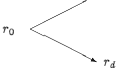

或多期：

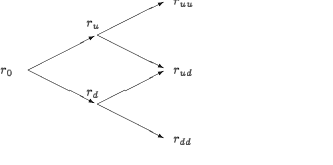

使用这种方法时，保留整个树被证明是有用的，因此我们将树的构建分离到一个例程中，如 C++ 代码 24.1 所示。

```cpp
#include <vector>
#include <cmath>
using namespace std;

vector< vector< double > > interest_rate_trees_gbm::build(const double& r0,
                                     const double& u,
                                     const double& d,
                                     const int& n){
vector< vector< double > > tree;
vector< double > r(1); r[0]=r0;
tree.push_back(r);
for (int i=1;i<n+1;++i) {
  vector< double > tmp(i*2+1);
  for (int j=0;j<i+1;++j){
    r[j] = d*r[j];
  }
  r.push_back(r.back());
  tree.push_back(r);
}
return tree;
};
```

### C++ 代码 24.1：构建利率树

```matlab
function tree = interest_rate_trees_gbm_build(r0,u,d,n)
r = r0;
tree = r;
rtop = r0;
for i = 1:n
  rtop = u * rtop;
  r = [rtop; r * rtop];
  tree = [zeros(i,1), tree, r];
endfor
endfunction
```

### Matlab 代码 24.1：构建利率树

### 示例

参数：$r_0 = 10\%, u = 1.02, d = 0.99$。构建一个 2 期利率树。


```cpp
C++ program:
vector< vector<double> > tree = interest_rate_trees.gbm_build(0.1,1.02,0.99,3);
cout << " Interest rate tree: " << endl;
cout << " Time 0: " << tree[0][0] << endl;
cout << " Time 1: " << tree[1][0] << " " << tree[1][1] << endl;
cout << " Time 2: " << tree[2][0] << " " << tree[2][1] << " " << tree[2][2] << endl;
Output from C++ program:
Interest rate tree:
Time 0: 0.1
Time 1: 0.099 0.102
Time 2: 0.09801 0.10098 0.10404
```

## 24.2 贴现因子

我们想要对债券和其他固定收益证券进行定价，这些证券包含一组未来现金流。我们生成价格，而不是利率，即贴现因子。因此，利率树需要用于生成贴现因子，这些贴现因子需要在树的每个节点以及所有相关期限上指定。设 $d(t,T)$ 为时间 $t$ 针对时间 $T$ 付款的贴现因子。如果我们在时间 0 想要对时间 2 的现金流进行定价，我们需要以下贴现因子集合

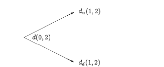

在构建贴现树时，我们需要一项额外信息 $q$，其用法如下：

$d(0,2) = e^{-r_0} (q d_u(1,2) + (1-q) d_d(1,2))$

参数 $q$ 的作用与状态定价概率相同，但其求法不同。

### 练习 24.1.

给定两个贴现债券的价格，期限分别为 1 和 2，你将如何推导出 $q$？

### 练习 24.2.

假设你已有 $q$ 和短期利率树。你将如何计算 $t$ 期即期利率？

## 24.3 债券定价

定价普通债券则只是常规递归估值的问题

示例参数：$r_0 = 10\%$，$u = 1.02$，$d = 0.99$。设 $q = 0.5$。确定一个 3 期票息为 10、面值为 100 的附息债券的价格。

```cpp
#include <vector>
#include <cmath>
using namespace std;

double interest_rate_trees_gbm_value_of_cashflows(const vector<double>& cflow,
        const vector< vector<double> >& r_tree,
        const double& q){
    int n = int(cflow.size());
    vector< vector<double> > values(n);
    vector<double> value(n);
    for (int i=0;i<n;++i){value[i]=cflow[n-1-i];}
    values[n-1]=value;
    for (int t=n-1;t>0;--t){
        for (int i=0;i<t;++i){
            value[i]=cflow[t-1-i]+exp(-r_tree[t-1][i])*(q*values[t][i]+(1-q)*values[t][i+1]);
        }
        values[t-1]=value;
    }
    return values[0][0];
};
```

## C++ 代码 24.2：现金流估值

```cpp
C++ program:

double r0=0.1;
double u=1.02, d=0.99;
int n=3;
double q=0.5;
vector< vector<double> > tree = interest_rate_trees_gbm.build(r0,u,d,n);
vector<double> cashflows;
cashflows.push_back(0); cashflows.push_back(10); cashflows.push_back(10); cashflows.push_back(110);
cout << " Bond price B = " << interest_rate_trees_gbm.value_of_cashflows(cashflows,tree,q);
Output from C++ program:
Bond price B = 98.5997
```

### 练习 24.3.

刚才呈现的示例假设现金流日期与利率变更日期匹配。你将如何修改代码以允许利率变更与现金流时间安排存在差异？或者，你是否可以通过调整传给该例程的输入来另行实现这一点？

## 24.4 可赎回债券

一个稍微复杂一些的示例是可赎回债券。

```cpp
#include <vector>
#include <cmath>
using namespace std;
double interest_rate_trees.gbm_value_of_callable_bond(const vector<double>& cflows,
const vector< vector<double> >& r_tree,
const double& q,
const int& first_call_time,
const double& call_price){
int n = int(cflows.size());
vector< vector<double> > values(n);
vector<double> value(n);
for (int i=0;i<n;++i) { value[i]=cflows[n-1-i]; }
values[n-1]=value;
for (int t=n-1;t>=0;--t){
vector<double> value(t,0.0);
for (int i=0;i<t;++i){
value[i]=exp(-r_tree[t-1][i])*(q*values[t][i]+(1-q)*values[t][i+1]);
if (t>=first_call_time) { value[i]=min(value[i],call_price); }
};
values[t-1]=value;
};
return values[0][0];
};
```

## C++ 代码 24.3：可赎回债券估值

## 示例

构建一个短期利率格点，涵盖第 0 到第 9 期（年份），初始利率为 r0 = 6%，后续利率由乘数因子 u = 1.2 或 d = 0.9 决定。设定 q = 0.5。

- 1. 利用该格点，求出一只 10 年期 6% 债券的价值。
- 2. 假设该债券可在 5 年后随时由发行方赎回。（当债券被赎回时，在该时点支付面值加上当期应付票息，债券被注销。）该债券的公允价值是多少？

利率格点：

| 步骤：| 0 | 1 | 2 | 3 | 4 | 5 | 6 | 7 | 8 | 9 |
|---|---|---|---|---|---|---|---|---|---|---|
| 节点：| | | | | | | | | | 31.0 |
| | | | | | | | | 25.8 | 23.2 |
| | | | | | | | 21.5 | 19.3 | 17.4 |
| | | | | | | 17.9 | 16.1 | 14.5 | 13.1 |
| | | | | | 14.9 | 13.4 | 12.1 | 10.9 | 9.8 |
| | | | | 12.4 | 11.2 | 10.1 | 9.1 | 8.2 | 7.3 |
| | | | 10.4 | 9.3 | 8.4 | 7.6 | 6.8 | 6.1 | 5.5 |
| | | 8.6 | 7.8 | 7.0 | 6.3 | 5.7 | 5.1 | 4.6 | 4.1 |
| | 7.2 | 6.5 | 5.8 | 5.2 | 4.7 | 4.3 | 3.8 | 3.4 | 3.1 |
| 6.0 | 5.4 | 4.9 | 4.4 | 3.9 | 3.5 | 3.2 | 2.9 | 2.6 | 2.3 |

- 1. 定价不可赎回债券

现金流格点

| 步骤：| 0 | 1 | 2 | 3 | 4 | 5 | 6 | 7 | 8 | 9 | 10 |
| :--- | :--- | :--- | :--- | :--- | :--- | :--- | :--- | :--- | :--- | :--- | :--- |
| 节点：| | | | | | | | | | | 106 |
| | | | | | | | | | 6 | 106 |
| | | | | | | | | 6 | 6 | 106 |
| | | | | | | | 6 | 6 | 6 | 106 |
| | | | | | | 6 | 6 | 6 | 6 | 106 |
| | | | | | 6 | 6 | 6 | 6 | 6 | 106 |
| | | | | 6 | 6 | 6 | 6 | 6 | 6 | 106 |
| | | | 6 | 6 | 6 | 6 | 6 | 6 | 6 | 106 |
| | | 6 | 6 | 6 | 6 | 6 | 6 | 6 | 6 | 106 |
| | 6 | 6 | 6 | 6 | 6 | 6 | 6 | 6 | 6 | 106 |
| 6 | 6 | 6 | 6 | 6 | 6 | 6 | 6 | 6 | 6 | 106 |
| 0 | 6 | 6 | 6 | 6 | 6 | 6 | 6 | 6 | 6 | 106 |

价值格点：

| 步骤：| 0 | 1 | 2 | 3 | 4 | 5 | 6 | 7 | 8 | 9 | 10 |
| :--- | :--- | :--- | :--- | :--- | :--- | :--- | :--- | :--- | :--- | :--- | :--- |
| 节点：| | | | | | | | | | | 83.78 |
| | | | | | | | | | 73.14 | 90.04 |
| | | | | | | | | 68.67 | 82.27 | 95.06 |
| | | | | | | | 67.84 | 79.28 | 89.93 | 99.02 |
| | | | | | | 69.38 | 79.32 | 88.46 | 96.19 | 102.11 |
| | | | | | 72.59 | 81.45 | 89.45 | 96.14 | 101.20 | 104.49 |
| | | | | 77.07 | 85.09 | 92.19 | 98.04 | 102.39 | 105.15 | 106.32 |
| | | | 82.57 | 89.88 | 96.24 | 101.37 | 105.10 | 107.37 | 108.21 | 107.71 |
| | | 88.89 | 95.59 | 101.29 | 105.79 | 108.96 | 110.78 | 111.29 | 110.57 | 108.77 |
| | 89.90 | 102.03 | 107.13 | 111.05 | 113.70 | 115.09 | 115.26 | 114.32 | 112.38 | 109.56 |

债券价值为 B = 89.90。

- 2. 当债券价值高于面值时，可赎回债券将被赎回，因为发行公司可以以更低的利率发行债券。

计算出以下数值集合

| 步骤：| 0 | 1 | 2 | 3 | 4 | 5 | 6 | 7 | 8 | 9 | 10 |
| :--- | :--- | :--- | :--- | :--- | :--- | :--- | :--- | :--- | :--- | :--- | :--- |
| 节点：| | | | | | | | | | | 83.78 |
| | | | | | | | | | 73.14 | 90.04 |
| | | | | | | | | 68.67 | 82.27 | 95.06 |
| | | | | | | | 67.84 | 79.28 | 89.93 | 99.02 |
| | | | | | | 69.38 | 79.32 | 88.46 | 96.19 | 102.11 |
| | | | | | 72.59 | 81.45 | 89.45 | 96.14 | 101.20 | 104.49 |
| | | | | 77.07 | 85.08 | 92.18 | 98.01 | 102.32 | 105.00 | 106.00 |
| | | | 82.57 | 89.80 | 96.08 | 101.03 | 104.42 | 106.00 | 106.00 | 106.00 |
| | | 88.70 | 95.21 | 100.56 | 104.39 | 106.36 | 106.00 | 106.00 | 106.00 | 106.00 |
| | 89.35 | 101.05 | 105.44 | 108.22 | 109.19 | 108.31 | 106.00 | 106.00 | 106.00 | 106.00 |

债券价值为 B = 89.35。

```cpp
C++ program:
double r0=0.06;
double u=1.2, d=0.9;
int n=10;
double q=0.5;
vector< vector<double> > tree = interest_rate_trees.gbm_build(r0,u,d,n);
vector<double> cashflows;
cashflows.push_back(0);
cashflows.push_back(6);
for (int t=1;t<=9;t++){
cashflows.push_back(6);
}
cout << "Straight bond price = " << interest_rate_trees.gbm_value_of_cashflows(cashflows,tree,q) << endl;
int first_call_time = 6;
double call_price = 106;
cout << "Callable bond price = " << interest_rate_trees.gbm_value_of_callable_bond(cashflows,tree,q, first_call_time, call_price) << endl;
Output from C++ program:
Straight bond price = 89.9017
Callable bond price = 89.2483
```

### 练习 24.4.

在此设定下，你将如何对附息债券的看涨期权进行定价？

## 24.5 参考文献

一般参考文献包括 Sundaresan (2001)。

Rendleman and Bartter (1979) 和 Rendleman and Bartter (1980) 是构建标准二叉利率树的原始参考文献。


## 第 25 章

## 使用 Ho 和 Lee (1986) 方法构建期限结构树

### 25.1 简介

在本节中，我们将遵循 Ho 和 Lee (1986) 的原始论文来构建利率树。我们将遵循论文中的分析，并用它来说明如何构建比简单的利率二叉树更复杂的期限结构树。原始论文的卖点在于，可以拟合初始期限结构，然后指定与该初始期限结构一致的期限结构演变。

### 25.2 构建期限结构树

### 25.3 Ho-Lee 期限结构类

```cpp
#include "fin_recipes.h"

class term_structure_class_ho_lee : public term_structure_class {
private:
    term_structure_class* initial_term;
    int n;
    int i;
    double delta;
    double pi;
public:
    term_structure_class_ho_lee(term_structure_class* fitted_term,
                                const int& n,
                                const int& i,
                                const double& delta,
                                const double& pi);
    double d(const double& T) const;
};

vector< vector<term_structure_class_ho_lee > >
term_structure_class_ho_lee::build_term_structure_tree(term_structure_class* initial,
                                                       const int& no_steps,
                                                       const double& delta,
                                                       const double& pi);

double price_european_call_option_on_bond_using_ho_lee(term_structure_class* initial,
                                                       const double& delta,
                                                       const double& pi,
                                                       const vector<double>& underlying_bond_cflow_times,
                                                       const vector<double>& underlying_bond_cflows,
                                                       const double& K,
                                                       const double& option_time_to_maturity);
```

### 头文件 25.1：Ho-Lee 期限结构类

```cpp
#include "fin_recipes.h"

term_structure_class_ho_lee::term_structure_class_ho_lee(term_structure_class* fitted_term,
                                                         const int& n,
                                                         const int& i,
                                                         const double& delta,
                                                         const double& pi){
    initial_term = fitted_term;
    n = n;
    i = i;
    delta = delta;
    pi = pi;
};
```

### C++ 代码 25.1：Ho-Lee 期限结构类

```cpp
#include "fin_recipes.h"

//#include "term_structure_class_ho_lee.h"

inline double hT(const double& T, const double& delta, const double& pi){
    return (1.0/pi*((1-pi)*pow(delta,T)));
};

double term_structure_class_ho_lee::d(const double& T) const{
    double d = initial_term->d(T) / initial_term->d(n);
    for (int j = 1; j <= n; ++j){
        d *= hT(T, delta, pi) / hT(n - j, delta, pi);
    };
    d *= hT(T, delta, pi) * pow(delta, T * (n - i));
    return d;
};
```

### C++ 代码 25.2：Ho-Lee 期限结构类，贴现函数计算

```cpp
#include "fin_recipes.h"

vector< vector<term_structure_class_ho_lee> >
term_structure_class_ho_lee::build_term_structure_tree(term_structure_class* initial,
    const int& no_steps,
    const double& delta,
    const double& pi)
{
    vector< vector<term_structure_class_ho_lee> > hl_tree;
    for (int t = 0; t <= 5; ++t){
        hl_tree.push_back(vector<term_structure_class_ho_lee>());
        for (int j = 0; j <= t; ++j){
            term_structure_class_ho_lee hl(initial, t, j, delta, pi);
            hl_tree[t].push_back(hl);
        };
    };
    return hl_tree;
}
```

### C++ 代码 25.3：构建期限结构树

### 25.4 定价

我们现在可以通过递归关系进行所需的定价：

C(n,i) = [\pi C(n+1, i+1) + (1-\pi) C(n+1, i)] P_i^{(n)}(1)

其中 C(n,i) 是时间 n 在节点 i 处的证券价值。

我们定价的通常是现金流的状态和时间相关索赔。让我们以某些基础债券上的（欧洲）看涨期权定价为例。假设该债券是无风险的。其在每个未来日期的现金流不取决于状态，但随着你在树中移动，现金流的时间会发生变化。因此，有必要在日期 t 时弄清楚：当你想要在那个日期定价基础债券时，未来的现金流是什么。我们构建了一个包含此信息的小类，并将其与各个节点中的期限结构一起使用，以找到每个节点的债券价格。不同节点的债券价值会变化，因为你用于贴现的期限结构在变化。然后使用此债券价格来找到每个节点的期权价值。

```cpp
#include "fin_recipes.h"

class time_contingent_cash_flows {
public:
    vector<double> times;
    vector<double> cash_flows;
    time_contingent_cash_flows(const vector<double>& in_times, const vector<double>& in_cflows) {
        times = in_times;
        cash_flows = in_cflows;
    };
    int no_cflows() { return (int(times.size())); };
};

vector<time_contingent_cash_flows>
build_time_series_of_bond_time_contingent_cash_flows(const vector<double>& initial_times,
    const vector<double>& initial_cflows) {
    vector<time_contingent_cash_flows> vec_cf;
    vector<double> times = initial_times;
    vector<double> cflows = initial_cflows;
    while (times.size() > 0) {
        vec_cf.push_back(time_contingent_cash_flows(times, cflows));
        vector<double> tmp_times;
        vector<double> tmp_cflows;
        for (int i = 0; i < times.size(); ++i) {
            if (times[i] - 1.0 > 0.0) {
                tmp_times.push_back(times[i] - 1);
                tmp_cflows.push_back(cflows[i]);
            };
        };
        times = tmp_times;
        cflows = tmp_cflows;
    };
    return vec_cf;
};

double price_european_call_option_on_bond_using_ho_lee(term_structure_class* initial, const double& delta, const double& pi,
    const vector<double>& underlying_bond_cflow_times,
    const vector<double>& underlying_bond_cflows,
    const double& K, const double& time_to_maturity) {

    int T = int(time_to_maturity + 0.0001);
    vector< vector< term_structure_class* > > hl_tree
        = term_structure_class_ho_lee::build_term_structure_tree(initial, T + 1, delta, pi);
    vector<time_contingent_cash_flows> vec_cf
        = build_time_series_of_bond_time_contingent_cash_flows(underlying_bond_cflow_times, underlying_bond_cflows);

    vector<double> values(T + 1);
    for (int i = 0; i < T + 1; ++i) {
        values[i] = max(0.0, bonds.price(vec_cf[T + 1].times, vec_cf[T + 1].cash_flows, hl_tree[T + 1][i]) - K);
    };
    for (int t = T; t >= 0; --t) {
        vector<double> values_this(t + 1);
        for (int i = 0; i < t + 1; ++i)
            values_this[i] = (pi * values[i + 1] + (1.0 - pi) * values[i]) * hl_tree[t][i].d(1);
        values = values_this;
    };
    return values[0];
};
```

### C++ 代码 25.4：使用 Ho-Lee 对直债券的欧洲看涨期权定价

### 示例

你正在对一张 5 年期零息无风险债券的期权进行定价。这些期权是到期时间为 3 年的欧洲看涨期权。

你将使用参数 \(\pi = 0.5\) 和 \(\delta = 0.98\) 的 Ho-Lee 方法对期权进行定价。

使用关于当前期限结构的两种不同假设来定价期权：

- 1. 期限结构是平坦的，利率为 10%（连续复利）。
- 2. 当前期限结构已使用 Nelson Siegel 参数化估计，参数为 \(\beta_0 = 0.09\)、\(\beta_1 = 0.01\)、\(\beta_2 = 0.01\) 和 \(\lambda = 5.0\)。

C++ 程序：
```cpp
double delta = 0.98;
double pi = 0.5;
double r = 0.1;
term_structure_class* initial = new term_structure_class_flat(r);
vector<double> times;
times.push_back(5.0);
vector<double> cflows;
cflows.push_back(100);
double K = 100;
double B = 100;
int no_steps = 3;
cout << " Flat term structure " << endl;
cout << c << endl;
cout << c << endl;
delete (initial);
double beta0 = 0.09;
double beta1 = 0.01;
double beta2 = 0.01;
double lambda = 5.0;
initial = new term_structure_class_nelson_siegel(beta0, beta1, beta2, lambda);
cout << " Nelson Siegel term structure " << endl;
cout << c << endl;
cout << c << endl;
```
C++ 程序输出：
平坦期限结构
c = 4.64323
Nelson Siegel 期限结构
c = 6.3338

### 练习 25.1。

你需要对 C++ 代码 25.4 做出哪些更改，以定价美国看涨期权而不是欧洲看涨期权？

### 练习 25.2。

例如，如果你想定价债券，你需要跟踪中间的票息支付。实现这样的过程。为了验证其正确性，使用它来定价（直）债券，然后将树中计算的值与使用当前期限结构计算的值进行比较。然后修改代码以构建可赎回债券功能。必须跟踪哪些额外信息？

### 练习 25.3。

在 Ho 和 Lee (1986) 论文中，方程 (22) 有一个拼写错误。你能看出是什么吗？

### 25.5 参考文献

本章的讨论紧密遵循原始论文 Ho 和 Lee (1986)


## 第26章

## 期限结构衍生品

## 目录

- 26.1 基于Vasicek模型的债券期权定价 227

## 26.1 基于Vasicek模型的债券期权定价

如果期限结构模型是Vasicek模型，则存在关于零息债券期权定价的解析解，该解源自Jamshidian (1989)。

在Vasicek模型下，短期利率过程被假设遵循。

```
dr = a(b - r)dt + \sigma dZ
```

其中a、b和σ为常数。我们之前已介绍过在这种情况下如何计算贴现因子。现在我们要考虑在此设定下的欧洲看涨期权。

设P(t, s)为时刻t支付$1的零息债券（即贴现因子）在时刻s的价格。时刻t的、于时刻T到期的、标的为时刻s到期的贴现债券的欧洲看涨期权价格为[参见Jamshidian (1989)和Hull (1993)]

```
P(t, s)N(h) - XP(t, T)N(h - \sigma_P)
```

其中

```
h = \frac{1}{\sigma_P} ln \frac{P(t, s)}{P(t, T)X} + \frac{1}{2} \sigma_P

\sigma_P = v(t, T)B(T, s)

B(T, T) = \frac{1 - e^{-a(T-t)}}{a}

v(t, T)^2 = \frac{\sigma^2(1 - e^{-a(T-t)})}{2a}
```

在a = 0的情况下，

```
v(t, T) = \sigma\sqrt{T-t}

\sigma_P = \sigma(s - T)\sqrt{T - t}
```

## 示例

参数：a = 0.1, b = 0.1, \sigma = 0.02, r = 0.05, X = 0.9. 对零息债券定价Vasicek看涨期权。

```
#include "normdist.h"
#include "fin_recipes.h"
#include <cmath>
using namespace std;

double bond_option_price_call_zero_vasicek(const double& X, // exercise price
    const double& r, // current interest rate
    const double& option_time_to_maturity,
    const double& bond_time_to_maturity,
    const double& a, // parameters
    const double& b,
    const double& sigma){
    double T_t = option_time_to_maturity;
    double s_t = bond_time_to_maturity;
    double T_s = s_t - T_t;
    double v_t_T;
    double sigma_P;
    if (a==0.0) {
        v_t_T = sigma * sqrt ( T_t ) ;
        sigma_P = sigma*T_s*sqrt(T_t);
    }
    else {
        v_t_T = sqrt (sigma*sigma*(1-exp(-2*a*T_t))/(2*a));
        double B_T_s = (1-exp(-a*T_s))/a;
        sigma_P = v_t_T*B_T_s;
    };
    double h = (1.0/sigma_P) * log (term_structure::discount_factor::vasicek(s_t,r,a,b,sigma)/
    (term_structure::discount_factor::vasicek(T_t,r,a,b,sigma)*X) )
    + sigma_P/2.0;
    double c = term_structure::discount_factor::vasicek(s_t,r,a,b,sigma)*N(h)
    -X*term_structure::discount_factor::vasicek(T_t,r,a,b,sigma)*N(h-sigma_P);
    return c;
};
```

## C++ 26.1: 使用Vasicek模型的债券期权定价

### C++程序：

```
double a = 0.1; double b = 0.1; double sigma = 0.02; double r = 0.05; double X=0.9;
cout << " Vasicek call option price "
<< bond_option_price_call_zero_vasicek(X,r,1.5,a,b,sigma) << endl;
```

### C++程序输出：

Vasicek看涨期权价格 0.000226833

## 第 27 章

## 日期（及时间）再探 - Boost库

在介绍中，我们曾用_日期_类的构建作为构建非平凡（且有用）类的示例。然而，即使我们遵循练习中的提示，并使用操作系统实用程序来处理日期，这样的“自制”date类最终也需要被更可靠的东西所取代。

当今程序员最可能想到的日期类是由Boost C++库提供的。因此，让我们借此机会介绍Boost库，并展示一些日期使用示例。Boost库是C++库的集合，其中许多库最终可能成为C++标准的一部分。¹ Boost库中最有用的库之一是完整的日期（gregorian）和日期时间（date_time）库。

此处我们不深入细节，仅展示一些使用示例：

¹实际上有十个Boost库已成为最新C++标准（C++11）的一部分。如果你使用较新的C++实现，通常会包含Boost库。

```
C++ program:

#include "boost/date_time/gregorian/gregorian.hpp"
#include "boost/date_time/posix_time/posix_time.hpp"
#include <iostream>
using namespace std;
namespace greg = boost::gregorian;
using namespace boost::posix_time;

void ex_date_time(){
    boost::gregorian::date d(2014,4,1); // creating a date
    cout << " date: " << d << endl;
    cout << std::endl;

    boost::posix_time::ptime dt;
    stringstream ss("2014-mar-01 10:01:01.01");
    ss >> dt;
    cout << " date time just created: " << dt << endl;

    ptime now = second_clock::local_time(); //get the current time from the clock
    date today = now.date(); //Get the date part out of the time
    cout << " today: " << today << endl;
    date tomorrow = today + days(1); // add one day
    ptime tomorrow_start(tomorrow); //midnight
    time_duration remaining = tomorrow_start - now;
    cout << "Time left till midnight: " << to_simple_string(remaining) << std::endl;
}
Output from C++ program:

日期: 2014-Apr-01
刚创建的日期时间: 2014-Mar-01 10:01:01.010000
今天: 2014-Jun-30
距离午夜剩余时间: 10:19:33
```

## 27.1 参考文献

Boost主页位于 http://www.boost.org/

## 附录 A

## 正态分布近似。

### 目录

- A.1 正态分布函数 231
- A.2 累积正态分布 232
- A.3 多元正态分布 232
- A.4 计算累积双变量正态概率 233
- A.5 模拟随机正态数 235
- A.6 一般多元分布的累积概率 236
- A.7 C++11中的实现 236
- A.8 参考文献 236

一般而言，我们不会深入探讨与金融无关的更多标准数值问题，对此有许多知名的参考资料，但我们展示了涉及正态分布计算的示例。

### A.1 正态分布函数

正态分布函数

$n(x) = e^{-\frac{x^2}{2}}$

计算如下

```
#include <cmath> // c library of math functions
using namespace std; // which is part of the standard namespace

// most C compilers define PI, but just in case it doesn't
#ifndef PI
#define PI 3.141592653589793238462643
#endif

double n(const double& x) { // normal distribution function
    return (1.0/sqrt(2.0*PI))*exp(-0.5*x*x);
};
```

### C++代码 A.1：正态分布函数

### A.2 累积正态分布

大量期权定价公式的解均用累积正态分布表示。对于随机变量x，累积概率是结果小于给定值x的概率。要计算均值为0、方差为1的正态分布随机变量小于z的概率N(z)，必须计算下列积分

Prob(x \le z) = N(z) = \int_{-\infty}^{z} n(x) dx = \int_{-\infty}^{z} \frac{e^{-\frac{x^2}{2}}}{\sqrt{2\pi}} dx

计算该积分没有显式闭式解，但存在大量已知的近似方法。Abramowitz and Stegun (1964) 是这些近似方法的良好来源。下面的方法可能是最常用的此类近似，它相当准确且相对较快。假设传递给函数的参数已归一化到(0,1)分布。

```
#include <cmath> // math functions.
using namespace std;

double N(const double& x) {
  if (x > 6.0) { return 1.0; }; // this guards against overflow
  if (x < -6.0 ) { return 0.0; };

  double b1 = 0.31938153;
  double b2 = -0.356563782;
  double b3 = 1.781477937;
  double b4 = -1.821255978;
  double b5 = 1.330274429;
  double p = 0.2316419;
  double c2 = 0.3989423;

  double a=fabs(x);
  double t = 1.0/(1.0+a*p);
  double b = c2*exp((-x)*(x/2.0));
  double n = (((((b5*t+b4)*t+b3)*t+b2)*t+b1)*t);
  n = 1.0-b*n;
  if ( x < 0.0 ) n = 1.0 - n;

  return n;
};
```

### C++代码 A.2：累积正态分布

### A.3 多元正态分布

正态分布也定义于多个随机变量。我们此时刻画随机变量的 _向量_

\(\mathbf{X} = \begin{bmatrix} x_1 \\ x_2 \\ \vdots \\ x_n \end{bmatrix}\)

关于该向量的概率陈述是关于向量所有元素的联合陈述。


## A.4 计算累积双变量正态概率

最常用的多元正态计算是双变量情况，其中我们令 x 和 y 服从双变量正态分布，均值均为 0，方差均为 1，并假设两个变量的相关系数为 ρ。根据相关系数的定义 ρ ∈ [-1, 1]。累积概率分布

P(x < a, y < b) = N(a, b, ρ) = ∫_{-∞}^{a} ∫_{-∞}^{b} (1 / 2π√(1-ρ²)) exp(-1/2 * (x² - 2ρxy + y²) / (1-ρ²)) dxdy

该积分有多种近似方法。我们选取一种，在 (Hull, 1993, Ch 10) 中讨论，如 C++ 代码 A.3 所示。

如果存在超过两个相关变量，累积概率的计算就是一个非平凡问题。一种常用方法涉及对定积分进行蒙特卡洛估计。我们将考虑这一点，但首先需要考虑随机正态变量的模拟。

### 示例

计算 N(0) 和 N(0,0,0)

```
C++ program:
cout << " N(0) = " << N(0) << endl;
cout << " N(0,0,0) = " << N(0,0,0) << endl;
Output from C++ program:
N(0) = 0.5
N(0,0,0) = 0.25
```

```cpp
#include <cmath> // include the standard library mathematics functions
using namespace std; // which are in the standard namespace
#include <iostream>
double N(const double&); // define the univariate cumulative normal distribution as a separate function
#ifndef PI
const double PI=3.141592653589793238462643;
#endif
inline double f(const double& x, const double& y,
 const double& aprime, const double& bprime,
 const double& rho) {
 double r = aprime*(2*x-aprime) + bprime*(2*y-bprime) + 2*rho*(x-aprime)*(y-bprime);
 return exp(r);
};
inline double sgn(const double& x) // sign function
{ if (x>0.0) return 1.0;
 return -1.0;
};
double N(const double& a, const double& b, const double& rho) {
 if ( (a<=0.0) && (b<=0.0) && (rho<=0.0) ) {
 double aprime = a/sqrt(2.0*(1.0-rho*rho));
 double bprime = b/sqrt(2.0*(1.0-rho*rho));
 double A[]={0.3253030, 0.4211071, 0.1334425, 0.006374323};
 double B[]={0.13333764, 0.6243247, 1.3425378, 2.2626645 };
 double I[]={0.0,0.0,0.0,0.0};
 for (int i=0;i<4;++i) {
 for (int j=0; j<4; ++j) {
 sum += A[i]*A[j]* (f(B[i],B[j],aprime,bprime,rho);
 };
 };
 sum = sum * ( sqrt(1.0-rho*rho)/PI);
 return sum;
}
else if ( (a > 0.0) && (b <= 0.0) {
 if ( (a<=0.0) && (b<=0.0) && (rho>=0.0) ) {
 return N(a) - N(a, -b, -rho);
 }
 else if ( (a>=0.0) && (b<=0.0) && (rho>=0.0) ) {
 return N(b) - N(a, b, -rho);
 }
 else if ( (a>=0.0) && (b>=0.0) && (rho<=0.0) ) {
 return N(a) + N(b) - 1.0 + N(-a, -b, -rho);
 };
}
else if ( a * b > rho >= 0.0 ) {
 double delta = sqrt(a*a - 2*rho*a*b + b*b);
 double rho1 = ((rho * a - b) * sgn(a))/denum;
 double rho2 = ((rho * b - a) * sgn(b))/denum;
 double delta=(1.0-sgn(a)*sgn(b))/4.0;
 return N(a,0.0,rho) + N(b,0.0,rho) - delta;
}
else {
 cout << " unknown " << endl;
}
return -99.9; // should never get here, alternatively throw exception
};
```

### C++ 代码 A.3：累积双变量正态的近似

## A.5 模拟随机正态数

随机数生成是一个庞大的主题，Knuth (1997) 等资料对此有详细论述。生成的数字永远不能真正随机，只能是“伪”随机，它们将根据某些可重复的算法生成，在（大量）随机数生成之后，序列将开始重复。在复制开始前的迭代次数是衡量随机数生成器质量的指标。对于需要高质量随机数生成器的任何人，都应避免使用标准 C++ 库提供的 rand() 函数，但为了不深入讨论随机数生成问题，我们将此函数作为在区间 [0,1) 上生成均匀分布数的基础，如 C++ 代码 A.4 所示。

```cpp
#include <cstdlib>
using namespace std;
double random_uniform_0_1(void){
 return double(rand())/double(RAND_MAX); // this uses the C library random number generator.
};
```

### C++ 代码 A.4：来自均匀 [0,1) 分布的伪随机数

### 练习 A.1。

将此处的 random_uniform 函数替换为更高质量的替代方案，方法是查看您的计算平台上有哪些数值库可用，或从 mathlib 或 statlib 等地方下载高质量的随机数生成器。

这些均匀分布的随机变量被用作 Knuth (1997) 讨论的正态密度极点方法的基础，并按 C++ 代码 A.5 所示实现。

```cpp
#include <cmath>
#include <cstdlib>
using namespace std;
double random_uniform_0_1(void);
double random_normal(void){
 double U1, U2, V1, V2;
 double S=2;
 while (S>=1) {
  U1 = random_uniform_0_1();
  U2 = random_uniform_0_1();
  V1 = 2.0*U1-1.0;
  V2 = 2.0*U2-1.0;
  S = pow(V1,2)+pow(V2,2);
 };
 double X1=V1*sqrt((-2.0*log(S))/S);
 return X1;
};
```

### C++ 代码 A.5：来自正态 (0,1) 分布的伪随机数

### 示例

- 1. 生成 5 个 (0,1) 之间的随机均匀数
- 2. 生成 5 个 N(0,1) 随机数。

```
C++ program:
cout << " 5 random uniform numbers between 0 and 1: " << endl;
cout << " ";
for (int i=0;i<5;++i){ cout << " " << random_uniform_0_1(); }; cout << endl;
cout << " 5 random normal(0,1) numbers: " << endl;
cout << " ";
for (int i=0;i<5;++i){ cout << " " << random_normal(); }; cout << endl;
Output of C++ program:
5 random uniform numbers between 0 and 1:
0.840188 0.394383 0.783099 0.79844 0.911647
5 random normal(0,1) numbers:
-1.07224 0.925946 2.70202 1.36918 0.0187313
```

## A.6 一般多元分布的累积概率

超越双变量情况后，概率积分的计算更多地成为一般数值积分的练习。一种典型工具是蒙特卡洛积分，但这不是唯一的可能性。

## A.7 C++11 中的实现

C++ 语言的最新标准 C++11 包含一个用于生成随机数的库。参见 (Stroustrup, 1997a, 第 5.6.3 节)。

## A.8 参考文献

Tong (1990) 讨论了多元正态分布，是一个很好的参考。对于最终来源，请参见 Knuth (1997)。

## 附录 B

### C++ 概念

本章列出了各种 C/C++ 概念，并对每个概念进行了一些说明。

- accumulate() 对序列元素进行累加的函数。
- bool 布尔变量，取 true 和 false 两个值。出于历史原因，也可以使用零和一分别表示 false 和 true。
- class (C++ 关键字)。
- const (C++ 函数调用中变量的限定符)。
- double (基本类型)。高精度浮点数。
- exp(x) (C 函数)。定义在 <cmath> 中。返回自然指数 e 的给定幂 x，即 e^x。
- fabs
- float (基本类型)。精度有限的浮点数。
- for 循环
- 头文件
- if
- 索引（在向量和矩阵中）。要访问数组 A 中的第 i 个元素，请使用 A[i-1]。这是从其他语言转到 C 的人常见的陷阱。出于历史效率原因，C 中存在此特性。C 中的数组是使用指针实现的。索引是通过查找数组的第一个元素，然后添加指针来找到索引元素。第一个元素当然是通过向第一个元素添加零来找到的，因此第一个元素的索引为零。
- include
- inline (C++ 函数名的限定符)。向优化器提示，该函数最有效的实现方式是内联，即将函数的完整代码放入每个调用实例中。副作用是使函数局限于定义它的文件。
- int (基本类型)。有效位数有限的整数。
- log(x) (C 函数)。定义在 <cmath> 中。计算其参数的自然对数 ln(x)。
- long (基本类型)。可以容纳大数的整数。
- min_element() (C++ 函数)


- max_element (C++ 函数)
- namespace (C++ 概念)
- return
- 标准命名空间 (C++ 概念)
- string (C++ 基本类型)
- using (C++ 概念)
- vector (C++ 容器类)。定义于 <vector>
- while

## 附录 C

### 与外部库的接口

### 目录

| 节 | 页 |
| :--- | :--- |
| C.1 Boost | 239 |
| C.2 Newmat | 239 |
| C.3 IT++ | 239 |
| C.4 GSL | 239 |
| C.4.1 \( N_3 \) 的求值 | 239 |
| C.5 互联网链接 | 240 |

在多个地方，我们使用了其他公共领域软件包中的例程。在本附录中，有一些关于所引用库的说明，以及关于链接到它们的一些评论。

### C.1 Boost

大量经过同行评审的代码。特别有用的是：date_time 库。

### C.2 Newmat

Newmat 是一个矩阵库，它试图在 C++ 中执行类似 MATLAB 的操作，即可以定义矩阵和向量，然后相乘等等，而无需显式调用子程序，而是以更面向数学的方式编写操作。

### C.3 IT++

IT++ 是一个庞大的库，包含各种不同的

### C.4 GSL

### C.4.1 \( N_3 \) 的求值

在 Geske 和 Johnson (1984) 的美式看跌期权近似计算中，需要求解三元正态分布。遵循论文中的讨论，其求值如下

```
N_3(h, k, j; \rho_{12}, \rho_{13}, \rho_{23}) = \int_{-\infty}^{j} n(z) N_2 \left( \frac{k - \rho_{23}z}{\sqrt{1 - \rho_{23}^2}}, \frac{h - \rho_{13}z}{\sqrt{1 - \rho_{13}^2}} \bigg| \frac{\rho_{12} - \rho_{13}\rho_{23}}{\sqrt{1 - \rho_{13}^2}\sqrt{1 - \rho_{23}^2}} \right)
```

这是一个一元积分，可以使用求积法进行求值。

```
#include <cmath>
#include <iostream>
using namespace std;

#include "gsl/gsl_integration.h"
#include "normdist.h"

struct n3_pars {double h; double k; double rho12; double rho13; double rho23; };

extern "C"{
double f3(double z, void *p){
  struct n3_pars* pars = (struct n3_pars*)p;
  double h = (pars->h);
  double k = (pars->k);
  double rho12 = (pars->rho12);
  double rho13 = (pars->rho13);
  double rho23 = (pars->rho23);
  double f = n(z);
  f*=N( (k-rho23*z)/sqrt(1.0-rho23*rho23),
        (h-rho13*z)/sqrt(1.0-rho13*rho13),
        (rho12-rho13*rho23)/(sqrt(1.0-rho13*rho13)*sqrt(1.0-rho23*rho23)));
  return f;
};

double N3(const double& h, const double& k, const double& j,
          const double& rho12, const double& rho13, const double& rho23){
  struct n3_pars pars = { h, k, rho12, rho13, rho23};
  size_t n = 1000;
  gsl_integration_workspace* w = gsl_integration_workspace_alloc(n);
  gsl_function F;
  F.function = &f3;
  F.params = &pars;
  double result, error;
  gsl_integration_qags(&F,-20.0,1e-7,1e-7,n,w,&result,&error);
  return result;
};
```

C++ 代码 C.1：使用 Geske 和 Johnson (1984) 的方法近似 $N_3()$

### C.5 互联网链接

一些有用的互联网链接

- http://www.robertnz.net：Newmat 的主页，Newmat 是示例中使用的矩阵类。

## 附录 D

### 例程名称汇总

在许多算法中都使用了其他例程。为简化问题，所有例程都汇总在一个头文件 fin_recipes.h 中。本附录展示了此文件。

```
// file: fin_recipes.h
// author: Bernt Arne Oedegaard
// defines all routines in the financial numerical recipes "book"

#ifndef _FIN_RECIPES_H_
#define _FIN_RECIPES_H_

#include <vector>
#include <cmath>
using namespace std;

// ////////////////// present value ///////////////////////////////////
// discrete compounding
// discrete, annual compounding
double cash_flow_pv_discrete( const vector<double>& cflow_times, const vector<double>& cflow_amounts,
                              const double& r);
double cash_flow_irr_discrete(const vector<double>& cflow_times, const vector<double>& cflow_amounts);
bool cash_flow_unique_irr(const vector<double>& cflow_times, const vector<double>& cflow_amounts);
double bonds_price_discrete(const vector<double>& cashflow_times, const vector<double>& cashflows,
                            const double& r);
double bonds_yield_to_maturity_discrete(const vector<double>& cashflow_times, const vector<double>& cashflows,
                                        const double& bond_price);
double bonds_duration_discrete(const vector<double>& cashflow_times,
                               const vector<double>& cashflows,
                               const double& r);
double bonds_duration_macaulay_discrete(const vector<double>& cashflow_times,
                                        const vector<double>& cashflows,
                                        const double& bond_price);
double bonds_duration_modified_discrete(const vector<double>& cashflow_times,
                                        const vector<double>& cashflows,
                                        const double& bond_price);
double bonds_convexity_discrete(const vector<double>& cashflow_times,
                                const vector<double>& cashflows,
                                const double& r);
// ////////////////// continuous compounding ///////////////////////////////////
double cash_flow_pv(const vector<double>& cflow_times, const vector<double>& cflow_amounts,const double& r);
double cash_flow_irr(const vector<double>& cflow_times, const vector<double>& cflow_amounts);
double cash_flow_price(const vector<double>& cflow_times, const vector<double>& cflow_amounts, const vector<double>& cashflows, const double& r);
double bonds_price(const vector<double>& coupon_times, const vector<double>& coupon_amounts,
                   const vector<double>& principal_times, const vector<double>& principal_amounts,
                   const double& r);
double bonds::duration(const vector<double>& cashflow_times, const vector<double>& cashflows,
    const double& r);
double bonds::yield_to_maturity(const vector<double>& cashflow_times,const vector<double>& cashflow_amounts,
    const double& bond_price);
double bonds::duration_macaulay(const vector<double>& cashflow_times, const vector<double>& cashflows,
    const double& bond_price);
double bonds::convexity(const vector<double>& cashflow_times, const vector<double>& cashflow_amounts,
    const double& y );

# /// term structure basics

double term_structure::yield_from_discount_factor(const double& dfact, const double& t);
double term_structure::discount_factor_from_yield(const double& r, const double& t);
double term_structure::forward_rate_from_discount_factors(const double& d_t1, const double& d_t2,
    const double& t1, const double& t2);
double term_structure::forward_rate_from_yields(const double& t1, const double& r_t1, const double& r_t2,
    const double& t2);
double term_structure::yield_linearly_interpolated(const double& t,
    const vector<double>& obs_times,
    const vector<double>& obs_yields);

# /// a term structure class

class term_structure_class {
public:
    virtual ~term_structure_class();
    virtual double r(const double& t) const; // short rate, yield on zero coupon bond
    virtual double d(const double& t) const; // discount_factor
    virtual double f(const double& t1, const double& t2) const; // forward_rate
};

class term_structure_class_flat : public term_structure_class {
private:
    double R_; // interest rate
public:
    term_structure_class_flat(const double& r);
    virtual ~term_structure_class_flat();
    virtual double r(const double& t) const;
    void set_interest_rate(const double& r);
};

class term_structure_class_interpolated : public term_structure_class {
private:
    vector<double> times_; // use to keep a list of yields
    vector<double> yields_;
    void clear();
public:
    term_structure_class_interpolated();
    term_structure_class_interpolated(const vector<double>& times, const vector<double>& yields);
    virtual ~term_structure_class_interpolated();
    term_structure_class_interpolated(const term_structure_class_interpolated&);
    term_structure_class_interpolated operator=(const term_structure_class_interpolated&);
    int no_observations() const { return int(times_.size()); };
    virtual double r(const double& T) const;
    void set_interpolated_observations(vector<double>& times, vector<double>& yields);
};

# /// using the term structure classes

double bonds::price(const vector<double>& cashflow_times,
    const vector<double>& cashflow,
    const term_structure_class& d);
double bonds::duration(const vector<double>& cashflow_times,
    const vector<double>& cashflow_amounts,
    const term_structure_class& d);
```


```cpp
double bonds_convexity(const vector<double>& cashflow_times,
                     const vector<double>& cashflow_amounts,
                     const term_structure_class& d);
```

### 期货定价

```cpp
double futures_price(const double& S, const double& r, const double& time_to_maturity);
```

## 二叉树期权定价

### 一期二叉树

```cpp
double option_price_call_european_binomial_single_period( const double& S, const double& K, const double& r,
                                                          const double& u, const double& d);
```

### 多期二叉树

```cpp
double option_price_call_european_binomial_multi_period_given_ud( const double& S, const double& K, const double& r,
                                                                  const double& u, const double& d, const int& no_periods);
```

```cpp
vector< vector<double> > binomial_tree(const double& S0, const double& u, const double& d,
                                       const int& no_steps);
```

## Black Scholes 公式

```cpp
double option_price_call_black_scholes(const double& S, const double& K, const double& r,
                                       const double& sigma, const double& time );
double option_price_put_black_scholes(const double& S, const double& K, const double& r,
                                      const double& sigma, const double& time );
double option_price_implied_volatility_call_black_scholes_newton( const double& S, const double& K,
                                                           const double& r, const double& time,
                                                           const double& option_price);
double option_price_implied_volatility_put_black_scholes_newton( const double& S, const double& K,
                                                          const double& r, const double& time,
                                                          const double& option_price);
double option_price_implied_volatility_call_black_scholes_bisections( const double& S, const double& K,
                                                                      const double& r, const double& time,
                                                                      const double& option_price);
double option_price_implied_volatility_put_black_scholes_bisections( const double& S, const double& K,
                                                                     const double& r, const double& time,
                                                                     const double& option_price);
double option_price_delta_call_black_scholes(const double& S, const double& K, const double& r,
                                             const double& sigma, const double& time );
double option_price_delta_put_black_scholes( const double& S, const double& K, const double& r,
                                           const double& sigma, const double& time );
void option_price_partials_call_black_scholes(const double& S, const double& K, const double& r,
                                              const double& sigma, const double& time,
                                              double& Delta, double& Gamma, double& Theta,
                                              double& Vega, double& Rho);
void option_price_partials_put_black_scholes(const double& S, const double& K, const double& r,
                                             const double& sigma, const double& time,
                                             double& Delta, double& Gamma, double& Theta,
                                             double& Vega, double& Rho);
```

## 权证定价

```cpp
double warrant_price_adjusted_black_scholes(const double& S, const double& K,
                                            const double& r, const double& sigma,
                                            const double& time,
                                            const double& no_warrants_outstanding,
                                            const double& no_shares_outstanding);
double warrant_price_adjusted_black_scholes(const double& S, const double& K,
                                            const double& r, const double& q,
                                            const double& sigma, const double& time,
                                            const double& no_warrants_outstanding,
                                            const double& no_shares_outstanding);
```

## Black Scholes 模型的扩展

```cpp
double option_price_european_call_payout(const double& S, const double& K, const double& r,
    const double& b, const double& sigma, const double& time);
double option_price_european_put_payout(const double& S, const double& K, const double& r,
    const double& b, const double& sigma, const double& time);
double option_price_european_call_dividends(const double& S, const double& K, const double& r,
    const double& sigma, const double& time,
    const vector<double>& dividend_times,
    const vector<double>& dividend_amounts );
double option_price_european_put_dividends( const double& S, const double& K, const double& r,
    const double& sigma,const double& time,
    const vector<double>& dividend_times,
    const vector<double>& dividend_amounts);
double option_price_american_call_one_dividend(const double& S, const double& K, const double& r,
    const double& sigma,
    const double& time, const double& t_a);
double futures_option_price_call_european_black(const double& F, const double& K, const double& r,
    const double& sigma, const double& time);
double futures_option_price_put_european_black(const double& F, const double& K, const double& r,
    const double& sigma, const double& time);
double currency_option_price_call_european(const double& S, const double& K, const double& r,
    const double& t, const double& sigma, const double& time);
double currency_option_price_put_european(const double& S, const double& K, const double& r,
    const double& t, const double& sigma, const double& time);
double option_price_american_perpetual_call(const double& r_f, const double& K, const double& r,
    const double& q, const double& sigma);
double option_price_american_perpetual_put(const double& S, const double& K, const double& r,
    const double& q, const double& sigma);
```

## 二叉树期权近似

```cpp
double option_price_call_european_binomial(const double& S, const double& K, const double& r,
    const double& sigma, const double& t, const int& steps);
double option_price_put_european_binomial( const double& S, const double& K, const double& r,
    const double& sigma, const double& t, const int& steps);
double option_price_call_american_binomial( const double& S, const double& K, const double& r,
    const double& sigma, const double& t, const int& steps);
double option_price_put_american_binomial( const double& S, const double& K, const double& r,
    const double& sigma, const double& t, const int& steps);
double option_price_call_american_binomial( const double& S, const double& K, const double& r,
    const double& sigma,
    const double& t, const int& steps);
double option_price_put_american_binomial( const double& S, const double& K, const double& r,
    const double& sigma, const double& t, const int& steps);
double option_price_call_american_discrete_dividends_binomial( const double& S, const double& K,
    const double& r,
    const double& sigma, const double& t,
    const int& steps,
    const vector<double>& dividend_times,
    const vector<double>& dividend_amounts);
double option_price_put_american_discrete_dividends_binomial(const double& S, const double& K,
    const double& r,
    const double& sigma, const double& t,
    const int& steps,
    const vector<double>& dividend_times,
    const vector<double>& dividend_amounts);
double option_price_call_american_proportional_dividends_binomial( const double& S, const double& K,
    const double& r, const double& sigma,
    const double& time, const int& no_steps,
    const vector<double>& dividend_times,
```


const vector<double>& dividend_yields);

double option_price_put_american_proportional_dividends_binomial(const double& S, const double& K, const double& r, const double& sigma, const double& time, const int& no_step, const vector<double>& dividend_times, const vector<double>& dividend_yields);

double option_price_delta_american_call_binomial(const double& S, const double& K, const double& r, const double& sigma, const double& t, const int& no_steps);

double option_price_delta_american_put_binomial(const double& S, const double& K, const double& r, const double& sigma, const double& t, const int& no_steps);

void option_price_partials_american_call_binomial(const double& S, const double& K, const double& r, const double& sigma, const double& time, const int& no_steps, double& delta, double& gamma, double& theta, double& vega, double& rho);

void option_price_partials_american_put_binomial(const double& S, const double& K, const double& r, const double& sigma, const double& time, const int& no_steps, double& delta, double& gamma, double& theta, double& vega, double& rho);

double futures_option_price_call_american_binomial(const double& F, const double& K, const double& r, const double& sigma, const double& time, const int& no_steps);

double futures_option_price_put_american_binomial(const double& F, const double& K, const double& r, const double& sigma, const double& time, const int& no_steps);

double currency_option_price_call_american_binomial(const double& S, const double& K, const double& r, const double& r_f, const double& sigma, const double& t, const int& n);

double currency_option_price_put_american_binomial(const double& S, const double& K, const double& r, const double& r_f, const double& sigma, const double& t, const int& n);

### 有限差分法

double option_price_call_american_finite_diff_explicit(const double& S, const double& K, const double& r, const double& sigma, const double& time, const int& no_S_steps, const int& no_t_steps);

double option_price_put_american_finite_diff_explicit(const double& S, const double& K, const double& r, const double& sigma, const double& time, const int& no_S_steps, const int& no_t_steps);

double option_price_call_european_finite_diff_explicit(const double& S, const double& K, const double& r, const double& sigma, const double& time, const int& no_S_steps, const int& no_t_steps);

double option_price_put_european_finite_diff_explicit(const double& S, const double& K, const double& r, const double& sigma, const double& time, const int& no_S_steps, const int& no_t_steps);

double option_price_call_american_finite_diff_implicit(const double& S, const double& K, const double& r, const double& sigma, const double& time, const int& no_S_steps, const int& no_t_steps);

double option_price_put_american_finite_diff_implicit(const double& S, const double& K, const double& r, const double& sigma, const double& time, const int& no_S_steps, const int& no_t_steps);

double option_price_call_european_finite_diff_implicit(const double& S, const double& K, const double& r, const double& sigma, const double& time, const int& no_S_steps, const int& no_t_steps);

double option_price_put_european_finite_diff_implicit(const double& S, const double& K, const double& r, const double& sigma, const double& time, const int& no_S_steps, const int& no_t_steps);

### 模拟期权价格

- 收益仅为终端价格的函数

double option_price_call_european_simulated(const double& S, const double& K, const double& r, const double& sigma, const double& time_to_maturity, const int& no_sims);

double option_price_put_european_simulated(const double& S, const double& K, const double& r, const double& sigma, const double& time_to_maturity, const int& no_sims);

double option_price_delta_call_european_simulated(const double& S, const double& K, const double& r, const double& sigma, const double& time_to_maturity, const int& no_sims);

double option_price_delta_put_european_simulated(const double& S, const double& K, const double& r, const double& sigma, const double& time_to_maturity, const int& no_sims);

double simulate_lognormal_random_variable(const double& S, const double& r, const double& sigma, const double& time);

double derivative_price_simulate_european_option_generic(const double& S, const double& K, const double& r, const double& sigma, const double& time, double payoff(const double& S, const double& K), const int& no_sims);

double derivative_price_simulate_european_option_generic_with_control_variate(const double& S, const double& K, const double& r, const double& sigma, const double& time, double payoff(const double& S, const double& K), const int& no_sims);

double derivative_price_simulate_european_option_generic_with_antithetic_variate(const double& S, const double& K, const double& r, const double& sigma, const double& time, double payoff(const double& S, const double& K), const int& no_sims);

### 各类期权的收益函数，用作上述模拟中的函数参数

double payoff_call(const double& S, const double& K);

double payoff_put(const double& S, const double& K);

double payoff_cash_or_nothing_call(const double& S, const double& K);

double payoff_asset_or_nothing_call(const double& S, const double& K);

### 近似期权价格

double option_price_american_put_approximated_johnson(const double& S, const double& X, const double& r, const double& sigma, const double& time);

double option_price_american_call_approximated_baw(const double& S, const double& K, const double& r, const double& b, const double& sigma, const double& time);

double option_price_american_put_approximated_baw(const double& S, const double& K, const double& r, const double& b, const double& sigma, const double& time);

double option_price_american_put_approximated_geke_johnson(const double& S, const double& X, const double& r, const double& sigma, const double& time);

double option_price_american_call_approximated_bjerksund_stensland(const double& S, const double& X, const double& r, const double& q, const double& sigma, const double& time);


```cpp
double option_price_american_put_approximated_bjerksund_stensland( const double& S,
    const double& X,
    const double& r,
    const double& q,
    const double& sigma,
    const double& T );
```

## 路径依赖及其他 exotic 期权

```cpp
double option_price_call_bermudan_binomial( const double& S, const double& K, const double& r,
    const double& q, const double& sigma, const double& time,
    const vector<double>& potential_exercise_times,
    const int& steps );
```

```cpp
double option_price_put_bermudan_binomial( const double& S, const double& K, const double& r,
    const double& q, const double& sigma, const double& time,
    const vector<double>& potential_exercise_times,
    const int& steps );
```

```cpp
double option_price_european_lookback_call( const double& S, const double& Smin, const double& r,
    const double& q, const double& sigma, const double& time );
```

```cpp
double option_price_european_lookback_put( const double& S, const double& Smin, const double& r,
    const double& q, const double& sigma, const double& time );
```

```cpp
double
option_price_asian_geometric_average_price_call( const double& S, const double& K, const double& r,
    const double& q, const double& sigma, const double& time );
```

```cpp
vector<double> simulate_lognormally_distributed_sequence( const double& S, const double& r,
    const double& sigma, const double& time, const int& no_steps );
```

```cpp
double
derivative_price_simulate_european_option_generic( const double& S, const double& K, const double& r,
    const double& sigma, const double& time,
    double payoff( const vector<double>& S,
    const double& K ),
    const int& no_steps, const int& no_sims );
```

```cpp
double
derivative_price_simulate_european_option_generic_with_control_variate( const double& S, const double& K,
    const double& r, const double& sigma,
    const double& time,
    double payoff( const vector<double>& S,
    const double& K ),
    const int& nsteps, const int& nosims );
```

## 各种期权的收益函数，用作上述模拟的函数参数

```cpp
double payoff_arithmetic_average_call( const vector<double>& prices, const double& K );
double payoff_geometric_average_call( const vector<double>& prices, const double& K );
double payoff_lookback_call( const vector<double>& prices, const double& unused_variable );
double payoff_lookback_put( const vector<double>& prices, const double& unused_variable );
```

## 通用二叉树

```cpp
double option_price_generic_binomial( const double& S, const double& K,
    double generic_payoff( const double& S, const double& K ),
    const double& r, const double& sigma, const double& t, const int& steps );
```

```cpp
double payoff_binary_call( const double& S, const double& K );
double payoff_binary_put( const double& S, const double& K );
```

## 三叉树

```cpp
double option_price_call_american_trinomial( const double& S, const double& K, const double& r, const double& q,
    const double& sigma, const double& t, const int& steps );
```

```cpp
double option_price_put_american_trinomial( const double& S, const double& K, const double& r, const double& q,
    const double& sigma, const double& t, const int& steps );
```

## 替代随机过程

```cpp
double option_price_call_merton_jump_diffusion( const double& S, const double& K, const double& r,
    const double& sigma, const double& time_to_maturity,
    const double& lambda, const double& kappa, const double& delta );
```

```cpp
double heston_call_option_price( const double& S, const double& K, const double& r, const double& v, const double& tau,
    const double& rho, const double& kappa, const double& lambda, const double& theta,
    const double& sigma );
```

## 固定收益衍生品，债券价格 GBM 假设

```cpp
double bond_option_price_call_zero_black_scholes( const double& B, const double& K, const double& r,
    const double& sigma, const double& time );
```

```cpp
double bond_option_price_put_zero_black_scholes( const double& B, const double& K, const double& r,
    const double& sigma, const double& time );
```

```cpp
double bond_option_price_call_coupon_bond_black_scholes( const double& B, const double& K, const double& r,
    const double& sigma, const double& time,
    const vector<double>& coupon_times,
    const vector<double>& coupon_amounts );
```

```cpp
double bond_option_price_put_coupon_bond_black_scholes( const double& B, const double& K, const double& r,
    const double& sigma, const double& time,
    const vector<double>& coupon_times,
    const vector<double>& coupon_amounts );
```

```cpp
double bond_option_price_call_american_binomial( const double& B, const double& K, const double& r,
    const double& sigma, const double& t, const int& steps );
```

```cpp
double bond_option_price_put_american_binomial( const double& B, const double& K, const double& r,
    const double& sigma, const double& t, const int& steps );
```

## 期限结构模型

### 计算公式

```cpp
double term_structure_yield_nelson_siegel( const double& t,
    const double& beta0, const double& beta1, const double& beta2,
    const double& lambda );
```

```cpp
double term_structure_yield_svensson( const double& t,
    const double& beta0, const double& beta1, const double& beta2, const double& beta3,
    const double& tau1, const double& tau2 );
```

```cpp
double term_structure_discount_factor_cubic_spline( const double& t,
    const double& b1,
    const double& c1,
    const double& d1,
    const vector<double>& f,
    const vector<double>& knots );
```

```cpp
double term_structure_discount_factor_cir( const double& t, const double& r,
    const double& kappa,
    const double& lambda,
    const double& theta,
    const double& sigma );
```

```cpp
double term_structure_discount_factor_vasicek( const double& time,
    const double& r,
    const double& a, const double& b, const double& sigma );
```

### 定义封装上述期限结构近似的类

```cpp
class term_structure::class_nelson_siegel : public term_structure::class {
private:
    double beta0_, beta1_, beta2_, lambda_;
public:
    term_structure::class_nelson_siegel(const double& beta0, const double& beta1,
        const double& beta2, const double& lambda);
    virtual double r(const double& t) const;
};
class term_structure::class_svensson : public term_structure::class {
private:
    double beta0_, beta1_, beta2_, beta3_, tau1_, tau2_;
public:
    term_structure::class_svensson(const double& beta0, const double& beta1, const double& beta2, const double& beta3,
        const double& tau1, const double& tau2);
    virtual double r(const double& T) const;
};
class term_structure::class_cubic_spline : public term_structure::class {
private:
    double b_; double c_; double d_; vector<double> f_; vector<double> knots_;
public:
    term_structure::class_cubic_spline(const double& b, const double& c, const double& d,
        const vector<double>& f, const vector<double>& knots);
    virtual double d(const double& t) const; // discount factor
};
class term_structure::class_cir : public term_structure::class {
private:
    double r_; double kappa_; double lambda_; double theta_; double sigma_;
public:
    term_structure::class_cir(const double& r, const double& k, const double& l,
        const double& th, const double& sigma);
    virtual double d(const double& t) const; // discount factor
};
class term_structure::class_vasicek : public term_structure::class {
private:
    double r_; double a_; double b_; double sigma_;
public:
    term_structure::class_vasicek(const double& r, const double& a, const double& b, const double& sigma);
    virtual double d(const double& T) const;
};
```

## 二叉树期限结构模型

### 债券期权，Rendleman-Bartter（二叉树）

```cpp
double bond_option_price_call_zero_american_rendleman_barter(const double& K, const double& option_maturity,
    const double& S, const double& M,
    const double& interest,
    const double& bond_maturity,
    const double& maturity_payment,
    const int& no_steps);
```

```cpp
vector< vector<double> > interest_rate_trees_gbm::build(const double& r0,
    const double& u,
    const double& d,
    const int& n);
```

```cpp
double interest_rate_trees_gbm::value_of_cashflows(const vector<double>& cflow,
    const vector< vector<double> >& r_tree,
```


```cpp
const double& q);
double interest_rate_trees_gbm_value_of_callable_bond(const vector<double>& cflows,
    const vector< vector<double> >& r_tree,
    const double& q,
    const int& first_call_time,
    const double& call_price);
double price_european_call_option_on_bond_using_ho_lee(term_structure_class* initial,
    const double& delta,
    const double& pi,
    const vector<double>& underlying_bond_cflow_times,
    const vector<double>& underlying_bond_cflows,
    const double& K,
    const double& option_time_to_maturity);
```

```cpp
////////////////////////////////////////////
// ho and lee modelling
class term_structure_class_ho_lee : public term_structure_class {
private:
    term_structure_class* initial_term_;
    int n_;
    int l_;
    double delta_;
    double pi_;
public:
    term_structure_class_ho_lee(term_structure_class* fitted_term,
        const int & n,
        const int & l,
        const double& lambda,
        const double& pi);
    double d(const double& T) const;
};
```

```cpp
vector< vector<term_structure_class_ho_lee > >
term_structure_ho_lee_build_term_structure_tree(term_structure_class* initial,
    const int& no_steps,
    const double& delta,
    const double& pi);
double price_european_call_option_on_bond_using_ho_lee(term_structure_class* initial,
    const double& delta,
    const double& pi,
    const vector<double>& underlying_bond_cflow_times,
    const vector<double>& underlying_bond_cflows,
    const double& K,
    const double& option_time_to_maturity);
```

```cpp
////////////////////////////////////////////
// term structure derivatives, analytical solutions
double bond_option_price_call_zero_vasicek(const double& X, const double& r,
    const double& option_time_to_maturity,
    const double& bond_time_to_maturity,
    const double& a, const double& b, const double& sigma);
double bond_option_price_put_zero_vasicek(const double& X, const double& r,
    const double& option_time_to_maturity,
    const double& bond_time_to_maturity,
    const double& a, const double& b, const double& sigma);
#endif
```

## 附录 E

书中讨论的例程可供下载。

### E.1 源代码可用性

这些算法可从我的主页获取，以包含源代码的 ZIP 文件形式提供。这些算法已在最新版本的 GNU C++ 编译器上进行过测试。由于算法在某些地方使用了标准模板库（STL）的代码，其他编译器可能无法直接编译所有文件。如果您的编译器报告缺少头文件，您可能需要检查您系统上的 STL 头文件是否有不同的名称。算法文件符合当前的 C++ 库 ANSI 标准。如果编译器的使用年限超过几年，它将不包含 STL。或者，GNU 编译器 gcc 可在互联网上免费获得，适用于大多数当前操作系统。

## C++ 代码列表

| 代码 | 描述 | 页码 |
|------|-------------|------|
| 1.1 | 完整程序 | 9 |
| 1.2 | 日期类的基本操作 | 12 |
| 1.3 | 日期类的比较运算符 | 13 |
| 1.4 | 日期类的迭代运算符 | 14 |
| 3.1 | 离散复利现值 | 27 |
| 3.2 | 内部收益率估计 | 31 |
| 3.3 | IRR 唯一性测试 | 33 |
| 3.4 | 连续复利现值计算 | 35 |
| 4.1 | 离散年复利债券价格计算 | 38 |
| 4.2 | 离散年复利债券收益率计算 | 39 |
| 4.3 | 使用离散年复利和平坦期限结构的债券久期 | 41 |
| 4.4 | 计算债券的麦考利久期 | 42 |
| 4.5 | 修正久期 | 43 |
| 4.6 | 具有平坦期限结构和年复利的债券凸性 | 44 |
| 4.7 | 具有连续复利和平坦期限结构的债券价格计算 | 47 |
| 4.8 | 具有连续复利和平坦期限结构的债券久期计算 | 48 |
| 4.9 | 计算具有连续复利和平坦期限结构的债券的麦考利久期 | 48 |
| 4.10 | 具有连续复利和平坦期限结构的债券凸性计算 | 48 |
| 5.1 | 期限结构转换 | 53 |
| 5.2 | 期限结构类中贴现因子、即期利率和远期利率之间转换的默认代码 | 56 |
| 5.3 | 使用平坦期限结构实现期限结构类 | 57 |
| 5.4 | 从即期利率插值的期限结构 | 60 |
| 5.5 | 使用即期利率之间线性插值的期限结构类 | 62 |
| 5.6 | 使用期限结构类定价债券 | 64 |
| 5.7 | 使用期限结构类计算债券久期 | 65 |
| 5.8 | 使用期限结构类计算债券凸性 | 65 |
| 6.1 | 使用 IT++ 的均值方差计算 | 77 |
| 6.2 | 使用 Newmat 的均值方差计算 | 78 |
| 6.3 | 使用 Newmat 根据预期收益计算无约束前沿投资组合 | 79 |
| 6.4 | 使用 IT++ 根据预期收益计算无约束前沿投资组合 | 80 |
| 7.1 | 期货价格 | 81 |
| 8.1 | 一期二叉树欧洲式期权 | 84 |
| 8.2 | 构建二叉树 | 87 |
| 8.3 | 欧洲式看涨期权的多期二叉树定价 | 88 |
| 9.1 | 使用 Black-Scholes 公式的欧洲式看涨期权价格 | 90 |
| 9.2 | 计算 Black-Scholes 看涨期权价格的 Delta | 94 |
| 9.3 | 计算 Black-Scholes 看涨期权的偏导数 | 95 |
| 9.4 | 使用二分法计算 Black-Scholes 的隐含波动率 | 96 |
| 9.5 | 使用 Newton-Raphson 法计算 Black-Scholes 的隐含波动率 | 97 |
| 10.1 | 权证的调整 Black-Scholes 价值 | 101 |
| 11.1 | 期权价格，标的资产连续支付 | 103 |
| 11.2 | 股息支付股票的欧洲式期权价格 | 104 |
| 11.3 | 股息支付股票的 Roll-Geske-Whaley 看涨期权公式 | 107 |
| 11.4 | 期货合约上的欧洲式看涨期权价格 | 108 |
| 11.5 | 货币上的欧洲式期货看涨期权 | 109 |
| 11.6 | 美国永续看涨期权价格 | 110 |
| 12.1 | 二叉树欧洲式期权价格 | 114 |
| 12.2 | 使用二叉树近似的美国看涨期权价格 | 115 |
| 12.3 | Delta | 120 |
| 12.4 | 对冲参数 | 121 |
| 12.5 | 具有连续支付的二叉树期权价格 | 123 |
| 12.6 | 股票按比例支付股息的股票期权二叉树期权价格 | 125 |
| 12.7 | 股票按离散股息支付的股票期权二叉树期权价格 | 127 |
| 12.8 | 使用二叉树近似对期货期权上的美国看涨期权定价 | 129 |
| 12.9 | 使用二叉树近似对货币期权上的美国看涨期权定价 | 130 |
| 13.1 | 欧洲式看跌期权的显式有限差计算 | 133 |
| 13.2 | 美国看跌期权的显式有限差计算 | 134 |
| 13.3 | 使用 Newmat 矩阵库的隐式有限差计算美国看跌期权价格 | 138 |
| 13.4 | 使用 IT++ 矩阵库的隐式有限差计算美国看跌期权价格 | 139 |
| 13.5 | 使用隐式有限差计算欧洲式看跌期权价格 | 140 |
| 14.1 | 模拟对数正态分布随机变量 | 143 |
| 14.2 | 模拟定价的欧洲式看涨期权 | 144 |
| 14.3 | 蒙特卡洛定价的欧洲式看涨期权 Delta 估计 | 145 |
| 14.4 | 看涨和看跌期权的收益 | 146 |
| 14.5 | 通用模拟定价 | 146 |
| 14.6 | 具有控制变量的通用方法 | 148 |
| 14.7 | 具有对偶变量的通用方法 | 149 |
| 14.8 | 二元期权的收益 | 151 |
| 15.1 | 美国看跌期权价格的 Johnson (1983) 近似 | 155 |
| 15.2 | 美国看跌期权的 Geske Johnson 近似 | 158 |
| 15.3 | 看涨期权价格的 Barone-Adesi 二次近似 | 161 |
| 15.4 | Bjerksund 和 Stensland (1993) 的美国看涨期权近似 | 164 |
| 15.5 | Bjerksund 和 Stensland (1993) 的美国看跌期权近似 | 164 |
| 16.1 | 百慕大看跌期权的二叉树近似 | 168 |
| 16.2 | 亚式几何平均价格看涨期权的解析价格 | 169 |
| 16.3 | 回顾性看涨期权价格 | 170 |
| 16.4 | 模拟一系列对数正态分布变量 | 173 |
| 16.5 | 欧洲式期权定价的通用例程 | 173 |
| 16.6 | 亚式看涨期权的收益函数 | 174 |
| 16.7 | 回顾性期权的收益函数 | 174 |
| 16.8 | 控制变量 | 175 |
| 17.1 | 美国看涨期权的二叉树价格 | 178 |
| 17.2 | 通用二叉树计算 | 179 |
| 17.3 | 看跌和看涨期权的收益定义 | 180 |
| 17.4 | 二叉树期权的收益定义 | 181 |
| 17.5 | Delta 的通用二叉树计算 | 182 |
| 18.1 | 使用三叉树的美国看跌期权价格 | 184 |
| 19.1 | Merton 的跳跃扩散公式 | 187 |
| 19.2 | 随机波动率模型的 Heston 定价公式 | 190 |
| 20.1 | 零息债券上的欧洲式看跌期权 Black-Scholes | 191 |
| 20.2 | 附息债券上的欧洲式看跌期权 Black-Scholes | 192 |
| 20.3 | 美国看跌债券期权价格的二叉树近似 | 193 |
| 22.1 | Nelson 和 Siegel (1987) 期限结构模型的计算 | 198 |
| 22.2 | 为 Nelson Siegel 近似定义期限结构类包装器 | 199 |
| 22.3 | Svensson 扩展的 Nelson 和 Siegel (1987) 期限结构模型的计算 | 201 |
| 22.4 | 为 Svensson 模型定义期限结构类包装器 | 201 |
| 22.5 | 使用三次样条近似贴现函数 | 202 |
| 22.6 | 包装三次样条近似的期限结构类 | 203 |
| 22.7 | 使用 Cox et al. (1985) 模型计算贴现因子 | 205 |
| 22.8 | 类定义，Cox et al. (1985) 模型 | 206 |
| 22.9 | 使用 Vasicek 函数形式计算贴现因子 | 208 |
| 22.10 | 类定义，Vasicek (1977) 模型 | 209 |


| 章节 | 页码 |
|------|------|
| 23.1 零息债券欧洲看涨期权的 RB 二项式模型 | 212 |
| 24.1 构建利率树 | 215 |
| 24.2 现金流量估值 | 217 |
| 24.3 可赎回债券估值 | 218 |
| 25.1 Ho-Lee 期限结构类 | 222 |
| 25.2 Ho-Lee 期限结构类，贴现函数计算 | 223 |
| 25.3 构建期限结构树 | 223 |
| 25.4 使用 Ho-Lee 对直债券欧洲看涨期权定价 | 225 |
| 26.1 使用 Vasicek 模型对债券期权定价 | 228 |
| A.1 正态分布函数 | 231 |
| A.2 累积正态分布 | 232 |
| A.3 双变量累积正态分布近似 | 234 |
| A.4 从均匀 [0, 1) 分布生成伪随机数 | 235 |
| A.5 从正态 (0,1) 分布生成伪随机数 | 235 |
| C.1 使用 Geske 和 Johnson (1984) 方法近似 Ns() | 240 |

## MATLAB 代码列表

| 代码 | 描述 | 页码 |
|------|------|------|
| 6.1 | 给定收益下的最小方差投资组合计算 | 71 |
| 6.2 | 夏普比率 | 76 |
| 6.3 | 特雷诺比率 | 76 |
| 6.4 | 詹森阿尔法 | 76 |
| 9.1 | 使用 Black Scholes 公式对欧洲看涨期权定价 | 91 |
| 12.1 | 使用二项式近似对美式看涨期权定价 | 116 |
| 12.2 | 使用二项式近似对美式看跌期权定价 | 117 |
| 13.1 | 美式看跌期权的显式有限差计算 | 135 |
| 13.2 | 使用隐式有限差计算美式看跌期权价格 | 137 |
| 18.1 | 使用三叉树对美式看跌期权定价 | 185 |
| 24.1 | 构建利率树 | 215 |

## 索引

- γ, 94
- ρ, 94
- θ, 94
- A, 137
- a, 135
- 对立变量, 148
- 资产或无看涨期权, 151
- 巴罗内-阿德西和惠利, 159
- 二元期权, 151
- 二项式期权定价, 82, 112
- 二项式期限结构模型, 211
- binomial_tree, 87
- 布莱克
  - 期货期权, 108
- 布莱克-舒尔斯期权定价公式, 89
- 债券
  - 价格
    - 平坦期限结构, 36
    - 承诺付款, 36
- 债券
  - 久期, 41
  - 价格, 37
  - 到期收益率, 38
- 债券凸性, 44
- 债券期权
  - 基本二项式, 193
  - 布莱克-舒尔斯, 191
  - 瓦西切克, 227
- bond_option_price_call_zero_american_rendleman, 212, 213, 249
- bond_option_price_call_zero_vasicek, 228
- bond_option_price_put_american_binomial, 193
- bond_option_price_put_coupon_bond_black_scholes, 192
- bond_option_price_put_zero_black_scholes, 191, 194
- bonds_convexity, 48, 65
- bonds_convexity_discrete, 44
- bonds_duration, 48, 49, 65
- bonds_duration_discrete, 41, 42, 45
- bonds_duration_macaulay, 48
- bonds_duration_macaulay_discrete, 42
- bonds_duration_modified_discrete, 43
- bonds_price, 47, 64, 66, 242
- bonds_price_discrete, 37, 38
- bonds_yield_to_maturity_discrete, 39, 40
- bool (C++ 类型), 6
- build_time_series_of_bond_time_contingent_cash_flow, 225
- calcP2, 158
- 看涨期权, 82
- 现金流量, 26
- 现金或无看涨期权, 151
- cash_flow_irr_discrete, 31
- cash_flow_pv, 35
- cash_flow_pv_discrete, 27, 28, 32, 241
- cash_flow_unique_irr, 33
- 类, 9
- cmath, 7
- 复数
  - 在 C++ 中, 189
- 对照变量, 147
- 凸性
  - 债券, 44
- 考克斯-英格索尔-罗斯期限结构模型, 205
- 货币
  - 期权, 109
- 货币期权
  - 美式, 130
  - 欧式, 109
- currency_option_price_call_american_binomial, 130
- currency_option_price_call_european, 109, 110
- d, 57, 63, 249
- d1, 158
- d2, 158
- 日期, 12
- date:day, 12
- date:month, 12
- date:valid, 12
- date:year, 12
- delta, 93
  - 二项式, 120
  - 布莱克-舒尔斯, 93
- derivative_price_simulate_european_option_generic, 146, 152, 173, 176
- derivative_price_simulate_european_option_generic_w, 149
- derivative_price_simulate_european_option_generic_w, 148, 175
- 贴现因子, 36
- 贴现因子, 26
- 贴现因子, 208
- double (C++ 类型), 6
- 久期, 41
  - 马考利, 41
  - 修正, 43
- e, 78, 79
- 提前行权溢价, 159
- exp_date_time, 230
- exp, 196
- exp() (C++ 语句), 7
- 显式有限差, 132
- f, 234
- f3, 240
- 有限差, 132, 137
  - 显式, 132
- for (C++ 语句), 8
- 函数原型 (C++ 概念), 146
- 期货
  - 期权, 108
- futures_option_price_call_american_binomial, 128, 129
- futures_option_price_call_european_black, 108
- futures_option_price_put_european_black, 108
- futures_price, 81
- gamma, 94
- 几何布朗运动, 93
- 格斯克和约翰逊, 156
- 对冲参数
  - 布莱克-舒尔斯, 93
- heston_call_option_price, 189, 190
- heston_integrand_j, 190
- heston_Pj, 190
- hT, 223
- if, 13
- 隐含波动率
  - 计算, 96
- include (C++ 语句), 7
- int (C++ 类型), 6
- interest_rate_trees_gbm_build, 215
- interest_rate_trees_gbm_value_of_callable_bond, 218
- interest_rate_trees_gbm_value_of_cashflows, 217, 220
- interest_rate_of_return, 30
- 互联网链接, 240
- irr, 30
- 迭代运算符
  - 定义 (C++ 概念), 14
- 跳跃扩散, 186
- 链接
  - 互联网, 240
- long (C++ 类型), 6
- 回顾期权, 170
- main, 9
- 默顿
  - 跳跃扩散, 186
- 修正久期, 43
- 蒙特卡洛
  - 对立变量, 148
- 蒙特卡洛
  - 对照变量, 147
- mv_calculate_mean, 77, 78
- mv_calculate_portfolio_given_mean_unconstrained, 79, 80
- mv_calculate_st_dev, 77, 78
- mv_calculate_variance, 77, 78
- N, 232-234
- n, 231
- N3, 240
- next_date, 14
- no_observations, 61, 242
- 正态分布
  - 模拟, 235
- 正态分布
  - 近似, 231
- 期权
  - 看涨, 82
  - 货币, 109
  - 期货, 108
  - 回顾, 170
  - 看跌, 82
- 期权价格
  - 布莱克-舒尔斯, 89
- 期权价格
  - 二项式, 112
  - 模拟, 142
- option_price_american_call_approximated_baw, 160, 161
- option_price_american_call_approximated_bjerksund, 164
- option_price_american_call_one_dividend, 106, 107
- option_price_american_perpetual_call, 110
- option_price_american_put_approximated_bjerksund, 164
- option_price_american_put_approximated_geske_johnson, 158
- option_price_american_put_approximated_johnson, 154, 155
- option_price_asian_geometric_average_price_call, 169
- option_price_call_american_binomial, 115, 123, 128, 178
- option_price_call_american_discrete_dividends_binom, 127
- option_price_call_american_proportional_dividends_bi, 125
- option_price_call_black_scholes, 90, 92, 144, 147, 150
- option_price_call_european_binomial, 114, 118
- option_price_call_european_binomial_multi_period_g, 88
- option_price_call_european_binomial_single_period, 84, 87
- option_price_call_european_simulated, 144
- option_price_call_merton_jump_diffusion, 187
- option_price_delta_american_call_binomial, 120
- option_price_delta_call_black_scholes, 94, 145
- option_price_delta_call_european_simulated, 145
- option_price_delta_generic_binomial, 182
- option_price_european_call_dividends, 104
- option_price_european_call_payout, 103, 104
- option_price_european_lookback_call, 170, 171
- option_price_generic_binomial, 179–181
- option_price_implied_volatility_call_black_scholes_binomial, 96
- option_price_implied_volatility_call_black_scholes_newton, 97, 98
- option_price_parameters_american_call_binomial, 121, 122
- option_price_partials_call_black_scholes, 95
- option_price_put_american_finite_diff_explicit, 134
- option_price_put_american_finite_diff_implicit, 138
- option_price_put_american_finite_diff_implicit_itpp, 139
- option_price_put_american_trinomial, 184, 185
- option_price_put_bermudan_binomial, 167, 168
- option_price_put_black_scholes, 141
- option_price_put_european_finite_diff_explicit, 133, 136
- option_price_put_european_finite_diff_implicit, 140
- partial_derivatives
  - 二项式, 120
  - 布莱克-舒尔斯, 93
- 偏导数
  - 布莱克-舒尔斯, 93
- payoff_arithmetic_average_call, 174
- payoff_asset_or_nothing_call, 151
- payoff_binary_call, 181
- payoff_binary_put, 181
- payoff_call, 146, 180
- payoff_cash_or_nothing_call, 151
- payoff_geometric_average_call, 174
- payoff_lookback_call, 174
- payoff_lookback_put, 174
- payoff_put, 146, 180
- phi, 164
- pow() (C++ 语句), 7
- 幂, 9
- present_value, 26
- previous_date, 14
- price_european_call_option_on_bond_using_ho_lee_term, 225
- 价格, 116, 117
- 定价
  - 相对, 82
- 看跌期权, 82
- 二次近似, 159
- r, 55, 57, 61, 242
- random_normal, 235
- random_uniform_0_1, 235
- 相对定价, 82
- 伦德曼和巴特尔模型, 211
- 收益率
  - 内部收益率, 30
- rho, 94
- sgn, 234
- 夏普比率, 75
- simulate_lognormal_random_variable, 143
- simulate_lognormally_distributed_sequence, 173
- 模拟
  - 随机正态数, 235
- 模拟, 142
- string (C++ 类型), 6
- 期限结构衍生品, 227
- 期限结构模型
  - 考克斯-英格索尔-罗斯, 205
- 期限结构模型
  - 二项式, 211
- term_structure_class::d, 56
- term_structure_class::d, 56
- term_structure_class::r, 56
- term_structure_class::r, 206, 249
- term_structure_class::r::d, 206
- term_structure_class::cir::term_structure_class_cir, 206
- term_structure_class::cubic_spline, 202, 203, 249
- term_structure_class::cubic_spline::d, 203
- term_structure_class::flat::r, 57
- term_structure_class::ho_lee, 222
- term_structure_class::ho_lee::d, 223
- term_structure_class::ho_lee::term_structure_class_ho, 222
- term_structure_class_interpolated::clear, 62
- term_structure_class_interpolated::r, 62
- term_structure_class_interpolated::set_interpolated_object, 62
- term_structure_class_interpolated::term_structure_class, 62
- term_structure_class_nelson_siegel, 198
- term_structure_class_nelson_siegel::r, 199
- term_structure_class_nelson_siegel::term_structure_class, 199
- term_structure_class_svensson, 201, 249
- term_structure_class_svensson::r, 201
- term_structure_class_svensson::term_structure_class_s, 201
- term_structure_class_vasicek::d, 209
- term_structure_class_vasicek::term_structure_class_vasicek, 209
- term_structure_discount_factor_cir, 205, 207
- term_structure_discount_factor_cubic_spline, 202, 204
- term_structure_discount_factor_from_yield, 53
- term_structure_discount_factor_vasicek, 208, 210
- term_structure_forward_rate_from_discount_factors, 53, 54
- term_structure_forward_rate_from_yields, 53
- term_structure_ho_lee_build_term_structure_tree, 223, 250


- term_structure_yield_from_discount_factor, 53
- term_structure_yield_linearly_interpolated, 60
- term_structure_yield_nelson_siegel, 198, 200
- term_structure_yield_svensson, 201
- theta, 94
- 时间
  - 时间价值, 26
- time_contingent_cash_flows, 225
- 底层证券, 89
- 有效, 10
- 瓦西切克, 208
- 维加, 94
- 波动率
  - 隐含, 96
- warrant_price_adjusted_black_scholes, 101

## 参考文献

- 米尔顿·阿布拉莫维茨和伊琳·A·斯蒂冈. *数学函数手册*. 国家标准局, 1964.
- 乔瓦尼·巴罗内-阿德西. 美国看跌期权的传奇. *银行与金融杂志*, 29:2909–2918, 2005.
- 乔瓦尼·巴罗内-阿德西和罗伯特·E·惠利. 美国期权价值的高效解析近似. *金融杂志*, 42(2):301–20, 1987年6月.
- 佩特·比尔克斯松和冈纳·斯滕斯兰. 美国期权的封闭形式近似. *斯堪的纳维亚管理杂志*, 20(5):761–764, 1993.
- 佩特·比尔克斯松和冈纳·斯滕斯兰. 美国期权的封闭形式估值. 工作论文, NHH, 2002年10月.
- 费舍·布莱克. 商品合约定价. *金融经济学杂志*, 3:167–79, 1976.
- 费舍·布莱克和迈伦·S·舒尔斯. 期权与公司负债定价. *政治经济学杂志*, 7:637–54, 1973.
- 兹维·博迪, 亚历克斯·凯恩和艾伦·J·马库斯. *投资*. 麦格劳-希尔/欧文, 第七版, 2007.
- 彼得·L·博萨茨和贝尔特·阿内·厄德加. *公司金融讲义*. 世界科学出版社, 新加坡, 2001.
- 费利姆·P·博伊尔. 期权：蒙特卡洛方法. *金融经济学杂志*, 4:323–38, 1977.
- 理查德·A·布雷利, 斯图尔特·C·迈尔斯和富兰克林·艾伦. *公司金融原理*. 麦格劳-希尔/欧文, 第十版, 2010.
- 迈克尔·布伦南和爱德华·施瓦茨. 或有索赔定价中产生的有限差分法和跳跃过程：综合. *金融与定量分析杂志*, 13:461–74, 1978.
- 马克·布罗迪和杰罗姆·德坦普尔. 美国期权估值：新边界、近似方法及现有方法比较. *金融研究评论*, 9(4): 1211–1250, 1996年冬季.
- 马克·布罗迪和杰罗姆·德坦普尔. 期权定价：估值模型与应用. *管理科学*, 50(9):1145–1177, 2004年9月.
- 约翰·考克斯和马克·鲁宾斯坦. *期权市场*. 普伦蒂斯-霍尔, 1985.
- 约翰·C·考克斯, 斯蒂芬·A·罗斯和马克·鲁宾斯坦. 期权定价：简化方法. *金融经济学杂志*, 7:229–263, 1979.
- 约翰·C·考克斯, 乔纳森·E·英格索尔和斯蒂芬·A·罗斯. 利率期限结构理论. *计量经济学*, 53:385–408, 1985.
- M·B·加曼和S·W·科尔哈根. 外币期权价值. *国际货币与金融杂志*, 2: 231–7, 1983.
- 罗伯特·吉克. 复合期权估值. *金融经济学杂志*, 7:63–81, 1979年3月.
- 罗伯特·格斯克和H·E·约翰逊. 美国看跌期权的解析估值. *金融杂志*, XXXX(5), 1984年12月.
- M·巴里·戈德曼, 霍华德·B·索辛和玛丽·安·加托. 路径相关期权：低买高卖. *金融杂志*, 34, 1979年12月.
- J·O·格拉贝. 外汇看涨和看跌期权定价. *国际货币与金融杂志*, 2:239–53, 1983.
- 菲利普·格雷和斯蒂芬·P·格雷. 衍生证券估值框架. *金融市场、机构与工具*, 10(5):253–276, 2001年12月.
- 理查德·C·格林和贝尔特·阿内·厄德加. 美国政府债券相对定价中是否存在税收影响？*金融杂志*, 52:609–633, 1997年6月.
- 罗伯特·A·豪根. *现代投资理论*. 普伦蒂斯-霍尔, 第五版, 2001.
- 史蒂文·L·赫斯顿. 随机波动率期权的封闭式解及其在债券和货币期权中的应用. *金融研究评论*, 6(2):327–343, 1993.
- T·S·何和S·李. 利率期限结构变动与利率相关索赔定价. *金融杂志*, 43: 1011–29, 1986.
- 黄启傅和罗伯特·H·利岑伯格. *金融经济学基础*. 北荷兰出版社, 1988.
- 约翰·赫尔. *期权、期货及其他衍生证券*. 普伦蒂斯-霍尔, 第二版, 1993.
- 约翰·赫尔. *期权、期货及其他衍生品*. 普伦蒂斯-霍尔, 第八版, 2011.
- P·詹姆西丹. 债券期权定价精确公式. *金融杂志*, 44:205–9, 1989年3月.
- H·E·约翰逊. 美国看跌期权价格的解析近似. *金融与定量分析杂志*, 18(1):141–48, 1983.
- A·凯姆纳和A·福斯特. 基于平均资产价值的期权定价方法. *银行与金融杂志*, 14:113–29, 1990年3月.
- 唐纳德·E·克努斯. *计算机程序设计艺术 第2卷：半数值算法*. 艾迪生-韦斯利, 第三版, 1997.
- 斯坦利·B·利普曼. *C++ Primer*. 艾迪生-韦斯利, 第二版, 1992.
- 斯坦利·B·利普曼和乔塞·拉乔瓦. C++ Primer. 艾迪生-韦斯利, 第三版, 1998.
- 罗伯特·H·利岑伯格和雅克·罗洛. 政府债券税收影响的国际研究. 金融杂志, 39:1-22, 1984.
- 哈里·马科维茨. 投资组合选择. 金融杂志, 7:77-91, 1952.
- 利奥内洛·马蒂内利, 菲利普·普里奥和斯特凡·普里奥. 固定收益证券：估值、风险管理与组合策略. Wiley Finance, 2003.
- J·休斯顿·麦卡洛克. 利率期限结构测度. 商业杂志, 44:19-31, 1971.
- J·休斯顿·麦卡洛克. 税收调整收益率曲线. 金融杂志, 30:811-829, 1975.
- 罗伯特·麦克唐纳和丹尼尔·西格尔. 等待投资的价值. 季刊经济学杂志, 第707-727页, 1986年11月.
- 罗伯特·L·麦克唐纳. 衍生品市场. 皮尔森, 第三版, 2013.
- 罗伯特·C·默顿. 有效投资组合前沿的解析推导. 金融与定量分析杂志, 7:1851-72, 1972年9月.
- 罗伯特·C·默顿. 理性期权定价理论. 贝尔杂志, 4:141-183, 1973.
- 罗伯特·C·默顿. 当基础股票收益不连续时的期权定价. 金融经济学杂志, 3:125-44, 1976.
- 弗朗科·莫迪利亚尼和默顿·M·米勒. 资本成本、公司财务与投资理论. 美国经济评论, 48:261-97, 1958.
- 查尔斯·R·尼尔森和安德鲁·F·西格尔. 收益率曲线的简洁建模. 商业杂志, 60(4):473-89, 1987.
- 卡尔·J·诺斯特罗姆. 唯一非负内部收益率的充分条件. 金融与定量分析杂志, 7(3):1835-39, 1972.
- 威廉·普雷斯, 索尔·A·图科尔斯基, 威廉·T·维特林和布莱恩·P·弗拉纳里. C 语言数值算法. 剑桥大学出版社, 第二版, 1992.
- 理查德·J·伦德尔曼和布里特·J·巴特. 两状态期权定价. 金融杂志, 34(5):1093-1110, 1979年12月.
- 理查德·J·伦德尔曼和布里特·J·巴特. 债务证券期权定价. 金融与定量分析杂志, 15(1):11-24, 1980年3月.
- 理查德·罗尔. 资产定价理论检验的批判——第一部分：关于理论过去和潜在可检验性. 金融经济学杂志, 4:129-176, 1977a.
- 理查德·罗尔. 已知股息股票非保护型美国看涨期权的解析公式. 金融经济学杂志, 5:251-58, 1977b.
- 斯蒂芬·A·罗斯, 伦道夫·韦斯特菲尔德和杰弗里·F·杰菲. 公司财务. 麦格劳-希尔/欧文, 第九版, 2009.
- 马克·鲁宾斯坦. 不确定收入流的估值与期权估值. 贝尔杂志, 7: 407-25, 1976.
- 马克·鲁宾斯坦. 奇异期权. 加州大学伯克利分校, 工作论文, 1993.
- 威廉·F·夏普, 戈登·J·亚历山大和杰弗里·V·贝利. 投资. 普伦蒂斯-霍尔, 第六版, 1999.
- 罗伯特·J·席勒. 利率期限结构. 收录于 B·M·弗里德曼和F·H·哈恩 (编), 货币经济学手册 第2卷, 第13章, 第627-722页. Elsevier, 1990.
- 比亚尼·斯特鲁斯特鲁普. C++ 程序设计语言. 艾迪生-韦斯利, 第四版, 1974a.
- 比亚尼·斯特鲁斯特鲁普. C++ 程序设计语言. 艾迪生-韦斯利, 第三版, 1997b.
- 苏雷什·桑达雷桑. 固定收益市场及其衍生品. 西南出版社, 第二版, 2001.
- Y·L·通. 多元正态分布. 斯普林格, 1990.
- O·瓦西切克. 期限结构的均衡表征. 金融经济学杂志, 5:177-88, 1977.
- 罗伯特·B·惠利. 关于已知股息股票美国看涨期权的估值. 金融经济学杂志, 9:207-1, 1981.
- 保罗·威尔莫特, 杰夫·德温和萨姆·豪伊森. 期权定价：数学模型与计算. 牛津金融出版社, 1994. ISBN 0 9522602 02.
