# C++ 钓鱼：C 编程初学者指南


## 献给

### 我的妈妈和爸爸


## 作者的话

我是Aman。这是我的第三本书，此前有一本颇具争议的书《Hacking: Exploiting computer security with Aman》。嗯，编程被称为黑客不可或缺的一部分。然而，在这本书中，我并未写到黑客级别。我写这本书只是为了向初学者介绍编程。我所写的内容完全是实验性的，并且可以在大多数C++编译器上运行。我在这本书中填入了大量程序，我希望在阅读本书时，你能打开一个编译器，如果没有，也不要担心，我已经描述了程序的输出。那么，让我们带着这份兴奋开始我们的旅程吧。

Aman Kumar Jha

ak9588171@gmail.com

facebook.com/amankumar100


## 简介

C++是一种面向对象的编程语言。它包含以下特性：

- 1. 数据封装：数据成员可以绑定到一个称为类的胶囊中。
- 2. 数据隐藏：使用此特性，我们可以隐藏类外部的数据成员和成员函数。
- 3. 代码复用与回收：相同的代码可以反复重复使用。
- 4. 继承：它是从基类派生类的能力。
- 5. 多态性：它是以不同方式处理不同变量、函数、运算符或对象的能力。

当我们继续深入时，您将看到这些特性在编程过程中是如何自动实现的。

C++由Bjarne Stroustrup于1979年在AT&T的贝尔实验室开发。最初它被命名为C++ with classes，但后来于1983年更名为C++。

我们将从非常基础的内容开始，所以如果您之前不了解任何编程语言，请不要担心。但是，我要让您相信一件事：计算机非常用户友好；无论我们想要什么，它都会在不显示复杂后台进程的情况下完成。因此，每当您看到一个长而复杂的程序时，不要担心，不要放弃，只需认为输出将会非常简单且令人惊叹。

## 第一个C++程序：Hello World

首先，从http://bloodshed.net下载并安装DEV C++的最新版本。现在打开它，它会要求进行一些更多设置，保持所有默认设置并继续。在整本书中，我使用了TDM-GCC++ 4.8.1版本和Dev C++ 5.8.3。

C++编译器主要分为两种类型：

- 1. Borland C++编译器
- 2. Turbo C++编译器

区别在于，Turbo C++编译器不再得到显著维护，而Borland编译器得到了显著更新。但是，请记住，Turbo C++不支持typename关键字和命名空间。如果您使用Turbo C++，那么本书中实现的各种程序可能无法准确运行。您应立即放弃它，切换到Borland C++编译器。您可以切换到Dev C++、Code block以及各种其他流行的编译器。所有这些都是免费且易于使用的。

那么让我们开始。

我们的第一个程序将是Hello World。首先，我们将编写程序，然后解释每一行的含义，更重要的是，如果我们在某一行出错，会显示什么错误。

只需打开Dev C++，您将看到类似下面的屏幕。


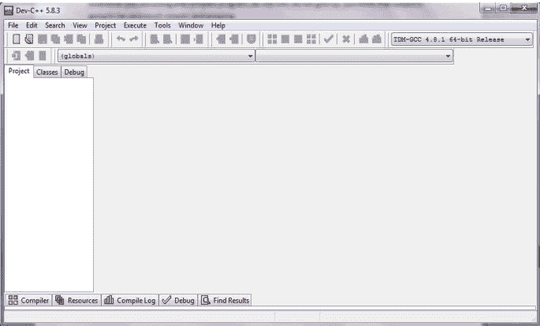

点击 File->New->Source File

或者直接按 Ctrl+N。现在，你将看到一个可以编写程序的空白区域。那么，我们开始吧，只需输入：

```
#include<iostream>
using namespace std;
int main()
{
    cout<<"Hello World";
    return 0;
}
```

现在按 F11 编译并运行程序，或者从菜单栏中找到 run、compile and run、build and run，选择其中任意一项来编译并运行程序。现在，系统会要求你保存程序

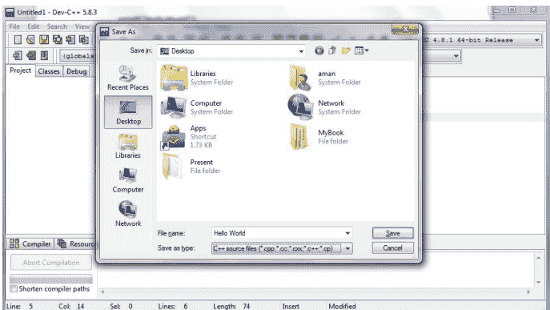

只需输入文件名并点击 Save 按钮，我建议将程序保存在桌面，以便我们可以看到幕后发生的一切。

现在，当你点击 Save 时，你将看到类似下面的内容：

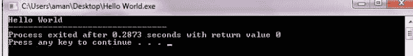

现在，让我们逐行分析程序

```
#include<iostream>
```

- 它被称为预处理器。它用于特殊目的，其中最常见的有三个：
  - 包含一个文件
  - 定义一个宏
  - 使用条件

在这里，它被用来告诉编译器，我们将使用上述三项任务中的某一项。

include – 它是一个关键字，即那些为特殊目的保留并用于它们的字。这个关键字用于在程序中包含一个文件，这不仅仅意味着头文件，它可以是文本文件，甚至是 C 程序或 C++ 程序文件，或根据需要的其他一些文件。

<...> - 这是包含文件的一种格式。但是，你可以自由使用另一种格式，即“...”，因此我们也可以写 #include “iostream” 而不是 #include<iostream>

iostream – 它是一个名为头文件的预定义源代码。它包含对象 cout（读作 C out）的定义。iostream 中包含的另一个重要函数是 cin（读作 C in），用于扫描由标准输入设备（默认为键盘）给出的输入。

注意：请记住，如果你使用的是 turbo C++，则需要写 iostream.h 而不是 iostream，同样适用于用于文件处理的 fstream。

using namespace std; - Borland C++ 支持多个命名空间，这些命名空间用于长程序。我们甚至可以定义自己的命名空间。Turbo C++ 不支持多个命名空间。因此，using namespace std; 在那里没有意义。所以，你需要在 Turbo C++ 中删除这一行。

int main() – 在这里，main() 是一个函数。括号用于向函数传递参数。在这里，int 是函数返回的变量的返回类型。如果我们尝试用它来编写求和程序，会更容易理解。假设我们想要加两个数字并返回结果。因此，我们声明一个函数 int add(int a,int b)。在这里，我们提供两个数字 a 和 b，它们将被相加并返回结果。请记住，main() 是编译器编译的第一个函数，无论它上面或下面定义了多少个函数。

{...} – 所有语句都在其中声明和定义。这些花括号可以说将其中的所有语句绑定为一个整体。其他函数也在其中被调用。我们还根据需要在各种循环和条件中使用它。

cout – 这是一个带有 ‘<<’ 的对象，用于显示字符、字符串或数字。使用 cout 不仅可以显示一个，还可以显示许多。例如：cout<<1<<“Hello”<<“z”；

return 0 – 它用于将值返回给调用包含此 return 语句的函数的函数。例如，在以下函数中，return 用于返回两个数字的和。

```
int add(int a, int b)
{
    return a+b;
}
```

### 注释

注释是编译器忽略但能使程序更易读的行。例如，考虑以下程序

```
#include<iostream>
```

```
using namespace std;
```

```
int main()
{
 //This is a comment.
}
```

C++ 程序中支持两种类型的注释：

- 单行注释：对于单行注释，使用 //。例如：

```
#include<iostream>
using namespace std;
int main()
{
 //This is a single line comment.
}
```

- 多行注释：对于多行注释，我们通常使用以下结构：
  - /* 这是一个注释 */
  例如，考虑以下程序：

```
#include<iostream>
using namespace std;
int main()
{
 /*This is a
 multiple line
 comment*/
}
```

我们也可以使用多行注释符号来进行单行注释，例如：

```
#include<iostream>
using namespace std;
int main()
{
 /*This is a single line comment designed by multiple line comment symbol*/
}
```

我们也可以重复单行注释符号来设计多行注释，例如：

```
#include<iostream>
using namespace std;
int main()
{
    //This is a
    //multiple line
    //comments designed by
    //using single line comment symbol
    //multiple times.
}
```


## 变量、常量和关键字

计算机的金科玉律是：没有存储就无法使用任何东西。这并不意味着编译器总会显示值已被存储。包括 C++ 和 Python 在内的许多编程语言并不总是显示它们正在使用的值正在被存储。常量是定义后无法修改的数据类型。相反，变量是可以反复修改的数据类型。假设我们想要操作一个初始值为 5、最终值取决于中间操作的数字，那么我们将其存储在变量中，然后根据我们的意愿操作该变量。在变量部分，我们将学习如何在变量中存储和使用数字、字符和字符串。

### 字符集

C++ 程序中可以使用以下字符集

- **字母：** A,B,...,Z,a,b,...,z，
- **数字：** 0,1,...,9
- **特殊字符：** ~!@#$%^&*()-+=[]{}|;':",<>?/_

### 关键字

这些是为特殊目的所需的特殊单词。你不得将其用作变量名，否则编译器会显示错误。这些单词将在需要的地方详细讨论。现在让我们看看程序中使用的关键字

| asm | auto | bool | break | case | catch | char | class |
| --- | --- | --- | --- | --- | --- | --- | --- |
| const | const_cast | continue | default | delete | do | double | dynamic_cast |
| else | enum | explicit | export | extern | false | float | for |
| friend | goto | if | inline | int | long | mutable | namespace |
| new | operator | private | protected | public | register | reinterpret_cast | return |
| short | signed | sizeof | static | static_cast | struct | switch | template |
| this | throw | true | try | typedef | typeid | typename | union |
| unsigned | using | virtual | void | volatile | wchar_t | while |

### 变量

变量是内存位置的别名，其中可以存储一些数据。例如：

```
int num=5;
```

在这个赋值中，值 5 被赋给变量 num，它是一个 int 类型变量。现在，一个基本问题出现了。我们可以在整数类型变量中存储任何数字吗？答案是否定的。以下是我们可以使用的数据类型的范围：

| Data type | 32 bit compiler | 64 bit compiler |
|---|---|---|
| char | 1 | 1 |
| unsigned char | 1 | 1 |
| signed char | 1 | 1 |
| short | 2 | 2 |
| unsigned short | 2 | 2 |
| signed short | 2 | 2 |
| int | 2 | 4 |
| unsigned int | 2 | 4 |
| signed int | 2 | 4 |
| long | 4 | 4 |
| unsigned long | 4 | 4 |
| signed long | 4 | 4 |
| float | 4 | 4 |
| unsigned float | 不存在 | |
| signed float | 不存在 | |
| double | 8 | 8 |
| unsigned double | 不存在 | |
| signed double | 不存在 | |
| long double | 10 | 16 |
| unsigned long double | 不存在 | |
| signed long double | 不存在 | |

| 已分配内存（字节） | 范围 |
|---|---|
| 1 | -128 到 +127<br>无符号：0 到 +255<br>有符号：-128 到 +127 |
| 2 | -32768 到 32767<br>无符号：0 到 65535<br>有符号：-32768 到 32767 |
| 4 | -2^31 到 2^31-1<br>无符号：0 到 2^32-1<br>有符号：-2^31 到 2^31-1 |
| 8 | -2^63 到 2^63-1 |
| 10 | -2^79 到 2^79-1 |
| 16 | -2^127 到 2^127-1 |

这里，float、double 和 long double 也支持小数。而 int 和 long 不支持。但令人惊讶的是，如果你写 int num=5.7；它不会显示错误，而是会直接截断小数部分并将整数部分存储在 num 中，即 5 将被存储在 num 中。

C++ 还支持一次性多个定义，即以下定义是有效的：

```
int a=5,b=3,c;
```

在这里，定义了三个变量 a、b、c。同样，以下定义也是有效的：

```
char c='r',d='e';
```

```
float f=1.6*3.22+4;
```

让我们举个例子，比如说 int num=5；在这里，num 是变量名。变量名不能以数字或下划线以外的特殊字符开头，即以下声明无效。

```
int 1num=5; int 0.5a=3; int .5b=4;
```


不过，以下名称是有效的

```
int num1=5; int _num=5; int num_a8=9;
```

### 变量约束：变量的局限性

现在，请思考一个问题：如果一个数值在变量范围内，变量能否存储小数点后任意位数的数字？让我们来看看：

```
#include<iostream>
using namespace std;
int main()
{
    float a=2.523456789;
    float b=2123456.789;
    cout<<a;
    cout<<endl<<b<<endl;
    cout<<a*b<<endl;
    cout<<2.523456789*2123456.789<<endl;
    cout<<(a*b-5358450);
}
```

输出

```
2.52346
2.12346e+006
5.35845e+006
5.35845e+006
1.5
```

好吧，如果你不习惯 e+ 符号，那么你会很高兴地知道，这是计算机中表示科学计数法的方式。例如，3e-004 表示 3*10^-4。

乘积 2.523456789*2123456.789=5358451.45。虽然它显示 5358450，但这并不意味着它存储了这个结果，正如我们最后一行输出所示，在那里我们告诉编译器用原始结果减去显示的结果，答案不为零。这个实验证明了关于编译器的一个惊人事实：编译器可以显示与其存储内容不同的内容。这个实验证实了这样一个事实：变量不能显示小数点后任意位数的数字，而是有一个限制。限制是：

变量只显示分配给它的任何数字的六位数字，不包括小数点和指数符号；如果小数点后的数字位数增加，编译器开始对数字进行四舍五入，如果小数点前的数字位数增加，编译器对前六位数字进行四舍五入并以科学计数法表示，但编译器会从分配给它的原始数字执行任何数学计算，而不对每个数字进行四舍五入，一旦获得最终结果，它在显示时会将最终数字四舍五入到六位数字，但在内存中可能不会对其进行四舍五入。

我将这条规则称为变量约束。我们在进行各种计算时必须牢记这条规则。这条规则适用于所有输入和输出操作，甚至包括计算。

### 声明与定义的区别：

现在是时候学习声明与定义之间的区别了。

#### 声明

声明是任何占用内存但未分配任何值的语句。例如，以下语句是声明：

```
int num;
char ch1,ch2,ch3;
void fact();
```

这里，函数仅被声明，未被定义。如果你尝试使用此函数，将会出现错误“undefined reference to fact()”

例如，以下程序将无法运行并给出上述错误：

```
#include<iostream>
using namespace std;
void fact();
int main()
{
    fact();
}
```

#### 定义

定义是任何已声明且为变量赋值或使函数可用的语句。例如，以下语句是定义：

```
int num=5;
char ch1='t',ch2='u';
int fact(){}
```

在这里，在上述所有语句中，要么我们为变量赋值，以便现在可以使用该变量，要么我们定义了一个函数。现在，如果我们可以调用此函数。

### 作用域解析运算符(::)

此运算符用于访问全局变量。你可能会认为，只需写出变量名就可以访问任何全局变量，那么，它有什么用呢？

请考虑以下程序：

```
#include<iostream>
using namespace std;
int a=5;
int main()
{
    int a=3;
    cout<<a;
}
```

输出

3

那么，如何访问全局变量呢？这里，我们使用 ::a 来访问全局变量。例如，请考虑以下程序：

```
#include<iostream>
using namespace std;
int a=5;
int main()
{
    int a=3;
    cout<<::a;
}
```

输出

5

请看，这里调用的是 main() 函数外部的变量。


## 格式化输入/输出

### cout <<

#### 简介

cout 用于打印所有三种数据类型：数字、字符和字符串。这是相对于 C 语言的一大优势；在 C 语言中，我们必须非常小心即将打印的数据类型。

#### 显示字符

以下是显示字符（例如 's'）的示例：

```
#include<iostream>
using namespace std;
int main()
{
    cout<<'s';
}
```

输出

s

#### 显示字符串

```
#include<iostream>
using namespace std;
int main()
{
    cout<<"This is a string";
}
```

输出

This is a string

#### 显示数字

要显示一个数字，我们直接在左移运算符 (<<) 之后放置变量名。

```
#include<iostream>
using namespace std;
int main()
{
    cout<<5;
    return 0;
}
```

输出

5

#### 显示变量中存储的值

要显示变量，我们只需将变量名放在左移符号 (<<) 旁边。例如：

```
#include<iostream>
using namespace std;
int main()
{
    int num=8;
    cout<<num;
    char ch='s';
    cout<<ch;
    char*ch1="Aman";
    cout<<ch1;
}
```

输出：

8sAman

在这里，我们显示了一个数字、一个字符和一个字符串。要存储字符串，我们有两种选择：像上面的程序一样使用指针，或者使用数组。我们将在相应章节中学习指针和数组。

#### cout 的级联特性

Cout 具有级联特性。例如，请考虑以下程序：

```
#include<iostream>
using namespace std;
int main()
{
    int num=8;
    char ch='s';
    char*ch1="Aman";
    cout<<num<<ch<<ch1;
}
```

此程序的输出与前一个程序相同。

但是看看输出，这些格式不太整齐。现在，你一定很想知道格式选项有哪些，以及如何使用它们来使输出更优雅。

以下是一些有用的输出格式选项：

#### \a 可听蜂鸣

这用于在程序中产生“蜂鸣”声。

请考虑以下程序：

```
#include<iostream>
using namespace std;
int main()
{
    cout<<"\\a\\a\\a\\a\\aHello World";
}
```

上面的程序理论上会产生五次蜂鸣，然后显示 Hello world。但令人惊讶的是，你会在听到第一声蜂鸣之前就看到那里写着 Hello world。为什么？你可能会认为，声音从计算机传到我们耳朵大约需要 0.887 毫秒，然后鼓膜振动，相应的信号被发送到我们的大脑。而从计算机传到我们的眼睛传感器，然后信号直接传到大脑，大约需要 1.0167 纳秒。因此，在显示输出时，不会出现传感器扬声器振动、声音传到耳朵、然后鼓膜振动所产生的时间滞后。所以，我们在听到第一声蜂鸣之前就看到了 Hello World。好吧，你是对的，但这背后还有另一个强有力的原因：如果我们想使用命令行执行任何任务，它比 GUI 方法快得多。这意味着我们的 GUI 计算机是命令行计算机的扩展版本，而不是反过来。如果有人认为他的计算机非常先进，拥有非常强大且多彩的 GUI，而命令行只是外部添加给习惯使用它的人，那么他需要重新思考了。好吧，科学家正忙着将命令行扩展到 GUI，但他们并没有致力于设计任何可以在 GUI 中比通过命令行更快地执行任务的计算机。因此，程序将产生蜂鸣的信号传递给操作系统，然后操作系统发出显示 Hello World 的信号，但操作系统将电信号转换为声音信号所需的时间比显示所需的时间更长。好吧，速度顺序如下：

- 命令行信号 > 显示信号 > 声音信号

#### \b 退格

假设你想在输出屏幕上删除一个字符。所以你不能在那里按退格键。因此，我们需要知道相当于退格字符的字符。答案是 \b。在这里，你将看到退格的实际情况，在程序中我们不能像删除文件那样删除。为什么？事实是删除除了不显示相应文件之外，没有任何数学意义。这就是为什么，无论你从回收站删除什么文件，都不会被永久删除，并可以从各种简单的软件（例如 Recuva）中恢复。那么，问题就出现了：如何从输出屏幕上删除一个字符？答案在于覆盖它。\b 并不覆盖字符，而是将光标向后移动一个空格，以便你可以覆盖它。请考虑以下程序：

```
#include<iostream>
using namespace std;
int main()
{
    cout<<"Hello\bc World";
}
```

输出


### Hello World

看，这里 \b 将光标移回字符 'c'，然后我们用空格覆盖 c。我们也可以用空格覆盖任何字符。

#### 请参考以下程序：

```cpp
#include<iostream>
using namespace std;
int main()
{
    cout<<"Helloc\b World";
}
```

#### 输出

Hello World

这里，我们在 \b 后留了一个空格，因此 c 被空格覆盖，我们得到了所需的输出 Hello World。

### \f 换页符

该字符在程序中很少使用，但如果涉及打印机或 Word 文件，则广泛使用。该字符向操作系统发出信号，表明当前页面已结束，是时候开始新页面了。但是，在程序输出中，它只显示用于打印机或文件的该字符所起的作用。因此，如果我们想通过程序在 Word 文件中插入新页面，我们会在那里使用 \f。由于大多数书籍只介绍文本文件和二进制文件，因此它们不会告诉你这一点。

要验证我们在这里学到的内容，在学习完文件知识后，请返回此处并运行以下程序：

```cpp
#include<iostream>
#include<fstream>
using namespace std;
int main()
{
    fstream fout;
    fout.open("A.doc", ios::out);

    if(!fout)
    {
        cout<<"Can't open";
        return -1;
    }

    fout<<"Hello World\fHello World";

    fout.close();
}
```

这里，将创建并写入一个名为 A.doc 的文件。当你打开 A.doc 时，你会看到 Hello World 写在两个不同的页面上。这证实了字符 \f 分隔了页面。


### \n 换行

该字符用于换行，即在该字符之后写的任何内容都将写在新行上。请参考以下程序：

```cpp
#include<iostream>
using namespace std;
int main()
{
    cout<<"Hello\nWorld";
}
```

#### 输出

Hello

World

这里，Hello 和 World 将显示在不同的行上。

### \r 回车

这与 \n 不同。问题在于，人们通常从未被解释过在哪里使用 \r。因此，他们在论坛上关于其用法提出了许多问题。嗯，\r 将光标移动到当前显示行的开头。例如，请参考以下程序：

```cpp
#include<iostream>
using namespace std;
int main()
{
    cout<<"Hello world\rBlack";
}
```

#### 输出：

Black world

看，这里在打印 Hello World 之后，光标移动到行首，然后由于需要写入 Black，它用 Black 覆盖了它。现在你已经理解了，\r 有点像 \b，但与 \n 完全不同。你也可以说这相当于键盘上的 Home 键。

### \t 制表符

这用于在输出屏幕上留出一个制表符空格。一个制表符空格通常等于五个空格。例如，请参考以下程序：

```cpp
#include<iostream>
using namespace std;
int main()
{
    cout<<"Hello world\tBlack";
}
```

#### 输出

Hello world   Black

这通常用于在输出屏幕上创建菜单栏。例如，请参考以下程序：

```cpp
#include<iostream>
using namespace std;
int main()
{
    cout<<"1.File\t2.Edit\t3.View\t4.Search\t5.Exit";
}
```

#### 输出

1.File   2.Edit   3.View   4.Search   5.Exit

### 反斜杠的各种用法

假设我们正在向某人演示 \b，并且我们必须显示 \b 而不是其效果。你可能会认为 `cout<<"\b";` 会显示 \b，但随后你会发现它反而会尝试将光标向后移动一步。那么，如何打印 \b 呢？解决方案是使用双反斜杠。例如，请参考以下程序：

```cpp
#include<iostream>
using namespace std;
int main()
{
    cout<<"\\b";
    cout<<"\\n";
    cout<<"\\n";
    cout<<"\\n";
    cout<<"\\"";
}
```

#### 输出

\b


"

看，要打印单个撇号、双撇号和反斜杠，我们必须在它们前面使用反斜杠。

### puts() 函数

puts() 是一个用于打印字符串输出然后换行的函数。该函数在 stdio.h 中定义。因此，如果在编译时编译器报错说 puts() 应该有原型或 puts() 未声明，那么只需在程序开头添加 `#include<stdio.h>`。所有最新的编译器也在 iostream 中包含此函数。

例如，请参考以下程序：

```cpp
#include<iostream>
using namespace std;
int main()
{
    puts("Aman");
    puts("Kumar");
}
```

#### 输出：

Aman
Kumar

这里，Aman 和 Kumar 将分别打印在不同的行上，而不是使用换行符。这是 puts() 的一个特性。

### cout.put()

此函数在屏幕上放置一个字符。与 puts() 不同，它不插入任何换行。请参考以下程序：

```cpp
#include<iostream>
using namespace std;
int main()
{
    cout.put('a');
    cout.put('k');
}
```

#### 输出：

ak

现在，请参考以下程序：

```cpp
#include<iostream>
using namespace std;
int main()
{
    cout.put('a').put('k');
}
```

#### 输出：

ak

此程序显示 .put() 可以级联多次。

### cout.write()

这用于在输出屏幕上显示特定数量的字节。例如，请参考以下程序：

```cpp
#include<iostream>
using namespace std;
int main()
{
    cout.write("Aman Kumar Jha", 7);
}
```

#### 输出：

Aman Ku

这里，只会显示传递字符串的前七个字节。

### endl

该宏产生一个换行字符，就像插入 `\n` 一样，但当与缓冲流一起使用时，它还有一个额外行为：缓冲区会被刷新。例如，请参考以下程序：

```cpp
#include<iostream>
using namespace std;
int main()
{
    cout<<"Hello"<<endl;
    cout<<"world";
}
```

#### 输出

Hello

world

看，上面一行展示了 endl 的用法。请参考以下程序：

```cpp
#include<iostream>
using namespace std;
int main()
{
    cout<<"Hello"<<endl<<"world";
}
```

此程序的输出与前一个程序相同。

### oct, dec, hex

这些是用于显示变量或常量的八进制和十六进制值的一些宏。例如，请参考以下程序：

```cpp
#include<iostream>
using namespace std;
int main()
{
    cout<<17<<endl;
    cout<<oct<<17<<endl;
    cout<<hex<<17<<endl;
    cout<<dec<<17;
}
```

#### 输出

17
21
11
17

这些宏也与函数配合使用良好。在阅读完函数章节后，请返回此处并查看以下程序：

```cpp
#include<iostream>
using namespace std;
int add(int, int);
int main()
{
    cout<<add(5, 6)<<endl;
    cout<<oct<<add(5, 6);
}

int add(int a, int b)
{
    return a + b;
}
```

#### 输出
11
13

### iomanip.h

这是一个用于输入/输出操作的头文件。我们将出于各种目的包含它。它包括各种函数、宏和类。其中一些非常有用，我们将讨论它们。

- setprecision()
- setbase()
- setw()

#### setbase()

setbase() 是 oct、dec 和 hex 三个不同宏的替代方案。

```cpp
#include<iostream>
#include<iomanip>
using namespace std;
int main()
{
    cout<<setbase(8)<<17<<endl;
    cout<<setbase(10)<<17<<endl;
    cout<<setbase(16)<<17;
}
```

#### 输出
21
17
11

不能将任何数字作为参数传递给 setbase()，因为它只会显示八进制、十进制或十六进制值，因此只能使用 8、10、16。

#### setprecision()

它用于设置精度点。假设你有一个值，例如 21.23456789，并且你想显示该数字直到五位数字；那么程序将是：

```cpp
#include<iostream>
#include<iomanip>
using namespace std;
int add(int, int);
int main()
{
    float a = 21.23456789;
    cout<<setprecision(5)<<a;
}
```

#### 输出
21.345

现在，想想如果我们尝试将精度点设置为小于 2，输出会是什么。请参考以下程序：

```cpp
#include<iostream>
#include<iomanip>
using namespace std;
int add(int, int);
int main()
{
    float a = 21.23456789;
    cout<<setprecision(1)<<a;
}
```

#### 输出
2e+001

因此，随着 setprecision() 中的值减小，它开始将数字转换为科学计数法。但是，使用它我们无法决定使用四舍五入显示小数点后的位数。在这里，使用了 setw()。

#### setw()

此函数允许我们使用四舍五入显示小数点后固定数量的数字。例如，请参考以下程序：

```cpp
#include<iostream>
#include<iomanip>
using namespace std;
int add(int, int);
int main()
{
    float a = 21.23456789;
    cout<<setw(4)<<a;
}
```

#### 输出
21.2346


请看这里，最后一位小数已被四舍五入。舍入规则很简单，如果要舍入的最后一位数字右边的数字大于 4，则最后一位数字不变，否则加 1。

### cin ( >> )

每当我们想要从键盘获取输入时，都会使用带右移运算符（>>）的 cin 类。例如，请考虑以下程序：

```
#include<iostream>
using namespace std;
int main()
{
    int a;
    cout<<"Enter a number\n";
    cin>>a;
    cout<<"The number you entered is "<<a;
}
```

### 输出

请输入一个数字

5

你输入的数字是 5

在这里，你可以看到 cin 获取输入时无需明确输入类型。

### Cascading input

Cin 也支持级联输入。因此，在以下程序中，我们尝试通过一行输入一个数字和一个字符。

```
#include<iostream>
using namespace std;
int main()
{
    int a;
    char ch;
    cout<<"Enter a number and a character\n";
    cin>>a>>ch;
    cout<<"The number you entered is "<<a<<" and the character is "<<ch;
}
```

#### 输出

请输入一个数字和一个字符
5
c
你输入的数字是 5，字符是 c

你可能会认为，这意味着它可以接受任何输入，但事实并非如此。它不像 cout 那样与数据类型无关。以下程序尝试输入一个数字、一个字符和一个字符串，看看会发生什么：

```
#include<iostream>
using namespace std;
int main()
{
 int a;
 char b;
 char c[50];
 cout<<"Enter a number\n";
 cin>>a;
 cout<<"Now enter a character\n";
 cin>>b;
 cout<<"Now enter a string\n";
 cin>>c;
 cout<<"The number you entered is "<<a<<endl;
 cout<<"The character you entered is "<<b<<endl;
 cout<<"The string you entered is "<<c<<endl;
}
```

#### 输出

```
请输入一个数字
5
现在请输入一个字符
s
现在请输入一个字符串
word is word
你输入的数字是 5
你输入的字符是 s
你输入的字符串是 word
```

这个程序说明，使用 cin 只能输入一个单词，而不能输入一个字符串。那么，如何输入字符串呢？别担心，有多种其他选择，让我们逐一了解。

### gets()

此函数用于获取字符串。该函数定义在 stdio.h 中。因此，如果在编译时编译器报错 gets() 应该有原型或 gets() 未声明，那么只需在程序开头再添加一行 #include<stdio.h>。所有最新的编译器也在 iostream 中包含了此函数。

例如，请考虑以下程序：

```
#include<iostream>
using namespace std;
int main()
{
    char ch[100];
    cout<<"Enter a string\n";
    gets(ch);
    cout<<"Entered string is "<<ch;
}
```

#### 输出

请输入一个字符串

word is word

输入的字符串是 word is word

### cin.get()

此函数用于从屏幕获取一个字符作为输入。例如，请考虑以下程序：

```
#include<iostream>
using namespace std;
int main()
{
    char ch;
    cout<<"Enter a character\n";
    cin.get(ch);
    cout<<"Entered character is "<<ch;
}
```

#### 输出

请输入一个字符

5

输入的字符是 5

### cin.getline(char*,int l,char f)

此函数用于从屏幕获取一行作为输入。

这是一个重载函数，意味着它可以使用两个参数，也可以使用三个参数。第一个参数是存储该行的 char 指针。第二个参数是要存储的字符数。第三个参数是可选的，称为分隔字符。假设你想输入字符，直到遇到某个特定字符。该特定字符可以用作分隔字符。如果使用了分隔字符，那么第二个参数和第三个参数都应负责终止输入过程。在这种情况下，第二个参数和第三个参数中哪一个先触发，就用来终止输入过程。

例如，请考虑以下程序：

```
#include<iostream>
using namespace std;
int main()
{
    char ch[50];
    cout<<"Enter a line\n";
    cin.getline(ch,50);
    cout<<"Entered line is: "<<ch;
}
```

#### 输出

请输入一行

I am Aman

输入的行是：I am Aman

请考虑以下程序：

```
#include<iostream>
using namespace std;
int main()
{
    char ch[50];
    cout<<"Enter a line\n";
    cin.getline(ch,50,'*');
    cout<<"Entered line is: "<<ch;
}
```

#### 输出

请输入一行

I am A*man

输入的行是：I am A

请看这里，* 被用作分隔字符。

请考虑以下程序：

```
#include<iostream>
using namespace std;
int main()
{
    char ch[50];
    cout<<"Enter a line\n";
    cin.getline(ch,5,'*');
    cout<<"Entered line is: "<<ch;
}
```

#### 输出

请输入一行

I am Am*am

输入的行是：I am

请看这里，在第二个参数和第三个参数中，第二个参数先触发，因为它告诉函数只存储五个字符，而 * 在第八个字符处。

### cin.read(unsigned char*,int l)

此函数用于从屏幕获取固定数量的输入；在处理大数据时非常有用，大数据甚至可能导致缓冲区溢出攻击。以下是展示 cin.read() 用法的程序：

```
#include<iostream>

using namespace std;

int main()
{
    char ch[100];
    cout<<"Enter a string\n";
    cin.read(ch,7);
    cout<<"Entered string is "<<ch;
}
```

#### 输出

请输入一个字符串
Word is word
输入的字符串是 Word is
请看这里，我们输入了 11 个字符，但只接受了 7 个字符。

### oct, dec, hex

与 cout 中一样，这些操纵符也用于输入，而且更加神奇。例如，请考虑以下程序：

```
#include<iostream>
using namespace std;
int main()
{
    int num;
    cout<<"Enter a number\n";
    cin>>hex>>num;
    cout<<"Entered number is "<<num;
}
```

#### 输出

请输入一个数字

输入的数字是 23

请看，我们作为输入给出的数字被视为十六进制，因此打印了相应的十进制值。同样，请看以下程序：

```
#include<iostream>
using namespace std;
int main()
{
    int num1,num2;
    cout<<"Enter a number\n";
    cin>>hex>>num1;
    cout<<"Enter another number\n";
    cin>>oct>>num2;
    cout<<"Entered numbers are "<<num1<<" "<<num2;
}
```

#### 输出

请输入一个数字
23
请输入另一个数字
45
输入的数字是 35 37

### setbase()

setbase() 可用于输入八进制和十六进制数字。

```
#include<iostream>
#include<iomanip>
using namespace std;

int main()
{
    int a;
    cout<<"Enter a number\n";
    cin>>setbase(8)>>a;
    cout<<a;
}
```

#### 输出

请输入一个数字
17
15

请看，就像我们与 cout 类一起使用 setbase() 函数一样，setbase() 也可以与 cin 一起使用。

## 自增与自减运算符 (++ & --)

这是一个非常重要的运算符。它有以下几种类型：

- 1. 预自增：++variable_name：该运算符先将值加一，然后开始计算
- 2. 预自减：--variable_name：该运算符先将值减一，然后开始计算
- 3. 后自增：variable_name++：该运算符先计算，然后将值加一
- 4. 后自减：variable_name--：该运算符先计算，然后将值减一

请考虑以下示例：

```
#include<iostream>
using namespace std;
int main()
{
int a=5;
cout<<a++<<endl;
cout<<a;
}
```

#### 输出

5
6

这里，首先显示变量 a 中存储的值 5，然后将其值加一，现在 a 中的值是 6。因此，当我们第二次打印 a 时，它显示 6。

请考虑以下程序：

```
#include<iostream>
using namespace std;
int main()
{
    int a=5;
    cout<<++a<<endl;
    cout<<a;
}
```

#### 输出

6
6

这里，首先将 a 中的值加一，然后打印 a 中存储的值。

现在，请考虑以下程序：

```
#include<iostream>
using namespace std;
int main()
{
int a=5;
cout<<++a<<" "<<a<<" "<<a++;
}
```

#### 输出

7 7 5

要解决此类程序，首先我们从右向左计算值。对于所有涉及 ++ 或 -- 运算符的表达式，其值即为计算所得的值。因此，在上述问题中，我们得到两个表达式的值 7 和 5。现在，为了得到 a 的值，取从右向左计算时最终存储的值，因此从右向左，首先 a 中存储的值是 5，在最右侧表达式中被后自增，现在在中间表达式中该值未改变，而在最左侧表达式中，该值通过预自增操作增加到 7。因此，a 中最终存储的值是 7。所以，第二个表达式显示的值将是 7。因此，显示了 7 7 5。

上面解释的整个逻辑对 -- 运算符也同样适用。

## 类型转换

将一种类型的变量转换为另一种类型称为类型转换。类型转换可以是自动的，也可以是手动的。请考虑以下程序

```
#include<iostream>
using namespace std;
int main()
{
int a=255;
float b=182;
char d=a-b;
cout<<d;
}
```

这个程序看起来可能不正确，但程序中没有错误。由于 d = a - b = 255 - 182 = 73，所以 ASCII 字符 73（即大写字母 I）将存储在 d 中。因此，输出将打印为 I。


类型转换也可以手动完成。要将变量（例如 num）转换为整数，可以写 int(num)；

因此，上述程序也可以写成：

```
#include<iostream>
using namespace std;
int main()
{
    int a=255;
    float b=182;
    cout<<char(a-b);
}
```

两者输出结果相同。这称为手动类型转换。但是，请记住，你不能写

```
#include<iostream>
using namespace std;
int main()
{
    int a=255;
    float b=182;
    cout<<(char)a-b;
}
```

输出

-183

嗯，(char)a 也会将变量转换为字符，但 (char)a-b; 不会将变量 a-b 转换为字符，而是将变量 a 转换为字符，然后再减去 b。因此，为了消除混淆，最好使用 char(a) 这样的表达式，而不是 (char)a。

要将变量（例如 num）转换为浮点数，只需使用 float(num)；以此类推。

## 常量

嗯，只需在变量声明前添加 const 关键字，即可将变量转换为常量。常量是指其值在程序中不可被修改的量。例如 const int num=5；例如，考虑以下程序：

```
#include<iostream>
using namespace std;
int main()
{
    const int num=5;
    const char ch='c';
    cout<<num<<" "<<ch;
}
```

输出：

5 c

现在，如果我们想在程序中的其他地方再次为 num 赋值，编译器会显示错误“Assignment of read-only variable”。

例如，考虑以下程序：

```
#include<iostream>
using namespace std;
int main()
{
    const int num=5;
    const char ch='c';
    cout<<num<<" "<<ch;
    num=7;
}
```

该程序将显示上述错误。一旦在变量声明中添加 const 关键字，变量就变为常量和只读类型，因此会出现上述错误。

## 简写表示法

很多时候，我们会对变量进行操作，并将结果存回同一个变量。例如，考虑以下程序：

```
#include<iostream>
using namespace std;
int main()
{
    int a=5;
    int b=7;
    a=a+b;
    cout<<a;
}
```

输出

12

这类程序也可以使用各种简写表示法来编写。C++ 支持许多简写表达式，例如：

- a=a+b; 等价于 a+=b；
- a=a-b; 等价于 a-=b；
- a=a*b; 等价于 a*=b；
- a=a/b; 等价于 a/=b；

例如，考虑以下程序：

```
#include<iostream>
using namespace std;
int main()
{
    int a=5;
    int b=7;
    a+=b;
    cout<<a<<endl;
}
```

输出
12

现在，考虑以下精彩的程序：

```
#include<iostream>
using namespace std;
int main()
{
    int a=5;
    int b=7;
    a+=b;
    cout<<a<<endl;
    a-=b;
    cout<<a<<endl;
    a*=b;
    cout<<a<<endl;
    a/=b;
    cout<<a<<endl;
}
```

输出
12
5
35
5

太神奇了，不是吗？最初 a=5 且 b=7，所以 a+b=12，现在 a=12 且 b=7，所以 a-b=5，现在 a=5 且 b=7，所以 a*b=35，然后 a=35 且 b=7，所以 a/b 等于 5。

## 决策控制

### if...else

可以使用 if...else 来控制决策。考虑以下代码：

```
#include<iostream>
using namespace std;
int main()
{
    int num=53;
    if(num%5==0)
        cout<<"The number is divisible by 5";
    else
        cout<<"The number is not divisible by 5";
    return 0;
}
```

这里，% 是取模运算符，用于获取余数。例如，在声明 int b=a%5; 中，a 除以 5，余数存储在 b 中。因此，在上述程序中，num 除以 5，余数与 0 进行比较。如果余数等于零，则程序显示该数能被 5 整除，否则显示相反的情况。

还要注意，我们用了两个等号（==）而不是一个等号（=）来进行比较，因为我们已经使用单个等号来给变量赋值，例如 int num=5;。

对于不等于的比较，我们用（!=）。例如，考虑以下代码：

```
#include<iostream>
using namespace std;
int main()
{
    int i=5;
    if(i!=7)
        cout<<"i is not 7";
    else
        cout<<"i is 7";
}
```

输出

i is not 7

如果要在 if...else 中使用多条语句，则必须使用 {...}，否则编译器只会将 if...else 后面紧跟的一条语句视为 if 和 else 下的语句。例如，考虑以下代码

```
#include<iostream>
using namespace std;
int main()
{
    int num=53;
    if(num%5==0)
        cout<<"The number is divisible by 5";
        cout<<"The number is also divisible by 1";
    else
        cout<<"The number is not divisible by 5";
}
```

该程序会产生编译错误，“else without a previous if”。因此，正确的写法是

```
#include<iostream>
using namespace std;
int main()
{
    int num=53;
    if(num%5==0)
    {
        cout<<"The number is divisible by 5";
        cout<<"The number is also divisible by 1";
    }
    else
        cout<<"The number is not divisible by 5";
}
```

输出

该数不能被 5 整除

我们在 else 分支中只使用了一条语句，因此没有使用花括号，否则也必须在那里使用花括号。

### 嵌套 if...else

在另一个 if...else 分支下使用的 if...else 分支称为嵌套 if...else。例如：

```
#include<iostream>
using namespace std;
int main()
{
    int num=50;
    if(num%5==0)
    {
        cout<<"The number is divisible by 5";
        if(num%10==0)
            cout<<"\nThe number is also divisible by 10";
    }
    else
        cout<<"The number is not divisible by 5";
}
```

该程序将显示

该数能被 5 整除

该数能被 10 整除

### else if 链

除了上述格式外，还可以使用 if...else 链，如下面的程序所示

```
#include<iostream>
using namespace std;
int main()
{
    cout<<"Enter a number\n";
    int num1;
    cin>>num1;
    cout<<"Enter another number\n";
    int num2;
    cin>>num2;
    if(num1<5)
    cout<<"First number is less than 5";
    else if (num2>5)
    cout<<"Second number is greater than 5";
    else
    cout<<"Both cases are false";
}
```

输出

输入一个数字

5

输入另一个数字

7

第二个数字大于 5

我们也可以多次使用 else if。例如，考虑以下程序：

```
#include<iostream>
using namespace std;
int main()
{
    cout<<"Enter a number\n";
    int num1;
    cin>>num1;
    cout<<"Enter another number\n";
    int num2;
    cin>>num2;
    if(num1<5)
        cout<<"First number is less than 5";
    else if (num2>5)
        cout<<"Second number is greater than 5";
    else if(num1%5==0)
        cout<<"First number is divisible by 5";
    else if(num2%10==0)
        cout<<"Second number is divisible by 10";
    else
        cout<<"Both cases are false";
}
```

输出

输入一个数字

5

输入另一个数字

3

第二个数字大于 5

### 逻辑运算符

程序中可以使用各种逻辑运算符

&& 是 AND 运算符，用于比较多个语句，如果所有语句都为真，则整个表达式被视为真，并执行相应分支中的语句。

考虑以下程序

```
#include<iostream>
using namespace std;
int main()
{
    int num=5,num2=7;
    if(num==5&&num2-1==6)
        cout<<"4 is just before "<<num;
    else
        cout<<"Either the num is not 5 or num2-1 is not equal to 6";
}
```

这里输出将是“4 is just before 5”。因为两个语句都为真。

|| 是 OR 运算符，用于比较两个语句，如果所有语句中有任意一个为真，则整个表达式被视为真，并执行相应分支中的语句。

例如，考虑以下程序：

```
#include<iostream>
using namespace std;
int main()
{
    int num=5,num2=7;
    if(num==5 || num2-2==6)
        cout<<"4 is just before "<<num;
    else
        cout<<"Either the num is not 5 or num2-1 is not equal to 6";
}
```

这次只有一个语句正确，但输出仍然是 4 is just before 5。

! 是 NOT 运算符，用于反转值。它可以用以下方式使用

```
#include<iostream>
using namespace std;
int main()
{
    int a=5;
    if(!(a<5))
        cout<<"a is not less than 5";
    else
        cout<<"a is less than 5";
}
```

程序输出将是“a is not less than 5”。因为 5<5 为假，所以 !(a<5) 为真。

此外，C++ 还支持 ==、!=、<=、>=

考虑以下程序

```
#include<iostream>
using namespace std;
int main()
{
    int num=5;
    if(num=4)
        cout<<"It is strange, isn't it?";
```


else
cout<<"It should be obvious";
}

在这个程序中，输出将是 "It is strange, isn't it?"。这是因为每当 C++ 成功地将值赋给变量时，由于这是一次成功，所以默认为 true，因此 if() 语句内的条件为 true，所以在使用 (==) 和 (=) 时必须小心。

### Switch 语句

顾名思义，switch 语句用于在各种 case 之间切换。请参考以下程序

```
#include<iostream>
using namespace std;
int main()
{
    int num=5;
    switch (num)
    {
        case 1: cout<<"1";
        case 5: cout<<"5";
        case 6: cout<<"6";
        case 7: cout<<"7";
            break;
        case 8: cout<<"8";
        default:
            cout<<"None of the cases matches";
    }
}
```

在上述程序中，switch 语句将变量 num 与每个 case 进行比较，由于 num 与 5 匹配，因此将执行相应 case 中的语句；此外，没有任何东西能阻止它继续执行后续 case，直到遇到 break 语句或退出。所以，输出将是 567

**默认** 也是一个关键字，当没有任何 case 匹配时，相应的语句会自动执行。引入 **默认** 关键字是可选的。


## 循环

循环是一种反复执行任务的方法，不一定是有限次数。
在 C 中使用以下循环

- 1. for 循环
- 2. while 循环
- 3. do...while 循环

除了这三种之外，跳转语句 goto 也在 C 中用作循环。

### for 循环

这是最流行的循环。请参考以下程序：

```
#include<iostream>
using namespace std;
int main()
{
    int i=5;
    for(i=7;i<10;i++)
    cout<<i;
}
```

上述程序将打印 789，这意味着 for 循环中的第一条语句是初始化，
第二条语句是条件。for 循环下的语句块将
一直执行，直到该条件为 true。一旦该条件变为 false，控制权
就会退出循环。第三条语句在 for 循环内每条语句执行后执行。
关于第三条语句的一个惊人事实是，每次它
都在第二条语句之前执行。否则，结果本应是 78910

请参考以下程序

```
#include<iostream>
using namespace std;
int main()
{
    int i=5;
    for(i=11;i<10;i++)
    cout<<i;
}
```

该程序将不打印任何内容，因为第一条语句总是首先执行，然后在进入循环内的语句之前，会检查条件。所以，条件为 false，因此不会打印任何内容。

其他有效的 for 循环格式包括

```
for(i=0,j=5;i<5&&j>3;i++,j=j-5)
{
/*Statements*/
}
```

请仔细观察，我们不能在第二条语句中使用多于一条语句，如果想要这样做，则必须用逻辑运算符将它们连接起来。

请参考以下程序：

```
#include<iostream>
using namespace std;
int main()
{
     int i=5;
     for(i=1;i<10&&i=11;i++)
     cout<<i;
}
```

在这里，我们使用了逻辑运算符，但编译器会将其读作 (i<10&&i)=11，这是一个错误的表达式。因此，它会生成一个错误："value required as left operand of assignment"

现在请参考以下程序

```
#include<iostream>
using namespace std;
int main()
{
     int i=5;
     for(i=5;i<10&&(i=11);i++)
     cout<<i;
}
```

猜猜它的输出。嗯，它的输出将是 11，令人惊叹，不是吗？我已经说过，它会先执行 for 循环内的第一个赋值，即 i=5。现在，它会检查条件，即 i<10&&(i=11)，在这两个条件不可能同时为真，所以它必须是 false。你错了；这是现代计算机能力的一个演示。我们的计算机是多任务的，这并不意味着它们在程序中同时执行多个任务；相反，它们在任务之间跳转得太快，以至于我们无法察觉。但后果体现在结果上。这里，首先 i 与 10 进行比较，语句 i<10 变为 true，因为 i 最初是 5。现在，11 被赋值给 i，这是一个真语句，因为它是一个赋值。因此，两个语句都为真。所以，for 循环后面的语句 cout<<i; 被执行。但是，现在由于 i 中的值是 11，所以显示 11。现在，i 的值增加，其值变为 12，现在语句 i=11 被执行，然后 i<10 变为 false。所以，程序退出。

这将从以下程序中变得更加清晰和有趣：

```
#include<iostream>
using namespace std;
int main()
{
    int i=5;
    for(i=1;i<10&&(i=3);i++)
    cout<<i;
}
```

猜猜它的输出，嗯，它的输出将是：

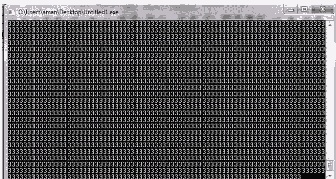

即一个无限循环。所以，现在你已经理解了，最初先执行第一个赋值，在条件语句中，首先执行第一个语句，然后执行第二个语句，然后比较两个语句的结果。如果最终结果为 true，则执行 for 循环内的语句块。然后执行 for 循环的第三条语句 i++。然后，程序掉头，不执行条件的第一个语句，而是执行条件的第二个语句 i=3，现在执行条件的第一个语句 i<10，这显然是 true。所以，现在再次执行 for 循环内的语句块 cout<<i;，这个过程开始重复，而不是使用 i=1; i<10 和 i++ 和 && 运算符，循环无限运行。

### while 循环

当我们想要在执行循环中的第一条语句之前测试条件时，使用 while 循环。

请参考以下程序

```
#include<iostream>
using namespace std;
int main()
{
    int i=1;
    while(i<5)
    {
    cout<<i;
    i++;
    }
}
```

该程序的输出将是 1234

### do...while 循环

此循环的突出之处在于，在测试第一个 case 之前以及在每次下一次执行之前测试条件，都会先执行第一条语句。请参考以下程序。

```
#include<iostream>
using namespace std;
int main()
{
int i=1;
do
{
cout<<i;
i++;
}while(i>5);
}
```

其输出将是 1。还要注意，do...while 循环后面必须紧跟一个分号，否则会显示编译错误“Expected ‘;’ before ‘}’ token”

### goto 关键字

goto 是一个关键字，用于从程序的一部分突然跳转到另一部分。请参考以下程序：

```
#include<iostream>
using namespace std;
int main()
{
int i=5;
start:
cout<<i;
i++;
goto start;
}
```

在这个程序中，start 是一个标签，我们希望光标跳转到那里。标签名称后需要一个冒号。每当我们想要跳转到任何标签时，只需使用语法 goto label_name; 所以，这个程序会无限次地跳转到 start，这是一个无限过程。所以，你将看到如下输出

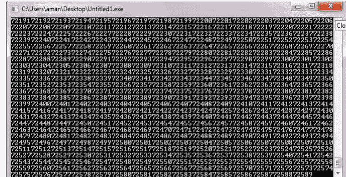

请记住，goto 不是循环，它只是一个跳转器。所以，我们不能在 start...goto start; 内部使用 break 和 continue。

### Break 和 Continue

这两个关键字用于有效地控制循环。Break 用于跳出最内层循环，而 continue 用于跳转到循环顶部。

请参考以下程序

```
#include<iostream>
using namespace std;
int main()
{
int i,j;
for(i=1;i<3;i++)
{
for(j=6;j<9;j++)
{
cout<<"j";
if(j==7)
break;
}
cout<<"i";
}
return 0;
}
```

上述程序的输出将是 jijii。因为首先 i 初始化为 1，j 初始化为 6。现在，j 将被打印。现在 j 的值增加到 7，再次打印 j。但现在 j 是 7，所以 break 语句将被执行，控制权跳出最内层 for 循环，并执行 cout<<"i";。现在 i 的值将被递增。然后，内层 for 循环再次执行。这个过程将持续到语句 i<3 变为 false。

请参考以下程序

```
#include<iostream>
using namespace std;
int main()
{
int i;
for(i=1;i<3;i++)
{
cout<<i;
continue;
cout<<"i";
}


}
return 0;
}
```

输出

12

continue 语句将控制权放在 for 循环的自增语句处，即 for 循环的第三条语句。因此，i 永远不会被显示，始终显示存储在 i 中的值。

请参考以下程序

```cpp
#include<iostream>
using namespace std;
int main()
{
    int i=1;
    do
    {
    cout<<i;
    continue;
    i++;
    }while(i<5);
}
```

上述代码的输出将是：

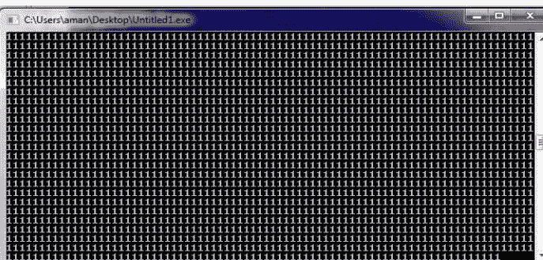

即无限次输出 1。因为，就在 cout<<i 之后存在一个 continue 语句，它将控制权放到循环内的第一条语句，即 cout<<i；因此，程序永远不会到达 while 语句，也永远不会终止。

那么下面这段代码呢：

```cpp
#include<iostream>
using namespace std;
int main()
{
    int i=1;
    while(i<5)
    {
    i=10;
    cout<<i;
    continue;
    i++;
    }
}
```
输出
10

这个程序的解答将消除你的疑虑：在 continue 语句之后，控制权是转到 while(i<5) 还是转到 i=10。这意味着 continue; 语句将控制权放在条件处，而不是 while 循环内的第一条语句处。

请参考以下程序

```cpp
#include<iostream>
using namespace std;
int main()
{
    int num=5;
    switch (num)
    {
        case 1: cout<<"1";
        case 5: cout<<"5";
            continue;
        case 6: cout<<"6";
    }
}
```

在这个程序中，你将看到编译错误“continue without a loop”。这是因为 continue 只能在循环中使用。而 break 只能在循环和 switch case 中使用。请参考以下源代码

```cpp
#include<iostream>
using namespace std;
int main()
{
    int num=5;
    break;
    cout<<"Now I am executed";
}
```

这个程序将生成错误“Break statement not within loop or switch”

## 函数

函数是用于执行特定任务的一组语句块。一个值得注意的事实是：“除了 main() 函数外，执行任务根本不需要任何函数”。main() 函数之所以需要，是因为程序执行会查找此函数，如果未定义则会显示编译错误。

尽管如此，我们出于以下原因使用各种函数：

- 1. 通过将任务分为各个部分，使我们的任务更简单。
- 2. 程序易于阅读和理解。
- 3. 更容易纠正错误
- 4. 一个函数中的错误不会影响其他函数。
- 5. 它与给定输入的数值无关

函数有两种类型：

- 1. 库函数：这些在头文件中预定义。
- 2. 用户定义函数：这些是由程序员定义的函数。

函数定义的语法是：

```cpp
return_type func_name(data_type1 arg1,data_type2 arg2,....)
{

/*Statements*/

}
```

其中 arg1、arg2 等称为参数。这些是传递给函数以供进一步处理的参数。

我们到目前为止使用过的一个函数是：

```cpp
int add(int a,int b)
{
return a+b;
}
```

请参考以下程序：

```cpp
#include<iostream>
using namespace std;
int add(int a,int b)
{
    return a+b;
}
int main()
{
    int x=5,y=6;
    cout<<add(x,y);
}
```

输出

11

在这里，我们使用了一个函数 add(int,int)；请看，我们在 main() 函数上方定义了一个函数。很多时候，需要在 main 函数下方定义函数，因此首先我们声明函数，相应的表达式称为函数原型。

函数原型可以以两种方式声明：

第一种方法是：

```cpp
return_type function_name(data_type1,data_type2,...);
```

另一种是：

```cpp
return_type function_name(data_type1 arg1,data_type2 arg2,...);
```

例如，我们使用过的上面的程序也可以以以下方式编写：

```cpp
#include<iostream>
int add(int,int); //This is a function prototype
using namespace std;
int main()
{
    int x=5,y=6;
    cout<<add(x,y);
}
int add(int a,int b)
{
    return a+b;
}
```

输出
11

我们还可以将函数返回的值保存在变量中。
例如，请参考以下程序：

```cpp
#include<iostream>
int power(int,int);
using namespace std;
int main()
{
    int x=5,y=6;
    int c=power(x,y);
    cout<<c;
}
int power(int a,int b)
{
    int temp=1;
    for(int i=0;i<b;i++)
        temp*=a;
    return temp;
}
```

输出
15625

这个程序简单地计算 5 的 6 次幂的值。

### void

很多时候我们不想返回任何东西，在这种情况下我们使用 void 作为返回类型。例如，请参考以下程序：

```cpp
#include<iostream>
using namespace std;
void show_prime_status(int);
int main()
{
    int a;
    cout<<"Enter a number\n";
    cin>>a;
    show_prime_status(a);
}
void show_prime_status(int x)
{
    int i;
    for(i=2;i<x;i++)
    if(x%i==0)
    break;
    if(i==x)
    cout<<x<<" is prime";
    else
    cout<<x<<" is not prime";
}
```

输出

请输入一个数字

12 不是质数

这里，由于我们没有要返回的内容，所以使用了 void 作为返回类型。

请参考以下程序：

```cpp
#include<iostream>
using namespace std;
void welcome();
void bye(void);
int main()
{
    welcome();
    bye();
}
void welcome()
{
    cout<<"Welcome\n";
}
void bye()
{
    cout<<"Bye";
}
```

输出：

欢迎

再见

### 递归

递归是一种调用函数的方法，其中函数从自身内部调用自身。它使程序优雅、吸引人且简洁。但是，它在一定程度上会使程序变慢，因为 C++ 在调用函数时维护一个栈。

请参考以下程序：

```cpp
#include<iostream>
using namespace std;
int factorial(int);
int main()
{
    int a=5;
    cout<<factorial(a);
}
int factorial(int x)
{
    if(x==1 || x==0)
        return 1;
    else
        return x*factorial(x-1);
}
```

输出将是 120。这里，请看在 factorial 函数的定义内部，我们又调用了 (x-1) 的阶乘。该程序将按以下序列执行：

- 5*(5-1)
- 5*((5-1)*(5-2))
- 5*((5-1)*((5-2)*(5-3)))
- 5*((5-1)*((5-2)*((5-3)*(5-4))))
- 5*((5-1)*((5-2)*((5-3)*1)))
- =120

### 变量再探

最初，我们谈论过变量，但没有谈论基于可访问性的变量类型。嗯，基于可访问性，变量分为四种类型：

- 1. 自动存储类
- 2. 静态存储类
- 3. 寄存器存储类
- 4. 外部存储类

Auto – 它是函数内部所有变量的默认数据类型，因此我们在任何地方都没有写 auto。

e.g. auto int a=5;

默认初始值 – 一个不可预测的值，通常称为垃圾值。
生命周期 – 直到控制权停留在定义变量的块中。
作用域 – 局限于定义变量的块。
存储 – 内存。

Static – 静态变量的特性在于它记住最后存储的值。

请参考以下程序

```cpp
#include<iostream>
using namespace std;
void change();
int main()
{
    change();
    change();
}
void change()
{
    static int a=0;
    a++;
    cout<<a;
}
```

这个程序将显示 12。这表明最初 a 的值从 0 增加到 1。现在，当函数第二次被调用时，其值从 1 增加到 2。

Register – 寄存器是一种变量类型，它向编译器请求将变量存储在 CPU 寄存器中（如果可能）；否则它被声明为 auto。寄存器提供对变量的更快读写访问。

在 C++ 中将变量声明为 register，只需在声明前添加 register 关键字。

E.g.

```cpp
register int a=5;
```

- 默认初始值 . 垃圾值。
- 生命周期 . 直到控制权停留在定义变量的块中。
- 作用域 . 局限于定义变量的块。
- 存储 . CPU 寄存器。

Extern – 该变量定义在 main() 和所有其他函数之外。它的值可以被任何函数修改。

请参考以下程序

```cpp
#include<iostream>
using namespace std;
int a=5;
int display1();
int main()
{
    cout<<a;
    display1();
    cout<<a;
}
int display1()
{
    a=6;
}
```

其输出将是 56，因为最初它被赋值为 5，然后调用 display1() 函数，该函数修改其值并将其赋为 6。现在，在函数调用后，控制权返回到 main 函数。现在，在那里显示值时，它显示 6。这里，a 被称为全局变量，可被程序内的所有函数访问。

请参考以下程序：

```cpp
#include<iostream>
```


using namespace std;
int main()
{
    cout<<x;
}
int x=5;

这个程序会生成一个错误 "x was not declared in this scope"

现在，让我们稍微修改一下代码，如下所示：

#include<iostream>
using namespace std;
int main()
{
    extern int x;
    cout<<x;
}
int x=5;

现在，这个程序将成功执行，输出结果为 5。

### 默认参数

函数可以有默认参数。如果未为它们传递参数，则这些参数会自动使用。默认参数在函数声明中声明。例如，请考虑以下程序：

#include<iostream>
using namespace std;
int add(int x=1,int y=2);
int main()
{
    cout<<add()<<endl;
    cout<<add(5)<<endl;
    cout<<add(5,6);
}
int add(int x,int y)
{
 return x+y;
}

输出
3
7
11

请看这里，在第一次调用函数时，由于我们没有传递任何值，因此自动使用了函数声明中的 1 和 2。在第二次调用时，我们传递了一个值，因此该值被视为第一个参数，于是 5 和 2 相加得到 7。然后在第三次调用时，我们将两个参数都传递给了函数，因此返回了结果 11。

请注意，函数声明中包含默认参数，而不是函数定义。

### 函数重载

C++ 有能力根据传递给它们的参数类型来区分不同的函数。这使我们能够使用同名的多个函数。

请考虑以下程序：

#include<iostream>
using namespace std;
void disp();
void disp(int);
void disp(char);
void disp(int,char);
int main()
{
    int i=5;
    char ch='c';
    disp(i,ch);
    disp(i);
    disp();
    disp(ch);
}
void disp()
{
    cout<<"In 1"<<endl;
}
void disp(int x)
{
    cout<<"In 2"<<endl;
}
void disp(char c)
{
    cout<<"In 3"<<endl;
}
void disp(int x,char c)
{
    cout<<"In 4"<<endl;
}

输出
In 4
In 2
In 1
In 3

看，编译器是多么高效地自动决定使用哪个函数。它只是将参数类型与要调用的函数进行匹配。这称为函数重载。

### 内联函数

在调用函数时，控制权会跳转到函数，执行其中的语句，然后返回到 main() 函数。再次调用函数时，同样的过程会重复。此过程有两个缺点：

- 1. 相比于没有函数的程序，它稍微更耗时
- 2. 它打断了连续性

为了解决这些问题，我们使用一种称为内联函数的安排。如果我们将函数声明为内联，那么我们实际上是在建议编译器将函数中编写的语句复制到调用函数本身，而不是调用函数。函数不一定会被内联，但大多数非常小的函数在声明为内联时都会被内联。

内联函数的语法：

inline return_type func_name(data_type1 arg1,data_type2 arg2,...)
{
/*Statements*/
}

以下程序说明了如何使用内联函数：

#include<iostream>
using namespace std;
inline int add(int a,int b);
int main()
{
for(int i=0;i<1000;i++)
cout<<add(5,6);
return 0;
}
inline int add(int a,int b)
{
    return a+b;
}


## 指针

本部分包含两个特殊符号 & 和 *

& - 它称为变量的地址。

请考虑以下程序：

#include<iostream>
using namespace std;
int main()
{
    int a=5;
    cout<<&a;
    return 0;
}

在这里，它将显示存储变量的内存地址。输出取决于编译器，在我的编译器中它显示了 0x22fe4c。在你的编译器中，可能会不同。

* 星号，也称为地址处的值，用于访问存储在变量地址处的值。

指针可以声明为

int *a;

请考虑以下程序：

#include<iostream>
using namespace std;
int main()
{
    int *a;
    cout<<*a;
    return 0;
}

在这个程序中，我们没有给 a 分配任何地址，但我们正在尝试访问该地址处存储的值。这会简单地导致程序崩溃，输出如下：

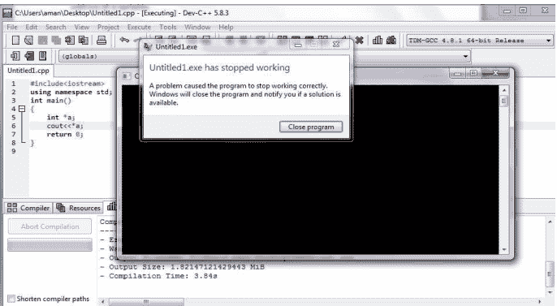

请考虑以下程序

#include<iostream>
using namespace std;
int main()
{
    int b=5;
    int *a=&b;
    cout<<*a;
    return 0;
}

这个程序将把 b 的地址赋给 a，而不是看起来那样赋给 *a。因此，输出将显示为 5

为了消除混淆，int *a = &b; 也可以写成：

int *a;
a=&b;

现在，如果你像下面的程序那样更改 a 处存储的值，那么地址处的值将被更改。

#include<iostream>
using namespace std;
int main()
{
    int b=5;
    int *a=&b;
    cout<<*a;
    *a=7;
    cout<<endl<<b;
    cout<<endl<<*a;
}

输出：
5
7
7

这个程序说明了这样一个事实：无论我们通过指针进行什么更改，更改都会发生在内存地址处。

请考虑以下程序：

#include<iostream>
using namespace std;
int display1(int *x);
int main()
{
    int a=5;
    cout<<a;
    display1(&a);
    cout<<a;
}
int display1(int *x)
{
*x = 6;
}

上面程序的输出将是 56。因为我们使用取地址运算符将地址传递给了函数 display1()。在那里，我们使用了指针，以便它可以接收地址。然后使用解引用运算符，我们将 a 地址处的值更改为 6。当我们在 main() 函数中打印相同的值时，我们可以看到 main() 函数中的值也已更改。

### 按值调用和按引用调用

函数可以以两种方式调用

- 1. 按值调用
- 2. 按引用调用

按引用调用又可以细分为两部分

- i. 使用指针调用
- ii. 不使用指针调用

#### 按值调用

当我们按值调用函数时，会创建传递给函数的局部变量的副本并将其传递给函数。因此，函数执行后，局部变量的原始值不会改变。

例如，请考虑以下程序

#include<iostream>
using namespace std;
int display1(int);
int main()
{
    int a=5;
    display1(a);
    cout<<a;
}
int display1(int a)
{
a = 6;
}

在这个程序中，输出将是 5，尽管我们在 display1() 函数中将 a 的值更改为了 6。这称为按值调用函数。在这里，a 值的一个副本被传递给 display1() 函数。因此，main() 函数中的值保持不变，因为原始地址处存储的值没有被更改，而是 display1() 函数中的值的副本被更改了，并且此更改将持续存在，直到函数 display1() 将控制权返回给 main()。

如果上述说法正确，那么如果我们尝试在以下程序中访问 num 的内存位置，它应该给出两个不同的值，这可以轻松查看。

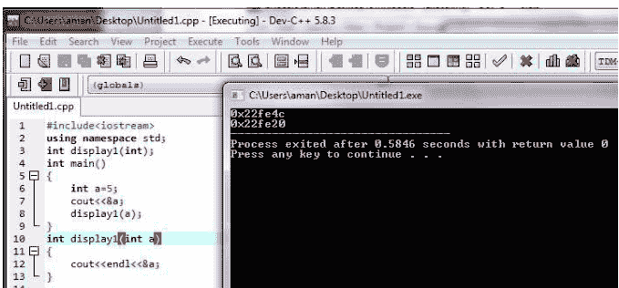

#### 使用指针的按引用调用

当我们通过使用指针或使用地址按引用调用函数时，变量的地址会被传递给函数。因此，无论我们在函数中做什么更改，相同的更改都会发生在局部变量的原始内存位置。

请考虑以下程序：

#include<iostream>
using namespace std;
int display1(int*);
int main()
{
    int a=5;
    cout<<a;
    display1(&a);
    cout<<a;
}
int display1(int *x)
{
*x = 6;
}

上面程序的输出将是 56。因为我们使用取地址运算符将地址传递给了函数 display1()。因此，这称为按引用调用函数。

#### 不使用指针的按引用调用

我们也可以不使用地址来按引用调用函数。

例如，请考虑以下程序：

#include<iostream>
using namespace std;
int display1(int &);
int main()
{
int a=5;
cout<<a;
display1(a);
cout<<a;
}
int display1(int &x)
{
x=6;
}

输出


这里，函数 display() 获取的是局部变量的地址而非其值。因此，值的更改是永久的。

### 返回指针

指针也可用作返回类型。

请考虑以下程序：

```cpp
#include<iostream>
using namespace std;
int*change();
int main()
{
    int*b;
    b=change();
    cout<<*b;
}
int*change()
{
    int a=5;
    return(&a);
}
```

该程序将显示 5。

### 指针运算

指针遵循加法和减法，即地址可以增加、减少、相加甚至相减。

请考虑以下程序：

```cpp
#include<iostream>
using namespace std;
int main()
{
int a=7,*b=&a;
cout<<b;
b++;
cout<<endl<<b;
}
```

输出（您的可能不同）

0x22fe44

0x22fe48

请注意，我们将 b 增加了 1，因此，这将增加相应数据类型（即 int）的一个内存块。因此，在 64 位编译器中将观察到 4 字节的增加，而在 32 位编译器中将观察到 2 字节的增加。

两个指针之间不能直接进行乘法或除法运算。


## 数组

数组是存储在相同数据类型的连续内存位置中的变量序列。它是存储大量变量的一种方法。假设我们要处理 500 个数字，那么声明或定义 500 个不同的变量是不可行的。因此，我们可以定义一个数组，例如 int num[500]；这里，num 的索引范围是 0 到 499。因此，我们现在可以使用 num[0] 到 num[499]。

### 数组声明与初始化

数组可以按以下方式声明和初始化：

```cpp
int a[2]={45,43};
int a[2]={43};
int a[]={34,54,65};
int a[]={43};
int a[23];
```

未初始化的数组包含垃圾值。

例如，假设我们想计算以下程序中 10 个数字的和

```cpp
#include<iostream>
using namespace std;
int main()
{
    int num[10]={5,7,8,3,2,1,2,4,3,15};
    int sum=0,i;
    for(i=0;i<10;i++)
    sum+=num[i];
    cout<<sum;
}
```

输出

50

这里，您可以看到为 num[i] 赋值的方法。要为某个数字（例如 num[3]）赋值，可以直接使用 num[3]=5；在上述程序中，我使用了线性赋值，即 5 赋给 num[0]，7 赋给 num[1]，……，15 赋给 num[9]。

### 边界检查

假设您声明了一个数组 int a[32]；然后您可以使用语句 a[95]=0；因为 C++ 不会检查边界。但是，不应这样做，因为这可能会导致程序崩溃。

例如，请考虑以下程序：

```cpp
#include<iostream>
using namespace std;
int main()
{
    int a[32];
    a[90]=0;
}
```

由于没有边界检查，该程序不会显示任何错误。因此，使用数组时要注意边界。但是，如果在初始化时越界，编译器会检测到它并报错。

例如，请考虑以下程序：

```cpp
#include<iostream>
using namespace std;
int main()
{
    int a[3]={1,2,4,5};
}
```

该程序将报错 "Too many initializers for int[3]"

### 将数组元素传递给函数

数组以与普通变量相同的方式传递给函数。

例如，请考虑以下程序：

```cpp
#include<iostream>
using namespace std;
void disp1(int);
int main()
{
    int a[32],i;
    for(i=0;i<32;i++)
    {
        a[i]=i;
        disp1(a[i]);
    }
}
void disp1(int x)
{
    cout<<x<<endl;
}
```

这将在不同行上打印 0 到 31。

### 将整个数组传递给函数

整个数组也可以传递给函数。

方法 1：请考虑以下代码：

```cpp
#include<iostream>
using namespace std;
void disp(int*,int);
int main()
{
    int num[5]={3,2,0,1,4};
    disp(num,5);
}
void disp(int*x,int y)
{
    int i;
    for(i=0;i<y;i++,x++)
    cout<<*x;
}
```

这里，您可以看到我们只将 num 传递给了函数。在数组中，变量名实际上是其基地址。因此，num 等价于 &num[0]。然后使用指针运算，我们在 for 循环的第 3 条语句中增加了 x 的地址（x 实际上就是 num）。因此，输出将是 32014

方法 2：上述程序也可以写成：

```cpp
#include<iostream>
using namespace std;
void disp(int*,int);
int main()
{
    int num[5]={3,2,0,1,4};
    disp(num,5);
}
void disp(int*x,int y)
{
    int i;
    for(i=0;i<y;i++)
    cout<<*(x+i);
}
```

方法 3：请考虑以下程序：

```cpp
#include<iostream>
using namespace std;
void disp(int&,int);
int main()
{
    int num[5]={3,2,0,1,4};
    disp(num[0],5);
}
void disp(int&x,int y)
{
    int i;
    for(i=0;i<y;i++,x++)
    cout<<x;
}
```

请考虑以下程序：

```cpp
#include<iostream>
using namespace std;
int main()
{
    cout<<main;
}
```

函数名也是函数本身的地址。该程序将显示 main() 函数的地址。

请考虑以下程序：

```cpp
#include<iostream>
using namespace std;
int main()
{
    cout<<cout;
}
```

该程序将显示 cout 宏的地址。

### 多维数组

数组可以是一维数组或多维数组。例如，int array[3][4][2]；

请考虑以下程序

```cpp
#include<iostream>
using namespace std;
int main()
{
    int num[3][2][5],i,j,k;
    for(i=0;i<3;i++)
        for(j=0;j<2;j++)
            for(k=0;k<5;k++)
                num[i][j][k]=i+j+k;
}
```

在此程序中，我们声明了一个三维数组并为其赋值。

二维数组也可以按以下方式初始化

```cpp
int num[4][2] = {{ 1214, 86 },{ 1612, 53 },{ 24, 8 },{ 22,8 }};
```

重要的是要记住，在初始化二维数组时，必须指定第二个维度，而第一个维度是可选的。

因此，以下声明：

```cpp
int num[2][3] = { 1, 3, 2, 4, 98, 78 };
int num[][3] = { 2, 4, 2, 4, 6, 5 };
```

是可接受的，而，

```cpp
int num[2][] = { 12, 34, 23, 45, 56, 45 };
int num[] [] = { 12, 34, 23, 45, 56, 45 };
```

会报错 "Array type has incomplete element type"

请考虑以下程序：

```cpp
#include<iostream>
using namespace std;
int main()
{
    int num[2][3]={{0,1,5},{6,7,8}};
    int i;
    for(i=0;i<2;i++)
    {
        cout<<"\nAddress of num["<<i<<"] is "<<num[i];
    }
}
```

运行此程序时，您会发现 num[0] 和 num[1] 的地址相差 12 字节。这意味着 num[0] 包含三个内存块 num[0][0]、num[0][1] 和 num[0][2]，然后 num[1] 的内存块开始。更令人惊讶的是，此程序显示每个维度比实际数组少一的数组都表示实际数组的地址。这意味着我们可以通过高效使用指针来访问多维数组的元素。

### 返回数组

数组也可以返回。我们可以使用指针或引用来返回数组。

#### 方法 1：使用指针返回数组

可以使用指针返回整个数组。以下程序说明了这一点：

```cpp
#include<iostream>
using namespace std;
int*arr();
int main()
{
    int*a=arr();
    cout<<*a<<*(a+1)<<"\n";
}
int*arr()
{
    int num[2]={1,2};
    return num;
}
```

输出

12

#### 方法 2：使用引用返回数组

可以使用引用返回数组。以下程序说明了此方法：

```cpp
#include<iostream>
using namespace std;
int&arr();
int main()
{
    int a=arr();
    cout<<a<<(a+1)<<"\n";
}
int&arr()
{
    int num[2]={1,2};
    return num[0];
}
```

输出

12


## Strings

字符串是我们生活中非常重要的一部分。C++提供了各种库函数来处理字符串。这些函数使用头文件string.h。其中一些如下：

- strcpy - 将一个字符串复制到另一个
- strncpy - 将一个字符串的前n个字符复制到另一个
- strcmp - 比较两个字符串
- strncmp - 比较两个字符串的前n个字符
- stricmp - 比较两个字符串，不区分大小写（“i”表示该函数忽略大小写）
- strnicmp - 比较两个字符串的前n个字符，不区分大小写
- strdup - 复制一个字符串
- strchr - 查找字符串中给定字符的第一次出现
- strrchr - 查找字符串中给定字符的最后一次出现
- strstr - 查找给定字符串在另一个字符串中的第一次出现
- strrev - 反转字符串
- strlen - 查找字符串的长度
- strlwr - 将字符串转换为小写
- strupr - 将字符串转换为大写
- strcat - 将一个字符串追加到另一个字符串的末尾
- strncat - 将一个字符串的前n个字符追加到另一个字符串的末尾

许多人认为字符串是字符数组。事实略有不同，字符串是带有`\0`（空）字符的char数组。该字符用于标识字符串的结束。有一些预定义的特殊函数用于方便地进行字符串的输入/输出，即gets()和puts()，顾名思义，gets()用于输入字符串，puts()用于显示字符串。

以下程序对此进行了说明：

```cpp
#include<iostream>
using namespace std;
int main()
{
    char ch[50];
    cout<<"Enter a string\n";
    gets(ch);
    puts(ch);
}
```

这个程序的神奇之处在于，我们在gets()函数和puts()函数之间没有放置换行，但输出中行会自动更改。

现在，考虑以下程序

```cpp
#include<iostream>
using namespace std;
int main()
{
     char ch[]={'a','m','a','n','\n'};
     puts(ch);
}
```

输出：
aman

这是初始化字符串的一种方法。好吧，你可以简单地这样初始化一个字符串

```cpp
char ch[]="Aman";
```

考虑以下程序：

```cpp
#include<iostream>
using namespace std;
int main()
{
     char ch[]="Aman";
     char*ch1=ch;
     puts(ch1);
}
```

该程序将打印Aman。该程序还说明了一个事实：我们不能将字符串赋值给字符，但可以将字符串赋值给字符指针。

考虑以下程序：

```cpp
#include<iostream>
using namespace std;
int main()
{
     char ch[]="aman";
     int i=0;
     while(ch[i]!='\0')
     {
          cout<<ch[i];
          i++;
     }
}
```

上面程序的输出将是aman，该程序说明了一个事实：每个字符串甚至字符数组都以空字符结尾。它说明的第二个事实是strlen()忽略空字符。

你也可以使用指针来显示或访问字符串的字符，如下面的程序所示：

```cpp
#include<iostream>
using namespace std;
int main()
{
    char ch[]="Aman kumar jha";
    int i=0;
    while(ch[i]!='\0')
    {
        cout<<*(ch+i);
        i++;
    }
}
```

输出
Aman kumar jha

### 字符串数组

像其他数据类型一样，也可以声明它的数组，尽管它不是一种数据类型。我们使用多维数组来完成这项任务。考虑以下程序：

```cpp
#include<iostream>
using namespace std;
int main()
{
    char ch[][20]={};
    int i,j;
    for(i=1;i<7;i++)
    for(j=0;j<20;j++)
    {
        if(j%5!=0)
        ch[i][j]=i+65+j;
        else
        ch[i][j]=' ';
    }
    for(i=1;i<7;i++)
    {
        for(j=0;j<20;j++)
        {
            cout<<ch[i][j];
            if(i==6)
                exit(0);
        }
        cout<<" \n";
    }
    return 0;
}
```

### 输出

```
CDEF HIJK MNOP RSTU
DEFG IJKL NOPQ STUV
EFGH JKLM OPQR TUVW
FGHI KLMN PQRS UVWX
GHIJ LMNO QRST VWXY
```

好吧，这个程序使用了一个exit(0)函数。这是一个用于返回到父函数并返回一个值（这里为零）的函数。这个函数有时需要process.h头文件。因此，如果你的编译器显示错误exit()没有原型或exit()未声明，那么只需在程序中添加一行#include<process.h>

### 将字符串传递给函数

字符串也可以传递给函数。它可以以两种方式传递：

- i. 按值调用
- ii. 按引用调用

考虑以下程序：

```cpp
#include<iostream>
using namespace std;
void modify_string(char *ch);
int main()
{
    char ch[50]="Hacking: Exploiting computer security with Aman";
    modify_string(ch);
    puts(ch);
    return 0;
}

void modify_string(char *ch)
{
    ch="Fishing in C";
    puts(ch);
}
```

输出

Fishing in C

### 黑客：利用Aman进行计算机安全利用

许多人认为指针赋予了他们使用计算机的全部权力，他们开始认为使用指针可以交换地址。好吧，这是错误的。使用指针我们可以执行以下任务：

- 1. 我们可以在变量的地址处赋值
- 2. 我们可以交换两个不同地址处的值
- 3. 我们不能交换两个地址。

上面程序的输出将是：

Fishing in C

### 黑客：利用Aman进行计算机安全利用

看这里，从逻辑上你可以认为我正在向函数传递一个地址；在那个地址处我正在更改值。因此，main函数中的值也应该改变，但这个程序的输出清楚地表明情况并非如此。这意味着我们的逻辑在某处是错误的。假设ch1存储在从243145开始的地址处。现在，“Fishing in C”是一个常量字符数组。所以，这正在被赋值给一个变量，因此根据计算机的金科玉律，这将在赋值开始之前存储。所以，它被存储在一个地址处，假设从343233开始。现在，地址343233处的值（即Fishing in C）正在尝试通过赋值ch=“Fishing in C”来替换ch[]的地址！由于这个赋值是不可能的，所以为了满足你的愿望，编译器将ch的光标放在字符串“Fishing in C”的开头，即343233处，但是……我们不想要那样，我们的愿望是更改ch1地址处的值，而我们必须把ch的值放在那里。

### 按值调用

考虑以下程序：

```cpp
#include<iostream>

using namespace std;

void modify_string(char ch[]);

int main()
{

    char ch[50]="Hacking: Exploiting computer security with Aman";

    modify_string(ch);

    puts(ch);

    return 0;

}

void modify_string(char ch[])
{

    ch="Fishing in C++";

    puts(ch);

}
```

输出

Fishing in C++

### 黑客：利用Aman进行计算机安全利用

看这里，实际地址处的值没有被修改。

### 返回字符串

字符串也可以返回，如下面的程序所示：

```cpp
#include<iostream>
using namespace std;
char*modify_string();
int main()
{
     char *ch1=modify_string();
     puts(ch1);
     return 0;
}
char*modify_string()
{
     char *ch="Fishing in C++";
     return ch;
}
```

输出

Fishing in C++

### strlen

该函数返回字符串的长度。

考虑以下程序

```cpp
#include<iostream>
#include<string.h>
using namespace std;
int main()
{
    char ch[]="Aman";
    cout<<strlen(ch);
}
```

该程序将显示4。这里，我们使用了一个库函数来查找字符串的长度；

### strcpy

该函数接受两个参数，它将字符串从第二个参数复制到第一个参数。考虑以下程序：

```cpp
#include<iostream>
#include<string.h>
using namespace std;
int main()
{
    char ch[]="Aman";
    char ch1[10];
    strcpy(ch1,ch);
    puts(ch1);
}
```

输出

Aman

### strcmp

该函数接受两个字符串作为两个参数并比较它们，如果两者相等，即两个字符串的每个对应字符都相同，则它返回0。

考虑以下程序：


```cpp
#include<iostream>
#include<string.h>
using namespace std;
int main()
{
    char ch[50],ch1[50];
    cout<<"Enter first string\n";
    gets(ch);
    cout<<"Enter second string\n";
    gets(ch1);
    if(strcmp(ch,ch1)==0)
        cout<<"Strings are equal";
    else
        cout<<"Strings are unequal";
}
```

输出
输入第一个字符串
Fiverr 是一个赚钱网站
输入第二个字符串
Udemy 是一个赚钱网站
字符串不相等

### stricmp

此函数与前一个函数类似，但在比较时忽略大小写，如果两个字符串相同则返回 0。

```cpp
#include<iostream>
#include<string.h>
using namespace std;
int main()
{
    char ch[50],ch1[50];
    cout<<"Enter a string\n";
    gets(ch);
    cout<<"Enter second string\n";
    gets(ch1);
    if(!strcmp(ch,ch1))
        cout<<"Strings are equal";
    else
        cout<<"Strings are unequal";
}
```

#### 输出

输入一个字符串
Forex.com 教你如何使用它
输入第二个字符串
Forex.COM teAches yOu to uSe it
字符串相等

你看，当字符串相等时，strcmp 将返回 0。因此，(!strcmp) 将返回非零值，因此 if() 内部的条件将为真。因此，它将显示 "字符串相等"

## 联合体和枚举

### 枚举

它是一个命名数据类型。它从零开始，为其元素连续分配连续的整数。如果为其中一个元素分配另一个数字，那么从下一个元素开始，它会自动分配下一个连续的整数。

例如，在以下程序中：

```cpp
#include<iostream>
using namespace std;
enum
{
    Red,Blue,Green,White=5,Yellow,Purple
};
int main()
{
    cout<<Red<<Blue<<Green<<White<<Yellow<<Purple;
    return 0;
}
```

输出将是 012567。因此，我们可以在程序中到处使用此名称（如 Green），在程序中，其值到处都将被视为 2。

枚举可用作数据类型。可以声明其对象。请考虑以下程序：

```cpp
#include<iostream>
using namespace std;
enum color{red,blue,green,white};
int main()
{
    enum color c1,c2;
    c1=blue;
    c2=red;
    cout<<"Even color is "<<c2;
    return 0;
}
```

惊人的是，其输出将为零。

### 枚举数组

与其他数据类型一样，也可以声明其数组。请考虑以下程序：

```cpp
#include<iostream>
using namespace std;
enum color{red,blue,green,white};
int main()
{
 enum color c1[30];
 int i;
 for(i=0;i<30;i+=4)
 {
 c1[i]=blue;
 c1[i+1]=green;
 c1[i+2]=red;
 c1[i+3]=white;
 }
 for(i=0;i<30;i++)
 cout<<c1[i];
 return 0;
}
```

### 将枚举传递给函数

枚举也可以传递给函数。它可以以两种方式传递：

- 按值传递
- 按引用传递

同样，按引用传递可以细分为两部分

- 使用指针调用
- 不使用指针调用

### 按值传递

请考虑以下程序：

```cpp
#include<iostream>
using namespace std;
enum color{red,blue,green,white};
void modify_enum(enum color x);
int main()
{
    enum color c1;
    c1=blue;
    modify_enum(c1);
    cout<<c1;
    return 0;
}
void modify_enum(enum color x)
{
    x=green;
    cout<<x;
}
```

输出
21

请看，实际地址处的值未被修改。

### 使用指针按引用传递

枚举也可以使用指针按引用传递来修改。

```cpp
#include<iostream>
using namespace std;
enum color{red,blue,green,white};
void modify_enum(enum color *x);
int main()
{
    enum color c1=blue;
    modify_enum(&c1);
    cout<<c1;
    return 0;
}
void modify_enum(enum color *x)
{
    *x=green;
}
```

输出
2

请看，2 对应 green，表示值已被修改。

### 不使用指针按引用传递

以下程序演示如何通过不使用指针的调用来修改枚举：

```cpp
#include<iostream>
using namespace std;
enum color{red,blue,green,white};
void modify_enum(enum color &x);
int main()
{
    enum color c1=blue;
    modify_enum(c1);
    cout<<c1;
    return 0;
}
void modify_enum(enum color &x)
{
    x=green;
}
```

输出
2

### 返回枚举

枚举也可以返回，如以下程序所示：

```cpp
#include<iostream>
using namespace std;
enum color{red,blue,green,white};
enum color modify_enum();
int main()
{
    enum color c1;
    c1=modify_enum();
    cout<<c1;
    return 0;
}
enum color modify_enum()
{
    return green;
}
```

输出

2

### 联合体

联合体是一种派生数据类型，外观类似结构体但并非如此。请考虑以下联合体

```
union un
{
int a;
char b[4];
};
```

这里，由于我使用的是 64 位编译器，所以我使用了 char b[4]。如果你使用的是 32 位编译器，则应该写 char b[2]。联合体的神奇之处在于它在其元素之间划分内存，即其大小仅为 4 字节，而不是 8 字节。

请考虑在 64 位编译器中的以下程序：

```cpp
#include<iostream>
using namespace std;
union un
{
    int a;
    char b[4];
};
int main()
{
    union un un1;
    un1.a=204800001;
    cout<<un1.a<<"\n";
    cout<<int(un1.b[0])<<endl;
    cout<<int(un1.b[1])<<endl;
    cout<<int(un1.b[2])<<endl;
    cout<<int(un1.b[3])<<endl;
}
```

输出将是

```
204800001
1
0
53
12
```

为什么？因为 204800001 的二进制是 00001100 00110101 00000000 00000001

因此，00001100=12，00110101=53，00000000=0，00000001=1。我们可以看到，用于 int 的同一内存也被划分给了 char b[4]。

### 联合体数组

与其他数据类型一样，也可以声明其数组。请考虑以下程序：

```cpp
#include<iostream>
using namespace std;
union un
{
    int a;
    char b[4];
};
int main()
{
    union un u1[30];
    int i;
    for(i=0;i<30;i+=4)
    {
        u1[i].a=i;
    }
    for(i=0;i<30;i++)
    {
        cout<<int(u1[i].b[i%4]);
    }
    return 0;
}
```

输出
00004064080001200016-164020064024000280

### 将联合体传递给函数

联合体也可以传递给函数。它可以以两种方式传递：

- 按值传递
- 按引用传递

同样，按引用传递可以细分为两部分

- 使用指针调用
- 不使用指针调用

### 按值传递

请考虑以下程序：

```cpp
#include<iostream>
using namespace std;
union un
{
int a;
char b[4];
};
void modify_union(union un x);
int main()
{
union un u1;
u1.a=4;
modify_union(u1);
cout<<u1.a;
return 0;
}
void modify_union(union un x)
{
x.a=3;
cout<<x.a;
}
```

### 输出

34

请看，实际地址处的值未被修改。

### 使用指针按引用传递

联合体也可以使用指针按引用传递来修改。

```cpp
#include<iostream>
using namespace std;
union un
{
int a;
char b[4];
};
void modify_union(union un *x);
int main()
{
    union un u1;
    u1.a=4;
    modify_union(&u1);
    cout<<u1.a;
    return 0;
}
void modify_union(union un *x)
{
    x->a=3;
}
```

输出

3

### 不使用指针按引用传递

以下程序演示如何通过不使用指针的调用来修改联合体：

```cpp
#include<iostream>
using namespace std;
union un
{
    int a;
    char b[4];
};
void modify_union(union un &x);
int main()
{
    union un un1;
    un1.a=4;
    modify_union(un1);
    cout<<un1.a;
    return 0;
}
void modify_union(union un &x)
{
    x.a=3;
}
```

输出
3

### 返回联合体

联合体也可以返回，如以下程序所示：

```cpp
#include<iostream>
using namespace std;
union un
{
    int a;
    char b[4];
};
union un modify_union();
int main()
{
    union un un1;
    un1=modify_union();
    cout<<un1.a;
    return 0;
}
union un modify_union()
{
    union un unx;
    unx.a=3;
    return unx;
}
```

输出
3

## typedef

它用于为数据类型定义别名，例如。

请考虑以下程序：

```cpp
#include<iostream>
using namespace std;
typedef unsigned long int uli;
```


int main()
{
    uli a=5;
    cout<<a;
    return 0;
}

这里，我们将 unsigned long int 别名设置为 uli。这里，输出将是 5。

请考虑以下程序：

```
#include<iostream>
using namespace std;
struct student
{
    char*name;
    int roll;
};
typedef struct student stu;
int main()
{
    stu s1;
    s1.roll=5;
    s1.name="Aman";
    cout<<s1.roll<<"\n";
    cout<<s1.name;
    return 0;
}
```

输出
Aman

这里，我们使用了 struct student 的别名。

## #define

此宏可用于多种用途。它可以用于为任何常量、变量、函数甚至语句命名。我们还可以使用此术语生成函数！

请考虑以下程序：

```
#include<iostream>
using namespace std;
#define a 50
int main()
{
    cout<<a;
    return 0;
}
```

这里，输出将是 50。因此，您可以在程序中到处使用 a 来代替 50。

请考虑以下程序：

```
#include<iostream>
using namespace std;
#define a 50*2+3
int main()
{
    cout<<a;
    return 0;
}
```

这里，输出将是 103

请考虑以下程序

```
#include<iostream>
using namespace std;
#define a cout<<"It's amazing";
int main()
{
    a
    return 0;
}
```

这里，程序中没有错误，我们也没有使用分号，因为它已包含在 cout 语句中。其输出将是 **它太神奇了**

请考虑以下程序

```
#include<iostream>
using namespace std;
#define a cout<<("Enter a number"); \
int x; \
cin>>("%d",&x);\
cout<<("\nYour number is %d",x);
int main()
{
    a
    return 0;
}
```

输出
Enter a number
5
Your number is 5

这里，我们将整个块合并为 a。\ 用于将下一行包含到 a 中。由于我们不希望将 int main() 包含到 a 中，因此在最后一个 cout 语句中没有使用 \。现在，每当需要从用户获取输入时，我们可以做两件事。要么多次复制粘贴整个代码，要么多次使用 a。显然，多次使用 a 更简单，因为程序长度会非常短。

现在，让我们使用 #define 来创建一个函数。

请考虑以下程序

```
#include<iostream>
using namespace std;
#define square(x) x*x
int main()
{
    cout<<square(5);
}
```

这里，输出将是 25。现在，让我们创建一个更复杂的函数。

请考虑以下程序

```
#include<iostream>
using namespace std;
#define pow(a,b) int power=1;\
int i;\
for(i=0;i<b;i++)\
    power*=a;
int main()
{
    pow(2,3);
    cout<<power;
}
```

这里，pow(2,3) 计算 2 的 3 次幂并将值存储在 power 变量中。因此，存储的值将是 8。

#define 也可用于测试条件。让我们看看如何操作。

请考虑以下程序：

```
#include<iostream>
using namespace std;
#include<math.h>
#define a
int main()
{
#ifdef a
    cout<<("5+2=8\n");
    cout<<("\"Make Fool\" process was ON\n");
#endif
    cout<<("5+2=7");
}
```

由于 a 已定义，输出将是

5+2=8
“Make Fool” process was ON
5+2=7

这里使用了 \，这是因为如果我们想要显示，不能直接放置 “，因为程序会认为字符串已结束，当我们再次给出 “ 来结束字符串时，它会报错说“[Error] expected ’) before ’Make”。因此，我们使用 \ 来避免程序的混淆。请记住，这里 #endif 是必须的，否则会显示错误“Unterminated #ifdef”。另外，请注意这里 a 被定义为空。如果需要，您可以为其定义某个值。

现在，请考虑以下程序：

```
#include<iostream>
using namespace std;
#include<math.h>
/*#define a*/
int main()
{
#ifdef a
    cout<<("5+2=8\n");
    cout<<("\"Make Fool\" process was ON\n");
#endif
    cout<<("5+2=7");
}
```

由于这里的 define 语句已被注释，编译器会忽略它。因此，编译器将理解 a 未定义，因此输出将是 5+2=7

这里也可以使用 #ifdef...#elif...#else...#endif 条件。

请考虑以下程序

```
#include<iostream>
using namespace std;
#define a
int main()
{
#ifdef a
    cout<<("5+2=8\n");
#else
    cout<<("\"Make Fool\" process was ON\n");
#endif
    cout<<("5+2=7");
}
```

输出将是

5+2=8
5+2=7

请考虑以下程序：

```
#include<iostream>
using namespace std;
#define a
int main()
{
#ifdef b
    cout<<("5+2=8\n");
#elif 5==4+1
    cout<<("\"Make Fool\" process was ON\n");
#endif
    cout<<("5+2=7");
}
```

输出将是

Make Fool process was ON
5+2=7

我们还可以使用嵌套条件。在这里，elif 代表 elseif。我们还可以使用否定定义，即 #ifndef 表示如果未定义。

请考虑以下程序：

```
#include<iostream>
using namespace std;
#define a
int main()
{
#ifndef b
    cout<<("5+2=8\n");
#elif 5==4+1
    cout<<(" \"Make Fool\" process was ON\n");
#endif
    cout<<("5+2=7");
}
```

这里，输出将是

5+2=8

5+2=7


## 结构体

结构体是将不同数据类型集合到单个实体中的用户定义集合。

例如：

```
struct student
{
char*name;
char section;
int roll;
};
```

右花括号后应有分号。结构体是用户定义的数据类型，因此首先需要声明此数据类型的变量来存储数据。

例如：struct student s1;

要访问结构体的元素，我们使用点运算符。例如：

cout<<s1.roll;

以下程序对此进行了说明：

```
#include<iostream>
using namespace std;
struct student
{
    char*name;
    char section;
    int roll;
};
int main()
{
    struct student s1;
    s1.name="Aman";
    s1.roll=12;
    s1.section='D';
    return 0;
}
```

我们还可以在定义结构体时声明变量。例如

```
struct student
{
int roll;
char section;
char*name;
}s1,s2;
```

### 结构体中的输入/输出

结构体变量可以像普通变量一样用于输入和输出。迄今为止使用的所有函数都可以与结构体一起使用。例如，请考虑以下程序。

```
#include<iostream>
using namespace std;
struct student
{
     char name[50];
     char section;
     int roll;
};
int main()
{
    struct student s1;
    cout<<"Enter the name of student\n";
    gets(s1.name);
    cout<<"Enter the section of student\n";
    cin>>s1.section;
    cout<<("Enter the roll number of the student\n");
    cin>>s1.roll;
    cout<<("\nThe name of student is: ");
    puts(s1.name);
    cout<<"\nThe section of the student is:"<<s1.section;
    cout<<"\nRoll number of the student is: "<<s1.roll;
    return 0;
}
```

### 结构体数组

与其他数据类型一样，我们可以使用结构体数组。以下程序对此进行了说明：

```
#include<iostream>
using namespace std;
struct student
{
    char name[50];
    char section;
    int roll;
};
int main()
{
    struct student s1[5];
    int i;
    for(i=0;i<5;i++)
    {
        cout<<("Enter the name of student\n");
        gets(s1[i].name);
        cout<<("Enter the section of student\n");
        cin>>s1[i].section;
        cout<<("Enter the roll number of the student\n");
        cin>>s1[i].roll;
        fflush(stdin);
    }
    for(i=0;i<5;i++)
    {
        cout<<("\nThe name of student is: ");
        puts(s1[i].name);
        cout<<("\nThe section of the student is: "<<s1[i].section);
        cout<<("\nRoll number of the student is: "<<s1[i].roll);
    }
    return 0;
}
```

在这里，您可以看到我们使用了新函数 fflush(stdin)，为什么呢？事实是，一旦输入学号并按下回车键，学号就会被 s1[i].roll 接受，而回车键会保留在缓冲区中以供下一个输入。现在，会显示姓名查询并需要输入，由于回车键在缓冲区中以供下一个输入，因此它现在被当作姓名接收，并且部分查询会立即出现。因此，用户会认为程序跳过了输入。fflush(stdin) 会刷新输入缓冲区，因此程序会要求输入姓名，用户可以给出输入。只需删除 fflush(stdin); 语句并看看会发生什么。


### 将一个结构体复制到另一个结构体

#### 方法1：复制每一个元素

当两个结构体的大小或元素不同时使用此方法。在此方法中，我们将一个结构体中的每个元素复制到另一个结构体中。

请参考以下程序：

```cpp
#include<iostream>
using namespace std;
struct student
{
 char name[50];
 char section;
 int roll;
};
int main()
{
 struct student s1;
 cout << "Enter the name of student\n";
 gets(s1.name);
 cout << "Enter the section of student\n";
 cin>>s1.section;
 cout << "Enter the roll number of the student\n";
 cin>>s1.roll;

 struct student s2;
 s2.name=s1.name; //Here name is being copied
 s2.roll=s1.roll;//Here roll is being copied
 s2.section=s1.section;//Here section is being copied

 cout<<("\nThe name of student is: ");
 puts(s2.name);
 cout<<("\nThe section of the student is: "<<s2.section);
 cout<<("\nRoll number of the student is: "<<s2.roll);

 return 0;
}
```

#### 输出

请输入学生姓名
Aman Kumar Jha
请输入学生所在班级
D
请输入学生学号
12

学生姓名是 Aman Kumar Jha
学生所在班级是：D
学生学号是：12

#### 方法2：复制结构体本身

编译器还为我们提供了直接复制结构体本身的功能，而无需逐个复制每个元素。假设有一个结构体 s1 和另一个 s2，那么只需写 s2=s1; 即可复制所有对应元素。例如，请参考以下程序：

```cpp
#include<iostream>
using namespace std;
struct student
{
 char name[50];
 char section;
 int roll;
};

int main()
{
    struct student s1;
    cout << "Enter the name of student\n";
    gets(s1.name);
    cout << "Enter the section of student\n";
    cin>>s1.section;
    cout << "Enter the roll number of the student\n";
    cin>>s1.roll;

    struct student s2;
    s2=s1;//Here entire structure is copied
    cout<<("\nThe name of student is : ");
    puts(s2.name);
    cout<<("\nThe section of the student is: "<<s2.section);
    cout<<("\nRoll number of the student is: "<<s2.roll);

    return 0;
}
```

该程序的输出与前一个程序相同。

### 将结构体元素传递给函数

结构体元素可以像普通变量一样作为参数传递给函数。以下程序说明了此方法：

```cpp
#include<iostream>
void display(char* n, char c, int i);
using namespace std;
struct student
{
    char name[50];
    char section;
    int roll;
};
int main()
{
    struct student s1;
    cout << "Enter the name of student\n";
    gets(s1.name);
    cout << "Enter the section of student\n";
    cin>>s1.section;
    cout << "Enter the roll number of the student\n";
    cin>>s1.roll;
    display(s1.name,s1.section,s1.roll);
    return 0;
}
void display(char* n, char c, int i)
{
    cout<<("\nThe name of student is: ");
    puts(n);
    cout<<("\nThe section of the student is: "<<c);
    cout<<("\nRoll number of the student is: "<<i);
}
```

### 将整个结构体传递给函数

整个结构体也可以传递给函数。以下程序说明了这一点。

```cpp
#include<iostream>
using namespace std;
struct student
{
    char name[50];
    char section;
    int roll;
};
void display(struct student s2);
int main()
{
    struct student s1;
    cout << "Enter the name of student\n";
    gets(s1.name);
    cout << "Enter the section of student\n";
    cin>>s1.section;
    cout << "Enter the roll number of the student\n";
    cin>>s1.roll;
    display(s1);
    return 0;
}

void display(struct student s2)
{
    cout<<("\nThe name of student is: ");
    puts(s2.name);
    cout<<("\nThe section of the student is: "<<s2.section);
    cout<<("\nRoll number of the student is: "<<s2.roll);
}
```

### 结构体作为返回类型

结构体也可以用作返回类型。以下程序说明了这一点：

```cpp
#include<iostream>
using namespace std;
struct student
{
    char name[50];
    char section;
    int roll;
};
struct student input();
int main()
{
    struct student s2=input();
    cout<<("\nThe name of student is: ");
    puts(s2.name);
    cout<<"\nThe section of the student is: "<<s2.section;
    cout<<"\nRoll number of the student is: "<<s2.roll;
    return 0;
}

struct student input()
{
    struct student s1;
    cout << "Enter the name of student\n";
    gets(s1.name);
    cout << "Enter the section of student\n";
    cin>>s1.section;
    cout << "Enter the roll number of the student\n";
    cin>>s1.roll;
    return s1;
}
```

在这里，input() 是一个返回整个结构体的函数。

### 结构体作为指针

结构体可以有指针。使用指针时，不使用点运算符，而是使用箭头运算符(->)。请参考以下程序

```cpp
#include<iostream>
using namespace std;
struct student
{
char name[50];
char section;
int roll;
};
int main()
{
    struct student s1;

    cout << "Enter the name of student\n";
    gets(s1.name);

    cout << "Enter the section of student\n";
    cin>>s1.section;
    cout << "Enter the roll number of the student\n";
    cin>>s1.roll;
    struct student* s2=&s1;

    cout<<("\nThe name of student is: ");
    puts(s2->name);
    cout<<("\nThe section of the student is: "<<s2->section);
    cout<<("\nRoll number of the student is: "<<s2->roll);
    return 0;
}
```

## 文件操作

### 有用的函数

操作文件时，我们使用各种函数。其中一些是

- open() – 此函数用于打开文件，如果打开不成功则返回 NULL。
- close() – 此函数用于关闭文件，如果无法关闭则返回 -1，如果成功关闭则返回 0。
- get() – 此函数用从文件中获取一个字符。
- getline()- 此函数用从文件中获取一个字符串。

### 有用的宏

操作文件时经常使用以下三个宏：

- fstream – 此类用于声明文件指针
- NULL – 此宏有多种用途，其中之一是检查文件是否成功打开
- EOF – 此宏用于检测文件末尾

### 打开文件的模式

文件可以以多种模式操作。让我们来看看这些模式：

- ios::in: - 从文件读取。如果文件成功打开，它会被加载到内存中，并设置一个指向文件中第一个字符的指针。如果无法打开文件，则返回 NULL。
- ios::out: - 写入文件。如果文件成功打开，它会被加载到内存中，并设置一个指向文件中写入第一个字符位置的指针。文件中现有的数据将丢失。如果不存在该文件，则会自动创建一个新文件。如果无法打开文件，则返回 NULL。
- ios::app: - 将输出追加到文件末尾（应与 ios::out 组合使用）。如果文件成功打开，它会被加载到内存中，并设置一个指向文件中最后一个字符的指针。如果文件不存在，则会创建一个新文件。如果无法打开文件，则返回 NULL。如果未与 ios::out 一起使用，则不会写入任何内容。
- ios::trunc: - 丢弃文件的现有内容（应与 ios::out 一起使用）。它用于将文件大小减为零，以便可以将新数据写入文件。
- ios::binary: - 以二进制模式打开文件
- ios::ate: - 如果与 ios::app 一起使用，则写入文件末尾。如果未与 ios::app 一起使用，则首先截断文件，然后执行我们想要的操作。（应与 ios::out 一起使用）

### 向文件写入

现在，我们将向文件写入。为简单起见，我将写入名为 "example.txt" 的文件。您可以将所需名称替换为 "example.txt"。

以下程序说明了简单的写入操作：

```cpp
#include<iostream>
#include<fstream>
using namespace std;
int main()
{
    fstream fout;
    fout.open("example.txt",ios::out);
    if(fout==NULL)
    {
        cout<<("Can't open the file");
        return -1;
    }

    char ch='b';
    char *name="I am Aman";
    int num=5;
    fout<<ch<<endl;
    fout<<num<<endl;
    fout<<name;

    fout.close();
    cout<<"Process completed";
    return 0;
}
```

输出到 example.txt
b
5
I am Aman

首先，我们创建了 fstream 类的对象 fout。然后，我们使用点运算符访问类中定义的 open() 函数。您可以创建任何自己选择的对象来代替 fout，并以类似方式使用。

fout<< 的工作方式与 cout<< 相同。因此，它可以非常简单地用于向文件写入三种数据：字符、数字和字符串。在上面的程序中，我向文件写入了一个字符、一个数字和一个字符串。同样，我们可以像 cin>> 一样使用 fout>>

fout.close() - 此函数关闭文件。


### 从文件读取字符

假设我们想从文件中只读取一个字符，那么必须使用 `ios::in` 打开它。下面的程序演示了如何从文件读取一个字符。

```cpp
#include<iostream>
#include<fstream>
using namespace std;
int main()
{
    fstream fin;
    fin.open("example.txt",ios::in);
    if(fin==NULL)
    {
        cout<<("Can't open the file");
        return -1;
    }
    char ch;
    fin>>ch;
    cout<<ch;
    fin.close();
    return 0;
}
```

#### 输出

b

现在，考虑以下程序：

```cpp
#include<iostream>
#include<fstream>
using namespace std;
int main()
{
    fstream fin;
    fin.open("example.txt", ios::in);
    if(fin==NULL)
    {
        cout<<("Can't open the file");
        return -1;
    }
    char ch;
    while(!(fin.eof()))
    {
        fin>>ch;
        cout<<ch;
    }
    fin.close();
    return 0;
}
```

#### 输出

b5IamAman

请看，我们使用了 `fin.eof()` 来检测文件末尾。输出未格式化。输出中还缺少换行符和空格等特殊字符。这意味着就像 `cin>>` 一样，文件指针也无法检测空白字符。所以，现在是时候寻找一种更可靠的读取字符的方法，它可以给我们一个更正确的结果。

### 逐字符读取整个文件

在下面的程序中，我们使用了 `get()` 函数来读取文件中的每一个字符。

考虑以下程序：

```cpp
#include<iostream>
#include<fstream>
using namespace std;
int main()
{
    fstream fin;
    fin.open("example.txt",ios::in);
    if(fin==NULL)
    {
        cout<<"Can't open the file");
        return -1;
    }
    char ch;
    while(!fin.eof())
    {
        fin.get(ch);
        cout<<ch;
    }
    fin.close();
    return 0;
}
```

#### 输出

b
5
I am Aman

请看，每一个字符和空白字符都已按原样显示。

### 从文件读取字符串

我们也可以从文件读取字符串。为此，我们使用 `getline()` 函数

```cpp
#include<iostream>
#include<fstream>
using namespace std;
int main()
{
    fstream fin;
    fin.open("example.txt",ios::in);
    if(fin==NULL)
    {
        cout<<"Can't open the file");
        return -1;
    }
    char ch[10];
    while(!fin.eof())
    {
        fin.getline(ch,10);
        cout<<ch;
    }
    fin.close();
    return 0;
}
```

#### 输出

b5I am Aman

请看，`getline()` 函数识别空格，但不能识别换行符。

### 文件位置指针

使用文件位置指针，我们可以在文件中从一个位置移动到另一个位置。

`seekg(offset,whence)` – 此函数将“获取”光标放置在从 `whence` 开始计数的 `offset` 位置。当我们想要从文件读取内容时使用此函数。这里 `whence` 可能有三个值。

- `ios::beg` – 用于从文件开头开始计算偏移位置。
- `ios::cur` – 用从当前位置开始计算偏移位置。
- `ios::end` – 用从文件末尾开始计算偏移位置。

考虑以下程序：

```cpp
#include<iostream>
#include<fstream>
using namespace std;
int main()
{
    fstream fin;
    fin.open("example.txt",ios::out);
    if(fin==NULL)
    {
        cout<<("Can't open the file");
        return -1;
    }
    fin<<"Hacking: Exploiting computer security with Aman";
    fin.close();
    fin.open("example.txt",ios::in);
    char ch;
    fin.seekg(3,ios::beg);
    ch=fin.get();
    cout<<ch;
    fin.close();
    return 0;
}
```

#### 输出

k

从输出中，您可以轻松看出第一个字符的偏移值设为零。该程序将文件内的光标放置在从文件开头算起的第四个位置，即偏移量为三。在这里，您可以看到我们以读写模式打开了文件。以读写模式打开文件时，必须注意，由于文件也以读取模式打开，因此相应位置必须存在同名的现有文件。如果不存在同名的现有文件，将显示错误，因为文件不会自动创建。在这种情况下，上述程序将显示错误“Can't open the file”。在这种情况下，您可以先以输出模式打开文件，然后关闭它，再以读取模式重新打开。以下程序展示了执行此任务的示例程序：

```cpp
#include<iostream>
#include<fstream>
using namespace std;
int main()
{
    fstream fin;
    fin.open("example.txt",ios::out);
    if(fin==NULL)
    {
        cout<<"Can't open the file");
        return -1;
    }
    fin<<"Hacking: Exploiting computer security with Aman";
    fin.close();
    fin.open("example.txt",ios::in);
    char ch;
    fin.seekg(3,ios::beg);
    ch=fin.get();
    cout<<ch;
    fin.close();
    return 0;
}
```

上述程序不会显示错误。因为，如果文件“example.txt”不存在，则会创建它。在这里，我们需要从文件读取一些数据，因此使用了 `seekg()`。

`seekg()` 是一个重载函数。因此，它还有一个原型：

```
seekg(offset);
```

此函数始终假设偏移量从文件开头开始。因此，它是 `seekg(offset,ios::beg)` 的替代方案。

`seekp(offset,whence)` – 此函数将“放置”光标放置在从 `whence` 开始计数的 `offset` 位置。当我们想要向文件写入内容时使用此函数。

```cpp
#include<iostream>
#include<fstream>
using namespace std;
int main()
{
    fstream fin;

    fin.open("example.txt",ios::in | ios::out);

    if(fin==NULL)
    {
        cout<<("Can't open the file");
        return -1;
    }

    fin<<"I am Aman";
    fin.seekp(4,ios::beg);

    fin<<"Hacking: Exploiting computer security with Aman";

    char ch;

    fin.seekg(0,ios::beg);

    while(!fin.eof())
    {
        ch=fin.get();
        cout<<ch;
    }

    fin.close();

    return 0;
}
```

#### 输出

I amHacking: Exploiting computer security with Aman

```
seekp(offset);
```

此函数始终假设偏移量从文件开头开始。因此，它是 `seekp(offset,ios::beg)` 的替代方案。

#### tellg()

`tellg()` – 此函数以偏移量的形式返回文件中“获取”光标的位置

考虑以下程序：

```cpp
#include<iostream>
#include<fstream>
using namespace std;
int main()
{
    fstream fin;
    fin.open("example.txt",ios::in | ios::out);
    if(fin==NULL)
    {
        cout<<("Can't open the file");
        return -1;
    }
    fin<<"Hacking: Exploiting computer security with Aman";
    fin.seekg(5,ios::beg);
    int i=fin.tellg();
    cout<<i;
    fin.close();
    return 0;
}
```

#### 输出

5

该程序将光标放置在第五个偏移量，然后返回其位置。

#### tellp()

`tellp()` – 此函数以偏移量的形式返回文件中“放置”光标的位置

考虑以下程序：

```cpp
#include<iostream>
#include<fstream>
using namespace std;
int main()
{
    fstream fin;
    fin.open("example.txt",ios::in | ios::out);
    if(fin==NULL)
    {
        cout<<("Can't open the file");
        return -1;
    }
    fin<<"Hacking: Exploiting computer security with Aman";
    fin.seekp(3,ios::beg);
    int i=fin.tellp();
    cout<<i;
    fin.close();
    return 0;
}
```

#### 输出

3

该程序将光标放置在第五个偏移量，然后返回其位置。请看，使用 `tellp` 时我们以写入模式打开文件。

- 请记住，偏移值可以是负整数、零或正整数。

### 使用状态标志

除了检查是否到达文件末尾的 `eof()` 之外，还有其他成员函数用于检查流的状态（它们都返回 `bool` 值）：

#### badbit 和 bad()

如果读取或写入操作失败，则会设置 `badbit`，且 `bad` 方法返回 `true`。例如，当我们尝试向未打开写入模式的文件写入时。

考虑以下程序：

```cpp
#include<iostream>
#include<fstream>
using namespace std;
int main()
{
    fstream fin("example.txt",ios::in);
    if(fin==NULL)
    {
        cout<<"Can't open file";
        return -1;
    }
    fin<<"Hello";
    if(fin.bad())
    {
        cout<<"Can't write";
    }
    fin.close();
}
```

#### 输出

Can't write

#### failbit 和 fail()

如果读取或写入操作失败，则会设置 `failbit`，且 `fail` 方法返回 `true`，其情况与 `bad()` 相同，但也会在发生格式错误时设置，例如当我们尝试读取整数时却提取了一个字母字符。


请参考以下程序：

```
#include<iostream>
#include<fstream>
using namespace std;
int main()
{
    fstream fin("example.txt",ios::out);
    if(fin==NULL)
    {
        cout<<"Can't open file";
        return -1;
    }
    fin<<"Hello World";
    fin.close();
    fin.open("example.txt",ios::in);
    int a;
    fin>>a;
    if(fin.fail())
    {
        cout<<"Failed to extract an integer";
    }
    fin.close();
}
```

#### 输出

提取整数失败

这里我们将字符串写入文件，并尝试从中提取一个整数。这就是显示错误的原因。

### eofbit 和 eof()

当输入流遇到 EOF 时，eofbit 会自动被设置。当在 cin 上遇到 EOF 时，调用 cin.eof 将返回 true。这里的“遇到”意味着输入流中没有更多字节可读。如果以读取方式打开的文件已到达末尾，则返回 true。我们之前已经看过它的示例。

### goodbit 和 good()

这是最通用的状态标志：goodbit 被设置，而 good 方法在与调用任何先前函数将返回 true 的相同情况下返回 false。

```
#include<iostream>
#include<fstream>
using namespace std;
int main()
{
    fstream fin("example.txt",ios::out);
    if(fin==NULL)
    {
        cout<<"Can't open file";
        return -1;
    }
    fin<<"Hello World";
    fin.close();
    fin.open("example.txt",ios::in);
    char a;
    fin>>a;
    if(fin.good())
    {
        cout<<"Character received successfully";
    }
    fin.close();
}
```

#### 输出

字符接收成功

### is_open()

如果发现文件已打开，则返回 true。

请参考以下程序：

```
#include<iostream>
#include<fstream>
using namespace std;
int main()
{
    fstream fin("example.txt",ios::out);
    if(fin.is_open())
    {
        fin<<"Hello World";
        fin.close();
        return 0;
    }
    else
    {
        cout<<"Can't open file";
        return -1;
    }
}
```

此函数的另一种替代用法在 C++ 中非常流行，如下程序所示：

```
#include<iostream>
#include<fstream>
using namespace std;
int main()
{
    fstream fin("example.txt",ios::out);
    if(!fin.is_open())
    {
        cout<<"Can't open file";
        return -1;
    }
    fin<<"Hello World";
    fin.close();
    return 0;
}
```

### clear()

为了重置我们刚刚看到的任何成员函数所检查的状态标志，我们可以使用成员函数 clear()。clear 方法通常用于将流的状态恢复为“良好”，以便可以在该流上继续进行 IO 操作。上述列出的任何作为参数的错误状态位都会被设置。clear 方法的默认参数是 ios::goodbit，因此语句“cin.clear”会清除 cin 并为该语句设置 goodbit，而“cin.clear(ios::failbit)”实际上会设置 failbit。

请参考以下程序：

```
#include<iostream>
#include<fstream>
using namespace std;

int main()
{
    fstream fin("example.txt",ios::out);
    if(!fin.is_open())
    {
        cout<<"Can't open file";
        return -1;
    }

    fin<<"Hello World";
    if(fin.good())
    {
        cout<<"File written successfully";
        fin.clear();
    }

    fin.close();
    return 0;
}
```

#### 输出

文件写入成功

### 同时操作多个文件

我们可以同时操作多个文件。以下是一个文件复制程序，用以说明这一点：

```
#include<iostream>
#include<fstream>
using namespace std;

int main()
{
    char ch1[100];
    cout<<"Enter file name to copy from: \n";
    cin>>ch1;
    char ch2[100];
    cout<<"\nEnter file name to copy to: \n";
    cin>>ch2;
    fstream fin,fout;
    fin.open(ch1,ios::in);
    fout.open(ch2,ios::out);
    if(!fin.is_open())
    {
        cout<<"Can't open "<<ch1;
        return -1;
    }
    if(!fout.is_open())
    {
        cout<<"Can't open "<<ch2;
        return -2;
    }
    char ch;
    fin.seekg(0,ios::end);
    int file_length=fin.tellg();
    fin.seekg(0,ios::beg);
    int count=0;
    while(!fin.eof())
    {
        ch=fin.get();
        fout<<ch;
        cout<<(count++*100)/file_length<<"% completed"<<'\r';
    }
    cout<<"File copied";
    fout.close();
    fin.close();
}
```

#### 输出

输入要复制的源文件名
example.txt
输入要复制的目标文件名
b.txt
100% 已完成
文件已复制

在上述程序中，我们从用户处获取文件名作为输入。首先，我们使用代码片段 fin.seekg(0,ios::end); 将句柄放置在文件末尾，以获取文件长度；然后，我们使用代码片段 int file_length=fin.tellg(); 存储最后一个字符的偏移量；最后，我们使用片段 fin.seekg(0,ios::beg); 将句柄返回到文件开头。

### 二进制文件

使用上述编写的方法，我们可以读写大多数文件，如文本文件、dat 文件和大多数其他文件，但并非全部。在学习换页符时，我们看到可以向 doc 或 doc 文件写入内容。我们也可以读取它们吗？

请参考以下程序：

```
#include<iostream>
#include<fstream>
using namespace std;
int main()
{
 fstream fio;
 fio.open("a.doc",ios::out);
 if(!fio.is_open())
 {
 cout<<("Can't open the file");
 return -1;
 }
 fio<<"Hacking: Exploiting computer security with Aman";
 fio.close();
 fio.open("a.doc",ios::in);
 char ch;
 do
 {
 ch=fio.get();
 cout<<ch;
 }while(!fio.eof());
 fio.close();
 return 0;
}
```

#### 输出

黑客攻击：利用 Aman 进行计算机安全攻击

该程序运行正常，当我们手动打开文件时，可以看到写入的字符串。该程序表明 doc 和 docx 文件可以读写。

为了理解二进制文件与其他文件的区别，让我们看一些程序。

首先，请参考以下程序：

```
#include<iostream>
#include<fstream>
using namespace std;
int main()
{
    fstream fio;
    fio.open("example.txt",ios::out);
    if(!fio.is_open())
    {
        cout<<"Can't open file";
        return -1;
    }
    fio<<"Hacking:\nExploiting computer\rsecurity\twith Aman";
    fio.close();
    char ch;
    fio.open("example.txt",ios::in);
    while(!fio.eof())
    {
        ch=fio.get();
        cout<<ch;
    }
    fio.close();
}
```

#### 输出

黑客攻击：
安全与 Aman

现在，只需打开相应的文件，您将看到类似以下内容：

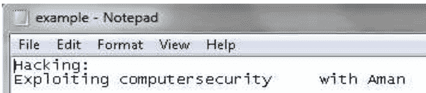

对输出感到惊讶！您可以看到 \n 在文件中也能正常工作，但 \r 在控制台模式下工作正常，在文件模式下却工作不佳。

现在，请参考以下程序：

```
#include<iostream>
#include<fstream>
using namespace std;
int main()
{
    fstream fio;
    fio.open("example.txt",ios::out | ios::binary);
    if(!fio.is_open())
    {
        cout<<"Can't open file";
        return -1;
    }
    fio<<"Hacking:\nExploiting computer\rsecurity\twith Aman";
    fio.close();
    char ch;
    fio.open("example.txt",ios::in | ios::binary);
    while(!fio.eof())
    {
        ch=fio.get();
        cout<<ch;
    }
    fio.close();
}
```

#### 输出

黑客攻击：

安全与 Aman

我们以二进制模式打开了文件，但输出与最初的输出没有区别。现在，打开相应的文件。您将看到类似：

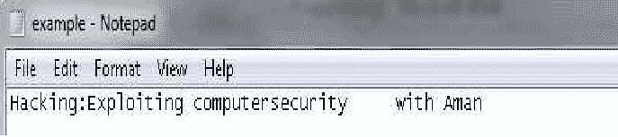

再次感到惊讶！现在，您已经理解了二进制模式和普通模式之间的区别。二进制模式不会将 \n 转换为换行符、EOF 和其他一些操纵符，而在普通模式下会进行这些转换。我们尝试写入包含 \n、\r、\t 的 47 个字节。您可以看到，普通模式下的文件大小为 48 字节，而二进制模式下为 47 字节。

### read() 和 write() 函数

这些函数在各种读写操作中非常有用，尤其是对于二进制文件。它们非常强大，以至于我们可以用一行代码将一个类写入文件。

write 函数的语法是：

```
public __ostream_type&write(const char_type* __s, streamsize __n);
```


这里，第一个参数是存储数据的缓冲区地址。假设数据存储在 array[11] 处，那么我们的第一个参数将是 array。由于它是 char 类型，因此最好使用 (char*) buffer 进行强制类型转换。所以，我们的第一个参数将是 (char*)buffer。假设你想将结构体 s1 写入文件，在这种情况下，我们的第一个参数将是 (char*)&s1。第二个参数是要写入文件的元素总数。假设变量 char array[11]，那么第二个参数将是 11。假设我们要将结构体 s1 写入文件，那么第二个参数将是 sizeof(s1)。

以下程序说明了 write 函数的用法：

```cpp
#include<iostream>
#include<fstream>
using namespace std;
struct student
{
    char name[50];
    char section;
    int roll;
};
int main()
{
    struct student s1;
    cout<<("Enter the name of student\n");
    cin.getline(s1.name,50);
    cout<<("Enter section of the student\n");
    cin>>s1.section;
    cout<<("Enter roll number of the student\n");
    cin>>s1.roll;
    fstream fout("student.txt",ios::out | ios::binary);
    if(fout==NULL)
    {
        cout<<("Can't open the file");
        return -1;
    }
    fout.write((char*)&s1,sizeof(s1));
    fout.close();
    cout<<("\nRecords written to the file\n");
    return 0;
}
```

输出

输入学生姓名

Aman Kumar Jha

输入学生班级

D

输入学生学号

12

记录已写入文件

这里，你可以看到，使用一行 write 函数我们就成功将数据写入了文件。

read 函数的语法是：

```
public __istream_type&read(const char_type* __s, streamsize __n);
```

以下程序说明了 read 函数：

```cpp
#include<iostream>
#include<fstream>
using namespace std;
struct student
{
    char name[50];
    char section;
    int roll;
};

int main()
{
    fstream fout;
    fout.open("student.txt",ios::in | ios::binary);
    struct student s1;
    fout.read((char*)&s1,sizeof(s1));
    cout<<"Name of the student is: "<<s1.name;
    cout<<"\nSection of the student is: "<<s1.section;
    cout<<"\nRoll number of the student is: "<<s1.roll;
    fout.close();
    return 0;
}
```

输出
学生姓名是：Aman Kumar Jha
学生班级是：D
学生学号是：12

### 将结构体写入文件：方法1

请考虑以下程序：

```cpp
#include<iostream>
#include<fstream>
using namespace std;
struct student
{
    char name[50];
    char section;
    int roll;
};

int main()
{
    struct student s1;
    cout<<("Enter the name of student\n");
    cin.getline(s1.name,50);
    cout<<("Enter section of the student\n");
    cin>>s1.section;
    cout<<("Enter roll number of the student\n");
    cin>>s1.roll;
    fstream fout("student.txt",ios::out);
    if(fout==NULL)
    {
        cout<<("Can't open the file");
        return -1;
    }
    fout<<s1.name;
    fout<<'\n';
    fout<<s1.section;
    fout<<'\n';
    fout<<s1.roll;
    fout.close();
    cout<<("\nRecords written to the file");
    return 0;
}
```

### 输出

输入学生姓名
Aman Kumar Jha
输入学生班级
D
输入学生学号
12
记录已写入文件

请注意，在每种不同的数据类型之间都插入了一个空格，以便以后文件可读。这是将结构体写入文件最耗时的过程之一。现在，我们将了解更多将结构体写入文件的方法。

请注意，写入文件的每个字符串、字符和数字之间都有一个空格。

### 从文件读取结构体：方法1

```cpp
#include<iostream>
#include<fstream>
using namespace std;
struct student
{
    char name[50];
    char section;
    int roll;
};
int main()
{
    struct student s1;
    fstream fin("student.txt", ios::in);
    if(fin==NULL)
    {
        cout<<("Can't open the file");
        return -1;
    }
    fin.getline(s1.name,50,'\n');
    fin>>s1.section;
    fin>>s1.roll;
    cout<<"Name of the student is: "<<s1.name<<endl;
    cout<<"Section of the student is: "<<s1.section<<endl;
    cout<<"Roll number of the student is: "<<s1.roll;
    fin.close();
    return 0;
}
```

输出

学生姓名是：Aman Kumar Jha
学生班级是：D
学生学号是：12

### 从文件写入和读取结构体：方法2

使用 read 和 write 函数，我们可以轻松读取文件并向其中写入数据。以下是一个说明程序。

```cpp
#include<iostream>
#include<fstream>
using namespace std;
struct student
{
    char name[50];
    char section;
    int roll;
};
int main()
{
    struct student s1;
    cout<<("Enter the name of student\n");
    cin.getline(s1.name,50);
    cout<<("Enter section of the student\n");
    cin>>s1.section;
    cout<<("Enter roll number of the student\n");
    cin>>s1.roll;
    fstream fout("student.txt",ios::out | ios::binary);
    if(fout==NULL)
    {
        cout<<("Can't open the file");
        return -1;
    }
    fout.write((char*)&s1,sizeof(s1));
    fout.close();
    cout<<("\nRecords written to the file\n");
    fout.open("student.txt", ios::in | ios::binary);
    struct student s2;
    fout.read((char*)&s2, sizeof(s2));
    cout<<"Name of the student is: "<<s2.name;
    cout<<"\nSection of the student is: "<<s2.section;
    cout<<"\nRoll number of the student is: "<<s2.roll;
    fout.close();
    return 0;
}
```

### 输出

输入学生姓名
Aman Kumar Jha
输入学生班级
D
输入学生学号
12
记录已写入文件
学生姓名是：Aman Kumar Jha
学生班级是：D
学生学号是：12


## 类

你可以从 C++ 最初名为“带类的 C”这一事实来想象本章的重要性。到目前为止，我们所学的一切既属于结构化编程语言，也属于面向对象编程语言。现在，我们将开始专门属于对象的部分。

- 1. 数据封装：数据成员可以绑定到一个称为类的胶囊中。
- 2. 多态性：这是根据传递给函数的参数以不同方式处理不同函数的能力。
- 3. 数据隐藏：这使我们有权隐藏类外部的数据。private 是用于数据隐藏的关键字。
- 4. 代码复用与回收：相同的代码可以被复用，并放入头文件中以供进一步复用。

类使用关键字 class 声明。类的示例：

```cpp
class rectangle {
int x, y;
public:
void assign_values (int,int);
int area (void);
};
```

这里，class 是一个关键字，用于告诉编译器我们将定义一个类。rectangle 是类名，你可以在此处输入任何名称。public: 是访问说明符或权限控制器。它控制权限。请注意，我们没有为 int x, y; 决定任何权限级别，在这种情况下编译器会自动分配 private:。因此，private: 是默认权限级别。类中有三种可用的权限：

- 1. private
- 2. protected
- 3. public

| 可访问者 | private | protected | public |
|---|---|---|---|
| 同一类的成员 | 是 | 是 | 是 |
| 派生类的成员 | 否 | 是 | 是 |
| 非成员 | 否 | 否 | 是 |

其中，非成员是指从未从该类派生的其他类尝试的任何访问，或来自其他函数（包括 main）的任何访问，这些函数不是类的成员。

请考虑以下程序：

```cpp
#include<iostream>
using namespace std;
class area {
int x, y;
public:
void assign_values (int,int);
int calculate_area (void);
};
int main()
{
class area rectangle;
rectangle.assign_values(3,5);
cout<<"Area of rectangle is "<<rectangle.calculate_area();
return 0;
}
void area::assign_values(int a,int b)
{
x=a;
y=b;
}


```
}
int area::calculate_area()
{
    return x*y;
}
```

输出
矩形的面积是 15

在这里，在语句 class area rectangle; 中，rectangle 是对象。要访问类中定义的函数，我们使用作用域解析运算符 (::)。在类内部声明的函数的定义语法是：

```
return_type class_name::function_name(arg1,arg2,arg3,...)
```

```
{
    //statements
}
```

以下是一个类、多个对象的示例：

```
#include<iostream>
using namespace std;
class area {
int x, y;
public:
void assign_values (int,int);
int calculate_area (void);
};
int main()
{
    class area rectangle,parallelogram;
    rectangle.assign_values(3,5);
    parallelogram.assign_values(4,2);
    cout<<"Area of rectangle is "<<rectangle.calculate_area()<<endl;
    cout<<"Area of parallelogram is "<<parallelogram.calculate_area();
    return 0;
}
```

```
void area::assign_values(int a,int b)
{
x=a;
y=b;
}
```

```
int area::calculate_area()
{
return x*y;
}
```

输出
矩形的面积是 15
平行四边形的面积是 8

类中还引入了一个功能，使上述程序更简单。这称为构造函数。

### 构造函数

关于构造函数一个令人惊叹的地方是，它与类同名。它是一个函数，一旦声明对象就会自动调用。它没有返回类型，甚至不是 void。

```
#include<iostream>
using namespace std;
class area {
int x, y;
public:
area (int,int);
int calculate_area (void);
};

int main()
{
    class area rectangle(3,5),parallelogram(4,2);
    cout<<"Area of rectangle is "<<rectangle.calculate_area()<<endl;
    cout<<"Area of parallelogram is "<<parallelogram.calculate_area();
    return 0;
}
```

```
area::area(int a,int b)
{
    x=a;
    y=b;
}

int area::calculate_area()
{
    return x*y;
}
```

输出
矩形的面积是 15
平行四边形的面积是 8

在这里，我们没有设计任何单独的函数来赋值，而是将其合并在构造函数中。仔细看，我们在声明对象时带有参数，例如 class area rectangle(3,5); 这里 3 和 5 是参数。这里，area(int,int); 是一个构造函数。

### 构造函数重载

构造函数可以像函数一样重载，我们可以定义多个构造函数，但在声明构造函数时应注意，我们只能创建参数数量与构造函数中完全相同的对象。

```
#include<iostream>
using namespace std;
class area {
int x, y;
public:
area();
area (int,int);
int calculate_area (void);
};
int main()
{
    class area rectangle;
    class area parallelogram(4,2);

    cout<<"Area of rectangle is "<<rectangle.calculate_area()<<endl;
    cout<<"Area of parallelogram is "<<parallelogram.calculate_area()<<endl;
    return 0;
}
area::area()
{
    x=y=1;
}
area::area(int a,int b)
{
    x=a;
    y=b;
}
int area::calculate_area()
{
    return x*y;
}
```

输出
矩形的面积是 1
平行四边形的面积是 8

### 默认构造函数

如果程序员没有创建任何构造函数，则会自动创建一个名为默认构造函数且无参数的构造函数。因此，我们可以创建任何无参数的对象，例如 class area rectangle，但如果我们尝试声明带有三个参数的对象，例如 class area cuboid(3,4,5)，由于相应的构造函数不存在，编译器将报错说“no matching function to call for area::area(int,int,int)”。如果我们声明了任何构造函数，编译器就不提供默认构造函数。因此，如果我们只声明了带有两个参数的构造函数，则无法创建无参数或只有一个参数的对象。要创建无参数的对象，我们还必须声明和定义相应的构造函数。

### 拷贝构造函数

当我们想要以自己的方式复制对象时，拷贝构造函数特别有用。与默认构造函数一样，拷贝构造函数很重要，重要到 C++ 认为没有哪个类应该没有拷贝构造函数。如果你不提供自己的拷贝构造函数，C++ 会为你生成一个。（这与 C++ 提供的默认构造函数不同，除非你的类为其定义了构造函数。）C++ 提供的拷贝构造函数对每个数据成员执行逐成员复制。早期版本的 C++ 提供的拷贝构造函数执行的是逐位复制。区别在于，逐成员复制会调用类成员可能存在的所有拷贝构造函数，而逐位复制则不会。
我们也可以定义自己的拷贝构造函数。
请考虑以下程序：

```
#include<iostream>
using namespace std;
class area
{
    int x, y;
public:
    area();
    area(area&);
    int calculate_area (void);
};
int main()
{
    class area rectangle;
    class area parallelogram(rectangle);
    cout<<"\nArea of rectangle is "<<rectangle.calculate_area()<<endl;
    cout<<"Area of parallelogram is "<<parallelogram.calculate_area();
    return 0;
}
area::area()
{
    x=y=1;
}
area::area(area& s)
{
    x=5;
    y=s.y;
    cout<<"Calling copy constructor";
}
int area::calculate_area()
{
    return x*y;
}
```

输出
Calling copy constructor
矩形的面积是 1
平行四边形的面积是 5

### 析构函数

就像我们调用构造函数来创建对象一样，同样可以使用析构函数来销毁对象。它也与类同名。那么，如何将其与构造函数区分开？为了将其与构造函数区分开，我们在其前面使用波浪号 (~)。与构造函数一样，它也不返回任何内容。当对象在其生命周期内分配动态内存，并在销毁时我们希望释放对象分配的内存时，析构函数的使用尤其合适。它也像构造函数一样自动调用。

请考虑以下程序：
#include<iostream>
using namespace std;

```
class area
{
int *x, *y;
public:
area (int,int);
~area();
int calculate_area (void);
};
int main()
{
    class area parallelogram(4,2);
    cout<<"Area of parallelogram is "<<parallelogram.calculate_area();
    return 0;
}
area::area(int a,int b)
{
x=new int;
y=new int;
*x=a;
*y=b;
}
area::~area()
{
delete x;
delete y;
cout<<"\nPointers deleted";
}
int area::calculate_area()
{
return *x**y;
}
```

输出
平行四边形的面积是 8
指针已删除

### 在类内部定义方法

方法也可以在类内部定义。当方法太小时，这非常有用。在类内部定义方法所使用的代码片段如下：

```
class class_name
{
    //statements
    return_type func_name(arg1,arg2,...)
{
   //statements of functions
}
};
```

因此，我们可以将之前的代码写成如下形式：

```
#include<iostream>
using namespace std;
class area
{
    int *x, *y;
    public:
    area (int a,int b)
    {
        x=new int;
        y=new int;
        *x=a;
        *y=b;
    }
    ~area()
    {
        delete x;
        delete y;
        cout<<"\nPointers deleted";
    }
    int calculate_area (void)
    {
    return *x**y;
    }
};
int main()
{
    class area parallelogram(4,2);
    cout<<"Area of parallelogram is "<<parallelogram.calculate_area();
    return 0;
}
```

输出
平行四边形的面积是 8
指针已删除

### 将类传递给函数

类可以传递给函数。将类传递给函数的定义语法如下：

```
return_type func_name(class_name object_name)
{
//Statements
}
```

请考虑以下程序：

```
#include<iostream>
using namespace std;
class student
{
    public:
    char name[50];
    char section;
    int roll;
    void read_data();
};
void display_data(student);
void student::read_data()
{
    cout<<"Enter the name\n";
    cin.getline(name,50);
    cout<<"Enter the section\n";
    cin>>section;
    cout<<"Enter the roll number\n";
    cin>>roll;
}
int main()
{
    class student s1;
    s1.read_data();
    display_data(s1);
}
void display_data(student x)
{
    cout<<"Name of the student is: ";
    cout<<x.name;
    cout<<"\nThe section of the student is: ";
    cout<<x.section;
    cout<<"\nThe roll number of the student is: ";
    cout<<x.roll;
}
```

输出
Enter the name
Aman Kumar Jha
Enter the section
D
Enter the roll number


学生姓名是：Aman Kumar Jha。学生所在班级是：D。学生学号是：12。请看，我们在定义类之后立即声明了函数 display_data(student)；我们没有在定义类之前声明该函数，因为类 student 在那里不可访问。

### 返回类

类也可以像函数一样被返回。返回类的语法如下：class_name func_name(arg1,arg2,...) { //statements } 请看，这是返回类的函数的语法。

考虑以下程序：

```
#include<iostream>
using namespace std;
class student
{
    public:
    char name[50];
    char section;
    int roll;
    void display_data();
};
student read_data()
{
    class student s;
    cout<<"Enter the name\n";
    cin.getline(s.name,50);
    cout<<"Enter the section\n";
    cin>>s.section;
    cout<<"Enter the roll number\n";
    cin>>s.roll;
    return s;
}
int main()
{
    class student s1;
    s1=read_data();
    s1.display_data();
}
void student::display_data()
{
    cout<<"Name of the student is: ";
    cout<<name;
    cout<<"\nThe section of the student is: ";
    cout<<section;
    cout<<"\nThe roll number of the student is: ";
    cout<<roll;
}
```

输出
请输入姓名
Aman Kumar Jha
请输入班级
D
请输入学号
12
学生姓名是：Aman Kumar Jha
学生所在班级是：D
学生学号是：12
这里，read_data() 是一个返回类的函数。

### 友元类

很多时候，我们希望从另一个类访问一个类的私有和受保护成员。假设有一个类 rectangle 和另一个类 square。与其声明一个新的 area 函数，我们希望使用类 rectangle 中声明的 area 函数。要使用该函数，我们需要访问类 rectangle 的私有元素 length 和 breadth。此时友元类非常有用。在预先存在的类中声明友元类的代码片段如下：

```
class square
{
    int side;
    public:
        void set_side (int s);
        friend class rectangle;
};
class rectangle
{
    int length, breadth;
    public:
        int area ();
        void set_square(square a);
};
```

这里，你可以看到我们将整个类传递给了函数 set_square。以下程序说明了友元类

```
#include <iostream>
using namespace std;
class square
{
    int side;
    public:
    void set_side (int s);
    friend class rectangle;
};
class rectangle
{
    int length, breadth;
    public:
    int area ();
    void set_square(square a);
};

int rectangle::area()
{
    return length * breadth;
}
void square::set_side(int s)
{
    side=s;
}
void rectangle::set_square (square a)
{
    length = breadth = a.side;
}

int main ()
{
    square sqr;
    rectangle rect;
    sqr.set_side(5);
    rect.set_square(sqr);
    cout<<rect.area();
    return 0;
}
```

输出
25

现在，让我们看看如何声明一个简单的类。类可以像函数一样声明，但没有括号 ()。函数应该在使用之前定义，如果不，那么我们必须在使用之前声明函数。同样，类应该在使用之前定义，如果不，那么我们必须在使用之前声明类。例如，考虑以下程序：

```
#include <iostream>
using namespace std;
class rectangle
{
    int length, breadth;
    public:
    int area ();
    void set_square(square a);
};
class square
{
    int side;
    public:
    void set_side (int s);
    friend class rectangle;
};
int rectangle::area()
{
    return length * breadth;
}
void square::set_side(int s)
{
    side=s;
}
void rectangle::set_square (square a)
{
    length = breadth = a.side;
}

int main ()
{
    square sqr;
    rectangle rect;
    sqr.set_side(5);
    rect.set_square(sqr);
    cout<<rect.area());
    return 0;
}
```

这个程序只是对前一个程序的简单操作。这里，我们尝试将类 square 传递给类 rectangle 中的函数 set_square，但在此之前我们从未定义过类 square。因此，该程序将显示多个错误，包括“[Error] 'square' has not been declared”。所以，我们必须在使用之前声明类。

声明类的语法非常简单，只需在顶部添加以下语句：

```
class class_name;
```

考虑以下程序：

```
#include <iostream>
using namespace std;
class square;
class rectangle
{
    int length, breadth;
    public:
    int area ();
    void set_square(square a);
};
class square
{
    int side;
    public:
    void set_side (int s);
    friend class rectangle;
};
int rectangle::area()
{
    return length * breadth;
}
void square::set_side(int s)
{
    side=s;
}
void rectangle::set_square (square a)
{
    length = breadth = a.side;
}
int main ()
{
    square sqr;
    rectangle rect;
    sqr.set_side(5);
    rect.set_square(sqr);
    cout<<rect.area();
    return 0;
}
}
```

### 输出

25

这里，在程序的第三行中，我们在使用之前声明了类。因此，该程序不会显示任何错误，并且程序运行成功。

### this 指针

很多时候，我们希望在同一个类的函数定义内创建该类的一个对象，以便我们可以计算并返回该对象来将其存储在另一个对象中。例如，假设我们定义一个类 rectangle。现在，我们想要从一个对象（比如说 obj1）计算面积，并且我们想要返回整个对象并将其存储在另一个对象（比如说 obj2）中。这时 this 指针就非常有用了。

考虑以下程序：

```
#include<iostream>
using namespace std;
class rectangle
{
int length,breadth,area;
public:
void set_values(int a,int b){length=a;breadth=b;}
rectangle calc_area();
void display_area(){cout<<area;}
};
rectangle rectangle::calc_area()
{
area=length*breadth;
return *this;
}
int main()
{
    rectangle obj1,obj2;
    obj1.set_values(4,5);
    obj1.calc_area();
    obj2=obj1;
    obj2.display_area();
}
```

输出
20

这里 return*this; 返回整个对象。请记住 this 表现为一个对象指针。


## 继承

这是面向对象编程的一项惊人功能。此功能允许我们从现有类继承一个类。此功能使我们免于编写大量代码，并且我们可以使用权限进行继承，以便我们控制未来的继承功能。

**基类：** 从中派生另一个类的预先存在的类

**派生类：** 从基类派生的类

从现有类继承类的语法是：

```
class derived_class_name: permission_level base_class_name
{
//Statements
}
```

权限级别可以是 private、protected 或 public。

考虑以下程序：

```
#include<iostream>
using namespace std;
class cuboid
{
    public:
    int length,breadth,height;
    int volume(int,int,int);
};
int cuboid::volume(int x,int y,int z)
{
    length=x;
    breadth=y;
    height=z;
    return length*breadth*height;
}

class base_area:public cuboid
{
public:
int calculate_base_area();
};

int base_area::calculate_base_area()
{
return length*breadth;
}

int main()
{
class base_area b1;
cout<<"Volume of cuboid is: "<<b1.volume(5,2,3)<<endl;
cout<<"Base area of cuboid is: "<<b1.calculate_base_area()<<endl;
}
```

### 输出

长方体的体积是：30
长方体的底面积是：6

请看，通过派生类 base_area，我们能够使用 cuboid 类和基面积类的方法和数据成员。但是在派生类中，我们不能使用 cuboid 类的私有数据成员。因此，以下程序将生成一个错误：

```
#include<iostream>
using namespace std;
class cuboid
{
    int length,breadth,height;
    public:
    int volume(int,int,int);
};

int cuboid::volume(int x,int y,int z)
{
    length=x;
    breadth=y;
    height=z;
    return length*breadth*height;
}
class base_area:public cuboid
{
    public:
    int calculate_base_area(int,int);
};

int base_area::calculate_base_area(int x,int y)
{
    length=x;
    breadth=y;
    return length*breadth;
}
int main()
{
    class base_area b1;


cout<<b1.volume(5,2,3)<<endl;
cout<<b1.calculate_base_area(2,3);
}

上述程序会报出各种错误，提示“int cuboid::length is private”。

权限级别有三种：private、protected 和 public。但在这里，这些级别更加重要。它们赋予我们封装的能力。通过封装，我们可以封装类的成员和方法，并将其限制在派生类中，还可以进一步扩展到更多派生类。

假设我们从 base_area 类派生另一个类，如下所示：

```
#include<iostream>
using namespace std;
class cuboid
{
 public:
 int length,breadth,height;
 int volume(int,int,int);
};
```

```
int cuboid::volume(int x,int y,int z)
{
 length=x;
 breadth=y;
 height=z;
 return length*breadth*height;
}
```

```
class base_area:public cuboid
{
 public:
 int calculate_base_area();
};
int base_area::calculate_base_area()
{
    return length*breadth;
}
```

```
class side_area:public base_area
{
    public:
    int calculate_side_area();
};
```

```
int side_area::calculate_side_area()
{
    return length*height;
}
```

```
int main()
{
    class side_area s1;
    cout<<"Volume of cuboid is: "<<s1.volume(2,3,4)<<endl;
    cout<<"Base area of cuboid is: "<<s1.calculate_base_area()<<endl;
    cout<<"Area of side wall of cuboid is: "<<s1.calculate_side_area();
}
```

输出
长方体的体积是：24
长方体的基面积是：6
长方体的侧面积是：8

在上述程序中，我们使用了 **公有** 关键字，因此基类可从派生类访问。如果我们使用 **私有** 关键字呢？

### 继承中的可访问性

考虑以下程序：

```
#include<iostream>

using namespace std;

class cuboid
{

    public:

    int length,breadth,height;

    int volume(int,int,int);

};

int cuboid::volume(int x,int y,int z)
{

    length=x;

    breadth=y;

    height=z;

    return length*breadth*height;

}

class base_area:private cuboid
{

    public:

    int calculate_base_area();

};

int base_area::calculate_base_area()
{
    return length*breadth;
}
```

```
int main()
{
    class base_area b1;

    cout<<"Volume of cuboid is: "<<b1.volume(2,3,4)<<endl;
    cout<<"Base area of cuboid is: "<<b1.calculate_base_area()<<endl;
}
```

该程序将生成错误“[Error] 'int cuboid::volume(int, int, int)' is inaccessible”。这意味着存在某些规则，类遵循这些规则。规则如下：

### 私有继承：

| 权限级别 | 私有成员 | 保护成员 | 公有成员 |
|---|---|---|---|
| 在基类中可访问 | 是 | 是 | 是 |
| 在派生类中可访问 | 否 | 是 | 是 |
| 在派生类外可访问 | 否 | 否 | 否 |

### 保护继承：

| 权限级别 | 私有成员 | 保护成员 | 公有成员 |
|---|---|---|---|
| 在基类中可访问 | 是 | 是 | 是 |
| 在派生类中可访问 | 否 | 是 | 是 |
| 在派生类外可访问 | 否 | 否 | 否 |

### 公有继承：

| 权限级别 | 私有成员 | 保护成员 | 公有成员 |
|---|---|---|---|
| 可访问性 | | | |
| 在基类中可访问 | 是 | 是 | 是 |
| 在派生类中可访问 | 否 | 是 | 是 |
| 在派生类外可访问 | 否 | 否 | 是 |

现在，你已经理解了在上述程序中，我们尝试通过 base_area 类的对象 b1 使用私有继承来访问 volume 函数，但通过私有继承，派生类外部（即 main() 函数中）不可访问公有成员。这就是编译器给出相应错误的原因。

要记住上述图表，只需记住“是”的位置。你会看到一个模式：123、122、122。

#### 注意：

- 1. 类中定义的任何成员始终可被该类中声明或定义的所有函数访问
- 2. 基类的私有成员不能被继承

### 继承类型

#### 单一继承

如果从一个基类派生一个类，那么形成的架构称为单一继承。


#### 单一继承

本章使用的第一个程序是单一继承的一种类型。

#### 多级继承

在上述程序中，你可以看到我们从一个基类（假设为 A）继承了一个类（假设为 B），然后又从继承类 B 继承了一个类（假设为 C）。这称为多级继承。


#### 多级继承

本章使用的第三个程序是多级继承的一种类型。

#### 层次继承

如果从单个基类派生多个类，则此继承为层次继承。

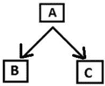

#### 层次继承

```
#include<iostream>
using namespace std;
class cuboid
{
    public:
    int length,breadth,height;
    int volume(int,int,int);
};

int cuboid::volume(int x,int y,int z)
{
    length=x;
    breadth=y;
    height=z;
    return length*breadth*height;
}

class base_area:public cuboid
{
    public:
        int calculate_base_area();
};

int base_area::calculate_base_area()
{
    return length*breadth;
}

class side_area:public cuboid
{
    public:
        int calculate_side_area();
};

int side_area::calculate_side_area()
{
    return length*height;
}
```

```

int main()
{
    class base_area b1;
    class side_area s1;
    cout<<"Volume of cuboid is: "<<b1.volume(2,3,4)<<endl;
    cout<<"Base area of cuboid is: "<<b1.calculate_base_area()<<endl;
    cout<<"Volume of second cuboid is: "<<s1.volume(3,4,5)<<endl;
    cout<<"Area of side wall of second cuboid is: "<<s1.calculate_side_area();
}
```

输出
长方体的体积是：24
长方体的基面积是：6
第二个长方体的体积是：60
第二个长方体的侧面积是：15

在这里，我们从类 cuboid 继承了两个类 base_area 和 side_area。

#### 多重继承

如果从多个基类派生一个类，那么形成的架构称为多重继承。

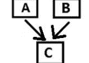

#### 多重继承

这是一种惊人的继承类型；使用这种继承类型，我们可以从多个基类继承一个类。

在此，要从多个基类继承，我们使用以下语法：

```
class inherited_class: permission_level class_name,permission_level class_name
{
    //Statements
}
```

以下代码片段将消除您的所有困惑：

```
class cuboid:public base_area,public side_area
{
public:
int volume();
};
```

现在，考虑以下程序：

```
#include<iostream>
using namespace std;
class base_area
{
public:
int length,breadth;
int calculate_base_area(int,int);
};
int base_area::calculate_base_area(int p,int q)
{
length=p;
breadth=q;
return length*breadth;
}
class side_area
{
public:
    int x,z;
    int calculate_side_area(int,int);
};

int side_area::calculate_side_area(int a,int b)
{
    x=a;
    z=b;
    return x*z;
}

class cuboid:public base_area,public side_area
{
    public:
    int volume();
};

int cuboid::volume()
{
    return length*breadth*z;
}

int main()
{
    class cuboid c1;
    cout<<"Base area of cuboid is: "<<c1.calculate_base_area(3,4)<<endl;
    cout<<"Area of side wall is: "<<c1.calculate_side_area(3,5)<<endl;
    cout<<"Volume of cuboid is: "<<c1.volume()<<endl;
}
```

### 输出

长方体的基面积是：12

长方体的侧面积是：15

长方体的体积是：60

#### 混合继承

两种或多种继承类型的组合称为混合继承。

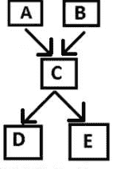

混合继承

在以下程序中，我们混合了多重继承和单一继承。你也可以将其视为多重继承和多级继承的混合。

考虑以下程序：

```
#include<iostream>
using namespace std;
class base_area
{
public:
int length,breadth;
int calculate_base_area(int,int);
};
int base_area::calculate_base_area(int p,int q)
{


length=p;
breadth=q;
return length*breadth;
}
class side_area
{
public:
int x,z;
int calculate_side_area(int,int);
};
int side_area::calculate_side_area(int a,int b)
{
x=a;
z=b;
return x*z;
}
class cuboid : public base_area, public side_area
{
public:
int volume();
};
int cuboid::volume()
{
return length*breadth*z;
}
class surface_area : public cuboid
{
    public:
        int calculate_total_surface_area();
};
int surface_area::calculate_total_surface_area()
{
    return 2*(length*breadth+length*z+breadth*z);
}

int main()
{
    class surface_area s1;
    cout<<"Base area of cuboid is: "<<s1.calculate_base_area(3,4)<<endl;
    cout<<"Area of side wall is: "<<s1.calculate_side_area(3,5)<<endl;
    cout<<"Volume of cuboid is: "<<s1.volume()<<endl;
    cout<<"Total surface area of cuboid is: "<<s1.calculate_total_surface_area()<<endl;
}

### 输出

Base area of cuboid is: 12
Area of side wall is: 15
Volume of cuboid is: 60
Total surface area of cuboid is: 94


## 运算符重载

你可能认为 +、-、*、/ 等运算符作用于 int、float 等预定义数据类型，那么它们能作用于类等用户定义数据类型吗？可以！运算符可以被重载，你可以随心所欲地使用它们。

对于符号为 opr 的运算符，重载函数的语法是：

```
return_type operator opr()
{
//statements
}
```

例如，重载 + 运算符的示例是：

```
int operator +()
{
return value1+value2;
}
```

通常，我们不能对对象进行自增或自减。例如，以下程序会生成错误：

```
#include<iostream>
using namespace std;
class counting
{
    int count;
    public:
    counting(){count=0;}
    int return_value(){return count;}
};
int main()
{
    counting c1;
    cout<<c1.return_value()<<endl;
    ++c1;
    cout<<c1.return_value();
}
```

该程序会生成错误：“[Error] no match for ‘operator++’ (operand type is ‘counting’)”。

### 重载递增和递减运算符 (++ & --)

现在，我们将重载 ++ 运算符，以便可以增加或减少对象。

考虑以下程序：

```
#include<iostream>
using namespace std;
class counting
{
int count;
public:
counting() {count=0;}
int return_value(){return count;}
void operator++(){++count;}
};
int main()
{
counting c1;
cout<<c1.return_value()<<endl;
++c1;
cout<<c1.return_value();
}
```

输出

0

1

同样，我们也可以重载递减运算符。

### 在运算符重载中使用返回类型

然而，由于没有返回任何值，我们无法存储该值。因此，如果我们想将值存储在对象中，可以返回该值以便将其存储在对象中。以下程序说明了这一点：

```
#include<iostream>
using namespace std;
class counting
{

int count;

public:

counting(){ count=0;}
void set_value(int a){count=a;}
int return_value(){return count;}
counting operator++();

};

counting counting::operator++()
{

++count;

counting cx;

cx.set_value(count);
return cx;
}

int main()
{
    counting c1,c2;
    cout<<c1.return_value()<<endl;
    ++c1;
    cout<<c1.return_value()<<endl;
    c2=++c1;
    cout<<c2.return_value();
}
```

输出
0
1
2

### 在运算符重载中使用 this 指针

使用 this 指针可以进一步写成：

```
#include<iostream>
using namespace std;
class counting
{
    int count;
    public:
    counting(){ count=0;}
    void set_value(int a){count=a;}
    int return_value(){return count;}
    counting operator++();

};

counting counting::operator++()
{

++count;
this->set_value(count);
return *this;
}

int main()
{

counting c1,c2;
cout<<c1.return_value()<<endl;
++c1;
cout<<c1.return_value()<<endl;
c2=++c1;
cout<<c2.return_value();
}
```

输出
0
1
2

### 重载后置递增运算符

到目前为止，我们只重载了前置运算符，而没有重载后置运算符。如果我们尝试重载后置运算符会怎样？

考虑以下程序：

```
#include<iostream>
using namespace std;
class counting
{
    int count;
    public:
    counting() { count=0;}
    int return_value(){return count;}
    void operator++(){++count;}
};

int main()
{
    counting c1;
    ++c1;
    cout<<c1.return_value()<<endl;
    c1++;
    cout<<c1.return_value()<<endl;
}
```

该程序将显示错误：“[Error] no ‘operator++(int)’ declared for postfix ‘++’ [-fpermissive]”。

要重载后置运算符，我们必须传递一个整数类型的参数，其值被忽略，但它表明我们想要重载后置运算符。

后置递增运算符的语法是

```
return_type operator++(int)
{
//Statements
}
```

考虑以下程序：

```
#include<iostream>
using namespace std;
class counting
{
    int count;
public:
    counting(){ count=0;}
    void set_value(int a){count=a;}
    int return_value(){return count;}
    counting operator++(); //preincrement
    counting operator++(int); //postincrement
};
counting counting::operator++()
{
    count++;
    counting cx;
    cx.set_value(count);
    return cx;
}
counting counting::operator++(int)
{
    count++;
    set_value(count);
    return *this;
}
int main()
{
    counting c1,c2,c3;
    c2=c1++;
    c3=++c2;
    cout<<c2.return_value()<<endl;
    cout<<c3.return_value();
}
```

输出
2
2

### 重载 operator+ 运算符

考虑两个对象的加法：

```
third=first+second;
```

由于 + 不是一元运算符，因此重载 operator+ 的语法是：

```
object_return_type operator+(object_return_type& rhs);
```

其中 rhs = 最右侧的对象，在我们的示例中是 second。

考虑以下程序：

```
typedef unsigned short USHORT;
#include <iostream>
using namespace std;
class Counter
{
    public:
        Counter();
        Counter(USHORT initialValue);
        ~Counter(){}
        USHORT GetItsVal() const { return itsVal; }
        void SetItsVal(USHORT x) {itsVal = x; }
        Counter operator+ (const Counter &);

    private:
        USHORT itsVal;
};

Counter::Counter(USHORT initialValue):
    itsVal(initialValue)
{}

Counter::Counter():
    itsVal(0)
{}

Counter Counter::operator+ (const Counter & rhs)
{
    return Counter(itsVal + rhs.GetItsVal());
}

int main()
{
    Counter first(2), second(4), third;

    third = first + second;

    cout << "first: " << first.GetItsVal()<< endl;
    cout << "second: " << second.GetItsVal() << endl;
    cout << "third: " << third.GetItsVal() << endl;
    return 0;
}
```

输出
first: 2
second: 4
third: 6

这里，在 rmo 的位置传递了 second。同样，上面的减法运算符也可以重载。

### 重载赋值运算符 (=)

这是一个惊人的运算符。考虑对象关系 second=first；C++ 支持赋值运算符的许多重载特性。

考虑以下程序：

```
typedef unsigned short USHORT;
#include <iostream>
using namespace std;
class Counter
{
public:
Counter();
Counter(USHORT initialValue);
~Counter(){}
USHORT GetItsVal() const { return itsVal; }
void SetItsVal(USHORT x) {itsVal = x; }
Counter operator+(const Counter &);
private:
USHORT itsVal;
};

Counter::Counter(USHORT initialValue):
itsVal(initialValue)
{}

Counter::Counter():
itsVal(0)
{}

Counter Counter::operator+ (const Counter & rmo)
{
    return Counter(itsVal + rmo.GetItsVal());
}

int main()
{
    Counter first(2);
    Counter second=first;
    cout << "second: " << second.GetItsVal() << endl;
    return 0;
}
```

输出

second: 2

在这里，在这个程序中你可以看到 C++ 已经有一个重载的赋值运算符。

### 重载相等运算符 (==)

与其他二元运算符一样，相等运算符也可以以同样的方式重载。

重载相等运算符的语法如下：

```
object_return_type operator==(object_return_type &rhs);
```

以下程序说明如何重载相等运算符。

```
#include <iostream>
using namespace std;
class DOG
{
public:
DOG();
int age() const { return Age; }
void SetAge(int x) { Age = x; }
int operator==(const DOG &);
private:
int Age;
};
DOG::DOG()
{
Age = 5;
}


```cpp
int DOG::operator==(const DOG & rhs)
{
    if(age == rhs.age())
        return true;
    else
        return false;
}
```

```cpp
int main()
{
    DOG frisky;
    DOG whiskers = frisky;
    whiskers.SetAge(11);
    if(whiskers==frisky)
        cout<<"Both dogs have same age";
    else
        cout<<"Both dogs have different ages";
    return 0;
}
```


## 多态性

这是以多种方式处理变量、函数、运算符、对象和类的能力。函数重载、函数覆盖、构造函数重载、运算符重载、基类指针、虚成员等都是在程序中引入多态性的各种方式。

### 函数覆盖

函数重载与函数覆盖的区别在于：重载时，同名不同函数的参数数据类型不同；而覆盖时，即使参数数据类型相同，但位于不同层级的类中。这里，不同层级是指一个函数定义在基类中，而另一个定义在派生类中。

请参考以下程序：

```cpp
#include <iostream>
using namespace std;
class polygon
{
    protected:
        int length, breadth;
    public:
        void assign_values (int a, int b){length=a; breadth=b;}
        int area () {return 0;}
};

class triangle: public polygon
{
    public:
        int area() {return (length * breadth / 2); }
};

int main ()
{
    triangle trgle;
    polygon p1;
    trgle.assign_values(4,5);
    p1.assign_values(4,5);
    cout<<trgle.area()<<endl;
    cout<<p1.area();

    return 0;
}
```

输出
10
0

这里我们定义了两次 area() 函数，一次在基类中，另一次在派生类中。

现在，一旦使用基类对象调用它，就会调用基类中定义的 area() 函数；而使用派生类对象调用它时，则会调用派生类中定义的 area() 函数。

此特性称为函数覆盖。

### 基类指针

我们可以创建指向派生类对象的基类指针。

以下程序说明了这一事实：

```cpp
#include <iostream>
using namespace std;
class polygon
{
    protected:
        int length, breadth;
    public:
        void assign_values (int a, int b){length=a; breadth=b;}
        int area(){return 0;}
};
class triangle: public polygon
{
    public:
    int area (){ return (length * breadth / 2); }
};
int main ()
{
    triangle trgle;
    polygon * poly1 = &trgle;
    poly1->assign_values (4,5);
    cout << trgle.area();
    return 0;
}
```

输出

10

这里可以看到，我们使用基类指针赋值了。

看这里，trgle.area() 多么神奇地调用了派生类而非基类中的函数。但如果我们尝试使用指针访问 area 会怎样呢。

请参考以下程序：

```cpp
#include <iostream>
using namespace std;
class polygon
{
    protected:
        int length, breadth;
    public:
        void assign_values (int a, int b) {length=a; breadth=b; }
        int area (){ return 0; }
};

class triangle: public polygon
{
    public:
        int area (){ return (length * breadth / 2); }
};

int main ()
{
    triangle trgle;
    polygon * poly1 = &trgle;
    poly1->assign_values (4,5);
    cout << poly1->area();
    return 0;
}
```

输出
0

这里可以看到，使用指针时，area() 函数是从基类而非派生类中调用的。此时 virtual 关键字非常有用。

### 虚方法

如果将方法声明为虚方法，那么当它在派生类中被重新定义，并且我们使用指向派生类的基类指针调用它们时，将调用相应派生类中定义的函数。

请参考以下程序：

```cpp
#include <iostream>
using namespace std;
class polygon
{
    protected:
    int length, breadth;
    public:
    void assign_values (int a, int b) {length=a; breadth=b;}
    virtual int area (){ return 0; }
};
class triangle: public polygon
{
    public:
    int area (){ return (length * breadth / 2); }
};
int main ()
{
    triangle trgle;
    polygon * poly1 = &trgle;
    poly1->assign_values (4,5);
    cout << poly1->area();
    return 0;
}
```

输出

10

这里可以看到，我们使用指针计算了正确的面积。

### 抽象基类和纯虚方法

考虑函数声明 void call_me()=0；如果在类外声明，则会显示错误 "[Error] function 'void call_me()' is initialized like a variable"。

但是，如果在它前面添加 virtual 关键字，即在类内声明，则该声明完全有效，即：

virtual void call_me() = 0；此函数现在称为纯虚函数，它等效于函数定义 virtual void call_me() { return 0; }。你看，我们多么优雅地将整个函数定义封装到了函数声明中。包含此类函数的类称为抽象基类。请记住，此函数声明只能在类内进行，不能在类外进行。

请参考以下程序：

```cpp
#include <iostream>
using namespace std;
class polygon
{
protected:
int length, breadth;
public:
void assign_values (int a, int b){ length=a; breadth=b; }
virtual int area ()=0;
};

class triangle: public polygon
{
    public:
        int area() {return (length * breadth / 2); }
};

int main ()
{
    triangle trgle;
    polygon * poly1 = &trgle;
    poly1->assign_values (4,5);
    cout << poly1->area();

    return 0;
}
```

输出

10

纯虚函数的另一个有趣特性是，这些函数可以像其他函数一样被调用，甚至可以从抽象基类的函数中调用。

请参考以下程序：

```cpp
#include <iostream>
using namespace std;
class polygon
{
    protected:
        int length, breadth;
    public:
        void assign_values (int a, int b) {length=a; breadth=b;}
        virtual int area ()=0;
        void display_area () {cout<<this->area();}
};

class triangle: public polygon
{
    public:
    int area (){ return (length * breadth / 2); }
};

int main ()
{
    triangle trgle;
    polygon * poly1 = &trgle;
    poly1->assign_values (4,5);
    poly1->display_area();

    return 0;
}
```

输出

10

这里，我们使用了 this 关键字来访问调用它的对象的函数。


## 位运算

好吧，本节解释了“为什么逻辑 AND 运算符使用 && 而不是 &？”、“为什么逻辑 OR 运算符使用 || 而不是 |？”等问题的答案。

在进行运算之前，数字会转换为其二进制值，然后再进行运算。

### 按位 AND 运算符

& 用于按位 AND 运算符。当所有输入都为真时，它返回 1，否则返回 0。AND 的真值表如下：

| x | y | x&y |
|---|---|---|
| 0 | 0 | 0 |
| 0 | 1 | 0 |
| 1 | 0 | 0 |
| 1 | 1 | 1 |

以下程序说明了这一事实。

```cpp
#include<iostream>
using namespace std;
int main()
{
    int a=9,b=5;
    int c=a&b;
    cout<<c;
    return 0;
}
```

上述程序的输出将是 1。

这里，a=9=1001，b=5=101。

所以，a&b= 1001&101
=1001&0101
=0001
=1

### 按位 OR 运算符

| 用于按位 OR 运算。当所有输入中任意一个为 1 时，它返回 1；如果没有输入为 1，则返回 0。

| x | y | x|y |
|---|---|---|
| 0 | 0 | 0 |
| 0 | 1 | 1 |
| 1 | 0 | 1 |
| 1 | 1 | 1 |

以下程序可以说明这一事实

```cpp
#include<iostream>
using namespace std;
int main()
{
    int a=9,b=5;
    int c=a|b;
    cout<<c;
    return 0;
}
```

这里，输出将是 13。

因为，a=9=1001；b=5=101
a|b=1001|101
=1001|0101
=1101


### 按位异或运算符

^ 是按位异或运算符。该运算符在以下情况下返回零：

| x | y | x^y |
|---|---|---|
| 0 | 0 | 0 |
| 0 | 1 | 1 |
| 1 | 0 | 1 |
| 1 | 1 | 0 |

请参考以下程序：

```
#include<iostream>
using namespace std;
int main()
{
    int a = 9, b = 5;
    int c = a ^ b;
    cout << c;
}
```

在此，输出将为 12。

a = 9 = 1001, b = 5 = 101
因此，c = a ^ b = 1001 ^ 101
= 1001 ^ 0101
= 1100
= 12

### 左移运算符

<< 是左移运算符。这是一个非常神奇的运算符。它将一个数的二进制等效形式左移指定的位数。例如，5 << 2 表示将数字 5 左移 2 位。

```
e.g. 5 << 2 = 101 << 2
= 00101 << 2
= 10100
= 20
```

请参考以下程序：

```
#include<iostream>
using namespace std;
int main()
{
    int a = 5;
    int c = a << 2;
    cout << c;
}
```

在此，输出将为 20

### 右移运算符

>> 称为右移运算符。例如，15 >> 2 表示将数字 15 的二进制等效形式向右移动 2 位。

```
e.g. 15 >> 2 = 1111 >> 2
= 0011
= 3
```

请参考以下程序：

```
#include<iostream>
using namespace std;
int main()
{
    int a = 15;
    int c = a >> 2;
    cout << c;
}
```

在此，输出将为 3

### 非运算符

! 是非运算符

| x | !(x) |
|---|---|
| 0 | 1 |
| 1 | 0 |

现在，请参考以下这个精彩的程序

```
#include<iostream>
using namespace std;
int main()
{
    int a = 13;
    int c = (!a);
    cout << c;
    return 0;
}
```

在此，输出为 0，而它应该是 !(13) = !(1101) = 0010 = 2。原因是非运算符将除零以外的所有值视为真。因此 13 不是零。所以，它为真，因此其否定为假。所以，输出为零。在上述程序中，如果将 13 替换为 (-13)，则输出仍将为零。而如果将 13 替换为 0，则输出将为 1。

那么，如何获取 13 的否定或补码呢。让我们看看下一个程序。

### 一的补码

要获取一的补码，使用 ~ 运算符。

请参考以下程序：

```
#include<iostream>
using namespace std;
int main()
{
    int a = 13;
    int c = (~a);
    cout << ("%d", c);
    return 0;
}
```

其输出将为 -14。


## 异常

异常为我们提供了一种检测并响应各种运行时错误的方法。当遇到错误时，错误会被抛给特殊的处理程序。本章最有用的部分是 try...catch 块。要捕获错误，我们将代码放在 try 块中，catch 定义在 try 块之后。catch 接收错误并做出相应响应。一旦捕获异常，它就会被抛出。

使用 try...catch 的语法如下：

```
try
{
//statements
throw exception;
}
catch(argument)
{
//statements
}
```

其中 argument 是抛出的值，可以是整型或字符型。如果你不知道类型，应该使用三个点（...）作为参数，称为省略号，因为它接受所有类型的参数。因此，你可以说它是默认参数。

请参考以下程序：

```
#include<iostream>
using namespace std;
int main()
{
    try
    {
        long double* array = new long double[10000000000000000000];
    }
    catch(...)
    {
        cout << "Error occurred";
    }
    return 0;
}
```

### 输出

发生错误

如果未捕获整型或字符型错误，省略号用作 catch 的最后一个参数。因此，你可以将上述程序重写如下：

```
#include<iostream>
using namespace std;
int main()
{
    try
    {
        long double* array = new long double[100000000000000000];
    }
    catch(int a)
    {
        cout << "Integral Error occurred";
    }
    catch(char a)
    {
        cout << "Char Error occurred";
    }
    catch(...)
    {
        cout << "Error occurred";
    }
    return 0;
}
```

### 输出

发生错误

### 嵌套 try...catch

try...catch 可以相互嵌套。以下程序说明了这一点：

```
#include<iostream>
using namespace std;
int main()
{
    try
    {
    int* arr = new int;
    try
    {
    long double* array = new long double[100000000000000000];
    }
    catch(...)
    {
    cout << "Internal error occurred";
    }
    }
    catch(...)
    {
    cout << "External Error occurred";
    }
    return 0;
}
```

### 输出

发生内部错误

很多时候，我们希望在外部捕获内部错误。对于上述程序，如果你想执行外部 catch，只需在内部 catch 中使用不带任何值的 throw 关键字抛出错误即可。

例如，请参考以下程序：

```
#include<iostream>
using namespace std;
int main()
{
    try
    {
        int* arr = new int;
        try
        {
            long double* array = new long double[1000000000000000000];
        }
        catch(...)
        {
            throw;
        }
    }
    catch(...)
    {
        cout << "External Error occurred";
    }
    return 0;
}
```

### 输出

发生外部错误

### 限制函数的异常类型

在声明函数时，可以通过在函数声明后添加 throw 后缀来限制其可能直接或间接抛出的异常类型。因此，函数可以以下列三种方式之一声明：

- return_type func_name(arg1, arg2, ...) throw(int); // 仅允许整型异常
- return_type func_name(arg1, arg2, ...) throw(char); // 仅允许字符型异常
- return_type func_name(arg1, arg2, ...) throw(); // 不允许异常
- return_type func_name(arg1, arg2, ...); // 允许所有异常

请注意，如果向 throw 传递了无参数，则不会向 catch 抛出任何异常。如果不编写 throw()，则允许所有类型的异常。

示例如下：

```
#include<iostream>
using namespace std;
void allocate_memory() throw();
void allocate_memory() throw()
{
    long double* array = new long double[10000000000000000];
}
```

```
int main()
{
    try
    {
        allocate_memory();
    }
    catch(...)
    {
        cout << "Error occurred";
    }

    return 0;
}
```

### 标准异常

针对标准情况定义了各种预定义异常。C++ 标准库甚至提供了一个专门设计的基类，用于声明作为异常抛出的对象，其名为 exception，定义在 <exception> 头文件中。该类有一个名为 what 的额外虚拟成员函数，它返回一个以空字符结尾的字符序列（char *），即一个字符串，即抛出错误的详细信息，并且可以在派生类中重写以包含某种异常描述。该类定义如下：

```
class exception
{
public:
    exception() _GLIBCXX_USE_NOEXCEPT {}
    virtual ~exception() _GLIBCXX_USE_NOEXCEPT;
/** Returns a C-style character string describing the general cause
* of the current error. */
virtual const char* what() const _GLIBCXX_USE_NOEXCEPT;
};
/** If an %exception is thrown which is not listed in a function's
 * %exception specification, one of these may be thrown. */
class bad_exception : public exception
{
public:
  bad_exception() _GLIBCXX_USE_NOEXCEPT { }
  // This declaration is not useless:
  // http://gcc.gnu.org/onlinedocs/gcc-3.0.2/gcc_6.html#SEC118
  virtual ~bad_exception() _GLIBCXX_USE_NOEXCEPT;
  // See comment in eh_exception.cc.
  virtual const char* what() const _GLIBCXX_USE_NOEXCEPT;
};
```

这些包括：

| 异常 | 描述 |
|---|---|
| bad_alloc | new 在分配失败时抛出 |
| bad_cast | dynamic_cast 在引用类型失败时抛出 |
| bad_exception | 当异常类型与任何 catch 都不匹配时抛出 |
| bad_typeid | 由 typeid 抛出 |
| ios_base::failure | 由 iostream 库中的函数抛出的失败 |

由于 bad_alloc 派生自标准基类 exception，我们可以通过捕获 exception 类的引用来处理相同的异常，其他异常也是如此。

请参考以下程序：

```
#include <iostream>
#include <exception>
using namespace std;
```


int main ()
{
    try
    {
        long double*array=new long double[100000000000000000];
    }
    catch (exception& e)
    {
        cout << "Here is an error: " << e.what()<< endl;
    }

    return 0;
}
```

输出

Here is an error: std::bad_alloc

我们可以抛出预先决定的错误，此外还可以决定 what() 函数显示的内容。

考虑以下程序：

```
#include <iostream>
#include <exception>
using namespace std;
class myexception: public exception
{
    virtual const char* what() const throw()
    {
        return "My exception occured";
    }
}
myexample;
int main ()
{
    try
    {
        throw myexample;
    }
    catch (exception& e)
    {
        cout << e.what() << endl;
    }

    return 0;
}
```

输出

My exception occurred


## 命名空间

是否可以定义两个同名但数据类型不同的变量？

考虑以下程序：

```
#include<iostream>
int main()
{
    int var=3;
    float var=5;
    cout<<var;
}
```

该程序将显示错误：“[Error] conflicting declaration ‘float var’”。

但是，可以使用命名空间定义两个同名变量！

要声明命名空间，我们使用以下语法：

```
namespace namespace_name
{
//statements
}
```

编写上述行后，我们编写的所有内容都属于此命名空间。

如果我们在另一个命名空间中，则使用域运算符 (::) 来访问该命名空间的元素。

考虑以下程序：

```
#include<iostream>
using namespace std;
namespace ns1
{
    int var=3;
}
namespace ns2
{
    float var=5;
}
int main()
{
    cout<<ns1::var<<endl;
    cout<<ns2::var;
}
```

输出

3

5

但是，请记住 Turbo C++ 不支持 **命名空间** 关键字。如果你使用 Turbo C++，那么本章中实现的各种程序将无法工作。你应当立即放弃它，切换到 Borland C++ 编译器。你可以切换到 Dev C++、Code::Blocks 以及其他各种流行编译器。所有这些都是免费且易于使用的。

这里，你可以看到访问每个元素时我们使用了域运算符 (::)。为每个元素都使用此运算符是一项繁琐的工作。因此使用了关键字 **using**。

### using 关键字

这是一个多用途关键字。它有两种用途：一种是在程序中访问命名空间，另一种是在程序中使用特定命名空间的变量。

### 访问命名空间

using 的语法如下：

```
using namespace namespace_name;
```

一旦声明上述语句，后续语句将被视为属于该命名空间，除非遇到另一条类似的上述语句。

考虑以下程序：

```
#include<iostream>
using namespace std;
namespace ns1
{
    int a=1;
    int b=2;
}
namespace ns2
{
    float a=3.33;
    double b=4.44;
}
int main()
{
    using namespace ns1;
    cout<<a<<endl;
    cout<<b;
}
```

输出
1
2

### 使用特定命名空间的元素

此处语法如下：

```
using namespace_name::element_name;
```

考虑以下程序：

```
#include<iostream>
using namespace std;
namespace ns1
{
    int a=1;
    int b=2;
    int add(int x,int y){return x+y;}
}
namespace ns2
{
    float a=3.33;
    double b=4.44;
    int add(int x,int y){return 2*x+y;}
}
int main()
{
    using ns1::a;
    using ns1::b;
    using ns1::add;
    cout<<a<<endl;
    cout<<b<<endl;
    cout<<add(a,b);
}
```

输出
1
2
3

### 同时使用多个命名空间

命名空间还允许我们同时使用多个命名空间。我们可以告诉编译器使用一个命名空间的变量和另一个命名空间的其他变量。

考虑以下程序：

```
#include<iostream>
using namespace std;
namespace ns1
{
    int a=1;
    int b=2;
}
namespace ns2
{
    float a=3.33;
    double b=4.44;
}
int main()
{
    using ns1::a;
    using ns2::b;
    cout<<a<<endl;
    cout<<b;
}
```

输出

1

4.44

这里，你可以看到 ns1::a 不是命名空间，而是一个变量。因此，我们不能使用 using namespace ns1::a；这里，a 来自 ns1，b 来自 ns2。

现在考虑以下程序：

```
#include<iostream>
using namespace std;
namespace ns1
{
    int a=1;
}
namespace ns2
{
    float a=3.33;
}
int main()
{
    using namespace ns1;
    cout<<a<<endl;
    using namespace ns2;
    cout<<a<<endl;
}
```

该程序将生成错误，因为包含命名空间并不意味着删除之前的命名空间。因此，变量 a 是歧义的。但是，命名空间仅在整个块内有效，块外无效。因此，你可以按以下方式编写上述程序：

```
#include<iostream>
using namespace std;
namespace ns1
{
    int a=1;
}
namespace ns2
{
    float a=3.33;
}
int main()
{
    {
        using namespace ns1;
        cout<<a<<endl;
    }
    {
        using namespace ns2;
        cout<<a<<endl;
    }
}
```

输出
1
3.33

### 命名空间别名

命名空间的一个惊人特性是可以为其创建别名。创建别名后，旧名称和新名称都可以使用。

重命名命名空间的语法如下：

```
namespace new_name=old_name;
```

考虑以下程序：

```
#include<iostream>
using namespace std;
namespace ns1
{
    int a=1;
}
namespace ns2=ns1;
int main()
{
    using namespace ns1;
    cout<<a<<endl;
    using namespace ns2;
    cout<<a;
}
```

输出

1
1

这次变量 a 不是歧义的。


## 模板

模板，也称为“泛型”或“参数化类型”，使你能够构建一组相关的函数或类。当你需要编写大量几乎相同的内容时，会使用它。这是 C++ 的一项特殊功能，属于其 **代码重用和回收** 属性。在这里，你将看到如何高效地重用代码。

假设我们定义如下函数：

```
int random(int a, int b)
{
    return a+b+sizeof(int);
}
```

一个非常简单的函数，对吧！现在，假设我们不仅希望上述函数适用于整数，还希望在程序中适用于 double、short 和 long double 数据类型。这里出现了一个问题，我们需要为每个对应的数据类型定义四个不同的函数。难道就没有方法来减少这项工作吗？这时模板就很有用了。

首先，我们来看看这个繁琐的程序，然后我们将使用模板对其进行简化：

```
#include<iostream>
using namespace std;
short random(short a,short b)
{
    return a+b+sizeof(short);
}
int random(int a,int b)
{
    return a+b+sizeof(int);
}
double random(double a,double b)
{
    return a+b+sizeof(double);
}
long double random(long double a,long double b)
{
    return a+b+sizeof(long double);
}

int main()
{
    short xa=5,ya=6;
    int xb=5,yb=6;
    double xc=5,yc=6;
    long double xd=5,yd=6;
    short p=random(xa,ya);
    int q=random(xb,yb) ;
    double r=random(xc,yc);
    long double s=random(xd,yd);
    cout<<p<<endl<<q<<endl<<r<<endl<<s<<endl;
}
```

| 64 位编译器上的输出 | 32 位编译器上的输出 |
| :--- | :--- |
| 13 | 13 |
| 15 | 13 |
| 19 | 19 |
| 27 | 21 |

你现在已经了解，在定义模板时，我们需要针对数据类型而非值进行工作。我们可以说，我们将定义一个以数据类型作为参数并对值进行操作的模板，而不考虑其数据类型。

模板有两种类型

- 1. 函数模板
- 2. 类模板

### 函数模板

函数模板可以通过两种方式定义，即使用两个不同的关键字 class 和 typename。两者可以以相同的方式使用。

声明模板的语法如下：

```
template <typename identifier> function_declaration;
```

另一种非常流行的语法是：

```
template <class identifier> function_declaration;
```

因此，声明示例可以是：

```
template <class myDataType> myDataType GetMax(myDataType a, myDataType b);
```

```
template <typename myDataType> myDataType GetMax(myDataType a, myDataType b);
```

函数模板可以像其他函数一样定义，但不同之处在于我们不使用 int、float 等，而是到处使用 myDataType。

因此，上面定义的 random 函数的相应定义将是：

```
template <typename T>

T random(T a, T b)

{
     return a+b+sizeof(T);
}
```

但是，请记住 Turbo C++ 不支持 typename 关键字。如果你使用 Turbo C++，那么本章中实现的各种程序将无法工作，因为 Turbo C++ 未更新。你应当立即放弃它，切换到 Borland C++ 编译器。你可以切换到 Dev C++、Code::Blocks 以及其他各种流行编译器。所有这些都是免费且易于使用的。

我们还可以在函数定义中创建对象。因此，上面的代码片段也可以写成：

```
template <typename T>

T random(T a, T b)
```


```
{
    T temp;
    temp= a+b+sizeof(T);
    return temp;
}
```

这里，为了避免混淆，你可以记住，只需将 int、float 或任何其他数据类型替换为 typename T 即可。

调用函数模板时，我们使用以下语法：

```
func_name <data_type> (arg1,arg2,...);
```

因此，我们的函数可以这样调用：

```
random <int> (5,6);
```

考虑一个函数 max(x,y)，它返回两个参数中较大的一个。x 和 y 可以是任何能够排序的类型。由于 C++ 是一种强类型语言，它期望参数 x 和 y 的类型在编译时声明。如果不使用模板，则需要许多 max() 的重载版本（每种要支持的数据类型一个），尽管每个版本的代码基本相同。每个版本比较参数并返回较大的一个。

通过使用模板，你可以让数据类型作为参数，从而为一组相关的重载函数定义一个模式：

```
template <class T>

T max(T x, T y)
{
    return (x > y) ? x : y;
};
```

数据类型由模板参数 <class T> 表示。当你在应用程序中使用此模板时，编译器会根据调用中实际使用的数据类型生成相应的函数：

```
int i;
```

```
Myclass a, b;
```

```
int j = max(i,0); // arguments are integers
Myclass m = max(a,b); // arguments are type Myclass
```

如上述代码片段所示，任何数据类型（甚至包括类和对象）都可以进行比较。编译器负责调用适当的 operator>()，因此你可以对任何定义了 operator>() 的类型的参数使用 max。

因此，我们的程序可以重写为：

```
#include<iostream>
using namespace std;
template <typename T>
T random(T a, T b);
int main()
{
    short p=random<short>(5,6);
    int q=random<int>(5,6);
    double r=random<double>(5,6);
    long double s=random<long double>(5,6);
    cout<<p<<endl<<q<<endl<<r<<endl<<s;
}
template <typename T>
T random(T a, T b)
{
    return a+b+sizeof(T);
}
```

| 64 位编译器的输出 | 32 位编译器的输出 |
| :--- | :--- |
| 13 | 13 |
| 15 | 13 |
| 19 | 19 |
| 27 | 21 |

看，我们神奇地将一个三十行的程序缩短为十七行。因此，你可以想象在多文件程序中节省了多少劳动。

很多时候，我们不需要确定类型，结果与类型无关，因此在调用函数时不传递类型。

考虑以下程序：

```
#include<iostream>
using namespace std;
template <class T>
T return_max(T x, T y)
{
return (x > y? x : y);
};
int main()
{
cout<<"Enter first number: ";
int a;
cin>>a;
cout<<"Enter second number: ";
int b;
cin>>b;
cout<<"Maximum is: "<<return_max(a,b);
}
```

输出

输入第一个数字：677
输入第二个数字：877
最大值是：877

请注意，在调用函数时，我们没有传递所传递变量的类型。请记住，你的编译器可能已经定义了 max() 函数。因此，如果你尝试将 return_max() 替换为 max()，则可能会收到声明其为歧义的错误，而可能没有任何可见的语法错误。并非所有编译器都已预定义 max()，但许多编译器都有。

### 类模板

你使用类模板（也称为泛型类或类生成器）来为类定义定义一个模式。泛型容器类是很好的示例。无论你有一个整数列表还是任何其他类型，基本操作都是相同的（插入、删除、索引等）。你可以一次定义带有泛型操作的类结构，并让系统即时生成类定义：

```
template <class T>
class List
{
T *v;
int size;
public:
List(int);
T& operator[](int i) { return v[i];}
};
```

// 类外定义需要特殊语法：

```
template <class T> List<T>::List(int n)
{
v = new T[n];
size = n;
}
```

}

鉴于前面的类定义，你可以实例化任何类型的列表：

List<int> x(20);

List<Myclass> y(30);

x[3] = 7;

y[3] = m;   // m 是 Myclass 类型

我们也有可能编写类模板，以便类可以具有使用模板参数作为类型的成员。例如：

```
template <class T>

class pairs

{

    T values [2];

    public:

    pairs (T first, T second)

    {

        values[0]=first;

        values[1]=second;

    }

};
```

这个类存储任何有效类型的两个元素。例如，如果我们想声明此类的一个对象来存储两个类型为 int 的整数值 4 和 5，我们将编写：

```
pairs<int> myint (4,5);
```

此类也可用于创建对象以存储任何其他类型：

```
pairs<double> mydouble (2.0, 4.25);
```

前一个类模板中的唯一成员函数已在类声明本身内定义为内联。

如果我们在类模板声明之外定义一个成员函数，我们在该定义前加上 template <> 前缀：

```
#include <iostream>

using namespace std;

template <class T>
class pairs
{
    T x, y;

public:
    pairs (T first, T second){x=first; y=second;}
    T getmax ();

};

template <class T>
T pairs<T>::getmax ()
{
    T retval;
    retval = x>y? x : y;

    return retval;
}

int main ()
{
    pairs <int> myobject (34, 43);
    cout << "The Maximum value is: "<< myobject.getmax();

    return 0;
}
```

输出

最大值是：43

请注意成员函数 getmax 的定义语法：

```
template <class T>
T mypair<T>::getmax ()
```

### 模板特化

如果我们想在将特定类型作为模板参数传递时为模板定义不同的实现，可以声明该模板的特化。

例如，假设我们有一个名为 size_return 的非常简单的类，它对除整数外的所有数据类型返回数据类型大小与传递值的和。对于整数，我们只想返回值。因此，为该类型拥有一个带有 int 成员函数的完全不同的实现会更方便，所以我们决定为该类型声明一个类模板特化。

类模板特化中使用的语法是：

```
template <>
class size_return <int>
{
//Statements
};
```

首先，请注意，我们在类模板名称前加上一个空的 template<> 参数列表。这是为了显式地将其声明为模板特化。另一件事是类模板名称后的 <int> 特化参数。该参数本身标识我们将为其声明模板类特化的类型。请注意泛型模板类和特化之间的区别：

```
template <class T> class size_return{ //Statements };
```

```
template <> class size_return <int> { //Statements};
```

第一行是泛型模板，第二行是特化。当我们为模板类声明特化时，还必须定义所有成员，即使那些与泛型模板类完全相同的成员，因为从泛型模板到特化不存在成员“继承”。

现在，考虑以下程序：

```
#include <iostream>
using namespace std;
// class template:
template <class T>
class size_return
{
  T element;
public:
  size_return (T arg) {element=arg;}
  T operate () {return element+sizeof(T);}
};
// class template specialization:
template <>
class size_return <int>
{
  int element;
public:
  size_return (int arg) {element=arg;}
  int return_value() {return element;}
};

int main ()
{
  size_return<float> myfloat (23.3);
  size_return<double> mydouble (233);
  size_return<int> myint (23);
  cout << myfloat.operate()<< endl;
  cout << mydouble.operate()<< endl;
  cout << myint.return_value();
  return 0;
}
```

输出
27.3
241
23

### 模板的非类型参数

除了由 class 或 typename 关键字前置的表示类型的模板参数外，模板还可以具有常规类型参数，类似于函数中发现的参数。

考虑以下程序：

```
#include <iostream>
using namespace std;
template <class T, int N>
class storage
{
    T values [N];
public:
    void set_values (int x, T value);
    T get_values (int x);
};
template <class T, int N>
void storage<T,N>::set_values (int x, T value)
{


```
values[x]=value;
}
template <class T, int N>
T storage<T,N>::get_values (int x)
{
    return values[x];
}
int main ()
{
    storage <int,7> myints;
    myints.set_values (5,12);
    cout << myints.get_values(5) << '\n';
    return 0;
}
```

输出
12


## 关于作者


阿曼·库马尔·贾（Aman Kumar Jha）是加尔各答工程与管理学院（Institute of Engineering and Management, Kolkata）信息技术（B.Tech）专业的学生。他是世界著名书籍《Hacking: Exploiting computer security with Aman》的作者，该书被认为是有史以来最具争议的黑客书籍。

他非常热衷于漏洞评估和渗透测试。他的爱好和执念包括密码学、国际象棋、数学、PDF黑客、Metasploit、hydra、Cain and Abel 和密码分析。

