# C# 精通指南：阅读、学习、了解


> 致 Neil，
> 感谢你超乎寻常的
> 耐心。

## 致谢

是的，我知道封面上写着“丽贝卡·M·里奥丹”，但事实并非如此。如果没有一些了不起的人的帮助，这本书永远不会走出我的脑海，更不用说到你手中了。所以，按出场顺序，我要感谢：

Neil Rowe，我的编辑，他冒险尝试了一种非常不同的计算机教程编写方式。没有 Neil 的信心跃进，流畅学习永远不会实现。我的技术审稿人 David Sceppa、Eric Weinburger 和 John Hardesty，他们共同发现了大量尴尬的代码拼写错误和“我知道我的意思”的晦涩之处。最后，我的复制编辑 Karen Gill，她不仅确保书中的语言类似英语，还对项目表达了出乎意料且备受赞赏的喜爱。（当然，任何剩余的错误和不当之处均由我负责。）

The Steampunk Workshop 的 Jake von Slatt（steampunkworkshop.com）、Samantha Wright（samantha-wright.deviantart.com）和 Mindbloom（mindbloom.com）都慷慨地允许我使用他们的图片。这些人都非常酷，各位。我强烈建议你去探索他们的网站。

## 告诉我们你的想法！

作为本书的读者，您是我们最重要的批评家和评论员。我们重视您的意见，想知道我们做得好的地方、可以改进的地方、您希望我们出版哪些领域，以及您愿意传达给我们的任何其他智慧之言。

作为 Sams 的执行编辑，我欢迎您的评论。您可以传真、发电子邮件或直接写信给我，告诉我您喜欢或不喜欢本书的哪些方面，以及我们可以做些什么来让我们的书更出色。

请注意，我无法帮助您解决与本书主题相关的技术问题，并且由于我收到的电子邮件量很大，可能无法回复每条消息。

写信时，请务必包括本书的标题和作者，以及您的姓名和电子邮件地址、电话或传真号码。我将仔细审阅您的评论，并与参与本书制作的作者和编辑分享。

电子邮件：feedback@sams.com
传真：317-428-3310
邮寄：Neil Rowe，执行编辑
Sams Publishing
800 East 96th Street
美国印第安纳州印第安纳波利斯 46240


## 欢迎！


很高兴你来访。

这本书看起来不太像其他技术教程，对吧？好吧，这一次，外表没有欺骗你，因为“流畅学习”系列书籍也不太像其他技术教程。我们不想教你东西。我们想帮助你学习东西。我们对人们如何学习做了大量研究，结果发现，像大多数书籍那样对你滔滔不绝（talk, talk, talking at you）并不完全错误，但它让学习变得比必要的更困难。

你是通过读书学会说母语的吗？当然不是。人们学习的方式不是这样的。你听别人说话，自己尝试，然后在别人指出你的错误时纠正自己。当然，你在学校学习了语法和新单词，但基础知识（“更多牛奶，妈妈”）是你自己学会的。现在，除非意外和疾病（或者喝太多莫吉托酒），你不太可能忘记它，对吧？你也不需要思考说话的机制，只需思考你想说什么。


这就是我们学习一切的方式。我们收集一些初始信息，进行练习，纠正错误，然后在基本知识基础上增加新内容。这就是“流畅学习”的工作方式。我会给你足够的入门信息，给你一些练习来弄清楚如何做某事，然后详细阐述你所学的内容。简单、自然，如果你付出努力，你就会学会。很快你就能专注于你想做什么，而不是如何去做。就像你学说话时一样。（但不会花费像学说话那么长时间。好吧。）

## 流畅学习，因为……

### 我们想学习，而不是倾听

我们的大脑喜欢像学习母语那样学习任何东西：通过试错。而不是读大量文字，你会做大量练习。真正的练习，让你思考，而不是告诉你要输入什么的演练。（但我们也会有一些演练。）


### 我们想工作，而不是通过考试

你希望能够在现实世界中应用所学知识，而不仅仅是通过关于该主题的考试。为了帮助你做到这一点，“自主练习”邀请你将这些联系作为学习过程的一部分。

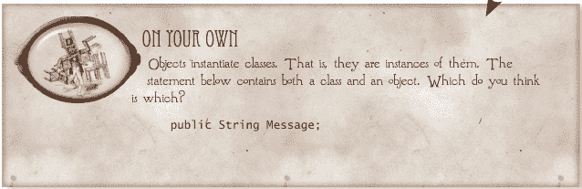

### 我们是艺术家，而不是货运列车

我们的大脑不会沿着单轨从A点一路颠簸到B点。像任何艺术家一样，我们从草图开始，然后填充细节。我们不会一次性呈现关于某个主题的所有信息，而是从简单开始，随着你获得更多上下文而添加细节。这样它们就会留在脑海中。

### 我们以模式思考，而不是直线思考

我们的大脑在处理模式而非孤立事实时效果最好。我们将始终在上下文中呈现新观点，以帮助你理解所有部分如何拼合在一起。

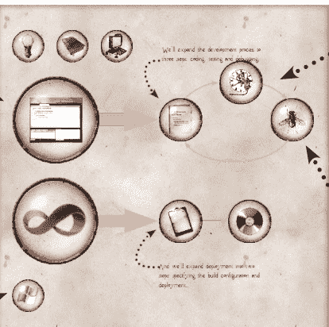

### 我们不生活在文字的世界里

我们的大脑通过所有感官吸收信息，而不仅仅是语言。我们将使用图形、上下文和有节奏的语言来吸引视觉、触觉和听觉。

### 我们想要地图，而不是谜团

我们的大脑不断评估进度，但除非我们知道要去哪里，否则这是不可能的。我们将使用大量路标，让你始终知道自己在哪里以及要去哪里。

## 这本书不适合所有人

我真的很讨厌技术书籍宣称它们适合“所有人”，你不也讨厌吗？这不可能是真的，长期来说声称适合所有人也不会卖出更多书。这只会让那些感到困惑（因为书对他们来说太高级）或无聊（因为书对他们来说太基础）的人恼火。我不想让你恼火或无聊，所以我直说：这本书不适合所有人。

### 如果以下情况，这本书不适合你：

- 你对编程一无所知（或至少不太了解），但想学习。
- 你使用电脑有一段时间了，但不太了解应用程序是如何编写的。
- 你玩过一点 Visual Studio 和 C#，但对自己的技能不太有信心。不知道自己不知道什么是很可怕的，而这本书可以帮助你解决这个问题。

### 如果以下情况，这本书可能不适合你：

- 你根本不会使用电脑。我假设你知道如何打开应用程序、点击按钮和从菜单中选择项目，所以如果你还不懂这些，你可能想先看一本关于使用 Windows 的基础书籍，以后再回头看这本。
- 你懂 C#，但已经有一段时间没用了，想重温技能。这本书不太适合浏览和粗读。
- 你想使用 WinForms。这本书只讨论较新的 WPF 平台。

### 如果以下情况，这本书可能适合你：

- 你是 Visual Basic 6 程序员，想从基础开始学习 C#。
- 你是 Visual Basic 6 程序员，想学习在 Visual Basic .NET 中构建 WPF 或 Silverlight 应用程序。网上有很多 WPF/Silverlight 教程，其中一些非常好，但大多数都假设你懂 C#。如果你不懂，这可能是一本适合你的入门书。
- 你是初学者 Visual Basic 程序员，想学习模式和最佳实践。有一些书籍专门针对该主题，但它们往往相当高级，所以你可能会发现这本书更合适。

## 你将学到什么

你和我都知道，读完一本书你不会成为专家 C# 程序员，不管这本书有多好。读完两本、三本或十几本后你也不会成为专家。当然，你应该阅读专家们的观点。但建立真正专业知识的唯一方法是编写大量应用程序，犯大量错误，然后修复它们。这需要时间和经验，而我无法给你这些。但我可以帮你入门。

### 读完本书后你将：

- 了解 Visual C# 语言的结构、基本语法、表达式和命令。
- 了解 .NET Framework 在 C# 应用程序开发中的作用。
- 掌握 .NET Framework 核心类型的工作知识，以及如何使用它们。
- 掌握使用设计原则和模式设计面向对象应用程序的工作知识，这将让你不仅能编程，还能编程良好。
- 掌握开发现代应用程序所使用的常见设计模式的工作知识。
- 掌握 XAML 声明式语言的工作知识。
- 了解如何在 Windows Presentation Foundation 中编写吸引人且有用的应用程序。
- 准备好转向更高级的特定编程主题书籍。
- 准备好开始编写应用程序并自己弄清楚其余内容。

### 但你不会：

- 了解关于 C# 编译器或 CLR 工作原理的所有事情。（我不确定是否有人知道。）
- 了解框架类库的每一个角落。（但你将知道如何探索它。）

## 你需要什么

入门不需要太多。当然，需要这本书。（你买了这本副本，对吧？）还需要一份 Visual Studio。你还需要一些书写工具，因为并非所有练习都在电脑上完成，如果你不喜欢在书上写字，可能还需要某种笔记本。

### 获取 Visual Studio

Visual Studio 有几个不同的级别。如果你已经购买并安装了副本，那么你可以开始了。如果没有，你可以使用免费的 C# Express 版本。你可以从 Microsoft 网站下载它。以下是我写这篇文章当天需要做的事情，但 Microsoft 以移动事物而闻名，所以事先警告：你可能需要找找。

- 1. 从主 Microsoft 网站，从产品菜单中选择 Visual Studio 将带你进入 Visual Studio 主页。
- 2. 从页面顶部的产品列表中选择 Express 将带你进入 Express 版本页面。
- 3. 在主页上选择 Visual C# 2010 Express 将带你进入产品页面。在左侧选择 Download 将带你进入下载页面，你可以在那里下载 ISO 镜像或直接从 Web 安装。

### 获取源代码

你不需要下载源代码就能完成本书中的练习，但它在 Web 上可用，网址是 informit.com/title/9780672331046


## 工作原理

如果你已经读到这里，你就知道自己不可能只是坐下来听我讲。本书的核心是练习，如果你想学习，就需要亲自动手做。真的要去做。你不能只思考答案。你需要坐到电脑前或拿起铅笔，实际操作一下。以下是你将要做的一些事情的预览：

## 思考帽


书中大多数练习都会让你“戴上思考帽”。我会给你这些练习的答案，但理解这一点非常重要：你不一定总能完全答对，**那没关系**。这并不意味着你没有“懂”。这意味着我并不总是按常理出牌，因为你从错误中学到的知识一样多（甚至更多）。

## 独立完成


有些练习要求你独立完成，我不会给你答案。有时确实没有标准答案；它们只是你需要思考的事情。你可能会想把这些留到“以后”再做，但最好不要。它们是学习过程的一部分。

## 休息一下


我会不时建议你在进入下一节之前休息一下。当然，你可以随时休息，但这些建议并非因为我认为你可能会累。我提出这些建议是因为学习研究表明，如果你在复习前停留大约15分钟，你就更有可能将信息转移到长期记忆中。（换句话说，你会真正学会它。）


## 应用程序开发

所以，你想学习编程。太好了。你读对书了。但编程到底是什么？它和软件开发是一回事吗？

那你可能听说过的其他东西呢……开发平台、应用程序架构、开发方法论、设计模式、最佳实践。这一切听起来有点可怕，不是吗？

在本章中，我们将弄清楚所有这些东西是什么，以及它们在从这里（一个软件构想）到那里（一个可运行的应用程序）的过程中各自处于什么位置。

放松，它没有你想象的那么复杂...

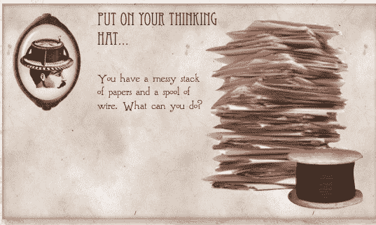


当有人有了一个想法时，项目就开始了。


想法被转化为规格说明。

- 规格说明告诉程序员系统需要做什么。


软件在特定的运行环境中执行，例如 Windows 或浏览器。

当人们使用你的软件时，他们常常会产生新的想法……然后项目重新开始


使用规格说明，程序员使用 C# 等编程语言创建源代码。

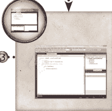

开发环境提供将源代码转化为可运行软件的工具。

## Microsoft Visual Studio


## 你做得怎么样？

我给了你一堆乱七八糟的纸和一卷铁丝。思考帽练习并不总是只有一个正确答案，但以下是你可能做过的两件事...


你可能把纸装订成了一个笔记本。这是一个很好的永久性解决方案，但工作量很大。


或者你可能只是做了一个回形针。简单快捷，但可能只是临时的。


那么这里的要点是什么？在应用程序开发中，正确答案几乎总是“视情况而定”。最佳解决方案将取决于应用程序将如何使用。它将取决于可用的时间和精力有多少（或者你愿意投入多少）。它将取决于应用程序中还有什么在进行。

## 最佳解决方案取决于……嗯，视情况而定。

## 让我们回顾一下这个过程...

从一个好主意开始（这是最难的部分），你离解决方案仅差五个步骤。在本书中，我们将主要探讨如何编写源代码，但别担心，我们也会看看其余的步骤——至少足以让你踏上正确的道路。

- 0 从一个好主意开始...
- 1 ...然后创建规格说明。
- 2 使用最佳实践...
- 3 ...来创建源代码。
- 4 创建可执行文件...
- 5 ...在你选择的环境中运行。

这是什么？这些图像代表系统架构、开发方法论和最佳实践。这些原则决定了“勉强能运行的代码”与“可靠、可维护的应用程序”之间的区别。它们将在未来为你节省金钱和麻烦，我们将在本章和全书中详细讨论它们...

## 认识尼尔和戈登...

在开始之前，我想让你认识我们将合作的客户。他们经营着镇上最热门的新咖啡馆。但他们正被自己的成功淹没！要管理的事情太多了！日程、菜单、会议，而且随着业务的增长，他们需要把那些美味的食谱从脑子里拿出来，整理成可使用的形式。这两个家伙在厨房里是天才，但对这些管理工作不知从何入手。

在整本书中，我们将帮助他们。


## 任务列表

在本书的其余部分，我们将详细介绍开发过程的第三步：编写 C# 代码，并写好它。但在此之前，我们需要先审视三件事：

## 开发过程

我们所做的一切都融入到整个流程的背景中，因此我们需要先理解这一点。

## 系统设计

我们知道，开发过程始于一个想法，该想法被转化为描述系统如何工作的规格说明。因此，我们将首先探讨一些用于捕获系统设计的工具。

## 创建可执行文件

集成开发环境（IDE）提供将源代码转换为可执行文件的工具，可执行文件是用户或其他软件可以运行的软件。我们将使用 Visual Studio 创建可执行文件，在决定如何构建应用程序之前，我们需要更多关于这在 .NET Framework 上下文中如何工作的细节。

## 独立完成

你对想要编写的应用程序有什么想法吗？记下三四个。我们会反复回到它们。

## 开发过程


应用程序开发过程始于有人需要计算机做某事。那个“某事”可能是对现有软件的更改，也可能是一个全新的系统，但大多数应用程序是（或应该是）响应需求而开发的。

应用程序要做的那个“某事”被记录在规格说明中。规格说明可以简单到在餐巾纸上涂鸦的图表，也可以是多卷详细的描述。它可能在编写任何代码之前就“完成”，也可能在项目过程中逐步制定。


你将使用规格说明来开发应用程序。在此过程中，你将选择一个有效的开发方法论（开发期间将执行的一组步骤），并受最佳实践（经验表明能产生更高效、更易维护代码的经验法则）的指导。你还可以实现设计模式，它们是常见编程问题的标准解决方案。


## ...再来一次

"编程"很大程度上（但不仅仅是）编写源代码的问题。这意味着，对我们来说，就是编写 Visual C# 语句并使用 .NET Framework。如你所见，.NET Framework 为我们完成了大量工作。


大多数程序员使用集成开发环境（IDE），它结合了文本编辑器（让你输入内容的部分）、编译器（将你的源代码翻译成目标代码，即计算机可以理解的指令的部分）、链接器（将目标代码片段组合成可执行文件的部分），以及其他有用的工具，如测试工具和可视化设计器。和大多数 C# 程序员一样，我们将使用 Microsoft Visual Studio，并在本书中介绍所有这些功能。

一旦应用程序被编写并编译成可执行文件，它就在特定的运行时环境中运行。在本书中，我们将开发在 Microsoft Windows 下运行的应用程序，但你应该知道，C# 和 Visual Studio 可用于针对多种不同平台进行开发，包括 Web 和移动设备。


## 休息一下

第一项任务完成了！现在是个短暂休息、放松一下的好时机，然后再回来学习本章的其余内容。

## 复习

在继续之前，让我们做最后一个练习，确保你已经熟练掌握了这个流程。下面的图标顺序不正确。请正确给它们编号，然后描述每个步骤。


- 0. ______________________________________________________________
- 1. ______________________________________________________________
- 2. ______________________________________________________________
- 3. ______________________________________________________________
- 4. ______________________________________________________________
- 5. ______________________________________________________________
- 6. ______________________________________________________________

## 系统设计

我的猫在钢琴上走动发出的声音和音乐会钢琴家弹奏的声音有什么区别？一个计划。

编程时，你所遵循的计划就是规格说明。（你都知道，对吧？）

### 关于规格说明，你需要知道以下几点：

- 准备规格说明没有单一的正确方法。
- 所需的细节程度取决于应用程序的复杂性和你的经验。当主题或功能对你来说是新的时，你需要更深入地阐述。
- 最佳实践规定规格说明应在项目过程中制定，但这并不总是可行。有时你的客户（或老板）希望在开始编码之前就有一份完整的规格说明。要有准备。无论如何，需求都会在项目过程中发生变化。

- 大多数非平凡的规格说明将包含比我们在这里讨论的用例多得多的内容：数据库架构、屏幕布局、架构和处理图……细节将取决于应用程序。（记住：这取决于具体情况。）但这不是一本应用程序设计书，所以我们只会讨论几个能让你入门的设计工具。（我们将在后面的章节中介绍其他一些。）


## 敏捷瀑布

在软件工程的早期，我们尝试在开始编程之前制定完整、详细的规格说明。这种方法被称为瀑布模型，因为每个明确定义的开发阶段（需求、设计、开发、测试、实现、维护）“流入”下一个阶段。

在进入下一阶段之前完成每个阶段似乎是个好主意，对吧？你会认为在开始做之前确切知道需要做什么是很高效的。问题是，在实际使用系统之前，我们永远不知道系统需要做什么，或者如何去做。


瀑布模型让用户感到沮丧，因为它又慢又不灵活，也让开发人员感到沮丧，因为用户“永远不知道自己想要什么”。弗雷德里克·P·布鲁克斯在他的1975年经典著作《人月神话》中说：“计划扔掉一个。你无论如何都会扔掉的。”这是个相当令人沮丧的想法，不是吗？

瀑布模型确实有其存在的位置，因为原则上它仍然是一个高效的开发模型。有时你正在处理的系统足够简单，你可以预先确切知道它需要做什么。对现有系统的更改通常属于此类，尽管系统本身可能很复杂。（但要小心……复杂系统可能难以预测。）不幸的是，有时你为一个大型组织工作，该组织在白垩纪（大约1980年）就制定了其开发方法论，它将规定你的流程。

但从那以后我们学到了很多，聪明的软件工程师开发出了新的、更有效的技术。其中最好的技术之一是敏捷开发方法论的一部分，该方法论建议你只指定你打算立即处理的那一小块软件。敏捷开发还有更多内容，我们将在后面的章节中讨论其中一些。但如果你很感兴趣（我希望你是！），你可以阅读2001年发布的原始《敏捷宣言》，网址是 www.agilemanifesto.org，或者查看罗伯特·C·马丁的优秀入门介绍。

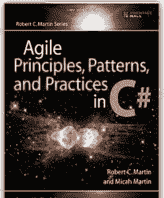

不过，无论你是一次性还是逐步制定规格说明，你都需要一个起点。用例，即描述参与者（用户或其他软件组件）如何与系统交互的描述，是最好的起点之一。

## 用例

用例只是描述一段软件如何与人或其他软件交互的逐步描述。

> “跟踪我们的供应商是一场噩梦。我们知道我们有什么和需要什么，但没人记得谁有最好的西葫芦或小牛肉。我需要能够选择食材，并让电脑告诉我去哪里买最好。”


让我们一起走通过程，拼凑一个简单的用例。根据尼尔对问题的描述，我们可以推断出这样的交互：

- 1. 系统按类型（蔬菜、肉类、香草等）字母顺序显示产品列表。

- 2. 用户从列表中选择项目；系统按偏好顺序显示前三个供应商。对于每个供应商，显示名称、电话号码和交货时间。

就是这样。虽然可能看起来不像，但这真的足以开始。（你要确保只做足以开始的事情。很容易把这些事情弄复杂，那是个错误。）

不过请注意，这个用例隐含了另外几个用例——如果系统显示食材列表，那么该列表必须存储在某个地方，并且必须有某种方式来输入它。供应商也是如此。但那些是独立的用例。记下它们的存在，但不要让它们分散你的注意力！

## 如果……怎么办？

我们的用例描述了用户与系统之间的理想交互。这很好，但我们都知道世界几乎从不按计划运行，一个有弹性的系统不能忽视这一点。因此，除了理想情况外，你还需要捕捉可能出错的情况（尽你所能），以及系统在出错时应该怎么做。把它们当作墨菲定律案例...

在我们的简单示例中，用户寻找的食材可能不在列表中。或者可能出现系统问题。例如，包含食材和供应商的数据库在运行时可能不可用。当这些事情发生时，系统应该怎么做？

当然，系统中的备选路径并不总是问题的结果。有时用户只是需要以略有不同的方式做某事。无论其来源如何，这些备选路径都应作为用例的一部分来捕捉。我们的修订版如下：

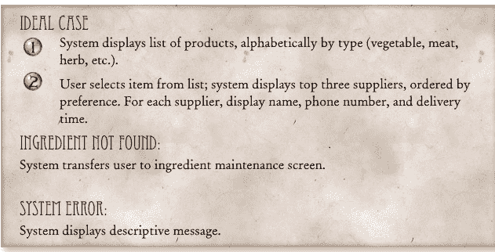


## 戴上你的思考帽

现在尝试自己编写一些用例。根据下面的描述，尝试写出每个用例的基本步骤和一两条备选路径。

> "Our recipes are based on a number of servings that's right for the restaurant, but for catering, we often need to scale them up or down. That math is really ugly, and it's easy to make mistakes."

> "The catering side of the restaurant is starting to really take off. I keep the clients' contact details in my agenda, so if Gordon needs to contact them directly, he has to ask me for them. That's a waste of time."

Extra credit: Each of these use cases implies the existence of others. Can you identify them?

## HOW'D YOU DO?

These cases are based on imaginary conversations. Your imaginary conversation might be different, so don’t worry if you have slightly different results. The important thing is that you get some practice thinking through the steps.


> “Our recipes are based on a number of servings that’s right for the restaurant, but for catering, we often need to scale them up or down. That math is really ugly, and it’s easy to make mistakes.”

- Ideal case:
  1. System displays list of recipes, alphabetically by type.
  2. User selects recipe from list; System displays formula.
  3. User enters new batch size and chooses “Recalculate”. System re-calculates ingredient amounts and displays new values.

- Recipe not found:
  - No action: Even though the system takes no action, it’s a good idea to think about what might go wrong
  - System error:
    - System displays descriptive message:

> “The catering side of the restaurant is starting to really take off. I keep the clients’ contact details in my agenda, so if Gordon needs to contact them directly, he has to ask me for them. That’s a waste of time.”

- Ideal case:
  1. System displays list of clients, alphabetically by type.
  2. User selects client from list; System displays contact details.

- Client not found:
  - No action:
  - System error:
    - System displays descriptive message:

## Extra Credit:

The client details system implies a case to enter and edit client details, while the catering system implies a case to enter ingredients and use to enter recipes. Both systems probably require a printing case, as well.

Did you think of any others?

## UML STATE DIAGRAMS

UML stands for the Unified Modeling Language. It's a de facto industry standard for MODELING (drawing pictures of) a system. There are several different types of UML diagrams, and we'll look at a few more of them in later chapters. One type, called the UML STATE DIAGRAM, is useful for supplementing and clarifying complex use cases. (UML also defines a Use Case Diagram, but frankly, I don't think it's much help.) Not surprisingly, a UML State Diagram describes the behavior of a system as a series of STATES, the TRANSITIONS between them, and the EVENTS that trigger transitions. Here's an example:

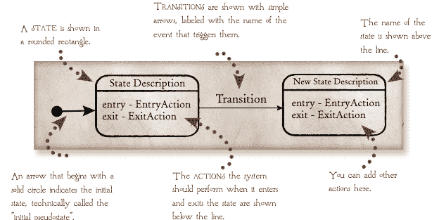

## WHY BOTHER?

Is it really worthwhile learning a strict modeling language? Well, I'm not going to make that decision for you, but UML does have some advantages: You don't have to make up (and remember) your own symbols. Lots of people can read and understand UML diagrams. That makes it easy to use in teams, and will help you understand books (like this one) that use UML diagrams. There are tools that can help you manage UML diagrams. As we'll see, Visual Studio uses a kinda-sorta UML for generating source code in some of its designers. There are other programs and languages out there that do the same thing.

## AN EXAMPLE

The abstract diagram on the previous page probably doesn't look all that helpful, but let's look at a real example. Here's the supplier use case in both formats...

### IDEAL CASE

1. System displays list of products, alphabetically by type (vegetable, meat, herb, etc.).

2. User selects item from list; system displays top three suppliers, ordered by preference. For each supplier, display name, phone number, and delivery days.

### INGREDIENT NOT FOUND:

System transfers user to ingredient maintenance screen.

### SYSTEM ERROR:

System displays descriptive message.

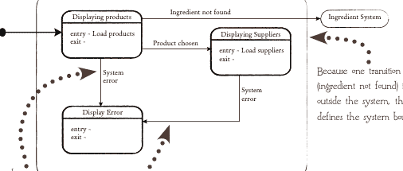

Because one transition (ingredient not found) is outside the system, this box defines the system bounds.

The diagram makes it clear that two states could trigger a system error.

What do you think? Is the diagram clearer? Which would you use for a simple case like this? Either, both?

## PUT ON YOUR THINKING HAT

The use cases we've been working with were very simple. Here's one that looks a bit more complicated. Prepare a use case and a state diagram based on Gordon's description.


> "Our desserts use basic components—cake layers, fillings like chocolate ganache and pastry cream, and sometimes frostings—that are made in advance and then combined on the day they’re served in the cafe. At the end of each day I prepare the dessert menu for the next day, and to do that I need to know what components and raw ingredients are in the cooler. Because some things may be needed for a catering job, the system needs to show me how many are available in total and how many are already allocated. Then, if we’re getting low on something, I need to add it to the schedule to be prepared sometime in the next few days."

## HOW'D YOU DO?

It's fine if your answer don't match mine exactly, as long as you thought through the issues.

- Ideal Case:
  1. System displays components and raw ingredients in order.
  2. User selects ingredient from list. System displays details of quantity on hand and quantity available.
  3. User allocates amount required. System updates details on exit.

- Schedule:
  System transfers to Scheduling component.

- System error:
  System displays descriptive message.

The use case shows some details, like the exact information displayed, that aren't shown on the diagram.

The diagram makes how the user can move around the system clearer.

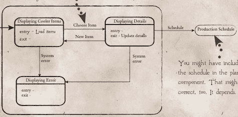

You might have included the schedule in the planning component. That might be correct, too. It depends.

## SPECIFICATION COMPONENTS

You've seen two of the things that specifications commonly contain: use cases and UML state diagrams. Are you wondering what else might be in there? Here are some possibilities...

### CLASS DIAGRAMS

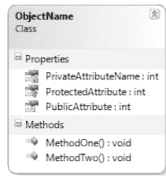

A UML Class Diagram models the classes in the system. A class is a programming construct that represents the characteristics of something in its attributes (the things it knows) and methods (the things it can do). We'll talk about classes a lot beginning in Chapter 9.

### DATABASE SCHEMAS

If the application is going to store data in a relational database, the specification will often include a schema diagram that describes the database structure. We won't be discussing them in this book.

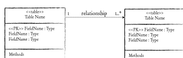

### SCREEN LAYOUTS

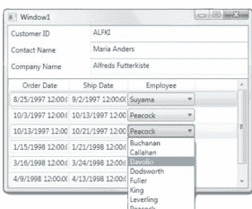

Some designers include screen layouts as part of the specification. (I'm one of them.) The layouts might be just rough sketches, or they could be complete graphics, depending on how complex the interface is and how important the “look and feel” are to the client.

## USER REQUIREMENTS


The specification process is part of the overall development methodology. We took a quick look at two different methodologies. Can you describe how the specification process differs between them?

### WATERFALL:

### AGILE:

Use cases translate a user requirement into the steps that represent its functionality and actors’ interaction with the system. What three things should you record when creating a use case? (Hint: One of them you only make a note of...)

1. 
2. 
3. 

Use cases and UML state diagrams are good for showing different things. Name at least one thing that’s easier to show on each:

- -
- -
- -
- -


## ...再来一次

UML 状态图以系统状态、状态之间的转换以及触发转换的事件来展示交互。下面绘制一个基本的 UML 状态图，显示初始伪状态、至少两个状态和一个转换。


## 休息一下

已完成两项！现在为什么不先休息一下，放松一下，然后再回来完成复习并处理最终任务，探索编译过程呢？


## 复习

在继续之前，让我们做最后一次分析。从你在第 15 页整理的列表中选一个你想开发的应用程序，构建用例和一个 UML 状态图。


## 创建可执行文件

当乐团演奏时，音乐家们依赖机器来捕捉声音，并创建可以在 CD 或媒体播放器上重新创建的东西。程序员也做同样的事情。

计算机不讲英语。它们甚至不理解 C#，正如我们将看到的，C# 很像英语。计算机理解位（位是指零或一，而不是碎片）。它们可以将位相加并对其执行逻辑运算。大多数人不想将“我的食谱”翻译成这样的操作，所以我们使用像 C# 这样的语言来描述我们希望应用程序的行为方式，这种方式与我们思考它们的方式非常相似。


### 做个笔记

关于创建可执行文件，你需要知道一些事情：

- 将源代码翻译成计算机可理解的目标代码主要有三种方式。我们将在本节中逐一介绍。
- 每种方法都有优点，也都有缺点。
- 翻译方法通常由你使用的语言工具决定。

## 编译还是解释？

传统上，语言要么是编译型的，要么是解释型的。两种方法都能达到相同的结果——你用像 C# 这样的语言编写的源代码被翻译成特定 CPU 可理解的目标代码。区别在于何时进行。

编译型语言在设计时执行翻译，而解释型语言在运行时翻译。

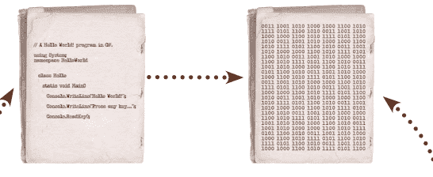

每种方法都从源代码开始，即你编写的人类可读的指令。

最终，每种方法都将该源代码转换为目标代码，即特定于 CPU 的机器可读指令。

> **明智之言**
>
> 设计时是指你正在构建应用程序。
> 运行时是指用户正在执行应用程序。

## 优缺点

对于“哪种编译方法更好？”这个问题并没有明确的答案。

### 解释型语言...

- 使你在开发过程中测试和更改应用程序变得快速而简单。
- 允许相同的源代码在任何安装了该语言解释器的平台上运行。

### 但是...

- 它们通常比编译型语言运行得更慢。
- 源代码对所有人都可用。

### 编译型语言...

- 通常比解释型语言运行得更快。
- 将可执行文件与源代码分开保存，这使其在某种程度上更安全。

### 但是...

- 在开发过程中测试应用程序需要不断重新编译。
- 输出始终特定于单个平台。

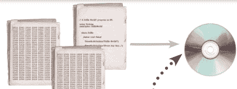

多个源文件可以合并为一个可执行文件。这称为链接。

在 Windows 中，可执行文件可以是 exe 或 dll。基本上，exe（发音为“x-ee”）是用户可以运行的应用程序，而 dll 是库（“dll 代表动态链接库”），由其他软件运行。

## 即时...

C# 是一种符合 CLR 标准的语言。我们将在下一章中了解这到底意味着什么，但目前你需要知道的是，你用 C# 编写的应用程序使用一种称为即时编译的不同方法来将源代码翻译成目标代码（“JIT”发音类似“bit”，有时也被用作动词，例如，“CLR 中的代码被即时编译。”）

在设计时，所有符合 CLR 标准的语言都被翻译成 Microsoft 中间语言（“MSIL”），就像经典的编译型语言一样。

在运行时，公共语言运行时（“CLR”）将 MSIL 翻译成特定于 CPU 的目标代码。

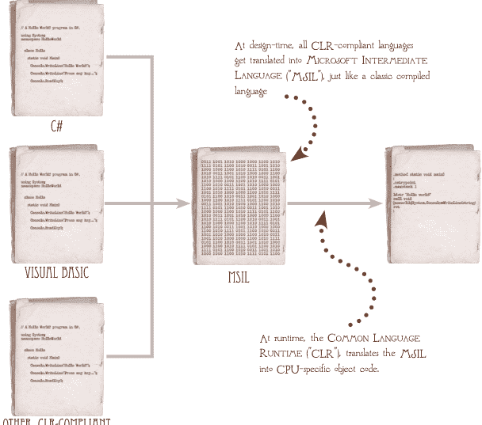


## 动动脑筋

你已经了解了解释型语言和编译型语言的优缺点。即时编译结合了这两种技术。你认为这种方法的一些优缺点是什么？

### 优点：

### 缺点：


## 优缺点

了解使用即时编译的一些权衡很重要，所以让我们更详细地看看其中的一些优缺点...

### CLR 与平台无关

Microsoft 版本的 CLR 运行在各种版本的 Windows 操作系统上，包括嵌入式和微型系统。CLR 也已移植到 Linux、Mac OS X、BSD 和 Sun Solaris 等其他平台上运行。（详情，请访问 www.mono-project.com。）C# 语言和 CLR 的部分内容已被接受为 ECMA 标准。

### 应用程序组件可以用多种语言编写

因为所有符合 CLR 标准的语言都被编译为相同的中间语言，所以应用程序可以使用任何语言组合编写的组件。第一次，你可以在 C# 代码中使用用 C++ 编写的快速统计例程和你朋友用 Visual Basic 编写的小部件。CLR 在很大程度上实现了 Microsoft 将语言变成“生活方式选择”的目标。

### 运行时编译可能更慢

行业经验法则是，解释型语言的运行速度比编译型语言慢 30 到 70 倍。虽然 Microsoft 提供了一个名为 NGen.exe（“本机生成器”）的工具，它将在设计时执行最终编译，但测试表明，编译为本机目标代码的应用程序实际上并没有运行快多少，而且令人惊讶的是，在某些情况下实际上更慢。看来 CLR 非常擅长根据运行时环境调整代码。

### CLR 合规性限制了语言

有些人抱怨，由于所有符合 CLR 标准的语言都被编译为 MSIL，因此它们都无法做 MSIL 无法做的事情，这是一种“最小公约数”编程。实际上，计算机能做的 MSIL 能做的事情并不多，你始终可以选择使用 C#、C++ 或其他语言编写不符合标准的代码，并在 CLR 托管的应用程序中调用“不安全”过程。

## 你做得怎么样？

以下是即时编译方法的一些优缺点。你可能想到了其他优缺点，这也没关系。

### 优点：

- MSIL 将在任何支持 CLR 的平台上运行。
- 应用程序可以使用任何组合的符合 CLR 标准的语言编写的组件。
- 错误检查可以在设计时完成。

### 缺点：

- 运行时编译可能更慢。
- CLR 对语言施加了一些限制。
- 编译会使测试变慢一点。

## 休息一下

最终任务完成了！现在先休息一下，放松一下，然后再回来完成最终练习并结束本章。

## 复习

在继续进入下一章的 .NET 平台之前，最后复习一次。

将源代码翻译成目标代码的三种方法是什么？

哪些因素决定规格说明需要多少细节？

为什么瀑布模型看起来是个好主意？为什么又不是？

源代码在过程的哪个阶段被解释？

源代码在过程的哪个阶段被编译？

JIT 代表什么？

每个图片代表什么？


## 恭喜！你已完成本章。在进入下一章之前，花一分钟思考一下你所取得的成就...

### 列出你在本章学到的三件事：

- 1
- 2
- 3

你认为为什么需要知道这些东西才能成为一名 C# 程序员？

本章中有什么是你觉得需要更详细理解的吗？如果有，你打算怎么做？


## .NET 平台

上一章我们探讨了应用程序开发的工作流程，并考察了规范过程和编译方法。在本章中，我们将开始通过了解 .NET 平台来缩小关注范围，这是大多数 C# 应用程序运行的环境。

.NET 平台（朋友们管它叫“dot Net”），包括 .NET FRAMEWORK，即我们将要学习的编程和运行时基础设施，以及像管理数据的 SQL Server 这样的服务器，和像 Visual Studio 和 Expression Studio 这样的工具。

本章我们还将通过编写你的第一个真实应用程序来初涉编程，即所有初学者程序员的必经之路——传统的“Hello, World!”。


### 独立练习

还记得你想开发的应用程序列表吗？其中大多数都将使用 .NET Framework，但在阅读本章过程中，请记下你认为可能对你有用的其他 .NET 平台组件。

## 如何契合

你将在设计时和运行时都使用 .NET 平台组件。

你编写的代码将使用 .NET Framework 的一部分——Framework Class Library。

你将使用 .NET 工具 Visual Studio 来开发你的应用程序。

你的应用程序可能会使用 .NET 平台服务器，例如用于关系型数据库的 SQL Server 或用于文档管理的 Sharepoint。

.NET 应用程序在 Common Language Runtime 的上下文中运行，这是 .NET Framework 的关键组件。

.NET 平台由 .NET Framework、Framework Tools 和 Framework Servers 组成。

## 任务列表

上一章我们从抽象层面探讨了开发。现在是时候开始了解 .NET Framework 和 C# 的具体内容了。我们将从以下内容开始：

## .NET 平台组件

尽管 Neil 和 Gordon 很有才华，但他们也无法在厨房里包办一切。他们不必如此。同样，你也不必完成应用程序中所有需要做的事情。但就像这两位小伙子一样，如果你想控制一切，就需要对每个组件的功能有基本了解。因此，我们将从考察 .NET 平台的主要组件开始本章。

## 说声你好

一旦我们了解了 .NET 平台的各个组成部分，就该初涉编程了。程序员学习新语言时，第一件事通常是让它向世界问好，我们将通过创建一个应用程序来向世界介绍自己，以此来实现。

## 说什么？

当然，你读这本书不仅仅是为了学习如何遵循指示，所以在说声你好之后，我们会稍微回顾一下，检查刚才所做的事情。理解这个过程很重要，因为你在构建的每个应用程序中都会或多或少做同样的事情。

## .NET 平台组件

### .NET 服务器

- SQL Server
- IIS
- Biztalk Server
- Sharepoint Server

### .NET 工具

- Visual Studio
- Expression Studio
- Framework SDK

### .NET Framework

### 专用框架

- Compact
- Micro
- Windows Phone
- CLR
- Languages
- Class Library
- Base Class Library
- FCL Technologies

## 动动脑筋

你能使用这张图回答这些问题吗？


以下是 .NET 平台组件的三个主要类别：

C# 是其中之一：

这是创建 .NET 应用程序时 Visual Studio 的替代品：

例如，如果你要为手机编写代码，就会使用其中之一：

这代表 Framework Class Library：

这是 .NET 运行时环境。这些字母代表：

这是 .NET 的主要开发环境：


## 做得怎么样？

以下是 .NET 平台组件的三个主要类别：

- .NET Servers
- .NET Tools
- .NET Framework

C# 是其中之一：

- Framework language

这是创建 .NET 应用程序时 Visual Studio 的替代品：

- Framework SDK

例如，如果你要为手机编写代码，就会使用其中之一：

- Specialty Framework

这代表 Framework Class Library：

- FCL

这是 .NET 运行时环境。这些字母代表：

- CLR — Common Language Runtime

这是 .NET 的主要开发环境：

- Visual Studio

## .NET 平台组件

### .NET 服务器

这些为其他应用程序提供服务。

- SQL Server
- IIS
- Biztalk Server
- Sharepoint Server

### .NET 工具

你使用这些来创建 .NET 应用程序。

- Visual Studio
- Expression Studio
- Framework SDK

### .NET Framework

这是本书的主要关注点。

我们不会深入研究这些，但你在这里学到的大部分内容都将适用。

### 专用框架

- Compact
- Micro
- Windows Phone
- CLR
- Languages
- Class Library

这提供了可用于任何应用程序的有用代码。我们将从第 10 章开始详细考察它。

- Base Class Library
- FCL Technologies

Framework Technologies 包括用于开发 Web 应用程序的 ASP.NET 和 Silverlight 等内容，用于处理数据的 Entity Framework，以及我们将用来构建 Windows 界面的 WPF/XAML。

## 框架的价值

为了了解 .NET Framework 为我们提供了什么，让我们来看一个常见的编程需求。

这是一个非常简单的表单。几乎任何通用编程语言都能让你轻松创建类似的东西。

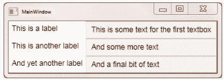

当用户将表单变宽时，你希望标签保持原有大小，但文本框变大，如下所示：

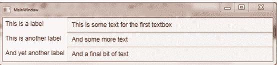

很简单，对吧？你在无数不同的应用程序中见过无数次。你可能会觉得任何不这样做的应用程序都相当笨拙，对吧？让我们来看看程序员需要做什么才能实现这一点。

在 .NET 发布之前，Visual Basic 6 是开发 Windows 应用程序最流行的语言。现存的 VB6 应用程序数不胜数，VB6 程序员也几乎同样多。以下是调整我们表单大小的 VB6 代码（它可能对其他表单不起作用）：

创建一个变量来存储表单的原始宽度。

在表单首次加载时获取该变量的值。

遍历表单上的所有控件并调整文本框的大小。

重置该变量。

```
originalWidth As Integer
Sub Form_Load()
    originalWidth = Me.ScaleWidth
End Sub
Sub Form_Resize()
    If Me.WindowState <> vbMinimized Then
        Dim ctrl As Control
        For Each ctrl In Controls
            If typeof ctrl is TextBox Then
                ctrl.Width = ctrl.Width * (Me.Width / originalWidth)
            End If
        Next
    End If
    originalWidth = Me.ScaleWidth
End If
```

实际上，调整大小的例程会复杂得多。至少，它需要考虑高度和宽度的变化。当然，需要调整的确切控件以及调整方式，对于每个表单和每种控件类型都会不同。

那 .NET 版本呢？没有。Windows Presentation Foundation 是 .NET Framework 技术之一，它会为你完成所有这些工作...

## 休息一下


在本书剩余部分中，我们将更详细地探讨 .NET Framework，但现在你应该了解 Framework 在整体 .NET 平台中的位置，所以在我们处理下一个任务之前，先休息一下。

## 复习


.NET 平台组件的三个类别是什么，它们各自起什么作用？

使用 C# 编程时，你将始终使用哪个组件？


# 你好，世界

准备好进行一些实际编程了吗？当然准备好了。在接下来的几页中，我们将创建每个初学者的传统第一个程序，“你好，世界”。以下是我们需要做的事情：

- 1. 创建一个 Visual Studio 项目。项目是源代码和相关资源（如数据库连接或应用程序将使用的资源）的容器。

- 2. 使用 Visual Studio 设计器创建一些小部件（在此例中为 WPF 窗口中的一些控件），并设置它们的属性。Visual Studio 提供多个设计器，用于以可视化方式而非代码方式创建应用程序。

- 3. 使用 Visual Studio 代码编辑器编写一些实际的 C# 代码。与简单的文本编辑器不同，代码编辑器提供了许多功能，使编写和管理代码更加简单。

- 4. 在调试模式下运行应用程序，这有助于你在 Visual Studio 内查找任何错误。

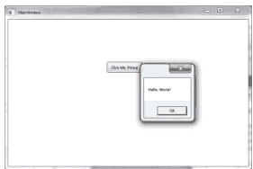

## 创建项目

首次加载 Visual Studio 时，应用程序将显示一个开始页面，其外观取决于你安装的 Visual Studio 版本。这里显示的是 Visual Studio Ultimate，但任何版本都可以。单击左上角的“新建项目”。

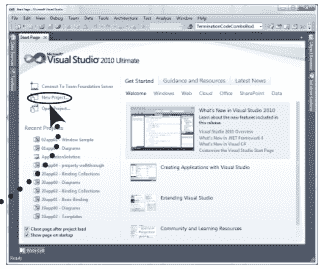

这就是我们将要创建的内容

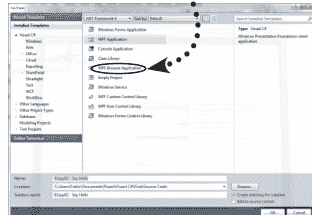

接下来，Visual Studio 将显示“新建项目”对话框。同样，此对话框的细节会因你安装的 Visual Studio 版本而略有不同。不要被此困扰。只需从 Visual C# 项目的 Windows 类别中选择 WPF 应用程序。你可以保留应用程序和解决方案名称为“WPFApplication1”，或将其更改为任何你喜欢的名称。位置也是如此。（你可能希望为本书中将要创建的项目单独创建一个目录。）当一切都按你想要的方式设置好后，单击“确定”。

# 2 创建窗口

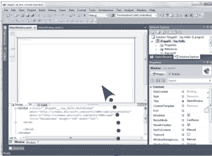

在“新建项目”对话框中单击“确定”后，Visual Studio 将运行一段时间，然后显示此屏幕。我们稍后将了解屏幕上的所有窗口和选项卡。目前，你需要知道的是，屏幕中最大的部分包含 WPF 设计器，你可以通过将小部件拖动到设计图面上来创建应用程序窗口。在屏幕底部，你可以看到表示 WPF 窗体的 XAML。XAML 是一种用于定义窗体的特殊 XML 版本。我们将从第 15 章开始学习如何使用它。

这是设计图面。

在屏幕左侧找到“工具箱”一词并单击它。工具箱将显示在设计器之上。（你可以通过单击顶部的小图钉将工具箱保持在窗口旁边打开。现在不必这样做，但如果你愿意，可以这样做。）

工具箱包含你在创建窗口时可以拖动到设计图面上的所有小部件。其内容将取决于打开的设计器（Visual Studio 有多个），你甚至可以将自定义小部件添加到工具箱中。

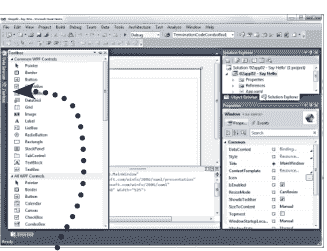

当你单击此处的名称时，工具箱将打开。

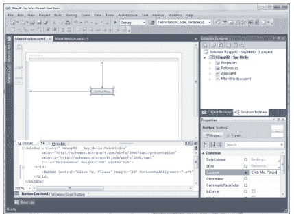

在工具箱中找到“按钮”并将其拖动到设计图面上。设计器将显示一些指南，帮助你将按钮居中于窗口中，但对于此示例，这样做并不重要。

请注意，设计器还会在屏幕底部的编辑器中添加一些 XAML 代码。当你使用 Visual Studio 设计器时，它会为你编写代码。这多酷啊？

使用属性窗口来控制设计器中的小部件。

在屏幕右侧，你将看到属性窗口。（如果不可见，请从“视图”菜单中选择“属性窗口”。）

与工具箱一样，属性窗口中的项目被组织成组。确保在设计器中选择了按钮（如果未选中，请单击它），并在属性窗口的“常规”部分中找到“内容”项目。（它可能已经被选中。）将右侧单元格中的值从“按钮”更改为“点我，请”（或任何你喜欢的内容），然后按 Enter 键。

如果你愿意，可以尝试设置一些其他属性。你可以在“文本”部分设置字体，或在“画笔”部分更改按钮的颜色。只需单击窗格，然后键入新值或从下拉列表中选择一个即可。

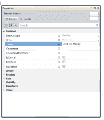

# 3 编写一些代码！

单击此处以显示事件列表……

……然后在此处双击。

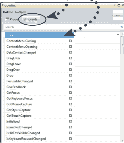

属性窗口包含两个选项卡。我们在“属性”选项卡上设置了按钮内容。现在单击屏幕顶部的“事件”以显示“事件”选项卡。

此选项卡显示所选小部件可以响应的所有内容。“小部件可以响应的内容”是一种事件。我们将在本书后面详细讨论事件。

在列表中找到“单击”项，并双击它。确保双击实际的“单击”一词，而不是右侧的单元格。

当你在属性窗口的“事件”选项卡中双击“单击”时，Visual Studio 将为你创建一个事件处理程序，并显示编辑器窗口，光标已就位，你可以开始添加代码。事件处理程序是在发生事件时执行的一段代码——它处理事件。

添加这一行：

```
MessageBox.Show("Hello, World!");
```

当你开始输入时，编辑器将打开一个 Intellisense 列表。你可以选择想要的项并按 Tab 键，让 Visual Studio 将文本添加到代码中，也可以忽略它并继续输入。我们将在下一章详细讨论 Intellisense。

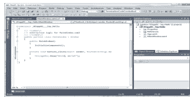

# 4 运行它

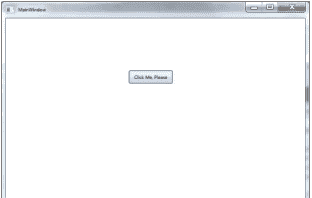

按 F5 运行应用程序。窗口应该在屏幕上打开，但如果有任何问题，Visual Studio 将显示一条错误消息。检查你输入的代码行；这最有可能是出错的地方。

单击按钮，将显示一条消息框，显示你指定的文本。该框可能不会像图片中所示出现在窗口中央；事实上，它可能不会，但它会出现在屏幕上的某个位置，可能在中央。

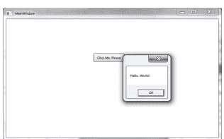

> 休息一下
> 恭喜！你已经正式写了一个程序。这不就是程序员做的事吗？
> 那么，在我们详细回顾刚才所做的内容之前，为什么不先休息一下呢？

## 那么，那是什么？

“你好，世界！”可能是传统的，但它可能不是你见过的最令人兴奋的 Windows 应用程序。事实上，它可能是你见过的最无聊的应用程序。那么何必费心呢？因为这些基本步骤与你编写的每个应用程序所使用的步骤相同。


## 创建解决方案和项目

解决方案就像文件柜，用于组织相关项目。项目是创建单个可执行文件的源代码和其他资源的集合。


## 使用设计器和编辑器创建代码

在我们的演练中，我们使用了 WPF 设计器和代码编辑器，但 Visual Studio 提供了这两者的其他版本。


## 测试和调试代码

测试可能会发现一个 bug——即某些东西不能按预期工作——或者它可能只是揭示你希望以不同方式工作的事物。


## 一点历史

有一个流传的故事说，程序中的错误被称为“bug”，是因为在 ENIAC（第一台通用电子计算机）中发现了一只实际的虫子（一只飞蛾）。这个故事很棒，不是吗？不幸的是……飞蛾是在 Harvard Mark II 中发现的，而且这也不是该词的第一次使用。事实上，“bug”在工程领域至少可以追溯到托马斯·爱迪生时代就已很常见。


## 创建项目

我们首先要做的是创建一个新项目。我们将在下一章详细介绍项目和解决方案，但首先让我们再看一下该对话框。

从模板列表中选择要创建的项目类型。模板为特定类型提供标准文件。它们并没有什么神奇之处，你甚至可以创建自己的模板，但它们确实能为你节省大量工作。

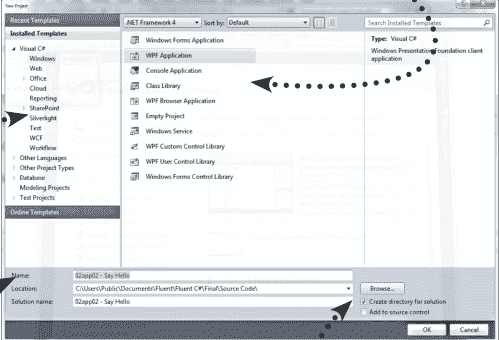

这些类别控制右侧显示的模板。它们只是让查找变得更容易。

Visual Studio 会根据模板名称为项目和解决方案提供默认名称。通常将它们改为更有意义的名称比较合理。

此复选框控制 Visual Studio 创建的目录结构。你几乎总是希望保持其选中状态，以便将项目放在单独的文件夹中。

## Visual Studio 用户界面

作为 C# 程序员，你可能会在 Visual Studio 中度过大部分时间。我们将在下一章更详细地介绍 UI，但现在让我们先看看基本布局。

Visual Studio 窗口在选项卡中打开“文档”，例如源代码或图表。

解决方案资源管理器的工作方式类似于 Windows 资源管理器，向你显示解决方案中的项目和文件。

其他窗口可以是浮动的或停靠的，当停靠时，它们可以展开或折叠。

这个小推针控制停靠窗口是保持打开还是折叠到窗口边缘。

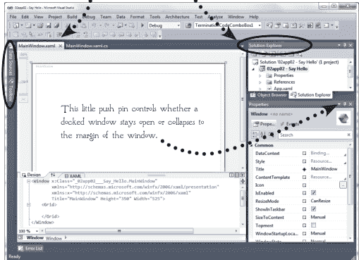

此屏幕截图显示了 WPF 设计器，默认情况下它显示两个窗格，顶部是拖放设计器，底部是 XAML 编辑器。与 Visual Studio 中的大多数内容一样，你可以更改此设计器的外观。Visual Studio 有几十种针对不同文件类型的设计器。我们将在本书后面介绍其中几种。

## 代码编辑器

尽管 .NET Framework 减少了你需要编写的代码量，且 Visual Studio 设计器会为你编写大量代码，但你仍会花大量时间使用代码编辑器。我们将在下一章详细介绍它，但在继续之前，让我们先看看它的一些特殊功能。

源代码是一个“文档”（实际上是扩展名为 .xaml 的文本文件），因此它在 Visual Studio 中以选项卡形式显示。

名称后面的星号表示文件有未保存的更改。

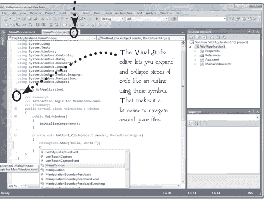

Visual Studio 编辑器允许你使用这些符号像大纲一样展开和折叠代码片段。这使得在文件中导航变得容易得多。

这是 Intellisense 的一个示例。它有点像自动完成，但更智能。Visual Studio 只列出在上下文中有意义的内容，并且如你所见，它会显示关于下拉列表中所选内容的小提示。Intellisense 还能做更多事情，例如自动添加代码。我们将在下一章讨论它。


## 独立练习

在结束本章并继续之前，花些时间探索 Visual Studio UI 并与我们的小示例应用程序交互：

查看“新建项目”对话框中可用的项目类型。你认为 Visual Studio 为什么包含这么多模板？

回到第 1 章中你想要开发的应用程序列表，选出其中几个，并根据“新建项目”对话框中的描述，思考你可能会使用哪些项目类型来开发它们。

回到演练中，我们的屏幕看起来不太好看。使用 WPF 设计器，你能让它看起来好看一点吗？（提示：在设计图面上选择项目，然后查看“属性”窗口中的“画笔”和“文本”部分。）

在代码编辑器中，更改单击按钮时显示的文本。

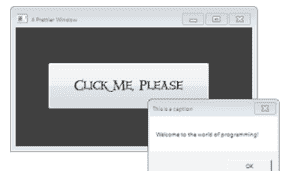

这是一个真正的挑战：使用 Intellisense 来帮助你，你能给 MessageBox 添加标题吗？（提示：你的标题需要加引号，就像 MessageBox 文本一样。）


## 休息一下

最后一个任务完成了！为什么不在回来完成最后一个练习并结束本章之前，先休息一下放松一下呢？


## 复习

在深入学习下一章中如何使用 Visual Studio 之前，先进行最后一次复习。

创建几乎每个应用程序时使用的三个步骤是什么？

如何控制 WPF 设计器中控件的外观？

.NET 平台的三个基本部分是什么？

如何在代码编辑器中展开和折叠代码？

推针控件在 Visual Studio 中有什么作用？

## 恭喜！你已完成本章。在继续下一章之前，花一分钟思考一下你完成了什么...

- 列出你在本章学到的三件事：
- 1
- 2
- 3

你认为为什么需要知道这些事情才能成为 C# 程序员？

本章中有什么你觉得需要更详细理解的内容吗？如果有，你打算怎么做？


## Visual Studio 用户界面

在上一章中，你编写了第一个程序并了解了 Visual Studio 用户界面的基础知识。现在是时候更详细地了解这些步骤了。我们将首先了解 Visual Studio 如何帮助你使用解决方案和项目管理开发项目，然后更仔细地查看 UI 以及如何配置它以适应你的工作方式。

作为程序员，你会在代码编辑器中花费大量时间，我们也是如此。我们将查看它提供的基本文本编辑功能，以及 Intellisense 和 Visual Studio 帮助系统。

解决方案包含项目、控制应用程序如何编译和运行的解决方案设置，以及不属于特定项目的解决方案项。

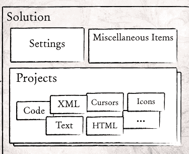

解决方案还可以包含未包含在应用程序中的其他文件，但在打开解决方案时可以从解决方案资源管理器中访问这些文件。

## 总结


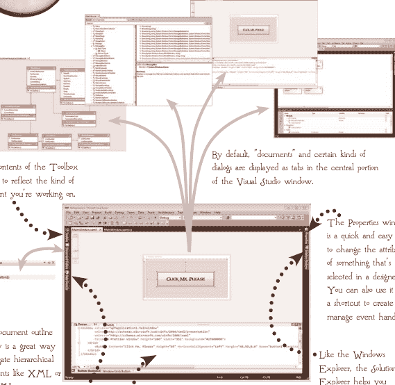

工具箱的内容会随你正在处理的文档类型而变化。

默认情况下，“文档”和某些类型的对话框显示为 Visual Studio 窗口中间部分的选项卡。

文档大纲窗口是浏览 XML 或 XHTML 等分层文档的好方法。

数据源窗口类似于外部数据（如关系数据库）的资源管理器。

某些 Visual Studio 设计器可以显示多个窗格。例如，此处显示的 WPF 设计器显示 XAML 和可用于拖放的设计图面。

“属性”窗口是快速简便地更改设计器中所选内容属性的方法。你也可以将其用作创建和管理事件处理程序的快捷方式。

与 Windows 资源管理器类似，解决方案资源管理器可帮助你浏览和管理与项目关联的文件和文件夹。

## 任务列表

工匠是工具的主人。作为程序员，你的主要工具是 Visual Studio，在本章中，我们将通过详细检查其用户界面来开始掌握它的过程。

### 解决方案、项目及其他

将应用程序开发视为写论文或文章很方便：你先进行一些研究，准备一个大纲，然后生成最终文档。不幸的是，开发过程并没有那么整洁。（写作当然也不是，至少我这样写不是。）大多数开发项目甚至没有一个等同于那篇论文的单一输出。因此，我们将从本章开始，了解 Visual Studio 如何使用解决方案、项目和解决方案项来管理你实际要使用的所有零零碎碎的东西。

### 掌控局面

我敢打赌你已经更改了 Windows 桌面。如果你和大多数人一样，你已经在侧边栏添加了小部件，创建了一些快捷方式，并重新排列了“开始”菜单。所有这些小改变都通过将你经常使用的工具放在手边，使生活变得轻松了一点。Visual Studio 在安排用户界面以适应一般编程方面做得相当不错，但你会从对其工作区进行与对 Windows 桌面所做的相同类型的自定义中受益，所以接下来我们要做的就是学习如何做到这一点。

### 获取帮助

在上一章中，我们看到了 Intellisense 的一个示例，当时我们能够从下拉列表中选择 MessageBox.Show 命令。在本章中，我们将更详细地了解 Intellisense，以及 Visual Studio 编辑器提供的一些特殊错误检查功能。


## 解决方案、项目……

Solutions are like filing cabinets that hold and manage Projects and other files. Easy enough in principle, but what exactly does that mean? Why would you have more than one Project? What are these “other files”, and what exactly does “manage” mean? Let’s look at some examples of the kinds of files you might include in a Solution.

解决方案就像文件柜，用于保存和管理项目及其他文件。原则上很简单，但这究竟是什么意思？为什么你会有多个项目？这些“其他文件”是什么，“管理”究竟意味着什么？让我们看看你可能在解决方案中包含的文件示例。

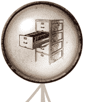

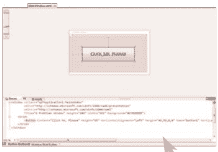

## 主界面项目

You'll usually have a project (sometimes more than one) that contains the forms that comprise your application user interface.

你通常会有一个项目（有时不止一个），其中包含构成应用程序用户界面的窗体。

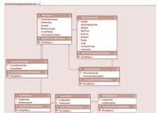

## 数据集项目

If your application references a data source, you'll usually have a separate project that handles the data interface.

如果你的应用程序引用数据源，你通常会有一个单独的项目来处理数据接口。

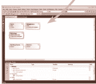

## 实用程序类

In cooking, you often need to translate between teaspoons, tablespoons and cups. The classes that do that conversion might be useful in other applications, so it makes sense to put those in a separate project that we can reference when we need them.

在烹饪中，你经常需要在茶匙、汤匙和杯之间进行换算。执行该换算的类可能在其他应用程序中也很有用，因此将它们放在一个单独的项目中以便需要时引用是合理的。

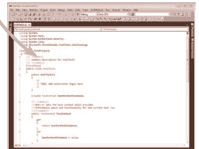

## 测试项目

Visual Studio 2010 provides great support for a technique called Test-Driven Development. If you adopt this approach, you'll need projects that contain your tests.

Visual Studio 2010 对一种称为测试驱动开发的技术提供了出色的支持。如果你采用这种方法，你将需要包含测试的项目。

## ……以及其他内容

Projects have multiple files, as well. You'll have code and designer files, of course, you've already seen that, but Visual Studio will also allow you to associate other files with the project, just to keep them handy.

项目也有多个文件。当然，你会有代码文件和设计器文件，这一点你已经见过了，但 Visual Studio 还允许你将其他文件与项目关联，以便随时使用。

### 设计器文件

These are the files that are created by the Visual Studio designers. They're text files, but if you mess with them outside the Designer, your changes might get overwritten the next time you use the designer, so you'll typically leave them alone.

这些是由 Visual Studio 设计器创建的文件。它们是文本文件，但如果你在设计器外部修改它们，下次使用设计器时你的更改可能会被覆盖，因此你通常会不去动它们。

### 源文件

These are the files that contain your code. They have the same name as the files the Designer creates, with the extension ".cs".

这些是包含你代码的文件。它们与设计器创建的文件同名，扩展名为“.cs”。

### 设计文档

You can also include documents like this class diagram or even specifications. These files aren't part of the project code.

你还可以包含像这个类图甚至规范这样的文档。这些文件不是项目代码的一部分。

### 资源

If your project includes things like custom cursors or icons these are separate files in the Project.

如果你的项目包含自定义光标或图标等内容，这些是项目中的单独文件。

### 动动脑筋

Find at least two ways to add a Project to a Solution and two ways to add a file to a Project.

找出至少两种将项目添加到解决方案的方法，以及两种将文件添加到项目的方法。


## 做得怎么样？

The problem was to figure out how to add Solutions and files...

问题是要想出如何添加解决方案和文件...

## 将项目添加到解决方案：

You can also add existing Projects, which is handy if you're reusing utilities or custom widgets, or exclude a project that you've added by accident.

你也可以添加现有项目，如果你正在重复使用实用程序或自定义小部件，这很方便，或者排除你不小心添加的项目。

The New Project item can be found on the File menu and on the context menu displayed when you right-click the Solution name in the Solution Explorer.

“新建项目”项可以在“文件”菜单上找到，也可以在右键单击解决方案资源管理器中解决方案名称时显示的上下文菜单中找到。

## 将文件添加到项目：

You can add new and existing items from the Solution Explorer by right-clicking the Project name,

你可以通过右键单击项目名称，从解决方案资源管理器中添加新项和现有项，

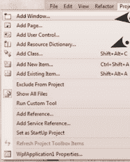

The Project menu provides specific options for the most common types of Projects, or you can choose Add New Item... to display the New Item dialog.

“项目”菜单为最常见的项目类型提供特定选项，或者你可以选择“添加新项...”以显示“新建项”对话框。

## 独立练习

You know how to add an item to a Project, and you knew how to configure a simple WPF window, so let's put these two things together. Change your Hello, World application to display a window instead of a MessageBox:

你知道如何将项添加到项目，并且你知道如何配置简单的 WPF 窗口，所以让我们将这两件事结合起来。将你的 Hello, World 应用程序更改为显示窗口而不是 MessageBox：

- 1. Add a new window to the Project. Accept the default name of Window1.
- 2. Drag a Label from the Toolbox to the design surface, and configure the window and label properties however you like. Have some fun! You can't hurt anything.
- 3. Display the code for the original form (NOT the one you just created.) If the form is open, you can double-click the button or press F7. If the form isn't open, you can right-click the form name in the Solution Explorer and choose Show Code.
- 4. Delete the line that displays the MessageBox, and replace it with the following:

```
Window newWin = new Window1();
newWin.ShowDialog();
```

- 5. Run the application by pressing F5, and then click the button on the first form.

- 1. 向项目添加一个新窗口。接受默认名称 Window1。
- 2. 从工具箱将标签拖动到设计图面，并按喜好配置窗口和标签属性。尽情享受！你不会弄坏任何东西。
- 3. 显示原始窗体的代码（不是你刚创建的那个。）如果窗体已打开，你可以双击按钮或按 F7。如果窗体未打开，你可以在解决方案资源管理器中右键单击窗体名称并选择“显示代码”。
- 4. 删除显示 MessageBox 的行，并用以下内容替换它：

```
Window newWin = new Window1();
newWin.ShowDialog();
```

- 5. 按 F5 运行应用程序，然后单击第一个窗体上的按钮。

## 休息一下

Why don't you take a quick break before we move on to controlling the way Solutions and Projects behave by setting their properties?

在我们继续通过设置属性来控制解决方案和项目的行为之前，为什么不先休息一下呢？

## 解决方案和……

When you created and modified your windows on the design surface, you saw that you could control the appearance of the widgets by setting their properties. Well, Solution and Projects have properties, as well. We'll need some of these as we move through the book, so let's get started by looking at how to display the property dialogs.

当你在设计图面上创建和修改窗口时，你已经看到可以通过设置属性来控制小部件的外观。同样，解决方案和项目也有属性。在本书后续内容中我们会用到其中一些属性，所以让我们先从如何显示属性对话框开始。

The easiest way to display the Solution Properties dialog is to select the Solution in the Solution Explorer and click the Properties button on the Solution Explorer toolbar, but you can also choose Properties Page from the View menu.

显示“解决方案属性”对话框的最简单方法是在解决方案资源管理器中选择解决方案，然后单击解决方案资源管理器工具栏上的“属性”按钮，但你也可以从“视图”菜单中选择“属性页”。

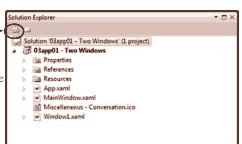

Most of the Solution properties are managed by Visual Studio, and you only need to change them in unusual circumstances, but you'll often need to specify a Startup Project whenever you have a Solution that contains multiple Projects. The STARTUP PROJECT is the one that Visual Studio will run when you press F5.

大多数解决方案属性由 Visual Studio 管理，你只需在特殊情况下更改它们，但当你的解决方案包含多个项目时，你通常需要指定启动项目。启动项目是 Visual Studio 在你按 F5 时运行的项目。

By default, Visual Studio sets the first project you add to the solution as the STARTUP PROJECT. You can change that by choosing a different Project from the combobox.

默认情况下，Visual Studio 将你添加到解决方案的第一个项目设置为启动项目。你可以通过从组合框中选择不同的项目来更改它。

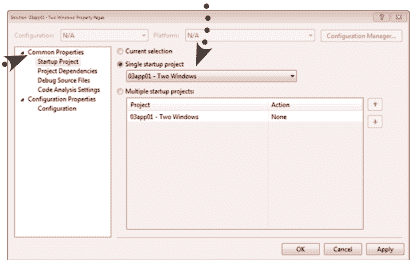

You can also set the startup project from the Project menu when the project you want is selected in the Solution Explorer. Visual Studio almost always has several ways to do something.

你也可以在解决方案资源管理器中选择想要的项目后，从“项目”菜单设置启动项目。Visual Studio 几乎总是有多种方法来做某事。

## 项目属性

Solution properties display in a dialog box, but Visual Studio has a designer (called the Project Designer) for project properties that displays in a tab. You can display the Project Designer by clicking the Solution Explorer toolbar button when a Project is selected, by choosing <ProjectName> Properties... from the Project menu when the Project is selected, by right-clicking the Project name in the Solution Explorer and choosing Properties, or by selecting the Solution name in the Solution Explorer and pressing Alt+Enter. And probably by doing some other things that I haven't discovered yet...

解决方案属性在对话框中显示，但 Visual Studio 有一个设计器（称为项目设计器）用于项目属性，它在选项卡中显示。你可以通过以下方式显示项目设计器：在选择项目时单击解决方案资源管理器工具栏按钮；在选择项目时从“项目”菜单中选择“<ProjectName> 属性...”；在解决方案资源管理器中右键单击项目名称并选择“属性”；或者在解决方案资源管理器中选择解决方案名称并按 Alt+Enter。可能还有我尚未发现的其他方法...

The Application tab will change depending on the type of Project you choose, but it always controls the type of application and how it is compiled.

“应用程序”选项卡会根据你选择的项目类型而变化，但它始终控制应用程序的类型及其编译方式。

The Build and Build Events tabs control how the application is DEPLOYED (distributed to users), while the Debug tab controls how the application behaves during testing. We'll look at all of these in the next chapter.

“生成”和“生成事件”选项卡控制应用程序的部署方式（分发给用户），而“调试”选项卡控制应用程序在测试期间的行为。我们将在下一章中查看所有这些内容。

Resources and Settings are things like icons and string that are included in the executable. We'll use the Resources tab in just a minute to create an icon for our application.

资源和设置是包含在可执行文件中的图标和字符串等内容。我们将在稍后使用“资源”选项卡为我们的应用程序创建一个图标。

Signing and Security help you secure your application and its users from bad people and bad software. Security is an important issue, but it's also a huge one, and we won't be talking about it in any detail.

“签名”和“安全”可帮助你保护应用程序及其用户免受不法分子和恶意软件的侵害。安全是一个重要问题，但也是一个庞大的问题，我们不会详细讨论它。

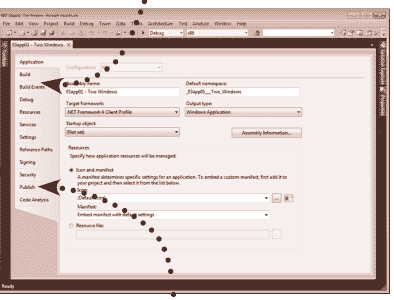

The Publish tab is used to deploy your application using ClickOnce. We'll talk about that in the next chapter.

“发布”选项卡用于使用 ClickOnce 部署你的应用程序。我们将在下一章中讨论这个问题。

> Not all of these options are available in every version of Visual Studio. The Code Analysis tab, for example, only appears in Visual Studio Premium and Ultimate, so don't panic if your screen looks a little different from this one. (You are opening these screens, right?)

> 并非所有这些选项在每个版本的 Visual Studio 中都可用。例如，“代码分析”选项卡仅出现在 Visual Studio Premium 和 Ultimate 中，所以如果你的屏幕看起来与这个略有不同，请不要惊慌。（你正在打开这些屏幕，对吧？）

## 添加图标

All Windows applications need an icon. If you don't provide one, Visual Studio will use the default icon. The default image isn't very exciting, and it doesn't distinguish your application from all the others out there. So let's use the Project Properties dialog to add a custom icon to Hello, World. To make that happen in a WPF application (other application types can be a little different), we need just three steps:

所有 Windows 应用程序都需要一个图标。如果你不提供一个，Visual Studio 将使用默认图标。默认图像不太有趣，也无法将你的应用程序与其他应用程序区分开来。所以让我们使用“项目属性”对话框为 Hello, World 添加一个自定义图标。要在 WPF 应用程序中实现此操作（其他应用程序类型可能略有不同），我们只需要三个步骤：

- 1. Specify the icon file in the Application tab of Project Properties.
- 2. Build the application to make the icon available.
- 3. Set the icon property of the window in the WPF Designer.

- 1. 在“项目属性”的“应用程序”选项卡中指定图标文件。
- 2. 生成应用程序以使图标可用。
- 3. 在 WPF 设计器中设置窗口的图标属性。


This is the default icon. Pretty boring huh?

这是默认图标。相当无聊，对吧？


We'll replace it with this one that looks a bit cooler and represents what our application actually does. This icon file is called conversation.ico, and it's included with the sample code. You can use this one or any other icon file you like. (Try searching for ".ico" in the Windows Explorer.) Just copy it to the application folder for our sample app.

我们将用这个看起来更酷且代表我们应用程序实际功能的图标替换它。这个图标文件名为 conversation.ico，随示例代码一起提供。你可以使用这个图标或任何其他喜欢的图标文件。（尝试在 Windows 资源管理器中搜索“.ico”。）只需将其复制到我们示例应用程序的应用程序文件夹中即可。

## 请注意

Visual Studio includes sample editors for most resource types, including icons, from the Resources tab of Project Properties, or you can also use a third-party tool. You can even open most third-party tools right inside Visual Studio by right-clicking the resource and choosing Open With...

Visual Studio 在“项目属性”的“资源”选项卡中包含大多数资源类型（包括图标）的示例编辑器，或者你也可以使用第三方工具。你甚至可以通过右键单击资源并选择“用...打开”来直接在 Visual Studio 内打开大多数第三方工具。

And if you're not feeling particularly artistic, there are lots of icon sets available for free or fee on the Web that you can use. Just be sure to respect the artists' terms of use, or the karma gods will get you, even if copyright law doesn't.

而且，如果你不太有艺术天赋，网上有很多免费或付费的图标集可供使用。只要确保尊重艺术家的使用条款即可，否则业力之神会找上你，即使版权法不会。


## 设置应用程序图标属性

如果 Hello, World 尚未从上一个练习中打开，请从 Visual Studio 开始屏幕打开它（它将列在左侧的“最近项目”下，或从“文件”菜单打开）。使用您学过的任意技术显示项目属性，然后选择“应用程序”选项卡。

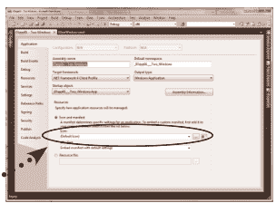

我们将在此处设置图标。

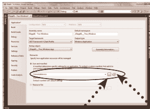

单击此处打开对话框。

选择图标后，Visual Studio 将在此处显示其缩略图。

单击带有省略号的小框，Visual Studio 将显示标准的“打开文件”对话框。第一次打开对话框时，Visual Studio 会将您带到 Microsoft Visual Studio\Common7\IDE 文件夹，这可能有点吓人，但只需导航到应用程序文件夹并选择 Conversation.ico（或您选择使用的任何图标文件）。

选择图标并单击“打开”按钮后，Visual Studio 将在选项卡上显示该图标。

## 2 生成应用程序

创建 Visual Studio 应用程序涉及大量文件。除了您创建的源文件、您创建或引用的图标等资源文件，以及编译器创建的最终可执行文件之外，还有 Visual Studio 为您创建的中间文件。当您设置属性或资源时，需要告诉 Visual Studio 重新创建其中一些“幕后”文件，以便设计器等其他组件可以使用。您可以通过生成应用程序来实现这一点。

### 生成菜单

大多数情况下，您可以使用“生成解决方案”，它只重新生成已更改的文件。

“重新生成解决方案”是一个更安全但较慢的选择。它会重新生成所有文件，无论是否更改。

“清理解决方案”会删除 Visual Studio 创建的任何中间文件，但不会生成解决方案。如果“重新生成解决方案”似乎行为异常，请先尝试清理解决方案。

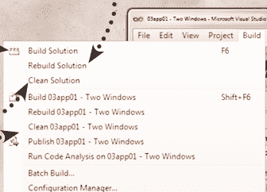

这些选项仅生成和清理项目，而不生成整个解决方案。由于我们的应用程序只有一个项目，因此没有实际区别，但当解决方案中有大量项目时，这些替代方案可以节省大量时间。

按 F5 或从“生成”菜单中选择“生成解决方案”，以便图标可供 WPF 设计器使用。

## 3 设置窗口属性

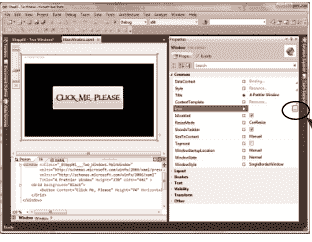

如果需要，在解决方案资源管理器中双击 MainWindow.xaml 以打开 WPF 设计器。在“属性”窗口中，找到“图标”属性，将其选中，然后单击省略号按钮。

在“属性”窗口中单击省略号后，Visual Studio 将显示“选择图像”对话框。您的新图标将显示，但可能没有缩略图。没关系；Visual Studio 只是还没有跟上我们。

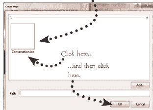

单击图标，然后单击“确定”以设置属性。

单击“确定”按钮后，Visual Studio 将把属性设置为以 pack://application.../ 开头的长值。这只是 WPF 说法，意思是“在应用程序文件中查找”，我们将在稍后检查 WPF 资源时了解它的工作原理。

## 它起作用了吗？

不要只听我说一句。运行应用程序，看看结果吧...

图标显示在我们设置属性的窗口中...

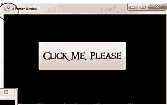

但没有显示在我们未设置属性的窗口中。

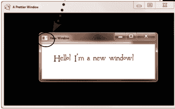

应用程序可执行文件也使用该图标，如您在 Windows 资源管理器的 bin/debug 文件夹中所见。


## 再来一遍...

让我们再次运行添加应用程序图标的步骤...

- 1. 在项目属性中将图标文件添加到应用程序。
- 2. 生成应用程序，以便在设计器中使用该应用程序。
- 3. 设置要显示图标的窗口的“图标”属性。

### 休息一下

您已完成本章的第一个任务，请先短暂休息，让所学内容沉淀下来，再继续。但在离开之前，请停下来想一想您已经取得了哪些成就...

- 您创建了一个显示窗口和 MessageBox 的应用程序。
- 您更改了窗口的外观。
- 您向项目中添加了第二个窗口，并编写了显示它的代码。
- 您向应用程序和窗口添加了图标。

以这种方式列出来，是不是很多？加油！

## 复习

在继续之前，先做几个练习...


解决方案和项目，项目和解决方案。一个像文件夹，一个像文件柜。哪个是哪个？

- 解决方案
- 项目


- 列出添加项目的三种方法：
  - 1. 
  - 2. 
  - 3. 

- 列出显示“解决方案属性”对话框的两种方法：
  - 1. 
  - 2. 

- 列出显示“项目属性”的三种方法：
  - 1. 
  - 2. 
  - 3. 

将应用程序图标更改为其他内容。窗口会发生什么变化？

在演练中，我们只更改了主窗口的图标。也将其添加到应用程序中的其他窗口。

## 掌控局面

Visual Studio 是一个 Windows 应用程序，在大多数情况下，它的行为与任何 Windows 应用程序一样，带有菜单、工具栏和您在其中工作的文档窗口。但在 Visual Studio 中进行的工作非常专业，IDE 添加了一些特殊功能，使您能够按照自己想要的方式工作。

这是以选项卡形式显示的文档窗口，即默认视图。

您可以将文档显示为选项卡，或作为独立窗口。您甚至可以将它们拖到主 IDE 窗口之外。

工具窗口可以停靠到 IDE 窗口边缘或相互之间。停靠后，可以打开或关闭它们。

这是一个已停靠并关闭的工具窗口。

这是一个已停靠并打开的工具窗口。

这是一个显示在浮动窗口中的文档。它不受 Visual Studio IDE 窗口的限制。

相互停靠的工具窗口显示为选项卡。


## 排列窗口

与任何 Windows 应用程序一样，您可以通过“视图”和“窗口”菜单或拖动窗口标题栏来控制 Visual Studio 中的各个窗口。


“视图”菜单控制工具窗口的显示。（不要将“工具窗口”与“工具箱”混淆。“工具箱”是一个工具窗口，但“属性”窗口和“解决方案资源管理器”也是。）

您还记得如何打开文档窗口吗？在解决方案资源管理器中双击其名称。

“窗口”菜单控制 IDE 中打开窗口的显示。此菜单中最重要的项可能是“重置窗口布局”，当您把东西弄乱时，它可以将所有内容放回原位。（您会弄乱的，相信我。）


## 自己动手

学习如何控制 Visual Studio 中窗口的最佳方法是与它们交互，因此请花几分钟时间移动对象浏览器。对象浏览器让您查看类层次结构。您将在第 7 章中了解这意味着什么。

*记住，您随时可以通过从“窗口”菜单中选择“重置窗口布局”来重新开始...*

- 1. 通过在“视图”菜单中选择其名称来显示对象浏览器。它可能会显示为选项卡。如果不是，请拖动其标题栏，直到显示为选项卡。
- 2. 通过拖动其标题栏，或从“窗口”菜单中选择“浮动”来使其浮动。
- 3. 将其与工具箱一起停靠到屏幕左侧。首次停靠时它会打开，因此请单击 [图标] 将其折叠。
- 4. 将其拖动到与“解决方案资源管理器”在同一窗格中显示为选项卡的位置。
- 5. 使用“重置窗口布局”将所有内容恢复到原始状态。
- 6. 当您拖动窗口时，Visual Studio 会显示这个奇怪的停靠小部件。您能弄清楚每个部分的作用吗？


## 不仅仅是编辑...

Visual Studio 中的基本文本编辑符合 Windows 标准。你可以双击选择一个单词，Ctrl+单击扩展选择，并像惯常那样剪切、复制或粘贴选定内容。但 Visual Studio 代码编辑器还包含一个名为 Intellisense 的看似神奇的工具，它将其从速记员变成了私人助手。

> Intellisense 甚至会为你创建标准代码和对象。

> 这个新小玩意儿还有什么用？

> Intellisense 在你输入时显示对象可以执行的操作，因此你不需要记忆大量详细语法。

> 给这个家伙写一封“不要打电话给我们，我们会给你打电话”的信。

> 这个新小玩意儿的规格是什么？


## 列表成员

你可能最常使用的 Intellisense 功能是列表成员函数，它会显示在你输入位置可以插入的有效“事物”列表。你在第 2 章构建第一个应用程序时见过列表成员功能。

只要你输入一个字符，列表成员框就会打开。Visual Studio 非常智能，知道你可以做什么，不会列出不适用的事物（但它对什么有意义并不十分智能）。

要插入选定的项目，请按 Tab 键或输入项目后面的字符。在这种情况下，那就是“(”字符，你之所以知道这一点，是因为极左侧小帮助框中显示的定义。


当你在框中选择一个项目时，Visual Studio 会在小帮助框中显示该项目的定义、简短描述，以及如果该项目是方法（对象知道如何执行的操作），该方法可以抛出的任何异常。

要在列表成员框中突出显示一个项目，你可以继续输入字符以限制列表，或使用上下箭头键。

该框列出所有包含你输入字母的项目，而不仅仅是以你输入内容开头的项目。例如，输入“n”将同时显示“NewItem”和“EditNew”，假设它们可用。

异常是对象向程序其余部分通知出错的方式。我们将在第 7 章中了解异常以及如何处理它们。


## 参数信息

方法是对象可以执行的操作。（我们将在第 8 章中详细了解“对象”和“方法”的确切含义。）某些方法采用参数，即你传递给方法以控制其确切执行方式的信息片段。在 Intellisense 出现之前的糟糕旧日子里，程序员花费大量时间试图记住方法采用哪些参数以及参数顺序。Intellisense 参数信息框通过显示确切选项消除了所有这些问题。

只要你输入方法调用的左括号，Intellisense 就会显示参数信息框，向你显示方法定义、方法描述以及第一个参数的描述。


当你输入每个参数时，Intellisense 会更新显示以显示下一个参数的描述。


列表成员与参数信息并行工作，因此屏幕有时会有点拥挤！大多数时候它很有帮助，但如果所有窗口都挡住了你的路，你可以随时按 Esc 键将它们关闭。

## 路线图

多个编辑功能可帮助你跟踪当前位置和已完成的工作。使用它们非常直观，但以下是快速概述：

### 代码大纲

单击左边距中的“+”和“-”字符以折叠和展开代码单元。


### 快速信息

将鼠标悬停在任何标识符上，Intellisense 将显示其定义和描述。


### 引用突出显示

通过双击编辑器中的任何符号来选择它，它将突出显示代码中对该符号的所有引用。


## 重构

重构是编程中“清理”的花哨术语。Visual Studio 提供非常复杂的重构支持，可为你节省数小时的繁琐工作，并使你更有可能保持代码整洁紧凑。不幸的是，其中大部分支持你目前还无法理解，因此我们将稍后讨论。但一个重构功能立即有用：你可以告诉 Visual Studio 你想要重命名某项内容，它将查找并更新你引用过的每个位置。让我们在 MainWindow 代码中尝试一下。（如果代码窗口未打开，你可以在解决方案资源管理器中双击它，然后按 F7 显示代码窗口。）

在你创建的按钮单击事件中，右键单击窗口名称 newWin，并从上下文菜单中选择“重构”然后选择“重命名”。请注意，重命名的快捷键是 F2，这是重命名内容的标准 Windows 快捷键。


当你从上下文菜单中选择重命名（或按 F2）时，Visual Studio 将显示重命名对话框。在“新名称”文本框中键入“myNewWin”，保持其他选项不变，然后单击确定。


因为我们在重命名对话框中保留了“预览引用更改”选中状态，Visual Studio 在你单击确定后将显示预览更改对话框。在如此简单的示例中，你只需确认你正在更改你想要更改的内容即可，如果是，请单击应用。


就这样，窗口被重命名了。好吧，这可能还不像魔术，只是一种复杂的查找和替换形式。但神奇的地方在于：Visual Studio 会在项目中的每个文件中更改名称。试着用查找和替换做到这一点！

```
private void button1_Click(object sender, RoutedEventArgs e)
{
    Window myNewWin = new Window1();
    myNewWin.Show();
}
```

### 休息一下

你几乎已经完成本章，在返回进行最终复习之前，先休息一下。

## 复习

列出至少一种向解决方案添加项目的方法：

列出至少两种向项目添加文件的方法：

你会在哪里分配应用程序图标？

这个小部件有什么作用？


在 Button1_click 事件处理程序中的新空白行上输入“a”以触发 Intellisense。Array 对象的描述是什么？

Array.BinarySearch() 方法有多少个版本？

将鼠标悬停在 Window 标识符的一个实例上。（你的源文件中有两个。）Window 的描述是什么？

## 恭喜！你已完成本章。在继续下一章之前，花一分钟思考一下你已经完成了什么...

### 列出你在本章中学到的三件事：

- 1
- 2
- 3

你认为为什么需要知道这些才能成为 C# 程序员？

本章中有什么你认为需要更详细理解的内容吗？如果有，你打算怎么做？


## 测试和部署

我们迄今构建的小型应用程序都是简单的一次性程序，仅用于演示 Visual Studio IDE 的使用，并且你已经获得了相当详细的创建说明。但不久之后，你将开始独立创建应用程序，如果你第一次就把所有代码都写对，那你将是第一个做到的人。因此，我们将首先查看


Visual Studio 提供的查找和修复错误的支持，然后我们将查看在应用程序完成后部署它们的工具。

> 请记下
>
> 开发社区的普遍看法是，每个程序中总是至少有三个错误：你知道的错误，你不知道的错误，以及当你修复你知道的错误时将要创建的错误...


## 将其纳入...

还记得第 1 章中的开发流程图吗？在本章中，我们将展开第 3 步，创建源代码，以及第 4 步，将源代码转换为可执行文件。


我们将开发流程扩展为三个步骤：编码、测试和调试。


我们将部署扩展为两个步骤：指定生成配置和部署。


## 任务列表

在上一章中，我们探讨了如何让 Visual Studio IDE 适应您的工作方式，以及在编写代码时 Intellisense 和代码编辑器提供的支持。在本章中，我们将通过查看开发人员将执行的另外两个功能来完成对 Visual Studio IDE 的考察：查找和修复代码中的错误，以及部署完成的应用程序。

## 错误和异常

在您尽可能确定应用程序按设计运行之前，您不会进行部署。（或者至少您不应该。）因此，我们将首先检查 Visual Studio 提供的用于追踪和修复那些讨厌的 bug 的工具。

## 部署

在您修复了已知的错误后，您需要让应用程序的用户尝试找出其余错误，因此在我们检查了测试和调试过程后，我们将查看将完成的应用程序交给将使用它的人的两种方法，以及在开始分发之前所需的部署维护工作。

我们将查看部署 .NET 应用程序的两种主要方法：ClickOnce 和 安装程序。


## 错误和异常

在“程序可能出错的事情”的一般标题下，有两个是您在开发过程中需要担心的。

## Bug

Bug 是您在部署前需要尝试找到的东西。我们将在本章中专注于修复 bug（调试）。有三种类型的 bug 是您需要担心的：

语法错误是编程世界中的拼写错误。既然我们有了 Intellisense，它们就更容易避免，但仍然可能发生。


编译错误介于语法错误和逻辑错误之间。就像文字处理器中的拼写检查器不会知道您本想输入“through”而不是“though”，但语法检查器可能会知道一样，编辑器不会捕获这些错误，但编译器会。

当计算机执行了我们告诉它的事情，但我们没有告诉它我们想要什么时，就会发生逻辑错误。这种错误比您预期的更容易发生，并且可能难以追踪。

## 异常

异常是运行时发生的事情，例如硬件错误，不在您的控制范围内。（但未能处理它们是一个 bug。）我们将在第 7 章讨论异常处理。

## 让我们消灭一些 Bug

我们已经看到 Visual Studio 提供了几种工具来帮助您避免 Bug。它也能帮助您追踪 Bug，这可能不会让您感到惊讶。那么，让我们通过创建一个我们可以随意破坏的傻乎乎的小程序来探索它们。

- ## 创建新的 WPF 应用程序解决方案

  您可以随意命名，但 SillyApplication 可能是个不错的选择。如果您忘记了如何执行此操作的详细信息，请回到第 2 章查看。

- ## 创建按钮

  Visual Studio 为您完成解决方案和项目的创建后，将打开 MainWindow 的 WPF/XAML 设计器和代码编辑器。从工具箱将一个按钮拖到窗体上，并将其 Content 属性设置为 "Calculate"。当然，您也可以设置任何其他属性。


这是我的窗口版本

- ## 创建 Button1_Click 事件

  双击按钮，或在“属性”窗口的“事件”选项卡中选择 Click 属性，以创建在单击按钮时将执行的代码。Visual Studio 将编写所有标准代码，并将代码编辑器选项卡带到前台。（下一页有一张图片。）

## 消灭 Bug，继续...

我们的厨师 Neil & Garden 需要我们编写的应用程序之一是一个厨房计算器。如果您会做饭并且不使用公制系统，您知道在杯、汤匙和茶匙之间转换是多么乏味。

我们还不能制作真正的计算器——您需要先学习几章——但我们可以从简单地显示一杯中有多少汤匙开始。（我确实警告过您这是一个相当傻乎乎的应用程序。别担心：它足够复杂，可以弄坏。）

## 编写一些代码

通过在设计界面上双击按钮，告诉 Visual Studio 为按钮添加事件处理程序。将以下代码添加到 button1_Click 事件中。我已经向您展示了代码的含义，但不用担心。您将在下一章了解所有这些内容的含义。

> 这是一个表达式。用英语来说，它的意思类似于“将 result 的值设置为 cups 的当前值乘以 tablespoons 的当前值。”换句话说，它将名为 result 的变量设置为指定杯数中的汤匙数。

这些是变量。它们是可以更改的值的占位符。

```
Int32 tablespoons;
Int32 cups;
Int32 result;

cups = 1;
tablespoons = 16;

result = cups * tablespoons;

MessageBox.Show(result.ToString(), "Total Tablespoons");
```

在这两行中，我们正在向变量赋值。

正如您将在下一章中发现的，C# 对变量是数字、文本还是其他东西非常讲究。由于 tablespoons 变量包含一个数字，我们必须调用 ToString() 将其转换为文本。

## 运行它

在您输入了单击事件的代码后，按 F5 运行应用程序，窗口显示后，单击 Calculate 按钮。您应该会看到类似这样的屏幕。


## 弄坏它！

现在我们的应用程序已经可以运行，让我们引入一些 bug，以便看看 Visual Studio 会如何处理它们。

## 语法和编译错误

请记住，语法错误基本上就是拼写错误，而编译错误就像语法错误。事实上，编辑器不会捕获的错误不多，而且它们的处理方式相同，因此您不需要太担心区别。这可能是最容易发现和修复的 bug 类型，所以让我们先在代码中引入一个。从 MessageBox 命令中删除 .ToString()。Visual Studio 会用红色波浪线下划线整个命令，如果您将鼠标悬停在其上，您将看到一条 Intellisense 消息：


如果不更正错误就按 F5 运行应用程序，会发生什么？

## 更多 Bug

当您尝试编译和运行具有语法错误或编译错误的应用程序时，Visual Studio 会显示此错误框。您几乎永远不想在这里说“是”...


## 错误列表

Visual Studio 一旦发现语法错误和编译错误，就会在“错误列表”窗口中显示它们。默认情况下，“错误列表”显示在 Visual Studio 窗口的底部。如果您完全看不到它，请从“视图”菜单中选择“错误列表”，或按 Ctrl+W、E。

错误是阻止代码运行的问题。您需要立即修复它们。

警告是等待发生的 bug。它们不会阻止代码运行，通常是“还没做到那一步”的结果，但在部署前您会想要修复它们。

消息是，嗯，其他一切。您不会看到太多。


这些实际上是按钮。单击它们可以打开或关闭该类别项目的显示。

您可以双击“错误列表”中的一行，Visual Studio 会直接带您到该位置，如果有必要会打开文件。


## 出错时中断

在“错误列表”窗口中双击某一行，会带你到 Visual Studio 发现错误的那一行（甚至是该行中的具体位置）。但编程中令人恼火的一点是，Visual Studio 可能不会在错误实际发生的位置发现错误。这是怎么回事？嗯，你有没有忘带钱包就去过商店？你在商店才发现问题，但问题其实发生在回家之前。Visual Studio 的工作方式也是一样的——在你去付款之前，它不知道你需要钱包。

修复问题。如果存在逻辑错误，Visual Studio 可能根本找不到任何错误。要追踪复杂问题，你需要在程序运行时检查程序内部的情况。IDE 允许你在中断模式下执行此操作。进入中断模式有几种方法，但通常是通过设置断点来实现，断点只是一个信号，告诉 Visual Studio“在此处停止，让我看看发生了什么”。设置断点后（我们将在下一页设置一个）并运行应用程序，它将正常执行，直到调试器遇到带有断点的那一行。此时，Visual Studio 将进入中断模式，并默认显示以下窗口：

当发生这种情况时，“错误列表”可能不足以帮助你找到并


“局部变量”窗口显示你在应用程序中此时声明的所有内容的值。

“监视”窗口类似于“局部变量”窗口，但它显示你选择的特定变量的值。

在任何应用程序中，过程调用其他过程都是常见的事情。“调用堆栈”窗口显示你是如何来到当前位置的。

“即时”窗口允许你在中断模式下执行语句或计算表达式。

这是标准编辑器，但请注意某些选项卡上的小锁图标。你无法更改它们，而且在不重新启动应用程序的情况下，你对当前文件所能做的更改也有限制。

## 试用中断模式...

作为程序员，你将花费大量时间在中断模式下（如果你和我们大多数人一样，会觉得调试的时间比写代码还多），我们将在本书剩余部分中使用它，但让我们快速浏览一下你即将体验的内容...

修复显示 MessageBox 的那一行中缺少的 ToString() 调用：

```
MessageBox.Show(result.ToString(), "Total Tablespoons");
```

通过单击编辑器窗口左侧灰色栏中的 MessageBox 行来设置断点。

单击此处设置断点。Visual Studio 将显示一个圆圈并高亮显示该行。


### 独立练习

设置简单断点还有三种其他方法。你能找到它们吗？（提示：其中一种是键盘快捷方式；找到正确菜单后你就会看到。）

按 F5 运行应用程序，然后单击“计算”按钮。当 Visual Studio 到达你设置断点的那一行时，它将进入中断模式：


编辑器以黄色显示即将执行的那一行。

“局部变量”窗口显示过程中的所有变量的值。

调用堆栈已填充。

在中断模式下，Visual Studio 调试器将以数据提示的形式显示任何变量的值；只需将鼠标悬停在变量上即可。

```
cups = 1;
tal = cups 1 << 16;
result = cups / tablespoons;
```

移动鼠标后若要保持数据提示打开，请单击图钉。

## 中断模式命令

中断模式下可用的命令可从“调试”菜单、右键单击行时显示的上下文菜单或“调试”工具栏中获取：

### 继续
重新运行应用程序。

### 中断全部
仅当应用程序同时执行多项操作且你希望全部进入中断模式时才会使用此命令。

### 停止调试
退出中断模式和应用程序。

### IntelliTrace 命令
这些按钮控制 IntelliTrace，我们不会讨论它，因为它仅在 Visual Studio Ultimate 中可用。


### 重启
顾名思义，从头开始运行应用程序。

### 单步进入
执行当前语句，然后重新进入中断模式。

### 单步退出
如果当前语句是函数调用，则执行函数内剩余的语句，并在函数返回后的那一行中断。

### 显示下一条语句
高亮显示即将执行的下一条语句，该语句可能不是文件中的下一条语句。

### 单步过程
如果当前语句是函数调用，则在函数调用完成后的那一行中断。

在下一章学习函数调用后，这些“单步...”命令会更容易理解。

## 试用命令

让我们继续使用示例，试用中断模式工具栏上的命令。

- 5. 首先移除 MessageBox 调用上的断点（再次单击灰色栏即可），并在设置 cups 值的那一行设置一个新断点。

- 6. 现在再次运行应用程序，并单击“计算”按钮。Visual Studio 将在新行进入中断模式。请注意，所有变量现在的值都为 0，因为设置它们值的代码行尚未执行。

- 7. 单击“单步进入”按钮，按 F11，或从“调试”菜单中选择“单步进入”来执行当前语句。Visual Studio 将在下一条语句处重新进入中断模式。

Cups 现在有了新值，因为该行已被执行。


> **休息一下**
>
> 调试工具非常易用，这是件好事，因为你需要专注于寻找问题，而不是使用工具。既然我们已经探索了这些工具，为什么不在完成复习并进入部署之前休息一下呢？

## 复习

你能将每个图像与其描述匹配起来吗？

- **单步过程**：在下一行中断，无论它在哪里。

- **单步进入**：运行函数而不逐行进入。

- **单步退出**：进入函数调用。

- **语法错误**：Visual Studio 不会运行应用程序。

- **逻辑错误**：编辑器显示波浪线。

- **编译错误**：应用程序运行，但结果不正确。

## 部署

你的应用程序可能是更好的捕鼠器，但除非人们能够安装它，否则他们不会络绎不绝地来到你家门口。在企业环境中，部署可能（而且通常）涉及的内容远比仅仅安装一个应用程序要多得多；它可能包括实现数据库等服务、准备策略文档以及开展培训课程。但从纯粹的编程角度来看，部署通常仅限于准备安装程序。一如既往，Visual Studio 为你提供了一些选择：

### ClickOnce

ClickOnce 是一种用于 .NET Framework 应用程序的特殊部署方式。虽然它可以像安装程序一样通过磁盘分发，但 ClickOnce 应用程序通常从网络共享安装。因为它们可以在无需管理员级权限的情况下安装，并可以配置为自动搜索并安装更新，所以 ClickOnce 应用程序非常适合在企业环境中频繁更新或扩展的应用程序。

### 安装项目

如果你经常使用 Windows，可能已经使用过很多安装程序。事实上，安装 Visual Studio 时你就用过一个。安装程序是分发应用程序的经典方式。安装程序不需要网络连接，而 ClickOnce 应用程序则需要。这可以使分发更简单，并且是零售应用程序的明显选择。但是，用户需要管理员级权限才能安装应用程序，并且更新需要用户干预。

### 请注意

安装项目仅在 Visual Studio 基础版及更高版本中可用。如果你运行的是 Visual Studio Express，则无法完成本节后半部分的练习。只需通读它们，了解你错过了什么。（你可能会决定它们不是你关心的事情。）


## 使用 ClickOnce 发布

ClickOnce 部署不仅对用户简单，对程序员也同样简单。要看看有多简单，让我们一起使用 ClickOnce 部署我们这个傻乎乎的小应用程序。

在“解决方案资源管理器”中右键单击项目，从上下文菜单中选择“发布”，或从“生成”菜单中选择“发布”。
（如果你还在运行上一个练习中的调试器，则必须先单击“停止调试”。）


选择“发布”后，Visual Studio 将启动 ClickOnce 发布向导。第一页要求你指定要发布应用程序的位置。在企业环境中，这通常是用户用来安装应用程序的网络共享。暂时只需将其放在主解决方案文件夹内的一个文件夹中。（单击“浏览”按钮打开标准文件对话框，它将帮助你导航到发布位置。）
选择位置后，单击“下一步”按钮。


接下来，向导会询问你希望用户如何安装应用程序。暂时选择最后一个选项，它会创建自包含安装，但你也可以在此页面选择 Web URL 或网络共享。做出选择后，单击“下一步”按钮。


在此页面，向导会询问你要将更新发布到的位置。通常你会选择与最初发布位置不同的文件夹，但我们不会更新这个傻乎乎的小应用程序，因此请选择第二个选项，不检查更新。做出选择后，单击“下一步”按钮。


就这样。在向导的最后一页单击“完成”，Visual Studio 将创建安装应用程序所需的所有文件，并将其移动到你指定的位置。是不是很简单？如果要测试，只需导航到步骤 2 中指定的位置并单击安装程序即可。你可以从控制面板以正常方式卸载该应用程序。


## 创建安装程序

难以想象有比 ClickOnce 发布向导更简单的部署技术。创建安装项目稍微复杂一点，但不算太复杂，仅仅是因为它更加灵活，而且有一个安装向导会为你完成大部分基本配置。

请记住，安装项目在 Visual Studio Express 版中不可用。但如果你运行的是 Visual Studio 基础版或更高版本，让我们试一下：

- 1. 向解决方案添加新项目，可以从“解决方案资源管理器”的上下文菜单中添加，也可以从“文件”菜单中添加。在“新建项目”对话框中，从“其他项目类型”下的“设置和部署”类别中选择“安装向导”。你可以随意命名项目；我将其命名为 SetupProject。指定项目名称后，单击“确定”按钮。


- 2. 单击“确定”后，Visual Studio 将显示安装项目向导的第一页。此处无需操作，直接单击“下一步”按钮即可。


在安装项目向导的此页面，你需要指定要部署的应用程序类型。我们正在创建 Windows 应用程序，因此默认设置是正确的。Web 应用程序用于 ASP.NET，可再分发包用于那些应用程序组件。我们稍后再讨论这些内容。

检查是否已选中“为 Windows 应用程序创建安装程序”后，单击“下一步”按钮。


在此页面，你指定要部署的已编译组件。我们的项目很简单，因此只需选中“主输出”框，如图所示。

选中正确的框后，单击“下一步”按钮。


此页面允许你将不属于解决方案的文件包含到安装程序中。例如，你可能已获准将某种字体与应用程序一起分发。你可以在此处单击“添加”按钮来指定它，该按钮将打开标准文件对话框。

我们不包含任何复杂内容，因此只需单击“下一步”按钮，进入下一页（向导的下一页，也是本书的下一页！）。


- 6. 向导的最后一页只是确认你所做的选择，并给你机会返回修复任何问题。如果一切正常，单击“完成”，Visual Studio 将为你创建项目。


- 7. 项目创建后，它将显示在“解决方案资源管理器”中，Visual Studio 将在 IDE 中打开文件系统设计器。

文件系统设计器允许你指定用户安装应用程序时放置在其系统上的文件。在此图中，我选中了“应用程序文件夹”，你可以看到，要放置在该文件夹中的唯一内容是主输出，在此例中即应用程序可执行文件。


此时，你只需生成安装项目，即可通过将输出目录的内容复制到 DVD 或网络共享来部署应用程序。这真的比使用发布向导困难多少吗？不过，编程往往是这样，如果你想要更多控制权，就必须处理更多复杂性，而在此例中，安装项目增加的复杂性让你能够精确配置安装程序的工作方式。（当然，有一些限制。）

## 安装设计器

与 Visual Studio 中的任何项目一样，安装项目拥有多个自定义设计器，可帮助你构建各种组件。如我们所见，当 Visual Studio 首次创建项目时，会显示文件系统设计器。显示其他设计器的最简单方法是使用在“解决方案资源管理器”中选中项目时显示的工具栏。

### 项目属性

我们将在几页后介绍这个。

### 文件系统编辑器

这是步骤 7 中显示的设计器。

### 注册表编辑器

此设计器允许你在 Windows 注册表中安装键值对。你不需要在很多情况下这样做，但如果需要，可以这样做。


### 文件类型编辑器

此设计器允许你注册文件扩展名，以便当用户双击带有指定扩展名的文件时，会打开此应用程序，就像双击 .doc 文件时会打开 Word 一样。

### 用户界面编辑器

你无法为安装项目创建完全自定义的界面，但此编辑器允许你控制用户将看到的安装向导的一些特征，例如背景图像和版权文本。

### 启动条件编辑器

此编辑器允许你指定运行安装程序前必须满足的条件，例如操作系统版本。

### 自定义操作编辑器

此编辑器允许你指定安装后将执行的解决方案组件。你不需要经常这样做。

## 添加快捷方式

安装向导在设置基本安装项目方面做得相当不错，但有一件你几乎肯定想要做的事情它不做：向用户的桌面或“开始”菜单添加快捷方式。让我们将其添加到我们的项目中：

- 1. 在文件系统设计器中，在左窗格中选择“应用程序文件夹”，然后右键单击右窗格中的“主输出...”项。从上下文菜单中选择“创建快捷方式...”。（该选项也可从“操作”菜单中使用，但仅在选中“主输出”项时可用。）


- 2. Visual Studio 将把快捷方式添加到右窗格中的文件列表。你可能想要重命名它，就像我所做的那样。你可以通过单击设计器中的名称，或更改“属性”窗口中的 (Name) 属性来完成此操作。


- 3. 在文件系统编辑器中，将新命名的快捷方式从“应用程序”文件夹拖动到“用户桌面”文件夹。（只需从右窗格将其拖动到左窗格中的文件夹图标上即可。）就这样。现在，你的安装程序在安装时会将应用程序的快捷方式放在桌面上。


## 试试看

大概是时候测试一下我们的安装程序了，你不觉得吗？以下是你需要做的操作...

- 1. 生成解决方案。
    你也可以在 Visual Studio 内运行安装项目。它运行良好。

- 2. 导航到放置安装项目的文件夹。如果你接受了默认设置，它将位于解决方案文件夹内。

- 3. 双击调试文件夹内找到的任一文件，你的应用程序将被安装。


## 自己动手

安装向导创建的安装程序功能完全正常，但不够美观。如果你愿意，可以摆弄一下用户界面编辑器。（你弄不坏任何东西！）修改一些文本，也许添加一个位图。你会发现你能做的不多，但平均安装程序也不需要做太多！

## 最后一件事

你注意到安装程序位于名为 "Debug" 的文件夹中了吗？你想过为什么吗？这与生成配置有关。生成配置是一组告诉编译器如何处理编译过程的设置。如果你需要精细控制，可以创建自己的配置，但通常可以使用 Visual Studio 定义的两个默认配置之一。

## 调试生成配置

创建新项目时，默认会选择此配置。编译器将包含调试器所需的所有符号信息，以帮助你追踪并消除那些讨厌的东西。它也会大致按照你编写的方式编译代码，不进行任何优化。


## 发布生成配置

当你修复了所有能找到的错误并准备部署应用程序时，应该切换到发布配置。当编译器构建发布版本时，它会省略调试器需要的所有内容，并优化你的代码，使其更小、更快、更高效。（但我现在要提醒你，你可能不会注意到速度的提升。）


```
04app01 - Two Windows
04app01
04app01
bin
Debug
Release
obj
```

Visual Studio 会为每个生成配置创建一个文件夹。你会在活动生成的文件夹中找到编译输出。

Debug 和 Release 是你默认获得的生成配置。

## 设置配置

你在项目设计器或项目属性对话框中设置生成配置。只需从列表中选择所需的配置即可。


对于安装项目，输出目录也会更新。


## 休息一下

关于部署和安装项目还有很多要学（总有更多要学），但我们已经学够了足以处理 90% 的应用程序，所以在结束本章之前先休息一下。


## 回顾

在进入 C# 语法的细节之前，让我们花点时间回顾一下我们学到的部署方法。

## 优点

列出每种部署方法的三个优点：

- ClickOnce
- 1
- 2
- 3

- 安装项目
- 1
- 2
- 3

## 缺点

列出每种部署方法的三个缺点：

- ClickOnce
- 1
- 2
- 3

- 安装项目
- 1
- 2
- 3

## 谁是赢家...

从你想要编写的应用程序列表中挑选几个示例，为每个应用程序选择最佳的部署方法。

## 恭喜！你已完成本章。在进入下一章之前，花点时间思考一下你取得了什么成就...

## 列出你在本章学到的三件事：

- 1.
- 2.
- 3.

你认为为什么需要知道这些事情才能成为 C# 程序员？

本章中有什么你觉得需要更详细理解的内容吗？如果有，你打算怎么做？


# C# 语言，第 1 部分：名词

我们已经读了这本书名为 C# 的五个章节，却发现只有三个章节讲的是语言本身。这是虚假广告吗？不，也不是。C# 是 .NET Framework 的一部分。.NET Framework，尤其是框架类库（FCL），庞大而复杂。语言本身，语法的机制，是容易的部分。

最棒的是，你已经知道了大部分你需要知道的东西。毕竟，C# 只是一种带有非常严格语法规则和有限词汇的英语方言，而你已经会说英语了。

就像口语英语一样，C# 有名词和动词、句子和段落。但它没有时态或不规则动词，所以你永远不必担心像“我是但你是”或“他本会是，如果他不是”那样复杂的事情。就像口语英语一样，一旦你学会了基本语法规则，你就能专注于你想说什么，而不是如何表达的机制。

在本章中，我们将介绍 C# 句子、段落和名词，并探讨如何修改它们，就像你在口语英语中使用形容词和副词等修饰语一样。我们将在接下来的两章中介绍表达式和命令，即 C# 中动词的等价物。然后我们将花费本书剩余的时间来学习你需要的词汇，以适应这种非常简单的语法。

## C# 语言元素

你可能见过英语“词性”图表。以下是 C# 方言的等价物。

## 语言元素

C# 语句相当于句子和段落。我们将在本章中探讨这两种形式的语法。

编译器会忽略注释，但对程序员来说非常重要。

## 语句

## 注释

这些是语言的名词。

## 声明

## 指令

## 命令

这些是给编译器和 .NET Framework 的指令。

我们将在接下来的两章中介绍这些语句组件。

## 表达式


## 任务列表

在本章中，我们将从语句的基本语法开始探讨 C# 语法，包括一种特定类型的语句（创建名词的那种）、帮助我们理解正在做什么的注释，以及告诉编译器和 .NET Framework（而不是计算机）该做什么的指令和属性。


## 语句

就像句子和段落一样，语句是 C# 程序的基本构建块，因此我们将从如何构建它们开始。


## 已声明元素

在英语中，没有名词的句子（“想！”）相当罕见，在 C# 中几乎不可能创建不使用名词的语句，因此在学习基本语句语法后，我们将检查一种称为声明的语句类型，它创建你将使用的名词。


## 注释

我谈论 C# 是英语方言固然很好，但阅读程序不像阅读书籍。注释是你记录代码中正在做什么的方式，这样你六个月后（或六小时后）回来时就能理解它了。


## 指令

你编写的大部分代码都涉及告诉计算机该做什么，但在本章的最后部分，你将了解如何使用指令来指挥编译器。

## 语句语法

在常规英语中，句子是名词、动词和修饰语的某种组合，以句号、感叹号或问号结尾。

C# 中句子的等价物是语句——由声明元素、命令和表达式的某种组合构成，并以分号分隔。（C# 没有感叹号，这可能是件好事，而问号意味着变量可以为空。我们将在第 10 章讨论这一点。）

英语句子和 C# 语句都可以跨越多行。

C# 和口语英语中的大小写规则不同。我们将在下一节讨论它们。

```
In English:
Something something
something
```

```
In C#:
something something
something;
```

句号标志着句子的结束。分号标志着语句的结束。

> “something something something” 可能说不通，在这种情况下，编译器（或你的校对员）会抱怨。

在英语中，段落通过某些排版惯例分隔，例如开头的额外空格或制表符。

在 C# 中，段落的等价物称为块，并用大括号（“{” 和 “}”）分隔。

```
In English:
Something something. Something
else.
Some other somethings.
```

```
In C#:
{
    something something;
    something else;
}
some other somethings;
```


## 戴上你的思考帽

这里有一段中等复杂度的代码。不用担心它的作用；只需计算它包含的语句和语句块的数量。

```csharp
using System;
using System.Collections;
using System.Collections.Generic;
using System.Linq;
using System.Text;

namespace FluentLearning
{
    class MyClass
    {
        ArrayList myArray;

        MyClass()
        {
            myArray = new ArrayList();

            for (Int32 x = 1; x <= 100; x++)
            {
                myArray.Add(x);
            }

            myArray[5] = 325;

            foreach (Int32 x in myArray)
            {
                Console.WriteLine(myArray[x]);
            }
        }
    }
}
```

## 你做得怎么样？

这段代码中有 15 条语句。

```
1 using System;
2 using System.Collections;
3 using System.Collections.Generic;
4 using System.Linq;
5 using System.Text;
6
7 namespace FluentLearning
8 {
9     class MyClass
10     {
11         ArrayList myArray;
12
13         MyClass()
14         {
15             myArray = new ArrayList();
16
17             for (Int32 x = 1; x <= 100; x++)
18             {
19                 myArray.Add(x);
20             }
21
22             myArray[5] = 325;
23
24             foreach (Int32 x in myArray)
25             {
26                 Console.WriteLine(myArray[x]);
27             }
28         }
29     }
30 }
```

> 与句子不同，语句块可以相互嵌套。

额外加分：通读这段代码。几章之后你就会明白这一切的含义，但现在你能猜猜看吗？

## 已声明的元素

你不会让你的宠物大象住在金鱼缸里，对吧？我当然希望不会。（世界不需要更多不快乐的大象。）C# 不允许你做如此不友善的事。已声明的元素是 C# 的名词，是你在代码中将要操作的事物。当你创建一个时，必须告诉 C# 它将保存什么类型的信息，而且它不会让你把大象放进金鱼缸里，反之亦然。

C# 中有两种已声明的元素：变量，在应用程序运行期间可以包含不同的大象（但只能是大象）；以及常量，始终必须保存同一个大象。（当然，你可能不会真的处理大象。我们将在第 10 章和第 11 章中研究 .NET Framework 类型系统，它定义了常见的数据类型，并允许你定义新类型。）


- 不快乐的大象

> > 编译器不会让你这样做。幸好如此！

## 声明元素

除少数例外情况外，你在 C# 中所做的一切都是语句或语句的一部分。要创建一个已声明的元素，你使用一种特殊的语句，称为声明语句。（这不奇怪，对吧？）

我们将在第 8 章中讨论修饰符。

C# 区分大小写。你必须使用单词 "const"，而不是 "Const" 或 "CONST"。

元素的名称是你在代码中用来引用它的单词。它称为标识符，我们将在几页后查看创建标识符的规则。

```
[modifier] [const] <type> <name> [= <value>];
private const Elephant dumbo = new Elephant();
```

关键字 const 告诉编译器该元素是一个常量，其值永远不会更改。你在声明时必须提供常量的值。

类型说明符告诉编译器你的元素将保存金鱼还是大象（或 Int32）。

你可以使用此语法为元素设置初始值（对于常量，你必须这样做）。

不要忘记分号！

> 做个笔记
> 语法图有一个约定，我在这里使用它。方括号中的任何内容，例如 [modifier]，都是可选的。尖括号中的任何内容，例如 <type>，是你需要替换为实际值的占位符。

.NET 类型 Char 保存单个字符。编写声明名为 theChar 且保存 Char 的元素的语句。

编写声明名为 myChar、包含 Char 且初始值为 'A' 的元素的语句。

Int32 保存 -2,147,483,648 到 2,147,483,647 之间的整数（整数）。编写声明名为 myConst 且常量值为 5000 的 Int32 元素的语句。

以下声明语句有什么问题？

```
myVar = 5;

const Char myConstChar;

Int32 theNumber

Const char myChar = "B";
```

## 你做得怎么样？

如果你没有全部答对，请不要担心。这里的重点是学习。你不应该已经知道答案。（此外，其中一个问题是个陷阱。）

.NET 类型 Char 保存单个字符。编写声明名为 theChar 且保存 Char 的元素的语句。

```
Char theChar;
```

编写声明名为 myChar、包含 Char 且初始值为 'A' 的元素的语句。

这是个陷阱问题。你必须用双引号括起来字符串，用单引号括起来字符，以便编译器能将它们与标识符区分开来。

Int32 保存 -2,147,483,648 到 2,147,483,647 之间的整数（整数）。编写声明名为 myConst 且常量值为 5000 的 Int32 元素的语句。

```
const Int32 myConst = 5000;
```

## 以下声明语句有什么问题？

myVar = 5;
缺少类型声明。
这实际上是一个有效的 C# 语句；它只是不是声明语句。

const Char myConstChar;
常量需要一个值。

Int32 theNumber
缺少分号！

Const char myChar = "B";
const 不应大写。

## 标识符

在 C# 中，标识符是某事物的名称。该“事物”可以是任何编程构造，包括变量 (myVar)、常量 (myConst)、类型 (Int32) 和方法 (DoSomething)。

标识符的规则很简单：

- 标识符必须以字母或下划线（“_”）开头。
- 标识符在第一个字符之后可以包含字母、数字或标点符号。
- 标识符不能包含空格。
- 标识符不能是 C# 关键字。

> 实际上，如果你在前面加上 @ 符号，可以使用关键字——@new 可以，但 new 不行——但这不是个好主意。
>
> 关键字是对编译器有意义的标识符，例如 const。你可以在 MSDN 上找到完整的关键字列表：搜索“C# 关键字”。

## 戴上你的思考帽

指出以下标识符是否有效，如果无效，说明原因。

- ReallyReallyLongName
- My Name
- 1MoreIdentifier
- Char
- Name3

## 匈牙利驼峰

C# 在命名标识符方面给了你很大的自由，但遵循一些基本约定被认为是最佳实践。最重要的是，标识符应该有意义。IHaveACrushOnJim 不是表示你的大象名称的常量的好主意。（当然，除非你的大象正坐在 Jim 身上。）除此之外，你应该了解一些常见的约定：

### 匈牙利命名法

由匈牙利裔美国软件架构师 Charles Simonyi 发明并以其命名，匈牙利命名法将标识符的类型放在名称开头。在 MyInteger 中，许多程序员推崇匈牙利命名法（我不是其中之一，所以你会在示例代码中看到大量这种写法，但 Microsoft 不再推荐它。


### 驼峰命名法

驼峰命名的标识符以小写字母开头，但将标识符中任何其他单词的首字母大写。myCamelCasedIdentifier。Microsoft 建议对私有标识符（我们将在第 8 章了解私有标识符）和传递给方法的值使用驼峰命名。（这些称为参数，我们将在下一章中讨论它们。）


### 帕斯卡命名法

帕斯卡命名法类似于驼峰命名法，但整个名称以大写字母开头。MyPascalCasedIdentifier。帕斯卡命名法是推荐的默认约定。除了私有标识符和参数外，对所有内容都使用它。


## 你做得怎么样？

| 标识符 | 状态 |
| :--- | :--- |
| ReallyReallyLongName | 有效 |
| My Name | 无效 - 包含空格 |
| 1MoreIdentifier | 无效 - 以数字开头 |
| Char | 有效，但不是个好主意 |
| Name3 | 有效 |

> 这可能看起来不对，但请记住关键字区分大小写。


## 腾出空间

当你创建一个声明的元素时，.NET 会分配一些内存来存储它。分配的内存量由你定义的元素类型决定。实际上，如我们在第 8 章中将看到的，情况比这稍微复杂一些，但 .NET 的一大优点是，在大多数情况下你不必去思考幕后发生了什么。


```
Elephant Dumbo = new Elephant();
```

```
Goldfish Snappy = new Goldfish();
```


### 独立练习

你认为内存第一次分配时里面是什么？
（你将在第 7 章中发现。欢迎提前阅读。）

## 声明还是创建？

声明的元素有两个组成部分：标识符和值。标识符在元素声明时创建。元素本身在你为其赋值时创建。

创建标识符 Dumbo

```
Elephant Dumbo;
Dumbo = new Elephant();
```

此时尚未分配任何内存。标识符存在，但对象不存在。

这里创建了一个新的 Elephant。此时会发生两件事：分配内存，并为对象赋予初始值。

### 独立练习

你已经看到，可以在一条语句中创建标识符并对其初始化。实际上，执行这一行时会发生 3 件事。你能想出它们是什么吗？

```
Int32 myInt = 5;
```

- 1
- 2
- 3

## 语法糖

当你创建并初始化一个变量时，会发生三件事：声明标识符、创建对象、为其赋值。Int32 myInt = 5 在单条语句中完成所有三个步骤，但你也可以使用 new 关键字分别执行它们。

### 分步执行...

- 1. 声明标识符。
- 2. 创建对象。
- 3. 赋值。

```
Char Letter;
Letter = new Char();
Letter = 'A';
```

### ...分两步执行...

```
Char Letter;
Letter = 'A';
```

### ...或一次性完成

```
Char Letter = 'A';
```

这仅适用于具有简单值的对象，例如数字。

new 关键字创建一个新对象并调用其构造函数，构造函数是创建对象的那段代码。（我们将在第 8 章详细探讨构造函数。）我们示例中的构造函数是 Char()。请注意，它后面带有括号。这告诉编译器你正在调用一段代码，而不是引用一个标识符。


> **明智之言**
>
> 将变量的声明、创建和初始化封装在单行中的能力称为语法糖。语法糖是编译器为你做的事情。在此例中，它将单条语句转换为三条。每种语言都提供不同的语法糖，这是人们形成强烈语言偏好的原因之一——语言提供的语法糖使执行某些类型的任务变得更加容易。

### 无需键盘的类型

我们已经看到，当你声明变量或常量时，必须告诉编译器它是什么类型的东西：Elephant、Goldfish 或 Int32。这有一个例外。与其指定类型，不如使用 var 关键字，让编译器根据你提供的值自行推断类型。

```
var GuessWhat = "This is a string";
var SomeNumber = 0;
```

var 关键字是语法糖。编译器决定变量是什么类型。这很方便；没有它，有些事情会很繁琐，但除非有充分理由，否则你不应该使用它。为了找出原因，让我们做一个小实验。

- 1. 创建一个新的 WPF 解决方案，并向窗口添加一个文本为“试试看”的按钮。
- 2. 双击按钮，并将以下行添加到过程：
- `var GuessWhat = 0;`
- `GuessWhat = 4.5;`

在 4.5 后输入分号的一瞬间，代码编辑器会用红色波浪线下划线标出该值。错误消息是什么？

当你使用 var 关键字声明元素时，你已使用隐式类型。变量仍然是特定类型；只是编译器自行确定了类型。不幸的是，它可能得不到你想要的结论。

到目前为止，我们已将所有数值变量声明为 Int32（编译器报告的 int 是 Int32 的同义词），但 .NET Framework 定义了几种不同的类型来存储数值数据，并区分整数和浮点数。（在计算机术语中，浮点数是指具有小数部分的数字，例如 4.5。）

C# 像大多数 .NET 语言一样，是强类型语言。这意味着一旦你声明了类型 X 的变量，就不能随意给它赋予类型 Y 的值。在我们的示例中，编译器判定 0 是整数，它不会允许你将 4.5（一个浮点数）赋值给整数，因为你会丢失信息。

你可以简单地告诉编译器这正是你想做的，从而绕过强类型限制。（这称为强制转换，我们将在讨论数据类型时了解如何操作。）但总的来说，强类型是一件好事，因为它能阻止你犯很多愚蠢且难以发现的错误。（是的，亲爱的读者，这就是经验之谈！）

### 休息一下

别担心；在这本书中我们将创建大量对象，所以你会有大量机会练习使用声明语句。现在，在做最后的声明练习并进入注释部分之前，为什么不休息一下呢？

## 复习

以下是一些包含有问题标识符的语句。你能找出问题并提供更好的版本吗？

```
Int32 My.Dog.Spot;
String My String;
Elephant elephantMine;
Int32 reallyLongIdentifier;
```

编写以下声明语句。（全部声明为 Int32）：

- 一个名为 MyNumber、值为 5 的变量
- 一个名为 MyConstant、值为 0 的常量
- 一个名为 MyInt、值为 10 的隐式声明变量：

编写与 Int32 myVar = 10 等价的三行代码：

### 解释一下

这种情况发生过吗？你正在清理钱包或日程本，发现了一张 Widgets 公司苏西·某某的名片。

好在你没有丢掉这张卡片，但你完全不知道苏西·某某是谁，也不知道为什么、在哪里或何时得到它。卡片背面什么都没写。你甚至不知道什么是 widget，更不用说为什么觉得自己需要一个了。

如果这还没发生在你身上，再给自己一两年时间。总会发生的。代码也会这样。写的时候可能再清楚不过，但六个月后回来追踪 bug 时，它就会变成天书。更何况如果你最初就不是代码的作者？你可能花在弄懂代码做什么的时间，比修复它的时间还多。

秘诀相当于在那张名片背面写下“Joe 在 Sam 婚礼上的约会”：给你的代码加注释。

| 类别 | 项目 |
|---|---|
| 语言元素 | 注释、语句、指令 |
| 注释 | 行注释 & 块注释、注释任务、XML 注释 |

### 注释行...

如我们将看到的，C# 编译器理解几种不同类型的注释。最简单的是行注释和块注释，编译器会直接忽略它们。

最基本的注释类型，行注释，以两个斜杠开头，并在行尾结束：

```
//This is a comment
Int32 MyInteger; //This is also a comment
```

如你所见，斜杠可以出现在行中的任何位置。唯一的规则是，注释后的所有内容都会被忽略。你可以在斜杠后输入任何内容；C# 不在意。但你不能将注释延续到下一行：


```
//This will
cause an error.
```

```
//This will
//NOT cause an error.
```

你怎么知道该注释什么？这是编程社区的经验教训：首先，注释你认为六个月后可能不记得的一切。然后回过头来，注释你认为会记得的一切。


## ...和块注释

如果要注释掉多行，你有两种选择。可以在每行前加上双斜杠，也可以使用 BLOCK COMMENT（块注释），它由破折号和星号界定，如下所示：

```
/* A slash followed by an asterisk allows you to put a comment on multiple lines */
```

斜杠后跟星号（中间无空格）开始注释。

星号后跟破折号结束注释。

/* 和 */ 之间的所有内容都会被忽略，包括换行符。

块注释甚至可以嵌入到一行代码中，但这可能会令人困惑，因此最好避免类似这样的情况：

```
MessageBox.Show(/* Display the text */"Something");
```


## 请注意

块注释不再像以前那样常用，因为 Visual Studio 现在有一个方便的键盘快捷键可用于注释多行：选择要注释的行，然后按 Ctrl+K, C。要取消注释，请选择这些行并按 Ctrl+K, U。

很容易记住：Ctrl+K 用于 Visual Studio 中的大多数编辑快捷键，然后 "C" 表示注释，"U" 表示取消注释。

## 任务列表注释

行注释和块注释是编译器的通用“忽略此内容”指示符。下一种注释类型，即任务列表注释，会被编译器忽略，但不会被 Visual Studio 忽略。

任务列表注释以双斜杠开头，就像行注释一样，但第一个单词是 TOKEN（标记），即对 Visual Studio 有意义的单词。

标记不区分大小写 [Hack 或 hack 都可以]，冒号不是必需的，但通常会加上。

```
//HACK: Make a note of something dodgy
```

当注释以任务列表标记开头时，它将显示在任务列表窗口中。


双击任务列表中的项目，将直接跳转到代码中的注释。

## 明智之言

在编程术语中，hack 是指能够工作但代码丑陋或结构不佳的代码。据说该术语起源于数学家 John Nash。它与 hacker（指闯入他人计算机的人）一词无关。然而，它与 KLUDGE 相关，KLUDGE 用于指代解决问题的快速且粗糙的方案。hack 有时很酷。kludge 则从不酷。


## 添加任务列表标记

默认情况下，Visual Studio 只认识少数几个标记，但你可以通过“工具”菜单中提供的“选项”对话框添加更多标记。


## 自己动手


- 1. 在为本章创建的项目中，通过从“视图”菜单选择“任务列表”或按 Ctrl+W, T 显示任务列表窗口。确保下拉列表显示的是“注释”，而不是“用户任务”。

- 2. 在编辑器中，在单击过程之前添加一个 ToDo 注释：
  ```
  //Hack: Make a note of something dodgy
  private void button1_Click(object sender, RoutedEventArgs e)
  ```

- 3. 只要将光标移出注释行，注释就应该出现在任务列表窗口中。如果没有出现，请确保窗口显示的是“注释”而不是“用户任务”，并且“Todo”拼写正确（大小写不敏感）。

## XML 注释

与任务列表注释一样，XML 注释也被 Visual Studio 识别。它们允许你为所编写的代码提供 Intellisense 支持。XML 注释还可以直接从代码创建文档文件和帮助文件。

你可能已经见过一些 XML 注释，只是可能没有注意到。Visual Studio 在创建项目时会自动添加它们。

XML 注释中有大约十几个标记具有特定含义。在 MSDN 中搜索 "Recommended Tag" 可了解更多信息。

XML 注释以三个斜杠开头，并且像任何 XML 一样，其元素由 <tag>...</tag> 对包围。

```csharp
namespace _05app01
{
/// <summary>
/// Interaction logic for MainWindow.xaml
/// </summary>
public partial class MainWindow : Window
{
public MainWindow()
{
InitializeComponent();
}
private void button1_Click(object sender, RoutedEventArgs e)
{
MessageBox.Show("Something");
}
}
}
```

XML 注释标记的内容可以跨多行，但每行都必须以三个斜杠开头。

## XML 的神奇之处

XML 注释中定义的标准标记有助于构建文档，在团队协作时这可能出人意料地有用。而且，由于 Visual Studio 了解这些标记，它会提示你应包含的文档，并自行使用该文档。让我们试一下：

- 1. 在本章项目中，选择包含 ToDo 注释的行，然后输入三个斜杠。Visual Studio 将添加一个 XML 注释存根：

```
/// <summary>
///
/// </summary>
/// <param name="sender"></param>
/// <param name="e"></param>
private void button1_Click(object sender, RoutedEventArgs e)
...
```

Visual Studio 将在可能的位置添加一些基本文档。

- 2. 在 <summary> 和 </summary> 标记之间的行上添加代码描述：

```
/// <summary>
/// This is the code that runs when the button is clicked
/// </summary>
/// <param name="sender"></param>
/// <param name="e"></param>
private void button1_Click(object sender, RoutedEventArgs e)
...
```

- 3. 现在转到 MainWindow 过程，在 InitializeComponent(); 之后的一行上输入“bu”以触发 Intellisense。将光标移至 button1_click。就像魔法一样，你的注释出现了：


## 指令

虽然任务列表注释和 XML 注释被 Visual Studio 理解，但编译器会忽略所有注释。然而，这并不意味着你不能向编译器提供指令。C# 编译器理解一小组 DIRECTIVES（指令），你可以使用它们来控制编译器在输出中包含哪些代码。另一方面，ATTRIBUTES（特性）包含在最终输出中，并用于描述代码对象。

## 语言元素

- 指令
- 语句
- 注释

指令通常与生成配置结合使用，以控制代码输出。

- 指令
- 特性

特性向 CLR 描述代码对象。它们在很多方面类似于指令，但我们要等你掌握更多概念后再讨论它们。

> **明智之言**
> 
> 在计算机科学中，预处理器是为另一个程序准备输入的程序。在旧语言中，指令由预处理器处理，预处理器在将源代码传递给编译器之前对其进行解析。C# 不使用预处理器，但指令通常仍被称为预处理器指令，即使在 Microsoft 文档中也是如此。

## 使用指令

最常用的指令是 #if...#else...#endif，它根据是否定义了常量来控制包含哪些代码。#else 子句是可选的。它标识如果未定义常量时将包含的代码。你可以在代码中定义指令常量，但最常用的两个常量 DEBUG 和 TRACE 也可以从“项目属性”设计器中控制。让我们看看这是如何工作的：

DEBUG 和 TRACE 在调试生成配置中默认定义。生成配置在“项目属性”设计器的“生成”选项卡上设置。


```
private void button1_Click(object sender,
    RoutedEventArgs e)
{
    #if (DEBUG)
        MessageBox.Show("Debug is defined.");
    #else
        MessageBox.Show("Debug isn't defined.");
    #endif
}
```

如果定义了 DEBUG，则生成的代码如下。这就像其他代码根本不存在一样。

```
private void button1_Click(object sender, RoutedEventArgs e)
{
    MessageBox.Show("Debug is defined.");
}
```

如果未定义 DEBUG，则生成以下代码。

```
private void button1_Click(object sender, RoutedEventArgs e)
{
    MessageBox.Show("Debug isn't defined.");
}
```


## 自己动手

为什么不试着使用 Debug 常量，以便了解指令的工作原理？

将上一页的代码添加到章节项目中，运行它，确保 MessageBox 中显示 "Debug is defined"。


更改“定义 DEBUG 常量”复选框，然后重新运行应用程序，确保显示 "Debug isn't defined"。


## 定义指令

“项目属性设计器”提供了一种简便的方法，用于控制与指令一起使用的两个最常见常量（DEBUG 和 TRACE）的定义。但你也可以使用 #define 指令来定义这些常量或创建自己的常量。

```
#define MYCONST
```

指令常量不区分大小写，但惯例是使用全大写字母，以便它们醒目。

#define 指令的作用正是你所期望的：它定义一个指令常量。

```
#undef MYCONST
```

#undef 指令与 #define 相反：它取消定义常量。如果你希望某个常量在代码的某一部分执行时已定义，但在另一部分未定义，这很有用。


## 自己动手

尝试向项目中添加 #define MYCONST 和 #undef MYCONST，以便两条 MessageBox 语句都能执行。


## 休息一下

你即将完成第一个纯语言章节。它符合你的预期吗？在我们完成复习之前，为什么不现在休息一下，然后我们再继续学习表达式呢？


## 复习

编写一条语句，声明一个 Int32 并将其初始值设置为 200：

将声明重写为三条独立的语句：

- C# 中以下哪些是合法的标识符？
  - myIdentifier
  - 12Things
  - Some Elephant
  - #Items

C# 编译器识别的三种注释类型是什么？如何开始每种注释？

你使用什么字符来开始指令？

## 恭喜！你已完成本章。在进入下一章之前，花一分钟思考一下你所取得的成就...

列出你在本章学到的三件事：

- 1
- 2
- 3

你认为为什么需要知道这些东西才能成为一名 C# 程序员？

本章中有什么是你觉得需要更详细理解的吗？如果有，你打算怎么做？


# C# 语言，第 2 部分：及物动词

上一章你学习了如何创建 C# 的名词，即声明的元素。在本章中，我们将探讨两种动词中的一种：与及物动词大致（非常大致！）等价的 EXPRESSIONS。（如果你已经有一段时间没有学习语法了，及物动词是指同时带有主语和宾语的动词：“He bought the book.”）

许多人将编程表达式等同于数学公式。这并不完全错误，但表达式远不止于此。当然，你可以在 C# 中说 "x = 1 + 1"，并使用表达式来表达它，但你也会使用表达式来表达诸如“如果 Dumbo 是大象，就给他一些花生”和“Greedy 想要桶里最大的苹果”这样的内容。

顺便说一句，编程并不像有些人想象的那样需要那么多数学知识。事实上，除非你在编写数学应用程序或进行某种图形工作，否则几乎不需要数学。而且计算机会为你完成所有算术运算。就我个人而言，我发现这很令人安心。


## C# 语言元素

我们将在本章中继续学习 C# 的词性。

### 语言元素

我们在上一章中探讨了注释和指令。

- 注释
- 指令
- 语句
  - 表达式是一种语句。
- 表达式
  - 表达式是本章的主题。
- 命令
  - 我们将在下一章中学习命令。
- 声明
  - 我们在上一章中也学习了声明。

## 简而言之

## 表达式

我们将在第 8 章中探讨方法调用。

### 方法

```
MessageBox.Show();
```

LINQ 表达式主要用于数据处理，例如“显示所有出售洋蓟的蔬菜供应商”。

本书不会学习 LINQ。

### 字面量

```
a = x + 1;
```

### 特殊

### 标识符

```
myIdentifier
```

是的，像 myIdentifier 这样的名称在 C# 中确实被视为表达式，因为编译器必须做些什么来解析名称。关于这些，我们真的没有什么可学的了。

### LINQ

```
from e in myColl
select e;
```

### Lambda

```
(x, y) => x * y
```

Lambda 是一个匿名表达式，大致相当于使用 var 声明匿名变量。当我们在第 22 章学习 WPF 绑定时，将看到 Lambda 表达式的示例。

## 任务列表

在上一章中，我们考察了注释、指令和一种 C# 语句：创建你将使用的名词的声明语句。在本章中，我们将探讨剩余两种语句类型中的一种：表达式。

## 基本表达式

在口语英语中通常称为“方程”的东西，在 C# 中称为字面量表达式。除了基本算术之外，C# 字面量表达式还包括文本操作（例如合并字符串）以及称为布尔表达式的重要逻辑公式类别。我们将在本章中学习所有这些内容。

## 对象表达式

C# 是一种面向对象的语言，这意味着它将应用程序需要执行的操作建模为一组编程构造（技术上称为类型，对象是其中一种），这些构造具有状态（它们知道某些事情）和行为（它们可以执行某些操作）。我们将在本书剩余部分中探讨这究竟意味着什么以及如何实现，并在此通过查看如何访问 .NET 类型公开的行为（即通过调用方法）来入门。

## 做个笔记

在本章中，你将遇到许多新概念，我不会立即解释所有概念。（这是一个问题；编程的几乎每个方面都与几乎每个其他方面相关。）

不要慌。你不需要立即理解一切。只需专注于弄清楚表达式如何工作，其他部分会在一两章内迎刃而解。

就像口语英语中的及物动词一样，C# 表达式对某个事物执行某个操作。在英语中，该操作称为“动词”，其作用的对象称为“宾语”。在 C# 中，动词的等价物是 OPERATOR，对象是 OPERAND。这些是数学中使用的相同术语，但 C# 表达式通常不像数学（除非你确实在做数学）。让我们看一些示例：

当你听到“方程”一词，以及由此延伸的“C# 表达式”时，你可能想到的就是这种东西：

```
a = 1 + 2
```

但 C# 表达式可以做更多事情。这不是数学方程，但它是一个有效的 C# 表达式：

```
TextBox.Text = "Hello, world";
```

等号是运算符。它称为 ASSIGNMENT OPERATOR，你会经常使用它。粗略翻译，它的意思是“取我右侧的任何内容，并将结果放入我左侧的任何内容中。”

在 C# 中，操作数并不总是对数字进行操作。这里是另一个示例：

```
TextBox.Text = "Hello, " + "world";
```

这里的加号是 CONCATENATION OPERATOR，用于合并字符串。我们将在第 10 章详细介绍它。

## 表达式与方程

许多 C# 表达式看起来就像数学方程。它们在运算符的两侧都有操作数，运算符看起来就像你用于算术的运算符。但重要的是要记住，C# 表达式 不是 数学方程。

### 表达式并不总是有两个操作数，但总是至少有一个：

-1
你可能不认为这是一个表达式，但它是 NEGATION。运算符是减号。

x++
这是 POST-INCREMENT 运算符。它将 1 加到 x 的值上，我们稍后会看到更多内容。

x? y : z
这种看起来奇怪的语法是条件运算符。如果 x 为 true，它返回 y；如果 x 为 false，它返回 z。我们将在下一章中更详细地研究它。

### 运算符并不总是看起来像数学符号。其中一些是单词，最重要的是 new，你已经使用过它：

new Elephant()
到现在这可能看起来很熟悉了。

true
true 看起来像一个值，事实上它通常也表现得像一个值。但由于它实际上是一个运算符，当你开始构建自己的类时（我们将在第 8 章中这样做），你可以重新定义 true 和 false 的含义。

### 操作数并不总是数值，即使运算符看起来像算术运算：

"Hello, " + "World!"
这里的操作数当然是字符串，而不是数字。在这种情况下，加号称为 CONCATENATION OPERATOR，它将右侧字符串粘贴到左侧字符串的末尾："Hello, World!" 我们将在第 10 章详细研究字符串及其操作方法。


## 戴上你的思考帽

让我们通过编写一些简单的数学方程式来初步尝试字面表达式。用于在 C# 中创建数学公式的运算符如下表所示。将每个描述翻译成包含字面表达式的语句。


取模运算是除法的余数。例如，7 % 2 等于 1（0.5 四舍五入到最近的整数）。

| + | 加法 |
| - | 减法 |
| * | 乘法 |
| / | 除法 |
| % | 取模 |
| = | 赋值 |

将 30 除以 15 的结果赋值给 x：

将 33 除以 2 后的余数赋值给 z：

将 15 除以 3 的结果赋值给 q：

向 y 加上 2，并将结果赋值给 y：

将 x 的值加 1，并将该值赋值给 x：

## 你做得怎么样？


将 30 除以 15 的结果赋值给 x：

```
x = 30 / 15;
```

你记得分号了吗？

将 33 除以 2 后的余数赋值给 z：

```
z = 33 % 2;
```

将 15 除以 3 的结果赋值给 q：

```
q = 15 / 3;
```

向 y 加上 2，并将结果赋值给 y：

```
y += 2;
```

这是一个陷阱题。如果你说 y = y + 2，你并没有错，但 C# 有一些特殊运算符，可以在一步中完成运算和赋值。它们能节省大量输入，有时比写出完整表达式更清晰。不过，写出完整表达式也是完全可以的。这些运算符的语法是 x <op>= y，其中 <op> 是任意运算符符号。

将 x 的值加 1，并将该值赋值给 x：

```
++x;
```

又是一个陷阱。如果你说 x=x+1 或 x++，你是对的，但如果你还记得前面示例中的后置递增运算符，可以给自己额外加分。

## 会发生什么？

这个方程式的结果是什么？


你说是 20 还是 14？这取决于你是先做乘法还是先做减法。如果你把方程式输入计算器，你可能会说 20，因为计算器总是从左到右求值。但在 C# 中答案是 14，因为 C# 按照指定的优先级求值表达式，且乘法优先于减法。

你可以在 MSDN 中查询运算符优先级的详细规则（搜索“C# Operators”），但最佳实践是使用括号来消除方程式的歧义。括号内的部分始终会先执行：


## 戴上你的思考帽

你并非总能完全忽略优先级规则。你认为这段代码执行后，x、y 和 z 的值分别是多少？

```
Int32 x = 1;
Int32 y = 5;
Int32 z;

z = x++ * --y;
```

## 你做得怎么样？

代码执行后，x 等于 2，y 等于 4，z 等于 4。如果你说 z 等于 8，也不用担心。几乎没有人能答对最后那个问题，所以让我们来看看它是如何发生的。

这里的诀窍在于递增和递减操作何时执行，这取决于它们是放在操作变量之前还是之后，而这反过来又控制了它们的运算符优先级。让我们逐步分析：

- 1. -- 运算符位于其操作数 y 之前，因此会先求值，使 y 的值变为 4。
- 2. 乘法运算符 * 优先级居次，因此接下来求值。变量 x 仍然等于 1，所以 4 * 1 = 4。
- 3. ++ 运算符位于变量 x 之后，因此在这组运算符中优先级最低，会最后求值，使 x 的值变为 2。
- 4. 由于赋值运算符 = 优先级最低，步骤 2 的结果会被赋值给变量 z，使其值为 4。

```
z = x++ * --y;
```

这个表达式是从右到左执行的，但你不能假设这总是成立。如果你要听我的建议，就不要做任何假设。只需使用括号来明确你的含义。

## 布尔值入门

一种你在工作中可能会频繁使用的重要表达式类型是布尔表达式。布尔表达式使用关系运算符或逻辑运算符，并返回 true 或 false 值。注意大小写。在两者中，关系运算是最简单的。它们根据两个值的关系返回 true 或 false：

注意这里的两个等号。单个等号是赋值运算符；两个符号是相等性测试。

| op | 含义 | 为 true 的示例 | 为 false 的示例 |
|---|---|---|---|
| < | "小于" | 1 < 2 | 2 < 1 |
| <= | "小于或等于" | 2 <= 2 | 4 <= 2 |
| > | "大于" | 2 > 1 | 2 > 2 |
| >= | "大于或等于" | 3 >= 3 | 1 >= 2 |
| == | "等于" | 1 == 1 | 1 == 2 |
| != | "不等于" | 1 != 2 | 1 != 1 |

在 C# 中，感叹号表示“非”

### 历史小知识

布尔表达式和布尔值 true 与 false 以乔治·布尔的名字命名，他是维多利亚时代的数学家和逻辑学家，在 1840 年代发展了符号逻辑。


## 逻辑运算

布尔运算符的第二类是用于比较布尔值的逻辑运算符。

| op | 含义 | 为 true 的示例 | 为 false 的示例 |
| :--- | :--- | :--- | :--- |
| & | "与" -- 两者都为 true | true & true | true & false |
| \| | "或" -- 任一为 true | true \| anything | false \| false |
| ^ | "异或" -- 只有一个为 true | true ^ false | true ^ true |
| && | "条件与" -- 如果第一个操作数为 false 则停止 | true && true | false && anything |
| \|\| | "条件或" -- 如果第一个操作数为 true 则停止 | true \|\| anything | false \|\| false |
| ! | "非" | !false | !true |

### 条件运算符与副作用

要理解条件运算符，请考虑以下代码片段：

```
Int32 x = 1;
Int32 y = 5;
Boolean a;

a = (x < y) || (x++ < y);
```

这段代码执行后 x 的值是多少？你可能会认为它是 2，因为有递增运算符。但 || 是条件或运算符。除非左侧表达式的结果为 false，否则它不会求值右侧表达式(x++ < y)。由于 x 确实小于 y，(x < y) 为 true，因此编译器永远不会查看递增运算符。

困惑了吗？很可能；这确实令人困惑。在该方程中递增 x 被称为副作用。（在编程中的含义与口语英语中相同。）副作用本质上令人困惑，你应该避免它们。它们有时会意外发生（我几乎可以保证，你不会喜欢追查那个 bug），但故意创建副作用被认为是非常糟糕的做法，因为它们从来不是必需的，而且无论你写多少注释，它们都太难理解了。

## 戴上你的思考帽

是时候试试你新学的布尔表达式编写技能了。将下面的每个问题翻译成有效的 C# 表达式。（查阅运算符表不算作弊。）

- x 的值是否等于 y？
- x 和 y 是否都为 true？
- x 或 y 中是否只有一个为 true？
- x 和 y 的值是否不同？
- x 是否大于 y？
- x 或 y 中是否有一个为 true？
- y 是否小于或等于 x？

## 你做得怎么样？


x 的值是否等于 y？

x == y

请确保这里使用了 == 而不是 =。
单个等号是赋值运算符，而不是相等运算符。

x 和 y 是否都为 true？

x && y

x 或 y 中是否只有一个为 true？

x ^ y

如果这道题答错了，请再看一遍问题。
异或仅当且仅当一个操作数为 true 时才返回 true。

x 和 y 的值是否不同？

x != y

x 是否大于 y？

x > y

x 或 y 中是否有一个为 true？

x | y

y 是否小于或等于 x？

y <= x


## 独自练习

你能将以下术语与其定义匹配吗？

| 术语 | 定义 |
|------|------|
| 布尔值 | 真或假。有时也称为“逻辑值”。 |
| 运算符 | 作用于一个或两个值的符号。 |
| 自增运算符 | 给变量的值加 1 并将结果赋给该变量的运算符。 |
| 操作数 | 被运算符求值的值。 |
| 条件运算符 | 如果第一个操作数足以确定结果，则不求值第二个操作数的逻辑运算符。 |
| 布尔表达式 | 返回 true 或 false 的表达式。 |


## 休息一下

布尔逻辑在你熟练掌握之前可能看起来非常奇怪。符号看起来很奇怪，而‘x 和 ‘y’的含义与英语中的含义不同。[如果我要求你给我所有在纽约和加州的客户，我的意思是其中之一，而不是两者都要——逻辑或，而不是逻辑与。]

但在进入复习之前，你为什么不休息一下呢？你可能会发现你对它们的理解比自己想象的要好。

## 复习

在下面的语句中圈出七个运算符。该表达式返回什么类型的值？

```
x = ((y++ / 3) >= 15) && (--y < 5);
```

根据所示的声明和初始值，重写以下每条语句，使其返回 true 而不是 false：

```
Int32 x = 1;
Int32 y = 5;
Boolean a = true;
Boolean b = false;
```

- `x < x;`
- `(x <= x) ^ b;`
- `x > y;`
- `a & b;`
- `(x > y) | b;`

## 对象表达式

我已经说过（这可能也不是新闻）C# 是一门面向对象的语言，而对象是一种具有 STATE（状态，即它们知道的事情）和 BEHAVIOR（行为，即它们做的事情）的编程构造。你已经看到，你使用声明语句来创建对象，并且在这样做时，必须指定对象的类型。

正如我们将看到的，你可以在 C# 中定义几种不同类型的对象（称为 TYPES），但你最常使用的是 OBJECT。你已经知道如何通过声明语句创建对象的实例。我们将从第 10 章开始探讨如何定义对象。现在，我们将看看如何执行两种重要的对象表达式：成员访问，它让你访问对象的状态；以及方法调用，它调用对象的行为。


## 点运算符访问成员

到目前为止，我们已经看过字面量表达式和运算符，它们（多多少少）像你从学校记得的方程式。但有一种非常重要的表达式几乎不像一个表达式。它叫做 成员访问（MEMBER ACCESS，类的字段、属性、方法和事件称为其成员），运算符是一个句点 "."，通常称为 "点运算符"。


## 方法签名

你已经进行过一些方法调用，这仅仅意味着你已经让一个对象（在我们的示例中是 MessageBox）去做它知道如何做的事情。我们将从第 8 章开始探讨如何构建方法，但现在让我们先探索方法的 SIGNATURE，以及这对其使用意味着什么。

这是方法的签名。签名由方法名称及其参数的数量和类型定义。

PARAMETER 指定你传递给方法以供其使用的值（可以是字面量值或变量）。方法签名定义每个参数的类型和名称。

参数会被赋予名称（通常采用 camelCase）。这些名称用于在方法内部引用参数，但你不需要为用作 ARGUMENTS（传递给方法的值）的变量使用相同的名称，而且它们在技术上不属于签名的一部分。

有些方法返回一个可以赋值给变量的值；它们的 RETURN TYPE。如果不返回，则返回类型为 void。*

```
[Modifier] <ReturnType> <MethodName>(<type> <parameterName>, ...)
```

修饰符决定方法可以在哪里被看到以及如何被修改。我们将在第 12 章中探讨它们。

方法名称通常采用 PascalCase。

如果方法需要多个参数，参数之间用逗号分隔。


### 明智之言

传递给方法的数据和代码根据上下文被称为两种不同的东西。抽象定义称为 PARAMETER。但实际传递的值称为 ARGUMENTS。这种区别并不关键，人们往往混用这两个词，但这是一个有效的区别：parameter 是值的描述，argument 是值本身。

## 方法重载

C#（以及所有 .NET 语言）允许你定义多个同名方法，通过它们的签名来区分。这个过程称为 OVERLOADING，这些方法称为 OVERLOADS。它省去了为仅签名不同的方法想出或记住不同方法名称的麻烦。过程如下：

```
MessageBox.Show("message");
MessageBox.Show("message", "caption");
Window MyWindow = new Window();
MyWindow.Show();
```

不同的类可以定义同名方法。这些不是重载——它们属于不同类这一简单事实就将它们区分开了。

MessageBox.Show() 的重载通过它们的签名来区分：

```
public static MessageBoxResult Show(string message);
public static MessageBoxResult Show(string message, string caption);
```

返回类型（本示例中的 MessageBoxResult）在技术上不属于签名的一部分，因此你不能定义两个仅通过返回值来区分的同名方法。

- 无论如何，让重载具有不同的返回类型也不是个好主意。这太令人困惑了。

参数会被赋予相同的名称，但这不是要求。请记住：名称在技术上不属于签名；是类型将它们区分开。


## 调用方法

当你在代码中写入类似 `MessageBox.Show("my message");` 的内容时，从技术上讲你正在执行所谓的 INVOKING 方法，但我们通常说你在 CALLING 方法，这种语法称为 METHOD CALL。你使用点运算符来调用方法。（但你已经知道这一点了。）

你已经多次使用了 MessageBox 类的 Show() 方法，并且看到了 IntelliSense 对调用该方法提供的支持。让我们再看一下：

这些数字告诉你为该方法定义了多少个重载。在本示例中，你正在查看十二个中的第二个。

这是方法的返回类型。MessageBoxResult，另一个类。我们一直忽略它，这始终是一个选项。

这些是定义此方法版本签名的参数。

▲ 2 of 12 ▼ MessageBoxResult MessageBox.Show(string messageBoxText, string caption)
显示带有消息和标题栏标题的消息框，并返回一个结果。
messageBoxText：指定要显示的文本的 System.String。

请记住，参数名称在方法内部用于引用你传递的值。调用方法时不必使用它们。

### 显微镜下

像 “+” 和 “/” 这样的符号运算符实际上是语法糖。编译器将它们翻译成类似 `Int32.Add(Int32 x, Int32 y)` 的方法调用。如果直接调用方法看起来更容易，或者能让你的意图更清晰，你随时可以直接调用。（但这种情况并不常见。）


## 你做得怎么样？

以下是 Int32.Parse() 方法的签名：

```
Int32 Parse(string s)
```

它接受一个参数：一个名为 s 的 String。

该方法返回一个 Int32。

方法名是 Parse。


## 显微镜下——静态方法

再看一下第 174 页上的示例方法调用。你注意到 MessageBox.Show() 和 Window.Show() 方法的调用方式有什么不同吗？MessageBox.Show() 直接在类本身上调用，而 Window.Show() 在对象的实例上调用。

MessageBox.Show() 是一个 STATIC METHOD。（查看签名——该方法使用 static 修饰符声明。）我们将在第 12 章详细探讨修饰符，但目前你应该知道，调用静态方法不需要实例化类。你只需指定类名，仿佛它是一个实例，然后传递所需的参数即可。

静态方法通常用于实用程序操作，当执行方法所做的任何事情所需的所有信息都可以作为参数传递时。（静态方法不能引用对象的状态，因为没有实例来存储该信息。）

MessageBox.Show() 方法正在将参数传递推向极限。有些重载需要八个或九个参数，传递那么多参数很快就会变得乏味。当你设计自己的类时，你需要仔细考虑对你的情况来说什么是合理的。


## 类型名称

在继续之前，关于对象表达式最后再提一点：你有没有注意到，我谈论的是 Int32 和 String，但 Visual Studio 却称它们为 int 和 string？正如我们在考察 .NET 基类库时将看到的，这两者都是由 .NET Framework 本身定义的类型，和 .NET Framework 库中的所有类型一样，它们都采用 PascalCase 命名。

但 C# 也为最常见的类型定义了关键字，和所有关键字一样，它们完全不使用大写。C# 关键字与大多数旧版 C 语言中使用的关键字相同，因此设计者大概认为，对于习惯了这些关键字的人来说，这样使用会更舒适。

Visual Studio 倾向于使用 C# 关键字，但我更喜欢 .NET Framework 类型名称。（我使用多种不同的编程语言，所以只记住一组名称对我来说更容易。）但关键字只是同义词。在编译时，它们会被翻译为对 .NET Framework 类型的引用。你使用哪一个都无关紧要；你甚至可以两者混合使用，不会有任何问题。

| C# 类型名称 | .NET 类型名称 |
| :--- | :--- |
| bool | Boolean |
| char | Char |
| int | Int32 |
| object | Object |
| string | String |


## 复习

- 向方法传递多个参数时，如何分隔它们？
- % 运算符有什么作用？
- int 和 Int32 有什么区别？
- 在 C# 中，= 和 == 有什么区别？
- 在编程语境中，“副作用”是什么意思？
- 点运算符有什么作用？
- 形参和实参有什么区别？
- | 和 || 有什么区别？
- 什么时候可以在不实例化类的情况下调用方法？
- 使用括号来确定运算符优先级是个好主意，这是为什么呢？

恭喜！你已经完成了本章。在进入下一章之前，花一分钟思考一下你已经完成了什么...

### 列出你在本章学到的三件事：

- 1
- 2
- 3

你认为为什么需要知道这些东西才能成为一名 C# 程序员？

本章中有什么是你觉得需要更详细理解的吗？如果有，你打算怎么做？


# C# 语言，第 3 部分：不及物动词

在上一章中，我们探讨了 C# 表达式语法，并初步了解了面向对象编程中对象的使用。在本章中，我们将通过考察语言的不及物动词：命令，来完成对 C# 语言语法的考察。

C# 中有两种重要的命令类型，我们将在本章中逐一考察。控制流命令决定代码何时（以及执行多少次）执行。异常处理命令告诉应用程序在事情不如预期时该怎么做——而事情当然经常不如预期。

虽然程序从第一行开始，逐行执行直到结束的情况并非没有，但大多数应用程序需要根据条件执行不同的操作，或多次执行一组操作。控制流命令（结合你在上一章学到的布尔逻辑）正是实现这一点的关键。

另一方面，异常处理命令使你的代码能够应对意外情况。无论是参数类型错误，还是硬件不在其应有的位置，总会出问题，而异常处理就是你的应用程序应对这些问题的方式。


## C# 语言元素

我们将在本章中完成对 C# 语言成分的学习。

### 语言元素

我们在第 5 章中探讨了注释和指令。

### 注释

### 指令

### 语句

命令是一种语句。

### 表达式

表达式是上一章的主题。

我们将在本章中考察命令。

### 命令

我们也在第 5 章中学习了声明。

### 声明

## 简要概述

### 命令

我们将在第 10 章中探讨命名空间命令。

### 异常处理

### 命名空间

```
namespace MyApp
```

### 尝试

```
try <cmd>
...
catch <exception>
```

### 控制流

### 选择

### 跳转

### 迭代

选择命令根据条件将控制权从一段代码转移到另一段代码。

跳转命令无条件地将控制权从一段代码转移到另一段代码。

迭代命令执行一段代码指定次数，或直到满足某个条件。


## 任务列表

在本章中，我们将变得“专制”，并学习如何向我们的应用程序发出命令。


### 控制流命令

默认情况下，代码从第一行开始，逐行执行直到结束。但这几乎从来不是你真正想要的，在本章中，我们将学习如何使用这一重要命令类别来控制执行流程。


### 异常处理命令

你可能还记得，在第 4 章中，异常是你可以预见但无法避免的问题。它们包括诸如磁盘缺失，或者当应用程序向用户提问时用户倾向于做的那些奇怪而奇妙的事情。当我们考察异常处理和 try...catch 命令时，我们将了解你可以针对这些情况做些什么。


### 进一步学习

.NET Framework 有一个非常清晰（有人甚至可能会说优雅）的机制来处理编程中的意外情况，我们将在此探讨它。原理很简单。实践则不那么简单。

而且这很重要。你保护应用程序免受异常影响的技巧，是衡量你作为程序员能力的标准。如果你想更详细地探讨这个主题，一个好的起点是 Steve McConnell's Code Complete，这是一本关于防御性编程以及高质量软件构建的许多其他方面的优秀资源。


## 控制流

控制流命令控制执行如何从应用程序的一部分流向另一部分。（它们“控制流程”，因此得名。）这一组命令可以分为三类。选择命令根据逻辑条件决定是否执行一段代码。跳转命令将控制权从应用程序的一个位置转移到另一个位置。最后，迭代命令根据条件执行一段代码零次或多次。


所有选择命令都是“如果为真则执行此操作，否则执行其他操作”这一语句的变体，但它们在语法和复杂性上有所不同。

跳转命令无条件地将控制权转移到应用程序的某个部分。目标不是由条件决定的，而是由你选择的命令决定的。

迭代命令根据逻辑条件、指定的迭代次数，或针对一组元素中的每个元素各执行一次，重复执行一段代码零次或多次。

## 选择语句

选择语句允许你根据某个条件有选择地执行代码。C# 支持两个选择语句：if 和 switch，以及一个名为条件运算符的选择运算符。让我们从最简单的开始：if 语句。

```
if (<Boolean expression>)
[<statement if true>]
[else
[<statement if false>]]
```

if 关键字启动命令，后面跟任何布尔表达式。

你用作条件的布尔表达式必须用括号括起来。

else 子句是可选的。当你希望在条件为真时执行一个语句块，在条件为假时执行另一组语句时，使用它。

请注意，这两组语句都是可选的。C# 不要求 if 命令内部必须包含任何语句，但只有在布尔表达式用于副作用时才有意义，而你知道这是一种不良做法。

```
if (x > y)
{
    x++;
    y = x;
}
else
{
    x = y;
}
```

### 请注意

if 命令和 #if 指令的语法几乎相同，但它们的行为截然不同。指令控制编译器在输出中包含的代码。命令控制执行。C# if 命令中涉及的所有代码都包含在输出中。


## 戴上你的思考帽

为了练习 if 语句，尝试将这些情况翻译成代码：

- 如果 x 大于 y，则递增 x；否则，将 y 设置为 12。
- 如果 a 等于 5，则将 x 设置为 5；否则，如果 x 等于 12，则将 y 设置为 21，否则将 y 设置为 x。

## 你做得怎么样？

### 如果 x 大于 y，则递增 x；否则，将 y 设置为 12。

```
if (x > y) {
    ++x;
} else {
    y = 12;
}
```

在这里，花括号并非绝对必要，因为每个子句中只有一条语句，但使用它们绝不会出错，许多程序员（包括我）总是使用它们。

### 如果 a 等于 5，则将 x 设置为 5；否则，如果 x 等于 12，则将 y 设置为 21，否则将 y 设置为 x。

```
if (a == 5) {
    x = 5;
} else
    if (x == 12)
        y = 21;
    else
        y = x;
```

你觉得这个有点令人困惑吗？不足为奇：它确实有点令人困惑。

if 语句可以随意嵌套多层，但它们可能难以跟踪。我们接下来要看的 switch 语句有时是更好的选择。

这些花括号是必要的，因为 else 子句包含一个块中的多条语句。最佳实践规定，如果你在 if 命令的任何子句中使用花括号，则应该在所有子句中都使用它们。

在实践中，我几乎总是包含花括号，无论子句是否实际需要它们。这使得以后向子句添加更多语句变得更容易，而这种情况比人们预想的更频繁。

## switch 命令

switch 语句将条件值与一系列常量值进行比较。当它有效时，比复杂的 if 语句更容易理解，但缺点是 switch 只能使用常量进行比较，不能使用变量或其他表达式。这意味着你不能对表达式使用 switch 语句，也不能用它来比较一个变量与另一个变量。

一个代码块可以有多个 case 子句。如果控制值与任何常量值匹配，则将执行该块。

```
switch (<value>)
{
case <constant>:
[<constant>:]
<statement>
<jump command>
[case <constant>:]
<statement>
<jump command>
[default:]
<statement>
}
```

你必须至少有一个 case 子句，但不需要多于一个。

我们将在本章后面检查跳转命令。它们将控制权转移到下一条语句以外的某个位置。

default 情况是可选的，但这是一个非常非常好的主意。这是当条件值与任何指定的 case 常量都不匹配时执行的代码。这是捕获任何问题的好地方。

switch 块中的语句不需要用定义语句块的花括号包裹。

break 命令将控制权转移到 switch 之后的下一条可执行行。

```
switch (x)
{
case 1:
case 3:
MessageBox.Show("1");
break;
case 2:
MessageBox.Show("2");
break;
default:
MessageBox.Show("Something else");
}
```

switch 命令中的 case 按其编写顺序执行，而不是按 case 值的顺序执行。


## 优缺点

在许多情况下，你可以在使用 if 或 switch 之间进行选择。如果 switch 能工作，它几乎总是更容易理解，你应该使用它。比较这两个示例

```
if (x == 1)
x++;
else
{
if (x == 2)
x += 2;
else
if (x == 3)
x += 3;
else
MessageBox.Show("Oops!");
break
}
```

```
switch (x)
{
case 1:
y++;
break;
case 2:
y += 2;
break;
case 3:
y += 3;
break;
default:
MessageBox.Show("Oops!");
break;
}
```

但由于 switch 语句需要一个常量值来与条件进行比较，并且比较始终基于相等性，因此你并不总能使用它。

```
if (x==1)
x++;
if (x == 1) || (x == 3)
x += 3;
if (x < 3)
MessageBox.Show("Oops!");
```

因为你只能在 switch 语句中使用一次常量值，所以重复 (x==1) 是不可能的。

你只能使用 switch 来比较相等性，因此这不可能。

## 戴上你的思考帽

对于下面的每个语句，决定将其写为 if 还是 switch 语句最容易，然后编写这些语句：


如果 a 等于 3，则将 a 设置为 5。如果 a 等于 10，则将 a 设置为 15。如果 a 等于 0，则不执行任何操作。如果它等于其他任何值，则显示一个 MessageBox。

如果 x 等于 0，则递增 x。如果 x 等于 5，则递减 x。如果 x 等于 y，则将 x 设置为 10。

## 做个笔记


在 C# 和一些其他类 C 语言中，跳转语句（本示例中的 break）是可选的。如果没有它，执行将“穿透”到下一子句中的语句。这可能很方便，但也可能是一种令人困惑且容易出错的结构，而 C# 不支持它。

但是，你可以使用不同的跳转语句来实现同样的事情。我们将在本章末尾检查跳转语句时了解如何做到这一点。


## 你做得怎么样？

以下是我的选择。如果你做出了不同的选择，你未必是错的。编程中很少有绝对规则。记住，这取决于……这取决于。

如果 a 等于 3，则将 a 设置为 5。如果 a 等于 10，则将 a 设置为 15。如果 a 等于 0，则不执行任何操作。如果 a 等于其他任何值，则显示一个 MessageBox。

```
switch (a)
{
    case 3:
        a = 5;
        break;
    case 10:
        a = 15;
        break;
    case 0:
        break;
    default:
        MessageBox.Show("smelling");
        break;
}
```

这是一个棘手的问题。你答对了吗？case 子句中必须至少有一条语句，但跳转语句就足够了。你会看到大量带有“空语句”的 C# 代码。起初这似乎很奇怪，但它可能非常方便。

你可能认为在这里 switch 会更好，也许确实如此，但 switch 需要一个常量（虽然不一定是数字）。C# 不允许你在 case 子句中使用变量 y。

```
if (x == 0)
    x++;
if (x == 5)
    x--;
if (x == y)
    x = 10;
```

## 条件运算符

在上一章检查运算符时，我们跳过了一个 C# 运算符。条件运算符大致相当于 if-then-else 命令。

```
<condition> ? <trueValue> : <falseValue>
```

```
x == 1? "equal": "not equal";
```

这两个代码片段都将 msg 设置为 "hello"：

```
Int32 x = 1;
String msg;
if (x == 1)
    msg = "hello";
else
    msg = "goodbye";
```

```
Int32 x = 1;
String msg;
msg = x == 1 ? "hello" : "goodbye";
```

对于简单的语句，条件运算符更简洁，一旦你习惯了它，阅读起来也不更困难。

## 明智之言

条件运算符通常被称为三元运算符，因为它是唯一具有三个操作数的运算符。


## 迭代命令

控制流命令的下一类是迭代语句（也称为循环），它们导致代码块执行多次。迭代语句有三类：执行特定次数语句块的语句、基于布尔表达式执行零次或多次语句块的语句，以及为集合中的每个元素执行语句块的语句。（我们将在讨论 .NET Framework 集合类型的第 II 章中讨论最后一类。）


条件迭代命令在逻辑表达式计算结果为 true 时执行循环，直到或当条件满足时。

for 命令通常用于执行指定次数的循环，但也可以条件性地使用。

我们将在第 II 章中讨论 foreach 命令。


## 显式迭代

C# for 命令最常用于执行语句块特定次数。但语法非常灵活，也可用于其他用途。

语句的初始化部分通常是一个声明语句。此处声明的变量称为控制变量。

条件部分是一个单一的布尔表达式。语句块将一直执行，直到该表达式的值为 false。

如果条件一开始就是假的，语句块根本不会被执行。

循环部分通常以某种方式操作控制变量。

```
for (<initialization>; <condition>; <loop>)
<statement>
```

```
for (Int32 x = 1; x <=5; x++)
MessageBox.Show("x = " + x.ToString());
```

在初始化部分定义的控制变量仅在 for 语句本身内可访问，外部不可访问。


## 你做得怎么样？

解决这个问题的方法有很多。以下是几种可能性

```
for (Int32 x = 0; x != 5; x++)
MessageBox.Show(x.ToString());
```

- 或

```
for (Int32 x = 1; x < 6; x++)
MessageBox.Show(x.ToString());
```

- 或

```
for (Int32 x = 0; x < 5; x++, MessageBox.Show(x.ToString()))
;
```

在实际应用中，其中一种会对你更有效。区别在于循环第一次执行时 x 的值。

## 我的观点

因为 for 命令的初始化部分和循环部分都可以包含用逗号分隔的多个语句，一些程序员觉得把所有东西都塞进 for 语句里、语句块什么都不做很酷。

这种语法在某些情况下可以节省大量代码，但这种情况不多，而且代码更难阅读和调试。对自己好一点：只有在它能让代码更易理解时才使用，而不是因为你觉得“大牛”都这么做。

## 条件循环

for 命令包含一个布尔表达式，用于确定是否执行语句块。但在经典 for 循环中，条件部分只对控制变量求值。如果你的条件更复杂，通常使用专门为此目的设计的两种条件迭代语句之一会更清晰。

```
do
{
    <statement>;
} while (<condition>);
```

do 和 while 语句中始终需要花括号。

```
while (<condition>)
{
    <statement>;
}
```

在 do 语句末尾的 while 后面需要加分号，但在 while 语句末尾不需要。你知道为什么吗？

```
do
{
    MessageBox.Show(x.ToString());
    x++;
} while (x <= 5);
```

```
while (x <= 5)
{
    MessageBox.Show(x.ToString());
}
```


### 动动脑筋

两种条件循环的语法几乎相同，行为也几乎相同，只有一个重要区别。你能想出是什么吗？

## 你做得怎么样？


do 和 while 语句的区别在于条件求值的时机。while 语句在循环开始时求值条件，如果条件为假，则根本不会执行语句块。而 do 语句则在循环结束时求值条件，因此语句块至少会执行一次。

```
Int32 x = 5;
do
{
    MessageBox.Show("Inside do");
} while (x < 5);

while (x < 5);
{
    MessageBox.Show("Inside while");
}
```

你能预测这段代码会做什么吗？没错：它会显示一个文本为 "Inside do" 的 MessageBox。显示 "Inside while" 的 MessageBox 永远不会显示。

## 休息一下


迭代命令非常重要；你会频繁使用它们。但它们也非常简单，所以在完成复习并转到无条件转移控制的跳转命令之前，为什么不休息一下呢？

## 复习

到目前为止，我们已经了解了基于条件执行代码（一次）的三种方法，以及基于条件执行代码的三种方法。你能决定在以下情况下哪六个命令中最适合使用吗？

语句块应至少执行一次，并重复直到条件为真：

如果条件为真，变量应设置为一个值；如果为假，则设置为另一个值：

应根据变量的常量值执行不同的代码块：

仅当且直到条件为真时才应执行语句块：

语句块应执行固定次数：

仅当条件为真时才应执行语句块：

## 跳转语句

迄今我们考察的所有控制流命令都（至少在某种程度上）依赖于布尔表达式的求值。接下来我们要考虑的跳转命令是无条件的。它们直接执行。

### 跳转命令

### GOTO

goto 命令将控制权转移到带标签的语句。

### BREAK

break 命令用于 switch 和迭代语句内部。它会退出包含的语句。

### CONTINUE

continue 命令用于迭代语句内部，以返回循环顶部。

### RETURN

return 命令退出方法。我们将在下一章中考察方法和 return 的用法。

## GOTO...随意跳转

goto 语句名声很差，你有时会听到有人说它是设计不良代码的标志。我甚至听人说它是“邪恶”的，其使用应不惜一切代价避免。这并不完全公平。goto 语句确实是一种粗暴的工具，就像链锯一样，你应该谨慎使用。但你不会用雕刻刀修剪树木，而且存在一些情况（诚然，只有少数）goto 是一种有效的工具。

```
goto <label>;
```

在 C# 中，标签是一个后跟冒号的标识符。switch 命令的 case xx: 语法是一个示例，但你可以在 switch 外部使用相同的语法创建标签。

### 动动脑筋

下面的代码片段如果写成 switch 语句会容易理解得多，但无法将 if (x == 2 | x == 3) 条件作为常量复制。你可以为每个值复制语句块，但从维护角度来看，这是一个非常糟糕的主意。goto 命令提供了一种绕过问题的方法。你能解决它吗？

```
if (x == 1)
x++;
else
{
if (x == 2 | x == 3)
x--;
else
x = y;
}
```

## 你做得怎么样？

我们最初的代码如下：

```
if (x == 1)
    x++;
else
    {
    if (x == 2 | x == 3)
        x--;
    else
        x = y;
    }
```

以下是使用 switch 和 goto 命令的一个解决方案：

```
switch (x)
{
    case 1:
        x++;
        break;
    case 2:
        x--;
        break;
    case 3:
        goto case 2;
    default:
        x = y;
        break;
}
```

这将控制权发送回 case 2 子句中的代码。这不是一个完美的解决方案，但它有效。

### 动动脑筋

在这里使用 goto 语句的另一种可能解决方案是简单地在两个 case 中复制代码。这是一个非常、非常糟糕的主意。你能想出为什么吗？

## 如何不使用 GOTO

goto 语句名声如此之差的原因之一是旧语言不支持条件迭代。例如，如果没有 do 命令，你就不得不做类似下面的事情：

```
TopOfLoop:
x++;
if (x < 5)
    goto TopOfLoop;
```

那个示例还不算太糟；你可以相当容易地理解它想要做什么，但旧语言中 goto 的另一个问题是，你可以 goto 到想要放置标签的任何地方。结果往往是代码需要数小时才能 decipher，假设你能完全理解的话。如果你发现自己不得不琢磨 goto 语句通向哪里，你可以相当肯定你不是在看精简、编写良好的代码；你是在看一盘意大利面条。修复它。


```
Retest:
if (x == 3)
{
x++;
goto Retest;
}
else
{
if (x == 4)
{
x--;
}
else
goto Problem;
}
```

> 这里发生了什么？除非重新深入代码的其他部分进行探险，否则你不可能知道。这是一个非常、非常糟糕的主意。


## 跳出

我们已经在 switch 语句中见过 break 命令用于结束 case 子句。它将执行转移到 switch 之后的第一条语句。break 命令也可以在迭代循环中使用，以无条件地退出循环。像任何无条件跳转语句（或者说链锯）一样，break 语句应谨慎使用。但使用得当，它可以使你的代码更高效，也更易于理解。让我们来看一个 break 语句可以解决的问题示例：

```
for (Int32 x = 1; x <= 100; x++)
{
    a += x;
    if (a > b)
        a.DoSomething();
}
```

要理解这段代码的问题所在，请问自己几个问题：

- 如果 b 等于 5，这个循环会执行多少次？如果 b 等于 100，它会执行多少次？
- b 的值是否会影响循环结束时 a 的值？

现在对比一下使用 break 的版本，并问自己同样的问题：

```
for (Int32 x = 1; x <= 100; x++)
{
    a += x;
    if (a > b)
        break;
    a.DoSomething();
}
```

在第二个示例中，一旦 a 大于 b，循环就会退出。如果 b 的值较低，这可以节省大量迭代，在复杂代码中可能会带来明显的性能提升。另外，因为循环的迭代次数由 b 的值控制，a 的值不一定总是 100。（你能猜出它会是多少吗？）

## （跳过并）继续

我们已经看到，C# break 命令将执行转移到包含它的循环或 switch 之后的第一行。在某些方面，continue 命令产生相反的效果：它不是将控制权向下和向外转移，而是向上和向内转移。continue 语句将控制权转移到循环语句的顶部，跳过块中的任何其他语句。让我们看一个示例：

```
for (Int32 x = 1; x <= 100; x++)
{
    if (a != y)
    {
        a += x;
        if (a != z)
        {
            if (a != q)
                a.DoSomething();
        }
    }
}
```

```
for (Int32 x = 1; x <= 100; x++)
{
    if (a == y)
    continue;
    a += y;
    if (a == z) || (a == q)
    continue;
    a.DoSomething();
}
```

在这一行之后，你可以忘记 y。

在这一行之后，你可以忘记 z 和 q。

深层嵌套的循环本质上很难理解，因为它们需要同时跟踪太多事情。

在这个示例中，为了理解代码如何到达 a.DoSomething()，你需要跟踪 y、z 和 q。

通过使用两个 break 命令重写循环（并使用逻辑或组合两个布尔表达式），当你到达 a.DoSomething() 时，你只需要考虑 a。

与上一页的示例不同，这里的第一个代码片段并没有错；它只是不够完善。循环仍然会执行 100 次，但在这种情况下，这正是你想要的。continue 命令常以这种方式使用：通过消除嵌套 if 语句来降低代码的复杂性。

## 复习

我们已经学习了三种以不同方式转移执行的跳转语句。你能为下图中的每个箭头标上正确的语句吗？

```
<loop or switch>
{
```


## 做个笔记


代码重复是个坏主意，有两个原因。首先，每次你输入东西时，就多了一次犯错的机会。其次，也是最重要的是，当代码发生变化时，你必须记住在两个地方都进行修改。你做不到。

## 异常处理

在探讨第 3 章中 Visual Studio 为调试应用程序提供的支持时，我说过，有些 bug 需要在应用程序部署前尽量消除，而异常则是运行时你可以预测但不一定能避免发生的事情。

意外总会发生。我们都知道这一点。一个设计良好、实现良好的应用程序的标志是，当发生意料之外的事情时，它不会崩溃或发脾气。


## 动动脑筋

以下是编程时可能出错的一些事情。你认为哪些应该作为异常来处理？

- 找不到外部文件：
- 方法调用缺少参数：
- 应用程序要求输入数字，但用户输入了字符串：
- 传递给方法调用的变量包含错误的数据类型：
- 应用程序没有执行你本想让它做的操作：


## 你做得怎么样？

其中一些可能是异常，也可能是 bug，这取决于应用程序的更大上下文，所以如果你的答案与我的不完全一致，请不要担心。重点只是思考异常处理需要预见到哪些情况。

### 找不到外部文件：

这是异常的典型示例。

### 方法调用缺少参数：

这是一个 bug，你会在编辑器中捕获它。

### 应用程序要求输入数字，但用户输入了字符串：

你可以通过设计应用程序的界面来对此有一定控制，但仍应预料到它会发生。

### 传递给方法调用的变量包含错误的数据类型：

尽管你在定义方法时声明了期望的数据类型，但错误的值有时仍可能混入。

### 应用程序没有执行你本想让它做的操作：

这可能是一个逻辑错误。

## 结构化异常

C# 和 .NET Framework 提供了一种称为结构化异常处理（STRUCTURED EXCEPTION HANDLING）的异常处理机制，它使处理异常变得更加简单，并且更有可能以一致的方式处理异常。（不幸的是，你并不总是必须使用它，因此仍然需要一些自律。难看的 Windows 错误对话框的时代尚未完全过去。）

.NET 结构化异常处理依赖于一组类（System.Exception 及其子类）和两个 C# 命令：try...catch...finally 块允许你优雅地处理问题，而 throw 命令在代码遇到问题时生成一个 Exception。

这段代码将对 DoSomething() 的调用包装在 try...catch 块中，以便在出现问题时收到通知。

```
try
{
    x.DoSomething();
}
catch (Exception e)
{
    MessageBox.Show(e.Message);
}
```

catch 子句允许调用程序响应异常。

创建 Exception 时，DoSomething() 会传递一个字符串，该字符串将可在 Exception 的 Message 属性中使用。

如果 DoSomething() 内部出现问题，代码将创建一个 Exception 的新实例，并使用 throw 命令将其发送回调用方。

```
DoSomething()
{
    ...
    if (ThereIsAProblem == true)
        throw new Exception("There's a problem");
}
```

throw 命令将 Exception 对象发送回调用程序。


## 尝试...捕获...最终

任何可能生成异常的语句都包装在 try 块内。

大括号始终是必需的，即使只有一条语句要执行。

```
try
{
<statements>
}
catch (<type> <name>)
{
<statements>
}
[catch...]
[finally
{
<statements>
}]
```

如果发生异常，它们在 catch 块中处理。

此处指定的名称是你在 catch 块中用来引用异常的标识符。惯例是将其命名为 "e"。

你可以有多个 catch 块来处理不同类型的异常。它们有点像 switch 语句，但你不需要跳出它们。一旦匹配到某个 Exception 类型，所有其他 catch 块都将被忽略。

要处理的特定异常类型在 catch 子句中指定。

finally 块内的语句用于在出错后清理东西。

finally 块是可选的，但如果存在，其中包含的代码始终会执行，无论是否发生异常。

```
x.Open();
try
{
x.DoSomething();
}
catch (Exception e)
{
throw e;
}
finally
{
x.Close();
}
```

你可以在 catch 块中重新抛出异常，以将其向上传递。

在这个示例中，无论是否发生异常，x 都需要关闭，因此 x.Close() 语句位于 finally 块中。


## 异常类

你在上一章学习了如何调用方法并使用点运算符访问类的成员。（如果你对这个说法还不太有信心也没关系。使用类真的就像使用点运算符和传递参数一样简单。好吧，几乎就是这么简单。）

但你还没有与真实的类进行太多实际操作，所以让我们来看看 Exception 类。下面是一个部分类图，显示了一些重要的成员：

Data 属性允许抛出异常的代码向其中添加所需的任何数据。（我们将在第 11 章讨论字典。）

HelpLink 属性用于将 Exception 链接到外部帮助文件。

Message 属性在创建 Exception 时设置。因为它可能会显示给用户，所以应尽可能包含详细信息，并包括关于需要做什么来修复问题的一些建议。

| 异常类 |
|---|
| 属性 |
| Data { get; set; } : IDictionary |
| HelpLink { get; set; } : string |
| InnerException { get; set; } : Exception |
| Message { get; set; } : string |
| Source { get; set; } : string |
| 方法 |
| Exception() |
| Exception(string) |
| Exception(string, Exception) |

还记得忘记带钱包、无法在商店付款的故事吗？异常常常会像这样引发其他异常。如果你在代码中模拟这个例子，ForgottenWallet 将是 InsufficientFunds 异常内部的 InnerException（它先发生）。

Source 属性是生成 Exception 的对象、例程或应用程序。同样，这可能会显示给用户，所以要友善（并检查拼写）。

## 异常的子类

.NET Framework 库中定义了几十个，也许几百个异常类。它们大多数具有相同的属性和方法，但类名称本身可以帮助你（以及你的代码）了解出了什么问题。（我们将从下一章开始详细讨论设计和实现自己的类。）目前，你需要知道类可以在层次结构中相互继承，并且你始终可以将子类视为父类，但反之则不行。这意味着无论你捕获什么，都可以将其视为 Exception。

下图显示了你可能会使用的一些异常类。箭头显示，例如，SystemException 继承自 Exception，OverflowException 直接继承自 ArgumentException，间接继承自 SystemException，并最终继承自 Exception。

Exception 是所有结构化异常的基类。

SystemException 是由 .NET Framework 生成的异常的基类。

你应该使用 ApplicationException 作为创建的任何自定义异常的基类。


## 戴上你的思考帽

我一直在跟你说话，说话，再说话。是时候让你动手了。

假设 MyObject.MyMethod() 可能会抛出两种异常之一：基础 Exception 或 ParseException。编写一个代码片段，将对 MyMethod() 的调用包装在 try..catch 块中，在 MessageBox 中显示 ParseException 的 Message 属性，并重新抛出一个一般 Exception。

异常类公开一个 Message 属性，其中包含发生问题的用户可读描述，但名称本身也能告诉你很多。你认为每种异常可能在什么情况下被抛出？

- DivideByZeroException
- ArgumentException
- OverflowException
- NotImplementedException

## 你做得怎么样？

如果你在 MSDN 中查找了异常，那不算作弊。

假设 MyObject.MyMethod() 可能会抛出两种异常之一：基础 Exception 或 ParseException。编写一个代码片段，将对 MyMethod() 的调用包装在 try...catch 块中，在 MessageBox 中显示 ParseException 的 Message 属性，并重新抛出一个一般 Exception。

这里 catch 块的顺序很重要——你应该始终按从最具体到最一般的顺序列出它们，因为一旦异常匹配，其他块就不会被求值。

```
try
{
    MyObject.MyMethod();
}
catch (ParseException pe)
{
    MessageBox.Show(pe.Message);
}
catch (Exception ex)
{
    throw ex;
}
```

## DivideByZeroException

除数为零。

在数学中，除以零是未定义的。在计算机世界中，这是一个异常。

## ArgumentException

传递给方法的参数无效。

即使参数类型正确，它仍然可能包含错误的数据。代码可能期望一个格式为 "mm-dd-yyyy" 的字符串日期，却得到了 "today"。

## OverflowException

除法结果太大，无法装入正在赋值的变量中。

## NotImplementedException

该方法尚未实现。

还记得大象和金鱼吗？当表达式返回一头大象，但它期望一条金鱼时，就会抛出这个异常。

这是一个有趣的异常。当方法（或其他例程）已定义但尚未实现时，就会抛出它。当 Visual Studio 设计器为你生成代码时，它会在任何需要代码但设计器无法知道该代码需要做什么的地方添加 NotImplementedException。

## 创建异常

结构化异常处理的应用，包括其何处和为何使用，可能相当复杂（有时还有争议），但其实现并不复杂。让我们试一下：

首先创建一个新的 WPF 解决方案，并在主窗口中添加一个按钮。

将以下代码添加到 button1_click 事件处理程序中：

```
String a;
Int32 x;
a = "1";
x = Int32.Parse(a);
MessageBox.Show(x.ToString());
```

按 F5 运行应用程序，只是为了确保这段代码没有问题。

将 a 的值从 "1" 改为 "one"：

```
a = "one";
```

重新运行应用程序。当你单击按钮时，应用程序将显示一条错误消息并失败：


在应用程序的发布版本中，Windows 会向用户显示此错误的一个版本。这没什么帮助，对吧？

添加一个 try...catch 块来更优雅地处理异常。我的版本在第 218 页，但在偷看之前，先试着自己做。

在你的 try..catch 语句中，你可能在 catch 块中使用了 (Exception ex)，它捕获基类 System.Exception 及其任何派生类。但如果你记得，try..catch 的语法允许多个声明不同异常类型的 catch 块。让我们现在试试。

重写你的 try..catch 以处理通用异常和我们的错误生成的 FormatException：

```
...
catch (Exception ex)
{
    MessageBox.Show("Generic Exception");
}
catch (FormatException fmt)
{
    MessageBox.Show("Format Exception");
}
...
```

当你输入新代码时，Visual Studio 会显示一条错误消息。你认为它是什么意思？你如何修复它？


## 你做得怎么样？


## 修复 catch 块：

catch 块必须按从最具体到最不具体的顺序排列。要修复问题，只需交换它们即可。

## 步骤 6 代码：

```
String a;
Int32 x;

a = "one";

try
{
    x = Int32.Parse(a);
    MessageBox.Show(x.ToString());
}
catch (FormatException fmt)
{
    MessageBox.Show("Format Exception");
}
catch (Exception e)
{
    MessageBox.Show("The String does not contain a number.");
}
```


## 独立练习

你认为在以下每种情况下最好抛出哪个类？提示：获取异常列表的最简单方法是在对象浏览器中搜索 SystemException，然后展开派生类型树。

- 传递给方法的参数类型正确，但格式错误。
- 操作完成所花费的时间超过了允许的时间。（这称为超时，不要与对待顽皮孩子的推荐反应混淆。）
- 传递给方法的参数之一无效。
- 没有足够的可用内存来完成操作。
- 打印尝试出了问题。


## 休息一下

C# 命令和我们对语言语法的讨论到此结束。不过，别担心：在我们阅读本书的其余部分时，你将有大量机会练习使用语言。

不过，在完成本章复习之前，为什么不休息一下呢？


## 审查

在以下每种情况下，哪个命令是合适的？

- 要跳过循环中剩余的语句：
- 只要布尔表达式保持为真，就重复执行一个语句块：
- 执行一个语句块固定次数：
- 如果布尔表达式为真则返回一个值，如果为假则返回另一个值：
- 捕获并处理异常：
- 退出循环：
- 只要布尔表达式保持为真，就执行一个语句块：
- 根据变量的值执行一个代码块：
- 根据布尔表达式执行一条语句或一个语句块：
- 避免“贯穿”switch 语句：

恭喜！你已完成本章。在进入下一章之前，花一分钟思考一下你已经完成了什么...

## 列出你在本章学到的三件事：

- 1
- 2
- 3

你认为为什么需要知道这些东西才能成为一名 C# 程序员？

你认为本章中有什么需要更详细理解的内容吗？如果有，你打算怎么做？


## .NET 框架中的类

在过去的几章中，我们一直在使用类。你已经看到，它们是具有状态（字段和属性）和行为（方法和事件）的编程构造，它们在层次结构中相互派生，并且你可以使用点运算符访问它们的成员。

但你可能还不觉得自己真正理解了这些内容的实际含义，这没关系。到目前为止，我们只是非常快速地浏览了这些内容，因为我们专注于应用程序开发过程的其他部分。在本章中，我们将开始探讨类到底是什么，以及如何创建和使用它们。

## 独立练习

对象实例化类。也就是说，它们是类的实例。下面的语句同时包含一个类和一个对象。你认为哪个是哪个？

```
public String Message;
```

## 将其整合进去

类是 .NET Framework 类型系统的一部分，该系统还包括接口、结构和枚举。它们使用 C# 类型和成员关键字（其中 class 是其中之一）实现，并由编译器翻译为 .NET Framework 类型，由 CLR 翻译为公共类型系统 (CTS) 中的类型。在本章中，我们将探讨与类相关的成员关键字。在下一章中，我们将探讨其余的 .NET Framework 类型。

在 C# 中，类使用 class 关键字定义。

编译器将类翻译为 .NET Framework 类型。

在运行时，CLR 将 .NET Framework 类型翻译为公共类型系统类型。


类型关键字用于告诉编译器你正在定义哪种 CLR 类型。

## 类型关键字

- CLASS
- STRUCTURE
- ENUM
- INTERFACE

我们将在下一章讨论其他 CLR 类型。

## 访问修饰符

访问修饰符控制类型或成员的可见位置，以及子类是否可以修改它。

- PUBLIC
- PRIVATE
- PROTECTED
- INTERNAL
- PROTECTED INTERNAL

## 剖析类

字段是简单的变量。你通常不会让这些字段在类本身之外被访问。相反，你会将字段包装在属性中，以便控制对它的操作。

字段和属性表示类的状态：它所知道的事物，例如大象的名字或鱼的颜色。


属性包含信息，如同字段，但你可以控制该信息如何更改。属性通常，但不总是，在类之外可用。

方法是接受参数并可能返回值（也可能不返回）的例程。MessageBox.Show() 和 Int32.Parse() 是我们已经使用过的方法的示例。

事件是应用程序运行时发生的事情，例如用户单击按钮或属性被更改。类发布事件。其他类可以通过编写代码来处理（响应）事件，从而订阅该事件。

方法和事件表示类的行为：它可以执行和响应的事情。

到目前为止，我们编写的所有代码都在 Button.Click 事件的事件处理程序中。

## 示例...

早在第 1 章，我们就为 Neil 和 Gordon 需要的一个应用程序构建了 UML 用例图。Gordon 想要能够查看可用的甜点组件，以便他可以决定第二天的甜点菜单和生产计划。

这是另一种 UML 图，即类图。这个图显示了为 Gordon 构建应用程序所需的两个类。我在 Visual Studio 类设计器中构建了该图，就像 Visual Studio 的所有设计器一样，它让我们可以直观地思考问题，并且还会在幕后生成大量代码。

本章不会实现 Recipe，但我们需要它来用于 Component 类。


Component 类从 Ingredient 类继承，即 Component 是一种 Ingredient。这里通过箭头和类名显示。


如果基类在图中显示，继承也会以这种开放箭头显示。

本章不会探讨实现事件；我们将在第 14 章探讨观察者模式时了解这一切的工作原理。

每种成员都在类框内的单独区域中显示。这些区域称为区段。

我们将在第 12 章详细探讨继承。目前，你需要知道子类将拥有父类或基类的所有成员（以及其基类的基类，以此类推），并且可以添加新成员。

## 任务列表

.NET Framework 支持类以外的类型，但其他类型公开相同种类的成员，并且以类似方式实现，因此在本章中，我们将从无处不在的类类型开始探讨类型系统——它们是如何创建、实现和通信的。

### 类设计器

我们将首先探讨 Visual Studio 类设计器，它让你创建 UML 类图，然后为你编写基本代码。

### 类定义

类设计器完成繁重工作后，我们将探讨 C# 如何使用 class 关键字并指定继承来实现类。

### 字段和属性

类的状态由其字段和属性表示，因此在探讨类语句后，我们将探讨这些内容在 C# 代码中如何实现。

### 方法

一旦我们学会了如何表示状态，我们就会转向行为。我们将探讨最基本的代码构造——方法，特别是两类方法：实例方法和构造函数。

## 类设计器

既然现在我们知道本章要做什么了，让我们开始进行演练。我们将使用 Visual Studio 类设计器来创建 UML 类图和代码的大致轮廓。

创建一个新的 WPF 项目，向 MainWindow 添加一个按钮，保存它并关闭设计器和编辑器窗口。（当我们在下一节开始查看代码时，我们会回到它们。）

接下来，我们将向项目添加一个类图。就像 Visual Studio 中的几乎所有内容一样，有几种方法可以做到这一点：

- 你学过的添加新项目的任何技术都将创建一个空白图。
- 在解决方案资源管理器中选择一个或多个类文件（即以 .cs 结尾的文件），并从上下文菜单或解决方案资源管理器工具栏中选择“查看类图”，将为所选项目添加一个图。


- 选择一个项目，并从上下文菜单或工具栏中选择“查看类图”，将添加一个包含项目中所有类的图。


## 类设计器窗口

我们要从空白图表开始，因此使用你熟悉的任何技术添加新项，并在对话框中选择“类图”。你可以随意命名。


将类图添加到项目后，它应该像这样在选项卡中打开：


就像WPF设计器一样，你将在这个表面上拖放。

你将在“类详细信息”窗格中创建类成员。

并非所有版本的Visual Studio都有相同的默认设置，因此如果在底部看不到“类详细信息”，请从“视图”菜单中选择“其他窗口”、“类详细信息”。

## 添加类

当显示类图时，工具箱会显示可以拖放到图表表面的项目。可用的项目是类设计器知道如何创建的所有类型。


从工具箱将“类”项拖放到图表表面上。Visual Studio将显示“新建类”对话框。

这是类的名称，即代码中引用它的标识符。它必须符合标识符规则。


访问控制类型是否可以在包含它的类型之外可见。（我们将在几页后详细讨论访问修饰符。）你的大多数类都将具有公共访问权限，这意味着它们可以在任何地方被看到和实例化。

最佳实践是将所有类放在单独的代码文件中。文件名默认为类名，但你可以将其更改为任何有效的Windows文件名。

将新类的名称设置为Ingredient，将对话框中其余项保留为默认值，然后单击“确定”。

## 添加更多类

当你在“新建类”对话框中单击“确定”时，Visual Studio将向图表添加一个类，并向项目添加一个类文件。该类目前没有任何成员，因此不显示任何区块。


将第一个类添加到图表后，你可以使用设计表面上的上下文菜单（而不是你添加的类）来添加新类。使用上下文菜单或工具箱，为我们的图表添加另一个需要的类Component，除了类名外，接受所有默认值。


## 类属性

与任何Visual Studio设计器一样，类图设计器“属性”窗口显示所选对象的属性。不幸的是，在Visual Studio 2010中，并非所有这些属性都可以在设计器本身中设置，但你在代码中所做的更改将反映在“属性”窗口中。

“属性”窗口中显示为灰色的属性只能在代码中更改。当我们查看声明类的代码时，我们将讨论其中的大部分属性。


我们将在一分钟后讨论访问修饰符。

新成员位置定义成员将被定义的文件。它不是追溯性的——它不会将现有成员定义更改为你在此处指定的文件——但任何新定义都将放置在你在此处指定的文件中。

你可以在此处更改类名，但这不会更改代码文件的名称。

继承修饰符控制新类是否以及如何从此类继承。我们将在第12章中讨论它们。

类的定义可以分布在多个代码文件中。正如我们将看到的，在使用设计器时这非常方便，但除此之外你不常需要这样做。

如果在此处填写XML文档属性，Visual Studio将将它们添加到类文件中，以便它们可供IntelliSense使用。

## 访问修饰符

创建事物的语句，例如定义类及其成员的类语句，采用控制其可见性的访问修饰符，即其他代码可以创建其实例、引用它们并更改其值。共有四个可访问性级别，从“任何人都可以”到“只有我自己”。如下表所示。

| 使用此关键字声明的类型 | 可被以下内容访问 |
| :--- | :--- |
| public | 任何代码 |
| protected | 声明它们的类型，或继承自该类型的类型 |
| private | 声明它们的类型 |
| internal | 声明它们的程序集 |
| protected internal | 声明它们的类型、继承自该类型的类型，或声明它们的程序集 |

这两个修饰符很少使用。

程序集大致是指在CLR中运行的可执行文件(.exe)或动态链接库(.dll)。实际上比这稍微复杂一些，但你目前不需要担心这些细节。

## 动动脑筋

在下图中，TestAccess类本身声明为public，因此显示的所有其他类都可以引用它。但是，其他各个类可以看到TestAccess的哪些成员？


| | WindowClass | TestAccessWindowChild | TestAccessAssembly | TestAccessChild |
|---|---|---|---|---|
| MyPublic | | | | |
| MyProtected | | | | |
| MyInternalProtected | | | | |
| MyInternal | | | | |
| MyPrivate | | | | |

## 做得怎么样？


受保护的成员对任何程序集中的类型子类可见。

| | WindowClass | TestAccessWindowChild | TestAccessAssembly | TestAccessChild |
|---|---|---|---|---|
| MyPublic | ✓ | ✓ | ✓ | ✓ |
| MyProtected | | ✓ | | ✓ |
| MyInternalProtected | | ✓ | ✓ | ✓ |
| MyInternal | | | ✓ | ✓ |
| MyPrivate | | | | |

每个人都可以访问公共成员。

MyPrivate在TestAccess类之外不可见。

尽管TestAccessWindowChild继承自TestAccess，但它无法看到MyInternal，因为它位于不同的程序集中。

## 添加状态成员

现在我们已经设置好了类，是时候开始向它们添加一些成员了。我们将从Ingredient类开始。你可以在类设计器的“图表”窗格或“类详细信息”窗格中添加类成员。我发现使用“类详细信息”窗格更容易，但让我们尝试一下“图表”窗格，以便你自己决定。

- 5. 在“图表”窗格中右键单击Ingredient类，选择“添加”、“字段”。Visual Studio将向图表和“类详细信息”窗格添加该字段。
- 将字段名称更改为m_quantityOnHand。


你将在“类详细信息”窗格中看到，Visual Studio已将字段设置为其默认值，即具有私有可访问性的int（还记得吗，这是.NET Framework Int32）。这正是我们需要的，因此你不需要更改任何内容。

## 使用类详细信息

现在让我们使用“类详细信息”窗格向Ingredient类添加一个属性。

在“类详细信息”窗格中，单击“属性”部分中的<添加属性>。键入“Name”，然后按Tab键移动到下一个字段。

默认情况下，Visual Studio将属性类型设置为int。

键入“st”以调出IntelliSense，并将属性类型设置为String（或string）。


### 略有争议

关于如何命名具有相应公共属性的私有成员字段，存在一些争论。因为C#区分大小写，Microsoft建议字段使用camelCase，属性使用PascalCase。我认为quantity和Quantity不够不同，因此我使用较旧的约定，将字段前缀为“m_”，即“成员变量”的缩写。你将在MSDN和其他文本中看到这两种约定。

归根结底，你选择哪种约定不如选择一种并坚持使用它重要。


## 建立继承

在进入代码之前，还有一件事要做。在我们的应用程序中，像馅料这样的 Component 是一种特殊的 Ingredient。组件知道并执行 Ingredient 知道和执行的一切，但它有一些额外功能——它有一个配方，并且可以分配给甜点。在应用程序类层次结构中，我们将通过让 Component 类继承自 Ingredient 类来表示这种“是一种”关系。（我们将从第 12 章开始讨论如何做出这些决定。）


在类设计器工具箱中，选择 Inheritance 项。（不要尝试将其拖动到设计图面上。那通常是你的做法，但在这里行不通。当你选择 Inheritance 并将光标移到图表窗格上时，光标会显示一个带有右侧白色箭头的小箭头。这就是你知道自己走在正确道路上的方式。如果你错误地选择了 Association，箭头将是黑色。）

在工具箱中选择 Inheritance 后，单击 Component，然后单击（或拖动到）Ingredient。Visual Studio 将把 Inheritance 箭头添加到图表和 Component 类中。


## 休息一下

我们暂时完成了类设计器的工作，所以在做复习练习和我们着手处理类定义的 C# 版本之前，先休息一下。

## 复习

我们的模型还需要一个名为 Recipe 的类。我们不会向其中添加任何成员，但需要它作为 Component 类的一个成员。将它添加到图表中。

Ingredient 类还需要一个名为 quantityOnHand 的 Int32 属性。使用类详细信息窗格或图表窗格（任选其一）将其添加到类中。

当你告诉类设计器 Component 继承自 Ingredient 时，它更改了图表，但也更改了属性窗口中显示的 Component 类的属性。哪个属性被更改了？

## 类定义

现在我们已经定义好了类（至少是大致定义好了），让我们来看看 Visual Studio 为我们生成的代码。在解决方案资源管理器中打开 Ingredient.cs 文件。它应该如下所示：

```
public class Ingredient
{
    private int m_quantityOnHand;
    public event EventHandler QuantityChanging;
    public String Name
    {
        get
        {
            throw new System.NotImplementedException();
        }
        set
        {
        }
    }
    public int QuantityOnHand
    {
        get
        {
            throw new System.NotImplementedException();
        }
        set
        {
        }
    }
}
```

类语句看起来像是一个声明语句。

字段是一个简单的声明语句。

事件语句看起来像是一个带有几个额外部分的声明语句。我们将在章末研究事件及其实现方式。（别担心：在那之前，这一行不会出现在你的类文件中。）

这里有两个属性 Name 和 QuantityOnHand。有两个部分。get 子句包含在引用值时将执行的代码，而 set 子句在更改值时执行。我们将在几页后了解这一切如何工作。

认出这个 NotImplementedException 了吗？在你添加代码之前，Visual Studio 会在其中一个位置抛出它。

## 类语句

C# 类语句用于定义 .NET Framework 类类型。以下是语法：

```
[modifier] <partial> class [name]
<: base , interface ...>
{
/member definitions
}
```

任何访问修饰符都可以与类语句一起使用（如果忘记了，请回到第 234 页查看）。如果不指定修饰符，类将是 private 的，这几乎从来不是你想要的。

即使你确实想要默认值，也应该明确指定访问修饰符，因为并非所有内容都有相同的默认值，而且很容易把它们搞混。

如果要将类定义拆分为多个文件，至少其中一个文件必须使用 partial 关键字。

只要符合标识符规则，你可以随意命名你的类。按照惯例，类使用 PascalCase。

一个类只能继承自一个（且只能一个）基类。如果你在这里不指定基类，该类将继承自 .NET Framework System.Object 类。

类实际上可以通过在其成员定义中包含其他类语句来定义其他类。你不会经常这么做，但如果你想保持非常私密，这可能很有用。

我们将在下一章讨论接口。一个类只能继承自一个类，但可以实现多个接口。它们之间用逗号分隔。

## 动动脑筋

编写定义名为 myClass 且继承自 MyBase 的类的语句。

编写定义名为 NewClass 且继承自 Object 的类的语句。

## 字段和属性

我敢打赌，你会告诉几乎任何人你银行的名字，但即使是你的亲密朋友可能也不知道你支票账户里到底有多少钱，如果你让超过一两个人访问账户本身，那你比我信任得多。（或者你住在公社里。）

当你将这一原则应用于编程时，它被称为信息隐藏，我们将在第 12 章中再次探讨它。访问修饰符是信息隐藏的重要组成部分——最佳实践规定一切都基于需要知道的原则——但在类定义的上下文中，它还通过私有字段（称为 backing field）和公共属性的组合来实现，公共属性允许你控制信息的查看或更改方式。基本模式如下：

```
private <type> m_name
```

```
public <type> Name
{
    get {...}
    set {...}
}
```

实际数据存储在私有字段中。在类定义之外，没有人可以触摸它，甚至无法看到它。

数据作为公共属性在类之外可用。get 子句允许你执行诸如为显示格式化等操作，而 set 子句允许你在更新字段之前检查数据。

get 和 set 子句（称为 ACCESSORS）都是可选的。我们将在几页后讨论其影响。

### 实现属性

在经典的属性模式中，属性语句的 get 和 set 子句（分别称为 get 访问器和 set 访问器）在 backing field 和外部世界之间来回传输数据。属性代码模式只是让你在数据周围包装一些代码，以确保人们不会对其做不该做的事情。

编译时，属性语句实际上会被翻译成两个不同的方法：
get_<PropertyName> 和 set_<PropertyName>(<type> value)。

```
MyClass.PropertyOne -----becomes-----> MyClass.get_PropertyOne()
MyClass.PropertyOne = 3 -----becomes-----> MyClass.set_PropertyOne(3)
```

但所有这些都由编译器处理，所以你不需要太担心，只是这意味着在 set 访问器中，你可以使用参数名 value 访问新数据：

```
m_PropertyOne = value;
```


### 动动脑筋

尝试编写 QuantityOnHand 属性的属性过程。在 get 访问器中，你只需使用 return 关键字返回 backing field 的值，而在 set 访问器中，你要确保在设置之前 value 大于 0。（目前，你可以忽略无效值，但为了额外学分，尝试抛出异常。）


## 你做得怎么样？

这是一个难题，所以如果你有点困难，没有完全做对，也不要担心。毕竟，你以前从未见过这个。

```
public int QuantityOnHand
{
    get
    {
        return m_quantityOnHand;
    }
    set
    {
        if (value > 0)
            m_quantityOnHand = value;
        else
            throw new Exception("Value must be greater than 0");
    }
}
```

get 访问器使用 return 将 backing field 的值传回给调用程序。

set 访问器检查 value 是否大于零，然后使用简单的赋值语句更新 backing field 的值。


## 自动实现

直面现实吧：从理智上知道，将状态值封装在属性中更安全、更灵活，并且通常被认为是最佳实践，这固然很好。但即使类设计器构建了基本代码结构，创建后备字段并为其编写简单代码仍然很麻烦。如果你很严谨，你会发现自己一遍又一遍地编写相同的基本结构。

好吧，你不必这样做，自从C# 3版本以来，它为这种情况引入了一些语法糖。

```
<type> <name> {get; set;}
```

使用此语法时，编译器会创建一个匿名后备字段（这意味着你无法看到它），并为你构建get和set访问器。如果在某个时候你需要向任一访问器添加一些代码，你可以简单地添加一个显式后备字段，并用普通语法替换自动实现语法。好消息是，引用该属性的代码根本不需要更改。

不幸的是，当你在类设计器中定义属性时，Visual Studio将始终为你在那里创建的属性使用完整属性语法。但你可以更改代码文件以使用自动实现，类设计器将能够操作它们。


### 戴上你的思考帽

Ingredient类的Name属性没有我们已知的任何限制。用自动实现属性替换类设计器创建的标准属性语法。

## 访问器访问

在上一节中，我们了解了如何使用修饰符来控制对类型成员的访问。默认情况下，属性的get和set访问器与属性本身具有相同的访问权限。也就是说，如果属性是public，任何其他代码都可以读取和设置属性的值。但是，如果你希望任何代码都能读取该值（public可访问性），但只有该类型及其子类能够设置它（protected可访问性），该怎么办？你可以通过为一个或两个访问器指定访问修饰符来实现这一点。

```
public String Name
{
    get
    {
        return m_name;
    }
    protected set
    {
        m_name = value;
    }
}
```

因为get访问器没有指定可访问性，所以它继承属性的可访问性级别，在此例中为public。

set访问器通过指定protected可访问性，将值的更改限制在该类型本身及其继承的类中。

get和set访问器的修饰符可以比属性本身更严格，但不能更宽松。例如，你不能声明一个private属性却带有public的get访问器。

你也可以在自动实现属性上使用访问修饰符：

```
public String name {get; protected set; }
```


## 读取或写入

你是否注意到第243页的语法图将get和set访问器都显示为可选？你必须至少有一个访问器，但不必同时拥有两者。只有get访问器的属性称为只读属性，而只有set访问器的属性称为只写属性。

只读属性非常常见。出于效率考虑，类型的一些属性可能是不可变的；一旦对象创建，它们就不能更改，因为这样做比创建新对象更慢。其他属性是计算的结果。例如，矩形的面积是其长和宽的乘积。公开Rectangle.Area是有意义的，但如果你允许用户更改该值，系统将如何计算Length和Width属性？在这种情况下，Area为只读是有意义的。

只写属性相当罕见。它们有时用于低级硬件操作，或者可用于进程间通信，例如，你可以设置一个属性来告诉独立进程“我已完成；去做你该做的事。”

无论哪种情况，语法都很简单。你只需在完整属性声明中省略get或set访问器，或在自动实现属性中省略一个访问器即可。

### 戴上你的思考帽


使用类设计器时，我们没有向Component类添加任何成员。打开Component.cs文件，添加一个名为QuantityAllocated的只读公共属性，并带有一个名为m_quantityAllocated的后备字段。两者都应为Int32。你认为QuantityAllocated为什么应该是只读的？[提示：查看第227页的图表。Allocate()方法需要做什么？]

## 你做得怎么样？

你的类定义应该如下所示：

```
public class Component : Ingredient
{
    private Int32 m_quantityAllocated;

    public Int32 QuantityAllocated
    {
        get
        {
            return m_quantityAllocated;
        }
    }
}
```

此类的Allocate方法需要根据所选配方更改quantityAllocated。它还可能需要与生产计划应用程序交互。属性访问器应仅操作属性本身；相反，此功能最好留给方法。

## 休息一下

我们暂时结束了对属性的讨论（我们将在第11章讨论原则时再次探讨它们），所以在进行复习并转向方法之前，先休息一下。

## 复习

什么时候可以使用自动实现属性？

存储公共属性数据的私有字段称为什么？

你能想到一个应该是只读的属性示例吗？请描述它。

编写声明一个名为Counting的Int32属性的代码，该属性只能设置为大于其当前值的数字。

## 方法

让我们先回顾一下你已经了解的方法的一些内容，来开始我们对方法的讨论。在下面的句子中，从括号中的选项里圈出正确的选项。（如果你忘记了一些内容也没关系。我们现在将更详细地探讨这些内容，这应该能帮助你记住。）

方法表示类（知道/做）的事情。

方法参数用（圆括号/花括号）括起来。

一个类可以声明（一个/多个）同名方法。

不返回值的方法的返回类型关键字是（无/void）。

方法的返回类型、名称和参数定义了其（成员身份/签名）。

方法要执行的语句用（语句块/圆括号）括起来。

指示方法应返回给调用者的值的关键字是（return/exit）。

按照惯例，方法名采用（camelCase/PascalCase）。在方法内部，参数通过（其参数名/关键字value）来引用。

### 方法类别

对于Visual Studio类设计器（以及我们将看到的.NET CLR），方法就是方法。但从程序员的角度来看，方法分为四个不同的类别。你编写的几乎所有方法都将是实例方法，但如果你需要，了解如何创建其他类型的方法也很重要。

- 类成员
- 方法
- 字段
- 属性
- 事件
- 构造函数
- 析构函数
- 实例
- 静态

我们已经讨论过这两个了。

当创建类的实例时，会调用构造函数。

我们将在本章后面讨论事件。

当销毁类的实例时，会调用析构函数。

实例方法在类的实例上调用。

静态方法可以在不创建类实例的情况下调用。我们将在第12章中探讨它们。

### 创建方法

与任何类或成员一样，你可以直接在代码中创建实例方法，也可以使用类设计器。（当然，你始终需要在代码中实现方法的行为，因为类设计器不知道如何做到这一点。）让我们先在设计器中创建一个实例方法，然后再查看代码中的实现。

如果尚未打开，请将章节解决方案加载到Visual Studio中，并打开我们一直在使用的类图。

在“图表”窗格中选择Component类，通过在“类详细信息”窗格中单击<add method>来添加名为Allocate的方法。


## 添加参数

Allocate() 方法是公共的且不返回值，因此类型和修饰符的默认值是正确的。但它确实有两个参数：一个名为 quantity 的 Int32 和一个名为 schedule 的 Boolean。单击“类详细信息”窗格中方法名称左侧的三角形，以打开该方法的参数列表，然后添加参数：


### 独立练习

在打开 Component 类的代码文件之前，你认为方法的声明长什么样？

## 方法的结构

方法声明的语法与声明变量、类或属性的语法几乎相同：


如果不指定访问修饰符，默认值为 private，但你应始终指定修饰符，哪怕只是为了不必记住这一点！

方法名称必须符合标识符的规则。

你可以声明所需数量的参数，如果不需要任何参数，也可以不声明。每个参数的格式为 `<type> <name>`，并且它们之间应使用逗号分隔。

```
[modifier] <returnType> <Name> ([type param, ...])
{
// implementation
}
```

返回类型可以是 void 或任何其他可用的 .NET Framework 类型。

```
public void MyMethod()
{}

```

你可以在方法中使用几乎所有已学习的语句类型（以及一些尚未见过的其他类型）。你不能在方法中创建类型或成员，但可以使用变量声明来实例化类型。

> **请注意**
> 
> 实例方法的访问修饰符有一些限制。首先，它不能比定义它的类型的限制性更低，这很合理……如果你看不到 `MyClass`，又如何调用 `MyClass.X()` 呢？
> 其次，出于几乎相同的原因，它不能比其任何参数的类型的限制性更低。

## 构建 Allocate()

我们尚未对调度应用程序进行完整实现，但先大致梳理一下功能。Component.Allocate(Quantity, Schedule) 方法需要更新 QuantityAllocated 和 QuantityOnHand 的值。（Component 从其基类 Ingredient 继承了这两个属性。）如果 Boolean Schedule 参数为 true，该方法应调用调度组件。我们没有调度组件，因此将抛出 NotImplementedException。让我们看看一种实现方式：

在执行任何其他操作之前，应始终检查收到的参数是否有效。

我可以直接设置后备字段，但最好始终通过属性访问器。这样，你就知道任何必要的验证代码都已执行。（为什么在这里复制验证不是个好主意？）

```csharp
public void Allocate(Int32 quantity, Boolean schedule)
{
    if (quantity < 0)
        throw new ArgumentException("quantity must be greater than 0");
        return;

    this.QuantityOnHand -= m_quantityOnHand;
    m_quantityAllocated += m_quantityOnHand;

    if (schedule == true)
        throw new NotImplementedException("Not Yet Built");
}
```

关键字 this 指的是对象的当前实例。在这里并非严格必要，因为 C# 可以区分 Quantity 和 quantity，但我有时会忽略这一区别，因此在此处使用 this 可以明确我指的是属性，而不是参数。

此方法不返回值，因此不需要显式的 return 语句。当方法执行完所有语句后，将返回给调用方。

m_quantityAllocated 没有 set 访问器，因此代码直接设置后备字段。这是唯一发生这种情况的地方，所以是安全的。

在上一页的示例中，我使用了 this 关键字来避免程序员错误（与编程错误相对）。但 this 并非始终可选；当你需要在方法内部引用对象实例时，都会使用它。例如，假设我们的桌面应用程序的调度组件已实现，它公开了一个名为 Schedule 的方法，该方法将要调度的组件作为参数。该方法签名如下：

```
public void Schedule(Component component)
```

在 Allocate() 方法内部，你可以调用 Schedule() 方法，并使用 this 关键字传递当前 Component：

```
Schedule(this);
```

### 最佳实践 — 构建方法

应尽量将方法体控制在 50 条语句以内。超过这个数量，代码将难以阅读。

应尽量将参数数量控制在 6 个以内。3 个或 4 个之后，调用方法会变得乏味。6 个或 7 个之后，即使有 Intellisense 的帮助，也几乎不可能理清所有内容。（在下一章中，我们将学习结构体，这是避免无尽参数列表的好方法。）

一般来说，每个方法应只有一个 return 语句。有些人会争辩说这是一条不可违背的规则，但你已经看到我通过为无效参数添加 return 语句而打破了它。我的规则是“力求一个 return，除非添加更多能让代码更易于理解。在我的世界里，‘更易于理解’始终优先于遵循常规经验法则。”


## 动动脑筋

你知道一个类可以公开多个同名方法。这些方法称为重载，它们必须具有不同的签名，就重载而言，这意味着它们具有不同的参数列表。编写一个不带 schedule 参数的 Allocate() 方法的重载。

你可以使用类设计器“桩出”该方法，或从头开始编写，无论哪种对你来说更容易，但尽量不要回头查看我的示例来编写。


## 你做得怎么样？

你决定使用类设计器，还是从头开始编写所有内容？无论哪种方式，你的代码应该类似于这样

```
public void Allocate(Int32 quantity)
{
    if (quantity < 0)
        throw new ArgumentException("quantity must be greater than 0");
        return;
    this.Quantity -= quantity;
    m_quantityAllocated += quantity;
}
```


## 默认构造函数

与任何方法一样，构造函数也可以重载。不带任何参数的构造函数称为默认构造函数。仅当你在类定义中未定义任何构造函数时，编译器才会为你创建一个默认构造函数。编译器生成的默认构造函数很方便，但可能会给你带来麻烦。

例如，假设你发布了一个名为 Recipe 的类，该类未定义任何构造函数，人们使用编译器生成的默认构造函数：new Recipe()。后来，你决定添加一个将 Name 属性作为参数的构造函数会很好，因此你修改了类并添加了重载。所有使用 Recipe() 语法的代码现在都失效了，因为编译器不再为你生成默认构造函数。解决方案？始终自己定义默认构造函数，即使它不执行任何操作。

## 类、实例和构造函数

类定义就像一份裁剪图样，提供了构建服装的说明。当你使用类时，你会使用 new 关键字和类似于方法调用的内容来实例化它（创建实例）。它看起来像方法调用，因为它确实是一个方法调用，即对一种称为构造函数的特殊方法的调用。

```
MyCoat = new Coat("velvet")
```

它被转换为对构造函数的调用

```
public Coat(String fabric)
```

该构造函数创建并返回类的一个实例供你使用


### 请注意

构造函数只是一种方法，创建方式与方法相同。但有一些额外规则：

- 构造函数必须始终与类本身同名。
- 构造函数不指定返回类型。（它们始终返回类的一个实例。）


## 构建构造函数

最佳实践规定构造函数应做得很少。事实上，大多数设计良好的构造函数仅使用属性访问器将类属性设置为初始值，以确保进行任何必要的验证。

你应该使用属性访问器的原因是为了避免重复代码。重复代码总是不好的。（至少，在我多年的编程生涯中，我从未见过这样做的充分理由。如果你想到了，请给我发邮件。）这同样适用于构造函数，如同应用程序中的其他任何地方一样。

这里存在一个冲突：一方面，在实例化对象时只能设置对象的基本属性，对你的类的用户来说是一种善意，这通常意味着构造函数有多个重载。另一方面，你不希望在各种方法调用中重复设置这些属性的代码。解决方案是使用一种称为构造函数链的设计模式：参数较少的构造函数版本调用参数较多的版本，为缺失的参数提供合理的默认值：


## 戴上你的思考帽

我们示例应用程序中的 Ingredient 类是尝试编写构造函数技能的好地方。添加两个构造函数：一个允许用户设置 Name 属性，另一个不接受任何参数（换句话说，默认构造函数）。

（答案在第 265 页。）

## 作用域

当你使用声明语句创建变量时，.NET 会分配足够的内存来存储指定类型的属性，并使你声明的标识符可供使用。但声明的元素不会永久存在，你也不能从任何地方访问它们。规则很简单：变量仅在其定义的上下文中可见。这是一条简单的规则，让我们看一个简单的示例：

public 关键字只能应用于类型和成员，不能应用于变量。

```csharp
public class MyClass
{
    public void MyMethod()
    {
        String Sentence = "My name is ";
    }

    public string MySentence(string Name)
    {
        return Sentence += Name;
    }
}
```

变量 Sentence 在 MyMethod 内定义。这就是它的作用域。它不能声明为 public。

尽管它们在同一个类定义中声明，MySentence 也看不到变量 Sentence，因为它是在不同的作用域中声明的。

```csharp
MyClass MakeAName = new MyClass;
MessageBox.Show(MyClass.Sentence);
```

调用代码看不到在 MyMethod 内声明的变量 Sentence。

## 你做得怎么样？


默认构造函数只是将默认值传递给重载。

```csharp
public Ingredient()
{
    this.Ingredient("No Name");
}
```

重载使用公共属性的 set 访问器来设置 Name。

```csharp
public Ingredient(String name)
{
    this.Name = name;
}
```

## 戴上你的思考帽


作用域确实是一个相当简单的原则，但有几个地方你可能会让自己混淆。让我们看看两个最常见的：

```csharp
public class MyClass
{
    private Int32 x = 5;

    public void DoSomething()
    {
        Int32 x = 0;
        MessageBox.Show(x.ToString());
    }

    public void DoSomethingElse()
    {
        for (Int32 y; y <= 5; y++)
        {
            x++;
        }
        MessageBox.Show(y.ToString());
    }
}
```

MessageBox 中会显示什么？

这一行为什么会失败？

## 你做得怎么样？


```csharp
public class MyClass
{
    private Int32 x = 5;

    public void DoSomething()
    {
        Int32 x = 0;
        MessageBox.Show(x.ToString());
    }

    public void DoSomethingElse()
    {
        for (Int32 y; y <= 5; y++)
        {
            x++;
        }
        MessageBox.Show(y.ToString());
    }
}
```

MessageBox 将显示 0，因为方法内部声明的变量隐藏了外部声明的变量。如果你想显示 5，则需要使用 this 关键字，但可以肯定的是，如果存在混淆的可能，避免使用重复的变量名确实是最佳实践。

这一行会失败，因为 y 在 for 语句的上下文中声明，而不是在方法本身中。当 for 语句退出时，y 会超出作用域。

## 最佳实践 — 变量名


警告：变量名 a、b、c 和 x、y、z 很危险。习惯上将它们用作循环的控制变量，就像我在这里所做的那样，但它们除了告诉你它们是控制变量之外，什么也说明不了。如果你打算将它们用于其他任何目的，你应该选择一个更具描述性的名称（即使只是 loopCounter）。


## 显微镜下——垃圾回收

你知道，当你声明一个变量时，.NET 会为其分配内存。当变量超出作用域时，该内存不再需要，可供重用，这个过程称为垃圾回收。请注意，我说的是可供“重用”，而不是“已重用”。

在旧的编程语言中，内存会立即被回收，但 .NET Framework 使用更复杂的过程：非确定性垃圾回收。系统不会在回收它可能永远不需要的内存时停止一切（默认情况下，.NET Framework 应用程序有 2 GB 的内存可供变量使用；这是很多变量），垃圾回收器会跟踪在需要时可以回收的内容，并且只有在必要时才会重新组织事物。它在应用程序没有做其他事情时（例如，在等待用户输入时）进行内部维护也相当聪明。

在绝大多数情况下，垃圾回收工作正常，你无需考虑它，但 .NET Framework 确实在你需要时（以及如果你需要时）为你提供了一些对该过程的控制。有关详细信息，请查看 MSDN 上的“垃圾回收”（在你需要时，以及如果你需要时）。


## 休息一下

我们将在后续内容中探讨方法的其他方面和其他类别的方法，但暂时就到这里。在做最终的复习练习之前，为什么不休息一下呢？

## 复习

这是一个表示 Neil & Gordon 咖啡馆原料供应商的简单类的类图。编写类代码。


## 恭喜！你已完成本章。在进入下一章之前，花一分钟思考一下你所取得的成就...

列出你在本章学到的三件事：

- 1
- 2
- 3

你认为为什么需要知道这些东西才能成为一名 C# 程序员？

本章中有什么你觉得需要更详细理解的内容吗？如果有，你打算怎么做？


## 其他框架类型

在上一章中，我们探讨了如何定义 .NET Framework 类。类是框架类型中最常见的，在很多方面也是最复杂的，但它们不是唯一的类型。在本章中，我们将探讨剩余的类型：结构体，类似于小型类；枚举，是简单的值列表；接口，类似于没有任何实现的类定义。


## 将其纳入

与类一样，结构体、枚举和接口是使用 C# 类型和成员关键字（其中许多你已经知道）实现的，并最终被翻译成 .NET Framework CTS（公共类型系统）类型。在本章中，我们将探讨这些剩余类型，以及它们如何融入 CTS。


与类一样，类型在 C# 中使用类型关键字定义。

编译器将 C# 类型翻译成 .NET Framework 类型。

在运行时，CLR 将 .NET Framework 类型翻译成公共类型系统类型。


## .NET 类型

可继承自其他类并实现接口

不能继承自其他结构，也不能被其他结构继承，但可以实现接口

仅包含常量

### 类

- 字段
- 属性
- 事件
- 方法
- 静态
- 实例
- 构造函数
- 析构函数

### 结构

- 字段
- 属性
- 事件
- 方法
- 静态
- 实例
- 构造函数
- 析构函数

不能有默认构造函数

### 接口

不能包含字段

- 属性
- 事件
- 方法
- 静态
- 实例

不能包含构造函数或析构函数

### 枚举

## 引用类型与值类型

我们已经看到，当你实例化一个对象时，.NET Framework 会分配内存来存储它，我还讨论过垃圾回收过程如何回收你的类所使用的内存。但我们对整个事情一直有些模糊不清，当你只使用类时这没问题，但当你使用其他类型时，事情就会稍微复杂一点。不多，但有一点。

引用类型（类、接口和 String）存储在这里。


### 堆

值类型（结构和枚举）和引用存储在这里。


### 栈

这一切都能正常工作，你不需要太多思考，只有三个例外：

- 当你将值类型当作引用类型处理时
- 当你将参数传递给方法时
- 当你比较两个变量是否相等时

我们将在本章详细探讨这些情况。


### 显微镜下

.NET Framework 的两个值类型（结构和枚举）都不允许指定它们继承的基类。实际上，底层有一点小魔法：.NET Framework 类型 System.ValueType 本身是一个引用类型，它包含导致其子类型直接存储在栈上的魔法。不用担心——它就能正常工作。

当你创建值类型的实例时，实际值存储在栈上。

```
Int32 x = 5;
```

x = 5

但当你创建引用类型的实例时，实际数据存储在堆上，对它的引用存储在栈上。

```
Elephant e = new Elephant();
```

e =

> 很容易记住区别：栈存储引用类型的引用和值类型的值。


## 任务列表

在本章中，我们将通过查看剩余类型来完成对 .NET Framework 类型的初步检查，做完之后，我们将更深入地探讨值类型和引用类型的影响。

## 结构

在 .NET 中，结构只不过是作为值类型存储的轻量级类。由于它们与类非常相似，我们将从在类设计器和代码中创建它们开始本章。

## 枚举

枚举是 .NET Framework 中的第二种值类型。枚举只是常量列表，使你的系统更易于使用或理解。毕竟，你宁愿记住“Red”还是“#FF0000”？

## 接口

接口表示多个类（不一定通过继承相关）可以执行的操作。我们将在第 12 章探讨面向对象设计原则时，才会查看接口在对象设计中的作用，但在本章中，当我们查看其实现方式时，你将了解它们能做什么。

## 使用类型

最后，在检查了 .NET Framework 支持的所有基本类型后，我们将探讨如何将一种类型视为另一种类型（强制转换），当你将值类型视为引用类型时会发生什么（装箱），以及当你将值类型和引用类型作为参数传递时会发生什么，


## 结构

> > 正如我们将看到的，还有其他注意事项，但将结构视为类的“值类型版本”并没错。那么你为什么要关心，以及如何决定使用哪种？

让我们再看一遍那个栈和堆图。你可以看到，当创建值类型时，运行时只需从栈上分配一次内存，但当创建引用类型时，必须同时从栈和堆上分配。我认为，两次内存分配总会比一次多花一点时间。（微软自己的估计是，创建引用类型可能要长达二十倍的时间。）如果你只处理一两个或十个对象，你永远不会注意到这一点。但如果你要处理成千上万或几万个对象呢？那些纳秒会开始累积。


另一方面，对象往往会被传来传去——作为参数传入方法调用，作为返回值传出，作为结构化异常处理的一部分，以及作为事件。引用类型只传递引用，而值类型传递实际值。传递大量数据也很耗时，因此值类型通常限制在相当小的对象上。事实上，最佳实践规定它们应小于 16 字节。


### 动动脑筋

根据你迄今对结构和类的了解，你能为以下每个陈述选择适用的类型吗？

类

结构

- 存储在堆上
- 分配更快
- 可以是任何大小
- 传递给方法可能更快
- 存储在栈上

### 创建结构

是时候动手创建一个结构了。我们将在类设计器中搭建框架，然后在编辑器中完成代码。

创建一个新的类库项目。你可以关闭 Visual Studio 默认创建的 Class1.cs 文件；我们不会用到它。

向项目添加一个新的类图。从工具箱中，将 Struct 拖动到图表窗格。设计器将显示“新建结构”对话框。它与我们在上一章中使用的“新建类”对话框几乎相同。将名称更改为 FirstStructure，然后单击“确定”按钮。


### 做得怎么样？

| | 类 | 结构 |
|---|---|---|
| 存储在堆上 | ✓ | |
| 分配更快 | | ✓ |
| 可以是任何大小 | ✓ | |
| 传递给方法可能更快 | ✓ | |
| 存储在栈上 | | ✓ |

结构的“类详细信息”窗格与你添加类时的情况也一样。（Visual Studio 甚至不会更改名称！）这是因为在创建定义时，类和结构的主要区别在于，结构始终直接继承自 System.ValueType。


向结构添加几个名为 X 和 Y 的属性，两者均为 Int32，以及一个以这些属性作为参数的构造函数。


这里有一个潜在的陷阱。类设计器会允许你创建默认（无参数）构造函数。但是，结构中不允许默认构造函数，如果你尝试生成文件，编译器会报错。

### 动动脑筋

结构成员的实现方式与类成员相同。打开 FirstStructure.cs，编写代码来自动实现这两个属性，并在构造函数中初始化它们。

### 做得怎么样？

你已经知道如何实现结构，这让你惊讶吗？做得好！

```
public struct FirstStructure
{
    public FirstStructure(Int32 x, Int32 y)
    {
        this.X = x;
        this.Y = y;
    }

    public Int32 X {get; set;}
    public Int32 Y {get; set;}
}
```

你注意到在类设计器工具箱中，结构被称为“Struct”吗？（当然注意到了。）这是因为 C#（主要出于历史原因）使用 struct 作为定义结构的关键字：

```
[modifier] struct <name> [: interface]
```

```
public struct SecondStructure
```

结构可以实现接口，但这样做并不常见，并且应谨慎进行，因为我们将在本章后面讨论的装箱问题。


## 实例化结构

如我所说，结构不允许你显式定义默认构造函数。编译器当然会为你创建一个，但实际调用它的情况很少。相反，你会直接为值属性赋值，这样更清晰，而且稍微快一些：

```
FirstStructure a = new FirstStructure();
```

这些语句是等价的。

```
FirstStructure a;
a.X = 5;
a.Y = 2;
```

由于结构可以这样实例化而无需显式初始化，因此属性具有合理的默认值很重要，因为结构的属性本身就是值类型，这通常不是问题，但需要注意这一点。

但事实上，最佳实践是提供一个构造函数重载，允许结构在一步中创建和初始化，就像我们在示例中所做的那样：

```
FirstStructure a = new FirstStructure(5, 1);
```

如果你使用带参数的构造函数重载，必须使用 new。


## 复习

根据下面的属性和用途描述，你会选择将每个类型实现为类还是结构？

- The Cup type has two properties, Tablespoons and Teaspoons, both Int32s, and a single method, Convert().
- Cup 类型有两个属性，Tablespoons 和 Teaspoons，都是 Int32，以及一个名为 Convert() 的单一方法。
- The Teaspoon type inherits from the Measurement type. It has a single property, Value, an Int32, and two methods, AsCups() and AsTablespoons().
- Teaspoon 类型继承自 Measurement 类型。它有一个名为 Value 的单一属性，类型为 Int32，以及两个方法，AsCups() 和 AsTablespoons()。
- The Ingredient type has 32 properties of type String and Int32, and 12 methods.
- Ingredient 类型有 32 个 String 和 Int32 类型的属性，以及 12 个方法。
- Implement a structure called NewStruct with one property called NewValue and one constructor. Use a class diagram and the code editor as you wish.
- 实现一个名为 NewStruct 的结构，具有一个名为 NewValue 的属性和一个构造函数。可根据需要使用类图和代码编辑器。

## 枚举

.NET Framework 中的另一种值类型是枚举。与结构以及我们将在下一节中介绍的接口不同，枚举看起来一点也不像类；它们只是被赋予有意义名称的常量值集合。

让我们看看 Neil & Gordon 希望我们编写的那个调度应用程序中的一个示例。它可能定义一个名为 AddToSchedule 的方法，该方法将要调度的 Component 和星期几作为参数。我们可以定义该方法的三种方式：

```
public void AddToSchedule(Component item, String Day)
```

这个版本的问题是，你无法从签名中判断该方法期望的是 "Monday"、"Mon" 还是 "M"。（优秀的程序员时刻担心“因为你知道所以你知道”。）

这个版本的问题是，星期几并不真正转换为数字。1 是星期日还是星期一？取决于你从什么时候开始计数。

```
public void AddToSchedule(Component item, Int32 Day)
```

```
public void AddToSchedule(Component item, DayOfWeek Day)
```

使用枚举 DayOfWeek 消除了混淆的可能性，该方法将获得它确切需要的内容。对所有相关人员都更容易。

## 创建枚举

当你将枚举添加到类设计器中时，Visual Studio 首先显示“新建枚举”对话框，允许你指定名称，然后在类详细信息窗格中只显示一个部分：添加成员。


详细信息窗格允许你选择一个值，但不能选择类型。类型是为整个枚举定义的，而不是为其各个成员定义的。默认情况下，它是 Int32。

除非另有说明，否则为枚举定义的第一个成员的值为零，每个后续成员将增加一。

枚举的精确值通常无关紧要，因为它们被视为符号，但如果对你的代码有某种意义，你可以指定一个数字。


## 独立练习

构建 DayOfTheWeek 枚举。


## 枚举语法

下面的语法图看起来非常令人困惑，不是吗？然而，你已经看到枚举创建和使用都很简单。与任何定义类型的语句一样，枚举必须以类型关键字开头，在这里是 enum，后跟类型名称，该名称必须遵循标识符规则。

枚举的所有成员必须是相同的数值类型。默认情况下，该类型是 Int32，大多数时候这没问题，因为你通常不关心实际值是什么。但如果出于任何原因你想指定不同的类型，可以在冒号后指定类型名称，如示例所示。

在标识符和可选的数据类型规范之后，你在花括号中列出类型的符号成员，用逗号分隔。同样，由于你通常不关心成员的值是什么，因为它是符号化使用的，但如果你关心，可以在列表中使用 MemberName = Value 指定值。

```
enum <Name> [: <type>] {<name> [=value], ...}
enum Ordinal : Int16 {First, Second, Fifth = 5};
```

> ## 做个笔记
> 
> 合理地认为，如果你构建一个枚举并将其指定为参数，就不必担心有人传递无效参数。不幸的是，有一种方法可以绕过这个限制。我们将在本章末尾介绍如何将一种类型的值转换为另一种类型。与枚举不同，语法很简单，但理论有点复杂。基本上，要将一种类型视为另一种类型的实例，只需在类型名称前加上括号：
> 
> (DaysOfTheWeek) 215
> 
> .NET Framework 允许你将任何 Int32 转换为你的 Int32 枚举，因此该语句示例可以顺利通过编译器，尽管 DaysOfTheWeek 枚举的最大值为 6。你仍然需要检查无效参数。唉。

## 枚举方法

在编译器的一个惊人手法中，你使用 enum 关键字创建的枚举实际上是 System.Enum 类的实例。（不要让它们是类的实例这一事实让你困惑。System.Enum 派生自 System.ValueType，这使它们成为值类型，而不是引用类型。）

如你所知，成员是在类型中定义的，而不是在实例中，由于枚举是实例，你不能向它们添加成员。但你可以引用 System.Enum 本身的成员，它有一些有用的成员：

| String GetName(Type, Object) | 检索指定枚举中具有相应数值的常量的名称 |
| String[] GetNames(Type) | 获取指定枚举中所有常量名称的数组 |
| Boolean IsDefined(Type, Object) | 返回一个布尔值，指示提供的数值是否在指定枚举中定义 |
| Object Parse(Type, String) | 返回指定枚举中指定常量名称的数值 |

枚举中的常量名称必须符合标识符规则，因此它们并不总是像你希望的那样有用——例如，你不希望向用户显示没有空格的“DoSomething”——但仔细选择名称可以节省大量工作，这令人惊讶。

请注意，所有这些方法都需要枚举类型作为参数。它们实际上是可从类本身（而非其实例）使用的静态方法。你可以通过传递用 GetType() 运算符包装的枚举名称来传递类型参数，该运算符返回表示类型本身的 System.Type 类的实例。

```
String ConstantName = Enum.GetName(GetType(DayOfTheWeek), 0);
```

## 动动脑筋

编写一个接受 DayOfTheWeek 作为参数并在 MessageBox 中显示星期名称的方法。[提示：你可以使用上一页的 GetName 示例来帮助你掌握语法。]


## 你做得怎么样？

这是我的版本。如果你的版本看起来有点不同也没关系，只要能理解并且能正常工作即可。

```
public void ShowDay(DayOfTheWeek day)
{
    if (day > 6)
        throw new ArgumentException("Invalid day argument.");
    return;
}
String DayName = Enum.GetName(GetType(DayOfTheWeek), day);
MessageBox.Show(DayName);
```

请记住，传递的值不一定是枚举的有效成员。

你不必将 GetName() 返回的 String 放在单独的变量中，这只是让代码稍微容易阅读一些。


## 休息一下

枚举部分到此结束。它们是简单（但有用）的类型。在你完成下一页的复习并我们继续学习 .NET Framework 类型的最后一部分——接口之前，为什么不休息一下呢。


## REVIEW

编写定义一年中每个月份的语句，将一月分配给 1，而不是默认的 0：

列出使用枚举作为方法参数的三个好处：

## INTERFACES

你的应用程序中类型之间可能存在三种主要关系：IS-A、Has-A 和 CanDo。我们将在第 12 章详细探讨这些关系，但现在先快速了解一下，以便将接口放在合适的位置。

一个类可能是另一个类的专门化类型，例如下图中 Component 和 StockItem 是其基类 Ingredient 的专门化版本。我们称之为 IS-A 关系，并使用继承来实现。或者，一个类可能包含另一个类，例如 StockItem 类包含一个 Supplier。这是 HAS-A 关系，并使用字段和属性来实现。

你已经见过并实现了 IS-A 和 HAS-A 关系，但还有一种关系，即 CanDo 关系，它使用本章将要考察的最后一种 .NET Framework 类型——INTERFACE（接口）来实现。在下面的示例中，Ingredient 和 Supplier 类除了 Ingredient 的一个子类 Has-A Supplier 之外，没有明显的关系。但是，两者都有可能能够打印自身，因此它们都实现了 IPrintable 接口，该接口在图中使用亲切地称为“棒棒糖表示法”的方式显示。


### 接口 & CLASSES

定义接口的语法与定义类的语法几乎相同，但有两点不同

- 接口只能包含成员定义，而不能包含实现。本质上，接口定义了类（或其他接口）可以做什么，但将具体实现留给类本身。
- 接口不能定义字段、构造函数、析构函数或其他类型。

```
interface <Name> <: base, interface, ...>
```

按照惯例，接口名称以 I 开头，通常是描述行为的形容词（IPrintable）。

```
interface IMyDoable
{
    Int32 MyProperty { get; set; }

    public void ShowHello();
}
```

此语句指定该属性必须同时具有 get 和 set 访问器。不要将其与自动实现的属性混淆，尽管语法相同。

```
public class MyClass : IMyDoable
{
    Int32 m_myProperty;

    Int32 MyProperty
    {
        get {return m_myProperty;}
        set {m_myProperty = value;}
    }

    public void ShowHello ()
    {
        MessageBox.Show("Hello!");
    }
}
```

**自行练习**

你可能没有意识到，但你已经知道如何在类设计器中创建接口。试一试：创建 IPrintable 接口并定义其两个方法。

### IMPLEMENTING INTERFACES

如果你查看类设计器中某个类的“属性”窗口，你会发现“实现”属性不可用——你使用工具栏上的“继承”工具来指定接口实现。但让我们在编辑器中添加接口继承，因为一旦你这样做，编辑器就有一个提供实现的绝妙技巧。

- 1. 在创建 IPrintable 接口的图上，添加一个名为 Ingredient 的类，然后双击新类以在代码编辑器中打开它。将 IPrintable 接口实现添加到类语句中：

```
public class Ingredient : IPrintable
```

此时，如果你检查图，你会发现 Visual Studio 已经添加了棒棒糖，指示该类实现了接口。


- 2. 回到编辑器，将光标放在单词 IPrintable 的任何位置，光标将在“I”下方显示一个白色矩形。如果将鼠标指针移到矩形上方，将显示“智能标记”。单击智能标记，Visual Studio 将为你提供两个选项。


你知道一个类可以实现多个接口，并且不同类型可以具有同名的成员。（例如，Supplier 和 Ingredient 都可能具有 Name 属性。）不可避免地，你的接口会不时重叠。当这种情况发生时，你需要使用显式实现，以便编译器知道哪个成员属于哪个接口。显式实现只是使用点运算符来标识接口：IPrintable.PrintItem。

我们只实现一个接口，因此从智能标记菜单中选择“实现接口”（选择显式实现从来都不是错的，但通常没有必要），Visual Studio 将为你生成所有接口成员的存根。


## 休息一下

接口部分到此结束——你其实已经知道如何做大部分事情。你可能对如何以及何时使用它们感到有些困惑，我们将在第 12 章讨论这个问题，但实现它们其实并没有什么棘手的地方。

现在，在我们继续学习使用 .NET 类型之前，为什么不休息一下呢？

### 使用类型

大多数时候，你的代码将实例化类型并操作它们的值和行为。

但有时你需要退后一步，将类型本身作为类型来操作。我们已经见过一个示例，即当我们需要使用 GetType() 运算符将枚举传递给 System.Enum 类的方法时。另一种情况是，当你需要将一种类型的对象传递给声明不同类型作为参数的方法时。这称为强制类型转换（CASTING），你会大量使用它。在本节中，我们将探讨强制类型转换，以及如何使用反射（REFLECTION）在运行时确定有关类型的信息。


### 隐式转换

隐式转换发生在编译器在你不做任何代码操作的情况下，静默地将一种类型转换为另一种类型时。C# 会在两种情况下这样帮助你：任何类型都可以隐式转换为其基类或其实现的接口之一，如果目标类型比源类型更大（例如，可以容纳更多值），则数值将被隐式转换。

### 安全转换

我们将在下一章中探讨 .NET Framework 公开的数值数据类型，但你已经见过 Int32 和 Int16，它们都存储整数。由于将 Int16 的值放入 Int32 中不会有数据丢失的可能性，因此该转换被认为是“安全”的，编译器会为你隐式转换它。

然而，反过来则不成立。Int32 可以容纳 Int16 无法容纳的值，因此如果你尝试在不说明意图的情况下将 Int32 视为 Int16，编译器会报错。（我们稍后将看到如何做到这一点。）


### 继承转换

请记住，继承通常是 Is-A 关系的一个实例，而接口实现通常是 Can-Do 关系的一个实例。例如，在我们的示例类层次结构中，StockItem 和 Component 都继承自 Ingredient。这意味着它们公开了为其父类定义的所有成员。同样，Ingredient 和 Supplier 都实现了 IPrintable 接口，因此它们公开了该接口的所有成员。在这两种情况下，将派生类型视为基类型或接口是安全的，但反过来则不成立。


## 显式转换

与隐式转换一样，显式转换也在数值类型之间以及基类和派生类之间进行，但显式转换用于相反的方向；即从较大的值到较小的值（例如，Int32 到 Int16），或从基类或接口到派生类。

你通过在源类型前面加上括号并括住所需类型或接口的名称来指定显式转换。请注意，即使使用显式转换，这些仍然是不安全的转换，并可能导致数据丢失（在数值转换的情况下）或异常（在两种情况下）。

```
myInt16 = (Int16)myInt32;
```

你可以使用显式转换来执行 .NET 认为不安全的转换，但你可能会丢失数据。

| 类型 | 范围 |
| --- | --- |
| Int32 | -2,147,483,648 到 2,147,483,647 |
| Int16 | -32,768 到 32,767 |

```
myComponent = (MyComponent)myIngredient;
```


## is 和 as 转换

C# 支持两个关键字，可在转换对象时避免异常。is 运算符返回一个布尔值，指示源类型是否为目标类型，或是否通过继承或接口继承从目标类型派生。

```csharp
if (sourceObject is DestinationType)
    destinationObject = (DestinationType)sourceObject;
    //do something
else
    throw new ArgumentException("Please pass a DestinationType.");
```

使用 is 关键字的常见模式如所示——先测试再转换。as 关键字是实现相同目标的一种稍微更高效的方式。如果源对象可以转换为目标对象，as 运算符会执行转换。如果不能，它不会抛出异常，而是返回 null 值，这是未引用任何对象的对象变量所赋的值：

```csharp
DestinationType destinationObject = sourceObject as DestinationType;
if (destinationObject != null)
    //do something
else
    throw new ArgumentException("Please pass a DestinationType.");
```


## 你做得怎么样？

### Supplier 到 IPrintable:

```csharp
myIPrintable = mySupplier;
```

Supplier 实现了 IPrintable，因此这是一个安全的转换，可以隐式进行。（但显式转换也没错。）

### StockItem 到 IPrintable

```csharp
myIPrintable = myStockItem;
```

尽管 IPrintable 是由 StockItem 的基类实现的，而不是 StockItem 本身，但这仍然是一个安全的转换。

### Component 到 Ingredient

```csharp
myComponent = myIngredient;
```

Component 是 Ingredient 的基类，因此这也是一个安全的转换。但是 (Component)MyIngredient 也没错，并且可能使你的意图更清晰。

### Ingredient 到 Component

```csharp
myComponent = (Component)MyIngredient;
```
or
```csharp
myComponent as Component;
```

这是一个不安全的转换，因此必须显式进行。如果你绝对确定 MyIngredient 确实是一个 Component（通常这意味着你刚刚声明了它），则第一种版本是安全的。第二种始终是安全的，但在使用前你需要检查 MyComponent 是否为 null 值。

## 装箱与拆箱

你知道 C# 会将任何类型隐式转换为其祖先之一，或其或其祖先实现的接口。有时这意味着在值类型和引用类型之间进行转换，这个过程称为装箱（BOXING）和拆箱（UNBOXING）。每当你将值类型转换为接口或所有 .NET Framework 类型的基类 System.Object 时，都可能发生这种情况。

```csharp
Int32 x = 5;
```

Int32 是值类型，因此 x 在栈上创建和存储。

```csharp
x = 5
```

堆上没有任何操作。

```csharp
x.ToString();
```

ToString() 是 System.Object 声明的方法，因此 x 需要被装箱。

在栈上创建一个新的引用对象。

```csharp
x =
x = 5
```

在堆上分配内存以存储其值。

After the ToString() method has executed, the reference value is available for garbage collection.

```csharp
x =
5
```

```csharp
x = 5
```

> ### 独立练习
> 装箱是透明发生的，但这是你需要小心的事情。你认为为什么？(提示：重新阅读第 274 页关于值类型和引用类型的讨论。)

## 参数，再探


让我们做一个小实验，探索值类型和引用类型之间的另一个区别。尝试仅根据说明构建项目，但如果遇到麻烦，我的版本在第 302 页。

- 创建一个新的 WPF 项目并向其中添加一个按钮。
- 在代码文件中，在 MainWindow 类中定义一个名为 Elephant 的类。（记住，类可以将类作为成员。）向 Elephant 添加一个名为 Name 的自动实现属性。
- 向 MainWindow 类（不是 Elephant 类）添加两个方法。两者都命名为 ChangeMe。第一个应接受一个 Int32，并在方法体中递增其值。第二个应接受一个 Elephant，并在方法体中将其 Name 属性更改为“Sally”。
- 在 button1_click 事件处理程序中，创建一个 Int32 变量和一个 Elephant 变量。将 Int32 设置为 5，将 Elephant.Name 属性设置为“George”。
- 仍在 button1_click 事件处理程序中，为你创建的每个变量调用 ChangeMe() 方法，并在 MessageBox 中显示结果。

## 动动脑筋

在运行应用程序之前，你认为 MessageBox 中显示的值会是什么？

Elephant.Name:

Int32:

5

现在运行应用程序并单击按钮。MessageBox 显示的结果是你预期的吗？

如果我告诉你，默认情况下，当你将变量作为参数传递给方法时，它是按值传递——方法实际接收的是栈上内容的副本，当方法结束时，传递给它的副本会被丢弃，这可能有助于你理解发生了什么。

那么我们的两个变量各自在栈上有什么呢？


## 演练代码

这是我编写的演练代码版本。你的代码不必完全匹配，只要基本元素到位即可。

```csharp
public partial class MainWindow : Window
{
    public class Elephant
    {
        public String Name { get; set; }
    }

    public MainWindow()
    {
        InitializeComponent();
    }

    private void button1_Click(object sender, RoutedEventArgs e)
    {
        Int32 MyInt;
        Elephant MyPet = new Elephant();

        MyInt = 5;
        MyPet.Name = "George";

        ChangeMe(MyInt);
        ChangeMe(MyPet);

        MessageBox.Show("My pet's name is " + MyPet.Name + " " +
            MyInt.ToString());
    }

    private void ChangeMe(Int32 x)
    {
        x++;
    }

    private void ChangeMe(Elephant x)
    {
        x.Name = "Sally";
    }
}
```

## 按引用传递

当你将变量作为参数传递给方法时，方法接收栈上值的副本。对于值类型，它接收值的副本。对于引用类型，它接收堆上值的引用的副本（换句话说，引用按引用传递，值按值传递）。

当方法退出时，参数会被丢弃，但通过引用所做的更改（即对堆上值的更改）会保留。这就是为什么对 Name 属性的更改被保留，而对 Int32 变量值的更改没有被保留。

### 按值传递


### 按引用传递


> ### 动动脑筋
> 
> 如果按值将引用类型传递给方法，你能让它引用另一个对象吗？


## 参数要点

你不需要过分担心堆和栈上发生的细节。以下是重要要点：

- 按值传递的值类型不能更改
- 按值传递的引用类型的属性可以更改
- 按值传递的引用类型所引用的对象不能更改
- 按引用传递的值类型的属性可以更改
- 按引用传递的引用类型所引用的对象可以更改


## 你做得怎么样？

不，你不能。就像传递值类型一样，你对栈上内容（引用）所做的更改在方法退出时会被丢弃。

```csharp
void DoSomething(Elephant x)
{
    y = new Elephant();
    x = y;
}
```

这一行没有实际效果，因为传递给此方法的参数在方法退出时仍将引用原始对象。

## 引用语法

C# 中用于按引用传递值的关键字是 ref。方法定义和方法调用都必须使用该关键字：

```csharp
void DoSomething(ref Elephant x)
{
    y = new Elephant();
    x = y;
}
```

两者必须匹配。

```csharp
DoSomething(ref MyPet);
```

此行现在有效，因为更改将被保留。

### 做个笔记

ref 修饰符是签名的一部分，因此你可以声明两个版本的方法，它们仅在是否可以更改参数方面有所不同。但这似乎不是个好主意，是吧？不。我也不这么认为。

### 休息一下

目前关于创建 .NET Framework 类型的内容就到这里。随着我们继续阅读本书，我们将回到前几章讨论过的许多主题，特别是在“原则”部分，但目前，在回来完成最后的复习之前，先休息一下。


## 复习

List at least three differences between classes and structures:

One of the following is NOT a good reason to use an enumeration. Which one?

- Enumerations make passing parameters more reliable.
- Enumerations make a list of options easier to remember.
- Enumerations guarantee that the argument passed to a method will be valid.
- You can (sometimes) avoid a lot of code by using the constant names.

The statement Int32 MyProperty {get; set;} can mean two different things depending on where it's used. What two types allow the statement, and what does it mean in each case?

Using the example class hierarchy from this chapter, what code would you need to pass an instance of Component to a method with the signature DoSomething(Ingredient)?

What keyword do you need to use to persist changes made to an argument once a method exits? Where must you use it?

Congratulations! You've finished the chapter. Take a minute to think about what you've accomplished before you move on to the next one...

List three things you learned in this chapter:

- 1
- 2
- 3

Why do you think you need to know these things in order to be a C# programmer?

Is there anything in this chapter that you think you need to understand in more detail? If so, what are you going to do about that?

# 第1部分：类库

在过去几章中，你学习了如何创建 .NET Framework 类型和成员的基础知识。现在是时候稍微退后一步，查看框架类库 (FCL) 中为你提供的庞大类型库了。在本章中，我们将查看核心数据类型，这些类型将帮助你处理数值数据、字符数据以及日期和时间。在下一章中，我们将继续学习允许你处理对象多个实例的类型，以及一种称为泛型的特殊构造，它允许你在运行时指定类型。


## 如何契合

与类一样，结构体、枚举和接口是使用 C# 类型和成员关键字（其中许多你已经了解）实现的，最终会被转换为 .NET Framework CTS（公共类型系统）类型。在本章中，我们将查看这些剩余类型，以及它们如何融入 CTS。


## .NET 框架

## 类库

类库按命名空间组织。System 是根。

## 其他核心类型

## 可空类型

## 布尔类型

## System 命名空间

我们将在本章详细介绍这些类型。

## 字符类型

## 字符串

## 字符

## 字符串生成器

## 时间与日期

## 日期时间

## 时间跨度

## 日期时间偏移量

## 时区信息

## 数值类型

## 数学

## Int32 等

元类型用于创建其他类型或提供有关它们的信息。

## 元类型

## 类型

## 对象

## 聚合类型

我们将在下一章讨论这些内容。

## 示例...

为了了解 .NET Framework 类库为你提供了多少功能，请看看这个厨房计算器，以及创建它所涉及的类列表。

字符串——除此之外，String 类知道如何从一组字符创建自身，将自身与另一个字符串进行比较，并在自身中查找单个字符。

窗口——Window 类充当容器。它显示主计算器窗口、标题栏以及“最小化”、“最大化”和“关闭”按钮。它提供移动、调整大小和关闭应用程序的功能。

Int32——它知道如何对自身执行基本数学函数，并将自身显示为字符串。

文本框——计算结果显示在 TextBox 中。它支持选择字体和大小、显示文本，并提供所有标准 Windows 编辑功能，如剪切、复制和粘贴。它甚至允许你对其内容进行拼写检查。


按钮——这些小部件是 Button 类的实例。按钮知道如何显示自身，以及如何响应单击事件。

网格——Grid 知道如何以行和列显示其内容，并在窗口大小改变时调整大小和重新排列它们。

单选按钮——窗体顶部的三个按钮是 RadioButton 类的实例。它们知道自己处于一个组中，当用户单击其中一个时，它不仅保持选中状态，还会“取消选中”组中的所有其他按钮。

Can you imagine writing all this from scratch?

## 任务列表

在本章中，我们将首先了解 FCL 的组织方式，以及几种在其中找到方向的方法。然后我们将研究支持三类核心数据的类型：数值、字符和时间。

### 命名空间

我们将首先了解命名空间，这是 .NET Framework 中将类型组织成逻辑组的主要方式，以及如何访问和创建它们。

### 对象浏览器

我们已经使用过对象浏览器，但在本章中我们将更详细地了解它——它是浏览类库的最佳工具之一。

### 数值数据

迄今为止，我们主要使用 Int32 类来存储数值数据，但 FCL 提供了近十种（确切地说是十一种）用于存储不同类型数值数据的类型，我们将在此处进行考察。我们还将快速查看 Math 类，它提供对三角函数、对数函数及其他高级数学函数的支持。

### 字符数据

在查看完数字后，我们将查看文本，具体是 String、Char 和 StringBuilder 类，它们允许你存储和操作字符数据。

### 时间数据

大多数人倾向于将日期和时间视为数字，事实是它们通常以这种方式表示，但时间是一件棘手的事情，FCL 提供了一些类型，使其（如果不容易的话，至少）更容易操作。

## 命名空间

这里有两个你可能习惯看到的识别代码。第一个是北美电话号码，第二个是美国社会安全号码。在这两种情况下，我们通常不会过多思考最终代码中各个组件的含义；我们只是将它们视为黑盒。但它们确实有含义，有时解码它们很有用。

3-digit country code. You'll need this for international calls.

3-digit exchange code. In the early days of telephony, you only needed this when dialing a different exchange.

+999 (999) 999-9999

3-digit area code. You'll need this for out-of-area calls.

4-digit subscriber number. You always need this and sometimes you need an extension number, as well.

Encoded date of issue

999-99-9999

State in which code was issued

Individual identifier

There are two ways of identifying a class in the FCL. Like a phone number, sometimes you can ignore parts of them, and sometimes you can’t. Namespaces are used to organize types into logical groups. This is how you’ll refer to a type in your code, just like the phone number you use to call someone.


The object hierarchy defines the capabilities of the type. You’ll need it to understand where the type lives in the hierarchy, because it inherits the capabilities of all its ancestors.

```
System.Object
System.Windows.Threading.DispatcherObject
System.Windows.DependencyObject
System.Windows.Media.Visual
System.Windows.UIElement
System.Windows.FrameworkElement
System.Windows.Controls.Control
System.Windows.Controls.ContentControl
System.Windows.Controls.Primitives.ButtonBase
System.Windows.Controls.Button
```

The class hierarchy and namespace hierarchy aren’t related. Notice that Button inherits from types in the Threading, Media and Controls namespaces, but Button itself is in the Controls namespace.


## USING NAMESPACES

要在给定命名空间中使用声明的类型，需要做两件事。首先，你需要通过设置引用来告诉编译器该命名空间，然后使用 using 指令告诉代码文件。（从技术上讲，using 指令并非必要，但正如我们将看到的，它可以节省大量输入。）为了入门，让我们使用 System.Speech 命名空间创建一个非常酷的 "你好，世界！" 版本。

创建新的 WPF 项目，并向窗口添加一个按钮。当从模板创建项目时，Visual Studio 会添加你最可能使用的命名空间的引用。（这就是模板的作用之一。）你可以在解决方案资源管理器中查看设置了哪些引用。以下是为 WPF 项目添加的引用。


我们需要添加对 System.Speech 命名空间的引用。你可以从“添加引用”对话框中添加引用，该对话框可从“项目”菜单和解决方案资源管理器中“引用”节点的上下文菜单中打开。现在打开它，并显示 .NET 选项卡。


在列表中找到 System.Speech，选择它并单击确定。Visual Studio 应该将其添加到解决方案资源管理器的列表中。


现在让我们来试运行一下。双击你添加到窗口中的按钮，并将以下行添加到事件处理程序中：

```
System.Speech.Synthesis.SpeechSynthesizer sr;
sr = new System.Speech.Synthesis.SpeechSynthesizer();
sr.Speak("Hello world!");
```

运行应用程序并单击按钮。这不是世界上最棒的人工声音，但嘿，三行代码你还想要什么？System.Speech 命名空间实际上提供了对语音生成方式的大量控制，包括选择不同的声音和强调单词。它还支持语音识别，因此你可以与应用程序对话。但不幸的是，我们在这里没有空间探索它的酷炫之处。

我们用三行代码让应用程序跟我们说话，但这三行代码非常长。即使有 IntelliSense，在所有这些嵌套命名空间中摸索也是一件麻烦事。using 指令可以帮我们省去这一切。我们创建的所有代码文件在文件顶部都有一堆 using 指令。我们还没有讨论过它们，但它们告诉编译器你将使用哪些命名空间，这样你就不需要每次都输入它们。

```
using System;
using System.Collections.Generic;
...
```


## PUT ON YOUR THINKING HAT

你能想出需要在列表末尾添加什么来避免每次都输入 System.Speech.Synthesis 吗？试一下，然后从事件处理程序中删除命名空间。一切还能正常工作吗？


## HOW'D YOU DO?

以下是语法的详细信息，以防事情没有按计划进行...

```
using System.Speech.Synthesis;
```

以下是 using 指令的一般语法：

```
using [<alias> =] <namespace>;
```


## IN A NUTSHELL — THE USING DIRECTIVE

- 在 using 指令中引用命名空间之前，必须先将命名空间引用添加到项目中。
- 可选的别名允许你为命名空间创建一个昵称。如果你使用两个（或多个）包含同名类型的命名空间，则需要这样做。
- 与 C# 和 .NET Framework 中的几乎所有其他内容不同，using 指令具有文件作用域：它不适用于类型，而是适用于物理代码文件。如果你使用 partial 修饰符将类拆分到多个文件中，则需要将 using 指令添加到每个文件中。
- 虽然它不像 #if 或 #define 那样以井号开头，但这个版本的 using 确实是预处理器指令，而不是语句。C# 有一个 using 语句，用于在使用完系统资源后告诉系统释放资源。我们将在本书后面介绍使用 Windows Presentation Foundation 构建用户界面时再讨论这一点。

## CREATING NAMESPACES

现在你已经了解源文件顶部所有那些 using 指令的含义了，让我们看看如何使用（不出所料）namespace 语句来创建命名空间。

```
namespace <name> {
 //types and other namespaces
}
```

.NET Framework 应用程序中的每个对象都包含在一个命名空间中，要么是显式的，要么是隐式的。默认情况下，你在应用程序中定义的类型将被封装在一个以项目命名的默认命名空间中。你可以通过编辑代码来更改命名空间。（请务必从上下文菜单中使用“重构” > “重命名”，以便在所有地方都进行更改。）你也可以在项目设计器中更改默认命名空间。


> 更改默认命名空间会影响新项目，但不会更改 Visual Studio 在首次创建项目时为“MainWindow”等项目创建的命名空间。你需要手动更改这些命名空间。

### 休息一下

关于命名空间还有更多可学习的内容（关于一切总有更多可学习的内容，但这些足以让你应对绝大多数编程项目。在完成复习并继续学习如何在 FCL 中导航之前，为什么不休息一下呢？

## 复习

以下陈述是正确还是错误？

- 命名空间定义类型的功能。
- 命名空间将类型分组为逻辑集。
- 必须使用 using 指令声明命名空间。
- 在使用命名空间之前，必须为其设置引用。
- using 指令仅适用于声明它的文件。
- 命名空间可以嵌套。

Image 类定义在 System.Drawing 命名空间中。在代码中使用 Image，必须做哪两件事？

## 对象浏览器

任何爬过 .NET Framework 学习曲线的人都会告诉你，学习如何有效使用它最困难的事情之一，就是弄清楚里面到底有什么。它非常庞大。真的，非常非常庞大。而且 Microsoft 在每个 Framework 版本中（有时在版本之间）都会添加新组件。

好消息是，你不需要全部学习，也不需要一次性全部学习。尽管我们的小型会说话的“Hello, World”应用程序可能很有趣，但在你需要会说话的应用程序之前，没有必要了解语音合成器的方方面面。在你需要它的时候（如果需要的话），它就会在那里。

另一个好消息是，Visual Studio 提供了一个用于探索 FCL 的好工具。它被称为对象浏览器，显示了项目中所有类型和 FCL 中所有类型的非常有用的信息。最重要的是，它是 MSDN 帮助系统（本身也有自己的学习曲线）的一个便捷入口。

> 自己动手
>
> 你在前面的章节中已经使用过对象浏览器，但现在你对框架库的组织方式有了一些了解，可以再多探索一下。你不会弄坏任何东西，也不会对应用程序做任何更改。
>
> 为什么不看看 System.Speech 命名空间中的类型，并思考它们如何用于改进我们的小应用程序呢？

## 浏览器窗口

首次显示对象浏览器时，它会显示你告诉它感兴趣的命名空间——解决方案本身，以及你已设置引用的命名空间。

在此处选择一个类型...

...其成员将在此处显示。


你可以展开此窗格中的节点，以查看命名空间中声明了哪些类型。

在此处选择一个成员...

...其详细信息将在此处显示。如果你定义了 XML 注释，它们也会显示在这里。

这些是默认设置的引用，加上我们之前设置的 Speech 引用。

使用“浏览”组合框选择不同的命名空间集。


“.NET Framework 4.0”选项会列出 FCL 中的所有命名空间。（我告诉过你它非常庞大，对吧？）


搜索框可让你快速查找特定类型。无需输入完整的命名空间；它将仅搜索类型名称并返回所有匹配项。

选择任意命名空间、类型或成员，然后按 F1 打开该项的帮助。

这些工具栏按钮的工作方式与 Internet Explorer 和 Windows Explorer 中的“后退”和“前进”完全相同。

如果在列表中选择了命名空间，则单击此按钮可快速向其添加引用。


与 Visual Studio 中的几乎所有内容一样，你可以大量控制对象浏览器中显示的内容。

你可能希望选择“查看命名空间”，而不是“查看容器”（默认值），因为这是你查找所需类型的方式。

在探索时，“显示继承成员”非常有用，因为它会显示类型可以执行的所有操作，而不仅仅是它自身声明的内容。

## 戴上你的思考帽

将对象浏览器设置为按命名空间显示整个 .NET Framework 4 库，并查找以下类型和成员的摘要：

- System.Int32
- System.String
- System.Windows.Media.Brush
- System.String.Compare(String, String)

提示：这是一个成员，因此请在右上角窗格中查找它。

## 你做得怎么样？


System.Int32
“表示 32 位有符号整数。”

System.String
“将文本表示为一系列 Unicode 字符。”

System.Windows.Media.Brush
“定义用于填充矩形、椭圆、扇形、多边形和路径等图形形状内部的对象。”

System.String.Compare()
“比较两个指定的 System.String 对象，并返回一个指示它们在排序顺序中相对位置的整数。”

## 独立练习


在对象浏览器中查看 System.String 类型的成员。根据方法摘要，你认为会使用哪个方法来查找字符串“Hello, World”中“W”的位置？试一试。

## 数值数据

C# 和 .NET Framework 支持十一种用于操作数值数据的不同类型，但在实践中，每种数字类型只需使用一种类型即可高效处理，除非你有非常充分的理由不这样做，否则几乎总会使用它：Int32 用于整数，Double 用于浮点数，Decimal 用于货币值。


### 独立练习

所有数值都定义为 System 命名空间中的结构。使用对象浏览器和 MSDN，完成以下数值类型表。MSDN 库中有有用（但不完整）的表格——搜索“Types Reference Tables”。

| .NET 类型 | C# 关键字 | 最小值 | 最大值 | 默认值 |
|---|---|---|---|---|
| SByte | | | | |
| Byte | | | | |
| Int16 | | | | |
| UInt16 | | | | |
| Int32 | | | | |
| UInt32 | | | | |
| Int64 | | | | |
| UInt64 | | | | |
| Double | | | | |
| Single | | | | |
| Decimal | | | | |

## 整数效率

高效使用整数的两个基本原则如下：

- 如果整数大小与寄存器大小匹配，任何给定的 CPU 运行速度都会稍快一些。
- 乘法的速度大约是除法的两倍。

根据这两个原则，我们可以得出一些基本的经验法则：

### 除非有充分理由，否则请使用 INT32

大多数现代计算机都有 32 位处理器，因此 32 位整数将提供最佳性能。但当然，这一点会随着时间而改变。

### 在代码的时间关键部分用乘法替换除法

不要过分纠结这一点，但如果你要执行相同的操作 10,000 次，这可能会产生影响：

```
for (Int32 x = 1; x <= 10000; x++)
{
    a = b / 123;
}
```

```
c = 1 / 123;
for (Int32 x = 1; x <= 10000; x++)
{
    a = b * c;
}
```

此版本的运行速度大约快两倍。

最后还有一个提示：你可能已经注意到，无符号整数（UInt32 等）不符合 CLS 规范。它们在运行 Windows 操作系统的纯 C# 应用程序中工作正常，但如果你使用多种语言或将应用程序移植到不同版本的 .NET Framework，可能会遇到问题。你可能不在乎，但这些事情确实有可能会后来找麻烦。我的建议是，除非有非常充分的理由，否则请避免使用无符号整数。

## 浮点数

浮点类型 Single 和 Double 用于表示带有小数部分的数值（对于数学极客来说，即有理数）。与使用 Int32 值表示数值一样，Double 是首选的浮点类型。它更快、更准确。等等。“更准确”？有“不够准确”的吗？好吧，关于浮点数的棘手之处在于，它们只是值的近似值。

你知道圆周率的值吗？3.141592653589……诸如此类。该值已计算到超过一万亿位。在计算机世界中，我们没有那么多位可用。因此，就像圆周率通常被截断为 3.14159 一样，我们选择一定数量的位数（称为精度），并任意决定其余位数无关紧要。（在 .NET Framework 中，double 值保持 15 位十进制精度，而 single 保持 7 位。）

由于浮点数是近似值，使用它们可能会出现问题。产生相同十进制实数值的操作可能会导致不同的浮点值。以不同方式设置浮点数的值（例如，通过赋予文字值或使用 Parse() 函数赋予值）可能会导致不同的浮点值。任何给定的操作在不同版本的 .NET Framework 中都可能产生不同的值。

这是否意味着你应该避免使用它们？不，当然不是。这意味着，如果你要进行极其复杂的操作，可能需要一些超出本书范围的数论。（.NET Framework 浮点数符合 IEEE 754 标准制定的标准。如果你有兴趣了解详细信息，网上有数百个网站提供详细信息。）


### 简言之——浮点数

对于一般用途，你只需要记住一种技术：

不要比较浮点数是否相等。相反，请确定它们之间的差值是否小于指定的数量。不要使用

```
if (MyFloat1 == MyFloat2)
```

使用

```
if (MyFloat1 - MyFloat2 < 0.000001)
```

## DECIMAL 类型

与浮点数一样，.NET Framework Decimal 也用于存储实数，但它不太可能遭受困扰浮点数的舍入错误。不幸的是，它也非常庞大，且不如浮点数高效。它最常用于表示货币值，并公开一组在该上下文中有用的方法：Ceiling()、Floor() 和 FromOLECurrency()。

此外，Decimal 类型有四个不同版本的 Round() 方法，可对舍入方式进行精确控制，还有一个 Truncate() 方法，它会完全忽略小数部分：

Round(value) 返回最接近的整数值。如果 value 介于两个整数之间，则返回偶数。这被称为银行家舍入法，或舍入到偶数。

Round(value, places) 使用舍入到偶数的方式，返回四舍五入到指定小数位数的值。

Round(value, MidpointRounding) 使用 MidpointRounding 枚举的指定成员，返回四舍五入到最接近整数的值，该枚举有两个值：ToEven 和 AwayFromZero。

Round(value, places, MidpointRounding) 使用指定的舍入方法，将值舍入到指定的小数位数。

Truncate(value) 直接丢弃小数部分。

### 初始化 DECIMAL 值

与任何值类型一样，可以通过直接为 decimal 赋值来初始化它。存在用于 Single、Double、Int32、UInt32、Int64 和 UInt64 值的构造函数。Decimal 还支持一个构造函数，允许你单独指定数字的每个组件，这有时会更清晰：

```
Decimal(Int32 lowBits, Int32 midBits, Int32 hiBits, Boolean isNegative, Byte Scale)
```


## MATH CLASS

我们已经看到，所有数值类型都支持基本算术运算符，且 Decimal 类型公开了一些对财务计算有用的函数。.NET Framework 还有一个类，它公开了静态方法和几个静态字段，可用于执行更高级的计算。

我们之前见过一些静态成员，但提醒一下：因为 Math 类的成员都是静态的，你不需要实例化它；可以直接使用类名调用这些方法：Math.PI。

Math 类的大多数方法都是中等高级的数学函数，例如 Log10()，它返回给定数字的以 10 为底的对数；以及 Cosh()，它返回双曲余弦。我假设如果你需要这些函数中的某一个，你会知道如何使用它。但 Math 还提供了一些在比较数值时通常很有用的方法。

Max() 及其搭档 Min() 返回两个值中较大或较小的一个。它们可以节省一些输入和处理时间：

```
a = Max(x, y);
```

等效于

```
if (x > y)
 a = x;
 else
 a = y;
```

Math 类还公开了与 Decimal 类型相同的四个 Round() 方法。Decimal 和 Double 类型都有重载，而其搭档 Truncate() 方法也接受 Decimal 或 Double，它只是简单地丢弃数字的小数部分，而不进行四舍五入。


## REVIEW


除非你有充分理由不这样做，否则应该使用哪个 .NET Framework 类型来表示以下各种数值数据？

- 整数
- 实数
- 货币

你会在哪个类中查找用于执行高级数学函数的静态方法？

列出三个尽可能避免使用无符号数值类型的原因：

## CHARACTER DATA

除了少数特殊情况外，C# 和 .NET Framework 中的数值数据表示和处理方式与现实世界中大致相同。

字符数据则不然。你可能知道，计算机将数据存储为 0 或 1。（实际上，它们将数据存储在许多微小的电容器中，但我们将其视为 0 和 1。）为了表示字母表，单个字符必须进行编码。

在 .NET Framework 中，字符使用 Unicode 标准进行编码，该标准已取代较旧的 ASCII 编码，成为行业标准。.NET Framework 中编码字符数据的基本单元是 System.Char（大多数人将其发音为“char”，如“烧焦的木头”，而不是像“character”中的“care”），它表示单个字符；以及 System.String，它表示字符数组。（我们将在下一章讨论 Array 类型。它是一组允许你将零个或多个对象实例视为单个实体的类中最基本的一个。）


## PUT ON YOUR THINKING HAT

System.Char 结构公开了一大组用于操作字符的静态方法和实例方法。使用对象浏览器，你能编写执行以下操作的语句和方法调用吗？（记住，在选中方法名时可以按 F1 获取更多信息。）

- 创建名为 MyChar 的 Char 实例并将其值设置为 'x'：
- 确定 MyChar 是否包含数字：
- 将 MyChar 转换为小写字母：
- 确定 Char1 或 Char2 哪个在字母表中排在前面：

## HOW'D YOU DO?

在 C# 中，字符字面量由单引号字符界定。注意不要使用双引号 (")，因为这会使你的字符变成一个 String。

创建名为 MyChar 的 Char 实例并将其值设置为 'x'

```
Char MyChar = 'x';
```

确定 MyChar 是否包含数字

```
Char.IsDigit(MyChar)
```

因为 IsDigit() 和 ToLower() 是静态方法，你是在类本身上调用它们，而不是在实例上。

将 MyChar 转换为小写字母

```
Char.ToLower(MyChar)
```

确定 Char1 或 Char2 哪个在字母表中排在前面

```
Char1.CompareTo(Char2)
```

你也可以将其写为 Char2.CompareTo(Char1)

CompareTo() 是实例方法，因此你使用普通方法语法，而不是在类上调用该方法。

## MAKE A NOTE

Char 表示单个逻辑字符，但你应该注意，单个逻辑字符可能映射到多个 Unicode 字符，例如，某些字符需要两个字符。这主要是在需要比较不同语言中的字符时才会出现问题。如果这适用于你，你可以在 MSDN 上找到大量有用的示例。搜索 'Unicode'。

## STRINGS

在计算机世界中，一系列字符称为 String。（想想“串珠”而不是“一根绳子”，这样可能更容易理解。）在 .NET Framework 中，它们由 System.String 结构表示。像任何值类型一样，你可以直接实例化 String，也可以通过调用其构造函数之一来实例化。

```
String MyString = "Hello";
```

这里请确保使用双引号。单引号界定的是 Char，而不是 String。如果使用它们，代码可以工作，但会调用额外的（不必要的）转换操作。

注意单引号：这个是 Char。

```
String MyString = new String('a', 10);
```

String 结构有 8 个不同的构造函数，允许以不同方式实例化它。这个构造函数创建一个将字符参数重复指定次数的 String，因此在此示例中，MyString 将包含“aaaaaaaaaa”。

## ESCAPING TEXT

有时你需要让 String 包含无法直接输入的字符（如制表符或换行符），或具有特殊含义的字符（如反斜杠 (\) 或双引号字符 (")）。为此，你必须对字符进行 ESCAPE，即告诉编译器将它们视为字符，而不是 C# 符号。

在 C# 中有两种转义字符的方法。你可以通过在字符前加上反斜杠来转义单个字符。例如，要创建包含文本：John said, “My Documents\Files\" 的 String，你将使用以下语句：

```
String MyString = "John said, \"My Documents\\Files\\\";
```

在某些情况下，你可以在整个字符串前加上 @ 符号（“@”），但这不能用于转义双引号字符：

```
String MyString = @"My Documents\Files\";
```

对于非打印字符（如制表符或换行符），你可以使用以下转义字面量之一：

- \t .制表符
- \r 回车
- \n .换行符
- \b 退格

## COMPARING STRINGS

String 的值是它包含的文本，在大多数情况下，比较的工作方式与你预期的完全一样：

```csharp
String String1 = "Hello";
String String2 = "Hello";
Boolean TheSame = (String1 == String2);
```

这里变量 TheSame 将为 true。

但是，如果 string1 包含“Hello”而 String2 包含“hello”呢？它们相等吗？
默认情况下，答案是否定的，因为 String 结构执行序数字符串操作，实际上，它比较字符串中每个字符的数值。你可能注意到 Windows 资源管理器将“File 20”排在“File 5”之前。这是因为它执行序数比较，而“2”小于“5”。

但是，String 结构公开了其大多数方法的重载，这些重载接受 StringComparison 枚举的成员作为参数。StringComparison 枚举允许你精确指定你想要发生的情况，最佳实践规定你应始终使用其中一个重载，以使你的意图完全清晰。StringComparison 枚举包含以下成员：

| 成员 | 说明 |
| :--- | :--- |
| CurrentCulture | 基于 Windows 中设置的区域性执行区分大小写的操作 |
| CurrentCultureIgnoreCase | 基于 Windows 中设置的区域性执行不区分大小写的操作 |
| InvariantCulture | 使用不变区域性执行区分大小写的操作 |
| InvariantCultureIgnoreCase | 使用不变区域性执行不区分大小写的操作 |
| Ordinal | 执行区分大小写的序数操作 |
| OrdinalIgnoreCase | 执行不区分大小写的序数操作 |

```csharp
Boolean TheSame = String1.Equals(String2,
StringComparison.InvariantCultureIgnoreCase);
```


## 字符串操作

与 Char 结构类似，String 结构公开了可帮助你操作字符串的方法。其中大多数方法的工作方式都符合你的预期。例如，你预期以下代码片段中 IsIn 的值是什么？

```
String MyString = "Hello";
Boolean IsIn = MyString.Contains("ll");
```

说 IsIn 为 true 也没有奖品。

但有一种非常常见的操作值得特别考虑。Concat() 方法（全部为静态方法）只是将一个参数拼接到另一个参数的末尾。（“Concat”是“concatenate”的缩写。（如果程序员可以避免，他们永远不会使用“combine”这样简单的单词。）Concat() 有多个重载，允许你组合各种类型的对象，但大多数情况下你会将一个 String 与另一个 String 组合，可以使用 + 运算符作为该操作的简写。例如，以下语句将 MyString 设置为“Hello, World!”：

```
String MyString = "Hello, " + "World!";
```

## 动动脑筋

使用对象浏览器或 MSDN（或两者皆用），你能想出执行以下字符串操作所需的方法调用吗？

- 确定 String1 是否包含字母“a”。
- 确定 String1 是否以单词“Hello”开头。
- 通过在开头插入空格，使 String1 长度为 12 个字符。
- 在 String1 的第六个位置插入“the ”。

## 你做得怎么样？

确定 String1 是否包含字母“a”：

```
String1.Contains("a")
```

确定 String1 是否以单词“Hello”开头：

```
String1.StartsWith("Hello")
```

通过在开头插入空格，使 String1 长度为 12 个字符：

```
String1.PadLeft(12, ' ')
```

你也可以使用 PadLeft(12)

在 String1 的第六个位置插入“ the ”：

```
String1.Insert(5, " the ")
```

## 做个笔记

我们将在下一章检查 Array 类型后，再回头讨论其他一些字符串操作，例如替换字符和查找特定位置的字符。

## 不可变性

.NET Framework 中的大多数值类型都是不可变的，这意味着当你为它们赋予新值时，CLR 实际上会创建该类型的新实例并丢弃旧实例。框架之所以这样行为，是因为大多数值类型都非常小，这种行为更快。这一切都会自动发生，只有一个例外，你可以忘记我曾经提到过它。当然，例外就是字符串，它们有时会非常、非常大。如果你在单个字符串上进行大量操作，不断分配新对象会很昂贵，并导致应用程序性能出现明显滞后。StringBuilder 类是引用类型，和所有引用类型一样，它是可变的——其内容可以在不创建新实例的情况下更改。当你执行多个追加、插入、删除或替换操作时，使用 StringBuilder 类执行操作，然后在完成后使用 StringBuilder.ToString() 一次性生成 String，速度更快。


## 亲自动手

用以下每个代码片段替换我们章节示例中的按钮事件处理程序代码，并在你的机器上比较执行时间。差别很大，对吧？

```
USING STRING:
String String1 = "x";
for (Int32 x = 0; x < 50000; x++)
    String1 += "x";
MessageBox.Show("done");
```

```
USING STRINGBUILDER:
StringBuilder sb = new StringBuilder();
for (Int32 x = 0; x < 50000; x++)
    sb.Append('x');
sb.ToString();
MessageBox.Show("done");
```

## 复习


要使用以下语句，你会处理什么类型的对象？

```
MyVariable = 'x';
```

你会使用什么方法调用将 Char 转换为小写？

如果你需要在向用户显示字符串之前对其执行多个操作，哪个类比直接操作字符串本身提供更好的性能？

你会使用什么方法调用来查找字符串是否以字母 'x' 结尾？

组合“Hello,”和“World”有（至少）两种方法。它们是什么？

## 时间数据

现在几点了？除非你和我住在大致相同的世界地区，否则你的时间和我的时间不一样。你所在的地方实行夏令时吗？下午 3 点到凌晨 4 点之间有多少小时？.NET Framework 提供了一组类来帮助你操作日期、时间和时间段。（但我要警告你，即使有 .NET Framework 提供的出色支持，处理日期和时间也总是棘手的。）


### DateTime

DateTime 类型表示抽象日期、时间或两者兼有。

### DateTimeOffset

DateTimeOffset 表示特定地点的特定日期或时间。

### TimeSpan

TimeSpan 是两个日期或时间之间的差值。

### Calendar

Calendar 表示日期的常规划分，例如年、月和日。

### TimeZoneInfo

TimeZoneInfo 表示，正如你所料，特定时区。

我们不会讨论这个，因为你不需要直接处理它们，但你应该知道它们存在，以防需要。

## 你关心什么？

.NET Framework 中有两个结构可用于表示日期和时间：DateTime 和 DateTimeOffset。它们之间的主要区别在于对协调世界时的感知。

虽然 DateTime 结构允许你指定值为 UTC 或本地时间（由运行应用程序的 Windows 机器定义），但它默认为“未指定”值，这使得时区无从得知。另一方面，DateTimeOffset 结构始终记录值相对于 UTC 的偏移量（以小时和分钟表示）。（默认情况下，偏移量为零。）这与时区不完全相同，因为不同的时区可以具有相同的 UTC 偏移量，任何位置的 UTC 偏移量都可能因夏令时而改变。但 UTC 偏移量确实明确标识日期和时间，与位置无关。

虽然 Microsoft 建议将 DateTimeOffset 视为新应用程序的默认时间结构，但事情并非如此简单。有些时间是抽象的。圣斯威辛日是 7 月 15 日，讨论结束，而不是英国的 7 月 15 日和汤加的 7 月 16 日，尽管汤加比格林威治快整整一天。.NET Framework 之外的大多数服务器和服务（SQL Server 是一个典型示例）只理解更简单的 DateTime 结构。如果你使用旧版应用程序，情况也是如此，因为 DateTimeOffset 结构是 .NET Framework 的最近新增内容。最后，你可能根本不在乎。许多应用程序只在单个位置（或至少在单个时区）运行；时区根本不是问题。

在这种情况下，使用 DateTimeOffset 只会使编程复杂化（主要是因为你需要将 DateTimeOffset 转换为 DateTime 才能执行许多基本操作），而编程本身已经足够复杂，无需他人帮助。因此，在假设 DateTimeOffset 更新、因此更好之前，请考虑你实际需要什么。

### 明智之言

UTC 代表“协调世界时”，是英语“Coordinated Universal Time”和法语“Temp Universel Coordonne”之间的妥协。它是测量时间的国际民用标准。如果你出生于 1972 年之前（UTC 被采用的年份），你可能更熟悉格林威治标准时间（GMT）。如果你是飞行员、水手或军人，你可能知道 Zulu 时间。除非你从事精确的天文观测（在这种情况下，你无疑比我更了解这个主题），否则你可以将 UTC、GMT 和 Zulu 视为等效。

## DateTime 结构

DateTime 结构是处理日期和时间的类型中最基本的一种。DateTime 结构（与 .NET Framework 中大多数与时间相关的结构一样）将特定时间点测量为自公元 0001 年 1 月 1 日午夜以来的刻数。一个刻是 100 纳秒；每秒有 1000 万个刻。

DateTime 结构公开了多个构造函数，允许你以各种组合指定年、月、日、时、分和秒，以及刻数（全部为 Int64 结构），并可选地指定 Calendar 或 DateTime.Kind。默认情况下，DateTime 使用在西方世界大部分地区使用的公历，但 .NET Framework 实现了其他日历，包括希伯来日历、日本日历和波斯日历。（如果你需要使用替代或多个日历，请在 MSDN 中搜索 System.Globalization.Calendar。）

DateTime.Kind 属性定义为 DateTimeKind 枚举的成员，该枚举包含 Unspecified、Local（即由 Windows 操作系统定义的“本地时间”）和 Utc 值。默认情况下，Kind 属性将设置为 Unspecified。SpecifyKind() 方法可用于更改属性（但不是值），你可以使用 ToUniversalTime() 和 ToLocalTime() 转换值，但如果你真的关心时区，应该改用 DateTimeOffset 结构，因为 DateTime 的支持不完整。（例如，它在执行加法和减法等操作时不考虑夏令时。）

虽然 DateTime 结构可以同时捕获日期和时间，但应用程序通常只关心其中一个组件。你可以简单地忽略另一部分，但必须小心始终如一地这样做。例如，如果你只关心日期，应该使用 Date1.Date == Date2.Date 进行比较，而不是 Date1 == Date2，因为任一变量可能包含随机时间。

## 动动脑筋

使用对象浏览器或 MSDN 查看构造函数详细信息，你能编写语句来创建并初始化名为 Date1 的变量，使其具有以下值吗？

- 2012 年 1 月 1 日
- 2010 年 3 月 13 日凌晨 1 点
- 1972 年 4 月 20 日下午 3 点（UTC）


## 在显微镜下...


能够存储跨越近 10,000 年的日期，消除了未来出现“千年虫”问题的可能性，但由于最早可能的日期是公元 0001 年 1 月 1 日，如果你在处理历史数据（“历史”指现实世界意义上的历史，而非计算机意义上的“今天之前的任何时间”），就会遇到问题。你无法使用常规技术记录温泉关战役（公元前 480 年）或罗马共和国成立（公元前 509 年）的日期。

这并非经常遇到的问题（在我整个职业生涯中，我只处理过一次此类问题），但你应该了解相关问题。一种替代方案是，将适当的日期字段（几乎可以肯定是 DateTime）作为新类的属性，该类还公开一个 Era 属性，并创建能够适应不同时代的方法。（如果你感兴趣，不妨试着做一下？）


## 你做得怎么样？

- 2012 年 1 月 1 日
  `DateTime Date1 = new DateTime(2010, 1, 1);`

- 2010 年 3 月 13 日 凌晨 1 点
  `DateTime Date1 = new DateTime(2010, 3, 13, 1, 0, 0);`
  时间采用 24 小时制表示

- 1972 年 4 月 20 日下午 3:15（UTC）
  `DateTime Date1 = new DateTime(1972, 4, 20, 15, 15, 0, DateTimeKind.Utc);`

## ...远古时代

即使在当今的欧洲，处理历史时也可能遇到日历问题。格里高利历最早于 1582 年提出，但直到 1923 年被希腊最终采纳才得到完全采用。由于从儒略历转为格里高利历，某些日期在采纳国根本不存在。例如，1582 年 10 月 21 日在荷兰是有效日期，但在西班牙不是。.NET Framework 对日期的表示（即使在 DateTimeOffset 结构中）也不足以处理这些问题。

此外，请注意，程序员往往错误地使用“Julian”一词来指代一种格式，而非日期。当你听到有人谈论“Julian dates”时，他们几乎可以肯定是指美国常用的月、日、年格式（例如 1776 年 7 月 4 日，而非 4 July, 1776）。


## 戴上思考帽

假设有一个名为 Date1 的变量，初始值为 2010 年 1 月 1 日，你能编写语句来执行以下操作吗？一如既往，你可以使用对象浏览器来探索 DateTime 知道和能做什么，并在特定成员上按 F1 以获取更多详细信息。

- 将 Date1 设置为当前操作系统日期，忽略时间。
- 将 Date1 的值加上 3 天。
- 在 MessageBox 中显示星期的名称。（提示：使用静态 Enum.GetName() 方法来检索 DayOfWeek 枚举的字符串表示形式。）
- 在 MessageBox 中显示 Date1 所在月份的天数。
- 确定 Date1 是否早于当前操作系统日期。

## 你做得怎么样？

将 Date1 设置为当前操作系统日期，忽略时间：

```
Date1 = DateTime.Today;
```

将 Date1 的值加上 3 天：

```
Date1.AddDays(3);
```

在 MessageBox 中显示星期的名称：

```
MessageBox.Show(Enum.GetName(typeof(DayOfWeek), dt.DayOfWeek));
```

> 这个有点棘手。如果你答对了，就给自己一个金星奖励。

在 MessageBox 中显示 Date1 所在月份的天数：

```
MessageBox.Show(DateTime.DaysInMonth(dt.Year, dt.Month).ToString());
```

确定 Date1 是否早于当前操作系统日期（包括时间）：

```
(Date1 < DateTime.Now)
```

## 时间跨度

这是一种“回形针式”的想法，看到答案后显而易见，但并不直观：两个日期的差值不是一个日期。

中午到下午 6 点之间有多少小时？当然是六个小时。愚蠢的问题。但在 .NET Framework 发布之前，这也是一个棘手的问题，因为大多数编程语言没有公开能够表示一段时间的数据类型。由于我们的算术系统是十进制，而计时系统不是，你不得不编写一整套复杂的方法，在 60 秒、60 分钟和 24 小时之间进行转换和四舍五入。就我个人而言，我宁愿去看牙医。

有了 .NET Framework 的 TimeSpan 结构，所有这些繁琐工作都一扫而空。与 .NET Framework 中的所有日期和时间结构一样，TimeSpan 以 100 纳秒刻度存储信息，但它知道如何将它们转换为毫秒、秒、分钟、小时和天。它甚至可以完成那种繁琐的转换，转换为十进制小数单位——1 小时 30 分钟是 1.5 小时，但 1 小时 37 分钟 52 秒是，嗯......

### 戴上思考帽

你能想出使用 TimeSpan 和 DateTime 执行以下操作的语句吗？

- 创建一个名为 Span1 的新 TimeSpan，用 1 小时 37 分钟 52 秒对其进行初始化。
- 返回 Span1 中的小时数（小数形式）。
- 根据 3 天创建一个名为 Span2 的新 TimeSpan。
- 将 Span2 设置为名为 Date1 和 Date2 的两个 DateTime 值的差。
- 将 TheHours 设置为 Span2 中的小时数。

## 你做得怎么样？


创建一个名为 Span1 的新 TimeSpan，用 1 小时 37 分钟 52 秒对其进行初始化：

```
TimeSpan Span1 = new TimeSpan(1, 37, 52);
```

将一个名为 TheHours 的 Double 设置为 Span1 中的小时数（小数形式）：

```
TheHours = Span1.TotalHours;
```

根据 3 天创建一个名为 Span2 的新 TimeSpan：

```
TimeSpan Span2 = TimeSpan.FromDays(3);
```

> 你也可以使用
```
new TimeSpan(3, 0, 0);
```

将 Span2 设置为名为 Date1 和 Date2 的两个 DateTime 值的差：

```
Span2 = Date1 - Date2;
```

将 TheHours 设置为 Span2 中的小时数：

```
TheHours = Span2.Hours;
```

## DateTimeOffset

System.DateTimeOffset 结构本质上是一个功能扩展的 DateTime。它用 Offset 属性取代了 DateTime.Kind 属性，Offset 属性是一个 TimeSpan，表示 DateTimeOffset 的 DateTime 值与 UTC 之间的偏移量（零表示 UTC 本身）。

DateTimeOffset 结构与 DateTime 配合良好。DateTimeOffset 构造函数有两个版本接受 DateTime 作为参数：要么单独传入 DateTime，此时 Offset 属性由 DateTime.Kind 决定；要么传入显式的 Offset。DateTimeOffset 还公开一个名为 DateTime 的属性，该属性返回一个 Kind 属性设置为 Unspecified 的 DateTime。


## 戴上思考帽

DateTimeOffset 的 DateTime 属性返回的 DateTime 具有 Unspecified 的 Kind 属性。给定一个 Offset 值未知的 DateTimeOffset，你将如何创建一个具有 UTC 值和适当 Kind 属性的 DateTime？


## 你做得怎么样？


这是一个陷阱问题。DateTime 属性返回的 DateTime 具有 Unspecified 的 Kind 属性，但 DateTimeOffset 公开另一个属性 UtcDateTime，它正好满足你的需求，因此你只需要一行代码。

```
DateTime Date1 = DateTimeOffset1.UtcDateTime;
```

如果我骗了你，请不要难过。给我找一个程序员，他没有花费数小时（或数天）编写一个方法来完成某件事，而那件事本可以通过一次方法调用完成——只要他知道该方法的存在；我就给你看一个编程不超过一两周的程序员。

这就是为什么学习如何使用对象浏览器和 .NET Framework 库文档如此重要。在你编写一个对 .NET Framework 类进行某种通用操作的方法之前，你总是需要去探索，看看已经有什么可用的资源。这个库非常庞大，而且变化非常快，你永远无法全部了解……


## 休息一下

我们几乎完成了本章，所以在完成本节和本章复习之前，为什么不休息一下呢？


## 复习

即使有 .NET Framework 提供的所有支持，处理日期和时间也是复杂的，或者至少可能是复杂的。在继续之前，让我们回顾一下基本原则：

- .NET Framework 中用于表示日期和时间的三种主要结构是什么？
- DateTime 和 DateTimeOffset 之间的主要区别是什么？
- 日期和时间信息存储在什么数据类型中？
- 你会使用什么类型来存储抽象日期，例如万圣节？
- 你会使用什么类型来表示一段时间，而不考虑日期？
- 表示时间的民用（与军事或航空相对）标准是什么？
- 什么决定了任何给定系统上的“本地时间”？


## 复习

在代码文件中使用命名空间需要哪两个步骤？

编写允许引用 System.Windows 命名空间中的类型的语句：

除非你有充分理由使用其他类型，否则你应该使用哪个 .NET Framework 类型来表示以下每种数据类型？

- Integer
- Floating Point
- Currency

在什么条件下应该使用 StringBuilder 类？为什么？

列出三个你可能会选择 DateTime 而非 DateTimeOffset 的原因：

## 恭喜！你已完成本章。在进入下一章之前，花一分钟思考一下你已经完成了什么：

- 列出你在本章学到的三件事：
- 1
- 2
- 3

你为什么认为需要知道这些事情才能成为一名 C# 程序员？

本章中有什么你觉得需要更详细理解的内容吗？如果有，你打算怎么做？


## 类库，第 2 部分

我们在上一章讨论的 .NET Framework 类型管理单个数据项，尽管该数据的结构可能很复杂。在本章中，我们将专注于表示多个元素的类型，并允许将这些元素作为一个组或单个实体进行操作。

我们迄今为止研究的类型就像一本书。在本章中，我们将研究 .NET Framework 类型，这些类型让你操作整个书柜。


## 归位

在本章中，我们将完成对 .NET Framework 类库的探索。


- CLR
- 类库
- 基类库
- FCL 技术
- 语言
- 专用框架

## .NET 框架

## 类库

> 我们在上一章讨论了这些类型。

### 元类型

### 数组

### System.Namespace

### 数值类型

### System.Collections.Generic

### System.Collections

### 字符类型

### 时间和日期

### 其他核心类型

- Dictionary<T>
- List<T>
- LinkedList<T>
- Sorted...<T>
- Stack<T>

- ArrayList
- Stack
- SortedList
- Queue


**请注意**

FCL 中还有其他在特殊情况下很有用的聚合类型，例如并发。它们的使用原则与我们将在这里讨论的更通用的聚合类型相同，因此你可以在需要时（如果需要）了解它们。

## 示例...

在过去的几章中，我们研究了一些简单的层次结构，用于处理 Nell & Gordon 咖啡馆的原料和组件。但你可能注意到有一个重要的东西缺失了：食谱本身。无论你是否做过很多饭，你可能在某个时候见过食谱。大多数食谱由一份原料清单和一份制作食谱的步骤清单组成。步骤的数量和原料的数量因食谱而异——一份汤的食谱可能有几十种原料但只有一个步骤，而一份经典法棍面包有四种原料（面粉、水、盐和酵母），但有一个冗长的制作方法。


由于我们无法预先知道我们的食谱对象需要多少原料或步骤，我们需要一种方法将这些“集”作为一个组来处理——一个或多个其他对象的实例。在本章中，我们将学习如何做到这一点，使用 .NET Framework 提供的用于存储和操作对象集作为单元的对象。


食谱有一组原料和一组步骤。

这是在 UML 图中显示事物集合的一种方式，带有双箭头。

## 任务列表

在本章中，我们将首先研究最基本的集合类型，即数组，以了解这个“集合”是如何工作的，然后继续研究 .NET Framework 提供的一些专用集合，以及使创建强类型集合而无需重新实现整个世界成为可能的泛型。

### 数组

我们将首先研究最简单的集合类型，即数组，以及它如何直接由 C# 编译器支持，还有一种称为谓词的特殊过程，允许你在运行时指定条件。

### 专用集合

在探索了集合的一般工作原理后，我们将继续研究一些专用集合类型，包括那些以特定方式保持其成员有序，或允许通过键访问其成员的类型。在实践中，你不会经常使用这些集合类型，因此我们将只快速查看它们。

### 泛型

在了解了各种集合类型的工作原理后，我们将研究泛型的概念，这是一种特殊的指定类型参数的方式，允许你推迟指定对象类型，直到类被实例化。

> ### 明智之言
> 
> 计算机科学定义了几种以特定方式结构化的集合类型。引用包含零个或多个另一个对象实例的这些对象的最常用术语是“集合”，但我使用“集合”这个词，因为 .NET Framework 有一种特定的集合类型称为 Collection。但是，当你在其他地方（包括 MSDN 中）遇到“集合”一词时，请记住，作者不一定是指 Collection 类型，而是将该词作为一般术语来引用任何类型的集合。

## 数组

表示一组对象的最基本方式是数组，它只是一组相同类型的对象，可以单独访问或作为一个组访问。Array 是 .NET Framework 类，带有你可以使用的方法和属性，但它被定义为抽象类，这意味着你不能直接实例化它。（我们将在下一章详细介绍抽象类。）相反，你将使用 C# 编译器提供的某种特殊语法糖。我们稍后会看看。但首先，让我们看看数组的本质：

数组由其维度定义。.NET Framework 支持三种类型的数组。一维数组，你可能会更经常使用的那种，包含一个简单的集合。多维数组包含多个成员集合，如网格或立方体。最后，锯齿数组是数组的数组。锯齿数组是存储具有大量缺失元素的值的一种有效方式。

| 索引 | 菜品 |
|---|---|
| 0 | 龙虾浓汤 |
| 1 | 烤羊排、芦笋和炒土豆 |
| 2 | 混合绿色沙拉 |
| 3 | 佩尔邦布配薄脆饼 |

这是一个多维数组，允许你为每道菜存储两道菜品。多维数组可以有任意数量的维度；这个碰巧有两个。

| 索引 | 菜品 1 | 菜品 2 |
|---|---|---|
| 0 | 龙虾浓汤 | 蔬菜酱 |
| 1 | 烤羊排 | 烤南瓜玉米粥 |
| 2 | 混合绿色沙拉 | 混合绿色沙拉 |
| 3 | 佩尔邦布 | 佩尔邦布 |

这个锯齿数组示例消除了二维示例中的重复值。使用锯齿数组时，数组成员可以有任意数量的成员。

| 索引 | 菜品 1 | 菜品 2 | 菜品 3 |
|---|---|---|---|
| 0 | 龙虾浓汤 | 蔬菜酱 | |
| 1 | 烤羊排 | 玉米粥 | 伊丽莎白鸡 |
| 2 | 混合绿叶 | | |
| 3 | 佩尔邦布 | | |

数组中的每个项目都有一个索引，从零开始。索引实际上不是数组的一部分，只是引用其包含的项目的一种方式。


## 创建数组

在 C# 中，方括号用于声明数组，如我们将看到的，也用于引用其元素。你在声明数组时指定其包含的元素类型。所有元素必须是相同类型，但你可以使用 .NET Framework 中所有元素的基类 Object，来创建可以包含混合类型的数组。

```
<type>[] <name>
Int32[] FirstArray;
```

此语法告诉编译器创建一个派生自抽象 Array 类的类型。它并不实际创建 Array 的实例。

空的一组方括号用于声明一维数组。

```
<type>[,] <name>
Int32[,] FirstArray;
```

逗号用于声明多维数组，每个额外维度一个逗号。（此示例为二维。）

```
<type>[][] <name>
Int32[][] FirstArray;
```

锯齿数组使用多组方括号声明，每个维度一组。

与任何引用类型一样，你使用 new 关键字实例化数组，并将元素数量作为参数提供。但由于 Array 类是抽象的，你不能说 new Array()。相反，你只需带上维度数重复声明语法即可。使用此语法，编译器实际上会为你创建一个新的类定义。

```
MyArray = new Int32[5];
MyMultiArray = new Int32[5,5];
MyJaggedArray = new Int32[5][];
```

### 请注意


数组与字符串一样是不可变的。可以使用静态 Resize() 方法更改一维数组的大小，但这是一个非常昂贵的操作。（没有与 StringBuilder 类等效的 Array 类。如果你预期集合的大小会发生变化，你可能会想使用本章将讨论的其他 .NET Framework 集合类型之一。）

## 初始化数组

你可以在声明数组时通过将元素值括在花括号中来初始化其元素：

```
String[] Weekend = {"Saturday", "Sunday"};
```

new 关键字和长度说明不是必需的，但使用它们也并没错。以下任一语句也是正确的：

```
String[] Weekend = String[] {"Saturday", "Sunday"};
String[] Weekend = new String[2] {"Saturday", "Sunday"};
```

对于多维数组，你可以嵌套花括号：

```
Char[,] MyArray = {{'a','b'},{'c','d'},{'e','f'}};
```

> 注意分隔每个数组及其内部元素的逗号。

使用锯齿数组时，必须使用 new 关键字直接初始化子数组：

```
String[][] Menu = {
new String[] {"a", "b"},
new String[] {"one", "two", "three"},
new String[] {"x", "y", "z", "omega"}
}
```

> 你仍然使用逗号分隔数组元素。

## 引用数组元素

在声明语句中初始化数组时使用花括号，但在其他所有地方，你都会使用用于标识数组的方括号。你只需使用整数值来指定想要哪个元素：

```
MyArray[3] = "Hello";
MyArray[1,4] = "World";
MyArray[1][5] = "Lobster Bisque";
```

语法与你用来声明数组的语法类似，但这次它引用的是特定元素，而不是数组的长度。

棘手的地方在于——至少在你学会从零开始计数之前——数组的第一个元素是元素零，而不是元素一，而最后一个元素比数组长度少一：

```
String[] Weekend = new String[2];
Weekend[0] = "Saturday";
Weekend[1] = "Sunday";
```


### 动动脑筋

- 编写声明一个名为 week 的一维字符串数组的语句，并用一周的天数对其进行初始化：
- 编写将 week 的第四个元素设置为“Hello”的语句：
- 编写基于第 358 页示例声明并初始化一个名为 Menu 的二维数组的语句：

## 你做得怎么样？


- 编写声明一个名为 Week 的一维字符串数组的语句，并用一周的天数对其进行初始化：

```
String[] DaysOfWeek = {"Monday", "Tuesday", "Wednesday", "Thursday", "Friday", "Saturday", "Sunday"};
```

- 编写将 week 的第四个元素设置为“Hello”的语句：

```
Week[3] = "Hello";
```

奇怪，不是吗？但第四个元素被引用为 3，因为你提供的数值是相对于第一个元素的偏移量，第四个元素在第一个元素之后三个位置，而第一个元素在第一个元素之后零个位置。（请再读一遍最后那部分。）

- 编写基于第 358 页示例声明并初始化一个名为 Menu 的二维数组的语句：

```
String[][] Menu = {{"Lobster Bisque", "Vegetable Pate"},
{"Roast Lamb", "Filet with Stuffed Vegetables"},
{"Mixed Green Salad", "Mixed Green Salad"},
{"Pear Brulee", "Peach Brulee", "Mixed Green Salad"}
};
```

## FOREACH 命令

回到第 7 章，我们研究了允许你多次执行语句块的迭代命令。当时我们跳过了一个命令，即 foreach 命令，它为数组或其他集合类型中的每个元素执行一次语句块。

```
foreach (<type> <identifier> in <set>)
{
    // do something
}
```

foreach 语句大致相当于 for 语句，但简单得多，因为你不必担心集合中有多少个元素，也不必对其进行索引：

```
foreach (String currentDay in DaysOfWeek)
{
    MessageBox.Show(currentDay);
}
```

> 这两个代码片段都在 MessageBox 中显示数组的每个元素，但 foreach 的语法要简单得多。

```
for (Int32 x = 0; x < DaysOfWeek.Length; x++)
{
    MessageBox.Show(DaysOfWeek[x]);
}
```

### 动动脑筋

- 你会如何编写一个 foreach 语句，对名为 ValidDates 的 Int32 数组中的每个元素执行某个操作？

## Array 类

System.Array 类被声明为抽象类。如我们将在下一章中看到，抽象类是仅打算用作基类而不直接实例化的类。（大多数抽象类不会实现其定义的所有成员。）但 Array 类甚至不允许你创建显式从它派生的类，这要归功于 .NET Framework 幕后的一些魔法。

在大多数情况下，你将依赖 C# 编译器提供的用于创建数组实例的语法糖，但该类还公开了静态 CreateInstance() 方法，该方法返回指定类型的数组实例。你几乎只需要在不知道数组类型直到运行时时才使用 CreateInstance()，而这种情况并不常见。

除了 CreateInstance()，Array 类还公开了几个你会经常使用的属性和方法。其中许多都很简单，例如返回数组中元素数量的 Length 属性，而有些则需要使用 PREDICATE（谓词），它指定元素必须满足的条件，所以让我们来看看如何构建和指定谓词。

你可能还记得英语课上学过，句子的谓语是修饰主语的部分。在句子 "Neil is a chef" 中，"is a chef" 是修饰主语 "Neil" 的谓语。计算机编程中的谓词含义略有不同。在此上下文中，"predicate" 一词源自形式逻辑，大致指关于主语为真或为假的内容。

在 .NET Framework 中，谓词被实现为返回布尔值的方法，指示提供的参数是否满足特定条件。它们被 Array 类中用于搜索数组元素的方法使用。对谓词的描述实际上使它们听起来比实际更复杂，所以让我们来看一个示例，使用静态 Find() 方法，该方法接受要搜索的一维数组和定义要搜索内容的谓词，并返回第一个匹配的元素：


### 你做得怎么样？

你会如何编写一条 foreach 语句，以便对名为 ValidDates 的 Int32 数组中的每个元素执行某些操作？

```
For Each (Int32 i in ValidDates) {}
```

在这里你把控制变量叫什么并不重要，只要它是一个有效的标识符且不是关键字即可。


### 戴上思考帽

使用对象浏览器和 MSDN，你能否使用 Array 类的成员编写以下语句？

- 将名为 NumElements 的 Int32 设置为数组 MyDays 中的元素个数：
- 使用字符串的默认比较方法对名为 Names 的数组进行排序：
- 在名为 words 的字符串数组中查找“Hello”的最后一个实例。（你还需要定义谓词。）：

### 你做得怎么样？

将名为 NumElements 的 Int32 设置为数组 MyDays 中的元素个数：

```
NumElements = MyDays.Length;
```

使用字符串的默认比较方法对名为 Names 的数组进行排序：

```
Array.Sort(Names);
```

在名为 words 的字符串数组中查找“Hello”的最后一个实例。（你还需要定义谓词）：

```
Boolean IsHello(String test)
{
    if (test == "Hello")
        return true;
    else
        return false;
}
```

```
Array.FindLast(words, IsHello);
```

### 休息一下

现在我们已经了解了如何使用 Array 类处理对象集，在继续学习 .NET Framework 提供的一些专用集合类型之前，你不妨先休息一下？

## 专用集合

Array 类由 C# 编译器支持，其元素访问简单，并提供了一些用于操作其内容的基本方法。但 Array 是值类型，因此是不可变的，这会使排序元素或调整数组大小等操作变得代价高昂。当然，解决方案是在需要执行此类操作时使用引用类型，而 .NET Framework 提供了多种此类类型。

大多数 .NET Framework 集合类型都有两个版本：一个将元素作为 Object 类型进行操作，另一个则允许通过在实例化类时指定的泛型参数使元素具有强类型。在本节中，我们将探讨使用 Object 元素的类型，并在下一节中研究强类型的泛型版本。

### ArrayList 类

你可以将 ArrayList 类视为包含引用类型的数组，但它确实具有略有不同的功能。ArrayList 始终是一维的（实际上，大多数数组也是如此），其元素始终是 Object 类型的实例，因此你必须对其进行强制转换，且值类型元素会被装箱。

另一方面，ArrayList 的大小不是固定的，你可以在任何位置插入元素而无需重新创建集合，并且由于元素是对象，你可以在不使用谓词的情况下搜索集合。


### 集合接口

以下是 ArrayList 的部分类图。如你所见，ArrayList 实现了多个接口，但直接继承自 System.Object。这些接口（ICollection、IList 和 IEnumerable）定义了 .NET Framework 中集合类型的基本功能，大多数集合类型都实现了这些接口，包括我们在上一节中查看的基本数组。

在内部，ArrayList 将其数据存储为基本数组，但它所暴露的行为使其具有动态性：你可以在任何位置插入和删除项目，ArrayList 会为你处理数据的调整大小和重新排序。但请注意，这种功能并非免费。ArrayList 会为你进行内存分配，但分配操作仍在进行，并且仍然需要时间。

IEnumerable 接口允许将 foreach 语句与 ArrayList 一起使用。

ICollection 接口扩展了 IEnumerable，除了其他内容外，还添加了 Count 属性和 CopyTo() 方法，该方法从 ArrayList 创建一个标准数组。

IList 扩展了 ICollection，并允许通过索引访问元素。

ICloneable 允许创建对象的副本。


当你向 ArrayList 添加新项目时，它会根据需要为你扩展 Capacity。

ArrayList 的 Capacity 是它当前可以容纳的项目数。Count 是它当前持有的项目数。

### 戴上思考帽


使用类图、对象浏览器和 MSDN，你能否编写语句来执行以下功能？

默认构造函数创建一个容量为 4 的 ArrayList。如果你预先知道会有十个项目，哪个构造函数会更高效？编写声明并初始化名为 MyAL 的 ArrayList 的语句：

将 MyAL 中的第三个项目设置为“Hello”：

将“World”作为新项目插入到 MyAL 的末尾：

删除 MyAL 中的第四个项目：

确定 MyAL 是否包含“Hello”：

将“Hello, World”插入到 MyAL 的第七个位置：

### 你做得怎么样？


默认构造函数创建一个容量为 4 的 ArrayList。如果你预先知道会有 10 个项目，哪个构造函数会更高效？编写声明并初始化名为 MyAL 的 ArrayList 的语句：

```
ArrayList MyAL = new ArrayList(10);
```

### 将 MyAL 中的第三个项目设置为 "Hello"：

```
MyAL[2] = "Hello";
```

如果你记得第一个项目是零而不是一，就给自己一个金星奖励

### 将 "World" 作为新项目插入到 MyAL 的末尾：

```
MyAL.Add("World");
```

你也可以使用类似 `MyAL[MyAL.Count - 1] = "World"` 的东西，但那会复杂得多...

### 删除 MyAL 中的第 4 个项目：

```
MyAL.Remove(3);
```

如果你使用了 Remove() 方法，请返回检查 Remove() 和 RemoveAt() 之间的区别。但不要难过；这是一个常见错误。

### 确定 MyAL 是否包含 "Hello"：

```
MyAL.Contains("Hello");
```

比数组版本容易多了，不是吗？

### 将 "Hello, World" 插入到 MyAL 的第 7 个位置：

```
MyAL.Insert(6, "Hello, World");
```

## LIFO、FIFO、链表与键

Array 和 ArrayList 都包含可以按任意顺序访问的元素。你当然可以对它们进行排序，或按特定顺序添加元素，但默认情况下，元素是随机存储的。.NET Framework 还支持允许以特定方式访问其元素的类。

Push() 将新项目放在堆栈顶部。

Pop() 从堆栈顶部取出顶部项目。


你只能访问堆栈上的顶部元素。

你已经接触过堆栈了。它以 LIFO 顺序存储其元素，LIFO 读作 "Life-oh"，代表 Last In, First Out（后进先出）。


Hashtable 和 Dictionary 以键/值对存储项目。Dictionary 的键必须是唯一的。哈希码不必唯一，但最好是唯一的。


在链表中，每个项目都知道其前面和后面的项目。我们将在下一节讨论 LinkedList<T> 类。

Enqueue() 将项目添加到行尾。


Dequeue() 从行首获取一个元素。

Queue 以 FIFO 顺序存储其元素，FIFO 读作 "Fife-oh"，代表 First In, First Out（先进先出）。

### 戴上思考帽

回顾不同集合类型的描述，你能否将每个现实世界示例与其编程等价项匹配？


一排人排队期望按到达顺序获得服务。这就像一个：


Rolodex 为每个电话号码有一张卡片。这就像一个：


字典对一个词只有一个条目，但一个词可以有多个含义。这就像一个：


被添加到盘子堆顶部的最后一个盘子是首先被使用的。它就像一个：


检查清单上的项目可以按任何顺序执行。它就像一个：


## 自己动手

看看你想要编写的应用程序列表。你在实现它们时觉得会需要哪种集合类型？记下你需要存储的数据、使用哪种集合类型，以及你认为该类型最好的原因。

## 你做得怎么样？

一排人就像一个队列。

名片簿就像一个字典，而字典就像一个哈希表。

如果你把这两个搞反了也不用太担心。两者的区别很微妙，在实际中通常并不关键。

一叠盘子就像一个栈。

检查清单就像一个数组或列表。

## 休息一下

只剩下一种集合类型需要学习，所以在完成复习并进入泛型之前，为什么不休息一下呢？


## 复习

LIFO 代表：

它由一个表示：

FIFO 代表：

它由表示：

Hashtable 和 Dictionary 的主要区别在于 Dictionary 的键必须是：

在实例化 ArrayList 时定义其容量通常更高效，因为：

## x<T> 泛型

我们已经看到，基本数组类型是强类型的并由语言支持，而像 ArrayList 和 Stack 这样的专用集合更灵活，但将所有元素都视为 System.Object，这需要进行强制转换，可能还涉及装箱。.NET Framework 中的最后一组集合类型提供了两全其美的方案。它们提供了引用类型集合的灵活性，但允许你在运行时指定类型。


## 优缺点

- 太难：数组是强类型的，但不可变，且行为不够丰富。
- 太软：专用集合提供了丰富的行为，但类型较弱。
- 刚刚好：泛型集合既提供强类型、高效性能，又提供丰富行为。

## 实例化泛型

你知道如何使用标准参数，允许你在运行时指定一个值，例如要在 MessageBox 中显示的字符串或新 ArrayList 的容量。泛型也是一种参数，但不是指定值，而是指定类型。

ArrayList 包含 System.Object 的实例，并且总是将你传给它的任何内容强制转换为该类型。我们已经看到这既耗时又容易出错。（没有什么能阻止你向集合中添加不同类型的对象，这最终会给你带来麻烦。）List<T> 是 ArrayList 的泛型等价物。它几乎可以做 ArrayList 能做的一切，甚至更多，但因为你在运行时指定了类型，所以不需要将所有内容都强制转换为 System.Object。

注意 <T>。这就是泛型参数的语法。尖括号是指定泛型所必需的。T 是一种约定。（它代表 Type。）在运行时，你将泛型参数当作任何参数来对待——用适当的值替换它。唯一的区别是，在这种情况下，“适当值”指的是类型的名称：


## 动动脑筋

下面是你最可能使用的泛型集合类型列表。它们都定义在 System.Collections.Generic 命名空间中。你能将每个泛型集合类型与其描述对应起来吗？（你可以随时使用对象浏览器和 MSDN 来获取帮助。）

| 类型 | 描述 |
| :--- | :--- |
| Dictionary<T> | 此集合类型中的元素知道其前后的元素。 |
| HashSet<T> | 此类型允许像数组一样进行随机访问，但按顺序存储元素。 |
| LinkedList<T> | 此类型允许以 LIFO 顺序访问元素。 |
| List<T> | 此集合类型大致相当于非泛型 ArrayList。 |
| Queue<T> | 此集合类型中的元素以 FIFO 顺序访问。 |
| SortedDictionary<T> | 此类型按顺序保持键/值对。 |
| SortedList<T> | 此类型类似于 Dictionary，但 Add() 方法只接受值并调用 GetHashCode() 来生成键。 |
| SortedSet<T> | 此类型类似于 SortedDictionary，但你必须提供自定义例程来比较键。 |
| Stack<T> | 此类型允许按键值检索元素。 |

## 动动脑筋

下面是本章开头 Recipe 类的类图。如你所见，Recipe 包含两个集合：一个名为 Items，表示食谱中的原料；另一个名为 Steps，表示准备步骤。图中将这两个集合都显示为 List<T> 实例，但这可能不是最佳选择……


你会使用哪种集合类型来表示食谱中的 Items 和 Steps 集合？为什么？

| 属性 | 类型 |
| :--- | :--- |
| Items { get; set; } | List<RecipeItem> |
| Name { get; set; } | string |
| Servings { get; set; } | int |
| Steps { get; set; } | List<PreparationStep> |

## 你做得怎么样？


- Dictionary<T>
- HashSet<T>
- LinkedList<T>
- List<T>
- Queue<T>
- SortedDictionary<T>
- SortedList<T>
- SortedSet<T>
- Stack<T>

- 此集合类型中的元素知道其前后的元素。
- 此类型允许像数组一样进行随机访问，但按顺序存储元素。
- 此类型允许以 LIFO 顺序访问元素。
- 此集合类型大致相当于非泛型 ArrayList。
- 此集合类型中的元素以 FIFO 顺序访问。
- 此类型按顺序保持键/值对。
- 此类型类似于 Dictionary，但 Add() 方法只接受值并调用 GetHashCode() 来生成键。
- 此类型类似于 SortedDictionary，但你必须提供自定义例程来比较键。
- 此类型允许按键值检索元素。


## 你做得怎么样？

请记住，编程中几乎没有绝对的东西。即使你得出了与我不同的结论也没关系，只要你能为自己的选择辩护即可。


### 你会使用哪种集合类型来表示食谱中的 Items 和 Steps 集合？为什么？

由于原料的顺序是任意的，且不保证唯一，我会为 Items 集合使用 List<T>，这是最初的选择。对于有序的 Steps，我会使用 Dictionary<T>。

```
Recipe Class

Properties
Items { get; set; }: List<RecipeItem>
Name { get; set; }: string
Servings { get; set; }: int
Steps { get; set; }: List<PreparationStep>
```


## 休息一下

干得好！我们已经完成了本章，在进入最终复习之前先休息一下。

- 你会使用什么语句来声明一个包含 5 个元素的 Recipes 数组？
- 你会如何引用整数数组中的第 4 个元素？
- 编写使用 foreach 遍历 Dictionary<Recipe> 的语句：
- 有一种非泛型的数组等价物，它接受 System.Object 的实例，还有一种强类型的泛型版本。它们是什么？
- LIFO 和 FIFO 分别代表什么，在 .NET Framework 中哪些泛型类型表示它们？
- 表示键/值对最常用的类型是什么？

## 恭喜！你已完成本章。在进入下一章之前，花一分钟思考一下你已经完成了什么：

- 列出你在本章中学到的三件事：
- 你认为为什么需要知道这些才能成为一名 C# 程序员？
- 本章中有什么是你觉得需要更详细理解的吗？如果有，你打算怎么做？


在过去的十一章中，你已经学习了 C# 语法以及表示基本数据的 .NET Framework 类型。你（理论上）知道如何在代码中或使用 Visual Studio 类设计器定义类型。但如果你和大多数人一样，从问题描述出发，弄清楚如何将其表示为 .NET Framework 类型，这件事可能仍然相当令人生畏。你如何决定问题应该如何划分为类？你如何在类、结构体或其他东西之间做出选择？你如何知道它们需要暴露哪些属性和方法？这些类又将如何相互作用来实际完成某项任务？

你构建的每个应用程序都将不同。这正是应用程序设计有趣的地方。但你不必从零开始。有一些规则和原则可以帮助你入门。统称为 OOA&D（面向对象分析与设计）。在本章中，我们将开始研究这些指导方针，探讨基于类之间的关系以及 OOP（面向对象编程）和 OOD（面向对象设计）的基本原则，类如何相互作用。

# 将其整合

在本章中，我们将开始探索那些能帮助你不仅会编程，而且能高效、出色地编程的原则和模式。

我们将在第 14 章讨论架构和模式。

在本章中，我们将探讨面向对象分析与设计（OOA&D）的原则。

OOAD 有助于定义层次结构中类之间的关系。了解关系有助于你决定如何表示你的类型。

## 基础类型

## 接口

## 包含类型

## 类型
- 具体类型
- 静态类型
- 抽象类型
- 接口

## 枚举

### 继承修饰符
控制派生类如何与成员交互

- abstract
- sealed
- virtual
- internal
- override
- new

## 继承

## 抽象

## 封装与数据隐藏

## 多态

基本的 OOP 原则能帮助你决定你的类型需要知道和做什么。

C# 修饰符控制类型在层次结构中如何交互。

## 任务列表

在本章中，我们将首先探讨类型之间可能存在的三种关系，然后回过头来审视面向对象编程的基本原则。最后，我们将研究允许你控制应用程序中类型如何交互的 C# 修饰符。

## 类型关系

我们将开始探讨类型之间可能存在的四种关系：IsA、HasA、CanDo 和 CanBe，以及它们在 .NET Framework 中的表示方式。

## OOP 原则

面向对象编程有四项基本原则：抽象（ABSTRACTION），即消除不必要或无关的细节；继承（INHERITANCE），即类型从基础类型继承行为的能力；封装（ENCAPSULATION），即隐藏实现细节；以及多态（POLYMORPHISM），即派生类可以替代其祖先的能力。我们已经见过这些原则的示例，但在本章的第二部分，我们将审视这些原则本身，以及如何在你的类层次结构中实现它们。

## 类型修饰符

我们已经见过像 private 关键字这样隐藏类型成员的修饰符示例。C# 和 .NET Framework 还公开了一组控制类型如何交互和相互继承的修饰符，在本章的最后一部分，我们将探讨它们的工作原理。

## 类型关系

这是我们 Recipe 类层次结构的最新版本。这是一个不错的开始，但当我们向 Neil 和 Gordon 展示时，他们解释说，对于烘焙食品，他们需要存储的不仅是基本配方，还需要一个以面包师百分比表示每种原料的公式。

### 明智之言

专业烘焙师使用以面包师百分比表示的公式，原料以面粉（始终为 100%）的百分比表示。以这种方式表示公式，能让烘焙师了解很多关于面团表现的信息，并使调整产量变得容易。

### 独立练习

以下是修复配方层次结构的一种方法：为烘焙食品和其他所有东西使用单独的类定义。这种设计涵盖了所有要求，但并不是一个好的设计。在我们开始探讨可以帮助我们改进它的对象关系之前，请花几分钟时间思考哪里出了问题。（提示：在编程中，某些类型的懒惰实际上是最佳实践。）

## 关系的种类

在层次结构中，类型之间可能存在四种基本关系类别（假设类型之间确实存在关系——并非每个类型都与其他每个类型直接相关）。它们是：

### IsA 关系

当一个事物是更一般类型的特定示例时，存在 IsA 关系。Mercedes-Benz 是一种 Car。Yugo 也是。狮子和老虎都与 Cat 具有 IsA 关系。IsA 关系通常最好通过将共同特征收集到基础类型中（通常，但不总是，是类）并对更专业的类型使用继承来建模。

### HasA 关系

当一个类型包含另一个类型的一个或多个实例时，存在 HasA 关系。Car 拥有 HasA 方向盘。Cat 拥有 HasA 尾巴。HasA 关系通常通过将一个类型的实例作为拥有它的类型的属性来公开来建模。（从技术上讲，这称为对象组合。）

### CanDo 关系

CanDo 关系是多个类型共有的行为。通常情况下，这些类型在其他方面没有任何关系。CanDo 关系通常建模为接口。例如，我们在上一章中查看的所有集合类型都可以执行 IEnumerable 接口定义的操作。

### CanBe 关系

CanBe 关系表示互斥的选项。例如，Car 可以是手动或自动，但不能两者都是。CanBe 关系在类型继承中是隐式的（Cat 可以是狮子或老虎，但不能两者都是）。对于属性，它们通常最好建模为枚举。

> 哎呀。我的一位编辑刚刚指出，有些汽车既是手动也是自动的。谁知道呢？

## 动动脑筋

使用上一页的指导方针，让我们改进我们的类层次结构。首先标记一些关系，然后创建一个新的 UML 图，显示你认为必要的任何新类。（你可以使用类设计器，或者只是在一张纸上草图。）

BakedGoodRecipe ______ FormulaItems 的集合。
Amount ______ Teaspoon、Tablespoon、Cup 或 Weight 之一。
BakedGoodRecipe ______ Recipe 的一种。
StandardRecipe ______ Recipe 的一种。
StandardRecipe 和 PreparationStep 都 ______ 打印。
StandardRecipe ______ RecipeItems 的集合。

## 你做得怎么样？

你正确识别了关系吗？你真的需要理解你正在建模的问题才能做到这一点，所以如果有疑问，请询问你的客户。（或者在这种情况下，询问一位厨师。）

| 类 | 属性 | 方法 |
|-------|------------|---------|
| StandardRecipe | Name, Servings | Print |
| PreparationStep | Process, StepNumber | Print |
| BakedGoodRecipe | Division, Name, Servings, Yield | |
| FormulaItem | Name, Percentage | |
| RecipeItem | Amount, AmountType, Count, Name, Preparation, Volume, Weight | |

BakedGoodRecipe ______ FormulaItems 的集合。
Amount ______ Teaspoon、Tablespoon、Cup 或 Weight 之一。
BakedGoodRecipe ______ Recipe 的一种。
StandardRecipe ______ Recipe 的一种。
StandardRecipe 和 PreparationStep 都 ______ 打印。
StandardRecipe ______ RecipeItems 的集合。


这是我对修订后层次结构的版本。你的版本在名称和属性上可能有些不同，但结构大致应该是相同的。（或者如果不是，你应该能够解释为什么你的版本更好。请记住，编程中没有绝对的“正确”答案。）

CanDo 关系已被提取为一个我称为 IPrintable 的接口，由 Recipe 和 PreparationStep 实现。

HasA 关系在我们最初的层次结构中已经建模正确。


HasA 关系最好使用继承来建模。所有常用属性都包含在基类中。

StandardRecipe 没有向基类定义的成员添加任何新成员，但它对 Print() 方法的实现可能与 BakedGoodRecipe 不同，因此我将其保持独立。你做出了不同的决定吗？

## 休息一下

在你回来审查四种可能的关系及其实现方式之前，为什么不先休息一下呢？

## 复习

层次结构中类型之间的四种关系类型是什么，每种关系通常如何表示？

- 通常使用……表示
- 通常使用……表示
- 通常使用……表示
- 通常使用……表示

此图中有 IsA、HasA、CanDo 和 CanBe 关系的示例。你能找到它们吗？


## OOP 原则

无论是编程还是其他领域，大多数设计都不是从完全空白的白板开始的。即使面对完全新的问题（这种情况很少见），优秀的设计师也会应用该领域的原则。你也会这样做。它们是你工具箱中最重要的工具。

我们已经看过其中之一：识别对象关系，这有助于你决定如何表示它们。在本节中，我们将考察面向对象编程的四个基本原则：继承、抽象、封装和多态。让我们先看看这些家伙在开发新食谱时如何使用这些原则：

## 继承

当我开发我们的百里香冰淇淋时，我拿了基本食谱并添加了香草。

## 多态

我们的天使与恶魔蛋糕是经典的魔鬼食物蛋糕，但我们使用蛋白霜代替巧克力蛋糕层。

## 封装

我不是化学家。我不担心小苏打是如何配制的，只关心如何使用它。

## 抽象

当我为员工编写食谱时，我不会包含所有细节，只包括他们制作所需的步骤。


## 继承

一种类型从另一种类型继承状态和行为的能力。

在 .NET Framework 中，类只能从单个基类继承。某些语言支持多重继承，允许多个基类，这听起来是个好主意，但在实践中往往非常令人困惑。接口在概念上更简单，提供了大致相同的功能。


StandardRecipe 和 BakedGoodRecipe 都从 Recipe 继承。

## 抽象

通过仅包含必要细节并在最合适的详细级别上工作来简化对象模型。

在编程世界中，“抽象”一词有几种用法。你也可以将类的共同成员“抽象出来”以定义基类。


RecipeItem 类不包含营养信息，因为这不相关。

```csharp
List<Recipe> myList = new List<Recipe>();
...
myList[3] = new BakedGoodRecipe();
MessageBox.Show(myList[3].Name);
```

抽象还允许你使用对象的最简单形式。如果你不关心 BakedGoodRecipe 的 Formula 属性，你可以将其视为 Recipe。（这也是多态的一个例子。你知道为什么吗？）

## 多态

一种类型可以被视为其任何基类型或其继承的任何接口的能力。

```csharp
PreparationStep theStep = new PreparationStep();
Recipe theRecipe = new Recipe();
theStep.Print();
theRecipe.Print();
```

这两个类都实现了 IPrintable，因此它们都有 Print() 方法，但这些方法的功能不同。

## 封装

也称为信息隐藏，封装将类型的实现细节对该类型的用户隐藏。

```csharp
MessageBox.Show("Hello, World!");
```

当你调用 Show() 时，你不知道 MessageBox 类如何显示自己。你不需要知道。（你可能也不想知道。）

## 动动脑筋

让我们从抽象开始。如果你正在为 Neil & Gordon 的活动策划系统构建模型，你认为以下哪些成员应该包含在 Event 类中？

- EventDate
- WallColor
- Venue
- Client

- ClientBirthday
- NumberOfGuests
- ParkingLotSize
- Menu

## 你做得怎么样？

- EventDate
- WallColor
- Venue
- Client

WallColor 对室内装饰师可能有用，但对活动策划师没有用。

ClientBirthday 可能是值得存储在某处的好东西，但它更恰当地属于 Client 类的一部分，而不是 Event 类。

- ClientBirthday
- NumberOfGuests
- ParkingLotSize
- Menu

这些信息在选择场地时可能有用，但一旦做出选择，就无关紧要了。

## 请注意：

初学者在使用抽象时最常见的错误是包含细节“因为它们以后可能有用”。在编程世界中，“以后”发生的频率远没有我们预期的那么高。在包含任何不立即有用的内容之前，你需要比较

- A) 该“东西”实际被需要的可能性
- B) 以后添加该“东西”的成本
- 与
- X) 现在添加它的成本
- Y) 有一堆多余内容使类变得杂乱的成本


## 动动脑筋

我们将在下一章更详细地讨论封装，但先看一个例子。以下类声明有什么问题？通过更改声明来使类更安全一些。（此时不必担心实现。）

```csharp
class FinancialDetails
{
    public string BankName { get; set; }
    public string AccountNumber { get; set; }
    public decimal AccountBalance { get; set; }
}
```

## 你做得怎么样？

以下是修复类声明以使其安全的一种方法。你可能以略有不同的方式做事，这也没关系，只要你让类本身（而不是调用程序）控制 AccountBalance 如何以及何时更改即可。

```csharp
class FinancialDetails
{
    public string BankName { get; set; }
    public string AccountNumber { get; set; }
    public decimal AccountBalance { get; set; }
}
```

> 你真的会让任何人随意更改你银行账户的余额吗？我当然不会。

在下一节中，我们还将学习一些更好的方法来将这些设为公共。

通过要求对账户余额的更改通过函数进行，你可以控制会“发生”什么。

```csharp
class FinancialDetails
{
    public string BankName { get; set; }
    public string AccountNumber { get; set; }
    public decimal AccountBalance { get; }

    public void MakeDeposit(decimal amount)
    {
        ...
    }

    public void WithdrawCash(decimal amount)
    {
        ...
    }
}
```

> 至少，你需要将 AccountBalance 设为只读。

## 多态与类型转换

多态与类型转换不同。当你将一种类型转换为另一种类型时，它会表现得像新类型。执行的代码是转换后的类型的代码，而不是原始类型的代码。

让我们看一个示例。这里有一个包含两个类的简单类层次结构，每个类都公开一个名为 Name 的单个成员。Parent 类在 get 访问器中返回字符串 'Parent'，而 Child 类返回字符串 'Child'。（我们将在下一节详细探讨重新定义继承成员。）


```csharp
public class Parent
{
    public string Name
    {
        get
        {
            return "Parent";
        }
    }
}
```

这里的 new 关键字允许我们重新定义属性的行为。我们将在下一节中探讨它。

```csharp
public class Child : Parent
{
    public new string Name
    {
        get
        {
            return "Child";
        }
    }
}
```


## 独立练习

```csharp
Child myChild = new Child();
Parent myParent = myChild;
MessageBox.Show(myParent.Name);
```

这条语句显示什么？


## 当前的多态性

我们已经看到，可以通过在对象前加上带括号的目标类型，将一种类型转换为其祖先之一或其实现的接口：

```
(NewType) oldType
```

我们还看到，Object.GetType() 方法（由 .NET Framework 中的每种类型继承）返回 Type 类的一个实例，因此你可以这样做来检查两个对象是否属于同一类型：

```
if (MyStandardRecipe.GetType() == MyRecipe.GetType())
```

这种测试当然有其用途，但它比较的是两个对象的类型，并且是一个绝对测试。如果你想测试对象是否为某个类型，但手头又没有该类型的实例怎么办？你可以使用 GetType() 返回的 Type 对象的 Name 属性：

```
if (MyStandardRecipe.GetType().Name == "StandardRecipe")
```

这稍微有点用处，但它仍然无法告诉你对象是否可以安全地转换为所需类型。这时 is 运算符就派上用场了：

```
if (MyRecipe is BakedGoodRecipe)
```

请注意，这里使用的是类型名作为标识符，而不是字符串。因为编辑器认识类型标识符，所以这大大降低了拼写错误的可能性。

更妙的是，如果指定对象与指定类型存在 IsA 关系，is 运算符返回 true，如你所知，这与是该类型的实例并不完全相同。它可以在转换前用于测试对象：

```
if (MyStandardRecipe is Recipe)
    Recipe myDish = (Recipe) MyStandardRecipe;
```

C# 的 as 运算符执行类似的操作：如果可能，它会转换对象；如果转换不可能，则返回 null（而不是抛出异常）：

```
BakedGoodRecipe myBread = theRecipe as BakedGoodRecipe;
if (myBread != null)
...
```

你仍然需要测试 null，但你避免了向应用程序用户显示那些可怕的运行时异常的可能性。

## 动动脑筋


is 和 as 运算符可以简化你的编码，并安全地处理转换。为了了解这如何工作，你能使用 is 和 as 重写以下代码吗？

```
void DoSomething(Object thing)
{
    if ((thing.GetType().Name == "Parent") ||
        (thing.GetType().Name == "Child"))
    {
        Parent newThing = (Parent) thing;
    }
    else
    {
        try
        {
            ISomething newThing = (ISomething) thing;
        }
        catch
        {
            throw new ArgumentException("Can't use thing.");
        }
    }
```

## 你做得怎么样？

这是我的版本。你可能以略有不同的方式组织了代码。如果是这样，请将你的版本与我的版本进行比较，并决定哪个你认为六个月后更容易理解。

`is` 运算符替代了检查 Parent 的任何子类，并避免了将类型名与容易出错的字符串进行比较。

```
void DoSomething(ISomething thing)
{
    if (thing is Parent)
        Parent newThing = (Parent) thing;
    else
    {
        ISomething newThing = thing as ISomething;
        if (newThing == null)
            throw new ArgumentException("Can't use thing.");
    }
}
```

在这里使用 `as` 消除了 try...catch 语句块的复杂性。

## 休息一下

面向对象编程的四个基本原则和其他转换运算符就介绍到这里了。在下一页完成复习之前，为什么不休息一下呢？


## 复习

在基类中定义相关类型的所有共同特征来表示 IsA 关系，是面向对象编程 ___________ 原则的一个示例。

如果指定对象与指定类型不兼容，______ 运算符返回 null。

面向对象编程的 ______________ 原则通常称为“信息隐藏”。

转换是 .NET Framework 中实现面向对象编程 ______________ 原则的方式。

仅包含相关信息是编程世界中 ______________ 术语的一个含义。

________ 运算符返回布尔值。

## 类型修饰符

我们已经看到，public 和 private 等修饰符控制类型成员的可见性。C# 公开了另一组修饰符和关键字，用于控制类型在类层次结构中的交互方式。

### 静态

static 关键字声明一个属于类型本身而非类型实例的成员。如果类的所有成员都是静态的，则类本身也可以声明为静态。你无法创建静态类的实例。

```
public class Recipe
{
    public static Int32 TabsToTsps(Int32 tabs)
    {
        return tabs * 3;
    }
}
```

```
Int32 asTsps = Recipe.TabsToTsps(15);
```

静态成员直接在类型上调用。

### 密封

sealed 关键字仅适用于类，指示该类不能用作任何其他类的基类。

```
public sealed class Recipe
{
}
```

```
public NewRecipe : Recipe
{
}
```

你不能这样做...

### 抽象

abstract 关键字声明一个必须由继承类实现的成员，或者声明一个所有成员都必须由继承类实现的类。

```
public abstract class Recipe
{
    public abstract void DoSomething();
}
```

抽象定义不包含任何实现代码。

```
public NewRecipe : Recipe
{
    public override void DoSomething()
    {
        MessageBox.Show("Something!");
    }
}
```

定义类必须包含实现并使用 override 关键字。

### 虚拟

虽然 abstract 关键字指示子类必须实现的类或成员，但声明为 virtual 的成员可以被重写，但不必重写。

```
public class Recipe
{
    public virtual void DoSomething()
    {
        MessageBox.Show("Something!");
    }
}
```

```
public NewRecipe : Recipe
{
}
```

继承类可以提供新实现，但不必如此。

```
public RecipeChild : Recipe
{
    public override void DoSomething()
    {
        MessageBox.Show("Something Else!");
    }
}
```

## 类型的种类

abstract、virtual 和 sealed 修饰符让你将类型和成员放置在一个连续体上，从完全抽象的类（仅提供类定义而不提供实现）一直到完全具体的密封类（实现所有成员且不能被继承）。

抽象


具体

### 抽象类

当类标记为 abstract 时，该类必须被继承。它不能直接实例化。

### 虚拟成员

带有虚拟成员的类提供默认实现，但可以使用 new 或 override 关键字在继承自它的类中替换这些成员。

### 静态类和成员

理论上，静态类可以被继承，静态成员可以被重写，但最佳实践规定它们也应该被密封。

### 密封成员

密封成员不能被继承，尽管类本身可以。

### 密封类

密封类根本不能被继承。

## 静态类和成员

类和类成员都可以标记为 static。static 成员属于整个类，而不属于特定实例。这意味着静态属性只能有一个实例，并且可以在不创建实例的情况下调用静态成员。（实际上，它们是在类本身上调用的。我们已经看到过几个静态成员的示例。）

静态类只能包含静态成员。静态类不能被实例化，但可以被继承，除非它们也被标记为 sealed（它们几乎总是应该如此）。

你可能不会经常使用 static 关键字，但在某些情况下它很有用：

- 当对象只应有一个实例时。
  这称为单例模式。例如，.NET Framework 的 Application 类提供方法和属性，让你将应用程序作为一个整体进行管理。由于应用程序范围内应用程序本身只有一个实例，因此 Application 是一个静态类。

- 用于对通用常量和方法进行分组
  例如，.NET Framework 的 System.Math 类提供 PI 等常量以及计算数字自然对数等一般数学函数。在我们的烹饪示例中，一汤匙中有多少茶匙或一杯中有多少茶匙等常量可能是静态类的不错候选。

- 用于包含全局变量
  如你所见，面向对象编程的基本原则之一是封装，即向外部隐藏信息。这是一个有充分理由的原则，但有时你需要某些值对应用程序中的每个对象都可用。例如，当前用户的名称或用户的界面偏好就是此类信息的良好示例。静态类是存储此类信息的不错选择。


## 你做得怎么样？

以下是我的答案，但请注意，这些示例脱离了上下文，只有前两个是明确的。你可能对其他示例在应用程序中的角色有不同的想象……

否

一个模拟食材营养特性的类

这是一个具体类的经典示例。该类可能定义静态方法，但很难想象有什么情况类本身应该是静态的。

是

一组用于在茶匙、汤匙、杯和升之间转换的常量和方法

这也是一个静态类的经典示例。你只需要这些常量的一个实例，而且这些方法可能对多个其他类有用，这些类可能与其他方面毫无关联。

是

一个管理用户配置偏好的类，例如字体或窗口布局

这个例子两者皆可。大多数应用程序任何时候只有一个用户，这使得它成为单例类的候选者，单例类只有一个实例，我选择了这个。但你可能希望用具体类来容纳多个（连续的）用户。

是

一个表示控制用户对应用程序访问的登录对话框的类

在我见过的每个应用程序中，任何时候只能显示一个登录对话框，这使得它成为经典的单例。你能想象有什么情况需要多个实例吗？

## 抽象类与接口

抽象类非常类似于接口。它定义了继承类必须实现的成员，但通常不提供任何实现。那么你如何决定使用哪个呢？在实践中，这并不困难。只需记住，接口表示 CanDo 关系，而类（抽象或其他）表示 IsA 关系。

让我们看一个示例。还记得 Neil 和 Gordon 需要准备的每周生产计划吗？我们已将其添加到基本 Recipe 类层次结构中。Schedule 类与层次结构中其他类的唯一关系是它拥有一组 Recipe 项，但像 Recipe 一样，它可以打印自身。

IPrintable 显然是一个接口。它是其他不相关类可以 CanDo 的东西。

RecipeBase 定义了所有食谱必须实现的成员，才能成为一个食谱。从 RecipeBase 继承的类 IsA 一个食谱。


### 做个笔记

按照惯例，抽象类的名称应以“Base”结尾，如 RecipeBase（或者，正如我们将看到的，.NET Framework 中的类如 ButtonBase）。从抽象类派生的类应在名称中附加对象：StandardRecipe 或 ToggleButton。

## 抽象语法


你可以从类设计器中添加抽象类，但不能定义抽象成员。你必须在代码中完成。


类设计器在处理抽象类时真正发挥作用的地方在于在其派生类中实现必要的成员。只需右键单击继承类，并从 Intellisense 菜单中选择“实现抽象类”。

如你所料，实现抽象类或抽象成员的代码与实现接口的代码非常相似。只定义签名，没有任何实现，并使用 abstract 关键字标记。

```csharp
public abstract class myClass
{
    public int myProperty {get; set;}
    public abstract int myAbstractProperty {get; set;}
    public abstract void DoSomething();
}
```

抽象类可以包含具体代码。这是一个自动实现的非抽象属性。

只有 abstract 关键字将此属性与具体版本区分开来。

如果你尝试在抽象方法声明中放置代码，编译器会报错。

## 动动脑筋

鉴于以下描述，你认为哪些应该实现为抽象类，哪些应该实现为接口？提示：如果这些描述对你来说不够清晰，请考虑这些类型可能位于层次结构中的位置，具体来说，成员是否可能在树的多个分支中需要。

| | 抽象类 | 接口 |
|---|---|---|
| 描述所有菜单特征的一组成员。 | | |
| 描述控件中内容滚动方式的一组成员。 | | |
| 描述按钮（标准按钮、单选按钮等）行为的一组成员。 | | |
| 描述允许用户输入和编辑文本的控件行为的一组成员。 | | |
| 描述可以表示一系列值的控件（如 ScrollBar 或 ProgressBar）行为的一组成员。 | | |
| 描述可以包含其他控件的控件行为的一组成员。 | | |


## 你做得怎么样？

这些描述中有任何一个看起来可疑地耳熟能详吗？它们都取自 System.Windows.Forms 命名空间，该命名空间包含用于创建 Windows Presentation Foundations 应用程序的类型，我提到了 ButtonBase 类作为抽象基类的示例。如果你想进一步探索，我已给出了 FCL 中实际类型的名称。

| | 抽象类 | 接口 |
|---|---|---|
| 描述所有菜单特征的一组成员。 | MenuBase | |
| 描述控件中内容滚动方式的一组成员。 | | IScrollInfo |
| 描述按钮（标准按钮、单选按钮等）行为的一组成员。 | ButtonBase | |
| 描述允许用户输入和编辑文本的控件行为的一组成员。 | | TextBoxBase |
| 描述可以表示一系列值的控件（如 ScrollBar 或 ProgressBar）行为的一组成员。 | RangeBase | |
| 描述可以包含其他控件的控件行为的一组成员。 | | IContainerControl |

## 半抽象类

C# 不会将你限制为“重新实现一切”（抽象）类或“重新实现什么都不”（具体）类。virtual 关键字允许（但不要求）派生类重新实现方法。这允许你为方法提供默认实现。如果派生类没有使用 new 或 override 关键字重新定义方法，则使用基类提供的实现。

new 和 override 关键字可能很棘手。以下是 MSDN 对它们的定义：

- new 用于隐藏基类成员中的继承成员
- override 要求扩展或修改继承成员的抽象或虚拟实现

这真的没告诉你多少，对吧？“扩展或修改”与“隐藏”有什么区别？

### 独立练习，第 1 部分

让我们看一个示例。
这是一个简单的类图。myBase 类定义了一个名为 GetClassName 的方法，它返回（不出所料）类的名称作为字符串。myOverride 类使用 override 关键字重新定义该方法。myNew 类使用 new 关键字重新定义它。myNothing 根本不重新定义该类。你认为在以下情况下，这些子类各自返回什么？

```
myBase x = new myBase();
myOverride x = new myOverride();
myNew x = new myNew();
myNothing x = new myNothing();
myBase x = new myOverride();
myBase x = new myNew();
myBase x = new myNothing();
```

### 独立练习，第 2 部分


试一下。在前一页的图中定义所示的类，实现这些类（不要忘记将 myBase 标记为 virtual），并构建一个简单的屏幕，当单击按钮时在 MessageBox 中显示结果。

```
myBase x = new myBase();

myOverride x = new myOverride();

myNew x = new myNew();

myNothing x = new myNothing();

myBase x = new myOverride();

myBase x = new myNew();

myBase x = new myNothing();
```

结果符合你的预期吗？根据实际发生的情况，你将如何定义 new 和 override 关键字：

new:

override:


## 扩展默认实现

尽管 MSDN 文档对 new 和 override 关键字的描述，但两者都并未真正扩展基类提供的默认实现，至少不是在“做那个，再做这个”这样的意义上。但以这种方式扩展实现是完全合理的，有时也是必要的，而 base 关键字正是让你做到这一点。

```
public class MyParent()
{
    public virtual void SayHello()
    {
        MessageBox.Show("Hello");
    }
}
```

```
public class MyChild() : MyParent
{
    public override void SayHello()
    {
        base.SayHello();
        MessageBox.Show("World");
    }
}
```

```
MyChild x = new MyChild();
x.SayHello();
```

这段代码调用 MyChild.SayHello() 方法，会显示两个 MessageBox 窗口。

调用基类的方法。

## 亲自动手

由于构造函数的方法名就是类名本身，因此在需要调用基类构造函数时，base 关键字语法有一个特殊版本。如果继承关系如下所示：

```
myClass : myBase
```

你认为调用基类构造函数的语法是什么样的？

## 基类构造函数

你可能认为调用构造函数的语法是这样的：

```
public MyClass : MyBase
{
    MyClass()
    {
        base();
    }
}
```


这是个合理的猜测，但实际上它更接近继承的语法：

```
public MyClass : MyBase
{
    MyClass() : base()
    {
        //more code here
    }
}
```

如果构造函数带有参数，则将它们放在括号内，就像普通方法调用一样。（毕竟，构造函数只是一种特殊的方法。）

## 亲自动手

你能想出三个理由，说明为什么调用基类构造函数比在派生类中重复代码更好吗？


你能想到哪种情况下不希望调用基类构造函数吗？

## 阻止继承

在可继承性光谱的另一端，与必须继承的抽象类和成员相对的是 sealed 类。封装类的语法很简单。只需用 sealed 关键字标记类，其他类就无法从它继承：

```
public sealed class mySealed {}
```

类很简单，但当你想要封装类中的单个方法时，那些棘手的 new 和 override 关键字就会介入。其工作原理如下：

```
public class myBase
{
    public virtual void DoSomething() {}
    public void DontTouchMe() {}
}
```

非虚方法实际上已经被封装，但是……

……它可以使用 new 关键字重新定义，而且……

```
public class myNew : myBase
{
    public new void DontTouchMe() {}
}
```

```
public class mySealed : myBase
{
    public sealed override void DoSomething() {}
}
```

……虚方法只有在与 override（而非 new）结合使用时，才能为进一步的继承进行封装。

### 动动脑筋

乍看之下，只有在使用 override 关键字时才能将方法标记为 sealed 似乎是一种限制，但实际上，上面 myNew 中 DontTouchMe() 的定义实际上已经被封装。你知道为什么吗？要使其可继承，需要添加什么关键字？


## 做得怎么样？

上一页中 DontTouchMe() 的定义是封装的，因为它是非虚方法。为了允许其被继承（而非替换），你需要添加 virtual 关键字：

```
```cpp
public class myNew : myBase
{
    public new virtual void DontTouchMe() {}
}
```
```


## 封装还是不封装……这真的是问题所在吗？

关于何时封装、封装什么、何时虚拟化，以及是重写还是替换功能，你很容易陷入极大的混乱。和往常一样，答案并不简单。事实上，专业开发社区关于封装存在着巨大的争论。我们称这些为“宗教战争”（在编程界很常见），因为人们会变得教条，并随意使用“邪恶”这样的词汇。如果你对这场伟大的争论感兴趣，这里有两个论点阐述得很好的博客，可供你入门：

Chris Sells at www.sellsbrothers.com/Posts/Details/12564
Eric Lippert at blogs.msdn.com/b/ericlippert/archive/2004/01/22/61803.aspx

我的建议？放松。以下是我使用的经验法则：

- 在设计层次结构时，显然有些类是打算作为基类的。
- 如果一个明显的基类可以或应该提供一些默认功能，则将其设为带有虚方法的具体类；否则，将其设为抽象类。
- 将其余的具体类保持未封装状态，以便可以用新功能扩展它们，但将它们的方法保持封装状态（非虚方法）。

关于最后一点的理由可能需要一些解释——正如 Eric Lippert 所指出的，当类被修改时（而且它一定会被修改），虚方法可能很危险。如果以后需要取消类的封装，不会有任何副作用。但如果后来发现自己错了而去封装它，可能会破坏其他代码。因此，让类可继承但方法非虚是阻力最小的路径。你不会在初始开发中浪费大量时间去测试可能永远不会发生的事情，但以后随时可以改变主意，且痛苦最小。

## 扩展封闭类

在 .NET 中使用类时，还有一个最后的变体：扩展方法。扩展方法的行为就像标准实例方法一样，但它们定义在单独的类中（通常也是单独的命名空间）。它们允许你在不重新编译或继承类的情况下向类添加新方法，因此你可以扩展 sealed 类以及 BCL 中那些你无法或不应直接修改的类的功能。让我们来看看它们的工作原理：

- 不是必须的，但你通常会在新的命名空间中定义扩展方法，以便在代码中简化对它们的引用。你通常会将命名空间命名为类似 <Project>Extensions 的名称。
- 声明一个 public static 类来包含这些方法。
- 使用 public static 关键字声明每个方法。
- 方法的第一个参数必须是该方法扩展的类名，并以 this 关键字开头。在代码中调用方法时，省略此参数。
- 在将使用扩展方法的代码中，使用标准的 using <namespace>; 语法引用你声明的命名空间。
- 你可以像调用实例方法一样调用该方法。（记住，省略指定类的第一个参数。）


## 做得怎么样？

做得怎么样？即使你为命名空间选择了不同的名称也没关系。IntelliSense 也会帮助你匹配所有括号。但是，你的声明正确吗？

```
namespace RecipeSystemExtensions
{
    public static class RecipeExtensions
    {
        public static void PrintRecipeCard(this Recipe)
        {
        }
    }
}
```

要调用该方法，你需要引用命名空间：

```
using RecipeSystemExtensions;
```

然后它的行为就像普通实例方法一样：

```
Recipe myRecipe = new Recipe();
myRecipe.PrintRecipeCard();
```

## 显微镜下

你创建扩展方法的频率远不如使用 BCL 中为你创建的扩展方法的频率。但需要知道，在需要时它们就在那里。不过，有几点需要注意：

你不能使用扩展方法重新定义方法。编译器始终会优先使用实例方法，因此你的覆盖根本不会被调用。

你可以定义具有不同签名的方法，但不能使用 base 关键字，也不能引用你正在扩展的类的 private 或 protected 成员。


## 复习

既然你已经看过了这些关键字，能否将下面的每个代码片段放在从最抽象到最具体的连续体上？

- 1. public void DoSomething()
- 2. public abstract MyBase
- 3. public abstract void DoSomething()
- 4. public virtual void DoSomething()
- 5. public sealed MyClass
- 6. public sealed override DoSomething()


## 休息一下

哇，这一章可真不轻松，是吧？在完成最终复习并进入下一章（关于编程原则）之前，为什么不休息一下呢？

abstract

此关键字返回一个布尔值，指示变量是否可以转换为指定类型。

Inheritance

此关键字允许在继承类中重写方法。

is

此术语表示一种类型从另一种类型继承状态和行为的能力。

Abstraction

sealed

此关键字返回转换为指定类型的变量，如果不可能则返回 null。

Encapsulation

static

此关键字标记必须被继承的方法或类。

Polymorphism

此术语指一种类型可以被视为其派生自的类型之一的能力。

as

virtual

此术语指省略不必要细节的一般原则。

此关键字将方法标记为属于整个类，而非实例。

此术语指在不知道其实现细节的情况下使用方法或类的能力。

此关键字防止类或方法被继承。

## 恭喜！你已完成本章。在进入下一章之前，花一分钟思考一下你所取得的成就吧...

列出你在本章学到的三件事：

- 1
- 2
- 3

你认为为什么需要知道这些事情才能成为一名 C# 程序员？

本章中有什么你觉得需要更详细理解的内容吗？如果有，你打算怎么做？


## 编程原则

在上一章中，我们探讨了面向对象应用程序设计背后的一些理论，具体来说，就是类型之间的关系如何定义和实现。以这种方式理解面向对象设计的机制可能很有必要，但这只是图景的一部分。

本章将探讨的设计原则回应了编程生活中的一个基本事实：事情会改变。没有人会要求建筑师在帝国大厦中间插入三层楼，但对程序员来说，这种情况时有发生。所以，你可以把本章看作是一门程序员的自卫课程。我们将探讨的原则将帮助你构建一个对变化具有韧性的对象模型（程序员话中的意思是：“修复时不会更容易出错”）。

通常认为，任何给定的应用程序在被修改上花费的时间将是初次开发时间的四倍，且研究表明，80% 的维护工作将用于修改应用程序的行为，而非修复错误。

哎呀。我们最好做好准备，对吧？

> 智者之言
> 
> “理论上，理论和实践没有区别。但在实践中，理论和实践有很大区别。”
> 
> 这句名言模糊地归因于无与伦比的 Yogi Berra、计算机科学家 Jan van de Snepscheut 和 Albert Einstein。

### 将其融入

在上一章中，我们考察了面向对象分析与设计的基本原则。在本章中，我们将通过考察四个经典设计原则来继续这一探索。


我们将在第 14 章讨论架构和模式。

在本章中，我们将探讨四个经典设计原则。


### 有异味的代码

学习编写好代码的最佳方法之一是学习如何识别糟糕的代码。无法工作的代码显然是糟糕的，但还有其他特征。大多数程序员将这些称为代码异味（Code Smells）。它们有很多种（任何事物都有无数种“不太对劲”的方式），每个理论家似乎都以不同的方式列出它们，但以下是一些入门示例：

### 僵硬性

如果修改一段代码需要修改另一段代码，而那段代码又可能需要修改第三段，依此类推，那么该代码就是僵硬的，而且有异味。

### 脆弱性

愤世嫉俗的程序员（也就是说，任何以此为生的人）都说，任何应用程序中总是有三个 bug：你知道的那个，你不知道的那个，以及你在修复你知道的那个时将要创建的那个。脆弱的代码会以意想不到的方式崩溃，崩溃的区域似乎与你正在处理的内容无关。

### 不可移植性

一个常见的情况：你正在修改一个应用程序，并希望重用一段代码。但你需要的代码片段根深蒂固，重用它的唯一方法是剪切和粘贴。你正在查看不可移植的代码。这是一种浪费时间的异味。

### 冗余

不可移植的代码是这种设计异味的主要原因。编程时，有些形式的“懒惰”是好的。如果有一段代码出现在不止一个地方，你就有麻烦了，因为如果该片段需要更改（而且肯定会），你需要在所有地方更改它。怎么拼写“乏味”？

### 不透明性

我真希望每次在发布的应用程序中看到诸如“我不知道这是怎么工作的，但它能运行”之类的注释时都能得到一笔钱。我不需要告诉你这是不可接受的，对吧？如果你不理解它，你怎么知道如何修改它？你应该编写让注释显得多余的代码。（但无论如何还是要注释一切。）如果你需要注释来理解代码片段，那么你的代码就是不透明的，而不透明性有异味。真的，非常难闻。

## 如果它没坏...

在新闻冷清的日子里，美国媒体喜欢用军费超支的故事来娱乐我们。还记得那个 640 美元的马桶盖或 7600 美元的咖啡机吗？虽然我不了解国防部的采购程序，但我敢打赌我知道这些事情是怎么发生的：当你不确定什么算是“足够好”时，稳妥的做法是用“最好”来替代，而这几乎总是意味着“你能找到的最昂贵的东西”。这并不算不合理，但它可能（而且经常）导致令人尴尬的超支。


同样的道理也适用于软件设计。本章将探讨的原则是有代价的，无论是在初始设计和开发时间上，还是在应用程序复杂性上。这个代价并不总是合理的。（你会为了去杂货店买一辆一级方程式赛车吗？好吧，如果你是个汽车迷，你可能会，但你能向国税局或更糟的是向你的配偶证明这笔开支是合理的吗？）


那么一个可怜的程序员该怎么办呢？在评估你的设计时，问自己两个问题：

- - 这个类（或类成员）是否违反了某个设计原则？
- - 这重要吗？

那个第二个问题才是关键。例如，本章将探讨的大多数原则旨在降低维护成本。但令人惊讶的是，许多应用程序并没有被维护，而是被替换。

即使你正在开发一个预计会使用一段时间的应用程序，严格实施所有原则所带来的额外复杂性也可能不合理，因为有些东西就是不会改变。所以，这里有一个前进的方法。它并非理想，但在现实世界中行之有效。

- 1. 根据设计原则审查你的初始设计。
- 2. 如果你发现某个类违反了原则，考虑现在修复它的成本有多高。如果是一个简单的更改，你应该立即实施。
- 3. 如果使类符合原则会增加很多复杂性，考虑它更改的可能性有多大。如果你觉得该类似乎是不稳定的，就实施更改。
- 4. 另一方面，如果该类似乎不太不稳定，记录所需的更改，但在维护期间该类实际发生更改之前（除非），不要实施它们。


## 任务列表

本章将探讨四种设计原则。大量作者提出了大量原则，但这四种通常被认为最重要，而许多其他原则都是这些基础的变体或改进。


## 单一职责原则

单一职责原则指出，任何给定的对象应该只做一件事，且只做一件事。对象对单一职责原则的遵循程度由其内聚度来衡量。


## 开闭原则

开闭原则指出，对象应对扩展开放，对修改关闭。基本上，这意味着你应该能够在不更改旧代码的前提下添加新行为。这种技巧最常见的实现方式是让客户端对象与接口或抽象类通信，而不是与具体类通信。


## 里氏替换原则

里氏替换原则指出，任何对象都必须能够完全替换其基类。LSP 是对基本多态性的改进。遵循它意味着，除其他外，你不会创建比其父类能力更弱的类（称为退化类）。


## 迪米特法则

迪米特法则，也称为最少知识原则，指出任何给定的对象都应仅直接引用其自身成员以及它实例化的对象的成员。

## 单一职责

单一职责原则的核心就是做一件事，并且把它做好。理论是，如果一个类负责多于一件事，它就有多于一个理由需要改变。这会使类更难理解，也更难维护。

单独来看，这似乎很明显，对吧？你不会试图创建一个同时代表狮子和大象的类。但在实践中，这是设计师最难做的事情之一。人们非常擅长发现事物之间的联系，却不太擅长将它们解构。狮子和大象都是动物，都是哺乳动物，很可能出现在动物园或大草原上……

这只是一个稍微有点傻的例子。但如果是食谱呢？它是厨房中提供制作说明的东西。但在计算机应用程序的上下文中，它也是在屏幕上显示自身、为打印机格式化自身，并可能提供上菜指南的东西。

你的类设计初稿很可能包含所有这些内容，因为这些都是食谱所做的事情。但所有这些职责都是不同的变更理由。也许我们的厨师买了新盘子，所以上菜说明发生了变化，或者他们决定在网站上提供食谱，因此显示从 WPF 更改为 Silverlight，或者……SRP 告诉你，虽然是的，这些都是食谱所做的事情，但它们可能都不应该建模在同一个类中。

> 每个好厨师都有一套刀具。是的，它们都能切割，但试图用面包刀去剔鸡骨头，只是在给自己找麻烦。

幸运的是，除了问自己某事为什么可能会改变之外，我们还有一个与 SRP 相关的工具，使检查职责的任务变得容易得多。这就是内聚度的概念。内聚度是一个连续谱，一端是混乱，另一端是功能性，这些层次是思考如何设计方法和类的有用方式。继续阅读以了解更多信息……


## 内聚度层次

在类级别，单一职责原则的应用通常很明显，但在设计方法时却出乎意料地容易违反它。确定方法应该做什么（或者更确切地说，做多少）的最佳工具之一，是根据其内聚度水平来评估方法。

### 功能内聚

最内聚的方法是那些执行单一功能的方法，就像一把仅用于剔骨或切面包的刀。功能内聚的方法体现了单一职责原则。

### 顺序内聚

执行一系列使用相同数据且必须同时执行的操作（通常按特定顺序）的方法，表现出顺序内聚。这些操作本身应实现为单独的功能内聚方法，因此顺序内聚的方法就像一列火车——一台机车和一组不同类型的车厢，同时前往同一地点。

### 时间内聚

时间内聚的方法执行不一定共享相同数据或需要按特定顺序执行，但必须同时执行的操作。

### 通信内聚

仅共享相同数据的方法表现出通信内聚。表现出这种内聚的方法可以是经常一起执行的操作组的方便包装器，但你应该怀疑地审视它。如果该方法除了调用功能内聚的方法之外还做其他事情，那它可能设计不佳。

### 混乱内聚

一组不相关的随机操作表现出混乱内聚，这仅仅意味着它们根本没有内聚性。你有时会看到奇怪的方法，它们接受定义应执行什么操作的参数。这些设计很差，应立即修复。在修复之前，不要通过起点，也不要领取 $200。

## 戴上你的思考帽

你能将右侧每个方法的描述与左侧它所展示的内聚度水平匹配吗？

### 功能性

GetIngredientNutrition() 方法计算特定 Ingredient 的 USDA 营养价值。

### 顺序性

RecalculateRecipe() 方法接受份数，并使用新所需的量更新 Recipe 中每个 Ingredient 的 Amount，以及使用新值更新食谱的 NutritionalData 结构。

### 时间性

Recipe() 构造函数执行初始化 Recipe 类新实例所需的所有操作。

### 通信性

ConvertAndCalculate() 方法将所有原料转换为公制单位并重新计算营养数据。

### 混乱性

GetPrintableVersion() 方法接受份数作为参数，然后计算原料用量和营养数据，并返回一个格式化的 FixedDocument 对象。

## 戴上你的思考帽

不，那不是编辑错误。函数的描述是按内聚度顺序排列的。当你开始画所有那些直线箭头时，你是有勇气坚持自己的信念，还是以为自己弄错了？


### 功能性

GetIngredientNutrition() 方法计算特定 Ingredient 的 USDA 营养价值。

这个方法只做一件事。它是功能内聚的，并体现了 SRP。

### 顺序性

RecalculateRecipe() 方法接受份数，并使用新所需的量更新 Recipe 中每个 Ingredient 的 Amount，以及使用新值更新食谱的 NutritionalData 结构。

因为原料用量和营养数据必须同步，这是一个有效的顺序操作。

### 时间性

Recipe() 构造函数执行初始化 Recipe 类新实例所需的所有操作。

构造函数是展示时间内聚的方法的经典示例。

### 通信性

ConvertAndCalculate() 方法将所有原料转换为公制单位并重新计算营养数据。

该方法使用相同的数据，即 Recipe 的 Items 集合，但这两个操作除此之外没有其他关联。它应该重新设计。

### 混乱性

GetPrintableVersion() 方法接受份数作为参数，然后计算原料用量和营养数据并返回一个格式化的 FixedDocument 对象。

计算用量和为打印格式化食谱是完全不相关的活动。这是一个糟糕的方法！


## 戴上你的思考帽

这是上一练习中混沌方法的一个可能实现。你能修复它吗？

```
public FixedDocument GetPrintableVersion(int servings)
{
//update servings & data
if (servings != this.Servings)
{
servingsModifier = this.Servings / servings;
foreach (RecipeItem ingr in Items)
{
ingr.Amount *= servingsModifier;
ingr.GetIngredientNutrition();
}
}

//create fixed document
FixedDocument fd = new FixedDocument();
fd.DocumentPaginator.PageSize = new Size(96 * 8.5, 96 * 11);
PageContent pc = CreateFormattedRecipe();
fd.Pages.Add(pc);
return fd;
}
```

> servingsModifier 包含单份的用量。

> 我在这里有点作弊，因为布局 WPF FixedDocument 相当冗长，而且你不需要为这个练习理解它。如果你感兴趣，请在 MSDN 中搜索 "WPF Document"。

这是调用该方法的代码片段。你也需要修复它：

```
myRecipe.GetPrintableVersion(6);
```

## 戴上你的思考帽

你认出第一个练习中的 RecalculateRecipe() 方法了吗？


```
public void RecalculateRecipe(int servings)
{
//update servings & data
if (servings != this.Servings)
{
    servingsModifier = this.Servings / servings;
    foreach (RecipeItem ingr in Items)
    {
        ingr.Amount *= servingsModifier;
        ingr.GetIngredientNutrition();
    }
}
}
```

```
public FixedDocument GetPrintableVersion()
{
    FixedDocument fd = new FixedDocument();
    fd.DocumentPaginator.PageSize = new Size(96 * 8.5, 96 * 11);
    PageContent pc = CreateFormattedRecipe();
    fd.Pages.Add(pc);
    return fd;
}
```

这是替换原始方法调用的修订代码片段：

```
myRecipe.RecalculateRecipe(6);
FixedDocument fd = GetPrintableVersion();
```

## 复习

你能用自己的话为下面的每个术语写一个定义，并将内聚级别从最内聚（1）到最不内聚（5）进行排序吗？

- COMMUNICATIONAL
- CHAOTIC
- FUNCTIONAL
- SEQUENTIAL
- TEMPORAL

### 休息一下

这就是第一个原则，SRP，简而言之。在我们继续下一个原则：开放/封闭原则之前，你不想休息一下吗？

## 开放/封闭

开放/封闭原则的通常定义指出，“软件实体应对扩展开放，对修改封闭”。听起来很棒，但这到底是什么意思？基本上，这意味着扩展实体（类或成员）的功能不应该要求更改任何其他代码，无论是在该实体中还是在其他实体中。

像许多原则一样，OCP 在其被违反时更容易理解，所以让我们看看一个不免于更改的代码示例。你可能记得，一些食谱组件是内部制作的，另一些是购买的。那么当我们的厨师需要更多某种东西时会发生什么呢？这里是反映两种原料类型的类图版本：

> 开放/封闭原则
> 类应对扩展开放，对修改封闭。

RecipeItem 现在是一个抽象基类。


购买的物品只需要订购，不需要排程。


## 戴上你的思考帽

乍一看，新的类层次结构并不是一个糟糕的设计。常见属性被抽象到基类中，每种 RecipeItem 类型特有的行为由单独的类表示。

但是当我们需要创建一个处理任何类型 RecipeItem 的 Restock() 方法时会发生什么呢？以下是一种处理方法：

```
public void Restock(Ingredient ingr)
{
    if (ingr is ComponentRecipeItem)
        ingr.ScheduleProduction();
    else
        ingr.OrderItem();
}
```

同样，乍一看，这不是糟糕的代码，而且运行良好。但它违反了开放/封闭原则。你能看出如何违反吗？（提示：当你添加新的 RecipeItem 类型时会发生什么？）你会如何修复它？

## 你做得怎么样？

该设计的问题是，通过添加新的 RecipeItem 类型来扩展应用程序需要修改现有的 Restock() 方法。因此，虽然它对扩展开放，但也对修改开放。

你想到解决问题的方法了吗？以下是一种方法：


Restock() 方法已移至抽象基类（它也可以是一个接口，但在语义上，抽象类似乎更合理。（你可以不同意。）重要的一点是，每种 RecipeItem 类型（包括新类型）都可以按其认为合适的方式实现行为，扩展 RecipeItem 类的行为不会影响 RecipeBase。

## 显微镜下

在最极端的情况下，OCP 要求你能够在不重新编译实体的情况下扩展功能，这可以通过依赖反转实现，但实际上并不常见，因为所需的设计复杂性。

## 依赖反转

依赖反转是确保类层次结构对扩展开放、对修改封闭的最有效方法之一。实现依赖反转有三个基本准则。（它们有时被描述为“规则”，但没有设计原则是，或应该是，不可打破的，这些准则或许更是如此！）


依赖反转
没有客户端类应该依赖于低级类。相反，它们都应该依赖于抽象。

- 1. 警惕针对具体类定义的类成员
无论你考虑的是属性还是变量，对此要明智——这不可能完全实现。在某处，你必须创建一个 String 或 Int16（毕竟它们是具体类），否则你将无法做任何事情！但实现具体类会使你容易受到对其更改的影响，这会导致脆弱的代码，所以... 谨慎。

- 2. 警惕从具体类继承
显然，每个 .NET 类最终都源自 Object，它是具体的，但这条规则的意图是你始终实现接口，而不是派生子类。与第一条准则一样，这需要谨慎应用，否则你将失去 OOP 的好处，但它确实会让你仔细考虑接口在层次结构中应扮演的角色。

- 3. 警惕重写继承的方法
其背后的理论是，如果你正在重写抽象类的方法，那么它一开始就不真正是抽象的。这通常是正确的，你应该重新考虑你的层次结构。但如果你的抽象类提供默认行为，那么在适当的地方重写它是明智的。

## 面向接口编程

使用接口实现依赖反转的基本技术称为面向接口编程，这始终是保护你（和你的类）免受变化影响的好方法。我实际上见过它被描述为“OOP 的基本原则”。这是一种良好的实践，但我个人怀疑它是否基本，不像封装那样基本。

面向接口编程需要小心的是杂乱的类层次结构。你应该警惕任何只由一两个具体类实现的接口。这可能只是增加了复杂性（否则称为“噪声”）。

### 通常的做法是：


当客户端类实例化一个具体类时，它依赖于它。如果 ConcreteClass 更改，ClientClass 至少需要重新编译。

### 安全的做法：


ISomething 也可以是不破坏该模式的抽象类。

当两个类都依赖于抽象时，依赖就被反转了。

实现 ISomething 的新类可以扩展 ClientClass 的功能...

...但 ISomething 的新实现不会影响 ClientClass。它对修改是封闭的。


## 戴上你的思考帽

知道何时应用设计原则或模式，与知道如何应用同样重要，因此以下是一些值得思考的情形。假设在每种情况下，你的初始设计中 ClientClass 定义了一个 ConcreteClass 类型的属性，如图所示。在以下哪些情况下，你认为应该应用依赖倒置？


- 1. 这是你的客户（即你正在为之开发的人，而不是客户类）第一次参与开发计算机应用程序，每次你向他们展示 ConcreteClass 的用户界面草图时，他们都会想出新的变体。

- 2. 你正在为现有应用程序构建新的用户界面。自应用程序首次部署以来，类层次结构没有发生显著变化。

- 3. 你正在使用 WPF 平台设计一个新应用程序，但客户提到他未来可能想将其迁移到互联网上。

- 4. 你的客户是一家产品分销商。现有应用程序为每个产品类别都有单独的表单。

### 我的观点

我一直觉得“依赖倒置”这个名称不太好。（听起来像是最新的健身潮流，对吧？或者可能是某种暧昧的东西。或者两者皆是。）“依赖”部分很清楚，但它是如何“倒置”的呢？其实并不是。更像是“置换”。当你实现依赖倒置时，低级类并不会变得依赖于高级类——这是我对“倒置”一词的理解——而是两个对象都变得依赖于第三个对象。不幸的是，如果你谈论“依赖置换”，没人会知道你在说什么，所以我想我们只能接受这个传统名称了。


### 你做得怎么样？

记住，这些都是判断问题。你和我做出不同决定并不重要。重要的是你要仔细思考其中涉及的问题。

- 1. 这是你的客户第一次参与开发计算机应用程序，每次你向他们展示 ConcreteClass 的用户界面草图时，他们都会想出新的变体。

    我会在这里实现依赖倒置。将现实世界转化为计算机应用程序很难，客户几乎肯定会在开始使用初始版本后提出额外的更改。

- 2. 你正在为现有应用程序构建新的用户界面。自应用程序首次部署以来，类层次结构没有发生显著变化。

    类层次结构一直很稳定，也没有特别理由认为它将来会改变。我会保持现状。

- 3. 你正在使用 WPF 平台设计一个新应用程序，但客户提到他未来可能想将其迁移到互联网上。

    这是个陷阱题。为多个平台设计类层次结构可能很棘手。它通常需要比仅仅实现依赖倒置多得多的工作。由于“可能”和“未来某个时间”相当模糊，我可能会暂时假设只有一个 UI。

- 4. 你的客户是一家产品分销商。现有应用程序为每个产品类别都有单独的表单。

    这是依赖倒置适用场景的经典示例，现有应用程序中的多个表单正好说明了原因。每当客户销售某种东西时，你都可以预期这种“东西”会随时间而变。话虽如此，如果你正在构建一个“快速而粗糙”的方案，以帮助他们度过危机，同时正在设计更具弹性的东西，那就快速而粗糙地做吧。（你自己能想明白，对吧？）

## 利斯科夫替换原则


利斯科夫替换原则（LSP）以将其形式化的女性芭芭拉·利斯科夫命名。乍一看，LSP 似乎微不足道。按定义，面向对象语言（如 C#）中的子类型可以替换其基类型；这只是语言的一部分。

但 LSP 不是关于语法，而是关于语义。要理解这意味着什么，让我们再看看我们的 Recipe 类层次结构。

ComponentRecipeItem 和 PurchasedRecipeItem 类型都从其父类 RecipeItem 继承了 Restock() 方法。这两个类在方法内部做的事情非常不同，但从像 RecipeBase 这样的客户端类的角度来看，两种方法的含义相同：“组织获取更多自己的库存。”它们在语义上是相同的。

但请看 StandardRecipe 和 BakedGoodRecipe，它们都从父类 RecipeBase 继承了 Servings 属性


来自其父类 RecipeBase，但它们在语义上并不相同。例如，如果一个表示凯撒沙拉的 StandardRecipe 实例的 Servings 值为 4，而你要喂 8 个人，你知道你需要做两份。但是，如果一个表示巧克力碎饼干的 BakedGoodRecipe 的 Servings 值为 48，

那并不能告诉你它能喂多少人（或多少青少年）。这两个类违反了 LSP。

为什么这是一件坏事？因为要理解 Servings 属性，用户需要知道它属于哪种类型的 Recipe。更糟的是，应用程序需要知道它正在操作哪种类型的 Recipe，而应用程序实在太笨了，无法做到这一点。

### ISA...真的吗？

LSP 在很多方面是对类之间 ISA 关系的改进。不幸的是，在编程中，如同在生活中，出错的方式有无数种，子类型几乎但不完全是其父类实例的方式似乎也没有尽头。但以下是几个最常见的需要注意的问题：

行为并非真正多态：
这就是我们刚才讨论的经典情况。


```
ChangeServings(Integer desiredServings)
{
 // do nothing
}
```

退化类

因为 Servings 的含义不同，而且烘焙食品不能简单地加倍或减半（像酵母或泡打粉这样的膨松剂并非如此工作），BakedGoodRecipe 将 ChangeServings 的实现重写为不执行任何操作。这被称为退化类，通常是违反 LSP 的症状。

### 不兼容的契约

如果存在适用于一个类但不适用于另一个类的规则，则这些类具有不兼容的契约（同样，这是语义而非语法上的区别）。


矩形和正方形是不兼容契约的经典示例。这两种类型都有长度和宽度，但正方形有额外要求：长度和宽度必须相等。


### 你做得怎么样？

当然，解决 Recipe 层次结构问题的方法有很多，但以下是我的做法：问题是一个语义问题，因此我研究了类的语义。最初，Yield 属性仅属于 BakedGoodRecipe 类，其想法是，这些食谱产出一定数量的物品（例如，2 条面包或 3 打饼干），而不是特定的份数。

但是，当然，任何食谱都会产出一定数量，这是有用的信息。例如，一个产出 2 夸脱汤的食谱。作为主菜可能供 4 人食用，作为头道菜可能供 6 人食用，或者如果你用小小的杯子作为开胃菜来供应，可能供 12 人食用。所以我选择的解决方案是将 Yield 属性移到 RecipeBase 上，这样所有 Recipe 现在都可以同时指定 Yield 和 Servings。


### 我的观点


这个解决方案可能看起来显而易见，对吧？回过头来看，我也是这么觉得的。你甚至可能觉得我是在设局。但事实是：我是一名热爱烹饪的人，作为应用程序设计师有几十年的经验，但我花了两天时间思考才想出这个解决方案。很多事情回过头来看都显而易见。还记得回形针吗？


## 德米特法则

不幸的是，德米特法则与丰收女神毫无关系。它以西北大学的德米特项目命名，该项目正是在此开发。它还被称为最少知识原则（但那可没那么有趣，对吧？）


与开闭原则（OCP）一样，德米特法则解决了类之间耦合的问题。它基本上规定，你应该只与自己实例化的对象交互，而不与它们实例化的对象交互。让我们看一个示例：

MyClass 具有一个属性，该属性是 MyFriend 的实例。


MyFriend 具有一个属性，该属性是 MyFriendsFriend 的实例。


根据德米特法则，在 MyClass 中做以下任何事情都是合法的：

```
aFriend = new MyFriend();
aFriend.aFriendlyProperty = 3;
aFriend.aFriendsFriend = new MyFriendsFriend();
```

但你不应该这样做：

```
aFriend.aFriendsFriend.aDistantProperty = 5;
```

### 问题在哪里...

...当然，是脆弱性。假设应用程序已经使用了一段时间（足够让你忘记它的工作细节——比如说一周），你发现 aDistantProperty 根本不应该是一个单一属性，而应该是一个集合。这是一个重大变更，你知道你将不得不更新所有实例化 MyFriendsFriend 的类。很丑陋，但无可奈何。

Visual Studio 有一个实用工具可以帮助你；只需高亮显示 aDistantProperty，然后从上下文菜单中选择“查找所有引用”。但“查找所有引用”有一些局限性：它无法跨语言工作（如果 MyClass 是用 VB.NET 编写的呢？），也无法跨目标不同版本 .NET Framework 的项目或不同解决方案工作。这是一个有用的工具，但并不完美。

因此，第一个问题是，你可能直到 MyClass 中对 aDistantProperty 的引用出错时才会发现它。而等到它出错时，你可能已经转到下一个项目了。即使你找到了那个二级引用，它也增加了已经困难任务的复杂性，因为每当你对功能进行重大更改时，你需要了解正在更改的类，以及受该更改影响的所有类。


### 德米特法则的宜与不宜

我们已经看到一个违反德米特法则的示例，即引用属性的属性的属性。（明白了吗？）但该原则（和本章讨论的一切一样，它是原则，而非法律）可以阐述为一些特定情况：

### 可以引用：

- 你自己的属性的属性：
  ```
  MyFriend aFriend {get; set;}
  this.aFriend.aFriendProperty = 3;
  ```

- 实例变量的属性：
  ```
  MyFriend aFriend = new MyFriend();
  this.aFriend.aFriendsFriend = new MyFriendsFriend();
  ```

- 参数的属性：
  ```
  void DoSomething(MyFriend x)
  {
      x.aFriendlyProperty = 4;
  }
  ```

- 静态类的属性：
  ```
  Fonts.SystemFontFamilies;
  ```

### 不应该引用：

- 其他任何东西


### 你做得怎么样？

以下是我能想到的三种处理该问题的方法。你想到了其他方法吗？

### 在引用类中实例化变量

```
void DoSomething(RecipeBase recipe)
{
    RecipeItem current = recipe.Items[0];
    MessageBox.Show(current.Amount.ToString());
}
```

因为 current 在方法中实例化，所以引用其属性并不违反德米特法则。

### 从 RecipeItem 公开属性

可以通过定义一个返回二手属性的属性（但在处理集合属性时这很棘手）或定义一个返回该属性的方法来实现：

```
public class RecipeItem
{
    int GetAmount(int itemNumber)
    {
        return this.Items[itemNumber].Amount;
    }
}
```

当你需要做的不仅仅是引用属性时，这是一个合理的解决方案。

### 忽略它

像任何设计原则一样，德米特法则是值得考虑的，但并非绝对必须遵守。换句话说，它就像限速（违反可能会有严重后果），而不是热力学定律（在科幻小说之外无法违反）。是的，违反德米特法则可能会导致维护噩梦。但是，像我们第一个示例中那样，为一行代码实例化一个变量，在我看来只是冗余（而且并不能真正解决问题），而第二个示例虽然确实解决了违规问题，但会用大量用处有限的包装函数使你的类变得臃肿。


### 复习

让我们从简单的开始。你能将每个定义与其描述的原则或策略匹配起来吗？

- **单一职责原则**：类应该对扩展开放，对修改关闭。
- **退化类**：没有客户端类应该依赖于低级类。相反，两者都应该依赖于抽象。
- **依赖倒置**：这个短语用于描述一个类，该类用空方法重写其从基类继承的方法之一。
- **开闭原则**：一个类应该只有一个变化的原因。
- **里氏替换原则**：对象应该只引用其自身的成员，以及它直接实例化的对象的成员。
- **凝聚力级别**：子类型必须（完全）可替换基类型。
- **德米特法则**：这是一种思考方法，用于衡量一个方法多大程度上符合单一职责原则。


### 更多复习

以下是一些违反本章讨论的一个或多个原则的代码片段。你能识别出每个片段违反了哪个原则，并提出解决方案吗？
（为了练习起见，假设解决方案是合理的。）

```
public override DoSomething() {}
```

```
public class MyClass
{
public MyRecipe BakedGoodsRecipe {get; set;}
}
```

```
public void DoSomething()
{
DisplayCurrentTime();
CalculateSalary();
UpdateCustomer();
}
```

```
public void DoSomething()
{
int CurrentValue = this.CurrentFriend.FriendsFriend.DistantProperty;
}
```

### 恭喜！你已完成本章。在进入下一章之前，花一分钟思考一下你所取得的成就...

列出你在本章学到的三件事：

- 1
- 2
- 3

你认为为什么需要知道这些东西才能成为一名 C# 程序员？

本章中有什么是你觉得需要更详细理解的吗？如果有，你打算怎么做？


## 设计模式

那么，设计模式到底是什么？基本上，它是对常见问题的解决方案。有时模式以类图的形式表达，但更多时候是描述“谁做什么”场景的高层次图表。设计模式的想法最初由建筑师 Christopher Alexander 提出，他的著作 *永恒的建造之道* 和 *模式语言* 为常见的建筑问题提出了模式。它由 Gamma、Helm、Johnson 和 Vlissides（臭名昭著的“四人组”）在其有影响力的 *设计模式：可复用面向对象软件的基础* 中应用于软件工程。

在上一章中，我们探讨了理论家们为设计更好、更强健的软件所提出的一些原则。原则当然普遍适用于任何编程情况。而模式则是针对特定问题的通用解决方案。在本章中，我们将探讨几个在 .NET 开发中重要的模式，并查看一些在技术上不属于模式但行为有点类似的软件架构。

> 这种语言的元素被称为模式的实体。每个模式都描述了在我们环境中反复出现的问题，然后描述了解决该问题的核心，以这种方式，你可以百用百新，而永远不会以相同的方式做两次。
> 
> - Christopher Alexander, *模式语言*


## 将其整合

本章将通过探讨一些最重要的设计模式，完成对软件开发原则的探索，并简要介绍可用于组织复杂应用程序的架构模式。


架构模式定义了应用程序不同部分如何协同工作。


观察者模式用于 .NET 事件。


### 为什么使用模式？

- 模式是别人已经解决过的问题。

> 当我开发新食谱时，看起来可能只是随意地往里扔东西，但无论是浓汤还是新式水果派，总有一种经典技巧我用来构建这道菜。


- 模式是你可以在其中工作以解决编程问题的结构。

### 模式为你提供了一种谈论程序的方式。

> 我希望你拿一片面包，放在直接加热下烤至微微发黄。然后翻面，另一面也做同样的处理。请问能给我一些黄油和果酱吗？

> 他为什么不直接要吐司呢？


### 任务列表

设计原则远比上一章介绍的那些多，设计模式也远比我们在此能涵盖的多。我挑选了一些你在使用 .NET Framework 时会经常看到的模式。它们应该能让你了解设计模式是什么以及它们如何工作。

### 策略模式

本章将首先探讨策略模式（它很像面向接口编程）以及它如何帮助我们优化类型层次结构。

### 观察者模式

接下来我们将探讨观察者模式中的观察者、主题以及将它们绑定在一起的事件，这是 .NET 平台上最重要的模式之一。

### 架构模式

设计模式通常解决对象交互方式中的问题。应用程序架构虽然从技术上讲不是设计模式，但也解决了应用程序组件交互方式中的类似问题。我们将详细探讨分层架构，这是最复杂和灵活的架构之一。

### 表现模式

最后，我们将回到设计模式，探讨用于构建用户界面的基于模型-视图的模式。

### 策略模式

我有个惊喜要告诉你。（希望是个好消息。）你已经知道我们将要探讨的第一个设计模式了。

当我们在上一章探讨依赖倒置时，我们看到它通常通过一种称为“面向接口编程”的技术来实现，如下所示：


这就是策略模式的基本结构。不过有一个小变化：从技术上讲，只有当它表示 ClientClass 的某些行为（而不仅仅是 ClientClass 使用的对象）时，这个模式才算是策略。


### 使用策略

我们从厨师那里了解到，不同类别的烘焙食品使用不同的方法来更改产量。如果我们对所有不同的可能性都使用继承，我们将会遇到问题：


使用经典继承，我们会创建很多仅略有不同的类。很容易看出类层次结构会变得非常混乱。例如，有不同类别的蛋糕和面包，每个都需要不同的类。

这里的另一个问题是，如果 ChangeYield() 函数的语义发生变化（例如，你决定需要另一个参数），你必须在很多不同的地方进行修改。这可能是大量重复的工作。谁需要这个呢？

使用策略模式，我们仍然有同样多的类（实际上，我们多了一个类型），但我们获得了两样东西：灵活性和一种简单的行为复用机制。

RecipeBase 类现在有一个名为 YieldBehavior 的属性，它接受 IYieldBehavior 的实例。因为它在基类中声明，所以会被每个具体的食谱类型继承。

基类中的 ChangeYield() 方法只需调用行为的 ChangeYield 方法：
YieldBehavior.ChangeYield();


继承自 RecipeBase 的类可以在运行时决定其 YieldBehavior 是什么。适当的行为可以在构造函数中分配，并随时更改。

最初我们向层次结构中添加了一个额外的接口类，所以它可能看起来并不更简单。但想想当纸杯蛋糕需要重用 CakeYieldBehavior 时会发生什么？不需要新代码，只需一个赋值。这就是策略模式的真正威力。

### 策略定义

### 策略

定义一组算法，将每个算法封装起来，并使它们可以互换。允许算法独立于使用它的客户端而变化。

### 优点

- 代码复用：多个类型可以使用相同的算法。
- 简化层次结构：策略消除了仅因行为不同而存在的类。
- 运行时灵活性：策略允许对象在运行时更改其行为。
- 更简单的维护：如果算法发生变化，只需在表示它的行为类中更改即可。

### 缺点

- 如果算法没有被更改或复用，策略可能会给类层次结构增加比它消除的更多复杂性。

### 休息一下

一旦你理解了，策略模式就很简单，但它是现代 OOA&D 的基础。在完成练习之前，为什么不休息一下，然后我们继续学习 .NET Framework 中非常重要的另一个模式：观察者模式。

### 动动脑筋

大多数食谱共享相同的准备方法，因此我们食谱层次结构中的 PreparationSteps 集合也可以从策略模式中受益。你能修改层次结构，使食谱具有一个 PreparationMethod 吗？（对于练习，为汤和面包分别创建一个方法类。）


为 BakedGoodRecipe 编写一个使用面包准备方法类的构造函数。

### 你做得怎么样？

如果你为层次结构中的对象选择了不同的名称，这并不重要。


```
public void BakedGoodRecipe()
{
    this.PreparationMethod = new BreadMethod();
}
```

### 请注意

策略在三种情况下很有用：

- 多个类实现相同的行为。
- 子类仅因行为而异。
- 类可以在运行时更改其行为。

### 观察者

想想餐厅是如何运作的

> 你认为如何将其转化为类层次结构？

厨房可以做菜单上列出的事情。


客户通过告诉服务员来让厨房知道要做什么，服务员再将订单传递给厨房。


客户想要菜单上的一项或多项。


订单准备好后，厨房告诉服务员，服务员将其送给客户。

这里有趣的地方（从 OOA&D 的角度来看，这与餐厅评论家的角度截然不同）在于，厨房不了解客户，客户除了菜单上的内容之外，不太了解厨房。服务员了解厨房和客户，但不需要知道食物是如何制作的。

客户只知道厨房能做什么，但需要知道他们的食物什么时候准备好。


厨房对客户一无所知：它只是做事，并在完成时通知服务员。


## 逻辑观察者

一些设计模式，比如我们一直在探讨的策略模式，似乎确实暗示了一种标准结构。而观察者模式则更多关注对象之间的交互方式，而非它们的结构方式，并且有多种实现方式。

让我们先来看看观察者模式所代表的交互：

基本上，观察者模式非常简单。一个名为观察者（Observer）的类想要知道另一个名为主题（Subject）的类中的变化，就像我们餐厅的顾客想要知道厨房（食物已准备好）的变化一样。


这实际上需要三个不同的过程：

- 1. 注册
  观察者告诉主题它对变化感兴趣。


- 2. 通知
  主题通知所有观察者变化已发生。


- 3. 注销
  观察者告诉主题它不再感兴趣。

### 1

观察者将其兴趣通知主题。

观察者

注册

主题

主题存储对观察者的引用。

存储引用

容器

### 2

观察者

通知

主题

主题检索其观察者的引用。

主题通知其观察者。

检索引用

容器

### 3

观察者通知主题它不再感兴趣。

观察者

注销

主题

主题移除对观察者的引用

移除引用

容器

## 观察者选项

实现观察者模式有三种标准方法。不用担心它们的实现方式；.NET有一个内置解决方案，我们将在一两页后查看。

### 显而易见的解决方案

解决问题最明显的方法是在主题中存储一个观察者集合。


### 经典解决方案

四人组（Gang of Four）描述的经典解决方案通过使用接口并让所有主题从基类派生，将主题与观察者解耦。


### 修改后的解决方案

修改后的观察者模式最常用于仅支持单继承的语言（如C#）。


### 动动脑筋

每种解决方案都有一些问题。你能找出它们是什么吗？


### 你做得怎么样？

这是一个难题。如果你漏掉了一些问题，不要难过。我可能也漏掉了一些。

### 显而易见的解决方案

这里的基本问题是类之间耦合太紧。

- 只有ObviousObserver的实例才能被通知。
- 任何关心某个变化的实例都会被通知所有变化。
- 不能在不包含另一个类的情况下重用一个类。

### 经典解决方案

经典解决方案解决了要求观察者必须是特定类型的问题，但它本身也有问题。

- 所有主题都需要从ClassicSubjectBase派生。当仅支持单继承时，这会使类层次结构变得复杂。
- 任何关心某个变化的实例都会被通知所有变化。
- 实现此解决方案的代码很复杂，而且很少能一眼看出它是如何工作的。这使得类难以理解（因此也难以维护）。

### 修改后的解决方案

修改后的观察者模式最常用于仅支持单继承的语言（如C#）。它解决了显而易见解决方案中的大多数问题，但仍有一些问题存在。

- 该模式从显而易见解决方案中的两个简单类变成了三个类和两个接口。这增加了很多复杂性。
- 代码仍然相当复杂且难以理解，而且代码量更多（尽管接口和SubjectHelper类只需要编写一次）。

## .NET 解决方案

修改后的观察者模式解决了观察者模式带来的主要问题，但它很复杂，实现起来可能很棘手。幸运的是，.NET（以及一些其他开发平台）实现了一些构造，使实现变得相当简单。让我们看看.NET解决方案如何映射到我们的原始示例：


类声明的事件就像我们餐厅提供的菜单项。

委托充当主题和观察者之间的中介，就像我们示例中的服务员一样。

在.NET中，任何类都可以是观察者，而且与我们的餐厅示例不同，不需要穿鞋和衬衫。

```
NetSubject
Class
Events
SomeEvent: NetDelegate
```

```
NetDelegate
Class
```

```
NetObserver
Class
Methods
SomeEventHandler(): NetDelegate
```

.NET事件对应于修改后的观察者模式中的SubjectHelper类，但不需要编写代码！

委托与修改后的观察者模式中的IObserver接口非常不同，但它承担相同的角色——它定义了可以响应事件的类型。主要的功能区别在于，委托是按方法工作的，而接口是按类工作的。

因为委托只定义一个方法签名，所以任何公开具有正确签名的方法的类都可以响应事件。

## 事件对象

定义事件比直接实现任何观察者模式要容易得多，但它确实需要四样东西。

### 参数类

传递给事件处理程序的第二个参数是System.EventArgs的实例或从它派生的类。EventArgs本身不传递任何信息，但框架定义了数十个从它派生的类（从AccessKeyEventArgs到XsltMessageEncounteredEventArgs），所以如果你想传递一些信息，你可能可以使用其中之一，或者你可以定义自己的继承System.EventArgs的类。按照惯例，参数类应该命名为<EventName>EventArgs。

### 事件委托

如果你使用的是由框架定义的EventArgs类，那么也会为它定义一个委托。处理程序将命名为<EventNameHandler>，当你为新的参数类型创建委托时，也应该遵循相同的惯例。

委托定义了可以响应事件的方法的签名。所有委托都有相同的基本模式：它们被声明为public，返回void，并有两个参数。第一个参数是名为sender的Object，表示引发事件的实例。第二个参数名为e，表示适当的事件参数类的一个实例。

### 事件声明

当然，你需要声明事件，以便CLR知道它。语法很简单：

```
. public event <DelegateType> <EventName>;
```

### 引发事件的方法

最后，你需要一个实际引发事件的方法。在C#中，引发事件的语法看起来像方法调用，并且按照惯例，引发事件的方法名为On<EventName>，是protected的，并将事件参数作为参数，因此基本模式如下：

```
protected void On<EventName>(<EventName>Args e)
{
. <EventName>(this, e);
}
```

## 处理事件

我们在这本书中编写了相当多的事件处理程序，但我们一直使用WPF设计器来声明它们。那么在C#中处理标准CLR事件需要做什么呢：

### 创建处理程序方法

该方法必须与事件的委托具有相同的签名，并且按照惯例使用名称<EventName>Handler：

```
public void <EventName>Handler
{
    //do something
}
```

### 创建事件委托的实例

委托的构造函数将方法名作为其唯一参数。当然，委托可以命名为你喜欢的任何名称，它只是一个变量：

```
<DelegateType> <myDelegate> = new <DelegateType>(<HandlerMethod>);
```

这有很多占位符，不是吗？这里有一个具体示例：

```
EventHandler myDelegate = new EventHandler(MyEventHandler);
```

### 将委托注册到类的实例

你可以使用C# +=运算器来做到这一点。这里有一个具体示例：

```
MyClass myInstance = new MyClass();
myInstance.MyEvent += myDelegate;
```

### 动动脑筋

通常你不会在引发事件的同一个类中处理事件，但让我们这样做以获得编写事件和处理程序的经验。你可以在MainWindow类中声明事件（使用基础EventArgs参数类型）和处理程序（让它显示一个MessageBox），然后从Button_Click事件处理程序内部调用引发事件的方法。


## 你做得怎么样？

记住，你通常不会把所有部分都放在一个文件里...


```csharp
public partial class MainWindow : Window
{
    public MainWindow()
    {
        InitializeComponent();
        this.myEvent += new EventHandler(MyHandler);
    }
}
public event EventHandler myEvent;
protected void OnMyEvent(EventArgs e)
{
    myEvent(this, e);
}
public void MyHandler(Object sender, EventArgs e)
{
    MessageBox.Show("Hey, the event worked!");
}
private void button1_Click(object sender, RoutedEventArgs e)
{
    OnMyEvent(new EventArgs());
}
```

这是将事件处理程序添加到 myEvent 观察者集合的代码。

这是事件声明。

由于委托仅在此处使用，我将其创建在赋值语句中。通常这样做，但当然你也可以显式创建委托，如果打算将其用于多个事件，这会很有用。

创建一个单独的方法来引发事件，可以更容易地保持处理方式的一致性。例如，当属性更改时，通常实际上会引发两个事件：一个在属性更改之前，一个在之后。你会在这个 On<Property>Change 方法中引发这两个事件。

你好奇为什么没有任何代码将 button1_Click() 方法添加为 button1 的观察者吗？查看设计器。它在定义窗口的 XAML 中。我们将在第 18 章中了解其工作原理。

## 复习

观察者模式解决什么问题？

.NET 中的事件模式为哪个版本的观察者模式提供内置支持？

观察者模式的经典版本和修改版本有何不同？

在什么情况下会创建自定义事件参数类？自定义委托类型呢？

On<Event> 方法的目的是什么？为什么将此行为集中在单个方法中是个好主意？

## 架构

应用程序架构从技术上讲不是设计模式，但它们服务于相同的目的：它们是组织应用程序以应对特定情况的公认方式。区别在于，设计模式通常处理应用程序内对象之间的交互，而应用程序架构处理较大的组件，即提供应用程序功能的各种可执行文件、库和服务。

### 单体应用程序

到现在你可能已经了解 .NET Framework 提供了大量功能。你说得对；它确实提供了——足够多，以至于许多应用程序不需要其他任何东西。这种设计绝对没有问题，但即使一切都将被编译成单个可执行文件，将应用程序视为一系列角色（向用户显示内容、操作数据等）并相应地组织代码也是有用的。我们将在下一节中看看如何做到这一点。

### 客户端/服务器应用程序

与某种后端服务（如数据库引擎或 Web 服务）通信的 N 层应用程序是一个特殊类别。该后端不是你应用程序的一部分，并且可能不是（事实上，通常不是）开发项目的一部分。

在这种情况下，通常会使用 SQL Server 和 SharePoint Server 等框架服务器，而客户端应用程序（你正在编写的部分）通常以用户更舒适的形式提供对服务器所提供内容的接口。

### N 层应用程序

当应用程序被划分为不同的可执行组件时，例如客户端/服务器应用程序中的客户端和服务器，每个组件称为一个层。因此，从技术上讲，客户端/服务器架构是两层架构。

随着应用程序规模和复杂性的增长，层数通常会增加。“N 层应用程序”用于指代任何拥有多于一个层的应用程序，但通常专门用于指代拥有多于两个层的应用程序。

## 动动脑筋

物理架构相当简单直接。你能给下面的每个示例贴上标签吗？


## 独立练习

回顾你想要编写的那个应用程序列表，你认为每个应用程序适合什么架构？


## 你做得怎么样？

你觉得这个简单还是难？


客户端和服务器通常部署在不同的机器上，但即使两部分都在同一台计算机上运行，它也被称为“客户端/服务器”。

这是 N 层架构，但从应用程序的角度来看，它可能看起来像客户端/服务器，因为应用程序可能甚至不知道数据库的存在。

单体应用程序与操作系统以及可能的运行时（如 CLR）交互，但基本上所有功能都包含在单个应用程序中。


## 明智之言

应用程序的用户界面称为 **前端**；其他所有内容都是 **后端**。后端服务可能被称为 **服务器** 或 **服务**。从技术上讲，**服务** 在 **面向服务的架构** 中使用基于标准的接口与其客户端通信，这些接口在运行时可被发现。

## 逻辑层

应用程序架构（单体、N 层等）指的是组件的物理分离。分层架构指的是组件的 *逻辑* 分离。当然，并非每个应用程序都需要每一层。这取决于你在做什么。没有用户界面的应用程序没有演示层；不访问数据的应用程序没有数据访问层。（这可能显而易见，但令人惊讶的是，许多人似乎认为如果他们的应用程序设计不包含每一层就有问题。嘿，我们谁也不是天生就懂这些！）


**演示层**负责你的应用程序与真实人物交互的方式。这是我们大多数人所认为的“用户界面”。

**服务层**通常仅在既要处理真实人物又要处理其他软件的应用程序中实现。如果演示层是用户界面，那么服务层就是“计算机界面”。

**业务层**包含你应用程序的核心功能。你正在开发的那些棘手算法，以及逻辑数据实体（可能与数据存储方式非常不同）都位于此层。

**数据访问层 (DAL)** 负责你的应用程序与数据存储位置（无论在哪里、以何种方式）之间的通信。DAL 不对数据做任何处理；它只是加载和保存数据。

在分层架构范式中，数据存储（例如关系数据库或 XML 文件）不被视为应用程序的一部分。你可以将它们视为 DAL 使用的工具。

> ## 明智之言
> 
> 混淆复杂应用程序的逻辑层和物理层可能会导致，嗯，混淆。最佳实践是讨论物理层级和逻辑层。这样，你可以说“业务层分布在多个层级上”之类的话，这很有意义。
> 
> 不幸的是，人们并不总是小心做出区分，因此当你阅读其他作者时，请务必了解他们使用其中一个或两个术语时的含义。

## 数据访问层

DAL 负责持久化数据，即程序员所说的将数据加载和保存到用户关闭计算机后不会消失的某个位置。（请记住，实际的数据存储不属于该层。）当你将 DAL 与应用程序的其余部分分离时，可以随时轻松更改存储。（数据存储技术往往变化很快——今天是 XML 文件，明天就是 SQL Server 数据库。）

数据访问组件负责实际与数据存储通信。它们使应用程序的其余部分与数据的物理存储细节隔离。

数据实用程序通常是 DAL 私有的。它们正是字面意思：帮助数据访问组件完成工作的实用程序。例如，将从文本文件返回的字符串值转换为 .NET 数值类型的实用程序将被视为数据实用程序。


FCL 提供了一组相关技术，使构建 DAL 变得容易得多。

有时，DAL 与另一个应用程序的服务层通信，而不是直接与数据存储通信。这不会改变其在架构中的合法角色。

### ADO.NET 核心服务

ADO.NET 知道如何与多种流行的关系数据库、XML 以及任何存在 OLE DB 或 ODBC 提供程序的其他数据存储通信（这类提供程序有很多）。它在 DataSet 和 DataTable 对象中表示数据，这些对象与数据的本机结构非常相似。

### ADO.NET 实体框架

ADO.NET 实体框架在 ADO.NET 提供的核心服务基础上构建，以更接近面向对象范式的方式表示数据。例如，实体框架会将 RecipeItems 表示为 Recipe 对象的 Collection 属性，而不是单独的实体。

### ADO.NET 数据服务

ADO.NET 数据服务允许通过 HTTP 轻松地将实体框架数据模型暴露给其他应用程序。


## 业务层

业务层代表了你应用程序的核心智慧。哦，DAL中可能有一些棘手的东西（演示层中几乎总是有一些棘手的东西），但应用程序几乎从不只是从DAL检索数据并显示给用户，所有处理数据并确保业务规则得到执行的逻辑都位于此处。

业务层的大部分功能都位于实现应用程序逻辑的业务组件中。

这些统称为业务规则，业务层是执行它们的地方。

- 业务层负责：
  - 处理DAL与演示层和服务层之间的通信
  - 强制执行数据完整性和一致性
  - 确保事情按正确顺序发生


业务实体是你编写的对象，用于表示应用程序建模的对象。

业务工作流是需要按特定顺序执行的过程。工作流可能会变得相当复杂。如果你正在编写它们，你会想要查看Windows Workflow技术。

应用程序门面使业务层中定义的组件对演示层来说更简单。例如，应用程序门面可能将几个不同的操作合并为单个AddRecipe()方法。并非所有应用程序（事实上，并非许多应用程序）都需要应用程序门面。

## 服务层

你可以将服务层视为非人类用户的用户界面。它将应用程序的功能作为服务公开，这意味着它具有基于标准的接口。该接口在此层中定义。

服务层中的一些方法用于在业务层中数据的表示方式与需要公开的方式之间进行转换。就像DAL中的实用程序一样，服务层中的函数通常是私有的。

服务接口定义服务公开的操作。


数据协议定义服务与其客户端交换的数据对象。

在使用.NET时，服务层几乎总是使用Windows Communication Foundation (WCF)实现。

## 明智之言

互联网服务是一个庞大的主题，不幸的是我们没有空间在此探讨。但为了让你入门，这里有一些基本术语，你可以在MSDN或你喜欢的搜索引擎中查看：

- RESTful - REST代表表现层状态转移，RESTful服务是符合REST约束的服务。本质上，REST将基本的客户端/服务器两层架构转移到Web。
- SOAP - SOAP代表“简单对象访问协议”。它是一种在Web上交换结构化数据的协议。
- SOA - SOA代表“面向服务架构”。它指的是将应用程序结构化为一组交互的服务。

当然，别忘了查看WCF，它使将你的应用程序作为服务公开（几乎）变得微不足道。

## 动动脑筋

以下是你的应用程序可能实现的一些功能描述。你能将它们分配给正确的架构层吗？

IsValid()方法确保在调用SaveChanges()之前所有数据都有效。

GetRecipe()方法将两个不同的ADO.NET DataTable对象合并为单个.NET对象。

FormatForWeb()方法将.NET对象转换为XML。

LoadData()方法从XML文件填充ADO.NET DataSet。

CheckCredit()方法在允许下订单之前验证客户信誉良好。

## 你做得怎么样？

IsValid()方法确保在调用SaveChanges()之前所有数据都有效。

> 有效性由业务规则决定，因此这个属于业务层。

GetRecipe()方法将两个不同的ADO.NET DataTable对象合并为单个.NET对象。

> 你把这个放在DAL里了吗？很多人会这么做，但数据操作是在业务层中完成的。DAL只保存和检索数据。记住，将DAL与业务逻辑分开的整个目的是为了让你可以替换任何一个数据存储并用另一个替换它。你不想复制那段操作代码，对吧？

FormatForWeb()方法将.NET对象转换为XML。

> 这个名字之前就已经很明显了。任何与其他软件通信的东西，特别是任何通过HTTP通信的东西，都位于服务层。

LoadData()方法从XML文件填充ADO.NET DataSet。

> 加载数据正是DAL的用途，因此这个函数应该放在那里。

CheckCredit()方法在允许下订单之前验证客户信誉良好。

> 这既涉及一个业务规则（“客户必须信誉良好”），也涉及一个流程的强制执行（“下订单前进行信用检查”），因此它属于业务层。

## 演示层

演示层负责你的应用程序与真实人类交互的方式。它包括实际界面（用户看到的小部件）以及所谓的演示逻辑，这只是极客术语，意思是“当用户单击此按钮时会发生什么”。


.NET为构建用户界面提供了很多选项。我们将在本书中研究Windows Presentation Foundation (WPF)，但你可能也想探索其中的一些其他选项。

### Windows窗体 (WinForms)

这是一种用于编写桌面应用程序的旧技术。如果你正在处理现有应用程序，这可能是你会使用的技术。

### ASP.NET Web窗体

这（或多或少）是WinForms工具包的Web版本。同样，如果你正在处理现有应用程序，你可能会使用它。

### Silverlight

Silverlight与WPF密切相关。它在Web上运行（作为Web窗体的替代品）、在桌面上运行（有一些限制）以及在Windows Phone等移动设备上运行。如果你需要在多个平台上部署应用程序，Silverlight可能是你的最佳选择。

### 请注意

设计不会让人抓狂的界面是一项非平凡的任务。我不需要告诉你这一点，对吧？你每天都在与之奋斗。而且界面很重要，因为对你的用户来说，界面就是应用程序。要提高你的界面设计技能，阅读Donald Norman和Alan Cooper的书是再好不过的了。我认为它们应该放在每个程序员的书架上。


## 演示模式

演示层有几种常见的模式，每种都有多种变体，但它们都有相同的基本目标：将用户看到的小部件与维护这些小部件显示的数据或响应用户与小部件交互的逻辑分开。这通常被描述为将状态和行为与演示分开。

演示逻辑在不同模式中有不同的名称。它代表界面的状态和行为。

演示逻辑向演示小部件提供数据，并接收用户所做任何事情的通知，例如更改一些数据或单击按钮。

演示逻辑与模型交互以检索信息并发出命令。


视图是用户交互的实际界面。

有些模式允许视图了解模型；有些则不允许。

模型负责实际处理数据。

用户不关心这些。他们只是要完成一项工作。


### 独立思考

当你将界面背后的逻辑与界面本身分开时，做几件事就会容易得多。你知道是什么吗？（提示：两个单词都以“re”开头。）


## 模式的优缺点

所有表示层模式都将表示层分为两个组件：一个负责显示，另一个负责处理。这是一种被称为职责分离的通用技术，它当然与我们在上一章中考察的单一职责原则密切相关。职责分离有几个直接的好处：

### 视图可以独立开发

虽然每个程序员都应该很好地掌握界面和交互设计，但我们中很少有人是平面设计师。这是一套完全不同的技能。将表示逻辑与视图分离，可以让每个人专注于自己最擅长的事情。


### 视图可以替换

应用程序的界面变化频率通常高于其背后的大部分逻辑。以 Microsoft Office 为例。每个新版本都会带来略有不同的界面，但你真的认为，例如，将字体分配给段落的基本算法会随每个版本而改变吗？可能不会。通过将表示逻辑与视图分离，你可以改进或替换界面小部件，而不会影响应用程序中的其他任何内容。


你只需将一个视图替换为另一个视图即可。

### 表示逻辑可以重复使用

在我们的食谱应用程序中，我们可能希望允许用户以几种不同的方式查看文件中的食谱。例如，一个视图可能显示单个食谱的详细信息，而另一个视图可能列出特定类别（例如所有汤类）的所有食谱，还有一个视图可能允许用户根据食材搜索食谱。


这是一个非常常见的场景，而表示模式允许视图背后的逻辑在不更改的情况下被重复使用，这总是一件好事。

### 模型变得更加复杂

表示模式最明显的缺点是它们会给应用程序增加复杂性。你不仅要向模型添加额外的类（这几乎总会增加一定的复杂性），而且模型中三个组件之间的交互本身也可能相当复杂。

### 正在使用的模式并不总是可发现的

虽然任何设计模式在刚开始使用时都可能有点晦涩（更不用说令人生畏了），但一旦你积累了一点经验，通常只需检查代码就能发现它们正在被使用。例如，如果你看到控制器正在实例化一个接口，并且该接口定义了一个或两个行为，那么你知道你正在使用策略模式。

对于表示模式来说，情况就不那么简单了。虽然文件命名约定有所帮助——如果项目中包含名为 RecipeModel 和 RecipeSearchView 的类，这通常是一个很好的提示，表明你正在使用其中一种模式——但它们并不能讲述全部故事。所有三种模式都使用模型和视图，那么你正在使用哪一种呢？因为，正如我们将看到的，修改应用程序的方式将取决于正在使用的具体模式。

### 某些事情本身就很难做

尽管它们在细节上有所不同，但所有设计模式都在组件之间强制执行一定程度的无知。从理论角度来看，这是一件好事，因为这意味着类是松散耦合的。从实际角度来看，这可能会使某些事情（有时是非常简单的事情）难以实现。

具体哪些事情会变得棘手，取决于你选择的界面技术和正在实现的模式。但总的来说，要使表示逻辑完全不知道视图的存在是很困难的。例如，从验证例程中向用户显示 MessageBox 这样简单的事情可能会变得很糟糕，因为验证例程不应该了解用户界面。

幸运的是，这些问题已被充分理解，开发社区已经为其中大部分问题创建了解决方案，通常以“帮助程序”例程的形式出现，它可以在不破坏模式的情况下完成你需要做的任何棘手事情。Visual Studio 甚至为 MVC Web 应用程序和 MVVM/WPF 应用程序提供了项目模板，这些模板已经实现了基本的帮助程序，因此替换和重用的好处很容易超过实现困难。事实上，一旦你理解了帮助程序类的用法（有数百个教程和论坛回复可以帮助你做到这一点），你可能会发现实现这些模式并不比实现标准界面更困难。

## 模型-视图-控制器

模型-视图-控制器（MVC）模式是所有表示模式的鼻祖。我们将在这里探讨的大多数其他表示模式（包括 MVP 和 MVVM 模式）都直接或间接地源自 MVC。MVC 与 Web 的断开连接架构非常契合，在 ASP.NET 开发中极其流行。

在大多数表示模式中，表示逻辑与依赖它的视图是解耦的。MVC 模式的独特之处在于，控制器实际上决定（在某些情况下还创建）视图。

这对于瘦客户端应用程序（瘦是极客术语，意为“笨”）来说效果非常好，控制器接收请求并通过显示页面来响应。

在 MVC 中，表示逻辑组件称为控制器，这个名称非常贴切，因为它实际上控制着视图和模型。MVC 控制器响应用户输入，创建视图，并向模型发出数据管理命令。

控制器
视图
模型

在桌面应用程序等连接环境中，模型被允许直接与视图通信，通常通过数据绑定实现。

数据绑定是一种机制，允许界面小部件根据某些数据设置属性。我们将在第 22 章讨论 WPF 版本的数据绑定。

模型负责加载、保存和更新数据。

### 亲自动手

.NET 在 System.Web.Mvc 命名空间中定义了一个用于开发 ASP.NET MVC 应用程序的框架。如果你将使用 ASP.NET 开发 Web 应用程序，请务必查看 www.asp.net 上可用的教程。

## 模型-视图-演示者

模型-视图-演示者（MVP）模式是 MVC 的直接后代，更适合于界面小部件本身具有重要功能的平台，例如 Windows 桌面应用程序或使用 Silverlight 等技术编写的富 Internet 应用程序。

使用依赖倒置来使演示者不知道特定的视图。这通常需要定义自定义接口，但可能只是意味着所有视图都需要从一个共同的基类（例如 WPF 窗口）派生。

当用户与 MVP 视图交互时，它可以引发演示者响应的事件（首选方法），或者调用演示者上的方法。第二种方法的缺点是将视图与演示者耦合，但在现实中，大多数视图都是为特定的演示者设计的。

因为 MVP 视图可以自行处理一些输入，MVP 演示者主要负责实现介于视图和模型之间所需的数据处理逻辑。

> 你知道“依赖倒置”是什么意思，这难道不酷吗？


MVP 视图由界面小部件和将操作转发给演示者的代码组成。与 MVC 视图不同，MVP 视图可以直接接收输入，并处理仅涉及 UI 的功能（例如更改窗口中窗格的大小），而无需咨询演示者。

视图和模型互不了解。如果任何小部件进行数据绑定，它们绑定的是演示者的属性，而不是模型的属性。

与所有表示模式一样，模型仅负责维护数据。


## 模型-视图-视图模型

模型-视图-视图模型（MVVM）表现设计模式通过 Martin Fowler 的演示模型源自 MVC。（我们不会探讨演示模型，但你可以阅读 Fowler 对其的原始描述，网址为 www.martinfowler.com。）尽管它可以应用于其他环境，但 MVVM 模式是专门针对 WPF 开发的，这并不奇怪，因为它最初由 John Gossman 描述，他是 WPF 和 Silverlight 的架构师之一。

MVVM 是我们探讨的所有表现模型中耦合最松散的。View 只了解 ViewModel，ViewModel 只了解 View，而 Model 确实很孤独。


MVVM View 通过数据绑定和 WPF 命令与 ViewModel（它对 View 一无所知）进行通信。我们将在即将到来的章节中讨论这两者。

ViewModel 将 Model 提供的数据转换为 View 方便使用的结构，公开表示 View 状态的属性，以及 View 可用于与 Model 交互的命令。

Model 在所有表现模式中基本上做同样的事。（你现在知道那是什么，对吧？）

与 MVP View 类似，MVVM View 直接负责处理影响自身的事件。

MVVM View 通常使用与应用程序代码不同的工具和语言开发，并且通常由不同的人员完成。

从概念上讲，MVVM View 负责主导，这与其他表现模式截然不同。

> 休息一下
> 我们对设计模式（尤其是表现模式）的探讨到此结束。在完成复习并进入下一章之前，为什么不休息一下呢？

## 复习

定义 .NET 事件需要哪三个对象？

哪种表现模式特别适合 Web 应用程序？

使用设计模式的三个主要好处是什么？你还能想到其他好处吗？

为什么 WPF 特别适合 MVVM 模式并不令人惊讶？

策略模式解决什么问题？

应用程序的架构与其包含的逻辑层有什么区别？

## 恭喜！你已完成本章。在进入下一章之前，花一分钟思考一下你所取得的成就...

列出你在本章学到的三件事：

- 1
- 2
- 3

你认为为什么需要知道这些东西才能成为 C# 程序员？

本章中有什么是你觉得需要更详细理解的吗？如果有，你打算怎么做？


## XAML

嗯，我们已经了解了 .NET 环境和 C# 编程语言，并快速浏览了一些有助于使你的程序高效且强健的原则和实践。现在是时候回到 .NET Framework，动手实践一下 FCL 技术之一了。

我们将探讨 Windows Presentation Foundation (WPF)，这是可用于开发 Windows 桌面应用程序的两个 .NET 技术之一。

现在，在你因为不感兴趣 Windows 桌面应用程序而停止阅读之前，让我向你保证，我选择 WPF 作为探索技术的原因是，你在学习 WPF 时将学到的概念和技术在大多数其他 .NET 技术领域都很有用。例如，Silverlight 用于开发富互联网应用程序和 Phone 7 应用，基本上是 WPF 的一个子集，而基于 XML 的语言与 C# 的集成是微软大多数新技术的基础。

本章将要探讨的正是 XAML 与代码的集成。XAML（发音为 "zammel"，与 "camel" 押韵）是用于描述 WPF 窗口布局的声明性语言。它基于 XML（XAML 实际上是 "XML Application Markup Language" 的缩写），并允许你将应用程序的外观（在 XAML 中定义）与其行为（在代码隐藏中定义）分开。

## 将其整合进来


## .NET 平台组件

### .NET 服务器

- SQL Server
- IIS
- BizTalk Server
- SharePoint Server

### .NET 工具

- Visual Studio
- Expression Studio
- Framework SDK

### .NET Framework

#### 专用框架

- Compact
- Micro
- Windows Phone

#### 类库

- CLR
- Languages

## 类库

## FCL 技术

## 基类库

- ADO.NET 及相关数据技术

## 用户界面技术

- ASP.NET 及相关 Web 技术

- Web Forms

> WebForms 使用 HTML 服务器控件构建基于浏览器的 UI。

- WinForms

> WinForms 是构建桌面 UI 的较旧技术。它更成熟，但不够灵活。

- WCF 及相关通信技术

- WPF

> WPF 是我们将要探讨的技术。

- 工作流基础

- Silverlight

> Silverlight 与 WPF 非常相似。大部分情况下它是 WPF 的子集，但有时在引入新功能方面会领先于 WPF。Silverlight 用于基于浏览器和桌面应用程序，也是 Phone 7 的 UI 技术。

- 其他酷炫内容

## 什么？？还有一种语言？

- In vino veritas — 酒中真谛
- Semper fidelis — 永远忠诚
- Carpe diem — 活在当下
- Cogito ergo sum — 我思故我在
- Caveat emptor — 买方自负


很高兴你问了这个问题。就像受过良好教育的英语使用者被期望至少知道几个常见的拉丁语短语一样，程序员无论专精什么语言或应用程序类型，都需要了解 XML（微乎其易）和 XAML 的基础知识，XAML 正在成为 .NET Framework 编程中无处不在的一部分。

公平地说，我需要指出，完全可以不写一行 XAML 就编写 WPF 应用程序。但是将行为和代码分割成两个独立的文件有几个优势，我们将在本章后面看到其中一些优势。

## 抢先预览

以下是本章将要学习内容的示例。这是第 2 章中我们编写的应用程序的 XAML，描述了一个带有一个按钮的简单屏幕。

像任何 XML 语言一样，XAML 元素（称为标签）用尖括号括起来。<Window> 元素是此片段中最外层的元素。

属性在开始标签中使用 AttributeName = "value" 语法定义。此属性设置窗口标题。

```
<Window x:Class="_03app01_Two_Windows.MainWindow"
xmlns="http://schemas.microsoft.com/winfx/2006/xaml/presentation"
xmlns:x="http://schemas.microsoft.com/winfx/2006/xaml"
Title="A Prettier Window" Height="270" Width="441">
<Grid Background="Black">
<Button Height="74" HorizontalAlignment="Left" Margin="91,71,0,0"
Name="button1" VerticalAlignment="Top" Width="229"
FontFamily="Verdana" FontSize="24" Click="button1_Click">
Click Me, Please
</Button>
</Grid>
</Window>
```

元素可以嵌套在其他元素中。此 <Grid> 元素嵌套在 <Window> 内。

这是 <Window> 元素的结束标签。它以斜杠开头。


## 任务列表

在本章中，我们将探讨声明性 XAML 语言及其如何融入开发过程。

### XAML 基础

XAML 是 XML 的一种专用形式，其语法规则符合 XML 规则。我们将首先了解这些规则究竟是什么，以及如何使用它们使你的 XAML 代码尽可能易读。

### WPF 树

XAML 与 XML 一样，本质上是分层的。在 WPF 应用程序中，实际上有三种不同的层次结构：在 XAML 标记中构建的对象树、模拟元素嵌套方式的逻辑树，以及表示元素如何向用户显示的可视化树。大多数 WPF 类公开与其在树中位置相关的 Parent 和 Children 属性。

### XAML 与 C#

在大多数情况下，Visual Studio 会为你处理 XAML 与你编写的代码的组合，但了解幕后发生的情况是个好主意，因此我们将快速了解 XAML 和代码隐藏文件在设计时、编译时和运行时如何组合。


## XAML 基础

让我们通过将 XAML 标记与你已经熟悉的 C# 进行比较，来开始对 XAML 的考察。以下代码片段生成相同的窗口：

```xml
<Window x:Class="MainWindow" Title="My Window" Name="MyWindow">
  <Grid Name="LayoutRoot">
    <!-- The button is inside the grid -->
    <Button Name="FirstButton" Height="74" Width="229">
      Click Me, Please
    </Button>
  </Grid>
</Window>
```

```csharp
Window MyWindow = new MainWindow();
MyWindow.Title = "My Window";
Grid LayoutRoot = new Grid();
MyWindow.Content = LayoutRoot;
// The button is inside the grid
Button FirstButton = new Button();
FirstButton.Height = 74;
FirstButton.Width = 229;
FirstButton.Content = "Click Me, Please";
LayoutRoot.Children.Add(FirstButton);
```


### 戴上你的思考帽

如果 C# 能做 XAML 能做的一切，并且还能做更多，你能想到在应用程序开发过程中同时使用这两种语言有什么好处吗？

### 你做得怎么样？

你想到一些理由了吗？你被它们说服了吗？以下是一些你可能没有想到的理由列表：

### XAML 通常更简洁

如果你比较上一页的代码片段，你会发现 XAML 版本的窗口要少冗长得多。（但并非总是如此。）

### XAML 是声明式的

“声明式”不一定意味着更好，但通常更容易理解（和编写）。想象一下说“我想在那面墙上装一个电源插座”和实际布线之间的区别。

### XAML 清晰地表达了 WPF 组合模式

正如我们在探索逻辑树和可视化树时将看到的那样，WPF 界面是组合而成的。事物不会凭空漂浮：一个字符串包含在按钮中，按钮包含在网格中，网格包含在窗口中。XAML 的层级结构使其比过程式代码清晰得多，清晰得多。

### XAML 支持工具化

微软的人们谈到 XAML 是“可工具化的”。他们的意思是，因为 XAML 是普通的旧 XML，它可以被任何应用程序轻松解析和操作。一个很好的例子是微软的 Expression Blend，这是一款面向设计师而非开发人员的设计和原型工具（也就是说，它会让习惯使用 Adobe Photoshop 的人感到熟悉）。

### XAML 支持独立的工作流程

程序员作为一类人，并不以其图形设计技能著称；那是另一门职业。但一旦你有用于设计图形和实现行为的独立工具，就可以轻而易举地让不同的人执行他们受过训练的任务。让图形设计师设计，程序员编程，难道不合理吗？XAML 使这变得容易。而且，由于许多图形设计师熟悉另一种基于 XML 的语言 HTML，其中许多人发现直接在 XAML 中工作相当舒适。

### 语法基础

如果你熟悉 XML 或 HTML，XAML 的语法对你来说已经很熟悉，但它对基本 XML 添加了一些扩展，并使用了一些特殊词汇。如果你不熟悉 XML，不用担心。它真的，真的很简单。

### 对象元素

C# 的基本单位是语句。XAML 的基本单位是对象元素。就像在 C# 中你可以编写单行或多行语句一样，你可以编写单行和多行对象元素声明：

此语法用于不包含任何其他元素的元素。它大致相当于单行 C# 语句。

```xml
<Button />
```

此语法用于在对象中嵌套其他元素时。它大致相当于由大括号括起来的 C# 语句块。

```xml
<Button>
  <Element />...
</Button>
```

### 属性和特性

在 C# 中，你使用类似 Object.Property = value 的语法为对象的属性赋值。在 XAML 中，你有两种选择。你可以将属性设置为在开始标记中声明的特性，也可以将属性定义为单独的嵌套元素：

这是特性语法 特性包含在引号中，多个特性由空格分隔。

```xml
<Button Height="74" Width="229" />
```

这称为属性元素语法。对于某些复杂属性，它比特性语法更容易编写和理解。

```xml
<Button Width="229">
  <Button.Height>74</Button.Height>
</Button>
```

请注意，你可以组合使用属性元素语法和特性语法。

### 内容属性

你是否注意到在 Button 属性元素示例中，我们必须将 Height 属性指定为 Button.Height？

当我们使用特性语法时，我们只需要指定属性名称。

```xml
<Button Width="229">
  <Button.Height>74</Button.Height>
</Button>
```

属性元素语法需要对象名称和属性名称。

像这样重复对象名称，可以清楚地表明你引用的是属性，而不是名为“Height”的其他元素。但是每个 WPF 元素都可以定义一个名为内容属性的单个属性，该属性可以简单地放置在对象的开始标记和结束标记之间。对于 Button，内容属性是显示在 Button 内部的内容，通常是一个字符串：

```xml
<Button>
  Click Me, Please
</Button>
```

内容属性不需要用标记括起来（虽然你可以），并且某些元素（如 WPF Button）甚至可以直接解释字符串，而无需将其放在引号中。

使用内容属性的棘手之处在于知道它是什么意思。从技术上讲，内容属性是控件模板的 ContentPresenter 将显示的任何对象。（我们将在第 21 章中检查控件模板。）但通常很直观，就像 Button 一样。我的意思是，除了显示“Click Me, Please”，你还期望控件对它做什么呢？

### 戴上你的思考帽

是时候动手实践一下了。你能将下面的 C# 代码片段翻译成 XAML，并将 XAML 代码翻译成 C# 吗？[不用担心所有元素是什么。我们将在后面的章节中检查它们。]


```csharp
Window MainWindow = new MainWindow();
MainWindow.Title = "Sample";
MainWindow.Height = 300;
MainWindow.Width = 500;

DockPanel LayoutRoot = new DockPanel();

Menu MainMenu = new Menu();
MenuItem FileMenu = new MenuItem();
FileMenu.Header = "File";

MainMenu.AddChild(FileMenu);
LayoutRoot.Children.Add(MainMenu);
MainWindow.Content = LayoutRoot;
```

> 请注意，你在 Menu 上调用 AddChild()，但在 LayoutRoot 上调用 Add()。当我们在下一章中检查 WPF 控件时，你就会明白为什么。

```xml
<Window x:Class="MainWindow" Height="Auto" Width="Auto">
  <Grid Name="LayoutRoot">
    <Button Height="50" Width="75">
      Cancel
    </Button>
  </Grid>
</Window>
```

### 你做得怎么样？

请记住，在 C# 和 XAML 中都有不同的方式来表达相同的事物，所以如果你的代码与我的略有不同，请不要担心，只要语法正确即可。

```csharp
Window MainWindow = new MainWindow();
MainWindow.Title = "Sample";
MainWindow.Height = 300;
MainWindow.Width = 500;
DockPanel LayoutRoot = new DockPanel();
Menu MainMenu = new Menu();
MenuItem FileMenu = new MenuItem();
FileMenu.Header = "File";
MainMenu.AddChild(FileMenu);
LayoutRoot.Children.Add(MainMenu);
MainWindow.Content = LayoutRoot;
```

```xml
<Window x:Class="MainWindow" Title="Sample" Height="300" Width="500">
  <DockPanel Name="LayoutRoot">
    <Menu Name="MainMenu">
      <MenuItem Name="FileMenu" Header="File" />
    </Menu>
  </DockPanel>
</Window>
```

这个有点棘手。你做对了吗？你不需要显式地将 MenuItem 添加到 Menu 中，因为这在 XAML 的结构中是隐式的。

你在为这里的变量命名时遇到问题了吗？与 C# 变量不同，XAML 元素不需要名称，除非你打算在代码中引用它们，但使用 name 特性给它们一个名称是个好主意。

```csharp
MainWindow myWindow = new MainWindow();
Grid LayoutRoot = new Grid();
Button myButton = new Button();
myButton.Height = 50;
myButton.Width = 75;
LayoutRoot.Children.Add(myButton);
myWindow.Content = LayoutRoot;
```

```xml
<Window x:Class="MainWindow" Height="Auto" Width="Auto">
  <Grid Name="LayoutRoot">
    <Button Height="50" Width="75">
      Cancel
    </Button>
  </Grid>
</Window>
```


## XAML 集合

在上一个练习中，我们看到 XAML 使得无需显式将元素添加到包含它们的元素中，因为所有权层次结构在元素标签的嵌套方式中是隐式的。XAML 甚至可以使用非常类似的语法轻松添加集合中的所有项目：

这称为集合属性语法，和 XAML 中的许多东西一样，你不需要太担心它。它就能工作。

```
<Element>
<Element.CollectionProperty>
<Item />
<Item />
...
</Element.CollectionProperty>
</Element>
```

XAML 编译器足够智能，能够知道嵌套在集合属性内部的项目是集合的子项。

## 动动脑筋


具有集合属性的 WPF 元素之一是 Grid 布局面板。（我们将在下一章详细介绍布局面板。）与其他面板控件一样，Grid 可以包含多个子项，并将这些子项组织成行和列。行定义为 <Grid.RowDefinitions> 集合中的 <RowDefinition> 元素，列定义为 <Grid.ColumnDefinitions> 集合中的 <ColumnDefinition> 元素。使用集合属性语法，你能写出声明带有三行三列的 <Grid> 元素的 XAML 吗？不必担心其他任何属性或特性。

## 做得怎么样？

要小心元素的声明方式。RowDefinitions（复数）是集合属性。RowDefinition（单数）是集合的成员。

因为我们没有指定任何属性，所以尖括号标签语法对 RowDefinition 来说工作正常。

你需要小心嵌套元素完全包含在其父元素中。IntelliSense 会帮助你做到这一点。

<Grid.RowDefinitions> 是集合属性。它使用标准 XAML 属性元素语法。

```xml
<Grid>
  <Grid.RowDefinitions>
    <RowDefinition />
    <RowDefinition />
    <RowDefinition />
  </Grid.RowDefinitions>
  <Grid.ColumnDefinitions>
    <ColumnDefinition />
    <ColumnDefinition />
    <ColumnDefinition />
  </Grid.ColumnDefinitions>
</Grid>
```

<RowDefinition> 元素是集合的成员，并使用集合属性语法。


## 显微镜下

我们讨论过文本内容属性不需要用引号括起来，但你是否注意到 XAML 在解释值类型时非常智能？在 C# 中，你必须非常小心地使用 1.0 来指定 Double 而不是 Integer，或者使用 #01/01/01# 表示日期。

幕后，XAML 拥有一堆处理各种数据类型的转换器，如果你真的需要，可以编写自己的转换器，但大多数时候你可以忽略所有这些。XAML 就能工作。你不喜欢这个吗？

## XAML 根与命名空间

与任何格式良好的 XML 一样，XAML 是分层的，并且必须有一个包含所有其他元素的单一顶级元素。它称为根元素，并有一些基本要求。

XAML 文件的根元素必须：

- 是 <Window>、<Page>、<Dictionary> 或 <Application> 元素。
- 定义 x:Class 特性，将 XAML 与代码隐藏文件关联起来。（我们稍后会讨论这个。）
- 包含对表示和 XAML 命名空间的引用。

以下是声明命名空间的 XAML 语法：

```
xmlns:[id]="<namespace>"
```

Visual Studio 会为你添加 XAML 命名空间声明。它们是：

因为此声明没有标识符，所以它是文件的默认命名空间。

表示命名空间声明了所有 WPF 元素，例如 Window 和 Button。

```
xmlns="http://schemas.microsoft.com/winfx/2008/xaml/presentation"
xmlns:x="http://schemas.microsoft.com/winfx/2008/xaml"
```

x 标识符默认用于引用定义 XAML 语言的命名空间。

你不需要太担心这些的含义和作用。Visual Studio 会为你添加它们，如果你在 Visual Studio 之外工作，嗯，复制粘贴是件好事...

## 声明命名空间

除了 XAML 根元素中所需的两个命名空间声明之外，你还可以引用在代码隐藏中创建的命名空间或 .NET FCL 命名空间。引用这些命名空间的语法略有不同：

clr-namespace: 是一个对 XAML 编译器有特殊含义的标记。它将 XML 命名空间与你在 C# 应用程序中使用的命名空间集合关联起来。


id 并非真正可选，因为按照惯例，默认命名空间（没有 id 的那个）设置为 WPF 架构，你真的应该保持惯例不变，因为这是 Visual Studio 为你提供的，其他工具所期望的，也是让你可以使用例如 <Button> 而不是 <WPF:Button> 的原因，后者会非常麻烦。

仅当命名空间不在与声明相同的 .NET 程序集中时，才需要指定程序集。

在实践中，你不需要太担心 XAML 命名空间语法。为你想要引用的 FCL 类和项目中的类添加声明很重要，但 Visual Studio IntelliSense 在你输入等号后就会呈现可用命名空间列表，一旦你选择一个，它就会为你写出正确的声明。再说一遍，它就能工作。


## 再谈一次 XAML 语法

XAML 代表 ____________________。

要使用特性语法设置 <Window> 元素的 Width 属性，你会编写以下 XAML：

要使用属性语法做同样的事情，你会编写以下 XAML：

按照惯例，XAML 文件的默认命名空间指的是以下哪个命名空间？

- XAML 语言命名空间
- WPF 命名空间
- 本地程序集

在 XAML 中不需要显式将子项添加到元素中，因为：


## 复习

这是一个包含 `<Grid>` 的 WPF `<Window>`，该网格使用两行两列来布局其子项。你能编写构建它的基本 XAML 吗？

指定元素应在 Grid 的哪一行哪一列显示的语法是

```
Grid.Row="x" Grid.Column="x"
```


`<Grid>` 的行和列从零开始计数，因此这个 `<TextBox>` 位于 0, 0

这个元素是一个 `<Ellipse>`

现在，作为额外学分，在 Visual Studio 中创建一个新的 WPF 项目并复制该窗口。你的 XAML 与 Visual Studio 创建的代码匹配吗？

## WPF 树

我们已经讨论过 XAML 元素是分层的。程序员发现将层次结构视为树很有用，在 WPF 中有三种。对象树可能是最容易理解的：它表示元素在 XAML 标记（或代码）中嵌套的方式。

逻辑树与对象树类似，可能最好通过示例来理解。从逻辑上讲，ListBox 中项目的父项是 <ListBox> 本身，逻辑树反映了这一点。但在对象树中，项目包含在 ListBox.Items 集合中。换句话说，逻辑树省略了大多数中间对象。

最后，可视化树包含屏幕上显示的所有元素。你将使用的几乎所有 WPF 控件实际上都由多个可视元素组成——例如，默认的 Button 包括 Border、ContentPresenter 和 TextBlock。（如我们在第 21 章检查控件模板时将看到的，你对组成 WPF 控件的元素有很大控制权，因此这不是绝对的。）


## 做得怎么样？

树中的每个元素称为节点。

Window

Grid

包含在给定元素中的元素是其子项。

TextBox

Button

Ellipse

Label

## 做个笔记

我们讨论逻辑树和可视化树是因为你会在 WPF 文档中频繁遇到树，我不希望你害怕它们。但实际上，除非你在代码中创建对象树，或者在我们将在第 22 章讨论的几种特殊数据绑定情况中，否则你不需要经常操纵它们。


## 遍历家族

Almost all of the WPF controls expose a Parent property that returns the element that contains them. Only a few WPF controls can contain multiple children, and these that do (they all derive from Windows.Controls.Panel) expose a Children collection. You can use these properties to negotiate up and down the logical tree.

几乎所有WPF控件都公开一个Parent属性，用于返回包含它们的元素。只有少数WPF控件可以包含多个子元素，而这些控件（它们都继承自Windows.Controls.Panel）公开一个Children集合。你可以使用这些属性在逻辑树中上下导航。

The LogicalTreeHelper class also exposes a static method, FindLogicalNode(), that returns the element with the specified name. But there's a gotcha here. You have to set the Name property explicitly, either as an attribute in XAML (Name="MyButton") or in code (MyButton.Name = "MyButton").

LogicalTreeHelper类还公开一个静态方法FindLogicalNode()，用于返回指定名称的元素。但这里有个陷阱。你必须显式设置Name属性，可以在XAML中作为属性设置（Name="MyButton"），也可以在代码中设置（MyButton.Name = "MyButton"）。

## 动动脑筋

The Parent and Children properties and the LogicalTreeHelper.FindLogicalNode() method work exactly the way you'd expect them to. Can you write the C# code that gets the following element references?

Parent和Children属性以及LogicalTreeHelper.FindLogicalNode()方法的工作方式完全符合你的预期。你能写出获取以下元素引用的C#代码吗？

- The element that contains the variable LayoutRoot
- The element named SomeElement
- The collection of elements contained by the element named MyContainer
- The first child of the variable MyGrid

- 包含变量LayoutRoot的元素
- 名为SomeElement的元素
- 由名为MyContainer的元素包含的元素集合
- 变量MyGrid的第一个子元素


## 你做得怎么样？

This was a real test of how well you mastered basic C# syntax.

这真正考验了你对基本C#语法的掌握程度。

### The element that contains the variable LayoutRoot

```
LayoutRoot.Parent
```

### 包含变量LayoutRoot的元素

```
LayoutRoot.Parent
```

You might have been able to use FindLogicalNode("LayoutRoot"), but only if the Name property has been set.

你可能可以使用FindLogicalNode("LayoutRoot")，但前提是已设置Name属性。

### The element named SomeElement

```
FindLogicalNode("SomeElement")
```

### 名为SomeElement的元素

```
FindLogicalNode("SomeElement")
```

Remember, in C#, you have to wrap a String in quotation marks.

请记住，在C#中，必须将字符串用引号括起来。

### The collection of elements contained by the element named MyContainer

```
FindLogicalNode("MyContainer").Children
```

### 由名为MyContainer的元素包含的元素集合

```
FindLogicalNode("MyContainer").Children
```

Doing this in one line is tricky. Give yourself a gold star if you did it this way. You could also have called FindLogicalNode() to get a reference, and then called the Children property to get the Collection.

一行代码完成这个操作有点棘手。如果你是这样做的，就给自己打个金星。你也可以先调用FindLogicalNode()获取引用，然后再调用Children属性获取集合。

### The first child of the variable MyGrid

```
MyGrid.Children[0]
```

### 变量MyGrid的第一个子元素

```
MyGrid.Children[0]
```

You get another gold star if you remembered how to reference an item in a collection, and that the first item is zero. If you didn't, don't feel bad...it takes a while for the idea that computers count from zero to sink in.

如果你记得如何引用集合中的某一项，并且知道第一项的索引是零，那就再给自己打个金星。如果你不记得，也别难过……要让“计算机从零开始计数”这个观念深入人心，需要一些时间。

## C#、XAML与C#

Back in Chapter 1, we saw that .NET source code is compiled into MSIL, linked into an executable, and at runtime the CLR translates the MSIL into CPU-specific code. But XAML isn't a programming language in the sense that C# and Visual Basic are, so there are some more steps to the process. Let's take a quick look at how the process works:

回到第1章，我们了解到.NET源代码被编译成MSIL，链接成可执行文件，在运行时CLR将MSIL转换为CPU特定的代码。但XAML不像C#和Visual Basic那样是一种编程语言，因此这个过程有更多步骤。让我们快速了解一下这个过程是如何工作的：

<Class>.xaml

<Class>.xaml.cs

The namespace and class declarations link these two

<Class>.g.cs

At compile-time, Visual Studio generates a .g.cs file that contains the InitializeComponent() method.

The XAML file is compiled into BAML

BAML

MSIL

The BAML file is embedded in the MSIL

Both the .cs and the .g.cs files are compiled into MSIL.

<Class>.xaml

<Class>.xaml.cs

命名空间和类声明将这两者关联起来

<Class>.g.cs

在编译时，Visual Studio生成一个包含InitializeComponent()方法的.g.cs文件。

XAML文件被编译成BAML

BAML

MSIL

BAML文件被嵌入到MSIL中。

.cs和.g.cs文件都被编译成MSIL。

## 明智之言

BAML stands for BINARY APPLICATION MARKUP LANGUAGE. To create the BAML, the XAML is parsed, tokenized and converted to binary format that's smaller and faster to load than the original XAML. You should know that it exists, and how it fits into the application development process, but don't worry about the exact format or contents.

BAML代表二进制应用程序标记语言。创建BAML时，XAML会被解析、标记化并转换为二进制格式，这种格式比原始XAML更小、加载更快。你应该知道它的存在，以及它在应用程序开发过程中的作用，但不必担心其确切格式或内容。

## 创建一些BAML

You've actually been doing this in every exercise in the book, but we've been concentrating on other things, so let's create a new project and look at the files that you've actually been creating.

你实际上在本书的每个练习中都在做这件事，但我们一直专注于其他内容，所以让我们创建一个新项目，来看看你实际创建的文件。

- 1. Create a new WPF application in Visual Studio. In the Solution Explorer, expand the MainWindow.xaml node. You'll see the MainWindow.xaml.cs file that contains the C# code-behind.

- 1. 在Visual Studio中创建一个新的WPF应用程序。在解决方案资源管理器中，展开MainWindow.xaml节点。你将看到包含C#代码隐藏文件的MainWindow.xaml.cs。


- 2. Drag a TextBox element from the Toolbox onto the XAML designer, and double-click the button to add an event handler. (You don't need to add code to the handler, but of course you can if you want to.)

- 2. 从工具箱拖动一个TextBox元素到XAML设计器上，然后双击按钮以添加事件处理程序。（你不需要向处理程序添加代码，但如果你愿意，当然可以添加。）

- 3. Build the solution.

- 3. 生成解决方案。

- 4. In the Windows Explorer (not the VS Solution Explorer), navigate to the folder where you put your application, and then to /obj/x86/Debug folder beneath it. Find the MainWindow.g.cs file.

- 4. 在Windows资源管理器（不是VS解决方案资源管理器）中，导航到存放应用程序的文件夹，然后进入其下的/obj/x86/Debug文件夹。找到MainWindow.g.cs文件。


- 5. Double-click MainWindow.g.cs to open it in Visual Studio. The file contains a partial class definition of MainWindow that adds two methods: InitializeComponent() and Connect(). What do you think they do?

- 5. 双击MainWindow.g.cs在Visual Studio中打开它。该文件包含MainWindow的部分类定义，添加了两个方法：InitializeComponent()和Connect()。你觉得它们有什么作用？

## BAML与C#详解

The .g.cs file that's generated (the ".g" stands for "generated") by Visual Studio extends the class declaration to include an implementation of the IComponentConnector interface and implements the interface's two methods: InitializeComponent() and Connect(). Here's how it works in detail.

Visual Studio生成的.g.cs文件（".g"代表"generated"）扩展了类声明，以包含IComponentConnector接口的实现，并实现了该接口的两个方法：InitializeComponent()和Connect()。其详细工作原理如下。

```
<Class>.xaml
```

```
<Window x:Class="Fluent.MainWindow">
<Button Name="button1" ... />
</Window>
```

```
BAML
```

The BAML file is embedded in the MSIL as a resource.

BAML文件作为资源嵌入到MSIL中。

A RESOURCE is just a chunk of something like BAML or an image, that's available to the application.

资源只是诸如BAML或图像之类的可供应用程序使用的数据块。

A URI (which stands for Universal Resource IDENTIFIER) is a broader version of the URL you use on the Internet. All URLs are, in fact, URIs, but the reverse is not true. A URI specifies both the location and the means of retrieving the resource.

URI（即统一资源标识符）是你在互联网上使用的URL的更广义版本。所有URL实际上都是URI，但反之不成立。URI同时指定资源的位置和检索方式。


```
public partial class MainWindow : Window
{
    MainWindow()
    {
        InitializeComponent();
    }
}
```

The class constructor calls InitializeComponent()

类构造函数调用InitializeComponent()


```
public partial class MainWindow : Window, IComponentConnector
{
    public void InitializeComponent()
    {
        System.Uri resourceLocator = new System.Uri(...);
        LoadComponent(this, resourceLocator);
    }

    void Connect(int ConnectionID, object target)
    {
        this.button1.Click += new RoutedEventHandler(this.button1_Click);
        // code to create variables and connect events
    }
}
```

InitializeComponent() loads the BAML resource and then calls the LoadComponent() method, which in turn calls Connect() to connect up event handlers and names.

InitializeComponent()加载BAML资源，然后调用LoadComponent()方法，进而调用Connect()来连接事件处理程序和名称。

Can you draw the logical tree created by this XAML?

你能绘制此XAML创建的逻辑树吗？

```
<Window Name="MainWindow">
<Window.ContextMenu>
<ContextMenu>
<MenuItem Header="Item1" />
<MenuItem Header="Item2" />
</ContextMenu>
</Window.ContextMenu>
<StackPanel Name="LayoutRoot">
<Label>Say Something</Label>
<Button>Do Something</Button>
</StackPanel>
</Window>
```


In the XAML markup above, find examples of attribute, property and collection syntax.

在上面的XAML标记中，找出特性、属性和集合语法的示例。

You have to do three things to make sure that the CLR can connect XAML and the code-behind. Can you pick them from the list below?

你需要做三件事，以确保CLR能够连接XAML和代码隐藏。你能从下面的列表中选出它们吗？

- Call the Connect() method in the class constructor.
- Set the Class attribute of the XAML root element.
- Make sure both files exist in the same namespace.
- Give XAML elements and variables in the code the same name.
- Set the Name property of objects in code.
- Include a call to InitializeComponent() in the class constructor.

- 在类构造函数中调用Connect()方法。
- 设置XAML根元素的Class特性。
- 确保两个文件存在于同一命名空间中。
- 为XAML元素和代码中的变量赋予相同的名称。
- 设置代码中对象的Name属性。
- 在类构造函数中包含对InitializeComponent()的调用。

## 恭喜！你已完成本章。在进入下一章之前，花一分钟思考一下你所取得的成就...

List three things you learned in this chapter:

- 1
- 2
- 3

列出你在本章学到的三件事：

- 1
- 2
- 3

Why do you think you need to know these things in order to be a C# programmer?

你认为为什么需要知道这些事情才能成为一名C#程序员？

Is there anything in this chapter that you think you need to understand in more detail? If so, what are you going to do about that?

本章中是否有你觉得需要更详细理解的内容？如果有，你打算怎么做？


## WPF控件

Now that you’ve learned how to write XAML to define your user interface, it’s time to look at the widgets that WPF provides for building your applications. Like any object, WPF controls provide state and behavior, but what sets WPF apart from most UI platforms is that their appearance is only a default.

既然你已经学会了如何编写XAML来定义用户界面，那么是时候来看看WPF为构建应用程序提供的控件了。和任何对象一样，WPF控件提供状态和行为，但使WPF与大多数UI平台有所不同的是，它们的外观只是默认值。

Microsoft calls WPF controls “lookless,” which is a little misleading. It’s not that they don't have a look, but rather that their look can be completely changed. As we’ll see in Chapter 21 when we examine control templates, you can completely change the structure and appearance of any WPF control. Want a three-dimensional image of an elephant that turns into a mouse when it’s selected and behaves like button? No problem. The WPF Button control can do that. Want a combobox that opens right to left and displays checkboxes and images? Easy.

微软将WPF控件称为“无外观”，这有点误导。并非它们没有外观，而是它们的外观可以完全更改。如我们在第21章检查控件模板时将看到的，你可以完全更改任何WPF控件的结构和外观。想要一个三维大象图像，在被选中时变成老鼠并表现得像按钮一样？没问题。WPF Button控件可以做到这一点。想要一个从右到左打开并显示复选框和图像的组合框？轻而易举。

But before you can start restyling and rearranging the appearance of your WPF widgets, you need to understand the basic set of behaviors they offer, and that’s what this chapter is about. We’ll look at how the Control object hierarchy is organized and take a quick spin through all the basic control types: panels like the Grid that arranges multiple elements, content controls like the Label and Button that contain a single element, and items controls like the ListBox that present a collection of elements.

但在开始重新设计和重新排列WPF控件的外观之前，你需要了解它们提供的基本行为集，这也是本章的内容。我们将了解Control对象层次结构的组织方式，并快速浏览所有基本控件类型：如Grid这样的面板（用于排列多个元素）、如Label和Button这样的内容控件（包含单个元素），以及如ListBox这样的项控件（呈现元素集合）。

### 做个笔记

This is a really long chapter—the longest in the book. Don’t feel like you need to finish it in one sitting. Take breaks whenever you feel tired or find your attention wandering.

这是一章非常长的内容——全书最长的一章。不要觉得必须一次性读完。只要你感到疲劳或注意力涣散，就随时休息。


# 将其装入


## .NET 平台组件

## .NET 服务器

- SQL Server
- IIS
- BizTalk Server
- SharePoint Server

## .NET 工具

- Visual Studio
- Expression Studio
- Framework SDK

## .NET 框架

- 专用框架
  - 紧凑版
  - 微型版
  - Windows Phone
- 类库
  - CLR
  - 语言

## 类库

## FCL 技术

## 基类库

## 用户界面技术

Windows Presentation Foundation

其他 UI 技术

System.Windows

WPF 在 System.Windows 命名空间中定义。

FrameworkElement

像 Grid 和 DockPanel 这样的面板控件可以包含多个子元素。

面板控件

内容控件显示单个内容项。示例包括 Label 和 Button。

控件

像 ListBox 和 Menu 这样的项控件包含单个项集合。

项控件

内容控件

像 ProgressBar 和 ScrollBar 这样的范围控件在指定范围内显示一个值。

范围控件

其他控件

## 构建基块

就像我们的厨师可以采用基本组件并将它们组合起来制作无数道菜肴一样，你将使用 WPF 提供的基本控件来构建几乎任何类型的应用程序——至少是任何具有 Windows 用户界面的应用程序。

> 给我们一些面粉、糖和鸡蛋，我们就能为你做些面包、甜卷或饼干，以...


## 路线图

WPF 中有数以亿计的类，没有地图很容易迷失，但幸运的是，我们在 WPF 类层次结构中有一张地图。一旦你知道给定类在树中的位置，你就了解了该类的工作原理及其功能。

所有 .NET 类都继承自 Object。所有 WPF 类都继承自 DependencyObject。

## DependencyObject

实现依赖属性系统

我们将在下一章讨论这些依赖属性系统。

## Visual

WPF 渲染支持、裁剪、坐标变换、边界框计算

## ContentElement

内容元素显示在继承自 Visual 的元素内部。

## UIElement

动画属性、输入事件和命令

## FrameworkElement

框架级布局系统、逻辑树、对象生存期事件、样式和资源、动画、绑定

## FrameworkContentElement

FrameworkContentElement 类可以包含标记标签（想象句子中一个单词是斜体）。

## FixedDocument

## FlowDocument

## TextElement

## MediaElement

显示音频和视频

## Image

显示 bmp、gif、ico、jpg、png、wmp 或 tiff

## Page

可以在 IE、NavigatorWindow 或 Frame 中显示的内容

## Control

控件模板

## Panel

排列多个子元素

我们将在本章讨论这两个核心类的后代。

## 任务列表

在本章中，我们将探索一些基本的控件类型。我们不会深入探讨——你可以花一生的时间去探索 WPF——但我们会看到足够让你入门的内容。

## WPF 面板

面板控件是大多数布局的基础，因为它们是知道如何排列多个子元素的控件。你一直在使用 Grid，但还有其他面板控件以各种方式布局它们的子元素，我们将看三个最重要的：Canvas、DockPanel 和 Grid。

## 控件类

System.Windows.Control 类是你用来构建界面的大多数控件的基类。在查看面板选项后，我们将探索这些类的组织方式。

## 内容控件

内容控件是 Control 类层次结构的一个重要分支。这个分支包括从 Window 到 Button 的所有内容。理论上，内容控件可以包含单个内容元素，但正如我们将看到的，这有点误导，因为内容可以是另一个内容控件（它包含另一个元素，该元素又包含另一个元素，以此类推），甚至是一个可以包含你需要的任意多个元素的面板。

## 项控件

最后，我们将考察 Control 类层次结构的另一个重要分支——包含项集合的项控件。项控件组包括 ListBox、ComboBox 和 TabControl，它们对于管理应用程序的界面空间非常有用，我们将看到其中一些的工作原理。

## WPF 面板

有很多方法可以直观地呈现数值数据。柱状图、饼图和折线图都是有效的方法，它们各自强调信息的不同方面。

同样，WPF 面板可以显示同一组控件，但它们在不同情况下各有用处。

## Grid

Grid 以行和列组织其内容。


## DockPanel

DockPanel 将其元素相对于面板边缘进行排列。


## StackPanel

StackPanel 水平或垂直堆叠其内容。


我们不会讨论这两个。

## Canvas

Canvas 将其元素放置在相对于面板边缘的指定坐标处。


## WrapPanel

WrapPanel 水平或垂直组织其内容，并将它们从一行换到另一行。


## 自己动手

你能想到每个面板可能作为布局根有用的情况吗？

## 附加属性

你已经使用对象的属性好几章了，你可能对它们的工作方式相当熟悉：属性只是一个带有名称的可访问状态位。但 WPF 为属性的基本概念添加了大量功能（例如可计算性），我们将在下一章学习依赖属性时探讨这一点。但 WPF 属性系统的一个方面是附加属性，它们对于（除其他外）使用面板很重要。

附加属性背后的理论有点复杂，坦白说，对我们的目的来说并不那么重要。在实践中，它们很容易使用。基本上，附加属性在一个类中定义，但在另一个类中设置。


这些属性在一个类中定义为附加属性（在此例中为 Canvas）。

它们在另一个类中设置。

在代码中，你调用 Set<Name> 方法，并传递要在其上设置属性的对象和值。

```
<Ellipse Canvas.Top="15" Canvas.Right="20" />
```

在 XAML 中，你像引用静态属性一样引用它们。

```
Ellipse MyEllipse = new Ellipse();
Canvas.SetTop(MyEllipse, 15);
Canvas.SetRight(MyEllipse, 20);
```

> **请注意**
> 
> 面板不是 WPF 中使用附加属性的唯一地方。例如，ToolTips（当你将鼠标悬停在某物上时弹出的小框）是使用附加属性实现的。但面板是你最常使用它们的地方。

# 动动脑筋

在许多方面，Canvas 是最容易理解的面板。你指定相对于面板一边的位置，元素就位于那里。讨论结束。要了解 Canvas 使用有多简单，请编写 XAML 以复制此窗口：

椭圆距左侧 30，距顶部 30，高度为 100，宽度为 200，描边为黑色。


按钮距左侧 145，距顶部 120，高 69，宽 243。

矩形距右侧 40，距底部 25，高 150，宽 200。其描边为黑色。


## 你做得怎么样？


Did you remember to put the values in quotation marks?

```xml
<Canvas>
<Ellipse Canvas.Left="30" Canvas.Top="30" Height="100" Width="200" Stroke="Black" />
<Rectangle Canvas.Right="40" Canvas.Bottom="25" Height="150" Width="200" Stroke="Black" />
<Button Canvas.Left="145" Canvas.Top="120" Height="69" Width="243" Content="Button" />
</Canvas>
```

Did you work out how to specify the Height, Width and Stroke properties? Well done if you did!

Don't forget the closing tag

It's okay if you forget the Content property; it won't be part of the exercise.

## 显微镜下——WPF 中的单位


The default unit of measurement in WPF is the DEVICE INDEPENDENT PIXEL, an abstract unit equal to 1/96th of an inch (in other words, there are 96 dips to an inch, the pixel resolution of most monitors). Using an abstract unit like this allows WPF graphics to scale correctly when users change the hardware dpi setting of their monitor. References to device independent pixels are stored as Double values.

You can specify other units of measurement in XAML by using a QualifiedDouble, which is simply a numeric value with a unit specifier, for example, "12in" for inches or "12cm" for centimeters. The available qualifiers are "px" (device independent pixel), "in" (inch), "cm" (centimeter) and "pt" (point).

## 独自尝试

Create the window from our last exercise in Visual Studio, and try these experiments.

The Button appears on top of the Ellipse and the Rectangle. What happens if you change the order of the elements inside the Canvas?

In the Properties window, the Button shows a property called ZIndex that takes a numeric value. Try setting that value. What object defines ZIndex? (Hint: Look at the XAML.)

Try playing around with the ZIndex values of the various objects. How does ZIndex work?

Run the application and re-size the window. What happens? Why doesn't the Rectangle behave the same way as the Ellipse and the Button?


## 面板定位与大小调整

Canvas is the only one of the standard panels that sizes and positions its children absolutely. The remaining panels adjust their children based on available space and the layout properties that are defined in FrameworkElement.

### 垂直对齐 (VERTICALALIGNMENT)

The VerticalAlignment property accepts an enumeration whose values are:
Top
Center
Bottom
Stretch (default)


### 水平对齐 (HORIZONTALALIGNMENT)

The HorizontalAlignment property accepts an enumeration whose values are:
Left
Center
Right
Stretch (default)


### 外边距与内边距 (MARGIN & PADDING)

The distance between elements is controlled by two properties: Margin determines the distance between an element and its children, while Padding determines the distance between an element and its container.


## 高度与宽度 (HEIGHT & WIDTH)

FrameworkElement exposes eight (!) properties to determine the height and width of an element:

- Height & Width are actually the size an element would like to be, if there’s enough room.
- MinHeight & MinWidth are the smallest size the element can have and still display itself.
- MaxHeight & MaxWidth are the largest size the element can reasonably have.
- ActualHeight & ActualWidth are the sizes assigned by the panel.

The ActualHeight and ActualWidth properties are set by the panel, and are read-only. The others can be set using any of the unit qualifiers (“in”, “cm” and so forth) or with the special value Auto. The Auto value generally means that the element will expand to fill the available space, but as we’ll see in Chapters 20 and 21, this is actually controlled by the control template and style.

## 指定外边距和内边距 (SPECIFYING MARGINS AND PADDING)

The Margin and Padding properties are actually instances of the Thickness class that has four properties: Left, Right, Top, Bottom. There are several ways to specify a Thickness:

```
<Element Margin="Left&Right, Top&Bottom" />
or
<Element Padding="Left, Top, Right, Bottom" />
or
<Element>
<Element.Margin>
<Thickness Left="left" Right="right" Top="top" Bottom="bottom" />
</Element.Margin>
</Element>
```


## 停靠面板 (THE DOCK PANEL)

By default, Visual Studio sets up a new window with a Grid as the layout root. I almost always change that to a DockPanel, which seems to me perfectly suited to the conventional layout of any window, with a menu bar and a toolbar at the top and a status bar at the bottom, and a client area filling the remaining space.


The menu and toolbar are docked to the top of the window by setting DockPanel.Dock="Top" on each element.


Setting the LastChildFill="True" property on the DockPanel itself causes the last element to take up any remaining space.

The status bar is docked to the bottom using DockPanel.Dock="Bottom" on the element.


The VerticalAlignment trumps the top and bottom margins, so we can just set it to 0.

```
<TextBox VerticalAlignment="Center" Margin="20,0" MinWidth="100" />
```

## 动动脑筋 (PUT ON YOUR THINKING HAT)

It's probably obvious by now how you can use the Dock attached property to arrange the children of a DockPanel, but look carefully at the example below. The TextBox at the very top runs all the way to the edges of the panel, but the TextBox at the bottom is interrupted by the Rectangle at the left.

Try building the window in Visual Studio. Can you work out what controls how the child elements are stacked?


## 你做得怎么样？ (HOW'D YOU DO?)

The DockPanel allocates space on a strictly first-come, first-served basis. The first child element receives the full width or height of the panel. Subsequent child elements are allocated the full width or height of the remaining space. Elements docked to the same side are stacked.


The first element gets all the available space.

Subsequent elements are allocated space from what's left over.

If LastChildFill is set to "False", the last element behaves like any other. But remember, the default values for HorizontalAlignment and VerticalAlignment are "Stretch", so if you don't set them, the element will fill the available space anyway.

Elements docked to the same side are stacked.


## 请注意 (MAKE A NOTE)

Unlike Canvas, the zIndex property has no effect on the arrangement of elements in the DockPanel—only the order in which the elements are added controls their arrangement.

## 网格 (THE GRID)

The Grid is the default layout root when you create a Window in Visual Studio. Like a spreadsheet, the Grid divides the available space into rows and columns. Those rows and columns are defined using the Grid.RowDefinitions and Grid.ColumnDefinitions collections.

You add one RowDefinition element for each row and a ColumnDefinition for each column in the Grid.

```
<Grid>
<Grid.RowDefinitions>
<RowDefinition Height="20"/>
<RowDefinition />
...
</Grid.RowDefinitions>
<Grid.ColumnDefinitions>
<ColumnDefinition Width="2*"/>
<ColumnDefinition Width="3*"/>
...
</Grid.ColumnDefinitions>
</Grid>
```

The Height property of a RowDefinition and the Width property of a ColumnDefinition can be specified using any of the qualified doubles, as "Auto", or as a proportional value using the star syntax.

These ColumnDefinition elements assign two-fifths of the available width to the first column, and three-fifths to the second.

## 动动脑筋 (PUT ON YOUR THINKING HAT)

The Grid panel defines Row and Column attached properties that allow you to assign a child element to a specific cell. In addition, it defines RowSpan and ColumnSpan attached properties that allow an element to stretch across more than one cell.

Can you re-create the diagram on the previous page using a Grid? (Hint: Like most things in the .NET world, the rows and columns in a Grid start at zero.)


## 你做得怎么样？

无论你为高度和宽度分配了什么实际值，只要基本结构正确即可。

```xml
<Grid>
<Grid.RowDefinitions>
<RowDefinition Height="40" />
<RowDefinition Height="*" />
<RowDefinition Height="40" />
<RowDefinition Height="40" />
</Grid.RowDefinitions>
<Grid.ColumnDefinitions>
<ColumnDefinition Width="40" />
<ColumnDefinition />
</Grid.ColumnDefinitions>

<Rectangle Grid.Row="0" Grid.Column="0" Grid.ColumnSpan="2"/>
<Rectangle Grid.Row="1" Grid.Column="0" Grid.RowSpan="3" />
<Rectangle Grid.Row="2" Grid.Column="1" />
<Rectangle Grid.Row="3" Grid.Column="1" />
</Grid>
```


## 网格分割器 1-2-3

像 Microsoft Excel 这样的电子表格显然是网格，但即使是 Windows Explorer 这样的东西也有可识别的网格组件。这些窗口中的大多数都允许你通过单击和拖动来更改窗格的相对大小。WPF 中用于添加该功能的工具是 GridSplitter。关于 GridSplitter 的大多数讨论，包括 MSDN 上的讨论，都让它听起来比实际使用要困难得多，因为它们设置了一大堆对于最常见情况来说大多无关的属性。因此，以下是我使用 GridSplitter 控件使网格的行或列可调整大小的三步流程。

- **创建一个行或列定义来容纳网格分割器**

  将行或列的 Width 属性设置为分割器的宽度。你可以将其设置为任何你想要的值，但 5 通常是一个不错的起点。你可以将控件放在与其他元素同一行或同一列中，但要确保 GridSplitter 正确显示可能会变得棘手。为什么要给自己找麻烦呢？

- **将网格分割器添加到网格中**

  你将使用与任何其他元素相同的语法，设置 Row、RowSpan、Column 和 ColumnSpan 属性，以便 GridSplitter 位于你想要的位置。务必显式设置 Width 属性。默认情况下，GridSplitter 的 Width 为零，这使得无法用鼠标抓取它。

- **设置 ResizeBehavior 属性**

  你几乎总是希望将 ResizeBehavior 设置为 "PreviousAndNext"，这告诉 GridSplitter 调整其两侧的行或列的大小。

  MSDN 会告诉你设置 HorizontalAlignment 或 VerticalAlignment 来控制 GridSplitter 的行为，但这有点晦涩。如果你显式设置 ResizeBehavior，代码就变得自解释，这总是比“这个属性比你想象的要多，你只有在有人告诉你时才知道”要好。

### 戴上你的思考帽

如果你还没有这样做，请在 Visual Studio 中创建上一页的 Grid。（你可能希望为 Rectangle 元素添加一个 Stroke，以便你可以看到它们。）然后添加一个 GridSplitter，它从第 1 行到第 3 行分隔第一列和第二列。（保留第一行跨越整个窗口。）

## 你做得怎么样？

```xml
<Grid>
<Grid.RowDefinitions>
<RowDefinition Height="40" />
<RowDefinition Height="*" />
<RowDefinition Height="40" />
<RowDefinition Height="40" />
</Grid.RowDefinitions>
<Grid.ColumnDefinitions>
<ColumnDefinition Width="40" />
<ColumnDefinition Width="5" />
<ColumnDefinition />
</Grid.ColumnDefinitions>
<Rectangle Grid.Row="0" Grid.Column="0" Grid.ColumnSpan="2" />
<Rectangle Grid.Row="1" Grid.Column="0" Grid.RowSpan="3" />
<Rectangle Grid.Row="2" Grid.Column="2" />
<Rectangle Grid.Row="3" Grid.Column="2" />
<GridSplitter Grid.Row="1" Grid.Column="1" Grid.RowSpan="3"
Width="5" ResizeBehavior="PreviousAndNext" />
</Grid>
```

## 显微镜下

GridSplitter 的另一个有用属性是 ShowsPreview。ShowsPreview 决定 GridSplitter 控制的行或列在用户拖动时是否实际更改，或者仅在用户释放鼠标之前显示更改的预览。

ShowsPreview 默认为 False，这对于大多数情况来说没问题，但如果更新显示时有明显的延迟，你可能希望将其更改为 True。

## 嵌套面板

你已经看到 WPF 面板控件负责显示子元素集合。但你是否意识到这些子元素本身也可以是面板？看下面的窗口。它是 Recipe 系统可能的样子的原型，它有面板套面板套控件……这在现实世界中构建窗口时非常典型。

在 Grid 的这个单元格中，有一个嵌套了 StackPanel 的 ScrollViewer。

DockPanel 的最后一个子元素是一个具有 4 行和 3 列的 Grid。

StackPanel 只是将其子元素堆叠起来。

布局根是一个 DockPanel，Menu、ToolBar、StatusBar 和 TreeView 都停靠在它的边缘。

这是一个停靠在窗口左侧的 TreeView。

这实际上是一个嵌套在 ScrollViewer 中的 Grid，该 ScrollViewer 嵌套在另一个 Grid 中，而该 Grid 嵌套在 DockPanel 中。哎呀！


这个 Label 跨越两列。

如果内容不适合，ScrollViewer 会显示滚动条。

> **休息一下**
>
> 第一部分到此结束。正如你从这个例子中所见，面板可能会变得复杂，但它们真的很容易使用，随着我们继续阅读本书的其余部分，你会有大量的练习。现在，在完成复习并继续学习 WPF 控件类之前，为什么不休息一下呢？

## 复习

每种标准面板控件如何控制其子元素的相对位置？
Grid：
DockPanel：
Canvas：

使用控制该空间的属性标记此图中的每个箭头。


Windows Explorer 的布局是许多应用程序中常用的结构。
你会使用哪些 WPF 面板来构建它？不用担心内容，只关注你用来创建窗格的面板控件。（提示：其中一个面板是我们没有讨论过的标准面板，但在第 537 页有示意图。）

## 控件类

第 535 页有一张核心 WPF 类的路线图。在深入探讨从 Control 派生的类的细节之前，让我们先快速看看 Control 本身及其祖先类。


Visual 公开控制显示的属性和方法。

FrameworkElement 公开支持布局系统的方法和属性，以及 Initialized 和 Loaded 等生存期事件。

UIElement 公开允许 WPF 元素通过键盘、鼠标、样式或触摸屏与用户交互的所有方法和属性。这里显示的远不止这些——这只是一个示例。

你将用来构建应用程序界面的大多数小部件直接或间接地从 Control 派生，包括我们将在本章余下部分讨论的那些。Control 类添加格式和布局属性，还支持样式和模板，我们将在第 20 章和第 21 章中讨论。

## 控件家族

还记得我说过你将用来构建应用程序的大多数小部件都将从 Control 派生吗？这是一个（部分）层次结构。它们可真多，不是吗？但情况并没有听起来那么糟糕，因为层次结构的工作方式。继续阅读…

- Control
  - Calendar
  - DatePicker
  - FlowDocumentReader
  - PasswordBox
  - StickyNoteControl
  - Separator
  - Decorator
  - ViewBase
  - GridView
  - Primitives.TextBoxBase
    - TextBox
    - RichTextBox
  - Primitives.RangeBase
    - Primitives.ScrollBar
    - ProgressBar
    - Slider
  - ContentControl
    - Window
      - ExpressionTextBox
      - Frame
      - Label
      - ListBoxItem
      - FlowDocumentViewer
      - ToolTip
      - UserControl
    - HeaderedContentControl
      - Expander
      - GroupBox
      - TabItem
    - Primitives.ButtonBase
      - Button
      - ToggleButton
      - CheckBox
      - RepeatButton
  - ItemsControl
    - Primitives.Selector
      - ComboBox
      - TabControl
      - MultiSelector
        - DataGrid
        - ListBox
        - ListView
    - TreeView
    - HeaderedItemsControl
      - MenuItem
      - Toolbar
      - TreeViewItem


## 戴上你的思考帽

了解 FrameworkElement 和 Control 提供的基本功能，能让你学习使用任何 WPF 控件时事半功倍。以下面的部分类图为例，DatePicker（类似于用于显示日期的组合框）和 Calendar（顾名思义）仅公开与其自身行为相关的属性和事件。所有控件共有的东西都在继承树的某个上层。

使用类图，你能写出这些 C# 和 XAML 代码片段吗？


- 在 C# 中，编写一个 if 语句，如果 MyDatePicker 的实际高度小于请求高度，则显示 MessageBox。
- 在 XAML 中，定义一个使用 Times New Roman FontFamily 显示文本的 Calendar。
- 在 C# 中，使用 MessageBox 显示 MyCalendar 的 Name 属性。
- 在 C# 中，编写一个函数，将任何控件的背景颜色更改为 Colors 类的 Beige 静态属性。
- 在 XAML 中，定义一个前景色为 AliceBlue 的 DatePicker。

## 你做得怎么样？

你对自己对这两个控件了解这么多感到惊讶吗？

在 C# 中，编写一个 if 语句，如果 MyDatePicker 的实际高度小于请求高度，则显示 MessageBox。

```
if (MyDatePicker.ActualHeight < MyDatePicker.Height)
    MessageBox.Show("Didn't get as much as I asked for");
```

在 XAML 中，定义一个使用 Times New Roman FontFamily 显示文本的 Calendar。

```
<Calendar FontFamily="Times New Roman" />
```

在 C# 中，使用 MessageBox 显示 MyCalendar 的 Name 属性。

```
MessageBox.Show(MyCalendar.Name);
```

在 C# 中，编写一个函数，将任何控件的背景颜色更改为 Brushes 类的 Beige 静态属性。

```
void ChangeBackground(Control ctrl)
{
    ctrl.Background = Brushes.Beige;
}
```

Brushes 类在 System.Windows.Media 中实现。它将标准颜色定义为静态属性。如果在 XAML 中只引用颜色名称，XAML 就知道你的意思，但在 C# 中，你必须引用类本身。

在 XAML 中，定义一个前景色为 AliceBlue 的 DatePicker。

```
<DatePicker Foreground="AliceBlue" />
```

## 自己动手

你知道（或能猜到）图中所示类的所有成员代表什么吗？如果有任何看起来晦涩的成员，请在 MSDN 中查阅。

## 内容控件

WPF 控件类层次结构中最重要的分支之一由内容控件表示，这些内容控件恰当地继承自 ContentControl。与可以包含多个子元素的面板不同，内容控件可以包含单个内容，但该内容可以是任何类型（甚至是面板）。


Content 属性是可写的，因此你通常不需要使用 AddChild() 或 AddText() 方法，但它们会被 XAML 解释器在幕后调用。

## 窗口

Window 是一个非常重要且略显奇怪的内容控件。它有什么奇怪？你问得好。Window 之所以奇怪，是因为它是唯一不能托管在另一个控件内部的控件。如果你思考一下 UI 的工作原理，这很合理（怎么可能把一个 Window 放在 Button 里面呢？），但这确实违反了严格的 OOP，因为它添加了父类（ContentControl）中不存在的限制。

AllowsTransparency 允许你创建非矩形窗口。这多酷啊？

要从使用 ShowDialog() 打开的窗口返回结果，请在调用 Close() 之前设置 DialogResult 属性。


OwnedWindows 和 Owner 让你创建具有多个窗口的应用程序。

ShowDialog() 方法以模态方式打开窗口，这意味着用户在关闭该窗口之前无法与应用程序交互。（MessageBox 是一个模态窗口。）这样的窗口称为对话框，结合 DialogResult 属性，它们让你创建一个向用户提问的对话框窗口。

Show() 方法显示一个“正常”的非模态窗口，该窗口显示在 Windows 任务栏中。

## 戴上你的思考帽

这里有一个真正的挑战给你。你能创建下面显示的小应用程序吗？这是一个相当典型的编程场景：你知道需要做什么，也知道这是可能的，但你不太确定如何着手。所以你查看对象，检查它们的属性和方法，也许在某处找一些示例代码。（查看示例代码不是作弊。我认识的每个程序员都会大量查看示例代码。这就是市场上有这么多编程“食谱书”的原因。）

当窗口打开时，它在标签中显示 DateTime.Today。[提示：在窗口构造函数中获取 Content。]


这是主应用程序窗口。它具有 ThreeDBorderWindow 样式并显示一个调整大小手柄。它始终在屏幕中心打开。这是一个调整大小手柄。子（拥有的）窗口具有 SingleBorderWindow 样式且无法调整大小。

单击其中一个按钮会打开另一个窗口。


使用 ShowDialog() 打开的窗口具有 ToolWindow 样式。它不显示在 Windows 任务栏中，无法调整大小，并且始终保持在任何其他窗口之上。

这些按钮分别将 DialogResult 设置为 true 或 false，然后关闭窗口。DialogResult 由主窗口在 MessageBox 中显示。

单击按钮会在 MessageBox 中显示窗口的 Owner.Title。


## 你做得怎么样？

我警告过你这个会是个挑战，所以如果花了你一段时间才弄明白，不要难过或觉得自己笨。

让我们从基本窗口布局开始。以下是设置每个窗口属性的 XAML。

### 主应用程序窗口


```
<Window x:Class="_15app07.MainWindow"
    WindowStyle="ThreeDBorderWindow"
    WindowStartupLocation="CenterScreen"
    ResizeMode="CanResizeWithGrip">
```

### 对话框窗口


```
<Window x:Class="_15app07.DialogWindow"
    WindowStyle="ToolWindow"
    ResizeMode="NoResize"
    ShowInTaskbar="False"
    Topmost="True">
```

### 子窗口


```
<Window x:Class="_15app07.ChildWindow"
    ResizeMode="NoResize"
    WindowStyle="SingleBorderWindow">
```

## 主窗口

主窗口在打开时显示日期。该代码放在构造函数中。

```
public MainWindow()
{
    InitializeComponent();
    this.TodaysDate.Content = DateTime.Today;
}
```

## 处理对话框

要以对话框方式打开窗口，请使用 ShowDialog() 方法，并且必须在可空布尔值中捕获结果。（它必须是可空的，因为并非所有窗口都会返回结果。）

你也可以使用语法糖 bool? 来声明它，这就是 IntelliSense 向你显示的 ShowDialog() 返回值。

```
private void OpenDialog_Click(object sender,
    RoutedEventArgs e)
{
    DialogWindow dw = new DialogWindow();
    Nullable<bool> result = dw.ShowDialog();
    MessageBox.Show(result.ToString());
}
```

对话框上的按钮需要使用类似这样的代码设置 DialogResult。

```
private void OkButton_Click(object sender,
    RoutedEventArgs e)
{
    this.DialogResult = true;
    this.Close();
}
```

```
private void CancelButton_Click(object
    sender,
    RoutedEventArgs e)
{
    this.DialogResult = false;
    this.Close();
}
```

子窗口的代码在下一页...

## 你做得怎么样，继续...

这是最后一部分，子窗口。

要打开子窗口，只需在打开之前设置 Owner 属性。

```
private void OpenChild_Click(object sender,
    RoutedEventArgs e)
{
    ChildWindow cw = new ChildWindow();
    cw.Owner = this;
    cw.Show();
}
```

最后，子窗口上的按钮只是显示 Owner.Title 属性：

```
private void ShowOwner_Click(object sender,
    RoutedEventArgs e)
{
    MessageBox.Show(this.Owner.Title);
}
```

## 休息一下

哎呀，这是一个大练习，对吧？可能花了你一段时间才完成。我从 .NET 正式发布之前就开始做这个了，我也花了一段时间，所以不要觉得自己在挣扎。但是经过所有这些辛苦工作，在继续之前，为什么不休息一下呢？


## 带标题的内容控件

内容控件类层次结构中另一个重要的分支是派生自 HeaderedContentControl 的控件。带标题的内容控件是同时包含单个内容项和单个标题的控件。带标题内容控件的一个酷之处在于，与内容本身一样，标题可以是任何对象，例如 Image 或包含多个元素的面板。


Expander 控件可以向左、右、上或下打开，具体取决于 ExpandDirection 属性的设置。


GroupBox 仅在一个框中包含其内容，但通常用于控制一组 RadioButton 控件的行为。（我们将在下一节讨论这些控件。）

Expander 控件不直接支持滚动。此内容被包装在 ScrollViewer 中。

当 Expander 展开时，它会将其他内容推开。

### 戴上你的思考帽

你能重新创建示例窗口吗？以下是一些提示：

- 布局根是一个两列的 Grid。
- 两个 Expander 控件位于 Grid 右列的 StackPanel 中。
- 第一个 Expander 在 StackPanel 中包含一组 Label 控件。
- 第二个 Expander（其 Header 为 "2"）包含一个 ScrollViewer。ScrollViewer 包含一个 StackPanel。

### 你做得怎么样？

即使你的布局与我的略有不同，只要基本结构相同即可。（甚至结构也可以不同，只要窗口看起来相同。重要的是结果。）

```
<Grid>
<Grid.ColumnDefinitions>
<ColumnDefinition Width="232" />
<ColumnDefinition Width="146*" />
</Grid.ColumnDefinitions>
<GroupBox Header="Group Box" Height="135" Margin="10,10"
Name="groupBox1" Width="200">
<StackPanel>
<RadioButton FontSize="18" IsChecked="True">Option 1</RadioButton>
<RadioButton FontSize="18">Option 2</RadioButton>
<RadioButton FontSize="18">Option 3</RadioButton>
</StackPanel>
</GroupBox>
<StackPanel Grid.Column="1" >
<Expander Header="Expander 1" HorizontalAlignment="Left" Margin="20,10,0,0"
Name="expander1" IsExpanded="False">
<StackPanel>
<Label FontSize="14">Item 1</Label>
<Label FontSize="14">Item 2</Label>
<Label FontSize="14">Item 3</Label>
<Label FontSize="14">Item 4</Label>
</StackPanel>
</Expander>
<Expander Header="2" Margin="10,10" Name="expander2" ExpandDirection="Right"
IsExpanded="False" Padding="10,0" >
<ScrollViewer Height="75" >
<StackPanel>
<Label FontSize="14">Item 1</Label>
<Label FontSize="14">Item 2</Label>
<Label FontSize="14">Item 3</Label>
<Label FontSize="14">Item 4</Label>
</StackPanel>
</ScrollViewer>
</Expander>
</StackPanel>
</Grid>
```

你还没有见过 RadioButton 控件。语法写对了吗？如果写对了，做得好。

## 按钮

按钮是内容控件的最后一个重要分支。当然，你一直在使用基本的 Button，而你一直在做的事情——向 Click 事件添加代码——是任何类型按钮最常见的用法。但是是时候将按钮放在上下文中了。以下是类层次结构：


我们将在第 18 章讨论 Command 对象。

ToggleButton 维护其状态。

RadioButton（几乎）总是成群结队。我们将在一两页内了解其工作原理。

CheckBox 可能看起来不像按钮，但如果你将“按钮”视为任何旨在被单击的东西，那么它就说得通了。

### 按钮内容

我们已经看到，ContentControl 的显著特征在于它定义了一个名为 Content 的属性。该属性定义为 Object，我已经说过这意味着它可以是任何东西。让我们使用熟悉的 Button 控件来探讨这一点的含义。


这是一个基本按钮。其内容（在属性语法中）定义为 Content="I'm a basic button"。你已经创建了很多这样的按钮。

这仍然是一个基本按钮。其内容使用属性语法定义：

```
<Button>
<Image Source="Binoculars.png" />
</Button>
```


这挺酷的，但它有什么作用？我们应该添加一个标签，...


这样更好。现在，我本可以将标签添加到图像中，但那真是走弯路。如果你想用不同的标签重复使用图像怎么办？相反，Button 的直接内容是一个包含 Image 和 Label 的 StackPanel：

```
<Button>
<StackPanel>
<Image Source="Binoculars.png" />
<Label>More Details</Label>
</StackPanel>
</Button>
```

### 单选按钮组

如果你回顾第 565 页的 RadioButton 部分类图，你会发现该类只为其派生自的 ToggleButton 添加了一个属性：GroupName，它定义为 String。与独立运行的其他类型按钮不同，RadioButtons 在组内交互——组内任何给定时间只能选择一个按钮。

创建 RadioButton 组有两种方法。你可以将它们嵌套在同一个容器中（通常，但不总是 GroupBox），或者可以显式地将 GroupName 属性分配给相同的值。

### 戴上你的思考帽

使用任何你喜欢的图像重新创建此窗口。当你运行它时，测试 RadioButton 和 CheckBox 对象的行为。它们都位于 GroupBox 内的 StackPanel 中，但行为不同。如何不同？


### 你做得怎么样？

你可能使用了与我不同的布局对象，且大小可能不同。这没关系。

```
<Grid>
<Grid.ColumnDefinitions>
<ColumnDefinition Width="231" />
<ColumnDefinition Width="200" />
</Grid.ColumnDefinitions>
<Grid.RowDefinitions>
<RowDefinition Height="222" />
<RowDefinition Height="Auto" />
</Grid.RowDefinitions>
<Button Height="193" HorizontalAlignment="Left" Margin="10,10,0,0" Width="184">
<StackPanel>
<Image Source="Binoculars.png" Height="150" />
<Label HorizontalAlignment="Center" >More Details</Label>
</StackPanel>
</Button>
<GroupBox Grid.Column="1" Margin="10,10,10,19" Header="Choose one" Padding="10,10" BorderBrush="Black">
<StackPanel>
<RadioButton>Breakfast</RadioButton>
<RadioButton>Lunch</RadioButton>
<RadioButton>Dinner</RadioButton>
</StackPanel>
</GroupBox>
<GroupBox Grid.Row="1" Grid.ColumnSpan="2" Padding="10,10" Margin="10,10" Header="Choose as many as you like">
<StackPanel Orientation="Horizontal">
<CheckBox Margin="10,0">Mel</CheckBox>
<CheckBox Margin="10,0">Mel</CheckBox>
<CheckBox Margin="10,0">No, Pick Me!</CheckBox>
</StackPanel>
</GroupBox>
</Grid>
```


### 休息一下

在完成复习并通过考察项控件来结束本章之前，为什么不快速休息一下呢？

Window 类与其他内容控件有何不同？

创建一组 RadioButton 有两种方法。是什么？

什么属性区分了内容控件？

你可以使用哪两种方法打开 Window？

什么属性区分了带标题的内容控件？

当你在组框中嵌套复选框时会发生什么？

如何在内容控件中嵌套多个对象？

## 项控件

控件层次结构的另一个重要分支是派生自 ItemsControl 的一组类。与内容控件一样，项控件采用单个内容元素，但该项是一个集合，即 Items 属性，它是 UIElement 对象的集合。（UIElement 是 FrameworkElement 的基类。）


| 类 | 基类 |
|-------|------------|
| Control | FrameworkElement |

类层次结构的 Selector 分支添加了用户从 Items 集合中选择一个或多个项的能力。

| 类 | 基类 | 属性 | 方法 | 事件 |
|-------|------------|------------|---------|--------|
| TreeView | ItemsControl | SelectedItem, SelectedValue, SelectedValuePath | ExpandSubtree, ItemContainerGenerator, ScrollIntoView | SelectedItemChanged |

| 类 | 基类 | 属性 |
|-------|------------|------------|
| ItemsControl | Control | AlternationCount, HasItems, IsGrouping, IsTextSearchCaseSensitive, IsTextSearchEnabled, ItemContainerGenerator, Items, LogicalChildren |

| 类 | 类型 | 基类 | 属性 | 事件 |
|-------|------|------------|------------|--------|
| Selector | 抽象类 | Control | IsSynchronizedWithCurrentItem, SelectedIndex, SelectedItem, SelectedValue, SelectedValuePath | SelectionChanged |

菜单和工具栏也派生自 Selector。我们将在下一章中查看它们。

| 类 | 基类 | 属性 |
|-------|------------|------------|
| TabControl | Selector | SelectedContent, TabStripPlacement |

| 类 | 基类 | 属性 | 方法 |
|-------|------------|------------|---------|
| ListBox | Selector | SelectedItems | ScrollIntoView, SelectAll, UnselectAll |

| 类 | 基类 | 属性 | 事件 |
|-------|------------|------------|--------|
| ComboBox | Selector | IsDropDownOpen, IsEditable, IsReadOnly, IsSelectionBoxHighlighted, MaxDropDownHeight, SelectionBoxItem, SelectionBoxItemStringFormat, SelectionBoxItemTemplate, StaysOpenOnEdit, Text | DropDownClosed, DropDownOpened |

ListView 允许以不同方式显示其列表。（想想 Windows 资源管理器的项窗格。）这是使用模板和样式完成的，我们将在第 20 和 21 章中讨论。

| 类 | 基类 | 属性 |
|-------|------------|------------|
| ListView | ListBox | View |


## 树形视图

树形视图（TreeView，用于显示层次数据）是唯一直接继承自 ItemsControl 的常见控件。（大多数控件是通过 Selector 类间接继承的。）与许多项控件一样，TreeView 将 Items 集合重新定义为特定类型的集合，在此例中为 TreeViewItem，而 TreeViewItem 本身也是一个项控件，通过 HeaderedItemsControl 实现。


TreeViewItem 本身也是一个项控件，因此它可以包含子项集合。

### 动动脑筋

使用 XAML 集合语法，你能想出如何指定创建所示 TreeView 的集合吗？（如果你忘了集合语法的工作原理，请查阅第 513 页。提示：你使用 Header 属性来指定 TreeView 显示的文本。）

```
MainWindow
First Top Level Item
  I'm a child
  I'm a child, too
Second Top Level Item
  One
  Two
  Three
  Four
Last Item
  A
  B
    B1
    B2
  C
```

## 你做得怎么样？

这是个难题，还是你觉得轻松搞定？如果有点困难，不要放弃。我保证，熟能生巧，会越来越容易。

我是否让你措手不及了？集合语法也是你指定面板内容的方式。

```
<TreeView FontFamily="Brandywine"
FontSize="24">
<TreeViewItem Header="First Top Level Item">
<TreeViewItem Header="I'm a child" />
<TreeViewItem Header="I'm a child, too" />
</TreeViewItem>
<TreeViewItem>
<TreeViewItem Header="Second Top Level Item">
<TreeViewItem Header="One" />
<TreeViewItem Header="Two" />
<TreeViewItem Header="Three" />
<TreeViewItem Header="Four" />
</TreeViewItem>
<TreeViewItem Header="Last Item">
<TreeViewItem Header="A" />
<TreeViewItem Header="B" />
<TreeViewItem Header="B1" />
<TreeViewItem Header="B2" />
<TreeViewItem Header="C" />
</TreeViewItem>
</TreeView>
```


TreeViewItem 集合可以根据需要嵌套任意深度。

## 列表框和组合框

ListBox 和 ComboBox 控件是两种最常用的项控件。它们都继承自 Selector 类，后者添加了允许用户在控件中选择项的属性。


当我们在第 22 章学习 WPF 绑定时，将讨论 SelectedItem（用户实际选择的项）和 SelectedValue（与 SelectedItem 关联的指定属性的值）之间的区别。

因为 ListBoxItem 继承自 ContentControl 而非 ItemsControl，所以你设置的是 Content 属性，而不是 Header。

ListBox 和 ComboBox 还为其项集合定义了不同的类型。如你所见，ComboBoxItem 继承自 ListBoxItem。

### 动动脑筋

本章我们大量使用了 XAML，所以让我们用 C# 来做点什么。你能编写一个应用程序，显示一个包含三四个项的 ListBox，在窗口加载时选中列表中的第二个项，然后在用户选择其他项时在 MessageBox 中显示 SelectedIndex 吗？（提示：你需要添加一个事件处理程序。你还记得如何从属性窗口做到这一点吗？）运行应用程序时，它会显示两次 MessageBox。你知道为什么吗？

## 你做得怎么样？

当你在代码中设置 SelectedIndex 时，应用程序会先显示 MessageBox。我们将在下一章了解如何修复这一点。


## XAML

这里没有什么太棘手的，只要你没有过于照搬 TreeView 示例即可——ListBoxItem 是一个内容控件，因此你可以使用属性语法显式设置 Content 属性，也可以像我在这里所做的那样，使用内容语法隐式设置。

```
<Grid>
    <ListBox Name="SampleListBox" Margin="10,10">
        <ListBoxItem>First Item</ListBoxItem>
        <ListBoxItem>Second Item</ListBoxItem>
        <ListBoxItem>Third Item</ListBoxItem>
        <ListBoxItem>Fourth Item</ListBoxItem>
    </ListBox>
</Grid>
```

## 选择第二个项

做这件事的最佳位置是在窗口构造函数中，它应该如下所示：

```
public MainWindow()
{
    InitializeComponent();
    this.SampleListBox.SelectedIndex = 1;
}
```

你记得从零开始计数吗？

## 响应 SELECTIONCHANGED 事件

如果你从属性窗口操作，这个很简单。否则，该方法的语法比较繁琐：

```
private void SampleListBox_SelectionChanged(object sender, SelectionChangedEventArgs e)
{
    MessageBox.Show(this.SampleListBox.SelectedIndex.ToString());
}
```

## 选项卡控件

在用一个综合运用所学知识的练习来结束本章之前，让我们快速了解一下 TabControl，这是另一种管理屏幕空间的有用机制。现代应用程序在很大程度上已用选项卡窗口取代了使用子窗口的旧 MDI 结构。你需要处理的唯一新属性是 TabStripPlacement。使用此控件所需的其他所有内容你都已了解。你印象深刻吗？我是！


TabItem 中的 TabStripPlacement 属性是只读的。


TabStripPlacement 属性允许你控制选项卡标签出现的位置。


### 综合运用

我们将通过一个扩展练习来结束本章，该练习运用所学知识来勾勒出一个真实的应用程序组件。它的外观将如下所示：

应用程序首次打开时，将在 TreeView 中显示食谱列表，以及一个只有一个空白选项卡的 TabControl。


当用户在 TreeView 中双击一个食谱时，我们将打开一个新选项卡。（目前我们不必担心选项卡的内容，只关心标题。）


### 动动脑筋

在开始编码之前，花些时间思考我们需要做什么。你能回答下面这些问题吗？

主窗口左侧有一个 TreeView，右侧有一个 TabControl。当窗口大小调整时，TreeView 的宽度保持不变。你认为作为布局根，最好使用哪种面板类型？

TabItem 的 Header 中有两个项。你将如何实现？（提示：Header 属性定义为 Object 类型。）

当食谱列表中的某个项被双击时，将打开一个新选项卡。你需要将该代码放在事件处理程序中。你认为应该响应哪个事件？（提示：当 TreeView 被选中时，检查属性窗口中的可用事件。）

你可以使用哪个属性来获取用户双击项的引用？

选项卡标题同时列出了食谱名称和食谱类型（例如，“开胃菜”或“甜点”）。你可以使用哪个属性来获取食谱类型的引用？

我们的食谱层次结构有两个级别。只有当用户双击第二级项（例如，“Mini Crostini”，而不是“开胃菜”）时，你才希望添加新选项卡。你认为如何检查这一点？（提示：记住 GetType() 方法？）

要添加新的 TabItem，你需要先创建它，然后将其添加到 TabControl 的项集合中。你认为将如何操作？

刚添加的选项卡在 TabControl 中被选中会很方便。但这不会自动发生。你将设置 TabItem 的哪个属性来选中它？

### 你做得怎么样？

下面是我解决这个问题的方法。但请记住，编程中很少有绝对的东西。如果你对这些问题的回答不同，你能证明你的答案是正确的吗？

- **你认为作为布局根，最好使用哪种面板类型？**
  *我将使用 DockPanel，但其他面板也可以。*

- **TabItem 的 Header 中有两个项。你将如何实现？**
  *有其他方法，但最简单的可能是将两个标签放在一个面板中。我将使用 StackPanel。*

- **你认为应该响应哪个事件？**
  *我们将使用 MouseDoubleClick 事件。*

- **你可以使用哪个属性来获取用户双击项的引用？**
  *我们可以使用 SelectedItem。*

- **你可以使用哪个属性来获取食谱类型的引用？**
  *所选项的 Parent 属性将为我们提供引用，但我们需要将两个对象都强制转换为 TreeViewItem。*

- **只有当用户双击第二级项时，你才希望添加新选项卡。你认为如何检查这一点？**
  *你可以测试 Parent.GetType().Name == "TreeView"*

- **要添加新的 TabItem，你需要先创建它，然后将其添加到 TabControl 的项集合中。你认为将如何操作？**
  *我们可以调用 Items 集合的 Add() 方法。*

- **你将设置 TabItem 的哪个属性来选中它？**
  *我们只需将 IsSelected 设置为 true。*


## 1 构建 UI

我们将从构建基本窗口开始，该窗口包含一个 DockPanel、一个包含两层级多个项的 TreeView，以及一个带有一个 TabItem 的 TabControl。如果你希望在示例中使用除 Recipes 以外的内容，请随意（你可以回到你想要编写的应用程序列表），但就我们的目的而言，你需要一个两层级的层次结构，其详细信息将在选项卡中显示。


TreeView 停靠在左侧。

将 LastChildFill 设置为 true 可处理 TabControl 的大小和位置。

这只是 TabItem 内部的一个 Label，用于告诉用户需要做什么才能显示食谱详细信息。

## 戴上你的思考帽

创建一个新的 Visual Studio WPF 项目，并按图所示构建基本窗口。

## 你做得怎么样？


下面是我版本的 XAML 的基本结构。你的字体和大小会有所不同，如果你使用了不同的层次结构，那也完全没问题。

```
<DockPanel LastChildFill="True">
<TreeView Name="RecipeList" DockPanel.Dock="Left" Width="250"
FontSize="18" MouseDoubleClick="TreeView_MouseDoubleClick">
<TreeViewItem Header="Appetizers">
<TreeViewItem Header="Mini Crostini" />
<TreeViewItem Header="Mixed Tarts" />
<TreeViewItem Header="Mezze Platter" />
<TreeViewItem Header="Classic Sliders" />
<TreeViewItem Header="Buffalo Wings" />
<TreeViewItem>
<TreeViewItem Header="Main Courses">
...
<TreeViewItem>
<TreeViewItem Header="Desserts">
...
<TreeViewItem>
</TreeView>
<TabControl Margin="10,10" Name="RecipeTab">
<TabItem>
<TabItem.Header>
Remember the name, it's
important
<StackPanel>
<Label FontSize="12" HorizontalAlignment="Center"
Height="25">No category</Label>
<Label FontSize="18" HorizontalAlignment="Center"
Height="35">Blank</Label>
</StackPanel>
</TabItem.Header>
<TabItem.Header>
<Label>Select an item to display it</Label>
</TabItem>
</TabControl>
</DockPanel>
```

给我们将在代码中引用的元素命名很重要，但如果你选择不同的名称，只要对你有意义就没问题。

此方法的名称将取决于你创建处理程序的时间。我在设置元素名称之前创建了九个。

你将在这里看到第二级项。我没有空间，所以已将它们从示例中省略。

## 戴上你的思考帽

我们只需要编写一个方法：MouseDoubleClick 事件处理程序。但在开始编码之前，让我们花些时间思考需要做什么，以及按什么顺序做。在下面的列表中，有三个操作项是不必要的。你能找出不需要的那些，并将其余项按顺序排列吗？


- 获取双击项的引用。
- 向标题 StackPanel 添加两个标签。
- 将新选项卡添加到 TabControl。
- 创建一个新 TabItem。
- 选择新选项卡。
- 为标题创建一个 StackPanel。
- 创建一个包含食谱名称的 Label。
- 创建一个 TabControl。
- 将 TabItem 的 Header 属性设置为 StackPanel
- 检查选定的项是否位于层次结构的第二级
- 获取双击项的父项的引用。
- 在 TreeView 中选择一个项。
- 设置 Window 的 FontFamily 和 FontSize。
- 创建一个包含食谱类别名称的 Label。

## 你做得怎么样？

下面是我处理这些项的顺序，但请注意，并非所有项都需要按特定顺序执行。例如，虽然你必须按特定顺序将两个标签添加到 StackPanel 才能正确显示，但你可以按任何顺序创建标签。

- 1 获取双击项的引用。
- 8 向标题 StackPanel 添加两个标签。
- 10 将新选项卡添加到 TabControl。
- 4 创建一个新 TabItem。
- 11 选择新选项卡。
- 5 为标题创建一个 StackPanel。
- 7 创建一个包含食谱名称的 Label。
- x 创建一个 TabControl。
- 9 将 TabItem 的 Header 属性设置为 StackPanel。
- 2 检查选定的项是否位于层次结构的第二级。
- 3 获取双击项的父项的引用。
- x 在 TreeView 中选择一个项。
- x 设置 Window 的 FontFamily 和 FontSize。
- 6 创建一个包含食谱类别名称的 Label。

## 戴上你的思考帽

好了，是时候编写代码了。下面是操作项列表，附带一些入门说明。你可能还想回到第一个练习，提醒自己需要使用的方法和属性。

- 1. 获取双击项的引用。
  请记住，你需要将 SelectedItem 属性强制转换为 TreeViewItem。

- 2. 检查选定的项是否位于层次结构的第二级。
  如果不是，你可以直接返回。

- 3. 获取双击项的父项的引用。

- 4. 创建一个新 TabItem。

- 5. 为标题创建一个 StackPanel。

- 6. 创建一个包含食谱类别名称的 Label。
  请记住设置 FontSize 和 Height 属性。查看 XAML 中的值。

- 7. 创建一个包含食谱名称的 Label。

- 8. 向标题 StackPanel 添加两个标签。
  请记住按正确顺序添加它们，先添加食谱名称。

- 9. 将 TabItem 的 Header 属性设置为 StackPanel。

- 10. 将新选项卡添加到 TabControl。

- 11. 选择新选项卡。


## 你做得怎么样？

下面是我的版本。只要你的代码能运行，就不用担心你的代码有点不同……

```
private void TreeView_MouseDoubleClick(object sender, MouseButtonEventArgs e)
{
    //get a reference to the item the user double-clicked
    TreeViewItem tv = (TreeViewItem) RecipeList.SelectedItem;

    //if the parent of this item isn't a TreeViewItem, it's a first-level object,
    //so we don't want to do anything.
    if (tv.Parent.GetType().Name == "TreeView")
        return;

    //get a reference to the parent
    TreeViewItem parentTv = (TreeViewItem)tv.Parent;

    //create the new Tab
    TabItem NewTab = new TabItem();

    //create the header
    StackPanel RecipeHeader = new StackPanel();

    //Create the category label
    Label Category = new Label();
    Category.Content = parentTv.Header;
    Category.FontSize = 12;
    Category.Height = 25;
    Category.HorizontalContentAlignment = System.Windows.HorizontalAlignment.Center;

//Create the recipe name label
Label RecipeName = new Label();
RecipeName.Content = tv.Header;
RecipeName.FontSize = 18;
RecipeName.Height = 35;
RecipeName.HorizontalContentAlignment = System.Windows.HorizontalAlignment.Center;

//Add the labels to the header StackPanel
RecipeHeader.Children.Add(Category);
RecipeHeader.Children.Add(RecipeName);

//Add the header to the new tab
NewTab.Header = RecipeHeader;

//Add the tab to the TabControl and select it
RecipeTab.Items.Add(NewTab);
NewTab.IsSelected = true;
}
```

## 休息一下

你刚才做的不仅仅是一个练习；那是真正的编程，即“有人为此获得报酬”的那种。我真心希望你享受其中！为什么不在我们完成本章之前先休息一下呢？


## 复习

你在本章中努力学习了，但这应该相当简单。你能将列表中的每个类放入类层次结构中的正确位置吗？


- FrameworkElement
- Control
- Calendar
- ContentControl
- Window
- Button
- TabItem
- Label
- ItemsControl
- TreeView
- TabControl
- Panel
- DockPanel
- Grid
- StackPanel
- Selector
- ListBox
- ComboBox

## 恭喜！你已完成本章。在进入下一章之前，花一分钟思考一下你已经完成了什么：

列出你在本章中学到的三件事：

- 1
- 2
- 3

你认为为什么需要知道这些才能成为一名 C# 程序员？

本章中有什么你觉得需要更详细理解的内容吗？如果有，你打算怎么做？


## 依赖属性

在上一章中，你开始使用 XAML 和 C# 进行一些真正的 WPF 编程项目了。使用 XAML 以声明方式定义应用程序界面，这当然让 WPF 编程与旧的纯代码平台有所不同。但尽管声明式编程很酷，完全可以忽略 XAML，完全使用 C# 编写 WPF 应用程序（但我无法想象你为什么想这么做）。

本章的主题——依赖属性——情况并非如此。请查看上一章中的 WPF 类层次结构。每个 WPF 类都继承自 DependencyObject；从某种意义上说，这正是使类成为 WPF 一部分的原因。那么 DependencyObject 做什么？它实现了依赖属性系统。

与仅在显式赋予新值时才更改值的标准 .NET 属性不同，依赖属性可以从逻辑树中的父级继承其值，随时间更改其值，并在值更改时通知外部。依赖属性定义甚至可以在多个类之间共享。（你一直在使用的附加属性，如 Grid.Row，是一种特殊的依赖属性。）

当然，你也可以使用标准 .NET 属性完成所有这些操作，但为什么要编写不必要的代码呢？


## 将其整合进去

我们已经看到，.NET Framework 类型有四种成员：字段、属性、方法和事件。依赖属性并未改变这一点。与常规 .NET 属性一样，依赖属性是使用字段和属性实现的。

当你将属性注册到依赖属性系统，并使用 WPF 的 GetValue() 和 SetValue() 来更改后备字段的值，而不是直接设置值时，奇迹就发生了。

POCO 代表“普通旧 CLR 对象”。当你使用 .NET 技术时，会经常遇到这个术语。它指任何不使用该技术特殊功能的对象，例如 WPF 提供的依赖属性系统。


与依赖属性关联的字段有三点不同：

- 其类型始终是 DependencyProperty，而不是属性的类型。
- 它被声明为 public、static 和 readonly，而不是 private，这被视为普通属性的最佳实践。


在类之外，公共属性看起来完全一样，可以像任何其他 .NET 属性一样进行操作。

```
public class PocoClass
{
private int m_Poco;

public int Poco
{
get { return m_Poco; }
set { m_Poco = value; }
}
}
```

SetValue() 和 GetValue() 方法用于保持标准属性的值与依赖属性同步。

```
public class WpfClass
{
public int WpfDp
{
get { return (int) GetValue(WpfDpProperty);}
set { SetValue(WpfDpProperty, value); }
}

public static readonly DependencyProperty WpfDpProperty =
DependencyProperty.Register(...);
}
```


## 明智之言

请记住，存储与标准 .NET 属性关联的值的私有字段称为后备字段。在 WPF 中，与属性关联的字段是依赖属性，据说它包装了标准 .NET 属性，而不是支持它。这种视角的差异体现在术语中。

## 任务列表

在本章中，我们将探讨 WPF 扩展 .NET 对象与依赖属性系统通信和交互的方式。


## 计算依赖属性值

正如我们将看到的，依赖属性可以做很多酷的事情，但你最常依赖的是它们计算值的能力，因此我们将首先探讨这究竟是如何发生的。


## 依赖属性类

与任何一组 .NET 对象一样，类层次结构定义了依赖属性如何工作和交互，因此在探讨它们如何得出最终值之后，我们将快速查看定义它们的类层次结构。


## 创建依赖属性

在你定义的类中创建依赖属性有几个步骤，坦率地说，语法相当复杂。幸运的是，Visual Studio 包含一个代码片段，它完成了（几乎）所有繁重的工作。我们将在本章的下一节中了解其工作原理。


## 依赖属性回调

在本章结束时，当我们探讨如何使用回调方法控制依赖属性的计算值时，我们将回到起点。回调有点像事件处理程序——它是在处理过程中的特定点被调用的方法。依赖属性支持三个回调，我们将通过检查它们来结束本章。

## 依赖属性

依赖属性“扩展了 CLR 属性的功能”。好吧。这到底是什么意思？它们能做 CLR 属性做不到的事情吗？不，其实不能。只是依赖属性封装了一堆有用的功能，使用 CLR 属性实现这些功能可能很乏味，而且因为它们是 WPF 基础设施的一部分，WPF 的其他组件知道如何与它们协作。因此，例如，你可以将依赖属性值绑定到另一个对象（我们将在第 22 章中看到如何做到这一点），或使用 WPF Storyboard 为其值添加动画。（我们将在第 20 章中快速查看动画。）

| | CLR 属性 | 依赖属性 |
|---|---|---|
| 值计算 | | 从编程角度来看，这可以说是依赖属性最重要的能力。它让你可以继承值、对其添加动画，并确保它们始终有效。 |
| 稀疏存储 | | 这意味着依赖属性仅在被使用时才占用空间。这对于附加属性（一种依赖属性）尤其重要，但对所有依赖属性都适用。WPF 会自动处理；你无需做任何事情。 |
| 变更跟踪和通知 | | 许多应用程序需要在属性值更改时做出反应。使用 CLR 属性时这可能很麻烦，因为它们不会自动生成变更事件，但变更通知支持已内置于 WPF 依赖属性系统中。 |

## 计算 DP 值

依赖属性要经过一整套流程来计算其最终值。在大多数情况下，这是那些通常“开箱即用”的 WPF 特性之一，但下面是流程概要，这样你在遇到奇怪情况时就能明白发生了什么：


1. 流程首先确定属性的基值。基值本身是从一系列来源计算得出的。（继续阅读。）
2. 属性的值可以基于表达式，例如数据源中字段的值。（我们将在第 22 章中讨论这一点。）表达式优先于基值。
3. 当值被动画化时，其值会随时间变化。（我们将在第 20 章中讨论动画。）动画应用于步骤 2 的结果，因此它优先于表达式和基值。
4. 如果在注册属性时指定了验证回调（我们将在本章末尾看到如何做到这一点），它将使用步骤 3 的结果进行调用。
5. 最后，如果指定了强制值回调，则将其应用于步骤 4 的结果，以确保最终值在可接受范围内。我们也将在本章末尾探讨强制值回调。

> **明智之言**
> 
> 本页上的图称为处理管道。你会不时在 MSDN 中看到这个术语。它只是指“事情发生的顺序”。


## 基础值

依赖属性在计算其最终值时的第一步是确定其基础值。与标准 .NET 属性类似，该过程从默认值开始，但依赖属性有更多步骤（其中大部分在一两章内不会讨论。抱歉。）


在最低层级是创建依赖属性时声明的默认值。

从父级继承的值（例如为 Window 设置的 FontFamily）优先于默认值。

WPF 主题就像 Windows 主题一样，是一组应用于整个应用程序的视觉特征集合。我们将在第 20 章讨论它们。

设置器定义了作为样式或模板一部分的属性值。我们将在第 20 章探讨设置器。

WPF 样式定义了特定类型控件的外观。我们将在第 20 章讨论样式。

触发器根据某些条件（例如将负值显示为红色）更改属性值。我们将在第 20 章探讨触发器。

模板定义了控件的组成方式。我们将在第 21 章讨论模板。

当你显式设置属性值时，它会设置该本地值，并在基础值中优先于任何其他值。

## 示例

这一切看起来非常复杂，不是吗？放松。在实际中，使用依赖属性非常简单。让我们看一个示例：


不用担心此样式的定义方式。我们将在第 20 章了解样式的工作原理。

- 1. 默认值：FontStretch 的默认值为 Normal。
- 2. 继承值：Label 从包含它的 Window 继承 Expanded 的值。
- 3. 主题样式：此代码片段没有主题，因此此步骤不适用。
- 4. 主题触发器：此代码片段没有主题，因此此步骤不适用。
- 5. 样式设置器：该样式将 FontStretch 属性设置为 Condensed。
- 6. 模板触发器：此代码片段没有模板，因此此步骤不适用。
- 7. 样式触发器：此样式没有触发器，因此此步骤不适用。
- 8. 本地值：此 Label 元素将 FontStretch 设置为 Medium。

Label.FontStretch 属性的最终值是什么？它是 Medium，即本地值，本地值始终优先于任何其他来源。

## 戴上思考帽

让我们做一个小的依赖属性实验。

默认情况下，创建新 WPF 窗口时，FontFamily 属性将设置为默认系统字体。在 XP 上是 Tahoma，在 Vista 和 Windows 7 上是 Segoe UI（顺便说一句，发音为 "see-go"）。FontSize 默认为 9pt，Background 默认为 White。

这些选择并不糟糕。但它们不是唯一的选择，也可能不是最适合你的应用程序的。因此，假设你希望文本在淡黄色背景上以深棕色显示 14 磅的 Times New Roman 字体。由于依赖属性会继承其值，你应该能够为窗口设置字体属性，对吧？下面是一个简单示例：

```
<Window ...>
    FontFamily="Times New Roman" FontSize="14"
    Foreground="SaddleBrown" Background="Cornsilk" >
    <StackPanel>
        <Label>Hello, properties!</Label>
        <TextBlock>How are you doing today?</TextBlock>
    </StackPanel>
</Window>
```

在创建应用程序之前，花一分钟思考你预期会发生什么：

你认为 Label 和 TextBlock 控件的属性窗口中会显示哪些文本和画笔值？你预期它们会如何显示？它们会使用为 Window 设置的值，还是默认属性？两个控件的行为会相同吗？

好了，现在创建窗口，看看实际会发生什么。

## 你做得怎么样？

好吧，依赖属性值计算并不总是按我们预期的方式工作。通常是，但并非总是。那么发生了什么，为什么？

Foreground、Background、FontFamily 和 FontSize 都是依赖属性，但 TextBlock 继承了来自 Window 的所有值，而 Label 仅继承 FontFamily 和 FontSize 属性。

行为不一致的原因是所有标准 WPF 控件都有隐式默认样式，而 Label 的默认样式设置了 Foreground 属性。如果你回顾值计算的图表，你会发现样式的优先级为 5 或 7，而继承值的优先级仅为 2，因此样式设置胜出。

即使在我们在第 20 章探讨 WPF 样式之后，你偶尔仍会对此类情况感到惊讶。（是的，再次强调，这是经验之谈。）那么可怜的程序员该怎么办呢？掌控局面。要么定义自己的控件样式（可能是长远来看的最佳解决方案），要么显式设置值。

我们将在第 20 章详细介绍 WPF 样式。基本上，它们只是可以应用于多个对象的属性设置集合。


## 休息一下

依赖属性的最终值可能由许多因素决定，正如我们刚才看到的，偶尔最终值不会是你预期的。但这种情况确实很少见，既然你已经了解了流程，就知道如何处理它们。因此，在完成复习之前，为什么不休息一下呢？

POCO 代表什么？

说依赖属性“包装” POCO 属性是什么意思？

哪个值始终优先于基础值计算？

以下代码片段中两个标签的 FontFamily 属性值是什么？

```xml
<Window . .
   FontFamily="Times New Roman">
   <StackPanel>
   <Label Name="Label1">Hello</Label>
   <Label Name="Label2 FontFamily="Tahoma">World</Label>
   </StackPanel>
</Window>
```

## 依赖属性类

WPF 依赖属性系统的关键是 DependencyProperty 和 PropertyMetadata 类，它们封装了扩展 POCO 属性行为所需的所有功能。这些类的大多数成员都不言自明。它们都是在通过调用 Register...() 方法之一将依赖属性注册到系统时建立的只读值。我们稍后会介绍这些方法，但首先让我们看看这些类本身。

UnsetValue 和 GlobalIndex 由依赖属性系统在内部使用。你可以安全地忽略它们。

这是依赖属性所包装的 CLR 属性的类型。


这是注册依赖属性的类的类型。

回调是在发生某事时被调用的方法。如果你为这三个属性指定了值，则每当属性值更改时，系统都会调用它们。我们将在本章后面讨论回调。

你可以使用此方法重写 DefaultMetadata 值，但仅限于继承该属性的类的静态构造函数中。（你几乎永远不会这样做。）

这些属性中的大多数由面板用于正确显示其内容。例外是绑定属性（我们将在第 22 章讨论）和 Inherits 属性，它决定属性是否可以从其父级继承值。

## 更多类

你是否注意到 DependencyObject 和 PropertyMetadata 类有什么奇怪的地方？它们直接继承自 Object，而不是像 FrameworkElement 这样的 WPF 类。我认为它们位于系统之外以便操纵它。（我相信 WPF 的架构师会有更优雅的描述。）

但你创建的 WPF 类或多或少会直接或间接继承自 FrameworkElement，而 FrameworkElement 的一个祖先 DependencyObject 提供了一些用于创建和处理依赖属性的重要函数。事实上，DependencyObject（如你所见，位于 WPF 类层次结构中相当高的位置）专门封装了参与依赖属性系统的对象的功能。

DependencyObjectType 将特定 CLR 类型链接到依赖属性系统。它实际上只是你不需要担心的粘合剂。

ClearValue() 清除任何显式设置的本地值，但不清除计算链中更上层应用的值。


只有在非常罕见的情况下才需要显式调用 CoerceValue()。

不要尝试使用 OnPropertyChanged 来响应属性更改事件。相反，请使用 PropertyChangedCallback。

SetValue() 和 GetValue() 用于 CLR 属性定义内部，以确保支持属性与依赖属性系统保持同步。

InvalidateProperty() 强制重新计算属性的值。


## 创建依赖属性

你不必将 WPF 类的属性定义为依赖属性。普通的 POCO 属性也能正常工作，但它们无法利用让 WPF 使用起来如此愉悦的那些特性。你会去五星级餐厅只喝一杯水吗？

实现这些功能其实并不困难。只有四个步骤，其中两个是可选的：

- 1. **创建 CLR 属性**

  这只是一个基本的 CLR 属性，但你必须在 get 和 set 访问器中使用 `GetValue()` 和 `SetValue()`，以确保 CLR 属性在依赖属性系统中正常工作。

- 2. **创建回调**

  这一步是可选的，但如果你需要强制转换或验证属性值，或者希望在属性更改时执行某些操作，则需要为此创建回调方法。我们将在本章末尾了解回调的工作原理。

- 3. **创建元数据**

  在实际操作中，你几乎总是在调用 `Register()` 函数（第 4 步）时直接完成此操作，但如果你确实需要，也可以单独创建元数据对象。

- 4. **注册属性**

  最后一步是调用 `DependencyProperty` 类的一个静态 `Register...()` 方法。根据你想要创建的依赖属性类型（标准依赖属性、只读依赖属性，或标准或只读附加属性），该方法有四个版本（每个版本都有多个重载）。

  注册依赖属性时，你指定的名称必须是 CLR 属性名称加上单词 "Property"。没有什么强制执行此约定，但如果你不遵循它，WPF 可能会在看似无关的意外位置出错。

## 演练

创建依赖属性的四个步骤非常标准，因此 Visual Studio Intellisense 可以为你生成代码桩也就不足为奇了。让我们使用 Visual Studio 来演练如何定义一个基本的依赖属性。

## 在 Visual Studio 中创建 WPF 应用程序

你可以随意命名。

## 将依赖属性代码段添加到 MainWindow.xaml.cs

在类声明内部，但在 MainWindow() 构造函数外部，右键单击并选择“插入代码段...”，或键入 Ctrl-K, X 打开 Intellisense 菜单。选择 NETFX30 并按 Enter，然后选择“定义依赖属性”并按 Enter。Visual Studio 将为你插入代码桩：


这是 CLR 属性，第 1 步。

这是第 4 步，调用 DependencyProperty.Register() 来创建依赖属性本身。

依赖属性的名称与 CLR 属性名称相同，后面追加了单词 "Property"。

请注意，访问器调用 GetValue() 和 SetValue() 以保持支持属性同步。在属性访问器内，你只应该做这些。

元数据（第 3 步）是在 Register() 方法调用内部创建的。这是常见做法。

## 将属性类型更改为 String

Intellisense 代码桩默认为 int，因此我们需要将其更改。将“int”更改为“String”，并将光标移离该行。一旦你这样做，Visual Studio 就会更新 get 访问器和对 Register() 的调用。


SetValue() 返回一个必须强制转换的 Object。当你更改声明时，Visual Studio 会为你更新 get 访问器。

请记住，你的 get 和 set 访问器只应该做这些。

PropertyType 是 Register() 方法的参数之一。（我们稍后将详细介绍它。）Visual Studio 也会为你更新它。

## 记下这一点

在 CLR 属性定义中除了调用 GetValue() 和 SetValue() 之外做其他任何事情都是个坏主意，因为不能保证它会被调用。此外，依赖属性提供了不同的机制来完成你通常在这里做的大多数事情，例如检查新值是否可接受。

## 更改默认值

Visual Studio 为依赖属性添加的代码桩在 Register() 方法调用内部创建元数据，并使用接受属性默认值的构造函数版本。由于默认属性类型是 int，默认值为 0。当然，这对于 string 无效，因此你需要手动更新默认值。

我在这里使用了一个空字符串，但当然你可以使用底层类型的任何有效值。


如果你不需要提供特定的默认值，可以调用默认的无参数构造函数，它将默认值设置为 UnsetValue。但你几乎总是希望提供一个默认值，因为依赖属性系统将 UnsetValue 用于其他目的。

## 更改属性名称

你可以使用任何有效的 C# 标识符来命名属性。我在本示例中使用了 TestDP。当你离开该行时，Visual Studio 会为你更新代码桩，就像更改属性类型时一样。


Visual Studio 会将依赖属性的名称更新为与 POCO 属性名称加上“Property”匹配。你应该始终遵循此约定。

## 指定所有者类

声明基本依赖属性所需的最后一项更改是：你必须指定拥有该属性的类。这几乎总是你声明属性所在的类。（事实上，我从未见过需要其他情况的场景。）


这是定义基本依赖属性所需的最后一项更改。

## 注册 DP

回顾第 602 页的 DependencyProperty 类图。注意有什么缺失吗？没有构造函数。你永远不会实际创建 DependencyProperty 类的实例。相反，你只需声明它，然后调用 Register...() 方法的一个版本。WPF 会处理其余所有内容。

Register() 方法有十个不同的版本，RegisterReadOnly() 有三个重载，RegisterAttached() 有三个，RegisterReadOnly() 和 RegisterAttachedReadOnly() 各有两个。每个版本的签名如下所示。

- 1. Register(<name>, <propertyType>, <ownerType>)
- 2. Register(<name>, <propertyType>, <ownerType>, <PropertyMetadata>)
- 3. Register(<name>, <propertyType>, <ownerType>, <PropertyMetadata>, <ValidateValueCallback>)
- 4. RegisterReadOnly(<name>, <propertyType>, <ownerType>, <PropertyMetadata>)
- 5. RegisterReadOnly(<name>, <propertyType>, <ownerType>, <PropertyMetadata>, <ValidateValueCallback>)
- 6. RegisterAttached(<name>, <propertyType>, <ownerType>)
- 7. RegisterAttached(<name>, <propertyType>, <ownerType>, <PropertyMetadata>)
- 8. RegisterAttached(<name>, <propertyType>, <ownerType>, <PropertyMetadata>, <ValidateValueCallback>)
- 9. RegisterAttachedReadOnly(<name>, <propertyType>, <ownerType>, <PropertyMetadata>)
- 10. RegisterAttachedReadOnly(<name>, <propertyType>, <ownerType>, <PropertyMetadata>, <ValidateValueCallback>)


## 动动脑筋

Register...() 有很多版本，对吧？让我们理一理。

你认为在以下每种情况下会使用哪个方法？你可以直接引用第 610 页签名旁显示的编号。

- 声明带有验证回调的只读依赖属性：

- 声明带有默认元数据的附加属性：

- 声明不带回调的只读依赖属性：

- 声明默认值为 false 的依赖属性：

- 声明带有验证回调的只读附加属性：


## 做得怎么样？

方法的各个版本在你脑海中开始理清了吗？

声明带有验证回调的只读依赖属性：

```
RegisterReadOnly(<name>, <propertyType>, <ownerType>, <PropertyMetadata>, <ValidateValueCallback>)
```

声明带有默认元数据的附加属性：

```
RegisterAttached(<name>, <propertyType>, <ownerType>)
```

声明不带回调的只读依赖属性：

```
RegisterReadOnly(<name>, <propertyType>, <ownerType>, <PropertyMetadata>)
```

声明默认值为 false 的依赖属性：

```
Register(<name>, <propertyType>, <ownerType>, <PropertyMetadata>)
```

声明带有验证回调的只读附加属性：

```
Register(<name>, <propertyType>, <ownerType>, <PropertyMetadata>)
```


## 休息一下

关于依赖属性还有更多内容需要学习，但我们已经涵盖了很多，那么在继续学习回调和添加所有者之前，为什么不快速休息一下呢？


## 重用属性

好吧，你已经了解了如何从头创建依赖项属性，但请设想一下：你正在构建一个自定义控件，并希望它具有一个 Background 属性。与其他实现 Background 属性的 WPF 类一样，你希望它是一个依赖项属性，可以从其祖先继承值，并且可以进行动画处理或数据绑定。当然，你可以从头构建它，但直接“借用”已经存在的依赖项属性不是更简单吗？

可以。AddOwner() 方法正是用来做这件事的。只需找到公开该属性的类，创建一个支持字段，并将你的类添加为该依赖项属性的所有者。你的 Background 属性将表现得就好像是你自己声明的一样。

```
public static DependencyProperty <name> = <OwningClass>.<Property>.AddOwner(typeof(<newOwner>));
```

```
public static DependencyProperty BackgroundProperty = Control.Background.AddOwner(typeof(MyClass));
```

如果在调用 AddOwner() 方法时未指定 PropertyMetadata，属性系统将通过合并定义该属性的基类的元数据值来生成元数据。在实践中，这意味着元数据将与你借用属性的类中的元数据相同，这正是你想要的。

如果你需要不同的元数据，或者只是想确保你的属性版本具有你想要的精确元数据，可以使用接受新元数据作为参数的 AddOwner() 方法重载。

```
public static DependencyProperty <name> = <OwningClass>.<Property>.AddOwner(typeof(<newOwner>), new PropertyMetadata(<...>));
```

## 属性回调

有三个位置可以“挂钩”到设置依赖项属性值的过程中。你可以通过创建回调过程，并将它们提供给属性的 Register...() 方法来实现。

- 1. ValidateValueCallback 在这里被调用。它仅接收属性的值。

验证发生在类级别，而不是实例级别。正如我们将看到的，这意味着它在某些情况下无法使用。

确定基值 | 计算表达式 | 应用动画 | 验证 | 强制

- 2. CoerceValueCallback 在这里被调用。它接收对象的副本和新值。

- 3. PropertyChangedCallback 在过程结束时被调用。它接收对象的副本和 DependencyPropertyChangedEventArgs 的实例。

PropertyChangedCallback 通常会引发 OnPropertyChanged 事件，但也可能执行其他一些操作。我们将在下一章中介绍 WPF 事件。

现在，重要的是要理解，虽然任何依赖项属性都可以在这些回调中实现行为，但并非必须如此。这不仅影响你创建的属性，也影响你使用 FCL 对象上定义的依赖项属性时的情况。调用方法总会带来少量（或大量）开销，因此只有需要回调行为的属性才会实现它们。

这通常不会造成任何问题（WPF 架构师对可能需要和不需要的功能考虑得很周全），但偶尔你会发现没有属性更改事件。你通常可以使用 OverrideMetadata 方法来绕过这个问题，但这种情况非常罕见，所以你真的不需要担心，只需知道如果需要，该功能是存在的。

## 验证回调

让我们看看回调实际是如何工作的。回调只是标准的 C# 方法，你可以在其中执行所需的任何操作。但是，依赖项属性元数据的属性以及传递给验证方法的值本身并不是方法；它们是委托类型的实例，因此回调方法必须符合委托指定的签名。（请记住，委托只是一种带有方法的数据类型，而不是例如 String 或 RecipeItem 类的实例。）让我们从 ValidateValueCallback 委托开始，它定义一个接受 Object 作为参数并返回 bool 的方法：


### 创建验证回调

验证回调接收一个表示依赖项属性值的单个参数。由于参数定义为 Object，你几乎肯定需要将其强制转换为适当的类型：

```
private static bool ValidateAmount(Object value)
{
    int newValue = (int)value;
    if (<is valid>)
        return true;
    else
        return false;
}
```

如果值对属性有效，该方法应返回 true；如果无效，则返回 false。但请注意，你只能访问值，而不能访问属性或包含它的实例，因此只能执行离散验证。例如，你可以测试 Amount 是否为正值（这是任何 RecipeItem 所必需的），但无法执行诸如“如果 Volume 大于零，则 Weight 必须为零”之类的测试，因为这需要访问 RecipeItem 类的其他属性。

## 强制值回调

与验证回调不同，CoerceValueCallback 委托引用的方法是 PropertyMetadata 的一部分，因此它可以访问包含该属性的实例。该委托定义具有以下签名的方法：

```
Object <MethodName>(DependencyObject d, Object baseValue)
```

### 创建强制值回调

强制值回调最常用于两种情况：

- 当你希望将属性限制在特定范围内（例如小于 10,000 的正整数），但又希望可以覆盖该限制（使用验证回调无法实现），或者
- 有效值范围取决于其他属性的值。

第二种情况可能是最常见的（而且出乎意料地常见）。例如，在我们的 RecipeItem 类中，某些属性是互斥的。食谱可能指定一个鸡蛋（Count = 1）或 57 克鸡蛋（Weight = 57），但同时做两者是不明智的。你可以在强制值回调中施加此限制，该回调大致如下所示：

```
public static Object CoerceCount(DependencyObject d, Object baseValue)
{
    RecipeItem theItem = (RecipeItem)d;
    if (theItem.Weight > 0)
        theItem.Count = 0;
    return theItem.Count;
}
```

## 属性更改回调

依赖项属性的最后一种回调类型是属性更改回调，这可能是你最常使用的一种，因为它允许你的类的使用者挂钩更改（与其他仅允许从类内部进行操作的回调不同）。与强制值回调方法一样，PropertyChangedCallback 委托引用的方法声明为 PropertyMetadata 的一部分，并可以访问所有者实例。该委托定义具有以下签名的方法：

```
void <MethodName>(DependencyObject d, DependencyPropertyChangedEventArgs e)
```

与直接接收值不同，第二个参数是 DependencyPropertyChangedEventArgs 的实例，它公开了旧值和新值，以及对属性本身的引用。


### 创建属性更改回调

与其他依赖项属性回调不同，属性更改回调不参与值计算管道。相反，它在所有计算执行完毕后被调用。请注意，该方法定义为 void，并且尽管 DependencyPropertyChangedEventArgs 参数中可见旧值和新值，但所有属性都是只读的，因此你无法直接更改值。

当然，你可以在方法中直接设置属性，但这会触发另一次管道遍历。这通常是个坏主意，因为方法会在新计算结束时再次被调用，并触发又一次遍历，再一次，再一次……你的应用程序可能会陷入无限循环。虽然在属性更改回调方法中重新设置属性值是可疑的做法，但执行其他操作（例如设置不同实例属性的值）本身并没有什么固有的问题。

然而，回调最常见的用途是引发属性更改事件。因为事件可以由类内外的多个方法处理，引发事件允许客户端类响应属性更改。


## 注册回调

现在我们已经了解了每种回调可以做什么，让我们来探讨每种回调是如何注册的，因为注册方法会影响每个回调的实现方式及其使用方式。

PropertyChangedCallback 和 CoerceValueCallback 是作为 PropertyMetadata 构造函数的一部分传递的：

```
new PropertyMetadata(<defaultValue>,
<PropertyChangedCallback>,
<CoerceValueCallback>)
```

由于构造函数参数是委托，你需要创建适当委托类型的实例。你通常会在构造函数中这样做，因为没有必要让委托类型一直存在：

```
new PropertyMetadata(<defaultValue>,
new PropertyChangedCallback(<method>),
new CoerceValueCallback(<method>))
```

如果你想传递 CoerceValueCallback 但不传递 PropertyChangedCallback，可以向 PropertyMetadata 构造函数传递 null：

```
new PropertyMetadata(<defaultValue>,
null,
new CoerceValueCallback(<method>))
```

ValidateValueCallback 是直接传递给 Register() 方法的：

```
Register(<name>, <propertyType>, <ownerType>,
new PropertyMetadata(...),
<ValidateValueCallback>);
```

就像 PropertyMetadata 构造函数的回调参数一样，Register() 方法的 ValidateValueCallback 参数也是一个委托，因此你需要创建一个新实例，并且几乎总是在方法调用内部完成：

```
Register(<name>, <propertyType>, <ownerType>,
new PropertyMetadata(...),
new ValidateValueCallback(<method>));
```

你不能像跳过 PropertyChangedCallback 那样跳过 PropertyMetadata 参数，但可以使用默认构造函数：

```
Register(<name>, <propertyType>, <ownerType>,
new PropertyMetadata(),
new ValidateValueCallback(<method>));
```

> 做个笔记
> 
> 我在这些示例中使用的是基本的 Register() 方法，但其他
> 版本的工作方式完全相同。

## 注册示例

对 Register() 方法之一的调用可能会变得相当密集，尤其是构造函数嵌套在构造函数中。下面是一个完整示例：

依赖属性被声明为 public、static 和 readonly。

属性名称始终以 'Property' 结尾。

```
public static readonly DependencyProperty TestProperty =
Register("TestDp",
typeof(String),
typeof(MainWindow),
new PropertyMetadata("nothing",
new PropertyChangedCallback(OnTestDpChanged),
new CoerceValueCallback(CoerceTestDp)),
new ValidateValueCallback(ValidateTestDp))
```

传递给 Register() 方法的前三个参数是 CLR 属性的名称、CLR 属性的类型以及拥有类。

ValidateValueCallback 构造函数是 Register() 方法的最后一个参数（而不是 PropertyMetadata 构造函数的参数）。

PropertyChangedCallback 和 CoerceValueCallback 构造函数嵌套在 PropertyMetadata 构造函数中。

传递给 PropertyMetadata 构造函数的第一个参数是默认值。

哎呀！这让你对 Intellisense 的价值有了新的认识，不是吗？


## 戴上你的思考帽

正如你所见，注册依赖属性可能会变得相当复杂。当然，处理复杂编程主题的诀窍是将其分解，每次只担心一个（相对简单）部分。让我们使用该技术逐步构建一个复杂的注册。提示：查看 MSDN 中 PropertyMetadata 构造函数的重载，以决定使用哪一个。）

- 1. 编写一个对 Register() 的简单调用，以创建依赖属性来封装 RecipeItem 类中名为 Amount 的整数。（不必担心编写 CLR 属性的代码，但请记住修饰符。）
- 2. 添加名为 validateAmount 的验证回调。
- 3. 添加名为 OnAmountChanged 的属性更改回调。
- 4. 添加名为 CoerceAmount 的强制值回调。

## 你做得怎么样？

- 1. 编写一个对 Register() 的简单调用，以创建依赖属性来封装 RecipeItem 类中名为 Amount 的整数。（不必担心编写 CLR 属性的代码，但请记住修饰符）

    ```
    public static DependencyProperty AmountProperty =
        DependencyProperty.Register("Amount", typeof(int), typeof(RecipeItem),
        new PropertyMetadata());
    ```

- 2. 添加名为 ValidateAmount 的验证回调。

    ```
    public static DependencyProperty AmountProperty =
        DependencyProperty.Register("Amount", typeof(int), typeof(RecipeItem),
        new PropertyMetadata(), new ValidateValueCallback(ValidateAmount));
    ```

- 3. 添加名为 OnAmountChanged 的属性更改回调。

    ```
    public static DependencyProperty AmountProperty =
        DependencyProperty.Register("Amount", typeof(int), typeof(RecipeItem),
        new PropertyMetadata(new PropertyChangedCallback(OnAmountChanged)),
        new ValidateValueCallback(ValidateAmount));
    ```

- 4. 添加名为 CoerceAmount 的强制值回调。

    ```
    public static DependencyProperty AmountProperty =
        DependencyProperty.Register("Amount", typeof(int), typeof(RecipeItem),
        new PropertyMetadata(0,
        new PropertyChangedCallback(OnAmountChanged),
        new CoerceValueCallback(CoerceAmount),
        new ValidateValueCallback(ValidateAmount)));
    ```

你需要添加一个默认值才能同时传递两个回调。你注意到了吗？如果注意到了，做得很好。

## 独立练习

声明为委托的变量中存储的是什么类型的对象？

你会如何称呼封装名为 InventoryState 的 CLR 属性的依赖属性？

你会使用哪个依赖属性回调来完成以下每件事？

- 限制值的范围
- 基于实例的其他属性验证值
- 触发一个事件，允许客户端响应值的变化

## 休息一下

总有更多东西需要了解，但我们暂时已经讲完了依赖属性。（我们当然会再次探讨它们。）在完成复习并开始探讨事件之前，为什么不休息一下呢？

## 复习

用于向 WPF 依赖属性系统注册对象的方法都以以下内容开头：

下面的每个对象都可能参与依赖属性的创建。哪些是必需的，哪些是可选的？

- ValidateValueCallback
- 属性元数据
- 对 Register() 方法的调用
- CLR 属性定义
- CoerceValueCallback
- PropertyChangedCallback

你不能在 ValidateValueCallback 内部执行需要访问其他实例属性的检查。为什么？

你需要引用哪类代码片段才能找到 Intellisense“定义依赖属性”选项？

如果你想将 CoerceValueCallback 与属性关联，但不关联 PropertyChangedCallback，该怎么办？

在大多数情况下，PropertyChangedCallback 只做一件事。是什么？

## 恭喜！你已完成本章。在进入下一章之前，花一分钟思考一下你所取得的成就...

列出你在本章中学到的三件事：

- 1
- 2
- 3

你认为作为 C# 程序员，为什么需要知道这些事情？

本章中有什么你觉得需要更详细理解的内容吗？如果有，你打算怎么做？


## WPF 交互

就像 WPF 扩展（为其添加功能）基本 .NET 属性机制一样，它也通过引入路由事件扩展了我们在第 14 章中探讨的 .NET 事件模式。

标准 .NET 事件可以由任何为其注册处理程序的对象处理。WPF 路由事件也可以这样行为，但它们还可以沿逻辑树上下传递，让事件由逻辑树中最合适的对象处理。在 WPF 中，这尤其重要，因为对象的嵌套方式。例如，当你创建一个 Button 时，你希望在 Button 本身上设置事件处理程序，而不是在它的每个可视子项上。

在探讨了 WPF 事件模型后，我们将研究 WPF 命令，它们允许你将一组操作封装在单个方法中，并从多个位置引用它，同样，鉴于 WPF 模型的嵌套方式，这种机制特别有用。最后，我们将查看 FCL 提供的命令库，它们提供了所有最常见的操作，如剪切、复制和关闭。


## 将其整合

实现WPF路由事件的机制与你在上一章中学习的依赖属性机制几乎相同。

依赖属性使用DependencyProperty类型的字段封装了一个POCO属性。

WpfClass
Class
→ Window

Fields
◆ WpfDpProperty : DependencyProperty
◆ WpfRoutedEvent : RoutedEvent

Properties
▣ WpfDp : int

Events
⚡ WpfRouted : RoutedEventHandler

路由事件使用RoutedEvent类型的字段封装了一个POCO事件。

与依赖属性一样，RoutedEvent是一个独立的类，继承自DependencyObject。

RoutedEvent
Sealed Class

Properties
▣ HandlerType
▣ Name
▣ OwnerType
▣ RoutingStrategy

Methods
⚡ AddOwner

每个WPF对象都有一个从UIElement继承的CommandBindings属性，UIElement是FrameworkElement的基类。


UIElement.CommandBindings是CommandBinding对象的集合。


CommandBinding位于Command和对象之间。可以为同一个Command注册多个CommandBinding对象，从而允许同一命令在多个位置使用。


与对象关联的Command的引用存储在CommandBinding.Command属性中。

命令实现ICommand接口，该接口定义了两个方法和一个事件。我们将在几页后详细探讨它们，但基本上CanExecute()告诉WPF命令当前是否可用，而Execute()则执行...命令所做的任何操作。

## 任务列表

在本章中，我们将探讨WPF对象如何通过WPF属性和事件系统以及特殊的命令类进行通信和交互，这些命令类允许你集中管理应用程序行为。

### 路由事件

POCO事件允许感兴趣的一方通过为其创建处理程序来注册对事件的兴趣。POCO事件被称为直接事件，因为事件直接发送到处理程序，然后就结束了。在WPF中，事件可以以这种方式处理，但它们也可以从引发事件的对象向上冒泡到逻辑层次结构中的所有祖先，或从根元素向下隧道到引发对象。它们甚至可以通过PreviewEvent/Event对双向移动。在任何级别，事件都可以被处理或传递到下一级。

### 命令

大多数应用程序提供多种不同的方式来执行常见任务。以基本文本编辑为例。在大多数文本编辑器中，你可以选择一段文本并将其复制到剪贴板，方法是从“编辑”菜单中选择“复制”，或从右键单击选择时显示的上下文菜单中选择，或单击工具栏或功能区上的按钮，或键入键盘快捷键（按惯例为Ctrl+C）。在标准.NET应用程序中，你需要编写实际执行复制的代码，然后为每个事件编写代码来调用复制。这需要大量代码。还有诸如在未选中任何内容时禁用命令之类的事情。又是一大堆代码。在WPF中，所有这些行为都被抽象为一组以ICommand接口和CommandBindings集合为中心的类，该集合将对象与其应执行的命令关联起来。为了使事情更加容易，FCL定义了一组路由命令，其中包括应用程序执行的大多数标准操作（包括位于ApplicationCommands类中的Copy）。

## 独立练习

在我们探讨WPF为POCO事件系统添加的功能之前，花一分钟回顾一下事件如何映射到我们在第14章中探讨的观察者模式。


### 声明事件

第一步是在将引发事件的类中声明事件和处理程序委托，这并不正式属于观察者模式。声明名为MyEvent且使用默认System.EventArgs的事件的C#代码是：

为处理程序声明委托的语法是：

### 注册

观察者模式的第一个正式步骤是观察者注册对事件的兴趣。在C#中，有一些语法糖可以简化此操作。要将名为MyHandler的委托方法添加到MySubjectClass.MyEvent事件，你将使用以下语法：

### 通知

观察者模式的第二个步骤是在事件发生时通知观察者。按惯例，事件在名为On<Event>(<EventArgs> e)的方法中引发。给定一个名为MyEvent且使用MyEventArgs的事件，引发事件的方法的语法将是：

### 注销

观察者模式的最后（可选）步骤是观察者让主题知道它不再对事件感兴趣。C#提供了一些语法糖来注销处理程序。使用什么运算符来实现这一点？

## 路由事件...

大多数应用程序都是事件驱动的，POCO事件系统工作得相当好。但将其与此现实情况进行比较：


在传统厨房中，副厨师长（发音为“sue chef”）在订单分配给线路厨师准备之前检查订单，然后在订单提供给顾客之前再次检查订单。

如果我们要对这个过程进行建模，OrderPlaced 和 ItemPrepared 事件都会首先发送到 SousChef 类，该类将不得不为流程中的下一步引发其他事件。

每个 LineChef 都必须为 ItemAssigned 事件注册处理程序，而 SousChef 类必须为每个 LineChef 的 ItemPrepared 事件注册处理程序（这意味着 SousChef 必须了解每个 LineChef 实例，这本身也带来了问题）。

开始看起来相当复杂，不是吗？

## ...解决一个问题


现在想象将同样的情况应用于WPF应用程序。

WPF Button 的默认结构由一个包含 Border 的 Grid 组成，而 Border 又包含 ContentPresenter。当用户单击按钮时，鼠标实际上可能位于这些对象中的任何一个之上。那么是谁引发了事件？你真的想为 Button、Grid、Border 和 ContentPresenter 注册相同的事件处理程序吗？我想你不想。

如果 Button.Content 设置为一个默认由 Grid、Border、ScrollViewer 和带有各自组件的 StackPanel 组成的 ListBox，那又会怎样？你想注册多少次该处理程序？

正如我们在第21章中将发现的，情况甚至更加复杂。Button 不必具有这种逻辑结构。它甚至可以在运行时更改其结构。因此，即使你愿意注册所有这些事件处理程序，你也无法知道哪些对象可能会引发事件。

当然，WPF的架构师们考虑到了这个问题，并提供了一个简洁的解决方案：路由事件。路由事件可以在元素树中上下传递，并可以在最合适的级别进行处理。让 Button 引发 Click 事件。这很合理、高效，并将逻辑动作（单击了按钮）与丑陋的细节（鼠标位于 ScrollViewer 内的 StackPanel 内的 ListItem 内……）分离开来。

## 路由策略

路由事件可以在元素树中上下传递，也可以表得有点像POCO事件，直接发送到特定类。从树顶部开始并向下移动的事件称为隧道事件，从事件源开始并向上移动的事件称为冒泡事件，而根本不移动的事件称为直接事件。

按惯例，隧道事件命名为 . . . Preview<Event>。

隧道事件从树顶部开始并向下移动。


冒泡事件从事件源开始并沿元素树向上移动。

与POCO事件一样，直接事件根本不移动。


## 事件参数

当我们在第14章探讨POCO事件时，我们看到在.NET中，一个事件始终接收两个参数：第一个是引发事件的对象，第二个是System.EventArgs或其后代之一的实例。使用路由事件时，这种基本模式不会改变，但第二个参数将是RoutedEventArgs或其后代之一的实例（RoutedEventArgs本身继承自EventArgs）。与POCO事件一样，参数可以告诉你很多关于事件的信息，而使用路由事件时，它还可以让你控制事件的行为。以下是RoutedEventArgs层次结构的一个分支：


### 动动脑筋

你认为handled属性的作用是什么？


MSDN表示InputEventArgs用于“与输入相关的事件”。你认为这些是什么？

Source是RoutedEvent的参数之一。你认为RoutedEventArgs类为什么要添加两个额外的源属性？

## 做得怎么样？

你认为Handled属性的作用是什么？

如果在事件处理程序中将Handled设置为true，事件将停止隧道传递或冒泡。（但有办法绕过这一点，你将会看到。）

MSDN表示InputEventArgs用于“与输入相关的事件”。你认为那些是什么？

输入事件是由真实用户通过键盘、鼠标、触控笔或其他任何方式与应用程序交互时触发的事件。（你是否和我一样想要一款Microsoft Surface鼠标？）

Source是RoutedEvent的参数之一。你认为RoutedEventArgs类为什么要添加两个额外的源属性？

由于事件可以在元素树中向上和向下冒泡，因此最初触发事件的元素（OriginalSource）、发送事件的元素（Source）和处理事件的元素（Sender）可能不相同。

在大多数情况下，OriginalSource和Sender将相同，但OriginalSource通常是复杂控件的某个组件（在WPF中，几乎所有元素都是组合控件）。


Source是触发事件的元素。

Sender是处理事件的对象。

OriginalSource通常是Border或控件元素树中的其他某个元素。

## 探索RoutedEventArgs

实际上，你不需要经常使用Sender参数和源属性，但当你需要它们时，你真的需要它们，所以让我们花点时间来研究一下它们。要测试你改进后的方法版本：

### 创建WPF项目

你可以随意命名。

### 创建事件处理程序

我们将先构建一个显示三个参数的例程。这是我的版本，但你可以做得更花哨。如果你感到有灵感，可以尝试构建一个Window，在TextBox元素中显示这些值。重要的是，你的方法必须与我的具有相同的签名。（这是任何路由事件处理程序的标准签名。）

```
private void ShowArguments(object sender, RoutedEventArgs e)
{
    StringBuilder eventDetailsSB = new StringBuilder();
    eventDetailsSB.AppendLine("Event: " + e.RoutedEvent.Name);
    eventDetailsSB.AppendLine("Sender: " + sender.GetType().ToString());
    eventDetailsSB.AppendLine("Source: " + e.Source.GetType().ToString());
    eventDetailsSB.AppendLine("Original: " + e.OriginalSource.GetType().
    ToString());

    MessageBox.Show(eventDetailsSB.ToString());
}
```

### 触发事件

我们稍后将探讨触发事件的不同方式，但目前，只需将主窗口的Loaded事件属性（在XAML视图的属性窗口的“事件”部分中）设置为你的方法名。

### 测试它

运行应用程序，确保到目前为止所做的一切都能正常工作。Sender、Source和OriginalSource都应该是你的Window类的名称。

### 创建一些窗口元素

接下来，我们将向窗口添加一些元素，以便测试我们的事件处理程序。添加一个Button、TextBox、ListBox和一些RadioButtons（放在GroupBox内）。这是我的版本：

```
<Window ... Loaded="ShowArguments">
<Grid>
<Button Content="Click Me" Name="button1" ... />
<TextBox Name="textBox1" ... >I'm some text</TextBox>
<ListBox Name="listBox1" ...>
<ListBoxItem>Pick Me!</ListBoxItem>
<ListBoxItem>No, Pick Me!</ListBoxItem>
</ListBox>
<GroupBox Header="Radio Group" Name="groupBox1" ...>
<StackPanel>
<RadioButton>First Item</RadioButton>
<RadioButton>Second Item</RadioButton>
<RadioButton>Third Item</RadioButton>
</StackPanel>
</GroupBox>
</Grid>
</Window>
```

确保设置ListBox的Width，使其大于两个项目。（几页后你就会明白原因...）


## 添加事件处理程序

在WPF中，有三种方法可以为RoutedEvent添加事件处理程序。你可以在XAML中完成（这是简单的方法），可以使用一些C#语法糖来完成，或者可以通过调用AddHandler()方法来完成（这是最灵活的方法）。我们将尝试所有三种方法。

### 在XAML中添加处理程序

对象定义的事件在XAML中作为属性公开。要添加处理程序，只需将属性设置为你的处理程序名称。上一页的Window代码中有一个示例，但让我们将Loaded事件替换为MouseDown事件。你可以直接在XAML中完成，也可以在属性窗口中完成。（Visual Studio会保持它们同步。）

### 使用C#运算符添加处理程序

在代码中添加事件处理程序几乎同样简单，就是使用C# +=运算符。你只需要记住，你要将RoutedEventHandler分配给事件，因此你需要在代码中创建一个。基本语法是：

```
<object>.<Event> += new RoutedEventHandler(<Method>);
```

你可以单独创建RoutedEventHandler，但没有实际意义。

在MainWindow()构造函数中，在调用InitializeComponent()之后，将我们的通用处理程序添加到button1.Click事件。

### 使用AddHandler()添加处理程序

添加事件处理程序的最后一种方法是调用由UIElement类定义的AddHandler()方法。AddHandler()方法有两个重载：

```
<object>.AddHandler(<Event>, new RoutedEventHandler(<Method>));
or
<object>.AddHandler(<Event>, new RoutedEventHandler(<Method>, <HandledEventsToo>));
```

在这里，你需要使用事件标识符的名称，即名称以'Event'结尾的那个。

我们稍后将探讨第二个重载。目前，使用第一个AddHandler()方法将我们的通用处理程序添加到ListBox1元素的MouseDown事件。

### 试一试

你的MainWindow()构造函数现在应该如下所示（允许你对方法和窗体上的元素命名有所不同）。

```
public MainWindow()
{
    InitializeComponent();
    button1.Click += new RoutedEventHandler(ShowArguments);
    listBox1.AddHandler(MouseDownEvent, new RoutedEventHandler(ShowArguments));
}
```

在运行应用程序之前，考虑一下如果Click和MouseDown是冒泡事件（它们确实是），你预期会发生什么。当你点击下列每个位置时，你认为会发生什么？

- 在窗口上，任何控件之外
- 在Button上
- 在ListBox上
- 任何其他位置
- 在ListBoxItem上

理论上，窗口上的MouseDown应该显示MessageBox，然后是Button上的Click事件，对吧？ListBox应该为MouseDown显示MessageBox，然后（当事件冒泡到窗口时）应该再次显示。窗口应该在其他任何地方捕获MouseDown。至少，当我最初学习路由事件时，我是这么预期的。

现在运行应用程序，尝试点击不同的东西。结果不会是你预期的那样；这并不意味着你犯了错误。当你点击窗体的每个部分时会发生什么？（确保你既点击ListBox背景，也点击它包含的项目。）

### 显微镜下

事件处理程序不是响应事件的唯一方式。我们将在第20章中探讨触发器，你可以将其视为事件处理程序的XAML版本。


## 监听已处理的事件

嗯，当你在控件外部点击时，Window 捕获了 MouseDown，Button 捕获了 Click 事件（但 Window 没有得到 MouseDown），而 ListBox 只有在你点击背景时才按预期行为，点击 ListBoxItem 时则不然。那么发生了什么？

路由事件并没有坏；它们的工作方式正如我所描述的，但还有一个我们尚未看到的小问题。如果你回头看 RoutedEventArgs 的类图，你会看到一个 Handled 属性。如果在事件处理程序中将其设置为 true，事件仍然会冒泡或隧道，但为该事件定义的大多数处理程序不会被调用，因为事件系统假设处理程序不感兴趣，除非它们另有说明。

像 Button 和 RadioButton 这样的控件正在将 Handled 属性设置为 true，因此我们的 Window 级处理程序不会被调用。事实上，它们不仅仅是处理 MouseDown 事件；它们将其转换为一个完全不同的事件（Click）。这是 WPF 中一个非常常见的模式——控件通常会消耗低级输入事件，并用更有用的东西替换它们。

如果你确实想了解某个低级对象正在为你有帮助地处理的事件，你可以使用 AddHandler() 方法，并将 true 作为 HandledEventsToo 参数传递。让我们试一下。删除 Window XAML 标签中的事件处理程序规范，并将其替换为构造函数内的 AddHandler() 调用。

现在运行应用程序并测试结果。比我们预期的更接近了，不是吗？但你是否注意到 Button 不再点击了？它报告 MouseDown，但 Click 事件似乎根本没有引发。


## 你做得怎么样？

你找到答案了吗？这是 Framework 中的一个 bug。Andrej Burger 在 MSDN 论坛上发布了解决方案（如果你想读他的帖子，搜索 "Button does not click"）。如果你通过显示 MessageBox 或打开另一个窗口，或者像 Andrej 发现的那样，设置断点使 Visual Studio 打开调试器来中断处理，Click 事件就会丢失。

这里有一个教训。你应用程序中绝大多数的 bug 都是你自己的。当你追踪下大部分 bug 时，你可能会觉得有点傻。（这不会随着经验而改变。）但有时并不是你的错。Framework 中确实存在 bug。不多，也不应该是你的第一个（第二个或第三个）猜测，但这种情况会发生。


## 绕过 bug

显然，你无法修复 Framework 本身的 bug，所以你需要找到一种方法来绕过它们。有时这很简单：有时这很难。有时这需要完全重新思考你的做法。我曾经花了一个月重新设计一个应用程序，以绕过 WPF 第一版中选项卡控件处理数据绑定的方式中的 bug。（我真的很想拿回我生命中的那一个月。）

这次很简单，因为我们正在做的事情并不重要。问题在于中断 UI，所以我们就不这么做。我们可以用 Console.WriteLine() 调用替换 MessageBox

```
Console.WriteLine(eventDetailsSB.ToString());
```

对 ShowArguments() 方法做出该更改，并重新运行应用程序。它现在应该按预期工作，但你需要查看 Visual Studio 中的输出窗口才能看到 EventArgs 详细信息。

如果运行应用程序时输出窗口没有自动显示，你可以从“视图”菜单显示它，或按 Ctrl+W，O。（注意：许多程序员习惯使用 Console.WriteLine() 而不是我们一直在使用的 MessageBox 来显示此类内部信息，但我个人觉得它调用起来并不更容易，阅读起来也有点杂乱。）

## 事件元素

你可能已经注意到，路由事件很像依赖属性。WPF 获取基本的 POCO 对象并添加一些额外功能。创建一个的过程非常相似，这可能不会让你感到惊讶。你需要以不同的顺序创建涉及的对象，但组件是相同的：

| 依赖属性 | 路由事件 |
| :--- | :--- |
| CLR 属性<br>访问器只能调用 GetValue() 和 SetValue()。 | CLR 事件<br>访问器只能调用 AddHandler() 和 RemoveHandler()。 |
| 属性元数据<br>向 WPF 属性系统描述属性。 | EVENTARGS & DELEGATE<br>你可以使用现有类型，例如 RoutedEventArgs 和 RoutedEventHandler，或者如果你需要将其他信息传递到处理事件的方法，可以创建自定义对象。 |
| 回调方法<br>这些可选方法由属性系统调用。 | 事件方法<br>这个可选方法将引发事件。 |
| 属性注册<br>对 DependencyProperty.Register...() 方法之一的调用告诉 WPF 属性系统管理该属性。 | 事件注册<br>对 EventManager.Register...() 方法之一的调用告诉 WPF 属性系统管理该属性。 |

## 创建路由事件

不幸的是，Visual Studio 不包含创建路由事件的代码片段（可能是因为你不会经常这样做）。但步骤与创建依赖属性类似，而你已经知道如何做，而且没有哪一步特别困难。以下是详细过程：

### 1 创建 EVENTARGS 类（如果需要）

许多事件可以使用 RoutedEventArgs 或其后代之一，但如果你需要将其他信息传递到响应事件的方法，你需要创建自己的参数类。该类可以独立定义，也可以嵌套在声明事件的类中，如果你不会在其他地方使用它，嵌套很方便。无论哪种情况，该类都应该是 public。

该类通常应直接从 RoutedEventArgs 或其后代之一派生。

该类的新属性应为标准 CLR 属性，而不是依赖属性。

### 2 创建委托（如果需要）

如果你使用 .NET Framework 参数类之一，可以使用 RoutedEventHandler 作为事件委托，但如果你声明新的参数类型，你还需要声明一个委托。

委托应声明为 public void。

第一个参数应为 Object，按惯例称为 sender。

第二个参数应为你的自定义参数类，按惯例称为 e。

### 3 创建路由事件

与依赖属性一样，路由事件是通过使用 EventManager 类的静态 RegisterRoutedEvent() 方法将其注册到 WPF 事件系统来创建的。但 RegisterRoutedEvent() 只有一个版本：

```csharp
public static readonly RoutedEvent <ClrEventName>Event = EventManager.RegisterRoutedEvent("<ClrEventName>", <routingStrategy>, typeof(<delegate>), typeof(<ownerClass>))
```

路由事件被声明为 public、static 和 readonly。

这是 RoutingStrategy 枚举的一个成员，具有 Tunnel、Bubble 和 Direct 值。

### 创建 CLR 事件

就像依赖属性由 POCO 属性支持一样，路由事件由结构非常简单的 POCO 事件支持，但因为 POCO 事件需要引用路由事件，所以它在路由事件注册后声明。

事件应声明为 public。

事件的类型应为委托类型——要么是你声明的自定义委托，要么是 Framework 中定义的类型之一。

add 访问器应使用以下签名调用 AddHandler 方法：

```
AddHandler(<RoutedEventName>, value)
```

remove 访问器应使用以下签名调用 RemoveHandler 方法：

```
RemoveHandler(<RoutedEventName>, value)
```

### 创建引发事件的方法

虽然并非严格必要，但公开一个引发事件的方法被认为是良好做法。该方法可以在类的其他位置调用（消除重复代码）。方法的签名由你的程序逻辑决定，但通常返回 void，并按惯例命名为 On<Event>。

如果你的类公开隧道/冒泡事件对，通常使用单个方法来引发两者。

以下是一个基本事件引发方法的示例：

```csharp
protected void OnMyCustomEvent ()
{
    RoutedEventArgs newArgs = new RoutedEventArgs(MyClass.MyCustomEvent);
    RaiseEvent(newArgs);
}
```


### 动动脑筋

向我们一直在使用的项目添加两个事件。第一个名为 MyDefaultEvent，应使用默认的 RoutedEventArgs；第二个名为 MyCustomEvent，应使用名为 CustomArgs 的自定义参数，该参数添加一个 int MyProp。将自定义委托命名为 MyCustomHandler。两个事件都应使用 RoutingStrategy.Bubble。


## 你做得如何？

无论你以什么顺序声明对象，只要项目能够编译通过就无关紧要。

```
public static readonly RoutedEvent MyDefaultEvent =
EventManager.RegisterRoutedEvent("MyDefault", RoutingStrategy.Bubble,
typeof(RoutedEventHandler), typeof(MainWindow));

public event RoutedEventHandler MyDefault
{
    add { AddHandler(MyDefaultEvent, value); }
    remove { RemoveHandler(MyDefaultEvent, value); }
}

protected void OnMyDefault()
{
    RoutedEventArgs e = new RoutedEventArgs(MainWindow.MyDefaultEvent);
    RaiseEvent(e);
}
```

```
public class CustomArgs : RoutedEventArgs
{
    public int MyProp { get; set; }
}
```

```
// public delegate void MyCustomHandler(object sender, CustomArgs e);

public static readonly RoutedEvent MyCustomEvent =
EventManager.RegisterRoutedEvent("MyCustom", RoutingStrategy.Bubble,
typeof(MyCustomHandler), typeof(Window));

public event MyCustomHandler MyCustom
{
    add { AddHandler(MyCustomEvent, value); }
    remove { RemoveHandler(MyCustomEvent, value); }
}
```

## 动动脑筋


任何应用程序中的大多数事件都是输入事件，用于响应键盘输入、鼠标或触控笔交互等操作。你通常会编写处理程序来响应这些事件，但很少需要创建它们，因为它们已由 UIElement 和 FrameworkElement 基类公开。要了解可用的内容，请查看 MSDN 库中这两个类，并找出在以下每种情况下你会使用的事件：

- 当用户将鼠标移动到控件上时
- 当控件失去焦点时
- 当控件大小改变时
- 当用户输入字符时
- 当用户按下鼠标按钮，但在释放之前
- 当控件的可见性发生变化时

## 你做得怎么样？


- 当用户将鼠标移动到控件上时：MouseEnter
- 当控件失去焦点时：LostFocus
- 当控件大小改变时：SizeChanged
- 当用户输入字符时：KeyUp
- 当用户按下鼠标按钮，但在释放之前：MouseDown
- 当控件的可见性发生变化时：IsVisibleChanged


## 休息一下

关于路由事件暂时就介绍到这里。我们将在第 20 章研究触发器时再次讨论它们，但在进入命令之前，为什么不休息一下呢？

## 复习


这是一个真正的测试。你知道事件通常以隧道/冒泡对出现，并且按照惯例，隧道版本的名称以“Preview”一词开头。你也了解 `Handled` 属性。现在，框架中有一个惯例：如果隧道事件的 `Handled` 属性设置为 `true`，则不会引发冒泡事件。所以，你的任务是：编写一对事件，一个隧道事件和一个冒泡事件，然后编写引发这些事件的方法。包括一个检查，如果隧道事件已处理，则不引发冒泡事件。

## 路由命令

WPF 交互套件中的第三个组件是路由命令。与其他两个不同，路由命令没有等效的 POCO 对象；它们是一个完全新的抽象。（好吧，对于 .NET 来说是新的。命令的概念在其他开发环境中已经存在多年。）

路由命令紧密模拟了我们与应用程序交互时的思考方式：我们发出一个“复制”命令。我们可能从主应用程序菜单、工具栏、上下文菜单中执行此操作，或者按 Ctrl+C，或者由聪明的界面设计师想出的其他方式，但无论我们实际做什么，我们想到的都是“复制”。

这是一个典型的（但丑陋的）示例：


“剪切”、“复制”和“粘贴”命令可从菜单、工具栏和上下文菜单中使用。

用户也可以在 TextBox 获得焦点时调用类似 Ctrl+C 的键盘命令来复制。

你可以使用 POCO 事件来处理这种情况（程序员一直这么做），但这很乏味，因为每个涉及的对象都需要响应事件并将其传递给执行操作的代码。而且，在良好的界面中，每个对象都应该能够判断当前操作是否有效，并在适当时禁用自身（例如，尝试复制空选择是没有意义的），这意味着其他可能影响命令是否启用的方法需要额外的事件，还有……我提到过乏味吗？

WPF 路由事件使其更简单，因为大多数事件可以在 Window 级别处理，但这仍然相当乏味。这就是路由命令要解决的问题。

## 逻辑层级

路由命令实际上使用起来很简单，但所有涉及对象的类图相当复杂（坦白说，有点吓人），所以让我们先看看各个部分是如何组合在一起的：

### 路由命令

命令源触发命令。任何给定的命令都可以有多个命令源。

命令本身是一个独立对象。

命令绑定将将处理命令事件的元素与命令关联起来。

### 命令源

### 命令目标

命令目标是命令操作的对象（例如接收粘贴文本的 TextBox）。

### 命令绑定

UIElement 定义了 CommandBindings 集合（将由 FrameworkElement 和 Control 继承），允许任何后代处理多个命令。

### UIElement

### 请注意

路由命令实际上并未路由，但它们公开的事件是路由的。

## 框架命令库

尽管涉及所有这些对象，路由命令比路由事件或依赖属性更容易实现。它们不建立在 POCO 类之上，因此没有那种混乱的注册或访问器的特殊要求。更棒的是，框架已经定义了几十个最常用的命令，并附带了它们的按键快捷方式，可以开箱即用。

从技术上讲，路由命令是任何实现 ICommand 接口的对象。框架实现了两个：RoutedCommand 及其后代 RoutedUICommand。

InputGesture 表示类似控制键组合（Ctrl+C）或鼠标单击的内容。任何给定的命令都可以通过此集合与多个 InputGesture 对象关联。

Name 是一个字符串，你将用它来标识命令，主要在 XAML 中，但在代码中也是如此。

CanExecute 命令通常用于在 UI 中启用和禁用命令，而 Execute 用于执行命令表示的操作。

Text 属性的内容将在界面中显示。作为额外福利，框架中定义的命令将根据用户在 Windows 中的 Locale 设置进行本地化。

框架定义的路由命令是静态类。


## 动动脑筋


是时候进行更多研究了。你在编写的几乎每个应用程序中都会使用框架定义的路由命令，因此熟悉可用的命令是个好主意。你能回答以下关于框架命令类的问题吗？（EditingCommands 类定义在 System.Windows.Documents 命名空间中。其他类定义在 System.Windows.Input 中。）

要使用常规命令（保存、关闭、剪切、复制等）填充“文件”和“编辑”菜单，你将使用哪个类中的命令？

Redo 命令定义了什么按键手势？

如果你正在构建一个显示幻灯片的小部件，你可能希望包含一些按钮来控制显示。你可以将哪两个命令绑定到暂停显示的按钮上？

你会在哪里查找用于文字处理应用程序的命令？

这个类中的大多数命令由哪三个标准控件支持？（提示：你需要查看命令属性之一。类的描述只提到了其中一个。）

你会使用哪个类和命令来表示将光标向左移动一个位置？

你会使用哪个命令来允许用户刷新窗口的显示？它有什么手势？


## 你做得怎么样？

你是否对可用命令的数量感到惊讶？

要使用常规命令（保存、关闭、剪切、复制等）填充“文件”和“编辑”菜单，你将使用哪个类中的命令？
ApplicationCommands

Redo 命令定义了什么按键手势？
Ctrl+Y

如果你要构建一个显示幻灯片的小部件，可能希望包含一些按钮来控制显示。你可以将哪两个命令绑定到用于暂停显示的按钮上？
MediaCommands.Pause（如果你有单独的按钮）或 TogglePlayPause（如果一个按钮同时执行两项任务）。

在文字处理应用程序中，你会在哪里查找可用的命令？
EditingCommands

此类中的大多数命令由哪三个标准控件支持？
RichTextBox、TextBox 和 PasswordBox

你会使用哪个类和命令来表示将光标向左移动一个位置？
ComponentCommands.MoveLeft

你会使用哪个命令来允许用户刷新窗口的显示？它有什么手势？
NavigationCommands.Refresh, F5

## 再谈命令对象...

好了，现在你知道框架中有哪些命令可用，但如何实现它们呢？让我们先更详细地看看涉及的对象：


- 1. 首先，当然是路由命令本身。你可以通过实现 ICommand 接口来创建自己的命令，也可以使用预定义的命令之一。

- 2. 命令源实现 ICommandSource 接口，该接口定义了三个依赖属性：Command、CommandParameter 和 CommandTarget。许多 WPF 小部件已经实现了此接口，你也可以自己实现。（你已经知道怎么做；它只是一个带有三个属性的接口。）大多数命令源还会处理 CanExecuteChanged 事件，以便在适当时启用和禁用自身。

- 3. 命令目标是接收命令效果的对象。如果未显式指定，则拥有焦点的对象将是命令目标，这几乎正是你希望发生的情况。

- 4. 命令绑定指定在发生 PreviewCanExecute、CanExecute、PreviewExecuted 和 Executed 事件时要执行的方法。

- 5. 命令绑定存在于实现它们的对象的 CommandBindings 集合属性中。

## 连接命令

命令过程涉及许多对象，但该过程只有三个步骤。
你可以按任何顺序执行这些步骤。

### 在源上设置命令属性

ICommandSource 接口公开了三个属性：Command、CommandParameter 和 CommandTarget；任何可以充当控件源的小部件都会将这些属性公开为简单属性（它们实际上是依赖属性），可以在 XAML 或代码中设置：

```
<MyObject Command="Cut" />
or
MyObject.Command = ApplicationCommands.Cut;
```

如果你使用预定义的命令类之一，则不需要在 XAML 中指定类；但如果你定义了自己的命令，则需要指定。

在大多数情况下，你只需要做这些，但如果需要，也可以设置 CommandParameter 和 CommandTarget 属性。语法相同。

### 编写处理程序

你需要两个。CanExecute 事件的处理程序需要与 CanExecuteRoutedEventHandler 的签名匹配，即

```
void <MethodName>(Object sender, CanExecuteRoutedEventArgs e)
```

按照惯例，该方法命名为 <CommandName>CanExecute。它应将 CanExecuteRoutedEventArgs 的 CanExecute 属性设置为 true 或 false，以反映命令是否可用。

ExecutedRoutedEventHandler 的委托是：

```
void <MethodName>(Object sender, ExecutedRoutedEventArgs e)
```

按照惯例，它命名为 <CommandName>Executed。处理程序执行执行命令的实际逻辑。

### 创建命令绑定

下一步是通过将 CommandBinding 添加到 CommandBindings 集合来将命令连接到将处理它的对象。你几乎总是将命令绑定到顶级对象（Window 或 Page），可以在 XAML 或代码中执行此操作：

```
<Window ...>
    <Window.CommandBindings>
        <CommandBinding Command="Cut"
                        Executed="CutCmdExecuted"
                        CanExecute="CutCmdCanExecute" />
    </Window.CommandBindings>
</Window>
or
CommandBinding CutCmdBinding = new CommandBinding(
    ApplicationCommands.Cut, CutCmdExecuted, CutCmdCanExecute);
this.CommandBindings.Add(CutCmdBinding);
```

请注意，你不需要在这里显式创建委托；只需传递相应方法的名称（当然，这些方法必须具有正确的签名）。

### 动动脑筋


这是一个带有单个按钮的非常简单的窗口。将按钮连接到 ApplicationCommands.Close，并为窗口创建一个 CommandBinding，用于 CanExecute（只需将 e 的 CanExecute 属性设置为 true）和 Executed（应关闭窗口）。你需要用代码编写方法，但可以在 XAML 中进行绑定。


## 你做得怎么样？

这是我的版本。你的可能有点不同，但没关系，只要应用程序能按需运行即可。

### 以下是 XAML 中的关键部分：

```
<Window ...>
<Window.CommandBindings>
<CommandBinding Command="Close"
CanExecute="CloseCmdCanExecute"
Executed="CloseCmdExecuted"/>
</Window.CommandBindings>
<Grid>
<Button ... Command="Close"/>
</Grid>
</Window>
```

以下是两个处理程序，可以放在类文件中的任何位置（构造函数外部）：

```
void CloseCmdCanExecute(object sender,
CanExecuteRoutedEventArgs e)
{
e.CanExecute = true;
}

void CloseCmdExecuted(object sender, ExecutedRoutedEventArgs e)
{
this.Close();
}
```

## 路由命令类

现在你已经看到使用路由命令其实相当容易，让我们来看看那个可怕的类结构：

- 1. 这是命令。
ICommand 是最低要求，但大多数命令都派生自 RoutedUICommand。

- 2. 要成为命令源，类需要实现 ICommandSource。

- 3. 命令目标仅适用于 InputBindings。

- 4. CommandBinding 本身很简单，你已经使用过它了。

- 5. 因为 CommandBindings 在 WPF 层次结构中实现得非常高，所以大多数 WPF 对象都可以使用它。

## 输入手势与绑定

那个可怕的图中我们尚未使用的唯一类是那些向命令提供键盘和鼠标输入的类：KeyGesture、MouseGesture、KeyBinding 和 MouseBinding。输入手势表示来自鼠标或键盘等设备的输入。MouseGesture 和 KeyGesture 是框架中定义的仅有的两种设备（触控笔生成 MouseGesture 事件），但在理论上你可以定义其他类型的设备。

它们还可以通过向 UIElement 定义的 InputBindings 集合添加 InputBinding 来绑定到控件。

输入手势通过将它们添加到 InputGestures 集合来直接与命令关联。


与 RoutedUICommand 的 Text 属性一样，KeyGesture 的 Text 属性会在界面中显示。

Modifiers、MouseAction 和 Key 都是枚举。

## 创建路由命令

由于路由命令是框架中的一等元素，而不是 CLR 对象的包装器，因此它们比依赖属性或路由事件更容易创建。事实上，它们不需要任何你已经不知道的技术。但你确实需要做一些设计决策：

### 命令应定义在哪里？

虽然可以实现新的命令类型，但通常你会将 RoutedCommand 或 RoutedUICommand 的实例作为公共静态属性来创建。但是哪个类的属性呢？

### 手势应与命令关联吗？

如果你定义自己的命令，需要决定是否应将手势与命令关联（它们是可选的），如果是，该手势应该是什么。要小心不要违反任何 Windows 约定。如果你将 Ctrl+C 重新定义为关闭应用程序而不是复制文本，那么你会让人们感到困惑。

### 手势应属于命令还是绑定？

大多数输入手势都与命令本身关联，以便在整个应用程序中可用（且一致）。要将输入手势分配给路由命令，只需创建一个新的 MouseGesture 或 KeyGesture 对象，并使用常规 C# 语法将其添加到 InputGestures 集合中。（RoutedCommand 和 RoutedUICommand 都公开了直接接受 InputGestureCollection 的构造函数版本。）


## 复习

要将对象指定为指定路由命令的命令源，在 XAML 中设置什么属性？

假设遵循约定，以下哪个是 CLR 事件，哪个是路由事件标识符？
DoSomething
DoSomethingEvent

UIElement 公开了两个不同的绑定集合。它们是什么？各自起什么作用？

当你希望即使事件被标记为已处理也能接收事件通知时，如何注册路由事件？

要定义路由命令，你需要声明一个属性。你的大多数命令将是哪个 Framework 类的实例？

编写一个 XAML 片段，将 Window 绑定到 Save 命令，使用 SaveCmd<Event> 作为处理程序名称：

## 恭喜！你已完成本章。在进入下一章之前，花一分钟思考一下你所取得的成就吧……

列出你在本章学到的三件事：

- 1
- 2
- 3

你认为为什么需要知道这些东西才能成为一名 C# 程序员？

本章中有没有什么你觉得需要更详细理解的内容？如果有，你打算怎么做？


## WPF 图形

你是否注意到 Windows 应用程序往往长得非常相似？我不想说它们无聊，但要看到像 Web 上那样的多样性是不寻常的。有几种标准布局，所有控件看起来几乎一模一样。

问题不在于这些应用程序的设计师缺乏构建创新界面或图形设计的想象力，而在于在 Windows Presentation Foundation 发布之前，对控件进行重大更改非常、非常困难。即使更改应用程序的外观也很困难，因为大多数标准控件只公开了少数外观属性，因此如果你过多偏离标准集，几乎不可能获得一致的外观。

我们已经看到，WPF 通过简单更改控件在 XAML 中的定义方式，使组合、重组和重构控件变得容易。在第 21 章中，我们将探讨使该过程更加容易的控件模板。但首先，在本章中，我们将探讨设计工具箱中的基本工具：绘制线条的笔、填充区域的画笔以及定义两者的颜色。然后我们将快速了解 WPF 排版，因为它与大多数环境中使用字体的方式相当不同，最后了解 Framework 为你定义的一些特殊效果，例如添加阴影或模糊图像。

### 显微镜下

WPF 具有极其复杂的二维和三维图形功能。如果你有兴趣探索比这里所能容纳的更高级的图形，CodePlex 开源网站是开始查找示例应用程序的好地方。

但这不是本章要探讨的内容。相反，我们将探讨控制 WPF 界面外观的图形对象。

### 使其适配

在 WPF 中，你可以完全控制想要向用户显示的几乎任何事物的外观。而且很简单：只需设置相应的属性。

在下一章中，我们将探讨在一个位置为应用程序中所有元素设置属性的几种方法，但我们将首先了解属性是什么以及公开它们的类。

我们所见任何事物最基本的特征是其颜色，在 WPF 中由 Color 结构表示。


这只是一个标准的 WPF TextBox，但其外观已被大幅修改。

此 TextBox 的文本、背景和边框都有一个颜色。

像 WPF 中的许多事物一样，排版复杂但易于使用。我们将在本章中探讨基础知识。


WPF 控件可以进行转换，在图形上下文中这意味着它们可以移动、调整大小或倾斜。我们将在此处探讨 Transform 对象的基础知识，并在下一章中快速了解如何使用转换来制作动画。

TextBox 已被倾斜。作为一条规则，我不推荐这样做，但在某些情况下可能很有用。

WPF 支持一种称为像素着色器的图形操作。坏消息是像素着色器是用一种称为 HLSL 的语言编写的，这让 C# 看起来像婴儿语。好消息是，Framework 为你定义了两种常见效果：模糊和阴影。

TextBox 带有投影阴影，这是 Framework 库中定义的效果之一。

你使用 Pen（用于线条）或 Brush（用于区域）将颜色应用于对象。

### 不公平的比较

这两个屏幕都显示文本和一些控件。你认为哪个更吸引人？诚然，虽然我认为 Mindbloom 网站非常酷，但你可能不想每天天天都用它工作，就像许多人使用 Microsoft Word 一样。但我的观点是，如果你愿意（并且有艺术技能），你可以在 WPF 中编写一个看起来更像 Mindbloom 网站而不是 Office 的文字处理器。


这是 Microsoft Word。它不难看，功能也相当不错，但真的不算很令人兴奋。


这是 mindbloom.com 的主页。树叶和树枝是一种交互式待办事项列表。我认为它非常酷。

### 任务列表


在本章中，我们将探讨用于控制 WPF 应用程序外观的基本构建块。


### 颜色

我们将首先探索 Color 结构和 Framework 定义的两个有用类：System.Windows.SystemColors 和 System.Windows.Media.Colors。


### 画笔

在 WPF 中，Brush 用于填充区域。但与艺术家的画笔不同，在 WPF 中你不局限于单一颜色。你可以将渐变（一组相互融合的颜色）或图像加载到画笔中，并可以确定画笔内容相对于所填充区域的显示方式。


### 笔

WPF Pen 用于绘制线条，通常是形状的轮廓。WPF 笔可以是实线或虚线，你可以指定端点和角点的形状。但你不指定笔的颜色；你指定它的 Brush。这意味着 WPF Brush 的所有功能，包括渐变和图像，都可以用于勾勒你的控件。


### 排版

对排版师来说，字体远比仅指定字体复杂得多；他们讨论行距、字距和字形。WPF 支持所有这些内容，但不要慌张；我们将把探索限制在你在应用程序窗口中可能进行的那些操作上。


### 效果

最后，我们将探讨 .NET Framework 定义的图形效果（并了解为什么我们不打算探讨如何构建它们）。

### 颜色

要精确指定颜色，需要使用颜色模型，有几种可供选择。CMYK（青色、品红、黄色、黑色）被打印机使用，因为这些是混合出所有其他颜色的油墨颜色。HSV（色相、饱和度、明度）用于图形程序，因为它与我们感知颜色的方式以及艺术家思考颜色的方式非常接近。计算机显示器和大多数编程语言使用某种形式的 RGB（红色、绿色、蓝色），有几种。在 RGB 模型中，红色、绿色和蓝色的值指定为数字，通常是 0 到 255 之间的整数值。许多版本的 RGB，包括 .NET 支持的两个版本，还支持 alpha 值，该值决定颜色的透明度（并使它们成为 ARGB 而不仅仅是 RGB）。

```
R = 255
G = 255
B = 255
```

所有颜色的全量会产生白色。

```
R = 127
G = 127
B = 127
```

所有颜色的值相等会产生灰色。

```
R = 0
G = 0
B = 0
```

当所有值都指定为 0 时，结果是黑色。

```
R = 255
G = 0
B = 0
```

当然，值不必相等。例如，这将呈现纯红色（但我无法在此向你展示）。

```
A = 127
R = 255
G = 255
B = 255
```

Alpha 值决定颜色的透明度。

你能猜出这两个示例的 ARGB 值吗？


## 颜色结构

在 .NET 中，颜色由 Color 结构表示。框架还定义了两个类，用于访问预定义的颜色结构。system.Windows.Media.Colors 类包含一组基于常见“Internet-safe”颜色集的命名颜色。system.Windows.SystemColors 类定义了 ControlColor 和 ControlBrush 等静态属性（我们几分钟后将讨论画笔），它们表示用户设置的 Windows 配色方案。

A、R、G 和 B 属性允许你使用 0 到 255 之间的整数值来指定颜色。

该结构会为你保持这些值同步。

ScA、ScR、ScG 和 ScB 属性允许你使用 0 到 1 之间的 Single 值来指定颜色。

使用 ScRGB 可提供更多颜色值，因此也有更多颜色可用。这称为色域（GAMUT）。但并非每个显示设备都能显示你在数学上能定义的每种颜色。


ColorContext 属性允许你指定 ICC 或 ICM 颜色配置文件。颜色配置文件可帮助你在不同显示器和打印机上保持颜色一致。

该结构仅有一个默认构造函数。From... 方法允许你指定 Color 的实际颜色。不采用 alpha 值的版本假设完全不透明。

Color 结构支持基本算术运算。你不常需要它们，但在某些情况下很有用。


### 戴上你的思考帽

你能编写代码，将名为 myColor 的 Color 设置为以下每种颜色吗？

- 50% 透明度的纯蓝色
- R=127、G=68 和 B=182、完全不透明的紫色
- Colors 类中名为 CadetBlue 的颜色，其 R=95、G=158 和 B=160，透明度为 75%

### 你做得怎么样？


50% 透明度的纯蓝色

```
myColor.FromArgb(127, 0, 255, 0);
```

R=127、G=68 和 B=182、完全不透明的紫色

```
myColor.FromRgb(127, 68, 182);
```

Colors 类中名为 CadetBlue 的颜色，其 R=95、G=158 和 B=160，透明度为 75%

```
myColor.FromArgb(190, 95, 158, 160);
```

你这里说的是 75 吗？你需要 255 的 75%（实际上是 191.25。我四舍五入了。）

### 继续


你可能在某处学过，原色是红色、黄色和蓝色，并且可以从这些颜色中调出任何其他颜色。这仅适用于反射光的事物，比如颜料。当你混合光时，原色是红色、绿色和蓝色，这就是为什么显示器颜色是这样指定的。在使用颜色时，这只是一个复杂因素。打印机和显示器显示颜色的方式不同，而且它们能显示的颜色也不同。不同的显示器或打印机可能会以不同方式显示相同的 RGB 值。（显示器以色彩表现不佳而臭名昭著，而且它们的颜色会随时间漂移。）如果你有兴趣了解更多关于色彩理论、色彩模型、色域和配置文件的内容，Bruce Fraser 编写的《Real World Color Management》是一个极佳（虽然有些艰深）的资源。


### 画笔

如今的画家不一定非要用画笔将颜料从调色板转移到画布上。（说来也罢，他们也不一定非要用画布。）但在 .NET 中，如果你要显示一种颜色，需要将其加载到 Brush 中。另一方面，.NET 允许你使用不止一种颜色进行绘制。你可以将渐变、图像甚至视频中的多种颜色加载到画笔中。最终，你甚至可以用条纹或格子图案进行绘制！

| 类 | 类型 | 基类/实现 | 属性 |
|---|---|---|---|
| Brush | 抽象类 | IFormattable | Opacity, RelativeTransform, Transform |
| GradientBrush | 抽象类 | Brush | ColorInterpolationMode, GradientStops, MappingMode, SpreadMethod |
| SolidColorBrush | 密封类 | Brush | Color |
| TileBrush | 抽象类 | Brush | AlignmentX, AlignmentY, Stretch, TileMode, Viewbox, ViewboxUnits, Viewport, ViewportUnits |
| LinearGradientBrush | 密封类 | GradientBrush | EndPoint, StartPoint |
| RadialGradientBrush | 密封类 | GradientBrush | Center, GradientOrigin, RadiusX, RadiusY |
| ImageBrush | 密封类 | TileBrush | ImageSource |

渐变由多种颜色组成。

线性渐变沿由其起点和终点定义的单一轴线展开其颜色。

SolidColorBrush 就像你想象的那样工作……

平铺画笔允许你重复（平铺）图像。

径向渐变的轴是一个圆而不是一条线。


### 探索画笔

框架中有大量的 UI 小部件，它们拥有大量控制其工作方式的属性。虽然你可以在 WPF 设计器中更改大多数属性，在代码中更改所有属性，但当我探索新小部件时，我通常会构建一个小窗口，让我能够交互式地操作控件的属性。让我们用本章正在探索的图形对象来做这件事，这样你就能了解这些“探索器”的工作原理。当你独立工作时，可能会发现这个想法很有用。

以下是我们 Explorer 的基本结构。我们将从 SolidColorBrush 选项卡开始。

我们将为每个想要探索的对象或属性集添加一个选项卡。

这些 TextBlock 元素显示滑块的 Value。

你可以使用任何具有 Background 属性的控件来显示颜色。这里恰好是一个 Canvas。


简单的 Slider 控件让我们设置颜色的 ARGB 值。

当你单击“设置颜色”按钮时，应在代码中设置 Canvas 的 Background 属性。你需要先创建一个新的 Color，然后将其传递到用于设置 Background 的 SolidColorBrush 的构造函数中。

### 戴上你的思考帽

构建表单的基本结构，并实现“设置颜色”按钮。这个选项卡使用了一些我们之前未使用过的控件，因此这里有一些提示，可以帮你节省大量在 MSDN 上搜索的时间：

- 各个选项卡在 TabControl 元素内部使用 TabItem 元素定义：

```
<TabControl>
<TabItem Header="SolidColorBrush">
...
</TabItem>
</TabControl>
```

- 我在 TabItem 内部使用了一个 4 列 5 行的 Grid 来布局其他控件，但如果你愿意，可以使用其他东西。

- Slider 控件应将值限制在 0 到 255 之间。你可以通过设置 Minimum 和 Maximum 属性来实现这一点。你还需要设置 IsSnapToTick 属性，以便它始终返回整数。请记住为这些控件指定 name 属性，以便在代码中引用它们。

- 这并非严格必要，但你可以通过设置 Slider 控件的 Value 属性来为其指定默认值。

- TextBlock 控件的 Text 属性绑定到 Slider 控件。当你查找控件属性时，你是在告诉 WPF 从其他地方获取其值，在这里是从它们左侧的 Slider 的 Value 属性获取。我们将在第 22 章之前不探索 WPF 绑定，因此这里是实现此目的的 XAML：

```
<TextBlock ... Text="{Binding ElementName=RedSlider, Path=Value}" .../>
```

请注意绑定语法中引号和逗号的位置。很容易写错，如果写错了，WPF 不擅长识别绑定问题。

这段代码告诉 WPF，你想要从中获取值的“其他地方”是一个元素。

这是元素的名称。我将红色值的 Slider 命名为 "RedValue"。你需要使用你在这里选择的任何名称（当然，每个 TextBlock 的名称都会不同）。

Path 属性标识包含所需值的属性。在这里，你想要 Slider.Value，但只需指定属性名称。


## 你做得怎么样？

Here's the basic structure of my version of the window, and my (verbose) version of the button event handler. As always, it doesn't matter if your code is a little different, as long as it works.

```xml
<Window ...>
    <TabControl Margin="10">
        <TabItem Header="SolidColorBrush">
            ...
            <Label Content="Red" Grid.Column="0" Grid.Row="0" .../>
            <Slider Name="RedSlider" Grid.Column="1" Grid.Row="0" Maximum="255" IsSnapToTickEnabled="True" Value="127" />
            ...
            <TextBlock Grid.Row="0" HorizontalAlignment="Right" x:Name="ColorSwatch" Grid.RowSpan="4" Grid.Column="3" Margin="10" Background="#FF7F7F7E" />
            <Button x:Name="TestButton" Height="25" Margin="10" Grid.Row="4" Grid.Column="3" Click="TestButton_Click" />
            ...
        </Grid>
    </TabItem>
</TabControl>
</Window>
```

The grid is defined here.

This is repeated for each slider.

Did you work out the cast to byte? You could have used FromARGB(), but the code would have been really long because of all these casts.

It would have been a little more straightforward to bind the Background property to the values returned by the sliders, but because the individual components of a color aren't dependency properties, that's a little tricky. We'll see how to handle situations like this one in Chapter 22.

```csharp
private void TestButton_Click(object sender,
RoutedEventArgs e)
{
    Color newBkgd = new Color();
    newBkgd.A = (byte)TransparencySlider.Value;
    newBkgd.R = (byte)RedSlider.Value;
    newBkgd.G = (byte)GreenSlider.Value;
    newBkgd.B = (byte)BlueSlider.Value;

    SolidColorBrush bkdBrush = new SolidColorBrush(newBkgd);
    ColorSwatch.Background = bkdBrush;
}
```

## 渐变

A color gradient (you'll also see it called a color ramp) consists of a set of colors, called GRADIENT STOPS (or just STOPS), that are given a position along an axis. Colors between the stops are blended. The abstract GradientBrush class in WPF defines the GradientStops collection and some properties that define how the gradient is created. GradientBrush is abstract, but the library defines the two basic kinds of gradients: the LinearGradientBrush and the RadialGradientBrush. The difference is in how they distribute the colors around their axis.

The colors defined by the stops on a linear gradient are distributed perpendicularly to the gradient axis, like a window shade.

The axis can run in any direction.


The colors defined by the stops in a radial gradient radiate from the center of the ellipse. The axis is like the minute hand of a clock.


The origin of the axis doesn't have to be in the middle of the circle.

## 边界框

The WPF layout engine treats graphic objects as if they were surrounded by an imaginary rectangle, the bounding box. It creates the bounding box based on the size and shape you specify for the object. Gradients are defined relative to that bounding box, not the actual shape.


The bounding box is always rectangular, even though whatever it contains may not be.

Yes, I know this doesn't make sense if you're a mathematician. These aren't Cartesian coordinates; they're mapping coordinates.

The coordinates within the box range from 0,0 in the upper left to 1,1 in the lower right. That's true whether or not the bounding box is square.

You specify a position with a Point, which consists of two double values, x and y.


## 定义线性渐变

The axis of a LinearGradientBrush is defined by its starting and ending points relative to the bounding box. By default, the axis runs from 0,0 to 1,1, which is top-left to lower right.

But you can specify any starting and ending point you like, including values outside the bounding box.

```
StartPoint = new Point(0,0);
0,0           1,0
[Diagram: Square with diagonal arrow from top-left to bottom-right]
0,1           1,1
EndPoint = new Point(1,1);
```

```
StartPoint = new Point(0.75, -0.25);
0,0           1,0
[Diagram: Square with arrow pointing down-left]
0,1           1,1
EndPoint = new Point(0.25, 0.75);
```

The position of a stop on an axis is defined relative to its origin as a double value. It doesn't matter which direction the axis points, or whether the gradient is radial or linear; stops are always expressed this way.


## 戴上你的思考帽

Can you declare a LinearGradientBrush in XAML and C#? Give it a StartPoint of (0, 0.25) and an EndPoint of (1, 0.75) and add three stops: Colors.Blue at offset 0.25, Colors.AliceBlue at 0.5 and Colors.White at 0.95.


## 你做得怎么样？

Once you understand what the properties are, creating a LinearGradientBrush is pretty straightforward. but did you remember how to add the stops to a collection?

You can use collection syntax in XAML to declare the gradient stops:

```xml
<LinearGradientBrush StartPoint="0,0.25"
EndPoint="1,0.75">
<GradientStop Color="Blue" Offset="0.25" />
<GradientStop Colors="AliceBlue" Offset="0.5" />
<GradientStop Color="White" Offset="0.95" />
</LinearGradientBrush>
```

```csharp
LinearGradientBrush lgb = new LinearGradientBrush();
lgb.StartPoint = new Point(0, 0.25);
lgb.EndPoint = new Point(1, 0.75);
lgb.GradientStops.Add(new GradientStop(Colors.Blue, 0.25));
lgb.GradientStops.Add(new GradientStop(Colors.AliceBlue, 0.5));
lgb.GradientStops.Add(new GradientStop(Colors.White, 0.95));
```

If you apply this gradient to the background of a Canvas your gradient will look like this. (Only in color.)


But you need to call the Add() method on the GradientStops collection in code.


## 休息一下

The next exercise is a big one. Why don't you take a break before you tackle it and we'll move on to radial gradients when you get back?

## 戴上你的思考帽

Let's add linear gradients to our brush explorer.

Instead of binding a TextBox to the Slider, you can turn on the AutoToolTipPlacement and AutoToolTipPrecision so that the current value will be displayed whenever you click the thumb. (That's the little thing you slide.)

I chose to set my sliders to the range -2.0 to 2.0 in increments of 0.25. You can do whatever seems reasonable.

Set the Minimum, Maximum and TickFrequency properties to do this.

Once you get your app running, play with these properties. Can you figure out what they do?


We haven't talked about these properties yet. In your code, you'll want to map the Spread Method GroupBox to the SpreadMethod property, which accepts a member of the GradientSpreadMethod enumeration, and the Color Interpretation GroupBox to the ColorInterpretationMode property, which accepts a member of the ColorInterpretationMode enumeration.

Before you peek at the solution on the next page, see if you can work out how to set these properties in your code. [Hint: You'll need to be explicit about IsChecked == true in your if statement.]

Go ahead and define the basic gradient in the XAML. I picked three stops—Bisque at 0.25, DarkSalmon at 0.5 and Chocolate at 0.75—but you can set it up any way you like.

Remember to name your brush so you can change its properties in the event handler for the button. I called mine LinearBrush.

```xml
<Canvas ...>
    <Canvas.Background>
        <LinearGradientBrush
            x:Name="LinearBrush" ... />
    ...
```


## 你做得怎么样？

You probably know by now that it doesn't matter if you chose a different way to lay out your window, right?

```xml
<Grid>
    <Grid.RowDefinitions>...</Grid.RowDefinitions>
    <Grid.ColumnDefinitions>...</Grid.ColumnDefinitions>
    <Label Grid.Column="1" HorizontalAlignment="Center">X</Label>
    <Label Grid.Column="2" HorizontalAlignment="Center">Y</Label>
    <Label Grid.Row="1" HorizontalAlignment="Right">Start Point</Label>
    <Slider x:Name="StartX" Grid.Column="1" Grid.Row="1" Margin="5"
        IsSnapToTickEnabled="True" Maximum="2" Minimum="-2"
        TickFrequency="0.25" AutoToolTipPlacement="TopLeft"
        AutoToolTipPrecision="2" />
    ...
    <GroupBox Grid.Column="1" Grid.Row="4" Grid.RowSpan="3"
        Header="Spread Method">
        <StackPanel>
            <RadioButton x:Name="PadMethod" IsChecked="True">Pad</RadioButton>
            <RadioButton x:Name="ReflectMethod">Reflect</RadioButton>
            <RadioButton x:Name="RepeatMethod">Repeat</RadioButton>
        </StackPanel>
    </GroupBox>
    ...
    <GroupBox Grid.Column="2" Grid.Row="4" Grid.RowSpan="3"
        Header="Color Interpretation">
        <StackPanel>
            <RadioButton x:Name="SrgbLinear" IsChecked="True">SrgbLinear</RadioButton>
            <RadioButton x:Name="ScRgbLinear">ScRgbLinear</RadioButton>
        </StackPanel>
    </GroupBox>
    ...
    <Canvas Name="LinearSwatch" Grid.Row="0" Grid.Column="3"
        Grid.RowSpan="6" Margin="10" >
        <Canvas.Background>
            <LinearGradientBrush x:Name="LinearBrush" >
                <GradientStop Color="Bisque" Offset="0.25" />
                <GradientStop Color="DarkSalmon" Offset="0.5" />
                <GradientStop Color="Chocolate" Offset="0.75" />
            </LinearGradientBrush>
        </Canvas.Background>
    </Canvas>
    <Button Name="ShowGradient" Grid.Row="6" Grid.Column="3"
        Click="ShowGradient_Click">Show Gradient</Button>
</Grid>
```

The Label and Slider elements are repeated for the other three sliders.


这是我为按钮编写的事件处理程序版本。这里的理论没问题，但有一些棘手的语法问题。你解决了吗？

```
private void ShowGradient_Click(object sender, RoutedEventArgs e)
{
    LinearBrush.StartPoint = new Point(StartX.Value, StartY.Value);
    LinearBrush.EndPoint = new Point(EndX.Value, EndY.Value);

    if (PadMethod.IsChecked == true)
        LinearBrush.SpreadMethod = GradientSpreadMethod.Pad;
    else if (ReflectMethod.IsChecked == true)
        LinearBrush.SpreadMethod = GradientSpreadMethod.Reflect;
    else
        LinearBrush.SpreadMethod = GradientSpreadMethod.Repeat;

    if (SrgbLinear.IsChecked == true)
        LinearBrush.ColorInterpolationMode = ColorInterpolationMode.SRgbLinearInterpolation;
    else
        LinearBrush.ColorInterpolationMode = ColorInterpolationMode.ScRgbLinearInterpolation;
}
```

你需要记住在这里指定 Value 属性，但上次我们也做过了。

这是将一组单选按钮映射到枚举的蛮力方式。使用数据绑定有更优雅的方法，但这种方法可行且清晰。

## 现在，来谈谈那些属性...

ColorInterpolationMode 决定渐变在计算渐变点之间的混合时使用的是 sRGB 还是 ScRGB 色彩空间。由于 ScRGB 支持小数值，使用此版本可能会看到稍微平滑一些的渐变，但这很大程度上取决于你选择的颜色、渐变点之间的距离以及显示器的质量和分辨率。

SpreadMethod 属性决定当渐变到达渐变轴末端时会发生什么。Pad() 方法是默认方法，它只需将最后一个值的颜色扩展到边界框边缘。Reflect() 会镜像渐变点（此方法特别适用于描绘三维形状），而 Repeat() 方法则从第一个渐变点重新开始。

## 径向渐变

与 LinearGradientBrush 类似，RadialGradientBrush 沿着相对于边界框定义的轴混合颜色。两种画笔的渐变点定义方式相同，但由于渐变是作为椭圆而非直线计算的，因此轴的定义方式不同，并且该类公开了其他属性来定义椭圆本身的形状和位置。

```
GradientOrigin = new Point(0.75, 0.25);
```


对于 RadialGradientBrush，轴仅由其原点定义，因为它向各个方向辐射。

椭圆的中心点（不一定是边界框的中心点）也相对于边界框定义。


```
Center = new Point(0.5, 0.5);
```

RadiusX 和 RadiusY 属性定义椭圆相对于边界框对应轴的大小。因此，RadiusX 为 0.5 将是边界框长度的一半。


但半径是从椭圆中心延伸，而不是从轴中心延伸，因此椭圆可以超出边界框的边缘。（超出的部分不会显示。）


## 动动脑筋


为我们的画笔资源管理器构建径向渐变选项卡不需要任何新技能。停下来想一想——你是什么时候开始使用这本书的？而现在，构建一个允许你交互式定义径向渐变的应用程序已是司空见惯的事。没错，就是你。

此选项卡的 XAML 和 C# 代码实际上只是上一个练习的小幅变体，所以我甚至不会把它展示给你。我希望你做的是使用径向渐变资源管理器选项卡来创建一些特定效果。


## 你做得怎么样？


```
Center: (0.5, 0.5)
RadiusX: 0.5
RadiusY: 0.5
Origin: (0.0, 0.0)
SpreadMethod: Pad
```


```
Center: (0.5, 0.5)
RadiusX: 0.5
RadiusY: 0.5
Origin: (0.5, 0.0)
SpreadMethod: Pad
```


```
Center: (0.5, 0.5)
RadiusX: 0.5
RadiusY: 0.5
Origin: (0.5, 0.5)
SpreadMethod: Repeat
```

## 休息一下


渐变是 WPF 中那些如果你想太多就会变得复杂的东西之一，不是吗？好吧，为什么不休息一下，暂时完全不去想它们呢？

## 平铺画笔

我们最后一个也是非常强大的画笔家族源自 TileBrush。这个组中有三种画笔：ImageBrush、DrawingBrush 和 VisualBrush。平铺画笔让你能够将内容适配到其容器中，并且会将其显示一次或多次，作为填充空间的平铺图案。所有平铺画笔的工作方式相同，因此我们将重点介绍 ImageBrush，这是你在标准应用程序中最可能需要的一种。


所有平铺画笔都允许你在区域内水平和垂直重复其内容。

ImageDrawing 不如 ImageBrush 强大，但如果你不需要额外功能，它稍微更高效一些。

ImageBrush 最常用于显示像 .jpeg 或 .png 这样的位图图像，但它也可以显示 Geometry 或使用 Direct3D API 构建的三维图像。

在 WPF 中，Geometry 是由线段、弧和点描述的形状。

GlyphRun 是文本。

## 请注意

你会注意到 ImageBrush 和 DrawingBrush 可以显示的内容类型有一些重叠。一般来说，DrawingBrush 功能较弱，但也稍微更高效一些，因此尽管我们只会探索 ImageBrush，但当 ImageBrush 似乎拖慢你的应用程序时，你应该牢记 DrawingBrush。

## 更多想象中的盒子...

你已经看到，WPF 在计算渐变时会在对象周围创建一个边界框。使用平铺画笔时，你还有两个需要考虑的虚构盒子：Viewbox 和 Viewport。但是，虽然边界框由 WPF 维护，如果你需要使用它们，则需要显式定义 Viewbox 和 Viewport；通常你不需要。

TileBrush 使用的两个虚构盒子都定义为 Rect 结构的实例，所以我们先来看看这个：


Rect 通过其 TopLeft 角（一个 Point）、Width 和 Height（均为 Double）来定义。


Width 和 Height 属性表示为 Size 结构的实例：

```
new Size(<width>, <height>)
```

TopLeft 默认为 (0,0)

```
new Rect(<size>)
new Rect(<topLeftPoint>, <bottomRightPoint>)
new Rect(<topLeftPoint>, <size>)
new Rect(<topLeftPoint>, <vectorOffset>)
new Rect(<topPoint>, <leftPoint>, <bottomPoint>, <rightPoint>)
```

Viewbox 定义要显示的图像部分。你可以使用它来选择图像的子集。你不会经常使用它，因为除非你在多个地方使用同一张图像，否则你会在将其加载到内存之前调整其大小。


Viewport 用于显示画笔内容的多个副本。它将内容映射到要绘制对象的边界框。


Viewport 可以绝对映射，这会保留宽高比，但可能会导致部分图像。

或者，Viewport 可以相对于边界框进行映射，这确保只会显示完整的平铺图案，但它们可能会变形。


Viewport Rect 位于内容和边界框之间。


这是画笔内容，在此示例中是一个 Image。


## 戴上你的思考帽

是时候扩展画笔资源管理器了。你需要两个标签页；我的版本如下。这次，我希望你使用资源管理器来弄清楚每个属性的作用。（可以参考 MSDN 获取一些指导，但尽量通过实验来弄清楚它们的作用。）


要获取一个可用的图像，将其添加到项目中，然后将画笔的 `ImageSource` 属性设置为其名称。


## ImageBrush 属性

当 `Stretch` 属性设置为 `Fill` 时，调整窗口大小会对图像产生什么影响？

当 `Stretch` 属性设置为 `Uniform` 时，这种行为有何不同？我的示例图像是正方形，因此 `Uniform` 和 `UniformToFill` 之间没有区别。当你使用矩形图像时会发生什么？

要查看 `AlignmentX` 和 `AlignmentY` 属性的效果，`Stretch` 属性需要设置为什么？

Viewbox 的宽度和高度设置为多少才能仅显示图像的左上角？

## TileBrush 属性

如果不更改 Viewport，将 TileMode 设置为 Tile 会发生什么？

将 TileMode 设置为 None 且 Viewport 设置为默认值时会发生什么？

FlipX 有什么作用？FlipY 呢？FlipXY 呢？

## 你做得怎么样？


## ImageBrush 属性

当 `Stretch` 属性设置为 `Fill` 时，调整窗口大小会对图像产生什么影响？

图像会变形以填充空间。

当 `Stretch` 属性设置为 `Uniform` 时，这种行为有何不同？我的示例图像是正方形，因此 `Uniform` 和 `UniformToFill` 之间没有区别。当你使用矩形图像时会发生什么？

图像会调整大小，但保持宽高比。

要查看 `AlignmentX` 和 `AlignmentY` 属性的效果，`Stretch` 属性需要设置为什么？

None。

Viewbox 的宽度和高度设置为多少才能仅显示图像的左上角？

两者均为 0.5。

## TileBrush 属性

如果不更改 Viewport，将 TileMode 设置为 Tile 会发生什么？

没有任何变化。

将 TileMode 设置为 None 且 Viewport 设置为默认值时会发生什么？

仅显示一张小图像。

FlipX 有什么作用？FlipY 呢？FlipXY 呢？

翻转每隔一个平铺块


## 休息一下

画笔部分到此结束。在完成复习并进入 Pens（简单得多）之前，为什么不休息一下呢？

## 复习


使用 RadialGradientBrush 时，你可以在 0.25 处添加一个渐变停止点，并将 RadiusX 属性设置为 0.25。这两个值都表示“四分之一处”——但分别指的是什么？（在每种情况下都不同。）

ARGB 代表什么字母？

为了确保始终显示整个内容，应该给 TileBrush 的 ViewportUnits 属性设置什么值？

如果一个边界框的宽度是长度的两倍，那么其左下角的 x 和 y 坐标分别是多少？

当渐变轴未到达边界框边缘时，你设置哪个属性来控制显示哪些颜色？

ScRGB 和 SRGB 有什么区别？

围绕圆形对象的边界框是什么形状？

我们的资源管理器标签页会受益于一个重置函数，该函数将标签页上的所有值恢复为默认值。在一个或多个标签页上添加一个重置按钮。

## 画笔（Pens）


WPF Pen 用于绘制线。我相信你会很高兴地知道，它远不如 Brush 复杂。只有一个类（如果需要，你也可以派生自己的类），以及几个属性。

你可以使用任何类型的画笔来绘制 Pen。我们将在下一个练习中使用渐变，但你可以使用纯色画笔、图像，或者任何适合你目的的东西。


- Flat
- Square
- Round
- Triangle

DashCap、StartLineCap 和 EndLineCap 控制线条或虚线末端的形状。不幸的是，你无法定义自己的端点样式来显示，例如箭头。你必须从 Pen.LineCap 枚举中定义的样式中选择一个。

LineJoin 属性控制 Pen 转弯时发生的情况。同样，你无法定义自己的样式；必须使用 Pen.LineJoin 枚举的成员。


就像用于 SolidColorBrush 的 Colors 类一样，框架定义了一组可供使用的有用虚线样式。


你可以定义自己的虚线样式。DashStyle 类的 Dashes 集合包含一组 Double 值，表示 Pen 的 Thickness 的百分比。

Solid（默认值）
那只棕色的懒狗。

### Dot (0.2) Dash (2,2)

那只棕色的懒狗，那只棕色的懒狗。

### DashDotDot (2.2,0.2,0.2) DashDot (2.2,0.2)

那只棕色的懒狗。那只棕色的懒狗。


MiterLimit 属性控制斜接可以延伸多远。它表示为 Pen 宽度的百分比。

## 文本装饰（Text Decorations）

在 WPF 中，画笔主要用于定义图形形状，但当你想要使用带有 Pen 作为属性的 TextDecoration 类来给文本添加下划线或删除线等“装饰”时，也会用到它们。TextBlock 是一个公开 TextDecorations 集合的控件，我们将使用它来探索 Pen 的属性。


Location 属性决定装饰将显示在何处。

TextDecorations 是一个集合，因此你的文本可以，例如，同时显示下划线和删除线。

PenOffset 属性将装饰从其默认位置向上或向下移动。

TextDecorationUnit（由 PenOffsetUnit 和 PenThicknessUnit 使用）允许你确定如何解释 PenThickness 和 PenOffset 属性。

## 戴上你的思考帽

回到我们的资源管理器。你能复制（或改进）我的版本吗？


这是一个 TextBlock。LinearGradientBrush 在 XAML 中声明并显示为下划线，因为这是 TextDecoration 的默认行为。引用画笔的等效 C# 代码是：

```
TextBlock.TextDecorations[0].TextDecoration.Pen.Brush
```

XAML 语法在下一页的解决方案中，但看看你能否在没有帮助的情况下弄清楚如何操作。


在代码中，请记住，除了 Location 之外的所有控件都表示 TextDecoration.Pen 的属性，而不是装饰本身。

一旦让示例正常工作，你能识别出这些线条各自的位置吗？


## 你做得怎么样？

这个练习比我们的其他示例稍微棘手一些，因为你正在处理嵌套对象。以下是设置该初始渐变的 XAML：

```
<TextBlock ... >
    <TextBlock.TextDecorations>
        <TextDecoration x:Name="Decoration">
            <TextDecoration.Pen>
                <Pen>
                    <Pen.Brush>
                        <LinearGradientBrush>
                            <GradientStop ... />
                            <GradientStop ... />
                            <GradientStop ... />
                        </LinearGradientBrush>
                    </Pen.Brush>
                </Pen>
            </TextDecoration.Pen>
        </TextDecoration>
    </TextBlock.TextDecorations>
</TextBlock>
```

```
if (endSquare.IsChecked == true)
{
    Decoration.Pen.StartLineCap =
    PenLineCap.Square;
    Decoration.Pen.EndLineCap =
    PenLineCap.Square;
}
```

以下是一个代码片段，向你展示如何在按钮的 Click 事件处理程序中设置更改画笔属性。


## 休息一下

这是一个棘手的练习，可能花费了你一些时间，所以在我们深入探索 WPF 文本之前，为什么不休息一下呢？


## WPF 排版

几乎你想在排版方面做的任何事情在 WPF 中都是可能的。花体大写字母、连字、替代字形，无论你需要什么，都可以实现。但这不是一本排版书——这是一本关于 C# 编程的书——所以如果你不知道这些术语是什么意思也不用担心；我们只会探索你可能使用的控件所暴露的基本文本特征。好消息是，WPF 让控制这些简单的事情变得简单。

WPF 排版中大部分的复杂性在于你需要同时处理两组概念。第一组是文本本身的属性，第二组是最适合你目的的控件。我们将逐一介绍。

### 它看起来是什么样子？

### 它是如何被使用的？

- 正常或 *斜体*
- Times New Roman 或 [字体示例]
- 压缩或展开
- 中等或 **粗体**
- 或者两者皆有??

你已经使用过 Label 和 TextBox 了。


Label


这是一个 RichTextBox。它就像一个小型 Microsoft Word。

这是一个 FlowDocumentReader，是显示富文本格式的控件之一。


## 字体、字族和字面

WPF 中的字体由两个类表示：FontFamily 表示基本字体，Typeface 表示具有特定特征集的特定字体家族。

你在练习中已经指定了 FontFamily。

FontFamily 大致上就是字体的名称。


有时一个 FontFamily 由多个物理文件表示。


WPF 将字体映射到物理字体文件。


## 明智之言

字形是字母或标点符号的形状。这里重要的是，字形是形状，而不是字母。大多数字母表，包括我们在英语中使用的字母表，都使用多个字形来表示同一个字母。所有这些字形都代表字母 "a"，但单个标记却截然不同。

> 你为什么要关心？因为字体是一组字形。


## 基本文本特征

文本的四个基本特征中有三个在 Typeface 类中表示。第四个 FontSize 不是，因为任何字体都可以在任何大小下显示。


你可以使用框架库定义的静态类的属性来指定任何特征。

理论上，你可以创建这些样式类型之一的自定义定义，但它不会映射到字体文件的布局，所以真的没有意义。

大多数人不区分倾斜体和斜体，但它们相当不同：字体的斜体版本使用不同的字形。


> ### 戴上你的思考帽
> 
> 并非所有字体都有每个特征的每个版本。例如，很少定义所有可能的粗细，而定义斜体版本的字体通常不包括倾斜体。如果你指定一个未定义的特征，你认为 WPF 会怎么做？

## 文本控件

现在，在 WPF 中使用文本的一个奇怪之处在于，你不直接指定字体。相反，样式属性在你用来显示文本的控件上暴露。基本属性由 Control 类暴露，大多数 UI 控件都继承自它，而像我们用来玩文本装饰的 TextBlock 这样的控件直接从 FrameworkElement 继承，直接暴露属性。


基本样式属性由 Control 基类定义。

一些控件，最显著的是 TextBlock，暴露了大量属性，让你可以精细控制文本的外观。

单个控件可能暴露其他属性，例如 TextBox 暴露的段落格式属性。

### 戴上你的思考帽

如果你指定一个在字体文件中不存在的字体，WPF 会为你模拟它。这并不总是像你希望的那样成功，但如果你选择的东西很丑陋，你会立即知道。

## 静态字体类

标准业务应用程序使用用户在 Windows 控制面板中选择的字体被认为是礼貌的。但在 WPF 之前，这是一个相当棘手的练习。仅仅弄清楚用户安装了哪些字体就已经很困难了。但 FCL 通过两个静态类使其变得容易：System.Windows.SystemFonts，它暴露了用户在 Windows 中选择的字体；以及 System.Windows.Media.Fonts 类，除了允许你从任何位置加载字体外，还暴露静态集合属性，告诉你默认 Windows 字体目录中的所有字体家族和字体。

每种显示类型都有一组属性。我只对第一个显示了完整的集合。


你可以使用这些方法查询任何位置。

这实际上是 Visual Studio 在 Intellisense 中弹出的列表。

不幸的是，要有效地使用这两个类，你需要了解资源和数据绑定，而我们还没有学习这些。所以目前，只需记住它们在你需要时就在那里，我们将在接下来的几章中再次讨论它们。

> ### 做个笔记
> 
> WPF 提供了一种将字体与应用程序一起嵌入的技术机制。但仅仅因为在技术上可行，并不意味着它是合法的。记住，设计这些字体的排版师和分发它们的铸造厂，和你一样有权从他们的劳动中谋生。
> 
> 虽然互联网上有许多“免费使用”的字体，但并非所有字体都是“免费分发”的，而且追踪实际使用条款并不总是容易。整个问题如此复杂，以至于我强烈建议你避免字体嵌入，除非在特殊情况下，并且只有在你绝对确定有权这样做时才进行。（我认为“绝对确定”是指字体已被置于公共领域的明确声明，或来自版权持有人的书面释放。但这只是我的看法。）

## WPF 文档

样式属性非常易于使用，但有一个问题：无论你指定什么值，都会应用到所有文本。如果你需要显示混合文本，该怎么办？例如，可能只需要一个单词加粗，或者你可能希望只显示一个字符使用不同的字体。在文本中嵌入图像呢？大多数 UI 平台不允许你做任何这些。但 WPF 通过文档可以做到，文档有两种类型。

固定文档，不出所料，具有固定布局。它们通常用于生成报告，比如这个目录，由于这是一个相当专业的任务，我们不会在这里讨论它们。

流文档，另一方面，每当你想要显示所谓的“丰富内容”——包括格式各异的文本、列表、表格，或与图像等其他类型内容混合的文本时，都会使用它们。


虽然你可以创建非常复杂的流文档，但这些类本身非常简单。它们分为两大组：块和内联。

- ContentElement
  - FrameworkContentElement
    - TextElement
      - Block
        - Paragraph
        - Section
        - BlockUIContainer
        - List
        - Table
          - TableRowGroup
          - TableRow
          - TableCell
          - ListItem
      - Inline
        - Run
        - Span
        - Hyperlink
        - Bold
        - Italic
        - Underline
        - InlineUIContainer
        - AnchoredBlock
        - Floater
        - Figure

块元素是用于分组其他元素的容器。

内联元素包含要显示的内容。


## 戴上你的思考帽

要感受流文档有多么简单易用，你能从这段代码片段中选出正确的输出吗？

```xml
<FlowDocument>
<Paragraph FontFamily="Brandywine" FontSize="18">
Hello, world! This is my first flow document! It has some
<Bold>bold</Bold> text, some <Italic>italics</Italic> and some
<Bold><Italic>bold italics</Italic></Bold>
It even has a
<InlineUIContainer>
<Button Height="30">Button</Button>
</InlineUIContainer>
and a picture.
<InlineUIContainer>
<Image Source="leonardo.jpg" Height="75"></Image>
</InlineUIContainer>
</Paragraph>
</FlowDocument>
```


## 你做得怎么样？

```xml
<FlowDocument>
<Paragraph FontFamily="Brandywine" FontSize="18">
Hello, world! This is my first flow document! It has some
<Bold>bold</Bold> text, some <Italic>italics</Italic> and some
<Bold><Italic>bold italics</Italic></Bold>
It even has a
<InlineUIContainer>
<Button Height="30">Button</Button>
</InlineUIContainer>
and a picture.
<InlineUIContainer>
<Image Source="leonardo.jpg" Height="75"></Image>
</InlineUIContainer>
</Paragraph>
</FlowDocument>
```


当然，就是这个。`<InlineUIContainer>` 标签将 `<Button>` 显示为按钮。

## 流控件


RichTextBox 允许编辑文本。它甚至公开了常规键盘快捷键，例如 Ctrl+B 用于加粗或 Ctrl+I 用于斜体。它甚至支持拼写检查。


FlowDocumentReader 是显示流内容的控件中最通用的一个。它支持多种查看模式，甚至支持搜索文本。


FlowDocumentPageViewer 一次显示一页，而 FlowDocumentScrollViewer 在带滚动条的单页中显示其内容。


## 自己动手

这不需要我的帮助。为了了解每个流控件的外观和工作原理，将上一个练习中的流文档片段分别包装在它们中，并试一试。

## 效果

自 3.5 版本起，.NET Framework 就提供了将图形效果渲染卸载到 GPU（专门针对此类渲染优化的图形处理器）的直接支持。该库本身定义了两种效果，我们将在此快速查看：BlurEffect 和 DropShadowEffect，CodePlex 和其他地方也有可用的效果库，你甚至可以编写自己的效果。这是好消息。坏消息是，自定义效果是用 HLSL（“高级着色语言”，DirectX 的一部分）编写的，这远远超出了我们的范围。下面是一段 HLSL 代码片段。如果你能弄懂它的作用，那你对这个主题的了解已经远超我了。

```hlsl
VS_OUTPUT VS_Skinning_Example(const VS_INPUT v, uniform float len=100)
{
    VS_OUTPUT out;

    // Skin position (to world space)
    float3 vPosition =
        mul(v.vPosition, (float4x3) mWorld) + v.vBlendWeights.x +
        mul(v.vPosition, (float4x3) mWorld2) * v.vBlendWeights.y +
        mul(v.vPosition, (float4x3) mWorld3) * v.vBlendWeights.z +
        mul(v.vPosition, (float4x3) mWorld4) * v.vBlendWeights.w;

    // Skin normal (to world space)
    mul(v.vNormal, (float3x3) mWorld) * v.vBlendWeights.x +
    mul(v.vNormal, (float3x3) mWorld2) * v.vBlendWeights.y +
    mul(v.vNormal, (float3x3) mWorld3) * v.vBlendWeights.z +
    mul(v.vNormal, (float3x3) mWorld4) * v.vBlendWeights.w;

    // Output stuff
    out.vPosition = mul(float4(vPosition, 1), mViewProj);
    out.vDiffuse = dot(vLight, vNormal);

    return out;
}
```

如果你有兴趣进行低级图形编程，你会想查看 DirectX，Microsoft 的图形工具集。Microsoft 有一个专门致力于该主题的整个开发中心，还有几十本书和博客，只需在 MSDN 或你喜欢的搜索引擎中搜索 DirectX 即可。（但我要提醒你，图形编程与一般编程不同，非常依赖数学。）

> 做个笔记
>
> FCL 还定义了一组称为位图效果的类，它们是软件渲染的（也就是说，“慢得令人痛苦”）。它们仍然存在，但被标记为过时，因此如果你使用它们，会收到一个非致命错误。

## 框架效果

好吧，自定义效果和 HLSL 远远超出了我们的范围，你甚至看不见它们。但是，框架定义了两种效果，即使是像我这样数学不好的程序员也能使用（并且有用）。阴影是突出界面区域的常见技术，模糊在与动画结合时（我们将在下一章讨论）可以非常酷。


RenderingBias 决定系统是生成非常快速的效果还是非常高质量的效果。默认值是 Performance。

KernelType 是用于模糊图像的算法。默认值是 Gaussian，在大多数情况下效果良好，尽管 Box 稍微快一些。

> ### 戴上你的思考帽
>
> UIElement（你会记得，几乎每个 WPF 类都从它派生），定义了一个 Effect 属性，允许你指定单个效果。你能给我们在画笔资源管理器中使用的 Canvas 元素添加一个阴影效果吗？

## 你做得怎么样？

在 IntelliSense 中查找 Effect 属性时遇到麻烦了吗？（我有时也会。）这是我非常简单的版本，以及结果。

```xml
<Canvas ...>
  <Canvas.Effect>
    <DropShadowEffect Color="DarkGray" />
  </Canvas.Effect>
</Canvas>
```


## 休息一下

好了，WPF 图形部分就到这里，至少暂时是这样。我们将在后面的章节中更详细地了解其中一些元素，但这些是基础。那么，在完成最后的复习之前，为什么不休息一下呢？

## 复习

- 你会使用哪个控件来显示带有装饰的只读文本？
- 纯蓝色的 ScRGB 值是多少？
- 你会使用哪种画笔在 UI 中显示图片？
- 你会使用哪种画笔让某物看起来具有三维效果？
- 编写一个声明带有三个均匀分布停止点的径向渐变的代码片段。
- 你会使用哪种画笔在区域中重复图像？
- 你在 Pen 上设置什么属性来绘制虚线？
- 你设置 Rect 的什么属性来确定重复图像的大小？
- 对于布局和计算渐变，WPF 会用一个虚构的框包围每个对象。它叫什么？

## 复习（续）

- 在 WPF 中，字体系列和字体之间有什么关系？
- 倾斜体和斜体有什么区别？
- 你什么时候会想要使用流文档？
- 固定文档主要用于什么？
- .NET Framework 定义了哪两种硬件加速效果？

## 恭喜！你已完成本章。在进入下一章之前，花一分钟思考一下你所取得的成就...

列出你在本章学到的三件事：

- 1
- 2
- 3

你认为为什么需要知道这些东西才能成为 C# 程序员？

本章中有什么你觉得需要更详细理解的内容吗？如果有，你打算怎么做？


## 资源

在上一章中，我们探索了 *WPF* 提供的一些丰富图形功能。当然，我们只是浅尝辄止，但你应该了解像渐变和画笔这样的基本图形对象能做什么。除了用 *HLSL* 编写自定义效果之外，图形类都不难使用。

但是，如果你有一个漂亮的径向渐变，比如说，有八九个渐变停止点，全是自定义颜色，并且想在应用程序的每个按钮上使用它，该怎么办？你不想在每个 *<Button>* 标签中定义它；那太乏味了。更不用说，这几乎保证渐变将来某个时刻会改变，要求你修改应用程序中每个按钮的代码。哎呀。

你可以创建一个 *Class*，将 *Brush* 声明为属性，但这会增加类层次结构的复杂性，并且意味着在代码中定义画笔，这很别扭，如果你幸运地有平面设计师参与你的应用程序，这也不是一个好选择。

在大多数情况下，最好的解决方案是将画笔定义为 *WPF* 资源。在 *WPF* 中，*Resource* 是定义一次的对象，可以直接在窗口的 *XAML* 中定义，或者（更常见的是）作为单独的文件，并由多个元素使用。该对象可以是像我们的径向渐变这样的图形对象，一些 *XML* 数据，甚至只是你需要在多个地方引用的简单值。*Resources* 通常在 *XAML* 中定义，但你也可以在代码中定义（如果你真的需要的话）。*Resources* 也是，出于一种奇怪的巧合，本章的主题。

## 将其整合进去

你知道在 OOP 中，对象既有状态也有行为，优秀的程序员会非常努力地避免重复其中任何一项。使用资源，我们可以避免在类实例之间重复状态或行为。

这两个都是类 Button 的实例。

按钮

按钮 Too

### 状态：

| 按钮 | 按钮 Too |
|---|---|
| 我用银色渐变绘制。 | 我用银色渐变绘制。 |
| 我有黑色边框。 | 我有黑色边框。 |
| 我的 FontFamily 是 Segoe UI。 | 我的 FontFamily 是 Segoe UI。 |

### 行为：

| 按钮 | 按钮 Too |
|---|---|
| 我被按下时看起来不同。 | 我被按下时看起来不同。 |
| 我被禁用时看起来不同。 | 我被禁用时看起来不同。 |
| 我被选中时看起来不同。 | 我被选中时看起来不同。 |

所有这些状态和行为（还有更多）在实例级别定义，但由两个实例共享。你希望应用程序中所有（或至少大部分）按钮看起来都一样，这很常见，对吧？

你在应用程序中并没有定义其中的大多数特性，可能也没有太多思考过它们是如何或在哪里定义的。它们实际上是在 WPF 提供的默认样式表中定义的。使用本章所学的内容，你可以完全控制这些特性（以及更多）。

资源让你定义可以在任何地方使用的对象。

## 资源

### 对象

- 字体
- 颜色
- 画笔
- 笔

### 样式

- Setters

### 触发器

- 属性触发器
  - Setters
- 事件触发器
  - 操作
- 多触发器
- 数据触发器
- 多数据触发器

### 数据模板

### 控件模板

样式让你将一组属性分配给元素或某类元素。

触发器是一种以声明方式定义行为的方法。它们不如，比如说，事件处理程序强大，但你可以在不编写代码的情况下完成惊人的工作。

我们将在下一章探讨控件模板，在第 22 章探讨数据模板。

> ## 戴上你的思考帽
> 资源让你以新颖而令人兴奋的方式分离状态和行为。你认为使用这种方法有哪些好处和缺点？


## 你做得怎么样？

你想出了多少个？你是否想到了我没有提到的？你是否不同意我关于其中一些的看法？

## 好处

- 以声明方式定义的资源更容易由非程序员实现。
- 在元素定义之外定义的资源允许在不重新编译的情况下更改外观及相关行为（如果它们在单独的文件中）。
- 在元素之外定义的资源允许不同的个人或团队分别处理代码和外观。
- 资源有助于在整个应用程序中强制执行一致的外观和行为。
- 资源可以通过减少应用程序的内存使用来提高性能（但这只有在资源在多个元素之间共享时才成立）。

## 缺点

- 多个文件可能会使应用程序的管理和部署变得复杂。
- 属性继承与资源结合可能会使查找显示问题变得更加复杂（你有几个额外的地方需要检查）。

## 任务列表

在本章中，我们将探索 WPF 资源的基本元素。

### 定义资源

我们的第一步，当然，是弄清楚资源是如何声明的，以及一旦声明后如何使用它们。有几种选择，这可能不足为奇，我们将考察最常见的几种。

### 样式

虽然仅仅将对象声明为资源以便重用非常有用，但当你可以将一组属性声明组合起来并应用于应用程序中所有（或某些）对象时，效果会更好。

### 属性触发器

触发器元素作为样式的一部分定义。它们使得在应用程序中发生某些事情时，可以更改属性值甚至执行简单操作。有两种触发器，我们将从最简单的类型开始探索：当属性值更改时调用（“触发”）的属性触发器。

### 事件触发器与动画

第二种触发器是事件触发器，当发生某些事件（而非属性值的变化）时调用。WPF 资源和样式无法完全取代你将要编写的代码隐藏（至少在短期内无法完全取代），但属性触发器和事件触发器都可以执行简单操作，而框架库为你定义的触发器都与动画相关。

## 定义资源

WPF 资源只是定义在 ResourceDictionary 内部的元素。由于 FrameworkElement 和 FrameworkContentElement 都定义了此类型的 Resources 属性，你可以在几乎任何需要的地方定义它们。

资源通常定义在 Application.xaml 文件中，以便在整个应用程序中可用，但你可以使用相同的语法在任何元素内部定义它们。

```xml
<Application ...>
  <Application.Resources>
    <SolidColorBrush x:Key="MyBlueBrush"
      Color="Blue" />
  </Application.Resources>
</Application>
```

还记得静态字体类中的 ...Key 属性吗？ResourceKey 标识资源，以便其他元素可以引用它。大多数键是像此示例一样的唯一字符串，但当我们查看样式时，会看到另一种键——一种引用元素类型的键。

你的资源元素的属性声明方式没有什么特别之处。

你可以在资源字典中定义任何想要的元素，但当然并非所有东西都有意义。

如果资源定义在单独的文件中（通常如此），你可以通过设置 ResourceDictionary 的 Source 属性将它们包含在应用程序中。

```xml
<ResourceDictionary Source="dict.xaml" />
```

```xml
<ResourceDictionary>
  ...
</ResourceDictionary>
```

外部字典只是一个将所有内容包装在 ResourceDictionary 元素中的 XAML 片段。

```xml
<Application.Resources>
<ResourceDictionary>
<ResourceDictionary.MergedDictionaries>
<ResourceDictionary Source="First.xaml" />
<ResourceDictionary Source="Second.xaml" />
...
</ResourceDictionary.MergedDictionaries>
<ResourceDictionary>
<SolidColorBrush ... />
</Application.Resources>
```

如果你有多个外部文件，可以将它们包含在 ResourceDictionary 的 MergedDictionaries 集合中。

你可以在合并字典的同时定义其他资源，但这并不常见。


## 戴上你的思考帽 ...

向新的 WPF 应用程序添加一个名为 FluentDictionary 的资源字典。（它可从“添加新项”对话框中获得。）

向 FluentDictionary 添加一个 SolidColorBrush，颜色任选。为其指定键 "GoldBackground"。

将 FluentDictionary 添加到项目 App.xaml 文件中的 MergedDictionaries 内。


## FluentDictionary.xaml 的内容如下：

当你将文件添加到项目时，Visual Studio 为你创建了 ResourceDictionary 标签。幸好如此；谁愿意输入那些命名空间呢？

我选择了 DarkTurquoise。你也可以选择其他标准颜色，或使用十六进制值指定一种颜色。

```xml
<ResourceDictionary ... >
    <SolidColorBrush x:Key="SolidBackground"
        Color="DarkTurquoise" />
</ResourceDictionary>
```

```xml
<Application ... >
    <Application.Resources>
        <ResourceDictionary>
            <ResourceDictionary.MergedDictionaries>
                <ResourceDictionary Source="FluentDictionary.xaml" />
            </ResourceDictionary.MergedDictionaries>
        </ResourceDictionary>
    </Application.Resources>
</Application>
```

App.xaml 已经有一个 <Application.Resources> 标签，但如果你为了找到 MergedDictionaries 元素而查了语法，也别难过。在我看来，总是多了一个不该有的 ResourceDictionary。

当然，我是错的。Resources 属性是一个集合，而不是 ResourceDictionary。<ResourceDictionary> 标签是该集合中的一个元素，而 MergedDictionaries 属性包含另一个集合，其中又包含了另一个 ResourceDictionary。


## 引用资源

正如我们将看到的，可以定义一种样式，使其自动应用于给定类型的所有元素，但大多数时候，你需要直接引用 ResourceKey，使用定义 WPF 如何处理资源的两个 XAML 标记扩展之一。

静态资源在运行时首次解析 XAML 时只求值一次。这是你最常用的一种。

```xml
<property>="{StaticResource <key>}"
```

```xml
<Label FontFamily="{StaticResource MainFont}" >
```

动态资源在运行时首次解析 XAML 时求值，并且随着资源值的变化而改变其值。

```xml
<property>="{DynamicResource <key>}"
```

```xml
<Label FontFamily="{DynamicResource MainFont}" >
```


## 你做得怎么样？

你决定了什么？

```xml
<Window ...
Background="{StaticResource SolidBackground}">
```

背景颜色不会改变，因此没有理由将其设为动态资源。

动态资源会带来微小的性能损耗。这些东西会累积，所以除非你需要，否则不应该使用它们。

## 请注意—静态资源

框架库定义了几个公开与系统配置相关的静态属性的类，包括 SystemColors、SystemFonts 和 SystemParameters。你通常希望这些是动态资源，以便在用户在应用程序运行时更改值时它们能够更新。为了做到这一点，你需要引用属性的资源键版本（例如，使用 SystemColors.MenuBarColorKey 属性而不是 SystemColors.MenuColor 属性）。由于这些属性是静态的，你需要使用另一个标记扩展，x:Static。

```xml
{DynamicResource {x:Static SystemFonts.CaptionFontFamilyKey}}
```

每当你引用静态属性、字段、枚举值或常量时，都需要 x:Static 扩展。

x:Static 最常用于资源上下文中，但在 XAML 中引用这些对象的任何地方都需要它。

## 代码中的资源

在代码中创建甚至引用资源的情况非常罕见，而且比 XAML 冗长得多，但如果你需要，也可以这样做。

### 创建 RESOURCEDICTIONARY

> 这里没有什么难的...

```csharp
ResourceDictionary <rd> = new ResourceDictionary();
```

### 向字典添加资源

> ResourceKey 和 Resource 都是 Object 类型

```csharp
<rd>.Add(<ResourceKey>,<Object>);
```

### 引用 RESOURCEDICTIONARY

所有这些方法都定义在 FrameworkElement 和 FrameworkContentElement 上，因此在 WPF 中到处都可用。资源始终是动态的。

```csharp
FindResource(<ResourceKey>);
```

或

```csharp
TryFindResource(<ResourceKey>);
```

> 这些方法返回一个对象，因此你需要将返回的对象进行强制转换。

```csharp
MyButton.Background = (Brush)this.TryFindResource("MyBrush");
```

Try... 版本在找不到资源时返回 null，而不是抛出错误。

### 休息一下

随意在代码中尝试创建和引用资源，但你只需记住这是可能的，因为你不会经常（甚至可能永远不会）这样做。现在，在我们处理样式之前，为什么不快速休息一下呢？


## 基本样式

资源很有帮助，但定义单个资源可能会导致非常冗长（更不用说乏味）的代码。解决方案是定义一个样式，其最基本形式是一个包含属性值集合的资源，这些值可以一次性应用。

```xml
<Style x:Key="BoldItalicLabel" >
    <Setter Property="FontFamily" Value="Arial" />
    <Setter Property="Foreground">
        <Setter.Value>
            <SolidColorBrush Color="Black" />
        </Setter.Value>
    </Setter>
</Style>
```

Style 包含一组 Setter 元素，每个元素都有 Property 和 Value。

这是一个简单的示例，但 Value 属性可以根据需要变得复杂。

### 带键样式

样式可以在资源字典或元素的 Resources 集合中声明。无论哪种情况，你都可以为其指定一个键，并使用与引用资源相同的语法来引用它。

```xml
<ResourceDictionary>
    <Style x:Key="LabelStyle" >
        <Setter Property="Label.FontFamily" Value="Arial" />
    </Style>
</ResourceDictionary>
<Label Style="{StaticResource LabelStyle}">Hello!</Label>
```

### 目标样式

如果向 Style 添加 TargetType，你就不需要在 Setter.Property 定义中不断指定元素。当你在元素的 Resources 集合中声明 Style 时，几乎总是会这样做。

```xml
<ResourceDictionary>
    <Style x:Key="LabelStyle" TargetType="Label">
        <Setter Property="FontFamily" Value="Arial" />
    </Style>
</ResourceDictionary>
<Label Style="{StaticResource LabelStyle}">Hello!</Label>
```

你可以直接寻址属性，这能节省大量输入。

### 隐式样式

如果声明了样式的 TargetType 但不给它指定键，你就不需要在 Setter.Property 定义中不断指定元素，也不需要将其显式应用于该类型的元素，它将成为默认值。

```xml
<ResourceDictionary>
    <Style TargetType="Label">
        <Setter Property="FontFamily" Value="Arial" />
    </Style>
</ResourceDictionary>
<Label>Hello!</Label>
```

> 在 .NET 4.0 中，如果使用合并字典，隐式样式的 Background 属性对 Window 无效。请改用带键样式。

### 动动脑筋

你能构建一个资源字典来定义此窗口的视觉外观吗？请记住在 app.xaml 中设置合并字典以访问该字典。


Window 和 Buttons 背景使用的渐变具有相同的 GradientStopsCollection，但起点和终点不同。你如何避免定义两次停止点？

有两种类型的标签。

窗口上的所有文本都有相同的 FontFamily 和 FontSize。你如何只指定一次？（提示：即使通过样式设置属性，依赖属性继承仍然有效。）


## 你做得怎么样？

你选择的确切字体和颜色并不重要。你可能也选择了不同的键名。那也没关系。

### MAINWINDOW.XAML：

需要键，因为那个讨厌的 bug

这里也需要键，因为没有单一的样式

```xml
<Window ... Style="{StaticResource WindowStyle}">
<Grid>
...
<Label ... Style="{StaticResource BasicLabel}">First Optional Item:</Label>
<Label ... Style="{StaticResource BasicLabel}">Second Optional Item:</Label>
<Label ... Style="{StaticResource RequiredLabel}">Required Item:</Label>
<Label ... Style="{StaticResource RequiredLabel}">Second Required Item:</Label>
<TextBox Grid.Row="0" Grid.Column="1">First Option</TextBox>
<StackPanel Grid.Row="4" Grid.Column="0" Grid.ColumnSpan="2"
Orientation="Horizontal" Height="35">
<Button>Submit</Button>
<Button>Cancel</Button>
</StackPanel>
</Grid>
</Window>
```

我们不需要在这里引用样式，因为它们是隐式应用的。

- 在这里省略键会使其成为
- 一个隐式样式，将应用于
- 两个按钮。


## FLUENTDICTIONARY.XAML

```xml
<ResourceDictionary ... >
<GradientStopCollection x:Key="Stops">
<GradientStop Offset="0" Color="AntiqueWhite" />
...
</GradientStopCollection>
<Style x:Key="windowStyle" TargetType="Window">
<Setter Property="Background" Value="AntiqueWhite" />
<LinearGradientBrush GradientStops="{StaticResource Stops}" />
</Setter>
<Setter Property="FontFamily" Value="Arial" />
<Setter Property="FontSize" Value="14" />
</Style>
<Style TargetType="Button">
<Setter Property="Background" Value="AntiqueWhite" />
<Setter Property="Margin" Value="5" />
<Setter Property="Padding" Value="2" />
</Style>
<Style x:Key="BasicLabel" TargetType="Label">
<Setter Property="Margin" Value="5" />
<Setter Property="HorizontalAlignment" Value="Right" />
<Setter Property="VerticalAlignment" Value="Center" />
<Setter Property="FontWeight" Value="Black" />
</Style>
<Style x:Key="RequiredLabel" TargetType="Label">
<Setter Property="Margin" Value="5" />
<Setter Property="HorizontalAlignment" Value="Right" />
<Setter Property="VerticalAlignment" Value="Center" />
<Setter Property="FontWeight" Value="Black" />
<Setter Property="Foreground" Value="Chocolate" />
</Style>
</ResourceDictionary>
```

如果你没有偷看就搞明白了，给自己奖励几颗金星。这很棘手！

这看起来有问题吗？它能工作，但存在大量重复，而我们总是希望避免这种情况。我们将在下一页介绍几种消除重复的方法。

你在这里需要 key，因为存在 .NET 4.0 的背景错误。

通过在此处设置文本特性，窗口内的元素将继承这些特性。

## 样式层次结构

在上一个练习的解决方案中，我为 Label 元素创建了两个不同的样式，并指出存在大量重复。Style.BasedOn 属性可以让你避免重复：

### 而不是：

```xml
<Style x:Key="BasicLabel" TargetType="Label">
<Setter Property="Margin" Value="5" />
<Setter Property="HorizontalAlignment" Value="Right" />
<Setter Property="VerticalAlignment" Value="Center" />
<Setter Property="FontWeight" Value="Black" />
</Style>

<Style x:Key="RequiredLabel" TargetType="Label">
<Setter Property="Margin" Value="5" />
<Setter Property="HorizontalAlignment" Value="Right" />
<Setter Property="VerticalAlignment" Value="Center" />
<Setter Property="FontWeight" Value="Black" />
<Setter Property="Label.Foreground" Value="Chocolate" />
</Style>
```

### BasedOn 让我们这样做：

你可以在基于另一个样式的样式中指定 TargetType，但它必须是相同的类型，或原始类型的派生类型。

```xml
<Style x:Key="BasicLabel" TargetType="Label">
<Setter Property="Margin" Value="5" />
<Setter Property="HorizontalAlignment" Value="Right" />
<Setter Property="VerticalAlignment" Value="Center" />
<Setter Property="FontWeight" Value="Black" />
</Style>

<Style x:Key="RequiredLabel" BasedOn="{StaticResource BasicLabel}" TargetType="Label">
<Setter Property="Foreground" Value="Chocolate" />
</Style>
```

使用带有 key 的 BasedOn 属性更好，但这意味着父样式不能是隐式的。幸运的是，BasedOn 属性也可以使用 x:Type 标记扩展引用类型：

```xml
<Style TargetType="Label">
    <Setter Property="Margin" Value="5" />
    <Setter Property="HorizontalAlignment" Value="Right" />
    <Setter Property="VerticalAlignment" Value="Center" />
    <Setter Property="FontWeight" Value="Black" />
</Style>
```

```xml
<Style x:Key="RequiredLabel" BasedOn="{StaticResource {x:Type Label}}"
    TargetType="Label">
    <Setter Property="Label.Foreground" Value="Chocolate" />
</Style>
```

当你使用 x:Type 引用隐式类型时，必须指定 TargetType，并且它必须是相同的类型或子类型。

请注意，使用 x:Type 时需要另一组大括号。


## 自己动手

使用 BasedOn 编辑你的示例应用程序以消除重复定义。尝试在不查看此处示例的情况下完成。

运行应用程序测试更改时，将鼠标悬停在一个按钮上。它们会改变颜色，但不会变成你为渐变选择的颜色。你认为如何修复这个问题？


## 休息一下

更新示例后，在我们继续学习触发器之前，为什么不休息一下呢？

## 属性触发器


基本样式有很多好处。它们有助于确保视觉一致性，使将图形移交给不同团队更加容易，并减少重复代码。但它们有一个缺点：每个客户只有一个样式。许多元素，如 Button，实际上有多种外观，具体取决于各种条件，例如它们是否被选中或用户是否将鼠标悬停在其上。解决方法是 Style 对象公开的 Triggers 集合。

有三种触发器。属性触发器（PROPERTY TRIGGERS），我们将在本节中研究，当属性具有指定值时应用。事件触发器（EVENT TRIGGERS），我们将在下一节中研究，当事件发生时应用其值。最后，数据触发器（DATA TRIGGERS）类似于属性触发器，但基于绑定值。我们将在第 22 章中研究这些。

触发器和常规 Setter 元素可以在 Style 中共存。

```xml
<Style ...>
<Setter ...>
...
<Style.Triggers>
<Trigger Property="IsMouseOver" Value="True">
<Setter ...>
...
<EnterActions>...</EnterActions>
<ExitActions>...</ExitActions>
</Trigger>
</Style.Triggers>
</Style>
```

Trigger 属性可以是任何依赖属性。你通常会使用表示状态的 Is-Something 属性。

触发器包含一组 Setter 对象。它们与 Style 的 Setters 集合中包含的对象相同。

触发器公开两组 TriggerAction 对象，当元素变为活动或非活动状态时将执行这些对象。我们将在下一节中研究 TriggerAction。

## 动动脑筋...

尝试将一些触发器添加到我们一直在使用的 FluentDictionary 中来试用触发器。

- 1. 向 TextBox 添加一个触发器，使其在获得焦点时将 FontStyle 设置为 Italic。触发属性不是 IsSelected。那是什么？（你可以查看 MSDN 或对象浏览器，了解 TextBox 类公开的属性列表。）
- 2. 向 Button 样式添加一个触发器，使其在按钮被按下时将 FontWeight 更改为 Bold，将 FontStyle 更改为 Italic。
- 3. 为按钮编写一个触发器，当 IsMouseOver 为 true 时反转渐变。提示：你需要更改起点和终点，但可以使用相同的步骤集合。
- 该触发器可能无法正常工作。在我们学习下一章的控件模板之前，无法修复它，但你能找出问题所在吗？（如果你的机器非常非常快，可能无法发现。）
- 4. 当指定属性具有指定值时，将应用触发器。当值不再为 true 时会发生什么？（要测试这一点，尝试在示例窗口的一个 TextBox 元素之间切换 Tab 键。）

## 你做得怎么样？

- 1
```xml
<Style TargetType="TextBox">
...
<Style.Triggers>
<Trigger Property="IsFocused" Value="true">
<Setter Property="FontStyle" Value="Italic" />
</Trigger>
</Style.Triggers>
</Style>
```

- 2
```xml
<Style TargetType="Button">
...
<Style.Triggers>
<Trigger Property="IsPressed" Value="true">
<Setter Property="FontWeight" Value="Bold" />
<Setter Property="FontStyle" Value="Italic" />
</Trigger>
</Style.Triggers>
</Style>
```

- 3
```xml
<Trigger Property="IsMouseOver" Value="true">
<Setter Property="Background">
<Setter.Value>
<LinearGradientBrush StartPoint="1,0.5" EndPoint="1,0">
<GradientStops>
<StaticResource Stops />
</GradientStops>
</LinearGradientBrush>
</Setter.Value>
</Setter>
</Trigger>
```

当你将鼠标悬停在按钮上时，渐变会短暂改变，但随后会恢复为 Windows 默认值。这是因为 WPF 默认按钮样式的另一部分接管了。我们将在下一章学习模板时了解如何修复它。目前，你应该记住，如果样式的工作方式不符合你的预期，可能不是因为你做错了什么，而是因为还有其他情况发生。

- 4. 当触发器条件不再为 true 时，元素将恢复到其上一个样式。你不需要做任何事情来实现这一点；WPF 会自动为你处理。


## 多个触发条件

对于像 XAML 这样的声明式编程语言，有很多值得说的地方。它使得某些问题（比如布局 UI）更容易思考和实现。但几乎从定义上讲，以声明式方式进行任何条件处理都是困难的。触发器有所帮助；它们允许你根据单个属性的值设置属性，但只能针对单个属性。MultiTrigger 通过允许你评估多个属性来扩展触发器范式，但只能使用逻辑与。

```xml
<Style ...>
    <Setter Property="FontFamily" Value="Arial" />
    <Style.Triggers>
        <Trigger Property="IsEnabled" Value="false" />
        <Setter Property="FontWeight" Value="Light" />
    </Trigger>
    </Style.Triggers>
</Style>
```

基本的 Trigger 是一个简单的 if 语句。这个读作：“如果文本被禁用，则将其设为轻量。否则将其设为正常。” 或者也许，“除非 IsEnabled 为 false，否则将 FontWeight 设为正常”，这取决于你如何思考。

MultiTrigger 是一个稍微复杂的 if 语句，条件通过 AND 组合。这个读作：“如果文本已启用且已选中，则将其设为粗体。” 注意 MultiTrigger 可以与基本触发器和普通设置器组合。

```xml
<Style ...>
    <Setter Property="FontFamily" Value="Arial" />
    <Style.Triggers>
        <Trigger Property="IsEnabled" Value="false" />
        <Setter Property="FontWeight" Value="Light" />
    </Trigger>
    <MultiTrigger>
        <MultiTrigger.Conditions>
            <Condition "IsEnabled" Value="true" />
            <Condition "IsSelected" Value="true" />
        </MultiTrigger.Conditions>
        <Setter Property="FontWeight" Value="Bold" />
    </MultiTrigger>
    </Style.Triggers>
</Style>
```

## 戴上你的思考帽


你能否重写 MultiTrigger 示例，包括 Style 中其他触发器和设置器所暗示的所有条件，用 C#？

如何将此 C# 翻译为样式？

```csharp
if (this.IsEnabled || this.IsFocused)
this.FontWeight = FontWeight.Bold;
else
this.FontWeight = FontWeight.Normal;
```

## 你做得怎么样？


你当然有权不同意，但我认为 XAML 更冗长，但更易于理解。嵌套的 if 语句非常非常复杂，而且容易出错。

```csharp
this.FontFamily = SystemFonts.Arial;
```

```csharp
if (this.IsEnabled == true)
{
    if (this.IsSelected == true)
        this.FontWeight = FontWeights.Bold;
    else
        this.FontWeight = FontWeights.Normal;
}
else
    this.FontWeight = FontWeights.Light;
```

你不能使用 MultiTrigger 表示逻辑或。（如果你尝试过，不要难过；这是一个陷阱问题。）

在这种情况下，你有两种选择：要么像我在这里所做的那样，在每个 Trigger 中重复设置器，要么（更好）创建一个键控样式，在 Trigger 内部设置它：

```csharp
if (this.IsEnabled || this.IsFocused)
    this.FontWeight = FontWeight.Bold;
else
    this.FontWeight = FontWeight.Normal;
```

```xml
<Setter Property="Style" Value="<keys/> />
```

```xml
<Style>
<Setter Property="FontWeight" Value="Normal" />
<Setter.Triggers>
<Trigger Property="IsEnabled" Value="true" />
<Setter Property="FontWeight" Value="Bold" />
</Trigger>
<Trigger Property="IsFocused" Value="true" />
<Setter Property="FontWeight" Value="Bold" />
</Trigger>
</Setter.Triggers>
</Style>
```

## 样式和触发器陷阱

“它是对的，但不起作用。” 这句话足以让任何程序员心惊胆战。而且你会说这句话的频率远高于“熊吃掉了我的冰淇淋。” 你已经看到了一个例子：那个不太起作用的按钮触发器。让我们再看几个：

- 为我们为 Window 创建的隐式样式添加两个触发器：一个用于 IsLoaded，一个用于 IsEnabled。在每个触发器内，将 Background 属性设置为不同的值。运行应用程序时，显示哪个背景？

- 更改触发器声明的顺序。现在显示哪个背景？

- 在 ResourceDictionary 的末尾添加另一个隐式 Button 样式（在 TextBox 样式之后）。在普通 Setter（不是 Trigger）中设置 Background 属性为 Bisque。运行应用程序时，按钮显示哪个背景？

- 现在交换文件中的两个 Button 样式。显示哪个？

- 在 ResourceDictionary 的末尾添加另一个隐式 Window 样式。使用普通 Setter 将 Background 设置为 Aqua。现在显示哪个背景？

### 独立练习
你能推断出当多个 Setter 或 Trigger 适用时，决定属性最终值的规则吗？

## 组合触发器和样式

你推断出同时适用于触发器和样式的规则了吗？触发器优先于样式，并且无论哪种有两个或更多，最后声明的那个获胜。

## 谁是赢家？

触发器 2。尽管样式 B 优先于样式 A，因为它在后面声明，但触发器优先于样式，因此最后适用的触发器被应用。

| 样式 A |
| --- |
| 触发器 1 |
| 触发器 2 |
| 样式 B |

现在，我们在上一页玩过的例子有点傻。你不会为互斥的属性定义触发器，也不会在单个文件中为同一元素定义两个隐式模板。如果你这样做，追踪问题会相当容易。但当你使用多个 ResourceDictionaries 时，这种事情很容易发生。

可怜的程序员该怎么办？WPF 正在做你告诉它做的事（你只是没有告诉它你以为你告诉它的事），所以粗心的调试不会帮助你，但这里有一些提示：

## 意识到问题

仅仅知道这种事情是如何发生的就能很有帮助。

## 使隐式样式通用

如果你的隐式样式只设置每个元素实例都真正有效的属性，你的生活会更轻松。我知道引用样式的语法有点丑陋，所以很诱人选择“最常用”的样式作为默认值，但这从长远来看会造成问题。（是的，你正在听经验之声的话。）

## 从最通用到最具体组织样式

尝试将样式从最通用（例如基本颜色和字体资源）到最具体（仅在少数情况下适用的样式）进行组织，并在将它们添加到合并字典时，确保按此顺序添加。这不是完美的解决方案，但它将有助于防止样式相互覆盖。


什么时候你会动态引用资源而不是静态引用？

你必须在 ResourceDictionary 内的元素声明中添加什么标记扩展？

为了使字典对整个应用程序可用，ResourceDictionary.MergedDictionaries 集合通常定义在什么文件中？

你声明什么属性来基于另一个属性？

你如何创建隐式样式？

包含必填信息的文本框在未选中时应为红色和斜体，在未启用时应为粉色，在聚焦且 CanUndo 为 true 时应为粗体。编写样式。

## 事件触发器

如果属性触发器由属性值的变化激活，你猜什么会激活事件触发器？猜一个事件不会给你金星。具体来说，是 RoutedEvent。还有另一个区别。事件触发器只执行操作。属性触发器可以通过其 EnterActions 和 ExitActions 集合执行操作，但它们主要用于设置属性。两种触发器的语法几乎相同。

```xml
<Trigger Property="Property" Value="Value">
<Setters>
...
</Setters>
<EnterActions>
...
</EnterActions>
<ExitActions>
...
</ExitActions>
```

```xml
<EventTrigger RoutedEvent="Event">
<Actions>
...
</Actions>
<EnterActions>
...
</EnterActions>
<ExitActions>
...
</ExitActions>
```

属性触发器需要属性名和值。事件触发器只需要事件名。

你不需要显式指定 Setters 或 Actions 集合元素。

两种触发器都包括 EnterActions 和 ExitActions 集合，它们实际上是特殊的事件触发器，但对事件触发器没有意义，会被忽略。


## 触发器操作

EventTrigger 的 Actions 集合接受抽象 TriggerAction 类的成员。你可以通过从 TriggerAction 派生来创建自己的操作，但你最常会使用 Framework Library 中定义的三个触发器操作类之一。


ControllableStoryboardAction 也是抽象的。从它派生的类允许你启动、停止和暂停分镜动画。

BeginStoryboard 操作播放一个动画。我们将在几页后介绍动画。

SoundPlayerAction 正符合你的预期：它播放一个声音。

## 戴上你的思考帽 ...

我们稍后将介绍 BeginStoryboard 触发器操作和简单的分镜动画，但为了了解事件触发器的工作原理（这很简单），请删除上一练习中添加到 FluentDictionary 的那些重复定义，然后将 Button 样式的 IsMouseOver 属性触发器替换为 Click 事件触发器。

你可以将 Source 属性设置为任意 .wav 文件。（在 Windows 资源管理器中搜索 '*.wav' 来找到一个，然后将其添加到你的项目中。）


## 你做得怎么样？

这是我的版本：

```
<Style TargetType="Button">
<Setter Property="Background" >
<Setter.Value>
<LinearGradientBrush GradientStops="{StaticResource Stops}"
StartPoint="0, 0.5" EndPoint="0,1" />
</Setter.Value>
</Setter>
<Setter Property="Margin" Value="5" />
<Setter Property="Padding" Value="2" />
<Style.Triggers>
<Trigger Property="IsPressed" Value="true">
<Setter Property="FontWeight" Value="Bold" />
<Setter Property="FontStyle" Value="Italic" />
</Trigger>
<EventTrigger RoutedEvent="Click">
<SoundPlayerAction Source="giggle.wav" />
</EventTrigger>
</Style.Triggers>
</Style>
```

这个 EventTrigger 只有一个操作，但就像属性触发器中的 Setter 一样，你可以包含任意数量的操作。


## 进一步探索

在底层，SoundPlayerAction 使用轻量级的 SoundPlayer 类，它只播放 .wav 文件，并且只按当前扬声器设置播放。如果你需要更高级的功能，或播放其他类型媒体（包括视频）的能力，请查看 MediaElement，它可以在分镜中使用，我们将在下一节讨论。

## WPF 动画

SoundPlayerAction 非常简单，但出人意料地有用。其他两类事件操作用于动画。在 WPF 中，“动画”一词与脾气暴躁的猎人追逐狡猾的兔子关系不大。WPF 动画会随时间更改依赖属性的值，与卡通不同，这种动画可以让主流（和非主流）界面对用户做出响应，非常有用。以下是几个示例：

## 动画可以控制可见性

控件在屏幕上突然出现和消失会让人感到不安。通过对不透明度和大小进行动画处理，你可以平滑地淡入淡出元素，避免吓到用户。


## 动画可以让移动看起来自然

除了量子物理学中一些略显可疑的实验之外，物理世界中的事物不会不经移动就从一个地方到达另一个地方。计算机屏幕上的事物也不应该这样。

## 动画可以简化编程

你始终可以直接更改属性而不是对其进行动画处理，但 WPF 分镜让某些更改（特别是涉及大小和位置变化的更改）容易得多。你是否宁愿说“让这个变大一半”，而不是编写代码来计算“我的大小乘以 1.5 是多少？”并在单元格之间维护该状态？我也是。


## 动画的元素

与大多数事物一样，你以声明方式创建 WPF 动画，这对于那些不太喜欢线性代数的我们来说是一个真正的好处。（就我个人而言，我宁愿清洁烤箱。）问题是涉及相当多的对象。我们将逐一介绍。

BeginStoryboard 只是另一个类似于 SoundPlayerAction 的 TriggerAction。它可以包含一个 Storyboard 实例。


Storyboard 是一组 Timeline 对象的包装器。Storyboard 定义将要更改的属性。

MediaTimeline 使用 MediaPlayer 播放声音和视频。

从 AnimationTimeline 派生的类会更改属性。

## 分镜

当然，你可以在代码中使用 WPF 动画对象，但每当你想在 XAML 中执行动画时，都必须将 Timeline 对象包装在 Storyboard 内。Target、TargetName 和 TargetProperty 是附加属性；你可以针对整个 Storyboard 或单个 Timeline 指定它们。（我们将在下一节讨论。）

AccelerationRatio 和 DecelerationRatio 允许你定义在开始或结束时稍慢一点的动画。它们定义为表示 Duration 百分比的 Double。


BeginTime 可用于延迟动画的开始。

在 XAML 中，Count 属性转换器需要字符 'x'，因此，例如，要指定两次完成，你可以设置 RepeatBehavior="2x"。

要动画化的依赖属性。

TimeSpan 值指定为 Days.Hours:Minutes:Seconds.Fractions。

## 戴上你的思考帽

你能写出以下声明吗？如果你想试用你的代码片段，请记住它们通常位于事件触发器内，而事件触发器通常位于样式内。

- 针对正在设置样式的元素的 Background 属性的 Storyboard。
- 针对 x:Name 设置为 MyLabel 的 Label 的 Opacity 属性的 Storyboard。
- 针对正在设置样式的元素的 Background 属性，并在 3.5 秒内重复三次的 Storyboard。
- 针对正在设置样式的元素的 Width 属性，持续 0.5 秒，然后返回原始值的 Storyboard。


## 你做得怎么样？

这次我没有给你太多提示，所以如果有些做错了或不太对，请不要担心。

针对正在设置样式的元素的 Background 属性的 Storyboard：

```
<Storyboard TargetProperty = "Background">
```

如果 Storyboard 应用于正在设置样式的对象，则不需要指定 TargetName 或 Target。

针对 x:Name 设置为 MyLabel1 的 Label 的 Opacity 属性的 Storyboard：

```
<Storyboard TargetName = "MyLabel1" TargetProperty = "Opacity" >
```

这只是标准 XAML。

针对正在设置样式的元素的 Background 属性，并重复三次的 Storyboard：

```
<Storyboard TargetProperty="Background" RepeatBehavior="3x">
```

你记得 'x' 了吗？

针对正在设置样式的元素的 Width 属性，持续 0.5 秒，然后返回原始值的 Storyboard：

```
<Storyboard TargetProperty="Width" Duration="0:0:0.5" AutoReverse="True">
```

Duration 可以设置为 Duration 结构的任何值，但最常设置为格式为 Days.Hours:Minutes:Seconds.Fractions 的 TimeSpan。

例如，1 秒（默认值）的持续时间将指定为：

```
Duration = "0:1.0"
```

小心不要省略冒号前面的值。持续时间为 .0 将是 1 天，而不是 1 秒。

你找到 AutoReverse 了吗？你可能会想使用 FillBehavior 来控制这一点，但 FillBehavior 控制动画结束后是否可以更改属性。FillBehavior.HoldEnd（默认值）会继续应用结束值。如果你想能够更改值，请将 FillBehavior 设置为 Stop。

## TIMELINE 类

分镜允许你指定要动画化的依赖属性，但你仍然需要指定属性值将如何更改。你可以使用 System.Windows.Media.Animation 命名空间中 AnimationTimeline 的派生类来完成此操作。各种类允许你在动画过程中指定离散值，例如起始值和结束值或路径上的位置，并且它们会为你计算中间值。这些计算可能很棘手（我提到过线性代数吗？），并且它们特定于正在计算的值的类型，因此该命名空间包含针对以下每种数据类型的一组类：

- Boolean
- Int32
- Object
- Point
- Byte
- Int64
- Thickness
- Point3D
- Char
- Single
- Color
- Matrix
- Decimal
- Double
- Size
- Quaternion
- Int16
- String
- Rect

由于每种数据类型都有单独的类，因此数量之多可能有点吓人。（该命名空间中有超过 150 个单独的动画类。）但实际上只有几种操作类型，一旦你知道它们是什么，这些类就不言自明了。

四元数表示 3D 中的旋转。

...AnimationUsingPath 类沿路径移动对象。


关键帧动画允许你在动画过程中指定一组按顺序排列的值。

简单动画接受 From 和 To 值。


## 示例

令人惊讶的是，有那么多依赖属性被定义为双精度浮点数，所以让我们来看一个简单的 DoubleAnimation 示例，只是为了了解你能做什么（当然，也包括如何做到。）


By 允许你指定一个相对量，从当前值中加上（如果是负数则减去）该量。

From 和 To 允许你为属性设置绝对的起始值和结束值。

请记住，DoubleAnimation 继承了 Timeline 的属性，因此它也公开了 Duration 和 AccelerationRatio 等属性。

你可以将缓动函数视为 AccelerationRatio 和 DecelerationRatio 的更高级版本，它允许你做出诸如让动画弹跳之类的效果。

IsAdditive 和 IsCumulative 决定动画是从属性的“原生”值开始，还是在应用任何先前动画后从其当前值开始。

## 更进一步

事实上，WPF 动画有如此多的旋钮和按钮可供调整，以至于从头开始编写代码可能很困难，对于任何非常棘手的东西，你都需要进行大量实验。（如果你打算做大量动画，你可能会想探索 Microsoft Expression Blend，它具有定义各种复杂分镜的绝佳交互式工具。）

## 动动脑筋


这里有一对简单的动画，当鼠标进入和离开按钮时会改变按钮的大小。在 StackPanel 内创建一个带有几个按钮的新项目，将样式添加到 app.xaml 文件的 `<Resources>` 元素中，然后回答下面的问题。

```
<Style TargetType="Button">
<Style.Triggers>
<EventTrigger RoutedEvent="Button.MouseEnter">
<BeginStoryboard>
<Storyboard>
<DoubleAnimation Storyboard.TargetProperty="FontSize" To="36" />
<DoubleAnimation Storyboard.TargetProperty="Height" To="75" />
</Storyboard>
</BeginStoryboard>
</EventTrigger>
<EventTrigger RoutedEvent="Button.MouseLeave">
<BeginStoryboard>
<Storyboard >
<DoubleAnimation Storyboard.TargetProperty="FontSize" />
<DoubleAnimation Storyboard.TargetProperty="Height" />
</Storyboard>
</BeginStoryboard>
</EventTrigger>
</Style.Triggers>
</Style>
```

通过省略 From 属性，动画将从属性的当前值开始。

你可以使用附加的 TargetProperty 为每个 Timeline 指定不同的目标。

通过同时省略 From 和 To，动画将属性返回到其原始值。

- 除非你显式设置按钮的 Height 属性，否则动画将无法工作。你能想出原因吗？
- 如果将 MouseEnter 动画的 Height 属性更改为 By="25"，然后在动画完成恢复到原始大小之前重新进入按钮，会发生什么？你能想到哪些情况下这可能是你想要的行为吗？
- 尝试将缓动函数添加到 MouseEnter Storyboard 的 Height 动画中。框架定义了几个。（Intellisense 会在此处帮助你。）你认为哪个在此情况下最合适？
- 当你将 TargetProperty 设置为附加属性时，需要用括号括起来：Foreground.(SolidColorBrush.Color)。使用此语法，尝试添加一个更改文本颜色的 ColorAnimation。


## 你做得怎么样？

这次有很多东西需要你去弄明白，不是吗？除了让你有机会构建一些动画之外，这个练习让你体验了一下程序员经常做的事情：从一些不太符合你要求的示例代码开始，将其改造成你需要的样子，并在遇到问题时逐一解决。

除非你显式设置按钮的 Height 属性，否则动画将无法工作。你能想出原因吗？

如果你没有弄明白这一点，也不要难过。还记得我们讨论过 WPF 除非你显式设置属性值，否则不会为属性创建存储空间吗？情况就是这样。如果你不显式设置 Width 属性，它就没有值，WPF 会将其报告为 NaN（"not a number" 的缩写），而 DoubleAnimation 不知道如何处理非数字的东西。你需要小心，确保你试图动画化的属性实际上存在于目标元素上。做到这一点的一种方法是将它们包含在元素模板中。我们将在下一章中看到如何做到这一点。

如果将 MouseEnter 动画的 Height 属性更改为 By="25"，然后在动画完成恢复到原始大小之前重新进入按钮，会发生什么？你能想到哪些情况下这可能是你想要的行为吗？

因为我们没有设置 From 属性，动画总是从当前值开始。动画的原始版本在 To 属性中指定了一个绝对值，那就是动画的最大值。改为设置 By 只是在当前值的基础上加 25，因此按钮会越来越大、越来越大、越来越大。

这种行为在我们的示例中不合适，但有时可能很有用，尽管由于重入问题，可能不适用于 MouseEnter 触发器。但是，如果你希望用户能够通过单击元素来设置一组元素的相对重要性，那会怎样呢？每次单击时让元素变大，这正是你想要的。

将缓动函数添加到 MouseEnter Storyboard 的 Height 动画中。你认为哪个在此情况下最合适？

```
<DoubleAnimation Storyboard.TargetProperty="Height" To="75" >
    <DoubleAnimation.EasingFunction>
        <BackEase />
    </DoubleAnimation.EasingFunction>
</DoubleAnimation>
```

每个缓动函数都公开了一些属性来控制它们，但它们在默认配置下也能工作得相当好。

缓动函数难道不有趣吗？我认为在此处 BackEase 最好，但这只是个人判断，你可能更喜欢另一个。

当你将 TargetProperty 设置为附加属性时，需要用括号括起来：Foreground.(SolidColorBrush.Color)。使用此语法，尝试添加一个更改文本颜色的 ColorAnimation。

```
<ColorAnimation Storyboard.TargetProperty="Foreground.(SolidColorBrush.Color)" To="Green" />
```

在此示例中，(Foreground).(SolidColorBrush.Color) 有效，但 (Foreground).(SolidColorBrush).(Color) 无效，因为 Color 不是附加属性。有时只需通过少量试错来确定确切的语法。

## 转换

即使你的应用程序不涉及狡猾的小兔子，你也经常希望在动画中移动元素。如你所见，你可以使用 DoubleAnimation 更改 Width 和 Height 属性，但这只能让你更改大小；它不允许你旋转或倾斜元素之类的操作。此外，对 Width 和 Height 的更改总是会导致其容器重新排列子元素，而这可能不是你想要的。解决方案是 System.Windows.Media 命名空间中的转换类。有四种基本转换

### ROTATETRANSFORM

围绕你可以指定的中心点旋转元素。


### 做个笔记

WPF 还有一个 MatrixTransform 类，允许你将这四种转换的任意组合指定为 3x3 仿射变换，适合喜欢这种东西的人。（等我把烤箱清理干净后再找我。）

### TRANSLATETRANSFORM

水平或垂直移动元素。

### SCALETRANSFORM

更改元素的大小。


### SKEWTRANSFORM

围绕你可以指定的中心点水平或垂直倾斜元素。


## 应用变换

UIElement 定义了两个属性，LayoutTransform 和 RenderTransform，你可以使用它们来转换元素。你可以将这些属性设置为 TransformGroup，以便应用多个变换。

### 布局变换

布局变换在面板排列其子元素之前应用，因此其他元素会移开。

```xml
<Button>
    Third Button
    <Button.LayoutTransform>
        <RotateTransform ... />
    </Button.LayoutTransform>
</Button>
```


### 变换组

变换组允许你向对象应用多个变换。

```xml
<Button Width="200" Height="50">
    Third Button
    <Button.LayoutTransform>
        <TransformGroup>
            <RotateTransform CenterX="1" CenterY="1"
                Angle="15" />
            <ScaleTransform CenterX="1" CenterY="1"
                ScaleX="0.75" ScaleY="0.75" />
        </TransformGroup>
    </Button.LayoutTransform>
</Button>
```


### 呈现变换

呈现变换在面板排列其子元素之后应用，因此转换后的元素可能会与其他元素重叠或被其他元素遮挡。

```xml
<Button>
Third Button
<Button.RenderTransform>
<RotateTransform ... />
</Button.RenderTransform>
</Button>
```


## 动动脑筋

按照示例在窗体中添加第二个按钮，并使其在鼠标悬停时晃动。以下是一些入门提示：

- 还记得 NaN 问题吗？为了在为变换制作动画时避免该问题，在声明按钮时给它一个空变换：
  `<RotateTransform />`
  你还可以设置动画中所有变换共享的属性：
  `<RotateTransform CenterX="100" CenterY="25"/>`
- 你不希望所有按钮都晃动，因此创建一个带有键的新按钮样式，并将该样式作为 StaticResource 分配给按钮。
- 你可以在 Storyboard 本身中设置 TargetProperty。你将要为 Angle 属性制作动画，它实际上是 UIElement 中声明的附加属性：
  `TargetProperty="(UIElement.RenderTransform).(RotateTransform.Angle)"`
- 你实际上需要四个 DoubleAnimation 实例来使按钮晃动。向一个方向旋转（我将角度更改为 15 度，但你可以自行决定），返回到原始（未转换）值，然后向另一个方向旋转并返回。
- 你需要调整 BeginTime 和 Duration 属性，以便动画按顺序运行：
  `<DoubleAnimation Duration="0:0:0.25" ... />`
  `<DoubleAnimation BeginTime="0:0:0.25" Duration="0:0:0.25" />`


此动画在上一个动画结束后开始。

## 做得怎么样？

如果你没有偷看就让这个功能正常工作，你应该为自己感到骄傲。你几乎准备好开始发送简历了。


## 这是我编写的 Button 元素版本。

```xml
<Button Grid.Column="1" Width="200" Height="50" Style="{StaticResource Wiggle}">
Transformed Button
<Button.RenderTransform >
<RotateTransform CenterX="100" CenterY="25" />
</Button.RenderTransform>
</Button>
```

这是按钮内容。你认为如果我明确指定 `<Button.Content> Transformed Button </Button.Content>` 会更清晰吗？

设置变换的默认属性可以节省事件触发器中的一些代码，并确保 WPF 创建 RenderTransform 属性。

## 休息一下

这是一个困难的练习，你可能花了一些时间才完成。那么，在完成复习并进入下一章（我们将使用模板完全重新定义控件的外观）之前，为什么不先休息一下呢？


## 动画样式如下：

我们知道 RotateTransform 属性存在，因为它已在 XAML 中声明。

```xml
<Style TargetType="Button" x:Key="Wiggle">
<Style.Triggers>
<EventTrigger RoutedEvent="Button.MouseEnter">
<BeginStoryboard>
<Storyboard>
Storyboard.TargetProperty="(UIElement.RenderTransform).(RotateTransform.Angle)">
<DoubleAnimation Duration="0:0:0.25" To="15" />
<DoubleAnimation BeginTime="0:0:0.25" Duration="0:0:0.25" />
<DoubleAnimation BeginTime="0:0:0.5" Duration="0:0:0.25" To="-15" />
<DoubleAnimation BeginTime="0:0:0.75" Duration="0:0:0.25" />
</Storyboard>
</BeginStoryboard>
</EventTrigger>
</Style.Triggers>
</Style>
```

BeginTime 属性是错开的，因此它们按顺序发生。

你可能将持续时间设置得更长或更短。这无关紧要，只要你的 BeginTime 属性反映你选择的实际持续时间即可。

## 复习

通常有三个地方可以定义资源。它们是什么？

引用资源有两种方式？你会在什么情况下使用每种方式？

以下两个声明有什么区别：

```xml
<Style x:Key="MyStyle" TargetType="Button" >
<Style TargetType="Button" >
```

哪两个集合允许你在属性触发器中放置 EventAction？

什么逻辑运算符组合 MultiTrigger 中的 Condition 元素？

为什么 System.Windows.Media.Animation 命名空间中有这么多类？

如果在动画时间轴中不指定 By、To 或 From，会发生什么？

## 恭喜！你已完成本章。在进入下一章之前，花一分钟思考一下你取得了哪些成就...

列出你在本章中学到的三件事：

- 1
- 2
- 3

你认为为什么需要知道这些才能成为一名 C# 程序员？

本章中有什么你觉得需要更详细理解的内容吗？如果有，你打算怎么做？


## 模板

在上一章中，我们了解了如何使用资源、样式和触发器来简化定义 WPF 控件的外观和视觉行为，但元素的基本结构保持不变——我们更改了按钮的大小和颜色，并使其移动，但它看起来仍然像一个按钮。在本章中，我们还将使用 WPF 模板来控制该结构，以重新定义任何 FrameworkElement 或 FrameworkContentElement 的可视化树。

希望你的按钮是三角形的？没问题。你的应用程序真的需要椭圆窗口吗？你可以使用模板实现这一点。

我们将先检查一些可用于构建控件新版本的基本元素，然后探讨重新定义控件外观的非常简单的过程。我们还将探讨使新模板反映你在设计时和运行时设置的控件属性的技术。最后，我们将探讨一种新的指定视觉行为的方法，类似于触发器，但仅在控件模板中可用。

## 如何融入

在整本书中，你一直通过为应用程序的主窗口定义逻辑树来构建应用程序。

```xml
<Window ... />
<Grid>
    <StackPanel>
        <Label>This is a label</Label>
        <TextBox Margin="10">Textbox</TextBox>
        <Button Margin="10">Button</Button>
    </StackPanel>
</Grid>
</Window>
```

此 XAML 创建了此窗口...

...来自此逻辑树。


但每个元素也有一个可视化树，它定义了元素本身的组成方式。可视化树位于 XAML 控件模板中，该模板定义为资源或作为控件样式的一部分。

Border 是装饰器之一：它有点像面板，因为它显示一段内容。

VisualStateManager 执行与事件触发器相同的功能。

VisualStates 类似于事件触发器，而 VisualTransitions 包含在状态之间移动时激活的事件操作。

内容呈现器（PRESENTERS）显示控件的内容。它们有自己的模板（称为 ContentTemplate）。WPF 中处处都有模板。

```xml
<Style TargetType="Button"
    ...
    <Setter Property="Template">
    <ControlTemplate TargetType="Button">
    <Border ...>
    <VisualStateManager>
    <VisualStateGroup x:Name="CommonStates">
    <VisualState ...>
    <VisualTransition ...>
    </VisualStateGroup>
    </VisualStateManager>
    <ContentPresenter ...>
    </Border>
    </ControlTemplate>
    </Setter>
    ...
    </Style>
```


## 任务列表

在本章中，我们将追溯重新定义 WPF 控件的可视化树和可视化行为的整个过程，从一些可用于构建控件模板的低级可视化组件开始。


## 构建控件

您可以在控件模板中使用任何 WPF 元素，但您通常会希望使用相当低级别的组件——您需要的是矩形或框架，而不是 TextBlock。我们之前没有理由探索这种图形，但现在有了，因此我们将首先快速查看提供此基本绘图功能的 WPF 元素。


## 控件模板

一旦我们弄清楚如何使用 WPF 绘图元素，就可以使用它们来构建控件模板，因此我们将接下来探讨这一点，以及如何查找（并命名）控件正常运行所必须存在的控件部分。我们还将研究几个特殊元素：ContentPresenter（嗯，用于呈现控件内容）和 TemplateBinding（用于将模板链接到控件的公共属性）。


## 可视化状态管理器

控件模板支持一种定义控件可视化行为的机制，它类似于触发器，但功能更强大，使用起来也更简单（一旦掌握诀窍）。VisualStateManager 由 .NET 4.0 控件协议支持，这也使其更加稳健。在本节中，我们将学习如何支持可视化状态，并最终修复上一章中未完全正常工作的按钮鼠标悬停效果。

与窗口的逻辑树类似，控件模板可以包含几乎任何 Framework 元素，但您通常希望在较低的可视化级别工作。您想要的是“带有虚线边框的矩形”，而不是 TextBox。WPF 有三类在此级别工作的元素：Shapes、Adorners 和 Decorators。我们在前几章中实际上使用过其中一些形状，但从未真正探索过它们，所以让我们现在来做吧。

### 形状

形状正是您所期望的；它们是基本的几何对象。


### 装饰器

装饰器位于其他元素之上。


Visual Studio 设计器中出现的边界框是装饰器的一个示例。

我们不会在本章中研究装饰器，但在下一章中将看到一个示例。

### 装饰器（Decorators）

装饰器以特定方式显示单个对象。


Border 是您将大量使用的装饰器。它在某些内容周围绘制边框，并在其后绘制背景。Button 的默认模板只是一个 Border 和一个内容呈现器。

### 绘制形状

Shape 抽象类及其具体子类在用户界面中呈现二维绘图。绘图本身是使用更低级别的一组类定义的，即 Geometry 及其子类，它们在数学上描述形状。

因为 Shape 是 FrameworkElement，所以它继承 Width、Height、RenderTransform 和 LayoutTransform 属性。


Shape 不公开 Pen 属性，而是单独公开每个笔属性。这可能看起来很繁琐，但在实践中更高效。

FillRule 定义当定义 Polyline 或 Polygon 的路径与自身交叉时会发生什么。

Polyline 的 Points 集合在 XAML 中指定为 "x,y x,y x,y ..."

### 动手试试

这是一个在 Grid 中显示多个形状的窗口。您能复制它吗？


我在这里使用的点集是

```
20,20 50,85 90,20 130,85 170,20 210,85
```


使用 Rectangle 的 RadiusX 和 RadiusY 属性来创建此效果。我使用的值为 20。

这是一个带有 LayoutTransform 的 Rectangle。

### 您做得怎么样？

这是我的版本：

```
<Window ... >
<Grid>
<Grid.ColumnDefinitions>
<ColumnDefinition />
<ColumnDefinition />
</Grid.ColumnDefinitions>
<Grid.RowDefinitions>
<RowDefinition />
<RowDefinition />
<RowDefinition />
</Grid.RowDefinitions>
<Ellipse Grid.Row="0" Grid.Column="0" Margin="10" Fill="Black" />
<Rectangle Grid.Row="1" Grid.Column="0" HorizontalAlignment="Center" Width="75"
Height="75" Fill="Black" />
<Rectangle Grid.Row="2" Grid.Column="0" Margin="10" Fill="Black"
RadiusX="20" RadiusY="20" />
<Line Grid.Row="0" Grid.Column="1" X1="10" Y1="10" X2="240" Y2="90"
StrokeThickness="2" Stroke="Black" />
<Polyline Grid.Row="1" Grid.Column="1" Stroke="Black" StrokeThickness="2"
Points="20,20 50,85 90,20 130,85 170,20 210,85" />
<Rectangle Grid.Row="2" Grid.Column="1" Margin="10" Fill="Black">
<Rectangle.LayoutTransform>
<RotateTransform CenterX="200" CenterY="200" Angle="45" />
</Rectangle.LayoutTransform>
</Rectangle>
</Grid>
</Window>
```

### 装饰器

我们不会在本章中研究装饰器（它们的工作方式与装饰器非常相似），但 Decorator 类（尤其是 Border）几乎用于每个控件模板。您可以将 Decorator 视为内容控件和面板之间的中间体。与内容控件一样，Decorator 在其 Child 属性中包含单个元素。与面板一样，Decorator 的目的是显示其内容。但是，虽然面板专门用于排列其内容，但装饰器会以某种方式操纵它。


BulletDecorator 在其内容旁边显示图像。

InkPresenter 用于将鼠标或触笔移动捕获为路径，例如在绘图程序中。

AdornerDecorator 承载装饰器。

Viewbox 装饰器的工作方式与 TileBrush 的 Viewbox 完全相同。

### 动手试试

您能向我们的示例中添加一个包含装饰器的第三列吗？


这是一个设置了 Background 的 BulletDecorator。Image 使用属性语法指定。

这是一个带有灰色 Background 和黑色 BorderBrush 的 Border。

这是一个 Stretch 属性设置为 Fill 的 Viewbox。

### 您做得怎么样？

当然，您的图像会不同，但这是我的版本：

```
<Window ...>
<Grid>
...
<BulletDecorator Grid.Row="0" Grid.Column="2"
 Background="Gainsboro" Margin="10">
 <BulletDecorator.Bullet>
 <Image Source="Thinking Hat.tif" Width="50" />
 </BulletDecorator.Bullet>
 </BulletDecorator>
 <Rectangle Margin="10" Fill="Black" />
 </BulletDecorator>
 <Border Grid.Row="1" Grid.Column="2" Background="Gainsboro" Margin="10"
 BorderBrush="Black" BorderThickness="10">
 <Ellipse Width="50" Height="50" Fill="Black" />
 </Border>
 <Viewbox Grid.Row="2" Grid.Column="2" Stretch="Fill">
 <Image Source="Thinking Hat.tif" />
 </Viewbox>
</Grid>
</Window>
```

### 休息一下

与我们使用过的一些 WPF 元素相比，形状和装饰器类相当易于使用。它们的功能很简单，没有任何棘手的属性或结构需要担心。那么，在继续使用这些和其他对象构建控件模板之前，为什么不休息一下呢？

## 控件模板

现在我们已经了解了一些用于定义控件可视化树的最常见元素，让我们来看看使用控件模板实际执行此操作的语法。

控件模板可以定义为资源，或者（更常见地）作为样式的一部分。语法可能不会让您大吃一惊。

您可以为单个元素定义控件模板：

```
<Button>
<Button.Template>
<ControlTemplate TargetType="Button">
<ControlTemplate.Triggers>
... property and event triggers ...
</ControlTemplate.Triggers>
... Visual Tree ...
<VisualStateManager.VisualStateGroups>
... Visual States & Transitions ....
</VisualStateManager.VisualStateGroup>
</ControlTemplate>
</Button.Template>
</Button>
```

与内容控件一样，控件模板必须有一个单个子元素，该子元素又可以包含其他元素。

即使在元素定义中，也必须指定目标类型。

模板具有 Triggers 集合，就像 Style 一样。

我们将在本章后面讨论 VisualStateManager。

但通常是在样式内部完成的，以便多个元素可用：

控件模板在普通属性设置器内设置。

```
<Style TargetType="Button">
...
<Setter Property="Template">
<Setter.Value>
<ControlTemplate TargetType="Button">
...
</ControlTemplate>
</Setter.Value>
</Setter>
</Style>
```

您始终需要指定 TargetType。


## 示例

为了让你了解控件模板的工作原理，这里有一个中等复杂度的示例，该模板创建一个带有亮光高亮效果的圆形按钮。如果你查看 XAML，你会发现定义中最复杂的部分是三个渐变画刷。其余部分只是一个包含带有两个椭圆的 Grid 的边框。我不知道你怎么看，但我认为付出很少努力就能得到这么酷的结果。

```
<Button.Template>
<ControlTemplate TargetType="{x:Type Button}">
<ControlTemplate.Resources>
<LinearGradientBrush x:Key="BackgroundGradient" EndPoint="0.5,1" StartPoint="0.5,0">
<GradientStop Color="#FF000000" Offset="0.483"/>
<GradientStop Color="#FFFFFFFF" Offset="1"/>
<GradientStop Color="#FFE0E0E0" Offset="0" />
</LinearGradientBrush>
<RadialGradientBrush x:Key="CenterGradient" GradientOrigin="0.5,0.5">
<GradientStop Color="#FF3F369F" Offset="1"/>
<GradientStop Color="#FF1E1A49" Offset="0"/>
</RadialGradientBrush>
<LinearGradientBrush x:Key="HighlightGradient" EndPoint="0.5,1" StartPoint="0.5,0">
<GradientStop Offset="1"/>
<GradientStop Color="#FFFFFFFF" Offset="0"/>
<GradientStop Color="#52FFFFFF" Offset="0.409"/>
</LinearGradientBrush>
</ControlTemplate.Resources>
<Border x:Name="MetallicBorder" CornerRadius="100" Margin="5" Background="{StaticResource BackgroundGradient}" BorderThickness="0.75" BorderBrush="Black">
<Grid>
<Ellipse x:Name="ButtonCenter" Margin="15" Fill="{StaticResource CenterGradient}" />
<Ellipse x:Name="ButtonHighlight" Margin="35,25,35,100" Fill="{StaticResource HighlightGradient}" Opacity="0.75"/>
</Grid>
</Border>
</ControlTemplate>
</Button.Template>
</Button>
```

这里我对边距使用了绝对值。当你不知道按钮会有多大时，这不是个好主意。更好的方法是使用具有相对宽度的列，但这会使代码复杂化，并且在我们的示例中不是必需的。


## 戴上你的思考帽

现在轮到你了...

创建一个新项目来包含示例按钮和矩形版本。你需要将控件模板的 Resources 部分中的画刷定义移动到 Window.Resources，以便可以从两个按钮模板中引用它们。


尝试更改其中一个按钮的 BorderBrush 颜色（按钮本身，而不是按钮的控件模板）。会发生什么？

## 你做得怎么样？

你的按钮与我的略有不同并不重要，只要它能正常工作并且你对它满意即可。（哦，更改 BorderBrush 呢？它没有任何作用。继续阅读以了解原因。）

```
<Window.Resources>
<LinearGradientBrush x:Key="BackgroundGradient" EndPoint="0.5,1" StartPoint="0.5,0">
<GradientStop Color="#FF000000" Offset="0.483"/>
<GradientStop Color="#FFFFFFFF" Offset="1"/>
<GradientStop Color="#FF0E0E0E" Offset="0"/>
</LinearGradientBrush>
<RadialGradientBrush x:Key="CenterGradient" GradientOrigin="0.5,0.5">
<GradientStop Color="#FF3F369F" Offset="1"/>
<GradientStop Color="#FF1E1A49" Offset="0"/>
</RadialGradientBrush>
<LinearGradientBrush x:Key="HighlightGradient" EndPoint="0.5,1" StartPoint="0.5,0">
<GradientStop Offset="1"/>
<GradientStop Color="#FFFFFFFF" Offset="0"/>
<GradientStop Color="#52FFFFFF" Offset="0.409"/>
</LinearGradientBrush>
</Window.Resources>
```

画刷的定义没有改变（我只是将它们移动到了 Window 中，以便两个按钮都可以引用它们）。

除了我移动到 Window 中的 Resources 部分之外，第一个按钮与示例完全相同。

```
<Grid>
<Grid.ColumnDefinitions ... >
<Button Grid.Column="1" Width="200" Height="200" VerticalAlignment="Center" HorizontalAlignment="Center">
<Button.Template>
<ControlTemplate>
<Border x:Name="RoundedRectBorder" CornerRadius="15" Margin="15" Background="{StaticResource BackgroundGradient}" BorderThickness="0.75" BorderBrush="Black">
<Rectangle x:Name="RectCenter" Margin="15" Fill="{StaticResource CenterGradient}" />
<Rectangle x:Name="RectHighlight" Margin="15,15,15,75" Fill="{StaticResource HighlightGradient}" Opacity="0.75"/>
</Border>
</ControlTemplate>
</Button.Template>
</Button>
</Grid>
```

这里唯一真正的变化是将第一个版本中的 Ellipse 形状替换为 Rectangle 形状。

## 模板绑定

在上一个练习中，更改按钮的 BorderBrush 或 BorderThickness 属性对显示没有任何影响。事实上，除了 Width 和 Height 之外，没有任何外观属性有任何效果。你觉得这很无礼，对吧？控件公开了一整套可用于控制其外观的属性，而行为良好的控件模板将尊重这些属性设置，或者至少尊重适用于新可视化树的属性。XAML 公开了一个标记扩展来做到这一点，而且很容易使用：

```
BorderBrush="{TemplateBinding BorderBrush}"
```

唯一的参数是你想要使用的公共属性的名称。

## 戴上你的思考帽

我们一直在使用的模板显式地设置了 BorderThickness 和 BorderBrush。将它们更改为使用模板绑定，然后设置按钮的公共属性，以查看更改反映在外观中。


## 你做得怎么样？

这是我第二个按钮的版本。（两者的语法相同。）你可能没有选择相同的颜色和粗细，但重点是 TemplateBinding 可以与你可能选择的任何值一起工作。

```
<Button BorderThickness="5" BorderBrush="Crimson" ... >
</Button.Template>
<ControlTemplate>
<Border x:Name="RoundedRectBorder" CornerRadius="15" Margin="15"
Background="{StaticResource BackgroundGradient}"
BorderBrush="{TemplateBinding BorderBrush}"
BorderThickness="{TemplateBinding BorderThickness}">
<Grid>
<Rectangle x:Name="RectCenter" Margin="15"
Fill="{StaticResource CenterGradient}" />
<Rectangle x:Name="RectHighlight" Margin="15,15,15,75"
Fill="{StaticResource HighlightGradient}" Opacity="0.75"/>
</Grid>
</Border>
</ControlTemplate>
</Button>
```


## 请注意

要真正行为良好，我们的新按钮应该使用 Background 属性来确定 CenterGradient 的颜色。但是 Background 是一个 Brush，而 GradientStop 是使用 Color 设置的，因此我们无法使用 TemplateBinding。我们必须使用更通用的 WPF 绑定机制和转换器。我们将在下一章中学习如何做到这一点。

## 呈现内容

WPF 有一整套称为 PRESENTERs 的类，它们类似于 TemplateBinding，但它们不是呈现单个属性的值，而是可以显示复杂属性。例如，ContentPresenter 显示控件的 Content 属性，这可能会变得非常复杂。
（请记住，Window 的整个逻辑树都包含在其 Content 属性中。）Presenters 甚至有自己的模板属性（这些属性可能包含具有其自身模板属性的元素……这真的没有尽头）。

ContentPresenter 与 Presenters 一样，继承自 FrameworkElement，因此你可以访问所有格式属性，如 HorizontalAlignment 或 Height，但你不需要做任何特殊的事情来包含实际内容；元素会为你处理这一点。

```
<ControlTemplate>
...
<ContentPresenter />
...
</ControlTemplate>
```

控件的内容（由 Content 属性指定）将插入到这里。


## 你做得怎么样？

如果你的内容不可见，请检查 FontSize 是否足够大以便查看，并将 Foreground 从默认的 Black 更改。

```
<Button Grid.Column="1" Width="200" Height="200" VerticalAlignment="Center"
HorizontalAlignment="Center" Foreground="White" FontSize="24"
BorderBrush="Crimson" BorderThickness="5">
<Button.Template>
<ControlTemplate TargetType="Button">
<Border x:Name="RoundedRectBorder" CornerRadius="15" Margin="15"
Background="{StaticResource BackgroundGradient}"
BorderBrush="{TemplateBinding BorderBrush}"
BorderThickness="{TemplateBinding BorderThickness}">
<Grid>
<Rectangle x:Name="RectCenter" Margin="15"
Fill="{StaticResource CenterGradient}" />
<Rectangle x:Name="RectHighlight" Margin="15,15,15,75"
Fill="{StaticResource HighlightGradient}" Opacity="0.75" />
<ContentPresenter HorizontalAlignment="Center"
VerticalAlignment="Center" />
</Grid>
</Border>
</ControlTemplate>
</Button.Template>
Push Me
</Button>
```


## 控件组件

WPF 模板模型的妙处在于，你可以让控件几乎呈现任何你想要的外观，但所有功能都保持完好。如果你使用的是大多数其他 UI 平台，你就得从头重新构建控件，才能实现我们用几行 XAML 就能完成的事情。但这里的关键词是 "almost"。你可能希望滑块（Slider）看起来像仪表盘（顺便说一句，这会很酷），但仍然得有某种方式让用户更改数值。没有地方输入文本的文本框（TextBox）也不会太有用。组合框（ComboBox）……嗯，你明白我的意思。

进度条（ProgressBar）必须有用于指示进度的东西，以及用于指示 100% 的“轨道”东西。


滑块（Slider）必须有一个可移动的“按钮状”东西，以及一个它可以沿其移动的“轨道”东西。


组合框（ComboBox）必须有显示所选内容的地方、显示列表的地方，以及一个用于控制是否显示列表的“按钮状”东西。

## 控件协议

在早期版本的 .NET Framework 中，控件正常运行所需的部分是通过将模板中元素的名称设置为功能代码可引用的“魔术名称”来实现的。这奏效了，但可以说是（委婉地说）令人痛苦的。仅仅弄清楚哪些控件需要哪些部分，以及这些部分应该叫什么，可能就需要图书馆科学博士的研究技能。.NET 4.0 通过在控件协议（CONTROL CONTRACT）中正式化这种临时命名约定，让每个人的生活都更轻松了，该协议定义了模板为了正常运行应包含的所有内容。

控件协议是使用特性（attributes）定义的。（自第 5 章介绍过特性以来，我们就没再使用过它们，所以你忘记它们是向代码组件添加元数据的一种方式也可以理解。）必需的控件组件，称为 PARTS，是使用 TemplatePartAttribute 实现的，它有两个必需参数：Name 和 Type。Name 属性的值是你在控件模板中必须使用的 x:Name，Type 属性的值是它需要的控件类型。（这些通常定义在相当高的层级。）

更棒的是，这些协议实际上在 MSDN 上有文档（搜索“Styles and Templates”，包含引号。）这应该会带你进入库中的“控件样式和模板”部分。

但由于 MSDN 的好心人以移动东西而闻名（通常是在我找到它们后的第二天），如果其他方法都失败了，控件模板特性也包含在控件的类库定义中。

## 动动脑筋

使用上述任一技术，找出进度条（ProgressBar）控件的各个部分，然后编写一段定义控件默认可视化树的 XAML 代码片段。（不用担心 VisualStateManager 的相关内容。我们将在下一节讨论。）

为了完成这个练习，假设所有部分都是 Border 类的实例，并包含在 Grid 中。你不需要把这弄得太复杂；只需弄清楚需要哪些部分，以及它们应该如何命名。

## 你做得怎么样？

这是我的版本。

```xml
<ControlTemplate TargetType="ProgressBar">
<Grid>
<Border x:Name="PART_Track" />
<Border x:Name="PART_Indicator" />
<Border x:Name="PART_GlowRect" />
</Grid>
</ControlTemplate>
```

## 记一下

我一直把控件模板中指定的部分称为“必需组件”，但实际上它们不一定都是必需的。进度条（ProgressBar）就是一个很好的例子。PART_GlowRect 纯粹是装饰性的，如果你省略它，控件仍然可以正常工作。即使是功能性的部分，有时也可以省略。例如，滚动条不需要那些以小增量移动滑块的小箭头。WPF 控件非常智能，会直接忽略模板中未包含的部分。

## 休息一下

许多 WPF 元素都包含模板。本节探讨的控件模板是最常见的一种之一，我们将在下一章介绍数据模板。但所有模板的工作原理基本相同，所以如果你遇到从未见过的模板，不要慌张。

在完成复习并进入本章最后一节（即控件协议中取代触发器的 VisualStateManager）之前，为什么不休息一下呢？

- 你使用哪种 Presenter 来显示控件的 Content 属性？
- 你如何声明一个带有虚线轮廓的椭圆？
- 控件模板通常放在两个位置之一。这些位置是什么，你在什么情况下会使用每个位置？
- Decorator 和 Adorner 有什么区别？
- 为什么习惯在 Border 内部放置一个只有一行一列的 Grid？
- 你使用哪个元素来让控件模板反映元素的公共属性？
- 如果你没有包含控件协议指定的某个部分，会发生什么？

## 可视化状态

在上一章中，我们使用属性触发器和事件触发器来定义控件的可视化行为。在控件模板内部（不幸的是，仅限于控件模板内部），你有另一个更强大的选项：VisualStateManager。与控件部件一样，控件支持的可视化状态由其控件协议定义，使用 TemplateVisualState 特性，该特性同时定义状态和状态组：

```
[TemplateVisualState(Name="Normal", StateGroup="CommonStates")]
```

- VisualStateGroup 内的可视化状态是互斥的。
- 在任何给定时间，一个元素将处于每个 VisualStateGroup 的一个状态中。
- VisualState 元素包含一个 Storyboard。
- VisualTransition 中包含的 Storyboard 将在元素更改状态时激活。
- 一个元素可以包含任意数量的可视化状态组，每个组可以包含任意数量的可视化状态。

## 动动脑筋

Button 元素有三个状态组，总共九个可视化状态，如下所示。编写一个定义每个状态的控件模板骨架。（你知道怎么做，对吧？）现在不用担心 Storyboard。

| 可视化状态组 | 可视化状态 |
|---|---|
| CommonStates | Normal |
| CommonStates | MouseOver |
| CommonStates | Pressed |
| CommonStates | Disabled |
| FocusStates | Focused |
| FocusStates | Unfocused |
| ValidationStates | Valid |
| ValidationStates | InvalidFocused |
| ValidationStates | InvalidUnfocused |

## 记一下

你仍然可以在控件模板中使用触发器，而且你在互联网上找到的许多示例都使用这种较旧的技术。但是，当你自定义定义可视化状态的控件时，你真的应该改用 VisualStateManager，因为控件是为与其集成而构建的，而且与纯触发器解决方案相比，你可能会拥有更多灵活性。当然，如果你想响应控件定义的状态未涵盖的事件或属性更改，你始终可以同时使用两者。

## 你做得怎么样？

你是否想到使用 x:Name 标记扩展来指定组和状态名称，还是不得不偷看？

```xml
<ControlTemplate TargetType="Button">
... Visual Tree ...
<VisualStateManager.VisualStateGroups>
<VisualStateGroup x:Name="CommonStates">
<VisualState x:Name="Normal" />
<VisualState x:Name="MouseOver" />
<VisualState x:Name="Pressed" />
<VisualState x:Name="Disabled" />
</VisualStateGroup>
<VisualStateGroup x:Name="FocusStates">
<VisualState x:Name="Focused" />
<VisualState x:Name="Unfocused" />
</VisualStateGroup>
<VisualStateGroup x:Name="ValidationStates">
<VisualState x:Name="Valid" />
<VisualState x:Name="InvalidUnfocused" />
<VisualState x:Name="InvalidFocused" />
</VisualStateGroup>
</VisualStateManager.VisualStateGroups>
</ControlTemplate>
```

VisualStateGroups 集合不是直接公开的；它是一个附加属性。

每个组和每个状态都由名称标识。

## 记一下

与控件模板中定义的部件不同，控件支持的可视化状态仅在 MSDN 的“控件样式和模板”部分有文档，而不在类库中。至少在我写作时是这样。明天可能就不同了。


## 视觉过渡

除了 VisualState 分镜之外，VisualStateManager 允许你通过将 VisualTransition 元素添加到 VisualStateGroup 的 Transitions 集合中来定义控件在状态之间如何移动。与 VisualState 类似，VisualTransition 只能包含一个 Storyboard，但该类定义了一些其他属性：


From 和 To 属性定义控件正在过渡的视觉状态。

GeneratedDuration 在功能上与 Storyboard 的 Duration 属性相同。它定义过渡所需的时间，与 Storyboard.Transition 类似，默认值为 1 秒，这通常太长了。

GeneratedEasingFunction 采用与 Storyboard 的 EasingFunction 相同的值。

### 动动脑筋

VisualTransition 的属性与 Storyboard 的可比属性的行为类似，与 Storyboard 一样，From 和 To 属性是可选的。你能将属性设置的组合与结果匹配起来吗？

| From | To | Result |
| :--- | :--- | :--- |
| 已指定 | 已指定 | 从任何状态到指定状态 |
| 未指定 | 已指定 | 从指定状态到指定状态 |
| 已指定 | 未指定 | 从任何状态到任何其他状态 |
| 未指定 | 未指定 | 从指定状态到任何其他状态 |

如果多个 VisualTransition 都适用，你期望 WPF 会怎么做？

### 做得怎么样？


| | From | To |
|---|---|---|
| 1 | 已指定 | 已指定 |
| 2 | 未指定 | 已指定 |
| 3 | 已指定 | 未指定 |
| 4 | 未指定 | 未指定 |

- 2. 从任何状态到指定状态
- 1. 从指定状态到指定状态
- 4. 从任何状态到任何其他状态
- 3. 从指定状态到任何其他状态

如果多个 VisualTransition 都适用，你期望 WPF 会怎么做？

使用样式、资源或模板项时，WPF 总是使用最后指定的那个。

### 休息一下


VisualStateManager 与样式和模板的一般模式以及 XAML 的一般模式非常契合，这也是我们对该主题探索的结束。在完成本章并转到 WPF 绑定之前，为什么不休息一下呢？

### 独立练习


在上一章末尾，你编写了一个事件触发器来让按钮抖动。使用相同的技术，向示例中添加一个 VisualStateManager，以便当鼠标移到矩形按钮上时它会抖动。再向圆形按钮添加一个，使其先稍微扩大，然后收缩并改变颜色。


此按钮应扩大和收缩。

此按钮应抖动。

使用我们的控件模板示例应用程序，将控件模板作为样式移动到资源字典中。

为 TextBox 创建一个你认为能与本章开发的按钮融合的控件模板。请务必检查是否有需要包含的控件部件。

为 Button 控件模板添加可视状态支持。与控件部件一样，你不需要全部包含。由于我们的按钮没有数据绑定，你当然可以省略 ValidationStates 组，并且可能会决定其他一些组不适用。

恭喜！你已经完成了本章。在进入下一章之前，花一分钟思考一下你已经完成了什么...

列出你在本章学到的三件事：

- 1
- 2
- 3

你认为为什么需要知道这些东西才能成为 C# 程序员？

本章中有什么你觉得需要更详细理解的内容吗？如果有，你打算怎么做？


## WPF 绑定

在上一章中，我们使用了 TemplateBinding 标记扩展，将控件模板中的值设置为对象公共属性的值。

一般来说，“绑定”只是指属性的值从其他地方获取，而在使用 WPF 时，依赖属性系统会为你完成大部分工作。你告诉 WPF 你想要它做什么，无论是在 XAML 中还是在代码中，它都会处理如何实现。

模板绑定是绑定的一种特殊情况。WPF 通过 Binding 对象和 {Binding} 标记扩展提供了一种通用机制。你可以将依赖属性的值绑定到任何 .NET 对象，并且可以按需要以几乎任何方式操作绑定。

在本章中，我们将探讨 WPF 绑定的基本概念：值的来源、接收值的目标，以及将它们链接在一起的 Binding 和 View 对象。我们还将查看将一组项绑定到项控件，以及可用于格式化和导航一组项的一些技术。

绑定是 WPF 的基础，当你完成本章后，应该理解基础知识。但在 WPF 中，绑定可能是一个非常庞大且复杂的主题，我无法在一章简短的内容中让你成为数据库程序员。如果你对应用程序开发的这个领域感兴趣，你需要学习数据库理论和 ADO.NET（.NET 数据访问平台），以及可能的 Entity Framework（用于将关系数据库映射到对象的工具）。


### 将其组装在一起

WPF 绑定的基本结构简单易用且易于理解。只有三个基本组件：绑定源（Binding SOURCE），提供值的 .NET 对象；绑定目标（BINDING TARGET），接收值的依赖属性；以及链接两者的 Binding 类。

绑定源（BINDING SOURCE）可以是任何 .NET 对象。它对绑定一无所知。

Binding 类管理在源和目标之间移动值。一个 Binding 指向特定的源，但可以被多个目标使用。

任何依赖属性都可以是绑定目标。


如果绑定源是一组项（如集合或数组），WPF 将创建一个 COLLECTIONVIEW，将绑定指向集合中的特定项，并提供浏览集合和以各种方式组织集合的能力。

如果绑定源提供的值类型错误或格式不正确，你可以向 Binding 添加一个转换器来对其进行转换。

绑定表达式将 BINDING 对象链接到目标。由于它是一个独立对象，你可以将一个 BINDING 与多个目标一起重复使用，这是一件出乎意料地常见的事情。

GetBindingExpression(<property>) 方法将返回对 BindingExpression 的引用。

### 问题...

为了了解 WPF 绑定机制为你做了什么，让我们看一个简单的示例。这是一个简单的窗口，显示顶部窗格中 Border 对象的实际宽度和高度。


这只是一个带有背景填充的 TextBox 元素。它的名称设置为 Box。它跨越 Grid 的两列和一行。

这些标签显示 TextBox 元素的 ActualHeight、ActualWidth 和 Text 属性的值。

如果没有 WPF 绑定，为了在窗口大小改变时更改标签中的值，你需要在代码中更新它们。Border 没有 SizeChanged 事件，但 Window 有，我们可以在基本事件处理程序中更新值。

```
private void Window_SizeChanged(object sender, SizeChangedEventArgs e)
{
    WidthLabel.Content = Box.ActualWidth.ToString();
    HeightLabel.Content = Box.ActualHeight.ToString();
}
```

现在，这并不太乏味，但 TextLabel 呢？好吧，TextBox 公开了一个 TextChanged 事件，我们可以捕获它来更新标签。但是有一个问题：应用程序一运行，就会生成一个 null reference 异常，因为 TextChanged 在创建 TextBox 时就会被调用，这发生在标签创建之前。因此，你需要检查窗口是否已加载：

```
private void Box_TextChanged(object sender, TextChangedEventArgs e)
{
    if (this.IsLoaded)
        TextLabel.Content = Box.Text;
}
```

开始变得有点复杂了，不是吗？如果你想，比如说，将标签绑定到 TextBox 的背景颜色呢？对此没有任何事件。（而且 Color 没有合理的文本表示形式。你对此怎么办？）当然，解决方案是让 WPF 为你处理所有这些丑陋的细节。继续阅读...


## 解决方案...

将上一页中日益复杂的事件处理程序集与使用 WPF 绑定实现的相同功能进行对比。我们所要做的就是指定想要的元素和属性，WPF 会处理其余所有事情。我知道我更愿意编写哪个版本。

这是我们的原始版本。我们不得不寻找可用的更改事件，并追踪一些不明显的 bug。而这仅仅是三个属性。如果有二十个，或者五十个呢？绑定到集合又如何？情况会迅速变得糟糕。

```
private void Window_SizeChanged(object sender, SizeChangedEventArgs e)
{
    WidthLabel.Content = Box.ActualWidth.ToString();
    HeightLabel.Content = Box.ActualHeight.ToString();
}

private void Box_TextChanged(object sender, TextChangedEventArgs e)
{
    if (this.IsLoaded)
        TextLabel.Content = Box.Text;
}
```

下面是使用 WPF 绑定的版本。我们只需要向 XAML 添加一个标记扩展。（当然，也可以在代码中完成）。这就是我们所要做的全部。在任何情况下。无需寻找可挂钩的事件，无需追踪奇怪而奇妙的无关问题...

```
<TextBox x:Name="Box" .../>
<Label Content="{Binding ElementName=Box, Path=ActualWidth}" .../>
<Label Content="{Binding ElementName=Box, Path=ActualHeight}" .../>
<Label Content="{Binding ElementName=Box, Path=Text}" .../>
```


## 任务列表

本章将从探索 WPF 绑定的基础知识开始。你在其他场景中已经做过一些基本绑定，所以这可能看起来是旧闻，但随后我们将进入一些更有趣的内容，包括如何转换和格式化数据，以及如何绑定到整个数据集并导航它们。


## 创建绑定

在深入 WPF 绑定的复杂性之前，我们需要掌握基础知识，因此我们将先查看涉及的基本对象及其使用方法。


## 绑定到集合

接下来，我们将探索将整个数据集绑定到 ListBox、ComboBox 和 TreeView 等项控件。为了有效地使用这些控件，你需要知道绑定源中的数据是如何显示的，因此我们还将检查数据模板，它们只是你在上一章中学习如何构建的模板的另一种形式。


## 使用集合

WPF 提供了一些用于处理数据集合的有用函数。我们将从探索主从模式开始，该模式允许你显示在项控件中选定项的详细信息，然后探索绑定工具箱中的一些其他有用工具，包括如何过滤、排序和分组一组数据，以及如何将值转换为对你更有用的形式。

## 创建绑定

你在控件模板中使用 TemplateBinding 元素时已经编写过一种绑定表达式，但一般绑定语法略有不同，因此让我们从一个简单的示例开始。（我们将在过程中对其进行扩展。）

这是本章稍后将绑定的 ListBox。

此列中的元素……将被赋予此列中的名称。


我们将使用 TextBox 作为标签的源。

我们将在过程中绑定这些标签。

```
{Binding ElementName="<name>", Path="<property>"}
```

## 动动脑筋

准备好开始了吗？这是 Binding 对象的类图。使用它以及几页前的示例，你能完成以下任务吗？


- 1. 创建一个新项目并构建基本窗体。我的使用 Grid 作为根元素，包含三列和五行，但如果你有更好的主意，不需要以这种方式组织。确保为最后一列中的 TextBox 和标签指定第二列中列出的名称。
- 2. 为名为 TextLabel1 的 Label1 设置绑定，使其显示 TextBox 的内容。
- 3. 为名为 FontLabel1 的 Label1 设置绑定，使其显示 TextLabel1 的 FontStyle。
- 暂时不要处理 GridLabel1 和 Button；我们稍后会修复它们。
- 4. 运行应用程序。第一个 TextBox 何时更新？你认为需要设置 Binding 对象的哪个属性来更改此行为？

## 做得怎么样？

公平地说，WPF 绑定可能会变得相当复杂，但大多数时候，它就这么简单。

我省略了仅用于格式化窗口的 XAML，以便我们可以专注于绑定元素。

```
<Window ... >
<Grid ... >
<Grid.ColumnDefinitions ... />
<Grid.RowDefinitions ... />
<ListBox ... />
<Label ...TextSource:...</Label>
<Label ...TextLabel...</Label>
<Label ...FontLabel...</Label>
<Label ...GridLabel...</Label>
<TextBox x:Name="TextSource" ...>Sample Text</TextBox>
<Label x:Name="TextLabel" Content="{Binding ElementName=TextSource, Path=Text}" />
<Label x:Name="FontLabel" Content="{Binding ElementName=TextLabel, Path=FontStyle}" />
<Label x:Name="GridLabel" ...>...bound value...</Label>
<Button x:Name="UpdateButton" ...>Update Now</Button>
</Grid>
</Window>
```

还有其他选项，我们将在几页后查看其中几个，但绑定到元素的最简单方法是按名称。

以下是执行绑定的行。你已经看到了第一个示例。你解出第二个了吗？

## 休息一下

绑定有点复杂，所以在继续之前，为什么不休息一下呢？

## 绑定模式

在练习中，我让你思考可能使用哪个属性来控制绑定目标何时更新。答案是 UpdateSourceTrigger，它接受 UpdateSourceTrigger 枚举的一个成员。UpdateSourceTrigger 是控制 Binding 行为的两个属性之一。另一个是 BindingMode，它决定源和目标如何交互。我们将从探索第二个属性开始：BindingMode。

BindingMode 属性控制目标和源相互影响的方式。

大多数时候你会使用双向绑定。它告诉 Binding 对象在任一对象更改时更新两个对象。

单向绑定意味着目标对源没有影响。

当源和目标都不更改时，一次性绑定更高效。它设置初始值，然后忽略任何其他更改。


OneWayToSource 在许多情况下都不合理，但可以通过交换目标和源来诱骗 WPF 对非依赖属性执行单向绑定。这种技术最多只能算是一种权宜之计，但有时你别无选择。


## 更新触发器

控制 Binding 行为的另一个属性是 UpdateSourceTrigger，它正是说明名称所指的含义：它定义了源更新何时触发。不要将 UpdateSourceTrigger 与样式或事件触发器混淆。就像静态属性和静态资源一样，这些术语的含义不同。

UpdateSourceTrigger 仅在源实际被更新时适用，这意味着 Mode 必须是 TwoWay 或 OneWayToSource。


当 UpdateSourceTrigger 设置为 Explicit 时，你需要在 BindingExpression 上调用 UpdateSource()。（请记住，WPF 每当将 Binding 对象链接到绑定源上的属性时都会创建一个 BindingExpression。这允许你为多个源属性重用 Binding 对象。）

GetBindingExpression() 方法返回一个 BindingExpression 实例，供你在代码中使用。

```
BindingExpression be = TextLabel1.GetBindingExpression(Label.ContentProperty);
be.UpdateSource();
```

一旦你拥有 BindingExpression 的引用，UpdateSource() 方法就会告诉 Binding 执行延迟更新。


## 绑定源

众所周知，绑定源提供目标使用的值。虽然绑定的目标只能是依赖属性，但源可以是任何 CLR 对象。也就是说，为了使绑定能够更新属性，目标需要提供某种更改通知，这仅仅意味着对象需要在其值更改时通知外界。依赖属性会自动完成此操作，框架类库中定义的集合也是如此。XML 数据的更改通知是通过将 XML 包装在 XmlDataProvider 元素中来实现的。对于 FCL 定义的其他 POCO 类型，您需要检查类是否实现了 INotifyPropertyChanged 或 INotifyCollectionChanged，或者您感兴趣的属性是否引发了 <Property>Changed 事件。


## 定义绑定源

要完全定义绑定源，您需要指定两件事：提供值的对象，以及包含您想要的值的对象的属性。当然，这是 .NET，因此有几种方法可以完成这两件事，有时您根本不需要指定它们。

指定对象可以是可选的。我们将在几页后了解其工作原理。

如果您想要整个对象，则指定属性是可选的。

### 指定对象

### 指定属性


您已经使用 ElementName 绑定到逻辑树中的命名元素。

RelativeSource 用于将源和目标设置为同一元素，或者在您不知道元素名称时使用。继续阅读...

在绑定到 .NET 对象时，您将使用 Path。

Source 属性可用于绑定到资源或在代码或 XAML 中定义的集合。

在处理 XML 数据时使用 XPath（此处不予讨论。）

## 使用 RelativeSource

使用 ElementName 或 Source 属性指定绑定源相当简单。RelativeSource 稍微不那么直接，但它非常实用，值得仔细研究。Binding.RelativeSource 属性接受 RelativeSource 类的一个成员：

AncestorLevel 和 AncestorType 用于在逻辑树中向上查找某个元素。如果您仅使用 x:Type 扩展指定 AncestorType，则该属性将绑定到树中该类型的第一个元素。AncestorLevel 允许您指定元素应向上多少级。


### 动动脑筋

使用 RelativeSource 的基本语法是 Source={RelativeSource <Type>}。例如，要指定 TemplatedParent，您将使用 Source={RelativeSource TemplatedParent}。您能使用 RelativeSource 编写 XAML 绑定，将标签绑定到以下各项吗？

- 元素本身的 FontSize。
- 包含标签的 Window 元素的 Width。
- 包含标签的 Grid 的 ActualWidth。

## 您做得怎么样？

### 元素本身的 FontSize

```
{Binding Source={RelativeSource Self}, Path=FontSize}
or
{Binding Source={RelativeSource Mode={x:Static RelativeSource.Self}, Path=FontSize}
```

> 您会在示例和 MSDN 中经常看到这种语法。许多人认为这很疯狂。我不这么认为，但您可以自行判断。

### 包含标签的 Window 元素的 Width

```
{Binding Source={RelativeSource FindAncestor, AncestorType={x:Type Window}}, Path=Width}
```

### 包含标签的 Grid 的 ActualWidth

```
{Binding Source={RelativeSource FindAncestor, AncestorType={x:Type Grid}}, Path=ActualWidth}
```

> 这是一个棘手的问题。您想出如何指定类型了吗？

## 数据上下文

FrameworkElement 类公开了一个名为 DataContext 的属性，您可以使用它来设置默认绑定源。因为 DataContext 是依赖属性，所以它会被子元素继承，因此，例如，在非常常见的 Window 显示单个对象或一组对象详细信息的情况下，您可以设置 Window.DataContext 属性，它将自动用作 Window 包含的所有元素的绑定源，除非您显式指定不同的绑定源。

Window.DataContext 属性设置为原料集合。

```
Window.DataContext = Ingredients;
```

ListBox 绑定到整个集合。我们将在下一节中了解如何执行此操作。

DataContext 也可以在 XAML 中设置，但语法稍微棘手一些。我们将在下一节中了解如何执行此操作。


这些标签中的每一个都通过仅指定路径来绑定到集合：

```
<Label Content={Binding Path=Available} />
```

休息一下 DataContext 属性易于使用，在处理元素集合时特别有用，如我们的示例所示。为什么不现在休息一下，我们将在下一节继续介绍绑定到集合？

## 复习

声明一个 Label 元素，将其 Content 绑定到名为 ContentSource 的 TextBox 的 Text。

声明一个 Label，将其 Content 绑定到 Window 的 DataContext 的 Name 属性。

什么时候适合使用单向绑定？

我们已经看到，为了支持双向绑定，集合必须实现某种形式的更改通知。您可以绑定到 Array 类的实例吗？

为什么要将 UpdateSourceTrigger 设置为 Explicit？

声明一个 TextBlock（换个花样），将其 Text 属性绑定到其自身的 FontSize。

> ## 显微镜下
> 
> 每种控件类型都有 UpdateSourceTrigger 和 BindingMode 的默认值，但最佳做法是显式指定两者，哪怕只是为了省去记住默认值的麻烦。

## 您做得怎么样？

以下是 BindingMode 和 UpdateSourceTrigger 练习的最终代码。

```
<Window ... >
<Grid ... >
<Grid.ColumnDefinitions ... />
<Grid.RowDefinitions ... />

<ListBox ... />
<Label ... >TextSource:</Label>
<Label ... >TextLabel:</Label>
<Label ... >FontLabel:</Label>
<Label ... >GridLabel:</Label>

<TextBox x:Name="TextSource" ... >Sample Text</TextBox>
<Label x:Name="TextLabel"
Content="{Binding ElementName=TextSource, Path=Text,
UpdateSourceTrigger=Explicit}" />
<Label x:Name="FontLabel"
Content="{Binding ElementName=TextLabel, Path=FontStyle,
BindingMode=OneTime}" />
<Label x:Name="GridLabel" ... >bound value</Label>

<Button x:Name="UpdateButton" ... >Update Now</Button>
</Grid>
</Window>
```

TextLabel 的 UpdateSourceTrigger 应为 Explicit。

由于 FontStyle 无法更改，因此没有理由让绑定持续监视它。

- 以下是触发更新的处理程序：

```
private void UpdateButton_Click(object sender, RoutedEventArgs e)
{
    BindingExpression be = TextLabel.GetBindingExpression(Label.ContentProperty);
    be.UpdateSource();
}
```

您是否注意到还有 UpdateTarget() 方法？您认为什么时候需要它？

## 绑定到集合

在上一章中，我们研究了项控件和 Items 属性，该属性允许您直接在 XAML 或代码中指定控件显示的项。项控件还公开第二个属性 ItemsSource，该属性绑定到集合。

为 ItemsSource 属性声明绑定的语法与绑定任何其他属性的语法几乎相同，但因为您绑定的是整个集合而不是单个值，所以省略 Path 属性：

```
<ListBox ItemsSource="{Binding Source={x:Static myCollection}}" />
```

绑定 ItemsSource 还有一个小问题。如果您绑定到继承的 DataContext（如前所述，这非常常见），也可以省略 Source。但您确实需要指定该值已绑定，因此使用所谓的空绑定：

```
<ListBox ItemsSource="{Binding}" />
```

> 看起来很奇怪，不是吗？但只要逻辑树中某处存在 ListBox（或任何其他项控件）可以找到的 DataContext，这完全有效。


请注意
项控件的 Items 和 ItemsSource 属性互斥。如果您尝试同时设置两者，应用程序将无法编译。


## 回到男孩们

回到第 1 章，我们了解过厨师需要的一个应用程序。当 Gordon 在拟定甜点菜单时，他需要能够从列表中选择一种食材，并查看库存数量和可用数量。是时候开始构建它了，或者至少是一个简单的版本。


- 食材类
  - 属性
    - 已分配
    - 可用
    - 描述
    - 名称
    - 库存
  - 方法
    - 食材

我们将用来跟踪食材的类如下...

| 字段 | 值 |
|---|---|
| 名称 | 奶油馅 |
| 描述 | |
| 库存 | 100 |
| 已分配 | 50 |
| 可用 | 50 |

...下面是我们将构建（并绑定）的表单。

### 动动脑筋

创建一个新项目，并添加 Ingredient 类声明。你可以对属性使用 C# 自动实现属性功能。


## 做得怎么样？

你需要回去检查语法吗？没关系；我们已经有一段时间没这么做了。重要的是，你让它运行起来了。

```csharp
public class Ingredient
{
    public Ingredient(string name, int onHand, int allocated)
    {
        this.Name = name;
        this.OnHand = onHand;
        this.Allocated = allocated;
        this.Available = OnHand - Allocated;
    }

    public string Name { get; set; }

    public string Description { get; set; }

    public int OnHand { get; set; }

    public int Allocated { get; set; }

    public int Available { get; set; }
}
```


### 独立练习

继续构建上一页所示的窗口。我敢说你能做得比我的更漂亮。

## 构建可绑定集合

要让我们的应用程序运行起来，我们不需要该类的单个实例，而是需要一个集合。你知道更改通知是 WPF 绑定的核心，因此在构建要用作绑定源的自定义项集合时，你需要实现它。你可以手动实现 INotifyCollectionChanged 接口，这并不困难，因为它只有一个方法，但有一种更简单的方法——System.Collections.ObjectModel 命名空间中的 ObservableCollection<T> 泛型可以为你完成所有工作。你只需要从 ObservableCollection<T> 派生一个类，添加你的项目，就可以开始了。

### 从 ObservableCollection<T> 派生一个类：

```csharp
class MyBindable : ObservableCollection<MyType>
{
    : base()
    {
        ... properties or methods unique to your
        class...
    }
}
```

你需要调用基类的构造函数。

### 实例化类并添加项：

```csharp
public MyBindable items = new MyBindable();
items.Add(new MyType());
```

你不必将可观察集合分配给 DataContext；你可以使用任何有效的 XAML 语法来引用它，但 DataContext 通常是最简单的方法。

### 实例可用于绑定：

```csharp
this.DataContext = MyBindable;
```


### 动动脑筋

向项目中添加一个名为 SampleIngredients 的 ObservableCollection 类。在构造函数中，向集合添加三个或四个 Ingredient。

然后编写代码，在 MainWindow() 构造函数中实例化集合并设置 Window.DataContext。最后，绑定 ListBox。运行应用程序时，ListBox 的内容看起来会很奇怪；这并不意味着你做错了什么。我们马上就会修复它。

## 做得怎么样？

当然，如果你为添加到 SampleIngredients 集合中的 Ingredient 实例选择不同的值，也没关系。

### 这是集合类：

```csharp
public class SampleIngredients : ObservableCollection<Ingredient>
{
    public SampleIngredients() : base()
    {
        Add(new Ingredient("Pastry Cream", 100, 50));
        Add(new Ingredient("Genoise Layers", 10, 0));
        Add(new Ingredient("Chocolate Ganache", 50, 35));
    }
}
```

### 这是设置 DataContext 的代码：

```csharp
public MainWindow()
{
    InitializeComponent();

    SampleIngredients Ingredients = new SampleIngredients();
    this.DataContext = Ingredients;
}
```

### 最后，这是绑定 ListBox 的 XAML：

```xml
<ListBox ... ItemsSource="{Binding}" />
```

但这并不是我们真正想要的，对吧？


## 更多模板

默认情况下，ListBox（或任何项控件）通过调用 ToString() 来显示其内容，如果你不在类中重写 ToString() 方法（我们也没有），它只会返回类名。这作为该方法的默认行为并不糟糕，但这几乎从来不是你希望 ListBox 做的事情。当然，答案是告诉 ListBox 你*确实*希望它做什么。

如果你在 WPF 类库中搜索一下，你会发现几个具有以单词“Template”结尾的属性的对象。就像我们在上一章中学习的控件模板一样，所有这些属性都接受从抽象 FrameworkTemplate 类派生的类的实例，并且它们的工作原理基本相同。（但只有控件模板支持 VisualStateManager。）


我们在上一章中探索了控件模板。

ItemsPanelTemplate 定义项控件用于显示其内容的面板。

DataTemplate 定义项本身的可视化树。在模板内部，你将控件绑定到要显示的属性的 Path。

### 动动脑筋

你能将 ListBox 的 ItemTemplate 属性设置为一个 DataTemplate，以在 Label 中显示每个 Ingredient 的名称吗？

## 做得怎么样？

我总是忘记必须在 ItemTemplate 内部声明 DataTemplate，所以如果你在这方面遇到困难，你并不孤单。

```xml
<ListBox ... ItemsSource="{Binding}" >
    <ListBox.ItemTemplate>
        <DataTemplate>
            <Label Content="{Binding Path=Name}" />
        </DataTemplate>
    </ListBox.ItemTemplate>
</ListBox>
```


这样就好多了！

### 请注意

- 你在 DataTemplate 中定义的可视化树将应用于控件 Items 集合中的每个项。
- 尽管我们的示例非常简单，但你可以根据需要使模板尽可能复杂。ItemTemplate 也不支持 VisualStateManager，但正如我们将看到的，你可以使用触发器来控制应用程序的可视化行为。
- 我们将模板直接放在控件声明中，但当然它也可以包含在控件模板中。

## 数据触发器

就像 ControlTemplate 一样，DataTemplate 包含一个 Triggers 集合。理论上，两个集合都可以包含任何类型的触发器，但 DataTemplate 最常包含 DataTrigger 或 MultiDataTrigger 的实例。与由依赖属性的值激活的属性触发器不同，DataTrigger 由 Binding 的值激活，这不仅意味着它特别适合在数据模板中使用，还意味着数据触发器可以由任何可用作绑定源的内容激活，而不仅仅是依赖属性。

```xml
<DataTemplate>
  <Label x:Name="itemLabel" ... />
  <DataTemplate.Triggers>
    <DataTrigger Binding="{Binding Path=...}" Value="...">
      <Setter Property="..." Value="..." TargetName="itemLabel" />
    </DataTrigger>
  </DataTemplate.Triggers>
</DataTemplate>
```

触发器 Path 中指定的属性不需要在模板可视化树中使用。

使用 DataTrigger 时有个棘手的地方。你需要设置 TargetName 属性。由于你通常会更改模板可视化树中的某个内容，因此需要为该元素命名。

### 动动脑筋

向项目中添加一个 DataTemplate，当可用数量为零时，将模板标签的文本显示为红色。你可能需要更改示例 Ingredient 类的构造函数，以便拥有一个符合条件的 Ingredient。（我已经这么做了。）


## 你做得怎么样？

以下是 ListBox 的完整定义：

```
<ListBox ... ItemsSource="{Binding}" >
<ListBox.ItemTemplate>
<DataTemplate>
<Label x:Name="itemLabel" Content="{Binding Path=Name}" />
<DataTemplate.Triggers>
<DataTrigger Binding="{Binding Path=Available}" Value="0">
<Setter Property="Foreground" Value="Red" TargetName="itemLabel" />
</DataTrigger>
</DataTemplate.Triggers>
</DataTemplate>
</ListBox.ItemTemplate>
</ListBox>
```


## 休息一下

我非常喜欢 WPF 的一点是：一旦你了解其中某个部分的工作原理，就能了解很多其他部分的工作原理。模板尤其如此。每种类型都有其小特性，但它们的共同点更多。

既然我们的 ListBox 已经正常工作，在探索 WPF 在处理集合时提供的其他功能之前，为什么不休息一下呢？

## 使用集合

成分列表本身并不十分有用。我们真正希望窗口做的是显示 ListBox 中所选项目的详细信息。这是一种称为 MASTER-DETAIL（主从）的 UI 模式，在 WPF 中实现起来非常简单。只需将 IsSynchronizedWithCurrentItem 属性设置为 true 即可。（IsSynchronizedWithCurrentItem 由 Selector 定义，并被所有支持选择的项控件继承，包括 ListBox。）绑定到同一集合的其他元素将自动显示所选项目的值。

IsSynchronizedWithCurrentItem 属性使绑定到 ItemsSource 的所有元素（包括其他项控件）保持同步。它默认为 false，因此如果你需要这种行为（几乎总是需要），则需要将其设置为 true。


### 动动脑筋

设置 ListBox 的 IsSynchronizedWithCurrentItem 属性，并绑定 StackPanel 中的其余控件。

## 你做得怎么样？

以下是完整的窗口定义（或者至少是我的版本）：

```
<Window ...>
<Grid TextBlock.FontSize="14">
<Grid.ColumnDefinitions ... >
<ListBox ... ItemsSource="{Binding}" IsSynchronizedWithCurrentItem="True" >
<ListBox.ItemTemplate>
<DataTemplate>
<Label x:Name="itemLabel" Content="{Binding Path=Name}" />
<DataTemplate.Triggers>
<DataTrigger Binding="{Binding Path=Available}" Value="0">
<Setter Property="Foreground" Value="Red" TargetName="itemLabel" />
</DataTrigger>
</DataTemplate.Triggers>
</DataTemplate>
</ListBox.ItemTemplate>
</ListBox>
<StackPanel Grid.Column="1">
<Label>Name:</Label>
<Label FontStyle="Italic" Content="{Binding Path=Name}" />
<Label>Description:</Label>
<ScrollViewer Height="100" FontStyle="Italic">
<Content>{Binding Path=Description}</Content>
</ScrollViewer>
<Label>On Hand:</Label>
<Label FontStyle="Italic" Content="{Binding Path=OnHand}" />
<Label>Allocated:</Label>
<Label FontStyle="Italic" Content="{Binding Path=Allocated}" />
<Label>Available:</Label>
<Label FontStyle="Italic" Content="{Binding Path=Available}" />
</StackPanel>
</Grid>
</Window>
```

## 视图的神奇之处

第一次看到主从绑定的实际效果时，它似乎像魔法一样。嗯，如果你花了很多时间使用那些老旧、笨拙的绑定系统，它确实看起来像魔法。如果你查看基本绑定结构图，你会发现集合和 Binding 之间有一个名为 CollectionView 的对象。正是 WPF 为你创建的这个类，通过提供 Currency 实现了主从绑定的神奇之处。


每当绑定源是一组数据时，就会创建一个默认的 CollectionView。

## 明智之言

> CURRENCY 只是指集合中有一个指向某个项目的指针。该项目被视为当前项目。这个概念并不困难，但不要将其与 CONCURRENCY（并发）混淆，后者是指多个进程同时运行。

| 当前项目 |
|---|
| 项目 |
| 项目 |
| 项目 |
| 项目 |
| 项目 |
| 项目 |

## 浏览视图

如果 CollectionView 提供当前项目，那么它理应提供某种方式来更改它所指向的项目，对吧？当然，它确实如此，通过一组以 MoveCurrentTo 开头的方法来实现...


> 我撒谎了。
> 
> 当然，在你能对 CollectionView 调用方法之前，必须先拥有对 CollectionView 的引用。但在看到能给你这个引用的方法之前，我有一个忏悔要做。
> 
> 当我说 WPF 会创建一个默认的 CollectionView 时，我撒谎了。（就这一次。我保证之前没这么做过。）情况比这稍微复杂一些。实际发生的是，WPF 会创建一个 CollectionView 的实例，或者是继承自 CollectionView 的某个类的实例（BindingListCollectionView、ListCollectionView 或 ItemCollection，具体取决于你正在使用的集合类型）。这些类中的每一个都为处理特定类型的数据提供了特殊功能，在进行高级绑定时，你需要弄清楚自己正在使用哪个类，以及它能为你做什么。
> 
> 还有一个类，CollectionViewSource，它在 XAML 中充当所有 CollectionView 类的代理。我们将在几页后查看过滤和排序时了解它的工作原理。
> 
> 既然我已经坦白了，那么你如何获取 WPF 为你创建的 CollectionView 的引用呢？通过调用 CollectionViewSource 的静态 GetDefaultView() 方法并将集合传递给它：
> 
> `(CollectionView) CollectionViewSource.GetDefaultView(<collection>);`
> 
> GetDefaultView() 实际上返回 ICollectionView 接口的一个实例，因此你需要进行强制转换。

### 动动脑筋

通常情况下，你不会在使用主从界面模式的应用程序中添加单独的导航控件（因为项控件执行相同的功能），但为了获得浏览 CollectionView 的一些经验，请在详细信息窗格底部添加一个 Toolbar 元素。

提示：如果你声明一个私有变量来保存对视图的引用，并在窗口构造函数中设置它，会更容易。


这些按钮的事件处理程序会调用相应的 MoveCurrentTo...() 方法。

在决定完成此练习之前，请尝试运行它，单击 Last 按钮，然后单击 Next 按钮。会发生什么？你如何修复它？（提示：CollectionView 暴露了两个对此情况有用的属性：CurrentPosition 和 Count。）


### 独自尝试

如果你觉得这个练习非常简单（或者你只是想挑战一下），请尝试在 Previous 和 Next 按钮之间添加一个 TextBox，用于输入位置号。（在尝试移动之前，请确保将输入的数字与 Count 属性进行比较！）

## 你做得怎么样？

以下是我的版本。


```
public partial class MainWindow : Window
{
    private CollectionView view;
    public MainWindow()
    {
        InitializeComponent();
        SampleIngredients Ingredients = new SampleIngredients();
        this.DataContext = Ingredients;
        view = (CollectionView) CollectionViewSource.
        GetDefaultView(Ingredients);
    }

    private void First_Click(object sender, RoutedEventArgs e)
    {
        view.MoveCurrentToFirst();
    }

    private void Previous_Click(object sender, RoutedEventArgs e)
    {
        if (view.CurrentPosition > 0)
        view.MoveCurrentToPrevious();
    }

    private void Next_Click(object sender, RoutedEventArgs e)
    {
        if (view.CurrentPosition < view.Count)
        view.MoveCurrentToNext();
    }

    private void Last_Click(object sender, RoutedEventArgs e)
    {
        view.MoveCurrentToLast();
    }
}
```

声明一个变量来保存 CollectionView 引用可以节省一些代码。

你记得进行强制转换了吗？编译器会捕捉到这种遗漏。

这就是如何确保你不会移动到集合末尾或开头之外的方法。


## 转换值

绑定值最基本的操作之一是将原始数据转换为更有用的形式。你可能有一个像 #1260FF 这样的值，但你想要一个 SolidColorBrush。或者你有一个字符串 "Jordan, Rebecca"，但你想要 "Rebecca Jordan"。这类操作在 WPF 中很容易实现，只需将 Binding.Converter 属性分配给实现 IValueConverter 接口的类即可。该过程实际上包含四个步骤：

### 创建转换器类

第一步是构建你的转换器类。IValueConverter 接口只有两个方法：Convert() 和 ConvertBack()。如果不需要其中某个方法，可以为其抛出 NotImplementedException()。

```
public class myConverter : IValueConverter
{
    public object Convert(object value, Type targetType,
        object parameter, System.Globalization.CultureInfo culture)
    { ... return the converted value ... }

    public object ConvertBack(object value, Type targetType,
        object parameter,
        System.Globalization.CultureInfo culture)
    { ... return the converted value ... }
}
```

### 在 XAML 中提供你的代码

为了在 XAML 中引用你的转换器，需要在开头的 Window 标签中添加命名空间声明。我们在前面章节中简要讨论过这个问题，下一页将详细介绍。

### 将转换器声明为窗口资源

这里不需要做任何复杂的操作；只需为类分配一个键，以便在 Binding 中引用它。

### 设置 Binding 的 Converter 属性

你已将类声明为资源，因此将使用 StaticResource 标记扩展来设置该属性：

```
Contents="{Binding ... Converter={StaticResource MyConverter}}"
```

## 对象共享

在讨论 CollectionView 的其他一些酷功能之前，我们需要花点时间了解如何在 XAML 和代码隐藏之间共享对象。到目前为止，在我们的示例应用程序中，两者之间的通信非常简单，但在实际应用程序中，通信通常需要更完整。具体做法如下：

### 在代码中引用 XAML 元素

这很简单。只需给元素命名，然后在代码中按名称引用它：

```
<Element x:Name="MyElement">
```

`this.MyElement`

### 在代码中引用 XAML 资源

与元素名称不同，你在 XAML 中声明的资源键不会作为 Window 的成员可见。（这很合理，它们不是 Window 类的成员。）如果需要从代码访问它们，一种方法是使用 FrameworkElement 定义的 FindResource() 或 TryFindResource() 方法：

将 ResourceKey 作为字符串传递。

```
Style buttonStyle = (Style) this.FindResource("MyButtonStyle");
```

FindResource() 返回一个 Object，因此需要进行强制转换。

另一种方法是访问元素的 Resources 集合，其中包含一个可通过键访问的 ResourceDictionary 实例：

```
Style buttonStyle = (Style)this.ButtonElement.Resources["MyButtonStyle"];
```

### 从 XAML 引用代码对象

在开头标签中声明项目命名空间。按照惯例，项目的命名空间别名为 src。这种语法看起来很丑陋，但实际上非常容易操作，因为一旦你输入 xmlns:src=，Intellisense 就会提供一个命名空间列表，你的项目位于列表顶部，因此只需按 Tab 键即可。

```
<Window x:Class="20app02_BindingCollections.MainWindow"
xmlns="http://schemas.microsoft.com/winfx/2006/xaml/presentation"
xmlns:x="http://schemas.microsoft.com/winfx/2006/xaml"
xmlns:src="clr-namespace:20app02_BindingCollections"
...>
```

将对象声明为资源。这没有什么复杂的，只需在对象名称前使用命名空间别名，并为其指定一个键：

```
<Window.Resources>
<src:MyConverter x:Key="MyConverter" />
</Window.Resources>
```

使用这种技术，我们可以将在窗口构造函数中创建的 Ingredients 集合声明为资源，而不是在代码中设置 DataContext：

```
<Window.Resources>
<src:SampleIngredients x:Key="Ingredients" />
</Window.Resources>
<Window.DataContext>
<StaticResource ResourceKey="Ingredients" />
</Window.DataContext>
```

这种方法有个优点：数据可供 XAML 设计器使用。但也有个陷阱：如果使用这种技术，必须将 DataContext 传递给代码中的 GetDefaultView() 方法，而不是 Ingredients 集合，因为它们不会返回相同的引用：

```
CollectionViewSource.GetDefaultView(this.DataContext);
```

### 动动脑筋

让我们使用值转换器来修复我的一个心病 [Item6]。这总是粗糙编程的表现。创建一个名为 CountToItemsConverter 的类，实现 IValueConverter，将其声明为资源（记得通过命名空间声明使项目可用），然后将 TextBox 绑定到 Count 属性，并将该类指定为 Converter 属性。我的表单版本如下：


答案在第 831 页。

### 最佳实践

总是很想根据类型命名值转换器类：IntToItemsString 或 HexToSolidBrush。但这真的不是个好主意。你的类名应该反映你正在做的事情的语义——将 CollectionView.Count 转换为 Items，或将 RGB 值转换为 Background。这只是帮助你避免尝试在不合适的地方重用转换器。

## 对集合进行排序

使用值转换器将原始数据转换为更有用或更有意义的形式，是将其转换为所需形式的一个良好开端，但如果你正在处理集合，几乎总是希望指定项目显示的顺序。即使你的集合一开始就是这样，随着项目的添加和编辑，它也会变得混乱。幸运的是，CollectionView 允许你通过将适当的属性添加到 CollectionView 的 SortDescriptions 集合来指定排序条件。

将属性名称作为字符串传递。

```
view.SortDescriptions.Add(new SortDescription("Name", ListSortDirection.Ascending));
```

ListSortDirection 有两个值：Ascending 或 Descending。默认值为 Ascending。

请记住，CollectionViewSource 是任何类型 CollectionView 的 XAML 代理。要在 XAML 中设置排序，需要将集合声明为资源，创建一个 CollectionViewSource 元素，然后绑定到它（而不是直接绑定到集合）：

```
<Window.Resources>
  <src:Object x:Key="MyDataSource" />
  <CollectionViewSource Source="{StaticResource MyDataSource}" x:Key="cvs">
    <CollectionViewSource.SortDescriptions>
      <SortDescription PropertyName="Name" />
    </CollectionViewSource.SortDescriptions>
  </CollectionViewSource>
</Window.Resources>
<Window.DataContext>
  <StaticResource ResourceKey="cvs" />
</Window.DataContext>
```

### 动动脑筋

使用代码或 XAML 按 Name 对 Ingredients 列表进行排序。


答案在第 836 页。


### 请注意

SortDescription 结构定义在 System.ComponentModel 中。你需要在代码文件中与其他 using 语句一起添加对该命名空间的引用，然后才能在代码中引用它，并在 XAML 中使用之前声明该命名空间。按照惯例，命名空间别名为 scm：

```
xmlns:scm="clr-namespace:System.ComponentModel;assembly=WindowsBase"
```

### 你做得怎么样？

这是我的版本：

```
public class CountToItemConverter : IValueConverter
{
    public object Convert(object value, Type targetType, object parameter,
        System.Globalization.CultureInfo culture)
    {
        if ((int) value > 0)
            return value.ToString() + " items";
        else
            return value.ToString() + " item";
    }

    public object ConvertBack(object value, Type targetType, object parameter,
        System.Globalization.CultureInfo culture)
    {
        throw new NotImplementedException();
    }
}
```

> 没有必要担心将只读绑定转换回来。

这是第 3 步，将类声明为资源。

```
<Window x:Class="_20app02._Binding.Collections.MainWindow"
    xmlns="http://schemas.microsoft.com/winfx/2006/xaml/presentation"
    xmlns:x="http://schemas.microsoft.com/winfx/2006/xaml"
    xmlns:src="clr-namespace:_20app02._Binding.Collections"
    ...>
    <Window.Resources>
        <src:CountToItemConverter x:Key="ItemsConverter" />
    </Window.Resources>
    ...
    <TextBox x:Name="CountOfItems" Text="{Binding Path=Count, Mode=OneWay,
        Converter={StaticResource ItemsConverter}}" />
    ...
</Window>
```

> 这是第 3 步，将类声明为资源。

> 这是第 2 步，声明命名空间。

> 你想出如何处理只读属性错误了吗？


## 筛选

筛选集合——仅显示数据的一个子集——并不比排序困难多少，但只能在代码中完成。您用来指定筛选条件的语法取决于您正在处理的对象类型：

### 筛选 CollectionViewSource

要筛选 CollectionViewSource，您需要处理 Filter 事件并设置 FilterEventArgs.Accepted 属性：

```
private void MyFilter(object sender, FilterEventArgs e)
{
    if (e.Item != null)
    {
        if (...criteria met...)
            e.Accepted = true;
        else
            e.Accepted = false;
    }
}
```

然后，您在代码或 XAML 中添加事件处理程序：

```
cvs.Filter += new FilterEventHandler(MyFilter);
```

### 筛选 CollectionView

如果您使用的是 CollectionView，建立筛选器的语法有点奇怪。CollectionView.Filter 实际上接受一个 Predicate。Predicate 类似于 委托 的一种特殊形式，始终用于指定条件。它接受一个 Object 类型的单个参数，并返回一个 Boolean 值，指示对象是否满足条件：

```
private bool MyFilter(object o)
{
    return (...criteria met or not...)
}
```

然后，您不再添加事件处理程序，而是将 Filter 属性设置为 Predicate：

```
cv.Filter = new Predicate<object>(MyFilter);
```

### 戴上你的思考帽

筛选 Ingredients 集合，仅显示 OnHand 大于 50 的项目。（确保您的示例数据中既包含符合条件的项目，也包含不符合条件的项目。）根据您在上一个练习中采用的方法，您将使用事件处理程序或谓词。


### 您做得怎么样？

以下是我的版本：

如果您在 XAML 中声明了 CollectionViewSource：

```
public MainWindow()
{
    InitializeComponent();

    SampleIngredients Ingredients = new SampleIngredients();
    this.DataContext = Ingredients;
    view = (CollectionView)
    CollectionViewSource.GetDefaultView(this.DataContext);
    view.SortDescriptions.Add(new SortDescription("Name",
    ListSortDirection.Ascending));
    view.Filter = new Predicate<object>(PredicateFilter);
}

private bool PredicateFilter(object obj)
{
    Ingredient ing = obj as Ingredient;
    return (ing.OnHand > 50);
}
```

当集合首次创建时将调用该事件，因此您需要确保 Item 属性具有值。

如果您在代码中使用 CollectionView：

```
public MainWindow()
{
    InitializeComponent();

    SampleIngredients Ingredients = new SampleIngredients();
    CollectionViewSource cvs = (CollectionViewSource)this.FindResource("cvs");
    cvs.Filter += new FilterEventHandler(CollectionViewSource_Filter);
}

private void CollectionViewSource_Filter(object sender, FilterEventArgs e)
{
    if (e.Item != null)
    {
        Ingredient ing = e.Item as Ingredient;
        if (ing.OnHand > 50)
            e.Accepted = true;
        else
            e.Accepted = false;
    }
}
```


### 您做得怎么样？

我要求您在 XAML 或代码中实现排序。如果您选择了纯 XAML 方法，以下是该版本：

```
<Window x:Class="_20app02__Binding_Collections.MainWindow"
    ...
    xmlns:src="clr-namespace:_20app02__Binding_Collections"
    xmlns:scm="clr-namespace:System.ComponentModel;assembly=WindowsBase"
    ...>
    <Window.Resources>
    <src:CountToItemConverter x:Key="ItemsConverter" />
    <src:SampleIngredients x:Key="ResourceIngredients" />
    <CollectionViewSource Source="{StaticResource ResourceIngredients}"
        x:Key="cvs">
    <CollectionViewSource.SortDescriptions>
    <scm:SortDescription PropertyName="Name" Direction="Ascending" />
    </CollectionViewSource.SortDescriptions>
    </CollectionViewSource>
    </Window.Resources>
    <Window.DataContext>
    <StaticResource ResourceKey="cvs" />
    </Window.DataContext>
    ...
    </Window>
```

> XAML 版本确实变得相当冗长，不是吗？但大多数人认为它更易于阅读，而这始终是一种权衡：冗长与清晰度之间的权衡。

如果您使用了代码，以下是该版本：

```
public MainWindow()
{
    InitializeComponent();

    SampleIngredients Ingredients = new SampleIngredients();
    this.DataContext = Ingredients;
    view = (CollectionView) CollectionViewSource.GetDefaultView(this.DataContext);
    view.SortDescriptions.Add(new SortDescription("Name", ListSortDirection.
    Ascending));
}
```

### 戴上你的思考帽

您是否注意到我们离本书的结尾有多近？当然注意到了。事实上，您几乎快完成了，我有一个真正的挑战要给您。以下是关于如何对集合中的项目进行分组的一些信息。您能按 Available 属性对集合进行分组吗？

- CollectionView 和 CollectionViewSource 对象都公开了 GroupDescriptions 属性，因此您可以在 XAML 或代码中实现分组。
- GroupDescriptions 集合属性接受抽象 GroupDescription 类的实例，该类只有一个派生类 PropertyGroupDescription。PropertyGroupDescription 的关键属性是 PropertyName，它接受一个 String。
- 要以组的形式显示项目，必须向项控件添加 GroupStyle。GroupStyle 接受（其中包括）HeaderTemplate，它接受一个 DataTemplate。
- HeaderTemplate 内部的数据模板与任何其他 DataTemplate 的工作方式相同，但它不绑定到集合；它绑定到 CollectionViewGroup。CollectionViewGroup.Name 属性包含当前属性组的值（在我们的示例中即可用数量）。

那么，您能复制这个窗口吗？


## 太棒了，你是个程序员了！

您只是从一段非常简短的描述开始（您通常会在 MSDN 中得到的那种描述），然后弄明白了如何执行编程任务。程序员所做的就是如此。

也许您有点困难，但没关系。以后会变得更容易。下次您需要对集合进行分组时，您会记得您刚才做的大部分事情，再下次，您甚至不需要再思考两次。这就是您如何从初级程序员成长为熟练工，再成长为大师的方式。

```
<Window.Resources>
<src:CountToItemConverter x:Key="ItemsConverter" />
<src:SampleIngredients x:Key="ResourceIngredients" />
<CollectionViewSource Source="{StaticResource ResourceIngredients}" x:Key="cvs">
<CollectionViewSource.SortDescriptions>
<scm:SortDescription PropertyName="Name" Direction="Ascending" />
</CollectionViewSource.SortDescriptions>
<CollectionViewSource.GroupDescriptions>
<PropertyGroupDescription PropertyName="Available" />
</CollectionViewSource.GroupDescriptions>
</CollectionViewSource>
</Window.Resources>
<Window.DataContext>
<StaticResource ResourceKey="cvs" />
</Window.DataContext>
<...
<ListBox ... ItemsSource="{Binding}" IsSynchronizedWithCurrentItem="True" >
<ListBox.ItemTemplate>
<DataTemplate>
...
</DataTemplate>
</ListBox.ItemTemplate>
<ListBox.GroupStyle>
<GroupStyle>
<GroupStyle.HeaderTemplate>
<DataTemplate>
<StackPanel Orientation="Horizontal">
<Label>Quantity Available:</Label>
<Label Content="{Binding Path=Name}" />
</StackPanel>
</DataTemplate>
</GroupStyle.HeaderTemplate>
</GroupStyle>
</ListBox.GroupStyle>
</ListBox>
```

## 恭喜！您已完成本章。事实上，您已完成整本书。但在您开始作为程序员的新生活之前，请花一分钟思考一下您取得了哪些成就...

列出本章学到的三件事：

- 1
- 2
- 3

您认为为什么需要知道这些事情才能成为 C# 程序员？

本章中是否有您认为需要更详细理解的内容？如果有，您打算如何处理？


## 索引

### A

- 抽象类, 408, 411-414
- 抽象接口, 411-414
- abstract 关键字, 407
- 抽象, 388, 395-396, 398
- 访问修饰符, 225
- 在类设计器中, 234-236
- 用于 get/set 访问器, 248-251
- 在信息隐藏中, 243
- 访问器, 243-251
- 操作, 25
- ADO.NET, 486
- ADO.NET 数据服务, 486
- ADO.NET 实体框架, 486
- 修饰器, 765
- 聚合类型。另见 数组; 泛型; 特殊集合
- 敏捷开发, 20
- 敏捷宣言, 20
- 克里斯托弗·亚历山大, 459
- 面板控件对齐, 542
- 语法图中的尖括号, 130
- 动画值, 596
- 动画, 743-751
- 类层次结构, 744
- 示例, 748-751
- 使用原因, 743
- 分镜, 745-746
- 时间轴类, 747
- 应用程序开发。另见 OOA&D (面向对象分析与设计), WPF 控件
- 编译过程, 33-41
- 编译型语言与解释型语言, 34-35
- JIT (即时编译), 36-39
- 设计模式。另见 设计模式
- "Hello World" 应用程序, 38-39
- 步骤, 10-11, 13-16, 35-36
- 系统设计, 19-32, 39-63
- 敏捷开发, 20
- 数据库方案, 29
- 屏幕布局, 29
- UML 类图, 29
- UML 状态图, 25-28

- 用例, 21-24
- 瀑布模型, 20
- 应用程序门面, 487
- ApplicationException 类, 212
- 应用程序
- 添加按钮, 99-100
- 添加图标, 76-82
- 生成, 78
- 部署, 75, 109-121
- 向安装程序添加快捷方式, 116
- 生成配置, 118-119
- ClickOnce, 110-111
- 创建安装程序, 112-114
- 安装程序设计器, 115
- 类型, 109
- 运行, 58
- 体系结构系统, 461, 482-491
- 逻辑层
- 业务层, 487
- 数据访问层, 486
- 列表, 485
- 表示层, 491
- 服务层, 488-490
- 类型, 482-484
- ARGB 颜色模型, 670
- ArgumentException 类, 212
- 参数, 173
- 引用类型与值类型, 300-305
- 路由事件, 635-642
- 窗口排列, 84
- Array 类, 364-366
- ArrayList 类, 367-370
- 数组, 358-366
- Array 类, 364-366
- 创建, 359
- foreach 命令, 363
- 初始化, 360
- 引用其中的元素, 361-362
- 与特殊集合和泛型相比, 376
- as 关键字, 277-279, 282-404
- ASP.NET Web 窗体, 491
- 程序集, 234
- 赋值运算符, 159
- 附加属性, 538-541
- 属性语法 (XAML), 509
- 特性, 148

### B

- 后端, 484
- 支持字段, 243, 593
- 不良代码的特征, 429
- BAML (二进制应用程序标记语言), 523-527
- base 关键字, 417-418
- 确定基值, 597
- BehaviorOn 属性, 730-731
- 行为, 158, 171, 716
- 约吉·贝拉, 427
- 最佳实践, 13, 16
- 绑定表达式, 794
- 绑定源, 794, 803-806
- 绑定目标, 794
- BindingMode 属性, 801
- 绑定, 793
- 绑定模式, 801
- 绑定源, 803-806
- 绑定到集合, 810-838
- 创建可绑定集合, 813-814
- 数据模板, 815-816
- 数据触发器, 817-818
- 筛选集合, 832-838
- 主从绑定, 819-820
- 对象共享, 826-828
- 面板模板, 815-816
- 排序集合, 829-831
- 值转换, 825
- 视图, 821-824
- 创建, 798-800
- DataContext 属性, 807
- 使用原因, 795-796
- 结构, 794
- 模板绑定, 775-776
- 更新触发器, 802
- 位图效果, 808
- 块注释, 143
- 块元素, 704
- 块, 126。另见 语句
- 模糊, 709
- 乔治·布尔, 165
- 布尔表达式, 165-169

- 渐变的边界框, 678
- 装箱, 299
- Break All 命令 (中断模式), 106
- 中断模式, 103-108
- break 语句, 189, 204
- 设置断点, 104
- 弗雷德里克·P. 布鲁克斯, 20
- 画笔, 673-693
- 为其创建资源管理器窗口, 674-676
- 渐变, 677-686
- 其边界框, 678
- 线性渐变, 679-683
- 径向渐变, 684-686
- 平铺画笔, 687-692
- 类型, 673
- 冒泡事件, 634
- 错误。另见 异常
- 中断模式, 103-108
- 代码编辑器中的显示, 101-102
- 术语历史, 59
- 在 .NET Framework 中, 642
- 管理, 95
- 类型, 98
- 生成配置, 118-119
- 生成应用程序, 78
- 安德烈·Burger, 642
- 业务实体, 487
- 业务层, 485-487
- 业务规则, 487
- 业务工作流, 487
- Button 类, 312
- 按钮, 565-568
- 添加到应用程序, 99-100
- 类层次结构, 565
- 内容属性 (XAML), 566
- 单选按钮组, 567-568

### C

- C# 与 XAML 的对比, 507-508
- C# 语言元素
- 命令
- 控制流命令, 184-206
- 异常处理命令, 184
- 类型, 181, 184
- 注释, 141-147
- 块注释, 143
- 行注释, 142
- 任务列表注释, 144-145
- XML 注释, 146-147
- 声明的元素
- 组成部分, 136
- 声明, 130-132
- 内存分配, 135
- new 关键字, 137
- 类型, 129
- var 关键字, 138-139
- 指令, 148-151
- 表达式, 155
- 文本表达式, 158-170
- 对象表达式, 158, 171-178
- 类型, 157-158
- 标识符, 命名约定, 133-134
- 列表, 124, 156, 182
- 语句
- 类定义, 241-242
- 语法, 126-128
- 类型名称, 177
- Calendar 类, 359
- 日历, 使用日历处理日期问题, 342-343
- 调用堆栈窗口, 103
- 回调, 594, 602, 614-623
- 强制值回调, 616
- 属性更改回调, 617
- 注册, 618-623
- 验证回调, 615
- 调用方法, 175-176
- 驼峰命名法, 134
- CanBe 关系, 390
- CanDo 关系, 290, 390
- Canvas 控件, 537
- 强制转换, 139, 294
- 显式转换, 296
- 隐式转换, 295
- as 和 is 关键字, 297-298, 402-404
- 多态性与之, 401
- catch 语句, 210
- 使用依赖属性的更改跟踪和通知, 595
- 混乱内聚, 434
- Char 结构, 331-332
- 字符数据, 331-338
- Char 结构, 331-332
- 比较字符串, 331-332
- 转义文本, 333
- String 类方法, 335-336
- String 与 StringBuilder 类, 337
- CheckBox 控件, 565
- 按时间顺序的数据, 339-349
- DateTime 类, 341-344
- DateTime 与 DateTimeOffset 类, 340
- DateTimeOffset 类, 347-348
- TimeSpan 类, 345-346
- 类设计器, 229-240
- 其中的抽象类, 412
- 其中的访问修饰符, 234-236
- 枚举, 创建, 284
- 其中的字段, 237
- 其中的继承, 239
- 其中的属性, 233, 238
- 结构, 创建, 278-280
- 类详细信息窗格 (类设计器), 238
- 类图, 29, 227, 229-240
- 类。另见 FCL (框架类库)
- 抽象类, 408, 411-414
- 类设计器中的访问修饰符, 234-236
- 组成部分, 236
- 构造函数, 255-256
- 扩展默认实例化, 417-418
- 定义语法, 241-242
- 退化类, 448
- 依赖属性, 602-603
- 设计原则。另见 设计原则
- 扩展方法, 421-423
- 字段, 237, 243-251
- 继承, 212, 239
- 与实例和构造函数相比, 261
- 与接口相比, 291
- 项控件类层次结构, 570-571
- 方法, 252-269
- 构造函数链, 262
- 创建, 254-260
- 语法, 256
- this 关键字, 258
- 类型, 253
- 在 .NET Framework 内, 224-225
- OOP 原则。另见 OOP 原则
- 属性, 243-251
- 访问器访问, 248-251
- 在类设计器中, 233, 238
- 实现, 244-247
- 与对象的关系, 223
- 用于路由命令, 569
- 密封类, 408, 419-420
- 密封成员, 408
- 静态类, 408-410
- 静态字体类, 703
- 静态成员, 408-410
- 与结构相比, 277
- 时间轴类, 747
- 类型修饰符。另见 类型修饰符
- UML 类图, 29, 227
- 虚拟成员, 408
- WPF 类层次结构, 535
- ClickOnce, 109-111
- 客户端/服务器应用程序, 482
- CLR (公共语言运行库), 36
- CLR 兼容语言, JIT (即时编译), 36-39
- CMYK 颜色模型, 670
- 代码完整 (McConnell), 184
- 代码编辑器, 62, 86-89
- 代码大纲, 89
- 代码异味的特征, 429
- CodePlex 开源网站, 665
- 强制值回调, 616
- 集合, 432-439
- 集合属性语法 (XAML), 513-514
- 集合, 357
- 绑定到集合, 810-838
- 创建可绑定集合, 813-814
- 数据模板, 815-816
- 数据触发器, 817-818
- 筛选集合, 832-838
- 主从绑定, 819-820
- 对象共享, 826-828
- 面板模板, 815-816
- 排序集合, 829-831
- 值转换, 825
- 视图, 821-824
- XAML, 513-514
- CollectionViews, 794
- 颜色, 670-672
- 渐变, 677-686
- 其边界框, 678
- 线性渐变, 679-683
- 径向渐变, 684-686
- 颜色配置文件, 671
- Color 结构, 671
- ColorInterpolationMode 属性, 683
- ComboBox 控件, 575-576
- 命令
- 在中断模式中, 106
- 控制流命令, 184-206
- 迭代命令, 194-199, 363
- 跳转命令, 200-206
- 选择命令, 186-193
- 类型, 185
- 异常处理命令, 184, 207-219
- Exception 类, 211-214
- try-catch-finally 块, 210
- 路由命令, 629-630, 650-662
- 类层次结构, 659
- 创建, 661
- 在 FCL (框架类库) 中, 652-654
- 连接, 656-658
- 输入手势, 660-661
- 逻辑设计, 651, 655
- 类型, 181, 183-184
- 注释, 124-125, 141-147
- 块注释, 145
- 行注释, 142
- 任务列表注释, 144-145
- XML 注释, 146-147
- 公共语言运行库 (CLR), 36
- 通信内聚, 434
- 比较字符串, 334
- 隔间, 227
- 编译错误, 98, 101-102
- 编译过程, 33-41
- 编译型语言与解释型语言, 34-35
- JIT (即时编译), 36-39
- 针对 XAML, 523-527
- 编译型语言，与解释型语言相比, 34-35
- 编译器, 17
- Concat() 方法, 335
- 串联运算符, 159-160
- 并发, 821
- 条件迭代, 197-198
- 条件运算符, 160, 186, 193
- 常量, 129-130。另见 声明的元素
- 构造函数, 137, 253
- 基构造函数, 418
- 链, 262
- 与类和实例相比, 261
- 默认构造函数, 260
- 内容控件, 533, 557-569
- 按钮, 566-568
- 与按钮相比, 769
- 带标题的内容控件, 563-564
- Window 控件, 558-562


- 内容属性 (XAML), 510, 566
- 继续命令 (中断模式), 106
- continue 语句, 205
- 控件类, 553-556
- 控件协定, 780-783
- 控件模板, 717, 761, 771-783
  - 控件协定, 780-783
  - 示例, 772-774
  - 必需的控件组件, 779
  - 演示器, 777-778
  - 语法, 771
  - 模板绑定, 775-776
  - 可视状态, 784-790
  - 可视过渡, 787-788
- 控件变量, 195
- 控制流命令, 181, 184-206
  - 迭代命令, 194-199, 363
  - 跳转命令, 200-206
  - 选择命令, 186-193
  - 类型, 185
- 控件。另请参阅 WPF 控件
- 转换器, 794
- 转换
  - 引用类型与值类型之间的转换, 299
  - 绑定中的值, 825
- Cooper, Alan, 491
- CreateInstance() 方法, 364
- 货币, 821
- 自定义操作编辑器, 115
- 自定义
  - Visual Studio UI, 83-85
  - WPF 控件。另请参阅 控件模板; 图形

### D
- 数据访问层, 485-486
- 数据绑定, 495。另请参阅 绑定
- 数据协定, 488
- 数据源窗口, 68
- 数据源, 485
- 数据模板, 815-816
- 中断模式中的数据提示, 105
- 数据触发器, 732, 817-818
- 数据类型。另请参阅 类型
- 数据验证。另请参阅 验证
- 数据库架构, 29
- DataContext 属性, 807
- 数据集项目, 70
- 日期/时间。另请参阅 按时间顺序的数据
- DateTime 类, 339-344
- DateTimeOffset 类, 339-340, 347-348
- 调试生成配置, 118
- DEBUG 指令, 149
- Decimal 类型, 325, 328
  - 声明, 124-125
  - 数组, 359
  - 方法, 256
  - 命名空间, 515-516
  - 语法, 130-132
- 已声明元素, 125
  - 组件, 136
  - 声明, 130-132
  - 内存分配, 135
  - new 关键字, 137
  - 作用域, 264-267
  - 类型, 129
  - var 关键字, 138-139
- 装饰器, 765, 769-770
- 默认构造函数, 260
- 默认实现, 扩展, 417-418
- #define 指令, 151
- 退化类, 448
- 委托, 615
  - 委托反转, 443-446, 465
  - 依赖属性, 591
    - 回调, 614-623
    - 强制值回调, 616
    - 属性更改回调, 617
    - 注册, 618-623
    - 验证回调, 615
  - 功能, 595
  - 类, 602-603
  - 创建, 604-609
  - 注册, 610-612
  - 重用, 613
  - 与路由事件的对比, 628, 643
  - 值计算, 596-601
- DependencyProperty 类, 602-603
- 部署, 75, 109-121
  - 向安装程序添加快捷方式, 116
  - 生成配置, 118-119
  - ClickOnce, 110-111
  - 创建安装程序, 112-114
  - 安装设计器, 115
  - 类型, 109
- Dequeue() 方法, 371
- 设计文档, 71
- 设计模式, 16, 459
  - 架构模式, 482-491
  - 业务层, 487
  - 数据访问层, 486
  - 逻辑层, 列表, 485
  - 表示层, 491
  - 服务层, 488-490
  - 类型, 482-484
  - 观察者模式, 471-481
    - 事件映射, 631
    - 处理事件, 479
    - 逻辑观察者, 472-473
    - .NET 解决方案, 477
    - 引发事件, 478
    - 解决方案选项, 474-476
  - 表示模式, 492-498
    - 模型-视图-控制器模式, 495
    - 模型-视图-演示器模式, 496
    - 模型-视图-ViewModel 模式, 497
    - 优缺点, 494-496
  - 重用, 462-463
  - 策略模式, 465-470
  - 《设计模式：可复用面向对象软件的基础》(Gamma 等人), 459
- 设计原则
  - 不良代码的特征, 429
  - 迪米特法则, 451-455
  - 里氏替换原则, 447-450
  - 开闭原则, 440-446
  - 单一职责原则, 433-439
  - 何时违反, 430-431
- 设计器文件, 71
- 设计时, 34
- 析构函数, 253
- 开发环境, 11
- 开发方法论, 13, 16
  - 敏捷开发, 20
  - 瀑布模型, 20
- 设备无关像素, 540
- 图表。另请参阅 UML (统一建模语言)
- Dictionary 类, 371
- 直接事件, 630, 634
- 指令, 124-125, 148-151, 316-318
- DirectX, 708
- DivideByZeroException 类, 212
- dll 文件, 35
- do 语句, 197-198
- DockPanel 控件, 537, 544-546
- 文档大纲窗口, 68
- 文档, 流, 704-707
- 点运算符, 172
- Double 类型, 325, 327
- 下载
  - 源代码, 6
  - Visual Studio, 6
- 绘制形状, 766-768
- 投影, 709
- 动态资源, 723-724

### E
- Edison, Thomas, 59
- 效果 (图形), 708-710
- Einstein, Albert, 427
- 嵌入字体, 703
- 空绑定, 810
- 封装, 388, 395, 397
- 枚举, 331
- ENIAC, 53
- Enqueue() 方法, 371
- enum 关键字, 286
- 枚举
  - 创建, 271, 276, 283-289
  - 在类设计器中创建, 284
  - 方法, 286-289
  - 在 .NET Framework 中, 272-273
  - 语法, 285
  - 验证, 285
- 方程, 与表达式的对比, 160-162
- 错误列表窗口, 102
- 错误。另请参阅 Bug
- 转义文本, 333
- 事件处理程序, 57
  - 添加到按钮, 100
  - 用于路由事件, 639
- 事件触发器, 732, 740-742
- 事件, 25, 226
  - 添加到窗口, 57
  - 冒泡事件, 634
  - 直接事件, 630, 634
  - 处理, 479
  - 映射到观察者模式, 631
  - 引发, 478
  - 路由事件, 627, 632-649
    - 参数, 635-642
    - 创建, 644-649
    - 与依赖属性的对比, 628, 643
    - 使用原因, 632-633
    - 策略, 634
    - 隧道事件, 634

### F
- FCL (类库)
  - 数组, 358-366
    - Array 类, 364-366
    - 创建, 359
    - foreach 命令, 363
    - 初始化, 360
    - 引用其中的元素, 361-362
  - 字符数据, 331-338
    - Char 结构, 331-332
    - 比较字符串, 334
    - 转义文本, 323
    - String 类方法, 335-336
    - String 与 StringBuilder 类的对比, 337
  - 按时间顺序的数据, 339-349
    - DateTime 类, 341-344
    - DateTime 与 DateTimeOffset 类的对比, 340
    - DateTimeOffset 类, 347-348
    - TimeSpan 类, 345-346
  - 功能示例, 312
  - 泛型, 376-381
  - 命名空间, 314-320
    - 创建, 319
    - using 指令, 316-318
  - 数值数据, 325-330
    - Decimal 类型, 328
    - 浮点数, 327
    - 整数效率提示, 326
    - Math 类, 329
  - 对象浏览器, 321-324
  - 组织, 310-311, 354-355
  - 特殊集合, 367-375
    - ArrayList 类, 367-370
    - LIFO, FIFO, 链表, 键/值对, 371-375
- FCL (类库), 其中的路由命令, 652-654
- 字段, 226, 242-251
  - 在类设计器中, 237
  - 依赖属性和, 592
  - 命名约定, 238
- FIFO (先进先出), 371-375
- 文件系统编辑器, 115
- 文件类型编辑器, 115
- 文件, 添加到项目, 70-73
- 筛选集合, 832-838
- finally 语句, 210
- 固定文档, 704
- 浮点数
  - 与整数的对比, 139
  - 精度, 327
- 流程控制。另请参阅 控制流命令
- 流控件, 707
- 流文档, 704-707
- FlowDocumentPageViewer 控件, 707
- FlowDocumentReader 控件, 707
- 字体, 700
  - 嵌入, 703
  - 静态字体类, 703
- for 语句, 195-196
- foreach 命令, 363
- 脆弱代码, 429
- 类库。另请参阅 FCL (类库)
- 框架。另请参阅 .NET Framework
- Fraser, Bruce, 672
- 前端, 484
- 功能内聚, 434

### G
- 色域, 671
- 垃圾回收, 267
- 泛型, 357, 376-381
  - 与数组和特殊集合的对比, 376
  - 实例化, 377
- 手势, 输入, 660-661
- get 访问器, 243-251
- 全局变量, 409
- 字形运行, 687
- 字形, 700
- GMT (格林威治标准时间), 340
- goto 语句, 201-203
- 渐变
  - 画笔, 677-686
    - 边界框, 678
    - 线性渐变, 679-683
    - 径向渐变, 684-686
- 图形, 665-667
  - 画笔, 673-693
    - 为其创建资源管理器窗口, 674-676
    - 渐变, 677-686
    - 平铺画笔, 687-692
  - 类型, 673
  - 颜色, 670-672
  - 效果, 708-710
  - 流文档, 704-707
  - Mindbloom 网站与 Microsoft Word 的对比, 668
  - 笔, 694-698
  - 排版, 699-703
    - 字体和字形, 700
    - 静态字体类, 703
    - 文本特征, 701
    - 文本控件, 702
- 格林威治标准时间 (GMT), 340
- 公历, 343
- Grid 类, 312
- Grid 控件, 537, 547-548
- GridSplitter 控件, 549-550
- GroupBox 控件, 563
- 分组集合, 832-838

### H
- 技巧, 144
- 处理事件, 479
- Harvard Mark II, 59
- HasA 关系, 290, 390
- Hashtable 类, 371
- 带标头的内容控件, 563-564
- 堆, 274-275
- 面板控件的高度, 543
- "Hello, World" 示例, 53-58
- 高级着色语言 (HLSL), 708
- 历史日期, 342-343
- HLSL (高级着色语言), 708
- 面板控件的水平对齐, 542
- HSV 颜色模型, 670
- 匈牙利命名法, 134

### I
- ICollection 接口, 368
- 图标, 添加到应用程序, 76-82
- IDE (集成开发环境), 17
- 想法, 10
- 标识符, 130
  - 作为表达式, 157
  - 命名约定, 133-134
- IEnumerable 接口, 368
- if 语句, 186-188, 190
- IList 接口, 368
- 即时窗口, 103
- 不可变代码, 429
- 不可变性, 337
- 不可变属性, 249
- 实现
  - 接口, 292-293
  - 属性, 244-247
- 隐式转换, 138-139, 295
- 隐式样式, 727
- 不兼容的协定, 449
- 索引, 358
- 信息隐藏, 243-251, 397
- 继承, 227, 388, 395-396
  - 在类设计器中, 239
  - 在 Exception 类中, 212
- 继承转换, 278


- 初始化, 73
- 数组, 360
- 十进制数值, 328
- 使用 new 关键字, 137
- 内联元素, 704
- 输入手势, 660-661
- 实例, 223, 253, 261
- 实例化, 223
- 泛型, 377
- 结构, 281
- Int32 类型, 312, 325
- 整数
  - 效率提示, 326
  - 与浮点数相比, 139
- 集成开发环境 (IDE), 17
- Intellisense, 57, 62, 86-88, 146-147
- Intelitrace 命令 (中断模式), 106
- 接口, 271, 276, 290-293
  - 抽象特性, 411-414
  - 针对 ArrayList 类, 568
  - 与类相比, 291
  - 成员, 292-293
  - 在 .NET Framework 中, 272-273
  - 面向接口编程, 444, 465
  - 关系与, 290
  - 服务接口, 488
- internal 访问修饰符, 234
- 解释型语言，与编译型语言相比, 34-35
- 调用方法, 175-176
- is 关键字, 297-298, 402-404
- IsA 关系, 290, 390
- 项控件, 533, 536, 570-576
  - 绑定到集合, 810-838
  - 构建可绑定集合, 813-814
  - 数据模板, 815-816
  - 数据触发器, 817-818
  - 筛选集合, 832-838
  - 主从绑定, 819-820
  - 对象共享, 826-828
  - 面板模板, 815-816
  - 排序集合, 829-831
  - 值转换, 825
  - 视图, 821-824
  - 类层次结构, 570-571
  - ComboBox 控件, 575-576
  - ListBox 控件, 575-576
  - TreeView 控件, 572-574
- 迭代命令, 183, 185, 194-199
  - 条件迭代, 197-198
  - 显式迭代, 195-196
  - foreach 命令, 363

## J

- 交错数组, 358
- JIT (即时) 编译, 36-39
- 儒略历, 343
- 跳转命令, 183, 185, 200-206
  - break 语句, 204
  - continue 语句, 205
  - goto 语句, 201-203

## K

- 关键帧动画, 747
- 键控样式, 726
- 键/值对, 371-375
- 关键字, 133, 225
- 权宜之计, 144

## L

- 标签, 201
- Lambda 表达式, 157
- 启动控件编辑器, 115
- 迪米特法则, 432, 451-455
- 分层架构。参见逻辑层
- 布局转换, 754
- LIFO (后进先出), 371-375
- 行注释, 142
- 线性渐变, 677, 683
- 绘制线条, 694-698
- 链表, 371-375
- 链接器, 17
- 链接, 35
- LINQ 表达式, 157
- Lippert, Eric, 420
- 里氏替换原则, 432, 447-450
- 列表成员, 87
- ListBox 控件, 575-576
- ListView 类, 571
- 字面量表达式, 158-170
  - 布尔表达式, 165-169
  - 与方程式相比, 160-162
  - 运算符优先级, 163-164
  - 语法, 159

- 局部值, 597
- 局部变量窗口, 103
- 逻辑错误, 98
- 逻辑层
  - 业务层, 487
  - 数据访问层, 486
  - 列表, 485
  - 表示层, 491
  - 服务层, 488-490
- 逻辑运算符, 166
- 逻辑树, 506, 519, 762
- 循环。参见迭代命令
- LSP。参见里氏替换原则

## M

- 面板控件的边距, 542-543
- 主从绑定, 819-820
- Math 类, 329
- MatrixTransform 类, 752
- Max() 方法, 329
- McConnell, Steve, 184
- 度量，设备无关像素, 540
- 内存访问, 172
- 内存分配, 135
  - 垃圾回收, 267
  - 引用类型和值类型, 274-275
  - 作用域, 264-267
- 在结构与类中, 277
- 元类型。参见字符数据；时间数据；数值数据
- 方法调用, 175
  - 方法, 73, 88, 226, 252-269
    - 对于 Array 类, 364
    - 调用, 175-176
    - 内聚级别, 434
    - 构造函数链, 262
    - 构造函数，与类和实例相比, 261
    - 创建, 254-260
    - 对于 Decimal 类型, 328
    - 在枚举中, 286-289
    - 扩展方法, 421-423
    - 在 Math 类中, 329
    - 重载, 174
    - 按引用/值传递, 303-305
    - 签名, 173
    - 静态方法, 176
    - 在 String 类中, 335-336
  - 语法, 256
  - this 关键字, 258
  - 类型, 253
- Microsoft 中间语言 (MSIL), 36
- Microsoft Word 与 MindBloom 网站相比, 668
- Min() 方法, 329
- MindBloom 网站与 Microsoft Word 相比, 668
- 模型-视图-控制器模式, 495
- 模型-视图-演示器模式, 496
- 模型-视图-视图模型模式, 461, 497
- 修饰符。参见访问修饰符；类型修饰符
- 取模运算符, 161
- 单体应用程序, 482
- MSIL (Microsoft 中间语言), 36
- 多维数组, 358
- 多重继承, 396
- 多重转换, 754-755
- 多个触发条件, 735-736
- 可变性, 337
- MVC (模型-视图-控制器) 模式, 495
- MVT (模型-视图-演示器) 模式, 496
- MVVM (模型-视图-视图模型) 模式, 497
- 《人月神话》(Brooks), 20

## N

- 命名空间, 314-320
  - 创建, 319
  - using 指令, 316-318
  - XAML, 515-516
- 命名约定
  - 抽象类, 411
  - C# 与 .NET 类型名称相比, 177
  - 字段和属性, 238
  - 标识符, 133-134
  - 变量, 266
- Nash, John, 144
- 否定运算符, 160
- 嵌套面板控件, 551
- .NET Framework, 43
  - 优点, 50-52
  - 中的错误, 642
  - 类库组织, 310-311, 354-355
  - 中的类, 224-225
  - 中的枚举, 272-273
  - 中的接口, 272-273
  - 中的结构, 272-273
  - 类型名称, 177
- 类型。参见类型
- .NET 平台, 43-65
  - 组件, 44-49
  - "Hello, World" 示例, 53-58
- new 关键字, 137, 145-416
- Norman, Donald, 491
- NotImplementedException 类, 212
- n 层应用程序, 482
- 数值数据, 325-330
  - Decimal 类型, 328
  - 浮点数, 327
  - 整数效率提示, 326
  - Math 类, 329

- 0
- 对象浏览器, 85, 321-324
- 目标代码, 34
- 对象组合, 390
- 对象元素 (XAML), 509
- 对象表达式, 158, 171-178
  - 调用方法, 175-176
  - 成员访问, 172
  - 方法签名, 173
  - 重载方法, 174
  - 类型名称, 177
- 对象层次结构, 315
- 对象共享, 826-828
- 对象树, 506, 519
- 面向对象编程原则。参见 OOP 原则
- 对象
- 组件, 171
- 从 XAML 引用, 827
- 与类的关系, 223
- 状态和行为, 716
- 观察者模式, 461, 471-481
  - 事件映射, 631
  - 处理事件, 479
  - 逻辑观察者, 472-473
  - .NET 解决方案, 477
  - 引发事件, 478
  - 解决方案选项, 474-476
- 单向绑定, 801
- OneWay 绑定, 801
- OneWayToSource 绑定, 801
- OOASD (面向对象分析与设计), 386-387
- 设计原则
  - 坏代码的特征, 429
  - 迪米特法则, 451-455
  - 里氏替换原则, 447-450
  - 开闭原则, 440-446
  - 单一职责原则, 433-439
  - 何时违反, 430-431
- OOP 原则, 395-405
  - as 和 is 关键字, 402-404
  - 多态和强制转换, 401
  - 类型修饰符, 406-423
  - 抽象类和接口, 411-414
  - base 关键字, 417-418
  - 扩展方法, 421-423
  - 列表, 406-408
  - new 和 override 关键字, 415-416
  - 密封类, 419-420
  - 静态类和成员, 409-410
  - 类型关系, 389-394
- OOP 原则, 395-405
  - as 和 is 关键字, 402-404
  - 多态和强制转换, 401
  - 开闭原则, 432, 440-446
- 打开项目设计器, 75
- 操作数, 159
- 运算符, 159
  - 条件运算符, 160, 186, 193
  - 点运算符, 172
  - 逻辑运算符, 166
  - 优先级, 163-164
  - 关系运算符, 165
  - 符号运算符, 175
- 序数字符串操作, 334
- OverflowException 类, 212
- 重载方法, 174
- 重载, 174, 259
- override 关键字, 415-416

## P

- 面板控件的填充, 542-543
- 面板控件, 533, 536-538
  - 附加属性, 538-541
  - 与装饰器相比, 769
  - DockPanel 控件, 544-546
  - Grid 控件, 547-548
  - GridSplitter 控件, 549-550
  - 嵌套, 551


positioning and sizing, 542-543
panel templates, 815-816
parameters, 88, 173, 255
Pascal 大小写, 134
passing by reference, 303-305
passing by value, 303-305
A Pattern Language (Alexander), 459
patterns. 另请参阅 设计模式
pens, 694-698
pixel shaders, 667
POCO (plain old CLR object), 592, 630
polymorphism, 388, 395, 397
  - 强制转换和多态, 401
  - as 和 is 关键字, 402-404
Pop() 方法, 371
positioning panel controls, 542-543
post-increment operator, 160
precedence of operators, 163-164
precision, floating point numbers, 327
predicates, 364, 383
preprocessor directives, 148, 184. 另请参阅 指令
preprocessors, 148
presentation layer, 485, 491. 另请参阅 表示模式
presentation patterns, 492-498
  - 模型-视图-控制器模式, 495
  - 模型-视图-演示器模式, 496
  - 模型-视图-视图模型模式, 497
  - 优缺点, 493-494
presenters, 763, 777-778
primary colors, 672
primary UI projects, 70
Principle of Least Knowledge, 432, 451-455
private 访问修饰符, 234
processing pipeline, 596
programming to interfaces, 444, 465
Project Designer, opening, 75
Project Properties designer, 115
projects. 另请参阅 应用程序开发
  - 向其中添加文件, 70-73
  - 添加到解决方案, 70-73
  - 创建, 54, 60
  - 属性, 74-82
  - 启动项目，指定, 74
  - 步骤, 59-63
properties, 226, 243-251
  - 访问器访问, 248-251
  - 附加属性, 538-541
  - 在类设计器中, 233, 238
  - 内容属性 (XAML), 510, 566
  - 依赖属性, 591
    - 回调, 614-623
    - 功能, 595
    - 类, 602-603
    - 创建, 604-609
    - 注册, 610-612
    - 重用, 613
    - 值计算, 596-601
  - 实现, 244-247
    - 用于线性渐变, 683
    - 命名约定, 238
    - 解决方案和项目的, 74-82
  - 属性窗口, 56-57, 68
  - 属性更改回调, 617
  - 属性元素语法 (XAML), 509
  - 属性触发器, 732-739
    - 与样式结合, 737-738
    - 多个触发器条件, 735-736
  - PropertyMetadata 类, 602-603
protected 访问修饰符, 234
protected internal 访问修饰符, 234
public 访问修饰符, 234
publishing. 另请参阅 部署
Push() 方法, 371

### Q
Queue 类, 371

### R
radial gradients, 677, 684-686
radio button groups, 567-568
RadioButton 类, 312
RadioButton 控件, 565
raising events, 478
range controls, 533
read-only properties, 249
Real World Color Management (Fraser), 672
redundant code, 429
ref 关键字, 305
refactoring, 90-91
reference highlighting, 89
reference types, 274-275, 277
  - 与值类型相互转换, 299
  - 与值类型相比, 300-305
referencing
  - 数组元素, 361-362
  - 从 XML 中的对象, 827
  - 资源, 723-724, 826
  - XAML 元素, 826
reflection, 294
registering
  - 回调, 618-623
  - 依赖属性, 610-612
Registry Editor, 115
relational operators, 165
relationships, 290, 389-394
ReleaseSource 类, 805-806
release build configuration, 118
renaming in Visual Studio UI, 90-91
render transforms, 755
resources, 71, 526, 715, 717
  - 优缺点, 718
  - 在代码中, 725
  - 定义, 720-722
  - 引用, 723-724, 826
REST (representational state transfer), 488
RestoreComponent (break mode), 106
return types, 173
re-using dependency properties, 613
RGB color model, 670
RichTextBox 控件, 707
rigid code, 429
root element (XAML), 515
RotateTransform 类, 752
Round() 方法, 328-329
routed commands, 629-630, 650-662
  - 类层次结构, 659
  - 创建, 661
  - 在 FCL (Framework Command Library) 中, 652-654
  - 连接, 656-658
  - 输入手势, 660-661
  - 逻辑设计, 651, 655
routed events, 627, 632-649
  - 参数, 635-642
  - 创建, 644-649
  - 与依赖属性相比, 628, 643
  - 使用理由, 632-633
  - 策略, 634
running applications, 58
runtime, 34
runtime environments, 10, 17

### S
safe casts, 295
scope, 264-267
screen layouts, 29
ScRGB color space, 683
sealed classes, 408, 419-423
sealed 关键字, 406
sealed members, 408
selection commands, 183, 185-193
  - 条件运算符, 193
  - if 语句, 186-188, 190
  - switch 语句, 189-192
Selector 类, 571
Sells, Chris, 420
separation of responsibilities, 493
sequential cohesion, 434
servers, 484
service interfaces, 488
service layer, 485, 488-490
service-oriented architecture, 484
services, 484
set accessors, 243-251
sets. 另请参阅 访问器；泛型；专用集
setters, 597
setup designers, 115
setup programs, 109
  - 向其中添加快捷方式, 116
  - 生成配置, 118-119
  - 创建, 112-114
shapes, 765-768
sharing objects, 826-828
shortcuts, adding to setup programs, 116
Show Next Statement command (break mode), 106
side effects, 166
signatures of methods, 173
Silverlight, 491, 503
Simonyi, Charles, 134
Single Responsibility Principle, 432-439
single type, 327
single-dimensional arrays, 358
singleton pattern, 409
sizing panel controls, 542-543
SkewTransform 类, 757
Snepscheut, Jan van de, 427
SOA (service-oriented architecture), 488
SOAP (simple object access protocol), 488
Solution Explorer, 61, 68
solutions, 67
  - 向其中添加项目, 70-73
  - 属性, 74-82
sorting collections, 829-831
source code, 11, 17
  - Code Editor, 62, 86-89
    - 编译语言与解释型语言, 34-35
    - 下载, 6
    - JIT (just-in-time) 编译, 36-39
    - 编写步骤, 59-63
source files, 71
sparse storage with dependency properties, 595
specialized sets, 367-375
  - ArrayList 类, 367-370
  - 与数组和泛型相比, 376
LIFO, FIFO, 链表, 键/值对, 371-375
specifications, 10, 16, 19-32
  - 敏捷开发, 20
  - 数据库架构, 29
  - 屏幕布局, 29
  - UML 类图, 29
  - UML 状态图, 25-28
  - 用例, 21-24
  - 线框图, 20
SpreadMethodMode enum, 683
square brackets in syntax diagrams, 130
sRGB color space, 683
stack, 274-275, 371
StackPanel 控件, 537
startup project, specifying, 74
state, 158, 171, 716
state diagrams, 25-28
state members. 另请参阅 字段
statements, 17, 124-125. 另请参阅 块
  - 类定义, 241-242
  - 命令。另请参阅 命令
  - 已声明元素。另请参阅 已声明元素
  - 表达式。另请参阅 表达式
  - 语法, 126-128
states, 25
static classes, 408-410
static font classes, 703
static 关键字, 406
static members, 408-410
static methods, 176, 253
static resources, 723-724
Step Into command (break mode), 106
Step Out command (break mode), 106
Step Over command (break mode), 106
Stop Debugging command (break mode), 106
stops, 677
storyboards, 745-746
Strategy pattern, 461, 465-470
String 类, 312
  - 比较字符串, 334
  - 转义文本, 333
  - 方法, 335-336
  - 与 StringBuilder 类相比, 337
StringBuilder 类，与 String 类相比, 337
StringComparison enumeration, 334
strong typing, 139
structured exception handling, 209-219
structures, 271, 276-282
  - 与类相比, 277
  - 在类设计器中创建, 278-280
  - 实例化, 281
  - 在 .NET Framework 中, 272-273
styles, 597, 717, 726-731
  - 与触发器结合, 737-738
  - 层次结构, 730-731
  - 类型, 726-730
switch statement, 189-192
symbolic constants, 175
symbolic sugar, 137
syntax errors, 98, 101-102
system architectures, 13
system design, 19-32
  - 敏捷开发, 20
  - 数据库架构, 29
  - 屏幕布局, 29
  - UML 类图, 29
  - UML 状态图, 25-28
  - 用例, 21-24
  - 瀑布模型, 20
SystemException 类, 212

### T
tab controls, 577
targeted styles, 726
Task List comments, 144-145
template bindings, 793
templates, 597
  - control templates, 717, 761, 771-783
    - control contracts, 780-783
    - example of, 772-774
    - necessary control components, 779
    - presenters, 777-778


- 语法，771
- 模板绑定，775-776
- 可视状态，784-790
- 可视过渡，787-788
- 数据模板，815-818
- 面板模板，815-816
- 时间内聚，434
- 三元运算符，193
- 测试项目，70
- 文本驱动开发，70
- 文本。另见字符数据；排版
- 文本编辑器，17
- TextBox 类，312
- TextDecorations 集合，696-698
- 主题，597
- this 关键字，258
- 刻度，341
- 平铺画刷，687-692
- 《构建的永恒之道》(Alexander)，459
- 时间轴类，747
- 时间/日期。另见按时间顺序的数据
- TimeSpan 类，339, 345-346
- TimeZoneInfo 类，339
- ToggleButton 控件，565
- 标记，144-145
- 工具箱，68
- ToString()，100
- TRACE 指令，149
- 转换组，754
- 转换，667, 752-757
- 变换，25, 787-788
- TranslateTransform 类，753
- TreeView 控件，572-574
- 触发器，597, 717, 732-742
  - 数据触发器，817-818
  - 事件触发器，740-742
  - 属性触发器，732-739
    - 与样式结合，737-738
    - 多个触发器条件，735-736
  - 类型，732
- 更新触发器，802
- true 关键字，160
- Truncate() 方法，328-329
- try 语句，210
- 隧道事件，634
- 双向绑定，801
- 类型关键字，225
- 类型修饰符，406-423
  - 抽象类和接口，411-414
  - base 关键字，417-418
  - 扩展方法，421-423
  - 列表，406-408
  - new 和 override 关键字，415-416
  - 密封类，419-420
  - 静态类和成员，409-410
  - 类型关系。另见关系
- 字体族，700
- 类型，158, 171, 294-306。另见类；枚举；FCL（框架类库）；接口；结构
  - 数组，358-366
    - Array 类，364-366
    - 创建，359
    - foreach 命令，363
    - 初始化，360
    - 引用其中的元素，361-362
  - 装箱和拆箱，299
  - C# 与 .NET 类型名称，177
  - 强制转换，294
    - 显式强制转换，296
    - 隐式强制转换，139, 295
    - as 和 is 关键字，297-298, 402-404
      - 多态性和，401
  - 字符数据，331-338
    - Char 结构，331-332
    - 比较字符串，334
    - 转义文本，333
    - String 类方法，335-336
    - String 与 StringBuilder 类，337
  - 按时间顺序的数据，339-349
    - DateTime 类，341-344
    - DateTime 与 DateTimeOffset 类，340
    - DateTimeOffset 类，347-348
    - TimeSpan 类，345-346
  - 泛型，376-381
  - 命名空间，314-320
    - 创建，319
    - using 指令，316-318
  - 数值数据，325-330
    - Decimal 类型，328
    - 浮点数，327
    - 整数效率提示，326
    - Math 类，329
  - 引用类型和值类型，274-275, 300-305
  - 反射，294
  - 与类的关系，224-225
  - 特殊集合，367-375
    - ArrayList 类，367-370
    - LIFO, FIFO, 链表, 键/值对，371-375
- 排版，699-703
  - 字体和字体族，700
  - 静态字体类，703
  - 文本特性，701
  - 文本控件，702

## U

- Visual Studio 中的 UI (用户界面)，61, 67-93。另见图形；WPF 控件
  - 添加解决方案和项目，70-73
  - 代码编辑器，86-89
  - 自定义，83-85
  - 部分，68
  - 在其中重命名，90-91
  - 解决方案和项目属性，74-82
- UML (统一建模语言)
  - 类图，29, 227, 229-240
  - 状态图，25-28
- 拆箱，29
- #undef 指令，151
- Unicode，331-332
- 统一建模语言。另见 UML (统一建模语言)
- 度量单位，设备无关像素，540
- 统一资源标识符 (URI)，526
- 更新触发器，802
- URI (统一资源标识符)，526
- 用例，20-28
- 用户界面。另见 Visual Studio 中的 UI (用户界面)
- 用户界面编辑器，115
- using 指令，316-318
- UTC (协调世界时)，340
- 实用程序类，70

## V

- 验证
  - 回调，615
  - 枚举，285
  - 使用依赖属性的值计算，595-601
  - 值转换，825
- 值类型，274-275, 277
  - 与引用类型相互转换，299
  - 与引用类型相比，300-305
- var 关键字，138-139
- 变量，73, 100, 129。另见声明的元素
  - 控制变量，195
  - 垃圾回收，267
  - 全局变量，409
  - 隐式类型，138-139
  - 命名约定，266
  - 按引用/值传递，303-305
  - 作用域，264-267
- 面板控件的垂直对齐，542
- 视口实例，688-689
- 视图，821-824
- virtual 关键字，407, 415
- 虚拟成员，408
- 可见性，234
- 可视状态，784-790
- Visual Studio
  - 类设计器，229-240
    - 中的访问修饰符，412
    - 中的访问修饰符，234-236
    - 创建，284
    - 中的字段，237
    - 中的继承，239
    - 中的属性，233, 238
    - 创建结构，278-280
  - 代码编辑器，62
  - 下载，6
  - "Hello, World" 示例，53-58
  - 创建项目，54, 60
  - UI (用户界面)，61, 67-93
    - 添加解决方案和项目，70-73
    - 代码编辑器，86-89
    - 自定义，83-85
    - 部分，68
    - 在其中重命名，90-91
    - 解决方案和项目属性，74-82
  - 创建窗口，55-56
  - 可视过渡，787-788
  - 可视树，506, 519, 763

## W

- 监视窗口，103
- 瀑布模型，20
- WCF (Windows 通信基础)，488
- while 语句，197-198
- 小部件，添加到窗口，55-56。另见 WPF 控件
- 面板控件的宽度，543
- Window 类，312
- Window 控件，558-562
- 窗口。另见 Visual Studio 中的 UI (用户界面)
  - 排列，84
  - 创建，55-56
  - 逻辑树，762
- Windows 窗体 (WinForms)，491
- WPF (Windows 演示基础)，501
  - 动画，743-751
    - 类层次结构，744
    - 示例，748-751
    - 使用理由，743
    - 分镜，745-746
    - 时间轴类，747
  - 绑定，793
    - 绑定模式，801
    - 绑定源，803-806
    - 到集合，810-838
    - 创建，798-800
    - DataContext 属性，807
    - 重用资源，795-796
    - 结构，794
    - 更新触发器，802
  - 类层次结构，535
  - 控件模板，717, 761, 771-783
    - 控件协定，780-783
    - 示例，772-774
    - 必要的控件组件，779
    - 演示元素，777-778
    - 语法，771
    - 模板绑定，775-776
    - 可视状态，784-790
    - 可视过渡，787-788
  - 依赖属性，591
    - 回调，614-623
    - 功能，595
    - 类，602-603
    - 创建，604-609
    - 注册，610-612
    - 重用，613
    - 值计算，596-601
  - 图形，665-667
    - 画刷，673-693
    - 颜色，670-672
    - 效果，708-710
    - 流文档，704-707
    - 笔，694-698
    - 排版，699-703
  - 中的层次结构，506, 519-522
  - 资源，715, 717
    - 优缺点，718
    - 在代码中，725
    - 定义，720-722
    - 引用，723-724
  - 路由命令，629-630, 650-662
    - 类层次结构，659
    - 创建，661
    - 在 FCL (框架类库) 中，652-654
    - 连接，656-658
    - 输入手势，660-661
    - 逻辑设计，651, 655
  - 路由事件，627, 632-649
    - 参数，635-642
    - 创建，644-649
    - 与依赖属性相比，628, 643
    - 使用理由，632-633
    - 不使用的理由，634
  - 样式，597, 717, 726-731
    - 中的层次结构，730-731
    - 类型，726-727
  - 主题，597
  - 转换，752-757
  - 触发器，717, 732-742
    - 事件触发器，740-742
    - 属性触发器，732-739
    - 类型，732
- WPF 控件，531-533
  - 应用程序创建示例，578-587
  - 生成，765-770
  - 内容控件，557-569
    - 按钮，563-568
    - 带标头的内容控件，563-564
    - Window 控件，558-562
  - 控件类，553-556
  - 控件协定，780-783
  - 自定义。另见图形；模板
  - 流控件，707
  - 项控件，570-576
    - 类层次结构，570-571
    - ComboBox 控件，575-576
    - ListBox 控件，575-576
    - TreeView 控件，572-574
  - 必要组件，779
- 面板控件，537-552
  - 附加属性，538-541
  - DockPanel 控件，544-546
  - Grid 控件，547-548
  - GridSplitter 控件，549-550
  - 嵌套，551
  - 定位和大小，542-543
  - 选项卡控件，577
  - 可视树，763
- WPF 设计器，55-56, 61, 68
- WrapPanel 控件，537
- 包装，593
- 只写属性，249

## X

- XAML，55, 501。另见 WPF (Windows 演示基础) 和属性，509
  - 特性，507-508
  - C# 与，507-508
  - 集合，513-514
  - 编译过程，523-527
  - 内容属性，510
  - 示例，505
  - 命名空间，515-516
  - 需要，504
  - 对象元素，509
  - 从中引用对象，827
  - 根元素，515
  - WPF 树，519-522

## XML

- 注释，146-147
- 需要，504

## Z

- Zulu，340


