# C 编程基础：编程系列 第八版


# 第 1 章. 算法

- 算法简介
- 逐步求精 – 第 1 部分
- 逐步求精 – 第 2 部分

## 算法简介

算法是解决问题的逐步过程。算法通常有三个重要特征：

1. 算法必须包含有限数量的指令或步骤。
2. 算法中的每条指令都定义明确（不含糊）。
3. 算法最终会停止。

例如，让我们探讨一下驾驶汽车的算法。步骤如下：

```
Open the car door.
Enter the car.
Close the door.
Put on your seat belt.
Put the key in the ignition and turn on the ignition.
Put the car in drive.
Step on the gas.
```

我们是否遗漏了任何步骤？

## 最大公约数

有时，算法可能更偏向数学性质。实际上，已知最古老的算术算法大约在公元前 300 年由欧几里得提出，用于计算两个整数的最大公约数。最大公约数是能同时整除这两个数的最大整数。

如果两个数为 A 和 B，欧几里得算法如下：

```
1. Compute the remainder of the division of A and B.
2. Replace A by B.
3. Replace B by the remainder computed in step 1.
4. Repeat steps 1 - 3 until B is zero.
5. The greatest common divisor is the final value of A.
```

例如，求 A = 24 和 B = 9 的最大公约数：

- 1. 24 / 9 的余数为 6。
- 2. A = 9。
- 3. B = 6。
- 4. 重复步骤 1 - 3。

- 1. 9 / 6 的余数为 3。
- 2. A = 6。
- 3. B = 3。
- 4. 重复步骤 1 - 3。

- 1. 6 / 3 的余数为 0。
- 2. A = 3。
- 3. B = 0。
- 5. 最大公约数是 3。

计算机程序也是算法的一个例子。事实上，下面是一个用 C 语言编写的程序，用于按照欧几里得算法计算两个数的最大公约数：

```
// gcd.c
// Program to calculate the greatest common divisor of two numbers

#include <stdio.h>

int main(void) {
    int A, B, remainder;

    printf("Enter two positive integers: ");
    scanf_s("%d%d", &A, &B);

    while (B != 0) {
        remainder = A % B;
        A = B;
        B = remainder;
    }

    printf("The greatest common divisor = %d\n", A);
    return 0;
}
```


## 逐步细化 – 第 1 部分

为了向你展示自顶向下设计或逐步细化的示例，我们将以制作炒蛋为例。从最顶层开始，我们有以下任务：

```
// eggs1
• Make scrambled eggs
```

但仅仅这么说还不足以真正制作出任何炒蛋，因此我们需要将任务分解：

```
// eggs2
• Make some scrambled eggs
    1. Organize the kitchen
    2. Make scrambled eggs
    3. Serve the scrambled eggs
```

这些任务中的每一个都可以进一步分解：

```
// eggs3
1. Organize the kitchen
    1. Clean surfaces
    2. Get out mixing bowl, whisk, spoon
    3. Get out eggs, salt, milk, and butter
    4. Put on apron
2. Make scrambled eggs
    1. Break eggs into bowl
    2. Whisk the eggs
    3. Add water and milk to the bowl
    4. Whisk
    5. Cook the scrambled eggs
3. Serve the scrambled eggs
```

这些任务中的每一个都可以进一步分解，让我们来看看“烹饪炒蛋”组件：

```
// eggs4
• Cook the scrambled eggs
1. Get the frying pan to correct temperature
2. Add the scrambled eggs mixture
3. Keep stirring the eggs
4. When scrambled eggs are firm the cooking is completed
```

## 寻找最长子序列，问题描述。

我们的目标是定位较大数字序列中包含的最大相邻递增子序列。数字序列以零结束。我们不想记住子序列本身，只想记住最大子序列中的元素个数。

例如，给定数字序列：

```
12, 22, 9, 8, 1, 4, 7, 2, 8, 9, 11, 12, 0
```

递增序列中最大的元素个数是 5。

## 通过逐步细化设计算法。

你如何开始？嗯，将问题视为一系列更小的问题。你必须将其分解。然后你将把更小的问题分解为更小的问题。你应该继续这个过程，直到你得到一系列精确的步骤，每个步骤都定义明确，并且总能得出解决方案。这被称为通过逐步细化设计算法。

## 第一次尝试。

在顶层，算法如下所示：

```
// stepwise
1. Find the longest increasing sub sequence.
2. Print its length.
```

## 再试一次。

显然，步骤 1 必须以某种方式展开，但怎么做呢？嗯，现在问题归结为：我们如何找到最长递增子序列？我们必须找到所有子序列然后比较它们吗？

稍加巧思你会发现，你只需要记住迄今为止看到的最长子序列的长度。你可以将 GREATEST_LENGTH_SO_FAR 与你找到的下一个子序列的长度进行比较，并让两者中较长的一个称为 GREATEST_LENGTH_SO_FAR。

因此，算法的下一次尝试可能如下所示：

```
// stepwise2
1. Find the longest increasing sub sequence.
   1.1. Find the next increasing sub sequence.
   1.2. Compare the length of it to the GREATEST_LENGTH_SO_FAR.
   1.3. Call the longer of the two the GREATEST_LENGTH_SO_FAR.
   1.4. Repeat step 1.1 through 1.3 until finished.
2. Print the GREATEST_LENGTH_SO_FAR.
```

## 进一步细化。

现在，这个相当大的问题正在被描述为一系列更小的任务。然而，仍有很大的细化空间。每个步骤仍然没有被拼写得足够精确。事实上，每个步骤都可以进一步细化为一系列更小的步骤。让我们看看如何找到下一个递增子序列：

```
// stepwise3
1.1 Find the next increasing sub sequence.
   1.1.1. Examine the CURRENT_NUMBER.
   1.1.2. Compare the CURRENT_NUMBER to the PREVIOUS_NUMBER.
   1.1.3. if the CURRENT_NUMBER is greater than the PREVIOUS_NUMBER
          then
             1.1.3.1. Add 1 to the LENGTH_OF_CURRENT_SUB_SEQUENCE.
   1.1.4. Let CURRENT_NUMBER now be called PREVIOUS_NUMBER.
   1.1.5. Let the next number now be the CURRENT_NUMBER.
   1.1.6. Repeat steps 1.1.2 through 1.1.5 until CURRENT_NUMBER is not greater than PREVIOUS_NUMBER.
```

## 即将完成。

我们几乎完成了算法的细化。让我们把所有内容放在一起，看看它是什么样子。

```
// stepwise4
1. Find the length of the largest increasing sub sequence.
   1.1 Find the next increasing sub sequence.
       1.1.1. Examine the CURRENT_NUMBER.
       1.1.2. Compare the CURRENT_NUMBER to the PREVIOUS_NUMBER.
       1.1.3. if CURRENT_NUMBER is greater than the PREVIOUS_NUMBER
           then
           1.1.3.1. Add 1 to the LENGTH_OF_CURRENT_SUB_SEQUENCE.
       1.1.4. Let CURRENT_NUMBER now be called PREVIOUS_NUMBER.
       1.1.5. Let the next number now be the CURRENT_NUMBER.
       1.1.6. Repeat steps 1.1.2 through 1.1.5 until CURRENT_NUMBER is
           not greater than PREVIOUS_NUMBER.
   1.2. Compare the length of it to the GREATEST_LENGTH_SO_FAR.
   1.3. Call the longer of the two the GREATEST_LENGTH_SO_FAR.
   1.4. Repeat step 1.1 through 1.3 until finished.
2. Print the GREATEST_LENGTH_SO_FAR.
```

## 关于变量、计数和初始化的几句话。

不要被一些相对简单概念的陌生名称所吓倒。变量只不过是某事物的名称。它是指代在算法或程序过程中会变化的某个值的一种方式。例如，当我们在原始数字序列中一次查看一个数字时，无论我们正在查看哪个数字：我们称其为 CURRENT_NUMBER。

CURRENT_NUMBER 是保存我们当前正在查看的数字的值的变量的名称。这使我们能够创建一个适用于任何符合原始描述的数字序列的算法，而不仅仅是一个特定的数字序列。

计数器只是一个计数的变量。在此算法中，我们使用一个计数器。我们使用 LENGTH_OF_CURRENT_SUB_SEQUENCE 来保存当前子序列中的元素个数。此计数器初始为零，并且每当 CURRENT_NUMBER 大于 PREVIOUS_NUMBER 时就会增加一或递增。

初始化一词意味着将计数器和变量设置为适当的起始值。例如，关于记住 GREATEST_LENGTH_SO_FAR 呢？嗯，当我们开始时，我们还没有看到任何子序列，因此我们可以说在程序执行开始时 GREATEST_LENGTH_SO_FAR 为零。

另一个示例是变量 PREVIOUS_NUMBER。当 CURRENT_NUMBER 大于 PREVIOUS_NUMBER 时，我们可以判断我们正在查看一个递增序列。第一次呢？没有 PREVIOUS_NUMBER。嗯，为了绕过这个问题，我们将 PREVIOUS_NUMBER 初始化为零。我们如何知道将不同数字初始化为何值？通过尝试算法。请记住，算法应该是问题解决方案的精确逐步描述。你必须通过手动执行来测试它。当你这样做时，你可以根据需要调整算法。

## 将所有内容整合在一起。

那么，现在让我们看看我们的完整算法是什么样子：

```
// stepwise5
1. Find the length of the largest increasing sub sequence.
   1.0.1. Initialize variables.
        1.0.1.1. Set GREATEST_LENGTH_SO_FAR to 0.
        1.0.1.2. Set the LENGTH_OF_THE_CURRENT_SEQUENCE to 0.
        1.0.1.3. Set the PREVIOUS_NUMBER to 0.
   1.1. Find the next increasing sub sequence.
        1.1.1. Examine the CURRENT_NUMBER.
        1.1.2. Compare the CURRENT_NUMBER to the PREVIOUS_NUMBER.
        1.1.3. If CURRENT_NUMBER is greater than the PREVIOUS_NUMBER
             then
        1.1.3.1. Add 1 to the LENGTH_OF_CURRENT_SUB_SEQUENCE.
        1.1.4. Let CURRENT_NUMBER now be called PREVIOUS_NUMBER.
        1.1.5. Let the next number now be the CURRENT_NUMBER.
        1.1.6. Repeat steps 1.1.2 through 1.1.5 until CURRENT_NUMBER is
             not greater than PREVIOUS_NUMBER.
   1.2. Compare the length of it to the GREATEST_LENGTH_SO_FAR.
   1.3. Call the longer of the two the GREATEST_LENGTH_SO_FAR.
   1.4. Repeat step 1.1 through 1.3 until finished.
   1.5. Repeat step 1.1 through 1.4 until CURRENT_NUMBER is 0.
2. Print the GREATEST_LENGTH_SO_FAR.
```


# 第2章. 初探C语言

- C语言示例程序
- 捕获程序输出

## C语言示例程序

下面的程序将打印1到15的数字、它们的平方和立方。请按以下步骤操作：

- 将下面所示的程序原样输入到编译器的编辑器中。
- 编译并运行该程序。
- 看看你能否修改程序，使其适用于1到30的数字。
- 编译并运行该程序。
- 看看你能否修改程序以显示每个数字的4次方和5次方。
- 编译并运行该程序。
- 看看你能否修复输出中可能看起来奇怪的任何内容。
- 编译并运行该程序。
- 修改你的代码，将程序输出捕获到名为`csis.txt`的输出文件中。

```c
/********************************************************************
Program Name: power.c
Author: Richard Stegman
Date Submitted: November 10, 2018
Class: CSCI 112
Instructor: Richard Stegman
Compiler: Xcode 10
OS: OS X 10.14
Description: Program generates a table of squares and cubes
             For the numbers 1 - 15
Input Files: None
Output Files: None
********************************************************************/
#include <stdio.h>
#define MIN 1
#define MAX 15
int main(void) {
 int i;
 printf("%10s %10s %10s\n", "Value", "Square", "Cube");
 printf("%10s %10s %10s\n", "-----", "------", "-----");
 for (i = MIN; i <= MAX; ++i) {
   printf("%10d %10d %10d\n", i, i * i, i * i * i);
 }
 return 0;
}
```

## 捕获程序输出

提交计算机实验作业时，需要包含一个包含程序生成输出的文件。你可能会想直接将屏幕上显示的输出复制粘贴到文件中，但程序生成的输出通常无法全部显示在屏幕上，而且通常会被滚出屏幕。请按照以下说明将程序输出捕获到名为`csis.txt`的文件中。

- 在`main()`之前将以下声明添加到你的C程序中：

```
FILE *fp;
```

在`main()`中，在变量声明之后，添加以下语句：

对于Visual Studio (Windows)：

```
fopen_s(&fp, "csis.txt", "w");
```

对于Xcode (Mac)：

```
fp = fopen("csis.txt", "w");
```

这将打开`csis.txt`数据文件以捕获程序输出。暂时不必担心语法，稍后我们将详细介绍。

- 程序中每个向终端窗口发送输出的`printf()`语句都应该有一个对应的`fprintf()`语句，该语句也将输出发送到`csis.txt`文件。

例如，如果你的程序包含以下类型的`printf()`语句：

```
printf("Hello, world.\n");
```

那么程序中紧接着的下一行应包含以下语句：

```
fprintf(fp, "Hello, world.\n");
```

同样，如果你的程序包含以下类型的`printf()`语句：

```
printf("The sum equals %d\n", sum);
```

那么程序中紧接着的下一行应包含以下语句：

```
fprintf(fp, "The sum equals %d\n", sum);
```

在每种情况下，`fprintf()`语句都会导致相同的输出被发送到`csis.txt`输出文件。

- 最后，`main()`中return语句之前的语句应该是：

```
fclose(fp);
```

该语句将在程序执行完成前关闭`csis.txt`数据文件。

请注意，`fopen()`是用于处理文件的传统ANSI C函数，用于Mac、Linux或其他非Microsoft环境。但是，由于大多数学生通常使用Microsoft的Visual Studio环境，本文将使用Microsoft更安全的`fopen_s()`函数。

下面是一个将输出捕获到`csis.txt`数据文件的C程序示例（请注意，文本中的所有代码示例都将使用Visual Studio语法）：

```c
// test.c - program illustrates capturing output into csis.txt data file

#include <stdio.h>

FILE *fp;

int main(void) {
    int a, b, sum;

    fopen_s(&fp, "csis.txt", "w");
    a = 3;
    b = 4;
    sum = a + b;
    printf("The sum of %d plus %d equals %d.\n", a, b, sum);
    fprintf(fp, "The sum of %d plus %d equals %d.\n", a, b, sum);
    fclose(fp);
    return 0;
}
```

## 如果你使用Xcode，请遵循以下附加说明：

我们现在必须告诉Xcode将我们的`csis.txt`输出文件放在项目文件夹中。

选择 Product | Scheme | Edit Scheme

选择 Options 选项卡，并在 Working Directory 旁边打勾。

在 Use Custom Working Directory 下，导航到你的项目文件夹并单击 OK。

程序执行后，你的程序输出文件`csis.txt`将出现在项目文件夹中。

# 第3章. C程序元素

- 程序结构
- 编译器指令和注释
- 变量和数据类型
- Printf和输出格式
- Char数据类型
- ASCII表
- 常量
- 混合数据类型
- scanf_s()函数
- C保留关键字
- 程序错误
- C程序元素作业
- 速度实验
- 心脏实验
- 薪资实验
- 温度实验

## 程序结构

让我们分析一下传统的第一个C程序：

```c
// hello1.c - first C program
#include <stdio.h>
int main(void) {
    printf("Hello, world.\n");
    return 0;
}
```

程序的第一行：

```c
// hello.c - first C program
```

是一条注释，提供程序的名称和描述。符号`//`表示C中的单行注释，编译器会忽略它。

下一行：

```c
#include <stdio.h>
```

任何使用输入或输出函数`printf()`或`scanf_s()`的程序都需要这一行。由于你在程序中总是想要使用`printf()`，因此你总是需要包含这一行。

注意程序中的空行。这些额外的空行不是必须的，但你应该添加它们，因为它们使你的程序更易读。将你的程序视为一份文档，其中一部分在计算机上执行。

所有C程序都从`main()`函数的开头开始执行。因此，每个C程序都必须在代码的某处包含一个`main()`函数。

```c
int main(void) {
```

`main()`之前的`int`表示`main()`函数在完成时将返回一个整数值。`main()`后括号中的`void`表示不会将任何信息传递给`main()`函数。

左花括号`{`标记函数（程序）的开始，右花括号`}`标记函数（程序）的结束。如你很快将发现，花括号用于将代码"块"组合在一起。

语句：

```c
printf("Hello, world.\n");
```

是一个函数调用，它调用名为`printf()`的函数，参数为：`"Hello, world.\n"`。`printf()`是一个库函数，用于将输出打印到终端窗口：Hello, world。

程序通过预处理器命令链接到I/O库：

```c
#include <stdio.h>
```

没有此声明，编译器将不明白`printf()`函数应该做什么。

符号`\n`表示换行符并导致生成换行。请注意，它在源文件中由两个字符组成，但在程序本身中由一个字符组成。

请注意，我们可以按以下方式编写程序：

```c
// hello2.c - first C program

#include <stdio.h>

int main(void) {
    printf("Hello, ");
    printf("world. ");
    printf("\n");
    return 0;
}
```

并且会向终端窗口生成相同的输出。

- 语句：

```c
return 0;
```

表示`main()`在完成时返回值0。稍后将详细介绍。

## C程序语句

C程序语句有三类：

### 简单语句

```c
statement;
statement;
```

### 复合语句

```c
{
 statement;
 statement;
}
```

### 块语句

```c
{
 declarations;
 statement;
 statement;
}
```


## Compiler Directives and Comments

编译器指令和注释

Compiler directives are handled by the C preprocessor as it makes its first pass through your program file. The resulting preprocessed file is then compiled in the second pass by the C compiler to generate the object file that is in the machine language code.
编译器指令由 C 预处理器在对程序文件进行第一遍扫描时处理。生成的预处理文件随后由 C 编译器在第二遍中编译，以生成机器语言代码的目标文件。

### The #include Directive

#include 指令

#include includes the contents of another file, commonly called a header file, into your source code file. The line of code where the #include compiler directive occurs is replaced by the contents of the header file.
#include 将另一个文件（通常称为头文件）的内容包含到你的源代码文件中。出现 #include 编译器指令的代码行将被头文件的内容替换。

For example, if the contents of a header file named myinclude.h were:
例如，如果名为 myinclude.h 的头文件内容如下：

```
// This is an empty include file with nothing but comments.
// There is no meaningful code in this file.
```

and the program file contained the following lines of code:
并且程序文件包含以下代码行：

```
#include <stdio.h>
#include "myinclude.h"
int main(void) {
    printf("This is a 1 line program.\n");
}
```

then the preprocessing step would produce the following lines of code:
那么预处理步骤将生成以下代码行：

```
// include1.c
// This is an empty include file with nothing but comments.
// There is no meaningful code in this file.
int main(void) {
    printf("This is a 1 line program.\n");
}
```

Sometimes a header file will include angle brackets, <>.
有时头文件会包含尖括号，<>。

```
#include <stdio.h>
```

The angle brackets tell the C preprocessor that the included file is a C Standard Library header file (sometimes called a system file.) The standard input/output library file, stdio.h, contains the declarations (definitions) of all the standard names needed to do input and output in our programs. It must be included, for example, to use the printf() and scanf_s() standard input/output functions.
尖括号告诉 C 预处理器，所包含的文件是 C 标准库头文件（有时称为系统文件）。标准输入/输出库文件 stdio.h 包含我们程序中进行输入和输出所需的所有标准名称的声明（定义）。例如，必须包含它才能使用 printf() 和 scanf_s() 标准输入/输出函数。

Note that the C Standard Library (the header and implementation files) come with the C compiler software. There are about 18 such libraries, including stdio.h for input/output, library files for string manipulation functions, math functions, character manipulation functions, etc. Note that you don't have to know where system header files are located, as the C pre-processor knows where to find them.
请注意，C 标准库（头文件和实现文件）随 C 编译器软件一起提供。大约有 18 个这样的库，包括用于输入/输出的 stdio.h、用于字符串操作函数、数学函数、字符操作函数等的库文件。请注意，您不需要知道系统头文件的位置，因为 C 预处理器知道在哪里可以找到它们。

### User-Defined Header Files

用户定义的头文件

User defined header files are header files that you create that may define information specific to your program.
用户定义的头文件是您创建的、可能定义特定于您程序的信息的头文件。

Assume the following statement:
假设有以下语句：

```
#include "myheader.h"
```

The double quotes, "", tell the C preprocessor that the included file is a user-defined header file as opposed to a C Standard Library header file. The C preprocessor assumes that the file myheader.h is located in the same directory where the program is compiled. If the user defined header file is not located in the same directory where you compile the program, then the information inside the double quotes must contain the path information for the user defined header file. Otherwise, the C preprocessor will not know where to find user defined header files.
双引号 "" 告诉 C 预处理器，所包含的文件是用户定义的头文件，而不是 C 标准库头文件。C 预处理器假设文件 myheader.h 位于编译程序的同一目录中。如果用户定义的头文件不位于编译程序的同一目录中，则双引号内的信息必须包含用户定义头文件的路径信息。否则，C 预处理器将不知道在哪里可以找到用户定义的头文件。

### The #define Directive

#define 指令

#define defines a macro constant name and value whose name is automatically replaced by the macro constant value throughout the program file. For example, consider the following statement:
#define 定义一个宏常量名称和值，其名称会在整个程序文件中自动替换为宏常量值。例如，考虑以下语句：

```
#define KMS_PER_MILE 1.609
```

The C preprocessor substitutes the macro constant name KMS_PER_MILE with the macro constant value, 1.609, throughout the program file. We would write the C line of code:
C 预处理器会在整个程序文件中将宏常量名称 KMS_PER_MILE 替换为宏常量值 1.609。我们会编写以下 C 代码行：

```
kms = miles * KMS_PER_MILE;
```

After the C pre-processor step, this line would look like this:
C 预处理步骤之后，该行将如下所示：

```
kms = miles * 1.609;
```

### C Comments

C 注释

Comments are statements that clarify the meaning and content of your program file. They are a means of documenting your program code so that people can better understand how the program works.
注释是澄清程序文件含义和内容的语句。它们是记录程序代码的一种手段，以便人们能更好地了解程序的工作原理。

Comments are removed by the C preprocessor before the resulting program code is compiled so the C compiler does not see them. However, the comments can be read by humans looking at the contents of your program file.
注释在生成的程序代码被编译之前由 C 预处理器删除，因此 C 编译器看不到它们。但是，查看程序文件内容的人可以读取注释。

Comments start with /* and end with */ and everything between /* and */ is removed by the C preprocessor.
注释以 /* 开始，以 */ 结束，/* 和 */ 之间的所有内容都会被 C 预处理器删除。

```
/* This is a single comment. */
/*
 * This is also a single comment.
 */
```

Be very careful to terminate your comments correctly or you may get surprising results. The comment on the first line (below) is not terminated which results in the C preprocessor removing the #include and #define statements that follow it. It is as though these lines were never in the program to begin with.
请务必小心正确终止注释，否则可能会得到令人惊讶的结果。下面第一行中的注释未终止，这导致 C 预处理器删除其后的 #include 和 #define 语句。就好像这些行从一开始就不在程序中一样。

```
// include2.c
/* Include the standard input and output header file.
#include <stdio.h>

#define KMS_PER_MILE 1.609 /* Kilometer conversion factor */

int main(void) {
    ...
    return 0;
}
```

This kind of error is very hard to find. Can you see why the additional code:
这种错误很难找到。你能看出为什么下面的额外代码：

```
int main(void) {
    ...
    return 0;
}
```

isn't also "swallowed up" by the preprocessor?
也不会被预处理器“吞掉”？

Comments can also start with // and anything that follows, through the end of the line, is ignored by the preprocessor.
注释也可以以 // 开头，之后直到行尾的所有内容都会被预处理器忽略。

```
// This is a single comment.
```

## Variables and Data Types

变量和数据类型

### Identifiers (Variable Names)

标识符（变量名）

A variable is an object that can assume different values during the execution of a program. Every variable has a name and a value. The name identifies the variable and the value stores data. There is a limitation on what these names can be. Every variable name in C must start with a letter or an underscore, the rest of the name can consist of letters, digits and underscore characters. C recognizes upper and lower case characters as being different. Finally, you cannot use any of C's keywords like main, while, switch etc. as variable names.
变量是程序执行期间可以采用不同值的对象。每个变量都有一个名称和一个值。名称标识变量，值存储数据。这些名称有限制。C 中的每个变量名必须以字母或下划线开头，名称的其余部分可以由字母、数字和下划线字符组成。C 将大写和小写字符视为不同。最后，您不能使用 C 的任何关键字（如 main、while、switch 等）作为变量名。

Examples of legal variable names include:
合法变量名示例包括：

| x | x1 | x2 | tempValue | r2d2 |
|---|---|---|---|---|
| result | num | value | outFile | c3po |

A capital letter is often used as the first letter of the second word when two words are combined into a variable name. The rules governing variable names also apply to the names of functions.
当两个词组合成一个变量名时，通常将大写字母用作第二个词的首字母。规范变量名的规则也适用于函数名。

### Variables and Data Types

变量和数据类型

In C, a variable must be declared before it can be used. Most variables are declared at the start of each function. These local variables are created when the function is called, and are destroyed on return from that function.
在 C 中，变量必须在使用前声明。大多数变量在每个函数的开头声明。这些局部变量在函数调用时创建，并在从该函数返回时销毁。

A declaration begins with the type, followed by the name of one or more variables. For example:
声明以类型开头，后跟一个或多个变量的名称。例如：

```
int test, min, max;
```

Declarations can be spread out, allowing space for an explanatory comment. Variables can also be initialized when they are declared, this is done by adding an equals sign and the required value after the declaration:
声明可以分散书写，为解释性注释留出空间。变量也可以在声明时初始化，方法是在声明后添加等号和所需值：

```
int test = 25;        // test value
int min = 10;         // minimum value
int max = 50;         // maximum value
```

C provides a wide range of types. The most common are:
C 提供多种类型。最常见的是：

| int | 表示整数 |
| :--- | :--- |
| float | 表示浮点数（实数） |
| double | 表示浮点数（实数） |
| char | 表示单个字节的内存，足以容纳一个字符 |

There are also several variants on these types:
这些类型还有几种变体：

| short | 表示整数，范围可能缩小 |
| :--- | :--- |
| long | 表示整数，范围可能扩大 |
| unsigned | 无负范围的整数 |
| unsigned long | 类似 unsigned，范围可能扩大 |

All of the integer types plus the `char` are called the integral types. `float` and `double` are called the real types.
所有整数类型加上 `char` 称为整型类型。`float` 和 `double` 称为实型类型。

As said previously, all C program variables must be declared, or associated with a data type, before they are used in a program. This serves four purposes:
如前所述，所有 C 程序变量必须在程序中使用前声明，或与数据类型关联。这有四个目的：

- Data types define the amount of storage that must be allocated for each variable.
- 数据类型定义为每个变量分配的存储量。
- Data types define the interpretation given to each storage location.
- 数据类型定义对每个存储位置赋予的解释。
- Data types define the range of values a variable may take.
- 数据类型定义变量可取的值的范围。
- Data types define a set of operations that may be performed on the variable.
- 数据类型定义可对变量执行的一组操作。

## Integer Data Types

整型数据类型

Integers, or `int` in C, can represent whole numbers that do not have a fractional component such as 1, 10, -35, 450, 11232, etc. Commas or blanks are never used to represent integers. Integer variables should be used where the numeric value will not have a fractional component, such as in counting, etc.
整数，即 C 中的 `int`，可以表示没有小数部分的整数，例如 1、10、-35、450、11232 等。逗号或空格从不用于表示整数。当数值没有小数部分时（例如计数），应使用整型变量。

The table below indicates the number of bytes allocated for variables of each data type along with the range of values that can be held by a variable of each data type.
下表指示每种数据类型变量分配的字节数，以及每种数据类型变量可持有的值的范围。


### 32 位机器上的整数类型

| 名称 | 字节 | 最小值 | 最大值 |
|---|---|---|---|
| short int | 2 | -32,768 | 32,767 |
| unsigned short int | 2 | 0 | 65,535 |
| int | 4 | -2,147,483,648 | 2,147,483,647 |
| unsigned int | 4 | 0 | 4,294,967,295 |
| long int | 4 | -2,147,483,648 | 2,147,483,647 |
| unsigned long int | 4 | 0 | 4,294,967,295 |

### 64 位机器上的整数类型

| 名称 | 字节 | 最小值 | 最大值 |
|---|---|---|---|
| short int | 2 | -32,768 | 32,767 |
| unsigned short int | 2 | 0 | 65,535 |
| int | 4 | -2,147,483,648 | 2,147,483,647 |
| unsigned int | 4 | 0 | 4,294,967,295 |
| long int | 8 | -9,223,372,036,854,775,808 | 9,223,372,036,854,775,807 |
| unsigned long int | 8 | 0 | 18,446,744,073,709,551,615 |

### sizeof() 运算符

运算符 sizeof() 是 C 语言内置的一部分。它返回一个整数，表示在主机计算机上存储对象所使用的字节数。C 保证的内容如下：

```
sizeof(char) = 1
sizeof(short) <= sizeof(int) <= sizeof(long)
sizeof(unsigned) = sizeof(int)
```

请注意，如果整数运算的结果被赋值给较短数据类型的变量，可能会出现问题。

例如：

```
long x = 10000;
long y = 10000;
short answer;
answer = x * y;
```

对 answer 的计算将正确求值为 100000000。但是，将 long 结果赋值给 short 会产生一个太大而无法在 short 中保存的值，因此 short 将保存一个错误的值。

请注意，上面表格中的整数范围并非由 C 标准强制规定，可能因编译器而异。C 保证的只是 char 占一个字节，并且：

```
sizeof(short) <= sizeof(int) <= sizeof(long) <= sizeof(long long)
```

确定特定实现中整数类型范围的一种方法是检查标准 C 库的一部分 <limits.h> 头文件。该头文件定义了表示每种整数类型最小值和最大值的宏。

```c
// limit.c
#include <stdio.h>
#include <limits.h>

int main (void) {
    printf("Data Type\t\t\t\t\tMin Value\t\t\t Max Value\n");
    printf("Short Int\t\t\t\t\t %ld\t\t%20d\t%20d\n",
        sizeof(short), SHRT_MIN, SHRT_MAX);
    printf("Unsigned Short Int\t\t\t %ld\t\t%20d\t%20u\n",
        sizeof(unsigned short), 0, USHRT_MAX);
    printf("Int\t\t\t\t\t\t %ld\t\t%20d\t%20d\n",
        sizeof(int), INT_MIN, INT_MAX);
    printf("Unsigned Int\t\t\t\t %ld\t\t%20d\t%20u\n",
        sizeof(unsigned int), 0, UINT_MAX);
    printf("Long int\t\t\t\t\t %ld\t\t%20ld\t%20ld\n",
        sizeof(long), LONG_MIN, LONG_MAX);
    printf("Unsigned Long int\t\t\t %ld\t\t%20lu\t%20lu\n",
        sizeof(unsigned long), 0, ULONG_MAX);
    printf("Long Long int\t\t\t\t %ld\t\t%20lld\t%20lld\n",
        sizeof(long long), LLONG_MIN, LLONG_MAX);
    printf("Unsigned Long long int\t %ld\t\t%20llu\t%20llu\n",
        sizeof(unsigned long long int), 0,
        ULONG_LONG_MAX);
    return 0;
}
```

取决于您的计算机系统，程序输出可能如下所示：

| 数据类型 | 字节 | 最小值 | 最大值 |
| :--- | :--- | :--- | :--- |
| Short Int | 2 | -32768 | 32767 |
| Unsigned Short Int | 2 | 0 | 65535 |
| Int | 4 | -2147483648 | 2147483647 |
| Unsigned Int | 4 | 0 | 4294967295 |
| Long Int | 8 | -9223372036854775808 | 9223372036854775807 |
| Long Long Int | 8 | -9223372036854775808 | 9223372036854775807 |
| Unsigned Long Int | 8 | 0 | 18446744073709551615 |
| Unsigned Long Long Int | 8 | 0 | 18446744073709551615 |

## 浮点数据类型（浮点数和双精度数）

实数或浮点数可以指定为 float 或 double。浮点数或双精度数可以表示带有小数部分的数字，例如 1.01、10.1654、-35.7、450.333 等。请注意，小数部分可以为零，例如 3.0。只要数值可能带有小数部分（例如涉及除法的数学运算），就应使用浮点（float 或 double）变量。

例如，我们创建一个名为 myFloat 的 float 变量，并将其设置为 7.2。

```c
float myFloat = 7.2f;
```

请注意数字后面的字母 f。实际上，没有 f 也可以工作，但一个好的经验法则是，如果我们要设置 float，就使用小写 f 来明确我们正在做什么。

double 数据类型也是浮点数，但使用双倍的存储空间。float 占 4 字节，double 占 8 字节。当 float 提供的精度不足时，使用 double。

```c
double myDouble = 7.2;
```

double 提供双精度，而 float 提供单精度。与任何计算机系统一样，由于计算机存储信息的方式，浮点运算可能会丢失精度。浮点数的表示不如整数的表示准确。

请注意，当我们设置 `float` 时，使用 `f`；当我们设置 `double` 时，不使用。这是因为当我们编写包含小数点的字面量时，除非在其后加上 `f`，否则它总会被视为 double。在这两种情况下，我们都只是使用 7.2，这是一个可以完美适应 float 和 double 的值。因此在这种情况下并不重要，但使用 `f` 是良好的做法。

### C 提供三种浮点数据类型：

| 数据类型 | 描述 |
|---|---|
| float | 单精度浮点数 |
| double | 双精度浮点数 |
| long double | 扩展精度浮点数 |

C 标准没有说明 `float`、`double` 和 `long double` 提供多少精度，因为不同的计算机可能以不同的方式存储浮点数。C 保证的只是：

```
sizeof(float) <= sizeof(double)
```

因此，取决于您的计算机系统，`float` 和 `double` 的最大值和最小值可能如下所示：

| 名称 | 字节 | 最小值 | 最大值 | 精度 |
|---|---|---|---|---|
| float | 4 | 1.17549 x 10^-38 | 3.40282 x 10^38 | 6 位 |
| double | 8 | 2.22507 x 10^-308 | 1.79769 x 10^308 | 15 位 |

## Printf 和输出格式

我们已经看过标准 C 库中包含的 `printf()` 语句：

```c
printf("Hello, world.\n");
```

让我们更仔细地看看它的语法：

```c
printf("format_control_string", arguments);
```

格式控制字符串描述了如何打印 `printf()` 函数的参数。例如：

```c
int num = 5;
printf("sum = %d\n", num);
```

使用格式控制字符串打印 num 的值：

```
"%d\n"
```

这将输出打印为十进制（基数 10）数字（%d），然后生成换行符（\n）。

```
sum = 5
```

我们可以相加两个整数并显示结果：

```c
// add.c
#include <stdio.h>
int main(void) {
   int num1, num2, sum;
   num1 = 50;
   num2 = 75;
   sum = num1 + num2;
   printf("The sum of %d and %d is %d.\n", num1, num2, sum);
   return 0;
}
```

输出为：

```
The sum of 50 and 75 is 125.
```

下面是控制字符串格式的表格：

| 格式 | 描述 | 格式 | 描述 |
|---|---|---|---|
| %d | 整数或十进制（基数 10）格式 | %u | 无符号十进制 |
| %ld | 长整十进制格式 | %lu | 无符号长整十进制格式 |
| %f | 浮点格式 | %e | 科学计数法格式 |
| %lf | 双精度格式 | %o | 八进制格式 |
| %c | 字符格式 | %x | 十六进制格式 |
| %s | 字符串格式 | | |

## 请考虑以下 C 程序：

```c
// format1.c
#include <stdio.h>
int main (void) {
    int i = 65;
    char c = 'A';

    printf("Decimal = %d Char = %c\n", i, i);
    printf("Decimal = %d Char = %c\n", c, c);
    return 0;
}
```

## 输出为：

```
Decimal = 65 Char = A
Decimal = 65 Char = A
```

请注意，同一个变量可以使用多种不同的格式打印。输出格式的选择完全由格式字符串决定，而不由正在打印的变量的类型决定！

以下 C 程序提供了打印宽度和对齐方式的其他规范：

```c
// format2.c

#include <stdio.h>

int main(void) {
    int num = 123;
    float value = 123.456;

    printf("<%d> is not justified.\n", num);
    printf("<%10d> is right justified.\n", num);
    printf("<%-10d> is left justified.\n", num);
    printf("<%d>\n", num);
    printf("<%f>\n", value);
    printf("<%f> is not justified.\n", value);
    printf("<%10.3f> is right justified.\n", value);
    printf("<%-10.3f> is left justified.\n", value);
    return 0;
}
```

输出为：

```
<123> is not justified.
<      123> is right justified.
<123      > is left-justified.
<123
<123.456001> is not justified.
<     123.456> is right justified.
<123.456     > is left justified.
```

没有宽度规范时，C 仅占用输出数据所需的位置。请注意，上述代码中使用尖括号只是为了显示输出的外观。它们不用于程序中的对齐目的。


## 字符数据类型

每个字符根据其 ASCII 码存储在 1 字节（8 位）中，并被视为具有相应的整数值（0 – 255）。字符写在单引号之间，可以是：

- 大写字母：('A' ... 'Z')
- 小写字母：('a' ... 'z')
- 数字：('0' ... '9')
- 标点符号：('.', ',', '!', ';', ':' 等)
- 特殊字符 ('*', '+', '%')
- 空白字符（空格、制表符、换行符）

C 最好被描述为一种弱类型语言，因此可以模糊数据类型之间的区别。例如，我们可以像整数一样相加字符：

```
printf("%5d", 'A' + 'B' + 'C');
```

这将输出 ASCII 值的和为 198。

下面是一个程序，用于打印机器字符集中的所有字符，显示十进制、十六进制和字符值。请注意，字符序列 \t 表示制表符。请将此代码输入到 C 编译器中并执行程序：

```
// ascii.c
#include <stdio.h>
int main(void) {
    int i;
    for (i = 0; i < 128; i++) {
        printf("%4d\t %4x\t %4c\n", i, i, i);
    }
    return 0;
}
```

## 转义字符

某些不可打印且难以打印的字符需要转义序列。换行符 '\n' 是一个很好的例子。尽管它由两个字符 \ 和 n 描述，但它代表一个 ASCII 字符。反斜杠 \ 被称为转义字符，用于转义其后字符的通常含义。

转义字符可用于字符和字符串常量中，以表示在源程序中直接输入会很笨拙或不可能的字符。既有字符转义，也有数字转义：

- 字符转义可用于表示特定格式以及特殊字符。
- 数字转义允许通过其数字编码指定字符。

### 字符转义代码

字符转义代码用于以与目标计算机字符集无关的方式表示一些常见特殊字符：

| 转义字符 | C 中的写法 | ASCII 值 |
|---|---|---|
| 空字符 | '\0' | 0 |
| 退格 | '\b' | 8 |
| 水平制表符 | '\t' | 9 |
| 垂直制表符 | '\v' | 11 |
| 换行符 | '\n' | 10 |
| 换页符 | '\f' | 12 |
| 回车符 | '\r' | 13 |
| 双引号 | '\"' | 34 |
| 单引号 | '\'' | 39 |
| 反斜杠 | '\\' | 92 |
| 任意位模式（包含 1-3 个八进制数字） | '\ddd' | |
| 任意位模式（包含 1-2 个十六进制数字） | '\xdd' | |

下面是一些示例。

### 显示制表符输出：

```
printf("%d\t %d\t %d\n", a, b, c);
```

### 在字符串中包含反斜杠字符本身：

```
printf("\t is the horizontal tab character.\n");
```

### 在字符串中包含双引号：

```
printf("\"Hello, \" he said.\n");
```

### 输出如下：

"Hello, " he said.

下面是一个统计输入行数的程序。输入该程序并执行它。在程序执行期间，您需要输入一些输入。要结束程序输入，请输入控制 Z 序列 ^z，或控制 D 序列 ^d。虽然我们尚未查看语法的所有细节，但看看您是否能弄清楚程序的工作原理！

```
// countLines.c

#include <stdio.h>

int main(void) {
    int nextChar;
    int numLines = 0;

    while ((nextChar = getchar()) != EOF) {
        if (nextChar == '\n') {
            ++numLines;
        }
    }

    printf("%d lines read.\n", numLines);
    return 0;
}
```

程序输出如下：

```
The
sky
is
blue
4 lines read.
```

### 数字转义代码

数字转义代码允许通过在目标字符集中将该字符写为其八进制（基数 8）编码来表示任何字符。可以使用 1 – 3 个八进制数字来表示字符的值。

例如：

```
'a' may be written as '\141'
'?' may be written as '\77'
```

用于终止字符串的空字符表示为：'\0'。

数字转义代码使得键盘上可能无法直接获得的字符可以编码到字符串中。例如，我们可以发出三声提示音并显示一条消息：

```
printf("\7\07\007 Attention!\n");
```

请注意，数字转义字符在字符串内仅被视为一个字符。因此，字符串：

```
"\007\"Hello\"\n"
```

实际上包含 9 个字符。

最后，使用数字转义代码时必须谨慎，因为当使用了 3 个八进制数字或遇到第一个不是八进制数字的字符时，数字转义代码就会终止。

例如，字符串：

```
'\0111'
```

包含两个字符：

```
'\011' and '1'
```

字符串：

```
"\080"
```

包含三个字符：

```
'\0' and '8' and '0'.
```

## ASCII 表

| 十进制 | 二进制 | 十六进制 | 字符 | 十进制 | 二进制 | 十六进制 | 字符 | 十进制 | 二进制 | 十六进制 | 字符 |
|---|---|---|---|---|---|---|---|---|---|---|---|
| 0 | 00000000 | 0 | | 43 | 00101011 | 2b | + | 86 | 01010110 | 56 | V |
| 1 | 00000001 | 1 | | 44 | 00101100 | 2c | , | 87 | 01010111 | 57 | W |
| 2 | 00000010 | 2 | | 45 | 00101101 | 2d | - | 88 | 01011000 | 58 | X |
| 3 | 00000011 | 3 | | 46 | 00101110 | 2e | . | 89 | 01011001 | 59 | Y |
| 4 | 00000100 | 4 | | 47 | 00101111 | 2f | / | 90 | 01011010 | 5a | Z |
| 5 | 00000101 | 5 | | 48 | 00110000 | 30 | 0 | 91 | 01011011 | 5b | [ |
| 6 | 00000110 | 6 | | 49 | 00110001 | 31 | 1 | 92 | 01011100 | 5c | \\ |
| 7 | 00000111 | 7 | | 50 | 00110010 | 32 | 2 | 93 | 01011101 | 5d | ] |
| 8 | 00001000 | 8 | | 51 | 00110011 | 33 | 3 | 94 | 01011110 | 5e | ^ |
| 9 | 00001001 | 9 | | 52 | 00110100 | 34 | 4 | 95 | 01011111 | 5f | _ |
| 10 | 00001010 | a | | 53 | 00110101 | 35 | 5 | 96 | 01100000 | 60 | ` |
| 11 | 00001011 | b | | 54 | 00110110 | 36 | 6 | 97 | 01100001 | 61 | a |
| 12 | 00001100 | c | | 55 | 00110111 | 37 | 7 | 98 | 01100010 | 62 | b |
| 13 | 00001101 | d | | 56 | 00111000 | 38 | 8 | 99 | 01100011 | 63 | c |
| 14 | 00001110 | e | | 57 | 00111001 | 39 | 9 | 100 | 01100100 | 64 | d |
| 15 | 00001111 | f | | 58 | 00111010 | 3a | : | 101 | 01100101 | 65 | e |
| 16 | 00010000 | 10 | | 59 | 00111011 | 3b | ; | 102 | 01100110 | 66 | f |
| 17 | 00010001 | 11 | | 60 | 00111100 | 3c | < | 103 | 01100111 | 67 | g |
| 18 | 00010010 | 12 | | 61 | 00111101 | 3d | = | 104 | 01101000 | 68 | h |
| 19 | 00010011 | 13 | | 62 | 00111110 | 3e | > | 105 | 01101001 | 69 | i |
| 20 | 00010100 | 14 | | 63 | 00111111 | 3f | ? | 106 | 01101010 | 6a | j |
| 21 | 00010101 | 15 | | 64 | 01000000 | 40 | @ | 107 | 01101011 | 6b | k |
| 22 | 00010110 | 16 | | 65 | 01000001 | 41 | A | 108 | 01101100 | 6c | l |
| 23 | 00010111 | 17 | | 66 | 01000010 | 42 | B | 109 | 01101101 | 6d | m |
| 24 | 00011000 | 18 | | 67 | 01000011 | 43 | C | 110 | 01101110 | 6e | n |
| 25 | 00011001 | 19 | | 68 | 01000100 | 44 | D | 111 | 01101111 | 6f | o |
| 26 | 00011010 | 1a | | 69 | 01000101 | 45 | E | 112 | 01110000 | 70 | p |
| 27 | 00011011 | 1b | | 70 | 01000110 | 46 | F | 113 | 01110001 | 71 | q |
| 28 | 00011100 | 1c | | 71 | 01000111 | 47 | G | 114 | 01110010 | 72 | r |
| 29 | 00011101 | 1d | | 72 | 01001000 | 48 | H | 115 | 01110011 | 73 | s |
| 30 | 00011110 | 1e | | 73 | 01001001 | 49 | I | 116 | 01110100 | 74 | t |
| 31 | 00011111 | 1f | | 74 | 01001010 | 4a | J | 117 | 01110101 | 75 | u |
| 32 | 00100000 | 20 | | 75 | 01001011 | 4b | K | 118 | 01110110 | 76 | v |
| 33 | 00100001 | 21 | ! | 76 | 01001100 | 4c | L | 119 | 01110111 | 77 | w |
| 34 | 00100010 | 22 | " | 77 | 01001101 | 4d | M | 120 | 01111000 | 78 | x |
| 35 | 00100011 | 23 | # | 78 | 01001110 | 4e | N | 121 | 01111001 | 79 | y |
| 36 | 00100100 | 24 | $ | 79 | 01001111 | 4f | O | 122 | 01111010 | 7a | z |
| 37 | 00100101 | 25 | % | 80 | 01010000 | 50 | P | 123 | 01111011 | 7b | { |
| 38 | 00100110 | 26 | & | 81 | 01010001 | 51 | Q | 124 | 01111100 | 7c | \| |
| 39 | 00100111 | 27 | ' | 82 | 01010010 | 52 | R | 125 | 01111101 | 7d | } |
| 40 | 00101000 | 28 | ( | 83 | 01010011 | 53 | S | 126 | 01111110 | 7e | ~ |
| 41 | 00101001 | 29 | ) | 84 | 01010100 | 54 | T | 127 | 01111111 | 7f | |
| 42 | 00101010 | 2a | * | 85 | 01010101 | 55 | U | | | | | |


ASCII 码是有序的，可以像其他数值一样相互比较。

字符：'A' < 'B' < 'C' < 'D' < ...
ASCII 码：65 < 66 < 67 < 68 < ...

字符：'a' < 'b' < 'c' < 'd' < ...
ASCII 码：97 < 98 < 99 < 100 < ...

字符：'1' < '2' < '3' < '4' < ...
ASCII 码：49 < 50 < 51 < 52 < ...

从低到高的 ASCII 码排序称为排序序列，它允许对字符进行比较，例如用于字母顺序排列。

## 常量

常量是在程序执行期间无法修改的值。常量可以是数字、字符或字符串。

### 数值常量

十进制常量写成非空数字序列，且第一个数字不为零。

```
234
9032
```

八进制常量写成前导零，后跟数字 0–7：

```
032
0266
```

十六进制常量写成前导 0x，后跟 0–9、A–F、a–f：

```
0x42
0x1AF
0xAB9D
```

### 字符常量

字符常量通常只是用单引号括起来的字符：

```
'A'
'a'
'S'
'*'
'\n'
'\t'
'\0'
```

字符常量的类型为 int，其值是目标字符集（ASCII – Unicode）中字符的整数编码。例如：

```
'A' = 65
'a' = 97
'S' = 83
'5' = 53
'\n' = 10
'\t' = 9
'\0' = 0
```

### 字符串常量

字符串常量是用双引号括起来的（可能为空）字符序列：

```
"Carol"
"William"
"Yellow"
""
```

请注意，与其他常量不同，字符串常量在内存中实际有位置。对于包含 N 个字符的每个字符串常量，在运行时会有一个静态分配的 n+1 个字符块，其前 n 个字符用字符串中的字符初始化，最后一个字符是空字符 '\0'。使用空字符是为了让程序可以方便地找到字符串的末尾。

我们现在可以看出，字符 'a' 与字符串 "a" 不相同。字符 'a' 表示一个单一的 ASCII 字符，而字符串 "a" 包含一个由两个字符组成的数组，其中包含 ASCII 字符 'a' 和空字符 '\0'。

最短的字符串是空字符串，表示为 ""。它在内存中存储为单个空字符 '\0'。

## 混合数据类型

数值数据类型可以从一种类型转换为另一种类型。例如：

- int 可以转换为 double 或 float
- int 可以转换为 char（可能会导致某些信息丢失）
- char 可以转换为 int
- float 可以转换为 double
- double 可以转换为 float（可能会导致某些精度丢失）
- double 或 float 可以转换为 int（但小数值会被截断）

### 隐式（自动）转换

每当在赋值表达式中使用不同的数据类型时，表达式右侧的数据类型会转换为左侧的数据类型。例如：

```
int num;
char c;
:
num = c;
```

在这里，c 被转换为 int 然后赋值给 num。因为 char 数据类型所需的位数比 int 少，所以在转换过程中 c 通常在左侧补零。

但是，当你进行如下赋值时：

```
c = num;
```

整数 num 被赋值给 char，并且在赋值给 c 之前会丢弃 num 中的多余位。事实上，最高有效位会被丢弃，因此会丢失信息！

## 对混合数据类型执行二元运算

如果对两种不同的数据类型执行二元运算，编译器会将位数较少的数据类型转换为位数最多的数据类型，以便内部存储。

例如，如果将 `int` 和 `double` 相乘，则在乘法之前将 `int` 转换为 `double`，因为 `double` 的内部表示所需的位数比 `int` 多。运算返回的结果会转换为表示所需位数最多的数据类型，在此例中为 `double`。

看看你能否推断出以下程序产生的输出：

```c
// mixed.c
#include <stdio.h>
int main(void) {
    float f1 = 123.125, f2;
    int i1, i2 = 150;
    char c = 'a';
    // float to int conversion
    i1 = f1;
    printf("%d\n", i1);
    // int to float conversion
    f1 = i2;
    printf("%f\n", f1);
    // int divided by int
    f1 = i2 / 100;
    printf("%f\n", f1);
    // int divided by float
    f2 = i2 / 100.0;
    printf("%f\n", f2);
    return 0;
}
```

以下是输出：

```
123
150.000000
1.000000
1.500000
```

你明白原因了吗？

请注意，整数除法向零截断：

```c
int a, b;
:
a = 1/3;   // produces 0
b = 6/7;   // produces 0
```

但是，如果除法的任何一个操作数是 float，则两个操作数都会转换为 float：

```c
float w, x, y, z;
:
w = 1.0 / 3.0;   // 0.333333
x = 1.0 / 3;     // 0.333333
y = 6.0 / 7.0;   // 0.857143
z = 6 / 7.0;     // 0.857143
```

### 显式（手动）转换

强制转换运算符将变量的值转换（强制转换）为与变量原始类型不同的类型。强制转换通过给出括号中的强制转换类型，后跟要强制转换的表达式来指定：

```
(cast-type) expression
```

例如：

```c
int x;
float y;
:
y = (float) x;
```

这将 x 的整数值转换为其对应的 `float` 值，并将该值赋给 y。请注意，转换不会更改 x 的值或类型。转换保存在临时存储中。

我们通常将变量强制转换，以确保算术运算使用左侧的类型：

```
a = (int) 17.7 * 2;
```

结果是：

```
a = 34;
```

我们可以通过先加 0.5 然后强制转换为 int 来将变量四舍五入为整数：

```
a = (int) (val + 0.5);
```

强制转换的典型用途是当两个操作数都是整数时，强制除法返回实数：

```
average = (float) sum / num;
```

如果没有强制转换，则会执行截断的整数除法，因为 `sum` 和 `num` 都是整数。

## scanf_s() 函数

scanf_s() 是标准库中的一个函数，允许你从标准输入（键盘）向程序输入值。它通常使用类似于 printf() 语句的格式来输入数值数据。

请注意，scanf() 是用于捕获用户输入的传统 ANSI C 函数，用于 Mac、Linux 或其他非 Microsoft 环境。但是，由于大多数学生通常使用 Microsoft 的 Visual Studio，本文将使用 Microsoft 更安全的 scanf_s() 函数。

与 printf() 类似，scanf_s() 有一个控制字符串，后跟要读取的项目列表。但是 scanf_s() 需要知道要读取项目的地址，因为它是一个会更改这些值的函数。因此，变量名前面加上 & 符号。请注意，字符串是这一规则的例外。由于字符串已经是字符指针，我们直接给出字符串变量名，不加前导 &（稍后将详细介绍字符串）。

在表达式：

```
scanf_s("%d %d", &x, &y);
```

中，参数 &x 和 &y 告诉 scanf_s() 存储它读取的数据的位置。& 是 C 中的一个运算符，用于给出其操作数的地址，即 &x 给出 x 的地址。请注意，scanf_s() 函数的参数必须是指向内存位置（地址）的指针，输入将存储在这些位置。

以下是 scanf_s() 格式代码：

| 代码 | 含义 |
|------|---------|
| %c | 读取一个字符 |
| %d | 读取一个十进制整数 |
| %ld | 读取一个长十进制整数 |
| %f | 读取一个浮点数 |
| %lf | 读取一个双精度浮点数 |
| %h | 读取一个短整数 |
| %x | 读取一个十六进制数 |
| %s | 读取一个字符串 |

以下是使用 `scanf_s()` 的示例：

```c
// scanf_s.c

#include <stdio.h>

int main(void) {
    int i;
    double d;

    printf("Enter an integer and a double: ");
    scanf_s("%d %lf", &i, &d);
    return 0;
}
```

输入行：

```
250 123.45
```

两个输入字段可以由任意数量的空格、制表符和换行符（空白字符）分隔。`scanf_s()` 会跳过输入中的任何前导空白字符（使用 %c 格式说明符时除外）。

`scanf_s()` 格式字符串中指定的任何非格式字符都应出现在输入中。例如，要从终端输入当前时间，可以使用：

```
scanf_s("%d:%d:%d", &hour, &min, &sec);
```

: 指定三个整数值之间预期以冒号作为分隔符。

### 字符串、字符和 scanf_s()

Microsoft 确定，任何形式为 "%s" 的格式字符串都是危险的，因为它不能防止缓冲区溢出（一个安全问题）。这就是 Microsoft 使用更安全的 `scanf_s()` 函数的原因。事实上，如果你使用 Visual Studio 且只使用 `scanf()`，编译器会在构建阶段生成警告消息。

因此，与 `scanf()` 不同，`scanf_s()` 要求为所有类型为 c 或 s 的输入参数指定缓冲区大小。缓冲区大小作为额外的


紧跟在变量名之后的参数。例如，读取字符串时，该字符串的缓冲区大小 10 将按如下方式传递：

```c
char name[10];
scanf_s("%9s", name, 10); // or scanf_s("%9s", name, sizeof(name));
```

缓冲区大小 10 包含终止空字符。可使用宽度说明字段 9 来确保读取的标记能够适应缓冲区。如果未使用宽度说明字段，且读取的标记太大无法放入缓冲区，则不会向该缓冲区写入任何内容，从而防止缓冲区溢出。安全！

对于字符，可以按如下方式读取单个字符：

```c
char c;
scanf_s("%c", &c, 1);
```

读取非空终止字符串的多个字符时，整数用作宽度说明和缓冲区大小。

```c
char c[4];
scanf_s("%4c", &c, 4); // not null terminated
```

但是老式的 scanf() 是 ANSI 标准，除了微软之外没有任何人将其弃用。只需确保格式字符串中 % 和 s 之间始终有一个数字。

注意：如果要严格使用 ANSI C 而非 Microsoft C，且不想出现警告消息，请在包含任何头文件之前添加以下代码行：

```c
#define _CRT_SECURE_NO_WARNINGS
```

## 关于 %s 说明符的更多内容

使用 %s 说明符时，要读取的值是以第一个非空白字符开头并以第一个空白字符结束的字符序列。对应的参数是指向字符数组的指针，该数组必须包含足够的位置来容纳读取的所有字符，以及函数自动添加到字符串末尾的空字符。

scanf_s() 函数还可以在 % 和格式字符之间采用可选修饰符，用于确定字段宽度数字，以指示参数中预期的最大位数或数字（或字段占用的位数）。例如：

```c
scanf_s("%4d %10s", &num, buf, 10);
Input: 1234hello   Output: 1234   hello
Input: 123456hello Output: 1234   56hello
```

输入：1234hello   输出：1234   hello
输入：123456hello 输出：1234   56hello

如果提供了字段宽度修饰符，则读取指定数量的字符，除非首先遇到空白字符。

请注意，当 scanf_s() 读取特定值时，一旦遇到对正在读取的值无效的字符（或如果指定了字段宽度，则一旦达到字段宽度指定的字符数），读取该值就会终止。

格式字符串中的空白字符与输入中任意数量的空白字符匹配：

```c
scanf_s("%d%c", &i, &c, 1);
input:
29 w
assign:
29 to i
space to c
```

输入：
29 w
赋值：
29 给 i
空格给 c

因此，为了正确读取输入，我们必须使用：

```c
scanf_s("%d %c", &i, &c, 1);
input:
29   w
assign:
29 to i
'w' to c
```

输入：
29   w
赋值：
29 给 i
'w' 给 c

之所以有效，是因为格式字符串中的空格会导致 scanf_s() 在读取 29 后忽略任何前导空白字符。

请注意，当 scanf_s() 在输入中搜索要读取的值时，会跳过所有前导空白字符，但使用 %c 时除外，%c 会从输入中读取下一个字符，无论它是什么。

对于使用 %s 读取的字符串，任何非空白字符都是有效的。对于 %c，任何字符都是有效的。

当读取的值与 scanf_s() 期望的值不匹配时，scanf_s() 不会从输入中读取任何进一步的项目，并返回已成功读取的项目数给调用程序。可以测试此值以确定输入中是否发生任何错误。例如：

```c
scanf_s("%d %f %d", &i, &f, &n);
```

给定以下输入时，将返回值 3：

```
-300, 12.34, 23
```

因为 i、f 和 n 的 3 个值将成功赋值。

如果输入为：

```
-300, x, 17.8, 27
```

则将返回 1。

我们可以在调用程序中按如下方式使用此测试：

```c
if (scanf_s("%d %f %g", si, sf, dn) == 3) {
    :
}
```

## C 保留关键字

以下单词是 C 中的保留关键字，不能用作标识符：

| auto | double | int | switch |
| --- | --- | --- | --- |
| _Bool | else | long | typedef |
| break | enum | register | union |
| case | extern | restrict | unsigned |
| char | float | return | void |
| _Complex | for | short | volatile |
| const | goto | signed | while |
| continue | if | sizeof | |
| default | _Imaginary | static | |
| do | inline | struct | |

## 程序错误

编程错误有三种基本类型：语法错误、语义（逻辑）错误和运行时错误。

### 语法错误

语法错误是编程语言语法中的错误。它们是使用 C 的“语法规则”时犯的错误，由编译器在编译时诊断。例如，以下代码片段在语法上不正确。你能看出问题出在哪里吗？

```c
printf("Enter the distance traveled in miles: );
```

在纠正所有语法错误之前，程序将无法成功编译。以下代码片段已纠正，现在在语法上是正确的。

```c
printf("Enter the distance traveled in miles: ");
```

### 语义（逻辑）错误

语义或逻辑错误是程序含义或实现中的错误。程序可能编译和运行成功，但结果可能不正确。以下代码片段在语义上不正确，因为计算千米的公式不正确。你能看出原因吗？

```c
kilometers = miles / 1.609;
```

你应该将英里乘以 1.609，而不是除以它。以下代码片段已纠正，现在在语义上是正确的。

```c
kilometers = miles * 1.609;
```

定位此类错误的唯一方法是使用精心构建的测试来验证程序在语义上是否正确。但你必须知道每个测试用例预期的答案是什么，否则你无法评估每个测试。

### 运行时错误

运行时错误是计算机尝试执行非法操作或指令时发生的错误。程序可能编译和运行，但由于运行时错误，可能会意外停止或“崩溃”。

例如，如果用户为 milesPerGallon 输入值 0：

```c
gasolineUsed = miles / milesPerGallon;
```

由此产生的计算将尝试将行驶的英里数除以 0。将一个数除以零在数学上是未定义的，在计算机上是非法操作。它会导致程序终止（我们有时说“崩溃”或“中止”），并出现运行时“除以 0 错误”或运行时“nan”（非数字）错误。

### 程序测试

程序测试可用于验证程序不会产生运行时错误。目标是针对几个代表性用例测试程序，并确保每个用例都生成适当的输出。

首先计算每个测试用例预期程序产生的结果。然后将预期看到的结果与程序产生的实际结果进行比较，以验证程序是否正常工作。如果程序产生的结果与预期结果不匹配，则必须“调试”程序以找出程序代码哪里不正确。

你应始终验证在公式和输出语句中使用的是正确的变量，并且在公式和输出语句中使用的变量具有正确的值。特别是，你始终需要检查以确保在尝试在计算中使用变量之前已为变量输入了正确的值。此外，请确保在计算中使用正确的单位。

## C 程序元素作业

- 1. 编写单个 C 语句来完成以下每项任务。
  - a) 定义变量 `temp`、`num` 和 `total` 为 `int` 类型，`avg` 为 `float` 类型，`value` 为 `double` 类型。
  - b) 将变量 `temp` 初始化为 7665，变量 `num` 初始化为 42，变量 `avg` 初始化为 123.45，变量 `value` 初始化为 3.14159265。
  - c) 将变量 `num` 加到变量 `temp` 并将结果赋给变量 `total`。
  - d) 将变量 `temp` 乘以 `num` 并将结果赋给 `temp`。
  - e) 将变量 `temp` 增加 5。
  - f) 计算 `int` 变量 `x`、`y` 和 `z` 中包含的三个整数的乘积，并将结果赋给 `int` 变量 `product`。

- 2. 以下哪些不是合法的 C 标识符：
  - a) hello_world       c) purpleRain
  - b) _4_out_of_7       d) 12345

- 3. 以下每个表达式的值是多少？
  - a) 6 + 2 * 4 - 1
  - b) 8 * 2 - 3 * 2 + 8 * 4
  - c) 3 * 4 * 2 - 5 + 20 / 2 / 2
  - d) 4 * ( 2 * ( 4 - 1 ) ) - 5


4. 以下哪些不是 C 语言中的合法数据类型？

- a) short int
- b) long float
- c) long long
- d) unsigned long

5. 如果 c 是 char 类型的变量，以下哪条语句是非法的？

- a) putchar(c);
- b) printf(c);
- c) c = 'c';
- d) c = '5';
- e) c = 50;
- f) c = 3 + c * 2;

6. 假设 i 是 int 类型的变量，j 是 long 类型的变量，k 是 unsigned int 类型的变量。下列表达式的类型是什么：

```
(long) i + (int) j * k
```

7. 假设 i 是 int 类型的变量，f 是 float 类型的变量，d 是 double 类型的变量。下列表达式的类型是什么：

```
i * f / d
```

8. 假设 value 是 float 类型的变量，num 是 long 类型的变量，sum 是 int 类型的变量。解释在执行以下语句期间会发生哪些转换：

```
sum = value + num;
```

9. 编写一条 C 语句来完成以下每项任务：

- a) 将以下每个单词显示在单独一行上：

  你所需要的只是爱。

- b) 使用 printf() 输出 double 变量 temp 的值。

- c) 从键盘读取三个 double 并将输入的值存储到 double 变量 value1、value2、value3 中。

- d) 以 2 位精度打印 double 123.456789。打印的值是多少？

- e) 将浮点值 3.14159f 打印为小数点右侧 3 位数字。打印的值是多少？

- f) 打印 "总和等于： " 后跟变量 sum 的整数值。

10. 以下每条语句会产生什么输出？

- a) printf("%5d, %6d", 123, 1234);

- b) printf("%10.2e", 12.345);

- c) printf("% .5f", 12.345);

## 速度实验

编写一个 C 程序 `speed.c`，执行以下操作（确保所有数值输出保留两位小数）：

- 分配一个值（275.5），表示汽车行驶的英里数
- 分配一个值（8.5），表示行驶该距离所需的小时数
- 计算汽车的速度（英里/小时）（speed = distance / time）
- 计算汽车的速度（米/秒）（使用 1 英里 = 1600 米）

注意：不要自行计算并让程序输出结果。实验的所有计算都应在程序中执行。使用以下指南开发您的程序：

- 使用适当的数据类型声明您的变量。
- 为您的变量赋值。
- 执行您的计算。
- 生成适当的输出。

### 请记住：

请确保您创建的是 C 程序而不是 C++ 程序。源代码的 `.c` 后缀将调用 C 编译器，而 `.cpp` 后缀将调用 C++ 编译器。由于这是 C 语言课程而非 C++，请确保您的源代码使用 `.c` 后缀。您的程序中不应使用任何全局变量。全局变量是在 `main()` 外部声明的变量。

程序的输出应发送到终端窗口（您的屏幕）以及请求的 `csis.txt` 输出文件。请务必阅读关于捕获程序输出的文档。您的全名必须作为注释出现在包含 `main()` 的源文件中。请务必将 `csis.txt` 输出文件包含在您的 zip 存档中。

## 心脏实验

假设人类心脏平均每秒跳动一次。编写一个 C 程序 `heart.c`，计算心脏在 50 年内跳动多少次。一年可以使用 365 天。本实验不要使用 float 或 double，也无需考虑闰年。

注意：不要自行计算并让程序输出结果。实验的所有计算都应在程序中执行。

使用以下指南开发您的程序：

- 使用适当的数据类型声明您的变量。
- 为您的变量赋值。
- 执行您的计算。
- 生成适当的输出。

### 请记住：

请确保您创建的是 C 程序而不是 C++ 程序。源代码的 `.c` 后缀将调用 C 编译器，而 `.cpp` 后缀将调用 C++ 编译器。由于这是 C 语言课程而非 C++，请确保您的源代码使用 `.c` 后缀。您的程序中不应使用任何全局变量。全局变量是在 `main()` 外部声明的变量。

程序的输出应发送到终端窗口（您的屏幕）以及请求的 `csis.txt` 输出文件。请务必阅读关于捕获程序输出的文档。您的全名必须作为注释出现在包含 `main()` 的源文件中。请务必将 `csis.txt` 输出文件包含在您的 zip 存档中。

## 薪水实验

编写一个 C 程序 `salary.c`，执行以下操作（确保所有数值输出保留两位小数）：

- 分配一个值（38.5），表示工作的小时数
- 分配一个值（18.50），表示员工的时薪
- 计算员工赚取的工资（wages = hours * payrate）

注意：不要自行计算并让程序输出结果。实验的所有计算都应在程序中执行。使用以下指南开发您的程序：

- 使用适当的数据类型声明您的变量。
- 为您的变量赋值。
- 执行您的计算。
- 生成适当的输出。

### 请记住：

请确保您创建的是 C 程序而不是 C++ 程序。源代码的 `.c` 后缀将调用 C 编译器，而 `.cpp` 后缀将调用 C++ 编译器。由于这是 C 语言课程而非 C++，请确保您的源代码使用 `.c` 后缀。您的程序中不应使用任何全局变量。全局变量是在 `main()` 外部声明的变量。

程序的输出应发送到终端窗口（您的屏幕）以及请求的 `csis.txt` 输出文件。请务必阅读关于捕获程序输出的文档。您的全名必须作为注释出现在包含 `main()` 的源文件中。请务必将 `csis.txt` 输出文件包含在您的 zip 存档中。

## 温度实验

编写一个 C 程序 `temp.c`，执行以下操作：

分配一个值（72），表示华氏温度。

将温度转换为摄氏度。从华氏度转换为摄氏度需要从华氏温度中减去 32，然后将差值除以 1.8。确保所有数值输出保留一位小数。

将摄氏温度转换为开尔文。从摄氏度转换为开尔文需要向摄氏温度加上 273。确保所有数值输出保留一位小数。

注意：不要自行计算并让程序输出结果。实验的所有计算都应在程序中执行。使用以下指南开发您的程序：

- 使用适当的数据类型声明您的变量。
- 为您的变量赋值。
- 执行您的计算。
- 生成适当的输出。

### 请记住：

请确保您创建的是 C 程序而不是 C++ 程序。源代码的 `.c` 后缀将调用 C 编译器，而 `.cpp` 后缀将调用 C++ 编译器。由于这是 C 语言课程而非 C++，请确保您的源代码使用 `.c` 后缀。您的程序中不应使用任何全局变量。全局变量是在 `main()` 外部声明的变量。

程序的输出应发送到终端窗口（您的屏幕）以及请求的 `csis.txt` 输出文件。请务必阅读关于捕获程序输出的文档。您的全名必须作为注释出现在包含 `main()` 的源文件中。请务必将 `csis.txt` 输出文件包含在您的 zip 存档中。

# 第 4 章 运算符

- 赋值运算符
- 算术运算符
- 关系运算符
- 逻辑运算符
- 组合逻辑和关系运算符
- 字符类型测试
- 自增和自减运算符
- 运算符优先级
- 运算符作业
- 重量实验
- 字符常量实验
- 找零实验
- 天数实验


## 赋值运算符

C 语言强大的原因之一是其拥有广泛的有用运算符。运算符是应用于值以产生结果的函数。你应该熟悉 =、+、-、*、/ 等运算符。

赋值运算符和算术运算符最为常见。其他运算符用于值的比较、逻辑状态的组合以及单个二进制位的操作。C 语言的运算符为程序员提供了汇编语言中可用的所有功能，而不会将程序限制在特定的硬件上。

赋值运算符 = 将右侧操作数的值赋给左侧操作数。

```
num = 7;
```

这将值 7 赋给 num。值 7 成为整个赋值表达式的值，即，赋值语句实际上返回所赋的值。

另一个示例：

```
x = (y = 5) + (z = 7);
```

这里，值 5 被赋给 y，值 7 被赋给 z。但是第一个赋值语句返回的 5 与第二个赋值语句返回的 7 相加，值 12 被赋给 x。下面的代码具有相同的效果：

```
y = 5;
z = 7;
x = y + z;
```

赋值运算符实际上是从右到左结合的，因此下面的代码：

```
x = y = z = 0;
```

实际上被解释为：

```
x = (y = (z = 0));
```

它将 0 赋给 z，然后是 y，然后是 x。

赋值运算符更加灵活。例如：

```
x = x + 2
```

可以写成：

```
x += 2;
```

赋值 += 是加（+）和赋值（=）运算符的组合。所有算术运算符都有这样的组合形式：

```
x += n;     // add n to x
x -= n;     // subtract n from x
x *= n;     // multiply x by n
x /= n;     // divide x by n
x %= n;     // x gets the remainder of dividing x by n
```

请注意：

```
x *= y + 1;
```

它等价于：

```
x = x * (y + 1);
```

而不是：

```
x = x * y + 1;
```

## 算术运算符

运算符和值组合形成表达式。这些表达式产生的值可以存储在变量中，或用作更大表达式的一部分。

| 运算符 | 含义 |
|---|---|
| + | 加法 |
| - | 减法 |
| * | 乘法 |
| / | 整数除法 |
| % | 取模（仅定义于 int） |
| - | 一元负号（对操作数取负） |

在任何表达式中，运算符 *、/、% 都会在 + 或 - 之前执行。可以使用括号强制不同的求值顺序。当两个整数之间进行除法时，结果将是一个整数，余数被丢弃。例如：

```
7 / 3 = 2
8 / 4 = 2
3 / 3 = 1
4 / 7 = 0
0 / 7 = 0
7 / 0 = error
```

请注意，如果程序需要将一个数除以零，这将导致错误，通常会导致程序崩溃。

取模运算符 (%) 仅在整数之间有意义，它返回除法的余数并忽略商。例如：

```
7 % 3 = 1
8 % 3 = 2
4 % 2 = 0
2 % 5 = 2
```

取模运算符被证明出奇地有用。例如，我们可以检查一个数是否能被另一个数整除：

```
if x % y is zero, then x is divisible by y.
```

我们也可以使用取模运算符来提取数字的最右边一位或几位数字：

```
x % 10 yields the rightmost digit of x
x % 100 yields the rightmost two digits of x
```

手动跟踪以下两个程序中变量的值，看看你是否能匹配输出：

```
// trace1.c
#include <stdio.h>
int main(void) {
    int a, b, c;
    b = 1;
    c = 5;
    a = b + c;
    b = a + b + c;
    c = a % b;
    a = a / b;
    b = c / a;
    printf("%d %d %d\n", a, b, c);
    return 0;
}
```

产生的输出如下：

```
6 1 6
```

```
// trace2.c
#include <stdio.h>
int main(void) {
    int a, b;
    a = 1;
    b = -1;
    printf("a = %d   b = %d\n", a, b);
    a = a + b;
    b = a - b;
    a = a - b;
    printf("a = %d   b = %d\n", a, b);
    return 0;
}
```

产生的输出如下：

```
a = 1   b = -1
a = -1  b = 1
```

## 提取数字

假设 num 指的是一个三位整数。以下哪个选项求得 num 的中间数字？例如，如果 num 是 456，我们希望表达式的值为 5。

- a) (num / 10) % 10
- b) (num % 100) / 10
- c) (num % 10) / 10
- d) 以上多个选项
- e) 以上都不是

## 关系运算符

关系运算符是显示两个表达式之间关系的比较符号。每个关系运算符接受两个操作数并产生一个数值（非布尔）结果，该结果要么是 0（假），要么是非零（真）。这被称为半布尔逻辑。

| 运算符 | 含义 |
| :--- | :--- |
| > | 大于 |
| >= | 大于或等于 |
| < | 小于 |
| <= | 小于或等于 |
| == | 等于 |
| != | 不等于 |

## 关系运算符的优先级

| 优先级 1 | 优先级 2 |
| :--- | :--- |
| > >= < <= | == != |

关系运算符的优先级仅低于算术运算符。因此，

```
a + b < c + d
```

是一个有效的 C 表达式。下面程序的输出将是什么？

```
// precedence.c
#include <stdio.h>
int main(void) {
    int a, b;
    a = 3;
    b = a == 3;
    printf("%d\n", b);
    return 0;
}

- a) 某个非零值
- b) 0
- c) 3
- d) 语法错误
- e) 真
- f) 假
```

## 逻辑运算符

我们经常根据多个条件的真假来表达条件。例如：

> 如果你在考试中表现良好 **且** 在编程作业中表现良好，你将在课程中获得 A。

C 提供了逻辑运算符，允许我们表达此类复合条件。C 中的三个逻辑运算符是：

| 运算符 | 含义 |
|---|---|
| && | 与 |
| || | 或 |
| ! | 非（一元否定运算符） |

逻辑语句可以使用真值表进行分析，该表列出了条件（变量）的所有可能值：

### 真值表：逻辑与运算符（&&）

| p | q | p && q |
|---|---|---|
| 真 | 真 | 真 |
| 真 | 假 | 假 |
| 假 | 真 | 假 |
| 假 | 假 | 假 |

### 真值表：逻辑或运算符（||）

| p | q | p \|\| q |
|---|---|---|
| 真 | 真 | 真 |
| 真 | 假 | 真 |
| 假 | 真 | 真 |
| 假 | 假 | 假 |

### 真值表：逻辑否定运算符（!）

| p | !p |
|---|---|
| 真 | 假 |
| 假 | 真 |

在 C 中，逻辑运算符经常用于组合关系运算符以构建更大的表达式：

```
if (x < 20 && x >= 10)
```

使用逻辑运算符的表达式从左到右求值，一旦结果的真假已知，求值即停止。换句话说，逻辑表达式先求值其左操作数，然后仅在必要时才求值右操作数。

请注意，假 && 任何值 总是假。真 || 任何值 总是真。在这种情况下，第二个测试甚至不会被求值。这被称为短路。否定 (!) 作用于单个逻辑值，其效果是反转其状态。以下是其用法示例：

```
if (!acceptable) {
    printf("Not Acceptable!\n");
}
```

逻辑运算符的优先级低于关系运算符。因此，我们可以编写以下代码而无需括号：

```
a < b && c < d
```

任何逻辑表达式的结果要么是：

```
0 - false
non-zero - true
```

一元否定运算符 (!) 当操作数为假（零）时产生 1，当操作数为真（非零）时产生零：

```
!0 = 1
!1 = 0
```

请注意，!a 与 a==0 含义相同。与其编写这样的代码：

```
if (a == 0)
```

C 程序员喜欢编写这样的代码：

```
if(!a)
```

两条语句含义相同。

请注意，一元否定运算符 (!) 与数学中的非运算符不同。在数学中：

```
not(not(s)) = s
```

而在 C 中：

```
!!5 = 1
```

为什么？

```
!!5 = !(5) = !(0) = 1
```


如前所述，在逻辑表达式求值中，一旦结果（真或假）已知，求值过程就会停止（短路。）

例如，如果 `expr1` 为假（0），那么在语句中：

```
expr1 && expr2
```

`expr2` 不会被求值，因为逻辑表达式的值已经确定为零。

同样，如果 `expr1` 为真（非零），那么在语句中：

```
expr1 || expr2
```

`expr2` 不会被求值，因为逻辑表达式的值已经确定为 1。

## 德摩根定律

德摩根定律有时可以让我们更方便地表达逻辑表达式。德摩根定律可以用数学表达如下：

```
~(P or Q) = ~P and ~Q
~(P and Q) = ~P or ~Q
```

在 C 语言中，这些定律表明表达式：

```
! (condition1 && condition2)
```

在逻辑上等价于表达式：

```
(!condition1 || !condition2)
```

另外，表达式：

```
! (condition1 || condition2)
```

在逻辑上等价于表达式：

```
(!condition1 && !condition2)
```

总结：

```
!(condition1 && condition2) = (!condition1 || !condition2)
!(condition1 || condition2) = (!condition1 && !condition2)
```

看看你能否将德摩根定律应用到以下表达式：

```
!(x > 5) || !(y > 7)
```

## 组合逻辑运算符和关系运算符

我们可以组合逻辑运算符和关系运算符来测试字符是否为：

- 数字
- 大写字母
- 小写字母
- 可打印字符

注意，通常在十六进制（基数 16）数字前放置 0x：

```
// ascii1.c

#include <stdio.h>

int main(void) {
    unsigned char c;

    for (c = 0; c <= 127; ++c) {
        printf("%3d 0x%03x", c, c);

        // check for printable character
        if (c >= ' ' && c <= '~') {
            printf(" '%c'", c);
        }

        // check for digit
        if (c >= '0' && c <= '9') {
            printf("digit");
        }

        // check for uppercase
        if (c >= 'A' && c <= 'Z') {
            printf("uppercase");
        }

        // check for lowercase
        if (c >= 'a' && c <= 'z') {
            printf("lowercase");
        }

        printf("\n");
    }

    return 0;
}
```

## 程序输出如下：

0 0x000
1 0x001
2 0x002
3 0x003
4 0x004
5 0x005
6 0x006
7 0x007
8 0x008
9 0x009
10 0x00a
11 0x00b
12 0x00c
13 0x00d
14 0x00e
15 0x00f
16 0x010
17 0x011
18 0x012
19 0x013
20 0x014
21 0x015
22 0x016
23 0x017
24 0x018
25 0x019
26 0x01a
27 0x01b
28 0x01c
29 0x01d
30 0x01e
31 0x01f
32 0x020 ' '
33 0x021 '!'
34 0x022 '"'
35 0x023 '#'
36 0x024 '$'
37 0x025 '%'
38 0x026 '&'
39 0x027 "'"
40 0x028 '('
41 0x029 ')'
42 0x02a '*'
43 0x02b '+'
44 0x02c ','
45 0x02d '-'
46 0x02e '.'
47 0x02f '/'
48 0x030 '0' digit
49 0x031 '1' digit
50 0x032 '2' digit
51 0x033 '3' digit
52 0x034 '4' digit
53 0x035 '5' digit
54 0x036 '6' digit
55 0x037 '7' digit
56 0x038 '8' digit
57 0x039 '9' digit
58 0x03a ':' 
59 0x03b ';' 
60 0x03c '<' 
61 0x03d '=' 
62 0x03e '>' 
63 0x03f '?' 
64 0x040 '@' 
65 0x041 'A' uppercase
66 0x042 'B' uppercase
67 0x043 'C' uppercase
68 0x044 'D' uppercase
69 0x045 'E' uppercase
70 0x046 'F' uppercase
71 0x047 'G' uppercase
72 0x048 'H' uppercase
73 0x049 'I' uppercase
74 0x04a 'J' uppercase
75 0x04b 'K' uppercase
76 0x04c 'L' uppercase
77 0x04d 'M' uppercase
78 0x04e 'N' uppercase
79 0x04f 'O' uppercase
80 0x050 'P' uppercase
81 0x051 'Q' uppercase
82 0x052 'R' uppercase
83 0x053 'S' uppercase
84 0x054 'T' uppercase
85 0x055 'U' uppercase
86 0x056 'V' uppercase
87 0x057 'W' uppercase
88 0x058 'X' uppercase
89 0x059 'Y' uppercase
90 0x05a 'Z' uppercase
91 0x05b '[' 
92 0x05c '\\' 
93 0x05d ']' 
94 0x05e '^' 
95 0x05f '_' 
96 0x060 '`'

| 十进制 | 十六进制 | 字符 | 类型 |
|-----|-----|------|------|
| 97 | 0x061 | 'a' | 小写字母 |
| 98 | 0x062 | 'b' | 小写字母 |
| 99 | 0x063 | 'c' | 小写字母 |
| 100 | 0x064 | 'd' | 小写字母 |
| 101 | 0x065 | 'e' | 小写字母 |
| 102 | 0x066 | 'f' | 小写字母 |
| 103 | 0x067 | 'g' | 小写字母 |
| 104 | 0x068 | 'h' | 小写字母 |
| 105 | 0x069 | 'i' | 小写字母 |
| 106 | 0x06a | 'j' | 小写字母 |
| 107 | 0x06b | 'k' | 小写字母 |
| 108 | 0x06c | 'l' | 小写字母 |
| 109 | 0x06d | 'm' | 小写字母 |
| 110 | 0x06e | 'n' | 小写字母 |
| 111 | 0x06f | 'o' | 小写字母 |
| 112 | 0x070 | 'p' | 小写字母 |
| 113 | 0x071 | 'q' | 小写字母 |
| 114 | 0x072 | 'r' | 小写字母 |
| 115 | 0x073 | 's' | 小写字母 |
| 116 | 0x074 | 't' | 小写字母 |
| 117 | 0x075 | 'u' | 小写字母 |
| 118 | 0x076 | 'v' | 小写字母 |
| 119 | 0x077 | 'w' | 小写字母 |
| 120 | 0x078 | 'x' | 小写字母 |
| 121 | 0x079 | 'y' | 小写字母 |
| 122 | 0x07a | 'z' | 小写字母 |
| 123 | 0x07b | '{' | |
| 124 | 0x07c | '|' | |
| 125 | 0x07d | '}' | |
| 126 | 0x07e | '~' | |
| 127 | 0x07f | | |

## 字符类型测试

字符类型测试在编程中出现得足够频繁，以至于它们已被纳入名为 ctype.h 的标准 C 库头文件中。使用此文件，我们可以这样写：

```
if(isdigit(c))
```

而不是

```
if (c >= '0' && c <= '9')
```

或

```
if (isupper(c))
```

而不是

```
if (c >= 'A' && c <= 'Z')
```

要使用允许我们访问此库的 ctype.h 头文件，我们发出以下预处理器命令：

```
#include <ctype.h>
```

这一行是对 C 预处理器的命令，用于将一些标准定义包含到我们的编译中，以便识别 isdigit() 和 isupper() 等名称。

以下是可用库函数的列表：

```c
int isalnum(int c);
```
c 是字母数字字符
如果 c 是字母（A-Z 或 a-z）或数字（0-9），则返回非零值

```c
int isalpha(int c);
```
c 是字母
如果 c 是字母（A-Z 或 a-z），则返回非零值

```c
int isascii(int c);
```
c 是 ASCII 字符（代码小于 0200 或 128）
如果 c 的低序字节在范围 0-127（0x00-0x7F）内，则返回非零值

```c
int iscntrl(int c);
```
c 是不可打印字符（小于 ' '）
如果 c 是删除字符或普通控制字符（0x7F 或 0x00-0x1F），则返回非零值

```c
int isdigit(int c);
```
c 是数字
如果 c 是数字（0-9），则返回非零值

```c
int isgraph(int c);
```
c 是图形字符
如果 c 是打印字符（类似于 isprint()，但不包括空格字符），则返回非零值

```c
int islower(int c);
```
c 是小写字母
如果 c 是小写字母，则返回非零值

```c
int isprint(int c);
```
c 是可打印字符（包括空格）
如果 c 是打印字符（0x20-0x7E），则返回非零值

```c
int ispunct(int c);
```
c 是标点字符
如果 c 是标点字符（iscntrl() 或 isspace()），则返回非零值

```c
int isspace(int c);
```
c 是空白字符（空格、制表符、回车换行或换页符）
如果 c 是空格、制表符、回车、换行、垂直制表符或换页符（0x09-0x0D, 0x20），则返回非零值

```c
int isupper(int c);
```
c 是大写字母
如果 c 是大写字母，则返回非零值

```c
int isxdigit(int c);
```
c 是十六进制数字
如果 c 是十六进制数字（0-9, A-F, a-f），则返回非零值

```c
int toascii(int c);
```
通过清除除低 7 位（0-127）外的所有位，将整数 c 转换为 ASCII
返回转换后的 c 值

```c
int tolower(int c);
```
将 c 转换为小写
如果 c 是大写字母，则返回转换后的值；其他所有字符保持不变

```c
int toupper(int c);
```
将 c 转换为大写
如果 c 是小写字母，则返回转换后的值；其他所有字符保持不变

我们可以使用 ctype.h 库重写前面的程序：

```
// ascii2.c

#include <stdio.h>
#include <ctype.h>

int main(void) {
    unsigned char c;
    for (c = 0; c <= 127; ++c) {
        printf("%3d 0x%03x", c, c);
        if (isprint(c)) {
            printf(" '%c'", c);
        }
        if (isdigit(c)) {
            printf("%d", c);
        }
        if (isupper(c)) {
            printf("UC");
        }
        if (islower(c)) {
            printf("lc");
        }
        if (isalpha(c)) {
            printf("L");
        }
        if (isalnum(c)) {
            printf("AN");
        }
        if (isspace(c)) {
            printf("S");
        }
        if (ispunct(c)) {
            printf("P");
        }
        if (iscntrl(c)) {
            printf("C");
        }
        printf("\n");
    }
    return 0;
}
```


## 以下是程序输出：

```
0 0x000 C
1 0x001 C
2 0x002 C
3 0x003 C
4 0x004 C
5 0x005 C
6 0x006 C
7 0x007 C
8 0x008 C
9 0x009 C
10 0x00a S C
11 0x00b S C
12 0x00c S C
13 0x00d S C
14 0x00e C
15 0x00f C
16 0x010 C
17 0x011 C
18 0x012 C
19 0x013 C
20 0x014 C
21 0x015 C
22 0x016 C
23 0x017 C
24 0x018 C
25 0x019 C
26 0x01a C
27 0x01b C
28 0x01c C
29 0x01d C
30 0x01e C
31 0x01f C
32 0x020 ' ' S
33 0x021 '!' P
34 0x022 '"' P
35 0x023 '#' P
36 0x024 '$' P
37 0x025 '%' P
38 0x026 '&' P
39 0x027 ''' P
40 0x028 '(' P
41 0x029 ')' P
42 0x02a '*' P
43 0x02b '+' P
44 0x02c ',' P
45 0x02d '-' P
46 0x02e '.' P
47 0x02f '/' P
```

| 48 | 0x030 | '0' | D | AN |
| 49 | 0x031 | '1' | D | AN |
| 50 | 0x032 | '2' | D | AN |
| 51 | 0x033 | '3' | D | AN |
| 52 | 0x034 | '4' | D | AN |
| 53 | 0x035 | '5' | D | AN |
| 54 | 0x036 | '6' | D | AN |
| 55 | 0x037 | '7' | D | AN |
| 56 | 0x038 | '8' | D | AN |
| 57 | 0x039 | '9' | D | AN |
| 58 | 0x03a | ':' | P | |
| 59 | 0x03b | ';' | P | |
| 60 | 0x03c | '<' | P | |
| 61 | 0x03d | '=' | P | |
| 62 | 0x03e | '>' | P | |
| 63 | 0x03f | '?' | P | |
| 64 | 0x040 | '@' | P | |
| 65 | 0x041 | 'A' | UC | L | AN |
| 66 | 0x042 | 'B' | UC | L | AN |
| 67 | 0x043 | 'C' | UC | L | AN |
| 68 | 0x044 | 'D' | UC | L | AN |
| 69 | 0x045 | 'E' | UC | L | AN |
| 70 | 0x046 | 'F' | UC | L | AN |
| 71 | 0x047 | 'G' | UC | L | AN |
| 72 | 0x048 | 'H' | UC | L | AN |
| 73 | 0x049 | 'I' | UC | L | AN |
| 74 | 0x04a | 'J' | UC | L | AN |
| 75 | 0x04b | 'K' | UC | L | AN |
| 76 | 0x04c | 'L' | UC | L | AN |
| 77 | 0x04d | 'M' | UC | L | AN |
| 78 | 0x04e | 'N' | UC | L | AN |
| 79 | 0x04f | 'O' | UC | L | AN |
| 80 | 0x050 | 'P' | UC | L | AN |
| 81 | 0x051 | 'Q' | UC | L | AN |
| 82 | 0x052 | 'R' | UC | L | AN |
| 83 | 0x053 | 'S' | UC | L | AN |
| 84 | 0x054 | 'T' | UC | L | AN |
| 85 | 0x055 | 'U' | UC | L | AN |
| 86 | 0x056 | 'V' | UC | L | AN |
| 87 | 0x057 | 'W' | UC | L | AN |
| 88 | 0x058 | 'X' | UC | L | AN |
| 89 | 0x059 | 'Y' | UC | L | AN |
| 90 | 0x05a | 'Z' | UC | L | AN |
| 91 | 0x05b | '[' | .. P | |
| 92 | 0x05c | '\' | .. P | |
| 93 | 0x05d | ']' | .. P | |
| 94 | 0x05e | '^' | .. P | |
| 95 | 0x05f | '_' | .. P | |
| 96 | 0x060 | ` | .. P | |
| 97 | 0x061 | 'a' | LC L AN | |
| 98 | 0x062 | 'b' | LC L AN | |
| 99 | 0x063 | 'c' | LC L AN | |
| 100 | 0x064 | 'd' | LC L AN | |
| 101 | 0x065 | 'e' | LC L AN | |
| 102 | 0x066 | 'f' | LC L AN | |
| 103 | 0x067 | 'g' | LC L AN | |
| 104 | 0x068 | 'h' | LC L AN | |
| 105 | 0x069 | 'i' | LC L AN | |
| 106 | 0x06a | 'j' | LC L AN | |
| 107 | 0x06b | 'k' | LC L AN | |
| 108 | 0x06c | 'l' | LC L AN | |
| 109 | 0x06d | 'm' | LC L AN | |
| 110 | 0x06e | 'n' | LC L AN | |
| 111 | 0x06f | 'o' | LC L AN | |
| 112 | 0x070 | 'p' | LC L AN | |
| 113 | 0x071 | 'q' | LC L AN | |
| 114 | 0x072 | 'r' | LC L AN | |
| 115 | 0x073 | 's' | LC L AN | |
| 116 | 0x074 | 't' | LC L AN | |
| 117 | 0x075 | 'u' | LC L AN | |
| 118 | 0x076 | 'v' | LC L AN | |
| 119 | 0x077 | 'w' | LC L AN | |
| 120 | 0x078 | 'x' | LC L AN | |
| 121 | 0x079 | 'y' | LC L AN | |
| 122 | 0x07a | 'z' | LC L AN | |
| 123 | 0x07b | '{' | .. P | |
| 124 | 0x07c | '|' | .. P | |
| 125 | 0x07d | '}' | .. P | |
| 126 | 0x07e | '~' | .. P | |
| 127 | 0x07F | C | |

## 自增和自减运算符

自增和自减是一元运算符（即，只需要一个操作数）：

```
++  adds one to its operand
--  subtracts one from its operand
```

语句：

```
++num;
num++;
```

都将 num 的值加 1，并与以下语句具有相同的效果：

```
num = num + 1;
```

语句：

```
--num;
num--;
```

都将 num 的值减 1，并与以下语句具有相同的效果：

```
num = num - 1;
```

注意，当 ++ 或 -- 运算符用于操作数的左侧时：

```
++num;
--num;
```

它被称为运算符的前置形式。当 ++ 或 -- 运算符用于操作数的右侧时，它被称为运算符的后置形式。

当自增或自减运算符简单地用于一个操作数时，表达式的前置形式和后置形式没有区别。但是，当自增或自减运算符用于较大表达式的上下文中时，使用运算符的前置或后置形式可能会产生非常不同的结果。

例如，查看前置自增运算符的用法：

```
y = 10;
x = ++y;
```

最初，变量 y 被初始化为 10。在第二个语句中，我们使用自增运算符的前置形式。首先，y 的值递增到 11，然后该新的 y 值在表达式的其余部分中被使用，即，y 的新值（11）随后被赋给 x。因此，在执行这两个语句后，x 和 y 都等于 11。

现在让我们来看看后置自增运算符的用法：

```
y = 10;
x = y++;
```

这里，y 的初始值也是 10。但是在第二个语句中，在 y 递增之前，其当前值（10）被用于表达式，即，x 被赋值为 10。然后 y 的值递增到 11。因此，在执行这两个语句后，x 的值为 10，y 的值为 11！

下面的示例：

```
x = y + z++;
```

实际上等价于：

```
x = y + z;
++z;
```

注意，自增和自减运算符只能应用于变量，而不能应用于常量或表达式。因此，以下语句：

```
x = (y + z)++;
++5;
```

将无效。

这些运算符经常用作 for 循环的步进表达式：

```
for (i = 0; i < 10; ++i)
```

使用自增和自减运算符时必须小心。例如，下面的表达式非常模糊，可能不会返回你想要的值：

```
a = ++num + num;
```

这里，num 在被使用之前递增，但这改变了表达式中另一个 num 的值。另一方面，一些编译器会获取 num 的当前值并将其与递增后的 num 值相加。因此，求值取决于机器，因此是非常糟糕的编程风格。如果意图是在加法之前递增 num，请使用以下代码：

```
a = 2 * (++num);
```

在查看答案之前，看看你能否计算以下 C 程序的输出：

```
// incDecOperators.c
#include <stdio.h>
int main(void) {
  int a, b, c;
  a = 0;
  b = 0;
  c = 0;
  a = ++b + ++c;
  printf("%d %d %d\n", a, b, c);
  a = b++ + c++;
  printf("%d %d %d\n", a, b, c);
  a = ++b + c++;
  printf("%d %d %d\n", a, b, c);
  a = b-- + --c;
  printf("%d %d %d\n", a, b, c);
  return 0;
}
```

以下是程序输出：

| | | |
|---|---|---|
| 2 | 1 | 1 |
| 2 | 2 | 2 |
| 5 | 3 | 3 |
| 5 | 2 | 2 |

你能看出原因吗？

## 运算符优先级

在下面的运算符优先级表中，C 运算符分为 15 个类别。第 1 类别具有最高优先级，第 2 类别（一元运算符）位居第二，依此类推，直到优先级最低的逗号运算符。每个类别内的运算符具有相同的优先级。一元运算符（第 2 类别）、条件运算符（第 13 类别）和赋值运算符（第 14 类别）从右到左结合；所有其他运算符从左到右结合。

| # | 类别 | 运算符 | 它是什么（或做什么） |
|---|---|---|---|
| 1. | 最高 | ()
[]
->
. | 函数调用
数组下标
间接分量选择器
直接分量选择器 |
| 2. | 一元 | !
~
+
-
++
--
&
*
sizeof | 逻辑非（NOT）
按位（1 的）补码
一元加
一元减
前自增或后自增
前自减或后自减
取地址
间接寻址
返回操作数的大小，以字节为单位 |
| 3. | 乘法 | *
/
% | 乘
除
余数（模） |
| 4. | 加法 | +
- | 二元加
二元减 |
| 5. | 移位 | <<
>> | 左移
右移 |
| 6. | 关系 | < | 小于 |
| | | <= | 小于或等于 |
| | | > | 大于 |
| | | >= | 大于或等于 |
| 7. | 相等 | == | 等于 |
| | | != | 不等于 |
| 8. | | & | 按位与 |
| 9. | | ^ | 按位异或 |
| 10. | | \| | 按位或 |
| 11. | | && | 逻辑与 |
| 12. | | || | 逻辑或 |
| 13. | 条件 | ?: | |
| 14. | 赋值 | = | 简单赋值 |
| | | *= | 赋乘积 |
| | | /= | 赋商 |
| | | %= | 赋余数（模） |
| | | += | 赋和 |
| | | -= | 赋差 |
| | | &= | 赋按位与 |
| | | ^= | 赋按位异或 |
| | | |= | 赋按位或 |
| | | <<= | 赋左移 |
| | | >>= | 赋右移 |
| 15. | 逗号 | , | 求值 |


## 运算符作业

- 1. 编写一条 C 语句来完成以下每项任务：
  - a) 将 `x` 和 `y` 的和赋给 `z`，并在计算后将 `y` 的值减 1。
  - b) 使用 `*=` 运算符将 `num` 乘以 3。
  - c) 将变量 `x` 加 1，然后从变量 `value` 中减去它。
  - d) 将变量 `x` 加到变量 `total` 中，然后将 `x` 加 1。

- 2. 显示以下每个程序片段产生的输出。假设 `i`、`j`、`k` 是 `int` 变量。
  - a)
    ```c
    i = 7; j = 2;
    printf("%d %d", i / j, i % j);
    ```
  - b)
    ```c
    i = 4; j = 3;
    printf("%d%d", (i + 10) % j);
    ```
  - c)
    ```c
    i = 7; j = 8; k = 9;
    printf("%d", (i + 10) % k / j);
    ```

- 3. 显示以下每个程序片段产生的输出。假设 `i`、`j`、`k` 是 `int` 变量。
  - a)
    ```c
    i = 7; j = 8;
    i *= j + 3;
    printf("%d %d", i, j);
    ```
  - b)
    ```c
    i = j = k = 1;
    i *= j *= k;
    printf("%d %d %d", i, j, k);
    ```

- 4. 显示以下每个程序片段产生的输出。假设 `i`、`j`、`k` 是 `int` 变量。
  - a)
    ```c
    i = 4;
    j = ++i * 3 - 2;
    printf("%d %d", i, j);
    ```
  - b)
    ```c
    i = 3;
    j = 3 - 2 * i++;
    printf("%d %d", i, j);
    ```
  - c)
    ```c
    i = 2; j = 5;
    printf("%d ", i++ - ++j);
    printf("%d %d", i, j);
    ```

- 5. 添加括号以显示 C 编译器将如何解释以下每个表达式。
  - a) a * b - c * d + e
  - b) a / b % c / d

- 6. 执行以下每个表达式语句后，给出 i 和 j 的值。假设 i 初始值为 1，j 初始值为 2。
  - a) i += j;
  - b) i--;
  - c) i *= j / i;
  - d) i % ++j;

- 7. 使用德·摩根定律为以下每个表达式编写等价表达式：
  - a) ! ( x < 8 ) && ! ( y >= 3 )
  - b) ! ( x == y ) || ! ( z != 2 )
  - c) ! ( ( x <= 3 ) && ( y > 7 ) )
  - d) ! ( ( x > 2 ) || ( y <= 4 ) )

## 重量实验

在太阳系中，由于每个行星的大小和质量不同，我们在不同行星上的体重也会不同。编写一个 C 程序 weight.c，根据以下数据计算一个 200 磅的人在以下行星上的体重：

| 行星 | 地球体重百分比 |
| :--- | :--- |
| 水星 | 37.8% |
| 金星 | 90.7% |
| 火星 | 37.7% |
| 木星 | 236.0% |
| 土星 | 91.6% |
| 天王星 | 88.9% |
| 海王星 | 112.0% |

程序应生成以下输出：

```
Mercury: xxx.x
Venus: xxx.x
Mars: xxx.x
Jupiter: xxx.x
Saturn: xxx.x
Uranus: xxx.x
Neptune: xxx.x
```

程序应将行星名称右对齐，并按上图所示以一位小数显示输出。请务必对齐小数点。使用以下指南开发程序：

- 声明具有适当数据类型的变量。
- 为变量赋值。
- 执行计算。
- 生成适当的输出。

### 请记住：

请确保您创建的是 C 程序而非 C++ 程序。源代码的 .c 后缀将调用 C 编译器，而 .cpp 后缀将调用 C++ 编译器。由于这是 C 语言课程而非 C++ 课程，请确保您的源代码使用 .c 后缀。

程序中不应使用任何全局变量。全局变量是在 `main()` 之外声明的变量。

将计算结果输出为一位小数。

程序输出应同时发送到终端窗口（您的屏幕）和请求的 `csis.txt` 输出文件。请务必阅读关于捕获程序输出的文档。您的全名必须作为注释出现在包含 `main()` 的源文件中。请务必将 `csis.txt` 输出文件包含在 zip 压缩包中。

## 字符常量实验

编写一个 C 程序 char.c，打印以下特殊字符常量的数值。不要仅仅查找代码并在程序中直接打印它们。您应该让程序通过在 printf() 语句中将字符常量用作字符串字面量来输出其值。

输出应以整齐、有序的表格形式呈现，如下所示：

| 字符常量 | 描述 | 值 |
|---|---|---|
| '\n' | 换行符 | |
| '\t' | 水平制表符 | |
| '\v' | 垂直制表符 | |
| '\b' | 退格符 | |
| '\r' | 回车符 | |
| '\f' | 换页符 | |
| '\\' | 反斜杠 | |
| '\'' | 单引号（撇号） | |
| '"' | 双引号 | |
| '\0' | 空字符 | |

使用以下指南开发程序：

- 声明具有适当数据类型的变量。
- 为变量赋值。
- 执行计算。
- 生成适当的输出。

### 请记住：

请确保您创建的是 C 程序而非 C++ 程序。源代码的 .c 后缀将调用 C 编译器，而 .cpp 后缀将调用 C++ 编译器。由于这是 C 语言课程而非 C++ 课程，请确保您的源代码使用 .c 后缀。

程序中不应使用任何全局变量。全局变量是在 `main()` 之外声明的变量。

程序输出应同时发送到终端窗口（您的屏幕）和请求的 `csis.txt` 输出文件。请务必阅读关于捕获程序输出的文档。您的全名必须作为注释出现在包含 `main()` 的源文件中。请务必将 `csis.txt` 输出文件包含在 zip 压缩包中。

## 找零实验

构建一个 C 程序 change.c，计算特定购买所需的最少钞票和硬币数量来找零。商品价格为 $21.17，支付金额为 $100.00。这些值应使用赋值语句内置到程序中，而不是在程序运行时输入。您的程序应指示找零所需的每种面值的钞票和硬币数量。您应使用以下面值：

钞票：20 美元、10 美元、5 美元、1 美元
硬币：25 美分硬币、10 美分硬币、5 美分硬币、1 美分硬币

程序应使用整数除法以及取模运算符（%）。不要使用减法来代替取模运算器！请注意，将价格和支付金额转换为便士（分）会更容易，这样您就可以使用整数而不是双精度浮点数。

使用以下指南开发程序：

- 声明具有适当数据类型的变量。
- 为变量赋值。
- 执行计算。
- 生成适当的输出。

### 请记住：

请确保您创建的是 C 程序而非 C++ 程序。源代码的 .c 后缀将调用 C 编译器，而 .cpp 后缀将调用 C++ 编译器。由于这是 C 语言课程而非 C++ 课程，请确保您的源代码使用 .c 后缀。

程序中不应使用任何全局变量。全局变量是在 `main()` 之外声明的变量。

程序输出应同时发送到终端窗口（您的屏幕）和请求的 `csis.txt` 输出文件。请务必阅读关于捕获程序输出的文档。您的全名必须作为注释出现在包含 `main()` 的源文件中。请务必将 `csis.txt` 输出文件包含在 zip 压缩包中。

## 天数实验

构建一个 C 程序 days.c，提示用户输入天数（2347），并计算输入天数中包含的年数、月数、周数和天数。您可以假设一年包含 365 天，一个月包含 30 天。

例如，如果用户输入 997 天，您的程序将执行必要的计算并生成以下输出：

```
years: 2
months: 8
weeks: 3
days: 6
```

请确保您创建的是 C 程序而非 C++ 程序。源代码的 .c 后缀将调用 C 编译器，而 .cpp 后缀将调用 C++ 编译器。由于这是 C 语言课程而非 C++ 课程，请确保您的源代码使用 .c 后缀。

程序中不应使用任何全局变量。全局变量是在 `main()` 之外声明的变量。

程序输出应同时发送到终端窗口（您的屏幕）和请求的 `csis.txt` 输出文件。请务必阅读关于捕获程序输出的文档。您的全名必须作为注释出现在包含 `main()` 的源文件中。请务必将 `csis.txt` 输出文件包含在 zip 压缩包中。


# 第 5 章。数制

- 十进制：基数 10
- 二进制：基数 2
- 十六进制：基数 16
- 负数
- 数制作业
- 基数转换实验

## 十进制：基数 10

十进制基数 10 整数使用 10 个数字（0, 1, 2, 3, 4, 5, 6, 7, 8, 9）来表示值。但是，将十进制基数 10 整数表示为，例如，739，是什么意思？请记住，在基数 10 整数中，每个数字代表 10 的一个唯一幂。最右边的数字代表 10^0，向左移动一位，该数字代表 10^1，然后是 10^2，以此类推。

```
10^0 = 1
10^1 = 10
10^2 = 100
```

要理解 739 所表示的值，我们可以将其分解为各个组成部分：

```
9 * 10^0 = 9 * 1 = 9
3 * 10^1 = 3 * 10 = 30
7 * 10^2 = 7 * 100 = 700
-----------------------
                        739
```

## 二进制：基数 2

正如我们使用 10 个数字来表示十进制基数 10 整数一样，我们使用 2 个数字（0, 1）来表示二进制基数 2 值。但是，在二进制数中，每个数字代表 2 的一个唯一幂。最右边的数字代表 2⁰，向左移动一位，该数字代表 2¹，然后是 2²，然后是 2³，以此类推。

```
2⁰ = 1
2¹ = 2
2² = 4
2³ = 8
2⁴ = 16
2⁵ = 32
2⁶ = 64
2⁷ = 128
```

以下是十进制数字 0 – 15 的等效二进制基数 2 值。

| Decimal | Binary |
| :--- | :--- |
| 0 | 0000 |
| 1 | 0001 |
| 2 | 0010 |
| 3 | 0011 |
| 4 | 0100 |
| 5 | 0101 |
| 6 | 0110 |
| 7 | 0111 |
| 8 | 1000 |
| 9 | 1001 |
| 10 | 1010 |
| 11 | 1011 |
| 12 | 1100 |
| 13 | 1101 |
| 14 | 1110 |
| 15 | 1111 |

请注意，我们可以使用仅 4 位来在二进制中表示 0 到 15 的数字。

## 二进制转十进制转换

要确定下面的 8 位二进制数在十进制基数 10 中表示什么，只需将相应的 2 的幂相加即可：

| Binary Number: | 1 | 1 | 1 | 0 | 1 | 0 | 1 | 1 |
|---|---|---|---|---|---|---|---|---|
| Power of Two: | 2^7 | 2^6 | 2^5 | 2^4 | 2^3 | 2^2 | 2^1 | 2^0 |
| Decimal Equivalent: | 128 | 64 | 32 | 16 | 8 | 4 | 2 | 1 |

```
1 * 2^0 = 1 * 1 = 1
1 * 2^1 = 1 * 2 = 2
0 * 2^2 = 0 * 4 = 0
1 * 2^3 = 1 * 8 = 8
0 * 2^4 = 0 * 16 = 0
1 * 2^5 = 1 * 32 = 32
1 * 2^6 = 1 * 64 = 64
1 * 2^7 = 1 * 128 = 128
----------------
235
```

因此，二进制 11101011 等效于十进制 235。

## 十进制转二进制转换

将十进制数转换为二进制需要以下简单算法：

```
while num != 0
    divide num by 2
    store the remainder
    assign the quotient to num
output the remainders in reverse order
```

例如，我们可以将十进制整数 147 转换为二进制：

```
147 / 2 = 73 remainder = 1
73 / 2 = 36 remainder = 1
36 / 2 = 18 remainder = 0
18 / 2 = 9 remainder = 0
9 / 2 = 4 remainder = 1
4 / 2 = 2 remainder = 0
2 / 2 = 1 remainder = 0
1 / 2 = 0 remainder = 1
```

因此，十进制 147 等效于二进制 10010011。

## 十六进制：基数 16

十六进制表示法使用 16 个数字（0 – 9, A, B, C, D, E, F）来表示基数 16 值。在一个“hex”数字中，每个数字代表 16 的一个唯一幂。最右边的数字代表 16^0，向左移动一位，该数字代表 16^1，然后是 16^2，以此类推。

```
16^0 = 1
16^1 = 16
16^2 = 256
16^3 = 4096
```

以下是十进制和二进制数字 0 – 15 的等效十六进制基数 16 值。

| Decimal | Binary | Hexadecimal |
|---|---|---|
| 0 | 0000 | 0 |
| 1 | 0001 | 1 |
| 2 | 0010 | 2 |
| 3 | 0011 | 3 |
| 4 | 0100 | 4 |
| 5 | 0101 | 5 |
| 6 | 0110 | 6 |
| 7 | 0111 | 7 |
| 8 | 1000 | 8 |
| 9 | 1001 | 9 |
| 10 | 1010 | A |
| 11 | 1011 | B |
| 12 | 1100 | C |
| 13 | 1101 | D |
| 14 | 1110 | E |
| 15 | 1111 | F |

## 十六进制转十进制转换

现在只需将相应的 16 的幂相加，即可将十六进制值转换为十进制值：

| Hexadecimal Number: | 1 | A | F |
| Power of 16: | 16^2 | 16^1 | 16^0 |
| Decimal Equivalent: | 256 | 160 | 15 |

```
F * 16^0 = 15 * 1 = 15
A * 16^1 = 10 * 16 = 160
1 * 16^2 = 1 * 256 = 256
-------------------
431
```

因此，十六进制 1AF 等效于十进制 431。

## 十进制转十六进制转换

我们使用类似的算法将十进制值转换为十六进制值，就像我们将十进制值转换为二进制值一样：

```
while num != 0
    divide num by 16
    store the remainder
    assign the quotient to num
output the remainders in reverse order
```

我们可以将十进制 431 转换为十六进制：

```
431 / 16 = 26       remainder = F
26 / 16 = 1         remainder = A
1 / 16 = 0          remainder = 1
```

因此，十进制 431 等效于十六进制 1AF。

## 二进制转十六进制转换

将二进制数转换为十六进制，只需将二进制数的每个半字节（4 位）转换为其十六进制等效值即可。例如，让我们将二进制数 0011010111111100 转换为其十六进制等效值：

| Binary: | 0011 | 0101 | 1111 | 1100 |
|---|---|---|---|---|
| Hex Equivalent: | 3 | 5 | F | C |

因此，二进制 0011010111111100 等效于十六进制 35FC。

## 十六进制转二进制转换

要将十六进制数转换为其二进制等效值，我们只需将数字中的每个十六进制数字转换为其十进制等效值即可。例如，让我们将十六进制 B72E 转换为二进制：

| Hexadecimal: | B | 7 | 2 | E |
|---|---|---|---|---|
| Binary Equivalent: | 1011 | 0111 | 0010 | 1110 |

因此，十六进制 B72E 等效于二进制 1011011100101110。

请注意，一个十六进制数字可以用来表示二进制数中的 4 位。因此，使用十六进制表示法而不是二进制来表示 16 位、32 位或 64 位内存地址会更方便！

## 负数

到目前为止，我们只探讨了正数在计算机内存中的内部表示。现在是时候探讨如何表示负数了。例如，如果值 6 在内存中表示为：

```
00000110
```

那么 -6 如何表示呢？一个常见的建议是将高位设为 1 并保持所有其他位不变，从而产生：

```
10000110
```

不幸的是，这是不正确的。这可以通过将两个数字相加（6 + -6）来证明，结果应该是 0。

```
  00000110 =   6
+ 10000110 =  -6
-----------
 10001100 =  -12
```

根据此方案，6 + -6 的和等于 -12，而不是 0！我们必须为负数找到另一种表示方法。

## 补码表示法

计算机用来表示负数的技术称为补码表示法。给定任何正数，我们可以通过计算或获取其补码来确定其负数的内部表示。我们分两步执行此操作：

- 翻转所有位
- 加 1

例如，我们可以通过获取 6 的补码来确定 -6 的内部表示：

```
00000110   = 6
11111001   flip all bits
+      1   add 1
11111010   = -6
```

根据此方案，-6 表示为：

```
11111010
```

我们可以通过将 6 和 -6 相加来测试这一点：

```
00000110   = 6
11111010   = -6
00000000   = 0
```

请注意，我们只进行 8 位算术运算，因此可以忽略任何最终进位。作为另一个示例，让我们确定 -25 如何表示：

```
00011001   = 25
11100110   flip all bits
+      1   add 1
11100111   = -25
```

我们再次通过将 25 和 -25 相加来测试这一点，看看是否产生零：

```
00011001    =   25
11100111    =   -25
-----------
00000000    =   0
```

假设我们得到一个 8 位二进制数：

```
11010001
```

并被要求确定其十进制等效值。除非我们被告知该数字表示有符号值还是无符号值，否则我们无法做到这一点。如果该数字表示无符号值，那么我们使用简单的算法将二进制转换为十进制，即将每个相应的 2 的幂相加：

```
1 + 16 + 64 + 128 = 209
```

如果该数字表示有符号值，那么我们查看最左边的高位。如果它是 0，那么该数字是正数，我们使用刚才提到的算法，将每个相应的 2 的幂相加：

```
1 + 16 + 64 + 128 = 209
```

但是，如果该数字表示有符号值且最左边的高位是 1，那么该数字是以其补码表示法表示的负数。要确定该负数是什么，我们必须通过翻转位并加 1 来获取其补码：


11010001 原始数字
00101110 翻转所有位
+ 1 加 1
00101111 补码

因此，11010001 的补码是 00101111，等于 47：

```
1 + 2 + 4 + 8 + 32 = 47
```

因此，如果我们原始数字的补码是 47，那么我们的原始数字必须等于 -47。

## 数系作业

1. 给出以下十进制整数的 8 位二进制等效值：
a) 63   b) 180

2. 给出以下 8 位二进制整数的无符号十进制等效值：
a) 10010110   b) 01110101

3. 给出以下 8 位二进制整数的有符号十进制等效值：
a) 10010110   b) 01110101

4. 将以下二进制数字转换为十六进制表示法：
a) 10101000   b) 00101001

5. 将以下十进制数转换为十六进制：
a) 427   b) 231

6. 将以下十六进制数转换为十进制：
a) 0x74   b) 0xABC

7. 将以下十六进制数转换为二进制：
a) 0x4312   b) 0xEF51

8. 给出以下二进制数的补码：
a) 01111110   d) 00000000
b) 11100110   e) 10000000
c) 10000001

## 基数转换实验

编写一个 C 程序 base.c，提示用户输入一个十进制整数（961），并将该整数转换为二进制（基数 2）和十六进制（基数 16）。

注意：不要自行计算并让程序输出结果。实验的所有计算都应在程序中执行。使用以下准则开发程序：

- 使用适当的数据类型声明变量。
- 为变量赋值。
- 执行计算。
- 生成适当的输出。

### 要点：

请确保您创建的是 C 程序而不是 C++ 程序。源代码的 .c 后缀将调用 C 编译器，而 .cpp 后缀将调用 C++ 编译器。由于这是 C 课程而不是 C++ 课程，请确保源代码使用 .c 后缀。程序中不应使用任何全局变量。全局变量是在 main() 外部声明的变量。

程序的输出应发送到终端窗口（您的屏幕）以及请求的 csis.txt 输出文件。请务必阅读关于捕获程序输出的文档。您的全名必须作为注释出现在包含 main() 的源文件中。请务必将 csis.txt 输出文件包含在 zip 压缩包中。

# 第 6 章 函数

- 用户定义的函数
- 程序执行流程
- 标识符作用域
- 数学函数
- 问题求解技巧
- 函数作业

## 用户定义的函数

函数是执行特定任务的子程序。其目的是将一组相关的语句组合在一起，以执行算法中某个明确定义的步骤。

我们已经看过 C 中内置函数的示例，例如：

| printf() | fopen_s() | isdigit() |
| :--- | :--- | :--- |
| scanf() | fclose() | isupper() |
| | fprintf() | islower() |
| | | toupper() |
| | | tolower() |

但 C 也赋予我们创建自己的函数的能力。假设我们想要编写一个程序来显示不同的几何图形。我们可以创建自己的函数 drawRect() 来显示一个矩形：

```c
// drawRectangle.c
// Displays a rectangle

void drawRectangle() {
    printf("***************\n");
    printf("**           *\n");
    printf("**           *\n");
    printf("**           *\n");
    printf("***************\n");
}
```

我们可以创建自己的函数 drawTriangle() 来显示一个三角形：

```c
// drawTriangle.c
// Displays a triangle

void drawTriangle() {
    printf("*           \n");
    printf("**          \n");
    printf("***         \n");
    printf("****        \n");
    printf("*****       \n");
    printf("***********\n");
}
```

我们可以创建自己的函数 drawCircle() 来显示一个圆：

```c
// drawCircle.c
// Displays a circle
void drawCircle() {
    printf(" *** \n");
    printf("*   * \n");
    printf("*   * \n");
    printf("*   * \n");
    printf(" *** \n");
}
```

创建自定义用户定义函数必须做三件事。

- 1. 声明函数。

我们通过函数原型来做到这一点，函数原型声明函数，以便编译器了解它。此声明提供了函数接口的完整描述。函数原型通常位于 main() 之前，它们告诉编译器和我们函数将做什么，但不会告诉如何做。

- 2. 编写函数定义。

函数定义由注释、头部和主体组成。头部几乎是原型的重复。主体包含函数的可执行语句。

- 3. 编写对函数的调用。

这些调用会导致函数执行并返回值（如果有任何值要返回）。虽然每个函数只有一个原型和一个定义，但可能有许多调用，带有不同的参数。

让我们看一个计算矩形面积的函数示例。

- 1. 声明函数。

首先我们声明一个函数原型。原型是函数的接口（有时称为签名），还声明了函数必须如何使用。它告诉编译器正确翻译对函数的调用所需的所有信息。（当我们编写带参数的函数时，我们将更好地理解为什么这很重要。）

函数原型指定函数返回类型、函数名以及参数的数量和类型（形式参数）。函数原型的一般形式如下：

```
returnType functionName (formal-argument-list);
```

计算矩形面积的函数的函数原型如下：

```
int calcRectArea(int length, int width);
```

函数原型提供以下信息：

- 函数返回值（即计算出的矩形面积）将是 int 数据类型。如果函数不返回值，则函数返回类型将声明为 void。
- 函数名是 calcRectArea()。
- 形式参数列表包含两个形式参数 length 和 width，它们都是 int 数据类型。

请注意，函数原型的形式参数列表可以选择性地省略形式参数的名称：

```
int calcRectArea(int, int);
```

函数原型放在 main() 函数之前的代码中，行末有分号。

请注意，就像我们不允许在首先将变量声明为特定数据类型之前使用标识符（变量）一样，我们也不允许在首先声明函数原型之前使用函数。

- 2. 编写函数定义。

编写自己的函数时必须做的第二件事是提供函数定义或实现。函数定义由注释、头部和主体组成。函数主体的一般形式如下：

```
// Function comments

returnType functionName (formal-argument-list) {
    executable-statements;    // the return statement is omitted
    return (return-value);    // if the function return value is void
}
```

计算矩形面积的函数定义如下：

```c
// calculateArea.c
// Calculates area of a rectangle given its length and width.
// Returns the area of the rectangle.

int calcRectArea(int length, int width) {
    int area;

    area = length * width;
    return area;
}
```

- 函数注释描述函数完成的任务以及返回值（如果有）代表的含义。注释告诉我们，该函数根据长度和宽度计算矩形面积。注释还告诉我们，该函数返回一个表示矩形面积的 int。

- 函数返回计算出的矩形面积，返回值为 int 数据类型。

- 函数名是 calcRectArea()。

- 函数的形式参数列表由第一个位置的 int 类型 length 和第二个位置的 int 类型 width 组成。这意味着该函数期望两个输入参数，第一个为 int 类型，第二个为 int 类型。


请注意，尽管第一个参数名为 `length`，第二个参数名为 `width`，但这些名称与传递给函数本身调用的实际参数的名称之间没有任何联系！稍后将详细说明。

当函数被调用时，将为形式参数 `length` 和 `width` 分配存储空间，并将存储空间初始化为调用函数时传入的值。

请注意，参数 `length` 和 `width` 是局部变量，在函数内部“可见”，可以在函数内使用，但程序中其他任何地方都不能使用。

请注意，虽然在函数原型中形式参数的名称是可选的，但必须在函数头中包含它们。

- 函数体包含调用或使用函数时将执行的语句。函数使用花括号 { } 来指示函数体的开始和结束。请注意，函数体末尾没有分号！

在我们的函数中，可执行语句包括声明一个名为 `area` 的 `int` 变量。该函数还执行矩形面积的计算。计算出的矩形面积值被赋给变量 `area`。

- 返回值是函数返回给调用程序代码的值。我们的函数向调用程序代码返回一个 `int`。

总之，我们的函数体声明了一个名为 `area` 的变量，使用作为参数传入的长度和宽度计算面积，并将计算出的面积返回给调用程序代码。请注意，该函数放置在 `main()` 函数结束之后。

## 3. 编写函数调用：

我们需要做的第三件事是在需要时调用函数。

```c
// calcAreaRect.c
// Calculates the area of a rectangle.

#include <stdio.h>

int main(void) {
    int length, width, area;

    length = 8;
    width = 6;
    area = calcRectArea(length, width);
    printf("The area = %d\n", area);

    return 0;
}
```

在这里，我们声明变量 length、width 和 area，并为 length 和 width 赋值。对函数 calcRectArea() 进行调用，传递两个参数 length 和 width。函数返回的值被赋给 area，然后将其输出。

函数调用可以像程序代码中任何其他有效的 C 语句一样在程序代码本身中使用。函数可以在 main() 或任何其他函数中调用，可以根据需要调用任意次，也可以不调用。请注意，始终只有一个函数声明和一个实现（定义），但可以对给定函数进行多次调用。

以下是我们的完整代码，其中包含多个调用我们的函数来计算矩形面积的示例：

```c
// calcRectArea.c
// Calculates the areas of various rectangles.

#include <stdio.h>

int calcRectArea(int length, int width);

int main(void) {
    int length, width, area, l, w;

    // Function Call 1
    length = 8;
    width = 6;
    area = calcRectArea(length, width);
    printf("The area = %d\n", area);

    // Function Call 2
    l = 5;
    w = 3;
    area = calcRectArea(l, w);
    printf("The area = %d\n", area);

    // Function Call 3
    printf("The area = %d\n", calcRectArea(4, 8));

    // Function Call 4
    calcRectArea(2, 6);

    return 0;
}

// Calculates area of a rectangle given its length and width.
// Returns the area of a rectangle.
int calcRectArea(int length, int width) {
    int area;

    area = length * width;
    return area;
}
```

### 函数调用 1：

将值赋给变量 `length` 和 `width`，这些变量作为函数 `calcRectArea()` 的参数。函数返回一个计算值，该值被赋给 `area`，然后将其输出。

### 函数调用 2：

将值赋给变量 l 和 w，这些变量作为函数 calcRectArea() 的参数。函数返回一个计算值，该值被赋给 area，然后将其输出。

请注意，在这种情况下，传递给函数的参数名称（称为实际参数）与函数接收的参数名称（称为形式参数）不相同。名称不需要匹配！C 只是将第一个实际参数传递给第一个形式参数，将第二个实际参数传递给第二个形式参数，以此类推。

但是，实际参数的数量必须等于形式参数的数量（即，传递给函数的参数数量必须与函数声明接收的参数数量相同）。此外，第一个实际参数的数据类型必须与第一个形式参数的数据类型匹配，第二个实际参数的数据类型必须与第二个形式参数的数据类型匹配，以此类推。

### 函数调用 3：

函数返回值未被赋给变量以进行输出，因为函数调用本身包含在 printf() 语句中！在这里，返回的 int 值被替换到 printf() 字符串的 %d 格式说明符中，函数的返回值立即被输出。

### 函数调用 4：

这个函数调用虽然在技术上是正确的，但没有使用函数返回的值，因为我们调用函数时没有以任何方式赋值或使用返回值。返回值被简单地忽略！我们将看到其他函数调用示例，其中返回值未被使用。

### 函数优势

- 程序变得更易读。
- 函数可以与程序的其余部分分开进行测试和调试。
- 通过将逻辑步骤隔离在函数中，程序的各部分更加独立，错误的可能性降低。
- 同一个函数可以从程序的不同位置调用。因此，常用的逻辑块只需编写一次。

## 程序执行流程

程序的执行流程是指 C 代码被执行的顺序。执行始终从 main() 中的第一条语句开始，语句按顺序逐一执行，从第一条到最后一条。

例如，考虑以下交换两个变量值的程序：

```c
// flow.c
int main(void) {
    int x, y, temp;       // Statement 1
    x = 5;                // Statement 2
    y = 8;                // Statement 3
    temp = x;             // Statement 4
    x = y;                // Statement 5
    y = temp;             // Statement 6
    return 0;             // Statement 7
}
```

上面程序中的语句按以下顺序执行：

- 语句 1
- 语句 2
- 语句 3
- 语句 4
- 语句 5
- 语句 6
- 语句 7

向程序添加函数定义不会改变程序的执行流程。但是，函数内部的语句在函数被调用之前不会执行。

当进行函数调用时，程序控制权跳转到函数中的第一条语句。函数中的所有语句都会执行，直到遇到 return 语句或到达函数的右花括号。程序控制权返回到进行函数调用的程序位置。

## 考虑以下程序：

```c
// geometric.c
// Geometric drawing program

#include <stdio.h>

// Function prototypes
void drawRectangle(void);
void drawTriangle(void);
void drawCircle(void);

// Calls the geometric drawing functions
int main(void) {
    drawCircle();
    drawRectangle();
    drawTriangle();
    drawCircle();
    return 0;
}

// Displays a rectangle.
void drawRectangle(void) {
    printf("**************\n");
    printf("*\n");
    printf("*\n");
    printf("*\n");
    printf("**************\n");
}

// Displays a triangle.
void drawTriangle(void) {
    printf(" * \n");
    printf(" * * \n");
    printf(" * * * \n");
    printf(" * \n");
    printf("**************\n");
}

// Displays a circle.
void drawCircle(void) {
    printf(" *** \n");
    printf(" * * \n");
    printf(" * * \n");
    printf(" * * \n");
    printf(" *** \n");
}
```


请注意，函数定义在程序中出现的顺序并不重要。让我们执行 `main()` 函数的第一行：

```c
drawCircle();
```

执行此语句将程序控制权转移到 `drawCircle()` 函数。`drawCircle()` 函数中的以下每条语句都将被执行：

```c
printf(" **** \n");
printf("*  * * \n");
printf("* * * \n");
printf("*  * * \n");
printf(" **** \n");
```

当到达 `drawCircle()` 函数的右花括号时，程序控制权返回到 `main()` 中对 `drawCircle()` 调用之后的语句：

```c
drawRectangle();
```

执行此语句将程序控制权转移到 `drawRectangle()` 函数。`drawRectangle()` 函数中的以下每条语句都将被执行：

```c
printf("*************\n");
printf("**       **\n");
printf("*         *\n");
printf("**       **\n");
printf("*************\n");
```

当到达 `drawRectangle()` 函数的右花括号时，程序控制权返回到 `main()` 中对 `drawRectangle()` 调用之后的语句：

```c
drawTriangle();
```

执行此语句将程序控制权转移到 `drawTriangle()` 函数。`drawTriangle()` 函数中的以下每条语句都将被执行：

```c
printf(" * \n");
printf(" * * \n");
printf(" * * * \n");
printf(" * * * * \n");
printf("*********\n");
```

当到达 `drawTriangle()` 函数的右花括号时，程序控制权返回到 `main()` 中对 `drawTriangle()` 调用之后的语句：

```c
drawCircle();
```

执行此语句将程序控制权转移到 `drawCircle()` 函数。`drawCircle()` 函数中的以下每条语句将再次执行：

```c
printf(" *** \n");
printf(" * * \n");
printf(" * * \n");
printf(" * * \n");
printf(" *** \n");
```

当到达 `drawCircle()` 函数的右花括号时，程序控制权返回到 `main()` 中对 `drawCircle()` 调用之后的语句：

```c
return 0;
```

这完成了程序的执行，并将控制权交还给操作系统。

那么，当一个函数调用另一个函数，而那个函数又调用另一个函数，以此类推时，会发生什么呢？幸运的是，C 语言擅长跟踪所有这些函数调用。每当一个函数完成时，程序就会从调用它的函数中中断的地方继续执行。

看看你能否猜出以下程序的输出将是什么：

```c
// figureOut.c

#include <stdio.h>

void foo(void);
void faa(void);
void laa(void);

int main (void) {
	printf("main() 1\n");
	foo();
	printf("main() 2\n");
	return 0;
}

void foo(void) {
	printf("foo() 1\n");
	faa();
	printf("foo() 2\n");
}

void faa(void) {
	printf("faa() 1\n");
	laa();
	printf("faa() 2\n");
}

void laa(void) {
	printf("laa() 1\n");
}
```

生成的输出将如下所示。

```
main() 1
foo() 1
faa() 1
laa() 1
faa() 2
foo() 2
main() 2
```

你明白原因了吗？

因此，当你阅读程序时，并不总是希望从上到下阅读程序。有时，遵循程序的执行流程更有意义。

## 标识符的作用域

标识符是程序代码中引用的变量或函数名。标识符的作用域决定了该标识符可以在程序代码的哪些位置被引用。

例如，请考虑以下代码。

```c
// scope.c
double average (double, double);
int globalVariable;
int main(void) {
    int localVariable;
    ...
}
double average(double grade1, double grade2) {
    return (grade1 + grade2) / 2;
}
```

在这里，标识符（函数名和变量名）average、main、globalVariable、localVariable、grade1 和 grade2 都有特定且明确的作用域。我们可以这样理解该作用域：

- 在 `main()` 函数之前声明的标识符具有全局作用域，可以在程序代码的任何位置引用。通常，常量、宏和函数会在 `main()` 函数之前声明，以便它们具有全局作用域并在整个程序代码中“可见”。在 `main()` 函数之前声明的变量称为全局变量，在程序中使用时通常不被推荐。

- 在特定函数内声明的标识符具有局部作用域，仅在该特定函数内“可见”。函数参数被视为函数的局部变量，在该函数外部不“可见”。通常，程序中使用的任何变量都应在函数内声明，或作为函数参数传递给函数。

## 数学函数

math.h 头文件定义了数学库中的各种数学函数。该库中所有可用的函数都以 double 作为参数，并返回 double 作为结果。请务必在每个将使用数学函数的 C 文件顶部附近包含 math.h 头文件：

```c
#include <math.h>
```

### 幂函数

- double pow(double x, double y); 返回 x 的 y 次幂。
- double sqrt(double x); 返回 x 的平方根。

### 绝对值函数

- double fabs(double x); 返回 x 的绝对值。

### 最接近的整数和余数函数

- double ceil(double x); 返回大于或等于 x 的最小整数值。向上舍入到最接近的整数。
- double floor(double x); 返回小于或等于 x 的最大整数值。向下舍入到最接近的整数。
- double fmod(double x, double y); 返回 x 除以 y 的余数。

### 指数和对数函数

- double exp(double x); 返回 e 的 x 次幂的值。
- double log(double x); 返回 x 的自然对数（底数为 e）。
- double log10(double x); 返回 x 的常用对数（底数为 10）。

### 三角函数

- double cos(double x); 返回弧度角 x 的余弦值。
- double sin(double x); 返回弧度角 x 的正弦值。
- double tan(double x); 返回弧度角 x 的正切值。
- double acos(double x); 返回 x 的反余弦值（弧度）。
- double asin(double x); 返回 x 的反正弦值（弧度）。
- double atan(double x); 返回 x 的反正切值（弧度）。

以下是数学库中一些函数的使用示例。假设 y 已定义为 double：

```c
y = pow(3, 4); // assigns 81.000000 to y
y = sqrt(25); // assigns 5.000000 to y
y = sqrt(5); // assigns 2.236068 to y
y = fabs(-9.3); // assigns 9.300000 to y
y = ceil(4.3); // assigns 5.000000 to y
y = floor(4.3); // assigns 4.000000 to y
y = fmod(5, 3); // assigns 2.000000 to y
```

stdlib.h 头文件还定义了标准库中的一些数学函数。请务必在每个将使用这些函数的 C 文件顶部附近包含 stdlib.h 头文件：

```c
#include <stdlib.h>
```

- int abs(int x); 返回 int x 的绝对值。
- int labs(long x); 返回 long x 的绝对值。

以下是标准库中一些函数的使用示例。假设 i 已定义为 int，j 已定义为 long：

```c
i = abs(-8); // assigns 8 to i
i = abs(3); // assigns 3 to i
```

```c
j = labs(-1000000000l); // assigns 1000000000 to j
// Note that is an el (for long)
// after the last zero in the function argument
```

## 二次方程示例

让我们计算形式为以下二次方程在 x 中的根：

```
ax^2 + bx + c = 0
```

我们将编写二次求根公式：x = \frac{-b \pm \sqrt{b^2 - 4ac}}{2a}

```c
// quadratic1.c
#include <stdio.h>
#include <math.h>
int main (void) {
    int a=1, b=3, c=-4, disc;
    double root1, root2;
    disc = b*b-4*a*c;
    root1 = (-b + sqrt(disc)) / (2 * a);
    root2 = (-b - sqrt(disc)) / (2 * a);
    printf("root1 = %5.2lf\n", root1);
    printf("root2 = %5.2lf\n", root2);
    return 0;
}
```

输出如下：

```
root1 = 1.00
root2 = -4.00
```


## 作为函数参数的算术表达式

C语言最有用的特性之一是它允许函数将算术表达式作为参数。例如，我们本可以将算术表达式作为参数传递给 `sqrt()` 函数，如下所示：

```
root1 = (-b + sqrt(b*b-4*a*c)) / (2 * a);
root2 = (-b - sqrt(b*b-4*a*c)) / (2 * a);
```

但是，在这个示例中，最好先计算判别式，将其赋值给变量 `disc`，然后在代码中使用 `disc`，这样就不需要两次执行判别式的计算了。

但如果判别式 < 0 呢？那么二次方程就没有实数根。我们可以让程序进行适当的测试，仅对判别式 >= 0 的情况执行计算：

```
// quadratic2.c
#include <stdio.h>
#include <math.h>
int main (void) {
    int a=1, b=3, c=-4, disc;
    double root1, root2;
    disc = b*b-4*a*c;
    if (disc > 0) {
        root1 = (-b + sqrt(disc)) / (2 * a);
        root2 = (-b - sqrt(disc)) / (2 * a);
        printf("root1 = %0.1lf\n", root1);
        printf("root2 = %0.1lf\n", root2);
    }
    return 0;
}
```

如果判别式 < 0，则不执行任何计算。也许在判别式 < 0 时生成一些输出是合适的：

```
// quadratic.c
#include <stdio.h>
#include <math.h>

int main (void) {
    int a, b, c, disc;
    double root1, root2;

    a = 1;
    b = 3;
    c = 44;

    disc = b*b-4*a*c;
    if (disc >= 0) {
        root1 = (-b + sqrt(disc)) / (2 * a);
        root2 = (-b - sqrt(disc)) / (2 * a);
        printf("root1 = %0.1lf\n", root1);
        printf("root2 = %0.1lf\n", root2);
    } else {
        printf("The discriminant is < 0. There are no real roots.");
    }
    return 0;
}
```

输出如下：

```
The discriminant is < 0. There are no real roots.
```

本章我们将重点介绍上述判断语句的用法。

现在我们准备好探讨计算机可以解决的问题了。首先我们需要知道如何解决问题，然后需要学习如何使用编程语言在计算机上实现我们的解决方案。

在探讨问题求解和为计算机编写程序之前，我们应该理解编程可能会引起“相当多”的挫败感，因为：

- 1. 规划是关键问题。首先，你必须规划开发解决问题的指令，然后在坐到键盘前规划将这些指令转换为代码。你不应试图“凭空”输入代码。
- 2. 时间是一个主要问题。编写程序不同于完成其他作业。你不能指望在截止日期前一天熬夜就完成编程作业。你必须尽早开始，并预计在最终版本准备好之前进行多次修改。
- 3. 成功的问题求解和编程需要极度精确。一般来说，计算机科学中的概念并不困难；然而，这些概念的实现不允许有任何差错。例如，1000行程序中一个错位的分号就可能导致程序无法运行。

换句话说，你必须做好充分规划、尽早开始、保持耐心、处理挫败感并努力工作，才能在计算机科学中取得成功。如果你做不到这一点，你可能既不会享受计算机科学，也不会在其中取得成功。

编写成功程序的关键是规划。好的程序不是偶然产生的；它们是精心设计和耐心的结果。就像受委托绘制肖像的画家不会一开始就涂抹嘴唇和眼睛一样，优秀的计算机程序员也不会立即尝试编写解决问题的程序代码来攻克问题。编写程序就像写文章：先构思总体主题，制定主要观点的大纲，将每个主要观点细分为几个部分，然后用单个句子来发展每个部分。

## 良好编程习惯的六个步骤

在开发解决问题的程序时，应遵循六个步骤：分析问题、开发算法、编写程序代码、运行程序、测试结果和记录程序。这些步骤将帮助培养良好的问题求解习惯，进而正确解决编程问题。以下对每个步骤进行简要讨论：

### 步骤 1. 分析问题。

这并非一件轻松的事情。在做任何事情之前，你必须确切知道自己要做什么。你必须能够清晰、精确地陈述要做什么。你应该完全理解可用的数据和可以假设的内容。你还应该确切知道期望的输出是什么以及它应该采取什么形式。

### 步骤 2. 开发算法。

算法是一组有限的有效语句序列，应用于问题后将解决它。一个*有效语句*是清晰、无歧义且可执行的指令。你开发的每个算法都应有明确的开始；在完成一个步骤后，下一步应被唯一确定；并且应在合理的时间内达到结束。

### 步骤 3. 编写程序代码。

当算法正确解决问题时，你可以考虑将算法转换为高级语言。一个有效的算法将显著减少你完成此步骤所需的时间。

### 步骤 4. 运行程序。

编写代码后，你就可以运行程序了。这意味着使用编辑器将程序代码输入计算机，编译程序，然后运行程序。此时，你可能会发现错误，这些错误可能只是输入错误，也可能需要重新评估算法的全部或部分内容。需要进行一些更正或更改的可能性相当大。

### 步骤 5. 测试结果。

程序运行后，你需要确保结果正确，结果格式符合你的要求，并且程序在所有情况下都能产生正确的解决方案。为了确保结果正确，你必须查看结果并将其与你预期的内容进行比较。在使用带有算术运算的程序时，这意味着用铅笔和纸检查一些结果。对于复杂的程序，你需要使用精心选择的数据多次运行程序来彻底测试它。通常你需要进行修改并返回到步骤 4。

### 步骤 6. 记录程序。

完整记录一个可运行的程序非常重要。编写者知道程序如何工作；如果其他人要修改它，他们必须了解所使用的逻辑。随着你发展编写解决更复杂问题程序的能力，你会发现将文档包含在步骤 3 中（即编写代码时）是有帮助的。

## 开发算法

解决问题的算法可以通过陈述问题，然后将问题细分为主要子任务来开发。每个子任务随后可以细分为更小的任务。在此过程中每个阶段识别的任务称为模块。重复此过程，直到每个剩余任务都是容易解决且在 C 中实现起来微不足道的任务。此过程称为自顶向下设计，每次连续的细分称为逐步求精。这使我们能够一步一步地解决大问题，而不是一次性提供整个解决方案。

逐步求精技术不仅是一种高效的设计方法，而且还能产生一个好的算法，具体体现在：

- 算法更易于理解
- 后续修改相对容易

这种技术让你无需实际编写 C 代码即可规划程序：

- 用英语思考比用计算机语言更容易
- 从顶部着手解决问题可以尽可能推迟编码的琐碎细节

### 问题的逐步求精：

- 1. 简单陈述问题，将其分解为逻辑子问题。
- 2. 如果你能立即想出如何编码任何子问题，就去做。这些将是你程序的主函数。
- 3. 如果子问题太复杂，将它们细化为更小、更基本的子问题，等等。


模块之间的关系可以在*结构图*中以图形方式显示。例如，假设一个公共图书馆希望计算机化其运营——这是一个相当雄心勃勃的编程项目。将其分解为可管理规模的第一步是基本的问题分解：

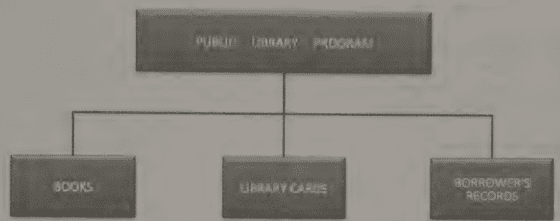

如果我们有遗漏，随时可以回溯到改进的这一步。我们现在可以进一步细化，对第一层级的每个子问题进行改进：

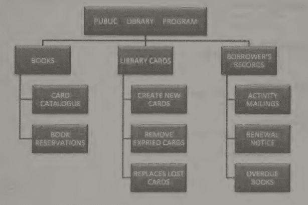

这对程序员来说仍然太抽象，因此我们再次对其进行改进：

### 图书卡片目录

- 将图书添加到目录
- 从目录中删除图书
- 搜索图书

### 图书预约

- 搜索图书
- 通知借阅者
- 打印预留消息

### 创建新卡片

- 打印卡片表单
- 获取新卡片信息

### 移除过期卡片

- 从永久文件中移除卡片
- 检查未归还图书
- 通知借阅者

### 更换丢失卡片

- 查找旧卡片信息
- 打印卡片表单

### 活动邮件

- 获取活动信息
- 通知借阅者

### 续借通知

- 获取旧卡片信息
- 通知借阅者

### 逾期图书

- 检查逾期图书
- 计算罚款
- 通知借阅者

请注意，随着问题的部分开始成型为输入/输出函数，改进开始发挥作用。作为额外奖励，这一层级的一些改进（例如“通知借阅者”片段）足够相似，可以编写为单个函数。

整个程序仍然太复杂，无法用 C 语言编码，但部分内容已触手可及：

```c
// library.c
// Reads today's date and books due date. Both must be
// in the current month.

#define FinePerDay 0.25

void calculateFines() {
    float totalFine;
    int todaysDate, dueDateLate;

    printf("Enter todays date and books due date.\n");
    scanf("%d %d", &todaysDate, &dueDate);
    daysLate = todaysDate - dueDate;
    totalFine = daysLate * FinePerDay;
    printf("The total fine is $%.2f", totalFine);
}
```

## 函数作业

- 1. 为以下每个函数给出函数头。
- a) 函数 areaRectangle 接受两个 double 参数，length 和 width，并返回一个 double 值。
- b) 函数 max 接受四个整数，w、x、y、z，并返回一个整数。
- c) 函数 outputHeaders 不接收任何参数，也不返回值。
- d) 函数 getValue 接受一个整数参数 num，并返回一个 char。

- 2. 假设函数 foo() 具有以下定义：

```c
int foo (int a, int b, int c) {
}
...
```

以下哪些语句是合法的？假设 i 的类型为 int，x 的类型为 double。

- a) i = foo (10, 20, 30);
- b) x = foo (10, 20, 30);
- c) i = foo (5.25, 3.45, 7.22);
- d) x = foo (5.25, 3.45, 7.22);
- e) foo (10, 20, 30);
- f) foo (10, 20);

### 3. 以下哪项是不返回值且具有一个 double 参数的函数的有效原型？

- a) void foo (double x);
- b) void foo (double);
- c) void foo (x);
- d) foo (double x);

- 4. 每个 mp3 售价 $1.25，每个 CD 售价 $3.25，每个 DVD 售价 $12.75。编写一个函数 buyMusic，它接受三个参数，分别表示 mp3、CD 和 DVD 的数量，并返回总美元成本。

# 第 7 章 选择语句

- if 语句
- switch 语句
- 条件运算符
- 选择作业
- 身体质量指数实验
- 大–小实验
- 工资实验

## if 语句

决策语句允许程序根据数据值遵循不同的行动方案或执行不同的任务。

### if 语句：单一备选决策语句

以下伪代码语句：

```
if x is not equal to zero then
    divide y by x and assign the result to num
```

可以读作：

如果条件“x 不等于零”为真，则将 y 的值除以 x 的值，并将结果赋给变量 num。否则，条件“x 不等于零”为假。在这种情况下，不会采取替代操作，因为如果语句为假，未指定任何替代操作。

if 语句的语法如下：

```
if (expression) {
    statement;
}
```

if 语句使用半布尔逻辑，即零表示假，非零表示真。上述伪代码示例的 C 代码可能如下所示：

```c
if (x != 0) {
    num = y/x;
}
```

以下是一个打印数字绝对值的简短程序：

```c
//absoluteValue.c
#include <stdio.h>
int main(void) {
    int num;
    printf("Enter a value: ");
    scanf_s("%d", &num);
    if (num < 0)
        num = -num;
    printf("The absolute value is %d\n", num);
    return 0;
}
```

表达式内允许副作用。使用副作用是良好的 C 风格，可以避免创建否则无用的“临时”变量。因此，

```c
if (scanf_s("%d", &num) != 1) {
    printf("Bad value.\n");
}
```

优于

```c
temp = scanf_s("%d", &num);
if (temp != 1) {
    printf("Bad value.\n");
}
```

由于表达式的结果将是零（假）或非零值，我们将使用：

```c
if (expression)
```

而不是

```c
if (expression != 0)
```

## if-else 语句：双备选决策语句

以下伪代码示例：

```
if x is not equal to zero then
    divide y by x and assign the result to num
else // otherwise
    display an error message
```

可以读作：

如果条件“x 不等于零”为真，则将 y 的值除以 x 的值，并将结果赋给变量 num。否则，条件“x 不等于零”为假。在这种情况下，显示错误消息。

请注意，上面显示的条件是逻辑表达式。当你对它们求值时，结果要么是真，要么是假。这是逻辑表达式唯二可能的值！

if-else 语句的语法如下：

```
if (expression) {
    statement1;
} else {
    statement2;
}
```

上述伪代码示例的 C 代码可能如下所示：

```c
if (x != 0) {
    num = y / x;
} else {
    printf ("Divide by zero error condition.");
}
```

以下是一个简单程序，用于判断数字是奇数还是偶数：

```c
// oddEven1.c
#include <stdio.h>
int main(void) {
   int num;
   printf("Enter a number: ");
   scanf_s("%d", &num);
   if (num % 2 == 0) {
      printf("The number is even.\n");
   }
   else {
      printf("The number is odd.\n");
   }
   return 0;
}
```

请注意，在 C 允许控制结构中包含语句的任何位置，该语句都可以是由花括号分隔的复合语句：

```c
// oddEven2.c
#include <stdio.h>
int main(void) {
   int num;
   printf("Enter a number: ");
   scanf_s("%d", &num);
   printf("The number entered is %d.\n", num);
   if (num % 2 == 0)
      printf("The number is even.\n");
   else
      printf("The number is odd.\n");
   return 0;
}
```

以下是一个使用 if-else 结构根据薪资率和工作时数计算工资的程序：

```c
// calculateWages.c
// Program to Calculate Wages

#include <stdio.h>

int main (void) {
    float payRate, hours, wages;

    printf("Enter hourly salary: ");
    scanf_s("%f", &payRate);

    printf("Enter number of hours worked: ");
    scanf_s("%f", &hours);

    if (hours <= 40)
        wages = hours * payRate;
    else
        wages = (40 * payRate) + (hours - 40) * 1.5 * payRate;

    printf("The employee's weekly wages are $%6.2f\n", wages);
    return 0;
}
```

## 嵌套 if 语句

每当一个 if 语句嵌套在另一个 if 语句中时，请在嵌套的 if 语句周围加上花括号。此外，else 子句与同一作用域中最近的“未匹配 else”的 if 语句相关联：

```c
// nesting1.c

// incorrect nesting
// (num > 0)
if (num > 0)
    if (num % 2 == 0)
        printf("Positive and even.\n");

else
    printf("Not positive.\n");

// correct nesting
// (num > 0) {
if (num > 0) {
    if (num % 2 == 0)
        printf("Positive and even.\n");
}
else
    printf("Not positive. ");
```


## else-if 语句：多重替代决策语句

以下是伪代码示例：

```
if x is less than zero then
    set y equal to -1
else if x is equal to zero then
    set y equal to 0
else
    set y equal to 1
```

可以按以下方式理解：

如果条件 "x is less than zero" 为真，则将 y 的值设置为 -1。

否则，条件 "x is less than zero" 为假。所以如果条件 "x is equal to zero" 为真，则将 y 的值设置为 0。

否则，条件 "x is less than zero" 和 "x is equal to zero" 均为假。所以我们将 y 的值设置为 1。

当 if 语句的嵌套仅出现在 else 子句中时，使用 else-if 语句。语法如下：

```
if (expression1) {
    statement1;
} else if (expression2) {
    statement2;
} else if (expression3) {
    statement3;
} else {
    statement4;
}
```

上述伪代码示例对应的 C 代码可能如下所示：

```
// nesting2.c
if (x < 0) {
  y = -1;
} else if (x == 0) {
  y = 0;
} else {
  y = 1;
}
```

使用 else-if 结构通常可以澄清你的代码。例如，这个晦涩的三选一结构的含义：

```
// nesting3.c
if (n > 0) {
  printf("Positive");
} else {
  if (n == 0) {
    printf("Zero");
  } else {
    printf("Negative");
  }
}
```

使用 else-if 结构可以使其更清晰：

```
// nesting4.c
if (n > 0) {
  printf("Positive");
} else if (n == 0) {
  printf("Zero");
} else {
  printf("Negative");
}
```

## switch 语句

switch 语句是另一种多重选择控制结构。

- 它只能在仅测试一个变量的特定情况下使用。所有分支都必须依赖于该变量的值。
- 该变量必须是整型，如 int、long、short 或 char。
- 变量的每个可能值可以控制一个分支。可以可选地使用最终的、捕获所有的 default 分支来捕获所有未指定的情况。

下面是一个使用 switch 语句的简单计算器程序：

```
// calculator.c
#include <stdio.h>
int calc(int operand1, int operand2, char operator);
int main(void) {
    int a, b;
    char op;
    printf("Enter two integers and an operator: ");
    scanf_s("%d %d %c", &a, &b, &op);
    calc(a, b, op);
    return 0;
}
int calc(int operand1, int operand2, char operator) {
    switch (operator) {
        case '+': printf("%d\n", operand1 + operand2); break;
        case '-': printf("%d\n", operand1 - operand2); break;
        case '*': printf("%d\n", operand1 * operand2); break;
        case '/': printf("%d\n", operand1 / operand2); break;
    }
    return 0;
}
```

请注意，每个替代代码段的末尾都应该有一个 break 语句。break 语句通过退出 switch 来防止执行任何进一步的语句。控制权跳转到 switch 语句后的右花括号。实际上，退出 switch 语句最常见的方式是使用 break 或 return 语句。

## 条件运算符

条件运算符 ?: 是 C 中唯一的三元运算符，即需要 3 个操作数：

- 正在测试的表达式
- 两个备选结果表达式

条件运算符的语法如下所示：

```
// conditional1.c
condition ? expr1 : expr2;
```

条件是一个返回 true 或 false（0 或非零）的关系表达式。如果为真，则计算 expr1，否则计算 expr2。实际上，条件运算符的行为非常类似于 if-else 语句。以下代码：

```
// conditional2.c
if (x > y) {
    max = x;
} else {
    max = y;
}
```

可以使用条件运算符重写为：

```
// conditional3.c
max = x > y ? x : y;
```

条件语句对于缩短程序非常有用。我们可以重写以下 if-else 语句：

```
// conditional4.c

if (x > y) {
    printf("%d\n", x);
} else {
    printf("%d\n", y);
}
```

为

```
// conditional5.c

printf("%d\n", x > y ? x : y);
```

在以下语句中：

```
// conditional6.c

num = value > 0 ? ++x : ++y;
```

只会对其中一个表达式（++x 或 ++y）求值，但绝不会同时求值两者！

下面展示了使用条件运算符的两个函数。请注意，它们还使用了 ctype.h 库中的函数：

```
// lowerToUpper.c

// convert lower case to upper case
char toUpper(char c) {
    return islower(c) ? c - 32 : c;
}

// convert upper case to lower case
char toLower(char c) {
    return isupper(c) ? c + 32 : c;
}
```

下面是一个示例，用于打印数组的 n 个元素，每行 10 个，每列之间用一个空格分隔，并且每行（包括最后一行）都由恰好一个换行符结束：

```
// printsArrayElements1.c

// Long Form

for (i = 0; i < n; ++i) {
    printf("%6d", a[i]);
    if (i % 10 == 9 || i == n - 1) {
        printf("%s", "\n");
    } else {
        printf("%s", " ");
    }
}
```

每第 10 个元素后打印一个换行符，在第 n 个元素后，所有其他元素后跟一个空格。

```
// printsArrayElements2.c

// Short Form

for (i = 0; i < n; ++i) {
    printf("%6d%c", a[i], (i % 10 == 9 || i == n - 1) ? '\n' : ' ');
}
```

## 选择作业

- 1. 编写一条语句来完成以下每一项：

  - a) 如果 value 不等于 42，则打印 "The variable value is not equal to 42."

  - b) 测试变量 num 的值是否大于或等于 7。如果是，则打印 "Num is greater than or equal to 7."

- 2. 以下表达式的值是多少？请记住，C 不使用布尔逻辑（真或假），而是使用半布尔逻辑（零或非零）。你可以假设所有变量都声明为 int 类型。

  - a) i = 3;
    j = 3;
    i - j == 0

  - b) i = 3;
    j = 7;
    k = 2;
    i % j + i < k

  - c) i = 10;
    j = 5;
    !i < j

  - d) i = 2;
    j = 1;
    !!i + !j

  - e) i = 5;
    j = 0;
    k = -5;
    i && j || k

```
i = 1;
j = 2;
k = 3;
i < j || k
```

- 3. 以下表达式的值是多少。你可以假设所有变量都声明为 int 类型。

  ```
  c = 1;
  d = -2;
  a = 0;
  e = 3;
  ```

  - a) (c < d) || a
  - b) 2 < !d + d
  - c) !(!(!e))

- 4. 以下 if 语句过于复杂。请尽可能简化。（提示：整个语句可以替换为单个赋值。）

  ```
  if (age >= 13)
  if (age <= 19)
  teenager = true;
  else
  teenager = false;
  else if (age < 13)
  teenager = false;
  ```

- 5. 数学运算：

  ```
  min(x, y)
  ```

  可以用条件表达式表示：

  ```
  (x < y) ? x : y
  ```

  类似地，仅使用条件表达式，描述数学运算：

  ```
  min(x, y, z)
  ```

## 身体质量指数实验

BMI（身体质量指数）是根据个人的身高和体重衡量其体脂的一种指标。它可以确定个人是否超重或肥胖。

计算 BMI 的公式如下：

```
BMI = weightInPounds x 703
heightInInches x heightInInches
```

下表可用于评估 BMI 分数：

| BMI 值 | |
|---|---|
| 小于 18.5 | 体重过轻 |
| 18.5 及以上且小于 25.0 | 正常 |
| 25.0 及以上且小于 30.0 | 超重 |
| 30.0 或更高 | 肥胖 |

本次实验要求你构建一个 C 程序 bmi.c，其中包含一个名为 calculateBMI() 的函数，该函数提示用户输入以磅为单位的体重和以英寸为单位的身高，然后计算并显示身体质量指数。该函数还应显示该人是体重过轻、正常、超重还是肥胖。

请确保用户提示以及程序中输入的身高和体重值都显示在输出文件中。请注意，计算出的 BMI 值应显示一位小数。你的函数中接收身高和体重值的变量应声明为 double 类型。

下面是我希望你用于程序的 main() 函数。

```
int main (void) {
  int i;

  fopen_s(&fp, "csis.txt", "w");
  for (i = 1; i <= 4; ++i) {
    calculateBMI();
  }
  fclose(fp);
  return 0;
}
```

请勿修改 main() 函数。它应作为程序中的第一个函数出现。请确保为程序中使用的每个函数使用函数原型。

请注意，for 循环调用 calculateBMI() 函数四次。每次调用 calculateBMI() 函数时，都会输入不同的体重和身高。请务必使用以下数据：

| 第一次： | 175 | 70 |
| 第二次： | 120 | 68 |
| 第三次： | 225 | 65 |
| 第四次： | 140 | 67 |

程序的输出应发送到终端窗口（你的屏幕）以及请求的 csis.txt 输出文件。请务必阅读关于捕获程序输出的文档。你的全名必须作为注释出现在包含 main() 的源文件中。请务必将 csis.txt 输出文件包含在 zip 压缩包中。


## 大小实验室

编写一个 C 程序 largeSmall.c，其中包含一个名为 compare() 的函数，该函数提示用户输入四个整数，并计算并显示这些整数中的最大值和最小值。确保用户提示以及输入到程序中的四个整数都在输出文件中显示。

下面提供了我希望你在程序中使用的 main() 函数。

```
int main (void) {
    int i;
    fopen_s(&fp, "csis.txt", "w");
    for (i = 1; i <= 4; ++i) {
        compare();
    }
    fclose(fp);
    return 0;
}
```

请勿修改 main() 函数。它应作为程序中的第一个函数出现。确保为程序中使用的每个函数使用函数原型。

请注意，for 循环会调用 compare() 函数四次。每次调用 compare() 函数时，都会输入一组不同的四个整数。请务必使用下面显示的数据：

| 第一组: | 28 | 44 | 66 | 82 |
| 第二组: | 8 | 14 | 22 | 6 |
| 第三组: | 21 | 38 | 12 | 16 |
| 第四组: | 98 | 22 | 45 | 63 |

程序的输出应发送到终端窗口（您的屏幕）以及请求的 `csis.txt` 输出文件。请务必阅读关于捕获程序输出的文档。您的全名必须作为注释出现在包含 `main()` 的源文件中。请务必将 `csis.txt` 输出文件包含在 zip 压缩包中。

## 工资实验室

编写一个 C 程序 wages.c，用于计算员工的总工资、税金和净工资。如果需要，程序应计算加班费。加班费为每超过 40 小时工作时间的 1.5 倍工资。

下面是计算不含加班费的工资的公式：

```
wages = hours * payrate
```

下面是计算含加班费的工资的公式：

```
wages = (40 * payrate) + (hours - 40) * 1.5 * payrate
```

税金计算如下：

- 前 $200 的 20%
- 接下来的 $250 的 25%
- 剩余总工资的 30%

每次运行程序时，提示用户输入工作时长和时薪。

运行 1: hours = 28.5; payrate = 22.75

运行 2: hours = 63.75; payrate = 35.25

请注意，针对不同的运行，您不应修改代码。使用 if-else 语句来测试是否需要计算加班费。确保所有数值输出保留两位小数。将运行 1 的输出文件提交为 csis1.txt，运行 2 的输出文件提交为 csis2.txt。

请记住，不要自行计算并让程序输出结果。实验的所有计算都应在程序中完成。

main() 函数应作为程序中的第一个函数出现。确保为程序中使用的每个函数使用函数原型。

程序的输出应发送到终端窗口（您的屏幕）以及请求的 csis.txt 输出文件。请务必阅读关于捕获程序输出的文档。您的全名必须作为注释出现在包含 main() 的源文件中。请务必将 csis.txt 输出文件包含在 zip 压缩包中。

- while 语句
- for 语句
- 逗号运算符
- do-while 循环
- break 语句
- continue 语句
- 循环作业
- 成绩实验室
- 便士实验室
- 斐波那契实验室

# while 循环

重复语句允许您指定，只要某个条件保持为真，就重复执行某个操作。例如，下面的语句：

```
while there are more items on my shopping list
purchase next item and cross it off my list .
```

描述了购物过程中发生的重复操作。条件：

```
there are more items on my shopping list
```

可能为真或假。如果为真，则执行以下操作：

```
purchase next item and cross it off my list
```

将被执行。只要条件保持为真，就会重复执行此操作。最终，条件将变为假（当购物清单上的最后一项商品被购买并划掉时）。此时，重复终止，并执行重复结构之后的第一条语句。

因此，循环提供了一种手段，只要控制循环的条件（通常位于循环标题中）的求值结果为真，就重复执行一系列可执行语句（循环体）。循环控制条件是一个逻辑表达式，其求值结果为真或假。通常，该表达式涉及一个单变量，称为循环控制变量。

循环体是包含与循环条件相关的一系列可执行语句的代码块。请注意，循环体可以是单条语句，也可以是复合语句。只要循环条件的求值结果为真，就会重复执行循环体。当循环条件的求值结果为假时，循环将终止。每次重复执行循环体时，循环被认为经历了一次迭代。

## while 循环的语法如下：

```
// Before the loop construct, initialize any loop control variable,
// i.e., the variable appearing in the condition in the loop header.
while (condition) { // loop header - test the loop condition
  statement;
}
or
while (condition) { // loop header - test the loop condition
  statement;
  statement;
  ...
}
```

请记住，循环体必须包含一条用于更新循环条件中所用循环控制变量的语句。循环控制变量通常位于循环体的底部。

请注意，当 while 循环结构只有一条语句时，花括号 { } 是可选的。但是，即使不是必需的，使用花括号始终是个好主意。

## 示例：2 的幂

例如，考虑一个旨在找到大于 100 的第一个 2 的幂的程序段。我们首先将整数变量 product 初始化为 2。当以下 while 重复语句执行完毕时，product 将包含所需的答案：

```
// powersOfTwo.c
product = 2;
while (product <= 100) {
  product = product * 2; // or we can say: product *= 2;
}
```

当进入 while 语句时，product 的值为 2。变量 product 反复乘以 2，依次取值 2、4、8、16、32、64 和 128。当 product 变为 128 时，while 语句中的条件：

```
product <= 100
```

将变为假。这将终止重复，product 的最终值为 128。程序执行将继续执行 while 循环之后的下一条语句。

我们可以将此示例推广，编写一个名为 findMax() 的函数，该函数将返回大于某个最大值的第一个 2 的幂：

```
// findMaxValue.c

#include <stdio.h>

int findMax(int value);

int main (void) {
    int value, max;

    value = 500;
    max = findMax(value);
    printf("The first power of 2 larger than %d is %d.\n", value, max);
    return 0;
}

int findMax(int value) {
    int product = 2;
    while (product <= value) {
        product *= 2;
    }
    return product;
}
```

以下是生成的输出：

```
The first power of 2 larger than 500 is 512.
```

我们可以进一步推广此示例，使函数 findMax() 返回大于某个最大值的第一个 num 的幂：

```
// findMaxValue2.c

#include <stdio.h>

int findMax(int num, int value);

int main (void) {
    int num, value, max;

    num = 5;
    value = 1000;

    max = findMax(num, value);
    printf("The first power of %d larger than %d is %d.\n", num,
           value, max);
    return 0;
}

int findMax(int num, int value) {
    int product = num;

    while (product <= value) {
        product *= num;
    }

    return product;
}
```

以下是生成的输出：

大于 1000 的第一个 5 的幂是 3125。

## 计数器控制循环

计数器控制循环使用一个变量来统计已完成的循环迭代次数，从而重复执行一系列可执行语句指定的次数。

- 在第一次检查循环条件之前，必须知道循环体将重复的次数，并且在循环体内不得更改该次数。
- 在第一次检查循环条件之前，必须将计数变量初始化为已知值。


- 计数变量必须在循环体内更新，否则循环条件永远不会求值为 false，从而创建一个永远不会停止的无限循环。
- 计数变量可以以任意量递增（值增加）或以任意量递减（值减少）。

## 示例：摄氏度转华氏度转换表

我们的转换表将使用计数器变量 ctemp 来控制 while 循环执行的次数。在此示例中，当 ctemp 变为 < 0 时，重复终止。

```c
// tempConversion.c
#include <stdio.h>
int main(void) {
    int ctemp;
    float ftemp;
    printf("Celsius\tFahrenheit\n");
    ctemp = 100;
    while (ctemp >= 0) {
        ftemp = (9.0/5.0) * (float)ctemp + 32.0;
        printf ("%7d\t%10.1f\n", ctemp, ftemp);
        ctemp -= 10;
    }
    return 0;
}
```

程序输出如下：

| 摄氏度 | 华氏度 |
|---|---|
| 100 | 212.0 |
| 90 | 194.0 |
| 80 | 176.0 |
| 70 | 158.0 |
| 60 | 140.0 |
| 50 | 122.0 |
| 40 | 104.0 |
| 30 | 86.0 |
| 20 | 68.0 |
| 10 | 50.0 |
| 0 | 32.0 |

- 如果我们写 (9/5) 而不是 (9.0/5.0) 会发生什么？
- 如果我们去掉 (9.0/5.0) 两边的括号会发生什么？
- 在上述表达式中写 (float)ctemp 而不是仅写 ctemp 是个好主意，这是为什么呢？

## 求和变量

假设我们希望求 1-1000 的数字之和。我们不仅需要一个计数器变量来控制 while 循环执行的次数，还需要一个求和变量来累加我们迄今所见数字的总和。

```c
// summation.c
#include <stdio.h>
int main(void) {
    int count = 1;
    int sum = 0;
    while (count <= 1000) {
        sum += count;
        ++count;
    }
    printf("The sum = %d.\n", sum);
    return 0;
}
```

程序输出如下：

总和 = 500500。

注意，用于存储求和或总计的变量，通常应在程序中使用前初始化为零；否则，求和变量将包含存储在求和变量内存位置中的先前值。这是因为未初始化的变量通常包含“垃圾值”，即最后存储在为该变量保留的内存位置中的值。

## 哨兵控制循环

有时我们事先不知道希望循环迭代多少次。例如，假设我们想要输出程序中输入的数字的平方和立方。程序如何确定何时停止数字输入？解决此问题的一种方法是使用一种称为哨兵值的特殊值来指示“数据输入结束”。

用户输入数据值，其平方和立方将被输出，直到输入哨兵值，这表示最后一个数据值已被输入。请注意，哨兵值的选择必须使其不会与可接受的输入值混淆。

```c
// sentinel.c

#include <stdio.h>

int main(void) {
    int num;

    printf("Enter number, -999 to end: ");
    scanf_s("%d", &num);
    while (num != -999) {
        printf("%5d %5d %5d\n", num, num * num, num * num * num);
        printf("Enter number: ");
        scanf_s("%d", &num);
    }
    return 0;
}
```

程序输出如下：

```
Enter number, -999 to end: 2
2 4 8
Enter number, -999 to end: 5
5 25 125
Enter number, -999 to end: 8
8 64 512
Enter number, -999 to end: -999
```

## for 语句

for 语句在进入循环之前已知循环迭代次数时效果很好。循环头由分号分隔的三部分组成：初始化、测试和更新。

```
for (i = 1; i <= 10; i++)
```

第一部分在进入循环之前运行。这通常是循环控制变量的 *初始化*。

第二部分是对循环控制变量的 *测试*。当此测试不再为真时，循环退出。

第三部分是循环控制变量的 *更新*。这通常是循环体完成后每次执行的语句。通常这是对循环控制变量的递增或递减。

以下是 *for* 语句的语法：

```c
for (initialExpression; loopCondition; loopExpression) {
    statement;
}
```

- initialExpression 在循环开始前设置初始值。
- loopCondition 指定继续循环所需的条件。
- loopExpression 在循环体执行后每次执行。

## 示例：求 1 到 100 的整数之和

```c
// sumIntegers1.c
int i, sum = 0;
for (i = 1; i <= 100; ++i) {
    sum += i;
}
```

在我们的示例中，变量 i 是循环控制变量，并初始化为 1。如果 loopCondition 为真，即 i <= 100，则循环体将执行一次。在循环体的最后一条语句执行后，将执行 loopExpression。在此示例中，i 的值将递增 1。如果 loopCondition 仍为真，则 for 循环体将再次执行，以此类推。

请注意，for 语句中的任何或所有表达式都可以缺失，但两个分号必须始终保留。例如，如果 initialExpression 缺失，则作为 for 循环的一部分不会执行任何初始化步骤：

```c
// sumIntegers2.c
// Compute the sum of integers from 1 - 10.
int i = 1, sum = 0;
for ( ; i <= 10; ++i) {
    sum += i;
}
```

当 loopCondition 缺失时，规则是测试始终为真。因此，下面的 for 循环是一个无限循环。

```c
// sumIntegers3.c
int i = 1, sum = 0;
for ( ; ; ) {
    sum += i++;
    printf("%d ", sum);
}
```

请注意，`for` 语句始终可以翻译为等效的 `while` 语句，反之亦然：

```c
// for loop
for (initialExpression; loopCondition; loopExpression) {
    statement;
}

// while loop
initialExpression;
while (loopCondition) {
    statement;
    loopExpression;
}
```

请务必不要在 for 循环标题末尾放置分号：

```c
// sumIntegers4.c
int i, sum = 0;
for (i = 1; i <= 100; ++i);
    sum += i;
```

这会造成问题，因为 `for` 循环将不再有循环体。在这种情况下，循环的控制方面将执行 100 次，但什么都不会做，因为循环体为空。

请注意，当 `for` 循环结构只有一条语句时，花括号 {} 是可选的。但是，即使不是必需的，使用花括号始终是个好主意。

## 嵌套 for 循环

有时我们需要将一个 `for` 循环放在另一个 `for` 循环的循环体中。这被称为嵌套 `for` 循环。你能跟踪下面嵌套 `for` 循环的控制流程吗：

```c
// nest.c
#include <stdio.h>
int main(void) {
    int i, j;
    for (i = 1; i <= 4; ++i) {
        for (j = 1; j <= 3; ++j) {
            printf("%d %d\n", i, j);
        }
    }
    return 0;
}
```

以下是生成的输出：

```
1 1
1 2
1 3
2 1
2 2
2 3
3 1
3 2
3 3
4 1
4 2
4 3
```

## 逗号运算符

偶尔，你会发现自己处于这样的情况：C 期望一个单一表达式，但你有两件事想要表达。最常见的（实际上也是唯一常见的）示例是在 `for` 循环中，具体来说是第一个和第三个控制表达式。例如，如果你希望有一个循环，其中 `i` 从 0 递增到 10，同时 `j` 从 10 递减到 0，你可以在循环标题中操纵 `i`，并“手动”处理 `j`：

```c
// comma1.c
...
j = 10;
for(i = 0; i < 10; i++) {
    ... rest of loop ...
    j--;
}
```

但在这里，更难看出 `i` 和 `j` 的并行性质，而且如果循环包含 `continue` 语句，这也无法正常工作。（`continue` 会跳回循环顶部，`i` 将被递增，但 `j` 将 _不会_ 被递减。）你可以根据 `i` 计算 `j`：

```c
// comma2.c
...
for(i = 0; i < 10; i++) {
    j = 10 - i;
    ... rest of loop ...
}
```

但这也使 `j` 不必要地从属。在 C 中编写此循环的通常方式是：

```c
// comma3.c
...
for(i = 0, j = 10; i < 10; i++, j--) {
    ... rest of loop ...
}
```


这里，第一个（初始化）表达式是：

```
i = 0, j = 10
```

逗号是逗号运算符，它只是先求值第一个子表达式 i = 0，再求值第二个 j = 10。

第三个控制表达式：

```
i++, j--
```

也包含逗号运算符，同样，先执行 i++，再执行 j--。

在这个示例中，我们在 for 循环中将变量 i 和 j 都初始化为 0。

```
// comma4.c
for (i = 0, j = 0; i < 10; ++i)
```

准确地说，逗号运算符在一般表达式：

```
e1 , e2
```

中的意思是“求值子表达式 e1，然后求值 e2；表达式的值是 e2 的值。”因此，e1 最好涉及赋值、递增 ++、递减 --、函数调用或其他某种副作用，因为否则它将计算一个会被丢弃的值。

除了在 for 循环的第一个和第三个控制表达式中使用逗号运算外，几乎没有任何理由在其他地方使用逗号运算符，事实上，你在 C 程序中看到的大多数逗号都不是逗号运算符。特别是，函数调用参数之间的逗号不是逗号运算符；它们只是用来分隔多个参数表达式的标点符号。

很容易看出它们不能是逗号运算符，否则在像这样的调用中：

```
// comma5.c

...
printf("Hello, %s!\n", "world");
```

其操作将是“求值字符串 "Hello, %s!\n"，丢弃它，只将字符串 "world" 传递给 printf()。这当然不是我们想要的；我们希望两个字符串都作为两个独立的参数传递给 printf()（当然，实际情况也是如此）。

## do while 循环

do while 循环与 while 循环非常相似，只是测试发生在循环体的末尾。这保证了循环在继续之前至少执行一次。这种设置经常用于需要读取数据的情况。然后测试会验证数据，如果数据不可接受，则循环回去再次读取。

例如，假设你想读入一个正整数，并且要坚持该整数必须是正数：

```
// positive.c
do {
   printf("Enter a positive value: ");
   scanf_s("%d", &num);
} while (num <= 0);
```

## 请注意以下几点：

- 条件 num <= 0 在循环体执行后进行测试。
- 只要求值表达式 num <= 0 为真，循环就继续。
- 当表达式 num <= 0 变为假时，循环终止。
- 代码总是至少执行一次循环体。
- 在 do-while 循环结构的末尾右括号后需要分号。
- 循环条件中使用的变量通常应在进入循环前初始化，然后在循环体的每次重复末尾测试循环条件之前（在循环体中）更新。

请注意，当 do-while 循环结构只有一条语句时，花括号 {} 是可选的。但是，即使不是必须的，使用花括号始终是个好主意。

## break 语句

break 语句可在 while、do while、for 和 switch 语句中使用。它在这些结构中各自作为跳转到语句末尾的跳转。它导致从循环中退出，就像从 switch 语句中退出一样。执行 break 后，程序控制权跳转到循环后面的语句。例如：

```
// break1.c

for (i = 0; i < num; ++i) {
    if (i > 100) {
        break;
    }
    sum += i;
}
```

请注意，每次你编写 break（switch 语句除外）时，都应该质疑是否有不使用 break 来表达相同逻辑的简单方法。我们可以不使用 break 来修改上面的代码，如下所示：

```
// break2.c

for (i = 0; i < num && i <= 100; ++i) {
    sum += i;
}
```

这里有另一个示例。假设我们想在字符串 s 中查找第一个空白字符（空格、制表符或换行符）：

```
// break3.c
// misuse of break

for (i = 0; i < max; ++i) {
    if (s[i] == ' ' ) {
        break;
    }
    else if (s[i] == '\t') {
        break;
    }
    else if (s[i] == '\n') {
        break;
    }
}
```

更专业的方法是在循环的测试中说明循环条件：

```
// break4.c
// search for whitespace character

for (i = 0; s[i] != ' ' && s[i] != '\t' && s[i] != '\n'; ++i) {
    ;
}
```

我们也可以概括空白字符的概念：

```
// break5.c

for (i = 0; !isspace(s[i]); ++i) {
    ;
}
```

我们很快将更仔细地查看字符串。

## continue 语句

break 语句可以用来立即跳出循环。
但是，有时当发生意外情况时，你想回到循环的顶部。

例如，我们可以使用 continue 语句来避免除以零错误：

```
// reciprocals.c
// calculate reciprocals for -5 to 5
int main(void) {
    int i;
    for (i = -5; i <= 5; i += 1) {
        if (i == 0) {
            printf("Divide by zero trap.\n");
            continue;
        }
        printf("%f\n", 1.0 / i);
    }
    return 0;
}
```

请注意，在 for 语句的循环体中，continue 语句跳转到 loopExpression，即 for 语句的第三个表达式。在 while 和 do while 循环中，它跳转到测试。

与 break 语句一样，你应该始终质疑 continue 语句的必要性。通过简单地重构代码，你通常可以消除对 continue 语句的需求。你很可能不会使用它。

```
-0.200000
-0.250000
-0.333333
-0.500000
-1.000000
Divide by zero trap.
1.000000
0.500000
0.333333
0.250000
0.200000
```

1. 以下程序片段会产生什么输出？

```
i = 4;
while (i <= 128) {
    printf("%d ", i);
    i *= 2;
}
```

2. 以下程序片段会产生什么输出？

```
i = 1234;
do {
    printf("%d ", i);
    i /= 10;
} while (i > 0);
```

3. 显示以下每个代码块的输出：

```
for (i = 5; i < 32; i += 6) {
    printf("%d\n", i);
}
```

```
for (i = 25; i > 0; i -= 5) {
    printf("%d\n", i);
}
```

4. 编写 C 语句，使用 for 语句求 1 到 100 之间奇数整数的和。假设整数变量 sum 和 count 已定义，但未初始化，类型为 int。

5. 编写 for 语句，打印以下值序列：

- a) 10, 20, 30, 40, 50
- b) 75, 65, 55, 45, 35

## 6. 假设我们想要计算从 50 到 1 的整数之和。以下代码有什么问题？

```
sum = 0;
num = 50;
while (num >= 0) {
    sum += num;
}
```

## 7. 看看你能否通过重组来改进以下程序片段。首先分析代码以确定实际执行的功能。然后尽可能清晰简单地重新编写该功能（即不使用 break 或 continue）。

```
a) while(a) {
    if(b) {
        continue;
    }
    c();
}
```

```
b) do {
    if (!a) {
        continue;
    }
    else {
        b();
        c();
    }
} while (a);
```

## 成绩实验

编写一个 C 程序 grade.c，其中包含一个函数 calculateAverage()，该函数可以计算任意数量测试分数的平均值。你的程序事先不会知道有多少测试分数将被输入到你的函数中，因此你需要使用哨兵值（-1）来终止用于收集测试分数的 while 循环。测试分数是 0 到 100 之间的整数，测试分数平均值应输出到两位小数。确保用户提示和输入到程序中的分数在输出文件中显示。

以下是我希望你用于程序的 main() 函数。

```
int main (void) {
	int i;

	fopen_s(&fp, "csis.txt", "w");

	for (i = 1; i <= 4; ++i) {
		calculateAverage();
	}

	fclose(fp);
	return 0;
}
```

请勿修改 main() 函数。它应作为程序中的第一个函数出现。确保为程序中使用的每个函数使用函数原型。

请注意，for 循环调用 calculateAverage() 函数四次。每次调用 calculateAverage() 函数时，都会输入一组不同的测试分数。请务必使用以下所示的数据：

```
First: 78, 93, 45, 88, 89, -1
Second: 87, 68, 100, -1
Third: 84, 86, 90, 86, 96, 68, 82, -1
Fourth: -1
```


请记住，`main()` 函数应作为程序中的第一个函数出现。请务必为程序中使用的每个函数使用函数原型。

程序的输出应同时发送到终端窗口（您的屏幕）以及请求的 `csis.txt` 输出文件。请务必阅读有关捕获程序输出的文档。您的全名必须作为注释出现在包含 `main()` 的源文件中。请务必将 `csis.txt` 输出文件包含在您的 zip 压缩包中。

## 便士实验室

第一天您在银行存入一便士。第二天您存入两便士。第三天您存入四便士。第四天您存入八便士，以此类推。假设您每天将存款翻倍，请编写一个 C 程序 penny.c，以确定需要多少天才能累积至少一百万美元。（假设不支付利息。）请注意，要累积的金额必须在运行时输入。

每天的输出都应包括当天的存款金额以及截至当天的银行总余额。您的输出应按下表所示的表格格式出现：

请输入您想要累积的金额：1000000

| 天数 | 存款 | 余额 |
|-----|---------|---------|
| 1 | 0.01 | 0.01 |
| 2 | 0.02 | 0.03 |
| 3 | 0.04 | 0.07 |
| 4 | 0.08 | 0.15 |
| ... | ... | ... |

花费了 XX 天才累积至少 $1000000.00。

您的程序应包含 main() 函数、一个用于输出表头的函数以及一个用于生成表格的函数。生成表格的函数应接收一个 double 类型的输入参数，指明您想要累积的金额。该函数的输出应按小数点对齐列，并向 main() 提供一个返回值，告知累积资金花费了多少天。然后应按上述方式输出该返回值。

请记住，main() 函数应作为程序中的第一个函数出现。请务必为程序中使用的每个函数使用函数原型。

程序的输出应同时发送到终端窗口（您的屏幕）以及请求的 csis.txt 输出文件。请务必阅读有关捕获程序输出的文档。您的全名必须作为注释出现在包含 main() 的源文件中。请务必将 csis.txt 输出文件包含在您的 zip 压缩包中。

## 斐波那契实验室

斐波那契数列是一系列数字：

```
0, 1, 1, 2, 3, 5, 8, 13, 21, ...
```

序列中的每个附加数字都是通过将其前面的两个数字相加得到的。

编写一个程序 fibonacci.c，用于计算前 20 个斐波那契数。您的程序应包含一个函数 fib()，该函数从 main() 接收一个输入参数，告知函数要输出多少个斐波那契数。

请记住，main() 函数应作为程序中的第一个函数出现。请务必为程序中使用的每个函数使用函数原型。

程序的输出应同时发送到终端窗口（您的屏幕）以及请求的 csis.txt 输出文件。请务必阅读有关捕获程序输出的文档。您的全名必须作为注释出现在包含 main() 的源文件中。请务必将 csis.txt 输出文件包含在您的 zip 压缩包中。

- 流
- getchar()
- putchar()
- 文本文件
- 输入-输出作业

# 流

C 语言本身没有任何用于执行 I/O 操作的特殊语句。所有 I/O 操作都必须通过对标准 I/O 库的函数调用来完成。

```
#include <stdio.h>
```

包含与标准 I/O 库相关的声明和宏定义。

每个程序在开始执行时都可以访问三个数据文件流：一个用于输入，两个用于输出：

```
stdin (standard input) – the usual source of input characters (keyboard)
stdout (standard output) – the usual destination for output characters (screen)
stderr (standard error output) – where error messages are send (screen)
```

可以通过在命令行执行程序时添加重定向请求，使相同的程序将其标准输出写入文件而不是终端：

```
foo > outFile.txt
```

这将创建一个包含 `foo` 输出的文件。由 `printf()` 显示的任何值都不会在终端上显示，而是会写入名为 `outFile.txt` 的文件中。如果有任何错误消息，它们将继续显示在终端窗口上，而不是被埋在输出文件中。

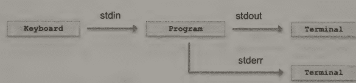

标准输入也可以进行类似的重定向。任何通常从终端读取数据的函数调用，例如 `getchar()` 和 `scanf_s()`，都可以改为从文件读取信息。例如，我们可以使用存储在名为 `inFile.txt` 的文件中的数据来运行程序 `foo`：

```
foo < inFile.txt
```

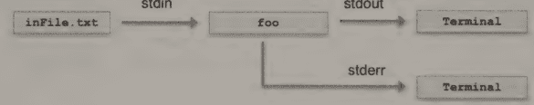

最后，我们可以同时组合输入重定向和输出重定向：

```
foo < inFile.txt > outFile.txt
```

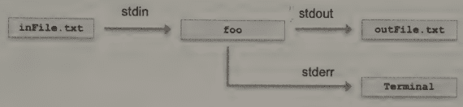

## getchar()

I/O 并非 C 语言本身的一部分，而是编写大多数程序所需的基本扩展。

getchar() 从标准输入（键盘）返回下一个字符，并将其作为函数返回值返回。如果没有更多输入，则改为返回 EOF（文件结束）。因此，在使用之前，通常会将 getchar() 返回的值与 EOF 进行比较。

在程序执行过程中的某个时刻，用户可以通过输入 ^z（控制 Z）（或在某些环境中输入 ^d）来指示“没有更多输入”，此时 getchar() 将返回 EOF。

getchar() 和 EOF 在名为 stdio.h 的标准头文件中定义，我们必须在所有编译中包含它：

```
#include <stdio.h>
```

某些 C 表达式成为我们的标准词汇，例如：

```
while ((c = getchar()) != EOF)
```

此表达式用于从标准输入一次获取一个字符的循环开头。请仔细查看该表达式，并注意“额外”的一对括号。你能弄清楚为什么需要它们吗？

接下来，考虑以下两者之间的区别：

```
while (c = getchar())
and
while (c == getchar())
```

要看出区别可能需要很长时间，有时甚至需要更长时间来决定你真正想要哪一个！

以下是一个程序，用于计算从输入流读取的字符数，直到遇到 EOF：

```c
// count1.c
#include <stdio.h>
int main(void) {
    int c, count = 0;
    while ((c = getchar()) != EOF) {
        ++count;
    }
    printf("%d\n", count);
    return 0;
}
```

请注意，c 被声明为 int 而不是 char。这是因为 EOF 被赋予定义值 -1。在某些机器上，char 只能是正值，因此为了返回 -1，我们将 c 定义为 int。

我们可以将上面的 while 语句替换为 for 语句：

```c
// count2.c
#include <stdio.h>
int main(void) {
    int count;
    for (count = 0; getchar() != EOF; ++count) {
        ;
    }
    printf("%d\n", count);
    return 0;
}
```

### 我们也可以统计换行符：

```c
// count.c
#include <stdio.h>
int main(void) {
    int c, count = 0;
    while ((c = getchar()) != EOF) {
        if (c == '\n') {
            ++count;
        }
    }
    printf("%d\n", count);
    return 0;
}
```

### 以下是一个将程序输入映射为小写的程序：

```c
// map1.c
#include <stdio.h>
#include <ctype.h>
int main(void) {
    int c;
    while ((c = getchar()) != EOF) {
        printf("%c", isupper(c) ? tolower(c) : c);
    }
    return 0;
}
```

### 以下是一个导致输入流中空白字符被跳过的表达式：

```c
// skipBlanks.c
while ((c = getchar()) == ' ') {
    ;
}
```


由于 C 语言没有内置函数来读取整行输入，因此它可以被称作一种相当原始的语言。然而，这鼓励了工具构建！所以让我们构建一个读取一行输入的函数，并将其打包为名为 `getLine()` 的函数，以便在需要时使用。

下面的程序将输入行复制到输出。它一次读取一行到字符串 `buf`。在字符串 `buf` 的末尾放置一个空终止符。如果输入处于 EOF，则返回 EOF 的值。

```c
// copylines1.c
#include <stdio.h>
#define BUFSIZ 81
int getLine(char buf[]);
int main(void) {
    char buf[BUFSIZ];
    while (getLine(buf) != EOF) {
        printf("%s", buf);
    }
    return 0;
}
int getLine(char buf[]) {
    char c;
    int i = 0;
    do {
        c = getchar();
        buf[i++] = c;
    } while (c != '\n');
    buf[i-1] = '\0';
    return i;
}
```

## 让我们看看如何更简单地重写 getLine()：

```c
// copyLines2.c

int getLine(char buf[]) {
    char c;
    int i = 0;

    while ((buf[i++] = getchar()) != '\n') {
    }

    buf[i] = '\0';
    return i;
}
```

## putchar()

putchar() 将单个字符输出到标准输出（终端窗口）。putchar() 的参数应该是单个字符，可以是变量或常量：

```
putchar(c);
putchar('a');
putchar('\n');
```

如果您只需要输出单个字符而无需格式，请使用 putchar() 而不是 printf()。下面是一个将输入复制到输出的程序：

```c
// copy.c
#include <stdio.h>
int main(void) {
    int c;
    while ((c = getchar()) != EOF) {
        putchar(c);
    }
    return 0;
}
```

注意，如果将此程序应用于 100 字节的文件，它将调用 getchar() 101 次。前 100 次调用将返回一个数据字节。第 101 次调用将返回 EOF 值。因此，测试将被求值 101 次，循环体将被执行 100 次。

使用此程序，我们可以使用 I/O 重定向编写自己的命令行复制命令：

```
copy < inFile.txt > outFile.txt
```

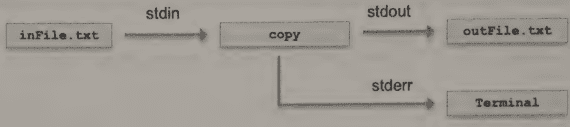

下面是一个将输入映射为小写的程序：

```c
// map2.c
#include <stdio.h>
#include <ctype.h>
int main(void) {
    int c;
    while ((c = getchar()) != EOF) {
        putchar(isupper(c) ? tolower(c) : c);
    }
    return 0;
}
```

最后，让我们编写一些代码，读取全小写字母的文本，并有选择地将每个单词的首字母大写。字母将被定义为任何非空白字符。

首先是一个算法：

```c
// caps1.c
for each whitespace character w
    output w
for each word
    capitalize initial letter
    for each succeeding letter
        output c
for each whitespace character w
    output w
```

现在是一些代码：

```c
// caps2.c
while ((c = getchar()) != EOF) {
    if (isspace(c)) {
        putchar(c);
    } else {
        putchar(toupper(c));
        while (isspace(c = getchar())) {
            putchar(c);
        }
        putchar(c);
    }
}
```

让我们看看是否可以重新设计这个算法和代码：

首先是算法：

```c
// caps3.c
for each input character c
    if c is the first letter of a word
        output capitalized c
    else
        output c
```

现在是代码：

```c
// caps4.c
for (wasWhite = 1; (c = getchar()) != EOF; wasWhite = isspace(c)) {
    putchar (!isspace(c) && wasWhite ? toupper(c) : c);
}
```

请注意，这种重新设计产生了一个更简单的程序。

## 文本文件

文本文件是由 *字符* 序列组成，以 *文件结束标记* 结尾。文件长度在定义文件时未指定。文件中的字符存储在程序执行时程序所占用内存之外的存储设备上，例如磁盘驱动器。

请注意对字符的强调。文本文件中只有字符，仅此而已。字符中可能夹杂着换行符 `\n` 或制表符 `\t` 字符。此外，文件中的每个数据元素（单词、数值数据）通常（但不总是）由空格与其他元素分开。

文件的优势在于它们可以独立于创建或使用文件中数据的程序而存在。文件大小也不是限制因素，因为我们可以通过在文件末尾添加一个字符来简单地增加文件大小。

## 访问文本文件

文本文件是通过指向在标准头文件 *stdio.h* 中定义为 `FILE` 的结构的指针来访问的。该结构 `FILE` 包含描述文件当前状态的成员（字段）。

C 使用一种称为 *文件指针* 的数据类型与文件进行通信。该类型在 *stdio.h* 中定义，写作 `FILE *`。名为 `fp` 的文件指针在类似下面的语句中声明：

```
FILE *fp;
```

您的程序在访问文件之前必须先打开文件。这是使用 *fopen_s()* 函数完成的，该函数为所需的文件指针 fp 赋值，并打开文件以进行 I/O。*fopen_s()* 的声明如下：

```
fopen_s(FILE **fp, char *fileName, char *fileMode);
```

fp 是文件指针的地址，*fileName* 和 *fileMode* 都是字符串。文件名可以是操作系统下可以存在的任何有效文件名，并可以包含路径信息：

```
"myfile.txt"
"/users/home/input.txt"
```

如果未指定路径信息，则假定文件位置为运行程序的目录，即工作目录或项目目录。

### 文件模式如下：

| "r" | 读取 - 读取文件中的数据 |
| "w" | 写入 - 将数据写入文件 |
| "a" | 追加 - 将数据追加到已包含一些数据的文件末尾 |

"r" 模式从文件开头以只读方式打开命名文件。命名文件必须存在才能成功打开。请注意，文件内容不能更改。

"w" 模式从文件开头以写入方式打开命名文件。如果命名文件不存在，则将创建它。如果它存在，则无论是否执行任何文件操作，文件的原始内容都将被覆盖。

"a" 模式从文件末尾以写入方式打开命名文件。如果命名文件不存在，则将创建它。如果它存在，则文件的原始内容不会更改。所有写入操作都追加到文件末尾。

要以读取方式打开文件，我们可以说：

```c
FILE *fp;
fopen_s(&fp, "infile.txt", "r");
```

如果出于任何原因无法打开 fileName，则指针值 NULL 将分配给 fp。我们可以将此变量与定义的值 NULL 进行测试：

```c
// file1.c
FILE *fp;
fopen_s(&fp, "infile.txt", "r");
if (fp == NULL) {
    printf("File could not be opened.\n");
    exit(1);
}
```

这将告诉我们打开是否成功。请注意，exit(1) 是一个需要 #include <stdlib.h> 头文件的函数，并会导致程序立即中止。

fclose() 命令可用于将文件指针与文件断开连接。这通常是为了让指针可用于访问不同的文件。系统对同时打开的文件数量有限制，因此在使用完文件后关闭它是个好主意。

fclose() 语句定义如下：

```
int fclose(FILE *fp);
```

并按如下方式调用：

```
fclose(fp);
```

fclose() 清空缓冲区并断开与指示文件的所有连接。如果 fp 未与文件关联，则返回 EOF。请注意，如果在程序退出时未关闭文件，系统会为您关闭文件。但是，通常最好自己正确关闭文件，以确保文件中的数据被正确保存。

## 文件 I/O 语句

打开文件指针后，您希望将其用于输入或输出。C 提供了一组函数来允许您执行此操作。所有这些函数都与您已经见过的输入和输出函数非常相似。

文件输入和输出使用 getchar() 和 putchar() 的等效函数执行，它们分别称为 getc() 和 putc()。每个函数都接受一个额外参数，用于标识用于输入或输出的文件指针。

- c = getc(fp)
  一个宏，用从 fp 指向的文件中检索下一个字符。字符的值作为 int 返回。如果遇到文件结束或发生错误，则返回 EOF。请注意，getchar() 实际上是定义为 getc(stdin) 的宏。
  其函数原型为：
  int getc(FILE *fp);

- putc(c, fp)
  一个宏，将 c 的字符值放入 fp 指向的文件中。它返回写入字符的 int 值。请注意，putchar(c) 是定义为 putc(c, stdout) 的宏。
  其函数原型为：
  int putc(int c, FILE *fp);

- c = fgetc(fp)
  类似于 getc(fp)，但是是一个函数而不是宏。
  其函数原型为：
  int fgetc(FILE *fp);

- fputc(c, fp)
  类似于 putc(c, file_ptr)，但是是一个函数而不是宏。
  其函数原型为：
  int fputc(int c, FILE *fp);


## 示例：将文件内容输出到标准输出。

```c
// file2.c

#include <stdio.h>
#include <stdlib.h>

int main(void) {
    int c;
    FILE *fp;

    fopen_s(&fp, "infile.txt", "r");
    if (fp == NULL) {
        printf("File could not be opened.\n");
        exit(1);
    }

    while((c = getc(fp)) != EOF) {
        putchar(c);
    }

    fclose(fp);
    return 0;
}
```

## 示例：将文件内容输出到标准输出，并从用户处请求文件名。

```c
// file3.c

#include <stdio.h>
#include <stdlib.h>

int main(void) {
    int c;
    char fileName[32];
    FILE *fp;

    printf("Enter filename: ");
    gets(fileName);
    fopen_s(&fp, fileName, "r");
    if (fp == NULL) {
        printf("File %s could not be opened.\n", fileName);
        exit(1);
    }

    while((c = getc(fp)) != EOF) {
        putchar(c);
    }
    fclose(fp);
    return 0;
}
```

## 示例：将一个文件的内容复制到第二个文件，并输出第二个文件的内容。

```c
// file.c

#include <stdio.h>
#include <stdlib.h>

int main(void) {
    int c;
    FILE *fpIn, *fpOut;

    fopen_s(&fpIn, "infile.txt", "r");
    if (fpIn == NULL) {
        printf("File could not be opened for input.\n");
        exit(1);
    }

    fopen_s(&fpOut, "outfile.txt", "w");
    if (fpOut == NULL) {
        printf("File could not be opened for output.\n");
        exit(1);
    }

    while((c = getc(fpIn)) != EOF) {
        putc(c, fpOut);
    }

    fclose(fpIn);
    fclose(fpOut);

    fopen_s(&fpIn, "outfile.txt", "r");
    if (fpIn == NULL) {
        printf("File could not be opened for input.\n");
        exit(1);
    }

    while((c = getc(fpIn)) != EOF) {
        putchar(c);
    }

    fclose(fpIn);

    return 0;
}
```

同样，存在与函数 `printf()` 和 `scanf()` 对应的用于读取或写入文件数据的函数，它们分别称为 `fprintf()` 和 `fscanf_s()`。这些函数的使用方式相同，区别在于 `fprintf()` 和 `fscanf_s()` 将文件指针作为额外的第一个参数：

- `fprintf(fp, formatSpecifiers, arguments);`
  在文件上执行与 `printf()` 函数类似的操作。它返回输出的字节数。如果发生错误，它返回 `EOF`。

  其函数原型为：
  `int fprintf(FILE *fp, formatSpecifiers, arguments);`

- `fscanf_s(fp, format_specifiers, arguments);`
  在文件上执行与 `scanf_s()` 函数类似的操作。它返回成功赋值的参数个数，如果到达文件末尾则返回 `EOF` 的值。

  其函数原型为：
  `int fscanf_s(FILE *fp, format_specifiers, arguments);`

此外，还有用于文件操作的与 `gets()` 和 `puts()` 对应的函数：

- `fgets(s, N, fp);`
  从 `fp` 指向的文件读取字符，并将其放入字符串 `s` 中，直到读取了 N-1 个字符或读取到换行符，以先发生者为准。与 `gets(s)` 不同，如果读取到换行符，它会被放入 `s` 中。在这两种情况下，`s` 都以 NULL 字符结尾。返回 `s` 的值（指向 `char` 的指针）。

  其函数原型为：
  `char *fgets(char *s, int N, FILE *fp);`

- `fputs(s, fp);`
  将以 NULL 结尾的字符串 `s` 复制到 `fp` 指向的文件中，但终止的 NULL 字符本身不被复制。与 `puts(s)` 不同，不会追加换行符。

  其函数原型为：
  ```
  int fputs(char *s, FILE *fp);
  ```

- `feof(fp);`
  测试文件是否结束。如果指定文件的所有数据都已读取，则返回非零整数值，否则返回零。

  其函数原型为：
  ```
  int feof(FILE *fp);
  ```

## 示例：按行输出文件的内容

```c
// file5.c
#include <stdio.h>
#include <stdlib.h>
#define MAX 81
int main(void) {
    char line[MAX];
    FILE *fp;
    fopen_s(&fp, "infile.txt", "r");
    if (fp == NULL) {
        printf("File could not be opened for input.\n");
        exit(1);
    }
    while (!feof(fp)) {
        fgets(line, MAX, fp);
        printf("%s", line);
    }
    fclose(fp);
    return 0;
}
```

## 示例：将一个文件的内容逐行复制到另一个文件，然后输出新文件。

```c
// file6.c
#include <stdio.h>
#include <stdlib.h>
#define MAX 81
int main(void) {
    char line[MAX];
    FILE *fpin, *fpout;
    fopen_s(&fpin, "infile.txt", "r");
    if (fpin == NULL) {
        printf("File could not be opened for input.\n");
        exit(1);
    }
    fopen_s(&fpout, "outfile.txt", "w");
    if (fpout == NULL) {
        printf("File could not be opened for output.\n");
        exit(1);
    }
    while (!feof(fpin)) {
        fgets(line, MAX, fpin);
        fputs(line, fpout);
    }
    fclose(fpin);
    fclose(fpout);
    fopen_s(&fpin, "outfile.txt", "r");
    if (fpin == NULL) {
        printf("File could not be opened for input.\n");
        exit(1);
    }
    while (!feof(fpin)) {
        fgets(line, MAX, fpin);
        printf("%s", line);
    }
    return 0;
}
```

## 示例：将两个文件连接到第三个文件，并输出第三个文件。

```c
// file.c

#include <stdio.h>
#include <stdlib.h>

#define MAX 81

int main(void) {
    char line[MAX];
    FILE *fpIn, *fpIn1, *fpIn2, *fpOut;

    fopen_s(&fpIn1, "infile1.txt", "r");
    if (fpIn1 == NULL) {
        printf("File could not be opened for input.\n");
        exit(1);
    }

    fopen_s(&fpIn2, "infile2.txt", "r");
    if (fpIn2 == NULL) {
        printf("File could not be opened for input.\n");
        exit(1);
    }

    fopen_s(&fpOut, "outfile.txt", "w");
    if (fpOut == NULL) {
        printf("File could not be opened for output.\n");
        exit(1);
    }

    while (!feof(fpIn1)) {
        fgets(line, MAX, fpIn1);
        fputs(line, fpOut);
    }

    while (!feof(fpIn2)) {
        fgets(line, MAX, fpIn2);
        fputs(line, fpOut);
    }

    fclose(fpIn1);
    fclose(fpIn2);
    fclose(fpOut);

    fopen_s(&fpIn, "outfile.txt", "r");
    if (fpIn == NULL) {
        printf("File could not be opened for input.\n");
        exit(1);
    }

    while (!feof(fpIn)) {
        fgets(line, MAX, fpIn);
        printf("%s", line);
    }

    fclose(fpIn);
    return 0;
}
```

## 输入-输出作业

- 1. 编写一段代码，尝试以输入方式打开文件 `foo.txt`，如果文件不存在，则生成错误消息并中止程序。

- 2. 如果你尝试以输入方式打开文件而不检查文件是否存在，可能会发生什么情况。

- 3. 编写一段代码，打开文件 `diary.txt` 以向文件添加新数据，而不修改文件中可能已存在的数据。

- 4. 如果未能使用 `fclose()` 函数正确关闭文件，可能会发生什么情况。

- 5. 假设数据文件 `data.txt` 包含支票账户的数据。数据文件中的每一行都包含一个表示存款或兑现支票的字符（'D' 或 'C'），以及一个表示为 `double` 的金额。编写一段代码，打开 `data.txt` 输入文件，读取文件中每一行的数据，并将数据输出到终端窗口。

- 6. 重复上一练习，但这次将每一行数据输出到新的输出文件 `checking.txt`。

# 第 10 章。函数再探

- 函数动机
- 函数示例
- 函数参数
- 函数再探作业
- 支票账户实验
- 日期实验
- 黑杰克实验

## 函数动机

假设我们希望生成一个带有以下格式的幂表：

| 数字 | 平方 | 立方 |
| :--- | :--- | :--- |
| 1 | 1 | 1 |
| 2 | 4 | 8 |
| 3 | 9 | 27 |
| 4 | 16 | 64 |
| 5 | 25 | 125 |
| 6 | 36 | 216 |
| 7 | 49 | 343 |
| 8 | 64 | 512 |
| 9 | 81 | 729 |
| 10 | 100 | 1000 |

我们的代码可能如下所示：

```c
// funct1.c
// Generate tables of powers

#include <stdio.h>

int main(void) {
    int i;

    for (i = 1; i <= 60; i++) {
        printf("%c", '-');
    }

    printf("\n");
    printf("%15s%15s%15s\n", "Number", "Square", "Cube");
    for (i = 1; i <= 60; i++) {
        printf("%c", '-');
    }

    printf("\n");
    for (i = 1; i <= 10; i++) {
        printf("%15d%15d%15d\n", i, i*i, i*i*i);
    }

    for (i = 1; i <= 60; i++) {
        printf("%c", '-');
    }

    printf("\n");
    return 0;
}
```


注意我们如何重复代码来绘制多条虚线。我们可以重写代码，将虚线绘制封装在一个函数中，然后在适当的时候调用该函数：

```c
// funct2.c
// Generate table of powers

#include <stdio.h>

void printLine(void);

int main(void) {
    int i;

    printLine();
    printf("%15s%15s%15s\n", "Number", "Square", "Cube");

    for (i = 1; i <= 10; i++) {
        printf("%15d%15d%15d\n", i, i*i, i*i*i);
    }

    printLine();

    return 0;
}

void printLine(void) {
    int i;

    for (i = 1; i <= 60; i++) {
        printf("%c", '-');
    }

    printf("\n");
}
```

我们甚至可以向函数传递信息，指示函数以特定宽度和特定字符绘制线条：

```c
// funct3.c
#include <stdio.h>
void printLine(int width, char ch);
int main(void) {
    int i;
    printLine(60, '*');
    printf("%15s%15s%15s\n", "Number", "Square", "Cube");
    printLine(50, '-');
    for (i = 1; i <= 10; i++) {
        printf("%15d%15d%15d\n", i, i*i, i*i*i);
    }
    printLine(55, '+');
    return 0;
}
void printLine(int width, char ch) {
    int i;
    for (i = 1; i <= width; i++) {
        printf("%c", ch);
    }
    printf("\n");
}
```

| 数字 | 平方 | 立方 |
| :--- | :--- | :--- |
| 1 | 1 | 1 |
| 2 | 4 | 8 |
| 3 | 9 | 27 |
| 4 | 16 | 64 |
| 5 | 25 | 125 |
| 6 | 36 | 216 |
| 7 | 49 | 343 |
| 8 | 64 | 512 |
| 9 | 81 | 729 |
| 10 | 100 | 1000 |

## 函数示例

函数允许你将长程序切分为命名的代码块，以便这些代码块可以在整个程序中重复使用。函数被视为执行某些计算的独立语句集合。正如我们所见，函数通常接受参数，也可以返回结果。

### 示例 1：闰年函数

以下是一个函数示例，该函数根据年份是否为闰年返回 false（0）或 true（1）。我们将闰年定义为能被 4 整除但不能被 100 整除的任何年份，但能被 400 整除的年份是闰年：

```c
// leapYear.c

int leapYear(int year) {
   int num;

   if ((year % 4 == 0 && year % 100 != 0) || year % 400 == 0) {
      num = 1;
   } else {
      num = 0;
   }
   return num;
}
```

该函数包含一个局部变量 num，它在函数的左花括号之后声明。函数的局部变量在函数中遇到匹配的右花括号时立即消失。在存在期间，局部变量存储在系统栈上。实际上，C 允许你在任何左花括号之后声明变量，它们会一直存在直到程序到达匹配的右花括号，然后消失。

请注意，函数头部的右括号后没有分号。如果你不小心加上了分号，编译器会输出大量毫无意义的错误消息。

函数返回值的类型（本例中为 int）在函数名称之前指定。传递给函数的数据值（即形式参数）出现在函数名称后面的括号中。参数的数据类型位于形式参数之前（int 年份）。

正如我们所讨论的，函数定义可以按任何顺序放置，但通常 main() 函数放在第一位。return 表达式表示函数将表达式的值返回给调用例程。函数立即退出，程序控制权返回给调用函数。return 语句的效果与遇到函数中的最后一个花括号相同。

如果函数中没有 return 语句，则在遇到函数体的右花括号时，控制权将返回给调用函数。

请注意，函数中可以有多个 return 语句：

```c
// leapYear2.c

int leapYear(int year) {
    if ((year % 4 == 0 && year % 100 != 0) || year % 400 == 0) {
        return 1;
    } else {
        return 0;
    }
}
```

return 语句甚至可以包含一个表达式：

```c
// leapYear3.c

int leapYear(int year) {
    return (year % 4 == 0 && year % 100 != 0) || year % 400 == 0;
}
```

回顾我们对控制结构的讨论，语句：

```
if (a == 0)
```

可以写成

```
if (!a)
```

因此我们的 leapYear() 函数最终可以重写为：

```c
// leapYear4.c

int leapYear(int year) {
    return (!(year % 4) && year % 100) || !(year % 400);
}
```

leapYear() 函数可以从另一个函数（也许是 main()）以如下方式调用：

```c
// leapYearCall1.c

#include <stdio.h>

int main(void) {
    int num;

    num = leapYear(1996);
    if (num == 1) {
        printf("Leap year. ");
    } else {
        printf("No leap year. ");
    }
    return 0;
}
```

但下面是更好的调用方式：

```c
// leapYearCall2.c

#include <stdio.h>

int main(void) {
    if (leapYear(1996)) {
        printf("Leap year. ");
    } else {
        printf("No leap year. ");
    }
}
```

我们也可以在多个计算的上下文中进行调用：

```c
// leapYearCall3.c

#include <stdio.h>

int main(void) {
    int i;

    for (i = 2000; i <= 2020; ++i) {
        if (leapYear(i)) {
            printf("Year = %d Leap Year.\n", i);
        }
        else {
            printf("Year = %d Not a leap year.\n", i);
        }
    }
}
```

输出如下：

```
Year = 2000   Leap Year.
Year = 2001   Not a leap year.
Year = 2002   Not a leap year.
Year = 2003   Not a leap year.
Year = 2004   Leap Year.
Year = 2005   Not a leap year.
Year = 2006   Not a leap year.
Year = 2007   Not a leap year.
Year = 2008   Leap Year.
Year = 2009   Not a leap year.
Year = 2010   Not a leap year.
Year = 2011   Not a leap year.
Year = 2012   Leap Year.
Year = 2013   Not a leap year.
Year = 2014   Not a leap year.
Year = 2015   Not a leap year.
Year = 2016   Leap Year.
Year = 2017   Not a leap year.
Year = 2018   Not a leap year.
Year = 2019   Not a leap year.
Year = 2020   Leap Year.
```

### 示例 2：幂函数

以下是一个函数示例，该函数将 int 类型的底数提升到 unsigned int 类型的指数次幂，并以 long 类型返回结果：

```c
// power.c

long power(int base, unsigned expon) {
    int i;
    long num = 1;

    for (i = 0; i < expon; ++i) {
        num *= base;
    }
    return num;
}
```

该函数遵循一个简单的算法，将 base 乘以自身 expon 次。使用 for 循环来控制乘法的次数，变量 num 存储要返回的值。

函数头部：

```
long power(int base, unsigned expon)
```

告诉我们返回值的类型是 long，函数名是 power，以及函数使用的参数列表：int base、unsigned expon。参数及其类型用括号括起来，每对之间用逗号分隔。

- 函数体由一组花括号界定。在此处声明的任何变量都将被视为局部变量。
- 当到达 return 语句时，程序控制权返回给调用函数。num 是从函数返回的值。如果在任何返回值之前到达最终的右花括号，则函数将自动返回，任何返回值都将无意义。
- 函数的返回值始终转换为函数类型说明符给定的类型。在此例中，函数的结果存储在 long 变量 num 中。

现在可以由如下所示的另一个函数调用此函数：

```c
// power2.c

#include <stdio.h>

long power(int base, unsigned exponent);

int main(void) {
    long result = power(3, 4);
    printf("%ld\n", result);
    return 0;
}

long power(int base, unsigned exponent) {
    int i;
    long num = 1;

    for(i = 0; i < exponent; ++i) {
        num *= base;
    }
    return num;
}
```

main() 中的一个语句现在调用函数 power()，将返回值赋给变量 result，然后输出该变量。

### 示例 3：改进的幂函数

我们可以进一步改进 power() 函数，允许 base 为 float 类型，允许 exponent 为正或负的 int 类型（或零），并允许函数返回 float 类型。


## 下面的程序：

```c
// power3.c

#include <stdio.h>
#include <stdlib.h>

float power(float base, int expot);

int main(void) {
    float result = power(3.5, -6);
    printf("%f\n", result);
    return 0;
}

float power(float base, int expot) {
    int i;

    float num = 1.0;

    if (expot == 0) {
        return 1.0;
    }
    for (i = 0; i < abs(expot); ++i) {
        num *= base;
        if (expot >= 0) {
            return num;
        } else {
            return 1/num;
        }
    }
}
```

## 产生以下输出：

```
0.000544
```

注意在 for 循环中使用了返回指数绝对值的 abs() 函数。abs() 函数是 C 的内置数学函数，使用它需要包含相应的头文件：

```c
#include <stdlib.h>
```

## 函数原型再探

一般来说，C 语言并不在意你在程序中放置函数的顺序，只要函数名在被调用之前对编译器是已知的。这通过使用函数原型来保证。函数原型在函数的实际声明之前，向程序的其余部分声明函数名、其参数和返回类型。

函数原型放在程序开头，位于第一个函数声明之前（通常是 main()），由函数头组成，右花括号后加上分号。下面是一个示例：

```c
// prototype.c

#include <stdio.h>

int main(void);
int add(int a, int b);
int mult(int a, int b);

int main(void) {
    int num1, num2;

    printf("Enter two integers: ");
    scanf_s("%d%d", &num1, &num2);
    printf("The sum of the two numbers is %d\n", add(num1, num2));
    printf("The product of the two numbers is %d\n", mult(num1, num2));
    return 0;
}

int add(int a, int b) {
    return a + b;
}

int mult(int a, int b) {
    return a * b;
}
```

## 程序的输出如下：

```
Enter two integers: 4 5
The sum of the two numbers is 9
The product of the two numbers is 20
```

注意，我们甚至为 main() 提供了函数原型。

你注意到 scanf_s() 函数中 num1 和 num2 前面的 & 了吗？
使用 scanf_s() 读取 int、char 或 float 时，必须向 scanf_s() 提供变量在内存中的地址，而不是变量名。& 在 C 中被称为地址运算符，当放在变量前面时，返回该变量在内存中的地址。

## 关于 main() 和函数原型位置的说明……

从技术上讲，main() 可以放在程序中的任何位置。但是，它通常被放置为程序中的第一个函数。如你所见，我们通常不会在 main() 中放置太多详细代码。正确使用时，它为程序的其余部分提供抽象，并且作为程序中第一个函数的可见性很有用。

但这不仅仅是风格问题。认为将 main() 放在程序最后就可以消除对函数原型的需求是错误的。假设你的代码设置如下：

```c
void foo1() {
...
}

void foo2() {
...
}

int main() {
...
}
```

如果 main() 调用 foo1() 或 foo2() 没有问题。如果 foo2() 调用 foo1() 没有问题。但是如果 foo1() 调用 foo2() 会怎样？编译器会报错，因为它尚未看到 foo2() 的声明。这是什么类型的函数？它有多少个参数？参数的数据类型是什么？有返回值吗？如果编译器无法回答所有这些问题，它如何对对 foo2() 的函数调用进行错误检查？

使用函数原型可以让编译器在查看任何代码之前看到函数声明，从而正确进行错误检查。

当然，你可能希望在程序中交换 foo1() 和 foo2() 的顺序，一切都会正常。但是，在包含几十个函数的大型程序中，正确排序函数可能不那么容易。使用函数原型，我们永远不需要担心函数的顺序。

使用函数原型的最后一个原因涉及构建大型程序和链接源代码。这将在以后讨论。

## 函数返回值

请注意，即使函数返回一个值，程序也不一定要使用它：

```c
// return1.c
while (...) {
    :
    getchar();    // get a character and do nothing with it
    c = getchar(); // get another character and assign to c
    :
}
```

## void 返回值和 void 参数列表

如果函数不返回任何值，其返回类型应指定为 void。void 说明符告知编译器函数不返回值。从某种意义上说，void 数据类型实际上定义了数据类型的缺失，声明为 void 类型的函数没有返回值，不能像有返回值一样在表达式中使用。

```c
// return2.c
void printHeader(void) {
    printf("Program Number 1\n");
    printf("by Richard Stegman\n");
    printf("Version 5.0, released 10/12/18\n");
}
```

如你所见，此函数不返回值。你可以使用以下语句调用它：

```c
printHeader();
```

注意调用中必须包含 ()。如果不包含，函数不会被调用，即使在许多系统上编译正确。

如果函数不传递任何参数（即，没有声明形式参数），则应在函数名后的括号内的参数列表中指定 void。下面是一个不接受任何值并生成 0 到 255 之间随机数的函数：

```c
// parameter1.c
int getRandomNumber(void) {
    return (rand() % 255);
}
```

函数头：

`int getRandomNumber(void)`

向程序的其余部分声明函数：

`getRandomNumber()`

并指定该函数不接受任何参数，并将返回 int 结果。

## 函数参数

传递给函数的值称为参数或实际参数。出现在函数头中的参数称为形式参数。我们说实际参数被传递给形式参数。

在 C 中，函数参数始终按值传递。每个参数都会被求值，其值在函数头中局部用于替代形式参数。因此，如果将参数传递给函数，该参数的存储值在调用环境中不会改变。例如：

```c
// parameter2.c

#include <stdio.h>

int main(void);
void foo(int num);

int main(void) {
    int num = 5;

    printf("%d\n", num);
    foo(num);
    printf("%d\n", num);
    return 0;
}

int foo(int num) {
    printf("%d\n", num);
    num = num + 1;
    printf("%d\n", num);
}
```

产生以下输出：

```
5
5
6
5
```

如果我们想按 *引用* 传递参数（即，在函数中更改参数的值，并使该新值反映回调用函数），我们必须将参数的 *地址* 传递给函数，而不是参数本身。一旦函数可以访问用于存储实际参数的内存位置，它就可以修改其内容，从而修改实际参数。

例如：

```c
// parameter3.c

#include <stdio.h>

int main(void);
void foo(int *num);

int main(void) {
    int num = 5;

    printf("%d\n", num);
    foo(&num);
    printf("%d\n", num);

    return 0;
}

void foo(int *num) {
    printf("%d\n", *num);
    *num = *num + 1;
    printf("%d\n", *num);
}
```

产生以下输出：

```
5
5
6
6
```

注意，实际参数的值已通过对 foo() 的调用更改。

要按引用传递，我们必须首先将实际参数的地址传递给函数。这是通过使用 *地址运算符* (&) 完成的。当 & 放在变量前面时，它返回该变量的地址。


所以在来自 `main()` 的调用中：

```
foo(&num);
```

我们正在将 num 的地址传递给函数 foo()。

现在来看函数头中 foo() 形式参数的声明。出现在 num 前面的 * 表示传递给 foo() 的值实际上是一个内存地址，而不是数据值。现在，如果我们有一个内存地址，并且想要实际访问该内存位置中存储的数据值，就必须使用间接运算符 (*) 来获取它。在函数中尝试访问形式参数的每个位置，都将 * 放在形式参数名称之前。

下面是一个通过引用交换两个整数值的程序：

```
// swap.c

#include <stdio.h>

void swap(int *x, int *y);

int main(void) {
    int a, b;

    a = 5;
    b = 9;
    printf("Before swap: a = %d b = %d\n", a, b);
    swap(&a, &b);
    printf("After swap: a = %d b = %d\n", a, b);
    return 0;
}

void swap(int *x, int *y) {
    int temp;

    temp = *x;
    *x = *y;
    *y = temp;
}
```

我们的程序输出如下：

交换前：a = 5   b = 9
交换后：a = 9   b = 5

## 通过引用传递和 scanf_s() 函数

如前所述，scanf_s() 需要知道要读取的项目的地址。因此，变量名前面加有地址运算符 &。但是，如果参数是通过引用传递给函数的，并且该变量在 scanf_s() 语句中使用，则无需在变量前面放置地址运算符。这是因为该变量已经表示一个地址，原因是它是通过引用传递的。

```
// scanf_s.c
#include <stdio.h>
void getValue(int *num);
int main(void) {
    int num;
    getValue(&num);
    printf("The value input = %d\n", num);
    return 0;
}
void getValue(int *num) {
    printf("Enter a number: ");
    scanf_s("%d", num); // No address-of (&) operator required
}
```

程序生成的输出如下：

输入一个数字：35
输入的值 = 35

## 函数回顾作业

- 1. 编写一个函数 timeUpdate()，它接收三个 int 参数 hour、min、sec，表示当前时间，并返回更新一秒后的时间。该函数应使用 24 小时制，其中 4:30 am 表示为 4:30，4:30 pm 表示为 16:30。

- 2. 解释以下程序的输出。交换最后一个 printf() 语句中的参数是否会有任何区别？

```
#include<stdio.h>

int main(void) {
    char a = 127, b = 128;

    printf("%5d %5d %5d\n", a, a + 1, b);
    printf("%5d %5d %5d\n", a, a += 1, b, a);

    return 0;
}
```

```
Output:
127   128  -128
127  -128  -128  -128
```

## 支票账户实验

构建一个 C 程序 `check.c`，读取每月支票账户的详细信息并输出汇总这些交易的银行对账单。输入文件 `account.txt` 包含一个月内支票账户的交易列表。输入文件的每一行都包含一个单字符交易代码以及一个包含交易金额的 `double`。有效的交易代码如下：

- I 从上个月结转的初始余额
- D 存款
- C 支票

处理每笔交易时，应在单行上输出交易类型、交易金额（存款和支票分列）以及处理交易后的余额：

| 交易 | 存款 | 支票 | 余额 |
| :--- | :--- | :--- | :--- |
| 初始余额 | | | 478.83 |
| 存款 | 127.45 | | 606.28 |
| 存款 | 619.84 | | 1226.12 |
| 支票 | | 945.12 | 281.00 |
| 支票 | | 4.76 | 276.24 |
| ... | | | |

银行的服务费（应在月底从余额中扣除）如下：

- 每月账户维护费 $3.00
- 每张兑现的支票 $0.06
- 每笔存款 $0.03
- 每次透支 $5.00（当兑现的支票导致余额低于 $0.00 时）

注意：当交易是存入透支账户但未使余额高于零时，不收取透支服务费。

银行对账单还应包含以下汇总信息：

- 存款总笔数：
- 存款总金额：
- 
- 支票总笔数：
- 支票总金额：
- 
- 总服务费：
- 
- 期初余额：
- 期末余额：

以下是程序中应使用的 main() 函数。请勿修改 main() 函数。

```
int main(void) {
    char code;
    double amount, service, balance;
    double amtCheck, amtDeposit, openBalance, closeBalance;
    int numCheck, numDeposit;

    fopen_s(&fPin, "account.txt", "r");
    if (fPin == NULL) {
        printf("account.txt could not be opened for input.");
        exit(1);
    }

    fopen_s(&fpOut, "csis.txt", "w");
    if (fpOut == NULL) {
        printf("csis.txt could not be opened for output.");
        exit(1);
    }

    amount = 0.0;
    service = 0.0;
    balance = 0.0;
    amtCheck = 0.0;
    amtDeposit = 0.0;
    openBalance = 0.0;
    closeBalance = 0.0;
    numCheck = 0;
    numDeposit = 0;

    outputHeaders();
}
```

```
while (!feof(fpIn)) {
    fscanf_s(fpIn, "%c %lf\n", &code, 1, &amount);
    if (code == 'I') {
        initialBalance(amount, &balance, &service, &openBalance);
    }
    else if (code == 'D') {
        deposit(amount, &balance, &service, &numDeposit,
                &amtDeposit);
    }
    else {
        check(amount, &balance, &service, &numCheck, &amtCheck);
    }
}

closeBalance = balance - service;
outputSummary(numDeposit, amtDeposit, numCheck, amtCheck,
              openBalance, service, closeBalance);

fclose(fpIn);
fclose(fpOut);
return 0;
}
```

你需要为程序编写五个函数（及其原型）：

```
outputHeaders()
initialBalance()
deposit()
check()
outputSummary()
```

这些函数将使用计数器和求和来跟踪支票账户的不同组成部分，并输出与银行对账单相关的特定信息。请注意，某些函数参数作为输入参数传递，而某些参数作为输入-输出参数传递。请务必在函数中正确使用间接运算符 (*)。

请记住，main() 函数应作为程序中的第一个函数出现。请务必为程序中使用的每个函数使用函数原型。

`account.txt` 的内容如下：

| I | 478.83 |
|---|---|
| D | 127.45 |
| C | 619.84 |
| C | 945.12 |
| C | 4.76 |
| D | 32.81 |
| C | 1.06 |
| D | 184.32 |
| C | 495.18 |
| C | 141.81 |
| C | 255.10 |
| D | 250.00 |
| D | 123.88 |
| D | 245.05 |
| D | 873.25 |
| C | 981.12 |
| D | 317.84 |
| C | 812.73 |
| D | 606.12 |

在程序中，除了文件指针的声明外，不应使用任何全局变量。全局变量是在 `main()` 外部声明的变量。

程序的输出应发送到终端窗口（您的屏幕）以及请求的 `csis.txt` 输出文件。请务必阅读关于捕获程序输出的文档。您的全名必须作为注释出现在包含 `main()` 的源文件中。请务必将 `csis.txt` 输出文件包含在 zip 压缩包中。

## 日期实验

本次作业将重点介绍函数的使用和参数传递。你需要构建一个 C 程序 date.c，执行以下每项操作：

```
Converts a calendar date into a Julian date
Converts a Julian date into a calendar date.
Computes the number of days between any two calendar dates.
```

日历日期只是包含年、月、日的日期，而儒略日是 1 到 366 之间（包含 1 和 366）的整数，表示自当前年 1 月 1 日以来已过去的天数（包括计算日期当天）。例如，日历日期 4/12/2008 相当于儒略日 103，2008。

你的程序应包含一个选择菜单（提示：考虑 do-while 循环），允许用户选择其中一个选项。示例如下：

```
DATE SELECTION MENU
1) Convert calendar date into Julian date
2) Convert Julian date into calendar date
3) Compute days between two calendar dates
4) Exit program
ENTER SELECTION (1 - 4):
```

请确保你的程序为每个必需的操作包含单独的函数，并根据需要传递参数。请记住，除了文件指针外，程序中不允许使用全局变量。你的程序至少应创建以下函数：


| 函数 | 描述 |
|---|---|
| displayMenu | 显示选择菜单并提示用户进行选择 |
| getCalendarDate | 提示并获取用户的日历日期 |
| getJulianDate | 提示并获取用户的儒略日期 |
| toCalendar | 将儒略日期转换为日历日期 |
| toJulian | 将日历日期转换为儒略日期 |
| daysBetweenDates | 计算两个日历日期之间的天数 |

计算两个日历日期之间天数的提示：对于每个日期，计算自1900年1月1日以来的天数，然后相减。

对于本次作业，我们将闰年定义为能被4整除但不能被100整除的年份，但能被400整除的年份是闰年。这是一个可用于计算闰年的函数。尝试分析其细节。

```
int isLeapYear(int year) {
       return (((year % 4) && year % 100) || !(year % 400));
}
```

请记住，main()函数应作为程序中的第一个函数出现。请确保为程序中使用的每个函数使用函数原型。

实验的测试数据如下。

### 将日历日期转换为儒略日期

| 11 | 15 | 1922 | (319, 1922) |
|---|---|---|---|
| 2 | 29 | 1984 | ( 60, 1984) |
| 7 | 7 | 2000 | (189, 2000) |

### 将儒略日期转换为日历日期

| 53 | 1947 | ( 2/22/1947) |
|---|---|---|
| 211 | 1995 | ( 7/30/1995) |
| 360 | 2006 | (12/26/2006) |

### 计算两个日历日期之间的天数

| 5 | 12 | 1949 | 8 | 16 | 1900 | (17801) |
|---|---|---|---|---|---|---|
| 12 | 15 | 1985 | 3 | 1 | 1986 | (76) |
| 1 | 1 | 1900 | 7 | 7 | 1993 | (34155) |

请务必提交上述每组测试数据的输出。每组测试数据后括号中出现的信息是正确（希望如此）的解答。你可以使用这些解答来测试你的程序在提供的测试数据上的运行情况。最终，然而，你的程序应该能够在任何有效数据上运行。

## 额外学分

给定一个日历日期和距未来某个事件的天数，确定该未来事件的日历日期。

给定任何日历日期，确定其对应的星期几。你可以假设1900年1月1日是星期一。（提示：考虑模7）。

使用以下额外学分测试数据：

| Compute Future Date | | | | |
|---|---|---|---|---|
| 5 | 16 | 1947 | 2376 | (11/16/1953) |
| 2 | 12 | 1912 | 6000 | (7/17/1928) |
| 12 | 15 | 1933 | 2345 | (5/17/1940) |

| Compute day of week | | | |
|---|---|---|---|
| 12 | 31 | 1900 | (星期一) |
| 4 | 18 | 1977 | (星期一) |
| 8 | 1 | 1932 | (星期一) |
| 11 | 30 | 1947 | (星期日) |
| 12 | 31 | 1986 | (星期三) |
| 12 | 31 | 1988 | (星期六) |

你的程序输出应发送到终端窗口（你的屏幕）以及请求的`csis.txt`输出文件。请务必阅读关于捕获程序输出的文档。你的全名必须作为注释出现在包含`main()`的源文件中。请务必将`csis.txt`输出文件包含在你的zip存档中。

## 黑杰克实验

本次作业将侧重于函数的使用和参数传递。你需要构建一个C程序来玩一个简化的黑杰克游戏。规则如下：

- 一局游戏包含若干手牌，一直玩到牌用完为止。在每手牌中，庄家和玩家都试图累积点数尽可能接近21但不超过21的卡牌。
- 首先玩家拿一张牌，然后庄家拿一张牌，接着玩家拿第二张牌，庄家拿第二张牌。
- 然后玩家有机会要求更多牌。她的策略是在点数达到16点或更多时拒绝要牌（即，她在15点或以下时“要牌”）。如果她的点数超过21，该手牌结束，庄家获胜。
- 如果玩家的点数没有超过21，庄家则要更多牌。他必须在点数达到17点或更多时拒绝要牌（即，他在16点或以下时“要牌”）。如果他超过21，玩家赢得该手牌。否则，点数更接近21的手牌获胜。如果平局，庄家获胜。
- 如果玩家头两张牌是21点，她拥有黑杰克并立即赢得该手牌。如果庄家头两张牌是21点，该手牌结束，庄家获胜。
- 2到10的卡牌按面值计算；K、Q、J计10点；A如果手牌点数大于10则计1点，否则A计11点。
- 一副示例卡牌可以在以下文件中找到：cards.txt。

黑杰克程序应按以下方式组织：

程序应包含一个名为playHand()的函数，该函数有两个参数：dealerWin和ranOut（均为半布尔值）。playHand()用于玩一手黑杰克，然后如果庄家获胜将dealerWin设置为true（1），否则设置为false（0）。main()函数应反复调用playHand()，并使用两个变量dealerTotal和playerTotal跟踪游戏中的总胜场数。但是，如果playHand()用完了牌，应将ranOut设置为true（1）。在这种情况下，程序不应计算这手牌，打印玩家和庄家的总胜场数，然后退出。

程序还应包含一个名为getCard()的函数，该函数有一个整型参数points。getCard()用于从输入文件中获取下一张卡牌并将其值赋给points。它应读取文件中的下一个字符（即卡牌），并将points设置为1到11之间的适当值。请注意，文件中10将表示为T。

还要注意，在读取卡牌之前，getCard()应检查EOF是否为true，如果是，则通过将points赋值为0来表示文件中没有更多卡牌。每次playHand()调用getCard()时，都必须检查points是否为0，表示牌已用完。

你还应在程序中构建一个下注系统。允许玩家在每手牌开始时下注，并在每手牌结束时打印总胜负情况。如果玩家头两张牌是21点，她拥有黑杰克并赢得双倍赌注。

所有函数都应输出说明正在发生什么的信息（例如，getCard()应输出它读取的卡牌及其点数，playHand()应在每次获得新卡牌时输出当前点数，等等）。

一如既往，请确保程序结构良好且易于阅读。请记住，在组织上投入仔细思考将在调试时得到回报。

再次强调，你的程序中不应使用任何全局变量。全局变量是在main()之外声明的变量。

你的程序输出应发送到终端窗口（你的屏幕）以及请求的`csis.txt`输出文件。请务必阅读关于捕获程序输出的文档。你的全名必须作为注释出现在包含`main()`的源文件中。请务必将`csis.txt`输出文件包含在你的zip存档中。

# 第11章。数组

- 数组简介
- 计算字母频率
- 埃拉托斯特尼筛法
- 作为函数参数的数组
- 并行数组
- 数组排序：插入排序
- 数组排序：qsort()库函数
- 数组搜索：线性搜索
- 数组搜索：二分搜索
- 二维数组
- 对称矩阵示例
- 数组作业
- 统计实验
- 解码实验
- 汉明码实验

## 数组简介

我们迄今一直在研究标量数据类型：

```
int
long
char
float
double
```

C还提供结构化数据类型，这些是由简单标量数据类型的集合构建的复杂高级数据类型，例如：

```
arrays
structures
files
pointers
```

C中的每种结构化数据类型也可以用其他结构化数据类型来定义：

```
arrays of arrays
arrays of structures
structures containing arrays
files of structures
```

C中的数组是一组具有相同名称和相同数据类型的内存位置。下面的数组被声明为可容纳10个整数：

```
int num[10];
```

我们声明的10个元素的数组如下所示：

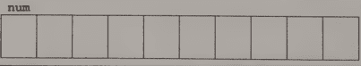


单元格都包含一些数据，但我们不知道每个单元格中数据的值是什么，因为数组的每个元素都是未初始化的，即，尚未赋予值。这里 num 是数组的名称，10 是大小说明符。此说明符应为正整数常量，例如本例中的 10。

```
#define MAX 10
```

## 访问数组元素

我们如何访问像 num 这样的数组的各个元素，考虑到 num 现在命名了 10 个内存位置而不是仅一个？各个数组元素由整数索引或下标标识，例如 num[3] 或 num[i]。在 C 语言中，索引从零开始，并且始终写在方括号内。

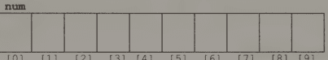

由于 C 语言使用基于零的索引，数组元素存储在数组位置 num[0] 到 num[9] 中。请注意，数组位置 num[10] 不存在。但是，C 编译器不会检查数组的下标是否在数组的范围内。因此，如果您的程序尝试读取或写入不存在的数组元素，不会显示任何错误消息！

## 初始化数组元素

我们可以初始化各个数组元素，例如：

```
num[0] = 2;
num[1] = 18;
num[2] = -5;
num[3] = 6;
num[4] = 10;
num[5] = -2;
num[6] = 3;
num[7] = 3;
num[8] = -1;
num[9] = 2;
```

我们的数组现在如下所示：

| num |
| :---: |
| 2 | 18 | -5 | 6 | 10 | -2 | 3 | 3 | -1 | 2 |
| [0] | [1] | [2] | [3] | [4] | [5] | [6] | [7] | [8] | [9] |

我们说 num[5] 的内容等于 -2，num[9] 的内容等于 2。

- 我们可以使用 for 循环初始化数组元素：

```
for( i = 0; i < 10; ++i ) {
   num[i] = 2*i;
}
```

我们的数组现在如下所示：

| num |
| :---: |
| 0 | 2 | 4 | 6 | 8 | 10 | 12 | 14 | 16 | 18 |
| [0] | [1] | [2] | [3] | [4] | [5] | [6] | [7] | [8] | [9] |

- 我们可以在声明数组时对其进行初始化：

```
int num[5] = { 5, 10, 15, 20, 25 };
```

| num |
| :---: |
| 5 | 10 | 15 | 20 | 25 |
| [0] | [1] | [2] | [3] | [4] |

我们也可以在声明字符数组时对其进行初始化：

```
char letters[5] = { 'a', 'b', 'c', 'd', 'e' };

```

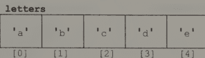

请注意，不需要完全初始化整个数组。如果指定的初始值较少，则只会初始化相应数量的元素。数组中剩余的元素将被设置为零。

```
double sample[5] = { 10.5, 12.6, 31.2 };

```

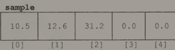

我们还可以定义数组而不指定数组中的元素数量。数组的大小由初始化元素的数量自动确定：

```
int num[] = { 2, 3, 4, 7, 9 };

```

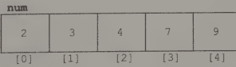

您经常会看到 #define 与数组一起使用。语法是：

```
#define some_name replacement_text
```

此语句应紧跟在 #include 语句之后：

```
#include <stdio.h>
#define SIZE 100
```

例如，以下代码将定义数组的大小并将每个数组元素初始化为 0。

```
// array1.c
#include <stdio.h>
#define SIZE 100
int main(void) {
   int i, num[SIZE];
   for (i = 0; i < SIZE; i++) {
      num[i] = 0;
   }
   return 0;
}
```

请注意，文本 SIZE 将在程序编译前被替换为 100。

以下是初始化数组的另一种方法。数组的内容也会被输出。

```
// array2.c

#include <stdio.h>

#define SIZE 5

int main(void) {
    int i, num[SIZE] = { 100, 200, 300, 400, 500 };

    for (i = 0; i < SIZE; i++) {
        printf("%d\n", num[i]);
    }

    return 0;
}
```

## 操作数组元素

我们可以像操作普通变量一样操作数组元素。例如：

```
x = num[3] * 4;
```

将数组元素 num[3] 乘以 4 的积赋值给 x。

以下是另一个示例：

```
num[3] = num[5] + 2;
```

将数组元素 num[5] 加 2 的和赋值给数组元素 num[3]。

## 示例：计算数组元素之和

以下代码提供了一个示例，说明我们如何按顺序处理数组 x 的元素，从数组的开头（左侧）开始，直到数组中的元素数量：

```
// sumElements.c

#include <stdio.h>

#define MAX 10

int main (void) {
    int i, sum = 0;
    int x[MAX] = { 2, 4, 6, 8, 10, 12, 14, 16, 18, 20};

    for (i = 0; i < MAX; i++) {
        sum = sum + x[i];
    }
    printf("The sum of the elements of the array = %d\n", sum);
    return 0;
}
```

for 循环执行后，sum 的值将是多少？

## 示例：复制数组

我们经常需要制作数组的副本。请注意，我们不能简单地说：

```
dup = num
```

然而，只需遍历原始数组并将相应值复制到第二个数组即可。

```
// copyArray.c
// Makes a copy of an array.

#include <stdio.h>

#define MAX 5

int main(void) {
    int i, num[MAX], dup[MAX];

    for (i = 0; i < MAX; ++i) {
        num[i] = i;
    }

    printf("Original array:\n");
    for (i = 0; i < MAX; ++i) {
        printf("%d ", num[i]);
    }

    printf("\n\n");
    for (i = 0; i < MAX; ++i) {
        dup[i] = num[i];
    }
    printf("Duplicate array:\n");
    for (i = 0; i < MAX; ++i) {
        printf("%d ", dup[i]);
    }

    printf("\n");
    return 0;
}
```

程序输出如下：

```
Original array:
0 1 2 3 4
Duplicate array:
0 1 2 3 4
```

## 计算字母频率

假设我们想计算文本文件中每个字母（大写和小写）出现的次数。查看 ASCII（或 Unicode）表，我们看到大写字母的数值范围为 65 - 90，小写字母的数值范围为 97 - 122。

计算每个字母出现频率的一种简单技术是使用一个名为 `letter` 的数组来存储从文件中读取的每个字符的计数。我们可以使用每个字符的 ASCII 值作为数组的索引，在该索引处保存该字符的计数。

例如，每次在文件中看到字母 `'A'` 时，我们可以递增 `letter` 数组中索引 65 处的计数器，因为 65 是 `'A'` 的数值：

```
letter[65] = letter[65] + 1;
or
++letter[65];
or
++letter['A'];
```

在这里，字符 `'A'` 将被强制转换为数值（65），该数值将用作 `letter` 数组的索引。

我们可以将此推广到文件中的每个字母，如下所示：

```
++letter[c];
```

其中 `c` 是从文件中读取的字符。

我们用于计算文本文件中字母频率的代码如下：

```
// calcFreq.c
// Calculates the frequency of occurrence of each letter in a file.

#include <stdio.h>
#include <ctype.h>
#include <stdlib.h>

int main(void) {
    FILE *fp;
    int c, i;
    static int letter[256];

    fopen_s(fp, "getty.txt", "r");
    if (fp == NULL) {
        printf("File getty.txt could not be opened.\n");
        exit(1);
    }

    while ((c = getc(fp)) != EOF) {
        if (isupper(c) || islower(c)) {
            letter[c] += 1;
        }
    }

    for (i = 'A'; i <= 'Z'; ++i) {
        if (letter[i] == 0) {
            printf("%d %c %d\n", i, i, letter[i]);
        }
    }
    puts("\n");

    for (i = 'a'; i <= 'z'; ++i) {
        if (letter[i] == 0) {
            printf("%d %c %d\n", i, i, letter[i]);
        }
    }

    fclose(fp);
    return 0;
}
```

请注意，虽然我们只关心大写或小写字符，但我们声明了一个包含 256 个位置的数组，以涵盖我们在文件中可能遇到的所有可能字符，包括可打印和不可打印字符。

因此，数组的每个元素将用作索引数值代码对应字母的计数器。但是，我们在哪里初始化数组的每个元素，即，我们在哪里将每个计数器初始化为零？


答案是 `letter` 数组被声明为 `static`，而声明为 `static` 的 `int` 数组会自动将数组的每个元素初始化为零！

以下是程序的输出：

```
66 B 1
70 F 1
73 I 3
78 N 1
84 T 2
87 W 2

97 a 100
98 b 13
99 c 31
100 d 54
101 e 165
102 f 24
103 g 26
104 h 79
105 i 66
107 k 3
108 l 41
109 m 13
110 n 75
111 o 91
112 p 16
113 q 1
114 r 81
115 s 45
116 t 122
117 u 20
118 v 23
119 w 25
121 y 10
```

## 埃拉托斯特尼筛法

生成素数的埃拉托斯特尼筛法算法是由一位希腊学者埃拉托斯特尼开发的，他生活在公元前275年左右到公元前195年左右。大约在公元前240年，埃拉托斯特尼成为亚历山大图书馆的馆长，那是当时世界上最先进的学习中心。他因在诗歌、戏剧、文学、地理学、哲学和天文学方面的才华而广为人知。埃拉托斯特尼绘制了已知世界的准确地图，计算了地球的周长和其自转轴的倾斜度，并确定了地球到太阳和月球的大小及距离。

下面所示的筛法算法通过建立一个包含1到1000所有数字的数组，然后筛选掉所有非素数，从而生成并计算1到1000之间的素数。已知1、2和3是素数，它筛选掉2和3的所有倍数。接下来遇到且未被筛选掉的数字被视为素数，然后筛选掉它的倍数。算法持续进行，直到只剩下素数。

```
// sieve.c

#include <stdio.h>

#define SIZE 1000

int main(void) {
    int i, mult, count;
    int flag[SIZE+1];

    count = 1;
    // Initialize flag array
    for (i = 1; i <= SIZE; ++i) {
        flag[i] = 1;
    }

    // Iterate through array
    for (i = 2; i <= SIZE; ++i) {
        if (flag[i] == 1) { // Found a prime
            ++count; // Count new prime
            mult = i;
            // loop deletes all multiples of new prime
            while (mult <= SIZE) {
                flag[mult] = 0;
                mult = mult + i;
            }
        }
    }

    printf("There are %d primes.\n", count);
    return 0;
}
```

## 程序输出：

```
There are 169 primes.
```

## 尝试以下操作：

看看你能否修改程序，输出40,000到50,000之间的所有素数，每行显示10个。同时显示素数的数量。

## 数组元素作为函数参数

数组元素可以像任何其他变量一样作为函数参数传递。下面的示例按值传递两个数组元素。请注意，swap函数尝试交换两个数组元素的值，但由于数组元素是按值传递的，交换后的值不会反映回main()中。

```
// array3.c
#include <stdio.h>
#define SIZE 5
void swap(int x, int y);
int main(void) {
   int i, num[SIZE];
   for (i = 0; i < SIZE; ++i) {
      num[i] = i;
   }
   printf("Before swap: num[2] = %d num[3] = %d\n", num[2], num[3]);
   swap(num[2], num[3]);
   printf("After swap: num[2] = %d num[3] = %d\n", num[2], num[3]);
   return 0;
}
void swap(int x, int y) {
   int temp;
   temp = x;
   x = y;
   y = temp;
}
```

产生的输出如下：

```
Before swap: num[2] = 2 num[3] = 3
After swap: num[2] = 2 num[3] = 3
```

通过在每个数组元素函数参数前放置取地址运算符（&），我们可以按引用传递两个数组元素。当然，我们还需要修改swap()函数以接受地址而不是int值。请注意，交换后的值现在会反映回main()中。

```
// array4.c
#include <stdio.h>
#define SIZE 5
void swap(int *x, int *y);
int main(void) {
    int i, num[SIZE];
    for (i = 0; i < SIZE; ++i) {
        num[i] = i;
    }
    printf("Before swap: num[2] = %d num[3] = %d\n", num[2], num[3]);
    swap(&num[2], &num[3]);
    printf("After swap: num[2] = %d num[3] = %d\n", num[2], num[3]);
    return 0;
}
void swap(int *x, int *y) {
    int temp;
    temp = *x;
    *x = *y;
    *y = temp;
}
```

现在产生的输出如下：

```
Before swap: num[2] = 2 num[3] = 3
After swap: num[2] = 3 num[3] = 2
```

## 数组作为函数参数

当将数组作为参数传递时，数组的全部内容不会被复制到形式参数数组中。相反，指向数组第一个元素的指针（地址）被传递给形式参数。因此，函数对形式参数数组所做的任何更改实际上都是对传递给函数的原始数组进行的更改，而不是对数组的副本进行更改。换句话说，在C语言中，数组始终是按引用传递的。

要将整个数组传递给函数，只需在函数调用中列出数组名，不带任何下标即可。虽然接收函数不需要知道数组的大小，但通常将数组大小传递给函数是个好主意。

### 示例：按引用传递数组。

我们的示例将声明并初始化一个包含十个元素的数组。该数组将被传递给一个函数，其中数组的元素将被更改。数组在调用更改数组元素的函数之前和之后都会被输出。

```
// array5.c

#include <stdio.h>

void updateArray(int num[], int size);

int main(void)
{
   int i, x[10];

   for (i = 0; i < 10; i++) {
      x[i] = i * 10;
   }

   printf("Before: ");

   for (i = 0; i < 10; i++) {
      printf("%5d", x[i]);
   }

   printf("\n\n");

   updateArray(x, 10);

   printf("After: ");

   for (i = 0; i < 10; i++) {
      printf("%5d", x[i]);
   }

   printf("\n");

   return 0;
}

// Function modifies elements of array that is passed by reference
void updateArray(int x[], int size) {
    int i;
    for (i = 0; i < size; ++i) {
        x[i] = i * -2;
    }
}
```

程序输出如下：

| 之前： | 0 | 10 | 20 | 30 | 40 | 50 | 60 | 70 | 80 | 90 |
| 之后： | 0 | -2 | -4 | -6 | -8 | -10 | -12 | -14 | -16 | -18 |

### 示例：求和数组元素的函数。

我们求和数组元素的函数需要遍历数组，访问每个数组元素。在访问每个数组元素时，我们将其内容放入求和变量中。我们必须确保在使用前将求和变量初始化为零!!

再次，我们希望我们的函数能够求和不同大小的数组，因此必须将数组大小作为额外参数传递给函数。

```
// sumElements.c
// Function to sum array elements
int sumArray(int num[], int size) {
    int i, sum = 0;
    for (i = 0; i < size; ++i) {
        sum += num[i];
    }
    return(sum);
}
```

### 示例：按格式输出数组。

假设我们想编写一个函数，打印数组num的元素，每行10个，每列之间用一个空格分隔，并且每一行（包括最后一行）都由恰好一个换行符终止。

```
// outputArray1.c
#include <stdio.h>
#define MAX 100
void outputArrayWithFormat(int num[], int size);
int main (void) {
   int i, num[MAX];
   for ( i = 0; i < MAX; i++ ) {
      num[i] = i;
   }
   outputArrayWithFormat(num, MAX);
   return 0;
}
void outputArrayWithFormat(int num[], int size) {
   int i;
   for (i = 0; i < size; ++i) {
      printf("%6d", num[i]);
      if (i % 10 == 9 || (i == size -1)) {
         printf("%c", '\n');
      }
      else {
         printf("%c", ' ');
      }
   }
}
```

产生的输出如下：

| 0 | 1 | 2 | 3 | 4 | 5 | 6 | 7 | 8 | 9 |
|---|---|---|---|---|---|---|---|---|---|
| 10 | 11 | 12 | 13 | 14 | 15 | 16 | 17 | 18 | 19 |
| 20 | 21 | 22 | 23 | 24 | 25 | 26 | 27 | 28 | 29 |
| 30 | 31 | 32 | 33 | 34 | 35 | 36 | 37 | 38 | 39 |
| 40 | 41 | 42 | 43 | 44 | 45 | 46 | 47 | 48 | 49 |
| 50 | 51 | 52 | 53 | 54 | 55 | 56 | 57 | 58 | 59 |
| 60 | 61 | 62 | 63 | 64 | 65 | 66 | 67 | 68 | 69 |
| 70 | 71 | 72 | 73 | 74 | 75 | 76 | 77 | 78 | 79 |
| 80 | 81 | 82 | 83 | 84 | 85 | 86 | 87 | 88 | 89 |
| 90 | 91 | 92 | 93 | 94 | 95 | 96 | 97 | 98 | 99 |


这是上面示例中使用条件运算符的更紧凑代码的函数。你能看懂吗？

```c
// outputArray2.c
void outputArrayWithFormat(int num[], int size) {
    int i;
    for (i = 0; i < size; ++i) {
        printf("%6d%s", num[i], (i % 10 == 9 || i == size-1 ?
            '\n' : ' '));
    }
}
```

## 示例：查找数组中最小值索引的函数

该程序中的函数声明了一个变量 minIndex，用于保存迄今为止遇到的最小数组元素的索引。minIndex 首先初始化为零，然后检查每个连续数组元素的内容，并将其与位置 minIndex 处的元素进行比较。如果发现某个数组元素小于位置 minIndex 处的元素，则将其数组位置赋给 minIndex。

```c
// findIndex.c
#include <stdio.h>
int getMinIndex(int num[], int size);
int main(void) {
    int small;
    int num[10] = { 43, 66, 82, -16, 42, -8, 12, 33, -19, 11 };
    small = getMinIndex(num, 10);
    printf("The index of the smallest array element = %d.\n", small);
    printf("The value of the smallest array element = %d.\n", num[small]);
    return 0;
}
```

```c
// Function returns the index of the smallest value in an array
int getMinIndex(int num[], int size) {
 int i, minIndex = 0;
 for (i = 1; i < size; ++i) {
 if (num[i] < num[minIndex]) {
 minIndex = i;
 }
 }
 return minIndex;
}
```

这里产生的输出如下：

```
The index of the smallest array element = 8.
The value of the smallest array element = -19.
```

假设我们现在想将数组 num 中的最小元素移到数组前面。数组初始设置如下：

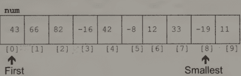

一旦我们确定了数组 num 中最小元素的索引（在上面的示例中，该索引为 8），就需要将此元素移到数组前面。如果我们在 main() 中简单地写下以下语句：

```
small = getMinIndex(num, 10);
num[0] = num[small];
```

这将覆盖 num[0] 的值，该值将永远丢失。因此，我们可以调用可靠的 swap() 函数来完成这项工作：

```c
// swap1.c

void swap(int *x, int *y) {
    int temp = *x;
    *x = *y;
    *y = temp;
}
```

swap() 函数将交换任何一对 int 数据项，即使这些项是数组元素。

main() 中的相关代码如下：

```c
// swap2.c

small = getMinIndex(num, 10);
swap(&num[0], &num[small]);
```

请注意，虽然数组会自动按引用传递给函数，但单个数组元素是按值传递的，除非在函数调用前加上取地址符。因此，num[0] 和 num[small] 只是数组 num 中类型 int 的单个元素，必须显式按引用传递。

下面是我们的代码，它首先查找数组中最小项的索引，然后将该位置的整数与数组中的第一个整数交换：

```c
// swap3.c
#include <stdio.h>

int main(void);
int getMinIndex(int num[], int size);
void swap(int *x, int *y);

int main(void) {
    int i, small;
    int num[10] = { 43, 66, 12, -16, 42, -8, 12, 33, -19, 11 };

    small = getMinIndex(num, 10);
    swap(&num[0], &num[small]);

    for (i = 0; i < 10; ++i) {
        printf("%5d", num[i]);
    }

    return 0;
}

// Function returns the index of the smallest value in an array
int getMinIndex(int num[], int size) {
    int i, minIndex = 0;

    for (i = 1; i < size; ++i) {
        if (num[i] < num[minIndex]) {
            minIndex = i;
        }
    }

    return minIndex;
}

// Function swaps two integers
void swap(int *x, int *y) {
    int temp = *x;
    *x = *y;
    *y = temp;
}
```

调用 `swap()` 之前，我们的数组如下：

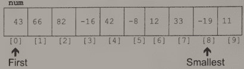

调用 `swap()` 之后，我们的数组如下：

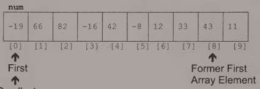

## 示例：合并数组

下面是一个将两个已排序（有序）数组合并为单个已排序数组的程序：

```c
// merge.c
// Merge two sorted arrays into a single array.

#include <stdio.h>

void mergeTwoArrays(int a[], int b[], int c[], int maxA, int maxB);

int main(void) {
    int k;

    int a[5] = { 1, 5, 9, 11, 17};
    int b[5] = { 2, 4, 6, 8, 20};
    int c[10];

    mergeTwoArrays(a, b, c, 5, 5);

    for (k = 0; k < 10; k++) {
        printf("%5d", c[k]);
    }
    return 0;
}

void mergeTwoArrays(int a[], int b[], int c[], int maxA, int maxB) {
    int i, j, k;
    i = j = k = 0;

    while (i < maxA && j < maxB) {
        if (a[i] <= b[j]) {
            c[k++] = a[i++];
        } else {
            c[k++] = b[j++];
        }
    }

    while (i < maxA) {
        c[k++] = a[i++];
    }

    while (j < maxB) {
        c[k++] = b[j++];
    }
}
```

合并后产生的输出如下：

| 1 | 2 | 4 | 5 | 6 | 8 | 9 | 11 | 17 | 20 |

## 平行数组

数组非常有用，因为它们允许我们在单个名称下组合大量数据。然而，数组的一个缺点是数组元素是同质的，即数组的每个元素必须是相同的数据类型，例如 int、char、float、double 等。

但如果我们需要组合大量由不同数据类型组成的信息怎么办？例如，假设我们想跟踪学生姓名、绩点平均分和毕业年份。虽然我们无法将所有这些不同的信息存储在单个数组中，但可以声明三个独立的数组，每个数组保存相同数据类型的信息：char* 用于姓名，double 用于绩点平均分，int 用于毕业年份。

为了确保我们可以轻松访问特定学生的不同数据，每个学生的数据将存储在数组的相同索引位置。例如，如果我们声明一个名为 name 的 char* 数组来保存每个学生的姓名，一个名为 gpa 的 double 数组来存储每个学生的绩点平均分，以及一个名为 year 的 int 数组来存储每个学生的毕业年份，那么数组位置 name[2]、gpa[2] 和 year[2] 将分别保存同一学生的数据。这种数组称为平行数组。

下面的代码创建三个平行数组，每个数组中的相同位置都指向同一学生。

```c
// parallel.c
#include <stdio.h>
#define MAX 5
int main(void) {
    int i;
    char *name[MAX] = { "Bill", "Carol", "Sue", "Ted", "Jen" };
    double gpa[MAX] = { 3.75, 3.44, 3.95, 3.88, 2.95 };
    int year[MAX] = { 2014, 2016, 2015, 2014, 2018 };
    printf("%-10s %-10s %-10s\n", "Name", "GPA", "Year");
    printf("%-10s %-10s %-10s\n", "----", "---", "----");
    for (i = 0; i < MAX; i++) {
        printf("%-10s %-10.2f %-10d\n", name[i], gpa[i], year[i]);
    }
    return 0;
}
```

我们的程序输出如下：

| 姓名 | GPA | 年份 |
| --- | --- | --- |
| Bill | 3.75 | 2014 |
| Carol | 3.44 | 2016 |
| Sue | 3.95 | 2015 |
| Ted | 3.88 | 2014 |
| Jen | 2.95 | 2018 |

排序是将项目重新排列成有序状态的过程，也是当今计算机执行的最常见任务之一。排序用于以有意义的方式排列姓名和数字。例如，查找朋友的电话号码相对容易，因为电话簿中的姓名已按字母顺序排序。这个例子清楚地说明了排序大量信息的主要原因之一。也就是说，排序大大提高了搜索效率。如果我们打开一本电话簿，发现姓名没有按任何逻辑顺序排列，那么查找某人的电话号码将需要非常长的时间！

插入排序的工作方式与许多人整理扑克牌或拉米牌的方式相同。我们从空左手开始，牌面朝下放在桌上。然后我们一次从桌上拿走一张牌，并将其插入左手中的正确位置。要找到卡片的正确位置，我们将其与手中已有的每张牌进行比较，从右到左。当我们找到正确的插入点时，我们将卡片放在手中的该位置。

插入排序从数组中取出一个项目，通过将其与其前驱进行比较来找到其正确位置。给定大小为 max 的数组 num，我们通过将第 i 个元素 num[i] 与元素 num[1]、num[2]、... num[i-1] 进行比较来找到其正确位置。这确保了在算法的第 1 阶段，数组中的前 i 个元素已排序，因此到第 n 阶段时，所有 n 个元素都按顺序排列。

## 插入排序示例

要对数据项数组进行排序，我们从左到右遍历数组，一次将一个数据项插入其左侧数据项中的适当位置。下面展示了插入排序的运行过程。此阴影中的数字是我们要排序的数字。此阴影中的数字是已排序的元素。数组中的空白位置表示可能的插入点。我们假设数组的第一个元素已排序：

| 5 | 3 | 8 | 2 | 9 | 4 | 6 | 7 |
|---|---|---|---|---|---|---|---|

数组中接下来要排序的元素是 3：

| 5 | 3 | 8 | 2 | 9 | 4 | 6 | 7 |
|---|---|---|---|---|---|---|---|


我们将待排序的数据项复制到临时位置，从而在已排序数组中为该数据项腾出一个可能的插入点：

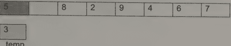

3 < 5，因此我们必须开辟一个新的插入点。我们将 5 向右移动一位，开辟一个新的插入点：

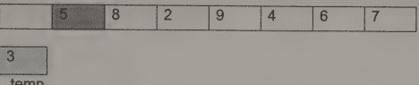

到达数组起始位置表明当前插入点是有效的，因为新数据项是目前为止看到的最小数据项。因此我们将数据项插入到插入点：

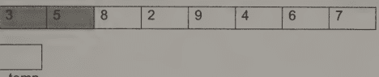

第 1 趟结束时，前 2 个数据项已排序。

我们开始第 2 趟。下一个待排序的数据项是 8：

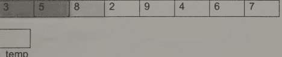

| 3 | 5 |   | 2 | 9 | 4 | 6 | 7 |
|---|---|---|---|---|---|---|---|

temp: 8

8 > 5，因此 8 被放入插入点：

| 3 | 5 | 8 | 2 | 9 | 4 | 6 | 7 |
|---|---|---|---|---|---|---|---|

temp: 

第 2 趟结束时，前 3 个数据项已排序。

我们开始第 3 趟。下一个待排序的数据项是 2：

| 3 | 5 | 8 | 2 | 9 | 4 | 6 | 7 |
|---|---|---|---|---|---|---|---|

temp: 

数据项 2 被放入临时内存位置，从而开辟一个可能的插入点：

| 3 | 5 | 8 |   | 9 | 4 | 6 | 7 |
|---|---|---|---|---|---|---|---|

temp: 2

2 < 8，因此我们必须开辟一个新的插入点。我们将 8 向右移动一位，开辟一个新的插入点：

| 3 | 5 |   | 8 | 9 | 4 | 6 | 7 |
|---|---|---|---|---|---|---|---|

| 2 |
|---|

2 < 5，因此我们必须开辟一个新的插入点。我们将 5 向右移动一位，开辟一个新的插入点：

| 3 |   | 5 | 8 | 9 | 4 | 6 | 7 |
|---|---|---|---|---|---|---|---|

| 2 |
|---|

2 < 3，因此我们必须开辟一个新的插入点。我们将 3 向右移动一位，开辟一个新的插入点：

|   | 3 | 5 | 8 | 9 | 4 | 6 | 7 |
|---|---|---|---|---|---|---|---|

| 2 |
|---|

到达数组起始位置表明当前插入点是有效的，因为新数据项是目前为止看到的最小数据项。因此我们将数据项插入到插入点：

| 2 | 3 | 5 | 8 | 9 | 4 | 6 | 7 |
|---|---|---|---|---|---|---|---|

| |
|---|

第 3 趟结束时，前 4 个数据项已排序。

我们开始第 4 趟。下一个待排序的数据项是 9：

| 2 | 3 | 5 | 8 | 9 | 4 | 6 | 7 |
|---|---|---|---|---|---|---|---|

temp

数据项 9 被放入临时内存位置，从而开辟一个可能的插入点：

| 2 | 3 | 5 | 8 |   | 4 | 6 | 7 |
|---|---|---|---|---|---|---|---|

| 9 |
|---|

temp

9 > 8，因此 9 被放入插入点：

| 2 | 3 | 5 | 8 | 9 | 4 | 6 | 7 |
|---|---|---|---|---|---|---|---|

| |
|---|

temp

第 4 趟结束时，前 5 个数据项已排序。

我们开始第 5 趟。下一个待排序的数据项是 4：

| 2 | 3 | 5 | 8 | 9 | 4 | 6 | 7 |
|---|---|---|---|---|---|---|---|

| |
|---|

temp

数据项 4 被放入临时内存位置，从而开辟一个可能的插入点：

| 2 | 3 | 5 | 8 | 9 |   | 6 | 7 |
|---|---|---|---|---|---|---|---|
| 4 | temp |   |   |   |   |   |   |

4 < 9，因此我们必须开辟一个新的插入点。我们将 9 向右移动一位，开辟一个新的插入点：

| 2 | 3 | 5 | 8 |   | 9 | 6 | 7 |
|---|---|---|---|---|---|---|---|
| 4 | temp |   |   |   |   |   |   |

4 < 8，因此我们必须开辟一个新的插入点。我们将 8 向右移动一位，开辟一个新的插入点：

| 2 | 3 | 5 |   | 8 | 9 | 6 | 7 |
|---|---|---|---|---|---|---|---|
| 4 | temp |   |   |   |   |   |   |

4 < 5，因此我们必须开辟一个新的插入点。我们将 5 向右移动一位，开辟一个新的插入点：

| 2 | 3 |   | 5 | 8 | 9 | 6 | 7 |
|---|---|---|---|---|---|---|---|
| 4 | temp |   |   |   |   |   |   |

4 > 3，因此 4 被放入插入点：

| 2 | 3 | 4 | 5 | 8 | 9 | 6 | 7 |
|---|---|---|---|---|---|---|---|

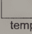

第 5 趟结束时，前 6 个数据项已排序。

我们开始第 6 趟。下一个待排序的数据项是 6：

| 2 | 3 | 4 | 5 | 8 | 9 | 6 | 7 |
|---|---|---|---|---|---|---|---|


数据项 6 被放入临时内存位置，从而开辟一个可能的插入点：

| 2 | 3 | 4 | 5 | 8 | 9 |   | 7 |
|---|---|---|---|---|---|---|---|

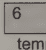

6 < 9，因此我们必须开辟一个新的插入点。我们将 9 向右移动一位，开辟一个新的插入点：

| 2 | 3 | 4 | 5 | 8 |   | 9 | 7 |
|---|---|---|---|---|---|---|---|

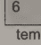

6 < 8，因此我们必须开辟一个新的插入点。我们将 8 向右移动一位，开辟一个新的插入点：

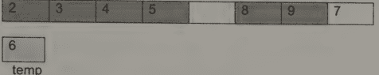

6 > 5，因此 6 被放入插入点：

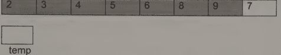

第 6 趟结束时，前 7 个数据项已排序。

我们开始第 7 趟。下一个待排序的数据项是 7：

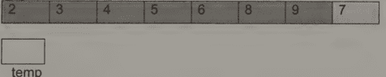

数据项 7 被放入临时内存位置，从而开辟一个可能的插入点：

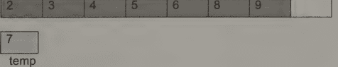

7 < 9，因此我们必须开辟一个新的插入点。我们将 9 向右移动一位，开辟一个新的插入点：

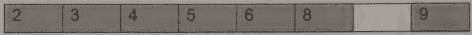

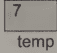

7 < 8，因此我们必须开辟一个新的插入点。我们将 8 向右移动一位，开辟一个新的插入点：

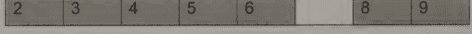

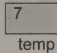

7 > 6，因此 7 被放入插入点：

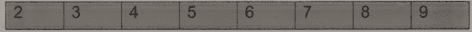

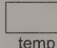

第 7 趟结束时，数组已排序。一般来说，包含 max 个数据项的数组需要 max-1 趟才能排序。

```
// insertionSort.c
void insertionSort(int list[], int max) {
   int i, j, temp;
   for (i = 1; i < max; i++) {
      temp = list[i];
      j = i - 1;
      while (j >= 0 && temp < list[j]) {
         list[j+1] = list[j];
         j = j - 1;
      }
      list[j+1] = temp;
   }
}
```

## 对数组排序：qsort() 库函数

标准 C 库包含一个名为 qsort() 的异常强大且通用的排序例程。它是一种名为快速排序的特定排序算法的实现。qsort() 例程有四个参数：

- 数据数组的基地址
- 数组中的项数
- 每个项的宽度（字节）
- 一个函数的地址，该函数可以比较数组中包含类型的两个数据项，并按以下方式返回有符号值：
  - 如果 p < q，则 < 0
  - 如果 p = q，则 0
  - 如果 p > q，则 > 0

如果你使用的是 C 的原始数据类型之一，通常可以用几行代码构建一个合适的比较函数。以下是一个示例：

```
// compare.c
int compare(const void *p, const void *q) {
    if (*(int *)p < *(int *)q) {
        return -1;
    }
    return *(int *)p > *(int *)q;
}
```

在 compare() 函数中：

- 如果 p < q，则返回 -1
- 如果 p = q，则返回 0
- 如果 p > q，则返回 1

下面的代码用整数随机填充一个 100 元素的数组。显示数组内容，调用 qsort()，然后再次显示数组内容，展示排序后的数据项。

```
// qsort.c

#include <stdio.h>
#include <stdlib.h>
#include <time.h>

#define SIZE 100

int compare(const void *p, const void *q);
void output(int num[], int size);

int main() {
   int i, num[SIZE];

   srand((unsigned) time(NULL));

   for (i = 0; i < SIZE; i++) {
      num[i] = rand() % 50000;
   }

   printf("Before sort\n");
   output(num, SIZE);
   qsort(num, SIZE, sizeof(int), compare);
   printf("\nAfter sort\n");
   output(num, SIZE);
   return 0;
}

int compare(const void *p, const void *q) {
   if (*(int *)p < *(int *)q) {
      return -1;
   }

   return *(int *)p > *(int *)q;
}

void output(int num[], int size) {
   int i;

   for (i = 0; i < size; i++) {
      printf("%6d", num[i]);
      if (i % 10 == 9 || (i == size - 1)) {
         printf("%s", "\n");
      }
      else {
         printf("%s", " ");
      }
   }
}
```


这里是生成的输出：

```c
Before sort
30567 35439 21431 9013 3992 28690 24735 8148 14330 24847
43747 10518 46366 40111 33228 46127 27945 8870 45536 21664
35024 10674 27724 16905 30488 19128 32991 3856 21268 45855
26816 803 39397 3986 44341 47219 33125 48655 36237 4323
10188 33574 48866 45132 16189 3823 6746 9497 32622 16402
8430 46630 1113 5271 47490 13727 7493 40531 46342 47608
30989 49988 14230 3472 48785 9291 900 26877 24400 17550
27638 19251 14013 41336 14304 39437 43991 30229 35682 654
41083 27520 47042 26948 47726 41156 27658 33215 15557 44269
2529 24729 16662 11997 9825 28596 25245 35327 7047 41915
After sort
654 803 900 1113 2529 3472 3823 3856 3986 3992
4323 5271 6746 7047 7493 8148 8430 8870 9013 9291
9497 9825 10188 10518 10674 11997 13727 14013 14230 14304
14330 15557 16189 16402 16662 16905 17550 19128 19251 21268
21431 21664 24400 24729 24735 24847 25245 26816 26877 26948
27520 27638 27658 27724 27945 28596 28690 30229 30488 30567
30989 32622 32991 33125 33228 33574 35024 35327 35439
35682 36237 39397 39437 40111 40531 41083 41156 41336 41915
43747 43991 44269 44341 45132 45536 45855 46127 46342 46366
46630 47042 47219 47490 47608 47726 48655 48785 48866 49988
```

请注意，数组按比较函数定义的递增顺序排序。要按递减顺序排序数组，请在比较函数中反转“大于”和“小于”的含义。

即使您不是在使用原始 C 数据类型，`qsort()` 也能正常工作，只要您了解足够的数据表示知识来判断一个项目是否比另一个项目“更小”。

在处理字符串时，标准库函数 `strcmp()` 非常适合在比较函数中与 `qsort()` 一起使用。

```c
// compare2.c
int compare(const void *p, const void *q) {
    return strcmp((char *) p, (char *) q);
}
```

下面是一个使用 `qsort()` 对字符串进行排序的程序：

```c
// qsort2.c

#include <stdio.h>
#include <stdlib.h>
#include <string.h>

int compare(const void *p, const void *q);

int main() {
    char list[5][4] = {{"cat", "car", "cab", "cap", "can"}};
    qsort(list, 5, sizeof(list[0]), compare);
    for (i = 0; i < 5; ++i) {
        printf("%s ", list[i]);
    }
    return(0);
}

int compare(const void *p, const void *q) {
    return strcmp((char *) p, (char *) q);
}
```

## 搜索数组：线性搜索

最简单的搜索策略是线性搜索或顺序搜索。线性搜索通常在无序数组上执行。它从数组的开头开始，按顺序检查每个元素，直到找到要查找的数据项，或者直到到达数组的末尾，在这种情况下，数据项在数组中未找到。

```c
// linearSearch.c
// returns the index in the array of data item found
// returns -1 if data item not in array
int linearSearch(int num[], int max, int key) {
   int i;
   for (i = 0; i < max; ++i) {
      if (num[i] == key) {
         return i;
      }
   }
   return -1;
}
```

让我们来看看在无序数组中查找与键匹配的数据项需要多长时间。我们可以考虑三种不同的可能性：平均时间、最坏情况时间或最佳可能时间。然而，我们通常最关心最坏情况时间，因为基于最坏情况时间的计算可以得出有保证的性能预测。方便的是，最坏情况时间通常比平均时间更容易计算。

为了简化算法的分析和比较，我们寻找主导操作并计算该主导操作需要执行的次数。在搜索的情况下，主导操作是比较。

如果我们的数组中有 max 个项目，那么很明显，在最坏情况下（即数组中没有所需键的项目），则需要将键与数组中的数据项进行 max 次比较。在最佳情况下，我们将在第一次比较时找到数据项。在平均情况下，我们将在 (1 + max) / 2 次比较或大约 max/2 次比较中找到数据项。

因此，包含 100 个数据项的数组进行成功搜索平均需要 50 次比较。如果我们要搜索的数据项数量翻倍，比较次数也会翻倍，因此我们算法的运行时间也会翻倍。我们说比较次数与数组中的数据项数量 n 成正比。相应地，该算法的搜索时间与数组中的数据项数量 max 成正比。包含 1000 个数据项的数组搜索时间比包含 100 个数据项的数组长 10 倍。

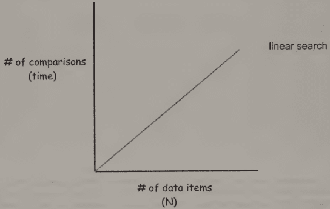

## 搜索数组：二分查找

如前所述，线性搜索算法简单，适合小型问题，但如果数组很大和/或需要进行许多重复搜索，那么拥有一个更高效的数组搜索算法是非常合理的。

二分查找算法适用于已排序的数组。它选择数组中的中位数（中间）元素，并将其值与目标值 key 进行比较。由于已知数组是有序的，如果目标值小于中间值，则目标必须位于数组的前半部分。同样，如果目标项的值大于数组中中间值，则已知目标位于数组的后半部分。在任一情况下，我们实际上只需一次比较就可以“排除”搜索空间的一半。

现在，知道目标必须位于数组的一半或另一半，二分查找会检查目标必须所在的一半的中位数值。该算法在每一步都将搜索区域缩小一半，直到找到目标数据或搜索失败。

如果你想到一个孩子的猜谜游戏，这个算法就很容易记住。想象我告诉你我在想。你会不断细化你的选择，直到猜中那个数字。

给定一个已排序的项目数组，例如：

| 索引 | 0 | 1 | 2 | 3 | 4 | 5 |
| :---: | :---: | :---: | :---: | :---: | :---: | :---: |
| 值 | 12 | 29 | 30 | 32 | 35 | 49 |
| 低索引 | | | | | | 高索引 |

假设我们想要搜索等于 key 的元素的位置。我们将搜索从某个低索引开始到某个高索引结束的数组。在我们的例子中，要搜索的有效数组的低索引是 0，高索引是 5。我们可以通过整数除法 (low + high) / 2 找到近似中间索引，即 2。我们将我们的值 key 与索引 2 处的元素进行比较。如果它们相等，我们就找到了要找的内容；索引是 2。
否则，如果 key 大于此索引处的项目，我们的新有效搜索数组的低索引值为 3，高索引保持不变为 5。如果 key 小于该元素，新的有效搜索数组的高索引为 1，低索引保持为 0。该过程重复，直到找到项目，或者有效搜索数组中没有元素。终止条件是低索引超过高索引。

二分查找算法的实现如下：

```c
// binarySearch.c

// Assumes array is in sorted order.
// Returns index of the location of the key in the array.
// Returns -1 if not found.

int binarySearch(int num[], int n, int key) {
    int mid, i, j;

    i = 0;
    j = n-1;
    while (i <= j) {
        mid = (i + j) / 2;
        if (num[mid] > key) {
            j = mid - 1;
        }
        else if (num[mid] < key) {
            i = mid + 1;
        }
        else {
            return mid;
        }
    }
    return -1;
}
```

## 二分查找分析

既然线性搜索更容易编码，为什么还要使用二分查找？答案在于搜索的效率。使用线性搜索时，如果将数组大小翻倍，查找一个项目可能需要两倍的时间。使用二分查找时，将数组大小翻倍仅会多增加一个要查看的项目。每次使用二分查找时，您都会排除一半的剩余数组项目作为可能的匹配项。

例如，假设我们给定了一个包含 1,000,000 个数据元素的搜索空间。顺序搜索大约需要 500,000 次搜索或比较，在 the

平均而言。如果我们将搜索空间加倍到 2,000,000 个数据项，比较次数将加倍到 1,000,000 次，因此搜索时间实际上也会加倍。而二分查找在 1,000,000 个数据项的搜索空间中只需大约 20 次搜索，将数据大小加倍到 2,000,000 只会使比较次数增加 1 次。二分查找确实是一种强大的搜索算法！

所以说，数组上的二分查找大约需要 log2n 次比较，因为在每次测试时你可以“排除”搜索空间的一半。一组 n 个项目最多可以对半分 log2n 次。因此二分查找的运行时间与 log2n 成正比，我们称这是一个 log n 算法。

值得注意的是，对于非常小的数组，线性查找可能比二分查找更快。然而，随着待搜索数组大小的增加，二分查找在比较次数和整体速度方面显然胜出。因此，在 n 取较大值时，log n 远小于 n，因此 log n 算法（二分查找）比时间与 n 成正比的算法（线性查找）快得多。

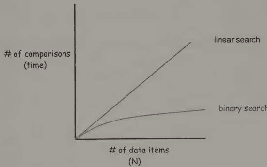

不过，二分查找也有一些缺点。首先，它要求待搜索的数据必须是有序的。如果待搜索数据中甚至有一个元素无序，就会打乱整个过程。当面对一组无序数据时，高效的程序员必须决定是对数据进行排序并应用二分查找，还是直接应用效率较低的线性查找。

即使是最好的排序算法也是一个复杂的过程。排序数据的成本是否值得通过二分查找获得的搜索速度提升？如果你只搜索一次，在大多数情况下，进行线性查找可能更好。

一旦数据被排序，添加或删除项目也可能非常昂贵。例如，在有序数组中，此类操作需要移动数组元素以在数组中打开或关闭一个“空位”。这是一项昂贵的操作，因为在最坏情况下，它需要 log2 n 次比较和 n 次数据移动。

## 二维数组

我们可以声明一个由行和列组成的二维数组：

```c
// 2dim1.c
int num[3][4];
```

该语句声明了一个包含三行四列的数组：

| | 列 0 | 列 1 | 列 2 | 列 3 |
|---|---|---|---|---|
| 行 0 | | | | |
| 行 1 | | | | |
| 行 2 | | | | |

二维数组的元素标识如下：

| | 列 0 | 列 1 | 列 2 | 列 3 |
|---|---|---|---|---|
| 行 0 | num[0][0] | num[0][1] | num[0][2] | num[0][3] |
| 行 1 | num[1][0] | num[1][1] | num[1][2] | num[1][3] |
| 行 2 | num[2][0] | num[2][1] | num[2][2] | num[2][3] |

请注意，二维数组在内存中的大小为：

```
3 rows * 4 columns * sizeof(int) = 48 bytes ...
```

我们可以在声明时初始化二维数组：

```c
// 2dim2.c
int num[3][4] = {
   { 2, 4, 6, 8 },
   { 1, 3, 5, 7 },
   { 3, 6, 9, 12 }
};
```

花括号对用于分隔一行的初始化器列表与下一行。除了最后一行外，每个结束一行的花括号后都需要逗号。

我们的二维数组初始化如下：

| | 列 0 | 列 1 | 列 2 | 列 3 |
|---|---|---|---|---|
| 行 0 | 2 | 4 | 6 | 8 |
| 行 1 | 1 | 3 | 5 | 7 |
| 行 2 | 3 | 6 | 9 | 12 |

请注意，内部花括号对也是可选的：

```c
// 2dim3.c
int num[3][4] = { 2, 4, 6, 8, 1, 3, 5, 7, 3, 6, 9, 12 };
```

与一维数组一样，不需要初始化整个数组：

```c
// 2dim.c
int num[3][4] = {
    { 2, 4 },
    { 1, 3 },
    { 3, 6 }
};
```

此声明将每行的前两个元素初始化为指定值。其余值将初始化为零。请注意，这里内部花括号是绝对必需的，以强制正确初始化！

我们的二维数组初始化如下：

| | 列 0 | 列 1 | 列 2 | 列 3 |
|---|---|---|---|---|
| 行 0 | 2 | 4 | 0 | 0 |
| 行 1 | 1 | 3 | 0 | 0 |
| 行 2 | 3 | 6 | 0 | 0 |

我们可以按以下方式输出二维数组的内容：

```c
// 2dim5.c

#include <stdio.h>

int main(void) {
    int i, j, num[3][4] = {
        { 2, 4, 6, 8 },
        { 1, 3, 5, 7 },
        { 3, 6, 9, 12 }
    };
    for(i = 0; i < 3; ++i) {
        for (j = 0; j < 4; ++j) {
            printf("%4d", num[i][j]);
        }
        printf("\n");
    }
    return 0;
}
```

输出如下：

```
2   4   6   8
1   3   5   7
3   6   9  12
```

## 字符的二维数组

字符的二维数组声明必须包含额外的空间用于空终止符，如果每行都要作为字符串处理：

```c
// 2dim6.c

char name[20][31];
```

这声明了一个包含 20 行的二维数组，每行包含 30 个数据字符加上编译器追加到每个字符串末尾的空终止符。数据按行主序存储，这意味着每行在内存中形成一个项目数组。每行本身是一个一维数组，可以在允许使用数组的上下文中使用。

我们可以按以下方式输出字符串二维数组的每一行：

```c
// 2dim7.c
for (i = 0; i < 20; ++i) {
    printf("%s\n", name[i]);
}
```

二维数组的每个单独元素仍然可以使用下标访问：

```
name[i][j]
```

## 将二维数组作为函数参数传递

假设你想将一个二维数组传递给函数：

```c
// 2dim8.c
int main(void) {
    int num[3][4] = {
        { 2, 4, 6, 8 },
        { 1, 3, 5, 7 },
        { 3, 6, 9, 12 }
    };

    foo(num);
    return 0;
}
```

函数 foo() 应该如何接收二维数组？

```c
void foo(int num[][4]) {
    ...
}
```

这告诉编译器，它应该将数组分解为每行 4 列的行。

## 对称矩阵示例

如果对于 1 到 N 之间的所有 i 和 j，元素 matrix[i][j] 等于元素 matrix[j][i]，则 N x N 矩阵（二维数组）是对称的。我们构建一个程序，用于初始化两个 4 x 4 二维数组的元素，以表格形式输出这两个二维数组，并输出一条消息说明数组是否对称。

- Case 1: matrixYES 是对称的。
- Case 2: matrixNO 不是对称的。

```c
// symmetric.c

#include <stdio.h>

void outputMatrix(int mat[][4]);
int isSymmetric(int mat[][4]);

int main(void) {
   int matrixYES[4][4] = {
      { 6, 2, 4, 6 },
      { 2, 7, 1, 3 },
      { 4, 1, 8, 5 },
      { 6, 3, 5, 9 }
   };

   int matrixNO[4][4] = {
      { 6, 2, 4, 6 },
      { 2, 7, 1, 3 },
      { 4, 1, 8, 5 },
      { 6, 3, 1, 9 }
   };

   puts("MatrixYES");
   outputMatrix(matrixYES);
   if (isSymmetric(matrixYES)) {
      printf("matrixYES is symmetric.\n\n");
   }
   else {
      printf("matrixYES is not symmetric.\n\n");
   }

   puts("MatrixNO");
   outputMatrix(matrixNO);
   if (isSymmetric(matrixNO)) {
      printf("matrixNO is symmetric.\n\n");
   }
   else {
      printf("matrixNO is not symmetric.\n\n");
   }

   return 0;
}

void outputMatrix(int mat[][4]) {
    int i, j;
    for (i = 0; i < 4; ++i) {
        for (j = 0; j < 4; ++j) {
            printf("%4d", mat[i][j]);
        }
        printf("\n");
    }
}

int isSymmetric(int mat[][4]) {
    int i, j;
    for (i = 0; i < 4; ++i) {
        for (j = 0; j < 4; ++j) {
            if (mat[i][j] != mat[j][i]) {
                return 0;
            }
        }
    }
    return 1;
}
```

以下是输出：

```
MatrixYES
6 2 4 6
2 7 1 3
4 1 8 5
6 3 5 9
matrixYES is symmetric.

MatrixNO
6 2 4 6
2 7 1 3
4 1 8 5
6 3 1 9
matrixNO is not symmetric.
```


## 数组作业

- 编写一些代码来执行以下每项任务：
  - a) 定义一个常量 `MAX`，其值为 50。
  - b) 定义一个整数数组 `num`，包含 `MAX` 个元素，并将数组中每个元素初始化为 0。
  - c) 数组第四个元素的名称是什么？
  - d) 输出数组第六个元素的值。
  - e) 将一个值赋给数组 `num` 的第三个元素。
  - f) 将数组中每个 50 个元素初始化为 500。
  - g) 将数组 `num` 的元素求和到求和变量 `sum` 中。
  - h) 将数组 `num` 的内容复制到数组 `foo` 中，其大小也为 `MAX`。
  - i) 将数组 `foo` 的每个元素加 1。

- 下面的代码将 1 到 10,000 之间的随机数赋给数组 num 的每个元素。编写一个函数，接收数组作为参数并返回数组中的最小值。

```
srand((unsigned int) time(NULL));
for (i = 0; i < MAX; ++i) {
    num[i] = rand() % 10000 + 1;
}
```

- 作为一个恶作剧，一个朋友在你生日时送给你一个 int 数组。更糟糕的是，你的朋友告诉你，数组中几乎全是 0，除了中间某处有一小串连续的 1。被这种新奇之处所压倒，你决定编写一个函数，打印出数组中第一个 1 的位置、最后一个 1 的位置，以及连续 1 值列表中 1 的总数。下面给出了函数原型：

```
void joke(int num[], int max);
```

其中 num 是 int 值数组，max 包含数组中的元素个数。

## 统计实验

一组数据（即考试成绩）可以用频数分布图来总结。例如，如果考试成绩列表如下：

```
90, 85, 100, 50, 50, 85, 60, 70, 55, 55, 80, 95, 70, 60, 95,
80, 100, 75, 70, 95, 90, 90, 70, 95, 50, 65, 85, 95, 100, 65
```

那么频数分布图如下所示：

| 分数 | 频数 |
| --- | --- |
| 100 | 3 |
| 95 | 5 |
| 90 | 3 |
| 85 | 3 |
| 80 | 3 |
| 75 | 2 |
| 70 | 1 |
| 65 | 4 |
| 60 | 2 |
| 55 | 2 |
| 50 | 3 |

- a) 编写一个 C 程序 `stats.c`，在编译时用上面显示的考试成绩初始化一个数组，并每行输出五个考试成绩。
- b) 将考试成绩按升序排序，并每行输出五个分数。
- c) 计算并输出如上所示的频数分布图。注意表中的分数按递减值列出。
- d) 输出及格和不及格考试成绩的百分比，保留一位小数。低于 60 分为不及格。
- e) 计算并输出考试成绩的平均值，保留一位小数。
- f) 输出考试成绩的众数。
- g) 一组数字的中位数是指当数字按升序或降序排列时，一半元素在其上方，一半元素在其下方的那个元素。这种情况只能发生在列表中元素数量为奇数时。如果数组包含偶数个项目，中位数是中间两个数字的平均值（保留一位小数）。你的程序应输出给定考试成绩的中位数，保留一位小数。（注意：你的程序应自行确定考试成绩数量是奇数还是偶数）。

请注意，实验的每个部分都应在其自身的函数中设计，并根据需要传递参数。确保在程序中使用上面给出的测试数据集，并确保按给定顺序输入数据。

请记住，main() 函数应作为程序中的第一个函数出现。确保为程序中使用的每个函数使用函数原型。

程序输出应发送到终端窗口（您的屏幕）以及请求的 csis.txt 输出文件。请务必阅读关于捕获程序输出的文档。您的全名必须作为注释出现在包含 main() 的源文件中。请务必将 csis.txt 输出文件包含在 zip 压缩包中。

## 解码实验

你的任务是编写一个 C 程序 decode.c，用于解码一条秘密消息。该消息长度为 26 个字符，将以一系列数字的形式给出。这些数字必须排序并与一组字符的转换集进行比较，以便对其进行解码。这种方法基于以前在谷物包装中提供的解码环。

也许展示如何解码消息的最简单方法是先展示如何对消息进行编码。首先，字母表中的字母、数字和任何标点符号被打乱成某种序列。

例如，下面的字符串可以在 codefile.txt 中找到：

```
CFL2AP (T9W,H!JEM86ND0B27UK1Y3VG4XR) ISOQ5. ;-
```

请注意，上述字符串包含 52 个字符（包括末尾附近的九个空格）。现在，假设我们想要对消息进行编码：

```
HELP ME!
```

在上述字符串中查找每个字母，我们发现 H 是第 11 个字符（基于零的索引），E 是第 14 个，L 是第 2 个，P 是第 5 个，一个空格是第 41 个，M 是第 15 个，E 是第 14 个，! 是第 12 个。因此，我们的初始编码是：

```
11 14 02 05 41 15 14 12
```

接下来，每个数字前面都会加上一个按升序排列的三位序列号。这些数字表示相对位置，不必连续。

例如，我们可能会分配以下数字：

```
10111
12214
12802
12905
13541
13715
14214
15112
```

最后，数字的顺序被打乱：

```
13541
12214
10111
15112
13715
12802
14214
12905
```

这是你用来解码的数字列表。要解码消息，只需反转过程：将数字读入数组并按升序排序。将每个排序后的数字“切割”成两部分，使用最后两位数字（提示：考虑模运算符）作为正确字符的索引并打印该字符。

对于本实验，数字格式的编码消息如下，可以在 msgfile.txt 中找到：

```
19546
14501
17309
13027
16149
21512
18035
14014
15700
12515
16514
18207
13407
14837
16842
21037
15333
13244
21224
16321
14146
16014
20727
12804
18811
13711
```

## 你的实验应至少包含以下函数：

```
getCode() - 从 codefile.txt 读取字符串
getMessage() - 从 msgfile.txt 读取编码消息
sortMessage() - 对编码消息数组进行排序
decodeMessage() - 解码并输出消息
```

请注意，用于保存从 codefile.txt 读取的 52 个字符的字符串应声明为长度 53（为终止 NULL 字符预留空间。

尝试打开文件进行输入或输出时，请务必进行错误检查。为了获得额外学分，请将文件名作为命令行参数传递给本实验。有关命令行参数的编译器特定信息可以在 Canvas 的以下位置找到：

文件 | 设置命令行参数

请记住，main() 函数应作为程序中的第一个函数出现。确保为程序中使用的每个函数使用函数原型。

程序输出应发送到终端窗口（您的屏幕）以及请求的 csis.txt 输出文件。请务必阅读关于捕获程序输出的文档。您的全名必须作为注释出现在包含 main() 的源文件中。请务必将 csis.txt 输出文件包含在 zip 压缩包中。

## 简介

当数据在两台计算机之间来回传输时，最终接收到的位模式可能不是最初发送的那个。为了解决这个问题，已经开发出各种技术来检测甚至纠正传输错误。

一种流行且极其简单的错误检测方法基于以下原理：如果被操作的每个位模式都有偶数个 1，而发现一个位模式有奇数个 1，那么必然发生了错误。要使用这一原理，我们需要一个每个模式都包含偶数个 1 的系统。这很容易实现：首先在 7 位 ASCII 代码的每个模式中添加一个称为奇偶位的额外位，生成一个 8 位代码。在每种情况下，我们将 1 或 0 赋给这个新位，以便生成的模式包含偶数个 1。

例如，‘A’ 的 7 位 ASCII 代码是 1000001，‘I’ 是 1001001。将奇偶位作为最高有效位添加到 ‘A’ 的 7 位 ASCII 代码中，生成 01000001（奇偶位 0），对于 ‘I’ 生成 11001001（奇偶位 1）。一旦我们的编码系统以这种方式修改，包含奇数个 1 的模式将指示发生了错误，并且被操作的数据不正确。

刚才描述的特定奇偶系统称为偶校验，因为我们设计系统使每个模式都包含偶数个 1。另一种技术是使用奇校验。在这样的系统中，每个模式都设计为包含奇数个 1，因此包含偶数个 1 的模式的出现会发出错误信号。

虽然使用奇偶位旨在允许检测错误，但它不提供确定哪个位出错的信息。此外，如果在两个不同的位置发生了错误，甚至无法检测到这种情况。

## 海明码

理查德·哈明（1950）发明了一种不仅用于检测传输错误，还用于纠正错误的方法，称为海明码。在海明码中，K 个奇偶位被添加到 N 位字符中，形成一个长度为 N+K 位的新字符。位从最左边的位 1 开始编号。所有位号为 2 的幂的位都是奇偶位，其余所有位都用于数据。因此，对于 7 位 ASCII 字符，添加了四个奇偶位。位 1、2、4 和 8 是奇偶位，位 3、5、6、7、9、10 和 11 是七个数据位。海明码可用于字符或


任意长度的消息，尽管我们将使用7位ASCII字符（以及偶校验）来说明其用法。

例如，我们可以使用偶校验将7位ASCII字符 'E' (1000101) 编码为11位码字：

| P | P | 1 | P | 0 | 0 | 0 | P | 1 | 0 | 1 |
|---|---|---|---|---|---|---|---|---|---|---|
| 1 | 2 | 3 | 4 | 5 | 6 | 7 | 8 | 9 | 10 | 11 |

每个包含P的位位置表示一个校验位。每个校验位检查特定的位位置，并且校验位被设置，使得被检查位置中1的总数为奇数或偶数。每个校验位检查的位位置如下：

```
parity bit 1: checks bits 1, 3, 5, 7, 9, 11
parity bit 2: checks bits 2, 3, 6, 7, 10, 11
parity bit 4: checks bits 4, 5, 6, 7
parity bit 8: checks bits 8, 9, 10, 11
```

一般来说，位N由那些位b1, b2, ..., bK检查，使得 b1 + b2 + ... + bK = N。例如，位5由位1和位4检查，因为 1 + 4 = 5。位6由位2和位4检查，因为 2 + 4 = 6。下面显示了使用偶校验为字符 'E' (1000101) 构建的汉明码。

| 1 | 0 | 1 | 0 | 0 | 0 | 0 | 1 | 0 | 1 |
|---|---|---|---|---|---|---|---|---|---|
| p | a | r | i | t | y | b | i | t | s |

## 一个简单的算法如下

考虑如果在传输过程中最左边的位被更改会发生什么。接收到的码字将是 00100000101 而不是 10100000101。接收计算机将检查四个校验位，结果如下：

```
parity bit 1 incorrect: bits 1, 3, 5, 7, 9, and 11 contain three 1's
parity bit 2 correct: bits 2, 3, 6, 7, 10, and 11 contain two 1's
parity bit 4 correct: bits 4, 5, 6, and 7 contain no 1's
parity bit 8 correct: bits 8, 9, 10, 11 contain two 1's
```

由于使用了偶校验，位1、3、5、7、9和11中1的总数应该是偶数。错误的位必须是校验位1检查的位之一，即位1、3、5、7、9或11。由于校验位2正确，我们知道位2、3、6、7、10和11是正确的。因此，错误不在位3、7或11中。这就只剩下位1、5和9。校验位4正确，意味着位4、5、6和7中没有错误。这就将选择缩小到1或9。校验位8也正确，所以位9是正确。因此，错误的位必须是位1。因为它被接收为1，所以它必须被传输为0。以这种方式，错误既可以被检测也可以被纠正。

确定是否发生了传输错误以及（如果发生）查找错误位的一个简单方法是，首先重新计算接收字符中的所有校验位。如果都正确，则没有发生错误（或者可能发生了多个错误，即突发错误）。另一方面，如果一个或多个校验位不正确，则确实发生了传输错误，我们必须定位并反转错误位。为了实现这一点，我们将所有不正确的校验位相加，位1计为1，位2计为2，位4计为4，等等。得到的和就是错误位的位置。例如，如果校验位1和8正确，但2和4不正确，那么位6（2 + 4）被意外更改了。我们可以简单地将其反转回预期值。

## 一个简单的算法如下

当码字到达时，接收器将计数器初始化为零。然后它检查每个校验位 K（K = 1, 2, 4, 8），看它是否具有正确的奇偶性。如果不是，它将 K 加到计数器中。在检查完所有校验位后，如果计数器为零（即，它们都正确），则该字符被接受为有效。如果计数器非零，它包含应该反转的错误位的编号。例如，如果校验位1、2和8出错，则反转的位是11，因为它是唯一由位1、2和8检查的位。

## 突发错误

汉明码只能纠正单个错误。但是，有一种技巧可以用来允许汉明码纠正突发错误。一组连续的R个码字被排列成一个矩阵，每行一个码字。下面是消息 "HELLO" 在传输前的矩阵格式，校验位设置为偶校验。

| | 1 | 1 | 1 | 1 | 0 | 0 | 1 | 1 | 0 | 0 | 0 |
|---|---|---|---|---|---|---|---|---|---|---|---|
| H | 1 | 1 | 1 | 1 | 0 | 0 | 1 | 1 | 0 | 0 | 0 |
| E | 1 | 0 | 1 | 0 | 0 | 0 | 0 | 0 | 1 | 0 | 1 |
| L | 1 | 0 | 1 | 1 | 0 | 0 | 1 | 1 | 1 | 0 | 0 |
| L | 1 | 0 | 1 | 1 | 0 | 0 | 1 | 1 | 1 | 0 | 0 |
| O | 0 | 0 | 1 | 1 | 0 | 0 | 1 | 1 | 1 | 1 | 1 |
| | | | | | | | | | | | |
| p | a | r | i | t | y | b | i | t | s | | |

通常，数据会一次传输一个码字，从左到右。但是，为了纠正突发错误，数据一次传输一列，从最左边的列开始。当第一列中的所有R位都发送完毕后，发送第二列，以此类推。当消息到达接收器时，矩阵一次一列地被重建。如果发生长度为R的突发错误，则R个码字中的每一个都会有1位受到影响。下面是包含5位突发错误的重建矩阵。'B' 表示突发错误的位置。

| | 1 | 1 | 1 | 1 | 0 | 0 | 1 | B | 0 | 0 | 0 |
|---|---|---|---|---|---|---|---|---|---|---|---|
| | 1 | 1 | 1 | 1 | 0 | 0 | 0 | B | 1 | 0 | 1 |
| | 1 | 0 | 1 | 1 | 0 | 0 | B | 1 | 1 | 0 | 0 |
| | 1 | 0 | 1 | 1 | 0 | 0 | B | 1 | 1 | 0 | 0 |
| | 0 | 0 | 1 | 1 | 0 | 0 | B | 1 | 1 | 1 | 1 |
| | | | | | | | | | | | |
| p | a | r | i | t | y | b | i | t | s | | |

但是，由于汉明码可以纠正每个码字中的一个错误，整个矩阵可以被恢复。汉明码因此可以定位并纠正每个对应行中产生的单个错误。因此，整个R位突发错误可以被检测和纠正。这种方法使用RK个校验位来使RN位数据块对长度为R或更短的单个突发错误免疫。

## 作业

在本实验中，你将实现一个能够检测和纠正最多5位突发错误的汉明码。要接收和评估的数据传输将源自一个名为 transmit.txt 的文件。该文件包含已经编码为0和1序列的消息。但是请注意，而不是处理数据的实际位操作，每个0和1都将作为字符数据来表示和操作。

你需要构建一个C程序 hamming.c，它接收数据传输，检测和纠正可能发生的任何传输错误，并将重建的消息存储在名为 csis.txt 的文件中。在数据传输结束时，完整的接收消息应输出到终端窗口。

请注意，已提供两个额外文件用于测试你的程序：

| testOK.txt | 包含无错误的数据传输 |
| testERR.txt | 包含有错误的数据传输 |

请记住，main() 函数应作为程序中的第一个函数出现。请确保为程序中使用的每个函数使用函数原型。

你的程序输出应发送到终端窗口（你的屏幕）以及请求的 csis.txt 输出文件。请务必阅读关于捕获程序输出的文档。你的全名必须作为注释出现在包含 main() 的源文件中。请务必将 csis.txt 输出文件包含在你的 zip 压缩包中。

# 第12章 指针

- 指针简介
- 函数中的指针参数
- 指针与数组
- 指针运算
- 函数、数组和指针
- 指针作业

## 指针简介

程序中的简单变量存储在机器特定内存位置或地址的若干字节中。例如，如果 `v` 是一个变量，那么 `&v` 是其存储值在内存中的地址。在此上下文中，`&` 被称为 *取地址* 运算符。当放置在任何变量前面时，它表示该变量在内存中的地址。因此，`&v` 被视为一个常量。

指针变量是持有另一个变量地址的变量。在任何机器上，所有指针变量通常大小相同。指针变量可以在程序中声明，然后用于获取地址作为值。例如：

```
int num;
int *ptr;
ptr = &num;

num is an integer variable
ptr is a pointer to integer variable
address of integer variable num is assigned to pointer variable ptr
```

类型说明标识所指向变量的类型，星号 (*) 标识变量本身为指针。因此，声明：

```
int *ptr;
or
int* ptr;
```

表示 `ptr` 是一个指针变量，并且它所指向的东西 `*ptr` 是 `int` 类型。

如前所述，*取地址运算符* `&`，后跟变量名时，给出该变量的地址。因此，`&num` 是变量 `num` 在内存中的地址。

*间接运算符*（有时称为 *解引用运算符*）`*`，后跟指针变量时，给出所指向地址处存储的值。它表示被指向的东西。


## 让我们分析以下程序：

```
// pointer.c

#include <stdio.h>

(1) int main(void) {
(2)   int x, y;
(3)   int *ptr;

(4)   x = 5;
(5)   ptr = &x;
(6)   y = *ptr;
(7)   printf("x = %d   y = %d\n", x, y);
(8)   return 0;
(9) }
```

第 (3) 行声明 ptr 为一个指针变量，用于存储某个 int 变量的地址。第 (5) 行使用取地址运算符，将 int 变量 x 的地址赋给指针变量 ptr。第 (6) 行使用间接运算符，取出 ptr 所指向的内容（一个 int 值）并将其赋给 y。我们说指针变量 ptr 被解引用，从而得到所指向的内容，即 5，以便在赋值语句中使用。语句 (5) 和 (6) 的效果与我们直接执行赋值 `y = x;` 相同，即将值 5 赋给 y。

## 程序的输出是：

```
x = 5   y = 5
```

在 C 程序中打印内存地址时，可以使用 %p 格式说明符，并将要打印的地址值传递给 printf()。

## 例如：

```
// address.c
#include <stdio.h>
int main(void) {
    int x = 5;
    printf("x = %d\t&x = %p\n", x, &x);
}
```

该程序既打印变量 x 的值，也打印其在内存中的地址。输出结果类似于：

```
x = 5   &x = FFFFFFF4
```

## 函数中的指针参数

除传递数组外，C 函数始终是通过将每个参数（实际参数）的值传递给函数来调用的。在函数中对这些参数（形式参数）所做的任何更改都不会反映回调用环境。因此，调用环境中这些参数的存储值不能由函数更改。这称为按值传递。例如：

```
// value.c
#include <stdio.h>

int main(void);
void foo(int num);

int main(void) {
    int num = 5;

    printf("num = %d\n", num);
    foo(num);
    printf("num = %d\n", num);
    return 0;
}

void foo(int num) {
    printf("num = %d\n", num);
    num = num + 1;
    printf("num = %d\n", num);
}
```

该程序的输出是：

```
num = 5
num = 5
num = 6
num = 5
```

这表明按值传递不允许修改实际参数。

要模拟按引用传递，可以使用指针将任何数据项的地址传递给函数。在处理传递给函数的指针时，调用函数时，指针的值（即实际参数的地址）会被复制到形式参数中。通过在函数内解引用指针，我们可以访问并修改其指向的数据（实际参数）。

## 例如：

```
// swap.c

#include <stdio.h>

void swap(int *u, int *v);

int main(void) {
    int x, y;

    x = 5;
    y = 7;
    printf("x = %d    y = %d\n", x, y);
    swap(&x, &y);
    printf("x = %d    y = %d\n", x, y);

    return 0;
}

void swap(int *u, int *v) {
    int temp;

    printf("u = %d    v = %d\n", *u, *v);
    temp = *u;
    *u = *v;
    *v = temp;
    printf("u = %d    v = %d\n", *u, *v);
}
```

该程序的输出是：

```
x = 5    y = 7
u = 5    v = 7
u = 7    v = 5
x = 7    y = 5
```

请注意，调用：

```
swap(&x, &y);
```

传递的是实际参数 x 和 y 的地址，而不是它们的值。这意味着形式参数 u 和 v 的值将是地址。因此，它们应使用函数原型声明为指针：

```
void swap(int *u, int *v);
```

## 指针和数组

指针和数组以几乎完全相同的方式用于访问内存。区别在于，指针是一个以地址为值的变量，而数组名是一个固定的地址或指针。

声明数组时，编译器必须分配一个基地址和足够的存储空间来容纳数组的所有元素。基地址是数组在内存中的初始位置，即数组第一个元素（索引 0）的地址。因此，数组名也是指向数组第一个元素的指针。如果我们声明一个整型数组：

```c
int num[100];
```

那么数组名 num 就等价于数组第一个元素的地址 &num[0]：

```c
num == &num[0]
```

两者都表示该数组第一个元素的内存地址，且两者都是指针常量，因为它们在程序运行期间保持固定。但是，可以将它们作为值赋给指针变量，并且可以随意更改该指针变量的值。例如：

```c
int num[100]; // reserve sizeof(int)*100 bytes of memory
int *ptr; // pointer variable
```

如果将 ptr 赋为数组 num 初始元素的地址，则可以使用指针变量访问数组存储空间。因此，可以执行：

```c
ptr = num;
ptr = &num[0];
```

现在，数组的初始元素可以通过 *ptr 访问，即 ptr 所指向的内容。

## 指针运算

指针运算是 C 语言最强大的特性之一，它提供了数组索引的替代方案。下面的语句：

```
ptr = &num[1];
ptr = num + 1;
```

是等价的，它们将把数组第二个元素的地址赋给 ptr。有趣的是，如果指针变量 ptr 是指向特定类型的指针，那么表达式 ptr + 1 将产生存储或访问该类型下一个变量的正确内存地址。下面的每个语句都是有效的，并将带我们到达该类型的下一个变量，即数组的下一个元素：

```
ptr = ptr + 1;
ptr += 1;
++ptr;
ptr++;
```

下面是一个使用指针运算对 100 个整数的数组求和的程序。

```
// psum1.c
#include <stdio.h>
int main(void) {
    int i, num[100], sum, *ptr;
    for (i = 0; i < 100; i++) {
        num[i] = i;
    }
    for (sum = 0, ptr = num; ptr < &num[99]; ptr++) {
        sum += *ptr;
    }
    printf("sum = %d\n", sum);
    return 0;
}
```

在此示例中，指针变量 ptr 首先初始化为数组 num 的基地址。ptr 的连续值等价于 &num[0]、&num[1]、...、&num[99]。在每次迭代中，我们解引用指针 ptr 以访问数组元素的内容，并将其添加到求和变量中。

一般来说，给定以下声明：

```
int i, num[100];
int *ptr;
```

我们可以说 ptr + i 是地址 ptr 的第 i 个偏移量，num + i 是数组 num 基地址的第 i 个偏移量。下面是另一种对数组求和的方法：

```
// psum2.c

#include <stdio.h>
int main(void) {
    int i, num[100], sum;
    for (i = 0; i < 100; i++) {
        num[i] = i;
    }
    for (sum = 0, i = 0; i < 100; ++i) {
        sum += *(num + i);
    }
    printf("sum = %d\n", sum);
    return 0;
}
```

请注意，因为 num 是数组名，所以它是一个常量指针，下面的表达式是非法的，因为我们不能更改 num 的值：

```
num = ptr;
++num;
num++;
num += 2;
```

一般来说，如果 num 是类型 x 的元素数组，px 是指向 x 类型的指针，i 是 int，那么：

```
px = num;
```

将 px 设置为指向 num 的第一个元素，

```
*(px + i)
```

引用 num[i] 中包含的值，并且

```
px += i
```

将 px 设置为指向数组中再往后 i 个元素的位置，无论数组中包含什么类型的元素！

## 比较指针变量

在 C 中比较两个指针变量是有效的。这在比较指向同一数组的两个指针时很有用。例如，我们可以通过将 ptr 的值与指向数组中最后一个元素的指针进行比较，来测试 ptr 是否已越过包含 100 个元素的数组的末尾：

```
ptr > &num[99]
or
ptr > num + 99
```

我们还可以确定指针是否向另一个方向越界：

```
ptr < &num[0]
or
ptr < num
```


## 指针相减

当一个指针减去另一个指针时，差值除以所指向值的大小，结果（在处理数组时）是两个指针之间包含的元素个数。例如：

```
// diff.c

#include <stdio.h>

int main(void) {
    double num[100];
    double *pa, *pb;

    pa = num;
    pb = pa + 3;
    printf("difference = %d", pb - pa);
    return 0;
}
```

产生输出：

```
difference = 3
```

如果 `ptr` 指向数组 `num` 中的某个元素，那么：

```
i = ptr - num;
```

将变量 `i` 赋值为 `ptr` 所指向的 `num` 内部元素的索引号。因此，如果 `ptr` 已通过以下方式设置为指向 `num` 中的第 100 个元素：

```
ptr = &num[99];
```

那么在以下代码之后 `i` 的值为：

```
i = ptr - num;
```

将是：99

## 总结

数组和指针之间有非常紧密的联系。请记住以下等式：

```
num + 2 == &num[2]    // same address
and
*(num + 2) == num[2]  // same value
```

因此，我们可以使用指针来标识数组中的单个元素并获取其值。

请务必不要混淆：

```
*(num + 2)
```

它是 num 的第三个元素的值，与

```
*num + 2
```

它是将 2 加到 num 的第一个元素的值上。

还请记住以下内容：

```
*(++ptr)
```

它先递增 ptr，然后获取它所指向的数据，而

```
*ptr++
```

它在指针本身递增之前获取 ptr 所指向的数据。

## 函数、数组和指针

给定以下声明：

```
int main(void) {
    int num[100];
    foo(num);
    return 0;
}

void foo(int list[]) {
    :
    :
}
```

数组 num 是包含 100 个元素的数组。数组 list 中包含多少个元素？答案是根本没有数组 list！！形式参数声明：

```
int list[]
```

它创建的不是数组，而是一个指针。为什么？请注意我们的函数调用：

```
foo(num);
```

参数是 num，而名称 num 不仅是数组的名称，也是指向 100 元素数组第一个元素的指针。因此，函数调用将一个指针（即数组的地址）传递给函数 foo()。这意味着 foo() 的参数是一个指针，我们本可以写成：

```
void foo(int *list) {
    :
    :
}
```

换句话说，我们有以下等式：

```
int list[] == int *list
```

两者都将 `list` 声明为指向整数的指针。主要区别在于第一种形式提醒我们 `list` 指向一个数组。

现在我们可以看出，为什么将数组名用作参数是按引用调用而不是按值调用。函数调用将 `list` 初始化为指向 `num[0]`。如果我们在函数中遇到语句 `list[3]`，它等同于 `*(list + 3)`。但是如果 `list` 指向 `num[0]`，那么 `list + 3` 指向 `num[3]`，即 `*(list + 3) == num[3]`。因此，通过修改 `list[3]`，我们正在修改 `*(list + 3)`，这与修改 `num[3]` 相同。

一般来说，当你将数组名用作函数参数时，你将一个指针传递给函数。然后函数使用这个指针对调用程序中的原始数组进行更改。

以下两个函数返回数组 `num` 的总和：

```
// sumarray1.c
int sumArray1(int num[], int max) {
  int i, sum;

  for (i = 0, sum = 0; i < max; i++) {
    sum += num[i];
  }
  return sum;
}

// sumarray2.c
int sumArray2(int *num, int max) {
  int i, sum;

  for (i = 0, sum = 0; i < max; i++) {
    sum += *(num + i);
  }
  return sum;
}
```

请注意，我们也可以通过传递指向子数组开头的指针来将数组的一部分传递给函数。例如，如果 num 是一个数组，那么：

```
foo(&num[2]);
and
foo(num + 2);
```

两者都将元素 num[2] 的地址传递给函数 foo()。在 foo() 中，参数声明可以读取：

```
void foo(int num[]) {
:
:
}

or

void foo(int *num) {
:
:
}
```

## 指针作业

- 1. 如果 x 是一个变量，p 是指向 x 的指针，以下哪些表达式是 x 的别名？
  - a) *p
  - b) &p
  - c) *&p
  - d) &*p
  - e) *x
  - f) &x
  - g) *&x
  - h) &*x

- 2. 如果 x 是 int 变量，p 和 q 是指向 int 的指针，以下哪些赋值是合法的？
  - a) p = x
  - b) *p = &x
  - c) &p = q
  - d) p = &q
  - e) p = *&q
  - f) p = q
  - g) p = *q
  - h) *p = q
  - i) *p = *q

- 3. 为以下每个示例编写一行代码。假设 num1 和 num2 是 int 变量，并且 num1 初始化为 5。
  - a) 定义变量 p 为指向 int 的指针。
  - b) 将 num1 的地址赋给指针 p。
  - c) 打印 p 所指向变量的值。
  - d) 将 p 所指向变量的值赋给变量 num2。
  - e) 打印 num2 的值。

- 4. 假设以下声明生效：

```
int a[] = { 5, 15, 34, 54, 14, 2, 52, 72 };
int *p = &a[1];
int *q = &a[5];
```

  - a) *(p + 3) 的值是多少？
  - b) *(q - 3) 的值是多少？
  - c) q - p 的值是多少？
  - d) 条件 p < q 为真还是假？
  - e) 条件 *p < *q 为真还是假？

- 5. 假设 num 是一维数组，p 是指针变量。假设刚刚执行了赋值 p = num，以下哪些表达式因类型不匹配而非法？在剩余的表达式中，哪些为真（具有非零值）？
  - a) p == num[0]
  - b) p == &num[0]
  - c) *p == num[0]
  - d) p[0] == num[0];

# 第 13 章 字符串

- 字符串简介
- 其他字符串函数
- 两个字符串示例
- 字符串与指针
- 字符串数组
- 命令行参数
- 在 Visual Studio 12 中设置命令行参数
- 在 Xcode 4 中设置命令行参数
- 可变长度参数列表
- 字符串作业
- 凯撒密码实验
- 文本格式实验
- 文本统计实验
- Grep 实验
- 文本加密实验
- 字符串操作实验

## 字符串简介

字符串定义为以空字符 '\0' 结尾的字符数组。字符串可以在声明时按如下方式初始化：

```
char name[] = { 'C', 'o', 'm', 'p', 'u', 't', 'e', 'r', '\0' };
```

请注意，此数组将包含 9 个元素，每个字符一个，加上空字符 '\0' 一个。另一种更广泛使用的初始化方式如下：

```
char name[] = "Computer";
```

两种广泛使用的字符串 I/O 函数是：

- `gets(s1)`

从 stdin 读取字符串到字符串变量 s1。字符被放入 s1，直到读取到换行符，此时换行符被更改为空字符并用于终止 s1。返回 s1 的值（指向 char 的指针）。请注意，与 scanf_s() 不同，此函数允许输入字符串包含空白字符。

其函数原型为：

```
char *gets(char *s1);
```

- `puts(s1)`

以空字符结尾的字符串 s1 被复制到 stdout，但终止空字符本身不被复制。会追加一个换行符。

其函数原型为：

```
puts(char *s1);
```

string.h 库包含多种操作字符串的函数。要使用任何函数，我们必须将以下声明添加到程序中：

```
#include <string.h>
```

我们将详细查看 string.h 库中出现的四个字符串函数：strlen()、strcpy()、strcat()、strcmp()。我们还将为每个这些字符串函数编写自己的代码。

- `strlen(s1)`

告诉我们字符串的长度。它返回字符串中的字符数，不包括空终止字符。

其函数原型为：

```
int strlen(char *s1);
```

例如：

```
strlen("Computer");
```

返回值 8 而不是 9。

我们实际上可以编写一个简单函数来计算我们自己的字符串长度。请注意，我们使用字符串中空字符的位置来帮助确定字符串的末尾：

```
// strlen.c
int strlen(char s1[]) {
    int i = 0;
    while (s1[i] != '\0') {
        ++i;
    }
    return i;
}
```


形式参数 s1 并不是真正的字符数组，而是一个保存数组首元素地址的变量。这称为字符指针，该函数也可以声明为：

```c
int strlen(char *s1)
```

当 strlen() 遍历其循环时，它会依次查看 s1[0]、s1[1] 等。由于 s1 包含数组的初始地址，C 理解 s1[0] 表示该地址处的字符。

- strcpy(s1, s2)
将字符串 s2 复制到字符串 s1，在移动终止空字符后停止。

其函数原型是：

```c
void strcpy(char *s1, char *s2);
```

例如：

```c
strcpy(s, "Computer");
```

将字符串 "Computer" 复制到字符串变量 s 中。

同样，我们可以编写自己的 strcpy() 函数，并可以使用字符串中空字符的位置来帮助确定字符串的结束：

```c
// strcpy1.c
void strcpy(char s1[], char s2[]) {
    int i = 0;
    while (s2[i] != '\0') {
        s1[i] = s2[i];
        ++i;
    }
    s1[i] = '\0';
}
```

我们可以更简洁地写出这个：

```c
// strcpy2.c
void strcpy(char s1[], char s2[]) {
    int i = 0;
    while ((s1[i] = s2[i]) != '\0') {
        ++i;
    }
}
```

- strcat(s1, s2)
将字符串 s2 复制到字符串 s1 的末尾。

其函数原型是：

```c
void strcat(char *s1, char *s2);
```

例如：

```c
char buf[32] = "Hello,";
strcat(buf, " world.");
printf("%s\n", buf);
```

输出字符串：

```c
Hello, world.
```

同样，我们可以编写自己的代码来执行字符串连接：

```c
// strcat1.c
void strcat(char s1[], char s2[]) {
    int i = 0, j = 0;
    while (s1[i] != '\0') {
        ++i;
    }
    while (s2[j] != '\0') {
        s1[i] = s2[j];
        ++i;
        ++j;
    }
    s1[i] = '\0';
}
```

我们可以简化代码：

```c
// strcat2.c
void strcat(char s1[], char s2[]) {
    int i = 0, j = 0;
    while (s1[i]) {
        ++i;
    }
    while (s2[j]) {
        s1[i++] = s2[j++];
    }
    s1[i] = '\0';
}
```

我们可以进一步简化代码：

```c
// strcat3.c
void strcat(char s1[], char s2[]) {
    int i = 0, j = 0;
    while (s1[i]) {
        ++i;
    }
    while (s1[i++] = s2[j++]) {
    }
}
```

- strcmp(s1, s2)
将字符串 s1 与字符串 s2 进行比较，从每个字符串的第一个字符开始，继续比较后续字符，直到对应字符不同或到达字符串末尾。该函数返回一个值，其值为：

- < 0 如果 s1 小于 s2
- == 0 如果 s1 与 s2 相同
- > 0 如果 s1 大于 s2

其函数原型是：

```c
int strcmp(char *s1, char *s2);
```

我们编写自己的代码来执行字符串比较：

```c
// strcmp1.c
int strcmp(char s1[], char s2[]) {
    int i = 0;
    while (s1[i] == s2[i] && s1[i] != '\0') {
        ++i;
    }
    return s1[i] - s2[i];
}
```

以下是 `strcmp()` 函数的使用示例：

```c
// compareStrings.c

#include <stdio.h>
#include <string.h>

int main(void) {
    int num;

    char s1[] = "red";
    char s2[] = "blue";
    num = strcmp(s1, s2);
    if(num < 0) {
        printf("%s is smaller.\n", s1);
    }
    else if (num > 0) {
        printf("%s is smaller.\n", s2);
    }
    else {
        printf("The strings are the same.");
    }
    return 0;
}
```

生成的输出如下：

```c
blue is smaller.
```

请注意，C 不允许我们直接使用相等运算符比较两个字符串是否相等：

```c
if (s1 == s2)
```

这是因为相等运算符只能应用于 int、float、char 等简单变量类型，而不能应用于数组、字符串或结构体。

## 其他字符串函数

以下是字符串库中提供的其他字符串操作函数：

- strncpy(s1, s2, max)
从字符串 s2 中最多复制 max 个字符到字符串 s1，截断或用空字符填充 s1。如果 s2 的长度大于或等于 max，目标字符串 s1 可能不是以空字符结尾的。

```c
char *strncpy(char *s1, char *s2, int max);
```

- strncmp(s1, s2, max)
与 strcmp() 进行相同的比较，但最多查看 max 个字符。它从每个字符串的第一个字符开始，继续比较后续字符，直到对应字符不同或已检查了 max 个字符。根据比较字符串 s1（或其部分）与字符串 s2（或其部分）的结果返回一个 int 值。该函数返回一个值，其值为：

- < 0 如果 s1 小于 s2
- == 0 如果 s1 与 s2 相同
- > 0 如果 s1 大于 s2

```c
int strncmp(char *s1, char *s2, int max);
```

- strchr(s1, c)
扫描字符串 s1 查找字符 c 的第一次出现。返回字符 c 在 s1 中第一次出现的指针。如果 c 在 s1 中不出现，strchr() 返回 null。

```c
char *strchr(char *s1, int c);
```

- strrchr(s1, c)
扫描字符串查找给定字符的最后一次出现。strrchr() 以反向扫描字符串 s1，查找字符 c。返回字符 c 最后一次出现的指针。如果字符 c 在字符串 s1 中不出现，strrchr() 返回 null。

其函数原型是：

```c
char *strrchr(char *s1, int c);
```

- strstr(s1, s2)
扫描字符串 s1 查找子串 s2 的第一次出现。返回 s1 中 s2 开始的元素的指针（指向 s1 中的 s2）。如果 s2 在 s1 中不出现，strstr() 返回 null。

其函数原型是：

```c
char *strstr(char *s1, char *s2);
```

- strset(s1, c)
将字符串 s1 中的所有字符设置为字符 c。在找到终止空字符时停止。返回 s1。

其函数原型是：

```c
char *strset(char *s1, int c);
```

- strrev(s1)
反转字符串。strrev() 将字符串中的所有字符改为逆序，但终止空字符除外。返回指向反转后字符串的指针。

其函数原型是：

```c
char *strrev(char *s1);
```

- strlwr(s1)
将字符串 s1 中的大写字母转换为小写。其他字符不更改。返回 s1。

其函数原型是：

```c
char *strlwr(char *s1);
```

- strupr(s1)
将字符串 s1 中的小写字母转换为大写。其他字符不更改。返回 s1。

其函数原型是：

```c
char *strupr(char *s1);
```

## 两个字符串示例

以下是两个字符串函数。看看你能否弄明白它们的工作原理。

```c
// reverse.c
// Function to reverse a string in place

void reverse (char s[]) {
    int c, i, j;

    for (i = 0, j = (int)strlen(s)-1; i < j; ++i, --j) {
        c = s[i];
        s[i] = s[j];
        s[j] = c;
    }
}
```

```c
// convert.c
// Function converts a string of digits into its numeric equivalent

int atoi(char buf[]) {
    int i, num;

    num = 0;
    for (i = 0; buf[i] >= '0' && buf[i] <= '9'; ++i) {
        num = 10 * num + buf[i] - 48;
    }
    return num;
}
```

## 字符串和指针

考虑以下两个声明：

```c
(1) char word[] = "Computer";
(2) char *word = "Computer";
```

在声明 (1) 中，编译器计算字符数并相应地调整数组大小，总共 9 个字节（包括 '\0' 字符）。在这里，数组名 word 是指向数组第一个元素的常量指针：

```c
word == &word[0]
```

并且可以显示以下等式：

```c
*word == 'C'
*(word + 1) == word[1] == 'o'
```

在声明 (2) 中，使用指针表示法来设置字符串。编译器实际上预留了 13 个字节的存储空间：9 个字节用于字符串，4 个字节用于将指向字符串的指针变量。

在两种情况下，word 都是指向字符串的指针。在两种情况下，字符串本身决定为字符串预留的存储量。但这两种形式不相同。数组形式在存储中设置一个包含 9 个元素（包括 '\0' 字符）的数组，编译器将名称 word 识别为第一个数组元素地址 &word[0] 的同义词。请注意，word 是一个包含数组基地址且不可更改的指针常量。您可以引用 word + 1 来标识数组中的下一个元素，但不允许 ++word。

指针形式也会为字符串预留 9 个元素的存储空间。但是，它还为指针变量 word 额外预留一个存储位置。该变量最初指向字符串的开头，但其值可以更改。在这里，++word 将指向第二个字符，等等。


你能找出下面程序中的错误吗？

```c
// error.c
#include <stdio.h>
int main(void) {
    char *name;
    printf("Please enter your name: ");
    gets(name);
    printf("Hello %s\n", name);
    return 0;
}
```

## 使用指针重新审视字符串函数

下面两个字符串函数返回字符串中的字符数：

```c
// strlen2.c
int strlen(char *s) {
    int i = 0;
    while(*s++) {
        i++;
    }
    return i;
}

// strlen3.c
int strlen(char *s) {
    char *ptr = s;
    while(*ptr) {
        ptr++;
    }
    return(ptr - s);
}
```

下面四个字符串函数将字符串 t 复制到字符串 s 中。你能跟踪指针吗？

```c
// strcpy3.c
void strcpy(char s[], char t[]) {
    int i;
    for (i = 0; t[i] != '\0'; i++) {
        s[i] = t[i];
    }
    s[i] = '\0';
}

// strcpy4.c
void strcpy(char *s, char *t) {
    for (i = 0; *t != '\0'; s++, t++) {
        *s = *t;
    }
    *s = '\0';
}

// strcpy5.c
void strcpy(char *s, char *t) {
    while (*t) {
        *s++ = *t++;
    }
    *s = '\0';
}

// strcpy6.c
void strcpy(char *s, char *t) {
    while (*s++ = *t++) {
        ;
    }
}
```

下面的函数将字符串 t 连接到字符串 s 的末尾，并返回指向连接后字符串的指针：

```c
// strcat4.c

char *strcat(char *s, char *t) {
    while(*s) {
        s++;
    }
    while(*s++ = *t++) {
        ;
    }
    return s;
}
```

请注意，在我们最终的 strcat() 实现中，实际上可以将连接后的字符串作为函数返回值返回。

最后，下面的函数比较两个字符串：

```c
// strcmp2.c

int strcmp(char *s, char *t) {
    while(*s== *t && *s) {
        s++;
        t++;
    }
    return *s - *t;
}
```

看看你能否推断出下面程序的输出：

```c
// doublep.c

#include <stdio.h>

int main(void);
void foo(char *p);
void foo2(char **q);

int main(void) {
    char *p = "Hello";
    char *q = "Bye";

    printf("Function: main() ----> p = %s\n", p);
    foo(p);
    printf("Function: main() ----> p = %s\n", p);
    printf("Function: main() ----> q = %s\n", q);
    foo2(&q);
    printf("Function: main() ----> q = %s\n", q);
    return 0;
}

void foo(char *pp) {
    ++pp;
    printf("Function: foo() ----> pp = %s\n", pp);
}

void foo2(char **qq) {
    ++*qq;
    printf("Function: foo2() ----> *qq = %s\n", *qq);
}
```

输出如下：

```
Function: main() ----> p = Hello
Function: foo() ----> pp = ello
Function: main() ----> p = Hello
Function: main() ----> q = Bye
Function: foo2() ----> *qq = ye
Function: main() ----> q = ye
```

## 字符串数组

考虑下面的数组声明：

```c
char name[5][10] = { "Haley", "Sammy", "Marc", "Lisa", "Zach" };
```

它建立了一个矩形二维数组，包含 5 行，每行长度为 10 列。请注意，我们必须声明行的长度足够大，至少能容纳最长的名字：

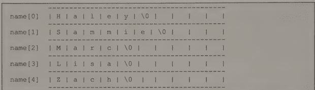

如你所见，这会极大地浪费存储空间。幸运的是，C 允许我们声明一个数组，每行的长度由用于初始化它的字符串决定：

```c
char *name[5] = { "Haley", "Sammy", "Marc", "Lisa", "Zach" };
```

在这里，name 是一个包含 5 个指向字符串的指针的数组。每个字符串都是一个字符数组，因此我们有 5 个指向数组的指针：

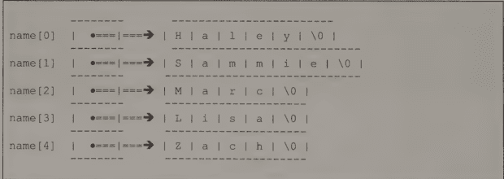

第一个指针是 name[0]，它指向第一个字符串；第二个指针是 name[1]，它指向第二个字符串，以此类推。请注意，每个指针都指向每个字符串的第一个字符：

```
*name[0] == 'H'
*name[1] == 'S'
*name[2] == 'M'
*name[3] == 'L'
*name[4] == 'Z'
```

这个指针数组有时被称为不规则数组，因为每行的大小可能不同。因此，不规则数组不会浪费任何存储空间！

考虑下面的示例，它声明了一个不规则数组，用于存储程序可能需要的各种错误消息：

```c
// arrayString.c
char *errorMsg[5] = { "Memory allocation error",
"Stack overflow.",
"Cannot read sector.",
"File not found.",
"Division by zero."
};
```

要输出适当的错误消息，只需访问相应的数组元素即可：

```c
puts(errorMsg[3]);
```

如果我们想输出不规则数组中包含的所有错误消息，只需遍历数组即可：

```c
for (i = 0; i < 5; i++) {
puts(errorMsg[i]);
}
```

## 命令行参数

当编译后的程序执行时，在运行时为某些变量提供初始值很有用。这些值称为命令行参数。我们之前将 main() 函数定义为：

```c
int main(void);
```

但它更一般地定义为：

```c
int main(int argc, char *argv[]);
```

第一个参数 argc 存储程序被调用时的命令行参数数量（包括程序名）。第二个参数 argv 是指向字符串不规则数组的指针，存储传递给程序的实际参数值。

argv 的声明：

```c
char *argv[]
```

表示该指针指向数组的初始元素，也可以写成：

```c
char **argv
```

也就是说，argv 是指向 char 的指针的指针。如果我们查看 argv 指向的存储区域，将发现一个字符指针数组，每个指针都指向一个以空字符结尾的字符串：

| argv | |
|------|---|
| argv[0] | 命令名 |
| argv[1] | 参数 1 |
| argv[2] | 参数 2 |
| ... | ... |
| argv[n] | 参数 n |

### 按照惯例：

- argc 至少为 1
- argv[0] 是命令本身的名称（程序被调用时的名称）
- argv[1] 指向第一个参数字符串
- argv[2] 指向第二个参数字符串，以此类推
- argv[argc] 始终是数组的最后一个元素，并且始终包含一个空指针

例如，如果我们执行带有两个参数的程序 foo：

```
foo arg1 arg2
```

程序将接收 argc 等于 3 的值，argv 将如下所示：

| argv | |
|------|---|
| argv[0] | foo |
| argv[1] | arg1 |
| argv[2] | arg2 |
| argv[argc] | null |

在 main() 内，原始命令行上的值现在可以像任何其他变量一样被访问和使用。我们将很快看到，我们还可以从命令行向 main() 传递文件名，并打开和访问文件的内容。下面的程序只是将其命令行参数回显到终端窗口：

```c
// echo1.c

#include <stdio.h>

int main(int argc, char *argv[]) {
    int i;

    for(i = 1; i < argc; i++) {
        printf("%s ", argv[i]);
    }
    printf("\n");

    return 0;
}
```

由于 argv 是指向指针数组的指针，我们可以重写上面的程序，而不使用数组索引：

```c
// echo2.c

#include <stdio.h>

int main(int argc, char *argv[]) {
    while(--argc > 0) {
        printf("%s ", *++argv);
    }
    printf("\n");
}
```

下面的程序将文件名通过命令行传递给 main()，并将文件中的所有字母大写并显示：

```c
// caps.c

#include <stdio.h>
#include <stdlib.h>
#include <ctype.h>

int main(int argc, char *argv[]) {
    int c;
    FILE *fp;

    fopen_s(&fp, argv[1], "r");
    if (fp == NULL) {
        puts("Could not open file. ");
        exit(1);
    }

    while((c = getc(fp)) != EOF) {
        if(islower(c)) {
            putchar(toupper(c));
        }
        else {
            putchar(c);
        }
    }
    fclose(fp);
    return 0;
}


我们的最后一个示例展示了如何使用标志来修改命令。标志通常由连字符引导，并在命令行中作为第二个参数出现。下面的程序会输出其命令行参数，如果存在标志 -c，则参数将以大写字母输出；否则参数将按其在命令行中出现的形式输出。请注意，包含标志的参数不会被输出。

```c
// flag.c
#include <stdio.h>
#include <string.h>
int main(int argc, char *argv[]) {
    int i = 1, flag = 0;
    if (!strcmp(argv[1], "-c")) {
        flag = 1;
        i = 2;
    }
    for ( ; i < argc; ++i) {
        if (flag) {
            strupr(argv[i]);
            printf("%s ", argv[i]);
        }
    }
    printf("\n");
    return 0;
}
```

## 可变长度参数列表：高级

可以创建接收不特定数量参数的函数！事实上，`printf()` 接收可变数量的参数。至少，`printf()` 必须将字符串作为其第一个参数，但可以接收任意数量的额外参数。`printf()` 的实际函数原型为：

```c
int printf(char *fmt, ...);
```

声明 `...`（省略号）意味着这些参数的数量和类型可能会变化。函数可以接收任意类型的可变数量参数。此声明只能出现在参数列表的末尾。

声明带有可变数量参数的函数可以为我们提供极大的灵活性。考虑一个名为 `average()` 的函数，它可以计算可变数量参数的平均值。它可能会以如下方式调用：

```
avg = average(a, b, c);
avg = average(a, b, c, d);
```

在 C 中处理可变数量参数的秘诀在于参数传递给函数的方式。让我们来看看 C 函数进入时栈的内容。当调用函数时，参数后跟返回地址被放置在栈上：

```
foo(arg1, arg2);

high addresses
---------------
    arg2
---------------
    arg1
---------------
sp-> return address
---------------
    stack
    grows
    downward
---------------
low addresses
```

在 C 中，函数的参数按其在函数调用中出现的相反顺序放置在栈上。结果是，第一个参数始终位于栈指针 sp 的固定偏移量处。偏移量是存储返回地址所需的字节数。因此，无论向 C 函数传递多少个参数，第一个参数始终很容易访问。

因此，在进入 C 函数时，第一个参数出现在栈上返回地址的上方，即它具有下一个更高的地址。其他参数具有依次更高的地址。因此，如果你能访问栈上的第一个参数，并且知道所有其他参数的大小，那么你就可以逐个检索参数！

有一个标准 C 头文件 stdarg.h，它包含一组宏以及一个新定义的数据类型，使处理可变数量参数的任务变得简单直接。该头文件的实现因机器而异，但它提供的接口是统一的。stdarg.h 包含的第一件事是一个新数据类型的定义：

```
va_list
```

```c
va_list ap;
```

我们将 ap 声明为 va_list 类型的参数指针。ap 将由其他宏用于处理可变长度参数列表，即 ap 将依次指向每个参数。

va_start 是一个宏，它初始化参数指针 ap，使其指向传递给函数的栈上的第一个未命名参数。在使用 ap 访问任何未命名参数之前，必须先调用一次 va_start。

va_start 的原型为：

```c
void va_start(va_list ap, lastarg);
```

第一个参数 ap 是参数指针。第二个参数 lastarg 是传递给被调用函数的最后一个固定函数参数的名称。这是参数列表中省略号 (...) 之前的最右侧参数。请注意，函数必须至少有一个命名参数。va_arg 是一个宏，它将参数指针 ap 推进到栈上的下一个参数。

第一次使用 va_arg 时，它返回列表中的第一个参数。每次后续使用 va_arg 时，它返回列表中的下一个参数。它通过先解引用 ap，然后递增 ap 以指向下一个项目来实现这一点。

va_arg 的原型为：

```c
type va_arg(va_list ap, type);
```

第一个参数 ap 是参数指针。第二个参数 type 表示参数列表中预期值的类型，例如 int、double 等。请注意，我们不能使用 char、unsigned char 或 float。va_arg 使用类型名称既执行解引用以确定返回什么类型，又确定采取多大的步长来定位栈上的下一个参数。该宏返回参数类型的值。

va_end 是一个宏，它执行必要的清理操作，以帮助被调用函数执行正常返回。它必须在 va_arg 读取所有参数之后、函数返回之前调用。如果不这样做，可能会导致程序出现奇怪的未定义行为。va_end 的原型如下：

```c
void va_end(va_list ap);
```

参数 ap 是参数指针。

下面的程序返回一系列数字的平均值。函数 average() 的第一个参数始终是要平均的值的数量：

```c
// arg1.c
#include <stdio.h>
#include <stdarg.h>
int main(void);
double average(int num, ...);
int main(void) {
    double a = 2.0, b = 4.0, c = 6.0, d = 8.0;
    printf("%5.1f\n", average(2, a, b));
    printf("%5.1f\n", average(3, a, b, c));
    printf("%5.1f\n", average(4, a, b, c, d));
    return 0;
}
double average(int num, ...) {
    int i;
    double total = 0.0;
    va_list ap;
    va_start(ap, num);
    for(i = 1; i <= num; i++) {
        total += va_arg(ap, double);
    }
    va_end(ap);
    return total / num;
}
```

下面的程序计算以零结尾的列表的总和：

```c
// arg2.c

#include <stdio.h>
#include <stdarg.h>

int main(void);
void sum(char *msg, ...);

int main(void) {
    sum("The total of 1+2+3+4 is %d\n", 1,2,3,4,0);
}

void sum(char *msg, ...) {
    int total = 0, arg;
    va_list ap;

    va_start(ap, msg);
    while ((arg = va_arg(ap,int)) != 0) {
        total += arg;
    }
    printf(msg, total);
    va_end(ap);
}
```

最后，`printf()` 和 `scanf_s()` 如何知道在每个 `va_arg` 宏中使用什么类型？答案是，它们扫描格式控制字符串中的格式转换说明符，以确定要处理的下一个参数的类型。Kernighan 和 Ritchie 提供了一个 `printf()` 最小版本的实现，以展示如何编写处理可变长度参数列表的函数。其原型为：

```c
void myprintf(char *fmt, ...);
```

由于此处关注的是参数传递，`myprintf()` 处理格式字符串和参数，但调用真正的 `printf()` 函数来执行格式转换：

```c
// arg3.c

#include <stdio.h>
#include <stdarg.h>

int main(void);
void myprintf(char *fmt, ...);

int main(void) {
    int x = 5, y = 10;
    float pi = 3.14;
    char *buf = "Hello";

    myprintf("%d %d\n", x, y);
    myprintf("%d %f %s %d\n", x, pi, buf, y);
}

void myprintf(char *fmt, ...) {
    char *p, *sval;
    int ival;
    double dval;
    va_list ap;

    va_start(ap, fmt);
    for(p = fmt; *p; p++) {
        if (*p != '%') {
            putchar(*p);
            continue;
        }
        switch(*++p) {
            case 'd': ival = va_arg(ap, int);
                printf("%d", ival);
                break;
            case 'f': dval = va_arg(ap, double);
                printf("%f", dval);
                break;
            case 's': for(sval = va_arg(ap, char *); *sval; sval++)
                putchar(*sval);
                break;
            default : putchar(*p);
                break;
        }
    }
    va_end(ap);
}
```


## 数据压缩 - 高级

数据压缩是减少存储或传输数据所需位数的技术。压缩可以是 *无损* 或 *有损*。无损和有损压缩是描述在文件解压缩或数据传输接收时，是否可以恢复所有原始数据的术语。

使用无损压缩时，文件解压缩后，原始文件中的每一位数据都保留下来。所有信息都完全恢复。这通常是文本或电子表格文件的首选技术，因为丢失单词或财务数据可能会造成问题。图形交换格式（GIF）是 Web 上使用的一种提供无损压缩的图像格式。其他无损压缩算法包括：

- TIFF
- Zip
- RAR
- FLAC
- LZW
- 霍夫曼编码
- PNG
- 莫尔斯电码

另一方面，有损压缩通过永久删除某些信息（尤其是冗余信息）来减小文件大小。当文件解压缩时，只剩下部分原始信息（尽管用户可能不会注意到）。有损压缩通常用于视频和音频，其中一定量的信息丢失大多数用户不会察觉。JPEG 图像文件常用于网页上的照片和其他复杂静态图像，是一种有损压缩图像。使用 JPEG 压缩时，创建者可以决定引入多少损失，并在文件大小和图像质量之间做出权衡。其他有损压缩算法包括：

- MP3
- JPG
- DivX

## 字典压缩

通过检查字典中连续数据项之间的关系，可以推导出一种高效的编码方案，以实现高水平的数据压缩。该压缩技术利用了这样一个事实：字典中的单词按字母顺序排列，往往与相邻条目以相同的字母开头。压缩算法的工作原理如下：压缩字典中的每个单词都以一个数字开头，该数字表示应从字典中的前一个单词复制多少个字符。单词的其余字母紧随数字之后。

例如，如果原始字典仅包含五个单词：

```
can<LF>
canal<LF>
cancel<LF>
cancer<LF>
candid<LF>
```

它将被压缩为：

```
0can<LF>
3al<LF>
3cel<LF>
5r<LF>
3did<LF>
```

在字典的编码版本中，只出现那些在前一个单词中未连续出现的字母。每个单词末尾前面的数字表示相同的字符数量。解码要求按顺序读取，以便前一个单词再次可用。待解压缩单词前面的计数提供了要保留的首字符数量，然后将未编码的字符连接起来。

在前面的示例中，原始字典包含 31 个字符，压缩版本包含 22 个字符，节省了 29% 的空间。通过减少每行末尾的换行符 <LF> 数量，可以实现更多压缩。这可以通过将单词输出到一行，直到达到预定义的右边距来实现：

```
0can3al3cel5r3did<LF>
```

压缩后的字典现在包含 18 个字符，节省了 42% 的空间。然而，在实际中，实际字典中的条目在词典学意义上比本示例中的条目更接近，节省的空间也更大。使用更大的字典时，压缩比超过 50%。

这种字典压缩方案的一个局限性是，要从字典中解压缩一个单词，你必须知道前一个单词是什么，而前一个单词的解压缩又依赖于再前一个单词，以此类推。然而，在实际中，字典访问并不仅限于从头开始的串行搜索，因为以新字母开头的第一个单词不会从其前驱复制任何字母。因此，当文件中有 26 个单词（从以 `a` 开头的单词到以 `z` 开头的单词各一个）时，字典可以被相当快速地搜索。指针方案可以扩展为一个索引，指向每个两字母对（`aa`、`ab`，一直到 `zy`、`zz`）的开头，这样查找给定单词时需要读取的字典内容会更少。

下面的函数 `compress()` 在按字母顺序排列的 ASCII 文本文件上执行此压缩算法，每行一个单词。字典必须全部小写。0 到 9 的数字范围在 ASCII 序列中扩展，冒号（`:`）解释为 10，分号（`;`）解释为 11，以此类推。

互补函数 `expand()` 执行逆操作。它从由 `compress()` 压缩的文件生成一个 ASCII 文本文件，每行一个单词。

```
// compress.c

/*
Reads an alphabetized file (one word per line) and writes a compressed
version of the file. Words in the output file are preceded by a count
of characters identical to the previous word plus an offset of 48
(ASCII '0'), and these identical characters are omitted. Multiple words
are output on each line until column MAX_COL is reached. At this point,
the current word is made the last on the line by printing '\n'.
*/

void compress(void) {
    char prev[MAX_CHAR], word[MAX_CHAR], buf[MAX_CHAR];
    char *s, *t;
    int chrccount, linelen = 0;
    FILE *fpin, *fpout;

    fopen_s(&fpin, "dictionary.txt", "r");
    if (fpin == NULL) {
        printf("File could not be opened for input.\n");
        exit(1);
    }

    fopen_s(&fpout, "compressedDictionary.txt", "w");
    if (fpout == NULL) {
        printf("File could not be opened for output.\n");
        exit(1);
    }

    prev[0] = '\0';
    while (fgets(word, MAX_CHAR, fpin)) {
        if (strchr(word, '\n')) {
            word[strlen(word)-2] = '\0';
        }

        s = word;
        t = prev;
        chrccount = 0;
        while (*t != '\0' && (*s++ == *t++)) {
            ++chrccount;
        }

        buf[0] = chrccount + '0';
        buf[1] = '\0';
        strcat(buf, word[chrccount]);
        fputs(buf, fpout);
        linelen += 1 + strlen(&word[chrccount]);
        if (linelen >= MAX_COL) {
            linelen = 0;
            fputs("\n", fpout);
        }
        strcpy(prev, word);
    }

    fclose(fpin);
    fclose(fpout);
}
```

## // expand.c

> /*
> 读取由 compress() 创建的压缩文件并写入标准
> ASCII 文件，每行一个单词。
> */

```
void expand(void) {
    char prev[MAX_CHAR], word[MAX_CHAR];
    int samechr;
    FILE *fpIn, *fpOut;

    fopen_s(&fpIn, "compressedDictionary.txt", "r");
    if (fpIn == NULL) {
        printf("File could not be opened for input.\n");
        exit(1);
    }

    fopen_s(&fpOut, "newDictionary.txt", "w");
    if (fpOut == NULL) {
        printf("File could not be opened for output.\n");
        exit(1);
    }

    prev[0] = '\0';
    while ((samechr = getWord(word, fpIn)) >= 0) {
        strcpy(prev + samechr, word);
        fputs(prev, fpOut);
        fputs("\n", fpOut);
    }
    fclose(fpIn);
    fclose(fpOut);
}
```

```
int getWord(char *t, FILE *fpIn) {
    int c, count;

    while ((c = fgetc(fpIn)) < 'a') {
        count = c - '0';
        if (c == EOF) {
            return (-1);
        }
    }
    ungetc(c, fpIn);
    while ((c = fgetc(fpIn)) >= 'a') {
        *t++ = c;
    }
    ungetc(c, fpIn);
    *t++ = '\0';
    return(count);
}
```

在包含 482,884 字节的 50,000 单词字典上实现 compress() 会生成一个 185,339 字节的文件，压缩比为 61.62%。

## 字符串作业

- 下面的函数调用应该写入一个换行符，但有些是不正确的。找出哪些调用不起作用并解释原因。

  - a) `printf("%c", '\n');`
  - b) `printf("%c", "\n");`
  - c) `printf("%s", '\n');`
  - d) `printf("%s", "\n");`
  - e) `printf('\n');`
  - f) `printf("\n");`
  - g) `putchar('\n');`
  - h) `putchar("\n");`
  - i) `puts('\n');`
  - j) `puts("\n");`
  - k) `puts("");`

- 假设 `p` 已按以下方式声明：

  ```
  char *p = "abc";
  ```

  以下哪些函数调用是合法的？显示每个合法调用产生的输出，并解释其他调用为何非法。

  - a) `putchar(p);`
  - b) `putchar(*p);`
  - c) `puts(p);`
  - d) `puts(*p);`


3. 假设 `str` 是一个字符数组。以下哪条语句与其他三条不等价？

- a) `*str = 0;`
- b) `str[0] = '\0';`
- c) `strcpy(str, "");`
- d) `strcat(str, "");`

4. 执行以下语句后，字符串 `s1` 的值将是多少？

```c
strcpy(s1, "computer");
strcpy(s2, "science");
if (strcmp(s1, s2) < 0)
    strcat(s1, s2);
else
    strcat(s2, s1);
s1[strlen(s1)-6] = '\0';
```

5. 以下函数声称可以创建字符串的完全副本。该函数有什么问题？

```c
char *dup(char *p) {
    char *q;
    strcpy(q, p);
    return q;
}
```

6. 以下程序打印什么？

```c
#include <stdio.h>
int main(void) {
    char s[] = "Hello";
    char *p;
    for (p = s; *p; p++)
        --*p;
    puts(s);
    return 0;
}
```

## 密码实验室

此简短作业的目的是让你练习使用字符和字符串。你将创建一个名为 `cipher.c` 的程序，通过将每个字母移动若干位置来对消息进行编码。因此，如果移位为 2，则 A 变为 C，B 变为 D，以此类推。如下所示：

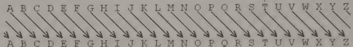

令人惊讶的是，你可以通过简单地对字符进行算术运算来实现这一点，但你应该使用强制类型转换让 C 确信结果是一个字符。例如，如果一个字母包含值 'A'，那么 'A' + 2 会给出整数结果 67，你可以通过说 `(char) (letter + 2)` 将其转换回字符，得到值 'C'。

不幸的是，`(char) ('Z' + 2)` 并不会给你字母 'B'（你可以从上面的图片中看出原因）。但如果你意识到已经越过 'Z'，你可以减去 26（即结果为 'Z' + 2 - 26，或 'Z' - 24），这样就会得到 'B'。

这也意味着，如果你使用移位 n 对消息进行编码，可以使用另一个移位 26 - n 来解码。

你的程序应首先调用一个名为 `processFile()` 的函数，该函数从文件 (`congress.txt`) 读取一条消息到一个非常大的字符数组中。该函数应将所有字母转换为大写字符。你可以丢弃输入字符串中的所有标点符号、数字、空格以及其他任何内容。

然后，你的程序应将移位量作为输入传递给一个名为 `cipher()` 的函数。输入参数应为 13，尽管为了测试目的，你可以使用移位 1 来简化事情。你的函数应通过移位正确的数量来编码每个字母，并将编码后的字母放入以空字符结尾的字符数组中。

最后，你应创建一个名为 `outputCode()` 的函数，该函数以每块五个字母、每行十块的形式输出最终编码后的消息。最后一行可能少于五块，最后一块可能少于五个字母。

例如，给定移位 1，程序应将此消息：

> 国会不得制定法律，确立国教，或禁止信教自由；或削弱言论自由，或剥夺出版自由；或剥夺人民和平集会以及向政府请愿以伸张冤屈的权利。

变成这样：

```
DPQRS FTTTI BMNNB LFOPM BXSFT QFDUJ OHBOF TUBCM JTINF OUPGS
FMJHJ POPSQ SPIJC JUJOH UIFGS FFFYF SDJTF UIFSP PGFBS CSJEH
JOHUI FGSPF EPNPG TQFFD IPSPG UIFQS FTPS UIFSJ HIUPG UIFQF
PQMFQ FBDFB CMZUP BTTFN CMFBO EUQPQ UJUJP OUIFH PWFSQ NPOUG
PSBSF ESFTT PGHSJ FWBOD FT
```

请确保你的最终程序提交显示移位 13 的结果。

请记住，main() 函数应作为程序中的第一个函数出现。请确保为程序中使用的每个函数使用函数原型。

你的程序输出应同时发送到终端窗口（你的屏幕）以及请求的 csis.txt 输出文件。请务必阅读关于捕获程序输出的文档。你的全名必须作为注释出现在包含 main() 的源文件中。请务必将 csis.txt 输出文件包含在 zip 压缩包中。

## 文本格式实验室

### 第一部分

本实验的第一部分是编写一个名为 word.c 的程序，从文件 getty.txt 中读取单词，并将每个单词单独显示在一行上。单词定义为由空格、制表符或换行符分隔的任何字符序列。请注意，此单词定义将标点符号视为单词的一部分。

你可以使用以下 while 循环，它将从文件中读取下一个单词到单词缓冲区 wbuf 中，wbuf 在 main() 中声明为字符数组：

```c
while (!feof(fp)) {
fscanf_s(fp, "%s", wbuf, sizeof(wbuf));
...
}
```

当每个单词通过 wbuf 参数返回后，它会被发送到输出函数 output()，该函数在单词前后都加上加号 (+) 将 wbuf 的内容显示到标准输出：

```
+Four+
+score+
+and+
+seven+
+years+
+ago+
+our+
+fathers+
+brought+
+forth,+ <- Note that the comma is considered part of the word.
```

加号不应存储在 wbuf 中，而应在输出 wbuf 内容之前和之后立即输出。

本实验部分的输出文件应命名为 csis1.txt。

### 第二部分

本实验的第二部分是编写一个文本对齐程序 align.c。该程序试图在一行中填充尽可能多的单词，一行长度为 62 个字符，且不拆分单个单词。

该程序将使用 word.c 中定义的 while 循环和字符数组 wbuf，以及在 main() 中声明为字符数组的行缓冲区 lbuf。这次，当每个单词从文件读入 wbuf 时，wbuf 和 lbuf 会被发送到 output()，其中 wbuf 被放入 lbuf，直到行缓冲区已满，此时将 lbuf 的全部内容发送到标准输出。

### 以下是一个简单的算法：

```
While there are more words to be read from the file
Read the next word into wbuf
Send wbuf and lbuf to the output() function
If EOF has been reached and there are words in lbuf that have not
yet been output
Output lbuf. End of program.
Otherwise
Determine if the word in wbuf will fit into lbuf, being careful
to allow room for the blank separating words.
If there is room in lbuf,
copy the contents of wbuf into lbuf
Otherwise
Output the contents of lbuf
Print a newline to begin the next line
Clear lbuf
Copy the contents of wbuf into lbuf
```

本实验部分的输出文件应命名为 csis2.txt。

### 注释

打开文件进行读写时，请务必进行错误检查。如果输入文件不存在或无法创建输出文件，你的程序应生成错误消息并退出。

请注意，我不希望你在程序中读取“行”输入。这是因为输入行可能非常长。对输入文件的形式没有限制。事实上，输入可能全是一行（非常长）的内容，这很容易导致 wbuf 的大小溢出。虽然提供的输入文件中没有长行，但一个正确（且有用）的程序必须能够处理它们。因此，请使用我的 while 循环一次从输入文件中读取一个单词。

### 额外学分

为了获得额外学分，你需要将文本对齐程序转换为文本格式化程序 `format.c`。这是一个将文本单词输出到既左对齐又右对齐的行上的程序。幸运的是，我们的程序模块化得很好，这只涉及添加一个新函数 `fmt()`，该函数在 `lbuf` 的单词之间插入额外空格以实现完全对齐。该函数应在将 `lbuf` 发送到标准输出之前立即调用。

你的每个程序都应在文件 `getty.txt` 上运行。


请记住，`main()` 函数应作为程序中的第一个函数出现。请确保为程序中使用的每个函数使用函数原型。


程序的输出应发送到终端窗口（您的屏幕）以及请求的 `csis1.txt` 和 `csis1.txt` 输出文件。请务必阅读关于捕获程序输出的文档。您的全名必须作为注释出现在包含 `main()` 的源文件中。请务必将输出文件包含在 zip 压缩包中。

## 文本统计实验

本次作业的目的是让您练习使用文本和数据处理技术，以计算文本文件的一些统计信息。此次作业还将让您有机会了解更多关于字符串和文件的知识，以及如何组织一个中等规模的程序。

构建一个程序 `stats.c`，以检查数据文件 `getty.txt` 中的字符和单词。您的程序应执行以下操作：

- 统计文本中的行数。
- 统计文本中的单词数。
- 计算文本中所有单词的平均长度。
- 显示文本中单词长度的直方图，即类似于以下条形图：

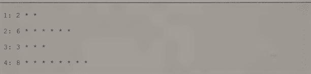

以指示文本中有 2 个单字母单词、6 个双字母单词、3 个三字母单词、8 个四字母单词，等等。

- 统计文本中的字符数，不包括空格和标点符号。
- 显示一个表格，列出文本中每个字母的频率。
- 统计文本中的元音字母数，并输出每个元音字母的频率，作为读取的元音字母总数的百分比。

请记住，`main()` 函数应作为程序中的第一个函数出现。请务必为程序中使用的每个函数使用函数原型。

程序的输出应发送到终端窗口（您的屏幕）以及请求的 csis.txt 输出文件。请务必阅读关于捕获程序输出的文档。您的全名必须作为注释出现在包含 main() 的源文件中。请务必将 csis.txt 输出文件包含在 zip 压缩包中。

在尝试打开用于输入或输出的文件时，请务必进行错误检查。作为额外学分，请将此实验的所有文件名作为命令行参数传递。有关命令行参数的编译器特定信息可以在 Canvas 的以下位置找到：

## 文件 | 设置命令行参数

getty.txt 的内容如下：

八十七年前，我们的先辈在此大陆上诞生了一个新国家，它构想于自由，并致力于所有人生而平等的主张。如今，我们正卷入一场伟大的内战，检验这个国家，或任何如此构想并如此致力的国家，是否能长久延续。我们在此相聚于那场战争的一片伟大战场。我们来到这里，将其中一部分作为那些在此献出生命、使该国家得以生存之人的最终安息之地。我们这样做完全合情合理。但在更广泛的意义上，我们无法奉献——无法神圣化——无法使这片土地神圣化。在此奋斗过的勇士们，无论生死，已用远超我们微薄能力所能增减的方式神圣化了这片土地。世界不会注意，也不会长久记住我们在这里说的话，但永远不会忘记他们在这里所做的事。我们这些活着的人，更应致力于他们至此已如此高尚地推进的未竟事业。我们更应致力于面前的伟大任务，从这些受尊敬的逝者身上汲取对那份事业更加坚定的献身精神——他们在此付出了全部的忠诚。我们在此高度决心，这些逝者不会白白死去；这个国家将获得自由的新生；而且，这个民有、民治、民享的政府将不会从地球上消失。

## Grep 实验

为了更多地练习命令行参数，请编写一个程序 `grep.c`，它搜索一个文件或一组文件中的模式，并输出包含该模式实例的文件中的每一行。您的程序应将文件名作为前缀添加到每个匹配的行，以便您可以知道匹配发生在哪个文件中。

`grep` 命令的语法是：

```
grep [option] pattern file(s)
```

其中 `option` 由一个或多个前面带连字符的单字符组成，`pattern` 包含要搜索的文本，而 `file(s)` 告诉 `grep` 要搜索哪个文件或哪些文件。

应识别以下选项：

- **-v** **非匹配**：仅打印不匹配的行。仅不包含搜索字符串的行被视为不匹配行。
- **-i** **忽略大小写**：`grep` 忽略大小写差异。`grep` 在所有情况下都将所有字母 a-z 视为与相应的字母 A-Z 相同。
- **-n** **行号**：`grep` 打印的每个匹配行前面都加上其在文件中的相对行号。
- **-c** **仅计数**：仅打印匹配行的计数。对于包含至少一行匹配的每个文件，`grep` 打印文件名和匹配行数。不打印匹配行。
- **-l** **列出匹配文件**：仅打印每个包含匹配的文件的名称。在 `grep` 找到匹配后，它打印文件名，处理立即转到下一个文件。

请注意，匹配不会跨越行边界（即，匹配必须包含在单行中）。请务必包含适当的错误检查例程，以防请求的文件不存在。

使用下面显示的三个文件，显示以下每个命令生成的输出：

```
grep the genesis.txt
grep the getty.txt genesis.txt shakes.txt
grep hello getty.txt genesis.txt shakes.txt
grep the genesis.txt foo.txt shakes.txt
grep -v the getty.txt
grep -l and shakes.txt
grep -n the genesis.txt shakes.txt
grep -c the getty.txt shakes.txt genesis.txt
grep -l in getty.txt shakes.txt genesis.txt
```

以下是每个文件的内容：

## getty.txt

八十七年前，我们的先辈在此大陆上诞生了一个新国家，它构想于自由，并致力于所有人生而平等的主张。

## shakes.txt

全世界是一个舞台，
所有男男女女只不过是演员。
他们有他们的退场和入场；
一个人在一生中扮演许多角色。

## genesis.txt

起初，上帝创造了天地。地是空虚混沌，渊面黑暗；上帝的灵运行在水面上。上帝说：“要有光。”就有了光。上帝看光是好的；就把光暗分开了。上帝称光为昼，称早晨为夜。有晚上，有早晨，这是头一日。

作为额外学分，看看您是否可以将程序推广，使其一次可以使用多个选项。

请记住，`main()` 函数应作为程序中的第一个函数出现。请务必为程序中使用的每个函数使用函数原型。

程序的输出应发送到终端窗口（您的屏幕）以及请求的 `csis.txt` 输出文件。请务必阅读关于捕获程序输出的文档。您的全名必须作为注释出现在包含 `main()` 的源文件中。请务必将 `csis.txt` 输出文件包含在 zip 压缩包中。

## 文本加密实验

### 第一部分

我们最近为校园范围的公告牌系统开发了一个 NetNews 阅读器。然而，阅读器的一部分仍需完成。有必要包含一个使用简单替换的加密方案，以允许私密通信。

该加密方案称为 ROT13，因为它将每个字母字符在字母表中“旋转”半圈（'a' 变为 'n'，'b' 变为 'o'，'n' 变为 'a'，以此类推）。保持大小写。所有空白、标点符号、数字等保持不变。

编写一个程序，从标准输入读取任意数量的文本，应用 ROT13 转换，并将其写入标准输出。输入或输出行不会超过 80 个字符。

```
Sample input: This is l line to be rotated.
Guvf vf l yvar gb or ebognqrg.
Sample output: Guvf vf l yvar gb or ebognqrg.
This is l line to be rotated.
```

### 第二部分

编写一个程序，提示用户输入任意长度的字符串密码。然后以以下方式对密码进行编码。交替放置元音字母（'a'、'e'、'i'、'o'、'u'），使第一个元音字母移到密码前面，第二个移到后面，第三个移到前面，第四个移到后面，以此类推。编码应在检查完输入字符串的最后一个字符时停止。打印编码后的密码。

```
Sample input: computer science
olympiad
Sample output: eeocmptr scnuie
aolympdi
```


请记住，main() 函数应作为程序中的第一个函数出现。请务必为程序中使用的每个函数使用函数原型。

程序的输出应同时发送到终端窗口（您的屏幕）以及请求的 csis.txt 输出文件。请务必阅读关于“捕获程序输出”的文档。您的全名必须作为注释出现在包含 main() 的源文件中。请务必将 csis.txt 输出文件包含在 zip 压缩包中。

## 字符串操作实验

编写一个包含以下内容的程序：

- 一个将字符串内容替换为字符串逆序的函数。
- 一个以字符串为参数并从字符串中删除空格的函数。
- 一个以逆序输出命令行参数的函数。

请记住，main() 函数应作为程序中的第一个函数出现。请务必为程序中使用的每个函数使用函数原型。

程序的输出应同时发送到终端窗口（您的屏幕）以及请求的 csis.txt 输出文件。请务必阅读关于“捕获程序输出”的文档。您的全名必须作为注释出现在包含 main() 的源文件中。请务必将 csis.txt 输出文件包含在 zip 压缩包中。

# 第 14 章 存储类

- 存储类
- 存储位置
- 存储类作业

## 存储类

C 中的每个变量都有两个属性：存储类型和存储类。存储类型决定值的含义。存储类决定存储位置、生存期以及可见性或作用域（变量可被引用的区域）。共有四种存储类：自动（局部）、外部、寄存器和静态。

### 自动变量

自动变量或局部变量是最常见的存储类类型。在函数体内声明的变量默认为自动或局部变量。这些变量仅在声明它们的函数内部可用。对于任何其他函数而言，它们不存在。

局部变量在每次调用函数时都会重新创建，之前调用的值不会被保留。局部变量可以在声明时赋值：

```
void foo(void) {
    int num = 5;
}
```

请注意，自动或局部变量不仅可以在函数开头声明，也可以在块的开头声明：

```
// storage1.c

void foo(void) {
    char x;
    int num;
    ...
    if (num > 5) {
        int x;
        for (x = 0; x < num; x++) {
            ...
        }
    }
}
```

### 外部存储类

当变量在函数外部声明时，会为其永久分配存储空间，其存储类为外部。它被视为全局变量，对其之后声明的所有函数可见。外部变量是跨块和函数传递信息的有用工具。

外部变量的声明与函数或块内的变量声明完全相同：

```
// storage2.c
#include <stdio.h>

int x = 1;
int y = 2;

int main(void) {
    z = foo();
    printf("%d %d %d\n", x, y, z);
}

int foo(void) {
    int y, z;
    x = y = z = 3;
    return x + y + z;
}
```

输出：

```
3 2 9
```

请注意，外部变量永远不会消失，但如果标识符被重新定义，它们可能会被隐藏。

向函数传递信息有两种方式：使用外部或全局变量（在本课程中不允许）或使用参数。使用参数是向函数传递信息的首选方法。这往往能提高代码的模块化程度，并减少不良副作用的可能性。

### 例如：

```
// storage3.c

int num;

int main(void) {
    num = 0;
    while (num < 3) {
        foo();
        num++;
    }
}

void foo(void) {
    num = 0;
    while (num < 5) {
        puts("Hello.");
        num++;
    }
}
```

试着看看你能否理解这段代码的意图及其输出。

我们应避免使用不必要的外部或全局变量，原因有三：

- 1. 它们在程序执行期间始终占用内存，而不仅仅是在需要时才占用。
- 2. 在可以使用局部变量的地方使用外部或全局变量，会使您的函数不够通用，因为函数依赖于必须在其外部定义的内容。
- 3. 使用大量外部或全局变量可能会导致程序错误，因为存在未知且不希望的副作用。

### 寄存器存储类

通过将自动（局部）变量声明为寄存器存储类，可以将其放置在计算机的实际硬件寄存器中。这允许在程序执行期间更快地访问。寄存器存储类通常用于频繁引用的变量，这是一种提高执行速度的尝试。

语法如下：

```
register type name;
```

请注意，只有某些数据类型可以放入寄存器：

- char
- short
- int
- unsigned char
- unsigned short
- unsigned int
- 作为数组参数的指针变量

请注意，每台机器可用于此类变量的寄存器数量有限。如果没有可用寄存器，该类默认为自动。因此，寄存器变量的实现依赖于机器。

还请注意，程序不能获取寄存器变量的地址（&），即我们不能使用 `scanf_s()` 读取寄存器。

下面是一个计数到一百万的程序：

```
// storage.c

int main(void) {
    register int units;
    register int thousands;

    thousands = 0;
    while (++thousands <= 1000) {
        units = 0;
        while (++units <= 1000) {
        }
    }
}
```

寄存器变量应尽可能靠近其使用位置声明，以最大限度地提高寄存器的可用性。块退出时，寄存器会被释放。

### 静态存储类

静态存储类允许我们控制局部变量在函数调用之间是否保留其值。函数内的静态变量是一个局部变量，它保留了对该函数之前调用的值。它们在函数第一次被调用时创建，并在函数退出时不会被销毁。

例如：

```
void foo(void) {
    static int num = 0;
    ...
}
```

num 的值仅在程序执行开始时初始化为 0 一次。下面是一个说明静态变量和自动变量的程序：

```
// storage5.c
int main(void) {
    int i;
    for (i = 0; i < 5; ++i) {
        foo();
    }
}

void foo(void) {
    int autoVar = 0;
    static int staticVar = 0;

    printf("Automatic = %d Static = %d\n", autoVar, staticVar);
    ++autoVar;
    ++staticVar;
}
```

输出：

```
Automatic = 0   Static = 0
Automatic = 0   Static = 1
Automatic = 0   Static = 2
Automatic = 0   Static = 3
Automatic = 0   Static = 4
```

请注意，静态变量 staticVar 仅初始化一次，并在函数调用之间保留其值。

因此，静态变量是仅在其定义的函数内可见（如局部变量）但生存期为整个程序（如全局变量）的变量。

### 静态存储中的数组初始化

C 不允许初始化自动（局部）数组。只有静态或外部数组可以使用值列表进行初始化。因此，初始化数组时，最好将数组声明为静态。

如果在函数中使用静态数组，则初始值仅会分配给数组一次。对数组元素所做的任何更改在程序执行期间都将保持有效。

下面是静态存储中数组初始化的一些示例：

```c
// storage6.c
static short digits[10] = { 0,1,2,3,4,5,6,7,8,9 };
static char msg[6] = "Hello";
```

请注意，字符串始终在末尾包含空终止符 ('\0')。

如果数组边界大于初始化值的数量，则额外元素将初始化为 0。如果未给出边界，则边界取初始化值的数量。

请注意，未初始化的静态和外部变量会自动初始化为 0。未初始化的自动和寄存器变量将产生不可预测的结果！


## 存储类

| 属性 | AUTO | EXTERN | STATIC EXTERN | STATIC INTERN | REGISTER |
|---|---|---|---|---|---|
| 离开块时保留值 | 否 | 是 | 是 | 是 | 否 |
| 可供多个函数使用 | 否 | 是 | 是 | 否 | 否 |
| 可供其他源文件使用 | 否 | 是 | 否 | 否 | 否 |
| 未初始化时默认为零 | 否 | 是 | 是 | 是 | 否 |
| 编译时初始化一次 | 否 | 是 | 是 | 是 | 否 |
| 初始化数组和结构体 | 否 | 是 | 是 | 是 | 否 |
| 机器寄存器中的变量 | 否 | 否 | 否 | 否 | 是 |

## 存储位置

C 将内存分为四个独立位置：栈、堆、数据区、代码区。

## 高内存

| 内存位置 | 详细信息 |
|---|---|
| **栈** (大小可自由变化) | • C 为我们维护栈<br>• 自动变量<br>• 向函数传递参数<br>• 存储返回地址<br>• 设置在可用内存顶部，随着填充向低内存方向增长 |
| | (指示增长方向的箭头) |
| **堆** (大小可自由变化) | • 在堆上分配和使用内存<br>• 是我们的责任 (malloc)<br>• 从低内存开始，向高内存方向增长 |
| **数据区** (大小固定) | 未初始化数据<br>• 未初始化的静态和外部变量<br>• 一次全部初始化为零<br><br>已初始化数据<br>• 已初始化的静态和外部变量<br>• 已初始化的数组和结构体 |
| **代码区** (大小固定) | • 程序代码<br>• 程序运行时不改变 |

## 低内存

## 存储类作业

- 1. 用 auto、extern、register 和/或 static 回答以下每个问题。
  - a) 哪种存储类主要用于指示变量或函数可以由多个文件共享？
  - b) 假设变量 x 要在一个文件中的多个函数之间共享，但对其他文件中的函数隐藏。x 应该声明为什么存储类？
  - c) 哪些存储类可以影响变量的存储持续时间？

- 2. 给定以下函数 foo()：

```c
int foo(int i) {
    static int j = 0;
    return i * j++;
}
```

  - a) 如果 foo() 之前从未被调用过，foo(10) 的值是多少？
  - b) 如果 foo() 之前已被调用过五次，foo(10) 的值是多少？

## 预处理器

- 预处理器作业
- 预处理器实验

## 预处理器

C 预处理器是一个简单的工具，在编译器解析源代码之前处理 C 程序的源代码。有时预处理器实际上是一个独立的程序，它读取原始源文件并写入一个新的“预处理”源文件，该文件随后可用作 C 编译器的输入。C 预处理器提供定义宏、文件包含和条件编译的功能。

### #include

第 1 列以 # 开头的行称为控制行，用于与预处理器通信。控制行的语法与 C 语言的其余部分独立。形式如下的控制行：

```c
#include "filename"
```

会导致预处理器用指定文件内容的副本替换该行。文件搜索首先在当前目录中进行，然后在标准位置中进行。形式如下的控制行：

```c
#include <filename>
```

预处理器仅在标准位置查找文件，而不在当前工作目录中查找。

包含文件可以包含其他控制行，这些控制行将由预处理器展开：

### #define

#define 用于在程序开头定义符号名或符号常量，使其成为特定的字符串。编译器将用相应的字符串替换名称的所有未加引号出现。使用 #define 使程序常量更易于阅读，并允许程序员以一种便于日后更改的方式指定常量。

带有 #define 的控制行称为宏，有两种形式：无参数宏和带参数宏。

### 无参数宏：#define identifier string

预处理器将文件其余部分中 identifier 的每个出现替换为 string，但加引号的字符串除外。

```c
#define MAXINT 2147483647
```

请注意，宏末尾没有分号。宏在字符常量、字符串常量或注释中不被识别。

#define 提高了程序的可读性和可移植性：

```c
// macro1.c
#define PI 3.14159
#define FALSE 0
#define TRUE 1
#define BUFSIZE 512
#define FOREVER for(;;)
```

按照惯例，简单 #define 常量中的标识符使用大写字母，以便程序读者能够轻松识别将由预处理器展开的文本。

常用的 #define 常量集合可以一次写入文件 local.h，并可以使用 #include 将其引入 C 源程序：

```c
#include "local.h"
```

字符串或字符常量内部的文本不会被预处理器替换。

例如：

```c
#define BLANK
```

字符串：

```c
"abcBLANKdef"
```

将保持不变。但是：

```c
"abc"BLANK"def"
```

将展开为：

```c
"abc""def"
```

### 带参数宏：#define identifier(arg1, arg2, ...) string

请注意，标识符与参数的左括号之间不能有空格：

```c
// macro2.c
#define SQ(x) ((x) * (x))
```

因此：

```c
SQ(7 + w)
```

展开为：

```c
((7+w) * (7+w))
```

使用括号是为了防止宏展开表达式，从而导致意外的求值顺序。例如，如果我们将宏定义为：

```c
// macro3.c
#define SQ(x) x * x
```

那么：

```c
SQ(a + b)
```

展开为：

```c
a + b * a + b
```

由于运算符优先级，这与以下内容不同：

```c
((a + b) * (a + b))
```

如果我们将宏定义为，甚至会遇到错误：

```c
// macro4.c
#define SQ(x) (x) * (x)
```

这个宏将如何展开以下表达式：

```c
4 / SQ(2)
```

这将展开为：

```c
4 / (2) * (2)
```

这并不完全是我们预期的，我们预期的是：

```c
4 / ((2) * (2))
```

因此，如果操作数出现在宏定义中，最好使用括号。

### 宏中的宏

我们甚至可以使用其他宏来定义宏：

```c
// macro5.c

#define SQ(x)  x * x
#define SQ(x)  (x) * (x)
#define SQ(x)  ((x) * (x))
#define CUBE(x) (SQ(x) * (x))
#define FIFTH(x) (CUBE(x) * SQ(x))
```

预处理器会展开每个 #define 标识符，直到文本中不再出现为止。以下是 FIFTH(2) 的宏展开：

```c
FIFTH(2)

(CUBE(2) * SQ(2))

((SQ(2) * (2)) * ((2) * (2)))

(((2 * (2)) * (2)) * ((2) * (2)))
```

### 宏可以替换函数调用

宏经常用于用更高效的内联代码替换函数调用。例如，可以在程序中使用宏 MIN() 来代替函数 min()，其宏定义如下：

```c
// macro6.c
#define MIN(x,y) (((x) < (y)) ? (x) : (y))
```

因此调用：

```c
m = MIN(a, b);
```

将被预处理器正确展开为：

```c
m = (((a) < (b)) ? (a) : (b));
```

以下是宏替换函数调用的更多示例：

```c
// macro7.c
#define MAX(x,y) (((x) > (y)) ? (x) : (y))
#define ABS(x) (((x) < 0) ? -(x) : (x))
```

当然，我们必须小心宏参数不包含任何副作用。例如：

```c
ABS(++n)
```

将展开为：

```c
((++n) < 0) ? -(++n) : (++n))
```

这样 n 会被递增两次！

### 宏的趣味用法

你也可以用宏玩一些花招。例如：

```c
// macro8.c
#define print(x) printf("%d\n", x)
```

将展开：

```c
print(5);
```

为以下内容：

```c
printf("%d\n", 5)
```

以下是一些可供探索的其他宏：

```c
// macro9.c
#define print3(x,y,z) printf("x = %d\t y = %d\t z = %d\n", x, y, z);
```

使用上述宏定义，这将如何展开？

```c
print3(2, 4, 6);
```

以下是一个交换其两个 int 参数的宏：

```c
// macro10.c
#define SWAP(x,y) { int z; z = y; y = x; x = z; }
```

以下是另一个交换其两个 int 参数的宏：

```c
// macro11.c
#define SWAP(x,y) { x^=y; y^=x; x^=y; }
```

我将给第一个在公开讨论论坛中发布此代码正确解释的学生额外学分！

### 宏与函数

因此，我们看到带参数的宏与函数之间存在相似之处。我们应该使用哪个呢？嗯，时间和空间之间存在权衡。宏产生“内联”代码，即你在程序中得到一条语句。如果你使用宏 20 次，那么你就会在程序中插入 20 行代码。

如果你使用函数 20 次，你的程序中只有一份函数语句的副本，因此使用的空间更少。但是程序控制必须转移到函数所在的位置，然后返回到调用程序，这比执行内联代码要花费更长时间。一般规则是，在不定义任何宏函数（即带参数的宏）的情况下，先让程序正确运行。然后，如果你需要速度优势，再引入它们。


## 预处理器作业

1. 编写预处理器指令以完成以下每一项：

- a) 定义符号常量 TRUE，其值为 1。
- b) 定义符号常量 FALSE，其值为 0。
- c) 如果已定义符号常量 YES，则取消其定义并将其重新定义为 1。
- d) 定义一个宏 AREA，它接受一个参数并计算正方形的面积。
- e) 定义宏 SUM，用于求两个数的和。
- f) 定义宏 MIN2，用于确定两个数值中的较小值。

2. 编写一个宏，计算 n 除以 4 的余数。

3. 令 DOUBLE 为以下宏：

```
#define DOUBLE(x) 2*x
```

- a) DOUBLE(1+2) 的值是多少？
- b) 4/DOUBLE(2) 的值是多少？
- c) 修复 DOUBLE 的定义。

4. 对于以下每个宏，给出一个说明宏存在问题的示例，并展示如何修复它。

- a) #define AVG(x, y) (x+y) / 2
- b) #define AREA(x, y) (x) * (y)

## 预处理器实验

在本次作业中，我们将构建一个简单的 C 预处理器 pre.c，用于为编译准备 C 程序 test.c。预处理器将解析 test.c 中的源代码，并创建一个包含预处理后代码的输出文件 out.c。out.c 的内容随后应被输出、编译并执行。

预处理器应执行以下操作：

- 从源代码中删除所有注释。
- 识别 #include 预处理器命令，并将指定文件的内容插入到 out.c 中。
- 识别 #define 预处理器命令，并用相应的替换字符串替换所有符号名称。

为了协助处理 #define 命令，我们将使用以下方案：

test.c 中识别出的每个已定义符号及其替换字符串应放置在文件 define.txt 中。从源代码 test.c 读取每个标记时，必须将其与 define.txt 的内容进行比较，以确定该标记是否为预定义符号。如果是，则必须将相应的替换字符串放入 out.c。否则，将标记本身放入 out.c。

为了避免将每个标记与 define.txt 的内容进行比较，我们将使用一个简单的哈希表，每个位置初始化为 0。对于遇到的每个 #defined 符号，我们将获取其哈希值，将哈希表中相应位置的内容设置为 1，并将符号及其替换字符串发送到 define.txt。对于 test.c 中的每个其他标记，我们也必须获取其哈希值并检查哈希表中相应的位置。如果找到 0，则该标记不是预定义符号，应放入 out.c。但是，如果标记哈希到包含 1 的位置，则该标记可能是预定义符号。我们必须在 define.txt 中搜索该标记。如果找到匹配项，则将替换字符串放入 out.c，否则，将标记本身放入 out.c。

请注意，您的程序不应依赖于文件重定向，而应使用标准 C 库提供的 I/O 函数来设置和使用外部磁盘文件。

请记住，`main()` 函数应作为程序中的第一个函数出现。请务必为程序中使用的每个函数使用函数原型。

程序的输出应发送到终端窗口（您的屏幕）以及请求的 `csis.txt` 输出文件。请务必阅读关于捕获程序输出的文档。您的全名必须作为注释出现在包含 `main()` 的源文件中。请务必将 `csis.txt` 输出文件包含在 zip 压缩包中。

```
test.c
#include <header.h>
#define TOTAL x + y
#define MESSAGE "ON A CLEAR DAY YOU CAN C FOREVER"
#define FORMAT1 "%s\n"
#define FORMAT2 "%d %d\n"
int main(void) {
    int x, y, z, i, sum;
    printf(FORMAT1, MESSAGE);
    printf(NEWLINE);
    sum = ZERO;
    for (i = MIN; i <= MAX; ++i) {
        sum += i;
    }
    x = MAX;
    y = MIN;
    z = TOTAL;
    printf(FORMAT2, sum, z);
    return 0;
}
header.h
#define MAX 30
#define MIN 20
#define ZERO 0
#define NEWLINE "\n"
```

- 枚举
- typedef 语句
- 枚举 & typedef 作业

## 枚举

当数据类型将保存有限列表中的一个值时，您可以选择使用枚举数据类型。枚举类型的变量可以赋予其类型中的任何“值”。

```
// enum1.c
enum Day { Sat, Sun, Mon, Tues, Wed, Thurs, Fri };
enum Gender { male, female };

int main (void) {
    enum Day today = Wed;
    enum Day tomorrow = Thurs;
    enum Gender student = female;
    ...
}
```

枚举值被 C 编译器视为常量，每个枚举值都被赋予一个整数值，从 0 开始。当我们说 today = Wed; 时，值 4 被赋予 today，而不是名称 Wed。

具有枚举类型的变量也可以用于布尔表达式：

```
if (student == female) {
    printf("female");
}
```

其他关系运算符也可以使用。请注意，枚举数据类型会自动在元素之间建立顺序：

```
// enum2.c

#include <stdio.h>

enum Day { Sat, Sun, Mon, Tues, Wed, Thurs, Fri };

int main (void) {
    enum Day today;

    for (today = Sat; today <= Fri; ++today) {
        if (today < Mon) {
            printf("Weekend\n");
        }
        else {
            printf("Weekday\n");
        }
    }
    return 0;
}
```

### 输出：

```
Weekend
Weekend
Weekday
Weekday
Weekday
Weekday
Weekday
Weekday
```

假设您想在遍历 `for` 循环时输出变量 `today` 的不同值。您可以尝试这样做。

```
// enum3.c

#include <stdio.h>
enum Day { Sat, Sun, Mon, Tues, Wed, Thurs, Fri };
int main (void) {
   enum Day today;
   for (today = Sat; today <= Fri; ++today) {
      printf("%d\n", today);
   }
   return 0;
}
```

但您的输出将如下所示：

```
0
1
2
3
4
5
6
```

事实证明，枚举类型的值不能直接写入输出。通常使用 switch 语句来实现所需结果。

```
// enum4.c
#include <stdio.h>
enum Day { Sat, Sun, Mon, Tues, Wed, Thurs, Fri };
int main (void) {
    enum Day today;
    for (today = Sat; today <= Fri; ++today) {
        switch (today) {
            case Sat: puts("Sat"); break;
            case Sun: puts("Sun"); break;
            case Mon: puts("Mon"); break;
            case Tues: puts("Tues"); break;
            case Wed: puts("Wed"); break;
            case Thurs: puts("Thurs"); break;
            case Fri: puts("Fri"); break;
        }
    }
    return 0;
}
```

### 输出：

```
Sat
Sun
Mon
Tues
Wed
Thurs
Fri
```

C 中没有布尔（真或假）数据类型。相反，使用整数值 0 和 1。但是，很容易发明我们自己的布尔类型：

```
// enum5.c
enum Boolean { false, true };
enum Boolean Flag;
flag = true;
or as
enum Boolean { false, true } flag;
flag = false;
```

枚举类型的一个令人烦恼的方面是，它们不被 C 输入输出语句识别。例如：

```
// enum6.c
enum direction { north, south, east, west };
direction d1 = south;
printf("%d\n", south);
```

值 1 被输出。

如果希望将特定整数值与枚举值关联，则可以在定义数据类型时将整数赋给该值。列表中随后出现的枚举值将从指定整数值加 1 开始分配顺序值。

例如：

```
// enum7.c
enum direction { up, down, left = 10, right };
```

每个枚举值将具有以下数值：

```
up = 0
down = 1
left = 10
right = 11
```

定义枚举数据类型时可以省略数据类型的名称。定义数据类型时，也可以将变量声明为特定的枚举数据类型：

```
// enum8.c
enum { east, west, south, north } location;
```

请注意，在函数内定义枚举数据类型会将该定义的使用限制在函数内定义的变量上。在程序开头（任何函数之外）定义枚举数据类型，会使该类型定义对文件全局。


## Typedef 语句

typedef 语句使程序员能够为数据类型指定一个替代名称。例如：

```c
// typedef1.c
typedef int COUNTER;
```

这将名称 COUNTER 定义为与 C 数据类型 int 等效。现在可以声明类型为 COUNTER 的变量：

```c
// typedef2.c
typedef int COUNTER;
COUNTER a, b, c;
```

这为程序提供了更好的可读性。这里有另一个示例：

```c
// typedef3.c
typedef char *STRING_PTR;
```

这将名称 STRING_PTR 定义为 char 指针。现在可以定义类型为 STRING_PTR 的变量：

```c
// typedef4.c
typedef char *STRING_PTR;
STRING_PTR buffer;
```

这将被 C 编译器视为字符指针。

### 另一个示例：

```c
// typedef5.c
typedef char STRING[81];
```

这定义了一个名为 STRING 的类型，它是一个包含 81 个字符的数组。现在可以定义类型为 STRING 的变量，如下所示：

```c
// typedef6.c
typedef char STRING[81];
STRING text;
```

这将变量 text 定义为包含 81 个字符的字符数组，并等效于：

```c
char text[81];
```

### 定义新类型名称的步骤

- 1. 编写语句，仿佛正在定义所需类型的变量。
- 2. 在通常出现已定义变量名称的位置，替换为新类型名称。
- 3. 在最前面放置关键字 typedef。

## 枚举与 typedef 作业

1. a) 为一个枚举声明一个标记，其值代表一周中的七天。

b) 使用 `typedef` 为枚举定义一个名称。

2. 关于枚举常量的以下哪些陈述是正确的？

- a) 枚举常量可以表示程序员指定的任何整数。
- b) 枚举常量与使用 `#define` 创建的常量具有完全相同的属性。
- c) 枚举常量默认具有值 0、1、2、...。
- d) 枚举中的所有常量必须具有不同的值。
- e) 枚举常量可以在表达式中用作整数。

3. 假设 `b` 和 `i` 声明如下：

```c
enum { FALSE, TRUE } b;
int i;
```

以下哪些陈述是合法的？哪些是“安全”的（始终产生有意义的结果）？

- a) `b = FALSE;`
- b) `b = i;`
- c) `b++;`
- d) `i = b;`
- e) `i = 2 * b + 1;`

4. 假设方向变量声明如下：

```c
enum { NORTH, SOUTH, EAST, WEST } direction;
```

设 x 和 y 为 int 变量。编写一个 switch 语句，测试 direction 的值，如果 direction 是 EAST 则递增 x，如果 direction 是 WEST 则递减 x，如果 direction 是 SOUTH 则递增 y，如果 direction 是 NORTH 则递减 y。

5. 以下每个声明中的枚举常量的整数值是多少？

- a) `enum { NORTH, EAST, SOUTH, WEST };`
- b) `enum { DIAMONDS = 5, HEARTS, CLUBS, SPADES };`
- c) `enum { MON = 8, TUES, WED, THURS = 14, FRI };`
- d) `enum { RED = 5, BLUE, GREEN, YELLOW = 12, BROWN };`

# 第 17 章 结构体

- 结构体简介
- 操作整个结构体
- 结构体示例：今天的日期和明天的日期
- 结构体数组
- 嵌套结构体
- 结构体作业
- 数据库实验

## 结构体简介

我们之前使用数组来存储同一类型（以及指定大小）的数据集合，并使用单个名称：

```c
int num[10];
```

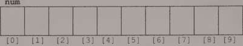

我们学会了使用下标（如 num[1] 或 num[i]）来引用数组的单个元素。

| 2 | 18 | -5 | 6 | 10 | -2 | 3 | 3 | -1 | 2 |
|---|---|---|---|---|---|---|---|---|---|
| [0] | [1] | [2] | [3] | [4] | [5] | [6] | [7] | [8] | [9] |

通常，我们需要创建不同类型的相关数据集合。例如，如果我想收集学生的信息，我可能对以下信息感兴趣：

- 学生姓名（字符串）
- 学生绩点（double）
- 学生预计毕业年份（整数）

我们可以在 C 中使用称为 struct 的数据类型来建模这样的集合。struct 是用户定义数据类型的一个示例，即我们可以定义自己的 struct 来建模任何想要的数据。

### 例如：

```c
typedef struct {
 char name[30];
 double gpa;
 int year;
 } Student;
```

这作为创建名为 Student 的新数据类型的蓝图或模板。这个新的用户定义数据类型 Student 可以像任何内置数据类型一样用于声明变量：

```c
// struct1.c
typedef struct {
 char name[30];
 double gpa;
 int year;
 } Student;

int main(void) {
 Student s1, s2, s3;
 ...
 ...
 return 0;
}
```

我们上面的声明创建了三个类型为 Student 的变量：s1、s2 和 s3。这些变量中的每一个现在在内存中都有用于存储字符串、double 和 int 的存储空间。请注意，我们的新数据类型名称以大写字母开头。虽然这不是必须的，但这是一个值得遵循的好规则。

还要注意，struct 在 main() 之外的全局作用域中声明。这允许 struct 对程序的所有部分可见。如果 struct 仅在 main() 中声明，那么它将局部于 main() 并且仅在 main() 中可见。

结构体可以如下所示：

| | name | gpa | year |
|---|---|---|---|
| s1 | Larry | 3.85 | 2016 |

## 引用结构体的元素。

我们现在与结构体有同样的问题，就像以前与数组一样。我们如何引用结构体的单个元素（称为组件或字段）？对于数组，我们使用下标。对于结构体，我们使用句点，也称为直接组件选择运算符（或者更简单地说，选择运算符）。

例如，我们可以如下为结构体的每个字段赋值：

```c
// struct2.c
s1.gpa = 3.85;
s1.year = 2016;
strcpy(s1.name, "Larry");
```

### 示例：日期结构体。

假设我们需要跟踪各种日期。我们可以如下定义 Date 数据类型：

```c
// struct3.c
typedef struct {
    int month;
    int day;
    int year;
} Date;
```

一旦定义了 Date 数据类型，我们就可以如下创建 Date 变量：

```c
// struct4.c
typedef struct {
    int month;
    int day;
    int year;
} Date;
int main(void) {
    Date yesterday, today, tomorrow, appointment, birthday;
    ...
    ...
    return 0;
}
```

## 结构体初始化

结构体初始化与数组初始化类似，只是每个成员被初始化的数据类型可能不同。例如：

```c
// struct5.c
Date birthday = { 8, 23, 96 };
```

请注意，括号内列出的元素由逗号分隔。如果初始化器的数量少于成员数量，则剩余成员将初始化为零。

## 操作整个结构体

整个结构体可以被操作，但方式有限。

- 一种类型的结构体可以赋值给同一类型的结构体。
- 结构体可以按值或按引用传递给函数。
- 结构体可以从函数返回（使用 return 语句）。

但是请记住，你不能在不使用函数来完成工作的情况下显示整个结构体或将数据读入整个结构体。

### 赋值结构体

结构体可以在表达式中赋值，如下所示：

```c
// struct6.c
typedef struct {
    int month;
    int day;
    int year;
} Date;
int main(void) {
    Date today, apt;
    today.month = 5;
    today.day = 27;
    today.year = 2013;
    apt = today;
    ...
    return 0;
}
```

语句：

```c
apt = today;
```

等效于以下三条语句：

```c
apt.month = today.month;
apt.day = today.day;
apt.year = today.year;
```

## 按值将结构体传递给函数

结构体也可以作为函数参数传递，并作为函数值返回。当结构体作为函数参数时，它们按值传递。会创建结构体的局部副本，所有更改都针对局部副本。（请注意，这意味着可以通过将数组作为结构体的成员来按值传递数组。）

```c
// struct7.c

#include <stdio.h>

typedef struct {
    int month;
    int day;
    int year;
} Date;

void foo(Date now);

int main(void) {
    Date today = { 5, 27, 2013 };
    foo(today);
    return 0;
}

void foo(Date now) {
    printf("month = %d day = %d year = %d\n", now.month,
           now.day, now.year);
}
```


## 通过引用将结构体传递给函数

结构体也可以通过引用传递给函数。因此，对在函数中传递的结构体所做的任何更改都会反映回调用函数。

```
// struct8.c

#include <stdio.h>

typedef struct {
    int month;
    int day;
    int year;
} Date;

void foo(Date *now);

int main(void) {
    Date today = { 5, 27, 2013 };
    printf("month = %d day = %d year = %d\n", today.month,
        today.day, today.year);
    foo(&today);
    printf("month = %d day = %d year = %d\n", today.month,
        today.day, today.year);
    return 0;
}

void foo(Date *now) {
    (*now).month = 7;
    (*now).day = 29;
    (*now).year = 2014;
}
```

输出如下：

```
month = 5 day = 27 year = 2013
month = 7 day = 29 year = 2014
```

请注意，如果通过引用传递 `struct`，则必须使用解引用运算符 * 来访问每个字段的值。因为选择运算符（句点）的优先级高于解引用运算符，所以必须在结构体名称和解引用运算符周围使用括号。

然而，将选择运算符（句点）与括号一起使用变得相当笨拙，因此 C 语言专门为此目的添加了一个新的、更简单的运算符。它被称为箭头运算符，由连字符和大于号组成：->

我们可以将上面示例中的函数重写如下：

```
// struct9.c
void foo(Date *now) {
    now->month = 7;
    now->day = 29;
    now->year = 2014;
}
```

因此，选择运算符 (.) 用于访问 `struct` 的成员，而箭头运算符 (->) 用于访问由指针引用的 `struct` 的成员。

## 结构体示例：今天的日期和明天的日期

让我们构建一个程序，它接受今天的日期作为输入并输出明天的日期。我们可以为程序的控制流程开发一个通用算法，如下所示：

```
Input today's date.
Calculate tomorrow's date.
Output today's date.
Output tomorrow's date.
```

由于我们的程序将处理日期，因此通过创建一个名为 Date 的新数据类型将日期的概念建模到程序中似乎很自然，这将允许我们创建多个 Date 结构体。

```
// date1.c
typedef struct {
    int month;
    int day;
    int year;
} Date;
```

我们上面的算法现在变成了 main() 函数的代码：

```
// date2.c
#include <stdio.h>
int main(void) {
    Date today, tomorrow;
    getTodaysDate(&today);
    getTomorrowsDate(today, &tomorrow);
    printf("Today: ");
    printDate(today);
    printf("Tomorrow: ");
    printDate(tomorrow);
    return 0;
}
```

让我们先处理 I/O 函数。请注意，我们创建了一个名为 today 的 Date 结构体来保存今天的日期。我们必须通过引用将此结构体传递给 getTodaysDate() 函数，该函数将提示用户输入当前的月、日和年。

```
// date3.c
void getTodaysDate(Date *today) {
   printf("Enter today's date mm/dd/yyyy: ");
   scanf_s("%d/%d/%d", &today->month, &today->day, &today->year);
}
```

由于 today 被定义为指向 Date 结构体的指针，我们必须使用箭头运算符来解引用结构体并访问结构体的每个组件。但是，因为每个组件变量 today->month、today->day 和 today->year 都在 scanf_s() 语句中使用，所以我们必须对每个变量使用取地址运算符 (&)，因为 scanf_s() 要求变量的地址。

请注意读取数据的 scanf_s() 格式字符串：

```
"%d/%d/%d"
```

指定非格式字符（例如 '/'）会向 scanf_s() 函数表明预期输入为 '/'。这在前面的 printf() 语句的输入提示中显示：

```
mm/dd/yyyy
```

我们的输出函数更简单，因为我们可以按值传递要输出的 Date 结构体。

```
// date4.c
void outputDate(Date d) {
    printf("%d/%d/%d\n", d.month, d.day, d.year);
}
```

接下来是计算明天日期的函数。当今天的日期处于月末或年末时，我们必须小心。我们可以通过设置每个月天数的数组来轻松确定今天的日期是否处于月末。

```
// date5.c
int daysPerMonth[] = {
    31, 28, 31, 30, 31, 30, 31, 31, 30, 31, 30, 31
};
```

然后在数组中查找特定月份即可得到该月的天数。对于每个月份 i，daysPerMonth[i-1] 中包含的值对应于该特定月份的天数。

如果确定今天的日期处于月末，那么我们可以通过将月份加 1 并将日期设置为 1 来计算明天的日期。

```
Increment day.
If day is greater than the number of days in the month
    Set day to 1.
    Increment month.
```

我们还必须解决日期出现在第 12 个月末尾的问题。如果是这种情况，我们不仅必须将日期设置为 1，还必须将月份设置为 1 并将年份加 1。

```
Increment day.
If day is greater than the number of days in the month
    Set day to 1.
    Increment month.
    If month is now greater than 12
        Set month to 1.
        Increment year.
```

我们现在按如下方式实现 getTomorrowsDate() 函数：

```
// date6.c
void getTomorrowsDate(Date today, Date *tomorrow) {
    int daysPerMonth[] = {
        31, 28, 31, 30, 31, 30, 31, 31, 30, 31, 30, 31
    };

    *tomorrow = today;
    tomorrow->day++;
    if (tomorrow->day > daysPerMonth[tomorrow->month-1]) {
        tomorrow->day = 1;
        ++tomorrow->month;
        if (tomorrow->month > 12) {
            tomorrow->month = 1;
            ++tomorrow->year;
        }
    }
}
```

请注意，我们按值传递 today 给函数，并按引用传递 tomorrow。为什么？我们不希望修改 today 的内容，但确实希望更新 tomorrow 的内容。看看我们的代码多么紧密地遵循我们之前开发的算法。

我们还有一个最终问题需要处理。闰年呢？我们可以使用之前开发的闰年函数：

```
// date7.c

int isLeapYear(int year) {
    return (((year % 4) && (year % 100)) || !(year % 400));
}
```

请注意我们如何将闰年测试集成到函数中：

```
// date8.c

int daysPerMonth[] = {31, 0, 31, 30, 31, 30, 31, 31, 30, 31, 30, 31};
if (isLeapYear(today.year)) {
    daysPerMonth[1] = 29;
} else {
    daysPerMonth[1] = 28;
}
```

我们的完整程序如下：

```
// date9.c

#include <stdio.h>

typedef struct {
    int month;
    int day;
    int year;
} Date;

int main(void);
void getTodaysDate(Date *today);
void getTomorrowsDate(Date today, Date *tomorrow);
int isLeapYear(int year);
void outputDate(Date d);

int main(void) {
    Date today, tomorrow;
    getTodaysDate(&today);
    getTomorrowsDate(today, &tomorrow);
    printf("Today: ");
    outputDate(today);
    printf("Tomorrow: ");
    outputDate(tomorrow);
    return 0;
}
void getTodaysDate(Date *today) {
    printf("Enter today's date mm/dd/yyyy: ");
    scanf_s("%d/%d/%d", &today->month, &today->day, &today->year);
}
void getTomorrowsDate(Date today, Date *tomorrow) {
    int daysPerMonth[] = {
        31, 0, 31, 30, 31, 30, 31, 31, 30, 31, 30, 31
    };
    if (isLeapYear(today.year)) {
        daysPerMonth[1] = 29;
    }
    else {
        daysPerMonth[1] = 28;
    }
    *tomorrow = today;
    tomorrow->day++;
    if (tomorrow->day > daysPerMonth[tomorrow->month-1]) {
        tomorrow->day = 1;
        ++tomorrow->month;
        if (tomorrow->month > 12) {
            tomorrow->month = 1;
            ++tomorrow->year;
        }
    }
}
int isLeapYear(int year) {
    return ((!year % 4) && year % 100) || !(year % 400));
}
void outputDate(Date d) {
    printf("%d/%d/%d\n", d.month, d.day, d.year);
}
```


请注意，Date 结构体的定义出现在全局空间，位于任何函数之外。这使得程序中的所有函数都能看到并使用用户定义的 Date 数据类型。

下面显示了程序几次运行的输出：

```
Enter today's date mm/dd/yyyy: 02/28/1984
Today: 2/28/1984
Tomorrow: 2/29/1984

Enter today's date mm/dd/yyyy: 12/31/1999
Today: 12/31/1999
Tomorrow: 1/1/2000

Enter today's date mm/dd/yyyy: 5/31/2013
Today: 5/31/2013
Tomorrow: 6/1/2013
```

## 结构体数组

正如我们可以声明整数、浮点数、双精度数等的数组一样，我们也可以声明结构体数组。例如：

```
// arrayStruct1.c
#define SIZE 25
typedef struct {
    char name[30];
    float gpa;
    int year;
} Student;
int main(void) {
    Student myClass[SIZE];
    ...
    return 0;
}
```

这定义了一个名为 myClass 的数组，包含 25 个 Student 结构体。数组的每个元素都定义为 Student 类型。该数组可以如下所示：

| | 姓名 | GPA | 年级 |
|---|---|---|---|
| [0] | Freda | 3.75 | 2015 |
| [1] | Karen | 3.85 | 2016 |
| [2] | Naomi | 3.25 | 2017 |
| ... | ... | ... | ... |
| [24] | Garrett | 2.85 | 2019 |

myClass[2].gpa 的值为 3.25。

myClass[24].name 的值为 Garrett。

myClass[0].year 的值为 2015。

现在我们可以按如下方式为每个 myClass 结构体的不同字段赋值：

```
// arrayStruct2.c

myClass[21].year = 2018;
myClass[13].gpa = 3.50;
strcpy(myClass[4].name, "Griffin");
```

定义结构体数组后，我们可以遍历数组并单独访问每个结构体：

```
// arrayStruct3.c

for (i = 0; i < SIZE; ++i) {
    if (myClass[i].gpa > 3.75) {
        printf("Congratulations %s, you have made the honor roll.", myClass[i].name);
    }
}
```

我们可以初始化包含结构体的数组：

```
// arrayStruct4.c

Student myClass[SIZE] = {
    { "Freda", 3.75, 2015 },
    { "Karen", 3.85, 2016 },
    { "Naomi", 3.25, 2017 },
    { "Garrett", 2.85, 2019 }
};
```

请注意，内部花括号是可选的。

我们也可以将结构体数组传递给函数：

```
// arrayStruct5.c
#include <stdio.h>
#define SIZE 4
typedef struct {
    char name[30];
    float gpa;
    int year;
} Student;
int main(void);
void foo(Student myClass[]);
int main(void) {
    Student myClass[SIZE] = {
        { "Freda", 3.75, 2015 },
        { "Karen", 3.85, 2016 },
        { "Naomi", 3.25, 2017 },
        { "Garrett", 2.85, 2019 }
    };
    foo(myClass);
    return 0;
}
void foo(Student myClass[]) {
    int i;
    for (i = 0; i < SIZE; ++i) {
        printf("%10s %5.2f %5d\n",
               myClass[i].name, myClass[i].gpa, myClass[i].year);
    }
}
```

上述程序的输出如下所示：

```
Freda 3.75 2015
Karen 3.85 2016
Naomi 3.25 2017
Garrett 2.85 2019
```

## 嵌套结构体

C 允许我们嵌套结构体，即在其他结构体中定义结构体。例如，假设我们想跟踪房子中各个房间的尺寸。我们可以先按如下方式定义一个 Distance 结构体：

```
// nestingStructs1.c

typedef struct {
    int feet;
    float inches;
} Distance;
```

现在我们可以定义一个 Room 结构体，其组件为 Distance 变量：

```
// nestingStructs2.c

typedef struct {
    Distance length, width;
} Room;
```

现在我们初始化结构体变量的每个字段：

```
// nestingStructs3.c

int main(void) {
    Room bedroom, kitchen;

    bedroom.length.feet = 25;
    bedroom.length.inches = 6;
    bedroom.width.feet = 20;
    bedroom.width.inches = 8.5;

    kitchen.length.feet = 15;
    kitchen.length.inches = 3.25;
    kitchen.width.feet = 10;
    kitchen.width.inches = 6;

    return 0;
}
```

下面是另一个示例。假设我们需要建立一个在特定日期和时间发生的事件列表。我们希望将日期和时间关联在单个实体中。

首先我们定义一个 Date 结构体和一个 Time 结构体：

```
// nestingStructs4.c
typedef struct {
    int month;
    int day;
    int year;
} Date;
typedef struct {
    int hour;
    int minute;
    int second;
} Time;
```

现在我们可以按如下方式定义一个 DateTime 结构体：

```
// nestingStructs5.c
typedef struct {
    Date eventDate;
    Time eventTime;
} DateTime;
```

现在让我们创建一个 `DateTime` 变量并初始化其组件：

```
// nestingStructs6.c
int main(void) {
    DateTime appt;
    appt.eventDate.month = 8;
    appt.eventDate.day = 23;
    appt.eventDate.year = 2013;
    appt.eventTime.hour = 11;
    appt.eventTime.minute = 30;
    appt.eventTime.second = 45;
    return 0;
}
```

如果我们正在实现日历程序，可能需要许多 `DateTime` 变量。因此，让我们创建一个 `DateTime` 结构体数组：

```
// nestingStructs7.c
DateTime event[1000];
```

现在我们可以按如下方式初始化数组的一个元素：

```
// nestingStructs8.c
event[35].eventDate.month = 7;
event[35].eventDate.day = 14;
event[35].eventDate.year = 2015;
event[35].eventTime.hour = 2;
event[35].eventTime.minute = 15;
event[35].eventTime.second = 00;
```

## 结构体作业

- 1. 编写代码以完成以下每项任务：

  - a) 使用 typedef 声明一个名为 Automobile 的结构体，包含以下成员：

    - model - 最多 25 个字符的字符串
    - year – 整数
    - range – 整数

  - b) 声明变量 car 为 Automobile 类型。

  - c) 将以下信息分配给变量 car 的相应字段：

    - 2017 款 Tesla 的续航里程为 335 英里。

  - d) 声明一个包含 500 个 Automobile 的数组 vehicle。

  - e) 将变量 car 赋值给数组的第 5 个元素。

  - f) 输出数组第 5 个位置中的 Automobile 信息。显示输出。

  - g) 声明变量 p 为指向 Automobile 结构体的指针。

  - h) 将数组第 5 个位置的地址赋给变量 p。

  - i) 使用变量 p，输出数组第 5 个位置中的 Automobile 信息。显示输出。

  - j) 声明变量 q 为指向 Automobile 结构体的指针。

  - k) 将数组第一个位置的地址赋给变量 q。

  - l) 使用变量 q，输出数组第 5 个位置中的 Automobile 信息。显示输出。

## 数据库实验

本实验将重点介绍结构体的使用和操作。实验的每个部分都应在其自身的函数中设计，并根据需要传递参数。你需要构建一个 C 程序 database.c，用于检索和操作公司的工资数据库 payfile.txt。每个员工的数据应读入一个包含以下字段标识符的结构体中：

| 字段 | 描述 |
| :--- | :--- |
| first | 最多 7 个字符 |
| initial | 最多 1 个字符 |
| last | 最多 9 个字符 |
| street | 最多 16 个字符 |
| city | 最多 11 个字符 |
| state | 最多 2 个字符 |
| zip | 最多 5 个字符 |
| age | 整数 |
| sex | 最多 1 个字符 (M/F) |
| tenure | 表示受雇年数的整数 |
| salary | 表示周薪的双精度浮点数 |

你的程序应执行下面指示的每项操作。请务必为每个部分清晰地标记输出。请记住，实验的每个部分都应在其自身的函数中设计，并根据需要传递参数。

- a) 将员工数据读入结构体数组。
- b) 将每个结构体的内容以易于读取的格式输出，格式类似于输入文件。
- c) 输出工资单上所有男性的名和姓。
- d) 输出工资单上薪资最高的女性的名和姓。
- e) 输出工资单上薪资最低的男性的名和姓。
- f) 输出所有员工的平均薪资。
- g) 输出所有薪资低于平均薪资的女性的名和姓。
- h) 输出高于平均薪资的男性人数与低于平均薪资的男性人数之比，保留三位小数。


- i) 输出所有年收入超过 35,000 美元、在公司工作至少 5 年且年龄超过 30 岁的员工的名和姓。

- j) 给所有周收入低于 350.00 美元的员工涨薪 10%，并输出每位获涨薪员工的名和姓及新薪水。

- k) （额外学分）按邮政编码对结构体进行排序，并输出每位员工的名和姓及邮政编码。

这是一个 C 函数 strsub()，它从字符串 buf 中根据字符串内的起始和结束索引提取子字符串 sub。

```
void strsub(char buf[], char sub[], int start, int end) {
    int i, j;
    for (j=0, i=start; i<=end; i++, j++) {
        sub[j] = buf[i];
    }
    sub[j] = '\0';
}
```

当你从文件中读取一行数据，并需要从该行数据中提取不同信息以放入结构体的字段时，此函数可能很有用。请记住，数组使用从零开始的索引。

```
while (!feof(fp)) {
    fgets(buf, MAX, fp);
    strsub(buf, workers[i].first, 0, 6);
    strsub(buf, workers[i].initial, 8, 8);
    strsub(buf, workers[i].last, 10, 18);
    ...
}
```

可以假设有以下声明：

```
#define MAX 100
```

C 库 stdlib.h 和 string.h 中的以下三个函数对本实验可能有用：

- atoi() - 将字符串转换为整数
- atof() - 将字符串转换为浮点数
- strcmp() - 比较两个字符串

对于实验的额外学分部分，你需要修改我们之前学习的排序算法，使其适用于结构体。

payfile.txt 的内容如下：

| 艾达 | A·阿古斯塔 | 33 巴贝奇路 | 乐夫莱斯 | GB 19569 | 28 F 2 | 350.50 |
| --- | --- | --- | --- | --- | --- | --- |
| 艾萨克 | A·阿西莫夫 | 99 小说大道 | 阿默斯特 | MA 63948 | 58 M 6 | 423.88 |
| 亨弗里 | R·博加特 | 71 山姆街 | 好莱坞 | CA 48482 | 56 M 5 | 366.00 |
| 阿尔伯特 | G·爱因斯坦 | 94 能源大道 | 普林斯顿 | NJ 47474 | 67 M 8 | 780.00 |
| 埃米露 | L·哈里斯 | 66 乡村路 | 纳什维尔 | TN 72647 | 38 F 2 | 767.42 |
| 詹姆斯 | T·柯克 | 11 太空街 | 瓦肯 | CA 82828 | 46 M 1 | 235.70 |
| 特德 | L·科普尔曼 | 55 ABC广场 | 华盛顿 | DC 37376 | 48 M 9 | 909.44 |
| 大卫 | T·莱特曼 | 14 WNBC大道 | 纽约 | NY 19338 | 47 M 5 | 445.65 |
| 斯蒂维 | R·尼克斯 | 31 音乐路 | 芝加哥 | IL 23459 | 38 F 8 | 460.88 |
| 蒙蒂 | P·派森 | 76 滑稽街 | 伦敦 | GB 80939 | 44 M 2 | 320.50 |
| 罗杰 | R·兔子 | 15 疯狂卡通 | 好莱坞 | CA 91343 | 24 M 4 | 259.53 |
| 莎莉 | W·莱德 | 21 哥伦比亚大道 | 休斯顿 | TX 91123 | 30 F 9 | 707.80 |
| 罗德 | Q·瑟林 | 11 暮光区 | 圣地亚哥 | CA 93939 | 56 M 1 | 440.00 |
| 卢克 | R·天行者 | 43 银河系 | 纽约 | NY 12343 | 35 M 5 | 660.00 |

请记住，main() 函数应作为程序中的第一个函数出现。请确保为程序中使用的每个函数使用函数原型。

程序的输出应同时发送到终端窗口（你的屏幕）以及请求的 csis.txt 输出文件。请务必阅读关于“捕获程序输出”的文档。你的全名必须作为注释出现在包含 main() 的源文件中。请务必将 csis.txt 输出文件包含在你的 zip 压缩包中。

# 变量的动态分配
## 动态数组 - 高级

## 变量的动态分配

动态变量是程序执行过程中可以创建和释放的变量。当需要变量时，会为其保留存储空间。当不再需要时，会释放该存储空间。因此，这些不再使用的动态变量的存储空间可用于其他目的。可创建的动态变量数量没有预定义限制。

我们不是通过名称，而是通过指针来引用动态变量。请记住，指针是包含其引用的动态变量在内存中的地址（位置）的变量。每创建一个新的动态变量，都有一个关联的指针来引用它。因此，当我们为动态变量分配存储空间时，访问变量的方法是通过指针。

要创建类型为整数的动态变量，首先需要声明一个可以保存其地址的指针变量。声明如下：

```
int *p;
```

这声明变量 p 为指针变量，其值将是指向（包含）类型为 int 的动态变量地址的指针。

但如果没有指向的对象，指针变量就毫无用处。为了创建动态变量，我们按以下方式使用 malloc() 函数：

```
int *p;
p = (int *) malloc(sizeof(int));
```

malloc() 从堆中动态分配可变大小的内存块，并允许程序在需要时显式分配内存。根据定义，malloc() 返回 void *，因此必须将其强制转换为将接收堆上新动态变量地址的指针的适当类型，在此例中为 int *。我们有责任告诉 malloc() 为动态变量分配多少存储空间，在此例中为 sizeof(int) 字节。malloc() 在 alloc.h 和 stdlib.h 头文件中都有原型声明。

如果 malloc() 成功，它将返回指向新分配内存块的指针。否则，如果不存在足够的空间来容纳新的存储块，malloc() 将返回 NULL，这是任何指针变量都可能具有的特殊值。NULL 指针不引用任何存储位置。

我们说 malloc() 创建了一个新的 int 类型动态变量，并将新动态变量的地址给了指针 p。这个动态变量随后被称为“p 所指向的东西”或 *p。

```
*p = 5;
printf("%d\n", *p);
```

实际上，*p 可以在任何适合使用 int 类型变量的地方使用。当动态变量不再需要时，我们可以使用 free() 函数释放分配给该动态变量的内存空间：

```
free(p);
```

free() 释放之前通过 malloc() 调用分配的内存块。它销毁指针 p 引用的动态变量。分配给该变量的存储空间被返回（回收），以分配给其他动态变量。因此，任何对 *p 的进一步引用都是非法的。free() 也在 alloc.h 和 stdlib.h 中有原型声明。

看看你能否跟踪以下程序中的指针。

```
// dynamic.c

#include <stdio.h>
#include <alloc.h>

int main(void) {
    int *p, *q;

    p = (int *) malloc(sizeof(int));
    *p = 3;
    q = (int *) malloc(sizeof(int));
    *q = 5;
    printf("*p = %d\t*q = %d\n", *p, *q);
    free(p);
    p = q;
    printf("*p = %d\t*q = %d\n", *p, *q);
    *q = 7;
    printf("*p = %d\t*q = %d\n", *p, *q);
    q = (int *) malloc(sizeof(int));
    *q = 9;
    printf("*p = %d\t*q = %d\n", *p, *q);
    *p = *q;
    printf("*p = %d\t*q = %d\n", *p, *q);
    free(p);
    p = q;
    printf("*p = %d\t*q = %d\n", *p, *q);
    free(p);
    printf("*p = %d\t*q = %d\n", *p, *q);
    return 0;
}
```

上述程序的输出如下：

```
*p = 3      *q = 5
*p = 5      *q = 5
*p = 7      *q = 7
*p = 7      *q = 9
*p = 9      *q = 9
*p = 9      *q = 9
```

请注意，程序中的最后一条语句是非法的，尽管 C 编译器不会对此发出警告！在前面的语句 free(p) 中，指针 p 指向的动态变量已被释放。因此，解引用指针 p 是非法的。如果这样做，你的程序将变得不稳定。虽然 C 编译器不会发现这个错误，但你可以肯定，在你发布第 100,000 份程序副本后，这个错误一定会被发现！

程序最后一条语句非法的另一个原因是，指针 q 正在被解引用！你可能会想，为什么这是非法的，因为我们并没有执行 free(q) 语句。嗯，至少不是直接执行。在执行 free(p) 语句时，指针 p 和 q 都指向同一个内存位置，即同一个动态变量。因此，执行 free(p) 后，指针 q 不再指向动态变量。其存储空间已被回收。因此，在程序的这一点上，解引用指针 p 和 q 都是非法的。


看看你能否在下面的程序中找到错误：

```c
// ops.c

#include <stdio.h>
#include <string.h>

int main(void);
char* foo(void);

int main(void) {
    char *buf;

    buf = foo();
    puts(buf);
    return 0;
}

char* foo(void) {
    char buf[32];

    strcpy(buf, "Hello, world.");
    puts(buf);
    return buf;
}
```

问题在于 buf 的存储空间分配在栈上，并且是函数 foo() 局部的。当 foo() 退出时，栈上的存储空间被回收，并返回一个不再指向任何有效内存位置的指针。解决此问题的方法是返回一个指向有效存储位置的指针，该位置在 foo() 退出后仍然存在。

```c
// strdup.c

#include <stdio.h>
#include <string.h>
#include <alloc.h>

int main(void);
char* foo(void);

int main(void) {
    char *buf;

    buf = foo();
    puts(buf);
    free(buf);
    return 0;
}

char* foo(void) {
    char buf[32];

    strcpy(buf, "Hello, world.");
    puts(buf);
    return strdup(buf);
}
```

strdup() 通过调用 malloc() 在堆上获取存储空间来复制一个字符串。分配的空间长度为 strlen(s) + 1 字节。因为存储空间分配在堆上，所以它在函数 foo() 退出后仍然存在。请注意，当不再需要时，你有责任通过调用 free() 释放 strdup() 分配的空间。如果 strdup() 成功，它将返回指向堆上包含复制字符串的位置的指针。否则，如果无法分配空间，它将返回 NULL。

现在让我们来看一个更有趣的动态变量，它是一个用户定义的结构体，而不是一个简单的整数变量。给定以下结构体声明：

```c
// dynamic1.c

typedef struct student {
    char name[30];
    int age;
    float gpa;
} STUDENT;
```

它声明了一个带有三个字段的 student `struct`，并给定以下指针定义：

```c
STUDENT *ps;
```

它声明指针 `ps` 是指向 `student struct` 的指针，我们可以按照以下方式在堆上动态创建一个 `student struct` 变量：

```c
ps = (STUDENT *) malloc(sizeof(struct student));
```

请注意，我们必须将 `malloc()` 的返回值强制转换为指针 `ps` 的适当类型，即 `STUDENT *`，也就是指向 `student struct` 的指针。我们还必须告诉 `malloc()` 我们想要为此动态变量在堆上分配多少字节，在此例中为 `sizeof(struct student)` 字节。

现在我们有了一个指向 `struct` 的指针 `ps`。为了访问 `struct` 的字段，我们必须先解引用指针（以获取 `struct` 本身），然后使用直接成员选择器（`.`）运算符来访问 `struct` 的相应字段。

例如：

```c
*ps.age = 35;
```

不幸的是，这里有一个问题。直接成员选择器（`.`）运算符的优先级高于星号（`*`）运算符。因此，上述代码将尝试在指针被解引用**之前**访问 `struct` 的字段。这必然会导致灾难！！简单的解决方法是使用括号来覆盖优先级：

```c
(*ps).age = 35;
```

现在，指向 `struct` 的指针首先被解引用，从而得到 `struct` 本身，然后`then`访问 `struct` 的相应字段。虽然这种语法是正确的，但 C 程序员几乎从不使用它！原因是有一种快捷语法，需要敲击的键更少，并且代码更清晰。等效语句如下：

```c
ps->age = 35;
```

这个`间接成员选择器运算符，->`，由一个连字符和大于符号组成，中间没有空格。它会自动先解引用指针，然后选择 `struct` 的相应字段。请注意，只有当你拥有指向 `struct` 的指针并且想要访问 `struct` 的字段时，才能使用此运算符。下面的示例展示了此新运算符的用法：

```c
// student.c
#include <stdio.h>
#include <string.h>
#include <alloc.h>

typedef struct student {
    char name[30];
    int age;
    float gpa;
} STUDENT;

int main(void) {
    STUDENT *ps;

    ps = (STUDENT *) malloc(sizeof(struct student));
    strcpy(ps->name, "Lauren");
    ps->age = 35;
    ps->gpa = 3.75;
    printf("%s %d %4.2f\n", ps->name, ps->age, ps->gpa);
    free(ps);
    return 0;
}
```

## 动态数组：高级

我们知道可以声明常见数据类型的数组以及用户定义数据类型的数组。例如，我们可以声明一个包含 5 个整数的数组：

```c
int num[5];
```

或者我们可以声明下面程序中所示的 5 个 student 结构体的数组：

```c
// array.c
#include <stdio.h>
typedef struct student {
   char name[30];
   int age;
   float gpa;
} STUDENT;
void initialize(STUDENT stud[]); // Function initializes student array.
int main(void) {
   // Code not included.
   int i;
   STUDENT stud[5];
   initialize(stud);
   for (i = 0; i < 5; i++) {
      printf("%s %d %4.2f\n", stud[i].name, stud[i].age,
             stud[i].gpa);
   }
}
```

在这个程序中，整个数组的存储空间在栈上分配，如下所示：

| | stud |
|---|---|
| 0 | student 结构体 |
| 1 | student 结构体 |
| 2 | student 结构体 |
| 3 | student 结构体 |
| 4 | student 结构体 |

内置或用户定义类型的数组可以存储在堆上并通过指针访问。下面的程序声明了一个指向 student 结构体的指针数组。指针数组的存储空间在栈上分配，而每个实际 student 结构体的存储空间在堆上分配。

```c
// darray1.c
#include <stdio.h>
#include <alloc.h>
typedef struct student {
char name[30];
int age;
float gpa;
} STUDENT;
void initialize(STUDENT *pstud[]);

int main(void) {
    int i;
    STUDENT *pstud[5];
    for(i = 0; i < 5; i++) {
        pstud[i] = (STUDENT *) malloc(sizeof(struct student));
        initialize(pstud);
    }
    for (i = 0; i < 5; i++) {
        printf("%s %d %4.2f\n", pstud[i]->name, pstud[i]->age,
               pstud[i]->gpa);
    }
    for (i = 0; i < 5; i++) {
        free(pstud[i]);
    }
    return 0;
}
```

下面是前一个程序中创建的动态数组的表示：

| 在栈上创建 | 在堆上创建 |
|---|---|
| pstud | |
| 0 | ... -> [student 结构体] |
| 1 | ... -> [student 结构体] |
| 2 | ... -> [student 结构体] |
| 3 | ... -> [student 结构体] |
| 4 | ... -> [student 结构体] |

在堆上动态创建项目数组的另一种方法如下：

```c
// darray2.c
#include <stdio.h>
#include <alloc.h>
typedef struct student {
    char name[30];
    int age;
    float gpa;
} STUDENT;
void initialize(STUDENT *pstud);
int main(void) {
    int i;
    STUDENT *pstud;
    pstud = (STUDENT *) malloc(5 * sizeof(struct student));
    initialize(pstud);
    for (i = 0; i < 5; i++) {
        printf("%s %d %4.2f\n", pstud[i].name, pstud[i].age,
               pstud[i].gpa);
    }
    free(pstud);
    return 0;
}
```

如下图所示，在栈上分配的唯一存储空间是指向 `student struct` 数组的指针的存储空间。数组本身（即每个 `student struct`）的存储空间在堆上分配。

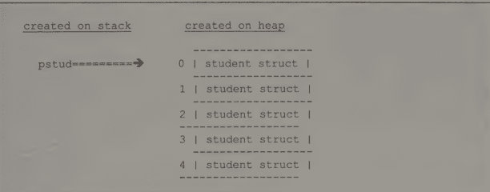

在上面的程序中，请注意，我们使用直接成员选择器（.）运算符而不是间接成员选择器（->）运算符来访问结构体的字段。这是因为这次我们不是指向结构体的指针数组，而是结构体本身包含在数组中。

我们的最后一个示例也在堆上创建了一个动态数组。然而，这次不仅在堆上创建了指针数组，而且指针所指向的 student 结构体也在堆上创建。

```c
// darray3.c

#include <stdio.h>
#include <alloc.h>

typedef struct student {
    char name[30];
    int age;
    float gpa;
} STUDENT;

void initialize(STUDENT **pstud);

int main(void) {
    int i;
    STUDENT **pstud;

    pstud = (STUDENT **) malloc(5 * sizeof(STUDENT *));
    for (i = 0; i < 5; i++) {
        pstud[i] = (STUDENT *) malloc(sizeof(struct student));
        initialize(pstud);
        for (i = 0; i < 5; i++) {
            printf("%s %d %4.2f\n", pstud[i]->name, pstud[i]->age,
                   pstud[i]->gpa);
        }
    }

    for (i = 0; i < 5; i++) {
        free(pstud[i]);
    }
    free(pstud);
    return 0;
}
```


```
created on stack       created on heap       created on heap
-----------------------------------------------------------
pstud ---------------> 0 | . . . . . . . --> [student struct]
                       1 | . . . . . . . --> [student struct]
                       2 | . . . . . . . --> [student struct]
                       3 | . . . . . . . --> [student struct]
                       4 | . . . . . . . --> [student struct]
```

# 第 19 章。线性链表

- 线性链表简介
- 线性链表的操作
- 三种列表算法
- 其他列表算法
- 线性链表示例
- 线性链表作业

## 线性链表简介

### 数组的顺序存储

数组的一大优势是，无需编写大量代码即可为大量变量分配内存。使用 while 或 for 循环，也可以简单地一次性初始化或更改它们的值。此外，我们可以通过正确的数组索引直接访问任何数组元素。

然而，使用数组的一个重大缺点是数组的大小是固定的，你可能不总是确切知道需要存储多少个项目。你可能正在从文件读取数据，不一定知道数组应该有多大才能容纳这些数据。

数组的另一个问题是，重新排列数组中的元素可能很耗时。假设数组中有 1,000 个元素，你决定要将第 1,000 个元素设为第二个元素，第二个设为第三个，第三个设为第四个，以此类推。你将不得不将所有元素向下移动一位。这效率不高。

### 链表

在顺序表示中，数组的项目由存储的顺序隐式排序。例如，如果 num[i] 表示数组的一个元素，则 num[i+1] 表示数组的下一个元素。

现在假设数据结构的项目是显式排序的。这意味着数据结构的每个元素都必须在其自身中包含数据结构下一个元素的内存地址。

请注意，在这种新表示中，我们不再能像数组那样利用项目通过其位置或地址相关联这一事实。该数据结构中的各个项目必须具有指向数据结构中其他数据项位置的显式指针。这就产生了一种新的数据结构，称为线性链表。


线性链表由一组节点（项目）组成，每个节点包含两个字段：

- 信息字段（info）– 存储列表上的实际数据元素
- 下一个地址字段（next）– 包含指向列表中下一个节点的内存地址（指针）

请注意，线性链表通常用表示节点的方框来绘制，指针被绘制为连接一个节点到另一个节点的箭头。因此，箭头表示节点之间的链接，每个节点包含一个元素的数据。

整个链表通过外部指针 `list` 访问，该指针指向（包含）列表中第一个节点的地址。请注意，外部指针不包含在节点内，但其值通过引用指针变量直接访问。

列表中最后一个节点的 `next` 地址字段包含一个特殊的指针值 `NULL`，它不是有效地址，但用于表示列表的结束。`NULL` 指针由以下符号表示：

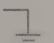

没有节点的列表称为空列表或 `NULL` 列表，如下所示。在这种情况下，外部指针 `list` 具有 `NULL` 值：


线性链表的数据元素包含在列表的 `info` 字段中，且必须为相同的数据类型（`int`、`char`、`struct` 等）。由于每个节点在其自身（在其 `next` 字段中）包含指向列表中下一个节点的指针，我们能够遍历列表并按顺序（即从第一个到最后一个）访问列表的节点。

链表是一种动态结构，可以在程序执行时改变大小。节点可以在列表的任何位置插入和删除（开头、节点之间、末尾）。只有第一个节点（由列表指针访问）是已知的。从那里，可以使用节点之间的链接从一个节点移动到另一个节点。理论上，列表长度没有上限，但实际上计算机的内存大小是限制。

下面是一个新节点插入列表中间的示例，而不会导致其他元素更改其在内存中的位置。请注意，这只需操作两个指针即可完成，不需要数据移动：

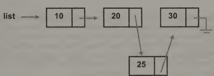

使用线性链表很有趣，因为它们易于绘制，同时提供了一种组织数据的有用方法。在某些地方，列表可能很棘手，但一幅好的图画可以很大程度上澄清这种情况。实际上，我再怎么强调这一点都不为过。在构建和理解链表代码时，绘制图画非常重要。通常，你只需要为每个节点画一个方框，并从每个节点画一个箭头指向下一个节点，以表示 `next` 指针。

## 链表与数组

请注意，上面的列表按数字顺序给出数字。你可能会想知道这与在数组中存储有序数字列表相比如何。关键区别在于，数组提供随机访问，即你可以直接通过索引号访问任何数据项。例如，这允许使用二分查找而不是较慢的顺序查找。链表仅提供对数据的顺序访问，因此只能使用顺序查找。例如，要读取链表的第 1,000,000 个元素，你必须先读取其前面的 999,999 个元素！

然而，两者之间还可以做其他比较。虽然数组方法允许使用更快的查找，但如果我们想在找到的项目后插入一个新项目，我们就麻烦了！数组中可能没有空间在此处插入新项目。相反，此位置右侧的所有项目都必须滑动到下一个数组位置。这是一个缓慢的过程，但确实为插入新项目腾出了空间。正如我们在编码链表时将更清楚地看到，将新项目插入有序链表相当容易。事实上，这只是更改几个指针的问题（如上所示）。

从有序列表中删除一个项目也只是更改一个指针的简单问题，而在有序数组中，右侧的所有数据都必须向左移动以填充删除留下的空缺。因此，再次，链表更快且更灵活。一般来说，如果你打算动态地大量插入和删除项目，链表可能是更好的方法。（链表是动态数据结构的一个示例。这意味着它可以根据需要轻松增长、收缩和变化。数组是静态数据结构。）

还可以根据两种方法使用的空间量进行另一种比较。使用数组方案时，你需要预先设置数组的大小，高估所需的空间量。然而，链表方法也浪费空间，因为它需要在每个节点中为指针预留空间。一般来说，无法说哪种方法浪费更多空间。

编写链表代码比使用数组稍微复杂一些，但对于许多应用程序，例如：

- 信息检索
- 编程语言开发
- 模拟
- 存储管理技术

使用链表而不是数组可以高效得多。


## 线性链表的操作

如果 p 是指向节点的指针：

- p = getNode()

  获取一个空节点，并将名为 p 的指针变量的内容设置为该节点的地址。这意味着 p 是指向此新分配节点的指针。


- freeNode(p)

  将 p 指向的节点返回到未用节点池，并使该节点可供重复使用。


- info(p)

  指的是 p 所指向节点的信息部分。

  x = info(p) 将 p 所指向节点的 info 字段内容赋值给 x。

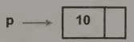

x = 10

info(p) = x 将 x 的内容赋值给 p 所指向节点的 info 字段。

```
x = 10
```

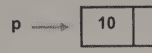

- next(p)

  指的是 p 所指向节点的下一个地址部分。

  q = next(p) 将 p 所指向节点的 next 字段内容赋值给 q。

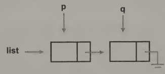

next(p) = q 将指针 q 的内容赋值给 p 所指向节点的 next 字段。

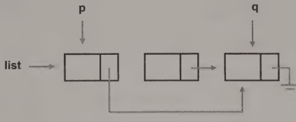

## 三个列表算法

### 算法 1：给定一个整数线性链表，创建一个算法，将数据值为 10 的节点添加到以下列表的前面：


### 步骤 1：p = getNode()

p 是指向新创建节点的指针：

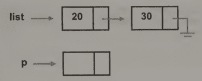

### 步骤 2：info(p) = x

将整数 x 插入到 p 指向的节点的 info 部分中：

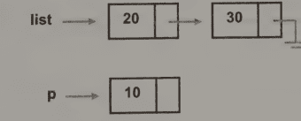

### 步骤 3：next(p) = list

我们现在希望 p 指向的节点指向 list 所指向的节点（因为 list 包含列表中第一个节点的地址）。因此，我们必须将 p 指向的节点的 next 字段设置为 list 指向的节点：

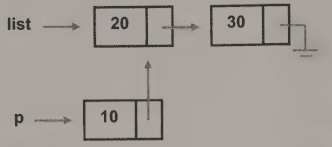

### 步骤 4：list = p

最后，由于 list 是线性链表的外部指针，其值必须修改为列表新第一个节点的地址。这将 list 的值更改为 p 的值：

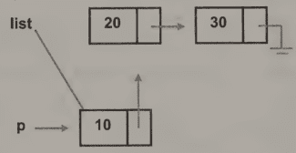

此时指针 p 不再需要，可以简单地忽略：

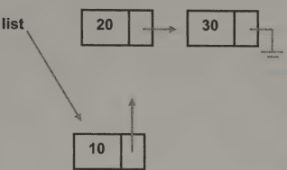

综合起来，我们有一个向线性链表前面添加节点的算法：

```
p = getNode()
info(p) = x
next(p) = list
list = p
```

让我们测试这个算法，看它是否适用于最初为空的列表：


### 步骤 1：p = getNode()


### 步骤 2：info(p) = x


### 步骤 3：next(p) = list


### 步骤 4：list = p


同样，指针 p 不再需要，可以简单地忽略：


### 算法 2：删除非空列表的第一个节点，并将其 info 字段的值存储到变量 x 中。


### 步骤 1：p = list


### 步骤 2：list = next(p)


### 步骤 3：x = info(p)


x = 10

### 步骤 4：freeNode(p)


x = 10

综合起来，我们有一个从线性链表前面删除节点的算法：

```
p = list
list = next(p)
x = info(p)
freeNode(p)
```

最后，让我们测试这个算法，看它是否适用于只有一个节点的列表：


### 步骤 1：p = list


### 步骤 2：list = next(p)


### 步骤 3：x = info(p)


x = 10

### 步骤 4：freeNode(p)


### 算法 3：给定一个整数线性链表，创建一个算法，遍历（访问）列表中的每个节点并输出每个 `info` 字段中的数据。


```
p = list
while (p != null)
    output(p.getInfo())
    p = p.getNext()
```

你能看出确保线性链表最后一个节点的 next 字段中存在 null 值的重要性吗？

## 其他列表操作

无需任何数据移动即可轻松从列表中间插入和删除元素。例如，将节点插入列表中间所需的工作量与列表大小无关。所需要的只是：

- 分配一个新节点
- 将信息插入节点
- 调整两个指针


### 算法 4：给定线性链表中节点的指针 p，编写一个名为 insertAfter 的算法，在 p 指向的节点之后插入一个节点：


- q = getNode()


- info(q) = x

x = 25


- next(q) = next(p)


- next(p) = q


请注意，项目只能插入到给定节点之后，而不能插入到节点之前。这是因为没有办法从给定节点直接到达列表中的前驱节点，而无需从头开始遍历列表。

这是上面的算法：

```
q = getNode()
info(q) = x
next(q) = next(p)
next(p) = q
```

### 算法 5：给定线性链表中节点的指针 p，编写一个名为 deleteAfter 的算法，删除 p 指向的节点之后的节点：


- q = next(p)


- x = info(q)


x = 30

- next(p) = next(q)


- freeNode(q)


同样，我们不能仅仅得到一个指向要删除节点的指针。这是因为节点前驱的 `next` 字段必须更改为指向节点的后继节点，并且没有直接方法到达给定节点的前驱节点。

这是上面的算法：

```
q = next(p)
x = info(q)
next(p) = next(q)
freeNode(q)
```

## 线性链表示例

### 示例 1

假设我们想要从线性链表中删除所有出现的数字 4。我们需要遍历列表，查找 info 字段中包含 4 的节点并删除该节点。但是，要删除一个节点，必须知道其前驱节点。因此，我们必须使用两个指针 p 和 q 来遍历列表。p 将被视为前导指针，q 将被视为滞后指针，即 p 遍历列表，q 始终指向 p 的前驱节点。请注意，在处理列表时，使用两个指针（一个跟随另一个）的做法非常常见。

将使用两个函数：

- deleteFront() 将用于从列表前面删除节点。
- deleteAfter() 将用于从列表中间删除节点。

```
// deleteNumber.c
p = list;
q = NULL;
while p != NULL
    if info(p) == 4
        p = next(p)
        if q == NULL
            x = deleteFront(list)
        else
            x = deleteAfter(q)
    else
        q = p
        p = next(p)
```

将算法的详细推演留作练习。在逐行推演算法时，请务必绘制图示。


## 示例 2

假设一个线性链表是有序的，即较小的项在较大的项之前（也就是说，列表已排序）。我们想将一个项 x 插入到这个列表的适当位置。使用了两个函数：

- `insertFront()` 将用于在列表前面插入一个节点。
- `insertAfter()` 将用于在列表中间插入一个节点。

```
insertItem.c
p = list;
q = NULL;
while p!= NULL and x > info(p)
    q = p;
    p = next(p)
If q == NULL
    insertFront(list, x)
else
    insertAfter(q, x)
```

同样，将算法的练习留给读者。请在逐行处理算法时务必画图。

## 线性链表作业

编写伪代码算法来执行以下每个操作：

- 1. 确定列表中的节点数。
- 2. 确定列表中整数的和。
- 3. 将一个节点追加到列表末尾。
- 4. 连接两个列表。
- 5. 释放列表中的所有节点。
- 6. 从列表中删除最后一个元素。
- 7. 复制一个列表。

# 第 20 章 线性链表的实现

- 在 C 中定义节点
- 线性链表操作
- 分离编译
- 线性链表代码
- 多项式相加
- 线性链表实验
- 计算非常大的阶乘实验

## 在 C 中定义节点

我们已经看到，指针允许我们构建和操作各种类型的链表。通过改变指针的值，节点可以被附加、分离和重新组装，形成随着程序执行而增长和缩小的模式。

我们可以创建这些节点的链，并跟踪列表中的第一个节点，然后在每个节点中存储一个指向列表中下一个节点的指针。为了实现这一点，每个节点将被定义为一个 `struct`，其中一个字段包含信息，另一个字段包含列表中下一个节点的地址。我们按如下方式进行声明：

```
// node1.c
struct node {
    int info;
    struct node *next;
};

typedef struct node *NODEPTR;
```

或者，我们可以将上述两个声明合并如下：

```
// node2.c
typedef struct node {
    int info;
    struct node *next;
} *NODEPTR;
```

无论哪种情况，我们都将 `NODEPTR` 声明为指向 `node struct` 的指针。请注意，`node struct` 中的 `next` 字段是一个指针，包含列表中下一个节点的地址。

我们现在可以声明一个 `NODEPTR p` 并动态创建一个新节点：

```
// node3.c
NODEPTR p;
p = (NODEPTR) malloc(sizeof(struct node));
```

我们按如下方式访问节点的 `info` 字段：

`p->info`

并且我们可以按如下方式访问节点的 `next` 字段：

`p->next`

与以前一样，我们可以使用 `free()` 函数来释放动态创建的节点：

`free(p);`

请处理以下程序，以创建一个包含五个动态创建节点的链表：

```
// dynamic.c
#include <stdio.h>
#include <stdlib.h>
typedef struct node {
    int info;
    struct node *next;
} *NODEPTR;
int main(void) {
    int i;
    NODEPTR list, p, q;
    list = (NODEPTR) malloc(sizeof(struct node));
    p = list;
    p->info = 1;
    for (i = 2; i <= 5; i++) {
        q = (NODEPTR) malloc(sizeof(struct node));
        q->info = i;
        p->next = q;
        p = q;
    }
    p->next = NULL;
    return 0;
}
```

## 线性链表操作

以下是操作整数线性链表的函数。非常重要的是，你要处理每个函数，以确保你理解它们的工作原理。请务必为链表画图，以帮助你可视化算法。如果不绘制列表的图片以及算法执行时列表的变化情况，使用链表编写代码将极其困难。

```
// returns the address of a newly created node
NODEPTR getNode(void) {
NODEPTR p;

p = (NODEPTR) malloc(sizeof(struct node));
if (p == NULL) {
error("List overflow.");
}
return(p);
}

// frees the node pointed to by p
void freeNode(NODEPTR p) {
free(p);
}

// adds a new node to the front of the list
void addFront(NODEPTR *list, int num) {
NODEPTR p;

p = getNode();
p->info = num;
p->next = *list;
*list = p;
}
```

```
// deletes the node at the front of the list
int deleteFront(NODEPTR *list) {
    int temp;
    NODEPTR p;

    if (*list == NULL) {
        error("List underflow.");
    }
    p = *list;
    temp = p->info;
    *list = p->next;
    freeNode(p);
    return temp;
}
```

```
// adds an element to the end of a list
void addLast(NODEPTR *list, int num) {
    NODEPTR p, q;

    p = getNode();
    p->info = num;
    p->next = NULL;
    if (*list == NULL) {
        *list = p;
    } else {
        q = *list;
        while (q->next) {
            q = q->next;
        }
        q->next = p;
    }
}
```

```
// deletes the last element in a list
int deleteLast(NODEPTR *list) {
    NODEPTR p, q;
    int temp = -1;

    if (*list) {
        p = *list;
        q = NULL;
        while (p->next) {
            q = p;
            p = p->next;
        }
        if (!q) {
            *list = NULL;
        }
        else {
            q->next = NULL;
        }
        temp = p->info;
        freeNode(p);
    }
    return temp;
}
```

```
// inserts a new node after the node pointed to by p
void insertAfter(NODEPTR p, int num) {
    NODEPTR q;

    if (p == NULL) {
        error("Void insertion.");
    }
    q = getNode();
    q->info = num;
    q->next = p->next;
    p->next = q;
}
```

```
// deletes the node after the node pointed to by p

int deleteAfter(NODEPTR p) {
    int temp;
    NODEPTR q;

    if (p == NULL || p->next == NULL) {
        error("Void deletion.");
    }

    q = p->next;
    temp = q->info;
    p->next = q->next;
    freeNode(q);
    return temp;
}
```

```
// insert a node into its correct location within a sorted list

void Insert(NODEPTR *list, int num) {
    NODEPTR p, q;

    p = *list;
    q = NULL;

    while (p != NULL && p->info < num) {
        q = p;
        p = p->next;
    }

    if (q == NULL) {
        addFront(list, num);
    } else {
        insertAfter(q, num);
    }
}
```

```
// returns the number of nodes in the list

int numElements(NODEPTR list) {
    int count=0;

    while (list) {
        count++;
        list = list->next;
    }

    return count;
}
```

```
// returns sum of integers in the list
int sumElements(NODEPTR list) {
    int sum=0;
    while (list) {
        sum += list->info;
        list = list->next;
    }
    return sum;
}

// traverses a list and outputs contents of list
void outputList(NODEPTR list) {
    while (list) {
        printf("%d", list->info);
        list = list->next;
    }
    printf("\n");
}

// Returns true if the item is found in the list
int contains(NODEPTR list, int num) {
    NODEPTR p;
    p = list;
    while (p != NULL && p->info != num) {
        p = p->next;
    }
    return p != NULL;
}

// determines whether or not a list is empty
int isEmpty(NODEPTR list) {
    return list == NULL;
}
```

```
// frees all the nodes in a list
void freeList(NODEPTR *list) {
    NODEPTR p;
    while (*list) {
        p = *list;
        *list = p->next;
        freeNode(p);
    }
}
```

```
// returns a pointer to the node with the requested value;
// otherwise returns NULL
NODEPTR select(NODEPTR list, int num) {
    while (list) {
        if (list->info == num) {
            return list;
        }
        else {
            list = list->next;
        }
    }
    return list;
}
```

```
// removes the first occurrence of an item in a list
int remove(NODEPTR *list, int num) {
    NODEPTR p, q;
    p = *list;
    q = NULL;
    while (p != NULL && p->info != num) {
        q = p;
        p = p->next;
    }
    if (p == NULL) {
        return -1;
    }
    else {
        return q == NULL ? deleteFront(list) : deleteAfter(q);
    }
}


```
// makes a copy of a list
NODEPTR copyList ( NODEPTR list ) {
    NODEPTR newlist, p, q;
    newlist = NULL;
    while ( list ) {
        p = getNode();
        p->info = list->info;
        p->next = NULL;
        if ( newlist == NULL ) {
            newlist = p;
        }
        else {
            q->next = p;
        }
        q = p;
        list = list->next;
    }
    return newlist;
}

// concatenates two lists
void concatList(NODEPTR *list1, NODEPTR list2) {
    NODEPTR p;
    if (*list1 == NULL) {
        *list1 = list2;
    }
    else if (list2) {
        p = *list1;
        while (p->next) {
            p = p->next;
        }
        p->next = list2;
    }
}
```

```
// returns a pointer to a new list containing the intersection of
// two lists
NODEPTR intersect(NODEPTR list1, NODEPTR list2) {
    NODEPTR p, q, r, s, newlist;
    int found;

    p = list1;
    newlist = NULL;
    r = NULL;
    while (p) {
        q = list2;
        found = 0;
        while (q && !found) {
            if (p->info == q->info) {
                found = 1;
            }
            else {
                q = q->next;
            }
        }
        if (found) {
            s = getNode();
            s->info = p->info;
            s->next = NULL;
            if (!r) {
                newlist = s;
            }
            else {
                r->next = s;
            }
            r = s;
        }
        p = p->next;
    }
    return newlist;
}

// display an error message and aborts the program
void error(char *msg) {
    puts(msg);
    exit(1);
}
```

## 分离编译

C 并不要求特定程序的所有语句都包含在单个文件中。C 程序可以由分别编写的函数构建，并链接成一个程序。截至目前，每个项目的所有 C 源代码都放在单个 .c 文件中。但现在，随着我们的程序变得越来越长，我们需要找到一种更高效的方式来组织代码。

我们可以编译一个源文件以创建“目标代码”，并将其函数与其他源文件中的其他函数链接。如果一个文件中的函数需要调用另一个文件中包含的函数，则可以以正常方式进行函数调用，并以通常方式传递和返回参数。在修订和调试程序时，如果每次编译只处理大程序的一部分，会更容易。一旦我们编写并调试了一个函数，在处理程序中的其他函数时，就不需要不断重新编译它了。

考虑以下两个 C 源文件：

| 文件 1 | 文件 2 |
| :--- | :--- |
| `int main(void) {` | `void faa(void) {` |
| ` foo();` | ` puts("Green");` |
| ` faa();` | ` }` |
| `}` | |
| `void foo(void) {` | |
| ` puts("Red");` | |
| `}` | |

C 编译器在文件 1 中找到两个函数调用。当在同一文件中找到 foo() 的定义时，对 foo() 的引用即被解析。当在文件 2 中找到 faa() 的定义时，对 faa() 的引用即被解析。指定给 C 编译器的所有目标文件都将被“拉入” C 编译器，并自动包含在最终可执行文件中。

在我们的链表声明和函数的情况下，我们创建两个文件，list.h 和 list.c。.h 文件称为头文件，通常包含声明以及函数原型。以下是我们线性链表的头文件示例：

```
// list.h

#ifndef LIST_H
#define __LIST_H

typedef struct node {
    int info;
    struct node *next;
} *NODEPTR;

NODEPTR getNode(void);
void freeNode(NODEPTR p);
void addFront(NODEPTR *list, int num);
int deleteFront(NODEPTR *list);
void addLast(NODEPTR *list, int num);
int deleteLast(NODEPTR *list);
void insertAfter(NODEPTR *list);
int insertAfter(NODEPTR p, int num);
void deleteAfter(NODEPTR p);
void insert(NODEPTR *list, int num);
int numElements(NODEPTR list);
int sumElements(NODEPTR list);
void outputList(NODEPTR list);
int contains(NODEPTR list, int num);
int isEmpty(NODEPTR list);
void freeList(NODEPTR *list);
NODEPTR select(NODEPTR list, int num);
int remove(NODEPTR *list, int num);
NODEPTR copyList(NODEPTR list);
void concatList(NODEPTR *list1, NODEPTR list2);
NODEPTR intersect(NODEPTR list1, NODEPTR list2);
void error(char *msg);

#endif
```

请注意头文件中 NODEPTR 结构体定义和函数原型的位置。为了防止编译器多次查看此头文件，我们使用预处理器条件编译命令，告诉编译器仅将此代码引入项目一次：

```
#ifndef LIST_H
#define __LIST_H

...

#endif
```

线性链表 .c 文件中的包含语句如下：

```
// list.c
#include <stdio.h>
#include <stdlib.h>
#include "list.h"
```

请注意该语句：

```
#include "list.h"
```

这指示编译器读取 list.h 头文件中的语句。此时，您应该能够将 list.c 文件与程序的其余部分分别编译。因此，当您准备在程序中使用链表代码时，您将在项目中创建一个新的源代码文件并包含链表函数的头文件：

```
#include "list.h"
```

您还需要通过将源代码文件添加到项目中的其他源代码文件中，来引入链表的 list.c 源代码。

## 线性链表代码

```
// list.h

#ifndef _LIST_H
#define _LIST_H

typedef struct node {
    int info;
    struct node *next;
} *NODEPTR;

NODEPTR getNode(void);
void freeNode(NODEPTR p);
void addFront(NODEPTR *list, int num);
int deleteFront(NODEPTR *list);
void addLast(NODEPTR *list, int num);
int deleteLast(NODEPTR *list);
void insertAfter(NODEPTR p, int num);
void deleteAfter(NODEPTR p);
void insert(NODEPTR *list, int num);
int numElements(NODEPTR list);
int sumElements(NODEPTR list);
void outputList(NODEPTR list);
int contains(NODEPTR list, int num);
int isEmpty(NODEPTR list);
void freeList(NODEPTR *list);
NODEPTR select(NODEPTR list, int num);
int remove(NODEPTR *list, int num);
NODEPTR copyList(NODEPTR list);
void concatList(NODEPTR *list1, NODEPTR list2);
void intersect(NODEPTR list1, NODEPTR list2);
void error(char *msg);

#endif
```

```c
// list.c
#include <stdio.h>
#include <stdlib.h>
#include "list.h"

// returns the address of a newly created node
NODEPTR getNode(void) {
    NODEPTR p;
    p = (NODEPTR) malloc(sizeof(struct node));
    if (p == NULL) {
        error("List overflow.");
    }
    return(p);
}

// frees the node pointed to by p
void freeNode(NODEPTR p) {
    free(p);
}

// adds a new node to the front of the list
void addFront(NODEPTR *list, int num) {
    p = getNode();
    p->info = num;
    p->next = *list;
    *list = p;
}
```

```
// deletes the node at the front of the list
int deleteFront(NODEPTR *list) {
    int temp;
    NODEPTR p;

    if (*list == NULL) {
        error("List underflow.");
    }
    p = *list;
    temp = p->info;
    *list = p->next;
    freeNode(p);
    return temp;
}
```

```
// adds an element to the end of a list
void addLast(NODEPTR *list, int num) {
    NODEPTR p, q;

    p = getNode();
    p->info = num;
    p->next = NULL;
    if (*list == NULL) {
        *list = p;
    } else {
        q = *list;
        while (q->next) {
            q = q->next;
        }
        q->next = p;
    }
}
```

```
// deletes the last element in a list
int deleteLast(NODEPTR *list) {
    NODEPTR p, q;
    int temp = -1;
    if (*list) {
        p = *list;
        q = NULL;
        while (p->next) {
            q = p;
            p = p->next;
        }
        if (!q) {
            *list = NULL;
        } else {
            q->next = NULL;
        }
        temp = p->info;
        freeNode(p);
    }
    return temp;
}
```

```
// inserts a new node after the node pointed to by p
void insertAfter(NODEPTR p, int num) {
    NODEPTR q;
    if (p == NULL) {
        error("Void insertion.");
    }
    q = getNode();
    q->info = num;
    q->next = p->next;
    p->next = q;
}
```


```c
// deletes the node after the node pointed to by p
int deleteAfter(NODEPTR p) {
    int temp;
    NODEPTR q;

    if (p == NULL || p->next == NULL) {
        error("Void deletion.");
    }

    q = p->next;
    temp = q->info;
    p->next = q->next;
    freeNode(q);
    return temp;
}
```

```c
// insert a node into its correct location within a sorted list
void insert(NODEPTR *list, int num) {
    NODEPTR p, q;

    p = *list;
    q = NULL;
    while (p != NULL && p->info < num) {
        q = p;
        p = p->next;
    }

    if (q == NULL) {
        addFront(list, num);
    }
    else {
        insertAfter(q, num);
    }
}
```

```c
// returns the number of nodes in the list
int numElements(NODEPTR list) {
    int count=0;

    while (list) {
        count++;
        list = list->next;
    }
    return count;
}
```

```c
// returns sum of integers in the list
int sumElements(NODEPTR list) {
    int sum=0;
    while (list) {
        sum += list->info;
        list = list->next;
    }
    return sum;
}

// traverses a list and outputs contents of list
void outputList(NODEPTR list) {
    while (list) {
        printf("%3d", list->info);
        list = list->next;
    }
    printf("\n\n");
}

// Returns true if the item is found in the list
int contains(NODEPTR list, int num) {
    NODEPTR p;
    p = list;
    while (p != NULL && p->info != num) {
        p = p->next;
    }
    return p != NULL;
}

// determines whether or not a list is empty
int isEmpty(NODEPTR list) {
    return list == NULL;
}
```

```c
// frees all the nodes in a list
void freeList(NODEPTR *list) {
    NODEPTR p;
    while (*list) {
        p = *list;
        *list = p->next;
        freeNode(p);
    }
}
```

```c
// returns a pointer to the node with the requested value;
// otherwise returns NULL
NODEPTR select(NODEPTR list, int num) {
    while (list) {
        if (list->info == num) {
            return list;
        } else {
            list = list->next;
        }
    }
    return list;
}
```

```c
// removes the first occurrence of an item in a list
int remove(NODEPTR *list, int num) {
    NODEPTR p, q;
    p = *list;
    q = NULL;
    while (p != NULL && p->info != num) {
        q = p;
        p = p->next;
    }
    if (p == NULL) {
        return -1;
    } else {
        return q == NULL ? deleteFront(list) : deleteAfter(q);
    }
}
```

```c
// makes a copy of a list
NODEPTR copyList (NODEPTR list) {
    NODEPTR newlist, p, q;

    newlist = NULL;
    while (list) {
        p = getNode();
        p->info = list->info;
        p->next = NULL;
        if (newlist == NULL) {
            newlist = p;
        }
        else {
            q->next = p;
        }
        q = p;
        list = list->next;
    }
    return newlist;
}
```

```c
// concatenates two lists
void concatList(NODEPTR *list1, NODEPTR list2) {
    NODEPTR p;

    if (*list1 == NULL) {
        *list1 = list2;
    }
    else if (list2) {
        p = *list1;
        while (p->next) {
            p = p->next;
        }
        p->next = list2;
    }
}
```

```c
// returns a pointer to a new list containing the intersection of
// two lists

NODEPTR intersect(NODEPTR list1, NODEPTR list2) {
    NODEPTR p, q, r, s, newlist;
    int found;

    p = list1;
    newlist = NULL;
    r = NULL;
    while (p) {
        q = list2;
        found = 0;
        while (q && !found) {
            if (p->info == q->info) {
                found = 1;
            }
            else {
                q = q->next;
            }
        }
        if (found) {
            s = getNode();
            s->info = p->info;
            s->next = newlist;
            if (!r) {
                newlist = s;
            }
            else {
                r->next = s;
            }
            r = s;
        }
        p = p->next;
    }
    return newlist;
}
```

```c
// display an error message and aborts the program

void error(char *msg) {
    puts(msg);
    exit(1);
}
```

## 多项式加法

为了找到一元多项式的合适表示，我们必须区分多项式每一项中的系数和指数。下面展示了作为线性链表节点表示的多项式的一项。

| 系数 | 指数 | 指向下一项的链接 |
|---|---|---|

例如：

3X² 将表示为：


X⁴ 将表示为：


5 将表示为：


3X⁶ - 2X³ + 4 将表示为：


### 多项式表示

请注意将多项式表示为线性链表的以下三个前提条件：

- 多项式项必须在线性链表中按指数递减顺序存储。
- 不能有两个项具有相同的指数。
- 不能有任何项的系数为零。

线性链表的每个节点将表示多项式的一项，是一个包含以下信息的结构体：

- 系数
- 指数
- 指向多项式下一项的指针

```c
typedef struct poly {
   float coeff;
   int expo;
   struct poly *next;
} *POLYPTR;
```

### 相加两个多项式

要将两个多项式相加，我们只需各扫描一次：

- 如果在两个多项式中找到指数相同的项，则相加系数并将新项复制到和多项式的末尾；否则，将指数较大的项复制到和多项式中并继续。
- 当到达其中一个多项式的末尾时，将另一个多项式的剩余部分复制到和多项式中。

我们必须小心不要在和中包含系数为 0 的项。例如：

6X^5 + 2X^4 + 3X^3 + 2X
+
3X^5 - 2X^4 - 5X^2 - 8X + 7
9X^5       + 3X^3 - 5X^2 - 6X + 7

```c
// poly.c

#include <stdio.h>

typedef struct poly {
    float coeff;
    int expo;
    struct poly *next;
} *POLYPTR;

POLYPTR sum(POLYPTR p, POLYPTR q) {
    float coeff;
    POLYPTR add = NULL;

    while (p != NULL && q != NULL) {
        if (p->expo == q->expo) {
            coeff = p->coeff + q->coeff;
            if (coeff) {
                makeTerm(add, coeff, p->expo);
                p = p->next;
                q = q->next;
            }
        } else if (p->expo > q->expo) {
            makeTerm(add, p->coeff, p->expo);
            p = p->next;
        } else {
            makeTerm(add, q->coeff, q->expo);
            q = q->next;
        }
    }

    while (p) {
        makeTerm(add, p->coeff, p->expo);
        p = p->next;
    }

    while (q) {
        makeTerm(add, q->coeff, q->expo);
        q = q->next;
    }

    return add;
}
```

在算法的多个位置，我们必须使用给定的系数和指数创建一个新项，并将其放在和多项式的末尾，即位于 `last` 指向的项之后。请注意，指针 `add` 将始终指向创建的第一个项，而指针 `last` 将始终指向和多项式的最后一个项。

```c
void makeTerm(POLYPTR *add, float coeff, int expo) {
    POLYPTR t;
    POLYPTR last = NULL;

    t = (POLYPTR) malloc(sizeof(struct poly));
    t->coeff = coeff;
    t->expo = expo;
    t->next = NULL;
    if (*last == NULL) {
        *add = t;
    } else {
        last->next = t;
    }
    last = t;
}
```

多项式的其他操作可以编程为与我们的加法函数性质相同的函数。作为额外学分，看看你能否完成以下任务：

- 编写一个方法，输入一系列系数和指数，并将它们形成如前所述的链式多项式。
- 编写一个函数，用于相减两个多项式。
- 编写一个函数，用于计算多项式的一阶、二阶和三阶导数。
- 编写一个函数，用于将多项式乘以一个标量。
- 编写一个函数，给定一个多项式和一个整数，在该整数处求解多项式的值。
- 编写一个函数，将多项式作为系数和指数序列打印出来，排列得美观。


## 线性链表实验

本实验与数据库实验性质相似，将重点放在使用动态存储分配操作线性链表上。作业的每个部分都应结构化在其自身的函数中，根据需要传递参数。

你需要构建一个C程序，dbase.c，使用动态变量，以检索和操作公司的工资数据库，payfile2.txt。每个员工的数据应读入包含以下字段的结构体中：

- firstName - 最多10个字符
- lastName - 最多15个字符
- gender - 最多1个字符 (M/F)
- tenure - 1个整数，表示受雇年限
- rate - h/w
- salary - 浮点数

你的程序应执行下面指示的每个操作。请务必为每个部分清晰地标记输出。

- a) 从payfile2.txt读取数据到每个员工的节点结构体中，并将节点插入线性链表的末尾。下面是一个fscanf_s()语句，可帮助你从输入文件读取数据：

```c
fscanf_s(fp, "%s %s %c %d %c %f\n",
p->firstName, sizeof(firstName),
p->lastName, sizeof(lastName),
& (p->gender), 1,
& (p->tenure),
& (p->rate), 1,
& (p->salary));
```

- b) 将链表中每个节点的内容以易于阅读的格式输出，格式类似于输入文件。

- c) 遍历列表并输出数据库中的员工数量。

- d) 输出工资单上所有女性的名和姓。

- e) 输出所有年收入超过35,000美元且在公司工作至少五年的周薪员工的名、姓和薪水。

- f) 给所有按小时计薪且每小时收入低于10.00美元的员工每小时加薪0.75美元；给所有按周计薪且每周收入低于350.00美元的员工每周加薪50.00美元。输出每位获得加薪的员工的名、姓和新薪水。

- g) 按姓氏字母顺序对列表中的节点进行排序，并输出每个员工的名、姓和薪水。

- h) 文件hirefile2.txt包含公司将雇佣的三名员工的数据。将每位新员工的记录插入线性链表中的正确位置，并输出数据库中每个员工的名、姓和薪水。

- i) 文件firefile2.txt包含公司将解雇的两名员工的数据。删除每位待解雇员工的对应节点，并输出数据库中每个员工的名、姓和薪水。

请注意，以前我们只研究过节点包含int的线性链表，而现在我们研究的是节点包含结构体的线性链表。因此，我重写了实验说明末尾显示的线性链表源代码（list.h和list.c），以使我们的列表能够处理每个节点信息字段中的员工结构体，而不仅仅是int。

list.h头文件包含员工结构体的声明以及函数原型。list.c文件包含我为本实验重写的用于员工结构体的列表函数。

以下是list.h中出现的结构体声明：

```c
typedef struct node {
    char    firstName[11];
    char    lastName[16];
    char    gender;
    int     tenure;
    char    rate;
    float   salary;
    struct node *next;
} *NODEPTR;
```

以下是一个对链表进行排序的简单算法。假设list指向一个未排序的列表，sortList指向NULL。

```
while list != null
    remove first node from list
    insert node into correct location into sortList
list = sortList
```

以下是本实验数据文件的样子：

### Payfile2.txt

| 名 | 姓 | 性别 | 任期 | 薪率 | 薪水 |
|-----------|----------|--------|--------|------|--------|
| Debbie | Starr | F | 3 | W | 1000.00 |
| Joan | Jacobus | F | 9 | W | 925.00 |
| David | Renn | M | 3 | H | 4.75 |
| Albert | Cahana | M | 3 | H | 18.75 |
| Douglas | Sheer | M | 5 | W | 250.00 |
| Shari | Buchman | F | 9 | W | 325.00 |
| Sara | Jones | F | 1 | H | 7.50 |
| Ricky | Mofsen | M | 6 | H | 12.50 |
| Jean | Brennan | F | 6 | H | 5.40 |
| Jamie | Michaels | F | 8 | W | 150.00 |

### Hirefile2.txt

| 名 | 姓 | 性别 | 任期 | 薪率 | 薪水 |
|-----------|----------|--------|--------|------|--------|
| Barry | Allen | M | 0 | H | 6.75 |
| Nina | Pinella | F | 0 | W | 425.00 |
| Lane | Wagger | M | 0 | W | 725.00 |

### Firefile2.txt

| 名 | 姓 | 性别 |
|-----------|----------|--------|
| Jean | Brennan | F |
| Ricky | Mofsen | M |

以下是用于存储员工结构体的线性链表实现的list.h和list.c文件。

### list.h

```c
#ifndef _LIST_H
#define _LIST_H

typedef struct node {
    char firstName[11];
    char lastName[16];
    char gender;
    int tenure;
    char rate;
    float salary;
    struct node *next;
} *NODEPTR;

NODEPTR getNode(void);
void freeNode(NODEPTR p);
void addNodeFront(NODEPTR *list, NODEPTR t);
NODEPTR removeNodeFront(NODEPTR *list);
void addNodeLast(NODEPTR *list, NODEPTR t);
NODEPTR deleteNodeLast(NODEPTR *list);
void insertNode(NODEPTR *list, NODEPTR t);
void insertNodeAfter(NODEPTR p, NODEPTR t);
NODEPTR removeNode(NODEPTR *list, NODEPTR t);
NODEPTR deleteNodeAfter(NODEPTR *list, NODEPTR p);
int numElements(NODEPTR *list);
void freeList(NODEPTR *list);
void error(char *msg);

#endif
```

### list.c

```c
#include <stdio.h>
#include <stdlib.h>
#include <string.h>
#include "list.h"

// returns the address of a newly created node
NODEPTR getNode( void ) {
    NODEPTR p;

    p = (NODEPTR) malloc(sizeof(struct node));
    if (p == NULL) {
        error("List overflow.");
    }
    return p;
}

// frees the node pointed to by p
void freeNode(NODEPTR p) {
    free(p);
}

// adds a node to the front of the list
void addNodeFront(NODEPTR *list, NODEPTR t) {
    t->next = *list;
    *list = t;
}

// removes a node from the front of the list
NODEPTR removeNodeFront(NODEPTR *list) {
    NODEPTR p;

    if (*list == NULL) {
        error("List underflow.");
    }
    p = *list;
    *list = p->next;
    return p;
}

// adds a node to the end of a list
void addNodeLast(NODEPTR *list, NODEPTR t) {
    NODEPTR p;

    if (*list == NULL) {
        *list = t;
    }
    else {
        p = *list;
        while (p->next) {
            p = p->next;
        }
        p->next = t;
    }
}

// deletes the node at the end of a list
NODEPTR deleteNodeLast(NODEPTR *list) {
    NODEPTR p = NULL, q;

    if (*list) {
        p = *list;
        q = NULL;
        while (p->next) {
            q = p;
            p = p->next;
        }
        if (!q) {
            *list = NULL;
        }
        else {
            q->next = NULL;
        }
    }
    return p;
}

// insert a node into its correct location within the sorted list
void insertNode(NODEPTR *list, NODEPTR t) {
    NODEPTR p, q;

    p = *list;
    q = NULL;
    while (p != NULL && strcmp(p->lastName, t->lastName) < 0) {
        q = p;
        p = p->next;
    }
    if (q == NULL) {
        addNodeFront(list, t);
    } else {
        insertNodeAfter(q, t);
    }
}

// inserts a node after the node pointed to by p
void insertNodeAfter(NODEPTR p, NODEPTR t) {
    if (p == NULL || t == NULL) {
        error("Void insertion.");
    }
    t->next = p->next;
    p->next = t;
}

// removes a node from a list
NODEPTR removeNode(NODEPTR *list, NODEPTR t) {
    NODEPTR p, q;

    p = *list;
    q = NULL;
    while (p != NULL && strcmp(p->firstName, t->firstName)
        && strcmp(p->lastName, t->lastName)) {
        q = p;
        p = p->next;
    }
    return q == NULL ? removeNodeFront(list) : deleteNodeAfter(list, q);
}

// deletes the node after the node pointed to by p
NODEPTR deleteNodeAfter(NODEPTR *list, NODEPTR p) {
    NODEPTR q;

    if (p == NULL || p->next == NULL) {
        error("Void deletion.");
    }
    q = p->next;
    p->next = q->next;
    return q;
}

// returns the number of nodes in the list
int numElements(NODEPTR list) {
    int count=0;

    while (list) {
        count++;
        list = list->next;
    }
    return count;
}

// frees all the nodes in a list
void freeList(NODEPTR *list) {
    NODEPTR p;

    while (*list) {
        p = *list;
        *list = p->next;
        freeNode(p);
    }
}

// display an error message and aborts the program
void error(char *msg) {
    puts(msg);
    exit(1);
}
```

你的程序输出应发送到终端窗口（你的屏幕）以及请求的`csis.txt`输出文件。请务必阅读关于捕获程序输出的文档。你的全名必须作为注释出现在包含`main()`的源文件中。请务必将`csis.txt`输出文件包含在你的zip存档中。


## 计算非常大的阶乘实验

本次作业将重点关注线性链表的操作。你需要编写一个C程序，向用户询问一个整数n，并返回该整数的阶乘n!的精确值。n的大小限制可以相当大（最高可达9,999），生成的阶乘将包含数百到数千位数字。不用说，我们的方法将绕过编程语言中整数和长整型固有的表示限制。

### n!的存储

阶乘将存储在线性链表中，每个节点包含两个字段。第一个字段info将存储一个0到999之间的整数。第二个字段next存储对线性链表中下一个节点的引用。为了确保正确理解这种存储方案的本质，下面展示了10!和15!的表示：

```
10! = 3,628,800

| 3 |====>| 628 |====>| 800 |====>X

15! = 1,307,674,368,000

| 1 |====>| 307 |====>| 674 |====>| 368 |====>| 000 |====>X
```

请注意，通过每个节点仅存储三位数字，输出中逗号的放置可以轻松实现，只需在从一个节点移动到下一个节点时作为另一个操作即可。

### 乘法

假设要将15!的值乘以6。存储在链表中的15!的值是被乘数。作为普通标量存储的6是乘数。被乘数始终存储在链表中，乘数始终是0到9之间的数字。该操作由一系列单独的乘法组成，其中节点info字段中的数字乘以固定乘数。单独乘法的数量与存储被乘数的链表中的节点数量相同。

单独乘法序列产生一系列单独的乘积，这些乘积需要合成为完整被乘数乘以乘数的实际乘积。请注意，实际乘积将存储在另一个形式与被乘数相同的链表中。这是通过将每个单独乘积的千位数字视为“进位”来实现的，该进位被加到紧邻左侧节点的单独乘积的个位数字上。这或许通过一个具体示例可以更清楚地看到。下面展示了15!乘以6的乘法图示：

```
15! = 1,307,674,368,000
| 1 |====>| 307 |====>| 674 |====>| 368 |====>| 000 |====>X
======= ======= ======= ======= =======

  1         307         674         368         000
  * 6       * 6         * 6         * 6         * 6
  ---       ---         ---         ---         ---
  6         1842        4044        2208        01000

  + 1         + 4         + 2         + 0
01007       1846        4046        2208

15! * 6 = 7,846,046,208,000
======= ======= ======= ======= =======
| 7 |====>| 846 |====>| 046 |====>| 208 |====>| 000 |====>X
======= ======= ======= ======= =======
```

在实施这种乘法方案时需要应对的一个复杂之处是，单独乘法必须从被乘数的右端开始，而被乘数存储在列表的尾部。事实上，需要按逆序遍历列表中的节点。处理此问题有几种方法。一种是将被乘数的列表设为双向链表，以便从尾到头遍历与从头到尾遍历一样容易。另一种方法是按需要处理的顺序（而不是反映常规表示的顺序）从前到后在节点中存储3位数字：

```
15! = 1,307,674,368,000

| 000 |====>| 368 |====>| 674 |====>| 307 |====>| 001 |====>X
```

进一步的复杂之处在于扩展乘法方案，使其能够处理类似15!乘以16的乘法，即阶乘乘以两位或更多位数字的乘法。这种扩展直接类似于小学教授的笔算乘法，其中乘数中的数字逐一处理。正如乘数中的每个连续数字（即个位数字、十位数字、百位数字）都需要再次将被乘数乘以一个数字（0到9之间的数）并生成另一条“中间乘积行”，当前乘法方案的扩展也是如此。

在实现15!乘以16的乘法时，首先将15!乘以6并将结果存储在新链表中。然后，将15!乘以1（乘数十位上的数字），并将此结果存储在其自己的新链表中。接下来，将存储15!乘以1的乘积的链表中的数字向左移动一位，实现乘以十，将15! * 1的乘积转换为15! * 10的乘积。最后，将两个“辅助列表”中的对应数字相加以得到最终结果。例如：

```
15! * 16 = 1307674368000
    * 16
    7846046208000
    13076743668000
    20922789888000

[001|====>|307|====>|674|====>|368|====>|000|====>X          15!
                      * 16        * 16

[007|====>|846|====>|046|====>|208|====>|000|====>X          15! * 6

[001|====>|307|====>|674|====>|368|====>|000|====>X          15! * 1

[013|====>|076|====>|743|====>|680|====>|000|====>X          15! * 10 (shifted)

[007|====>|846|====>|046|====>|208|====>|000|====>X          15! * 6 (recopied)

+

[013|====>|076|====>|743|====>|680|====>|000|====>X          15! * 10 (recopied)

0020 01922 01789 01888 01000     (sum before carry out)
+ 0 + 0 + 0 + 0

[020|====>|922|====>|789|====>|888|====>|000|====>X          sum
```

虽然15!乘以16的示例碰巧没有显示这一点，但在将“辅助列表”中的中间乘积相加以得到最终结果时，必须考虑节点间的进位。

由于程序需要支持阶乘被乘数（例如567!）乘以三位数字（例如568）或四位数字，上述理念需要加强，以容纳最多三个或四个中间乘积，存储在三个或四个“辅助列表”中。

### 一般计算策略

假设用户希望计算15!。15!将以最直接的方式推导，从一个阶乘开始构建。一个作为1“硬编码”到程序中的阶乘将用作计算2!的基础。2!将用作计算3!的基础。这将持续到14!，并将用作推导15!的基础。

### 规格说明

程序将向用户询问一个整数n，并返回该整数阶乘n!的精确值。虽然程序能够处理的n的大小没有逻辑限制的理由，但你的程序应能够处理至少高达9,999!的数字。

由于n!可能是一个数百或数千位长的整数，其显示将跨越多行。发生这种情况时，请打印n!，使最高有效数字位于顶行左端，个位数字位于数字最低行的右端。你应在每三位数字后打印一个逗号（即，在百位数字和千位数字之间，在第三个千位数字和百万位数字之间，等等）。在逗号应出现的位置换行，并将逗号放在被换行的行上数字的右侧。这表示数字在下一行继续。具体来说，每行打印不超过45位数字。你的程序还应对以下内容输出统计信息：

- 每个阶乘的位数
- 程序计算n!所花费的时间（毫秒）


你的程序应在以下数据上运行并产生输出：

```
10, 98, 234, 567, 999, 5432, 9999
```

请注意，本实验与阶乘和数字乘法无关。也就是说，我并非在寻找计算阶乘的更简洁或更高效的方法。本实验的目标是使用动态存储分配来操作线性链表！你需要实现指定的算法。

程序的输出应同时发送到终端窗口（你的屏幕）以及请求的 `csis.txt` 输出文件。请务必阅读关于捕获程序输出的文档。你的全名必须作为注释出现在包含 `main()` 的源文件中。请务必将 `csis.txt` 输出文件包含在你的 zip 压缩包中。

# 第 21 章。位运算符

- 位运算符简介
- 按位与
- 掩码
- WordStar
- 按位或
- 按位异或
- 按位取反
- 左移运算符
- 右移运算符
- 旋转示例
- 提取位字段
- 位运算符作业
- 位运算符实验

## 位运算符简介

C 提供了一系列专门用于对单个位进行操作的运算符：

| `&` | 按位与 |
| `` `|` `` | 按位或 |
| `^` | 按位异或 |
| `~` | 按位取反（反码） |
| `<<` | 左移 |
| `>>` | 右移 |

除了按位取反运算符外，所有位运算符都是二元运算符，因此需要两个操作数。位操作可以在 C 中的任何整数类型值上执行，例如：

```
int             unsigned int
short           unsigned short
long            unsigned long
char            unsigned char
```

但不能在：

```
float
double
long double
```

位运算符会并行地应用于每个操作数内的各个位位置。这与逻辑运算符不同，逻辑运算符将每个操作数视为单个零（假）或非零（真）值。

### 按位与

与逻辑 AND 运算符（`&&`）类似，按位与运算符（`&`）仅在两个操作数都为真（即具有非零值）时才产生真值。

| b1 | b2 | b1 & b2 |
|---|---|---|
| 0 | 0 | 0 |
| 0 | 1 | 0 |
| 1 | 0 | 0 |
| 1 | 1 | 1 |

假设一个 16 位整数：

```
// and1.c

#include <stdio.h>

int main(void) {
    int x = 0x2719;   // 0010 0111 0001 1001
    int y = 0x35CD;   // 0011 0101 1100 1101
    int z;

    z = x & y;        // 0010 0101 0000 1001
    printf("z = 0x%x\n", z);
    return 0;
}
```

该程序的输出为：

```
z = 0x2509
```

请注意，每个 `int` 变量中对应的位都会进行按位与运算。

以下是另一个示例：

```
// and2.c

#include <stdio.h>

int main(void) {
    int x = 0x1234;    // 0001 0010 0011 0100
    int y = 0x3468;    // 0011 0100 0110 1000
    int z = 0x5248;    // 0101 0010 0100 1000

    printf("0x%x\n", x & x);
    printf("0x%x\n", x & y);
    printf("0x%x\n", x & y & z);
    printf("0x%x\n", x & 1);
    return 0;
}
```

在第一个 printf() 语句中，任何数与自身进行按位与运算都会返回其自身作为值：

```
x = 0x1234 = 0001 0010 0011 0100
x = 0x1234 = 0001 0010 0011 0100
---------------------------------
0001 0010 0011 0100 = 0x1234
```

在第二个 printf() 语句中，变量 x 和 y 进行按位与运算，结果如下：

```
x = 0x1234 = 0001 0010 0011 0100
y = 0x3468 = 0011 0100 0110 1000
---------------------------------
0001 0000 0010 0000 = 0x1020
```

在第三个 printf() 语句中，所有三个变量 x、y 和 z 进行按位与运算，结果如下：

```
x = 0x1234 = 0001 0010 0011 0100
y = 0x3468 = 0011 0100 0110 1000
z = 0x5248 = 0101 0010 0100 1000
---------------------------------
0001 0000 0000 0000 = 0x1000
```

第四个 printf() 语句的作用是提取 x 的最右位，即 0 或 1。

```
x = 0x1234 = 0001 0010 0011 0100
0x0001 = 0000 0000 0000 0001
                    0000 0000 0000 0000 = 0x0
```

请注意，这是一个判断 x 是奇数还是偶数的好方法：

```
printf("%s", x & 1 ? "Odd" : "Even");
```

请牢记按位与运算符（&）与逻辑与运算符（&&）之间的区别：

```
// and3.c
#include <stdio.h>
int main(void) {
    int x = 1;
    int y = 2;
    printf("bitwise = %d   logical = %d\n", x & y, x && y);
    return 0;
}
```

输出如下所示：

```
bitwise = 0   logical = 1
```

### 掩码

按位与运算常用于掩码操作。*掩码* 是一个常量或变量，用于提取变量或表达式中所需的位。掩码可用于将数据项中的特定位设置为 0。在下面的示例中，我们将保留 x 的最右两位，并将所有其他位清零（掩码）：

```
// mask1.c

#include <stdio.h>

int main(void) {
    int x = 0x0679;    // 0000 0110 0111 1001
    int mask = 0x0003; // 0000 0000 0000 0011

    x = x & mask;      // 0000 0000 0000 0001
    printf("x = %x\n", x);
    return 0;
}
```

输出如下：

```
x = 0x1
```

请注意，也可以写成：

```
x &= mask;
```

现在假设我们要将一个字中除了最右四位以外的所有位都设置为 0：

```
// mask2.c
#include <stdio.h>
int main(void) {
    int x = 0x1234; // 0001 0010 0011 0100
    int mask = 0x000F; // 0000 0000 0000 1111
    x &= mask; // 0000 0000 0000 0100
    printf("x = 0x%x\n", x);
    return 0;
}
```

输出如下：

```
x = 0x4
```

我们还可以使用掩码来确定 int 表达式的低位位：

```
// mask3.c
#include <stdio.h>
int main(void) {
    int i;
    int mask = 0x0001; // 0000 0000 0000 0001
    for (i = 0; i < 10; i++) {
        printf("%d ", i & mask);
    }
    return 0;
}
```

上面的程序打印出 0 和 1 交替的序列：

```
0 1 0 1 0 1 0 1 0 1
```

如果我们想查找表达式中特定位的值，可以使用一个掩码，该位置为 1，其他位置为 0。例如，我们可以检查 int 从右数第 5 位：

```
// mask4.c
#include <stdio.h>
int main(void) {
    int x = 0x1234;    // 0001 0010 0011 0100
    int mask = 0x0010; // 0000 0000 0001 0000
    if (x & mask) {
        printf("Bit is a 1.");
    } else {
        printf("Bit is a 0.");
    }
    return 0;
}
```

输出如下：

```
Bit is a 1.
```

### WordStar

WordStar 是一款文字处理应用程序，在 20 世纪 80 年代初至中期占据主导市场份额。它使用 ASCII 字符的高位位进行特殊格式化。

WordStar 会在单词的最后一个字符上设置高位位，以标记可以插入空格以对齐右边距的位置。它还会在插入的空格上设置高位位，以便在对齐文本时知道可以删除哪些空格。例如，它不希望删除你在句末放置的双空格。

如果你使用简单的文本编辑器输出 WordStar 创建的文件中的字符，可能看起来像这样：

```
6$t WritA . functio$ calle$ find_$trinA tO determine$ iF on$t characteU$ c strinA$ exi$tUr in$ideA another$^ string$F TnA fir$ur^ argumen$t tOr^ thA$ c functio$ $hou$t bA thA characteU$ $trinA thaD tO tO bA $earches$ an$ thA$ c $econ$t argumeU$ thA$ $trinA wA ara interes$ed^ iOr finding$&r 1$t^ thA$ c functio$ findU thA $pecific $tring'+ 'theo havA 10 returU thA locatioU c 10 thA $ourcA $trinA wherA thA $trinA waU found$& 1F thA functio$ doeU c not find the $tring, then have it return -1. (25)
```

事实上，这是我 1986 年使用 WordStar 创建的一道考试题目。我最近发现了这个文件并想查看其内容。所有这些乱码的原因是 WordStar 在许多字符上设置了高位位。请记住，ASCII 实际上是一种 7 位代码，从未使用高位位来定义字符。WordStar 将此高位位用于自己的目的！

我们可以创建一个程序，一次读取一个字符。该程序在输出字符之前创建一个掩码来关闭高位位：

```
putchar(c & 0x7f);
```

该语句将字符与掩码 01111111 进行按位与运算，从而有效地关闭高位位。


Here's the code:

```
// strip.c

#include <stdio.h>
#include <stdlib.h>

int main(void) {
    int c;
    char fileName[32];
    FILE *fp;

    printf("Enter filename: ");
    gets(fileName);
    fopen_s(&fp, fileName, "r");
    if (fp == NULL) {
        printf("File could not be opened.\n");
        exit(1);
    }

    while((c = getc(fp)) != EOF) {
        putchar(c & 0x7f);
    }

    fclose(fp);
    return 0;
}
```

Here's the output:

- 编写一个名为 `find_string` 的函数，用于确定一个字符串是否存在于另一个字符串中。函数的第一个参数应为要搜索的字符串，第二个参数为我们感兴趣的要查找的字符串。如果函数找到了指定的字符串，则让它返回在源字符串中找到该字符串的位置。如果函数未找到该字符串，则让它返回 -1。（25）

Not a bad exam question!

## Bitwise Or

Similar to the logical OR operator (`||`), the bitwise-or operator (`|`) produces a true value if at least one operand is true (i.e., has a non-zero value).

| b1 | b2 | b1 | b2 |
|---|---|---|---|
| 0 | 0 | 0 |
| 0 | 1 | 1 |
| 1 | 0 | 1 |
| 1 | 1 | 1 |

```
// or1.c

#include <stdio.h>

int main(void) {
    int x = 0x2719;    // 0010 0111 0001 1001
    int y = 0x85CD;    // 1000 0101 1100 1101
    int z;

    z = x | y;
    printf("z = 0x%x\n", z);    // 1010 0111 1101 1101
    return 0;
}
```

The output of this program is:

```
z = 0xA7DD
```

The bitwise-or operator is used to set specified bits of a word to 1 (i.e., to turn on bits). For example, suppose we want to set the rightmost 3 bits of an int to 1, regardless of the state of these bits before the operation was performed:

```
// or2.c

#include <stdio.h>

int main(void) {
    int x = 0x1234;       // 0001 0010 0011 0100
    int mask = 0x0007;    // 0000 0000 0000 0111
    int z;
    z = x | mask;         // 0001 0010 0011 0111
    printf("z = 0x%x\n", z);
    return 0;
}
```

The output of this program is:

```
z = 0x1237
```

Now suppose we wanted to write a program to flip (if on, turn off; if off, turn on) the 5th bit of an int. One approach would be:

```
// flip1.c

#include <stdio.h>

int main(void) {
    int x = 0x1234;       // 0001 0010 0011 0100
    int mask = 0x0010;    // 0000 0000 0001 0000
    if (x & mask) {       // bit is on, turn it off
        x &= 0xFFEF;
    }
    else {                // bit is off, turn it on
        x |= 0x0010;
    }
    printf("x = 0x%x\n", x); // 0001 0010 0010 0100
    return 0;
}
```

The output produced is:

```
x = 0x1224
```

This code works fine but can be simplified with the use of the bitwise exclusive-or operator.

## Bitwise Exclusive-Or

The bitwise exclusive-or operator produces a 1 when the two operands are of a different value and produced a 0 when the two operands are the same.

| b1 | b2 | b1 ^ b2 |
|---|---|---|
| 0 | 0 | 0 |
| 0 | 1 | 1 |
| 1 | 0 | 1 |
| 1 | 1 | 0 |

For example:

```
// xor1.c

#include <stdio.h>

int main(void) {
    int x = 0x1234;    // 0001 0010 0011 0100
    int y = 0x85CD;    // 1000 0101 1100 1101
    int z;

    z = x ^ y;         // 1001 0111 1111 1001
    printf("z = 0x%x\n", z);
    return 0;
}
```

The output of this program is:

```
z = 0x97F9
```

Note that any value exclusive-ored with itself produces 0:

```
// xor2.c

#include <stdio.h>

int main(void) {
    int x = 0x1234;        // 0001 0010 0011 0100
    printf("x = 0x%x\n", x ^ x);  // 0000 0000 0000 0000
    return 0;
}
```

The output of this program is:

```
x = 0x0
```

This concept is frequently used in assembler language to clear a register:

```
XOR AL, AL
```

We can now use the bitwise exclusive-or operator to rewrite the previous program which flips the 5th bit from the right of an int:

```
// flip2.c

#include <stdio.h>

int main( void )
{
    int x = 0x1234; // 0001 0010 0011 0100
    int mask = 0x0010; // 0000 0000 0001 0000

    x ^= mask; // 0001 0010 0010 0100
    printf( "x = 0x%x\n", x );
    return 0;
}
```

The output produced is:

```
x = 0x1224
```

The bitwise exclusive-or operator can also be used to exchange two values without the need for a temporary third variable:

```
// xor3.c

#include <stdio.h>

int main(void) {
    int x = 0x1234;       // 0001 0010 0011 0100
    int y = 0xABCD;       // 1010 1011 1100 1101

    x ^= y;
    y ^= x;
    x ^= y;

    printf("x = 0x%x\n", x);
    printf("y = 0x%x\n", y);
    return 0;
}
```

The output produced is:

```
x = 0xABCD
y = 0x1234
```

## Bitwise Negate

The bitwise-negate operator is a unary operator. That means the operator requires only one operand. Its effect is to flip the bit of the operand.

| b | ~b |
|---|---|
| 0 | 1 |
| 1 | 0 |

For example:

```
// negate1.c
#include <stdio.h>
int main(void) {
    int x = 0x1234;    // 0001 0010 0011 0100
    int y;
    y = ~x;            // 1110 1101 1100 1011
    printf("y = 0x%x\n", y);
    return 0;
}
```

The output of this program is:

```
y = 0xEDCB
```

Remember not to confuse the bit-negate (`~`) operator with the arithmetic minus (`-`) operator or with the logical negation (`!`) operator. For example, if x is equal to 0:

```
-x = 0
!x = 1 (true)
~x = -1 (when treated as a signed value)
```

Note that the result of bitwise-and, bitwise-or, and bitwise-exclusive-or does not depend on the word size of the computer, but the result of bit-negate does. We can use this to our advantage.

Suppose we want to write a binary value which consists of all 1-bits except for the low-order 3-bits. We should write the value not as:

```
0xFFF8 (16-bit value)
```

nor as:

```
0xFFFFFFF8 (32-bit value)
```

but as:

```
~7
```

which is appropriate for any word size!!!

When a bitwise operation is performed between two values that are of different sizes (long and short), the system aligns the operands on the right. If the shorter of the two items is a signed quantity, and the value is negative, the sign is extended to the left to match the number of bits contained in the larger sized value.

Finally, the precedence of the bitwise operators (`&`, `|`, `^`) falls below that of `==` and `!=`. This implies that bit-testing expressions like:

```
if ((x & mask) == 0)
```

must be fully parenthesized to give proper results.

## Left Shift Operator

When a left shift (`<<`) operation is performed on a value, the bits contained within the value are literally shifted to the left. Bits that are shifted out through the high-order bit are lost and 0's are always shifted into the low-order bit.

For example:

```
// lshift.c

#include <stdio.h>
int main(void) {
    int num = 3;       // 0000 0000 0000 0110

    num = num << 1;    // 0000 0000 0000 1100
    printf("num = %d\n", num);
    return 0;
}
```

In the program above, all bits of num are shifted by one position to the left. The output produced is:

```
num = 6
```

Notice that left shifting a value by one results in multiplying the value that is shifted by 2. The left shift operation could also have been written as:

```
num <<= 1;
```

Below is a function that outputs the bit representation of a 16-bit int value:

```
// bitprnt1.c

int bitprnt1(int num) {
    int i, mask;

    mask = 1;
    mask <<= 15;
    for (i = 1; i <= 16; i++) {
        printf(num & mask ? "1" : "0");
        num <<= 1;
    }
    return 0;
}
```

Unfortunately this function is not portable due to the fact that the `sizeof(int)` will vary on different computers. We thus modify the program to make it portable to different computers as follows:

```
// bitprnt2.c

int bitprnt2(int num) {
    int i, mask;

    mask = 1;
    mask <<= (sizeof(int)*8)-1;
    for (i = 1; i <= sizeof(int)*8; i++) {
        printf(num & mask ? "1" : "0");
        num <<= 1;
    }
    return 0;
}
```

## Right Shift Operator

The right shift (`>>`) operator shifts the bits of a value to the right. Bits that are shifted out of the low-order bit are lost. Right shifting an unsigned value will always result in 0's being shifted in on the left.

For example:

```
// rshift.c

#include <stdio.h>

int main(void) {
   int num = 12;      // 0000 0000 0000 1100

   num = num >> 1;    // 0000 0000 0000 0110
   printf("%d\n", num);
   return 0;
}
```

In the program above, all bits of num are right shifted by one position to the right.

The output produced is:

```
num = 6
```

Notice that right shifting a value by one results in dividing the value that is shifted by 2. The right shift operation could also have been written as:

```
num >>= 1;
```

What is shifted in on the left for signed values depends on the sign of the value that is being shifted and also how this operation is implemented on your system. If the sign bit is 0 (positive value), then 0's will be shifted in, no matter what system we're on. If the sign bit is 1, some computers will shift in 1's (arithmetic right-shift) and some will shift in 0's (logical right shift).


C 保证，如果尝试将一个值左移或右移的位数大于或等于数据项（左操作数）大小中的位数，则结果未定义。右操作数不能为负数。以下是一个统计整数参数中 1 位数量的函数。

```
// bitcount.c
int bitCount(unsigned num) {
    int count = 0;
    while (num) {
        if (num & 1) {
            count++;
        }
        num >>= 1;
    }
    return count;
}
```

以下是几个可移植程序，用于计算 int 中的位数。

```
// numbits1.c
#include <stdio.h>
int main(void) {
    int i = 0, num = 1;
    while (num) {
        num <<= 1;
        i++;
    }
    printf("%d\n", i);
    return 0;
}
```

```
// numbits2.c
#include <stdio.h>
int main(void) {
    int i;
    unsigned int num = ~0;
    for (i = 0; num > 0; i++) {
        num >>= 1;
    }
    printf("%d\n", i);
    return 0;
}
```

```
// numbits3.c
#include <stdio.h>
int main(void) {
    int i;
    unsigned int num = ~0;
    for (i = 1; num >>= 1; i++) {
        ;
    }
    printf("%d\n", i);
    return 0;
}
```

## 旋转示例

汇编语言代码通常包含两条旋转指令。旋转右（ROR）指令将位向右移动。右侧移出的位会从左侧移回。例如，汇编指令：

```
MOV AL, 10111011
ROR AL, 1
```

其效果是将单个位从右侧移出并移回左侧：


寄存器 AL 现在包含值 11011101。

旋转左（ROL）指令将位向左移动。左侧移出的位会从右侧移回。例如，汇编指令：

```
MOV AL, 10000000
ROL AL, 1
```

其效果是将单个位从左侧移出并移回右侧：


寄存器 AL 现在包含值 00000001。请注意，如果你旋转 8 次，最终会得到原始数字！

不幸的是，C 没有左旋或右旋运算符。因此，让我们开发一个函数来模拟左旋和右旋语句。该函数将接受两个参数：

- 要旋转的值 (num)
- 要旋转的位数 (x)。如果 x 是正整数，我们将执行左旋；如果 x 是负整数，我们将执行右旋。

为了计算将 num 向左旋转 x 位的结果，我们将使用以下三步算法：

- 提取 num 的最左侧 x 位。
- 将 num 向左移动 x 位。
- 将提取的位放回 num 的右侧。

我们将使用类似的算法来执行右旋。

```
// rotate.c

unsigned rotate(unsigned num, int x) {
    unsigned bits, result;

    if (x > 0) {
        bits = num >> (sizeof(unsigned)*8 - x);
        result = num << x | bits;
    }
    else {
        x = -x;
        bits = num << (sizeof(unsigned)*8 - x);
        result = num >> x | bits;
    }
    return result;
}
```

1. 设 b1 = b2 = 1。以下哪项的结果与其他项不同？

a) b1 & b2		c) b1 ^ b2
b) b1 | b2		d) ~(~b2)

2. 求表达式的值：(00001000 & 11000101) ^ (11110000)

a) 00111101		c) 00111101
b) 11000000		d) 11110000

3. 对于任何 8 位整数 x，以下哪项不会得到零？

a) x &= (~x)		c) x <<= 8
b) x ^= x		d) x |= x

4. 以下哪项是正确的？

a) 任何位与 0 “按位与”结果为 0。
b) 任何位与 1 “按位与”结果为 1。
c) 任何位与 0 “按位与”结果为 1。
d) 任何位与 1 “按位与”结果为 0。

5. 编写一条 C 语句，将 32 位整数 num 的中间 16 位设置为零，但保留左侧 8 位和右侧 8 位的原始值。

6. 编写一个 C 函数，原型如下：

int compare(int x, int y);

该函数返回 x 和 y 中对应位不同的数量。例如，如果 x = 9 且 y = 97，则对应位不同的数量为三。

x = 9 = 0000 0000 0000 0000 0000 0000 0000 1001
y = 97 = 0000 0000 0000 0000 0000 0110 0001

## 按位运算实验

### 第一部分

编写一个程序 `bitSet.c`，其中包含一个函数 `bitSet()`，该函数将 `int` 中指定数量的位设置为特定值，并以十六进制表示法输出结果 `int`。函数原型如下：

```
void bitSet(int *num, int value, int start, int size);
```

函数参数定义如下：

| num | 指向要设置指定位的 int 的指针 |
|---|---|
| value | 包含要设置的位值的 int，右对齐 |
| start | 指定起始位号的 int，最左侧位编号为 0 |
| size | 指定字段大小的 int |

例如，调用：

```
bitSet(&num, 0, 2, 5);
```

其效果是将 `num` 中从左侧第三位（位号 2）开始的五位设置为零。

同样，调用：

```
bitSet(&num, 0X55, 0, 8);
```

将 `num` 的八个最左侧位设置为十六进制 55。

您的程序应适用于以下给定数据：

| num | value | start | size |
|---|---|---|---|
| 0x12345678 | 0x0 | 2 | 5 |
| 0xABCD1234 | 0x55 | 0 | 8 |
| 0x0000FFFF | 0x17 | 4 | 9 |
| 0x76543210 | 0xAB | 7 | 8 |
| 0x00002F7A | 0xC4 | 3 | 10 |

请注意，您可以将测试数据硬编码到程序中。

### 第二部分

编写一个程序 bitSearch.c，其中包含一个函数 bitSearch()，用于在 int 中查找指定位模式的出现。函数原型如下：

```
int bitSearch(int source, int pattern, int n);
```

该函数将从最左侧位开始搜索整数 source，以查看 pattern 的最右侧 n 位是否出现在 source 中。如果找到 pattern，则让函数返回 pattern 开始的位号，其中最左侧位为位号 0。如果未找到 pattern，则让函数返回 -1。

例如，调用：

```
index = bitSearch(0x21F41234, 0x5, 3);
```

这将导致 bitSearch() 搜索数字：

```
0x21F41234 (0010 0001 1111 0100 0001 0010 0011 0100)
```

查找三位模式 0x5 (101) 的出现。该函数将返回 11，以指示模式在 source 中从位号 11 开始被找到。

您的程序应适用于以下给定数据：

| source | pattern | n |
|---|---|---|
| 0x21F41234 | 0x5 | 3 |
| 0x49AC12DF | 0xB | 5 |
| 0x6BB63221 | 0x3 | 3 |
| 0x74D85678 | 0x5 | 3 |
| 0x0001ABAB | 0xF | 4 |

请注意，您可以将测试数据硬编码到程序中。

请记住，main() 函数应作为程序中的第一个函数出现。请确保为程序中使用的每个函数使用函数原型。

程序输出应发送到终端窗口（您的屏幕）以及请求的输出文件。请务必阅读关于捕获程序输出的文档。您的全名必须作为注释出现在包含 main() 的源文件中。请务必将输出文件包含在 zip 压缩包中。

- #
- #define · 31, 255, 396, 397, 398
- #include · 26, 27, 29, 396

- A
- 实际参数 · 132, 236, 320, 321, 322
- 取地址运算符 · 265, 317
- 算法 · 10
- argc · 353
- argv · 353
- 算术表达式 · 143
- 算术运算符 · 75
- 数组 · 251
- 作为参数 · 266
- 索引 · 252
- 合并数组 · 274
- 并行数组 · 275
- 按引用传递 · 266
- 搜索数组 · 290, 292
- 排序数组 · 277, 286
- 求和数组元素 · 267
- 二维数组 · 296
- 基于零的索引 · 252
- 字符数组 · 252
- 指针字符串数组 · 351
- ASCII 表 · 48
- 赋值运算符 · 73, 74
- 自动变量 · 386, 388

- B
- 十进制 · 111
- 十六进制 · 115
- 二进制 · 112
- 二进制 · 112
- 二进制转十进制 · 113
- 二进制转十六进制 · 117
- 二分查找 · 292
- 按位与 · 525, 528
- 按位异或 · 536
- 按位左移运算符 · 541
- 按位掩码 · 528
- 按位取反 · 539
- 按位运算符 · 524
- 按位或 · 532
- 按位右移运算符 · 543
- break 语句 · 188

- C
- C 保留关键字 · 62
- 捕获程序输出 · 22
- char 数据类型 · 43
- 字符常量 · 50
- 字符类型测试 · 88
- 逗号运算符 · 184, 185
- 命令行参数 · 353
- argc · 353
- argv · 353
- 可变长度参数列表 · 358
- 条件编译 · 396
- 条件运算符 · 162
- 常量指针 · 346
- 常量 · 50
- continue 语句 · 184, 190
- 计数器控制循环 · 176
- ctype.h · 91

- D
- 数据压缩 · 364
- 数据类型 · 33
- 德摩根定律 · 82
- 十进制 · 111, 113
- 十进制转二进制 · 113
- 十进制转十六进制 · 116
- 自减运算符 · 95
- 解引用运算符 · 317
- do while 循环 · 187
- double · 37
- 动态数组 · 453
- 动态变量 · 445, 446, 447

- E
- else-if 语句 · 159
- 文件结束标记 · 209
- 枚举数据类型 · 408
- EOF · 212
- 转义字符 · 44
- exit() · 211
- 显式转换 · 54
- 外部存储类 · 387
- 外部变量 · 387


### F
- fclose() · 212
- feof() · 217
- fgetc() · 213
- fgets() · 216
- 文件I/O语句 · 212
- 文件包含 · 396
- 文件模式 · 210
- 文件指针 · 209
- 第一个C程序 · 26
- 浮点数 · 37
- 程序执行流程 · 133
- for循环 · 209, 291, 211
- for语句 · 180
  - 嵌套for循环 · 183
- 形参 · 132, 225, 236, 320, 321, 322
- fprintf() · 216
- fputc() · 213
- fputs() · 217
- free() · 446, 447, 450
- fscanf() · 216
- 函数参数 · 236
- 函数原型 · 232, 233, 322
- 函数 · 125, 225
  - 实参 · 236
  - 优点 · 132
  - 形式参数列表 · 127
  - 形参 · 225, 236
  - 形式参数列表 · 127
  - 形参 · 129
  - 函数体 · 129
  - 函数调用 · 128
  - 函数定义 · 128
  - 函数参数 · 139
  - 函数原型 · 126, 127
  - 闰年函数 · 225
  - 参数 · 234
  - 参数 · 236
  - 引用传递 · 237, 238, 239
  - 值传递 · 236
  - 原型 · 232, 233
  - return语句 · 226, 229, 234
  - 返回值 · 127, 129
  - 用户定义函数 · 125

### G
- getc() · 212
- getchar() · 201
- gets() · 335
- 全局变量 · 387
- 最大公约数 · 10

### H
- 十六进制 · 115
- 十六进制转二进制 · 117
- 十六进制转十进制 · 116

### I
- 标识符 · 33
- if语句 · 154
- if-else语句 · 156
- 隐式转换 · 52
- 自增运算符 · 95
- 索引 · 253
- 索引分量选择运算符 · 452
- 间接运算符 · 317
- 间接运算符 · 318
- 初始化数组 · 254, 256
- 静态存储中的数组初始化 · 391
- 插入排序 · 277
- int main(void) · 26
- 整型数据类型 · 34

### L
- 闰年函数 · 225
- 左移运算符 · 541
- 线性链表操作 · 464, 485
- 线性链表 · 460
- 线性搜索 · 290
- 链表与数组 · 463
- 局部变量 · 386
- 逻辑与运算符 · 79
- 逻辑或运算符 · 80
- 逻辑运算符 · 79
- 逻辑或运算符 · 79
- 循环控制条件 · 173
- 循环控制变量 · 173, 174, 180

### M
- 宏 · 396, 401
- 宏与函数 · 403
- 带参数的宏 · 398
- 宏中的宏 · 400
- 不带参数的宏 · 397
- malloc() · 445, 450
- 掩码 · 528
- 数学函数 · 140
  - 绝对值函数 · 140
  - 指数和对数函数 · 140
  - 最近整数和余数函数 · 140
  - 三角函数 · 140
  - 幂函数 · 140
- math.h · 141
- 混合数据类型 · 52
- 关系运算符 · 78
- return语句 · 226, 229, 234
- 右移运算符 · 543
- 运行时错误 · 64

### N
- 负数 · 118
- 补码表示法 · 118
- 嵌套for循环 · 183
- 嵌套if语句 · 158
- 换行符 · 27
- 节点 · 483
- NULL · 211, 450
- 空字符 · 46, 335
- 数制 · 111
- 数值常量 · 50
- 数值转义码 · 46

### O
- 运算符优先级 · 99

### P
- 并行数组 · 275
- 引用传递 · 237, 238, 239, 321
- 值传递 · 236, 320
- 按引用传递数组 · 266
- 指针运算 · 324
- 指针参数 · 320
- 指针减法 · 327
- 指针变量 · 317
- 指针 · 317, 346
- 预处理器 · 396
- printf( ) · 27, 39
- printf()格式控制字符串 · 39
- 程序错误 · 63
- putc( ) · 213
- putchar( ) · 206
- puts( ) · 335

### Q
- qsort( ) · 286
- 二次方程 · 142

### R
- 寄存器存储类 · 388

### S
- 示例C程序 · 20
- 标量数据类型 · 251
- scanf( ) · 56, 57, 59
- 作用域 · 139
  - 全局作用域 · 139
  - 局部作用域 · 139
  - 标识符作用域 · 139
- 哨兵值 · 63
- 哨兵控制循环 · 179
- 分离编译 · 493
- 数组的顺序存储 · 460
- 埃拉托斯特尼筛法 · 262
- sizeof( ) · 35
- 标准I/O库 · 198
- 标准输入 · 201
- 静态存储类 · 390
- 静态变量 · 390
- stderr · 198
- stdin · 198
- stdio.h · 26, 27, 209
- stdlib.h · 141
- stdout · 198
- 逐步求精 · 12, 14
- 存储类 · 386, 392
- 存储类型 · 386
- strcat( ) · 338
- strcmp( ) · 342
- strcpy( ) · 340
- strlen( ) · 337
- strdup( ) · 450
- 流 · 198
- 字符串常量 · 51
- string.h · 336
- 字符串 · 335, 346
- strlen( ) · 336
- strlwr( ) · 343
- strncmp( ) · 342
- strcpy( ) · 342
- strrev( ) · 343
- strset( ) · 343
- strstr( ) · 343
- 结构化数据类型 · 251
- 结构体 · 419
  - 结构体数组 · 434
  - 结构体赋值 · 423
  - 初始化 · 422
  - 嵌套结构体 · 437
  - 按引用传递结构体 · 425
  - 按值传递结构体 · 424
  - 引用元素 · 421
- strupr() · 344
- 求和变量 · 178
- swap() · 265, 271
- switch语句 · 161
- 语法错误 · 63
- 可变长度参数列表 · 358

### T
- 文本文件 · 209
- 自顶向下设计 · 12
- 真值表 · 79
- 补码表示法 · 118
- 二维数组 · 296
- typedef语句 · 414

### W
- while循环 · 173, 174
  - 计数器控制循环 · 176
  - 哨兵控制循环 · 179
- WordStar · 531

### V
- 变量 · 33

### X
- Xcode · 24

### Z
- 零基索引 · 252

美国制造
特拉华州米德尔顿
2019年7月25日

56581967R00309

本书介绍C程序设计语言，强调自顶向下设计和结构化程序设计原则。内容涵盖语言语法，以及运算符、标准控制结构、函数、输入输出、数组、字符串、文件操作、预处理器、指针、结构体、动态变量和线性链表。

