# 聚焦 C 编程基础


# 第1章 算法

## 算法简介

## 逐步求精 – 第1部分

## 逐步求精 – 第2部分

.c --> 编译 --> 链接 --> .exe
BUILD
可在VS 2005 IDE中完成

## 算法简介

算法是解决问题的逐步过程。例如，让我们探讨驾驶汽车的算法。以下是步骤：

- 打开车门。
- 进入汽车。
- 关上车门。
- 系好安全带。
- 把钥匙插入点火开关并打开点火开关。
- 挂入驱动档。
- 踩下油门。

我们是否遗漏了任何步骤？

## 最大公约数

有时算法可能更具数学性质。实际上，已知最古老的算术算法据报道大约在公元前300年由欧几里得提出，是一种计算两个整数最大公约数的方法。最大公约数是能同时整除两个数且无余数的最大整数。

如果这两个数是A和B，欧几里得算法如下：

- 1. 计算A除以B的余数。
- 2. 用B替换A。
- 3. 用步骤1中计算的余数替换B。
- 4. 重复步骤1-3，直到B为零。
- 5. 最大公约数是A的最终值。

例如，求A = 24和B = 9的最大公约数：

```
1. The remainder of 24 / 9 = 6.
2. A = 9.
3. B = 6.
4. Repeat steps 1 - 3.

1. The remainder of 9 / 6 = 3.
2. A = 6.
3. B = 3.
4. Repeat steps 1 - 3.

1. The remainder of 6 / 3 = 0.
2. A = 3.
3. B = 0.
5. The greatest common divisor is 3.
```

算法通常有三个重要特征：

- 1. 算法必须具有有限数量的指令或步骤。
- 2. 算法中的每条指令都定义明确（不含糊）。
- 3. 算法最终会停止。

计算机程序也是算法的一个例子。事实上，这里有一个用C语言编写的程序，用于按照欧几里得算法计算两个数的最大公约数：

```
// Program to calculate the greatest common divisor of two numbers

#include <stdio.h>

int main(void) {
    int A, B, remainder;

    printf("Enter two positive integers: ");
    scanf("%d%d", &A, &B);

    while (B != 0) {
        remainder = A % B;
        A = B;
        B = remainder;
    }

    printf("The greatest common divisor = %d\n", A);

    return 0;
}
```

## 逐步求精 – 第1部分

为了向您展示自顶向下设计或逐步求精的示例，我们将以制作炒蛋为例。从顶部开始，我们有任务：

- 制作炒蛋

但仅仅说这一点不足以实际制作任何炒蛋，因此我们需要将任务分解：

- 制作一些炒蛋
  - 1. 整理厨房
  - 2. 制作炒蛋
  - 3. 上炒蛋

这些任务中的每一个都可以进一步分解：

- 1. 整理厨房
  - 1. 清洁表面
  - 2. 拿出搅拌碗、打蛋器、勺子
  - 3. 拿出鸡蛋、盐、牛奶和黄油
  - 4. 系上围裙

- 2. 制作炒蛋
  - 1. 将鸡蛋打入碗中
  - 2. 打散鸡蛋
  - 3. 向碗中加入水和牛奶
  - 4. 搅拌
  - 5. 烹饪炒蛋

- 3. 上炒蛋

这些任务中的每一个都可以进一步分解，让我们来看看“烹饪炒蛋”组件：


- 炒蛋
  - 1. 将煎锅加热至合适温度
  - 2. 加入打散的蛋液
  - 3. 不断搅拌鸡蛋
  - 4. 当炒蛋凝固时，烹饪完成

## 逐步细化 – 第 2 部分

## 寻找最长子序列，问题描述。

我们的目标是定位包含在较大数字序列中的最大相邻递增子序列。数字序列以零结束。我们不想记住子序列本身，只想记住最大子序列中的元素个数。

例如，给定数字序列：

```
12, 22, 9, 8, 1, 4, 7, 2, 8, 9, 11, 12, 0
```

递增序列中元素的最大个数是 5。

## 通过逐步细化设计算法。

你从哪里开始？嗯，把问题看作一系列较小的问题。你必须将其分解。然后你会将较小的问题进一步分解为更小的问题。你应该继续这个过程，直到你得到一系列精确的步骤，每个步骤都定义明确，并且总能得出解决方案。这被称为通过逐步细化设计算法。

## 第一次尝试。

在顶层，算法如下所示：

```
1. Find the longest increasing sub sequence.
2. Print its length.
```

## 再试一次。

显然，步骤 1 必须以某种方式展开，但如何展开呢？嗯，现在问题归结为：我们如何找到最长的递增子序列？我们必须找到所有子序列然后比较它们吗？

稍加巧思，你会意识到你只需要记住迄今为止看到的最长子序列的长度。你可以将 GREATEST_LENGTH_SO_FAR 与你找到的下一个子序列的长度进行比较，并让较长的那个被称为 GREATEST_LENGTH_SO_FAR。

因此，算法的下一次尝试可能如下所示：

```
1. Find the longest increasing sub sequence.
   1.1. Find the next increasing sub sequence.
   1.2. Compare the length of it to the GREATEST_LENGTH_SO_FAR.
   1.3. Call the longer of the two the GREATEST_LENGTH_SO_FAR.
   1.4. Repeat step 1.1 through 1.3 until finished.
2. Print the GREATEST_LENGTH_SO_FAR.
```

## 进一步细化。

现在，这个相当大的问题正在被描述为一系列较小的任务。然而，仍有很大的改进空间。每个步骤仍然没有被描述得足够精确。事实上，每个步骤都可以进一步细化为一系列更小的步骤。让我们看看如何找到下一个递增子序列：

```
1.1 Find the next increasing sub sequence.
   1.1.1. Examine the CURRENT_NUMBER.
   1.1.2. Compare the CURRENT_NUMBER to the PREVIOUS_NUMBER.
   1.1.3. If the CURRENT_NUMBER is greater than the PREVIOUS_NUMBER
      then
      1.1.3.1. Add 1 to the LENGTH_OF_CURRENT_SUB_SEQUENCE.
   1.1.4. Let CURRENT_NUMBER now be called PREVIOUS_NUMBER.
   1.1.5. Let the next number now be the CURRENT_NUMBER.
   1.1.6. Repeat steps 1.1.2 through 1.1.5 until CURRENT_NUMBER is not
      greater than PREVIOUS_NUMBER.
```

## 即将完成。

我们几乎完成了算法的细化。让我们把所有部分组合在一起，看看它是什么样子。

- 1. 找到最大递增子序列的长度。
  - 1.1 找到下一个递增子序列。
    - 1.1.1. 检查 CURRENT_NUMBER。
    - 1.1.2. 将 CURRENT_NUMBER 与 PREVIOUS_NUMBER 进行比较。
    - 1.1.3. 如果 CURRENT_NUMBER 大于 PREVIOUS_NUMBER 则
      - 1.1.3.1. 向 LENGTH_OF_CURRENT_SUB_SEQUENCE 加 1。
    - 1.1.4. 现在让 CURRENT_NUMBER 称为 PREVIOUS_NUMBER。
    - 1.1.5. 让下一个数字成为 CURRENT_NUMBER。
    - 1.1.6. 重复步骤 1.1.2 到 1.1.5，直到 CURRENT_NUMBER 不大于 PREVIOUS_NUMBER。
  - 1.2. 将其长度与 GREATEST_LENGTH_SO_FAR 进行比较。
  - 1.3. 将两者中较长的一个称为 GREATEST_LENGTH_SO_FAR。
  - 1.4. 重复步骤 1.1 到 1.3 直到完成。
- 2. 打印 GREATEST_LENGTH_SO_FAR。

## 关于变量、计数和初始化的几句话。

不要被一些相对简单概念的陌生名称所吓倒。变量只不过是某个事物的名称。它是指代算法或程序过程中会变化的某个值的一种方式。例如，当我们在原始数字序列中一次查看一个数字时，无论我们当前正在查看哪个数字：我们称其为 CURRENT_NUMBER。
CURRENT_NUMBER 是保存我们当前正在查看的数字值的变量的名称。这使我们能够创建一个适用于任何符合原始描述的数字序列的算法，而不仅仅是一个特定的数字序列。

计数器只是一个用于计数的变量。在此算法中，我们使用一个计数器。我们使用 LENGTH_OF_CURRENT_SUB_SEQUENCE 来保存当前子序列中的元素个数。这个计数器初始为零，每当 CURRENT_NUMBER 大于 PREVIOUS_NUMBER 时，就会加一或递增。

“初始化”一词的意思是将计数器和变量设置为适当的起始值。例如，关于记住 GREATEST_LENGTH_SO_FAR 呢？嗯，当我们开始时，我们还没有看到任何子序列，因此可以说在程序执行开始时 GREATEST_LENGTH_SO_FAR 为零。

另一个例子是变量 PREVIOUS_NUMBER。当 CURRENT_NUMBER 大于 PREVIOUS_NUMBER 时，我们可以判断自己正在查看一个递增序列。第一次呢？没有 PREVIOUS_NUMBER。为了绕过这个问题，我们将 PREVIOUS_NUMBER 初始化为零。我们如何知道要将不同数字初始化为何值？通过尝试该算法。请记住，算法应该是对问题解决方案的精确逐步描述。你必须通过手动执行来测试它。这样做时，你可以根据需要调整算法。

## 将所有内容整合在一起。

那么，现在让我们看看我们的完整算法是什么样子：

- 1. 找到最大递增子序列的长度。
  - 1.0.1. 初始化变量。
    - 1.0.1.1. 将 GREATEST_LENGTH_SO_FAR 设置为 0。
    - 1.0.1.2. 将 LENGTH_OF_THE_CURRENT_SEQUENCE 设置为 0。
    - 1.0.1.3. 将 PREVIOUS_NUMBER 设置为 0。
  - 1.1 找到下一个递增子序列。
    - 1.1.1. 检查 CURRENT_NUMBER。
    - 1.1.2. 将 CURRENT_NUMBER 与 PREVIOUS_NUMBER 进行比较。
    - 1.1.3. 如果 CURRENT_NUMBER 大于 PREVIOUS_NUMBER 则
      - 1.1.3.1. 向 LENGTH_OF_CURRENT_SUB_SEQUENCE 加 1。
    - 1.1.4. 现在让 CURRENT_NUMBER 称为 PREVIOUS_NUMBER。
    - 1.1.5. 让下一个数字成为 CURRENT_NUMBER。
    - 1.1.6. 重复步骤 1.1.2 到 1.1.5，直到 CURRENT_NUMBER 不大于 PREVIOUS_NUMBER。
  - 1.2. 将其长度与 GREATEST_LENGTH_SO_FAR 进行比较。
  - 1.3. 将两者中较长的一个称为 GREATEST_LENGTH_SO_FAR。
  - 1.4. 重复步骤 1.1 到 1.3 直到完成。
  - 1.5 重复步骤 1.1 到 1.4，直到 CURRENT_NUMBER 为 0。
- 2. 打印 GREATEST_LENGTH_SO_FAR。

# 第 2 章. 初探 C

- 示例 C 程序
- 捕获程序输出

## 示例 C 程序

下面的程序打印从 1 到 15 的数字、它们的平方和立方。请按以下步骤操作：

- 将下面所示的程序原样输入到编译器的编辑器中。
- 编译并执行程序。
- 看看你能否修改程序以适用于 1 到 30 的数字。
- 编译并执行程序。
- 看看你能否修改程序以显示每个数字的 4 次方和 5 次方。
- 编译并执行程序。
- 看看你能否修复输出中可能看起来奇怪的任何内容。
- 编译并执行程序。
- 修改代码以将程序输出捕获到名为 csis.txt 的输出文件中。


| 字段 | 值 |
| --- | --- |
| 程序名称 | power.c |
| 作者 | Richard Stegman |
| 提交日期 | 2013年5月11日 |
| 课程 | CSCI 220 |
| 指导教师 | Richard Stegman |
| 编译器 | Xcode 4 |
| 操作系统 | OS X 10.8.3 |
| 描述 | 程序生成1到15的数字的平方和立方表 |
| 输入文件 | 无 |
| 输出文件 | 无 |

```c
#include <stdio.h>
#define MIN 1
#define MAX 15

int main(void) {
    int i;

    printf("%10s %10s %10s\n", "Value", "Square", "Cube");
    printf("%10s %10s %10s\n", "-----", "------", "-----");

    for (i = MIN; i <= MAX; ++i) {
        printf("%10d %10d %10d\n", i, i * i, i * i * i);
    }

    return 0;
}
```

## 捕获程序输出

提交计算机实验室作业时，需要包含一个包含程序生成输出的文件。你可能会想直接将屏幕上显示的输出复制粘贴到文件中，但程序生成的输出往往无法全部显示在屏幕上，通常会被滚动出屏幕。请按照以下说明将程序输出捕获到名为 `csis.txt` 的文件中。

- 将以下声明添加到C程序的 `main()` 之前。

```c
FILE *csis;
```

在 `main()` 中，在变量声明之后，添加以下语句：

```c
csis = fopen("csis.txt", "w");
```

这将打开 `csis.txt` 数据文件以捕获程序输出。暂时不必担心语法，稍后我们将详细介绍。

- 程序中每个向终端窗口发送输出的 `printf()` 语句都应该有一个对应的 `fprintf()` 语句，也将输出发送到 `csis.txt` 文件。例如，如果程序包含以下类型的 `printf()` 语句：

```c
printf("Hello, world.\n");
```

那么程序中紧接着的下一行应包含以下语句：

```c
fprintf(csis, "Hello, world.\n");
```

同样，如果程序包含以下类型的 `printf()` 语句：

```c
printf("The sum equals %d\n", sum);
```

那么程序中紧接着的下一行应包含以下语句：

```c
fprintf(csis, "The sum equals %d\n", sum);
```

在每种情况下，`fprintf()` 语句都会将相同的输出发送到 `csis.txt` 输出文件。

- 最后，`main()` 中在 `return` 语句之前的语句应为：

```c
fclose(csis);
```

该语句将在程序执行完成之前关闭 `csis.txt` 数据文件。

以下是一个将其输出捕获到 `csis.txt` 数据文件的C程序示例：

```c
// test.c - program illustrates capturing output into csis.txt data file

#include <stdio.h>

int main(void) {
    int a, b, sum;

    csis = fopen("csis.txt", "w");
    a = 3;
    b = 4;
    sum = a + b;
    printf("The sum of %d plus %d equals %d.\n", a, b, sum);
    fprintf(csis, "The sum of %d plus %d equals %d.\n", a, b, sum);
    fclose(csis);
    return 0;
}
```

### 如果你使用Xcode，请遵循以下说明：

我们现在必须告诉Xcode将我们的 `csis.txt` 输出文件放在项目文件夹中。

选择 Product | Scheme | Edit Scheme

选择 Options 选项卡，并在 Working Directory 旁边打勾。

在 Use Custom Working Directory 下，导航到你的项目文件夹并单击 OK。

程序执行后，你的程序输出文件 `csis.txt` 将出现在项目文件夹中。

# 第3章 C程序元素

- 程序结构
- 编译器指令和注释
- 变量和数据类型
- Printf和输出格式
- Char数据类型
- ASCII表
- 常量
- 混合数据类型
- scanf() 函数
- C保留关键字
- 程序错误
- ♦ C程序元素作业
- ♦ 速度实验
- ♦ 心脏实验

## 程序结构

让我们分析一下传统的第一个C程序：

```c
// hello.c - first C program

#include <stdio.h>

int main(void){
    printf("Hello, world.\n");
    return 0;
}
```

程序的第一行：

```c
// hello.c - first C program
```

是一条注释，提供程序的名称和描述。符号 `//` 表示C中的单行注释，编译器会忽略它。

下一行：

```c
#include <stdio.h>
```

在任何使用输入或输出函数 `printf()` 或 `scanf()` 的程序中都是必需的。由于你在程序中始终希望使用 `printf()`，因此始终需要包含这一行。

注意程序中的空行。这些额外的空行不是必需的，但你应该添加它们，因为它们使你的程序更易读。将你的程序视为一份文档，其中一部分在计算机上执行。

所有C程序都从 `main()` 函数的开始处执行。因此，每个C程序都必须在代码的某个地方包含一个 `main()` 函数。

```c
int main(void){
```

`main()` 前面的 `int` 表示 `main()` 函数在完成时将返回一个整数值。`main()` 后面括号中的 `void` 表示不会将任何信息传递给 `main()` 函数。

左花括号 `{` 标记函数（程序）的开始，右花括号 `}` 标记函数（程序）的结束。你很快就会发现，花括号用于将代码“块”组合在一起。

语句：

```c
printf("Hello, world.\n");
```

是一个函数调用，它调用名为 `printf()` 的函数，并带有参数："Hello, world.\n"。`printf()` 是一个库函数，用于将输出打印到终端窗口：Hello, world。

程序通过预处理器命令链接到I/O库：

```c
#include <stdio.h>
```

如果没有此声明，编译器将不了解 `printf()` 函数应该做什么。

符号 `\n` 表示换行符，并生成换行。请注意，它在源文件中由两个字符组成，但在程序本身中作为一个字符。

请注意，我们也可以将程序编写如下：

```c
// hello.c - first C program
#include <stdio.h>
int main(void) {
    printf("Hello, ");
    printf("world. ");
    printf("\n");
    return 0;
}
```

并将生成相同的输出到终端窗口。

语句：

```c
return 0;
```

表示 `main()` 在完成时返回值0。稍后将详细介绍。

## C程序语句

C程序语句有三类：

### 简单

```c
statement;
statement;
```

### 复合

```c
{
 statement;
 statement;
}
```

### 块

```c
{
 declarations;
 statement;
 statement;
}
```

## 编译器指令和注释

编译器指令由C预处理器在第一次遍历程序文件时处理。然后将预处理后的文件在第二次遍历中由C编译器编译，以生成机器语言代码的目标文件。

### #include 指令

#include 将另一个文件（通常称为头文件）的内容包含到源代码文件中。出现 #include 编译器指令的代码行将被头文件的内容替换。

例如，如果名为 myinclude.h 的头文件的内容为：

```c
// This is an empty include file with nothing but comments.
// There is no meaningful code in this file.
```

而程序文件包含以下代码行：

```c
#include "myinclude.h"
int main(void) {
    printf("This is a 1 line program.\n");
}
```

那么预处理步骤将生成以下代码行：

```c
// This is an empty include file with nothing but comments.
// There is no meaningful code in this file.
int main(void) {
    printf("This is a 1 line program.\n");
}
```

有时头文件会包含尖括号 <>。

```c
#include <stdio.h>
```

尖括号告诉C预处理器，包含的文件是C标准库头文件（有时称为系统文件）。标准输入/输出库文件 stdio.h 包含在程序中执行输入和输出所需的所有标准名称的声明（定义）。例如，必须包含它才能使用 `printf()` 和 `scanf()` 标准输入/输出函数。

请注意，C标准库（头文件和实现文件）随C编译器软件一起提供。大约有18个这样的库，包括用于输入/输出的 stdio.h、用于字符串操作函数的库文件、数学函数、字符操作函数等。请注意，你不需要知道系统头文件的位置，因为C预处理器知道在哪里找到它们。

### 用户定义的头文件

用户定义的头文件是你创建的、可能定义特定于你程序的信息的头文件。

假设以下语句：

```c
#include "myheader.h"
```

双引号 "" 告诉C预处理器，包含的文件是用户定义的头文件，而不是C标准库头文件。C预处理器假设文件 myheader.h 位于编译程序的同一目录中。如果用户定义的头文件不位于编译程序的同一目录中，那么双引号内的信息必须包含用户定义头文件的路径信息。否则，C预处理器将不知道在哪里找到用户定义的头文件。


### #define 指令

#define 定义了一个宏常量名称和值，其名称会在整个程序文件中被宏常量值自动替换。例如，考虑以下语句：

```
#define KMS_PER_MILE 1.609
```

C 预处理器会在整个程序文件中将宏常量名称 KMS_PER_MILE 替换为宏常量值 1.609。我们会编写如下 C 语句：

```
kms = miles * KMS_PER_MILE;
```

经过 C 预处理步骤后，该行将如下所示：

```
kms = miles * 1.609;
```

### C 注释

注释是用于澄清程序文件含义和内容的语句。它们是记录程序代码的一种方式，以便人们能更好地理解程序的工作原理。

注释会在生成的程序代码被编译之前被 C 预处理器移除，因此 C 编译器看不到它们。然而，查看程序文件内容的人类可以读取注释。

注释以 /* 开始，以 */ 结束，/* 和 */ 之间的所有内容都会被 C 预处理器移除。

```
/* This is a single comment. */
...
/* This is also a single comment.
...
```

请务必小心正确终止注释，否则可能会得到令人惊讶的结果。下面第一行的注释未终止，这会导致 C 预处理器移除其后的 #include 和 #define 语句。就好像这些行从一开始就不在程序中一样。

```
/* Include the standard input and output header file.
#include <stdio.h>
#define KMS_PER_MILE 1.609 /* Kilometer conversion factor */
int main(void) {
    ...
    printf("%f",
}
```

这种错误非常难以发现。你能看出为什么下面的附加代码：

```
int main(void) {
    ...
    return 0;
}
```

也不会被预处理器“吞掉”吗？

注释也可以以 // 开始，之后直到行尾的所有内容都会被预处理器忽略。

```
// This is a single comment.
```

## 变量和数据类型

### 标识符（变量名）

变量是在程序执行期间可以采用不同值的对象。每个变量都有一个名称和一个值。名称标识变量，值存储数据。这些名称有一定限制。C 中的每个变量名必须以字母或下划线开头，名称的其余部分可以由字母、数字和下划线字符组成。C 将大写和小写字符视为不同。最后，不能使用 C 的任何关键字（如 main、while、switch 等）作为变量名。

合法变量名示例包括：

| x | x1 | x2 | tempValue |
|---|---|---|---|
| result | num | value | outFile |

当两个词组合成一个变量名时，通常使用大写字母作为第二个词的首字母。规范变量名的规则也适用于函数名。

### 变量和数据类型

在 C 中，变量必须在使用前声明。大多数变量在每个函数的开头声明。这些局部变量在函数调用时创建，并在从该函数返回时销毁。

声明以类型开头，后跟一个或多个变量的名称。例如：

```
int test, min, max;
```

声明可以分散书写，为解释性注释留出空间。变量也可以在声明时初始化，方法是在声明后添加等号和所需值：

```
int test = 25;      // test value
int min = 10;       // minimum value
int max = 50;       // maximum value
```

C 提供了多种类型。最常见的是：

| 类型 | 描述 |
| --- | --- |
| int | 表示整数 |
| float | 表示浮点数（实数） |
| double | 表示浮点数（实数） |
| char | 表示单个字节的内存，足以容纳一个字符 |

这些类型还有几种变体：

| 类型 | 描述 |
| --- | --- |
| short | 表示整数，范围可能较小 |
| long | 表示整数，范围可能较大 |
| unsigned | 无负范围的整数 |
| unsigned long | 类似 unsigned，范围可能较大 |

所有整数类型加上 char 称为整型类型。float 和 double 称为实型类型。

如前所述，所有 C 程序变量在程序中使用前必须声明，或与数据类型关联。这有四个目的：

- 数据类型定义为每个变量分配的存储量。
- 数据类型定义每个存储位置的解释方式。
- 数据类型定义变量可取的值的范围。
- 数据类型定义可对变量执行的一组操作。

### 整型数据类型

整数（即 C 中的 int）可以表示没有小数部分的整数，例如 1、10、-35、450、11232 等。表示整数时从不使用逗号或空格。在数值没有小数部分的情况下（例如计数）应使用整型变量。

下表指示了每种数据类型变量分配的字节数，以及每种数据类型变量可容纳的值的范围。

### 32 位机器上的整型

| 名称 | 字节 | 最小值 | 最大值 |
| :--- | :--- | :--- | :--- |
| short int | 2 | -32,768 | 32,767 |
| unsigned short int | 2 | 0 | 65,535 |
| int | 4 | -2,147,483,648 | 2,147,483,647 |
| unsigned int | 4 | 0 | 4,294,967,295 |
| long int | 4 | -2,147,483,648 | 2,147,483,647 |
| unsigned long int | 4 | 0 | 4,294,967,295 |

### 64 位机器上的整型

| 名称 | 字节 | 最小值 | 最大值 |
| :--- | :--- | :--- | :--- |
| short int | 2 | -32,768 | 32,767 |
| unsigned short int | 2 | 0 | 65,535 |
| int | 4 | -2,147,483,648 | 2,147,483,647 |
| unsigned int | 4 | 0 | 4,294,967,295 |
| long int | 8 | -9,223,372,036,854,775,808 | 9,223,372,036,854,775,807 |
| unsigned long int | 8 | 0 | 18,446,744,073,709,551,615 |

### sizeof() 运算符

sizeof() 运算符是 C 语言内置的一部分。它返回一个整数，表示在主机计算机上存储对象所用的字节数。C 保证的是：

```
sizeof(char) = 1
sizeof(short) <= sizeof(int) <= sizeof(long)
sizeof(unsigned) = sizeof(int)
```

请注意，如果将整数运算的结果赋给较短数据类型的变量，可能会出现问题。

例如：

```
long x = 10000;
long y = 10000;
short answer;
answer = x * y;
```

answer 的计算将正确求值为 100000000。然而，将 long 结果赋给 short 会产生一个 short 无法容纳的过大值，因此 short 将保存一个错误的值。

请注意，上表中的整数范围并非由 C 标准强制规定，可能因编译器而异。确定特定实现中整型范围的一种方法是检查 <limits.h> 头文件，它是标准 C 库的一部分。该头文件定义了表示每种整型最小值和最大值的宏。

```
// limit.c
#include <stdio.h>
#include <limits.h>

int main (void) {
    printf("Data-Type\t\t\t\t\t\t\t\t Min Value\t\t\t\t Max Value\n");
    printf("Short Int\t\t\t\t\t\t\t %ld\t\t\t\t\t%20d\n", sizeof(short), SHRT_MIN, SHRT_MAX);
    printf("Unsigned Short Int\t\t\t\t %ld\t\t\t\t\t%20u\n", sizeof(unsigned short), 0, USHRT_MAX);
    printf("Int\t\t\t\t\t\t\t\t %ld\t\t\t\t\t%20d\n", sizeof(int), INT_MIN, INT_MAX);
    printf("Unsigned Int\t\t\t\t\t\t %ld\t\t\t\t\t%20u\n", sizeof(unsigned int), 0, UINT_MAX);
    printf("Long Int\t\t\t\t\t\t\t %ld\t\t\t\t\t%20ld\n", sizeof(long int), LONG_MIN, LONG_MAX);
    printf("Unsigned Long Int\t\t\t\t %ld\t\t\t\t\t%20lu\n", sizeof(unsigned long int), 0, ULLONG_MAX);
    printf("Long Long Int\t\t\t\t\t %ld\t\t\t\t\t%20lld\n", sizeof(long long int), LLONG_MIN, LLONG_MAX);
    printf("Unsigned Long Long Int\t\t\t %ld\t\t\t\t\t%20llu\n", sizeof(unsigned long long int), 0, ULLONG_MAX);

    return 0;
}
```


## 程序输出如下：

| Data Type | Bytes | Min Value | Max Value |
| :--- | :--- | :--- | :--- |
| Short Int | 2 | -32768 | 32767 |
| Unsigned Short Int | 2 | 0 | 65535 |
| Int | 4 | -2147483648 | 2147483647 |
| Unsigned Int | 4 | 0 | 4294967295 |
| Long Int | 8 | -9223372036854775808 | 9223372036854775807 |
| Unsigned Long Int | 8 | 0 | 18446744073709551615 |
| Long Long Int | 8 | -9223372036854775808 | 9223372036854775807 |
| Unsigned Long Long Int | 8 | 0 | 18446744073709551615 |

## 浮点数据类型（浮点数和双精度数）

实数或浮点数可以指定为 `float` 或 `double`。
浮点数或双精度数可以表示带有小数部分的数字，例如 1.01、10.1654、-35.7、450.333 等。请注意，小数部分可以为零，例如 3.0。每当数值可能带有小数部分时（例如涉及除法的数学运算），都应使用浮点（float 或 double）变量。

例如，我们创建一个名为 myFloat 的 float 变量，并将其设置为 7.2。

```
float myFloat = 7.2f;
```

请注意数字后面的字母 f。实际上即使没有 f 也能正常工作，但一个经验法则是：如果我们要设置一个 `float`，就使用小写 f 来明确我们的意图。

`double` 数据类型也是浮点数，但使用双倍存储空间。`float` 占 4 字节，`double` 占 8 字节。每当 `float` 提供的精度不足时，都使用 `double`。

```
double myDouble = 7.2;
```

双精度数提供双精度，而浮点数提供单精度。与任何计算机系统一样，仅仅因为计算机存储这些信息的方式，浮点运算可能会丢失精度。浮点数的表示不如整数的表示准确。

请注意，设置 float 时我们使用 f；设置 double 时则不使用。这是因为当我们写入一个包含小数点的字面量时，除非在其后加上 f，否则它总会被当作 double 处理。在这两种情况下，我们都只是使用 7.2，这是一个可以完美放入 float 和 double 中的值。因此在这种情况下并不重要，但使用 f 是良好的做法。

## C 提供三种浮点数据类型：

| | |
|---|---|
| float | 单精度浮点数 |
| double | 双精度浮点数 |
| long double | 扩展精度浮点数 |

C 标准没有规定 float、double 和 long double 提供多少精度，因为不同的计算机可能以不同方式存储浮点数。C 保证的只有：

```
sizeof(float) <= sizeof(double)
```

| Name | Bytes | Minimum Value | Maximum Value | Precision |
|---|---|---|---|---|
| float | 4 | 1.17549 x 10^-38 | 3.40282 x 10^38 | 6 digits |
| double | 8 | 2.22507 x 10^-308 | 1.79769 x 10^308 | 15 digits |

## Printf 和输出格式

我们已经看过标准 C 库中包含的 printf() 语句：

```
printf("Hello, world.\n");
```

让我们更仔细地看看它的语法：

```
printf("format_control_string", arguments);
```

格式控制字符串描述了 printf() 函数的参数应如何打印。例如：

```
printf("sum = %d\n", num);
```

使用格式控制字符串打印 num 的值：

```
"%d\n"
```

它将输出打印为十进制（基数 10）数字，然后生成换行。

我们可以将两个整数相加并显示结果：

```
void main(void) {
    int value1, value2, sum;

    value1 = 50;
    value2 = 75;
    sum = value1 + value2;
    printf("The sum of %d and %d is %d", value1, value2, sum);
}
```

程序输出为：

```
The sum of 50 and 75 is 125.
```

下面是控制字符串格式的表格：

| Format | Description |
| :--- | :--- |
| %d | 整数或十进制（基数 10）格式 |
| %ld | 长十进制格式 |
| %f | 浮点格式 |
| %lf | 双精度格式 |
| %c | 字符格式 |
| %s | 字符串格式 |
| %u | 无符号十进制 |
| %lu | 无符号长十进制格式 |
| %e | 科学计数法格式 |
| %o | 八进制格式 |
| %x | 十六进制格式 |

请考虑以下 C 程序：

```
void main(void) {
   int i = 65;
   char c = 'A';
   printf("Decimal = %d Char = %c\n", i, i);
   printf("Decimal = %d Char = %c\n", c, c);
}
```

程序输出为：

```
Decimal = 65   Char = A
Decimal = 65   Char = A
```

请注意，同一个变量可以使用多种不同的格式打印。输出格式的选择完全由格式字符串决定，而非由所打印变量的类型决定！

我们可以指定打印宽度：

```
printf("%6d %6c\n", i, i);
```

这将为每个输出分配 6 个打印位置。如果没有宽度说明，C 只会占用打印数据所需的位置。

## 字符数据类型

每个字符根据其 ASCII 码存储在 1 字节（8 位）中，并被视为具有相应的整数值（0 – 255）。字符写在单引号之间，可以是：

- 大写字母：('A' ... 'Z')
- 小写字母：('a' ... 'z')
- 数字：('0' ... '9')
- 标点符号：('.', ',', '!', ':', ';', '?', 等等)
- 特殊字符 ('\n', '\t', '\a')
- 空白字符（空格、制表符、换行符）

C 最好被描述为一种相当弱类型的语言，因此可以模糊数据类型之间的区别。例如，我们可以像整数一样相加字符：

```
printf("%c %c %c", 'A' + 'b' + 'c');
```

这将输出 ASCII 值之和 198。

以下是一些代码，用于打印机器字符集中的所有字符，显示十进制、十六进制和字符值。请注意，字符序列 '\t' 表示制表符。请将此代码输入到 C 编译器中并执行程序：

```
#include <stdio.h>
int main(void)
{
    for (int i = 0; i < 128; i++)
        printf("%3d %4x %c\n", i, i, i);
    return 0;
}
```

## 转义字符

某些不可打印且难以打印的字符需要转义序列。换行符 `\n` 是一个很好的例子。尽管它由两个字符 \\ 和 n 描述，但它代表一个 ASCII 字符。反斜杠 \\ 被称为转义字符，用于转义其后字符的通常含义。

转义字符可用于字符和字符串常量中，以表示在源程序中直接输入会很笨拙或不可能的字符。既有字符转义，也有数字转义：

- 字符转义可用于表示某些特定格式以及特殊字符。
- 数字转义允许通过其数字编码指定字符。

### 字符转义代码

字符转义代码用于以与目标计算机字符集无关的方式表示一些常见特殊字符：

| Escape Characters | Written in C | ASCII Value |
| :--- | :--- | :--- |
| null | `'\0'` | 0 |
| backspace | `'\b'` | 8 |
| horizontal tab | `'\t'` | 9 |
| vertical tab | `'\v'` | 11 |
| newline | `'\n'` | 10 |
| form feed | `'\f'` | 12 |
| carriage return | `'\r'` | 13 |
| double quote | `'\"'` | 34 |
| single quote | `'\''` | 39 |
| backslash | `'\\'` | 92 |
| arbitrary bit pattern (contains 1-3 octal digits) | `'\ddd'` | |
| arbitrary bit pattern (contains 1-2 hex digits) | `'\xdd'` | |

下面是一些示例。

显示带制表符的输出：

```
printf("%d\t %d\t %d\n", a, b, c);
```

在字符串中包含反斜杠字符本身：

```
printf("\\t is the horizontal tab character.\n");
```

在字符串中包含双引号：

```
printf("\"hello, \" he said.\n");
```

输出如下：

```
"Hello, " he said.
```

这是一个统计输入行数的程序。输入程序并执行它。要结束程序输入，请输入控制 Z 序列 ^z，或控制 D 序列 ^d)。虽然我们还没有详细研究语法的所有细节，但看看你能否弄清楚程序的工作原理！

```
#include <stdio.h>
int main(void) {
    int nextChar;
    int numLines = 0;
    while ( (nextChar = getchar()) != EOF ) {
        if (nextChar == '\n') {
            ++numLines;
        }
    }
    printf("%d lines read.\n", numLines);
    return 0;
}


程序输出如下：

```
The
sky
is
blue
4 lines read.
```

## 数字转义码

数字转义码允许通过将字符写为其在目标字符集中的八进制（基数 8）编码来表示任何字符。可使用 1 到 3 个八进制数字来表示字符的值。

例如：

```
'a' may be written as '\141'
'?' may be written as '\77'
```

空字符（用于终止字符串）表示为：'\0'

数字转义码使得键盘上可能无法直接获得的字符能够被编码到字符串中。例如，我们可以发出三声提示音并显示一条消息，使用：

```
printf("\7\07\007 Attention!\n");
```

请注意，数字转义字符在字符串内部仅被视为一个字符。字符串：

```
"\007\Hello\n"
```

实际上由 9 个字符组成。

最后，使用数字转义码时必须谨慎，因为当使用了 3 个八进制数字或遇到第一个不是八进制数字的字符时，数字转义码就会终止。

例如，字符串：

```
'\0111'
```

由两个字符组成：

```
'\011' and '1'
```

字符串：

```
'\080'
```

由三个字符组成：

```
'\0' and '8' and '0'.
```

## ASCII 表

| 十进制 | 二进制 | 十六进制 | 字符 | 十进制 | 二进制 | 十六进制 | 字符 | 十进制 | 二进制 | 十六进制 | 字符 |
|---|---|---|---|---|---|---|---|---|---|---|---|
| 0 | 00000000 | 0 | NUL | 43 | 00101011 | 2b | + | 86 | 01010110 | 56 | V |
| 1 | 00000001 | 1 | SOH | 44 | 00101100 | 2c | , | 87 | 01010111 | 57 | W |
| 2 | 00000010 | 2 | STX | 45 | 00101101 | 2d | - | 88 | 01011000 | 58 | X |
| 3 | 00000011 | 3 | ETX | 46 | 00101110 | 2e | . | 89 | 01011001 | 59 | Y |
| 4 | 00000100 | 4 | EOT | 47 | 00101111 | 2f | / | 90 | 01011010 | 5a | Z |
| 5 | 00000101 | 5 | ENQ | 48 | 00110000 | 30 | 0 | 91 | 01011011 | 5b | [ |
| 6 | 00000110 | 6 | ACK | 49 | 00110001 | 31 | 1 | 92 | 01011100 | 5c | \ |
| 7 | 00000111 | 7 | BEL | 50 | 00110010 | 32 | 2 | 93 | 01011101 | 5d | ] |
| 8 | 00001000 | 8 | BS | 51 | 00110011 | 33 | 3 | 94 | 01011110 | 5e | ^ |
| 9 | 00001001 | 9 | HT | 52 | 00110100 | 34 | 4 | 95 | 01011111 | 5f | _ |
| 10 | 00001010 | a | LF | 53 | 00110101 | 35 | 5 | 96 | 01100000 | 60 | ` |
| 11 | 00001011 | b | VT | 54 | 00110110 | 36 | 6 | 97 | 01100001 | 61 | a |
| 12 | 00001100 | c | FF | 55 | 00110111 | 37 | 7 | 98 | 01100010 | 62 | b |
| 13 | 00001101 | d | CR | 56 | 00111000 | 38 | 8 | 99 | 01100011 | 63 | c |
| 14 | 00001110 | e | SO | 57 | 00111001 | 39 | 9 | 100 | 01100100 | 64 | d |
| 15 | 00001111 | f | SI | 58 | 00111010 | 3a | : | 101 | 01100101 | 65 | e |
| 16 | 00010000 | 10 | DLE | 59 | 00111011 | 3b | ; | 102 | 01100110 | 66 | f |
| 17 | 00010001 | 11 | DC1 | 60 | 00111100 | 3c | < | 103 | 01100111 | 67 | g |
| 18 | 00010010 | 12 | DC2 | 61 | 00111101 | 3d | = | 104 | 01101000 | 68 | h |
| 19 | 00010011 | 13 | DC3 | 62 | 00111110 | 3e | > | 105 | 01101001 | 69 | i |
| 20 | 00010100 | 14 | DC4 | 63 | 00111111 | 3f | ? | 106 | 01101010 | 6a | j |
| 21 | 00010101 | 15 | NAK | 64 | 01000000 | 40 | @ | 107 | 01101011 | 6b | k |
| 22 | 00010110 | 16 | SYN | 65 | 01000001 | 41 | A | 108 | 01101100 | 6c | l |
| 23 | 00010111 | 17 | ETB | 66 | 01000010 | 42 | B | 109 | 01101101 | 6d | m |
| 24 | 00011000 | 18 | CAN | 67 | 01000011 | 43 | C | 110 | 01101110 | 6e | n |
| 25 | 00011001 | 19 | EM | 68 | 01000100 | 44 | D | 111 | 01101111 | 6f | o |
| 26 | 00011010 | 1a | SUB | 69 | 01000101 | 45 | E | 112 | 01110000 | 70 | p |
| 27 | 00011011 | 1b | ESC | 70 | 01000110 | 46 | F | 113 | 01110001 | 71 | q |
| 28 | 00011100 | 1c | FS | 71 | 01000111 | 47 | G | 114 | 01110010 | 72 | r |
| 29 | 00011101 | 1d | GS | 72 | 01001000 | 48 | H | 115 | 01110011 | 73 | s |
| 30 | 00011110 | 1e | RS | 73 | 01001001 | 49 | I | 116 | 01110100 | 74 | t |
| 31 | 00011111 | 1f | US | 74 | 01001010 | 4a | J | 117 | 01110101 | 75 | u |
| 32 | 00100000 | 20 | SP | 75 | 01001011 | 4b | K | 118 | 01110110 | 76 | v |
| 33 | 00100001 | 21 | ! | 76 | 01001100 | 4c | L | 119 | 01110111 | 77 | w |
| 34 | 00100010 | 22 | " | 77 | 01001101 | 4d | M | 120 | 01111000 | 78 | x |
| 35 | 00100011 | 23 | # | 78 | 01001110 | 4e | N | 121 | 01111001 | 79 | y |
| 36 | 00100100 | 24 | $ | 79 | 01001111 | 4f | O | 122 | 01111010 | 7a | z |
| 37 | 00100101 | 25 | % | 80 | 01010000 | 50 | P | 123 | 01111011 | 7b | { |
| 38 | 00100110 | 26 | & | 81 | 01010001 | 51 | Q | 124 | 01111100 | 7c | \| |
| 39 | 00100111 | 27 | ' | 82 | 01010010 | 52 | R | 125 | 01111101 | 7d | } |
| 40 | 00101000 | 28 | ( | 83 | 01010011 | 53 | S | 126 | 01111110 | 7e | ~ |
| 41 | 00101001 | 29 | ) | 84 | 01010100 | 54 | T | 127 | 01111111 | 7f | DEL |
| 42 | 00101010 | 2a | * | 85 | 01010101 | 55 | U | | | | | |

ASCII 码是有序的，可以像其他数值一样相互比较。

```
Character: 'A' < 'B' < 'C' < 'D'
ASCII Code: 65 < 66 < 67 < 68

Character: 'a' < 'b' < 'c' < 'd'
ASCII Code: 97 < 98 < 99 < 100

Character: '1' < '2' < '3' < '4'
ASCII Code: 49 < 50 < 51 < 52
```

从最低到最高的 ASCII 码排序称为排序序列（collating sequence），它允许对字符进行比较，例如用于字母顺序排列。

## 常量

常量是在程序执行期间无法修改的值。常量可以是数字、字符或字符串。

### 数值常量

十进制常量写成非空数字序列，且第一个数字不为零。

```
234
9032
```

八进制常量写成以零开头，后跟 0-7 的数字：

```
032
0266
```

十六进制常量写成以 0x 开头，后跟 0-9、A-F、a-f：

```
0x42
0x1AF
0xAB9D
```

### 字符常量

字符常量通常只是用单引号括起来的字符：

```
'A'
'a'
'$'
'5'
'\n'
'\t'
'\0'
```

字符常量的类型为 `int`，其值是目标字符集（ASCII - Unicode）中字符的整数编码。例如：

```
'A' = 65
'a' = 97
'$' = 36
'5' = 53
'\n' = 10
'\t' = 9
'\0' = 0
```

### 字符串常量

字符串常量是用双引号括起来的（可能为空）字符序列：

```
"Haley"
"Samantha"
"Mellow"
""
```

请注意，与其他常量不同，字符串常量在内存中实际上有位置。对于每个包含 N 个字符的字符串常量，在运行时会有一个静态分配的 N+1 个字符的块，其前 N 个字符用字符串中的字符初始化，最后一个字符是空字符 '\0'。使用空字符是为了让程序可以方便地找到字符串的末尾。

现在我们可以看出，字符 'a' 与字符串 "a" 不同。字符 'a' 表示单个 ASCII 字符，而字符串 "a" 包含两个字符的数组，其中包含 ASCII 字符 'a' 和空字符 '\0'。

最短的字符串是空字符串，表示为 ""。它在内存中存储为单个空字符 '\0'。

## 混合数据类型

数值数据类型可以从一种类型转换为另一种类型。例如：

- int 可以转换为 double 或 float
- int 可以转换为 char（可能会导致信息丢失）
- char 可以转换为 int
- float 可以转换为 double
- double 可以转换为 float（可能会导致精度丢失）
- double 或 float 可以转换为 int（但小数值会被截断）

### 隐式（自动）转换

每当在赋值表达式中使用不同的数据类型时，表达式右侧的数据类型会转换为左侧的数据类型。例如：

```
int num;
char c;
num = c;
```

在这里，c 被转换为 int 然后赋值给 num。因为 char 数据类型所需的位数比 int 少，所以在转换过程中 c 通常会在左侧用零填充。

但是，当你进行如下赋值时：

```
c = num;
```

整数 num 被赋值给 char，在赋值给 c 之前，num 中的多余位会被丢弃。事实上，最高有效位会被丢弃，因此会丢失信息！


## 对混合数据类型执行二元运算

如果对两种不同的数据类型执行二元运算，编译器会将位数较少的数据类型转换为位数较多的数据类型，以便在内部存储中使用。

例如，如果将 int 和 double 相乘，则在乘法之前将 int 转换为 double，因为 double 的内部表示所需的位数比 int 多。运算返回的结果会转换为表示所需位数最多的数据类型，在此例中为 double。

看看你能否推断出以下程序产生的输出：

```c
#include <stdio.h>

int main(void) {
   float f1 = 123.125, f2;
   int i1, i2 = 150;
   char c = 'a';

   // float to int conversion
   i1 = f1;
   printf("%d\n", i1);

   // int to float conversion
   f1 = i2;
   printf("%f\n", f1);

   // int divided by int
   f1 = i2 / 100;
   printf("%f\n", f1);

   // int divided by float
   f2 = i2 / 100.0;
   printf("%f\n", f2);
   return 0;
}
```

以下是输出：

```
123
150.000000
1.000000
1.500000
```

你能看出原因吗？

请注意，整数除法向零截断：

```c
int a, b;

a = 1/3;   // produces 0
b = 6/7;   // produces 0
```

但是，如果除法的任一操作数是 float，则两个操作数都会转换为 float：

```c
float w, x, y, z;

w = 1.0 / 3.0;   // 0.333333
x = 1.0 / 3;     // 0.333333
y = 6.0 / 7.0;   // 0.857143
z = 6 / 7.0;     // 0.857143
```

## 显式（强制）转换

强制类型转换运算符将变量的值转换（强制转换）为与变量原始类型不同的类型。强制转换通过在括号中给出强制转换类型，后跟要强制转换的表达式来指定：

```c
(cast-type) expression
```

例如：

```c
int x;
float y;

y = (float) x;
```

这将 x 的整数值转换为其对应的浮点值，并将该值赋给 y。请注意，转换不会更改 x 的值或类型。转换保存在临时存储中。

我们通常将变量强制转换，以确保算术运算使用左侧的类型：

```c
a = (int) 17.7 * 2;
```

结果是：

```c
a = 34;
```

我们可以先给变量加 0.5，然后强制转换为 int，从而将其四舍五入为整数：

```c
a = (int) (val + 0.5);
```

强制类型转换的典型用途是，当两个操作数都是整数时，强制除法返回实数：

```c
average = (float) sum / num;
```

如果没有强制转换，则会执行截断的整数除法，因为 sum 和 num 都是整数。

## scanf() 函数

scanf() 是标准库中的一个函数，允许你从标准输入（键盘）向程序输入值。它通常使用与 printf() 语句类似的格式来输入数值数据。

与 printf() 类似，scanf() 有一个控制字符串，后跟要读取的项目列表。但是 scanf() 需要知道要读取项目的地址，因为它是一个会更改这些值的函数。因此，变量名前面要加 & 符号。请注意，字符串是这一规则的例外。由于字符串已经是字符指针，因此我们直接给出字符串变量名，前面不加 &（稍后将详细介绍字符串）。

在表达式：

```c
scanf("%d %d", &x, &y);
```

中，参数 &x 和 &y 告诉 scanf() 将读取的数据存储在哪里。& 是 C 中的一个运算符，用于给出其操作数的地址，即 &x 给出 x 的地址。请注意，scanf() 函数的参数必须是指向内存中要存储输入的位置的指针。

以下是 scanf() 格式代码：

| 代码 | 含义 |
| :--- | :--- |
| %c | 读取一个字符 |
| %d | 读取一个十进制整数 |
| %ld | 读取一个长十进制整数 |
| %f | 读取一个浮点数 |
| %lf | 读取一个 double |
| %h | 读取一个短整数 |
| %x | 读取一个十六进制数 |
| %s | 读取一个字符串 |

以下是 `scanf()` 使用示例：

```c
#include <stdio.h>

int main(void) {
   int i;
   float f;
   char buf[32];

   printf("Enter an integer, float, and string: ");
   scanf("%d %f %s", &i, &f, buf);
   return 0;
}
```

输入行：

```
25 3.14159 Samantha
```

三个输入字段可以由任意数量的空格、制表符和换行符（空白字符）分隔。

请注意，参数 `buf` 前面不需要 `&`。为什么？

当数组作为参数传递给函数时，它们始终按引用传递，因此实际传递的是指向数组（或数组中第一个地址）的指针。

还要注意，`scanf()` 会跳过输入中的任何前导空白字符（使用 `%c` 格式说明符时除外）。

当使用 `%s` 说明符时，要读取的值是以第一个非空白字符开头、以第一个空白字符结束的字符序列。相应的参数是指向字符数组的指针，该数组必须包含足够的位置来容纳读取的所有字符，以及函数在字符串末尾自动添加的空字符。

`scanf()` 函数还可以在 `%` 和格式字符之间采用可选修饰符，该修饰符确定用于指示参数中预期的最大位数或数字数量（或字段占用的位置数量）的字段宽度数字。

### 例如：

```c
scanf("%4d %10s", &num, buf);
```

```
1234string      1234      string
123456string    1234      56string
9999string      9999      string
```

如果提供了字段宽度修饰符，则读取指定数量的字符，除非首先遇到空白字符。

请注意，当 scanf() 读取特定值时，一旦遇到对正在读取的值无效的字符（或如果指定了字段宽度，则一旦达到字段宽度指定的字符数），读取该值就会终止。

scanf() 格式字符串中指定的任何非格式字符都应出现在输入中。例如，要从终端输入当前时间，可以使用：

```c
scanf("%d:%d:%d", &hour, &min, &sec);
```

: 指定三个整数值之间预期以冒号作为分隔符。

格式字符串中的空白字符与输入中任意数量的空白字符匹配：

```c
scanf("%d%c", &i, &c);

input:
29 w

assign:
29 to i
space to c
```

因此，为了正确读取输入，我们必须使用：

```c
scanf("%d %c", &i, &c);
Input:
29 w
assign:
29 to i
w to c
```

这样做之所以有效，是因为格式字符串中的空格会导致 scanf() 在读取 29 后忽略任何前导空白字符。

请注意，当 scanf() 在输入中搜索要读取的值时，会跳过所有前导空白字符，但使用 %c 时除外，%c 会读取输入中的下一个字符，无论它是什么。

对于使用 %s 读取的字符串，任何非空白字符都是有效的。对于 %c，任何字符都是有效的。

当读取的值与 scanf() 期望的值不匹配时，scanf() 不会再从输入中读取任何其他项目，并返回到调用程序，返回成功读取的项目数。可以测试此值以确定输入过程中是否发生任何错误。例如，

```c
scanf("%d %f %d", &i, &f, &n);
```

给定输入：

```
-300, 12.34, 23
```

将返回值 3，因为 i、f 和 n 的 3 个值都将成功赋值。

如果输入为：

```
-300, x, 17.8, 27
```

我们可以在调用程序中使用以下测试：

```c
if (scanf("%d %f %d", &i, &f, &n) == 3) {
}
```

## 关于 Microsoft C 编译器的说明

如果你使用 Microsoft 编译器，在构建阶段使用 scanf() 可能会产生警告消息。Microsoft 认定任何形式为 "%s" 的格式字符串都是危险的，因为它无法防止缓冲区溢出（安全问题）。对于所有此类函数，Microsoft 都引入了安全版本：

```c
scanf_s()
```

与 scanf() 不同，scanf_s() 要求为所有类型为 c 或 s 的输入参数指定缓冲区大小。缓冲区大小作为紧随缓冲区或变量指针之后的额外参数传递。例如，如果读取字符串，则该字符串的缓冲区大小按以下方式传递：

```c
char s[10];
scanf_s("%9s", s, 10);
```

缓冲区大小包括终止空字符。可以使用宽度说明字段来确保读取的令牌能够适合缓冲区。如果不使用宽度说明字段，并且读取的令牌太大而无法适合缓冲区，则不会将任何内容写入该缓冲区。


在字符的情况下，可以按以下方式读取单个字符：

```c
char c;
scanf_s("%c", &c, 1);
```

读取非空终止字符串的多个字符时，整数用作宽度说明和缓冲区大小。

```c
char c[4];
scanf_s("%4c", &c, 4); // not null terminated
```

但老式的 `scanf()` 是 ANSI 标准，除了 Microsoft 之外没有人将其弃用。只需确保格式字符串中 `%` 和 `s` 之间始终有一个数字。

注意：如果要严格使用 ANSI C 而不是 Microsoft C 且不想出现警告消息，请在包含任何头文件之前添加以下代码行。

```c
#define _CRT_SECURE_NO_DEPRECATE
```

## C 保留关键字

以下单词是 C 的保留关键字，不能用作标识符：

| auto | double | int | switch |
|---|---|---|---|
| _Bool | else | long | typedef |
| break | enum | register | union |
| case | extern | restrict | unsigned |
| char | float | return | void |
| _Complex | for | short | volatile |
| const | goto | signed | while |
| continue | if | sizeof | |
| default | _Imaginary | static | |
| do | inline | struct | |

## 程序错误

编程错误有三种基本类型：语法错误、语义（逻辑）错误和运行时错误。

### 语法错误

语法错误是编程语言语法中的错误。它们是使用 C 的“语法规则”时出现的错误，由编译器在编译时诊断。例如，以下代码片段在语法上不正确。你能看出问题出在哪里吗？

```c
printf ("Enter the distance traveled in miles > );
```

在所有语法错误都得到更正之前，程序将无法成功编译。以下代码片段已更正，现在在语法上是正确的。

```c
printf ("Enter the distance traveled in miles > ");
```

### 语义（逻辑）错误

语义或逻辑错误是程序含义或实现中的错误。程序可能编译和运行成功，但结果可能不正确。以下代码片段在语义上不正确，因为计算千米的公式不正确。你能看出原因吗？

```c
kilometers = miles / 1.609;
```

应该将英里乘以 1.609，而不是除以它。以下代码片段已更正，现在在语义上是正确的。

```c
kilometers = miles * 1.609;
```

定位此类错误的唯一方法是使用精心构建的测试来验证程序在语义上是否正确。但你必须知道每个测试用例预期的答案是什么，否则你无法评估每个测试。

### 运行时错误

运行时错误是计算机尝试执行非法操作或指令时发生的错误。程序可能编译和运行，但由于运行时错误，可能会意外停止或“崩溃”。

例如，如果用户为 `milesPerGallon` 输入值 0：

```c
gasolineUsed = miles / milesPerGallon;
```

由此产生的计算将尝试将行驶的英里数除以 0。将数字除以零在数学上未定义，并且在计算机上是非法操作。它会导致程序终止（我们有时说“崩溃”或“中止”），并出现运行时“除以 0 错误”。

### 程序测试

程序测试可用于验证程序不会产生运行时错误。目标是针对几个代表性用例测试程序，并确保每个用例都生成适当的输出。

首先计算每个测试用例预期程序产生的结果。然后将预期看到的结果与程序产生的实际结果进行比较，以验证程序是否正常工作。如果程序产生的结果与预期看到的结果不匹配，则必须“调试”程序以找出程序代码哪里不正确。

应始终验证在公式和输出语句中使用的是正确的变量，并且在公式和输出语句中使用的变量具有正确的值。特别是，在尝试在计算中使用变量之前，始终需要检查以确保已为变量输入了正确的值。另外，请确保在计算中使用正确的单位。

## C 程序元素作业

- 1. 编写一条 C 语句来完成以下每项任务。

  - a) 定义变量 value 和 sum 为 int 类型。int value, sum;
  - b) 将变量 temp 初始化为 125。int temp = 125;
  - c) 将变量 val 加到变量 total 上，并将结果赋给变量 total。total = val + total;
  - d) 将变量 temp 乘以 y，并将结果赋给 temp。temp = temp * y;
  - e) 将变量 num 加 1。num++;
  - f) 定义变量 value、temperature 和 _score 为 float 类型。float value, temperature, _score;
  - g) 计算变量 x、y 和 z 中包含的三个整数的乘积，并将结果赋给变量 product。product = x * y * z;

- 2. 以下哪些不是合法的 C 标识符：

  - a) 123
  - b) _123
  - c) r2d2
  - d) the_sky_is_blue

- 3. 以下每个表达式的值是多少？

  - a) 8 + (4 * 2) - 6 = 10
  - b) (7 * 2) - (4 * 3) + (2 * 5) = 14 - 12 + 10 = 12
  - c) (2 * 3 * 4) - 8 + (9 / 3 / 3) = 16
  - d) 3 * ( 5 * ( 5 - 2 ) ) - 9 = 36

- 4. 以下哪些不是 C 中的合法数据类型？

  - a) short int
  - b) long float
  - c) long long
  - d) unsigned long

- 5. 如果 c 是 char 类型的变量，以下哪条语句是非法的？

  - a) putchar(c);
  - b) printf(c);
  - c) c = 'c';
  - d) c = '5';
  - e) c = '\0';
  - f) c = 3 + c * 2;

- 6. 假设 i 是 int 类型的变量，j 是 long 类型的变量，k 是 unsigned int 类型的变量。表达式的类型是什么：
i + (int) j * k

- 7. 假设 i 是 int 类型的变量，f 是 float 类型的变量，d 是 double 类型的变量。表达式的类型是什么：
i * f / d

- 8. 假设 value 是 float 类型的变量，num 是 long 类型的变量，sum 是 int 类型的变量。解释执行以下语句期间发生哪些转换：
sum = value + num;

- 9. 编写一条 C 语句来执行以下每项任务：

  - a) 将以下每个单词显示在单独一行上：
  All you need is love.

  - b) 使用 printf() 输出 int 变量 power 的值。

  - c) 从键盘读取一个整数，并将输入的值存储到整数变量 num 中。

  - d) 以 2 位精度打印值 123.4567。打印什么值？

  - e) 将浮点值 3.14159 打印为小数点右侧三位数字。打印什么值？

  - f) 打印 "The sum equals: "，后跟变量 sum 的值。

- 10. 以下每条语句产生什么输出？

  - a) printf("%5d, %6d", 123, 1234);
  - b) printf("%10.2e", 12.345);
  - c) printf("%8.5f", 12.345);

## 速度实验

编写一个 C 程序 `speed.c`，执行以下操作（确保所有数值输出均保留两位小数）：

- 分配一个值（425.5），表示汽车行驶的英里数
- 分配一个值（7.5），表示行驶该距离所需的小时数
- 计算汽车的英里/小时速度（速度 = 距离 / 时间）
- 计算汽车的米/秒速度（使用 1 英里 = 1600 米）

注意：不要自行计算并让程序输出结果。实验的所有计算都应在程序中执行。

使用以下指南开发程序：

- 使用适当的数据类型声明变量。
- 为变量赋值。
- 执行计算。
- 生成适当的输出。

### 要点：

确保你创建的是 C 程序而不是 C++ 程序。源代码的 `.c` 后缀将调用 C 编译器，而 `.cpp` 后缀将调用 C++ 编译器。由于这是 C 课而不是 C++ 课，请确保源代码使用 `.c` 后缀。

程序中不应使用任何全局变量。全局变量是在 `main()` 外部声明的变量。


程序的输出应发送到终端窗口（您的屏幕）以及请求的 `csis.txt` 输出文件。请务必阅读关于捕获程序输出的文档。您的全名和 Palomar ID 号必须作为注释出现在包含 `main()` 的源文件中。请务必将 `csis.txt` 输出文件包含在 zip 压缩包中。

## 伪代码
- 初始化 Distance
- 初始化 Time
- 计算以 mph 为单位的速度
- 计算以 mps 为单位的速度

## 心脏实验
假设人类心脏平均每秒跳动一次。编写一个 C 程序 heart.c，计算心脏在 50 年内跳动多少次。一年可以使用 365 天。本实验不得使用浮点数或双精度浮点数。

注意：不要自行进行计算并让程序输出结果。本实验的所有计算都应在程序内执行。

请使用以下准则开发您的程序：

- 使用适当的数据类型声明变量。
- 为变量赋值。
- 执行计算。
- 生成适当的输出。

## 要点提醒
请确保您创建的是 C 程序而非 C++ 程序。源代码的 .c 后缀将调用 C 编译器，而 .cpp 后缀将调用 C++ 编译器。由于这是 C 语言课程而非 C++，请确保您的源代码使用 .c 后缀。

您的程序中不应使用任何全局变量。全局变量是指在 main() 之外声明的变量。

程序的输出应发送到终端窗口（您的屏幕）以及请求的 csis.txt 输出文件。请务必阅读关于捕获程序输出的文档。您的全名和 Palomar ID 号必须作为注释出现在包含 main() 的源文件中。请务必将 csis.txt 输出文件包含在 zip 压缩包中。

# 第 4 章 运算符
- 赋值运算符
- 算术运算符
- 关系运算符
- 逻辑运算符
- 逻辑运算符与关系运算符的组合
- 字符类型测试
- 自增和自减运算符
- 运算符优先级
- 运算符作业
- 重量实验
- 字符常量实验
- 修改实验

```
method:
int x = 1;
x = x + 1;
x = x + 2;
x = x + 3;
x = x + 4;
x = x + 5;
return 0;
```

```
Heart Lab:
#include <stdio.h>
FILE *csis;
int main(void)
{
  int bb;
  int yr;
  csis = fopen("csis.txt", "w");
  int day = 365;
  yr = 50;
  bb = 24 * 60 * 60 * day * yr;
  printf("The heart beats %d times in 50 years.\n", bb);
  fprintf(csis, "The heart beats %d times in 50 years.\n", bb);
  fclose(csis);
  return 0;
}
```

## 赋值运算符
C 语言强大的原因之一是其拥有广泛的有用运算符。运算符是应用于值以产生结果的函数。您应该熟悉 =、+、-、*、/ 等运算符。

赋值运算符和算术运算符最为常见。其他运算符用于值的比较、逻辑状态的组合以及单个二进制位的操作。C 语言的运算符为程序员提供了汇编语言中可用的几乎所有功能，而不会将程序限制在特定硬件上。

赋值运算符 = 将右侧操作数的值赋给左侧的操作对象：

```
num = 7;
```

这将值 7 赋给 num。值 7 成为整个赋值表达式的值，即，赋值语句实际上返回所赋的值。

另一个示例：

```
x = (y = 5) + (z = 7);
```

在这里，值 5 被赋给 y，值 7 被赋给 z。但第一个赋值语句返回的 5 与第二个赋值语句返回的 7 相加，值 12 被赋给 x。下面的代码具有相同的效果：

```
y = 5;
z = 7;
x = y + z;
```

赋值运算符实际上是从右到左结合的，因此下面的代码：

```
x = y = z = 0;
```

实际上被解释为：

```
x = (y = (z = 0));
```

这将 0 赋给 z，然后是 y，最后是 x。

赋值运算符更加灵活。例如：

```
x = x + 2
```

可以写成：

```
x += 2;
```

复合赋值运算符 += 是加法运算符 + 和赋值运算符 = 的组合。所有算术运算符都有类似的组合形式：

```
x += n;     // add n to x
x -= n;     // subtract n from x
x *= n;     // multiply x by n
x /= n;     // divide x by n
x %= n;     // compute the remainder of dividing x by n
```

请注意：

```
x *= y + 1;
```

等价于：

```
x = x * (y + 1);
```

而不是：

```
x = x * y + 1;
```

## 算术运算符
运算符和值组合形成表达式。这些表达式产生的值可以存储在变量中，或作为更大表达式的一部分使用。

```
+ addition
- subtraction
* multiplication
/ integer division
% modulus (only defined for ints)
- unary minus (negates the operand)
```

在任何表达式中，运算符 *、/、% 都将在 + 或 - 之前执行。可以使用括号强制不同的求值顺序。当两个整数之间进行除法时，结果将是整数，余数被舍弃。例如：

```
7 / 3 = 2
8 / 4 = 2
3 / 3 = 1
4 / 7 = 0
0 / 7 = 0
7 / 0 = error
```

请注意，如果程序需要将一个数除以零，这将导致错误，通常会导致程序崩溃。

取模运算符 (%) 仅在整数之间有意义，它返回除法的余数并忽略商。例如：

```
7 % 3 = 1
8 % 3 = 2
4 % 2 = 0
2 % 5 = 2
```

取模运算符证明出奇地有用。例如，我们可以检查一个数是否能被另一个数整除：

```
If x % y is zero, then x is divisible by y.
```

我们还可以使用取模运算符来提取数字的最右边一位或几位：

```
x % 10 yields the rightmost digit of x
x % 100 yields the last two digits of x
```

手动跟踪以下两个程序中变量的值，看看是否可以匹配输出：

```
#include <stdio.h>

int main(void) {
    int a, b, c;

    b = 1;
    c = 5;
    a = b + c;
    b = a + b + c;
    c = a % b;
    b = c / a;
    printf("%d %d %d\n", a, b, c);
    return 0;
}
```

产生的输出如下：

```
6 1 6
```

```
#include <stdio.h>

int main(void) {
   int a, b;

   a = -1;
   b = -1;
   a = a + b;
   b = a - b;
   a = a - b;
   a = a - b;
   printf("%d %d\n", a, b);
   return 0;
}
```

产生的输出如下：

```
-1 1
```

## 提取数字
假设 num 指的是一个三位整数。以下哪个选项求得 num 的中间数字？例如，如果 num 指的是 456，我们需要一个值为 5 的表达式。

- a) (num / 10) % 10 => 5
- b) (num % 100) / 10 => 5
- c) (num % 10) / 10 => 0
- d) 以上多个选项
- e) 以上都不是

## 关系运算符
关系运算符是显示两个表达式之间关系的比较符号。每个关系运算符接受两个操作数，并产生一个数值（非布尔）结果，该结果要么是 0（假），要么是非零（真）。这被称为半布尔逻辑。

| 运算符 | 描述 |
|---|---|
| > | 大于 |
| >= | 大于或等于 |
| < | 小于 |
| <= | 小于或等于 |
| == | 等于 |
| != | 不等于 |

### 关系运算符优先级

> >= < <=
== !=

关系运算符的优先级仅低于算术运算符。因此，

```
a + b < c + d
```

是一个有效的 C 表达式。

下面程序的输出将是什么？

```
#include <stdio.h>
int main(void) {
   int a, b;
   a = 3;
   b = a == 3;
   printf("%d\n", b);
   return 0;
}
```

- a) 1
- b) 0
- c) 3
- d) 语法错误
- e) 真
- f) 假

## 逻辑运算符
我们经常根据多个条件的真假性来表达条件。例如：

> 如果考试表现良好且编程作业表现良好，您将在课程中获得 A 级成绩。

C 语言提供了逻辑运算符，允许我们表达此类复合条件。C 语言中的三个逻辑运算符是：

- && - 与
- || - 或
- ! - 非（一元否定运算符）

逻辑语句可以使用真值表进行分析，该表列出了条件（变量）的所有可能值：

### 真值表：逻辑与运算符 (&&)

| p | q | p && q |
|---|---|---|
| 真 | 真 | 真 |
| 真 | 假 | 假 |
| 假 | 真 | 假 |
| 假 | 假 | 假 |

### 真值表：逻辑或运算符 (||)

| p | q | p \|\| q |
|---|---|---|
| 真 | 真 | 真 |
| 真 | 假 | 真 |
| 假 | 真 | 真 |
| 假 | 假 | 假 |


### 真值表：逻辑非运算符 (!)

| p | !p |
|---|---|
| 真 | 假 |
| 假 | 真 |

在 C 语言中，逻辑运算符经常用于组合关系运算符以构建更大的表达式：

```
if (x < 20 && x > 10)
```

使用逻辑运算符的表达式从左到右求值，一旦结果的真假已知，求值即停止。换句话说，逻辑表达式先求值其左操作数，只有在需要时才会求值右操作数。

请注意，false && anything 始终为假；True || anything 始终为真。在这种情况下，第二个测试甚至不会被求值。这被称为短路求值。否定运算符 (!) 作用于单个逻辑值，其效果是反转其状态。以下是其用法示例：

```
if (!acceptable) {
    printf("Not Acceptable!\n");
}
```

逻辑运算符的优先级低于关系运算符。因此，我们可以编写以下代码而无需括号：

```
a < b && c < d
```

任何逻辑表达式的结果要么是：

```
0 - 假
非零 - 真
```

一元否定运算符 (!) 当操作数为假（零）时产生 1，当操作数为真（非零）时产生零：

```
!0 = 1
!1 = 0
```

请注意，!a 与 a==0 含义相同。与其编写如下代码：

```
if (a == 0)
```

C 程序员喜欢编写如下代码：

```
if (!a)
```

两条语句含义相同。

请注意，一元否定运算符 (!) 与数学中的非运算符不同。在数学中：

```
not (not (s)) = s
```

而在 C 语言中：

```
!15 = 0
```

为什么？

```
!15 = !(15) = !(0) = 1
```

## 德摩根定律

德摩根定律有时可以让我们更方便地表达逻辑表达式。德摩根定律可以用数学表达如下：

```
~(P or Q) = ~P and ~Q
~(P and Q) = ~P or ~Q
```

在 C 语言中，这些定律表明表达式：

```
!(condition1 && condition2)
```

与以下表达式逻辑等价：

```
(!condition1 || !condition2)
```

同样，表达式：

```
!(condition1 || condition2)
```

与以下表达式逻辑等价：

```
(!condition1 && !condition2)
```

总结：

```
!(condition1 && condition2) = (!condition1 || !condition2)
!(condition1 || condition2) = (!condition1 && !condition2)
```

看看你能否将德摩根定律应用于以下表达式：

```
!(x > 5) || !(y > 7)
```

## 组合逻辑运算符和关系运算符

我们可以组合逻辑运算符和关系运算符来测试字符是否为：

- 数字
- 大写字母
- 小写字母
- 可打印字符

请注意，通常在十六进制数字前加上 0x：

```
// ascii1.c

#include <stdio.h>

int main(void) {
    unsigned char c;

    for (c = 0; c <= 127; ++c) {
        printf("%3d 0x%03X", c, c);

        // check for printable character
        if (c >= ' ' && c <= '~') {
            printf(" '%c'", c);
        }

        // check for digit
        if (c >= '0' && c <= '9') {
            printf("digit");
        }

        // check for uppercase
        if (c >= 'A' && c <= 'Z') {
            printf("uppercase");
        }

        // check for lowercase
        if (c >= 'a' && c <= 'z') {
            printf("lowercase");
        }

        printf("\n");
    }
    return 0;
}
```

## 程序输出如下：

```
0 0x000
1 0x001
2 0x002
3 0x003
4 0x004
5 0x005
6 0x006
7 0x007
8 0x008
9 0x009
10 0x00a
11 0x00b
12 0x00c
13 0x00d
14 0x00e
15 0x00f
16 0x010
17 0x011
18 0x012
19 0x013
20 0x014
21 0x015
22 0x016
23 0x017
24 0x018
25 0x019
26 0x01a
27 0x01b
28 0x01c
29 0x01d
30 0x01e
31 0x01f ' '
32 0x020 ' '
33 0x021 '!'
34 0x022 '"'
35 0x023 '#'
36 0x024 '$'
37 0x025 '%'
38 0x026 '&'
39 0x027 '''
40 0x028 '('
41 0x029 ')'
42 0x02a '*'
43 0x02b '+'
44 0x02c ','
45 0x02d '-'
46 0x02e '.'
47 0x02F '/'
```

| 十进制 | 十六进制 | 字符 | 描述 |
|---|---|---|---|
| 48 | 0x030 | '0' | 数字 |
| 49 | 0x031 | '1' | 数字 |
| 50 | 0x032 | '2' | 数字 |
| 51 | 0x033 | '3' | 数字 |
| 52 | 0x034 | '4' | 数字 |
| 53 | 0x035 | '5' | 数字 |
| 54 | 0x036 | '6' | 数字 |
| 55 | 0x037 | '7' | 数字 |
| 56 | 0x038 | '8' | 数字 |
| 57 | 0x039 | '9' | 数字 |
| 58 | 0x03a | ':' | |
| 59 | 0x03b | ';' | |
| 60 | 0x03c | '<' | |
| 61 | 0x03d | '=' | |
| 62 | 0x03e | '>' | |
| 63 | 0x03f | '?' | |
| 64 | 0x040 | '@' | |
| 65 | 0x041 | 'A' | 大写字母 |
| 66 | 0x042 | 'B' | 大写字母 |
| 67 | 0x043 | 'C' | 大写字母 |
| 68 | 0x044 | 'D' | 大写字母 |
| 69 | 0x045 | 'E' | 大写字母 |
| 70 | 0x046 | 'F' | 大写字母 |
| 71 | 0x047 | 'G' | 大写字母 |
| 72 | 0x048 | 'H' | 大写字母 |
| 73 | 0x049 | 'I' | 大写字母 |
| 74 | 0x04a | 'J' | 大写字母 |
| 75 | 0x04b | 'K' | 大写字母 |
| 76 | 0x04c | 'L' | 大写字母 |
| 77 | 0x04d | 'M' | 大写字母 |
| 78 | 0x04e | 'N' | 大写字母 |
| 79 | 0x04f | 'O' | 大写字母 |
| 80 | 0x050 | 'P' | 大写字母 |
| 81 | 0x051 | 'Q' | 大写字母 |
| 82 | 0x052 | 'R' | 大写字母 |
| 83 | 0x053 | 'S' | 大写字母 |
| 84 | 0x054 | 'T' | 大写字母 |
| 85 | 0x055 | 'U' | 大写字母 |
| 86 | 0x056 | 'V' | 大写字母 |
| 87 | 0x057 | 'W' | 大写字母 |
| 88 | 0x058 | 'X' | 大写字母 |
| 89 | 0x059 | 'Y' | 大写字母 |
| 90 | 0x05a | 'Z' | 大写字母 |
| 91 | 0x05b | '[' | |
| 92 | 0x05c | '\' | |
| 93 | 0x05d | ']' | |
| 94 | 0x05e | '^' | |
| 95 | 0x05f | '_' | |
| 96 | 0x060 | '`' | |

```
97 0x61 'a' lowercase
98 0x62 'b' lowercase
99 0x63 'c' lowercase
100 0x64 'd' lowercase
101 0x65 'e' lowercase
102 0x66 'f' lowercase
103 0x67 'g' lowercase
104 0x68 'h' lowercase
105 0x69 'i' lowercase
106 0x06a 'j' lowercase
107 0x06b 'k' lowercase
108 0x06c 'l' lowercase
109 0x06d 'm' lowercase
110 0x06e 'n' lowercase
111 0x06f 'o' lowercase
112 0x070 'p' lowercase
113 0x071 'q' lowercase
114 0x072 'r' lowercase
115 0x073 's' lowercase
116 0x074 't' lowercase
117 0x075 'u' lowercase
118 0x076 'v' lowercase
119 0x077 'w' lowercase
120 0x078 'x' lowercase
121 0x079 'y' lowercase
122 0x07a 'z' lowercase
123 0x7b '{'
124 0x7c '|'
125 0x7d '}'
126 0x7e '~'
127 0x7f
```

## 字符类型测试

字符类型测试在编程中出现频率足够高，以至于已被纳入名为 ctype.h 的标准 C 库头文件中。使用此文件使我们可以这样说：

```
if (isdigit(c))
```

而不是

```
if (c >= '0' && c <= '9')
```

或

```
if (isupper(c))
```

而不是

```
if (c >= 'A' && c <= 'Z')
```

要使用允许我们访问此库的 ctype.h 头文件，我们发出以下预处理器命令：

```
#include <ctype.h>
```

此行是向 C 预处理器发出的命令，用于将一些标准定义包含到我们的编译中，以便 isdigit() 和 isupper() 等名称会被识别。

以下是可用库函数的列表：

```c
int isalnum(int c);
```
c 是一个字母数字字符
如果 c 是字母（A-Z 或 a-z）或数字（0-9），则返回非零值

```c
int isalpha(int c);
```
c 是一个字母
如果 c 是字母（A-Z 或 a-z），则返回非零值

```c
int isascii(int c);
```
c 是一个 ASCII 字符（代码小于 0200 或 128）
如果 c 的低序字节在范围 0-127（0x00-0x7F）内，则返回非零值

```c
int iscntrl(int c);
```
c 是一个不可打印字符（小于 ' '）
如果 c 是删除字符或普通控制字符（0x7F 或 0x00-0x1F），则返回非零值

```c
int isdigit(int c);
```
c 是一个数字
如果 c 是数字（0-9），则返回非零值

```c
int isgraph(int c);
```
c 是一个图形字符
如果 c 是打印字符（类似于 printf()，但不包括空格字符），则返回非零值

```c
int islower(int c);
```
c 是一个小写字母
如果 c 是小写字母，则返回非零值

```c
int isprint(int c);
```
c 是一个可打印字符（包括空格）
如果 c 是打印字符（0x20-0x7E），则返回非零值

```c
int ispunct(int c);
```
c 是一个标点字符
如果 c 是标点字符（iscntrl() 或 isspace()），则返回非零值


int isspace(int c);
c 是空白字符（空格、制表符、回车、换行或换页）。如果 c 是空格、制表符、回车、换行、垂直制表符或换页（0x09-0x0D, 0x20），则返回非零值。

int isupper(int c);
c 是大写字母。如果 c 是大写字母，则返回非零值。

int isxdigit(int c);
c 是十六进制数字。如果 c 是十六进制数字（0-9, A-F, a-f），则返回非零值。

int toascii(int c);
通过清除除低 7 位（0-127）之外的所有位，将整数 c 转换为 ASCII。返回转换后的 c 的值。

int tolower(int c);
将 c 转换为小写。如果 c 是大写字母，则返回转换后的 c 的值；其他所有字符保持不变。

int toupper(int c);
将 c 转换为大写。如果 c 是小写字母，则返回转换后的 c 的值；其他所有字符保持不变。

我们可以使用 ctype.h 库重写前面的程序：

```c
// ascii1.c

#include <stdio.h>
#include <ctype.h>

int main(void) {
    unsigned char c;

    for (c = 0; c <= 127; ++c) {
        printf("%3d 0x%03x", c);
        if (isprint(c)) {
            printf(" %c", c);
        }
        if (isdigit(c)) {
            printf(" D");
        }
        if (isupper(c)) {
            printf(" UC");
        }
        if (islower(c)) {
            printf(" LC");
        }
        if (isalpha(c)) {
            printf(" L");
        }
        if (isalnum(c)) {
            printf(" AN");
        }
        if (isspace(c)) {
            printf(" S");
        }
        if (ispunct(c)) {
            printf(" P");
        }
        if (iscntrl(c)) {
            printf(" C");
        }
        printf("\n");
    }
    return 0;
}
```

## 以下是程序输出：

| 十进制 | 十六进制 | 字符 | 类别 |
|---|---|---|---|
| 0 | 0x000 | | C |
| 1 | 0x001 | | C |
| 2 | 0x002 | | C |
| 3 | 0x003 | | C |
| 4 | 0x004 | | C |
| 5 | 0x005 | | C |
| 6 | 0x006 | | C |
| 7 | 0x007 | | C |
| 8 | 0x008 | | C |
| 9 | 0x009 | | S C |
| 10 | 0x00a | | S C |
| 11 | 0x00b | | S C |
| 12 | 0x00c | | S C |
| 13 | 0x00d | | S C |
| 14 | 0x00e | | C |
| 15 | 0x00f | | C |
| 16 | 0x010 | | C |
| 17 | 0x011 | | C |
| 18 | 0x012 | | C |
| 19 | 0x013 | | C |
| 20 | 0x014 | | C |
| 21 | 0x015 | | C |
| 22 | 0x016 | | C |
| 23 | 0x017 | | C |
| 24 | 0x018 | | C |
| 25 | 0x019 | | C |
| 26 | 0x01a | | C |
| 27 | 0x01b | | C |
| 28 | 0x01c | | C |
| 29 | 0x01d | | C |
| 30 | 0x01e | | C |
| 31 | 0x01f | | C |
| 32 | 0x020 | ' ' | S |
| 33 | 0x021 | '!' | P |
| 34 | 0x022 | '"' | P |
| 35 | 0x023 | '#' | P |
| 36 | 0x024 | '$' | P |
| 37 | 0x025 | '%' | P |
| 38 | 0x026 | '&' | P |
| 39 | 0x027 | "'" | P |
| 40 | 0x028 | '(' | P |
| 41 | 0x029 | ')' | P |
| 42 | 0x02a | '*' | P |
| 43 | 0x02b | '+' | P |
| 44 | 0x02c | ',' | P |
| 45 | 0x02d | '-' | P |
| 46 | 0x02e | '.' | P |
| 47 | 0x02f | '/' | P |
| 48 | 0x030 | '0' | D AN |
| 49 | 0x031 | '1' | D AN |
| 50 | 0x032 | '2' | D AN |
| 51 | 0x033 | '3' | D AN |
| 52 | 0x034 | '4' | D AN |
| 53 | 0x035 | '5' | D AN |
| 54 | 0x036 | '6' | D AN |
| 55 | 0x037 | '7' | D AN |
| 56 | 0x038 | '8' | D AN |
| 57 | 0x039 | '9' | D AN |
| 58 | 0x03a | ':' | P |
| 59 | 0x03b | ';' | P |
| 60 | 0x03c | '<' | P |
| 61 | 0x03d | '=' | P |
| 62 | 0x03e | '>' | P |
| 63 | 0x03f | '?' | P |
| 64 | 0x040 | '@' | P |
| 65 | 0x041 | 'A' | UC L AN |
| 66 | 0x042 | 'B' | UC L AN |
| 67 | 0x043 | 'C' | UC L AN |
| 68 | 0x044 | 'D' | UC L AN |
| 69 | 0x045 | 'E' | UC L AN |
| 70 | 0x046 | 'F' | UC L AN |
| 71 | 0x047 | 'G' | UC L AN |
| 72 | 0x048 | 'H' | UC L AN |
| 73 | 0x049 | 'I' | UC L AN |
| 74 | 0x04a | 'J' | UC L AN |
| 75 | 0x04b | 'K' | UC L AN |
| 76 | 0x04c | 'L' | UC L AN |
| 77 | 0x04d | 'M' | UC L AN |
| 78 | 0x04e | 'N' | UC L AN |
| 79 | 0x04f | 'O' | UC L AN |
| 80 | 0x050 | 'P' | UC L AN |
| 81 | 0x051 | 'Q' | UC L AN |
| 82 | 0x052 | 'R' | UC L AN |
| 83 | 0x053 | 'S' | UC L AN |
| 84 | 0x054 | 'T' | UC L AN |
| 85 | 0x055 | 'U' | UC L AN |
| 86 | 0x056 | 'V' | UC L AN |
| 87 | 0x057 | 'W' | UC L AN |
| 88 | 0x058 | 'X' | UC L AN |
| 89 | 0x059 | 'Y' | UC L AN |
| 90 | 0x05a | 'Z' | UC L AN |
| 91 | 0x05b | '[' | P |
| 92 | 0x05c | `\` | P |
| 93 | 0x05d | ']' | P |
| 94 | 0x05e | '^' | P |
| 95 | 0x05f | '_' | P |
| 96 | 0x060 | '`' | P |
| 97 | 0x061 | 'a' | LC L AN |
| 98 | 0x062 | 'b' | LC L AN |
| 99 | 0x063 | 'c' | LC L AN |
| 100 | 0x064 | 'd' | LC L AN |
| 101 | 0x065 | 'e' | LC L AN |
| 102 | 0x066 | 'f' | LC L AN |
| 103 | 0x067 | 'g' | LC L AN |
| 104 | 0x068 | 'h' | LC L AN |
| 105 | 0x069 | 'i' | LC L AN |
| 106 | 0x06a | 'j' | LC L AN |
| 107 | 0x06b | 'k' | LC L AN |
| 108 | 0x06c | 'l' | LC L AN |
| 109 | 0x06d | 'm' | LC L AN |
| 110 | 0x06e | 'n' | LC L AN |
| 111 | 0x06f | 'o' | LC L AN |
| 112 | 0x070 | 'p' | LC L AN |
| 113 | 0x071 | 'q' | LC L AN |
| 114 | 0x072 | 'r' | LC L AN |
| 115 | 0x073 | 's' | LC L AN |
| 116 | 0x074 | 't' | LC L AN |
| 117 | 0x075 | 'u' | LC L AN |
| 118 | 0x076 | 'v' | LC L AN |
| 119 | 0x077 | 'w' | LC L AN |
| 120 | 0x078 | 'x' | LC L AN |
| 121 | 0x079 | 'y' | LC L AN |
| 122 | 0x07a | 'z' | LC L AN |
| 123 | 0x07b | '{' | P |
| 124 | 0x07c | `|` | P |
| 125 | 0x07d | '}' | P |
| 126 | 0x07e | '~' | P |
| 127 | 0x07F | | C |

## 自增和自减运算符

自增和自减是一元运算符（即，只需要一个操作数）：

```
++ adds one to its operand
-- subtracts one from its operand
```

语句：

```
++num;
num++;
```

都会将 num 的值加 1，并与以下语句产生相同的效果：

```
num = num + 1;
```

语句：

```
--num;
num--;
```

都会将 num 的值减 1，并与以下语句产生相同的效果：

```
num = num - 1;
```

请注意，当 ++ 或 -- 运算符用于操作数左侧时：

```
++num;
--num;
```

它被称为运算符的*前缀*形式。当 ++ 或 -- 运算符用于操作数右侧时，它被称为运算符的*后缀*形式。

当仅在操作数上使用自增或自减运算符时，表达式的前缀形式和后缀形式没有区别。但是，当自增或自减运算符用于较大表达式的上下文中时，使用运算符的前缀或后缀形式可能会产生非常不同的结果。

例如，检查前缀自增运算符的用法：

```
y = 10;
x = ++y;
=> X = 11
y = 11
| x | y |
|---|---|
| 11 | 11 |
x = ++y (y = 11)
```

最初，变量 y 初始化为 10。在第二条语句中，我们使用自增运算符的前缀形式。首先，y 的值递增到 11，然后该新值用于表达式的其余部分，即，y 的新值（11）随后被赋给 x。因此，执行这两条语句后，x 和 y 都等于 11。

现在让我们检查后缀自增运算符的用法：

```
y = 10;
y = y++;
X = 10
y = 11;
| x | y |
|---|---|
| 10 | 10 |
x = y++ (y = 11)
```

这里，y 的初始值也是 10。但在第二条语句中，在 y 递增之前，其当前值（10）被用于表达式，即，x 被赋值为 10。然后 y 的值递增到 11。因此，执行这两条语句后，x 的值为 10，y 的值为 11！

以下示例：

```
x = y * z++;
```

实际上等效于：

```
x = y + z;
++z;
```

请注意，自增和自减运算符只能应用于变量，而不能应用于常量或表达式。因此，以下语句：

```
x = (y + z)++;
++5;
```

是无效的。这些运算符常用作 for 循环的步进表达式：

```
for (i = 0; i < 10; ++i)
```

使用自增和自减运算符时必须小心。例如，以下表达式非常含糊，可能不会返回你想要的值：

```
a = ++num + num;
```

num 在使用前递增，但这会改变表达式中另一个 num 的值。另一方面，一些编译器会获取 num 的当前值并将其与递增后的 num 值相加。因此，求值取决于机器，因此是非常糟糕的编程风格。如果意图是在加法前递增 num，请使用以下代码：

```
a = 2 * (++num);
```

在查看答案之前，看看你能否计算以下 C 程序的输出：

```c
#include <stdio.h>

int main(void) {
    int a, b, c;

    a = 0;
    b = 0;
    c = 0;

    a = ++b + ++c;
    printf("%d %d %d \n", a, b, c);

    a = b++ + c++;
    printf("%d %d %d \n", a, b, c);

    a = ++b + c++;
    printf("%d %d %d \n", a, b, c);

    a = b-- + --c;
    printf("%d %d %d \n", a, b, c);

    return 0;
}
```

以下是程序输出：

```
2 1 1
2 2 2
3 3 3
5 2 2
```

你能看出原因吗？

## 运算符优先级

在下面的运算符优先级表中，C 运算符分为 15 个类别。#1 类别具有最高优先级，类别 #2（一元运算符）位居第二，依此类推，直到优先级最低的逗号运算符。每个类别中的运算符具有相同的优先级。一元运算符（类别 #2）、条件运算符（类别 #13）和赋值运算符（类别 #14）从右到左结合；所有其他运算符从左到右结合。

| # | 类别 | 运算符 | 它是什么（或做什么） |
|---|---|---|---|
| 1. | 最高 | ()<br>[]<br>-><br>. | 函数调用<br>数组下标<br>间接分量选择符<br>直接分量选择符 |
| 2. | 一元 | !<br>+<br>-<br>++<br>--<br>&<br>*<br>sizeof | 逻辑非（NOT）<br>按位取反（1 的补码）<br>一元加<br>一元减<br>前自增或后自增<br>前自减或后自减<br>取地址<br>间接寻址<br>返回操作数的大小，以字节为单位 |
| 3. | 乘法 | *<br>/<br>% | 乘<br>除<br>余数（模） |
| 4. | 加法 | +<br>- | 二元加<br>二元减 |
| 5. | 移位 | <<<br>> | 左移<br>右移 |


| 6. | 关系运算 | < | 小于 |
|---|---|---|---|
| | | <= | 小于或等于 |
| | | > | 大于 |
| | | >= | 大于或等于 |
| 7. | 相等性 | == | 等于 |
| | | != | 不等于 |
| 8. | | & | 按位与 |
| 9. | | ^ | 按位异或 |
| 10. | | \| | 按位或 |
| 11. | | && | 逻辑与 |
| 12. | | \|\| | 逻辑或 |
| 13. | 条件运算 | ?: | |
| 14. | 赋值运算 | = | 简单赋值 |
| | | *= | 赋值乘积 |
| | | /= | 赋值商 |
| | | %= | 赋值余数（取模） |
| | | += | 赋值和 |
| | | -= | 赋值差 |
| | | &= | 赋值按位与 |
| | | ^= | 赋值按位异或 |
| | | \|= | 赋值按位或 |
| | | <<= | 赋值左移 |
| | | >>= | 赋值右移 |
| 15. | 逗号运算 | , | 求值 |

## 运算符作业

1. 编写一条 C 语句来完成以下每个任务：

- a) 将 x 和 y 的乘积赋给 z，并在计算后将 y 的值加 1。

  ```
  z = x * (y++);
  ```

- b) 使用 += 运算符将 value 乘以 5。

  ```
  Value += 5;
  ```

- c) 将变量 x 减 1，然后从变量 result 中减去它。

  ```
  result -= --x;
  ```

- d) 将变量 x 加到变量 total 上，然后将 x 加 1。

  ```
  total += x++
  ```

2. 显示以下每个程序片段产生的输出。
假设 i、j、k 是 int 变量。

- a)

  ```
  i = 5; j = 3;
  printf("%d %d", i / j, i % j);
  ```

  输出：1 2

- b)

  ```
  i = 2; j = 3;
  printf("%d %d", (i + 10) % j);
  ```

  输出：0

- c)

  ```
  i = 7; j = 8; k = 9;
  printf("%d %d", (i + 10) % k / j);
  ```

  输出：1

3. 显示以下每个程序片段产生的输出。
假设 i、j、k 是 int 变量。

- a)

  ```
  i = 7; j = 8;
  i *= j + 1;
  printf("%d %d", i, j);
  ```

  输出：63 8

- b)

  ```
  i = j = k = 1;
  i += j += k;
  printf("%d %d %d", i, j, k);
  ```

  输出：3 2 1

4. 显示以下每个程序片段产生的输出。假设 i、j、k 是 int 变量。

```
i = 5;
j = (++i * 3) - 2;
printf("%d %d", i, j);
```

```
i = 5;
j = 3 - 2 * i++;
printf("%d %d", i, j);
```

```
i = 10; j = 5;
printf("%d ", i++ - ++j);
printf("%d %d", i, j);
```

5. 添加括号以显示 C 编译器将如何解释以下每个表达式。

```
((a * b) - (c * d) + e)
```

```
(((a / b) % c) / d)
```

6. 执行以下每个表达式语句后，给出 i 和 j 的值。假设 i 初始值为 1，j 初始值为 2。

```
i += j;
```

```
i--;
```

```
i * j / i;
```

```
i % ++j;
```

7. 使用德摩根定律为以下每个表达式编写等价表达式：

```
!( x < 8 ) && !( y >= 3 )
```

```
!( x == y ) || !( z != 2 )
```

```
!( ( x <= 3 ) && ( y > 7 ) )
```

```
!( ( x > 2 ) || ( y <= 4 ) )
```

## 重量实验

由于太阳系中各行星的大小和质量不同，我们在不同行星上的体重也会不同。编写一个 C 程序 weight.c，根据以下数据计算一个 200 磅的人在以下行星上的体重：

| 行星 | 地球重量百分比 |
| :--- | :--- |
| 水星 | 37.8% |
| 金星 | 90.7% |
| 火星 | 37.7% |
| 木星 | 236.0% |
| 土星 | 91.6% |
| 天王星 | 88.9% |
| 海王星 | 112.0% |

程序应生成以下输出：

```
Mercury: xxx.x
Venus: xxx.x
Mars: xxx.x
Jupiter: xxx.x
Saturn: xxx.x
Uranus: xxx.x
Neptune: xxx.x
```

您的程序应如上所示右对齐行星名称，并将输出保留一位小数。请务必对齐小数点。使用以下指南开发您的程序：

- 声明具有适当数据类型的变量。
- 为变量赋值。
- 执行计算。
- 生成适当的输出。

### 要点：

请确保您创建的是 C 程序而不是 C++ 程序。源代码的 .c 后缀将调用 C 编译器，而 .cpp 后缀将调用 C++ 编译器。由于这是 C 语言课程而不是 C++ 课程，请确保您的源代码使用 .c 后缀。

您的程序中不应使用任何全局变量。全局变量是在 main() 之外声明的变量。

将计算结果输出为一位小数。

程序的输出应发送到终端窗口（您的屏幕）以及请求的 data.txt 输出文件。请务必阅读关于捕获程序输出的文档。您的全名和 Palomar ID 号必须作为注释出现在包含 main() 的源文件中。请务必将 cseis.txt 输出文件包含在 zip 压缩包中。

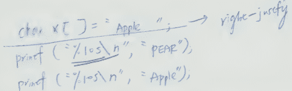

## 字符常量实验

编写一个 C 程序 `char.c`，打印以下特殊字符常量的数值。不要仅仅查找代码并直接从程序中打印它们。您应该让程序通过在 `printf()` 语句中将其作为字符串字面量使用，来输出字符常量的值。

您的输出应以整齐、有序的表格形式呈现，如下所示：

| 字符常量 | 描述 | 值 |
|---|---|---|
| `'\n'` | 换行符 | 10 |
| `'\t'` | 水平制表符 | 9 |
| `'\v'` | 垂直制表符 | 11 |
| `'\b'` | 退格符 | 8 |
| `'\r'` | 回车符 | 13 |
| `'\f'` | 换页符 | 12 |
| `` `\` `` | 反斜杠 | 92 |
| `'\''` | 单引号（撇号） | 39 |
| `'"` | 双引号 | 34 |
| `'\0'` | 空字符 | 0 |

使用以下指南开发您的程序：

- 声明具有适当数据类型的变量。
- 为变量赋值。
- 执行计算。
- 生成适当的输出。

### 要点：

请确保您创建的是 C 程序而不是 C++ 程序。源代码的 `.c` 后缀将调用 C 编译器，而 `.cpp` 后缀将调用 C++ 编译器。由于这是 C 语言课程而不是 C++ 课程，请确保您的源代码使用 `.c` 后缀。

您的程序中不应使用任何全局变量。全局变量是在 main() 之外声明的变量。

程序的输出应发送到终端窗口（您的屏幕）以及请求的 csis.txt 输出文件。请务必阅读关于捕获程序输出的文档。您的全名和 Palomar ID 号必须作为注释出现在包含 main() 的源文件中。请务必将 csis.txt 输出文件包含在 zip 压缩包中。

## 找零实验

构建一个 C 程序 change.c，计算特定购买所需找零的最少纸币和硬币数量。商品价格为 $21.17，支付金额为 $100.00。这些值应使用赋值语句内置到程序中，而不是在程序运行时输入。您的程序应指示找零所需的每种面值的纸币和硬币数量。您应使用以下面值：

- 纸币：二十元、十元、五元、一元
- 硬币：25 美分、10 美分、5 美分、1 美分

您的程序应使用整数除法以及取模运算符（%）。不要使用减法来代替取模运算符！请注意，将成本和支付金额转换为分会更容易，这样您可以使用整数而不是双精度浮点数。

使用以下指南开发您的程序：

- 声明具有适当数据类型的变量。
- 为变量赋值。
- 执行计算。
- 生成适当的输出。

### 要点：

请确保您创建的是 C 程序而不是 C++ 程序。源代码的 .c 后缀将调用 C 编译器，而 .cpp 后缀将调用 C++ 编译器。由于这是 C 语言课程而不是 C++ 课程，请确保您的源代码使用 .c 后缀。

您的程序中不应使用任何全局变量。全局变量是在 main() 之外声明的变量。


程序的输出应发送到终端窗口（您的屏幕）以及请求的 `csis.txt` 输出文件。请务必阅读关于捕获程序输出的文档。您的全名和 Palomar ID 号必须作为注释出现在包含 `main()` 的源文件中。请务必将 `csis.txt` 输出文件包含在 zip 压缩包中。

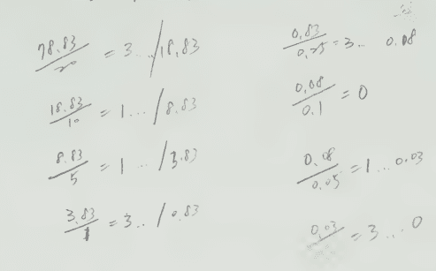

# 第 5 章 数制

- 十进制：基数 10
- 二进制：基数 2
- 十六进制：基数 16
- 负数
- ✧ 数制作业

## 十进制：基数 10

十进制基数 10 整数使用 10 个数字（0、1、2、3、4、5、6、7、8、9）来表示值。但是，将十进制基数 10 整数表示为 739 等值是什么意思呢？请记住，在基数 10 整数中，每个数字代表 10 的一个唯一幂。最右边的数字代表 10^0，向左移动一位，该数字代表 10^1，然后是 10^2，以此类推。

```
10^0 = 1
10^1 = 10
10^2 = 100
```

要理解 739 所表示的值，我们可以将其分解为各个组成部分：

| 9 * 10^0 | = | 9 * 1 | = | 9 |
| 3 * 10^1 | = | 3 * 10 | = | 30 |
| 7 * 10^2 | = | 7 * 100 | = | 700 |
| | | | | 739 |

## 二进制：基数 2

正如我们使用 10 个数字来表示十进制基数 10 整数一样，我们使用 2 个数字（0、1）来表示二进制基数 2 值。但是，在二进制数中，每个数字代表 2 的一个唯一幂。最右边的数字代表 2^0，向左移动一位，该数字代表 2^1，然后是 2^2，接着是 2^3，以此类推。

```
2^0 = 1
2^1 = 2
2^2 = 4
2^3 = 8
2^4 = 16
2^5 = 32
2^6 = 64
2^7 = 128
```

以下是十进制数 0 – 15 对应的二进制基数 2 值。

| 十进制 | 二进制 |
|---|---|
| 0 | 0000 |
| 1 | 0001 |
| 2 | 0010 |
| 3 | 0011 |
| 4 | 0100 |
| 5 | 0101 |
| 6 | 0110 |
| 7 | 0111 |
| 8 | 1000 |
| 9 | 1001 |
| 10 | 1010 |
| 11 | 1011 |
| 12 | 1100 |
| 13 | 1101 |
| 14 | 1110 |
| 15 | 1111 |

请注意，我们可以使用仅 4 位来表示二进制中的 0 到 15 的数字。

## 二进制转十进制

要确定下面的 8 位二进制数在十进制基数 10 中表示什么，只需将相应的 2 的幂相加即可：

| 二进制数： | 1 | 1 | 1 | 0 | 1 | 0 | 1 | 1 |
| 2 的幂： | 2^7 | 2^6 | 2^5 | 2^4 | 2^3 | 2^2 | 2^1 | 2^0 |
| 十进制等效值： | 128 | 64 | 32 | 16 | 8 | 4 | 2 | 1 |

- 1 * 2^0 = 1 * 1 = 1
- 1 * 2^1 = 1 * 2 = 2
- 0 * 2^2 = 0 * 4 = 0
- 1 * 2^3 = 1 * 8 = 8
- 0 * 2^4 = 0 * 16 = 0
- 1 * 2^5 = 1 * 32 = 32
- 1 * 2^6 = 1 * 64 = 64
- 1 * 2^7 = 1 * 128 = 128
- ----------------
- 235

因此，二进制 11101011 等同于十进制 235。

## 十进制转二进制

将十进制数转换为二进制需要以下简单算法：

```
while num != 0
    divide num by 2
    store the remainder
    assign the quotient to num
output the remainders in reverse order
```

例如，我们可以将十进制整数 147 转换为二进制：

```
147 / 2 = 73              remainder = 1
73 / 2 = 36               remainder = 1
36 / 2 = 18               remainder = 0
18 / 2 = 9                remainder = 0
9 / 2 = 4                 remainder = 1
4 / 2 = 2                 remainder = 0
2 / 2 = 1                 remainder = 0
1 / 2 = 0                 remainder = 1
```

因此，十进制 147 等同于二进制 1001011。

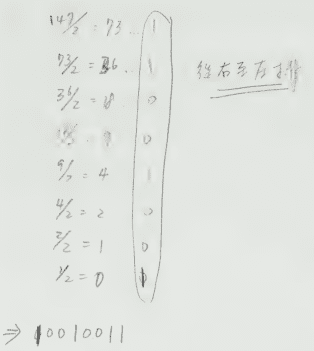

## 十六进制：基数 16

十六进制表示法使用 16 个数字（0 – 9、A、B、C、D、E、F）来表示基数 16 值。'hex' 数中的每个数字代表 16 的一个唯一幂。最右边的数字代表 16^0，向左移动一位，该数字代表 16^1，然后是 16^2，以此类推。

```
3A7 = .
420 = . 16
3B7 = . 266
247 = . 4 436
```

以下是十进制和二进制数 0 – 15 对应的十六进制基数 16 值。

| 十进制 | 二进制 | 十六进制 |
|---|---|---|
| 0 | 0000 | 0 |
| 1 | 0001 | 1 |
| 2 | 0010 | 2 |
| 3 | 0011 | 3 |
| 4 | 0100 | 4 |
| 5 | 0101 | 5 |
| 6 | 0110 | 6 |
| 7 | 0111 | 7 |
| 8 | 1000 | 8 |
| 9 | 1001 | 9 |
| 10 | 1010 | A |
| 11 | 1011 | B |
| 12 | 1100 | C |
| 13 | 1101 | D |
| 14 | 1110 | E |
| 15 | 1111 | F |

## 十六进制转十进制

现在，只需将相应的 16 的幂相加，即可将十六进制值转换为十进制值：

| 十六进制数： | 1 | A | F |
|---|---|---|---|
| 16 的幂： | 16² | 16¹ | 16⁰ |
| 十进制等效值： | 256 | 160 | 15 |

```
1 * 16² = 256 * 1 = 256
A * 16¹ = (10) * 16 = 160
F * 16⁰ = 15 * 1 = 15
-----------------------
431
```

因此，十六进制 1AF 等同于十进制 431。

## 十进制转十六进制

我们使用与将十进制值转换为二进制值时相似的算法来将十进制值转换为十六进制值：

```
while num != 0
    divide num by (16)
    store the remainder
    assign the quotient to num
output the remainders in reverse order
```

我们可以将十进制 431 转换为十六进制：

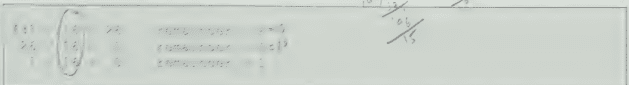

因此，十进制 431 等同于十六进制 1AF。

## 二进制转十六进制

将二进制数转换为十六进制，只需将二进制数的每个半字节（4 位）转换为其十六进制等效值即可。例如，让我们将二进制数 0011010111111100 转换为其十六进制等效值：

| 二进制： | 0011 | 0101 | 1111 | 1100 |
|---|---|---|---|---|
| 十六进制等效值： | 3 | 5 | F | C |

因此，二进制 0011010111111100 等同于十六进制 35FC。

## 十六进制转二进制

要将十六进制数转换为其二进制等效值，我们只需将数中的每个十六进制数字转换为其十进制等效值即可。例如，让我们将十六进制 B72E 转换为二进制：

| 十六进制： | B | 7 | 2 | E |
|---|---|---|---|---|
| 二进制等效值： | 1011 | 0111 | 0010 | 1110 |

因此，十六进制 B72E 等同于二进制 1011011100101110。

请注意，单个十六进制数字可用于表示二进制数中的 4 位。因此，使用十六进制表示法而不是二进制来表示 16 位、32 位或 64 位内存地址会更方便！

## 负数

到目前为止，我们只探讨了正数在计算机内存中的内部表示。现在是时候探讨如何表示负数了。例如，如果值 6 在内存中表示为：

```
00000110
```

那么 -6 如何表示呢？一个常见的建议是将高位设为 1 并保持所有其他位不变，从而生成：

```
10000110
```

不幸的是，这是不正确的。这可以通过将两个数字相加（6 + -6）来证明，结果应为 0。

| 表达式 | 结果 |
| :--- | :--- |
| 00000110 = 6 | |
| 10000110 = -6 | |
| 10001100 = -12 | |

根据此方案，6 + -6 的和等于 -12，而不是 0！我们必须为负数找到另一种表示方法。

### 补码表示法

计算机用来表示负数的技术称为补码表示法。给定任何正数，我们可以通过计算或获取其补码来确定其负数的内部表示。我们分两步执行此操作：

- 翻转所有位
- 加 1

例如，我们可以通过获取 6 的补码来确定 -6 的内部表示：

```
00000110   = 6
11111001   flip all bits
+      1   add 1
-----------
11111010   = -6
```

根据此方案，-6 表示为：

```
11111010
```

我们可以通过将 6 和 -6 相加来测试这一点：

```
00000110   = 6
11111010   = -6
+-----------
100000000  = 0
```

请注意，我们只进行 8 位算术运算，因此可以忽略任何最终进位。作为另一个示例，让我们确定 -25 如何表示：

```
00011001   = 25
11100110   flip all bits
+      1   add 1
-----------
11100111   = -25
```

再次，我们可以通过将 25 和 -25 相加来测试这一点，看是否产生零：

```
00011001   =  25
11100111   = -25
00000000   =   0
```

假设我们得到一个 8 位二进制数。

```
11010001
```

并被要求确定其十进制等效值。除非我们被告知该数字表示有符号值还是无符号值，否则我们无法做到这一点。如果该数字表示无符号值，则我们使用简单的算法将二进制转换为十进制，即将每个相应的 2 的幂相加：

```
1 + 16 + 64 + 128 = 209
```

如果该数字表示有符号值，则我们查看最左边的高位。如果它是 0，则该数字是正数，我们使用刚才提到的算法并将每个相应的 2 的幂相加：

```
1 + 16 + 64 + 128 = 209
```

但是，如果该数字表示有符号值且最左边的高位是 1，则该数字是以补码表示法表示的负数。要确定该负数是多少，我们必须通过翻转位并加 1 来获取其补码：


```
10101001   Original Number
01010110   flip all bits
+ 1        add 1
01010111   two's complement
```

所以，10101001 的二进制补码是 01010111，等于 87：

```
1 - 2 - 4 - 8 - ... - 128 = -1
```

因此，如果我们原始数字的二进制补码是 87，那么我们的原始数字必须等于 -87。

## 数字系统作业

- 1. 给出以下十进制整数的 8 位二进制等效值：
  - a) 72
  - b) 173

- 2. 给出以下 8 位二进制整数的无符号十进制等效值：
  - a) 10001110
  - b) 01110011

- 3. 给出以下 8 位二进制整数的有符号十进制等效值：
  - a) 10001110
  - b) 01110011

- 4. 将以下二进制数字转换为十六进制表示法：
  - a) 10001110
  - b) 01110011

- 5. 将以下十进制数转换为十六进制：
  - a) 427
  - b) 841

- 6. 将以下十六进制数转换为十进制：
  - a) 0x5E
  - b) 0x1C3

- 7. 将以下十六进制数转换为二进制：
  - a) 0x1234
  - b) 0xFBA2

- 8. 给出以下二进制数的二进制补码：
  - a) 01111110
  - b) 11100110
  - c) 10000001
  - d) 00000000
  - e) 10000000

# 第 6 章。函数

- 用户定义的函数
- 程序执行流程
- 标识符作用域
- 数学函数
- 问题求解技巧
- 函数作业

1-a)
9/2 = 36...0
3/4 = 38...0
3/4 = 19...0
3/2 = ...1
3/2 = ...0
3/1 = ...1
1/3 = ...1
1/0 = ...0

1-b)
19/3 = 86...1
8/3 = 45...0
4/3 = 21...1
2/3 = 10...1
1/3 = 5...1
3/2 = ...1
2/1 = ...0
2/0 = ...1

427/16 = 26...11 => B
26/16 = 1...10 => A
1/16 = 0...1 => 1
=> 1AB

841/16 = 52...9 -> 9
52/16 = 3...4 -> 4
3/16 = 0...3 -> 3

6
1111011
+ 00011001
00011010 (7-c)

C
1000001
0111111
01111111 (12-j)

D
00000000
11111111
10000000

E
1000000
0111111
10000000 (13-8)

## 用户定义的函数

函数是执行特定任务的子程序。其目的是将一组相关的语句组合在一起，以执行算法中某个明确定义的步骤。

我们已经看过 C 中内置函数的示例，例如：

```
printf() . . . . . . . . fopen() . . . . . . . . isdigit()
scanf() . . . . . . . . fclose() . . . . . . . . isupper()
fprintf() . . . . . . . . islower()
toupper()
tolower()
```

但 C 还赋予我们创建自己的函数的能力。假设我们想要编写一个程序来显示不同的几何图形。我们可以创建自己的函数 drawRectangle() 来显示一个矩形：

```
// Displays a rectangle.
void drawRectangle() {
printf("*************\n");
printf("**\n");
printf("**\n");
printf("**\n");
printf("*************\n");
}
```

我们可以创建自己的函数 drawTriangle() 来显示一个三角形：

```
// Displays a triangle.
void drawTriangle() {
printf(" * \n");
printf(" * * \n");
printf(" * \n");
printf(" * \n");
printf("*********\n");
}
```

我们可以创建自己的函数 drawCircle() 来显示一个圆：

```c
// Display a circle.
void drawCircle() {
    printf(" ***** \n");
    printf(" *   * \n");
    printf(" *   * \n");
    printf(" *   * \n");
    printf(" ***** \n");
}
```

创建自己的用户定义函数，我们必须做三件事。

### 1. 声明函数。

我们通过函数原型来做到这一点，函数原型声明函数，以便编译器了解它。此声明提供了函数接口的完整描述。函数原型通常位于 main() 之前，它们告诉编译器和我们，函数将做什么，但不会告诉如何去做。

### 2. 编写函数定义。

函数定义由注释、标题和主体组成。标题几乎是原型的重复。主体包含函数的可执行语句。

### 3. 编写对函数的调用。

这些调用会导致函数执行并返回值（如果有任何值需要返回）。虽然每个函数有一个原型和一个定义，但可能有许多调用，带有不同的参数。

让我们看一个计算矩形面积的函数示例。

### 1. 声明函数。

首先，我们声明一个函数原型。原型是函数的接口（有时称为签名），还声明了函数必须如何使用。它告诉编译器正确翻译对函数的调用所需的所有信息。（当我们编写带有参数的函数时，我们将更好地理解为什么这很重要。）

函数原型指定函数返回类型、函数名以及参数（形式参数）的数量和类型。函数原型的一般形式如下：

```
returnType functionName (formal-argument-list);
```

计算矩形面积的函数的函数原型如下：

```
int calcRectArea(int length, int width);
```

函数原型提供以下信息：

- * 函数返回值（即计算出的矩形面积）将是 int 数据类型。
- * 函数名是 calcRectArea()。
- * 形式参数列表包含两个形式参数 length 和 width，它们均为 int 数据类型。

请注意，函数原型的形式参数列表可以选择性地省略形式参数的名称：

```
int calcRectArea(int, int);
```

函数原型放置在 main() 函数之前的代码中，行末有分号。

请注意，正如我们不允许在先声明变量为特定数据类型之前使用标识符（变量）一样，我们也不允许在先声明函数原型之前使用函数。

### 2. 编写函数定义。

编写自己的函数时，我们必须做的第二件事是提供函数定义或实现。函数定义由注释、标题和主体组成。函数主体的一般形式如下：

```
// Function comments
returnType functionName (formal-argument-list) {
    executable-statements;
    return (return-value);
}
```

函数定义以计算矩形面积为例如下：

```
// Calculates area of a rectangle given its length and width.
// Returns the area of a rectangle.
int calcRectArea(int length, int width) {
    int area;
    area = length * width;
    return area;
}
```

- * 函数注释描述了函数完成的任务以及返回值（如果有）代表的含义。注释告知我们，该函数根据长度和宽度计算矩形面积。注释还告知我们，该函数返回一个表示矩形面积的 int。
- * 函数返回计算出的矩形面积，返回值为 int 数据类型。
- * 函数名是 calcRectArea()。
- * 函数形式参数列表由第一个位置的 int 类型 length 和第二个位置的 int 类型 width 组成。这意味着该函数期望两个输入参数，第一个为 int 类型，第二个为 int 类型。

请注意，尽管第一个参数名为 `length`，第二个参数名为 `width`，但这些名称与传递给函数调用的实际参数名称之间没有任何联系！我们将很快详细说明。

当函数被调用时，将为形式参数 `length` 和 `width` 分配存储空间，并将存储空间初始化为调用函数时传入的值。

请注意，参数 `length` 和 `width` 是局部变量，在函数内部“可见”，可以在函数中使用，但在程序的其他任何地方都不能使用。

请注意，虽然函数原型中形式参数的名称是可选的，但必须在函数标题中包含它们。

函数主体包含调用或使用函数时将执行的语句。函数使用花括号 `{ }` 来指示函数主体的开始和结束。请注意，函数主体末尾没有分号！

在我们的函数中，可执行语句包括声明一个名为 `area` 的 `int` 变量。该函数还执行矩形面积的计算。计算出的矩形面积值被赋给变量 `area`。

返回值是函数返回给调用程序代码的值。我们的函数向调用程序代码返回一个 `int`。

总之，我们的函数主体声明一个名为 `area` 的变量，使用作为参数传入的长度和宽度计算面积，并将计算出的面积返回给调用程序代码。请注意，该函数放置在 `main()` 函数结束之后的程序中。


### 3. 编写对函数的调用：

我们需要做的第三件事就是在需要时调用该函数。

```c
// Calculates the area of a rectangle.
int main(void) {
    int length, width, area;

    length = 8;
    width = 6;

    area = calcRectArea(length, width);
    printf("The area = %d\n", area);
    return 0;
}
```

在这里，我们声明变量 length、width 和 area，并为 length 和 width 赋值。对函数 calcRectArea() 进行调用，传递两个参数 length 和 width。函数返回的值被赋给 area，然后将其输出。

函数调用可以像程序代码中的任何其他有效 C 语句一样在程序代码本身中使用。函数可以在 main() 或任何其他函数中调用，并且可以根据需要调用任意次，也可以不调用。请注意，始终只有一个函数声明和一个实现（定义），但可以对给定函数进行多次调用。

下面是我们的完整代码，其中包含多个调用我们计算矩形面积的函数的示例：

```c
int calcRectArea(int length, int width);

// Calculates the areas of various rectangles.
int main(void) {
    int length, width, area, l, w;

    // Function Call 1
    length = 8;
    width = 6;
    area = calcRectArea(length, width);
    printf("The area = %d\n", area);

    // Function Call 2
    l = 5;
    w = 3;
    area = calcRectArea(l, w);
    printf("The area = %d\n", area);

    // Function Call 3
    printf("The area = %d\n",calcRectArea(4, 8));

    // Function Call 4
    calcRectArea(2, 6);

    return 0;
}

// Calculates area of a rectangle given its length and width.
// Returns The area of a rectangle.
int calcRectArea(int length, int width) {
    int area;
    area = length * width;
    return area;
}
```

### 函数调用 1：

将值赋给变量 `length` 和 `width`，这些变量作为参数传递给函数 `calcRectArea()`。函数返回一个计算值，该值被赋给 `area`，然后将其输出。

### 函数调用 2：

将值赋给变量 l 和 w，这些变量作为参数传递给函数 calcRectArea()。函数返回一个计算值，该值被赋给 area，然后将其输出。

请注意，在这种情况下，传递给函数的参数（称为实参）的名称与函数接收的参数（称为形参）的名称不需要相同！名称不需要匹配！C 只是将第一个实参传递给第一个形参，将第二个实参传递给第二个形参，以此类推。

但是，实参的数量必须等于形参的数量（即，传递给函数的参数数量必须与函数声明接收的参数数量相同）。此外，第一个实参的数据类型必须与第一个形参的数据类型匹配，第二个实参的数据类型必须与第二个形参的数据类型匹配，以此类推。

### 函数调用 3：

函数返回值未被赋给变量以供输出，因为函数调用本身就包含在 printf() 语句中！在这里，返回的 int 值被替换到 printf() 字符串的 %d 格式说明符中，函数的返回值会立即被输出。

### 函数调用 4：

这个函数调用虽然在技术上是正确的，但并未使用函数返回的值，因为我们在调用函数时既没有赋值也没有以任何方式使用返回值。返回值被简单地忽略！我们将看到其他函数调用示例，其中返回值未被使用。

### 函数的优点

- 程序变得更易读。
- 函数可以与程序的其余部分分开进行测试和调试。
- 通过将逻辑步骤隔离在函数中，程序的各个部分更加独立，错误的可能性降低。
- 同一个函数可以从程序的不同位置调用。因此，常用的逻辑块只需编写一次。

## 程序执行流程

程序执行流程是指 C 代码被执行的顺序。执行始终从 main() 中的第一条语句开始，语句按从第一条到最后一条的顺序依次执行。

例如，考虑下面交换两个变量值的程序：

```c
int main(void) {
   int x, y, temp;   // Statement 1
   x = 5;            // Statement 2
   y = 6;            // Statement 3
   temp = x;         // Statement 4
   x = y;            // Statement 5
   y = temp;         // Statement 6
   return 0;         // Statement 7
}
```

上面程序中的语句按以下顺序执行：

- 语句 1
- 语句 2
- 语句 3
- 语句 4
- 语句 5
- 语句 6
- 语句 7

向程序中添加函数定义不会改变程序的执行流程。但是，函数内部的语句在函数被调用之前不会执行。

当进行函数调用时，程序控制权会跳转到函数中的第一条语句。函数中的所有语句都会被执行，直到遇到 return 语句或函数的右花括号为止。程序控制权会返回到函数调用发生的位置。

### 考虑以下程序：

```c
// Geometric drawing program

#include <stdio.h>

// Function prototypes
void drawRectangle(void);
void drawTriangle(void);
void drawCircle(void);

// Calls the geometric drawing functions
int main(void) {
    drawCircle();
    drawRectangle();
    drawTriangle();
    drawCircle();

    return 0;
}

// Displays a rectangle.
void drawRectangle(void) {
    printf("**********\n");
    printf("*        *\n");
    printf("*        *\n");
    printf("*        *\n");
    printf("**********\n");
}

// Displays a triangle.
void drawTriangle(void) {
    printf("   *   \n");
    printf("  * *  \n");
    printf(" *   * \n");
    printf("*     *\n");
    printf("*******\n");
}

// Displays a circle.
void drawCircle(void) {
    printf("  ***  \n");
    printf(" *   * \n");
    printf("*     *\n");
    printf(" *   * \n");
    printf("  ***  \n");
}
```

请注意，函数定义在程序中出现的顺序并不重要。让我们执行 `main()` 函数的第一行：

```
drawCircle();
```

执行此语句会将程序控制权转移到 `drawCircle()` 函数。`drawCircle()` 函数中的以下每条语句都会被执行：

```
printf(" **** \n");
printf(" * * \n");
printf("** ** \n");
printf(" * * \n");
printf(" **** \n");
```

当到达 `drawCircle()` 函数的右花括号时，程序控制权会返回到 `main()` 中对 `drawCircle()` 调用之后的语句：

```
drawRectangle();
```

执行此语句会将程序控制权转移到 `drawRectangle()` 函数。`drawRectangle()` 函数中的以下每条语句都会被执行：

```
printf("************\n");
printf("** **\n");
printf("** **\n");
printf("** **\n");
printf("************\n");
```

当到达 `drawRectangle()` 函数的右花括号时，程序控制权会返回到 `main()` 中对 `drawRectangle()` 调用之后的语句：

```
drawTriangle();
```

执行此语句会将程序控制权转移到 drawTriangle() 函数。drawTriangle() 函数中的以下每条语句都会被执行：

```
printf(" * \n");
printf(" * * \n");
printf(" * * * \n");
printf(" * * * * \n");
printf("*********\n");
```

当到达 drawTriangle() 函数的右花括号时，程序控制权会返回到 main() 中对 drawTriangle() 调用之后的语句：

```
drawCircle();
```

执行此语句会将程序控制权转移到 drawCircle() 函数。drawCircle() 函数中的以下每条语句将再次被执行：

```
printf(" *** \n");
printf(" * * \n");
printf(" * * \n");
printf(" * * \n");
printf(" *** \n");
```

当到达 drawCircle() 函数的右花括号时，程序控制权会返回到 main() 中对 drawCircle() 调用之后的语句：

```
return 0;
```

这完成了程序的执行，并将控制权移交回操作系统。


现在，当一个函数调用另一个函数，而那个函数又调用另一个函数，以此类推时，会发生什么呢？幸运的是，C 语言擅长跟踪所有这些函数调用。每当一个函数完成时，程序就会从它被调用的函数中中断的地方继续执行。

试着看看你能否猜出下面程序的输出结果：

```
#include <stdio.h>

FILE *csis;

void foo(void);
void faa(void);
void laa(void);

int main(void) {
    printf("main() 1\n");
    foo();
    printf("main() 2\n");
    return 0;
}

void foo(void) {
    printf("foo() 1\n");
    faa();
    printf("foo() 2\n");
}

void faa(void) {
    printf("faa() 1\n");
    laa();
    printf("faa() 2\n");
}

void laa(void) {
    printf("laa() 1\n");
}
```

生成的输出如下。

```
main() 1
foo() 1
faa() 1
laa() 1
faa() 2
foo() 2
main() 2
```

你能看出原因吗？

因此，当你阅读程序时，并不总是希望从上到下阅读程序。有时，遵循程序的执行流程更有意义。

## 标识符的作用域

标识符是程序代码中引用的变量名或函数名。标识符的作用域决定了该标识符可以在程序代码的哪些位置被引用。

例如，请考虑以下代码。

```
double average (double, double);

int globalVariable;

int main(void) {
    int localVariable;
    ...
    ...
}

double average(double grade1, double grade2) {
    return (grade1 + grade2) / 2;
}
```

在这里，标识符（即函数名和变量名）average、main、globalVariable、localVariable、grade1 和 grade2 都有特定且明确定义的作用域。我们可以这样理解该作用域：

- 在 main() 函数之前声明的标识符具有全局作用域，可以在程序代码的任何位置引用。通常，常量、宏和函数都在 main() 函数之前声明，以便它们具有全局作用域并在整个程序代码中“可见”。在 main() 函数之前声明的变量称为全局变量，在程序中使用时通常不被推荐。

- 在特定函数内声明的标识符具有局部作用域，且仅在该特定函数内“可见”。函数参数被视为函数的局部变量，在该函数外部不“可见”。通常，程序中使用的任何变量都应在函数内声明，或作为函数参数传递给函数。

## 数学函数

cmath 头文件定义了数学库中的各种数学函数。该库中所有函数都以 double 作为参数，并返回 double 类型的结果。请务必在将使用数学函数的源文件顶部附近包含 cmath 头文件。

### 幂函数

pow(x, y) 返回 x 的 y 次幂。

sqrt(x) 返回 x 的平方根。

### 绝对值函数

abs(x) 返回 x 的绝对值。

### 最接近的整数和余数函数

ceil(x) 返回大于或等于 x 的最小整数值。向上舍入到最接近的整数。

floor(x) 返回小于或等于 x 的最大整数值。向下舍入到最接近的整数。

fmod(x, y) 返回 x 除以 y 的余数。

### 指数和对数函数

exp(x) 返回 e 的 x 次幂的值。

log(x) 返回 x 的自然对数（以 e 为底）。

log10(x) 返回 x 的常用对数（以 10 为底）。

### 三角函数

cos(x) 返回弧度角 x 的余弦值。

sin(x) 返回弧度角 x 的正弦值。

tan(x) 返回弧度角 x 的正切值。

acos(x) 返回 x 的反余弦值（以弧度表示）。

asin(x) 返回 x 的反正弦值（以弧度表示）。

atan(x) 返回 x 的反正切值（以弧度表示）。

以下是数学库中一些函数的使用示例。假设 y 已定义为 double 类型：

```
y = pow(3, 4);    // assigns 81.000000 to y
y = sqrt(25);     // assigns 5.000000 to y
y = sqrt(5);      // assigns 2.236068 to y
y = fabs(-9.3);   // assigns -9.000000 to y
y = ceil(4.3);    // assigns 5.000000 to y
y = floor(4.3);   // assigns 4.000000 to y
y = fmod(5, 3);   // assigns 2.000000 to y
```

stdlib.h 头文件还定义了标准库中的一些数学函数。请务必在每个将使用这些函数的 C 文件顶部附近包含 stdlib.h 头文件：

```
#include <stdlib.h>
```

```
int abs(int x);   Returns the absolute value of int x.
int labs(long x); Returns the absolute value of a long x.
```

以下是标准库中一些函数的使用示例。假设 i 已定义为 int 类型，j 已定义为 long 类型：

```
i = abs(-8);      // assigns 8 to i
i = abs(3);       // assigns 3 to i
j = labs(-1000000000l); // assigns 1000000000 to j
// Note that's an 'el' after the last zero in
// the function argument
```

## 二次方程示例

让我们计算形式为以下二次方程在 x 中的根：

ax^2 + bx + c = 0

我们将编写二次求根公式：

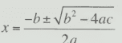

```
#include <stdio.h>
#include <math.h>

int main (void) {
    int a=1, b=3, c=-4, disc;
    double root1, root2;

    disc = b*b-4*a*c;
    root1 = (-b + sqrt(disc)) / (2 * a);
    root2 = (-b - sqrt(disc)) / (2 * a);
    printf("root1 = %5.2lf\n", root1);
    printf("root2 = %5.2lf\n", root2);
    return 0;
}
```

输出如下：

```
root1 = 1.00
root2 = -4.00
```

## 作为函数参数的算术表达式

C 语言最有用的特性之一是它允许函数将算术表达式作为参数。例如，我们可以将算术表达式作为 sqrt() 函数的参数，如下所示：

```
root1 = (-b + sqrt(b*b-4*a*c)) / (2 * a);
root2 = (-b - sqrt(b*b-4*a*c)) / (2 * a);
```

但是，在这个示例中，最好先计算判别式，将其赋值给变量 disc，然后在代码中使用 disc，这样就不需要两次执行判别式的计算了。

但是，如果判别式 < 0 会怎样呢？那么二次方程就没有实数根。我们可以让程序进行适当的测试，仅对判别式 >= 0 的情况执行计算：

```
#include <stdio.h>
#include <math.h>
int main (void) {
    int a=1, b=3, c=-4, disc;
    double root1, root2;
    disc = b*b-4*a*c;
    if (disc > 0) {
        root1 = (-b + sqrt(disc)) / (2 * a);
        root2 = (-b - sqrt(disc)) / (2 * a);
        printf("root1 = %0.1lf\n", root1);
        printf("root2 = %0.1lf\n", root2);
    }
    return 0;
}
```

如果判别式 < 0，则不执行任何计算。也许如果判别式 < 0，生成一些输出会更合适：

```
#include <stdio.h>
#include <math.h>

int main (void) {
   int a, b, c, disc;
   double root1, root2;

   a = 1;
   b = 3;
   c = 44;

   disc = b*b-4*a*c;
   if (disc > 0) {
      root1 = (-b + sqrt(disc)) / (2 * a);
      root2 = (-b - sqrt(disc)) / (2 * a);
      printf("root1 = %0.1lf\n", root1);
      printf("root2 = %0.1lf\n", root2);
   }
   else {
      printf("The discriminant is < 0. There are no real roots.");
   }
   return 0;
}
```

输出如下：

```
The discriminant is < 0. There are no real roots.
```

我们对上述判断语句的使用将是下一节的重点。

## 问题求解技巧

我们现在准备好探讨计算机可以解决的问题了。首先，我们需要知道如何解决问题，然后需要学习如何使用编程语言在计算机上实现我们的解决方案。

在探讨问题求解和为计算机编写程序之前，我们应该理解，编程可能会带来相当大的挫折感，原因如下：

- 1. 规划是一个关键问题。首先，你必须规划开发解决问题的指令，然后在坐到键盘前规划将这些指令转换为代码。你不应该试图“凭空”输入代码。

- 2. 时间是一个主要问题。编写程序与完成其他作业不同。你不能指望在截止日期前一天熬夜就完成编程作业。你必须尽早开始，并预计在最终版本准备好之前进行多次修订。

- 3. 成功的问题求解和编程需要极高的精确度。通常，计算机科学中的概念并不困难；然而，这些概念的实现不允许有任何差错。例如，1000 行程序中一个分号位置错误就可能导致程序无法运行。

换句话说，你必须做好充分规划、尽早开始、保持耐心、处理挫折并努力工作，才能在计算机科学领域取得成功。如果你做不到这一点，那么你可能既不会享受计算机科学，也不会在其中取得成功。

编写成功程序的关键是规划。好程序不是凭空产生的，而是精心设计和耐心的结果。就像受委托绘制肖像的画家不会先从涂抹嘴唇和眼睛开始一样，优秀的计算机程序员也不会立即尝试编写解决问题的程序代码来攻克问题。编写程序就像写文章：先构思总体主题，再发展主要观点的大纲，将每个主要观点细分为几个部分，然后用单个句子来发展每个部分。


## 良好编程习惯的六个步骤

在开发解决问题的程序时，应遵循六个步骤：分析问题、开发算法、编写程序代码、运行程序、测试结果和记录程序。这些步骤将帮助培养良好的问题解决习惯，进而正确解决编程问题。以下对每个步骤进行简要讨论：

### 步骤 1. 分析问题。

这并非一件轻松的事。在做任何事情之前，你必须确切知道自己要做什么。你必须能够清晰、精确地陈述要做什么。你应该完全理解可用的数据以及可以假设的内容。你还应该确切知道期望的输出是什么以及输出应采取的形式。

### 步骤 2. 开发算法。

算法是一组有效语句的有限序列，应用于问题时将解决该问题。一个*有效语句*是清晰、无歧义且可执行的指令。你开发的每个算法都应有明确的起始；完成一步后，下一步应被唯一确定；并且应在合理时间内达到结束。

### 步骤 3. 编写程序代码。

当算法正确解决问题时，你可以考虑将算法转换为高级语言。一个有效的算法将显著减少你完成此步骤所需的时间。

### 步骤 4. 运行程序。

编写代码后，你就可以运行程序了。这意味着使用编辑器将程序代码输入计算机，编译程序，然后运行程序。此时，你可能会发现错误，这些错误可能只是简单的输入错误，也可能需要重新评估算法的全部或部分内容。需要进行一些更正或更改的可能性相当高。

### 步骤 5. 测试结果。

程序运行后，你需要确保结果正确，结果格式符合你的要求，并且程序在所有情况下都能产生正确的解决方案。为了确保结果正确，你必须查看结果并将其与预期进行比较。在使用包含算术运算的程序时，这意味着用铅笔和纸检查一些结果。对于复杂程序，你需要使用精心选择的数据多次运行程序来彻底测试它。通常你需要进行修改并返回到步骤 4。

### 步骤 6. 记录程序。

完整记录一个可运行的程序非常重要。编写者知道程序如何工作；如果其他人要修改它，他们必须了解所使用的逻辑。随着你发展编写解决更复杂问题程序的能力，你会发现将文档包含在步骤 3 中（在编写代码时）是有帮助的。

## 开发算法

解决问题的算法可以通过陈述问题，然后将问题细分为主要子任务来开发。每个子任务随后可以细分为更小的任务。在此过程中每个阶段识别的任务称为模块。重复此过程，直到每个剩余任务都易于解决且在 C 中实现起来微不足道。此过程称为自顶向下设计，每次连续细分称为逐步求精。这使我们能够一次解决一个大问题的一步，而不是一次性提供整个解决方案。

逐步求精技术不仅是一种高效的设计方法，而且从以下意义上也能产生良好的算法：

- 算法更易于理解
- 后续修改相对容易进行

这种技术让你在不实际编写 C 代码的情况下规划程序：

- 用英语思考比用计算机语言思考更容易
- 从顶部着手解决问题，可以尽可能推迟编码的琐碎细节

### 问题的逐步求精：

- 1. 简单陈述问题，将其分解为逻辑子问题。
- 2. 如果你能立即想出如何编码任何子问题，就去做。这些将是你程序的主函数。
- 3. 如果子问题太复杂，将它们细化为更小、更基本的子问题，等等。

模块之间的关系可以在结构图中以图形方式显示。例如，假设一个公共图书馆希望计算机化其运营——这是一个相当雄心勃勃的编程项目。将其规模缩小的第一步是基本问题分解：

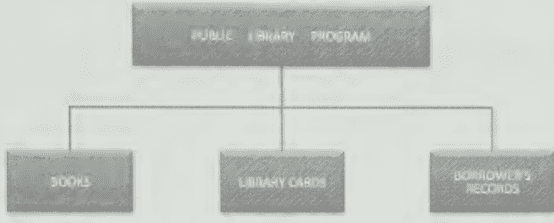

如果有遗漏，我们随时可以回溯到求精的这一步。我们现在可以进一步细化第一层级的每个子问题：

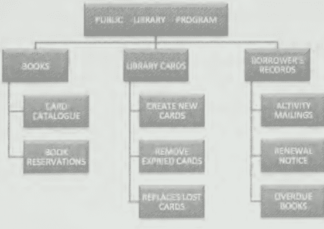

对程序员来说这仍然太抽象，因此我们再次对其进行细化：

### 卡片目录

- 将书籍添加到目录
- 从目录中删除书籍
- 搜索书籍

### 图书预订

- 搜索书籍
- 通知借阅者
- 打印预留消息

### 创建新卡片

- 打印卡片表格
- 获取新卡片信息

### 移除过期卡片

- 从永久文件中移除卡片
- 检查未归还的书籍
- 通知借阅者

### 更换丢失卡片

- 查找旧卡片信息
- 打印卡片表格

### 活动邮件

- 获取活动信息
- 通知借阅者

### 续借通知

- 获取旧卡片信息
- 通知借阅者

### 逾期图书

- 检查逾期图书
- 计算罚款
- 通知借阅者

请注意，当问题的部分开始成形为输入/输出函数时，求精开始见效。作为额外奖励，此级别的一些求精（例如“通知借阅者”部分）足够相似，可以编写为单个函数。

整个程序仍然太复杂，无法用 C 编码，但有些部分已触手可及：

```
// Reads today's date and books due date. Both must be in the current month.
#define FinePerDay 0.25
void calculateFines() {
    float totalFine;
    int todaysDate, dueDate, daysLate;
    printf("Enter todays date and books due date.\n");
    scanf("%d %d", &todaysDate, &dueDate);
    daysLate = todaysDate - dueDate;
    totalFine = daysLate * FinePerDay;
    printf("The total fine is %5.2f", totalFine);
}
```

## 函数作业

- 1. 为以下每个函数给出函数头。
  - a) 函数 areaTriangle 接受两个 double 参数 base 和 height，并返回一个 double 值。
    ```
    double areaTriangle ( double base, double height )
    ```
  - b) 函数 max 接受四个整数 w、x、y、z，并返回一个整数。
    ```
    int max ( int w, int x, int y, int z )
    ```
  - c) 函数 outputHeaders 不接收任何参数且不返回值。
    ```
    void OutputHeaders ( void )
    ```
  - d) 函数 getASCII 接受一个字符参数 ch，并返回一个 int。
    ```
    int getASCII ( char ch )
    ```

- 2. 假设函数 foo() 具有以下定义：
  ```
  int foo (int a, int b, int c) {
  ... 
  }
  ```
  以下哪些语句是合法的？假设 i 的类型为 int，x 的类型为 double。
  - a) i = foo (10, 20, 30);
  - b) x = foo (10, 20, 30);
  - c) i = foo (5.25, 8.45, 7.22);
  - d) x = foo (5.25, 8.45, 7.22);
  - e) foo (10, 20, 30);
  - f) foo (10, 20);

- 3. 以下哪些是不返回值且具有一个 double 参数的函数的有效原型？
  - a) void foo (double x); void 函数在函数结束后不返回值
  - b) void foo (double);
  - c) void foo (x); 缺少类型
  - d) void foo (double x); 返回值未定义

- 4. CD 每张 2 美元，DVD 每张 5 美元。编写一个函数，接受两个参数分别表示 CD 和 DVD 的数量，并返回总美元成本。
  ```
  int calcTotal( int numCD, int numDVD){
     int cost;
     cost = (2 * numCD) + (5 * numDVD);
     return cost;
  }
  ```


# 第 7 章. 选择语句

- If 语句
- Switch 语句
- 条件运算符
- 选择作业
- 体重指数实验
- 大 - 小实验

## If 语句

决策语句允许程序根据数据值遵循不同的行动方案或执行不同的任务。

### if 语句：单一备选决策语句

下面的伪代码语句：

```
if x is not equal to zero then
divide y by x and assign the result to num
```

可以读作如下：

如果条件 "x 不等于零" 为真，则将 y 的值除以 x 的值并将结果赋给变量 num。否则，条件 "x 不等于零" 为假。在这种情况下，不会采取替代操作，因为如果语句为假，未指定任何替代操作。

if 语句的语法如下：

```
if (expression) {
	statement;
}
```

if 语句使用半布尔逻辑，即，零表示假，非零表示真。以下是上述伪代码示例可能的 C 代码：

```
if (x != 0) {
	num = y/x;
}
```

以下是一个打印数字绝对值的简短程序：

```
int main(void) {
    int num;
    printf("Enter a value: ");
    scanf("%d", &num);
    if (num < 0) {
        num = -num;
    }
    printf("The absolute value is %d\n", num);
    return 0;
}
```

表达式内允许有副作用。良好的 C 风格是使用它们来避免创建否则无用的“临时”变量。因此，

```
if (scanf("%d", &num) != 1) {
    printf("Bad value.\n");
}
```

优于

```
temp = scanf("%d", &num);
if (temp != 1) {
    printf("Bad value.\n");
}
```

由于表达式将产生零（假）或非零值，我们将使用：

```
if (expression)
```

而不是

```
if (expression != 0)
```

### if-else 语句：双备选决策语句

下面的伪代码示例：

```
if x is not equal to zero then
    divide y by x and assign the result to num
else // otherwise
    display an error message
```

可以读作如下：

如果条件 "x 不等于零" 为真，则将 y 的值除以 x 的值并将结果赋给变量 num。否则，条件 "x 不等于零" 为假。在这种情况下，显示一条错误消息。

请注意，上面显示的条件是逻辑表达式。当你对它们求值时，结果要么是真，要么是假。这些是逻辑表达式的唯二可能值！

if-else 语句的语法如下：

```
if(expression) {
    statement1;
} else {
    statement2;
}
```

以下是上述伪代码示例可能的 C 代码：

```
if (x != 0) {
    num = y / x;
} else {
    printf ("Divide by zero error condition.");
}
```

以下是一个简单的程序，用于确定一个数字是奇数还是偶数：

```
int main(void) {
    int num;

    printf("Enter a number: ");
    scanf("%d", &num);
    if (num % 2 == 0) {
        printf("The number is even.\n");
    } else {
        printf("The number is odd.\n");
    }
    return 0;
}
```

请注意，在 C 允许控制结构中使用语句的任何地方，该语句都可以是由大括号分隔的复合语句：

```
int main(void) {
    int num;

    printf("Enter a number: ");
    scanf("%d", &num);
    if (num % 2 == 0) {
        printf("The number entered is %d.\n", num);
        printf("The number is even.\n");
    } else {
        printf("The number entered is %d.\n");
        printf("The number is odd.\n");
    }
    return 0;
}
```

下面是一个使用 if-else 结构根据工资率和工作小时数计算工资的程序：

```
// Program to Calculate Wages

#include <stdio.h>

int main (void)
{
    float payRate, hours, wages;

    printf("Enter hourly salary: ");
    scanf("%f", &payRate);

    printf("Enter number of hours worked: ");
    scanf("%f", &hours);

    if (hours <= 40)
        wages = hours * payRate;
    else
        wages = (40 * payRate) + (hours - 40) * 1.5 * payRate;

    printf("The employee's weekly wages are $%6.2f\n", wages);
    return 0;
}
```

### 嵌套 If 语句

每当一个 if 语句嵌套在另一个 if 语句中时，请在嵌套的 if 语句周围加上大括号。此外，else 子句与同一作用域中最近的“未 else”的 if 语句相关联：

```
// incorrect nesting

if (num > 0)
    if (num % 2 == 0)
        printf("Positive and even.\n");
else
    printf("Not positive.\n");

// correct nesting

if (num > 0) {
    if (num % 2 == 0)
        printf("Positive and even.\n");
}
else
    printf("Not positive. ");
```

### else-if 语句：多备选决策语句

下面的伪代码示例：

```
if x is less than zero then
    set y equal to -1
else if x is equal to zero then
    set y equal to 0
else
    set y equal to 1
```

可以读作如下：

如果条件 "x 小于零" 为真，则将 y 的值设置为 -1。

否则，条件 "x 小于零" 为假。因此，如果条件 "x 等于零" 为真，则将 y 的值设置为 0。

否则，条件 "x 小于零" 和 "x 等于零" 都为假。因此，我们将 y 的值设置为 1。

当 if 语句仅在 else 子句内有嵌套时，使用 else-if 语句。语法如下：

```
if (expression1) {
    statement1;
} else if (expression2) {
    statement2;
} else if (expression3) {
    statement3;
} else {
    statement4;
}
```

以下是上述伪代码示例可能的 C 代码：

```
if (x < 0) {
    y = -1;
} else if (x == 0) {
    y = 0;
} else {
    y = 1;
}
```

经常，else-if 结构可以澄清你的代码。例如，这个晦涩的三选一含义：

```
if (n > 0) {
    printf("Positive");
}
else {
    if (n == 0) {
        printf("Zero");
    } else {
        printf("Negative");
    }
}
```

可以使用 else-if 结构使其更清晰：

```
if (n > 0) {
    printf("Positive");
} else if (n == 0) {
    printf("Zero");
} else {
    printf("Negative");
}
```

## Switch 语句

switch 语句是另一种多选控制结构。

- 它只能在仅测试一个变量的某些情况下使用。所有分支都必须依赖于该变量的值。
- 该变量必须是整数类型，如 int、long、short 或 char。
- 变量的每个可能值可以控制一个分支。可以可选地使用最终的、捕获所有的 default 分支来捕获所有未指定的情况。

以下是一个使用 switch 语句的简单计算器程序：

```
#include <stdio.h>
int calc(int operand1, int operand2, char operator);
int main(void) {
    int a, b;
    char op;
    printf("Enter two integers and an operator: ");
    scanf("%d %d %c", &a, &b, &op);
    calc(a, b, op);
    return 0;
}
int calc(int operand1, int operand2, char operator) {
    switch (operator) {
        case '+':
            printf("%d\n", operand1 + operand2); break;
        case '-':
            printf("%d\n", operand1 - operand2); break;
        case '*':
            printf("%d\n", operand1 * operand2); break;
        case '/':
            printf("%d\n", operand1 / operand2); break;
    }
    return 0;
}
```

请注意，在每个替代代码段的末尾应该有一个 break 语句。break 语句通过离开 switch 来防止任何进一步的语句被执行。控制跳转到 switch 语句后的右大括号。实际上，离开 switch 语句最常见的方式是使用 break 或 return 语句。

## 条件运算符

条件运算符 ?: 是 C 中唯一的三元运算符，即需要 3 个操作数：

- 正在测试的表达式
- 两个替代结果表达式

条件运算符的语法如下：

```
expr1 ? expr2 : expr3
```

条件是一个返回真或假（0 或非零）的关系表达式。如果为真，则求 expr1 的值，否则求 expr2 的值。实际上，条件运算符的行为非常类似于 if-else 语句。以下代码：

```
if (x > y)
    max = x;
else
    max = y;
```

可以使用条件运算符重写：

```
max = (x > y) ? x : y;
```


条件语句对于缩短程序非常有用。我们可以重写以下if-else语句：

```
if (x > y) {
    printf("%d\n", x);
} else {
    printf("%d\n", y);
}
```

as

```
printf("%d\n", x > y ? x : y);
```

在以下语句中：

```
num = value > 0 ? ++x : ++y;
```

表达式中只有一个（即 `++x` 或 `++y`）会被求值，但绝不会两者都求值！

下面展示了使用条件运算符的两个函数。请注意，它们还使用了ctype.h库中的函数：

```
// convert lower case to upper case
char toUpper(char c) {
    return islower(c) ? c - 32 : c;
}

// convert upper case to lower case
char toLower(char c) {
    return isupper(c) ? c + 32 : c;
}
```

下面是一个示例，用于打印数组的n个元素，每行10个，每列之间用一个空格分隔，每行（包括最后一行）都以恰好一个换行符结尾：

```
// Long Form
for (i = 0; i < n; ++i) {
    printf("%6d", a[i]);
    if (i % 10 == 9 || i == n - 1) {
        printf("%s", "\n");
    } else {
        printf("%s", " ");
    }
}
```

每10个元素后打印一个换行符，在第n个元素后，所有其他元素后面都跟一个空格。

```
// Short Form
for (i = 0; i < n; ++i) {
    printf("%6d%c", a[i], (i % 10 == 9 || i == n - 1) ? '\n' : ' ');
}
```

### 1. 编写一条语句来完成以下每一项：

- a) 如果变量 `value` 不等于 15，则打印 "The variable value is not equal to 15。"
- b) 测试变量 `num` 的值是否小于 5。如果是，则打印 "Num is less than 5。"

### 2. 以下表达式的值是多少？请记住，C语言不使用布尔逻辑（真或假），而是使用半布尔逻辑（零或非零）。你可以假设所有变量都声明为int类型。

- a) i = 2; j = 3; i + j == 6
- b) i = 3; j = 2; k = 1; i < j < k
- c) i = 3; j = 4; k = 5; i % j + i < k
- d) i = 10; j = 5; i < j
- e) i = 2; j = 1; i + j
- f) i = 5; j = 0; k = -5; i && j || k

```
i = 1;
j = 2;
k = 3;
i < j || k
/ 2 or 3 True
```

### 3. 以下表达式的值是多少。你可以假设所有变量都声明为int类型。

```
c = 2;
d = 3;
a = 0;
e = -1;
```

- a) (c < d) || a
- b) 2 < (c + d)
     z < 3
- c) !(!((c > d)) || ...

### 4. 以下if语句过于复杂。请尽可能简化它。（提示：整个语句可以替换为单个赋值。）

```
if (age >= 13)
if (age <= 19)
teenager = true;
else
teenager = false;
else if (age < 13)
teenager = false;
```

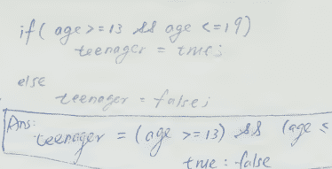

### 5. 数学运算：

```
min(x, y)
```

可以用条件表达式表示为：

```
(x < y) ? x : y
```

同样，仅使用条件表达式，描述数学运算：

```
min(x, y, z)
```

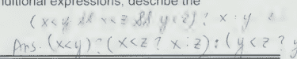

## 身体质量指数实验

BMI（身体质量指数）是根据个人的身高和体重衡量其体脂的一种指标。它可以确定个人是否超重或肥胖。

计算BMI的公式如下：

```
BMI = weightInPounds x 703
heightInInches x heightInInches
```

下表可用于评估BMI得分：

| BMI数值 | |
| :--- | :--- |
| 小于18.5 | 体重过轻 |
| 18.5至小于25.0之间 | 正常 |
| 25.0至小于30.0之间 | 超重 |
| 30.0或更高 | 肥胖 |

本实验要求你构建一个C程序bmi.c，其中包含一个名为calculateBMI()的函数，该函数提示用户输入以磅为单位的体重和以英寸为单位的身高，然后计算并显示身体质量指数。该函数还应显示一个人是体重过轻、正常、超重还是肥胖。

请确保用户提示以及程序中输入的身高和体重值都显示在输出文件中。请注意，计算出的BMI值应显示一位小数。你的函数中接收身高和体重值的变量应声明为double类型。

以下是我希望你用于该程序的main()函数。

```
int main (void) {
    int i;

    csis = fopen("csis.txt", "w");
    for (i = 1; i <= 4; ++i) {
        calculateBMI();
    }
    fclose(csis);
    return 0;
}
```

请注意，for循环会调用calculateBMI()函数四次。每次调用calculateBMI()函数时，都会输入不同的体重和身高。请务必使用以下数据：

| 第一次： | 175 | 70 | 25.1 | 超重 | |
| 第二次： | 120 | 68 | 18.2 | 体重过轻 | (z<x 28 x<5) |
| 第三次： | 225 | 65 | 37.4 | 肥胖 | (2x<5) |
| 第四次： | 140 | 67 | 21.9 | 正常 | |

程序的输出应同时发送到终端窗口（你的屏幕）以及请求的csis.txt输出文件。请务必阅读关于捕获程序输出的文档。你的全名和Palomar ID号必须作为注释出现在包含main()的源文件中。请务必将csis.txt输出文件包含在zip存档中。请勿修改我上面提供的main()函数。

## 大小实验

编写一个C程序largeSmall.c，其中包含一个名为compare()的函数，该函数提示用户输入四个整数，并计算并显示这些整数中的最大值和最小值。请确保用户提示以及程序中输入的四个整数都显示在输出文件中。

以下是我希望你用于该程序的main()函数。

```
int main (void) {
    int i;
    csis = fopen("csis.txt", "w");
    for (i = 1; i <= 4; ++i) {
        compare();
    }
    fclose(csis);
    return 0;
}
```

请注意，for循环会调用compare()函数四次。每次调用compare()函数时，都会输入一组不同的四个整数。请务必使用以下数据：

| | a | b | c | d | 最大值 | 最小值 |
|---|---|---|---|---|---|---|
| 第一次： | 28 | 44 | 66 | 82 | 82 | 28 |
| 第二次： | 8 | 14 | 22 | 6 | 22 | 6 |
| 第三次： | 21 | 38 | 12 | 16 | 38 | 12 |
| 第四次： | 98 | 22 | 45 | 63 | 98 | 22 |

程序的输出应同时发送到终端窗口（你的屏幕）以及请求的csis.txt输出文件。请务必阅读关于捕获程序输出的文档。你的全名和Palomar ID号必须作为注释出现在包含main()的源文件中。请务必将csis.txt输出文件包含在zip存档中。请勿修改我上面提供的main()函数。

# 第8章 重复语句

- While语句
- For语句
- 逗号运算符
- Do-While循环
- Break语句
- Continue语句
- 重复作业
- 成绩实验
- 便士实验
- 斐波那契实验

## While循环

重复语句允许你指定，只要某个条件保持为真，就重复执行某个操作。例如，以下语句：

```
while there are more items on my shopping list
purchase next item and cross it off my list
```

描述了购物过程中发生的重复操作。条件：

```
there are more items on my shopping list
```

可能为真或假。如果为真，则执行操作：

```
purchase next item and cross it off my list
```

将被执行。只要条件保持为真，此操作就会重复执行。最终，条件将变为假（当购物清单上的最后一项已被购买并划掉时）。此时，重复终止，并执行重复结构之后的第一条语句。

因此，循环提供了一种手段，只要控制循环的条件（通常位于循环头中）求值为真，就重复执行一系列可执行语句（循环体）。循环控制条件是一个求值为真或假的逻辑表达式。通常，该表达式涉及一个单变量，称为循环控制变量。

循环体是包含与循环条件关联的一系列可执行语句的代码块。请注意，循环体可以是单条语句或复合语句。只要循环条件求值为真，循环体就会重复执行。当循环条件求值为假时，循环将终止。每次重复循环体时，循环被认为经历了一次迭代。


### while 循环的语法如下：

```
// Before the loop construct, initialize any loop control variable,
// i.e., the variable appearing in the condition in the loop header.
while (condition) { // loop header - test the loop condition
    statement;
}
or
while (condition) { // loop header - test the loop condition
    statement;
    statement;
    ...
}
```

请记住，循环体必须包含一条用于更新循环条件中所用循环控制变量的语句。循环控制变量通常位于循环体的底部。

请注意，当 while 循环结构只有一条语句时，花括号 { } 是可选的。但是，即使不是必须的，使用花括号始终是个好主意。

### 示例：2 的幂

举个例子，假设有一个程序段旨在找出大于 100 的第一个 2 的幂。我们首先将整型变量 product 初始化为 2。当以下 while 重复语句执行完毕后，product 将包含所需的答案：

```
product = 2;
while (product <= 100) {
    product = product * 2; // or we can say: product *= 2;
}
```

进入 while 语句时，product 的值为 2。变量 product 反复乘以 2，依次取值 2、4、8、16、32、64 和 128。当 product 变为 128 时，while 语句中的条件：

```
product <= 100
```

变为假。这终止了重复，product 的最终值为 128。程序执行继续在 while 循环之后的下一条语句处进行。

我们可以将此示例推广，编写一个名为 findMax() 的函数，它将返回大于某个最大值的第一个 2 的幂：

```
#include <stdio.h>

int findMax(int value);

int main (void) {
    int value, max;

    value = 500;
    max = findMax(value); ...
    printf("The first power of 2 larger than %d is %d.", value, max);
    return 0;
}

int findMax(int value) {
    int product = 2;

    while (product <= value) {
        product *= 2;
    }
    return product;
}
```

其输出如下：

```
The first power of 2 larger than 500 is 512.
```

我们可以进一步推广此示例，使函数 findMax() 返回大于某个最大值的第一个 num 的幂：

```
#include <stdio.h>

int findMax(int product, int value);

int main (void) {
    int num, value, max;

    num = 5;
    value = 1000;

    max = findMax(num, value);
    printf("The first power of %d larger than %d is %d.", num,
           value, max);

    return 0;
}

int findMax(int product, int value) {
    while (product <= value) {
        product *= 2;
    }
    return product;
}
```

其输出如下：

```
The first power of 5 larger than 1000 is 1280.
```

## 计数器控制循环

计数器控制循环使用一个变量来统计已完成的循环迭代次数，从而重复执行一系列可执行语句指定的次数。

- 循环体重复的次数必须在第一次检查循环条件之前已知，且在循环体内不得更改。
- 计数变量必须在第一次检查循环条件之前初始化为已知值。
- 计数变量必须在循环体内更新，否则循环条件永远不会评估为假，从而创建一个永远不会停止的无限循环。
- 计数变量可以以任意量递增（值增加）或递减（值减少）。

### 示例：摄氏度到华氏度转换表

我们的转换表将使用一个计数器变量 ctemp 来控制 while 循环执行的次数。在此示例中，当 ctemp 变为 < 0 时，重复终止。

```c
#include <stdio.h>
int main (void) {
    int ctemp;
    float ftemp;
    printf("Celsius\t\tFahrenheit\n");
    ctemp = 100;
    while (ctemp >= 0) {
        ftemp = (9.0/5.0) * (float)ctemp + 32.0;
        printf ("%7d%15.1f\n", ctemp, ftemp);
        ctemp = ctemp - 10;
    }
    return 0;
}
```

程序输出如下：

| 摄氏度 | 华氏度 |
|---|---|
| 100 | 212.0 |
| 90 | 194.0 |
| 80 | 176.0 |
| 70 | 158.0 |
| 60 | 140.0 |
| 50 | 122.0 |
| 40 | 104.0 |
| 30 | 86.0 |
| 20 | 68.0 |
| 10 | 50.0 |
| 0 | 32.0 |

- 如果我们写 (9/5) 而不是 (9.0/5.0) 会发生什么？
- 如果我们去掉 (9.0/5.0) 两边的括号会发生什么？
- 为什么在上述表达式中写 `(float)ctemp` 而不是仅写 `ctemp` 是个好主意？

### 求和变量

假设我们希望求 1 到 1000 的数之和。我们不仅需要一个计数器变量来控制 while 循环执行的次数，还需要一个求和变量来累加目前为止所见数字的总和。

```
// summation.c

#include <stdio.h>

int main(void) {
    int count = 1;
    int sum = 0;

    while (count <= 1000) {
        sum += count;
        ++count;
    }

    printf("The sum = %d.\n", sum);
    return 0;
}
```

程序输出如下：

The sum = 500500.

请注意，用于存储求和或总计的变量通常应在程序中使用前初始化为零；否则，求和变量将包含其内存位置中先前存储的值。这是因为未初始化的变量通常包含“垃圾值”，即该变量保留内存位置中最后存储的值。

## 哨兵控制循环

有时我们事先不知道希望循环迭代多少次。例如，假设我们想要输出程序中输入数字的平方和立方。程序如何确定何时停止数字输入？解决此问题的一种方法是使用一个称为哨兵值的特殊值来指示“数据输入结束”。

用户输入数据值，程序将输出其平方和立方，直到输入哨兵值，这表示最后一个数据值已被输入。请注意，哨兵值的选择必须使其不会与可接受的输入值混淆。

```
// sentinel.c
#include <stdio.h>
int main(void) {
    int num;
    printf("Enter number, -999 to end: ");
    scanf("%d", &num);
    while (num != -999) {
        printf("%5d %5d %5d\n", num, num * num, num * num * num);
        printf("Enter number: ");
        scanf("%d", &num);
    }
    return 0;
}
```

程序输出如下：

```
Enter number, -999 to end: 2
2    4    8
Enter number, -999 to end: 5
5   25  125
Enter number, -999 to end: 8
8   64  512
Enter number, -999 to end: -999
```

## for 语句

for 语句适用于在进入循环之前已知循环迭代次数的情况。循环头由三个部分组成，用分号分隔：初始化、测试和更新。

```
for (i = 1; i <= 100; i++)
```

第一部分在进入循环之前运行。这通常是循环控制变量的初始化。

第二部分是对循环控制变量的测试。当此测试不再为真时，退出循环。

第三部分是循环控制变量的更新。这通常是在循环体完成后每次执行的语句。通常这是对循环控制变量的递增或递减。

以下是 for 语句的语法：

```
for (initialExpression; loopCondition; loopExpression) {
    statement;
}
```

- initialExpression 在循环开始前设置初始值。
- loopCondition 指定继续循环所需的条件。
- loopExpression 在循环体执行后每次执行。

### 示例：求 1 到 100 的整数和

```
int i, sum = 0;
for (i = 1; i <= 100; ++i) {
    sum += i;
}
```


在我们的示例中，变量 i 是循环控制变量，并初始化为 1。如果 loopCondition 为 true，即 i <= 100，则循环体将执行一次。在循环体的最后一条语句执行后，将执行 loopExpression。在此情况下，i 的值将递增 1。如果 loopCondition 仍为 true，则 for 循环体将再次执行，以此类推。

请注意，for 语句中的任何或所有表达式都可以缺失，但两个分号必须始终保留。例如，如果 initialExpression 缺失，则作为 for 循环一部分不会执行任何初始化步骤：

```
// Compute the sum of integers from 1 - 10.
int i = 1, sum = 0;
for ( i = 1; i <= 10; ++i ) {
    sum += i;
}
```

当 loopCondition 缺失时，规则是测试始终为 true。因此下面的 for 循环是一个无限循环：

```
int i = 1, sum = 0;
for ( ; ; ) {
    sum += i++;
    printf("%d ", sum);
}
```

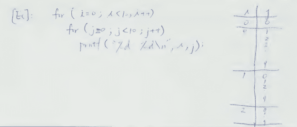

请注意，for 语句始终可以翻译为等效的 while 语句，反之亦然：

```
// for loop
for (initialExpression; loopCondition; loopExpression)
    statement;
}

// while loop
initialExpression;
while (loopCondition) {
    statement;
    loopExpression;
}
```

请务必不要在 for 循环标题的末尾放置分号：

```
int i, sum = 0;
for (i = 1; i <= 100; ++i)
    sum += i;
```

这将造成一个问题，因为 for 循环将不再有循环体。在这种情况下，循环的控制方面将执行 100 次，但什么也不会做，因为循环体为空。

请注意，当 for 循环构造只有一条语句时，花括号 { } 是可选的。但是，即使不是必需的，使用花括号始终是个好主意。

## 嵌套 for 循环

有时我们需要将一个 for 循环放在另一个 for 循环的循环体中。这被称为嵌套 for 循环。你能跟踪下面嵌套 for 循环的控制流程吗：

```
#include <stdio.h>
int main(void) {
    int i, j;
    for (i = 1; i <= 4; ++i) {
        for (j = 1; j <= 3; ++j) {
            printf("%d %d\n", i, j);
        }
    }
    return 0;
}
```

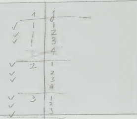

这里是生成的输出：

```
1 1
1 2
1 3
2 1
2 2
2 3
3 1
3 2
3 3
4 1
4 2
4 3
```

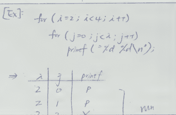

## 逗号运算符

偶尔，你会发现自己处于这样的情况：C 期望一个单一表达式，但你有两件事想表达。最常见的（事实上也是唯一常见的）示例是在 for 循环中，具体来说是第一个和第三个控制表达式。如果（例如）你想要一个循环，其中 i 从 0 递增到 10，同时 j 从 10 递减到 0，该怎么办？你可以在循环标题中操纵 i，并“手动”处理 j：

```
j = 10;
for (i = 0; i < 10; i++, )
{
    ... rest of loop ...
}
```

但这里更难看出 i 和 j 的并行性质，而且如果循环包含 continue 语句，这种方法也无法正常工作。（continue 会跳回循环顶部，i 会递增但 j 不会递减。）你可以根据 i 计算 j：

```
for (i = 0; i < 10; i++, )
{
    j = 10 - i;
    ... rest of loop ...
}
```

但这也使 j 不必要地从属。在 C 中编写此循环的常用方式是：

```
for ( (1) i = 0, j = 10; (2) i < 10; (3) i++, j-- )
{
    ... rest of loop ...
}
```

在这里，第一个（初始化）表达式是：

```
i = 0, j = 10
```

逗号是 *逗号运算符*，它只是先求值第一个子表达式 `i = 0`，然后求值第二个 `j = 10`。

第三个控制表达式：

```
i++, j--
```

也包含一个逗号运算符，同样，先执行 `i++`，然后执行 `j--`。

在此示例中，我们在 `for` 循环中将变量 `i` 和 `j` 都初始化为 0。

```
for (i = 0, j = 0; i < 10; ++i)
```

准确地说，在一般表达式中逗号运算符的含义是：

```
e1 , e2
```

即“求值子表达式 *e1*（然后求值 *e2*；表达式的值是 *e2* 的值）。”因此，*e1* 最好涉及赋值、递增 `++`、递减 `--`、函数调用或其他某种 *副作用*，因为否则它将计算一个会被丢弃的值。

除了在 `for` 循环的第一个和第三个控制表达式中使用逗号运算外，几乎没有任何理由在其他地方使用逗号运算符，而且事实上，你在 C 程序中看到的大多数逗号都 *不是* 逗号运算符。特别是，函数调用参数之间的逗号都不是 *逗号* 运算符；它们只是分隔多个参数表达式的标点符号。很容易看出它们不能是 *逗号* 运算符，否则在类似这样的调用中：

```
printf("Hello, %s!\n", "world");
```

操作将是“求值字符串 “Hello, %s!\n”，丢弃它，并仅将字符串 “world” 传递给 `printf()`。这当然 *不是* 我们想要的；我们期望两个字符串都作为两个单独的参数传递给 `printf()`（当然，这正是发生的情况）。

## do-while 循环

do-while 循环与 while 循环非常相似，区别在于测试发生在循环体末尾。这保证了循环在继续之前至少执行一次。这种设置经常用于需要读取数据的情况。然后测试会验证数据，如果数据不可接受，则循环回去再次读取。

例如，假设你想读取一个正整数，并且要坚持该整数必须是正数：

```
do {
    printf("Enter a positive value: ");
    scanf("%d", &num);
} while (num <= 0);
```

请注意以下几点：

- 条件 num <= 0 在循环体执行后进行测试。
- 只要求值表达式 num <= 0 为 true，循环就会继续。
- 当表达式 num <= 0 变为 false 时，循环终止。
- 代码始终至少执行一次循环体。
- 在 do-while 循环构造末尾的右括号后需要分号。
- 循环条件中使用的变量通常应在进入循环前初始化，然后在循环体中更新，以便在每次循环体重复结束时测试循环条件之前进行更新。

请注意，当 do-while 循环构造只有一条语句时，花括号 {} 是可选的。但是，即使不是必需的，使用花括号始终是个好主意。

## break 语句

break 语句可用于 while、do while、for 和 switch 语句中。在每个这些构造中，它都作为跳转到语句末尾的作用。它会导致从循环中退出，就像从 switch 语句中退出一样。执行 break 后，程序控制权跳转到循环后面的语句。例如：

```
for (i = 0; i < num; ++i) {
    if (i > 100) {
        break;
    }
    sum += i;
}
```

请注意，每次你编写 break（switch 语句除外）时，都应该质疑是否有不使用 break 来表达相同逻辑的简单方法。我们可以不使用 break 来修改上面的代码，如下所示：

```
for (i = 0; i < num && i <= 100; ++i) {
    sum += i;
}
```

这里是另一个示例。假设我们想在字符串 s 中查找第一个空白字符（空格、制表符或换行符）：

```
// misuse of break
for (i = 0; i < max; ++i) {
    if (s[i] == ' ') {
        break;
    } else if (s[i] == '\t') {
        break;
    } else if (s[i] == '\n') {
        break;
    }
}
```

更专业的方法是在循环的测试中说明循环条件：

```
// search for whitespace character
for (i = 0; s[i] != ' ' && s[i] != '\t' && s[i] != '\n'; ++i) {
}
```

我们也可以概括空白字符的概念：

```
for (i = 0; !isspace(s[i]); ++i) {
}
```

我们很快将更深入地探讨字符串。

recursion: 递归 (回溯) (拼音)
f(n) = g(f(n-1))   即：阶乘

- 2!
- 3!
- 4!
- n!

```
int fact(int n)
{
    if (n == 1)
        return 1;
    else
        return n * fact(n-1);
}
```

5! = 5 * 4 * 3 * 2 * 1


## continue 语句

break 语句可以用来立即跳出循环。
然而，有时当发生意外情况时，你希望回到循环的顶部。

例如，我们可以使用 continue 语句来避免除以零的错误：

```
// calculate reciprocals for -5 to 5

int main(void) {
    int i;

    for (i = -5.0; i <= 5.0; i += 1.0) {
        if (i == 0.0) {
            printf("Divide by zero trap.\n");
            continue;
        }
        printf("%f\n", 1.0 / i);
    }
    return 0;
}
```

请注意，在 for 语句的循环体中，continue 语句会跳转到 loopExpression；即 for 语句的第三个表达式。在 while 和 do while 循环中，它会跳转到测试条件。

与 break 语句类似，你应始终质疑 continue 语句的必要性。通过简单地重构代码，你通常可以消除对 continue 语句的需求。你很可能不会使用它。

```
-0.200000
-0.250000
-0.333333
-0.500000
-1.000000
Divide by zero trap.
1.000000
0.500000
0.333333
0.250000
0.200000
```

### 1. 以下程序片段会产生什么输出？

```
i = 1;
while (i <= 64) {
    printf("%d ", i);
    i *= 2;
}
```

答：1 2 4 8 16 32 64

### 2. 以下程序片段会产生什么输出？

```
i = 1234;
do {
    printf("%d ", i);
    i /= 10;
} while (i > 0);
```

答：1234 123 12 1

### 3. 显示以下每个代码块的输出：

```
a) for (i = 13; i < 23; i += 2) {
    printf("%d\n", i);
}
```

答：13 15 17 19 21

```
b) for (i = 30; i > 0; i -= 8) {
    printf(" %d\n", i);
}
```

答：30 22 14 6

4. 使用 for 语句编写 C 语句，对 1 到 100 之间的偶数整数求和。假设整型变量 sum 和 count 已初始化，类型为 int。

```
for (count = 2; count <= 100; count += 2)
    sum += count;
printf("Sum = %d\n", sum);
```

### 5. 编写 for 语句，打印以下数值序列：

a) 5, 10, 15, 20, 25

```
for (i = 5; i <= 25; i += 5)
printf("%d ", i);
```

b) 100, 90, 80, 70, 60, 50, 40, 30, 20, 10

```
for (i = 100; i >= 10; i -= 10)
printf("%d ", i);
```

6. 假设我们想要计算从 50 到 1 的整数之和。以下代码有什么问题？

```
sum = 0;
num = 50;
while (num >= 0)
    sum += num;
}
```

7. 看看你能否通过重组来改进以下程序片段。首先分析代码以确定实际执行的功能。然后以尽可能清晰简单的方式重新编写该功能（即不使用 break 或 continue）。

```
a) while(a) {
    if(b) {
        continue;
    }
    c();
}
```

```
b) do {
    if (!a) {
        continue;
    }
    else {
        b();
        c();
    }
} while (a);
```

## 成绩实验室

编写一个 C 程序 grade.c，其中包含一个名为 calculateAverage() 的函数，该函数可以计算任意数量测试分数的平均值。你的程序事先不会知道将有多少个测试分数输入到你的函数中，因此你需要使用哨兵值（-1）来终止用于收集测试分数的 while 循环。测试分数是 0 到 100 之间的整数，测试分数的平均值应输出到小数点后两位。确保用户提示和输入程序的成绩在输出文件中显示。

```
int main (void) {
    int i;
    csis = fopen("csis.txt", "w");
    for (i = 1; i <= 4; ++i) {
        calculateAverage();
    }
    fclose(csis);
    return 0;
}
```

请注意，for 循环调用 calculateAverage() 函数四次。每次调用 calculateAverage() 函数时，都会输入一组不同的测试成绩。请务必使用以下所示的数据：

| 测试用例 | 数据 | 平均值 |
| :--- | :--- | :--- |
| 第一组 | [78, 93, 45, 88, 89] -1 | 78.60 |
| 第二组 | [87, 68, 100] -1 | 85.00 |
| 第三组 | [84, 86, 90, 86, 96, 68, 82] -1 | 84.57 |
| 第四组 | -1 | |

程序的输出应发送到终端窗口（您的屏幕）以及请求的 csis.txt 输出文件。请务必阅读关于捕获程序输出的文档。您的全名和 Palomar ID 号必须作为注释出现在包含 main() 的源文件中。请务必将 csis.txt 输出文件包含在 zip 压缩包中。请勿修改我上面提供的 main() 函数。

## 便士实验室

第一天你往银行存一便士。第二天你存两便士。第三天你存四便士。第四天你存八便士，以此类推。假设你每天继续将存款翻倍，编写一个 C 程序 penny.c，确定需要多少天才能累积至少一百万美元。（假设不支付利息。）请注意，要累积的金额必须在运行时输入。

每天的输出应包括当天的存款金额以及截至当天的银行总余额。你的输出应以下表所示的表格形式出现：

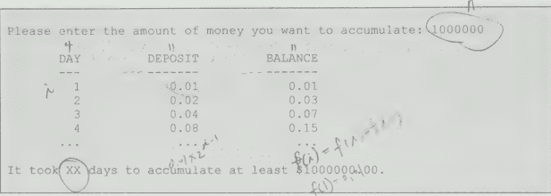

你的程序应包含一个 main() 函数、一个用于输出表头的函数以及一个用于生成表格的函数。生成表格的函数应接收一个 double 类型的输入参数，告诉你想要累积多少钱。该函数的输出应按小数点对齐列，并向 main() 提供一个返回值，告诉累积资金花了多少天。然后应按上述方式输出此返回值。

程序的输出应发送到终端窗口（您的屏幕）以及请求的 csis.txt 输出文件。请务必阅读关于捕获程序输出的文档。您的全名和 Palomar ID 号必须作为注释出现在包含 main() 的源文件中。请务必将 csis.txt 输出文件包含在 zip 压缩包中。

## 斐波那契实验室

斐波那契数列是以下数字系列：

```
0, 1, 1, 2, 3, 5, 8, 13, 21, ...
```

序列中的每个附加数字都是通过将其前两个数字相加得到的。

编写一个名为 fibonacci.c 的程序，计算前 20 个斐波那契数。你的程序应包含一个名为 fib() 的函数，该函数接收来自 main() 的输入参数，告诉函数输出多少个斐波那契数。

程序的输出应发送到终端窗口（您的屏幕）以及请求的 csis.txt 输出文件。请务必阅读关于捕获程序输出的文档。您的全名和 Palomar ID 号必须作为注释出现在包含 main() 的源文件中。请务必将 csis.txt 输出文件包含在 zip 压缩包中。

```
int i, n1=0, n2=1, temp;
for (i=0; i<n; i++)
{
    printf("%d", n);
    fprintf(csis, "%d, ", n);
    temp=n1;
    n1=n2;
    n2=n1+temp;
}
printf("\n");
int main() {
Fib(n) = Fib(n-1) + Fib(n-2)
}
```

```
#include <stdio.h>
#include <math.h>
#define RECURSION
double calcDottie (int N, ...)
void main ()
{
    int N;
    double S, D;
    printf(" Enter Seed: ");
    scanf("%lf", &S);
    printf(" Enter # of iterations: ");
    scanf("%lf", &N);
    D = calcDottie(N, S);
    printf(" Dottie's Number = %lf", D);
}
#ifdef RECURSION
double calcDottie (int N, double S)
{
    if (N==1)
        return cos(S);
    else
        return cos(calcDottie(N-1, S));
```

- 流
- getchar()
- putchar()
- 文本文件
- 输入-输出作业

## 流

C 语言本身没有任何用于执行 I/O 操作的特殊语句。所有 I/O 操作都必须通过对标准 I/O 库的函数调用来完成。

```
#include <stdio.h>
```

包含与标准 I/O 库相关的声明和宏定义。

每个程序在开始执行时都可以访问三个数据文件流：一个用于输入，两个用于输出：

- stdin（标准输入）– 输入字符的通常来源（键盘）
- stdout（标准输出）– 输出字符的通常目标（屏幕）
- stderr（标准错误输出）– 发送错误消息的位置（屏幕）

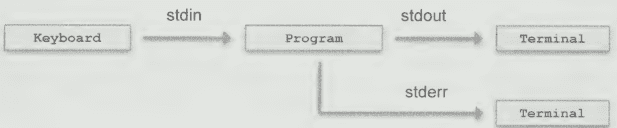

可以通过在命令行执行程序时添加重定向请求，使同一程序将其标准输出放入文件而不是终端：

```
foo > outFile.txt
```


这将创建一个包含 foo 输出的文件。任何由 printf() 显示的值都不会在终端上显示，而是会写入名为 outFile.txt 的文件中。如果有任何错误消息，它们将继续显示在终端窗口中，而不是被埋在输出文件内。

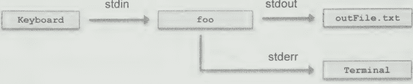

标准输入也可以进行类似的重定向。任何通常从终端读取数据的函数调用，例如 getchar() 和 scanf()，都可以改为从文件读取其信息。例如，我们可以使用存储在名为 inFile.txt 的文件中的数据来运行程序 foo：

```
foo < inFile.txt
```

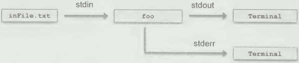

最后，我们可以同时结合输入重定向和输出重定向：

```
foo < inFile.txt > outFile.txt
```

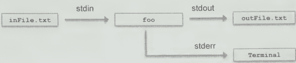

```
FILE * cis
fprintf( cis, "text");
stdout
fscanf( cis, "%d", &x);
scanf( "%d", &x)
fscanf( stdin, "%d", &x);
```

## getchar()

I/O 并非 C 语言本身的一部分，而是编写大多数程序所需的基本扩展。

getchar() 从标准输入（键盘）返回下一个字符，并将其作为函数返回值返回。如果没有更多输入，则改为返回 EOF（文件结束）。因此，在使用之前，通常将 getchar() 返回的值与 EOF 进行比较。

在程序执行过程中的某个时刻，用户可以通过输入 ^z（控制 Z）（或在某些环境中输入 ^d）来表示“没有更多输入”，此时 getchar() 将返回 EOF。

getchar() 和 EOF 定义在名为 stdio.h 的标准头文件中，我们必须在所有编译中包含它：

```
#include <stdio.h>
```

某些 C 表达式成为我们标准词汇的一部分，例如：

```
while ((c = getchar()) != EOF)
```

此表达式用于从标准输入一次获取一个字符的循环开头。请仔细查看该表达式，并注意那对“额外”的括号。你能弄清楚为什么需要它们吗？

接下来，思考以下两者之间的区别：

```
while (c = getchar())
```

和

```
while (c == getchar())
```

要看出区别可能需要很长时间，有时甚至需要更长时间来决定你真正想要哪一个！

下面是一个程序，用于计算从输入流中读取的字符数，直到遇到 EOF：

```
#include <stdio.h>

int main(void) {
    int c, count = 0;

    while ((c = getchar()) != EOF) {
        ++count;
    }
    printf("%d\n", count);
    return 0;
}
```

请注意，c 被声明为 int 而不是 char。这是因为 EOF 被赋予定义值 -1。在某些机器上，char 只能是正值，因此为了返回 -1，我们将 c 定义为 int。

我们可以将上面的 while 语句替换为 for 语句：

```
#include <stdio.h>

int main(void) {
    int count;

    for (count = 0; getchar() != EOF; ++count) {
        ;
    }
    printf("%d\n", count);
    return 0;
}
```

## 我们也可以计算换行符：

```
#include <stdio.h>

void main(void) {
    int c, count = 0;

    while ((c = getchar()) != EOF) {
        if (c == '\n') {
            ++count;
        }
    }
    printf("%d\n", count);
    return 0;
}
```

## 下面是一个将程序输入映射为小写的程序：

```
#include <stdio.h>
#include <ctype.h>

void main(void) {
    int c;

    while ((c = getchar()) != EOF) {
        printf("%c", isupper(c) ? tolower(c) : c);
    }
    return 0;
}
```

## 下面是一个表达式，用于跳过输入流中的空白字符：

```
while ((c = getchar()) != ' ') {
}
```

由于 C 语言没有内置函数来读取整行输入，因此它可以被称作一种相当原始的语言。然而，这鼓励了工具构建！所以让我们构建一个读取一行输入的函数，并将其封装为名为 getLine() 的函数，以便在需要时使用。

下面的程序将输入行复制到输出。它一次读取一行到字符串 buf 中。在字符串 buf 的末尾放置一个空终止符。如果输入处于 EOF，则返回 EOF 值。

```
#include <stdio.h>
#define BUFSIZ 81
int getLine(char buf[]);
int main(void) {
    char buf[BUFSIZ];
    while (getLine(buf) != EOF) {
        printf("%s", buf);
    }
    return 0;
}
int getLine(char buf[]) {
    char c;
    int i = 0;
    do {
        c = getchar();
        buf[i++] = c;
    } while(c != '\n');
    buf[i-1] = '\0';
    return i;
}
```

看看我们如何将 getLine() 重写得更简单：

```
int getLine(char buf[]) {
    char c;
    int i = 0;
    while ((buf[i++] = getchar()) != '\n') {
    ;
    }
    buf[i] = '\0';
    return i;
}
```

## putchar()

putchar() 向标准输出（终端窗口）输出一个字符。putchar() 的参数应该是单个字符，可以是变量或常量：

```
putchar(c);
putchar('a');
putchar('\n');
```

如果你只需要输出一个字符而不需要格式，请使用 putchar() 而不是 printf()。下面是一个名为 copy.c 的程序，它将输入复制到输出：

```
#include <stdio.h>

int main(void) {
    int c;

    while ((c = getchar()) != EOF) {
        putchar(c);
    }
    return 0;
}
```

请注意，如果将此程序应用于 100 字节的文件，它将调用 getchar() 101 次。前 100 次调用将返回一个数据字节。第 101 次调用将返回 EOF 值。因此，测试将被求值 101 次，循环体将执行 100 次。

使用此程序，我们可以利用 I/O 重定向编写自己的命令行复制命令：

```
copy < infile.txt > outfile.txt
```

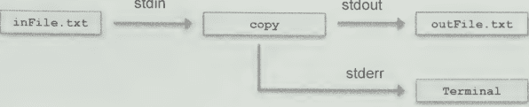

下面是一个将其输入映射为小写的程序：

```
#include <stdio.h>
#include <ctype.h>
int main(void) {
    int c;
    while ((c = getchar()) != EOF) {
        putchar(isupper(c) ? tolower(c) : c);
    }
    return 0;
}
```

最后，让我们编写一些代码，读取全小写字母的文本，并有选择地将每个单词的首字母大写。字母将被定义为任何非空白字符。

## 首先是一个算法：

```
for each whitespace character w
    output w
for each word
    capitalize initial letter
    for each succeeding letter
        output c
for each whitespace character w
    output w
```

## 现在是一些代码：

```
while ((c = getchar()) != EOF) {
    if (isspace(c)) {
        putchar(c);
    } else {
        putchar(toupper(c));
        while (isspace(c = getchar())) {
            putchar(c);
        }
        putchar(c);
    }
}
```

让我们看看是否可以重新设计这个算法和代码：

## 首先是算法：

```
for each input character c
    if c is the first letter of a word
        output capitalized c
    else
        output c
```

## 现在是代码：

```
for (wasWhite = 1; (c = getchar()) != EOF; wasWhite = isspace(c)) {
    putchar (isspace(c) && wasWhite ? toupper(c) : c);
}
```

请注意，这种设计会产生一个更简单的程序。

## 文本文件

文本文件是由 *字符* 序列组成，以 *文件结束标记* 结尾。文件长度在定义文件时未指定。文件中的字符存储在程序执行时占用的内存以外的存储设备上，例如磁盘驱动器。

请注意对字符的强调。文本文件中只有字符，仅此而已。字符之间可能夹杂着换行字符 '\n' 或制表符 '\t' 字符。此外，文件中的每个数据元素（单词、数值数据）通常（但不总是）由空格与其他元素分开。

文件的优势在于它们可以独立于创建或使用文件中数据的程序而存在。文件大小也不是限制因素，因为我们可以通过在文件末尾添加一个字符来简单地增加文件大小。

## 访问文本文件

文本文件是通过指向在标准头文件 `stdio.h` 中定义为 `FILE` 的结构的指针来访问的。该结构 `FILE` 包含描述文件当前状态的成员（字段）。

C 使用一种称为 *文件指针* 的数据类型与文件进行通信。该类型在 `stdio.h` 中定义，写作 `FILE *`。名为 `fp` 的文件指针在类似以下的语句中声明：

```
FILE *fp;
```

你的程序必须先打开文件才能访问它。这是使用 `fopen()` 函数完成的，它返回所需的文件指针。`fopen()` 的声明如下：

```
FILE *fopen(char *fileName, char *fileMode);
```

`fopen()` 打开一个文件用于 I/O 并返回指向 `FILE` 的指针。`fileName` 和 `fileMode` 都是字符串。文件名可以是操作系统下可以存在的任何有效文件名，并可以包含路径信息：


"myfile.dat"
"/users/home/input.txt"

如果未指定路径信息，则假定文件位置为程序运行所在的目录，即工作目录。

## 文件模式如下：

| 模式 | 说明 |
|---|---|
| "r" | 读取 - 读取文件中的数据 |
| "w" | 写入 - 将数据写入文件 |
| "a" | 追加 - 将数据追加到已包含一些数据的文件末尾 |

"r" 模式仅从文件开头以只读方式打开指定文件。指定文件必须存在才能成功打开。请注意，文件内容不能更改。

"w" 模式从文件开头以写入方式打开指定文件。如果文件不存在，则会创建该文件。如果文件已存在，则无论是否执行任何文件操作，文件的原始内容都会被覆盖。

"a" 模式从文件末尾以写入方式打开指定文件。如果文件不存在，则会创建该文件。如果文件已存在，则文件的原始内容不会更改。所有写入操作都会追加到文件末尾。

要以读取方式打开文件，可以这样写：

```
FILE *fp;
fp = fopen("infile.txt", "r");
```

如果出于任何原因无法打开 `fileName`，则将返回指针值 NULL。我们可以将此变量与定义的值 NULL 进行测试：

```
FILE *fp;

fp = fopen("infile.txt", "r");
if (fp == NULL) {
    printf("File could not be opened.\n");
    exit(1);
}
```

这将告诉我们打开是否成功。请注意，`exit(1)` 是一个需要 `#include <stdio.h>` 头文件的函数，并会导致程序中止。

我们实际上可以将 `fopen()` 调用、返回的 FILE 指针变量的赋值以及对 NULL 指针的测试合并为一个表达式：

```
FILE *fp;

if ((fp = fopen("infile.txt", "r")) == NULL) {
    printf("File could not be opened.\n");
    exit(1);
}
```

或者我们可以更简洁地说：

```
FILE *fp;

if (!(fp = fopen("infile.txt", "r"))) {
    printf("File could not be opened.\n");
    exit(1);
}
```

`fclose()` 命令可用于将文件指针与文件断开连接。这样做通常是为了让指针可用于访问不同的文件。系统对同时打开的文件数量有限制，因此在使用完文件后最好将其关闭。

fclose() 语句定义如下：

```
int fclose(FILE *fp);
```

调用方式如下：

```
fclose(fp);
```

fclose() 会清空缓冲区并断开与指示文件的所有连接。如果 fp 未与文件关联，则返回 EOF。请注意，如果程序退出时未关闭文件，系统会为您关闭文件。但是，通常最好自己正确关闭文件，以确保文件中的数据被正确保存。

## 文件 I/O 语句

打开文件指针后，您可能希望将其用于输入或输出。C 提供了一组函数来允许您执行此操作。所有函数都与您之前见过的输入和输出函数非常相似。

文件输入和输出使用 getchar() 和 putchar() 的等效函数 getc() 和 putc() 来执行。每个函数都接受一个额外参数，用于标识要用于输入或输出的文件指针。

```
c = getc(fp)
```

这是一个宏，用从 fp 指向的文件中检索下一个字符。字符值作为 int 返回。如果遇到文件末尾或发生错误，则返回 EOF。请注意，getchar() 实际上是定义为 getc(stdin) 的宏。

### 函数原型：

```
int getc(FILE *fp);
```

putc(c, fp)；是一个宏，用将 c 的字符值放入 fp 指向的文件中。它返回写入字符的 int 值。请注意，putchar(c) 是定义为 putc(c, stdout) 的宏。

### 函数原型：

```
int putc(int c, FILE *fp);
```

c = getc(fp)；与 getc(fp) 类似，但是是一个函数而不是宏。

### 函数原型：

```
int fgetc(FILE *fp);
```

fputc(c, fp)；与 putc(c, file_ptr) 类似，但是是一个函数而不是宏。

### 函数原型：

```
int fputc(int c, FILE *fp);
```

## 示例：将文件内容输出到标准输出。

```
#include <stdio.h>
#include <stdlib.h>

int main(void) {
    int c;
    FILE *fp;

    if ((fp = fopen("infile.txt", "r")) == NULL) {
        printf("File could not be opened.\n");
        exit(1);
    }

    while((c = getc(fp)) != EOF) {
        putchar(c);
    }

    fclose(fp);
    return 0;
}
```

## 示例：输出文件内容到标准输出，并从用户处请求文件名。

```
#include <stdio.h>
#include <stdlib.h>

int main(void) {
    int c;
    char fileName[32];
    FILE *fp;

    printf("Enter filename: ");
    gets(fileName);
    if (!(fp = fopen(fileName, "r"))) {
        printf("File %s could not be opened.\n", fileName);
        exit(1);
    }

    while((c = getc(fp)) != EOF) {
        putchar(c);
    }
    fclose(fp);
    return 0;
}
```

在文件中查找一个字符并用另一个字符替换，然后输出到新文件。
while (c != fgetc(in) != EOF)
if (pw != '\n' and putc...)

## 示例：将一个文件的内容复制到第二个文件，并输出第二个文件的内容。

```
#include <stdio.h>
#include <stdlib.h>

int main( void )
{
    FILE *fPtrIn, *fPtrOut;

    if ( ( fPtrIn = fopen( "infile.txt", "r" ) ) == NULL ) {
        printf( "File could not be opened for input.\n" );
        exit( 1 );
    }

    if ( ( fPtrOut = fopen( "outfile.txt", "w" ) ) == NULL ) {
        printf( "File could not be opened for output.\n" );
        exit( 1 );
    }

    while ( !feof( fPtrIn ) ) {
        fscanf( fPtrIn, "%d", &value );
        fprintf( fPtrOut, "%d\n", value );
    }

    fclose( fPtrIn );
    fclose( fPtrOut );

    fPtrIn = fopen( "outfile.txt", "r" );

    if ( fPtrIn == NULL ) {
        printf( "File could not be opened for input.\n" );
        exit( 1 );
    }

    while ( !feof( fPtrIn ) ) {
        fscanf( fPtrIn, "%d", &value );
        printf( "%d\n", value );
    }

    fclose( fPtrIn );

    return 0;
}
```

同样，printf() 和 scanf() 函数也有用于文件读写的等效函数，分别称为 fprintf() 和 fscanf()。这些函数的使用方式相同，只不过 fprintf() 和 fscanf() 将文件指针作为额外的第一个参数：

```
fprintf(fp, formatSpecifiers, arguments);
```

对文件执行与 printf() 函数类似的操作。它返回输出的字节数。如果发生错误，则返回 EOF。

### 函数原型：

```
int fprintf(FILE *fp,
formatSpecifiers, arguments);
```

```
fscanf(fp, format_specifiers, arguments);
```

对文件执行与 scanf() 函数类似的操作。它返回成功赋值的参数个数，或者在到达文件末尾时返回 EOF 的值。

### 函数原型：

```
int fscanf(FILE *fp, format_specifiers,
arguments);
```

此外，还有用于文件操作的 gets() 和 puts() 的等效函数：

```
fgets(s, N, fp);
```

从 fp 指向的文件中读取字符，并将其放入字符串 s 中，直到读取了 N-1 个字符或读取到换行符（以先发生者为准）。与 gets(s) 不同，如果读取到换行符，它会被放入 s 中。在两种情况下，s 都以 NULL 字符结尾。返回 s 的值（char 指针）。

### 函数原型：

```
char *fgets(char *s, int N, FILE *fp);
```

```
fputs(s, fp);
```

将以 NULL 结尾的字符串 s 复制到 fp 指向的文件中，但终止的 NULL 字符本身不被复制。与 puts(s) 不同，不会追加换行符。

### 函数原型：

```
int fputs(char *s, FILE *fp);
```

最后，我们有一个用于测试是否到达文件末尾 (EOF) 的函数。

```
feof(fp);
```

测试文件末尾。如果已读取指定文件的所有数据，则返回非零整数值，否则返回零。

### 函数原型：

```
int feof(FILE *fp);
```

## 示例：逐行输出文件内容

```
#include <stdio.h>
#include <stdlib.h>
#define MAX 81
int main(void) {
   char line[MAX];
   FILE *fp;
   if ((fp = fopen("infile.txt", "r")) {
      printf("File could not be opened for input.\n");
      exit(1);
   }
   while (!feof(fp)) {
      fgets(line, MAX, fp);
      printf("%s", line);
   }
   fclose(fp);
   return 0;
}


## 示例：将一个文件的内容逐行复制到另一个文件，然后输出新文件。

```
#include <stdio.h>
#include <stdlib.h>

#define MAX 81

int main(void) {
    char line[MAX];
    FILE *fpin, *fpout;

    if (!((fpin = fopen("infile.txt", "r"))) {
        printf("File could not be opened for input.\n");
        exit(1);
    }
    if (!((fpout = fopen("outfile.txt", "w"))) {
        printf("File could not be opened for output.\n");
        exit(1);
    }

    while (!feof(fpin)) {
        fgets(line, MAX, fpin);
        fputs(line, fpout);
    }
    fclose(fpin);
    fclose(fpout);
    if (!((fpin = fopen("outfile.txt", "r"))) {
        printf("File could not be opened for input.\n");
        exit(1);
    }

    while (!feof(fpin)) {
        fgets(line, MAX, fpin);
        printf("%s", line);
    }

    return 0;
}
```

## 示例：将两个文件连接到第三个文件并输出第三个文件。

```
#include <stdio.h>
#include <stdlib.h>
#define MAX 81
int main(void) {
    char line[MAX];
    FILE *fpIn, *fpIn1, *fpIn2, *fpOut;
    if ((fpIn1 = fopen("infile1.txt", "r"))) {
        printf("File could not be opened for input.\n");
        exit(1);
    }
    if ((fpIn2 = fopen("infile2.txt", "r"))) {
        printf("File could not be opened for input.\n");
        exit(1);
    }
    if ((fpOut = fopen("outfile.txt", "w"))) {
        printf("File could not be opened for output.\n");
        exit(1);
    }
    while (!feof(fpIn1)) {
        fgets(line, MAX, fpIn1);
        fputs(line, fpOut);
    }
    while (!feof(fpIn2)) {
        fgets(line, MAX, fpIn2);
        fputs(line, fpOut);
    }
    fclose(fpIn1);
    fclose(fpIn2);
    fclose(fpOut);
    if ((fpIn = fopen("outfile.txt", "r"))) {
        printf("File could not be opened for input.\n");
        exit(1);
    }
    while (!feof(fpIn)) {
        fgets(line, MAX, fpIn);
        printf("%s", line);
    }
    return 0;
}
```

## 关于 Microsoft C 编译器的说明（再次）

如果你使用的是 Microsoft 编译器，在构建阶段使用 `fopen()` 可能会产生警告消息。相反，Microsoft 提供了一种更安全的 `fopen()` 形式，称为 `fopen_s()`，如果成功则返回错误代码 0，如果失败则返回非零值，而不是文件指针。

用法如下：

```
errorCode = fopen_s(&fp, "infile.txt", "x");
if (errorCode != 0) {
    printf("File could not be opened.\n");
    exit(1);
}
```

再次说明，我们可以将 `fopen_s()` 调用、返回的错误代码赋值以及对 NULL 指针的测试合并为一个表达式：

```
if ((fopen_s(&fp, "infile.txt", "x")) == 0) {
    printf("File could not be opened.\n");
    exit(1);
}
```

或者更简洁地：

```
if ((fopen_s(&fp, "infile.txt", "x"))) {
    printf("File could not be opened.\n");
    exit(1);
}
```

注意：如果你想严格使用 ANSI C 而不是 Microsoft C 且不想出现警告消息，请在包含任何头文件之前添加以下代码行：

```
#define _CRT_SECURE_NO_DEPRECATE
```

## 输入-输出作业

- 1. 编写一段代码，尝试以输入方式打开文件 foo.txt，如果文件不存在，则生成错误消息并中止程序。

- 2. 如果你尝试以输入方式打开文件但不检查文件是否存在，会发生什么情况？

- 3. 编写一段代码，以追加方式打开文件 diary.txt，在不修改文件中可能已有数据的情况下向文件添加新数据。

- 4. 如果你未能使用 `fclose()` 函数正确关闭文件，会发生什么情况？

  文件内容可能会丢失。

- 5. 假设数据文件 data.txt 包含支票账户的数据。数据文件中的每一行包含一个表示存款或已兑现支票的字符（'D' 或 'C'），以及一个表示金额的 double 类型数值。编写一段代码，打开 data.txt 输入文件，读取文件中每一行的数据，并将数据输出到终端窗口。

- 6. 重复上一练习，但这次将每行数据输出到新的输出文件 checking.txt 中。

```
char code;
double amount;
if(!(fp=fopen("data.txt","r")))
printf(" data.txt could not be opened for input.");
exit(1);
}
while (!feof(fp))
fscanf(fp, "%c %lf\n", &code, &amount);
printf ("%c %lf\n", code, amount);
fclose(fp);
```

```
char code;
double amount;
if(!(fp = fopen("data.txt ...
printf("data file could not be opened ...
exit(1);
}
if(!(fp_out = fopen("checking ...
printf("checking file could not be opened for output");
exit(1);
}
while (!feof(fp_in))
fscanf(fp_in, "%c %lf", &code, &amount);
fprintf(fp_out, "%c %lf", code, amount);
fclose(fp_in);
fclose(fp_out);
```

# 第 10 章。函数再探

- 函数动机
- 函数示例
- 函数参数
- 函数再探作业
- 支票账户实验
- 日期实验
- BlackJack 实验

### 练习：

```
int mydiv( int , int );
```

```
int mydiv ( int x , int y )
{
    ...
    return x/y;
}

Coding Function
b->x
a->y
return
```

```
int a=2;
int b=4;
int c;
c=mydiv( b, a);
c=1 / 4

- END -
```

```
#include <stdio.h> .cde
void mydivmod
( int v, int w, int *c, int *y)
...
int main()
{
    int a=3;
    int b=4;
    int modes;
    int dives;
    mydivmod( a, b, &dives, &modes);
    printf( "a = %d, b=%d division_result=%d", ...
    module_result = %d\n", a, b, dives, ...
}
```

```
void mydivmod ( int
{
    int md, mom;
    md = v/w;
    mom = v%w;
    *x = md;
    *y = mom;
    return;
}

- END -
```

## 函数动机

假设我们希望生成一个幂表，格式如下：

| 底数 | 指数 | 幂 |
|---|---|---|
| 1 | 1 | 1 |
| 2 | 2 | 4 |
| 3 | 2 | 9 |
| 4 | 2 | 16 |
| 5 | 2 | 25 |
| 6 | 2 | 36 |
| 7 | 2 | 49 |
| 8 | 2 | 64 |
| 9 | 2 | 81 |
| 10 | 2 | 100 |

我们的代码可能如下所示：

```
// funct1.c - Generate table of powers
#include <stdio.h>
int main(void) {
    int base, exponent, power;
    for (base = 1; base <= 10; base++) {
        printf("%d\t", base);
        for (exponent = 1; exponent <= 2; exponent++) {
            power = 1;
            for (int i = 1; i <= exponent; i++) {
                power *= base;
            }
            printf("%d\t", power);
        }
        printf("\n");
    }
    return 0;
}
```

注意我们如何重复代码来绘制多条虚线。我们可以重写代码，将虚线绘制封装在一个函数中，然后在适当的时候调用该函数：

```
// funct2.c - Generate table of powers

#include <stdio.h>

void printLine(void);

int main(void) {
    int i;

    printLine();
    printf("%15s%15s%15s\n", "Number", "Square", "Cube");
    printLine();

    for (i = 1; i <= 10; i++) {
        printf("%15d%15d%15d\n", i, i*i, i*i*i);
    }

    printLine();

    return 0;
}

void printLine(void) {
    int i;

    for (i = 1; i <= 60; i++) {
        printf("%c", '-');
    }

    printf("\n");
}
```

我们甚至可以向函数传递信息，告诉函数以特定宽度和特定字符绘制线条：

```
// Exercise3.c
#include <stdio.h>
void draw_line(int width, char ch)
{
    int i;
    for (i = 1; i <= width; i++)
    {
        printf("%c", ch);
    }
    printf("\n");
}
int main(void)
{
    draw_line(10, "*");
    draw_line(5, "#");
    draw_line(20, "-");
    return 0;
}
```

| 上限 | 平方 | 立方 |
| :--- | :--- | :--- |
| 1 | 1 | 1 |
| 2 | 4 | 8 |
| 3 | 9 | 27 |
| 4 | 16 | 64 |
| 5 | 25 | 125 |
| 6 | 36 | 216 |
| 7 | 49 | 343 |
| 8 | 64 | 512 |
| 9 | 81 | 729 |

## 函数示例

函数允许你将长程序分割为命名的部分，以便这些部分可以在整个程序中重复使用。函数被认为是执行某些计算的一组独立语句。正如我们所见，函数通常接受参数，也可以返回结果。

### 示例 1：闰年函数

下面是一个函数示例，它根据年份是否为闰年返回假（0）或真（1）。我们将闰年定义为能被 4 整除但不能被 100 整除的年份，但能被 400 整除的年份是闰年：

```
int leapYear(int year) {
    int num;

    if ((year % 4 == 0 && year % 100 != 0) || year % 400 == 0) {
        num = 1;
    } else {
        num = 0;
    }
    return num;
}
```

该函数包含一个局部变量 num，它在函数的左大括号之后声明。函数的局部变量在函数中遇到匹配的右大括号时立即消失。在存在期间，局部变量存储在系统堆栈上。实际上，C 允许你在任何左大括号之后声明变量，它们会一直存在直到程序到达匹配的右大括号，然后消失。

请注意，函数头部的右括号后没有分号。如果你不小心加上了分号，编译器会产生大量无法理解的错误消息。

从函数返回的值的类型（本例中为 int）在函数名称之前指定。传递给函数的数据值（即形式参数）出现在函数名称后面的括号中。参数的数据类型位于形式参数之前（int year）。

正如我们所讨论的，函数定义可以按任何顺序放置，但通常 main() 函数放在第一位。返回表达式指示


函数的作用是将表达式的值返回给调用例程。函数立即退出，程序控制权返回给调用函数。return 语句与遇到函数中的最后一个右花括号效果相同。

如果函数中没有 return 语句，则在遇到函数体的右花括号时，控制权将返回给调用函数。

请注意，函数中可以有多个 return 语句：

```c
int leapYear(int year) {
    if ((year % 4 == 0 && year % 100 != 0) || year % 400 == 0) {
        return 1;
    } else {
        return 0;
    }
}
```

return 语句甚至可以包含一个表达式：

```c
int leapYear(int year) {
    return (year % 4 == 0 && year % 100 != 0) || year % 400 == 0;
}
```

回顾我们之前关于控制结构的讨论，语句：

```c
if (a == 0)
```

可以写成

```c
if (!a)
```

因此，我们的 `leapYear()` 函数最终可以重写为：

```c
int leapYear(int year) {
    return ((year % 4) && year % 100) || !(year % 400);
}
```

`leapYear()` 函数可能会以如下方式从另一个函数（也许是 `main()`）中调用：

```c
int main(void) {
    int num;

    num = leapYear(1996);
    if (num == 1) {
        printf("Leap year. ");
    }
    else {
        printf("No leap year. ");
    }
    return 0;
}
```

但下面是调用的更好方式：

```c
int main(void) {
    if (leapYear(1996)) {
        printf("Leap year. ");
    }
    else {
        printf("No leap year. ");
    }
}
```

我们还可以在多个计算的上下文中进行调用：

```c
int main(void) {
    int i;
    for (i = 2000; i <= 2020; ++i) {
        if (leapYear(i))
            printf("Year = %d Leap Year.\n", i);
        else {
            printf("Year = %d Not a leap year.\n", i);
        }
    }
}
```

以下是输出：

```
Year = 2000 Leap Year.
Year = 2001 Not a leap year.
Year = 2002 Not a leap year.
Year = 2003 Not a leap year.
Year = 2004 Leap Year.
Year = 2005 Not a leap year.
Year = 2006 Not a leap year.
Year = 2007 Not a leap year.
Year = 2008 Leap Year.
Year = 2009 Not a leap year.
Year = 2010 Not a leap year.
Year = 2011 Not a leap year.
Year = 2012 Leap Year.
Year = 2013 Not a leap year.
Year = 2014 Not a leap year.
Year = 2015 Not a leap year.
Year = 2016 Leap Year.
Year = 2017 Not a leap year.
Year = 2018 Not a leap year.
Year = 2019 Not a leap year.
Year = 2020 Leap Year.
```

## 示例 2：幂函数

下面是一个将 int 类型底数提升到 unsigned int 类型指数幂，并将结果作为 long 类型返回的函数示例：

```c
long power(int base, unsigned expon) {
    int i;
    long num = 1;
    for (i = 0; i < expon; ++i) {
        num *= base;
    }
    return num;
}
```

该函数遵循一个简单的算法，将 base 自身乘以 expon 次。使用 for 循环来控制乘法的次数，变量 num 存储要返回的值。

函数头：

```c
long power(int base, unsigned expon)
```

告知我们返回值的类型为 long、函数名为 power，以及函数使用的参数列表 int base、unsigned expon。参数及其类型用括号括起来，每对之间用逗号分隔。

- 函数体由一组花括号界定。在此处声明的任何变量都将被视为局部变量。
- 当到达 return 语句时，程序控制权将返回给调用函数。num 是从函数返回的值。如果在任何返回值之前到达最终的右花括号，则函数将自动返回，任何返回值都将无意义。
- 函数的返回值始终转换为函数类型说明符给定的类型。在此例中，函数的解存储在 long 变量 num 中。
- 此函数现在可以由如下所示的另一个函数调用：

```c
#include <stdio.h>

long power(int base, unsigned expon);

int main(void) {
    long result = power(3, 4);
    printf("%ld\n", result);
    return 0;
}

long power(int base, unsigned expon) {
    int i;
    long num = 1;

    for(i = 0; i < expon; ++i) {
        num *= base;
    }

    return num;
}
```

main() 中的一个语句现在调用函数 power()，将返回值赋给变量 result，然后输出该变量。

## 示例 3：改进的幂函数

我们可以进一步改进 power() 函数，允许 base 为 float 类型，允许 expon 为正或负的 int 类型（或零），并允许函数返回 float 类型。

### 下面的程序：

```c
#include <stdio.h>
#include <stdlib.h>

float power(float base, int expont);

int main(void) {
    float result = power(3.5, -6);
    printf("%f\n", result);
    return 0;
}

float power(float base, int expont) {
    int i;

    float num = 1.0;

    if (expont == 0) {
        return 1.0;
    }

    for (i = 0; i < abs(expont); ++i) {
        num *= base;
        if (expont >= 0) {
            return num;
        }
        else {
            return 1/num;
        }
    }
}
```

产生以下输出：

```
0.000544
```

请注意，for 循环中使用了返回 expont 绝对值的 abs() 函数。abs() 函数是内置的 C 数学函数，其使用需要包含相应的头文件：

```c
#include <stdlib.h>
```

## 再论函数原型

一般来说，C 语言并不在意你在程序中以什么顺序放置函数，只要函数名在被调用之前已知于编译器即可。这是通过使用函数原型来确保的。函数原型在函数的实际声明之前，向程序的其余部分声明函数名、其参数及其返回类型。

函数原型放置在程序开头的第一个函数声明之前（通常是 main()），由函数头组成，右花括号后加分号。下面是一个示例：

```c
#include <stdio.h>

int main(void);
int add(int a, int b);
int mult(int a, int b);

int main(void) {
    int num1, num2;

    printf("Enter two integers: ");
    scanf("%d%d", &num1, &num2);
    printf("The sum of the two numbers is %d\n", add(num1, num2));
    printf("The product of the two numbers is %d\n", mult(num1, num2));
    return 0;
}

int add(int a, int b) {
    return a + b;
}

int mult(int a, int b) {
    return a * b;
}
```

程序的输出如下：

```
Enter two integers: 4 5
The sum of the two numbers is 9
The product of the two numbers is 20
```

请注意，我们甚至为 main() 提供了函数原型。

你是否注意到 scanf() 函数中 num1 和 num2 前面的 &？当使用 scanf() 读取 int、char 或 float 时，我们必须向 scanf() 提供变量在内存中的地址，而不是变量名。& 在 C 语言中被称为地址运算符，当放在变量前面时，返回该变量的地址。

## 关于 main() 和函数原型位置的说明...

从技术上讲，main() 可以放在程序中的任何位置。但是，它通常被放置为程序中的第一个函数。正如你将看到的，我们通常不会在 main() 中放置太多详细代码。当正确使用时，它为程序的其余部分提供抽象，并且作为程序中第一个函数的可见性很有用。

但这不仅仅是风格问题。认为将 main() 放置为程序中的最后一个函数就可以消除对函数原型的需求是不正确的。假设你的代码设置如下：

```c
void foo1() {
...
}

void foo2() {
...
}

int main() {
...
}
```

如果 main() 调用 foo1() 或 foo2()，则没有问题。如果 foo2() 调用 foo1()，也没有问题。但是，如果 foo1() 调用 foo2() 会发生什么？编译器会报错，因为它尚未看到 foo2() 的声明。这是什么类型的函数？它有多少个参数？参数的数据类型是什么？有返回值吗？如果编译器无法回答所有这些问题，它如何对对 foo2() 的函数调用进行错误检查？使用函数原型可以让编译器在查看任何代码之前看到函数声明，从而能够正确执行错误检查。


当然，你可能希望在程序中交换 foo1() 和 foo2() 的顺序，一切都会正常。但是，在包含几十个函数的大型程序中，可能不容易正确排列函数顺序。使用函数原型，我们永远不必担心函数的顺序。

使用函数原型的最后一个原因涉及构建大型程序和链接源代码。这将在以后讨论。

## 函数返回值

请注意，即使函数返回一个值，程序也不必使用它：

```c
while (...) {
    :
    getchar(); // get a character and do nothing with it
    c = getchar(); // get another character and assign to c
    :
}
```

## void 返回值和 void 参数列表

如果函数不返回任何值，其返回类型应指定为 void。void 说明符告知编译器函数不返回值。从某种意义上说，void 数据类型实际上定义了数据类型的缺失，声明为 void 类型的函数没有返回值，不能像有返回值一样在表达式中使用。

```c
void printHeader(void) {
    printf("Program Number 1\n");
    printf("by Richard Stegman\n");
    printf("Version 1.0, released 2/12/14\n");
}
```

如你所见，此函数不返回值。你可以用以下语句调用它：

```c
printHeader();
```

请注意，调用时必须包含 ( )。如果不包含，函数不会被调用，即使在许多系统上可以正确编译。

如果函数不接收任何参数（即，没有声明形参），则应在函数名后的括号内的参数列表中指定 void。以下是一个不接受任何值、生成并返回 0 到 255 之间随机数的函数：

```c
int getRandomNumber(void) {
    return (rand() % 255);
}
```

函数头：

```c
int getRandomNumber()
```

向程序的其余部分声明函数：

```c
getRandomNumber()
```

并指定该函数不接受任何参数，将返回 int 结果。

## 函数参数

传递给函数的值称为 *实参* 或 *实际参数*。出现在函数头中的参数称为 *形参* 或 *形式参数*。我们说实际参数被传递给形式参数。

在 C 中，函数参数始终按 *值传递*。每个参数都会被求值，其值在函数头中局部替代形式参数。因此，如果将参数传递给函数，该参数的存储值在调用环境中不会改变。例如：

```c
#include <stdio.h>

void foo(int num);

int main(void) {
    int num = 5;
    printf("%d\n", num);
    foo(num);
    printf("%d\n", num);
    return 0;
}

int foo(int num) {
    printf("%d\n", num);
    num = num + 1;
    printf("%d\n", num);
}
```

产生以下输出：

```
5
6
5
5
```

如果我们想按 *引用传递* 参数（即，在函数中更改参数的值，并使该新值反映回调用函数），则必须将参数的 *地址* 传递给函数，而不是参数本身。一旦函数可以访问用于存储实际参数的内存位置，它就可以修改其内容，从而修改实际参数。

例如：

```c
#include <stdio.h>

void foo(int *num);

int main(void) {
    int num = 5;

    printf("%d\n", num);
    foo(&num);
    printf("%d\n", num);

    return 0;
}

void foo(int *num) {
    printf("%d\n", *num);
    *num = *num + 1;
    printf("%d\n", *num);
}
```

产生以下输出：

```
5
5
6
6
```

请注意，实际参数的值已通过对 foo() 的调用而更改。

要按引用传递，我们必须先将实际参数的地址传递给函数。这是通过使用取地址运算符 (&) 实现的。当 & 放在变量前面时，它返回该变量的地址。

因此，在 main() 中的调用：

```c
foo(&num);
```

我们将 num 的地址传递给函数 foo()。

现在查看函数头中 foo() 的形式参数声明。出现在 num 前面的 * 表示传递给 foo() 的值实际上是内存地址，而不是数据值。如果我们有一个内存地址并想获取该内存位置中存储的数据值，则必须使用间接运算符 (*) 来获取它。在函数中尝试访问形式参数的每个位置，都将 * 放在形式参数名称之前。

以下是一个按引用传递两个整数并交换其值的程序：

```c
#include <stdio.h>

void swap(int *x, int *y);

int main(void) {
    int a, b;

    a = 5;
    b = 9;

    printf("Before swap: a = %d   b = %d\n", a, b);
    swap(&a, &b);

    printf("After swap: a = %d   b = %d\n", a, b);

    return 0;
}

void swap(int *x, int *y) {
    int temp;

    temp = *x;
    *x = *y;
    *y = temp;
}
```

我们的程序输出如下：

```
Before swap: a = 5   b = 9
After swap: a = 9   b = 5
```

## 按引用传递和 scanf() 函数

如前所述，scanf() 需要知道要读取的项目的地址。因此，变量名前面加上取地址运算符 &。但是，如果参数按引用传递给函数，并且该变量在 scanf() 语句中使用，则无需在变量前面放置取地址运算符。这是因为该变量已经表示一个地址，因为它是按引用传递的。

```c
#include <stdio.h>

void getValue(int *num);

int main(void) {
    int num;

    getValue(&num);
    printf("The Value input = %d\n", num);
    return 0;
}

void getValue(int *num) {
    printf("Enter a number: ");
    scanf("%d", num); // No address-of (&) operator required
}
```

产生的输出如下：

```
Enter a number: 35
The value input = 35
```

## 函数回顾作业

- 1. 编写一个函数 `timeUpdate()`，它接收三个 `int` 参数 `hour`、`min`、`sec`，表示当前时间，并返回更新一秒后的时间。该函数应使用 24 小时制，其中 4:30 a.m. 表示为 4:30，4:30 p.m. 表示为 16:30。

- 2. 解释以下程序的输出。在最后一个 `printf()` 语句中交换参数是否会有任何区别？

```c
#include <stdio.h>

int main(void)
{
    char a = 127, b = -128;

    printf("%5d %5d %5d\n", a, a + 1, b);
    printf("%5d %5d %5d %5d\n", a, a += 1, b, a);
    return 0;
}
```

输出：
127 128 -128
127 -128 -128 -128

C 不指定处理函数参数的顺序。因此，某些 C 编译器可能先查看第一个参数，从而更改可能引用参数的参数的值。一个好的遵循规则是，不要在参数中使用可能更改参数值的表达式。

```c
void timeUpdate(int *hour, int *min, int *sec)
{
    *sec++;
    if (*sec == 60) {
        *sec = 0;
        *min++;
        if (*min == 60) {
            *min = 0;
            *hour++;
            if (*hour == 24)
                *hour = 0;
        }
    }
}
```

[教师注释]
如果 printf 从右到左求值参数，输出：-128 -128 -128
如果从左到右，则输出与打印所示一致。也可能是 -128 -128 -128 -128
答案是未知的。

## 支票账户实验

构建一个 C 程序 check.c，读取月度支票账户的详细信息并输出汇总这些交易的银行对账单。输入文件 account.txt 包含一个月支票账户的交易列表。输入文件的每一行由一个单字符交易代码和一个包含交易金额的 double 组成。有效交易代码如下：

- I : 从上个月结转的初始余额
- D : 存款
- C : 支票

输入每笔交易时，应在单行上输出交易类型、交易金额（存款和支票分列）以及处理交易后的余额：

| 交易 | 存款 | 支票 | 余额 |
|---|---|---|---|
| 初始余额 | | | 478.83 |
| 存款 | 127.45 | | 606.28 |
| 存款 | 619.84 | | 1226.12 |
| 支票 | | 945.12 | 281.00 |
| 支票 | | 4.76 | 276.24 |
| ... | | | |

银行的服务费（应在月底从余额中扣除）如下：

- 每月账户维护费 $3.00。
- 每张兑现的支票 $0.06。
- 每笔存款 $0.03。
- 每当兑现的支票使余额低于 $0.00 时，透支费 $5.00。

注意：当交易是存入透支账户但未使余额高于零时，不收取透支服务费。


银行对账单还应包含以下汇总信息：

- 存款总笔数：
- 存款总金额：
- 支票总笔数：
- 支票总金额：
- 服务费总额：
- 期初余额：
- 期末余额：

下面显示的是你程序中应使用的 main() 函数：

```c
int main(void) {
    char code;
    double amount, service, balance;
    double amtCheck, amtDeposit, openBalance, closeBalance;
    int numCheck, numDeposit;

    if (! (fp = fopen("account.txt", "r"))) {
        printf("account.txt could not be opened for input.");
        exit(1);
    }

    if (! (csis = fopen("csis.txt", "w"))) {
        printf("csis.txt could not be opened for output.");
        exit(1);
    }

    amount = 0.0;
    service = 0.0;
    balance = 0.0;
    amtCheck = 0.0;
    amtDeposit = 0.0;
    openBalance = 0.0;
    closeBalance = 0.0;
    numCheck = 0;
    numDeposit = 0;

    outputHeaders();

    while (!feof(fp)) {
        fscanf(fp, "%c %lf\n", &code, &amount);
        if (code == 'I') {
            initialBalance(amount, &balance, &service, &openBalance);
        }
        else if (code == 'D') {
            deposit(amount, &balance, &service, &numDeposit,
                    &amtDeposit);
        }
        else {
            check(amount, &balance, &service, &numCheck, &amtCheck);
        }
    }
    closeBalance = balance + service;
    outputSummary(numDeposit, amtDeposit, numCheck, amtCheck,
                  openBalance, service, closeBalance);
    fclose(csis);
    fclose(fp);
    return 0;
}
```

你需要为程序编写五个函数（及其原型）：

```
outputHeaders()
initialBalance()
deposit()
check()
outputSummary()
```

这些函数将使用计数器和求和来跟踪支票账户的不同组成部分，以及输出与银行对账单相关的特定信息。请注意，某些函数参数作为输入参数传递，某些作为输入-输出参数传递。请务必在函数中正确使用间接运算符 (*)。

## `account.txt` 的内容如下：

| 类型 | 金额 |
| :--- | :--- |
| I | 478.83 |
| D | 127.45 |
| D | 619.84 |
| C | 945.12 |
| C | 4.76 |
| D | 32.91 |
| C | 1.06 |
| D | 184.32 |
| C | 495.18 |
| C | 141.81 |
| C | 255.10 |
| D | 250.00 |
| D | 123.88 |
| D | 245.05 |
| D | 873.25 |
| C | 981.12 |
| D | 317.84 |
| C | 812.73 |
| D | 606.12 |

你的程序中不应使用任何全局变量，除了文件指针的声明之外（除了文件指针）。全局变量是在 `main()` 之外声明的变量。请勿修改我上面提供的 `main()` 函数。

程序输出应发送到终端窗口（您的屏幕）以及请求的 `csis.txt` 输出文件。请务必阅读关于捕获程序输出的文档。您的全名和 Palomar ID 号必须作为注释出现在包含 `main()` 的源文件中。请务必将 `csis.txt` 输出文件包含在 zip 压缩包中。

## 日期实验室

本次作业将侧重于函数的使用和参数传递。你需要构建一个 C 程序 date.c，执行以下每项操作：

```
Converts a calendar date into a Julian date
Converts a Julian date into a calendar date.
Computes the number of days between any two calendar dates.
```

日历日期只是包含年、月、日的日期，而儒略日是 1 到 366 之间（包含 1 和 366）的整数，表示自当年的 1 月 1 日以来已过去的天数（包括计算日期当天）。例如，日历日期 4/12/2008 相当于儒略日 103, 2008。

你的程序应包含一个选择菜单（提示：考虑 do-while 循环），允许用户选择其中一个选项。示例如下：

```
DATE SELECTION MENU
1) Convert calendar date into Julian date
2) Convert Julian date into calendar date
3) Compute days between two calendar dates
4) Exit program
ENTER SELECTION (1 - 4):
```

请确保你的程序为每个必需操作包含单独的函数，并根据需要传递参数。请记住，除了文件指针外，程序中不允许使用全局变量。你的程序至少应创建以下函数：

| 函数 | 描述 |
|---|---|
| displayMenu | 显示选择菜单并提示用户选择 |
| getCalendarDate | 提示并从用户处获取日历日期 |
| getJulianDate | 提示并从用户处获取儒略日 |
| toCalendar | 将儒略日转换为日历日期 |
| toJulian | 将日历日期转换为儒略日 |
| daysBetweenDates | 计算两个日历日期之间的天数 |

计算两个日历日期之间天数的提示：对于每个日期，计算自 1900 年 1 月 1 日以来的天数，然后相减。

本次作业中，我们将闰年定义为能被 4 整除但不能被 100 整除的任何年份，但能被 400 整除的年份是闰年。这是一个可用于计算闰年的函数。试着分析其细节。

```
int isLeapYear(int year) {
    return (((year % 4) && year % 100) || !(year % 400));
}
```

下面给出了实验的测试数据。请务必提交下面每组测试数据的输出。每组测试数据后括号中的信息是正确（希望如此）的解决方案。你可以使用这些解决方案在提供的测试数据上测试你的程序。最终，你的程序应该能够在任何有效数据上运行。

### 将日历日期转换为儒略日
11 15 1922 (319, 1922)
2 29 1984 ( 60, 1984)
7 7 2000 (189, 2000)

### 将儒略日转换为日历日期
53 1947 ( 2/22/1947)
211 1995 ( 7/30/1995)
360 2006 (12/26/2006)

### 计算两个日历日期之间的天数
5 12 1949 8 16 1900 (17801)
12 15 1985 3 1 1986 (76)
1 1 1900 7 7 1993 (34155)

## 额外加分

给定一个日历日期和距未来某个事件的天数，确定未来事件的日历日期。

给定任何日历日期，确定其对应的星期几。你可以假设 1900 年 1 月 1 日是星期一。（提示：考虑 mod 7）。

使用以下额外加分测试数据：

### 计算未来日期

| | | | | |
|---|---|---|---|---|
| 5 | 16 | 1947 | 2376 | (11/16/1953) |
| 2 | 12 | 1912 | 6000 | (7/17/1928) |
| 12 | 15 | 1933 | 2345 | (5/17/1940) |

### 计算星期几

| | | | |
|---|---|---|---|
| 12 | 31 | 1900 | (星期一) |
| 4 | 18 | 1977 | (星期一) |
| 8 | 1 | 1932 | (星期一) |
| 11 | 30 | 1947 | (星期日) |
| 12 | 31 | 1986 | (星期三) |
| 12 | 31 | 1988 | (星期六) |

程序输出应发送到终端窗口（您的屏幕）以及请求的 `csis.txt` 输出文件。请务必阅读关于捕获程序输出的文档。您的全名和 Palomar ID 号必须作为注释出现在包含 `main()` 的源文件中。请务必将 `csis.txt` 输出文件包含在 zip 压缩包中。

## 黑杰克实验室

本次作业将侧重于函数的使用和参数传递。你需要构建一个玩简化版黑杰克游戏的 C 程序。规则如下：

- 一局游戏由若干手牌组成，一直玩到牌用完为止。在每手牌中，庄家和玩家都试图累积点数尽可能接近 21 但不超过 21 的牌。

- 首先玩家发一张牌，然后庄家发一张牌，接着玩家发第二张牌，庄家发第二张牌。

- 然后玩家有机会索要更多牌。她的策略是当点数达到 16 点或以上时拒绝要牌（即，她在 15 点或以下时“要牌”）。如果她的点数超过 21，该手牌结束，庄家获胜。

- 如果玩家的点数没有超过 21，庄家索要更多牌。他必须在点数达到 17 或以上时拒绝要牌（即，他在 16 点或以下时“要牌”）。如果他超过 21，玩家赢得该手牌。否则，点数更接近 21 的手牌获胜。平局时，庄家获胜。

- 如果玩家头两张牌是 21 点，她拥有黑杰克并立即赢得该手牌。如果庄家头两张牌是 21 点，该手牌结束，庄家获胜。

- 2 到 10 的牌按面值计算；K、Q、J 计 10 点；A 如果手牌点数大于 10 则计 1 点，否则 A 计 11 点。

- 一副示例牌组可以在 cards.txt 中找到。

黑杰克程序应按以下方式组织：

程序应包含一个名为 playHand() 的函数，它有两个参数：dealerWin 和 ranOut（均为半布尔值）。playHand() 用于玩一手黑杰克，然后如果庄家获胜将 dealerWin 设置为 true (1)，否则设置为 false (0)。main() 函数应反复调用 playHand()，并使用两个变量 dealerTotal 和 playerTotal 跟踪游戏中的总获胜次数。但是，如果 playHand() 牌已用完，应将 ranOut 设置为 true (1)。在这种情况下，程序不应计算这手牌，打印玩家和庄家的总获胜次数，然后退出。


程序还应包含一个名为 getCard() 的函数，它具有一个整数参数 points。getCard() 用于从输入文件中获取下一张卡片并将其值赋给 points。它应读取文件中的下一个字符（即卡片），并将 points 设置为 1 到 11 之间的适当值。请注意，文件中 10 将表示为 T。

还请注意，在读取卡片之前，getCard() 应检查 EOF 是否为真，如果是，则通过将 points 赋值为零来表示文件中已没有更多卡片。每次 playHand() 调用 getCard() 时，都必须检查 points 是否为 0，这意味着卡片已用完。

你还应在程序中构建一个投注系统。允许玩家在每手牌开始时下注，并在每手牌结束时打印出总赢利和总亏损。如果玩家的前两张牌点数为 21，则她拥有黑杰克，并赢得双倍赌注。

所有函数都应输出说明正在发生什么的信息（例如，getCard() 应输出其读取的卡片及其得分，playHand() 应在获得每张新卡片时输出当前的点数，等等）。

和往常一样，请确保程序结构良好且易于阅读。请记住，在组织上投入仔细的思考将在调试时得到回报。

再次强调，你的程序中不应使用任何全局变量。全局变量是在 main() 之外声明的变量。

程序的输出应发送到终端窗口（你的屏幕）以及请求的 csis.txt 输出文件。请务必阅读关于 Capturing Program Output 的文档。你的全名和 Palomar ID 号必须作为注释出现在包含 main() 的源文件中。请务必将 csis.txt 输出文件包含在你的 zip 压缩包中。

- 数组简介
- 计算字母频率
- 埃拉托斯特尼筛法
- 作为函数参数的数组
- 平行数组
- 对数组排序：插入排序
- 对数组排序：qsort() 库函数
- 在数组中搜索：线性搜索
- 在数组中搜索：二分搜索
- 二维数组
- 对称矩阵示例
- 数组作业
- 统计实验
- 解码实验
- 汉明码实验

```c
#define SIZE 10
int X[SIZE];
int i;
for (i = 0; i < SIZE; i++)
    X[i] = 0;
```

```c
for (i = 0; i < 4; i++)
    for (j = 0; j < 3; j++)
        y[i][j] = 0;
```

```c
Transpose Matrix
X [1 2 3; 4 5 6; 7 8 9] T = ...
for (i = 0; i < 10; i++)
    for (j = 0; j < 10; j++)
        y[j][i] = x[i][j]
```

```c
X [1 2 3; 4 5 6; 7 8 9]
b = X[1][2]
y [1 4 7; 2 5 8; 3 6 9]
b = y[2][1]
```

二维数组
int y[4][3];
行
列
=> {1, 2, 3}
{4, 5, 6}
{7, 8, 9}
{10, 11, 12}

| 1 | 2 | 3 |
|---|---|---|
| 4 | 5 | 6 |
| 7 | 8 | 9 |
| 10 | 11 | 12 |

```c
#define SIZE 100
int x[SIZE];
int sum(int v[], int size)
{
    int sum = 0;
    for (i = 0; i < size; i++)
        sum += v[i];
    return sum;
}
```

```c
FILE *in;
void main()
{
    char ch;
    in = fopen("infile.txt", "r");
    while ((ch = fgetc(in)) != EOF)
        hisc[ch]++;
}
```

## 数组简介

迄今为止，我们一直在研究标量数据类型：

```c
int
long
char
float
double
```

C 还提供结构化数据类型，这些是由简单标量数据类型的集合构建的复杂高级数据类型，例如：

```c
arrays
structures
files
pointers
```

C 中的每种结构化数据类型也可以用其他结构化数据类型来定义：

```c
arrays of arrays
arrays of structures
structures containing arrays
files of structures
```

C 中的数组是一组具有相同名称和相同数据类型的连续内存位置。下面的数组被声明为可容纳 10 个整数：

```c
int num[10];
```

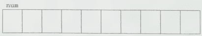

## 访问数组元素

单元格都包含一些数据，但我们不知道每个单元格中数据的值，因为数组的每个元素都是未初始化的，即尚未赋值。在这里，num 是数组的名称，10 是大小说明符。此说明符应为正整数常量，例如 10，在此情况下。

```c
#define MAX 10
```

我们如何访问像 num 这样的数组的单个元素，考虑到 num 现在命名了 10 个内存位置而不是一个？单个数组元素由整数索引或下标标识，例如 num[3] 或 num[5]。在 C 中，索引从零开始，并且始终写在方括号内。

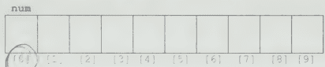

因为 C 使用基于零的索引，数组的元素存储在数组位置 num[0] 到 num[9] 中。请注意，数组位置 num[10] 不存在。但是，C 编译器不会检查数组的下标是否在数组的范围内。因此，如果你的程序尝试读取或写入不存在的数组元素，不会显示任何错误消息！

## 初始化数组元素

我们可以初始化单个数组元素，例如：

```c
num[0] = -2;
num[1] = -19;
num[2] = -5;
num[3] = 6;
num[4] = -9;
num[5] = -2;
num[6] = 3;
num[7] = 7;
num[8] = -7;
num[9] = 2;
```

| num |
|---|
| 12 | 18 | -5 | 6 | 10 | -2 | 3 | 3 | -1 | 2 |
| [0] | [1] | [2] | [3] | [4] | [5] | [6] | [7] | [8] | [9] |

我们说 num[5] 的内容等于 -2，num[9] 的内容等于 2。

- 我们可以使用 for 循环初始化数组元素：

```c
for (i = 0; i < 10; ++i) {
    num[i] = 2*i;
}
```

| num |
|---|
| 0 | 2 | 4 | 6 | 8 | 10 | 12 | 14 | 16 | 18 |
| [0] | [1] | [2] | [3] | [4] | [5] | [6] | [7] | [8] | [9] |

- 我们可以在声明数组时对其进行初始化：

```c
int num[5] = { 5, 10, 15, 20, 25 };
```

| num |
|---|
| 5 | 10 | 15 | 20 | 25 |
| [0] | [1] | [2] | [3] | [4] |

我们也可以在声明字符数组时对其进行初始化：

```c
char letters[5] = { 'a', 'b', 'c', 'd', 'e' };
```

| letters |
|---|
| 'a' | 'b' | 'c' | 'd' | 'e' |
| [0] | [1] | [2] | [3] | [4] |

请注意，不需要完全初始化整个数组。如果指定的初始值较少，则只会初始化相应数量的元素。数组中剩余的元素将被设置为零。

```c
double sample[5] = { 10.5, 12.6, 31.2 };
```

| sample |
|---|
| 10.5 | 12.6 | 31.2 | 0.0 | 0.0 |
| [0] | [1] | [2] | [3] | [4] |

我们还可以定义一个数组而不指定数组中的元素数量。数组的大小由初始化元素的数量自动确定：

```c
int num[] = { 2, 3, 4, 7, 9 };
```

| num |
|---|
| 2 | 3 | 4 | 7 | 9 |
| [0] | [1] | [2] | [3] | [4] |

你经常会看到 #define 与数组一起使用。语法是：

```c
#define some_name replacement_text
```

此语句应紧跟在 #include 语句之后：

```c
#include <stdio.h>
#define SIZE 100
```

例如，以下代码将定义数组的大小并将每个数组元素初始化为 0。

```c
#include <stdio.h>
#define SIZE 100
int main(void) {
    int i, num[SIZE];
    for (i = 0; i < SIZE; i++) {
        num[i] = 0;
    }
    return 0;
}
```

请注意，文本 SIZE 将在程序编译前被替换为 100。

以下是初始化数组的另一种方法。数组的内容也会被输出。

```c
#include <stdio.h>
#define SIZE 5
int main(void) {
   int i, num[SIZE] = { 100, 200, 300, 400, 500 };
   for (i = 0; i < SIZE; i++) {
      printf("%d\n", num[i]);
   }
   return 0;
}
```

## 操作数组元素

我们可以以操作普通变量的同样方式操作数组元素。例如：

```c
x = num[3] * 4;
```

将数组元素 num[3] 乘以 4 的乘积赋给 x。

这里是另一个示例：

```c
num[3] = num[5] + 2;
```

将数组元素 num[5] 加 2 的和赋给数组元素 num[3]。

## 示例：计算数组元素之和

以下代码展示了如何按顺序处理数组 x 的元素，从数组的开头（左侧）开始，直到数组中的元素数量：

```c
#include <stdio.h>
#define MAX 10
int main (void) {
    int i, sum = 0;
    int x[MAX] = { 2, 4, 6, 8, 10, 12, 14, 16, 18, 20 };
    for (i = 0; i < MAX; i++) {
        sum = (sum + x[i]);
    }
    printf("The sum of the elements of the array = %d\n", sum);
    return 0;
}
```

for 循环执行后，sum 的值将是多少？

```c
int x[8];
[2|5|12|19|1|3|4|8]
=> do sorting and organize: [Insertion Sort]
int temp-

0 [2|5] ...
1 [2|5|12] ... <2 ...
2 [2|5|12|19|1|3|4|8] ... temp 5
```

C 语言 qsort() 函数

常用函: `#include <stdlib.h>`


## 示例：复制数组

我们经常需要制作数组的副本。请注意，我们不能简单地说：

```
.dup = num
```

所需要做的就是遍历原始数组，并将相应的值复制到第二个数组中。

```
// Makes a copy of an array.
#include <stdio.h>
#define MAX 5
int main(void) {
    int i, num[MAX], dup[MAX];
    for (i = 0; i < MAX; ++i) {
        num[i] = i;
    }
    printf("Original array:\n");
    for (i = 0; i < MAX; ++i) {
        printf("%d ", num[i]);
    }
    printf("\n\n");
    for (i = 0; i < MAX; ++i) {
        dup[i] = num[i];
    }
    printf("Duplicate array:\n");
    for (i = 0; i < MAX; ++i) {
        printf("%d ", dup[i]);
    }
    printf("\n");
    return 0;
}
```

程序输出如下：

```
Original array:
0 1 2 3 4
Duplicate array:
0 1 2 3 4
```

## 计算字母频率

假设我们想要计算文本文件中每个字母（大写和小写）出现的次数。查看 ASCII（或 Unicode）表，我们看到大写字母的数值范围是 65 - 90，小写字母的数值范围是 97 - 122。

统计每个字母出现频率的简单技巧是使用一个名为 `letter` 的数组，用于存储从文件中读取的每个字符的计数。我们可以使用每个字符的 ASCII 值作为数组的索引，该字符的计数将存储在那里。

例如，每次在文件中看到字母 `'A'` 时，我们都可以在 `letter` 数组的索引 65 处递增计数器，因为 65 是 `'A'` 的数值：

```
letter[65] = letter[65] + 1;
or
++letter[65];
or
++letter['A'];
```

在这里，字符 `'A'` 将被转换为数值（65），该数值将用作 `letter` 数组的索引。

我们可以将此推广到文件中的每个字母，如下所示：

```
++letter[c];
```

其中 c 是从文件中读取的字符。

我们计算文本文件中字母频率的代码如下：

```
// Calculates the frequency of occurrence of each letter in a file.
#include <stdio.h>
#include <ctype.h>
#include <stdlib.h>

int main(void) {
    FILE *fp;
    int c, i;
    static int letter[256];

    if ((fp = fopen("getty.txt", "r")) == NULL) {
        fprintf("File %s could not be opened.\n", fileName);
        exit(1);
    }

    while ((c = getc(fp)) != EOF) {
        if (isupper(c) || islower(c)) {
            letter[c] += 1;
        }
    }

    for (i = 'A'; i < 'Z'; ++i) {
        if (letter[i] != 0) {
            printf("%d %c %d\n", i, i, letter[i]);
        }
    }

    puts("\n");

    for (i = 'a'; i < 'z'; ++i) {
        if (letter[i] != 0) {
            printf("%d %c %d\n", i, i, letter[i]);
        }
    }

    fclose(fp);
    return 0;
}
```

请注意，尽管我们只关心大写或小写字符，但我们声明了一个包含 256 个位置的数组，以涵盖我们在文件中可能遇到的所有可能字符，包括可打印和不可打印字符。

因此，数组的每个元素将用作索引数值对应字母的计数器。但是，我们在哪里初始化数组的每个元素，即在哪里将每个计数器初始化为零？

答案是，letter 数组被声明为 static，而声明为 static 的 int 数组会自动将数组的每个元素初始化为零！

程序输出如下：

```
69 P 1
70 F 1
73 I 3
78 N 1
84 T 2
87 W 2

97 a 100
98 b 13
99 c 31
100 d 54
101 e 165
102 f 24
103 g 26
104 h 79
105 i 66
107 k 3
108 l 41
109 m 13
110 n 75
111 o 91
112 p 16
113 q 1
114 r 81
115 s 45
116 t 122
117 u 20
118 v 23
119 w 25
121 y 10
```

## 埃拉托斯特尼筛法 埃氏筛（简单预置算法表）

埃拉托斯特尼筛法（Sieve of Eratosthenes）用于生成素数，由希腊学者埃拉托斯特尼开发，他生活在公元前约 275 年至公元前约 195 年。公元前约 240 年，埃拉托斯特尼成为埃及亚历山大图书馆的馆长，那是当时世界上最先进的学习中心。他因在诗歌、戏剧、文学、地理学、哲学和天文学方面的才华而广为人知。埃拉托斯特尼绘制了已知世界的准确地图，计算了地球的周长和其自转轴的倾斜度，并确定了地球到太阳和月球的大小及距离。

下面所示的筛法算法通过建立一个包含 1 到 1000 所有数字的数组，然后筛选出所有非素数，从而生成并计算 1 到 1000 之间的素数。已知 1、2 和 3 是素数，它筛选出 2 和 3 的所有倍数。接下来按顺序遇到且未被筛选的数字被视为素数，然后筛选出它的倍数。算法将继续进行，直到只剩下素数。

```
#include <stdio.h>
#define SIZE 1000
int main(void) {
    int i, mult, count;
    int flag[SIZE+1];
    count = 1;
    // Initialize flag array
    for (i = 1; i <= SIZE; ++i) {
        flag[i] = 1;
    }
    // Iterate through array
    for (i = 2; i <= SIZE; ++i) {
        if (flag[i] == 1) { // Found a prime
            ++count; // Count new prime
            mult = i;
            // loop deletes all multiples of new prime
            while (mult <= SIZE) {
                flag[mult] = 0;
                mult = mult + i;
            }
        }
    }
    printf("There are %d primes.\n", count);
    return 0;
}
```

- 1. 筛选要筛取值范围，故取从1到1000
- 2. 用2去筛，留下2，剔除2倍数
- 3. 用3去筛，留下3，剔除3倍数
- 4. 用5筛，留下5，剔除5倍数

## 程序输出：

```
There are 169 primes.
```

## 尝试以下操作：

看看你能否修改程序以显示 1 到 1000 之间的所有素数。

看看你能否修改程序以输出 40,000 到 50,000 之间的所有素数，每行显示 10 个。同时显示素数的数量。

## 数组元素作为函数参数

数组元素可以像任何其他变量一样作为函数参数传递。下面的示例按值传递两个数组元素。请注意，swap 函数尝试交换两个数组元素的值，但由于数组元素是按值传递的，交换后的值不会反映回 main() 中。

```
#include <stdio.h>

#define SIZE 5

void swap(int x, int y);

int main(void) {
    int i, num[SIZE];

    for (i = 0; i < SIZE; ++i) {
        num[i] = i;
    }

    printf("Before swap: num[2] = %d num[3] = %d\n", num[2], num[3]);
    swap(num[2], num[3]);
    printf("After swap: num[2] = %d num[3] = %d\n", num[2], num[3]);

    return 0;
}

void swap(int x, int y) {
    int temp;

    temp = x;
    x = y;
    y = temp;
}
```

产生的输出如下：

```
Before swap: num[2] = 2 num[3] = 3
After swap: num[2] = 2 num[3] = 3
```

通过在每个数组元素函数参数前放置取地址运算符（&），我们可以按引用传递两个数组元素。当然，我们还需要修改 swap() 函数以接受地址而不是 int 值。请注意，交换后的值现在已反映回 main() 中。

```
#include <stdio.h>

#define SIZE 5

void swap(int *x, int *y);

int main(void) {
    int num[SIZE];
    int i;

    for (i = 0; i < SIZE; ++i) {
        num[i] = i;
    }

    printf("Before swap: num[2] = %d num[3] = %d\n", num[2], num[3]);
    swap(&num[2], &num[3]);
    printf("After swap: num[2] = %d num[3] = %d\n", num[2], num[3]);

    return 0;
}

void swap(int *x, int *y) {
    int temp;

    temp = *x;
    *x = *y;
    *y = temp;
}
```

现在产生的输出如下：

```
Before swap: num[2] = 2 num[3] = 3
After swap: num[2] = 3 num[3] = 2
```

## 数组作为函数参数

将数组作为参数传递时，数组的全部内容不会被复制到形式参数数组中。相反，指向数组第一个元素的指针（地址）会被传递给形式参数。因此，函数对形式参数数组所做的任何更改实际上都是对传递给函数的原始数组进行更改，而不是对数组的副本进行更改。换句话说，在 C 中，数组始终是按引用传递的。

要将整个数组传递给函数，只需在函数调用中列出数组名，不带任何下标即可。尽管接收函数不需要知道数组的大小，但通常将数组的大小传递给函数是个好主意。

### 示例：按引用传递数组。

我们的示例将声明并初始化一个包含十个元素的数组。该数组将被传递给一个函数，其中数组的元素将被更改。数组将在调用更改数组元素的函数之前和之后输出。

```
#include <stdio.h>

void updateArray(int num[], int size);

int main(void) {
    int x[10];

    for (i = 0; i < 10; i++) {
        x[i] = i * 10;
    }

    printf("Before: ");
    for (i = 0; i < 10; i++) {
        printf("%5d", x[i]);
    }

    printf("\n\n");

    updateArray(x, 10);

    printf("After: ");
    for (i = 0; i < 10; i++) {
        printf("%5d", x[i]);
    }

    printf("\n\n");
    return 0;
}
```


// Function modifies elements of array that is passed by reference
void updateArray(int x[], int size) {
    int i;
    for (i = 0; i < size; ++i) {
        x[i] = i * -2;
    }
}

程序输出如下：

| 之前： | . | . | . | 0 | 10 | 20 | 30 | 40 | 50 | 60 | 70 | 80 | 90 |
| 之后： | . | . | . | 0 | -2 | -4 | -6 | -8 | -10 | -12 | -14 | -16 | -18 |

## 示例：对数组元素求和的函数

我们对数组元素求和的函数要求我们遍历数组，访问每个数组元素。在访问每个数组元素时，我们将其内容放入求和变量中。我们必须确保在使用求和变量之前将其初始化为零！

同样，我们希望函数能够对不同大小的数组求和，因此必须将数组大小作为额外参数传递给函数。

```
// Function to sum array elements
int sumArray(int num[], int size) {
    int i, sum = 0;
    for (i = 0; i < size; ++i) {
        sum += num[i];
    }
    return(sum);
}
```

## 示例：按格式输出数组

假设我们想编写一个函数，打印数组 num 的 MAX 个元素，每行 10 个，每列之间用一个空格分隔，并且每行（包括最后一行）都由恰好一个换行符结束。

```
#include <stdio.h>

#define MAX 100

void outputArrayWithFormat(int num[], int size);

int main (void) {
    int i, num[MAX];

    for (i = 0; i < MAX; i++) {
        num[i] = i;
    }

    outputArrayWithFormat(num, MAX);
    return 0;
}

void outputArrayWithFormat(int num[], int size) {
    int i;

    for (i = 0; i < size; ++i) {
        printf("%6d", num[i]);
        if (i % 10 == 9 || i == size - 1) {
            printf("%c", '\n');
        } else {
            printf("%c", ' ');
        }
    }
}
```

这里是生成的输出：

| 0 | 1 | 2 | 3 | 4 | 5 | 6 | 7 | 8 | 9 |
|---|---|---|---|---|---|---|---|---|---|
| 10 | 11 | 12 | 13 | 14 | 15 | 16 | 17 | 18 | 19 |
| 20 | 21 | 22 | 23 | 24 | 25 | 26 | 27 | 28 | 29 |
| 30 | 31 | 32 | 33 | 34 | 35 | 36 | 37 | 38 | 39 |
| 40 | 41 | 42 | 43 | 44 | 45 | 46 | 47 | 48 | 49 |
| 50 | 51 | 52 | 53 | 54 | 55 | 56 | 57 | 58 | 59 |
| 60 | 61 | 62 | 63 | 64 | 65 | 66 | 67 | 68 | 69 |
| 70 | 71 | 72 | 73 | 74 | 75 | 76 | 77 | 78 | 79 |
| 80 | 81 | 82 | 83 | 84 | 85 | 86 | 87 | 88 | 89 |
| 90 | 91 | 92 | 93 | 94 | 95 | 96 | 97 | 98 | 99 |

这里是上面示例中的函数，使用更紧凑的代码并利用条件运算符。你能看懂吗？

```
void outputArrayWithFormat(int num[], int size) {
   int i;

   for (i = 0; i < size; ++i) {
      printf("%6d%c", num[i], ( i % 10 == 9 || i == size-1) ?
         '\n' : '\t' );
   }
}
```

## 示例：查找数组中最小值的索引

本程序中的函数声明了一个变量 minIndex，用于保存迄今为止看到的最小数组元素的索引。minIndex 首先初始化为零，然后检查每个连续数组元素的内容，并将其与 minIndex 位置的元素进行比较。如果发现某个数组元素小于 minIndex 位置的元素，则将其数组位置赋给 minIndex。

```
#include <stdio.h>

int getMinIndex(int num[], int size);

int main(void) {
   int small;
   int num[10] = { 43, 66, 82, -16, 42, -8, 12, 33, -19, 11 };

   small = getMinIndex(num, 10);
   printf("The index of the smallest array element = %d.\n", small);
   printf("The value of the smallest array element = %d.\n", num[small]);

   return 0;
}

// Function returns the index of the smallest value in an array
int getMinIndex(int num[], int size) {
   int i, minIndex = 0;

   for (i = 1; i < size; ++i) {
      if (num[i] < num[minIndex]) {
         minIndex = i;
      }
   }

   return minIndex;
}
```

这里是生成的输出：

```
The index of the smallest array element = 8.
The value of the smallest array element = -19.
```

假设我们现在想将数组 num 中的最小元素移到数组的前面。数组设置如下：

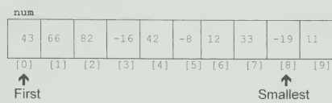

一旦我们确定了数组 num 中最小元素的索引（在上面的示例中，该索引为 8），我们就需要将此元素移到数组的前面。如果我们在 main() 中简单地写下以下语句：

```
small = getMinIndex(num, 10);
num[0] = num[small];
```

我们将擦除 num[0] 的值，该值将永远丢失。因此，我们可以调用可靠的 swap() 函数来完成这项工作：

```
void swap(int *x, int *y) {
    int temp = *x;
    *x = *y;
    *y = temp;
}
```

swap() 函数将交换任何一对 int 数据项，即使这些项是数组元素。

我们在 main() 中的相关代码如下：

```
small = getMinIndex(num, 10);
swap(&num[0], &num[small]);
```

请注意，虽然数组会自动按引用传递给函数，但单个数组元素按值传递，除非在函数调用前加上取地址符。因此，num[0] 和 num[small] 只是数组 num 中类型为 int 的单个元素，必须显式按引用传递。

下面是我们的代码，它先查找数组中最小项的索引，然后将该位置的整数与数组中的第一个整数交换。

```
#include <stdio.h>

int getMinIndex(int num[], int size);
void swap(int *x, int *y);

int main(void) {
    int i, small;
    int num[10] = { 43, 66, 12, -16, 42, -8, 12, 33, -19, 11 };

    small = getMinIndex(num, 10);
    swap(&num[0], &num[small]);

    for (i = 0; i < 10; ++i) {
        printf("%5d", num[i]);
    }

    return 0;
}

// Function returns the index of the smallest value in an array
int getMinIndex(int num[], int size) {
    int i, minIndex = 0;

    for (i = 1; i < size; ++i) {
        if (num[i] < num[minIndex]) {
            minIndex = i;
        }
    }

    return minIndex;
}

// Function swaps two integers
void swap(int *x, int *y) {
    int temp = *x;
    *x = *y;
    *y = temp;
}
```

调用 swap() 之前，我们的数组如下所示：

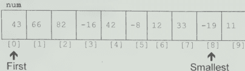

调用 swap() 之后，我们的数组如下所示：

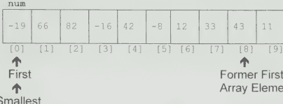

## 示例：合并数组

下面是一个将两个已排序数组合并为单个已排序数组的程序：

```
// Merge two sorted arrays into a single array.

#include <stdio.h>

void mergeTwoArrays(int a[], int b[], int c[], int maxA, int maxB);

int main(void) {
   int k;

   int a[5] = {1, 5, 9, 11, 17};
   int b[5] = {2, 4, 6, 8, 20};
   int c[10];

   mergeTwoArrays(a, b, c, 5, 5);

   for (k = 0; k < (10); k++) {
      printf("%5d", c[k]);
   }

   return 0;
}

void mergeTwoArrays(int a[], int b[], int c[], int maxA, int maxB) {
    int i, j, k;
    i = j = k = 0;
    while (i < maxA && j < maxB) {
        if (a[i] <= b[j]) {
            c[k++] = a[i++];
        }
        else {
            c[k++] = b[j++];
        }
    }
    while (i < maxA) {
        c[k++] = a[i++];
    }
    while (j < maxB) {
        c[k++] = b[j++];
    }
}
```

合并后生成的输出如下：

| 1 | 2 | 4 | 5 | 6 | 8 | 9 | 11 | 17 | 20 |
|---|---|---|---|---|---|---|---|---|---|

## 平行数组

数组非常有用，因为它们允许我们在一个名称下组合大量数据。然而，数组的一个缺点是数组的元素是同质的，即数组的每个元素必须是相同的数据类型，int、char、float、double 等。

但是，如果我们需要组合由不同数据类型组成的大量信息怎么办？例如，假设我们想跟踪学生姓名、绩点平均分和毕业年份。虽然我们无法将所有这些不同的信息存储在单个数组中，但我们可以声明三个单独的数组，每个数组保存相同数据类型的信息（char * 用于姓名，double 用于绩点平均分，int 用于毕业年份）。

为了确保我们可以轻松访问特定学生的不同数据，每个学生的数据将存储在数组中的相同索引位置。例如，如果我们声明一个名为 name 的 char * 数组来保存每个学生的姓名，一个名为 gpa 的 double 数组来保存每个学生的绩点平均分，一个名为 year 的 int 数组来保存每个学生的毕业年份，那么数组位置 name[2]、gpa[2] 和 year[2] 将各自保存同一学生的数据。这些数组被称为平行数组。

下面的代码创建三个平行数组，每个数组中相同的位置都引用同一学生。

```
#include <stdio.h>

#define MAX 5

int main(void) {
   char *name[MAX] = {"Bill", "Carol", "Sue", "Ted", "Jen"};
   double gpa[MAX] = { 3.75, 3.44, 3.95, 3.88, 2.95 };
   int year[MAX] = { 2014, 2016, 2015, 2014, 2018 };

   printf("%-10s %-10s %-10s\n", "Name", "GPA", "Year");
   printf("%-10s %-10s %-10s\n", "----", "---", "----");

   for (int i = 0; i < MAX; i++) {
      printf("%-10s %-10.2f %-10d\n", name[i], gpa[i], year[i]);
   }

   return 0;
}


我们的程序输出如下：

| 姓名 | GPA | 年份 |
| :--- | :--- | :--- |
| Bill | 3.75 | 2014 |
| Carol | 3.44 | 2016 |
| Sue | 3.95 | 2015 |
| Ted | 3.88 | 2014 |
| den | 2.95 | 2018 |

## 对数组进行排序：插入排序

排序是重新排列项目使其按顺序排列的过程，也是当今计算机执行的最常见任务之一。排序用于以有意义的方式排列姓名和数字。例如，查找朋友的电话号码相对容易，因为电话簿中的姓名已按字母顺序排序。这个例子清楚地说明了对大量信息进行排序的主要原因之一。也就是说，排序大大提高了搜索效率。如果我们打开一本电话簿，发现姓名没有按任何逻辑顺序排列，那么查找某人的电话号码将需要非常长的时间！

插入排序的工作方式与许多人整理扑克或拉米牌的方式相同。我们从空左手开始，牌面朝下放在桌上。然后我们一次从桌上取出一张牌，并将其插入左手的正确位置。要找到牌的正确位置，我们将其与手中已有的每张牌进行比较，从右到左。当我们找到正确的插入点时，我们将牌放在手中的该位置。

插入排序从数组中取出一个项目，并通过将其与其前驱进行比较来找到其正确位置。给定大小为 max 的数组 num，我们通过将第 i<sup>th</sup> 个元素 num[i] 与元素 num[1]、num[2]、... num[i-1] 进行比较来找到其正确位置。这确保了在算法的 i<sup>th</sup> 阶段，数组中的前 i 个元素已排序，这样到 n<sup>th</sup> 阶段时，所有 n 个元素都按顺序排列。

## 插入排序示例

要对数据项数组进行排序，我们从左到右遍历数组，并一次将一个数据项插入到其左侧数据项中的适当位置。下面展示了插入排序的运行过程。此阴影中的数字是我们正在尝试排序的数字。此阴影中的数字是已排序的元素。数组中的空白位置表示可能的插入点。我们首先假设数组的第一个元素已排序。

| 5 | 3 | 8 | 2 | 9 | 4 | 6 | 7 |
|---|---|---|---|---|---|---|---|

数组中下一个要排序的元素是 3：

| 5 | 3 | 8 | 2 | 9 | 4 | 6 | 7 |
|---|---|---|---|---|---|---|---|

我们将要排序的数据项复制到临时位置，从而在已排序数组中为该数据项打开一个可能的插入点：

| 5 | | 8 | 2 | 9 | 4 | 6 | 7 |
|---|---|---|---|---|---|---|---|

temp: 3

3 < 5，因此我们必须打开一个新的插入点。我们将 5 向右移动一位，打开一个新的插入点：

| | 5 | 8 | 2 | 9 | 4 | 6 | 7 |
|---|---|---|---|---|---|---|---|

temp: 3

到达数组开头告诉我们，当前插入点是有效的，因为新数据项是迄今看到的最小数据项。因此，我们将数据项插入到插入点：

| 3 | 5 | 8 | 2 | 9 | 4 | 6 | 7 |
|---|---|---|---|---|---|---|---|

temp: 

第 1<sup>st</sup> 轮结束时，前 2 个数据项已排序。

我们开始第 2<sup>nd</sup> 轮。下一个要排序的数据项是 8：

| 3 | 5 | 8 | 2 | 9 | 4 | 6 | 7 |
|---|---|---|---|---|---|---|---|

temp:

数据项 8 被放入临时内存位置，从而打开一个可能的插入点：

| 3 | 5 | | 2 | 9 | 4 | 6 | 7 |
|---|---|---|---|---|---|---|---|

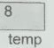

8 > 5，因此 8 被放入插入点：

| 3 | 5 | 8 | 2 | 9 | 4 | 6 | 7 |
|---|---|---|---|---|---|---|---|

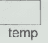

第 2 轮结束时，前 3 个数据项已排序。

我们开始第 3 轮。下一个要排序的数据项是 2：

| 3 | 5 | 8 | 2 | 9 | 4 | 6 | 7 |
|---|---|---|---|---|---|---|---|

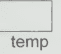

数据项 2 被放入临时内存位置，从而打开一个可能的插入点：

| 3 | 5 | 8 | | 9 | 4 | 6 | 7 |
|---|---|---|---|---|---|---|---|

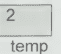

2 < 8，因此我们必须打开一个新的插入点。我们将 8 向右移动一位，打开一个新的插入点：

| 3 | 5 | | 8 | 9 | 4 | 6 | 7 |
|---|---|---|---|---|---|---|---|

temp: 2

2 < 5，因此我们必须打开一个新的插入点。我们将 5 向右移动一位，打开一个新的插入点：

| 3 | | 5 | 8 | 9 | 4 | 6 | 7 |
|---|---|---|---|---|---|---|---|

temp: 2

2 < 3，因此我们必须打开一个新的插入点。我们将 3 向右移动一位，打开一个新的插入点：

| | 3 | 5 | 8 | 9 | 4 | 6 | 7 |
|---|---|---|---|---|---|---|---|

temp: 2

到达数组开头告诉我们，当前插入点是有效的，因为新数据项是迄今看到的最小数据项。因此，我们将数据项插入到插入点：

| 2 | 3 | 5 | 8 | 9 | 4 | 6 | 7 |
|---|---|---|---|---|---|---|---|

temp: 

第 3<sup>rd</sup> 轮结束时，前 4 个数据项已排序。

我们开始第 4 轮。下一个要排序的数据项是 9：

| 2 | 3 | 5 | 8 | 9 | 4 | 6 | 7 |
|---|---|---|---|---|---|---|---|

temp

数据项 9 被放入临时内存位置，从而打开一个可能的插入点：

| 2 | 3 | 5 | 8 | | 4 | 6 | 7 |
|---|---|---|---|---|---|---|---|

9
temp

9 > 8，因此 9 被放入插入点：

| 2 | 3 | 5 | 8 | 9 | 4 | 6 | 7 |
|---|---|---|---|---|---|---|---|

temp

第 4 轮结束时，前 5 个数据项已排序。

我们开始第 5 轮。下一个要排序的数据项是 4：

| 2 | 3 | 5 | 8 | 9 | 4 | 6 | 7 |
|---|---|---|---|---|---|---|---|

temp

数据项 4 被放入临时内存位置，从而打开一个可能的插入点：

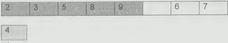

4 < 9，因此我们必须打开一个新的插入点。我们将 9 向右移动一位，打开一个新的插入点：

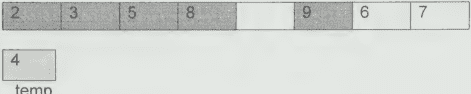

4 < 8，因此我们必须打开一个新的插入点。我们将 8 向右移动一位，打开一个新的插入点：

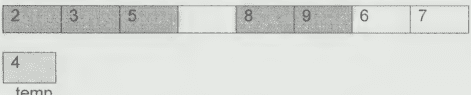

4 < 5，因此我们必须打开一个新的插入点。我们将 5 向右移动一位，打开一个新的插入点：

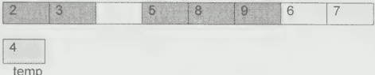

4 > 3，因此 4 被放入插入点：

| 2 | 3 | 4 | 5 | 8 | 9 | 6 | 7 |
|---|---|---|---|---|---|---|---|

temp

第 5<sup>th</sup> 轮结束时，前 6 个数据项已排序。

我们开始第 6<sup>th</sup> 轮。下一个要排序的数据项是 6：

| 2 | 3 | 4 | 5 | 8 | 9 | 6 | 7 |
|---|---|---|---|---|---|---|---|

temp

数据项 6 被放入临时内存位置，从而打开一个可能的插入点：

| 2 | 3 | 4 | 5 | 8 | 9 | | 7 |
|---|---|---|---|---|---|---|---|

6
temp

6 < 9，因此我们必须打开一个新的插入点。我们将 9 向右移动一位，打开一个新的插入点：

| 2 | 3 | 4 | 5 | 8 | | 9 | 7 |
|---|---|---|---|---|---|---|---|

6
temp

6 < 8，因此我们必须打开一个新的插入点。我们将 8 向右移动一位，打开一个新的插入点：

| 2 | 3 | 4 | 5 |   | 8 | 9 | 7 |
|---|---|---|---|---|---|---|---|

temp: 6

6 > 5，因此 6 被放入插入点：

| 2 | 3 | 4 | 5 | 6 | 8 | 9 | 7 |
|---|---|---|---|---|---|---|---|

temp: 

第 6 轮结束时，前 7 个数据项已排序。

我们开始第 7 轮。下一个要排序的数据项是 7：

| 2 | 3 | 4 | 5 | 6 | 8 | 9 | 7 |
|---|---|---|---|---|---|---|---|

temp: 

数据项 7 被放入临时内存位置，从而打开一个可能的插入点：

| 2 | 3 | 4 | 5 | 6 | 8 | 9 |   |
|---|---|---|---|---|---|---|---|

temp: 7

7 < 9，因此我们必须打开一个新的插入点。我们将 9 向右移动一位，打开一个新的插入点：

| 2 | 3 | 4 | 5 | 6 | 8 | | 9 |
|---|---|---|---|---|---|---|---|

| 7 |
temp

7 < 8，因此我们必须打开一个新的插入点。我们将 8 向右移动一位，打开一个新的插入点：

| 2 | 3 | 4 | 5 | 6 | | 8 | 9 |
|---|---|---|---|---|---|---|---|

| 7 |
temp

7 > 6，因此 7 被放入插入点：

| 2 | 3 | 4 | 5 | 6 | 7 | 8 | 9 |
|---|---|---|---|---|---|---|---|

| |
temp

第 7 轮结束时，数组已排序。一般来说，包含 max 个数据项的数组需要 max-1 轮才能排序。

```
77 insertionSort.c
void insertionSort(int list[], int max) {
    int i, j, temp;
    for (i = 1; i < max; i++) {
        temp = list[i];
        j = i - 1;
        while (j >= 0 && temp < list[j]) {
            list[j+1] = list[j];
            j = j - 1;
        }
        list[j+1] = temp;
    }
}


## 对数组进行排序：qsort() 库函数

标准 C 库中包含一个名为 qsort() 的异常强大且通用的排序例程。它是一种称为快速排序（quicksort）的特定排序算法的实现。qsort() 例程有四个参数：

- 数据数组的基地址
- 数组中的项目数
- 每个项目的宽度（字节）
- 一个函数的地址，该函数可以比较数组中包含类型的两个数据项，并按以下方式返回有符号值：

```
< 0 if p < q
 0 if p = q
> 0 if p > q
```

如果您使用的是 C 的原始数据类型之一，通常可以用几行代码构建适当的比较函数。下面是一个示例：

```
int compare(const void *p, const void *q) {
if (*(int *)p < *(int *)q) {
    return -1;
}
return *(int *)p > *(int *)q;
}
```

在 compare() 函数中：

```
if p < q returns -1
if p = q returns 0
if p > q returns 1
```

下面的代码用整数随机填充一个 100 元素的数组。显示数组内容，调用 qsort()，然后再次显示数组内容，显示排序后的数据项。

```
#include <stdio.h>
#include <stdlib.h>
#include <time.h>
#define SIZE 100
int compare(const void *p, const void *q);
void output(int num[], int size);
int main() {
    int i, num[SIZE];
    srand((unsigned)time(NULL));
    for (i = 0; i < SIZE; i++) {
        num[i] = (rand() % 50000);
    }
    printf("Before sort\n");
    output(num, SIZE);
    qsort(num, SIZE, sizeof(int), compare);
    printf("\nAfter sort\n");
    output(num, SIZE);
    return(0);
}
int compare(const void *p, const void *q) {
    if (*(int *)p < *(int *)q) {
        return -1;
    }
    return *(int *)p > *(int *)q;
}
void output(int num[], int size) {
    int i;
    for (i = 0; i < size; i++) {
        printf("%6d", num[i]);
        if (i % 10 == 9 || (i == size -1)) {
            printf("%c", '\n');
        }
        else {
            printf("%c", ' ');
        }
    }
}
```

## 如果数组
qsort(x, &, sizeof(int), compare)
Compute(A, B)
如果 A=B，返回
如果 B>A，-1
如果 A>B，1

需要清理的通用类型
为比较指针分配新值提供指示
强制转换为
从任何类型更改为新类型 'int'

因为 void* 指向内存
不应修改的内存。

以下是产生的输出：

排序前
30567 35439 21431 9013 3992 28690 24735 8148 14330 24847
43747 10518 46366 40111 33228 46127 27945 8870 45536 21664
35024 10674 27724 16905 30488 19128 32991 3856 21268 45855
26816 803 39397 3986 44341 47219 33125 48655 36237 4323
10188 33574 48866 45132 16189 3823 6746 9497 32622 16402
8430 46630 1113 5271 47490 13727 7493 40531 46342 47608
30989 49988 14230 3472 48785 9291 900 26877 24400 17550
27638 19251 14013 41336 14304 39437 43991 30229 35682 654
41083 27520 47042 26948 47726 41156 27658 33215 15557 44269
2529 24729 16662 11997 9825 28596 25245 35327 7047 41915
排序后
654 803 900 1113 2529 3472 3823 3856 3986 3992
4323 5271 6746 7047 7493 8148 8430 8870 9013 9291
9497 9825 10188 10518 10674 11997 13727 14013 14230 14304
14330 15557 16189 16402 16662 16905 17550 19128 19251 21268
21431 21664 24400 24729 24735 2529 24847 26877 26877 26948
24310 26664 24000 24729 27945 28596 28690 30229 30488 30567
27520 27638 27658 32991 33125 33215 33228 33574 35024 35439
35682 36237 39397 39437 40111 40531 41083 41156 41336 41915
43747 43991 44269 44341 45132 45336 45855 46127 46342 46366
46630 47042 47219 47490 47608 47726 48655 48785 48866 49988

请注意，数组是按比较函数定义的递增顺序排序的。要按递减顺序对数组进行排序，请在比较函数中反转“大于”和“小于”的含义。

即使您不是使用 C 的原始数据类型，qsort() 也能正常工作，只要您了解足够的数据表示知识来判断某个项目是否“小于”另一个项目。

在字符串的情况下，标准库函数 strcmp() 非常适合在 compare 函数中与 qsort() 一起使用。

```
int compare(const void *p, const void *q) {
    return strcmp((char *) p, (char *) q);
}
```

下面是一个使用 qsort() 对字符串进行排序的程序：

```
#include <stdio.h>
#include <stdlib.h>
#include <string.h>

int compare(const void *p, const void *q);

int main() {
    char list[5][4] = { "cat", "car", "cab", "cap", "can" };
    qsort(list, 5, sizeof(list[0]), compare);
    for (i = 0; i < 5; ++i) {
        printf("%s ", list[i]);
    }
    return(0);
}

int compare(const void *p, const void *q) {
    return strcmp((char *) p, (char *) q);
}
```

```
int X[10];
for (i=0; i<10; i++)
printf("%d", X[i]);
```

```
int X[10];
int y[10];
for (i=0; i<10; i++)
y[i] = X[i];
## copy 2 array
```

```
int X[10];
int y[10];
for(i=0; i<10; i++)
y[10-i] = X[i];
## copy X array and reverse order in y[]
```

## 搜索数组：线性搜索

最简单的搜索策略是线性或顺序搜索。线性搜索通常在无序数组上执行。它从数组开头开始，按顺序检查每个元素，直到找到要查找的数据项，或者直到到达数组末尾，在这种情况下，数组中未找到该数据项。

```
// linearSearch.c
// returns the index in the array of data item found
// returns (-1) if data item not in array

int linearSearch(int num[], int max, int key) {
    int i;

    for (i = 0; i < max; ++i) {
        if (num[i] == key) {
            return i;
        }
    }

    return -1;
}
```

让我们来看看在未排序数组中查找与键匹配的数据项需要多长时间。我们可以考虑三种不同的可能性：平均时间、最坏情况时间或最佳可能时间。然而，我们通常最关心最坏情况时间，因为基于最坏情况时间的计算可以得出保证的性能预测。方便的是，最坏情况时间通常比平均时间更容易计算。

为了简化算法的分析和比较，我们寻找一个主导操作，并计算该主导操作必须执行的次数。在搜索的情况下，主导操作是比较。

如果我们的数组中有 max 个项目，那么在最坏情况下（即数组中没有所需键的项目），显然需要进行 max 次键与数组中数据项的比较。在最佳情况下，我们会在第一次比较中找到数据项。在平均情况下，我们会在 (1 + max) / 2 次比较或大约 max/2 次比较中找到数据项。

因此，包含 100 个数据项的数组在成功搜索时平均需要 50 次比较。如果我们要搜索的数据项数量翻倍，比较次数也会翻倍，因此我们算法的运行时间也会翻倍。我们说比较次数与数组中数据项数量 n 成正比。相应地，算法的搜索时间与数组中数据项数量 max 成正比。包含 1000 个数据项的数组搜索时间是包含 100 个数据项的数组的 10 倍。

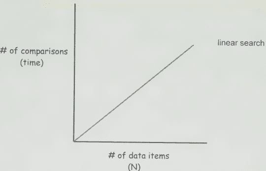

## 搜索数组：二分搜索

如前所述，线性搜索算法简单，对于小问题很方便，但如果数组很大和/或需要进行许多重复搜索，那么拥有一个更高效的数组搜索算法是非常合理的。

二分搜索算法适用于已排序的数组。它选择数组中的中位数（中间）元素，并将其值与目标值 key 进行比较。因为已知数组是排序的，如果目标值小于中间值，则目标必须在数组的前半部分。同样，如果目标项的值大于数组中间值，则已知目标位于数组的后半部分。在任何一种情况下，我们都可以仅通过一次比较，实际上“排除”掉一半的搜索空间。

现在，知道目标必须位于数组的一半或另一半，二分搜索会检查目标必须所在的一半的中位数值。该算法因此在每一步将搜索区域缩小一半，直到找到目标数据或搜索失败。

如果你想到一个孩子的猜谜游戏，这个算法就很容易记住。想象我告诉你我正在想一个数字。你会不断改进你的选择，直到猜中那个数字为止。

给定一个已排序的项目数组，例如：

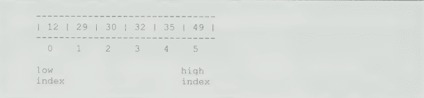

假设我们希望搜索等于 key 的元素的位置。我们将搜索从某个低索引开始并在某个高索引结束的数组。在我们的例子中，要搜索的有效数组的低索引是 0，高索引是 5。我们可以通过整数除法 (low + high) / 2 找到近似中间索引，即 2。我们将我们的值 key 与索引 2 处的元素进行比较。如果


它们相等，我们找到了要找的内容；索引是 2。
否则，如果 key 大于该索引处的元素，我们的新有效搜索
数组的低索引值为 3，高索引保持不变为 5。如果
key 小于该元素，新的有效搜索数组的高索引为 1
且低索引保持为 0。该过程重复，直到找到该元素，或
有效搜索数组中没有元素。终止条件是
当低索引超过高索引时满足。

二分查找算法实现如下：

```
int binarySearch(int num[], int n, int key) {
    int mid, i, j;

    i = 0;
    j = n-1;
    while (i <= j) {
        mid = (i + j) / 2;
        if (num[mid] > key) {
            j = mid - 1;
        }
        else if (num[mid] < key) {
            i = mid + 1;
        }
        else {
            return mid;
        }
    }
    return -1;
}
```

## 二分查找分析

既然线性查找更容易编码，为什么还要使用二分查找？答案在于
查找的效率。使用线性查找时，如果将数组大小加倍，查找一个元素可能需要两倍的时间。使用二分查找时，将数组大小加倍仅需多查看一个元素。每次使用二分查找时，你都会排除剩余数组元素的一半作为可能的匹配项。

例如，假设给定的搜索空间包含 1,000,000 个数据元素。
顺序查找平均需要约 500,000 次搜索或比较。如果将搜索空间加倍至 2,000,000 个数据项，比较次数将加倍至 1,000,000，因此搜索时间实际上也会加倍。相比之下，二分查找在 1,000,000 个数据项的搜索空间中仅需约 20 次搜索，而将数据大小加倍至 2,000,000 只会使比较次数增加 1 次。二分查找确实是一种强大的搜索算法！

因此，我们说在数组上进行二分查找大约需要 log2n 次比较，因为在每次测试时，你可以“排除”搜索空间的一半。我们最多可以将 n 个元素的集合对半分 log2n 次。因此，二分查找的运行时间与 log2n 成正比，我们称其为 log n 算法。

值得注意的是，对于非常小的数组，线性查找可能比二分查找更快。然而，随着待搜索数组大小的增加，二分查找在比较次数和整体速度方面明显胜出。因此，在 n 较大时，log n 远小于 n，因此 log n 算法（二分查找）比时间与 n 成正比的算法（线性查找）快得多。

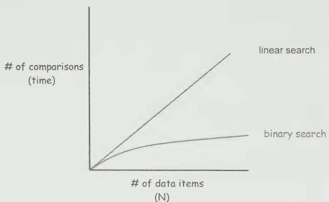

尽管如此，二分查找也有一些缺点。首先，它要求待搜索的数据必须是有序的。如果待搜索数据中哪怕有一个元素无序，就会打乱整个过程。当面对一组无序数据时，高效的程序员必须决定是对数据进行排序并应用二分查找，还是直接应用效率较低的线性查找。即使是最好的排序算法也是一个复杂的过程。对数据进行排序的成本是否值得二分查找带来的搜索速度提升？如果只搜索一次，大多数情况下最好进行线性查找。

一旦数据被排序，添加或删除元素也可能非常昂贵。例如，在有序数组中，此类操作需要移动数组元素以在数组中打开或关闭一个“空位”。这是一项昂贵的操作，因为在最坏情况下，它需要 log2n 次比较和 n 次数据移动。

## 二维数组

我们可以声明一个包含行和列的二维数组：

```
int num[3][4];
```

该语句声明一个包含三行四列的数组：

| | 第 0 列 | 第 1 列 | 第 2 列 | 第 3 列 |
|---|---|---|---|---|
| 第 0 行 | | | | |
| 第 1 行 | | | | |
| 第 2 行 | | | | |

二维数组的元素标识如下：

| | 第 0 列 | 第 1 列 | 第 2 列 | 第 3 列 |
|---|---|---|---|---|
| 第 0 行 | num[0][0] | num[0][1] | num[0][2] | num[0][3] |
| 第 1 行 | num[1][0] | num[1][1] | num[1][2] | num[1][3] |
| 第 2 行 | num[2][0] | num[2][1] | num[2][2] | num[2][3] |

请注意，二维数组在内存中的大小为：

```
3 rows * 4 columns * sizeof(int) = 48 bytes
```

我们可以在声明时初始化二维数组：

```
int num[3][4] = {
    { 2, 4, 6, 8 },
    { 1, 3, 5, 7 },
    { 3, 6, 9, 12 }
};
```

花括号对用于分隔一行的初始化列表与下一行。除了最后一行外，每个结束一行的花括号后都需要逗号。

我们的二维数组初始化如下：

| | 第 0 列 | 第 1 列 | 第 2 列 | 第 3 列 |
|---|---|---|---|---|
| 第 0 行 | 2 | 4 | 6 | 8 |
| 第 1 行 | 1 | 3 | 5 | 7 |
| 第 2 行 | 3 | 6 | 9 | 12 |

请注意，内层花括号对也是可选的：

```
int num[3][4] = { 2, 4, 6, 8, 1, 3, 5, 7, 3, 6, 9, 12 };
```

与一维数组一样，不需要初始化整个数组：

```
int num[3][4] = {
    { 2, 4 },
    { 1, 3 },
    { 3, 6 }
};
```

该声明将每行的前两个元素初始化为指定值。其余值将初始化为零。请注意，这里内层花括号绝对是必需的，以强制正确初始化！

我们的二维数组初始化如下：

| | 第 0 列 | 第 1 列 | 第 2 列 | 第 3 列 |
|---|---|---|---|---|
| 第 0 行 | 2 | 4 | 0 | 0 |
| 第 1 行 | 1 | 3 | 0 | 0 |
| 第 2 行 | 3 | 6 | 0 | 0 |

我们可以按如下方式输出二维数组的内容：

```
#include <stdio.h>
int main(void) {
   int i, j, num[3][4] = {
      { 2, 4, 6, 8 },
      { 1, 3, 5, 7 },
      { 3, 6, 9, 12 }
   };
   for (i = 0; i < 3; ++i) {
      for (j = 0; j < 4; ++j) {
         printf("%4d", num[i][j]);
      }
      printf("\n");
   }
   return 0;
}
```

我们的输出如下：

| 2 | 4 | 6 | 8 |
|---|---|---|---|
| 1 | 3 | 5 | 7 |
| 3 | 6 | 9 | 12 |

## 字符二维数组

如果要将每行视为字符串，字符二维数组的声明必须包含空终止符的额外空间：

```
char name[20][31];
```

这声明了一个包含 20 行的二维数组，每行包含 30 个字符数据以及编译器追加到每个字符串末尾的空终止符。

数据按行主序存储，这意味着每行在内存中形成一个项数组。每行本身是一个一维数组，可以在允许使用数组的上下文中使用。

我们可以按如下方式输出字符串二维数组的每一行：

```
for (i = 0; i < 20; ++i) {
    printf("%s\n", name[i]);
}
```

二维数组的每个单独元素也仍可使用下标访问：

```
name[i][j]
```

## 将二维数组作为函数参数传递

假设你想将一个二维数组传递给函数：

```
int main(void) {
    int num[3][4] = {
        { 2, 4, 6, 8 },
        { 1, 3, 5, 7 },
        { 3, 6, 9, 12 }
    };

    foo(num);
    return 0;
}
```

## 函数 foo() 应如何接收二维数组？

```
void foo(int num[][4]) {
    ...
}
```

这告诉编译器将数组分解为每行 4 列。

## 对称矩阵示例

如果对于 1 到 N 之间的所有 i 和 j，元素 [i][j] 等于元素 [j][i]，则 N x N 矩阵（二维数组）是对称的。我们构建一个程序，用于初始化两个 4 x 4 二维数组的元素，以表格形式输出这两个二维数组，并输出一条消息说明数组是否对称。

情况 1：matrixYES 是对称的。

情况 2：matrixNO 不是对称的。

```
#include <stdio.h>
void outputMatrix(int mat[][4]);
int isSymmetric(int mat[][4]);
int main(void)
{
    int matrixYES[4][4] = {
        { 6, 2, 4, 6 },
        { 2, 7, 1, 3 },
        { 4, 1, 8, 5 },
        { 6, 3, 5, 9 }
    };
    int matrixNO[4][4] = {
        { 6, 2, 4, 6 },
        { 2, 7, 1, 3 },
        { 4, 1, 8, 5 },
        { 6, 3, 1, 9 }
    };
    puts("MatrixYES...");
    outputMatrix(matrixYES);
    if (isSymmetric(matrixYES)) {
        printf("matrixYES is symmetric.\n\n");
    }
    else {
        printf("matrixYES is not symmetric.\n\n");
    }
    puts("MatrixNO...");
    outputMatrix(matrixNO);
    if (isSymmetric(matrixNO)) {
        printf("matrixNO is symmetric.\n\n");
    }
    else {
        printf("matrixNO is not symmetric.\n\n");
    }
    return 0;
}
```


```c
void outputMatrix(int mat[][4]) {
    int i, j;

    for (i = 0; i < 4; ++i) {
        for (j = 0; j < 4; ++j) {
            printf("%4d", mat[i][j]);
        }
        printf("\n");
    }
}

int isSymmetric(int mat[][4]) {
    int i, j;

    for (i = 0; i < 4; ++i) {
        for (j = 0; j < 4; ++j) {
            if (mat[i][j] != mat[j][i]) {
                return 0;
            }
        }
    }
    return 1;
}
```

以下是输出：

```
MatrixYES
  6   2   4   6
  2   7   1   3
  4   1   8   5
  6   3   5   9
matrixYES is symmetric.

MatrixNO
  6   2   4   6
  2   7   1   3
  4   1   8   5
  6   3   1   9
matrixNO is not symmetric.
```

## 数组作业

- 编写一些代码来完成以下每项任务：
  - a) 定义一个常量 MAX，其值为 25。
  - b) 定义一个整数数组 num，包含 MAX 个元素，并将数组中每个元素初始化为 0。
  - c) 数组中第五个元素的名称是什么。
  - d) 输出数组中第三个元素的值。
  - e) 将一个值赋给数组 num 的第四个元素。
  - f) 将数组中每个 25 个元素初始化为 100。
  - g) 将数组 num 的元素累加到求和变量 sum 中。
  - h) 将数组 num 的内容复制到数组 foo 中，foo 的大小也为 MAX。
  - i) 将数组 foo 中的每个元素加 1。

- 下面的代码将 1 到 10,000 之间的随机数赋给数组 num 的每个元素。编写一个函数，该函数将数组作为参数，并返回数组中的最大值。

```c
srand((unsigned int) time(NULL));
for (i = 0; i < MAX; ++i) {
    num[i] = rand() % 10000 + 1;
}
```

- 作为一个恶作剧，一位朋友在你生日时送给你一个 int 数组。更糟糕的是，你的朋友告诉你，该数组几乎全是 0，除了中间某处包含一小串连续的 1。被这种新奇之处压倒，你决定编写一个函数，打印出数组中第一个 1 的位置、最后一个 1 的位置，以及连续 1 值列表中 1 的总数。给出的函数原型如下：

```c
void joke(int num[], int max);
int main(void){
    int num[25] =
```

```c
void joke(int num[], int max);
```

其中 num 是 int 值数组，max 包含数组中的元素个数。

## 统计实验室

一组数据（即测试分数）可以通过频数分布图来总结。例如，如果测试分数列表如下：

| 99 | 490 | 180 | 90 | 103 | 490 | 60 | 70 | 55 | 50 | 80 | 95 | 70 | 60 | 92 |
| 80 | 100 | 75 | 90 | 96 | 80 | 90 | 70 | 65 | 50 | 68 | 85 | 95 | 200 | 68 |

则频数分布图如下所示：

| 值 | f | 频数 |
|---|---|---|
| 100 | | 3 |
| 95 | | 5 |
| 90 | | 2 |
| 85 | | 3 |
| 80 | | 2 |
| 75 | | 1 |
| 70 | | 4 |
| 65 | | 2 |
| 60 | | 2 |
| 55 | | 2 |
| 50 | | 1 |

- a) 编写一个 C 程序 state.c，输入上述分数并每行打印五个分数。请注意，应在声明时初始化数组。
- b) 将测试分数按升序排序，并每行输出五个分数。
- c) 计算并打印如上所示的频数分布图。
- d) 输出及格和不及格测试分数的百分比，精确到十分位。低于 60 分的为不及格。
- e) 计算并打印测试分数的平均值，精确到十分位。
- f) 打印测试分数的众数。
- g) 一组数字的中位数是指当数字按升序或降序排列时，一半元素在其上方，一半元素在其下方的那个元素。这种情况只有在列表中包含奇数个元素时才会发生。如果数组包含偶数个项目，则中位数是中间两个数字的平均值（精确到十分位）。你的程序应输出给定测试分数的中位数，精确到十分位。（注意：你的程序应自行确定测试分数的数量是奇数还是偶数）。

请注意，实验室的每个部分都应在其自己的函数中设计，并根据需要传递参数。请务必在程序中使用上述给定的测试数据，并确保按给定顺序输入数据。

你的程序输出应发送到终端窗口（你的屏幕）以及请求的 csis.txt 输出文件。请务必阅读关于捕获程序输出的文档。你的全名和 Palomar ID 号必须作为注释出现在包含 main() 的源文件中。请务必将 csis.txt 输出文件包含在 zip 存档中。

## 解码实验室

你的任务是编写一个 C 程序 `decode.c`，用于解码一条秘密消息。该消息长度为 26 个字符，将以一系列数字的形式提供给你。这些数字必须排序，并与一组字符的翻译集进行比较，以便对其进行解码。此方法基于过去曾在谷物麦片包装中提供的解码器环。

也许展示如何解码消息的最简单方法是先展示如何对消息进行编码。首先，将字母表中的字母、数字和任何标点符号打乱成某种序列。

例如，下面的字符串可以在 `codefile.txt` 中找到：

```
CFL2AP(T9W,N!JEMB6NDOBZ7UKLY3VGXR)ISOQS, : -
```

请注意，上述字符串包含 52 个字符（包括末尾附近的九个空格）。现在，假设我们想要对消息进行编码：

```
HELP ME!
```

查找上述字符串中的每个字母，我们发现 `H` 是第 11 个字符（基于零的索引），`E` 是第 14 个，`L` 是第 2 个，`P` 是第 5 个，一个空格是第 41 个，`M` 是第 15 个，`E` 是第 14 个，`!` 是第 12 个。因此，我们的初始编码是：

```
11 14 . 02 05 41 . 15 14 12
```

接下来，每个数字都分配一个三位数的序列号，按升序排列，以在其前面。这些数字表示相对位置，不必是连续的。

```
M A Y - T H E - F O R C E - B E
15 4 -7 44 7 11 14 46 1 37 33 0 14 49 21 14
W I T H -
42 9 35 7 11 46
Y C U !
27 37 28 12
```

例如，我们可以分配以下数字：

```
10111
12214
12805
12905
13541
13715
14214
15112
```

最后，数字的顺序被打乱：

```
13541
12214
10111
15112
13715
12802
14214
12905
```

这就是你将用于解码的数字列表。要解码消息，只需反转过程：将数字读入数组并按升序排序。将每个排序后的数字“切割”为两部分，使用最后两位数字（提示：考虑取模运算符）作为正确字符的索引并打印该字符。

对于本实验室，以数字格式给出的编码消息如下，可以在 msgfile.txt 中找到：

| 19546 | 12515 |
| 14501 | 12804 |
| 17309 | 13029 |
| 13027 | 13029 |
| 16149 | 13244 |
| 21512 | 13409 |
| 18035 | 13911 |
| 14014 | 14014 |
| 15700 | 14146 |
| 12515 | 14501 |
| 16514 | 14837 |
| 18207 | 15333 |
| 13407 | 15900 |
| 14837 | |
| 16842 | |
| 21037 | |
| 15333 | |
| 13224 | |
| 21224 | |
| 16321 | |
| 14146 | |
| 16014 | |
| 20727 | |
| 12804 | |
| 18811 | |
| 13711 | |

```
16014
16149
16321
16514
16842
17309
18035
18209
18811
19944
20929
2131
```

你的实验室应至少包含以下函数：

```c
getCode()       - reads string from codefile.txt
getMessage()    - reads encoded message from msgfile.txt
sortMessage()   - sorts the encoded message array
decodeMessage() - decodes and outputs the message
```

请注意，用于保存从 codefile.txt 读取的 52 个字符的字符串应声明为长度 53（为终止 NULL 字符预留空间。

在尝试打开用于输入或输出的文件时，请务必进行错误检查。
为了获得额外学分，请将文件名作为命令行参数传递给本实验室。
有关命令行参数的编译器特定信息可在 Blackboard 的以下位置找到：

### 文档 | 设置命令行参数

你的程序输出应发送到终端窗口（你的屏幕）以及请求的 csis.txt 输出文件。请务必阅读关于捕获程序输出的文档。你的全名和 Palomar ID 号必须作为注释出现在包含 main() 的源文件中。请务必将 csis.txt 输出文件包含在 zip 存档中。


## 汉明码实验室

## 简介

当数据在两台计算机之间来回传输时，最终接收到的比特模式可能不是原始发送的模式。为解决此问题，已开发出各种技术来检测甚至纠正传输错误。

一种流行且极其简单的错误检测方法基于以下原理：如果被操作的每个比特模式都包含偶数个1，而发现某个模式包含奇数个1，则必定发生了错误。要使用这一原理，我们需要一个系统，使每个模式都包含偶数个1。这很容易实现：先在每个7位ASCII码模式中添加一个额外的比特，称为奇偶校验位，从而生成8位码。在每种情况下，我们将该新比特的值设为1或0，使得结果模式包含偶数个1。

例如，'A'的7位ASCII码为1000001，'i'为1001001。将奇偶校验位作为最高有效位添加到'A'的7位ASCII码中，生成01000001（奇偶校验位为0）；对'i'生成11001001（奇偶校验位为1）。一旦我们的码系统以这种方式修改后，包含奇数个1的模式将指示发生了错误，且被操作的数据不正确。

刚才描述的特定奇偶校验系统称为偶校验，因为我们设计系统使每个模式都包含偶数个1。另一种技术是使用奇校验。在这样的系统中，每个模式都设计为包含奇数个1，因此通过出现包含偶数个1的模式来发出错误信号。

尽管使用奇偶校验位旨在允许检测错误，但它不提供确定哪个比特出错的信息。此外，如果在两个不同的比特位置发生了错误，甚至无法检测到该情况。

## 汉明码

理查德·哈明（1950年）发明了一种不仅能检测传输错误还能纠正错误的方法，称为汉明码。在汉明码中，K个奇偶校验位被添加到N位字符中，形成长度为N+K位的新字符。比特从最左侧的比特1开始编号。所有比特编号为2的幂的比特都是奇偶校验位，其余所有比特用于数据。因此，对于7位ASCII字符，添加了四个奇偶校验位。比特1、2、4和8是奇偶校验位，比特3、5、6、7、9、10和11是七个数据位。汉明码可用于任意长度的字符或消息，尽管我们将使用7位ASCII字符（以及偶校验）来说明其用法。

例如，我们可以使用偶校验将7位ASCII字符'E'（1000101）编码为11位码字：

| P | P | 1 | P | 0 | 0 | 0 | P | 1 | 0 | 1 |
|---|---|---|---|---|---|---|---|---|---|---|
| 1 | 2 | 3 | 4 | 5 | 6 | 7 | 8 | 9 | 10 | 11 |

每个包含P的比特位置表示一个奇偶校验位。每个奇偶校验位检查特定的比特位置，并设置奇偶校验位，使被检查位置中1的总数为奇数或偶数。每个奇偶校验位检查的比特位置如下：

```
parity bit 1:    checks bits 1, 3, 5, 7, 9, 11
parity bit 2:    checks bits 2, 3, 6, 7, 10, 11
parity bit 4:    checks bits 4, 5, 6, 7
parity bit 8:    checks bits 8, 9, 10, 11
```

一般而言，比特N由那些比特b1, b2, ..., bK检查，满足b1 + b2 + ... + bK = N。例如，比特5由比特1和4检查，因为1 + 4 = 5。比特6由比特2和4检查，因为2 + 4 = 6。下面展示了使用偶校验为字符'E'（1000101）构建汉明码的过程。

| 1 | 0 | 1 | 0 | 0 | 0 | 0 | 0 | 1 | 0 | 1 |
|---|---|---|---|---|---|---|---|---|---|---|
|   |   |   |   |   |   |   |   |   |   |   |
|   |   |   |   |   |   |   |   |   |   |   |
|   |   |   |   |   |   |   |   |   |   |   |
| p | a | r | i | t | y |   | b | i | t | s |

考虑如果传输过程中最左侧的比特发生了变化会怎样。接收到的码字将是00100000101，而不是10100000101。接收计算机将检查四个奇偶校验位，结果如下：

```
parity bit 1 incorrect: bits 1, 3, 5, 7, 9, and 11 contain three 1's
parity bit 2 correct: bits 2, 3, 6, 7, 10, and 11 contain two 1's
parity bit 4 correct: bits 4, 5, 6, and 7 contain no 1's
parity bit 8 correct: bits 8, 9, 10, 11 contain two 1's
```

由于使用了偶校验，比特1、3、5、7、9和11中1的总数应为偶数。错误的比特必须是奇偶校验位1检查的比特之一，即比特1、3、5、7、9或11。因为奇偶校验位2正确，我们知道比特2、3、6、7、10和11是正确的。因此，错误不在比特3、7或11中。剩下比特1、5和9。奇偶校验位4正确，意味着比特4、5、6和7不包含错误。这将选择范围缩小到1或9。奇偶校验位8也正确，因此比特9是正确的。结果，错误的比特必须是比特1。因为它被接收为1，所以它在传输时必须是0。以这种方式，错误既可以被检测也可以被纠正。

确定是否发生了传输错误并找到错误比特的一种简单方法是：首先重新计算接收字符中的所有奇偶校验位。如果全部正确，则没有发生错误（或者可能发生了多个错误，即突发错误）。否则，如果一个或多个奇偶校验位不正确，则确实发生了传输错误，我们必须定位并反转错误的比特。为此，我们将所有不正确的奇偶校验位相加，比特1计为1，比特2计为2，比特4计为4，等等。得到的和即为错误比特的位置。例如，如果奇偶校验位1和8正确，但2和4不正确，则比特6（2 + 4）被意外更改。然后我们可以简单地将其反转回预期值。

### 一个简单的算法如下

当码字到达时，接收器将计数器初始化为零。然后它检查每个校验位K（K = 1, 2, 4, 8），看它是否具有正确的奇偶性。如果不是，则将K加到计数器中。在检查完所有校验位后，如果计数器为零（即它们都正确），则该字符被接受为有效。如果计数器非零，则它包含应反转的错误比特的编号。例如，如果校验位1、2和8出错，则反转的比特是11，因为它是唯一由比特1、2和8检查的比特。

## 突发错误

汉明码只能纠正单个错误。然而，有一种技巧可以用于允许汉明码纠正突发错误。一系列R个连续码字被排列成矩阵，每行一个码字。下面是在传输前消息"HELLO"的矩阵格式，奇偶校验位设置为偶校验。

| H | 1 | 1 | 1 | 1 | 0 | 0 | 1 | 1 | 0 | 0 | 0 |
|---|---|---|---|---|---|---|---|---|---|---|---|
| E | 1 | 0 | 1 | 0 | 0 | 0 | 0 | 0 | 1 | 0 | 1 |
| L | 1 | 0 | 1 | 1 | 0 | 0 | 1 | 1 | 1 | 0 | 0 |
| L | 1 | 0 | 1 | 1 | 0 | 0 | 1 | 1 | 1 | 0 | 0 |
| O | 0 | 0 | 1 | 1 | 0 | 0 | 1 | 1 | 1 | 1 | 1 |
|   | p | a | r | i | t | y | b | i | t | s |   |

通常，数据会一次传输一个码字，从左到右。然而，为了纠正突发错误，数据一次传输一列，从最左侧列开始。当第一列中的所有R个比特都已发送后，发送第二列，以此类推。当消息到达接收器时，矩阵一次一列地被重建。如果发生长度为R的突发错误，则R个码字中的每个码字都有1个比特受到影响。下面是包含5位突发错误的重建矩阵。'B'表示突发错误的位置。

| 1 | 1 | 1 | 1 | 0 | 0 | 1 | B | 0 | 0 | 0 |
|---|---|---|---|---|---|---|---|---|---|---|
| 1 | 0 | 1 | 0 | 0 | 0 | 0 | B | 1 | 0 | 1 |
| 1 | 0 | 1 | 1 | 0 | 0 | B | 1 | 1 | 0 | 0 |
| 1 | 0 | 1 | 1 | 0 | 0 | B | 1 | 1 | 0 | 0 |
| 0 | 0 | 1 | 1 | 0 | 0 | B | 1 | 1 | 1 | 1 |
|   | p | a | r | i | t | y | b | i | t | s |   |

但是，由于汉明码可以每个码字纠正一个错误，整个矩阵可以被恢复。因此，汉明码可以定位并纠正每个对应行中产生的单个错误。整个R位突发错误因此可以被检测和纠正。该方法使用RK个校验位，使长度为RN数据位的块对长度为R或更短的单个突发错误免疫。


## Assignment

在这个实验中，你将实现一个汉明码，能够检测和纠正最多 5 位的突发错误。要接收和评估的数据传输将源自名为 `transmit.txt` 的文件。该文件包含已编码为 0 和 1 序列的消息。但是请注意，与处理数据的实际位操作不同，每个 0 和 1 都将作为字符数据表示和操作。

你需要构建一个 C 程序 `hamming.c`，它接收数据传输，检测并纠正可能发生的任何传输错误，并将重建的消息存储在名为 `csis.txt` 的文件中。数据传输结束后，完整的接收消息应输出到终端窗口。

请注意，已提供两个额外文件用于测试你的程序：

| errorfree.txt | 包含无错误的数据传输 |
| noerrors.txt | 包含有错误的数据传输 |

你的程序输出应发送到终端窗口（你的屏幕）以及请求的 `csis.txt` 输出文件。请务必阅读关于捕获程序输出的文档。你的全名和 Palomar ID 号必须作为注释出现在包含 `main()` 的源文件中。请务必将 `csis.txt` 输出文件包含在你的 zip 压缩包中。

- 指针简介
- 函数中的指针参数
- 指针和数组
- 指针运算
- 函数、数组和指针
- 指针作业

运算符：&（地址）
*（此地址处的数据）

```
int x;
int *p;
p = &x;
* p = x;
```

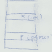

```
printf("%p", &x);
```

## 指针简介

程序中的简单变量存储在机器特定内存位置或地址的若干字节中。例如，如果 v 是一个变量，那么 &v 是其存储值在内存中的地址。在此上下文中，&v 被称为地址运算符。当放置在任何变量前面时，它表示该变量在内存中的地址。因此，&v 被视为一个常量。

指针变量是存储另一个变量地址的变量。在任何机器上，所有指针变量通常大小相同。指针变量可以在程序中声明，然后用于获取地址作为值。例如：

| int num; | 整数变量 |
| :--- | :--- |
| int *ptr; | 指向整数变量的指针 |
| ptr = &num; | 将整数变量的地址赋给指针变量 |
| *ptr = 20; | |

类型说明标识所指向变量的类型，星号标识变量本身为指针。因此，声明：

```
int *ptr;
or
int* ptr;
```

表示 ptr 是一个指针变量，并且它所指向的东西，*ptr，是 int 类型。

如前所述，地址运算符 & 后跟变量名时，给出该变量的地址。因此 &num 是变量 num 在内存中的地址。间接运算符有时称为解引用运算符，当其后跟指针变量时，给出所指向地址处存储的值。它表示被指向的东西。

## 让我们分析以下程序：

```
// pointer.c

#include <stdio.h>

(1) int main(void) {
(2)     int x, y;
(3)     int *ptr;

(4)     x = 5;
(5)     ptr = &x;
(6)     y = *ptr;
(7)     printf("x = %d   y = %d\n", x, y);
(8)     return 0;
(9) }
```

第 (3) 行声明 `ptr` 为指针变量，将包含某个 `int` 变量的地址。第 (5) 行使用地址运算符将 `int` 变量 `x` 的地址赋给指针变量 `ptr`。第 (6) 行使用间接运算符获取 `ptr` 所指向的东西（一个 `int` 值）并将其赋给 `y`。我们说指针变量 `ptr` 被解引用，并给出被指向的东西，即 5，以便在赋值语句中使用。语句 (5) 和 (6) 的效果与我们进行了赋值 `y = x;` 相同，即将值 5 赋给 `y`。

### 程序的输出是：

x = 5   y = 5

要在 C 程序中打印内存地址，可以使用 %p 格式说明符，并将要打印的地址值传递给 printf()。

例如：

```
// address.c

#include <stdio.h>

int main(void) {
    int x = 5;
    printf("x = %d\t &x = %p\n", x, &x);
}
```

打印变量 x 的值及其内存地址。输出将类似于：

```
x = 5   &x = FFFFFFF4
```

int x[5];

常量指针
*始终是数组的第一个值 !!!

*(x+1) == x[1]
第 2 个元素

int x[5];
int *V;
V = x;
V++
=> *V 则是指第 2 个元素
*V++

## 函数中的指针参数

除传递数组外，C 函数始终通过将每个参数（实际参数）的值传递给函数来调用。在函数中对这些参数（形式参数）所做的任何更改都不会反映回调用环境。因此，调用环境中这些参数的存储值不能由函数更改。这称为按值传递。例如：

```
// value.c
#include <stdio.h>
void modify(int x) {
    x = 10;
}
int main() {
    int value = 5;
    printf("Value = %d\n", value);
    modify(value);
    printf("Value = %d\n", value);
    return 0;
}
```

该程序的输出是：

```
Value = 5
Value = 5
```

这表明按值传递不允许修改实际参数。

要模拟按引用传递，我们可以使用指针将任何数据项的地址传递给函数。在处理发送到函数的指针时，函数调用时指针的值（即实际参数的地址）会被复制到形式参数中。通过在函数内解引用指针，我们可以访问并修改它所指向的数据（实际参数）。

例如：

```
// swap.c
#include <stdio.h>

void swap(int *x, int *y)
{
    int temp;
    temp = *x;
    *x = *y;
    *y = temp;
}

int main(void)
{
    int a = 5;
    int b = 10;
    printf("a = %d b = %d", a, b);
    swap(&a, &b);
    printf("a = %d b = %d", a, b);
}
```

该程序的输出是：

```
a = 5 b = 10
a = 10 b = 5
```

请注意调用：

```
swap(&x, &y);
```

传输的是实际参数 x 和 y 的地址，而不是它们的值。这意味着形式参数 u 和 v 将具有地址作为它们的值。因此，它们应使用函数原型声明为指针：

```
void swap(int *u, int *v);
```

## 指针和数组

指针和数组以几乎完全相同的方式用于访问内存。区别在于，指针是一个以地址作为值的变量，而数组名是一个固定的地址或指针。

当声明数组时，编译器必须分配一个基地址和足够的存储空间来容纳数组的所有元素。基地址是数组在内存中存储的初始位置，即数组第一个元素（索引 0）的地址。因此，数组名也是指向数组第一个元素的指针。如果我们声明一个整数数组：

```
int num[100];
```

那么数组名 num 等同于数组第一个元素的地址 &num[0]：

```
num = &num[0]
```

两者都表示数组第一个元素的内存地址，并且两者都是指针常量，因为它们在程序运行期间保持固定。但是，它们可以作为值赋给指针变量，我们可以随意更改该指针变量的值。例如：

```
int num[100]; // reserve sizeof(int)*100 bytes of memory
int *ptr; // pointer variable
```

如果将数组 num 初始元素的地址赋给 ptr，我们就可以使用指针变量访问数组存储。因此我们可以执行以下任一操作：

```
ptr = num;
or
ptr = &num[0];
```

现在可以通过 *ptr 访问数组的初始元素，即 ptr 所指向的东西。


## 指针运算

指针运算是 C 语言最强大的特性之一，并提供了数组索引的替代方案。以下语句：

```
ptr = &num[1];
and
ptr = num + 1;
```

是等价的，并会将数组中第二个元素的地址赋给 ptr。有趣的是，如果指针变量 ptr 指向某种特定类型，那么表达式 ptr + 1 会产生存储或访问该类型下一个变量的正确内存地址。以下每条语句都是有效的，并会使我们指向该类型的下一个变量，即数组中的下一个元素：

```
ptr = ptr + 1;
ptr += 1;
++ptr;
ptr++;
```

下面是一个使用指针运算对 100 个整数组成的数组求和的程序。

```
#include <stdio.h>

int main(void) {
    int i, num[100], sum, *ptr;

    for (i = 0; i < 100; i++) {
        num[i] = i;
    }

    for (sum = 0, ptr = num; ptr < &num[99]; ptr++) {
        sum += *ptr;
    }

    printf("sum = %d\n", sum);
    return 0;
}
```

在此示例中，指针变量 ptr 首先被初始化为数组 num 的基地址。ptr 的连续值等价于 &num[0]、&num[1]、...、&num[99]。在每次迭代中，我们解引用指针 ptr 以访问被加到求和变量中的数组元素内容。

一般来说，给定以下声明：

```
int i, num[100];
int *ptr;
```

我们可以说，ptr + i 是相对于地址 ptr 的第 i 个偏移量，而 num + i 是相对于数组 num 基地址的第 i 个偏移量。下面是对数组求和的另一种方法。

```
// psum2.c
#include <stdio.h>
int main(void) {
    int i, num[100], sum;
    for (i = 0; i < 100; i++) {
        num[i] = i;
    }
    for (sum = 0, i = 0; i < 100; ++i) {
        sum += *(num + i);
    }
    printf("sum = %d\n", sum);
    return 0;
}
```

请注意，因为 num 是数组名，它是一个常量指针，以下表达式是非法的，因为我们不能改变 num 的值：

```
num = ptr;
++num;
num++;
num += 2;
```

## 比较指针变量

在 C 语言中比较两个指针变量是合法的。在比较两个指向同一数组的指针时，这很有用。例如，我们可以测试 ptr 是否指向包含 100 个元素的数组末尾之后，方法是将其值与指向数组中最后一个元素的指针进行比较：

```
ptr > &num[99]
or
ptr > (num + 99)
```

我们还可以判断指针是否在另一个方向上越界：

```
ptr < &num[0]
or
ptr < num
```

## 指针相减

当一个指针减去另一个指针时，差值会被间接值的大小除，结果（在处理数组时）是两个指针之间包含的元素个数。例如：

```
// diff.c
#include <stdio.h>
int main(void) {
    double num[100];
    double *pa, *pb;
    pa = num;
    pb = pa + 3;
    printf("difference = %d", pb - pa);
    return 0;
}
```

产生以下输出：

```
difference = 3
```

如果 `ptr` 指向数组 `num` 中的某个元素，那么：

```
i = ptr - num;
```

将 `ptr` 指向的 `num` 内部元素的索引号赋给变量 `i`。因此，如果 `ptr` 已通过以下方式设置为指向 `num` 中的第 100 个元素：

```
ptr = &num[99];
```

那么在以下语句之后 `i` 的值将为：

```
i = ptr - num;
```

将是：99

## 总结

数组和指针之间有非常紧密的联系。请记住以下等式：

```
num + 2 == &num[2]    // same address.
and
*(num + 2) == num[2]    // same value
```

因此，我们可以使用指针来标识数组的单个元素并获取其值。

请务必不要混淆：

```
*(num + 2)
```

它是 num 的第三个元素的值，与

```
*num + 2 => ...
```

不同，后者是将 2 加到 num 的第一个元素的值上。

还请记住：

```
*(++ptr) -> ...
```

先递增 ptr，然后获取它所指向的数据，而

```
*ptr++ -> ...
```

在指针本身递增之前获取 ptr 所指向的数据。

## 函数、数组和指针

给定以下声明：

```
int main(void) {
    int num[100];
    foo(num);
    return 0;
}
void foo(int list[]) {
    :
    :
}
```

数组 num 是包含 100 个元素的数组。数组 list 中包含多少个元素？答案是根本不存在数组 list！！形式参数声明：

```
int list[]
```

创建的不是数组，而是一个指针。为什么？请注意我们的函数调用：

```
foo(num);
```

参数是 num，而 num 这个名字不仅是数组的名称，也是指向 100 元素数组第一个元素的指针。因此，函数调用将一个指针（即数组的地址）传递给函数 foo()。这意味着 foo() 的参数是一个指针，我们本可以写成：

```
void foo(int *list) {
    :
    :
}
```

换句话说，我们有以下等式：

```
int *list; int list[];
```

两者都将 list 声明为指向整数的指针。主要区别在于，第一种形式提醒我们 list 指向一个数组。

我们现在可以看出，使用数组名作为参数是按引用调用而不是按值调用。函数调用将 list 初始化为指向 num[0]。如果在函数中遇到语句 list[3]，它等同于 *(list + 3)。但是，如果 list 指向 num[0]，那么 list + 3 指向 num[3]，即 *(list + 3) == num[3]。因此，通过修改 list[3]，我们正在修改 *(list + 3)，这与修改 num[3] 相同。一般来说，当你使用数组名作为函数参数时，你将一个指针传递给函数。然后函数使用这个指针对调用程序中的原始数组进行修改。

以下两个函数返回数组 num 的总和：

```
// sumarray1.c
int sumArray1(int num[], int max) {
    int i, sum;

    for (i = 0, sum = 0; i < max; i++) {
        sum += num[i];
    }
    return sum;
}

// sumarray2.c
int sumArray2(int *num, int max) {
    int i, sum;

    for (i = 0, sum = 0; i < max; i++) {
        sum += *(num + i);
    }
    return sum;
}
```

请注意，我们还可以通过传递指向子数组开头的指针来将数组的一部分传递给函数。例如，如果 num 是一个数组，那么：

```
foo(&num[2]);
and
foo(num + 2);
```

两者都将元素 num[2] 的地址传递给函数 foo()。在 foo() 内部，参数声明可以写成：

```
void foo(int num[]) {
    :
    :
}
```

或

```
void foo(int *num) {
    :
    :
}
```

## 指针作业

- 1. 如果 x 是一个变量，p 是指向 x 的指针，以下哪些表达式是 x 的别名？
  - a) *p
  - b) &p
  - c) *&p: p=&x
  - d) &*p
  - e) (*p)
  - f) &x
  - g) *(&x)
  - h) &*x

- 2. 如果 x 是 int 变量，p 和 q 是指向 int 的指针，以下哪些赋值是合法的？
  - a) p = x
  - b) *p = (&x, p)
  - c) &p = q
  - d) p = &q
  - e) p = *&g
  - f) p = q
  - g) *p = q
  - h) *p = q
  - i) &p = &g

- 3. 为以下每个示例写一行代码。假设 num1 和 num2 是 int 变量，且 num1 已初始化为 5。
  - a) 定义变量 p 为指向 int 的指针。
  - b) 将 num1 的地址赋给指针 p。
  - c) 打印 p 所指向变量的值。
  - d) 将 p 所指向变量的值赋给变量 num2。
  - e) 打印 num2 的值。

- 4. 假设以下声明生效：

  int a[] = { 5, 13, 34, 54, 14, 62, 72 };
  int *p = &a[1];
  int *q = &a[5];

  - a) *(p + 3) 的值是多少？
  - b) *(q - 3) 的值是多少？
  - c) q - p 的值是多少？
  - d) 条件 p < q 为真还是假？真 1 < 5
  - e) 条件 *p < *q 为真还是假？真

- 5. 假设 num 是一维数组，p 是指针变量。假设刚刚执行了赋值 p = num。以下哪些表达式因类型不匹配而非法？在剩余的表达式中，哪些为真（具有非零值）？
  - a) i = *num[0]; 非法
  - b) p == &num[0]; 合法
  - c) *p == num[0]; 合法
  - d) p[0] == num[0]; 合法


- 字符串简介
- 其他字符串函数
- 字符串示例
- 字符串与指针
- 字符串数组
- 命令行参数
- 在 Visual Studio 12 中设置命令行参数
- 在 Xcode 4 中设置命令行参数
- 可变长度参数列表
- 字符串作业
- 凯撒密码实验
- 文本格式实验
- 文本统计实验
- Grep 实验
- 文本加密实验

FF = 255 (1 byte)
FF FF FF FF (hex format - 4 bytes)
(8) ...
char str[] = ...
char str[] = "csc1122";
char dest[8] ... copy ... reserve >> space

## 字符串简介

字符串定义为以空字符 '\0' 结尾的字符数组。字符串可以在声明时进行初始化，如下所示。

```
char name[] = { 'C', 'o', 'm', 'p', 'u', 't', 'e', 'r', '\0' };
```

请注意，此数组将包含 9 个元素，每个字符一个，再加上一个空字符 '\0'。另一种更广泛使用的初始化方式如下：

```
char name[] = "Computer";
```

两种广泛使用的字符串 I/O 函数如下：

- * gets(s1)

  从标准输入读取字符串到字符串变量 s1。字符会被放入 s1，直到读取到换行符，此时换行符会被改为空字符并用于终止 s1。返回 s1 的值（指向 char 的指针）。请注意，与 scanf() 不同，此函数允许输入字符串包含空白字符。

  函数原型：
  char *gets(char *s1);

- * puts(s1)

  将以空字符结尾的字符串 s1 复制到标准输出，但终止空字符本身不被复制。会追加一个换行符。

  函数原型：
  int puts(char *s);

string.h 库包含多种用于操作字符串的函数。要使用其中任何函数，必须在程序中添加以下声明：

```
#include <string.h>
```

我们将重点介绍 string.h 库中出现的四个字符串函数：strlen()、strcpy()、strcat()、strcmp()。我们还将为每个这些字符串函数编写自己的代码。

### strlen(s1)

查找长度时，计算长度。

它告诉我们字符串的长度。它返回字符串中的字符数，不包括空终止字符。

函数原型：

```
int strlen(char *s1);
```

例如：

```
strlen("Computer");
```

返回值为 8，而不是 9。

我们实际上可以编写一个简单的函数来计算自己的字符串长度。请注意，我们使用字符串中空字符的位置来帮助确定字符串的结束：

```
int strlen(char s1[]) {
    int i = 0;
    while (s1[i] != '\0') {
        ++i;
    }
    return i;
}
```

形式参数 s1 并不真正是一个字符数组，而是一个保存数组初始元素地址的变量。这称为字符指针，该函数可以声明为：

```
int strlen(char *s1)
```

当 strlen() 运行其循环时，它将依次查看 s1[0]、s1[1] 等。由于 s1 包含数组的初始地址，C 理解 s1[0] 表示该地址处的字符。

- * strcpy(s1, s2)

  将字符串 s2 复制到字符串 s1，在移动终止空字符后停止。

  函数原型：

  ```
  void strcpy(char *s1, char *s2);
  ```

  例如：

  ```
  strcpy(s, "Computer");
  ```

  将字符串 "Computer" 复制到字符串变量 s 中。

  同样，我们可以编写自己的 strcpy() 函数，并可以使用字符串中空字符的位置来帮助确定字符串的结束：

  ```
  void strcpy(char s1[], char s2[]) {
      int i = 0;
      while (s2[i] != '\0') {
          s1[i] = s2[i];
          ++i;
      }
      s1[i] = '\0';
  }
  ```

我们可以更简洁地编写此代码：

```
void strcpy(char s1[], char s2[]) {
    int i = 0;
    while ((s1[i] = s2[i]) != '\0') {
        ++i;
    }
}
```

- * strcat(s1, s2) 将字符串 s2 复制到字符串 s1 的末尾。

  函数原型：

  ```
  void strcat(char *s1, char *s2);
  ```

  例如：

  ```
  char buf[32] = "Hello,";
  strcat(buf, " world.");
  printf("%s\n", buf);
  ```

  输出字符串：

  ```
  Hello, world.
  ```

  同样，我们可以编写自己的代码来执行字符串连接：

  ```
  void strcat(char s1[], char s2[]) {
      int i = 0, j = 0;
      while (s1[i] != '\0') {
          ++i;
      }
      while (s2[j] != '\0') {
          s1[i] = s2[j];
          ++i;
          ++j;
      }
      s1[i] = '\0';
  }
  ```

### 我们可以简化代码：

```
void strcat(char s1[], char s2[]) {
   int i = 0, j = 0;
   while (s1[i]) {
      ++i;
   }
   while (s2[j]) {
      s1[i++] = s2[j++];
   }
   s1[i] = '\0';
}
```

### 我们可以进一步简化代码：

```
void strcat(char s1[], char s2[]) {
   int i = 0, j = 0;
   while (s1[i]) {
      ++i;
   }
   while (s1[i++] = s2[j++]) {
      ;
   }
}
```

### strcmp(s1, s2)

对字符串 s1 与字符串 s2 进行比较，从每个字符串的第一个字符开始，继续比较后续字符，直到对应字符不同或到达字符串末尾。该函数返回一个值，其值为：

- 如果 s1 小于 s2，则 < 0（-1）
- 如果 s1 与 s2 相同，则 = 0
- 如果 s1 大于 s2，则 > 0（1）

### 函数原型：

```
int strcmp(char *s1, char *s2);
```

我们编写自己的代码来执行字符串比较：

```
int strcmp(char s1[], char s2[]) {
    int i = 0;
    while (s1[i] == s2[i] && s1[i] != '\0') {
        ++i;
    }
    return s1[i] - s2[i];
}
```

以下是 strcmp() 函数的使用示例：

```
#include <stdio.h>
#include <string.h>

int main(void) {
    int num;

    char s1[] = "red";
    char s2[] = "blue";
    num = strcmp(s1, s2);
    if (num < 0) {
        printf("%s is smaller.\n", s1);
    }
    else if (num > 0) {
        printf("%s is smaller.\n", s2);
    }
    else {
        printf("The strings are the same.");
    }
    return 0;
}
```

输出如下：

```
blue is smaller.
```

请注意，C 不允许我们使用相等运算符直接比较两个字符串是否相等：

```
if (s1 == s2)
```

这是因为相等运算符只能应用于 int、float、char 等简单变量类型，而不能应用于结构体或数组。

## 其他字符串函数

以下是字符串库中的其他字符串操作函数：

- • strncpy(s1, s2, max)

  从字符串 s2 复制最多 max 个字符到字符串 s1，截断或用空字符填充 s1。如果 s2 的长度为 max 或更多，目标字符串 s1 可能不是以空字符结尾。

  函数原型：
  char *strncpy(char *s1, char *s2, int max);

- • strncmp(s1, s2, max)

  与 strcmp() 进行相同的比较，但最多查看 max 个字符。它从每个字符串的第一个字符开始，继续比较后续字符，直到对应字符不同或已检查了 max 个字符。根据比较字符串 s1（或其部分）与字符串 s2（或其部分）的结果返回一个 int 值。该函数返回一个值，其值为：

  - 如果 s1 小于 s2，则 < 0
  - 如果 s1 与 s2 相同，则 == 0
  - 如果 s1 大于 s2，则 > 0

  函数原型：
  int strncmp(char *s1, char *s2, int max);

- • strchr(s1, c)

  扫描字符串 s1 中字符 c 的第一次出现。返回 s1 中字符 c 第一次出现的指针。如果 c 在 s 中不出现，strchr() 返回 null。

  函数原型：
  char *strchr(char *s1, int c);

- 反向
- * strrchr(s1, c)

  扫描字符串中给定字符的最后一次出现。strrchr() 以反向扫描字符串 s1，查找字符 c。返回字符 c 最后一次出现的指针。如果字符 c 在字符串 s1 中不出现，strrchr() 返回 null。

  函数原型：
  char *strrchr(char *s1, int c);

- * strstr(s1, s2)

  扫描字符串 s1 中子字符串 s2 的第一次出现。返回 s1 中 s2 开始的元素的指针（指向 s1 中的 s2）。如果 s2 在 s1 中不出现，strstr() 返回 null。

  函数原型：
  char *strstr(char *s1, char *s2);

- * strset(s1, c)

  将字符串 s1 中的所有字符设置为字符 c。在找到终止空字符时停止。返回 s1。

  函数原型：
  char *strset(char *s1, int c);

- * strrev(s1)

  反转字符串。strrev() 将字符串中的所有字符更改为逆序，但终止空字符除外。返回指向反转字符串的指针。

  函数原型：
  char *strrev(char *s1);

- * strlwr(s1)

  将字符串 s1 中的大写字母转换为小写。不更改其他字符。返回 s1。

  函数原型：
  char *strlwr(char *s1);


- strupr(s1)

将字符串 s1 中的小写字母转换为大写字母。其他字符不变。返回 s1。

函数原型：

```
char *strupr(char *s1);
```

- Strlen - 获取字符串长度

## 字符串示例

以下是两个字符串函数。看看你能否弄明白它们的工作原理。

```
// Function to reverse a string in place
void reverse( char s[]) {
    int c, i, j;

    for (i = 0, j = (int)strlen(s)-1; i < j; ++i, --j) {
        c = s[i];
        s[i] = s[j];
        s[j] = c;
    }
}
```

```
// Function converts a string of digits into its numeric equivalent
int atoi(char buf[]) {
    int i, num;

    num = 0;
    for (i = 0; buf[i] >= '0' && buf[i] <= '9'; ++i) {
        num = 10 * num + buf[i] - 48;
    }
    return num;
}
```

## 字符串与指针

考虑以下两个声明：

```
(1) char word[] = "Computer";
(2) char *word = "Computer";
```

在声明 (1) 中，编译器会计算字符数并相应调整数组大小，总共 9 个字节（包括 '\0' 字符）。在这里，数组名 word 是指向数组第一个元素的常量指针：

```
word == &word[0]
```

并且我们可以展示以下等式：

```
*word == 'C'
*(word + 1) == word[1] == 'o'
```

在声明 (2) 中，使用指针表示法来设置字符串。编译器实际上预留了 13 个字节的存储空间：9 个字节用于字符串，4 个字节用于将指向该字符串的指针变量。

在两种情况下，word 都是指向字符串的指针。在两种情况下，字符串本身决定为字符串预留的存储空间大小。但这两种形式并不相同。数组形式在存储中设置了一个包含 9 个元素（包括 '\0' 字符）的数组，编译器将名称 word 视为第一个数组元素地址 &word[0] 的同义词。请注意，word 是一个包含数组基地址且不可更改的指针常量。您可以引用 word[i] 来标识数组中的下一个元素，但 *word 是不允许的。

指针形式也会为字符串预留 9 个元素的存储空间。但是，它还为指针变量 word 额外预留了一个存储位置。该变量最初指向字符串的开头，但其值可以更改。在这里，++word 将指向第二个字符，以此类推。

## 你能找出以下程序中的错误吗？

```
#include <stdio.h>
int main(void) {
    char *name;
    printf("Please enter your name: ");
    gets(name);
    printf("Hello %s\n", name);
    return 0;
}
```

## 使用指针重新审视字符串函数

以下两个字符串函数返回字符串中的字符数：

```
// strlen1.c
int strlen(char *s) {
    int i = 0;
    while(*s++) {
        i++;
    }
    return i;
}

// strlen2.c
int strlen(char *s) {
    char *ptr = s;
    while(*ptr) {
        ptr++;
    }
    return(ptr - s);
}
```

以下四个字符串函数将字符串 t 复制到字符串 s 中。你能跟踪这些指针吗？

```
// strcpy1.c
void strcpy1(char s[], char t[]) {
    int i;
    for (i = 0; t[i] != '\0'; i++) {
        s[i] = t[i];
    }
    s[i] = '\0';
}

// strcpy2.c
void strcpy2(char *s, char *t) {
    for (; *t != '\0'; s++, t++) {
        *s = *t;
    }
    *s = '\0';
}

// strcpy3.c
void strcpy3(char *s, char *t) {
    while (*t) {
        *s++ = *t++;
    }
    *s = '\0';
}

// strcpy4.c
void strcpy4(char *s, char *t) {
    while (*s++ = *t++) {
    }
}
```

以下函数将字符串 t 连接到字符串 s 的末尾，并返回指向连接后字符串的指针：

```
// strcat.c
char *strcat(char *s, char *t) {
    while(*s) {
        s++;
    }
    while(*s++ = *t++) {
        ;
    }
    return s;
}
```

请注意，在我们对 strcat() 的最终实现中，实际上可以将连接后的字符串作为函数返回值返回。

最后，以下函数比较两个字符串：

```
// strcmp.c
int strcmp(char *s, char *t) {
    while(*s==*t && *s) {
        s++;
        t++;
    }
    return *s - *t;
}
```

## 看看你能否弄明白以下程序的输出：

```
// doublep.c
#include <stdio.h>
void foo1(char *p);
void foo2(char **q);
int main(void) {
    char *p = "Hello";
    char *q = "Bye";
    printf("Function: main() ---> p = %s\n", p);
    foo1(p);
    printf("Function: main() ---> p = %s\n", p);
    printf("Function: main() ---> q = %s\n", q);
    foo2(&q);
    printf("Function: main() ---> q = %s\n", q);
    return 0;
}
void foo1(char *pp) {
    ++pp;
    printf("Function: foo1() ---> pp = %s\n", pp);
}
void foo2(char **qq) {
    ++*qq;
    printf("Function: foo2() ---> *qq = %s\n", *qq);
}
```

输出如下：

```
Function: main() ---> p = Hello
Function: foo1() ---> p = ello
Function: main() ---> p = Hello
Function: main() ---> q = Bye
Function: foo2() ---> q = ye
Function: main() ---> q = ye
```

## 字符串数组

考虑以下数组声明：

```
char name[5][10] = { "Bailey", "Beatty", "Mace", "Miller", "Zedon" };
```

它设置了一个矩形二维数组，包含 5 行，每行长度为 10 列。请注意，我们有必要声明行的长度足够大，以至少容纳最长的名称：

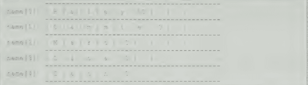

如您所见，这是对存储空间的巨大浪费。幸运的是，C 语言让我们能够声明一个数组，每行的长度由其初始化的字符串决定：

```
char *name[] = { "Bailey", "Beatty", "Mace", "Miller", "Zedon" };
```

在这里，name 是一个包含 5 个指向字符串的指针的数组。每个字符串都是一个字符数组，因此我们有 5 个指向数组的指针：

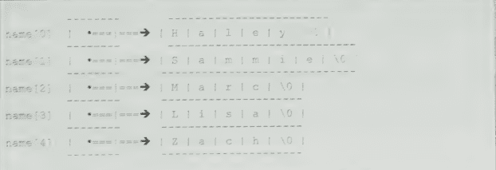

第一个指针是 name[0]，它指向第一个字符串；第二个指针是 name[1]，它指向第二个字符串，以此类推。请注意，每个指针都指向每个字符串的第一个字符：

```
*name[0] ==> 'B',
*name[1] ==> 'B',
*name[2] ==> 'M',
*name[3] ==> 'M',
*name[4] ==> 'Z',
```

这个指针数组有时被称为不规则数组，因为每行的大小可能不同。因此，不规则数组不会浪费任何存储空间！

考虑以下示例，它声明了一个不规则数组，用于存储程序可能需要的各种错误消息：

```
char *errorMsg[5] = { "Memory allocation error",
"Stack overflow.",
"Cannot read sector.",
"File not found.",
"Division by zero."
};
```

要输出适当的错误消息，只需访问相应的数组元素即可：

```
puts(errorMsg[3]);
```

如果我们想要输出不规则数组中包含的所有错误消息，只需遍历数组即可：

```
for (i = 0; i < 5; i++) {
puts(errorMsg[i]);
}
```

## 命令行参数

当编译后的程序执行时，在运行时为某些变量提供初始值是很有用的。这些值称为命令行参数。我们之前将 main() 函数定义为：

```
int main(void);
```

但它更一般地定义为：

```
int main(int argc, char *argv[])
```

第一个参数 argc 存储程序被调用时的命令行参数数量（包括程序名）。第二个参数 argv 是指向字符串不规则数组的指针，用于存储传递给程序的实际参数值。

argv 的声明：

```
char *argv[]
```

表示该指针指向数组的初始元素，也可以写成：

```
char **argv
```

也就是说，argv 是指向指向 char 的指针的指针。如果我们查看 argv 指向的存储空间，将发现一个字符指针数组，每个指针都指向一个以空字符结尾的字符串：

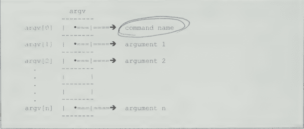

### 按照惯例：

- argc 至少为 1
- argv[0] 是命令本身的名称（程序被调用时使用的名称
- argv[1] 指向第一个参数字符串
- argv[2] 指向第二个参数字符串，以此类推
- argv[argc] 始终是数组的最后一个元素，并且始终包含一个空指针

例如，如果我们执行一个名为 foo 的程序，并带有两个参数：

```
foo arg1 arg2
```

程序将接收到 argc 等于 3 的值，而 argv 将如下所示：

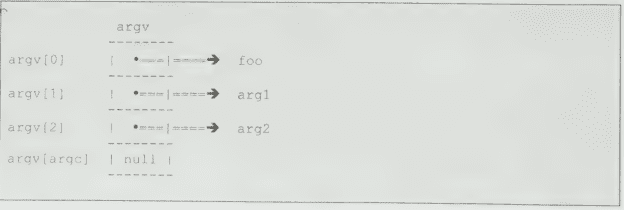


在 main() 中，原始命令行上的值现在可以像任何其他变量一样被访问和使用。我们稍后将看到，还可以从命令行向 main() 传递文件名，并打开和访问文件的内容。下面的程序只是将其命令行参数回显到终端窗口：

```
// echo1.c

#include <stdio.h>

int main(int argc, char *argv[]) {
    int i;
    for(i = 0; i < argc; i++) {
        printf("%s ", argv[i]);
    }
    printf("\n");
    return 0;
}
```

由于 argv 是指向指针数组的指针，我们可以不使用数组索引来重写上面的程序：

```
// echo2.c

#include <stdio.h>

int main(int argc, char *argv[]) {
    while(--argc > 0) {
        printf("%s ", *++argv);
    }
    printf("\n");
}
```

由于 argv 是指向参数字符串数组开头的指针，将其加 1（即 ++argv）会使其指向 argv[1] 而不是 argv[0]。每次后续迭代都会将其移动到下一个参数。*argv 此时即为该参数的指针。当 argc 变为 0 时，表示不再有剩余参数。

```
// caps.c

#include <stdio.h>
#include <stdlib.h>
#include <ctype.h>

int main(int argc, char *argv[]) {
    int c;
    FILE *fp;

    if (!(fp = fopen(argv[1], "r"))) {
        puts("Could not open file. ");
        exit(1);
    }

    while((c = getc(fp)) != EOF) {
        if(islower(c)) {
            putchar(toupper(c));
        } else {
            putchar(c);
        }
    }

    return 0;
}
```

我们的最后一个示例展示了如何使用标志来修改命令。标志通常由连字符引导，并在命令行中作为第二个参数出现。下面的程序将输出其命令行参数，如果存在标志 -c，则参数将以大写字母输出；否则，参数将按其在命令行中出现的形式输出。请注意，包含标志的参数不会被输出。

```
// flag.c

#include <stdio.h>
#include <string.h>

int main(int argc, char *argv[]) {
    int i = 1, flag = 0;

    if (!strcmp(argv[1], "-c")) {
        flag = 1;
        i = 2;
    }
    for ( ; i < argc; ++i) {
        if (flag) {
            strupr(argv[i]);
            printf("%s ", argv[i]);
        }
    }
    printf("\n");
    return 0;
}
```

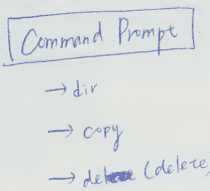

## 可变长度参数列表 - 高级

可以创建接收不特定数量参数的函数！事实上，printf() 接收可变数量的参数。至少，printf() 必须将字符串作为其第一个参数，但可以接收任意数量的其他参数。printf() 的实际函数原型为：

```
int printf(char *fmt, ...);
```

声明 ...（省略号）表示这些参数的数量和类型可能会变化。函数可以接收任意类型的可变数量的参数。此声明只能出现在参数列表的末尾。

声明带有可变数量参数的函数可以为我们提供极大的灵活性。考虑一个名为 average() 的函数，它可以计算可变数量参数的平均值。它可能会以如下方式调用：

```
avg = average(a, b, c);
avg = average(a, b, c, d);
```

在 C 中处理可变数量参数的秘诀在于参数传递给函数的方式。让我们来看看 C 函数进入时栈的内容。当调用函数时，参数后跟返回地址会被放置在栈上：

```
foo(arg1, arg2);

high addresses
+-----------+
|   arg2    |
+-----------+
|   arg1    |
+-----------+
| return address |
sp-> +-----------+
     |           |
     | stack     |
     | grows     |
     | downward  |
     |           |
     +-----------+
low addresses
```

在 C 中，函数的参数按其在函数调用中出现的相反顺序放置在栈上。结果是，第一个参数始终位于栈指针 sp 的固定偏移处。该偏移是存储返回地址所需的字节数。因此，无论向 C 函数传递多少个参数，第一个参数始终很容易访问。

因此，当进入 C 函数时，第一个参数出现在返回地址上方的栈上，即它具有下一个更高的地址。其他参数具有依次更高的地址。因此，如果你能访问栈上的第一个参数，并且知道所有其他参数的大小，那么你就可以逐个检索参数！

有一个标准 C 头文件 <stdarg.h>，它包含一组宏以及一种新定义的数据类型，使处理可变数量参数的任务变得简单直接。该头文件的实现因机器而异，但它提供的接口是统一的。stdarg.h 包含的第一件事是一种新数据类型的定义：

```
va_list
```

它用于声明一个变量，该变量将依次引用每个参数：

```
va_list ap;
```

我们将 ap 声明为 va_list 类型的参数指针。ap 将由其他宏用于处理可变长度参数列表，即 ap 将依次指向每个参数。

va_start 是一个宏，它初始化参数指针 ap，使其指向传递给函数的栈上的第一个未命名参数。在使用 ap 访问任何未命名参数之前，必须先调用一次 va_start。va_start 的原型为：

```
void va_start(va_list ap, lastarg);
```

第一个参数 ap 是参数指针。第二个参数 lastarg 是传递给被调用函数的最后一个固定函数参数的名称。这是参数列表中省略号 (...) 之前的最右侧参数。请注意，函数必须至少有一个命名参数。va_arg 是一个宏，它将参数指针 ap 推进到栈上的下一个参数。第一次使用 va_arg 时，它返回列表中的第一个参数。每次后续使用 va_arg 时，它返回列表中的下一个参数。它通过先解引用 ap，然后递增 ap 以指向下一个项目来实现这一点。

va_arg 的原型为：

```
type va_arg(va_list ap, type);
```

第一个参数 ap 是参数指针。第二个参数 type 表示参数列表中预期值的类型，例如 int、double 等。请注意，不能使用 char、unsigned char 或 float。va_arg 使用 type 既执行解引用以确定返回什么类型，又确定采取多大的步长来定位栈上的下一个参数。该宏返回参数类型的值。

va_end 是一个宏，它执行必要的清理操作，以帮助被调用函数执行正常返回。它必须在 va_arg 读取所有参数之后且在函数返回之前调用。如果不这样做，可能会导致程序出现奇怪的未定义行为。va_end 的原型如下：

```
void va_end(va_list ap);
```

参数 ap 是参数指针。

下面的程序返回一系列数字的平均值。average() 函数的第一个参数始终是要平均的值的数量：

```
// arg1.c

#include <stdio.h>
#include <stdarg.h>

int main(void);
double average(int num, ...);

int main(void) {
    double a = 2.0, b = 4.0, c = 6.0, d = 8.0;

    printf("%5.1f\n", average(2, a, b));
    printf("%5.1f\n", average(3, a, b, c));
    printf("%5.1f\n", average(4, a, b, c, d));
    return 0;
}

double average(int num, ...) {
    int i;

    double total = 0.0;

    va_list ap;

    va_start(ap, num);
    for(i = 1; i <= num; i++) {
        total += va_arg(ap, double);
    }
    va_end(ap);

    return total / num;
}


以下程序计算以零结尾的列表的总和：

```c
// arg2.c

#include <stdio.h>
#include <stdarg.h>

int main(void);
void sum(char *msg, ...);

int main(void) {
    sum("The total of 1+2+3+4 is %d\n", 1,2,3,4,0);
}

void sum(char *msg, ...) {
    int total = 0, arg;
    va_list ap;

    va_start(ap, msg);
    while ((arg = va_arg(ap,int)) != 0) {
        total += arg;
    }
    printf(msg, total);
    va_end(ap);
}
```

最后，printf() 和 scanf() 如何知道在每个 va_arg 宏中使用什么类型？答案是它们扫描格式控制字符串中的格式转换说明符，以确定要处理的下一个参数的类型。Kernighan 和 Ritchie 提供了一个 printf() 最小版本的实现，以展示如何编写处理可变长度参数列表的函数。其原型是：

```c
void myprintf(char *fmt, ...);
```

由于这里关注的是参数传递，myprintf() 处理格式字符串和参数，但调用真正的 printf() 函数来执行格式转换：

```c
// arg3.c
#include <stdio.h>
#include <stdarg.h>

int main(void)
{
    void myprintf(char *fmt, ...);

    int x = -30, y = 10;
    float pi = 3.14;
    char *buf = "Hello";

    myprintf("%d %d\n", x, y);
    myprintf("%f is %s\n", x, pi, buf, y);
}

void myprintf(char *fmt, ...)
{
    char *p, *sval;
    int ival;
    double dval;
    va_list ap;

    va_start(ap, fmt);
    for (p = fmt; *p; p++) {
        if (*p != '%') {
            putchar(*p);
            continue;
        }
        switch (*++p) {
            case 'd': ival = va_arg(ap, int);
                printf("%d", ival);
                break;
            case 'f': dval = va_arg(ap, double);
                printf("%f", dval);
                break;
            case 's': for (sval = va_arg(ap, char *); *sval; sval++)
                putchar(*sval);
                break;
            default : putchar(*p);
                break;
        }
    }
    va_end(ap);
}
```

## 数据压缩 - 高级

数据压缩是减少存储或传输数据所需位数的技术。压缩可以是无损的，也可以是有损的。无损压缩和有损压缩是描述在文件解压缩或接收数据传输时，是否可以恢复所有原始数据的术语。

使用无损压缩时，文件中原本存在的每一位数据在文件解压缩后都会保留。所有信息都会被完全恢复。这通常是文本或电子表格文件的首选技术，因为丢失单词或财务数据可能会造成问题。图形交换格式（GIF）是Web上使用的一种提供无损压缩的图像格式。其他无损压缩算法包括：

- TIFF - Zip - RAR - FLAC - LZW - Huffman 编码 - PNG - 莫尔斯电码

另一方面，有损压缩通过永久消除某些信息（尤其是冗余信息）来减小文件大小。当文件解压缩时，只有部分原始信息仍然存在（尽管用户可能不会注意到）。有损压缩通常用于视频和音频，其中一定量的信息丢失大多数用户不会察觉。JPEG 图像文件常用于网页上的照片和其他复杂静态图像，是一种具有有损压缩的图像。使用 JPEG 压缩，创建者可以决定引入多少损失，并在文件大小和图像质量之间做出权衡。其他有损压缩算法包括：

- MP3 - JPG - DivX

### 字典压缩

通过检查字典中连续数据项之间的关系，可以推导出一种高效的编码方案以实现高水平的数据压缩。这种压缩技术利用了这样一个事实：字典中的单词按字母顺序排列，往往与相邻条目以相同的字母开头。压缩算法的工作原理如下：压缩字典中的每个单词都以一个数字开头，该数字表示应从字典中的前一个单词复制多少个字符。单词的其余字母跟在数字后面。

例如，如果原始字典只包含五个单词：

```
can<LF>
canal<LF>
cancel<LF>
cancer<LF>
candid<LF>
```

它将被压缩为：

```
0can<LF>
3al<LF>
3cel<LF>
5r<LF>
3did<LF>
```

在字典的编码版本中，只出现那些与前一个单词中连续出现的字母不同的字母。每个单词末尾前面的数字表示相同的字符数。解码要求按顺序读取，以便前一个单词再次可用。要解压缩的单词前面的计数提供了要保留的前导字符数，然后将未编码的字符连接起来。

在前面的示例中，原始字典包含 31 个字符，压缩版本包含 22 个字符，节省了 29% 的空间。通过减少每行末尾的换行符 <LF> 数量，可以实现更多压缩。这可以通过将单词输出到一行，直到达到预定义的右边距来实现：

```
0can3al3cel5r3did<LF>
```

压缩后的字典现在包含 18 个字符，节省了 42% 的空间。然而，在实际中，实际字典中的条目在词典顺序上比本示例中的条目更接近，节省的空间也更大。使用更大的字典时，压缩比超过 50%。

这种字典压缩方案的一个局限是，要解压缩字典中的一个单词，必须知道前一个单词是什么，而前一个单词的解压缩又依赖于再前一个单词，以此类推。然而，在实际中，字典访问并不局限于从头开始的串行搜索，因为以新字母开头的第一个单词不会从其前驱复制任何字母。因此，通过 26 个指向文件的指针（从 a 开头到 z 开头），可以非常快速地搜索字典。指针方案可以扩展为一个索引，指向每个两字母对（aa、ab，直到 zy、zz）的开头，这样查找给定单词时需要读取的字典内容更少。

下面的 compress() 函数在按字母顺序排列的 ASCII 文本文件上执行此压缩算法，每行一个单词。字典必须全部为小写。0 到 9 的数字范围在 ASCII 序列中扩展，冒号 (:) 被解释为 10，分号 (;) 被解释为 11，以此类推。

互补函数 expand() 执行逆操作。它从由 compress() 压缩的文件生成一个每行一个单词的 ASCII 文本文件。

读取一个按字母顺序排列的文件（每行一个单词）并写入文件的压缩版本。输出文件中的单词前面有一个计数（2 个字符），等于与前一个单词相同的部分加上偏移量 48（ASCII '0'），并省略这些相同的字符。每行输出多个单词，直到达到列 MAX_COL。此时，通过打印 '\n' 将当前单词设为行上的最后一个单词。

```c
void compress(FILE *) {
    char prev[MAX_CHAR], word[MAX_CHAR], c;
    int i, key;
    int character, location = 0;
    FILE *fptr, *fopen();
    if ((fptr = fopen("Dictionary.text", "r")) == NULL) {
        fprintf(stderr, "File could not be opened for input.\n");
        exit(1);
    } else {
        fscanf(fptr, "%s", word);
        fprintf(fptr, "%s", word);
        strcpy(prev, word);
        while (fscanf(fptr, "%s", word) != EOF) {
            i = 0;
            while (prev[i] == word[i]) i++;
            if (i > 0) {
                fprintf(fptr, "%c%d%s\n", i, word[i]);
                location += i + 2;
                if (location > MAX_COL) {
                    fprintf(fptr, "\n");
                    location = 0;
                }
            }
            fprintf(fptr, "%s", word);
            strcpy(prev, word);
        }
        fclose(fptr);
    }
}
```


/*
Reads a compressed file created by compress() and writes a standard
ASCII file, one word per line.
*/
void expand(void) {
    char prev[MAX_CHAR], word[MAX_CHAR];
    int samechr;
    FILE *fpin, *fpOut;
    if ((fpin = fopen("compressedDictionary.txt", "r")) == NULL) {
        printf("file could not be opened for input.\n");
        exit(1);
    }
    if ((fpOut = fopen("newDictionary.txt", "w")) == NULL) {
        printf("file could not be opened for output.\n");
        exit(1);
    }
    while ((samechr = getWord(word, fpin)) >= 0) {
        strcpy(prev, word);
        fputs(prev, fpOut);
        fprintf(fpOut, "\n");
    }
    fclose(fpin);
    fclose(fpOut);
}
int getWord(char *w, FILE *fpin) {
    int c, count;
    while ((c = fgetc(fpin)) < 'a') {
        count = 0;
        if (c == EOF) {
            return -1;
        }
    }
    ungetc(c, fpin);
    while ((c = fgetc(fpin)) >= 'a') {
        w[count++] = c;
    }
    ungetc(c, fpin);
    w[count] = '\0';
    return count;
}

对包含 482,884 字节的 50,000 词典实现 compress() 会生成 185,339 字节的文件，压缩率为 61.62%。

## 字符串作业

1. 下列函数调用声称写入一个单个换行符，但有些是不正确的。找出哪些调用不起作用并解释原因。

- a) printf("%c", '\n');
- b) printf("%c", "\n");
- c) printf("%s", '\n');
- d) printf("%s", "\n");
- e) printf('\n');
- f) printf("\n");
- g) putchar('\n');
- h) putchar("\n");
- i) puts('\n');
- j) puts("\n");
- k) puts("");

2. 假设 p 已按如下方式声明：

```c
char *p = "abc";
```

下列哪些函数调用是合法的？显示每个合法调用产生的输出，并解释其他调用为何非法。

- a) putchar(p);
- b) putchar(*p);
- c) puts(p);
- d) puts(*p);

## 3. 假设 str 是一个字符数组。下列哪条语句与其他三条不等价？

- a) *str = '\0'; → 空字符串 → 替换 'se' 字符...
- b) str[0] = '\0'; → 空字符串
- c) strcpy(str, ""); → 空字符串
- d) strcat(str, ""); → 原字符串

## 4. 执行以下语句后，字符串 s1 的值将是多少？

```c
strcpy(s1, "computer");
strcpy(s2, "science");
if (strcmp(s1, s2) < 0)
    strcat(s1, s2);
else
    strcat(s2, s1);
s1[strlen(s1)-6] = '\0';
```

## 5. 下列函数声称创建字符串的完全副本。函数有什么问题？

```c
char *dup(char *p)
{
    char *q;
    strcpy(q, p);
    return q;
}
```

## 6. 下列程序打印什么？

```c
#include <stdio.h>
int main(void) {
    char s[] = "Hello";
    char *p;
    for (p = s; *p; p++)
        --*p;
    puts(s);
    return 0;
}
```

## 密码实验

这个简短作业的目的是让你练习使用字符和字符串。你将创建一个名为 `cipher.c` 的程序，通过将每个字母移动一定的位数来编码消息。因此，如果移位为 2，则 A 变为 C，B 变为 D，依此类推。如下所示：

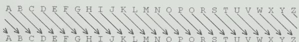

令人惊讶的是，你可以通过简单地对字符进行算术运算来实现这一点，但你应该向 C 保证结果是一个字符，使用强制类型转换。例如，如果一个字母包含值 'A'，那么 'A' + 2 给出整数结果 67，你可以通过说 `(char)(letter + 2)` 将其转换回字符，得到值 'C'。

不幸的是，`(char)('Z' + 2)` 不会给你字母 'B'（你可以从上面的图片中看出原因）。但如果你意识到已经越过 'Z'，你可以减去 26（结果为 'Z' + 2 - 26，或 'Z' - 24），这将给你 'B'。

这也意味着，如果你用移位 n 编码消息，你可以用另一个移位 26 - n 来解码。

你的程序应该首先调用一个函数 `processFile()`，它从文件（`congress.txt`）中读取消息到一个非常大的字符数组中。该函数应将所有字母转换为大写字符。你可以丢弃输入字符串中的所有标点符号、数字、空格以及其他任何内容。

你的程序然后应接受移位量作为函数 `cipher()` 的输入。输入参数应为 13，尽管为了测试目的，你可以简化事情，使用移位 1。你的函数应通过移位正确的数量来编码每个字母，并将编码后的字母放入以空字符结尾的字符数组中。

最后，你应该创建一个函数 `outputCode()`，它以每块五个字母、每行十块的形式输出最终编码的消息。最后一行可能少于五块，最后一块可能少于五个字母。

例如，给定移位 1，程序应将此消息：

Congress shall make no law respecting an establishment of religion, or prohibiting the free exercise thereof; or abridging the freedom of speech, or of the press; or the right of the people peaceably to assemble, and to petition the government for a redress of grievances.

转换为：

```
DPOHS FTTTI BMMNB LFOPM BXSFT QFDUJ OHBOF TUBCM JTINF OUPGS
FMJHJ POPSQ SPIJC JUJOH UIFGS FFFYY SDJTF UIFSF PGPSB CSJEH
JOHUI FGSFT EPNPG TQFFD IPSPG UIFQS FTPS UIFSJ HIUPG UIFQF
PQMFQ FBDBF CMZUP BTTFN CMFBO EUQPF UJUJP OUIFH PWPSO NFOUG
PSBSF ESFTT PGHSJ FWBOD FT
```

你的程序输出应发送到终端窗口（你的屏幕）以及请求的 `csis.txt` 输出文件。务必阅读关于捕获程序输出的文档。你的全名和 Palomar ID 号必须作为注释出现在包含 `main()` 的源文件中。务必将 `csis.txt` 输出文件包含在 zip 存档中。

## 文本格式实验

### 第一部分

第一部分是编写一个程序 `word.c`，它从文件 `getty.txt` 中读取单词，并将每个单词单独显示在一行上。单词定义为由空格、制表符或换行符分隔的任何字符序列。注意，此单词定义将标点符号视为单词的一部分。

你可以使用以下 while 循环，它将从文件中读取下一个单词到单词缓冲区 `wbuf`，该缓冲区在 main() 中声明为字符数组：

```c
while (!feof(fp)) {
    fscanf(fp, "%s", wbuf);
    ...
}
```

当每个单词在 wbuf 参数中返回时，它随后被发送到输出函数 `output()`，该函数在单词前后各加一个加号（+）将 wbuf 的内容显示到标准输出：

```
+Four+
+score+
+and+
+seven+
+years+
+ago+
+four+
+fathers+
+brought+
+forth,+    <- 注意，逗号被视为单词的一部分。
```

加号不应存储在 wbuf 中，而应在 wbuf 的内容输出前后立即输出。

你这部分实验的输出文件应命名为 `csis1.txt`。

### 第二部分

第二部分是编写一个文本对齐程序 `align.c`。这是一个尝试在一行中填充最大数量单词的程序，一行长度为 62 个字符，且不拆分单个单词。

该程序将使用 word.c 中定义的 while 循环和字符数组 `wbuf`，以及在 main() 中也声明为字符数组的行缓冲区 `lbuf`。这次，当每个单词从文件读入 `wbuf` 时，`wbuf` 和 `lbuf` 被发送到 `output()`，其中 `wbuf` 被放入 `lbuf`，直到行缓冲区满，此时将 `lbuf` 的全部内容发送到标准输出。

这是一个简单的算法：

```
While there are more words to be read from the file
    Read the next word into wbuf
    Send wbuf and lbuf into the output() function
    If EOF has been reached and there are words in lbuf that have not yet been output
        Output lbuf. End of program.
    Otherwise
        Determine if the word in wbuf will fit into lbuf, being careful to allow room for the blank separating words.
        If there is room in lbuf,
            copy the contents of wbuf into lbuf
        Otherwise
            Output the contents of lbuf
            Print a newline to begin the next line
            Clear lbuf
            Copy the contents of wbuf into lbuf
```

你这部分实验的输出文件应命名为 `csis2.txt`。

### 注释

务必在打开文件进行读取和写入时进行错误检查。如果输入文件不存在或无法创建输出文件，你的程序应生成错误消息并退出。

注意，我不希望你在程序中读取输入的“行”。这是因为输入行可能非常长。对输入文件的格式没有限制。事实上，输入可能全是一行（非常长），这很容易溢出 `wbuf` 的大小。虽然提供的输入文件中没有长行，但一个正确（且有用）的程序必须能够处理它们。因此，使用我的 while 循环一次从输入文件中读取一个单词。


## 额外学分

为了获得额外学分，你需要将文本对齐程序转换为文本格式化程序 format.c。这是一个程序，它将文本的单词输出到既左对齐又右对齐的行上。幸运的是，我们的程序模块化得很好，因此这只涉及添加一个新函数 fmt()，该函数在 lbuf 中的单词之间插入额外空格以实现完全对齐。该函数应在将 lbuf 发送到标准输出之前调用。

每个程序都应在文件 getty.txt 上运行。


程序的输出应发送到终端窗口（您的屏幕）以及请求的 csis1.txt 和 csis2.txt 输出文件。请务必阅读关于捕获程序输出的文档。您的全名和 Palomar ID 号必须作为注释出现在包含 main() 的源文件中。请务必将输出文件包含在 zip 压缩包中。

## 文本统计实验

本实验的目的是让您练习使用文本和数据处理技术来计算文本文件的一些统计信息。该实验还将让您有机会了解更多关于字符串和文件的知识，以及如何组织一个中等规模的程序。

构建一个程序 `stats.c`，以检查数据文件 `getty.txt` 中的字符和单词。您的程序应执行以下操作：

- 统计文本中的行数。
- 统计文本中的单词数。
- 计算文本中所有单词的平均长度。
- 显示文本中单词长度的直方图，即类似于以下内容的条形图：

```
1: 2 * *
2: 6 * * * * * *
3: 3 * * *
4: 8 * * * * * * * *
```

以表示文本中有 2 个单字母单词、6 个双字母单词、3 个三字母单词、8 个四字母单词，等等。

- 统计文本中的字符数，不包括空格和标点符号。
- 显示一个表格，列出文本中每个字母的频率。
- 统计文本中的元音字母数，并输出每个元音字母的频率，作为读取的元音字母总数的百分比。

程序的输出应发送到终端窗口（您的屏幕）以及请求的 `csis.txt` 输出文件。请务必阅读关于捕获程序输出的文档。您的全名和 Palomar ID 号必须作为注释出现在包含 `main()` 的源文件中。请务必将 `csis.txt` 输出文件包含在 zip 压缩包中。

尝试打开用于输入或输出的文件时，请务必进行错误检查。
为了获得额外学分，请将所有文件名作为命令行参数传递给本实验。
关于命令行参数的编译器特定信息可在 Blackboard 的以下位置找到：

## 文档 | 设置命令行参数

getty.txt 的内容如下：

八十七年前，我们的先辈在这片大陆上诞生了一个新国家，这个国家诞生于自由，并致力于所有人生而平等的主张。如今，我们正陷入一场伟大的内战，检验这个国家，或任何如此诞生并如此致力的国家，是否能长久存续。我们在此相聚，在那场战争的伟大战场上。我们来到这里，将其中一部分作为那些在此献出生命、使该国得以生存的人们的最终安息之地。这样做完全合情合理。但从更广泛的意义上说，我们无法奉献——无法神圣化——无法使这片土地神圣。在这里奋斗过的勇敢男女，无论生死，已将其神圣化，远超我们微薄的能力去增添或削减。世界不会注意，也不会长久记住我们在这里说的话，但永远不会忘记他们在这里所做的事。我们这些活着的人，更应致力于此处，致力于他们迄今如此高贵地推进的未竟事业。我们更应致力于此处，致力于摆在我们面前的伟大任务，从这些受尊敬的死者身上，我们汲取了对该事业更加虔诚的投入——我们在此高度决心，这些死者不会白白死去；这个国家将获得自由的新生；而且，这个民有、民治、民享的政府，将不会从地球上消失。

## Grep 实验

为了进一步练习命令行参数，请编写一个程序 `grep.c`，它搜索一个文件或一组文件中的模式，并输出包含该模式实例的文件的每一行。您的程序应在每个匹配行前加上文件名，以便您可以知道匹配发生在哪个文件中。

`grep` 命令的语法是：

```
grep [option] pattern file(s)
```

其中，`option` 由一个或多个前面带连字符的单字符组成，`pattern` 由要搜索的文本组成，而 `file(s)` 告诉 `grep` 要搜索哪个文件或哪些文件。

应识别以下选项：

- -v **不匹配**：仅打印不匹配的行。仅不包含搜索字符串的行被视为不匹配行。
- -i **忽略大小写**：`grep` 忽略大小写差异。`grep` 在所有情况下都将所有字母 a-z 视为与相应的字母 A-Z 相同。
- -n **行号**：`grep` 打印的每个匹配行前都加上其在文件中的相对行号。
- -c **仅计数**：仅打印匹配行的计数。对于包含至少一个匹配行的每个文件，`grep` 打印文件名和匹配行数。不打印匹配行。
- -l **列出匹配文件**：仅打印每个包含匹配项的文件的名称。`grep` 找到匹配项后，打印文件名并立即继续处理下一个文件。

请注意，匹配不会跨越行边界（即，匹配必须包含在单行中）。请务必包含适当的错误检查例程，以防请求的文件不存在。

使用下面显示的三个文件，显示每个以下命令生成的输出：

```
grep the genesis.txt
grep the getty.txt genesis.txt shakes.txt
grep hello getty.txt genesis.txt shakes.txt
grep the genesis.txt foo.txt shakes.txt
grep -v the getty.txt
grep -i and shakes.txt
grep -n the genesis.txt shakes.txt
grep -c the getty.txt shakes.txt genesis.txt
grep -l in getty.txt shakes.txt genesis.txt
```

### getty.txt

八十七年前，我们的先辈在这片大陆上诞生了一个新国家，这个国家诞生于自由，并致力于所有人生而平等的主张。

### shakes.txt

全世界都是一个舞台，
所有男男女女只不过是演员。
他们有各自的退场和入场；
每个人在他一生中扮演许多角色。

### genesis.txt

起初，上帝创造了天地。那时，地是空虚混沌，渊面黑暗，上帝的灵运行在水面上。上帝说：“要有光”，就有了光。上帝看光是好的，就把光暗分开了。上帝称光为昼，称暗为夜。有晚上，有早晨，这是头一日。

为了获得额外学分，看看你是否可以将程序推广，使其一次可以使用多个选项。

程序的输出应发送到终端窗口（您的屏幕）以及请求的 `csis.txt` 输出文件。请务必阅读关于捕获程序输出的文档。您的全名和 Palomar ID 号必须作为注释出现在包含 `main()` 的源文件中。请务必将 `csis.txt` 输出文件包含在 zip 压缩包中。

## 文本加密实验

### 第 1 部分

帕洛马学院 CSIS 系最近为校园范围的公告板系统开发了一个 NetNews 阅读器。然而，阅读器的一个部分仍需完成。有必要包含一个使用简单替换的加密方案，以允许私密通信。

该加密方案称为 ROT13，因为它将每个字母字符在字母表中“旋转”半圈（'a' 变为 'n'，'b' 变为 'o'，'n' 变为 'a'，以此类推）。保持大小写。所有空白、标点符号、数字等均保持不变。

编写一个程序，从标准输入读取任意数量的文本，应用 ROT13 转换，并将其写入标准输出。输入或输出的每行不会超过 80 个字符。

```
Sample input: This is a line to be rotated.
Sample output: Guvf vf n yvar gb or ebegngr.
```

### 第 2 部分

编写一个程序，提示用户输入任意长度的字符串密码。然后以以下方式对密码进行编码。交替放置元音字母（'a'、'e'、'i'、'o'、'u'），使第一个元音字母移到密码前面，第二个移到后面，第三个移到前面，第四个移到后面，以此类推。编码应在检查完输入字符串的最后一个字符时停止。打印编码后的密码。

```
Sample input: computer science olympiad
Sample output: eeocmptr scnuie aolympdi
```


程序的输出应同时发送到终端窗口（您的屏幕）以及请求的 `csis.txt` 输出文件。请务必阅读关于捕获程序输出的文档。您的全名和 Palomar ID 号必须作为注释出现在包含 `main()` 的源文件中。请务必将 `csis.txt` 输出文件包含在您的 zip 压缩包中。

- 存储类
- 存储位置
- 存储类作业

- 存储类：
  - 1. 局部变量
  - 2. 全局变量
  - 3. 寄存器（微处理器内部）
  - 4. 静态

微处理器内部
寄存器
外部存储器
局部
全局
静态
栈

优点：速度更快
缺点：并非每台机器都允许
不能有指针指向数据
没有地址（不在内存中）
register int xi;
int *p;
p=&xi;

```c
void inner()
{
    static int x = ...
    x;
    ...
    printf("x %d\n", x);
}

static int y;
called 'external static variable'
main()
{
    inner();
    inner();
    ...
}
```

## 存储类

C 中的每个变量都有两个属性：存储类型和存储类。存储类型决定值的含义。存储类决定存储位置、生存期以及可见性或作用域（可引用变量的区域。）共有四种存储类：自动（局部）、外部、寄存器和静态。

## 自动变量

自动变量或局部变量是最常见的存储类类型。在函数体内声明的变量默认为自动或局部变量。这些变量仅在声明它们的函数内部可知。对于任何其他函数而言，它们不存在。

局部变量在每次调用函数时都会重新创建，之前调用的值不会被保留。局部变量可以在声明时赋值：

```c
void foo(void) {
    int num = 5;
}
```

请注意，自动或局部变量不仅可以在函数开头声明，也可以在块的开头声明：

```c
void foo(void) {
    char x;
    int num;
    ...
    if (num > 5) {
        int x;
        for (x = 0; x < num; x++) {
            ...
        }
    }
}
```

## 外部存储类

当变量在函数外部声明时，会为其永久分配存储空间，其存储类为外部。它被视为全局变量，对其之后声明的所有函数可见。外部变量可用于在块和函数之间传输信息的有用工具。

外部变量的声明与函数或块内的变量声明完全相同：

```c
int a = 1;
int b = 2;
int main(void) {
  ...
}
void function1() {
  ...
}
```

输出：
```
b = 2
```

请注意，外部变量永远不会消失，但如果标识符被重新定义，可能会被隐藏。

向函数传递信息有两种方式：使用外部或全局变量（本课程不允许）或使用参数。使用参数是向函数传递信息的首选方法。这往往能提高代码的模块化，并减少不良副作用的可能性。

例如：

```c
int num;
int main(void) {
    num = 0;
    while (num < 3) {
        foo();
        num++;
    }
}

void foo(void) {
    num = 0;
    while (num < 5) {
        puts("Hello.");
        num++;
    }
}
```

试着看看你能否理解这段代码的意图及其输出。

我们应避免使用不必要的外部或全局变量，原因有三：

- 1. 它们在程序运行期间始终占用内存，而不仅仅是在需要时占用。
- 2. 在可以使用局部变量的地方使用外部或全局变量，会使您的函数不够通用，因为函数依赖于必须在其外部定义的内容。
- 3. 使用大量外部或全局变量可能会导致程序错误，因为存在未知且不想要的副作用。

## 寄存器存储类

自动（局部）变量可以通过声明为寄存器存储类而放置在计算机的实际硬件寄存器中。这允许在程序执行期间更快地访问。寄存器存储类通常用于经常被引用的变量，这是一种提高执行速度的尝试。

语法如下：

```c
register type_name;
```

请注意，只有某些数据类型可以放置在寄存器中：

- char
- short
- int
- unsigned char
- unsigned short
- unsigned int
- 指针变量作为数组参数

请注意，每台机器可用于此类变量的寄存器数量有限。如果没有可用寄存器，该类将默认为自动。因此，寄存器变量的实现取决于机器。

还请注意，程序不能获取寄存器变量的地址（&），即我们不能使用 scanf() 向寄存器读取数据。

下面是一个计数到一百万的程序：

```c
int main(void) {
    register int units;
    register int thousands;

    thousands = 0;
    while (++thousands <= 1000) {
        units = 0;
        while (++units <= 1000) {
        }
    }
}
```

寄存器变量应尽可能靠近其使用位置声明，以便最大限度地利用寄存器。在块退出时，寄存器会被释放。

## 静态存储类

静态存储类允许我们控制局部变量在函数调用之间是否保留其值。函数内的静态变量是一个局部变量，它保留了对该函数之前调用的值。它们在函数第一次被调用时创建，并在函数退出时不会被销毁。

例如：

```c
void foo(void) {
    static int num = 0;
    ...
}
```

num 的值仅在程序执行开始时初始化为 0 一次。下面是一个说明静态变量和自动变量的程序：

```c
int main(void) {
    int i;
    for (i = 0; i < 5; ++i) {
        foo();
    }
}

void foo(void) {
    int autoVar = 0;
    static int staticVar = 0;
    printf("Automatic = %d Static = %d\n", autoVar, staticVar);
    ++autoVar;
    ++staticVar;
}
```

输出：

```
Automatic = 0   Static = 0
Automatic = 0   Static = 1
Automatic = 0   Static = 2
Automatic = 0   Static = 3
Automatic = 0   Static = 4
```

请注意，静态变量 `staticVar` 仅初始化一次，并在函数调用之间保留其值。

因此，静态变量是仅在其定义的函数内可见（如局部变量）但生存期为整个程序（如全局变量）的变量。

## 在静态存储中初始化数组

C 不允许初始化自动（局部）数组。只有静态或外部数组可以使用值列表进行初始化。因此，初始化数组时，最好将数组声明为 `static`。

如果在函数中使用静态数组，则初始值仅分配给数组一次。对数组元素所做的任何更改在程序执行期间都将保持有效。

下面是在静态存储中初始化数组的一些示例：

```c
static short digits[10] = { 0,1,2,3,4,5,6,7,8,9 };
static char msg[6] = "Hello";
```

请注意，字符串始终在末尾包含空终止符（`\0`）。

如果数组边界大于初始化器的数量，则额外元素将初始化为 0。如果未给出边界，则边界取初始化器的数量。

请注意，未初始化的静态和外部变量会自动初始化为 0。未初始化的自动变量和寄存器变量将产生不可预测的结果！

36 个局部变量

| 属性 | 自动 | 外部 | 静态外部 | 静态内部 | 寄存器 |
| :--- | :--- | :--- | :--- | :--- | :--- |
| 离开块时保留值 | 否 | 是 | 是 | 是 | 否 |
| 可供多个函数使用 | 否 | 是 | 是 | 否 | 否 |
| 可供其他源文件使用 | 否 | 是 | 否 | 否 | 否 |
| 未初始化时默认为零 | 否 | 是 | 是 | 是 | 否 |
| 编译时初始化一次 | 否 | 是 | 是 | 是 | 否 |
| 初始化数组和结构 | 否 | 是 | 是 | 是 | 否 |
| 机器寄存器中的变量 | 否 | 否 | 否 | 否 | 是 |

```c
Hw: (81-9):
[main.c]
#include <stdio.h>
int x;
void main()
{
    x=0;
    x++;
    dec();
    printf("%d", x);
}
```

```c
[frc.c]
extern int x;
void dec()
{
    x--;
}
```

已保留
%x
x 可由多个文件共享


## 存储位置

C 将内存分为四个独立的位置：栈、堆、数据区、代码区。

### 高内存

| 组件 | 详细信息 |
|---|---|
| 栈 | (大小可自由变化)<br>• C 为我们维护栈<br>• 自动变量<br>• 向函数传递参数<br>• 存储返回地址<br>• 设置在可用内存的顶部，随着填充向低内存方向增长 |
| 堆 | (大小可自由变化)<br>• 在堆上分配和使用内存<br>• 是我们的责任 (malloc)<br>• 从低内存开始，向高内存方向增长 |
| 数据区 | (大小固定)<br>• 未初始化的数据<br>• 未初始化的静态变量和外部变量<br>• 一次全部初始化为零<br>• 已初始化的数据<br>• 已初始化的静态变量和外部变量<br>• 已初始化的数组和结构体 |
| 代码区 | (大小固定)<br>• 程序代码<br>• 程序运行时不改变 |

### 低内存

## 存储类作业

1. 用 auto、extern、register 和/或 static 回答以下每个问题。

- a) 哪种存储类主要用于指示变量或函数可以由多个文件共享？
- b) 假设变量 x 要在一个文件中的多个函数之间共享，但对其他文件中的变量隐藏。x 应该声明为什么存储类？
- c) 哪些存储类可以影响变量的存储期？

2. 给定以下函数 foo()：

```
int foo(int i) {
    static int j = 0;
    return i * j++;
}
```

- a) 如果 foo() 之前从未被调用过，foo(10) 的值是多少？
- b) 如果 foo() 之前已被调用五次，foo(10) 的值是多少？

## 预处理器

- 预处理器作业
- 预处理器实验

```
#define BUFSIZE
#ifdef BUFSIZE

if the statement exists -> then pass to the main()

#else

otherwise, this statement pass to main()

#endif
```

```
// #define DEBUG
#ifdef DEBUG
printf("%c", x);
#endif
```

```
#if defined(DEBUG) = #ifdef
#undef DEBUG
```

```
#pragma : message for the tools ??
```

## 预处理器

C 预处理器是一个简单的工具，在编译器解析源代码之前处理 C 程序的源代码。有时预处理器实际上是一个独立的程序，它读取原始源文件并写入一个新的“预处理过”的源文件，该文件随后可用作 C 编译器的输入。C 预处理器提供定义宏、文件包含、条件编译等功能。

## #include

第 1 列以 # 开头的行称为控制行，用于与预处理器通信。控制行的语法与 C 语言的其余部分独立。形式如下的控制行：

```
#include "filename"
```

导致预处理器用指定文件内容的副本替换该行。首先在当前目录中搜索文件，然后在标准位置中搜索。形式如下的控制行：

```
#include <filename>
```

预处理器仅在标准位置中查找文件，而不在当前工作目录中查找。

包含文件可以包含其他控制行，这些控制行将由预处理器展开：

## #define

#define 用于在程序开头定义符号名或符号常量，使其代表特定的字符串。编译器会将名称的所有未加引号的出现替换为相应的字符串。使用 #define 使程序常量更易于阅读，并允许程序员以一种便于日后修改的方式指定常量。

带有 #define 的控制行称为宏，分为两种形式：无参数宏和带参数宏。

## 无参数宏：#define identifier string

预处理器将文件其余部分中 identifier 的每个出现替换为 string，但引号中的字符串除外。

```
#define MAXINT 2147483647
```

请注意，宏末尾没有分号。宏在字符常量、字符串常量或注释中不被识别。

#define 提高了程序的可读性和可移植性：

```
#define PI 3.14159
#define FALSE 0
#define TRUE 1
#define BUFSIZE 512
#define FOREVER for(;;)
```

按照惯例，简单 #define 常量中的标识符使用大写字母，以便程序读者能够轻松识别将由预处理器展开的文本。

一组常用的 #define 常量可以一次写入文件 local.h，并可以使用 #include 将其引入 C 源程序：

```
#include "local.h"
```

字符串或字符常量内的文本不会被预处理器替换。

例如：

```
#define BLANK
```

字符串：

```
"abc\\BLANKdef"
```

将保持不变。但是：

```
"abc"BLANK"def"
```

将展开为：

```
"abc"def"
```

## 带参数宏：#define identifier(arg1, arg2, ...) string，

请注意，标识符与参数的左括号之间不能有空格：

```
#define SQ(x) ( (x) * (x) )
```

因此：

```
SQ(7 + w)
```

展开为：

```
((7 + w) * (7 + w))
```

使用括号是为了防止宏展开表达式，从而导致意外的求值顺序。例如，如果我们将宏定义为：

```
#define SQ(x) x * x
```

那么：

```
SQ(a + b)
```

展开为：

```
a + b * a + b
```

由于运算符优先级，这与以下内容不同：

```
((a + b) * (a + b))
```

如果我们将宏定义为，甚至会遇到错误：

```
#define SQ(x) (x) * (x)
```

这个宏将如何展开以下表达式：

```
4 / SQ(2)
```

这将展开为：

```
4 / (2) * (2)
```

这并不完全是我们预期的，我们预期的是：

```
4 / ((2) * (2))
```

因此，如果操作数出现在宏定义中，最好使用括号。

预处理器会展开每个 #define 标识符，直到文本中不再出现为止。以下是 FIFTH(2) 的宏展开过程：

```
FIFTH(2)
(CUBE(2) * SQ(2))
((SQ(2) * (2)) * ((2) * (2)))
(((2) * (2)) * (2)) * ((2) * (2))
```

## 宏可以替换函数调用

宏经常用于用更高效的内联代码替换函数调用。例如，宏 MIN() 可以在程序中用于替代函数 min()，其宏定义如下：

```
#define MIN(x,y) (((x) < (y)) ? (x) : (y))
```

因此，调用：

```
m = MIN(a, b);
```

将被预处理器正确展开为：

```
m = (((a) < (b)) ? (a) : (b));
```

以下是宏替换函数调用的一些其他示例：

```
#define MAX(x,y) ( ((x) > (y)) ? (x) : (y))
#define ABS(x) ( ((x) < 0) ? -(x) : (x))
```

当然，我们必须小心宏参数不包含任何副作用。例如：

```
ABS(++n)
```

将展开为：

```
(( (++n) < 0) ? -(++n) : (++n))
```

从而使 n 递增两次！

## 宏的趣味用法

你也可以用宏做一些有趣的事情。例如：

```
#define print(x) printf("%d\n", x)
```

将展开：

```
print(5);
```

为以下内容：

```
printf("%d\n", 5)
```

## 宏中的宏

我们甚至可以使用其他宏来定义宏：

```
#define SQ(x) ((x) * (x))
#define CUBE(x) (SQ(x) * (x))
#define FIFTH(x) (CUBE(x) * SQ(x))
```

预处理器会展开每个 #define 标识符，直到文本中不再出现为止。以下是 FIFTH(2) 的宏展开过程：

```
FIFTH(2)
(CUBE(2) * SQ(2))
((SQ(2) * (2)) * ((2) * (2)))
(((2) * (2)) * (2) * ((2) * (2)))
```

## 宏可以替换函数调用

宏经常用于用更高效的内联代码替换函数调用。例如，宏 MIN() 可以在程序中用于替代函数 min()，其宏定义如下：

```
#define MIN(x,y) (((x) < (y)) ? (x) : (y))
```

因此，调用：

```
m = MIN(a, b);
```

将被预处理器正确展开为：

```
m = (((a) < (b)) ? (a) : (b));
```

以下是宏替换函数调用的一些其他示例：

```
#define MAX(x,y) ( (x) > (y) ? (x) : (y) )
#define ABS(x) ( ((x) < 0) ? -(x) : (x) )
```

当然，我们必须小心宏参数不包含任何副作用。例如：

```
ABS(++n)
```

将展开为：

```
(((++n) < 0) ? -(++n) : (++n))
```

从而使 n 递增两次！

## 宏的趣味用法

你也可以用宏做一些有趣的事情。例如：

```
#define print(x) printf("%d\n", x)
```

将展开：

```
print(5);
```

为以下内容：

```
printf("%d\n", 5)
```


这里有一些可供探索的其他宏：

```c
#define print3(x,y,z) printf("x = %d\t y = %d\t z = %d\n", x, y, z);
```

这会如何展开？:

```c
print3(2, 4, 6);
```

这里有一个交换其两个int参数的宏：

```c
#define SWAP(x,y) { int z; z = y; y = x; x = z; }
```

这里有另一个交换其两个int参数的宏：

```c
#define SWAP(x,y) { x^=y; y^=x; x^=y; }
```

我会给第一个能在公开讨论论坛中发布这段代码正确解释的学生额外加分！

## 宏与函数

我们看到带参数的宏与函数之间存在相似之处。应该使用哪个呢？嗯，时间和空间之间存在权衡。宏产生“内联”代码，即，你会在程序中得到一条语句。如果你使用该宏20次，那么你的程序中就会插入20行代码。

如果你使用函数20次，你的程序中只有一份函数语句的副本，因此使用的空间更少。但是程序控制必须转移到函数所在的位置，然后返回到调用程序，这比执行内联代码要花更长时间。一般规则是，在不定义任何宏（即带参数的宏）的情况下，先让程序正确运行。然后，如果你需要速度优势，再稍后引入它们。

## 预处理器作业

- 编写预处理器指令以完成以下每一项：
  - a) 定义符号常量 TRUE，使其值为 1。
  - b) 定义符号常量 FALSE，使其值为 0。
  - c) 如果已定义符号常量 YES，则取消其定义并将其重新定义为 1。
  - d) 定义一个名为 AREA 的宏，它接受一个参数并计算正方形的面积。
  - e) 定义宏 SUM，用于求两个数的和。
  - f) 定义宏 MIN2，用于确定两个数值中较小的一个。
- 编写一个宏，计算 n 除以 4 时的余数。
- 令 DOUBLE 为以下宏：

```c
#define DOUBLE(x) 2*x
```

  - a) DOUBLE(1+2) 的值是多少？
  - b) 4/DOUBLE(2) 的值是多少？
  - c) 修复 DOUBLE 的定义。
- 对于以下每个宏，给出一个说明宏存在问题的示例，并展示如何修复它。
  - a) #define AVG(x, y) ((x+y)/2)
  - b) #define AREA(x, y) ((x) * (y))

## 预处理器实验

在这个作业中，我们将构建一个简单的 C 预处理器 `pre.c`，它将为编译准备一个 C 程序 `test.c`。预处理器将解析 `test.c` 中的源代码，并创建一个包含预处理后代码的输出文件 `out.c`。然后应输出 `out.c` 的内容，并对其进行编译和执行。

预处理器应执行以下操作：

- 从源代码中删除所有注释。
- 识别 `#include` 预处理器命令，并将指定文件的内容插入到 `out.c` 中。
- 识别 `#define` 预处理器命令，并用相应的替换字符串替换所有符号名称。

为了协助处理 `#define` 命令，我们将使用以下方案：

每个已定义的符号及其在 `test.c` 中识别出的替换字符串，都应放入一个名为 `define.txt` 的文件中。在从源代码 `test.c` 读取每个标记后，必须将其与 `define.txt` 的内容进行比较，以确定该标记是否为预定义符号。如果是，则必须将相应的替换字符串放入 `out.c` 中。否则，将标记本身放入 `out.c` 中。

为了避免将每个标记与 `define.txt` 的内容进行比较，我们将使用一个简单的哈希表，每个位置初始化为 0。对于遇到的每个 `#defined` 符号，我们将获取其哈希值，将哈希表中相应位置的内容设置为 1，并将符号及其替换字符串发送到 `define.txt`。对于 `test.c` 中的每个其他标记，我们也必须获取其哈希值并检查哈希表中特定位置的内容。如果找到 0，则该标记不是预定义符号，应放入 `out.c` 中。但是，如果该标记哈希到包含 1 的位置，则该标记可能是预定义符号。我们必须在 `define.txt` 中搜索该标记。如果找到匹配项，则应将替换字符串放入 `out.c` 中，否则，应将标记本身放入 `out.c` 中。

请注意，你的程序不应依赖于文件重定向，而应利用标准 C 库提供的 I/O 函数来设置和使用外部磁盘文件。

你的程序输出应发送到终端窗口（你的屏幕）以及请求的 csis.txt 输出文件。请务必阅读关于“捕获程序输出”的文档。你的全名和 Palomar ID 号码必须作为注释出现在包含 main() 的源文件中。请务必将 csis.txt 输出文件包含在你的 zip 压缩包中。

```c
#include <stdio.h>
#define TOTAL x + y
#define MESSAGE "ON A CLEAR DAY YOU CAN C FOREVER"
#define FORMAT1 "%s\n"
#define FORMAT2 "%d %d\n"
int main(void) {
    int x, y, z, i, sum;
    printf(FORMAT1, MESSAGE);
    printf(NEWLINE);
    sum = ZERO;
    for (i = MIN; i <= MAX; ++i) {
        sum += i;
    }
    x = MAX;
    y = MIN;
    z = TOTAL;
    printf(FORMAT2, sum, z);
    return 0;
}
```

```c
#define MAX 50
#define MIN 20
#define ZERO 0
#define NEWLINE "\n"
```

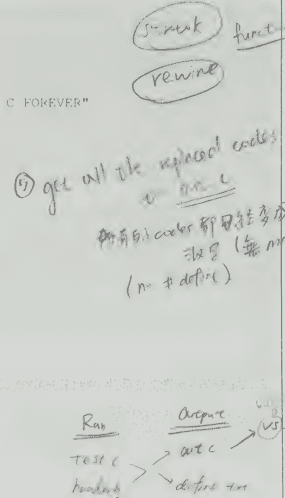

- 读取文件
- 使用字符串
- strcat(string1, string2)
- 使用 Fread 和 include 获取文件

- 枚举
- Typedef 语句
- 枚举 & Typedef 作业

## 枚举

当数据类型将保存有限列表中的一个值时，你可以选择使用枚举数据类型。枚举类型的变量可以被赋予其类型中的任何“值”。

```c
enum Day { Sat, Sun, Mon, Tues, Wed, Thurs, Fri };
enum Gender { male, female };
int main (void) {
enum Day today = Wed;
enum Day tomorrow = Thurs;
enum Gender student = female;
```

枚举值被 C 编译器视为常量，每个值都被赋予一个整数值，从 0 开始。当我们说 today = Wed; 时，值 4 被赋给 today，而不是名称 Wed。

具有枚举类型的变量也可以用于布尔表达式：

```c
if (student == female) {
    printf("female");
}
```

其他关系运算符也可以使用。请注意，枚举数据类型会自动在元素之间建立顺序：

```c
#include <stdio.h>
enum Day { Sat, Sun, Mon, Tues, Wed, Thurs, Fri };
int main (void) {
enum Day today;
    for (today = Sat; today <= Fri; ++today) {
        if (today < Mon) {
            printf("Weekend\n");
        } else {
            printf("Weekday\n");
        }
    }
    return 0;
}
```

### 输出：

```
Weekend
Weekend
Weekday
Weekday
Weekday
Weekday
Weekday
```

假设你想在遍历 for 循环时输出变量 today 的不同值。你可以尝试这样做。

```c
#include <stdio.h>
enum Day { Sat, Sun, Mon, Tues, Wed, Thurs, Fri };
int main (void) {
    enum Day today;
    for (today = Sat; today <= Fri; ++today) {
        printf("%d\n", today);
    }
    return 0;
}
```

但你的输出将如下所示：

```
0
1
2
3
4
5
6
```

事实证明，枚举类型的值不能直接写入输出。通常使用 switch 语句来实现所需的结果。

```c
#include <stdio.h>

enum Day { Sat, Sun, Mon, Tues, Wed, Thurs, Fri };

int main (void) {
    enum Day today;

    for (today = Sat; today <= Fri; ++today) {
        printf("today");
        switch (today) {
        case Sat: puts("Sat"); break;
        case Sun: puts("Sun"); break;
        case Mon: puts("Mon"); break;
        case Tues: puts("Tues"); break;
        case Wed: puts("Wed"); break;
        case Thurs: puts("Thurs"); break;
        case Fri: puts("Fri"); break;
        }
    }
    return 0;
}
```

### 输出：

```
Sat
Sun
Mon
Tues
Wed
Thurs
Fri
```

C 中没有布尔（真或假）数据类型。相反使用整数值 0 和 1。但是，很容易发明我们自己的布尔类型：

```c
enum Boolean { false, true };
enum Boolean flag;
flag = true;

或者作为

enum Boolean { false, true } flag;
flag = false;
```


枚举类型的一个令人烦恼的方面是它们不被 C 输入输出语句识别。例如：

```
enum direction { north, south, east, west };
direction d1 = south;
printf("%d\n", south);
```

输出的值为 1。

如果希望将特定的整数值与枚举值关联，则可以在定义数据类型时将整数赋给该值。随后出现在列表中的枚举值将被指定从指定整数值加 1 开始的顺序值。

例如：

```
enum direction { up, down, left = 10, right };
```

| 枚举值 | 数值 |
|---|---|
| up | 0 |
| down | 1 |
| left | 10 |
| right | 11 |

定义枚举数据类型时可以省略数据类型的名称。定义数据类型时，也可以将变量声明为特定的枚举数据类型：

```
enum { east, west, south, north } location;
```

请注意，在函数内定义枚举数据类型会将该定义的使用范围限制在函数内定义的变量上。在程序开头（任何函数之外）定义枚举数据类型，会使类型定义对文件全局有效。

## typedef 语句

`typedef` 语句使程序员可以为数据类型指定一个替代名称。例如：

```
typedef int COUNTER;
```

这将名称 COUNTER 定义为与 C 数据类型 `int` 等效。现在可以将变量声明为 COUNTER 类型：

```
COUNTER a, b, c;
```

这提高了程序的可读性。下面是另一个示例：

```
typedef char *STRING_PTR;
```

这将名称 `STRING_PTR` 定义为 `char` 指针。现在可以定义 `STRING_PTR` 类型的变量：

```
STRING_PTR buffer;
```

C 编译器会将其视为字符指针。

另一个示例：

```
typedef char STRING[81];
```

这定义了一个名为 `STRING` 的类型，它是包含 81 个字符的数组。现在可以定义 `STRING` 类型的变量，如下所示：

```
STRING text;
```

这相当于定义变量 text 为包含 81 个字符的字符数组，并等价于：

```
char text[81];
```

## 定义新类型名称的步骤

- 1. 编写语句，仿佛正在定义所需类型的变量。
- 2. 在通常出现已定义变量名称的位置，替换为新的类型名称。
- 3. 在最前面放置关键字 typedef。

```
#define Bool unsigned char
typedef unsigned char Bool
Bool a;
```

## 枚举与 typedef 作业

1. a) 声明一个枚举标记，其值表示一周中的七天。

```
enum Day { Sun, Mon, Tue, Wed, Thus, Fri, Sat };
```

b) 使用 typedef 为枚举定义一个名称。

```
typedef enum Day THEWEEK
typedef enum {Sun, Mon, Tue, Wed, Thus, Fri, Sat} Day;
```

2. 关于枚举常量的以下哪些陈述是正确的？

a) 枚举常量可以表示程序员指定的任何整数。

b) 枚举常量与使用 #define 创建的常量具有完全相同的属性。错误

c) 枚举常量默认值为 0、1、2、...

d) 枚举中的所有常量必须具有不同的值。错误

e) 枚举常量可在表达式中用作整数。

3. 假设 b 和 i 声明如下：

```
enum { FALSE, TRUE } b;
int i;
```

以下哪些语句是合法的？哪些是“安全”的（始终产生有意义的结果）？

- a) b = FALSE; 合法/安全
- b) b = i;
- c) b++; 合法 / 安全（有效？）
- d) i = b; 合法 安全 -> 值为 1
- e) i = 2 * b + 1; 安全 -> 值 = 2*0+1 ... 1

所有语句都是合法的，因为 C 允许整数和枚举值无限制地混合。但是，只有 (a)(d)(e) 是安全的。

(b) 如果 b 的值不是 0 或 1，则无意义 (c) 如果 b ... 则不会产生有意义的结果

4. 假设 direction 变量声明如下：

```
enum { NORTH, SOUTH, EAST, WEST } direction;
```

设 x 和 y 为 int 变量。编写一个 switch 语句来测试 direction 的值，如果 direction 是 EAST 则递增 x，如果 direction 是 WEST 则递减 x，如果 direction 是 SOUTH 则递增 y，如果 direction 是 NORTH 则递减 y。

5. 以下各声明中枚举常量的整数值分别是多少？

- a) enum { NORTH, EAST, SOUTH, WEST };
  0   1   2   3
- b) enum { DIAMONDS = 5, HEARTS, CLUBS, SPADES };
  5   6   7   8
- c) enum { MON = 8, TUES, WED, THURS = 14, FRI };
  8   9   10  14  15
- d) enum { RED = 5, BLUE, GREEN, YELLOW = 12, BROWN };
  5   6   7   12  13

```
int main(void)
enum direction: int x,y
for (direction: NORTH; direction <= WEST; ++direction)
switch (direction) {
    case NORTH: y--; break;
    case SOUTH: y++; break;
    case EAST: x++; break;
    case WEST: x--; break;
}
return 0;
}
```

- 结构体简介
- 操作整个结构体
- 结构体示例：今天的日期和明天的日期
- 结构体数组
- 嵌套结构体
- 结构体作业
- 数据库实验

free() -> 释放清理


```
typedef struct {
 char f_name[20];
 char l_name[10];
 int ph;
 PHONE_BOOK_ENTRY + NEXT,
} PHONE_BOOK_ENTRY;
```

- 步骤 1：使用 malloc() 为 phone_book_Entry 结构体预留空间
- 2：初始化记录。
- 3：如果是第一个电话簿记录，则转到第一条记录。
- 如果不是第一条记录，则添加到列表末尾
- 4：将 NULL 赋给最后一个元素的 (next)（next 字段）
- 称为“链表”


## 结构体简介

我们之前曾使用数组以单个名称存储相同类型（且大小指定）的数据集合：

```
int num[10];
```

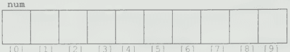

我们学习了使用 num[1] 或 num[1] 等下标来引用数组的单个元素。

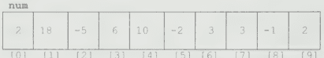

通常，我们需要创建包含不同类型相关数据的集合。例如，如果我想收集学生信息，我可能对以下信息感兴趣：

- 学生姓名（字符串）
- 学生绩点（双精度浮点数）
- 学生预期毕业年份（整数）

我们可以在 C 中使用称为 struct 的数据类型来建模此类集合。struct 是用户定义数据类型的一个示例，即我们可以定义自己的 struct 来建模所需的任何数据。

例如：

```
typedef struct {
   char name[30];
   double gpa;
   int year;
} Student;
```

这充当创建名为 Student 的新数据类型的蓝图或模板。这种新的用户定义数据类型 Student 可以像任何内置数据类型一样用于声明变量：

```
typedef struct {
   char name[30];
   double gpa;
   int year;
} Student;

int main(void) {
   Student s1, s2, s3;
   ...
   return 0;
}
```

上面的声明创建了三个 Student 类型的变量：s1、s2 和 s3。这些变量中的每一个现在在内存中都有存储字符串、double 和 int 的空间。请注意，我们的新数据类型名称以大写字母开头。虽然这不是必须的，但遵循这一规则是个好习惯。

还要注意，struct 在 main() 之外的全局作用域中声明。这使得 struct 对程序的所有部分都可见。如果 struct 仅在 main() 内声明，那么它将局部于 main() 且仅在 main() 内可见。

结构体可以如下表示：

| | 姓名 | 绩点 | 年份 |
|---|---|---|---|
| s1 | Sammie | 3.85 | 2016 |

## 引用结构体元素。

我们现在在结构体上遇到了与数组相同的问题。我们如何引用结构体的单个元素（称为组件或字段）？对于数组，我们使用下标。对于结构体，我们使用句点，也称为直接组件选择运算符（或者更简单地说，简称选择运算符）。

例如，我们可以如下为结构体的每个字段赋值：

```
s1.gpa = 3.85;
s1.year = 2016;
strcpy(s1.name, "Sammy");
```

## 示例：日期结构体。

假设我们需要跟踪各种日期。我们可以如下定义 Date 数据类型：

```
typedef struct {
    int month;
    int day;
    int year;
} Date;
```

定义 Date 数据类型后，我们可以如下创建 Date 变量：

```
typedef struct {
    int month;
    int day;
    int year;
} Date;

int main(void) {
    Date yesterday, today, tomorrow, appointment, birthday;
    ...
    ...
    return 0;
}
```


## Structure Initialization

结构初始化与数组初始化类似，区别在于被初始化的每个成员的数据类型可能不同。例如：

```
Date birthday = { 8, 23, 96 };
```

请注意，括号内列出的元素由逗号分隔。如果初始化器的数量少于成员数量，则其余成员将初始化为零。

## Manipulating Entire Structures

可以操作整个结构，但方式有限。

- 同一类型的 `struct` 可以赋值给同一类型的另一个 `struct`。
- `struct` 可以按值或按引用传递给函数。
- `struct` 可以从函数返回（使用 return 语句）。

但是请记住，如果不使用函数来完成工作，你无法显示整个 `struct` 或将数据读入整个 `struct`。

## Assigning Structures

结构可以在表达式中按如下方式赋值：

```
typedef struct {
    int month;
    int day;
    int year;
} Date;

int main(void) {
    Date today, appt;

    today.month = 5;
    today.day = 27;
    today.year = 2013;

    appt = today;

    ...

    return 0;
}
```

语句：

```
appt = today;
```

等效于以下三条语句：

```
appt.month = today.month;
appt.day = today.day;
appt.year = today.year;
```

## Passing a Structure to a Function by Value

结构也可以作为函数参数传递，并作为函数值返回。当结构作为函数参数时，它们按值传递。会创建结构的一个局部副本，所有更改都作用于该局部副本。（请注意，这意味着可以通过将数组作为结构成员来按值传递数组。）

```
#include <stdio.h>

typedef struct {
    int month;
    int day;
    int year;
} Date;

void foo(Date now);

int main(void) {
    Date today = { 5, 27, 2013 };
    foo(today);
    return 0;
}

void foo(Date now) {
    printf("month = %d day = %d year = %d\n", now.month,
           now.day, now.year);
}
```

## Passing a Structure to a Function by Reference

结构也可以按引用传递给函数。因此，对在函数中传递的结构所做的任何更改都会反映回调用函数。

```
#include <stdio.h>

typedef struct {
    int month;
    int day;
    int year;
} Date;

void foo(Date *now);

int main(void) {
    Date today = { 5, 27, 2013 };
    printf("month = %d day = %d year = %d\n", today.month,
           today.day, today.year);
    foo(&today);
    printf("month = %d day = %d year = %d\n", today.month,
           today.day, today.year);

    return 0;
}

void foo(Date *now) {
    (*now).month = 7;
    (*now).day = 29;
    (*now).year = 2014;
}
```

输出如下：

```
month = 5 day = 27 year = 2013
month = 7 day = 29 year = 2014
```

请注意，如果按引用传递 `struct`，则必须使用解引用运算符 * 来访问每个字段中的值。由于选择运算符（点）的优先级高于解引用运算符，因此必须在结构名称和解引用运算符周围使用括号。但是，将选择运算符（点）与括号一起使用变得非常笨拙，因此 C 语言为此专门添加了一个新的、更简单的运算符。它被称为箭头运算符，由连字符和大于号组成。

可以将上面示例中的函数重写如下：

```
void foo(Date *now) {
    now->month = 7;
    now->day = 29;
    now->year = 2014;
}
```

因此，选择运算符（ . ）用于访问结构的成员，而箭头运算符（ -> ）用于访问由指针引用的结构的成员。

## Struct Example: Today's Date and Tomorrow's Date

结构示例：今天的日期和明天的日期

让我们构建一个程序，接受今天的日期作为输入并输出明天的日期。我们可以为程序的控制流程开发一个通用算法，如下所示：

```
Input today's date.
Calculate tomorrow's date.
Output today's date.
Output tomorrow's date.
```

由于我们的程序将处理日期，因此通过创建一个名为 Date 的新数据类型将日期概念建模到程序中似乎很自然，这将允许我们创建多个 Date 结构。

```
typedef struct {
    int month;
    int day;
    int year;
} Date;
```

上面的算法现在变成了 main() 函数的代码：

```
int main(void) {
    Date today, tomorrow;
    getTodaysDate(&today);
    getTomorrowsDate(today, &tomorrow);
    printf("Today: ");
    outputDate(today);
    printf("Tomorrow: ");
    outputDate(tomorrow);
    return 0;
}
```

让我们先处理 I/O 函数。请注意，我们创建了一个名为 today 的 Date 结构，用于保存今天的日期。我们必须按引用将此结构传递给 getTodaysDate() 函数，该函数将提示用户输入当前的月、日和年。

```
void getTodaysDate(Date *today) {
    printf("Enter today's date mm/dd/yyyy: ");
    scanf("%d/%d/%d", &today->month, &today->day, &today->year);
}
```

由于 today 被定义为指向 Date 结构的指针，我们必须使用箭头运算符来解引用结构并访问结构的每个组件。但是，由于每个组件变量 today->month、today->day 和 today->year 都在 scanf() 语句中使用，我们必须对每个变量使用取地址运算符 &，因为 scanf() 要求变量的地址。

请注意读取数据的 scanf() 格式字符串：

```
"%d/%d/%d"
```

指定非格式字符（如 '/'）会向 scanf() 函数表明输入中预期会出现 '/'。这在前面的 printf() 语句的输入提示中显示：

```
mm/dd/yyyy
```

我们的输出函数更简单，因为我们可以按值传递要输出的 Date 结构。

```
void outputDate(Date d) {
    printf("%d/%d/%d\n", d.month, d.day, d.year);
}
```

接下来是计算明天日期的函数。当今天的日期处于月末或年末时，我们需要小心。我们可以通过设置一个每月天数的数组来轻松确定今天的日期是否处于月末。

```
int daysPerMonth[] = { 31, 28, 31, 30, 31, 30, 31, 31, 30, 31, 30, 31 };
```

然后在数组中查找特定月份即可得到该月的天数。对于每个月份 i，daysPerMonth[i-1] 中包含的值对应于该特定月份的天数。

如果确定今天的日期处于月末，则可以通过将月份加 1 并将日期设置为 1 来计算明天的日期。

```
Increment day.
If day is greater than the number of days in the month
    Set day to 1.
    Increment month.
```

我们还必须解决日期出现在第 12 个月末的问题。如果是这种情况，不仅要将日期设置为 1，还要将月份设置为 1 并将年份加 1。

```
Increment day.
If day is greater than the number of days in the month
    Set day to 1.
    Increment month.
    If month is now greater than 12
        Set month to 1.
        Increment year.
```

我们现在按如下方式实现 getTomorrowsDate() 函数：

```
void getTomorrowsDate(Date today, Date *tomorrow) {
    int daysPerMonth[] = {31, 28, 31, 30, 31, 30, 31, 31, 30, 31, 30, 31};
    *tomorrow = today;
    tomorrow->day++;
    if (tomorrow->day > daysPerMonth[tomorrow->month-1]) {
        tomorrow->day = 1;
        ++tomorrow->month;
        if (tomorrow->month > 12) {
            tomorrow->month = 1;
            ++tomorrow->year;
        }
    }
}
```

请注意，我们按值将 today 传递给函数，并按引用将 tomorrow 传递给函数。为什么？我们不希望修改 today 的内容，但确实希望更新 tomorrow 的内容。看看我们的代码与之前开发的算法是多么一致。

我们还有一个最终问题需要处理。闰年怎么办？我们可以使用之前开发的闰年函数：

```
int isLeapYear(int year) {
    return (((year % 4) == 0 && (year % 100) != 0) || (year % 400) == 0);
}
```

请注意我们如何将闰年测试集成到函数中：

```
int daysPerMonth[] = {31, 0, 31, 30, 31, 30, 31, 31, 30, 31, 30, 31};
if (isLeapYear(today.year)) {
    daysPerMonth[1] = 29;
}
else {
    daysPerMonth[1] = 28;
}
```


## 我们的完整程序如下：

```c
#include <stdio.h>

typedef struct {
    int month;
    int day;
    int year;
} Date;

void getTodaysDate(Date *today);
void getTomorrowsDate(Date today, Date *tomorrow);
int isLeapYear(int year);
void outputDate(Date d);

int main(void) {
    Date today, tomorrow;

    getTodaysDate(&today);
    getTomorrowsDate(today, &tomorrow);

    printf("Today: ");
    outputDate(today);
    printf("Tomorrow: ");
    outputDate(tomorrow);

    return 0;
}

void getTodaysDate(Date *today) {
    printf("Enter today's date mm/dd/yyyy: ");
    scanf("%d/%d/%d", &today->month, &today->day, &today->year);
}

void getTomorrowsDate(Date today, Date *tomorrow) {
    int daysPerMonth[] = { 31, 0, 31, 30, 31, 30, 31, 31,
                           30, 31, 30, 31 };

    if (isLeapYear(today.year)) {
        daysPerMonth[1] = 29;
    }
    else {
        daysPerMonth[1] = 28;
    }

    *tomorrow = today;
    tomorrow->day++;

    if (tomorrow->day > daysPerMonth[tomorrow->month-1]) {
        tomorrow->day = 1;
        ++tomorrow->month;
        if (tomorrow->month > 12) {
            tomorrow->month = 1;
            ++tomorrow->year;
        }
    }
}

int isLeapYear(int year) {
    return (((year % 4) && (year % 100)) || !(year % 400));
}

void outputDate(Date d) {
    printf("%d/%d/%d\n", d.month, d.day, d.year);
}
```

请注意，Date 结构体的定义出现在全局空间，位于任何函数之外。这样程序中的所有函数都可以看到并使用用户定义的 Date 数据类型。

下面是程序几次运行的输出：

```
Enter today's date mm/dd/yyyy: 02/28/1984
Today: 2/28/1984
Tomorrow: 2/29/1984

Enter today's date mm/dd/yyyy: 12/31/1999
Today: 12/31/1999
Tomorrow: 1/1/2000

Enter today's date mm/dd/yyyy: 5/31/2013
Today: 5/31/2013
Tomorrow: 6/1/2013
```

## 结构体数组

正如我们可以声明整数、浮点数、双精度数等的数组一样，我们也可以声明结构体数组。例如：

```c
#define SIZE 25
typedef struct {
    char name[30];
    float gpa;
    int year;
} Student;
int main(void) {
    Student myClass[SIZE];
    ...
    ...
    return 0;
}
```

这定义了一个名为 myClass 的数组，包含 1000 个 Student 结构体。数组的每个元素都定义为 Student 类型。该数组可以如下所示：

| | 姓名 | 绩点 | 年份 |
|---|---|---|---|
| [0] | Haley | 3.75 | 2015 |
| [1] | Sammie | 3.85 | 2016 |
| [2] | Naomi | 3.25 | 2017 |
| ... | ... | ... | ... |
| ... | ... | ... | ... |
| [24] | Garrett | 2.85 | 2019 |

myClass[2].gpa 的值为 3.25。

myClass[24].name 的值为 Garrett。

myClass[0].year 的值为 2015。

我们现在可以按如下方式为每个 myClass 结构体的不同字段赋值：

```c
myClass[21].year = 2016;
myClass[13].gpa = 3.50;
strcpy(myClass[4].name, "Griffin");
```

定义结构体数组后，我们可以遍历数组并单独访问每个结构体：

```c
for (i = 0; i < SIZE; ++i) {
    if (myClass[i].gpa > 3.75) {
        printf("Congratulations %s, you have made the honor roll.",
        myClass[i].name);
    }
}
```

我们可以初始化包含结构体的数组：

```c
Student myClass[SIZE] = {
    {"Haley", 3.75, 2015 },
    {"Sammie", 3.85, 2016 },
    {"Naomi", 3.25, 2017 },
    {"Garrett", 2.85, 2019 }
};
```

请注意，内部花括号是可选的。

我们也可以将结构体数组传递给函数：

```c
#include <stdio.h>

#define SIZE 4

typedef struct {
    char name[30];
    float gpa;
    int year;
} Student;

int main(void);
void foo(Student myClass[]);

int main(void) {
    Student myClass[SIZE] = {
        { "Haley", 3.75, 2015 },
        { "Sammie", 3.85, 2016 },
        { "Naomi", 3.25, 2017 },
        { "Garrett", 2.85, 2019 }
    };

    foo(myClass);

    return 0;
}

void foo(Student myClass[]) {
    int i;

    for (i = 0; i < SIZE; ++i) {
        printf("%10s %5.2f %5d\n",
               myClass[i].name, myClass[i].gpa, myClass[i].year);
    }
}
```

上述程序的输出如下所示：

```
    Haley   3.75 2015
  Sammie   3.85 2016
   Naomi   3.25 2017
 Garrett   2.85 2019
```

## 结构体嵌套

C 允许我们嵌套结构体，即在其他结构体中定义结构体。例如，假设我们想要跟踪房子中各个房间的尺寸。我们可以先定义一个 Distance 结构体，如下所示：

```c
typedef struct {
    int feet;
    float inches;
} Distance;
```

我们现在可以定义一个 Room 结构体，它将 Distance 变量作为其组件：

```c
typedef struct {
    Distance length;
    Distance width;
} Room;
```

我们现在初始化结构体变量的每个字段：

```c
int main(void) {
    Room bedroom, kitchen;

    bedroom.length.feet = 25;
    bedroom.length.inches = 6;
    bedroom.width.feet = 20;
    bedroom.width.inches = 8.5;

    kitchen.length.feet = 15;
    kitchen.length.inches = 3.25;
    kitchen.width.feet = 10;
    kitchen.width.inches = 6;

    return 0;
}
```

下面是另一个示例。假设我们需要设置一个在特定日期和时间发生的事件列表。我们希望将日期和时间都关联在一个实体中。

### 首先我们定义 Date 结构体和 Time 结构体：

```c
typedef struct {
    int month;
    int day;
    int year;
} Date;
typedef struct {
    int hour;
    int minute;
    int second;
} Time;
```

### 现在我们可以按如下方式定义 DateTime 结构体：

```c
typedef struct {
    Date eventDate;
    Time eventTime;
} DateTime;
```

### 现在让我们创建一个 DateTime 变量并初始化其组件：

```c
int main(void) {
    DateTime appt;
    appt.eventDate.month = 8;
    appt.eventDate.day = 23;
    appt.eventDate.year = 2013;
    appt.eventTime.hour = 11;
    appt.eventTime.minute = 30;
    appt.eventTime.second = 45;
    return 0;
}
```

如果我们正在实现日历程序，可能需要许多 DateTime 变量。因此，让我们创建一个 DateTime 结构体数组：

```c
DateTime event[1000];
```

我们现在可以按如下方式初始化数组的一个元素：

```c
event[35].eventDate.month = 7;
event[35].eventDate.day = 14;
event[35].eventDate.year = 2015;
event[35].eventTime.hour = 2;
event[35].eventTime.minute = 15;
event[35].eventTime.second = 00;
```

## 结构体作业

- 1. 编写代码以完成以下每项任务：
  - a) 使用 typedef 声明一个名为 Automobile 的结构体，包含以下成员：
    - model - 最多 25 个字符的字符串
    - year - 整数
    - mpg - 整数
  - b) 声明类型为 Automobile 的变量 car。
  - c) 将以下信息分配给变量 car 的相应字段：
    - 2012 款 Infiniti 每加仑可行驶 25 英里。
  - d) 声明一个包含 500 个 Automobile 的数组 vehicle。
  - e) 将变量 car 赋值给数组的第 5 个元素。
  - f) 输出数组第 5 个位置中的 Automobile 信息。显示输出。
  - g) 声明指向 Automobile 结构体的指针变量 p。
  - h) 将数组第 5 个位置的地址赋值给变量 p。
  - i) 使用变量 p 输出数组第 5 个位置中的 Automobile 信息。显示输出。
  - j) 声明指向 Automobile 结构体的指针变量 q。
  - k) 将数组第一个位置的地址赋值给变量 q。
  - l) 使用变量 q 输出数组第 5 个位置中的 Automobile 信息。显示输出。

## 数据库实验

本实验将重点介绍结构体的使用和操作。实验的每个部分都应在其自身的函数中设计，并根据需要传递参数。你需要构建一个名为 database.c 的 C 程序，用于检索和操作公司的工资数据库 payfile.txt。每个员工的数据应读入一个包含以下字段标识符的结构体中：

- first - 最多 7 个字符
- initial - 最多 1 个字符
- last - 最多 9 个字符
- street - 最多 16 个字符
- city - 最多 11 个字符
- state - 最多 2 个字符
- zip - 最多 5 个字符
- age - 整数
- sex - 最多 1 个字符 (M/F)
- tenure - 表示任职年限的整数
- salary - 表示周薪的双精度浮点数

你的程序应执行下面指示的每项操作。请务必为每个部分的输出添加清晰的标签。请记住，实验的每个部分都应在其自身的函数中设计，并根据需要传递参数。

- a) 将员工数据读入结构体数组。
- b) 以易于读取的格式输出每个结构体的内容，格式类似于输入文件。
- c) 输出工资单上所有男性的名和姓。
- d) 输出工资单上薪酬最高的女性的名和姓。
- e) 输出工资单上薪酬最低的男性的名和姓。
- f) 输出所有员工的平均薪资。
- g) 输出所有收入低于平均薪资的女性的名和姓。
- h) 输出高于平均薪资的男性人数与低于平均薪资的男性人数之比。


- i) 输出所有年收入超过 35,000 美元、在公司工作至少 5 年且年龄超过 30 岁的员工的名和姓。

- j) 给所有周收入低于 350.00 美元的员工加薪 10%，并输出每位获加薪员工的名、姓和新薪水。

- k) (额外学分) 按邮政编码对结构体进行排序，并输出每位员工的名、姓和邮政编码。

Here is a C function, strsub(), that grabs a substring, sub, from a string, buf, given the start and end index within the string.

```
void strsub(char buf[], char sub[], int start, int end) {
    int i, j;

    for (j=0, i=start; i<=end; i++, j++) {
        sub[j] = buf[i];
    }
    sub[j] = '\0';
}
```

This function might be useful when you read a line of data from the file and need to grab the different information from the line of data to place into the fields of the struct. Remember that arrays use zero-based indexing.

```
while (!feof(fp)) {
    fgets(buf, MAX, fp);
    strsub(buf, workers[i].first, 0, 6);
    strsub(buf, workers[i].initial, 8, 8);
    strsub(buf, workers[i].last, 10, 18);
    ...
}
```

You can assume the following declaration:

```
#define MAX 100
```

The following three functions from the C library, stdlib.h and string.h, might be useful for the lab:

- atoi() - 将字符串转换为整数
- atof() - 将字符串转换为浮点数
- strcmp() - 比较两个字符串

For the extra credit portion of the lab you will need to modify the sorting algorithm that we looked at to work with structs.

The contents of payfile.txt are given below:

| ADA | A_AUGUSTA | 33_BABBAGE_ROAD | LOVELACE | GB_19569_28_F_2_350_50 |
| --- | --- | --- | --- | --- |
| ISSAC | A_ASIMOV | 99_FICTION_WAY | AMHERST | MA_63948_58_M_6_423_88 |
| HUMPHRY_R | BOGART | 71_SAM_STREET | HOLLYWOOD | CA_48482_56_M_5_366_00 |
| ALBERT_G | EINSTEIN | 94_ENERGY_WAY | PRINCETON | NJ_47474_67_M_8_780_00 |
| EMMYLOU | L_HARRIS | 66_COUNTRY_ROAD | NASHVILLE | TN_72647_38_M_2_767_42 |
| JAMES_T | KIRK | 11_SPACE_STREET | VULCAN | CA_82828_46_M_1_235_70 |
| TED_L | KOPPER | 55_ABC_PLACE | WASHINGTON | DC_37376_48_M_9_909_44 |
| DAVID_T | LETTERMAN_14 | WNBC_AVENUE | NEW_YORK | NY_19338_47_M_5_445_65 |
| STEVIE_R | NICKS | 31_MUSIC_ROAD | CHICAGO | IL_23459_38_M_8_460_88 |
| MONTY_P | PYTHON | 76_SILLY_STREET | LONDON | GB_80939_44_M_2_320_50 |
| ROGER_R | RABBIT | 15_LOONEY_TOONS | HOLLYWOOD | CA_91343_24_M_4_259_53 |
| SALLY_W | RIDE | 21_COLUMBIA_WAY | HOUSTON | TX_91123_30_M_9_707_80 |
| ROD_Q | SERLING | 11_TWILIGHT_ZONE | SAN_DIEGO | CA_93939_56_M_1_440_00 |
| LUKE_R | SKYWALKER | 43_MILKY_WAY | NEW_YORK | NY_12343_35_M_5_660_00 |

Output from your program should be sent to the terminal window (your screen) as well as the requested csis.txt output file. Be sure to read the document on Capturing Program Output. Your full name and Palomar ID number must appear as a comment in the source file that contains main(). Be sure to include the csis.txt output file in your zip archive.

## 变量的动态分配

### 动态数组 - 高级

4
.text
.data
.stack
.heap
malloc()
free()

```
#include <stdlib.h>
int *p;
p = (int *) malloc(10 * sizeof(int));
free(p);
```

5
[Not in b-k] 2 调整数组的大小

```
p = realloc(p, 100 * sizeof(int));
```

## 变量的动态分配

Dynamic variables are variables that can be created and disposed of as a program executes. When a variable is needed, storage is reserved for it. When it is no longer needed, the storage is released. Therefore, the storage for these dynamic variables that are no longer in use is available for other purposes. There is no predefined limit to the number of dynamic variables that can be created.

We reference a dynamic variable not by name but through a pointer. Remember a pointer is a variable that contains the address (location) in memory of the dynamic variable it references. Every new dynamic variable created has an associated pointer to reference it. So when we allocate storage for a dynamic variable, our method of accessing the variable is through a pointer.

In order to create a dynamic variable of type integer, it is first necessary to declare a pointer variable that can hold its address. The declaration:

```
int *p;
```

declares the variable p to be a pointer variable whose values will be pointers to (contain the address of) dynamic variables of type int.

But a pointer variable is of no use unless there is something for it to point to. In order to create a dynamic variable, we use the malloc() function as follows:

```
int *p;
p = (int *) malloc(sizeof(int));
```

malloc() dynamically allocates variable-sized blocks of memory from the heap and allows a program to allocate memory explicitly as it's needed. By definition, malloc() returns a void *, and therefore must be cast to the appropriate type of the pointer that will receive the address on the heap of the new dynamic variable, in this case int *. It is our responsibility to tell malloc() exactly how much storage to allocate for the dynamic variable, in this case sizeof(int) bytes. malloc() is prototyped in both the alloc.h and stdlib.h header files. If malloc() is successful, it returns a pointer to the newly allocated block of memory. Otherwise, if not enough space exists for the new block of storage, malloc() returns NULL, which is a special value that any pointer variable may have. The NULL pointer does not reference a storage location.

We say that malloc() creates a new dynamic variable of type int and gives the address of the new dynamic variable to pointer p. This dynamic variable is then referred to as “the thing pointed to by p” or *p.

```
*p = 5;
printf("%d\n", *p);
```

In fact, *p can be used anyplace that it is appropriate to use a variable of type int. When a dynamic variable is no longer needed, we can use the free() function to free the memory space allocated to the dynamic variable:

```
free(p);
```

free() deallocates a block of memory allocated by a previous call to malloc(). It destroys the dynamic variable referenced by pointer p. The storage allocated to this variable is returned (recycled) to be assigned to some other dynamic variable. Accordingly, any further reference to *p is illegal. free() is also prototyped in alloc.h and stdlib.h. See if you can follow the pointers in the following program.

```
// dynamic.c
#include <stdio.h>
#include <alloc.h>

int main(void) {
    int *p, *q;

    p = (int *) malloc(sizeof(int));
    *p = 3;
    q = (int *) malloc(sizeof(int));
    *q = 5;
    printf("*p = %d   *q = %d\n", *p, *q);
    free(p);
    p = q;
    printf("*p = %d   *q = %d\n", *p, *q);
    *q = 7;
    printf("*p = %d   *q = %d\n", *p, *q);
    q = (int *) malloc(sizeof(int));
    *q = 9;
    printf("*p = %d   *q = %d\n", *p, *q);
    *p = *q;
    printf("**p = %d   *q = %d\n", *p, *q);
    free(p);
    p = q;
    printf("**p = %d   *q = %d\n", *p, *q);
    free(p);
    printf("**p = %d   *q = %d\n", *p, *q);
    return 0;
}
```

The output to the above program is:

```
*p = 3      *q = 5
*p = 5      *q = 5
*p = 7      *q = 7
*p = 7      *q = 9
*p = 9      *q = 9
*p = 9      *q = 9
```

Note that the last statement in the program is illegal although the C compiler will not complain about it! In the preceding statement, free(p), the dynamic variable that pointer p points to is disposed of. It is therefore illegal to dereference the pointer p. If you do, your program will become unstable. Although the C compiler will not find the error, you can be sure that the error will be found after you have shipped the 100,000th copy of your program!

There is another reason that the last statement in the program is illegal. It is because pointer q is being dereferenced! You might be wondering why this would be illegal since we have not executed a free(q) statement. Well, at least not directly. At the time we execute the free(p) statement, both pointers p and q are pointing to the same memory location, to the same dynamic variable. Therefore, after executing free(p), pointer q is no longer pointing to a dynamic variable. Its storage has already been reclaimed. It is therefore illegal to dereference both pointers p and q at this point in the program.


看看你能否在下面的程序中找到错误：

```c
// oops.c

#include <stdio.h>
#include <string.h>

int main(void);
char * foo(void);

int main(void) {
    char *buf;

    buf = foo();
    puts(buf);
    return 0;
}

char* foo(void) {
    char buf[32];

    strcpy(buf, "Hello, world.");
    puts(buf);
    return buf;
}
```

问题在于 buf 的存储空间是在栈上分配的，并且是函数 foo() 的局部变量。当 foo() 退出时，栈上的存储空间会被回收，并返回一个不再指向任何有效内存位置的指针。解决这个问题的方法是返回一个指向有效存储位置的指针，该位置在 foo() 退出后仍然持续存在。

```c
// strdup.c
#include <stdio.h>
#include <string.h>
#include <stdlib.h>

int main(void);
char* foo(void);

int main(void) {
    char *buf;

    buf = foo();
    puts(buf);
    free(buf);
    return 0;
}

char* foo(void) {
    char buf[32];

    strcpy(buf, "Hello, world.");
    puts(buf);
    return strdup(buf);
}
```

strdup() 通过调用 malloc() 在堆上获取存储空间来复制一个字符串。分配的空间长度为 strlen(s) + 1 字节。由于存储空间是在堆上分配的，因此在函数 foo() 退出后它仍然持续存在。请注意，当不再需要时，你有责任通过调用 free() 来释放 strdup() 分配的空间。如果 strdup() 成功，它将返回指向堆上包含复制字符串的位置的指针。否则，如果无法分配空间，它将返回 NULL。

现在让我们来看一个更有趣的动态变量，它是一个用户定义的结构体，而不是一个简单的整数变量。给定以下结构体声明：

```c
typedef struct student {
    char name[30];
    int age;
    float gpa;
} STUDENT;
```

它声明了一个带有三个字段的 student 结构体，并且给定以下指针定义：

```c
STUDENT *ps;
```

它声明指针 ps 是指向 student 结构体的指针，我们可以按照以下方式在堆上动态创建一个 student 结构体变量：

```c
ps = (STUDENT *) malloc(sizeof(struct student));
```

请注意，我们必须将 malloc() 的返回值强制转换为指针 ps 的适当类型，即 STUDENT *，或者指向 student 结构体的指针。我们还必须告诉 malloc() 我们想要为此动态变量在堆上分配的确切字节数，在此例中为 sizeof(struct student) 字节。

现在我们有了一个指向结构体的指针 ps。为了访问结构体的字段，我们必须先解引用指针（以获取结构体本身），然后使用直接成员选择（.）运算符来访问结构体的适当字段。

例如：

```c
*ps.age = 35;
```

不幸的是，这里有一个问题。直接成员选择（.）运算符的优先级高于星号（*）运算符。因此，上述代码会在指针被解引用之前尝试访问结构体的字段。这必然会导致灾难！！简单的解决方法是使用括号来覆盖优先级：

```c
(*ps).age = 35;
```

现在，指向结构体的指针首先被解引用，从而得到结构体本身，然后访问结构体的适当字段。虽然这种语法是正确的，但 C 程序员几乎从不使用它！原因是有一种快捷语法，需要敲击的按键更少，并且产生更清晰的代码。等效语句如下所示：

```c
ps->age = 35;
```

这个间接成员选择运算符 -> 由连字符和大于号组成，中间没有空格。它会自动先解引用指针，然后选择结构体的适当字段。请注意，只有在你拥有指向结构体的指针并且想要访问结构体的字段时，才能使用此运算符。下面的示例展示了这个新运算符的用法：

```c
// student.c

#include <stdio.h>
#include <string.h>
#include <alloc.h>

typedef struct student {
    char name[30];
    int age;
    float gpa;
} STUDENT;

int main(void) {
    STUDENT *ps;

    ps = (STUDENT *) malloc(sizeof(struct student));
    strcpy(ps->name, "Haley Laurel");
    ps->age = 35;
    ps->gpa = 3.75;
    printf("%s is %4.2f\n", ps->name, ps->age, ps->gpa);
    free(ps);
    return 0;
}
```

## 动态数组 - 高级

我们知道可以声明常见数据类型的数组以及用户定义数据类型的数组。例如，我们可以声明一个包含 5 个整数的数组：

```c
int num[5];
```

或者我们可以声明下面程序中所示的包含 5 个 student 结构体的数组：

```c
// array.c

#include <stdio.h>

typedef struct student {
   char name[30];
   int age;
   float gpa;
} STUDENT;

void initialize(STUDENT stud[]); // Function initializes student array.
                                 // Code not included.

int main(void) {
   int i;
   STUDENT stud[5];

   initialize(stud);
   for (i = 0; i < 5; i++) {
      printf("%s %d %4.2f\n", stud[i].name, stud[i].age,
             stud[i].gpa);
   }
}
```

在这个程序中，整个数组的存储空间是在栈上分配的，如下所示：

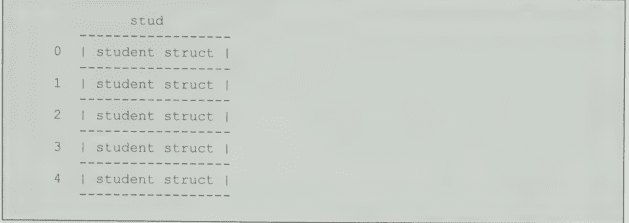

内置或用户定义类型的数组可以存储在堆上并通过指针访问。下面的程序声明了一个指向 `student` 结构体的指针数组。指针数组的存储空间是在栈上分配的，而每个实际 `student` 结构体的存储空间是在堆上分配的。

```c
// darray1.c

#include <stdio.h>
#include <alloc.h>

typedef struct student {
    char name[30];
    int age;
    float gpa;
} STUDENT;

void initialize(STUDENT *pstud[]);
```

```c
void main(void) {
    int i;
    STUDENT *pstud[5];
    for(i = 0; i < 5; i++) {
        pstud[i] = (STUDENT *) malloc(sizeof(struct student));
        initialize(pstud);
    }
    for (i = 0; i < 5; i++) {
        printf("%s %d %4.2f\n", pstud[i]->name, pstud[i]->age,
               pstud[i]->gpa);
    }
    for (i = 0; i < 5; i++) {
        free(pstud[i]);
    }
}
```

下面是前一个程序中创建的动态数组的表示：

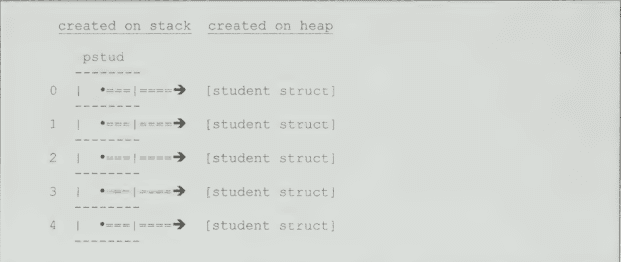

在堆上动态创建项目数组的另一种方法如下所示：

```c
// darray.c

#include <stdio.h>
#include <stdlib.h>

typedef struct student {
    char name[30];
    int age;
    float gpa;
} STUDENT;

void initialize(STUDENT *pstud);

void main(void) {
    int i;
    STUDENT *pstud;

    pstud = (STUDENT *) malloc(5 * sizeof(struct student));
    initialize(pstud);
    for (i = 0; i < 5; i++) {
        printf("%s %d %4.2f\n", pstud[i].name, pstud[i].age,
               pstud[i].gpa);
    }
    free(pstud);
}
```

如下图所示，在栈上分配的唯一存储空间是指向 student 结构体数组的指针的存储空间。数组本身（即每个 student 结构体）的存储空间是在堆上分配的。

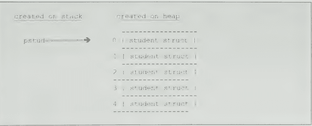

在上面的程序中，请注意，我们使用直接成员选择（.）运算符而不是间接成员选择（->）运算符来访问 `struct` 的字段。这是因为这次我们没有指向结构体的指针数组，而是结构体本身包含在数组中。

我们的最后一个示例也在堆上创建了一个动态数组。然而，这次不仅在堆上创建了一个指针数组，而且指针所指向的 `student` 结构体也在堆上创建。

```c
// dynamic3.c

#include <stdio.h>
#include <alloc.h>

typedef struct student {
    char name[30];
    int age;
    float gpa;
} STUDENT;

void initialize(STUDENT **pstud);

void main(void) {
    int i;
    STUDENT **pstud;

    pstud = (STUDENT **) malloc(5 * sizeof(STUDENT *));
    for (i = 0; i < 5; i++) {
        pstud[i] = (STUDENT *) malloc(sizeof(struct student));
        initialize(pstud);
        for (i = 0; i < 5; i++) {
            printf("%s %d %4.2f\n", pstud[i]->name, pstud[i]->age,
                   pstud[i]->gpa);
        }
    }
    for (i = 0; i < 5; i++) {
        free(pstud[i]);
    }
    free(pstud);
}


上面的程序中创建的动态数组表示如下：

```
created on stack       created on heap       created on heap
------------------------------------------------------------
pstud ------------------> 0 | . . . . . . . . . . . . . . --> [student struct]
                          1 | . . . . . . . . . . . . . . --> [student struct]
                          2 | . . . . . . . . . . . . . . --> [student struct]
                          3 | . . . . . . . . . . . . . . --> [student struct]
                          4 | . . . . . . . . . . . . . . --> [student struct]
                          -----------------------------------
```

# 第 19 章. 线性链表

- 线性链表简介
- 线性链表的操作
- 三种列表算法
- 其他列表算法
- 线性链表示例
- 线性链表作业

### 数组的顺序存储

数组的一大优点是，你可以为大量变量分配内存，而无需编写大量代码。使用 while 或 for 循环，也可以简单地一次性初始化或更改它们的值。此外，我们可以使用正确的数组索引直接访问任何数组元素。

然而，使用数组的一大缺点是数组的大小是固定的，你可能不总是确切知道需要存储多少个项目。你可能正在从文件中读取数据，并不一定知道应该将数组设为多大才能容纳这些数据。

数组的另一个问题是，重新排列数组中的元素可能很耗时。假设你有一个包含 1,000 个元素的数组，并决定要将第 1,000 个元素设为第二个元素，将第二个元素设为第三个，将第三个元素设为第四个，以此类推。你将不得不将所有元素向下移动一位。这效率不高。

### 链表

在顺序表示中，数组的项目由存储的顺序隐式排序。例如，如果 num[i] 表示数组的一个元素，则 num[i+1] 表示数组的下一个元素。

现在假设数据结构的项目是显式排序的。这意味着数据结构的每个元素都必须在其自身中包含数据结构下一个元素的内存地址。

请注意，在这种新表示中，我们不再能像数组那样利用项目通过其位置或地址相关联这一事实。该数据结构中的各个项目必须具有指向数据结构中其他数据项位置的显式指针。这就产生了一种新的数据结构，称为线性链表。


线性链表由一组节点（项目）组成，每个节点包含两个字段：

- 信息字段（info）– 存储列表上的实际数据元素
- 下一个地址字段（next）– 包含指向列表中下一个节点的内存地址（指针）

请注意，线性链表通常用表示节点的方框来绘制，指针用连接一个节点到另一个节点的箭头表示。因此，箭头表示节点之间的链接，每个节点包含一个元素的数据。

整个链表通过一个外部指针（list）来访问，该指针指向（包含）列表中第一个节点的地址。请注意，外部指针不包含在节点中，但其值可以通过引用指针变量直接访问。

列表中最后一个节点的下一个地址字段包含一个特殊的指针值 NULL，它不是有效地址，但用于表示列表的结束。NULL 指针由以下符号表示：


没有节点的列表称为空列表或 NULL 列表，如下所示。在这种情况下，外部指针 list 具有 NULL 值：


线性链表的数据元素包含在列表的 `info` 字段中，并且必须是相同的数据类型（int、char、struct 等）。由于每个节点在其自身（在其 `next` 字段中）包含指向列表中下一个节点的指针，我们可以遍历列表并按顺序访问列表的节点（即，从第一个到最后一个）。

链表是一种动态结构，可以在程序执行时改变大小。节点可以在列表的任何位置插入和删除（开头、节点之间、末尾）。只有第一个节点（由列表指针访问）是已知的。从那里，可以使用节点之间的链接从一个节点移动到另一个节点。理论上，列表长度没有上限，但实际上计算机的内存大小是限制。

下面是一个新节点插入列表中间的示例，而不会导致其他元素更改其在内存中的位置。请注意，这只需操作两个指针即可完成，不需要数据移动：

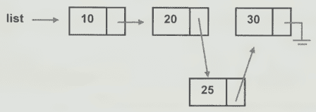

使用线性链表很有趣，因为它们易于绘制，同时提供了一种组织数据的有用方法。在某些地方，列表可能很棘手，但一张好的图表可以很大程度上澄清这种情况。实际上，我再怎么强调这一点都不为过。在尝试构建和理解链表代码时，绘制图片非常重要。通常，你只需要为每个节点画一个方框，并画一个从每个节点指向下一个节点的箭头来表示 `next` 指针。

### 链表与数组

请注意，上面的列表按数字顺序给出数字。你可能会想，这与在数组中存储有序数字列表相比如何。关键区别在于，数组提供随机访问，即你可以直接通过其索引号访问任何数据项。例如，这允许使用二分查找而不是较慢的顺序查找。链表只提供对数据的顺序访问，因此只能使用顺序查找。例如，要读取链表中的第百万个元素，你必须先读取其前面的 999,999 个元素！！

然而，两者之间还可以进行其他比较。虽然数组方法允许使用更快的查找，但如果我们想在找到的项目后插入一个新项目，那就麻烦了！数组中可能没有空间在此处插入新项目。相反，该位置右侧的所有项目都必须滑动到下一个数组位置。这是一个缓慢的过程，但确实为插入新项目腾出了空间。正如我们在编码链表时将更清楚地看到的，将新项目插入有序链表相当容易。事实上，这只是更改几个指针的问题（如上所示）。

从有序列表中删除一个项目也只是更改一个指针的简单问题，而在有序数组中，右侧的所有数据都必须向左移动以填补删除留下的空缺。因此，再次说明，链表更快、更灵活。一般来说，如果你打算动态地大量插入和删除项目，链表可能是更好的方法。（链表是动态数据结构的一个示例。这意味着它可以根据需要轻松地增长、收缩和改变。数组是静态数据结构。）

还可以根据两种方法使用的空间量进行另一种比较。使用数组方案时，你需要预先设置数组的大小，高估所需的空间量。然而，链表方法也浪费空间，因为它需要在每个节点中为指针留出空间。一般来说，无法说哪种方法浪费的空间更多。

编写链表代码比使用数组要复杂一些，但对于许多应用程序，例如：

- 信息检索
- 编程语言开发
- 模拟
- 存储管理技术

使用链表而不是数组可以高效得多。


## 线性链表的操作

如果 p 是指向某个节点的指针：

- p = getNode();

获取一个空节点，并将名为 p 的指针变量的内容设置为该节点的地址。这意味着 p 是指向此新分配节点的指针。

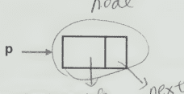

- freeNode(p);

将 p 指向的节点返回到未使用节点的源，并使该节点可供重复使用。


- info(p)

指的是 p 所指向节点的信息部分。

x = info(p) 将 p 所指向节点的 info 字段的内容赋值给 x。

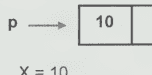

info(p) <- x 将 x 的内容赋值给 p 所指向节点的 info 字段。

x = 10


next(p)

指的是 p 所指向节点的下一个地址部分。

q = next(p) 将 p 所指向节点的 next 字段的内容赋值给 q。


next(p) = q 将指针 q 的内容赋值给 p 所指向节点的 next 字段。


## 三个列表算法

### 算法 1：给定一个整数线性链表，创建一个算法，将数据值为 10 的节点添加到以下列表的前面：


### 步骤 1：p = getNode()

p 是指向新创建节点的指针：


### 步骤 2：info(p) = x

将整数 x 插入到 p 指向的节点的 info 部分中：


### 步骤 3：next(p) = list

我们现在希望 p 指向的节点指向 list 所指向的节点（因为 list 包含列表中第一个节点的地址）。因此，我们必须将 p 指向的节点的 next 字段设置为 list 指向的节点：


### 步骤 4：list = p

最后，由于 list 是线性链表的外部指针，其值必须修改为列表新第一个节点的地址。这将 list 的值更改为 p 的值：


请注意，此时指针 p 不再需要，可以简单地忽略：


综合起来，我们得到了一个在线性链表前面添加节点的算法：

```
p = getNode()
info(p) = x
next(p) = list
list = p
```

让我们测试这个算法，看看它是否适用于最初为空的列表：


### 步骤 1：p = getNode()


### 步骤 2：info(p) = x


### 步骤 3：next(p) = list


### 步骤 4：list = p


同样，指针 p 不再需要，可以简单地忽略：


### 算法 2：删除非空列表的第一个节点，并将其 info 字段的值存储到变量 x 中。


步骤 1：p = list


步骤 2：list = next(p)


### 步骤 3：x = info(p)


x = 10

### 步骤 4：freeNode(p)


x = 10

综合起来，我们得到了一个从线性链表前面删除节点的算法：

```
p = list
list = next(p)
x = info(p)
freeNode(p)
```

最后，让我们测试这个算法，看看它是否适用于只有一个节点的列表：


步骤 1：p = list


步骤 2：list = next(p)


步骤 3：x = info(p)


x = 10

### 步骤 4：freeNode(p)


### 算法 3：给定一个整数线性链表，创建一个算法，遍历（访问）列表中的每个节点并输出每个 info 字段中的数据。


```
p = list;
while ...
output ...
p = p->next;
```

你能看出确保线性链表最后一个节点的 next 字段中存在空值的重要性吗？

## 其他列表操作

无需任何数据移动，就可以轻松地从列表中间插入和删除元素。例如，将节点插入列表中间所需的工作量与列表大小无关。所需要做的就是：

- 分配一个新节点
- 将信息插入节点
- 调整两个指针


### 算法 4：给定线性链表中某个节点的指针 p，编写一个算法，在 p 指向的节点之后插入一个节点。


- q = getNode()


- info(q) = x

x = 25


- next(q) = next(p)


- next(p) = q


请注意，一个项目只能插入到给定节点之后，而不能插入到节点之前。这是因为在不从头开始遍历列表的情况下，无法从给定节点前进到其前驱节点。

这是上面的算法：

```
q = getNode()
info(q) = x
next(q) = next(p)
next(p) = q
```

### 算法 5：给定线性链表中某个节点的指针 p，编写一个名为 deleteAfter 的算法，删除 p 指向的节点之后的节点。


- q = next(p)


- x = info(q)


x = 30

- next(p) = next(q)


- freeNode(q)


同样，我们不能仅仅得到一个指向要删除节点的指针。这是因为必须更改节点前驱的 next 字段以指向节点的后继，并且没有直接方法到达给定节点的前驱。

这是上面的算法：

```
q = next(p)
x = info(q)
next(p) = next(q)
freeNode(q)
```

## 线性链表示例

### 示例 1

假设我们想要从线性链表中删除所有出现的数字 4。我们需要遍历列表，查找 info 字段中包含 4 的节点并删除该节点。但是，要删除一个节点，必须知道其前驱节点。因此，我们必须使用两个指针 p 和 q 来遍历列表。p 将被视为前导指针，q 将被视为滞后指针；也就是说，p 将遍历列表，而 q 始终指向 p 的前驱。请注意，在处理列表时，使用两个指针（一个跟随另一个）的做法非常常见。

将使用两个函数：

- deleteFront() 将用于删除列表前面的节点。
- deleteAfter() 将用于删除列表中间的节点。

```
p = list
q = NULL
while p != NULL
  if info(p) == 4
    p = next(p)
    if p == NULL
      deleteFront(list)
    else
      deleteAfter(q)
  else
    q = p
    p = next(p)
```

将算法的逐步执行作为练习留给读者。请务必在逐行执行算法时绘制图示。


## 示例 2

假设一个线性链表是有序的，即较小的项位于较大项之前（也就是说，列表已排序）。我们想将一个项 x 插入到这个列表的适当位置。使用了两个函数：

- `InsertFront()` 将用于在列表前面插入一个节点。
- `InsertAfter()` 将用于在列表中间插入一个节点。


同样，将算法的细节作为练习留给读者。在逐行分析算法时，请务必画图。

## 线性链表作业

编写伪代码算法来执行以下每个操作：

- 1. 确定列表中的节点数量。
- 2. 确定列表中整数的总和。
- 3. 将一个节点追加到列表末尾。
- 4. 连接两个列表。
- 5. 释放列表中的所有节点。
- 6. 从列表中删除最后一个元素。
- 7. 复制一个列表。

```
p = list
next(p) = NULL
q = getNode()
info(q) = ...
while (p != NULL)
    next(p) = q
```

```
p = list1
q = list2
while ( ... )
    p -> next = q
    p -> next -> next = list2
```

```
p = list
while (p != NULL)
    temp = next(p)
    x = info(p)
    freeNode(p)
    p = next(p)
```

```
Count = 0
p = list
while (p != NULL)
    Count = Count + 1
    p = next(p)
```

```
p = list
Sum = 0
while (p != NULL)
    temp = info(p)
    Sum = Sum + temp
    p = next(p)
```

```
q = next(p)
x = info(p)
while (p != NULL)
    next(q) = next(p)
    q = p
    p = next(p)
freeNode(q)
```

```
p = NULL
while (list != NULL)
    p = malloc(sizeof(*p))
    copy(p -> q, list -> q)
```

```
p = list
r = NULL
while (p != NULL)
    q = getNode()
if (list == NULL)
    list = q
info(q) = info(p)
```

- 在 C 中定义节点
- 线性链表操作
- 分离编译
- 线性链表代码
- 多项式加法
- 线性链表实验
- 计算非常大的阶乘实验

```
a = 0x45 => 0100 0101
b = 0xA2 => 1010 0010
a & b => 0000 0000
a | b => 1010 0111
~a => 1011 1010
a ^ b => 1000 0111
```

- 逻辑运算
- 关系运算符
- 赋值运算

## 按位运算 & ^

| a | b | a&b |
|---|---|---|
| 0 | 0 | 0 |
| 0 | 1 | 0 |
| 1 | 0 | 0 |
| 1 | 1 | 1 |

```
struct {
    int x;
    char ch;
} A;
[Illustration: Struct memory layout with padding]
```

```
union {
    int x;
    char ch;
} U;
// to save storage space
[Illustration: Union memory layout]
```

## 在 C 中定义节点

我们已经看到，指针允许我们构建和操作各种类型的链表。通过改变指针的值，节点可以被连接、分离和重新组合，其模式会随着程序执行而增长和缩小。

我们可以创建这些节点的链，并跟踪列表中的第一个节点，然后在每个节点中存储一个指向列表中下一个节点的指针。为了实现这一点，每个节点将被定义为一个 `struct`，其中一个字段包含信息，另一个字段包含列表中下一个节点的地址。

我们按如下方式进行声明：

```
struct node {
    int info;
    struct node *next;
};
typedef struct node *NODEPTR;
```

或者，我们可以将上述两个声明合并如下：

```
typedef struct node {
    int info;
    struct node *next;
} *NODEPTR;
```

无论哪种情况，我们都将 `NODEPTR` 声明为指向 `node struct` 的指针。请注意，`node struct` 中的 `next` 字段是一个指针，包含列表中下一个节点的地址。

我们现在可以声明一个 `NODEPTR p` 并动态创建一个新节点：

```
NODEPTR p;
p = (NODEPTR) malloc(sizeof(struct node));
```

我们访问节点的 `info` 字段如下：

```
p->info
```

并且我们可以访问节点的 `next` 字段如下：

```
p->next
```

如前所述，我们可以使用 `free()` 函数来释放动态创建的节点：

```
free(p);
```

请分析以下程序，以创建一个包含五个动态创建节点的链表：

```
// dynamic.c

#include <stdio.h>
#include <stdlib.h>

typedef struct node {
    int info;
    struct node *next;
} *NODEPTR;

void main(void) {
    int i;
    NODEPTR list, p, q;

    list = (NODEPTR) malloc(sizeof(struct node));
    p = list;
    p->info = 1;

    for (i = 2; i <= 5; i++) {
        q = (NODEPTR) malloc(sizeof(struct node));
        q->info = i;
        p->next = q;
        p = q;
    }
    p->next = NULL;
}
```

## 线性链表操作

以下是操作整数线性链表的函数。对于你来说，非常重要的一点是，要分析每个函数，以确保你理解它们的工作原理。请务必画出链表图来帮助你可视化算法。如果不画出链表图以及算法执行过程中列表的变化，就很难编写使用链表的代码。

```
// returns the address of a newly created node
NODEPTR getNode(void) {
    NODEPTR p;

    p = (NODEPTR) malloc(sizeof(struct node));
    if (p == NULL) {
        error("List overflow.");
    }
    return(p);
}

// frees the node pointed to by p
void freeNode(NODEPTR p) {
    free(p);
}

// adds a new node to the front of the list
void addFront(NODEPTR *list, int num) {
    NODEPTR p;

    p = getNode();
    p->info = num;
    p->next = *list;
    *list = p;
}
```

```
// deletes the node at the front of the list
int deleteFront(NODEPTR *list) {
    int temp;
    NODEPTR p;
    if (*list == NULL) {
        error("List underflow.");
    }
    p = *list;
    temp = p->info;
    *list = p->next;
    freeNode(p);
    return temp;
}
```

```
// adds an element to the end of a list
void addLast(NODEPTR *list, int num) {
    NODEPTR p, q;
    p = getNode();
    p->info = num;
    p->next = NULL;
    if (*list == NULL) {
        *list = p;
    } else {
        q = *list;
        while (q->next) {
            q = q->next;
        }
        q->next = p;
    }
}
```

```
// deletes the last element in a list
int deleteLast(NODEPTR *list) {
    NODEPTR p, q;
    int temp = -1;

    if (*list) {
        p = *list;
        q = NULL;
        while (p->next) {
            q = p;
            p = p->next;
        }

        if (!q) {
            *list = NULL;
        } else {
            q->next = NULL;
        }

        temp = p->info;
        freeNode(p);
    }

    return temp;
}
```

```
// inserts a new node after the node pointed to by p
void insertAfter(NODEPTR p, int num) {
    NODEPTR q;

    if (p == NULL) {
        error("Void insertion.");
    }

    q = getNode();
    q->info = num;
    q->next = p->next;
    p->next = q;
}
```

```
// deletes the node after the node pointed to by p
int deleteAfter(NODEPTR p) {
    NODEPTR temp;
    NODEPTR q;

    if (p == NULL || p->next == NULL) {
        error("Void delete()\n");
    }
    q = p->next;
    temp = q->info;
    p->next = q->next;
    freeNode(q);
    return temp;
}
```

```
// insert a node into its correct location within a sorted list
void insert(NODEPTR *list, int num) {
    NODEPTR p, q;

    p = *list;
    q = NULL;
    while (p != NULL && p->info < num) {
        q = p;
        p = p->next;
    }

    if (q == NULL) {
        addFront(list, num);
    } else {
        insertAfter(q, num);
    }
}
```

```
// returns the number of nodes in the list
int numElements(NODEPTR list) {
    int count = 0;

    while (list) {
        count++;
        list = list->next;
    }

    return count;
}
```

```
// returns sum of integers in the list
int sumElements(NODEPTR list) {
    int sum=0;

    while (list) {
        sum += list->info;
        list = list->next;
    }
    return sum;
}
```

```
// traverses a list and outputs contents of list
void outputList(NODEPTR list) {
    while (list) {
        printf("%d", list->info);
        list = list->next;
    }
    printf("\n\n");
}
```

```
// Returns true if the item is found in the list
int contains(NODEPTR list, int num) {
    NODEPTR p;

    p = list;
    while (p != NULL && p->info != num) {
        p = p->next;
    }

    return p != NULL;
}
```

```
// determines whether or not a list is empty
int isEmpty(NODEPTR list) {
    return list == NULL;
}
```


```c
// frees all the nodes in a list
void freeList(NODEPTR *list) {
    NODEPTR p;

    while (*list) {
        p = *list;
        *list = p->next;
        freeNode(p);
    }
}

// returns a pointer to the node with the requested value;
// otherwise returns NULL
NODEPTR searchList(NODEPTR list, int num) {
    while (list) {
        if (list->info == num) {
            return list;
        } else {
            list = list->next;
        }
    }
    return list;
}

// removes the first occurrence of an item in a list
int removeItem(NODEPTR *list, int num) {
    NODEPTR p, q;

    p = *list;
    q = NULL;
    while (p != NULL && p->info != num) {
        q = p;
        p = p->next;
    }
    if (p == NULL) {
        return -1;
    } else {
        return q == NULL ? deleteFront(list) : deleteAfter(q);
    }
}
```

// 复制列表
```c
NODEPTR copyList(NODEPTR list) {
    NODEPTR newlist, p, q;
    newlist = NULL;
    while (list) {
        p = getNode();
        p->info = list->info;
        p->next = NULL;
        if (newlist == NULL) {
            newlist = p;
        } else {
            q->next = p;
        }
        q = p;
        list = list->next;
    }
    return newlist;
}
```

// 连接两个列表
```c
void concatList(NODEPTR *list1, NODEPTR list2) {
    NODEPTR p;
    if (*list1 == NULL) {
        *list1 = list2;
    } else if (list2) {
        p = *list1;
        while (p->next) {
            p = p->next;
        }
        p->next = list2;
    }
}
```

// 返回指向包含两个列表交集的新列表的指针
// 两个列表
```c
NODEPTR intersection(NODEPTR list1, NODEPTR list2) {
    NODEPTR p, q, r, s, newlist;
    int found;

    p = list1;
    newlist = NULL;
    r = NULL;

    while (p) {
        q = list2;
        found = 0;
        while (q && !found) {
            if (p->info == q->info) {
                found = 1;
            } else {
                q = q->next;
            }
        }

        if (found) {
            s = getNode();
            s->info = p->info;
            s->next = NULL;
            if (!r) {
                newlist = s;
            } else {
                r->next = s;
            }
            r = s;
        }

        p = p->next;
    }
    return newlist;
}
```

// 显示错误消息并中止程序
```c
void errorHandler(char msg[]) {
    fprintf(stderr, "%s\n", msg);
    exit(1);
}
```

## 分离编译

C 不要求特定程序的所有语句都包含在单个文件中。C 程序可以由编写在单独文件中的函数构建，并链接成一个程序。到目前为止，我们每个项目的所有 C 源代码都放在单个 .c 文件中。但是现在，随着我们的程序变得越来越长，我们需要找到一种更高效的方式来组织代码。

我们可以编译一个源文件以创建“目标代码”，并可以将其函数与其他源文件中的其他函数链接。如果一个文件中的函数需要调用另一个文件中包含的函数，则可以以正常方式进行函数调用，参数可以以通常的方式传递和返回。在修订和调试程序时，如果每次编译只处理大程序的一部分，会更容易。一旦我们编写并调试了一个函数，在处理程序中的其他函数时，就不需要不断重新编译它了。

请考虑以下两个 C 源文件：

```c
File 1
int main(void) {
    foo();
    faa();
}

void foo(void) {
    puts("Red");
}

File 2
void faa(void) {
    puts("Green");
}
```

C 编译器在 File 1 中找到两个函数调用。当在同一文件中找到 foo() 的定义时，对 foo() 的引用得到解析。当在 File 2 中找到 faa() 的定义时，对 faa() 的引用得到解析。传递给 C 编译器的所有目标文件都将被“拉入” C 编译器，并自动包含在最终可执行文件中。

在我们的链表声明和函数的情况下，我们创建两个文件，list.h 和 list.c。.h 文件称为头文件，通常包含声明以及函数原型。以下是我们线性链表的头文件示例：

```c
// list.h

#ifndef _LIST_H
#define _LIST_H

typedef struct node {
    int info;
    struct node *next;
} *NODEPTR;

NODEPTR getNode(void);
void freeNode(NODEPTR p);
void addFront(NODEPTR *list, int num);
int deleteFront(NODEPTR *list);
void addLast(NODEPTR *list, int num);
int deleteLast(NODEPTR *list);
void insertAfter(NODEPTR p, int num);
int deleteAfter(NODEPTR p);
void insert(NODEPTR *list, int num);
int numElements(NODEPTR list);
int sumElements(NODEPTR list);
void outputList(NODEPTR list);
int contains(NODEPTR list, int num);
int isEmpty(NODEPTR list);
void freeList(NODEPTR *list);
NODEPTR select(NODEPTR list, int num);
int remove(NODEPTR *list, int num);
NODEPTR copyList(NODEPTR list);
void concatList(NODEPTR *list1, NODEPTR list2);
NODEPTR intersect(NODEPTR list1, NODEPTR list2);
void error(char *msg);

#endif
```

请注意头文件中 NODEPTR 结构体定义和函数原型的位置。为了防止编译器多次查看此头文件，我们使用预处理器条件编译命令，告诉编译器仅将此代码带入项目一次：

```c
#ifndef _LIST_H
#define _LIST_H

...
...
#endif
```

线性链表 .c 文件中的包含语句如下：

```c
// list.c
#include <stdio.h>
#include <stdlib.h>
#include "list.h"
```

请注意以下语句：

```c
#include "list.h"
```

这指示编译器读取 list.h 头文件中的语句。此时，您应该能够将 list.c 文件与程序的其余部分分别编译。因此，当您准备在程序中使用链表代码时，您将在项目中创建一个新的源代码文件并包含链表函数的头文件：

```c
#include "list.h"
```

您还需要通过将源代码文件添加到项目中的其他源代码文件中，来引入链表的 list.c 源代码。

## 线性链表代码

```c
// list.h

#ifndef LIST_H
#define LIST_H

typedef struct node {
    int info;
    struct node *next;
} *NODEPTR;

NODEPTR getNode(void);
void freeNode(NODEPTR p);
void addFront(NODEPTR *list, int num);
int deleteFront(NODEPTR *list);
void addLast(NODEPTR *list, int num);
int deleteLast(NODEPTR *list);
void insertAfter(NODEPTR p, int num);
int deleteAfter(NODEPTR p);
int insert(NODEPTR *list, int num);
int numElements(NODEPTR list);
int sumElements(NODEPTR list);
void outputList(NODEPTR list);
int contains(NODEPTR list, int num);
int isEmpty(NODEPTR list);
void freeList(NODEPTR *list);
NODEPTR select(NODEPTR list, int num);
int remove(NODEPTR *list, int num);
NODEPTR copyList(NODEPTR list);
void concatList(NODEPTR *list1, NODEPTR list2);
NODEPTR intersect(NODEPTR list1, NODEPTR list2);
void error(char *msg);

#endif
```

```c
// list.c

#include <stdio.h>
#include <stdlib.h>
#include "list.h"

// returns the address of a newly created node
NODEPTR getNode(void) {
    NODEPTR p;

    p = (NODEPTR) malloc(sizeof(struct node));
    if (p == NULL) {
        error("List overflow.");
    }
    return(p);
}

// frees the node pointed to by p
void freeNode(NODEPTR p) {
    free(p);
}

// adds a new node to the front of the list
void addFront(NODEPTR *list, int num) {
    NODEPTR p;

    p = getNode();
    p->info = num;
    p->next = *list;
    *list = p;
}
```

// 删除列表前端的节点
```c
int deleteFront(NODEPTR *list) {
    int temp;
    NODEPTR p;

    if (*list == NULL) {
        error("List underflow.");
    }
    p = *list;
    temp = p->info;
    *list = p->next;
    freeNode(p);
    return temp;
}
```

// 向列表末尾添加元素
```c
void addLast(NODEPTR *list, int num) {
    NODEPTR p, q;

    p = getNode();
    p->info = num;
    p->next = NULL;
    if (*list == NULL) {
        *list = p;
    } else {
        q = *list;
        while (q->next) {
            q = q->next;
        }
        q->next = p;
    }
}
```


```c
// deletes the last element in a list
int deleteLast(NODEPTR *list) {
    NODEPTR p, q;
    int temp = -1;

    if (*list) {
        p = *list;
        q = NULL;
        while (p->next) {
            q = p;
            p = p->next;
        }

        if (!q) {
            *list = NULL;
        }
        else {
            q->next = NULL;
        }

        temp = p->info;
        freeNode(p);
    }
    return temp;
}
```

```c
// inserts a new node after the node pointed to by p
void insertAfter(NODEPTR p, int num) {
    NODEPTR q;

    if (p == NULL) {
        error("Void insertion.");
    }

    q = getNode();
    q->info = num;
    q->next = p->next;
    p->next = q;
}
```

```c
// deletes the node after the node pointed to by p
int DeleteAfter(NODEPTR p) {
    int temp;
    NODEPTR q;

    if (p == NULL || p->next == NULL) {
        error("Void deletion.");
    }

    q = p->next;
    temp = q->info;
    p->next = q->next;
    freeNode(q);
    return temp;
}
```

```c
// insert a node into its correct location within a sorted list
void Insert(NODEPTR *list, int num) {
    NODEPTR p, q;

    p = *list;
    q = NULL;
    while (p != NULL && p->info < num) {
        q = p;
        p = p->next;
    }

    if (q == NULL) {
        addFront(list, num);
    }
    else {
        InsertAfter(q, num);
    }
}
```

```c
// returns the number of nodes in the list
int numElements(NODEPTR list) {
    int count = 0;

    while (list) {
        count++;
        list = list->next;
    }

    return count;
}
```

```c
// returns sum of integers in the list
int sumElements(NODEPTR list) {
    int sum=0;
    while (list) {
        sum += list->info;
        list = list->next;
    }
    return sum;
}
```

```c
// traverses a list and outputs contents of list
void outputList(NODEPTR list) {
    while (list) {
        printf("%d", list->info);
        list = list->next;
    }
    printf("\n\n");
}
```

```c
// Returns true if the item is found in the list
int contains(NODEPTR list, int num) {
    NODEPTR p;
    p = list;
    while (p != NULL && p->info != num) {
        p = p->next;
    }
    return p != NULL;
}
```

```c
// determines whether or not a list is empty
int isEmpty(NODEPTR list) {
    return list == NULL;
}
```

```c
// frees all the nodes in a list
void freelist(NODEPTR *list) {
    NODEPTR p;
    while (*list) {
        p = *list;
        *list = p->next;
        freeNode(p);
    }
}
```

```c
// returns a pointer to the node with the requested value;
// otherwise returns NULL
NODEPTR select(NODEPTR list, int num) {
    while (list) {
        if (list->info == num) {
            return list;
        } else {
            list = list->next;
        }
    }
    return list;
}
```

```c
// removes the first occurrence of an item in a list
int remove(NODEPTR *list, int num) {
    NODEPTR p, q;
    p = *list;
    q = NULL;
    while (p != NULL && p->info != num) {
        q = p;
        p = p->next;
    }
    if (p == NULL) {
        return -1;
    } else {
        return q == NULL ? deleteFront(list) : deleteAfter(q);
    }
}
```

```c
// makes a copy of a list
NODEPTR copyList(NODEPTR list) {
    NODEPTR newlist, p, q;
    newlist = NULL;
    while (list) {
        p = getNode();
        p->info = list->info;
        p->next = NULL;
        if (newlist == NULL) {
            newlist = p;
        } else {
            q->next = p;
        }
        q = p;
        list = list->next;
    }
    return newlist;
}
```

```c
// concatenates two lists
void concatList(NODEPTR *list1, NODEPTR list2) {
    NODEPTR p;
    if (*list1 == NULL) {
        *list1 = list2;
    } else if (list2) {
        p = *list1;
        while (p->next) {
            p = p->next;
        }
        p->next = list2;
    }
}
```

```c
// returns a pointer to a new list containing the intersection of
// two lists
NODEPTR intersect(NODEPTR list1, NODEPTR list2) {
    NODEPTR p, q, r, s, newlist;
    int found;

    p = list1;
    newlist = NULL;
    r = NULL;
    while (p) {
        q = list2;
        found = 0;
        while (q && !found) {
            if (p->info == q->info) {
                found = 1;
            } else {
                q = q->next;
            }
        }
        if (found) {
            s = getNode();
            s->info = p->info;
            s->next = NULL;
            if (!r) {
                newlist = s;
            } else {
                r->next = s;
            }
            r = s;
        }
        p = p->next;
    }
    return newlist;
}

// display an error message and aborts the program
void fatal(char *msg) {
    fprintf(stderr,
        "%s\n", msg);
    exit(1);
}
```

## 多项式加法

为了找到一元多项式的合适表示，我们必须区分多项式每一项中的系数和指数。下面展示了作为线性链表节点表示的多项式的一项。

| 系数 | 指数 | 指向下一项的链接 |
|---|---|---|

例如：

3X² 将表示为：

| 3.0 | 2 | |
|---|---|---|

X⁴ 将表示为：

| 1.0 | 4 | |
|---|---|---|

5 将表示为：

| 5.0 | 0 | |
|---|---|---|

3X⁵ - 2X³ + 4 将表示为：

| 3.0 | 5 | -> | -2.0 | 3 | -> | 4.0 | 0 | |
|---|---|---|---|---|---|---|---|---|

### 多项式表示

请注意将多项式表示为线性链表的以下三个前提条件：

- 项必须在线性链表中按指数递减顺序存储。
- 不允许两个项具有相同的指数。
- 不允许任何项具有零系数。

线性链表的每个节点将表示多项式的一项，是一个包含以下信息的 `struct`：

- 系数
- 指数
- 指向多项式下一项的指针

```c
typedef struct poly {
    float coeff;
    int expn;
    struct poly *next;
} *POLYPTR;
```

### 相加两个多项式

要将两个多项式相加，我们只需各扫描一次：

- 如果在两个多项式中找到指数相同的项，则相加系数并将新项复制到和多项式的末尾；否则，将指数较大的项复制到和多项式中并继续。
- 当到达其中一个多项式的末尾时，将另一个多项式的剩余部分复制到和多项式中。
- 我们必须小心不要在和中包含系数为 0 的项。例如：

  ```
  6X^5 + 2X^4 + 3X^3 + 2X
  +
  3X^5 - 2X^4 - 5X^2 - 8X + 7
  9X^5 + 3X^4 - 5X^2 - 6X + 7
  ```

```c
// poly.c

#include <stdio.h>

typedef struct poly {
    float coeff;
    int expon;
    struct poly *next;
} *POLYPTR;

POLYPTR sum(POLYPTR p, POLYPTR q) {
    float coeff;
    POLYPTR add = NULL;
    while (p != NULL && q != NULL) {
        if (p->expon == q->expon) {
            coeff = p->coeff + q->coeff;
            if (coeff) {
                makeTerm(&add, coeff, p->expon);
                p = p->next;
                q = q->next;
            }
        } else if (p->expon > q->expon) {
            makeTerm(&add, p->coeff, p->expon);
            p = p->next;
        } else {
            makeTerm(&add, q->coeff, q->expon);
            q = q->next;
        }
    }
    while (p) {
        makeTerm(&add, p->coeff, p->expon);
        p = p->next;
    }
    while (q) {
        makeTerm(&add, q->coeff, q->expon);
        q = q->next;
    }
    return add;
}
```

在算法的多个位置，我们必须使用给定的系数和指数创建一个新项，并将其放在和多项式的末尾，即指针 `last` 所指向的项之后。请注意，指针 `add` 将始终指向创建的第一个项，而指针 `last` 将始终指向和多项式的最后一个项。

```c
void makeTerm(POLYPTR *add, float coeff, int expon) {
    POLYPTR t;
    POLYPTR last = NULL;

    t = (POLYPTR) malloc(sizeof(struct poly));
    t->coeff = coeff;
    t->expon = expon;
    t->next = NULL;
    if (last == NULL) {
        *add = t;
    }
    else {
        last->next = t;
    }
    last = t;
}
```

多项式的其他操作可以编程为与我们的加法函数性质相同的函数。为了额外学分，看看你能否完成以下任务：

- 编写一个方法，输入一系列系数和指数，并将它们形成如前所述的链式多项式。
- 编写一个函数，用于相减两个多项式。
- 编写一个函数，用于计算多项式的一阶、二阶和三阶导数。
- 编写一个函数，用于将多项式乘以标量。
- 编写一个函数，给定一个多项式和一个整数，在该整数处求解多项式的值。
- 编写一个函数，将多项式作为系数和指数的序列以吸引人的方式打印出来。


## 线性链表实验

本实验与数据库实验性质相似，将重点放在使用动态存储分配操作线性链表上。作业的每个部分都应结构化在其自身的函数中，根据需要传递参数。

你需要构建一个C程序`dbase.c`，利用动态变量，用于检索和操作公司的工资数据库`payfile2.txt`。每个员工的数据应读入包含以下字段的结构体中：

- firstName - 最多10个字符
- lastName - 最多15个字符
- gender - 最多1个字符 (M/F)
- tenure - 表示受雇年数的整数
- rate - h/w
- salary - 浮点数

你的程序应执行下列指示的每个操作。请务必为每个部分清晰地标记输出。

- a) 将`payfile2.txt`中的数据读入每个员工的节点结构体，并将节点插入线性链表的末尾。下面是一个帮助你从输入文件读取数据的`fscanf()`语句：

```
fscanf(fp, "%s %s %c %d %c %f\n",      p->firstName,
                             p->lastName,
                             &p->gender,
                             &p->tenure,
                             &p->rate,
                             &p->salary);
```

- b) 将链表中每个节点的内容以易于阅读的格式输出，格式类似于输入文件的格式。

- c) 遍历列表并输出数据库中的员工数量。

- d) 输出工资单上所有女性的名和姓。

- e) 输出所有年收入超过35,000美元且在公司工作至少五年的周薪员工的名、姓和薪水。

- f) 给所有按小时计薪且每小时收入低于10.00美元的员工每小时加薪0.75美元；给所有按周计薪且每周收入低于350.00美元的员工每周加薪50.00美元。输出工资单上每个获得加薪的员工的名、姓和新薪水。

- g) 按姓氏字母顺序对列表中的节点进行排序，并输出每个员工的名、姓和薪水。

- h) 文件`hirefile2.txt`包含公司将雇佣的三名员工的数据。将每位新员工的记录插入线性链表中的正确位置，并输出数据库中每个员工的名、姓和薪水。

- i) 文件`firefile2.txt`包含公司将解雇的两名员工的数据。删除每位待解雇员工对应的节点，并输出数据库中每个员工的名、姓和薪水。

请注意，以前我们只查看过包含`int`的节点的线性链表，而现在我们查看的是包含结构体的节点的线性链表。因此，我重写了实验说明末尾显示的线性链表源代码（`list.h`和`list.c`），以允许我们的列表使用每个节点的info字段中的员工结构体，而不仅仅是`int`。

`list.h`头文件包含员工结构体的声明以及函数原型。`list.c`文件包含我为本实验重写的用于员工结构体的列表函数。

以下是`list.h`中出现的结构体声明：

```
typedef struct node {
    char    firstName[11];
    char    lastName[16];
    char    gender;
    int     tenure;
    char    rate;
    float   salary;
    struct node *next;
} *NODEPTR;
```

以下是一个对链表进行排序的相当简单的算法。假设`list`指向一个未排序的列表，而`sortList`指向`NULL`。

```
while list != null
    remove first node from list
    insert node into correct location into sortList
list = sortList
```

以下是本实验数据文件的样子：

```
Payfile2.txt

Debbie   Starr       F 3 W 1000.00
Joan     Jacobus    F 9 W 925.00
David    Renn       M 3 H 4.75
Albert   Cahana     M 3 H 18.75
Douglas  Sheer      M 5 W 250.00
Shari    Buchman    F 9 W 325.00
Sara     Jones      F 1 H 7.50
Ricky    Mofsen     M 6 H 12.50
Jean     Brennan    F 6 H 5.40
Jamie    Michaels   F 8 W 150.00

Hirefile2.txt

Barry    Allen      M 0 H 6.75
Nina     Pinella    F 0 W 425.00
Lane     Wagger     M 0 W 725.00

Firefile2.txt

Jean     Brennan    F
Ricky    Mofsen     M
```

以下是用于存储员工结构体的线性链表实现的`list.h`和`list.c`文件。

```
// list.h

#ifndef _LIST_H
#define _LIST_H

typedef struct node {
    char    firstName[11];
    char    lastName[16];
    char    gender;
    int     tenure;
    char    rate;
    float   salary;
    struct node *next;
} *NODEPTR;

NODEPTR getNode(void);
void    freeNode(NODEPTR p);
void    addNodeFront(NODEPTR *list, NODEPTR t);
NODEPTR removeNodeFront(NODEPTR *list);
void    addNodeLast(NODEPTR *list, NODEPTR t);
NODEPTR deleteNodeLast(NODEPTR *list);
void    insertNode(NODEPTR *list, NODEPTR t);
void    insertNodeAfter(NODEPTR p, NODEPTR t);
NODEPTR removeNode(NODEPTR *list, NODEPTR t);
NODEPTR deleteNodeAfter(NODEPTR *list, NODEPTR p);
int     numElements(NODEPTR list);
void    freeList(NODEPTR *list);
void    error(char *msg);

#endif
```

```
// list.c

#include <stdio.h>
#include <stdlib.h>
#include <string.h>
#include "list.h"

// returns the address of a newly created node
NODEPTR getNode( void )
{
    NODEPTR p;

    p = (NODEPTR) malloc( sizeof( struct node ) );
    if ( p == NULL ) {
        error( "List overflow." );
    }
    return( p );
}

// frees the node pointed to by p
void freeNode( NODEPTR p ) {
    free( p );
}

// adds a node to the front of the list
void addNodeFront( NODEPTR *list, NODEPTR t ) {
    t->next = *list;
    *list = t;
}

// removes a node from the front of the list
NODEPTR removeNodeFront( NODEPTR *list ) {
    NODEPTR p;

    if ( *list == NULL ) {
        error( "List underflow." );
    }
    p = *list;
    *list = p->next;
    return p;
}
```

```
// adds a node to the end of a list.
void addNodeLast (NODEPTR *list, NODEPTR t) {
    NODEPTR p;

    if (*list == NULL) {
        *list = t;
    }
    else {
        p = *list;
        while (p->next) {
            p = p->next;
        }
        p->next = t;
    }
}
```

```
// deletes the node at the end of a list
NODEPTR deleteNodeLast (NODEPTR *list) {
    NODEPTR p = NULL, q;

    if (*list) {
        p = *list;
        q = NULL;
        while (p->next) {
            q = p;
            p = p->next;
        }
        if (q) {
            *list = NULL;
        }
        else {
            q->next = NULL;
        }
    }
    return p;
}
```

```
// insert a node into its correct location within the sorted list
void insertNode(NODEPTR *list, NODEPTR t) {
    NODEPTR p, q;

    p = *list;
    q = NULL;
    while (p != NULL && strcmp(p->lastName, t->lastName) < 0) {
        q = p;
        p = p->next;
    }

    if (q == NULL) {
        addNodeFront(list, t);
    }
    else {
        insertNodeAfter(q, t);
    }
}
```

```
// inserts a node after the node pointed to by p
void insertNodeAfter(NODEPTR p, NODEPTR t) {
    if (p == NULL || t == NULL) {
        error("Void insertion.");
    }

    t->next = p->next;
    p->next = t;
}
```

```
// removes a node from a list
NODEPTR removeNode(NODEPTR *list, NODEPTR t) {
    NODEPTR p, q;

    p = *list;
    q = NULL;
    while (p != NULL && strcmp(p->firstName, t->firstName)
        && strcmp(p->lastName, t->lastName)) {
        q = p;
        p = p->next;
    }

    return q == NULL ? removeNodeFront(list) : deleteNodeAfter(list, q);
}
```

```
// deletes the node after the node pointed to by p
NODEPTR deleteNodeAfter(NODEPTR *list, NODEPTR p) {
    NODEPTR q;
    if (p == NULL || (p->next == NULL)) {
        error("Invalid deletion.");
    }
    q = p->next;
    p->next = q->next;
    return q;
}

// returns the number of nodes in the list
int numElements(NODEPTR list) {
    int count=0;
    while (list) {
        count++;
        list = list->next;
    }
    return count;
}

// frees all the nodes in a list
void freeList(NODEPTR *list) {
    NODEPTR p;
    while (*list) {
        p = *list;
        *list = p->next;
        freeNode(p);
    }
}

// display an error message and aborts the program
void error(char *msg) {
    puts(msg);
    exit(1);
}
```

你的程序输出应发送到终端窗口（你的屏幕）以及请求的`csis.txt`输出文件。请务必阅读关于捕获程序输出的文档。你的全名和Palomar ID号必须作为注释出现在包含`main()`的源文件中。请务必将`csis.txt`输出文件包含在zip存档中。


## 计算超大阶乘实验

本次作业将重点关注线性链表的操作。你需要编写一个C程序，程序会提示用户输入一个整数n，并返回该整数的阶乘n!的精确值。n的大小限制可以非常大（最高可达9,999），这将产生包含数百甚至数千位数字的阶乘。不言而喻，我们的方法将绕过编程语言中整数和长整型固有的表示限制。

### n!的存储

阶乘将存储在线性链表中，每个节点包含两个字段。第一个字段info将存储一个0到999之间的整数值。第二个字段next存储指向线性链表中下一个节点的引用。为了确保正确理解这种存储方案的性质，下面展示了10!和15!的表示：

```
10! = 3,628,800

| 3 |=====>| 628 |=====>| 800 |=====>X

15! = 1,307,674,368,000

| 1 |=====>| 307 |=====>| 674 |=====>| 368 |=====>| 000 |=====>X
```

请注意，通过每个节点仅存储三位数字，输出中逗号的放置可以轻松实现，只需在从一个节点移动到下一个节点时作为另一个操作即可。

### 乘法

假设要将15!的值乘以6。存储在链表中的15!的值是被乘数。作为普通标量存储的6是乘数。被乘数始终存储在链表中，乘数始终是0到9之间的数字。该操作由一系列单独的乘法组成，其中节点的info字段中的数字乘以固定乘数。单独乘法的次数与存储被乘数的链表中的节点数量相同。

单独乘法序列产生一系列单独的乘积，这些乘积需要合成完整被乘数乘以乘数的实际乘积。请注意，实际乘积将存储在另一个链表中，其形式与被乘数的链表相同。这是通过将每个单独乘积的千位数字视为“进位”，并将其加到紧邻左侧节点的单独乘积的个位数字上来实现的。这或许通过一个具体例子可以更清楚地看到。下面展示了15!乘以6的乘法图示：


在实现这种乘法方案时需要处理的一个复杂之处是，单独乘法必须从被乘数的右端开始，而被乘数存储在链表的尾部。事实上，需要按逆序遍历链表中的节点。处理此问题有几种方法。一种是将被乘数的链表设为双向链表，以便从尾到头遍历与从头到尾遍历一样容易。另一种方法是按需要处理的顺序（而不是反映常规表示的顺序）从前到后在节点中存储3位数字：

```
15! = 1, 307, 674, 368, 000

| 000 |=====>| 368 |=====>| 674 |=====>| 307 |=====>| 001 |=====>X
```

进一步的复杂之处在于扩展乘法方案，使其能够处理类似15!乘以16的乘法，即阶乘乘以两位或多位数字的乘法。这种扩展直接类似于小学教授的笔算乘法，其中乘数的数字逐一处理。正如乘数中的每个连续数字（即个位数字、十位数字、百位数字）都需要对被乘数进行另一轮“乘以一个数字（0到9之间的数）”并生成另一条“中间乘积行”，当前乘法方案的扩展也是如此。

在实现15!乘以16的乘法时，首先将15!乘以6并将结果存储在一个新链表中。然后，将15!乘以1（乘数十位上的数字），并将此结果存储在其自己的新链表中。接下来，将存储15!乘以1的乘积的链表中的数字向左移动一位，从而实现乘以十，将15! * 1的乘积转换为15! * 10的乘积。最后，将两个“辅助链表”中对应的数字相加以得到最终结果。例如：

```
16: * 16 =
1207674368000
* 16
7046046208000
1307614368000
4098276988000

1002 ==> 2 | 001 ==> | 674 ==> | 368 ==> | 1000 ==> 2
151
* 16 * 16

007 ==> | 546 ==> | 046 ==> | 208 ==> | 000 ==> X
151 * 6

001 ==> 2 | 207 ==> | 676 ==> | 368 ==> | 000 ==> X
151 * 1

015 ==> | 076 ==> | 142 ==> | 680 ==> | 000 ==> X
151 * 10 | 041790

007 ==> | 846 ==> | 046 ==> | 208 ==> | 000 ==> X
151 * 6 (accepted)

4

031 ==> | 076 ==> | 142 ==> | 690 ==> | 000 ==> X
181 ~ 10 (accepted)

0020
01922
01789
01858
01000
tax code = 1117

- 0 - 0 + 0 - 0

1090 ==> | 421 ==> | 192 ==> | 162 ==> | 1000 ==> N
2000
```

虽然上面的15!乘以16的示例恰好没有显示这一点，但在将“辅助链表”中的中间乘积相加以得到最终结果时，必须考虑节点之间的进位。

由于程序需要支持阶乘被乘数（例如567!）乘以三位数（例如568）或四位数，因此上述想法需要增强，以容纳最多三个或四个中间乘积在三个或四个“辅助链表”中。

### 一般计算策略

假设用户希望计算15!。15!将以最直接的方式推导，即从一个阶乘开始逐步构建。一个阶乘，作为1“硬编码”到程序中，将用作计算2!的基础。2!将用作计算3!的基础。这将持续到14!，并将用作推导15!的基础。

### 规格说明

程序将提示用户输入一个整数n，并返回该整数阶乘n!的精确值。虽然程序能够处理的n的大小没有逻辑限制的理由，但你的程序应能处理至少高达9,999!的数字。

由于n!可能是一个数百甚至数千位的整数，其显示将跨越多行。发生这种情况时，请将n!打印出来，最高有效数字位于顶行的左端，个位数字位于数字最低行的右端。你应该每三位数字打印一个逗号（即，在百位数字和千位数字之间，在十万位数字和百万位数字之间，等等）。在逗号应出现的位置换行，并将逗号放在被换行的行上数字的右侧。这表示数字在下一行继续。具体来说，每行打印不超过45位数字。你的程序还应针对以下内容输出统计信息：

- 每个阶乘的位数
- 程序计算n!所花费的时间（毫秒）

你的程序应在以下数据上运行并产生输出：

```
10, 98, 234, 567, 999, 5432, 9999
```

请注意，本实验与阶乘和数字乘法无关。我的意思是，我并不是在寻找计算阶乘的更清晰或更高效的方法。本实验的目标是使用动态存储分配操作线性链表！你需要实现指定的算法。

程序的输出应发送到终端窗口（你的屏幕）以及请求的`csis.txt`输出文件。请务必阅读关于捕获程序输出的文档。你的全名和Palomar ID号必须作为注释出现在包含`main()`的源文件中。请务必将`csis.txt`输出文件包含在你的zip存档中。


- 位运算符简介
- 位与掩码
- WordStar
- 位或
- 位异或
- 位取反
- 左移运算符
- 右移运算符
- 旋转示例
- 提取位字段
- 位运算符作业
- 位运算符实验

## 位运算符简介

C 提供了一系列专门用于对单个位进行操作的运算符：

```
a = 0x34 = 0011 0100
b = 0x0A = 0000 1010
```

除了位取反运算符外，所有位运算符都是二元运算符，因此需要两个操作数。C 中可以对任何类型的整数值执行位操作，例如：

| int | 无符号 int |
| --- | --- |
| short | 无符号 short |
| long | 无符号 long |
| char | 无符号 char |

但不能对：

| 浮点数 |
| --- |
| 双精度浮点数 |
| 长双精度浮点数 |

位运算符会并行地应用于每个操作数中的各个位位置。这与逻辑运算符不同，逻辑运算符将每个操作数视为单个零（假）或非零（真）值。

## 位与

与逻辑 AND 运算符（&&）类似，位与运算符（&）仅在两个操作数都为真（即具有非零值）时才产生真值。

| b1 | b2 | b1 & b2 |
| --- | --- | --- |
| 0 | 0 | 0 |
| 0 | 1 | 0 |
| 1 | 0 | 0 |
| 1 | 1 | 1 |

我们假设一个 16 位整数：

```c
// and1.c

#include <stdio.h>

int main(void) {
   int x = 0x2719; // 0010 0111 0001 1001
   int y = 0x35CD; // 0011 0101 1100 1101
   int z;

   z = x & y; // 0010 0101 0000 1001
   printf("z = %#x\n", z); // z = 0x2509
   return 0;
}
```

该程序的输出为：

```
z = 0x2509
```

请注意，每个 int 变量中的对应位都会进行按位与运算。

下面是另一个示例：

```c
// and2.c

#include <stdio.h>

int main(void) {
    int x = 0x1234;    // 0001 0010 0011 0100
    int y = 0x3468;    // 0011 0100 0110 1000
    int z = 0x5248;    // 0101 0010 0100 1000

    printf("0%x\n\n", x & x);   => 0x1234
    printf("0%x\n\n", x & y);   => 0x1020
    printf("0%x\n\n", x & y & z); => 0x1000
    printf("0%x\n\n", x & y & z); => 0x0000

    return 0;
}
```

在第一个 printf() 语句中，任何数值与自身进行按位与运算都会返回其自身作为值：

```
x = 0x1234 = 0001 0010 0011 0100
x = 0x1234 = 0001 0010 0011 0100

0001 0010 0011 0100 = 0x1234
```

在第二个 printf() 语句中，变量 x 和 y 进行按位与运算，产生：

```
x = 0x1234 = 0001 0010 0011 0100
y = 0x3468 = 0011 0100 0110 1000

0001 0000 0010 0000 = 0x1020
```

在第三个 printf() 语句中，所有三个变量 x、y 和 z 进行按位与运算，产生：

```
x = 0x1234 = 0001 0010 0011 0100
y = 0x3468 = 0011 0100 0110 1000
z = 0x5248 = 0101 0010 0100 1000

0001 0000 0000 0000 = 0x1000
```

第四个 printf() 语句的作用是提取 x 的最右位，即 0 或 1。

```
x = 0x1234 = 0001 0010 0011 0100
0x0001 = 0000 0000 0000 0001
              0000 0000 0000 0000 = 0x0
```

请注意，这是一个判断 x 是奇数还是偶数的好方法：

```
printf("%s", x & 1 ? "Odd" : "Even");
```

请记住位与运算符（&）和逻辑与运算符（&&）之间的区别：

```c
// and3.c
#include <stdio.h>

void main(void) {
    int x = 1;
    int y = 2;
    printf("bitwise = %d \nlogical = %d\n", x & y, x && y);
    return 0;
}
```

输出如下：

```
bitwise = 0   logical = 1
```

## 掩码

按位与运算常用于掩码操作。掩码是一个常量或变量，用于提取变量或表达式中所需的位。掩码可用于将数据项中的特定位设置为 0。在下面的示例中，我们将保留 x 的最右两位，并将所有其他位置零（掩码）：

```c
// mask1.c
#include <stdio.h>

int main(void) {
    int x = 0x679;    // 0000 0110 0111 1001
    int mask = 0x0003; // 0000 0000 0000 0011

    x = x & mask;      // 0000 0000 0000 0001
    printf("x = %#x\n", x);
    return 0;
}
```

输出如下：

```
x = 0x1
```

请注意，也可以写成：

```
x &= mask;
```

现在假设我们要将一个字中除了最右四位之外的所有位都设置为 0：

```c
// mask2.c

#include <stdio.h>

int main(void) {
    int x = 0x1234; // 0001 0010 0011 0100
    int mask = 0x000F; // 0000 0000 0000 1111

    x &= mask; // 0000 0000 0000 0100
    printf("x = 0x%x\n", x);

    return 0;
}
```

输出如下：

```
x = 0x4
```

我们还可以使用掩码来确定 int 表达式的低阶位：

```c
// mask3.c

#include <stdio.h>

int main(void) {
    int i;
    int mask = 0x0001; // 0000 0000 0000 0001

    for (i = 0; i < 10; i++) {
        printf("%d ", i & mask);
    }

    return 0;
}
```

上述程序打印出交替的 0 和 1 序列：

```
0 1 0 1 0 1 0 1 0 1
0 1 2 3 4 5 6 7 8 9
```

如果我们想查找表达式中特定位的值，可以使用在该位置为 1、其他位置为 0 的掩码。例如，我们可以检查 int 从右数第 5 位：

```c
// mask4.c

#include <stdio.h>

int main(void) {
    int x = 0x1234;    // 0001 0010 0011 0100
    int mask = 0x0010; // 0000 0000 0001 0000

    if (x & mask) {
        printf("Bit is a 1.\n");
    } else {
        printf("Bit is a 0.\n");
    }

    return 0;
}
```

输出如下：

```
Bit is a 1.
```

## WordStar

WordStar 是一款文字处理器应用程序，在 20 世纪 80 年代初至中期占据主导市场份额。它使用 ASCII 字符的高阶位用于特殊格式目的。

WordStar 会在单词的最后一个字符上设置高阶位，以标记可以插入空格以对齐右边距的位置。它还会在插入的空格上设置高阶位，以便在对齐文本时知道可以删除哪些空格。例如，它不希望删除你在句末放置的双空格。

如果你使用简单的文本编辑器输出 WordStar 创建的文件中的字符，可能看起来像这样：

```
6E† Writā · functiō calleō find_strinā tō determinā īē onāt characterō ō strināt existōt insidā anotheōt stringōt Thā firōō argumenōt tōt thā ō functiō shoulō bā thā characterō stringō thaō 10 tō bā searcheō auk thā ō secondō argumenōt thā strinā wā āra interestekt 10t findingō īāt thā ō functiō findō thā specificō stringō y tōēō havā 10 returō tōa locatiō ō 10 thā sourcō strinā whēn thā strinā wāō foundōt 12 thā functiō dēō ō Not find the string, then have it return -1. (25)
```

事实上，这是我 1986 年使用 WordStar 编写的一份考试中的问题。我最近找到了这个文件，想查看其内容。所有这些乱码的原因是 WordStar 在许多字符上设置了高阶位。请记住，ASCII 实际上是一种 7 位代码，从未使用高阶位来定义字符。WordStar 将此高阶位用于自己的目的！

因此，我创建了一个程序，一次读取一个字符。该程序在输出字符之前创建一个掩码来关闭高阶位：

```
putchar(c & 0x7f);
```

该语句将字符与掩码 01111111 进行按位与运算，从而有效地关闭高阶位。

下面是代码：

```c
#include <stdio.h>
#include <stdlib.h>

int main(void) {
    int c;
    char fileName[32];
    FILE *fp;

    printf("Enter filename: ");
    gets(fileName);

    if ((fp = fopen(fileName, "r"))) {
        printf("File could not be opened.\n");
        exit(1);
    }

    while((c = getc(fp)) != EOF) {
        putchar(c & 0x7f);
    }
    fclose(fp);
    return 0;
}
```

下面是输出：

6. 编写一个名为 find_string 的函数，用于确定一个字符串是否存在于另一个字符串中。函数的第一个参数应为要搜索的字符串，第二个参数为我们感兴趣的要查找的字符串。如果函数找到指定字符串，则让它返回字符串在源字符串中找到的位置。如果函数未找到字符串，则让它返回 -1。（25）

这道考试题不错！


## 按位或

与逻辑或运算符（||）类似，按位或运算符（|）在至少一个操作数为真（即具有非零值）时产生真值。

| b1 | b2 | b1 \| b2 |
|---|---|---|
| 0 | 0 | 0 |
| 0 | 1 | 1 |
| 1 | 0 | 1 |
| 1 | 1 | 1 |

```c
// or1.c

#include <stdio.h>

int main(void) {
    int x = 0x2719;    // 0010 0111 0001 1001
    int y = 0x85CD;    // 1000 0101 1100 1101
    int z;

    z = x | y;    // 1010 0111 1101 1101
    printf("z = 0x%x\n", z);    // A 7 D D
    return 0;
}
```

该程序的输出为：

```
z = 0xA7DD
```

按位或运算符用于将字中的指定位设置为1（即打开位）。例如，假设我们要将int的最右边3位设置为1，无论操作执行前这些位的状态如何：

```c
// or2.c
#include <stdio.h>
int main(void) {
    int x = 0x1234;       // 0001 0010 0011 0100
    int mask = 0x0007;    // 0000 0000 0000 0111
    int z;
    z = x | mask;
    printf("z = 0x%x\n", z); // 0001 0010 0011 0111
    return 0;
}
```

该程序的输出为：

```
z = 0x1237
```

现在假设我们想编写一个程序来翻转int的第5位（如果是开则关；如果是关则开）。一种方法是：

```c
// flip1.c
#include <stdio.h>
int main(void) {
    int x = 0x1234;       // 0001 0010 0011 0100
    int mask = 0x0010;    // 0000 0000 0001 0000
    if (x & mask)
        x &= 0xFFEF;      // bit is on, turn it off
    else
        x |= 0x0010;      // bit is off, turn it on
    printf("x = 0x%x\n", x); // 0001 0010 0001 0100
    return 0;
}
```

产生的输出为：

```
x = ...
```

这段代码工作正常，但可以使用按位异或运算符进行简化。

## 按位异或

按位异或运算符在两个操作数值不同时产生1，在两个操作数相同时产生0。

| b1 | b2 | b1 ^ b2 |
|---|---|---|
| 0 | 0 | 0 |
| 0 | 1 | 1 |
| 1 | 0 | 1 |
| 1 | 1 | 0 |

例如：

```c
// xor1.c
#include <stdio.h>
int main(void) {
    int x = 0x1234;
    int y = 0x85CD;
    int z;
    z = x ^ y;
    printf("z = 0x%x\n", z);
    return 0;
}
```

该程序的输出为：

```
z = 0x97F9
```

请注意，任何值与自身异或都会产生0：

```c
// xor2.c
#include <stdio.h>
int main(void) {
    int x = 0x1234;
    printf("x = 0x%x\n", x ^ x);
    return 0;
}
```

该程序的输出为：

```
x = 0x0
```

此概念在汇编语言中经常用于清除寄存器：

```
XOR AL, AL
```

现在我们可以使用按位异或运算符来重写之前的程序，该程序用于翻转int从右数的第5位：

```c
// flip2.c
#include <stdio.h>
int main(void) {
    int x = 0x1234;       // 0001 0010 0011 0100
    int mask = 0x0010;    // 0000 0000 0001 0000
    x ^= mask;            // 0001 0010 0010 0100
    printf("x = 0x%x\n", x);
    return 0;
}
```

产生的输出为：

```
x = 0x1224
```

按位异或运算符还可以用于交换两个值，而不需要临时第三个变量：

```c
// xor3.c

#include <stdio.h>

int main(void) {
    int x = 0x1234;    // 0001 0010 0011 0100
    int y = 0xABCD;    // 1010 1011 1100 1101

    x ^= y;
    y ^= x;
    x ^= y;
    printf("x = 0x%x\n", x);
    printf("y = 0x%x\n", y);
    return 0;
}
```

产生的输出为：

```
x = 0xABCD
y = 0x1234
```

## 按位取反

按位取反运算符是一个一元运算符。这意味着该运算符只需要一个操作数。其效果是翻转操作数的位。

| b | ~b |
|---|---|
| 0 | 1 |
| 1 | 0 |

例如：

```c
// negate1.c
#include <stdio.h>
int main(void) {
    int x = 0x1234;    // 0001 0010 0011 0100
    int y;
    y = ~x;            // 1110 1101 1100 1011
    printf("y = 0x%x\n", y);
    return 0;
}
```

该程序的输出为：

```
y = 0xEDCB
```

请记住不要将按位取反（~）运算符与算术减（-）运算符或逻辑非（!）运算符混淆。例如，如果x等于0：

```
-x = 0
!x = 1   (true)
~x = -1  (when treated as a signed value)
```

请注意，按位与、按位或和按位异或的结果不依赖于计算机的字长，但按位取反的结果依赖。我们可以利用这一点。

假设我们想写一个二进制值，它由所有1位组成，除了低序3位。我们不应该将该值写为：

```
0xFFF8 (16-bit value)
```

也不应写为：

```
0xfffffff8 (32-bit value)
```

而应写为：

```
~7
```

这适用于任何字长！！！

当对两个大小不同的值（long和short）执行按位操作时，系统将操作数右对齐。如果两个项目中较短的是有符号量，且值为负，则符号将向左扩展以匹配较大值所包含的位数。

最后，按位运算符（&, |, ^）的优先级低于==和 !=。这意味着像这样的位测试表达式：

```
if ((x & mask) == 0)
```

必须完全加括号才能得到正确结果。

## 左移运算符

当对值执行左移（<<）操作时，值中的位将被向左移位。通过高序位移出的位将丢失，0始终移入低序位。

例如：

```c
// lshift.c
#include <stdio.h>
int main(void) {
    int num = 3;       // 0000 0000 0000 0011
    num = num << 1;    // 0000 0000 0000 0100
    printf("num = %d\n", num);
    return 0;
}
```

在上述程序中，num的所有位向左移一位。产生的输出为：

```
num = 6
```

请注意，将值左移一位相当于将被移位的值乘以2。左移操作也可以写成：

```
num <<= 1;
```

以下是一个输出16位int值位表示的函数：

```c
// bitpntr1.c

int bitpntr1(int num) {
    int i, mask;

    mask = 1;
    for (i = 1; i <= 16; i++) {
        printf(num & mask ? "1" : "0");
        num <<= 1;
    }

    return 0;
}
```

不幸的是，由于sizeof(int)在不同计算机上会有所不同，此函数不可移植。因此我们修改程序以使其可在不同计算机上移植，如下所示：

```c
// bitpntr2.c

int bitpntr2(int num) {
    int i, mask;

    mask = 1;
    for (i = 1; i <= sizeof(int)*8; i++) {
        printf(num & mask ? "1" : "0");
        num <<= 1;
    }

    return 0;
}
```

## 右移运算符

右移（>>）运算符将值的位向右移位。移出低序位的位将丢失。对无符号值进行右移将始终导致0移入左侧。

例如：

```c
// rshift.c
#include <stdio.h>
int main(void) {
    int num = 12;      // 0000 0000 0000 1100
    num = num >> 1;    // 0000 0000 0000 0110
    printf("%d\n", num);
    return 0;
}
```

在上述程序中，num的所有位向右移一位。产生的输出为：

```
num = 6
```

请注意，将值右移一位相当于将被移位的值除以2。右移操作也可以写成：

```
num >>= 1;
```

对于有符号值，移入左侧的内容取决于被移位值的符号，以及该操作在你的系统上的实现方式。如果符号位为0（正值），则无论我们在什么系统上，都会移入0。如果符号位为1，有些计算机会移入1（算术右移），有些会移入0（逻辑右移）。

C保证，如果尝试将值左移或右移的位数大于或等于数据项大小（左操作数）中的位数，则结果未定义。右操作数不能为负。以下是一个用于计算整数参数中1位数量的函数。

```c
// bitcount.c

int bitCount(unsigned num) {
    int count = 0;

    while(num) {
        if(num & 1) {
            count++;
        }
        num >>= 1;
    }
    return count;
}
```

以下是几个可移植程序，用于计算int中的位数。

```c
// numbits1.c

#include <stdio.h>
int main(void) {
    int i = 0, num = 1;

    while(num) {
        num <<= 1;
        i++;
    }
    printf("%d\n", i);
    return 0;
}
```


```c
// numbits2.c
#include <stdio.h>
int main(void) {
    int i;
    unsigned num = ~0;
    for (i = 0; num > 0; i++) {
        num >>= 1;
    }
    printf("%d\n", i);
    return 0;
}
```

```c
// numbits3.c
#include <stdio.h>
int main(void) {
    int i;
    unsigned num = ~0;
    for (i = 1; num >>= 1; i++) {
    }
    printf("%d\n", i);
    return 0;
}
```

## 旋转示例

汇编语言代码通常包含两条旋转指令。向右旋转（ROR）指令将位向右移动。从右侧移出的位会从左侧移回。例如，汇编指令：

```
MOV AL, 10111011
ROR AL, 1
```

其效果是将单个位从右侧移出并移回左侧：


寄存器 AL 现在包含值 11011101。

向左旋转（RCL）指令将位向左移动。从左侧移出的位会从右侧移回。例如，汇编指令：

```
MOV AL, 10000000
ROL AL, 1
```

其效果是将单个位从左侧移出并移回右侧：


寄存器 AL 现在包含值 00000001。注意，如果你有 8 次旋转，最终会得到原始数字！

不幸的是，C 语言没有左旋或右旋运算符。因此，让我们开发一个函数来模拟向左旋转和向右旋转语句。该函数将接受两个参数：

- 要旋转的值 (num)
- 值将被旋转的位数 (x)。如果 x 是正整数，我们将执行左旋；如果 x 是负整数，我们将执行右旋。

为了计算将 num 向左旋转 x 位的结果，我们将使用以下三步算法：

- 提取 num 的最左 x 位。
- 将 num 向左移动 x 位。
- 将提取的位放回 num 的右侧。

我们将使用类似的算法来执行向右旋转。

```c
// rotate.c
unsigned rotate(unsigned num, int x) {
    unsigned bits, result;
    if (x > 0) {
        bits = num >> (sizeof(unsigned)*8 - x);
        result = num << x | bits;
    } else {
        x *= -x;
        bits = num << (sizeof(unsigned)*8 - x);
        result = num >> x | bits;
    }
    return result;
}
```

## 位运算家庭作业

1. 设 b1 = b2 = 1。以下哪项的结果与其他项不同？

- a) b1 & b2
- b) b1 | b2
- c) b1 ^ b2
- d) ~(~b2)

2. 求表达式的值：((00001000 & 11000101) ^ (11110000))。

- a) 00111101
- b) 11000000
- c) 00111101
- d) 11110000

3. 对于任何 8 位整数 x，以下哪项的结果不是零？

- a) x & ~(~x)
- b) x ^= x
- c) x <<= 8
- d) x |= x => x

4. 以下哪项是正确的？

- a) 任何位与 0 "与"运算结果为 0。
- b) 任何位与 1 "与"运算结果为 1。
- c) 任何位与 0 "与"运算结果为 1。
- d) 任何位与 1 "与"运算结果为 0。

5) 编写一条 C 语句，将 32 位整数 num 的中间 16 位设置为零，但保留左侧 8 位和右侧 8 位的原始值。

6. 编写一个原型为 int compare(int x, int y); 的 C 函数，返回 x 和 y 中对应位不同的数量。例如，如果 x = 9 且 y = 97，则对应位不同的数量为三。

```
x = 9 = 0000 0000 0000 0000 0000 0000 0000 1001
y = 97 = 0000 0000 0000 0000 0000 0000 0110 0001
```

## 位运算实验

### 第一部分

编写一个程序 bitSet.c，其中包含一个函数 bitSet()，该函数将 int 中指定数量的位设置为特定值，并以十六进制表示法输出结果 int。函数原型如下：

```
void bitSet(int *num, int value, int start, int size);
```

函数参数定义如下：

| num | 指定位要设置的 int 指针 |
| value | 包含位要设置的值的 int，右对齐 |
| start | 指定起始位号的 int，最左侧位编号为 0 |
| size | 指定字段大小的 int |

例如，调用：

```
bitSet(&num, 0, 2, 5);
```

其效果是将 num 中从左侧第三位（位号 2）开始的五位设置为零。

同样，调用：

```
bitSet(&num, 0X55, 0, 8);
```

将 num 的八个最左位设置为十六进制 55。

您的程序应适用于以下给定数据：

| num | value | start | size |
|---|---|---|---|
| 0x12345678 | 0x0 | 2 | 5 |
| 0xABCD1234 | 0x55 | 0 | 8 |
| 0x0000FFFF | 0x17 | 4 | 9 |
| 0x76543210 | 0xAB | 7 | 8 |
| 0x00002F7A | 0xC4 | 3 | 10 |

注意，您可以将测试数据硬编码到程序中。

### 第二部分

编写一个程序 bitSearch.c，其中包含一个函数 bitSearch()，该函数在 int 内查找指定位模式的出现情况。函数原型如下：

```
int bitSearch(int source, int pattern, int n);
```

该函数将从最左位开始搜索整数 source，以查看 pattern 的最右 n 位是否出现在 source 中。如果找到 pattern，则让函数返回 pattern 开始的位号，其中最左位为位号 0。如果未找到 pattern，则让函数返回 -1。

例如，调用：

```
index = bitSearch(0x21F41234, 0x5, 3);
```

将导致 bitSearch() 搜索数字：

```
0x21F41234 (0010 0001 1111 0100 0001 0010 0011 0100)
```

以查找三位模式 0x5 (101) 的出现情况。函数将返回 11，以指示模式在 source 中从位号 11 开始。

您的程序应适用于以下给定数据：

| source | pattern | n |
| :--- | :--- | :--- |
| 0x21F41234 | 0x5 | 3 |
| 0x49AC120F | 0xB | 5 |
| 0x6B863221 | 0x3 | 3 |
| 0x74D85678 | 0x5 | 3 |
| 0x0001ABAB | 0xF | 4 |

注意，您可以将测试数据硬编码到程序中。

程序的输出应发送到终端窗口（您的屏幕）以及请求的输出文件。请务必阅读关于捕获程序输出的文档。您的全名和 Palomar ID 号必须作为注释出现在包含 main() 的源文件中。请务必将输出文件包含在 zip 压缩包中。

# 第 22 章。面向对象编程概述

- 面向对象编程简介
- OOP 是通过模拟进行编程
- OOP 是使用对象进行编程
- OOP 是使用消息进行编程
- OOP 是使用类进行编程
- OOP 是使用封装进行编程
- OOP 是使用继承进行编程
- OOP 是使用多态进行编程


## 面向对象编程

- 什么使系统或编程语言具有面向对象特性？
- 面向对象一词究竟是什么意思？
- 在本介绍中，我们将尝试回答这些及相关问题。

### OOP 概念

- 软件危机
- 对象
- 封装
- 消息
- 类
- 继承
- 多态
- 语言

## OOP 的动机

- 软件变得越来越复杂 ...
  - 更复杂的应用程序
  - 更多功能
  - 图形用户界面
  - 窗口化

### 软件危机

- 如今，软件被要求执行艰巨的任务：
  - 软件在发射期间控制关键的航天飞机系统
  - 软件控制一个电厂产生的电力如何加入到供应整个大陆的电网中
  - 软件控制百层办公楼中的电梯
  - 软件控制货船跨洋航行的路线

- 软件应用程序之所以复杂，是因为它们模拟了现实世界的复杂性。

- 软件开发团队的任务是构建简单性的假象。


## 软件危机

- 如今软件被要求执行艰巨的任务：
  - 软件在发射期间控制关键的航天飞机系统
  - 软件控制一座发电厂产生的电力如何加入到为整个大洲供电的电网中
  - 软件控制百层办公楼中的电梯
  - 软件控制横跨海洋的货船航线

- 软件应用程序很复杂，因为它们模拟了现实世界的复杂性。

- 软件开发团队的任务是营造简单的假象。

## 软件开发一直未变...

- 新程序是从头开始创建的
- 代码难以复用
  - 多年来优秀程序员的目标
  - 很少实现任何复用
- 过程式编程
  - 代码和数据分别定义
  - 数据暴露于外部更改

## 软件危机

### 经理视角
- 进度延迟
- 超出预算
- 外国竞争

### 客户视角
- 充满缺陷的软件缺少功能
- 太昂贵
- 为什么你们不能做这个“小小”的更改？

### 程序员视角
- 多个平台
- 客户端/服务器应用程序
- GUI

## 大不了什么？

| 类别 | 程序员数量 | 持续时间 | 代码行数 |
| :--- | :--- | :--- | :--- |
| 简单 | 1 | 1-4 周 | 500 |
| 小型 | 1 | 1-6 个月 | 1-2K |
| 中型 | 2-5 | 1-2 年 | 5-50K |
| 大型 | 5-20 | 2-3 年 | 50-100K |
| 非常大 | 100-1000 | 4-5 年 | 1M |
| 极大 | 2000-5000 | 5-10 年 | 1-10M |

## 面向对象是一种新方法...

面向对象方法在其最简单的形式中，基于一个看似简单的想法：

计算系统对某些对象执行某些操作。为了获得灵活且可复用的系统，最好将软件结构基于对象，而不是基于操作。

## 面向对象问题

一旦我们说了这些，我们并没有真正提供定义，而是提出了一组问题：

- 对象究竟是什么？
- 如何找到并描述对象？
- 程序应如何操作对象？
- 对象之间可能存在哪些关系？
- 如何探索各种对象之间可能存在的共性？

这些想法如何与经典软件工程关注点相关，例如：

- 正确性 / 易用性 / 效率

## 面向对象技术

- 解决这些问题依赖于一系列令人印象深刻的技术，用于高效地生产可复用、可扩展且可靠的软件：
  - 对类型和类型检查的新视角
  - 信息隐藏（封装）
  - 继承（单继承 & 多继承）
  - 动态绑定 & 多态

已开发出高效的实现技术，以允许这些想法的实际应用。

我们将面向对象方法作为一套原则、方法和工具来研究，这些原则、方法和工具在构建比当今常规更高质量的软件方面可以起到关键作用。

## 面向对象是一种新方法

- 程序员创建结合数据和功能的逻辑对象
- 程序员创建经过充分测试和调试的类
- 代码复用减少了新应用程序必须编写的代码量

## 面向对象的目标

- 降低大型系统开发中的复杂性
- 便于设计和维护
- 降低软件开发成本
- 提供可复用代码

## 面向对象编程

- 面向对象编程是通过模拟进行编程

## 面向对象编程

- 面向对象编程最容易被描述为通过模拟进行编程
- 编程隐喻基于将某个现实世界领域中的物理或概念对象拟人化为程序领域中的对象。
- 例如，对象包括：
  - 商业中的客户
  - 农产品店中的食品
  - 工厂中的零件
  - 电路板上的芯片

## 面向对象编程

我们试图将问题领域中的对象融入到我们的计算机模型中...

...使我们程序中的对象具有与其现实世界对应物相同的特性和能力。

## 模拟的力量

- 模拟作为编程隐喻的力量可以从当今个人工作站中常见的基于窗口的用户界面的成功中看出。
- 例如，Apple Macintosh 和 Microsoft Windows 使用桌面隐喻，其中代表文档、时钟、文件夹和垃圾桶等常见办公对象的图标可以出现在桌面上。

## 模拟的力量

- 交互式地，用户可以：
  - 打开文档
  - 复制文档
  - 将文档与文件夹中的其他文档一起存储
  - 将文档放入垃圾桶

关键在于，桌面对象上的操作模仿了其现实世界对应物的操作方式。

## 面向对象是通过模拟进行编程

当实现领域对象与问题领域对象具有直接映射时，生成的软件要容易理解和使用得多。

## 传统方法 vs 面向对象

- 面向对象与传统的过程式或算法方法根本不同。
- 面向对象以涉及的对象来描述系统，而传统编程方法以系统的功能来描述系统。

## 简单视频游戏

我们将查看一个视频游戏示例，以说明传统方法和面向对象方法之间的区别。

考虑简单视频游戏的以下问题规范。下一张幻灯片显示了游戏的典型显示。

## 简单视频游戏


## 简单视频游戏

- 游戏的目标是移除墙上的所有砖块。
- 当球击中砖块时，砖块消失。
- 球可以使用球拍重定向，玩家可以使用鼠标将球拍向左或向右移动。
- 球以常规方式从侧面、砖块和球拍上弹回。
- 玩家最多提供 3 个球（一次一个）来移除砖块。
- 如果球从球拍下方通过（即玩家未接住），则球丢失。
- 使用分配的 3 个球拆除砖块即为胜利。未能做到即为失败。

## 传统方法

- 经典的自顶向下逐步求精问题求解方法涉及基于功能分解将问题解决方案细化为更高层次的细节

## 视频游戏 - 阶段 I

```
while someone wants to play
set initial game display
play a single game
```

- 现在可以通过对当前解决方案中的一些抽象函数（例如：

```
set initial game display
play a single game
```

）进行类似分解，进一步细化设计。

## 视频游戏 - 阶段 II

```
set initial game display
  draw wall
  draw sides
  initialize paddles
```

```
play a single game
  set score to 0
  set balls left to 3
  while balls left > 0
    play a ball
    decrement balls left
```

- 下一步可能是细化“玩一个球”模块

## 视频游戏 - 阶段 III

```
play a ball
    enter new ball into game
    while ball is in play
        check ball position
        update score and display
        move ball
        move paddle
remove ball from game
```

- 我们正在以逐步的方式算法地细化问题的解决方案，过程中的每一步都以一定的抽象级别描述问题的解决方案。
- 以这种方式细化的系统最容易使用图表来描述，其中主要模块以层级组织，每个模块代表解决方案中的一个函数或子问题。

## 视频游戏的功能分解

- 视频游戏
- 设置初始游戏显示
- 玩一个游戏
- 绘制墙壁
- 绘制侧面
- 初始化球拍
- 玩一个球
- 检查球位置
- 更新得分和显示
- 移动球
- 移动球拍


## 功能分解

- 采用功能分解方法产生的设计与 C 等语言鼓励的过程式编程方法非常契合。
- 一般来说，在子程序、过程或子程序是构建代码的主要机制的地方，设计中的功能模块与代码中的过程之间存在直接映射。

## 面向对象方法

- 解决此问题的面向对象方案将模拟真实视频游戏中的对象。

## 简单视频游戏


### 面向对象方法

- 将构建软件对象来表示：
  - 球拍
  - 球
  - 边
  - 墙中的砖块，等等。

- 此外，对这些对象的操作将表示问题领域任务，例如：
  - 移动球
  - 移动球拍
  - 确定球拍是否击中了球
  - 球是否丢失
  - 从墙中移除砖块，等等。

- 因此，我们针对该问题的面向对象方法是尝试识别参与计算的对象，而不是函数。

## 视频游戏的面向对象分解


### 面向对象分解

最容易识别的对象是那些具有现实世界对应物的对象。在此示例中：

- 砖块
- 墙
- 边
- 球拍
- 球

一旦对象被识别，下一项任务是识别它们的特征以及它们之间的相互关系。

### 显示关系的面向对象分解


例如，球拍和球显然是相互关联的。当球拍击中球时，球将改变方向。

同样，墙和球之间也存在关系。

还可以识别组件或部分-整体关系：

- 这种关系存在于单个砖块和墙之间。墙由砖块组成。

- 通过这种方式，我们可以建立游戏对象如何相互交互以实现视频游戏的模拟。

## 面向对象编程

- OOP 是通过模拟进行编程
- OOP 是使用对象进行编程

### OOP 是使用对象进行编程

- 当你在面向对象语言中处理编程问题时，你不再询问问题将如何被划分为函数，而是询问它将如何被划分为对象。
- 用对象而非函数来思考，对程序设计的难易程度有着惊人有益的影响。
- 这源于编程意义上的对象与现实世界对象之间的紧密匹配。

### 对象示例

在面向对象程序中，什么样的东西会成为对象？

答案仅受你的想象限制，但以下是一些典型类别，可供你开始思考：

### 用户界面

- 窗口
- 菜单
- 图形对象
- 鼠标/键盘

### 编程构造

- 自定义数组
- 栈 / 队列
- 链表
- 二叉树

### 用户定义类型

- 时间
- 角度
- 复数
- 平面上的点

### 物理对象

- 交通模拟中的汽车
- 经济模型中的国家
- 航空交通系统中的飞机
- 电路设计程序中的电子元件

## 对象究竟是什么？

- 对象是一个软件“包”，包含一组相关的函数或方法（行为）和数据（状态）。

- 对象“知道”的一切都由其状态（数据）表达。

- 对象能做的一切都由其方法（行为）表达。

### 对象由其状态和行为特征

BALL
position
radius
report position
modify position
behind paddle?

PADDLE
position
width
height
colliding with ball?

SIDE
position
width
height

BRICK
position
width
height

### 对象的状态

例如：

- 球可能由半径和位置组成
- 球拍、边或砖块可由位置、宽度和高度描述

这表示对象的状态

### 对象的行为

同样，每种对象都支持一组可应用于对象以修改或询问其状态的操作。

例如：

- 球响应报告或修改其位置的请求。
- 同样，可以询问球是否位于游戏球拍后面，或者是否正在与游戏中的任何其他组件发生碰撞。
- 可以询问球拍是否正在与球发生碰撞。

### 对象的状态和行为

因此，对象由其状态和可对该状态执行的操作来特征化。

这一基本概念将 OOP 与过程式编程区分开来。

### OOP 对象

在传统编程系统中，数据和过程是分离的实体。程序员负责将主动过程应用于被动数据结构，并且经常负责确保过程将正确地应用于其应用的数据类型。

相比之下，OO 编程系统不将对象仅视为被动数据，而是将其视为其私有状态和操作它的方法的组合。

### 过程式与面向对象方法

过程式方法
- 问题被分离为代码和数据
- 命令作用于被动数据

面向对象方法
- 对象同时定义数据和函数
- 对象对自己的行为负责
- 函数和数据被视为实体

### 工资示例

| 员工类型 | 薪资率 |
|---|---|
| 经理 | 薪金 |
| 文员 | 小时工资 + 加班费 |
| 生产工人 | 按件计酬 |

### 过程式代码

### 主程序

Do while payroll file not at end Read a payroll record If employee is manager calculate manager pay using salary If employee is clerk calculate clerk pay using hourly rate and overtime rate

### 例程

Calculate for Manager

Calculate for Hourly

### 数据

Manager Salary Hourly Wage Overtime Rate

### 过程式代码更改

### 主程序

Do while payroll file is not at end Read a payroll record If employee is manager calculate manager pay using salary If employee is clerk calculate clerk pay using hourly rate and overtime rate If employee is production worker calculate production worker pay using piece rate

### 例程

Calculate for Manager
Calculate for Hourly
Calculate for Piece Rate

### 数据

Manager Salary
Hourly Wage Overtime Rate
Per Piece Rate

### 面向对象代码

- **程序**：计算工资
- **系统**：
  - 经理对象
  - 小时工对象
- **消息**：消息

### OOP 更具弹性

- **程序**：计算工资
- **系统**：
  - 经理对象
  - 小时工对象
  - 按件计酬对象
- **消息**：消息

### 目标差异

过程式编程

可靠系统

面向对象编程

可靠系统

可重用代码

### 面向对象编程

- OOP 是通过模拟进行编程
- OOP 是使用对象进行编程
- OOP 是使用消息进行编程

### 如何访问对象？

- 如果对象只能通过其公共接口访问，那么如何允许此类访问？
- 一个对象通过向另一个对象发送消息来访问它。

### 消息


- 向对象发送消息是请求对象执行其操作（方法）之一的方式。
- 当对象接收到消息时，它会确定是否具有适当的方法来允许它响应消息。
- 如果有，它会以任何它知道的方式执行请求的操作。
- 请求不指定 HOW 一个操作是执行的。此类信息始终对发送方隐藏。


## 对象发送消息
- 面向对象的金融应用程序可能会看到 CUSTOMER 对象向 ACCOUNT 对象发送借方和贷方消息。
- ACCOUNT 对象随后可能会协作来维护手头现金、应收账款和应付账款对象。

## 对象和消息
- 对象响应消息
- 所有活动都是消息的结果
- 不同的对象可以以不同的方式响应同一条消息。
- 一个对象的实现不能依赖于另一个对象的内部细节，只能依赖于可以向对象发送哪些消息以及对象如何响应消息。

## 面向对象编程
- OOP 是通过模拟进行编程
- OOP 是使用对象进行编程
- OOP 是使用消息进行编程
- OOP 是使用类进行编程

## OOP 类
- 有时模拟只涉及某一特定类型对象的单个示例。然而，更常见的是需要每种类型不止一个对象。
- 但在该对象的每个出现中重新定义相同的方法将是极其低效的。
- 在 OOP 中，类抽象出这些共性：共享相同行为的对象被认为属于同一个类。

## 对象可以共享行为
- 储蓄账户和支票账户都是银行账户的类型……它们都有余额。
- 铅、银和铂都是金属……它们都有原子量。
- 大象、老虎、熊、马和牛都是哺乳动物。它们是脊椎动物，温血动物，身体上有毛发。

## 类
- 与单个对象是执行系统中某些角色的具体实体不同，类捕获所有相关对象共有的结构和行为。
- 类表示一组共享共同结构和共同行为的对象。

### 类定义对象
- 类充当模板，可从中创建对象。
- 每个对象都属于一个定义其对象类型的类。
- 对象是其类的一个实例。
- 同一类的对象行为方式相同，但可能具有不同的状态（数据）。
- 向对象发送的消息是请求它执行特定函数或算法（方法）的请求。
- 对象响应的消息是整个类的方法。

### 类示例：类与对象
- 考虑银行中储蓄账户的示例。


每个账户关联的状态可能包括：

- 账户号码
- 余额

储蓄账户上的操作可能包括：

- 取款
- 存款
- 余额查询

## 类和对象
从逻辑上讲，对象是状态和操作的不可分割的封装。

但是，由于类的所有对象都支持相同的操作，因此操作或方法可以在物理上与类关联。

只有与特定对象相关的状态或私有信息需要驻留在对象本身中。

在这里，每个对象都有自己的账户号码和余额。

但是，存款、取款和余额查询的操作可以由所有对象共享并存储在类中。

当向对象发送消息时，系统会在对象的类中搜索该操作。

## 面向对象编程
- OOP 是通过模拟进行编程
- OOP 是使用对象进行编程
- OOP 是使用消息进行编程
- OOP 是使用类进行编程
- OOP 是使用封装进行编程

## 封装
从概念上讲，我们可以将示例中的球等对象描述为状态和操作（行为）的封装。

封装是能够在概念上将对象的状态和对该状态的允许操作组合在对象中的能力。

## 球的概念视图
| 状态 | |
| --- | --- |
| 位置 | 方向 |
| 操作 | |
| 位置？ | 在墙后面？ |
| 方向？ | 在球拍后面？ |
| 修改位置 | |

## 信息隐藏
- 对象和封装遵循构建软件系统的一个重要基本原则，称为信息隐藏
- 信息隐藏背后的理念是，对象的用户无需访问以下内容：
  - 表示，或
  - 操作的实现
- 封装隐藏了对象实现的细节。

## 对象的两种视图
- 将对象视为提供自身两种视图是有用的：
  - 一种面向对象的潜在用户或客户端
  - 另一种面向对象的实现者

- 对象的用户可以修改其状态，但只能通过调用对象支持的操作间接进行。

- 这种方法的主要优点是，它允许实现者以对用户透明的方式修改对象的实现。

- 对象的用户或客户端无需被通知更改。

- 这种将对象的用户界面与其实现分开的做法对于生产可维护和可重用的软件至关重要。

## 封装
- 在对象内部本地化数据和影响数据的操作。
- 公共部分 - 告诉对象可以做什么
- 私有部分 - 如何做这些事情
- 专注于想要做什么（WHAT），而不是如何做（HOW）。
- 对象处理实现。
- 系统中的新对象不需要源代码更改。
- 对象受到程序其他部分更改的保护。
- 通过将复杂性分配给单个相关对象，来管理现实世界问题中固有的复杂性。

## 车对象
状态
- 序列号 N634-A246
- 颜色 红色
- 年份 2013
- 变速器 手动

行为（汽车可以……）
- 踩油门行驶
- 踩刹车停止
- 转动方向盘转弯
- 按喇叭发出噪音

## 车对象的封装


## 面向对象编程
- OOP 是通过模拟进行编程
- OOP 是使用对象进行编程
- OOP 是使用消息进行编程
- OOP 是使用类进行编程
- OOP 是使用封装进行编程
- OOP 是使用继承进行编程

## 继承
- 我们经常将对象视为其他对象的特化。

- 贵金属是金属的特化。
- 跑车是汽车的特化。
- 言情小说是书籍的特化。

- 因此，我们可以将一类对象视为另一类对象的特化或子类。

## 继承
- 但说一个类是另一个类的子类是什么意思？

- 直觉上，我们的意思是子类具有更通用类的所有特征，但以某种方式对其进行了 EXTEND。

- 贵金属具有金属的所有特征，但此外，它们可以根据货币价值与某些金属区分开来。

- 这使我们能够将一类新对象构思为另一类的改进，抽象出类之间的相似之处，并仅为新类设计和指定差异。

### 继承结构
继承结构为整个系统提供设计。

例如，包含学院所有人员的数据库可以从基类 PERSON 确定。


## 继承关系
在此示例中，PERSON 是基类，STUDENT 和 EMPLOYEE 是派生类。

PERSON 类可能包含所有人共有的信息：

- 姓名
- 地址
- 社会安全号码

使用继承，我们可以说 STUDENT 和 EMPLOYEE 继承了关于 person 的所有信息（有姓名、地址、社会安全号码）。

但此外，还有关于 STUDENTS 和 EMPLOYEES 的一些特化。


## 派生类

- 经常，派生类会向现有基类成员添加新成员。STUDENT 和 EMPLOYEE 就是这种情况。
- 子类 STUDENT 和 EMPLOYEE 是类 PERSON 的特化。
- STUDENT 是一种 PERSON：
  - 拥有 gpa / 主修 / 学生 ID / 年级
- EMPLOYEE 是一种 PERSON：
  - 拥有薪水 / 健康福利 / 退休计划

## IS-A 关系

- 我们可以基于逻辑 IS-A 关系创建类层次结构。

## 进一步特化

- STUDENT 类可以进一步特化为：
  - 本科生
  - 研究生

作为对象的另一个重要类别。

- 同样，PERSON 可以作为各种 EMPLOYEE 类别的基类。

## 继承关系


### 继承关系

- UNDERGRAD: 主修 / 导师
- GRAD: 系所 / 论文 / 支持 / 办公室
- FACULTY: 职称 / 课程负荷
- CLASSIFIED
- TENURE: 终身教职日期
- TEMPORARY

- 其思想是：一个类就像另一个类一样，只是新类包含一些额外的内容。
- 注意：较高级别（基类）的类往往比派生类更抽象，而派生类则具体得多。
- 在程序投入生产后的某个时间点，我们可能会发现需要添加另一类对象：
  - 扩展学生
- 且无需影响程序的其余部分。

## 继承关系


- 因此，继承是从现有类派生新类的一种手段。这样一来，它就重用了现有代码。
- 派生类是通过在基类上添加或修改代码来开发的。
- 通过继承，可以创建共享代码和接口的相关类型层次结构。

### 继承关系

- ❖ 过程式编程 - 从零开始
- ❖ 面向对象编程 - 我可以从哪些对象类开始？
- ❖ 如果 B 继承自 A，则 A 的所有功能在 B 中自动可用，无需进一步定义。
- ❖ B 可以自由地为其自身特定目的添加新功能。
- ❖ 与其为每个新问题从零开始寻求解决方案，不如在以往成就的基础上构建并扩展其结果。

## 继承关系

- 继承是 OOP 与过程式编程之间最重要的区别，因为它是提高代码可重用性的主要机制。
- 无需重新发明轮子。
- “我想要类似那样的东西，只是……”

## 扩展继承关系

- 我们甚至可以进一步扩展我们的示例：
- 假设我们有临时教职人员，他们也是扩展学生。
- 我们可以创建一个新的派生类 TEMP-EXT，它继承自两个类：TEMPORARY 和 EXTENSION。

### 多重继承


- 优点
  - 对某些问题更合适
  - 方便
- 缺点
  - 更复杂
  - 可能影响性能

## 派生类功能

- 我们已经看到，继承如何允许重用现有代码来保存每类对象的信息。
- 但是，基类的派生类不仅继承数据属性（姓名、SS# 等），还继承基类的行为，即基类的操作或功能。
- 事实上，派生类还可以添加新功能或行为，甚至覆盖或重新定义现有行为。

## 继承与可重用性

```
Vehicle
Car
Ford
stop() method is reusable
Taurus
Escort
TBird
myEscort.stop()
```

## 覆盖行为

```
Vehicle
Car
Ford
Stop() method of Ford class is not invoked
Taurus
Escort
TBird
Other Ford cars continue to use the Stop() method of the Ford class
TBird class redefines the Stop() method: myTBird.Stop()
```

### 继承总结

- 能够创建其他对象的特化类和对象。
- “我想要完全一样的东西，只是……”
- 派生类从基类继承数据属性和操作（功能）。
- 派生类可以拥有额外的数据属性和操作。
- 派生类可用于修改或覆盖继承的行为。
- 通过允许语言而非程序员将代码从一个类“复制”到另一个类，提高代码共享。

### 面向对象编程

- OOP 是通过模拟进行编程
- OOP 是使用对象进行编程
- OOP 是使用消息进行编程
- OOP 是使用类进行编程
- OOP 是使用封装进行编程
- OOP 是使用继承进行编程
- OOP 是使用多态进行编程

### 消息解释

- OO 编程最重要的特征之一是：
  - 消息的解释权在对象手中。
  - 即，同一条消息可以被不同的接收者（对象）以不同方式解释。

## 多态

多态是两个或多个类的对象能够以各自方式响应同一条消息的能力。

这意味着对象不需要知道自己正在向谁发送消息。它只需要知道，已经定义了许多不同种类的对象来响应该特定消息。

不同的对象以对象特定的方式响应同一条一般消息。


## 伪代码示例

```
❖ Non-Polymorphic Code:
for each item x             // loop over all items
  if x is a car             // depending on what x is
    call stopCar            // call different function
  else if x is a bike
    call stopBike           // for each different type
  else if x is a plane      // send a specific stop
    call stopPlane          // message
```

```
❖ Polymorphic Code:
for each item x             // loop over all items
  x.stop()                  // send general message
                            // to x
```

❖ 这种多态解决方案更能适应变化和重用。

## 多态解决方案

- 针对处理新类型车辆停止的请求，每种解决方案有什么影响？
- 在两种解决方案中，我们都会为新车辆提供其他车辆提供的所有操作。
- 但是，在传统解决方案中，我们还必须修改所有车辆操作，因为它们都包含类似于前一种解决方案的逻辑。
- 在每种情况下，都必须添加一个新的 else 或 case。
- 在大型系统中，这种活动极易出错。很可能我们会无法做出一个或多个必要的更改。
- 在面向对象系统中，所需的更改是局部化的。我们只需在车辆上实现必要的操作，而无需更改其他任何内容。

### 另一个示例

分析面向对象语言如何实现多态是很有趣的。

考虑一个应用程序，其中各种几何图形（如矩形、三角形、正方形和圆形）需要显示和操作。

在非面向对象语言中，我们可能会说类似这样的话：

```
for each figure x
    if x is a rectangle
        call displayRectangle
    else if x is a triangle
        call displayTriangle
    else if x is a square
        call displaySquare
    else if x is a circle
        call displayCircle
```

## 静态（编译时）绑定

- 因为 x 与每个图形特定过程之间的关联必须在编译时建立，所以两者之间的耦合称为早期绑定或静态绑定。
- 同样，我们可以定义移动给定图形或计算其面积的操作。
- 这些过程将共享与上面显示的显示操作相同的风格逻辑。

## 动态（运行时）绑定

- 在面向对象语言中，情况不一定如此。
- 消息可以被视为晚期绑定的过程调用，实际要调用的方法或过程在消息实际发送到特定接收者之前无法确定。


## 动态（运行时）绑定

```
for each figure x
x.display()
```


## 动态（运行时）绑定

- 显然，操作 DISPLAY 与 FIGURE 之间的对应关系是在执行时确定的，而不是在编译时确定的。

- 将确定实际要调用的方法的过程推迟到运行时的这一过程称为晚期绑定或动态绑定。

- 在具有动态绑定的面向对象语言中，我们必须为三角形、矩形、正方形和圆形等每个图形再次实现一个 DISPLAY 方法。但是，在每种情况下都可以使用相同的名称。

- 此外，确定要调用的正确方法不再是程序员的责任。程序员可以向任何图形发送 DISPLAY 消息。

- 将根据 FIGURE 的类型调用正确的 DISPLAY 方法。

## 多态性总结

- 允许使用与所涉及对象无关的通用可重用代码。
  - 指定一般性指令
  - 将实现委托给对象

- 代码中的依赖更少。

- 维护更容易。

- 允许重载名称。同一名称可以在整个系统中用于表示常用且广为理解的操作。

- 早期绑定在编译时编译方法的执行地址。这最高效，但最不灵活，因为必须在编译时知道对象的类。

- 晚期绑定将选项保持开放直到运行时。

## 面向对象语言

如果一种语言满足以下要求，则它是面向对象的：

- 它支持作为数据抽象的对象，这些对象具有命名操作的接口和隐藏的局部状态（封装）

- 对象从现有类继承行为（继承）

- 对象在运行时确定如何响应消息（多态性）

C 程序设计语言导论：强调自顶向下设计和结构化程序设计原则。涵盖语言语法，以及运算符、标准控制结构、函数、输入/输出、数组、字符串、文件操作、预处理器、指针、结构体、动态变量和线性链表。

