# C++ 面向对象编程：编程系列 第七版


## Chapter 1. 数据抽象与抽象数据类型

- 数据抽象
- 抽象数据类型

### 数据抽象

数据抽象是一种编程技术，通过发明适合于特定应用的新数据类型，从而使编程更加容易。这是一种强大的通用技术，可以带来：

- 更短的程序
- 更易读的程序
- 更灵活的程序

### 动机

假设我们正在用 C 语言编程：

first 包含名，例如 Haley

last 包含姓，例如 Laurel

我们希望 fullname 包含用句点分隔的名和姓，例如 haley.laurel

### 版本 1

```
char *first, *last;
char fullname[32];

strcpy(fullname, first);
strcat(fullname, ".");
strcat(fullname, last);
```

在继续阅读前，试着找出版本 1 为什么会崩溃。

### 版本 1 崩溃的原因

一位用户通过使用超过 32 个字符的 fullname 导致版本 1 崩溃。

### 版本 2

```
char *first, *last;
char fullname[100];

if (strlen(first) + strlen(last) + 1 > 100)
    error();
strcpy(fullname, first);
strcat(fullname, " ");
strcat(fullname, last);
```

在继续阅读前，试着找出版本 2 为什么会崩溃。

### 版本 2 崩溃的原因

一位用户通过使用超过 100 个字符的 fullname 导致版本 2 中止。

### 版本 3

我们尝试动态地完成：

```
char *first, *last;
char *fullname;

fullname = malloc(strlen(first) + strlen(last) + 1);
strcpy(fullname, first);
strcat(fullname, " ");
strcat(fullname, last);
```

在继续阅读前，试着找出版本 3 为什么会崩溃。

### 版本 3 崩溃的原因

版本 3 会在随机时间、随机位置崩溃，看起来与我们的子程序无关。

经过大量调试工作，我们终于找到了问题：我们分配的内存少了一个字节。仔细查看 malloc() 的声明。

### 版本 4

```
char *first, *last;
char *fullname;

fullname = malloc(strlen(first) + strlen(last) + 2);
strcpy(fullname, first);
strcat(fullname, ".");
strcat(fullname, last);
```

版本 4 在系统测试中运行良好。但在实际部署中，它在一台内存非常小的机器上运行，当 malloc() 失败并返回 NULL 时崩溃。

### 版本 5

```
char *first, *last;
char *fullname;

fullname = malloc(strlen(first) + strlen(last) + 2);
if (fullname == NULL)
    error();
strcpy(fullname, first);
strcat(fullname, ".");
strcat(fullname, last);
```

版本 5 不再崩溃。但是，如果运行时间足够长，它会逐渐耗尽内存。

又一次大规模调试工作找到了问题，并在版本 6 中修复。

### 版本 6

```
char *first, *last;
char *fullname;

fullname = malloc(strlen(first) + strlen(last) + 2);
if (fullname == NULL)
    error();
strcpy(fullname, first);
strcat(fullname, ".");
strcat(fullname, last);
free(fullname);
```

### 使用 String ADT 的 C++ 代码

C 代码的问题在于用户必须担心字符串的实现。在 C++ 中，给定抽象数据类型 String，很难在版本 1 中不做对：

```
#include "string.h"

String first, last;
String fullname;

fullname = first + "." + last;
```

### 抽象数据类型

### 基本数据类型

数据类型提供其变量的描述，告诉计算机诸如：

- 为变量分配多少内存
- 如何解释该内存中的数据
- 可以分配给变量的值的范围
- 对该数据允许哪些操作

我们不必为 `int` 或 `float` 数据类型编写描述。编译器的作者为我们完成了这项工作并将其内置到编译器中。以这种方式内置到编译器中的数据类型称为 *基本数据类型*。

### 抽象数据类型

某些编程语言具有允许我们通过添加自己的数据类型来有效扩展语言的功能。程序员定义的数据类型称为 *抽象数据类型* (ADT)，以将其与基本数据类型区分开来。

抽象一词指的是程序员从大量编程细节中抽象出某些概念，并将这些概念统一起来创建新数据类型的方式。

### C++ 中的 ADT

在 C++ 中，我们可以通过声明 C++ 类来实现自己的抽象数据类型，并可以像它们已内置到 C++ 语言中一样对它们进行操作。C++ 的这一语言特性使程序员实际上成为语言设计师。

能够设计和实现自己的数据类型，使我们拥有大量可以用来应对大型复杂应用程序编程的能力。

### C 语言中的过程式编程

以下是一个 C 程序示例，用于相加 int：

```
int main(void) {
    int a = 100;
    int b = 200;
    int c;
    c = a + b + 300;
    printf("%d\n", c);
}
```

### 大数

现在假设我们想执行类似的计算，但这次 a 和 b 是大数，例如以美元表示的美国国债。这样的数字在大多数计算机上太大，无法作为 int：

```
int a = 12345678901234;
```

这希望会给我们一个错误消息并导致编译失败。

大整数有许多实际应用，例如密码学、符号代数和数论，在这些领域中可能需要对具有数百甚至数千位的数字进行算术运算。

因此，我们需要构建一种方便的方法来处理此类数字。

### 解决方案 1 - 使用过程库的 C 程序

我们可以利用一个名为 BigInt 的大整数 C 库来执行非常大的整数算术。该库定义了一个名为 BigInt 的结构体来表示大整数，并定义了各种函数来操作 BigInt 类型的变量。

### BigInt 库函数原型

```
BigInt *itob(int n);
```

创建一个初始化为（小）整数 n 值的新 BigInt，并返回指向此新创建的 BigInt 的指针

```
void badd(BigInt *a, BigInt *b, BigInt *c);
```

将 a 和 b 指向的 BigInt 相加，并将它们的和返回到 c 指向的 BigInt 中

```
void bmult(BigInt *a, BigInt *b, BigInt *c);
```

将 a 和 b 指向的 BigInt 相乘，并将它们的积返回到 c 指向的 BigInt 中

```
void bout(BigInt *a);
```

打印 a 指向的 BigInt

```
void bfree(BigInt *a);
```

释放 a 指向的 BigInt

### 将大整数常量转换为 BigInt

要使用 BigInt 库来解决我们的问题，我们必须编写一个函数将整数常量转换为 BigInt，因为该库不提供此方法。

函数原型：

```
BigInt *dtob(char *d);
```

接受一个作为字符串常量写入的大整数，并将其逐位转换为 BigInt。

### dtob() 函数的实现

```
#include <BigInt.h>
BigInt *dtob(char *d) {
    BigInt *t, *ten;
    t = itob(0);
    ten = itob(10);
    while(*d) {
        BigInt *u;
        u = itob(*d++ - '0');
        bmult(t, ten, t);
        badd(t, u, t);
        bfree(u);
    }
    bfree(ten);
    return t;
}
```

### 使用 BigInt 库的 C 程序

```
#include <BigInt.h>
BigInt *dtob(char *d);
int main(void) {
    BigInt *a, *b, *c, *t;
    a = dtob("12345678901234");
    b = dtob("24680135792356");
    c = itob(0);
    t = itob(300);
    badd(a, b, c);
    badd(c, t, c);
    bout(c);
    printf("\n");
    bfree(a);
    bfree(b);
    bfree(c);
    bfree(t);
}
```

### C 程序分析

虽然加法大整数的问题在概念上与加法小整数相似，但这两个 C 程序却非常不同。在第二个示例中，我们过于沉迷于使用 BigInt 编程的细节，以至于忽略了我们试图解决的问题的本质，使得程序难以编写和理解。

### 过程式编程细节

过程式编程模型在第二个程序中迫使我们处理哪些细节？

- 在单独的语句中初始化 `BigInts`，例如 `c = itob(0);`。在 `main()` 中未能这样做是错误的常见来源。
- 处理临时变量，例如 `main()` 中的变量 `t`。
- 将小整数转换为 `BigInts`，如 `main()` 中的 `t = itob(300);`。
- 使用具有独特名称的函数，如 `badd()` 和 `bmult()`，而不是传统的算术运算符。
- 管理存储，如 `main()` 中对 `bfree()` 的调用。

### C++ 并非魔法

执行大整数操作并处理以下细节的代码：

- 初始化
- 临时变量
- 类型转换
- 存储管理
- 等等。

仍然必须编写。

重要的区别在于，在 C++ 中，我们可以将此代码封装为 ADT，这样编写 ADT 的程序员（提供者）处理复杂性，而使用 ADT 的人（客户端）发现它像使用内置数据类型一样方便。


## 使用数据抽象的 C++ 代码

使用 C++ 并将大整数软件作为一个名为 BigInt 的 ADT，而不是使用过程库，这对编写解决我们问题的程序有着显著的影响：

```cpp
#include "BigInt.h"

int main() {
    BigInt a = "12345678901234";
    BigInt b = "24680135792356";
    BigInt c;

    c = a + b + 300;
    c.print();
}
```

注意第 1 个 C 程序与这个使用 BigInt 而不是 int 进行类似计算的 C++ 程序有多么相似。显然，C++ 版本比第 2 个 C 程序中的 C 版本更紧凑，也更易于理解。

## 分析 C++ 程序

```cpp
#include "BigInt.h"

int main() {
    BigInt a = "12345678901234";
    BigInt b = "24680135792356";
    BigInt c;

    c = a + b + 300;
    c.print();
}
```

main() 中的前 3 个语句声明了三个 BigInt 变量 a、b、c。编译器需要知道：

- 如何创建它们
- 为它们分配多少空间
- 如何初始化它们

第 1 个和第 2 个语句相似。它们使用仅包含数字的字符串形式的大整数常量来初始化 BigInt 变量 a 和 b，因此 C++ 编译器必须能够将字符串转换为 BigInt。第 4 个语句最为复杂。它将 a 和 b 以及整数常量 300 相加，并将结果存储在 c 中。C++ 编译器：

- 需要能够创建一个临时 BigInt 变量来保存 a 和 b 的和
- 然后必须将 int 常量 300 转换为 BigInt 并将其加到临时变量中
- 必须将这个临时 BigInt 变量赋值给 c

第 5 个语句是对 C++ 中一种称为成员函数的特殊函数的调用，它将 BigInt 变量 c 的内容发送到标准输出。

尽管 main() 的函体中不再包含更多语句，但编译器尚未完成。它还必须在离开像 main() 这样的函数之前销毁 BigInt 变量 a、b 和 c 以及它可能在过程中创建的任何 BigInt 临时变量。

## C++ 编译器必须对 BigInt 做什么

- 创建 BigInt 变量的新实例
- 将字符串和整数转换为 BigInt
- 用另一个 BigInt 的值初始化一个 BigInt 的值
- 将一个 BigInt 的值赋给另一个 BigInt
- 将两个 BigInt 相加
- 打印 BigInt
- 在不再需要 BigInt 时销毁它们

## 规范与实现

C++ 编译器从哪里获得这些知识？来自程序第一行中包含的 BigInt.h 文件。该文件包含 BigInt ADT 的规范。

规范 - 包含使用 ADT 的程序（客户端）成功编译所需的信息（bigint.h）。

实现 - 另一个文件，包含 ADT 工作原理的大部分细节（BigInt.cpp）。

在我们的示例中，BigInt.cpp 是单独编译的，从中生成的目标代码与使用 ADT 的程序链接。ADT 的规范和实现与客户端程序的源代码结合，以生成可执行程序。

## 分离编译

我们将 ADT 的代码分为规范部分和实现部分，以向客户端隐藏实现细节。然后我们可以更改实现细节，并有信心客户端程序在与修改后的目标代码重新链接后将继续正确工作。

当一组程序员在大型软件项目上合作时，这很有用。一旦他们就所需 ADT 的规范达成一致，每个团队成员就可以独立于团队其他成员实现一个或多个 ADT。设计良好的 ADT 还在其实现中隐藏了其复杂性，使客户端尽可能容易使用。

## ADT 与编程语言

目前广泛使用的大多数其他编程语言使得良好地实践数据抽象变得困难。这是因为数据抽象需要那些语言中不可用的特殊语言特性。

## 封装

虽然在几乎任何编程语言中都可以隐藏实现细节，但 C++ 通过提供机制来防止客户端访问应该隐藏的数据和操作，从而明确支持封装。

C++ ADT 的提供者可以指定私有数据和私有操作，因此如果客户端程序尝试使用它们，C++ 编译器会发出错误消息。这种对规范与实现之间分离的强制执行称为封装。

封装是一个极其重要的特性，因为没有它，我们必须依赖客户端通过遵守规范与实现之间的分离来配合。经验告诉我们，这在涉及多个程序员的大型软件项目中尤其不切实际。有人不可避免地会忘记规则或屈服于使用实现相关优化的诱惑，而不导致客户端程序故障的情况下更改实现的保证也就不复存在。

## C++ 对数据抽象支持的概述

C++ 提供类声明来定义 ADT。C++ 类类似于 C 结构体，但它允许您将变量和函数都与数据类型的名称关联起来。

属于类的变量和函数称为成员。您可以将成员设为公共或私有。任何程序都可以使用类的公共成员。但只有同一类的其他成员函数才能使用其私有成员。

您可以在 C++ 中通过声明所有成员变量均为私有的类来实践封装，这样客户端只能通过类的公共成员函数允许的方式访问或修改它们。

## 函数名重载

与 C 不同，C++ 要求您指定函数所有参数的数量和类型。然后您可以为多个函数使用相同的函数名，只要函数参数的数量和/或类型具有区别性。这称为函数名重载。函数名重载消除了在希望对不同数据类型执行相同操作时使用不同函数名的需求。

## 运算符重载

运算符重载使您能够在对 ADT 实例使用大多数 C++ 运算符时赋予它们新的含义。请注意，我们在 C++ 示例中使用运算符重载来定义 + 应用于 BigInt 时的含义。

## 构造函数

C++ 类可能有两种特殊的成员函数：构造函数和析构函数。构造函数创建 ADT（类）的新实例，并负责正确初始化它们。由于 C++ 自动使用构造函数来初始化客户端程序所需的任何 ADT 实例，因此此功能消除了这种常见的编程错误。

C++ 还可以使用构造函数自动执行类型转换。例如，如果我们为 BigInt ADT 定义一个带有 int 类型参数的构造函数，那么每当 C++ 需要将 int 类型变量转换为 BigInt 时，都会自动使用构造函数。

## 析构函数

析构函数销毁 ADT 的实例。我们可以将析构函数与构造函数一起使用，以向客户端程序隐藏管理 ADT 存储的细节。

- 什么是 C++？
- 第一个 C++ 程序
- 运算符优先级
- C++ I/O 教程
- 捕获程序输出

## 什么是 C++？

## C++ 执行摘要

- C++ 是 AT&T 贝尔实验室 Bjarne Stroustrup 的工作。
- C++ 是 C 的大部分向上兼容扩展，提供了：
  - C++ 是更好的 C
    - 更安全
    - 对预处理器和库的依赖更少
    - 更多灵活性
  - 对数据抽象的支持
    - 新数据类型
  - 对面向对象编程的支持
    - 支持类
    - 支持继承
    - 支持多态
  - C++ 支持这些范式；它不要求使用它们

## 简介

- C++ 是更好的 C
- C++ 支持数据抽象
- C++ 支持面向对象编程

## C++ 是更好的 C - 相同之处是什么？

- C++ 包含一组功能，使在传统 C 范式中编程更加方便。
- C++ 是（几乎）C 的超集。
- C++ 中的所有运算符和规则都相同。


- 合法的 C 程序也是合法的 C++ 程序，除非该 C 程序：
  - 将 C++ 关键字用作标识符
  - 依赖于在 C++ 中不同的某些 C 类型转换规则

- 控制结构（for、while、do、if、if else、switch 等）的工作方式与之前相同，且不能扩展

- 运算符（+、-、+=、++、-- 等）的工作方式与之前相同，优先级也相同。但是，运算符现在可以扩展以用于新类型（结构体 / 类）。

- .h 文件中仍然有全局声明和库声明，.cpp 文件中有实现代码，但抽象级别现在倾向于分离到不同的源文件中，
  即，可能有 TimeDate.h 声明和 TimeDate.cpp 用于函数实现，然后是使用 TimeDate 类的 Postmark.h 和 Postmark.cpp 文件

- main() 作为程序的入口点

- 仍然使用 { 和 } 来界定代码块

- 相同的原始数据类型

- 相同的存储类和作用域规则

- 相同的内存布局和寻址方案

- 函数仍然不能嵌套

- 现有的预处理器功能继续工作，但许多以前使用预处理器的用途现在可以在语言本身中更优雅地实现

- 有些危险 / 有用的 C 特性仍然存在：
  - 没有数组边界检查（但可以定义安全的数组类型或类）

## C++ 是更好的 C - 有什么新功能？

- 可用的额外注释样式（//）

- 多了几个运算符（作用域解析运算符 ::、new、delete）

- 带有参数类型和参数个数检查的函数原型是最重要的“更好的 C”特性。

- 它们在编译时发现了许多否则必须在运行时发现的错误

- 函数参数的默认初始化

- 函数名重载（允许名称重用）

- 运算符重载

- 声明作为语句

- 内联函数允许进行优化

- 结构体是类型名

- const 声明

- 引用允许由被调用函数指定按引用调用，且不需要显式地将地址传递给被调用函数

- 类型安全的链接确保正确的调用语法

- 改进的 IO 方法 - Streams 库是一种 IO 数据类型，用于替代一组库例程

- 类

- 单继承

- 多重继承

- 模板（标准模板库）

- 异常处理

- 对预处理器和库的依赖更少

- 存储管理由 `new` 和 `delete` 处理。这些运算符理解语言，因此比 `malloc` 和 `free` 更准确。

### C++ 支持数据抽象

创建像基本数据类型一样“内置”的抽象数据类型

- 运算符重载

- 用户定义的对象

### C++ 支持面向对象编程

- 封装
  - 类
  - 对象
  - 作用域控制
  - 私有性

- 继承
  - 共享对象类资源

- 多态
  - 语义便利性
  - 虚函数

### C++/OOP 范式转变

C 与 C++ 之间的关键区别在于，在 C++ 中，你试图在更高的感知层次上工作。当人们开始用 C 编写程序时，他们很快就会涉及到位和字节。在像 C++ 这样的编程语言中，以及 OOP 一般情况下，你会从以下问题开始：

- 现在我的应用程序中的基本概念是什么？

- 它们之间如何相互关联？

- 我们能否直接表达这些基本概念之间的关系？

换句话说，设计阶段成为编程的自然组成部分。

- 可以更快地编写程序

- 可以获得更高质量的代码

- 可以编写更易于维护的代码

请注意，C++ 支持数据抽象和 OOP，但不要求使用它们。

## C++ 结束语

C++ 从 C 到 C++ 提供了渐进式的迁移路径。

从 C 到 C++ 过渡中最大的问题是人们不懂 C！

如果你愿意，仍然可以操作位。

运行时效率非常重要……C++ 提供了 C 的速度。

专家可以为我们其余的人提供可重用的包，这些包是：

- 模块化的

- 可由他人扩展的

## C++ 的主要优势

- 能够混合范式

- C 程序员的经验基础

- 更高抽象级别的便利性

- 程序员喜欢它

应该叫做 ++C

## 第一个 C++ 程序

注意：如果将下面的代码复制并粘贴到 C++ 编译器中，它将无法正确编译，直到你将弯曲双引号（来自我的 Word 文档）更改为普通双引号。

```
// hello.cpp
#include <iostream>
using namespace std;
int main() {
    int age;
    cout << "Please enter your age: ";
    cin >> age;
    cout << "Hello, world! I am " << age << " today!" << endl;
}
```

## 输入 / 输出

iostream 头文件自动定义名为 cout 和 cin 的变量（对象）。

cout 是一个预定义对象，接受所有绑定到标准输出流（显示器）的数据。

cin 也是一个预定义对象，对应于标准输入流（键盘）。

要将数据发送到标准输入流，我们使用 << 运算符（在 C 中它是位移运算符）。在 C++ 中，这个运算符被重载，以便在与特定类型的对象一起使用时赋予其新含义。当与 iostream 对象一起使用时，<< 表示发送到。

请注意，cout 和 << 运算符知道如何不同地处理整数和字符串。如果发送的是字符串，则将其视为文本。如果发送的是整数，则将其视为数字。这可能显而易见，但这是运算符重载的另一个示例，是 C++ 的关键特性。

C 程序员会记得，诸如 `printf()` 之类的函数需要被告知：

- 要显示的变量

- 以及变量类型

这种较旧的 C 语法使事情不那么直观。

请注意，发送到运算符（`<<`）可以级联。这允许将一系列值发送到标准输出。

`>>` 运算符是提取运算符或 *获取* 运算符。它从其左侧的流对象中获取值，并将其放置在其右侧的变量中。

## iostream 操纵符

操纵符是与发送到（`<<`）运算符一起使用的运算符，用于修改数据的显示方式。两个最常见的操纵符是：

- endl

- setw

`endl` 通过向输出流插入换行来生成换行。它等同于 `'\n'`，但也会清除缓冲区。

`setw` 导致后续项目在指定宽度的字段中显示。变量的默认输出字段宽度刚好足以容纳该值。`setw` 操纵符作用于输出流中其后的数字（或字符串）。该项目在字段中右对齐显示。

例如：

```
cout << setw(8) << num << setw(12) << num << endl;
```

## 其他操纵符：

```
cout << "The octal value is " << oct << num;
cout << "The decimal value is " << dec << num;
cout << "The hex value is " << hex << num;
```

I/O 操纵符导致 num 值的格式与没有任何操纵符时不同。操纵符的声明不在通常的 iostream 头文件中，而在一个名为 iomanip 的单独头文件中：

```
#include <iomanip>
```

## 为什么需要新的 I/O 库？

考虑这个 C 程序：

```
#include <stdio.h>
int main(void) {
 char a = 'a';
 char *b = "a string";
 double c = 3.14;
 printf(" a = %d\n b = %d\n c = %d\n", a, b, c);
}
```

编译并执行后，C 程序产生以下输出：

a = 97
b = 72688
c = -171818680

为什么？因为参数的类型和数量由格式字符串确定，程序员需要自己确保正确。以下是用 C++ 编写的相同程序：

```
#include <iostream>
using namespace std;
int main() {
 char a = 'a';
 char *b = "a string";
 double c = 3.14;
 cout << "a = " << a << endl;
 cout << "b = " << b << endl;
 cout << "c = " << c << endl;
}
```


编译并执行时，C++ 程序产生：

```
a = a
b = a string
c = 3.14
```

类型解析的负担从程序员身上移开，因此，出错的可能性降低了。编译器根据参数的类型选择正确的输出运算符实例，或者在编译时将该调用标记为错误。

在 C++ 中，实际上为每种类型定义了不同的输出运算符：

```cpp
class ostream : public virtual ios {
public:
    ostream& operator<<(int);
    ostream& operator<<(long);
    ostream& operator<<(float);
    ostream& operator<<(char);
    // ...
};
```

暂时不必担心语法。但请记住，程序员通过运算符重载机制被屏蔽了这些多个实例：

```cpp
cout << i << " " << f << '\n';
```

## iostream 库是可扩展的

在 C 中输出用户定义类型时，程序员必须提供一个命名唯一的用户定义打印函数，而该类型的使用者必须查找或记住该函数的名称和接口。例如：

```c
#include <stdio.h>

struct date {
    int month;
    int day;
    int year;
};

void printDate(struct date *pd) {
    printf("%d/%d/%d", pd->month, pd->day, pd->year);
}

void main(void) {
    struct date d = { 9, 18, 2012 };

    printf("Today's date is ");
    printDate(&d);
    printf("\n");
}
```

在 C++ 中，用户定义类型的设计者为该类型提供输出运算符的一个实例。该类型的客户端不需要知道其输出是如何处理的。例如：

```cpp
#include <iostream>

using namespace std;

struct date {
    int month;
    int day;
    int year;
};

ostream& operator<<(ostream& os, date &d) {
    os << d.month << "/" << d.day << "/" << d.year;
    return os;
}

int main() {
    struct date d = { 9, 18, 99 };

    cout << "Today's date is " << d << endl;
}
```

同样，暂时不必担心语法。

## 字符串变量和常量

考虑以下 C++ 程序：

```cpp
#include <iostream>
using namespace std;
const int MAX = 50;
int main() {
    char buf[MAX];
    cout << "Enter a string: ";
    cin >> buf;
    cout << "You entered: " << buf;
}
```

如果用户输入的字符串比用于存储它的数组长，会发生什么？很简单。我们会覆盖内存。那么如何避免缓冲区溢出？我们可以告诉 >> 运算符限制其放入数组的字符数：

```cpp
#include <iostream>
#include <iomanip>
using namespace std;
const int MAX = 50;
int main() {
    char buf[MAX];
    cout << "Enter a string: ";
    cin >> setw(MAX) >> buf;
    cout << "You entered: " << buf;
}
```

该程序使用 setw() 操纵符来指定输入缓冲区可以接受的最大字符数。用户可能会输入更多字符，但 >> 运算符不会将它们插入数组。实际上，插入的字符比指定的数量少一个，因此缓冲区中有空间容纳终止空字符。

注意：提取运算符 (>>) 将空格视为终止字符。因此，字符串由空格分隔，空格后输入的任何内容都会被丢弃。

## 读取带嵌入空格的字符串

要读取包含空格的文本，可以使用另一个函数 cin.get()，它调用 cin 流类的成员函数 get()。

```cpp
#include <iostream>
using namespace std;
const int MAX = 50;
int main() {
    char buf[MAX];
    cout << "Enter a string: ";
    cin.get(buf, MAX);
    cout << "You entered: " << buf;
}
```

## 读取回车符之后的内容

如何读取多行字符串？我们可以使用带有第三个参数的 cin::get() 函数，该参数指定告诉函数停止的字符。该函数默认为换行符 '\n'，但我们可以为该参数调用其他字符：

```cpp
#include <iostream>
using namespace std;
const int MAX = 50;
int main() {
    char buf[MAX];
    cout << "Enter a string: ";
    cin.get(buf, MAX, '$');
    cout << "You entered: " << buf;
}
```

现在你可以输入任意多行输入。该函数将继续接受字符，直到你输入终止字符（或超过数组大小）。请记住，输入 '$' 字符后仍需按 Enter 键。

## 注释

// 和行尾之间的所有文本都被视为注释。注释会在行尾自动终止。

```
// This is a comment
int num; // This is another comment
```

请注意，这是编译器忽略空白字符规则的一个例外。在这种情况下，回车符 \n 换行符空白字符定义了注释的结束。

对于多行注释，我们仍然可以使用：

```
/*
int x;
int y;
int z;
*/
```

注释也可以在 /* */ 中嵌套。这允许你注释掉注释：

```
// /*
int x;
int y;
// */
```

或者你可以说：

```
/* // */ int x;
```

## C++ 声明

在标准 C 中，声明必须出现在块的开头，即第一条可执行语句之前。C++ 并非如此。在 C++ 中，声明是一条语句，可以出现在语句可以出现的任何位置。其作用域延伸至定义它的块的末尾。

```cpp
void foo() {
    int x, y;
    y = faa();
    int z = y;
    cout << z;
}
```

在 for 语句中，可以在初始化部分包含声明：

```cpp
for (int i = 0; i < num; ++i)
    a[i] = 0;
```

这样做有两个好处：

- 它使程序更紧凑。
- 它允许在初始化变量的位置声明该变量。

请注意，初始化不能出现在表达式内部：

```
• int x = 3 + (int y = 7);          // declaration of y is illegal
• for (int i = 0; int j > 5; ++i, ++j)   // declaration of j is illegal
```

初始化也不能出现在函数调用内部：

```
• int x = foo(int i = 5);          // declaration of i is illegal
for (int i = 0; i < num; ++i)
    a[i] = 0;
```

在使用变量的位置定义和初始化变量可以使源代码更易于理解，因为你不需要参考块的开头。但是，请酌情使用。在函数中多处使用的变量可能最好在函数开头定义。

## 数据类型

传统 C 数据类型在 C++ 中也可用：

- char（char 的有符号性取决于机器）
- unsigned char
- short
- unsigned short
- int
- unsigned int
- long
- unsigned long
- float
- double
- long double

C++ 添加了逻辑布尔数据类型：

```cpp
bool flag = true;
bool test = false;
```

C 强制转换的语法如下：

```
(long)num
```

而 C++ 强制转换的语法如下：

```
long(num)
```

这看起来很像函数调用，但实际上不是。

## 作用域解析运算符

作用域解析运算符 ( :: ) 是一个新的 C++ 运算符，具有所有运算符中最高的优先级。它用于区分局部变量和全局变量。例如：

```cpp
int a = 1                 // external

void foo() {
    int a = 2;            // OK, but hides external a
    int b = a;            // b initialized to 2
    int c = ::a;          // c initialized to 1 (accesses external a
                          // this is unavailable in C)
    {                     // opens block
        int a = 3;        // hides a local to foo()
        int d = ::a;      // is d initialized to 3 or 2 or 1??
                          // answer is 1
                          // the outer local a is inaccessible
    }                     // doesn't go one scope up, but to the top
}
```

因此，作用域解析运算符的一元形式用于揭示或访问位于外部作用域且被局部或类作用域隐藏的名称。作用域解析运算符还有一个二元形式，用于消除类中重用名称的歧义。在继承中，它的使用至关重要。

```cpp
class Widgets {
    public:
        void foo();
};

class Gizmos {
    public:
        void foo();
};

void Widgets::foo() {
    -----
}

void Gizmos::foo() {
    -----
}


暂时不用担心语法，但我们在这里使用作用域解析运算符来识别我们正在为哪个 `foo()` 函数提供定义。一种看待作用域解析运算符的方式是将其视为提供到标识符的路径。稍后详述！

## Structures

在 C 语言中，结构名称不是类型名称。每当引用结构时，都必须使用关键字 `struct`：

```
struct Employee {
    int salary;
    struct Employee *reportsTo;
};

struct Employee Haley;

struct Employee* updateReportsTo(struct Employee*, struct Employee*);
```

在 C++ 中，结构名称是类型名称，就像它们被 typedef 一样。`struct` 关键字是多余的：

```
struct Employee {
    int salary;
    Employee *reportsTo;
};

Employee Haley;

Employee* updateReportsTo(Employee*, Employee*);
```

## Operator Precedence

在下面的运算符优先级表中，C++ 运算符被分为 13 个类别。第 #1 类别具有最高优先级，第 #2 类别（一元运算符）位居第二，依此类推，直到优先级最低的逗号运算符。每个类别内的运算符具有相同的优先级。一元运算符（第 #2 类别）、条件运算符（第 #11 类别）和赋值运算符（第 #12 类别）自右向左结合；所有其他运算符自左向右结合。

| # | 类别 | 运算符 | 它是什么（或做什么） |
|---|---|---|---|
| 1. | 最高 | () | 函数调用 |
| | | [] | 数组下标 |
| | | -> | C++ 间接成员选择符 |
| | | :: | C++ 作用域访问/解析 |
| | | . | C++ 直接成员选择符 |
| 2. | 一元 | ! | 逻辑非（NOT） |
| | | ~ | 按位（1的）补码 |
| | | + | 一元加 |
| | | - | 一元减 |
| | | ++ | 前递增或后递增 |
| | | -- | 前递减或后递减 |
| | | & | 取地址 |
| | | * | 间接寻址 |
| | | sizeof | 返回操作数的大小，以字节为单位 |
| | | new | 动态分配 C++ 存储 |
| | | delete | 动态释放 C++ 存储 |
| 3. | 成员访问 | .* | C++ 解引用 |
| | | ->* | C++ 解引用 |
| 4. | 乘法 | * | 乘 |
| | | / | 除 |
| | | % | 余数（模） |
| 5. | 加法 | + | 二元加 |
| | | - | 二元减 |
| 6. | 移位 | << | 左移 |
| | | >> | 右移 |
| 7. | 关系 | < | 小于 |
| | | <= | 小于或等于 |
| | | > | 大于 |
| | | >= | 大于或等于 |
| 8. | 相等 | == | 等于 |
| | | != | 不等于 |
| 9. | 按位 | & | 按位与 |
| | | \| | 按位或 |
| | | ^ | 按位异或 |
| 10. | 逻辑 | && | 逻辑与 |
| | | \|\| | 逻辑或 |
| 11. | 条件 | ?: | 条件运算符 |
| 12. | 赋值 | = | 简单赋值 |
| | | \*= | 赋积 |
| | | /= | 赋商 |
| | | %= | 赋余数（模） |
| | | += | 赋和 |
| | | -= | 赋差 |
| | | &= | 赋按位与 |
| | | ^= | 赋按位异或 |
| | | \|= | 赋按位或 |
| | | <<= | 赋左移 |
| | | >>= | 赋右移 |
| 13. | 逗号 | , | 求值 |

表中的所有运算符都可以重载，但以下运算符除外：

- . C++ 直接成员选择符
- .* C++ 解引用
- :: C++ 作用域访问/解析
- ?: 条件运算符

## First C++ Program

本练习旨在确保你能让 C++ 编译器正常工作，并演示 C++ I/O 系统的几个简单特性。当你想在 C++ 程序中将输出发送到标准输出设备时，可以使用标准 C 库中的某个输出函数。例如，下面这一行：

```cpp
printf("String = %s\n", buf);
```

在标准输出设备上显示字符串 buf 的值。但是，由于我们正在编写 C++ 代码，我们使用 ostream 类中的 cout 将输出发送到标准输出设备。例如，下面这一行：

```cpp
cout << "String = " << buf << '\n';
```

在标准输出设备上显示相同的字符串 buf。输入、编译并执行以下 C++ 程序的源代码：

```cpp
// test.cpp - simple i/o test program
#include <iostream>
using namespace std;
int main() {
    char buf[80];
    cout << "Type your first name: ";
    cin >> buf;
    cout << "Congratulations, " << buf
         << ", you have successfully compiled a C++ program.\n";
    return 0;
}
```

在这个程序中，cin 和 cout 是输入和输出对象，而 << 和 >> 运算符（在 C 中通常用于位移）已被重载为表示从中获取（插入）和向中放入（提取）。所有这些都在标准 C++ I/O 库 iostream 中处理。请注意，C++ 程序文件的后缀为 .cpp。

现在，注释掉预处理器指令：

```cpp
// #include <iostream>
```

然后编译 C++ 程序。注意由此产生的错误消息。

## Output Streams

虽然你可以使用 `printf()` 或 `cout` 中的任意一个，但在同一个程序中同时使用两者可能会导致问题。为了了解可能出现的问题，请输入、编译并执行以下 C++ 程序：

```cpp
// bad.cpp - uses both printf() and cout to send output to the
// standard output device

#include <iostream>
#include <stdio.h>

using namespace std;

int main() {
    // turn on buffered output for cout
    cout.unsetf(ios::unitbuf);

    printf("Print this first.\n");
    cout << "Print this second.\n";
    printf("Print this third.\n");
    cout << "Print this last.\n";
    return 0;
}
```

仔细查看 bad.cpp，你可以看到我们交替使用了 `printf()` 和 `cout` 来显示四个字符串。乍一看，`bad.cpp` 中的代码似乎没有错误。但是，一些较旧的 C++ 编译器会产生以下输出：

```
Print this first.
Print this third.
Print this second.
Print this last.
```

而较新的 C++ 编译器会产生以下输出：

```
Print this first.
Print this second.
Print this third.
Print this last.
```

注意：为了学习 C++ 输出流的一些重要元素，我们将重点关注较旧 C++ 编译器的输出。

显然，bad.cpp 并没有产生我们期望的输出。程序似乎不是按顺序执行其行，而是先调用 printf() 行，然后再调用 cout 行。实际上，bad.cpp 确实正确执行了其代码行。问题在于 bad.cpp 对 cout 使用了缓冲输出。当 cout（或任何 ostream 对象）使用缓冲输出时，cout 不会显示你发送的内容，直到其输出缓冲区满或缓冲区被刷新为止。bad.cpp 中使用 cout 的两行没有填充输出缓冲区，因此程序在终止时刷新 cout 流之前不会输出这些字符串。了解这一点后，我们可以跟踪 bad.cpp 的代码来看看发生了什么。

首先，bad.cpp 调用 printf() 显示字符串“首先打印这个”，并立即显示它。接下来，bad.cpp 将字符串“其次打印这个”插入到 cout 中。由于该字符串没有填满 cout 的缓冲区，它只是将字符串存储在内存中以供稍后显示。接下来，bad.cpp 带有字符串“第三打印这个”调用 printf()，并立即显示它，尽管“其次打印这个”仍在 cout 的缓冲区中。最后，bad.cpp 将字符串“最后打印这个”插入到 cout 中，cout 也将其存储在内存中以供稍后输出。当 bad.cpp 终止时，它会调用 cout 的析构函数，该析构函数会自动刷新任何非空缓冲区。此时，程序会显示它插入到 cout 中的两个字符串。

幸运的是，有一种方法可以强制 cout 在每次插入输出时刷新其缓冲区的内容。（请注意，刷新缓冲区输出的能力是使用输出流时的一项非常重要的任务。）ostream 类定义了 flush() 成员函数，你可以随时调用它。ostream 类还定义了 flush 操纵符，你可以将其与输出流中的其他数据一起插入。以下程序 ok1.cpp 使用 flush 操纵符来强制显示它插入到 cout 中的字符串。

输入、编译并执行以下 C++ 程序：

```cpp
// ok1.cpp - uses flush with cout
#include <iostream>
#include <stdio.h>
using namespace std;
int main() {
    // turn on buffered output for cout
    cout.unsetf(ios::unitbuf);
    printf("Print this first.\n");
    cout << "Print this second.\n" << flush;
    printf("Print this third.\n");
    cout << "Print this last.\n" << flush;
    return 0;
}
```

如你所见，你只需在希望 cout 刷新缓冲区内容时插入 flush 操纵符即可。当你编译并运行 ok1.cpp 时，你会在所有编译器上得到你期望的输出：

```
Print this first.
Print this second.
Print this third.
Print this last.
```

与其在每个输出字符串后插入 flush 操纵符，不如添加一行调用 ostream::flush() 成员函数。例如，下面这一行：

```cpp
cout.flush();
```

直接刷新 cout 的缓冲区。


输入、编译并执行以下 C++ 程序：

```cpp
// ok2.cpp - uses flush member function with cout
#include <iostream>
#include <stdio.h>
using namespace std;
int main() {
   // turn on buffered output for cout
   cout.unsetf(ios::unitbuf);
   printf("Print this first.\n");
   cout << "Print this second.\n";
   cout.flush();
   printf("Print this third.\n");
   cout << "Print this last.\n";
   cout.flush();
   return 0;
}
```

在本示例中，我们将各个字符串分别显示在不同的行上。为此，我们必须在每个字符串后追加 `'\n'`（换行符）字符。由于我们的程序中还混合了对 `printf()` 的调用，因此还必须插入 flush 操纵符。为了节省编程时间，我们可以使用 endl 操纵符，它插入一个换行符并调用 flush 操纵符。以下程序 better.cpp 使用 endl 操纵符来代替添加换行符和刷新 cout 缓冲区。

输入、编译并执行以下 C++ 程序：

```cpp
// better.cpp - uses endl with cout
#include <iostream>
#include <stdio.h>
using namespace std;
int main() {
    printf("Print this first.\n");
    cout << "Print this second." << endl;
    printf("Print this third.\n");
    cout << "Print this last." << endl;
    return 0;
}
```

除了使用 flush 或 endl 操纵符之外，还有更好的方法来混合对 `printf()` 的调用与向 cout 插入输出。由于 cout 的缓冲区导致了问题，我们可以简单地指示 cout 在每次插入后刷新其缓冲区。这可以通过调用 ostream 成员函数 setf() 并传递 ios::unitbuf 标志来完成。

例如，行：cout.unsetf(ios::unitbuf);

打开 cout 的输出缓冲，而行：

cout.setf(ios::unitbuf);

关闭 cout 的输出缓冲。因此，我们可以通过添加上述调用来修复第一个示例中输出顺序错误的问题。以下程序 best.cpp 使用非缓冲的 cout 输出并按正确顺序显示字符串。

输入、编译并执行以下 C++ 程序：

```cpp
// best.cpp - uses setf and ios::unitbuf to always flush cout after insertion

#include <iostream>
#include <stdio.h>

using namespace std;

int main() {
    // turn off buffered output for cout
    cout.setf(ios::unitbuf);

    printf("Print this first.\n");
    cout << "Print this second.\n";
    printf("Print this third.\n");
    cout << "Print this last.\n";
    return 0;
}
```

当然，与任何解决方案一样，存在权衡。`ostream` 类默认使用缓冲，因为缓冲输出通常比非缓冲输出更快。当你关闭 `cout` 的缓冲时，你的程序执行时间会更长，因为它们会更频繁地停下来刷新缓冲区。但是，由于 `printf()` 在每次调用时都会刷新其输出，因此每次混合调用 `printf()` 和 `cout` 时，都必须刷新 `cout`。

*也就是说，在 C++ 程序中实际上永远不需要包含 `printf()` 语句。*

## 输出格式

让我们来看看输出格式。输入、编译并执行以下计算员工薪水的 C++ 程序：

```cpp
// employ1.cpp

#include <iostream>

using namespace std;

int main() {
    double hours, rate, salary;

    cout << "Enter the hours worked: ";
    cin >> hours;
    cout << "Enter the pay rate: ";
    cin >> rate;

    if (hours <= 40.0)
        salary = hours * rate;
    else
        salary = (40 * rate) + (hours - 40.0) * rate * 1.5;

    cout << "Hours worked = " << hours << endl;
    cout << " Hourly rate = " << rate << endl;
    cout << " Salary = " << salary << endl;

    return 0;
}
```

前面程序产生的输出：

Enter the hours worked: 52.5
Enter the pay rate: 12.75
Hours worked = 52.5
Hourly rate = 12.75
Salary = 749.062

这并不十分令人满意，因为浮点值显示的精度不适合货币值。可以通过将头文件 <iomanip> 中的格式操纵符作为输出列表中的项目来插入，从而补救这一点。这些格式操纵符在插入输出列表时，指定输出的外观（或格式）。下面列出了几个操纵符：

- setw(width)
  在指定宽度的字段中显示下一个值（默认值为 1）。仅影响下一个要显示的项目。
- setprecision(precision)
  使用指定的精度显示值（6 是常见的默认值）
- setiosflags(flaglist)
  设置 flaglist 中的格式标志，其中 flaglist 是一个或多个用 | 符号分隔的 1 位标志序列：flag1 | flag2 | flag3

以下是可用的一些格式标志：

- ios::showpoint - 显示小数点和尾随零，即使在没有小数部分的数字中也是如此
- ios::fixed - 以定点形式显示实数值，避免指数格式
- ios::scientific - 以浮点形式显示实数值
- ios::left - 在字段中左对齐显示值
- ios::right - 在字段中右对齐显示值

请注意，此时我们不需要知道 ios 类是什么，也不需要知道所使用的确切语法的原因。为了说明格式操纵符的用法，请输入、编译并执行以下程序：

```cpp
// io1.cpp
#include <iostream>
using namespace std;
int main() {
    float x, y;
    x = 8.0 / 3.0;
    y = 9.0 / 3.0;
    cout << "<<" << x << ">" << endl;
    cout << "<<" << y << ">" << endl;
    return 0;
}
```

虽然默认格式取决于特定的 C++ 实现，但这些语句显示的输出可能如下所示：

(2.666667)
(3)

请注意以下几点：

- 默认精度为 6，因此提供（最多）六个位置来存放小数点后的数字。
- x 的值在默认宽度为 1 的字段中显示，C++ 会自动扩展太小的字段，以达到显示值所需的最小宽度。
- 默认情况下，标志 ios::showpoint 未设置，因此既不显示小数点，也不显示 y 的小数部分值。

使用 setiosflags() 操纵符设置 ios::showpoint 标志将导致显示 y 的小数点和尾随零，使用它设置 ios::fixed 标志将确保以定点（而非浮点）形式显示值。请输入、编译并执行以下程序：

```cpp
// io2.cpp

#include <iostream>
#include <iomanip>

using namespace std;

int main() {
	float x, y;

	x = 8.0 / 3.0;
	y = 9.0 / 3.0;
	cout << setiosflags(ios::showpoint | ios::fixed);
	cout << "(" << x << ")" << endl;
	cout << "(" << y << ")" << endl;
}
```

其输出将如下所示：

(2.666667)
(3.000000)

假设我们希望更改精度以仅显示三位小数。我们可以插入 setprecision() 流操纵符，也可以使用 precision() 成员函数。对其中任何一个的调用都会为所有后续输出操作设置精度，直到下一次精度设置调用为止。

请输入、编译并执行以下两个程序中的每一个：

```cpp
// io3.cpp

#include <iostream>
#include <iomanip>

using namespace std;

int main() {
    float x, y;

    x = 8.0 / 3.0;
    y = 9.0 / 3.0;
    cout << setiosflags(ios::showpoint | ios::fixed)
         << setprecision(3);
    cout << "(" << x << ")" << endl;
    cout << "(" << y << ")" << endl;
    return 0;
}
```

```cpp
// io4.cpp

#include <iostream>
#include <iomanip>

using namespace std;

int main() {
    float x, y;

    x = 8.0 / 3.0;
    y = 9.0 / 3.0;
    cout.precision(3);
    cout << setiosflags(ios::showpoint | ios::fixed);
    cout << "(" << x << ")" << endl;
    cout << "(" << y << ")" << endl;
    return 0;
}
```

这些程序中的每一个都将把输出更改为如下所示：

(2.667)
(3.000)

同样，我们可以使用 `setw()` 操纵符或 `width()` 成员函数来更改 x 出现的字段宽度。

请输入、编译并执行以下两个程序中的每一个。

```cpp
// io5.cpp
#include <iostream>
#include <iomanip>
using namespace std;
int main() {
    float x, y;
    x = 8.0 / 3.0;
    y = 9.0 / 3.0;
    cout << setiosflags(ios::showpoint | ios::fixed) <<
    setprecision(3);
    cout << "\n" << setw(10) << x << "\n" << endl;
    cout << "\n" << y << "\n" << endl;
    return 0;
}
```

```cpp
// io6.cpp
#include <iostream>
#include <iomanip>
using namespace std;
int main() {
    float x, y;
    x = 8.0 / 3.0;
    y = 9.0 / 3.0;
    cout << setiosflags(ios::showpoint | ios::fixed) <<
    setprecision(3);
    cout << "\n";
    cout.width(10);
    cout << x << "\n" << endl;
    cout << "\n" << y << "\n" << endl;
    return 0;
}


每个程序将按以下方式更改输出：

```
(   2.667)
(3.000)
```

请注意，如果要输出的值小于字段宽度，则会插入填充字符作为填充。但是，宽度大于指定宽度的值不会被截断。它将获取所需的内容。宽度设置仅适用于下一次插入或提取，之后宽度会隐式设置为零。

我们之前提到，employ1.cpp 程序生成的输出并不十分理想。请使用格式操纵符将程序重写为 employ2.cpp，以更可接受的格式显示结果。别忘了包含 iomanip。

## 基本数据类型

编写一个名为 size.cpp 的程序，打印基本数据类型（char、int、short int、long int、float、double、long double）的大小。同时打印每种数据类型指针的大小。使用 sizeof 运算符查找大小，并使用 cout 对象打印它们。

## 捕获程序输出

提交计算机实验室作业时，需要包含一个包含程序生成的输出的文件。您可能很想直接将屏幕上显示的输出复制粘贴到文件中，但程序生成的输出通常无法全部显示在屏幕上，并且通常会被滚出屏幕。请按照以下说明将程序的输出捕获到名为 `csis.txt` 的文件中：

- 在所有生成输出到文件的 `.cpp` 源代码中包含 `fstream` 库的头文件：

```
#include <fstream>
```

- 在包含 `main()` 函数的 `.cpp` 源代码中包含以下全局声明（在 `using namespace std;` 之后）：

```
ofstream csis;
```

- 在所有生成输出的 `.cpp` 源代码中（不包括包含 `main()` 的文件），包含以下全局声明（在 `using namespace std;` 之后）：

```
extern ofstream csis;
```

- 在 `main()` 的变量声明之后添加以下语句。它将打开 `csis.txt` 文件以捕获输出。

```
csis.open("csis.txt");
```

- 对于程序中的每个输出语句，都应包含适当的语句将相同的数据输出到 `csis.txt` 文件：

```
cout << "Hello" << endl;
csis << "Hello" << endl;
```

- 最后，`main()` 中 `return` 语句之前的最后一条语句应该是：

```
csis.close();
```

这将刷新输出缓冲区并在程序结束执行前关闭 `csis.txt` 文件。

- 以下是一个将其输出捕获到 `csis.txt` 文件的 C++ 程序示例：

```
// testB.h
void foo();
// testB.cpp
#include <iostream>
#include <fstream>
#include "testB.h"
using namespace std;
extern ofstream csis;
void foo() {
    cout << "Haley" << endl;
    csis << "Haley" << endl;
}
```

```
// testA.h
#include "testB.h"
void main();

// testA.cpp
#include <iostream>
#include <fstream>
#include "testA.h"
using namespace std;
ofstream csis;
void main() {
    int a = 3, b = 4, c = 5;
    csis.open("csis.txt");
    cout << "All you need is love." << endl;
    csis << "All you need is love." << endl;
    cout << "a = " << a << " b = " << b
         << " c = " << c << endl;
    csis << "a = " << a << " b = " << b
         << " c = " << c << endl;
    cout << 'A';
    csis << 'A';
    cout << endl;
    csis << endl;
    foo();
    cout << "Samantha" << endl;
    csis << "Samantha" << endl;
    csis.close();
}
```

```
// output from csis.txt file

All you need is love.

a = 3 b = 4 c = 5

A

Haley

Samantha
```

## 如果您使用 Xcode，请遵循以下说明：

我们现在必须告诉 Xcode 将 csis.txt 输出文件放在项目文件夹中。

选择 Product | Scheme | Edit Scheme

选择 Options 选项卡，并在 Working Directory 旁边打勾。

在 Use Custom Working Directory 下，导航到您的项目文件夹并单击 OK。

程序执行后，程序的输出文件 csis.txt 将出现在项目文件夹中。

- 数据类型与数据保护
- 数据类型与数据保护作业
- 数据类型与数据保护作业源代码

## 数据类型与数据保护

### 类型 = 结构体 + 函数

我们将了解 C++ 如何实现新数据类型并利用数据保护。

### C 结构体

假设我们想构建一个由多部电梯组成的系统。在 C 中，我们通常通过创建一个 `struct` 来存储每部电梯的数据来解决这个问题：

```
struct elevator {
    int floorSelected;
    int floorNumber;
};
```

创建了一个结构体，用于保存我们想要记住的每部电梯的所有信息。要创建变量，我们使用 `struct` 关键字和结构体名称：

```
struct elevator e;
```

或者，我们可以使用 `typedef` 标识符并说：

```
typedef struct elevator Elevator;
Elevator e;
```

第二个示例的行为更像内置数据类型。

### 作为函数参数的 C 结构体指针

当我们创建一个作用于 `struct` 的函数时，必须将指向 `struct` 的指针作为参数传递给函数。

以下函数初始化 `struct` 的字段：

```
void initialize(Elevator *e) {
  e->floorSelected = 0;
  e->floorNumber = 0;
}
```

我们创建另一个函数来选择楼层：

```
void selectFloor(Elevator *e, int floor) {
  e->floorSelected = floor;
}
```

我们可以看到，每当我们想要使用 `Elevator` 结构体时，都必须解引用指针。我们被迫使用指针而不是按值传递 `Elevator` 结构体，因为我们正在修改函数作用域之外的变量。按值传递 `Elevator` 结构体只会创建一个局部变量！

### C++ 结构体

让我们看看如何在 C++ 中解决同样的问题。

我们知道，一个类型具有特征和行为。C++ 将类型实现为扩展的 `struct`，其中包含函数声明和数据声明。统称为成员：

- 函数成员
- 数据成员

数据成员表示变量的状态（特征），函数成员表示可以对数据成员执行的操作（行为）。

```
#include <iostream>
using namespace std;
#define FLOORS 10
struct Elevator {
    int floorSelected;
    int floorNumber;
    void initialize();
    void selectFloor(int floor);
    void go();
};
```

### 成员函数声明

在 C++ 中，所有成员函数都必须声明完整的原型，即在函数被调用之前必须声明所有参数类型。

- 函数在 `struct` 内部声明。
- 这些成员函数的作用域是 `struct` 的作用域。
- 这些不是全局名称。

### 作用域解析运算符

在定义成员函数时，我们必须使用作用域解析运算符 (::) 告诉编译器该函数与特定类型相关联。

```
void Elevator::initialize() {
    floorSelected = 0;
    floorNumber = 0;
};
```

由于成员函数在 `struct` 的作用域内，它可以访问 `struct` 的其他成员。因此，无需指针即可访问和修改 `struct` 的数据成员！

```
int main() {
    Elevator e;
    e.initialize();
    e.selectFloor();
    e.go();
}
```

定义用户定义类型的变量就像定义内置类型的变量一样。但是，我们不必像在 C 中那样创建 typedef。

调用成员函数时，必须指定一个对象。调用成员函数或向对象发送消息就像选择结构体的数据成员一样。由于用户不必将变量的地址传递给函数，因此成员函数调用更易于使用且更清晰。

### 数据保护

我们已经看到，在 C++ 中，类型是通过扩展结构体来包含函数和数据来表示的。但是，如果程序仍然可以直接访问结构体中的所有成员，数据就不受保护，程序员可以进入其中并搞乱一切。

我们需要保护数据的原因有三个：

- 1. 有时修改一个数据元素可能需要修改另一个数据元素以保持对象的完整性。如果你可以拒绝程序员访问某些数据元素，这将迫使他们使用成员函数，你可以设计这些成员函数以保持对象的完整性。
- 2. 在 `struct` 中，所有成员都可能被修改，程序员可能难以知道应该使用哪个接口。通过拒绝访问 `struct` 中的某些成员，他们只能使用属于公共接口的成员。
- 3. 这有助于你隔离错误。假设程序员对数据成员进行了错误的修改，突然系统中某个地方出现了错误。如果所有成员都是公共的，该错误可能来自任何地方。但是，如果某些成员是私有的，你知道问题一定来自有权访问数据的函数。


## 访问说明符

那么 C++ 如何解决这些安全问题？C++ 添加了三个新关键字来提供数据保护，称为访问说明符：

public：表示在此点之后声明的成员对所有人都可访问。公共成员类似于 C 结构体的成员。C++ 结构体默认为公共访问。

private：表示在此点之后声明的所有成员只能由对象的其他成员访问。其他程序员无法访问私有成员，因此它们不会被意外更改，也不属于类型的公共接口。C++ 类默认为私有访问。

protected：成员（与私有成员一样）不可被其他程序员访问，只能由类型的其他成员修改。但是，派生类型中的成员函数（我们稍后将介绍这个主题）可以访问基类型的受保护成员。

## 数据保护示例

让我们看看如何使用访问说明符来提升之前 Elevator 类型的完整性：

```
struct Elevator {
    private:
        int floorSelected;
        int floorNumber;
    public:
        void initialize();
        void selectFloor(int floor);
        void go();
};
```

现在，修改私有数据元素的唯一方法是通过公共接口。例如，

```
int main() {
    Elevator e;
    e.floorSelected = 12;
}
```

现在这是一条无效的语句。编译器将生成错误消息。数据成员 floorSelected 现在是一个私有数据成员，只能在 Elevator 结构体的作用域内访问。

### 成员函数的受限访问

成员函数也可以具有受限访问权限，如下所示：

```cpp
struct Coordinates {
    private:
        int c1, c2, c3;
        void translate(int, int, int);
    public:
        void move (int, int, int);
};
```

这里我们可以假设成员函数 move() 调用 translate() 成员函数，因为使用对象的程序员不能这样做。

至此，我们已经了解了为什么需要保护类型中的数据和函数，以及 public、private 和 protected 关键字如何帮助我们实现这一点。这将引导我们进入关于类的讨论。

## 数据类型和数据保护作业

### 1. 绘制一个层次结构来表示食物类型。

- a) 将 Food 放在层次结构的根部，Prepared 和 Basic 从中分支。
- b) 从 Prepared 分支出不同国籍的多种菜系（例如中餐和美式菜），并从这些风格中派生子类型（例如从中餐中派生出川菜和粤菜，从美式菜中派生出卡津菜和阿米什菜）。
- c) 从 Basic 分支出你可能在小学学过的四大基本食物类别，然后从每个类别中派生出子组。

### 2. 绘制一个层次结构来表示电子设备类型。

- a) 将电子设备放在层次结构的根部，商业和娱乐从中分支。
- b) 商业包括收银机、复印机等。
- c) 娱乐包括电视、视频游戏和音乐系统等。
- d) 你如何分类可能同时属于两组的事物，如电话和计算机？

注意：对于第 3-8 题，你需要提交每个问题每个部分的修改后的代码和生成的输出。将输出剪切粘贴到文档中对于此作业是可以的。但是，剪切粘贴在我们的任何编程作业中都不允许。我们稍后将讨论捕获程序输出。请务必正确标记你的输出。

### 3. 输入 elevator.cpp 并执行以下操作：

- a) 检查源代码，编译并运行程序。提交输出。
- b) 修改 elevator.cpp 以添加一个名为 getFloor() 的新成员函数，该函数返回电梯当前所在的楼层。然后在 main() 中调用此函数，并让 main() 打印返回值。编译并运行程序。提交代码和输出。
- c) 在 main() 中创建一个包含三部电梯的数组 E，并初始化数组中的每部电梯。将第一部电梯送到第 8 层，第二部送到第 3 层，第三部送到第 5 层。编译并运行程序，生成适当的输出。提交代码和输出。
- d) 指向结构体变量的指针的工作方式与 C 中相同。创建一个指向电梯的指针 eptr，并将其初始化为第二部电梯。使用此指针将电梯送到第 4 层。编译并运行程序。提交代码和输出。

### 4. 成员函数不会占用新类型每个变量内部的空间。结构体的大小仅取决于它包含的数据成员。通过编写一个程序 strsize.cpp 来证明这一点，该程序创建一个同时包含数据和函数成员的结构体，以及一个仅包含数据成员的相同结构体。打印每个结构体变量的 sizeof 并比较两个值。提交代码和输出。

### 5. 以下页面中出现了一个 C 语言实现 elevator.c。在使用 Elevator 结构体及其相关函数时，最终用户负责调用函数来初始化结构体，并传递结构体的地址（initialize(&e)）。但是，无法保证用户会调用初始化函数。他们可能不理解该函数的必要性，或者可能自信地自行处理（A.floorNumber = 8）。这个示例相当无害，但假设结构体包含指针呢？未初始化的指针几乎总是意味着灾难。我们将稍后看到，如何通过使用构造函数强制初始化来解决这个问题。输入、编译并运行程序。提交输出。

### 6. 以下页面中出现了文件 array1.cpp。输入此代码并执行以下操作：

- a) public、private 和 protected 有什么区别？将 array1.cpp 加载到编辑器中。请注意，由于未包含 set() 的定义，你无法链接或执行此程序。但是，你应该能够成功编译此程序。试一下。提交代码。
- b) 将结构体 intArray 内部的数组改为私有而不是公共，并尝试直接访问数组元素。会发生什么？
- c) 将结构体 intArray 内部的数组改为受保护而不是私有，并尝试直接访问数组元素。会发生什么？
- d) 通过编写 intArray::set() 的定义来演示如何从公共函数访问私有成员。通过检查索引以确保其在适当范围内，使函数更安全。提交代码和输出。

### 7. 你还可以通过使用友元函数来控制访问。友元是一个函数，虽然它不是结构体的成员，但可以访问私有和受保护成员。

友元必须在结构体内部声明（这样你可以通过查看结构体来了解谁有权访问它）。声明在 farray1.cpp 中显示。在 farray1.cpp 中，一个 intArray 按值传递给 print()，然后可以访问私有数组 a 的元素。如果 print() 不是友元函数，这是不可能的。

- a) 输入 farray1.cpp，添加上一题中的 set() 函数，编译并运行程序。提交代码和输出。
- b) 删除 friend 修饰符，并讨论编译程序时会发生什么。提交代码。

### 8. 输入 `employee.cpp`，可以在以下页面中找到。请注意，我们可以将整个 `struct` 设为另一个 `struct` 的 `friend`。`accountant` 的所有成员函数都可以访问 `employee` 的 `private` 元素。

- a) 在文件 `employee.cpp` 中创建 `struct accountant`。在结构体内部，声明一个函数 `payroll()`，该函数显示一个 `employee` 对象按值传递给 `payroll()` 函数。提交代码。
- b) 定义 `payroll()` 函数，该函数访问并打印关于 `employee` 的私有信息。只需像选择结构体的公共成员一样选择它们。让自己确信可以编译该程序。提交代码。
- c) 为了表明这通常是不可能的，请注释掉 `employee` 结构体中的 `friend` 声明。编译时会发生什么？提交代码。
- d) 创建一个名为 `boss` 的新 `struct`，带有一个名为 `seepay(employee)` 的成员函数。这应该在 `employee` 声明之前。为此，你必须首先告诉编译器某处有一个名为 `employee` 的 `struct`，使用名称声明：

```
struct employee;
```

提交代码。
- e) 类型名称声明没有主体，因此编译器知道名称存在，但不知道它的大小。现在在 `struct employee` 内部创建一个声明，表示 "`struct boss` 的 `seepay()` 函数具有友元状态，但 _仅_ 该函数。" 提交代码。
- f) 看看你是否可以更改 `struct employee` 中的 `friend` 声明，使其只允许访问 `accountant::payroll()`，而不是整个 `struct accountant`。提交代码。


```cpp
#include <iostream>
#define FLOORS 10

using namespace std;

struct elevator {
    int floorSelected;
    int floorNumber;
    void initialize();
    void selectFloor(int floor);
    void go();
};

void elevator::initialize() {
    floorSelected = 0;
    floorNumber = 0;
}

void elevator::selectFloor(int floor) {
    if (floor < 0 || floor >= FLOORS)
        return;
    floorSelected = floor;
}

void elevator::go() {
    if (floorNumber < floorSelected)
        while (++floorNumber < floorSelected)
            cout << "floor: " << floorNumber << " going up!" << endl;
    else if (floorNumber > floorSelected)
        while (--floorNumber > floorSelected)
            cout << "floor: " << floorNumber << " going down!" << endl;
    cout << "floor: " << floorNumber << " stopping." << endl;
}

int main() {
    elevator A;
    A.initialize();
    A.selectFloor(7);
    A.go();
}
```

```cpp
// elevator.c

#include <stdio.h>
#define FLOORS 10

typedef struct elev {
    int floorSelected;
    int floorNumber;
} elevator;

/* Functions to work with elevator variables. We have no choice but to
use pointers. */

void initialize(elevator * E) {
    E->floorSelected = 0;
    E->floorNumber = 0;
}

void selectFloor(elevator * E, int floor) {
    if (floor < 0 || floor >= FLOORS)
        return;

    E->floorSelected = floor;
}

void go(elevator * E) {
    if (E->floorNumber < E->floorSelected)
        while (++E->floorNumber < E->floorSelected)
            printf("floor: %d; going up!\n", E->floorNumber);
    else if (E->floorNumber > E->floorSelected)
        while (--E->floorNumber > E->floorSelected)
            printf("floor: %d; going down!\n", E->floorNumber);
    printf("floor: %d; stopping.\n", E->floorNumber);
}

int main() {
    elevator A,B;

    initialize(&B);        /* User forced to work with addresses */
    select(&B, 7);         /* and pointers.                    */
    A.floorNumber = 8;     /* User chooses to access elements  */
    A.floorSelected = 1;   /* directly, inviting errors        */
    go(&A);
    go(&B);
}
```

```cpp
// array1.cpp
// note: this program will compile, but it won't link without the
// set() definition

#include <iostream>
#define SIZE 10

using namespace std;

struct intArray {
public:
    int a[SIZE];
    void set(int index, int value);
    void print();
};

void intArray::print() {
    for(int i = 0; i < SIZE; i++)
        cout << "a[" << i << "] = " << a[i] << endl;
}

int main() {
    intArray num;
    for(int i = 0; i < SIZE; i++)
        num.set(i,i);
    num.print();
}
```

```cpp
// farray1.cpp - friend function
// note: this program will compile, but it won't link without
// the set() definition
#include <iostream>
#define SIZE 10
using namespace std;
struct intArray {
    private:
        int a[SIZE];
    public:
        void set(int index, int value);
        friend void print(intArray);
    };
void print(intArray x) {
    for(int i = 0; i < SIZE; i++)
        cout << "a[" << i << "] = " << x.a[i] << endl;
}
int main() {
    intArray num;
    for(int i = 0; i < SIZE; i++)
        num.set(i,i);
    print(num);
}
```

```cpp
// employee.cpp - entire structs can be friends
struct employee {
    private:
        int salary;
        int benefitLevel;
    public:
        void initialize(int startingPay);
        void raise(float percent);
        friend struct accountant;
};
int main() {
}
```

## 第 4 章 类

- C++ 类
- 预处理器命令
- 距离对象
- 类实验室（扑克）

### C 结构体

传统的 C 编程技术往往会让程序员比必要的工作更努力。例如，考虑你如何表示日期和时间，这是大多数程序都需要完成的典型任务。

在 C 中，你可以像这样声明一个结构体：

```cpp
struct Time {
    int month;
    int day;
    int year;
    int hour;
    int min;
    int sec;
};
```

Time 结构体的成员存储单个日期和时间的分量值。

有了这个结构体，你可以声明一个 Time 变量，例如：

```cpp
struct Time appt;
```

你可以使用诸如下面的语句为 appt 的成员赋值：

```cpp
appt.month = 9;
appt.day = 23;
appt.year = 2012;
appt.hour = 8;
appt.min = 30;
appt.sec = 0;
```

### 使用 C 结构体

使用大量 `Time` 结构体的程序可能需要以下函数：

- 显示时间和日期
- 更新结构体成员
- 比较两个日期

在 C 中，你可以编写这样的显示函数：

```cpp
void display(struct Time *tp) {
    printf("Date: %02d / %02d / %04d\n", tp->month, tp->day, tp->year);
    printf("Time: %02d : %02d : %02d\n", tp->hour, tp->min, tp->sec);
}
```

要显示日期和时间，语句可以将 `Time` 结构体的地址传递给 `display()`，例如：

```cpp
display(&appt);
```

到目前为止，一切顺利！！

### C 结构体的问题

考虑一下代码中可能出现的一些问题。

在设计了类似 `Time` 的 `struct` 并编写了大量 `date()` 和 `time()` 函数后，你发现了一种存储日期和时间的更优方法，这将大大提高程序的运行时间（无论是更快的执行时间还是更好的内存利用率）。

例如，你可以使用一个 `long int`，表示从固定日期开始的秒数。此更改还使得可以使用识别以这种方式存储的日期和时间的日期和时间库函数。

真遗憾你没有更早想到这个绝妙主意！要在此时更改程序的表示方式，你必须：

- 修改 `Time` 结构体，删除当前成员并添加一个新的 `long int` 数据成员……或者你可能干脆决定不使用 `struct`。
- 修改所有声明 Time 参数或返回 Time 结构体或指针的函数，例如 display()。
- 查找并修改在 Time 结构体中分配或使用分量值的语句。这些语句必须修改为使用新的日期和时间格式。

在拥有数千行代码的大型程序中，追踪每一个 Time 的使用情况的前景令人沮丧。对数据结构的更改迫使你修改已经过测试的代码，从而需要新的调试会议并浪费宝贵的开发时间。

经验法则是：“让数据结构决定代码”。

然而，在现实世界中，数据规范在程序开发过程中很可能会发生变化，给程序员带来额外工作。使用传统编程时，你在程序开发早期选择的数据表示方式会限制你日后做出更改的自由。

我们将看到，使用面向对象编程时，数据可能会改变，但对代码的影响有限。C++ 类可以限制程序对内部数据存储细节的访问。因此，对数据表示的更改不一定会影响该信息的每个使用位置。

### C++ 类

C++ 类是一种将数据和函数封装在方便包中的结构。下面我们将 C 的 Time 结构体重写为 C++ 类，并封装数据和函数：

```cpp
// time1.cpp

#include <iostream>

using namespace std;

class Time1 {
  public:
    int month;
    int day;
    int year;
    int hour;
    int min;
    int sec;
    void display();
};

void Time1::display() {
  cout << (month < 10 ? "0" : "") << month << "/"
       << (day < 10 ? "0" : "") << day << "/"
       << year << " ";

  cout << (hour == 0 || hour == 12 ? 12 : hour % 12) << ":"
       << (min < 10 ? "0" : "") << min << ":"
       << (sec < 10 ? "0" : "") << sec
       << (hour < 12 ? " AM" : " PM") << endl;
}

int main() {
  Time1 appt;

  appt.month = 9;
  appt.day = 23;
  appt.year = 2012;
  appt.hour = 8;
  appt.min = 30;
  appt.sec = 0;

  cout << "Appointment = ";
  appt.display();
}
```

这个类与 Time 结构体非常相似，只是以 class 关键字开头。

### C++ 类与 C 结构体

请记住，C++ 类和 C 结构体有很多共同点。事实上，C 结构体支持的所有功能都由 C++ 类支持：

- 类对象可以传递给函数
- 类对象可以由函数返回
- 可以使用指针访问类对象
- 类可以用作数组类型
- 类可以嵌套
- 可以为类对象动态分配内存

但请记住，类比 C 结构体强大得多：

- 类通过 public、private、protected 和 friend 声明提供信息隐藏功能
- 类可以将函数作为成员
- 类使用称为构造函数和析构函数的特殊功能来初始化和清理对象
- 类使用派生类和虚函数来支持继承

### 类数据成员

类中的数据成员与 C 结构体中的数据成员完全相同。它们可以是：

- 变量
- 指针
- 引用
- 数组
- 结构体
- 类对象

但是，类数据成员不能使用存储类说明符：

- auto
- extern
- register


### 类成员函数

Class member functions such as display() are declared as function prototypes. The actual function statements are provided at another place in the program.

Let's look at the implementation of the member function display():

```
void Time1::display() {
   cout << (month < 10 ? "0" : "") << month << "/"
       << (day < 10 ? "0" : "") << day << "/"
       << year << " ";

   cout << ((hour == 0 || hour == 12) ? 12 : hour % 12) << ":"
       << (min < 10 ? "0" : "") << min << ":"
       << (sec < 10 ? "0" : "") << sec
       << (hour < 12 ? " AM" : " PM") << endl;
}
```

There are two main differences between the implementation of a member function and the implementation of a common function:

- The member function name is prefaced by the class name and the scope resolution operator (::). This tells the compiler that display() is a member of the Time1 class. Because the class name uniquely qualifies the member function's name, the program may have other functions and other class member functions named display() without conflicts.

- Inside the member function, statements have direct access to the class's members without the need for pointers or even parameter passing.

### Time 类的 main() 函数

```
int main() {
   Time1 appt;

   appt.month = 9;
   appt.day = 23;
   appt.year = 2012;
   appt.hour = 8;
   appt.min = 30;
   appt.sec = 0;

   cout << "Appointment = ";
   appt.display();
}
```

The main() program uses the Time1 class as much as it would any other data type.

- It declares appt as an object of type Time1. The class Time1 is a template that describes the format of the class members. You must create an object such as appt of the class type in order to use the class.

- It assigns values to appt's data members, initializing a date and time.

Note that we use the dot notation to refer to a class object's public data members just as you refer to members of a struct variable. When such a member is a function, C++ calls the function that typically performs some action upon the class object's data.

### 其他 Time 对象

Note that a program might have other Time1 objects declared as:

```
Time1 today;
Time1 yesterday;
Time1 tomorrow;
```

These objects could be assigned values and then displayed with the statements:

```
today.display();
tomorrow.display();
yesterday.display();
```

Note, however, that our program does nothing to prevent the problem with data representation mentioned earlier. All data members in the Time1 class are public and are therefore directly accessible by other statements in the program. A change to the Time1 class data members would require modifying all such statements.

A C++ class is exactly the same thing as a C++ struct with one key difference:

- structs default to public so all the data within them is available to programmers
- classes default to private so using classes is another way to hide data within C++

Classes are an important concept in C++; so important that when Bjarne Stroustrup created the C++ language he called it C with classes. It wasn't called C++ for another 3 years!

### Time2 类

We can fix this problem in the Time1 class by declaring a new and improved Time2 class that uses member functions to access a class object's data members:

```
// time2.cpp
#include <iostream>
using namespace std;
class Time2 {
private:
    int month;
    int day;
    int year;
    int hour;
    int min;
    int sec;
public:
    void display();
    void setTime(int m, int d, int y, int h, int mn, int s);
    void getTime(int& m, int& d, int& y, int& h, int& mn, int& s);
};
void Time2::display() {
    cout << (month < 10 ? "0" : "") << month << "/"
         << (day < 10 ? "0" : "") << day << "/"
         << year << " ";
    cout << ((hour == 0 || hour == 12) ? 12 : hour % 12) << ":"
         << (min < 10 ? "0" : "") << min << ":"
         << (sec < 10 ? "0" : "") << sec
         << (hour < 12 ? " AM" : " PM") << endl;
}
void Time2::setTime(int m, int d, int y, int h, int mn, int s) {
    month = m;
    day = d;
    year = y;
    hour = h;
    min = mn;
    sec = s;
}
void Time2::getTime(int& m, int& d, int& y, int& h, int& mn, int& s) {
    m = month;
    d = day;
    y = year;
    h = hour;
    mn = min;
    s = sec;
}
```

```
int main() {
    Time2 appt;
    int m, d, y, h, mn, s;
    appt.setTime(7, 23, 2012, 8, 30, 0);
    cout << "Appointment = ";
    appt.display();
    appt.getTime(m, d, y, h, mn, s);
    appt.setTime(m, d, y, ++h, mn, s);
    cout << "Appointment = ";
    appt.display();
}
```

### Time2 类的添加内容

The new Time2 class has 3 additions:

- The private access specifier makes the int data members private to the class. Because of this change, only the class member functions may refer directly to these data members.

> Rule: A class's private data members are available only to members of that class. Private members are invisible outside the class.

Note: By default, members of a class are private. Therefore, the access specifier private: is not needed. For clarity, however, it's a good idea to mark private members with an explicit private access specifier.

- The two other additions to Time2 are the setTime() and getTime() member functions:

setTime() is used to assign values to the appt class object

getTime() copies appt's data member values to local variables which are passed back to getTime() with the hours incremented.

Along with display() the three member functions limit access to the class's private parts. The only legitimate way to use Time2's private data members is to call one of the class's public member functions. Therefore, as a direct result of encapsulating data and functions in a class, if the data representation changes, only the class's member functions need to be rewritten.

Also, if a problem develops, debugging can begin with an examination of the class member functions because no other functions or statements in the program can have direct access to Time2's private members. Keep in mind that functions in a class have access to one another, i.e., two class functions may call on each other.

setTime() and getTime() use the scope resolution operator with the class name Time2:: informing the compiler that these functions belong to the Time2 class.

The program could declare other setTime() and getTime() functions and member functions in other classes without conflicting with those that belong to Time2.

Inside the member function implementations, statements have direct access to the class's data members (month, day, year, hour, minute, second).

Note: In the main() function, because Time2's data members are private to the class, it is no longer possible to assign values directly to a class object. In other words, statements like:

```
appt.month = 9;
```

would be illegal in main() and would be flagged by the compiler because month is private to the Time2 class and is therefore directly usable only by members of the same class.

### 类会浪费内存吗？

We have probably given the impression that each object created from a class contains separate copies of that class's data and member functions. This might be a good first guess, since it emphasizes that objects are complete self-contained entities designed using the class specifier.

However, things are not quite so simple. It's true that each object has its own separate data items. But all objects in a given class use the same member functions which are created and placed in memory only once when they are defined by the class specifier.

The data items, on the other hand, will hold different values. So there must be a separate instance of each member data in each object. Space for data is therefore created in memory when each object is instantiated or defined.

### 组织你的代码

Notice that all this code fits inside a single file. But when you work on larger projects, odds are that the code will be divided into several files. Your code will be a lot more maintainable and much easier to rebuild if you spread it out over many files.

Both C and C++ use a concept called header files. A header file has declarations that are used in more than one place. You include the header file anyplace you want to use the names in that file, both when the names are defined and when they are used.

In C++, a header can include any of the following declarations:

- class declarations
- class name declarations
- inline functions
- constant values
- function declarations

Note that none of the information in a C++ header allocates storage. Since a header file is included in several files that are later linked, allocating storage in a header file would cause multiple definitions across the files where the header was included. The linker wouldn't like this.

### 头文件规则

The first rule for header files is:

- they can only include declarations

The second rule is:

- include header files anywhere the class name is used.

Since you are forced to declare a class anyplace an object of that class is used, and anyplace member functions of that class are defined, you are basically forced to put the class declaration in a header file in C++.

Note: the interface to the class is defined in the header file (.h) but the implementation is defined in the definition file (.cpp).


### Time3 - 接口与实现的分离。

```cpp
// time3.h

#ifndef _TIME3_H
#define _TIME3_H

class Time3 {
private:
    int month;
    int day;
    int year;
    int hour;
    int min;
    int sec;
public:
    void display();
    void setTime(int m, int d, int y, int h, int mn, int s);
    void getTime(int& m, int& d, int& y, int& h, int& mn, int& s);
};

#endif
```

```cpp
// time3.cpp

#include <iostream>
#include "time3.h"

using namespace std;

void Time3::display() {
    cout << (month < 10 ? "0" : "") << month << "/"
         << (day < 10 ? "0" : "") << day << "/"
         << year << " ";
    cout << ((hour == 0 || hour == 12) ? 12 : hour % 12) << ":"
         << (min < 10 ? "0" : "") << min << ":"
         << (sec < 10 ? "0" : "") << sec
         << (hour < 12 ? " AM" : " PM") << endl;
}

void Time3::setTime(int m, int d, int y, int h, int mn, int s) {
    month = m;
    day = d;
    year = y;
    hour = h;
    min = mn;
    sec = s;
}
```

```cpp
// time3drv.cpp

#include <iostream>
#include "time3.h"

using namespace std;

int main() {
   Time3 appt;
   int m, d, y, h, mn, s;

   appt.setTime(7, 29, 1993, 8, 31, 30);
   cout << "Appointment = ";
   appt.display();

   appt.getTime(m, d, y, h, mn, s);
   appt.setTime(m, d, y, ++h, mn, s);
   cout << "Appointment = ";
   appt.display();
}
```

请注意，这两个预处理命令可防止 Time3 类头文件在程序中被多次包含。将 Time3 类存储在头文件中，使得该类可以轻松地被其他模块使用。

请注意，该程序未直接引用任何类数据成员。在所有情况下，程序都会调用成员函数来对 appt 对象执行操作。

### 预处理命令

那些预处理命令 `#ifndef`、`#define` 和 `#endif` 到底是什么？很高兴你问了！

我们已经了解到将代码拆分为头文件和定义文件的必要性。类声明（类的接口）始终放在头文件（`.h`）中，而类定义（类的实现）始终放在定义文件（`.cpp`）中。

假设我们有一个定义在 `String.h` 和 `String.cpp` 中的 String 类。现在假设我们在另一个源文件 `foo.h` 和 `foo.cpp` 中有代码，想要创建和操作 String 类的对象。`foo.cpp` 要编译（并识别 String 对象是什么）的唯一方法是：

```cpp
#include "String.h"
```

在我们正在开发的同一个程序中，也许我们还需要 `faa.h` 和 `faa.cpp`，而 `faa` 代码也需要创建和操作 String 对象。同样，`faa.cpp` 需要：

```cpp
#include "String.h"
```

才能正确编译。目前为止一切顺利。每个 `.cpp` 文件都可以单独编译。

现在是时候将通过单独编译每个 `.cpp` 文件而创建的所有目标代码链接在一起了。不幸的是，链接器会在每个目标代码中找到 String 类的声明，并会报错。它不希望看到多个 String 声明！

我们可以通过使用预处理命令来避免这种情况，这些命令会告诉链接器只查看一个 String 声明。为此，每个头文件都应以以下内容开头：

```cpp
#ifndef _NameOfHeaderFile
#define _NameOfHeaderFile
```

头文件的代码应放在此处。头文件应以以下内容结束：

```cpp
#endif
```

当链接器第一次看到 String 声明时，它会识别出 _NameOfHeaderFile 尚未被定义，然后会定义它并浏览头文件代码。它会查看所有代码，直到遇到 #endif 预处理命令。

如果链接器看到另一个 String 声明，它将已经定义了 _NameOfHeaderFile，因此会忽略所有声明，直到遇到 #endif 语句。

问题解决。

### 距离对象

我们可以使用对象来表示英制系统中的距离。我们将创建一个具有 2 个数据项的 Distance 类：

```cpp
int feet;
float inches;
```

和 3 个成员函数：

- setDist() – 使用函数参数设置英尺和英寸
- getDist() – 在程序执行期间从用户处获取英尺和英寸的值
- showDist() – 以英尺和英寸格式显示距离

因此，Distance 类对象的值可以通过 setDist() 或 getDist() 以两种方式之一进行设置。

```cpp
// dist1.h

#ifndef DIST1_H
#define DIST1_H

class Distance {
private:
    int feet;
    float inches;
public:
    void setDist(int ft, float in);
    void getDist();
    void showDist();
};

#endif
```

```cpp
// dist1.cpp

#include <iostream>
#include "dist1.h"
using namespace std;

void Distance::setDist(int ft, float in) {
    feet = ft;
    inches = in;
}

void Distance::getDist() {
    cout << "\nFeet: ";
    cin >> feet;
    cout << "Inches: ";
    cin >> inches;
}

void Distance::showDist() {
    cout << feet << "\'-" << inches << "\"";
}
```

```cpp
// distdrv1.cpp

#include <iostream>
#include "dist1.h"
using namespace std;

int main() {
    Distance d1, d2;

    d1.setDist(11, 6.25);
    d2.getDist();

    cout << endl;
    cout << "\nd1 = ";
    d1.showDist();
    cout << endl << endl;

    cout << "\nd2 = ";
    d2.showDist();
    cout << endl << endl;
}
```

### 添加两个距离对象

现在，让我们添加一个新的成员函数：

```
AddDist()
```

```cpp
// dist2.h

#ifndef _DIST2_H
#define _DIST2_H

class Distance {
private:
    int feet;
    float inches;
public:
    void setDist(int ft, float in);
    void getDist();
    void showDist();
    void addDist(Distance d1, Distance d2);
};

#endif
```

```cpp
// dist2.cpp
#include <iostream>
#include "dist2.h"

using namespace std;

void Distance::setDist(int ft, float in) {
    feet = ft;
    inches = in;
}

void Distance::getDist() {
    cout << "feet: ";
    cin >> feet;
    cout << "inches: ";
    cin >> inches;
}

void Distance::showDist() {
    cout << feet << "\' " << inches << "\"";
}

void Distance::addDist(Distance d1, Distance d2) {
    inches = d1.inches + d2.inches;
    feet = d1.feet + d2.feet;
    if (inches >= 12.0) {
        inches -= 12.0;
        ++feet;
    }
}
```

```cpp
// distdrv2.cpp
#include <iostream>
#include "dist2.h"
using namespace std;
int main() {
    Distance d1, d2, d3;
    d1.getDist();
    d2.getDist();
    d3.addDist(d1, d2);
    cout << endl;
    cout << "d1 = ";
    d1.showDist();
    cout << endl << endl;
    cout << "d2 = ";
    d2.showDist();
    cout << endl << endl;
    cout << "d3 = ";
    d3.showDist();
    cout << endl << endl;
}
```

要相加的两个距离 d1 和 d2 作为参数提供。请注意，对象参数的语法与 int 等简单数据类型参数的语法相同。对象名称作为参数提供。

由于 addDist() 是 Distance 类的成员函数，它可以访问作为参数提供的任何 Distance 对象中的私有数据。因此，它可以访问 d1 和 d2 的数据成员。

调用成员函数时，无论是否带有参数，它都只能直接访问一个对象，即调用它的对象。在我们的示例中，我们调用了：

```cpp
d3.addDist(d1, d2);
```

因此，当引用变量 inches 和 feet 时，它们实际上是指 d3.inches 和 d3.feet。

请注意，结果不是由函数返回的。addDist() 的返回类型是 void。结果会自动存储在 d3 对象中。

### 返回对象的函数

这里有一个返回 Distance 对象的函数：

```
Distance Distance::addDist(Distance d);
```

以前使用 d3.addDist(d1, d2); 时，我们传递了 2 个 Distance 类参数，结果存储在实际调用 addDist() 的对象中。现在，函数只传递一个 Distance 对象，并将 Distance 对象作为函数返回值返回。

```cpp
// dist3.h

#ifndef _DIST3_H
#define _DIST3_H

class Distance {
private:
    int feet;
    float inches;
public:
    void setDist(int ft, float in);
    void getDist();
    void showDist();
    void addDist(Distance d1, Distance d2);
    Distance addDist(Distance d);
};

#endif
```


```
// dist3.cpp

#include <iostream>
#include "dist3.h"

using namespace std;

void Distance::setDist(int ft, float in) {
    feet = ft;
    inches = in; }

void Distance::getDist() {
    cout << " feet: ";
    cin >> feet;
    cout << " inches: ";
    cin >> inches;
}

void Distance::showDist() {
    cout << feet << "' " << inches << "\"";
}

void Distance::addDist(Distance d1, Distance d2) {
    inches = d1.inches + d2.inches;
    feet = d1.feet + d2.feet;
    if (inches >= 12.0) {
        inches -= 12.0;
        feet++;
    }
}

Distance Distance::addDist(Distance d) {
    Distance temp;

    temp.inches = inches + d.inches;
    temp.feet = feet + d.feet;
    if (temp.inches >= 12.0) {
        temp.inches -= 12.0;
        temp.feet += 1;
    }

    return temp;
}
```

```
// distdrv3.cpp

#include <iostream>
#include "dist3.h"

using namespace std;

int main() {
    Distance d1, d2, d3;

    d1.getDist();
    d2.getDist();
    d3 = d1.addDist(d2);

    cout << endl;
    cout << "d1 = ";
    d1.showDist();
    cout << endl << endl;

    cout << "d2 = ";
    d2.showDist();
    cout << endl << endl;

    cout << "d3 = ";
    d3.showDist();
    cout << endl << endl;
}
```

请注意，d1 和 d2 通过 addDist() 相加，返回的对象随后被赋值给 d3。

还要注意，只传递了一个 Distance 对象。在成员函数中，我们创建一个临时 Distance 对象来保存和，直到它可以返回给调用程序。和是通过相加两个距离计算得出的：

- 第一个是调用 addDist() 的对象，即 d1
- 第二个作为参数传递

最后，请注意，对 inches 和 feet 的独立引用实际上是对调用 addDist() 的对象 d1 的数据成员的引用。

我们最新的版本看起来更自然，因为赋值运算符 = 以自然的方式使用：

```
d3 = d1.addDist(d2);
```

稍后我们将看到如何使用算术 + 运算符来实现更明显的表达式：

```
d3 = d1 + d2;
```

## 课堂实验室（扑克）

本次作业中，你将获得两个类（Card 和 Deck）的代码，它们表示一组扑克牌。使用这些类，你将编写一个程序 game1.h 和 game1.cpp，用于计算特定扑克牌型出现的频率。

请注意，虽然我将在下面对每个类进行简单描述，但为了在你的程序中使用这些类，不需要理解这些类的代码（目前我也不指望你理解）。你只需要了解每个类的接口（成员函数）。你应该能够在不修改的情况下编译这些类。事实上，我不希望你修改这些类，除非你的包含语句需要将 iostream 改为 iostream.h，且你的编译器不需要命名空间声明。

Card 类定义在 card.h 和 card.cpp 中。这些文件定义了一个类（数据类型）用于表示单个扑克牌。一张牌可以使用以下方法进行初始化、检查和打印：

```
getSuit()
getValue()
printSuit()
printValue()
printCard()
```

请注意，Card 类定义了枚举数据类型来表示花色和点数。你可以在程序中使用这些类型，但由于它们在 Card 类中定义，你必须使用作用域解析运算符来访问它们。也就是说，如果你的程序需要定义一个变量来存储牌的点数，它将被声明为：

```
Card::Value cv;
```

如果要将值 ACE 赋给此变量，你将写：

```
cv = Card::ACE;
```

当然，你也可以定义 `Card` 类型的变量。由于此类在“全局”作用域中定义，你只需写：

```
Card theCard;
```

来声明一个名为 `theCard` 的变量。

在 `.cpp` 和 `.h` 文件中查找 `Card` 对象的声明、初始化和赋值的其他示例。任何使用 `Card` 对象的文件都应包含以下指令：

```
#include "card.h"
```

`Deck` 类定义在 `deck.h` 和 `deck.cpp` 中。如你所见，一副牌包含 52 张卡（虽然这可以更改），一副牌可以使用以下方法进行 `initialized`、`shuffled`、`dealt`（仅从顶部发牌）和 `added to`：

```
shuffle()
getCard()
addCard()
totalCards()
```

一副“新”牌的卡牌是有序的，你可以使用 `shuffle()` 成员函数来随机化卡牌。`shuffle()` 函数接受一个整数参数，决定进行多少次洗牌。一次洗牌仅由随机交换两张卡牌组成，因此一个相当大的数字（例如，100）是合适的。

一旦你输入了 `Card` 和 `Deck` 文件，编写一个程序，发出 10,000 手五张牌，并计算有多少手包含一对，有多少手包含同花。回顾，同花是指五张牌花色相同的牌型。就本次作业而言，一对是指至少两张牌点数相同的任何牌型。请注意，不需要检查一手牌中的每张牌来确定是否存在一对或不存在同花。你的程序应该发出一手牌，检查它是否有一对或同花，将卡牌放回牌组，并重新洗牌。

你运行的每次试验都应收集 10,000 手发牌的统计数据，并以表格形式输出以下内容：

- 试验编号
- 发牌手数
- 至少有一对的牌手数
- 有同花的牌手数
- 至少有一对的牌手百分比（保留两位小数）
- 有同花的牌手百分比（保留两位小数）

你的程序总共应运行 10 次试验，并在 10 次试验结束时输出一对的平均百分比和同花的平均百分比（保留两位小数）。

再次，如果你不完全清楚 Card 和 Deck 类的工作原理，请不要担心。你不需要修改它们来使程序工作。请仔细注意，类声明始终以分号结尾，但函数定义不需要。你创建的程序应使用这些预定义的类，每个类都应包含在其自己的源代码文件中。不要忘记模块化你的代码并链接所有 .cpp 文件。

请确保包含对随机化函数的调用（仅一次）：

```
srand((unsigned)time(NULL));
```

在 main() 中，以正确播种 Deck::shuffle() 成员函数使用的随机数生成器。你需要包含 stdlib.h 和 time.h 头文件。

请务必使用函数来模块化你的代码，以执行检查一对和同花等操作。请务必注释所有函数。

## 扑克实验室 - 第 2 部分

接下来，使用上面概述的 Card 和 Deck 类创建一个新程序 game2.h 和 game2.cpp（同样不修改这两个类中的任何一个）。但是，不要像在实验室第一部分中那样将所有扑克牌手的代码放在 game1() 中，扑克牌手的代码现在将位于其自己的类 Hand 中。

你编写的所有用于操作扑克牌手的代码（检查一对、检查同花、发牌、在每手结束时将卡牌返回牌组等）现在将成为这个新 Hand 类的成员函数。Hand 类的私有数据成员将包含手中的卡牌（即 Card 对象的数组）。这个新类应位于其自己的源文件 hand.h 和 hand.cpp 中。

请记住，在编写 Hand 类的成员函数时，你还需要重写 main() 以适应这些变化。你会发现 game2.cpp 中的代码比 game1.cpp 少得多。

提示：Hand 类中不需要声明 Deck。但是，Deck 对象可以传递给 Hand 类的成员函数。

最后，请务必为 game1 和 game2 程序分别提交运行结果。另外，请确保每次运行使用单独的输出文件：game1 使用 csis1.txt，game2 使用 csis2.txt。


```cpp
// card.h
#ifndef CARD_H
#define CARD_H
class Card {
public:
// Define types for the suit and value
enum Suit { Diamonds, Hearts, Clubs, Spades };
enum Value { NullCard, Ace, Two, Three, Four, Five, Six,
Seven, Eight, Nine, Ten, Jack, Queen, King };
private:
static const char *names[4];
static const char *vnames[14];
Suit s;
Value v;
public:
// Constructors initialize a card
Card();
Card(Suit newSuit, Value newValue);
Suit getSuit(); // Returns a card's suit.
Value getValue(); // Returns a card's value.
void printSuit(); // Print a card's suit.
void printValue(); // Print a card's value.
void printCard(); // Print a card's suit and value.
};
// Return the next suit or card value in succession
Card::Suit nextSuit(Card::Suit);
Card::Value nextValue(Card::Value);
#endif
```

```cpp
// card.cpp
#include <iostream>
#include "card.h"
using namespace std;
const char * Card::names[4] = {"Diamonds", "Hearts", "Clubs",
                               "Spades" };
const char * Card::vnames[14] = {"Bad Card", "Ace", "2", "3", "4", "5",
                                 "6", "7", "8", "9", "10", "Jack",
                                 "Queen", "King" };
Card::Card() {
    v = NullCard;
}
Card::Card(Suit newSuit, Value newValue) {
    s = newSuit;
    v = newValue;
}
Card::Suit Card::getSuit() {
    return s;
}
Card::Value Card::getValue() {
    return v;
}
void Card::printSuit() {
    cout << names[s];
}
void Card::printValue() {
    cout << vnames[v];
}
void Card::printCard() {
    printValue();
    cout << " of ";
    printSuit();
}
Card::Suit nextSuit(Card::Suit s) {
    return(s+1 > Card::Spades ? Card::Diamonds : (Card::Suit) (s+1));
}
Card::Value nextValue(Card::Value v) {
    return(v+1 > Card::King ? Card::Ace : (Card::Value) (v+1));
}
```

```cpp
// deck.h

#ifndef _DECK_H
#define _DECK_H

#include "card.h"

const int DECKSIZE = 52;

class Deck {
    private:
        Card inDeck[DECKSIZE]; // These are private data members and
        int nextCard;          // can be used only by member functions.
    public:
        Deck();                // Initialization. Called automatically
                               // when a Deck variable is declared.
        void shuffle(int);     // Exchange random pairs of cards.
        Card getCard();        // Returns top card from the deck.
        void addCard(Card);    // Put named card in the deck.
        int totalCards();      // Returns number of cards left in deck.
};

#endif
```

```cpp
// deck.cpp

#include <stdlib.h>
#include "deck.h"

Deck::Deck() {
    int i;
    Card::Suit curSuit;
    Card::Value curValue;

    nextCard = 0;
    for(i = 0, curSuit = Card::Diamonds, curValue = Card::Ace;
        i < DECKSIZE; i++) {
        inDeck[i] = Card(curSuit, curValue);
        curValue = nextValue(curValue);
        if(curValue == Card::Ace)
            curSuit = nextSuit(curSuit);
    }
}

void Deck::shuffle(int swaps) {
    Card temp;

    for (int i = 0; i < swaps; i++) {
        int il = rand() % DECKSIZE;
        int i2 = rand() % DECKSIZE;
        temp = inDeck[il];
        inDeck[il] = inDeck[i2];
        inDeck[i2] = temp;
    }
}

Card Deck::getCard() {
    return(nextCard < DECKSIZE ? inDeck[nextCard++] :
        Card(Card::Clubs, Card::NullCard));
}

void Deck::addCard(Card newCard) {
    if(nextCard > 0)
        inDeck[--nextCard] = newCard;
}

int Deck::totalCards() {
    return DECKSIZE - nextCard;
}
```

## 第 5 章。构造函数和析构函数

- 构造函数和析构函数简介
- 类对象数组
- 构造函数和析构函数作业
- 动态内存分配
- 指针陷阱
- 构造函数实验（条形码）
- 奥林匹克实验

### 构造函数和析构函数简介

创建新数据类型和设计新数据类型的概念是 C++ 的基础。构造函数的作用是确保对象被正确初始化。在 C 语言中，你可能习惯自己进行该初始化。但这意味着你实际上必须记住进行初始化。

当我们最初探讨类型时，我们使用了一个电梯的示例：

```cpp
class Elevator {
private:
    int floorSelected;
    int floorNumber;
public:
    void initialize();
    void selectFloor(int floor);
    void go();
};
```

initialize 函数设置所选楼层和当前楼层号的初始值：

```cpp
void Elevator::initialize() {
    floorSelected = 0;
    floorNumber = 0;
}
```

在 C 语言中，当你定义一个内置类型的变量时，你预期其初始值是垃圾值。因此，你必须在使用前始终对其进行初始化。然而，如果我们忘记初始化一个 int，它包含的垃圾值仍然是一个合法的 int 值，其他内置类型也是如此。

然而，如果我们不调用 `Elevator::initialize()` 函数，电梯的初始状态可能就不合法了：

```
Floor # 1001, -47
```

如果类包含指针，忘记初始化就更加关键了。

因此，在创建用户定义类型时，能够确保正确初始化是至关重要的。C++ 有一个确保正确初始化的特性，即构造函数。构造函数是一个特殊的成员函数，它与类同名。如果我们将 Elevator::initialize() 函数改为构造函数，它将如下所示：

```cpp
class Elevator {
private:
    int floorSelected;
    int floorNumber;
public:
    Elevator();
    void selectFloor(int floor);
    void go();
};
```

请注意，构造函数与类同名，且没有返回值（这与 void 返回值不同）。

定义构造函数遵循与其他成员函数相同的规则：

```cpp
Elevator::Elevator() {
    floorSelected = 0;
    floorNumber = 0;
}
```

构造函数保证在创建类的每个对象时自动调用。事实上，初始化现在发生在对象定义的位置，程序员甚至还没来得及访问对象之前。

```cpp
int main() {
    Elevator e;
    e.selectFloor(7);
    e.go();
    return 0;
}
```

由于构造函数会自动调用，我们可以保证变量被正确初始化。这消除了大量错误源，并确保对象在创建时处于稳定状态。

### 默认构造函数

没有参数的构造函数称为*默认构造函数*。

```cpp
Elevator::Elevator();
```

如果为类未编写构造函数，编译器将提供一个什么都不做的构造函数。然而，通常类设计会通过提供一个显式默认构造函数来覆盖编译器的默认构造函数。如果为类定义了构造函数，且它不是默认构造函数，那么编译器提供的默认构造函数将不复存在。

构造函数与其所属类具有完全相同的名称并非巧合。编译器正是通过此来识别它们是构造函数。

请注意，构造函数没有返回类型。为什么？因为构造函数在定义对象时由系统自动调用，没有程序可以接收返回值。因此，返回值没有任何意义。

### 构造函数示例

```cpp
#include <iostream>
using namespace std;

class Counter {
 private:
  int count;
 public:
  Counter() { count = 0; }
  void incCount() { ++count; }
  int getCount() { return count; }
};

int main() {
 Counter c1, c2;

 cout << "c1 = " << c1.getCount() << endl;
 cout << "c2 = " << c2.getCount() << endl;
 c1.incCount();
 c2.incCount();
 c2.incCount();

 cout << "c1 = " << c1.getCount() << endl;
 cout << "c2 = " << c2.getCount() << endl;
 return 0;
}
```

当首次创建类型 `Counter` 的对象时，我们希望其 count 初始化为 0。我们可以提供一个 `setCount()` 函数来完成此操作，并用参数 0 调用它，或者提供一个 `zeroCount()` 函数，该函数始终将 count 设置为 0。然而，每次创建 `Counter` 对象时都需要执行此类函数：

```cpp
Counter c1;
c1.zeroCount();
```

为了证明构造函数履行了其职责，让我们修改该类：

```cpp
#include <iostream>
using namespace std;
class Counter {
private:
    int count;
public:
    Counter()
    { count = 0; cout << "I'm here. " << endl; }
    void incCount() { ++count; }
    int getCount() { return count; }
};
int main() {
    Counter c1, c2;
    cout << "c1 = " << c1.getCount() << endl;
    cout << "c2 = " << c2.getCount() << endl;
    c1.incCount();
    c2.incCount();
    c2.incCount();
    cout << "c1 = " << c1.getCount() << endl;
    cout << "c2 = " << c2.getCount() << endl;
    return 0;
}
```

输出：

```
I'm here.
I'm here.
c1 = 0;
c2 = 0;
c1 = 1;
c2 = 2;
```


### 一个参数的构造函数

让我们现在修改 `Counter` 类，以便我们可以将其值初始化为任何想要的值：

```cpp
#include <iostream>
using namespace std;
class Counter {
private:
    int count;
public:
    Counter(int num) { count = num; }
    void incCount() { ++count; }
    int getCount() { return count; }
};
int main() {
    Counter c1(10);
    c1.incCount();
    cout << c1.getCount() << endl;
    // Note that c1(10); is not a call to a function named c1().
    // Instead it calls the constructor Counter() with the
    // specified arguments.
    Counter c2 = 20;
    c2.incCount();
    cout << c2.getCount() << endl;
    // Here is another way for constructor to be called.
    // If a constructor has a single argument, one-arg constructor,
    // we don't have to use the function call syntax. We can use the
    // = operator for initialization.
    Counter c3 = Counter(30);
    c3.incCount();
    cout << c3.getCount() << endl;
    return 0;
}
```

输出：
11
21
31

在最后这个示例中，构造函数被显式调用并初始化 c3。虽然你不能指定返回值，但从某种意义上说，构造函数确实有一个返回值。它返回正在创建的对象的引用。

在我们的示例中，Counter() 返回一个指向已创建对象的引用，并使用指定的参数进行初始化。

通过调用构造函数创建的对象没有被赋予名称。然而，当 c3 的赋值语句执行时，会为该对象分配一个名称。

### 重载构造函数

你甚至可以为一个类定义多个构造函数。假设你想同时使用默认构造函数（初始化为 0）以及一个允许你将计数器初始化为任意值的构造函数。

在类声明中同时包含这两个构造函数称为重载构造函数。重载构造函数允许我们为单个类提供多个版本的构造函数。每个构造函数可以有不同数量和类型的参数。这对于具有多种外部表示形式的对象很有用。例如，我们可能希望仅使用秒来初始化 Time 对象，或者可能希望使用月、日、年、时、分、秒。

```cpp
#include <iostream>

using namespace std;

class Counter {
    private:
        int count;
    public:
        Counter() { count = 0; }
        Counter(int num) { count = num; }
        void incCount() { ++count; }
        int getCount() { return count; }
};

int main() {
    Counter c1;
    Counter c2(10);

    cout << c1.getCount() << endl;
    cout << c2.getCount() << endl;
    return 0;
}
```

输出：
0
10

我们现在可以按如下方式修改我们的 `Elevator` 类：

```cpp
class Elevator {
    private:
        int floorSelected;
        int floorNumber;
    public:
        Elevator() {
            floorSelected = 0;
            floorNumber = 0;
        }
        Elevator (int selected, int number) {
            floorSelected = selected;
            floorNumber = number;
        }
        void selectFloor(int floor) {
            floorSelected = floor;
        }
        void go() {
        }
};

int main() {
    Elevator a;
    Elevator b(7, 2);

    a.selectFloor(7);
    a.go();
    return 0;
}
```

请记住，不带参数的构造函数再次被称为默认构造函数，当没有可用参数时由编译器调用。调用带参数的构造函数只需在对象名称后添加参数列表即可。

注意：一旦你创建了一个带参数的构造函数，如果你想声明任何将使用默认构造函数的类实例，则还必须显式声明和定义默认构造函数。请记住，将使用默认构造函数的构造函数。另外，构造函数还会自动执行某些其他初始化。

当你仔细想想，构造函数真是非常了不起。无论是谁编写语言编译器（针对 C、C++、Java 等），当用户定义变量时，都必须执行相当于构造函数的操作。例如，如果你定义一个 `int`，某个地方就有一个构造函数为其分配 4 字节的内存。如果我们可以编写自己的构造函数，就可以开始接管编译器编写者的一些任务。这是创建我们自己数据类型道路上的一步，我们稍后将看到。

### 析构函数

但我们也需要析构函数，因为当我们使用完一个对象后，可能想要进行一些清理工作。

如果我们继续以 Elevator 类为例，清理工作可能涉及在关闭电梯系统时将所有电梯带回零层。这就是析构函数能做的！

析构函数表示为类名前带有波浪号 (~) 的形式。析构函数的定义与其他成员函数类似。它的样子如下：

```cpp
class Elevator {
private:
    int floorSelected;
    int floorNumber;
public:
    Elevator() {
        floorSelected = 0;
        floorNumber = 0;
    }
    Elevator(int selected, int number) {
        floorSelected = selected;
        floorNumber = number;
    }
    ~Elevator() {
        floorSelected = 0;
        go();
    }
    void selectFloor(int floor) {
        floorSelected = floor;
    }
    void go() {
    }
};

int main() {
    Elevator a;
    Elevator b(7, 2);
    a.selectFloor(7);
    a.go();
    return 0;
}
```

请注意，每个类只能有一个析构函数，且析构函数没有返回值。析构函数没有参数，因为假设销毁对象只有一种方式。因此析构函数不能被重载。

当对象超出作用域或被删除时，析构函数会自动调用。与构造函数一样，析构函数的调用不是由你进行的，而是由编译器进行的。

`Elevator` 类中的析构函数将在程序关闭时导致两部电梯都移动到地面层。

实际上，析构函数最常见的用途是释放由构造函数为对象分配的内存。

因此，通过构造函数和析构函数，我们可以创建具有正确初始化的对象，并以正确的清理方式销毁它们。这意味着我们可以避免整个类别的错误。

### String 类示例

在 C 和 C++ 中通常使用的字符串存在一些问题。首先，我们不能使用这个看起来非常合理的表达式来将一个字符串赋值给另一个字符串：

```
s1 = s2;
```

另一方面，如果我们使用 C++ 类定义自己的字符串类型，就可以使用这样的赋值语句。事实上，许多其他字符串操作也可以简化，但我们必须等到学习了重载运算符之后才能实现。

为了展示可能性，我们将创建一个功能有限的 `String` 类。

```cpp
// String Class

const int MAX=80;

#include <iostream>
#include <string.h>

using namespace std;

class String {
   private:
      char str[MAX];
   public:
      String();
      String(char *s);
      void display();
      void concat(String s);
};

String::String() {
   str[0] = '\0';
}

String::String(char *s) {
   strcpy(str, s);
}

void String::display() {
   cout << str << endl;
}

void String::concat(String s) {
   if (strlen(str) + strlen(s.str) < MAX)
      strcat(str, s.str);
   else
      cout << "String too long";
}

int main() {
   String s1, s2("Hello, world."), s3("Samantha");

   s1 = s2;
   s3.concat(s2);
   s1.display();
   s2.display();
   s3.display();

   return 0;
}
```

我们新定义的 String 类看起来可能就像字符串的原始定义一样，即一个字符数组。但通过将其作为一个类，我们获得了一些好处。

由于一个对象可以被赋予同一类中另一个对象的值，我们可以使用诸如：

```
s1 = s2;
```

来将一个字符串赋值给另一个字符串。

第一个构造函数：

```
String::String();
```

是不带参数的默认构造函数。它在第一个数组元素中放置 '\0' 以创建一个空字符串。它通过以下方式调用：

```
String s1;
```

第二个构造函数创建 String 对象 s2 并将常量中的字符复制到数据成员 str 中。它通过以下方式调用：

```
String s2("Hello, world.");
```

调用这个单参数构造函数的两种替代格式是：

```
String s2 = "Hello, world.";
String s2 = String("Hello, world.");
```

无论使用哪种格式，这个构造函数实际上都将字符串转换为 String，即将普通字符串常量转换为 String 类的对象。


成员函数 concat() 将一个字符串追加到另一个字符串上。它可以如下调用：

```
s3.concat(s2);
```

这里，变量 str 是 s3 的数据成员，s3 是调用该成员函数的对象。传递给成员函数的参数是类 String 的一个对象。使用 strcpy() 函数，s2.str 将被追加到 s3.str。

因此，来自 main() 的调用：

```
s3.concat(s2);
```

会导致 s2 被追加到现有的 s3。

请注意，s1 = s2 有效地将对象 s2 的数据成员内容复制到对象 s1。因此，我们为字符串创建了一个赋值设施。由于我们定义了类 String，这个赋值设施已经内置。这不是由于任何成员函数。我们稍后将增强 String 类。

### 类对象的数组

正如我们可以声明常见数据类型的数组一样，我们可以声明类对象的数组。例如，我们可以声明一个包含 5 个 `Elevator` 对象的数组：

```
// e1.cpp

#include <iostream>
#include "elevator.h"

using namespace std;

int main() {
    Elevator e[5];
    ...
}
```

整个数组的存储空间在栈上分配，如下所示：

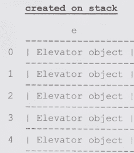

只需记住一条铁律：存储在数组中的类对象必须具有默认构造函数。默认构造函数可以由编译器或程序员提供。但是，如果程序员声明了构造函数但没有提供默认构造函数，编译器提供的默认构造函数就不存在了。

当类对象的数组被创建时，C++ 会为数组中的每个对象调用一次类的默认构造函数。在上面的 `Elevator` 构造函数的情况下，C++ 会调用 `Elevator` 的默认构造函数 5 次，从而将对象 `e[0]` 到 `e[4]` 初始化为正确的值。

如果你希望 C++ 调用不同的构造函数，则必须在数组声明中直接显式初始化每个数组元素：

```
// e2.cpp
#include <iostream>
#include "elevator.h"
using namespace std;
int main() {
    Elevator e[5] = {
        Elevator(),
        Elevator(),
        Elevator(2, 5),
        Elevator(7, 3),
        Elevator()
    };
    ...
}
```

请注意，有时花括号的使用就像是在初始化 `struct` 的字段，但某些编译器即使没有它们也可以正常工作。

没有简单的方法可以为一些数组化的类对象使用默认构造函数，而为另一些使用备用构造函数。如果你需要这样做，最好是为整个数组使用默认构造函数，然后根据需要重新初始化选定的对象。除了小型数组外，这可能太过繁琐，实际用处不大。

### 动态数组

类对象的数组也可以存储在堆（自由存储区）上，并通过指针寻址。下面的程序声明了一个指向 `Elevator` 对象的指针数组。指针数组的存储空间在栈上分配，而每个实际 `Elevator` 对象的存储空间在堆上分配。

```
// e3.cpp
#include <iostream>
#include "elevator.h"
using namespace std;
int main() {
    int i;
    Elevator *e[5];
    for (i = 0; i < 5; i++)
        e[i] = new Elevator;
    for (i = 0; i < 5; i++)
        cout << e[i]->getFloor() << endl;
    for (i = 0; i < 5; i++)
        delete e[i];
}
```

下面是前面程序中创建的动态数组的表示：

在栈上创建   在堆上创建

e
---
0 | •-----|------> [Elevator 对象]
1 | •-----|------> [Elevator 对象]
2 | •-----|------> [Elevator 对象]
3 | •-----|------> [Elevator 对象]
4 | •-----|------> [Elevator 对象]

在堆上动态创建类对象数组的另一种方法如下：

```
// e4.cpp
//-------------------------------------
#include <iostream>
#include "elevator.h"

using namespace std;

int main() {
   Elevator *eptr;

   eptr = new Elevator[5];
   for (int i = 0; i < 5; i++)
      cout << eptr[i].getFloor() << endl;
   delete [] eptr;
}
```

如下图所示，在栈上分配的唯一存储空间是指向 Elevator 数组的指针的存储空间。数组本身的存储空间（即每个 Elevator 对象的存储空间）在堆上分配。

| | 在栈上创建 | 在堆上创建 | |
|---|---|---|---|
| | eptr=====> | 0 | Elevator 对象 | |
| | | 1 | Elevator 对象 | |
| | | 2 | Elevator 对象 | |
| | | 3 | Elevator 对象 | |
| | | 4 | Elevator 对象 | |

在上面的程序中，请注意，我们使用直接成员选择符（.）运算符，而不是间接成员选择符（->）运算符来访问成员函数。这是因为这次我们没有指向类对象的指针数组，而是类对象本身包含在数组中。

与其他动态对象一样，我们在使用完动态类对象数组后应该将其删除。但是，删除这样的数组会导致一个问题。由于 C 和 C++ 无法区分指针和数组，程序必须使用 delete 的特殊形式（[]）来确保在删除类对象的动态数组时，这些对象的析构函数被正确调用。

如果我们简单地写了：

```
delete eptr;
```

编译器将不知道 eptr 是指向单个 Elevator 类对象还是指向 Elevator 类对象的数组。为了通知编译器 eptr 指向一个数组，我们在 delete 中添加空括号：

```
delete [] eptr;
```

这确保了数组中每个对象的类析构函数都被调用。请注意，旧编译器要求如下：

```
delete [5] eptr;
```

我们的下一个示例也在堆上创建类对象的动态数组。但这次，不仅在堆上创建了指针数组，指针所指向的 Elevator 对象也在堆上创建。

```
// e5.cpp

#include <iostream>
#include "elevator.h"

using namespace std;

int main() {
    int i;
    Elevator **eptr;

    eptr = new Elevator *[5];
    for (i = 0; i < 5; i++)
        eptr[i] = new Elevator;
    for (i = 0; i < 5; i++)
        cout << eptr[i]->getFloor() << endl;
    for (i = 0; i < 5; i++)
        delete eptr[i];
    delete [] eptr;
}
```

下面是上面程序中创建的动态数组的表示：

在栈上创建   在堆上创建   在堆上创建

eptr =======> 0 | . -------> [Elevator 对象]
             1 | . -------> [Elevator 对象]
             2 | . -------> [Elevator 对象]
             3 | . -------> [Elevator 对象]
             4 | . -------> [Elevator 对象]

### 动态内存分配

与 C 语言的 `malloc()` 函数一样，C++ 关键字 `new` 用于在执行时分配连续内存。在最简单的形式中，我们使用关键字 `new`，后跟要分配的任何数据类型。

```
char *p = new char; // allocates a single char
int *p = new int; // allocates an int
double *p = new double; // allocates a single double
```

与 `malloc()` 不同，你不再需要使用 `sizeof` 关键字来指定所需的准确字节数。相反，你只需指定特定的类型，无论是基本类型还是用户定义类型。不同类型占用不同存储量的事实由编译器自动处理。

使用 `new` 运算符分配类型 T 的对象时，第一个参数 `sizeof(T)` 会自动提供给此函数。如果 `operator new()` 无法分配请求的堆空间大小，它将返回值为零的指针。如果 `operator new()` 成功在堆上分配存储空间，则返回该空间的地址，该地址被转换为所分配类型的指针。

由于在 C++ 中能够初始化变量和对象非常重要，通过 `new` 从堆上分配的基本类型可以通过在类型名称后立即用括号括起值来用某个值进行初始化。

```
char *p = new char ('A'); // allocates a single char
int *p = new int(65); // allocates an int
double *p = new double(5.2); // allocates a single double
```

### 基本类型数组的内存分配

要为某种基本类型的数组分配内存，我们使用关键字 `new`、类型名以及用方括号括起来的数组元素个数。这个数可以是常量，也可以是某个表达式，其值


在执行时确定。返回类型与单个实例相同，实际返回的值是指向数组第一个元素的指针。

例如：

```cpp
int max = 5;
char *p = new char[1]; // an array of one character
float* p = new float[max]; // an array of 5 floats
char** p = new char*[max]; // an array of 5 pointers to char
```

### delete 关键字

C++ 中的 delete 关键字用于释放由 new 预留的空间。它类似于 C 中的 free() 函数，其唯一参数是指向要释放内存的指针。delete 不会修改指针本身的内容。

注意：不应混用 C 和 C++ 风格的动态内存分配。也就是说，如果使用 malloc() 分配了存储，则应使用 free() 释放它。同样，如果使用 new 分配了存储，则应使用 delete 释放它。不要将 delete 与 malloc() 一起使用，也不要将 free() 与 new 一起使用。

要从堆中删除单个实例（包括指针），使用关键字 delete，后跟指向堆空间的指针名称。

例如：

```cpp
int* ptr1 = new int;
int** ptr2 = new int*;
...
delete ptr1;
delete ptr2;
```

要从堆中删除实例数组（包括指针数组），使用关键字 delete，后跟一对空括号和指针变量名。

```cpp
int* ptr1 = new int[5];
int** ptr2 = new int*[8];
...
delete [] ptr1;
delete [] ptr2;
```

括号是必需的，用于告诉编译器预期堆上有一组对象。当需要删除用户定义对象的数组时，这有重要影响。

因此规则如下：如果在 *new* 中使用了括号，则在 *delete* 中也使用括号。如果在 *new* 中没有使用括号，则在 *delete* 中也不使用括号。

注意：如果传给 *delete* 的指针内容包含零值或 *null*，这是完全允许的，因为这种情况保证不会造成任何危害。

在以下示例中，用户被要求从键盘输入字符串数据。输入被捕获到某个固定长度的缓冲区中，随后复制到堆上。请注意，为存储每个字符串分配了恰好合适的堆空间。所有字符串输入完毕后，将打印它们并通过 *delete* 释放其堆空间。

关键数据元素是 *pptr*，它是指向指针的指针，以便用于跟踪字符串的指针数组可以在堆上动态增长。

```cpp
// Dynamic Memory Allocation

#include <iostream>
#include <string.h>

using namespace std;

void input(char**& pptr, int& counter);
void output(char** pptr, int counter);
void release(char** pptr, int counter);

int main() {
    char** pptr = 0;
    int counter = 0;
    input(pptr, counter);
    output(pptr, counter);
    release(pptr, counter);
    return 0;
}

void input(char**& pptr, int& counter) {
    const int MAX = 256;
    cout << "Enter string: ";
    char buf[MAX];
    // End input with Ctrl-D
    while ((cin >> buf).eof()) {
        // Get exact amount of space
        char* temp = new char[strlen(buf) + 1];
        strcpy(temp, buf);
        // Array of pointers grows dynamically
        char** temp_pptr = new char*[counter+1];
        for (int i = 0; i < counter; ++i)
            temp_pptr[i] = pptr[i];
        temp_pptr[counter++] = temp;
        // Release old space for array of pointers
        delete [] pptr;
        // Update pointer to current array of pointers
        pptr = temp_pptr;
        cout << "Next string: ";
    }
}

void output(char** pptr, int counter) {
    const char QUOTE = '"';
    if (counter > 0) {
        cout << "\nThe strings:\n";
        for (int i = 0; i < counter; ++i)
            cout << QUOTE << pptr[i] << QUOTE << '\n';
    } else
        cout << "Empty list\n";
}

void release(char** pptr, int counter) {
    for (int i = counter - 1; i >= 0; --i)
        delete [] pptr[i];
    delete [] pptr;
}
```

## 输出如下：

```
Enter string: All
Next string: you
Next string: need
Next string: is
Next string: love.
Next string:
The strings:
"All"
"you"
"need"
"is"
"love."
```

## 指针陷阱

指针变量为程序员提供了极大的灵活性，但也可能导致程序中难以查找和纠正的错误。我们将探讨常见问题，并提供避免这些问题的提示。

假设有以下类型和变量声明：

```cpp
int *first = NULL;
int *second;
int *third;
int num = 4;
```

还假设已执行以下代码：

```cpp
second = new int;
*second = 2;
```

### 解引用 NULL

解引用 NULL 是错误的。这是最安全的错误，因为系统通常会在运行时捕获该错误。

```cpp
cout << *first << endl;      // Error, first is NULL
```

如果类型是指向类或结构体的指针，使用 -> 运算符解引用 NULL 同样会出问题。NULL 指针不指向任何东西。解引用会获取指针所指向的内容。

### 悬空指针

解引用未正确赋值的指针是错误的。此错误可能最终导致崩溃，但通常是在运行一段时间后才发生。

```cpp
cout << *third << endl;      // Error, third has no value
```

有趣的是，很可能会打印出一些内容。如果 third 碰巧有一个值，在运行中的程序看来像是一个有效指针，我们将获得几个内存位置的内容，这些内容被解释为 `int`，与它们实际包含的内容无关。

更糟糕的是：

```cpp
*third = 3; // Serious error - changing a random memory location
```

指针可以通过将其赋值为 `NULL` 或另一个已知有效的指针来获得有效值。可以将其赋值为调用运算符 `new` 的结果。也可以使用"取地址"运算符 `&` 获取有效指针。

```cpp
third = NULL; // second was valid, so third is also valid
third = second; // OK, but see Losing Cells, below
third = new int; // Third points to fixed. *third IS fixed (alias)
third = &fixed;
```

### 别名问题

为同一单元拥有多个名称可以为我们的程序增加灵活性，但也存在一些危险。例如，在执行以下代码后：

```cpp
third = new int;
```

我们最终会想要执行：

```cpp
delete third;
```

以回收 `third` 占用的存储。但是，删除未使用 `new` 分配的单元是错误的：

```cpp
third = &fixed;
delete third; // Error, third does not point to the free store
```

删除指针的任何别名后解引用该指针也是错误的。

```cpp
third = second;
delete second;
cout << *third << endl; // Error, third is dangling
```

实际上，上述代码可能会打印出 2，因为 third 仍然指向同一内存位置，而这些位置尚未更改。不过，它们很快就会更改。以下代码可能会产生截然不同的结果：

```cpp
third = second;
delete second;
int *fourth = new int;
*fourth = 4;
cout << *third << endl; // Error, third is dangling
```

在某些系统上，将产生 4，因为删除前 *second（和 *third）占用的存储可能会被重新分配给 *fourth。

### 丢失单元

为引用堆单元的指针赋予新值是错误的，除非你首先：

- 为该单元创建别名，或
- 删除该单元

这是系统不会捕获的错误。它只是导致无法在程序后续使用中回收的堆单元。一个长期运行、分配但不释放单元的程序，在尝试分配单元无法完成时可能会崩溃。

```cpp
second = third; // Error, second already references the free store
```

可以通过先删除 second 或将另一个指针的值赋给 second 来使其安全。

```cpp
delete second;
second = third;    //OK

or

first = second;
second = third;    //OK
```

请注意，以其他方式给 `second` 赋值（`NULL`、`new`...）同样是错误。

当分配器无法分配请求的单元时，现代系统会抛出异常。旧系统在调用 `new` 且 `new` 没有可分配单元时，会将指针设置为 `NULL`。可以对此进行测试，但许多程序员不恰当地忽略了测试。

### 未分配即删除

我们在上面讨论过其中一个问题：删除未使用 `new` 分配的指针。请注意，如上一句所述，我们通常说"删除一个指针"。但实际上，被删除的不是指针本身，而是它所指向的内容。牢记这一区别很有用。

删除 `NULL` 指针是逻辑错误。在 C++ 中这虽然可以，系统会忽略它。但这样做有时表明你的逻辑存在错误。如果尝试释放 `NULL` 指针，C 可能不那么友好。删除悬空指针是错误的。这个错误是致命的。你可能会实际损坏自由存储机制本身。它可能会将垃圾数据写入自由存储用于其内部记账的单元中。

```cpp
delete third;    // Serious Error, Potential free store damage
```

看看你能否（谨慎地）编写一个程序来测试这些错误的效果。请注意，其中一些错误（解引用悬空指针）可能非常危险。但是，如果你将自己限制在从这些悬空指针检索数据，那么不太可能造成任何损害。


## 构造函数和析构函数作业

- 检查并运行以下文件。显示每个文件产生的输出。请注意，源代码显示在以下页面中，也可以在 Canvas 上找到。
  - elevator1.cpp - 初始化函数
  - elevator2.cpp - 构造函数
  - elevator3.cpp - 重载构造函数
  - elevator4.cpp - 析构函数

- 将 elevator4.cpp 复制到 elevator5.cpp。通过在构造函数和析构函数成员函数中，以及在 main() 中对象实例化之前和之后插入 cout 语句，验证 Elevator 变量的构造函数和析构函数是否被调用。显示新代码及其生成的输出。

- 创建一个新程序 order1.cpp，包含一个类 Order，该类仅包含构造函数和析构函数。通过在构造函数和析构函数成员函数内部插入 cout 语句并在 main() 中创建多个变量，确定变量的构造函数和析构函数调用顺序。要为每个变量生成唯一标识符，请在 cout 语句中使用关键字 this。this 是当前对象的地址，是一个指针。显示新代码及其生成的输出。

- 将 order1.cpp 复制到 order2.cpp。使用 order2.cpp 中的类检查变量的作用域以及构造函数和析构函数调用。在 main() 中放置多个作用域，并在每个作用域的开头定义一个或多个 order 对象。显示新代码及其生成的输出。

```cpp
// elevator1.cpp - initialization function
#include <iostream>
#define FLOORS 10

using namespace std;

class elevator {
    private:
        int floorSelected;
        int floorNumber;
    public:
        void initialize();
        void selectFloor(int floor);
        void go();
};

void elevator::initialize() {
    floorSelected = 0;
    floorNumber = 0;
}

void elevator::selectFloor(int floor) {
    if(floor < 0 || floor >= FLOORS)
        return;
    floorSelected = floor;
}

void elevator::go() {
    if(floorNumber < floorSelected)
        while(++floorNumber < floorSelected)
            cout << "floor: " << floorNumber << "; going up!" << endl;
    else if(floorNumber > floorSelected)
        while(--floorNumber > floorSelected)
            cout << "floor: " << floorNumber << "; going down!" << endl;
    cout << "floor: " << floorNumber << "; stopping." << endl;
}

int main() {
    elevator A;
    A.initialize();
    A.selectFloor(7);
    A.go();
    return 0;
}
```

```cpp
// elevator2.cpp - constructor

#include <iostream>
#define FLOORS 10

using namespace std;

class elevator {
  private:
    int floorSelected;
    int floorNumber;
  public:
    elevator(); // constructor has class name
    void selectFloor(int floor);
    void go();
};

elevator::elevator() {
  floorSelected = 0;
  floorNumber = 0;
}

void elevator::selectFloor(int floor) {
  if(floor < 0 || floor >= FLOORS)
    return;
  floorSelected = floor;
}

void elevator::go() {
  if(floorNumber < floorSelected)
    while(++floorNumber < floorSelected)
      cout << "floor: " << floorNumber << "; going up!" << endl;
  else if(floorNumber > floorSelected)
    while(--floorNumber > floorSelected)
      cout << "floor: " << floorNumber << "; going down!" << endl;
  cout << "floor: " << floorNumber << "; stopping." << endl;
}

int main() {
  elevator A; // constructor called here
  A.selectFloor(7);
  A.go();
  return 0;
}
```

```cpp
// elevator3.cpp - overloading constructors

#include <iostream>
#define FLOORS 10

using namespace std;

class elevator {
    private:
    int floorSelected;
    int floorNumber;

    public:
    elevator();
    elevator(int selected, int number);
    void selectFloor(int floor);
    void go();
};

elevator::elevator() {
    floorSelected = 0;
    floorNumber = 0;
}

elevator::elevator(int selected, int number) {
    floorSelected = selected;
    floorNumber = number;
}

void elevator::selectFloor(int floor) {
    if(floor < 0 || floor >= FLOORS)
    return;
    floorSelected = floor;
}

void elevator::go() {
    if(floorNumber < floorSelected)
    while(++floorNumber < floorSelected)
    cout << "floor: " << floorNumber << " going up!" << endl;
    else if(floorNumber > floorSelected)
    while(--floorNumber > floorSelected)
    cout << "floor: " << floorNumber << " going down!" << endl;
    cout << "floor: " << floorNumber << " stopping." << endl;
}

int main() {
    elevator A; // constructor called here
    elevator B(7,2); // constructor with arguments
    A.selectFloor(7);
    A.go();
    return 0;
}
```

```cpp
// elevator4.cpp - destructors
#include <iostream>
#define FLOORS 10
using namespace std;
class elevator {
    private:
        int floorSelected;
        int floorNumber;
    public:
        elevator();
        elevator(int selected, int number);
        ~elevator();
        void selectFloor(int floor);
        void go();
};
elevator::elevator() {
    floorSelected = 0;
    floorNumber = 0;
}
elevator::elevator(int selected, int number) {
    floorSelected = selected;
    floorNumber = number;
}
elevator::~elevator() {
    selectFloor(0);
    go();
}
void elevator::selectFloor(int floor) {
    if(floor < 0 || floor >= FLOORS)
        return;
    floorSelected = floor;
}
void elevator::go() {
    if(floorNumber < floorSelected)
        while(++floorNumber < floorSelected)
            cout << "Floor: " << floorNumber << ", going up!" << endl;
    else if(floorNumber > floorSelected)
        while(--floorNumber > floorSelected)
            cout << "Floor: " << floorNumber << ", going down!" << endl;
    cout << "Floor: " << floorNumber << ", stopping." << endl;
}

int main() {
    elevator A;
    elevator B(7,2);
    A.selectFloor(7);
    A.go();
    return 0;
}
```

## 构造函数实验（条形码）

2009 年以前，美国邮政局信封上的条形码使用一种称为 POSTNET 的格式来表示五位（或更多位）邮政编码。条形码由长条和短条组成，如下所示：


对于本程序，我们将条形码表示为一串数字。数字 1 表示长条，数字 0 表示短条。因此，上面所示的条形码在我们的程序中将表示为：

```
110100101000101011000010011
```

条形码的第一位和最后一位始终是 1。去掉这两位后剩下 25 位数字。如果将这 25 位数字分成每组五位，则得到：

```
10100 10100 01010 11000 01001
```

接下来，考虑每组五位数字。每组数字中始终恰好有两个 1。每个数字代表一个数值。从左到右，数字分别编码值 7、4、2、1 和 0。将相应的数值与数字相乘并计算总和，以得到邮政编码的最终编码数字。下表显示了 10100 的编码。

| 条形码数字 | 1 | 0 | 1 | 0 | 0 |
|---|---|---|---|---|---|
| 数值 | 7 | 4 | 2 | 1 | 0 |
| 数字 x 数值的乘积 | 7 | 0 | 2 | 0 | 0 |

邮政编码数字 = 7 + 0 + 2 + 0 + 0 = 9

对每组五位数字重复此过程并连接起来，以得到完整的邮政编码。请注意有一个特殊值。如果一组五位数字的和为 11，则这表示数字 0（这是必要的，因为每组有两个 1 时无法表示零）。上面示例条形码的邮政编码解码为 99504。虽然 POSTNET 方案可能看起来不必要地复杂，但其设计允许机器检测扫描邮政编码时是否出现错误。

你的任务是编写一个 ZipCode 类，包括 ZipCode.h 和 ZipCode.cpp，用于编码和解码美国邮政局信封上使用的五位条形码。该类应有两个构造函数。第一个构造函数应以整数形式输入邮政编码，第二个构造函数应以由 0 和 1 组成的条形码字符串形式输入邮政编码，如上所述。虽然你有两种输入邮政编码的方式，但类在内部应仅使用一种格式存储邮政编码（你可以选择将其存储为由 0 和 1 组成的条形码字符串，或作为邮政编码数字。）该类还应至少有两个公共成员函数，一个以整数形式返回邮政编码，另一个以由 0 和 1 组成的条形码格式字符串返回邮政编码。所有辅助成员函数（在 main() 中未调用但由 ZipCode 类在内部用于执行计算的函数）应声明为私有。

使用以下驱动程序测试你的 ZipCode 类。你应该能够在不做任何更改的情况下编译和链接你的代码到该程序。但是，你最终需要对 main() 进行更改，以将程序的输出捕获到输出文件 csis.txt 中。main() 不应做其他更改。


```cpp
// main.cpp

#include <iostream>
#include <iomanip>

#include "ZipCode.h"

using namespace std;

int main() {
    ZipCode zip1(99504);
    ZipCode zip2(12345);
    ZipCode zip3(67890);
    ZipCode zip4("10010101001110000110011001001");
    ZipCode zip5("1101000001011100001100010011");
    ZipCode zip6("10000110001101010000111100101");

    cout << "Digits" << " " << "Bar Code" << endl;
    cout << zip1.getZipCode() << setw(35) << zip1.getBarCode() << endl;
    cout << zip2.getZipCode() << setw(35) << zip2.getBarCode() << endl;
    cout << zip3.getZipCode() << setw(35) << zip3.getBarCode() << endl;
    cout << endl;
    cout << zip4.getZipCode() << setw(35) << zip4.getBarCode() << endl;
    cout << zip5.getZipCode() << setw(35) << zip5.getBarCode() << endl;
    cout << zip6.getZipCode() << setw(35) << zip6.getBarCode() << endl;

    return 0;
}
```

国际奥委会需要你的帮助。用于根据每条赛道的计时数据确定比赛获胜者的计算机程序需要重写为面向对象风格。你被选中担任这项工作。幸运的是（或者也许不幸的是），一些初步设计工作已经完成，用于输入数据并将其打印出来的主程序也已经编写好了。你的工作是编写两个 C++ 类，`Competitor` 和 `Ranker`，包括声明（.h）和实现（.cpp），用于存储比赛中每个参赛者的信息，并按完成时间从低到高对这些参赛者进行排名。此代码应分为四个文件：`competitor.h`、`competitor.cpp`、`ranker.h` 和 `ranker.cpp`。

`Competitor` 类的对象在初始化时使用该人的姓名和赛道分配，分别指定为字符串和整数。该人的姓名应复制到 `Competitor` 对象自己的内存中；也就是说，不要只记录传入的指针。请注意，该人的姓名不应有预定义的大小。还要注意，对于本实验，你不应使用任何 C++ 预定义的 `String` 类。由于一开始不知道该人的时间，此值通过名为 `setTime()` 的单独成员函数设置，该函数接受一个双精度浮点值。还应有成员函数来检索姓名、赛道和时间，以及一个成员函数将对象作为单行文本打印出来。完成时间应保留一位小数。最后，不要忘记让类析构函数在该类的对象超出作用域时释放任何存储。

`Ranker` 类的对象在初始化时使用要排名的项目（`Competitor` 对象）的数量。指向 `Competitor` 对象的指针逐个传递给 `addList()` 成员函数。如果传入 `NULL` 指针，或者传入的对象总数超过预定义的项目数，`addList()` 应返回 0；否则，它返回传入的 `Competitor` 对象总数。项目通过两个成员函数从列表中检索（但不删除）：`getLane()` 和 `getFinish()`。每个函数接受一个从 1 到列表中项目数的整数。`getLane()` 返回指向指定赛道中 `Competitor` 对象的指针，而 `getFinish()` 返回指向在指定位置（第一名、第二名等）完成比赛的参赛者的指针。最后，当 `Ranker` 对象被销毁时，它会释放为自己分配的任何内存，但不会删除 `Competitor` 对象的内存（因为它无法知道这些对象是如何创建的）。

使用以下驱动程序测试你的类。你应该能够在不做任何更改的情况下将代码编译并链接到它：

```
// olympic.h

#ifndef _OLYMPIC_H
#define _OLYMPIC_H

#include "competitor.h"
#include "ranker.h"

#endif
```

```
// olympic.cpp

#include <iostream>
#include <fstream>
#include "olympic.h"

using namespace std;

ofstream csis;

int main() {
   const int lanes = 4;
   Ranker rank(lanes);

   csis.open("csis.txt");

   // First make a list of names and lane assignments
   Competitor* starters[lanes];

   starters[0] = new Competitor("Emmylou Harris", 1);
   starters[1] = new Competitor("Nanci Griffith", 2);
   starters[2] = new Competitor("Bonnie Raitt", 3);
   starters[3] = new Competitor("Joni Mitchell", 4);

   // The race is run; now assign a time to each person
   starters[0]->setTime((float)12.0);
   starters[1]->setTime((float)12.8);
   starters[2]->setTime((float)11.0);
   starters[3]->setTime((float)10.3);

// Put everyone into the ranker
for (int i = 0; i < lanes; i++)
    rank.addList(starters[i]);

// Now print out the list to make sure it's right
cout << "Competitors by lane are:" << endl;
csis << "Competitors by lane are:" << endl;
for (int i = 1; i <= lanes; i++)
    rank.getLane(i)->print();

// Finally, show how they finished
cout << "Rankings by finish are:" << endl;
csis << "Rankings by finish are:" << endl;
for (int i = 1; i <= lanes; i++)
    rank.getFinish(i)->print();
for (int i = 0; i < lanes; i++)
    delete starters[i];

csis.close();
// rank's destructor will be called automatically here
```

- 内联函数
- const 修饰符

## 内联函数

C 程序员通常使用预处理器通过宏和值替换来使代码更易于编写和阅读。我们将看到这种过程会引入错误，因为：

- 宏看起来像函数但不像函数一样工作
- 值替换看起来像表达式但不像表达式一样工作

然后我们将看到 C++ 如何通过内联函数和 const 来纠正这个问题。

### 函数或子程序

函数或子程序的目的或优势有很多：

- 使程序模块化
- 更容易调试程序
- 更容易维护程序
- 通常内存利用率较低

函数节省内存空间，因为对函数的所有调用都会导致执行相同的代码。因此，函数体不需要在内存中重复。

但是，请记住，使用函数也有缺点。C 和 C++ 等编程语言的一个令人遗憾的事实是，函数调用会浪费时间。要调用函数，编译后的程序必须：

- 将当前位置的返回地址保存在堆栈上
- 将函数所需的任何参数值压入堆栈
- 保存寄存器内容
- 执行汇编语言调用指令以调用函数
- 返回某个函数值
- 清除堆栈并返回到起始位置
- 恢复寄存器

所有这些指令都会减慢程序速度。虽然这些事件序列可能节省内存空间，但它们需要一些额外的时间。虽然单个函数调用发生得相当快，但大量函数调用会削弱程序的性能。但是，避免使用函数并不是解决这个问题的可接受方案！函数使程序模块化，更容易维护和调试。如果没有函数，要编写即使是中型程序且能正确运行，也极其困难，甚至不可能。事实上，如果函数非常短，调用它所需的指令甚至可能占用与函数体内的指令一样多的空间。在这种情况下，不仅有时间惩罚，还有空间惩罚。

## 宏

解决函数开销的一个可能方案是使用预处理器并定义使用代码替换的宏。例如，这里有一个检查其参数范围并在参数超出范围时调用 error() 的函数：

```
void test(int a) {
    if (a < 0 || a > 10)
        error(a);
}
```

现在，这里有一个执行相同范围检查的相应宏：

```
#define TEST(a) if (a < 0 || a > 10) error(a)
```

这里的问题是，预处理器宏看起来像函数但不像函数一样工作！如果我们进行以下相当无害的调用，就会得到一些意外的结果：

```
int main() {
    int x = 0;
    int y = 0;
    int u = 10;
    int v = 10;

    test(--x);    // error: -1 out of range
    TEST(--y);    // error: -2 out of range
    test(++u);    // error: 11 out of range
    TEST(++v);    // error: 13 out of range
}
```


根据是调用函数还是宏，以及参数的值，我们会得到不同的结果。问题出现的原因是宏是这样展开的：

```
if (--y < 0 || --y > 10) error(--y);
if (++v < 0 || ++v > 10) error(++v);
```

第一个宏的执行会在if语句中的两个测试以及对error()的调用中都递减y。第二个宏的执行仅在第一个测试（结果为真）中递增v，因此第二个测试会短路，但它也会为对error()的调用递增v。

在C语言中，编写没有函数开销的小型类函数实体的唯一方法是使用预处理器。在C++中，预处理器宏被认为问题足够多，以至于向语言中添加了一个新特性：内联函数。

## 内联函数

inline是一个C++关键字，它告诉编译器将函数在某种程度上视为宏。当C++编译器遇到内联函数时，它不会像对待普通函数那样为函数体分配存储空间。相反，编译器在其符号表中创建空间，并将函数原型和函数体存储在符号表中。因此，函数定义在定义点处不会生成任何目标代码！

当你调用内联函数时，编译器会将函数代码直接插入到调用处，从而获得宏的效率。内联函数的其他方面与普通函数完全相同：

- 你可以对参数和返回值进行类型检查。
- 不会出现意外的非函数式交互。

因此，不会对内联函数的行为产生混淆，因为它与普通函数完全相同。内联函数与非内联函数之间的唯一区别在于使用了inline关键字。

```
// inline.cpp
#include <iostream>
using namespace std;
int max(int a, int b);
int main() {
    int x = 5, y = 3, z;
    z = max(x, y);
    cout << z;
}
inline int max(int a, int b) {
    if (a > b)
        return a;
    else
        return b;
}
```

我们使用内联函数的方式与使用普通函数相同。源代码在main()中调用max()函数。然而，在编译后的代码中，max()函数并未被调用。相反，编译器将函数语句直接插入到程序中，实际上将函数调用编译成如下形式：

```
if (x > y)
    z = x;
else
    z = y;
```

你也可以在类中声明成员函数，并在其他地方将其定义为内联，或者你可以在类中同时声明和定义成员函数，在这种情况下它会自动成为内联函数。

例如，我们将定义一个C++类`Point`，它既包含点的位置，也包含设置位置的成员函数。

```
class Point {
private:
    int x;
    int y;
public:
    void setxy(int newX, int newY);
};

inline void Point::setxy(int newX, int newY) {
    x = newX;
    y = newY;
}
```

在这里，成员函数被编码为`inline`。如上所述，我们也可以在类本身中同时声明和定义成员函数：

```
class Point {
private:
    int x;
    int y;
public:
    void setxy(int newX, int newY) {
        x = newX;
        y = newY;
    }
};
```

在类体中定义的成员函数会被视为请求了`inline`。请注意，`inline`关键字实际上只是对编译器的一种礼貌请求。编译器可以选择忽略该请求，并将函数编译为普通函数。有些函数可能太长而无法成为`inline`。任何短函数都是成为`inline`函数的候选者。

因此，`inline`函数的操作方式类似于宏，因为它们可以用来消除函数调用的开销。然而，它们与宏的不同之处在于：

- 使用`inline`函数时会执行类型检查，就像任何带有原型的函数一样
- 你不会得到宏可能产生的副作用

事实上，几乎没有哪个使用预处理器宏的地方，`inline`函数不更好。`inline`函数将预处理器宏的效率与普通函数的错误检查相结合。

由于`inline`函数会为每个函数调用复制代码，你可能会认为它会自动增加代码空间。但对于小函数（内联函数的设计对象）来说，这不一定成立！请记住，函数调用需要代码来传递参数、进行调用以及处理返回值。对于`inline`函数来说，这些代码并不存在。

如果你的`inline`函数比普通调用所需的代码量更小，那么你实际上是在节省空间。此外，如果`inline`函数从未被调用，则永远不会生成代码。对于普通函数，无论你是否调用它，该函数的代码都会存在（只出现一次）。

`inline`函数的速度优势往往会随着函数体积增大而减弱。在某个点上，函数调用的开销相对于函数体的执行变得很小，优势也就消失了。

## const修饰符

### const与ANSI C

值替换很有用，因为它允许我们取一个名称，并在通常放置值的所有地方替换它：

```
// value.c
#include <stdio.h>
#define TOP 100
#define BOTTOM 47
#define SIZE TOP - BOTTOM
int main(void) {
 int i, a[SIZE];
 for (i = 0; i < SIZE; i++)
 a[i] = 0;
 printf("SIZE = %d\n", SIZE);
 return 0;
}
```

产生的输出是：

SIZE = 53

这是一种良好的编程实践。程序更容易理解，你可以轻松更改SIZE。值替换中会出现问题，因为预处理器进行文本替换，不遵循编译器的正常规则。因此，一个表达式看起来像正常表达式，但可能不像正常表达式那样工作。这可能导致难以发现的错误。

假设你对上述程序进行了一个无害的修改：

```
// value2.c

#include <stdio.h>

#define TOP 100
#define BOTTOM 47
#define SIZE TOP - BOTTOM

int main(void) {
    int i, a[SIZE * 2];
    for (i = 0; i < SIZE; i++)
        a[i] = 0;
    printf("SIZE * 2 = %d\n", SIZE * 2);
    return 0;
}
```

我们所做的只是将SIZE乘以2，但结果出乎意料。产生的输出是：

SIZE * 2 = 6

如果SIZE是一个C变量，这不会发生，因为运算符优先级会按你预期的方式发生。通过正确使用括号，当然可以避免这个问题。但如果这样的代码被埋没，而你又没有特意寻找，它可能非常难以发现。

你可能认为可以通过将SIZE设为const来解决这个问题。但是ANSI C对待const的方式与预处理器名称不同。C的const是一个不可更改的变量，但C编译器无法计算包含在数组括号中的const表达式。因此，如果SIZE是const，你在ANSI C中不能这样写：

```
int a[SIZE * 2];
```

因此在ANSI C中，const不能替代预处理器的使用。

### C++与const

在C++中，使用#define声明程序常量的旧式做法被认为已过时。应该改用const。在C++中，const的含义与ANSI C有显著不同。const允许编译器执行类型检查，因为它对所处理的项目了解更多。

```
const int TOP = 100;
const int BOTTOM = 47;
const int SIZE = TOP - BOTTOM;
```

在这里，C++知道const SIZE是一个int值。编译器对文本替换一无所知。

编译器也足够聪明，在不需要时避免为const分配存储空间。相反，编译器会计算表达式并将结果存储在符号表中。然后它可以在执行类型检查后使用该结果。换句话说，const是一个标识符，编译器会在编译时用实际值替换它。

然而，有些情况下会实际为const分配存储空间：

```
const int& num = 9;
```

该语句包含一个常量引用，并为其分配存储空间。标识符num在符号表中，其行为与任何其他引用变量相同，只是它不能被修改。关于引用的更多内容请参见后文！


因此在 C++ 中，我们可以像使用预处理器值一样使用 const：

```
// const.cpp

#include <iostream>

using namespace std;

const int TOP = 100;
const int BOTTOM = 47;
const int SIZE = TOP - BOTTOM;

int main() {
    int a[SIZE * 2];
    for (int i = 0; i < SIZE; i++)
        a[i] = 0;
    cout << "SIZE * 2 = " << SIZE * 2 << endl;
}
```

上面的常量表达式：

```
const int SIZE = TOP - BOTTOM;
```

在编译时求值，因此可以用于数组定义。此处产生的输出是：

SIZE * 2 = 106

在 C++ 中，const 具有使用预处理器的所有优点。没有哪种情况更适合使用 #define 进行变量替换。使用 const 始终能获得更好的优势。

## const 变量

实际上，const 标识符是 C++ 的创新，并被 ANSI C 采用。将变量声明为 const 实际上使该变量成为只读。可以为其赋初始值，但其他语句无法更改它。

## 例如：

```
const int w = 10; // declares w as a read-only variable

int x = w; // legal - just accessing constant w

w = 25; // illegal - cannot change value to const w

const y = 5; // legal - can omit the int keyword

const int z; // illegal - const must be initialized when defined
```

将内置类型的对象声明为 `const` 的原因是让编译器确保它不会被更改。你也可以告诉编译器，用户定义类型的对象是 `const`，尽管它不存储在符号表中。实际上会为该对象分配存储空间！稍后详述。

## const 与指针（此部分只需大致了解）

某些 C++ 结构经常成为混淆的根源。其中之一是 `const` 与指针的共同使用。有时不清楚被引用的项目、指针还是两者都是常量。我们将查看：

- 指向常量的指针
- 常量指针
- 指向常量的常量指针

使用指针时，涉及两个事物：

- 指针本身
- 被指向的对象

两者都可以声明为 `const`，因此不能被赋值。在指针声明中，`const` 的位置指示是指针还是被指向的对象不可更改。

## 指向常量的指针

在指针声明前加上 `const` 会使被指向的对象（而非指针本身）成为常量。

```
syntax: const <type> *pc;
```

在此，pc 指向类型 <type> 的常量值。例如：

```
const char *pc = "Haley";
```

这定义了一个指向常量的指针，或者更具体地说，是一个指向字符常量的指针，即指向只读内存的指针。这类声明实际上最好从右向左读取以理解其含义：pc 是指向常量字符的指针。换句话说，pc 是指向类型 char 的常量对象的指针，因此通过 pc 无法修改 pc 所寻址对象的值：

```
pc[3] = 'x'; // error
*pc = 'x'; // error
```

上述每个示例均无效，因为 pc 所寻址的字符无法更改。但是，pc 本身不是常量，因此 pc 可以更改为寻址不同类型 char 的变量，如下所示：

```
pc = "Samantha"; // ok
```

在此，pc 被更改为寻址另一个字符。

将某物声明为指向常量的指针，是关于指针的声明，而不是关于被指向空间的声明。编译器不会确保被指向的数据不会更改。它只确保不会通过该指针更改。被指向的对象仍可通过其他方式更改。因此，声明指向常量的指针，即声明该指针不能用于更改被指向的对象。

## 常量指针

要声明指针本身为常量（而非被指向的事物），使用 *const：

```
syntax: <type> *const cp;
```

在此，cp 是指向类型 <type> 对象的常量指针。例如：

```
char *const cp = "Haley";
```

这定义了一个常量指针，或者更具体地说，是一个指向字符的常量指针，即指向内存的只读指针。我们说 cp 是指向字符的常量指针。常量指针 cp 始终指向同一块内存，因此必须在声明时初始化：

```
cp = "Haley" // error
```

虽然常量指针不能被修改，但它所指向的对象可以：

```
cp[3] = 'x'; // ok
*cp = 'x'; // ok
```

在此，我们只是修改 cp 所寻址的字符。

另一个示例：

```
int errNum; // possible error states of program
int *const curErr = &errNum; // constant pointer
```

在上述声明中，curErr 是指向 int 类型对象的常量指针。因此我们可以修改 curErr 所寻址对象的值：

```
if (*curErr) {
    errorHandler();
    *curErr = 0;
}
```

但不能修改 curErr 包含的地址：

```
curErr = &myError; // illegal
```

## 指向常量的常量指针

要使指针和被指向的对象都成为常量，两者都必须声明为 const。

```
syntax: const <type> *const cpc;
```

在此，cpc 是指向类型 <type> 常量值的常量指针。

例如：

```
const char *const cpc = "Haley";
```

这定义了一个指向常量的常量指针。cpc 是指向常量字符的常量指针。在这种情况下，cpc 所寻址对象的值和地址本身都不能更改，即 cpc 不能更改，它所指向的事物也不能更改：

```
cpc[3] = 'x'; // error
*cpc = 'x'; // error
cpc = "Samantha"; // error
```

## 向函数传递 const 参数

C++ 允许你将函数参数声明为 `const`：

```
void foo(const int num);
```

你为何要以这种方式声明函数？因为函数接收的是实际参数的副本，函数的调用者并不在意函数是否修改其副本。这称为按值传递。

但如果你仅出于效率目的传递指向某物的指针呢？你可能希望确保被调用的函数不使用指针来修改被引用的实体。通过将指针参数声明为 `const`，函数被禁止修改参数所指向的内容。

例如：

```
void foo(const int *num);
void foo(const char *buf);
void foo(const bigStruct *bs);
char *strcpy(char *p, const char *q);
void foo(const int & num);
```

声明返回 `const` 的函数也是合法的：

```
const int foo();
```

因此，返回的值只能像使用 `const int` 一样使用。例如：

```
// return.cpp

#include <iostream>

using namespace std;

int main() {
    const char *pc = getName();
    cout << pc << endl;
}

const char *getName() {
    return "Haley";
}
```

变量 pc 指向一个常量字符串。任何通过 pc 修改常量字符串的尝试都会导致编译时错误。

## 常量数组

为防止对数组元素进行更改，可以在数组声明前加上 const：

```
const int num[] = { 0, 1, 2, 3, 4 };
```

当程序由不同的人维护时，这尤其有用，他们可能会试图破坏模块的设计规则。请注意，由于 `const` 修饰符，任何试图更改数组值的语句都无法编译：

```
num[3]++;    // illegal
```

你可以按值传递数组，以确保数组成员不能被更改。使用定义了 `const` 关键字的指针参数传递数组：

```
int foo(const int *num) {
    num[i] = 25;    // illegal
    return num[i];  // ok
}
```

语句：

```
num[i] = 25;
```

是非法的，因为参数 num 被声明为指向常量整数数组的指针，不能被修改。

## 常量类成员和构造函数初始化列表

你可以将类的成员设为 const，但其含义恢复为 C 语言的含义。const 数据成员始终会分配存储空间，因此 const 在类内部占用空间。const 仍必须在定义时初始化。但是，对象的存储空间直到对象创建时才分配，而这正是 const 必须初始化的时点。因此，对于类成员而言，const 的含义是该对象在其生命周期内保持常量。

因此，const 的初始化必须在构造函数中进行。这是一个特殊操作，必须以特殊方式发生，以确保其值始终被设置。这在构造函数初始化列表中执行，该列表位于构造函数参数列表之后、函数体之前。这表明代码在进入构造函数体之前执行。例如：


```cpp
class Counter {
  private:
    int count;
    const int MAX;
  public:
    Counter (int init, int size) : MAX(size) {
      count = init;
      ...
    }
};

void main() {
  Counter A(0, 10);
  ...
}
```

构造函数初始化列表中的语句：

```
MAX(size)
```

执行初始化。其含义仅相当于赋值：

```
MAX = size;
```

请注意，这样写是非法的：

```
const int MAX = size;
```

因为我们不能在这里初始化一个 const 类成员！同样，这样写也是非法的：

```
MAX = size;
```

在构造函数体内！

然而，在构造函数初始化列表中初始化所有数据成员是合法的（且通常更推荐），如下所示：

```
Counter (int init, int size) : count(init), MAX(size) {}
```

## 类中的真常量

在类内部处理 const 时，在类中创建数组会带来不便的情况。处理普通数组（非类内部）时，最佳编程实践是使用命名常量来定义数组大小：

```
const int MAX = 10;
int num[MAX];
```

这样，任何引用数组大小的代码都使用 MAX，如果需要更改 MAX 的值，只需在一个地方更改，即 const 定义处。

然而，你不能在类内的数组定义中使用 const 数据，因为编译器在定义数组时必须知道数组大小，而且类内的 const 始终会分配存储（编译器无法知道存储位置的内容）。因此，以下写法是非法的：

```
class Array {
private:
    const int MAX;
    int num[MAX];
};
```

幸运的是，有一个方便的方法可以绕过这个问题。枚举数据类型 enum 旨在将名称与整数关联。通常，enum 用于让编译器自动为名称分配数字，从而区分一组名称。然而，你可以通过以下方式强制将名称与特定数字关联：

```
enum { MAX = 10 };
```

这引入了一个名为 MAX 的名称，其整数值为 10。枚举名称永远不会分配存储，因此编译器始终可以使用这些值。这提供了一种称为 enum hack 的技术，用于解决使用名称作为数组大小而无需回退到预处理器的问题：

```
class Array {
  private:
    enum { MAX = 10 };
    int num[MAX];
};
```

## 常量成员函数

常量成员函数用于支持常量对象。常量对象是指其数据成员一旦初始化后就不能更改的对象。所有数据成员必须在构造函数中初始化。这个定义对对象的成员函数带来了一些有趣的后果。

让我们看一个简单的 Point 类，了解创建常量 Point 对象涉及什么：

```
// point.cpp
#include <iostream>
using namespace std;
class Point {
  private:
    int x, y;
  public:
    Point (int a, int b) { x = a; y = b; }
    int xPos() { return x; }
    int yPos() { return y; }
    void move (int dx, int dy) { x += dx; y += dy; }
};
```

```
int main() {
    const Point p(40, 12);

    cout << p.xPos() << "," << p.yPos() << endl;
    p.move(1, 1);
    cout << p.xPos() << "," << p.yPos() << endl;
}
```

我们声明 p 为常量 Point 对象。然而，编译器会抱怨我们正在调用 `move()` 函数。为什么？因为 p 被声明为常量，因此不能被修改！

但编译器也会抱怨我们正在调用 Point 成员函数 `xPos()` 和 `yPos()`。为什么？由于 `xPos()` 和 `yPos()` 实际上不会更改任何数字，我们应该能够使用它们。不幸的是，编译器不允许我们这样做。编译器无法判断这些函数是否可能修改对象 p 的成员 `x` 和 `y`，由于 p 是常量，这样做是非法的。

如何绕过这个问题？我们可以将 `xPos()` 和 `yPos()` 声明为常量成员函数。声明常量成员函数的方法是在函数参数之后、函数体之前附加关键字 `const`：

```
class Point {
private:
    int x, y;
public:
    Point(int a, int b)    { x = a; y = b; }
    int xPos() const       { return x; }
    int yPos() const       { return y; }
    void move(int dx, int dy) { x += dx; y += dy; }
};
```

通过在函数体之前放置 `const` 关键字，我们声明该函数保证不会修改类的任何数据成员。然后编译器将允许我们调用该函数，即使该函数是针对声明为常量的对象。从常量对象只能调用常量成员函数。因此，可以调用 `p.xPos()` 和 `p.yPos()`，但不能调用 `p.move()`。

将 `move()` 声明为常量成员函数是非法的。对于任何常量成员函数，隐藏的 `this` 指针被视为指向常量对象的指针，因此任何对对象数据的更新尝试都会被标记为错误。由于在 `move()` 成员函数中添加了 `const` 关键字，以下代码无法编译：

```
class Point {
private:
    int x, y;
public:
    Point(int a, int b) { x = a; y = b; }
    int xPos() const { return x; }
    int yPos() const { return y; }
    void move(int dx, int dy) const { x += dx; y += dy; }
};
```

在类体外定义的 `const` 成员函数必须在其声明和定义中都指定 `const` 关键字：

```
class Point {
private:
    int x, y;
public:
    Point(int a, int b) { x = a; y = b; }
    int xPos() const;
    int yPos() const;
    void move(int dx, int dy) { x += dx; y += dy; }
};

int Point::xPos() const { return x; }
int Point::yPos() const { return y; }
```

在常量成员函数内部调用其他函数时也必须小心。不允许这些其他函数修改任何数据成员。编译器确保在常量成员函数内部，每个数据成员都被视为常量类型！因此，将成员传递给另一个函数的唯一合法方式是按值传递，或使用指向常量的指针，或使用指向常量的引用。

我们可以引入一个新的成员函数 `modify()`，它调用 `random()` 函数为坐标赋予随机值：

```cpp
class Point {
private:
    int x, y;
public:
    Point( int a, int b ) { x = a; y = b; }
    int xPos() const { return x; }
    int yPos() const { return y; }
    void move( int dx, int dy ) { x += dx; y += dy; }
    void modify() const { random(&x); random(&y); }
};

void random(int *num) {
    // set num to some random value
}
```

我们错误地将 `modify()` 声明为常量函数。代码无法编译，因为 `random()` 的调用需要指向整数的指针，而实际上 `x` 和 `y` 被类型化为常量。

我们可以通过更改 `random()` 的参数类型来使其被编译器接受：

```cpp
void random(const int *num) {
    // can't really change num here
}
```

这防止 `random()` 更改坐标的值。

关于在常量函数内部调用其他函数的相同规则也适用于调用其他成员函数。常量成员函数只能调用其他常量成员函数。它不能调用普通成员函数，因为它们可能会更新对象的数据。

请注意，你可以通过使用巧妙的编程技巧找到绕过常量成员函数限制的聪明方法！你可以使用类型转换和指针来欺骗编译器，让它允许你更改常量。不能保证常量成员函数不会更改数据成员。C++ 不会总是阻止你违反规则。它只能防止意外误用。

还要注意，构造函数和析构函数不需要声明为 `const` 才能应用于常量类对象。


- 函数重载
- 默认参数
- 函数重载与默认参数作业

## 函数重载

假设你想创建一个 `print()` 函数，并希望为其提供各种类型的参数：

```
char, char*, int, double
```

在 C 中，你可能会想出类似这样的东西：

```
void print(int);
void printChar(char);
void printString(char*);
void printDouble(double);
```

虽然概念相同，都是打印，但你必须为该概念的每个实现创建不同的名称。你不仅必须创建这些名称，还必须向库的用户解释它们。

现在假设用户已经掌握了这一组打印函数，然后决定使用另一个库，该库有一种打印 `Elevator` 对象的方式：

```
void print(struct Elevator);
```

如果所有函数声明都在同一文件中，C 编译器会给出关于 `print()` 重复声明中类型不匹配的错误消息。如果冲突的声明不在同一文件中，C 编译器不会捕获错误。但是，链接器会检测到多重定义错误。

为了解决 C 中库之间的名称冲突问题，库作者不仅必须创建不同名称的函数来区分参数类型，而且库之间也必须相互区分：

```
void abcLibPrint(int);
void abcLibPrintChar(char);
void abcLibPrintString(char*);
void abcLibPrintDouble(double);
void defLibPrint(struct Elevator);
```

在 C++ 中，只要所有函数都有不同的参数列表，多个函数可以具有相同的名称。这样，可以在不同的参数类型上实现相同的抽象操作，而无需编造人工名称来区分函数。因此，在 C++ 中我们可以创建以下函数：

```
void print(int);
void print(char);
void print(char*);
void print(double);
void print(struct Elevator);
```

这些函数被重载，因为，虽然名称相同，但它们执行多个任务。函数名称被重载，因为它可以有多种解释。所有函数的打印概念相同，但其用途不同！

*重载函数必须具有不同数量的参数或不同类型的参数，或两者兼有。*

```
void print(int);
void print(int, int);
void print(int, float);
```

请注意，每个函数必须具有不同的参数列表，即使区别仅在于列表的顺序：

```
void print(float, char*);
void print(char*, float);
```

重载函数可以有任何返回值，但两个重载函数不能仅通过返回值来区分：

```
void print(float);      // invalid
int print(float);       // invalid
```

只有当两个函数声明具有相同的参数列表时才会发生冲突，这是一种逻辑上模糊的情况。请注意，const 修饰符在参数列表中确实有区别：

```
int foo(int);        // ok
int foo(const int);  // ok

int i = 5;
int j = foo(i);      // int foo(int) called
int k = foo(5);      // int foo(const int) called
```

## 名称修饰

重载函数如何知道该做什么？它对一种数据执行一种操作，对另一种数据执行另一种操作。重载就像关于那位著名科学家的笑话，他坚称保温瓶是有史以来最伟大的发明。为什么？它是一个神奇的设备。它让热的东西保持热，冷的东西保持冷。它怎么知道？

当编译 C++ 模块时，编译器会生成包含函数参数类型编码的函数名称。此过程称为名称修饰，并使重载函数成为可能。在 C++ 中，源代码中的函数名称与 C++ 系统生成的函数名称不同。

在 C 中，如果你进行如下函数调用：

```
void foo(int);

int main() {
    foo(5);
    return 0;
}
```

编译器可能会生成汇编语言调用：

```
call _foo
```

要生成名称，C 编译器只是在函数名称前添加下划线（没有关于参数类型的信息可以使函数名称唯一）。

C++ 编译器通过将源代码中给出的函数名称与其参数类型信息相结合来生成唯一名称。这种编码有时称为名称修饰，因为函数名称及其参数类型被混合在一起以创建汇编语言中使用的名称。例如，以下 C++ 代码：

```
void foo(int);
void foo(char*);
void foo(double);

int main() {
    foo(5);
    foo("haley");
    foo(5.5);
}
```

可能会生成以下调用：

```
call ?foo@@YAXH@Z
call ?foo@@YAXPAD@Z
call ?foo@@YAXN@Z
```

请注意，已添加了额外字符。@ 符号后的字符包含参数类型信息。因此，名称编码通过将函数名称与其参数类型相结合来生成唯一名称，因此你可以使用不同的参数列表重载同一函数名称。

名称编码还用于生成类成员函数的名称，方法是将函数名称和参数类型与类名相结合。例如：

```
class button {
private:
    int pressed;
public:
    void push();
};
```

```
int main() {
    button b;
    b.push();
}
```

这里，对 push() 的调用会生成汇编语言调用：

```
call ?push@button@@QAEXXZ
```

这表明名称编码还将类成员函数名称置于其自身作用域内，因此即使类成员函数与全局函数或另一个类的成员函数具有相同的名称和参数列表，也不会发生名称冲突。

## 重载成员函数

我们也可以重载成员函数：

```
class Point {
private:
    int x, y;
public:
    void set(int xp, int yp) {
        x = xp;
        y = yp;
    }
    void set(Point p) {
        x = p.x;
        y = p.y;
    }
};
```

我们可以按如下方式调用这两个成员函数：

```
int main() {
    Point p, q;
    p.set(42, 14);
    q.set(p);
}
```

类构造函数通常被重载以适应不同格式的类对象初始化：

```
class Name {
    private:
        char first[80];
        char middle[80];
        char last[80];
    public:
        Name() { first[0] = middle[0] = last[0] = '\0'; }
        Name(char*, char*, char*);
};
```

常量成员函数可以与定义相同函数参数的非 const 实例重载：

```
class Screen {
    public:
        char get(int x, int y);
        char get(int x, int y) const;
};
```

在这种情况下，类对象的 const 属性决定涉及哪个函数：

```
int main() {
    const Screen sc;
    Screen s;
    char ch = sc.get(0, 0); // const member
    ch = s.get(0, 0); // non-const member
}
```

## 默认参数

在 C 中，如果函数需要两个参数，则调用函数时必须传递两个参数。例如，假设我们有一个函数用于在窗口中定位光标（光标在屏幕上有 x 和 y 位置）：

```
void move(int a, int b) {
    int x, y;
    x = a;
    y = b;
}
```

每当你想将光标定位到原点位置（0, 0）时，你会调用 move() 函数并传递零值：

```
move(0, 0);
```

由于将光标重新定位到原点位置（始终是（0, 0））很常见，C++ 允许我们按如下方式提供默认参数值：

```
void move(int a = 0, int b = 0) {
    int x, y;
    x = a;
    y = b;
}
```

此函数可以以 3 种方式调用：

```
move(35, 70);    // position cursor at (35, 70)
move(10);        // position cursor at (10, 0)
move();          // position cursor at (0, 0)
```

请注意，除非首先对变量 `b` 进行了默认设置，否则在函数调用中从未对变量 `a` 进行默认设置。不可能为最后一个参数提供值，同时对前面的参数采用默认值。

### 默认参数的限制

如果使用默认参数，则必须先为最右侧的值提供默认值，然后才能对其左侧的参数进行默认设置。只有尾随参数可以被默认设置。

在第一个默认参数之后，所有后续参数也必须包含默认参数。

```
void foo(int width, float v = 3.14159, char q = 'S');
```

在此示例中，`width` 不能在其他任何地方声明，即，它不能放在 `v` 和 `q` 之间或放在参数列表的末尾。调用 `foo()` 时，程序必须指定 width。你始终必须为函数的普通参数提供参数值

- 默认参数仅出现在函数原型（声明）中，而不出现在函数定义头中。
- 默认参数只能声明一次。
- 默认参数必须包含在所有使用默认记号的文件所包含的头文件中。
- 默认参数必须按值传递，而不是按引用或指针传递。
- 默认参数值可以是字面量值或常量定义。它们不能是变量：

```
void foo(int x, int y = n); // invalid
```

因此，当函数调用通常只需要提供部分（而不是全部）参数时，默认参数非常有用。


默认参数看起来很像函数重载，因为你可以使用相同的名称和不同的参数来调用函数。但是，使用默认参数时没有重载。编译器正在执行参数替换并调用同一个函数。

只要不会产生歧义，就可以将函数重载和默认参数一起使用：

```
void foo(); // ambiguous
void foo(int a = 10); // ambiguous
```

## 函数重载与默认参数作业

我们已经了解到 C++ 允许我们创建可以以不同方式调用的函数。我们可以为一个概念创建一个函数名称，并以多种便捷的方式实现该名称。这意味着我们需要教给最终用户的内容更少，代码也更易读。C++ 以两种方式支持这一特性：

函数重载允许我们创建多个同名函数，只要所有函数都有不同的参数列表即可。函数重载还可以在使用多个库时防止名称冲突。以下是一些重载函数的示例：

```
void foo(int);
void foo(int, char);
void foo(double);
```

当你希望某些参数由编译器自动插入，而不是每次调用函数时都自己全部写出时，默认参数用于单个函数。以下是一个带有默认参数的函数：

```
int foo(float f, float f2 = 1.1, char x = 'i');
```

你可以多次声明函数，但只能给默认参数一次。只有尾随参数可以赋予默认值，一旦开始赋予默认值，列表中其余所有参数都必须有默认值。

- 1. 名称编码方案因编译器而异，由编译器的实现者决定。此外，编码后的名称不打算由程序员直接使用（例如，编码方案可能会被编译器供应商合法更改，这将需要重新编译所有代码，但不需要其他更改。）看看你能否找出编译器为文件 array5.cpp 生成哪些编码后的名称。

```
// array5.cpp - friend function
// This program will compile, but it won't link without the set() definition
#include <iostream>
using namespace std;
#define SIZE 10
class intArray {
private:
    int a[SIZE];
public:
    void setVal(int index, int value);
    friend void print(intArray);
};
void print(intArray x) {
    int i;
    for(i = 0; i < SIZE; i++)
        cout << "a[" << i << "] = " << x.a[i] << endl;
}
int main() {
    intArray num;
    int i;
    for(i = 0; i < SIZE; i++)
        num.setVal(i,i);
    print(num);
    return 0;
}
```

汇编清单显示了 C++ 在被翻译成机器语言的 0 和 1 之前被翻译成的低级汇编语言。

有关为 Visual Studio 和 Xcode 生成汇编代码的说明，可以在此 Canvas 位置找到：

文件 | C++ 编译器

- 2. 创建一个具有整数 x、y、z 坐标的 Point 类。向类中添加一个 initialize() 成员函数，该函数包含三个坐标的默认参数。成员函数应在类外定义。

- 3. 向自己证明默认参数使用的是同一个函数。看看你能否为文件 send.cpp 生成汇编清单，并找到三个函数调用，以查看它们实际上是在调用同一个函数。

```
// send.cpp

void send(char * msg = "test", int times = 1);
void send(char *, int);

int main() {
  send();
  send("hello");
  send("hello", 3);
  return 0;
}
```

## 第 8 章。静态数据成员和静态成员函数

- 静态数据成员
- 静态成员函数
- 静态数据成员和静态成员函数作业

### 静态数据成员

有时，特定类的所有对象都需要访问同一个变量。这可能是与类相关的某个条件标志或计数器，在程序运行过程中会动态变化。

例如，可能需要统计在程序的某一时刻一个类有多少个对象存在。有时，为一个类的所有对象提供一个变量，比让每个对象维护自己的副本更高效。这个变量可能是指向该类错误处理例程的指针，或是指向该类堆的指针。

对于这些情况，静态数据成员可以提供解决方案。静态数据成员允许你在类的对象之间共享信息，而不向外部透露，例如全局类变量。

例如，假设我有一篮苹果，并且有一个定义成熟度的变量。现在当一个苹果达到某种状态时，我们说它已经坏了。一旦发生这种情况，所有其他苹果都应该知道，以便它们也能坏掉。在这种情况下，一个坏苹果确实会毁掉整篮苹果。

假设你想要一个存储单个单词的对象。然后你可以将文本文件转换为一组这样的对象。还假设你希望任何单词都能知道总共有多少个单词对象。例如：

```
// word1.h

#ifndef _WORD1_H
#define _WORD1_H

class Word {
private:
    char *buf;
public:
    Word(char *s);
};

#endif
```

```
// word1.cpp

#include <string.h>
#include "word1.h"

int wordCount = 0;              // global variable

Word::Word(char *s) {
    buf = strdup(s);
    wordCount++;                // increment global variable
}
```

现在，任何单词对象都可以访问 `wordCount` 来了解有多少个单词。但是这种方法有两个问题：

- 由于 `wordCount` 是全局的，任何人都可以修改它。没有安全性。
- `wordCount` 在全局命名空间中，这意味着如果你引入另一个使用相同名称的库，就会发生名称冲突。

你可能会想通过将 `wordCount` 放入类 Word 内部来解决这个问题，如下所示：

```
// word2.h

#ifndef WORD2_H
#define WORD2_H

class Word {
private:
    char *buf;
    int wordCount;
public:
    Word(char *s);
};

#endif
```

```
// word2.cpp

#include <string.h>
#include "word2.h"

Word::Word(char *s) {
    buf = strdup(s);
    wordCount++;
}
```

名称 wordCount 不再是全局的，数据受到保护，只有类 Word 的成员可以读取或修改它。但是，它没有产生预期的效果，因为 wordCount 的存储对于每个对象都不同。C++ 通过给关键字 static 添加另一个含义来解决这些问题。

在 C 语言中，static 有两种含义：

- 当用于定义所有函数外部的变量时，它意味着该变量具有内部链接，即该变量只能在声明它的文件中访问。如果同一个变量在另一个文件中定义为 static 或全局，则不会发生冲突，并且会为两个变量保留不同的存储。

- C 语言中 static 的第二种含义发生在它用于定义函数中的局部变量时。静态变量不是自动变量或局部变量。它不是在栈上创建，而是在特殊的静态数据区中创建。这意味着它的值在函数调用之间被保留，即保持静态。

在 C++ 中，类内部的静态数据成员类似于第二种定义。静态数据成员保存在静态数据区中，并且为类中的所有对象只分配一个变量。类中的每个对象共享同一个变量。这正是类 Word 所需要的：

```
// word3.h
#ifndef WORD3_H
#define WORD3_H
class Word {
private:
    char *buf;
    static int wordCount;
public:
    Word(char *s);
};
#endif

// word3.cpp
#include <string.h>
#include "word3.h"
Word::Word(char *s) {
    buf = strdup(s);
    wordCount++;
}
```

所以说每个对象包含其自身独立的数据并不完全正确。如果类中的数据项定义为 static，那么无论有多少个相同类的对象需要共享一个信息项，类中只会创建这样一个项。类的静态数据成员只有一个实例，并且只要类在作用域内，它就在作用域内，即只要类定义可访问。因此，静态数据成员是类的所有对象都可访问的单个共享变量。它充当其类的全局变量。

与使用全局变量相比，静态数据成员有两个优点：

- 可以强制执行信息隐藏。静态成员可以设为非公共；全局变量不能。
- 静态成员不会进入程序的全局命名空间，从而消除了意外名称冲突的可能性。


### 初始化静态数据成员

由于类的所有对象都可以访问静态成员，那么谁负责为其预留存储并进行初始化呢？你不能在每个构造函数中这样做，因为每创建一个对象就会重新初始化静态成员。有一种特殊的方法可以创建和初始化静态数据成员。你必须在所有函数之外创建一个定义：

```cpp
// word4.h

#ifndef _WORD4_H
#define _WORD4_H

class Word {
private:
    char *buf;
    static int wordCount;
public:
    Word(char *s);
};

#endif

// word4.cpp
#include <string.h>
#include "word4.h"

int Word::wordCount = 0;

Word::Word(char *s) {
    buf = strdup(s);
    wordCount++;
}
```

这看起来有些不同寻常，因为你不仅要给出变量名，还要使用作用域解析运算符指明其所属类。因此，静态数据成员的初始化是在类定义之外进行的，方式与使用作用域解析运算符的非成员变量相同。需要注意的是，在一个程序中，静态数据成员只能初始化一次。

初始化静态成员时，请勿再次包含关键字 static。如果这样做，会遇到编译器错误。通常，静态成员的分配放在与类实现相同的源文件（.cpp 源文件）中。请记住，类声明通常放在头文件中。如果在类中包含静态成员声明也会分配该成员，那么实际上我们就在头文件中分配数据，这是绝对不应该做的。

### 访问静态数据成员

现在假设你想读取或修改一个 `static` 数据成员。你可以像访问其他任何数据成员一样访问 `static` 数据成员：

```cpp
// word5.h

#ifndef WORD5_H
#define _WORD5_H

class Word {
private:
    char *buf;
    static int wordCount;
public:
    Word(char *s);
    int getCount();
};
#endif

// word5.cpp

#include <string.h>
#include "word5.h"

int Word::wordCount = 0;

Word::Word(char *s) {
    buf = strdup(s);
    wordCount++;
}

int Word::getCount() {
    return wordCount;
}
```

```cpp
// word5drv.cpp

#include <iostream>
#include "word5.h"

using namespace std;

int main() {
    Word w1("Red");
    Word w2("White");
    Word w3("Blue");

    cout << w1.getCount() << endl;
    cout << w2.getCount() << endl;
    cout << w3.getCount() << endl;
    return 0;
}
```

// word5 output

3
3
3

如果 wordCount 是普通自动变量或局部变量，而不是静态数据成员，那么每个构造函数只会递增其自身私有副本中的 wordCount 一次，输出对所有三个对象都将是 1，而不是 3。

### 另一个示例

假设一个对象需要知道程序中其类有多少其他对象。例如，在一场公路赛车游戏中，一辆赛车可能想知道还有多少辆车正在比赛。在这种情况下，可以将一个静态变量 count 作为类的成员包含进来：

- 所有对象都可以访问此变量
- 它是所有对象共享的同一个变量
- 每个对象都会看到相同的 count 变量

每个对象都可以访问静态数据成员中的信息，因此你可以使用静态数据成员让对象之间相互通信。因此，静态数据成员可以被视为类中对象之间通信的一种方式。

### 静态成员函数

假设你想读取或修改一个 `static` 数据成员。你可以像访问其他任何成员一样，通过普通成员函数来访问 `static` 数据成员，如下所示：

```cpp
// word6.h

#ifndef _WORD6_H
#define _WORD6_H

class Word {
 private:
   char *buf;
   static int wordCount;
 public:
   Word(char *s);
   int getCount();
};

#endif

// word6.cpp

#include <string.h>
#include "word6.h"

int Word::wordCount = 0;

Word::Word(char *s) {
  buf = strdup(s);
  wordCount++;
}

int Word::getCount() {
  return wordCount;
}
```

```cpp
// word6drv.cpp
#include <iostream>
#include "word6.h"

using namespace std;

int main() {
    Word w1("Red");
    cout << w1.getCount() << endl;
    return 0;
}

// word6 output
1
```

但是，当你调用 getCount() 时，必须针对一个对象来调用，即向特定对象发送 getCount() 消息，而 this（对象的地址）会被秘密地传递给成员函数。

虽然 this 指针带来的额外开销可能不是问题，但在某些情况下，效率的降低是不可接受的。这不仅适用于仅访问静态数据成员的函数，也适用于任何代表整个类执行操作且不需要访问特定对象成员的操作。

我们可以通过将 getCount() 函数设为友元函数来消除传递 this 指针的额外开销：

```cpp
// word7.h

#ifndef _WORD7_H
#define _WORD7_H

class Word {
    private:
        char *buf;
        static int wordCount;
    public:
        Word(char *s);
        friend int getCount();
};

#endif
```

```cpp
// word7.cpp
#include <string.h>
#include "word7.h"

int Word::wordCount = 0;

Word::Word(char *s) {
    buf = strdup(s);
    wordCount++;
}

int getCount() {
    return Word::wordCount;
}
```

```cpp
// word7drv.cpp
#include <iostream>
#include "word7.h"

using namespace std;

int main() {
    Word w1("Red");
    Word w2("White");
    Word w3("Blue");
    return 0;

    cout << getCount() << endl;
}

// word7 output
3
```

我们现在在类之外定义了 getCount()，如下所示：

```cpp
int getCount() {
    return Word::wordCount;
}
```

现在 getCount() 是一个全局函数，可以访问静态私有数据，但没有额外开销。然而，该函数不再位于类 Word 的作用域内。因此，如果有人通过引入另一个库（例如）来引入 getCount() 名称，就会发生名称冲突。

C++ 允许你以优雅的方式解决这些问题。你可以将成员函数定义为 `static`！这与 `static` 数据成员的含义相近，即该函数是为整个类服务的，而不仅仅是类的一个对象。

关键在于，`this` 指针不会被秘密地传递给 `static` 成员函数。因此，你不会产生额外开销。但是，你也只能访问 `static` 数据成员和 `static` 成员函数，不能访问其他内容。

由于函数是类的成员，其名称隐藏在类的作用域内，不会与全局名称冲突。此外，你可以将函数名与类名关联，这在记法上很方便，因此函数的用途更加明显，并且可能受到类更改的影响。

```cpp
// word8.h

#ifndef WORD8_H
#define WORD8_H

class Word {
   private:
      char *buf;
      static int wordCount;

   public:
      Word(char *s);
      static int getCount();
};

#endif

// word8.cpp

#include <string.h>
#include "word8.h"

int Word::wordCount = 0;

Word::Word(char *s) {
   buf = strdup(s);
   wordCount++;
}

int Word::getCount() {
   return wordCount;
}
```

### 调用静态成员函数

你可以用两种方式调用静态成员函数：

```cpp
// word9.h

#ifndef _WORD9_H
#define _WORD9_H

class Word {
    private:
        char *buf;
        static int wordCount;
    public:
        Word(char *s);
        static int getCount();
};

#endif
```

```cpp
// word9.cpp

#include <string.h>
#include "word9.h"

int Word::wordCount = 0;

Word::Word(char *s) {
    buf = strdup(s);
    wordCount++;
}

int Word::getCount() {
    return wordCount;
}
```

```cpp
// word9drv.cpp

#include <iostream>
#include "word9.h"

int main() {
    Word w1("Red");
    Word w2("White");
    Word w3("Blue");

    cout << w1.getCount() << endl;
    cout << Word::getCount() << endl;
    return 0;
}
```

// word9 output

3
3

示例 1 与其他任何成员函数一样。示例 2 是静态成员函数特有的，通过使用作用域解析运算符指定类。这是调用静态函数的重要方式，因为它不需要对象引用。当静态成员函数实际上并不使用或修改该特定对象时，却为对象调用静态成员函数，这可能会让代码阅读者感到困惑。

请记住，对象的地址 this 不会传递给静态成员函数；因此静态成员函数不能访问非静态数据成员，即它不能访问用于调用静态函数的对象的成员数据。静态成员函数只能访问静态数据成员。

如果静态成员函数需要访问类的成员数据，则需要显式传递 this 指针：

```cpp
// word10.h

#ifndef WORD10_H
#define _WORD10_H

class Word {
    private:
        char *buf;
        static int wordCount;
    public:
        Word(char *s);
        static int getCount(Word *w);
};

#endif
```


// word10.cpp

#include <iostream>
#include <string.h>
#include "word10.h"

using namespace std;

int Word::wordCount = 0;

Word::Word(char *s) {
	buf = strdup(s);
	wordCount++;
}

int Word::getCount(Word *w) {
	cout << w->buf << endl;
	return wordCount;
}
}

// word10dr.cpp

#include <iostream>
#include "word10.h"

using namespace std;

int main() {
	Word w1("Red");
	Word w2("White");
	Word w3("Blue");

	cout << w1.getCount(&w1) << endl;
	cout << w2.getCount(&w2) << endl;
	cout << w3.getCount(&w3) << endl;
	return 0;
}
```

// word10 output:

Red
3
White
3
Blue
3

在这个示例中，我们在函数调用中传递了一个显式对象指针。下一个示例表明，使用引用来实现这一点也是合适的。

// word11.h

#ifndef WORD11_H
#define WORD11_H

class Word {
private:
    char *buf;
    static int wordCount;
public:
    Word(char *s);
    static int getCount(Word &w);
};

#endif

// word11.cpp

#include <iostream>
#include <string.h>
#include "word11.h"

using namespace std;

int Word::wordCount = 0;

Word::Word(char *s) {
    buf = strdup(s);
    wordCount++;
}

int Word::getCount(Word &w) {
    cout << w.buf << endl;
    return wordCount;
}
```

// word11dr.cpp
#include <iostream>
#include "word11.h"
using namespace std;
int main() {
    Word w1("Red");
    Word w2("White");
    Word w3("Blue");
    cout << w1.getCount(w1) << endl;
    cout << w2.getCount(w2) << endl;
    cout << w3.getCount(w3) << endl;
    return 0;
}
// word11 output
Red
3
White
3
Blue
3

请注意，不能将构造函数声明为 `static`。如果允许构造函数为 `static`，则可以在没有 `this` 指针的情况下调用它，因此将无法正确构建对象。

请记住，当你在类中看到一个 `static` 成员函数时，设计者的意图是该函数在概念上与整个类相关联。该函数将具有普通全局函数更快的调用时间，但其名称仅在类内可见，因此不会与全局函数名称冲突。

## 静态作业

- 1. 为下面的 Word5 类添加一个析构函数，使其递减 wordCount。为你的代码创建一个驱动程序，并展示你的析构函数有效。

// word5.h

#ifndef WORD5_H
#define WORD5_H

class Word {
private:
    char *buf;
    static int wordCount;
public:
    Word(char *s);
    int getCount();
};

#endif

// word5.cpp

#include <string.h>
#include "word5.h"

int Word::wordCount = 0;

Word::Word(char *s) {
    buf = strdup(s);
    wordCount++;
}

int Word::getCount() {
    return wordCount;
}

- 2. 编写一些代码，展示 this 指针成功传递到普通成员函数中，但无法在静态成员函数内访问。

- 3a. 创建一个包含普通成员函数和静态成员函数的类。

- 3b. 创建该类的一个对象，并在 for 循环内多次调用这两个函数。

- 3c. 编译程序，看看是否可以检查汇编列表以查看参数传递的位置，并验证 this 仅在一种情况下被传递。

## this 指针友元

## this 指针

到此你可能会好奇 C++ 中成员函数是如何实现的。考虑以下类：

class Alpha {
    private:
        int a, b, c;
    public:
        void foo(int x, int y, int z);
};

int main() {
    Alpha a1, a2;
    :
    :
}

普通成员函数的调用方式如下：

a1.foo(i, j, k);
a2.foo(i, j, k);

成员函数的代码保留在类 Alpha 中。当对象 a1 调用 foo() 时，成员函数 foo() 操作对象 a1 的私有数据。同样，当对象 a2 调用 foo() 时，成员函数 foo() 操作对象 a2 的私有数据。成员函数如何知道它正在处理哪个对象，以及操作哪些私有数据？

让我们探索成员函数 foo() 的调用：

a1.foo(i, j, k);

有多少个参数传递给了函数？答案可能会让你惊讶。是 7 个！

- 显式参数列表包含 3 个参数：i、j、k。

- 隐式参数列表包含 3 个参数，由对象的成员数据组成：a、b、c。

- 还有一个额外的隐式参数，称为 `this` 指针，它是指向调用成员函数的对象的指针。

C++ 自动在类的每个（非静态）成员函数中声明一个名为 `this` 的局部变量，并将其初始化为指向应用该成员函数的类的实例（或对象）。

因此，`this` 指针作为隐藏参数隐式传递给类中的每个非静态成员函数，并且具有与指向该类的声明指针相同的类型。实际上，我们将看到隐式参数可以被视为可通过 `this` 指针访问的参数列表。

因此，每个对象的成员函数都可以访问 `this` 指针，该指针指向（或包含）对象本身的地址。因此，任何成员函数都可以找出它所属对象的地址。

class Alpha {
    private:
        int a, b, c;
    public:
        void foo(int x, int y, int z);
        void display() { cout << this; }
};
int main() {
    Alpha a1, a2;
    a1.display();
    a2.display();
    :
}

所以，当你调用成员函数时，它进入作用域，`this` 的值设置为被调用对象的地址。`this` 指针可以像任何其他对象指针一样处理，因此可以用来访问它所指向对象中的数据。

class Alpha {
    private:
        int a, b, c;
    public:
        void foo(int x, int y, int z) {
            this->a = x;
            this->b = y;
            this->c = z;
            cout << this->a << this->b << this->c;
        }
        void display() {
            cout << this;
        }
};
int main() {
    Alpha a1, a2;
    a1.foo(2, 4, 6);
    a2.foo(1, 3, 5);
    :
    :
}

请注意，语法有效，但除了展示 `this` 确实指向对象之外，没有其他理由。`this` 指针实际上是我们可以在对象中将成员数据称为 `a`、`b`、`c` 而不是 `a1.a`、`a1.b`、`a1.c` 的原因。编译器会将 `this` 前缀添加到所有成员数据和函数中。

请注意以下区别：

- this 指向被指向对象的地址

- this->memberData 指向调用成员函数的对象的成员数据

- *this 指向实际对象，并且根据上下文，可以是左值或右值

## 另一个示例：

// this.cpp
#include <iostream>
#include <iomanip>
using namespace std;
class Alpha {
private:
   char ch;
public:
   void init(char c) {
       ch = c;
   }
   Alpha increment() {
       ch++;
       return *this;
   }
   Alpha* whereAmI() {
       return this;
   }
   void print() {
       cout << ch;
   }
};

int main() {
   Alpha a, b, c;

   a.init('a');
   b.init('b');
   c.init('c');
   a.print();
   cout << " is at " << a.whereAmI() << endl;
   b.print();
   cout << " is at " << b.whereAmI() << endl;
   c.print();
   cout << " is at " << c.whereAmI() << endl;
   c.increment().print();
   cout << " is at " << c.whereAmI() << endl;

   return 0;
}

程序输出如下：

a is at 0x0064FDF4
b is at 0x0064FDF0
c is at 0x0064FDEC
c is at 0x0064FDEC

成员函数 increment() 使用隐式提供的 this 指针来返回 ch 新增后的值。成员函数 whereAmI() 返回给定对象的地址。this 关键字提供了一个内置的自引用指针。就好像 Alpha 隐式声明了私有成员：

Alpha* const this

请注意，this 指针始终定义为不可修改的。

this 最常用于：

- 将对象（或其指针）传递给另一个函数

- 从成员函数返回对象（或其指针）。

例如：

#include <stdio.h>
#include <ctype.h>

class String {
private:
    char *buf;
public:
    :
    : String upperCase();
};

String String::upperCase() {
    for (char* cp = buf; *cp; ++cp)
        if (islower(*cp))
            *cp -= 32;
    return *this;
}

int main() {
    String s("hello");
    s.upperCase().print();
    return 0;
}

output:
HELLO


## Friends

面向对象编程的主要恩赐之一是将数据封装在类中。我们已经见过许多这种数据隐藏概念的示例，并考虑过其降低维护成本和更易于调试的优点。

像生活和编程中的许多规则一样，数据隐藏的规则也可以被打破。在 C++ 中，你可以通过使用友元（friends）来打破封装的规则，尽管这样做对程序的健康存在一定风险。友元机制允许类的非成员访问类的私有成员。

C++ 类可以声明两种友元：

- 整个类可以是另一个类的友元。
- 单个函数可以被声明为友元。

注意：如果友元在其他语言中有对应物，那就是 `goto` 语句。像 `goto` 一样，友元允许你打破旨在帮助你编写可靠代码的规则。不要将以下内容解读为对友元的认可。顶尖 C++ 程序员除非万不得已，否则避免使用友元。不言而喻，C++ 中使用友元函数是有争议的。

## 友元类

一个类可以将另一个类声明为其友元。第一个类（声明友元的类）授予另一个类（友元）访问第一个类所有私有成员的权限。请注意，公有成员始终可访问，因此你不需要将一个类声明为友元来让它访问公有成员。

通常，当两个不相关的类需要访问某个类的私有部分时，会使用友元类。例如：

```
class Alpha {
private:
    double value;
public:
    Alpha() { value = 3.14159; }
};
```

现在，假设你声明另一个类，该类包含一个 Alpha 类型的对象作为数据成员：

```
class Beta {
private:
    Alpha anObject;
public:
    void showValue() {
        cout << anObject.value;
    }
};
```

类型为 Alpha 的成员 anObject 对 Beta 来说是私有的。成员函数 showValue() 尝试显示 anObject 的 value。然而，该声明无法编译，因为 value 是 Alpha 的私有成员，只有 Alpha 中的成员函数才能访问 value。

解决方案是将 Beta 类声明为 Alpha 类的友元。这样，Beta 类的对象就可以访问 value 以及 Alpha 类的任何其他私有成员。但是，两个类之外的语句仍然无法进入 Alpha 的受限区域。要进行此更改，我们在需要被访问的类内部使用 `friend` 关键字。例如：

```
class Alpha {
private:
    double value;
public:
    Alpha() { value = 3.14159; }
    friend class Beta; // Beta is a friend of Alpha
};
```

在这里，Beta 类必须访问 Alpha 类内部的私有 value 成员。因此，为了授予 Beta 类使用该私有数据的权限，Alpha 类可以将 Beta 类声明为友元。现在，Beta 可以访问 Alpha 的私有成员。

请注意，其他类和 `main()` 程序中的其他语句仍然无法使用 Alpha 的私有声明。以这种方式，你可以声明任意数量的类为友元。唯一的限制是 `friend` 关键字必须出现在类声明内部。

请注意以下几点：

- 类必须提前声明所有的友元
- 包含私有数据的类是声明另一个类为友元的类，从而授予该友元访问声明类通常隐藏成员的特殊权限。一个类永远不能将自身声明为另一个类的友元。
- 友元类可以在声明友元的类之前或之后声明。声明顺序无关紧要，但友元类通常最后声明，以便友元的内联成员函数可以引用另一个类的私有部分。

## 友元函数

友元函数与友元类类似。将函数声明为类的友元会赋予该函数访问类对象中私有成员的权限。友元函数可以是普通的 C++ 函数，也可以是类成员函数。

友元函数声明了函数与之建立友谊的类的参数，这使得友元函数可以访问类对象的私有成员。

友元函数具有与成员函数相同的访问权限，但不与宿主类的对象相关联。

宿主类控制授予其他函数友元权限，因此你始终知道谁有能力修改你的私有数据。

有时候程序设计就是无法完美运作。你不能总是把所有东西都整齐地塞进一个类中。有时，其他函数必须能够访问你类的私有元素，才能使一切和谐协调地工作。你可以将一些元素设为公有，但除非你真的希望客户端程序员修改数据，否则这是个坏主意。

```
#include <iostream>

using namespace std;
class Beta; // incomplete class declaration allows class Alpha
// to refer to class Beta

class Alpha {
private:
    char *s1;
public:
    Alpha() {
        s1 = new char(strlen("Testing")+1);
        strcpy(s1, "Testing");
    }
    friend void show(Alpha a, Beta b);
};

class Beta {
private:
    char* s2;
public:
    Beta() {
        s2 = new char(strlen("one, two, three")+1);
        strcpy(s2, "one, two, three");
    }
    friend void show(Alpha a, Beta b);
};

void show(Alpha a, Beta b) {
    cout << a.s1 << b.s2;
}

int main() {
    Alpha a;
    Beta b;
    show(a, b);
    return 0;
}
```

请注意，友元函数声明必须出现在其作为友元的类声明内部。该函数由关键字 `friend` 引导，可以出现在类的公有部分或私有部分，而不会影响其含义。

友元函数不是成员函数，因此不会隐式地将 `this` 指针作为其第一个参数传递。

友元函数不在类的作用域内，但与在 C++ 中声明的任何普通函数具有相同的作用域。然而，这些函数就像成员函数一样，可以访问类的所有访问区域。

成员函数与友元函数之间的一个重大区别在于函数如何获取它将读取或写入的对象的地址。在友元函数中，我们必须显式传递感兴趣的对象或对该对象的引用。我们将在运算符重载中看到这一点。

请注意，关键字 `friend` 出现在类内部的函数声明中，而不出现在函数定义中。只有类才能说明谁是它的友元。如果任何函数都能将自身声明为特定类的友元，那么该函数就可以在不经过类接口的情况下访问私有数据。

## 友元成员函数

一个类的成员函数可以是另一个类的友元。例如，一个类可以将另一个类的成员函数声明为友元。友元成员函数可以访问声明类的私有成员。

```
#include <iostream>

using namespace std;

class Alpha;

class Beta {
private:
    char* s2;
public:
    Beta() {
        s2 = new char(strlen("one, two, three")+1);
        strcpy(s2, "one, two, three");
    }
    void show(Alpha a);
};

class Alpha {
private:
    char *s1;
public:
    Alpha() {
        s1 = new char(strlen("Testing")+1);
        strcpy(s1, "Testing");
    }
    friend void Beta::show(Alpha a);
};

void Beta::show(Alpha a) {
    cout << a.s1 << s2;
}

int main() {
    Alpha a;
    Beta b;
    b.show(a);
    return 0;
}
```

请注意，两个类的顺序与前一个示例相反，因为声明成员函数原型的类必须在将成员函数指定为友元的类之前被声明。例如，为了让 Alpha 将 `Beta::show()` 声明为类的友元，编译器必须已经见过 Beta 的声明。

另一个区别是 `show()` 引用两个类中私有数据的方式。该成员函数只声明一个参数 Alpha a。因为 `show()` 是 Beta 类的成员，所以它可以直接访问 Beta 的所有成员。

表达式 a.s1 是允许的，因为 `show()` 是 Alpha 类的友元，而 s1 是 Alpha 类的私有数据成员。

`show()` 可以直接引用 s2，因为这个成员函数属于 Beta 类，即声明 `show()` 的同一个类。

因为 `show()` 是 Beta 类的成员函数，它现在有一个指向调用该成员函数的类对象的 `this` 指针。因此，程序必须定义一个 Beta 类的对象，然后为该对象调用 `show()`。


## 函数符号的友元

有时友元允许比成员函数更明显的函数调用语法。例如，假设我们想要一个函数来将 Distance 对象加倍。使用成员函数，我们的类变为：

```cpp
#include <iostream>

using namespace std;

class Distance {
   private:
      int feet;
      float inches;
   public:
      void setDist(int ft, float in);
      void getDist();
      void showDist();
      void addDist(Distance d2, Distance d3);
      Distance addDist(Distance d);
      Distance doubleDist();
};

Distance::Distance(int ft, float in) {
   feet = ft;
   inches = in;
}

void Distance::setDist(int ft, float in) {
   feet = ft;
   inches = in;
}

void Distance::getDist() {
   cout << "feet: ";
   cin >> feet;
   cout << "inches: ";
   cin >> inches;
}

void Distance::showDist() {
   cout << feet << "\'" << inches << "\"";
}
```

```cpp
void Distance::addDist(Distance d2, Distance d3) {
  inches = d2.inches + d3.inches;
  feet = d2.feet + d3.feet;
  if (inches >= 12.0) {
    inches -= 12.0;
    feet++;
  }
}

Distance Distance::addDist(Distance d) {
  Distance temp;
  temp.inches = inches + d.inches;
  temp.feet = feet + d.feet;
  if (temp.inches >= 12.0) {
    temp.inches -= 12.0;
    temp.feet += 1;
  }
  return temp;
}

Distance Distance::doubleDist() {
  int ft = feet * 2;
  float in = inches * 2;
  if (in >= 12.0) {
    ++ft;
    in -= 12.0;
  }
  return Distance(ft, in);
}

int main() {
  Distance d1(3, 6.0), d2;
  d2 = d1.doubleDist();
  cout << "d2 = ";
  d2.showDist();
}
```

请注意：

```
d2 = d1.doubleDist();
```

运行良好，但我们可能希望使用与普通数字相同的语法来处理 `Distance` 对象：

```
d2 = doubleDist(d1);
```

我们可以通过将 doubleDist() 设为 Distance 类的友元来实现这一点：

```cpp
#include <iostream>

using namespace std;

class Distance {
private:
    int feet;
    float inches;
public:
    void setDist(int ft, float in);
    void getDist();
    void showDist();
    void addDist(Distance d2, Distance d3);
    Distance addDist(Distance d);
    friend Distance doubleDist(Distance d);
};

Distance::Distance(int ft, float in) {
    feet = ft;
    inches = in;
}

void Distance::setDist(int ft, float in) {
    feet = ft;
    inches = in;
}

void Distance::getDist() {
   cout << "feet: ";
   cin >> feet;
   cout << "inches: ";
   cin >> inches;
}

void Distance::showDist() {
   cout << feet << "\' " << inches << "\"";
}

void Distance::addDist(Distance d2, Distance d3) {
    inches = d2.inches + d3.inches;
    feet = d2.feet + d3.feet;
    if (inches >= 12.0) {
        inches -= 12.0;
        feet++;
    }
}
```

```cpp
Distance Distance::addDist(Distance d) {
  Distance temp;

  temp.inches = inches + d.inches;
  temp.feet = feet + d.feet;
  if (temp.inches >= 12.0) {
    temp.inches -= 12.0;
    temp.feet += 1;
  }
  return temp;
}

Distance doubleDist(Distance d) {
  int ft = d.feet * 2;
  float in = d.inches * 2;
  if (in >= 12.0) {
    ++ft;
    in -= 12.0;
  }
  return Distance(ft, in);
}

int main() {
  Distance d1(3, 6.0), d2;
  d2 = doubleDist(d1);
  cout << "d2 = " << d2.showDist();
}
```

在 main() 中，我们现在说：

```
d2 = doubleDist(d1);
```

注意：作为成员函数时 `doubleDist()` 不需要参数，而作为友元时它需要一个参数。

一般来说，函数的友元版本比成员函数版本多需要一个参数。

## 第 10 章 引用

### 引用变量

我们知道如何创建指针作为别名来寻址其他变量：

```cpp
int num = 5;
int *p = &num;
```

这声明了一个初始化为 5 的 int 变量 num 和一个指向 num 地址的 int 指针 p。

```cpp
cout << num << *p << endl; // 5 5
```

要使用指针寻址的值需要解引用指针，这会导致许多星号，可能会使代码混乱。C++ 提供了一种称为引用的指针别名替代方案。引用有三种主要用途：

- 作为变量
- 作为函数参数
- 作为函数结果

### 引用变量

C++ 中的引用变量只是另一个变量的别名。别名只是另一个变量的另一个名称。这意味着每当使用别名时，实际操作的是别名所引用的变量。

例如：

```cpp
int num = 5;
int& val = num;
```

这设置了一个引用变量 val 并将其分配给现有变量 num。我们说 val 是 int 的引用。引用变量包含另一个变量的地址，就像指针一样。因此 val 拥有 num 的地址。

此时，被引用的位置有两个关联的名称：num 和 val。

```cpp
cout << num << val << endl; // 5 5
```

因为两个变量指向内存中的同一位置，所以它们实际上是同一个变量，因此输出相同的值。请注意，与指针不同，引用变量在使用时会自动解引用。因此不需要星号 *。

```cpp
++num;
cout << num << val << endl; // 6 6
+val;
cout << num << val << endl; // 7 7
```

对 num 所做的任何赋值都会通过 val 反映出来，对 val 所做的任何赋值都会通过 num 反映出来。对 val 的任何操作都与对 num 的操作具有完全相同的效果。

```cpp
int z = 100;
val = z;
cout << num << val << endl; // 100 100
```

这不会导致 val 引用 z，因为编译器始终会为你解引用地址。上述代码将把 z 的值复制到 num。

注意：一旦引用变量被初始化为某个现有值，只要引用变量仍在作用域内，就不能更改或重新分配给其他变量。但是，引用变量所指向的值始终可以更改。

#### 引用规则

创建引用变量时，必须始终用某个其他现有变量的名称对其进行初始化。这意味着引用必须在其声明中初始化：

```cpp
int& iref; // error
```

与可以声明为未初始化状态的指针不同，或者如果指针不寻址有效数据则设置为 NULL，引用必须始终引用一个对象。引用没有等效于 NULL 指针的东西。

引用在四种特殊情况下不需要预先初始化：

- 当声明为 extern 时
- 当用作函数参数时
- 当用作函数返回类型时
- 在类声明中

一些示例：

```cpp
int&    - reference to an int
int*&   - reference to a pointer to an int

int a[10];
int& last = a[9]; // last is an alias for a[9];
```

给对象命名的原因通常是它还没有名称。此示例将名称 last 附加到数组 a 的最后一个元素。如果即将多次使用 a[9]，可能会这样做。使用引用可以节省程序文本，也可能节省计算时间。

#### 引用的引用

如果引用变量是另一个引用变量的别名，它实际上引用的是第一个引用变量所引用的变量。例如，两个引用变量是内存中同一变量的别名。

```cpp
int num1 = 1;
int& num2 = num1; // num2 is an alias for num1
int& num3 = num2; // num3 is an alias for num2 which
// really means that num3 is an
// alias for num1
```

#### 引用变量的地址

我们可以证明引用变量不是内存中具有自己地址的独立实体。如果你获取引用变量的地址，你得到的只是它作为别名的那个变量的地址。

例如：

```cpp
#include <cstdio>

int main() {
    int num1;
    int num2 = num1;
    printf("%p %p", &num1, &num2); // FFFFFFFF FFFFFFFF
    return 0;
}
```

因此引用变量没有自己的唯一地址。

#### 引用变量毫无用处！

最后，引用变量通常毫无用处！！！

如果你已经有一个变量，对该变量的引用只会提供复杂性。现在你有两种方式来更改同一个变量。你从引用变量中一无所获。它听起来就像混乱一样，在决定必须使用引用变量之前，你应该仔细考虑。

引用最初是为参数传递和返回值而设计的，引用变量仅被包含为了语法完整性，而不一定是因为它们是个好主意。引用通常仅在用户定义的类类型上下文中才是必要的。


### 参数引用

到目前为止，引用变量的声明并未真正发挥什么实质作用。毕竟，如果一个变量及其别名都在同一作用域内定义，那么何必使用别名呢？为什么不直接使用变量本身的名称呢？

引用变量的真正用处在于，当它在与其所别名变量不同的作用域中创建时。

例如，函数在创建时会建立一个全新的作用域。如果引用变量用作形式参数，那么它仅仅成为对应实际参数（即函数调用中的实参）的别名。这意味着，每当在函数体内使用形式参数时，被实际操作的其实是调用函数中的实际参数！

### 模拟按引用调用

```
void swap(int *a, int *b) {
    int temp = *a;
    *a = *b;
    *b = temp;
}

int main() {
    int x = 4, y = 6;
    swap(&x, &y);
    return 0;
}
```

swap() 函数：

- 将函数参数声明为指针
- 在函数体中使用解引用后的指针
- 调用函数时传递地址作为参数

### 按引用调用

```
void swap(int& a, int& b) {
  int temp = a;
  a = b;
  b = temp;
}

int main() {
  int x = 4, y = 6;
  swap(x, y);
  return 0;
}
```

请注意，无需对 a 和 b 进行解引用。它们会自动为我们解引用！

### 引用参数

幕后，所有引用均根据以下两条规则转换为指针：

- 只要使用引用变量 p，就将 p 替换为 *p
- 只要用 a 初始化引用变量，就将 a 替换为 &a

生成的机器代码完全相同。我们无需手动生成变量的地址。我们无需创建指针变量来接收地址。这使得程序员而非用户，对参数传递给函数的方式负责。C++ 中的引用像指针，因为它包含地址；又像普通变量，因为你无需对其解引用。

### 常量引用参数

用于防止参数拷贝（按值传递）且无意修改参数的引用参数，可以声明为 const 以确保其不会被修改。

例如：

```
int foo(const bigStruct &bs);
```

这让你两全其美：

- 可以高效地传递参数
- 无需担心参数被意外修改

const 防止实际参数在函数内被修改。

使用按引用传递是否总是比按值传递更有利？不。传递基本类型的实际值与在函数中创建别名同样高效。当基本类型变量需要在函数中使用，且无需对该变量进行修改时，应按值传递。

### 实际参数与形式参数之间的不精确匹配

考虑以下示例：

```
int main() {
    int num = 1;
    foo(num);
    cout << "num = " << num << endl;
    return 0;
}

void foo(float& val) {
    ++val;
    cout << "val = " << val << endl;
}

output:
val = 2.00
num = 1
```

呃???

整数 num 以引用方式传递给函数 foo()，但接收时却是引用-to-float，而不是引用-to-int。某些编译器会给出警告消息，称你可能无法获得正确结果，而其他编译器则会直接给出致命错误。

请注意，num 的值并未被函数修改。若要按引用传递参数并让函数修改实际值，过程中不能创建任何临时变量。

例如，如果你按引用传递一个 int 并为其创建一个 float 引用，那么编译器会将 int 转换为一个临时 float 变量，然后通过形式参数对该临时 float 建立引用。因此，如果你尝试修改这个 float，你只会修改临时 float，而不会修改实际的 int 参数本身。

### 使用引用变量避免二重引用

有时在 C 中，需要将指针变量的地址传递给函数。在这种情况下，函数参数需要声明为指向指针的指针，以便访问最初被指向的原始变量。

例如：

```
int main() {
    char *ptr;
    foo(&ptr);
    cout << "ptr = " << ptr << endl;
    return 0;
}

void foo(char **pptr) {
    *pptr = "Hello C++";
}

output:
ptr = Hello C++
```

更好的解决方案是为此指针创建一个引用变量。例如，由于指针变量 ptr 的类型是 char*，那么对它的引用类型就是 char*&。因此，为了在函数内部使用变量 ptr 的实际值，无需任何解引用：

```
int main() {
    char *ptr;
    foo(ptr);
    cout << "ptr = " << ptr << endl;
    return 0;
}
```

```
void foo(char*& gptr) {
    gptr = "Hello C++";
}
output:
ptr = Hello C++
```

### 为什么引用是必不可少的

让我们看看这个使用重载加法运算符的类：

```
class Plus {
    private:
        int i;
    public:
        Plus(int x = 0) { i = x; }
        Plus operator+(Plus arg) { return Plus(i + arg.i); }
        void print(char *msg) { cout << msg << endl; }
};

int main() {
    Plus a(13), b(34);
    Plus c;
    c = a + b;
    ...
    return 0;
}
```

operator+() 接受一个参数，即 + 号右侧的值。请注意，该函数针对 + 号左侧的对象被调用。

operator+() 函数通过调用 Plus 构造函数创建一个新的 Plus 对象。传递给 Plus 构造函数的参数是两个对象私有数据部分的和。Plus 构造函数创建一个新的（临时）Plus 对象，并将其作为运算符的返回值从函数中复制出来。请注意，所有对象都是按值传递和返回的！

然而，在许多情况下，你需要传递对象的地址。例如，对象可能太大，按值传递会破坏程序的效率。

下面是使用指针的同一个类：

```
class Plus {
private:
    int i;
public:
    Plus(int x = 0) { i = x; }
    Plus operator+(Plus *arg) { return Plus(i + arg->i); }
    void print(char *msg) { cout << msg << endl; }
};

int main() {
    Plus a(13), b(34);
    Plus c;
    c = a + &b;
    return 0;
}
```

程序可以工作，但语法：

```
a + &b
```

轻描淡写地说都令人困惑！作为最后的尝试，你可以试图使语法统一：

```
&a + &b
```

这与成员函数无法工作，所以你可能会认为可以改用友元 operator+() 函数而不是成员函数。但它不行！C++ 编译器必须有某种方式来确定你想为特定类调用 operator+()。如果你说 &a + &b，编译器最好的猜测是你在相加两个指针！

引用允许你将地址传递给重载运算符函数，同时仍然保留 a + b 的清晰表示法：

```
class Plus {
    private:
        int i;
    public:
        Plus(int x = 0) { i = x; }
        Plus operator+(Plus &arg) { return Plus(i + arg.i); }
        void print(char *msg) { cout << msg << endl; }
};

int main() {
    Plus a(13), b(34);
    Plus c;
    c = a + b;
    return 0;
}
```

使用引用，你可以使用运算符重载，并在使用大对象时仍然传递地址。这就是这个新特性的原因！

在以下情况应通过引用将参数传递给函数：

- 你希望函数修改参数
- 函数不会修改参数，但你希望避免将对象复制到栈上。在这种情况下，使用 const 限定符来指示按引用传递的参数不会被函数修改。


### 返回引用

There are numerous reasons for functions to return references:

The first common use for functions to return references is for assignment operators:

```
class Alpha {
    public:
        Alpha& operator*=(const Alpha&) {
            ...
            ...
            return *this;
        }
};
```

The usual practice is for such operators to return *this as a reference. This makes it possible to chain assignments:

```
Alpha a1, a2, a3, a4;
...
...
a1 = a2 = a3 = a4;
```

This is also possible if operator = returned an Alpha instead of an Alpha&:

```
class Alpha {
    public:
        Alpha operator*=(const Alpha&) {
            ...
            ...
            return *this;
        }
};
```

But doing this would not be a good idea. Such an assignment operator would always form a copy of the object being assigned, even though that copy would eventually be thrown away.

The second common use for functions that return references is to allow member function calls to be chained easily.

Consider a class Text whose objects represent strings of text. Such objects might have an associated font, size, etc.

```
class Text {
public:
    Text(const String&);
    Text& setSize(int);
    Text& setFont(const String&);
};
```

If the setSize() and setFont() members each return *this as a reference, that allows expressions such as:

```
Text t("The quick brown fox");
t.setSize(12).setFont("Arial");
```

Otherwise, it would be necessary to write:

```
t.setSize(12);
t.setFont("Arial");
```

The gain here seems relatively minor but we gain great advantage with the extraction (<<) operator. By convention, << produces a human-readable representation of an object. Its left operand is an ostream& and its right operand is an object of the relevant type:

```
cout << "x = " << x << ", y = " << y << endl;
```

This example works only because ostream::operator<<() returns *this as a reference.

Each call to operator << therefore passes on its left argument as its result which becomes the left argument of the next call to operator <<.
The statement is really interpreted as:

```
(((cout << "x = ") << x) << ", y = ") << y) << endl;
```

It's important for operator << to return an ostream& so that several uses of it can be chained together. So for it to work, the value of cout << x must be a reference to cout!

References become even more important for input. Without them, it would be impossible for:

```
cin >> x;
```

to change the value of x.

For this reason, the right argument of operator >> is always a reference.

Usually the functions we've seen tell us what value will be returned. But now, by allowing a function to return a reference, the function is allowed to be the target of an assignment, i.e., used as an lvalue (on the left-hand side of an = sign).

Here's a trivial example:

```
int& foo(int &x) {
    return x;
}
```

This function simply returns a reference to its argument. We can now write:

```
int a;
foo(a) = 7;   // sets a to 7
```

### Another example:

```
int array[100]; // static storage

int& getItem(int index) {
    return array[index];
}

int main() {
    getItem(4) = 5; // not allowed in C
    return 0;
}
```

The function call is now an lvalue and array[4] is now = 5. Function getItem() will tell you at which location a value will be assigned. For example, function getItem() returns a reference to the element of the array index and sets it to 5.

Just as passing arguments by reference prevents unnecessary copying to the stack, you can return an object by reference to avoid copying the returned object.

Check what happens when you return an object by value. For example, suppose you return a String object from a function addString() that returns the concatenation of two strings:

```
String addString(const String& s1) {
    String s;
    // append s1 and s2 to a
    ...
    return s;
}
```

In this case, the return statement has to copy the String s to an area of memory provided by the calling program. To do so properly, the return statement will call a special constructor, the copy constructor, which can create and initialize a new instance of an object from an existing one. After creating the copy, return calls the destructor of the String class to destroy String s before returning to the calling program. This is a good example of work done behind the scenes by the C++ compiler.

Although returning by reference would save the time spent in copying the object, you cannot return a reference to String s because s is a temporary object that exists only within the function addString() and is destroyed when the function returns. Note: because a reference is like a pointer, you cannot return a reference to anything that is temporary!! You should never return a reference to a local variable because the local variable will disappear as soon as the function returns and the reference will lead nowhere. This is called a dangling reference. Be sure that if you do return a reference, it refers to an object that will still be around after the function returns.

Note that there is nothing wrong with returning a formal parameter as a reference provided that the formal parameter is itself a reference. For example:

```
// don't do this
int& foo(int x) {
    return x;
}

// but this is OK
int& foo(int& x) {
    return x;
}
```

Here the parameter x is just an alternate name for something that existed before foo() was called and will presumably still exist after foo() has returned.

There would have been no problem returning a reference to a global or static variable or to a formal parameter that is itself a reference.

## References Homework

Create a function that takes a `char&` argument and modifies that argument. In `main()`, print out the value of a `char` variable, call your function for that variable, and print it out again to prove to yourself that it has been changed. Be sure to show all output. How does this affect program readability?

- Introduction to Operator Overloading
- Overloading Unary Operators
- Distinguishing Prefix and Postfix for ++ and -- Operators
- Overloading Binary Operators
- Overloading Arithmetic Assignment Operators
- Selecting Friend or Member Functions
- Concatenating String with + Operator
- Overloading the Comparison == Operator
- Overloading the Insertion << and Extraction >> Operators
- Updated Distance Class
- Overloading the Array Subscript Operator []
- Operator Overloading Homework
- Operator Overloading Lab (IntArray)
- Operator Overloading Lab (IntArray) Driver

## Introduction to Operator Overloading

Operator overloading is one of the most exciting features of object-oriented programming. It can transform complex, obscure programs into intuitively obvious ones. For example, a statement like:

```
d3.addObjects(d1, d2);
```

can be changed to the much more readable:

```
d3 = d1 + d2;
```

The term operator overloading refers to giving the normal C++ operators additional meanings when they are applied to user-defined types. We're already familiar with operator overloading:

```
c = a + b;
```

When you use the plus sign with int values, one specific set of machine language instructions is involved. When used with float values, a completely different set of machine language instructions is invoked. Attempting to apply + and = when a, b, c are objects of a user-defined class will cause complaints from the compiler. However, this statement would become legal with operator overloading. In effect, operator overloading gives us the opportunity to redefine the C++ language.

You can overload the following operators:

| | |
|---|---|
| arithmetic | +, -, *, /, % |
| logical | &&, ||, ! |
| bitwise | &, |, ~, ^, <<, >> |
| comparison | <, >, <=, >= |
| equality | ==, != |
| assignment | =, +=, -=, *=, /=, %=, &=, |=, ^=, <<=, >>= |
| comma | , |
| increment & decrement | ++, -- |
| subscript | [] |
| function call | () |
| class pointer | -> |
| member pointer selector | ->* |
| free store allocator | new |
| recycling | delete |

You cannot overload these operators:

| | |
|---|---|
| member | . |
| member object selector | .* |
| ternary conditional | ?: |
| sizeof | sizeof |
| scope resolution | :: |

Note the following:

- You can only overload existing operators. That is, you cannot design new operators, tempting as it may be:

```
:=, <>, |x|, **
```


- 你不能更改运算符优先级。
- 你不能更改运算符的参数个数。
  - 无后置 !
  - 无二元 ~
  - 无一元 ^
- 你不能为本机 C++ 数据类型的内置运算符定义新操作。也就是说，你不能更改 + 运算符对两个 `int` 的工作方式。
- 重载运算符不能有默认参数。

要重载运算符，你需要定义一个函数，供编译器在该运算符与适当数据类型一起使用时调用。每当编译器看到这些数据类型与运算符一起使用时，它就会调用该函数。

## 重载一元运算符

让我们先从重载一元运算符开始。一元运算符只作用于一个操作数（++、--、-）。

我们将查看之前定义的 Counter 类。该类的对象是通过调用成员函数来递增的：

```
c1.incCount();
```

这完成了任务，但如果我们可以使用递增运算符 ++ 并简单地说：

```
++c1;
```

清单会更易读。

下面是我们 Counter 类的最新版本，重写为使用重载的递增运算符：

```
class Counter {
   private:
      int count;
   public:
      Counter() { count = 0; }
      int getCount() { return count; }
      void operator++() { ++count; }
};

int main() {
   Counter c1, c2;
   cout << "c1 = " << c1.getCount() << endl;
   cout << "c2 = " << c2.getCount() << endl;
   ++c1;
   ++c2;
   cout << "c1 = " << c1.getCount() << endl;
   cout << "c2 = " << c2.getCount() << endl;
   return 0;
}
```

关键字 `operator` 用于在类中重载 `++` 运算符。重载的 `++` 运算符函数由四个部分组成：

- 返回类型：void
- 关键字 operator：operator
- 要重载的运算符：++
- 括号中的参数列表：()

每当遇到 `++` 运算符时，编译器都会调用此成员函数，前提是操作数的类型为 `Counter`。

注意：如前所述，编译器通过参数的类型和数量来区分重载函数。同样，编译器通过操作数的类型来区分重载运算符。

在 `main()` 中，`++` 运算符应用于特定对象，如所示。然而，`operator++()` 不接受任何参数。那么这个运算符递增什么？它递增对象 `c1` 中的 count 数据成员，即使用 `++` 运算符的对象。由于成员函数始终可以访问被调用的特定对象，因此此运算符不需要参数。

`operator++()` 函数有一个微妙的缺陷，如果你尝试执行以下语句就会发现：

```
c1 = ++c2;
```

编译器会报错。为什么？

我们在 `operator++()` 函数中将 `++` 运算符定义为返回类型 `void`。但在语句：

```
c1 = ++c2;
```

中，该函数被要求返回 `Counter` 类型的值。编译器被要求返回 `c2` 在被 `++` 运算符操作后的值，然后将该值赋给 `c1`。因此，我们无法在表达式中使用我们的 `++` 运算符来递增 `Counter` 对象。

为了使我们的 `operator++()` 能够在表达式中使用，我们必须提供一种让它返回值的方式：

```
class Counter {
   private:
      int count;
   public:
      Counter()
         { count = 0; }
      int getCount()
         { return count; }
      Counter operator++()
      {
         ++count;
         Counter temp;
         temp.count = count;
         return temp;
      }
};
```

在这个类版本中，我们的 `operator++()` 函数返回一个 Counter 类的值。

- 它像以前一样递增其自身对象中的 count 数据。
- 该函数创建一个名为 `temp` 的新 `Counter` 类型对象，用作返回值。
- 它将临时对象中的 `count` 赋予与自身相同的值。
- 它返回 `temp` 对象。

这些更改现在允许在 `main()` 中使用以下表达式风格：

```
c2 = ++c1;       // displays itself using the
++c1.getCount()   // getCount() member function.
```

从函数和重载运算符返回对象有更方便的方法。以前，我们创建一个临时对象来返回函数值，这需要三行代码。我们实际上可以用一条简单的语句来完成：

```
Counter operator++() {
	++count;
	return Counter(count);
}
```

这段代码：

- 创建一个没有名称的 Counter 类型对象（它存在的时间不够长，不需要名称）

- 这个无名对象被初始化为参数 count 提供的值。

- C++ 将此视为对一个无名且生命周期非常短的临时对象的构造函数调用。但是，代码确实需要一个接受一个参数的构造函数：

```
Counter(int c) { count = c; }
```

- 一旦无名对象被初始化为 count 的值，它就可以被返回

我们可以对递减运算符做同样的事情：

```
Counter operator--() {
	--count;
	return Counter(count);	// or return *this;
}
```

## 区分 ++ 和 -- 运算符的前缀和后缀

在早期版本的 C++ 中，不可能为后缀和前缀 ++ 和 -- 运算符定义单独的重载操作。但是，编译器现在可以通过分别不带参数或带一个 int 参数调用运算符函数来区分这些运算符的前缀和后缀版本。

```
class Counter {
   private:
      int count;
   public:
      Counter() { count = 0; }
      Counter(int x) { count = x; }
      int getCount() { return count; }
      Counter operator++() {
         ++count;
         return Counter(count); // or return *this;
      }
      Counter operator++(int) {
         int temp = count;
         ++count;
         return Counter(temp);
      }
};
```

成员函数 `operator++(int)` 和 `operator--(int)` 为 Counter 对象定义了后缀递增和递减运算符。C++ 将 0 赋给单个 int 参数。

对于 Counter 类型的对象 c1，表达式 `++c1` 调用重载的前缀 `++` 运算符，实际上执行语句：

```
c1.operator++();
```

表达式 `c1++` 调用重载的后缀 `++` 运算符，执行效果等同于：

```
c1.operator++(0);
```

递减运算符的工作原理类似。

由于早期版本的 C++ 不区分前缀和后缀，一些较新的编译器可能允许仅使用 `operator++()` 或 `operator--()` 的前缀定义来进行两种调用，尽管它们通常会发出警告。

请注意，参数 `int` 没有标识符，因此在函数中未被使用。它仅用于生成不同的函数签名。由于没有标识符，编译器不会抱怨变量“已创建但未使用”。

在创建前缀和后缀运算符时，我们的主要关注点是决定对该类对象而言递增和递减意味着什么。在大多数情况下，类中有一个特定的数据成员，你希望对其进行递增或递减。

## 重载二元运算符

我们之前的 Distance 类定义如下：

```
class Distance {
private:
    int feet;
    float inches;
public:
    Distance() { } // default constructor
    Distance(int ft, float in) { feet = ft; inches = in; }
};

void Distance::addDist(Distance d2, Distance d3) {
    feet = d2.feet + d3.feet;
    inches = d2.inches + d3.inches;
    if (inches >= 12.0) {
        inches -= 12.0;
        ++feet;
    }
}
```

使用此 Distance 类，我们将添加两个 Distance 对象，如下所示：

```
d3.addDist(d1, d2);
```

我们现在将重载 + 运算符，以执行两个 Distance 对象的加法，如下所示：

```
d3 = d1 + d2;
```

我们现在可以重写类如下：

```
class Distance {
private:
	int feet;
	float inches;
public:
	Distance() {} // default constructor
	Distance(int ft, float in) { feet = ft; inches = in; }
	Distance operator+(Distance d);
};

Distance Distance::operator+(Distance d) {
	int ft = feet + d.feet;
	float inches = inches + d.inches;
	if (inches >= 12.0) {
		inches -= 12.0;
		++ft;
	}
	return Distance(ft, in);
}
```

当编译器看到类似以下的表达式时：

```
d3 = d1 + d2;
```

它意识到必须使用 `Distance` 成员函数 `operator+()`。但是，这个函数使用 `d1` 还是 `d2` 作为其参数？既然要相加两个数字，为什么它不需要两个参数？

运算符左侧的参数 `d1` 是真正调用运算符成员函数的对象。运算符右侧的对象 `d2` 必须作为参数提供给运算符。

在 `operator+()` 函数中，操作数左侧的数据成员直接作为 feet 和 inches 访问，因为这是真正调用成员函数的对象。右操作数作为函数的参数访问，即 `d2.feet` 和 `d2.inches`。

注意：重载运算符始终需要比操作数数量少一个的参数。这是因为一个操作数是调用成员函数的对象。这也是为什么一元运算符不需要参数的原因。


注意：如果成员函数重载了加法运算符，表达式：

```
c = a + b;
```

在语义上等价于表达式：

```
c = a.operator+(b);
```

## 重载算术赋值运算符

该运算符将赋值和加法合并在一个步骤中。我们将使用此运算符将一个 `Distance` 对象加到第二个 `Distance` 对象上，结果保留在第一个对象中。这与之前提供了重载 `+` 运算符的 `Distance` 程序类似，只是有一个细微的差别。

```
void Distance::operator+=(Distance d) {
    feet += d.feet;
    inches += d.inches;
    if (inches > 12.0) {
        inches -= 12.0;
        ++feet;
    }
}
```

此版本的重载 `+` 运算符返回一个 `Distance` 对象，而在这里我们不返回任何内容。在之前的 `Distance` 程序中，我们创建了重载的 `+` 运算符，它允许我们将两个 `Distance` 对象相加，并使用以下方式将值赋给第三个对象：

```
d3 = d1 + d2;
```

此版本允许：

```
d1 += d2;
```

对象 `d2` 映射到 `d1`。`+=` 运算符左侧的对象是实际调用 `operator+=()` 函数的对象。因此，它可以直接访问 `feet` 和 `inches`。

注意：由于该函数直接修改 `d1`，将 `d2` 加入其中，因此无需返回值。

注意：如果您希望在更复杂的表达式中使用此运算符，例如：

```
d3 = d1 += d2;
```

您将需要返回一个 `Distance` 对象。可以通过以类似以下语句结束 `operator+=()` 函数来实现：

```
return Distance(feet, inches);
```

我们将不得不将返回值更改为 `Distance` 对象，而不是返回 `void`。这将创建一个无名对象，用值对其进行初始化，并返回它。

## 选择友元函数或成员函数

在许多情况下，使用友元函数或成员函数重载运算符时，您会得到等效的结果。友元函数只是包含一个额外的参数。友元函数必须将两个对象都传递给它，而成员函数只需要一个参数。但是，有时友元函数太方便了，无法避免。一个例子是使用友元来增加重载运算符的通用性。

例如，下面的程序显示了在不使用友元时重载运算符的局限性：

```
#include <iostream.h>

class Distance {
   private:
      int feet;
      float inches;

   public:
      Distance() {       // default constructor
         feet = 0;
         inches = 0.0;
      }
      Distance(float ffeet) {   // conversion constructor
         feet = int(ffeet);   // feet is integer part
         inches = 12 * (ffeet - feet); // inches is what's left
      }
      Distance(int ft, float in) {
         feet = ft;
         inches = in;
      }
      void showdist() {
         cout << feet << "\'-" << inches << "\"\n";
      }
      Distance operator+(Distance d);
};

Distance Distance::operator+(Distance d) {
   int ft = feet + d.feet;
   float in = inches + d.inches;
   if (in >= 12.0) {
      in -= 12.0;
      ++ft;
   }
   return Distance(ft, in);
}

int main() {
    Distance d1 = 2.5;
    Distance d2 = 1.25;
    Distance d3;

    cout << "d1 = " << d1.showdist();
    cout << "d2 = " << d2.showdist();

    d3 = d1 + 10.0;
    cout << "d3 = " << d3.showdist();

    d3 = 10.0 + d1;
    cout << "d3 = " << d3.showdist();

    return 0;
}
```

请注意，行：

```
d3 = 10.0 + d1;
```

会产生编译器错误。为什么？

在此程序中，+ 运算符被重载以添加两个类型为 Distance 的对象。还有一个单参数构造函数，它将类型为 float（表示英尺或英尺的小数部分）的值转换为 Distance 值。也就是说，将 10.25 英尺转换为 10 英尺和 3 英寸。当存在这样的构造函数时，您可以在 main() 中做出这样的语句：

```
d3 = d1 + 10.0;
```

重载的 + 运算符在其左侧和右侧都在查找类型为 Distance 的对象。但是，如果右侧的参数是 float 类型，编译器将使用单参数构造函数将 float 转换为 Distance 值，然后执行加法。

但是，为什么这行不通？

```
d3 = 10.0 + d1;
```

因为重载的 + 运算符所属的对象必须是运算符左侧的变量。当我们在那里放置不同类型的变量或常量时，就没有重载的 + 运算符可以作为其成员的对象，因此也没有构造函数将类型 `float` 转换为类型 `Distance`。编译器根本无法处理这种情况。

友元函数可以允许我们编写在运算符左侧具有非成员数据类型的语句。因此，我们可以将 `Distance` 类中的声明更改为：

```
friend Distance operator+(Distance, Distance);
```

我们现在将重新定义 `operator+()` 函数如下：

```
Distance operator+(Distance d1, Distance d2) {
    int ft = d1.feet + d2.feet;
    float in = d1.inches + d2.inches;
    if (in >= 12.0) {
        in -= 12.0;
        ++ft;
    }
    return Distance(ft, in);
}
```

现在我们可以在 `main()` 中说以下内容，而不会出现编译器错误消息：

```
d3 = d1 + 10.0;
d3 = 10.0 + d1;
```

请注意，虽然重载的 + 运算符作为成员函数时只接受一个参数，但作为友元函数时它接受两个参数。在成员函数中，+ 操作的一个对象是它所属的对象，第二个对象是参数。在友元中，两个对象都必须是参数。

友元函数对一元运算符有一个参数，对二元运算符有两个参数，而成员函数对一元运算符有零个参数，对二元运算符有一个参数。这是因为成员函数自动处理一个变量，即它被调用的对象。

## 使用 + 运算符连接字符串

请考虑以下 `String` 类：

```
const int SIZE = 100;
#include <iostream>
#include <string.h>
using namespace std;
class String {
private:
    char buf[SIZE];
public:
    String() { buf[0] = '\0'; }
    String(char s[]) { strcpy(buf, s); }
    void display() { cout << buf; }
    String operator+(String s);
};
String String::operator+(String s) {
    if (strlen(buf) + strlen(s.buf) < SIZE) {
        String temp;
        strcpy(temp.buf, buf);
        strcat(temp.buf, s.buf);
        return temp;
    }
    else
        return String(); // returns NULL String
}
int main() {
    String s1 = "Hello ", s2 = "world! ", s3;
    s3 = s1 + s2;
    s3.display();
    return 0;
}
输出：
Hello world!
```

+ 运算符接受一个类型为 `String` 的参数，并返回一个类型为 `String` 的对象。

请注意，使用 `Counter` 和 `Distance` 类时，我们能够使用以下语句简化 `operator+()` 函数：

```
return Counter(count);
```

但是，在这里我们不能使用：

```
return String(String);
```

来创建一个无名的临时 `String`，因为我们需要在多个步骤中访问临时 `String`。我们必须小心不要溢出 `String` 类中使用的固定长度字符串。我们必须检查两个字符串的组合长度不会超过最大字符串长度。如果超过，将发生溢出错误。

另请注意，您可以将两个重载的 + 运算符函数放在同一个程序中：

- `String` 对象的 + 运算符
- `Distance` 对象的 + 运算符

C++ 仍然知道如何为每个上下文解释 + 运算符。编译器将根据操作数的类型（`Distance` 或 `String`）选择正确的函数来执行“加法”。

## 重载比较 == 运算符

我们还可以探索使用重载的关系运算符来创建比较运算符 ==，以便与我们的 String 类一起用于比较两个 String 对象。如果 String 对象相同，该函数返回 true；如果不同，则返回 false。

```
#include <iostream.h>
#include <iomanip.h>
#include <string.h>

const int SIZE = 100;

using namespace std;

class String {
    private:
        char buf[SIZE];
    public:
        String() { buf[0] = '\0'; }
        String(char s[]) { strcpy(buf, s); }
        void getString() { cin.get(buf, SIZE); }
        void display() { cout << buf; }
        String operator+(String s);
        int operator==(String s);
};

String String::operator+(String s) {
    if (strlen(buf) + strlen(s.buf) < SIZE) {
        String temp;
        strcpy(temp.buf, buf);
        strcat(temp.buf, s.buf);
        return temp;
    }
    else
        return String(); // returns NULL String
}

int String::operator==(String s) {
    return !strcmp(buf, s.buf);
}

int main() {
    String s1, s2 = "YES";
    cout << "Enter YES / NO: ";
    s1.getString();
    if (s2 == s1)
        cout << "You typed YES." << endl;
    return 0;
}


这里的方法与我们之前程序中重载 + 运算符类似，主要区别在于返回值。这里我们返回一个 int 值。之前我们返回的是 String 类或 Distance 类的对象。

## 重载插入 << 和提取 >> 运算符

通常，输入和输出流仅处理简单数据类型（int、long、float、double、char* 等）。通过重载 iostream 输入和输出流运算符（>>、<<），你可以轻松地将自己的类添加到 I/O 流语句设计用于使用的数据类型中。

例如，我们可以像处理内置数据类型一样处理用户定义数据类型的 I/O。这是 C++ 的一个强大功能。它让你可以这样写：

```
MyClass foo;
cout << foo;
```

operator<<() 函数已经为 iostream 类重载过了，但你可以轻松地为你的新类重载它。让我们为 Distance 类重载插入和提取运算符。

```
class Distance {
private:
    int feet;
    float inches;
public:
    Distance() { feet = 0; inches = 0; }
    Distance(int ft, float in) {
        feet = ft;
        inches = in;
    }
    friend istream& operator>>(istream& is, Distance& d);
    friend ostream& operator<<(ostream& os, const Distance& d);
};

istream& operator>>(istream& is, Distance& d) {
    cout << "Enter feet: "; is >> d.feet;
    cout << "Enter inches: "; is >> d.inches;
    return is;
}

ostream& operator<<(ostream& os, const Distance& d) {
    os << d.feet << "\'" << d.inches << "\'";
    return os;
}
```

```
int main() {
    Distance d1, d2;
    cout << "Enter two Distance values: ";
    cin >> d1 >> d2;
    Distance d3(11, 6.25);
    cout << "d1 = " << d1 << endl;
    cout << "d2 = " << d2 << endl;
    cout << "d3 = " << d3 << endl;
    return 0;
}
```

该程序要求用户输入两个距离值，然后打印出这些值以及程序中初始化的另一个值。请注意，参数是按引用传递的，以提高效率。

输入和输出运算符分别要求 istream 和 ostream 对象作为其左操作数。两者都返回其操作的对象。这允许连续的输入或输出运算符被串联。

例如：

```
((((( cout << "d1 = " << d1) << "d2 = ") << d2) << endl);
```

在这里，每个带括号的子表达式都返回 ostream 对象 cout，它成为下一个最外层表达式的左操作数。

由于 iostream 的设计，重载的 operator<<() 或 operator>>() 函数必须是友元函数，并且它必须接受一个 istream 对象（根据运算符不同，可以是 istream 或 ostream）作为参数，后跟你的用户定义类型的对象。函数必须返回与其作为参数接收的相同的流对象。

请注意，将流对象传入和传出函数非常重要，这样你就可以拥有以下形式的表达式：

```
cout << obj1 << obj2;
```

实际上，每个对象都被传递给流，然后流被逐个传递下去。

请注意，为什么我们不能将重载的运算符函数定义为 `Distance` 类的成员函数？如果我们这样做，插入输出运算符作为 `Distance` 类的成员函数的声明将如下所示：

```
class Distance {
    ...
    ostream& operator<<(ostream&);
    ...
};
```

每个成员函数的左操作数都是其类的对象或指向对象的指针。这就是为什么输出运算符的成员函数实例只声明了一个 `ostream` 对象。对该实例的调用采用以下形式：

```
d << cout;
```

为程序员和程序的人类读者提供此实例都会非常令人困惑。因此，使用友元函数更好。

## 更新的 Distance 类

```
// dist4.h
#ifndef _DIST4_H
#define _DIST4_H
#include <iostream.h>
using namespace std;
class Distance {
private:
    int feet;
    float inches;
    void normalize();
public:
    Distance();
    Distance(float f);
    Distance(int ft, float in);
    Distance operator+=(const Distance&);
    friend Distance operator+(const Distance&, const Distance&);
    friend istream& operator>>(istream&, Distance&);
    friend ostream& operator<<(ostream&, const Distance&);
};
#endif

// dist4.cpp
#include <iostream.h>
#include "dist4.h"
Distance::Distance() {
    feet = 0;
    inches = 0.0;
}
Distance::Distance(float f) {
    feet = int(f);
    inches = 12 * (f - feet);
}
Distance::Distance(int ft, float in) {
    feet = ft;
    inches = in;
    normalize();
}

void Distance::normalize() {
    while(inches >= 12.0) {
        inches -= 12.0;
        feet++;
    }
}

Distance Distance::operator+=(const Distance& d) {
    feet += d.feet;
    inches += d.inches;
    return Distance(feet, inches);
}

Distance operator+(const Distance& d1, const Distance& d2) {
    int ft = d1.feet + d2.feet;
    float in = d1.inches + d2.inches;
    return Distance(ft, in);
}

istream& operator>>(istream& is, Distance& d) {
    cout << "Enter feet: "; is >> d.feet;
    cout << "Enter inches: "; is >> d.inches;
    d.normalize();
    return is;
}

ostream& operator<<(ostream& os, const Distance& d) {
    os << d.feet << "\'" << d.inches << "\"";
    return os;
}
```

```
// distdrv4.cpp
#include <iostream>
#include "dist4.h"
using namespace std;
int main() {
  Distance d1(5, 22), d2(8.25), d3, d4, d5;
  cout << "d1: " << d1 << endl;
  cout << "d2: " << d2 << endl;
  cout << "d3: " << d3 << endl;
  cout << "d4: " << d4 << endl;
  cout << "d5: " << d5 << endl;
  d3 = d1 + d2;
  cout << "d3 = d1 + d2: " << d3 << endl;
  d4 = d3 + 10;
  cout << "d4 = d3 + 10: " << d4 << endl;
  cin >> d5;
  cout << "d5: " << d5 << endl;
  return 0;
}
// Output
d1: 6' 10"
d2: 8' 3"
d3: 0' 0"
d4: 0' 0"
d5: 0' 0"
d3 = d1 + d2: 15' 1"
d4 = d3 + 10: 25' 1"
Enter feet: 8
Enter inches: 31
d5: 10' 7"
```

## 重载数组下标运算符 []

下标运算符 [] 通常用于索引数组。事实上，下标运算符是一个需要两个参数的二元运算符。例如：

```
p = x[i];

[ ] : operator
x : first argument
i : second argument
```

下标运算符实际上执行一个有用的功能，它为我们隐藏了指针运算！例如，如果我们有以下数组：

```
char name[20];
```

并且我们执行诸如以下的语句：

```
ch = name[12];
```

[] 运算符指示赋值语句将 12 加到数组名的基地址上，以定位存储在该内存位置的数据。

ch = name[12] 实现了指针运算：*(name + 12)

你可以重载数组下标运算符 [] 来为类的数据成员提供类似数组的访问，即使这些数据可能作为单独的成员存储。

让我们为一个将四个整数值作为单独数据成员存储的类重载 [] 运算符。

```
// parray.h

#ifndef __PARRAY_H
#define __PARRAY_H

class PseudoArray {
private:
    int value0, value1, value2, value3;
public:
    PseudoArray(int v0, int v1, int v2, int v3);
    int getInt(int i);
    int operator[](int i);
};

#endif
```

```
// parray.cpp

#include "parray.h"

PseudoArray::PseudoArray(int v0, int v1, int v2, int v3) {
    value0 = v0;
    value1 = v1;
    value2 = v2;
    value3 = v3;
}

int PseudoArray::getInt(int i) {
    switch(i) {
        case 0 : return value0;
        case 1 : return value1;
        case 2 : return value2;
        case 3 : return value3;
        default: return value0;
    }
}

int PseudoArray::operator[](int i) {
    return getInt(i);
}
```

```
// parraydr.cpp

#include <iostream>
#include "parray.h"

using namespace std;

int main()
{
    PseudoArray pa(10, 20, 30, 40);

    for (int i = 0; i < 4; i++)
        cout << "pa[" << i << "] == " << pa[i] << endl;

    return 0;
}

// parray output

pa[0] == 10
pa[1] == 20
pa[2] == 30
pa[3] == 40
```

要获取一个数据元素，我们以前可能会说：

```
cout << pa.getInt(i);
```

我们现在可以说：

```
cout << pa[i];
```

我们正在将对象 pa 当作数组来使用！重载下标运算符使得可以对类的对象使用数组索引，而不是调用成员函数。

重载的下标运算符函数只能是类成员：

```
pa[i] -> pa.operator[](i)


请注意，只需要一个显式参数，因为提供了 `this` 指针。

## 另一个字符串示例

假设我们有一个 `String` 类，用于表示不同长度的字符串，并且我们希望为字符串上的数组下标操作提供边界检查。

在我们的示例中，我们将支持静态分配且最多可容纳 255 个字符的字符串：

```
#include <iostream>
using namespace std;
const int SIZE = 255;
int main() {
    String255 a(10);
    char c;
    a[5] = 17;       // a.operator[](5) = 17;
    c = a[7];        // c = a.operator[](7);
    c = a[26];       // c = a.operator[](26); error
    return 0;
}
class String255 {
    private:
        char buf[SIZE];      // maximum size
        int size;            // actual size
    public:
        String255(int num) { size = num; }
        char& operator[](int i);
};
char& String255::operator[](int i) {
    if (i < 0 || i >= SIZE) {
        cout << "subscript out of bounds" << endl;
        exit(1);
    }
    else
        return buf[i];       // the normal [] operator used here
}
```

在每种情况下，隐藏的第一个操作数是指向被下标操作的对象的指针，即对象 a。

请注意，`operator[ ]` 函数返回对字符的引用。我们这样做是为了能够在赋值语句的两边使用它。

还要注意，下标运算符必须能够出现在表达式的右侧和左侧。为了出现在左侧，其返回值必须是一个左值。这是通过将返回值指定为引用类型来实现的：

```
char& String255::operator[](int i) {
    return buf[i];
}
```

下标运算符的返回值是索引元素的左值。这就是为什么它可以作为赋值的目标出现。

C++ 有引用声明，这种类型修饰符会产生左值（代表位置值）。

注意：在赋值表达式的右侧，左值会被自动解引用。在表达式的左侧，左值指定了应存储适当值的位置。

## 最后一个示例

```
// phone.h
#ifndef _PHONE_H
#define _PHONE_H
typedef struct {
    char *name;
    long number;
} ENTRY;
```

```
class PhoneBook {
private:
    int length;
    int count;
    ENTRY *listing;
public:
    PhoneBook(int);
    ~PhoneBook();
    void addEntry(char*, long);
    void displayPhoneBook();
    long operator[](char *);
    char *operator[](long);
};
#endif
```

```
// phone.cpp
#include <iostream>
#include <iomanip>
#include <string.h>
#include "phone.h"

using namespace std;

PhoneBook::PhoneBook(int size) { // Create phone book of
    listing = new ENTRY[size]; // specified size
    length = size;
    count = 0;
}

PhoneBook::~PhoneBook() {
    for (int i = 0; i < count; i++)
        delete [] listing[i].name;
    delete [] listing;
}

void PhoneBook::displayPhoneBook() {
    for (int i = 0; i < count; i++) {
        cout << setw(10) << listing[i].name
        << setw(10) << listing[i].number << endl;
    }
}

void PhoneBook::addEntry(char * Name, long Number) {
    listing[count].name = new char[strlen(Name) + 1];
    strcpy(listing[count].name, Name);
    listing[count++].number = Number;
}
```

```cpp
long PhoneBook::operator[] (char *Name) { // look up persons number
    for (int i = 0; i < count; i++)
        if (strcmp(listing[i].name, Name) == 0)
            return (listing[i].number);
    return 0;
}

char *PhoneBook::operator[] (long Number) { // look up person's name
    for (int i = 0; i < count; i++)
        if (listing[i].number == Number)
            return listing[i].name;
    return "Person not found.";
}

// pbook.cpp

#include <iostream>
#include "phone.h"

using namespace std;

int main() {
    PhoneBook pb(100);
    long number;
    char *name;

    pb.addEntry("Haley", 4861144);
    pb.addEntry("Shari", 4933684);
    pb.addEntry("Samantha", 4861199);
    cout << "Display phone book:" << endl << endl;
    pb.displayPhoneBook();

    cout << endl;
    number = pb["Shari"];
    cout << "number = " << number << endl;
    name = pb[4861199];
    cout << "name = " << name << endl;

    return 0;
}
```

## 运算符重载作业

- 1. 二元运算符与函数有什么区别？
- 2. 重载运算符时，请说明选择 **成员** 函数还是 **友元** 函数的理由。
- 3. 当将流 **输入** 和 **输出** 运算符重载以用于用户定义的类时，这些运算函数通常是 **成员** 还是 **友元**？为什么？
- 4. 是否可以使用运算符重载来更改整数上 + 的行为？为什么或为什么不？
- 5. 哪些运算符不能被重载？
- 6. 重载以下运算符时有哪些限制？
  = , ( ), [ ], ->
- 7. 为什么不能将 << 或 >> 重载为成员运算符？

8. 下面的函数重载了 + 运算符并添加两个 Distance 对象。它假设存在一个 Distance 类，该类包含两个私有数据成员：

```
int feet;
float inches;
```

给定下面的函数，请尽可能具体地回答以下问题。

```
Distance operator+(const Distance &a, const Distance &b) {
    Distance sum;

    sum.feet = a.feet + b.feet;
    sum.inches = a.inches + b.inches;
    if (sum.inches >= 12.0) {
        sum.inches -= 12.0;
        sum.feet++;
    }

    return sum;
}
```

- a) 这个函数最可能是成员函数、友元函数还是普通函数？你怎么判断？
- b) 参数声明中的 & 符号使 a 和 b 成为引用参数。这是什么意思？
- c) 如果没有 & 符号，函数能否正确工作？如果不能，为什么？如果可以，它们存在的原因是什么？
- d) 在返回类型说明中在 Distance 后面添加 & 会产生什么效果？

## 运算符重载实验 (IntArray)

C 中的数组结构非常高效，但对不谨慎的人来说也非常危险。例如，许多初学者程序员会掉入声明一个包含 100 个元素的数组，然后尝试访问索引为 100 的元素的陷阱。这不仅在 C 中是一个错误，而且语言在出错时甚至不会提醒用户。如果程序员愿意牺牲 C 的一些运行时效率，C++ 允许他们定义更安全、更灵活的数组结构。本实验的目的是了解如何做到这一点，并获得一些运算符重载的经验。

本作业的核心是一个名为 IntArray 的类，由你定义。使用它，用户可以声明任意大小的整数数组，并自动检查索引范围。上下界索引可以是任何整数，正或负，而不是固定的 0 到 SIZE-1 的限制。还可以将整个数组相互赋值，比较两个数组的相等性和不等性，相加两个数组，并使用重载的 << 运算符输出数组。例如：

```
#include <iostream>
#include "IntArray.h"

using namespace std;

int main() {
    IntArray a(10), w(10);        // Ten elements, indexed 0 to 9
    IntArray b(-3, 6);            // Ten elements, indexed -3 to 6
    IntArray c(6, 8);             // Three elements, indexed 6 to 8
    IntArray d(5, 5);             // Single element array, indexed at 5
    IntArray z;                   // Ten elements, indexed 0 to 9

    // high() and low() return largest and smallest legal indices
    for (int i = a.low(); i <= a.high(); i++)
        a[i] = i * 10;            // Access just like normal array

    // Output array contents. Note that you will overload
    // the << operator to do this.
    cout << a << endl;

    // The code for the overloaded << operator will look
    // something like this:
    for (int i = a.low(); i <= a.high(); i++)
        cout << "a[" << i << "] = " << a[i] << " ";
}
```

```
// Similar code initializes b, c, and d.
// Note that we will not be able to mimic the C style
// aggregate initializer: int a[3] = { 1, 2, 3 };

IntArray e(c);        // e is a copy of c

b = a;                // b holds copy of a's elements,
                      // but indices run from -3 to 6

w = a + b;            // sum two arrays into third array

w += a;               // sum two arrays into first array

a[10] = 1;            // Runtime error: illegal index
                      // Print diagnostic and halt.

b = c;                // Runtime error: lengths different
                      // Print diagnostic and simulate halt.

if (a == d)           // Elements compared.
                      // No run-time error
    cout << "TRUE" << endl;   // if lengths don't match. != also
                      // works.
else
    cout << "FALSE" << endl;
}
```

由你来定义 `IntArray` 类，但它应满足以下要求：

- • `IntArray` 对象可以以四种方式之一声明：
- 1) 使用一个整数指定元素个数，在这种情况下，索引将从 0 运行到元素个数减 1。
- 2) 使用两个整数，将被视为下界和上界索引。第一个索引大于第二个索引是错误的，但两个索引相同指定了一个有效的单元素数组。
- 3) 不使用任何整数，创建一个十元素数组，其索引从 0 运行到 9。
- 4) 使用另一个类型为 `IntArray` 的对象。新对象将是旧对象的副本，每个条目和索引范围都会被复制。


- 除情况 4 外，初始数组元素未定义。一旦创建了 IntArray 对象，其大小将不可更改，每个对象应仅使用足够容纳其元素的存储空间，外加固定大小的空间用于簿记信息。

- IntArray 的元素使用标准 C 风格数组索引表示法访问。如果索引超出合法范围，应打印错误消息，并且程序应模拟停止。

- 如果两个 IntArray 对象的元素数量相同，则可以相互赋值。索引不必匹配，目标对象的索引不会改变；仅复制元素。如果被赋值对象的大小不匹配，应打印错误消息，并且程序应模拟停止。

- 可以使用 == 和 != 运算符比较两个 IntArray 对象。如果数组的元素数量相同且每个对应元素都匹配，则对象相等，比较运算符 (==) 应返回非零值，即使它们的索引不同。比较元素数量不同的 IntArray 对象是合法的，结果始终为零。!= 运算符在 == 返回非零值时应返回零，反之亦然。

- IntArray 类还应重载以下运算符。如果数组大小不同，应生成错误。

| 运算符 | 说明 |
|---|---|
| [] | - 允许索引范围检查 |
| + | - 允许将两个数组之和赋值给第三个数组 |
| += | - 允许将两个数组之和赋值给第一个数组 |
| << | - 允许输出数组内容 |

- IntArray 类应具有 high() 和 low() 成员函数，用于返回给定数组的最大和最小合法索引（由驱动程序/用户定义）。

- `IntArray` 类还应包含一个私有数据成员，用于在实例化时保存 `IntArray` 对象的名称。该数据成员应通过调用 `setName()` 成员函数进行初始化。

我将提供一个驱动程序 `iadrv.cpp`，用于演示 `IntArray` 类的用法。驱动程序将分别演示所有操作和错误条件功能。每个测试都会注明正在演示的功能，并使用重载的 `<<` 运算符输出每个数组名称、索引和对应元素。

请注意，对于每个数组测试数据，驱动程序将在每个数组初始化或修改后立即将数组索引乘以 10 并输出其内容。当您的程序遇到运行时错误时，应带有适当诊断信息“模拟”停止，而不是实际停止程序。确保发送到终端窗口的所有错误消息也发送到 `csis.txt` 输出文件。

输出数组元素时，应输出数组名称、左括号、索引值、右括号、等号，最后是值。例如：

```
a[3] = 30
```

请注意，驱动程序将数组元素垂直向下输出。此行为不应更改。请确保为 `IntArray` 类包含析构函数。驱动程序将包括以下测试：

- 1. 测试使用单个整数声明的数组：

```
IntArray a(10);
```

- 2. 测试使用两个整数声明的数组，其中一个为负数：

```
IntArray b(-3, 6);
```

- 3. 测试使用两个非负整数声明的数组：

```
IntArray c(6, 8);
```

- 4. 测试使用两个相同整数声明的数组：

```
IntArray d(5, 5);
```

- 5. 测试未使用任何整数声明的数组：

```
IntArray z;
```

- 6. 测试使用另一个 IntArray 类型对象声明的数组：

```
IntArray c(6, 8);
IntArray e(c);
```

- 7. 测试将数组赋值给具有不同索引的另一个数组：

```
IntArray f(1, 4);
IntArray g(5, 8);
f = g;
```

- 8. 测试具有不同索引的多个数组赋值：

```
IntArray j(3, 6);
IntArray k(6, 9);
IntArray l(1, 4);
j = k = l;
```

- 9. 测试重载的相等运算符（相同元素）：

```
IntArray m(3, 7);
IntArray n(1, 5);
m == n
```

- 10. 测试重载的相等运算符（不同元素）：

```
IntArray o(3, 7);
IntArray p(1, 5);
o == p
```

- 11. 测试重载的相等运算符（不同大小的数组）：

```
IntArray q(1, 3);
IntArray r(1, 4);
q == r
```

- 12. 测试重载的不等运算符（相同元素）：

```
IntArray s(3, 7);
IntArray t(1, 5);
s != t;
```

- 13. 测试重载的不等运算符（不同元素）：

```
IntArray u(3, 7);
IntArray v(1, 5);
u != v
```

- 14. 测试重载的不等运算符（不同大小的数组）：

```
IntArray w(1, 3);
IntArray x(1, 4);
w != x
```

- 15. 测试将两个数组之和赋值给第三个数组（请注意，对应的数组元素相互相加并赋值给第三个数组中的对应元素）：

```
IntArray a(1, 5);
IntArray b(4, 8);
IntArray c = a+b;
```

请注意，IntArray c 应采用调用 IntArray 对象的索引，在此例中为 a。

- 16. 测试将两个数组之和赋值给第一个数组（请注意，对应的数组元素相互相加并赋值给第一个数组中的对应元素）：

```
IntArray d(10, 13);
IntArray e(30, 33);
d += e;
```

- 17. 测试使用非法数组边界声明的数组：

```
IntArray f(5, 2);
```

- 18. 测试数组索引越界：

```
IntArray g(10);
num = g[10];
```

- 19. 测试数组长度不匹配：

```
IntArray m(1, 4);
IntArray n(3, 7);
m = n;
```

- 20. 测试数组下标运算符作为左值和右值：

```
IntArray o(7, 8);
o[7] = 25;
o[8] = o[7];
```

```
// iadrv.h

#ifndef _IADRV_H
#define _IADRV_H

#include "intarray.h"

int main();
void test1();
void test2();
void test3();
void test4();
void test5();
void test6();
void test7();
void test8();
void test9();
void test10();
void test11();
void test12();
void test13();
void test14();
void test15();
void test16();
void test17();
void test18();
void test19();
void test20();
void wait();

#endif
```

```
// iadrv.cpp - driver program for testing IntArray class

#include <iostream>
#include <iomanip>
#include <fstream>
#include <stdlib.h>
#include "iadrv.h"

using namespace std;

ofstream csis;

int main()
{
    csis.open("csis.txt");
    test1();
    test2();
    test3();
    test4();
    test5();
    test6();
    test7();
    test8();
    test9();
    test10();
    test11();
    test12();
    test13();
    test14();
    test15();
    test16();
    test17();
    test18();
    test19();
    test20();
    csis.close();
}
```

```
void test1() {
    cout << "*. Array declared with single integer: IntArray a(10);" << endl << endl;
    csis << "*. Array declared with single integer: IntArray a(10);" << endl << endl;
    IntArray a(10);
    for(int i = a.low(); i <= a.high(); i++)
        a[i] = i * 10;
    a.set_name("a");
    cout << a << endl;
    csis << a << endl;
    wait();
}
```

```
void test2() {
    cout << "*. Array declared with two integers: IntArray b(-3, 6);" << endl << endl;
    csis << "*. Array declared with two integers: IntArray b(-3, 6);" << endl << endl;
    IntArray b(-3, 6);
    for(int i = b.low(); i <= b.high(); i++)
        b[i] = i * 10;
    b.set_name("b");
    cout << b << endl;
    csis << b << endl;
    wait();
}
```

```
void test3() {
    cout << "*. Array declared with two integers: IntArray c(6, 8);" << endl << endl;
    csis << "*. Array declared with two integers: IntArray c(6, 8);" << endl << endl;
    IntArray c(6, 8);
    for(int i = c.low(); i <= c.high(); i++)
        c[i] = i * 10;
    c.set_name("c");
    cout << c << endl;
    csis << c << endl;
    wait();
}
```

```
void test4() {
    cout << "*. Array declared with two identical integers: IntArray d(5, 5);" << endl << endl;
    csis << "*. Array declared with two identical integers: IntArray d(5, 5);" << endl << endl;
    IntArray d(5, 5);
    for(int i = d.low(); i <= d.high(); i++)
        d[i] = i * 10;
    d.set_name("d");
    cout << d << endl;
    csis << d << endl;
    wait();
}
```


```cpp
void test6() {
    cout << "5. Array declared with no integers: IntArray z;" << endl << endl;
    cout << "5. Array declared with no integers: IntArray z;" << endl << endl;
    IntArray z;
    for(int i = z.low(); i <= z.high(); i++)
        z[i] = i * 10;
    z.setName("z");
    cout << z << endl;
    cout << z << endl;
    wait();
}
```

```cpp
void test6() {
    cout << "6. Array declared with another object of type IntArray: IntArray c(6, 8);" << endl << endl;
    cout << endl;
    IntArray e(c);
    cout << "6. Array declared with another object of type IntArray: IntArray c(6, 8);" << endl << endl;
    cout << endl;
    cout << endl;
    IntArray c(6, 8);
    for(int i = c.low(); i <= c.high(); i++)
        c[i] = i * 10;
    c.setName("c");
    cout << c << endl;
    cout << c << endl;
    IntArray e(c);
    cout << e << endl;
    cout << e << endl;
    wait();
}
```

```cpp
void test7() {
    cout << "7. Array assigned to another array w/ different indices: IntArray f(1, 4);" << endl << endl;
    cout << endl;
    IntArray g(5, 8);
    f = g;
    cout << endl;
    cout << "7. Array assigned to another array w/ different indices: IntArray f(1, 4);" << endl << endl;
    cout << endl;
    cout << endl;
    IntArray f(1, 4);
    for(int i = f.low(); i <= f.high(); i++)
        f[i] = i * 10;
    f.setName("f");
    cout << f << endl;
    cout << f << endl;
    IntArray g(5, 8);
    for(int i = g.low(); i <= g.high(); i++)
        g[i] = i * 10;
    g.setName("g");
    cout << g << endl;
    cout << g << endl;
    f = g;
    cout << f << endl;
    cout << f << endl;
    cout << g << endl;
    cout << g << endl;
    wait();
}
```

void test8() {
    cout << "8. Multiple array assignment with different indices: IntArray j(3, 6);" << endl;
    cout << endl;
    cout << endl;
    cout << endl;
    cout << IntArray k(6, 9) << endl;
    cout << endl;
    cout << "j * k * l:" << endl;
    cout << endl;
    cout << "8. Multiple array assignment with different indices: IntArray j(3, 6);" << endl;
    cout << endl;
    cout << IntArray k(6, 9) << endl;
    cout << endl;
    cout << IntArray l(1, 4) << endl;
    cout << endl;
    cout << j * k * l << endl;
    IntArray j(3, 6);
    for(int i = j.low(); i <= j.high(); i++)
        j[i] = i * 10;
    j.setName("j");
    cout << j << endl;
    cout << j << endl;
    IntArray k(6, 9);
    IntArray l(1, 4);
    for(int i = k.low(); i <= k.high(); i++)
        k[i] = i * 10;
    k.setName("k");
    cout << k << endl;
    cout << k << endl;
    IntArray l(1, 4);
    for(int i = l.low(); i <= l.high(); i++)
        l[i] = i * 10;
    l.setName("l");
    cout << l << endl;
    cout << l << endl;
    wait();
    cout << endl;
    cout << j << endl;
    cout << k << endl;
    cout << l << endl;
    cout << j << endl;
    cout << k << endl;
    cout << l << endl;
    wait();
}
```

```cpp
void test9() {
    cout << "9. Overloaded equality operator (identical elements): IntArray m(3, 7);" << endl;
    cout << "" << endl;
    cout << "n = " << n << endl;
    cout << "9. Overloaded equality operator (identical elements): IntArray m(3, 7);" << endl;
    cout << "" << endl;
    cout << "n = " << n << endl;
    IntArray m(3, 7);
    for(int i = m.low(); i <= m.high(); i++)
        m[i] = i * 10;
    m.setName("m");
    cout << m << endl;
    cout << m << endl;
    IntArray n(1, 5);
    for(int i = n.low(); i <= n.high(); i++)
        n[i] = i * 10;
    n.setName("n");
    cout << n << endl;
    cout << n << endl;
    wait();
    m = n;
    cout << m << endl;
    cout << n << endl;
    cout << "Returns " << (m == n ? "True." : "False.") << endl << endl;
    cout << m << endl;
    cout << n << endl;
    cout << "Returns " << (m == n ? "True." : "False.") << endl << endl;
    wait();
}

void test10() {
    cout << "10. Overloaded equality operator (different elements): IntArray o(3, 7);" << endl;
    cout << "" << endl;
    cout << "o = p" << endl;
    cout << "10. Overloaded equality operator (different elements): IntArray o(3, 7);" << endl;
    cout << "" << endl;
    cout << "o = p" << endl;
    IntArray o(3, 7);
    cout << o << endl;
    for(int i = o.low(); i <= o.high(); i++)
        o[i] = i * 10;
    o.setName("o");
    cout << o << endl;
    cout << o << endl;
    IntArray p(1, 5);
    for(int i = p.low(); i <= p.high(); i++)
        p[i] = i * 10;
    p.setName("p");
    cout << p << endl;
    cout << "Returns " << (o == p ? "True." : "False.") << endl << endl;
    cout << p << endl;
    cout << "Returns " << (o == p ? "True." : "False.") << endl << endl;
    wait();
}
```

```cpp
void test11() {
    cout << "11. Overloaded equality operator (different size arrays): IntArray q1( 3 );" << endl;
    cout << "r1: " << endl;
    cout << endl;
    q1 = r1;
    cout << "11. Overloaded equality operator (different size arrays): IntArray q1( 3 );" << endl;
    cout << "r1: " << endl;
    cout << endl;
    q1 = r1;
    IntArray q1( 3 );
    for(int i = q1.low(); i <= q1.high(); i++)
        q1[i] = i * 10;
    q1.setName("q");
    cout << q1 << endl;
    cout << q1 << endl;
    IntArray r1( 4 );
    for(int i = r1.low(); i <= r1.high(); i++)
        r1[i] = i * 10;
    r1.setName("r");
    cout << r1 << endl;
    cout << "Returns " << ( q1 == r1 ? "True." : "False." ) << endl << endl;
    cout << r1 << endl;
    cout << "Returns " << ( q1 == r1 ? "True." : "False." ) << endl << endl;
    wait();
}

void test12() {
    cout << "12. Overloaded inequality operator (identical elements): IntArray s( 3, 7 );" << endl;
    cout << "t: " << endl;
    cout << endl;
    s != t;
    cout << "12. Overloaded inequality operator (identical elements): IntArray s( 3, 7 );" << endl;
    cout << "t: " << endl;
    cout << endl;
    s != t;
    IntArray s( 3, 7 );
    for(int i = s.low(); i <= s.high(); i++)
        s[i] = s.low();
    s.setName("s");
    cout << s << endl;
    cout << s << endl;
    IntArray t( 3, 7 );
    for(int i = t.low(); i <= t.high(); i++)
        t[i] = t.low();
    t.setName("t");
    cout << t << endl;
    cout << t << endl;
    wait();
    s = t;
    cout << s << endl;
    cout << s << endl;
    cout << "Returns " << ( s != t ? "True." : "False." ) << endl << endl;
    cout << s << endl;
    cout << t << endl;
    cout << "Returns " << ( s != t ? "True." : "False." ) << endl << endl;
    wait();
}
```

```cpp
void test13() {
    cout << "\n13. Overloaded inequality operator (different elements): IntArray u(3, 7);" << endl;
    cout << endl;
    cout << endl;
    cout << "u = v;" << endl;
    cout << "\n13. Overloaded inequality operator (different elements): IntArray u(3, 7);" << endl;
    cout << endl;
    cout << endl;
    cout << "u = v;" << endl;
    IntArray u(3, 7);
    for(int i = u.low(); i <= u.high(); i++)
        u[i] = i * 10;
    u.setName("u");
    cout << u << endl;
    cout << v << endl;
    IntArray v(1, 5);
    for(int i = v.low(); i <= v.high(); i++)
        v[i] = i * 10;
    v.setName("v");
    cout << "\nReturns " << (u != v ? "True." : "False.") << endl << endl;
    cout << "\nReturns " << (u != v ? "True." : "False.") << endl << endl;
    cout << "Returns " << (u != v ? "True." : "False.") << endl << endl;
    wait();
}

void test14() {
    cout << "\n14. Overloaded inequality operator (different size arrays):" << endl;
    cout << "    IntArray w(1, 3);" << endl;
    cout << "    " << endl;
    cout << "w = x;" << endl;
    cout << "\n14. Overloaded inequality operator (different size arrays):" << endl;
    cout << "    IntArray w(1, 3);" << endl;
    cout << "    " << endl;
    cout << "w = x;" << endl;
    IntArray w(1, 3);
    for(int i = w.low(); i <= w.high(); i++)
        w[i] = i * 10;
    w.setName("w");
    cout << w << endl;
    cout << w << endl;
    IntArray x(1, 4);
    for(int i = x.low(); i <= x.high(); i++)
        x[i] = i * 10;
    x.setName("x");
    cout << "\nReturns " << (w != x ? "True." : "False.") << endl << endl;
    cout << "Returns " << (w != x ? "True." : "False.") << endl << endl;
    cout << "Returns " << (w != x ? "True." : "False.") << endl << endl;
    wait();
}
```


```cpp
void test15() {
    cout << "15. Sum of two arrays assigned to third array: IntArray a(1, 5);" << endl;
    cout << "    IntArray b(4, 8);" << endl;
    cout << "    IntArray c = a + b;" << endl;
    csis << "15. Sum of two arrays assigned to third array: IntArray a(1, 5);" << endl;
    csis << "    IntArray b(4, 8);" << endl;
    csis << "    IntArray c = a + b;" << endl;
    IntArray a(1, 5);
    for(int i = a.low(); i <= a.high(); i++)
        a[i] = i * 10;
    a.setName("a");
    cout << "a = ";
    csis << "a = ";
    IntArray b(4, 8);
    for(int i = b.low(); i <= b.high(); i++)
        b[i] = i * 10;
    b.setName("b");
    cout << "b = ";
    csis << "b = ";
    wait();
    cout << "c = a + b;";
    csis << "c = a + b;";
    IntArray c = a + b;
    cout << c << endl;
    csis << c << endl;
    wait();
}

void test16() {
    cout << "16. Sum of two arrays assigned to first array: IntArray d(10, 13);" << endl;
    cout << "    IntArray e(30, 33);" << endl;
    cout << "    d += e;" << endl;
    csis << "16. Sum of two arrays assigned to first array: IntArray d(10, 13);" << endl;
    csis << "    IntArray e(30, 33);" << endl;
    csis << "    d += e;" << endl;
    IntArray d(10, 13);
    for(int i = d.low(); i <= d.high(); i++)
        d[i] = i * 10;
    d.setName("d");
    cout << "d = ";
    csis << "d = ";
    cout << d << endl;
    csis << d << endl;
    IntArray e(30, 33);
    for(int i = e.low(); i <= e.high(); i++)
        e[i] = i * 10;
    e.setName("e");
    cout << "e = ";
    csis << "e = ";
    cout << e << endl;
    csis << e << endl;
    cout << "d += e;";
    csis << "d += e;";
    d += e;
    cout << d << endl;
    csis << d << endl;
    wait();
}
```

```cpp
void test17() {
    cout << "*17. Array declared with illegal array bounds: IntArray f(5, 2);" << endl;
    csis << "*17. Array declared with illegal array bounds: IntArray f(5, 2);" << endl;
    IntArray f(5, 2);
    for(int i = f.low(); i <= f.high(); i++)
        f[i] = i * 10;
    f.setName("f");
    cout << f << endl;
    csis << f << endl;
    wait();
}

void test18() {
    cout << "*18. Array with index out of range: IntArray g(10);" << endl;
    cout << "*18. Array with index out of range: g[10] = 1;" << endl;
    csis << "*18. Array with index out of range: IntArray g(10);" << endl;
    csis << "*18. Array with index out of range: g[10] = 1;" << endl;
    IntArray g(10);
    for(int i = g.low(); i <= g.high(); i++)
        g[i] = i * 10;
    g.setName("g");
    cout << g << endl;
    csis << g << endl;
    g[10] = 1;
    wait();
}

void test19() {
    cout << "*19. Arrays with length mismatch: IntArray m(1, 4);" << endl;
    cout << "*19. Arrays with length mismatch: IntArray n(2, 4);" << endl;
    csis << "*19. Arrays with length mismatch: IntArray m(1, 4);" << endl;
    csis << "*19. Arrays with length mismatch: IntArray n(2, 4);" << endl;
    IntArray m(1, 4);
    IntArray n(2, 4);
    m = n;
    for(int i = m.low(); i <= m.high(); i++)
        m[i] = i * 10;
    m.setName("m");
    cout << m << endl;
    csis << m << endl;
    IntArray n(2, 4);
    for(int i = n.low(); i <= n.high(); i++)
        n[i] = i * 10;
    n.setName("n");
    cout << n << endl;
    csis << n << endl;
    m = n;
    cout << m << endl;
    csis << m << endl;
    wait();
}
```

```cpp
void test20() {
    cout << "20. Array subscript operator: IntArray o(7, 0);" << endl;
    cout << "* o[7] = 25; *" << endl;
    cout << "* o[8] = o[7]; *" << endl << endl;
    csis << "20. Array subscript operator: IntArray o(7, 0);" << endl;
    csis << "* o[7] = 25; *" << endl;
    csis << "* o[8] = o[7]; *" << endl << endl;
    IntArray o(7, 0);
    for(int i = o.low(); i <= o.high(); i++)
        o[i] = i * 10;
    o.show();
    cout << endl;
    cout << o << endl;
    csis << o << endl;
    o[7] = 25;
    o[8] = o[7];
    cout << o << endl;
    csis << o << endl;
    wait();
}
void wait() {
    char buf;
    cout << "Press any key to continue." << endl;
    cin.get(buf);
}
```

- 赋值与初始化简介
- 成员逐个初始化
- 成员逐个赋值

## 赋值与初始化简介

C++编译器总是在为我们忙碌，处理我们不愿亲自操心的事情。如果我们接管控制权，它会尊重我们的判断。否则，它会按自己的方式行事！赋值运算符和拷贝构造函数就是这一过程的两个重要示例。

我们多次使用过赋值运算符，可能未深入思考过。例如，假设`d1`和`d2`是两个`Distance`对象。除非你另有指示，否则语句：

```
d2 = d1;
```

会导致编译器将`d1`的数据逐个成员地复制到`d2`中。这是赋值运算符`=`的默认行为。

我们也熟悉变量初始化。用另一个对象初始化对象，例如：

```
Distance d2(d1);
```

会引发类似操作。编译器创建一个新对象`d2`，并将`d1`的数据逐个成员地复制到`d2`中。这是拷贝构造函数的默认行为。

编译器免费提供这两项功能。如果你需要的就是逐个成员复制，则无需采取进一步行动。然而，如果你希望赋值或初始化执行更复杂的操作，则可以重写这些默认函数。

## 成员逐个初始化

当用一个对象初始化类的新对象时，C++会将现有对象的每个数据成员复制到新对象中。例如，下面展示了一个没有指针数据成员的简单类：

```
class Alpha {
    private:
        int i;
        double d;
    public:
        Alpha() { i = 0; d = 0.0; }
        Alpha(int ii, double dd) { i = ii; d = dd; }
};
```

请注意，在实际中，Alpha需要其他成员函数来访问其私有数据成员i和d，但本示例仅用于说明对象复制的工作原理。

我们现在可以按如下方式声明Alpha对象a1和a2：

```
Alpha a1;
Alpha a2(100, 3.14159);
```

我们也可以使用现有的Alpha对象（如a2）来初始化新对象a3：

```
Alpha a3(a2);
```

这通过执行a2数据成员的成员逐个初始化，将a2复制到a3。也就是说，a2的数据成员被逐个复制到a3的数据成员中，仿佛我们写了：

```
Alpha a3;
a3.i = a2.i;
a3.d = a2.d;
```

请注意，这些赋值语句仅用于说明目的。由于类数据成员是私有的，这些语句无法编译。

新类对象的成员逐个初始化在三种情况下发生：

- 当用对象初始化新构造的对象时，即作为声明的一部分
- 当按值将对象传递给函数时
- 当函数返回类对象时

如果这些操作中的任何一个导致指针数据成员被复制，可能会引发严重错误！

让我们重新定义Alpha类，以包含一个指针数据成员：

```
#include <string.h>
class Alpha {
private:
    char *buf;
    int length;
public:
    Alpha(); // default constructor
    Alpha(char *); // constructor accepts null-terminated
    // character
    // array and creates an Alpha object from it
    ~Alpha();
};
Alpha::Alpha() {
    length = 100;
    buf = new char[length + 1];
    buf[0] = '\0';
}
Alpha::Alpha(char *s) {
    length = strlen(s);
    buf = new char[length + 1];
    strcpy(buf, s);
}
Alpha::~Alpha() {
    delete [] buf;
}
```

既然我们的Alpha类包含指针数据成员，让我们看看按值传递Alpha对象时会发生什么。例如，假设我们决定按值将Alpha对象传递给下面原型的函数addSpace()：

```
void addSpace(Alpha a);
```

我们假设addSpace()是Alpha类的友元函数，因此可以访问Alpha对象的私有数据成员。addSpace()的目的是向作为形参传递的Alpha对象的私有数据成员buf末尾添加一个空格。现在假设我们执行以下代码：

```
Alpha a("Hello");
addSpace(a);
```

为了实现对addSpace()的调用，C++编译器必须在栈上复制Alpha对象a：

### Alpha对象a的原始实例：


### 栈上Alpha对象a的副本：

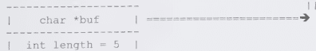

请注意，副本（str.buf）和原始私有成员（a.buf）都指向同一个以空字符结尾的字符串，因为字符指针完全相同！！


现在，指向内存中同一位置的重复指针可能会出什么问题？

删除其中一个指针（也许在析构函数中），可能会导致另一个指针指向这块已释放的内存（悬空指针）。更糟的是，在类析构函数中多次删除同一块空间可能会损坏堆！

C++ 提供了两种机制，以确保带有指针成员的类可以安全地进行复制和赋值：

- 成员逐个初始化
- 成员逐个赋值

要创建一个 `Alpha` 对象的完整副本，我们必须为 `Alpha` 类定义一个构造函数，它以 `Alpha` 引用作为参数，即，一个可以创建 `Alpha` 对象副本的构造函数，也就是拷贝构造函数：

```
Alpha::Alpha(const Alpha& a) {
    length = a.length;
    buf = new char[length + 1];
    strcpy(buf, a.buf);
}
```

请注意，拷贝构造函数会为以空字符结尾的字符串 `buf` 分配空间，并将作为参数传递给它的字符串复制到其中。

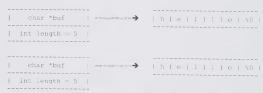

还要注意，拷贝构造函数的参数是对 Alpha 对象的引用，而不是 Alpha 对象本身。由于拷贝构造函数的整个目的就是让实现者能够定义复制对象的语义，因此它允许构造函数在不复制对象的情况下访问 Alpha 对象。

拷贝构造函数在你编写以下代码时也会发挥作用：

- `Alpha a1 = "Hello";` // 字符串首先被转换为一个 Alpha 对象，然后调用拷贝构造函数
- `Alpha a2 = a1;` // 编译器必须用另一个 Alpha 对象 a1 的值来初始化 a2。
- `Alpha a3(a2);` // 编译器必须用另一个 Alpha 对象 a2 的值来初始化 a3。

在继续阅读之前，看看你能否给出以下程序的输出：

```
#include <iostream>
#include <conio.h>
#include <string.h>
using namespace std;
class Alpha {
private:
char *buf;
public:
Alpha() {
cout << "Default constructor" << endl;
buf = new char[100];
buf[0] = '\0';
}
Alpha(const Alpha& a) {
cout << "Copy constructor" << endl;
buf = new char[strlen(a.buf)+1];
strcpy(buf, a.buf);
}
Alpha(const char *s) {
cout << "One arg constructor" << endl;
buf = new char[strlen(s)+1];
strcpy(buf, s);
}
~Alpha() {
cout << "destructor called" << endl;
}
}

int main() {
    Alpha a;
    Alpha b = "hello";
    Alpha c(b);
    Alpha d = c;
    Alpha e("Hello");
    return 0;
}
```

产生的输出是：

default constructor
one arg constructor
copy constructor
copy constructor
one arg constructor
destructor called
destructor called
destructor called
destructor called
destructor called

## 何时提供拷贝构造函数

如果你的类不包含任何需要正确初始化的指针，那么你不必提供拷贝构造函数。C++ 编译器将使用默认拷贝构造函数，它执行一个类实例到另一个类实例的成员逐个复制。

你只有在类中包含指针变量时才必须提供拷贝构造函数。否则，两个副本都将持有指向同一字符数组的指针。

即使你可以接受成员逐个复制，你也会因为析构函数而遇到另一个问题。如果由成员逐个复制操作创建的 `Alpha` 对象不再需要，将调用 `Alpha` 析构函数，并释放该 `Alpha` 对象的字符指针中所存地址的存储空间。

这会导致剩余的 `Alpha` 副本持有一个悬空指针，即一个不指向任何有效内存块的指针。当该剩余的 `Alpha` 副本需要销毁时，delete 运算符将使用已释放内存的地址被调用。更糟的是，如果该内存已分配给其他对象，析构函数将无意中释放属于其他对象的内存。为避免此类问题，你应始终为包含动态分配成员的任何类提供拷贝构造函数。

因此，拷贝构造函数是类的一个成员函数，用于创建该类的一个对象。由于此类构造函数通常编写为接受一个类型为其所属类引用的单个参数，因此通常被称为：

```
X(X&) (pronounced X of X ref)
```

我们的 `Alpha` 拷贝构造函数说明了如何用另一个 `Alpha` 的副本作为初始值来构造一个 `Alpha` 对象：

```
Alpha(const Alpha&);
```

因此，初始化始终表达为拷贝构造函数，它能够根据现有对象创建一个副本对象。

初始化始终通过构造函数完成。此类类通常至少有三个构造函数：

- 默认构造函数 - `Alpha::Alpha()`，它确定为未显式初始化的 `Alpha` 对象赋予什么值
- 转换构造函数 – 来自其他类型（如 `char*`）的构造函数，使得可以将值放入不源自其他 `Alpha` 对象的 `Alpha` 对象中
- 拷贝构造函数，`Alpha::Alpha(const Alpha&)`，它说明如何用另一个 `Alpha` 对象的副本作为初始值来构造一个 `Alpha` 对象。

## 成员逐个赋值

请考虑以下类声明：

```
class Alpha {
    private:
        char *buf;
        int i;
        double d;
    public:
        // appropriate constructors etc.
};

int main() {
    Alpha a;             // 1
    Alpha b(5, 12.2, "Hello"); // 2
    Alpha c(b);          // 3
    Alpha d = b;         // 4
    a = d;               // 5
    return 0;
}
```

语句 1 通过调用默认构造函数创建一个新的 Alpha 对象 a。

语句 2 通过调用三参数构造函数创建一个新的 Alpha 对象 b。

语句 3 通过调用拷贝构造函数创建并初始化一个新的 Alpha 对象 c。

语句 4 通过调用拷贝构造函数创建并初始化一个新的 Alpha 对象 d。

然而，语句 5 的操作与前 4 种操作根本不同，尽管使用相同的符号 = 来表示它。该语句表示将 Alpha 对象 a 的值设置为等于 Alpha 对象 d 的值，即，赋值语句将 d 复制到 a。向已存在的对象赋予新值的行为称为赋值。

此赋值（可能）涉及更改 Alpha 对象 a 的值，但不会创建任何新的 Alpha 对象。由于没有创建新的 Alpha 对象，因此不会调用任何类构造函数。甚至连类拷贝构造函数也不会被调用！

这里不会调用拷贝构造函数，因为所涉及的对象已经构造完成。C++ 仅在初始化新对象时调用构造函数，而在将一个对象赋值给另一个对象时不会调用。

每当已创建的对象通过赋值语句接收一个值时，就会发生赋值：

```
a = d;
```

当对象在声明时接收一个值时，就会发生初始化：

```
Alpha d = b;
```

如果你不确定一段 C++ 代码涉及的是赋值还是初始化，请问自己以下问题：

> "这里是否正在创建一个新对象？"

如果答案是肯定的，则涉及构造函数。如果答案是否定的，则不涉及构造函数。初始化由构造函数执行，而赋值通过重载赋值运算符 = 来执行。

在 C++ 中，创建新对象时发生初始化。赋值在不创建新对象的情况下更改现有对象的值。因此，它总是会覆盖先前的值。为什么这种区别很重要？

我们之前看到，如果不为我们的类编写拷贝构造函数，编译器会自动为我们提供一个。但是，我们也看到，如果我们的类有指针，提供的拷贝构造函数将无法正确复制我们的对象。

与默认拷贝构造函数一样，如果没有显式编写，C++ 编译器会为我们的类提供一个赋值运算符，默认赋值运算符将逐个赋值数据成员。但是，与初始化一样，如果类声明了任何指针数据成员，复制的指针现在将指向内存中的同一位置，如果该内存在析构函数中被删除，这几乎肯定会导致严重错误。这是一种必须不惜一切代价避免的危险情况。


我们可以通过重载赋值运算符 = 来解决这个问题。我们使用如下形式的声明：

```
Alpha& operator=(const Alpha&);
```

现在让我们向 Alpha 类添加一个重载的赋值运算符函数：

```
class Alpha {
private:
    char *buf;
    int i;
    double d;
public:
    // appropriate constructors etc.
    Alpha& operator=(const Alpha&);
};
```

重载的赋值运算符指定一个类型为 Alpha 的常量引用参数。该参数引用正在被复制的对象。

返回被赋值对象的引用允许用户编写如下代码：

```
Alpha x, y;
x = y = Alpha(num);    // note that assignment is right associative
```

## 赋值 Alpha 对象

将一个 Alpha 对象赋值给另一个需要几个步骤：

- 释放被销毁指针所属的内存
- 分配内存以包含源字符串指针的副本
- 使该内存包含字符串的副本
- 复制所有其他数据成员

这样的操作可能如下所示：

```
Alpha& Alpha::operator=(const Alpha& a) {
    delete [] buf;
    buf = new char[strlen(a.buf) + 1];
    strcpy(buf, a.buf);
    i = a.i;
    d = a.d;
    return *this;
}
```

我们返回 *this 以符合常见的 C++ 约定，即赋值应返回其左侧的引用。

然而，这段代码有一个严重的错误。在继续阅读前，试着找出它。

...

如果你尝试将对象赋值给自身，它就会失败：

```
a = a;
```

要修复这个错误，我们需要在代码中添加一个条件语句来防范：

```
String s;
s = s;
```

没有这个测试，将一个 Alpha 对象赋值给自身会删除该 Alpha 对象的数据成员 buf，然后尝试复制刚刚被删除的数据。

一旦确定我们处理的是两个不同的对象，赋值运算符（与复制构造函数不同）应该释放持有旧值的任何资源。之后，赋值运算符通常与复制构造函数做同样的事情，只是赋值运算符返回一个值。

## 修复方法

我们必须将自赋视为一种特殊情况进行检查，如果检查成功则什么都不做：

```
Alpha& Alpha::operator=(const Alpha& a) {
    if (this != &a) { // or if (*this != a)
        delete [] buf;
        buf = new char[strlen(a.buf) + 1];
        strcpy(buf, a.buf);
        i = a.i;
        d = a.d;
        return *this;
    }
}
```

if 语句将 this 指针与 a 引用参数的地址进行比较。然后它会捕获将同一对象意外赋值给自身的情况。复制构造函数不需要采取类似的预防措施。为什么？

请注意，我们不能在类外部声明 operator=()。它必须声明为成员函数，不能是友元函数。

## 对象的复制

因此，为了控制类 X 对象的复制，通常需要定义 4 项内容：

- 默认构造函数 X::X() 以建立 X 对象的默认值
- 复制构造函数 X::X(const X&) 以控制初始化、参数传递和返回
- 析构函数 X::~X()
- 重载的赋值运算符 X& X::operator=(const X&)

请注意，赋值运算符的参数是 X& 而不是 X。这是为了防止对象在被赋值的过程中再次被复制。

## 赋值运算符与复制构造函数

赋值运算符和复制构造函数有很多共同的逻辑。然而，这里有三个主要区别：

- 当对象被赋值给自身时，赋值运算符必须正确工作。
- 每次调用赋值运算符都会覆盖现有值。如果该值使用了对象外部的资源，则可能需要释放这些资源。
- 赋值运算符可以返回一个值。

- 容器关系
- 继承简介
- 派生
- 计数器类
- 保护访问说明符
- 员工类
- 类层次结构
- 访问机制
- 派生类的构造函数和析构函数
- 构造函数初始化列表
- 基类和派生类析构函数
- 重载复制构造函数
- 重载赋值运算符
- 从派生类向基类转换
- 组合与继承作业
- 继承实验（String 类）
- 继承实验（String 类）驱动程序

## 容器关系

到目前为止，类中的数据成员类型大多是原始类型：`int`、`float`、`char` 等。但没有什么禁止我们定义一个包含另一个类实例的类。

类与另一个类实例之间的关系称为容器关系，因为一个类实际上包含另一个类的实例。在面向对象编程术语中，这也称为 has-a 关系，因为包含类 has-a(n) 另一个类的实例。

考虑以下程序：

```
// contain1.cpp
#include <iostream>
#include <string.h>
using namespace std;
class String {
    private:
    char *buf;
    public:
    String() {
        cout << "String default constructor" << endl;
        buf = new char[strlen("Shari")+1];
        strcpy(buf, "Shari");
    }
    String(char *s) {
        cout << "String one arg constructor" << endl;
        buf = new char[strlen(s)+1];
        strcpy(buf, s);
    }
    ~String() {
        delete [] buf;
    }
    void printString() {
        cout << buf << endl;
    }
};

class Employee {
private:
    String name;
    int id;
public:
    Employee() {
        cout << "Employee default constructor" << endl;
        name = "Haley";
        id = 108;
    }
    Employee(char *s, int num) {
        cout << "Employee two arg constructor" << endl;
        name = s;
        id = num;
    }
    void printEmployee() {
        name.printString();
        cout << id << endl;
    }
};

int main() {
    Employee e("Sally", 123);
    e.printEmployee();
    return 0;
}
```

请注意，被包含实例的私有成员对于包含类的成员函数仍然不可访问。但是，包含类的函数可以通过编写实例名称和点运算符来访问被包含实例的公共函数：

```
name.printString();
```

在继续阅读前，看看你能否弄清楚这个程序生成的输出：

我说过在继续阅读前！！！

## 以下是生成的输出：

```
String default constructor
Employee two arg constructor
String one arg constructor
Sally
123
```

为什么输出很奇怪？为什么会多次调用 `String` 默认构造函数？

好吧，这是一条 C++ 规则：默认情况下，在构造函数体执行之前，如果类包含一个本身是类对象的数据成员，则会自动先调用其默认构造函数。

因此，当创建一个 `Employee` 对象时，name 成员首先使用默认 `String` 构造函数进行初始化，然后其值会被 `Employee` 构造函数体中的赋值更改。这需要两次操作，而一次就足够了！非常低效！

因此，当类的数据成员本身是一个类对象时，我们必须小心，否则会在不需要时调用对象的默认构造函数。构造函数会产生正确的结果，但比需要的要慢。因此，出于效率考虑，我们必须使用构造函数初始化列表来初始化成员变量。构造函数初始化列表可以覆盖这种默认行为。

下面我们通过使用构造函数初始化列表显式地用正确的值初始化 name 数据成员：

```
Employee() : name("Haley"), id(108) {
    cout << "Employee default constructor" << endl;
}

Employee(char *s, int num) : name(s), id(num) {
    cout << "Employee two arg constructor" << endl;
}
```

当你编写构造函数定义时，在括住形式参数列表的 ( ) 之后停止，提供一个冒号，后跟一系列初始化器，并看看类中有多少成员可以使用这种构造函数初始化语法进行初始化。请注意，每个初始化器由一个数据成员名称和一个参数列表组成，该参数列表指定该成员构造函数的参数。


我们常常会发现，类的所有成员都可以这样初始化，等到我们进入构造函数体时，就没有什么可做的了。这是一个好迹象。你的构造函数已经用正确的初始值初始化了所有成员。

还要注意，初始化语法允许我们初始化不是类对象的数据成员。由于内置类型没有构造函数，使用初始化语法初始化整数成员 id 并不比使用赋值更快。但如果我们以相同的方式初始化所有数据成员，代码会更易读。

下面是使用构造函数初始化列表的完整程序：

```
// contain2.cpp

#include <iostream>
#include <string.h>

using namespace std;

class String {
private:
    char *buf;
public:
    String() {
        cout << "String default constructor" << endl;
        buf = new char[strlen("Shari")+1];
        strcpy(buf, "Shari");
    }
    String(char *s) {
        cout << "String one arg constructor" << endl;
        buf = new char[strlen(s)+1];
        strcpy(buf, s);
    }
    ~String() {
        delete [] buf;
    }
    void printString() {
        cout << buf << endl;
    }
};
```

```
class Employee {
private:
    String name;
    int id;
public:
    Employee() : name("Haley"), id(108) {
        cout << "Employee default constructor" << endl;
    }
    Employee(char *s, int num) : name(s), id(num) {
        cout << "Employee two arg constructor" << endl;
    }
    void printEmployee() {
        name.printString();
        cout << id << endl;
    }
};

int main() {
    Employee e("Sally", 123);
    e.printEmployee();
    return 0;
}
```

现在的输出如下：

String one arg constructor
Employee two arg constructor
Sally
123

请注意，这个构造函数只执行一次 String 操作（初始化），而原始版本执行了两次 String 操作，即初始化后跟赋值。

即使我们忽略构造函数初始化列表的效率，在某些情况下，我们也会发现必须使用它们来正确创建类的实例。这种情况发生在所涉及的类具有以下特征之一时：

- 一个 const 数据成员

```
class Employee {
    private:
        const long ssnum;
    public:
        Employee(long n) : ssnum(n) {}
};
```

- 一个引用数据成员

```
class Employee{
    private:
        const long ssnum;
        int& value;
    public:
        Employee(long n, int val) : ssnum(n), value(val) {}
};
```

## 继承简介

继承是 C++ 最棒的特性之一。在类之后，继承可能是面向对象编程最强大的特性。正是这一特性使面向对象编程区别于传统编程，因为它允许我们扩展和重用现有代码，而无需重写代码。

到目前为止，我们创建的所有类都是从头开始构建的，这可能也是你在想要为程序添加新功能时一直采用的方式，因为编写新代码通常和修改现有代码、调试它一样容易。我们真正想要做的是在不更改原始代码的情况下为程序添加新功能，而继承正是让你能够做到这一点！

在 C 语言中，如果你拥有一个代码库及其源代码（但并非总是如此），你可以进行修改。但首先你必须拥有源代码的副本。在进行修改时，你需要理解他人可能编写的函数的内部工作原理。在这样做时，你难免会引入一些错误，这些错误可能容易找到，也可能不容易找到。因此，你最终会得到两组代码：

- 经过调试的旧代码
- 你的新代码，它以某种形式包含旧代码，加上新增内容和更改，当然还有新错误。

未来的更改意味着更多的副本，你需要维护的代码量增加，但功能并没有相应增加。

在 C++ 中，创建新的数据类型或类是基本活动，因为我们使用类型或类来建模正在解决的问题。当我们考虑在 C++ 中更改或扩展代码时，自然会从类而不是数据或函数的角度来思考。因此，在 C++ 中重用代码意味着重用类。

你或他人编写或调试过的现有类并不完全符合你的要求，这种情况非常常见。在 C++ 中，你可以使用继承从旧类创建新类。当你继承时，你会说：

> "这个新类型或类就像那个旧类，再加上一些数据和函数。"

使用继承时，你不会复制现有的成员函数。你只需使用已经存在的成员函数：

- 你可以添加新的数据成员和新的成员函数
- 你也可以通过重新定义现有函数来改变其含义，使其对你的新类具有不同的行为

你甚至不需要成员函数定义的源代码，只需要包含类定义的头文件（在任何使用类的情况下都必须可用）。这意味着你可以从任何供应商的类库中继承，无论他们是否提供源代码！！

## 派生

C++ 通过派生机制实现继承。派生类从基类派生，并继承基类的所有数据成员和成员函数。

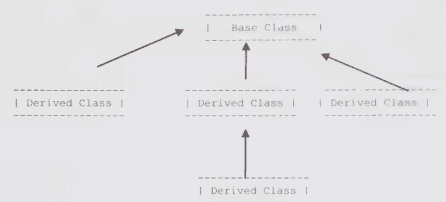

- 多个类可能从单个基类派生。
- 派生类本身也可以作为基类，从中派生出更多类。

因此，我们可以构建一个类层次结构，其中每个类都可以作为新类集合的父类或根类。

| 通用窗口类 |
|---|
| 文本窗口 | 位图图形窗口 |
| 文本编辑器 | 绘图程序 |

这全都是单继承，因为所有派生类都只有一个父类。请注意，一个类可以派生出的类的数量没有固定限制。

因此，继承允许你将相关类组织成一个层次结构，顶层的类作为下层类的抽象。这意味着派生类是其父类的特化，即派生类是基类的一种类型（"is a"），但添加了更多细节。出于这个原因，派生类与其基类之间的关系称为 is-a 关系。

无论从基类派生出多少个类，基类在继承过程中都保持不变。因此，派生类的大小始终至少等于其父类，以便派生类的实例始终包含其父类的所有成员。

请注意，你不能从父类中减去或删除任何内容。但是，访问继承的成员是另一回事，我们稍后会讨论，也就是说，仅仅因为你派生了一个类，并不意味着你自动获得了对基类成员的完全和无限的访问权限。

继承通常有两种用途：

- 在一种角色中，它可以被视为一种 *重用机制*，一种创建与现有类高度相似的新类的方法。
- 在另一种角色中，它可以被视为一种 *抽象机制*，一种将类组织成特化层次结构的工具。

在这两种情况下，你可以将其视为一个类将其部分任务分包或委托给另一个类的方式。

## 计数器类

之前我们定义了一个 `Counter` 类，其中包含一个通用计数器变量 `count`，它可以：

- 使用默认构造函数初始化为 0
- 使用单参数构造函数初始化为某个其他值
- 使用 ++ 运算符递增
- 通过 getCount() 返回

该类如下所示：

```
class Counter {
  private:
    int count;
  public:
    Counter() { count = 0; }
    Counter(int c) { count = c; }
    int getCount() { return count; }
    Counter operator++() {
      ++count;
      return *this;
    }
};
```

假设我们费了很大劲让 `Counter` 类按我们想要的方式运行，并且对结果很满意，只有一件事除外。我们确实需要一种递减计数的方法。也许我们正在统计进入银行的人数，我们希望在他们进来时递增计数，在他们出去时递减计数。因此，计数表示任何时刻银行中的人数。

我们可以将递减例程直接插入到 `Counter` 类的源代码中，但有几个原因可能让我们不想这样做：

- `Counter` 类工作得非常好，已经经过了许多小时的测试和调试。（虽然在这种情况下这是一种夸张，但在更大、更复杂的类中可能是事实。）
- 如果我们开始篡改 `Counter` 的源代码，测试过程将需要重新进行，我们可能会搞砸某些东西，并花费数小时调试在我们修改之前运行良好的代码。


- 不修改 Counter 类的另一个原因是，我们可能无法访问其源代码，尤其是当它作为类库的一部分分发时。

为避免这些问题，我们可以使用继承来基于 Counter 创建一个新类，而无需修改 Counter 本身。我们可以派生一个新类 CountDn，它为 Counter 类添加一个递减运算符：

```
class Counter {
 protected:
 int count;
 public:
 Counter() { count = 0; }
 Counter(int c) { count = c; }
 int getCount() { return count; }
 Counter operator++() {
 ++count;
 return *this;
 }
 };

class CountDn : public Counter {
 public:
 CountDn operator--() {
 --count;
 return *this;
 }
 };
```

语法分解如下：

- Counter 类中的 private 访问说明符已被替换为 protected 访问说明符。稍后详述。
- CountDn 是派生类名称
- : 指定 CountDn 从 Counter 派生
- public 指的是继承类型，可能是 public、private 或 protected。我们将在稍后讨论此问题。
- Counter 是基类的名称

```
int main() {
  CountDn c;
  ++c;
  ++c;
  cout << c.getCount() << endl;
  --c;
  cout << c.getCount() << endl;
  return 0;
}
```

输出如下：

2
1

请注意，新的 CountDn 类继承了 Counter 类的所有特性。CountDn 不需要构造函数，不需要 getCount() 函数，也不需要 operator++() 函数，因为它们已经在基类 Counter 中存在。请记住，公共基类的公共成员在派生类中仍然是公共的。

## 访问基类成员

继承的一个重要部分是了解基类中的成员函数何时可以被派生类的对象使用。这称为可访问性。例如，在 main() 中，我们创建了 CountDn 类的一个对象：

```
CountDn c;
```

这导致 c 被创建为 CountDn 类的对象并初始化为 0。但是等等！这是如何可能的？CountDn 类说明符中没有构造函数。那么是什么实体执行初始化呢？

事实证明，在某些情况下，如果你不指定构造函数，派生类将使用基类中的适当构造函数。在这里，CountDn 中没有构造函数，因此编译器使用基类 Counter 的默认构造函数。

请注意，CountDn 类的对象 c 还使用 Counter 类中的 operator++() 和 getCount() 成员函数。如果编译器在 c 所属的类中找不到这些函数，它将使用基类中的成员函数。

## 派生类构造函数

我们的程序中存在一个潜在问题。如果我们想将 CountDn 对象初始化为某个值，该怎么办？可以使用 Counter 中的单参数构造函数吗？不可以！

虽然编译器会用基类的默认构造函数进行替换，但它对更复杂的构造函数则束手无策。因此，我们必须为派生类编写一组新的构造函数：

```
class CountDn : public Counter {
public:
CountDn() : Counter() {}
CountDn(int c) : Counter(c) {}
CountDn operator--() {
--count;
return *this;
}
};

int main() {
CountDn c1, c2(100);
return 0;
}
```

这里，

```
CountDn() : Counter() {}
```

导致 CountDn 默认构造函数调用基类中的 Counter 默认构造函数，而

```
CountDn(int c) : Counter(c)
```

导致 CountDn 单参数构造函数调用基类中的 Counter 单参数构造函数。

请注意，CountDn 构造函数可以添加自己的其他语句，但在这种情况下它不需要，因此花括号为空。但是，如果它定义了一个新数据成员，可以在此处初始化它，然后调用基类构造函数来初始化对象的其余部分。稍后详述。

## protected 访问说明符

- 类的成员函数可以访问 private 和 public 成员。
- 类的对象只能访问 public 成员。
- Private 成员是私有的。

如果不使用继承，我们只需要知道这些。使用继承后，会有新的可能性。当前让我们关注的问题是：

派生类的成员函数可以访问基类的数据成员吗？例如，`CountDn` 中的 `operator--()` 可以访问 `Counter` 中的 `count` 吗？

答案是，如果成员是 `public` 或 `protected`，成员函数可以访问基类的成员。它们不能访问 `private` 成员。

我们不想将 `count` 设为 `public`，因为这将允许程序中任何地方的任何函数访问它，从而消除数据隐藏的优势。另一方面，`protected` 成员可以被其自身类中的成员函数，或任何从其自身类派生的类中的成员函数访问。它不能从类外部的函数访问，例如 `main()`，这正是我们想要的！

因此，`protected` 类成员是 `private` 和 `public` 成员的混合体。

- 与 `private` 成员一样，`protected` 成员只能被其他类成员函数访问。在类之外，`protected` 成员不可见。
- 与 `public` 成员一样，`protected` 成员会被派生类继承，并且可以被派生类中的成员函数访问。

在决定将成员设为 `private`、`protected` 还是 `public` 时，请牢记以下规则：

- `private` 成员只能被声明该 `private` 成员的类中的成员访问。
- `protected` 成员可以被其自身类的成员以及派生类中的任何成员访问。
- `public` 成员可以被类自身的成员、派生类的成员以及类的所有其他用户访问。

| 访问说明符 | 可从自身类访问 | 可从派生类访问 | 可从类外对象访问 |
|---|---|---|---|
| private | 是 | 否 | 否 |
| protected | 是 | 是 | 否 |
| public | 是 | 是 | 是 |

教训是，如果你编写的类将来可能被用作其他类的基类，那么派生类可能需要访问的任何数据都应该设为 `protected` 而不是 `private`。这确保了类是“可继承的”，借用电视广告的一句话。

请注意，继承不支持反向操作。基类及其对象不知道从基类派生的任何类。例如，在声明：

```
Counter c;
```

中，对象 `c` 不能使用在 `CountDn` 中定义的 `operator--()` 函数。如果你想要一个可以递减的计数器，它必须是 `CountDn` 类而不是 `Counter` 类。

## Employee 类

请参考下面的 Employee 基类：

```
// employee.h

#ifndef _EMPLOYEE_H
#define _EMPLOYEE_H

using namespace std;

class Employee {
  protected:
    char *name;
    char *address;
    int age;
    int dependent;
    int jobClass;

  public:
    Employee(char *, char *, int, int, int);
    ~Employee();
    void display();

    int getAge() { return age;}
    int getDependent() { return dependent;}
    int getJobClass() { return jobClass;}
};

#endif

// employee.cpp

#include <iostream>
#include <string.h>
#include "employee.h"

Employee::Employee(char *nm, char *ad, int ag, int dp, int jc) {
  name = new char[strlen(nm)+1];
  strcpy(name, nm);
  address = new char[strlen(ad)+1];
  strcpy(address, ad);
  age = ag;
  dependent = dp;
  jobClass = jc;
}

Employee::~Employee() {
  delete [] name;
  delete [] address;
}
```

```
void Employee::display() {
    cout << name << endl;
    cout << address << endl;
}
```

基类 Employee 的设置与其他任何类一样。但是，因为我们打算让这个类有派生类，所以我们将数据成员放在 protected 访问区域，因为我们希望派生类成员函数能直接访问这些数据。请注意，这个类有一个构造函数、一个析构函数、输出函数和三个访问函数。

有时基类很少被使用。我们甚至可能不声明任何基类对象，因为声明派生对象不需要基类对象。可以创建基类来提供将由各种不同派生类定义共享的数据成员和成员函数。派生类如下所示：

```
// workdata.h

#ifndef WORKDATA_H
#define WORKDATA_H

#include "employee.h"

class Workdata : public Employee {
    private:
        char *occupation;
    public:
        Workdata(char *, char *, char *, int, int, int);
        ~Workdata() { delete [] occupation; }
        char * getOccupation() { return occupation; }
        void display();
        int getAge() { return age; }
};

#endif
```


```
// workdata.cpp

#include <iostream>
#include <string.h>
#include "Workdata.h"

using namespace std;

Workdata::Workdata(char *nm, char *ad, char *oc, int ag, int dp,
                   int jc) : Employee(nm, ad, ag, dp, jc) {
    occupation = new char[strlen(oc)+1];
    strcpy(occupation, oc);
}

void Workdata::display() {
    Employee::display();
    cout << occupation << endl;
}
```

类 Workdata 是一个派生类，它从公有基类 Employee 继承。这个派生类的基类可以是私有、保护或公有。稍后详述。

派生类将继承其基类的所有数据成员和成员函数，并可以声明自己的成员。派生类的成员函数可以访问基类的公有和保护数据成员，但不能访问私有数据成员。

基类的成员函数无法访问其任何派生类的数据成员。怎么可能呢？基类不知道可能有哪些类从它派生。派生类只能通过使用基类的保护或公有成员函数来间接访问基类的私有数据成员。

请注意，派生类有一个带有 6 个参数的构造函数，尽管该类只声明了一个自己的数据成员：

```
char *occupation;
```

一个参数用于为 occupation 赋值，而其余五个参数用于初始化从基类继承的内存。稍后在讨论基类初始化时会详细说明。因此，Workdata 的构造函数负责初始化派生类对象的基类部分以及其自己的数据成员。

派生类继承了使用基类以下函数的能力：

```
display()
getAge()
getDependent()
getJobClass()
```

此外，派生类添加了一个名为以下的新函数：

```
getOccupation()
```

并为派生类重新定义了以下函数：

```
display()
getAge()
```

请注意，这些重新定义的函数不是函数名重载的示例，因为基类和派生类的函数具有相同的原型。派生类实际上可以同时使用两个 `display()` 函数和两个 `getAge()` 函数，即分别定义在 `Employee` 和 `Workdata` 中的那些函数。

如果派生类对象调用 `display()` 或 `getAge()` 函数，它将通过以下调用获得本地版本：

```
Workdata obj("Bill", "EB2", "Trainer", 49, 1, 57);
obj.display();
int x = obj.getAge();
```

派生类可以通过以下形式访问基类的成员函数：

```
int x = obj.getDependent();
```

或通过使用作用域解析运算符：

```
obj.Employee::display();
```

当基类和派生类中的函数同名时，需要使用作用域解析运算符。还请注意，派生类可以作为从它派生的类的基类，从而允许你创建派生类层次结构。

## 类层次结构

在迄今的示例中，继承被用于向现有类添加功能。让我们看一个示例，其中继承被用于不同的目的，作为程序原始设计的一部分。

我们的示例模拟了一个小部件公司员工数据库。在这个公司中，有三种员工：

- 经理 – 管理其他员工
- 科学家 - 进行研究以开发更好的小部件
- 劳工 - 操作危险的小部件冲压机。

数据库为所有员工存储姓名和员工 ID 号，无论其类别如何。

- 对于经理，它还存储其职称和高尔夫俱乐部会费。
- 对于科学家，它存储他们发表的学术文章数量。
- 劳工除了姓名和 ID 号之外不需要其他数据。

因此，我们的程序设计将从一个基类 Employee 开始，它处理员工的姓氏和 ID 号。从此类，将派生出三个其他类：Manager、Scientist 和 Laborer。

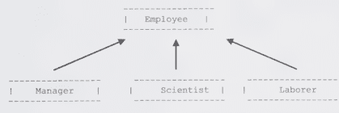

Manager 和 Scientist 类包含关于这些员工类别的额外信息，以及处理此信息的成员函数。

```
// hier.cpp
#include <iostream>
class Employee {
private:
    char name[81];
    long id;
public:
    void getData() {
        cout << "Enter last name: "; cin >> name;
        cout << "Enter ID: "; cin >> id;
    }
    void putData() {
        cout << "\nName: " << name << endl;
        cout << "ID: " << id << endl;
    }
};
class Manager : public Employee {
private:
    char title[81];
    double dues;
public:
    void getData() {
        Employee::getData();
        cout << "Title: "; cin >> title;
        cout << "Golf Club Dues: "; cin >> dues;
    }
    void putData() {
        Employee::putData();
        cout << "Title: " << title << endl;
        cout << "Golf Club dues: " << dues << endl;
    }
};
class Scientist : public Employee {
private:
    int pubs;
public:
    void getData() {
        Employee::getData();
        cout << "Number of Publications: "; cin >> pubs;
    }
    void putData() {
        Employee::putData();
        cout << "Number of Publications: " << pubs << endl;
    }
};
class Laborer : public Employee {
};
```

请注意，`Laborer` 类的操作与 `Employee` 类相同，因为它不包含额外的数据或函数。`Laborer` 类可能看起来是不必要的，但通过将其设为单独的类，我们强调所有类都源自同一个来源 `Employee`。

创建一个看似空的 `Laborer` 类的另一个原因涉及维护问题。将来，如果我们决定修改 `Laborer` 类，就不需要更改 `Employee` 的说明符了。

仅用于派生其他类的类，即 `Employee`，有时被称为 _抽象类_，这意味着不会创建此类的实际实例（对象）。抽象一词与多态性和虚函数相关，具有更精确的定义，我们稍后会遇到。

## 继承级别

类可以从本身就是派生类的类中派生。请考虑下面的类层次结构：

```
class A {
};

class B : public A {
};

class C : public B {
};
```

在这里，类 B 从类 A 派生，类 C 从类 B 派生。此过程可以扩展到任意数量的级别。

通过这种方式，我们可以扩展 `Employee` 类程序，添加一种称为工头的特殊劳工。由于工头是一种劳工，`Foreman` 类将从 `Laborer` 类派生。

工头监督小部件冲压操作，管理劳工小组。他们负责其小组的小部件生产配额。工头的能力按成功完成的生产配额百分比来衡量。因此，我们将在 `Foreman` 类中有一个表示此百分比的配额数据项：

```
class Foreman : public Laborer {
private:
    float quotas;
public:
    void getData() {
        Laborer::getData();
        cout << " Enter quotas: "; cin >> quotas;
    }
    void putData() {
        Laborer::putData();
        cout << "Quotas: " << quotas << endl;
    }
};
```

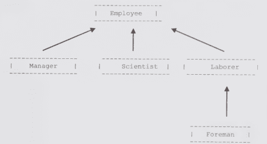

请注意，类层次结构与组织结构图不同。组织结构图显示指挥关系。类层次结构源于对共同特征的概括。类越通用，在图中的位置越高！因此，`Laborer` 比 `Foreman` 更通用，而 `Foreman` 是一种专门的 `Laborer`。所以 `Laborer` 在类层次结构中显示在 `Foreman` 上方。

## 访问机制

## 使用派生类实例访问基类成员

派生类实例可以完全访问基类的公有成员（通常是函数）。假设派生类作用域内不存在同名成员，则将自动使用基类中的成员。

```
// derived.cpp

class Base {
protected:
    int num;
public:
    Base(int n = 0) : num(n) {}
    int getNum() const { return num; }
};

class Derived : public Base {
};

int main() {
    Derived d;
    cout << d.getNum(); // first checks class Derived
    // and then class Base
    cout << d.Base::getNum(); // goes directly to class Base
    return 0;
}
```

在第一次调用中，编译器将查看类 Derived 的作用域，看是否存在名为 getNum() 的函数。如果没有，它将接着查看类 Base 的作用域。在第二次调用中，编译器将直接查看 Base 类的作用域以查找 getNum()。

## 覆盖基类数据成员名称

除了创建名称与从基类继承的名称不同的新成员外，派生类还可以有选择地覆盖或隐藏现有名称。这是通过在派生类中声明与基类成员具有完全相同名称的成员来完成的。

也就是说，如果派生类的实例或成员函数引用已被覆盖的基类数据成员，则默认将使用派生类中的成员。由于派生类包含其基


类，我们可以使用作用域解析运算符来引用基类的成员。

```cpp
// base.cpp
class Base {
protected:
    int num;
public:
    Base(int n = 0) : num(n) {}
    int getNum() { return num; }
};
class Derived : public Base {
private:
    int num;
public:
    Derived(int n = 1) : num(n) {}
    int getNum() { return num + 1; }
};
int main() {
    Derived d;
    cout << d.getNum() << endl;
    cout << d.Base::getNum() << endl;
    return 0;
}
```

## 重写成员函数

我们还可以重写基类成员函数。我们可以在派生类中使用与基类中同名的成员函数。你可能希望这样做，以便程序中的调用对基类和派生类的对象都以相同的方式工作。

请考虑以下 Stack 类：

```cpp
// stack.cpp

const int MAX = 100;

class Stack {
    protected:
    int s[MAX];
    int top;

    public:
    Stack() { top = -1; }
    void push(int num) { s[++top] = num; }
    int pop() { return s[top--]; }
};
```

这里存在潜在缺陷。没有检查溢出或下溢。

为修复这些缺陷，我们将创建一个新类 Stack2，它派生自 Stack。Stack2 的对象与 Stack 的对象行为完全相同，只是当你尝试向栈中压入过多项目，或尝试从空栈中弹出项目时，会收到警告。

```cpp
class Stack2 : public Stack {
    public:
    void push(int num) {
        if (top < MAX-1)
            Stack::push(num);
        else {
            cout << "Stack overflow. ";
            exit(1);
        }
    }

    int pop() {
        if (top > 0)
            return Stack::pop();
        else {
            cout << "Stack underflow. ";
            exit(1);
        }
    }
};
```

```cpp
int main() {
    Stack2 s2;
    s2.push(5);
    s2.push(6);
    s2.push(7);
    cout << s2.pop();
    cout << s2.pop();
    cout << s2.pop();
    cout << s2.pop();
    return 0;
}
```

请注意，Stack2 中的 push() 和 pop() 函数与 Stack 类中的函数具有相同的名称、参数和返回类型。当我们在 main() 中调用这些函数时，编译器如何知道使用哪个函数？

规则：当同一函数同时存在于基类和派生类中时，将执行派生类中的函数。派生类函数重写基类函数。

## 隐藏重载函数

你不能通过在派生类中使用不同的参数列表重新定义基类函数来重载（或隐藏）它。这种设计背后的理由是，如果你重写从基类继承的函数，就不应该有通过参数匹配过程意外调用基类版本的危险。

换句话说，如果基类函数期望 int 作为参数，而你通过在派生类中重新定义它以接受 char* 来隐藏它，那么使用派生实例和 int 实参调用该函数应导致编译错误。

```cpp
// hide1.cpp
class Base {
public:
    void foo(int n) { cout << n; }
};
class Derived : public Base {
public:
    void foo(double n) { cout << n * n; }
};
int main() {
    Derived d;
    d.foo(5);
    return 0;
}
```

这表明，从基类继承的函数不会按照参数匹配规则进行检查。看起来，使用 int 作为实参的函数调用应该更匹配期望 int 的基类函数，而不是期望 double 的派生类函数。但被调用的是派生类函数，因为这是编译器所知的唯一函数。

即使在派生类的作用域内没有可想象的匹配，也不会检查从基类继承的成员。

```cpp
// hide2.cpp
class Base {
public:
    void foo(char *ptr) { cout << ptr; }
};
class Derived : public Base {
public:
    void foo(double n) { cout << '\n'; }
};
int main() {
    Derived d;
    d.foo("A");        // error - cannot convert char * to double
    d.Base::foo("A");  // ok
    return 0;
}
```

## 编译器查找规则

使用派生实例访问成员函数时，不使用基类名和作用域解析运算符，编译器通过询问以下问题来解析地址：

- 成员函数在派生类中是否有作用域？如果有，使用它。如果没有，生成编译错误。
- 成员函数在父类中是否有作用域？如果有，使用它。如果没有，生成编译错误。
- 成员函数在层次结构中更高位置是否有作用域？如果有，使用它。如果没有，生成编译错误。

请注意，文件作用域中同名的函数不予考虑。

同样，派生类中的函数通过询问以下问题来解析数据成员的地址：

- 数据成员在类本身中是否有作用域？如果有，使用它。如果没有，生成编译错误。
- 数据成员是否有派生类作用域？如果有，使用它。如果没有，生成编译错误。
- 数据成员在可访问的父类中是否有作用域？如果有，使用它。如果没有，生成编译错误。
- 数据成员在层次结构中是否有可访问的作用域？如果有，使用它。如果没有，生成编译错误。
- 数据成员是否存在于文件作用域？如果存在，使用它。如果不存在，生成编译错误。

## 带派生类的构造函数和析构函数

请记住，派生类的实例始终包含从其基类继承的数据成员。因此，每当创建派生类实例时，都需要两个构造函数来确保实例中所有数据成员的正确初始化。

因此，基类构造函数必须以某种方式获得控制权以初始化基类成员，派生类构造函数必须获得控制权以初始化任何新的派生类数据成员。幸运的是，编译器会处理这个问题，并会自动调用两个构造函数。

这是因为，一旦派生类构造函数获得控制权并建立其形式参数，基类构造函数就会立即被调用。现在唯一的问题是，将调用哪个基类构造函数？

答案是：如果你不告诉编译器调用哪一个，它将尝试调用默认构造函数。因此，在基类中始终存在默认构造函数是个好主意。

另一方面，你可以通过在派生类的构造函数初始化列表中使用语法，明确告诉编译器调用哪个基类构造函数。编译器初始化列表出现在派生构造函数头之后。它以冒号开头，并包含：

- 基类名（即构造函数的名称）
- 括号内的参数列表，如同任何普通函数调用

要显式调用基类默认构造函数，我们将参数列表留空。

重申：

因为任何新派生类成员的初始化可能依赖于基类成员的正确初始化，所以基类构造函数始终会先被调用。

如你所料，析构函数将按相反顺序调用，即先派生类，后基类。

下面是一个程序，展示如何将参数传递给基类构造函数，并跟踪两个类的构造函数和析构函数调用的顺序。

```cpp
// constructor.cpp
#include <iostream.h>
class Base {
protected:
    int bNum;
public:
    Base(int n = 0) : bNum(n) {
        cout << "Base constructor." << endl;
    }
    ~Base() {
        cout << "Base destructor." << endl;
    }
    int getBaseNum() {
        return bNum;
    }
};

class Derived : public Base {
private:
    int dNum;
public:
    Derived(int a = 0, int b = 0) : Base(a), dNum(b) {
        cout << "Derived constructor." << endl;
    }
    ~Derived() {
        cout << "Derived destructor." << endl;
    }
    int getDerivedNum() const {
        return dNum;
    }
};

int main() {
    Derived d(1,2);
    cout << d.getBaseNum() << " " << d.getDerivedNum() << endl;
    return 0;
}
```


这里是程序的输出：

```
base constructor
derived constructor
1 2
derived destructor
base destructor
```

请注意，派生实例 d 是用两个整数创建的：

- 这些整数中的第一个，a，被基类构造函数用于初始化 bNum
- 第二个整数，b，被派生类用于初始化 dNum

### 注意：

当你初始化基类数据成员时，不要试图在派生类构造函数的成员初始化列表中单独列出它们。它们的初始化不是派生类的责任，并且会导致编译错误，因为在派生类初始化列表中合法书写的项目只能是派生类数据成员名称和基类构造函数名称。

请注意，基类构造函数和析构函数是独特的，因为它们不会被派生类继承。如果你创建一个派生类实例，那么处理该特定类型创建的适当构造函数必须存在于派生类中，而不是基类中。

## 构造函数初始化列表

提高 C++ 程序效率的最简单方法之一是在派生类构造函数的冒号列表中指定适当的基类构造函数。如果没有构造函数初始化列表会发生什么？

- 要初始化特定类的对象，你的程序会调用该类的适当构造函数。
- 要初始化派生类的基类对象，你的程序会隐式调用适当的基类构造函数。

不幸的是，对基类构造函数的这种隐式调用使得很容易初始化基类的数据成员两次！请参见下面的示例：

```
// shape1.cpp

#include <iostream>

using namespace std;

class Shape {
  private:
    int color;
    int sideCount;
  public:
    Shape() {
      cout << "Shape default constructor" << endl;
      SetColor(0);
      SetSideCount(0);
    }
    Shape(int c, int sc) {
      cout << "Shape 2 arg constructor" << endl;
      SetColor(c);
      SetSideCount(sc);
    }

    void display() {
      cout << "color = " << color << endl;
      cout << "sides = " << sideCount << endl;
    }

    void SetColor(int c) {
      cout << "set color to " << c << endl;
      color = c;
    }

    void SetSideCount(int sc) {
      cout << "set side count to " << sc << endl;
      sideCount = sc;
    }
};

class Square : public Shape {
public:
    Square() {
        cout << "Square default constructor" << endl;
        SetColor(0);
        SetSideCount(4);
    }
    Square(int c) {
        cout << "Square one arg constructor " << endl;
        SetColor(c);
        SetSideCount(4);
    }
};
int main() {
    Square s(10);
    s.display();
    return 0;
}
```

我们从 Shape 类派生出 Square 类，以展示编译器如何为嵌入类调用构造函数。

```
Output:
Shape default constructor
Set Color to 0
Set Side Count to 0
Square one arg constructor
Set Color to 10
Set Side Count to 4
Color = 10
Sides = 4
```

请注意，程序的运行结果与你预期的不一样！它包含两个 Square（派生）类构造函数，用于初始化 Shape（基）类的 color 和 side 数据成员。但是，Square（派生）类构造函数会对这些数据成员进行第二次初始化。

这些数据成员是如何首先被初始化的？请记住，派生类构造函数会执行基类构造函数。因此，Square（派生）类和 Shape（基）类的构造函数都会初始化 Shape 的数据成员 color 和 side。

为了纠正对初始化函数的多余调用，我们可以简单地在 Square（派生）类构造函数声明中使用冒号列表。通过指定适当的 Shape（基）类构造函数，Square（派生）构造函数允许 Shape（基）类构造函数执行初始化操作。

```
// shape2.cpp

#include <iostream.h>

class Shape {
private:
    int color;
    int sideCount;
public:
    Shape() {
        cout << "Shape default constructor" << endl;
        SetColor(0);
        SetSideCount(0);
    }
    Shape(int c, int sc) {
        cout << "Shape 2 arg constructor " << endl;
        SetColor(c);
        SetSideCount(sc);
    }
    void display() {
        cout << "color = " << color << endl;
        cout << "sides = " << sideCount << endl;
    }
    void SetColor(int c) {
        cout << "set color to " << c << endl;
        color = c;
    }
    void SetSideCount(int sc) {
        cout << "set side count to " << sc << endl;
        sideCount = sc;
    }
};

class Square : public Shape {
public:
    Square() : Shape(0, 4) {
        cout << "Square default constructor" << endl;
    }
    Square(int c) : Shape(c, 4) {
        cout << "Square one arg constructor" << endl;
    }
};

int main() {
    Square s(10);
    s.display();
    return 0;
}
```

我们只需在 `Square`（派生）类构造函数的冒号列表中指定适当的 `Shape`（基）类构造函数。`Square`（派生）类现在指定要调用哪个 `Shape`（基）类。通过这样做，`Square` 类允许 `Shape` 类构造函数初始化其数据成员。

```
output:
Shape 2 arg constructor
Set Color to 10
Set Side Count to 4
Square one arg constructor
Color = 10
Sides = 4
```

## 基类和派生类析构函数

如果基类有构造函数，派生类通常也会提供一个构造函数，并且必须调用基类构造函数才能初始化基类中的任何数据成员。另一方面，析构函数不需要如此严格的处理。只有当派生类拥有在派生类对象超出作用域时需要删除的成员时，派生类才需要提供析构函数。

```
// dtor.cpp

#include <iostream>
#include <string.h>

using namespace std;

class Base {
private:
    char *buf;
public:
    Base(char *s) {
        buf = new char[strlen(s) + 1];
        strcpy(buf, s);
    }
    ~Base() {
        delete [] buf;
    }
    char *getStr() {
        return buf;
    }
};
```

请注意，构造函数将字符串参数复制到堆中，并将分配内存的地址赋给 buf。当类型为 Base 的对象超出作用域时，析构函数会删除这个内存块。请考虑在从 Base 派生的新类中会发生什么：

```
class Derived : public Base {
private:
    char *upper;
public:
    Derived(char *s) : Base(s) {
        upper = new char[strlen(s) + 1];
        strcpy(upper, strupr(s));
    }
    ~Derived() {
        delete [] upper;
    }
    char *getUpper() {
        return upper;
    }
};

int main() {
    Derived d("Haley Laurel");
    cout << d.getStr() << endl;
    cout << d.getUpper() << endl;
    return 0;
}

output:
Haley Laurel
HALEY LAUREL
```

请注意，`Derived` 构造函数调用 `Base` 构造函数，该构造函数将 `s` 所寻址的字符串复制到堆中。`Derived` 类构造函数会再复制一份字符串，并将其字符转换为大写，将复制字符串的地址赋给 uppercase。如果你现在创建一个类型为 `Derived` 的对象，你就会创建两个字符串副本，一个是修改后的，一个是大写的。

派生类对象必须仔细删除其分配的任何内存。当对象超出作用域时，其析构函数必须删除此内存并将其返回到堆中以供重用。`Base` 类析构函数也必须删除由 `buf` 寻址的内存。

与构造函数不同，派生类中的析构函数不会显式调用基类析构函数。当类的对象超出作用域时，C++ 会自动调用析构函数。当 `Derived` 对象 `d` 超出作用域时，C++ 首先调用 `Derived` 类析构函数，然后调用 `Base` 类析构函数。请注意，这两个字符串的删除顺序与它们构造的顺序相反。


## 重载拷贝构造函数

用现有的派生类实例初始化派生类实例会自动调用派生类中的拷贝构造函数。请记住，如果你没有编写一个，编译器会自动为你提供一个。

请注意，即使你为基类编写了拷贝构造函数，并且有人从该基类派生出一个新类并为派生类编写了拷贝构造函数，那么也存在潜在问题，因为当派生类的拷贝构造函数被调用时，编译器不会自动调用基类中的拷贝构造函数。相反，基类的默认拷贝构造函数会被调用！

解决此问题的方法是从派生类拷贝构造函数显式调用基类拷贝构造函数。你可以使用构造函数初始化列表来编写基类拷贝构造函数的名称，并在括号内传入派生类拷贝构造函数接收到的相同参数。

```cpp
// copyctor.cpp

#include <iostream>

using namespace std;

class Base {
    protected:
        int bnum;
    public:
        Base(int x=0) : bnum(x) {
            cout << "base constructor" << endl;
        }
        Base(const Base& b) : bnum(b.bnum) {
            cout << "base copy constructor" << endl;
        }
        ~Base() {
            cout << "base destructor" << endl;
        }
        int getBnum() const {
            return bnum;
        }
};

class Derived : public Base {
private:
    int dnum;
public:
    Derived(int x=0, int y=0) : Base(x), dnum(y) {
        cout << "derived constructor" << endl;
    }
    Derived(const Derived& d) : Base(d), dnum(d.dnum) {
        cout << "derived copy constructor" << endl;
    }
    ~Derived() {
        cout << "derived destructor" << endl;
    }
    int getDnum() const {
        return dnum;
    }
};

int main() {
    Derived d1(1, 2);
    Derived d2 = d1;    // or Derived d2(d1);
    cout << "d2 = " << d2.getBnum() << " , " << d2.getDnum() << endl;
    return 0;
}
```

output:
base constructor
derived constructor
base copy constructor
derived copy constructor
d2 = 1, 2
derived destructor
base destructor
derived destructor
base destructor

在调用基类拷贝构造函数时，请注意对象 d 只是对象 d1（现有实例）的别名，并且会发生从派生类引用到基类引用的强制转换。这是完全可以接受且正常的代码，因为基类拷贝构造函数中的形参 b 现在只是 d1 实例中基类部分的别名。

## 重载赋值运算符

派生类中重载赋值运算符的情况与重载拷贝构造函数类似。当你需要在派生类中编写重载的 `operator=()` 函数时，你有责任显式调用基类中重载的 `operator=()` 函数。

与重载拷贝构造函数不同，你可以完全控制何时进行此调用，尽管立即进行调用是合理的，这样派生对象的基类部分会先对其数据成员进行赋值，然后再是派生部分。

请记住，如果基类没有重载赋值运算符，编译器会提供一个（我们可能不喜欢）。

```cpp
// assign.cpp

#include <iostream>

using namespace std;

class Base {
    protected:
        int bnum;
    public:
        Base(int x=0) : bnum(x) {
            cout << "base constructor" << endl;
        }
        Base(const Base& b) : bnum(b.bnum) {
            cout << "base copy constructor" << endl;
        }

        Base& operator=(const Base& b) {
            cout << "base operator=()" << endl;
            if (&b != this) {
                bnum = b.bnum;
            }
            return *this;
        }

        ~Base() {
            cout << "base destructor" << endl;
        }

        int getBnum() const {
            return bnum;
        }
};

class Derived : public Base {
private:
    int dnum;
public:
    Derived(int x=0, int y=0) : Base(x), dnum(y) {
        cout << "derived constructor" << endl;
    }
    Derived(const Derived& d) : Base(d), dnum(d.dnum) {
        cout << "derived copy constructor" << endl;
    }
    Derived& operator=(const Derived& d) {
        cout << "derived operator=()" << endl;
        if (&d != this) {
            Base::operator=(d);
            dnum = d.dnum;
        }
        return *this;
    }
    ~Derived() {
        cout << "derived destructor" << endl;
    }
    int getDnum() const {
        return dnum;
    }
};

int main() {
    Derived d1(1, 2);
    Derived d2;

    d2 = d1;
    cout << "d2 = " << d2.getBnum() << ", " << d2.getDnum() << endl;
    return 0;
}
```

output:
base constructor
derived constructor
base constructor
derived constructor
derived operator=()
base operator=()
d2 = 1, 2
derived destructor
base destructor
derived destructor
base destructor

请注意，对函数 `Base::operator=()` 的显式调用是使用函数式表示法编写的。如果你想使用中缀表示法，可以使用以下两种方法之一：

- `(base)this = d;`
- `((base&)*this) = d;`

第一条语句将 `Derived` 指针强制转换为 `Base` 指针，然后对结果进行解引用以生成调用实例的 `Base` 类部分。因此，将调用 `Base` 类的 `operator=()`。

第二条语句达到了相同的结果，但方式更直接，即将调用实例本身强制转换为 `Base` 类的引用。

## 从派生类向基类强制转换

将派生类实例、指针或引用强制转换为同类型的基类对象，对编译器来说没有问题。我们之前已经看到，派生类拷贝构造函数中的派生类引用是如何被传递给基类拷贝构造函数并作为基类引用接收的。

由于派生类实例始终包含一个基类实例，当发生强制转换时，编译器只是忽略被使用、指向或引用的实例的派生类部分。例如：

```
Derived d(1, 2);
```

创建一个派生类对象。

```
Base b = d;
```

创建一个基类对象。然而，这里是使用派生实例来初始化基实例。对象 b 现在只包含对象 d 的基类部分。

```
Base *pbase = new Derived;
```

在这个示例中，new Derived 返回一个指向 Derived 对象的指针，并用于初始化一个指向 Base 对象的指针。换句话说，使用指向 Derived 的指针来初始化指向 Base 的指针。因此，pBase "只看到" 堆上 Derived 对象的基类部分。

请记住，由于 Derived 类实例始终包含一个 Base 类实例，当发生强制转换时，编译器只是忽略被指向的实例的 Derived 类部分。

## 从基类向派生类强制转换

另一方面，如果你尝试将基类实例、指针或引用强制转换为同类型的派生类对象，编译器会报错，因为你现在试图将一个较小的对象（基类）放入一个较大的对象（派生类）中。编译器不会自动允许你这样做。我们暂时不必担心这个问题。

## 指向基类和派生类实例的指针

如我们之前所见，指向基类和派生类实例的指针可以像任何其他类型的指针一样声明。就赋值而言，你始终可以将派生类指针赋值给基类指针，因为这样基类指针将（仅）指向派生对象的基类部分。

- 基类指针始终可以指向基类实例，
- 派生类指针始终可以指向派生类实例。

当使用 Base 或 Derived 类型的指针调用成员函数，并且该函数在基类和派生类中都有定义时，不会存在歧义来决定调用哪个版本的函数。这里的决定因素是指针本身的类型。

```cpp
class Base {
public:
    void print() { cout << "Base class print()" << endl; }
};

class Derived : public Base {
public:
    void print() { cout << "Derived class print()" << endl; }
};

int main() {
    Base* pBase = new Base; // base class instance and pointer
    Derived* pDerived = new Derived; // derived class instance & pointer

    pBase->print(); // calls Base::print()
    pDerived->print(); // calls Derived::print()
    pDerived->Base::print(); // calls Base::print()
    delete pBase;
    delete pDerived;
    return 0;
}
```

output:
Base class print
Derived class print
Base class print


请注意，调用 pBase->Derived::print() 是不允许的。
声明了两个指针，每个指针都用于调用其各自类中的 print() 函数。此外，Derived 类指针可以用于调用 Base 类中的 print() 函数，前提是函数名使用作用域解析运算符与 Base 类名限定。

## 指向派生类对象的基类指针

当使用基类指针存储派生类对象的地址时，事情变得有趣得多。这对编译器来说不是问题，因为指针实际上只是指向派生实例的基类部分。（请记住，派生类实例始终包含一个基类实例。）

现在假设指向派生类对象的基类指针被用来调用一个在 Base 类中定义并在 Derived 类中被重写的成员函数。将调用哪个函数？

答案是将使用 Base 类的成员函数，即使指针可能指向 Derived 类实例！

为什么？

因为编译器必须在编译时为函数成员生成偏移地址，即使指针中存储的实例地址可能在运行时发生变化。因此，编译器必须说：

> "我知道指针的类型是基类，因此我将生成相对于某个基类实例开头的地址。"

> "如果在运行时，指针所指向的实例恰好是 Derived 类类型，那也没办法，因为我仍然会调用 Base 类中的函数，而不是派生类中的重写函数。"

```
class Base {
public:
    void print() { cout << "Base Class Print()" << endl; }
};

class Derived : public Base {
public:
    void print() { cout << "Derived class Print()" << endl; }
};

int main() {
  Base* pBase = new Derived;
  pBase->print(); // calls Base::print()
  delete pBase;
  return 0;
}
output:
Base class print()
```

输出：
Base class print()

如果这个结果让你困扰，那么你的直觉是正确的，因为被“锁定”在基类世界中没有任何实用目的，即使基类指针可以合法地指向各种派生类对象。

如果你考虑任何可能将基类指针作为其数据的容器对象（例如数组、链表、队列、栈、树等），这尤其令人困扰。

例如，假设我们经营一个二手车场，并声明了一个基类 `Vehicle`，从 `Vehicle` 类派生了多个类（`Lexus`、`Ford`、`BMW`）。我们还创建了一个 `Base` 类指针数组，即指向 `Vehicle` 对象的指针，并将每个基类指针初始化为指向动态创建的派生对象（`Lexus`、`Ford`、`BMW`）。因此，我们的库存由指向车场上各种汽车的“指针”集合组成。然后有人要求我们提供所有现有汽车的库存。于是我们开始扫描指针集合，并向每辆汽车发送某种“自我识别”消息，理所当然地期望每辆汽车都以某种独特的方式识别自己。不幸的是，目前情况是，我们从所有汽车那里得到的唯一响应实际上是“我是一辆车”。消息只发送到基类 `identify()` 函数，而永远不会到达派生类中的 `identify()` 函数。这没什么用！！

我们如何摆脱这种情况是多态和虚函数的主题。

- 1. 创建两个类 A 和 B，带有自我介绍的默认构造函数。从 A 继承一个名为 C 的新类，并在 C 中创建一个 B 的成员对象，但不要为 C 创建构造函数。在 main() 中，创建一个类 C 的对象并解释结果。

- 2. 创建一个三层类层次结构，带有默认构造函数和析构函数，两者都会向 cout 介绍自己。验证对于最派生类型的对象，所有三个构造函数和析构函数都会自动调用。解释调用顺序。

- 3. 作为军事视频游戏的一部分，设计者创建了一个车辆类层次结构。基类是 Vehicle，它有 AirVehicle、LandVehicle 和 SeaVehicle 作为派生类。SeaPlane 类同时继承自 AirVehicle 和 SeaVehicle。具体来说，在开发 SeaPlane 类时必须考虑哪些设计问题？

- 4. 不执行以下代码，给出程序的输出。

```
class A {
protected:
int fa;
public:
A(int va = 0) : fa(va) {
cout << "A constructor" << endl;
}
A(const A& va) : fa(va.fa) {
cout << "A copy constructor " << endl;
}
~A() {
cout << "A destructor" << endl;
}
A& operator=(const A& va) {
cout << "A = operator" << endl;
fa = va.fa;
return *this;
}
};
```

```
class B : public A {
    protected:
        int fb;
    public:
    B(int va = 0, int vb = 0) : fb(vb), A(va) {
        cout << " B constructor " << endl;
    }
    B(const B& vb) : fb(vb.fb), A(vb) {
        cout << " B copy constructor " << endl;
    }
    ~B() {
        cout << " B destructor " << endl;
    }
    B& operator=(const B& vb) {
        cout << " B = operator " << endl;
        A::operator=(vb);
        fb = vb.fb;
        return *this;
    }
};

int main() {
    B b1(1, 2);
    B b2;
    b2 = b1;
    B b3(b1);
}
```

## 继承实验（String 类）

在 C++ 中定义的最流行的类之一是模拟 C 字符串字面量的类。原因是字符串不是 C 中的内置类型，但却被频繁使用。因此，要对字符串执行各种操作，必须调用库 string.h 中执行复制、重复、比较等操作的函数。在 C++ 中，通过使用函数和运算符重载，这一需求得以消除。为了表示 String 对象的状态，将使用两个数据成员：

- 字符串的长度，length，作为 int 类型
- 指向类型为 char* 的字符串字面量的指针，buf

使用指向字符的指针（char*）而不是固定长度字符数组，以便可以在运行时（通过运算符 new）分配内存，因此对字符串长度没有限制（太大或太小）。长度字段并非严格强制，因为可以始终通过 strlen() 函数从字符串指针获取它。但是，最好还是拥有它，以避免重复调用 strlen()。

### 重载的构造函数

创建每个 String 实例都涉及在堆上分配空间、复制字符串字面量，并相应地设置长度数据成员。由于 String 对象有多种不同的初始化方式，因此 String 类的构造函数必须重载以适应所有各种情况。

首先，如果创建 String 对象时没有显式初始化，则将调用默认构造函数（即可以不带实际参数调用的构造函数）。合理的是，我们应该让调用实例指向一个长度为零的空字符串字面量。

```
String();
```

其次，由于字符串字面量（类型为 `char*`）与 `String` 类之间有如此紧密的关系，因此基于该字面量创建 `String` 对象应该很容易。在这种情况下，必须对字面量制作单独的副本，以便将其作为类的一部分进行封装。

```
String(const char*);
```

第三，能够从单个字符创建 `String` 对象可能很有用。

```
String(char);
```

第四，这是一个从 `int` 值创建 `String` 对象的构造函数。这意味着从堆上分配 `int` 个字节，并将第一个字节设置为 `NULL` 字符。注意，小于零的值应被解释为零。

```
String(int);
```

回顾我们关于拷贝构造函数的讨论，如果你没有编写一个，编译器会自动为你提供一个。如果类不包含指针数据成员，这没问题，但如果存在至少一个指针数据成员，就会造成大问题。原因是两个或多个指针成员可能不会指向堆上的同一空间，而如果你使用默认拷贝构造函数，就会发生这种情况。因此，现在有必要为 `String` 类创建一个拷贝构造函数。

```
String(const String&);
```


最后，创建并初始化一个 `String` 对象，用重复字符的 `int` 次数可能会很有用。

```
String (char, int);
```

## 析构函数

当 `String` 对象超出作用域时，析构函数必须释放堆上的空间。否则，我们将面临严重的“内存泄漏”情况。

```
~String();
```

## 将一个 String 实例赋值给另一个 String 实例

`String` 类中需要的另一个函数是能够将一个 `String` 实例赋值给另一个实例的函数（这是每个 C 程序员的梦想！）。要成功做到这一点，必须为 `String` 类重载赋值运算符。既然编译器会自动提供一个默认赋值运算符来复制所有数据成员，为什么这有必要呢？原因与我们不得不编写显式拷贝构造函数大致相同，即，如果没有它，指针中的地址会被复制到接收实例的相应指针数据成员中，结果指针将指向堆上的同一空间。当析构函数尝试释放此空间时，这可能会引起麻烦。因此，编译器在这种情况下提供的默认赋值运算符显然不够好，因此需要重载。请记住，这必须作为二元成员函数来完成。

```
String& operator=(const String&);
```

## 隐式类型转换

除了将一个 `String` 实例赋值给另一个 `String` 实例外，将字符串字面量（`char*`）赋值给 `String` 实例也是合理的。

```
String& operator=(const char*);
```

## 字符串连接

为 `String` 类重载函数的下一步是将两个 `String` 相加。就我们的目的而言，我们将假设这意味着 `String` 连接操作。由于加法通常涉及二元 `+` 运算符，为 `String` 类重载它似乎很自然。然而，这里有一些设计考虑事项。

首先，该函数应该是成员函数还是友元函数？更好的选择是使用友元函数。这样做的优点是允许左侧参数是字符串字面量（类型 `char*`）或字符（类型 `char`），从而可以发生隐式类型转换。此外，如果将其编码为成员函数，那么一个 `String` 实例必须是调用实例，另一个必须是显式参数。这说不通，因为加法操作中的参数本质上是相等的。因此，两者都应该是显式参数，这意味着是一个友元函数。

其次，该函数是否应该字面上模拟 `strcat()` 的行为并修改第一个参数？在这种情况下，更好的答案是否定的，因为通常加法操作意味着两个参数都不会被修改。相反，它们只是被组合以生成一个全新的对象。以下是一种实现方法。

```
friend String operator+(const String&, const String&);
```

请注意，该函数的返回类型是按值传递的 `String` 对象。不能使用引用，因为你绝不应该为局部（自动）对象创建别名，而函数的结果正是如此。此外，这给了我们一个机会来使用接受 `int` 的构造函数。

你还可以再重载四次 `operator+()`，以便在所有可能的连接情况下实现精确匹配。

```
friend String operator+(const String&, const char*);
friend String operator+(const char*, const String&);
friend String operator+(const String&, char);
friend String operator+(char, const String&);
```

## 字符串连接 - 另一种方法

你知道在 C 语言中，+= 运算符的效果是将两个操作数相加，然后将结果存储到左侧参数中。如果你进行字符串连接的意图是修改左侧参数，那么这个运算符将是你的自然选择。显然，你必须为结果字面量在堆上分配新空间，以避免溢出情况。

```
String& operator+=(const String&);
```

## 将运算符同时重载为一元和二元

为了演示运算符在其一元和二元模式下都被重载，你将把 + 运算符重载为一元成员运算符。当然，运算符实际做什么完全是任意的，所以我们就假设它的目的是确保字符串字面量中的所有字母都是大写。请注意，此函数不修改 String 对象本身，而是返回一个包含修改的新 String 对象。这与一元运算符的行为方式有些一致。如果你确实想修改调用对象，那么只需将结果存回调用对象即可。

```
String operator+() const;
```

## 比较两个 String 实例

你可能想在 String 类的实例上执行的下一项操作是将它们相互比较。这意味着要重载六个关系运算符。所有比较都将区分大小写，尽管你可以轻松地使它们不区分大小写。再次请注意，这些函数都是二元友元，以允许左侧操作数（可能是 char* 类型或 char 类型）被隐式转换为临时 String 对象。

```
friend int operator==(const String&, const String&);
friend int operator!=(const String&, const String&);
friend int operator< (const String&, const String&);
friend int operator<=(const String&, const String&);
friend int operator> (const String&, const String&);
friend int operator>=(const String&, const String&);
```

## 重载 Operator[]

如你所知，在 C 语言中，[ ] 运算符通常用于表示索引。也就是说，方括号之间的值指定要引用的指定数组的哪个元素。当然，如果你尝试将括号运算符应用于某个用户定义类的实例，编译器会报错，因为它不知道你想做什么。但是，你可以通过重载它为你的类赋予其含义。通常这适用于包含数组或指针作为数据成员的类。这里的最大优势是，拥有自己的函数允许你对索引值进行有效性检查。请记住，operator[ ] () 必须是类的二元成员（非友元）函数。换句话说，必须有一个显式参数，即索引值本身。对于 String 类，[ ] 运算符函数将用于从字符数组中获取特定字符。

```
char& operator[](int);
```

请注意，字符是按引用返回的。应检查索引值的有效性。如果发现无效，函数应输出错误消息并返回 NULL 值。

## 方括号与指针表示法

在 C 语言中，使用方括号只是为了方便你，避免在访问数组元素时使用指针解引用。换句话说，对于某个数组 s，以下三种结构都应该产生相同的结果，因为它们是等价的：

```
s[i] *(s + i) *(i + s)
```

因此，你有责任允许 String 类的用户使用后两种表示法编写代码。就目前而言，编译器会报错，因为它不知道如何将 String 对象和 int 相加。因此，必须再次重载 + 运算符以适应这两种语法形式。

```
friend char* operator+(const String&, int);
friend char* operator+(int, const String&);
```

## 重载递增和递减运算符

在 C 语言中，++（递增 1）和 --（递减 1）运算符的独特之处在于它们可以出现在应用变量的任一侧。如果运算符出现在左侧，则表示前缀表示法；而在右侧，则表示后缀表示法。

在较旧的 C++ 编译器中，用户定义类型的前缀和后缀表示法之间的区别已经丢失。也就是说，对于 String 类和名为 s 的实例，表达式 s++ 和 ++s 无法相互区分，因为编译器为每个表达式生成完全相同的代码。然而，使用更现代的编译器时，任何后缀用法都会自动生成一个包含整数 0 的额外参数。当然，这个整数的实际值是无意义的，因此在定义函数时不需要编写形式参数名。尽管如此，这个额外参数允许运算符的前缀和后缀版本同时存在。

| 签名 | 描述 |
| :--- | :--- |
| `String& operator++();` | `// 前缀形式 - 将 buf 指向的字符串字面量中的每个字符加 1 并返回生成的 String` |
| `String& operator--();` | `// 前缀形式 - 将 buf 指向的字符串字面量中的每个字符减 1 并返回生成的 String` |
| `String operator++(int);` | `// 后缀形式 - 将 buf 指向的字符串字面量中的每个字符加 1 并返回原始 String` |
| `String operator--(int);` | `// 后缀形式 - 将 buf 指向的字符串字面量中的每个字符减 1 并返回原始 String` |

## 返回字符串长度

在本练习中，定义一个函数来返回 buf 指向的字符串字面量的长度（不包括空字符）将很有用。

```
int getLength();
```


## 子字符串函数

能够访问 String 对象的子字符串通常很有用。我们需要提取并返回 String 对象从缓冲区特定索引开始、指定长度的子字符串。

```
String substr(int, int);
```

## 输出函数

为了显示任何 String 对象的状态，我们必须编写一个打印函数。该函数将双引号内的字面量本身输出，并在同一行输出字符串字面量的长度。

```
void print();
```

重载 operator<<() 函数以仅输出字符串指针本身的内容也很有用。

```
friend ostream& operator<<(ostream&, const String&);
```

## 类继承

继承是通过扩展或增强现有类来创建派生类的过程。换句话说，派生类是从父类（或基类）继承而来的。这种能力使你无需“重新发明轮子”，因为如果新类与现有类非常相似，那么现有类的所有属性都可以继承到新类中，然后可以添加任何新成员。

继承允许你将相关类组织成层次结构，顶层的类作为下层类的抽象。这意味着派生类是其父类的特化。换句话说，派生类是基类的一种，但添加了更多细节。因此，派生类与其基类之间的关系称为 is-a 关系。

我们已经看到如何创建 String 类，并利用运算符函数重载功能使类接口更直观。现在假设你要将此类放入库中并宣布其存在，以便用户可以使用它。但有人随后对你说：“这个类很好，只是我本想将一元运算符 – 重载为成员函数，以便它反转 `String` 中字母的顺序并返回类的新实例。我该怎么办？”。在这种情况下，你的答案是让用户从 `String` 类派生一个新类并添加新函数。然后，当从新创建的类进行实例化时，原始类的所有功能仍然存在，再加上新函数的附加功能。由于这个新创建的类是带有更多功能的 `String` 类，新类确实是一种 `String` 类。

编写一个名为 `ReverseString` 的类，它从 `String` 类公有派生，包含以下成员函数：

- 一个默认构造函数
- 一个拷贝构造函数
- 一个接受 `const char*` 作为其唯一参数的构造函数
- 一个重载的赋值运算符
- 一个重载的一元 `operator~()` 函数，它反转字符串本身的字母，并按值返回一个新的 `ReverseString` 实例（注意，`buf` 指向的字符串字面量的实际内容从未被修改）

编写一个名为 `CaseString` 的类，它从 `String` 类公有派生，包含以下数据成员：

- 一个指针 `upper`，类型为 `char*`，保存字符串字面量的大写内容
- 一个指针 `lower`，类型为 `char*`，保存字符串字面量的小写内容

还在 `CaseString` 类中包含以下成员函数：

- 一个默认构造函数
- 一个拷贝构造函数
- 一个接受 `const char*` 作为其唯一参数的构造函数
- 一个重载的赋值运算符
- 一个 `print()` 函数，它将 `upper` 和 `lower` 指向的字符串字面量添加到输出中
- 一个析构函数

使用提供的 `StringDriver` 代码来测试你的类。

```cpp
// StringDriver.h
#ifndef _StringDriver_H
#define _StringDriver_H
#include "String.h"
#include "ReverseString.h"
#include "CaseString.h"
int main();
void test1();
void test2();
void test3();
void test4();
void test5();
void test6();
void test7();
void test8();
void test9();
void test10();
void test11();
void test12();
void test13();
void test14();
void test15();
void test16();
void test17();
void test18();
void test19();
void test20();
void wait();
#endif
```

```cpp
// StringDriver.cpp
#include <iostream>
#include <fstream>
#include <stdlib.h>
#include "StringDriver.h"
using namespace std;
ofstream csis;

int main() {
    csis.open("cis.txt");
    test1();
    test2();
    test3();
    test4();
    test5();
    test6();
    test7();
    test8();
    test9();
    test10();
    test11();
    test12();
    test13();
    test14();
    test15();
    test16();
    test17();
    test18();
    test19();
    test20();
    csis.close();
}

void test1() {
    cout << "1. Testing S1: String default constructor."
         << endl << endl;
    csis << "1. Testing S1: String default constructor."
         << endl << endl;
    String s1;
    s1.print();
    wait();
}

void test2() {
    cout << "2. Testing S2: String one arg (char *) constructor."
         << endl << endl;
    csis << "2. Testing S2: String one arg (char *) constructor."
         << endl << endl;
    String s2("ABC");
    s2.print();
    wait();
}

void test3() {
    cout << "3. Testing S3: String one arg (char) constructor,"
         << endl << endl;
    csis << "3. Testing S3: String one arg (char) constructor."
         << endl << endl;
    String s3("Z");
    s3.print();
    wait();
}

void test4() {
    cout << "4. Testing S4: String one arg (int) constructor,"
         << endl << endl;
    csis << "4. Testing S4: String one arg (int) constructor."
         << endl << endl;
    String s4(10);
    s4.print();
    wait();
}

void test5() {
    cout << "5. Testing S5, T5: String copy constructor."
         << endl << endl;
    csis << "5. Testing S5, T5: String copy constructor."
         << endl << endl;
    String s5("Purple Rain");
    s5.print();
    String t5(s5);
    t5.print();
    wait();
}

void test6() {
    cout << "6. Testing S6: String two arg (char, int) constructor,"
         << endl << endl;
    csis << "6. Testing S6: String two arg (char, int) constructor."
         << endl << endl;
    String s6("**", 10);
    s6.print();
    wait();
}

void test7() {
    cout << "7. Testing S7, T7, U7: String assignment."
         << endl;
    csis << "7. Testing S7, T7, U7: String assignment."
         << endl;
    String s7("Sally Ride"), t7, u7;
    t7 = u7 = s7;
    s7.print();
    t7.print();
    u7.print();
    wait();
}

void test8() {
    cout << "8. Testing S8: String assignment."
         << endl;
    csis << "8. Testing S8: String assignment."
         << endl;
    String s8("ABC");
    s8.print();
    wait();
}

void test9() {
    cout << "9. Testing S9: Implicit type conversion."
         << endl;
    csis << "9. Testing S9: Implicit type conversion."
         << endl;
    String s9;
    s9 = "ABC";
    s9.print();
    wait();
}

void test10() {
    cout << "10. Testing S10, T10, U10: String concatenation."
         << endl;
    csis << "10. Testing S10, T10, U10: String concatenation."
         << endl;
    String s10("DEE");
    String t10("HI");
    String u10("ABC" + s10 + "G" + t10 + 'I');
    u10.print();
    String v10('X' + u10);
    v10.print();
    wait();
}

void test11() {
    cout << "11. Testing S11, T11: String concatenation."
         << endl << endl;
    csis << "11. Testing S11, T11: String concatenation."
         << endl << endl;
    String s11("A");
    String t11("BC");
    s11 += s11 += t11 += 'D';
    s11.println();
    t11.print();
    wait();
}

void test12() {
    cout << "12. Testing S12, T12: String unary operator."
         << endl << endl;
    csis << "12. Testing S12, T12: String unary operator."
         << endl << endl;
    String s12("Unary +");
    String t12(+s12);
    s12.print();
    t12.print();
    t12 = +s12;
    s12.print();
    wait();
}

void test13() {
    cout << "13. Testing S13, T13: String comparison operators."
         << endl << endl;
    csis << "13. Testing S13, T13: String comparison operators."
         << endl << endl;
    String s13("ABC"), t13("ABCD");
    s13.print();
    t13.print();
    cout << endl;
    cout << "==" << (s13 == t13 ? "True" : "False") << endl;
    cout << "!=" << (s13 != t13 ? "True" : "False") << endl;
    cout << "<=" << (s13 <= t13 ? "True" : "False") << endl;
    cout << "<" << (s13 < t13 ? "True" : "False") << endl;
    cout << ">=" << (s13 >= t13 ? "True" : "False") << endl;
    cout << ">" << (s13 > t13 ? "True" : "False") << endl;
    cout << endl;
    csis << "==" << (s13 == t13 ? "True" : "False") << endl;
    csis << "!=" << (s13 != t13 ? "True" : "False") << endl;
    csis << "<=" << (s13 <= t13 ? "True" : "False") << endl;
    csis << "<" << (s13 < t13 ? "True" : "False") << endl;
    csis << ">=" << (s13 >= t13 ? "True" : "False") << endl;
    csis << ">" << (s13 > t13 ? "True" : "False") << endl;
    wait();
}


```cpp
void test14() {
    cout << "14. Testing S14: Overloaded subscript operator."
         << endl << endl;
    cout << "14. Testing S14: Overloaded subscript operator."
        << endl << endl;
    String s14("C++ is fun.");
    for (int i = -1; i <= s14.getLength(); i++) {
        char& ch = s14[i];
        if (ch == '\0')
            ch = ch;
    }
    s14.print();
    wait();
}

void test15() {
    cout << "15. Testing S15: Pointer notation."
         << endl << endl;
    cout << "15. Testing S15: Pointer notation."
        << endl << endl;
    String s15("ABCDE");
    for(int i = 0; i < s15.getLength(); i++)
        ++(*(s15+i));
    for (int j = 0; j < s15.getLength(); j++) {
        cout << *(j + s15);
        cout << *(j + s15);
    }
    cout << endl;
    cout << endl;
    wait();
}
```

```cpp
void test16() {
    cout << "16. Testing S16, T16, U16, V16, W16, X16, Y16, Z16: "
         << "Increment and decrement operators."
         << endl << endl;
    cout << "16. Testing S16, T16, U16, V16, W16, X16, Y16, Z16: "
         << "Increment and decrement operators."
         << endl << endl;
    String s16("ABC");
    String t16(s16++);
    s16.print();
    t16.print();

    String u16("ABC");
    String v16(u16++);
    u16.print();
    v16.print();

    String w16("ABC");
    String x16(~w16);
    w16.print();
    x16.print();

    String y16("ABC");
    String z16(y16--);
    y16.print();
    z16.print();
    wait();
}

void test17() {
    cout << "17. Testing S17, T17: Substr function."
         << endl << endl;
    cout << "17. Testing S17, T17: Substr function."
         << endl << endl;
    String s17("All You Need Is Love"), t17;
    t17 = s17.substr(4, 8);
    s17.print();
    t17.print();
    wait();
}
```

```cpp
void test18() {
    cout << "18. Testing S18, T18: Output function."
         << endl << endl;
    cout << "18. Testing S18, T18: Output function."
         << endl << endl;
    String s18("Red");
    String t18("Green");
    String u18("Blue");
    cout << s18 << t18 << u18;
    cout << s18 << t18 << u18;
    cout << endl;
    cout << endl;
    wait();
}

void test19() {
    cout << "19. Testing S19, T19, U19: ReverseString class."
         << endl << endl;
    cout << "19. Testing S19, T19, U19: ReverseString class."
         << endl << endl;
    ReverseString s19("Computer");
    ReverseString t19;
    t19 = ~s19;
    s19.print();
    t19.print();
    ReverseString u19(~~s19);
    u19.print();
    wait();
}

void test20() {
    cout << "20. Testing S20, T20, U20: CaseString class."
         << endl << endl;
    cout << "20. Testing S20, T20, U20: CaseString class."
         << endl << endl;
    CaseString s20("BallLooN");
    CaseString t20;
    t20 = s20;
    s20.print();
    t20.print();
    CaseString u20(s20);
    u20.print();
    wait();
}

void wait() {
    char buf;
    cout << endl << "Press any key to continue." << endl;
    cout << endl << endl;
    cin.get(buf);
}
```

- 多态简介
- 静态绑定与动态绑定
- 虚函数
- 抽象类
- 虚析构函数
- 虚函数机制
- 如何在 C++ 中泄漏内存
- 多态作业
- 多态实验（图书馆馆藏）

## 多态简介

对于任何计算机语言若要自称面向对象编程语言，都必须包含三个基本组件：

- 数据抽象与封装

这是定义某种新数据类型或类的过程。这包括指定该类型的内部表示以及用于操作该类型的函数。C++ 通过类机制支持数据抽象和封装。

- 继承

继承涉及以某种层次结构方式从现有类型创建新类型。C++ 通过类派生支持继承。

- 多态与动态绑定

多态源自希腊语：poly（许多）和 morphos（形式）。它指具有多种形式、多种形状的特性。在面向对象编程的语境下，多态描述了 C++ 代码根据运行时情况表现出不同行为的能力。它指的是从共同类派生的不同对象能够以不同方式响应同一消息的能力。单个操作在不同对象中可以具有不同的行为。C++ 通过虚函数支持多态和动态绑定。

## 静态绑定与动态绑定

在大多数传统编程语言中，编译器根据源代码调用固定的函数标识符。然后链接器获取这些标识符并将其替换为物理地址。

这被称为早期绑定或静态绑定，因为在编译和链接过程中（运行前）函数标识符与物理地址关联。早期绑定的问题是程序员必须预测在所有情况下所有函数调用中将使用哪些对象。这不仅具有局限性，而且有时是不可能的。

早期绑定最好的一点是它很快。唯一产生的运行时开销是：

- * 传递参数
- * 执行函数调用
- * 以及清理栈

在 C++ 中，多态函数只有在实际对象被传递给多态函数时，才可能与众多可能函数中的某一个关联。换句话说，源代码本身并不总能告诉你一段代码将如何执行。函数调用仅在源代码中指示，而不指定要调用的确切函数。这称为晚期绑定或动态绑定。

晚期绑定的问题在于其运行时效率。代码本身必须在运行时推断要调用哪个函数，然后调用它。某些语言（如 Smalltalk）专门使用晚期绑定，这导致了一种功能强大但存在一定速度损失的语言。另一方面，ANSI C 专门使用早期绑定，这带来了高速度但缺乏灵活性。

C++ 通过应用我们之前见过的一条规则，使多态成为可能：

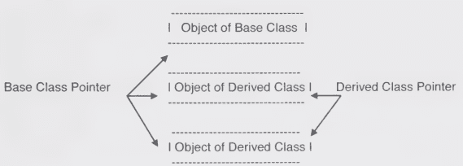

基类指针可以指向基类对象或任何派生类对象。然而，这是一条单行道。指向派生类对象的指针不能指向基类对象。

但是，请回想一下，这带来了一些困难。当我们使用类型为 `Base` 的指针时，唯一可以引用的成员函数（或数据）是属于 `Base` 类的，即使该指针指向一个 `Derived` 类对象！

这不是多态，因为被指向的对象从未接收到发送的消息！原因是编译器只知道指针本身的类型，而不知道指针在运行时最终将指向哪个对象。

面向对象编程语言的目标是向指针所指向的任何对象发送消息，而不是向指针本身的类型发送消息。

为什么这很重要？因为这样你可以在运行时控制指针的内容（或地址），而指针变量本身的类型一旦被硬编码就无法更改。这样一来，对象本身可以“弄清楚”如何处理该消息，从而实现多态的概念。

## 虚函数

### 访问成员函数

让我们看看当基类和派生类都具有同名函数，并且我们使用指针访问这些函数但没有虚函数时会发生什么。给定以下类：

```
class Base {
 protected:
 int value;
 public:
 Base( int x ) { value = x; }
 int getValue() { return value; }
 };
```

我们现在可以声明并使用一个基类对象：

```
int main() {
 Base b(10);
 cout << "value = " << b.getValue() << endl;
 return 0;
 }
```

上述代码生成以下输出：

value = 10

我们现在将从基类派生一个类，将基类值乘以指定的数量：

```
class Derived : public Base {
 protected:
 int mult;
 public:
 Derived( int x, int y ) : Base(x), mult(y) { }
 int getValue() { return value * mult; }
 };
```


现在我们可以声明并使用 Derived 类对象：

```
int main() {
   Derived d(10, 2);
   cout << "value = " << d.getValue() << endl;
   return 0;
}
```

请注意，这里调用的是 Derived 类的 getValue() 成员函数，它返回用于初始化对象的两个值的乘积。上述代码生成的输出为：

```
value = 20
```

## 通过指针访问成员函数

现在让我们声明一个 Base 类指针，并为所寻址的对象调用 getValue() 成员函数：

```
int main() {
   Base *bptr;
   bptr = new Base(10);
   cout << "value = " << bptr->getValue() << endl;
   return 0;
}
```

上述代码生成的输出为：

```
value = 10
```

这与预期一致。

现在我们可以声明一个指向 Derived 类对象的指针，并调用在 Derived 类中定义的替换 getValue() 成员函数。

```
int main() {
    Derived *dptr;
    dptr = new Derived(10, 2);
    cout << "value = " << dptr->getValue() << endl;
    return 0;
}
```

上述代码生成的输出为：

```
value = 20
```

这也与预期一致。

应用 C++ 关于指针和派生类的规则，我们还可以声明一个指向 Base 类的指针，并将 Derived 类对象的地址赋给该指针：

```
int main() {
    Base *bptr;
    bptr = new Derived(10, 2);
    cout << "value = " << bptr->getValue() << endl;
    return 0;
}
```

请注意，bptr 被声明为寻址 Base 类的对象，我们创建了一个 Derived 对象并将该对象的地址赋给了 bptr。但请看这段代码生成的输出：

```
value = 10
```

代码可以编译，但它没有产生预期的结果，即：

```
value = 20
```

就 C++ 所知，bptr 寻址的是一个 Base 类对象。因此，C++ 调用 Base 类中的 getValue() 成员函数！C++ 规则是，由指针本身的类型决定调用哪个成员函数。被指向对象的类型根本不会被考虑！

## 虚函数

但我们确实希望 C++ 调用指针实际寻址的 Derived 对象的 getValue() 成员函数。为了实现这一点，我们必须将 getValue() 声明为虚成员函数。对虚函数的调用在运行时链接（晚期绑定）。虚成员函数和晚期绑定使得对象能够在运行时确定自身行为，这是多态性的主要特征。就 C++ 而言，需要一种方法，将哪个成员函数执行的选择推迟到执行时间。

拥有这种方法意味着，通过使用单个指针和成员函数名，可以将相同的函数调用（消息）发送到指针中存储其地址的对象。如果这些对象以不同方式实现相同的成员函数，则可以获得不同的结果！这种方法称为晚期或动态绑定，因为调用哪个成员函数的决定不再在编译时做出，而是在运行时做出。C++ 规则如下：

> "如果基类定义中的函数被声明为虚函数，并且在一个或多个派生类中以完全相同的方式声明（包括返回类型），那么使用 Base 类类型的指针或引用对该函数的所有调用都将调用由被指向对象指定的函数，而不是由指针本身的类型指定的函数。"

以下代码演示了此规则：

```
// virtual1.cpp
#include <iostream>
using namespace std;
class Base {
    protected:
        int value;
    public:
        Base (int x) { value = x; }
        virtual int getValue() { return value; }
};

class Derived : public Base {
    protected:
        int mult;
    public:
        Derived(int x, int y) : Base(x), mult(y) {}
        virtual int getValue() { return value * mult; }
};

int main() {
    Base *bptr;

    bptr = new Base(10);
    cout << "value = " << bptr->getValue() << endl;
    delete bptr;

    bptr = new Derived(10, 2);
    cout << "value = " << bptr->getValue() << endl;
    delete bptr;

    return 0;
}
```

关键字 virtual 告诉编译器，对 getValue() 的调用应在运行时链接。两个 getValue() 虚成员函数的地址存储在一个内部表中。当语句调用虚成员函数时，C++ 会从此表中查找正确的函数地址。我们稍后会详细讨论这一点。但如果你认为这个查找操作需要时间，你是正确的。使用虚成员函数可能会降低程序的性能（两次额外查找），尽管在实践中严重的减速情况很少见。

上述程序产生的输出为：

```
value = 10
value = 20
```

现在比较上面的两个输出语句。它们完全相同！那么它们如何产生不同的输出呢？我们现在有足够的信息来回答这个问题。被寻址的对象自己确定调用哪个虚 getValue() 成员函数。该决定由程序在运行时而非编译时做出。

请注意，一旦我们在类中将函数声明为虚函数，任何使用相同原型声明相同函数的子类也被视为虚函数。请记住，晚期绑定在 C++ 中仅对类层次结构中的对象有意义。对于未用作基类的类声明虚函数在语法上是正确的，但会导致不必要的运行时开销。

将多态性视为对消息的响应可能会有所帮助。在经典面向对象编程术语中，诸如：

```
bptr->getValue()
```

向 bptr 所寻址的对象发送名为 getValue() 的消息。收到此消息后，对象以某种预定方式响应。更重要的是，相同的消息可以发送到其他对象，这些对象确定自己的响应，或者它们可能忽略该消息。无论 bptr 寻址哪种类型的对象，对象本身都会以其编程方式响应 getValue() 消息。

以下是另一个示例：

```
// virtual2.cpp

#include <iostream>
using namespace std;

class Base {
public:
    void show() { cout << "Base" << endl; }
};

class Derived1 : public Base {
public:
    void show() { cout << "Derived1" << endl; }
};

class Derived2 : public Base {
public:
    void show() { cout << "Derived2" << endl; }
};

int main() {
    Derived1 dv1;
    Derived2 dv2;
    Base *bptr;

    bptr = &dv1;
    bptr->show();

    bptr = &dv2;
    bptr->show();
    return 0;
}
```

现在，当我们执行以下行时：

```
bptr = &dv1;
bptr->show();
```

调用哪个成员函数：

```
Base::show()
or
Derived1::show()
```

或者当我们执行以下行时：

```
bptr = &dv2;
bptr->show();
```

调用哪个成员函数：

```
Base::show()
or
Derived2::show()
```

在每种情况下，被调用的成员函数都是：

```
Base::show()
```

产生以下输出：

```
Base
Base
```

编译器只是忽略指针 bptr 的内容，并选择与指针本身类型匹配的成员函数。

我们可以再次通过在 Base 类中 show() 成员函数的声明前放置关键字 virtual，并可选地在派生类中放置，来更改此行为。

```
// virtual3.cpp
#include <iostream>
using namespace std;
class Base {
  public:
    virtual void show() { cout << "Base" << endl; }
};
class Derived1 : public Base {
  public:
    virtual void show() { cout << "Derived1" << endl; }
};
class Derived2 : public Base {
  public:
    virtual void show() { cout << "Derived2" << endl; }
};

int main() {
    Derived1 dv1;
    Derived2 dv2;
    Base *bptr;

    bptr = &dv1;
    bptr->show();

    bptr = &dv2;
    bptr->show();
    return 0;
}
```

现在生成的输出为：

```
Derived1
Derived2
```

现在执行的是派生类的成员函数，而不是 `Base` 类的成员函数。因此函数调用：

```
bptr->show();
```

根据指针本身的内容执行不同的函数。再次强调，规则是被调用的函数基于指针的内容，而不是基于指针的类型，与之前一样。

## 纯虚函数

在我们之前的示例中，`Base::show()` 永远不会被执行。这是一种常见情况。通常不需要特定函数的基类版本。我们只使用派生类中的函数版本。当这种情况成立时，可以删除基类中虚函数的函数体，并在函数声明中添加符号 `=0`：


```
class Base {
public:
    virtual void show() = 0;
};
```

等号（=）与赋值无关，值 0 也不会被赋给任何东西。= 0 语法只是告诉编译器该函数将是纯虚函数，即没有函数体。这称为纯虚函数。

```
// pvirtual.cpp
#include <iostream>
using namespace std;
class Base {
public:
    virtual void show() = 0;
};
class Derived1 : public Base {
public:
    virtual void show() {
        cout << "Derived1" << endl;
    }
};
class Derived2 : public Base {
public:
    virtual void show() {
        cout << "Derived2" << endl;
    }
};
int main() {
    Base *list[2];
    Derived1 dv1;
    Derived2 dv2;
    list[0] = &dv1;
    list[1] = &dv2;
    for (int i = 0; i < 2; i++)
        list[i]->show();
}
```

输出如下：

```
Derived1
Derived2
```

你可能会问，既然可以删除基类中虚函数的函数体，为什么不能直接删除整个函数！那样会更简洁，但行不通。如果 Base 类中没有 show() 函数，那么像下面这样的语句：

```
list[0]->show();
```

将无效，因为 list[] 数组中的指针必须指向 Base 类的成员。

下面是另一个示例。

```
// student.cpp

#include <iostream>

using namespace std;

class Person {
protected:
	char name[40];
public:
	void setName() {
		cout << "Enter name: ";
		cin >> name;
	}
	void getName() {
		cout << "Name is: " << name << endl;
	}
	virtual int isOutstanding() = 0;
};
```

```
class Student : public Person {
    private:
        float gpa;
    public:
        void setGpa() {
            cout << "Enter students gpa: ";
            cin >> gpa;
        }
        virtual int isOutstanding() {
            return gpa > 3.5;
        }
};

class Professor : public Person {
    private:
        int numPubs;
    public:
        void setNumPubs() {
            cout << "Enter number publications ";
            cin >> numPubs;
        }
        virtual int isOutstanding() {
            return numPubs > 100;
        }
};
```

```
int main() {
    Person *persPtr[100];
    Student *studPtr;
    Professor *profPtr;
    int n=0;
    char choice;

    do {
        cout << "Enter student or professor (s/p): ";
        cin >> choice;
        if (choice == 's') {
            studPtr = new Student;
            studPtr->setName();
            studPtr->setData();
            persPtr[n++] = studPtr;
        }
        else if (choice == 'p') {
            profPtr = new Professor;
            profPtr->setName();
            profPtr->setNumPubs();
            persPtr[n++] = profPtr;
        }
        else
            cout << "Invalid choice." << endl;
        cout << "Enter another (y/n): ";
        cin >> choice;
    } while (choice == 'y');

    for (int i=0; i<n; i++) {
        persPtr[i]->getName();
        if (persPtr[i]->isOutstanding())
            cout << "This person is outstanding!" << endl;
    }
}
```

请注意，在 `main()` 中只有一处对 `isOutstanding()` 的调用，它将在运行时动态绑定到正确的版本。关于使用哪个版本的 `isOutstanding()` 成员函数的决定，将被推迟到运行时。必须推迟，因为指向 `Person` 对象的指针数组在程序运行之前不会有任何指针值，而正是这些指针值决定了最终调用哪个版本。

## 抽象类

虽然所有对象都由类表示，但反之不成立。并非所有类都必然表示对象。一个类不足以完全表示一个对象，这是可能的，而且通常也是可取的。这样的类称为 *抽象类*。就像抽象概念一样，抽象类描述了一个未实现的概念。它是一种示意图，你需要基于它构建一个或多个派生类。

抽象基类通常用于声明接口，而不为该接口声明一整套实现。该接口指定了从该类派生的所有对象所支持的抽象操作，由派生类为这些抽象操作提供实现。

因此，抽象类是一个不完全表示对象，而是表示一大类不同对象的类。但是，重要的是要意识到，这种表示仅扩展到这些对象类所共有的特征。因此，抽象类仅对其对象提供部分描述。

由于抽象类不完全表示对象，因此无法实例化。起初，一个类不能有任何实例可能看起来有点奇怪，但日常生活中充满了这样的类。例如，我们可以说某个特定动物属于所有哺乳动物的类，但我们永远不会看到 Mammal 类的实例。每个属于 Mammal 类的动物也必须属于从属于哺乳动物的类，例如 Mouse、Dog、Human 或 Platypus。这是因为 Mammal 类不完全表示任何动物。

在面向对象设计中，我们永远不会看到抽象类的实例，除非它也是从属类的实例。同样，这是因为抽象类不完全表示任何对象。编写抽象类时，期望其子类会为其结构和行为添加内容。

在 C++ 中，任何声明或继承纯虚函数的类都是抽象类，并且仅存在于作为其他类的基类。事实上，在 C++ 中创建抽象类的实例或对象是非法的！

## 抽象基类示例

考虑两个类，Window 和 Door：


乍一看，这些类似乎互不相关。但它们共享一些有趣的共同特征：

- 它们都是墙上的洞。
- 它们都相对于墙有特定的位置和大小
- 它们都可能处于 3 种状态之一：open, closed, locked
- 可以向它们发送类似的消息：open, close, lock

下面的代码显示了两个类的声明：

```
// window.cpp

class Window {
public:
    enum windowState {opened, closed, locked};
private:
    windowState state;
    int xPos, yPos, width, height;
public:
    void open();
    void close();
    void lock();
    void getState() const;
    void getXPos() const;
    void getYPos() const;
    int getHeight() const;
    int getWidth() const;
};

class Door {
public:
    enum doorState {opened, closed, locked};
private:
    doorState state;
    int xPos, yPos, width, height;
public:
    void open();
    void close();
    void lock();
    void getState() const;
    void getXPos() const;
    void getYPos() const;
    int getHeight() const;
    int getWidth() const;
};
```

这两个类极其冗余，亟需某种形式的统一。这种统一通过创建抽象基类来实现。我们可以将两个类描述为从一个共同的抽象类 Portal 继承，该类包含其接口的所有共同特征。

### Portal

### Window

### Door

下面的代码显示了 `Portal` 抽象基类的声明，以及 `Window` 和 `Door` 派生类的声明：

```
// portal.cpp

class Portal {
public:
    enum portalState {opened, closed, locked};

private:
    portalState state;
    int xPos, yPos, width, height;

public:
    virtual void open() = 0;
    virtual void close() = 0;
    virtual void lock() = 0;
    void getState() const;
    void getXpos() const;
    void getYpos() const;
    int getHeight() const;
    int getWidth() const;
};

class Window : public Portal {
public:
    virtual void open();
    virtual void close();
    virtual void lock();
};

class Door : public Portal {
public:
    virtual void open();
    virtual void close();
    virtual void lock();
};
```

请注意，这允许 `Window` 和 `Door` 对象被刻板化。它们都可以被称为 `Portals`。虽然这对两个对象来说是不完整的描述，但它仍然是准确且有用的。

这种对象刻板化的能力是一种强大的设计工具。它允许我们将一组对象的所有共同方面捆绑到一个抽象类中。这就是为什么我们说：“抽象类为整个类层次结构提供了一个公共接口。”


我们获得的效率是显而易见的。

- Portal 的若干函数可以被复用
- Window 和 Door 的声明简洁明了，易于理解其在 Portal 中的功能
- Window 和 Door 在需要时都可以被刻板化为 Portal

例如：

```
for (i = 0; i < max; ++i)
    portallist[i] -> open();
```

显然，这种打开所有 Window 和 Door 的方法优于分别处理每种类型。随着应用程序的成熟，可能会添加更多类型的 Portal。但由于代码处理所有类型的 Portal，因此无需更改。因此，抽象类 Portal 的多态行为提供了更易维护且更健壮的设计！

请注意，强制 Window 和 Door 继承自 Portal 对于应用程序的正常运行并非必要。可以在没有抽象类的情况下设计应用程序。但是，创建抽象 Portal 类会产生更优的设计，该设计促进多态性和代码复用。

## 虚析构函数

析构函数可以是虚函数，成员函数也可以，但构造函数不行。当一个类需要删除通过基类指针寻址的派生类对象时，通常使用虚析构函数。

未使用虚析构函数的示例：

```
// vdtor1.cpp

#include <iostream>
#include <string.h>

using namespace std;

class Base {
  private:
    char *buf1;

  public:
    Base(const char * s) {
      cout << "Base 1 arg constructor" << endl;
      buf1 = new char[strlen(s) + 1];
      strcpy(buf1, s);
    }

    ~Base() {
      cout << "Base destructor" << endl;
      delete [] buf1;
    }
};

class Derived : public Base {
  private:
    char *buf2;

  public:
    Derived(const char *s1, const char *s2) : Base(s1) {
      cout << "Derived 2 arg constructor " << endl;
      buf2 = new char[strlen(s2) + 1];
      strcpy(buf2, s2);
    }

    ~Derived() {
      cout << "Derived destructor" << endl;
      delete [] buf2;
    }
};
```

```
int main() {
    Base *pbase = new Derived("Haley", "Laurel");
    delete pbase;
    return 0;
}
```

Base 类构造函数为字符串分配存储空间，并将新字符串存储在 buf1 中。Base 类析构函数设置为在 base 类型对象超出作用域时删除此存储空间并将其返回到堆中。

同样，Derived 类构造函数调用 Base 类构造函数，将一个字符串传递给 Base 类，然后为字符串分配存储空间并将新字符串存储在 buf2 中。Derived 类析构函数也设置为在 Derived 类型对象超出作用域时删除此存储空间并将其返回到堆中。当 Derived 对象超出作用域时，重要的是两个字符串都要被删除。

假设你声明一个指向 Base 的指针，但将其赋值为 Derived 对象的地址。这是可以的，因为 Base 类指针可以寻址该类或任何派生类的对象。如下所示：

```
int main() {
    Base* pBase = new Derived ("Haley", "Laurel");
    delete pBase;
    return 0;
}
输出：
Base destructor
```

请注意，Derived 析构函数没有被调用！为什么？因为 pBase 是指向 Base 类的指针，因此 Base 类析构函数与调用链接，即，编译时仅可用 Base 类析构函数。这是静态绑定。

在下面的示例中，让我们将所有析构函数都设为虚函数，看看会发生什么：

```cpp
// vdtor2.cpp
#include <iostream>
#include <string.h>
using namespace std;
class Base {
private:
    char *buf1;
public:
    Base(const char* s) {
        cout << "Base 1 arg constructor " << endl;
        buf1 = new char[strlen(s) + 1];
        strcpy(buf1, s);
    }
    virtual ~Base() {
        cout << "Base destructor" << endl;
        delete [] buf1;
    }
};
class Derived : public Base {
private:
    char *buf2;
public:
    Derived(const char *s1, const char *s2) : Base(s1) {
        cout << "Derived 2 arg constructor " << endl;
        buf2 = new char[strlen(s2) + 1];
        strcpy(buf2, s2);
    }
    virtual ~Derived() {
        cout << "Derived destructor" << endl;
        delete [] buf2;
    }
};
int main() {
    Base *pbase = new Derived("Haley", "Laurel");
    delete pbase;
    return 0;
}
输出：
Derived destructor
Base destructor
```

因为析构函数现在被声明为 `virtual`，对它们的调用在运行时链接，并且对象本身决定应该调用哪个析构函数！因此，将调用 `Derived` 析构函数，它随后隐式调用 `Base` 类析构函数！因此，两个字符串都被删除。

规则：如果在 Base 类中分配内存，则应将析构函数设为虚函数。

请注意，虚析构函数违反了虚函数必须具有相同名称的规则，而析构函数显然没有相同名称，因为它们基于各自的类名称。因此，编译器会考虑到这一点，并简单地忽略析构函数的名称。

## 虚函数机制

要更容易理解编译器如何在运行时定位虚函数，可以考虑涉及的数据结构以及使用虚函数的类对象所使用的内存布局。让我们做一个实验，查看一些对象的大小：

```
class Alpha {
private:
    int i;
public:
    void foo() {}
    void faa() {}
};

class Beta {
private:
    int i;
public:
    virtual void foo() {}
    void faa() {}
};

class Gamma {
private:
    int i;
public:
    virtual void foo() {}
    virtual void faa() {}
};

int main() {
    Alpha a;
    Beta b;
    Gamma g;

    cout << sizeof(Alpha) << endl; // 4
    cout << sizeof(Beta) << endl; // 8
    cout << sizeof(Gamma) << endl; // 8

    cout << sizeof(a) << endl; // 4
    cout << sizeof(b) << endl; // 8
    cout << sizeof(g) << endl; // 8

    void *voidPointer;
    cout << sizeof(voidPointer); // 4
    return 0;
}
```

查看各种类和对象的大小，我们发现当一个或多个函数是虚函数时，大小会有所不同。每当一个类具有一个或多个虚函数时，该类的 `sizeof()` 就会增加 4 个字节或一个指针大小。这个由编译器秘密插入类中的额外指针数据成员称为 vpointer 或 vptr。

vptr 包含一个名为 vtable 的函数指针数组的地址。vtable 包含在类或任何继承类中声明为虚函数的所有函数的地址（指向它们的指针）。包含虚函数的类的每个对象都会提供一个指向该类 vtable 的 vptr。

### 让我们再看看我们的 Gamma 类：

```
class Gamma {
private:
    int i;
public:
    virtual void foo() {}
    virtual void faa() {}
};
```

以下是数据结构的示意图：

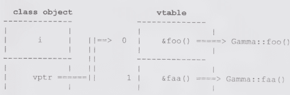

创建对象时，相应的 vtable 地址会被插入到对象的 vptr 中。vptr 在构造函数中初始化为 vtable 的起始地址，因此在 vptr 初始化之前没有机会进行虚函数调用。这是由编译器插入构造函数的秘密代码完成的。请注意，如果 vptr 未初始化，那么第一次进行函数调用时就会出现灾难。这是编译器在你没有显式创建任何构造函数时自动创建默认构造函数的一个重要原因。生成的默认构造函数的一项工作是初始化 vptr。

当你调用虚函数时，编译器不会执行正常的函数调用，即对某个地址的绝对调用。这将是早期或静态绑定，这是 C 编译器总是做的事情。我们不想要这个！相反，在编译器对函数调用执行通常的类型检查后，编译器会插入一段特殊的代码，内容如下：

- 转到 vptr 指向的地址
- 按 x 个位置索引此数组并调用该函数

因此，确切的函数调用在运行时由 vptr 中的 vtable 地址决定。请注意，vtable 中函数的顺序至关重要，因为编译器通过索引表来调用函数。因此，所有 vtable 必须具有相同的函数顺序。这个固定索引在整个继承层次结构中都与特定的虚函数相关联。幸运的是，所有这些都由编译器为我们处理！

请记住，每个派生类都有自己的 vtable。对于每个派生类，基类的 vtable 会被复制，如果在派生类中重新定义了虚函数，则其地址会替换基类中相应函数的地址。在派生类中定义的任何新虚函数都会附加到 vtable 的末尾。例如，下面显示了一个带有三个声明的虚函数的基类：

```
class Base {
 private:
 int i;
 public:
 virtual void foo();
 virtual void faa();
 virtual void laa();
};
```


创建的内部数据结构如下所示：

```
Base class object                   Base vtable
+---+                               +---+
| i | -------------------> 0        | &foo() -------> Base::foo()
+---+                               +---+
| vptr ----------------> 1          | &faa() -------> Base::faa()
+---+                               +---+
                                    2   | &laa() -------> Base::laa()
                                        +---+
```

派生类声明如下：

```
class Derived : public Base {
  public:
    virtual void faa();
    virtual void taa();
};
```

其内部数据结构如下所示：

```
Derived class object                Derived vtable
+---+                               +---+
| i | -------------------> 0        | &foo() -------> Base::foo()
+---+                               +---+
| vptr ----------------> 1          | &faa() -------> Derived::faa()
+---+                               +---+
                                    2   | &laa() -------> Base::laa()
                                        +---+
                                    3   | &taa() -------> Derived::taa()
                                        +---+
```

因此，每次派生一个新类时，编译器都会为该派生类创建一个新的 `vtable`。在派生类中可能出现三种情况：

- 派生类可以继承基类中声明的虚函数。该虚函数的地址会被复制到派生类虚函数表的相应槽位中。
- 派生类可以用其自身的虚函数覆盖基类中声明的虚函数。在这种情况下，派生类虚函数的地址会被放置在相应的槽位中。
- 派生类可以引入基类中不存在的新虚函数。在这种情况下，虚函数表的大小会增加一个槽位，并将该虚函数的地址放置在该槽位中。请注意，虚函数表的每个槽位中始终都有一个虚函数地址。

虚函数调用方案如下：

- 从 `vptr` 中检索对象的 `vtable` 指针。
- 请记住，`vtable` 中每个虚函数的索引是在编译时建立的类层次结构中每个 `vtable` 的常量值。因此，`vtable` 指针将根据相关虚函数的索引进行偏移
- `vtable` 包含指向所需虚函数的条目（一个指针）。
- 检索到的函数指针会被解引用，并执行函数调用。

因此，给定以下声明：

```
Base *bptr = new Derived;
```

编译器会将语句：

```
bptr->faa();
```

翻译为：

```
* (bptr->vptr) [1] ();
```

我们可以这样解释这条语句：

- vptr 是 Derived 对象中的一个指针，指向 Derived 类的虚函数表
- bptr->vptr 是 Derived 类虚函数表的地址
- (bptr->vptr) [1] 是 Derived 类虚函数表中的第二个条目，包含虚函数 Derived::faa() 的地址。
- * (bptr->vptr) [1] () 解引用函数指针并调用函数 Derived::faa()。

## 如何在 C++ 中泄漏内存

本文发表于1997年3月的《C/C++ Users Journal》(www.cuj.com)，并经总编辑Mark Briand授权在此刊登。本文由Rodney B. Doe, P.E.撰写，他拥有西雅图华盛顿大学机械工程学士学位。他目前在华盛顿州柯克兰市的Micro Encoder, Inc.担任高级软件工程师。可通过电子邮件rodneyd@microen.com联系他。

警告：这里是未经训练的专业人士在工作。请勿在家中尝试。

在软件工程中，为进程从操作系统动态分配内存是常见做法。C 和 C++ 不要求进程在不再需要内存时释放该内存。当进程忘记将内存归还给操作系统时，该内存的实用性就会丧失。以这种方式丧失内存使用权，通常被称为内存泄漏。

本文旨在向在职软件工程师描述如何使用 C++ 语言实现内存泄漏。此处介绍的策略经得起考验，并在实际工业实践中得到验证。它们实现起来极其简单。此外，这些技术具有可移植性，可应用于任何操作系统。如果严格且勤奋地使用，它们将为您的应用程序提供足够严重的内存泄漏流。

### 策略 1. 根本不删除它

如果您喜欢简单处理，那么这就是适合您的内存泄漏策略。使用时，只需省略对使用 `new` 运算符动态分配的内存应用的相应 `delete` 运算符即可。但请记住，使用此技术会让您被贴上业余爱好者的标签。任何像样的内存错误检测工具都会将其标记出来。如需了解更多隐蔽的内存泄漏策略，请继续阅读。

### 策略 2：使用多个 return 语句

还记得那些满身粉笔灰的古怪老大学教授告诉过你，在函数中只能使用一个 `return` 语句吗？嗯，显然，那位教授对如何泄漏内存一无所知。使用多个 `return` 实际上允许您在动态分配的内存被释放之前退出函数。

以下是一个示例：

```
// Memory leak

bool AdjustTemperature(HTHING hThing) {
    if (!hThing)
        return(false);

    // Instantiate a Thing using a handle
    Thing *pThing = new Thing(hThing);
    if (!pThing)
        return(false);

    // Get Thing's color and adjust temperature accordingly
    switch(pThing->Color()) {
    case BLUE:   AdjustTemperature(5);  return(true);
    case RED:    AdjustTemperature(-5); return(true);
    default:     break;
    }

    // For what colors does this get executed?
    delete pThing;
    return( false );
}
```

如上述代码片段所示，程序员通过不使用局部布尔变量来跟踪成功或失败，节省了几个时钟周期。他不需要局部变量，因为每当代码遇到错误时，它就会返回给调用者。这段代码确实会向调用者返回正确的结果。但是，如果 Thing 的颜色是红色或蓝色，pThing 指向的内存永远不会被删除。请注意，如果必须在旧版代码中实现内存泄漏，也可以使用 malloc 和 free 而不是 new 和 delete 来在传统 C 语言中实现此技术。

### 策略 3：使用大量同名指针

C++ 允许并鼓励程序员在靠近使用点的位置声明自动变量。因此，您可以在分配内存的位置直接声明一个指向已分配内存的自动变量。这种功能为内存泄漏者提供了一个独特的机会。在函数开头（以传统方式）声明一个指针，并在实例化点的内部作用域中声明另一个同名指针。这将创建一个相当令人困惑的内存泄漏。以下是一个示例：

```
void ChangeColor(HTHING hThing, int color) {
 Thing *pThing = NULL;
 if (IsValid(hThing) != false) {
 Thing *pThing = new Thing(hThing);
 pThing->Color(color);
 }

 // Which pThing is this?
 delete pThing;
}
```

在这段代码片段中，声明了两个名为 pThing 的 Thing 指针。if 语句内部的那个指针指向一个 Thing 对象实例，该实例永远不会被删除。真正被删除的 pThing 在删除时为 NULL。C++ 保证删除空指针是无害的。因此，内存错误检测工具可能不会将此删除标记为错误，因为这是一个有效的操作。

乍一看上面的函数，您会认为 pThing 被删除了，所以似乎没有问题。这是一种绕过代码评审的好技巧。

### 策略 4：在数组上使用 delete

要使用此策略，请使用数组 new 运算符 (new[]) 分配数组，然后使用普通旧版 delete 释放内存，如下所示：

```
char *pBuf;
pBuf = new char[100];
delete pBuf; // NOT delete[] pBuf;
```

可能不止几位读者此刻突然感到一阵紧张。如果您使用 delete 运算符（而不是 delete[] 运算符）来释放使用 new[] 分配的对象，则当前的行为是未定义的。即使您现在能侥幸逃脱，以后也可能会惹上麻烦。或者，它可能只是泄漏内存。大胆尝试吧，给您的生活增添一些风险，并大胆使用它。

### 策略 5：实践粗心的多态性

此策略利用了析构函数不被继承的事实。在 C++ 中，将派生类对象的地址存储为指向其基类的指针不仅是可能的，而且非常可取。您可以通过基类指针引用此派生类对象来获得多态行为。以下程序


实例化一个派生类对象，并将其地址存储为指向其基类的指针：

```cpp
#include <iostream>
using namespace std;
class Base {
public:
Base();
~Base();
};
class Derived : public Base {
protected:
char *pBuf;
public:
Derived();
~Derived();
};
Base::Base() {
cout << "Base::Base()" << endl;
}
Base::~Base() {
cout << "Base::~Base()" << endl;
}
Derived::Derived() : Base() {
pBuf = new char[100];
cout << "Derived::Derived()" << endl;
}
Derived::~Derived() {
delete[] pBuf;
cout << "Derived::~Derived()" << endl;
}
int main() {
Base *pObject = new Derived();
delete pObject;
return 0;
}
```
输出：
Base::Base()
Derived::Derived()
Base::~Base()

请注意，`Derived` 类的析构函数未被调用。因此可能会泄漏缓冲区 `pBuf`，因为它是在 `Derived` 构造函数中分配的。要修复此问题，只需将 `Base` 类的析构函数声明为虚函数，如下所示：

```cpp
class Base {
public:
    Base();
    virtual ~Base();
};
```

修改后，程序输出将为：

```
Base::Base()
Derived::Derived()
Derived::~Derived()
Base::~Base()
```

现在调用了 `Derived` 类的析构函数，并删除了 `Derived::pBuf`。

## 结论

现在，你已经见识到了资深 C++ 程序员用来实现内存泄漏的一些实用技巧。如果你使用上述描述的策略，就不必自己发明了。毕竟，代码重用才是 C++ 的精髓。需要注意的一点是：这些内存泄漏场景是由不当使用 C++ 造成的，并非语言本身固有的。因此，当你的应用程序在地球另一端的客户现场内存耗尽时，你可能无法成功地将责任推给 C++。

## 多态作业

注意：这些都是最近一次期末考试中出现过的问题。

- 1. 多态如何有助于面向对象系统的设计？
- 2. 解释 vptr 和 vtable 在虚函数实现中的作用。
- 3. 什么是纯虚函数，你为什么要使用它？
- 4. 虚析构函数的目的是什么？
- 5. 描述一个类有析构函数但没有构造函数是合理的情况。
- 6. 不执行以下代码，给出下列程序的输出。

```cpp
class Base {
public:
    void f() {
        cout << "Base::f()" << endl;
    }
    virtual void g() {
        cout << "Base::g()" << endl;
    }
};

class Derived : public Base {
public:
    void f() {
        cout << "Derived::f()" << endl;
    }
    virtual void g() {
        cout << "Derived::g()" << endl;
    }
};

int main() {
    Base b;
    Derived d;

    Base* bp = &b;
    Base* bq = &d;
    Derived* dp = &d;

    bp->f();
    bp->g();
    bq->f();
    bq->g();
    dp->f();
    dp->g();
    return 0;
}
```

## 多态实验（图书馆馆藏）

在本次作业中，你将通过设计一组表示图书馆馆藏的类，学习如何使用继承和虚函数。我们的图书馆有两种物品：书籍和录音。每种物品都有标题和一个整数索书号。此外，书籍有作者，录音有表演者和格式（MP3、WAV、AIFF）。除了构造函数和析构函数外，每种馆藏都应有一个 `print()` 函数，用将其数据显示到用户指定的 `ostream` 对象（如 `cout`）上。

你应首先设计一个 Holding 类，包含书籍和录音共有的所有数据。它还应有一个纯虚 `print()` 函数。然后设计 Book 和 Recording 类，以添加这些类型物品所需的详细信息并实现 `print()` 函数。请注意，Holding 将是一个抽象基类，因为它将有一个纯虚函数。这是合理的，因为不存在通用的馆藏，只有书籍和录音。

这三个类都应同时具有拷贝构造函数和接受各个数据字段作为参数的构造函数。虽然有一个无参数的默认构造函数来查询用户并读取数据字段看起来很自然，但在构造函数中执行 I/O 可能不明智。如果构造函数执行 I/O，类实现将与特定的数据获取方式绑定。使用此类的应用程序可能会从文件读取输入，在这种情况下提示消息将不合适，或者它们可能使用不支持 `cin` 和 `cout` I/O 流对象的基于窗口的界面。由于构造函数是类操作中如此基本的一部分，最好让用户决定其输入数据来自何处。

一旦你编写了实现 Holding、Book 和 Recording 类的代码，就应该编写一个简单的程序来测试它们。该程序应声明一个包含五个指向 Holding 对象的指针的数组，然后反复调用一个创建新 Holding 的函数。该函数询问用户要输入哪种 Holding，然后输入创建 Book 或 Recording 所需的数据。使用这些数据创建适当类的新对象，并返回结果指针。

请注意，尽管该函数始终返回 Book 指针或 Recording 指针，但可以将其声明为返回 Holding 指针，并且可以不进行转换地返回新创建对象的指针。然后将此指针存储在数组中，并再次调用该函数，直到创建所有五个对象（请参见下方数据）。现在有一个包含五个指向 Holding 对象的指针的数组，每个对象都“知道”自己是 Book 还是 Recording，尽管程序没有直接方式查询它们以获取此信息。但是，它可以遍历数组并为每个对象调用虚拟 `print()` 函数，然后该函数将使用适当的虚拟函数来打印自身。下面显示了一个示例会话，为清晰起见，用户响应以粗体显示。

```
Enter holdings to be stored in a list:
Enter B for book, R for recording: B
Enter book title: Harry Potter
Enter book author: Rowling, J.K.
Enter call number: 101
Enter B for book, R for recording: R
Enter recording title: Abbey Road
Enter performer: The Beatles
Enter format: (M)P3, (W)AV, (A)IFF: W
Enter call number: 401
Enter B for book, R for recording: R
Enter recording title: Lone Star State of Mind
Enter performer: Nanci Griffith
Enter format: (M)P3, (W)AV, (A)IFF: A
Enter call number: 402
Enter B for book, R for recording: B
Enter book title: The Hitchhiker's Guide to the Galaxy
Enter book author: Adams, Douglas
Enter call number: 102
Enter B for book, R for recording: R
Enter recording title: Tapestry
Enter performer: Carole King
Enter format: (M)P3, (W)AV, (A)IFF: M
Enter call number: 103
Here are the holdings:
BOOK: Rowling, J.K. “Harry Potter” 101
RECORDING: “Abbey Road” The Beatles (WAV) 401
RECORDING: “Lone Star State of Mind” Nanci Griffith (AIFF) 402
BOOK: Adams, Douglas “The Hitchhiker's Guide to the Galaxy” 102
RECORDING: “Tapestry” Carole King (MP3) 103
```

提交三个类和测试程序的所有代码，以及一个示例运行，显示书籍和录音的输入交错进行，如上述示例所示。请为实验使用我上面的数据。输出应同时发送到终端窗口和 csis.txt 输出文件。请不要在构造函数中使用 C++ 字符串类创建任何字符串对象。

## 多重继承简介

## 多个基类构造函数

## 虚基类

## 对多重继承的最后评论

## 多重继承作业

## 多重继承简介

迄今为止，派生类和基类通过单一继承相关联。多重继承描述了一种更复杂的关系，其中单个类从多个基类继承数据成员和成员函数。

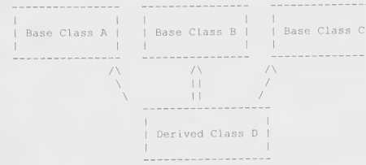

要从多个基类派生新类，只需在新派生类后列出基类名称：

```cpp
class D : public A, public B, public C {
};
```

在这里，类 D 从类 A、B 和 C 继承。

多重继承的基本需求在于，在 C++ 中可以从头开始构建继承层次结构。这意味着你可能从供应商 A 购买一个类库，从供应商 B 购买另一个类库，各自拥有自己的继承树。因为你可能希望混合两个或多个独立类层次结构的特性，所以你需要能够一次从多个类继承。

| 类 1 | + | 类 2 | = | 派生类 3 |
|---|---|---|---|---|
| Boat | + | Plane | = | SeaPlane |
| Date | + | Time | = | DateTime |
| Painter | + | Artist | = | PortraitPainter |
| Text Window | + | Scrollable Window | = | ScrollableTextWindow |


在多重继承中，派生类从所有列出的基类接收所有可继承的属性。如果发生名称冲突，例如同一名称出现在多个基类中（即，两个基类声明了同名的成员函数或数据成员），并且该名称在派生类中未被重写，则使用它将是一个错误，即使成员是私有的或具有不同的参数集。

修复方法是使用作用域解析运算符来指定你打算使用的成员：

```
class A {
public:
    int a;
    void foo();
};

class B {
private:
    int a;
    void foo(int);
};

class C : public A, public B {
};

int main() {
    C myObj;

    myObj.foo();        // error - ambiguous
    myObj.foo(5);       // error - ambiguous
    myObj.a = 3;        // error - ambiguous
    myObj.A::foo();     // OK
    myObj.A::a = 3;     // OK
    return 0;
}
```

## 多个基类构造函数

从多个基类派生的类可能还需要调用多个基类构造函数：

```
class D : public A, public B, public C {
    public:
    D() : A(), B(), C() {}
};
```

这假设 A、B 和 C 是带有默认构造函数的类，并且类 D 可以调用这些构造函数。

请注意，构造函数的调用顺序与其基类声明的顺序相同。但是，通常不明智的是设计依赖于其他类对象按特定顺序构造的类。

作为一条规则，类应该尽可能相互独立地运行。

## 虚基类

使用多重继承时，基类在派生类中不能指定多次：因此，此声明不合法：

```
class Base {};
class Derived : public Base, public Base {};
```

但是，基类可以合法地间接多次传递给派生类：

```
class X : public Base {
public:
    int num;
    void getNum();
};

class Y : public Base {
public:
    int num;
    void getNum();
};

class Z : public X, public Y {
public:
    int num;
    void getNum() { return num; }
};
```

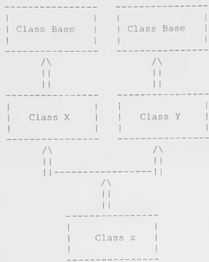

请注意，上述继承树显示相同的 `Base` 类出现了两次。在这种情况下，类 `Z` 的每个对象将拥有两个类 `Base` 的子对象，每个子对象都有自己的数据！

还要注意，函数 `getNum()` 现在具有歧义。编译器不知道指的是哪个 `num`！因此必须对该函数应用作用域解析运算符：

```
int Z::getNum() {
    return X::num;
}
```

在实例层次结构中拥有同一基类的多个副本不仅令人困惑，而且浪费存储！解决方案是将基类声明为 `virtual`。这迫使编译器在派生类的声明中只允许给定基类的一个副本：

```
class Base {
public:
    int num;
};

class X : public virtual Base {};
class Y : public virtual Base {};

class Z : public X, public Y {
public:
    int getNum() { return num; }
};
```

请注意，我们不再需要在类 Z 的 getNum() 成员函数的返回语句中使用作用域解析运算符。Base 现在是虚基类，类 Z 只有一个类 Base 的对象。

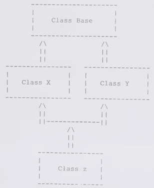

请注意，虚基类仅在多重继承的上下文中使用，与抽象基类（包含纯虚函数的类）无关。

## 对多重继承的最后评论

多重继承是 C++ 语言在初始发布后，在众多争论中添加的一个特性。面向对象编程语言的专家们仍在争论多重继承是 C++ 的缺陷还是特性，因为多重继承和虚函数的存在使得在程序中设计出无意的歧义成为可能，这些歧义直到运行时才能被检测到。

多重继承被视为 90 年代的 `goto`'s，是你应该了解但通常应避免的东西。

## 多重继承作业

- 1. 作为军事视频游戏的一部分，设计者创建了一个车辆类层次结构。基类是 `Vehicle`，它有 `AirVehicle`、`LandVehicle` 和 `SeaVehicle` 作为派生类。类 `SeaPlane` 同时继承自 `AirVehicle` 和 `SeaVehicle`。具体来说，在开发 `SeaPlane` 类时必须考虑哪些 **设计问题**？

- 2. **抽象基类**和**虚基类**之间有什么区别？

- 3. 不执行代码，给出以下程序的输出。

```
class A {
    protected:
        int fa;
    public:
        A(int va = 0) : fa(va) {
            cout << "A constructor " << endl;
        }
        A(const A& va) : fa(va.fa) {
            cout << "A copy constructor " << endl;
        }
        ~A() {
            cout << "A destructor" << endl;
        }
        A& operator=(const A& va) {
            cout << "A = operator" << endl;
            fa = va.fa;
            return *this;
        }
};

class B : public A {
    protected:
    int fb;
    public:
    B(int va = 0, int vb = 0) : fb(vb), A(va) {
        cout << "B constructor " << endl;
    }
    B(const B& vb) : fb(vb.fb), A(vb) {
        cout << "B copy constructor " << endl;
    }
    ~B() {
        cout << "B destructor" << endl;
    }
    B& operator=(const B& vb) {
        cout << "B = operator" << endl;
        A::operator=(vb);
        fb = vb.fb;
        return *this;
    }
};

int main() {
    B b1(1, 2);
    B b2;
    b2 = b1;
    B b3(b1);
    return 0;
}
```

## 第 16 章 模板

- 模板简介
- 函数模板
- 类模板

### 模板简介

正如类是构建对象的示意图一样，模板是构建函数和类的示意图。它们为函数和类提供规范，但不提供实际的实现细节。

使用模板，你可以开发支持相同操作但针对不同数据类型的泛型函数和类。你可以编写对各种数据类型进行排序、搜索和交换的模板函数。你可以创建模拟泛型数据结构的模板类，例如数组、矩阵、列表、树、哈希表和图。

模板可用于实现与其操作对象的类型大体无关的数据结构和算法。例如，栈模板可能描述如何实现任意对象的栈。一旦定义了该模板，用户就可以编写使用整数栈、字符串栈等的代码。

编译器将确定使用了哪些类型的栈，并自动生成这些栈类的实现。

### 函数模板

函数模板为你提供了编写单个函数的功能，该函数是一组函数的骨架或模板。它们提供了一种机制来创建泛型函数，即单个函数可以同时为其参数或参数支持多种数据类型。

在此函数中，至少有一个形式参数是泛型的。只有在需要调用时，此函数模板才会成为具有实际类型的真实函数。

### 但是函数重载有什么问题呢？

我们已经了解了在 C++ 中如何重载函数以及由此可能获得的好处。

主要优点是函数重载减轻了使用你函数的人的负担，他们不需要知道本质上执行相同任务的各种函数的不同名称。不幸的是，重载函数虽然比 C 中可用的有了巨大改进，但并不是解决编写行为相似的函数时固有问题的终极方案。

为了了解原因，这里有一个名为 max() 的函数，它返回两个输入参数中较大的一个：

```
int max(int x, int y) { return x > y ? x : y; };
long max(long x, long y) { return x > y ? x : y; };
double max(double x, double y) { return x > y ? x : y; };
char max(char x, char y) { return x > y ? x : y; };
```

我们让 C++ 的重载函数特性根据数据类型来决定调用哪个函数！

但是请注意，max() 必须不断重载，以适应可能用于调用它的各种参数类型。这涉及太多重复的编码。每个函数都在做基本相同的事情，即返回其两个参数中较大的一个。


与其编写许多相似的 `max()` 函数，不如编写一个 `max()` 函数，它返回两个参数中较大的一个，并能容纳几乎任何类型的参数，这不是很好吗？

### 为什么不使用宏

你可以编写宏来解决这个问题，但你会失去确保不比较不同类型参数的能力。例如，如果你的意图是保证两个参数是相同类型，那么宏就不起作用：

```cpp
#define max(x, y) ((x) > (y) ? (x) : (y))

int main() {
    cout << max(1, 2.98) << endl;
    cout << max('A', 32) << endl;
    cout << max(++a, b++) << endl;
    return 0;
}
```

这里没有类型检查，并且在使用前缀或后缀表示法时，参数可能会被求值两次。

### 模板函数

模板函数提供了一种机制，使程序员可以利用宏解决方案的简洁性，同时不放弃强类型语言的任何优点。

函数模板通过允许你编写一个函数来解决这个问题，该函数作为一系列任务相似的函数的骨架或模板。同时，会进行完整的类型检查。

当你发现自己正在编写一系列相同的重载函数时，应该考虑使用函数模板。通过使用模板，你可以让数据类型本身成为参数，从而为一组相关的重载函数定义模式！

```cpp
template <class T>
T max (T a, T b) {
    return a > b ? a : b;
}

int main() {
    cout << max(15, 16) << endl;
    cout << max('A', 'B') << endl;
    return 0;
}
```

`template` 关键字向编译器指示存在一个函数模板。`T` 符号是一个占位符符号，指示编译器可以在编译时替换适当的数据类型。

当编译器看到模板函数时，它会存储模板代码以供将来引用。模板代码本身不会被编译。要使用模板函数，你需要将其与数据类型关联。然后，编译器会为你指定的数据类型实例化模板函数的一个副本。

模板函数通常在头文件中声明：

```cpp
// minmax.h

#ifndef _MINMAX_H
#define _MINMAX_H

template <class T>
T max (T a, T b) {
    return a > b ? a : b;
}

template <class T>
T min (T a, T b) {
    return a < b ? a : b;
}

#endif
```

在此示例中，`template <class T>` 说明 `T` 是一种未指定的类型，模板函数 `max()` 返回该类型。此外，`max()` 和 `min()` 需要两个 `T` 参数。函数的语句是稍后在指定 `T` 的实际类型时生成的实际语句的示意图。

```cpp
int main() {
    int i1 = 100, i2 = 200;
    double d1 = 3.14, d2 = 9.876;
    char c1 = 'A', c2 = 'z';
    cout << max(i1, i2) << endl;
    cout << max(d1, d2) << endl;
    cout << max(c1, c2) << endl;
    return 0;
}
```

每个 max() 函数返回不同的数据类型，并要求参数对为相同类型。

请记住，你也可以使用多个占位符。例如，你可以用两种不同的可能类型声明 max()：

```cpp
template <class T1, class T2>
T1 max(T1 a, T2 b);
```

这将返回类型 T1 的值，并需要两个参数，一个是类型 T1，另一个是类型 T2。

### 类模板

你已经知道类如何帮助你重用代码并复用代码以进行更高效的编程。模板将抽象级别提高一级，并使你能够自动创建适用于不同数据类型的单独类。

类模板比模板函数更强大！你可以使用模板创建一个类定义，以描述一个处理整数的类、一个处理字符的类和一个处理浮点数的类，所有这些都在一个类定义中，无需编写任何新代码。

类模板指定如何构建单个类，就像类声明指定如何构建单个对象一样。

例如，用户通常需要一个向量，其元素类型是向量类编写者未知的类型。因此，向量类应该以将元素类型作为参数的方式来表达。

```cpp
// vector01.cpp

void error(char *);

class String {};
class Distance {};

template <class T>
class Vector {
    private:
        T *v;
        int size;
    public:
        Vector(int s) {
            if (s <= 0)
                error("Bad vector size.");
            size = s;
            v = new T[size]; // allocate an array of s T's
        }
        ~Vector() { delete [] v; }
        int getsize() { return size; }
        T& operator[](int i) { return v[i]; }
};
```

添加到普通类声明前的 `template <class T>` 前缀指定正在声明一个需要类型参数的模板。这定义了一个类模板，即如何创建一组相关类的规范。在此示例中，向量模板指定如何为单个元素类型创建向量类。

现在可以定义和使用指定类型的向量了：

```cpp
int main() {
    Vector <int>    v1(100);    // generate a vector of 100 ints
    Vector <char>   v2(200);    // generate a vector of 200 chars
    Vector <char*>  v3(300);    // generate a vector of 300 char *
    Vector <String> v4(400);    // generate a vector of 400 objects
                                // of the String class
    Vector <Distance> v5(500);  // generate a vector of 500 objects
                                // of the Distance class

    return 0;
}
```

请注意，与直接指定所有涉及类型的类相比，这没有运行时开销。

### Stack 类的类模板

```cpp
// stack1.cpp

template <class T>
class Stack {
    private:
        int size;
        int top;
        T *s;
    public:
        Stack(int max = 100);
        ~Stack();
        void push(T);
        T pop();
        T Top();
        int empty();
        int full();
        void clear();
};
```

```cpp
template <class T>
Stack<T>::Stack(int max) {
    size = max;
    top = -1;
    s = new T[size];
}

template <class T>
Stack<T>::~Stack() {
    delete [] s;
}

template <class T>
void Stack<T>::push(T d) {
    s[++top] = d;
}

template <class T>
T Stack<T>::pop() {
    return s[top--];
}

template <class T>
T Stack<T>::top() {
    return s[top];
}

template <class T>
int Stack<T>::empty() {
    return top == -1;
}

template <class T>
int Stack<T>::full() {
    return top == size - 1;
}

template <class T>
void Stack<T>::clear() {
    top = -1;
}
```

当使用 Stack 模板声明对象时，Stack 类模板定义了一组类。请注意，必须提供一种类型来占据模板声明中虚拟类型 T 的位置。

我们可以按如下方式实例化 Stack 对象：

```cpp
int main() {
    Stack <char> sc(100); // declares an object sc which is a stack
                          // that stores up to 100 character values
    Stack <int> si(200); // declares an object si which is a stack
                         // that stores up to 200 integer values
    Stack <char*> sp(300); // declares an object sp which is a stack
                           // that stores up to 300 char* values
    Stack <String> ss(400); // declares an object ss which is a stack
                            // that stores up to 400 String values
    return 0;
}
```

除了名称的特殊语法外，Stack <char> 的工作方式完全就像 char 已内置到定义中一样。所有 Stack 对象的实例化也是如此。请注意，当唯一的变化是类型声明时，这种机制使我们免于重新编写类声明。

将模板添加到 C++ 的主要动机是它们对通用集合类的支持。不仅可以创建整数和字符的栈，还可以创建浮点数的栈、字符串的栈等。我们可以创建任何用户定义类型的栈！

```cpp
// Record Class Example - record1.cpp

class String { };

template <class K, class D>
class Record {
    private:
        K key;
        D data;
    public:
        Record() { }
        Record(K kx, D dx) {
            key = kx;
            data = dx;
        }
        K getkey() { return key; }
        D getdata() { return data; }
};
```


```cpp
int main() {
    Record <int, float> r1;
    Record <long, char> r2(50000, 'A');
    Record <int, String> r3;
    return 0;
}
```

请记住，在模板类定义之外定义的成员本身也需要是模板。类作用域标识符必须包含模板参数：

```cpp
// record2.cpp
class String {};

template <class K, class D>
class Record {
private:
    K key;
    D data;
public:
    Record() {}
    Record(K kx, D dx);
    K getkey() { return key; }
    D getdata() { return data; }
};

template <class K, class D>
Record<K, D>::Record(K kx, D dx) {
    key = kx;
    data = dx;
}

int main() {
    Record <int, float> r1;
    Record <long, char> r2(50000, 'A');
    Record <int, String> r3;
    return 0;
}
```

对 C++ 编程语言及其对数据抽象、抽象数据类型和面向对象编程的支持的详细研究。介绍了面向对象编程的基本要素，包括对象、类、封装、构造函数和析构函数、函数和运算符重载、引用、赋值和初始化、容器关系、继承、多态性和模板。

