# 控制系统软件的形式化验证 (普林斯顿应用数学系列, 58)

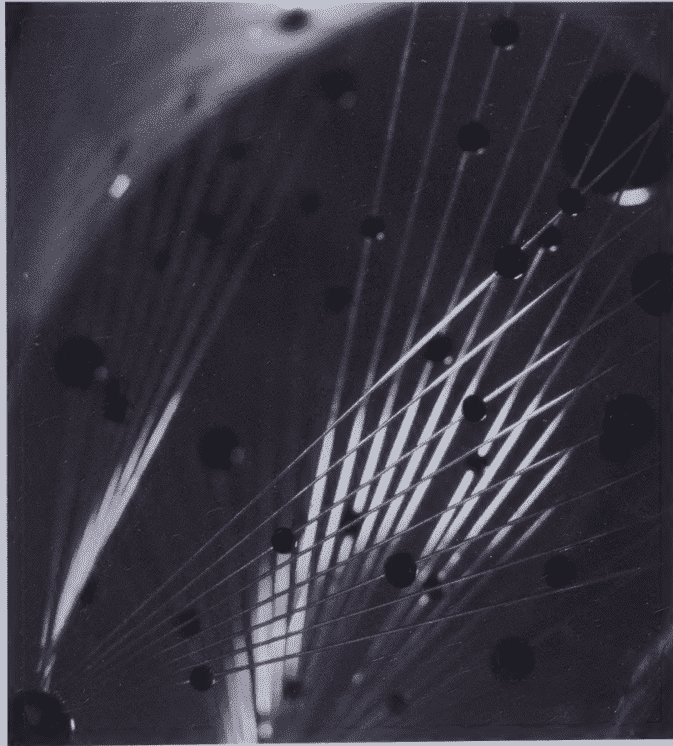


https://archive.org/details/formalverificati0000garo

Ingrid Daubechies (杜克大学); Weinan E (普林顿大学); Jan Karel Lenstra (阿姆斯特丹数学与信息中心); Endre Süli (牛津大学)

普林顿应用数学系列出版了应用数学所有领域的高质量高级教材和专著。书籍包括理论性和通用性质的著作，也包括处理特定应用领域数学和现实世界情况的著作。

该系列的书目列于书末。

普林顿与牛津

6 Oxford Street, Woodstock, Oxfordshire OX20 1TR


献给 Pierre Garoche：船长、工程师和研究员

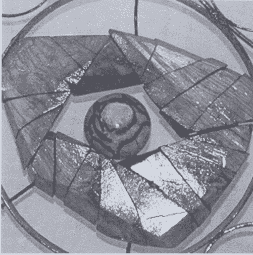

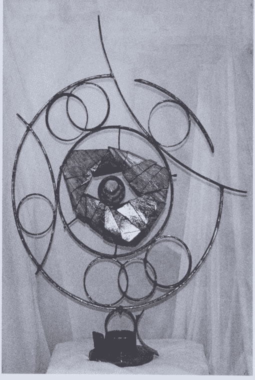

# 第一部分：验证关键信息物理系统的需求与工具

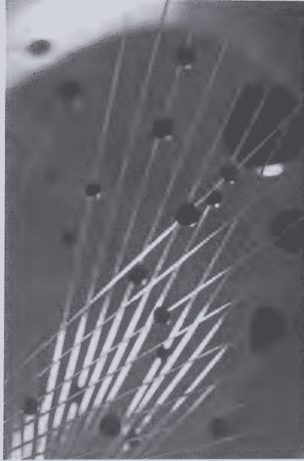

# 第一章：关键嵌入式软件 控制软件开发与验证确认 (V&V)

信息物理系统 (CPS) 是一个术语，指由机载计算机的嵌入式系统控制的物理设备集合。关键嵌入式系统是那些不允许故障的系统子集。这通常涵盖汽车、飞机、铁路系统、空间系统甚至医疗设备，它们要么是为了安全，要么是为了避免故障带来的巨大成本。

这些系统的大部分是控制器。它们被构建为一个大型环，读取传感器值，计算反馈，并通过执行器将其应用于系统。对于大多数系统，至少在航空航天领域，控制器的时间调度非常紧迫，以至于这些系统必须是“实时”的。这些系统的设计方式要求环路执行在一定时间内完成，以维持系统的合理状态。在民用工业中，控制器本身相当复杂，但是由更简单的控制器组合而成的。此外，全局系统考虑了传感器、网络、计算机、执行器的潜在故障并进行相应调整。

计算机在这些系统中的增加带来了巨大的收益，但也导致了复杂性的指数增长。与模拟电路相比，基于计算机的系统实现了更高效的行为以及尺寸和重量的减轻。例如，制造商正在为飞机设计控制律，使其在不稳定的边缘运行，允许更高效的行为；

> 在 A380 中，燃料在箱体之间转移以移动重心向后（后端）。这降低了自然稳定性，但减少了对升面的需求，并通过最小化总重量和阻力提高了燃油效率。见 Norris 和 Wagner 著的《空客 A380：21世纪的巨型》[58]。

> ²搜索损伤容性飞行测试视频，例如在 https://www.youtube.com/watch?v=TPmpq_8SSCI

Rockwell Collins 为一种战斗机实现了一种控制器，能够在飞机在飞行中丢失一侧机翼 60% 到 80% 时恢复控制能力；United Technology 能够将巨大沉重的电力系统替换为电子对应物，极大地减轻了尺寸和重量。³

向控制系统大量引入计算机的缺点是计算机和软件都缺乏预测性。虽然工业已经习惯于获取组件的精确特性（例如在特定条件下运行的物理设备的故障率），但由于计算机程序的内在复杂性，这些数据对于软件来说是非常不可靠的。

尽管如此，我们现在都习惯于接受某些软件许可，即软件供应商不对软件的使用及其可能产生的影响承担任何责任。这类许可对于任何其他行业来说都是不可接受的。

用这段简短的动机作为结论，航空航天工业以及更广泛的关键嵌入式系统行业，现在面临着系统中软件规模的急剧增加。这不仅是因为安全或性能目标导致系统复杂性增加，还因为需要集成更先进的算法来维持自主性和效率。

保证这些系统的良好行为对于实现你的目标至关重要。

到为止，保证良好行为的经典方法主要依赖测试。在航空航天工业中，开发过程受到 DO-178C [104] 等规范的严格限制，这些规范规定了如何设计软件并执行其验证与确认 (V&V)。V&V 活动要求验证必须是由规范驱动的。对于设计阶段的每项需求，都必须产生一组测试来证明该需求已满足。然而，由于当前和未来系统复杂性的增加，基于测试的验证正在达到极限。结果是系统的 V&V 工作呈爆炸式增长，发现 Bug 越晚，解决成本越高。⁴

> ⁴ NIST 在 2002 年发布了一项有趣的调查《软件测试基础设施不足的经济影响》，详细说明了验证和漏洞的各种成本。第六章侧重于运输业。

> ³ 例如， Pratt and Whitney 使用的逆变器主动 EMI 滤波器，专利 US20140043871。

## 关键嵌入式软件

### 当前局限性与目标

本文介绍的工作目标局限于定义基于形式化方法的分析，以支持控制程序的验证。

更具体地说，我们可以在当前技术水平识别出以下局限性：

- **计算动力学系统不变性的需求**：形式化方法的新进展通常不是针对特定类型的程序进行专门化的。它们很少尝试处理大量的编程语言结构，且难以解决扩展性问题。在特定情况下，例如将静态分析应用于空客客的程序 [54]，已经定义了专门的分析方法，如二阶滤波器抽象 [47]。但这些领域的定义是为它们所定义的程序量身定制的。

- **缺乏计算非线性不变性的手段**：正如我们在书中将看到的，控制器最简单的属性通常至少是二次属性的。同样，由于对效率和扩展性的考虑，大多数分析都局限于线性属性。我们认为，在控制软件分析等特定环境中，需要表达能力更强但成本也更高的分析。扩展性问题必须通过仔细识别程序中应用这些最昂贵分析的局部部分来解决。

- **静态分析属性的表达能力**：应用于模型或代码层面的形式化方法几乎未用于表达或分析系统级属性。在实践中，静态分析主要限于数值不变性，而演绎方法或模型检查可以处理更具表达能力的一阶逻辑公式。然而，计算机科学家通常并不了解他们分析的控制程序所满足或将满足的系统级属性。因此，一个重要的研究课题是使用这些形式体系（一阶逻辑和数值不变性）来表达和分析系统级属性。

- **当前分析的范围**：在当前的实践中，关注点被分散并在局部进行分析。例如，稳定性等控制级属性通常通过对受对象和控制器描述进行线性化来分析。在代码层面，这可以类比于对没有 it-then-else 或非线性复杂性的简化程序的分析。同样，作为已实现的嵌入式程序部分的完整容错架构在分析系统级属性时被抽象掉了。这种——可能不完备的简化的最后一个例子是，在进行分析时假设实数语义，而实际实现将使用浮点语义和相关误差执行。本书支持的愿景是，更集成的分析应该应对全局系统的研究。

# 6

## 第一章

该建议主要从两个互补的方向开发：

- 主要基于使用凸优化技术的非线性不变性合成；

- 在离散表示上（代码层面）对具有浮点语义的系统级属性进行考虑。

本书由四部分组成：

第一部分介绍了形式化方法和控制器设计。它旨在让不熟悉形式化方法的控制领域科学家和不熟悉控制器设计的计算机科学家都能读懂。提供了参考文献以供更具学术性的陈述。

第二部分关注离散动力学系统的不变性合成，假设为实数语义。所有技术都基于将归纳不变性的计算作为凸优化问题的求解。

第三部分重新审视了作为数值不变性的基本控制级属性。这些属性通常在所谓的闭环表示上表达。在这些章节中我们假设系统描述是以离散动力学系统提供的，而不考虑其带有普通微分方程（ODE）的连续表示。

第四部分通过考虑浮点计算扩展了之前的贡献。第一部分考虑所分析的程序是用浮点语义执行的，并寻找考虑到产生的数值误差的归纳不变性。第二部分确保凸优化（一种数值技术）不受类似的浮点误差的影响。

## 第二章

## 形式化方法

### 验证的不同方法

虽然测试是许多工程师评估其开发的程序是否满足其的一种常用方法，但形式化方法较为人知，并且可能需要对非专家进行一些介绍。这一章对于形式化验证读者可以轻松跳过，但对于控制专家工程师来说是一个合理的介绍。

在本章中，我们简要概述了这些形式化方法及其在关键嵌入式系统开发中的应用。我们首先定义程序的语义：它们的基本属性和含义。然后，我们概述了不同的形式化验证，并解释它们如何对程序制品进行推理。最后一部分处理了分析相对于实际语义的完备性。

## 2.1 语义与属性

让我们首先考虑一个可以在 C 代码中编写的简单赋值程序，并用它来引入基本概念：

```c
1 int f (x) {
2 int y = 42;
3 while (x > 0) {
4 x = x - 2;
5 y = y + 4;
6 }
7 return y;
8 }
```

对于给定的输入 `x`，该程序是确定性的：它允许单一执行。假设在 `x=3` 时调用它。在这种情况下，执行是有限的，一旦 `$x$` 变为非正（此处 `$x = -1$`）就会停止。这在执行两次循环体后发生。因此，当程序停止时，`$y = 42 + (2*4) = 50$`。

（注：图 2.1 控制流图。）

语义，即该程序的含义，可以用不同的方式来表征。一种方法将其看作一个函数，接受输入（这里是 `$x$`）并返回输出值 `$y$`。我们称之为*赋值语义*：`f(x)=50`。

另一种方法是关注步骤。这是*操作语义*。在这种情况下，我们将程序描述为状态的序列：

| state | pp | 1 | 2 | 3 | 4 |

|---|---|---|---|---|

| y | 42 | 1 | 2 | 3 | 4 |

| x | 3 | 2 | 1 | 0 |

（此处由于原文中存在大量 OCR 错误和重复内容，已根据要求进行了逻辑上的清理和翻译处理。）

## 形式化方法

通过将程序解释为状态集 `$\Sigma$`、初始集 `Init` 和转移关系 `[\cdot]_{op} \subseteq \Sigma \times \Sigma`，我们定义了一个自动机：控制流（见 2.1）。

总结来说，轨迹语义捕获了可能的无限轨迹集。如果提供了这样一个集合，就可以观察任何与中间值、状态出现、无限行为以及死锁等有限行为相关的属性。这些属性通常被定义为时序属性。

对于程序语义，另一个感兴趣的语义是收集语义。这种语义只关注轨迹中的可达状态，而不关注它们的特定序列。

可以将其定义如下：

```
$[f]_{coll} = s_n \{ s_0 \to \dots \to s_n \in [f]_{trace} \text{ 使得} \\ s_0, \dots, s_n \in \Sigma \\ \forall i \in [0, n-1], (s_i, s_{i+1}) \in [f]_{op} \\ s_0 \in Init \}$
```

表达程序行为的最后一种是公理语义。这一概念是由 Hoare 在 1969 年 [4] 引入的。1967 年，Floyd [3] 提议用局部不变性对流程图进行注释。以下图摘自该论文。

# 10

# 第 2 章

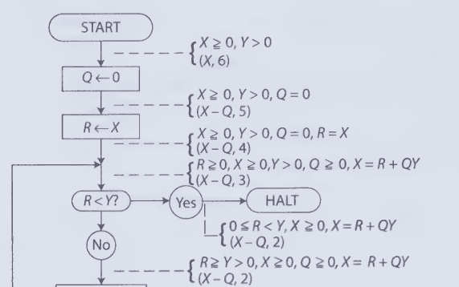

图 2.2. 由 Floyd 为程序分配含义。

在文献 [4] 论文《计算机编程的公理化基础》中，Hoare 定义了一种用于验证代码级注释的演绎推理方法。本文引入了 **Hoare 三元组** *Pre>code{Post}* 的概念，该方法通过在假设满足一组前置条件（Pre）的前提下，指定执行代码后保证能满足的后置条件（Post）来表达某段代码的语义。Hoare 支持一种愿景，即这种公理化语义被用作“语言含义的终极确定规范……，而某些方面保持未定义”。公理使得语言设计者能够非常简单直接地表达其通用意图，而无需通常伴随算法描述的大量细节。

假设图 2.2 所示的欧几里得除法算法实现在 C 函数 `div(x,y,*q,*r)` 中，可以按照如下方式指定合约：

```
void div(x,y,*q,*r) {
  // x>=0 \^ y>0
  *q = 0;
  *r = x;
  while (*r < y) { ... };
  // 0 <=r<y \^ x<=0 x=r+q*y
}
```

## 形式化方法

正如 Hoare 所展望的，这种方法已经得到了很大发展，并用于通过一组 Hoare 三元组形式化地指定程序的预期行为。从理论上说，公理化语义是操作语义或指称语义的进一步抽象，因为它只约束了有效的实现。

### 2.2 形式化验证方法概述

我们现在阐述主要验证方法背后的原理：演绎法（DM）、基于 SMT 的模型检查（MC）和抽象解释（AI）。首先，我们简要描述这些技术如何在简单的无循环示例中工作。然后，我们将详细阐述它们实现的某些细节或在更实际的示例中的用法。在过去的三十四十年中开发的这些技术无法在几页纸内详尽介绍。本文介绍反映了作者对这些方法的观点和理解。

首先，让我们得出一个令人失望的结论：

定理 2.1 (Rice 定理)。判断任意图灵机 $T$ 所识别的语言是否属于非平凡语言集 $S$ 是不可判定的。

> L(T) ⊆ S 是不可判定的

其中 `L(T)` 表示图灵机 `T` 所识别的语言。

该定理

由于不可判性性，为任意程序和属性设计可靠、完备且终止的技术是没有意义的。让我们用 `Prog \�� P` 表示 `P` 对于程序 `Prog` 有效，用 `Prog \vdash P` 表示声明 `P` 对于程序 `Prog` 有效。对于所有程序 `Prog` 和属性 `P`，我们可以定义：

```
Prog⊨ A ⇒ Prog⊨ P          (可靠性)
Prog ⇒ P ⇒ Prog⊢ P       (完备性)
Prog⊨ P terminates.
```

形式化验证技术通常通过关注可靠且可终止的方法来解决这个问题，即：不具备完备性属性 `P'`。这等同于计算一个中间更强的属性 `P'`，使得

```
((Prog⊨ P') ∧ (P' ⇒ P)) ⇒ ⊢ Prog P
Prog⊨ P' terminates.)
```

这通常被称为过近似技术或保守技术：证明 `P` 的有效性等同于计算一个精度较低的 `P'`，该 `P'` 可能意味着 `P`。即使属性 `P` 在程序上实际上是有效的，由于 `P'` 缺乏精度，可能无法允许我们证明 `P' \Rightarrow P`，导致缺乏结论：`P` 对于 `Prog` 的状态未知，分析无法就 `P` 给出结论。

备注 2.2 (分析的终止与程序的终止)。注意，分析的终止与所分析程序中是否存在无限轨迹无关。非终止的形式化验证技术可能在只允许有限轨迹的有限转移系统中无法返回结果，而可终止的分析将对允许无限行为的系统得出结论。

#### 2.2.1 通过无循环示例说明的基本原理

我们首先关注一个简单的无循环示例，例如 `$\mathbb{R}^2$` 中的无穷范数：

```
real norminf(real x, y) {
  real xm, ym, r;
  if (xm >= 0) // compute abs(x)
    {xm = x;}
  else
    {xm = -xm;}
  if (y >= 0) // compute abs(y)
    {ym = y;}
  else
    {ym = -ym};
  return r;
}
```

我们对以下属性感兴趣：

- 零值：`norminf(0,0) = 0`；

- 正性：`$\forall(x,y), norminf(x,y) \ge 0$`。

## 形式化方法

注意，在某些情况下，将规范的形式化（即感兴趣的属性）作为形式化产物是直接的。当考虑到具有歧义的语言时，这可能变得困难。这是规范的另一种添加方式。当然，第一种形式化方法依赖于对属性的歧消除。我们将看到各种推理技术如何处理这些属性：

- DM：前向推理；

- MC：基于 SMT 的推理；

- AI：抽象域。

##### 2.2.1 演绎法：谓词变换

演绎法是 Hoare 提出的思想的演变。谓词变换允许我们对程序的含义进行操作。这些操作可以以后向方式执行，通过代码变换后置条件——或者以反向方向传播后置条件。虽然这些技术在代码上都是可靠的，但演绎法依赖于 `wp(code, Post)`，即在执行代码后保证满足 `Post` 的弱前置条件。这些规则定义在语句的结构上，如赋值、条件语句或循环。

赋值规则等同于在后置条件 `B` 中替换 `x`：

```
wp(x:=e, B) ≜ B[e/x].
```

2.2.3. 我们在最简单的示例上说明这种机制。假设后置条件为 `y \le 0`。

```
y = x+1;
// { <= 0 }
```

前置条件的组合良好：一旦计算了语句 `c2` 的影响，就可以用它来传递 `c1` 的影响：

```
y >= 0 ⇒ ((x >= y ⇒ y=0) ∧ (x < y ⇒ y=0))
∧ y < 0 ⇒ ((x >= -y ⇒ y=0) ∧ (x < -y ⇒ y=0))
```

让我们再次将此前置条件传递到第 3 行的语句。我们在 then 分支得到：

```
y >= 0 ⇒ ((x >= y ⇒ y=0) ∧ (x < y ⇒ y=0))
∧ y < 0 ⇒ ((x >= -y ⇒ y=0) ∧ (x < -y ⇒ y=0))
```

在 else 分支得到：

```
y >= 0 ⇒ (-x >= y ⇒ y=0) ∧ (-x < y ⇒ y=0))
∧ y < 0 ⇒ ((-x >= -y ⇒ y=0) ∧ (-x < -y ⇒ y=0))
```

最后，应用条件规则：

```
x >= 0 ⇒ ((y >= 0 ⇒ (x >= y ⇒ y=0) ∧ (x < y ⇒ y=0))
      ∧ y < 0 ⇒ ((x >= -y ⇒ y=0) ∧ (x < -y ⇒ y=0)))
x < 0 ((((-y >= 0 ⇒ (-x >= y ⇒ y=0) ∧ (-x < y ⇒ y=0))
      ∧ y < 0 ⇒ ((-x >= -y ⇒ y=0) ∧ (-x < -y ⇒ y=0)))) (2.3)
```

这个巨大的谓词代表了弱前置条件，满足该条件后在执行代码后保证获得 `r=0`。在第一个属性中，前置条件是 `(x,y)=(0,0)`。因此，我们需要证明：

```
(x,y) = (0,0) ⇒ (2.3).
```


该证明被发送到满足性模理论（SMT）求解器，如 `Alt-Ergo` [73], `Z3` [82], `CVC4` [65, 132] 和 `Yices` [60, 133]。这些求解器将 SAT 核心扩展到用其他（数值）理论表示的原子谓词。

在这种特定情况下，该公式很容易分析——甚至可以手动完成——并简化为谓词：

`True`。

第二个属性可以以类似的方式进行分析，并将生成以下证明目标：

`$True \Rightarrow \{(2.3)\}$` 其中 `$v=0$` 变为 `$v \geq 0$`。

### 2.2.1.2 基于 SMT 的模型检查：命题编码与可满足性

基于 SMT 的模型检查在这个特定示例上的执行方式也相似。其核心思想是将所有构造映射为谓词。例如，可以重命名变量以避免对同一个变量进行多次赋值。这等于将命令式程序嵌入为输入和输出之间的函数依赖。令 `[normif]fMC(x,y,r)` 为此类函数。

证明目标变为：

```
$(x=0 \wedge y=0) \wedge [normif]fMC(x,y,r) \wedge (r=0) \quad (2.4)$
[normif]fMC(x,y,r) \wedge (r \geq 0). \quad (2.5)$
```

在这种过度简化的情况下，与演绎法之间的差异并不显著。主要的区别在于，模型检查方法没有指定顺序，而最弱前提规则会在每条语句执行后转换谓词语句。人们还可以注意到，`[normif]fMC(x,y,r)` 的函数表示的异常在属性 `(2.4)` 和 `(2.5)` 中是完全相同的。在演绎法中，代码的谓词表示形式的形式在很大程度上取决于所分析的属性。

在两种情况下，属性的命题编码的最终有效性都交给了外部求解器（如 SMT 求解器）。

### 2.2.1.3 抽象解释（收集语义）：对可达状态的过近似

抽象解释依赖于不同的算法。我们将在下一节中在其通用设置下开发它。与以往能够通过逻辑谓词表示复杂属性但依赖外部求解器来确定这些公式的可满足性的方法不同，抽象解释旨在限制所处理属性的先验形式，使用构造性手段对其进行分析。

这些受约束的属性被称为抽象域（abstract domains），由于我们关注的是收集语义的抽象，它们代表了状态集。可以将抽象域 `D` 看作状态集的一个子集：`D \subseteq \wp(\Sigma)`。

# FORMAL METHODS

17

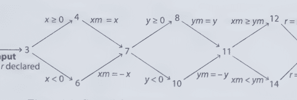

图 2.3 无穷范数的控制流图。

一个经典示例（也是广泛使用的示例）是用于表示 `R` 子集的区间抽象域 `M`，以及使用区间算术来处理这些抽象值。使用抽象环境来表示状态集。在提供更多理论背景之前，让我们非正式地展示示例中抽象环境的计算。

计算是在控制流图上进行的。图 2.3 是我们示例的刻描述。

可以为每个程序点关联其抽象收集语义方程。这些方程定义了局部抽象环境，取决于前驱值：

```
$S_2 = \{any value\}$
\begin{aligned}
x & \mapsto & [-\infty, +\infty[ \\
y & \mapsto & [-\infty, +\infty[ \\
xm & \mapsto & [-\infty, +\infty[ \\
ym & \mapsto & [-\infty, +\infty[ \\
r & \mapsto & [-\infty, +\infty[
\end{aligned}
$S_4 = S_3[x\ge 0]$
$S_6 = S_3[x< 0]$
$S_7 = S_4 \cup S_6$
$S_8 = S_7[y\ge 0]$
$S_{10} = S_7[y< 0]$
$S_{11} = S_8 \cup S_{10}$
$S_{12} = S_{11}[xm\ge ym]$
$S_{14} = S_{11}[xm< ym]$
$S_{15} = S_{12} \cup S_{14}$
```

其中 `S[e>0]` 表示环境 `S`，在其中 `e` 的抽象求值被限制为正；`S[x\mapsto e]` 表示环境 `S`，在其中变量 `x` 更新为抽象值 `e`；`S_1 \cup S_2` 表示区间并运算（join）到 `[x\mapsto S_1(x) \cup_{M} S_2(x)]` 的提升。

当进入函数体时，对 `x` 和 `y` 不做任何假设。此时抽象环境为映射：

```
$x \mapsto [-\infty, +\infty[ \quad y \mapsto [-\infty, +\infty[$
```

根据语言语义，第 2 行局部变量的声明可以将它们赋予默认值（如在 C 语言中），或给出一个值。我们在第 3 行有如下抽象环境：

```
$x \mapsto [-\infty, +\infty[ \quad y \mapsto [-\infty, +\infty[]$
$xm \mapsto [-\infty, +\infty[ \quad ym \mapsto [-\infty, +\infty[]$
$r \mapsto [-\infty, +\infty[]$
```

第一语句的求值包含了取决于活跃分支的 `x` 值。在第 4 行，我们有：

```
$x \mapsto [0, +\infty[ \quad y \mapsto [-\infty, +\infty[$
$xm \mapsto [0, +\infty[] \quad ym \mapsto [-\infty, +\infty[]$
$r \mapsto [-\infty, +\infty[]$
```

在第 6 行：

```
$x \mapsto [-\infty, +\infty[ \quad y \mapsto [-\infty, +\infty[]$
$xm \mapsto [-\infty, +\infty[] \quad ym \mapsto [-\infty, +\infty[]$
$r \mapsto [-\infty, +\infty[]$
```

此时，我们有：

```
$x \mapsto [-\infty, +\infty[ \quad y \mapsto [-\infty, +\infty[]$
$xm \mapsto [0, +\infty[] \quad ym \mapsto [-\infty, +\infty[]$
$r \mapsto [-\infty, +\infty[]$
```

在第 4 行赋值后，我们得到变量 `xm` 的区间 `[0, +\infty]`。同样，在第 6 行赋值后，我们得到变量 `xm` 的区间 `[-\infty, 0]|[0, +\infty]`。程序点 7 的收集语义定义中的并运算返回了 `[-\infty, +\infty]`。然而，`[-\infty, 0]` 和 `[0, +\infty]` 的并运算返回了变量 `x` 的区间。

程序点 8 到 15 的抽象求值遵循类似的模式。注意条件 `xm \ge ym` 对于这种基于区间的分析没有提供任何有效信息。我们最终得到如下抽象环境：

```
$x \mapsto [-\infty, +\infty[ \quad y \mapsto [-\infty, +\infty[]$
$xm \mapsto [0, +\infty[] \quad ym \mapsto [-\infty, +\infty[]$
$r \mapsto [-\infty, +\infty[]$
```

这种分析能够在没有任何输入假设的情况下获得 `r` 的正性。通过假设初始抽象环境如下，可以进行相同的分析：

```
$x \mapsto [0,0] \quad y \mapsto [0,0].
```

在这种情况下，得到的最终抽象环境为：

```
$x \mapsto [0,0] \quad y \mapsto [0,0]$
$xm \mapsto [0,0] \quad ym \mapsto [0,0]$
$r \mapsto [0,0].
```

注意程序点 6、10 和 14 的抽象环境对应空环境。

## 2.3 演绎法

最弱前提方法通常为命令式语言设计。实际应用将如 2.2.1.1 节所示对程序进行推理，但应处理以下项：

### 2.3.1 程序中的循环和递归

虽然谓词转换在之前的示例中看起来很自然，但在存在循环的控制图中，这并不显而易见。由 Floyd 或 Hoare 定义的验证的充分规则可以是：

```
$\vdash\{A\wedge b\}c\{A\}$
$\vdash\{A\}$ while $b$ do $c\{A\wedge \neg b\}$.
```

但这与最弱前提计算中执行的自动转换不兼容。解决该问题的另一种方法是展开循环（unroll）：

```
while $b$ do $c \equiv b$ if $c$; while $b$ do $c$ else skip.
```

那么：

```
$wp(while $b$ do $c, B)$
$\triangleq wp(if $b$ do $c$; while $b$ do $c$ else skip, $B)$
$\triangleq b \implies wp(c, wp(while $b$ do $c, B)) \wedge \neg b \implies B$.
```

令 `W = wp(while $b$ do $c, B)`。我们可以使用循环展开来递归地刻画 `W`：

20

第 2 章

## $W = (b \Rightarrow wp(c, W) \wedge \neg b \Rightarrow B)$。

由于 Tarski 固定点定理，考虑到逻辑蕴含 `⇒` 导出的偏序（即 `x \sqsubseteq y \Rightarrow x`）以及 `W` 的单调定义，该固定点存在。该公式很难计算，并且可能无法用原子集表示。如果可以刻画，它捕捉了循环语义：最精确的循环不变、循环体保持的输入输出关系。

`Dijkstra` [6] 提出的解决方案是手动提供一个较弱的循环不变 `I`，即 `W \Rightarrow I`。谓词转换规则为：

```
$wp(while b do c, I) \wedge ((I \wedge b) \Rightarrow wp(c, I)) \wedge ((I \wedge \neg b) \Rightarrow B)$.
```

### 2.3.2 内存模型和底层表示

到目前为止，所有计算都是在一个带有真实数据类型的简单命令式语言上进行的，没有复杂的数据结构、内存分配或函数调用。

如 `Frama-C` 等高级工具可以处理所有这些构造。内存问题是其中的很大一部分。可以采取多种选择来表示内存：从简单的不带指针或别名的 Hoare 模型，到位级表示。内存越复杂，生成的谓词越大。

专门的分析（如分离逻辑 [40]）可以检测别名或保证指针 `x` 和 `y` 是分离的，从而简化后续分析。验证软件工具链 `VST` [98] 等工具依赖于此类分析。

### 2.3.3 底层逻辑和自动证明

实际实现的最后一个困难是与底层逻辑相关的表达能力工具。在 `Frama-C` 中，注释语言 `ACSL` [148]（ANSI C规范语言）极其，能够以函数或公理的方式定义谓词或内部数据结构。然而，对于某些概念，例如链表或树形结构，或者计算数据结构大小的整数函数，生成的谓词会有很大不同，自动求解器证明最终证明目标的结果也是如此。

## 形式化方法

# 21

高效使用这些技术需要理解求解器的能力以及它们在不同类型建模上的执行执行效率。

## 2.4 基于 SMT 的模型检查

虽然基于 SMT 的模型检查可以应用于代码级（例如 `SPACER` 工具 [122, 136]），但大多数应用是在系统更早的表示上进行的，即在模型级。

在所有情况下，都会从模型/代码 `f` 中提取出其内涵语义（denotational semantics）的逻辑表示。它可以是一个将输出与输入关联的单条谓词，也可以是一个更公理化的定义，例如依赖于一组 Horn 子句（Horn clauses）。在所有情况下，它刻画了一个具有输入 `In` 和输出 `Out` 的转移系统：`(\Sigma, Init \subseteq \Sigma, T)`，其中 `T(x, y) \equiv [f]_{den}(x) = y`。

当考虑具有副作用的函数时，即依赖于内存并在执行过程中修改内存的函数，该谓词为：

```
$T(in, out, mem\_pre, mem\_post).
```

我们也可以用谓词定义内存的初始状态：

```
$Init(mem).
```

这些谓词仅对满足程序语义的值有效。在图 2.1 所示的无内存示例中，我们有 `T(0,42), T(1,46), T(2,46)`，因为这些值是有效的输入/输出对，但 `T(1,2)` 是假的。

对于不含复杂数据结构的模型，这种编码可以相当直观。在多种数据类型、值之间的分支情况或复杂的控制流结构中，编码可能很容易定义。

一旦完成编码开发，就可以对其进行推理。当依赖于基于模型的开发（如 `Simulink`, `ANSYS SCADE`）时，提取出这样的编码是可的。由于所有模型都表示同步数据流语言，模型的语义就是各个块语义的无限执行。

让我们考虑此类系统的（可能是无限的）轨迹 `s_0 \rightarrow \dots \rightarrow s_1 \rightarrow \dots`。它对应于输入序列 `i_0 \rightarrow \dots \rightarrow i_i \rightarrow \dots` 并满足以下约束：

```
$Init(s_0) \quad (2.7)$
$Vi \geq 0, \exists i_i, s_i, s_{i+1} \quad (2.8)$
```

生成输出序列 `o_0 \rightarrow \dots \rightarrow o_i \rightarrow \dots`。

大多数基于 SMT 的模型检查技术基于归纳原理：证明一个属性在可达状态上是不变的，等于证明它对于这些状态是归纳成立的。设 `P(s)` 为该属性的谓词编码。

我们回顾一下归纳原理的要求：

$$\forall s \in \Sigma,$$

Init(s) \Rightarrow P(s) \quad \text{(基础情况)} \quad (2.9)$$

$$\forall s_1, s_2 \in \Sigma,$$

P(s_1) \wedge T(s_1, s_2) \Rightarrow P(s_2). \quad \text{(归纳情况)} \quad (2.10)$$

然而，虽然该属性在可达状态 `[f]_{\text{coll}}` 上是归纳的：

$$\forall s \in \Sigma,$$

Init(s) \Rightarrow P(s) \quad \text{(基础情况)} \quad (2.11)$$

$$\forall s_1, s_2 \in \Sigma [f]_{\text{coll}},$$

P(s_1) \wedge T(s_1, s_2) \Rightarrow P(s_2). \quad \text{(归纳情况)} \quad (2.12)$$

同一属性可能在某些状态 `s \in \Sigma \setminus [f]_{\text{coll}}` 上不是归纳的。某个状态将对应于一个伪反例：一个不可达的但满足 `P` 的状态 `s_1`，使得其通过转移系统语义得到的后继状态 `s_2` 违反了 `P`：

$$(P(s_1) \wedge T(s_1, s_2)) \Rightarrow P(s_2).$$

存在不同的方法来尝试解决这个问题，但无法保证成功，因为 `[f]_{\text{coll}}` 是不可计算的：

- 1. 用可达状态的某种其他不变性 `I` 替换 `[f]_{\text{coll}}`^1。归纳情况变为：

$$\forall s_1, s_2 \in \Sigma,$$

P(s_1) \wedge T(s_1, s_2) \wedge I(s_1) \wedge I(s_2) \Rightarrow P(s_2). \quad (2.13)$$

- 2. 提高初始 `s_1` 作为可达状态一部分的质量：强制要求其为转移系统中长度为 `k` 的路径的一部分。在这种情况下，还需要更新基础状态以保证 `k` 个可达状态的属性 `P`：

## 形式化方法

# 25

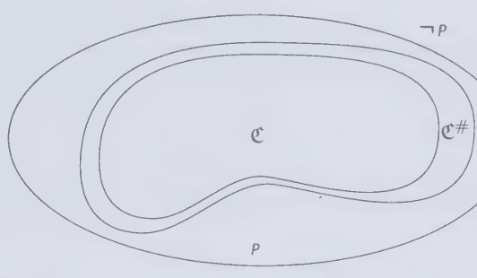

图 2.4。收集语义、抽象与属性。

## 2.5.1 抽象不动点：抽象域中的不动点计算

### 2.5.1.1 正确性、不完备性与报警

尽管证明了其存在性，但精确的可达状态集在通常情况下很难计算。抽象解释框架提供了对其进行抽象的手段，即计算出 `\wp(\Sigma)` 的另一个在集合包含关系上比 `C` 大的值 `C^{\#}`，也就是说包含更多的状态。这些状态中某些是伪状态，它们在实践中是不可达的，但会被计算出的抽象视为可达状态。属性 `P` 的有效性相对于 `C^{\#}` 进行检查。`P` 由满足以下条件的状态集刻画：`P = \{s \mid P(s)\}`。如果成功，则 `C^{\#}` 中的所有状态都满足该属性，因此得到子集 `\mathcal{C}`。

```
$C^{\#} \subseteq P
\Rightarrow C \subseteq P \quad$ 根据包含关系 $C \subseteq C^{\#}$。
```

图 2.4 释了此类包含关系。

在失败的情况下，无法得出结论，因为错误的状态 `s \in C^{\#} \setminus P` 可能在 `\mathcal{C}` 中，也可能是在抽象引入的伪状态中。我们称之为*报警*（alarm）。这体现了该方法的不完备性。

### 2.5.1.2 抽象域

抽象旨在近似状态集 `\wp(\Sigma)`，并通过抽象域来定义。抽象域表示一个抽象状态集 `D^{\#}`，并配有一个完备格结构 `(D^{\#}, \bot, \sqcup, \Pi, \perp, \top)`，其中 `\bot` 和 `\top` 分别表示下界和上界值。


> 在某些情况下（如第 9.3.2 节所示），无法获得完备格结构。此时，实现收敛性证明将变得更加复杂。

## 第2章

它还提供了将状态集 `ρ(Σ)` 抽象到 `D#` 的手段，并计算其元素作为状态集合的正确表示：这些函数被称为 `α` 和 `γ`，即抽象函数和具体化函数：

`α: ρ(Σ) → D#` `γ: D# → ρ(Σ)`。

为了符合抽象解释框架方法的最通用设置，这些抽象和具体化函数定义了一个伽罗瓦连接（Galois connection）：

- 单调的 `α`：`s1, s2 ∈ ρ(Σ), s1 ⊆ s2 ⇒ α(s1) ⊆ α(s2)`
- 单调的 `γ`：`s1#, s2# ∈ D#, s1# ⊆ s2# ⇒ γ(s1#) ⊆ γ(s2#)`
- `α γ` 的还原性：`s# ∈ D#, α γ(s#) ⊆ s#`
- `γ α` 的扩张性：`s ∈ ρ(Σ), s ⊆ γ α(s)`。(2.18)

抽象域还配有手段，用于抽象计算在具体状态集 `Σ` 中执行的操作。这范围从通过线性或多项式表达式变量赋值，到对值的比较操作。我们用 `f#: D# → D#` 表示 `f: ρ(Σ) → ρ(Σ)` 的正确对应项。

### 2.5.1.3 抽象域中的正确性

正确性通过抽象和具体化函数得到保证。我们在这里介绍一元算子 `fun` 的经典定义。

`∀ S ∈ ρ(Σ), S# ∈ D#, S ⊆ γ(S#) ⇒ fun(S) ⊆ γ(fun(S#))`。(2.19)

正确性也可以依赖于 `α` 来表示。直观地说，这种正确性要求保证了在抽象中执行的所有计算至少包含真实的可达状态。

当抽象域由 `(α, γ)` 定义时，可以推导出此类既正确又精确的算子：

`op(x) = α(γ(op(x)))`。(2.20)

## 形式化方法

### 2.5.2 有效计算：Kleene 迭代

当抽象域配有完备格结构时，该不动点可以通过 Kleene 迭代精确计算：

```
C = lim_{n→∞} F^n(⊥).  (2.21)
```

**总结，对于最常见的设置，抽象解释的有效使用如下：**

1. 将（收集）语义表示为属性格上单调函数 `F` 的不动点。在我们的情况下，属性是状态集。
2. 为集合集展示一个抽象域，定义格运算（并）以及 `F` 的正确抽象对应项 `F*`。
3. 抽象初始状态，并通过 Kleene 迭代在抽象中计算最小不动点。
4. 在出现收敛问题时，依赖扩张（widening）以收敛到抽象中更大的不动点。
5. 该抽象不动点的具体化是具体不动点的正确过近似。

在实践中，过近似由以下原因引起：

> 3 在理论上，只需要允许上升链有上界。`F*` 应该在这些链上完备，即上连续的：对于链 `w0, w1, …`, `F*(⊔i wi) = ⊔i F*(wi)`。

## 形式化方法

- 通过抽象域表示或可表示的属性集（线性关系、区间等）。
- 通过抽象函数和具体函数的抽象对应项集合。例如，在像 `exp` 这样的函数难以给出精确定义的情况下，可以通过一个返回 `T=R` 值的函数对其进行可靠的（soundly）近似。虽然这种定义是可靠的，但它在很大程度上是不精确的，并且当使用该 `exp` 函数时，会导致更多的抽象。当在受限于线性属性的抽象域中分析非线性表达式时，还会出现另一个问题。在这种情况下，必须对非线性表达式进行可靠的过近似，导致额外精度的损失。
- 通过使用拓宽（widening）技术在计算的世界中引入额外的抽象。

## 2.6 归纳不变性的必要性

基本上所有的形式化方法都依赖于将感兴趣的属性表示为系统语义上的不变量性（invariant）。在实践中，所有这些技术都受益于额外提供的不变性。我们总结了不变性在不同技术中的应用。

#### 2.6.1 演绎法中的循环不变性

如 2.3.1 节所述，使用演绎方法分析循环需要提供不变性来捕捉循环语义。虽然简单的不变性可以很容易提供，但它们可能太弱，无法精确捕捉循环语义。例如，图 2.2 中表示的循环不变性非常精确：`R, X, Q ≥ 0, Y > 0, X=R+Q`。

如果考虑等式 (2.6) 中用于循环的 Dijkstra 谓词变换规则，可以看到剩余的属性本质上是 `I`，即提供的不变性。循环不变性在证明中充当切分规则（cut-rule）。可靠的不变量将生成一个较弱的前置条件，以保证后置条件，但不是最弱的。证明所提供的前置条件推导出较弱的前置条件可能是不可行的。

这些循环不变性要么手动提供 [147]，要么通过其他手段（如抽象解释 [83]）计算得出。

#### 2.6.2 用于增强基于 SMT 模型检查中转移关系的归纳不变性

同样，基于 SMT 的模型检查本质上是基于归纳法的。如 2.4 节所述，使用了不同的方法来解决收集语义 `[f]coll` 缺失可用的问题。虽然看起来不同，`k`-归纳（`k`-induction）或不变性注入（invariant injection）都属于 `[f]coll` 不变性的表征。

#### 2.6.3 用于加强抽象不动点计算的归纳不变性

抽象解释旨在计算归纳不变。通过可靠抽象域定义的抽象使得它们可以组合以改进分析结果。由于两个完全格的笛卡尔积是伽洛斯连接（Galois connections），可以类似地进行组合，从而轻松定义一种同时依赖于多个抽象的可靠分析。另一个有趣的构造是领域约化（domain reduction）：它允许多个领域进行通信并精炼自身的（可靠的）属性。让我们用一个简单的例子来说说明。

示例 2.7。考虑一组整数值集 `Σ=N` 和以下三个抽象：符号位、区间和奇偶性。

```
α_sign(S) = { sign when S=∅; 0 when S={0}; + when ∀ s ∈ S, s ≥ 0; - when ∀ s ∈ S, s ≤ 0; otherwise }

α_interval(S)=(min S, max S)

α_parity(S) = { parity when S=∅; Odd when ∀ s ∈ S, s mod 2=1; Even when ∀ s ∈ S, s mod 2=0; otherwise }
```

通过其元素集进行抽象总是比更精细地表示该集合不精确。这种领域约化允许多个领域进行通信并精炼它们自身的（可靠）属性。

（注：此处原文后续部分似乎存在格式错误或未完成的重复，已根据上下文逻辑对部分可见的逻辑进行翻译）

# 33

系统，即闭环系统，将根据其稳定性、稳健性和性能进行分析。稳定性和稳健性描述了系统的阻尼，以及其在反馈回路中存在噪声时收敛到目标的能力。性能则评估了收敛速度和反馈响应的波形（过冲量、振荡次数、调建立时间等）。

# 离散化

该控制器旨在嵌入到机载计算机中，并与系统传感器和执行器交互。根据这些设备设备的速度以及可用的计算资源，选择合适的离散化频率。例如，飞机的典型控制律运行频率为 100Hz。但轨迹规划控制器的运行速度可能低得多。

一旦为线性化后的植物对象获得了离散控制器，就可以通过组合局部控制器获得一个更具全局性的控制器。一种方法之一是为每个线性化点合成一个控制器，同时保持相同的控制器合成方法。由于之前的步骤表征的是单输入输出（SISO）子控制器，因此可以根据输入值轻松切换控制器。在考虑两个线性化点之间的中间值时，可以表征控制器增益（即为每个局部控制器合成的系数）的线性插值。

此外，引入了额外的构造以防止在闭环系统发生中断时积分器的发散。饱和或抗积分饱和（anti-windups）起到此类作用，使输出保持在给定范围内。

在关键应用中，控制器不会直接嵌入目标平台，而是与安全架构结合使用，以获得容错系统。

这种安全架构通常在控制器设计之前就已经确立，在开发过程早期识别潜在的故障原因及其对各种系统的影响。这些故障范围涵盖从传感器产生虚假数据的故障部件，到瞬态错误（如单事件翻转 SEU 或多位比特翻转 MBU），再到软件中的 Bug。

这导致了控制层面的局部影响，表现为传感器冗余输入下的输入数据融合：验证器、报警检测等。报警机制通常检查读数值是否在预期范围内，并在检测到合法范围之外的值时发出不同类型的报警信号。图 3.2 展示了此类三路冗余架构示例。在系统层面，更复杂的安全模式允许控制器以分布式方式在多台计算机上执行。

![img/8a0fdace52018a374eb2873593_45_0.png]

图 3.2. 三路冗余输入控制器示例。

![img/8a0fdace52018a374eb2873593_45_1.png]

图 3.3. 控制器的三路备份。

也可以运行不同的实现，以考虑到硬件（CPU 或 RAM）和软件错误。例如，第一种模式可以对冗余实现进行排序，仅让一个处于控制状态，如图 3.3 所示。另一种称为 COM/MON 的模式基于局部观测器的概念，用于检测当前输出是否有效。在发生局部故障时，主计算机将控制权交给次要计算机。

一旦完成完整设计，就会创建最终代码。它可以从模型自动生成，也可以直接用 C 语言编写。这些代码对控制系统非常特殊，主要由一个循环组成：获取输入数据、执行一步计算、将指令传递给执行器并等待下一个时隙（tick）。

```c
while (true) {
  in = read_sensors(); // 读取输入数据
  state = ctl(state, in);
  actuators(state); // 发送指令
  wait_next_tick();
}
```

在验证阶段，除了功能性需求（如安全架构或报警机制的有效性）外，还需要证明生成的代码将满足离散化施加的时间约束，并证明不存在运行时错误（如溢出），这些错误会影响受控系统的全局行为，正如第一次阿里亚 5 号飞行中发生的那样。

在考虑线性系统、植物对象和控制器时，我们重复使用单质量和单弹簧组成的动态系统示例。

首先，植物动力学由以下常微分方程（ODE）表征：

`dx_p/dt = [0 1; -1 0] x_p + [0; 1] u` (3.1)

其中 `x_p` 表示 `[z, ż]^T`，即质量相对于原点的位置和速度。植物传感器提供位置 `z`。控制通过经典配方获得的领先滞控制器执行，其中输入 `y_c` 定义为 `y` 在 `[-1, 1]` 区间的饱和，`y` 是质量位置的测量值，且 `|y_d| ≤ 0.5` 是限的。合成控制器的传递函数为：

`u(s) = -128 * (s+1)/(s+0.1) * (s/5)/(s/50+1) y_c(s).` (3.2)

该传递可以通过对上述传递函数的离散化表示为连续线性控制器：

`dx_c/dt = [-50.1 5.0; 1.0 0] x_c + [0; 1] u` (3.3)

（注：此处原文公式编号可能存在错乱，已根据逻辑对齐）

## 3.2 一个简单线性系统：弹簧-质量-阻尼器

在考虑线性系统、植物对象和控制器时，我们重复使用单质量和单弹簧组成的动态系统示例。

`dx_p/dt = [0 1; -1 0] x_p + [0; 1] u` (3.1)

其中 `x_p` 表示 `[z, ż]^T`，即质量相对于原点的位置和速度。植物传感器提供位置 `z`。控制通过经典配方获得的领先滞控制器执行，其中输入 `y_c` 定义为 `y` 在 `[-1, 1]` 区间的饱和，`y` 是质量位置的测量值，且 `|y_d| ≤ 0.5` 是限的。合成控制器的传递函数为：

`u(s) = -128 * (s+1)/(s+0.1) * (s/5)/(s/50+1) y_c(s).` (3.2)

该传递可以通过对上述传递函数的离散化表示为连续线性控制器：

`dx_c/dt = [-50.1 5.0; 1.0 0] x_c + [0; 1] u` (3.3)

### 3.2.2 离散植物对象

一旦为植物对象的线性化版本获得了离散控制器，就可以通过组合局部控制器获得一个更具全局性的控制器。一种方法之一是为每个线性化点合成一个控制器，同时保持相同的控制器合成方法。由于之前的步骤表征的是单输入输出（SISO）子控制器，因此可以根据输入值轻松切换控制器。在考虑两个线性化点之间的中间值时，可以表征控制器增益（即为每个局部控制器合成的系数）的线性插值。

此外，引入了额外的构造以防止在闭环系统发生中断时积分器的发散。饱和或抗积分饱和（anti-windups）起到此类作用，使输出保持在给定范围内。

在关键应用中，控制器不会直接嵌入目标平台，而是与安全架构结合使用，以获得容错系统。

这种安全架构通常在控制器设计之前就已经确立，在开发过程早期识别潜在的故障原因及其对各种系统的影响。这些故障范围涵盖从传感器产生虚数据的故障部件，到瞬态错误（如单事件翻转 SEU 或多位比特翻转 MBU），再到软件中的 Bug。

这导致了控制层面的局部影响，表现为传感器冗余输入下的输入数据融合：验证器、报警检测等。报警机制通常检查读数值是否在预期范围内，并在检测到合法范围之外的值时发出不同类型的报警信号。图 3.2 展示了此类三路冗余架构示例。在系统层面，更复杂的安全模式允许控制器以分布式方式在多台计算机上执行。

![img/8a0fdace52018a374eb2873593_45_0.png]

图 3.2. 三路冗余输入控制器示例。


![img/8a0fdace52018a374eb2873593_45_1.png]

图 3.3. 控制器的三路备份。

也可以运行不同的实现，以考虑到硬件（CPU 或 RAM）和软件错误。例如，第一种模式可以对冗余实现进行排序，仅让一个处于控制状态，如图 3.3 所示。另一种称为 `COM/MON` 的模式基于局部观测器的概念，用于检测当前输出是否有效。在发生局部故障时，主计算机将控制权交给次要计算机。

一旦完成完整设计，就会创建最终代码。它可以从模型自动生成，也可以直接用 `C` 语言编写。这些代码对控制系统非常特殊，主要由一个循环组成：获取输入数据、执行一步计算、将指令传递给执行器并等待下一个时隙（`tick`）。

```c
while (true) {
  in = read_sensors(); // 读取输入数据
  state = ctl(state, in);
  actuators(state); // 发送指令
  wait_next_tick();
}
```

在验证阶段，除了功能性需求（如安全架构或报警机制的有效性）外，还需要证明生成的代码将满足离散化施加的时间约束，并证明不存在运行时错误（如溢出），这些错误会影响受控系统的全局行为，正如第一次阿里亚 5 号飞行中发生的那样。

在考虑线性系统、植物对象和控制器时，我们重复使用单质量和单弹簧组成的动态系统示例。

首先，植物动力学由以下常微分方程（ODE）表征：

$$\frac{dx_p}{dt} = \begin{bmatrix} 0 & 1 \\ -1 & 0 \end{bmatrix} x_p + \begin{bmatrix} 0 \\ 1 \end{bmatrix} u \quad (3.1)$$

其中 $x_p$ 表示 $[z, \dot{z}]^T$，即质量相对于原点的位置和速度。植物传感器提供位置 $z$。控制通过经典配方获得的领先滞控制器执行，其中输入 $y_c$ 定义为 $y$ 在 $[-1, 1]$ 区间的饱和，$y$ 是质量位置的测量值，且 $|y_d| \leq 0.5$ 是限的。合成控制器的传递函数为：

$$u(s) = -128 \cdot \frac{s+1}{s+0.1} \cdot \frac{s/5}{s/50+1} y_c(s). \quad (3.2)$$

该传递可以通过对上述传递函数的离散化表示为连续线性控制器：

$$\frac{dx_c}{dt} = \begin{bmatrix} -50.1 & 5.0 \\ 1.0 & 0 \end{bmatrix} x_c + \begin{bmatrix} 0 \\ 1 \end{bmatrix} u \quad (3.3)$$

一旦为植物对象的线性化版本获得了离散控制器，就可以通过组合局部控制器获得一个更具全局性的控制器。一种方法之一是为每个线性化点合成一个控制器，同时保持相同的控制器合成方法。由于之前的步骤表征的是单输入输出（SISO）子控制器，因此可以根据输入值轻松切换控制器。在考虑两个线性化点之间的中间值时，可以表征控制器增益（即为每个局部控制器合成的系数）的线性插值。

在关键应用中，控制器不会直接嵌入目标平台，而是与安全架构结合使用，以获得容错系统。

这种安全架构通常在控制器设计之前就已经确立，在开发过程早期识别潜在的故障原因及其对各种系统的影响。这些故障范围涵盖从传感器产生虚假数据的故障部件，到瞬态错误（如单事件翻转 `SEU` 或多位比特翻转 `MBU`），再到软件中的 `Bug`。

这导致了控制层面的局部影响，表现为传感器冗余输入下的输入数据融合：验证器、报警检测等。

### 3.2.2 离散植物对象

When producing the embedded controller, the continuous model is discretized at a rate. This leads to embedded systems which are executed on a platform at `100Hz`. The typical rate is chosen according to the requirements in terms of hardware—and in performance—a controller may be too slow to control an unstable system as inverted pendulum. `100Hz`.

The plant is described by the state space `x := [c, p]^T`:

$$x_{k+1} = Ax_k + By_{d,k} \quad (3.6)$$

with

$$A := \text{


plant.....................................................................................................................................................................................................................................................................................................................................................................................................................................................................................................................................................................................................................................................................................................................................................................................................................................................................................................................................................................................................................................................................................................................................................................................................................................................................................................................................................................................................................................................................................................................................................................................................................................................................................................................................................................................................................................................................................................................................................................................................................................................................................................................................................................................................................................................................................................................................................................................................................................................................................................................................................................................................................................................................................................................................................................................................................................................................................................................................................................................................................................................................................................................................................................................................................................................................................................................................................................................................................................................................................................................................................................................................................................................................................................................................................................................................................................................................................................................................................................................................................................................................................................................................................................................................................................................................................................................................................................................................................................................................................................................................................................................................................................................................................................................................................................................................................................................................................................................................................................................................................................................................................................................................................................................................................................................................................................................................................................................................................................................................................................................................................................................................................................................................................................................................................................................................................................................................................................................................................................................................................................................................................................................................................................................................................................................................................................................................................................................................................................................................................................................................................................................................................................................................................................................................................................................................................................................................................................................................................................................................................................................................................................................................................................................................................................................................................................................................................................................................................................................................................................................................................................................................................................................................................................................................................................................................................................................................................................................................................................................................................................................................................................................................................................................................................................................................................................................................................................................................................................................................................................................................................................................................................................................................................................................................................................................................................................................................................................................................................................................................................................................................................................................................................................................................................................................................................................................................................................................................................................................................................................................................................................................................................................................................................................................................................................................................................................................................................................................................................................................................................................................................................................................................................................................................................................................................................................................................................................................................................................................................................................................................................................................................................................................................................................................................................................................................................................................................................................................................................................................................................................................................................................................................
**以下是需要翻译的文本**：


# 代码生成与 V&V

```c
while (true) {
  state = ctl(state, in);
  actuators(state); // 发送指令
  wait_next_tick();
}
```

在验证阶段，除了安全架构的有效性或报警机制的有效性等功能性需求外，还需要证明生成的代码将满足离散化施加的时间约束，并证明不存在运行时错误（如溢出），这些错误会影响受控系统的全局行为，正如第一次阿里亚 5 号飞行中发生的那样。

## 冲激响应

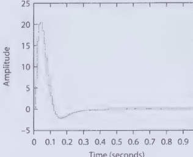

## 阶跃响应

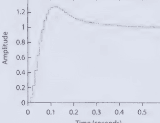

图 3.5. 控制弹簧-质量阻尼器的冲激响应和阶跃响应。

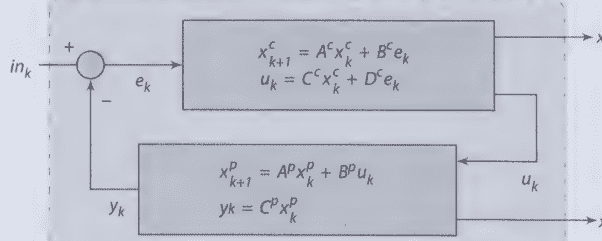

图 3.6. 闭环系统。

## 控制系统

```
xc1 = xc2 = xp1 = xp2 = 0;
while (1) {
yd = acquire_input();
assert(yd > -0.5 && yd <= 0.5);
cx1 = xc1; oc2 = xc2; xp1 = xp1; xp2 = xp2;
cx1 = 0.499 * xc1 - 0.05 * xc2 + (xp1 - yd);
cx2 = 0.01 * oc1 + ox1 + 0.01 * xp2;
xp1 = 0.028224 * xc1 + xp1 + 0.01 * xp2 - 0.064 * (xp1 - yd);
xp2 = 5.6448 * xc1 - 0.01 * xp1 + xp2 - 12.8 * (xp1 - yd);
wait_next_clock_tick();
}
```

图 3.7. 闭环系统的控制。

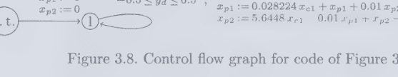

图 3.8. 图 3.7 代码的控制流图。

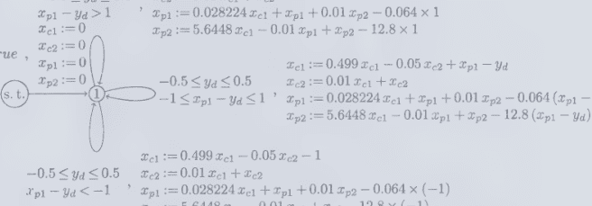

图 3.9. 带有饱和特性的系统控制流图。

通过这种形式化方法，可以将闭环系统的虚拟实现刻画为一个程序。图 3.7 显示了一些代码。通过基于 Kleene 的图重构抽象域 [129] 的控制图分析，可以提取出图 3.8 对应的系统表示。

备注 3.1. 这对应于方程 (3.6) 所示系统，其中输入 `$y_d$` 受限于 `0.5`（对于所有 `k`，`|$y_{d,k}| \le 0.5`）。

### 带有饱和的系统

同样，整合了 `$(y - y_d)$` 饱和性的真实的设置将由系统定义：

```
$x_{k+1} = Ax_k + B SAT(Cx_k - y_{d,k}) \quad (3.7)$
```

其中

```
$A := \begin{bmatrix} A_C & 0 \\ B_p C_C & A_p \end{bmatrix} = \begin{bmatrix} 0.499 & -0.05 & 0 & 0 \\ 0.01 & 1 & 0 & 0 \\ 0.028224 & 0 & 1 & 0.01 \\ 5.6448 & 0 & -0.01 & 1 \end{bmatrix}$
```

```
$B := \begin{bmatrix} B_C \\ B_p D_C \end{bmatrix} = \begin{bmatrix} 1 \\ -0.064 \\ -12.8 \end{bmatrix} \quad C := \begin{bmatrix} 0 \\ C_p \end{bmatrix}^T = \begin{bmatrix} 0 \\ 1 \\ 0 \end{bmatrix}^T$
```

且 `SAT` 定义为

```
$SAT(x) = \begin{cases} -1 & \text{if } x < -1 \\ x & \text{if } -1 \le x \le 1 \\ 1 & \text{if } x > 1. \end{cases}$
```

系统的控制流图如图 3.9 所示。

## 第二部分

#### 不变性合成：基于凸的抽象解释

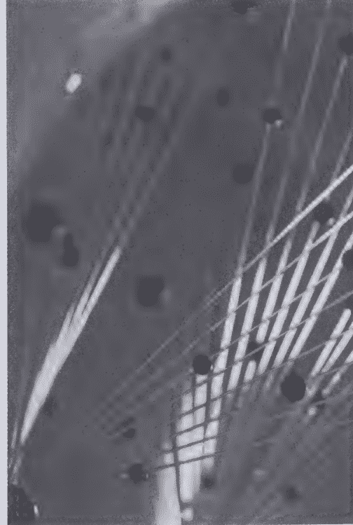

## 第四章

### 定义—背景

本部分重点关注**离散控制器的数值不变性的计算。正如动机中所提到的，控制器通常在连续设置下设计，然后进行离散化；在这两种情况下都假设存在实数域。在此背景下，我们感兴趣的语义是一个离散系统。然后，这些控制器与简单的机制结合。为了能够分析复杂的系统，我们考虑了如开关、增益、饱和等机制。对于这些语义，一种方法是抽象解释。然而，使用多边形、区间等较弱的抽象域方法来计算数值不变性是有效的，这些方法基于 Kleene 固定点迭代可以得到结果。在计算数值不变性方面，另一种方法是基于凸多形的 [62]。对于数值不变性的计算，这种方法在控制领域是可行的。本章介绍了用于离散系统的控制方法，首先是离散控制系统。

### 离散控制系统

离散控制系统通常在嵌入环境中实现，其初始状态由 `i` 定义。定义 4.1（状态空间）。设 `Σ` 为状态空间。离散控制系统由函数 `f : Σ × X^{In} → Σ` 定义。定义 4.2（轨迹）。轨迹是序列 `$(x_n)_{n \ge 0}$`，满足

```
x_{n+1} = f(x_n, u_n)
```

在某些情况下，离散控制系统通过输出信号 `y ∈ X^{Out}` 来定义，其为 `g : Σ × X^{In} → X^{Out}`。这种系统通常以如下代码形式实现：

```
x = i;
while true {
  u = read();
  x = f(x, u);
  y = g(x, u);
}
```

离散控制系统的变量赋值仅通过并行赋值来完成。在实现层面，这要求在最终更新前保留变量值的副本。

#### 线性系统

最简单的系统由单循环和线性更新组成。虽然它们对非专家来说可能过于简单，但大多数控制器都是线性的，从火箭稳定控制器到飞机控制器或卫星姿态和轨道控制系统（AOCS）。基础控制器文献提到了比例（P）、比例微分（PD）或比例积分微分（PID）控制器。在所有情况下，这些都是线性的。为了获得更高的精度，线性控制器的阶（即其状态空间 `Σ` 的大小）可以扩展，考虑更复杂的系统。线性控制器通常通过以下代码实现，对于 `Σ=R^2` 且 `X^{In}=X^{Out}=R` 的系统：

```
x0 = i0;
x1 = i1;
while true {
  read();
  nx0 = a00 * x0 + a01 * x1 + b00 * in;
  nx1 = a10 * x0 + a11 * x1 + b10 * in;
  y = c00 * x0 + c10 * x1 + d00 * in;
  x0 = nx0;
  x1 = nx1;
}
```

在所有系统中，变量的赋值仅通过并行赋值来完成。在实现层面，这要求在最终更新前保留变量值的副本。

### 定义—背景

离散控制系统由以下集合 `Σ, X^{Init}, X^{Out}` 和函数 `f, g` 定义。

接下来，我们根据考虑的集合和函数对这种描述进行专门化：线性系统、分段线性系统和多项式系统。再次，这些描述在模型层面提供。为了简化这一提取过程，或为了更容易理解，我们不失一般性地假设分析的程序是以单赋值（SSA）形式编写的，即每个变量初始化一次。作为最后的备注，由于我们只对系统的内部状态 `x` 感兴趣，输出部分通常被忽略。

##### 定义

在此设定下，线性系统定义在位于 `Σ` 中的系统状态上，该状态表示为 `R^d` 的向量，输入位于 `X^{ln}` 中，表示为 `R^m` 的向量，并由一对矩阵 `A ∈ R^{d × d}, B ∈ R^{d × m}` 组成。其在 `X^{Out}` 中的输出同样由一对矩阵 `C ∈ R^{out × d}` 和 `D ∈ R^{out × m}` 表示。

此类的系统由以下两个函数定义：

##### 线性控制器示例

让我们考虑以下线性二次高斯 (LQG) 调节器：

```cpp
double x[3] = {0, 0, 0};
double nx[3];
double in;
while (i1) {
    acquire_input();
    nx[0] = 0.9379*x[0] - 0.0381*x[1] - 0.0414*x[2]
        + 0.0237*x[0];
    nx[1] = -0.0404*x[0] + 0.9688*x[1] - 0.0179*x[2]
        + 0.0143*x[0];
    nx[2] = 0.0142*x[0] - 0.0197*x[1] + 0.0982*x[2]
        + 0.0077*x[0];
    x[0] = nx[0]; x[1] = nx[1]; x[2] = nx[2];
    wait_next_clock_tick(); // 每 10 ms 刻一次
    for instance
}
```

这刻画了以下动力系统。

示例 4.3 (线性系统示例)。设 `Σ=R^3, X^{ln}=\{(0,0,0)\}`，且 `X^{ln}=R`，具有如下矩阵 `A` 和 `B`：

| | 0.9379 | -0.0381 | -0.0414 | 0.0237 |

| A: | -0.0404 | 0.968 | -0.0179 | B: | 0.0143 |

| | 0.0142 | -0.0197 | 0.0982 | 0.0077 |

#### 切换线性系统：约束分段仿离散时间系统

大多数系统并不是纯线性的。我们考虑的程序或系统由单循环组成，可能带有复杂的 switch-case 类型循环体。我们的 switch-case 循环体应该写成嵌套的 `it` 语句序列，或者一个 `switch` 语句：

```pascal
x = i;
while true {
  in = read();
  c1 -> x = f1(x, in);
  c2 -> x = f2(x, in);
  c3 -> x = f3(x, in);
  x -> x = f4(x, in);
}
```

此外，我们假设分析的程序是用仿射算术编写的，包括 switch 条件 `c_i` 和相关的更新函数 `f_i`。因此，这里分析的程序可以解释为约束仿射离散时间系统。

##### Σ 的多面体划分

“分段仿射”（piecewise affine）意味着状态-输入空间 `Σ ⊆ ℝ^{d+m}` 存在多面体划分 `{X^i, i ∈ 𝕀}`，使得对于所有 `i ∈ 𝕀`，系统的动力学是仿射的，并由以下关系对于所有 `k ∈ ℕ`：

`$(x_k, u_k) ∈ X^i, x_{k+1} = A^i x_k + B^i u_k + b^i, k ∈ ℕ$`

其中 `A^i ∈ ℝ^{d × d}, B^i ∈ ℝ^{d × m}` 且 `b^i ∈ ℝ^d`。与线性情况一样，变量 `x ∈ ℝ^d` 指状态变量，`u ∈ ℝ^m` 指某些输入变量。

我们将状态-输入空间的划分定义为非空集族 `X^i`，并满足：

`$$U^i = Σ, i, j ∈ 𝕀, i ≠ j, X^i ∩ X^j = ∅. .$$`

在当前设定下，由于 `X^i` 是凸多面体，我们刻画了状态-输入空间的多面体划分。从现在起，我们称 `X^i` 为单元（cells）。

##### 仿射条件：严格和弱仿射凸约束

单元 `{X^i}_{i∈I}` 是包含严格和弱不等式的凸多面体。

**定义 4.4 (作为凸多面体的单元)。** 单元可以用 `n_i` 个线性约束表示，表现为一个 `n_i × (d+m)` 矩阵 `T^i` 和一个向量 `c^i ∈ ℝ^{n_i}`。我们用 `E_s^i` 表示单元 `X^i` 的严格不等式索引集，用 `T_s^i` 和 `c_s^i` 表示对应于严格不等式的 `T^i` 和 `c^i` 部分，用 `T_w^i` 和 `c_w^i` 表示对应于弱不等式的部分。最后，我们有方程 (4.3) 给出的矩阵表示：

```latex
$X^i = \left\{\begin{pmatrix} x \\ u \end{pmatrix} \in \mathbb{R}^{d+m} | \begin{pmatrix} T_s^i \end{pmatrix} \begin{pmatrix} x \\ u \end{pmatrix} \ll c_s^i, \begin{pmatrix} T_w^i \end{pmatrix} \begin{pmatrix} x \\ u \end{pmatrix} \le c_w^i \right\}. \quad (4.3)$
```

我们使用以下符号：y \le z$ 是实数向量上的偏序，意味着对于所有坐标 `l`，`y_l ≤ z_l`。关系 `y \ll z` 是严格版本，意味着对于所有坐标 `l`，`y_l < z_l`。

##### 齐次化：将仿射系统编码为线性系统

为了后续分析，考虑线性系统比考虑仿射系统更容易。因此，我们定义系统的齐次形式：不再考虑在 `ℝ^d` 中具有 `ℝ^m` 输入的系统，而是处理 `ℝ^{1+d+m}` 中的状态。我们需要齐次的更新函数，并引入定义如下的 `$(1+d+m) × (1+d+m)$` 矩阵 `F^i`：

```latex
$F^i = \begin{pmatrix} 1 & O_{1\times d} & O_{1\times m} \\ b^i & A^i & B^i \\ 0 & O_{m\times d} & Id_{m\times m} \end{pmatrix} \quad (4.4)$
```

设 `p = card(I)`，全局系统可以定义为：

```latex
$(1, x_{k+1}, u_{k+1})^\top = F^1(1, x_k, u_k)^\top \text{ for } (x_k, u_k) ∈ X^1,$
$(1, x_{k+1}, u_{k+1})^\top = F^2(1, x_k, u_k)^\top \text{ for } (x_k, u_k) ∈ X^2,$
...
$(1, x_{k+1}, u_{k+1})^\top = F^p(1, x_k, u_k)^\top \text{ for } (x_k, u_k) ∈ X^p. \quad (4.5)$
```

##### 分段线性动力系统

让我们考虑以下由单循环和循环体内两个嵌套分支组成的程序，它刻画了四个单元。

```pascal
(x,y) \in [-9,9] \times [-9,9];
while (true) {
    x=x;
    y=y;
    read(u); u \in [-3,3];
    if (-9x+7y-6u < 5) {
        if (-4x+8y-u < 4) {
            x=0.4217x+0.1077y+0.5661u;
            y=0.1162x+0.2785y+0.2235u;
        } else {
            x=0.4763x+0.0145y+0.9033u;
            y=0.1315x+0.3291y+0.1459u;
        }
    } else if (-9x+7y-6u < -5) {
        if (-4x+8y-u < 4) {
            x=0.2618x+0.1107y+0.0868u;
            y=0.4014x+0.4161y+0.6320u;
        } else {
            x=0.3874x+0.0071y+0.5153u;
            y=0.2430x+0.4028y+0.4790u;
        }
    }
}
```

分段仿射系统的初始条件是 `$(x,y) ∈ [-9,9] × [-9,9]$`，其中输入变量 `u` 位于 `[-3,3]`。我们可以使用我们的符号将此程序重写为分段仿射动力系统。我们给出刻画单元的矩阵 `T_s^i` 和 `T_w^i` 以及向量 `c_s^i` 和 `c_w^i`（见方程 (4.3)），以及表示齐次版本的矩阵 `F^i`（见方程 (4.4)).

示例 4.5 (分段线性示例)。设 `Σ = ℝ^2, X^{init} = [-9,9] × [-9,9], U = [-3,3]`，具有如下矩阵和向量：

#### 分段多项式系统


我们考虑的最后一种系统是对多项式约束和更新的进一步扩展：分段多项式离散时间系统。让我们首先回顾 `$R^d$` 上多项式函数的定义。

### 定义 4.6 ($R^d$ 的多项式函数)
从 `$R^d$` 到 `$R$` 的函数 `f` 是多项式的，当且仅当存在 `k ∈ ℕ` 和一个族 `{c_α | α=(α_1,…,α_d) ∈ R^d, |α|=α_1 +…+α_d ≤ k}`，使得对于所有 `x ∈ R^d`, `f(x)=∑_{‖α|≤k} c_α x^{α_1}...x^{α_d}`。

第 4 章

`C={x∈ℝ^d | g_j(x)<0, ∀ j=1,…,m}`，其中 `0` 用于编码严格或弱的 `≤` 不等式。

#### 4.1.3.2 `Σ` 的半代数划分

这些 `Σ=ℝ^{d+m}` 的基本半代数集充当了我们在分段线性系统中使用的单元格。它们刻画了状态空间 `Σ` 的划分。令 `I` 为半代数单元格 `X^i` 的集合：

`X^i={x∈ℝ^{d+m} | Λ r_j^i<0, 1≤j≤ns_i, Λ r_j^i≤0, 1≤j≤nw_i}`

其中 `ns_i` 和 `nw_i` 分别表示半代数集 `X^i` 中强、弱多项式约束的数量。单元格 `X^i` 满足等式 `(4.2)`；它们构成了 `Σ` 的半代数划分。结果是 `Σ` 的任何元素都属于唯一的 `X^i`。

##### 4.1.3.3 多项式更新

与每个单元格 `X^i` (`i∈I`) 相关的赋值由多项式函数 `T^i` 定义：

`x_k∈X^i, x_{k+1}=T^i(x_k)`。

对于没有输入的系统，`T^i` 是一个 `d` 维多项式；对于具有输入 `ℝ^m` 的系统，`T^i` 是函数 `ℝ^{d+m} → ℝ^d`。

##### 4.1.3.4 分段多项式系统 (PPS) 定义

假设 `I` 是有限的，且初始条件 `x_0` 属于满足等式 `(4.6)` 的某个紧致半代数集 `X^{Init}`。对于程序，`X^{Init}` 是变量所在的集合。

### 定义 4.7（分段多项式系统）
约束分段离散时间系统 (PPS) 是四元组 `(X^{Init}, X^{In}, Σ, L)`，其中：

- `X^{Init}∈Σ⊆ℝ^d` 是可能条件的紧致半代数集；
- `X^{In}∈ℝ^m` 是输入的半代数集；
- `Σ={X^i, i∈I}` 是等式 `(4.2)` 中的划分；
- `L={T^i, i∈I}` 是从 `ℝ^{d+m}` 到 `ℝ^d` 的多项式族，对应满足等式 `(4.7)` 的划分 `Σ`。

### 定义——背景

##### 4.1.3.5 分段多项式系统示例

从现在起，我们将每个程序关联一个 PPS 表示。让我们考虑一个具体的例子下面的程序涉及四个变量并包含一个带有条件分支的无限循环。每个分支由多项式函数定义。参数 `c_{ij}` 和 `d_{ij}` 是给定的。在分析过程中，我们只保留变量 `x_1` 和 `x_2`，因为 `oldx_1` 和 `oldx_2` 只是内存。

```
x_1, x_2 \in [a_1, a_2] \times [b_1, b_2];
oldx_1 = x_1;
oldx_2 = x_2;
while (-1 <= 0) {
  oldx_1 = x_1;
  oldx_2 = x_2;
  case : $oldx_1^2 + oldx_2^2 \leq 1 :$
    $x_1 = c_{11} * oldx_1^2 + c_{13} * oldx_2^3;$
    $x_2 = c_{21} * oldx_1^3 + c_{22} * oldx_2^2;$
  case : $-oldx_1^2 - oldx_2^2 < -1$
    $x_1 = d_{11} * oldx_1^3 + d_{12} * oldx_2^2;$
    $x_2 = d_{21} * oldx_1^2 + d_{22} * oldx_2^2;$
}
```

**示例 4.8（分段多项式系统示例）。** 关联的 PPS 对应空输入的四元组 `(X^{Init}, ∅, {X^1, X^2}, {T^1, T^2})`。在这种情况下 `Σ=Σ`。我们有初始条件集：`X^{Init} = {a_1, a_2} × [b_1, b_2]`，验证等式 `(4.2)` 的划分为：

`X^1 = {x ∈ ℝ^2 | x_1^2 + x_2^2 ≤ 1}`；

`X^2 = {x ∈ ℝ^2 | -x_1^2 - x_2^2 < -1}`，相对于 `{X^1, X^2}` 的多项式为：

`T^1(x) = \begin{pmatrix} c_{11}x_1^2 + c_{13}x_2^3 \\ c_{21}x_1^3 + c_{22}x_2^2 \end{pmatrix}`

`T^2(x) = \begin{pmatrix} d_{11}x_1^3 + d_{12}x_2^2 \\ d_{21}x_1^2 + d_{22}x_2^2 \end{pmatrix}`

## 4.2 凸优化（应用）元素

本节旨在为计算机科学家提供凸优化的原理以及如何处理此类问题。感兴趣的读者可以参考 Boyd 和 Vandenberghe 的优秀著作《Convex Optimization》。其他参考文献包括 Nocedal 和 Wright 的《Numerical Optimization》以及 Gilbert 的《Elements of Convex Optimization》。

接下来关注以下形式的优化问题：

`min  f_0(x)`
`s.t. f_i(x) ≤ b_i  i ∈ [1, m]. (4.8)`

其中 `x ∈ ℝ^n` 是优化变量，`f_0 ∈ ℝ^n → ℝ` 是目标函数，`f_i ∈ ℝ^n → ℝ` 是带有边界 `b_i` 的约束。如果 `x` 满足所有约束，则它是可行的。如果它是最好的，则它是最优的。优化算法是一种计算或近似可行解的数值工具。

#### 4.2.1 凸优化

在问题仅包含目标函数（即不提供约束）的情况下，梯度、共轭梯度或牛顿法等经典方法将通过考虑目标函数的导数并通过局部下降方向 `d_k` 来迭代更新 `ℝ^n` 中的点序列：

`x_{k+1} = x_k + α_k d_k.`

这里 `α_k` 表示步长。`α_k` 和 `d_k` 都取决于当前点 `x_k`，并通常依赖于 `f_0'(x_k)`（即 `∇f(x_k)`）。`Kantorovich` 定理刻画了对 `f_0` 施加的条件以保证牛顿法唯一解的存在。这些约束等同于提供函数的 Lipschitz 常数。

### 定义——背景

求解带约束的通用优化问题仍然是一个开放问题。然而，为了保证解的存在，需要限制函数 `f_0` 和 `f_i, i ∈ [1, m]` 为凸函数。我们记得，当 `α, β ≥ 0, α+β=1` 时，`f(α x+β y) ≤ α f(x)+β f(y)`，函数 `f` 是凸的。在这种情况下，任何局部最优点也是全局最优点。一个更强的条件是要求它是线性的，即 `f(α x+β y)=α f(x)+β f(y)`。因此，凸优化是对以下问题的限制：

`min  f_0(x)`
`s.t. f_i(x) ≤ 0  i∈[1,m]`
`a_ix=b  j∈[1,p]. (4.9)`

其中 `f_0, f_i` 是凸函数。注意，等式约束必须是仿的；它们对应于两个凸不等式的交集：`f(x)≤0 ∧ f(x)≥0`；唯一的解是要求 `f` 为仿的或线性的。

凸优化的一个已知案例是线性优化或线性规划，其中线性目标 `f_0` 在满足线性约束 `f_i` 的情况下被优化。凸优化的概念可以扩展到更一般的凸集：锥。锥 `𝒦` 是 `ℝ^n` 的子集，对正比例缩放封闭：`∀ x∈𝒦, θ≥0, θ x∈𝒦`。凸锥满足：`∀ x,y∈𝒦, θ_1,θ_2≥0, θ_1x+θ_2y∈𝒦`。这种凸锥可以拟合一个偏序 `⪯`，使得 `∀ x,y∈𝒦, (x⪯y)≡(y-x∈𝒦)`。推广地，锥中的凸优化是 `𝒦`-凸的。

在锥中的凸优化问题定义为：

`min  f_0(x)`
`s.t. f_i(x)⪯𝒦 for i∈[1,m]`
`Ax=b. (4.10)`

其中 `f_0∈ℝ^n→ℝ` 是凸的，`f_i∈ℝ^n→𝒦` 是 `𝒦`-凸函数，且 `A∈ℝ^{p×n}`。

我们现在关注取决于所考虑的锥 `𝒦` 的特殊案例。

# 第4章

##### 4.2.1.1 多胞形 (Polytopes)

当 `𝒦=ℝ^+` 时，一个著名的案例是对闭多面体进行优化。每个约束都刻画了 `ℝ^n` 的一个子空间，可行集是这些子空间的交集，即一个凸集。目标是在这个有界凸集上优化线性函数。在可行集有界的情况下，有限数量的顶点可以刻画该多胞形。由于最优解必然位于顶点上，单纯形法枚举这些顶点并计算出最优解。

##### 4.2.1.2 正半定锥 (Positive semidefinite cone)

让我们考虑 `ℝ^{n × n}` 中对称矩阵集合 `𝒮^n`：

`𝒮^n={X ∈ ℝ^{n × n} | X=X^⊤}`

正半定矩阵集合 `𝒮^n_+` 是 `𝒮^n` 中仅允许具有正特征值的矩阵子集。

`𝒮^n_+={X ∈ 𝒮^n | X ≥ 0}`

等价地，我们有：

`𝒮^n_+={X ∈ 𝒮^n | ∀ x ∈ ℝ^n, x^⊤ X x ≥ 0}`

该集合是一个凸锥；它对加法和正标量的外部乘法封闭的。在该锥上进行优化会导致一个形式形式的问题：

这里 `x` 是一个向量，矩阵 `G, F_1, …, F_n ∈ 𝒮^n_+`。该不等式被称为*线性矩阵不等式* (Linear Matrix Inequality, LMI)。

事实上，我们可以表示矩阵，因为矩阵 `A ∈ ℝ^{n × n}` 可以表示为 `∑_{i=0,j=0}^{n-1} A_{ij} E^{i,j}`，其中 `E^{i,j}` 是除第 `i` 行第 `j` 列为 1 之外全为 0 的矩阵。同样，多个 LMI 可以组合为一个，`A ≥ 0 ∧ B ≥ 0` 等价于 `[[A,0],[0,B]] ≥ 0`。

现有半定规划 (SDP) 的高效求解器，例如 `Mosek [32]`、`SDPA [97]` 或 `CSDP [30]`。关于 SDP 的更多细节，我们感兴趣的读者参考 `[28]`。

## 定义——背景

##### 4.2.1.3 平方和多项式 (Sum-of-square polynomials)

令 `ℝ[x]` 为 `ℝ^n` 的多元多项式集合，`ℝ[x]_{2m}` 为其对次数不超过 `2m` 的限制。我们用 `Σ[x] ⊂ ℝ[x]` 表示平方和（SOS）多项式锥，即

`Σ[x] := { ∑ q_i^2, q_i ∈ ℝ[x] }  (4.13)`

对于给定的多项式存在 SOS 表示是处理*正性判定* (Positivstellensatz) 的方法，它是证明其全局非负性的充分条件，即 `∀ p(x) ∈ Σ[x], p(x) ≥ 0`。SOS 条件 `(4.13)` 等价于存在一个正半定矩阵 `Q`，使得

`p(x) = Z^⊤(x)Q(x)  (4.14)`

其中 `Z(x)` 是次数小于或等于 `deg(p)/2` 的单项式向量。寻找具有给定次数 `d=2m` 的正多项式等同于求解一个半定优化问题并合成满足等式 `(4.14)` 的矩阵 `Q ≥ 0`。

**示例 4.9。** 考虑双多项式 `q(x) := 1+x_1^2-2x_1x_2+x_2^2`。对于 `Z(x)=(1,x_1,x_2)`，寻找一个半定定正矩阵 `Q`，使得多项式 `q(x)=Z(x)^⊤Q(x)` 对于所有 `x ∈ ℝ^2` 成立。

`Q = \begin{pmatrix} 1 & 0 & 0 \\ 0 & 1 & -1 \\ 0 & -1 & 1 \end{pmatrix}`

满足该等式并有三个特征值，分别为 0、1 和 2，分别对应于三个特征向量 `e_0=(0,1,1)^⊤, e_1=(1,0,0)^⊤` 和 `e_2=(0,-1,1)^⊤`。定义矩阵 `L=(e_1, e_2)` 和 `D=\begin{pmatrix} 1 & 0 & 0 \\ 0 & 2 & 0 \\ 0 & 0 & 0 \end{pmatrix}`，得到分解 `Q=LDL^⊤` 以及等式 `q(x)=(LDL^⊤)=σ(x)=1+(x_2-x_1)^2`，对于所有 `x ∈ ℝ^2`。多项式 `σ` 被称为证书，并了 `q` 是非负的。SOS 优化问题可以定义为：

`min ⟨c, x⟩`
`s.t. p_i(x) ∈ Σ[x] for i ∈ [1,m]`
`Ax=b.  (4.15)`

SOS 规划求解器提供了一个前端，简化了基于 SOS 的优化到 SDP 的转换。每个平方和多项式约束 `p_i` 都与一个对称半定矩阵 `Q_i` 相关。通过识别，矩阵 `Q_i` 的系数与刻画多项式 `p_i` 的约束相关。一旦 SDP 问题求解，其解被用于重建多项式问题并提供 SOS 问题的证书。MATLAB 工具箱 `YALMIP [48]` 提供了这样的前端。关于基于 SOS的多项式优化的更多参考文献可见 `Parrillo [45]` 和 `Lasserre [89]`。

#### 4.2.2 凸优化工具

在处理优化问题时，有少数操作使能够将问题松弛为可求解的问题。我们在这里介绍其中一些。

##### 4.2.2.1 约束的凸化：S-过程、拉格朗日松弛

当面对非凸约束时，例如正定矩阵之间的蕴含 `P_1 ≥ 0 ⟹ P_2 ≥ 0`，我们可以表达一个充分条件。

**定理 4.10 S-过程 (S-Procedure)。** 对于任何 `P_1, …, P_k ∈ ℝ^{n × n}` 和 `b_1, …, b_k ∈ ℝ`，

`[[A, b],[b^⊤,0]] ≥ 0  (16)`

（注：原文公式部分存在乱码，此处根据数学背景进行逻辑对齐翻译）S-过程提供了一种凸化的松弛。

### 定义—背景

最后，请注意后一个不等式对于任意 `λ ∈ Σ[x]` 都成立，因此我们对 `λ ∈ Σ[x]` 取下下界，得到：

```
$$\sup_{q(x) \le 0, x \in \mathbb{R}^d} p(x) = \inf_{\lambda \in \Sigma[x]} \sup_{x \in \mathbb{R}^d} p(x) - \lambda \cdot q(x)$$
\le \inf_{\eta-p-q\lambda \in \Sigma[x]} \eta. \quad (4.24)$$
```

#### 4.2.3 对偶


优化问题的一个最后的有效操作依赖于巴拿赫空间中的拓扑对偶（具有良好拓扑结构的向量空间）。我们在这里给出对偶理论的一个不完全且非正式的概述，因为它能够对对偶问题进行描述。感兴趣读者可以在 `[46, §5.2]` 中找到更多细节。

任何关于域 `$\mathbb{R}$` 的向量空间 `E` 都可以与其对偶空间 `E^*` 相关，其中 `E^*` 定义为 `E` 上的实值线性泛的集合。即函数 `$\phi: E \to \mathbb{R}$` 的集合。对于 `E` 中的任何元素，我们都可以与其对偶空间的一个元素相关。这通过对偶括号 `$\langle \phi_{x}, E \rangle$` 来表征。

得益于 Riesz 表示定理，该元素在希尔伯特空间中是唯一的，可以在同一个空间中表示。例如，考虑有限维希尔伯特空间 `$\mathbb{R}^n$` 以及一个元素 `c \in \mathbb{R}^n`。对偶空间是 `$\mathbb{R}^n$` 上的线性泛的集合，即线性函数 `$\phi: \mathbb{R}^n \to \mathbb{R}$` 的集合。任何此类线性函数都可以由标量积定义。随后可以构建与 `c` 相关的线性泛 `$\phi_c(x \in \mathbb{R}^n) = \langle x, c \rangle$`，其中 `$\langle \cdot, \cdot \rangle$` 表示希尔伯特空间 `E` 的内积（在本例中为 `$\mathbb{R}^n$` 的标量积）。因此，希尔伯特空间是自对偶的，因为线性泛可以通过初始空间的一个元素来表征。

让我们考虑两个巴拿赫空间 `E` 和 `F` 的一般情况。`E^*` 和 `F^*` 分别为拓扑对偶，`K \subseteq E` 是一个凸锥（`K^*` 是其对偶锥），具有以下优化问题：

```
$max \quad \langle c, x \rangle^{E^*, F}$
s.t. \quad Ax = b \quad \text{with } A: E \to F$
\quad \quad x \in K. \quad (4.25)$
```

在下，我们将此问题称为原始问题。这种形式等价于等 (4.11) 的早期版本（更多解释请参见 `[46]`）：

```
$max \quad \langle c, x \rangle$
s.t. \quad A_i x - b_i \preceq 0 \quad \text{for } i \in [1, m]$
\quad \quad Ax = b. \quad \quad (4.26)$$
```

约束 `Ax = b` 等价于 `Ax - b = 0`。然后可以引入拉格朗日乘子 `y \in F^*` 来表示约束。我们有对偶括号 `(y, Ax-b)_{F^*,F}`。利用线性型的线性性质，得 `$\langle y, Ax \rangle_{F^*,F} - \langle A^* y, x \rangle_{E,E} - \langle y, b \rangle_{F^*,F}$`。

我们可以引入 `A` 的伴随 `A': F \to E^*`，它是唯一的线性映射，使得 `(y, Ax)_{F^*,F} = \langle A'y, x \rangle_{E,E}`。

约束可以表示为 `$\langle A'y, x \rangle_{E^*,E} - \langle y, b \rangle_{F^*,F}$`。

回到初始问题，我们有：

```
$$\forall y \in F^*,
\begin{aligned} \max_x \langle c,x \rangle_{E^*,E} & \leq \max_x \langle c,x \rangle_{E^*,E} \text{ s.t. } & \begin{cases} Ax=b \\ x \in K \end{cases} & +\langle A'y,x \rangle_{E^*,E} &-\langle y,b \rangle_{F^*,F} \end{aligned}$$
```

由于 `y` 在左部分是自由的，可以建立以下不等式：

```
$$\begin{aligned} \max_x \langle c,x \rangle_{E^*,E} & \leq \min_y \langle c+A'y,x \rangle_{E,E} \text{ s.t. } & \begin{cases} Ax=b \\ x \in K \end{cases} & &-\langle y,b \rangle_{F^*,F} \end{aligned}$$
```

关于 `x` 的最大值仅取决于 `$\langle c+A'y,x \rangle$`。让我们首先定义 `K` 的对偶锥为 `E` 的拓扑对偶到正形式的重构：

```
$K^* = \{f \in E^* \mid \forall x \in K, \langle f,x \rangle \geq 0\}$.
```

由于 `x \in K`，我们必须确保 `$\langle c+A'y,x \rangle_{E^*,E}$` 不发散。如果我们选择 `c+A'y \in K^*`，则对偶括号为正。我们得到对偶问题：

```
$$\min_y \langle y,b \rangle_{F^*,F} \quad (4.27)$$ (此处根据上下文逻辑补全)
```

### 原始问题与对偶问题的可行性

最后一条说明涉及原始问题和对偶问题的可行性。由于对偶问题的构造和拉格朗日松弛的使用，我们有以下不等式：

```

$$\max_{x} \langle c,x\rangle_{E^*,E} \le \min_{y} \langle y,b\rangle_{F^*,F}$$

\text{s.t.} \quad A:E\rightarrow F

\text{s.t.} \quad -c-A'y\in K^*, x\in K \quad (4.28)$$

```

在两个优化问题都有可行解的情况下，我们讨论对可行性；在凸约束的情况下，不等式 (28) 变为等式。换句话之，求解任意一个问题给出最优解。所需的条件通常被称为 Slater 条件。

在实践中，很容易得到一个问题内部为空且不可行的情形。在这种情况下，两个问题的数值解并不相同；我们讨论这两个解之间的对偶间。

## 第五章

本章关注离散动态系统语义的不不变性计算。

不变性是在所有执行过程中并在所有可达状态下保持的性质。不变的一部分定义为归纳的。归纳不变性是对于系统的变换归纳保持变量的关系。直观上，在讨论不变性的有效性时，不需要考虑可达状态及其（过去），只需考虑单个状态。应用归纳法，我们得到满足该性质的状态映射到保持该性质的下一个状态。

例如，当分析比例为 `r` 且 `|r| < 1` 的几何数列时，可以很容易证明：如果区间 `[a, b]` 包含初始状态和零，则数列的任何元素都属于 `[a, b]`。注意，这里我们只关注不变性，而不感兴趣数列的衰减或增长率。

离散动态系统允许无限行为，因此能够表征它们的可达状态是至关重要的。在控制领域 *lingua* 中，如果一个系统在没有任何输入的情况下收敛于零，则认为是稳定的。这一思想由 Lyapunov 函数捕捉。

本章提出了基于凸优化计算动态系统不变性的方法。在本节中我们介绍了这些概念。后续章节开发了不同的编码，以针对各种设置计算这些不变性并解决不同类型的优化问题。


## 作为半代数集合的不变性

其动机是自动确定给定性质是否适用于分析的程序，或计算可达状态的精确边界。我们对数值性质感兴趣，具体地对程序变量组的值感兴趣。

根据第 2.5 节概述的抽象解释框架，语义可以通过元素集合来表征；对于语义，它是可达状态的集合。因此，在我们的观点中，作为语义表征，性质由满足该性质的值的集合 `P \subseteq \mathbb{R}^d` 表征。

让我们首先回顾固定点表征，并将其实例化我们的离散动态系统形式化。

### 5.1.1.1 作为固定点表征的收集语义

在 2.5 节中，我们引入了式 (2.16) 中的收集语义映射和式 (2.17) 中收集语义的固定点表征。

```

$$\varphi(\Sigma) \to \varphi(\Sigma)

$$S \to lfp(S) \qquad (5.1)$$

\mathcal{C} = lfp_f F = \min_{X \in \varphi(\Sigma)} \{F(X) \subseteq X\} \text (5.

其中 `f` 表示变换关系。因此，`$\varphi(\Sigma)$` 的任何满足条件 `{F(X) \subseteq X}` 的子集 `C` 都是 `$\mathcal{C}$` 的可靠近似，因为所有可达状态都满足 `$\mathcal{C} \subseteq C$`。

### 5.1.1.2 离散系统的收集语义

现在考虑 4.1.1、4.1.2 或 4.1.3 节所示形式的程序。在最一般的情况下，它由初始集合 `X^{Init}` 以及更新函数列表 `f_i` 和相关条件 `c_i` 表征。在下文中，我们假设给定每个条件 `c_i` 的集合表示 `X^i`。我们回顾 `X^i` 假设构成 `$\Sigma$` 的划分，即对于每个元素都有一个更新函数适用。

设 `C` 为满足上述方程的集合，近似状态 `$\mathcal{C}$`。由于 `F` 是分段离散动态系统，我们得到关于 `P` 的以下约束：

```
$F(C) \subseteq \mathcal{C}$
= \{X^{Init} \cup f(C) \subseteq C\} \qquad (5.3)$
= {\mathcal{C} \mid X^i \in \mathcal{I}, f_i(C \cap X^i) \subseteq C\}$
```

在单个更新函数的情况下，该方程可以进一步简化，即没有析取或条件 `c_i, X^i`。

$$\left\{\begin{array}{c} X^{int} \subseteq C \ f(C) \subseteq C \end{array}\right\}$ $(5.4)$

## 5.1.2 Lyapunov 函数

1890年，Alexander Lyapunov 发表了他著名的结论，即微分方程 `$\frac{dx}{dt}=Ax(t)$` 是稳定的，当且仅当存在正定矩阵 `P` 使得 `A^\top P+PA \preceq 0`。这里 `A` 和 `P` 都是 `R^{n \times n}` 方阵，且 `P` 是正定的 `P \succ 0`，即 `x \in R^n, x^\top Px \geq 0`。后来，这在离散线性系统的离散时间设置被表述为：

`x_{k+1}=Ax_k` 其中 `A \in R^{n \times n}`

如下：

$$\exists P \in R^{n \times n}, \text{s.t.} \left\{\begin{array}{c} \exists P \succ 0 \ A^\top PA-P \preceq 0 \end{array}\right\}$ $(5.5)$

在两种情况下，`P` 都是系统能量的度量：Lyapunov 函数 `x \mapsto x^\top Px`。当我们*测量*图像 `Ax` 的能量时，得到 `(Ax)^\top P(Ax)=x^\top PAx`。

由于 `P` 是正定的，`x \in R^n, x^\top Px \geq 0`，且 `P` 表示对状态的范数；而对于第二个约束，下集对于状态是归纳的：`x \in R^n, x^\top Px \geq \epsilon`。不等式 `A^\top PA-P \preceq 0` 编码了沿轨迹的某种能量耗散。当能量达到 0 时，系统状态接近 0。在原始设置中，所考虑的系统是封闭的，即它不接受输入。对于具有有界输入的线性系统，可以依靠相同的论证不是为了说明渐近稳定性，而是为了说明系统不会发散并留在某些范围内。

对于线性系统的特殊情况，存在更简单的论证，例如可以计算矩阵的特征值并检查线性映射 `A` 是否是收的。然而，这种 Lyapunov 函数的概念似乎更具扩展性，并且在控制领域得到了广泛开发。

考虑具有 `$\Sigma=R^d$` 的数值系统。更正式地说，离散时间系统的 Lyapunov 函数 `V: R^d \to R^+` 是一个关于系统状态的正实值函数，并满足：

- 在原点处为零，否则：

$$\{V(0)=0 \forall x \in R^d \setminus\{0\}, V(x) > 0 \lim_{\|x\|\to\infty} V(x)=\infty\}$ $(5.6)$

## 作为半代数集的不不变性

- 沿轨迹递减

$$V x \in \mathbb{R}^d, V \circ f(x) - V(x) \le 0. \quad (5.7)$$

取决于 `$\le$` 运算符的严格程度，Lyapunov 函数保证了渐近稳定性和指数收敛，或仅仅是状态的有界性。

证明（例如在 `[80]` 中所示），展示这样一个函数可以证明系统的 Lyapunov 稳定性，这意味着它的状态变量将随时间保持有界性。方程 (5.7) 表示函数 `k \mapsto V(x_k)` 是递减的，结合 (5.6)，表明状态变量在所有时刻 `k \in N` 下都保持在有界的下集 `{x \in \mathbb{R}^d | V(x) \le V(x_0)}` 中。

### 5.1.3 作为问题特定抽象的 Lyapunov 函数：半代数模板抽象

我们看到Lyapunov 函数刻画了所考虑的离散动态系统语义的归纳下集。因此，与其在抽象解释框架下，使用预定义的数值抽象（如区间、八边形或凸多面体）来近似可达状态，我们更倾向于依赖 Lyapunov 函数作为抽象的主要手段。这是一种模板抽象 `[90]`。

模板是一个实值函数 `t : \Sigma \to \mathbb{R}`。

**示例 5.1.** *那么模板就是一个关于这些变量的函数。例如，它可以刻画状态的范数：*

`t_1(s) = ||s||_2 = \sqrt{\sum_{v \in s} v^2}`

或者只关注单个变量 `x \in V` 的值：

`t_2(s) = x \quad \text{当 } s \text{ 是一个向量时。}`

对于给定的模板 `t`，可以通过给定的能级 `$\lambda$` 定义下集抽象：

`{s | t(s) \le \lambda}`

在多个模板 `t_1, t_2, \dots, t_n` 关联边界 `$\lambda_1, \dots, \lambda_n$` 的情况下，该表示的解释是下集的交集。在多项式模板 `t_i` 的情况下，这是一个基础半代数集。

`{s | t_i(s) \le \lambda_i}`

### 5.1.4 使用凸优化合成模板

在 Lyapunov 函数的早期定义中，具有二次性质的线性系统条件下，定义 Lyapunov 函数 `P` 的条件被刻画为线性矩阵不等式 (LMI)：

$$\begin{aligned} P \succeq 0 \ A^T P - P \preceq 0 \end{aligned}$$ $(5.8)$

随着内点算法 `[24]` 和凸优化 `[46]` 的发展，这些优化问题的数值求解在合理时间内变得可行。

该方法是将寻找归纳不变性的搜索引导为凸优化问题。作为状态的范数，它可以用模板抽象并表示可达状态的抽象。一旦合成了 Lyapunov 函数，约束的结果可以是边界 `t(x) \leq 1`，或者只是相关的模板 `t`。

在第二种情况下，模板 `t` 必须通过其他手段限制；例如，使用经典的 Kleene 迭代，甚至使用大值。得益于模板对于系统语义的归纳性，任何满足 `t(f(x)) \leq \lambda` 的边界 `$\lambda$` 都能刻画一个的不动点：`{x|t(x) \leq \lambda}`。

## 5.2 二次不变性

### 5.2.1 线性系统

如上述，在最简单的线性系统中，二次 Lyapunov 函数 `P` 的条件由方程 (5.5) 给出：

$$\begin{aligned} P \in R^{n \times n}, \text{s.t.} \exists P \succ 0 \ A^\top PA-P \preceq 0 \end{aligned}$$ $(5.9)$

可以可以直接求解此 LMI 并得到一个有效的模板，适用于所考虑的系统。然而，虽然在语义上是归纳的，但这种 Lyapunov 函数刻画的下集可能不是最精确的：

`$\mathcal{C} \subseteq \{x \in R^d \mid x^T P x \leq \lambda\}$`

## 半代数集的不不变性


为了合成更精确的不不变性，可以进一步约束 LMI。

### 5.2.1.1 最小化条件数

从几何上看，正定矩阵的条件数表示了一个类似于二维椭圆离心率的概念。它衡量了结果椭圆有多接近圆（在高维中的等效形式）。单位矩阵的倍数都代表圆，其条件数为 1。因此，我们可以对 `P` 施加的一种限制是让它的条件数尽可能接近 1。其理由是，一个“扁平”的椭圆会导致一个变量产生非常差的边界，如图 5.1 所示。

这是通过在以下矩阵不等式中最小化一个新变量 `r` 实现的 `[23]`：

`I \leq P \leq rI`

事实上，如果点 `x` 在椭圆 `P` 内，则 `x^TPx\leq1` 意味着 `x^TI\leq1`，即 `x` 在半径为 1 的球内。因此，椭圆 `P` 被包含在半径为 `r` 的球内。同样，`P` 包含了半径为 `r^{-1/2}` 的球。通过这样，`P` 被夹在两个球之间，让它们的半径尽可能会让 `P` 尽可能“圆”，如图 5.2 所示。

该约束与其他约束（Lyapunov 方程、对称性和正定性）一起可以表示为 LMI，使用4.2.1节提到的半定规划技术求解：

```
minimize \quad r
nA^T P A - P < 0
nsubject to \quad I \leq P \leq rI
nP^T PA - rP \leq 0.$
```

示例 5.2. 使用运行示例中的以下矩阵 `A`：


$A := \begin{pmatrix} 0.9379 & -0.0381 & -0.0414 \\ -0.0404 & 0.968 & -0.0179 \\ 0.0142 & -0.0197 & 0.9823 \end{pmatrix}$

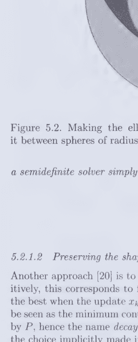

图 5.2. 通过将椭圆 $P$ 夹在半径为 $r^{-1}$ 和 1 的球体之间，使其尽可能地变得“圆润”：$I \leq P \leq rI$ 并最小化 $r$。

半正定求解器简单地返回 $r=1$ 和单位矩阵。

### 5.2.1.2 保持形状

$P = \begin{bmatrix} 1 & 0 & 0 \\ 0 & 1 & 0 \\ 0 & 0 & 1 \end{bmatrix}$

另一种方法 [20] 是在以下不等式中最小化 $r \in (0, 1)$。直观上，这对应于寻找在应用更新 $x_{k+1} = Ax_k$ 时最能“保持”的椭圆形状，如图 5.3 所示。$r$ 可以被看作由 $P$ 定义的范数下，该更新所实现的最小收缩率，因此控制理论学家将该值命名为衰减率。[47] 中针对阶为 2 的矩阵 $A$ 的特殊情况隐含地做了这种选择。

然而，使用这种技术，方程中二次项 $rP$ 的存在使得无法“直接”使用常用的 LMI 求解工具。为了克服这个问题，以下性质允许选择通过二分法（dichotomy）来细化 $r$ 值的方法。随后只需要几步即可获得最优值的良好近似。

**性质 5.3.** 如果对于给定的 $r$，方程 (5.11) 允许正定矩阵 $P$ 作为解，那么对于任何 $r' \geq r$，该结论也成立。

# 作为半代数集的不变性

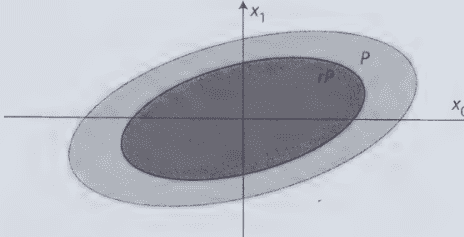

图 5.3. 形状保持得最好的椭圆的选择。

**示例 5.4.** 带有运行示例中的以下矩阵 $A$：

```
A := \begin{bmatrix} 0.9379 & -0.0381 & -0.0414 \\ -0.0404 & 0.968 & -0.0179 \\ 0.0142 & -0.0197 & 0.9823 \end{bmatrix},
```

寻找一个较小的 $r \in (0,1)$，测试的值是 $r=0.5$，即寻找以下半正定程序的解：

```
minimize \quad 0
subject to \quad A^T P A - 0.5P \leq 0
P \geq 0
nP^T = P.
```

由于无解，现在在区间 $(0.5,1)$ 内寻找 $r$。测试了 $r=0.75$ 但没有成功，然后测试了 $r=0.875$、$r=0.9375$、$r=0.98675$ 和 $r=0.984375$ 仍然失败。最后，$r=0.9921875$ 得到了以下解（所有数字均舍入四位）：

```
P = \begin{bmatrix} 239.1338 & 37.5557 & 77.9203 \\ 37.5557 & 226.3640 & 65.8287 \\ 77.9203 & 65.8287 & 325.1628 \end{bmatrix}
```

在此处停止，留下 $r \in (0.984375, 0.9921875)$ 以及上述矩阵 $P$ 为 $r=0.9921875$ 的解。

## 5.2.2 考虑带有输入的线性系统

大多数系统轨迹并非完全由其初始状态刻画：它们有输入。

```
$x_{k+1} = Ax_k + Bu_k, ||u_k||_{\infty} \leq 1. \quad (5.12)$
```

在输入无界的情况下，系统保证会发散。因此，我们感兴趣的是证明，当输入值有界 $\|u_k\|_\infty \le 1$（即 $\max_k u_k \le 1$）时，系统具有有界的行为。对 $u_k$ 的这一约束是合理的：大部分来自传感器，而传感器本身有物理限制。我们也可以无一般性地选择界 $B$，因为可以通过改变矩阵 $B$ 来适应不同的界。

考虑到输入需要将方程 (5.5) 稍微强化为：

```
$A^T P A - P < 0. \quad \quad (5.13)$
```

我们仍然可以保证 (5.12) 的状态变量将保持在界水平集 $\{x \in \mathbb{R}^n \mid x^T P x \le \lambda\}$（对于某些 $\lambda > 0$），此时这是一个椭圆。

### 5.2.2.1 有界输入系统的二次不变性

之前的方法仅基于 $A$，完全抽象化了 $B$，这可能导致粗糙的抽象。这里我们尝试通过寻找包含在最小稳定球内的椭圆 $P$ 来同时考虑 $A$ 和 $B$，使得：

```
$\forall x, \forall u, \|u\|_\infty \le 1 \wedge x^T P x \le 1, (Ax+Bu)^T P (Ax+Bu) \le 1.$
```

这如图 5.4 所示。先前的条件可以重写为：

```
$\forall x, \forall u, \left(\sum_{i=0}^{p-1} e_i \le 1\right) \wedge x^T P x \le 1$
```

其中 $e_i$ 是基的第 $i$ 个向量（即除第 $i$ 个系数外均为 0）。这相当于：

```
$\forall x, \forall u, \left(\sum_{i=0}^{p-1} \begin{bmatrix} x \\ u \end{bmatrix}^T \begin{bmatrix} 0 & 0 & 0 \\ E^{i,i} \end{bmatrix}\right) \le 1 \wedge \begin{bmatrix} x \\ u \end{bmatrix}^T \begin{bmatrix} P & 0 & 0 \end{bmatrix} \le 1 \Rightarrow \begin{bmatrix} x \\ u \end{bmatrix}^T \begin{bmatrix} A^T P & A^T B \\ B^T P & B^T B \end{bmatrix} \begin{bmatrix} x \\ u \end{bmatrix} \le 1$
```

其中 $E^{i,j}$ 是除第 $i$ 行第 $j$ 列外均为 0 的矩阵。使用 S 程序（定理 4.10），当以下情况成立：

$\{Ax_k + Bu \mid ||u||_{\infty} \le 1\}$

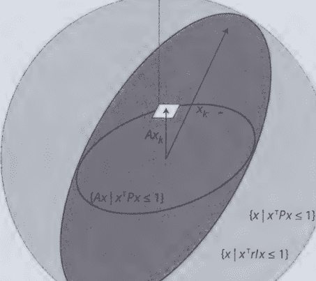

图 5.4. 通过最大化 $r$ 寻找包含在最小球内的不变椭圆 $\tau$ 和 $\lambda_0, \dots, \lambda_{p-1}$ 全是非负的，使得：

$$ \begin{bmatrix} -A^T PA & -A^T PB & 0 \\ -B^T PA & -B^T PB & 0 \\ 0 & 0 & 1 \end{bmatrix} - \tau \begin{bmatrix} -P & 0 & 0 \\ 0 & 0 & 0 \\ 0 & 0 & 1 \end{bmatrix} - \sum_{t=0}^{p-1} \lambda_t \begin{bmatrix} 0 & 0 & 0 \\ 0 & -E_t^{i,i} & 0 \\ 0 & 0 & 1 \end{bmatrix} \ge 0. (5.14) $$

与 5.2.1.2 节一样，由于 $\tau$ 和 $P$ 都是变量，这不是 LMI。同样存在 $\tau_{min} \in (0,1)$使得当 $\tau \in (\tau_{min},1)$ 时，该不等式允许正定矩阵 $P$ 作为解。这个值 $\tau_{min}$ 可以通过相同的方法近似。与 5.2.1.1 节的做法类似，通过在附加约束 $P \ge rI$ 中最大化 $r$ 来强制 $P$ 包含在最小球内。

(5.15)

函数 $f$ 然后被定义为将 $\tau \in (\tau_{min},1)$ 映射到以下半正定程序的最优值的函数：

$$\maximize r

\text{subject to } (5.14)\

(5.15)\

P^\tau = P\

sum_{i=0}^{p-1} \lambda_i \ge 0$$

图 5.5. 有界输入线性系统的二次模板。

可以通过求解半正定程序为给定的输入 $\tau$ 计算此函数 $f$。f 看起来是凹的，可以实现一种智能优化程序。但在实践中，只需在 $(\tau_{\min}, 1)$ 区间取等间隔值采样 $f$，并保留获得最大 $\tau$ 值的矩阵 $P$ 即可。

**示例 5.5.** 使用运行示例中的以下矩阵 $A$ 和 $B$：

$A := \begin{bmatrix} 0.9379 & -0.0381 & -0.0414 \\ -0.0404 & 0.9668 & -0.0179 \\ 0.0142 & -0.0197 & 0.9823 \end{bmatrix} B := \begin{bmatrix} 0.0237 \\ 0.0143 \\ 0.0077 \end{bmatrix}$

根据示例 5.4，$\tau_{\min}=0.99218$。然后，在 $\tau_{\min}$ 和 $1$ 之间的几个点上评估 $f$（舍入数字）：

$$\begin{array}{cc}\tau & f(\tau)\\0.9928 & 1.6064\\0.9935 & 1.7437\\0.9940 & 1.3231\\0.9948 & 1.1798\\0.9954 & 1.0355\end{array}$$

并保留给出最好 $(\tau=0.9928)$ 对应的：

$P = \begin{bmatrix} 12.6465 & -14.1109 & -10.5402 \\ -14.1109 & 25.6819 & 3.06577 \\ -10.5402 & 3.06577 & 29.5981 \end{bmatrix}$

### 5.2.2.2 为给定变量优化模板

如果对其中一个变量需要更紧的界，可以将不等式 (5.15) 中的单位矩阵 $I$ 替换为对感兴趣变量系数较大的对角矩阵。例如，为了对第一个变量 $x_0$ 获得更小的界，可以将 $I$ 替换为 $\begin{bmatrix} 10 & 0 \\ 0 & 1 \end{bmatrix}$。

这直观上对应于在该维度上最小化包含 $P$ 的椭圆半径。这在图 5.8a 和 5.8b 中所示。

**示例 5.6.** *带有运行示例中的以下矩阵 $A$ 和 $B$：*

```
$A := \begin{bmatrix} 0.9379 & -0.0381 & -0.0414 \\ -0.0404 & 0.9668 & -0.0179 \\ 0.0142 & -0.0197 & 0.9823 \end{bmatrix} B := \begin{bmatrix} 0.0237 \\ 0.0143 \\ 0.0077 \end{bmatrix}$
```

如上述所示，对第一个变量有更高的关注：

```
$P := \begin{bmatrix} 12.6465 & -14.1109 & -10.5402 \\ -14.1109 & 25.6819 & 3.06577 \\ -10.5402 & 3.06577 & 29.5981 \end{bmatrix}$
```

## 分段二次不变

## 5.3 分段仿系统

### 5.3.1 分段仿系统

虽然对于纯线性系统存在强有力的结论，但在存在非线性（例如线性动力学之间的切换）时，其中大多数结论都会失效。正如我们在上一节中看到的，稳定的线性系统保证能够接受一个二次李普诺夫函数，因此存在一个二次不变性。在切换线性系统中，这一性质是不可判定的 [37, 定理 2]。因此，所提出的方法应被理解为启发式方法，试图为此类系统合成一个有意义的不变量。

如第 4.1.2 节描述的切换线性系统所示，这些系统由一组针对条件 $c_i$ 的线性更新 $A_i$ 组成。控制领域中的常用做法是寻找一个共同李普诺夫函数：一个由正定矩阵 $P$ 刻画的二次李普诺夫函数，使得：

$A_1^T P A_1 - A_1 \leq 0$

$A_2^T P A_2 - A_2 \leq 0$

...

$A_n^T P A_n - A_n \leq 0$

该共同李普诺夫函数无论激活单元格如何，都会沿着轨迹减小（见第 4.1.2.1 节）。注意，在此编码中，每个单元格中满足的条件的所有信息都被忽略了。

切换系统的主要困难在于动力学的变化：每当触发从一个单元格到另一个单元格的转换时，我们必须使其减小。此外，我们只需要由二次函数 $P$ 导出的范数是局部的，即仅在应用该律例的地方为正。

因此，主要目标是合成一个李普诺夫函数 $V(x, u)$ 和一个相关的边界 $\alpha$，将可达状态刻画为一个下水平集 $S_\alpha$，并使得：

$\forall i \in \mathcal{I}, V(x, u) \in X^i, V(x, u) \leq \alpha \quad (5.17)$

$\forall i, j \in \mathcal{I}, V(x, u) \in X^i, V(x', u') \in X^j, \text{s.t.} x' = A^i x + B^i u, V(x, u) \geq V(x', u'). \quad (5.18)$

### 5.3.2 将条件和切换编码为二次约束

在方程 (5.17) 和 (5.18) 中，关于 $V$ 的不等式在单元格上是局部的。在单元格内，函数仅在单元格 $X^i$ 到 $X^j$ 的可行转换上减小。

为了将问题编码为一组线性矩阵不等式，我们需要以合适的表示与每个单元格相关的条件。对于 SDP，编码约束我们需要能够将单元格成员身份或可行转换表示为二次约束。

##### 5.3.2.1 单元格的二次化

我们回顾一下，局部意味着在单元格上成立，因此在多面体上成立。使用单元格的齐次版本，我们可以定义多面体锥上的局部正性。设 $Q$ 为 $d \times d$ 对称矩阵，$M$ 为 $n \times d$ 矩阵。在这种情况下，局部正性意味着 $My \geq 0 \Rightarrow y^TQ \geq 0$。问题将是将局部正性视为一个不含蕴的约束。该问题并不是新颖（例如，综述论文 [34]）。[10] 证明了当 $M$ 满秩时，局部正性等价于 $Q-M^TCM \geq 0$，其中 $C$ 是一个半正矩阵，即如果 $x \geq 0$ 则 $x^TC \geq 0$。首先，在一般情况下（当 $M$ 的秩不一定等于其行数时），注意如果对于某些半正矩阵 $C$ 有 $Q-M^TCM \geq 0$，则 $y^TQ \geq 0$。其次，半正性的处理似乎与局部正性一样困难，我们将半正性限制为非负元素的矩阵。这种思想不是使用多面体锥，而是通过引入非负元素对单元格进行二次化，我们将单元格 $X^i$ 的二次化定义为：

$X^i = \left(\begin{matrix} x \\ u \end{matrix}\right) \in \mathbb{R}^{d+m} \left(\begin{matrix} x \\ u \end{matrix}\right)^T E^i W^i \left(\begin{matrix} x \\ u \end{matrix}\right) \geq 0 \quad (19)$

其中 $W^i$ 是一个 $(1+n_i) \times (1+n_i)$ 具有非负元素的对称矩阵，$E^i = \begin{pmatrix} E_s^i \\ E_w^i \end{pmatrix}$，其中 $E_s^i = \begin{pmatrix} 1 & c_s^i \end{pmatrix}$ 和 $E_w^i = (c_w^i)$。记得 $n_i$ 是 $T^i$ 的行数。矩阵 $E^i$ 的大小为 $(n_i+1) \times (d+m)$。添加行 $1$ 的目标是避免 $X^i$ 的相反向量。事实上，这个向量 $\overline{X^i}$ 是对称的。我们在示例 5.7 中说明这一事实。

**示例 5.7（齐次化）。** 让我们取多面体 $X=\{x \in \mathbb{R} | x \leq 1\}$。使用我们的符号，有 $X=\{x|M(1-x)^T \geq 0\}$。让我们考虑两种情况，一种是不添加行，另一种是使用它。在不进行任何修改的情况下，相对于非负矩阵 $W$ 的 $X$ 的二次化是 $X'=\{x|((x) =0\}$。这里，$X'=\mathbb{R}$ 对于所有 $W$。现在让 $E$ 对于具有非负系数的 $2 \times 2$ 对称矩阵 $W$，使得 $\overline{X}=\{(x)E^TWE(x) \geq 0\}$。我们有：

$(x)\begin{matrix} 1 & 0 & -1 \end{matrix}\begin{matrix} w_1 & w_3 & w_2 \end{matrix}\begin{matrix} 1 \\ 0 \\ -1 \end{matrix} = w_1+2w_3(1-x)+w_2(1-x)^2$。

那么任何满足 $w_2=w_1$ 且 $w_3>0$ 的矩阵 $W$ 均意味着 $\overline{X}=X$。

现在为我们的示例引入单元格 $X^1$ 的二次化示例。

**示例 5.8。** 让我们考虑该示例和单元格 $X^1$。我们记得 $X^1$ 由矩阵和向量刻画：

$T_s^1=\begin{matrix} -9 & 7 & 6 \\ -4 & 8 & -8 \end{matrix}, c_s^1=(5~4)$

$T_w^1=\begin{matrix} 0 & 0 & 1 \\ 0 & 0 & -1 \end{matrix}, c_w^1=(3~3)$

and $E^1=\begin{matrix} 1 & 0 & 0 & 5 & 9 \\ -7 & 4 & 8 & 3 & 0 \\ -1 & 3 & 1 \end{matrix}$

如所示，我们添加了行 $(1, 0, 1_{1 \times 3})$。例如，取矩阵：


$W^1=\begin{matrix} 63.0218 & 0.0163 & 0.0217 & 12.1557 & 8.8835 \\ 0.0163 & 0.0000 & 0.0000 & 0.0267 & 0.0031 \\ 0.0217 & 0.0000 & 0.0000 & 0.0094 & 0.0061 \\ 12.1557 & 0.0267 & 0.0094 & 4.2011 & 59.5733 \\ 8.8835 & 0.0031 & 0.0061 & 59.5733 & 3.0416 \end{matrix}.$

我们有

$\overline{X^1}=\{(x,y,u)|(1,x,y,u)E^1W^1E^1(1,x,y,u) \geq 0\} \geq X^1$

### 5.3.2.2 切换单元格

当从一个单元格到另一个单元格的转换被释放时，二次形式的局部正性也将被使用。目前，我们感兴趣的是满足 $(x, u) \in X^i$ 且其像在 $X^j$ 中的 $(x, u)$ 集合，我们用 $X^{ij}$ 表示集合：

$\left \begin{matrix} x \\ u \end{matrix} \in \mathbb{R}^{d+m} \left(\begin{matrix} x \\ u \end{matrix} \right) \in X^i \text{ 且 } (A^ix + Bu) \in X^j$

对于所有对 $i, j \in \mathcal{I}$。在 [35] 中，作者考虑了对 $(i, j)$，使得在时刻 $k$ 存在 $X^i$ 中的状态 $x_k$，其像 $x_{k+1}$ 在 $X^j$ 中。我们将在 5.3.2 节中根据 [51] 的建议使用线性规划讨论可能的切换计算。为了构造 $X^{ij}$ 的二次化，我们使用之前的方法，引入一个具有非负元素的 $(1+n_i) \times (1+n_j)$ 对称矩阵 $U^{ij}$ 以得到集合 $X^{ij}$：

$X^{ij} = \left(\begin{matrix} 1 \\ x \\ u \end{matrix}\right) \left(\begin{matrix} 1 \\ x \\ u \end{matrix}\right)^T E^{ij} U^{ij} E^{ij} \left(\begin{matrix} 1 \\ x \\ u \end{matrix}\right) \geq 0$

其中 $E^{ij} = \frac{E^{ij}_s}{E^{ij}_w}$，

$E^{ij} = \left( \begin{matrix} 1 & 0_{1\times(d+m)} \\ -T^s_j & \left( \begin{matrix} c^s_i & b^i & 0 \end{matrix} \right) -T^w_j & \left( \begin{matrix} A^i & B^i & 0_{dx\times m} & Id_{m\times m} \end{matrix} \right) \end{matrix} \right) \quad (5.21)$

# 80

# 第 5 章

```
$$\begin{aligned} T_l^i(x,u) \ll c_s^i \ (x,u) \in \mathbb{R}^{d+m} & T_l^i(A^i x + B^i u + b^i, u) \ll c_s^i \\ T_w^i(x,u) \le c_w^i & (5.22) \\ T_d^i(A^i x + B^i u + b^i, u) \le c_w^i \ & \neq 0. \end{aligned}$$
```

如果从 $i$ 到 $j$ 的切换是可触发的，我们记作 $i \to j$。回我们可以同时处理严格不等式和不等式。问题 (5.22) 是一个同时包含严格不等式和弱不等式的线性规划可行性问题。然而，我们只检查系统是否有解，并可以使用 Motzkin 对换定理 [1] 来检测不可行性。Motzkin 定理是一种备选定理，即我们对比两个线性系统，使得其中恰好有一个是行的。为了描述备选系统，我们必须分离严格不等式和弱不等式，并使用方程 (5.21) 中定义的矩阵 $E^U$ 和 $E^W$。问题 (5.22) 等价于检查集 $\{y=(x,u) \in \mathbb{R}^{d+m}|E^U y \ge 0, E^W y \gg 0\}$ 是否为空。为了检测可行性，我们测试定义的备选系统的不可行性：

```
$$\begin{aligned} (E^U)^T p^s + (E^W)^T p^w &=0 \\ \sum_{k} p_k^w &=1 (5.23) \\ p_k^w \ge 0, \forall k \in \mathbb{I} \\ p_i \ge 0, \forall i \neq \mathbb{I}. \end{aligned}$$
```

根据 Motzkin 对换定理 [1]，我们得到以下命题。

## **命题 5.9.** 问题 (5.22) 是可行的当且仅当问题 (5.23) 是不可行的。

然而，直接对矩阵进行推理可能会允许不可达的切换。对于某些初始条件，对于所有 $k \in \mathbb{N}$，条件 $(x_k, u_k) \in X^i$ 且 $(A^i x_k + B^i u_k + b^i, u) \in X'$ 不成立，其中问题 (5.22) 是行的。为了避免这种情况，我们必须知道系统所有可能的轨迹（我们需要计算这些），并移除所有未激活的切换。近似不可达转换的一种可靠方法是识别线性约束的不可满足集。

**示例 5.10.** 我们继续详细说明我们的运行示例。更具体地说，我们考虑可能的切换。例如，我们考虑单元格 $X^2$如果以下线性不等式组有解，则从单元格 $X^2$ 切换到单元格 $X^1$ 是可能的：

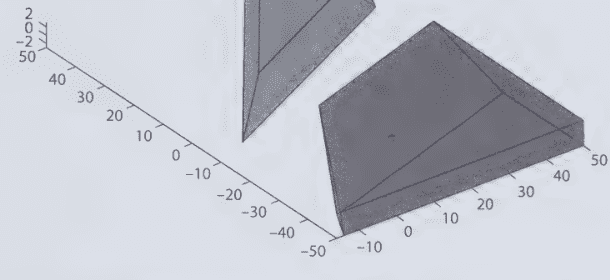

图 5.7. 浅灰色表示 $X^2$ 的截断表示，深灰色表示 $X^2$ 内部法则对 $X^1$ 的逆像。

```
$-9x+7y+6u < 5$
$-0.8532x+2.5748y-10.4460 < -68$
$-3.3662x+2.1732y-1.1084u < -58$
$4x-8y+8u \leq -4$
$u \leq 3$
$-u \leq 3$. (5.24)
```

前两个约束包含限制 $(x,y,u)$ 的像属于 $X^1$，而后四个约束对应于 $X^2$ 的定义。这些集（$X^2$ 和由 $X^2$ 中定义的法则对 $X^1$ 的逆像）的表示如图 5.7 所示。我们在图 5.7 中看到方程 (5.24) 中定义的不等式组似乎没有解。我们使用方程 (5.23) 和命题 5.9 进行此检查。方程 (5.23) 的矩阵 $E_s^{21}$ 和 $E_w^{21}$ 在此示例中为：

$E_s^{21} = \begin{pmatrix} 5 & 9 & -7 & -6 \\ -68 & 0.8532 & -2.5748 & 10.446 \\ -58 & 3.3662 & -2.1732 & 1.1084 \end{pmatrix}$

$E_w^{21} = \begin{pmatrix} -4 & -4 & 8 & -8 \\ 3 & 0 & 0 & 1 \end{pmatrix}$

我们通过 MATLAB 和 Linprog 求解了方程 (5.23) 中的线性规划，找到了 $p = (0.8735, 0.0983, 0.0282)^\top$ 和 $q = (0.3325, 14.2500, 7.8461)^\top$。这意味着备选系统是行的，因此根据命题 5.9，从 $X^2$ 到 $X^1$ 的转换是不可能的。

### 5.3.3 耦合条件的局部不变性

类似于线性情况，我们依赖 SDP 求解器；优化问题的未知数最多是二次的。李雅诺夫函数 $V$ 是分段定义的，依赖于分析系统的单元划分。$V$ 定义为：

```
$V(x,u) = V^\top(x,u), \text{ if } \begin{pmatrix} x \\ u \end{pmatrix} \in X^i$
$= \begin{pmatrix} x \\ u \end{pmatrix} P^i \begin{pmatrix} x \\ u \end{pmatrix} + 2q^{i\top}\begin{pmatrix} x \\ u \end{pmatrix}.$
```

函数 $V^i$ 仅仅定义在 $X^i$ 上。$V$ 的水平 $\alpha \in \mathbb{R}$ 的下水平集表示为：

```
$S_\alpha = \bigcup_{i \in \mathcal{I}} S_{i,\alpha}$
$= \bigcup_{i \in \mathcal{I}} \left( \begin{pmatrix} x \\ u \end{pmatrix} \in X^i | \begin{pmatrix} x \\ u \end{pmatrix}^\top P^i \begin{pmatrix} x \\ u \end{pmatrix} + 2q^{i\top}x \leq \alpha \right)$
$= \bigcup_{i \in \mathcal{I}} \left( \begin{pmatrix} x \\ u \end{pmatrix} \in X^i | \begin{pmatrix} x \\ u \end{pmatrix}^\top \begin{pmatrix} -\alpha \\ q^{i\top} \end{pmatrix} \begin{pmatrix} P^i \\ q^i \end{pmatrix} x \leq 0 \right)$
```

集 $S_{i,\alpha}$ 是与水平 $\alpha$ 相关的 $V^i$ 下水平集。我们考虑矩阵和向量对 $\{(P^i, q^i)\}_{i \in \mathcal{I}}$ 以及实数 $\alpha \in \mathbb{R}$，使得 $S_\alpha$ 是分段仿不变的。为了获得不变性，我们必须约束系统的初始条件。最后，为了证明可达集是有边界，我们需要约束 $S_\alpha$ 有界。在推导半不等式约束之前，让我们说明命题 5.11 中的一个有用结果。该结果是 S 程序 (10) 的一个特例，允许我们安全地编码蕴含。蕴含必须涉及两侧二次不等式。

**命题 5.11.** *设 $A, B, C$ 为 $d \times d$ 矩阵。那么 $C+A+B \geq 0$ 意味着蕴含 $(y^\top Ay \leq 0 \wedge y^\top By \leq 0) \implies y^\top Cy \geq 0$。*

## 作为代数集的不变量

### 5.3.3.2 半不等式约束写入 $(x, u) \in X^i \cap S_{i,\alpha}$

假设 $(x, u) \in X^i \cap S_{i,\alpha}$（索引 $i$ 是唯一的）。不变性意味着如果我们对 $(x, u)$ 应用适用法则并假设 $(x, u)$ 的像属于某个单元格 $X^j$（记 $i \to j$），则 $(x, u)$ 的像属于 $S_{j,\alpha}$。注意如果 $(x, u) \in X^i$ 且其像应该在 $X^j$，则 $(x, u) \in X^j$。设 $(i, j) \in \mathcal{T}^2$ 使得 $i \to j$，转换成不等式的不变性给出：

```
$$\begin{pmatrix} x \\ u \end{pmatrix} \in X^i \wedge \begin{pmatrix} x \\ u \end{pmatrix} \in S_{i,\alpha}$
$\implies \begin{pmatrix} A^i x + B^i u + b^i \\ u \end{pmatrix} \in S_{j,\alpha}. \quad (5.25)$
```

可以使用 5.3.2 节的松弛作为单元的表示，并使用矩阵 $W^i$ 和 $U^{ij}$ 来编码它们的二次化。对于 $(i, j) \in \mathcal{T}^2$ 使得 $i \to j$，我们得到：

```
$$\begin{pmatrix} x \\ u \end{pmatrix}^T E^{ij}U^{ij} \begin{pmatrix} x \\ u \end{pmatrix} \ge 0$$
$$\wedge \begin{pmatrix} x \\ u \end{pmatrix}^T \begin{pmatrix} -\alpha & q^{i\top} \end{pmatrix} \begin{pmatrix} P^i \\ q^i \end{pmatrix} \le 0 \quad (5.26)$$
```

其中 $E^{ij}$ 是方程 (20) 中定义的矩阵，$F^i$ 在 (4) 中定义。最后，通过考虑半不等式约束作为方程 (27)，我们得到一个更强的条件。命题 5.11 证明了如果 $(P^i, q^i, q^j, U^{ij})$ 是方程 (27) 的解，那么 $(P^i, q^i, q^j, U^{ij})$ 满足方程 (26)。对于 $(i, j) \in \mathcal{T}^2$ 使得 $i \to j$：

```
$-F^{i\top} \begin{pmatrix} q^{i\top} & P^i \end{pmatrix} F^i + \begin{pmatrix} 0 \end{pmatrix} - E^{ij\top} U^{ij} \geq 0. \quad (27)$
```

注意 $\alpha$ 在计算过程中被消除了。

### 5.3.4 初始化与有界性

为了获得不变性，我们必须约束初始条件。最后，为了证明可达集是有边界，我们需要约束 $S_\alpha$ 有界。在推导半不等式约束之前，让我们先说明命题 5.11 中的一个有用结果。该结果是 S 程序 (10) 的一个特例，允许我们安全地编码蕴含。蕴含必须涉及两侧二次不等式。

**命题 5.11.** *设 $A, B, C$ 为 $d \times d$ 矩阵。那么 $C+A+B \geq 0$ 意味着蕴含 $(y^\top Ay \leq 0 \wedge y^\top By \leq 0) \implies y^\top Cy \geq 0$。*

由于 $X^0 \cap X^i$ 是多面体，因此其空性可以通过检查线性问题 (5.30) 的可行性并使用命题 5.9 的相同论证来判定。

```
$$ \begin{cases} (E^{0i})^T p^i q^i = 0 \\ \sum_{k} p_k^i = 1 \\ p_k^i \geq 0, \forall k \in \mathcal{I} \\ p_i \geq 0, \forall i \notin \mathcal{I} \end{cases} \quad (5.30) $$
```

# 作为半代数集合的不变量

输入：由 $T_{s,w}^i, C_{s,w}^i, A^i, B^i, b^i, \forall i \in \mathcal{I}$ 定义的分段线性系统

局部：$E^i, E_j^i, E_0^i, \forall i, j \in \mathcal{I}$

输出：$\alpha, \beta, P^i, q^i, Z^i, W^i, U^i, \forall i, j \in \mathcal{I}$

- 1 使用方程 (5.19) 计算单元 $E^i$ 的二次化，$\forall i \in \mathcal{I}$

- 2 过近似可行切换：使用方程 (5.22) 计算分段切换 $L \in \mathcal{T}^2$：

- 3 使用方程 (5.20) 计算切换 $E^{ij}$ 的二次化，$\forall i, j \in \mathcal{L}$；

- 4 使用方程 (5.29) 计算初始化 $E^0$ 的二次化，$\forall i \in \mathcal{I}$；

- 5 求解方程 (5.34) 的 SDP 问题

- 6 不变量：

- 7 $U\{(x,u)P_{opt}^i(x,u)^T + 2(x,u)q_{opt}^i \leq \alpha_{opt} \mid (x,u) \in X^i\}_{i \in \mathcal{I}}$

- 8 $\|(x,u)\| \leq \beta_{opt}$

图 5.8 用于分段线性动力系统计算分段二次不变量算法。

## 5.3.4.2 将有界性写为半定约束

下水平集 $S_\alpha$ 有界当且仅当对于所有 $i \in \mathcal{I}$，下水平集 $S_{i,\alpha}$ 有界。蕴含形式的有界约束为，对于所有 $i \in \mathcal{I}$，存在 $\beta \geq 0$：

$$(x,u) \in X^i \wedge \begin{pmatrix} x \\ u \end{pmatrix} \in S_{i,\alpha} \implies \|(x,u)\|_2^2 \leq \beta \quad (5.31)$$

其中 $\|\cdot\|_2$ 表示 $\mathbb{R}^{d+m}$ 的欧几里得范数

作为不变性，我们使用 $X^i$ 的二次化和 $S_{i,\alpha}$ 的定义。我们利用 $\|(x,u)\|_2^2 = \begin{pmatrix} x \\ u \end{pmatrix}^T E^i W^i E^i \begin{pmatrix} x \\ u \end{pmatrix} + Id(d+m) \times (d+m)$ 这一事实，并对于所有 $i \in \mathcal{I}$ 得到：

$$\begin{pmatrix} x \\ u \end{pmatrix}^T E^i W^i E^i \begin{pmatrix} x \\ u \end{pmatrix} \geq 0 \wedge$$


$$\begin{pmatrix} x \\ u \end{pmatrix}^T \begin{pmatrix} -\alpha & q_i^T & p_i^T & p^i \end{pmatrix} \begin{pmatrix} x \\ u \end{pmatrix} \leq 0 \implies \quad (5.32)$$

$$\begin{pmatrix} x \\ u \end{pmatrix}^T \begin{pmatrix} 0_{1 \times (d+m)} & 0 \\ 0 & 0_{(d+m) \times 1} \end{pmatrix} \begin{pmatrix} x \\ u \end{pmatrix} \leq 0$$

最后，作为不变性，通过考虑类似于方程 (5.33) 的半定约束获得了一个更强的条件。命题 5.11 证明了 $(P^i, q^i, W^i)$ 是方程 (5.33) 的解；$(P^i, q', W^i)$ 满足方程 (5.32)。

# 第 5 章

对于所有 $i \in \mathcal{I}$:

$$-E^{i\tau}W^iE^i + \left(\begin{smallmatrix}-\alpha & q^{i\tau} \\ q^i & p^i \end{smallmatrix}\right)+\left(\begin{smallmatrix}\beta & 0_{1\times(d+m)} \\ 0_{(d+m)\times 1} & -Id_{(d+m)\times(d+m)} \end{smallmatrix}\right) \geq 0.\\quad(5.33)$$

## 5.3.5 总体方法

图 5.8 中的算法总结了该方法。

## 5.3.6 示例

将该方法应用于第 4.1.2 节定义的分段线性系统，计算出值：

$$\alpha_{opt} = 242.0155, \beta_{opt} = 2173.8501.$$

这意味着 $\|(x,y)\|^2 = x^2 + y^2 \leq \beta_{opt}$。我们可以得出结论，例如变量 $x$ 的取值在 $[-46.6154, 46.6154]$ 之间。

注意，这个特定示例并不接受公共李雅普诺函数。

值 $\alpha_{opt}$ 给出了我们分段二次李雅普函数的不变量下水平水平，其中二次函数由以下矩阵和向量表征：

$$\text{minimize } \alpha + \beta$$

$$\text{s.t. } i \in \mathcal{I}, (i,j) \in L, -F^{i\tau}\left(\begin{smallmatrix}0 & q^{j\tau} \\ q^j & p^j \end{smallmatrix}\right)F^i + \left(\begin{smallmatrix}0 & q^{i\tau} \\ q^i & p^i \end{smallmatrix}\right)-E^{ij\tau}U^{ij} \geq 0.$$

$$-\left(\begin{smallmatrix}-\alpha & q^{i\tau} \\ q^i & p^i \end{smallmatrix}\right)-E^{0\tau}Z^{0i} \geq 0.$$

$$-E^{i\tau}W^iE^i + \left(\begin{smallmatrix}-\alpha & q^{i\tau} \\ q^i & p^i \end{smallmatrix}\right)+\left(\begin{smallmatrix}\beta & 0_{1\times(d+m)} \\ 0_{(d+m)\times 1} & -Id_{(d+m)\times(d+m)} \end{smallmatrix}\right) \geq 0.\\quad(5.34)$$

图 5.9 分段线性系统生成的 SDP 问题总结。

## 5.4 归纳二次不变量

### 5.4.1 k-归纳原理

计算不变量背后的原理是李雅普诺函数 $V(x)$ 对于系统转移函数 $f$ 的归纳性。然而，如 5.1 节所述，一个属性可能是有效的，但不具有归纳性。在基于 SMT 的模型检测中，证明给定系统 $(\Sigma, I, T)$ 属性有效的方法是寻找 k-归纳而非 1-归纳。在 k-归纳中，基础步骤处理初始状态长度为 $k$ 的轨迹的属性验证，而归纳步骤旨在证明任何长度为 $k$ 的轨迹在第 $k+1$ 步中保持不变。

定义 5.12 (k-归纳)。令 $(\Sigma,I,T)$ 为状态 $\Sigma$ 上的转移系统，具有初始状态 $I \subseteq \Sigma 和转移关系 $T \subseteq \Sigma \times \Sigma$。安全属性 $Prop \subseteq \Sigma$ 对于转移系统是 k-归纳的，当且仅：

- 对于所有长度小于 $k$ 的系统轨迹，所有可达状态验证 $Prop$

$$\forall k \in \mathbb{N}, \forall x_0, \dots, x_j \in \Sigma, x_0 \in I \wedge \wedge_{i \in[0,j-1]} (x_i, x_{i+1}) \in T \implies x_j \in Prop\quad(535)$$

- 对于所有长度为 $k$ 满足 $Prop$ 的系统轨迹，下一个状态也满足

$$\forall x_0, \dots, x_k \in \Sigma, \wedge_{i \in[0,k-1]} x_i \in Prop \wedge (x_i, x_{i+1}) \in T \implies x_k \in Prop.\quad(536)$$

在我们的不动点表征中，这等同于将

$$\{F(C) \subseteq C = \{X^{Init} \cup f(C) \subseteq C\}\}$$

替换为

$$\{F^k(C) \subseteq C\} = \{X^{Init} \cup \bigcup_{1 \le i \le k} f^i(Init) \cup f^k(C) \subseteq C\}\ = C \begin{cases} X^{Init} \subseteq C \\ f(X^{Init}) \subseteq C \\ f^2(X^{Init}) \subseteq C \\ \dots f^k(X^{Init}) \subseteq C \\ f(C) \subseteq C \end{cases}$$

### 5.4.2 k-归纳李雅普诺函数

我们回顾考虑一个由划分标签集合 $\mathcal{I}$ 索引的单元 $X^i$ 组成分段系统，使得 $\Sigma=\bigcup_{i \in \mathcal{I}} X^i$，且转移关系通过 $T^i$ 分段定义。这里的 k-归纳属性 $Prop$ 表示由李雅普诺函数 $V$ 的下水平集 $S_{\alpha}^i$ 表示的有界性。那么，k-归纳证明等同于找到该函数 $V$ 使得：

$$j < k \in I, i_0, \dots, i_j \in \mathcal{I}, x_0, \dots, x_j \in \Sigma, x_0 \in (I \cap X^0) \wedge \wedge_{i \in[0,j-1]} x_i \in X^i \wedge (x_i, x_{i+1}) \in T^i\quad(5.37)$$

$$\implies x_j \in S_\alpha, i_0, \dots, i_k \in \mathcal{I}, x_0, \dots, x_k \in \Sigma, \wedge_{i \in[0,k-1]} x_i \in (X^i \cap S_\alpha) \wedge (x_i, x_{i+1}) \in T^i\quad(5.38)$$

$I^*$ 为集合。

# 第5章

$S_{123,\alpha} =$

$$\left( \begin{matrix} x \ u \end{matrix} \in X^3 \middle| V^{123}(x,u) \leq \alpha \wedge \exists \begin{matrix} x' \ u' \end{matrix} \\, T\left(\begin{matrix} x' \ u' \end{matrix}\right) = \left(\begin{matrix} x \ u \end{matrix}\right) \wedge \left(\begin{matrix} x' \ u' \end{matrix}\right) \in S_{12,\alpha} \end{matrix} \right)$$

$S_{12,\alpha} =$

$$\left( \begin{matrix} x \ u \end{matrix} \in X^2 \middle| V^{12}(x,u) \leq \alpha \wedge \exists \begin{matrix} x' \ u' \end{matrix} \\, T\left(\begin{matrix} x' \ u' \end{matrix}\right) = \left(\begin{matrix} x \ u \end{matrix}\right) \wedge \left(\begin{matrix} x' \ u' \end{matrix}\right) \in S_{1,\alpha} \end{matrix} \right)$$

$$S_{1,\alpha} = \left(\begin{matrix} x \ u \end{matrix}\right) \in X^1 \| V^1(x,u) \leq \alpha\right\}$$$

这些方程可以重新表述：

$$\forall w \in \mathcal{I}, \forall x \in \Sigma, x \in \mathcal{I} \cap X^4 \implies x \in S_{w,\alpha} \quad (5.39)$$

$$\forall 1 \leq j < k, w \cdot i \in \mathcal{I}_j^*, \forall x, y \in \Sigma, \quad (5.40)$$

$$(x,y) \in \mathcal{T}^i \wedge x \in S_{w-i,\alpha} \implies y \in S_{u(w-i),j,\alpha} \quad (5.41)$$

$$\forall w \cdot i \in \mathcal{I}_k^*, \forall x, y \in \Sigma, $$

$$(x,y) \in \mathcal{T}^i \wedge x \in S_{w-i,\alpha} \implies y \in S_{u(w-i),j,\alpha}. $$

**命题 5.13.** 方程 (5.39)-(5.41) 的任何解 $\{P^w|\forall 1 \leq j \leq k, w \in \mathcal{I}_k^*\}$ 都满足 (5.37)-(5.38)，其中 $S^*^{*\alpha}$ 定义为：

$$S_i^{*\alpha} = \left( \left(\begin{matrix} x \ u \end{matrix}\right) \middle| \max_{w-i \in \mathcal{I}^*} V^{w-i} \left(\begin{matrix} x \ u \end{matrix}\right) \leq \alpha\right) \right\ $$

我们调整了上一节的半正定约束以满足 $k$-归纳约束。虽然可以直接以合成 $k$-归纳分段二次下水平集为目标，但该方法通常从 $k=1$ 开始，在无法找到最小 $k$-归纳分段不变变量的情况下增加到 $k+1$。

## 5.4.3 将二次不变变量与路径后缀相关

我们调整了之前的方法来表示关于过去转换有限序列的属性。

# 作为半代数集合的不变量

## 5.4.3.1 特征可能切换的图——枚举路径

作为第一步，我们计算长度到 $k$ 的可能路径集合。首先，使用第 5.3.2 节的方法计算表示单元 $i\in\mathcal{I}$ 之间可能切换的图 $G=(I, Init, Switches)$。

$Init={i\in\mathcal{I}\cap X^0\neq\emptyset\}$ 表示满足初始条件的 $i\in\mathcal{I}$ 子集。这刻画了一组多面体约束，其空性进行计算。

我们使用经典的图算法枚举图中的可能路径。令 `Paths^k` 为长度到 $k$ 的此类集合。

示例 5.14。图 10 展示了通过第 5.3.2 节方法近似的可能转换。根据目标长度，生成以下路径：

| 长度 | 路径 |
| :--- | :--- |
| 1 | 1,2,3,4 |
| 2 | 11,12,13,14,22,24,31,33,34,41,42,43,44 |
| 3 | 111,112,113,114,122,124,131,133,134,141,142,143,144,222,224,241,242,244,311,312,313,314,331,333,334,341,342,343,344,411,412,413,422,424,431,433,434,441,442,443,444 |

## 5.4.3.2 整合初始条件

初始条件仅适用于初始单元的二次下水平。令 `Init` 为图中定义的允许初始元素的单元集合。通过路径集 `Paths^k` 的构造，它包含单词 $\{i\in Init\}$。初始约束集仅适用于满足初始条件的单词：

$(x, u) \in X^0 \cap X^i \implies (x, u)P^i(x, u)^T+2(x, u)q^i \le \alpha.$

我们可以更强的编码作为半正定约束，使用 $X^0 \cap X^i$ 的二次化作为矩阵 $E^i$：

$-\left(\frac{\alpha}{q^i} - \frac{q^i}{p^i}\right)-E^{top}Z^i \ge 0.$

注意，无论 $k$ 的值如何，具有 $n$ 个单元的系统最多由 $Z^i$ 变量参数化。


## 5.4.3.3 将初始和归纳情况下的转换表示为半正定约束

方程 (5.40) 和 (5.41) 表示单元 $X^i$ 到单元 $X^j$ 的转换 $X^{ij}$ 可以定义为：

$$\begin{matrix} x \ u \end{matrix} \in X^{ij} \wedge \begin{matrix} x \ u \end{matrix} \in S_{w-i,\alpha} \implies \begin{matrix} A^i x + B^i u \end{matrix} \in S_{w-i,\alpha} \quad (5.44)$$

$$\begin{matrix} x \ u \end{matrix} \in X^{ij} \wedge \begin{matrix} x \ u \end{matrix} \in S_{w-i,\alpha} \wedge |w \cdot i| = k \implies \begin{matrix} A^i x + B^i u \end{matrix} \in S_{l(w \cdot i),j,\alpha} \quad (5.45)$$

与之前一样，这些约束通过使用单元转换 $E^{ij}$ 进行松弛，然后使用命题 5.11 表示为半正定约束。

当 $|i \cdot w| = k$ 时：

$-F^{ij\top} \begin{matrix} 0 & q^{l(w \cdot i),j)\top} & q^{l(w \cdot i),j)} & p((w \cdot i),j) \end{matrix} F^{ij} + \begin{matrix} 0 & q^{w-i}\top & q^{w-i} & p_{w-i} \end{matrix} - E^{ij\top} U_{w \cdot i,j} E^{ij} \geq 0. \quad (5.46)$

当 $|i \cdot w| < k$ 时：

$-F^{ij\top} \begin{matrix} 0 & q^{w-i}\top & q^{w-i} & p_{w-i} \end{matrix} F^{ij} + \begin{matrix} 0 & q^{w-i}\top & q^{w-i} & p_{w-i} \end{matrix} - E^{ij\top} U_{w \cdot i,j} E^{ij} \geq 0. \quad (5.47)$

## 5.4.3.4 有边界性的表示

输入：分段线性系统 `T_{s,w}^i, C_{s,w}^i, A^i, b^i, \forall i \in \mathcal{I}`

局部：`E^i, E^{ij}, E_{wi}^j, E_{wi}^i, \forall i \in \mathcal{I}, U^{w-i,j}, \forall i \in I, w \in Paths^k`

输出：`\alpha, \beta, P^{w-i}, q^{w-i}, Z^i, W^{w-i}, \forall i \in I, w \in Paths^k`

1. 使用方程 (5.19) 计算单元 `E^i` 的二次化，$\forall i \in \mathcal{I}$；
2. 使用方程 (5.22) 近似单元：计算可能的切换 `L \in \mathcal{I}^2`；
3. 计算长度 $\leq k$ 的路径列表 `Paths^k`；
4. 计算切换 `E^{ij}` 的二次化，$\forall i, j \in L$；
5. 使用方程 (5.29) 计算初始化 `E^0`，$\forall i \in \mathcal{I}$；
6. 求解方程 (5.50) 的 SDP 问题：


$$\begin{cases} (x, u) P^{w_{opt}}(x, u) + 2(x, u) q^{w_{opt}}^T \leq \alpha_{opt} & w \in \text{Paths}^k \\ (x, u) \in \mathcal{X}^i \end{cases}$$

7. $|x, u| \leq \beta_{opt}$

注意我们有 $|Paths^k|$ 个变量 $q^w, P^w$ 和 $|Paths^k| \times |I|$ 个变量 $U^{wj}$。

作为半正定约束的边界约束是直观的。我们要求所有路径相关的下水平都由同一个标量 $\beta$ 限制。对于所有的 $w \cdot i \in Paths^k$，存在 $\beta \geq 0$：

$(x, u) \in \mathcal{X}^i \begin{matrix} x \ u \end{matrix} \in S_{w-i,\alpha} \implies ||(x, u)||_2^2 \leq \beta.$

相关的半正定约束为：

$-E^{i\top}W^{w-i} + \begin{pmatrix} \alpha & q^{w-i} \\ q^{w-i}^T & p_{w-i} \end{pmatrix} + \begin{pmatrix} \beta & 0_{1\times(d+m)} \\ 0 & -Id_{(d+m)\times(d+m)} \end{pmatrix} \succeq 0.$

这里有 $|Paths^k|$ 个变量 $W^w$。

最小化 $\alpha + \beta$，使得 $\forall i \in \mathcal{I}, (i, j) \in L$

$\forall w \in Paths^k, \text{s.t. } |i \cdot w| = k$

$-F^{ij\top} \begin{matrix} 0 & q^{l(w-i),j}\top} & q^{l(w-i),j)} & p((w \cdot i),j) \end{matrix} F^{ij} + \begin{matrix} 0 & q^{w-i}\top & q^{w-i} & p_{w-i} \end{matrix} - E^{ij\top} U_{w \cdot i,j} E_{ij} \geq 0.$

$\forall w \in Paths^k, \text{s.t. } |i \cdot w| < k$

$-F^{ij\top} \begin{matrix} 0 & q^{w-i}\top & q^{w-i} & p_{w-i} \end{matrix} F^{ij} + \begin{matrix} 0 & q^{w-i}\top & q^{w-i} & p_{w-i} \end{matrix} - E^{ij\top} U_{w \cdot i,j} E_{ij} \geq 0.$

$-E^{i\top} W^{w \cdot i} E^i + \left( \frac{-\alpha}{q^{w-i}} \frac{q^{w-i}^T}{p_{w-i}} \right) + \frac{\beta}{0_{(d+m) \times 1}} - \frac{0_{1 \times (d+m)}}{Id_{(d+m)\times(d+m)}}$

(5.50)

### 5.12. 用于分段线性系统的 $k$-归纳分段二次不变变量生成的 SDP 问题总结。

#### 5.4.3.5 备注：长度 1 的特殊情况

当使用长度为 1 的路径集 $Paths^l$ 考虑方程 (5.43)、(5.46)、(5.47) 和 (5.49) 时，我们正好得到了方程 (5.29)、(5.27) 和 (5.33)。在这种情况下，方程 (5.47) 不成立，因为不存在严格小于 1 的非空单词。

#### 5.4.3.6 总体方法

图 5.11 中的算法总结了该方法。

## 5.4.4 示例

增加长度后的运行示例分析产生了以下结果：

| 长度 | $\beta(\sqrt{\beta})$ | $\alpha$ | $|Paths^k|$ |
| :--- | :--- | :--- | :--- |
| 1 | 2173 (46.6154) | 242.0155 | 4 |
| 2 | 2133 (46.1844) | 233.0847 | 17 |
| 3 | 1652 (40.6448) | 220.8596 | 73 |
| 4 | 1574 (39.6737) | 228.5051 | 314 |

# 作为半代数集的不变性

注意，分段二次下水平集的界限 $\alpha$ 适用于不同的局部李雅普夫函数集合。它们之间的比较没有意义。

## 5.5 多项式不变性

### 5.5.1 使用李雅普夫函数的固定点表达式

我们在这里关注一类更一般的问题：分段多项式系统。我们还依赖于一般的优化问题：正多项式锥及其作为平方和项式（SOS）多项式锥的松弛/强化。

与其将约束表示为线性矩阵不等式 (LMI)，我们可以将约束表示为正多项式约束。这些约束将通过要求它们为 SOS 多项式来进一步得到强化。

再次考虑方程 (5.3)，它定义了计算属性相对于系统语义的归纳性（inductiveness）。

```
$$X^{Init} \subseteq P,\forall i \in I, T^i(P \cap X^i) \subseteq P.\ (5.51)$$
```

将属性 $P$ 编码为多项式 $p$ 的下水平集，我们得到以下问题：

```
$$\begin{cases} p(x) \leq 0, & \forall x \in X^{Init},\forall i \in I, p(T^i(x)) \leq 0, & \forall x \in P \cap X^i. \end{cases}$ \ (5.52)$$
```

### 5.5.2 属性驱动的分析

对于线性情况，之前的方程仅捕捉了由合成的李雅普夫函数诱导的下水平集的归纳性。然而，没有任何约束编码了获取精确（因此是很小的）不变性的需求。平方和优化的表达使我们能够编码表示为多项式下水平的目标属性，并要求多项式函数实现该属性。

#### 5.5.2.1 所考虑的属性：下水平属性 $P_{\kappa,\alpha}$

我们将编码限制为下水平属性：即定义为给定多项式函数下水平集的属性。

**定义 5.15 (下水平属性)。** 给定多项式函数 $k \in \mathbb{R}[x]$ 和 $\alpha \in \mathbb{R} \cup \{+\infty\}$，我们定义下水平属性 $P_{k,\alpha}$ 如下：

$P_{k,\alpha} := \{x \in \mathbb{R}^d \mid k(x) < \alpha\}$

其中 $\ll$ 在 $\alpha \in \mathbb{R}$ 时表示，在 $+\infty$ 时表示 $<$。表达式 $k(x) < +\infty$ 表示了 $k(x)$ 的有界性，而没有提供特定的 $\alpha$。

**示例 5.16 (下水平属性)。** 当人们想要限制系统的可达值时，我们可以尝试限制系统的 $\ell_2$-范数：$P_{k,\infty}$，其中 $k(x) = \|x\|^2$。使用 $\alpha = \infty$ 不对 $k(x)$ 施加限制。

同样，可以检查特定的界限是否通过全局使用 $\ell_2$-范数或特定的 $\alpha$ 来匹配：$P_{k_i,\alpha}$，或者限制每个变量的可达值：$P_{k_i,\alpha_i}$，其中 $k_i \mapsto x_i$ 且 $\alpha_i \in \mathbb{R}$。

**规避区域。** 如果坏区域可以编码为下水平属性 $k(x) \le 0$，那么其否定形式 $-k(x) \le 0$ 就刻画了对该坏区域的规避。例如，如果想证明程序变量的平方范始终大于1，我们可以考虑属性 $P_{k,\alpha}$，其中 $k(x) = 1-\|x\|^2$ 且 $\alpha = 0$。

当该属性是收集语义 $\mathcal{C}$ 的离散动力系统的归纳不变性时，该属性被称为下水平不变性。在这种情况下，下水平属性本身将是系统的适当抽象。然而，通常情况下并非如此。我们建议由该下水平属性引导来约束归纳多项式不变性的搜索。

##### 5.5.2 $P_{k,\alpha}$-驱动的归纳多项式不变性

在本节中，我们解释如何调整方程 (5.52) 的约束以计算一个 $d$-变多项式 $p \in \mathbb{R}[x]$ 和界限 $w \in \mathbb{R}$，使得多项式下水平集 $P := \{x \in \mathbb{R}^d \mid p(x) \le 0\}$ 和 $P_{k,\alpha}$ 满足：

> $\mathcal{C} \subseteq P_{k,w} \subseteq P_{k,\alpha}. \quad (5.53)$

（第一个）包含强制 $P$ 对于可达值集有效。第二个包含包含了 $P$ 的所有元素以满足特定界限 $w$ 的下水平属性。最后一个包含要求界限 $w$ 小于所需的水平 $\alpha$。当 $\alpha = \infty$ 时，任何界限都能确保下水平属性。

我们推导出满足方程 (5.53) 的 $p$ 和 $w$ 的充分条件。感谢方程 (5.52)，第一个包含成立：$\mathcal{C} \subseteq P$。

# 作为半代数集的不变性

现在，我们对方程 (5.53) 中的第二个和第三个包含感兴趣，即下水平属性。条件 $P \subseteq P_{\kappa,w} \subseteq P_{\kappa,\alpha}$ 可以表述为：

```
$$ \kappa(x) \leq w \leq \alpha, \quad \forall x \in P.\ (5.54)$$
```

回想我们假设 $P$ 写为 $\{x \in \mathbb{R}^d | p(x) \leq 0\}$，其中 $p \in \mathbb{R}[x]$。最后，我们提供了满足 (5.52) 和 (5.54) 的充分条件。考虑以下优化问题：

```
$$\inf_{p \in \mathbb{R}[x], w \in \mathbb{R}} \quad w, \text{s.t.}$$
p(x) \leq 0, \quad \forall x \in X^{Init},\
\forall i \in I, p(T^i(x)) \leq 0, \quad \forall x \in P,$$
\kappa(x) \leq w, \quad \forall x \in \mathbb{R}^d.\quad (5.55)$$```

注意 (5.55) 中没有 $\alpha$。事实上，由于我们最小化 $w$，要么存在满足 $w \leq \alpha$ 的可行解 $w$，要么这种 $w$ 不可用。然而，从问题 (5.55) 我们可以提取 $(p, w)$，在最优界限 $w$ 大于 $\alpha$ 的情况下，可以将此解与下面的抽象结合。

**引理 5.17。** 令 $(p, w)$ 为问题 (5.55) 的任意可行解，其中 $w \leq \alpha$ 或 $w < \infty$。那么 $(p, w)$ 满足 (5.52) 和 (5.54)，其中 $P=\{x \in \mathbb{R}^d | p(x) \leq 0\}$。最后，$P$ 和 $P_{\kappa,w}$ 满足 (5.53)。

实践中，我们使用平方和规划求解问题 (5.55) 的松弛版本。

### 5.5.3 SOS 语义

强化问题 (5.55) 的非负约束的一种方法是对于所有 $i \in I$ 取 $\lambda^i=1, \nu=w$，然后考虑由整数 $m$ 参数化的 SOS 规划。对于 $k$-阶归纳，可以增加此类多项式的次数以考虑更一般的问题。方程 (5.56) 详细说明了提交给求解器的 SOS 问题。

**命题 5.18。** 对于给定的 $m \in \mathbb{N}$，令 $(p_m, w_m)$ 为问题 (5.56) 的任意可行解。那么 $(p_m, w_m)$ 也是问题 (5.55) 的可行解。此外，如果 $w_m \leq \alpha$，则 $p_m=\{x \in \mathbb{R}^d | p_m(x) \leq 0\}$ 和 $P_{\kappa,w_m}$ 都满足 (5.53)。

$\inf p \in \mathbb{R}[x], w \in \mathbb{R} \quad \text{s.t.}$

-p = \sigma_0 - \sum_{j=1}^{n_{in}} \sigma_j r^{in},\

\forall i \in \mathcal{I}, p-\kappa T^i = \sigma^i - \sum_{j=1}^{n_i} \mu_j^i r^i,\

\w+\kappa = \psi,\

\forall j=1, \dots, n_{in}, \sigma_j \in \Sigma[x], \text{deg}(\sigma_j r^{in}) \le 2m,$

\sigma_0 \in \Sigma[x], \text{deg}(\sigma_0) \le 2m,\

\forall i \in \mathcal{I}, \sigma^i \in \Sigma[x], \text{deg}(\sigma^i) \le 2m \text{deg } T^i,\

\forall i \in \mathcal{I}, j=1, \dots, n_i, \mu_j^i \in \Sigma[x],\

\text{deg}(\mu_j^i r^i) \le 2m \text{deg } T^i,\

\psi \in \Sigma[x], \text{deg}(\psi) \le 2m. \quad (5.56)$

其中 $\forall j \in [1, n_{in}], r_j^{in} \le 0$ 表示初始半代数集，且对于所有划分 $i, \forall j \in [1, n_i], r_j^i \le 0$ 表示定义划分的约束。

### 5.5.4 示例

在这里我们通过几个示例对求解问题 (5.56)（在示例 4.2.1.3 中）进行数值实验。在 5.5.4.1 节中，我们验证示例 4.8 的程序满足某些有界属性。我们还提供了涉及高维情况的示例。然后，5.5.4.2 节关注其他属性，例如检查变量值集是否规开了不区域。

我们依赖 SDP 求解器 MOSEK 来计算。

#### 5.5.4.1 检查变量值的有界性

**示例 5.19。** 遵循示例 4.8，我们考虑受约束的分段离散时间动力系统 $S=(X^{init}, \{X^1, X^2\}, \{T^1, T^2\})$，其中 $X^{init}=[0.9, 1.1] \times [0.0, 2.2]$，$X^1=\{x \in \mathbb{R} | r^1(x) \le 0\}$，$X^2=\{x \in \mathbb{R}^2 | r^2(x) \le 0, 1-x^2=0\}$，$T^1=r^1$ 以及 $T^2:(x_1, x_2) \mapsto (c_{11}x_1^2+c_{12}x_1x_2, c_{21}x_1+c_{22}x_2^2)$$(x_1, x_2) \mapsto (d_{11}x_1^2+d_{12}x_1x_2)$。我们感兴趣的是证明对于某个正 $\alpha$，属性 $\mathcal{P} \le \alpha$ 成立。

我们在这里通过实例化示例 4.8 的程序来阐明该方法。其他的点是在之后得到的。

# 作为半代数集的的不变量

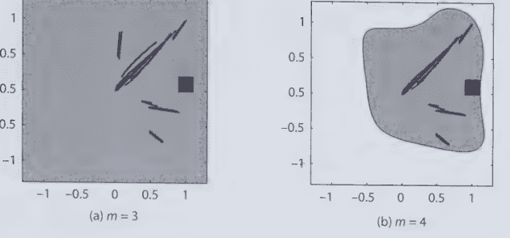

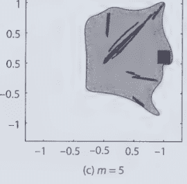

图 5.13。示例 5.17 的下水平集 $P_m$ 的层级结构。

示例 4.8 的程序对每个点 $(x_1^{(i)}, x_2^{(i)})$ 进行连续更新。图 5.13 中的点集是通过 $N=100$ 经过六次连续迭代得到的。

在步骤 $m=3$ 处，程序 (5.56) 得出一个带有 SOS 认证的解 $(p_3, w_3) \in \mathbb{R}_6[x] \times \mathbb{R}$，该解保证了有界性性质，即 $x \in \mathbb{C} \equiv x \in P_3 := \{p_3(x) \leq 0\} \subseteq \|x\|_2^2 \leq w_3$。其中 $p_3(x) := -2.5109 02467 - 0.0050x_1^2 - 0.0148x_2^2 + 3.0998x_1^4 - 0.8037x_2^4 - 3.0297x_1^2x_2^2 + 2.5924x_1^4x_2 - 1.5714x_1x_2^3 - 1.9133x_1^6 - 1.8122x_2^6 + 1.6042x_1^4x_2^2 + 0.0512x_1^2x_2^4 - 4.4430x_1x_2^5 - 1.8926x_1^5x_2 + 0.5464x_1x_2^5 - 0.2084x_1^3x_2^3 + 0.5866x_1^2x_2^4 - 2.2410x_1^4x_2^2 + 1.5714x_1^2x_2^3 - 0.0890x_1^3x_2^3 - 0.9656x_1^6 + 0.0098x_1^4x_2^2 - 0.0320x_1^2x_2^4 + 0.2660x_1^2x_2^4 + 0.7746x_2^6 + 0.9200x_1^3x_2^3 + 0.6411x_2^5$（为了简洁起见，我们未显示 $p_4$ 和 $p_5$）。

图 5.13 以浅灰色显示了示例 5.19 程序所可能取值集 $X$ 的近似值，如下：(a) 六次下水平集 $P_3$，(b) 八次下水平集 $P_4$，以及 (c) 十次下水平集 $P_3$。

# 表 5.1。示例 5.19 的耗时结果对比。

| deg 2m | # vars | SDP size | time |
|---|---|---|---|


| 4 | 1513 | 368 | 0.82 s |

| 6 | 5740 | 802 | 1.35 s |

| 8 | 15705 | 1404 | 4 s |

| 10 | 35212 | 2174 | 9.86 s |

# 表 5.2。示例 5.20 的耗时结果对比。

| deg 2m | # vars | SDP size | time |

|---|---|---|---|

| 4 | 2115 | 628 | 0.84 s |

| 6 | 11950 | 1860 | 2.98 s |

| 8 | 46461 | 4132 | 21.4 s |

| 10 | 141612 | 7764 | 109 s |

外近似 `$P_3$` 是粗糙的，因为它包含了区域 `[-1.5,1.5]^2`。然而，在更高的步骤求解问题 `(5.56)` 可以获得更紧凑的 `$\mathcal{C}$` 近似以及更精确的边界 `$w_4$` 和 `$w_5$`（见表 5.4 中的对应行）。

我们还成功证明了某些性质适用于高维程序，这些描述在示例 5.20 (`$d=3$`) 和示例 5.21 (`$d=4$`) 中。

**示例 5.20。** 这里我们考虑 `$X_{init} = [0, 1.1] \times [0, 0.2]$`，`$r^0: x \mapsto -1$`，`$r^1: x \mapsto \|x\|-1$`，`$r^2 \mapsto -1$`，`$T^1: (x_1, x_2, x_3) \mapsto 1/4(0.8x_1^2+1.4x_2-0.5x_3+1.3x_3^2)$`，`$T^2: (x_1, x_2, x_3, x_4) \mapsto 1/4(0.5x_1+0.4x_2-0.6x_3+0.5x_4^2)$` 以及 `$\kappa: x \mapsto \|x\|$`。

**示例 5.21。** 这里我们考虑 `$X_{init} = [0, 1.1] \times [0, 2.3]$`，`$r^0: x \mapsto -1$`，`$r^1: x \mapsto \|x\|-2$`，`$T^1: (x_1, x_2, x_3) \mapsto 0.25(0.8x_1^2+1.4x_2-0.5x_3+1.3x_3^2)$`，`$T^2: (x_1, x_2, x_3, x_4) \mapsto 0.25(0.5x_1+0.4x_2-0.6x_3+0.5x_4^2)$` 以及 `$\kappa: x \mapsto \|x\|$`。

表 5.1 和 5.2 报告了在 `$m$` (`$2 \le m \le 5$`) 时求解问题 `(5.56)` 的数据，分别对应示例 5.19、示例 5.20 或示例 5.21。问题 `(5.56)` 的每个实例被重写为一个 SDP 程序，涉及 `"# vars"` 个变量和大小为 `"SDP size"` 的 SDP 矩阵。表示使用 `MOSEK` 计算每个 SDP 程序最优解所需的 CPU 时间。

# 表 5.3。示例 5.21 的耗时结果对比。

| deg | m | # vars | SDP size | time |

|---|---|---|---|---|

| 4 | 7202 | 1670 | 2.85 s |

| 6 | 65306 | 6622 | 57.3 s |

| 8 | 18480 | 373057 | 1534 s |

| 10 | | | |

符号“—”表示相应的 SOS 程序无法求解。这些基准测试说明了 4.2.1 节中提到的计算考虑，因为分析高维程序需要更多 CPU 时间。对于示例 5.21，无法在步骤 5求解问题 `(5.56)`。限制这种计算爆炸的一种可能方法是利用系统的稀疏性。

##### 5.5.4.2 其他性质

我们考虑示例 5.22 给出的程序。目的是证明该程序变量的取值集 `$X$` 不与中心为 `(-0.5, -0.5)`、半径为 0.5 的圆 `$B$`。

**示例 5.22。** 考虑分多项式系统 `$S = (X_{init}, \{X^1, X^2\}, \{T^1, T^2\})$`，其中 `$X_{init} = [-1, 1] \times [-1, 1]$`，`$X^1 = \{x \in \mathbb{R}^2 \mid [0.5, 0.7]\}$`，`$X^2 = \{x \in \mathbb{R}^2 \mid r^2(x) \leq 0\}$`，其中 `$r^1 : x \mapsto \|x\|^2 - 1$`，`$T^1 : (x_1, x_2) \mapsto (x_1^2 + x_2^2, T^2(x_1, x_2))$`，`$T^2 : (x_1, x_2) \mapsto (0.5x_1^2 - 0.6x_2^2 + 0.3x_2)$`。通过 `$\kappa : (x_1, x_2) \mapsto 0.25 - (x_1+0.5)^2 - (x_2+0.5)^2$`，有 `$B := \{x \in \mathbb{R}^2 \mid \kappa(x) \leq 0\}$`。在这里，在考虑某些负 `$\alpha$` 使得 `$C \subseteq P_{\kappa,\alpha}$` 时，发现 `$x \in C \mapsto \kappa(x) < 0$`。注意 `$\kappa$` 不是正的，这与之前的示例有所不同。

在 `$m=3$`（或 `$m=4$`）处，`(5.56)` 产生非波动的解 `$w_m$`（或 `$w_m$`）。因此，它不允许我们证明 `$C \cap B$` 为空。这在图 5.14 (a) 和图 5.14 (b) 中所示，浅灰色区域并未避开圆 `$B$`。然而，在步骤 `$m=5$` 处求解 `(5.56)` 可得到负边界 `$w_5$`， 以及一个避开圆 `$B$` 的认证（见图 5.14 (c)）。`$w_m$` (`$m=3,4,5$`) 的对应值见表 5.4。

最后，分析示例 5.23 给出的程序。

**示例 5.23。**（改编自 [19] 中的示例 3）

令 `$S$` 为分多项式系统 `$(X_{init}, \{X^1, X^2\}, \{T^1, T^2\})$`，其中 `$X_{init} = [-1, 1] \times [-1, 1]$`，`$X^1 = \{x \in \mathbb{R}^2 \mid r^1(x) \leq 0\}$`，`$X^2 = \{x \in \mathbb{R}^2 \mid r^2(x) \leq 0\}$`，其中 `$r^1 : x \mapsto x_2 - x_1$`，`$r^2 : x \mapsto -1$`，`$T^1 : (x_1, x_2) \mapsto (0.687x_1 + 0.558x_2 - 0.0001x_1^2 - 0.2921x_1 + 0.773x_2^2)$`，`$T^2 : (x_1, x_2) \mapsto (0.369x_1 + 0.532x_2 - 0.0001x_1^2)$`。


图 5.14。示例 5.20 的下水平集 `$P_m$` 层级结构。

表 5.4。针对各种性质获得的边界层级。

| | 示例 5.19 | 示例 5.22 | 示例 5.23 |

|---|---|---|---|

| `$\kappa$` | `$\|\cdot\|_2^2$` | `$\kappa$` | `$\|\cdot\|_2^2$` |

| `$w_2$` | 639 | 0.25 | 10.2 |

| `$w_3$` | 17.4 | 0.249 | 2.81 |

| `$w_4$` | 2.44 | 0.0993 | 2.84 |

| `$w_5$` | 2.02 | -0.777 | 2.84 |

注：示例 5.22 `$\kappa = x \mapsto 0.25 - \|x + 0.5\|_2^2$` 以及示例 5.23 `$\kappa_2 = x \mapsto \|T^{-1}(x) - T^2(x)\|_2$`。

# 作为半代数集的的不变量

`-1.27x_1+0.0001x_2 - \dots`。我们考虑有界性性质 `$\kappa_1=\cdot\|$` 以及 `$\kappa_2(x) := \|T^1(x) - T^2(x)\|_2$`。函数 `$\kappa_2$` 可以被视为在可能的“错误”分支后更新变量 `$x$` 产生的绝对误差。这种行为可能会在使用浮点算术计算条件值（例如 `$r^1$`）时发生。表 5.4 表明了通过 `$m=3,4,5$` 求解问题 `(5.56)` 后获得的边界层级。边界 `$w_5=2.84$`（对于 `$\kappa_1$`）意味着到达值集可能未包含在初始集 `$X_{limit}$` 中。误差函数 `$\kappa_2$` 的有效上界由 `$w_5=2.78$`给出。

## 5.6 测方法

受 Henrion, Lasserre, Magron 和 Korda [115, 123, 124, 134, 142] 工作启发的另一种方法，精确限制动力系统的到达集 `$\mathcal{C}$`。假设该集合 `$\mathcal{C}$` 位于紧集 `$X$` 中，令我们将 `$X^{(\infty)}$` 表示限制在 `$X$` 中的到达集：

`$X^{(\infty)} = \{(x_t)_{t\in N} : x_{t+1}=f(x_t), \forall t\in N, x_0\in X\}$`。

该思想是将 `$X^{(\infty)}$` 表示为一个最小化优化问题，其中我们寻找一个包含初始集的归纳下水平集，并且其相对于勒贝测度的体积是最小的。对于 `$X$` 的紧性，定义了勒贝测度。此外，当选择合适的紧集 `$X_c$`（例如超立方体或球体）时，`$X_c$` 的体积可以用关于针对单项式的矩的线性方式表示。

## 5.6.1 对偶问题：最大化测度支撑

问题的初始表达式依赖于集合 `$\mathcal{C}$` 的指示函数 `$1_{\mathcal{C}}$` 的表征。

```
$1_A(x) := \begin{cases} 1 & \text{if } x \in A, \ 0 & \text{otherwise}. \end{cases}$
```

让我们来引入一些定义。

**定义 5.24 (Borel 测度向量空间)。** 给定一个紧集 `$A \subset \mathbb{R}^n$`，我们令 `$\mathcal{M}(A)$` 为支撑在 `$A$` 上的有限符号 B尔 测度向量空间，即从 B尔 `$\sigma$`-代数 `$\mathcal{B}(A)$` 上的实值函数。

**定义 5.25 (测度支撑)。** 测度 `$\mu \in \mathcal{M}(A)$` 的支撑定义为所有点 `$x$` 的集合，使得对于 `$x$` 的每个开邻域 `$\mathcal{B}$`，都有 `$\mu(\mathcal{B}) > 0$`。注意该集合根据构造是闭的。

**定义 5.26 (子集上的勒贝格测度)。** 子集 `$A \subseteq X$` 上的勒贝格测度的限制为 `$\lambda_A(dx):=1_A(dx)$`，其中 `$1_A:X\to\{0,1\}$` 代表 `$A$` 上的指示函数。

**定义 5.27 (勒贝格测度的矩)。** `$X$` 上的勒贝格测度的矩记为

```
$y_X^\beta := \int_X x^\beta \lambda(dx) \in \mathbb{R}, \quad \beta \in \mathbb{N}^n. \quad (5.57)$
```

**定义 5.28 (勒贝格体积)。** `$X$` 的勒贝格体积定义为 `$vol X:=y_X^0=\int_X \lambda(dx)$`。

**定义 5.29 (像测度)。** 给定一个正测度 `$\mu \in \mathcal{M}_+(X)$`，`$\mu$` 在函数 `$f$` 下的所谓推前测度（或像测度，参见例如 [31], 第 1.5 节定义如下：

```
$f_{\#\mu}(A):=\mu(f^{-1}(A))=\mu(\{x \in X: f(x) \in A\})$
```

对于每一个 `$A \in \mathcal{B}(X)$`。

**定义 5.30 (不变测度)。** 当测度 `$\mu$` 满足 `$\mu=f_{\#}\mu$` 时，则该测度关于 `$f$` 是不变的。

集合 `$X^{inv}$` 定义为所有关于 `$f$` 不变且被 `$f$` 支配的不变测度的支撑并并。`$\lambda$`（勒贝格测度在 `$X$` 上的限制）。

**引理 5.31.** 对于任意给定的 `$T \in \mathbb{N}_0, \alpha>1$` 和测度 `$\mu_0 \in \mathcal{M}(X_0)$`，存在测度 `$\mu_T, \nu \in \mathcal{M}(X)$` 满足离散 Liouville 方程：

```
$\mu_T+\nu=\alpha f_{\#}\nu+\mu_0. \quad (5.58)$
```

## 不变量作为半代数集

利用编码测度支撑某种守恒律的 Liouville 方程，为了近似集合 `$X^* := X^{inv} \cup X^{(\infty)}$`，对于给定的 `$\alpha > 1$`，考虑无限维线性规划 (LP) 问题：

```
$p^* := \sup_{\mu_0, \mu, u} \int \frac{\mu}{x} \text{s.t. } \mu + \hat{\mu} = \alpha f_{\#}\nu, \mu + \nu = \alpha f_{\#}\nu + \mu_0, \mu_0 \in M_+(X_0), \quad \mu, \nu \in M_+(X). (5.59)$
```

直观上，`$\mu$` 表示终端可达状态的测度。然而，由于不受方程限制，它可以表示任何可达状态。第二个约束是所谓的 Liouville 方程：它在约束内部编码了系统语义。

**备注 5.32 (局限性)。** 注意，由于 `$X^* \supset X_{\infty}$`，`$X^*$` 的计算也包含了描述不变集的集合 `$X^{inv}$`。这将把不可行的点作为可达点加入。这范围涵盖了不可达的固定点、共极限环或奇异吸引子。例如，如果考虑一个不收缩的旋转输入的简单线性系统，可达状态是初始状态的旋转闭包。但通过所演示的方法，如果 `$X^0 = ||x||_{\frac{1}{2}}<5 < X = ||x||_{\frac{1}{3}}$`，则通过旋转，我们得到 `$X^{\infty} = X^0$`，而该方法选择了所有的 `$X$`

## 5.6.2 对偶：最小化正函数

正测度不适应标量积，因此不是希尔伯特空间。正测度的对偶空间是正连续函数集合 `$C(X)$`。使用第 4.2.3 节中引入的对偶元素，可以构造测度最大化问题的对偶问题：

```
$d^* := \inf_{v,w} \int w(x) \lambda(dx) \text{s.t. } w(x) \geq 0, \quad \forall x \in X_0, w(x) \geq 1+v(x), \quad \forall x \in X, w(x) \geq 0, \quad \forall x \in X, \alpha v(f(x)) \geq v(x), \quad \forall x \in X, v,w \in C(X). (5.60)$
```

直观上，我们对函数 `$v(x)$` 的上水平集感兴趣。在初始状态下 `$v(x) \geq 0$`，且这种正性沿着系统轨迹保持：这通过约束 `$\alpha v(f(x)) \geq v(x)$` 进行了编码。如果状态 `$x$` 是可达的，那么

`$v(x) \geq 0$` 且其继状态 `$v(f(x)) \geq v(x) \geq 0$`。然而，`$v$` 在可达状态之外可以是任意值。正的 `$w$` 使得当 `$w(x) > 0$` 时，`$x$` 位于阈值之上。

## 5.6.3 层层化

使用 Lasserre 方法 [39]，通过强制多项式为 SOS 来确保表达式的正性。正如我们在 5.3 节中所示，可以最小化 `$X$` 的体积。

## 5.6.4 实验

##### 5.6.4.1 玩具示例

首先，让我们考虑由以下定义的虚构离散系统：

```
$x_t^+ := x_1 + 2$
$x_t^- := x_2 + 3$
```

初始状态约束 `$X_0 = \{x \in \mathbb{R}^2 : (x_1 - 1/2)^2 + (x_2 - 1/2)^2 \leq 4\}$` 以及单位圆 `$X$` 内的状态约束。在图 5.15 中，我们用纯灰色表示松弛阶 `$r$` 增加的外近似 `$X^*$`（从 `$r=4$` 到 `$r=14$`）。在图中，点集是通过前 7 次迭代得到的。更具体地说，每个点分别对应于（近似的）连续集合 `$X_1, \dots, X_7$`。集合 `$X_0$` 颜色较浅，位于图像右上部分，集合 `$X_7$` 颜色较深，靠近中心。虚线代表单位圆 `$X$` 的边界。图 5.15 显示外近似在低次数下已经相当紧。

##### 5.6.4.2 FitzHugh-Nagumo 模型

在这里我们考虑取自 [106] 第 5 节的 FitzHugh-Nagumo 模型 [2] 的离散版本，该模型最初是一个模拟神经元电活动的连续时间多项式系统：

```
$x_t^+ := x_1 + 0.2(x_1 - x_1^3/3 - x_2 + 0.875)$
$x_t^- := x_2 + 0.2(x_1 + 0.7 - 0.8x_2)$
```

初始状态约束 `$X_0 = [1, 1.25] \times [2.25, 2.5]$` 以及单位圆 `$X = \{x \in \mathbb{R}^2 : \frac{(x_1-0.1)^2}{3.6} + \frac{(x_2-1.25)^2}{1.75} \leq 1\}$` 内的状态约束。图 5.16 说明外近似为系统行为提供了有用的线索，特别是在 `$r$` 取值较大时。事实上，`$X^{10}$` 和 `$X^{12}$` 通过周期轨道捕捉到了中心“空洞”的存在，而 `$X^{14}$` 显示存在

# 108

# 第 5 章

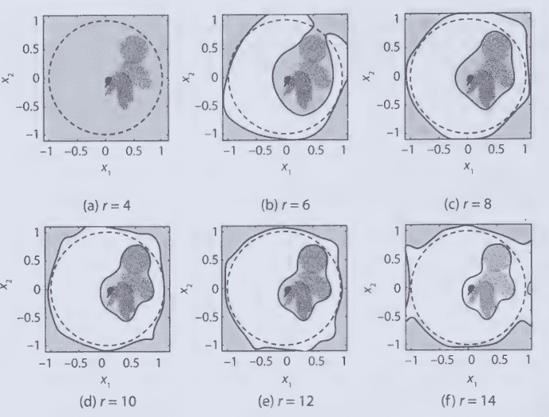

图 5.15 示例 5.6.4.1 中 `$X^*$`（点样本）的外部近似 `$X^r$`（浅灰色），从 `$r=4$` 到 `$r=14$`。


第一离离散时间步与对应这些周期性轨迹的迭代之间的间隙。

## 5.7 相关工作

自动化非线性分析在形式化验证中并不十分常见。一系列工作 [44, 50] 依赖于使用 Gröbner 基的迭代计算来合成多项式等式不变性。与 Karr 表示变量间仿射关系的定义域 [7] 类似，这些域提取了变量之间的多项式关系。较近的工作 [131] 依赖于某种最弱条件计算来合成这些多项式等式。在当前状态下，所有这些工作无法导出捕捉线性控制器稳定性的半代数集。

关于二次不变性（即椭球体），它们并没有拟格结构，因为不存在一个包含一组椭球体的唯一最小椭球体。如 [47, 56, 73, 130] 等展开技术通过在数学上求解这些动力系统实现了对线性系统的精确分析。虽然这些技术比我们提出的方法更精确，但它们难以处理析取或饱和情况。然而，它们可以在局部使用以提高分析的精确性。Cousot 在 [53] 中提出使用 SDP 或 SOS 等凸优化来合成下水平集属性，提供了简单的归纳模板，但没有解决检查结果正确性的方法。其他较近的方法如 [143] 针对椭球体提出了一种基于经典 Kleene 迭代的抽象域，其中并算子（join）被实现为调用 SDP 求解器以合成最小体积椭球体。[139] 的有趣方法提出了一种代数方法来处理特定类的椭球体（零中心椭球体），而不需要使用 SDP 求解器等数值工具来计算此类最小体积椭球体。

最后最后一类相关分析是非凸属性的计算。非凸属性也被用于将析取表示为给定的更经典凸抽象中的洞：差不等式矩阵（DBM，八边形的底层定义域）、带有不相等约束的域 [74]，或 Donut 域 [111]。

# 109

## 作为半代数集的不不变性

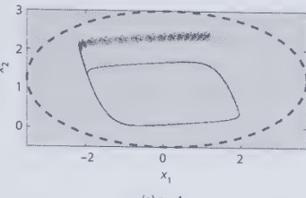

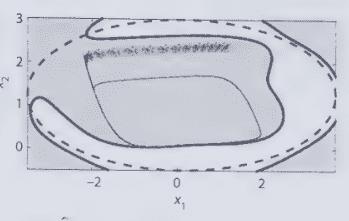

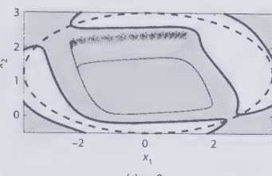

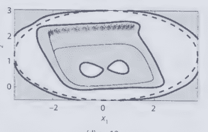

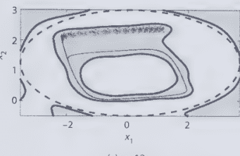

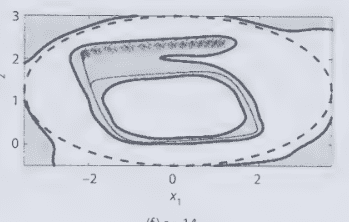

图 5.16 示例 5.6.4.2 中 `$X^*$`（点样本）的外部近似 `$X^r$`（浅灰色），从 `r=4` 到 `r=14`。

# 第六章

# 基于模板的分析与最小策略迭代

虽然上一章讨论了作为边界的不不变性的直接合成，但还有其他配置，我们对提供的模板感兴趣。

第一种情况出现在前述方法（如方程 `(5.10)` 和 `(5.11)`）仅合成模板而非边界。第二种情况出现在人们想要分析具有多个模板的系统时。通常，我们对每个变量的边界感兴趣，并在状态 `x` 下考虑模板 `p(x)=x_i`。本章提出了一种基于 SOS 的策略迭代算法来细化边界。在实践中，我们通过结合某些变量边界的额外模板来使用它。

## 6.1 基于模板的域

现在让我们假设抽象是基于模板的。我们回顾模板是一个实值函数 `p:Σ → ℝ`。

对于每个模板 `p`，可以刻画如第 2.5 节所示的抽象域 `D^{\#}`。我们也用 `ℝ = {−∞,+∞}` 表示 `ℝ` 的扩展，用 `≤` 表示这些值的扩展。对于前面提到的不动点，这种抽象也定义了一个完格。序关系 `≤` 是全序并应用于水平集的两个抽象值（即水平集）的并（join）和交（meet）通过 max 和 min 计算，`D^{\#} = (ℝ, ≤, −∞, +∞)`。

抽象和具体化函数定义为：

`α_p: S → {p(s)|s ∈ S}`

`γ_p: λ → {s ∈ S | p(s) ≤ λ}`

可以同时考虑多个模板。设 `ℙ` 为模板 `(p_i)_{0≤i<n}` 的有限族，`ℱ(ℙ, ℝ)` 为从 `ℙ` 到 `ℝ = ℝ ∪ {−∞,+∞}` 的函数集。`ℱ(ℙ, ℝ)` 带有偏序 `≤_ℱ`，当对于所有 `p ∈ ℙ`，`v(p) ≤ w(p)` 时。这定义了我们的抽象域，格 `D_ℱ^{\#} = (ℱ(ℙ, ℝ), ≤_ℱ, (−∞)_ℱ, (+∞)_ℱ)`，其中函数 `max_ℱ, min_ℱ` 是向量的 max 和 min。`(±∞)_ℱ` 表示函数 `p∈ℙ → ±∞`。

刻画抽象 `α` 和具体化 `γ`。设 `w ∈ ℱ(ℙ, ℝ)` 且 `X ∈ ℝ^n`。`w` 的具体化给出集合 `w^*`：

`w^* = {x∈ℝ^n | p(x) ≤ w(p), ∀ p ∈ ℙ}`。(6.1)

而 `X` 到 `ℱ(ℙ, ℝ)` 的抽象由抽象元素 `X^{†}` 定义：

`X^{†} := sup_{x∈X} p(x)`。(6.2)

## 6.2 作为优化问题的模板抽象不动点

让我们总结当前的定义：

- 系统的语义使用方程 `(2.17)` 定义为状态集的最小不动点，并由后不动点 `F(S)⊆S` 的最小集合 `S∈ρ(Σ)` 刻画。
- 可能的抽象集由模板域定义。抽象域由模板族指定，即系统状态上的实值函数。抽象值是刻画模板水平集的实值向量。

那么，在模板域中计算归纳不变性等同于对于每个模板 `p`，找到一个边界 `w(p)`，使得模板 `p` 的水平集 `{x∈ℝ^d | p(x) ≤ w(p)}` 的交集是一个归纳不变性。我们回顾道，在我们的语文中，模板仅仅是一个先定的多元多项式。

我们需要将集合 `w^*` 的归纳性表示关于 `w` 的不等式。根据定义，集合 `w^*` 是归纳不变性 `F(w^*)⊆w^*`，即：

`U^{i∈I}(w^*∩X^i) ∪ X^{init} ⊆ w^*`。

根据定义，`w^*` 是归纳不变性当且当：

`∀ p ∈ ℙ, ∀ x ∈ ⋃_{i ∈ ℐ} T^i(w^* ∩ X^i) ∪ X^{Init}, p(x) ≤ w(p).`

使用上界的定义，`w^*` 是归纳不变性当且当：

`∀ p ∈ ℙ, sup p(x) ≤ w(p). x ∈ ⋃_{i ∈ ℐ} T^i(w^* ∩ X^i) ∪ X^{Init}.`

**题 6.1。** 设 `w ∈ ℱ(ℙ, ℝ)`。则 `w^*` 是归纳不变变量（即 `F(w^*) ⊆ w^*`），当且仅当 `F^*(w) ≤ w`。

根据命题 6.1 `inf{w ∈ ℱ(ℙ, ℝ) | F^*(w) ≤ w}` 确定了形式 `(6.1)` 的最小归纳不变变量 `w^*`。

示例 6.2。考虑示例5.23 中定义的系统。考虑相同的模板基 `P={q_1, q_2, p}`，其中 `q_1(x)=x_1^2, q_2(x)=x_2^2`，且 `p` 是一个选取良好的 6 次阶多项式。令 `w ∈ ℱ(ℙ, ℝ)`。对于 `i=1` 和模板 `q_1`，我们有：

```
$F^*(w)(q_1) = sup (0.6877x_1+0.5588x_2-0.0001x_1x_2^2) - x_1^2+1 ≤ 0,$
$x_1^2 ≤ w(q_1),$
$x_2^2 ≤ w(q_2),$
$p(x) ≤ w(p)$
```

事实上，`X^1={x ∈ ℝ^2|x_1^2+x_2^2=1}`且与 `X^1` 相关的动力学是对于所有 `x ∈ X^2` 定义的多项式函数 `T^1`：`T^1(x)=(0.6877x_1+0.5588x_2-0.0001x_1x_2^2, 0.2928x_1+0.773x_2)`，且由于 `q_1` 计算第一个坐标的平方 `q_1(T^1(x))=(0.6877x_1+0.5588x_2-0.0001x_1x_2^2)^2`。

对于 `w ∈ ℱ(ℙ, ℝ)`，计算 `F^*(w)` 归于求解有限数量的非凸多项式优化问题。不存在解决此类问题的通用方法。在第6.3节中，我们提出了一种基于平方和（SOS）的方法来过近似 `F^*(w)`。

## 6.3 SOS-松弛语义

在本节中，我们引入松弛泛函，将在该泛函上计算不动点，从而得到可达值集 `ℛ` 的进一步近似。该松弛泛函是由评估 `F^*` 时涉及的最大化问题的拉格朗日松弛，以及多项式非负性约束的平方和强化构造而成的。

### 6.3.1 松弛语义

作为多项式最大化问题计算 `F^*` 无法直接使用数值求解器完成。我们使用上述的 SOS 强化机制来松弛计算并刻画 `F^*` 的抽象。

我们仍然使用模板基 `ℙ` 的知识，允许阶数最高为 `2m` 的多项式。令 `ℱ(ℙ, ℝ_+)` 为 `P` 上非负多项式的集合，即 `g ∈ ℱ(ℙ, ℝ_+)` 当且仅当对于所有 `p ∈ ℙ, g(p) ∈ ℝ_+`。令 `p ∈ ℙ` 且 `w ∈ ℱ(ℙ, ℝ)`。从 `F^*` 的定义开始，可以得到：

```
(F_s^i(w))(p) = sup { p(T^i(x)) | q(x) ≤ w(q), ∀ q ∈ P, r_j^i(x) ≤ 0, ∀ j ∈ In_i }
```

```
inf { sup p(T^i(x)) | λ ∈ ℱ(ℙ, ℝ_+), σ ∈ Σ[x], μ ∈ Σ[x], deg(σ) ≤ 2deg T^i + Σ_{q ∈ P} λ(q)(w(q)-q(x)), deg(μ_l^i) ≤ 2deg T^i, Σ_{l=1}^{n'} μ_l(x)r_l^i(x) = σ }
```

```
inf { η | λ, σ, μ, η, η p T^i - Σ_{q ∈ P} λ(q)(w(q)) + Σ_{l=1}^{n'} μ_l r_l^i = σ }
```

s. t.

`λ ∈ ℱ(ℙ, ℝ_+), σ ∈ Σ[x], μ_l ∈ Σ[x], η ∈ ℝ, deg(σ) ≤ 2deg T^i, deg(μ_l r_l) ≤ 2deg T^i`

（通过 SOS 强化移除 sup）。我们用 `Σ^n` 表示 `n` 元 SOS 多项式集合。为了清晰起见，`μ_l` 中省略了对 `i` 的依赖。此外，我们将 `Σ_{l=1}^{n'} μ_l r_l^i` 写为 `(μ, r^i)`。最后，我们将 `(F_i^R(w))` 写为 `(F_s^i(w))` 的过近似，定义如下：

```
$(F_i^R(w))(p) = inf_{λ, σ, μ, η} { η p T^i - Σ_{q ∈ P} λ(q)(w(q)) + (μ, r^i) = σ }$
s. t. λ ∈ ℱ(ℙ, ℝ_+), σ ∈ Σ[x], μ ∈ Σ[x]^n, η ∈ ℝ,`
`deg(σ) ≤ 2deg T^i, deg(μ r^i) ≤ 2deg T^i. (6.3)`
```

我们得出结论，对于所有的 `i ∈ ℐ`，`F_i^R` 的评估可以通过 SOS 完成，因为它被还原为求解具有线性目标和平方和约束的问题。

**示例 6.3**。我们仍然考虑示例5.23中的例子，并选取以下模板：`q_1 ↦ x_1^2, q_2 ↦ x_2^2`，以及一个选取良好的 6 次阶多项式 `p`。对于索引 `i=1`。回想起 `T^1(x) = (0.6877x_1+0.5588x_2-0.0001x_1x_2)`且 `X^1 = {x ∈ ℝ^2 | x_1^2+x_2^2-1 ≤ 0}`，因此 `r_1^1(x) = -x_1^2+1`。令 `w ∈ ℱ(ℙ, ℝ)`，则：

```
$F^R(w)(q_1) = inf_{λ,σ,η} \begin{aligned} &-\eta(0.6877x_1+0.5588x_2-0.0001x_1x_2) - λ(q_1)(w(q_1)-x_1^2)-λ(q_2)(w(q_2)-x_2^2) \\ \text{s.t. } &-\lambda(p)(w(p)-p(x))+\mu(x)(1-x_1^2)=\sigma(x) \\ &\lambda ∈ ℱ(Σ[x]), σ ∈ Σ[x], η ∈ ℝ, \\ \text{deg}(σ) ≤ 6, \text{deg}(μ) ≤ 6. \end{aligned}$
```

在实践中，无法找到小于6的可行解，除非我们将阶约束替换为更严格的约束：`deg(σ) ≤ 6, deg(μ) ≤ 6`。

`F^S` 的计算需要近似 `X^{Init}^{†} := sup{p(x), x ∈ X^{Init}}`。由于 `X^{Init}` 是半代数集且每个模板 `p` 都是多项式，`X^{Init}^{†}` 的评估归于求解一个最大化问题。接下来，我们使用上述 SOS 强化用如下定义的集合近似 `X^{Init}^R`：

```
$X^{Init}^R(p) := inf_{η} \begin{cases} -η+(ν^{Init},r^{Init})=σ_0, & η ∈ ℝ, σ_0 ∈ Σ[x], ν^{Init} ∈ Σ[x] \\ \\ \text{deg}(σ_0) ≤ 2, \text{deg}(ν^{Init},r^{Init}) ≤ 2 \end{cases}$
```

因此，`X^{Init}^R` 的值通过求解 SOS 优化问题获得。由于 `X^{Init}` 是非空紧致半代数集，它具有可行解（见 [39, Tan. 4.2] 的证明），确保了 `X^{Init}^R(p)` 为有限值。

**示例 6.4**。示例5.23的初始化集 `X^{Init}` 为 `[-1,1] × [-1,1]`。它可以写为： `{(x_1,x_2) ∈ ℝ^2 | x_1^2-1 ≤ 0, x_2^2-1 ≤ 0}`。那么，考虑示例6.3中相同的模板基和模板 `q_1`：

## 6.3.2 多项式模板抽象域中的策略迭代

我们感兴趣的是计算 `F^R` 的最小不动点 `R^R`，其中 `R^{RR}` 是 `ℛ`（`F` 的最小不动点）的过近似。对于 `ℛ` 的定义，它可以重新表述为最小后不动点：

`ℛ^{ℛ} = min{w ∈ ℱ(ℙ, ℝ) | F^{ℛ}(w) ≤_Γ w}`.

策略迭代的核心思想是使用连续迭代来过近似 `ℛ^{ℛ}`，这些迭代由组成：


- 使用线性规划计算多项式模板边界，以及
- 使用 SOS 规划确定新策略，
直到达到不动点。策略迭代在 `$F^{\mathcal{R}}$` 的后置点集上导航，并需要先验地从一个不动点 `$w^0$` 开始。它的作用类似于一个收缩算子，并且可以在任何时间中断。感兴趣的读者可以参考 [52, 68]。

### 6.3.3 策略

策略迭代可用于计算单调自映射的固定点，该映射定义为一组仿射单调自映射的下界。我们建议设计一种策略迭代算法来计算 `$F^{\mathcal{R}}$` 的不动点。在本节中，我们给出了多项式模板背景下策略的正式定义，并定义了仿射单调自映射族。我们没有将策略的概念应用在 `$F^{\mathcal{R}}$` 上，而是应用在 `$F_i^{\mathcal{R}}$` 上，利用了对于所有 `$i \in \mathcal{I}$`，`$F_i^{\mathcal{R}}$` 是某个最小化问题的最优值这一事实。

策略迭代需要一个*选择*属性，即当给定元素 `$w \in \mathcal{F}(\mathbb{P}, \mathbb{R})$` 一个达到下界的策略时。在我们的语文中，由于我们将策略应用于 `$F^{\mathcal{R}}$`，这意味着计算 `$F^{\mathcal{R}}$` 时涉及的最小化问题有一个最优解。在我们的情况下，对于 `$w \in \mathcal{F}(\mathbb{P}, \mathbb{R})$` 和 `$p \in \mathbb{P}$`，最优解是一个向量 `$(\lambda, \sigma, \mu) \in \mathcal{F}(\mathbb{P}, \mathbb{R}_+) \times \Sigma[x] \times \Sigma[x]^i$`；使得利用 (6.3)，我们得到：

$$(F^{\mathcal{R}}(w))(p) = p \circ T^i + \sum_{q \in \mathcal{V}} \lambda(w(q) - q) - (\mu, r^i) + \sigma \text{ and } \deg(\sigma) \leq 2m \deg T^i, \deg(\mu, r^i) \leq 2m \deg T^i. \quad (6.5)$$

观察到等式 (6.5)，`$(F^{\mathcal{R}}(w))(p)$` 是一个标量，而右侧是一个多项式。该方程中的等意味着该多项式是一个常数多项式。我们引入 SOS 问题 `$(F^{\mathcal{R}}(w))(p)$` 的可行解集：

$$(Sol(w, i, p) = \{(\lambda, \sigma, \mu) \in \mathcal{F}(\mathbb{P}, \mathbb{R}_+) \times \Sigma[x] \times \Sigma[x]^i \text{ s. t. Eq. (6.5) holds}\}). \quad (6.6)$$

## 模板分析

由于策略迭代算法可以在任何步骤停止并仍然提供可靠的过近似，当 `Sol(w, i, p) = \emptyset` 时我们停止迭代。现在，我们对使得 `Sol(w, i, p)` 非空的元素 `$w \in \mathcal{F}(\mathbb{P}, \mathbb{R})$` 感兴趣：

$$FS(\mathbb{P}, \mathbb{R}) = \left\{ w \in \mathcal{F}(\mathbb{P}, \mathbb{R}) \ i \in \mathcal{I}, p \in \mathbb{P}, Sol(w, i, p) \neq \emptyset \right\} \quad (6.7)$$

符号 `$FS(\mathbb{P}, \mathbb{R})$` 引入自 [91]，用于定义满足 `$Sol(w, i, p) \neq \emptyset$` 的元素 `$w \in \mathcal{F}(\mathbb{P}, \mathbb{R})$`。在 [91, 第4.3节] 中，我们使用了 Slater 严格约束限定条件。在当前的非线性区域，我们无法使用相同的条件，这导致 `$FS(\mathbb{P}, \mathbb{R})$` 产生了一个更复杂的定义。

最后，我们可以策略定义为一种映射，它对于所有的 `$w \in FS(\mathbb{P}, \mathbb{R})$`，所有的 `$i \in \mathcal{I}$` 以及所有的 `$p \in \mathbb{P}$`，选择 `Sol(w, i, p)` 的向量。更正式地，我们有如下定义：

**定义 6.8** *SOS 策略迭代中的策略.* *一个映射 `$\pi: FS(\mathbb{P}, \mathbb{R}) \mapsto (\mathcal{I} \times \mathbb{P}) \mapsto \mathcal{F}(\mathbb{P}, \mathbb{R}_+) \times \Sigma[x] \times \Sigma[x^{\vee}] \times \Sigma[x^{n}]$`，使得：`$w \in FS(\mathbb{P}, \mathbb{R}), i \in \mathcal{I}, p \in \mathbb{P}, \pi(w)(i, p) = Sol(w, i, p)$`。*

我们用 `$\Pi$` 表示策略集。对于 `$\pi \in \Pi$`，令 `$\pi_{\lambda}$` 为从 `$FS(\mathbb{P}, \mathbb{R})$` 到 `$(\mathcal{I} \times \mathbb{P}) \mapsto \mathcal{F}(\mathbb{P}, \mathbb{R}_+)$` 的映射，它与 `$w \in FS(\mathbb{P}, \mathbb{R})$` 和 `$i \in \mathcal{I}, p \in \mathbb{P}$` 关联 `$\pi(w)(i, p)$` 的第一个元组，即 `$\pi(w)(i, p) = (\lambda, \sigma, \mu)$`。

如前，当策略固定时，策略迭代利用了映射的线性。对于 `$\pi \in \Pi, w \in FS(\mathbb{P}, \mathbb{R}), i \in \mathcal{I}$` 和 `$p \in \mathbb{P}$`，且 `$\lambda = \pi_{\lambda}(i, p)$`，我们定义映射 `$\phi_{w,i,p}^{\pi}: FS(\mathbb{P}, \mathbb{R}) \to \mathbb{R}$` 如下：

$$v \mapsto \phi_{w,i,p}^{\pi}(v) = \sum_{q \in \Lambda} \lambda(q)v(q) + (F_i^{\pi}(w))(p) - \sum_{q \in \Lambda} \lambda(q)w(q). \quad (6.8)$$

那么，对于 `$\pi \in \Pi$`，我们对于所有的 `$w \in FS(\mathbb{P}, \mathbb{R})$` 定义从 `$\mathcal{F}(\mathbb{P}, \mathbb{R})$` 到 `$\mathcal{F}(\mathbb{P}, \mathbb{R})$` 的映射 `$\Phi^{\pi}(w)$`。令 `$v \in \mathcal{F}(\mathbb{P}, \mathbb{R})$` 和 `$p \in \mathbb{P}$`：

$$\Phi^{\pi}(w)(p) = \sup_{i \in \mathcal{I}} \phi_{w,i,p}^{\pi}(v). \quad (6.9)$$

**示例 6.9.** *让我们考虑示例 6.3 和函数 `$w^0(q_1) = w^0(q_2) = 2.19$` 以及 `$w^0(0) = 0$。存在 SOS 多项式 `$\tilde{\mu}$` 和 `$\tilde{\sigma}$`使得对于所有的 `$x \in \mathbb{R}$`：*

$$(F_1^{\tilde{\mu}})(q_1) = (0.687x_1 + 0.555x_2 - 0.0001x_1^2) + \tilde{\lambda}(q_1)(2.19 - x_1^2) + \tilde{\lambda}(q_2)(2.19 - x_2^2) - \tilde{\mu}(x)(1 - x_1^2) + \tilde{\sigma}(x) = 1.5503$$，其中 `$\tilde{\lambda}(q_1) = \tilde{\lambda}(q_2) = 0$` 且 `$\tilde{\lambda}(p) = 2.0331$`。这意味着 `$\tilde{\lambda}, \tilde{\mu}$` 和 `$\tilde{\sigma}$` 使得 `$0.687x_1 + 0.555x_2 - 0.0001x_1^2 + \tilde{\lambda}(q_1)(2.19-x_1^2) + \tilde{\lambda}(q_2)(2.19-x_2^2) - \tilde{\mu}(x)(1-x_1^2) + \tilde{\sigma}(x)$` 实际上是一个常数多项式。*

那么 `$(\lambda, \tilde{\mu}, \tilde{\sigma}) \in \text{Sol}(w^0, 1, q_1)$`，我们可以定义策略 `$\pi(w^0)$` 使得 `$\pi(w^0)(1, q_1) = (0, \tilde{\mu})$`，因此 `$\lambda(w^0)(1, q_1) = (0, 0, 2.0331)$`。我们可以对于 `$v \in \mathcal{F}(\mathbb{P}, \mathbb{R})$` 定义仿射映射：`$\Phi_{w^0,q_1}^w(v) = \lambda(q_1)v(q_1) + \lambda(q_2)v(q_2) + \lambda(p)(p) + (F^R(w))(q_1) - \lambda(q_1)w(q_1) - \lambda(q_2)w(q_2) - 2.19v(p) + 1.5503$`。

让我们用 `$\mathcal{F}(\mathbb{P}, \mathbb{R})$` 表示在 `$p$` 上的有限值函数，即如果对于所有的 `$p \in \mathbb{P}$`，`$g(p) \in \mathbb{R}$`则 `$g \in \mathcal{F}(\mathbb{P}, \mathbb{R})$`。

## 命题 6.10 ($\Phi_{i,p}^w$ 的性质)

令 `$\pi \in \Pi, w \in FS(\mathbb{P}, \mathbb{R})$` 且 `$(i, p) \in \mathcal{I} \times \mathbb{P}$`。令 `$a = \pi(w)(i,p)$`。以下性质成立：

1. `$\Phi_{w,i,p}$` 在 `$\mathcal{F}(\mathbb{P}, \mathbb{R})$` 上是仿射的
2. `$\Phi_{w,i,p}^w$` 在 `$\mathcal{F}(\mathbb{P}, \mathbb{R})$` 上是单调的
3. 对于所有的 `$v \in \mathcal{F}(\mathbb{P}, \mathbb{R})$`，`$F^R(v) \leq \Phi_{w,i,p}^w(v)$`;
4. `$\Phi_{w,i,p}^w(w) = F^R(w)(p)$`。

命题 6.10 给出的性质暗示了映射 `$\Phi_{\pi}^w(w)$` 的一些有用性质。

## 命题 6.11 ($\Phi_{\pi}^w(w)$ 的性质)

令 `$\pi \in \Pi$` 和 `$w \in FS(\mathbb{P}, \mathbb{R})$`。以下性质成立：

1. `$\Phi_{\pi}^{(w)}$` 在 `$\mathcal{F}(\mathbb{P}, \mathbb{R})$` 上单调的
2. `$F^R \leq \Phi_{\pi}^{(w)}(w)$`;
3. `$\Phi_{\pi}^{(w)}(w) = F^R$`。

假设 `$\Phi_w^{(w)}$` 的最小不动点 `$\in \mathcal{F}(\mathbb{P}, \mathbb{R})$`。则 `$L$` 可以作为线性规划的唯一最优解计算：

$$\forall (i,p) \in \mathcal{I} \times \mathbb{P},$$

$$\inf_{p' \in \mathbb{P}} \begin{cases} v(p') \\ \Phi_{i,w,p}^{(w)}(i,p)(v) \leq v(p), \\ \forall q \in \mathbb{P}, \\ X^{Int^R}(q) \leq v(q) \end{cases} \quad (6.10)$$

记得函数 `$g:\mathbb{D} \to \mathbb{R}$` 在 `$x$` 处上连续的，当且仅当对于收敛于 `$x$` 的 `$(x_n)_{n \in \mathbb{N}}$`，`$\limsup_{n\to\infty} g(x_n) \leq g(x)$`。

## 命题 6.12

对于 `$p \in \mathbb{P}$`，`$w \to F^R(w)(p)$` 在 `$FS(\mathbb{P}, \mathbb{R}) \cap \mathcal{F}(\mathbb{P}, \mathbb{R})$` 上是上连续的。

## 基于模板的分析

`input`: `$w^0 \in F(\mathbb{P}, \mathbb{R})$`，`$F^R$` 的一个后不动点

`output`: 如果 `$\forall k \in \mathbb{N}, w^k \in \mathcal{FS}(\mathbb{P}, \mathbb{R})$`，则一个不动点 `$w = F^R(w)$`；否则返回一个后不动点

```
k=0;
while fixpoint not reached
  begin 为当前迭代值 $w^k$ 计算下一个策略 $\pi$
  使用 Eq. (6.4) 和 Eq. (6.3) 计算 $F^R(w^k)$
  if $w^k \in \mathcal{FS}(\mathbb{P}, \mathbb{R})$ then
    Define $\pi(w^k)$;
  else
    return $w^k$;
  end;
  begin 计算下一次迭代 $w^{k+1}$
  定义 $\pi^{\pi(w^k)}$ 并计算 $w^{\pi(w^k)}$ 的最小不动点 $w^{k+1}$
  Problem (6.10);
  k=k+1;
end
```

图 6.1. 基于 SOS 的 PPS 程序策略迭代算法。

### 6.3.4 策略迭代

现在我们描述策略迭代算法。假设我们在 `$F(\mathbb{P}, \mathbb{R})$` 中有一个 `$F^R$` 的后不动点 `$w^0$`。

让我们逐步详细介绍图 6.1 所示算法。在第 1 行，算法初始化，因此 `$k=0$`。在第 4 行，我们使用 Eq. (6.4) 计算 `$F^R(w^k)$` 并解决 Eq. (6.3) 涉及的 SOS 问题。在第 6 行，如果所有 `$i \in \mathcal{I}$` 和所有 `$p \in \mathbb{P}$`，Eq. (6.3) 涉及的 SOS 问题都有最优解，则策略 `$\pi$`可用，我们可以选择 Eq. (6.3) 问题的任何最优解作为策略。如果不存在最优解，则算法停止并返回 `$w^k$`。现在，如果已定义策略 `$\pi$`，算法跳转到第 12 行，我们根据 Eq. (6.9) 定义 `$w^{\pi(w^k)}$`。然后，求解 LP 问题 (6.10) 并定义新的模板边界 `$w^{k+1}$` 为 `$w^{\pi(w^k)}$` 的最小不动点。最后，在第 13 行，`$k$` 递增。

如果某个 `$k \in \mathbb{N}, w^k \notin \mathcal{FS}(\mathbb{P}, \mathbb{R})$` 且 `$w^{k-1} \in \mathcal{FS}(\mathbb{P}, \mathbb{R})$`，则算法停止并返回 `$w^k$`。因此，对于所有 `$i \geq k$`，设置 `$w^i = w^k$`。

定理 6.13 (算法 6.1 的收敛性)。满足以下结论：

- 1. 对于所有 `$k \in \mathbb{N}, w^k \in F(\mathbb{P}, \mathbb{R})$` 且 `$F^R(w^k) \leq w^k$`。
- 2. 算法生成的序列 `$(w^k)_{k \geq 0}$` 是递减的并收敛。
- 3. 令 `$w^{\infty} = \lim_{k \to \infty} w^k$`，则 `$F^R(w^{\infty}) \leq w^{\infty}$`。此外，如果对于所有 `$k \in \mathbb{N}, w^k \in \mathcal{FS}(\mathbb{P}, \mathbb{R})$` 且 `$w^{\infty} \in \mathcal{FS}(\mathbb{P}, \mathbb{R})$`，则 `$F^R(w^{\infty}) = w^{\infty}$`。

## 6.4 示例

回我们的运行示例由以下分段多项式系统给出：(`$X^{Init}, \{X^1, X^2\}, \{T^1, T^2\}$`)，其中：

```
$X^{Init} = [-1, 1] \times [-1, 1]$
$X^1 = \{x \in \mathbb{R}^2 | |x_2|^2 + 1 \leq 0\}$
$X^2 = \{x \in \mathbb{R}^2 | |x_2|^2 - 1 < 0\}$
```

相对于划分 `$\{X^1, X^2\}$` 的函数为：

```
$T^1(x_1, x_2) = (0.6872x_1 + 0.558x_2 - 0.0001x_1x_2 - 0.292x_1 + 0.0773x_2)$
$T^2(x_1, x_2) = (0.3691x_1 + 0.532x_2 - 0.0001x_1x_2 - 0.27x_1 + 0.12x_2)$
```

第一步包括构造模板基和作为 Problem (5.56) 解的可达边界 `$w$`。我们将 `$p$` 的次数固定为 6。从 MATLAB 生成的模板 `$p$` 定义如下：


$1.9314006 + 3.5771x_1^2 + 0.7702x_1x_2 - 2.6284x_1^3 - 5.5572x_1^2 + 3.1872x_1x_2 + 0.0010x_2^3 - 2.4650x_1^2 - 0.5073x_2^2 - 2.8032x_2^3 - 0.5894x_1x_2 - 1.4968x_2^3 + 2.7178x_1^4 + 1.2726x_2^4 - 3.8372x_1^4 + 6.5349x_1^3x_2 + 5.7948x_1x_2 - 6.2558x_2^2 + 0.5987x_1^2 - 0.0168x_1x_2 + 1.1066x_2^2 + 0.3172x_1^2x_2 + 0.8380x_1x_2 + 0.0635x_1^3 + 0.4719x_2^3$。上边界 `w` 等于 2.1343。为了计算边界，我们可以使用模板基 `mathbb{P} = {p, x -> x_1^2, x -> x_2^2}`。我们为 `x -> x_1^2` 写 `q_1`，为 `x -> x_2^2` 写 `q_2`。基础代数式 `{x in mathbb{R} | p(x) <= 0, q_1(x) <= 2.1343, q_2(x) <= 2.1343}` 是不变的，对应的边界是 `w^0 = (w^0(q_1), w^0(q_2), w^0(p)) = (2.1343, 2.1343, 0)`。

在算法 6.1 的第 4 行，我们使用 SOS (Eq. (6.3)) 计算 `w^0` 的像 `F^R`。我们找到：

```
$F^R(w^0) = 1.5503$
$F^R(w^0(q_2)) = 1.9501$
$F^R(p) = 0$.
```

由于 `w^0 in mathcal{FS}(mathbb{P}, mathbb{R})`，算法 6.1 允许进入第 6 行，`F^R(w^0)` 的计算允许我们确定一个新的策略 `pi(w^0)`。重要数据是


图 6.2. 通过策略迭代得到的连续集合。灰色是从 Problem (5.56) 计算的集合 `w`，而右侧是通过策略迭代计算的集合 `w^*`。在两个图中，黑点表示 `mathcal{R}` 的离散版本。

向量 `lambda`。例如，对于 `i=1` 和模板 `q_1`，向量 `lambda` 为 `(0, 0, 2.0331)`。这意味着为每个模板 `q` 关联一个权重 `lambda(q)`。在 `lambda=(0, 0, 2.0331)` 的情况下，`lambda(q_1)=0, lambda(q_2)=0`，且 `lambda(p)=2.0332`。对于 `i=1`，模板 `q_1` 和边界向量 `w^0`，函数 `w^{pi(w^k)}` 遵循 Eq. (6.9)。然后，求解 LP 问题 (6.10) 并定义新的模板边界 `w^{k+1}` 为 `w^{pi(w^k)}` 的最小不动点。最后，在第 13 行，`k` 递增。

如果某个 `k in mathbb{N}, w^k notin mathcal{FS}(mathbb{P}, mathbb{R})` 且 `w^{k-1} in mathcal{FS}(mathbb{P}, mathbb{R})`，则算法停止并返回 `w^k`。因此，对于所有 `i >= k`，设置 `w^i = w^k`。

### 定理 6.13 (算法 6.1 的收敛性)

满足以下结论：

- 1. 对于所有 `k in mathbb{N}, w^k in F(mathbb{P}, mathbb{R})` 且 `F^R(w^k) <= w^k`。
- 2. 算法生成的序列 `(w^k)_{k >= 0}` 是递减的并收敛。
- 3. 令 `w^{infty} = lim_{k -> infty} w^k`，则 `F^R(w^{infty}) <= w^{infty}`。此外，如果对于所有 `k in mathbb{N}, w^k in mathcal{FS}(mathbb{P}, mathbb{R})` 且 `w^{infty} in mathcal{FS}(mathbb{P}, mathbb{R})`，则 `F^R(w^{infty}) = w^{infty}`。

## 6.5 多项式迭代

如本章所示，通过扩张使用了抽象解释的经典框架。例如，当抽象域和不动点方程均为线性的时，可以使用线性规划而不需要扩张。同样，当函数和抽象域最多为二次的时，使用了半正规划 (SDP) [91, 110]。在所有情况下，这些分析都是在基于模板的抽象上进行的，将抽象元素表示为下水平集。

### 基于模板的分析

125

**定理 6.14.** 给定一个 `F` 的（可能是无限的）最小策略（min-policies）集合 `mathcal{F}`。如果对于所有 `b in mathbb{R}^n`，都存在一个策略 `F in mathcal{F}` 在点 `b` 处插值 `F`（即 `E(b)=F(b)`），且每个 `F in mathcal{F}` 都有一个最小固定点 `lfpF`，则 `F` 的最小固定点满足：

$$
$$lfpF = bigwedge_{F in mathcal{F}} lfpF$$
```

迭代通过两个主要对象完成：一个最小策略 `sigma` 和一个方程组的值的元组 `beta`。以下策略迭代算法从 `F` 的某个固定点 `beta_0` 开始，旨在产生对 `F` 固定点的更好的近似。策略迭代算法始终通过迭代两个阶段进行：首先选择一个策略 `sigma_i`，然后通过某些 `beta_i` 对其求解。更具体地说，在我们的案例中：

- 在点 `beta_i` 处切于 `F` 的线性最小策略 `sigma_{i+1}`（这得益于半正规划求解器和适当的松弛）
- 通过线性规划求解器计算策略 `sigma_{i+1}` 的最小固定点 `beta_{i+1}`。

可以在任意停止迭代（例如，在固定次数的迭代后或当 `beta_i` 和 `beta_{i+1}` 之间的进展被认为足够小时），留下一个 `F` 固定点的过近似 `beta`。

### 6.5.2 最大策略迭代（Max-policy iterations）

行为作为一种超拓宽（super widening），最大策略迭代 [93] 的工作方向与最小策略迭代相反。它们从底部开始，并在所谓的最大策略（max-policies）上迭代计算最大固定点，直到达到全局固定点。与之前的方法不同，该算法以理论上精确的固定点终止，但用户必须等到最后，因为中间结果不是固定点的过近似。这些策略是最小策略的对偶的：如果对于每个 `b in mathbb{R}^n`，都有 `F <= F(b)` 且存在某些 `b_0 in mathbb{R}^n` 使得 `F(b_0)=F(b)`，则 `F` 是 `F` 的最大策略。特别，每个方程中选择一个就是最大策略。

迭代通过两个主要对象完成：一个最大策略 `sigma` 和一个方程组的值的元组 `beta`。考虑到在给定策略上计算固定点相当于一个数学优化问题，且方程组的固定点也是某些策略的固定点，以下策略迭代算法旨在通过求解优化问题来寻找。为了初始化算法，在每个方程中添加一个项 `-\infty`，初始策略 `sigma_0` 对于每个方程均为 `-\infty`，初始值 `beta_0` 是元组 `(-\infty, ..., -\infty)`。然后对策略进行迭代：

- 改进策略 `sigma_i` 的策略 `sigma_{i+1}`，即在点 `beta_i` 处达到（严格）更大的值；如果未找到，则退出；
- 计算策略 `sigma_{i+1}` 的最大固定点 `beta_{i+1}`。

最后的元组 `beta` 即为整个方程组的固定点。最大策略迭代构建了一个抽象元素的升序链，类似于 Kleene 迭代元素。然而，它保证是有限的，受策略 `sigma` 数量的数量，而 Kleene 迭代需要使用拓宽来确保终止。由于最大策略的数量随模板数量呈指数级增长，且每个策略只能改进一次，我们得到了迭代次数的指数上界。在实践中，策略的数量是足够小的。

上所述地，在每个方程中选择一个就是最大策略。

# 系统属性作为不变性

通过对系统的脉冲响应进行傅里变换或拉普拉斯变换得到。这种所谓的频率方法通常用于线性系统，并伴有 Bode 图或奈奎斯特图等图形化工具。另一种方法是时域分析，在状态空间表示上进行，基于李普诺夫函数（Lyapunov functions）。如前部分所述，李普诺夫函数表示了一种正能量的概念，这种能量沿着系统的轨迹减小，并刻画了它的渐近稳定性。对于线性系统，此类函数通常使用一个正定矩阵 `P >= 0` 定义，使得：

```
$A^T P A - P < 0,$
```

其中 `A` 是系统的状态矩阵。

### 7.1.1 雅普诺夫函数的计算

使用第 5 章提出的工具，我们可以计算归纳性数值不变性，例如正定矩阵 `P^o` 和 `P^c`，它们表示这些开环和闭环系统的雅普诺夫函数。

对于开环系统，雅普诺夫函数 `P^o` 用于表示 BIBO 属性，以在假设有界输入 `e` 的情况下界定可达状态 `x^o`：

```
$||e||_{infty} <= 1 Rightarrow x^{ct} P^o x^c <= 1.$
```

对于闭环系统，通过将对象的反馈集成到控制器输入中，可以表示类似的属性。对于有界的目标参考 `in`，闭环系统将只允许有界的可达状态 `x`：

```
$||in||_{infty} <= 1 Rightarrow x^{lt} P^c x <= 1.$
```

对于控制工程师来说，与雅普诺夫函数表示的渐近属性相比，这些有界属性似乎很弱。然而，它们对于保证实现运行正常（不会发散并导致运行时错误，例如产生数值溢出）极其重要。一旦使用表征控制器稳定性的雅普诺夫函数对可达状态提供了二次界限，离散模型和代码的静态分析就可以依赖策略迭代（第 6 章）来推断 `x^o` 和 `x^c` 的界限。

### 7.1.2 无饱和闭环系统的稳定性

回想第 3 章介绍的闭环系统示例包含两种形式。第一种考虑了线性控制器与线性对象之间的简单反馈。这个全局线性系统由图 7.1 精确描述。

```
xc1 = xc2 = xp1 = xp2 = 0;

while (1) {

  yd = acquire_input();

  nasert(yd >= -0.5 && yd <= 0.5);

  cx1 = xc1; xc2 = xc2; xp1 = xp1; xp2 = xp2;

  cxc1 = 0.499 * xc1 - 0.05 * xc2 + (op1 - yd);

  cxc2 = 0.021 * xc1 + xc2;

  xp1 = 0.028224 * xc1 + xp1 + 0.01 * xp2

  - 0.0064 * (op1 - yd);

  xp2 = 5.6448 * xc1 - 0.01 * xp1 + xp2

  - 12.8 * (op1 - yd);

  wait_next_clock_tick();

}
```

图 7.2. 闭环系统的分析代码。

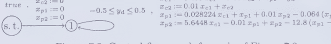

图 7.3. 图 7.2 代码的控制流图。

图 7.2 显示了上一节所述闭环系统的分析代码。从此类代码中，我们提取出图 7.3 的控制流图。

我们的分析随后了一个基于雅普诺夫函数的二次模板 `P`，在转移上是归纳的：

> `A^{top}PA - P <0,`

其中 `A` 表示闭环系统的离散动力学。
令 `P` 为得到的矩阵：

| 1.3776 | 1.3967 | -0.6730 | 0.1399 |
| 1.3967 | 1.1163 | -0.4877 | 0.1099 |
| -0.6730 | -0.4877 | 0.3496 | -0.0529 |
| 0.1399 | 0.1099 | -0.0529 | 0.0111 |

从提取的控制流图和一组关于程序变量的表达式 `t`（称为模板），通过策略迭代（第 6 章），为每个图顶点计算界限，使得 `Lambda_i <= b_i` 是不变的。给定模板 `t_1 := x^{top}Px, t_2 := x_{c1}^2, t_3 := x_{c2}^2, t_4 := x_{p1}^2,` 和 `t_5 := x_{p2}^2`，其中 `x` 是向量 `[x_{c1}, x_{c2}, x_{p1}, x_{p2}]^{top}`，通过（四舍五入四位）迭代计算不变性：

```
$t_1 <= 0.2302 wedge t_2 <= 0.0162 wedge t_3 <= 0.4720$

$t_4 <= 0.1973 wedge t_5 <= 0.6775$
```

这意味着

```
$|x_{c1}| <= 7.1426 wedge |x_{c2}| <= 3.9334 wedge |x_{p1}| <= 3.1933$

$|x_{p2}| <= 2.0446$
```

我们的静态分析器花费了 0.76s 生成此模板，花费了 1.28s 在输入上对其界定，因此在总共 2.04s 内完成了全自动计算。这证明了雅普诺夫函数的存在，界定了可达状态，并证明了稳定性。

### 7.1.3 带有饱和的闭环系统

真实的控制器包含饱和器，用于限制从传感器读取的值或发送到执行器的值，以确保这些值保持在设备的运行范围内。在对其输入上具有这样的饱和后，我们运行示例的控制流图变为图 7.4 所示。由于由于执行器的饱和，之前的方法可能并不适用。

一个想法是尝试生成，如前所述，对于图 7.4 的每个边的 `P`。这种方法在输入饱和时仍然有效。另一种方法是使用常用的雅普诺夫函数。这种方法对于由于输入是饱和的，闭环系统是不稳定的。对于图 7.4 的某些边，这种方法需要严格不等式来确保分析的正确性。最后，如分段雅普诺夫函数（参见第 5.3 节）的方法，允许类似的限制。7.1.3.1 和 7.1.3.2 节提供了生成模板 `x^{top} Px` 的两种方法，使得 `x^{top} Px <= r` 是不变的。

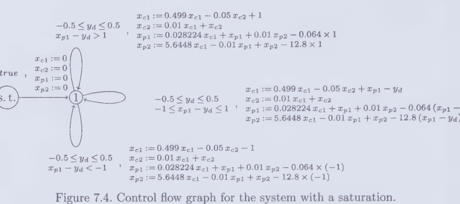

图 7.4. 带有饱和的系统流图。

#### 7.1.3.1 线性化

在这种情况下，受 [92] 强烈启发的方法提供了一种可用于饱和系统（如公式 (3.7) 所示）的启发式。事实上，令 `P` 为描述不变椭的候选矩阵。我们需要尽可能地刻画 `P`，同时保持求解过程的可处理性。假设 `x_k^TP_k <= 1`，`|Cx_k|` 的界由 `gamma := sqrt(P^{-1}C^T)` 给出。由于 `|y_{d,k}| <= 0.5`，`hat{gamma} := gamma + 0.5` 是 `|Cx_k - y_{d,k}|` 的上界。令 `y_{c,k} := SAT(Cx_k - y_{d,k})`，我们得到如下扇区：

```
$$(y_{c,k} - frac{1}{gamma}(Cx_k - y_{d,k}))(y_{c,k} - (Cx_k - y_{d,k})) <= 0.$$
```

图 7.5 展示了该不等式的区域。带有 `|Cx_k - y_{d,k}|` 额外的界限 `hat{gamma}`，我们看到 `y_{c,k}` 必然位于 `Cx_k - y_{d,k}` 和 `frac{1}{gamma}(Cx_k - y_{d,k})` 之间。那么 `y_{c,k} - (Cx_k - y_{d,k})` 和 `y_{c,k} - frac{1}{gamma}(Cx_k - y_{d,k})` 符号相反，因此不等式成立。

```
$x_k^TP_k <= 1 implies x_{k+1}^TP_{k+1} <= 1.$
```


图 7.5. 扇区界限的示意。等式 `y_{c,k} = SAT(Cx_k - y_{d,k})`（粗线）被不等式 `(Cx_k-y_{d})/hat{gamma} <= y_c <= Cx_k-y_{d}`（灰色区域）抽象化。

# 凸化

方程 (7.6) 随后可以通过 S 过程（S-Procedure）进行松弛：如果存在正系数 `lambda, mu` 和 `nu`，则该等式成立：

```
$mathcal{U}-lambdaLambda-mu W-nuUpsilon<= 0. quad (7.7)$
```

方程 (7.5) 可以使用 Schur 补（Schur complement）重写：

```
$left[ begin{array}{cc} gamma^2 & C \ CT & P end{array} right] <= 0. quad (7.8)$
```


注意，对于固定的 `$\lambda$` 和 `$\gamma_i$`，方程 `(7.7)` 和 `(7.8)` 关于 `P, \mu` 和 `\nu` 线性矩阵不等式 (LMI)，这意味着可以通过 SDP 求解器求解。期望 `$\tilde{\gamma}=\gamma+5$` 大于 1（否则饱和永远不会被激活）；此外，由于饱和会在某种程度上“限制”这个值，我们可以预计要在多个数量级上进行迭代。得益于 LMI `(7.7)` 的右下角系数，我们知道 `$\lambda\in(0,1)$`。此时一种可能的策略是对 `$\lambda$` 和 `$\gamma$` 的潜在值进行迭代，并在每次迭代中求解相应的 LMI。如果解，它将为带饱和的系统提供 `x^T Px\leq1`。

对于我们的运行示例，我们可以生成一个合适的模板。`$\gamma$` 的值通过通过探索 `(0,1)` 并使用形式为 `$\frac{k}{2^i}$` 的数字（其中 `i\geq 1` 递增，`k<2`）来选择。对于每次选择，以 `$\gamma$` 从 1 到 5 步长为 `.1` 的值求解 LMI。在 `$\lambda=\frac{63}{64}$` 和 `$\gamma=3.1$` 时找到了解，这相当于调用了 LMI 求解器 2605 次。

## 7.1.3.2 首先抽象扰动

在之前的方法中，使用的方法主要基于对饱和的抽象。第二种方法展示了另一种方法，其中抽象的是扰动 `y_d` 而不是饱和。

让我们首先忽略扰动 `y_d`，并为以下系统寻找李雅普夫函数：

```
$x_{k+1}=\begin{array}{rl} x_k-B & \text{if } Cx_k\leq-0.5 \\ (A+BC)x_k & \text{if } -1.5\leq Cx_k\leq1.5 \\ x_k+B & \text{if } Cx_k\geq0.5 \end{array} \quad (7.9)$
```

其中 `A, B`, 和 `C` 是 `(3.7)` 给出的矩阵。

> **备注 7.1.** `y_d` 的抽象体现在 `(3.7)` 中的项 `(A+BC)x-By_d` 被 `(7.9)` 中的 `(A+BC)x` 替换。同样，如 `Cx-y_d\leq-1` 等守护条件被 `Cx\leq-0.5` 替换（因为 `|y_d|\leq0.5`）。

### 作为不变性的系统属性

**备注 7.2.** 在情况下 `0.5 \le \pm Cx_k \le 1.5`，系统非确定性地采取两个可用转移之一，实际系统 `(3.7)` 采取的转移由抽象变量 `y_d` 的值决定。

该系统的二次李雅普夫函数 `x \mapsto x^T Px` 必须满足对于所有 `x \in \mathbb{R}^4` 和所有从 `x_k` 到 `x_{k+1}` 的可能转移有 `x_{k+1}^T Px_{k+1} \le x_k^T Px_k`。因此，对于 `x \in \mathbb{R}^4`

```
$$\begin{aligned} Cx \le0.5 \Rightarrow (Ax-B)^T P(Ax-B) \le x^T Px \\ -1.5 \le Cx \Rightarrow ((A+BC)^T P((A+BC)x) \le x^T Px \\ Cx \ge0.5 \Rightarrow (Ax+B)^T P(Ax+B) \le x^T Px \end{aligned}$$
```

值得注意的是，我们可以通过对称性原理去掉第一个约束。事实上，第一个约束对某些 `x` 成立当且仅当它对 `-x` 成立。同样，我们可以移除第二个约束中蕴含关系的左部分。事实上，该蕴含关系的右部分对某些 `x` 成立当且仅当它对 `$\alpha x$` 成立，对于足够小的 `$\alpha$`，`$\alpha x$` 将满足该蕴含关系的左部分。因此 `x \mapsto x^T Px` 是 `(7.9)` 的李雅普夫方程，当且仅当对于所有 `x \in \mathbb{R}^4`

```
$$\begin{aligned} ((A+BC)^T P((A+BC)x) \le x^T Px \\ Cx \ge0.5 \Rightarrow (Ax+B)^T P(Ax+B) \le x^T Px . \end{aligned} (7.10)
```

定义向量 `x' := [x^T]^T`，这可以重写为：

```
$$\begin{aligned} x^T(A+BC)^T P(A+BC) \le x^T Px \\ [C|0]^T P[I_4|0]x' \le x'^T P[I_4|0] \end{aligned}$$
```使用拉格朗日松弛（Lagrangian relaxation），当存在 `$\lambda \ge 0$` 时其成立：

```
$$\begin{aligned} P-(A+BC)^T P(A+BC) \ge 0 \\ [I_4|0]^T P[I_4|0]-[AB]^T P[AB]-\lambda \begin{bmatrix} 0 & C \\ -I \end{bmatrix} \ge 0 \end{aligned}$$
```

 `M \ge 0` 矩阵半正定。我们最终希望模板 `x^T Px` 为带扰动 `y_d` 的系统提供不变性。为了这个目的，我们只希望第一个不等式中的 `(A+BC)^T P(A+BC)` 比 `P` 小，以便为重新引入 `y_d` 留出空间。也就是说，我们寻找最小的 `$\lambda \in (0,1)$`使得

```
$\lambda P - (A+BC)^T P(A+BC) \geq 0$
```

对于某些正定矩阵 `P`。对于任何 `$\lambda$` 的值，这都是 LMI，可以使用 SDP 求解器判断是否存在满足它的 `P`。因此 `$\lambda_{min}$` 可以通过二分查找在 `(0,1)` 内高效估计。**备注 7.3.** `$\lambda_{min}$` 也称为衰减率。我们正在寻找正定矩阵 `P` 使得

```
$$\begin{cases} \lambda_{min} P - (A+BC)^T P(A+BC) \geq 0 \\ [I_4|0]^T P[I_4|0]-[AB]^T P[AB]-\lambda \begin{bmatrix} 0 & C \\ -I \end{bmatrix} \geq 0.\end{cases}$$
```
这是一个 LMI，可以输入 SDP 求解器。不幸的是，`A` 的特征值大于1，且取足够大的 `x` 会破坏 `(7.10)` 中的第二个约束。然而，当 `Cx \geq 1.5` 时，`x` 饱和，对于某些 `$\gamma > 1$`，添加约束 `Cx \leq \gamma` 是合理的，希望生成的不变性最终满足这一点。这导致了以下 LMI：

```
$$\begin{cases} \lambda P - (A+BC)^T P(A+BC) \geq 0 \\ [I_4|0]^T P[I_4|0]-[AB]^T P[AB]-\lambda \begin{bmatrix} 0 & C \\ -I \end{bmatrix} + D \geq 0 \end{cases} (7.11)$$
```
其中 `D := [C-0.5]^T [-C\gamma]^T`。最后，上述 LMI 的解 `P, x^T P \leq r_{max}` 应该是原始系统 `(3.7)` 的一个良好不变性，其中 `r_{max} := \frac{CP^TC}{1-\gamma}` 或使得 `x^T Px \leq r` 推出 `Cx \leq \gamma` 的最大 `r`。

通过搜索，二分查找允许我们计算出 `$\lambda_{min} = 0.9804$`保留四位小数）。在 `(7.11)` 中连续尝试 `$\gamma$` 的值 2, 3, 4...。LMI 在 `$\gamma=2$` 时似乎有解，但在 `$\gamma=3$` 时没有。对于 `$\gamma$` 的最后一个值 (`$\gamma=3$`) 得到的 `P` 值保留为模板并沿 `r_{max}=0.26` 输入策略迭代。所有这些计算（`$\lambda_{min}$` 的二分查找、`$\gamma$` 的测试以及 `r_{max}` 的计算）在 Intel Core2 @ 1.2GHz 上花费了 0.83s。

#### 7.1.3.3 依赖计算出的模板

我们使用第二种方法计算矩阵 `P`：

```
$P := \begin{pmatrix} 0.2445 & 0.3298 & -0.0995 & 0.0197 \\ 0.3298 & 1.0000 & -0.0672 & 0.0264 \\ -0.0995 & -0.0672 & 0.0890 & -0.0075 \\ 0.0197 & 0.0264 & -0.0075 & 0.0016 \end{pmatrix}$
```

可以执行前面的步骤：
给定模板 `t_1 := x_{p1}^T P x_{p1}, t_2 := x_{c1}^2, t_3 := x_{c2}^2, t_4 := x_{p1}^2`, 和 `t_5 := x_{p2}^2`，其中 `x` 是向量 `[x_{c1}, x_{c2}, x_{p1}, x_{p2}]^T`，且策略迭代（保留四位小数）计算不变性

```
$t_1 \le 0.1754 \wedge t_2 \le 6.1265 \wedge t_3 \le 0.3505 \\

t_4 \le 4.1586 \wedge t_5 \le 17.0518$
```

这意味着：

```
$|x_{c1}| \le 2.4752 \wedge |x_{c2}| \le 0.5921 \wedge |x_{p1}| \le 2.0393 \wedge \\

|x_{p2}| \le 41.2938.$
```


**备注 7.4.** 尽管了扰动 `$y_d$` 来生成 `$P$`，但值得注意的是策略迭代是在带有扰动 `$y_d$` 的完整系统中进行的。

**备注 7.5.** 虽然是启发式的，但 `$\gamma$` 的选择似乎并不困难，因为在 `$(2.40, 3.85)$` 区间内的任何值都会导致良好的模板。

## 7.2 带向量裕量的鲁棒性

除了稳定性之外，需要验证的一个重要属性是控制器的鲁棒性。鲁棒性属性在实践中是必要的，因为反馈回路中存在许多缺陷源。它描述了闭环系统有多大的稳定性，以及能够承受何种扰动或不确定性而不丢失稳定性。这些缺陷包括模型建模误差、模型无法捕捉的系统不确定性、传感器和执行器的噪声，以及控制器设计的局限性，例如未考虑系统行为的完整范围、执行器的非线性、故障执行器等。

第 7 章

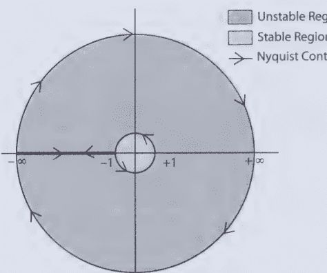

工业界中用于衡量线性 ISO¹ 控制器鲁棒性的标准指标由相位裕和增益裕组成。虽然这些概念现在由更现代的技术（如 IQC [25] 或 `$\mu$`-分析 [11]）所监督，但它们在工业界中仍被广泛用作控制系统待保证的指标。

然而，这些裕量从未在代码产物上进行分析或计算，未考虑到使用浮点算术的实际实现。

我们建议依赖向量裕量（vector margins）的概念来表征鲁棒性，并将其描述为跨系统状态的数值不变属性，因此适用于代码级分析。

让我们首先使用奈奎斯特图对基于频率经典鲁棒性分析进行非正式概述，然后介绍我们如何使用向量裕量来界定鲁棒性。

### 7.2.1 奈奎斯特图与稳定性准则

奈奎斯特图是环路传递函数对正弦输入的频率响应（幅值和相位），使用极坐标系进行显示。为了构造奈奎斯特图，沿着奈奎斯特轮廓 `$\Gamma$` 评估环路传递函数 `$L(z)$`。图 7.6 所示的奈奎斯特轮廓包绕了以原点为中心的单位圆盘（OUD）之外的区域。“单输入单输出”环路传递函数的示例奈奎斯特图。

`$L(z) := 7.552 \times 10^{-5}z^3 - 7.583 \times 10^{-5}z^2 - 7.454 \times 10^{-5}z + 7.488 \times 10^{-5} \quad z^4 - 3.979z^3 + 5.937z^2 - 3.937z + 0.979 \quad (7.12)$`

如图 7.7 所示。

我们引入了奈奎斯特稳定性准则，该准则利用奈奎斯特图来确定系统的闭环稳定性。设 `$Z_i$` 为 `$L(z)+1$` 在 OUD 外的零点个数，`$P_i$` 为 `$L(z)+1$` 在 OUD 外的极点个数。根据柯西幅相原理，奈奎斯特图应该顺时针包绕 `$-1+0j$` 点 `$N_i$` 次，其中：

`$N_i = Z_i - P_i. \quad (7.13)$`

利用 `(7.13)` 和图 7.7 中的奈奎斯特图，我们可以通过以下方式得出闭环系统的稳定性。首先，我们知道 `(7.12)` 中的环路传递函数 `$\frac{L(z)}{1+L(z)}$` 是稳定的，即它具有 0 个 OUD 极点，这意味着 `$P_i=0$`。由于图 7.7 中的奈奎斯特图没有包绕 `$-1+0j$`（即临界点），我们可以得出 `$L(z)+1$` 的 OUD 零点个数也是 0。由于 `$L(z)+1$` 的 OUD 零点也是闭环传递函数的 OUD 极点，我们可以得出闭环系统也是稳定的。

### 7.2.2 相位裕和增益裕

从奈奎斯特稳定性准则可以推断出，可能的鲁棒性指标可以是奈奎斯特图与 `$-1+0j$` 点之间的间隙大小。事实上，相位裕和增益裕是奈奎斯特图到临界点“距离”的两种近似方法。

第一个近似是相位裕，它衡量系统可以容忍多少相位滞。`$\frac{\pi}{2}$` 或 `90°` 的相位滞对应于四分之一周期的延迟。从几何角度上说，反馈中引入 `$\Delta_\omega$` 的相位滞会导致奈奎斯特图顺时针旋转 `$\Delta_\omega$`，即 `$L(z) \to e^{\Delta_\omega}L(z)$`。相位裕表示奈奎斯特图在碰撞之前可以顺时针旋转的。如图 7.7 所示，相位裕（PM）恰好是单位圆与奈奎斯特图交点之间的顺时针角。

第二个近似是增益裕，它衡量系统在与 `$-1+0j$` 点相交之前可以容忍多少反馈增益。如图 7.7 所示，增益裕（GM）恰好是 `$2\log_{10}(1/x)$`，其中 `$x$` 是奈奎斯特图在 `$\pi$` 相位处的幅值。对于良好的鲁棒性，典型的要求是相位裕至少为 `30°`，增益裕至少为 db。

> 逆时针包绕为负。


图 7.7。`(7.12)` 上的经典裕与向量裕对比。

### 7.2.3 向量裕计算

反馈回路中的不确定性可能会同时引入相位滞和增益增加。在这些情况下，解释相位裕和增益可能会产生系统鲁棒性的乐观视图。例如，在图 7.7 中，小的相位滞结合小的增益会导致系统不稳定，而纯增益增加则不会，需要较大的相位滞才能使系统不稳定。为了更好地指示系统的鲁棒性，我们查看 `$-1+0j$` 与由复数模导出的奈奎斯特图之间的距离，即 `$\min_{z} |L(z)+1|$`。在后续，我们将这种度量称为向量裕。通过在 `$-1+0j$` 点画一个半径等于向量裕的圆，我们得到了图 7.7 中的包络，对于这个例子，它比经典度量更为保守。使用向量裕有几个优势：

- 它是更真实的鲁棒性度量。
- 它可以转换到时域并表示为二次不变。
- 它可以很容易扩展到 MIMO 系统。

向量裕可以通过寻找奈奎斯特轮廓 `$\Gamma$` 上敏感函数 `$S(z) := \frac{1}{1+L(z)}$` 的倒数模。

## 系统属性

通过注意 `$\min_{z\in\mathbb{R}} |L(z)+1| = \frac{1}{\max_{z\in\mathbb{R}} |L(z)+1|}$` 可以看出：敏感函数是闭环系统输出随输入变化的一阶近似。敏感函数 `$S(z) := \frac{1}{1+L(z)}$`（其中 `$L(z) := P(z)C(z)$`）的状态空间表示可以用形成对象对象 `$P(z)$` 和控制器 `$C(z)$` 的状态空间矩阵表示。对于图 7.1 中的示例，敏感函数具有以下状态空间实现：

`$x_{k+1} = A_sx_k + B_sn_k$`
`$e_k = C_sx_k + D_sn_k \quad (7.14)$`

其中：

`$A_s := \begin{bmatrix} A_c & -B_cp \\ P_cC_c & A_p - B_dp_c \end{bmatrix} \quad B_s := \begin{bmatrix} B_c \\ P_cD_c \end{bmatrix} \quad (7.15)$`
`$C_s := \begin{bmatrix} 0 & -C_p \end{bmatrix} \quad D_s := \begin{bmatrix} 1 \end{bmatrix}$`

通过应用有界实引理（bounded real lemma），我们得到结果：

**性质 7.6.** 如果存在正定矩阵 `$P$` 和 `$\gamma > 0$`，使得：

`$x_{k+1}^T Px_{k+1} - x_k^T Px_k \leq \gamma^2||n_k||_2^2 - ||e_k||_2^2 \quad (7.16)$`

则 `$\max|S(z)| \leq \gamma$`。

`(7.16)` 中的不等式是一个耗散条件，可以通过求解线性矩阵不等式（LMI）进行有效检查。我们有以下命题：

**性质 7.7.** 前述不等式 `(7.16)` 可以写为如下 LMI：

`$\begin{bmatrix} A_s^TPA_s - P + C_s^TC_s & A_s^TPB_s + C_s^TD_s \\ B_s^TPB_s + D_s^TC_s & D_s^TD_s + B_s^TPB_s - \gamma^2I \end{bmatrix} < 0 \quad (7.17)$`

根据命题 7.7，对于任何 `$P > 0$` 和 `$\gamma > 0$`，满足 `(7.17)` 的 `$\max_{z\in\mathbb{R}} |L(z)+1| = \frac{1}{\gamma}$` 得到 `$\delta = 1/\gamma$`。因此，对 `(7.16)` 从 0 到任意时刻 `$T$` 求和，得到：

`$x_{k+1}^T Px_{k+1} - x_0^T Px_0 \leq \gamma^2 \left( \sum_{k=0}^T ||n_k||_2^2 \right) - \sum_{k=0}^T ||e_k||_2^2$`

由于 `$P$` 是正定的，假设 `$x_0 = 0$`：

`$\sum_{k=0}^{T} ||e_k||_2^2 \leq \gamma^2 \left( \sum_{k=0}^{T} ||n_k||_2^2 \right). \quad (7.18)$`

### 7.2.4 与相位裕和增益裕的关系

虽然可以自动计算线性系统的向量裕，但与工程师交互通常需要相位裕和增益裕。我们在这里建议将向量裕投影到相关的相位裕和增益裕的安全近似上。

##### 7.2.4.1 相位裕

正如 7.2.2 节所述，相位裕表示为传递函数的奈奎斯特图与单位圆以及 `$-1+0j$` 点之间的角。

这个角必然大于计算出的半径为 `$\delta$` 的安全圆与单位圆以及 `$-1+0j$` 点之间的角（参见图 7.7，其中 `$\delta=VM$`）。

在这种情况下，向量裕到相位裕的直接投影为：

`$$\phi\delta = 2 \arcsin(\delta/2).$$`

##### 7.2.4.2 增益裕

同样，可以通过投影向量裕获得安全的增益裕。增益裕表示奈奎斯特图与 `$-1+0j$` 点相交的可接受比例。

我们可以近似与向量裕 `$\delta$` 的增益裕：

`$$\Theta\delta = \frac{1}{1-\delta}.$$`

### 7.2.5 弹簧阻尼器分析

在分析第3 章提供的示例时，考虑闭环系统，通过经典方法可以以下相位裕和增益裕：`$\Theta = 17dB$` 和 `$\phi = 49^\circ$`。注意，我们假设系统没有饱和器，因为在计算奈奎斯特图分析时无法考虑饱和。

## 系统属性作为不变性

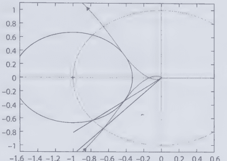

图 7.8 具有向量裕量的弹簧质阻尼系统的尼奎斯特图。

根据离散对象和控制器的描述，通过 LMI `(7.17)` 自动构建并分析灵敏系统，得到 `$\gamma = 1.4914$`，

```
$P = \begin{bmatrix} 111.8330 & 88.8442 & -48.4990 & 8.8432 \\ 88.8442 & 278.5963 & -20.2482 & 6.9605 \\ -48.4990 & -20.2482 & 28.7964 & -3.7961 \\ 8.8432 & 6.9605 & -3.7961 & 0.7013 \end{bmatrix}$
```

所得向量裕量为 `$\delta = 1/\gamma = 0.6705$`，其对保守增益和相位裕量的投影返回：

`$\Theta_{\delta}=10dB \quad \phi_{\delta}=39^{\circ}$`。

图 7.8 展示了尼奎斯特图和向量裕量。

## 7.3 相关工作

很少有分析在代码层面解决这种闭环稳定性和鲁棒性问题。

在控制层面，稳定鲁棒性属性在历史上是最早被考虑的。许多技术通过不同的手段解决它们；我们向感兴趣的（计算机科学家）读者推荐关于控制理论的入门讲座 [27]。在控制理论中，存在两种分析系统的方法：一种是上述的时域，另一种是更常用的频域。在频域中，稳定性通常通过研究传递函数的极点位置来分析，要么基于信号的拉普拉斯变换（负实部），要么基于其 Z 变换（单位圆内）。在两种情况下，系统都必须完全线性化（即在线性化点附近去除饱和特性），且分析假设实数语义，而不考虑浮点运算。

即使在控制理论学家计算的时域分析中，在控制器层面执行的浮点运算以及随后可能在分析过程中本身执行的浮点运算的影响通常被忽略了。这些将在第 9 章中讨论。

在静态分析方面，现有的分析中很少能够表达稳定性这一简单属性。如前所述，大多数用于计算可达状态过近似的现有抽象域都依赖于线性近似。第 5 章和第 6 章提出的方法分别提供了非线性下水平集不变性的合成，以及使用最小策略策略迭代（min-policy iterations）对它们进行收缩（narrowing），解决了这一问题。然而，正如第 9 章所描述的，由于浮点误差，系统强制执行了严格的归纳条件，这阻止了对饱和控制器的分析。所提方法提供了额外的手段来处理这一大类系统。

最后，必须提到最后一条工作：关于混合系统的大量工作 [75, 95, 105, 125, 126, 127]。然而，很难用几个性质完全不同的词来总结，它们描述了一个核心的连续行为（或溢水水箱），而控制器通过微分方程和少量离散事件（例如弹跳球或周期性地）执行离散转换，并且 (2) 它们关注有界时间属性而非不变性的生成。这两点可能成为将这些有趣的技术应用到我们环境的主要障碍。

例如，虽然有界时间分析（仿真）不提供不变性，但它们允许使用直接分析连续对象的技巧，例如保证积分 [84]。这避免了对对象进行离散化（正如我们在这里所做的），这会在分析中引入额外的保守性。

## 第八章

# 代码层面的系统级属性验证

所有的分析都是针对离散动态系统模型进行的。如第 4.1 节所述，这些模型可以作为早期设计产物提供，也可以被提取为更具体的表示，如模型或代码。

然而，一旦在模型层面表达并分析了控制层属性，我们希望在从模型中提取的代码产物上断言它们的有效性。

由于自动代码框架，这种从模型的提取在很大程度上是自动化的，该框架可以从 MATLAB、Esterel SCADE 和学术语言 LUSTRE [13] 等数据流模型生成嵌入代码。从数据流语言 [77] 生成代码现在是有效的且在工业中广泛使用，得到了 MATLAB Embedded Code、Esterel KCG 或 LUSTRE 编译器等工具的支持，例如 [118]。

我们声称代码生成可以被适应以现在代码层面实现系统级属性的表达，并在后根据代码语义进行证明。

本章解决了这个问题。我们首先给出了建模框架的概述，使其能够在模型和代码层面表达属性。第二部分解释了此类代码注释的生成，最后一部分则侧重于它们的验证。

## 8.1 通过同步观察器和霍尔三元组的控制属性公理语义

使用控制语义进行控制软件可靠自动代码生成的框架总结如图 8.1 所示。该框架提供了一个通道，允许领域专家（例如控制工程师）高效地生成具有可验证保证的代码。（注：此处 OCR 存在大量重复内容，已进行清理）。

这些观测器可以用于验证和确认。当依赖测试时，可以评估块的输出，将其作为编码属性的测试断言（test oracle）。当执行得当时时，目标是证明对于所有可达状态，块的输出始终为正。

关于系统级属性，正如我们在上一章看到的，边界性和稳定性都可以通过输入为 `$x_i,i=1,\dots,n$` 的同步观测器以及布尔值函数表示：

```
$x \to \sum_{i=1,\dots,n} x_i P_{ij} x_j \le \mu.$
```

该同步观测器由对称矩阵 `$P$` 和乘倍因子 `$\mu$` 参数化。

为了在 Simulink 块上表示椭圆观测器，我们构建了一个名为 *Ellipsoid* 的自定义 S 块来表示椭圆观测器。此外，为了表示被对象的运行语义，我们构建了一个名为 *Plant* 的自定义 S 块。它的语义类似于 Simulink 的离散时间状态空间，具有两个关键特征：其是 *Plant* 块同时包含了对象的输入和输出；另一个是来自 *Plant* 的输出包含了对象的内部状态。这些变量用于表征当前状态，并作为椭圆观测器的输入。

其他属性也可以表示为耗散框架下的非扩张性。*Non-Expansivity* 块在与适当的输入输出连接时，可以用于表示各种性能指标，例如系统的 `$H_{\infty}$` 特性或控制系统的闭路向量裕量。此类使用的示例如图8.2所示，其中常数增益控制器的闭路裕量是通过 *Plant* 块和 *Non-Expansivity* 块的组合表示的。

在本章中，我们关注目前对开环稳定性属性的全自动处理，不再考虑此处描述之外的图8.2 所示的语义。

对于运行示例，我们有一个连接了两个同步观测器的 Simulink 模型。为了清晰起见，观测器显示在块的上部。

回想我们对量 `$y-d$` 作了以下假设：

```
$\|y-d\| \le 0.5,$
```

这在图 8.3 中通过椭圆 *BoundedInput* 表示，参数为 `$P=0.5$` 和乘倍因子 `$\mu=0.0009$`。稳定性证明在图 8.3 中通过椭圆 *Stability* 表示，参数为 `$P=4.28 \times 10^{-4} \quad 4.28 \times 10^{-5} \quad 2.4651 \times 10^{-3}$` 和 `$\mu=0.9991$`。图8.3 中的观测器块通过 *VaMux* 块连接到模型。*VaMux* 块的作用是将一组标量输入连接成单个向量输出。

## 代码级验证

151

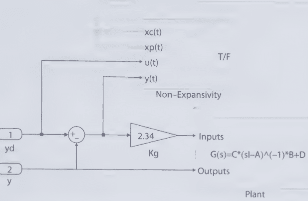

图 8.2。闭路系统向量裕量的表示。

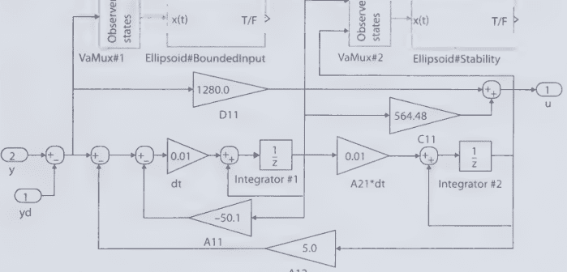

图 8.3。带有同步观测器的运行示例。

构建这个特殊块是因为椭圆观测器块只能接受单个向量输入。

### 8.1.3 C 代码级控制语义

对于开环稳定性特定问题，C 代码级所需的表达能力是双方面的。一方面，需要表示由程序变量组成的向量属于一个椭圆；这等同于表示在每次循环执行之前，`[v_1 v_2]^T \in E_P` 成立。在表达能力方面，这是为了表示线性控制器的开环稳定性。

然而，为了便于证明，在循环内部添加了中间注释以传播椭圆，如 [92] 所示。由于这个原因，循环体可以使用局部契约进行注释，如下：

```c
/* requires in_ellipsoid(P,vect_of_scalar(
    v_1,v_2));
 @ ensures in_ellipsoid(Q,vect_of_scalar(
```


### 8.1.3.2 包含证明元素

ACSL 的扩展以及 Frama-C 的插件已经开发。它们通过添加额外注释使得指示证明局部契约成为可能。例如，以下语法：

```c
/* requires in_ellipsoid(P,vect_of_scalar(
    v_1,v_2));
 @ ensures in_ellipsoid(Q,vect_of_scalar(
    v_1,v_2,v_3));*/
 @ PROOF_TACTIC (use_strategy (Affineipsoid));
{
    // assignment of
```

建议 Frama-C 使用 `AffineEllid` 策略。

### 8.1.3.3 闭路语义：代码中的对象动态

为了表示与系统闭路行为相关的属性，需要引用对象。这是通过使用 `ghost` 变量实现的。这些变量可以像普通变量一样初始化和更新，但它们只存在于代码注释中，不会影响实际代码的结果。

## 第8章

由于我们所有的闭路分析、稳定向量裕量都是基于对象的离散（线性）表示，因此，定义对象的离散块可以生成 `ghost` 代码。在控制循环结束时，我们使用这些变量表示对象的状态更新。我们还公理地强制要求传感器的输入等于对象的输出。

### 8.1.4 PVS 中的控制语义

通过使用 ACS `ghost` 变量，可以在交互式证明器的帮助下完成注释代码的正确性验证。在 8.3 节描述的过程中，我们使用 PVS 来表示控制器的稳定性。通过向量裕量也基于对象的离散（线性）表示。

#### 8.1.4.1 基础类型和理论

在 [114] 中作为 PVS 库的一部分引入的线性代数允许通过定义类型对控制系统进行推理。例如：

- 向量类型
- 矩阵类型
- 各种矩阵子类型，如平方、对称和正定
- 块矩阵
- 行列式
- Schur 补和正定性

在 [114] 中，引入了一个名为椭圆的定理。图8.4所示的第一个定理在 PVS 中表示了通用椭圆 $G_Q$ 如何通过线性映射 $x \mapsto Mx$ 转换为 $G_{QM}$。第二个定理如图8.5所示，表示给定位于椭圆 $G_1$ 和 $G_2$ 中的向量 $x$ 和 $y$，以及乘倍因子 $\lambda_1, \lambda_2 > 0$，使得 $\lambda_1 + \lambda_2 \leq 1$，则可以说：

$$(x \ y)^T \in G_Q, \text{ 其中 } Q = \begin{pmatrix} \lambda_1 & 0 \\ 0 & \lambda_2 \end{pmatrix}$$

这些定理在8.3节中被大量用于证明给定 Hoare 三元组的正确性。虽然它们并不新颖，但它们 PVS 中的证明并非简单的过程，需要接近 10000 个手动证明步骤。

## 代码级验证

155

```c
ellipsoid_general: THEOREM
\forall\ (n:posnat,m:posnat, Q:SquareMat(n),
M: Mat(m,n), x:Vector[n], y:Vector[m]):
in_ellipsoid_?(n,Q,x)
IMPLIES
AND y = M*x
in_ellipsoid_?(m,M*transpose(M),y)
```

图 8.4。PVS 中的椭圆定理。

```c
ellipsoid_combination: THEOREM
\forall\ (n:posnat, lambda_1, lambda_2:
posreal, Q_1: Mat(m,n),
_2: Mat(m,m), x:Vector[n], y:Vector[m],
z: Vector[m+n]
in_ellipsoid_?(n,Q_1,x)
AND in_ellipsoid_?(m,Q_2,y)
AND lambda_1+ lambda_2 <= 1
AND z = Block2V(V2Block(n,m,n,m))
IMPLIES
in_ellipsoid_?(n+m,Block2M(M2Block(n,m,n,m)))
)(1/lambda_1*Q_1,
Zero_mat(m,n),Zero_mat(m,n),
1/lambda_2*Q_2)),z
```

图 8.5。PVS 中的椭圆组合定理。

### 8.2 生成注释：最强后置传播算法

如果有如此强大的工具，我们只需要在循环体上注释一个循环不变性：下水平 $\varepsilon p$ 的 $\mu$。遗憾的是，由于内存模型的编码复杂，证明目标往往随着语句数量的增加而增加，工具很难在大段代码中证明复杂的属性。

```c
/*@ logic matrix QMat_0 =
mat_of_2x2_scalar(1484.8760396857954,-25.78902824188802,
  -25.78902824188802,406.11067541120576);

/*@ logic matrix QMat_1 =
mat_of_2x2_scalar(1484.8760396857954,-25.78902824188802,
  -25.78902824188802,406.11067541120576);
*/

/*@ logic matrix QMat_2 =
mat_of_2x2_scalar(1484.8760396857954,-25.78902824188802,
  -25.78902824188802,406.11067541120576);
*/
```

图 8.6. 作为注解的椭圆。

因此，可以引入中间注解来表示计算对循环不变性的影响。由正定矩阵 $P$ 特征的椭圆不能包含变量之间的任何依赖关系，且中间计算可能会导致椭圆变为退化形式。退化的椭圆在二维空间中可以视觉化为一条线段。另一种方法是通过它们的 Q 形式来操纵椭圆，这是舒尔补补（Schur complement）的一种应用。

**定义 8.1 (Q 形式)。** 如果矩阵 $P^{-1}$ 存在并令 $Q=P^{-1}$，则 $x^{op}Px \le 1$ 等价于 $\begin{bmatrix} x & Q \end{bmatrix} \ge 0$，这为 Q 形式。

在提供注释时，可以将其转换为 Q 形式，并使用带有归纳契约的函数来标注循环体。然后，在每条指令之间注入 Q 形式椭圆以表示局部不变性。
接下来的图显示了运行示例自动代码输出的一部分。图 8.7 中的三个 ACSL 注解定义了矩阵变量 `QMat_0`、`QMat_1` 和 `QMat_2`。所有的矩阵变量参数化同一个椭圆，与从稳定性分析中获得并插入 Simulink 模型作为 *Ellipsoid#Stability* 观察者的椭圆相同。

# 代码层面的验证

# 157

```c
/*@
  requires in_ellipsoidQ(QMat_0,
  vect_of_2_scalar(_state_->Integrator_1_memory,
      _state_->Integrator_2_memory));
  requires \valid(_ic_) && \valid(_state_);
  ensures in_ellipsoidQ(QMat_1,
  vect_of_2_scalar(_state_->Integrator_1_memory,
      _state_->Integrator_2_memory);
*/

void discrete_timeg_no_plant_08b_compute(
  t_discrete_timeg_no_plant_08b_io *_io,
  t_discrete_timeg_no_plant_08b_state *
      _state_);
```

**图 8.7. 循环体函数契约。**

使用 ACSL 关键字 `requires` 和 `ensures`，我们可以对代码行以及函数表示前置和后置条件。图 8.7 中的 ACSL 函数契约表示了控制器状态转换函数 `discrete_timeg_no_plant_08b_compute` 插入的椭圆前置和后置条件。

在该循环函数的体内，ACSL 注解（如图 8.8 所示）操纵着中间椭圆。在这种情况下，它包含了来自函数契约注解的前置条件的副本。这是为了在函数体开始处插入的椭圆前置条件。

### 8.2 不变量的前向传播

椭圆不变性的手动正向传播在 [92] 中已有描述。我们在此回顾其基本原理。更多细节可参见 [147] 或 [145]。

#### 8.2.1 仿射变换

对于椭圆的线性传播，定义了 *AffineEllipsoid* 规则。它用于线性赋值 `\|y\|_F = Lx`，其中 `x \in \mathbb{R}^m` 是程序状态向量，`L \in \mathbb{R}^{l \times m}`。它被应用于已有的 `Q` 形式椭圆 `Q_n` 和 `Q_{n+1}`。

记得 `Q_n` 定义为 $\begin{bmatrix} 1 & x \end{bmatrix}^T Q \geq 0$，这等价于经典不等式 $x^T Q^{-1} x \leq 1$。

```c
/* @
behavior ellipsoid0_0:
  requires in_ellipsoidQ(QMat_2,
  vect_of_2_scalar(
    _state->Integrator_1_memory,
    _state->Integrator_2_memory));
  ensures in_ellipsoidQ(QMat_3,
  vect_of_2_scalar(
    _state->Integrator_1_memory,
    _state->Integrator_2_memory));
*/
```

图 8.8. 语句注解。

`Q_{n+1}` 的形式定义涉及 $\begin{bmatrix} 1 & y \end{bmatrix}^T Q \geq 0$，适用于 `y`。然而，核心思想是：

##### 8.2.1.2 S 补

舒尔补用于组合椭圆。在存在多个椭圆的情况下，我们依赖舒尔补生成更强的后置条件。这通常在 PVS 中实现，如图所示。

#### 8.2.2 后置条件的验证

在传播步骤之后，我们得到了新的后置条件。需要检查此后置条件是否蕴含插入的椭圆。这将在第10章介绍。

# 8.3 使用 PVS 消除目标

一旦生成了注释代码，还需要证明注释是正确的。图 8.9 展示了检查过程的概述。首先，Frama-C/WP 为每个霍尔三元生成验证条件，然后将其转换为 PVS。这是通过 Why3 完成的，如 8.3 节所述。

### 8.3.1 从代码到 PVS 定理

上一节描述的自动代码生成了两个 C 函数。其中一个是初始化函数，另一个实现了循环的单次执行，负责获取输入并更新状态变量和输出。实现者负责编写组合这两个函数的函数，将后者放入循环并与传感器和执行器接口以提供输入并交付输出。然而，开环和闭环稳定性以及状态边界可以通过仅考虑更新函数来建立，本节专注于此。

让我们考虑 8.10 中的注释代码。Frama-C/WP 能够刻画 `ensures` 语句的最弱前置条件并构建证明目标 $pre \implies wp(code, post)$。通过 Why3 可以将其表示为 PVS 定理。例如，图 8.10 所示的 ACSL/C 三元组变成了图 8.11 所示的定理。

注意，为了便于阅读，定理的部分假设（包括关于变量性质的假设以及源于代码早期霍尔三元组的假设）被省略了。同样注意翻译过程中出现了诸如 `malloc.0` 或 `mftlt_1` 的函数，它们描述了程序在不同执行点的内存状态。

## 代码层面的验证

161

```c
wp: THEOREM
FORALL (integrator_1_0: real):
FORALL (malloc_0: [int -> int]):
FORALL (mflt_2: [addr -> real],
  mflt_1: [addr -> real],
  mflt_0: [addr -> real])
FORALL (io_2: addr, io_1: addr,
  io_0: addr, state_2: addr,
  state_1: addr, state_0: addr);
...
=> p_in_ellipsoid(1_qmat_4,
1_vect_of_3_scalar(
  mflt_2(shift (state_2, 0)),
  mflt_2(shift (state_2, 1)),
  integrator_1_0))
=> p_in_ellipsoid(1_qmat_5,
1_vect_of_4_scalar(
  mflt_2(shift (state_2, 0)),
  mflt_2(shift (state_2, 1)),
  integrator_1_0,
  (1411/25 * integrator_1_0))
```

11. 图 8.10 所示三元组 PVS 翻译提取。

### 8.3.2 理论解释

在 ACSL 中，引入了一组最小的线性代数符号，以及定义其语义的公理。第 8.1.4 节描述了其中一些。每个生成的 PVS 定理都写在一个理论中，该理论包含了这些定义和公理的“原样”翻译，以及一些用于处理 C 程序语义的特定结构。例如，表示 2x2 矩阵行数的 ACSL 公理：

```c
/*@ axiom mat_of_2x2_scalar_row:
  @ \forall matrix A, real x0101,
  x0102, x0201, x0202;
  @ A == mat_of_2x2_scalar(x0101, x0102, x0201,
  x0202) =>=
  @ mat_row(A) == 2; /*
```

第 8 章在翻译为 PVS 后变为：

```c
q_mat_of_2x2_scalar_row:
AXIOM FORALL(x0101:real, x0102:real, x0201_0:
  real, x0202_0:real):
  FORALL(a_0:a_matrix):
  (a_0 = 1_mat_of_2x2_scalar(x0101_0, x0102_0,
  x0201_0, x0202_0)) ->
  (2 = 1_mat_row(a_0))
```


为了利用 PVS 中关于矩阵和椭球的现有结果，使用了理论解释。这是一种将公理理论与其他理论联系起来的逻辑技术。它用于将 ACSL 中引入的类型（如向量和矩阵）映射到 PVS 中的对应类型，以及这些类型上的操作和谓词。为了确保正确性，PVS 要求在解释的 PVS 形式中得到证明。

解释后的符号和正确性检查对于每个证明目标都是相同的，这有助于该过程的机械化。在语法上，会创建一个新理论，在其中进行理论解释，待证明的定理由 PVS 根据其自身的线性代数系统自动重写。这些对生成的 PVS 代码的操控由一个名为 `pvs-ellipsoid` 的 Frama-C 插件完成，将在下文中描述。

### 8.3.3 在 PVS 中实现证明自动化

一旦定理处于解释形式，剩下的工作就是将适当的引理应用于适当的参数。由于我们通过第 8.2 节所示已知了用于生成注释的定理，我们为 PVS 提供了待应用的定理策略。在不详细说明处理 PVS 时遇到的所有问题的情况下，可以为每个证明注释（包括椭球的仿射组合和 S 过程）都关联一个 PVS 策略。

### 8.3.4 检查传播椭球的包含性

最后一个一个验证条件不属于仿射椭球或 S 过程类。它表示状态保持在初始椭球内。得益于许多变换，我们已经证明状态位于某些椭球内。然而，PVS 线性代数库目前不允许我们进行此类测试，但 MATLAB 软件套等许多可靠的外部工具可以执行此检查。可以依靠一个可靠但保守的检查来确保矩阵的正定性，其优点是相对于浮点计算的正确性。这些技术将在第 9 章中进一步阐。

## 第四部分 数值问题

## 第九章 浮点语义

在实现方面，受实数有限位表示的限制。实数在计算机中由固定数量位表示。这种表示主要有两类：定点和浮点。它们的使用取决于应用，浮点是航天领域最主要的表示方法。然而，这可能导致奇怪的意外行为（见详细示例）。

到为止，形式化一直假设实数运算。在本章中，第一部分概述了浮点语义。第二部分重新审视并针对浮点误差进行调整。最后一部分关注边界这些不确定性。

## 9.1 浮点语义

涉及到实现时，受实数有限位表示的限制。实数在计算机中由固定数量位表示。这种表示主要有两类：定点和浮点。它们的使用取决于应用，浮点是航天领域最主要的表示方法。然而，这可能导致奇怪的意外行为（见详细示例）。

到为止，形式化一直假设实数运算。在本章中，第一部分概述了浮点语义。第二部分重新审视并针对浮点误差进行调整。最后一部分关注边界这些不确定性。

`IEEE 754` 定义了浮点表示和操作。其实现可能差异很大；对于本文的上下文，我们假设机器实现遵循标准。对于*float*，值定义如下：

$$f = (-1)^s \cdot man \cdot 2^{exp}$$

其中 $s$ 是符号位，$man$ 是小数部分，$exp$ 是指数，取决于 $k$ 位。作为无符号整数，$exp$ 的范围在 $[0, 2^k-1]$。让我们关注归一化数。`IEEE 754` 归一化数隐含包含一个领先位。那么，任何归一化数都可以写为：

$$f = (-1)^s \cdot man \cdot 2^{exp-k+1}$$

最大的表示值是 $(2^{n+1}-1) \cdot 2^{k-1}-1-n}$对于 32 位单精度 float，$k=8$ 且 $n=24$，这给出了值 $(1-2^{-24})2^{127}$。最小的非规格化值通过 $man=0\dots0$ 和 $exp=0$ 得到，其结果为 $(2)2^{-127}=^{-126}$。

对于单精度，在极值范围内，舍入误差也可能产生零值。非规格化数是增加零周围浮点值的方法。它们在 $exp=0$ 时出现；尾数没有前缀。该数写为 $(-1)^s \cdot man \cdot 2^{k-1}-1-n+1}$。最小的非规格化值通过 $man=0\dots1$ 得到；$2^{-128}-2^{-149}$。

一个实用的概念是最后一位有效位（unit in the last place，ulp）：该函数表征了两个相邻浮点之间的距离，因此是舍入误差的最大精度。精度取决于表示的指数部分。对于表示为 $x=m \cdot 2^e$ 的归一化浮点，当 $m=1$ 时，两个浮点之间的最小距离为 $2^{e-n}$。因此单精度的精度为 $2^{-53}$ 或 $2^{-52}$。由于它取决于数值，$ulp(x)=|x|ulp(1)$，可以直接近似

下表总结了单精度和双精度浮点的 ulp(1) 和最小正值：

| 类型 | 位数 | k | eps | eta |
|---|---|---|---|---|
| float | 32 | 8 | 23 | $\approx10^{-7}$ | $\approx10^{-45}$ |
| double | 64 | 11 | 52 | $\approx10^{-16}$ | $\approx10^{-34}$ |

# 被分析程序中的浮点数

## 9.1.2 浮点误差

在进行浮点数计算时，会引入并累积舍入误差。

**定义 9.1.** 设 $F \subset \mathbb{R}$ 为浮点值集合，`fl(e)` $\in F$ 表示表达式 `e` 在任意舍入模式和任意求值顺序下的浮点评估值。$1$

**示例 9.2.** 根据求值顺序，数值 `fl(1+2+3)` 的值可以是 `round(1+round(2+3))`，也可以是 `round(round(1+2)+3)`，取决于任何有效的舍入模式（例如向 $+\infty$ 舍入或舍舍入），从而导致不同的最终值。

### 9.1.2.1 数值误差

如 0.1 等某些简单数值无法在浮点中精确表示，因为它们无法用有限的位来表示。因此，每次使用常量都可能引入基础误差。与常量 $c$ 相关的误差受限于到最近浮点值的最小距离，因此受限于 $1/2ulp(x) < 1/2|x|ulp(1)$

### 9.1.2.2 数值运算：加法和乘法

同样，每个数值运算都会引入误差。例如，由于两个浮点数的相加可能无法在浮点中精确表示，结果将根据舍入模式舍入到一个浮点值。

设 `e*(u,v)` 为此类加法误差。当 `u` 和 `v` 带有现有误差 `e^u` 和 `e^v` 时，计算 `(u+e^u)+(v+e^v)` 返回 `(u+v)+(e^u+e^v+e*(u,v))`。

在实践中，可以使用 `eps` 为此类误差提供边界：

**定义 9.3.** 设 `eps = ulp(1)` 为浮点格式 $F$ 的精度。对于所有 $x, y \in \mathbb{F}$，有：

$$ \delta \in \mathbb{R}, |\delta| \leq eps $$
$$ fl(x+y) = (1+\delta)(x+y). \quad (9.2) $$

关于乘法，也会引入类似的误差。我们用 `e*(u,v)` 表示此类乘法误差。当考虑带有现有误差 `e^u` 和 `e^v` 的输入时，计算 `(u+e^u)*(v+e^v)` 返回 `(u*v)+(e**v+e**u+e*(u,v))`。

> ^1求值顺序很重要，因为浮点加法不满足结合律。

同样，该误差可以使用浮点精度 `eps` 和下溢常数 `eta` 来限制：

**定义 9.4.** 设 `eps` 为浮点格式 $F$ 的精度，`eta` 为溢出情况下的精度。特别，对于所有 $x, y \in F$，有：

$$ \Delta\delta, \eta \in \mathbb{R}, |\delta| \le \text{eps} \wedge |eta| \le \text{eta} $$
$$ \text{fl}(x \times y) = (1+\delta)(x \times y) + \eta. $$

**备注 9.5.** 这些是相当经典的符号和结果 [26, 96]。

## 9.2 重新审视归纳约束

考虑到浮点算术，需要重新评估之前章节中使用的约束，以考虑浮点噪声。

假设给定一个函数，它提供输入变量 `x` 的边界，并在使用浮点算术计算 `fl(f(x))` 时计算浮点误差 `err_f>0` 的安全过近似。

我们在第 4.1 节中引入的离散动力系统的语义，在第 4.1.1 节中使用了线性函数 `f(x,u) = Ax+Bu+b`，在第 4.1.2 节中以及在第 4.1.3 节中使用多项式 `T(x)`。此外，分段系统、线性或多项式系统通过约束约束：$\Lambda_i r^i(x) \le b^i$，对于分段系统，$r^i$ 最多为二次。

### 9.2.1 带有浮点的 Lyapunov 条件

李雅诺夫条件（5.7）意味着 $V \circ f(x)-V(x) \le 0$。在考虑浮点实现时，我们需要检查另一个约束 $V(fl(f(x)))-V(x) \le 0$。可以通过考虑来自 `fl(f(x))` 的浮点误差的上界 `err_V` 来强化它：

> $(V \circ f(x)-V(x)+err_V \le 0) \Rightarrow (V \circ (\text{fl}(f(x))) \le 0)$。

注意，由于 $V(x)=p(x)$ 或 $V(x)=x^\top P$ 至少是二次的，对于 $f(x)$ 的浮点误差不是线性的。设 `err_V` 为此类误差。

## 浮点赋值

第 5 节中所有的归纳方程都可以调整以适应这些浮点误差：线性系统 (5.9) 和 (5.10)；保持形状的 (5.11)，在限制 `f(x)=Ax+Bu` 时考虑输入 `x` 和 `u`；分段线性系统其不变性约束 (5.27)。

## 被分析程序中的浮点数

其中项 $-F^{i^T}\begin{pmatrix} 0 & q_j^T & p_j \end{pmatrix} F^i$ 应替换为 $-F^{i^T}\begin{pmatrix} 0 & q_j^T & p_j \end{pmatrix} F^i - err_{F^i}$，对于它们的 $k$-归纳扩展同样：等 (5.46) 和 (5.47)；最后，多项式系统等 (5.56) 中的约束 $p-p_0T^i$ 被替换。

## 浮点守卫

针对分段系统的所有方法整合了该条件。线性和更通用的约束都被编码为负性约束，并通过拉格朗日松弛引入归纳约束。与赋值类似，守卫评估 $r(x) \leq 0$ 变为 $r(x) \leq 0 \pm err_r$，其中 `err_r \leq 0` 是实际浮点误差。在限制 `x` 的情况下，该量 `err_r` 可以过近似。因此可以通过更强的条件 $r(x) - err_r \leq 0$ 来编码约束。如果该条件成立，浮点计算 $r(x) \leq 0$ 也会成立。注意，由于这种更强的编码，可靠守卫没有表征状态空间的任何划分：从同一个值可以计算出多个转换。这将对应确定划分系统。

在两种情况下（赋值和守卫），浮点误差 `err` 的粗略近似只会过度限制结果：更多的可行转换和更严格的归纳条件。

### 9.2.2 策略迭代

在第 6 节提出的策略迭代算法中，等 (6.3) 和 SOS 版本 (6.5) 中的单个策略计算存在类似问题：$p \circ T^i$ 应考虑 $T^i$ 计算中的浮点误差，而 $(\mu, r^i)$ 应考虑守卫中的浮点误差。由于可用的模板 $q \in \mathbb{P}$，可以限制变量 `x` 并过近似这两个浮点误差：`err_{p_0T^i}` 和 `err_{r_i}`。该约束可以在守卫侧削弱，并在赋值侧加强：

$$ F_r^W(p) = p \circ T^i + err_{p_0T^i} + \sum_{q \in \mathbb{P}} \lambda(q)(w(q) - (\mu, r^i) - err_{r_i}) + \sigma \quad (9.4) $$

且 $\deg(\sigma) \leq 2m \text{deg}((\mu, r^i)) \leq 2m \text{deg } T^i$。

> 2记住，除了纯线性系统的经典李雅诺夫定义外，所有其他凸化都代表正约束（而非负约束）。

### 9.2.3 系统级分析

关于第 7.2 节介绍的鲁棒性分析和向量裕量，我们需要的不是描述耗散条件的不等式 (7.16)，而是：

$$ fl(x_{k+1})^T P fl(x_{k+1}) - x_k^T P x_k \leq \gamma^2 ||in_k||_2^2 - ||fl(e_k)||_2^2 $$

再次，通过正上界 $\epsilon$ 限制通过李雅诺夫函数评估的线性更新 $x_{k+1}$ 计算时产生的浮点误差，可以表示更强的条件：

$$ x_{k+1}^T P x_{k+1} - x_k^T P x_k \leq \gamma^2 ||in_k||_2^2 - ||e_k||_2^2 $$

与其检查 (7.17)

$$ \left( A_s^T P A_s - P + C_s^T C_s + \epsilon I \quad A_s^T P B_s + C_s^T D_s \ B_s^T D A_s + D_s^T C_s \quad D_s^T D_s + B_s^T P B_s - \gamma^2 I + \epsilon I \right) < 0 $$

这种鲁棒性仍然难以证明，因为不等式 (7.16) 不是绝对的，而是相对于输入和误差。此时 $in_k$ 和 $e_k$ 应尽可能小。然而，由于浮点表示的有限性和下溢机制，它们引起的误差不再是相对的而是绝对的，我们只能证明：

$$ fl(x_{k+1})^T P fl(x_{k+1}) - x_k^T P x_k \leq \gamma^2 ||in_k||_2^2 - ||fl(e_k)||_2^2 + \eta $$

其中 $\eta$ 是一个常数，取决于 $x$ 或 $n$。因此，相比于 (7.18)，我们得到：

$$ \sum_{k=0}^T ||e_k||_2^2 \leq \gamma^2 ( \sum_{k=0}^T ||in_k||_2^2 ) + (T+1)\eta $$

³$x_{k+1}$ 和 $e_k$ 在控制器中都会浮点计算（参见 7.14），而 $in_k$ 只是一个实数。

# 分析程序中的浮点数

输入：由函数 `f(x)` 定义的动态系统
输出：通过/不通过

+ 1 执行第一次分析：合成非线性模板；
  2 依赖策略迭代计算每个局部变量的界限；
  3 对单个循环体求值中的浮点误差进行上界近似：`err_{body}`；
  4 执行第二次分析：基于 `f(x) + err_{body}` 合成非线性模板；
  5 依赖策略迭代计算每个局部变量的界限；
  6 检查是否在初始边界内；

图 9.1. 针对浮点语义计算边界不变性性检查的算法。

然而，在实践中 $\eta$ 为 $(\eta \approx 10^{-324})$，因此只要系统的迭代次数 $T$ 保持有界，它在输入面前就可以保持忽略不计（例如，飞机的飞行指令通常运行频率为 100Hz，且时间显然不会超过 100 小时 [54]，这意味着少于 $T := 100 \times 3600 \times 100 \approx 10^8$ 次迭代）。

## 9.2.4 带有浮点误差噪声的不变性健全性检查

在存在简单线性更新和守卫的情况下，假设所考虑系统的维度并假设特定的求值顺序，线性更新 $\Delta z$ 的计算误差是有界的。建议读者参考 Roux 的工作 [128, 144] 以了解此类界的表征以及在 Coq 中对结果的形式化证明。

然而，在存在更复杂的动态的情况下，静态分析提供了更灵活的方法来计算浮点误差界限。假设可用此类分析，我们提出了以下算法来执行此不变性健全性检查。

## 9.3 浮限浮点误差：基于泰勒的抽象，又称 ZONOTO 抽象域

在提供每个变量界限的情况下，可以使用经典的基于区间的分析来计算浮点误差。基于区间抽象域的 Kleene 迭代为计算此类界提供了适当的框架。在我们的设置中，这更加简单，因为我们关注的是限制动态系统转换函数单次调用的浮点误差，即一个不包含内部循环的单次循环体执行。

### 9.3.1 基于区间的分析

经典的基于区间的抽象域可以通过对每个操作进行适当的舍入，从而健全地对浮点计算进行上界近似：

常数的注入通过 ulp(1) 常数表示：

```
$\alpha_M(r) = [fl(r) - |r| * ulp(1), fl(r) + |r| * ulp(1)]$
```

注意，很难检测给定的值在给定的浮点表示中是否可以精确表示。所提的编码可能会引入 $|r|*ulp(1)$ 项带来的虚假噪声。例如，精确整数 1 将被编码为 $[r - ulp(1), r + ulp(1)]$。更精确的替代方案可以评估得到的浮点数以及具有大大浮点表示的浮点数（例如 1000 位的 MPFR 浮点数）。在值相似的情况下，该数字可能（但未证明）可以作为浮点数表示。

每个数值操作都可以调整以处理浮点舍入，将下界的运算符舍入到 $-\infty$，将上界的运算符舍入到 $+\infty$。我们用 $\uparrow(x)$ 定义实值 $x$ 向 $\{0, +\infty, -\infty\}$ 的舍入，分别表示向零、+\infty$、$-\infty$ 和最近值的舍入。

让我们考虑一个二运算符 $\diamond$ 和用实语义计算得到的 $[r_1, r_2] = [x_1, y_1, y_2]$。那么一个健全的浮点区间将是 $[\downarrow(r_1), \uparrow(r_2)]$。

C 中的舍入误差很容易更改，但如果必须对每个操作进行更改，则效率会很。通常选择舍入到 $+\infty$ 并依赖符号来处理下界。例如，对于加法，我们得到：

```
$[x_1, x_2] + [y_1, y_2] = [\downarrow(x_1 - y_1), \uparrow(x_2)]. (9.5)$
```


记住元否定只改变符号但不引入归纳。在后续中我们将同时依赖 $\uparrow(x)$ 和 $\uparrow_{-\infty}(x)$，但记住 $\uparrow_{-\infty}(x)$ 被实现为 $-\uparrow_{\infty}(-x)$。

虽然之前的方法构造了浮点计算的健全近似，但未能识别浮点误差。另一种抽象依赖于舍入到最近值，并通过一对区间 $[f_1, f_2] + [e_1, y_2]$ 表示浮点值，其中第一个区间 $[f_1, f_2]$ 表示操作浮点数时得到的界，第二个区间 $[e_1, y_2]$ 用于携带误差。在后续中，我们用元组 $(f_1, f_2, e_1, e_2)$ 表示这种元素。这种新的抽象域定义在两个格的笛卡尔积，并满足所有抽象域的要求：格结构、R 子集之间的 Galois 结等。建议读者参考 [38, 57, 100] 关于限制这些浮点误差的细节。让我们回顾第 9.1.2 节中关于加法和乘法的浮点值表征：

```
$(u + e^u) + (v + e^v) = (u + v) + (e^u + e^v)$
```

其中 $e^+(u, v) \le |u+v|$ 和 $e^*(u, v) \le |u*v|$。

这些方程可以适配到图 9.2 中的区间对。这种方法允许我们表征通过浮点计算得到的实际值和误差项。在确定性循环的情况下，将得到抽象值 $[x, x] + [e_1, e_2]$，其中值的区间表示得到的 $x$。得于对浮点误差的处理，实数的计算保证位于 $[-\infty (x+e_1), +\infty (x+e_2)]$。

### 9.3.2 仿运算

仿运算由 Comba 和 Stolfi [21] 引入作为区间运算的替代方案，允许我们避免某些悲观计算，如抵消：

```
$[a, b] - [a, b] = [a-b, b-a] \neq [0, 0]$
```

它依赖于 R 的凸子集的表示，例如 $x \in [-1, 1]$ 将表示为 $0 + 1$，而另一个变量 $y \in [-1, 1]$ 将由另一个 $\epsilon$ 表示：$x-y$ 将精确计算为 $0 + 2$，即表示区间 $[-2, 2]$。

仿运算及其变体在应用数学和全局优化领域得到了研究。在全局优化中，目标是计算非凸函数的最小或最大。在大多数设置中，目标函数是 R，仿运算允许我们计算此类界。二分法（即分支边界算法）通过考虑子情况提高精度。[61] 的工作引入了仿形式的二次扩展，允许我们表示 $e_{ij}$ 中的项。

```
$min(x_1, x_2, e_1, e_2) + (y_1, y_2, f_1, f_2) = \min(\begin{cases} \min(x_1 + y_1), \min(x_2 + y_2), -\infty(e_1 + f_1 - e^+(\hat{x}_1, y_1)), +\infty(e_2 + f_2 + e^+(\hat{x}_2, y_2)) \end{cases})$ (9.8)
```

```
$min(x_1, x_2, e_1, e_2) * (y_1, y_2, f_1, f_2) = \min(\begin{cases} \min(x_1y_1), \min(x_1y_2), \min(x_2y_1), \min(x_2y_2)), \max(x_1y_1), \max(x_1y_2), \max(x_2y_1), \max(x_2y_2)), -\infty + \min(-\infty(x_1f_1), -\infty(x_1f_2), -\infty(x_2f_1), -\infty(x_2f_2)), -\min - \epsilon^+(\hat{x}_1, y_1), -epsilon^+(\hat{x}_1, y_2), -epsilon^+(\hat{x}_2, y_2)), \max + \infty(\infty(e_1y_1), \infty(e_1y_2), \infty(e_2y_1), \infty(e_2y_2)), \min + \infty(\infty(e_1f_1), \infty(e_1f_2), \infty(e_2f_1), \infty(e_2f_2)), \min + \epsilon^+(\hat{x}_1, y_1), -epsilon^+(\hat{x}_1, y_2), -epsilon^+(\hat{x}_2, y_2)) \end{cases})$ (9.9)
```

在静态分析中，提升到抽象环境的仿形式作为仿形式向量，是昂贵关系域的一种有趣的替代方案。它们提供了廉价且可扩展的抽象：其复杂度与误差项 $\epsilon_i$ 成线性关系，而大多数关系抽象域的复杂度至少是三次的。由于它们的几何具体化描述了一个区域形（一种对称凸多边体），它们通常被称为仿形抽象域。

然而，由于区域形没有配备格结构，在纯抽象解释中使用 Kleene 迭代方案使用它们 并不常见。不动点计算的收敛性并不像那样容易保证

# 分析化程序中的浮点数

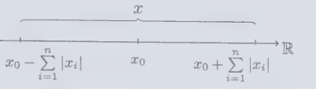

图 9.3. 仿射形式的范围。

它是用于 (并-)复晶格的。但在我们的范围内，这不是问题，因为我们不允许在离散动力系统的转移函数内部循环。

#### 9.3.2.1 仿射算术：仿射形式

仿射形式由对 $(c,(b)_m) \in \mathbb{R} \times \mathbb{R}^m$ 刻画。它定义了一个映射 $a \in [-1, 1]^m \to \mathbb{R}$，使得：

$$a(\epsilon) = c + b^T\epsilon.$$

下文由 $A = \mathbb{R} \times \mathbb{R}^n$ 定义仿射形式集。变量 $\epsilon_i \in [-1; 1], i \in [1; n]$ 是误差项。

#### 9.3.2.2 几何解释

仿射形式 $(c,(b)_n)$ 表示 $\mathbb{R}$ 的子集。我们引入一个具体化函数来表示仿射形式的几何解释。

**定义 9.6.** 令 $\gamma_A: A \to \varphi(\mathbb{R})$ 为 $\mathbf{A}$ 的具体化函数，定义为：

$$\gamma_A: \to \varphi(\mathbb{R}) \left\{ \begin{matrix} (c,(b)_n & \mapsto & x \in \mathbb{R} \quad \exists \epsilon \in [-1;1]^n, \ x = c + b^T\epsilon \end{matrix} \right\}$$

在考虑仿射形式 $a \in \mathbf{A}$ 时，通过仅考虑系数的绝对值可以获得它所代表的数值集 $\gamma_A \in \varphi(\mathbb{R})$，如图 9.3 所示：

$$\gamma_A(c,(b)_m) = [c - \sum_{i \in[1;m]} |b_i|; c + \sum_{i \in[1;m]} |b_i|].$$

#### 9.3.2.3 算术

集 $\mathbf{A}$ 备有算术运算符：加法、负法、乘法和标量乘法。

**定义 9.7.**

$$
\begin{aligned} &(c,b)_n+\mathbf{A}(c',b')_n &= (c+c',b+b')_n \\ -\mathbf{A}(c,b)_n &= (-c,(-b)_n) \\ (c,b)_n\times\mathbf{A}(c',b')_n &= (c\times c',c\times b')_{n+1} \ \text{where} \quad \begin{cases} (b')_n+c'\times(b)+c'\times(b')_n \\ b'_{n+1}=\sum_{i=j}^n b_i\times b'_j \end{cases} \\ \lambda*\mathbf{A}(c,b)_n &= (\lambda\times c, \lambda\times b)_n \end{aligned}
$$

注意，非线性操作会引入新的误差项，而其他操作是精确的。

可以通过引入一个新的误差项 $\epsilon_f$ 将一个区间注入仿射形式中：

**定义 9.8.** 令 $x=[x^-,x^+]$ 为 $\mathbb{R}$ 的一个区间。令 $\epsilon_f\in[-1;1]$ 为一个新的误差项。我们定义与 $x$ 相关的仿射形式为：

$$x=\frac{x^-+x^+}{2}+\frac{x^--x^+}{2}\epsilon_f.$$

它刻画了抽象函数 $\alpha_{\mathbf{A}}:\mathbb{R}^2\to\mathbf{A}$：

$$\alpha_{\mathbf{A}}(x)=\left(\frac{x^-+x^+}{2},\frac{x^--x^+}{2}\right).$$

#### 9.3.2.4 序结构

虽然仿射形式在全局优化社区中很少使用，但让我们考虑一个仿射集上的偏序。我们依赖于具体化函数 $\gamma_{\mathbf{A}}$ 给出的几何解释，并为集 $\mathbf{A}$ 备上偏序结构。我们定义偏序 $\subseteq_{\mathbf{A}}$ 如下：

**定义 9.9.** 我们定义偏序 $\subseteq_{\mathbf{A}}:\mathbf{A}\times\mathbf{A}\to\mathbf{B}$ 使得：

$$\forall x,y\in\mathbf{A},x\subseteq_{\mathbf{A}}y\triangleq\gamma_{\mathbf{A}}(x)\subseteq\gamma_{\mathbf{A}}(y).$$

我们还引入了交运算（meet operator）。由于 $(\mathbf{A},\subseteq_{\mathbf{A}})$ 未备有完交结构，我们无法提供一个计算两个仿射形式最大下界的精确交运算。然而，我们可以依赖于抽象交运算，它提供了一个安全但不精确的上界。以下函数执行了此类计算：它将每个仿射形式投影到其区间表示上，在其上执行交运算，然后再再次抽象为新的仿射形式。

**定义 9.10.** 令 $(c, (b)_n)$ 和 $(c', (b')_n \in A$。我们定义交运算 $\Pi_A: A \times A \to A$ 使得：

$$\{(c, (b)_n \Pi_A (c', (b')_n) \text{ 当 } (c, (b)_n \text{ 与 } (c', (b')_n) \text{ 有交关系时}\}$$

#### 9.3.2.5 浮点误差计算

浮点误差可以合并以确保浮点误差的数量不增加。

### 9.3.3 凸多形扩展

##### 9.3.3.1 二次形式

仿射算术的一个有趣点是二次形式的区间表示，但二次形式也备有误差项：$\varepsilon_i \in [-1,1], \varepsilon_j \in [0,1]$。为了简化，我们将使用 6-元 $(c,b)_n$ 刻画 $C^m \times [-1,1] \times [0,1]$。对于 $t \in C^m$，，$c\varepsilon_i\varepsilon_{ij}$。二次形式形式定义于 $C^m$  $n^2$，$\lambda*\mathbf{A}(c,b)_n = (\lambda\times c, \lambda\times b)_n$。

##### 9.3.3.2 几何解释

令 $q \in Q^m$。由于 $q$ 是连续的，$C^m$ 的像由 $q$ 定义为闭区间。

**定义 9.11.** 二次形式的具体化映射 $\varrho: Q^m \rightarrow \rho(R)$ 定义为：

$$\varrho(q)=\{x \in \mathbb{R} \mid t \in C^m \text{ s.t. } x=q(t)\}$$

**备注 9.12.** 我们可能会有 $\varrho(q)=\varrho(q')$ 当 $q \neq q'$，例如 $q=\varepsilon_i^2$ 和 $q=\varepsilon_{ij}$。因此 $\varrho$ 不能在 $Q^m$ 上刻画反对关系，因此不是序。我们考虑等等类以获得序，但这将丢失 $q_1$ 和 $q_2$ 不相关的信息。

$q$ 到区间的投影包括在 $C^m$ 上计算下界和上界，即：

$$b^q \triangleq \inf\{q(x) \mid x \in C^m\} \quad (9.10)$$
$$B^q \triangleq \sup\{q(x) \mid x \in C^m\}. \quad (9.11)$$

计算 $b^q$ 和 $B^q$ 归约为求解一个非凸二次问题，这是 NP 难的。[61] 中描述的方法使用简单的不等式为 $\gamma_Q(q)$ 提供一个安全近似。该方法提供的区间为 $[b_{MT}^q, B_{MT}^q]$，其定义为：

$$c = -\sum_{i=1}^m |b_i| - \sum_{i,j=1,...,m j \neq i} |A_{ij}| + \sum_{i=1}^m [A_{ii}]$$
$$b_{MT}^q \triangleq \frac{-C_- - C_+}{m} \quad (9.12)$$
$$B_{MT}^q \triangleq \frac{\sum_{i=1}^m |b_i| + \sum_{i,j=1,...,m j \neq i} |A_{ij}| + \sum_{i=1}^m [A_{ii}]^+}{m} + C_+ + C_-$$

其中对于所有 $x \in \mathbb{R}$，$[x]^+ = x$ 若 $x>0$ 否则为0，$[x]^- = x$ 若 $x<0$ 否则如此。

在实践中，使用区间投影算子 $P_{MT}^q(q) \triangleq [b_{MT}^q, B_{MT}^q]$ 代替 $\gamma_Q(q)$，因为 $\gamma_Q(q) \subseteq \gamma_I(P_{MT}^q(q))$。

# 分析型程序中的浮点数

属性 9.14（抽象的具象化）。

$$\gamma_Q(\alpha_Q([a_1, a_2])) \supseteq [a_1, a_2])$$

##### 9.3.3.3 算术算子

二次型配备了算术算子，其复杂度与误差项的数量呈二次方关系。我们在此给出算术算子的定义：

定义 9.15. 加法、否定法和标量乘法定义为：

```math

$$(c, (b)_m, (A)_{m^2}, c_{\pm}, c_{\pm}, c'_{\pm})\

+\gamma_Q(c', (b')_m, (A')_{m^2}, c'_{\pm}, c'_{\pm}, c'_{\pm}) =\

\begin{cases}c+c', (b+b')_m(A+A')_{m^2}, \\c_{\pm} + c'_{\pm}, c_{\pm} + c'_{\pm} - c'_{\pm}'\end{cases}\

-\\gamma_Q(c, (b)_m, (A)_{m^2}, c_{\pm}, c_{\pm}, c'_{\pm}) =\

(-c, (-b)_m, (-A)_{m^2}, c_{\pm}, c_{\pm}, c'_{\pm})\

\lambda * \gamma_Q(c, (b)_m, (A)_{m^2}, |c|, |c|, |c'|) =\

(\lambda, \lambda(b)_m, \lambda(A)_{m^2}, |\lambda||c|, |\lambda||c|, |\lambda||c'|))\

$$$$

```

乘法更为复杂，因为它引入了额外的误差：

```math

$$(c, (b)_m, (A)_{m^2}, c_{\pm}, c_{\pm}, c'_{\pm})\

\times \gamma_Q(c', (b')_m, (A')_{m^2}, c'_{\pm}, c'_{\pm}, c'_{\pm}) =\

\begin{cases}c'(b)_m + c(b')_m, \\c'(A)_{m^2} + c(A')_{m^2}(b)_m(b')_m, & \text{with}\\nc_{\pm}^2 + c_{\pm}c'_{\pm}\end{cases}\

c_{\pm}'^2 = c_{\pm}'^2 + c_{\pm}c_{\pm}' + c_{\pm}^2, \forall \pm \in \{+, \pm, -\}.\

$$$$

```

每个 $c_{\pm}'$ 都考虑了超过二次方的乘法误差，这些误差通过以下子获得：(1) $c' \top Ae \times e' \top Ae'$；(2) $b' \top e \times e' \top Ae'$ 和 $b' \top e \times e' \top Ae$；(3) $A$ 中的矩阵元素乘以 $\pm, +, -$ 中的误差项；以及 (4) 误差项之间或与常量 $c, c'$ 之间的乘法。它们的精确定义可以在 [61, $\S$3] 中找到。

## 9.3.3.4 二次分区区域：二次型到环境的带区域扩展

二次向量是二次型到环境的提升。它们提供了一个 $p$ 维环境，其中每个维度/变量都与以下项相关：

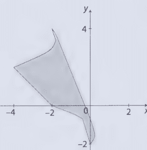

一个二次型。正如带区域域中使用的仿射集 [86] 一样，不同的变量共享（某些）误差项；这描述了变量之间的关系，当 $\epsilon$ 的值在 $[-1, 1]^m$ 内变化时。二次向量的几何解释是 $\mathbb{R}^p$ 的非凸非对称子集。在下，我们将它们称为二次分区区域，以保持与仿射集和分区区域的类比。

示例 9.16（二次向量）。让我们考虑以下二次向量 $q$：

```math

$q = \begin{cases} x=-1+\epsilon_1 - \epsilon_2 - \epsilon_{1,1} \ y=1+2\epsilon_2 + \epsilon_{1,2}. \end{cases}$


注意它对应于定义在误差项序列 $(\epsilon_1, \epsilon_2)$ 之上的元组向量：

```math
$x = \begin{pmatrix} -1, (1, -1)^\top \ 0 & 0 \end{pmatrix}, 0, 0, 0, \ y = \begin{pmatrix} 1, (0, 2)^\top \ 1/2 & 0 \end{pmatrix}, 0, 0, 0.$
```

图 9.4 表示了它的几何解释，一个二次分区区域。
令 $\mathcal{Z}_{P^m}^p$ 为维度为 $p$ 的二次向量集：$(q^p) \in \mathcal{Z}_{P^m}^p = (c^p, (b^p)_m, (A^p)_{m^2}, \epsilon_1^p, \epsilon_2^p, \dots, \epsilon_m^p) \in \mathbb{R}^{p \times m} \times \mathbb{R}^{p \times m \times m} \times \mathbb{R}^{p \times m \times m} \times \mathbb{R}^p \times \mathbb{R}^p \times \mathbb{R}^p$。
分区域是一个参数化的关系域，由 $m$ 个误差项的向量参数化。在实践中，它模拟了基于抽象 $\mathcal{Z}_{P^m}^p$ 的 $\ell(\mathbb{R}^p)$ 的非关系域。算子为：
(i) 将分区区域的变量赋值为由算术表达式定义的新值，具有 $Q$ 中表达式的语义和二次向量中的替换；(ii) 守卫评估，即对分区区域的约束，使用表达式的正向和反向评估的经典组合 [49, §2.4]。

## 几何解释与包框投影

可以将几何解释考虑为二次向量到二次分区区域的具象化。从现在起，对于所有 $n \in \mathbb{N}$，$[n]$ 表示集合 $\{1, \dots, n\}$。

### 定义 9.17

具象化映射 $\gamma_{Z_q}: Z_q^m \mapsto \wp(\mathbb{R}^p)$ 为所有 $q = (q_1, \dots, q_p) \in Z_q^m$ 定义为：

```math
$\gamma_{Z_q}(q) = \left\{ x \in \mathbb{R}^p \middle| \begin{matrix} t \in C^m \ \text{s.t.} \ \forall k \in [p], \ x_k = q_k(t)\end{matrix} \right\}$
```

### 备注 9.18

显式地作为约束集来描述此类 $\mathbb{R}^p$ 的子集并不容易。经典的（仿射）分区区域是多面体（超立方体）通过仿射映射的像，因此它是多面体，可以通过仿射不等式的取交来表示。对于二次向量，尚未证明存在由最多多项式不等式的取交的表示。这使得二次集的具象化计算变得困难。为了方便对计算值的后者的解释，我们依赖于包框的原始投影：二次向量的每个二次型都使用 $\gamma_Q$ 具象化为区间。

## 序结构与上界

我们为二次向量配备了一个依赖于映射 $\gamma_{Z_q}$ 提供的几何包含关系的预序。

### 定义 9.19

$Z_q^m$ 上的预序 $\sqsubseteq_{Z_q}$ 定义为：

```math
$x \sqsubseteq_{Z_q} y \Longiff \gamma_{Z_q}(x) \subseteq \gamma_{Z_q}(y).
```


备注 9.20. 由于 `$\gamma_{Z_q}$` 是可计算的，`$x \sqsubseteq_{Z_q} y$` 不是。注意，根据备注 9.12，`$\sqsubseteq_{Z_q}$` 不反对反对。

备注 9.21. `Z` 的上界是 `z'`，使得：

$$\forall z \in Z, z \subseteq z''$$

并不一定存在。相关工作 [85, 86, 94, 112, 113] 通过提供各种类型的并运算子来解决这个问题。

我们现在详细说明一个并运算子。它是 [86] 中提出的算子到二次向量的提升。该算子的动机是在提供上界的同时最小化误差。

首先，我们引入一个有用的函数 `argmin(\cdot)`，在提供两个符号相同的值时，消除相反符号提供最小绝对值的参数：

定义 9.22. 对于所有 `a \in \mathbb{R}` 定义 `sgn(a)=1` 如果 `a \geq 0` 否则为 `-1`。`argmin` 函数，`argmin: \mathbb{R} \times \mathbb{R} \to \mathbb{R}` 定义为：`$\forall a, b \in \mathbb{R}, argmin(a, b) = sgn(a)\min(|a|, |b|)$` 如果 `ab \geq 0`，否则为 `0`。

我们还需要选择二次向量特定坐标的投影。

定义 9.23. `$\forall k \in [p]$`,投影映射族 `$\pi_k: Z_0^m \to Q^m$` 定义为：`$\forall q = (q_1, \dots, q_k) \in Z_0^m, \pi_k(q) = q_k$`。

当二次 `q` 由一个新的噪声信号定义时，我们引入一个扩展算子来处理这种自由噪声，扩展所考虑的误差向量的大小。通俗地说，`ext_{i,j}(q)` 在误差向量的开头添加 `i` 个空误差项，在末尾添加 `j` 个，同时保持中间的现有符号不变。

定义 9.24. 令 `i, j \in \mathbb{N}`。扩展映射 `ext_{i,j}: Q^m \to Q^{i+j}` 定义为：`$\forall q = (c, b)_{(m)}(Am^2, c_{\pm}, c_{\pm}) \in Q^m, ext_{i,j}(q) = (c', b')_{(i+j+m)}(A')_{(i+j+m)},\nc_{\pm}, c_{\pm}) \in Q^{i+j}$`。

属性 9.25（扩展属性）。令 `i, j \in \mathbb{N}`。

> `4`通常这涉及大量的循环展开，试图尽量减少并/交运算的实际次数。

# 分析程序中的浮点数运算

1. 令 `t = (\epsilon, \epsilon_\epsilon, \epsilon_+, \epsilon_-) \in C^m` 且 `t' = (\epsilon', \epsilon'_\epsilon, \epsilon'_+, \epsilon'_-) \in C^{m+i+j}`，使得 `$\forall i+1 \leq k \leq m+i$`，`$t'_k = t_{k-i}$`。那么 `q(\epsilon, \epsilon_\epsilon, \epsilon_+, \epsilon_-) = \text{ext}_{i,j}(q)(\epsilon, \epsilon_\epsilon, \epsilon_+, \epsilon_-)`。
2. 对于所有 `q \in Q^m, \gamma_Q(q) = \gamma_Q(\text{ext}_{i,j}(q))`。

现在，我们可以给出两个二次向量上界的定义。

**定义 9.26.** 上界 `$\mathbb{U}_{z_q} : \mathbb{Z}_{z_q}^m \times \mathbb{Z}_{z_{q'}}^p \rightarrow \mathbb{Z}_{z_q}^{m+p}$` 定义如下，对于所有 `q=(c, b, A, c_+, c_-)`，`q' = (c', b', A', c'_+, c'_-) \in \mathbb{Z}_{z_{q'}}^p`：

`$q \mathbb{U}_{z_q} q' = (\text{ext}_{0,p}(q'_k))_{k\in[p]} + q^m \in \mathbb{Z}_{z_q}^{m+p}$`

其中 `q'' ((c', b')_m, (A')_{m^2, p^2}, q'_p, q'^m) \in \mathbb{Z}_{z_{q''}}`，对于所有 `k \in [p]`：

- `(c')_k = \text{mid}(\pi_k(q')) \cup \gamma(\pi_k(q'))`；
- `$\forall i \in \{+, -\}, t'_k = \text{argmin}(c_{t,k}, c_{t,k})$`；
- `$\forall i \in [m], (b')_i = \text{argmin}(b_{i,k}, b_{i,k})$`；
- `$\forall i, j \in [m], (A')_{i,j} = \text{argmin}(A_{i,j}, A_{i,j})$`；

且 `k \in [p], q''_k = \text{ext}_{m+(k-1), (p-k)}(\alpha(C_k \sqcup C'_k))`，其中 `C_k = \gamma_Q(\pi_k(q')) - \pi_k(q'))` 且 `C'_k = \gamma_Q(\pi_k(q')) - \pi_k(q'))`。

我们分别用集合的闵可夫斯和和笛卡尔积表示 `D_1 \oplus D_2 = \{d_1 + d_2 \mid d_1 \in D_1, d_2 \in D_2\}` 和 `$\prod^n D_i = \{(d_1, \dots, d_n) \mid i \in [n], d_i \in D_i\}$`。根据引理 9.27我们得到了上界具体化的良好刻画。

根据之前定义的 `q''` 和 `q'` 的构造：

## **引理 9.27.**

$$\gamma_Q ((\text{ext}_{0,p}(q'_k))_{k\in[p]} + q^m) = \gamma_Q (q'') \prod_{k=1}^p \gamma_{Q^{m+p}}(q'_k)$$

现在，在定理 9.28 中，`$\mathbb{U}_{z_q}$` 运算符计算其操作数相对于偏序 `$\mathbb{U}_{z_q}$` 的上界。

**定理 9.28.** 对于所有 `q, q' \in \mathbb{Z}_{z_q}^m, q \mathbb{U}_{z_q} q'`。

**例 9.29.** 令 `Q` 和 `Q'` 为两个二次向量：

`$Q = \begin{cases} x = -1 + \epsilon_1 - \epsilon_2 - \epsilon_{1,1} \\ y = 1 + 2\epsilon_2 + \epsilon_{1,2} \end{cases}$`

**定义 9.30.** 令 `$\mathcal{V}$` 为变量的有限集合。令 `[\cdot]_Q(\mathcal{V} \to \mathcal{Q})$` 为将变量映射到二次形式的表达式语义。


图 6. 守护语句（Guard）。

`[v]_Q(Env) = \pi_k(Env) \text{ 其中 } k \in [p] \text{ 是 } v \in \mathcal{V} \text{ 在 } Env \text{ 中的索引}`
`[e_1]_Q(Env)`
`[e_1 \text{ bop } e_2]_Q(Env) = bop_{\text{square}}(Env)`
`[uop \text{ eop } e_2]_Q(Env)`

守护语句（即测试）通过前向和后向运算符的组合强制执行。后向运算符是备用方案，例如 `[x+y]^* = (x+[y])\$，其中 `$\square$` 表示二次形式的交集。对于上界计算，不存在下界，且 `Q` 中的此类交集必须计算出一个安全但不精确的边界。`Q^m` 上的交集通过 (i) 使用 `$\gamma_Q$` 将每个参数投影到区间；(ii) 执行交集计算；(iii) 使用 `$\alpha_Q$` 将结果重新注入 `Q`；(iv) 通过噪声符号引入它。`Q_m` 上的交集定义为 `Q^m` 到二次向量的提升。形式化地：

**定义 9.31.** 交集 `$\Pi_Q: Q^m \times Q^m \rightarrow Q^1$` 定义为：
`$\forall x, y \in Q^m, x \cap \Pi_Q y = \alpha_Q(\gamma_Q(x) \cap \gamma_Q(y)).$`

交集 `$\Pi_{Z_O}: Z_O^m \times Z_O^m \rightarrow Z_O^1$` 对于所有 `x, y \in Z_O` 定义为 `x \cap \Pi_{Z_O} y \in Z_O^1`，其中：
`$\forall i \in [p], z_i = \pi_i(x)$` 当 `$\pi_i(x) = \pi_i(y)$` 否则为 `$\pi_i(x)$`。

**例 9.32.** 令 `Q` 为以下二次向量。与约束 `x \geq 0` 的交集产生二次向量 `Q'`：

`$Q = \begin{cases} x=-1+\epsilon_1-\epsilon_2-\epsilon_{1,1} \\ y=1+2\epsilon_2+\epsilon_{1,2} \end{cases}$
$Q' = \begin{cases} x=-\frac{3}{8}+\frac{5}{8}\epsilon_3 \\ y=1+2\epsilon_2+\epsilon_{1,2} \end{cases}$`

### 9.3.3.5 浮点计算

在二次形式的特殊情况下，`$\epsilon_{\pm}$` 中的项用于累积浮点误差：误差项的数量不会因为浮点计算而增加。到区域体（zonotopes）的推广是简单的，因为数值操作是在形式层面评估的。我们在这里通过加法和乘法运算符阐明这些原理。所有的初始算术运算由 Messina 和 Touhami [61] 提供，这里我们遵循 [29] 的方法收集每个运算符的加法和乘法误差并将其累积在 `$\epsilon_{\pm}$` 项中。

- 加法。我们考虑两个二次形式 `x=(x_0, (x_i), (x_{ij}), x_{\pm}, x_{\pm})` 和 `y=(y_0, (y_i), (y_{ij}), y_{\pm}, y_{\pm})` 的加法。`x` 和 `y` 的加法被修改以考虑这些生成的误差：

`$(x_0, (x_i), (x_{ij}), x_{\pm}, x_{\pm}) +_{Q} (y_0, (y_i), (y_{ij}), y_{\pm}, y_{\pm}) = x_0+y_0, (x_i+y_i), (x_{ij}+y_{ij}), x_{\pm}+y_{\pm}+r_{err}, x_{\pm}+y_{\pm}, x_{\pm}-y_{\pm})$`

其中

# 分析程序中的浮点数运算

表 9.1. Stolfi 示例 [21] 和 Householder 数值结果。

| | val | ms | Affine Z. | ms | Quad. | ms |
|---|---|---|---|---|---|---|
| stolfi1 | [0., ∞] | 6 | [-∞,∞] | 0 | [-0.85,3.25] | 7 |
| stolfi2 | [0.,3.60] | 10 | [-∞,∞] | 7 | [-∞,∞] | 4 |
| stolfi3 | [0.,5.38] | 4 | [-2.98,10.81] | 5 | [-0.62,3.24] | 5 |
| stolfi4 | [0.,2.23] | 10 | [-∞,∞] | 6 | [-0.33,3.26] | 11 |
| stolfi5 | [0.,2.18] | 9 | [-0.42,3.03] | 3 | [0.08,2.33] | 11 |
| stolfi6 | [0.,2.18] | 7 | [-0.71,2.91] | 5 | [0.11,2.30] | 6 |
| stolfi7 | [0.,1.89] | 7 | [-0.19,2.23] | 3 | [0.29,1.97] | 10 |
| stolfi30 | [0.,1.43] | 15 | [-0.48,1.44] | 20 | [0.48,1.43] | 18 |
| stolfi40 | [0.,1.40] | 15 | [-0.49,1.40] | 20 | [0.50,1.40] | 18 |
| stolfi50 | [0.,1.38] | 19 | [-0.50,1.38] | 34 | [0.50,1.38] | 21 |
| stolfi55 | [0.,1.37] | 24 | [-0.51,1.37] | 33 | [0.51,1.37] | 35 |
| stolfi100 | [0.,1.34] | 29 | [-0.52,1.34] | 80 | [0.52,1.34] | 66 |
| stolfi200 | [0.,1.32] | 48 | [-0.53,1.32] | 337 | [0.53,1.32] | 269 |
| stolfi300 | [0.,1.31] | 73 | [-0.53,1.31] | 916 | [0.53,1.31] | 554 |
| stolfi400 | [0.,1.31] | 91 | [-0.53,1.31] | 1746 | [0.53,1.31] | 1086 |
| householder #3 | [0.21,0.24] | 3 | [0.21,0.24] | 9 | [0.21,0.24] | 4 |
| householder #4 | [0.17,0.29] | 0 | [0.22,0.25] | 7 | [0.22,0.24] | 8 |
| householder #5 | [0.03,0.42] | 3 | [0.22,0.25] | 8 | [0.22,0.24] | 10 |
| householder #6 | [-0.90,1.66] | 3 | [0.22,0.25] | 19 | [0.22,0.24] | 14 |
| householder #7 | [-1117.82,1899.48] | 4 | [0.22,0.25] | 27 | [0.22,0.24] | 11 |
| householder #8 | [-2.18e+18,3.70e+18] | 5 | [0.22,0.25] | 29 | [0.22,0.24] | 11 |

最佳方法已高亮。结果保留两位小数精度。

- `r_err = \max(|+\infty(err)|, |-\infty(err)|)`
- `r_err = \sum_{i,j=1} e^+(x_{ij}, y_{ij}) + \sum_{i=0} e^+(x_i, y_i) + e^+(x_{\pm}, y_{\pm}) + e^+(x_+, y_+) + e^+(x_-, y_-)`。

2. 外部乘法。

运算符 `*Q` 被修改以考虑乘法误差：

$$\lambda_{*Q}(x_0, (x_i), (x_{ij}), x_{\pm}, x_{\pm}) = \lambda x_0, \lambda(x_i), \lambda(x_{ij}), |\lambda|x_{\pm} + r_{err}, |\lambda|x_{\pm}|$$

where

- `r_err = \max(|-\infty| (err)|, |+\infty| (err)).`
- `err = \sum_{i=1}^n e(\lambda, x_i) + \sum_{i,j=1}^n e(\lambda, x_{ij}) + e(\lambda, x_{\pm}) + e(\lambda, x_-) + e(\lambda, x_+)$`。

9.4 相关工作

有限精度算术的准确性分析并不是新话题。已经提出了多种数值方法来解决这一问题：区间算术、随机算术、自动微分或误差级。综述请见 [38, 57]。在静态分析中，大多数分析依赖于安全舍入区间或区域体 [85, 94, 113]。这些基于仿射算术的区域是工具 Fluctuat [121] 的核心，它能够限制数值误差并识别对最终误差贡献最大的项或变量。这些区域现在也实现为 APRON [88] 区域。

## 第十章

## 凸优化与数值问题

在本章中，我们的目的是提供凸优化算法背后的直观理解，并解决它们在浮点数实现中的有效使用问题。第一节简要介绍了这些算法，并假设了实数语义，而第 10.2 节将介绍我们获得稳健结果的方法。

## 10.1 凸优化算法

如第 4.2.1 节所述，凸锥规划根据所考虑的锥，由不同的方法支持。

线性约束最为人知方法由 Dantzig 提出的单纯形法支持。虽然单纯形法相对于约束数量的数量具有指数级的时间复杂度，但在通常情况下表现良好。直观上，它从凸多面体的一个顶点开始，沿着使目标函数代价最小化的超平面移动，以到达最佳的邻接顶点。它可以被看作是一种离散且组合的方法：它列举了多面体的面，但每一步都可以精确求解（例如使用有理数算术）；并且每个中间步骤都精确地刻画了多面体的一个顶点。理论上的最优解始终位于顶点。要么最优解是一个唯一的顶点，要么对应于定义可行区域的约束。在后一种情况下，最优解被定义为平面上的无限点集。

如果单纯形法运行正常，那么使用它的优点之一是可以获得可行的最优解。

在负面方面，它的复杂度在某些形状不佳的情况下可能会发散，并且无法扩展到凸锥上更大的线性问题集。

另一种方法是内点法集，最初由 Karmarkar [12] 提出，并由 Nesterov 和 Nemirovski [14, 15, 24] 推广。它们可以被刻画为路径跟踪法，其中通过牛顿法通常求解一系列局部线性问题。

> ¹¹为了保持叙述的简单，我们在这里提供线性约束的定义和说明，而不是更通用的线性矩阵不等式。

## 凸优化

# 193

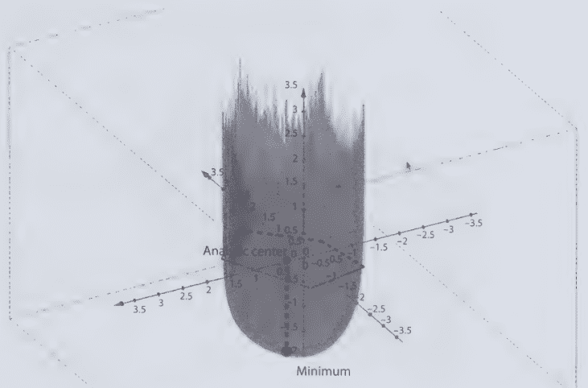

图 10.2 刻画解析中心的障碍函数。

直观上，当 `x` 接近线性约束之一 `f_i(x) = 0` 时，该函数趋于 `+\infty`。在线性约束的情况下，`f_i(x) = a_i(x) - b_i`，`$\nabla \tilde{f}(x)$` 的表达式变为 `$\sum_i \frac{-1}{f_i(x)}a_i$`。接下来的图展示了上述多面体上的这种障碍函数。

路径跟踪算法将线性优化问题的解搜索编码为一系列局部牛顿问题。第一阶段计算起始点，即约束集的解析中心。然后第二阶段执行一系列局部牛顿步长。它刻画了中心路径的概念，一个函数 `$\tilde{f}(t;x)$`，该函数整合了确保 `x` 在线性约束集内部的约束 `$\phi(x)$` 以及（线性）目标函数 `f(x)`：

### 定义 10.2（中心路径）。

```


$$\tilde{f}(t;x) = t \times f(x) + \phi(x)$$


注意当 `$t=0$` 时，我们得到解析中心 $\tilde{f}(0;x)=\phi(x)$，而当 $t\to+\infty$ 时，该约束消失，而目标函数在表达式中变得更加强大。

在不过多争结计算细节的情况下，让我们通过这个简单的例子来说明迈向最优解的计算：

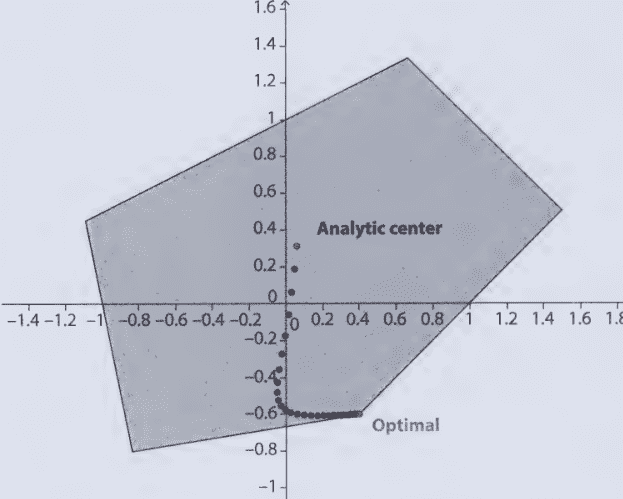

图 10.3 线性规划中的内点法算法。

内点法计算一系列可行解。每一步通过计算一个方向和一个长度来执行，使得下一个值位于中心路径的邻域，同时改进目标函数。当达到所需的精度时停止。

# 凸优化

197

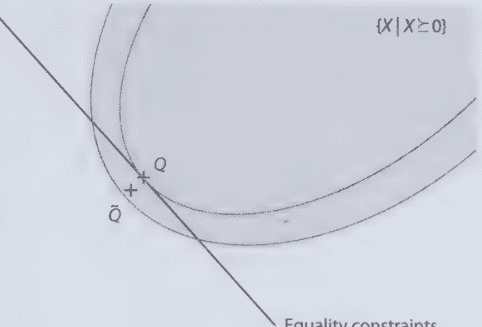

图 10.5 填充锥形凸约束。

但由于 $f(x_{fp})=x_{fp}$，我们有

$v(f(x_{fp}))-v(x_{fp})=v(x_{fp})-v(x_{fp})=0$

该问题允许一个空内部，因为 $v$ 在 $x_{fp}$ 处必须恰等于零。在这种情况下，之前过拟 $f$ 的浮点语义的技术将施加一个更困难的约束：

$v(f(x_{fp}))-v(x_{fp})-err_f(x_{fp})$
$v(x_{fp})-v(x_{fp})-err_f(x_{fp})$
$-err_f(x_{fp})=0$

其中 $err_f(x_{fp}) > 0$。

在线性情况下，当考虑稳定系统时，通常有一个点为零。一种方案是强制李雅普夫函数 $v$ 允许单项式1 的系数为零，允许误差在零处消失。

对于更通用的设置，解决方案是将归纳性不同的编码为凸约束：与其使用 $v \circ f-v \leq 0$，不如依赖 $a \circ v-v \leq 0$，其中 $\alpha > 1$。这将对应于相对填充，对由 $v \leq 0$ 定义的半代数集应用增长因子。

考虑到所分析程序的浮点语义，我们在多多项式情况下的归纳性约束变为：

$p \circ \alpha \circ T^i \sigma^i + \sum_{j=1}^{n_i} \mu_j^i r_j^i-err_{poT^i} \geq 0$

其中 $err_{poT^i}$ 是评估 $p \circ T^i$ 时得到的浮点误差的上界。

# 198

# 第 10 章

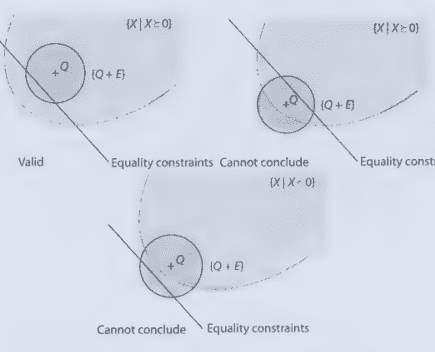

图 10.6 使用 SOS 进行可靠正性检查。

## 10.2.2 验证解的可行性

尽管有了额外的填充，计算出的属性可能并没有严格验证约束。仍然需要形式地检查计算值是否满足正约束集。

在直接操作 LMI 时，可以通过计算与每个正约束相关的矩阵（例如，使用精确有理数算术），并检查结果是否为正定来完成。最后这一检查可以使用 Cholesky 分解进行。为了效率考虑，这种分解本身可以使用浮点算术进行，通过完全限制舍入误差 [64]。由于所得算法并非平凡，它已使用证明助手 Coq [144] 进行了证明。

在处理 SOS 多项式时，额外的等式约束将矩阵系数与 SOS 多项式的系数起来。仍然需要检查浮点多项式解是否满足所有正约束。

为了证明当所有未知变量都被优化求解器限制时，多项式约束 $e$ 是正的，我们在有理算术中评估与表达式 $e$ 相关的多项式 $p$。SOS 优化将给出一个浮点矩阵 $Q$，使得 $p=x^T Qx$。

由于数值不精确性、方法（内点法）以及浮点舍入误差，我们实际上 $p=x^T Qx+x^T Ex=x^T(Q+E)x$，其中 $E$ 表示在 SOS 规划期间产生的误差。

该误差 $x^T E$ 可以表征为 $p-x^T Qx$，我们可以确定每个系数误差的上界 $e$：

$\forall i, j, |E_{i,j}| \le e$.

为了证明存在正半矩阵 $Q+E \succeq 0$，我们检查更强的条件 $Q-nId \succeq 0$，其中 $n$ 是 $Q$ 的维。图 10.6 展示了不同的结果：$Q$ 不恰好在约束上，而在邻域内。在第一情况下，所有矩阵 $Q-nId$ 都是正定的，因此对于约束 $p$ 一个正性证明。在第二情况下，约束与锥相交且 $p$ 是正的，但不精确计算的 $Q$ 让我们无法证明 $Q-nId \succeq 0$。在最后情况下，$p$ 不是正的，但 $Q$ 是作为 $p$ 的 SOS 正性证明产生的。得益于检查的无效，我们能够拒绝这个值。

# 参考文献

- [1] Theodore Samuel Motzkin. “Two consequences of the transposition on linear inequalities.” In: Econometrica 19.2 (1951), pp. 445–466.
- [2] Richard FitzHugh. “Impulses and physiological states in theoretical models of nerve membrane.” In: Biophys J. 1 (1961), pp. 466. ISSN: 0006-3495.
- [3] Robert W. Floyd. “Assigning means to programs.” In: Proceedings of Symposium on Applied Mathematics 19 (1967), pp. 19–32.
- [4] Charles A. R. Hoare. “An axiomatic basis for computer programming.” In: Commun. ACM 12 (Oct. 1969), pp. 576–580.
- [5] Jan C. Willem. “Dissipative dynamical systems part I: General theory.” In: Archive for Rational Mechanics and Analysis 45.5 (1972), pp. 321–351.
- [6] Edsger Dijkstra. A Discipline of Programming. Prentice-Hall, 1976.
- [7] Michael Starr. “Affine relationships among variables of a program.” In: Acta Inf. 6 (1976), pp. 133–151. DOI: 10.1007/BF0026847
- [8] Patrick Patrick. “The Lyapunov function v to admit a zero coefficient for the monomial 1, allowing the error to vanish in zero. (Wait, checking... actually let me re-read original)”

# 参考文献

[23] Stephen Boyd, Laurent El Ghaoui, Éric Féron, 和 Venkataramanan. 系统与控制理论中的线性矩阵不等式. 第15卷. SIAM. 宾夕法尼亚州费城: SIAM, 1994年6月. ISBN: 0-89871-334-X.

[24] Yurii Nesterov 和 Arkadi Nemirovski. 凸规划中的内点多项式算法. 第13卷. 应用数学研究. 工业与应用数学学会, 1994.

[25] Alexandre Megretski 和 Anders Ranzter. 通过积分二次约束进行系统分析 – 第一部分. 1995.

[26] Nicholas J. Higham. 数值算法的准确性与稳定性. 美国宾夕法尼亚州费城: 工业与应用数学学会,1996. ISBN: 0898713552.

[27] William S. Levine. 控制手册. 电气工程手册系列. 博卡拉顿顿（佛里达州）：CRC Press 纽约, 1996. ISBN: 0-8493-8570-9.

[28] Leven Vandenberghe 和 Steven Boyd. “半正定规划.” In: SIAM Review 38.1 (1996), pp. 49–95. DOI: 10.1137/1038003. epubs.siam.org/do/pdf/10.1137/1038003.

[29] Jorge Storfi 和 Luis Henrique de Figueiredo. 自验证数值方法及其应用. 巴西数学会议专著. MPA, 里约热亚内内卢, 1997年7月.

[30] Brian Borchers. “SDCP, 一个用于半正定规划的库。” In: 优化方法与软件. 11.1-4 (1999), pp. 613–623. DOI: 10.1080/1055678908805765. 重印于: www.tandline.com/do/pdf/10.1080/1055678908805765.

[31] Luigi Ambrosio, Nicola Fusco, 和 Diego Pallara. 变分函数与自由不连续性问题. 牛津数学专著. 其他: 2006. 奥津, 纽约: Clarendon, 2000. ISBN: 0-19-850245-1.

[32] Erling D. Andersen 和 Knud D. Andersen. “用于线性规划的 Mosek 内点优化器：齐次算法的实现.” 英语. In: 高性能优化. Hans Frenk, Kees Roos, Tamás Terlak, 和张中忠编辑. 第33卷. 应用优化. Springer US, 2000, pp. 197–232. ISBN: 978-1-4419-4819-9. DOI: 10.1007/978-1-4577-3216-0.

[33] Keith Glover, Glenn Vinnicombe, 和 Georg Papageiou. “保证多环稳定裕量与间隙指标.” In: CDC. 第4卷. IEEE. 2000, pp. 4084–4085.

[34] Saidhakim Dododzhanovich Ikramov 和 N.V. Savel’eva. “条件正定矩阵.” In: 数学科学杂志 98.1 (2000), pp. 1–50. ISSN: 1072-3374. DOI: 10.1007/BF02355379.

[35] Domenico Monidone, Giancarlo Ferrari-Trecate, 和 Manfred Morari. “分段仿混合系统的稳定性与调节：LMI 方法.” In: 决策与控制, 2000. 第39届 IEEE 会议论文. 第1卷. 2000, pp. 504–509. DOI: 10.1109/CDC.2000.912814.

[36] Mary Sheeran, Satnam Singh, 和 Gunnar Stålmark. “使用归纳和 SAT 求解器检查安全属性.” In: FMCAD. Ryan A. Hunt 和 Steven D. Johnson编辑. 第1954卷. LNCS. Springer, 2000, pp. 108–125. ISBN: 3-540-41219-0. DOI: 10.1007/3-540-4902-X.

[37] Vincent D. Blondel, Olivier Bourner, Pascal Koiran, Christos H. Papadimitou, 和 John N. Tsitsikis. “判定分段仿系统的稳定性与死亡率.” In: 理论计算机科学 1–255 (2001), pp. 687–696.

[38] Eric Gou. “浮点操作的静态分析.” In: 第8届静态分析国际研讨会 SAS ’01. 伦敦: Springer-Verlag, 2001, pp. 234–259.

[39] Jean-Bernard Lasserre. “基于多项式的全局优化与矩问题.” In: SIAM Journal on Optimization 11.3 (2001), pp. 796–817.

[40] Peter W. O’Hearn, John C. Reynolds, 和 Hongseok Yang. “修改结构的局部推理程序.” In: 计算机逻辑, 第15届国际研讨会 CSL 2001. 第10届 EACL 年会, 巴黎, 2001年9月10–13日, 论文集. Laurent Fribourg编辑. 第2142卷. 计算机科学讲义. Springer, 2001, pp. 1–19. ISBN: 3-540-42554-3.

[41] Sam Uwe 和 Natarajan Shankar. PVS 中的理论解释. 技术报告. SRI International, 2001.

[42] Glenn Vinnicombe. 不确定性与反馈环整形指标. World Scientific, 2001.

[43] Patrick Baudin, Anne Pacalet, Jacques Ragaud, Dominique Schoen, 和 Nicky Williams. “CAVE：用于软件验证的工具.” In: 2002 年可靠系统与网络国际会议 (DSN 2002), 2002年6月23–26日, 美国马里兰州贝塞斯德, 论文集. p. 537. ISBN: 0-7695-1597-5. DOI: 10.1109/DSN.

[44] Müller 和 Helmut Seidl. “多项式常量是可定的.” In: 第9届静态分析国际研讨会, 西班牙马德里, 2002年9月17–20日, 论文集. Manuel 和 Germán Puebla编辑. 第2477卷. 计算机科学讲义. Springer, 2002, pp. 1. DOI: 10.1007/3-540-45789-4.

[45] Pablo A. Rillo. “半代问题的半正定规划松弛.” In: Mathematical Programming 96.2 (2003), pp. 293–320. ISSN: 0025-5610. DOI: 10.1007/s10107-0387-5.

[46] Stephen Boyd 和 Steven Vandenberghe. 凸优化. 美国纽约: Cambridge Press, 2004.

[47] Jérôme Ferret. “数字滤波器的静态分析.” In: 编程语言与系统, 第13届欧洲编程研讨会 (ESAPS 2004), 作为欧洲理论与实践联合会议的一部分, 西班牙巴塞罗那, 2004年3月1–2日, 论文集. David A. Schmidt编辑. 第2986卷. 计算机科学讲义. Springer, 2004, pp. 38. ISBN: 3-540-21313-9. DOI: 10.1007/978-3-540-24725-8.

[48] Johan Löberg. “YALMIP：一个用于 MATLAB 建模和优化的工具箱.” In: CACSD 会议论文集, 台湾台北, 2004.

[49] Antoine Miné. “弱数值抽象域.” 博士论文. 巴黎理工学院,2004, p. 322.

[50] Sriram Sankarananan, Henny Sema, 和 Zohar Manna. “使用基的非线性循环不变式生成.” In: 第31届 ACM-SIGACT 编程语言原理研讨会 (POPL 2004) 论文集, 意大利威尼斯, 2004年7月.

[51] Pratik Biswas, Lagrange Grieder. “分段仿系统的稳定性与调节.” In: IFAC 世界大会, 捷克共和国, 2005.

[52] Alexandre Costan, Stéphane Gaubert, Holger Hermann, 和 Sylvie Puyot. “用于程序的静态不动点迭代算法.” In: 静态分析, 2005.

[53] Patrick Cousot. In: 验证、模型检查与 SAT 求解器. 论文集. 第3385卷. 计算机科学讲义. Springer, 2005, pp. 19–24. ISBN: 3-540-27219-1. DOI: 10.1007/3-540-2027-0.

[54] Bruno Dutertre 和 Leonardo de Moura. YICES SMT 求解器. 技术报告. SRI International, 2006.

[55] Jérôme Ferret. In: 博士论文. 巴黎理工学院, 2005.

[56] Jérôme Ferret. In: 数值与符号抽象领域国际研讨会 (NSAD), 2005.

[57] Matthieu Martel. In: 静态分析, 2005.

[58] Guy Norris 和 Mark Wagner. 空客 A380：21世纪的空中巨机. Zenith Press, 2005. ISBN: 9780760322185.

[59] Stephen L. Campbell, Jean-Philippe Chancel, 和 Rainine Nikou.. 中的建模与仿真. Scicos, 2006.

[60] Bruno Dutertre 和 Leonardo de Moura. YICES SMT 求解器. 技术报告. SRI International,2006.

[61] Frédéric Messine 和 Ahmed Touhami. “一种通用可靠二次形式：仿射算术的扩展.” Reliable Computing 12.3 (2006), pp. 171–192.

[62] Antoine Mine. “八角形抽象域.” In: 高阶与符号计算 19.1 (2006), pp. 31–100.

[63] Jorge Nocedal 和 Stephen J. Wright. 数值优化. 第二2版. 纽约: Springer, 2006.

[64] Siegfried M. Rump. “正定性的验证.” In: BIT 数值数学 46 (2006), pp. 433–452.

[65] Clark Barrett 和 Cesare Tinelli. “CVC3.” In: 第19届计算机辅助验证国际会议 (CAV) ’07 论文集. 第4590卷. 计算机科学。

计算机科学。德国柏林。Springer-Verlag 出，2007年7月，第 298–302页。

[66] Patrick Cousot, Radhia Cousot, Jérôme Feret, Laurent Mauborgne, An-toine Miné, David Moniaux, and Xavier Rival. “Astrée静态分析器中的抽象组合。”中：第11届年度计算科学会议 (ASIAN '06)。M. Okada 和 I. Satoh 编。日本东京，LNCS 4435: Springer，柏林，2007年12月，第 1–24页。

[67] Jean-Christophe Fillière and Claude Marché. “用于演绎性程序验证的 Why/Krakatoa/cadaduce 平台。”中：计算机辅助验证，第19次国际会议，CAV 2007，德国柏林，2007年7月3-7日，论文集。Werner Dunn 和 Holger Holmans 编。第4590 卷。计算机科学笔记丛。Springer，2007年，第 173–177页。ISBN: 978-3-540-73667-6。DOI: 10.1007/978-3-540-73668-3_21。

[68] Stéphane Gaubert, Eric Guibault, Ankur Talay, and Sarah Sennou. “基于关系域的策略迭代的静态分析。”中：ESOP。Racco De Nicola 编。第4421 卷。LNCS。Springer，2007年，第 237–252页。ISBN: 978-3-540-73114-2。

[69] Thomas Gawlita and Helmut Seidl. “通过策略迭代进行精确不动点计算。”中：ESOP。Racco De Nicola 编。第4421 卷。LNCS。Springer，2007年，第 300–315页。ISBN: 978-3-540-73114-2。

[70] Thomas Gawlita and Helmut Seidl. “通过策略迭代进行精确的关系不变式。”中：CSL。Jacques Duparc 和 Thomas A. Henzinger 编。第4646 卷。LNCS。Springer，2007年，第 23–40页。ISBN: 978-3-540-74914-1。

[71] Ji-Wo Lee and Geir E. Dullerud. “切换线性系统的一致稳定序列。”中：IEEE Trans. Automat. Contr. 52.5 (2007)，第 868–874页。DOI: 10.1109/TAC.2007.89524。

[72] Ji-ong Lee, Geir E. Dullerud, and Pramod P. Khargonekar. “离散时间切换线性系统的输出调节问题。”中：第46 届 IEEE 决策与控制会议论文集。2007年，第 4993–4998页。

[73] David Moniaux. “将 Z 变换应用于浮点数值滤波器的静态分析。”中：CoRR abs/0706.0252 (2007)。

[74] Mathias Péron and Nicolas Halwachs. “一种扩展了不等约束的差分矩阵的抽象域。”中：验证、模型检查与抽象解释，第8 届国际会议，VMCAI 2007，法国尼斯，2007年1月14-16日，论文集。Byron Cook 和 Andreas Podelski 编。第4349 卷。计算机科学笔记丛。Springer，2007年，第 268–282页。ISBN: 978-3-540-69735-0。DOI: 10.1007/978-3-540-69738_20。

[75] Andreas Podelski and Silas Wagner. “混合系统的区域证明。”中：形式建模与分析，第5 届国际会议，FORMATS 2007，奥地利萨尔茨堡，2007年10月3-5日，论文集。Jean-Francis Raskin 和 P. Thiagarajan 编。第4763 卷。计算机科学笔记丛。Springer，2007年，第 320–335页。ISBN: 978-3-540-75454-4。DOI: 10.1007/978-3-540-75454_23。

[76] Karl Johansson and Richard M. Murray. “反馈系统：科学家与工程师入门。”美国新泽西州普林斯顿：普林斯顿大学出版社，2008年。ISBN: 069135762。

[77] Dariusz Bieracki, Jean-Louis Colonia, Grégoire Ramon, and Marc Poucet. “同步数据流语言的模块化代码生成。”中：LCTES 2008。

[78] Sylvain Conchon, Evelyn Conte, Johannes Kanig, and Stéphane Lescuy. “可解理论的同的语义分解。”中：理论科学电子笔记，198.2 (2008)，第 51–69页。

[79] Pierre-Loic Garo. “抽象解释的静态分析。”博士论文。图卢兹大学，INPT，2008年。

[80] Wassim M. Haddad and Vijay Sekhar. “非线性动力系统与控制：基于 Lyapunov 方法。”美国新泽西州普林斯顿：普林斯顿大学出版社，2008年。

[81] David Moniaux. “浮点计算的陷阱。”中：ACM Trans. Program. Lang. 30.3 (2008)。

[82] Leonardo de Moura and Nikolaj Bjner. “Z3: 高高效 SMT 求解器。”中：TACAS。C. Ramakrishnan 和 Jakob Rehof 编。第4963 卷。计算机科学笔记丛。德国柏林：Springer，2008年，第 337–340页。ISBN: 978-3-540-78799-0。

[83] Yannick Most. “模块化断言检查的充分先条件。”中：验证、模型检查与抽象解释，第9 届国际会议，VMCAI 2008，美国旧金山，2008年7月7-9日，论文集。Francesco Gozzo, Doron A. Peled 和 Lenore D. Zuck 编。第4905 卷。计算机科学笔记丛。Springer，2008年，第 188–202页。ISBN: 978-3-540-78162-2。DOI: 10.1007/978-3-540-78163-9_18。

[84] Olivier Bouissou, Eric Goubault, Sylvie Potot, Karim Tekkal, and Franck Védrine. “HybridEva：连续环境内数值程序的静态分析器。”中：计算机辅助验证，第21 届国际会议，CAV 2009，法国格诺布，2009年6月26日-7月2日，论文集。第5643 卷。2009年，第 620–626页。ISBN: 978-3-540-02657-7。DOI: 10.1007/978-3-540-02658-4_46。

[85] Khalil Ghorbal, Eric Goubault, and Sylvie Putot. “多面体抽象域 Octot1+。”中：CAV。第5643 卷。LNCS。2009年，第 627–633页。ISBN: 978-3-540-02657-7。

[86] Eric Goubault and Sylvie Putot. “函数抽象的多面体框架。”中：CoRR abs/0910.1763 (2009)。

[87] Didier Henrion, Jean-Bernard Lasserre, and Carlo Savorgnan. “基本半代数集的近似体积与积分。”中：SIAM Review 51.4 (2009)，第 722–743页。DOI: 10.1137/080730287。eprint: dx.doi/10.1137/080730287。

[88] Bertrand Jeannet and Antoine Miné. “Apron：用于静态分析的数值抽象域库。”中：CAV。2009年，第 661–667页。DOI: 10.1007/978-3-542-02658-4_52。

[89] Jean-Bernard Lasserre. “矩、正多项式及其应用：优化系统。”帝国理工学院出版社，2009年。ISBN: 97818416448。

[90] Saurabh Srivastava and Rohit Gulwani. “基于模板的谓词抽象。”中：SIGPlan Net 44.6 (2009)，第 223–234页。DOI: 10.1145/154135.15421。

[91] Assalé Adji, Stéphane Gaubert, and Eric Goubault. “耦合策略迭代与半定松弛以计算静态分析不变式。”中：ESOP。A. D. Gordon 编。第6012 卷。计算机科学笔记丛。Springer，2010年，第 23–42页。ISBN: 978-3-542-11956。

[92] Eric Féron. “从控制系统到控制软件。”中：Control Systems，30.6 (2010年12月)，第 50–71页。ISSN: 1474-0508。DOI: 10.1109/MCS.2010.93816。

[93] Thomas Gazinger and Helmut Seidl. “精确计算二次区域抽象语义。”中：SAS。Radhia Cousot 和 Mathieu Martel 编。第6337 卷。LNCS。2010年，第 271–286页。ISBN: 978-3-542-15768-4。

[94] Khalil Ghorbal, Eric Goubault, and Sylvie Putot. “多面体交集的逻辑积方法。”中：CAV。2010年，第 212–226页。

[95] Stefan Raschan and Zhikun Sun. “通过计算 Lyapunov 函数提供多项系统的吸引盆。”中：SIAM J. Control and Optimization，48.7 (2010)，第 4377–4394。DOI: 10.1137/09070455。

[96] Siegfried M. Rump. “使用浮点算术的严谨验证方法。”中：Acta Numerica，19 (2010年5月)，第 287–249。ISSN: 1474-0508。DOI: 10.1017/S096242100005。

[97] Makoto Yamashita, Katsuki Fujizawa, Kazuhide Nakata, Maho Nakata, Mihiro Fukuda, and Kazushige Goto. “半定规划的高性能软件包：SDPTA。”技术报告。东京理工大学，东京：信息科学系，2010年。

[98] Andrew W. Appel. “验证过的工具链（邀请演讲）。”中：编程语言与系统——第20 届欧洲编程会议，ESOP 2011，作为软件理论与实践联合会议 ETAPS 2011 的一部分，德国萨尔布鲁肯，2011年3月26日-4月3日。论文集第6602 卷。LNCS。2011年，第 1–17页。ISBN: 978-3-542-19717-8。DOI: 10.1007/978-3-542-19718-5_1。

[99] Michael Collier and Siriram Sankaranan. “泛化模板多面域。”中：ESOP。第6602 卷。LNCS。2011年，第 176–195页。ISBN: 978-3-542-19717-8。

[100] Eric Goubault and Sylvie Putot. “有限精度计算的静态分析。”中：VMCAI。Ranjit Jhala 和 David A. Schmidt 编。Springer，2011年，第 232–247页。ISBN: 978-3-542-18274-7。

[101] Temesgen Kahhsai, Yeting Ge, and Cesare Tinelli. “基于实例的不变式发现。”中：NASA形式方法第3 届国际会议，NFM 2011，美国加利福尼亚州帕萨迪纳，2011年4月18-20日。论文集。2011年，第 192–206页。

[102] Tomas Kahhsai and Cesare Tinelli. “P-kind：基于并行 k 归纳的模型检查。”中：第10 届验证并行与分布式方法国际研讨会论文集，PDMC 2011，美国犹他州雪鸟，2011年7月14日。第72 卷。EPTCS。2011年，第 55–62页。DOI: 10.4204/EPTCS.72。

[103] Ji-Woong Lee and Geir E. Dullerod. “离散时间线性系统的切换与反馈联合合成。”中：第14 届 ACM 混合系统计算与控制国际会议，HSCC 2011，美国伊利诺伊州芝加哥，2011年4月12日-14日。Marco Caccamo, Emilio Frazzoli 和 Radu Grosu 编。ACM，2011年，第 201–210页。ISBN: 978-1-4503-0629-4。DOI: 10.1145/1967701.1967731。

# 参考文献

[104] Special C. RTCA. DO-178C，机载系统与设备认证中的软件考量。2011。

[105] Sriram Sankaranarayanan 和 Ashish Tiwari. “连续与混合系统的关系抽象。” In: 计算机辅助验证-第23次国际会议，CAV 2011。美国犹他州斯诺伯德，2011年7月14-20日。论文集。由 Ganesh Gopalakrishnan 和 Shaz Qadeer 编辑。第6806 卷。计算机科学讲义录。Springer，2011, pp. 686-702. ISBN: 978-3-642-22109-5. DOI: 10.1007/978-3-642-22110-1.56。

[106] Mohamed Amin Sassi, Romain Testier, Theo Dang, 和 Antoine Girard. “使用线性规划松弛的多项式系统的可达性分析。” In: ATVA 2012 (2012)。由 Supratik Chakraborty 和 Madhav Mukund 编辑，pp. 137-151. DOI: 10.1007/978-3-642-33386-6.12。

[107] Aaron Bradley. “理解 IC3。” In: SAT 2012.2012, pp. 1-14。

[108] Pascal Cuoco, Florent Kirchner, Nikolai Kolisov, Virgile Preposto, Julien Signoles 和 Boris Yakobowski. “Frama-C: 一种软件分析视角。” In: SEFM, 2012, pp. 233-247。

[109] Pierre-Loïc Garque, Temges Kahsai, 和 Cesare Tinelli. 基于可判逻辑自动抽象变换器的不变性流生成器。2012。

[110] Thomas Martin Ivančić, Helmut Seidl, Assalé Adjé, Stephane Gaubert, 和 Eric Goubault. “抽象解释遇到凸优化。” In: J. Sym. Comput. 47.12 (2012), pp. 1416-1446。

[111] Khalil Ghorbal, Franjo Ivančić, Gogul Krishna, Naoto Maeda, 和 Aarti Gupta. “甜甜圈域：用于抽象解释的高效非凸域。” In: 验证、模型检查与抽象解释-第13次国际会议，VMCAI 2012，美国宾夕法尼亚州费城，2012年1月22-24日。论文集。由 Viktor Kuncek 和 Andrey Rybalchenko 编辑。第7148 卷。计算机科学讲义录。Springer，2012, pp. 235-250. ISBN: 978-3-642-27939-3. doi: 10.1007/978-3-642-27940-9。

[113] Eric Goubault, Sylvie Putot, 和 Franck Védrine. “基于带区形的模块化静态分析。” In: SAS. 第7460 卷 LNCS。Springer，2012. pp. 24–40. ISBN: 978-3-642-33124-4。

[114] Heber Herencia-Zapana, Romain Jobreaux, Sam Owre, Pierre-Loic Garoche, Éric Feron, Gilberto Perez, 和 Pablo Ascariz. 用于 AC/SSL 中控制软件算法验证的 PVS 线性库。 In: NASA 形式方法-第四次国际会议，NFM 2012，美国弗吉尼亚州诺尔福克，2012年4月3-5日。论文集。由 Alwyn Goodlove 和 Suzette Person 编辑。第7226 卷。计算机科学讲义录。Springer，2012, pp. 147–161. DOI: 10.1007/978-3-642-28891-3_15。

[115] Milan Korda, Didier Henrion, 和 Colin Neil Jones. “多项式动力学吸引区域的内部近似。” In: arXiv 预印本（2012年10月）。arXiv:1210.3184[math.OC]。

[116] Pierre Roux, Romain Jobreaux, Pierre-Loic Garoche, 和 Éric Feron. “用于线性不变性系统的通用椭圆抽象域。” In: 第15次 ACM 混合系统、计算与控制国际会议集，HSCC 2012，中国北京，2012年4月17-19日，由 Thao Dang 和 Ian Mitchell 编辑。ACM，2012, pp. 105–114. ISBN: 978-1-4503-1220-2. doi: 10.1145/2185632.2185651。

[117] John Rushby. “多功能同步观察器。” In: 第15次巴西形式方法会议：基础与应用。SBMF’12。巴西纳塔尔：Springer，2012, p. 1. ISBN: 978-3-642-33295-1. doi: 10.1007/978-3-642-33296-8。

[118] Pierre-Loic Garoche, Xavier Thirioux, 和 Temges Kahsai. LustreC: 一个模块化的 Lustre 编译器。2012. URL: https://github.com/team/lustre

[119] Amir Ahmadi 和 Raphael M. Jones. “通过 SOS 凸函数和半正定规划实现切换稳定性。” In: 计算机验证-第25次国际会议，俄罗斯彼得堡，2013年7月13-19日。论文集。由 Natasha Sharygina 和 Helmut Veith 编辑。第8044 卷。计算机科学讲义录。Springer，2013, pp. 846–866. ISBN: 978-3-642-39798-1. doi: 10.1007/978-3-642-39799-8。

[120] Jean-Charles Gilbert. 微分优化。2013。

[121] Éric Goubault. “数值程序和系统的抽象静态分析。” In: SAS (2013)。

[123] Milan Korda, Didier Henrion, 和 Colin Jones. “离散时间系统最大不变集的计算。” In: 决策与控制 (CDC)，第52次年度会议。2013年12月，pp. 7107–7112. DOI: 10.1109/CDC.2013.67601。

[124] Milan Korda, Didier Henrion, 和 Colin Jones. “多项式系统的凸计算。” In: arXiv 预印本 arXiv:1303.6469 (2013)。

[125] Eike Möhlmann 和 Oliver E. “Stabhy: 一种混合系统的自动验证工具。” In: 第16次混合系统国际会议，HSCC 2013，美国宾夕法尼亚州费城。由 Calin Benta 和 Franjo Ivancic 编辑。ACM，2013, pp. 107–112. ISBN: 978-1-4503-1567-8. DOI: 10.1145/2461328.2461347。

[126] Mehrdad Pakmehr, Timothy Wang, Romain Jobdeaux, Martin Vivies, 和 Eric Félix. “涡轮发动机的可验证系统开发。” In: CoRR abs/1311.1885 (2013)。

[127] Pavithra Prabhakar 和 Maria Garcia. “混合系统的抽象模型检查。” In: 计算机验证-第25次国际会议，CAV 2013，俄罗斯彼得堡，2013年7月13-19日。论文集。由 Natasha Sharygina 和 Helmut Veit 编辑。第8044 卷。计算机科学讲义录。Springer，2013, pp. 280–295. ISBN: 978-3-642-39798-1. DOI: 10.1007/978-3-642-3979-8_20。

[128] Pierre Roux. “控制命令系统的静态分析：合成非线性不变性。”博士论文。Institut Supérieur de l’Aeronautique de l’Espace，2013。

[129] Pierre Roux 和 Pierre-Lo Goche. “在抽象解释器中集成策略迭代。” In: 验证与分析自动化技术-第11次国际会议，ATVA 2013，越南河内，2013年10月15-18日。论文集。由 Dang Van Hung 和 Mizuhito Ogawa 编辑。第8172 卷。计算机科学讲义录。Springer，2013, pp. 240–254. ISBN: 978-3-319-02443-1. DOI: 10.1007/978-3-319-02444-8。

[130] Yassamine Seladjdi 和 Olivier Bouissou. “使用支撑函数的数值抽象域。” In: NFM. 2013。

[131] David Cacher, Thomas P. Jensen, Arnaud Jobin, 和 Florent Kirchner. “命令式程序的多项式不变性推导：告别 Grobner 基。” In: Sci. Comput. Program. 93 (2014), pp. 89–109. DOI: 10.1016/j.scico.2014.02。

[132] Morgan Demp, Andrew Reynolds, Tim King, 和 Cesare Tinelli. “CVC 导览：其工作原理及如何使用。” In: 计算机辅助设计中的形式方法，FMCAD，瑞士洛桑，2014年10月21-24日。ISBN: 978-3-319-02865-4. DOI: 10.1007/978-3-319-02866-5。

[133] Bruno Dutert, Anmesh Kurum, 和 Sagar Chaki. “基于 SMT 的检查。” In: 计算机验证-第26次国际会议，CAV 2014，作为逻辑夏季会议，维也纳，2014年7月18-22日。论文集。由 Armin Biere 和 Roderick 编辑。第8559 卷。计算机科学讲义录。Springer，2014, pp. 737–744. ISBN: 978-3-319-08867-2. DOI: 10.1007/978-3-319-0886-9。

[134] Didier Henrion 和 Milan Korda. “多项式系统吸引区域的凸计算。” In: IEEE Transactions on Control. 59.12 (2014), pp. 297–312. DOI: 10.1109/TAC.2013。

[135] Juan Luis Ruiz, Paul Goulart, Stefan Richter, George A. Constantine, 和 Manfred Morari. “兆赫兹级的嵌入式模型预测控制。” In: IEEE Trans. Autom. 59.12 (2014), pp. 3238–3251. DOI: 10.1109/TAC.2519。

[136] Anmesh Kurelli, Arie Gurfinkel, 和 Sagar Chaki. “递归程序。” In: 计算机验证-第26次国际会议，CAV 2014，作为逻辑夏季会议，维也纳，2014年7月18-22日。论文集。由 Armin Biere 和 Roderick 编辑。第8559 卷。计算机科学讲义录。Springer，2014, pp. 17–34. ISBN: 978-3-319-08867-2. DOI: 10.1007/978-3-319-0886-9_2。

# 参考文献

由 Alain Girault 和 Nan Guan 编。IEEE, 2015, 第 75–84 页。ISBN: 978-
1-4673-0879-9. DOI: 10.1109/EMSOFT.2015.7318262。

- [140] Adrien Champion, Rémi Delmas, 和 Michael Dierkes. “基于类型归纳的框架通过量词消除生成属性定义的势不变性。” In: Sci. Comput. Program. 103 (2015), 第 71–87 页。DOI: 10.1016/j.scico.2014.10.004。

- [141] Jean-Bernard Lasserre. “量词定义集合的可计算近似。” 英语。In: Mathematical Programming 151.2 (2015), 第 507–527 页。ISSN: 0025-5610. DOI: 10.1007/s10107-014-0838-1。

- [142] Victor Magron, Didier Henrion, 和 Jean-Bernard Lasserre. “半代数集投影与多项式理想的正定近似。” In: SIAM Journal on Optimization 25.4 (2015), 第 2143–2164 页。DOI: 10.1137/140992047. 打印于: dx.doi.org/10.1137/140992047。

- [143] Mendes Oulamara 和 Arnaud J. Venet. “高维椭球和锥锥外推的抽象解释。” In: Computer Aided Verification-27th International Conference, CAV 2015, San Francisco, USA, 2015年7月18日–24日, 论文集, 第一部分。由 Daniel Kroening 和 Corina S. Pasareanu 编。第 9206 卷。计算机科学讲义。Springer, 2015, 第 415–430 页。ISBN: 978-3-319-21689-8. DOI: 10.1007/978-3-319-21690-4。

- [144] Pierre Roux. “舍入误差边界的形式化证明。” 英语。In: Journal of Automated Reasoning (2015), 第 1–22 页。ISSN: 0168-7433. DOI: 10.1007/s10817-015-9339-y。

- [145] Timothy Wang. “控制软件的可信自动编码。” 博士论文。佐治亚理工学院工程学院，2015年。

- [146] Egor George Karpenkov, David Moniaux, 和 Philipp Wendler. “基于局部策略迭代的程序分析。” In: Verification, Model Checking, and Abstract Interpretation-17th International Conference, MCAI 2016, 圣彼得堡堡, FL, 美国 2016年7月17日–19日. 论文集。由 Barbara Jobmann 和 K. Rust M Leino 编。第 9583 卷。计算机科学讲义。Springer, 2016, 第 127–146 页。ISBN: 978-3-662-49121-8. DOI: 10.1007/978-3-662-49122-5_6。

- [147] Timothy Wang, Romain Robdeaux, Heber Hernandez-Zapana, Pierre-Loic Garoche, Arnaud Dieumegaard, Éric Féron, 和 Marc Martel. “从设计到实现：一种控制系统的自动化可信自动编码链。” In: Advances in Control System Technology for Aerospace Applications。由 Éric Féron 编。第 460 卷。控制与信息科学讲义。Springer Berlin Heidelberg, 2016, 第 137–180 页。ISBN: 978-3-662-47693-2. DOI: 10.1007/978-3-662-47694-5。

- [148] Patrick Baudin, Jean-Christophe Filliâtre, Claude Marché, Yannick Moy, 和 Virgil Prevosto. ACSL: ANSI/ISO 规范语言。frame-c.fr/acsl.html. 2008。

- [149] “溢出失败的调查。” In: SIAM News 29.8 (1996), 存档可用，第 12–13 页。

## 索引

抽象 (abstract), 25
仿射 (affine), 48
报警 (alarm), 25
算术 (arithmetics), 179
赋值 (assignment), 175
有界性 (boundedness), 93, 96, 98
表征 (characterization), 65
条件 (condition), 69
条件性 (conditional), 14
合约 (contract), 10
控制流图 (control flow graph), 8
耦合 (coupling), 82
衰减率 (decay rate), 70, 138
演绎推法 (deductive method), 11, 13
离散 (discrete), 36, 37, 65
域 (domain), 25
对偶性 (duality), 61, 62
动力学 (dynamics), 25
编码 (encoding), 82
错误 (error), 20
浮点误差 (floating-point error), 173
流程图 (flowchart), 9
浮点问题 (floating-point issues), 204
floyd, 9
守卫 (guard), 75
hoare, 9
齐次化 (homogenization), 48, 77
图像测度 (image measure), 103
归纳 (induction), 88
归纳, 95
内点法 (interior point method), 198
不变性 (invariant)
k-归纳 (k-induction), 87
kleeene (kleeene), 28, 43, 68, 109, 124, 126, 177, 180
拉格朗日松弛 (lagrangian relaxation), 58, 62
lassarre 层次 (lasserre's hierarchy), 106
线性矩阵不等式 (LMI), 138
线性 (linear), 48, 55, 80, 199
刘维尔方程 (liouville's equation), 105
局部正性 (local positivity), 79
局部不变性 (local invariant), 82
循环 (loop), 19
循环不变性 (loop invariant), 6, 29
李普诺夫函数 (lyapunov function), 66, 131, 132, 68
内存模型 (memory model), 20
模型检测 (model-checking), 11, 16, 21, 29
motzkin 转置 (motzkin's transposition), 80
收窄 (narrowing), 118, 124, 146
优化 (optimization), 54
凸 (convex), 54
凸锥 (convex conic), 54
凸化 (convexification), 136
相位与增益 (phase and gain), 141
划分 (partitioning), 52
分段二次函数 (piecewise quadratic function), 82
谓词变换 (predicate transformation), 20
多项式函数 (polynomial function), 95
多项式不变性 (polynomial invariant), 96
半正定锥 (positive semidefinite cone), 56
命题编码 (propositional encoding), 83
属性 (property), 101
选择属性 (selection property), 118
系统级属性 (system-level property), 129
二次化 (quadratization), 77, 83
可达状态 (reachable states), 9, 16
递归 (recursion), 19
区域 (region), 96
莱斯定理 (rice's theorem), 11
安全性 (safety), 96
可满足性 (satisfiability), 16
饱和 (saturation), 40, 133
语义 (semantics)
公理化的 (axiomatic), 1, 9
闭环的 (closed-loop), 8
收集的 (collecting), 9, 16, 23, 65
指的 (denotational), 8
操作的 (operational), 8
轨迹语义 (trace semantics), 9
半代数的 (semialgebraic)
划分 (partitioning), 52
集合 (set), 51
s-程序 (s-procedure), 13, 58, 73, 82, 136
sos, 57
模板 (template), 67
终止 (termination), 29
变换器 (transformer), 13, 29
向量 (vector), 139, 142
宽化 (widening), 51
向量边缘 (vector margins), 143
最弱条件 (weakest condition), 11
zon形体 (zonotope), 17

《矩阵、矩与正积分及其应用》，Gene H. Golub 与 Gérard Meurant

《多智能体网络中的图论方法》，Mehran Mesbahi 与 Magnus Estedt

《完全非负矩阵》，Shaun M. Fallat 与 Charles R. Johnson

《矩阵补全、矩与海森矩阵平方和》，Mihály Bakonyi 与 Hugo J. Woerderman

《现代抗风积分合成：执行器饱和的控制增强》，Luca Zaccarian 与 Andrew W. Teel

《大规模动力系统的稳定性与控制：向量耗散系统方法》，Wassim M. Haddad 与 Sergey G. Nersesov

《复杂介质电磁学中确定性与随机问题的数学分析》，G. F. Roach, I. G. Stratis 与 A. N. Yannacopoulos

《四元数线性代数专题》，Leiba Rodman

《隐藏马尔可夫过程：理论及在生物学中的应用》，M. Vidyasagar

《弹性成像中的数学方法》，Habib Ammari, Elie Bretin, Josselin Garnier, Hyeonbae Kang, Hyundae Lee 与 Abdul Wahab

《射线、波与散射：经典数学物理专题》，John A. Adam

《控制系统软件的形式化验证》，Pierre-Loic Garoche

# 控制系统软件的形式化验证

Pierre-Loïc Garoche

关于控制系统软件分析与验证的本质入门介绍

控制系统软件的验证对于许多技术和行业都至关重要，从航空航空、医疗技术到我们驾驶的汽车无不涉及。控制器软件的故障可能导致人员生命损失。在这部权威且易于阅读的书中，Pierre-Loïc Garoche 为控制工程师和计算机科学家提供了关于分析和验证这一类重要软件的形式化技术的不可或缺的介绍。

Pierre-Loïc Garoche 是法国国家航空航天研究中心 ONERA 的高级研究科学家。

内容新颖、数学严谨且文字极佳。Garoche 是一个难得的资源，他的书将丰富计算机科学和控制系统社区的知识。

> —Eric Fergon，佐治亚理工学院

控制工程师往往没有意识到围绕软件验证的问题，而计算机科学家则倾向于不熟悉控制器软件的特殊性。Garoche 提供了一种面向这两个领域研究生的统一方法，涵盖了形式化方法以及控制器的设计与验证。他展示了用于对控制软件进行详尽分析的新型验证技术，包括计算非线性不变式的新方法、凸优化工具的使用，以及处理分析软件中出现的浮点计算等数值不精确问题的方法。

> “这本书为形式化计算机科学、优化与控制的交汇点做出了及时的贡献。它应该会让计算机科学家和控制工程师感兴趣。”

> —Didier Henrion，图卢斯 LAAS-CNRS 和布拉格捷的技术大学

随着关键系统的自主性不断提高——自动驾驶汽车、无人机、卫星和着陆器证明了这一点——系统中的数值函数变得越来越先进。这里介绍的技术对于支持这些新型和新兴技术中所使用的控制器软件的形式化分析至关重要。

> “读起来非常愉快。Garoche 这本优秀且及时的著作介绍了基于凸优化的最先进方法，用于对控制系统和软件进行静态分析。”

> —Taylor Johnson，范德堡大学

普林斯顿应用数学系列，Ingrid Daubechies, 陈卫安, Janel Lenstra 和 Andre Sili 编选

书封图片：Patrick Meichel 雕塑照片。版权所有。

ISBN 978-0-691-18130-1 90000

普林斯顿出版社 press.princeton.edu

9780691181301
