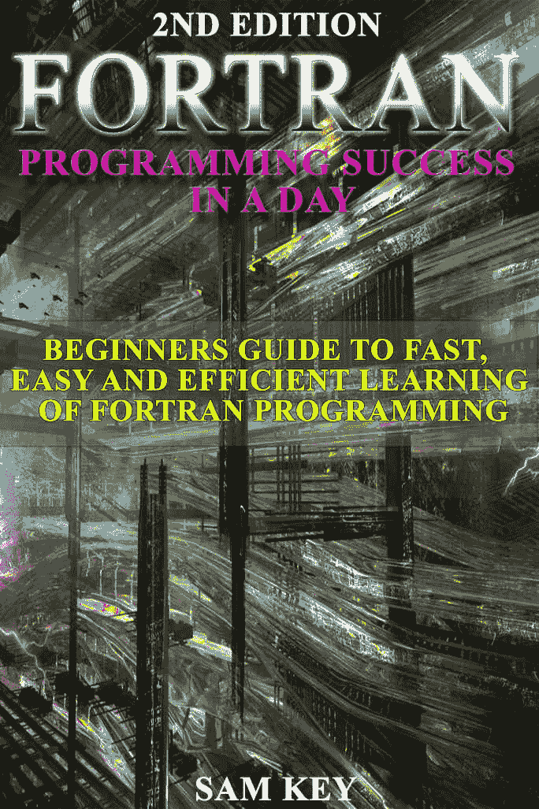

# FORTRAN 编程一天速成：FORTRAN 编程快速、简单高效学习初学者指南 (Fortran, Css, C++, C, C 编程... 编程, MYSQL, SQL 编程)



# 引言

我想感谢你的下载，并祝贺你下载了这本书《一天掌握 FORTRAN 编程：FORTRAN 编程快速、简单、高效学习指南》。

这本书包含了关于如何学习 FORTRAN 编程基础知识的经过验证的步骤和策略。

本书专为初学者设计，特别是那些刚开始编写代码的人。FORTRAN 是世界上最老的编程语言之一。它是一门高级语言，让初学者很容易理解。该语言的结构和语法也非常容易掌握。书中还有专门的章节向你展示如何准确利用所学知识编写出可以处理你输入的变量的代码。

然而，请记住，这本书仅包含最基础的内容。在你掌握了这些内容之后，你需要参考更详细的说明手册来探索这门编程语言的全部潜力。

再次感谢下载本书。希望你喜欢它！

# 第 1 章：FORTRAN – 入门者信息

FORTRAN（Formula Translation 的缩写）对于初学者来说实际上是一门简单的编程语言——是的，即使对于那些没有其他编程语言经验的人也是如此。学习过其他语言编写代码的人会发现 FORTRAN 背后的思想非常容易理解。

它实际上是世界上最老的编程语言之一。它的历史是一把双刃剑——可以说，它既是优势，也是一种诅咒。这门编程语言随处可用，你并不需要购买编译器或任何其他软件来运行代码。一旦你掌握了它，你也可以查看关于它的更高级信息。

这实际上是一类对工程师和科学家非常有用的编程语言。它拥有庞大的内置函数集合，可以处理许多不同的数学结构——这是它作为世界上首批编程语言之一的优势之一。你可以找到大量的算法库，它们让编码变得更简单、更短。

## 1.1 - 开始所需的准备工作

要在这种编程语言中开始编写代码，需要的第一个工具是文本编辑器。有些人可能会推荐 `Vim`、`Emacs` 或其他文本编辑器，但任何工具都可以。重要的是，你的源代码应该保存为纯文本文件。这意味着你不能使用文字处理软件，因为这些应用程序不会以纯文本格式保存文件——它们包含了编译器无法理解的特殊格式。

运行 FORTRAN 还需要你需要一个编译器。现在有很多编译器，其中许多是免费的。对于绝对初学者来说，编译器是一个读取你编写的编程代码并将其翻译成机器可读代码程序（即你的计算机可以理解的内容）。在你编写并保存代码后，你必须运行编译器让你的计算机执行这些代码。

为了让事情变得简单得多，你可能还想安装所谓的 IDE 或集成开发环境。它是一件软件程序，兼具文本编辑器和编译器的功能。IDE 有许多优点，它让编写代码和排查你编写的代码变得容易得多。

如果你使用的是 Windows 机器，强烈建议使用 IDE，因为你会更熟悉图形用户界面。你可以根据意愿下载喜爱的 IDE，如 `Photran`、`Plato` 或任何其他开发环境。确保你熟悉它的界面，这样你就知道需要点击哪个按钮来执行代码，或者在需要逐条检查代码中的每个语句时应该进入菜单的哪个部分。

IDE 已经理解了它们所构建的不同编程语言的语法。这意味着……

## 1.2 - 测试你的第一个代码

强烈建议你安装 IDE，特别是如果你使用的是 Windows 的话。安装完成后，双击其图标启动你的编程环境。创建一个新文件。注意，你创建的文件将具有 `.f95`扩展名——而不是 `.txt`。注意，其他文件扩展也是有效的，例如 `.FPP`、`.F`、`.FOR` 和 `.f90` 等。这些扩展指的是你的编译器所遵循的 FORTRAN 标准。简单来说，多年来创建了许多版本的 FORTRAN，每个版本都使用不同的扩展名。在本书中我们将使用 `.f95` 扩展。在学习过程中你可以不断尝试并了解更多这门编程语言。

之后，你需要输入以下代码：

```fortran
program mytest
! is a test
print *,'This is an output test'
end program mytest
```

输入这段代码后，使用你的 IDE 执行或运行它。编程环境中的编译器将检查你的代码是否有错误（它使用的是 F95 标准）。它会提示你任何错误。如果没有问题，它将生成一个可执行文件——在这种情况下它会生成 `mytest.exe`，你可以运行它并在屏幕上显示“This is an output test”。

## 1.3 - 代码解析

让我们看看刚刚执行的代码，好吗？就像世界上许多其他编程语言一样，FORTRAN 执行不同的代码行，也称为语句。我们刚刚运行的代码的第一条语句是：

```fortran
program mytest
```

这声明了刚刚创建的程序名称。

```fortran
! is a test
```

这一行或语句被称为注释。这条语句是给程序员（你）看的。编译器不会执行注释，因为它们只是供程序员阅读的文本。程序员使用注释来描述程序某些部分的作用。在示例代码中，注释用于描述整个程序。

```fortran
print *,'This is an output test'
```

这是一个输出命令，告诉你的计算机显示单引号内的文本。

最后一段代码是：

```fortran
end program mytest
```

这条语句将终止你刚刚编写的程序。

某些版本的 FORTRAN 代码看起来略有不同。有些比其他的简单。上面的那一个应该非常容易理解。现在，你已经了解了 FORTRAN 中一个简单程序的结构。你所看到的包括以下内容：

* 程序名称
* 输出语句
* 程序结束
* 注释

这种标准 FORTRAN 中的所有程序都以`program <name of program>`语句开始，并以`end program <name of program>` 语句结束，其中 `<name of program>` 是用户定义的值。

注释可以放在任何地方，因为它们不会被执行。请注意，语句或命令将从上到下顺序执行。在你提供计算机将执行的语句时，你必须提供一个逻辑上的顺序。

## 1.4 - 处理输入

现在你已经看到输出命令长什么样了，在接下来的这段代码中，你将看到输入命令是如何工作的，以及初学者也会遇到的一个基础陷阱。这次请尝试以下代码：

```fortran
program sum

implicit none

! 这是一个关于输入如何工作的示例

real :: total, a, b

print *, 'Please enter two single digit numbers'

read *, a

read *, b

total = x + y

print *, 'The sum of both numbers is ', total

end program sum
```

编写这段代码时，请确保打开一个新文件。你可以将其命名为 `sum.f95`，以便与其他编写的代码区分来。在这段代码中，你接触了两个新结构。第一个是变量，它在你发布语句时被声明或创建：

`real :: total, a, b`

你实际上声明（或创建）了 3 个变量，即 `total`、`a` 和 `b`。你可以把这些变量看作代数中使用的变量。它们存储一个值，并且值可以改变。

向你展示的第二部分新代码是输入语句：

`read *, <variable>`

输入语句等待人类的响应。在这种情况下，你编写的程序期望计算机用户输入一个数值。用户必须输入一个数字然后按回车键。这段短代码中有 2 个 `read *, <variable>` 语句。这意味着用户必须输入两个数字中的每一个，并各按一次回车。

你在这段代码中还接触了数学运算符。代码中有一个 `+` 和一个 `=`。

## 1.5 - 一些提醒

记住保持程序名称简短，但它应该是有意义的或者指示它预期的功能。如果你必须准确解释程序将做什么，请使用注释行，即以感叹号开头的的那行。注释旨在帮助你或其他程序理解该程序或代码的用途，或者它是如何工作的。请注意，该语句中感叹号右的所有文本都将被 FORTRAN 编译器忽略。

注意有许多不同类型的变量。在声明中：

`real :: total, a, b`

变量 `a`、`b` 和 `total` 是浮点类型的变量。目前你不需要担心 FORTRAN 中不同类型的变量。在这个程序中，`read` 语句从键盘收集信息，由变量存储这些信息。你可能还在想，为什么 `print` 语句中有一个星号：

`print *`

星号告诉编译器在将数字输出到你的计算机显示器时，仅使用默认的位数。变量 `total` 存储了用户通过键盘输入的值之和。这是变量获取值的两种方式，一种来自键盘，另一种来自运算符。

关于输入语句的另一点——注意我们使用了两个语句来输入两个数字。另一种实现方法是使用以下语句语法：

`read *, a, b, c`

在这一段代码中，用户必须在一行内输入变量的每个值。现在关于 `print` 语句还有你需要知道的另一点。查看这段代码：

`print *, 'you will see three numbers', a, b, c`

`print` 语句可以同时输出文本、数字或你变量的值（注意某些类型的变量将包含文本）。你用逗号分隔想要输出到屏幕的每一项。

## 1.6 - 将一切放在正确的顺序上

由于编译器和你的计算机将顺序执行语句和程序，因此你的语句顺序应该是逻辑性的。为了产生预期的结果，某些语句必须在其他语句之前执行。这就像你尝试启动汽车一样。你必须插入钥匙，启动引擎，然后开车。如果你按照错误的顺序操作，例如，在插入钥匙之前就踩油门，你就不应该指望能走多远。现在看看下面的语句顺序：

```fortran
a = b + c
read *,c
print *,a
```

理论上说，这段代码将无法执行。它以在使用没有值的运算符开始（理论上，你的计算机可能会给变量分配一些垃圾值以使代码能够执行）。下一个语句仅为变量 `c` 读取一个值。最后一条语句（即 `print` 语句）输出 `a` 的值，但它从初没有被赋予值。你的编译器通常会标记这些逻辑错误。它可能会执行代码，但可能会冻结或挂起执行并返回错误。但通常，你的编译器会报告代码中的错误。如果你使用 IDE，就可以轻松找到错误并进行必要的修正。

# 第 2 章：更多数据类型

在上一章中提到有不同类型的变量，变量可以包含不同类型的数据。你接触了 `real` 浮点类型变量（即带有小数部分的数字类型）。

在本节中，你将接触包含其他类型的变量。你还可以指定或声明其他变量，如 `character` 和 `integer`。与 `real` 变量相反，`integer` 变量不包含小数或分数部分。它精确地表示数字。`real` 变量可以给你 6 位小数。实际上，`real` 变量的精确度取决于你所使用的特定架构。

字符变量另一方面不持有或包含数字。它们持有的是字符串。以下是字符变量可以持有的数据类型示例：

* 'no'
* 'yes'
* 'this is a string of characters'
* 'this set of strings with the numbers 7, 8, and 9 are also characters'

在 FORTRAN 中，你使用这种语法声明字符变量，记住这种语言对大小写不敏感。这意味着如果你愿意，可以使用大写字母编写代码，即使是在处理可执行代码（而非注释）：

`character :: <variable name> * 15`

`character ::` 部分声明你创建的变量类型。`<variable name>` 部分是你想要赋予字符变量的名称。`*15` 部分指定字符串中有多少字符。以下是目前为止讨论的所有变量和数据类型的声明示例：

```fortran
program datatypes

implicit none

!这只是一个如何声明整数、实点数和字符变量的示例
integer :: length, a
character :: yourname * 10
real :: x

end program datatypes
```

你是否注意到上面的变量声明中有什么不同之处？如果你注意到了包含 `implicit none` 的那行或语句，说明你观察得非常细致。编程中最常见的错误之一就是对变量使用不当。在你的代码中添加 `implicit none` 会让 FORTRAN 检查你所有的变量声明，并确保它们都是正确的。在 FORTRAN 刚起的年代，编译器假设所有整数变量都以 `i` 到 `n` 之间的字母开头，不幸的是，这一点在今天仍然成立。如果你不包含 `implicit none` 语句，FORTRAN 编译器仍然会进行此类假设。

## 2.1 - 使用通用名称与特定名称

在 FORTRAN 中，你可以使用通用名称（generic name）来简化函数（特别是当该函数与至少一个参数结合使用时）。诚然，它仅被应用于类型转换或包含绝对绝对值的参数上。

此此同时，当函数出现在形式参数（dummy argument）中时，可以使用特定名称（specific name）。一旦被使用，该名称将变为符号性，且不再用于识别内置函数。

## 2.2 - “Implicit None”的意义

在 FORTRAN 中，`implicit none` 以及其他隐式语句被定义为作用域单元（scoping units）。特别是，它们是包含在模块中的程序单元或子程序。

在与 FORTRAN 相关的各种讨论中，对于是否应该在程序中包含 `implicit none` 存在争议。有些人并不反对，但少数人（尤其是新的 FORTRAN 程序员）坚持认为它是多的。

使用 `implicit none` 时需要注意：

* 它不包含其内部的其他作用域单元
* 由于它是派生数据类型语句，数据应该定义在程序内部
* 在声明该语句之前，必须指定程序和程序名称

## 2.3 – 循环

在 FORTRAN 中，与所有的编程语言一样，循环是最重要的概念之一。通过循环，允许重复某些过程。如果你计划编写一个简单但很长的程序，你会发现这非常有用。与其至少设置两次相同的指令，你只需要设置一次即可按所需的次数执行该函数。

循环的组成部分：

* `Step` – 意味着过程需要重复的组件
* `Start` – 标记循环的开始
* `Stop` – 标记循环的结束
* `Var` – 变量；意味着过程需要重复的次数

循环如何工作？

循环在设置 `start` 并定义 `var` 时初始化。它们利用了这样一个概念：`var` 应该等于或小于 `stop`。一旦语句执行，`var` 就会被赋予一个更高的值。根据你指定的次数，过程将重复。

示例代码（涉及一个计算阶的循环函数）：

```fortran
program loop_factorial

implicit none

    ! definition of variables
    integer :: xfact = 1
    integer :: x
    ! computation of factorials
    do x = 1, 15
        xfact = xfact * 1
        write *, x, xfact
    end do

end program loop_factorial
```

## 2.4 – 清晰代码的技术

FORTRAN 可以用作编写令其他程序员印象深刻的程序的工具。然而，这通常并非其目的。相反，这种编程语言的主要目标，以及倾向于使用它的程序员们的目标，是尽可能清晰地表达操作和计算。

如何编写清晰的代码：

* 仔细选择变量名。你可以使用所需的变量名，但如果可能，请使用基础且有意义的术语，而不是随机单词的堆砌。例如，选择 `function change` 或 `change_in_function` 比选择 `fcaodksl` 好。
* 利用空格或下划线分隔单词
* 编写简洁的程序名称
* 编写一个在创建一年后你仍然能理解的程序

## 2.5 - 拆分表达式

你也可以在 FORTRAN 中拆分表达式。这不仅提高了可读性，还能让程序顺利执行。如果出现算术错误，程序员可以更快地修改，而不需要修改整个程序。例如，为了获取复杂表达式的平方根，程序将如下所示：

```fortran
t1 = ( d *f + t )
t2 = log ( f * g)
t3 = ( 1. )
```

## 2.6 – 标识符

在 FORTRAN 中，标识符是代表唯一对象的单词或一组单词。可以使用字母、数字甚至下划线表示。

关于标识符要记住：

* 在 FORTRAN 中，有一个保留字列表
* 在 FORTRAN 中，它们对大小不敏感；例如，`program`、`PROGram` 和 `pRoAm` 是相同的
* 它们的长度不应超过 31 个字符
* 可以是字母数字字符和下划线的组合，但它们的第一个字符应该是字母
* 它们不能包含空格或除下划线以外的任何符号

正确的标识符示例：

* `programming`
* `program_64`
* `program_function`
* `the_program`

错误的标识符示例：

* `_programming`
* `64th_program`
* `program # 64`
* `Program-function`
* `The program`

子字符串（Sub-strings）顾其名，是字符串的一部分。它们是执行程序中的任何部分，如果程序员需要，就可以对它们进行提取。在示例中，子字符串可以是程序的任何部分，例如单个单词 This、is、Dana 和 Caulfield，也可以是整行字符串“This is Dana Caulfield.”和“I would like to give you a warm welcome.”。

示例程序（执行）：

```
This is Dana Caulfield.
I would like to give you a warm welcome.
```

### 如何提取子字符串：

```fortran
program substring
character (len=9) :: substring
  substring = ‘Hi There’
  print *, Hi (4 : 9)
end program substring
```

## 3.4 - 拼接


在 FORTRAN 等其他语言中，有一个称为“拼接”（concatenation）的术语，它由运算符`//`标记。它是描述程序之间被授予相互链接的属性。由于已建立的连接，主要目标是 (1) 关注更复杂的 FORTRAN 程序的另一个分支，或者 (2) 构建一个更稳固的框架。在某些情况下，这些链接涉及两个独立的程序；通常，主体是单个元素。

示例代码（声明）：

```fortran
program string_concatenation
implicit none
  character (len = 5) :: name
  character (len = 50) :: announcement
  character (len = 50) :: message
  name = ‘Dana Caulfield’
  announcement = ‘This is’
  message = ‘I would like to give you a warm welcome to Prescott Academy!’
  print *, announcement, name
  print *, message
end program string_concatenation
```

示例程序（执行）：

```
This is Dana Caulfield.
I would like to give you a warm welcome to Prescott Academy!
```

## 3.5 – 修剪

使用`trim`函数可以对字符串进行修剪。它切掉不必要的行并继续执行所需的结果。由于程序中存在被称为末尾空格（trailing blanks）的无实质元素，修剪旨在消除杂并只留下核心部分。它允许编译器更快地读取命令。

示例程序：

```fortran
program trim
implicit none
character (len = 30), parameter, :: name1 = “Dana”,22= “Caulfield”
  character (len = 30) :: name1, name2
  full = name1//” “//name2 ! trim
  print *, full, “welcomes students to Prescott Academy!”
  print *, trim (full), “ welcomes students to Prescott Academy!”
end program trim
```

示例程序（执行）：

```
Dana Caulfield welcomes students to Prescott Academy!
```

## 3.6 - 字符串调整

使用`adjust`函数可以对字符串进行调整。与上述`trim`函数一样，程序需要修改以使编译器运行得更快、更高效。与其从头开始编写程序，此函数允许你进行快速修正而不冒及其完整性的风险。特别是当程序相当长时，这种消除复杂分析的功能将非常有用。

调整函数有两种类型：

1. `adjustr` – 调整字符串右侧的，并将其修改为末尾空格。

2. `adjustl` – 调整字符串左侧的，并将其修改为末尾空格。

示例代码：

```fortran
program adjust
implicit none
  character (len = 20) :: name2, name1
  character (len = 20) :: announcement
  character (len = 20) :: message
  name2 = ‘Caulfield’
  name1 = ‘Dana’
  announcement = ‘Hi! I’m’
  message = ‘Welcome to Prescott!’
  name = adjustr (announcement) // adjustr (name1) // adjustr (message)
  print *, announcement, name1, message
  name = adjustl (announcement) // adjustl (name1) // adjustl (message)
  print *, announcement, name1, message
  name = trim (announcement) // trim (name1) // trim (message)
  print *, announcement, name1, message
end program adjust
```

示例程序（执行）：

```
Hi! I’m Dana Caulfield.
Welcome to Prescott!
Hi! I’m Dana Caulfield.
Welcome to Prescott!
Hi! I’m Dana Caulfield.
Welcome to Prescott!
```

## 3.7 - 子字符串搜索

在 FORTRAN 中，你允许在一系列字符串中搜索子字符串。你可以取（至少）两个字符串，并检查字符串 #1 是否为字符串 #2 的子字符串。相反，你也可以检查字符串 #2 是否为字符串 #1 的子字符串。因此，当字符串 #1 的参数是字符串 #2 参数的子字符串时，编译器将返回零或一个整数。

示例代码：

```fortran
program search
implicit none
  character (len = 40) :: substring1
  character (len = 20) :: substring2
  substring1 = ‘This is a search’
  substring2 = ‘search’
  if (index (substring1, substring2) = 0)
    print *, ‘search is not found’
  else
    print *, ‘search is found at index’, index (substring1, substring2)
  end if
end program search
```

示例程序（执行）：

```
Search is found: index 13
```

## 3.8 - 什么是数组？

你知道为什么你可以存储数据或数据集合吗？原因在于数组的存在；它们负责存储一组类似的元素（例如字符、变量）。如果数据没有妥善存储，计算机几乎无法解释它们。

关于数组的记忆：

* 指定单个元素通过下标完成

* `extent` 术语描述维度

* `rank` 术语描述维度

* `size` 术语描述元素

* 它们具有`dimension`属性

* 它们链接到连续的内存位置

数组有两种类型：

1. 一维数组 – 作为向量的数组

2. 二维数组 – 作为矩阵的数组

## 3.9 - 数组声明

数组声明非常简单。规则是指定所需的维度；相应的，编译器可以确定涉及元素是`real`还是`integer`。

例如，声明名为`Caulfield Lair`的包含 7 个元素的一维数组，代码如下：

```fortran
real, dimension (7) :: Caulfield Lair
```

例如，声明一个名为`Caulfield Lair`的包含 7 x 7 个元素的二维数组，程序如下：

```fortran
integer, dimension (7, 7) :: Caulfield Lair
```

## 3.10 - 数组的值赋值

涉及数组的值赋值几乎轻而易举；你只需要输入数值。可以通过处理整个数组完成，或者按照建议，处理单个元素。

例如，将值`3.0`赋值给名为`Caulfield Lair`的数组中的所有 7 个元素，程序如下：

```fortran
do i = 1, 7
  Caulfield Lair = i * 3.0
end program do
```

例如，将值`3.0`赋值给`Caulfield Lair`数组的第一个元素，程序如下：

```fortran
Caulfield Lair (1) = 3
```

```fortran
          end program do

          ! 二维数组的值赋值

          do i = 1, 7

                            do m = 1, 7

                              Caulfield Lair (i, m) = i + m

                            end program do
          end program do

          ! 二维数组的值显示

          do i  = 1, 7

                            do m = 1, 7

                              print *, Caulfield Lair (i, m)

                            end program do
          end program do
end program array
```

示例程序（执行结果）：

```
3.0
6.0
9.0
12.0
15.0
18.0
21.0
             3
             4
             5
             4
             5
             6
             5
             6
             7
             6
             7
             8
             7
             8
             9
```

数组中的元素可以根据需要进行编号，但最好是将每个元素与一个下界值关联起来。这让你有机会确定哪些进程比其他进程更紧急。如果数字不是连续排列的，它们将在程序执行时自动进行重新编号。

## 3.12 - 什么是动态数组？

动态数组与普通数组相似。区别在于，它们在编译过程中几乎是不可读的；只有在执行时才能被解释。因此，如果尚未介绍数组的概念，学习动态数组可能会成为一项挑战。

动态数组使用`allocatable`属性进行声明。在声明期间，必须使用`allocate`属性指定维度。完成后，需要`deallocate`属性来释放创建的内存。例如，声明一个名为`dynamic_array`维度为 7 x 7 的动态数组，程序写法如下：

```fortran
program darray
implicit none
dynamic_array, dimension (:, :) :: allocatable :: darray
allocate ( darray (7, 7) )
deallocate dynamic_array
end program darray
```

### 动态数组的使用语句

动态数组可以结合语句使用。这消除了混淆，特别是当需要处理多个数组时。通过定义参数定义，可以实现程序的无错误执行。

语句类型：

* `Where`语句 – 允许使用数组内部的元素

* `Data`语句 – 侧重于多个数组的处理

示例代码（`where`语句）：

```fortran
program sample_where
implicit none
          integer :: c (7, 7), i, m
          do i = 1, 7
            do m = 1, 7
              c (i, m) = m – i
            end do
          end do
          print *, ‘The Array:’
          do i =bound (c, 1), unbound (c, 1)
            write *, (i, m), m = 1 (c, 2), unbound (c, 2)
          do
          where ( c < o )
            c = 1
          else
            c = 7
          where
          print *, ‘The Array:’
          do i =bound (c, 1), unbound (c, 1)
            write *, (i, m), m = 1 (c, 2), unbound (c, 2)
          do
end program sample_where
```

示例程序（`where`语句执行结果）：

```
The Array:
7 8 9 10 11 12 13
1 2 3 4 5 6 7
6 7 8 9 10 11 12
-3 -2 -1 0 1 2 3
2 3 4 5 6 7 8
4 5 6 7 8 9 10
0 1 2 3 4 5 6
The C Array:
7 7 7 7 7 7 7
1 7 7 7 7 7 7
1 7 7 7 7 7 7
1 7 7 7 7 7 7
1 7 7 7 7 7 7
1 7 7 7 7 7 7
1 7 7 7 7 7 7
```

示例代码（`data`语句）：

```fortran
program sample_data
implicit none
          integer :: d (2), e (7, 7), f (5), i, m
          data d /3, 4/
          data e (7, :) /7, 7, 7, 7, 7/
          data e (8, :) /8, 8, 8, 8, 8/
          data e (9, :) /9, 9, 9, 9, 9/
          data f (d) i = 1, 5 /10, 1/
          data f (d) i = 2, 5 / * 5/
          print *, ‘The D Array:’
          do m = 1, 2
            print *, d (m)
          end do
          print *, ‘The B Array:’
          do i =bound (e, 1), unbound (e, 1)
            write *, (i, m), m = 1 (e, 2), unbound (e, 2) )
          do
          print *, ‘The C Array:’
          do m = 1, 5
            print *, f (m)
          end do
end program sample_data
```

示例程序（`data`执行结果）：

```
The D Array:
1
2
The E Array:
1 2 3 4 5 6 7
2 3 4 5 6 7 8
3 4 5 6 7 8 9
4 5 6 7 8 9 10
5 6 7 8 9 10 11
6 7 8 9 10 11 12
7 8 9 10 11 12 13
```

结构组件是结构中的单个元素，例如之前定义的三个要素：数据类型、数据和结束类型。在满足要求后，你可以使用`%`为每个组件分配值。因此，你可以访问结构的部分，如果结果存疑，你只需查找这些成员，而无必遍历整个程序。例如，下方`Math Class`结构中的结构组件为`column 1`、`column 2`、`column 3`和`column 4`。

`type (Math Class) :: column 1`

`type (Math Class) :: column 2`

`type (Math Class) :: column 3`

`type (Math Class) :: column 4`

### 赋值赋值：

`column 1%name = Dana Caulfield`

`column 2%name = Rachel Price`

`column 3%name = Warren Amber`

`column 4%name = Kate Victoria`

### 示例程序：

```fortran
program structure_sample
implicit none

    ! 类型声明
    type Math Class
        character (len = 40) :: name
        character (len = 40) :: name
        character (len = 40) :: name
        character (len = 40) :: name
    end type Math Class

    ! 声明变量
    type (Math Class) :: column 1
    type (Math Class) :: column 2
    type (Math Class) :: column 3
    type (Math Class) :: column 4

    ! 访问结构组件
    column 1%name = Dana Caulfield
    column 2%name = Rachel Price
    column 3%name = Warren Amber
    column 4%name = Kate Victoria

    ! 显示 Math Class 组件
    print *, Dana Caulfield
    print *, Rachel Price
    print *, Warren Amber
    print *, Kate Victoria
end program structure_sample
```

### 示例程序（执行结果）：


`Dana Caulfield`
`column 1`
`Rachel Price`
`column 2`
`Warren Amber`
`column 3`
`Kate Victoria`
`column 4`

## 4.3 - 带数组创建的结构

在编写程序结构时，你可以选择创建数组。结果类似，但通过这种方法，你不需要在程序的后续部分指定值。

虽然结构对数据进行排序，但数组以不同的方式实现相同的功能。将两者结合，你可以获得类似的产品，但实际上它的基础更稳固。此外，你拥有的不再仅仅是一条记录，而是有组织化的记录。

### 示例代码（数组创建）：

```fortran
program array_and_structure
implicit none

    ! 类型声明
    type Math Class
        character (len = 40) :: name
        character (len = 40) :: name
        character (len = 40) :: name
        character (len = 40) :: name
    end type Math Class

    ! 声明变量
    type (Math Class) :: column 1
    type (Math Class) :: column 2
    type (Math Class) :: column 3
    type (Math Class) :: column 4

    ! 将结构存入数组
    list (1)%name = Dana Caulfield
    list (2)%name = Rachel Price
    list (3)%name = Warren Amber
    list (4)%name = Kate Victoria

    ! 显示 Math Class 组件
    print *, list (1)%name
    print *, list (2)%name
    print *, list (3)%name
end program array_and_structure
```

### 示例程序（执行结果）：

```
Dana Caulfield
            column 1
Rachel Price
            column 2
Warren Amber
            column 3
Kate Victoria
            column 4
```

## 4.4 – 结构与参数

结构内部包含了参数。通常，它们以表达式或变量的形式存在。在引用中，它们被称为 `actual arguments`（实参），但在相应的过程中，它们被识别为 `dummy arguments`（形参）。

参数（无论是实参还是形参）都与它们在列表中的顺序关联。这意味着为了让程序读取语句，预定义值是有顺序的。例如，第 1 个实参与第 1 个形参关联，第 2 个实参与第 2 个形参关联，第 3 个实参与第 3 个形参关联。

参数声明有两种方法：

1. **使用函数** – 它允许根据其参数来定义元素。

**示例代码：**

```fortran
program arg_function
implicit none

    real :: a, b, c
    a = line (1, b, c)
    function line (1, b, const)
        real :: line
        real :: b, const
        line = 1 * b
    end function
end program arg_function
```

2. **使用子程序** – 它会交换结构中包含的数组元素。

**示例程序：**

```fortran
program arg_routine
implicit none

    real, dimension (7) :: x, z
    call swap (x, z)
    subroutine swap (x, y)
        real, dimension (7) :: x, temp
        temp = x
        x = z
        z = temp
end program arg_routine
```

# 第 5 章：Kind 属性与流 (Streams)

在 FORTRAN 的早期版本中，`real` 数字并不是只有一种，而是 2 种：(1) 默认 `real` 和 (2) 双精度 `real`。由于存在这两种类型，有时数据的呈现会出问题。此外，它可以测试程序的完整性。作为解决方案，程序员通常使用 `kind` 属性来增强精度。

## 5.1 - 什么是 Kind 属性？

如所述，`kind` 属性负责提供更好的精度控制。它们被设计用于根据类别设置顺序并排列数据。由于各种类型的元素（例如实数数据和整数）可能存储在程序中，如果没有函数的帮助进行正确分类，它们最终会变得杂乱。

**示例代码（声明）：**

```fortran
program kind_attribute
implicit none

    real (kind = 6) :: j, k, l
    real (kind = 7) :: m, n, o
    integer (kind = 4) :: b, c, d
    integer (kind = 9) :: f, g, h
    integer :: kind_j, kind_b, kind_m, kind_f

    kind_j = kind (j)
    kind_b = kind (b)
    kind_m = kind (m)
    kind_f = kind (f)

    print *, ‘the default kind attribute for real is’, kind_j
    print *, ‘the default kind attribute for int is’, kind_b
    print *, ‘the default kind attribute for real is’, kind_m
    print *, ‘the default kind attribute for int is’, kind_f
end program kind_attribute
```

**示例程序（执行结果）：**

```
the default kind attribute for real is 6
the default kind attribute for int is 4
```

## 5.2 - Determining Kind 属性的大小

确定 `kind` 属性的大小在关注单个元素时特别有用。如果你想了解更多关于程序的性质，一种方法是使用函数查询。你可以执行的任务列表包括：确定小数的值、识别所需的位数以及查找数字的指数范围。

**示例代码（声明）：**

```fortran
program size_kind
implicit none

    real (kind = 6) :: j
    real (kind = 7) :: m
    integer (kind = 4) :: b
    integer (kind = 9) :: f

    print *, ‘the precision of real (6) =’, precision (j)
```

```
print *, ‘the precision of real (7) =’, precision (m)
print *, ‘the range of real (6) =’, range (j)
print *, ‘the range of real (7) =’, range (m)
print *, ‘the maximum exponent of real (6) =’, maxexponent (j)
print *, ‘the maximum exponent of real (7) =’, maxexponent (m)
print*, ‘the minimum exponent of real (6) =’, minexponent (j)
print *, ‘the minimum exponent of real (7) =’ minexponent (m)
print *, ‘the bits in integer (4) =’, bit_size (b)
print *, ‘the bits in integer (9) =’, bit_size (f)
end program size_kind
```

## 5.3 - 获取 kind 属性的值

FORTRAN 是极少数允许你获取 `kind` 属性取值的编程语言之一。通过它，你甚至可以识别元素的十进制位数。与其使用某种“模糊的值”进行泛泛而谈，不如你可以描述得更加具体。

示例程序（值为 `p = 5`, `r = 37`）：

```fortran
program obtain_kind
implicit none
integer :: j
j = selected_kind (p = 5, r = 37)
print*, ‘the selected kind is (p = 5, r = 37)’, j
end program obtain_kind
```

示例程序（执行）：

`the selected kind is (p = 5, r = 37) 24`

## 5.4 - 注释

以 `!` 开头的注释或章节是只能在原始程序中读取的章节。通常情况下，它们的长度是不限制的，但为了不偏离说明语句的初衷，最好保持简洁直击主题。

这不仅仅是 FORTRAN；所有编程语言都具有允许你编写在程序执行时保持不可见的注释的功能。因此，既然你在编写程序时可能会记录笔记，那么良好的方法是将它们包含在你的工作中。

## 5.5 - kind 属性的可移植性

`kind` 属性的一个优点是它的可移植性；它可以与依赖于特定编译器的数值值和参数。与其他编程语言相比，它在编译器方面并不严格。诚然，只要有一个，你就有机会执行程序。

虽然其可移植性是一个优势，但 `kind` 属性对特定编译器的依赖是一个缺点。因此，它可以使用各种编译器进行操作，但也需要根据接受与否的标准进行彻底编辑。如果你坚持运行用编译器不兼容的语言编写的代码，几乎没有可能按预期工作。要么如此，要么就会返回严重错误。

## 5.6 - 什么是流（Streams）？

在 FORTRAN 中，“流”（streams）是描述编写程序方法的专业术语。它们强调了输出可以是复杂的，但程序仍然需要遵循特定的顺序——否则，程序可能将毫无用处。因此，为了让你编写的程序按预期执行，目标是确定正确的流方法。

示例程序（展示了输出的复杂性）：

```fortran
program stream_complex
implicit none
! contains
do subroutine write_stream (array)
implicit none
integer, in, dimension (3, 5) :: array
integer value = 4578, pos
open ( unit = 7 )
write
close
print *, ‘This is my array’
end subroutine write_stream (array)
end program stream_complex
```

示例程序（执行）：

`This is my array`

3 4 5 6 7

10 1 2 13 14

17 18 19 20 21

# 第 6 章：过程 – 子程序与外部函数

之前涵盖了`内建函数`（intrinsic functions）和`语句函数`（statement functions），两者都是过程的一种。到目前为止，你已经学习了在使用编程语言时，存在一些你需要记住的边界；然而，如果你愿意探索并尝试各种可能性，你就能获得陌生但实质的结果。

在本章中，将讨论`子程序`（subroutines）和`外部函数`（external functions）；它们统称为过程（procedures）。与`内建函数`和`语句函数`一样，它们赋予了你去窥探编程更有趣的一面。

## 6.1 - 什么是过程？

过程（procedures）是用于执行任务的语句集合。你只需要系统地定义数据，它就会按照指定的顺序执行功能。它们可以用基本语句的形式呈现，也可以通过许多参数来表达。

编写过程是一个漫长的过程；你需要小心，因为这通常是你无法修改的程序。如果提交了有问题的行，整个程序可能会受到影响。

关于过程需要记住的：

- 给过程中的输入值赋值为 `in`

- 给过程中使用的和/或参数赋值为 `inout`

- 给过程中的输出值赋值为 `out`

另外两种类型：

1. `子程序`（Subroutines）——定义在`子程序子程序`中的过程。

2. `外部函数`（External functions）——定义在`外部函数子程序`中的过程。

## 6.2 - 理解子程序

`子程序`（Subroutines）是通常定义在`子程序子程序`中的过程。然而，它们也可以通过其他方式定义。由于由于，它们属于可以被修改的过程区域。为了将它们引入程序，需要使用 `call` 语句。

示例程序（声明）：

```fortran
program call_subroutine
implicit none
real :: s, t
s = 4.0
t = 5.0
print *, ‘Call before swap’
print *, ‘s = ‘, s
print *, ‘t = ‘, t
call swap (s, t)
print *, ‘s = ‘, s
print *, ‘t = ‘, t
end program call_subroutine
```

示例程序（执行）：

`Call before swap`

`s = 4.0`

`t = 5.0`

`After swap`

`s = 5.0`

`t = 4.0`

## 6.3 - 理解外部过程

外部过程（External procedures）是包含在外部的过程。因此，尽管它们持有 (1) 无法在结构内找到或 (2) 超边界的任务，但它们可以为程序赋值。

过程的声明只需要你指定结构内部没有。例如，在声明外部过程时，程序编写如下：

```fortran
program external_procedures
implicit none
! 类型声明
! 可执行语句
external procedures
end program external_procedures
```

示例程序：

```fortran
program external_main
implicit none
real :: s, t
s = 4.0
t = 5.0
print *, ‘Call before swap’
print *, ‘s = ‘, s
print *, ‘t = ‘, t
call swap (s, t)
print *, ‘After swap’
print *, ‘s = ‘, s
print *, ‘t = ‘, t
contains
external swap (s, t)
real :: s, t, temp
temp = s
s = t
t = temp
end external swap
end program external_main
```

示例程序（执行）：

`Call before swap`

`s = 4.0`

`t = 5.0`

`After swap`

`s = 5.0`

`t = 4.0`

## 6.4 – 理解递归过程

递归过程（Recursive procedures）是调用它们自身的过程——无论是直接还是间接。它们倾向于重复过程以执行特定的任务。尽管它们被重复编写，但每个包含的元素对于整个程序来说都是不可缺少的。

递归过程的声明要求在执行所需的操作之前调用 `recursive` 关键字。而且通常情况下，如果递归使用了过程，`result` 选项也需要出现在方程中。

示例程序（声明）：

```fortran
program call_recursive
implicit none
              integer :: m, n
              m = 10
              print *, ‘ it is defined that the factorial 10 has the value’
              n = myfactorial (10)
              print *, n
end program call_recursive

! 阶乘计算
recursive function factorial result (fac)
! 结果函数
implicit none
```

## 6.5 – 理解内部过程

内部过程的工作方式与外部过程类似。然而，它们的区别在于内部过程包含了内部函数。

与外部对应项不同，过程的声明只需要你指定在该结构内部存在可执行的语句。例如，在声明内部过程时，程序的编写方式如下：

```fortran
program internal_procedures
implicit none
! 类型声明
! 可执行语句
. . .
contains
! 内部过程
. . .
end program internal_procedures
```

示例程序：


```fortran
program internal_main
implicit none
real :: s, t
              s = 4.0
              t = 5.0
              print *, ‘Call before swap’
              print *, ‘s = ‘, s
              print *, ‘t = ‘, t
              call swap (s, t)
              print *, ‘Call after swap’
              print *, ‘s = ‘, s
              print *, ‘t = ‘, t
contains
internal swap (s, t)
real :: s, t, temp
temp = s
s = t
t = temp
end internal swap
end program internal_main
```

示例程序（执行）：

Call before swap

s = 4.0

t = 5.0

Call after swap

s = 5.0

t = 4.0

## 6.6 - 过程与参数

关于过程和参数已经出现了不同的讨论；其中最常见的是阐明了过程是否可以作为参数编写和使用的问题。在假设语句中定义了函数且存在实际参数的情况下，答案是肯定的，过程可以创建创建参数。

示例程序：

```fortran
program proc_arg
implicit none
              interface
                               real function function (t)
                                real intent :: t
                             end real function function
              end interface
              call sub ( r, s, func (2) )
end program proc_arg
```

## 6.7 - 模块与过程

虽然模块对于 FORTRAN 来说比较新，但它们对这种编程语言是非常重要的。引入模块是为了包含大量的元素，如数据、过程和定义。有了模块，使用另一种编程语言的程序员也可以访问使用语言编写的大部分内容。

示例代码：

```fortran
program module_1
implicit none
              module module_1
                            definitions
                            ! 包含模块和过程
              end module module_1
end program module_1
```

## 6.8 - 公有与私有模块

只要声明了正确的 `use` 语句，模块对所有用户可见。然而，由于开放可用可能会带来给程序带来潜在风险的问题，建议限制访问并将其限制在变量声明、过程和语句上。

# 第 7 章：操作变量数量

现在我们将学习如何在 FORTRAN 中操作变量数量。这包括学习算术运算符以及如何在表达式中使用它们。我们还将探索如何使用括号来控制操作顺序。

在本章中，我们将学习如何执行基础算术运算，如加、减、乘、除。我们还将学习幂运算。在本章结束时，你应该能够能够在 FORTRAN 中编写复杂的数学表达式。

## 7.1 - 算术运算符

FORTRAN 提供了几种用于数学计算的算术运算符。这些运算符用于表达式中计算变量的值。表达式的结果可以赋值给变量。

以下是 FORTRAN 中常用的一些算术运算符：

### 加法

要两个两个值，我们使用 `+` 运算符。例如：

```fortran
a = 5
b = 3
c = a + b
```

在这种情况下，`c` 的值将是 `a` 和 `b` 之和。

### 减法

要从一个值减去另一个值，我们使用 `-` 运算符。例如：

```fortran
a = 5
b = 3
c = a - b
```

在这种情况下，`c` 的值将是 `a` 和 `b` 之差。

### 乘法

要两个两个值，我们使用 `*` 运算符。例如：

```fortran
a = 5
b = 3
c = a * b
```

在这种情况下，`c` 的值将是 `a` 和 `b` 之积。

### 除法

要将一个值除以另一个值，我们使用 `/` 运算符。例如：

```fortran
a = 10
b = 2
c = a / b
```

在这种情况下，`c` 的值将是 `a` 除以 `b` 的商。

### 幂运算

要将一个值提升为幂，我们使用 `**` 运算符。例如：

```fortran
a = 2
b = 3
c = a ** b
```

在这种情况下，`c` 的值将是 `a` 的 `b` 次方。

## 顺序

在 FORTRAN 中，表达式求求顺序是由运算符优先级决定的。默认优先级如下：

1. 括号 `()`
2. 幂运算 `**`
3. 乘法 `*` 和除法 `/`
4. 加法 `+` 和减法 `-`

如果两个运算符具有相同的优先级，它们将从左到右求值。

例如：

```fortran
c = 2 + 3 * 4
```

在这种情况下，先执行乘法 `3 * 4`，然后将结果加上 `2`。因此，`c` 的值将是 14。

为了改变操作顺序，我们使用括号 `()`。例如：

```fortran
c = (2 + 3) * 4
```

在这种情况下，括号内的加法 `(2 + 3)` 先执行，然后将结果乘以 `4`。因此，`c` 的值将是 20。

## 使用括号

括号用于将表达式的部分组合。括号内的表达式先求值。当你想要改变默认的操作顺序时，这是一个很有工具。

例如：

```fortran
c = 10 / 2 * 5
```

在这种情况下，除法和乘法具有相同的优先级，因此它们从左到右求值。所以先执行 `10 / 2`，得到 `5`，然后将 `5` 乘以 `5`，得到 `25`。这就是 `c` 的值。

如果我们想先执行乘法，就使用括号：

```fortran
c = 10 / (2 * 5)
```

在这种情况下，括号内的乘法 `(2 * 5)` 先执行，得到 `10`，然后将 `10` 除以 `10`，得到 `1`。这就是 `c` 的值。

一些初级程序员可能会疑惑，程序中为什么要包含空白（有时称为跳过位置，skip positions）。虽然也有一些人坚持在不包含这些空格的情况下编写程序，但大多数程序员更倾向于包含这些额外的空格来提高可读性。

## 7.3 - 特殊字符

在程序中，特殊字符用于传递功能。尽管它们看起来相当简单，但建议你根据情况合理使用它们。如果它们相互组合，可能会出现规定抵消的条件。

| 字符 | 定义 |
| :--- | :--- |
| `/` | 指定另一行 |
| `‘ ‘` | 输出字符串 |
| `:` | 结束列表 |
| `( )` | 对描述符分类 |

## 7.5 – 描述符

描述符（Descriptors），或者俗说的编辑描述符（edit descriptors），是用于指定转换所需数据量的变量。建议跟踪它们的使用情况，因为在引入后续描述符之前，进程可能不会结束。

| 字母 | 定义 |
| :--- | :--- |
| A | 重复 |
| D | 小数点附近的数字 |
| E | 指数 |
| M | 最小数字 |
| W | 宽度；总字符 |

# 第 8 章：FORTRAN 中的内置函数

你现在已经接触了 FORTRAN 中的一些基础数学函数。这种编程语言在需要数学计算时真正展现出最佳性能。以下是你可以使用的内置函数。

- `tan(x)` – 此函数用于正切，并返回实数
- `atan(x)` – 此函数用于计算反正切，它也返回实数
- `sin(x)` – 用于正弦，并返回实数
- `cos(x)` – 此函数用于表示余弦，它也返回实数
- `abs(x)` – 此函数用于计算绝对值，可以返回实数或整数
- `sqrt(x)` – 是用于计算数字平方根的函数，它也返回实数

你可以在计算中使用这些内置函数。当然，FORTRAN 有许多函数，在书中列出所有函数将将是徒劳的。然而，根据列表中提供的函数，你可以练习在计算中编写包含不同变量的代码。你还应该注意，FORTRAN 中的三角函数是以弧度计算的。

以下代码演示了如何计算正弦，用户被要求输入 0 到 90 度之间的任何角度。

```fortran
program testthefunk
!this program computes for sine
implicit none
real :: x,y
print *,'Please enter an angle, It should be between 0 degrees and 90 degrees'
read *, x
y = 4.0*atan(1.0)
print *,'sine of ',x,'is',sin(x*y/180)
end program testthefunk
```

你可以使用其他方程并调整此处提供的代码。像往常一样，你也可以测试方程的结果并自己进行计算。如果你想学习 FORTRAN 中提供的其他函数，可以查阅更详尽的指南。记住，本书旨在教你基础知识。

## 8.1 - 关于蒙特卡洛模拟和随机数？

在 FORTRAN 中，蒙特卡洛模拟描述了从一组数据中提取随机（但重要）数据的技术。它认为数据的基本呈现可以大有作用；它可以用于改变实数和整数的可能结果或区间。

“蒙特卡洛”一词与 FORTRAN 模拟相关，是因为在过去，特别是在计算机还未广为人知的时代，蒙特卡洛地区在随机获取数据方面声誉很高。在早期，许多人进行赌博，他们的一种有效赚钱方法背后的概念被采纳到了这种编程语言中。

## 8.2 - WRITE 行

WRITE 行也称为 WRITE 语句，是列表导向的输出（list-directed output）。它们可以展示一组表达式和字符串的结果。更重要的是，它们被声明在屏幕上显示输出。

关于 WRITE 行需要记住的点：

- 在大多数情况下，如果它们的元素无法放入单行，计算机将自动将它们的显示移动到下一行
- 它们的第二形式不包含任何变量；相反，它们只是引入一个空行
- 它们需要新行来开始

示例程序：

```fortran
program write_line
implicit none
real :: destination
integer :: time
character ( len = 30 ), parameter :: ‘The time to reach your destination is’
target :: 3.0
destination ::4.0
write *, ‘target’ = ‘, target
write *, ‘destination’ = ‘, destination
end program write_line
```

示例程序（执行结果）：

target = 3.0 (hours)

destination = 4.0 (kilometers)

The target time to reach your destination is 12.0 hours

## 8.3 - READ 行

READ 行也称为 READ 语句，是列表导向的数据（list-directed data）。正如其名称所示，它们可以读取一堆输入值，然后将它们转换为即使是非程序员也能读取的变量。

关于 READ 行需要记住的点：

- 如果以列表形式呈现，它们倾向于跳过一行
- 如果它们需要输入值，则必须随输入一起引入新行
- 它们的执行总是从搜索输入值和新的输入行开始
- 它们可以处理有限的转换
- 它们可以出现在多行
- 它们需要新行来开始

示例程序：

```fortran
program read_line
implicit none
character ( len = 5 ) :: name1
real :: school, height
integer :: weight, eye
read *, name1, school, height, weight, eye
end program read_line
```

示例程序（执行结果）：

name1 = Danafield

school = Blackwell Academy

height = 5 feet, 5 inches

weight = 55 kilos

eye = almond

# 第 9 章：条件语句

到目前为止，你已经接触了数学运算符和 FORTRAN 的内置函数。在本章中你将接触另一种运算符——逻辑运算符。这是许多人对编程感到有趣的另一个原因。注意，所有的编程语言都有条件语句或条件运算符。考虑示例语句的语法：

```fortran
if (x == 1) then
print *,'turn left'
end if
```

示例中的逻辑运算符 `==` 与 `if... then... end if` 语句结合使用。注意 `if` 语句后面的表达式。它在暗示条件时是必要的。在这种情况下，我们可以假设名为 `x` 的变量是一个整数。它的一个值可以等于 1。

解释这一逻辑操作，程序正在测试变量的值是否为 1。然后程序将检查是否为真。如果是，则 `then` 和 `end if` 之间的语句将被执行。如果变量 `x` 的值不等于 1，则语句 `print *,'turn left'` 将被执行。

## 9.1 - 一些编程规范

以下是一些编程规范。它们对编译器如何翻译你的代码没有直接影响。请看下方的代码是如何编写的：

```fortran
if  (x == 1) then 
print *,'turn left'
!do you notice anything
end if
```

嗯，除了添加了注释行外，你还会注意到 `if` 语句和 `end if` 语句之间的语句都经过了缩进。是的，甚至注释也都被缩进了。这是另一种编程规范或做法。这在许多编程语言中（包括那些使用自顶向下设计的语言）中非常常见。

通过这些缩进，代码对人类来说更易于阅读。通过这一点，你会知道缩进的语句在程度上嵌入了 `if...` – `end if` 语句之中。

在本书的前面的部分，你已经接触过其他的编程规范。例如，在处理变量时，你编码了 `implicit none` 语句，甚至将其放在了代码的最开始。你还被告知注释应该对代码的阅读者有所帮助。你在代码中选择的变量名应该是通顺且有意义的。你在屏幕上显示的提示（prompts）应该帮助用户确定期望什么类型的数据输入。记住，让你的程序运行并不是编程中唯一重要的事情，特别是在 FORTRAN 中。你的编码方式也很大程度上反映了你作为一个程序员的熟练程度。这些规范被证明让编码和调试代码的工作变得简单得多。

## 9.2 - 使用逻辑运算符解决逻辑问题

你实际上可以编写一系列逻辑运算符，帮助程序确定下一步要采取什么操作。在本书提供的示例中，这些逻辑运算符的成功很大程度上取决于用户及其输入正确响应的能力。大多数情况下，你会在屏幕上给用户提供几个选项。遗憾的是，无论你在代码中编写的提示有多有多完美，某些用户仍然会输入错误类型的数据。他们还可能输入一个并非你在提示中列出的选项之外的值。

为了解决这个困境，你可以按照如下方式编写你的 `if-then` 语句：

```fortran
if  (userinput == 1) then
<程序将执行一组语句>
else if  (userinput == 2) then
<程序将执行一组语句>
else
<如果用户输入了其他内容，则执行这些语句>
end if
```

该语句在 FORTRAN 中实际上是一个新结构。该语句利用 `if-else-end if` 来消除用户输入除所需结果之外任何其他可能性。当你希望在方程可能提供不同结果时能够控制后续将执行的语句时，这特别有用。

另一个你也应该知道的信息是，你可以在条件语句中嵌套条件语句。你可以这样做来测试特定的值或特定类型的条件。只需确保你通过适当的缩进来排列代码，否则你的一些 `if` 语句将没有 `else-if` 或 `else` 语句可以与之配对。当发生此类语法错误时，你的编译器肯定会返回错误。

## 9.3 - 更多逻辑运算符

当然，FORTRAN 中除了 `==` 或测试等等的运算符外，还有更多逻辑运算符。以下是你在编写代码时可以使用的其他逻辑运算符：

| 运算符 | 定义 |
| :--- | :--- |
| `/=` | 不等于 |
| `<` | 小于 |
| `>` | 大于 |
| `>=` | 大于等于 |
| `<=` | 小于等于 |

这里是一个使用不同逻辑运算符的示例代码。这段代码实际上使用了多个条件，其中一个条件语句嵌套在另一个语句之中：

```fortran
if  (a > b) then
if  (x <= y) then
<执行这些语句>
end  if
end  if
```

你可以在逻辑操作中使用的另一个构造是 `.and.`，你可以用它来满足不同的条件。考虑以下示例：

```fortran
if  (a == b .and. c < d) then
<执行这些语句>
end  if
```

## 结论

再次感谢下载本书！

希望这本书能够帮助你理解 FORTRAN 编程的基础知识。

下一步是练习代码并编写你的前几个程序。你还应该对它们进行测试，并使用你的编译器排除可能出现的潜在问题。

最后，如果你喜欢这本书，请花时间分享你的想法并在 Amazon 上发表评论。我们将不胜感激！

感谢你并祝你好运！


点击此处在 `amazon.com` 上发表评论

```c
{
    printf("Hello!\n");

    getchar();

    return 0;
}
```


正如第一行所示，代码使用了`#include`指令包含`stdio.h`。在这种情况下，`stdio.h`将为你提供函数`printf`和`getchar`。

### Main 声明

之后，第二行包含`int main()`。此行告诉编译器存在名为`main`的函数。`int`表示`main`函数将返回一个整数。

### 大括号

接下来的一行包含大括号。在 C 编程中，大括号表示代码块的开始和结束。代码块是连接在一起的一系列代码。当程序调用一个函数时，其内部的所有代码行都将被执行。

### Printf()

紧跟左大括号的`printf`函数是`main`函数中的第一行代码。像`main`函数一样，`printf`内部也包含一个代码块，由于你在程序中包含了`<stdio.h>`，它是已经创建。`printf`函数的功能是将文本打印到程序的显示窗口中。

`printf`旁边是你想要打印的值或文本。它应该放在括号内以符合规范。代码想要打印的值是 Hello World! 为了确保`printf`识别你想打印的是字符串并正确显示文本，它应该包含在双引号内。

顺便说一下，在编程中，单个字符被称为字符，而字符序列被称为字符串。

- [点击此处在亚马逊上查看《C Programming Success in a Day》。](http://www.amazon.com/Programming-Success-Day-programming-Developers-ebook/dp/B00Q3Y55PM)
- [点击此处在亚马逊上查看《C Programming Professional Made Easy》。](http://www.amazon.com/Programming-Professional-Made-Easy-programming-ebook)
- [点击此处在亚马逊上查看《JavaScript Programming Made Easy》](http://www.amazon.com/JavaScript-Professional-Programming-Made-Easy-ebook/dp/B00SDM365S)
- [点击此处在亚马逊上查看《PHP Programming Professional Made Easy》。](http://www.amazon.com/PHP-Programming-Professional-Made-Easy-programming-ebook/dp/B00RES3EWC)
- 点击此处在亚马逊上查看《C++ Programming Success in a Day》
- [点击此处在亚马逊上查看《Windows 8 Tips for Beginners》。](http://www.amazon.com/Windows-Tips-Beginners-Networking-Technology-ebook/dp/B00RW2E6JA)
- [点击此处在亚马逊上查看《HTML Professional Programming Made Easy》](http://www.amazon.com/HTML-Programming-Professional-Made-Easy-ebook/dp/B00SGGKHSU)
