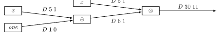
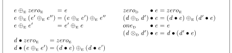
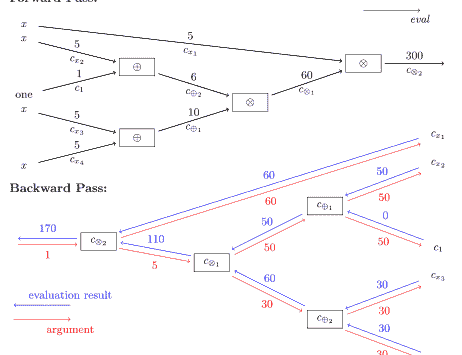
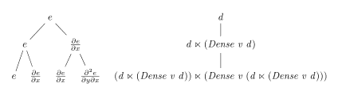

# 前向或反向模式自动微分：有什么区别？


## 摘要

自动微分（AD）一直是许多学科研究人员关注的课题，自其应用于机器学习和神经网络以来，其受欢迎程度不断提高。尽管许多研究人员欣赏并知道如何应用 AD，但真正理解其底层过程仍然是一项挑战。然而，从代数角度来看，AD 的用例显得很自然：它源自于变体的微分。在这项工作中，我们使用代数特征语法（Algebraic Feature Grammars）来形式化两种不同的 AD 变体，并利用 Haskell 来说明我们的观察。我们的发现源于三个基本的代数抽象：（1）半模的概念，（2）Nagata 的“模的理想化”构造，以及（3）克罗内克三角函数，它们共同使我们能够用一行抽象定义来描述 AD。从这一单行定义出发，并通过以多种方式实例化我们的代数结构，我们推导出不同的 AD 变体，它们具有（几乎）相同的计算成本，但具有不同的属性，主要体现在（渐近）计算复杂性方面。我们展示了如何通过克罗内克同构获得不同的变体，这是对我们 Haskell 基础设施的进一步阐述，它通过构造保证了正确性。有了这个框架，本文旨在从代数角度来阐明这一问题，使 AD 变体更易理解。© 2023 The Author(s). 由 Elsevier B.V. 出版。本文是根据 CC BY 许可发布的开放获取文章 (http://creativecommons.org/licenses/by/4.0/)。

## 1. 引言

人工智能中的许多算法不仅关键依赖于算术表达式的高效大规模求值，还依赖于在特定点上对其偏导数进行求值 [1,2]。符号微分和数值微分可用于这些计算，但分别存在性能和准确性问题。因此，第三种方法——自动微分（AD）[3]——备受关注。AD 能够高效且准确地求出由基本算术运算以及指数、对数和三角函数组成的任何计算的导数。

自 Wengert [3] 首次引入自动微分以来，正统的观点将其视为一种全程序变换。它伴随着从底层数值计算语言的原始操作求值转向所谓的双数（最初由 Clifford [4] 提出，远早于其随后在 AD 中的应用）上的求值。各种 AD 模式（正向、反向、混合）随后作为对这一基本图景的进一步优化出现，旨在高效地组织和遍历底层数据结构，通常利用可变性。

关于 AD 的文献浩如烟海，此处无法一一综述，涵盖了对 Wengert 原始方法在所有可能方向上的扩展：算法改进、语言设计和扩展表达性、新颖应用等等。本文的贡献并非进一步扩展这一工作成果，而是从代数角度重新审视原始算法。遵循 Bird 和 de Moor 的《编程代数》[5]，我们展示了如何使用代数从基本可执行规范（用纯函数式编程语言 Haskell 表达）中（重新）推导现有的 AD 算法。所涉及的代数主要由标准构造组成（一个显著的例外是下文 3.2 节中描述的 Nagata 构造），由于它们产生同构的数学对象，因此没有外延后果。然而，它们确实使不同算法变体之间的函子等价成为可能。在代数层面，代数推导的表示变化正是使我们能够利用内涵方面（具体来说，改变计算复杂性）的关键。

具体来说，本文作出以下贡献。

- 首先，我们展示了如何从代数角度将符号微分和符号表达式求值都视为来自自由半环的唯一半环同态。从代码角度看，它们都是相同的类 fold 递归方案的实例。这种代数视角首先使我们能够融合这两个同态以获得基本的正向模式 AD，然后将符号微分恢复为其一个实例（第 2 节）。

- 接下来，我们用三个基本的代数抽象来抽象 AD 模型，其规范和（等式）属性通过 Haskell 类型类来实现：半环上的模、双数的一种推广（我们称之为 Nagata 数，其构造最初归功于 Nagata [6]）以及克罗内克三角函数。这个抽象算法可以轻松实例化为一种更高效的正向模式 AD，它一次性计算整个偏导数梯度向量（第 3 节）。

- 然后，我们展示了如何通过使用同构表示替换梯度的表示，利用 Elliott 的类型类态射方法 [7] 来获得抽象算法的其他实例。这在稀疏表示上得到了演示（第 4 节）。

- 使用上述方法，我们最终推导出反向模式 AD 的纯函数式和命令式变体：我们逐步改进基于同态的表示的标量乘法和梯度向量加法的时间复杂度，并切换到其等效的可变表示（第 5 节）。

- 作为尾声，我们展示了我们的方法很容易允许常见的有用扩展：额外的原始函数、直接使用 Nagata 数进行计算以消除构建和求值符号表达式的开销、高阶导数以及 let 共享（第 6 节）。

- 我们提供了该方法及不同 AD 版本的实现。

最后，本文讨论了相关工作（第 7 节）并得出结论（第 8 节）。

我们相信，本文对代数学家、（Haskell）程序员和 AD 专家同样可能感兴趣。虽然本文尽力做到对这三类读者都易于理解，但我们承认，这需要在下文三个方面汇合之前，处理不熟悉的概念或对熟悉概念的不熟悉表述。附录 C 支持不熟悉 Haskell 的读者，简要介绍了本工作中使用的类型类和库函数。

## 2. 搭建舞台

本节基于最小设置提供了自动微分（AD）的基本可执行定义。对于希望温和介绍此处所用方法的读者，我们参考《数学的领域特定语言》[8]。

### 2.1. 符号表达式及其求值

为了专注于基本的算法机制，在本文的大部分内容中，我们简化为一个最小的编程语言，其中可以表达函数：符号表达式 Expr v，它捕获变量 v 上的多项式，这些变量相互独立：¹

```haskell
data Expr v = Var v | Zero | Plus (Expr v) (Expr v) | Times (Expr v) (Expr v)
```

例如，对于一元表达式，我们可以定义一个带有一个变量的类型 X。x × (x + 1) 的符号表示在示例¹中捕获。


恒等律:
zero ⊕ x = x ⊕ zero
one ⊗ x = x = x ⊗ one

结合律:
x ⊕ (y ⊕ z) = (x ⊕ y) ⊕ z
x ⊗ (y ⊗ z) = (x ⊗ y) ⊗ z

分配律:
x ⊗ (y ⊕ z) = (x ⊗ y) ⊕ (x ⊗ z)
(x ⊕ y) ⊗ z = (x ⊗ z) ⊕ (y ⊗ z)

吸收元: zero ⊗ x = zero = x ⊗ zero

图 1. 交换半环定律。

```
data X = X
example₁ :: Expr X
example₁ = Times (Var X) (Plus (Var X) One)
```

我们通过将符号表达式映射到一个（交换）半环，为符号表达式赋予了重载含义。半环中的“semi”指的是半环不需要具有加法逆元这一事实。此处省略该要求，因为自动微分（AD）不需要它。尽管如此，第 6.1 节表明，如果存在这样的逆元，则可以加以容纳。我们施加的交换律要求并非必需，但简化了展示。第 6.2 节将该方法扩展到非交换半环，这对于支持例如矩阵是必要的。重载使我们能够灵活地从表达式的普通值和不同的 AD 变体两方面来解释表达式。

#### 定义 1（半环）

半环是一个集合，配备两个二元运算 ⊕（“加法”）和 ⊗（“乘法”）以及两个特殊元素 zero 和 one。这些应遵循图 1 的定律：⊕ 和 ⊗ 应该都满足结合律和交换律，并分别具有单位元 zero 和 one。此外，⊗ 应该对 ⊕ 具有分配律，并以 zero 为吸收元。

在 Haskell 中，我们在 Semiring 类型类中捕获半环的代数概念，并为遵循定律的数值类型（例如 Int、Float⁴）提供实例。

```
class Semiring d where
  zero :: d
  one :: d
  (⊕) :: d → d → d
  (⊗) :: d → d → d
```

```
instance Num a => Semiring a where
  zero = 0
  one = 1
  (⊕) = (+)
  (⊗) = (*)
```

有一个半环实例特别引起我们的兴趣：即针对符号表达式 Expr v 的实例，其由定律⁴商化。

```
instance Semiring (Expr v) where
  zero = Zero
  one = One
  (⊕) = Plus
  (⊗) = Times
```

使此实例特别的是，它是自由半环实例，从而产生了 fold 风格的 eval 函数。该求值器通过对符号表达式进行结构递归，在给定变量映射 var :: v → d 的情况下，将它们映射到半环 d 中的解释。

```
eval :: Semiring d => (v → d) → Expr v → d
eval var (Var x) = var x
eval var Zero = zero
eval var One = one
eval var (Plus e₁ e₂) = eval var e₁ ⊕ eval var e₂
eval var (Times e₁ e₂) = eval var e₁ ⊗ eval var e₂
```

这样，我们就可以使用 Int 半环对 example₁ 在 X = 5 时进行求值。

```
> eval (λX → 5) example₁
30
```

### 2.2. 同态

自由半环的概念、相关的 eval 函数及其性质是《程序设计代数》[5]中适用于任何代数结构的通用结果的特例。另一个相关概念，将证明是本文的核心，即同态。非正式地说，这是一个保持代数结构的函数。更正式地说，

#### 定义 2（半环同态）

两个半环 D₁ 和 D₂ 之间的（半环）同态是一个函数 h :: D₁ → D₂，它保持半环结构：

h zero₁ = zero₂          h (x ⊕₁ y) = h x ⊕₂ h y
one₁ = one₂             h (x ⊗₁ y) = h x ⊗₂ h y

半环同态可复合：给定同态 h₁ :: D₁ → D₂ 和 h₂ :: D₂ → D₃，它们的复合 h₂ ∘ h₁ :: D₁ → D₃ 也是一个同态；并且预期的定律成立。此外，恒等函数 id :: D → D 平凡地是一个同态。函数 eval var 对于任何 var 的选择都是一个同态。事实上，它是满足 h (Var v) = var v 的唯一同态 h。从这一唯一性性质推导出两个有用的性质：

#### 性质 1（融合）

融合性质允许我们将任何同态 h 纳入求值：h ∘ eval var = eval (h ∘ var)。

#### 性质 2（反射）

反射性质观察到，使用 Var 进行求值是恒等函数：eval Var = id。

### 2.3. 符号微分与对偶数

eval 同态还允许我们进行符号微分。我们在 derive 函数中捕获其规则，使用 Expr v 的 Semiring 实例，并利用乘法情况中的交换律。

```
derive :: Eq v => v -> Expr v -> Expr v
derive x (Var y)   = if x == y then one else zero
derive x Zero      = zero
derive x One       = zero
derive x (Plus e₁ e₂) = derive x e₁ ⊕ derive x e₂
derive x (Times e₁ e₂) = (e₂ ⊗ derive x e₁) ⊕ (e₁ ⊗ derive x e₂)
```

这些不适合 eval 的 fold 风格递归方案，因为在 Times 的情况下，e₁ 和 e₂ 出现在递归调用之外（灰色）。利用所谓的“香蕉分割”性质 [3–11]，我们可以将此函数转换为适当的形式：我们使其返回一个元组 (Expr v, Expr v)，包含原始表达式和符号导数。

```
derive' x e = (e, derive x e)
```

我们由此获得 derive' 的以下结构递归定义，然后可以通过投影第二个分量来恢复 derive：

```
derive' :: Eq v => v -> Expr v -> (Expr v, Expr v)
derive' x (Var y)   = (Var y, if x == y then one else zero)
derive' x Zero      = (zero, zero)
derive' x One       = (one, zero)
derive' x (Plus e₁ e₂) = let (e'₁, d₁) = derive' x e₁
                             (e'₂, d₂) = derive' x e₂
                             in (e'₁ ⊕ e'₂, d₁ ⊕ d₂)
derive' x (Times e₁ e₂) = let (e'₁, d₁) = derive' x e₁
                             (e'₂, d₂) = derive' x e₂
                             in (e'₁ ⊗ e'₂, (e'₂ ⊗ d₁) ⊕ (e'₁ ⊗ d₂))
```

在将 derive' 的功能用 eval 编写之前，我们将 (Expr v, Expr v) 推广到其分量来自任意半环的元组。在 AD 文献中，这些被称为对偶数，最初由 Clifford [4] 提出。

```
data Dual d = D { primal :: d, tangent :: d }
instance Functor Dual where
  fmap :: (a -> b) -> Dual a -> Dual b
  fmap h (D f g) = D (h f) (h g)
```

对偶数是函子的；fmap f 使用 f 转换两个参数。对偶数 D d x 的两个分量分别称为原值 x 和切线 dx。对于半环 d，类型 Dual d 也承认半环结构，其中切线的定义精确地遵循 derive 的相应情况。

```
instance Semiring d => Semiring (Dual d) where
  zero = D zero zero
  one = D one zero
  (D f d) ⊕ (D g dg) = D (f ⊕ g) (d ⊕ dg)
  (D f d) ⊗ (D g dg) = D (f ⊗ g) ((g ⊗ d) ⊕ (f ⊗ dg))
```

现在，符号微分可以被视为另一种求值实例，但目标是符号表达式上的对偶数半环：

```
symbolic :: Eq v => v -> Expr v -> Dual (Expr v)
symbolic x = eval gen where gen y = D (Var y) (δ_x y)
δ_x y = if x == y then one else zero
```

### 2.4. 经典前向自动微分

自动微分（AD）是程序化地计算表达式在某一点处的值和导数的算法的统称 [12-14]。因此，如果我们将符号微分与随后求值到半环 d 相结合，我们就得到了前向模式 AD 的规范：

```
forwardAD var x = fmap (eval var) . symbolic x
```

我们可以通过利用 eval 的融合性质使此规范更高效。

```
fmap (eval var) . symbolic x
= {- definition of symbolic -
fmap (eval var) . eval gen where gen y = D (Var y) (δ_x y)
= {- eval fusion (Property 1.) -
eval (fmap (eval var) . gen) where gen y = D (Var y) (δ_x y)
= {- fmap (eval var) . gen -
δ_x y = if x == y then one else zero
```

在将 fmap (eval var) 内联到 gen 后，我们得到了前向模式 AD 的经典定义，它只调用一次 eval。与 symbolic 相比的差异以灰色突出显示。

```
forwardAD :: (Eq v, Semiring d) => (v -> d) -> v -> Expr v -> Dual d
forwardAD var x = eval gen where gen y = D (Var y) (δ_x y)
δ_x y = if x == y then one else zero
```

例如，example_1 在 X = 5 处的导数是 11；计算结果的过程如图 2 所示。

```
> forwardAD (\X -> 5) X example₁
D 30 11
```

### 2.5. 将符号 AD 作为前向 AD

请注意，符号微分与自动微分之间唯一的本质区别在于：前者求值到符号 Expr v 半环，而后者使用“数值”半环 d。事实上，我们也可以让 forwardAD 使用符号半环，用 Var 解释变量。

```
forwardAD Var
= {- AD specification (Specification 2.4.) -
```




图 2. 在示例上运行前向模式自动微分，X = 5 时。



图 3. 半环 D 上 D-模组 E 的定律，其中 E 是交换幺半群。我们重载了相应半环的幺半群运算 ⊕，以强调其加法解释。

```
fmap (eval Var) ∘ symbolic
= ( - reflection property (Property 2 ) - )
fmap id ∘ symbolic
= ( - functor law and id as unit of composition - )
symbolic
```

总之，symbolic 是 forwardAD 的一个特例：

```
symbolic = forwardAD Var
```

这为本文余下部分奠定了基础：我们使用代数技术来推导微分算法的结构，并通过暴露更抽象的结构，同一个抽象算法（第 3 节）涵盖了各种具体的 AD 变体。

## 3. 抽象自动微分

本文的核心主张是，我们可以将之前的两个微分函数（符号微分和经典前向模式 AD）以及后来将出现的几种更多变体，都表示为同一个单行泛型程序。本节确定了三种基本代数结构来实现这一点：d-模组、广义双数 d × e，和克罗内克三角函数。它还展示了如何实例化这些结构，以恢复一种前向模式 AD 版本，该版本一次性计算所有偏导数的梯度向量，而不是一次只针对单个变量。

### 3.1. 半环上的模组

我们的第一个抽象概括了表达式 e 的梯度 ∇e 的概念。

```
∇e = [ ∂e/∂x1 ]
     [ ...    ]
     [ ∂e/∂xn ]
```

与向量空间（在域上）或模组（在环上）类似，我们考虑半环 d 上的半模组 [15]，我们称之为 d-模组。

**定义 3**（半模组）。给定半环 D，D-模组 E 被定义为交换幺半群 E，加上标量乘法 (●) : D × E → E，它在 E 的加法结构上分配。这意味着 E 应该有一个交换、结合的二元运算 ⊕，其单位元为零。图 3 给出了 E 的幺半群定律以及 E 的幺半群结构与标量乘法之间交互作用的定律。

在 Haskell 中，我们在 Monoid 类型类之上，使用类型类 Module 来捕捉半模组的概念。

```
class Monoid e where
  zero :: e
  (⊕) :: e → e → e

class (Semiring d, Monoid e)
=> Module d e | e → d where
  (●) :: d → e → e
```

每个半环 d 都可以平凡地视为一个 d-模组，取 (●) = (⊗)。一个著名的非半环示例是向量空间 R³：它与向量加法和零向量 [ 0 0 0 ] 构成幺半群，并与通常的标量乘法构成 R-模组。

### 3.2. Nagata 数

第二个抽象将第 2.3 节的双数推广到两个具有不同类型的分量 d 和 e，反映了这样一个观点：表达式的值（其原始值）及其导数（其切向）在概念上处于不同的空间中。我们利用的正是允许原始值和切向独立变化的推广。这一概念最早出现在 Nagata [6] 20 世纪 50 年代初的工作中，名为“模组的理想化”。然而，将 Nagata 的构造应用于 AD 的研究似乎是新颖的。与双数类似，我们将类型 d x e 称为 Nagata 数。

```
data d x e = N { primN :: d,
                 tanN :: e }

instance Functor (d x ) where
  fmap h (N f d) = N f (h d)
```

请注意，类型构造子 d x 在其第二个参数上是函子的，在两个参数上都是双函子（附录 A）。

Nagata 证明了以下基本定理。

> 定理 1. 给定 d-模组 e，则 d x e 承认半环结构。

下面的 Haskell 类型类实例见证了此定理。

```
instance Module d e => Semiring (d x e) where
  zero        = N zero zero
  one         = N one   zero
  (N f df) ⊕ (N g dg) = N (f ⊕ g) (df ⊕ dg)
  (N f df) ⊗ (N g dg) = N (f ⊗ g) ((f ⊗ dg) ⊕ (g ⊗ df))
```

### 3.3. 克罗内克三角函数

我们拼图的最后一块来自以下观察：函数 δ_x y = if x == y then one else zero 是克罗内克三角函数。

```
δ_x(y) = { 1   x = y
         { 0   otherwise
```

这引出了我们第三个基本代数抽象。在 Haskell 中，我们在 Kronecker 类型类中捕捉了这一概念的广义化概念。

```
class Module d e => Kronecker v d e where
  delta :: v → e
```

请注意，此时，Kronecker v d e 上没有强加额外定律；稍后，我们将使用同构条件（定义 5）来约束不同的 AD 变体。其思想是 delta x 不仅为单个变量 y 计算 δ_x(y)，而是一次性为所有变量计算。因此，delta x 是 d-模组 e 中的一个值，其中只有 x 分量为 1，其他全为 0。一个有用的类比是将 v 视为 e 的基向量类型。然后，delta x 是基向量 x 到 e 的嵌入。继续第 3.1 节中 R-模组 R³ 的示例，通常有三个变量 x、y、z，使得

```
delta x = [1 0 0]
delta y = [0 1 0]
delta z = [0 0 1]
```

在 AD 文献中，这些只有一个分量为 1、其他分量为 0 的基向量通常被称为 one-hot 向量。

### 3.4. 抽象自动微分

有了这三个代数结构，我们提出了微分的抽象定义。

```
abstractD :: Kronecker v d => e -> (v -> d) -> Expr v -> d × e
abstractAD var = eval gen where gen x = N (var x) (delta x)
```

接下来，我们展示如何实例化此抽象定义以恢复 forwardAD。稍后，我们改变 e 以获得更高效的版本。

### 3.5. 基础情况：作为稠密函数空间中的 AD 的前向模式 AD

我们通过使用标准函数空间 e = v -> d，将 forwardAD——第 2.4 节给出的经典前向模式 AD 实现——作为 abstractD 的一个实例来恢复。我们将此空间称为 Dense，以与第 4.3 节即将出现的稀疏函数空间形成对比：与计算机代数 [16] 中稠密/稀疏多项式表示类似。

```
type Dense v d = v -> d
```

非正式地，我们可以将此结构视为梯度向量的函数表示，被最小二乘拟合、梯度下降和许多其他应用所需。就像梯度向量一样，它为每个类型 v 的变量包含一个 d 值。其幺半群和 d-模组实例的作用是逐点给出的，使用第 3.1 节的“d-as-d-module 构造”。

```
instance Semiring d => Monoid (Dense v d) where
  zero   = λv → zero
  f₁ ⊕ f₂ = λv → f₁ v ⊕ f₂ v
```

```
instance Semiring d => Module d (Dense v d) where
  d • f = λv → d • (f v) = λv → d ⊗ (f v)
```

稠密函数的克罗内克三角函数是教科书式的。

```
instance (Eq v, Semiring d) => Kronecker v d (Dense v d) where
  delta v = λw → if v ≡ w then one else zero
```

使用此 Kronecker 实例并将双数推广为 d × (Dense v d)，我们得到前向模式 AD 的以下定义。

```
forwardAD_dense :: (Eq v, Semiring d) => (v -> d) -> Expr v -> d × (Dense v d)
forwardAD_dense = abstractD
```

这是 forwardAD，其参数重新排列并将 Dual d 推广：

```
primD (forwardAD var x) = primN (forwardAD_dense var x)
tanD (forwardAD var x) = tanN (forwardAD_dense var x)
```

forwardAD 和 forwardAD_Dense 之间的本质区别是内涵上的。从计算 v -> d × d 中的值转移到计算 d × (v -> d) 中的值，我们不再为每个单独的 v 计算原始值和切向，而是仅为整个梯度计算一次原始值。换句话说，我们在所有偏导数之间共享原始值的计算。例如，示例 2 使用我们的表达式语言表示变量 x 和 y 中的表达式 (x × y) + x + 1。

```
data XY = X | Y
example_1 :: Exp XY
example_2 = Plus (Plus (Times (Var X) (Var Y)) (Var X)) One
```

我们在点 (5, 3) 处计算其梯度：

```
> let (var X = 5; var Y = 3; e = tanN (forwardAD_dense var example_2))
in (e X, e Y)
(4, 5)
```

相比之下，使用 forwardAD 时，我们需要调用它两次：

```
> let (var X = 5; var Y = 3; e = example_2)
in (tanD (forwardAD var X e), tanD (forwardAD var Y e))
```

## 4. 通过构造的 AD 变体

本节解释了我们的方法论，该方法基于构造 Kronecker 同构，并在 forwardAD_dense 的稀疏变体上演示了它。这种方法论将允许我们通过改变切向类型来实例化我们的抽象算法，以获得不同的自动微分变体。

### 4.1. 使用 Kronecker 同构关联 AD 变体

在设计新的 AD 变体时，一个关键关注点是其正确性。我们可以通过证明它们与既定 AD 基线的函数等价性来建立这一点。我们使用 Kronecker 同构来做到这一点。

**定义 4**（Kronecker 同态）。给定变量类型 V 和半环 D，以及类型 E1 和 E2，使得 Kronecker V D E1 和 Kronecker V D E2 成立（因此也成立 Monoid E1、Monoid E2、Module D E1 和 Module D E2），则 Kronecker 同态是一个函数 h :: E1 -> E2，它保留 Kronecker V D 结构：
h zeroE1 = zeroE2
h (x ⊕E1 y) = (h x) ⊕E2 (h y)
h (d •E1 v) = d •E2 (h v)
h (deltaE1 v) = deltaE2 v

**定义 5**（Kronecker 同构）。Kronecker 同构是一对 Kronecker 同态 h :: E1 -> E2 和 h' :: E2 -> E1，它们互为逆：h . h' = id 和 h' . h = id。

在本文余下部分，我们使用 Dense V D 作为基线。因此，在提出新的切向类型 E 时，我们还希望找到一个 Kronecker 同构 h :: Dense V D -> E 以建立其正确性。这个同构是一对函数，由表示函数 rep 及其逆 abs（抽象）组成，遵循数据表示 [17,18] 的术语。为了简化我们的方法，我们在类型类 CorrectAD 中捕获此同构。

```
class Kronecker v d e => CorrectAD v d e where
rep :: Dense v d -> e
abs :: e -> Dense v d
```

借助由 abstractD [20] 的参数性得出的自由定理 [19]，我们可以将算法的新实例与基线关联起来。

> **定理 2.** 给定 CorrectAD V D E 实例，我们有
> fmap abs (abstractD_E var e) = abstractD_Dense var e
> abstractD_E var e = fmap rep (abstractD_Dense var e)


### 4.2. 通过构造的 Kronecker 同构

将 Kronecker V D (Dense V D) 结构作为起点，以及一个新期望的表示 E，我们无需凭空构思 Kronecker V D E 结构和 Kronecker 同构：相反，遵循 Elliott [7] 概述的方法，我们可以从普通可逆函数 h :: Dense V D -> E 构造性地推导出两者。确实，我们可以基于 Dense V D 和 h 的实例来为 E 创建实例。

```haskell
instance Monoid E where
  zero = h zeroDense
  x ⊕ y = h (h⁻¹ x ⊕Dense h⁻¹ y)
instance Module D E where
  d • x = h (d •Dense h⁻¹ x)
instance Kronecker V D E where
  delta v = h (deltaDense v)
instance CorrectAD V D E where
  rep = h
  abs = h⁻¹
```

通过构造，这些实例既 (1) 满足所有必要的定律，又 (2) 确保 h 是 Kronecker 同构。例如，我们可以按如下方式验证 x ⊕ zero = x 和 h x ⊕ h y = h (x ⊕ y)：

```
x ⊕ zero
= { - definitions of zero and ⊕ - }
h (h⁻¹ x ⊕ h⁻¹ (h zero))
= { - isomorphism - }
h (h⁻¹ x ⊕ zero)
= { - monoid identity law for Dense v d - }
h (h⁻¹ x)
= { - isomorphism - }
x

h x ⊕ h y
= { - definition of ⊕ - }
h (h⁻¹ (h x) ⊕ h⁻¹ (h y))
= { - isomorphism - }
h (x ⊕ y)
```

验证其他定律和同态属性的过程类似。

简而言之，每次我们设计一个新的 AD 变体时，都会提出一个新的表示 E 和一个可逆函数 h :: Dense V D -> E。其余的基础设施随后会机械地跟进，只不过我们可以简化定义，有时利用更多方程，以优化表示的（算法属性）。

可逆函数通过构造的 Kronecker 同构确保外延行为保持不变，从而保证正确性。同时，精心选择的替代表示可能改善渐近运行时间等内意属性。

### 4.3. 稀疏映射

我们演示了上述从密集函数空间表示切换到稀疏映射表示的方法。这利用了许多子表达式的偏导数为零这一事实。确实，如果变量 x 未出现在表达式 e 中，则偏导数 ∂e/∂x 为零。值得注意的是，在密集函数的基础实例中，当表达式仅为一个变量时，除一个外的所有偏导数均按定义为零。我们通过将密集函数空间 v -> d 替换为有限键值映射类型 Map v d，来避免此类零的显式表示以及与之进行的显式操作。我们使用 Haskell 的 Data.Map 库（附录 C），而不是专用的字典表示 [21]。

```haskell
type Sparse v d = Map v d
```

映射中省略的值为零。这样，我们通过在映射中查找变量并在变量不存在时默认为零，从稀疏表示恢复 Dense 表示。

```haskell
abs↝ :: (Ord v, Semiring d) => Sparse v d -> Dense v d
abs↝ m = \v -> findWithDefault zero v m
rep↝ :: (Ord v, Bounded v, Enum v, Semiring d, Eq d)
     => Dense v d -> Sparse v d
rep↝ dense = fromList [(v, dense v) | v <- [minBound .. maxBound], dense v ≠ zero]
```

请注意，在约束下（模上显式零和隐式零的等价性），abs↝ 和 rep↝ 是互为逆函数。有了新的 Sparse v d 表示和这两个逆函数，我们可以按照第 4.1 节概述的方法推导出 Monoid、Module、Kronecker 和 CorrectAD 实例。这导致全零映射为空。映射的加法按键执行，但如果任一或两个映射在给定（变量）键处具有隐式零，则避免执行。

```haskell
instance (Ord v, Semiring d) => Monoid (Sparse v d) where
  zero = empty
  (⊕) = unionWith (⊕)
```

标量乘法也按键执行。由于 d ⊗ zero = zero（图 1），我们可以轻松保留隐式零条目。

```haskell
instance (Ord v, Semiring d) => Module d (Sparse v d) where
  d • m = fmap (d ⊗) m
```

delta x 的唯一非零条目是 x 的条目。

```haskell
instance (Ord v, Semiring d) => Kronecker v d (Sparse v d) where
  delta x = singleton x one
```

此外，在接下来的内容中至关重要的是，我们观察到此 Kronecker 结构与其 Module 和 Monoid 实例之间存在以下关系：

```
d • delta v = singleton v d (1)
e ⊕ (d • delta v) = insertWith (⊕) v d e (2)
```

最后，CorrectAD 实例很简单。

```haskell
instance (Ord v, Bounded v, Enum v, Semiring d, Eq d) => CorrectAD v d (Sparse v d) where
  rep = rep_-
  abs = abs_-
```

总之，与密集计算相比，稀疏梯度计算所需的一切就是将 d × (Dense v d) 切换为 d × (Sparse v d)。

```haskell
forwardADsparse :: (Ord v, Semiring d) => (v -> d) -> Exp v -> d × Sparse v d
forwardADsparse = abstractD
```

通过构造，定理 2 现在成立。我们可以通过重新访问点 (5, 3) 处的 example2 来验证此对应关系。

```
> let {var X = 5; var Y = 3} in tan^y (forwardADsparse var example2)
[X -> 4; Y -> 5]
```

## 5. 反向模式自动微分

我们现在通过改进上述稀疏表示，开发出适当的 d-模结构，以将反向模式 AD 展现为 abstractD 的一个实例。出于提高效率的考虑，我们优化了基于 Nagata 数半环的抽象微分基本函数的时间复杂度：标量乘法 (⊙)、加法 (⊕) 和 Kronecker 的 delta。

### 5.1. 累积乘法

我们从另一种基于函数的表示开始。我们不考虑 d-模 e，而是考虑从 d 到 e 的 d-模同态空间。交换代数 [22, p. 18] 中的一个标准结果是，这两个结构作为 d-模是同构的。就底层 Haskell 类型而言，这相当于取普通函数空间。

```haskell
type d -> e = d -> e
```

7 对于交换环及其模的情况；半环和模的论证相同，但更简单，因为需要检查的方程更少。

但我们打算让此类型 d -> e 仅表示 d-模同态。对于从 d 到 e 的线性函数，情况正是如此。函数 f : d -> e 是线性^3 的，当且仅当它具有乘齐次性属性：

f (\x) y = x • f y

由于 Haskell 类型 d -> e 也包含非线性函数，我们必须有纪律地使用 d -> e，小心避免非线性函数。直觉上，我们可以将 d -> e 视为为 e 增加一个类型为 d 的标量乘数累加器。通过提供标量 one，我们可以恢复原始模。

```haskell
rep_- :: Module d e => d -> e -> (d -> e)
rep_- e = \x d -> d • e
abs_- :: Module d e => (d -> e) -> e
abs_- f = f one
```

特别是，由于 one e • e = e（图 3），我们有 abs_- ∘ rep_- = id。此外，对于线性函数，也有 rep_- ∘ abs_- = id。现在我们推导出 Monoid、Module 和 Kronecker 实例，使 rep_- 按构造成为同态。由此可知，d -> e 以逐点方式从 e 继承其幺半群结构。对于 e = Dense v d，加法操作的时间复杂度仍为变量数量的线性复杂度。

```haskell
instance Monoid e => Monoid (d -> e) where
  zero = \x d -> zero
  f ⊕ g = \x d -> f x d ⊕ g x d
```

此外，其 d-模结构使用函数参数作为标量乘数的累加器。这实现了一种“强度削减”：昂贵的标量乘法 (•) 被更便宜的半环乘法 (⊕) 所取代。

```haskell
instance Module d e => Module d (d -> e) where
  d' • f = \x d -> f (x ⊕ d' ⊗ d)
```

这将标量乘法的时间复杂度从 Sparse v d 表示的 O(|V|)（其中 V 表示给定稀疏映射中具有非零值的变量数量）降低到 d -> Sparse v d 的 O(1)。然而，d -> e 的通用 Kronecker 实例仍然包含昂贵的 (•) 运算符。

```haskell
instance Kronecker v d e => Kronecker v d (d -> e) where
  delta v = \x d -> d • delta v
```

幸运的是，我们只需要针对稀疏映射的专用实例，它以常数时间运行，这是 d -> delta v 的方程 (1) 的结果。

```haskell
instance (Ord v, Semiring d) => Kronecker v d (d -> Sparse v d) where
  delta = singleton
```

最后，d -> e 的 CorrectAD 实例定义为 rep_-/abs_- 与 e 的 rep/abs 的组合。

```haskell
instance CorrectAD v d e => CorrectAD v d (d -> e) where
  rep = rep_- . rep
  abs = abs_- . abs_-
```

总之，通过使用 d × (d -> Sparse v d)，我们获得了反向模式 AD。

```haskell
reverseAD :: (Ord v, Semiring d) => (v -> d) -> Exp v -> d × (d -> Sparse v d)
reverseAD = abstractD
```

例如，考虑更广泛的示例表达式 x x × (x + 1) × (x + x)，在 Haskell 中编码为 example_3。

```haskell
example_3 :: Exp X
example_3 = Times (Var X) (Times (Plus (Var X) One) (Plus (Var X) (Var X)))
```

在此表达式上运行反向模式 AD，X = 5 处的导数为 170。

```
> (abs_- . tanh^n) (reverseAD (\x -> 5) example_3)
{X -> 170}
```


#### 前向传递:



#### 构造的函数闭包:

| 导数 | 闭包 | 参数 (d) | 结果 |
| :--- | :--- | :--- | :--- |
| $c_{\oplus_2}$ | $\lambda d \rightarrow c_{r_1} (d \otimes 60) \oplus c_{\ominus_1} (d \otimes 5)$ | 1 | 170 |
| $c_{\ominus_1}$ | $\lambda d \rightarrow c_{r_2} (d \otimes 10) \oplus c_{\ominus_2} (d \otimes 6)$ | 5 | 110 |
| $c_{\ominus_2}$ | $\lambda d \rightarrow c_{r_3} d \oplus c_1 d$ | 50 | 50 |
| $c_{\ominus_2}$ | $\lambda d \rightarrow c_{r_4} d \oplus c_{r_4} d$ | 30 | 60 |
| $c_1$ | $\lambda d \rightarrow \{ \}$ | 50 | 0 |
| $c_{r_4}$ | $\lambda d \rightarrow \{ x \mapsto d \}$ | 60, 50, 30, 30 | 60, 50, 30, 30 |

图 4. x × (x + 1) × (x + ·) 的反向模式自动微分，其中 x = 5。

图 4 表明，该计算有效地在多个遍中工作，这是反向模式自动微分的关键特征。在前向（自底向上）遍（由黑色箭头显示）中，算法计算 Nagata 数，其中包含每个子表达式的值，以及节点之间作为函数闭包 c : d ⇢ Sparse v, d 的依赖关系，例如最终结果的 N 300 c$_{\ominus_2}$。在后向（自顶向下）遍（由红色从左到右的箭头显示）中，我们在参数 1 上调用函数闭包 c$_{\ominus_2}$（使用 abs$_{\rightarrow}$）。它将标量累加器向下传播。在每个向下步骤中，累加器会发生变化，以反映当子表达式变化 1 时整体导数变化多少。最后，叶节点的结果被相加（由蓝色从右到左的箭头显示）以得出整体导数。传统的命令式算法通常通过命令式更新来完成此操作。我们将在 5.3 节推导该形式，但首先我们要解决加法的线性开销。

### 5.2. 累加

我们可以以与优化标量乘法非常相似的方式优化 d-模块的加法结构：即考虑具有加法齐次性属性的 e → e 函数的表示：

```
f (x ⊗ y) = x ⊗ f y
```

该表示也称为 e 的 Cayley 表示 [23,24]，其最著名的示例是差分列表 [25] 或 Hughes 列表 [26]。同样，Haskell 类型 e → e 包含不具有齐次性属性的函数；这些函数不包含在 Cayley e 类型中。

加法的保持源于 f 的结果是一个半模的事实。

```
type Cayley e = e -> e
rep₀ :: Monoid e => e -> Cayley e
rep₀ e = λe' -> e' ⊕ e
abs₀ :: Monoid e => Cayley e -> e
abs₀ f = f zero
```

该表示通常隐含另一种“强度缩减”，即从 e 的二元运算符 (⊕) 到函数组合 (∘)。由此，我们将加法的时间复杂度从 Sparse v d 的 O(V) 降低到 Cayley (Sparse v d) 的 O(1)。

```
instance Monoid (Cayley e) where
zero = id
f ⊕ g = g ∘ f
```

我们按照标准配方推导 Module 和 Kronecker 实例。然而，我们无法消除 Cayley e 的 Module 和 Kronecker 实例中的昂贵操作。确实，Module 实例要求在 Cayley e 和 e 之间转换，其中 rep₀ 重新引入了 e 的昂贵 O(V) 加法运算 (⊕)，而我们刚刚从 Monoid 实例中消除了该运算。

```
instance Module d e => Module d (Cayley e) where
d • f = rep₀ . (d • abs₀ . f)
```

通过 rep₀ 从 e 推导的 Kronecker 实例同样包含 e 的加法运算 (⊕)。

```
instance Kronecker v d e => Kronecker v d (Cayley e) where
delta v = λe -> e ⊕ delta v
```

幸运的是，我们可以再次为类型 e = d ↝ Cayley (Sparse v d) 定义一个专用的 Kronecker 实例，从而避免使用昂贵的 ⊕ 运算。确实，在 e 上定义的 (⊙) 运算不必使用 Cayley (Sparse v d) 上定义的运算。对于专用的 delta，我们改为计算：

```
delta v = {- definition of delta for d ↝ -}
λd -> d • delta v
= {- definition of (⊙) and delta for Cayley -}
λd -> rep₀ . (d • abs₀) . (λe -> e ⊕ delta v)
= {- definition of rep₀, and abs₀ -}
λd -> λe -> e ⊕ (d • (λe -> e ⊕ delta v) zero)
= {- β-reduction and unit of monoid (Fig. 3) -}
λd -> λe -> e ⊕ (d • delta v)
= {- equation (2) -}
λd -> λe -> insertWith (⊙) v d e
= {- η-reduction -}
λd -> insertWith (⊙) v d
```

因此，我们得到一个仅需 O(log V) 时间的 delta 实现。

```
instance (Ord v, Semiring d) => Kronecker v d (d ↝ Cayley (Sparse v d))
where delta = insertWith (⊙)
```

此外，Cayley e 表示保持了 e 的正确性。

```
instance CorrectAD v d e => CorrectAD v d (Cayley e) where
rep = rep₀ . rep
abs = abs₀ . abs₀
```

总结来说，对于类型 d ↝ Cayley (Sparse v d)，(⊙) 和 (⊕) 均需 O(1) 时间，而 delta 需 O(log V) 时间。因此，对于具有 N 个节点和 V 个变量的程序，abstractD 的时间复杂度现在为 O(N × log V)。

```
reverseAD_Cayley :: (Ord v, Semiring d)
=> (v -> d) -> Expr v -> d × (d ↝ Cayley (Sparse v d))
reverseAD_Cayley = abstractD
```

例如，与之前一样，example3 在 X = 5 处的导数为 170。

```
> (abs₀ . abs₀) (reverseAD_Cayley (λX -> 5) example3)
[X |-> 170]
```

请注意，我们可以将类型 Cayley (Sparse v d) 的值视为修改类型 Sparse v d 状态的计算的函数模型，即不可变映射。

### 5.3. 基于数组的反向模式

从性能角度来看，通过从不可变映射切换到可变数组（来自 Data.Array.ST）（附录 C），我们可以做得更好。使用这些来表示状态，而不是上面的纯函数式实现，我们可以执行原地更新。此外，数组可以由隐式环境（Control.Monad.Reader）提供。因此，我们可以使用类型 ReaderT (STArray s v) (ST s) ()，而不是类型 Cayley (Sparse v d)。将这个相当冗长的类型封装在类型别名 STCayley v d 中很方便。

```
type STCayley v d = ReaderT (STArray s v s) (ST s) ()
```

请注意，STCayley v d 对状态线程参数 s 进行多态量化，如果我们想使用 Haskell 的内置原语 runST :: (∀S. ST s a) -> a 来运行计算，这是必要的。

Cayley (Sparse v d) 和 STCayley v d 之间的同构本质上在数组和映射表示之间进行转换。

```
rep_∞ :: (Ix v, Semiring d) => Cayley (Sparse v d) -> STCayley v d
rep_∞ p = foldMap (λ (v, d) -> modifyAt (⊕ v) d (toList (p zero)))
abs_∞ :: (Ix v, Bounded v, Semiring d) => STCayley v d -> Cayley (Sparse v d)
abs_∞ q = runST (do arr <- newArray (minBound, maxBound) zero
runReaderT q arr
l <- getAssocs arr
return $ foldMap (λ (v, d) -> insertWith (⊕) v d l))
```

rep_∞ 函数使用辅助函数 modifyAt 来编辑数组中特定位置的值，这是映射上 insertWith 的对应物。

```
modifyAt :: v -> (d -> d) -> STCayley v d
modifyAt f v = do arr <- ask; x <- readArr arr v; writeArray arr v (f x)
```

使用 4.1 节的方法，Monoid 实例被证明是任何类型 m ()（其中 m 是单子）可用的通用实例。

```
instance Monoid (STCayley v d) where
zero = return ()
p ⊕ q = p >> q
```

由于我们使用 d -> STCayley v d，STCayley v d 的 Module 结构未被使用。因此，我们直接跳到 Kronecker 实例，其中使用可变数组的目的是将 delta 中 insertWith 的 O(log V) 时间复杂度降低到 modifyAt 的 O(1) 时间复杂度。

```
instance (Ix v, Semiring d) => Kronecker v d (STCayley v d) where
delta v = modifyAt (⊕one) v
```

在 d -> STCayley v d 组合中，这变为：

```
instance (Ix v, Semiring d) => Kronecker v d (d -> STCayley v d) where
delta v = λd -> modifyAt (⊕v) d
```

STCayley v d 的正确性是根据 Cayley (Sparse v d) 的正确性来建立的。

```
instance (Ix v, Ord v, Bounded v, Enum v, Semiring d, Eq d) =>
CorrectAD v d (STCayley v d) where
rep = rep_∞ . rep
abs = abs ∘ abs_∞
```


| 求导模式 | 半环类型 | 时间复杂度 |
|---|---|---|
| 符号式 | (Expr v) ⋈ (Expr v) | O(N^2) |
| 前向模式 | d ⋈ (Dense v d) | O(N x V) |
| 前向模式 | d ⋈ (Sparse v d) | O(N x V) |
| 反向模式 | d ⋈ (d -> Sparse v d) | O(N x V) |
| 反向模式 | d ⋈ (d -> Cayley (Sparse v d)) | O(N x log V) |
| 反向模式 | d ⋈ (d -> STCayley v d) | O(N x V) |

图 5. 半环类型的逐步改进，以及相应的求导模式和时间复杂度，针对具有 N 个节点和 V 个变量的表达式。

```haskell
autodiff :: (Ord v, Semiring d) => (v -> d) -> Expr v -> Map v d
autodiff var e = snd (go var e) one zero where
  go :: (Ord v, Semiring d)
  => (v -> d) -> Expr v -> (d, d -> Map v d -> Map v d)
  go var (Var v) = (var v, \d -> \m -> insertWith (⊕) v d m)
  go var Zero = (zero, \d -> \m -> m)
  go var One = (one, \d -> \m -> m)
  go var (Plus e1 e2) = let (f, df) = go var e1
                        (g, dg) = go var e2
                        in (f ⊕ g, \d -> \m -> df d (dg d m))
  go var (Times e1 e2) = let (f, df) = go var e1
                         (g, dg) = go var e2
                         in (f ⊗ g, \d -> \m -> df (d ⊗ g) (dg (d ⊗ f) m))
```

图 6. 基于 d ⋈ (d -> Cayley (Sparse v d)) 半环的完全内联 AD 代码。

最后，我们得到了反向模式 AD 的最终单子定义。

```haskell
reverseADm :: (Ord v, Semiring d)
=> (v -> d) -> Expr v -> d ⋈ (d -> STCayley v d)
reverseADm = abstractD
```

我们对 example_2 使用这种高效的反向模式 AD 版本，如下所示：

```haskell
> (abs_ ⊙ abs_ ⊙ ... ⊙ tan^n) (reverseADm (x -> 5) example_2)
(x -> 170)
```

### 5.4. 总结

图 5 总结了我们通过为不同切线类型 e 实例化 semiring 类型 d ⋈ e 的 abstractD 而构建的逐步求导算法。它还显示了每种算法的最坏情况时间复杂度。请注意，当 V 很大，即有许多变量时，反向模式 AD，尤其是最后两个变体，是最有趣的。然而，对于变量较少的情况，前向模式 AD 更可取，因为它只需一次遍历。

最后，在图 6 中，我们折叠抽象层以展示图 5 中倒数第二个条目——我们最高效的纯函数式反向模式 AD 算法——在激进内联后的样子。为简单起见，我们还将 Nagata 数的自定义代数数据类型替换为普通的 Haskell 元组。

## 6. 扩展

我们的设置允许各种使 AD 更有用的扩展。请注意，在这些扩展中，我们为了简洁，通常会回到更朴素的 forwardAD_dense 及其 Dense 表示。

### 6.1. 其他原语

迄今为止，我们只关注最小的 Semiring 接口。然而，众所周知，双数（以及由此延伸的 Nagata 数）可以轻松适应其他原语，例如三角函数、指数函数和对数函数。我们将这些函数建模为 Semiring 类型类的子类。例如，我们可以通过创建带有 negate 方法的 Ring 子类来将半环方法扩展到环，用于加法逆元。

```haskell
class Semiring d => Ring d
  where negate :: d -> d
instance (Module d e, Ring d) => Ring (d × e)
  where negate (N f) df = N (f) (-one • df)
```

这里，我们利用 Haskell 允许我们用 -x 表示 negate x 的事实。

同样，我们将三角函数收集在 Trig 中，其 Nagata 数实例依赖于著名的链式法则。一般来说，要用可微原语丰富 d（以及 Expr v），我们需要知道运算（sin）及其导数（cos）。在这里，为了能够将 sin 作为 cos 的导数进行求负，d 必须是一个 Ring。

```haskell
class Trig d where
  sin :: d -> d
  cos :: d -> d
instance (Module d e, Trig d, Ring d) => Trig (d × e)
  where sin (N f) df = N (sin f) (cos • df)
  cos (N f) df = N (cos f) (-sin • df)
```

请注意，虽然 d 现在也必须有一个 Trig 实例，但对 e 没有额外要求。因此，我们所涵盖的所有 AD 变体（仅基于 e 的变体）也支持其他原语函数。

### 6.2. 非交换半环

我们可以将我们的方法从交换半环推广到具有非交换乘法（⊗）的半环，例如半环上的（方阵）矩阵以及字母表上的形式语言半环。

我们方法中的关键变化是，不再从以下利用交换性的符号求导规则开始：

```haskell
derive x (Times e1 e2) = (e2 ⊗ derive x e1) ⊕ (e1 ⊗ derive x e2)
```

其中 e1 和 e2 的导数都在左侧缩放，我们改用更常规的规则：

```haskell
derive x (Times e1 e2) = (derive x e1 ⊗ e2) ⊕ (e1 ⊗ derive x e2)
```

该规则在左侧缩放 derive x e2，在右侧缩放 derive x e1。

更抽象地说，我们可以使用具有不同左缩放和右缩放算子的 d-d-双模来建模这一点。

```haskell
class Semiring d => Bimodule d e | e -> d where
  (⊙) :: d -> e -> e
  (⊙) :: e -> d -> e
```

请注意，对于每个乘法交换的 d，每个 Module d e 实例都会产生一个 Bimodule d e 实例，方法是将两个缩放操作视为相同的底层（⊙）操作。如果 d 中的乘法不交换，那么特殊情况 e = d 仍然会产生一个 Bimodule 结构，其中（⊙）分别由左乘法（resp. 右乘法）给出（见下文）。但是，将（d -> e 的受限子集）作为 d 到 e 的 Bimodule 同态集合的代表是不够的。

相反，我们可以避免引入这种新的 d-d-双模抽象，并通过 (d, d)-模块重用现有的 Module 相关基础设施。这一想法的核心是以下针对对的半环构造。

```haskell
instance Semiring d => Semiring (d, d) where
  zero = (zero, zero)
  one = (one, one)
  (lx, rx) ⊕ (ly, ry) = (lx ⊕ ly, rx ⊕ ry)
  (lx, rx) ⊗ (ly, ry) = (lx ⊗ ly, ry ⊗ rx)
```

这是通常的按分量实例，有一个例外：乘法中的因子在第二个分量中被翻转。然后 d 是一个 (d, d) 模块，如下所示：

```haskell
instance Semiring d => Module (d, d) d where
  (l, r) • d = l ⊗ d ⊗ r
```

在这里，元组的第一个分量从左侧缩放，第二个分量从右侧缩放。我们可以使用下面的左注入和右注入，将 `d` 值转换为左因子或右因子，并为另一个因子使用中性元素 `one`。

```haskell
inl, inr :: Semiring d => d -> (d, d)
inl x = (x, one)
inr y = (one, y)
```

更一般地说，带有 `(d, d)`-模块 `e` 时，我们得到 Nagata 数的一个变体：

```haskell
instance (Semiring d, Module (d, d) e) => Semiring (Nagata d e) where
  zero = N zero zero
  one = N one zero
  N f dg + N f' dg' = N (f ⊕ f') (dg ⊕ dg')
  N f dg ⊗ N f' dg' = N (f ⊗ f') (((inr • f' • dg') ⊗ (inl • f • dg)))
```

这一局部修改无缝地将非交换乘法集成到我们的 AD 变体中。特别是，遵循先前的配方，我们现在使用 `(d, d) → e` 表示来累积乘法，即接受两个 `d` 累加器的 `(d, d) → e` 函数。该表示的标量乘法会同时更新两个累加器。

```haskell
instance (Semiring d, Module (d, d) e) => Module (d, d) ((d, d) -> e) where
  (d1', d2') • f = λ(d1, d2) -> f (d1' ⊗ d1, d2' ⊗ d2)
```

这表明第一个累加器用于左乘法，另一个用于右乘法。

简而言之，`(d, d)`-模块以最小的变动支持非交换乘法。

### 6.3. 重载初始表达式

自动微分在计算精确数值结果时避免了中间符号导数。这通过第 2.4 节中 `eval` 的消除得以体现，在朴素实现中它被调用了两次。在本小节中，我们表明，通过重载初始表达式中的运算符并从而避免初始符号表达式，我们可以进一步消除 `eval` 调用，从而进一步减少冗余。

特别是，我们假设初始表达式不是作为类型 `Expr v` 的值给出的，而是作为类型 `∀d.Semiring d => d → ... → d → d` 的多态函数，其 `d` 类型的输入数量与变量 `v` 的数量相同。例如，第 2.5 节中的 `example2` 可以写成一个二元多态函数。

```haskell
example'_2 :: Semiring d => d -> d -> d
example'_2 x y = (x ⊗ y) ⊗ x ⊕ one
```

推导 `example'_2` 的机制是 fold/build 融合 [27]，应用于 `eval var example2`，其中 `example2` 是构建器模式的一个实例，用于构建符号表达式，而 `eval` 是一个 fold。Fold/build 融合消除了中间符号结构并直接构建求值结果。Gibbons 和 Wu [28] 展示了如何系统地利用这种结构（推广到由 Haskell 类型类定义的所有代数结构，而不仅仅是 `Semiring`s），通过将底层术语重构为符号表达式 `Expr v` 及其相应的浅嵌入 `VarSemiring d => (v -> d) -> d`。在这里，`eval` 是这两种类型之间同构对的一半，其逆由在 `Var` 处实例化给出。

因此，我们不再使用冗长的调用（左侧），而是直接调用 `example'_2`（右侧）。

```
> let {var X = 5; var Y = 3}        > example'_2 5 3
21                                  21
> let {var X = 5; var Y = 3}        > example'_2 (N 5 (delta X))
> in forwardAD.sparse var example2  (N 3 (delta Y))
N 21 (X -> 4; Y -> 5)               N 21 (X -> 4; Y -> 5)
```

两种情况都避免了求值符号表达式的解释开销。然而，我们也可以恢复原始符号表达式。

```haskell
> example'_2 (Var X) (Var Y)
Plus (Plus (Times (Var X) (Var Y)) (Var X)) One
```




### 6.4. 高阶导数

高阶导数通过重复求导得到。例如，二阶导数是导数的导数。在某点计算二阶导数的朴素方法是通过重复求值符号导数。

```
derive2nd :: (Eq v, Semiring d) => (v -> d) -> Expr v -> Dense v (Dense v d)
derive2nd var e = \x y -> eval var tan^n (forwardAD_Dense Var (tan^n (forwardAD_Dense (var x)) y))
```

Haskell 调用 derive2nd var e x y 对应数学记号 ∂/∂y (∂/∂x e)|var。通过利用 tan^n 的自然性和 eval 的融合属性，我们将 derive2nd 的三次遍历合并为一次遍历（参见附录 A）：

```
derive2nd var e = \x y -> tan^n (tan^n (forwardAD_Dense gen e x) y)
where gen z = N (var z) (delta z)
```

此 abstractD 实例使用嵌套 Nagata 数的 (d <- (Dense v d))-模块，类型为 (d <- (Dense v d)) × (Dense v d <- (Dense v d))。

二阶导数的嵌套导数（图 7）包含冗余：值 ∂²/∂x² 出现了两次。随着阶数（因此嵌套层级）的增加，这种冗余会变得更糟。一般来说，对于 n 阶导数，我们得到 2^n 个值，其中只有 n + 1 个是不同的。为避免这种情况，使用紧凑表示更为经济。

```
data N_2nd v d = N_2nd d (Dense v (d <- (Dense v d)))
```

相应的前向 AD 与 abstractD 类似：

```
forwardAD_2nd :: (Semiring d) => (v -> d) -> Expr v -> N_2nd v d
forwardAD_2nd var = eval gen where gen x = N_2nd (var x) (delta x)
```

在 example₃ 上运行此代码，得到求值结果、一阶导数和二阶导数：

```
-> forwardAD_2nd (\X -> 5) example₃
N_2nd 300 (\X -> N [ prim' = 170, tan^n = (\X -> 64) ])
```

这可以直接推广到其他高阶导数。

所有高阶偏导数。在极端情况下 n = ∞，经济表示变为所有连续导数的无限流 [29]。这个导数流的形式为 x :< dxs，其中 x 是值，dxs 是相对于所有变量 v 的所有高阶偏导数。¹⁰

```
data Stream v d = d :< Dense v (Stream v d)
```

然后，无限连续导数流的半环运算定义如下。

```
instance Semiring d => Semiring (Stream v d) where
zero = zero :< zero
one = one :< zero
(x :< xs) ⊕ (y :< ys) = (x ⊕ y) :< (xs ⊕ ys)
(x :< xs) ⊗ (y :< ys) = (x ⊗ y) :< λv → ((xs ⊗ (y :< ys)) ⊕ ((x :< xs) ⊗ ys v))
  where xss = (x :< xs)
        yys = (y :< ys)
```

`Module` 和 `Kronecker` 实例自然地从该定义得出。它们允许我们自动对符号表达式求导并获得其导数流（导数序列）。

```
forwardADAll :: (Eq v, Semiring d) => (v -> d) -> Expr v -> Stream d
forwardADAll var = eval gen where gen y = var y :< delta y
> forwardADAll (λX -> (5 :: Int)) example₃
300 :< (X -> 170 :< (λX -> 64 :< (λX -> 12 :< (λX -> 0 :< ...
```

### 混合自动微分

在二阶优化中，通常偏好使用混合方法，即结合前向模式和后向模式以获得更高效的算法。例如，在考虑函数的曲率时，有必要计算作用于向量的 Hessian¹¹。Pearlmutter [31] 引入了这两种模式的混合。在前向扫描中计算一阶导数，随后第二次反向扫描计算某点的二阶导数。这可以通过利用 d-模同构性来实现，以便使用

```
data Nᵢ v d = Nᵢ d (Dense v (d <- (Cayley (Sparse v d))))
```

### 6.5. 子表达式共享的基础

迄今为止，我们的方法忽略了源表达式中的任何共享。例如，考虑 example₄，它表示表达式 (x + x) · (x + x)，但在 Haskell 层面通过 `let` 绑定共享了两个 x + x 的出现。

```
example₄ :: Expr X
example₄ = let y = Plus (Var X) (Var X) in Times y y
```

`abstractD` 使用的 `eval` 递归方案看不到 `let` 绑定，并处理 x + x 的两个出现。特别是，`abstractD (λX -> 5) example₄` 归约为 (N 5 one ⊕ N 5 one) ⊗ (N 5 one ⊕ N 5 one)，其中包含两个 (⊕) 操作而不是一个。为避免这种中间结果的重复计算，我们将 let 构造扩展到符号表达式语言中，以便可以使用此新语法编写 example₄'。

```
data Expr v = ...
  | Let v (Expr v) (Expr v)

example₄' :: Expr XY
example₄' = Let Y (Plus (Var X) (Var X)) (Times (Var Y) (Var Y))
```

我们相应地调整求值器，采用 let 绑定的标准语义。

```
eval :: (Eq v, Semiring d) => (v -> d) -> Expr v -> d
...
eval gen (Let y e₁ e₂) = let d₁ = eval gen e₁;
                         gen₂ x = if x == y then d₁ else gen x
                         in eval gen₂ e₂
```

请注意，由于 e₂ 在作用域中有额外的 `let` 绑定变量，我们使用扩展的生成器 `gen₂` 对其求值，该生成器将自由变量映射到其给定的 `gen` 含义，并将新的 `let` 绑定变量 `y` 映射到 `e₁` 的含义 `d₁`。`abstractD` 的定义与之前相同，现在支持共享。

#### 稀疏映射的共享

现在，`abstractD (λX -> 5) example₄'` 归约为只包含一个 (⊕) 操作的中间形式，如果我们针对稀疏模块的切线进行提交，这将进一步归约，从而很好地保留共享。

```
let y = N 5 ⊕ₑ N 5 one in (y ⊗ y)
≡ let y = N 5 (X -> 1) ⊕ₑ N 5 (X -> 1) in (y ⊗ y)
≡ let y = N 10 (fromList [(1, 2)]) in (y ⊗ y)
≡ N (10 × 10) (fmap (10 x) (X -> 2) ⊕ fmap (10 x) (X -> 2))
≡ N 100 ((X ↦ 20) ⊕ (X ↦ 20))
≡ N 100 (X ↦ 40)
```

#### 函数的共享

然而，如果我们使用基于函数的模块表示，例如 Dense 和我们的三种反向模式变体，那么 (⊕) 会在求值过程中再次复制。这是因为函数绑定下的 (⊕) 在函数应用之前不会归约。当共享函数的两个引用都被应用时，其函数体中的 (⊕) 会被每次求值。下面以密集函数为例说明这一点，因为它是基于函数的表示中最简单的一种。

```
let y = N 5 ⊕ N 5 one in (y ⊕ y)
let y = N 5 (X ↦ 1) ⊕ N 5 (X ↦ 1) in (y ⊕ y)
≡ let y = N 10 (X ↦ (X ↦ 1) ⊕ (X ↦ 1)) in (y ⊕ y)
≡ (N 10 (X ↦ (X ↦ 1) ⊕ (X ↦ 1)) ⊕ (X ↦ 1) ⊕ ...
≡ N (10 × 10) ((X X' ↦ (X X' ↦ 10 × (X X' ↦ 1) ⊕ (X X' ↦ 1) ⊕ (X ↦ 1) X') X'' + (X ↦ 1) X') X''
```

幸运的是，我们可以通过为 Let 自定义符号规则来解决函数表示的共享问题（证明见附录 B）。

> 引理 1（Let 规则）。
> ∂(let y = e₁ in e₂) / ∂xᵢ = ∂e₂ / ∂y | y=e₁ × ∂e₁ / ∂xᵢ + ∂e₂ / ∂xᵢ | y=e₁

例如，表达式 example₄ 的偏导数为：

```
∂example₄ / ∂x = ∂(y × y) / ∂y | y=x+x × ∂(x + x) / ∂x + ∂(y × y) / ∂x | y=x+x
= ((x + x) + (x + x)) × (1 + 1) + 0
```

此公式（引理 1）在 Letin 类型类中通过方法 letin 捕获，而 letin 又定义为 CorrectAD 类型类的 abs :: e → v → d，它提取 d-模块 e 的 v-分量。

```
class CorrectAD v e ⇒ Letin v d e where
letin :: v → e → e → e
letin y d e₁ e₂ = (abs d y • e₁) ⊕ d
```

我们特化 abstractD 使用的求值器以使用此公式，同时将其类型 d 特化为 d ⋈ e。

```
eval :: (Eq v, Letin v d e) ⇒ (v → d ⋈ e) -> Expr v -> d ⋈ e
...
eval gen (Let y e₁ e₂) =
  let N f₁ d₁ = eval gen e₁
      gen₂ x = λx → if x ≡ y then N f₁ (delta y) else gen x
      N f₂ d₂ = eval gen₂ e₂
  in N f₂ (letin y d₁ f₂ d₂)
```

此求值器对原始值使用标准替换行为，但对切线的行为则让渡给 Letin 类型类的 letin 方法。如果我们内联并特化 letin 以适用于 d ⇀ Cayley (Sparse v d)，则得到一个紧凑的定义，该定义仅计算一次 dₑ 和 dₑ 产生的映射。

```
instance (Ord v, Semiring d) ⇒ Letin v d (Cayley (Sparse v d)) where
letin y d e₁ e₂ = λm m → let m' = dₑ m in dₑ₁ (m' ?y m')
```

有了上述定义，let 共享得到了正确保留。


### 复杂情况

为了阐述主要观点，我们在上文忽略了两个复杂的方面。

首先，eval 的 Let 情况扩展生成器 gen 的方式导致查找时间与嵌套 let 绑定的数量 (L) 呈线性关系。

可以改用更高效的数据结构（映射或数组），将查找时间复杂度优化到 O(log L) 或 O(1)。

其次，我们隐含地假设 let 绑定的变量不会遮蔽其他变量，无论是自由变量还是其他 let 绑定的变量。

为了支持遮蔽，在运行 de2 之前应保存被遮蔽变量 y 的偏导数——或者至少，目前为止在 m 中累积的部分偏导数——并在之后恢复。

无论如何，除调试目的外，可能希望从 m' 中清除 let 绑定变量 y 的偏导数，因为它已不再相关。

二者共同通过以下方式实现。

```
letin y de1 de2 = λn m → let old = lookup m y
                                m' = de2 n m
                                in de1 (m' ! y) (update (const old) y m')
```

## 7. 相关工作

自 Wengert [3] 首次提出该想法以来，关于自动微分的文献浩如烟海。

### 最先进的 AD 算法

近年来的大部分工作都致力于确立不同 AD 变体的正确性，并扩展支持的语言特性。

大多数工作关注其定义的形式演算的操作语义，并以操作术语论证其 AD 方法的正确性。

就我们而言，其中最全面且最易于理解的是 Krawiec 等人 [12] 的近期工作。

它也经历了几个改进步骤，从标准前向模式 AD 到高效的反向模式变体。

虽然我们提出了几种纯函数式基于映射的变体，但他们的主要关注点是命令式版本，该版本使用 d → STCovy d 表示的去函数化形式，类似于许多 AD 实现中使用的所谓跟踪或 Wengert 列表 [3]。

他们涵盖了几种额外的语言特性，我们认为这些特性也可以纳入我们的方法中，例如对高阶函数、和类型与积类型的支持。

他们论文的优点在于确定了 AD（成功！）方法的标准：它应展示高效的反向模式 AD；它应是高阶的；它应是渐进高效的；并且它应是可证明正确的。

我们在此提出的方法，得益于我们仔细的代数处理，确保（函数式）正确性或多或少是直接的，并且我们的方法相对于原始值的计算具有类型类效率，这源于我们使用基于 eval 的单个抽象约束类 abstractD；

我们捕捉所有各种 AD 模式的能力可以被视为源于对 Nagata 基础构造的仔细实例化，而这可以通过第 3.2 节给出的 Semiring 类型类实例完全用初等术语来概括。

[12] 的作者仅对不同变体之间的关系给出了非正式论证，但其最终版本的正确性证明涉及 Kripke 逻辑关系，是一项非平凡的工作。

这种证明方法受到 Huot 等人 [32,33] 早期工作的启发，该工作针对高阶语言的基本前向模式算法提出了基于逻辑关系的正确性证明。

另一篇类似方向的近期工作是 Smeding 和 Vákár [34]，他们推导了几种反向模式 AD 变体。

他们使用“众所周知的程序变换”，主要以算法术语进行推理。

### AD 与函数式编程

Karczmarczuk [29] 展示了如何使用类型类重载算术运算以获得带有对偶数的前向模式 AD，并将其推广到高阶导数的无限流。

Elliott 采用基于程序导出的更代数化的方法。

首先，他探索了前向模式 AD 的导出，以链式法则为指导原则，并从标量推广到向量空间 [35]。

接下来，他将视角转移到作为线性映射的导数和微分的范畴结构 [36]。

更近期地，Elliott 还探索了将自动微分应用于语言 [37]。

Elm 等人 [38] 遵循 Elliott 的思路，以线性函数为基础进行微分的函数分析。

他们表明，符号导数和前向模式导数遵循相同的规则，但反向模式本质上计算的是导数的伴随。

伴随通过对向量空间 e 上 d 值内积结构取柯里化形式而产生，从而在 e 和线性函数空间 e → d 之间产生对偶性。

我们更一般的设置不考虑我们的 d-模组 e 上这样的范数/内积结构，但我们期望这种更丰富的结构可以平滑地纳入一般图景中，并将此作为未来工作的主题。

Wang 等人 [39] 表明，反向模式 AD 的两次遍历可以在类似 Scala 的非纯函数式设置中使用定界控制方便地实现；他们未为其正确性提供正式论证。

Kmett 的 ad 库 [40] 是一个 Haskell 实现，基于 Pearlmutter 和 Siskind 的工作 [41]，该工作解释了如何将 AD 作为一等函数纳入函数式语言。

该库利用 Haskell 的抽象和重载机制来支持不同的 AD 模式。

13 请注意，高阶函数等特性相对于半环类型是参数化的，因此可以直接使用。

Oleksandr 等人 [42] 讨论了高阶函数自动微分中的挑战，例如柯里化形式的函数。

### Nagata 数

就我们所知，我们在 AD 上下文中使用 Nagata 的模组理想化（“Nagata 数”）是新颖的。

AD 文献中的大多数工作使用标准齐次对偶数。

有些工作，如 Krawiec 等人 [12] 和 Smeding 与 Vákár [34]，确实包含各种异质对偶数，但它们没有观察到这些是一般结构的实例。

Nagata 最初定义了环上模组的他的理想化。

我们仅考虑半环结构的削弱只是表面的，将我们的方法扩展到考虑（交换）环 d 的系数是直接的，我们在第 6 节中不加评论地引用它。

另请参见 [43] 以获取全面的综述。

### 莱布尼茨 vs. 牛顿

理解我们贡献的一种方法，与 Elliott 和其他人形成对比的是，虽然他们将 AD 视为对（抽象）函数空间上的代数运算的“牛顿式”观点，但我们采用“莱布尼茨式”方法，将 AD 和符号微分都理解为对语言 Expr v 中“（具体）符号表达式”的代数运算。

这尤其与 Baydin 等人 [2, 第 2.2 节，在“AD 不是什么”下] 的断言形成对比，即 AD “不是符号微分”，但呼应了他们遵循 Griewank [44] 的观察，即它具有“部分符号和部分数值的双重性”。

## 8. 结论

在识别出三个代数抽象后，我们可以将符号微分、前向模式和反向模式 AD 写为同一抽象算法的不同实例。

一个重要的贡献是观察到，我们可以将众所周知的对偶数推广为任何 d-模组 ε 的 Nagata 理想化抽象 d κ ε，这允许 ε 参数独立于系数的半环 d 变化，并且我们可以使用抽象 Kronecker 三角函数来表示偏导数。

此外，在以 Kronecker 同构形式的结构保持映射的指导下，我们以构造正确的方式，从基本符号微分通过前向模式 AD 到（通常）高效得多的反向模式 AD，采取了逐步优化表示的步骤。

未来工作包括使用此框架进一步探索矩阵微分。

方阵构成一个（非交换）半环，但任意维度的矩阵构成额外挑战，尤其是在将这些维度反映在类型中时。

## CRediT 作者贡献声明

Birthe van den Berg: 概念化, 形式分析, 调查, 方法学, 项目管理, 软件, 写作 – 原始草稿, 写作 – 审阅与编辑. Tom Schrijvers: 概念化, 形式分析, 资金获取, 调查, 方法学, 软件, 写作 – 原始草稿, 写作 – 审阅与编辑. James McKinna: 概念化, 形式分析, 调查, 方法学, 软件, 写作 – 审阅与编辑. Alexander Vandenbroucke: 概念化, 形式分析, 调查, 方法学, 软件, 写作 – 原始草稿, 写作 – 审阅与编辑.

## 竞争利益声明

合著者目前受雇于渣打银行，英国。

## 致谢

本作品已获 KU Leuven 的 BOF 补助金编号 C14/20/079 以及佛兰德科学研究基金（FWO）补助金编号 G0A9423N 资助。

第三作者想感谢 Bernhard Rybkowicz 对 Nagata 构造的背景见解。

## 附录 A. 二阶导数推导

本附录扩展了第 6.4 节的主张，即我们可以从规范推导出

```
derive_e2nd :: (Eq v, Semiring d) => (v -> d) -> Expr v -> Dense v (Dense v d)
derive_e2nd var y x = eval var (tan^n (forwardAD_Dense Var
(tan^n (forwardAD_Dense Var e) y)) x)
```

该规范包含三次连续的 eval 调用，一个等效版本是 abstractD 的实例（由单个 eval 组成）：


```
derive_pwd ∀ var x y = e tan^n (tan^n (abstractD gen e) x) y
where gen z = N (var z) (delta z)
```

我们从 derive_pwd 的无点式（point-free）表述开始推导：

```
λ y x → eval var ∘ (Sx) ∘ tan^n ∘ forwardAD_Dense Var
∘ (Sy) ∘ tan^n ∘ forwardAD_Dense Var
= { naturality of function application - }
λ y x → (Sx) ∘ fmap (eval var) ∘ tan^n ∘ forwardAD_Dense Var
∘ (Sy) ∘ tan^n ∘ forwardAD_Dense Var
= { - β - reduction - }
λ y → fmap (eval var) ∘ tan^n ∘ forwardAD_Dense Var
∘ (Sy) ∘ tan^n ∘ forwardAD_Dense Var
= { - naturality of function application - }
λ y → (Sy) ∘ fmap (fmap (eval var) ∘ tan^n ∘ forwardAD_Dense Var)
∘ tan^n ∘ forwardAD_Dense Var
= { - β - reduction - }
fmap (fmap (eval var) ∘ tan^n ∘ forwardAD_Dense Var)
∘ tan^n ∘ forwardAD_Dense Var
= { - naturality of tan^n, see equation (A.1) below - }
fmap (tan^n ∘ bimap (eval var) (fmap (eval var))) ∘ forwardAD_Dense Var
∘ tan^n ∘ forwardAD_Dense Var
= { - eval fusion - }
fmap (tan^n ∘ eval gen' ∘ tan^n ∘ forwardAD_Dense Var)
where gen' z = N (var z) (delta z)
= { - fmap fusion + naturality of tan^n - }
fmap (tan^n ∘ tan^n ∘ bimap (eval gen') (fmap (eval gen')) ∘ forwardAD_Dense Var)
where gen' z = N (var z) (delta z)
= { - eval fusion - }
fmap (tan^n ∘ tan^n ∘ eval gen'')
where gen'' z = N (N (var z) (delta z)) (delta z)
= { - abstractD definition - }
fmap tan^n ∘ abstractD
where gen z = N (var z) (delta z)
```

涉及 tan^n 自然性的步骤不涉及 Natagata 数的 Functor 实例，而是它们的 Bifunctor 实例，后者允许改变两个组件。

```
instance Bifunctor (<:>) where
bimap f g (N d e) = N (f d) (g e)
```

针对该 Bifunctor 实例，tan^n : ∀ v d e. e -> e 的一般自然性属性为：

```
g ∘ tan^n = tan^n ∘ bimap f g
```

然而，对于专门化的类型 tan^n : ∀ v d. (Dense v d) → Dense v d，其中两个组件不独立，我们也有这个专门化的自然性属性：

```
fmap f ∘ tan^n = tan^n ∘ bimap f (fmap f) (A.1)
```

## 附录 B. 引理 1 的证明

证明。我们通过多元函数的链式法则来证明此规则：

```
\frac{\partial f(e_1, ..., e_n)}{\partial x} = \sum_{i=1}^n \left( \frac{\partial f(x_1, ..., x_n)}{\partial x_i} \right|_{x_1=e_1, ..., x_n=e_n} \times \frac{\partial e_i}{\partial x} \right)
```

定义 f 为 f (y, x1, ..., xn) = e2，其中 x1, ..., xn 包含 e1 和 e2 的所有自由变量。那么我们有 f (e1, x1, ..., xn) = let y = e1 in e2。

结合链式法则使用此方法可得：

```
\frac{\partial (\mathbf{let}\ \mathbf{y} = \mathbf{e}_1\ \mathbf{in}\ \mathbf{e}_2)}{\partial x_i} = \frac{\partial f (\mathbf{e}_1, \dots, \mathbf{x}_n)}{\partial x_i}
= \left. \frac{\partial f (\mathbf{y}, \mathbf{x}_1, \dots, \mathbf{x}_n)}{\partial \mathbf{y}} \right|_{\mathbf{y}=\mathbf{e}_1, \mathbf{x}_1=\mathbf{x}_1, \dots, \mathbf{x}_n=\mathbf{x}_n} \times \frac{\partial \mathbf{e}_1}{\partial x_i}
+ \sum_{j=1}^{n} \left( \left. \frac{\partial f (\mathbf{y}, \mathbf{x}_1, \dots, \mathbf{x}_n)}{\partial \mathbf{x}_j} \right|_{\mathbf{y}=\mathbf{e}_1, \mathbf{x}_1=\mathbf{x}_1, \dots, \mathbf{x}_n=\mathbf{x}_n} \times \frac{\partial \mathbf{x}_j}{\partial x_i} \right)
= \frac{\partial \mathbf{e}_2}{\partial \mathbf{y}} \bigg|_{\mathbf{y}=\mathbf{e}_1} \times \frac{\partial \mathbf{e}_1}{\partial x_i} + \frac{\partial \mathbf{e}_2}{\partial \mathbf{x}_i} \bigg|_{\mathbf{y}=\mathbf{e}_1} \quad \square
```

## 附录 C. Haskell 库与功能

本节简要介绍 Haskell 的类型类特性，并总结我们使用的关键库函数。

### C.1. 类型类

我们使用 Haskell 的类型类 [45] 来建模代数结构的接口，例如半环：

```
class Semiring d where
  zero :: d
  one :: d
  (⊕) :: d -> d -> d
  (⊗) :: d -> d -> d
```

在底层，Haskell 编译器会创建一种称为字典类型的数据类型，其中包含类型类的所有方法。

```
data SemiringDict d = SD (zero :: d
                      , one :: d
                      , (⊕) :: d -> d -> d
                      , (⊗) :: d -> d -> d)
```

类型类实例为特定类型提供接口的实现。例如，

```
instance Semiring (Expr v) where
  zero = Zero
  one = One
  (⊕) = Plus
  (⊗) = Times
```

在底层，一个实例会产生一个包含这些实现的字典值。

```
semiringExprDict :: SemiringDict (Expr v)
semiringExprDict = SD (zero = Zero
                   , one = One
                   , (⊕) = Plus
                   , (⊗) = Times)
```

我们可以在有实例的特定类型上使用类型类方法。例如，

```
expr :: Expr v
expr = one ⊕ one
```

编译器将其转换为从相应字典中显式提取实现的代码：

```
expr :: Expr v
expr = d.(⊕) d.one d.one where d = semiringExprDict
```

选择合适的字典称为类型类解析，由使用方法的类型决定。因为每个类型最多只能有一个类型类实例，因此总是最多只有一个合适的字典。

我们还可以使用类型变量 d 对所用的特定类型进行抽象。然后类型变量受类型类约束 Semiring d 的约束。这意味着只要 d 有一个 Semiring 实例，就可以自由选择 d。这称为受限多态。

```
expr :: Semiring d => d = one ⊕ one
```

在底层，类型类约束被转换为显式字典参数。

```
expr :: SemiringDict d -> d = d ⊕ (d).one d.one
```

在特定类型上使用此类受限多态定义时，Haskell 编译器会隐式提供适当的字典参数。例如，它将 expr :: Expr v 转换为 expr semiringExprDict :: Expr v。

在多参数类型类中，即签名中包含多个参数的类型类（例如 Module d e），我们可以在参数之间声明函数依赖以帮助类型类解析。函数依赖表示一个类型参数由其他参数唯一确定。例如，我们的 Module 类使用了这样的函数依赖：

```
class (Semiring d, Monoid e) => Module d e | e -> d where ...
```

这里半环类型 d 可以从类型 e 确定。

有关类型类和 Haskell 的更深入介绍，我们参考 Bird [46] 和 Hutton [47]。

### C.2. 映射

以下函数来自 Haskell 的 Data.Map 库，14 并附带其类型签名和说明。

- (!) :: Ord k => Map k a -> k -> a O(log n)。在键处查找值。当找不到元素时调用 error。
- findWithDefault :: Ord k => a -> k -> Map k a -> a O(log n)。表达式 findWithDefault def k map 返回键处的值，或者在键不在映射中时返回默认值 def。
- fromList :: Ord k => [(k, a)] -> Map k a O(n * log n)。从键/值对列表构建映射。如果列表中同一键包含多个值，则保留该键的最后一个值。
- unionWith :: Ord k => (a -> a -> a) -> Map k a -> Map k a -> Map k a O(n + m)。带合并函数的并集。实现使用高效的 hedge-union 算法。
- insertWith :: Ord k => (a -> a -> a) -> k -> a -> Map k a -> Map k a O(log n)。带函数的插入，合并新值和旧值。insertWith f key value mp 如果键不在映射中，则将 (key, value) 对插入 mp。如果键已存在，则函数将插入 (key, f new_value old_value)。

### C.3. 数组

以下函数来自 Haskell 的 Data.Array.MArray 库，15 并附带其类型签名和说明。

- newArray :: Ix i => (i, i) -> e -> m (a i e) 构建一个新数组，每个元素初始化为提供的值。
- readArray :: (MArray a e m, Ix i) => a i e -> i -> m e 从可变数组读取一个元素
- writeArray :: (MArray a e m, Ix i) => a i e -> i -> e -> m () 在可变数组中写入一个元素
- getElems :: (MArray a e m, Ix i) => a i e -> m [i, e] 返回可变数组的所有关联列表，按索引顺序排列。


下面，我们记录 Haskell Control.Monad.ST 库中的 ST 单子。16

- data ST s a

ST 单子允许破坏性更新，但可以逃逸。类型为 ST s a 的计算返回类型为 a 的值，并在“线程” s 中执行。它用于使不同 runST 调用的内部状态相互隔离。

- runST :: (forall s. ST s a) -> a

返回由状态线程计算的值。forall 确保 ST 计算使用的内部状态对程序其余部分不可访问。

下面，我们记录 Haskell Data.Array.ST 库中的 STArray。17

- data STArray s i e

ST 单子中的可变、装箱、非严格数组。s 是 ST 类型的状态变量参数，i 是数组的索引类型（应为 Ix 的实例），e 是数组的元素类型。

### C.4. 其他

下面，我们记录 Haskell Data.Foldable 库中的 foldMap 函数。18

- foldMap :: Monoid m => (a -> m) -> t a -> m

将结构中的每个元素映射到一个幺半群，并使用 (<>) 合并结果。此折叠是右结合的，且在累加器上是惰性的。

下面，我们记录从 Haskell Control.Monad.Trans.Reader 库中获取的 ReaderT 单子变换器。19

- newtype ReaderT r m a = ReaderT {runReaderT :: r -> m a}

读取器单子变换器，它为给定的单子 m 添加了一个只读环境。return 函数忽略环境，而 (>>=) 将继承的环境传递给两个子计算。

## 参考文献

- [1] M. Abadi, P. Barham, J. Chen, Z. Chen, A. Davis, J. Dean, M. Devin, S. Ghemawat, G. Irving, M. Isard, M. Kudlur, J. Levenberg, R. Monga, S. Moore, D.G. Murray, B. Steiner, P.A. Tucker, V. Vasudevan, P. Warden, M. Wicke, Y. Yu, X. Zhang, Tensorflow：大规模机器学习系统，CoRR arXiv:1605.08695 (abs) (2016)。
- [2] A.G. Baydin, B.A. Pearlmutter, A.A. Radul, J.M. Siskind，机器学习中的自动微分：一项综述，J. Mach. Learn. Res. 18 (1) (2017) 5595–5637。
- [3] J. Backus，编程能否摆脱冯·诺依曼风格？一种函数式风格及其程序代数，Commun. ACM 7 (8) (1964) 463–464，https://doi.org/10.1145/355586.364791。
- [4] W.K. Clifford，双四元数初步草稿，Proc. Lond. Math. Soc. 4 (1873) 381–395。
- [5] R.B. D. de Moor，编程代数，Prentice-Hall, Inc., USA, 1997。
- [6] M. Magnagu，局部环，Wiley Interscience, 1962。
- [7] C. Elliott，带有类型类态射的表示式设计（扩展版），Tech. Rep. 2009-01, LambdaPix, 2009 年 3 月，http://conal.net/papers/type-class-morphisms/。
- [8] P. Jansson, C. Ionescu, J.-P. Bernardy，数学领域特定语言，Texts in Computing, vol. 24, College Publications, 2022。
- [9] G. Hutton，关于 fold 的普遍性和表达性的教程，J. Funct. Program. 9 (4) (1999) 355–372，https://doi.org/10.1017/s0956796899003500。
- [10] R.J.M. Brisard, R. Paterson，带有香蕉、透镜、信封和带刺铁丝的函数式编程，载于：第 5 届 ACM 函数式编程语言与计算机体系结构会议论文集，Springer-Verlag, Berlin, Heidelberg, 1991，第 124–144 页。
- [11] E. Meijer，计算式编译器，博士论文，Katholieke Universiteit Nijmegen, 1992。
- [12] F. Kawienc, S. Peyton Jones, N. Krishnaswami, T. Ellis, R.A. Eisenberg, A.W. Higgitt，可能正确、渐近高效的高阶反向模式自动微分，Proc. ACM Program. Lang. 6 (POPL) (2022) 1–28，https://doi.org/10.1145/3498710。
- [13] L. Számoki-Kalocs，自动微分中的高阶函数，Numer. Algorithms 72 (3) (2016) 755–811，https://doi.org/10.1007/s11075-015-0067-6, doi.org/10.3311/PP.16341。
- [14] P.E.H. Harrison，参数多态中的抽象数据类型，Numer. Algorithms 72 (3) (2016) 755–811，https://doi.org/10.1007/s11075-015-0067-6, doi.org/10.3311/PP.16341。
- [15] J. van der Zwaan, G. Hutton，现代编译器代数，第 3 版，Cambridge University Press, 2013。
- [16] A. Gill, G. Hutton，工作者/包装器变换，J. Funct. Program. 19 (2) (2009) 227–251，https://doi.org/10.1017/S0956796809007175。
- [17] C.A.R. Hoare，数据表示正确性证明，Acta Inform. 1 (4) (1972) 271–281，https://doi.org/10.1007/BF00289507。
- [18] P. Wadler，免费定理，载于：J. Stoy (编)，第四届函数式编程语言与计算机体系结构国际会议论文集，1989，第 347–359 页。
- [19] J.C. Reynolds，类型、抽象与参数多态，载于：R.E.A. Mason (编)，信息处理 83，IFIP 第 9 届世界计算机大会论文集，法国巴黎，1983 年 9 月 19-23 日，North-Holland/IFIP, 1983，第 513–523 页。
- [20] J.C. Reynolds，类型、抽象与参数多态，载于：R.E.A. Mason (编)，信息处理 83，IFIP 第 9 届世界计算机大会论文集，法国巴黎，1983 年 9 月 19-23 日，North-Holland/IFIP, 1983，第 513–523 页。

- 16 https://hackage.haskell.org/package/base-4.18.0.0/docs/Control-Monad-ST.html。
- 17 https://hackage.haskell.org/package/array-0.5.5.0/docs/Data-Array-ST.html。
- 18 https://hackage.haskell.org/package/base-4.18.0.0/docs/Data-Foldable.html。
- 19 https://hackage.haskell.org/package/transformers-0.6.1.0/docs/Control-Monad-Trans-Reader.html。

- [21] A. Shaikhha, M. Huot, J. Smith, D. Oleana，带有半环字典的函数式集合编程，Proc. ACM Program. Lang. 6 (OOPSLA1) (2022 年 4 月)。https://doi.org/10.1145/3527333。
- [22] M.F. Atiyah, I.G. Macdonald，交换代数导论，Addison-Wesley-Longman, 1969。
- [23] M.J. Bezem，显式替换的强归一化：或者，tu 和 Don adan 解释一个老技巧，载于：G. Pighizzini, P. Nogueira (编)，程序构造数学 - 第 11 届国际会议，MPC 2012，西班牙马德里，2012 年 6 月 25-27 日，载于：计算机科学讲义，vol. 7342, Springer, 2012，第 224-362 页。
- [24] G. Bracha, J. Gilbraith，关于 Yoneda 你所知道的：函子 optics 与 Yoneda 引理（Functional Pearl），Proc. ACM Program. Lang. 6 (POPL) (2022)。https://doi.org/10.1145/3498678。
- [25] K.L. Clark, S.A. Tarnlund，数据与程序的一阶理论，Inf. Process. 77 (1977)。
- [26] J. Hughes，列表的一种新表示及其在函数 “reverse” 中的应用，Inf. Process. Lett. 22 (3) (1986) 141-144。https://doi.org/10.1016/0020-0190(86)90059-1。
- [27] P. Jansson, J. Jeuring，PolyP - 消除树的快捷方式，载于：J. Williams (编)，函数式编程语言与计算机体系结构会议论文集，FPCA 1993，丹麦哥本哈根，1993 年 6 月 9-11 日，ACM, 1993，第 233-232 页。
- [28] J. Gibbons, N. Wu，折叠领域特定语言：深层与浅层嵌入（Functional Pearl），载于：第 19 届 ACM SIGPLAN 函数式编程国际会议论文集，2014，第 339-347 页。
- [29] J. Karczmarczuk，计算机程序的函数式微分，载于：P. Lee, F. Henglein, P. Hudak, C. Queinnec (编)，第三届 ACM SIGPLAN 函数式编程国际会议论文集，ICFP '98，美国马里兰州巴尔的摩，1998 年 9 月 27-29 日，1998，第 195-203 页。
- [30] R. Hinze，Functional pearl：流与唯一固定点，载于：第 13 届 ACM SIGPLAN 函数式编程国际会议论文集，ICFP '08，美国纽约，Association for Computing Machinery, 2008，第 189-200 页。
- [31] B.A. Pearlmutter, J.M. Siskin，惰性高阶多线程，Neural Comput. 6 (1) (1994) 140-160。https://doi.org/10.1162/neco.1994.6.1.140。
- [32] B. van den Berg, M. Vákár，通过构造保证正确性：反向模式自动微分的范畴语义，载于：J. Goubault-Larrecq, B. König (编)，软件科学与计算结构基础 - 第 23 届国际会议论文集，FOSSACS 2020，作为欧洲软件理论与实践联合会议 ETAPS 2020 的一部分，爱尔兰都柏林，2020 年 4 月 25-30 日，载于：计算机科学讲义，vol. 12077, Springer, 2020，第 319-338 页。
- [33] R. Cockett，微分范畴，高阶函数的微分阶自动微分，Log. Methods Comput. Sci. 18 (1) (2022)。https://doi.org/10.46298/lmcs-18(1:44)2022。
- [34] T. Steding, M. Vákár，通过已知程序变换实现高效的双数反向 AD，https://arxiv.org/abs/2207.03418, 2022。
- [35] C.M. Elliott，优美的微分，载于：G. Hutton, A.P. Tolmach (编)，第 14 届 ACM SIGPLAN 函数式编程国际会议论文集，ICFP 2009，英国爱丁堡，2009 年 8 月 24-29 日，ACM, 2009。
- [36] C. Elliott，自动微分的简单本质，Proc. ACM Program. Lang. 2 (ICFP) (2018) 70:1-70:29。https://doi.org/10.1145/3236765。
- [37] C. Elliott，语言的符号与自动微分，Proc. ACM Program. Lang. 5 (ICFP) (2021) 1-18。https://doi.org/10.1145/3473583。
- [38] M. Eilam, T. Hengl, R. Kaarsgaard, M. Matthies, R. Schenk，组合伴函与微分，载于：J. Gibbons, M.S. New (编)，2022 年 ACM SIGPLAN Haskell 国际研讨会论文集，Haskell@ICFP 2022，德国慕尼黑，2022 年 9 月 11 日，2022，第 360-373 页。
- [39] F. Wang, D. Zheng, J. Decker, X. Wu, G. Essertel, T. Rompf，揭秘可微分编程：shift/reset 次终极反向传播器，Proc. ACM Program. Lang. 3 (ICFP) (2019) 96:1-96:31。https://doi.org/10.1145/3341700。
- [40] J.M.E. Hyland, G.D. Plotkin，组合效应：和与张量，Theor. Comput. Sci. 357 (1) (2006)。
- [41] B.A. Pearlmutter, J.M. Siskin，函数式框架中的反向模式 AD：Lambda 是终极反向传播器，ACM Trans. Program. Lang. Syst. 30 (2) (2008) 7:1-7:36。https://doi.org/10.1145/1330017.1330018。
- [42] O. Zaykov, B.A. Pearlmutter, A.L. Radul, D.R. Rush, J.M. Siskin，高阶函数前向自动微分中的扰动混淆，Tech. Rep. 29 (2019) e12。https://doi.org/10.1017/S095679681900008X。
- [43] D. Gruntz，计算渐近级数的新算法，Journal of Symbolic Computation 1 (1) (2003) 5-6。https://doi.org/10.1216/JCA-2009-1-1-3.29200200132。
- [44] A. Griewank，自动微分的数学视角，Acta Numer. 12 (2003) 321-398。https://doi.org/10.1017/S0962492902000132。
- [45] C. Hankin，Haskell 编程，第 2 版，Cambridge University Press, USA, 2016。
