# 计算基础


## 第 1 章

## 逻辑与证明

从某种意义上说，我们所知道的远比我们意识到的要多，因为我们所知道的一切都有后果——逻辑后果——会自动推导出来。如果你知道所有人都是会死的，并且你知道你是人，那么从某种意义上说，你知道你是会死的，无论你是否曾经考虑过或想要考虑这个事实。这是 **逻辑演绎** 的一个例子：从“所有人都是会死的”和“我是人”这两个 **前提** 出发，可以通过逻辑推导出“我是会死的”这个 **结论**。

逻辑演绎是一种计算。通过将逻辑规则应用于给定的前提集，可以自动生成从这些前提中得出的结论，这一计算过程可以由计算机执行。一旦你知道前提，或者愿意为了辩论而接受它们，你就会——由逻辑——被迫接受这些结论。不过，说你“知道”这些结论会有误导。问题在于结论太多了（无穷多），而且，一般来说，其中大部分并不特别有趣。直到你实际进行了演绎，你才“真正”知道结论，而且知道应该遵循哪条可能的演绎链并不容易。逻辑的 **艺术** 是找到一个有趣的结论，以及一条从前提通向该结论的逻辑演绎链。检查演绎是否有效是逻辑的机械性、计算性的一面。

本章主要讲述逻辑的机械方面。我们将把逻辑视为数学的一个分支，拥有自己的符号、公式和计算规则。你的目标是学习逻辑规则，理解它们为什么有效，并培养应用它们的技能。与任何数学分支一样，符号和公式本身具有一定的美感。但正是应用使大多数人觉得这个主题生动有趣。我们当然会在讲解过程中涵盖一些应用。不过，从某种意义上说，逻辑的真正应用包括计算机科学和数学本身的大部分内容。

在思维的基本要素中，因此也是逻辑的基本要素中，包含命题。命题是一个具有真值的陈述句：要么为真，要么为假。“草是绿色的”和“2 + 2 = 5”是命题。在本章的第一部分，我们将研究命题逻辑，它将命题作为基本元素，并考虑它们如何组合和操作。逻辑的这个分支在构成计算机的电子电路设计方面有着令人惊讶的应用。

当我们考虑命题的内部结构时，逻辑会变得更加有趣。在英语中，命题表达为一个句子，正如你从语法学习中所知，句子由各部分组成。像“草是绿色的”这样的简单句子有主语和谓语。简单句子对其主语说了一些事情。“草是绿色的”的主语是草。句子对草说了一些事情。句子对其主语所说的那个东西就是谓语。在示例中，谓语是短语“是绿色的”。一旦我们开始使用谓语，就可以使用“所有”、“一些”和“没有”等量词来创建命题。例如，使用谓语“高于平均水平”，我们可以从像“约翰尼高于平均水平”这样的简单命题，转到“所有儿童都高于平均水平”或“没有儿童高于平均水平”或相当现实的“一些儿童高于平均水平”。逻辑演绎通常处理量化陈述，正如我们在本章开头使用的关于人类死亡的基本例子所示。逻辑演绎将是本章的一个主要主题；以证明之名，它将是本章的最后一个主要主题，也是本书其余部分的一个主要工具。

### 1.1 命题逻辑

命题是一个要么为真要么为假的陈述句。在命题逻辑中，我们将命题作为基本元素，看看我们可以用它们做什么。由于这是数学，我们需要能够谈论命题，而不必说出我们正在谈论哪些特定的命题，因此我们使用符号名称来表示它们。我们将始终使用 p、q 和 r 等小写字母来表示命题。以这种方式使用的字母称为命题变量。记住，当我说“设 p 为一个命题”时，我的意思是“在本次讨论的其余部分，让符号 p 代表某个特定的陈述句，该陈述句要么为真要么为假。


### 1.1 命题逻辑

(although I am not at the moment making any assumption about which it is.).” 讨论具有**数学普遍性**，因为 \( p \) 可以表示任何陈述，无论它表示哪个陈述，讨论都将成立。

我们对命题所做的就是用**逻辑运算符**将它们组合。一个新命题可以应用于一个或多个命题，以产生一个新命题。新命题的真值完全由运算符以及它应用于的命题的真值决定。在英语中，逻辑运算符由“and”、“or”和“not”等单词表示。例如，命题“I wanted to leave and I left”是由两个更简单的命题通过单词“and”连接而成的。在命题“I left”中添加单词“not”得到“I did not leave。”（经过必要的语法调整后）。

但英语对于数学逻辑来说稍微太丰富了。当你读到句子“I wanted to leave and I left”时，你可能会看到一种因果含义：我*是因为*想离开才离开。这种蕴含并不从两个命题“I wanted to leave”和“I left”的真值的逻辑组合中得出。考虑命题“I wanted to leave but I did not leave。”在这里，单词“but”具有与单词“and”相同的*逻辑*含义，但含义非常不同。因此，在数学逻辑中，我们使用**符号**来表示逻辑运算符。这些符号除了其定义的逻辑含义外，不承载任何其他记号。与英语单词“and”、“or”和“not”对应的逻辑运算符是 \(\land\)、\(\lor\) 和 \(\neg\)。

### 定义 1.1. 设 \( p \) 和 \( q \) 为命题。那么 \( p \lor q \)、\( p \land q \) 和 \(\neg p\) 是命题，其真值由以下规则给出：

- 当 \( p \) 为真且 \( q \) 为真时，\( p \land q \) 为真，其他情况均为假。
- 当 \( p \) 为真，或 \( q \) 为真，或 \( p \) 和 \( q \) 都为真时，\( p \lor q \) 为真，其他情况均为假。
- 当 \( p \) 为假时，\(\neg p\) 为真，其他情况均为假。

运算符 \(\land\)、\(\lor\) 和 \(\neg\) 分别称为**合取**、**析取**和**否定**。（注意，\( p \land q \) 读作“\( p \) 和 \( q \)”，\( p \lor q \) 读作“\( p \) 或 \( q \)”，\(\neg p\) 读作“非 \( p \)”。）

1 句子的真值并不总是可以从其组成部分的真值中确定。例如，如果 \( p \) 是一个命题，那么“Sarah Palin believes \( p \)”也是一个命题，因此“Sarah Palin believes”是某种运算符。然而，它不算作*逻辑*运算符，因为仅仅知道 \( p \) 是否为真，我们完全无法得知“Sarah Palin believes \( p \)”是否为真。

这些运算符可以用于更复杂的表达式，例如 \(p \land (\neg q)\) 或 \((p \lor q) \land (q \lor r)\)。由更简单的命题和逻辑运算符组成的命题称为**复合命题**。括号可以用于复合表达式中，以指示运算符的求值顺序。在没有括号的情况下，求值顺序由**优先级规则**确定。对于上面定义的逻辑运算符，规则是 \(\neg\) 的优先级高于 \(\land\)，且 \(\land\) 的优先级高于 \(\lor\)。这意味着，在没有括号的情况下，首先求值任何 \(\neg\) 运算符，然后是任何 \(\land\) 运算符，最后是任何 \(\lor\) 运算符。

例如，表达式 \(\neg p \lor q \land r\) 等价于表达式 \((\neg p) \lor (q \land r)\)，而 \(p \lor q \land q \lor r\) 等价于 \(p \lor (q \land q) \lor r\)。从实际角度来看，当你自己构建表达式时，通常最好加上括号以明确你的含义。请记住，即使你省略了括号，你的表达式也具有明确的含义。如果你说“\(\neg p \land q\)”，而你本意是“\(\neg(p \land q)\)”，那你就错了！

这仍然留下了一个问题：在表达式 \(p \land q \land r\) 中，哪个 \(\land\) 运算符先被求值。以下规则解决了这个问题：当没有括号时，若出现多个优先级相同的运算符，则从左到右求值。因此，表达式 \(p \land q \land r\) 等价于 \((p \land q) \land r\)，而不是 \(p \land (q \land r)\)。事实上，在这种情况下，哪个 \(\land\) 运算符先被求值并不重要，因为两个复合命题 \((p \land q) \land r\) 和 \(p \land (q \land r)\) 始终具有相同的值，无论组成命题 \(p\)、\(q\) 和 \(r\) 的逻辑值如何。我们说 \(\land\) 是一个**结合**运算。我们将在下一节中了解更多关于结合性和其他运算属性的内容。

假设我们想要验证，事实上，\((p \land q) \land r\) 和 \(p \land (q \land r)\) 始终具有相同的值。为此，我们必须考虑 \(p\)、\(q\) 和 \(r\) 的所有可能值的组合，并检查对于所有这样的组合，这两个复合表达式确实具有相同的值。将此计算组织成真值表很方便。**真值表**是一个表格，显示了包含的命题变量的每个可能值组合下，一个或多个复合命题的值。图 1.1 是一个真值表，它比较了 \((p \land q) \land r\) 和 \(p \land (q \land r)\) 在 \(p\)、\(q\) 和 \(r\) 的所有可能值下的值。表中有八行，因为 \(p\)、\(q\) 和 \(r\) 的真值恰好有八种不同的赋值方式。在这个表中，我们看到

2 一般来说，如果有 \(n\) 个变量，那么有 \(2^n\) 种不同的方法为变量赋予真值。如果你尝试想出一种系统地列出所有可能值集的方案，这可能会变得清晰。如果不是，你将在本章后面找到这一事实的严格证明。

| p | q | r | \( p \land q \) | \( q \land r \) | \( (p \land q) \land r \) | \( p \land (q \land r) \) |
|---|---|---|---|---|---|---|
| 假 | 假 | 假 | 假 | 假 | 假 | 假 |
| 假 | 假 | 真 | 假 | 假 | 假 | 假 |
| 假 | 真 | 假 | 假 | 假 | 假 | 假 |
| 假 | 真 | 真 | 假 | 真 | 假 | 假 |
| 真 | 假 | 假 | 假 | 假 | 假 | 假 |
| 真 | 假 | 真 | 假 | 假 | 假 | 假 |
| 真 | 真 | 假 | 真 | 假 | 假 | 假 |
| 真 | 真 | 真 | 真 | 真 | 真 | 真 |

图 1.1：一个展示 \((p \land q) \land r\) 和 \(p \land (q \land r)\) 逻辑等价的真值表。该表最后两列表明，这两个表达式对 \(p\)、\(q\) 和 \(r\) 的所有八种可能值组合都具有相同的值。

最后两列，分别表示 \((p \land q) \land r\) 和 \(p \land (q \land r)\) 的值，是相同的。

更一般地说，如果两个复合命题始终具有相同的值，无论为其包含的命题变量赋予什么真值，我们就说这两个复合命题**逻辑等价**。如果命题变量的数量较少，使用真值表检查两个命题是否逻辑等价很容易。

除了 \(\land\)、\(\lor\) 和 \(\neg\) 之外，还有其他逻辑运算符。我们将考虑**条件运算符** \(\rightarrow\)、**双条件运算符** \(\leftrightarrow\) 和**异或运算符** \(\oplus\)。这些运算符可以通过一个真值表完全定义，该表显示了 \(p\) 和 \(q\) 的四种可能真值组合下的值。

### 定义 1.2. 对于任何命题 \(p\) 和 \(q\)，我们根据真值表定义命题 \(p \rightarrow q\)、\(p \leftrightarrow q\) 和 \(p \oplus q\)：

虽然 \(\land\)、\(\lor\)、\(\neg\) 相当标准，但 \(\rightarrow\) 通常被 \(\sim\) 或 \(\Rightarrow\) 替代。\(\leftrightarrow\) 有时由 \(\equiv\) 或 \(\Leftrightarrow\) 表示。异或运算符的标准化程度甚至更低，但该运算符通常不如其他运算符重要。


| p | q | p → q | p ← q | p ↔ q |
|---|---|---|---|---|
| 假 | 假 | 真 | 真 | 真 |
| 假 | 真 | 真 | 假 | 假 |
| 真 | 假 | 假 | 真 | 假 |
| 真 | 真 | 真 | 真 | 真 |

当这些运算符用于表达式中，且没有括号指示求值顺序时，我们使用以下优先级规则：异或运算符 \(\oplus\) 与 \(\lor\) 具有相同的优先级。条件运算符 \(\rightarrow\) 的优先级低于 \(\land\)、\(\lor\)、\(\neg\) 和 \(\oplus\)，因此在它们之后求值。最后，双条件运算符 \(\leftrightarrow\) 具有最低优先级，因此最后求值。例如，表达式 '$p \rightarrow q \wedge r \leftrightarrow \neg p \oplus s$' 的求值过程就好像它写作 '$(p \rightarrow (q \wedge r)) \leftrightarrow ((\neg p) \oplus s)$'。

为了有效地使用逻辑运算符，你需要更多地了解它们的含义以及它们与普通英语表达式的关系。

命题 \(p \rightarrow q\) 称为**蕴含式**或**条件句**。它通常读作“$p$ 蕴含 $q$”。在英语中，\(p \rightarrow q\) 通常表达为“如果 $p$ 那么 $q$”。例如，如果 \(p\) 表示命题“比尔·盖茨很穷”，而 \(q\) 表示“月亮是由绿奶酪制成的”，那么 \(p \rightarrow q\) 可以用英语表达为“如果比尔·盖茨很穷，那么月亮是由绿奶酪制成的”。在这个例子中，\(p\) 为假，\(q\) 也为假。检查 \(p \rightarrow q\) 的定义，我们发现 \(p \rightarrow q\) 是一个真命题。大多数人会同意这一点。值得更详细地看一个类似的例子。假设我断言“如果大都会队是一支伟大的球队，那么我是法国国王。”这个陈述的形式是 \(m \rightarrow k\)，其中 \(m\) 是命题“大都会队是一支伟大的球队”，\(k\) 是命题“我是法国国王。”显然，我不是法国国王，所以 \(k\) 为假。由于 \(k\) 为假，\(m \rightarrow k\) 为真的唯一方式是 \(m\) 也为假。（查看表格中 \(\rightarrow\) 的定义！）因此，通过断言 \(m \rightarrow k\)，我实际上是在断言大都会队不是一支伟大的球队。

或者考虑这句话：“如果聚会在星期二举行，我会到场。”如果我断言这句话，我在试图表达什么？我是在断言 \(p \rightarrow q\) 为真，其中 \(p\) 表示“聚会在星期二举行”，\(q\) 表示“我会到场。”假设 \(p\) 为真，也就是说，聚会确实在星期二举行。检查 \(\rightarrow\) 的定义，我们发现，在 \(p\) 为真且 \(p \rightarrow q\) 为真的唯一情况下，\(q\) 也为真。因此，从“如果聚会在星期二举行，我会到场”和“聚会确实在星期二举行”这两个事实的真实性，你可以推断出“我会到场”也是真的。但是，另一方面，假设聚会

### 1.1 命题逻辑

实际上在星期三。那么 $p$ 为假。当 $p$ 为假且 $p \to q$ 为真时，$p \to q$ 的定义允许 $q$ 为真或假。因此，在这种情况下，你无法对 $q$ 是否会到场做出任何推断。陈述“如果聚会在星期二举行，我会到场”并未断言如果聚会在星期二以外的其他日子举行会发生什么。

蕴含式 $(\neg q) \to (\neg p)$ 称为 $p \to q$ 的*逆否命题*。蕴含式与其逆否命题在逻辑上等价。“如果今天是星期二，那么我们在比利时”的逆否命题是“如果我们不在比利时，那么今天不是星期二。”这两句话断言完全相同的事情。

请注意，$p \to q$ 与 $q \to p$ *不*在逻辑上等价。蕴含式 $q \to p$ 称为 $p \to q$ 的*逆命题*。“如果今天是星期二，那么我们在比利时”的逆命题是“如果我们在比利时，那么今天是星期二。”请注意，这两个陈述中可能有一个为真而另一个为假。在英语中，我可以说“如果今天是星期二，那么我们在比利时，_反之亦然_”来表达两个陈述都为真。在逻辑中，这将用形式 $(p \to q) \land (q \to p)$ 的命题来表达。

双条件运算符与条件运算符密切相关。事实上，$p \leftrightarrow q$ 在逻辑上等价于 $(p \to q) \land (q \to p)$。命题 $p \leftrightarrow q$ 通常读作“$p$ 当且仅当 $q$”。（“$p$ 如果 $q$”部分表示 $q \to p$，而“$p$ 仅当 $q$”是断言 $p \to q$ 的另一种方式。）它也可以表述为“$p$ 那么 $q$，反之亦然。”偶尔在英语中，“如果……那么”用于实际意思是“当且仅当”的情况。

例如，如果父母对孩子说：“如果你乖，圣诞老人会给你带玩具，”父母的本意可能是说“圣诞老人会给你带玩具，当且仅当你乖。”（父母可能不会对孩子完全合理的恳求“但你从没说过如果我不乖会怎么样！”做出好反应。）

最后，我们来谈谈异或运算符。英语单词“or”实际上有些歧义。两个运算符 \(\oplus\) 和 \(\underline{\lor}\) 表达了这个词的两种可能含义。命题 \(p \underline{\lor} q\) 可以歧义地表述为“$p$ 或 $q$，或 _两者_”，而 \(p \oplus q\) 表示“$p$ 或 $q$，_但不两者_。”如果菜单说你可以选择汤或沙拉，并不意味着你可以两者都要。在这种情况下，“or”是异或。另一方面，在“如果你吸烟或饮酒，你就有患心脏病的风险”中，or 是包含或，因为如果你既吸烟又饮酒，你肯定无法逃脱。在数学中，单词“or”始终采用 \(p \lor q\) 的包含意义。

现在，任何使用 \(\to\)、\(\leftrightarrow\) 和 \(\oplus\) 中任何运算符的复合命题，都可以改写为仅使用 \(\land\)、\(\lor\) 和 \(\neg\) 的逻辑等价命题。很容易验证 \(p \to q\) 与 \((\neg p) \lor q\) 在逻辑上等价（只需为 \((\neg p) \lor q\) 制作一个真值表）。同样，\(p \leftrightarrow q\) 可以表示为 \(((\neg p) \lor q) \wedge ((\neg q) \lor p)\)。因此，在严格的逻辑意义上，\(\rightarrow\)、\(\leftrightarrow\) 和 \(\oplus\) 是不必要的。（尽管如此，它们很有用且重要，我们不会放弃它们。）

更甚的是：在严格的逻辑意义上，我们可以不使用合取运算符 \(\wedge\)。很容易验证 \(p \wedge q\) 与 \(\neg(\neg p \lor \neg q)\) 在逻辑上等价，因此任何使用 \(\wedge\) 的表达式都可以改写为仅使用 \(\neg\) 和 \(\lor\) 的表达式。或者，我们可以不使用 \(\lor\)，而用 \(\neg\) 和 \(\wedge\) 来表示一切。

某些类型的命题在我们后续的逻辑工作中将发挥特殊作用。具体来说，我们定义重言式和矛盾式如下：

### 定义 1.3.

如果复合命题对其包含的命题变量的所有可能真值组合都为 *真*，则称为**重言式**。如果复合命题对其包含的命题变量的所有可能真值组合都为 *假*，则称为**矛盾式**。

例如，命题 \(((p \lor q) \wedge \neg q) \rightarrow p\) 是一个重言式。可以通过真值表来验证：

| p | q | p \(\lor\) q | \(\neg\) q | (p \(\lor\) q) \(\wedge\) \(\neg\) q | ((p \(\lor\) q) \(\wedge\) \(\neg\) q) \(\rightarrow\) p |
|---|---|---|---|---|---|
| 假 | 假 | 假 | 真 | 假 | 真 |
| 假 | 真 | 真 | 假 | 假 | 真 |
| 真 | 假 | 真 | 真 | 真 | 真 |
| 真 | 真 | 真 | 假 | 假 | 真 |

最后一列所有条目均为真，这一事实告诉我们这个表达式是一个重言式。请注意，对于任何复合命题 P，它是重言式当且仅当 \(\neg P\) 是矛盾式。（此处及今后，我使用大写字母表示复合命题，P 代表由简单命题、命题变量和逻辑运算符组成的任何公式。）逻辑等价可以用重言式来定义：

### 定义 1.4.

两个复合命题 P 和 Q 被认为在逻辑上等价，当且仅当命题 \(P \leftrightarrow Q\) 是一个重言式。

断言 P 在逻辑上等价于 Q 将用符号“\(P \equiv Q\)”表示。例如，\((p \rightarrow q) \equiv (\neg p \lor q)\)，且 \(p \oplus q \equiv (p \lor q) \wedge \neg(p \wedge q)\)。


### 练习

- 1. 给出定义逻辑运算符 \(\wedge\)、\(\vee\) 和 \(\neg\) 的三个真值表。

- 2. 将以下复合命题加上括号，以显示运算符的求值顺序：
  - a) \(\neg p \vee q\)
  - b) \(p \wedge q \vee \neg p\)
  - c) \(p \vee q \wedge r\)
  - d) \(p \wedge \neg q \vee r\)
  - e) \(p \wedge (\neg p)\)
  - f) \((p \vee q) \rightarrow (p \vee q)\)

- 3. 列出四个命题变量 \(p, q, r, v\) 的 16 种可能的真值组合。尝试找出一种系统的列举方法。（提示：先从 \(p, q,\) 和 \(r\) 的八种值的组合开始，如图 1.1 的真值表所示。现在，解释为什么五个变量有 32 种可能的值的组合，并描述如何系统地列出它们。）

- 4. 以下一些复合命题是重言式，一些是矛盾式，一些都不是。在每种情况下，使用真值表来判断该命题属于哪一类：
  - a) \((p \wedge (p \rightarrow q)) \rightarrow q\)
  - b) \(((p \rightarrow q) \wedge (q \rightarrow r)) \rightarrow (p \rightarrow r)\)
  - c) \(p \vee (\neg p)\)
  - d) \((p \vee q) \rightarrow (p \wedge q)\)
  - e) \(p \vee (\neg p)\)
  - f) \((p \wedge q) \rightarrow (p \vee q)\)

- 5. 使用真值表证明以下每个命题都与 \(p \leftrightarrow q\) 逻辑等价：
  - a) \((p \rightarrow q) \wedge (q \rightarrow p)\)
  - b) \((\neg p \leftrightarrow \neg q)\)
  - c) \((p \rightarrow q) \wedge (\neg p \rightarrow \neg q)\)
  - d) \((\neg p \oplus q)\)

- 6. \(\rightarrow\) 是结合运算吗？也就是说，\((p \rightarrow q) \rightarrow r\) 是否与 \(p \rightarrow (q \rightarrow r)\) 逻辑等价？\(\leftrightarrow\) 是结合运算吗？

- 7. 设 \(p\) 表示命题“你离开”，\(q\) 表示命题“我离开”。用 \(p\) 和 \(q\) 将以下句子表示为复合命题，并证明它们在逻辑上等价：
  - a) 要么你离开，要么我离开。（或者两者都离开！）
  - b) 如果你不离开，我就离开。

- 8. 假设 \(m\) 表示命题“地球运动”，\(c\) 表示“地球是宇宙的中心”，\(g\) 表示“伽利略受到了不公正审判”。将以下每个复合命题翻译成英语：
  - a) \(\neg g \wedge c\)
  - b) \(m \rightarrow \neg c\)
  - c) \(m \rightarrow \neg c\)
  - d) \((m \wedge g) \wedge (c \rightarrow \neg g)\)

- 9. 给出以下每个英语句子的逆命题和逆否命题：
  - a) 如果你是个好孩子，圣诞老人会给你带玩具。
  - b) 如果包裹重量超过一盎司，则需要额外邮资。
  - c) 如果我有选择，我不吃茄子。

- 10. 在一副普通的五十二张扑克牌中，有多少张牌使得以下命题为真：
  - a) “这张牌是十且这张牌是红桃”？
  - b) “这张牌是十或这张牌是红桃”？
  - c) “如果这张牌是十，那么这张牌是红桃”？
  - d) “这张牌是十当且仅当这张牌是红桃”？

- 11. 定义一个逻辑运算符 \(|\)，使得 \(p \mid q\) 与 \(\neg(p \vee q)\) 在逻辑上等价。（该运算符通常称为“NOR”，即“非或”的缩写。）证明每个命题 \(\neg p\)、\(p \wedge q\)、\(p \vee q\)、\(p \rightarrow q\)、\(p \leftrightarrow q\) 和 \(p \vee q\) 都可以改写为仅使用 \(|\) 作为其运算符的逻辑等价命题。

### 1.2 布尔代数

迄今为止，我们已经讨论了如何编写和解释命题。本节讨论如何对它们进行操作。为此，我们需要代数。高中教授的普通代数涉及操作数字、表示数字的变量以及适用于数字的运算符（如 + 和 ×）。现在，我们需要一种适用于逻辑值、命题变量和逻辑运算符的代数。第一个从代数角度思考逻辑的人物是数学家乔治·布尔，他在1854年出版的一本书中提出了这一想法。逻辑代数现在以他的名字命名，称为**布尔代数**。

数字代数包含大量操作表达式的规则。例如，分配律指出 x(y + z) = xy + xz，其中 x、y 和 z 是代表任何数字或数值表达式的变量。这条定律意味着，每当你在数值表达式中看到形如 xy + xz 的形式时，可以将其替换为 x(y + z) 而不改变表达式的值，反之亦然。请注意，x(y + z) = xy + xz 中的等号意味着“无论 x、y 和 z 取何种数值，都具有相同的值”。

在布尔代数中，我们使用逻辑值而不是数值。只有两个逻辑值：真和假。我们将这些值写为 T 和 F。符号 T 和 F 在布尔代数中所起的作用，类似于 1 和 3.14159 等常数在普通代数中所起的作用。布尔代数不使用等号，而是使用逻辑等价符号 ≡，其含义基本相同。4 例如，对于命题 p、q 和 r，\(p \wedge (q \wedge r) \equiv (p \wedge q) \wedge r\) 中的 ≡ 运算符意味着“无论 p、q 和 r 取何种逻辑值，都具有相同的值”。

4 在普通代数中，很容易被等号弄混，因为它有两种非常不同的角色。在像分配律这样的恒等式中，它意味着“始终等于”。另一方面，像 x^2 + 3x = 4 这样的方程是一个可能为真也可能为假的陈述，取决于 x 的值。布尔代数有两个运算符，≡ 和 →，它们分别扮演类似于等号两种角色的角色。

布尔代数的许多规则，只要稍加思考其含义，就相当明显。即使那些不明显的规则，也可以通过真值表轻松验证。图 1.2 列出了其中最重要的定律。

| 定律 | 等价式 |
| :--- | :--- |
| 双重否定 | \(\neg(\neg p) \equiv p\) |
| 排中律 | \(p \vee \neg p \equiv T\) |
| 矛盾律 | \(p \wedge \neg p \equiv F\) |
| 恒等律 | \(T \wedge p \equiv p\) <br> \(F \vee p \equiv p\) |
| 幂等律 | \(p \wedge p \equiv p\) <br> \(p \vee p \equiv p\) |
| 交换律 | \(p \wedge q \equiv q \wedge p\) <br> \(p \vee q \equiv q \vee p\) |
| 结合律 | \((p \wedge q) \wedge r \equiv p \wedge (q \wedge r)\) <br> \((p \vee q) \vee r \equiv p \vee (q \vee r)\) |
| 分配律 | \(p \wedge (q \vee r) \equiv (p \wedge q) \vee (p \wedge r)\) <br> \(p \vee (q \wedge r) \equiv (p \vee q) \wedge (p \vee r)\) |
| 德摩根定律 | \(\neg(p \wedge q) \equiv (\neg p) \vee (\neg q)\) <br> \(\neg(p \vee q) \equiv (\neg p) \wedge (\neg q)\) |

图 1.2：布尔代数定律。这些定律对任何命题 p、q 和 r 都成立。

你会注意到，除了第一条之外，所有这些定律都成对出现：
每对中的每一条定律都可以通过互换 \(\wedge\) 与 \(\vee\) 以及 T 与 F 从另一条得到。这减少了你需要记住的事实数量。5

举例来说，让我们验证表中的第一条规则，即双重否定定律。这条定律只是古老的基本语法规则：两个否定等于一个肯定。尽管这条规则在实际使用的英语中是可疑的——无论语法学家怎么说，“I can't get no satisfaction” 并不真正意味着 “I can get satisfaction”——但该规则在逻辑中的有效性可以通过计算两种可能的情况来验证：当 p 为真时和当 p 为假时。当 p 为真时，根据 \(\neg\) 运算符的定义，\(\neg p\) 为假。但然后，再次根据 \(\neg\) 的定义，\(\neg(\neg p)\) 的值为真，这与 \(p\) 的值相同。同样，在 \(p\) 为假的情况下，\(\neg(\neg p)\) 也为假。将此论证组织成一个真值表，其形式相当简单：

| \(p\) | \(\neg p\) | \(\neg(\neg p)\) |
|:---:|:---:|:---:|
| 真 | 假 | 真 |
| 假 | 真 | 假 |

第一列和最后一列相同，这表明 \(p\) 与 \(\neg(\neg p)\) 在逻辑上等价。这里的重点不仅在于 \(\neg(\neg p) \equiv p\)，还在于这种逻辑等价是有效的，因为它可以仅根据相关定义在计算上得到验证。其有效性*并不*源于“它很明显”或“它是一条众所周知的语法规则”这一事实。学生经常问：“当某事很明显时，为什么我必须证明它。”重点在于，逻辑——以及更广泛的数学——是一个拥有自己规则的小世界。尽管这个世界与现实世界以某种方式相关，但当你说某事（在现实世界中）很明显时，你并没有遵循逻辑世界的规则。（数学的真正魔力在于，通过遵循其规则，你可以得出一些绝非显而易见的结论，但这些结论仍然关于现实世界——通常是一些有趣且重要的事情。）

8 这也是一个更一般事实的示例，称为对偶性，它断言：给定任何仅使用运算符 \(\wedge\)、\(\vee\) 和 \(\neg\) 的重言式，都可以通过互换 \(\wedge\) 与 \(\vee\) 以及 T 与 F 从中得到另一个重言式。我们这里不尝试证明这一点。

图 1.2 中的每条规则都可以以同样的方式验证，即通过制作真值表来检查所有可能的情况。

重要的是要理解，布尔代数定律中的命题变量可以代表任何命题，包括复合命题。不仅如双重否定定律所述，\(\neg(\neg p) \equiv p\) 为真，而且 \(\neg(\neg q) \equiv q\) 也为真，\(\neg(\neg(p \land q)) \equiv (p \land q)\) 也为真，\(\neg(\neg p \rightarrow (q \land \neg p)) \equiv (p \rightarrow (q \land \neg p))\) 也为真，还有无数其他相同形式的陈述。这里，相同形式的“陈述”是指可以通过在 \(\neg(\neg p) \equiv p\) 中 \(p\) 出现的两个位置都替换为某个东西而得到的陈述。当我只检查了一个只有两行的小真值表时，我如何能确定所有这些无数个陈述都是有效的？答案是，任何给定的命题 \(Q\)，无论多么复杂，都有一个特定的真值，要么为真，要么为假。因此，\(\neg(\neg Q) \equiv Q\) 的有效性问题总归约为我已经在真值表中检查过的两种情况之一。（注意，为了使这个论证有效，必须用相同的 \(Q\) 替换 \(p\) 出现的每个位置。）虽然这个论证可能是“显而易见”的，但它不完全是一个证明，但目前我们将接受以下定理的有效性：

**定理 1.1**（代换律第一条）。**假设** \(Q\) **是任意命题，且** \(p\) **是命题变量。考虑任何重言式。如果** \((Q)\) **是**


替换为 p，在所有 p 出现在重言式中的地方，那么结果也是一个重言式。

由于逻辑等价性是以重言式为基础定义的，因此当 (Q) 被替换为逻辑等价式中的 p 时，结果仍然是一个逻辑等价式。⁶

⁶ 这里围绕 Q 的括号是出于技术原因。有时括号是必要的，以确保 Q 作为一个整体被求值，从而将其最终值用于替换 p。举个出错的例子，考虑 q ∧ r。如果没有括号，将其字面替换为 ¬(¬p) 中的 p，结果是 ¬(¬q ∧ r)。但这个表达式意味着 ¬((¬q) ∧ r)，它不等价于 q ∧ r。

第一替代律让你可以进行代数运算！例如，你可以将 p → q 替换为双重否定律 ¬(¬p) ≡ p 中的 p。这使你可以有信心地将表达式 ¬(¬(p → q)) “简化”为 p → q，因为结果表达式与你开始时的表达式具有相同的逻辑值。（这就是 ¬(¬(p → q)) 和 p → q 逻辑等价的含义。）你可以用图 1.2 中的所有定律玩类似的把戏。更重要的是第二替代律，它指出你可以将一个表达式替换为逻辑等价的表达式，无论它出现在哪里。再次，我们将接受这个定理而不在此处尝试证明它。令人惊讶的是，很难用语言表述这个定律：

**定理 1.2（第二替代律）。** 假设 P 和 Q 是任意命题，使得 P ≡ Q。假设 R 是任意复合命题，其中 (P) 作为子命题出现。令 R' 为通过将 (Q) 替换为 R 中该处出现的 (P) 所得到的命题。那么 R ≡ R'。

请注意，在这种情况下，定理不要求 (Q) 被替换为 R 中每个出现的 (P)。你可以自由替换一个、两个或任意多个 (P) 的出现，结果仍然与 R 逻辑等价。

第二替代律允许我们使用逻辑等价 ¬(¬p) ≡ p，通过将 (p) 替换为 (¬(¬p)) 来“简化”表达式 q → (¬(¬p))。结果表达式 q → (p)，或者没有括号的 q → p，与原始表达式 q → (¬(¬p)) 逻辑等价。再次，我们必须小心括号：事实 p ∨ p ≡ p 不允许我们将 q ∧ p ∨ p ∧ r 改写为 q ∧ p ∧ r。问题是 q ∧ p ∨ p ∧ r 意味着 (q ∧ p) ∨ (p ∧ r)，因此 (p ∨ p) 不是子表达式。所以即使在实践中我们不会总是写出所有括号，你也必须始终意识到括号应该放在哪里。

布尔代数中的最后一块代数知识是，我们可以将逻辑等价性链式连接起来。也就是说，从 P ≡ Q 和 Q ≡ R，可以推出 P ≡ R。这实际上只是第二替代律的结果：等价性 \( Q \equiv R \) 允许我们在语句 \( P \equiv Q \) 中将 \( R \) 替换为 \( Q \)，从而得到 \( P \equiv R \)。（请记住，根据定义 1.4，逻辑等价性是以命题为基础定义的。）这意味着我们可以通过找到一条从一个命题到另一个命题的逻辑等价链来证明两个复合命题逻辑等价。例如：

```
p ∧ (p → q) ≡ p ∧ (¬p ∨ q)      definition of p → q, Theorem 1.2
   ≡ (p ∧ ¬p) ∨ (p ∧ q)      Distributive Law
   ≡ 𝔽 ∨ (p ∧ q)      Law of Contradiction, Theorem 1.2
   ≡ (p ∧ q)      Identity Law
```

链中的每个步骤都有其自身的理由。在几种情况下，替代律被使用而未明确说明。例如，在第一行中，\( p \to q \) 的定义是 \( p \to q \equiv \neg p \lor q \)。第二替代律允许我们将 \( (\neg p \lor q) \) 替换为 \( (p \to q) \)。在最后一行，我们隐式地将第一替代律应用于恒等律 \( \mathbb{F} \lor p \equiv p \)，从而得到 \( \mathbb{F} \lor (p \land q) \equiv (p \land q) \)。

上面示例中的等价链允许我们得出结论：\( p \land (p \to q) \) 与 \( p \land q \) 逻辑等价。这意味着如果你为这两个表达式制作真值表，\( p \land (p \to q) \) 列中的真值将与 \( p \land q \) 列中的真值相同。我们无需实际制作表格就知道这一点。在这种情况下，表格只有四行，很容易制作。但布尔代数可以应用于命题变量数量太多以至于真值表不切实际的情况。

让我们做另一个例子。回顾一下，如果复合命题对其包含的命题变量的所有可能真值组合都为真，则它是重言式。但说同样事情的另一种方式是，如果 \( P \equiv T \)，则 \( P \) 是重言式。因此，我们可以通过找到从 P 到 T 的逻辑等价链来证明复合命题 \( P \) 是重言式。例如：

((p ∨ q) ∧ ¬p) → q
   ≡ ¬((p ∨ q) ∧ ¬p) ∨ q      definition of →
   ≡ (¬(p ∨ q) ∨ ¬(¬p)) ∨ q   DeMorgan's Law, Theorem 1.2
   ≡ (¬(p ∨ q) ∨ p) ∨ q   Double Negation, Theorem 1.2
   ≡ ¬(p ∨ q) ∨ (p ∨ q)   Associative Law for ∨
   ≡ 𝕋   Law of Excluded Middle

从这个等价链，我们可以得出结论：((p ∨ q) ∧ ¬p) → q 是一个重言式。

现在，要观察一个表达式并看出可以应用哪些规则，需要一些练习；例如，要看到 (¬(p ∨ q)) ∨ (p ∨ q) 是排中律的应用，你需要在脑海中将 (p ∨ q) 替换为图 1.2 中所述定律中的 p。通常，有几个规则适用，并且没有明确的指导方针告诉你应该尝试哪一个。这正是使代数在某种程度上成为一门艺术的原因。

当然，图 1.2 中并未给出布尔代数的所有可能规则。一方面，有许多规则是列出的规则的简单推论。例如，虽然表格只断言 𝔽 ∨ p ≡ p，但 p ∨ 𝔽 ≡ p 也是成立的。这可以直接检查，或通过简单的计算验证：

p ∨ 𝔽 ≡ 𝔽 ∨ p      Commutative Law
   ≡ p   Identity Law as given in the table

可以通过将交换律应用于表格中的其他规则来获得额外的规则，我们将在未来自由使用此类规则。

另一种简单的扩展可以应用于结合律，(p ∨ q) ∨ r ≡ p ∨ (q ∨ r)。该定律针对应用于三个项的 ∨ 运算符给出，但它推广到四个或更多项。例如

((p ∨ q) ∨ r) ∨ s
   ≡ (p ∨ q) ∨ (r ∨ s)   by the Associative Law for three terms
   ≡ p ∨ (q ∨ (r ∨ s))   by the Associative Law for three terms

当然，我们通常会将此表达式写为 \( p \lor q \lor r \lor s \)，完全没有括号，因为无论我们在哪里放置括号，值都是相同的。

还有一点你应该牢记：规则可以双向应用。例如，分配律允许你将 \( p \lor (q \land \neg p) \) 中的 \( p \) 分配得到 \( (p \lor q) \land (p \lor \neg p) \)。但它也可以逆向使用来“提取公因式”一个项，例如当你从 \( (q \lor (p \rightarrow q)) \land (q \lor (\neg p \rightarrow p)) \) 开始并提取 \( q \) 得到 \( q \lor ((p \rightarrow q) \land (\neg p \rightarrow p)) \) 时。

到目前为止，我在本节中一直在使用布尔代数的定律，而没有多谈它们的含义或为什么它们是合理的。当然，你可以在不理解它们的情况下应用定律进行计算。但如果你想弄清楚 *应该做哪些计算*，你需要一些理解。经过一点思考，大多数定律都足够清晰。例如，如果我们已经知道 \( q \) 为假，那么当 \( p \) 为真时 \( p \lor q \) 为真，当 \( p \) 为假时 \( p \lor q \) 为假。也就是说，\( p \lor \mathbb{F} \) 与 \( p \) 具有相同的逻辑值。但这正是 \( \lor \) 的恒等律所说的内容。少数几个定律需要更多讨论。

排中律 \( p \lor \neg p \equiv \mathbb{T} \) 表示，对于任何命题 \( p \)，\( p \) 或 \( \neg p \) 至少有一个必须为真。由于 \( \neg p \) 在且仅在 \( p \) 为假时为真，这与说 \( p \) 必须为真或为假是相同的。没有中间地面。* 矛盾律 \( p \land \neg p \equiv \mathbb{F} \) 表示 \( p \) 和 \( \neg p \) 不可能同时为真。这两条规则都显而易见。

*在命题逻辑中，这可以用一个小真值表轻松验证。但是，关于该定律是否在所有情况下都有效，存在着惊人多的争论。在现实世界中，真理与虚假之间似乎经常存在一个灰色地带。即使在数学中，也有些人认为应该有一个第三个真值，其含义类似于“未知”或“未证明”。但持这种观点的数学家往往被大多数其他数学家视为有点古怪。

分配律不能称为显而易见，但几个例子可以表明它们是合理的。考虑陈述，“这张牌是黑桃A或梅花A。”显然，这等同于“这张牌是黑桃A或这张牌是梅花A。”但这只是第一个分配律的一个例子！因为，设 \( a \) 表示命题“这张牌是A”，设 \( s \) 表示“这张牌是黑桃”，设 \( c \) 表示“这张牌是梅花”。那么“这张牌是黑桃A或梅花A”可以翻译为逻辑 \( a \land (s \lor c) \)，而“这张牌是黑桃A或这张牌是梅花A”变为 \( (a \land s) \lor (a \land c) \)。分配律向我们保证 \( a \land (s \lor c) \equiv (a \land s) \lor (a \land c) \)。第二个分配律告诉我们，例如，“这张牌要么是大小王，要么是方块10”在逻辑上等同于“这张牌要么是大小王或10，并且它要么是


### 1.2 布尔代数

小丑或方块。” 也就是说，\( j \lor (t \land d) \equiv (j \lor t) \land (j \lor d) \)。分配律是强大的工具，每当你面对 \(\land\) 和 \(\lor\) 运算符的混合时，都应该牢记它们。

德摩根定律也不太明显，因为人们经常弄错它们。但它们确实有道理。在考虑 \((\neg p \land q)\) 时，你应该问自己，“\(p\) 和 \(q\)” 如何会不为真。如果 \(p\) 为假或 \(q\) 为假（或两者皆假），它就会不为真。也就是说，\(\neg(p \land q)\) 等价于 \((\neg p) \lor (\neg q)\)。考虑句子“渡鸦是大且黑的。”如果一只鸟*不是*大且黑的，那么它就不是渡鸦。但“_不_（大且黑）”究竟是什么意思？你如何判断断言“非（大且黑）”是否对某物为真？如果它不是大或不是黑，这就为真。（它不必同时满足——它可能是大且白的，也可能是小且黑的。）类似地，要使“\(p\) 或 \(q\)”不为真，\(p\) 和 \(q\) 必须都为假。也就是说，\(\neg(p \lor q)\) 等价于 \((\neg p) \land (\neg q)\)。这是德摩根第二定律。

回顾 \(p \to q\) 等价于 \((\neg p) \lor q\)，我们可以应用德摩根定律来得到蕴含式否定的公式。

\(\neg(p \to q) \equiv \neg((\neg p) \lor q)\)
\(\equiv \neg(\neg p) \land (\neg q)\)
\(\equiv p \land \neg q\)

也就是说，\(p \to q\) 仅在 \(p\) 为真且 \(q\) 为假时才为假。例如，“如果你有一张A，你就赢了”的否定是“你有一张A，但你没有赢。”这样想：如果你有一张A却没有赢，那么陈述“如果你有一张A，你就赢了”就不为真。

### 练习

- 1. 构造真值表以证明每个分配律的有效性。

- 2. 构造以下真值表：

  - a) 构造真值表以证明 \(\neg(p \land q)\) 与 \((\neg p) \land (\neg q)\) **不**在逻辑上等价。

  - b) 构造真值表以证明 \(\neg(p \lor q)\) 与 \((\neg p) \lor (\neg q)\) **不**在逻辑上等价。

  - c) 构造真值表以证明德摩根两个定律的有效性。

- 3. 构造真值表以证明 \(\neg(p \to q)\) 与以下任何一个都**不**在逻辑上等价。

  - a) \((\neg p) \to (\neg q)\)
  - b) \((\neg p) \to q\)
  - c) \(p \to (\neg q)\)

回到本节查找与 \(\neg(p \to q)\) 在逻辑上等价的公式。

- 4. \(\neg(p \to q)\) 与 \((\neg p) \to (\neg q)\) 在逻辑上是否等价？

- 5. 在数的代数中，乘法对加法有一个分配律：\(x(y+z) = xy + xz\)。加法对乘法的分配律会是什么样子？它在数的代数中是一个有效的定律吗？

- 6. 图 1.2 给出的分配律有时被称为左分配律。**右分配律**规定 \((p \lor q) \land r \equiv (p \land r) \lor (q \land r)\) 且 \((p \land q) \lor r \equiv (p \lor r) \land (q \lor r)\)。证明右分配律也是布尔代数的有效定律。（注：在实践中，左分配律和右分配律都简称为分配律，并且在证明中都可以自由使用。）

- 7. 对于任意命题 \(p, q, r,\) 和 \(s\)，证明 \(p \land (q \lor r \lor s) \equiv (p \land q) \lor (p \land r) \lor (p \land s)\)。换句话说，我们可以说合取对三项的析取具有分配性。（回顾 \(\land\) 运算符称为合取，\(\lor\) 称为析取。）将其转化为逻辑并验证合取对四项的析取具有分配性这一事实。论证实际上，合取对任意数量项的析取都具有分配性。

- 8. 还有两个涉及表达式 \(p \mathbb{F}\) 和 \(p \mathbb{V}\) 的基本逻辑定律。缺失的定律是什么？证明你的答案确实是定律。

- 9. 对于以下每对命题，通过从一个到另一个找到一条等价链来证明这两个命题在逻辑上等价。说明链中每个等价关系由哪个逻辑定义或定律证明。

  - a) \(p \land (q \land p)\)。\(p \land q\)
  - b) \((p \to q) \to (p \lor q)\)
  - c) \((p \lor q) \land \neg q\)。\(p \land \neg q\)
  - d) \(\neg p \to q\)。\(p \lor q\)
  - e) \((p \to r) \land (q \to r)\)。\((p \lor q) \to r\)
  - f) \(p \to (p \land q)\)。\(p \to q\)

- 10. 对于以下每个复合命题，找到一个与之在逻辑上等价的更简单的命题。尽量找到尽可能简单的命题。

  - a) \((p \land q) \lor \neg q\)
  - b) \(\neg(p \lor q) \land p\)
  - c) \(p \lor \neg(p \land q)\)
  - d) \(\neg(p \land \neg q)\)
  - e) \((p \land q) \to q\)
  - f) \((p \to q) \land (\neg p \to q)\)

- 11. 用自然的英语表达以下每个句子的否定：

  - a) 天气晴朗且寒冷。
  - b) 我会吃蛋糕，或者我会吃馅饼。
  - c) 如果今天是星期二，这里就是比利时。
  - d) 如果你通过了期末考试，你就通过了这门课程。

- 12. 对以下每个句子应用一条逻辑定律，并将其改写为等价句。说明你应用了哪条定律。

  - a) 我会喝咖啡并吃蛋糕或馅饼。
  - b) 他既没有才华也没有雄心。
  - c) 你可以吃午餐肉，或者你可以吃午餐肉。

### 1.3 应用：逻辑电路

计算机以“逻辑”著称——这种名声并不总是当之无愧。但从根本上说，深层次上，它们在非常真实的意义上是由逻辑构成的。计算机的构建模块是*逻辑门*，它们是计算诸如 \(p \lor q\) 和 \(\neg p\) 之类简单命题值的电子元件。（每个门反过来又由更小的电子元件——晶体管——构成，但这里无需关心。）

计算机中的导线可以处于两种状态之一，我们可以将其视为*通*和*断*。这两种状态可以自然地与布尔值 \(\mathbb{T}\) 和 \(\mathbb{F}\) 关联。当计算机进行计算时，内部大量导线按照某些规则决定的模式被通断。相关规则最自然地可以用逻辑来表达。一条简单的规则可能是：“每当导线 A 通且导线 B 通时，就将导线 C 通电。”这条规则可以在硬件中实现为一个**与**门。与门是一个具有两个输入导线和一个输出导线的电子元件，其作用是在两个输入都通时将输出通，在任何其他情况下将输出断。如果我们将“通”与 \(\mathbb{T}\) 关联，将“断”与 \(\mathbb{F}\) 关联，并给门的输入命名为 \(A\) 和 \(B\)，那么该门计算逻辑表达式 \(A \land B\) 的值。实际上，\(A\) 是一个命题，其含义是“第一个输入是通的”，\(B\) 是一个命题，其含义是“第二个输入是通的。”与门的功能是确保输出由命题 \(A \land B\) 描述。也就是说，输出通当且仅当第一个输入通且第二个输入通。

**或**门是一个具有两个输入和一个输出的电子元件，当任一（或两个）输入通时，它将输出通。如果输入命名为 \(A\) 和 \(B\)，那么或门计算 \(A \lor B\) 的逻辑值。**非门**具有一个输入和一个输出，当输入通时将输出断，当输入断时将输出通。如果输入命名为 \(A\)，那么非门计算 \(\neg A\) 的值。

当然，也有其他类型的逻辑门。例如，门可以被制造来计算 \(A \rightarrow B\) 或 \(A \oplus B\)。然而，逻辑门能够执行的任何计算都可以仅使用与门、或门和非门来完成，如下面所示。（然而，在实践中，与非门和或非门，它们分别计算 \(\neg(A \land B)\) 和 \(\neg(A \lor B)\) 的值，


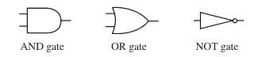

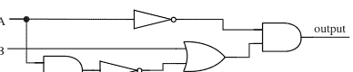

图 1.3：三个基本逻辑门的标准符号，以及一个计算逻辑表达式 \((\neg A) \land (B \lor (\neg A \land C))\) 值的逻辑电路。每个逻辑门的输入线在左侧，输出线在右侧。请注意，在这样的图中，当导线相互交叉时，除非在交叉点有一个黑色圆圈，否则导线并不实际相交。

) 经常被使用，因为它们比与门和或门更容易由晶体管构建。

三种逻辑门都用标准符号表示，如图 1.3 所示。由于逻辑门的输入和输出只是传输开/关信号的导线，因此可以通过将一些门的输出连接到其他门的输入来对逻辑门进行布线。结果就是一个逻辑电路。图 1.3 中也给出了一个示例。

图中的逻辑电路有三个输入，分别标记为 A、B 和 C。该电路计算复合命题 \((\neg A) \land (B \lor (\neg A \land C))\) 的值。也就是说，当 A 表示命题“标记为 A 的输入导线处于开启状态”，B 和 C 类似时，当且仅当复合命题 \((\neg A) \land (B \lor (\neg A \land C))\) 为真时，电路的输出才处于开启状态。

对于由 \(\land\)、\(\lor\) 和 \(\neg\) 运算符构成的任何复合命题，都可以构建一个计算该命题值的逻辑电路。命题本身就是电路的蓝图。如第 1.1 节所述，我们遇到的每个逻辑运算符都可以用 \(\land\)、\(\lor\) 和 \(\neg\) 表示，因此，实际上我们所知道如何编写的每个复合命题都可以由逻辑电路计算。

对于由 \(\land\)、\(\lor\) 和 \(\neg\) 运算符构成的命题，构建电路来计算它很容易。首先，识别命题中的主运算符——即最后计算其值的那个运算符。考虑 \((A \lor B) \land \neg(A \land B)\)。这个电路有两个输入值 \(A\) 和 \(B\)，它们由进入电路的导线表示。电路有一个输出导线，表示命题的计算值。在 \((A \lor B) \land \neg(A \land B)\) 中，主运算符是第一个 \(\land\)，它通过组合子表达式 \(A \lor B\) 和 \(\neg(A \land B)\) 的值来计算整个表达式的值。这个 \(\land\) 运算符对应于电路中的与门，用于计算电路的最终输出。

一旦主运算符被识别并表示为逻辑门，你只需构建电路来计算该子电路的输入或输入。在示例中，主与门的输入来自两个子电路。一个子电路计算 \(A \lor B\) 的值，另一个计算 \(\neg(A \land B)\) 的值。构建每个子电路是一个独立的问题，但比你开始时的问题更小。最终，你会遇到一个门，其输入直接来自某个输入导线——在这里是 \(A\) 或 \(B\)——而不是来自子电路。

因此，每个复合命题都由具有一个输出导线的逻辑电路计算。逆命题成立吗？也就是说，给定一个具有一个输出的逻辑电路，是否存在一个命题来用输入的值表示输出的值？不完全是。当你将一些逻辑门布线在一起构成电路时，没有什么能阻止你引入反馈回路。当一个门的输出——可能通过一个或多个中间门——连接回同一门的输入时，就会发生反馈回路。图 1.5 显示了一个带有反馈回路的电路示例。反馈回路无法用复合命题描述，基本上是因为没有起点，没有可以与命题变量关联的输入。但反馈回路是唯一可能出错的地方。不包含任何反馈回路的逻辑电路称为**组合逻辑电路**。每个只有一个输出的组合逻辑电路都计算某个复合命题的值。复合命题中的命题变量只是与电路输入导线关联的名称。（当然，如果电路有多个输出，你可以简单地为每个输出使用不同的命题。）

理解为什么这是正确的关键在于注意到，电路中的每根导线——而不仅仅是最终输出导线——都表示某个命题的值。此外，一旦你知道门的每个输入导线表示哪个命题，那么输出表示什么命题就显而易见了：你只需根据门的类型，用相应的 \(\land\)、\(\lor\) 或 \(\neg\) 运算符组合输入命题。要找到与最终输出关联的命题，你只需从输入开始，遍历电路，用每个门所表示的命题标记每个门的输出导线。图 1.6 说明了这一过程。

- 1. 我们知道，电路的最终输出由一个与门计算，其输入如图所示。

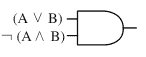

- 2. 这些输入反过来来自一个或门和一个非门，输入如图所示。

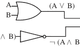

- 3. 通过添加一个与门来计算非门的输入，并将电路输入 A 和 B 连接到相应的门输入，从而完成电路。

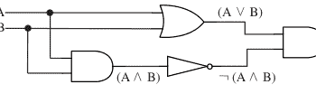

图 1.4：构建计算复合命题 \((A \lor B) \land \neg(A \land B)\) 的电路的各个阶段。

因此，复合命题与组合逻辑电路自然对应。但我们仍未完全解决这些电路和命题究竟有多强大的问题。我们已经研究了许多逻辑运算符，并注意到它们都可以用 \(\land\)、\(\lor\) 和 \(\neg\) 表示。但是，是否存在无法以这种方式表示的其他运算符呢？等价地，是否存在其他类型的逻辑门——可能具有大量输入——其计算无法用与、或、非门复制？任何逻辑运算符或逻辑门都会计算一个

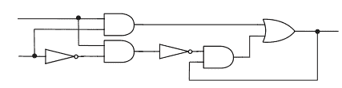

图 1.5：该电路包含一个反馈回路，因此不是组合逻辑电路。反馈回路包括右侧的与门和或门。该电路不计算复合命题的值。然而，该电路在计算机内存中起着重要作用，因为它可以用来存储一个逻辑值。

值，针对其输入的每种可能逻辑值组合。我们总是可以制作一个真值表，显示每种可能输入组合的输出。事实证明，给定任何这样的真值表，都可以找到一个仅包含 \(\land\)、\(\lor\) 和 \(\neg\) 运算符的命题，其对每种输入组合的值正好由该表给出。

为了理解为什么这是正确的，引入一种特定类型的复合命题很有用。定义**简单项**为命题变量或命题变量的否定。然后，简单项的合取将由一个或多个用 \(\land\) 运算符连接的简单项组成。（“一个简单项的合取”本身只是一个单一的简单项。这在语法上可能说不通，但这正是数学家的思维方式。）简单项合取的一些示例是 \(p \land q\)、\(p \land \neg q\) 和 \(p \land \neg r \land w \land s \land t\)。最后，我们可以取一个或多个这样的合取，并将它们连接成“简单项合取的析取”。这就是我们需要的复合命题类型。我们可以通过假设在单个合取中没有命题变量出现超过一次来避免一些冗余（因为 \(p \land p\) 可以替换为 \(p\)，如果 \(p\) 和 \(\neg p\) 都出现在合取中，那么合取的值为假，可以将其消除。）我们还可以假设同一个合取在析取中不出现两次。

### 定义 1.5

如果一个复合命题是简单项合取的析取，并且此外，每个命题变量在每个合取中最多出现一次，每个合取在析取中最多出现一次，则称该复合命题处于**析取范式**，或 DNF。

使用 \(p\)、\(q\)、\(r\)、\(s\)、\(A\) 和 \(B\) 作为命题变量，以下是一些


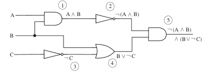

图 1.6：找出由组合逻辑电路计算值的命题。电路中的每根导线都标记有它所代表的命题。标签的编号显示了它们可以与导线关联的顺序之一。整个电路计算 \((\neg(A \land B)) \land (B \lor \neg C)\) 的值。

析取范式命题示例：

\(\begin{aligned} &(p \land q \land r) \lor (p \land \neg q \land r \land s) \lor (\neg p \land \neg q) \\ &(p \land \neg q) \\ &(A \land B) \lor (\neg A \land B) \\ &p \lor (\neg p \land q) \lor (\neg p \land \neg q \land r) \lor (\neg p \land \neg q \land \neg r \land w) \end{aligned}\)

DNF 命题正是我们处理此前讨论过的那类输入/输出表所需要的。任何此类表都可以由析取范式命题来计算。由此可见，可以仅使用 AND、OR 和 NOT 门来构建一个计算该表的电路。

**定理 1.3.** 考虑一个表格，它列出了若干命题变量的每个取值组合对应的逻辑输出值。假设至少有一个输出值为真。那么存在一个包含这些变量的命题，使得该命题对于变量的每个可能取值组合的值，都恰好是表格中指定的值。可以选择该命题为析取范式。

**证明.** 考虑表格中输出值为 T 的任意一行。按以下方式构建简单项的合取：对于该行中值为 T 的每个变量 \(p\)，在合取中包含 \(p\) 本身；对于该行中值为 F 的每个变量 \(q\)，在合取中包含 \(\neg q\)。该合取对于表格该行给出的变量取值组合的值为 T，因为合取中的每个项对于该变量组合都为真。此外，对于变量的任何*其他*可能取值组合，该合取的值将为 F，因为合取中至少有一个简单项为假。

以这种方式为表格中输出值为真的每一行构建的所有此类合取取析取。这个析取的值为 T，当且仅当构成它的合取之一的值为 T——而这正是表格指定的输出值为 T 的时候。因此，这个合取的析取满足定理的要求。

例如，考虑图 1.7 中的表格。该表格为命题变量 p、q 和 r 的每个可能取值组合指定了所需的输出值。查看表格的第二行，其中输出值为真。根据定理的证明，这一行对应于合取 ((p ∧ ¬q) ∧ r)。当 p 为假、q 为假且 r 为真时，该合取为真；在所有其他情况下它都为假。输出为真的其他两行给出了另外两个合取。这三个合取产生了 DNF 命题 ((p ∧ ¬q ∧ r) ∨ (p ∧ q ∧ r) ∨ (p ∧ q ∧ r))。这个命题计算了表格中指定的所有输出值。使用这个命题作为蓝图，我们得到一个逻辑电路，其输出与表格中给出的输出相匹配。

现在，给定任何组合逻辑电路，都有许多其他电路具有相同的输入/输出行为。当两个电路具有相同的输入/输出表时，与这两个电路关联的复合命题在逻辑上等价。换句话说，逻辑上等价的命题产生的电路具有相同的输入/输出行为。从实际角度来看，我们通常会偏好更简单的电路。电路与命题之间的对应关系使我们能够将布尔代数应用于电路的简化。

例如，考虑与图 1.7 中表格对应的 DNF 命题。在 ((p ∧ ¬q ∧ r) ∨ (p ∧ q ∧ r) ∨ (p ∧ q ∧ r)) 中，我们可以从最后两个项中提取公因式 (q ∧ r)，得到 ((p ∧ ¬q ∧ r) ∨ ((p ∨ p) ∧ (q ∧ r)))。由于 ¬p ∨ p ≡ T，且对于任何命题 Q 都有 T ∧ Q ≡ Q，因此可以将其简化为 ((p ∧ ¬q ∧ r) ∨ (q ∧ r))。再次，我们可以对其应用分配律来提取公因式 r，得到 (((p ∧ ¬q) ∨ q) ∧ r)。这个复合命题与我们开始时的命题在逻辑上等价，但在电路中实现它只需要五个逻辑门，而原始命题需要十个。

| p | q | r | 输出 |
|---|---|---|---|
| F | F | F | F |
| F | F | T | T |
| F | T | F | F |
| F | T | T | F |
| T | F | F | T |
| T | F | T | F |
| T | T | F | F |
| T | T | T | T |

图 1.7：一个输入/输出表，为命题变量 p、q 和 r 的每个取值组合指定所需的输出。输出为 T 的每一行都对应一个合取，该合取在表中显示在该行旁边。这些合取的析取是一个命题，其输出值恰好是表中指定的值。

如果你是从电路而不是命题入手，通常可以找到关联的命题，使用布尔代数对其进行简化，并使用简化后的命题构建一个比原始电路更简单的等效电路。

所有这些很好地说明了逻辑与电路之间的关系，但并未解释为什么最初应该在计算机中使用逻辑电路。部分解释在于计算机使用二进制数这一事实。二进制数是由零和一组成的字符串。二进制数在计算机等电子设备中很容易表示：数字中的每个位置对应一根导线。当导线通电时，它表示一；当导线断电时，它表示零。当我们从逻辑角度思考时，导线的相同状态表示真和假，但无论哪种表示都只是对现实的诠释，而现实是一根通电或断电的导线。问题是这种诠释是否有成果。

一旦导线被视为表示零和一，我们就可以构建电路来对二进制数进行计算。哪些计算呢？

sion，但你可以在电路中只需十个门：使用一个 NOT 门来计算 \(\neg p\)，并将该门的输出连接到两个不同的 AND 门。重用逻辑门的输出是简化电路的一种显而易见的方法，它不对应于命题上的任何操作。

| A | B | C | 输出 |
|---|---|---|---|
| 0 | 0 | 0 | 0 |
| 0 | 0 | 1 | 1 |
| 0 | 1 | 0 | 1 |
| 0 | 1 | 1 | 0 |
| 1 | 0 | 0 | 1 |
| 1 | 0 | 1 | 0 |
| 1 | 1 | 0 | 0 |
| 1 | 1 | 1 | 1 |

| A | B | C | 输出 |
|---|---|---|---|
| 0 | 0 | 0 | 0 |
| 0 | 0 | 1 | 0 |
| 0 | 1 | 0 | 0 |
| 0 | 1 | 1 | 1 |
| 1 | 0 | 0 | 0 |
| 1 | 0 | 1 | 1 |
| 1 | 1 | 0 | 1 |
| 1 | 1 | 1 | 1 |

图 1.8：三个二进制数字 A、B 和 C 的加法的输入/输出表。

我们想要的任何计算！如果我们知道每种输入组合的答案应该是什么，那么根据定理 1.3，我们可以构建一个电路来计算该答案。当然，该定理中描述的过程仅对小型电路实用，但小型电路可以作为构建块，用于制造计算机中的所有计算电路。

例如，让我们来看看二进制加法。要相加两个普通的十进制数，你将它们上下对齐，并相加每一列中的数字。每一列中可能还会有来自前一列的进位。要相加一列，你只需要记住少量规则，例如 7 + 6 + 1 = 14 和 3 + 5 + 0 = 8。对于二进制加法，更加简单，因为唯一的数字是 0 和 1。只有八条规则：

- 0 + 0 + 0 = 00
- 0 + 0 + 1 = 01
- 0 + 1 + 0 = 01
- 0 + 1 + 1 = 10
- 1 + 0 + 0 = 01
- 1 + 0 + 1 = 10
- 1 + 1 + 0 = 10
- 1 + 1 + 1 = 11

这里，我使用两位数字写出了每个和。在多列加法中，其中一位数字会进位到下一列。这里，我们有一个有三个输入和两个输出的计算。我们可以为两个输出中的每一个制作一个输入/输出表。这些表在图 1.8 中显示。我们知道这些表可以实现为组合电路，因此我们知道电路可以对二进制数进行加法。要相加多位二进制数，我们只需要为和中的每一列使用一份基本加法电路的副本。


### 练习

- 1. 仅使用AND、OR和NOT门，绘制计算每个命题 \(A \to B\)、\(A \leftrightarrow B\) 和 \(A \oplus B\) 的值的电路。

- 2. 对于以下每个命题，找出计算该命题的组合逻辑电路：
  - a) \(A \land (B \lor \neg C)\)
  - b) \((p \land q) \land \neg(p \land \neg q)\)
  - c) \((p \lor q \lor r) \land (\neg p \lor \neg q \lor \neg r)\)
  - d) \(\neg(A \land (B \lor C)) \lor (B \land \neg A)\)

- 3. 找出以下每个电路所计算的复合命题：

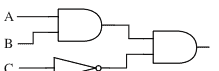

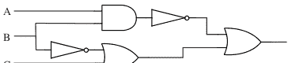

- 4. 本节描述了一种方法，用于找出任何组合逻辑电路所计算的复合命题。如果尝试将此方法应用于包含反馈回路的电路，该方法将失效。哪里出了问题？请举例说明。

- 5. 证明每个不是矛盾命题的复合命题都等价于一个析取范式命题。（注：我们可以通过约定"F"算作析取范式命题来消除复合命题不是矛盾命题的限制。F在逻辑上等价于任何矛盾。）

- 6. 合取范式（CNF）命题是简单项的析取式的合取（与DNF定义类似，单个项目也可视为合取或析取）。证明每个不是重言式的复合命题在逻辑上等价于一个合取范式命题。（提示：如果对DNF命题取否定并应用德摩根定律，会发生什么？）

- 7. 使用布尔代数定律来简化以下每个电路：

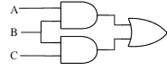

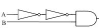

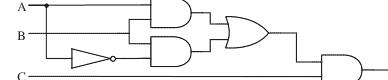

- 8. 设计电路以实现加法的输入/输出表，如图1.8所示。尽量使电路尽可能简单。（实际计算机中为此目的使用的电路比你可能想出的更简化，但使用逻辑设计计算机电路的一般方法是有效的。）

### 1.4 谓词与量词

在命题逻辑中，我们可以让p代表“玫瑰是红色的”，q代表“紫罗兰是蓝色的”。那么p ∧ q将代表“玫瑰是红色的，紫罗兰是蓝色的”。但在翻译成逻辑时，我们损失了很多。由于命题逻辑只处理真值，在命题逻辑中我们对p和q所能做的任何事情都与玫瑰、紫罗兰或颜色无关。要将逻辑应用于此类事物，我们需要谓词。

使用谓词的逻辑称为谓词逻辑，或者，当强调对谓词进行操作和推理时，称为谓词演算。

谓词是一种不完整的命题，当它应用于某个实体（或，如我们稍后将看到，多个实体）时，就成为一个命题。在命题“玫瑰是红色的”中，谓词是“红色”。单独来说，“是红色的”不是一个命题。可以把它看作有一个空槽，需要填充以构成命题：“— 是红色的”。在命题“玫瑰是红色的”中，该槽由实体“玫瑰”填充，但也可以由其他实体填充：“谷仓是红色的”；“酒是红色的”；“香蕉是红色的”。这些命题都使用相同的谓词，但它们是不同的命题，并且可以有不同的真值。

如果P是谓词，a是实体，那么P(a)表示当P应用于a时形成的命题。如果P表示“是红色的”，a代表“玫瑰”，那么P(a)是“玫瑰是红色的”。如果M是谓词“是必死的”，s代表“苏格拉底”，那么M(s)是命题“苏格拉底是必死的”。

现在，你可能会问，究竟什么是*实体*？我在这里使用这个术语来指代某个特定的、可识别的、可以将谓词应用于其上的事物。通常，将给定谓词应用于每个可能的实体是没有意义的，而只应将其应用于某个类别中的实体。例如，将谓词“是必死的”应用于你的客厅沙发可能没有意义。这个谓词仅适用于生物类别中的实体，因为除非某物是活的，否则它不可能是必死的。这个类别称为谓词的论域。

我们现在准备好给一元谓词下正式定义了。一元谓词，像我们迄今看到的所有示例一样，具有一个可以用一个实体填充的槽：

**定义 1.6.** 一个*一元谓词*为某个实体集合中的每个实体分配一个命题。这个集合称为谓词的*论域*。如果$P$是谓词，$a$是$P$的论域中的一个实体，那么$P(a)$表示由$P$与$a$关联的命题。我们说$P(a)$是将$P$应用于$a$的*结果*。

我们显然可以将此扩展到可以应用于两个或多个实体的谓词。在命题“约翰爱玛丽”中，*爱*是一个二元谓词。除了约翰和玛丽，它还可以应用于其他实体对：“约翰爱简”，“比尔爱玛丽”，“约翰爱比尔”，“约翰爱约翰”。如果$Q$是一个二元谓词，那么$Q(a, b)$表示当$Q$应用于实体$a$和$b$时获得的命题。请注意，二元谓词中的每个“槽”都可以有自己的论域。例如，如果$Q$表示谓词“拥有”，那么$Q(a, b)$只有在$a$是人且$b$是无生命物体时才有意义。三元谓词的一个例子是“$a$把$b$给了$c$”，四元谓词则是“$a$花了$d$美元从$c$那里买了$b$”。但请记住，并非每个谓词都必须对应一个英语句子。

当谓词应用于实体时，结果是命题，命题逻辑的所有运算符都可以应用于这些命题，就像应用于任何命题一样。设$R$为谓词“是红色的”，设$L$为二元谓词“爱”。如果$a, b, j, m$是属于适当类别的实体，那么我们可以形成诸如下面的复合命题：

| 命题 | 含义 |
| --- | --- |
| \( R(a) \land R(b) \) | \( a \)是红色的，且\( b \)是红色的 |
| \( \neg R(a) \) | \( a \)不是红色的 |
| \( L(j, m) \land \neg L(m, j) \) | \( j \)爱\( m \)，且\( m \)不爱\( j \) |
| \( L(j, m) \rightarrow L(b, m) \) | 如果\( j \)爱\( m \)，那么\( b \)爱\( m \) |
| \( R(a) \leftrightarrow L(j, j) \) | \( a \)是红色的当且仅当\( j \)爱\( j \) |

让我们回到本节开头的命题：“玫瑰是红色的。”这句话比看起来更难处理。我们仍然无法在逻辑中恰当地表达它。问题在于，这个命题并没有说任何关于某个特定实体的事情。它实际上是说*所有*玫瑰都是红色的（这碰巧是一个错误的陈述，但这就是它的意思）。谓词只能应用于单个实体。

许多其他句子也引发类似的困难：“所有人都是必死的。”“有些玫瑰是红色的，但没有玫瑰是黑色的。”“所有数学课程都很有趣。”“大于二的每个质数都是奇数。”像*所有、没有、有些*和*每个*这样的词称为**量词**。我们需要能够在逻辑中表达类似的概念。

假设\( P \)是一个谓词，我们想要表达这样的命题：\( P \)在应用于论域中的任何实体时都为真。也就是说，我们想要说“对于论域中的任何实体\( x \)，\( P(x) \)为真。”在谓词逻辑中，我们用符号\( \forall x(P(x)) \)来写这个。\( \forall \)符号看起来像一个倒置的A，通常读作“for all”，因此\( \forall x(P(x)) \)读作“对所有\( x \)，\( P(x) \)。”（理解这意味着对于\( P \)的论域中的所有\( x \).）例如，如果\( R \)是谓词“是红色的”，且论域由所有玫瑰组成，那么\( \forall x(R(x)) \)表达了命题“所有玫瑰都是红色的。”请注意，同一个命题也可以用英语表达为“Every rose is red”或“Any rose is red。”

现在，假设我们想要说谓词\( P \)在其论域中的*某个*实体上为真。在谓词逻辑中，这表示为\( \exists x(P(x)) \)。\( \exists \)符号看起来像一个反向的E，通常读作“there exists”，但更准确的读法是“there is at least one”。因此，\( \exists x(P(x)) \)读作“存在一个\( x \)，使得\( P(x) \)”，它的意思是“在\( P \)的论域中至少存在一个\( x \)，使得\( P(x) \)为真。”再次，如果\( R\)代表“是红色的”，且论域是“玫瑰”，那么\( \exists x(R(x)) \)可以用英语表达为“There is a red rose”或“At least one rose is red”或“Some rose is red。”它也可以表达为“Some roses are red”，但复数有点误导，因为\( \exists x(R(x)) \)即使只有一朵红玫瑰也是真的。我们现在可以给出


### 形式定义：

定义 1.7. 假设 P 是一元谓词。那么 ∀x(P(x)) 是一个命题，当且仅当话语域中的每个实体 a 都使 P(a) 为真时，它才为真。而 ∃x(P(x)) 是一个命题，当且仅当话语域中存在至少一个实体 a 使得 P(a) 为真时，它才为真。符号 ∀ 称为全称量词，∃ 称为存在量词。

∀x(P(x)) 和 ∃x(P(x)) 中的 x 是一个变量。（更准确地说，它是实体变量，因为它的值只能是实体。）请注意，没有 ∀x 或 ∃x 的普通 P(x) 不是命题。P(x) 既非真也非假，因为 x 不是某个特定实体，而只是一个可以用实体填充的空位。P(x) 可以表示类似“x 是红色”的陈述，这在英语中根本不算一个陈述。但当 x 被某个特定实体（如“玫瑰”）替换时，它就变成了一个陈述。同样，如果用某个实体 a 替换 x，P(x) 就变成了命题，即 P(a)。10

10 关于名称这里当然存在混淆的余地。在此讨论中，x 是变量，a 是实体。但这只是因为我这么说。任何字母都可以担任这两种角色，你需要根据上下文来判断发生了什么。通常，x、y 和 z 将作为变量。

开放陈述是包含一个或多个实体变量的表达式，当用实体替换变量时，它就变成了命题。（开放陈述有需要填充的“开放空位”。）P(x) 和“x 是红色”是包含一个变量的开放陈述示例。如果 L 是二元谓词，x 和 y 是变量，那么 L(x, y) 是包含两个变量的开放陈述。英语中的示例是“x 爱 y”。开放陈述中的变量称为自由变量。包含 x 作为自由变量的开放陈述可以用 ∀x 或 ∃x 进行量化。此时，变量 x 被称为受约束。例如，x 在 P(x) 中是自由的，在 ∀x(P(x)) 和 ∃x(P(x)) 中是受约束的。L(x, y) 中的自由变量 y 在 ∀y(L(x, y)) 和 ∃y(L(x, y)) 中变为受约束。

请注意，∀y(L(x, y)) 仍然是开放陈述，因为它包含 x 作为自由变量。因此，可以将量词 ∀x 或 ∃x 应用于 ∀y(L(x, y))，得到 ∀x(∀y(L(x, y))) 和 ∃x(∀y(L(x, y)))。由于这些表达式中的所有变量都受约束，它们是命题。如果 L(x, y) 表示“x 爱 y”，那么 ∀y(L(x, y)) 类似于“x 爱每个人”，而 ∃x(∀y(L(x, y))) 是命题“存在某人爱每个人。”当然，我们也可以从 ∃x(L(x, y)) 开始：“存在某人爱 y。”对此应用 ∀y 得到 ∀y(∃x(L(x, y)))，意思是“对于每个人，都存在某人爱那个人。”特别要注意的是，\(\exists x(\forall y(L(x, y)))\) 和 \(\forall y(\exists x(L(x, y)))\) *不* 表示同一件事。总共有八个不同的命题可以通过对 \(L(x, y)\) 应用量词得到，其中有六种不同的含义。

（从现在开始，只要没有歧义，我就省略括号。例如，我将写 \(\forall x P(x)\) 而不是 \(\forall x(P(x))\)，并写 \(\exists x \forall y L(x, y)\) 而不是 \(\exists x(\forall y(L(x, y)))\)。此外，我有时会给谓词和实体起完整单词的名称，而不仅仅是字母，如 \(Red(x)\) 和 \(Loves(john, mary)\)。这可能有助于使示例更易读。）

在谓词逻辑中，布尔代数的运算子和定律仍然适用。例如，如果 \(P\) 和 \(Q\) 是一元谓词，\(a\) 是话语域中的实体，那么 \(P(a) \rightarrow Q(a)\) 是一个命题，并且在逻辑上等价于 \(\neg P(a) \lor Q(a)\)。此外，如果 \(x\) 是变量，那么 \(P(x) \rightarrow Q(x)\) 是一个开放陈述，而 \(\forall x(P(x) \rightarrow Q(x))\) 是一个命题。\(P(a) \land (\exists x Q(x))\) 和 \((\forall x P(x)) \rightarrow (\exists x P(x))\) 也是。显然，谓词逻辑可以非常富有表现力。不幸的是，谓词逻辑与英语句子之间的翻译并不总是显而易见的。

让我们再看一次命题“玫瑰是红色的。”如果话语域由玫瑰组成，这在谓词逻辑中翻译为 \(\forall x Red(x)\)。但是，如果话语域更大——例如包含所有花朵——这句话就更有意义了。那么“玫瑰是红色的”必须读作“所有是玫瑰的花朵都是红色的”，或者“对于任何花朵，如果那朵花是玫瑰，那么它是红色的。”最后一种形式直接翻译为逻辑 \(\forall x(Rose(x) \rightarrow Red(x))\)。假设我们想说所有红玫瑰都漂亮。“红玫瑰”这句话既表示花是玫瑰，也表示它是红色的，必须翻译为合取 \(Rose(x) \land Red(x)\)。因此，“所有红玫瑰都漂亮”可以表述为 \(\forall x((Rose(x) \land Red(x)) \rightarrow Pretty(x))\)。

以下是从谓词逻辑翻译成英语的更多示例。设 \(H(x)\) 表示“\(x\) 很高兴”，设 \(C(y)\) 表示“\(y\) 是计算机”，设 \(O(x, y)\) 表示“\(x\) 拥有 \(y\)。”（\(x\) 的话语域由人组成，\(y\) 的域由无生命物体组成。）那么我们有以下翻译：

- Jack 拥有一台计算机：\(\exists x(O(Jack, x) \land C(x))\)。（也就是说，至少存在一件东西，使得 Jack 拥有那件东西且那件东西是计算机。）
- Jack 拥有的一切都是计算机：\(\forall x(O(Jack, x) \rightarrow C(x))\)。

- 如果 Jack 拥有一台计算机，那么他很高兴：\((\exists y(O(Jack, y) \land C(y))) \to H(Jack)\)。
- 每个拥有计算机的人都很高兴：\(\forall x ((\exists y(O(x, y) \land C(y))) \to H(x))\)。
- 每个人都拥有一台计算机：\(\forall x \exists y(O(x, y))\)。（注意，这允许每个人拥有不同的计算机。命题 \(\exists y \forall x(C(y) \land O(x, y))\) 将意味着存在一台被每个人拥有的单一计算机。）
- 每个人都很高兴：\(\forall x H(x)\)。
- 每个人都不高兴：\(\forall x (\neg H(x))\)。
- 有人不高兴：\(\exists x (\neg H(x))\)。
- 至少有两个人很高兴：\(\exists x \exists y (H(x) \land H(y) \land (x \neq y))\)。（规定 \(x \neq y\) 是必要的，因为两个不同的变量可以指代同一个实体。命题 \(\exists x \exists y (H(x) \land H(y))\) 即使只有一个高兴的人也为真。）
- 恰好有一个高兴的人：\((\exists x H(x)) \land (\forall y \forall z ((H(y) \land H(z)) \to (y = z)))\)。（这个合取的第一部分说至少有一个高兴的人。第二部分说如果 \(y\) 和 \(z\) 都是高兴的人，那么他们实际上是同一个人。也就是说，不可能找到两个*不同*的高兴的人。）

在谓词逻辑中进行计算，我们需要逻辑等价的概念。显然，谓词逻辑中存在意义相同的命题对。考虑命题 \(\neg(\forall x H(x))\) 和 \(\exists x (\neg H(x))\)，其中 \(H(x)\) 表示“\(x\) 很高兴。”第一个命题的意思是“不是每个人都很高兴”，第二个意思是“有人不高兴。”这些陈述具有相同的真值：如果不是每个人都高兴，那么有人不高兴，反之亦然。但逻辑等价远比仅仅具有相同真值要强得多。在命题逻辑中，逻辑等价是通过命题变量定义的：如果两个复合命题对其包含的命题变量的所有可能真值都具有相同的真值，则它们在逻辑上等价。在谓词逻辑中，如果两个公式对所有可能的谓词都具有相同的真值，则它们在逻辑上等价。

考虑 \(\neg(\forall x P(x))\) 和 \(\exists x (\neg P(x))\)。这些公式对任何谓词 \(P\) 都有意义，并且对于任何谓词 \(P\) 它们都具有相同的真值。不幸的是，我们不能——如同在命题逻辑中所做的那样——只检查这个


¬(∀xP(x)) ≡ ∃x(¬P(x))
¬(∃xP(x)) ≡ ∀x(¬P(x))
∀x∀yQ(x, y) ≡ ∀y∀xQ(x, y)
∃x∃yQ(x, y) ≡ ∃y∃xQ(x, y)

图 1.9：谓词逻辑的四条重要规则。P 可以是任何一元谓词，Q 可以是任何二元谓词。前两条规则称为谓词逻辑的德摩根定律。

用真值表来验证这一事实是行不通的，因为没有子命题（通过 ∧、∨ 等连接）可用于构建表格。所以，让我们来推理一下。说 ∀x(P(x)) 为真，就是说并非 P(x) 对所有可能的实体 x 都为真。因此，必定存在某个实体 a，使得 P(a) 为假。既然 P(a) 为假，那么 ¬P(a) 就为真。但说存在某个 a 使得 ¬P(a) 为真，就是说 ∃x(¬P(x)) 为真。所以，¬(∀x(P(x))) 的真蕴含 ∃x(¬P(x)) 的真。另一方面，如果 ¬∀x(P(x)) 为假，那么 ∀xP(x) 为真。由于 P(x) 对每个 x 都为真，¬P(x) 对每个 x 都为假；也就是说，不存在任何实体 a 使得陈述 ¬P(a) 为真。但这仅仅意味着陈述 ∃x(¬P(x)) 为假。在任何情况下，¬(∀x(P(x))) 和 ∃x(¬P(x)) 的真值都是相同的。由于这对任何谓词 P 都成立，我们说这两个公式在逻辑上等价，并写作 ¬(∀xP(x)) ≡ ∃x(¬P(x))。

类似的论证可以表明 ¬(∃xP(x)) ≡ ∀x(¬P(x))。这两个等价式阐明了否定与量化之间的关系，称为谓词逻辑的德摩根定律。（它们与命题逻辑的德摩根定律密切相关；参见练习。）这些定律可用于帮助简化表达式。例如，

```
¬∀y(R(y) ∨ Q(y)) ≡ ∃y(¬(R(y) ∨ Q(y)))
≡ ∃y((¬R(y)) ∧ (¬Q(y)))
```

可能不太清楚这究竟为何算作“简化”，但通常认为将否定算子应用于 R(y) 这样的基本命题，比应用于 \(\forall y(R(y) \lor Q(y))\) 这样的量化表达式更简单。举个更复杂的例子：

\(\neg \exists x(P(x) \land (\forall y(Q(y) \rightarrow Q(x)))))\)
\(\equiv \forall x(\neg(P(x) \land (\forall y(Q(y) \rightarrow Q(x)))))\)
\(\equiv \forall x((\neg P(x)) \lor (\neg(\forall y(Q(y) \rightarrow Q(x)))))\)
\(\equiv \forall x((\neg P(x)) \lor (\exists y(\neg(Q(y) \rightarrow Q(x)))))\)
\(\equiv \forall x((\neg P(x)) \lor (\exists y(\neg(\neg Q(y) \lor Q(x)))))\)
\(\equiv \forall x((\neg P(x)) \lor (\exists y(Q(y) \land \neg Q(x))))\)
\(\equiv \forall x((\neg P(x)) \lor (\exists y(Q(y) \land \neg Q(x))))\)

德摩根定律列于图 1.9 中，与谓词逻辑的另外两条定律一起。这些定律允许你在两个同类型的量词（既都是 \(\exists\) 也都是 \(\forall\)）同时出现时，交换变量的顺序。

要更正式地定义谓词逻辑中的逻辑等价，我们需要讨论包含谓词变量的公式，即那些作为任意谓词占位符的变量，就像命题变量是命题的占位符、实体变量是实体的占位符一样。有了这个概念，我们可以定义谓词逻辑中的逻辑等价及其密切相关的重言式概念。

**Definition 1.8.** 设 P 是包含一个或多个谓词变量的谓词逻辑公式。如果 P 中包含的所有谓词变量都被实际谓词替换后，P 始终为真，则称 P 为 **重言式**。如果 \(P \leftrightarrow Q\) 是一个重言式，即当 P 和 Q 中包含的谓词变量被实际谓词替换后，P 和 Q 始终具有相同的真值，则称两个公式 P 和 Q **逻辑等价**。记号 \(P \equiv Q\) 断言 P 与 Q 在逻辑上等价。

### 练习

- 1. 简化以下每个命题。在你的答案中，\(\neg\) 算子只应应用于单个谓词。
  - a) \(\forall x(P(x))\)
  - b) \(\neg \exists x(P(x) \land Q(x))\)
  - c) \(\forall x(P(x) \rightarrow Q(x))\)
  - d) \(\neg (\forall x(P(x)) \land \forall y(Q(y)))\)
  - e) \(\forall x \exists y(P(x, y))\)
  - f) \(\exists x(R(x) \land \forall y(S(x, y)))\)
  - g) \(\exists y(P(y) \rightarrow Q(y))\)
  - h) \(\neg (\forall x(P(x) \rightarrow \exists y Q(x, y)))\)

- 2. 给出一个仔细的论证，以表明谓词演算中德摩根定律的第二条，\(\neg(\forall x P(x)) \equiv \exists x(\neg P(x))\)，是有效的。

- 3. 求以下每个命题的否定。简化结果；在你的答案中，\(\neg\) 算子只应应用于单个谓词。
  - a) \(\neg \exists y (\forall S(c, s, n))\)
  - b) \(\neg \exists t (\forall S(L(t, n)) \rightarrow P(s)))\)
  - c) \(\neg \exists t (\forall S(L(t, n)) \rightarrow (\exists x \exists y Q(x, y))))\)
  - d) \(\neg \exists t (\forall S(L(t, n)) \rightarrow (\exists x \exists y \exists z ((x = y \land y = z \land R(x, y)) \land T(y) \land U(x, y))))\)

- 4. 假设谓词 \(P\) 的话语域仅包含两个实体。证明 \(\forall x P(x)\) 等价于两个简单命题的合取，而 \(\exists x P(x)\) 等价于一个析取。证明在这种情况下，命题逻辑的德摩根定律和谓词逻辑的德摩根定律实际上说的是完全同一件事。将结果扩展到包含恰好三个实体的话语域。

- 5. 设 \(H(x)\) 表示 “\(x\) 是快乐的”，其中话语域由人组成。用谓词逻辑表达命题 “恰好有三个快乐的人”。

- 6. 设 \(T(x, y)\) 表示 “\(x\) 修读过 \(y\)”，其中 \(x\) 的话语域由学生组成，\(y\) 的话语域由数学课程（在你的学校）组成。将以下每个命题翻译成一句明确的中文句子：
  - a) \(\forall x \exists y T(x, y)\)
  - b) \(\exists y \exists x T(x, y)\)
  - c) \(\forall y \exists x T(x, y)\)
  - d) \(\exists x \forall y T(x, y)\)
  - e) \(\exists y \forall x T(x, y)\)
  - f) \(\forall y \forall x T(x, y)\)

- 7. 设 \(F(x, t)\) 表示 “你在时间 \(t\) 可以愚弄人 \(x\)”。将以下句子翻译成谓词逻辑：“你可以愚弄一些人在所有时间，也可以愚弄所有的人在某些时间，但你不能在所有时间愚弄所有的人。”

- 8. 使用谓词逻辑将以下每个句子翻译成一个命题。自行编造所需的任何谓词。说明每个谓词的含义及其话语域。
  - a) 所有乌鸦都是黑色的。
  - b) 任何白色的鸟都不是乌鸦。
  - c) 并非所有政治家都诚实。
  - d) 所有绿色的大象都有紫色的脚。
  - e) 没有人不喜欢披萨。
  - f) 任何通过期末考试的人都会通过这门课程。
  - g) 如果 \(x\) 是任何正数，那么存在一个数 \(y\)，使得 \(y^2 = x\)。

- 9. 句子 “有人拥有每个问题的答案” 是歧义的。给出这个句子的两个谓词逻辑翻译，并解释意义的差异。

- 10. 句子 “Jane 正在找一条狗” 是歧义的。一种意思是存在某条特定的狗——也许是她丢失的那条——Jane 正在找它。另一种意思是 Jane 正在找任何一条狗——也许是因为她想买一条。用谓词逻辑表达第一种含义。解释为什么第二种含义不能用 \(\forall x (Dog(x) \rightarrow LooksFor(jane, x))\) 来表达。事实上，第二种含义无法在谓词逻辑中表达。语言哲学家花大量时间思考这类问题。他们特别喜欢句子 “Jane 正在找一头独角兽”，这个句子应用于现实世界时并不歧义。为什么？

### 1.5 演绎

逻辑可以应用于从一组前提中得出结论。前提只是一个已知为真或为了论证而被接受为真的命题，结论是一个可以从前提中逻辑推导出的命题。其思想是，如果你相信前提为真，那么逻辑迫使你接受结论为真。“论证”是指某个结论从给定的一组前提中得出的主张。以下是一个按传统格式列出的论证：

- 如果今天是星期二，那么这里是比利时
- 今天是星期二
- . . . 这里是比利时

该论证的前提显示在横线上方，结论显示在下方。符号 . . . 读作 “因此”。主张是，结论 “这里是比利时” 可以从两个前提 “如果今天是星期二，那么这里是比利时” 和 “今天是星期二” 中逻辑推导出来。事实上，这个主张是正确的。逻辑迫使你接受这个论证。为什么？

设 p 代表命题 “今天是星期二”，设 q 代表命题 “这里是比利时”。那么上述论证的形式为

```
p → q
p
. . . q
```

现在，对于任何命题 p 和 q——不仅仅是这个特定论证中的命题——如果 p → q 为真且 p 为真，那么 q 也必须为真。这在真值表中很容易检查：

| p | q | p → q |
|---|---|---|
| 假 | 假 | 真 |
| 假 | 真 | 真 |
| 真 | 假 | 假 |
| 真 | 真 | 真 |

唯一使 p → q 和 p 都为真的情况是表格的最后一行，而在这种情况下，q 也为真。如果你相信 p → q 和 p，你就


除了相信 q 之外别无逻辑选择。这无论 p 和 q 代表什么都适用。例如，如果你相信“如果 Jill 在呼吸，那么 Jill 缴税”，并且你相信“Jill 在呼吸”，逻辑迫使你相信“Jill 缴税”。请注意，我们不能肯定结论为真，只能说如果前提为真，那么结论必须为真。

这一事实可以重新表述为：((p → q) ∧ p) → q 是一个重言式。更一般地说，对于任何复合命题 P 和 Q，说“P → Q 是重言式”就等同于说“在所有 P 为真的情况下，Q 也为真”。11 我们将使用记号 P ⇒ Q 来表示 P ⇒ Q 是重言式。可以将 P 视为论证的前提或若干前提的合取。说 P ⇒ Q 就是说 Q 从 P 逻辑推出。我们将在命题逻辑和谓词逻辑中使用相同的记法。（注意 ⇒ 与 → 的关系与 ≡ 与 ↔ 的关系相同。）

### 定义 1.9. 设 P 和 Q 为命题逻辑或谓词逻辑中的任意公式。记号 P ⇒ Q 用于表示 P → Q 是重言式。也就是说，在所有 P 为真的情况下，Q 也为真。我们可以说 Q 可以从 P 逻辑推出，或 P 逻辑蕴含 Q。

如果结论从前提逻辑推出，则该论证称为有效论证。要检验一个论证是否有效，必须将其中包含的特定命题或谓词替换为变量，然后检验前提的合取是否逻辑蕴含结论。我们已经看到，任何形式为

```
p → q
p
-----
∴ q
```

的论证都是有效的，因为 ((p → q) ∧ p) → q 是重言式。这种推理规则称为肯定前件式（modus ponens）。它在逻辑中起着核心作用。另一种密切相关的规则是否定后件式（modus tollens），适用于形式为

```
p → q
¬q
-----
∴ ¬p
```

的论证。

要验证这是一个有效论证，只需检查 \(((p \to q) \wedge \neg q) \implies \neg p\)，即 \(((p \to q) \wedge \neg q) \to \neg p\) 是重言式。例如，下面的论证采用 *否定后件式* 的形式，因此是一个有效论证：

> 如果 Keanu Reeves 是个好演员，那么我是法国国王
> 我不是法国国王
> ∴ Keanu Reeves 不是个好演员

你应当仔细注意，这个论证的有效性与 Keanu Reeves 演技好坏无关。这个论证迫使你接受结论，*仅当*你接受前提时。只要你相信至少有一个前提为假，你就可以逻辑上相信结论为假。

另一个命名的推理规则是**三段论律**，形式为

```
p → q
q → r
∴ p → r
```

例如：

> 如果你努力学习，你在学校成绩就好
> 如果你在学校成绩好，你就能找到好工作
> ∴ 如果你努力学习，你就能找到好工作

还有许多其他规则。这里列出一些可能有用的规则。其中一些看起来可能很平凡，但不要低估简单规则与其他规则结合时的力量。

| p ∨ q | p | p ∧ q | p |
| --- | --- | --- | --- |
| ¬ p | q | ∴ p | ∴ p ∨ q |
| ∴ q | ∴ p ∧ q | | |

逻辑推理与逻辑等价相关。我们定义 P 和 Q 为逻辑等价，当且仅当 P ↔ Q 是重言式。由于 P ↔ Q 等价于 (P → Q) ∧ (Q → P)，我们看到 P ≡ Q 当且仅当 P ⇒ Q 和 P ⇐ Q 都成立。因此，如果我们能证明两个陈述中的每一个都可以从另一个逻辑推出，就可以证明它们在逻辑上等价。此外，我们还能免费获得大量关于逻辑推理的规则——每知道一个逻辑等价，就能得到两条推理规则。例如，由于 ¬(p ∧ q) ≡ (¬p ∨ ¬q)，我们得到 ¬(p ∧ q) ⇒ (¬p ∨ ¬q)。例如，如果我们知道“不是既晴朗又温暖”，那么我们可以逻辑上推出“要么不晴朗，要么不温暖。”（反之亦然。）

一般来说，论证比我们迄今考虑的要复杂得多。例如，下面是一个有五个前提的论证：

```
(p ∧ r) → s
q → p
t → r
q
t
∴ s
```

这个论证有效吗？当然，你可以使用真值表来检查前提的合取是否逻辑蕴含结论。但是，有五个命题变量时，表格会有 32 行，并且当使用更多命题变量时，表格的大小会迅速增长。因此，一般来说，真值表不实用。

幸运的是，还有另一种方法，基于可以将多个逻辑推理串联在一起这一事实。也就是说，如果 \(p \Rightarrow Q\) 和 \(Q \Rightarrow \mathcal{R}\)，则可推出 \(p \Rightarrow \mathcal{R}\)。这意味着我们可以通过从前提逐步推导结论来证明论证的有效性。这些步骤可以以证明的形式呈现：

### 定义 1.10. 证明论证有效的形式证明由一系列命题组成，其中序列的最后一个命题是论证的结论，序列中的每个命题要么是论证的前提，要么通过逻辑推理从列表中前面的命题推出。

这种证明的存在表明结论从前提逻辑推出，因此该论证有效。下面是证明上述论证有效的形式证明。证明中的命题已编号，每个命题都有理由。

- 1. \(q \to p\) 前提
- 2. \(q\) 前提
- 3. \(p\) 由 1 和 2 得出（肯定前件式）
- 4. \(t \to r\) 前提
- 5. \(t\) 前提
- 6. \(r\) 由 4 和 5 得出（肯定前件式）
- 7. \(p \land r\) 由 3 和 6 得出
- 8. \((p \land r) \to s\) 前提
- 9. \(s\) 由 7 和 8 得出（肯定前件式）

一旦构建出形式证明，它就具有说服力。不幸的是，想出证明未必容易。通常，最好的方法是结合正向推理（“我知道什么，从中能推出什么？”）和逆向推理（“我需要证明什么，哪些其他东西会蕴含它？”）。对于这个证明，我可能会这样想：我想证明 $s$。我知道 $p \wedge r$ 蕴含 $s$，所以如果我能证明 $p \wedge r$，就没问题。但要证明 $p \wedge r$，只需分别证明 $p$ 和 $r$ 就足够了……

当然，并非每个论证都有效，因此也会出现如何证明一个论证无效的问题。假设该论证已采用一般形式，其中所有特定命题都被命题变量取代。如果在所有前提都为真的情况下结论也为真，则该论证有效；如果存在即使所有前提都为真但结论为假的情况，则该论证无效。我们可以通过找到命题变量的真值赋值，使所有前提为真但结论为假，来证明论证无效。例如，考虑形式为

```
p → q
q → (p ∧ r)
r
-----
∴ p
```

的论证：

在 p 为假、q 为假且 r 为真的情况下，该论证的三个前提全为真，但结论为假。这表明该论证无效。

要将所有这些应用于用英语表述的论证，我们必须引入命题变量来表示论证中的所有命题。例如，考虑：

如果 Mary 在场且 Bill 不在场，John 就会参加聚会。如果聚会在周五或周六举行，Mary 就会参加聚会。如果 Bill 参加聚会，Tom 就会在场。如果聚会在周五举行，Tom 就不会在场。聚会在周五举行。因此，John 会参加聚会。

设 j 表示“John 会参加聚会”，m 表示“Mary 会在场”，b 表示“Bill 会在场”，t 表示“Tom 会在场”，f 表示“聚会在周五举行”，s 表示“聚会在周六举行”。那么这个论证的形式为


(m ∧ ¬b) → j
(f ∨ s) → m
b → t
f → ¬t
f
∴ j

这是一个有效的论证，如下面的证明所示：

- 1. f → ¬t 前提
- 2. f 前提
- 3. ¬t 由 1 和 2 得出（肯定前件）
- 4. b → t 前提
- 5. ¬b 由 4 和 3 得出（否定后件）
- 6. f ∨ s 由 2 得出
- 7. (f ∨ s) → m 前提
- 8. m 由 6 和 7 得出（肯定前件）
- 9. m ∧ ¬b 由 8 和 5 得出
- 10. (m ∧ ¬b) → j 前提
- 11. j 由 10 和 9 得出（肯定前件）

到目前为止，在本节中，我们主要使用命题逻辑。但是，有效论证和逻辑演绎的定义同样适用于谓词逻辑。谓词逻辑中最基本的演绎规则之一是：对于谓词 P 的话语域中的任何实体 a，都有 ∀x(P(x) → P(a))。也就是说，如果一个谓词对所有实体都成立，那么它对任何给定的特定实体也成立。这条规则可以与命题逻辑的演绎规则结合，给出以下有效论证

```
∀x(P(x) → Q(x))       ∀x(P(x) → Q(x))
P(a)                   ¬Q(a)
∴ Q(a)                 ∴ ¬P(a)
```

这些有效论证分别被称为谓词逻辑中的 *肯定前件* 和 *否定后件*。注意，从前提 ∀x(P(x) → Q(x)) 我们可以推导出 P(a) → Q(a)。从这个以及 P(a) 的前提，我们可以通过肯定前件推导出 Q(a)。所以上面的第一个论证是有效的。第二个论证类似，使用 *否定后件*。

最著名的逻辑演绎之一是谓词逻辑中 *肯定前件* 的一个应用：

```
All humans are mortal
Socrates is human
∴ Socrates is mortal
```

它的形式是肯定前件，其中 P(x) 代表“x 是人类”，Q(x) 代表“x 是必死的”，a 代表著名的实体苏格拉底。

关于谓词逻辑中的逻辑演绎和证明还有很多可说的，我们将在本章剩余部分讨论这个主题。

### 练习

- 1. 验证否定后件和三段论律的有效性。

- 2. 下面每一个都是一个有效的演绎规则。对于每一个，给出一个使用该规则的英文有效论证示例。

  ```
  p ∨ q       p
  ¬p          ∴ p ∧ q
  ∴ q
  ```

  ```
  p ∧ q       p
  ∴ p         ∴ p ∨ q
  ```

- 3. 有两个臭名昭著的无效论证，它们看起来很像 modus ponens 和 modus tollens：

  ```
  p → q       p → q
  q           ¬p
  ∴ p         ∴ ¬q
  ```

证明每个论证都是无效的。给出一个使用每个论证的英文示例。

- 4. 判断下面每个论证是否有效。如果有效，给出一个形式证明。如果无效，通过为命题变量找到合适的真值赋值来证明它是无效的。

  a) p → q      b) p ∧ q          c) p ∨ q
     q → s      p → (r ∨ s)       q → (r ∧ s)
     ∴ p → s   ∴ s              ∴ s

  d) (¬p) → t   e) p → r          f) q → t
     q → s      s → r             p → (t → s)
     r → q      q ∨ r             p
     ¬(q ∨ t)   q → ¬p            ∴ q → s
     ∴ p       ∴ ¬s

- 5. 对于下面每个英文论证，用命题逻辑表达该论证，并确定该论证是有效还是无效。

  - a) 如果是星期天，就会下雨或下雪。今天是星期天且没有下雨。因此，一定在下雪。
  - b) 如果披萨上有鳀鱼，杰克就不吃它。如果杰克不吃披萨，他就会生气。杰克生气了。因此，披萨上有鳀鱼。
  - c) 8:00 时，简在图书馆学习或在家工作。现在是 8:00，简不在图书馆学习。所以她一定在家工作。

### 1.6 证明

数学之所以独特，在于它声称拥有超越一切可能怀疑或争论的确定性。数学证明展示了某个结果如何仅凭逻辑从一组给定的假设中推导出来，一旦结果被证明，它就如同逻辑的基础一样稳固。当然，数学通过将自身局限于一个人工的数学世界来实现这种确定性，而它在现实世界中的应用并不具有同样的确定性。

在数学世界中，后果以逻辑的力量从假设中推导出来，而证明只是指出逻辑后果的一种方式。关于这一点有一个古老的数学笑话：

有一天，这位数学教授走进教室说：“我们今天从这个结果开始，它是显而易见的，”然后把它写在黑板上。接着，他后退一步，看着黑板好一会儿。他在教室前面走来走去，凝视着虚空，又看向黑板。这样一直持续到下课，他没有说别的话就走了出去。下一节课，教授带着大笑容走进教室，在黑板上写下同样的结果，转向班级说：“我是对的。它是显而易见的。”

当然，数学结果在逻辑上成立并不意味着它们在通常意义上是显而易见的。证明一旦被发现就具有说服力，但找到它们往往非常困难。它们是用一种对未入门的人来说可能晦涩难懂的语言和风格写成的。通常，一个证明建立在一长串定义和先前结果之上，虽然过程中的每一步可能都是“显而易见”的，但最终结果可能令人惊讶且强大。这正是寻找证明值得的原因。

在本章剩余部分，我们将探讨一些可用于证明数学结果的方法和技术，包括两种重要的证明技术：反证法和数学归纳法。在过程中，我们将遇到一些新的定义和符号。希望你能对独立探索数学世界充满更高的信心。

数学世界和现实世界并非总是如此分离。直到十九世纪中叶之前，数学的陈述被视为关于世界的陈述。证明只是一个令人信服的论证，而不是一条由绝对逻辑锻造的链条。它更接近“proof”一词的原始含义，即测试或试验：证明某事就是通过将其置于逻辑论证的考验中来检验其真实性。

麻烦的第一个迟来的信号以 **非欧几里得几何** 的形式出现。两千年来，希腊数学家欧几里得的几何学被简单地接受为世界的几何学。在十九世纪中叶，人们发现还有其他几何系统，它们至少和欧几里得的系统一样有效且自洽。数学家可以在这些系统中的任何一个中工作，但他们不能都声称自己在研究现实世界。

十九世纪末，又一个冲击到来，形式是数学根基的裂缝。当时，数学家戈特洛布·弗雷格正在完成一本关于集合论的书，这代表了他毕生的工作。在弗雷格的集合论中，一个集合可以由任何属性定义。例如，你可以拥有一个集合，包含所有含有三个对象的集合。就在他完成书稿时，弗雷格收到了一位名叫伯特兰·罗素的年轻数学家的来信，信中描述了后来被称为 **罗素悖论** 的内容。罗素指出，所有集合的集合——即包含每个满足“是集合”这一属性的实体的集合——在逻辑上不能存在。我们将在下一章中看到罗素的推理。弗雷格只能在书中加入一个后记，称该工作的基础已被荡然无存。

数学家们通过将现实世界的事实诉求从数学证明中驱逐出来来回应这些问题。数学应当是它自己的世界，建立在其自身安全的基础之上。基础将是一组基本的假设或“公理”，其他一切都将从中通过逻辑推导出来。只需要证明公理本身在逻辑上是自洽且完备的，数学世界就会安全。不幸的是，即使这一点也未能实现。在 1930 年代，库尔特·哥德尔表明，不存在一个一致的、有限的公理集合能完全描述即使是数学世界中被称为算术的那个角落。哥德尔表明，给定任何有限且一致的公理集合，都存在关于算术的真陈述，它们不能从这些公理中逻辑推导出来。

我们留下了一个数学世界，其中坚固的逻辑链条仍然将结论与假设绑定在一起。但这些假设不再根植于


在现实世界中。也不存在任何可以将数学世界其余部分联结在一起的有限公理核心。在这个世界里，公理被设立为虚空中的路标，然后围绕它们构建逻辑结构。例如，我们不谈论描述现实世界的*那个*集合论，而是拥有*一个*基于给定公理集的集合论。该集合论必然是不完备的，并且可能与基于其他公理集的其他集合论不同。

可以理解的是，数学家们对证明的正确性非常讲究。这就是他们构建自己世界的方式。学生有时会反对，说数学家对证明那些“显而易见”的事情过于讲究。但是，某事在现实世界中显而易见这一事实，在数学构建的世界里几乎不算什么。太多显而易见的事情最终被证明是完全错误的。（顺便说一句，即使现实世界中看似“显然”正确的事情，也不一定真的是正确的。例如，考虑量 f(n) = n^2 + n + 41。当 n = 0 时，f(n) = 41 是质数；当 n = 1 时，f(n) = 43 是质数；当 n = 2 时，f(n) = 47 是质数。等你算出 f(3)、f(4)、...、f(10) 并发现它们都是质数时，你可能会得出结论：f(n) 对所有 n >= 0 都是质数是“显而易见”的。但事实并非如此！（参见练习。）同样，棒球爱好者们可能会认为“显而易见”：如果球员 A 对左投手的打击率高于球员 B，且球员 A 对右投手的打击率高于球员 B，那么球员 A 的打击率必然高于球员 B。同样，这也是不正确的！）

正如我们在第 1.5 节中所见，形式证明由一系列语句组成，每个语句要么是假设，要么根据逻辑规则从先前的语句推导而来。该节中的示例都使用了未指定的通用命题（p、q 等）。现在让我们看看如何使用相同的技巧来证明关于数学世界的特定命题。我们将证明：对于所有整数 n，如果 n 是偶数，则 n^2 是偶数。（定义：整数 n 是 *偶数* 当且仅当存在某个整数 k 使得 n = 2k。例如，2 是偶数，因为 2 = 2 · 1；66 是偶数，因为 66 = 2 · 33；0 是偶数，因为 0 = 2 · 0。）

证明。这是形式为 ∀n(P(n) → Q(n)) 的命题，其中 P(n) 是“n 是偶数”，Q(n) 是“n^2 是偶数”。我们需要证明 P(n) → Q(n) 对所有 n 的值都成立。在第 1.5 节的语言中，我们需要证明对于任意 n，P(n) 在逻辑上蕴含 Q(n)；或者，等价地说，Q(n) 可以从 P(n) 在逻辑上推导出来；或者，等价地说，

| n 是偶数 |
|---|
| ∴ n^2 是偶数 |

是一个有效的论证。下面是一个形式证明，证明

\(\frac{n \text{ 是偶数}}{\therefore n^2 \text{ 是偶数}}\)

实际上对于任何 \(n\) 的值都是一个有效的论证：

设 \(n\) 为任意整数。

- 1. \(n\) 是偶数 ... 前提
- 2. 如果 \(n\) 是偶数，则 \(n = 2k\) ... 偶数的定义
- 3. 存在某个整数 \(k\) 使得 \(n = 2k\) ... 由 1, 2（肯定前件）
- 4. 如果存在某个整数 \(k\) 使得 \(n = 2k\)，则对于该整数 \(k\)，\(n^2 = 4k^2\) ... 基本代数
- 5. 存在某个整数 \(k\) 使得 \(n^2 = 4k^2\) ... 由 3, 4（肯定前件）
- 6. 如果存在某个整数 \(k\) 使得 \(n^2 = 4k^2\)，则对于该 \(k\)，\(n^2 = 2(2k^2)\) ... 基本代数
- 7. 存在某个整数 \(k\) 使得 \(n^2 = 2(2k^2) = 2k'\) ... 由 5, 6（肯定前件）
- 8. 如果存在某个整数 \(k\) 使得 \(n^2 = 2(2k^2)\)，则存在某个整数 \(k'\) 使得 \(n^2 = 2k'\) ... 关于整数的基本事实
- 9. 存在某个整数 \(k'\) 使得 \(n^2 = 2k'\) ... 由 7, 8（肯定前件）
- 10. 如果存在某个整数 \(k'\) 使得 \(n^2 = 2k'\)，则 \(n^2\) 是偶数 ... 偶数的定义
- 11. \(n^2\) 是偶数 ... 由 9, 10（肯定前件）

（上文提到的“关于整数的基本事实”是指：整数的乘积仍然是整数。）由于本论证中 \(n\) 可以被替换为任何整数，我们已证明“对于所有整数 n，如果 n 是偶数，则 n^2 是偶数”这一陈述为真。（你可能会担心该论证仅对偶数 n 有效；请参见第 34 页关于基努·里维斯演技的免责声明，或者提醒自己，如果 P(n) 为假，则 \(P(n) \rightarrow Q(n)\) 自动为真。）\(\blacksquare\)

数学证明很少以这种详细和正式的程度呈现。我们命题的一个稍微不那么正式的证明可能会省略显式的蕴含和肯定前件的实例，并如下所示：

证明。设 \(n\) 为任意整数。

- 1. n 是偶数 前提
- 2. 存在某个整数 k 使得 n = 2k 偶数的定义
- 3. 对于该整数 k，n^2 = 4k^2 基本代数
- 4. 对于该 k，n^2 = 2(2k^2) 基本代数
- 5. 存在某个整数 k' 使得 n^2 = 2k' 代入 k' = 2k^2
- 6. n^2 是偶数 偶数的定义

由于 n 是任意整数，该陈述对所有整数都成立。■

更典型的证明会采用上述论证，但以散文形式而非列表形式呈现：

_证明._ 设 _n_ 为任意整数，并假设 _n_ 是偶数。那么根据偶数的定义，存在某个整数 _k_ 使得 _n_ = 2k，且 _n_^2 = 4k^2 = 2(2k^2)。由于整数的乘积是整数，我们有存在某个整数 k' 使得 _n_^2 = 2k'。因此 _n_^2 是偶数。由于 _n_ 是任意整数，该陈述对所有整数都成立。■

通常，在“形式”证明中，给出的正是这种（相对）非正式的讨论，并提供足够的细节来说服读者，可以构建一个完整的形式证明。当然，读者被期望填补多少细节取决于读者本人，阅读证明是一项必须培养和实践的技能。编写证明则更加困难。每个证明都包含一个发现的创造行为，即发现一条从假设到结论的逻辑链条。它还包含一个表达的创造行为，即以清晰且有说服力的方式呈现该逻辑。不存在产生正确、连贯证明的算法。然而，有一些关于发现和编写证明的一般准则。

需要牢记的最重要建议之一是：“使用定义。”在数学世界中，术语的含义正是其定义所指，仅此而已。定义允许将非常复杂的思想概括为单个术语。当你试图证明关于这些术语的事情时，你通常需要“展开”定义。在上面的示例中，我们使用了偶数的定义来写出 _n_ = 2k，然后围绕该方程进行工作。当你在第 2 章中尝试证明关于等价关系的事情时，你可以相当肯定，你需要使用这样一个事实：根据定义，等价关系具有对称性、自反性和传递性。（当然，你首先需要知道“关系”这一术语是如何定义的！如果你从“关系”类似于你姑姑和叔叔的想法出发，你将一事无成。）

沿着同样的思路，更多的建议是检查你是否使用了定理的假设。定理中所做的假设称为**假设**。定理的假设陈述了条件，这些条件的真实性将保证定理的结论。证明定理意味着假设假设为真，并表明在该假设下，结论必须为真。很可能（尽管不保证）你在证明的某个点上需要显式地使用假设，就像我们在上面的示例中所做的那样。$^{12}$ 另外，你应该牢记，任何已经证明过的结果都可以在你的证明中使用。

证明是一种基于逻辑规则的逻辑论证。由于基本逻辑规则实际上并不多，同样的模式会一遍又一遍地出现。让我们来看看其中的一些模式。

最常见的模式出现在试图证明某事对于给定类别中的“所有”或“每个”或“任意”实体都为真的情况。从逻辑上讲，你试图证明的陈述形式为 $\forall x P(x)$。在这种情况下，开始证明的最可能方式是说类似这样的话：“设 $x$ 为话语域中的任意实体。我们要证明 $P(x)\)。”在证明的其余部分，$x\) 指的是话语域中某个未指定但确定的实体。由于 \(x\) 是任意的，证明 \(P(x)\) 等同于证明 \(\forall x P(x)\)。你只需小心，不要使用超出你所假设的关于 \(x\) 的任何事实。例如，在上面的证明中，我们不能对整数 \(n\) 作任何假设，除了它是偶数；如果我们做了这样的假设，那么证明将是不正确的，或者至少是不完整的。

有时，你必须证明存在一个满足某些所述属性的实体。这种证明称为**存在性证明**。在这种情况下，你试图证明形式为 \(\exists x P(x)\) 的陈述。做到这一点的方法是找到一个例子，即找到一个特定的实体 \(a\)，使得 \(P(a)\) 为真。证明陈述“存在一个偶质数”的一种方法是找到一个满足此描述的特定数字。同一陈述也可以表述为“不是每个质数都是奇数。”该陈述的形式为 \((\neg \forall x P(x))\)，它等价于陈述 \(\exists x (\neg P(x))\)。证明陈述 \(\exists x (\neg P(x))\) 的例子也证明了 \((\neg \forall x P(x))\)。这样的例子被称为陈述 \(\forall x P(x)\) 的**反例**：反例证明了陈述“所有质数都是奇数。”在

$^{12}$当然，如果你自己着手发现新定理，你不会预先得到假设和结论，这使得事情要困难得多——也更有趣。


事实上，2 是该陈述的唯一反例；许多陈述都有多个反例。

注意，我们现在已经讨论了如何证明和反驳全称量化陈述，以及如何证明存在量化陈述。你如何*反驳* $\exists x P(x)$？回顾一下，$\neg \exists x P(x)$ 在逻辑上等价于 $\forall x (\neg P(x))$，因此要反驳 $\exists x P(x)$，你需要证明 $\forall x (\neg P(x))$。

许多陈述，如上面示例中的陈述，具有蕴含的逻辑形式，$p \to q$。（更准确地说，它们的形式是“$\forall x (P(x) \to Q(x))$”，但如上面所讨论的，证明此类陈述的策略是针对论域中的任意元素 $x$ 证明 $P(x) \to Q(x)$。）该陈述可能是“对于所有自然数 $n$，如果 $n$ 是偶数，则 $n^2$ 是偶数”，或者“对于所有字符串 $x$，如果 $x$ 在语言 $L$ 中，则 $x$ 由文法 $G$ 生成”，或者“对于所有元素 $s$，如果 $s \in A$ 则 $s \in B$。”有时蕴含是隐含的而不是显式的：例如，“两个有理数之和是有理数”实际上是“对于任何数 $x$ 和 $y$，如果 $x$ 和 $y$ 是有理数，则 $x + y$ 是有理数”的简写。证明此类陈述通常以类似这样的内容开头：“假设 $p$。我们要证明 $q$。”在证明的其余部分，$p$ 被视为已知为真的假设。如上面所讨论的，其背后的逻辑推理是，你本质上是在证明

$$
\frac{p}{\therefore q}
$$

是一个有效的论证。另一种思考方式是记住，当 $p$ 为假时，$p \to q$ 自动为真，因此无需显式处理该情况。在剩余情况下，当 $p$ 为真时，我们可以通过证明 $q$ 的真理性从 $p$ 的真理性推导出来，来表明 $p \to q$ 为真。

形式为 $p \land q$ 的陈述可以通过分别证明 $p$ 和 $q$ 来证明。形式为 $p \lor q$ 的陈述可以通过证明逻辑等价的陈述 $(\neg p) \to q$ 来证明。要证明 $p \lor q$，你可以假设 $p$ 为假，并在该假设下证明 $q$ 为真。例如，陈述“每个整数要么是偶数要么是奇数”等价于陈述“每个不是偶数的整数都是奇数。”

由于 $p \leftrightarrow q$ 等价于 $(p \land q) \lor (\neg p \land \neg q)$，形式为 $p \leftrightarrow q$ 的陈述通常通过给出两个证明来证明，一个证明 $p \to q$，另一个证明 $q \to p$。在英语中，$p \leftrightarrow q$ 可以用多种形式表述，例如“如果 $p$ 则 $q$ 仅当 $q$”、“如果 $p$ 则 $q$ 且反之亦然”以及“$p$ 是 $q$ 的充要条件”。短语“if and only if”在数学中非常常见，因此常被缩写为 *当且仅当*。

你还应该记住，可以通过展示一系列有效的蕴含 \( p \to r \to s \to \cdots \to q \) 来证明 \( p \to q \)。同样，\( p \leftrightarrow q \) 可以通过一系列有效的双条件 \( p \leftrightarrow r \leftrightarrow s \leftrightarrow \cdots \leftrightarrow q \) 来证明。

我们将转到几个示例，但首先是一些我们将在整个示例证明中使用的术语：

- **自然数**（记作 N）是 0、1、2、... 这样的数。注意，自然数的和与积仍是自然数。

- **整数**（记作 Z）是 0、-1、1、-2、2、-3、3、... 这样的数。注意，整数的和、积与差仍是整数。

- **有理数**（记作 Q）是所有可以写成 \(\frac{m}{n}\) 形式的数，其中 m 和 n 是整数且 \(n \neq 0\)。所以 \(\frac{1}{3}\) 和 \(\frac{-7}{65}\) 是有理数；不那么明显的是，6 和 \(\frac{\sqrt{772}}{\sqrt{193}}\) 也是有理数，因为 \(6 = \frac{6}{1}\)（或者，无论如何，\(6 = \frac{-12}{-2}\)），且 \(\frac{\sqrt{772}}{\sqrt{193}} = \sqrt{\frac{772}{193}} = \sqrt{4} = \frac{2}{1}\)。注意分母不能为 0 的限制：\(\frac{3}{0}\) 根本不是一个数，无论是有理数还是其他；它是一个未定义的量。还要注意，有理数的和、积、差和商仍是有理数（前提是你不试图除以 0）。

- **实数**（记作 R）是可以写成小数形式的数，小数点后可能有无限多位数字。注意，实数的和、积、差和商仍是实数（前提是你不试图除以 0）。

- **无理数**是不是有理数的实数，即不能写成整数之比的数。这样的数包括 \(\sqrt{3}\)（我们将证明它不是有理数）和 \(\pi\)（如果有人曾告诉你 \(\pi = \frac{22}{7}$，他们撒了谎——\(\frac{22}{7}$ 只是 \(\pi$ 值的一个*近似*）。

- 整数 \(n\) 能被 \(m\) **整除**当且仅当存在某个整数 \(k\) 使得 \(n = mk$。（也可以说 \(m\) **整除** \(n$。）例如，\(n$ 能被 2 整除当且仅当存在某个整数 \(k$ 使得 \(n = 2k$；\(n$ 能被 3 整除当且仅当存在某个整数 \(k$ 使得 \(n = 3k$，以此类推。注意，如果 \(n$ 不能被 2 整除，则 \(n$ 必须是 2 的倍数加 1，即存在某个整数 \(k$ 使得 \(n = 2k + 1$。同样，如果 \(n$ 不能被 3 整除，则 \(n$ 必须是 3 的倍数加 1 或加 2，即存在某个整数 \(k$ 使得 \(n = 3k + 1$ 或 \(n = 3k + 2$。

- 如果一个整数能被 2 整除，则它是**偶数**；如果不能，则它是**奇数**。

- 一个大于 1 的整数 \(n$ 如果恰好能被两个正整数（即 1 和它本身）整除，则它是**质数**。注意，一个数必须大于 1 才有机会被称为“质数”。特别是，0 和 1 都不是质数。

让我们现在看另一个示例：证明任意两个有理数之和是有理数。

证明。我们首先假设 $x$ 和 $y$ 是任意有理数。以下是对推理规则的正式证明：

```
x is rational
y is rational
-----------
    .: x + y is rational
```

是一个有效的推理规则：

- 1. x 是有理数 前提
- 2. 如果 x 是有理数，则存在某些整数 a 和 b != 0 使得 x = a/b 有理数的定义
- 3. 存在某些整数 a 和 b != 0 使得 x = a/b 来自 1, 2 (肯定前件)
- 4. y 是有理数 前提
- 5. 如果 y 是有理数，则存在某些整数 c 和 d != 0 使得 y = c/d 有理数的定义
- 6. 存在某些 c 和 d != 0 使得 y = c/d 来自 4,5 (肯定前件)
- 7. 存在某些 a 和 b != 0 使得 x = a/b 且存在某些 c 和 d != 0 使得 y = c/d 来自 3,6
- 8. 如果存在某些 a 和 b != 0 使得 x = a/b 且存在某些 c 和 d != 0 使得 y = c/d，则 x + y = (ad+bc)/bd，其中 a,b,c,d 是整数且 b,d != 0 基本代数
- 9. 存在某些 a, b, c, d 使得 x + y = (ad+bc)/bd 且 b,d != 0 来自 7,8 (肯定前件)
- 10. 如果存在某些 a, b, c, d 使得 x + y = (ad+bc)/bd 且 b,d != 0，则 x + y = m/n，其中 m,n 是整数且 n != 0 整数的性质
- 11. 存在某些 m 和 n 使得 x + y = m/n 且 m,n 是整数且 n != 0 来自 9,10 (肯定前件)
- 12. 如果存在某些 m 和 n 使得 x + y = m/n 且 m,n 是整数且 n != 0，则 x + y 是有理数 有理数的定义
- 13. x + y 是有理数 来自 11,12 (肯定前件)

所以上面给出的推理规则是有效的。由于 x 和 y 是任意有理数，我们已经证明该规则对所有有理数都有效，因此任意两个有理数之和是有理数。

同样，一个更非正式的表述如下：

证明。设 x 和 y 为任意有理数。根据有理数的定义，存在整数 a, b != 0, c, d != 0，使得 x = a/b 且 y = c/d。那么 x + y = (ad+bc)/bd，我们知道 ad+bc 和 bd 是整数，因为整数的和与积是整数，而且我们也知道 bd != 0，因为 b 和 d 都不为 0。因此，我们将 x+y 写成了两个整数的比，分母不为零。所以，根据有理数的定义，x + y 是有理数。由于 x 和 y 是任意有理数，任意两个有理数之和是有理数。


### 1.6 证明

再举一个例子：我们将证明任何四位数 $d_1d_2d_3d_4$ 能被 3 整除当且仅当四个数字之和能被 3 整除。

证明。该陈述形式为 $p \leftrightarrow q$；回顾 $p \leftrightarrow q$ 在逻辑上等价于 $(p \to q) \wedge (q \to p)$。因此，我们需要证明对于任意四位数 $d_1d_2d_3d_4$：(1) 如果 $d_1d_2d_3d_4$ 能被 3 整除，则 $d_1+d_2+d_3+d_4$ 能被 3 整除；以及 (2) 如果 $d_1+d_2+d_3+d_4$ 能被 3 整除，则 $d_1d_2d_3d_4$ 能被 3 整除。设 $d_1d_2d_3d_4$ 为任意四位数。

- (1) 假设 $d_1d_2d_3d_4$ 能被 3 整除，即 $d_1d_2d_3d_4 = 3k$，其中 $k$ 为某个整数。数 $d_1d_2d_3d_4$ 实际上是 $d_1 \times 1000 + d_2 \times 100 + d_3 \times 10 + d_4$，因此我们有等式

$$
d_1 \times 1000 + d_2 \times 100 + d_3 \times 10 + d_4 = 3k.
$$

由于 $1000 = 999 + 1$，$100 = 99 + 1$，且 $10 = 9 + 1$，该等式可改写为

$$
999d_1 + d_1 + 99d_2 + d_2 + 9d_3 + d_3 + d_4 = 3k.
$$

移项得

$$
d_1 + d_2 + d_3 + d_4 = 3k - 999d_1 - 99d_2 - 9d_3
= 3k - 3(333d_1) - 3(33d_2) - 3(3d_3).
$$

我们现在可以从右侧提取公因数 3，得到

$$
d_1 + d_2 + d_3 + d_4 = 3(k - 333d_1 - 33d_2 - d_3).
$$

由于 $(k - 333d_1 - 33d_2 - d_3)$ 是整数，我们已证明 $d_1+d_2+d_3+d_4$ 能被 3 整除。

- (2) 假设 $d_1 + d_2 + d_3 + d_4$ 能被 3 整除。考虑数 $d_1d_2d_3d_4$。如上所述，

$$
d_1d_2d_3d_4 = d_1 \times 1000 + d_2 \times 100 + d_3 \times 10 + d_4
$$

所以

$$
d_1d_2d_3d_4 = 999d_1 + d_1 + 99d_2 + d_2 + 9d_3 + d_3 + d_4
= 999d_1 + 99d_2 + 9d_3 + (d_1 + d_2 + d_3 + d_4).
$$

我们假设 $d_1 + d_2 + d_3 + d_4 = 3k$，其中 $k$ 为某个整数，因此可以将其代入上述等式，得到

$$
d_1d_2d_3d_4 = 999d_1 + 99d_2 + 9d_3 + 3k = 3(333d_1 + 33d_2 + 3d_3 + k).
$$

由于括号中的量是整数，我们已证明 \(d_1 d_2 d_3 d_4\) 能被 3 整除。

在上述 (1) 和 (2) 中，数 \(d_1 d_2 d_3 d_4$ 是任意四位整数，因此我们已证明对于所有四位整数，$d_1 d_2 d_3 d_4$ 能被 3 整除当且仅当四个数字之和能被 3 整除。\(\blacksquare\)

现在假设我们想要证明命题“对于所有整数 \(n\)，$n^2$ 是偶数当且仅当 \(n\) 是偶数。”我们已经证明了该命题的一半（“对于所有整数 \(n\)，如果 \(n$ 是偶数，则 $n^2$ 是偶数”），因此我们只需要证明“对于所有整数 \(n\)，如果 $n^2$ 是偶数，则 \(n$ 是偶数”，就完成了。不幸的是，事情并不像看起来那么简单：假设我们按常规方式开始，设 \(n$ 为任意整数，并假设 $n^2 = 2k$，其中 $k$ 为某个整数。那么我们就卡住了！对两边开平方根，左边得到 $n$，但右边会留下 $\sqrt{2k}$。这个量不形式为 $2k'$（对任何整数 $k'$）；将其乘以 $\frac{\sqrt{2}}{\sqrt{2}}$ 会得到 $2\sqrt{\frac{k}{2}}$，但我们无法证明 $\frac{\sqrt{k}}{2}$ 是整数。所以我们走到了死胡同。现在该怎么办？

答案是我们需要一种不同的证明技巧。你迄今所见的证明被称为**直接证明**：要证明 $p \rightarrow q$，你假设 $p$ 为真，并证明 $q$ 的真理性随之而来。有时，当 $p \rightarrow q$ 的直接证明失败时，**间接证明**会奏效。回顾，蕴含式 $p \rightarrow q$ 的*逆否命题*是蕴含式 $\neg q \rightarrow \neg p$，且该命题在逻辑上等价于 $p \rightarrow q$。因此，$p \rightarrow q$ 的间接证明即逆否命题 $\neg q \rightarrow \neg p$ 的直接证明。在当前示例中，我们不直接证明“如果 $n^2$ 是偶数，则 $n$ 是偶数”，而是可以证明其逆否命题“如果 $n$ 不是偶数（即 $n$ 是奇数），则 $n^2$ 不是偶数（即 $n^2$ 是奇数）。”该逆否命题的证明是一个常规的直接论证，我们将其留作练习。

### 练习

- 1. 找出一个自然数 \(n\)，使得 \(n^2 + n + 41\) 不是质数。

- 2. 证明命题 \(p \lor q\) 与 \((\neg p) \rightarrow q\) 在逻辑上等价。

- 3. 证明命题 \((p \lor q) \rightarrow r\) 等价于 \((p \rightarrow r) \land (q \rightarrow r)\)。

- 4. 判断下列每个陈述的真伪。若为真，证明它；若为假，给出反例。

- a) 每个质数都是奇数。

- b) 每个大于 2 的质数都是奇数。

- c) 如果 x 和 y 是整数且 x < y，则存在整数 z 使得 x < z < y。

- d) 如果 x 和 y 是实数且 x < y，则存在实数 z 使得 x < z < y。

- 5. 假设 r、s 和 t 是整数，且 r 整除 s，s 整除 t。证明 r 整除 t。

- 6. 证明对于所有整数 n，如果 n 是奇数，则 n^2 是奇数。

- 7. 证明整数 n 能被 3 整除当且仅当 n^2 能被 3 整除。（提示：对“如果 n^2 能被 3 整除，则 n 能被 3 整除”给出间接证明。）

- 8. 证明或反驳下列每个陈述。

- a) 两个偶数的乘积是偶数。

- b) 两个整数的乘积是偶数，仅当两个整数都是偶数。

- c) 两个有理数的乘积是有理数。

- d) 两个无理数的乘积是无理数。

- e) 对于所有整数 n，如果 n 能被 4 整除，则 n^2 能被 4 整除。

- f) 对于所有整数 n，如果 n^2 能被 4 整除，则 n 能被 4 整除。

### 1.7 反证法

假设我们从一组假设出发，应用逻辑规则推导出一系列可从这些假设证明的陈述，并且假设我们推导出一个已知为假的陈述。当逻辑定律应用于真陈述时，推导出的陈述也将为真。如果我们通过对一组假设应用逻辑规则推导出一个假陈述，那么至少有一个假设必须为假。这一观察引出了一种强大的证明技巧，称为反证法。

假设你想要证明某个命题 p。要应用反证法，假设 ¬p 为真，并应用逻辑规则基于此假设推导结论。如果可以推导出一个已知为假的陈述，则可得出假设 ¬p 必须为假。（当然，如果推导基于多个假设，则你只知道至少有一个假设必须为假。）¬p 为假这一事实证明了 p 为真。本质上，你在论证 p 必须为真，因为如果 p 不为真，那么某个已知为假的陈述就可以被证明为真。一般来说，反证法中推导出的假陈述形式为 q ∧ ¬q。无论 q 取何值，该陈述都是假的，因此它是一种矛盾。请注意，推导出矛盾 q ∧ ¬q 等同于证明两个陈述 q 和 ¬q 都从假设 ¬p 得出。

作为反证法的第一个示例，考虑以下定理：

### 定理 1.4. 数 \(\sqrt{3}\) 是无理数。

证明。为了反证，假设 \(\sqrt{3}\) 是有理数。那么 \(\sqrt{3}$ 可以写成两个整数的比值，\(\sqrt{3} = \frac{m}{n}$，其中 \(m'\) 和 \(n'\) 为某些整数。此外，分数 \(\frac{m'}{n'}$ 可以通过约去 \(m'\) 和 \(n'\) 的所有公因数化为最简形式。因此，\(\sqrt{3} = \frac{m}{n}$，其中 \(m\) 和 \(n$ 为没有公因数的某些整数。对等式两边平方得到 \(3 = \frac{m^2}{n^2}$，移项得 \(3n^2 = m^2$。从这个等式我们看到 \(m^2$ 能被 3 整除；你在上一节（练习 6）中已证明 \(m^2$ 能被 3 整除当且仅当 \(m$ 能被 3 整除。因此 \(m$ 能被 3 整除，我们可以写 \(m = 3k$，其中 \(k$ 为某个整数。将 \(m = 3k$ 代入上述最后一个等式，得到 \(3n^2 = (3k)^2$ 或 \(3n^2 = 9k^2$，进而变为 \(n^2 = 3k^2$。由此我们看到 \(n^2$ 能被 3 整除，同样我们知道这意味着 \(n$ 能被 3 整除。但现在我们有 (i) \(m$ 和 \(n$ 没有公因数，以及 (ii) \(m$ 和 \(n$ 有一个公因数，即 3。这两件事不可能同时为真，然而我们的论证在逻辑上是正确的。因此，我们的原始假设，即 \(\sqrt{3}$ 是有理数，必定不正确。因此 \(\sqrt{3}$ 必定是无理数。

最古老的数学证明之一，可追溯至欧几里得，就是反证法。回顾，质数是大于 1 的整数 \(n$，使得唯一能整除 \(n$ 的正整数是 1 和 \(n$ 本身。我们将证明存在无穷多个质数。在进入定理之前，我们需要一个引理。（**引理**是仅因为在另一个定理的证明中需要而引入的定理。引理有助于将主要定理的证明组织成可管理的部分。）

### 引理 1.5. 如果 \(N\) 是整数且 \(N > 1\)，则存在一个能整除 \(N\) 的质数。

证明。设 \(D$ 为大于 1 且能整除 \(N$ 的最小整数。（\(D$ 存在，因为至少有一个数，即 \(N$ 本身，大于 1 且能整除 \(N$。我们使用了 \(\mathbb{N}$ 的任何非空子集都有最小元这一事实。）我声称 \(D$ 是质数，因此 \(D$ 是能整除 \(N$ 的质数。假设 \(D$ 不是质数。我们将证明这一假设会导致矛盾。由于 \(D$ 不是质数，按定义，存在一个介于 2 和 \(D - 1$ 之间（含）的数 \(k$，使得 \(k$ 能整除 \(D$。但由于 \(D$ 能整除 \(N$，我们也有 \(k$ 能整除 \(N$（根据练习 5


在上一节中）。也就是说，$k$ 是大于一且能整除 $N$ 的整数。但由于 $k$ 小于 $D$，这与 $D$ 是最小的这样的数这一事实相矛盾。这个矛盾证明了 $D$ 是一个质数。

### Theorem 1.6. There are infinitely many prime numbers.

### 定理 1.6. 质数有无穷多个。

**Proof.** Suppose that there are only finitely many prime numbers. We will show that this assumption leads to a contradiction.

**证明。** 假设质数只有有限个。我们将证明这个假设会导致矛盾。

Let $p_1, p_2, \dots p_n$ be a complete list of all prime numbers (which exists under the assumption that there are only finitely many prime numbers).

设 $p_1, p_2, \dots p_n$ 为所有质数的完整列表（在假设质数只有有限个的前提下，该列表存在）。

Consider the number $N$ obtained by multiplying all the prime numbers together and adding one. That is,

考虑将所有质数相乘并加一得到的数 $N$。即，

$N = (p_1 \cdot p_2 \cdot p_3 \cdots p_n) + 1.$

Now, since $N$ is larger than any of the prime numbers $p_1$, and since $p_1, p_2, \dots p_n$ is a complete list of prime numbers, we know that $N$ cannot be prime. By the lemma, there is a prime number $p$ which evenly divides $N$. Now, $p$ must be one of the numbers $p_1, p_2, \dots p_n$. But in fact, none of these numbers evenly divides $N$, since dividing $N$ by any $p_1$ leaves a remainder of 1. This contradiction proves that the assumption that there are only finitely many primes is false.

现在，由于 $N$ 大于任何质数 $p_1$，并且 $p_1, p_2, \dots p_n$ 是质数的完整列表，我们知道 $N$ 不可能是质数。根据引理，存在一个质数 $p$ 能整除 $N$。现在，$p$ 必须是 $p_1, p_2, \dots p_n$ 中的一个数。但实际上，这些数中没有一个能整除 $N$，因为用任何 $p_1$ 去除 $N$ 都会余 1。这个矛盾证明了“质数只有有限个”的假设是错误的。

This proof demonstrates the power of proof by contradiction. The fact that is proved here is not at all obvious, and yet it can be proved in just a few paragraphs.

这个证明展示了反证法的威力。这里证明的事实一点也不明显，然而它却可以在几个段落内被证明。

### Exercises

### 练习

- 1. Suppose that $a_1, a_2, \dots, a_{10}$ are real numbers, and suppose that $a_1 + a_2 + \cdots + a_{10} > 100$. Use a proof by contradiction to conclude that at least one of the numbers $a_i$ must be greater than 10.

- 1. 假设 $a_1, a_2, \dots, a_{10}$ 是实数，且 $a_1 + a_2 + \cdots + a_{10} > 100$。使用反证法得出结论：数 $a_i$ 中至少有一个必须大于 10。

- 2. Prove that each of the following statements is true. In each case, use a proof by contradiction. Remember that the negation of $p \to q$ is $p \wedge \neg q$.

- 2. 证明下列每个陈述都是正确的。在每种情况下，都使用反证法。请记住，$p \to q$ 的否定是 $p \wedge \neg q$。

  - a) Let $n$ be an integer. If $n^2$ is an even integer, then $n$ is an even integer.
  - b) $\sqrt{2}$ is irrational.
  - c) If $r$ is a rational number and $x$ is an irrational number, then $r + x$ is an irrational number. (That is, the sum of a rational number and an irrational number is irrational.)
  - d) If $r$ is a non-zero rational number and $x$ is an irrational number, then $rx$ is an irrational number.
  - e) If $r$ and $r + x$ are both rational, then $x$ is rational.

  - a) 设 $n$ 为整数。如果 $n^2$ 是偶数，则 $n$ 是偶数。
  - b) $\sqrt{2}$ 是无理数。
  - c) 如果 $r$ 是有理数且 $x$ 是无理数，则 $r + x$ 是无理数。（也就是说，有理数与无理数之和是无理数。）
  - d) 如果 $r$ 是非零有理数且 $x$ 是无理数，则 $rx$ 是无理数。
  - e) 如果 $r$ 和 $r + x$ 都是有理数，则 $x$ 是有理数。

- 3. The pigeonhole principle is the following obvious observation: If you have n pigeons in k pigeonholes and if n > k, then there is at least one pigeonhole that contains more than one pigeon. Even though this observation seems obvious, it’s a good idea to prove it. Prove the pigeonhole principle using proof by contradiction.

- 3. 鸽巢原理是以下显而易见的观察：如果你有 n 只鸽子和 k 个鸽巢，且 n > k，那么至少有一个鸽巢包含多于一只鸽子。尽管这个观察似乎显而易见，但证明它是个好主意。使用反证法证明鸽巢原理。

### 1.8 Mathematical Induction

### 1.8 数学归纳法

The structure of the natural numbers—0, 1, 2, 3, and on to infinity—makes possible a powerful proof technique known as induction or mathematical induction. The idea behind induction is simple. Let P be a one-place predicate whose domain of discourse includes the natural numbers. Suppose that we can prove that P(0) is true. Suppose that we can also prove the statements P(0) → P(1), P(1) → P(2), P(2) → P(3), and so on. The principle of mathematical induction is the observation that we can then conclude that P(n) is true for all natural numbers n. This should be clear. Since P(0) and P(0) → P(1) are true, we can apply the rule of modus ponens to conclude that P(1) is true. Then, since P(1) and P(1) → P(2) are true, we can conclude by modus ponens that P(2) is true. From P(2) and P(2) → P(3), we conclude that P(3) is true. For any given n in the set N, we can continue this chain of deduction for n steps to prove that P(n) is true.

自然数的结构——0, 1, 2, 3，一直到无穷——使得一种称为归纳法或数学归纳法的强大证明技术成为可能。归纳法背后的想法很简单。设 P 为一个一元谓词，其论域包含自然数。假设我们可以证明 P(0) 为真。假设我们还可以证明陈述 P(0) → P(1)、P(1) → P(2)、P(2) → P(3) 等等。数学归纳法原理的观察是，我们可以随后得出结论：对于所有自然数 n，P(n) 都为真。这应该是清楚的。由于 P(0) 和 P(0) → P(1) 都为真，我们可以应用肯定前件规则来得出 P(1) 为真的结论。然后，由于 P(1) 和 P(1) → P(2) 都为真，我们可以通过肯定前件得出 P(2) 为真的结论。从 P(2) 和 P(2) → P(3)，我们得出 P(3) 为真的结论。对于集合 N 中的任何给定 n，我们可以继续这个推导链 n 步来证明 P(n) 为真。

When applying induction, we don’t actually prove each of the implications P(0) → P(1), P(1) → P(2), and so on, individually. That would require an infinite amount of work. The whole point of induction is to avoid any infinitely long process. Instead, we prove ∀k(P(k) → P(k + 1)) (where the domain of discourse for the predicate P is N). The statement ∀k(P(k) → P(k + 1)) summarizes all the infinitely many implications in a single statement. Stated formally, the principle of mathematical induction says that if we can state the statement P(0) ∧ (∀k(P(k) → P(k + 1))), then we can deduce that ∀nP(n) (again, with N as the domain of discourse).

在应用归纳法时，我们并不实际单独证明每个蕴含式 P(0) → P(1)、P(1) → P(2) 等等。那将需要无限量的工作。归纳法的整个要点是避免任何无限长的过程。相反，我们证明 ∀k(P(k) → P(k + 1))（其中谓词 P 的论域为 N）。陈述 ∀k(P(k) → P(k + 1)) 将所有无限多个蕴含式概括在一个陈述中。正式地说，数学归纳法原理指出，如果我们可以陈述 P(0) ∧ (∀k(P(k) → P(k + 1)))，那么我们可以推导出 ∀nP(n)（同样，以 N 为论域）。

It can be intuitively clear that the principle of induction is valid. It follows from the fact that the list 0, 1, 2, 3, ..., if extended long enough, will eventually include any given natural number. If we start from P(0) and take enough steps of the form P(k) → P(k + 1), we can get P(n) for any given natural number n. However, whenever we deal with infinity, we are courting the possibility of paradox. We will prove the principle of induction rigorously in the next chapter (see Theorem 2.3), but for now we just state it as a theorem:

归纳法原理的有效性可以直观地清楚。这源于这样一个事实：列表 0, 1, 2, 3, ...，如果延长得足够长，最终将包含任何给定的自然数。如果我们从 P(0) 开始，并采取足够多的 P(k) → P(k + 1) 形式的步骤，我们可以得到任何给定自然数 n 的 P(n)。然而，每当我们处理无穷时，我们都在冒悖论的风险。我们将在下一章严格证明归纳法原理（参见定理 2.3），但目前我们只是将其作为一个定理陈述：

### Theorem 1.7. Let P be a one-place predicate whose domain of discourse includes the natural numbers. Suppose that $P(0) \land (\forall k \in \mathbb{N}(P(k) \to P(k + 1)))$. Then $P(n)$ is true for all natural numbers $n$. (That is, the statement $\forall n P(n)$ is true, where the domain of discourse for $P$ is the set of natural numbers.)

### 定理 1.7. 设 P 为一个一元谓词，其论域包含自然数。假设 $P(0) \land (\forall k \in \mathbb{N}(P(k) \to P(k + 1)))$。那么对于所有自然数 $n$，$P(n)$ 都为真。（也就是说，陈述 $\forall n P(n)$ 为真，其中 P 的论域为自然数集。）

Mathematical induction can be applied in many situations: you can prove things about strings of characters by doing induction on the length of the string, things about graphs by doing induction on the number of nodes in the graph, things about grammars by doing induction on the number of productions in the grammar, and so on. We'll be looking at applications of induction for the rest of this chapter, and throughout the remainder of the text. Although proofs by induction can be very different from one another, they all follow just a few basic structures. A proof based on the preceding theorem always has two parts. First, $P(0)$ is proved. This is called the **base case** of the induction. Then the statement $\forall k(P(k) \to P(k + 1))$ is proved. This statement can be proved by letting $k$ be an arbitrary element of $\mathbb{N}$ and proving $P(k) \to P(k + 1)$. This in turn can be proved by assuming that $P(k)$ is true and proving that the truth of $P(k + 1)$ follows from that assumption. This case is called the **inductive case**, and $P(k)$ is called the **inductive hypothesis** or the **induction hypothesis**. Note that the base case is just as important as the inductive case. By itself, the truth of the statement $\forall k(P(k) \to P(k + 1))$ says nothing at all about the truth of any of the individual statements $P(n)$. The chain of implications $P(0) \to P(1)$, $P(1) \to P(2)$, ..., $P(n - 1) \to P(n)$ says nothing about $P(n)$ unless the chain is anchored at the other end by the truth of $P(0)$. Let's look at a few examples.

数学归纳法可以应用于许多情况：你可以通过对字符串长度进行归纳来证明关于字符串的事情，通过对图中节点数进行归纳来证明关于图的事情，通过对文法中产生式数量进行归纳来证明关于文法的事情，等等。我们将在本章剩余部分以及全文余下部分探讨归纳法的应用。尽管归纳证明彼此可能大不相同，但它们都遵循仅几种基本结构。基于前面定理的证明始终有两部分。首先，证明 $P(0)$。这称为归纳的**基础情形**。然后，证明陈述 $\forall k(P(k) \to P(k + 1))$。这个陈述可以通过令 $k$ 为 $\mathbb{N}$ 的任意元素并证明 $P(k) \to P(k + 1)$ 来证明。这反过来可以通过假设 $P(k)$ 为真并证明 $P(k + 1)$ 的真理性从该假设得出来说明。这种情况称为**归纳情形**，$P(k)$ 被称为**归纳假设**或**归纳假设**。请注意，基础情形与归纳情形同样重要。单凭陈述 $\forall k(P(k) \to P(k + 1))$ 的真理性，对任何单独陈述 $P(n)$ 的真理性都毫无说明。蕴含式链 $P(0) \to P(1)$、$P(1) \to P(2)$、...、$P(n - 1) \to P(n)$ 对 $P(n)$ 什么都不说，除非该链在另一端由 $P(0)$ 的真理性锚定。让我们看几个例子。

### Theorem 1.8. The number $2^{2n} - 1$ is divisible by $3$ for all natural numbers $n$.

### 定理 1.8. 对于所有自然数 $n$，数 $2^{2n} - 1$ 都能被 3 整除。

**Proof.** Here, $P(n)$ is the statement that $2^{2n} - 1$ is divisible by $3$.

**证明。** 这里，$P(n)$ 是陈述“$2^{2n} - 1$ 能被 3 整除”。

Base case: When $n = 0$, $2^{2n} - 1 = 2^0 - 1 = 1 - 1 = 0$ and $0$ is divisible by $3$ (since $0 = 3 \cdot 0$). Therefore the statement holds when $n = 0$.

基础情形：当 $n = 0$ 时，$2^{2n} - 1 = 2^0 - 1 = 1 - 1 = 0$，且 0 能被 3 整除（因为 $0 = 3 \cdot 0$）。因此，当 $n = 0$ 时，该陈述成立。

Inductive case. We want to show that if the statement is true for $n = k$ (where $k$ is an arbitrary natural number), then it is true for $n = k + 1$ also. That is, we must prove the implication $P(k) \to P(k + 1)$. So we assume $P(k)$, that is, we assume that $2^{2k}$ is divisible by $3$. This means that $2^{2k} - 1 = 3m$ for some integer $m$. We want to prove $P(k + 1)$, that is, that

归纳情形。我们想证明，如果该陈述对 $n = k$ 成立（其中 $k$ 是任意自然数），那么它对 $n = k + 1$ 也成立。也就是说，我们必须证明蕴含式 $P(k) \to P(k + 1)$。因此，我们假设 $P(k)$，即假设 $2^{2k}$ 能被 3 整除。这意味着对于某个整数 $m$，有 $2^{2k} - 1 = 3m$。我们想证明 $P(k + 1)$，即

```
$2^{2(k+1)} - 1$ is also divisible by 3:

\( 2^{2(k+1)} - 1 = 2^{2k+2} - 1 \) \quad properties of exponents
\( = 2^{2k} \cdot 2^2 - 1 \)
\( = 4 \cdot 2^{2k} - 1 \) \quad algebra
\( = 4 \cdot 2^{2k} - 4 + 4 - 1 \)
\( = 4(2^{2k} - 1) + 3 \) \quad algebra
\( = 4(3m) + 3 \) \quad the inductive hypothesis
\( = 3(4m + 1) \) \quad algebra
```

and from the last line we see that \( 2^{2(k+1)} - 1 \) is in fact divisible by 3. (The third step—subtracting and adding 4—was done to enable us to use our inductive hypothesis.)

并且从最后一行我们可以看出，$2^{2(k+1)} - 1$ 实际上能被 3 整除。（第三步——减去并加上 4——是为了使我们能够使用归纳假设。）

Altogether, we have proved that P(0) holds and that, for all k, P(k) \(\rightarrow\) P(k + 1) is true. Therefore, by the principle of induction, P(n) is true for all n in N, i.e. \( 2^{2n} - 1 \) is divisible by 3 for all n in N. \(\blacksquare\)

总而言之，我们已经证明 P(0) 成立，且对于所有 k，P(k) → P(k + 1) 为真。因此，根据归纳法原理，对于 N 中的所有 n，P(n) 都为真，即对于 N 中的所有 n，$2^{2n} - 1$ 都能被 3 整除。\(\blacksquare\)

The principle of mathematical induction gives a method for proving P(n) for all n in the set N. It should be clear that if M is any natural number, a similar method can be used to show that P(n) is true for all natural numbers n that satisfy n \(\ge\) M. Just start the induction with a base case of n = M instead of with a base case of n = 0. I leave the proof of this extension of the principle of induction as an exercise. We can use the extended principle of induction to prove a result that was first mentioned in Section 1.1.

数学归纳法原理为在集合 N 中对所有 n 证明 P(n) 提供了一种方法。很明显，如果 M 是任何自然数，可以使用类似的方法来证明 P(n) 对于所有满足 n ≥ M 的自然数 n 都为真。只需将归纳的基础情形从 n = 0 改为 n = M 即可。我将归纳法原理这一扩展的证明留作练习。我们可以使用扩展的归纳法原理来证明一个最初在第 1.1 节中提到的结果。

### Theorem 1.9. Suppose that a compound proposition contains exactly n propositional variables, where n \(\ge\) 1. Then there are exactly 2\(^n\) different ways of assigning truth values to the n variables.

### 定理 1.9. 假设一个复合命题恰好包含 n 个命题变量，其中 n ≥ 1。那么恰好有 2\(^n\) 种不同的方法为这 n 个变量赋予真值。

**Proof.** Let P(n) be the statement “There are exactly 2\(^n\) different ways of assigning truth values to n propositional variables.” We will use induction to prove the P(n) is true for all n \(\ge\) 1.

**证明。** 设 P(n) 为陈述“存在恰好 2\(^n\) 种不同的方法为 n 个命题变量赋予真值”。我们将使用归纳法来证明对于所有 n ≥ 1，P(n) 都为真。

Base case: First, we prove the statement P(1). If there is exactly one variable, then there are exactly two ways of assigning a truth value to that variable. Namely, the variable can be either true or false. Since 2 = 2\(^1\), P(1) is true.

基础情形：首先，我们证明陈述 P(1)。如果恰好有一个变量，那么为该变量赋予真值恰好有两种方法。即，该变量可以是真或假。由于 2 = 2\(^1\)，P(1) 为真。

Inductive case: Suppose that P(k) is already known to be true. We want to prove that, under this assumption, P(k + 1) is also true. Suppose that p\(_1\), p\(_2\), ..., p\(_{k+1}\) are k + 1 propositional variables. Since we are assuming

归纳情形：假设 P(k) 已知为真。我们想证明，在此假设下，P(k + 1) 也为真。假设 p\(_1\), p\(_2\), ..., p\(_{k+1}\) 是 k + 1 个命题变量。由于我们假设


假设 \( P(k) \) 为真，我们知道有 \( 2^k \) 种为 \( p_1, p_2, \dots, p_k \) 赋予真值的方式。但为 \( p_1, p_2, \dots, p_k \) 赋予真值的每种方式都可以以两种方式扩展到完整列表 \( p_1, p_2, \dots, p_k, p_{k+1} \)。也就是说，\( p_{k+1} \) 可以被赋予真值或假值。由此可见，有 \( 2 \cdot 2^k \) 种为 \( p_1, p_2, \dots, p_{k+1} \) 赋予真值的方式。因为 \( 2 \cdot 2^k = 2^{k+1} \)，这完成了证明。

任意数量项的和使用符号 \( \sum \) 表示。（这个符号是希腊字母西格玛，相当于拉丁字母 S，代表“求和”。）因此，我们有

\(\sum_{i=1}^5 i^2 = 1^2 + 2^2 + 3^2 + 4^2 + 5^2\)

\(\sum_{k=3}^7 a_k = a_3 + a_4 + a_5 + a_6 + a_7\)

\(\sum_{n=0}^N \frac{1}{n+1} = \frac{1}{0+1} + \frac{1}{1+1} + \frac{1}{2+1} + \dots + \frac{1}{N+1}\)

使用 \( \sum \) 算子的这种求和记号称为 **求和记号**。乘积的类似记号使用符号 \( \prod \)。（这是希腊字母派，相当于拉丁字母 P，代表“乘积。”）例如，

\(\prod_{k=2}^5 (3k+2) = (3 \cdot 2 + 2)(3 \cdot 3 + 2)(3 \cdot 4 + 2)(3 \cdot 5 + 2)\)

\(\prod_{i=1}^n \frac{1}{i} = \frac{1}{1} \cdot \frac{1}{2} \dots \frac{1}{n}\)

归纳法可用于证明许多使用这些记号的公式。以下是两个例子：

### 定理 1.10. 对于任何大于零的整数 \( n \)，\(\sum_{i=1}^n i = \frac{n(n+1)}{2}\)。

_证明._ 设 \( P(n) \) 为陈述 \(\sum_{i=1}^n i = \frac{n(n+1)}{2}\)。我们使用归纳法来证明 \( P(n) \) 对所有 \( n \ge 1 \) 都为真。

基例：考虑 \(n=1\) 的情况。\(P(1)\) 是陈述 \(\sum_{i=1}^1 i = \frac{1(1+1)}{2}\)。因为 \(\sum_{i=1}^1 i = 1\) 且 \(\frac{1(1+1)}{2} = 1\)，所以 \(P(1)\) 为真。

归纳步骤：设 \(k > 1\) 为任意值，并假设 \(P(k)\) 为真。我们要证明 \(P(k+1)\) 为真。\(P(k+1)\) 是陈述 \(\sum_{i=1}^{k+1} i = \frac{(k+1)(k+2)}{2}\)。但是

```
\sum_{i=1}^{k+1} i = \left( \sum_{i=1}^k i \right) + (k+1)
= \frac{k(k+1)}{2} + (k+1) \quad \text{(inductive hypothesis)}
= \frac{k(k+1) + 2(k+1)}{2}
= \frac{(k+2)(k+1)}{2}
= \frac{(k+1)(k+2)}{2}
```

这正是我们要证明的。这个计算完成了归纳。

### 定理 1.11. 对于任何自然数 \(n > 0\)，\(\sum_{i=1}^n i 2^{i-1} = (n-1) \cdot 2^n + 1\)。

证明. 设 \(P(n)\) 为陈述 \(\sum_{i=1}^n i 2^{i-1} = (n-1) \cdot 2^n + 1\)。我们使用归纳法来证明 \(P(n)\) 对所有 \(n > 0\) 都为真

基例：考虑 \(n=1\) 的情况。\(P(1)\) 是陈述 \(\sum_{i=1}^1 i 2^{i-1} = (1-1) \cdot 2^1 + 1\)。因为等式两边都等于 1，所以这是真的。

归纳步骤：设 \(k > 1\) 为任意值，并假设 \(P(k)\) 为真。

我们要证明 \(P(k+1)\) 为真。\(P(k+1)\) 是陈述 \(\sum_{i=1}^{k+1} i2^{i-1} = ((k+1)-1) \cdot 2^{k+1} + 1\)。但是，我们可以计算得出

```
\sum_{i=1}^{k+1} i2^{i-1} = \left(\sum_{i=1}^k i2^{i-1}\right) + (k+1)2^{(k+1)-1}
= ((k-1) \cdot 2^k + 1) + (k+1)2^k \quad \text{(inductive hypothesis)}
= ((k-1) + (k+1))2^k + 1
= (k \cdot 2) \cdot 2^k + 1
= k2^{k+1} + 1
```

这正是我们要证明的。这完成了归纳。

例如，这些定理表明 \(\sum_{i=1}^{100} i = 1+2+3+4+\cdots+100 = \frac{100(100+1)}{2} = 5050\)，以及 \(1 \cdot 2^0 + 2 \cdot 2^1 + 3 \cdot 2^2 + 4 \cdot 2^3 + 5 \cdot 2^4 = (5-1)2^5 + 1 = 129\)，还有无限多个其他此类和。

数学归纳法原理有第二种形式，在某些情况下很有用。要应用第一种归纳形式，我们假设任意自然数 \(k\) 的 \(P(k)\) 成立，并证明 \(P(k+1)\) 从该假设推出。在第二种归纳形式中，假设是 \(P(x)\) 对 \(0\) 到 \(k\) 之间的所有 \(x\)（包含 \(0\) 和 \(k\)）都成立，并证明 \(P(k+1)\) 从中推出。这在推导 \(P(k+1)\) 时给了我们更多可利用的条件。我们将在接下来的两个部分需要这种第二种归纳形式。证明将在下一章给出。

### 定理 1.12.

设 \(P\) 为一元谓词，其论域包含自然数。假设 \(P(0)\) 为真，并且

```
(P(0) \land P(1) \land \cdots \land P(k)) \to P(k+1)
```

对每个自然数 \(k \ge 0\) 都为真。那么 \(P(n)\) 对每个自然数 \(n\) 都为真。

例如，我们可以使用这个定理来证明每个大于 1 的整数都可以写成质数的乘积（其中本身是质数的数被视为一个质数的乘积）：证明说明了应用这个定理的一个重要点：

在证明 \(P(k+1)\) 时，你不一定要使用 \(P(0)\)、\(P(1)\)、...、\(P(k)\) 为真的假设。如果 \(P(k+1)\) 是通过 *任何方式* 证明的——可能包括这些假设——那么陈述 \((P(0) \wedge P(1) \wedge \cdots \wedge P(k)) \rightarrow P(k+1)\) 已被证明为真。从这一观察可以看出，不止零，还有几个数字可以作为“基例”，因为 \(P(x+1)\) 可以独立于 \(P(0)\) 到 \(P(x)\) 来证明。从这个意义上说，0、1 和每个质数都是下一个定理中的基例。

### 定理 1.13. *每个大于 1 的自然数都可以写成质数的乘积。*

**证明.** 设 \(P(n)\) 为陈述“如果 \(n > 1\)，那么 \(n\) 可以写成质数的乘积。”我们将通过应用归纳法原理的第二种形式来证明 \(P(n)\) 对所有 \(n\) 都为真。注意 \(P(0)\) 和 \(P(1)\) 都自动为真，因为 \(n=0\) 和 \(n=1\) 不满足 \(n > 1\) 的条件，而 \(P(2)\) 为真，因为 2 是单个质数 2 的乘积。假设 \(k\) 是大于 1 的任意自然数，并且假设 \(P(0)\)、\(P(1)\)、...、\(P(k)\) 已知为真；我们要证明 \(P(k+1)\) 为真。在 \(k+1\) 是质数的情况下，\(k+1\) 是一个质数的乘积，所以 \(P(k+1)\) 为真。考虑 \(k+1\) 不是质数的情况。那么，根据质数的定义，可以写成 \(k+1 = ab\)，其中 \(a\) 和 \(b\) 是 2 到 \(k\) 之间（包含 2 和 \(k\)）的数。由于 \(P(0)\) 到 \(P(k)\) 已知为真，\(a\) 和 \(b\) 都可以写成质数的乘积。由于 \(k+1 = ab\)，\(k+1\) 也可以写成质数的乘积。我们已经证明 \(P(k+1)\) 从 \(P(0) \wedge P(1) \wedge \cdots \wedge P(k)\) 推出，这完成了归纳。

### 练习

- 1. 使用归纳法证明对于所有自然数 \(n\)，\(n^3 + 3n^2 + 2n\) 都能被 3 整除。

- 2. 使用归纳法证明对于任何自然数 \(n\) 和任何实数 \(r\)（其中 \(r \neq 1\)），
\[
\sum_{i=0}^n r^i = \frac{1-r^{n+1}}{1-r}
\]

- 3. 使用归纳法证明对于任何自然数 \(n\)，
\[
\sum_{i=0}^n \frac{1}{2^i} = 2 - \frac{1}{2^n}
\]
除了通过归纳法证明外，还要表明它作为练习 2 的推论成立。

- 4. 使用归纳法证明对于任何自然数 \( n \)，
\[
\sum_{i=0}^n 2^i = 2^{n+1} - 1
\]
除了通过归纳法证明外，还要表明它作为练习 2 的推论成立。

- 5. 使用归纳法证明对于任何正整数 \( n \)，
\[
\sum_{i=1}^n i^2 = \frac{n(n+1)(2n+1)}{6}
\]

- 6. 使用归纳法证明对于任何正整数 \( n \)，
\[
\sum_{i=1}^n (2i - 1) = n^2
\]

- 7. 使用本节和之前练习中证明的结果，计算以下求和：
  - a) \( 1 + 3 + 5 + 7 + 9 + 11 + 13 + 15 + 17 + 19 \)
  - b) \( 1 + 3 + \frac{3^2}{2} + \frac{3^3}{3} + \frac{3^4}{4} + \frac{3^5}{5} + \frac{3^6}{6} \)
  - c) \( 50 + 51 + 52 + 53 + \dots + 99 + 100 \)
  - d) \( 1 + \frac{4}{1} + \frac{9}{2} + \frac{16}{3} + \dots + \frac{49}{6} + \frac{64}{7} + \frac{81}{8} + \frac{100}{9} \)
  - e) \( \frac{1}{2^2} + \frac{1}{3^2} + \dots + \frac{1}{99^2} \)

- 8. 使用求和记号写出前一题中的求和。

- 9. 不使用求和记号重写定理 1.10 和定理 1.11 的证明。

- 10. 使用归纳法证明命题逻辑的以下广义分配律：对于任何自然数 \( n > 1 \) 和任何命题 \( q, p_1, p_2, \dots, p_n \)，
  - a) \( q \lor (p_1 \land p_2 \land \dots \land p_n) = (q \lor p_1) \land (q \lor p_2) \land \dots \land (q \lor p_n) \)
  - b) \( q \land (p_1 \lor p_2 \lor \dots \lor p_n) = (q \land p_1) \lor (q \land p_2) \lor \dots \lor (q \land p_n) \)

### 1.9 应用：递归与归纳

在计算机编程中，有一种称为递归的技术，它与归纳法密切相关。在计算机程序中，子程序是执行某项任务的命名指令序列。当程序中需要执行该任务时，子程序可以通过


名称。组织程序的典型方法是通过调用子程序来执行每个子任务，将大任务分解为更小、更简单的子任务。子程序可以通过调用其他子程序来执行整体任务的子任务，从而完成此任务。子程序也可以调用自身。也就是说，在执行某个大任务的过程中，子程序可以调用自身来执行一个子任务。这被称为递归，执行此操作的子程序被称为 **递归子程序**。当大任务可以分解为子任务，其中一些或所有子任务是主任务的更小、更简单的版本时，递归是合适的。

与归纳法一样，递归常被学生视为一个“难”的主题。另一方面，教授们常说他们看不出有什么大不了的，因为归纳法和递归是“显然”有效的优雅方法。公平地说，学生们有道理，因为归纳法和递归都能从非常有限的帽子里变出无数只兔子。但这种魔术确实优雅，学习这个技巧非常值得。

递归子程序的一个简单示例是一个计算非负整数 \(n\) 的 \(n!\) 的函数。\(n!\) 读作“\(n\) 阶乘”，定义如下：

\(0! = 1\)

\(n! = \prod_{i=1}^n i \quad \text{对于 } n > 0\)

例如，\(5! = 1 \cdot 2 \cdot 3 \cdot 4 \cdot 5 = 120\)。注意，对于 \(n > 1\)，

\(n! = \prod_{i=1}^n i = \left( \prod_{i=1}^{n-1} i \right) \cdot n = ((n-1)!) \cdot n\)

当 \(n=1\) 时，\(n! = ((n-1)!) \cdot n\) 也成立。这一观察使得可以编写一个递归函数来计算 \(n!\)。（本节中的所有编程示例均使用 Java 编程语言编写。）

```
int factorial( int n ) {
    // Compute n!. Assume that n >= 0.
    int answer;
    if ( n == 0 ) {
        answer = 1;
    }
    else {
        answer = factorial( n-1 ) * n;
    }
    return answer;
}
```

为了计算 n > 0 时的 factorial(n)，该函数首先通过递归调用自身来计算 factorial(n - 1)。然后将该计算结果乘以 n，得到 n! 的值。递归有一个基本情况，即 n = 0 的情况。对于基本情况，答案是直接计算的，而不是使用递归。基本情况防止递归无限继续下去，形成无限的递归调用链。

事实上，递归并不是计算 n! 的最佳方法。可以使用循环更高效地计算它。此外，除了 n 的小值之外，n! 的值超出了可以表示为 32 位 int 的数字范围。然而，忽略这些问题，factorial 函数为递归与归纳法之间的相互作用提供了一个很好的第一个示例。我们可以使用归纳法证明 factorial(n) 确实对 n ≥ 0 计算 n!。（在证明中，我们假设 int 数据类型不限于 32 位。实际上，只有当答案可以表示为 32 位二进制数时，该函数才能给出正确答案。）

### 定理 1.14. 假设 int 数据类型可以表示任意大的整数。在此假设下，上面定义的 factorial 函数正确计算任何自然数 n 的 n!。

*证明.* 设 P(n) 为陈述“factorial(n) 正确计算 n!”。我们使用归纳法证明 P(n) 对所有自然数 n 都成立。

基本情况：在 n = 0 的情况下，函数中的 if 语句将值 1 赋给 answer。由于 1 是 0! 的正确值，factorial(0) 正确计算 0!。

归纳情况：设 k 为任意自然数，并假设 P(k) 成立。从这个假设出发，我们必须证明 P(k + 1) 成立。假设是 factorial(k) 正确计算 k!，我们想证明 factorial(k + 1) 正确计算 (k + 1)!。

当函数计算 factorial(k + 1) 时，参数 n 的值为 k + 1。由于 k + 1 > 0，函数中的 if 语句通过应用计算 factorial(k) * (k + 1) 来计算 factorial(k + 1) 的值。根据归纳假设，我们知道 factorial(k) 计算出的值是 k!。因此，factorial(k + 1) 计算出的值是 (k!) · (k + 1)。如上文所述，对于任何 k + 1 > 0，(k!) · (k + 1) = (k + 1)!。我们看到 factorial(k + 1) 正确计算 (k + 1)!。这完成了归纳。□

在这个证明中，我们看到归纳的基本情况对应于递归的基本情况，而归纳情况对应于递归子程序调用。递归子程序调用，就像归纳的归纳情况一样，将一个问题归约为一个“更简单”或“更小”的问题，这个问题更接近基本情况。

递归的另一个标准示例是汉诺塔问题。设 n 为正整数。想象一组大小递减的 n 个磁盘，按大小顺序堆放，最大的磁盘在底部，最小的磁盘在顶部。问题是将这座磁盘塔移动到第二个堆中，遵循某些规则：一次只能移动一个磁盘，并且只有当顶部的磁盘更小时，才能将一个磁盘放在另一个磁盘上。在将磁盘从第一个堆移动到第二个堆的过程中，磁盘可以放在第三个备用堆中。所有磁盘必须始终位于三个堆中的一个。例如，如果有两个磁盘，问题可以通过以下移动序列解决：

- 将磁盘 1 从堆 1 移动到堆 3
- 将磁盘 2 从堆 1 移动到堆 2
- 将磁盘 1 从堆 3 移动到堆 2

可以使用一个简单的递归子程序来输出解决任何 n 值问题的移动列表。递归基于以下观察：对于 n > 1，问题可以按以下方式解决：将 n − 1 个磁盘从堆 1 移动到堆 3（使用堆 2 作为备用）。然后将最大的磁盘，即磁盘 n，从堆 1 移动到堆 2。最后，将 n − 1 个磁盘从堆 3 移动到堆 2，将它们放在第 n 个磁盘上（使用堆 1 作为备用）。在这两种情况下，移动 n − 1 个磁盘的问题是原问题的一个更小版本，因此可以通过递归完成。以下是用 Java 编写的子程序：

```
void Hanoi(int n, int A, int B, int C) {
    // List the moves for moving n disks from
    // pile number A to pile number B, using
    // pile number C as a spare. Assume n > 0.
    if ( n == 1 ) {
        System.out.println("Move disk 1 from pile "
                + A + " to pile " + B);
    }
    else {
        Hanoi(n-1, A, C, B);
        System.out.println("Move disk " + n
                + " from pile " + A + " to pile " + B );
        Hanoi( n-1, C, B, A );
    }
}
```

我们可以使用归纳法证明这个子程序确实解决了汉诺塔问题。

### 定理 1.15. 上面给出的 Hanoi 子程序打印的移动序列正确解决了任何整数 n >= 1 的汉诺塔问题。

*证明.* 我们通过归纳法证明：每当 n 是正整数，且 A、B、C 是 1、2、3 的某种排列时，子程序调用 Hanoi(n, A, B, C) 将打印一系列移动，将 n 个磁盘从堆 A 移动到堆 B，遵循汉诺塔问题的所有规则。在基本情况下，n = 1，子程序调用 Hanoi(1, A, B, C) 打印出单个步骤“将磁盘 1 从堆 A 移动到堆 B”，这一步确实解决了 1 个磁盘的问题。设 k 为任意正整数，并假设 Hanoi(k, A, B, C) 正确解决了使用堆 C 作为备用将 k 个磁盘从堆 A 移动到堆 B 的问题，每当 A、B、C 是 1、2、3 的某种排列时。我们需要证明 Hanoi(k+1, A, B, C) 解决了 k + 1 个磁盘的问题。由于 k + 1 > 1，Hanoi(k + 1, A, B, C) 首先调用 Hanoi(k, A, C, B)。根据归纳假设，这正确地将 k 个磁盘从堆 A 移动到堆 C。磁盘 k+1 在此过程中未被移动。此时，堆 C 包含 k 个最小的磁盘，堆 A 仍然包含尚未移动的第 (k+1) 个磁盘。因此，子程序打印的下一步移动“将磁盘 (k + 1) 从堆 A 移动到堆 B”是合法的，因为堆 B 是空的。最后，子程序调用 Hanoi(k, C, B, A)，根据归纳假设，这正确地将 k 个最小的磁盘从堆 C 移动到堆 B，将它们放在第 (k+1) 个磁盘上，该磁盘在此过程中未移动。此时，所有 (k + 1) 个磁盘都在堆 B 上，因此 k + 1 个磁盘的问题已被正确解决。

递归常与链式数据结构一起使用，链式数据结构是通过指针将多个相同类型的对象链接在一起构建的数据结构。（如果你不了解对象和指针，你将无法跟上本节的其余部分。）作为示例，我们将查看称为二叉树的数据结构。二叉树由以树状结构链接在一起的节点组成。节点可以包含任何类型的数据，但我们将考虑每个


节点包含一个整数。二叉树可以为空，也可以由一个节点（称为树的根）和两个更小的二叉树（称为树的左子树和右子树）组成。你已经可以看到递归结构：一棵树可以包含更小的树。在 Java 中，树的节点可以由属于类的对象表示

```
class BinaryTreeNode {
    int item; // An integer value stored in the node.
    BinaryTreeNode left; // Pointer to left subtree.
    BinaryTreeNode right; // Pointer to right subtree.
}
```

空树由具有特殊值 null 的指针表示。如果 root 是指向树根节点的指针，那么 root.left 是指向左子树的指针，root.right 是指向右子树的指针。当然，如果相应的子树为空，root.left 和 root.right 都可以为 null。同样，root.item 是根节点中整数的名称。

假设我们想要一个函数，用于查找二叉树中所有节点的所有整数之和。我们可以用一个简单的递归函数来做到这一点。递归的基本情况是空树。由于空树中没有整数，空树中整数之和为零。对于非空树，我们可以使用递归来查找左子树和右子树中整数的和，然后将这些和加到树根节点的整数上。在 Java 中，这可以表示如下：

```
int TreeSum( BinaryTreeNode root ) {
    // Find the sum of all the integers
    // in the tree that has the given root.
    int answer;
    if ( root == null ) { // The tree is empty.
        answer = 0;
    }
    else {
        answer = TreeSum( root.left );
        answer = answer + TreeSum( root.right );
        answer = answer + root.item;
    }
    return answer;
}
```

我们可以使用数学归纳法的第二种形式来证明这个函数是正确的。

### 1.9 应用：递归与归纳

### 定理 1.16.

上面定义的函数 TreeSum 正确地计算了二叉树中所有整数的和。

### 证明.

我们对树中的节点数进行归纳。设 P(n) 为陈述“TreeSum 正确地计算了任何恰好包含 n 个节点的二叉树中节点的和”。我们证明对于每个自然数 n，P(n) 都成立。

考虑 n = 0 的情况。零个节点的树是空的，空树由 null 指针表示。在这种情况下，TreeSum 定义中的 if 语句将值 0 赋给 answer，这是空树的正确和。所以，P(0) 为真。

设 k 为任意大于 0 的自然数。假设我们已经知道对于每个满足 0 ≤ x < k 的自然数 x，P(x) 都成立。也就是说，TreeSum 正确地计算了任何节点数少于 k 的树中所有整数的和。我们必须证明由此可得出 P(k) 为真，也就是说，TreeSum 对于有 k 个节点的树也有效。假设 root 是指向总共有 k 个节点的树的根节点的指针。由于根节点算作一个节点，剩下 k − 1 个节点分配给左子树和右子树，因此每个子树必须包含少于 k 个节点。根据归纳假设，我们知道 TreeSum(root.left) 正确地计算了左子树中所有整数的和，TreeSum(root.right) 正确地计算了右子树中所有整数的和。树中所有整数的和是 root.item 加上子树中整数的和，这正是 TreeSum 计算出的值。所以，TreeSum 对于有 k 个节点的树确实有效。这完成了归纳。

请注意归纳证明的结构与递归函数的结构是多么接近。特别是，数学归纳法的第二种形式在这里非常自然，因为子树的大小可能是从 0 到完整树大小减 1 的任何值。在关于二叉树的证明中使用数学归纳法的第一种形式将非常困难。

### 练习

- 1. 本节给出的 Hanoi 子程序不仅解决了汉诺塔问题。它使用最少可能的移动次数来解决问题。使用归纳法证明这一事实。

- 2. 使用归纳法证明 Hanoi 子程序使用 2^n − 1 次移动来解决 n 个盘子的汉诺塔问题。（有一个与汉诺塔问题相关的故事。据说在世界创造之日，一组河内的僧侣被指派解决 64 个盘子的问题。他们每天只能移动一个盘子。在问题解决的那一天，世界将终结。然而，我们不必太担心，因为 2^24 - 1 天是一段非常漫长的时间——大约 5 亿亿年。）

- 3. 考虑以下递归函数：

```
int power(int x, int n) {
    // Compute x raised to the power n.
    // Assume that n >= 0.
    int answer;
    if ( n == 0 ) {
        answer = 1;
    }
    else if ( n % 2 == 0 ) {
        answer = power( x * x, n / 2 );
    }
    else {
        answer = x * power( x * x, (n-1) / 2 );
    }
    return answer;
}
```

证明对于任何整数 x 和任何非负整数 n，函数 power(x, n) 正确地计算 x^n 的值。（假设 int 数据类型可以表示任意大的整数。）请注意，测试 "if (n % 2 == 0)" 检查 n 是否能被 2 整除。也就是说，如果 n 是偶数，则测试为真。（这个函数实际上是计算 x^n 的一种非常高效的方法。）

- 4. 二叉树中的叶节点是指其左子树和右子树都为空的节点。证明以下递归函数正确地计算了二叉树中叶节点的数量：

```
int LeafCount( BinaryTreeNode root ) {
    // Counts the number of leaf nodes in
    // the tree with the specified root.
    int count;
    if ( root == null ) {
        count = 0;
    }
    else if ( root.left == null && root.right == null ) {
        count = 1;
    }
    else {
        count = LeafCount( root.left );
        count = count + LeafCount( root.right );
    }
    return count;
}
```

- 5. 二叉排序树满足以下属性：如果 node 是指向树中任意节点的指针，那么 node 左子树中的所有整数都小于 node.item，而 node 右子树中的所有整数都大于或等于 node.item。证明以下递归子程序以非递减顺序打印二叉排序树中的所有整数：

```
void SortPrint( BinaryTreeNode root ) {
    // Assume that root is a pointer to the
    // root node of a binary sort tree.  This
    // subroutine prints the integers in the
    // tree in non-decreasing order.
    if ( root == null ) {
        // There is nothing to print.
    }
    else {
        SortPrint( root.left );
        System.out.println( root.item );
        SortPrint( root.right );
    }
}
```

### 1.10 递归定义

当子程序（至少部分地）以自身来定义时，编程中就会出现递归。但递归也发生在编程之外。**递归定义**是指包含对正在定义的术语的引用的定义。递归定义至少部分地以自身来定义某物。与递归子程序的情况一样，数学归纳法通常可以用来证明关于递归定义的事物的事实。

如前所述，对于 n ∈ N，n! 有一个递归定义。我们可以定义 0! = 1，并且对于 n > 0，n! = n · (n − 1)!。其他数字序列也可以递归定义。例如，著名的 **斐波那契数列** 是数字序列 f0, f1, f2, ...，由以下递归定义：

f0 = 0
f1 = 1
fn = fn-1 + fn-2   for n > 1

使用此定义，我们计算得出

```
f2 = f1 + f0 = 0 + 1 = 1
f3 = f2 + f1 = 1 + 1 = 2
f4 = f3 + f2 = 2 + 1 = 3
f5 = f4 + f3 = 3 + 2 = 5
f6 = f5 + f4 = 5 + 3 = 8
f7 = f6 + f5 = 8 + 5 = 13
```

等等，等等。根据此定义，我们可以使用归纳法来证明关于斐波那契数列的事实。例如，我们可以证明 fn 随 n 指数增长，即使不找到 fn 的精确公式。

### 定理 1.17.

斐波那契数列 f0, f1, f2, ... 满足 fn > (3/2)^(n-1)，对于 n >= 6。

### 证明.

我们对 n 进行归纳证明。对于 n = 6，我们有 fn = 8，而 1.5^(n-1) = 1.5^5，约为 7.6。所以对于 n = 6，fn > 1.5^(n-1)。同样，对于 n = 7，我们有 fn = 13，而 1.5^(n-1) = 1.5^6，约为 11.4。所以对于 n = 7，fn > 1.5^(n-1)。

现在假设 k 是大于 7 的任意整数。假设我们已经知道对于 n = k - 1 和 n = k - 2，fn > 1.5^(n-1) 成立。我们想要证明不等式对于 n = k 也成立。但是

```
fk = fk-1 + fk-2
> 1.5^(k-1-1) + 1.5^((k-2)-1) (by the induction hypothesis)
= 1.5^(k-2) + 1.5^(k-3)
= (1.5) * (1.5^(k-3) + 1.5^(k-3))
= (2.5) * (1.5^(k-3))
> (1.5^2) * (1.5^(k-3)) (since 1.5^2 = 2.25)
= 1.5^(k-1)
```

这一串等式和不等式表明 fk > 1.5^(k-1)。这完成了归纳并证明了定理。

### 练习

- 1. 证明斐波那契数列 f0, f1, f2, ... 对于所有自然数 n 满足 fn < 2^n。


2. 假设 \(a_1, a_2, a_3, \dots\) 是一个数列，递归定义为 \(a_1 = 1\)，且当 \(n > 1\) 时 \(a_n = 2a_{n-1} + 2^{n-1}\)。证明对于每个正整数 \(n\)，都有 \(a_n = n2^{n-1}\)。

## 第 2 章

## 集合、函数与关系

我们通过将事物归类来应对世界的复杂性。世界上不仅仅是成群的个体生物。有狗、猫、大象和老鼠。有哺乳动物、昆虫和鱼类。有动物、植物和矿物。有固体、液体和气体。有红色的东西。有大城市。有愉快的回忆……类别建立在类别之上。它们是思维的主题和实质。

在数学中，数学运行在其自身抽象而严谨的世界里，类别由**集合**建模。集合只是元素的集合。与逻辑一起，集合构成了数学的“基础”，正如类别是日常思维基础的一部分一样。在本章中，我们研究集合及其之间的关系。

### 2.1 基本概念

一个**集合**是**元素**的集合。集合完全由其包含的元素定义。元素可以是任何东西，包括另一个集合。你会注意到这不是一个精确的数学定义。相反，它是对“集合”一词所应含义的直观描述：每当你有一堆实体并将它们视为一个整体时，你就拥有一个集合。从数学上讲，集合实际上是由可对其执行的运算定义的。这些运算模拟了现实世界中可以对对象集合进行的操作。这些运算是被称为**集合论**的数学分支的研究对象。

集合论中最基本的运算是从给定的特定实体列表形成一个集合。以这种方式形成的集合，通过将实体列表放在左花括号“{”和右花括号“}”之间来表示。列表中的实体用逗号分隔。例如，由

{ 17, π, New York City, Barack Obama, Big Ben }

表示的集合是包含实体 17、π、纽约市、贝拉克·奥巴马和大本钟的集合。这些实体是集合的元素。由于我们假设集合完全由其包含的元素定义，因此该集合是明确定义的。当然，我们仍然没有说明什么是“实体”。像“纽约市”这样明确的东西应该符合条件，只是纽约市似乎并不真正属于数学世界。问题在于数学本应是其自身封闭的世界，但它又应当模拟现实世界。当我们使用数学来模拟现实世界时，我们承认纽约市甚至大本钟这样的实体。但当我们纯粹进行数学研究时，我们通常会坚持使用明显的数学实体，例如整数 17 或实数 π。我们还将使用 a 和 b 等字母来指代实体。例如，当我说“设 A 为集合 {a, b, c}”时，我指的是 a、b 和 c 是特定的，但未指定的实体。

重要的是要理解，集合由其包含的元素定义，而不是由列出这些实体的顺序定义。例如，记法 {a, b, c, d} 和 {b, c, a, d} 定义的是同一个集合。此外，集合只能包含给定元素的一个副本，即使指定集合的记法列出了该元素两次。这意味着 {a, b, a, b, c, a} 和 {a, b, c} 指定的是完全相同的集合。特别是，说集合 {a, b, a, b, c, a} 包含七个元素是不正确的，因为列表中的一些元素是相同的。记法 {a, b, c} 可能会导致一些混淆，因为可能不清楚字母 a、b 和 c 是否被假设指代三个不同的实体。数学家通常不会在不明确说明的情况下做出此假设，因此由 {a, b, c} 表示的集合实际上可能包含一个、两个或三个元素。当不同字母指代不同的实体很重要时，我会明确说明，例如“考虑集合 {a, b, c}，其中 a、b 和 c 是互不相同的。”

符号 ∈ 用于表达“是……的元素”这一关系。也就是说，如果 a 是一个实体且 A 是一个集合，那么 a ∈ A 是一个当且仅当 a 是 A 的元素时为真的陈述。在这种情况下，我们也说 a 是集合 A 的一个成员。a 不是 A 的元素这一断言由记法 a ∉ A 表示。请注意，a ∈ A 和 a ∉ A 都是命题逻辑意义上的陈述。也就是说，它们是可以为真或为假的断言。陈述 a ∉ A 等价于 ~(a ∈ A)。

集合可以是空的，即不包含任何元素。由于集合完全由其包含的元素确定，因此只有一个不包含元素的集合。这个集合称为**空集**，并用符号 $\emptyset$ 表示。请注意，对于任何元素 $a$，陈述 $a \in \emptyset$ 都是假的。空集 $\emptyset$ 也可以用一对空花括号 $\{ \}$ 表示。

如果 $A$ 和 $B$ 是集合，那么按定义，$A$ 等于 $B$ 当且仅当它们包含完全相同的元素。在这种情况下，我们写 $A = B$。使用谓词逻辑的记法，我们可以说 $A = B$ 当且仅当 $\forall x(x \in A \leftrightarrow x \in B)$。

假设现在 $A$ 和 $B$ 是集合，使得 $A$ 的每个元素都是 $B$ 的元素。在这种情况下，我们说 $A$ 是 $B$ 的一个**子集**，即 $A$ 是 $B$ 的子集当且仅当 $\forall x(x \in A \rightarrow x \in B)$。$A$ 是 $B$ 的子集这一事实用 $A \subseteq B$ 表示。请注意，$\emptyset$ 是每个集合 $B$ 的子集：对于任何 $x$，$x \in \emptyset$ 都是假的，因此给定任何 $x$，$(x \in \emptyset \rightarrow x \in B)$ 对所有 $x$ 都为真。

如果 $A = B$，那么 $A \subseteq B$ 和 $B \subseteq A$ 自动成立。逆命题也成立：如果 $A \subseteq B$ 和 $B \subseteq A$，那么 $A = B$。这是因为对于任何 $x$，陈述 $(x \in A \leftrightarrow x \in B)$ 在逻辑上等价于陈述 $(x \in A \rightarrow x \in B) \land (x \in B \rightarrow x \in A)$。这一事实足够重要，可以作为一个定理来陈述。

**定理 2.1.** 设 $A$ 和 $B$ 为集合。那么 $A = B$ 当且仅当 $A \subseteq B$ 和 $B \subseteq A$ 都成立。

这个定理表达了以下建议：如果你想检查两个集合 $A$ 和 $B$ 是否相等，可以分两步进行。首先检查 $A$ 的每个元素也是 $B$ 的元素，然后检查 $B$ 的每个元素也是 $A$ 的元素。

如果 $A \subseteq B$ 但 $A \neq B$，我们说 $A$ 是 $B$ 的一个**真子集**。我们使用记法 $A \subsetneq B$ 表示 $A$ 是 $B$ 的真子集。也就是说，$A \subsetneq B$ 当且仅当 $A \subseteq B$ 且 $A \neq B$。我们有时会使用 $A \supseteq B$ 作为 $B \subseteq A$ 的等价记法，并使用 $A \supsetneq B$ 作为 $B \subsetneq A$ 的等价记法。

集合可以包含无限多个元素。在这种情况下，无法列出集合中的所有元素。有时使用省略号 "..." 来表示无限延续的列表。例如，$\mathbb{N}$，即自然数集，可以指定为

$\mathbb{N} = \{0, 1, 2, 3, ...\}$

然而，这是一种非正式的记法，并不真正明确定义，只应在其含义清晰的情况下使用。说“素数集是 {2, 3, 5, 7, 11, 13, ...}”并不十分有用，谈论“集合 {17, 42, 105, ...}”则完全没有意义。显然，除了列出元素之外，我们还需要另一种指定集合的方法。这种需求由谓词来满足。

如果 P(x) 是一个谓词，那么我们可以形成包含所有实体 a 的集合，其中 a 在 P 的论域中且 P(a) 为真。记法 {x | P(x)} 用于表示这个集合。变量的名称 x 是任意的，因此同一个集合也可以用 {z | P(z)} 或 {r | P(r)} 表示。记法 {x | P(x)} 可以读作“使 P(x) 成立的 x 的集合”。例如，如果 E(x) 是谓词“x 是偶数”，那么如果 E 的论域是自然数集 N，则记法 {x | E(x)} 指定了偶自然数的集合。也就是说，

{x | E(x)} = {0, 2, 4, 6, 8, ...}

事实证明，出于本节稍后将讨论的深刻而令人惊讶的原因，我们对什么算作谓词必须稍加小心。为了使记法 {x | P(x)} 有效，我们可能希望假设 P 的论域实际上是一个集合。（你可能会好奇它还能是什么别的。这就是惊喜所在！）通常，在定义集合的记法中明确指定论域是有用的。在上面的例子中，为了清楚 x 必须是自然数，我们可以将集合写为 {x ∈ N | E(x)}。这个记法可以读作“N 中所有使 E(x) 成立的 x 的集合”。更一般地，如果 X 是一个集合且 P 是一个其论域包含 X 中所有元素的谓词，那么记法

{x ∈ X | P(x)}

是由所有属于集合 X 的实体 a 且 P(a) 为真所组成的集合。在这个记法中，我们不必假设 P 的论域是一个集合，因为我们实际上将论域限制在了集合 X 上。由 {x ∈ X | P(x)} 表示的集合也可以写为 {x | x ∈ X ∧ P(x)}。

我们可以使用此记法以严谨的方式定义素数集。素数是大于 1 的自然数 n，并满足以下性质：对于任何分解 n = xy（其中 x 和 y 是自然数），x 或 y 必须等于 n。我们可以将此定义表示为一个谓词，并定义素数集为

{n ∈ N | (n > 1) ∧ ∀x∀y((x ∈ N ∧ y ∈ N ∧ n = xy) → (x = n ∨ y = n))}。

诚然，这个定义很难一次性理解。但这个例子表明，可以使用谓词定义复杂的集合。


### 2.1 基本概念

既然我们有了一种表达各种集合的方法，现在转向可以对集合执行的操作。集合上最基本的操作是**并集**和**交集**。如果 A 和 B 是集合，那么我们定义 A 和 B 的并集为包含 A 的所有元素以及 B 的所有元素的集合。A 和 B 的并集记作 $A \cup B$。

$A \cup B = \{x \mid x \in A \lor x \in B\}$.

A 和 B 的交集定义为同时是 A 的成员和 B 的成员的每个实体的集合。A 和 B 的交集记作 $A \cap B$。正式地，

$A \cap B = \{x \mid x \in A \land x \in B\}$.

如果一个实体在 A 或 B 中，它就进入 $A \cup B$。如果一个实体同时在 A 和 B 中，它就进入 $A \cap B$。请注意，逻辑“或”运算符的符号 $\lor$ 与并集运算符的符号 $\cup$ 相似，而逻辑“与”运算符的符号 $\land$ 与交集运算符的符号 $\cap$ 相似。

两个集合 A 和 B 的**集合差**定义为所有是 A 的成员但不是 B 的成员的实体的集合。A 和 B 的集合差记作 $A \setminus B$。其思想是，$A \setminus B$ 是从 A 开始，然后删除任何也在 B 中找到的元素而形成的。正式地，

$A \setminus B = \{x \mid x \in A \land x \notin B\}$.

并集和交集显然是交换运算。也就是说，对于任何集合 A 和 B，$A \cup B = B \cup A$ 且 $A \cap B = B \cap A$。然而，集合差不是交换的。一般来说，$A \setminus B \neq B \setminus A$。

假设 $A = \{a, b, c\}$，$B = \{b, d\}$，$C = \{d, e, f\}$。那么我们可以应用并集、交集和集合差的定义来计算，例如：

$A \cup B = \{a, b, c, d\}$
$A \cap B = \{b\}$
$A \setminus B = \{a, c\}$

$A \cup C = \{a, b, c, d, e, f\}$
$A \cap C = \emptyset$
$A \setminus C = \{a, b, c\}$

在此示例中，集合 A 和 C 没有共同元素，因此 $A \cap C = \emptyset$。这有一个术语：如果两个集合没有共同元素，则称它们为**不相交**。也就是说，对于任何集合 A 和 B，当且仅当 $A \cap B = \emptyset$ 时，A 和 B 被称为不相交。

当然，集合运算也可以应用于由谓词定义的集合。例如，令 L(x) 为谓词“x 是幸运的”，令 W(x) 为谓词“x 是智慧的”，其中每个谓词的论域

| 符号 | 定义 |
| :--- | :--- |
| \( a \in A \) | \( a \) 是 \( A \) 的成员（或元素） |
| \( a \notin A \) | \(\neg(a \in A)\)，\( a \) 不是 \( A \) 的成员 |
| \( \emptyset \) | 空集，即不包含任何元素的集合 |
| \( A \subseteq B \) | \( A \) 是 \( B \) 的子集，\(\forall x(x \in A \rightarrow x \in B)\) |
| \( A \subset B \) | \( A \) 是 \( B \) 的真子集，\( B \subseteq A \land A \neq B \) |
| \( A \supseteq B \) | \( A \) 是 \( B \) 的超集，等同于 \( B \subseteq A \) |
| \( A \supset B \) | \( A \) 是 \( B \) 的真超集，等同于 \( B \supset A \) |
| \( A = B \) | \( A \) 和 \( B \) 具有相同的成员，\( A \subseteq B \land B \subseteq A \) |
| \( A \cup B \) | \( A \) 和 \( B \) 的并集，\(\{x \mid x \in A \lor x \in B\}\) |
| \( A \cap B \) | \( A \) 和 \( B \) 的交集，\(\{x \mid x \in A \land x \in B\}\) |
| \( A \setminus B \) | \( A \) 和 \( B \) 的集合差，\(\{x \mid x \in A \land x \notin B\}\) |
| \(\mathcal{P}(A)\) | \( A \) 的幂集，\(\{X \mid X \subseteq A\}\) |

图 2.1：本节定义的一些符号。\( A \) 和 \( B \) 是集合，\( a \) 是一个实体。

谓词的论域是人集。令 \( X = \{x \mid L(x)\}\)，令 \( Y = \{x \mid W(x)\}\)。那么

- \( X \cup Y = \{x \mid L(x) \lor W(x)\} = \{\text{幸运或智慧的人}\}\)
- \( X \cap Y = \{x \mid L(x) \land W(x)\} = \{\text{既幸运又智慧的人}\}\)
- \( X \setminus Y = \{x \mid L(x) \land \neg W(x)\} = \{\text{幸运但不智慧的人}\}\)
- \( Y \setminus X = \{x \mid W(x) \land \neg L(x)\} = \{\text{智慧但不幸运的人}\}\)

你需要对英文单词“and”稍加小心。我们可能会说集合 \( X \cup Y \) 包含幸运的人和智慧的人。但这意味着一个人要么因为幸运，要么因为智慧而进入集合 \( X \cup Y \)，因此 \( X \cup Y \) 是使用逻辑“或”运算符 \(\lor\) 定义的。

集合可以将其他集合作为元素。例如，记号 \(\{a, \{b\}\}\) 定义了一个包含两个元素的集合，即实体 \( a \) 和集合 \(\{b\}\)。由于集合 \(\{b\}\) 是集合 \(\{a, \{b\}\}\) 的成员，因此有 \(\{b\} \in \{a, \{b\}\}\)。另一方面，只要 \( a \neq \emptyset \)，语句 \(\{b\} \subseteq \{a, \{b\}\}\) 就是假的，因为说 \(\{b\} \subseteq \{a, \{b\}\}\) 等同于说 \( b \in \{a, \{b\}\} \)，而实体 \( b \) 不是 \(\{a, \{b\}\}\) 的两个成员之一。对于实体 \( a \)，\(\{a\} \subseteq \{a, \{b\}\}\) 是成立的。

给定一个集合 \( A \)，我们可以构造包含 \( A \) 的所有子集的集合。这个集合称为 \( A \) 的**幂集**，记作 \( \mathcal{P}(A) \)。正式地，我们定义

\(\mathcal{P}(A) = \{X \mid X \subseteq A\}.\)

例如，如果 \( A = \{a, b\} \)，那么 \( A \) 的子集是空集、\(\{a\}\)、\(\{b\}\) 和 \(\{a, b\}\)，因此 \( A \) 的幂集由以下集合给出

\(\mathcal{P}(A) = \{\emptyset, \{a\}, \{b\}, \{a, b\}\}.\)

请注意，由于空集是任何集合的*子集*，空集是任何集合的幂集的*元素*。也就是说，对于任何集合 \( A \)，\(\emptyset \subseteq A\) 且 \(\emptyset \in \mathcal{P}(A)\)。由于空集是其自身的子集，并且是其唯一的子集，因此有 \(\mathcal{P}(\emptyset) = \{\emptyset\}\)。集合 \(\{\emptyset\}\) 不是空的。它包含一个元素，即 \(\emptyset\)。

我们在本节前面提到过，记号 \(\{x \mid P(x)\}\) 只有在 \( P \) 的论域是集合时才有效。这听起来可能有点令人困惑——毕竟，论域为什么会是其他东西呢？答案与罗素悖论有关，我们在第 1 章中简要提到过，它表明全集的存在在逻辑上是不可能的。这种不可能性可以通过反证法来证明。在证明中，我们利用全集的存在来定义另一个集合，这个集合不能存在，因为它的存在会导致逻辑矛盾。

### 定理 2.2. 不存在全集。

证明。假设全集存在。我们将表明这个假设会导致矛盾。令 \( V \) 为全集。然后我们可以定义集合 \( R \) 为包含所有不包含自身的集合的集合。即，

\(R = \{X \in V \mid X \notin X\}\)

现在，我们必须有 \( R \in R \) 或 \( R \notin R \)。我们将表明两种情况都会导致矛盾。

考虑 \( R \in R \) 的情况。由于 \( R \in R \)，\( R \) 必须满足 \( R \) 的成员条件。集合 \( X \) 在 \( R \) 中当且仅当 \( X \notin X \)。说 \( R \) 满足此条件意味着 \( R \notin R \)。也就是说，从 \( R \in R \) 这一事实，我们推导出矛盾 \( R \notin R \)。

现在考虑剩余情况，即 \( R \notin R \)。由于 \( R \notin R \)，\( R \) 不满足 \( R \) 的成员条件。由于成员条件是 \( R \notin R \)，且该条件为假，语句 \( R \notin R \) 必须为假。但这意味着语句 \( R \in R \) 为真。从 \( R \notin R \) 这一事实，我们推导出矛盾 \( R \in R \)。

由于两种可能的情况 \( R \in R \) 和 \( R \notin R \) 都会导致矛盾，我们看到 \( R \) 不可能存在。由于 \( R \) 的存在从 \( V \) 的存在推导而来，我们看到 \( V \) 也不可能存在。\(\blacksquare\)

为了避免罗素悖论，我们必须对新集合的构造施加限制。我们不能仅仅通过思考就强制全集存在。除非 \( P \) 的论域是集合，否则我们不能形成集合 \(\{x \mid P(x)\}\)。任何谓词 \( Q \) 都可以用来形成集合 \(\{x \in X \mid Q(x)\}\)，但这种记法需要一个预先存在的集合 \( X \)。谓词可以用于形成现有集合的子集，但不能用于从零开始形成全新的集合。

记号 \(\{x \in A \mid P(x)\}\) 是一种方便的方式，可以有效地将谓词 \( P \) 的论域限制为我们实际感兴趣的集合 \( A \) 的成员。我们将使用与量词 \(\forall\) 和 \(\exists\) 类似的记法。命题 \((\forall x \in A)(P(x))\) 当且仅当集合 \( A \) 的每个元素 \( a \) 都使 \( P(a) \) 为真时才为真。命题 \((\exists x \in A)(P(x))\) 当且仅当集合 \( A \) 中存在某个元素 \( a \) 使得 \( P(a) \) 为真时才为真。这些记法仅在 \( A \) 包含在 \( P \) 的论域中时有效。像往常一样，当省略括号不会引起歧义时，我们可以省略括号。例如，我们可以写 \(\forall x \in A\, P(x)\)。

我们以数学归纳法两种形式的证明来结束本节。这些证明在上一章中被省略，但仅仅是因为缺少一点集合记法。事实上，数学归纳法之所以有效，仅仅是因为它源于定义自然数的基本公理之一，即任何非空的自然数集都有一个最小元素。给定这个公理，我们可以用它来证明以下两个定理：

### 定理 2.3. 令 \( P \) 为一个一元谓词，其论域包含自然数。假设 \( P(0) \land (\forall k \in \mathbb{N}\,(P(k) \rightarrow P(k + 1)))\)。那么 \(\forall n \in \mathbb{N}, P(n)\)。

**证明。** 假设 \( P(0) \) 和 \((\forall k \in \mathbb{N}\,(P(k) \rightarrow P(k + 1)))\) 都为真，但 \((\forall n \in \mathbb{N}, P(n))\) 为假。我们将表明这个假设会导致矛盾。


由于陈述 \(\forall n \in \mathbb{N}, P(n)\) 为假，其否定 \(\neg(\forall n \in \mathbb{N}, P(n))\) 为真。该否定等价于 \(\exists n \in \mathbb{N}, \neg P(n)\)。令 \(X = \{n \in \mathbb{N} \mid \neg P(n)\}\)。由于 \(\exists n \in \mathbb{N}, \neg P(n)\) 为真，我们知道 \(X\) 非空。由于 \(X\) 是非空自然数集，它有一个最小元。令 \(x\) 为 \(X\) 的最小元。即，\(x\) 是使得 \(P(x)\) 为假的最小自然数。由于我们知道 \(P(0)\) 为真，\(x\) 不能为 0。令 \(y = x - 1\)。由于 \(x \neq 0\)，\(y\) 是自然数。由于 \(y < x\)，根据 \(x\) 的定义，我们知道 \(P(y)\) 为真。我们也知道 \(\forall k \in \mathbb{N} (P(k) \rightarrow P(k + 1))\) 为真。特别是，取 \(k = y\)，我们知道 \(P(y) \rightarrow P(y + 1)\)。由于 \(P(y)\) 和 \(P(y) \rightarrow P(y + 1)\)，我们通过肯定前件推导出 \(P(y + 1)\) 为真。但 \(y + 1 = x\)，所以我们推导出 \(P(x)\) 为真。这与 \(P(x)\) 为假的事实矛盾。这个矛盾证明了定理。

定理 2.4. 设 \(P\) 是一元谓词，其论域包含自然数。假设 \(P(0)\) 为真，并且对于每个自然数 \(k \ge 0\)，\((P(0) \wedge P(1) \wedge \cdots \wedge P(k)) \rightarrow P(k + 1)\) 为真。那么 \(\forall n \in \mathbb{N}, P(n)\) 为真。

证明。假设 \(P\) 是满足定理假设的谓词，并且假设陈述 \(\forall n \in \mathbb{N}, P(n)\) 为假。我们证明这个假设会导致矛盾。令 \(X = \{n \in \mathbb{N} \mid \neg P(n)\}\)。由于假设 \(\forall n \in \mathbb{N}, P(n)\) 为假，\(X\) 非空。因此 \(X\) 有一个最小元。令 \(x\) 为 \(X\) 的最小元。假设 \(P(0)\) 为真意味着 \(0 \notin X\)，所以我们必须有 \(x > 0\)。由于 \(x\) 是使得 \(P(x)\) 为假的最小自然数，我们知道 \(P(0), P(1), \dots,\) 和 \(P(x - 1)\) 全部为真。从这一点以及 \((P(0) \wedge P(1) \wedge \cdots \wedge P(x - 1)) \rightarrow P(x)\) 这一事实，我们推导出 \(P(x)\) 为真。但这与 \(P(x)\) 为假的事实矛盾。这个矛盾证明了定理。

### 练习

- 1. 如果不假设 \(a, b,\) 和 \(c\) 互不相同，那么集合 \(\{a, b, c\}\) 实际上可能包含 1、2 或 3 个元素。集合 \(\{a, b, \{a, c\}, \{a, b, c\}\}\) 可能包含多少个不同的元素？解释你的答案。

- 2. 对下列每组集合计算 \(A \cup B, A \cap B,\) 和 \(A \setminus B\)
  - a) \(A = \{a, b, c\}, B = \emptyset\)
  - b) \(A = \{1, 2, 3, 4, 5\}, B = \{2, 4, 6, 8, 10\}\)
  - c) \(A = \{a, b\}, B = \{a, b, c, d\}\)
  - d) \(A = \{a, b, \{a, b\}\}, B = \{\{a\}, \{a, b\}\}\)

- 3. 回顾 \(\mathbb{N}\) 表示自然数集。即，\(\mathbb{N} = \{0, 1, 2, 3, \dots\}\)。
  令 \(X = \{n \in \mathbb{N} \mid n \ge 5\}\)，令 \(Y = \{n \in \mathbb{N} \mid n \le 10\}\)，并令 \(Z = \{n \in \mathbb{N} \mid n \text{ 是偶数}\}\)。求下列各集：
  - a) \(X \cup Y\)
  - b) \(X \cap Y\)
  - c) \(X \setminus Y\)
  - d) \(\mathbb{N} \setminus Z\)
  - e) \(X \cap Z\)
  - f) \(Y \cap Z\)
  - g) \(Y \cup Z\)
  - h) \(Z \setminus \mathbb{N}\)

- 4. 求 \(P(\{1, 2, 3\})\)。（它有八个元素。）

- 5. 假设 \(a\) 和 \(b\) 是对象，且 \(a \neq b\)。设 \(A\) 和 \(B\) 为由 \(A = \{\{a, b\}\}\) 和 \(B = \{a, \{a, b\}\}\) 定义的集合。判断下列每个陈述是真还是假。解释你的答案。
  - a) \(b \in A\)
  - b) \(\{a, b\} \subseteq A\)
  - c) \(\{a, b\} \subset B\)
  - d) \(\{a, b\} \in B\)
  - e) \(\{\{a, b\}\} \in A\)
  - f) \(\{a, b\} \in B\)

- 6. 由于 \(P(A)\) 是一个集合，因此可以形成集合 \(P(P(A))\)。\(P(P(\emptyset))\) 是什么？\(P(P(\{a, b\}))\) 是什么？（它有十六个元素。）

- 7. 在英文句子 “She likes men who are tall, dark, and handsome” 中，她喜欢的是男人集合的交集还是并集？句子 “She likes men who are tall, men who are dark, and men who are handsome” 呢？

- 8. 如果 \(A\) 是任意集合，你能说出关于 \(A \cup A\) 的什么？关于 \(A \cap A\)？关于 \(A \setminus A\)？为什么？

- 9. 假设 \(A\) 和 \(B\) 是满足 \(A \subseteq B\) 的集合。你能说出关于 \(A \cup B\) 的什么？关于 \(A \cap B\)？关于 \(A \setminus B\)？为什么？

- 10. 假设 \(A, B,\) 和 \(C\) 是集合。证明 \(C \subseteq A \cap B\) 当且仅当 \((C \subseteq A) \wedge (C \subseteq B)\)。

- 11. 假设 \(A, B,\) 和 \(C\) 是集合，且 \(A \subseteq B\) 且 \(B \subseteq C\)。证明 \(A \subseteq C\)。

- 12. 假设 \(A\) 和 \(B\) 是满足 \(A \subseteq B\) 的集合。\(P(A) \subseteq P(B)\) 是否必然成立？为什么或为什么不成立？

- 13. 设 \(M\) 为任意自然数，并设 \(P(n)\) 为一个谓词，其论域包含所有大于或等于 \(M\) 的自然数。假设 \(P(M)\) 为真，并且对于所有 \(k \ge M\)，\(P(k) \to P(k + 1)\) 成立。证明对于所有 \(n \ge M\)，\(P(n)\) 为真。

### 2.2 集合的布尔代数

很明显，集合论与逻辑密切相关。集合的交集和并集可以用逻辑“与”和逻辑“或”算子来定义。记法 \(\{x \mid P(x)\}\) 使得可以使用谓词来指定集合。而且，如果 \(A\) 是任意集合，那么公式 \(x \in A\) 定义了一个一元谓词，对于实体 \(x\)，当且仅当 \(x\) 是 \(A\) 的成员时该谓词为真。因此，逻辑的许多规则在集合论中有类似规则，这不足为奇。

例如，我们已经注意到 \(\cup\) 和 \(\cap\) 是交换运算。这一事实可以使用逻辑规则来验证。设 \(A\) 和 \(B\) 为集合。根据集合相等的定义，我们可以通过显示 \(\forall x((x \in A \cup B) \leftrightarrow (x \in B \cup A))\) 来证明 \(A \cup B = B \cup A\)。但是对于任意 \(x\)，

```
x \in A \cup B \leftrightarrow x \in A \lor x \in B   (definition of \cup)
\leftrightarrow x \in B \lor x \in A   (commutativity of \lor)
\leftrightarrow x \in B \cup A   (definition of \cup)
```

\(\cap\) 的交换律同样从 \(\cap\) 在 \(\land\) 中的定义得出，类似的论证表明并集和交集是结合运算。

命题逻辑的分配律在集合论中产生两个类似的规则。设 \(A, B,\) 和 \(C\) 为任意集合。则

\[
A \cup (B \cap C) = (A \cup B) \cap (A \cup C)
\]

和

\[
A \cap (B \cup C) = (A \cap B) \cup (A \cap C)
\]

这些规则称为集合论的分配律。要验证第一个分配律，我们只需注意对于任意 \(x\)，

```
x \in A \cup (B \cap C)
\leftrightarrow (x \in A) \lor ((x \in B) \land (x \in C))   (definition of \cup, \cap)
\leftrightarrow ((x \in A) \lor (x \in B)) \land ((x \in A) \lor (x \in C))   (distributivity of \lor)
\leftrightarrow (x \in A \cup B) \land (x \in A \cup C)   (definition of \cup)
\leftrightarrow x \in ((A \cup B) \cap (A \cup C))   (definition of \cap)
```

集合的第二个分配律以完全相同的方式得出。

虽然 \(\cup\) 类似于 \(\lor\)，\(\cap\) 类似于 \(\land\)，但我们尚未看到集合论中任何类似于逻辑“非”算子 \(\neg\) 的运算。

给定一个集合 \(A\)，人们可能会想尝试定义 \(\{x \mid \neg(x \in A)\}\)，即包含所有不属于 \(A\) 的元素的集合。不幸的是，集合论的规则不允许我们定义这样的集合。记法 \(\{x \mid P(x)\}\) 只能在 \(P\) 的论域是集合时使用，因此必须有一个底层集合，从中选择属于或不属于 \(A\) 的元素，即 \(A\) 是其子集的某个底层集合。我们可以通过将讨论限制在某个固定集合的子集上来绕过这个问题。这个集合将被称为 **全集**。请记住，全集仅针对某个特定讨论是“全集”的。它只是某个足够大的集合，能够包含讨论中的所有集合作为其子集。给定一个全集 \(U\) 和 \(U\) 的任意子集 \(A\)，我们可以定义集合 \(\{x \in U \mid \neg(x \in A)\}\)。

### 定义 2.1. 设 \(U\) 为给定的全集，设 \(A\) 为 \(U\) 的任意子集。我们定义 \(A\) 在 \(U\) 中的 **补集** 为集合 \(\overline{A}\)，由 \(\overline{A} = \{x \in U \mid x \notin A\}\) 定义。

通常，我们将简单地称 \(A\) 在 \(U\) 中的补集为 \(A\) 的补集，但你应该记住，每当使用集合的补集时，背景中必须存在某个全集。

鉴于集合上的补运算，我们可以寻找涉及否定的逻辑规则的类似物。例如，我们知道对于任何命题 \(p\)，\(p \wedge \neg p = \text{F}\)。因此，对于 \(U\) 的任何子集 \(A\)，

```
A \cap \overline{A} = \{x \in U \mid (x \in A) \wedge (x \in \overline{A})\} \quad \text{(definition of } \cap \text{)}
= \{x \in U \mid (x \in A) \wedge (x \notin A)\} \quad \text{(definition of complement)}
= \{x \in U \mid (x \in A) \wedge \neg(x \in A)\} \quad \text{(definition of } \notin \text{)}
= \emptyset
```

最后的等式成立是因为对于任何 \(x\)，命题 \((x \in A) \wedge \neg(x \in A)\) 为假。类似地，我们可以证明 \(A \cup \overline{A} = U\) 且 \(\overline{\overline{A}} = A\)（其中 \(\overline{\overline{A}}\) 是 \(A\) 的补集的补集，即通过取 \(\overline{A}\) 的补集得到的集合。）

处理集合补集时最重要的定律是集合的德摩根定律。这些定律直接从逻辑的德摩根定律得出，指出对于全集 \(U\) 的任何子集 \(A\) 和 \(B\)，

\[
\overline{A \cup B} = \overline{A} \cap \overline{B}
\]

和

\[
\overline{A \cap B} = \overline{A} \cup \overline{B}
\]


| 双重补集 | $\overline{\overline{A}} = A$ |
| :--- | :--- |
| 杂项律 | $A \cup \overline{A} = U$<br>$A \cap \overline{A} = \emptyset$<br>$\emptyset \cup A = A$<br>$\emptyset \cap A = \emptyset$ |
| 幂等律 | $A \cap A = A$<br>$A \cup A = A$ |
| 交换律 | $A \cap B = B \cap A$<br>$A \cup B = B \cup A$ |
| 结合律 | $A \cap (B \cap C) = (A \cap B) \cap C$<br>$A \cup (B \cup C) = (A \cup B) \cup C$ |
| 分配律 | $A \cap (B \cup C) = (A \cap B) \cup (A \cap C)$<br>$A \cup (B \cap C) = (A \cup B) \cap (A \cup C)$ |
| 德摩根律 | $\overline{A \cap B} = \overline{A} \cup \overline{B}$<br>$\overline{A \cup B} = \overline{A} \cap \overline{B}$ |

图 2.2：集合的布尔代数部分定律。A、B 和 C 是集合。对于涉及补运算的定律，假设它们是某个全集 U 的子集。在大多数情况下，这些定律直接对应于图 1.2 中给出的命题逻辑布尔代数定律。

例如，我们可以通过如下计算验证这些定律中的第一条：

```
$\overline{A \cup B} = \{x \in U | x \notin (A \cup B)\}$ (definition of complement)
$= \{x \in U | \neg(x \in A \cup B)\}$ (definition of \(\notin\))
$= \{x \in U | \neg(x \in A \lor x \in B)\}$ (definition of \(\cup\))
$= \{x \in U | (\neg x \in A) \land (\neg x \in B)\}$ (DeMorgan's Law for logic)
$= \{x \in U | (x \notin A) \land (x \notin B)\}$ (definition of \(\notin\))
$= \{x \in U | (x \in \overline{A}) \land (x \in \overline{B})\}$ (definition of complement)
$= \overline{A} \cap \overline{B}$ (definition of \(\cap\))
```

可以使用简单的归纳证明来验证集合论中德摩根律的推广版本。（在此语境下，所有集合都假设是某个未命名全集的子集。）下面的简单计算验证了三个集合的德摩根律：

```
\overline{A \cup B \cup C} = \overline{(A \cup B) \cup C}
= (\overline{A \cup B}) \cap \overline{C} \quad \text{(by DeMorgan's Law for two sets)}
= (\overline{A} \cap \overline{B}) \cap \overline{C} \quad \text{(by DeMorgan's Law for two sets)}
= \overline{A} \cap \overline{B} \cap \overline{C}
```

由此，我们可以推导出四个集合、五个集合等等的类似定律。但是，仅仅说“等等”并不能严格证明这一事实。以下是对推广德摩根律的严格归纳证明：

**定理 2.5.** 对于任意自然数 \(n \ge 2\) 和任意集合 \(X_1, X_2, \dots, X_n\),

\(\overline{X_1 \cup X_2 \cup \cdots \cup X_n} = \overline{X_1} \cap \overline{X_2} \cap \cdots \cap \overline{X_n}\)

**证明.** 我们采用归纳法证明。在基础情形中，\(n=2\)，该陈述为 \(\overline{X_1 \cup X_2} = \overline{X_1} \cap \overline{X_2}\)。这成立，因为它只是两个集合德摩根律的直接应用。

在归纳步骤中，假设该陈述对 \(n = k\) 成立。我们要证明它对 \(n = k + 1\) 也成立。设 \(X_1, X_2, \dots, X_{k+1}\) 为任意 \(k + 1\) 个集合。则有：

```
\overline{X_1 \cup X_2 \cup \cdots \cup X_{k+1}} = \overline{(X_1 \cup X_2 \cup \cdots \cup X_k) \cup X_{k+1}}
= (\overline{X_1 \cup X_2 \cup \cdots \cup X_k}) \cap \overline{X_{k+1}}
= (\overline{X_1} \cap \overline{X_2} \cap \cdots \cap \overline{X_k}) \cap \overline{X_{k+1}}
= \overline{X_1} \cap \overline{X_2} \cap \cdots \cap \overline{X_{k+1}}
```

在此计算中，第二步由两个集合的德摩根律得出，第三步由归纳假设得出。□

正如逻辑定律允许我们对逻辑公式进行代数运算一样，集合论定律允许我们对集合进行代数运算。由于逻辑与集合论之间存在密切关系，它们的代数非常相似。集合的代数，如同逻辑的代数一样，是布尔代数。当乔治·布尔撰写他1854年的逻辑著作时，它实际上同样涉及集合论和逻辑。事实上，布尔并未明确区分谓词与使该谓词为真的对象集合。他的代数定律和公式同样适用于两种情况。更准确地说，如果我们只考虑某个给定全集 \(U\) 的子集，那么命题逻辑的基本符号和运算与集合论中的某些符号和运算之间存在直接对应关系，如下表所示：

| 逻辑 | 集合论 |
| :--- | :--- |
| T | U |
| F | ∅ |
| p ∧ q | A ∩ B |
| p ∨ q | A ∪ B |
| ¬p | \(\overline{A}\) |

任何涉及命题变量和符号 T、F、∧、∨、¬的有效逻辑公式或计算，都可以通过将公式中的命题替换为 U 的子集，并将逻辑符号替换为 U、∅、∩、∪ 和补运算符，转换为集合论中的有效公式或计算。

与逻辑一样，集合论的运算可以组合形成复杂表达式，例如 (A ∪ C) ∩ (B ∪ \(\overline{C}\) ∪ D)。在这样的表达式中，始终可以使用括号来指定运算的执行顺序。在没有括号的情况下，我们需要优先级规则来确定运算顺序。集合布尔代数的优先级规则直接继承自命题布尔代数。当并集和交集在没有括号的情况下一起使用时，交集的优先级高于并集。此外，当在没有括号的情况下使用多个同类型运算符时，则按从左到右的顺序求值。（当然，由于 ∪ 和 ∩ 都是结合运算，求值顺序是从左到右还是从右到左其实并不重要。）例如，A ∪ B ∩ C ∪ D 被求值为 (A ∪ (B ∩ C)) ∪ D。补运算是一种特殊情况。由于它通过在操作数上方画线来表示，因此永远不会出现关于公式的哪一部分适用该运算的歧义。

集合论定律可用于简化涉及集合的复杂表达式。（当然，像往常一样，“简化”的含义部分取决于观察者。）例如，对于任意集合 X 和 Y，

```
(X ∪ Y) ∩ (Y ∪ X) = (X ∪ Y) ∩ (X ∪ Y) (Commutative Law)
= (X ∪ Y) (Idempotent Law)
```

在第二步中，幂等律（即 A ∩ A = A）被应用，其中 A = X ∪ Y。对于使用补运算的表达式，通常认为将运算应用于单个集合（如 \(\overline{A}\)）比应用于公式（如 \(\overline{A \cap B}\)）更简单。德摩根律始终可用于简化补运算应用于公式的表达式。例如，

```
A \cap \overline{B \cup \overline{A}} = A \cap (\overline{B} \cap \overline{\overline{A}}) \quad \text{(DeMorgan's Law)}
= A \cap (\overline{B} \cap A) \quad \text{(Double Complement)}
= A \cap (A \cap \overline{B}) \quad \text{(Commutative Law)}
= (A \cap A) \cap \overline{B} \quad \text{(Associative Law)}
= A \cap \overline{B} \quad \text{(Idempotent Law)}
```

作为集合论与逻辑关系的最后一个示例，请考虑集合论表达式 \(A \cap (A \cup B)\) 及其对应的复合命题 \(p \land (p \lor q)\)。（它们对应是因为对于任意 \(x\)，\(x \in A \cap (A \cup B) \equiv (x \in A) \land (x \in A \lor x \in B)\)。）您可能会直观地觉得 \(A \cap (A \cup B) = A\) 显而易见。从形式上讲，这源于 \(p \land (p \lor q) \equiv p\) 这一事实，这可能不够直观，并且从逻辑定律代数证明起来出人意料地困难。但是，还有另一种方法可以检查逻辑等价是否有效：制作真值表。请考虑 \(p \land (p \lor q)\) 的真值表：

| p | q | \(p \lor q\) | \(p \land (p \lor q)\) |
|---|---|---|---|
| 假 | 假 | 假 | 假 |
| 假 | 真 | 真 | 假 |
| 真 | 假 | 真 | 真 |
| 真 | 真 | 真 | 真 |

该表格第一列和最后一列相同这一事实表明 \(p \land (p \lor q) \equiv p\)。将 \(p\) 取为命题 \(x \in A\)，将 \(q\) 取为命题 \(x \in B\)，可得出集合 \(A\) 和 \(A \cap (A \cup B)\) 具有相同的元素，因此相等。

### 练习

- 1. 使用逻辑定律验证并集和交集的结合律。也就是说，证明如果 \(A\)、\(B\) 和 \(C\) 是集合，则 \(A \cup (B \cup C) = (A \cup B) \cup C\) 且 \(A \cap (B \cap C) = (A \cap B) \cap C\)。

- 2. 证明对于任意集合 \(A\) 和 \(B\)，\(A \subseteq A \cup B\) 且 \(A \cap B \subseteq A\)。

- 3. 回顾，符号 \(\oplus\) 表示逻辑异或运算。如果 \(A\) 和 \(B\) 是集合，则通过 \(A \Delta B = \{x | (x \in A) \oplus (x \in B)\}\) 定义集合 \(A \Delta B\)。证明 \(A \Delta B = (A \setminus B) \cup (B \setminus A)\)。（\(A \Delta B\) 称为 \(A\) 和 \(B\) 的**对称差**。）


- 4. 设 \( A \) 是某给定全集 \( U \) 的子集。验证 \( \overline{A} = A \) 以及 \( A \cup \overline{A} = U \)。

- 5. 验证集合的德摩根第二定律，\( \overline{A \cap B} = \overline{A} \cup \overline{B} \)。在验证的每一步中，说明该步骤成立的理由。

- 6. 子集运算符 \( \subseteq \) 是用逻辑蕴含运算符 \( \rightarrow \) 定义的。然而，\( \subseteq \) 与 \( \cap \) 和 \( \cup \) 运算符不同，因为 \( A \cap B \) 和 \( A \cup B \) 是集合，而 \( A \subseteq B \) 是一个语句。因此，\( \subseteq \) 与 \( \rightarrow \) 之间的关系并不完全等同于 \( \cup \) 与 \( \lor \) 之间的关系或 \( \cap \) 与 \( \land \) 之间的关系。尽管如此，\( \subseteq \) 和 \( \rightarrow \) 确实共享一些相似的性质。本题展示了一个示例。

  - a) 证明以下三个复合命题在逻辑上等价：\( p \rightarrow q \)、\( (p \land q) \rightarrow p \) 和 \( (p \lor q) \rightarrow q \)。

  - b) 证明对于任意集合 \( A \) 和 \( B \)，以下三个语句等价：\( A \subseteq B \)、\( A \cap B = A \) 和 \( A \cup B = B \)。

- 7. 德摩根定律适用于某给定全集 \( U \) 的子集。证明对于 \( U \) 的子集 \( X \)，\( \overline{X} = U \setminus X \)。由此可见，德摩根定律可以写成 \( U \setminus (A \cup B) = (U \setminus A) \cap (U \setminus B) \) 和 \( U \setminus (A \cap B) = (U \setminus A) \cup (U \setminus B) \)。证明这些定律无论 \( A \) 和 \( B \) 是否是 \( U \) 的子集都成立。也就是说，对于任意集合 \( A \)、\( B \) 和 \( C \)，\( C \setminus (A \cup B) = (C \setminus A) \cap (C \setminus B) \) 和 \( C \setminus (A \cap B) = (C \setminus A) \cup (C \setminus B) \)。

- 8. 证明对于任意集合 \( A \) 和 \( B \)，\( A \cup (A \cap B) = A \)。

- 9. 设 \( X \) 和 \( Y \) 是集合。化简以下每个表达式。在化简的每一步中，使用集合论的某条规则来证明其合理性。

  - a) \( X \cup (Y \cap X) \)
  - b) \( (X \cap Y) \cap \overline{X} \)
  - c) \( (X \cup Y) \cap Y \)
  - d) \( (X \cup Y) \cup (X \cap Y) \)

- 10. 设 \( A \)、\( B \) 和 \( C \) 是集合。化简以下每个表达式。在答案中，补运算符只能应用于单独的集合 \( A \)、\( B \) 和 \( C \)。

  - a) \( \overline{A \cup B \cup C} \)
  - b) \( \overline{A \cup B \cap C} \)
  - c) \( \overline{A \cup B} \)
  - d) \( \overline{B \cap C} \)
  - e) \( \overline{A \cap B \cap C} \)
  - f) \( \overline{A \cap A \cup B} \)

- 11. 使用归纳法证明集合论中以下推广的德摩根定律：对于任意自然数 \( n \ge 2 \) 和任意集合 \( X_1, X_2, \dots, X_n \)，\(\overline{X_1 \cap X_2 \cap \cdots \cap X_n} = \overline{X_1} \cup \overline{X_2} \cup \cdots \cup \overline{X_n}\)。

- 12. 陈述并证明集合论中推广的分配律。

### 2.3 应用：使用集合进行编程

在计算机中，所有数据最终都表示为由 0 和 1 组成的字符串。有时，计算机需要处理集合。如何将集合表示为由 0 和 1 组成的字符串？

集合由其元素确定。给定集合 \( A \) 和实体 \( x \)，根本问题是：\( x \) 是否属于 \( A \)？如果我们知道每个可能的 \( x \) 对这个问题的答案，那么我们就知道这个集合了。对于给定的 \( x \)，问题“\( x \) 是否是 \( A \) 的成员”的答案要么是肯定的，要么是否定的。可以通过让 1 表示肯定，0 表示否定来对答案进行编码。因此，答案是一个单比特，即一个可以是 0 或 1 的值。要将集合 \( A \) 表示为由 0 和 1 组成的字符串，我们可以为 \( A \) 的每个可能成员使用一个比特。如果可能成员 \( x \) 在集合中，则对应的比特值为 1。如果 \( x \) 不在集合中，则对应的比特值为 0。

现在，在集合可能元素的数量非常大或无限的情况下，以这种方式表示集合是不切实际的。这将需要太多的比特，也许是无限数量的比特。在这种情况下，可以使用集合的其他表示方法。然而，假设我们只对某个指定的小集合的子集感兴趣。由于这个集合充当全集的角色，我们将其称为 \( U \)。要表示 \( U \) 的子集，我们只需要为 \( U \) 的每个成员使用一个比特。如果 \( U \) 的成员数量是 \( n \)，那么 \( U \) 的子集由 \( n \) 个 0 和 1 组成的字符串表示。此外，每个由 \( n \) 个 0 和 1 组成的字符串都确定 \( U \) 的一个子集，即包含字符串中对应于 1 的元素的 \( U \) 的那些元素的子集。由 \( n \) 个 0 和 1 组成的字符串称为 \( n \)-位二进制数。因此，我们看到如果 \( U \) 是具有 \( n \) 个元素的集合，那么 \( U \) 的子集与 \( n \)-位二进制数对应。

为了更具体，设 \( U \) 为集合 \( \{0, 1, 2, \dots, 31\} \)。该集合由 0 到 31 之间的 32 个整数组成（包含 0 和 31）。那么 \( U \) 的每个子集都可以用一个 32 位二进制数表示。我们使用 32 位是因为大多数计算机语言可以直接处理 32 位数。例如，编程语言 Java、C 和 C++ 具有一个名为 int 的数据类型。int 类型的值是一个 32 位二进制数。 1 在 \( U \) 的子集与 32 位数之间建立确定的对应关系之前，我们必须决定数中的哪个比特对应 \( U \) 的每个成员。遵循惯例，我们假设比特从右到左编号。也就是说，最右边的比特对应 \( U \) 中的元素 0，从右数第二个比特对应 1，从右数第三个比特对应 2，依此类推。例如，32 位数

```
100000000000000000000100110110
```

对应于子集 \( \{1, 2, 4, 5, 6, 9, 31\} \)。由于该数最左边的比特

1 实际上，在某些版本的 C 和 C++ 中，int 类型的值是一个 16 位数。16 位数可以用于表示集合 \( \{0, 1, 2, \dots, 15\} \) 的子集。原则当然是相同的。

| 十六进制 | 二进制 | 十六进制 | 二进制 |
| :--- | :--- | :--- | :--- |
| 0 | 0000₂ | 8 | 1000₂ |
| 1 | 0001₂ | 9 | 1001₂ |
| 2 | 0010₂ | A | 1010₂ |
| 3 | 0011₂ | B | 1011₂ |
| 4 | 0100₂ | C | 1100₂ |
| 5 | 0101₂ | D | 1101₂ |
| 6 | 0110₂ | E | 1110₂ |
| 7 | 0111₂ | F | 1111₂ |

图 2.3：16 个十六进制数字及其对应的二进制数。每个十六进制数字对应一个 4 位二进制数。较长的二进制数可以使用两个或更多十六进制数字来表示。例如，101000011111₂ = 0xA1F。

是 1，数字 31 在集合中；由于下一个比特是 0，数字 30 不在集合中；依此类推。

从今以后，我将为二进制数加上下标 2，以避免与普通数字混淆。此外，我经常会省略前导零。例如，1101₂ 是二进制数，完整写出时为

```
000000000000000000000000000000000101
```

它对应于集合 {0, 2, 3}。另一方面，1101 表示普通数字一千一百零一。

即使有这种表示法，写出长二进制数也非常麻烦——几乎不可能读懂。因此，在计算机程序中，二进制数从不写成 0 和 1 的序列。

另一种方法是使用十六进制数。十六进制数使用十六个符号 0、1、2、3、4、5、6、7、8、9、A、B、C、D、E 和 F 来书写。这些符号称为十六进制数字。每个十六进制数字对应一个 4 位二进制数，如图 2.3 所示。要表示较长的二进制数，可以将多个十六进制数字连接在一起。例如，十六进制数 C7 表示二进制数 11000111₂。在 Java 和许多相关语言中，十六进制数带有前缀“0x”。因此，十六进制数 C7 在程序中将显示为 0xC7。我将遵循


此处采用相同约定。任何32位二进制数都可以用八个十六进制数字表示（如果省略前导零，则更少）。因此，{0, 1, 2, ..., 31} 的子集对应于8位十六进制数。例如，子集 {1, 2, 4, 5, 6, 9, 31} 对应于 0x80000276，它表示二进制数 10000000000000000000000100110110。同样，0xFF 对应于 {0, 1, 2, 3, 4, 5, 6, 7}，而 0x101 对应于二进制数 0001000100000001 和集合 {0, 8, 12}。

现在，如果你使用过二进制数或十六进制数，你就会知道它们还有另一种更常见的解释。它们表示普通整数。正如 342 表示整数 3 · 10^2 + 4 · 10^1 + 2 · 10^0，二进制数 1101_2 表示整数 1 · 2^3 + 1 · 2^2 + 0 · 2^1 + 1 · 2^0，即 13。以这种方式使用时，二进制数被称为基数-2 数，正如普通数是基数-10 数一样。

十六进制数可以解释为基数-16 数。例如，0x3C7 表示整数 3 · 16^2 + 12 · 16^1 + 7 · 16^0，即 874。那么，1101_2 究竟表示整数 13，还是表示集合 {0, 2, 3} 呢？

答案是，对于人来说，1101_2 可以表示其中任何一种。这两种解释都是有效的，唯一真正的问题是在特定情况下哪种解释有用。另一方面，对于计算机来说，1101_2 不表示 _任何东西_。它只是一串位，计算机根据其程序操作这些位，而不考虑它们的解释。

当然，我们仍然需要回答这样一个问题：在计算机中将位串解释为表示集合是否有时有用。

如果我们对集合所能做的只是“表示”它们，那将不太有用。我们需要能够对集合进行计算。也就是说，我们需要能够执行并集和补集等集合运算。

许多编程语言提供执行集合运算的运算符。在 Java 及相关语言中，执行并集、交集和补集的运算符写作 |、& 和 ~。例如，如果 x 和 y 是表示 {0, 1, 2, ..., 31} 的两个子集 X 和 Y 的 32 位整数，那么 x | y 是表示集合 X ∪ Y 的 32 位整数。同样，x & y 表示集合 X ∩ Y，~x 表示补集 X̄。

运算符 |、& 和 ~ 被称为按位逻辑运算符，因为它们作用于所应用数字的各个位的方式。如果 0 和 1 被解释为逻辑值 false 和 true，那么按位逻辑运算符在各个位上执行逻辑运算 ∨、∧ 和 ¬。要了解为什么这是真的，让我们来看看这些运算符必须执行的计算。

设 k 是 {0, 1, 2, ..., 31} 的一个成员。在二进制数 x、y | x、y & x、y 和 ~x 中，数字 k 对应于位置 k 的位。也就是说，k 在二进制数表示的集合中，当且仅当该二进制数中位置 k 的位为 1。视为集合，x & y 是 x 和 y 的交集，因此 k 是 x & y 表示的集合的成员，当且仅当 k 既是 x 表示的集合的成员，也是 y 表示的集合的成员。也就是说，二进制数 x & y 中位 k 为 1，当且仅当 x 中位 k 为 1 且 y 中位 k 为 1。当我们将 1 解释为 true，0 解释为 false 时，我们可以看到 x & y 的位 k 是通过将逻辑“与”运算符 \(\wedge\) 应用于 x 的位 k 和 y 的位 k 来计算的。同样，x | y 的位 k 是通过将逻辑“或”运算符 \(\vee\) 应用于 x 的位 k 和 y 的位 k 来计算的。~x 的位 k 是通过将逻辑“非”运算符 \(\neg\) 应用于 x 的位 k 来计算的。在每种情况下，逻辑运算符都分别应用于每个位置。（当然，这场讨论只是将集合运算用逻辑运算符定义的内容翻译成位的语言：\(A \cap B = \{x \in A \cup B | x \in A \wedge x \in B\}\)，\(A \cup B = \{x \in A \lor x \in B\}\)，以及 \(\overline{A} = \{x \in U | (\neg x \in A)\}\)。）

例如，考虑二进制数 10110110 和 10111_2，它们分别表示集合 {1, 3, 4, 6} 和 {0, 1, 2, 4}。那么 1011010_2 & 10111_2 等于 101010_2。这个二进制数表示集合 {1, 4}，即交集 {1, 3, 4, 6} \(\cap\) {0, 1, 2, 4}。如果我们按列写出计算过程，就更容易看出发生了什么。这大概就是你最初学习加法的方式：

| 1 0 1 1 0 1 0 | { 6, 4, 3, 1 } |
|---|---|
| 0 0 1 0 1 1 1 | { 4, 2, 1, 0 } |
| 0 0 1 0 0 1 0 0 | { 4, 1 } |

请注意，在二进制数的每一列中，底行的位是计算为列上方两个位的逻辑“与”。我已写出与二进制数对应的集合，以展示数字中的位如何对应于集合中元素的存在或缺失。同样，我们可以看到两个集合的并集是如何作为相应二进制数的按位“或”来计算的。

| 1 0 1 1 0 1 0 | { 6, 4, 3, 1 } |
|---|---|
| 0 0 1 0 1 1 1 | { 4, 2, 1, 0 } |
| 1 0 1 1 1 1 1 | { 6, 4, 3, 2, 1, 0 } |

集合的补集是使用按位“非”运算来计算的。由于我们使用的是 32 位二进制数，补集是相对于全集 {0, 1, 2, ..., 31} 取的。例如，

```
~ 1011010_2 = 111111111111111111111110100101_2
```

当然，我们可以将运算符 &、| 和 ~ 应用于以十六进制形式，甚至普通基数-10 形式写出的数字。手动进行此类计算时，最好将数字转换为二进制形式。例如，

```
0xAB7 & 0x168E = 101010110111_2 & 1011010001110_2
               = 0001010000110_2
               = 0x286
```

在对集合进行计算时，有时需要处理单个元素。典型操作包括向集合添加元素、从集合中移除元素，以及测试某个元素是否在集合中。然而，与其处理元素本身，不如处理仅包含该元素的集合更方便。例如，测试 5 ∈ A 是否成立，等同于测试 {5} ∩ A ≠ ∅ 是否成立。集合 {5} 由二进制数 100000_2 或十六进制数 0x20 表示。假设集合 A 由数字 x 表示。那么，测试 5 ∈ A 是否成立，等同于测试 0x20 & x ≠ 0 是否成立。同样，通过向 A 添加 5 得到的集合 A ∪ {5}，可以计算为 x | 0x20。如果 5 出现在 A 中，从 A 中移除 5 得到的集合 A \ {5}，由 x & ~0x20 表示。

集合 {0}、{1}、{2}、{3}、{4}、{5}、{6}、...、{31} 分别由十六进制数 0x1、0x2、0x4、0x8、0x10、0x20、...、0x80000000 表示。在典型的计算机应用程序中，其中一些数字被赋予了名称，这些名称被视为集合中可能元素的名称（严格来说，它们是包含这些元素的集合的名称）。例如，假设 a、b、c 和 d 是上述列表中四个数字的名称。那么 a | b 是包含数字 a 和 c 对应的两个元素的集合。如果 x 是一个集合，那么 x & d 是从 x 中移除 d 得到的集合。我们可以通过测试 x & b ≠ 0 来判断 b 是否在 x 中。

以下是一个实际示例，用于 Macintosh 操作系统。字符可以以各种大小和样式打印或显示在屏幕上。字体是特定大小和样式的字符图片集合。在 Macintosh 上，可以通过指定以下任何样式属性来修改基本字体：粗体、斜体、下划线、轮廓、阴影、压缩和扩展。字体的样式是此属性集合的一个子集。样式集可以通过将各个属性按位“或”来指定。例如，带有下划线、粗体和斜体的字体具有样式集 underline | bold | italic。对于没有设置任何样式属性的普通字体，样式集是空集，由数字零表示。

Java 编程语言使用类似方案来指定字体的样式属性，但目前只有两个基本属性，


Font.BOLD 和 Font.ITALIC。Java 中一个更有趣的示例由事件类型提供。Java 中的事件表示某种用户操作，例如按下键盘上的某个键。事件与“组件”相关联，例如窗口、推按钮和滚动条。组件可以设置为忽略给定类型的事件。我们就说，该事件类型对于该组件是禁用的。如果组件被设置为处理给定类型的事件，则该事件类型被认为是启用的。每个组件都会跟踪当前启用的事件类型集合。它将忽略任何类型不在该集合中的事件。每个事件类型都有一个相关常量，其名称如 `AWTEvent.MOUSE_EVENT_MASK`。这些常量表示一组事件类型的可能元素。一组事件类型可以通过将若干这样的常量按位或（or-ing）组合来指定。如果 `c` 是一个组件，`x` 是表示一组事件类型的数字，则命令 “`c.enableEvents(x)`” 为组件 `c` 启用集合 `x` 中的事件。如果 `y` 表示已经为 `c` 启用的事件类型集合，则该命令的效果是将 `y` 替换为并集 `y|x`。另一个命令 “`c.disableEvents(x)`” 将禁用组件 `c` 中 `x` 中的事件类型。它通过将当前集合 `y` 替换为 `y & ~x` 来实现这一点。

### Exercises

- 1. 假设数字 $x$ 和 $y$ 分别表示集合 $A$ 和 $B$。证明集合 $A \setminus B$ 由 $x \ \& \ (\sim y)$ 表示。

- 2. 将下列每个二进制数写成十六进制数：
    a) 1011011010₂   b) 10₂   c) 111100001111₂   d) 101001₂

- 3. 将下列每个十六进制数写成二进制数：
    a) 0x123   b) 0xFADE   c) 0x137F   d) 0xFF11

- 4. 给出下列每个表达式的值，以十六进制数表示：
    a) 0x73 | 0x56A   b) 0x3F0A0FF2F   c) (0x44 | 0x95) & 0xE7   d) 0x5C35A7 & 0xFF00   e) 0x5C35A7 & ~0xFF00   f) ~(0x1234 & 0x4321)

- 5. 找一个计算器（或计算机上的计算器程序），它可以处理十六进制数。写一份简短的报告，解释如何在该计算器上处理十六进制数。你应特别解释，该计算器如何用于解决上一个问题。

- 6. 这个问题假设你知道如何加二进制数。假设 $x$ 和 $y$ 是二进制数。在什么情况下，二进制数 $x + y$ 和 $x \mid y$ 会相同？

- 7. 除了十六进制数之外，编程语言 Java、C 和 C++ 还支持 *八进制数*。查找并报告 Java、C 和 C++ 中的八进制数。Java、C 或 C++。解释什么是八进制数，它们如何书写，以及如何使用。

- 8. 在 UNIX（或 Linux）操作系统中，每个文件都有一个相关的权限集，这些权限决定谁可以使用文件以及如何使用。给定文件的权限集由一个九位二进制数表示。这个数有时写作八进制数。研究并报告 UNIX 系统的权限。八进制数 752 表示什么权限集？八进制数 622 呢？用集合的术语解释 UNIX 命令 “chmod g+rw filename” 和 “chmod o-w filename” 所做的操作。（提示：查看 chmod 命令的手册页。要查看该页，请使用 UNIX 命令 “man chmod”。如果你不知道这意味着什么，你可能不了解足够的 UNIX 知识来完成此练习。）

- 9. Java、C 和 C++ 都有一个布尔数据类型，其值为 true 和 false。布尔值的通常逻辑与、或、非运算符由运算符 &&、|| 和 ! 表示。C 和 C++ 允许在期望布尔值的地方使用整数值。在这种情况下，整数零表示布尔值 false，而任何非零整数表示布尔值 true。这意味着，如果 x 和 y 是整数，那么 x & y 和 x && 都是有效表达式，并且都可以被视为表示布尔值。表达式 x & y 和 x && y 是否总是表示相同的布尔值，对于任何整数 x 和 y？表达式 x | y 和 x || y 是否总是表示相同的布尔值？解释你的答案。

- 10. 假设你作为一名程序员，想要编写一个子程序，在计算机屏幕上打开一个窗口。该窗口可以具有以下任何选项：关闭框、缩放框、调整大小框、最小化框、垂直滚动条、水平滚动条。设计一种方案，使窗口的选项可以通过子程序的单个参数来指定。该参数应表示一组选项。你将如何使用你的子程序来打开一个带有关闭框和两个滚动条且没有其他选项的窗口？在子程序内部，你将如何确定为窗口指定了哪些选项？

可能的价格。这种关系是功能关系，因为每个物品都有价格。也就是说，对于商店中的每个物品，问题“这个物品的价格是多少？”都有一个单一的、确定的答案。

同样，问题“这个人的（生物学）母亲是谁？”对于每个人都有一个单一的、确定的答案。因此，关系“母亲是”定义了一个功能关系。在这种情况下，关系中的两个集合是同一个集合，即人的集合。2 另一方面，关系“孩子是”不是一个功能关系。问题“这个人的孩子是谁？”对于每个人都没有一个单一的、确定的答案。给定的人可能根本没有孩子。而且，给定的人可能有不止一个孩子。这两种情况中的任何一种——没有孩子的人或有不止一个孩子的人——都足以表明关系“孩子是”不是一个功能关系。

或者考虑一张普通地图，例如纽约州地图或罗马街道地图。如果地图准确，其整个要点在于地图上的点与地球表面上的点之间存在功能关系。也许正因如此，功能关系有时被称为映射。

数学中也有许多功能关系的自然示例。例如，每个矩形都有一个相关的面积。这一事实表达了矩形集合与数字集合之间的功能关系。每个自然数 n 都有一个平方，n²。关系“平方是”是从自然数集合到其自身的功能关系。

当然，在数学中，我们需要以抽象的方式处理功能关系。为此，我们引入了函数的概念。你应该将函数视为一个数学对象，它表达了两个集合之间的功能关系。符号 f : A → B 表示 f 是从集合 A 到集合 B 的函数。也就是说，f 是一个数学对象的名称，该对象表达了从集合 A 到集合 B 的功能关系。符号 f : A → B 读作“f 是从 A 到 B 的函数”，或者更简单地读作“f 将 A 映射到 B”。

如果 f : A → B 且 a ∈ A，那么 f 是从 A 到 B 的功能关系这一事实意味着 f 将 B 的某个元素关联到 a。该元素表示为 f(a)。也就是说，对于每个 a ∈ A，f(a) ∈ B，并且 f(a) 是问题“函数 f 将 B 的哪个元素关联到 a？”的单一、确定答案。f 是从 A 到 B 的函数这一事实意味着这个问题有一个单一的、明确定义的答案。给定 a ∈ A，f(a) 称为函数 f 在 a 处的值。

(2) 我在这里回避了亚当和夏娃或类人猿祖先的问题。随你选。)

### 2.4 函数

现实世界和数学世界都充满了在数学中被称为“功能关系”的东西。功能关系是两个集合之间的关系，它将第二个集合中的恰好一个元素关联到第一个集合中的每个元素。

例如，商店中待售的每件物品都有一个价格。这个关系中的第一个集合是商店中的物品集合。对于商店中的每件物品，都有一个关联的价格，因此该关系中的第二个集合是可能价格的集合。这种关系是功能关系，因为每件物品都有价格。也就是说，对于商店中的每件物品，问题“这个物品的价格是多少？”都有一个单一的、确定的答案。


例如，如果 $I$ 是给定商店待售物品的集合，而 $M$ 是可能价格的集合，那么存在函数 $c : I \to M$，其定义为：对于每个 $x \in I$，$c(x)$ 是物品 $x$ 的价格。同样，如果 $P$ 是人的集合，那么存在函数 $m : P \to P$，使得对于每个人 $p$，$m(p)$ 是 $p$ 的母亲。如果 $\mathbb{N}$ 是自然数集合，那么公式 $s(n) = n^2$ 指定了函数 $s : \mathbb{N} \to \mathbb{N}$。大多数人最初接触函数，是以 $s(n) = n^2$ 或 $f(x) = 3x + 7$ 等公式的形式出现的。但你应该注意，公式本身并不是函数，尽管它可能确实指定了两个给定数字集合之间的函数。函数比公式更一般，它们适用于各种集合，而不仅仅是数字集合。

假设 $f : A \to B$ 和 $g : B \to C$ 是函数。给定 $a \in A$，存在关联元素 $f(a) \in B$。由于 $g$ 是从 $B$ 到 $C$ 的函数，且 $f(a) \in B$，因此 $g$ 将 $C$ 的某个元素关联到 $f(a)$。该元素为 $g(f(a))$。从 $A$ 的元素 $a$ 开始，我们得到了 $C$ 的关联元素 $g(f(a))$。这意味着我们定义了从集合 $A$ 到集合 $C$ 的一个新函数。这个函数称为 $g$ 与 $f$ 的**复合**，并记作 $g \circ f$。也就是说，如果 $f : A \to B$ 和 $g : B \to C$ 是函数，那么 $g \circ f : A \to C$ 是由以下定义的函数：

```
$(g \circ f)(a) = g(f(a))$
```

对于每个 $a \in A$。例如，假设 $p$ 是将商店中每个物品关联到该物品价格的函数，且假设 $t$ 是将每个可能价格关联到该价格税额的函数。复合 $t \circ p$ 是将每个物品关联到该物品税额的函数。或者，假设 $s : \mathbb{N} \to \mathbb{N}$ 和 $r : \mathbb{N} \to \mathbb{N}$ 是由公式 $s(n) = n^2$ 和 $r(n) = 3n + 1$ 定义的函数，对于每个 $n \in \mathbb{N}$。那么 $r \circ s$ 是从 $\mathbb{N}$ 到 $\mathbb{N}$ 的函数，对于 $n \in \mathbb{N}$，$(r \circ s)(n) = r(s(n)) = r(n^2) = 3n^2 + 1$。在此情况下，我们也有函数 $s \circ r$，它满足 $(s \circ r)(n) = s(r(n)) = s(3n + 1) = (3n + 1)^2 = 9n^2 + 6n + 1$。请特别注意，$r \circ s$ 和 $s \circ r$ 不是同一个函数。运算 $\circ$ 不满足交换律。

如果 $A$ 是集合且 $f : A \to A$，那么 $f \circ f$（即 $f$ 与自身的复合）是定义好的。例如，使用前一个示例中的函数 $s$，$s \circ s$ 是从 $\mathbb{N}$ 到 $\mathbb{N}$ 的函数，由公式 $(s \circ s)(n) = s(s(n)) = s(n^2) = (n^2)^2 = n^4$ 给出。如果 $m$ 是从人的集合到其自身的函数，使得对于每个人都关联到该人的母亲，那么 $m \circ m$ 是将每个人关联到该人的外祖母的函数。

如果 $a$ 和 $b$ 是实体，那么 $(a, b)$ 表示包含 $a$ 和 $b$ 的**有序对**。有序对 $(a, b)$ 与集合 $\{a, b\}$ 不同，因为集合是无序的。也就是说，{a, b} 和 {b, a} 表示同一个集合，但如果 a ≠ b，那么 (a, b) 和 (b, a) 是不同的有序对。更一般地，两个有序对 (a, b) 和 (c, d) 当且仅当 a = c 且 b = d 时相等。如果 (a, b) 是有序对，那么 a 和 b 被称为有序对的坐标。特别是，a 是第一个坐标，b 是第二个坐标。

如果 A 和 B 是集合，那么我们可以形成集合 A × B，其定义为 A × B = {(a, b) | a ∈ A 且 b ∈ B}。

这个集合称为集合 A 和 B 的笛卡尔积（也称直积）。集合 A × B 包含每个有序对，其第一个坐标是 A 的元素且第二个坐标是 B 的元素。例如，如果 X = {c, d} 且 Y = {1, 2, 3}，那么 X × Y = {(c, 1), (c, 2), (c, 3), (d, 1), (d, 2), (d, 3)}。可以将此想法扩展到多于两个集合的笛卡尔积。三个集合 A、B 和 C 的笛卡尔积记为 A × B × C。它由所有有序三元组 (a, b, c) 组成，其中 a ∈ A，b ∈ B，且 c ∈ C。四个或更多集合的定义类似。笛卡尔积成员的通用术语是元组，或者更具体地说，有序 n-元组。例如，(a, b, c, d, e) 是一个有序 5-元组。

给定函数 f : A → B，考虑集合 {(a, b) ∈ A × B | a ∈ A 且 b = f(a)}。这个有序对集合由所有对 (a, b) 组成，使得 a ∈ A 且 b 是由函数 f 关联到 a 的 B 的元素。集合 {(a, b) ∈ A × B | a ∈ A 且 b = f(a)} 称为函数 f 的图。由于 f 是函数，每个元素 a ∈ A 在 f 的图的有序对中作为第一个坐标出现且仅出现一次。给定 a ∈ A，我们可以通过找到该有序对并查看第二个坐标来确定 f(a)。事实上，将函数及其图视为同一事物是方便的，并将此作为我们的正式数学定义。3

### 定义 2.2. 设 A 和 B 是集合。从 A 到 B 的函数是 A × B 的子集，并具有以下性质：对于每个 a ∈ A，该集合包含且仅包含一个第一个坐标为 a 的有序对。如果 (a, b) 是该有序对，那么 b 称为函数在 a 处的值，并记作 f(a)。如果 b = f(a)，那么我们也说函数 f 将 a 映射到 b。f 是从 A 到 B 的函数这一事实由记号 f : A → B 表示。

3. 这是数学世界中一个方便的定义，但正如数学中常见的情况一样，它省略了现实世界中大量内容。现实世界中的函数关系是有意义的，但我们在数学中使用无意义的有序对集合来对其进行建模。我们这样做是出于通常的原因：为了拥有足够精确和严谨的东西，以便我们可以进行逻辑推理并证明关于它的事情。

例如，如果 X = {a, b} 且 Y = {1, 2, 3}，那么集合 {(a, 2), (b, 1)} 是从 X 到 Y 的函数，而 {(1, a), (2, a), (3, b)} 是从 Y 到 X 的函数。另一方面，{(1, a), (2, b)} 不是从 Y 到 X 的函数，因为它没有为 3 指定任何值。而 {(a, 1), (a, 2), (b, 3)} 不是从 X 到 Y 的函数，因为它为 X 的同一元素 a 指定了两个不同的值，1 和 2。

尽管函数的技术定义是有序对的集合，但通常更好的做法是将从 A 到 B 的函数视为将 B 的某个元素关联到 A 的每个元素的东西。有序对的集合是表达这种关联的一种方式。如果关联以其他方式表达，那么写下有序对的集合就很容易。例如，由公式 s(n) = n² 指定的函数 s : N → N 可以写成有序对的集合 {(n, n²) | n ∈ N}。

假设 f : A → B 是从集合 A 到集合 B 的函数。我们说 A 是函数 f 的定义域，B 是函数 f 的值域。我们定义函数 f 的像为集合 {b ∈ B | ∃a ∈ A (b = f(a))}。更简单地说，f 的像是集合 {f(a) | a ∈ A}。也就是说，像是函数的所有值 f(a) 的集合，对于所有 a ∈ A。（你应该注意，在某些情况下——特别是在微积分课程中——“值域”一词用于指代我所称的像。）例如，对于由 s(n) = n² 指定的函数 s : N → N，定义域和值域都是 N，而像是集合 {n² | n ∈ N}，即 {0, 1, 4, 9, 16, ...}。

请注意，函数的像是其值域的子集。它可以是真子集，如上例所示，但函数的像也可能等于值域。在这种情况下，该函数被称为满射。有时，使用更专业的术语 surjective。正式地说，函数 f : A → B 被称为满射（或 surjective），如果 B 的每个元素都等于某个 A 元素的 f(a)。从逻辑上讲，f 是满射当且仅当

> ∀b ∈ B (∃a ∈ A (b = f(a))).

例如，设 X = {a, b} 和 Y = {1, 2, 3}，并考虑由有序对集合 {(1, a), (2, a), (3, b)} 指定的从 Y 到 X 的函数。这个函数是满射，因为它的像 {a, b} 等于值域 X。然而，由 {(a, 1), (b, 3)} 给出的从 X 到 Y 的函数不是满射，因为它的像 {1, 3} 是其值域 Y 的真子集。作为进一步的示例，考虑由 f(n) = n - 52 给出的从 Z 到 Z 的函数 f。要证明 f 是满射，我们需要在值域 Z 中选取任意 b，并证明存在定义域 Z 中的某个数 a 使得 f(a) = b。所以设 b 为任意整数；我们想要找到一个 a 使得 a - 52 = b。显然这


等式 \(a = b + 52\) 将成立。因此，每个元素 \(b\) 都是数字 \(a = b + 52\) 的像，且 \(f\) 因此是满射。注意，如果 \(f\) 被指定定义域为 \(\mathbb{N}\)，那么 \(f\) 就 _不是_ 满射，因为对于某些整数 \(b \in \mathbb{Z}\)，数字 \(a = b + 52\) 不在定义域 \(\mathbb{N}\) 中（例如，整数 \(-73\) 不在 \(f\) 的像中，因为 \(-21\) 不在 \(\mathbb{N}\) 中。）

如果 \(f : A \rightarrow B\) 且 \(a \in A\)，则 \(a\) 仅与 \(B\) 中的一个元素相关联。这是函数定义的一部分。然而，\(B\) 的元素不存在此类限制。如果 \(b \in B\)，则 \(b\) 可能与 \(A\) 中的零个、一个、两个、三个……甚至无限多个元素相关联。在值域中的每个元素最多与定义域中的一个元素相关联的情况下，该函数称为 **一对一**。有时，术语 **单射** 也被使用。函数 \(f\) 是一对一（或单射），当且仅当对于 \(f\) 定义域中任意两个不同的元素 \(x\) 和 \(y\)，\(f(x)\) 和 \(f(y)\) 也不同。从逻辑上讲，\(f : A \rightarrow B\) 是一对一当且仅当

```
\(\forall x \in A \forall y \in A (x \neq y \rightarrow f(x) \neq f(y))\).
```

由于命题与其逆否命题等价，我们可以等价地将此条件写为

```
\(\forall x \in A \forall y \in A (f(x) = f(y) \rightarrow x = y)\).
```

有时，当以这种形式表达一对一的定义时，处理起来更容易。将每个人与其母亲相关联的函数不是一对一，因为两个不同的人可能有相同的母亲。由 \(s(n) = n^2\) 指定的函数 \(s : \mathbb{N} \rightarrow \mathbb{N}\) 是一对一。然而，我们可以用相同的公式定义函数 \(r : \mathbb{Z} \rightarrow \mathbb{Z}\)：\(r(n) = n^2\)，其中 \(n \in \mathbb{Z}\)。函数 \(r\) _不是_ 一对一，因为两个不同的整数可以有相同的平方。例如，\(r(-2) = r(2)\)。

既是一对一又是满射的函数称为 **双射**。将纽约州地图上的每个点与州本身的一个点相关联的函数大概是双射。对于地图上的每个点，州中都有一个对应的点，且 _反之亦然_。如果我们将从集合 \(\{1, 2, 3\}\) 到集合 \(\{a, b, c\}\) 的函数 \(f\) 指定为有序对集合 \(\{(1, b), (2, a), (3, c)\}\)，那么 \(f\) 是一个双射函数。或者考虑从 \(\mathbb{Z}\) 到 \(\mathbb{Z}\) 由 \(f(n) = n - 52\) 给出的函数。我们已经证明 \(f\) 是满射。我们可以证明它也是一对一：在 \(\mathbb{Z}\) 中任意选取 \(x\) 和 \(y\)，并假设 \(f(x) = f(y)\)。这意味着 \(x - 52 = y - 52\)，在等式两边都加上 52 得到 \(x = y\)。由于 \(x\) 和 \(y\) 是任意的，我们已经证明了 \(\forall x \in \mathbb{Z} \forall y \in \mathbb{Z} (f(x) = f(y) \rightarrow x = y)\)，即 \(f\) 是一对一。因此，总的来说，\(f\) 是一个双射。

人们有时在数学中遇到的一个困难是其普遍性。集合是实体的集合，但“实体”可以是任何东西，包括其他集合。一旦我们定义了有序对，就可以将有序对用作集合的元素。我们也可以制作集合的有序对。既然我们已经定义了函数，每个函数本身就是一个实体。这意味着我们可以拥有包含函数的集合。我们甚至可以拥有一个函数，其定义域和值域都是函数集。类似地，函数的定义域或值域可能是集合的集合，或有序对的集合。计算机科学家对此有一个很好的名称。他们会说集合、有序对和函数是一等对象。一旦定义了集合、有序对或函数，它就可以像任何其他实体一样使用。如果它们不是一等对象，则可能对其使用方式施加限制。例如，可能无法将函数用作集合的成员。（这将使它们成为“二等对象”。）

例如，假设 $A$、$B$ 和 $C$ 是集合。由于 $A \times B$ 是一个集合，我们可能有一个函数 $f : A \times B \to C$。如果 $(a, b) \in A \times B$，则 $f$ 在 $(a, b)$ 处的值将表示为 $f((a, b))$。但在实践中，通常会省略一组括号，$f$ 在 $(a, b)$ 处的值表示为 $f(a, b)$。作为一个特定示例，我们可以定义一个函数 $p : \mathbb{N} \times \mathbb{N} \to \mathbb{N}$，公式为 $p(n, m) = nm + 1$。类似地，我们可以定义一个函数 $q : \mathbb{N} \times \mathbb{N} \to \mathbb{N} \times \mathbb{N}$，由 $q(n, m) = (nm - nk, mk - nk)$ 给出。

假设 $A$ 和 $B$ 是集合。一般来说，有许多函数将 $A$ 映射到 $B$。我们可以将所有这些函数收集到一个集合中。这个集合，其元素是所有从 $A$ 到 $B$ 的函数，表示为 $B^A$。（我们稍后将看到这种表示法为何合理。）使用这种表示法，说 $f : A \to B$ 与说 $f \in B^A$ 完全相同。这两种表示法都断言 $f$ 是从 $A$ 到 $B$ 的函数。当然，我们还可以形成无数其他集合，例如幂集 $\mathcal{P}(B^A)$、笛卡尔积 $B^A \times A$，或集合 $A^{A \times A}$，它包含所有从集合 $A \times A$ 到集合 $A$ 的函数。当然，这些集合中的任何一个都可以是函数的定义域或值域。一个例子是函数 \(\mathcal{E} : B^A \times A \to B\)，由公式 \(\mathcal{E}(f, a) = f(a)\) 定义。让我们看看是否能理解这种表示法。由于 \(\mathcal{E}\) 的定义域是 \(B^A \times A\)，定义域中的一个元素是一个有序对，其中第一个坐标是从 \(A\) 到 \(B\) 的函数，第二个坐标是 \(A\) 的一个元素。因此，\(\mathcal{E}(f, a)\) 对于函数 \(f : A \to B\) 和元素 \(a \in A\) 已定义。给出这样的 \(f\) 和 \(a\)，表示法 \(f(a)\) 指定 \(B\) 的一个元素，因此将 \(\mathcal{E}(f, a)\) 定义为 \(f(a)\) 是合理的。函数 \(\mathcal{E}\) 被称为“求值函数”，因为它捕捉了在定义域元素上求函数值的概念。

### 练习

- 1. 设 $A = \{1, 2, 3, 4\}$ 且 $B = \{a, b, c\}$。求集合 $A \times B$ 和 $B \times A$。

- 2. 设 $A$ 为集合 {a,b,c,d}。设 $f$ 为从 $A$ 到 $A$ 的函数，由有序对集合 {(a,b), (b,b), (c,a), (d,c)} 给出，并设 $g$ 为由有序对集合 {(a,b), (b,c), (c,d), (d,d)} 给出的函数。求 $g ◦ f$ 的有序对集合。

- 3. 设 $A = \{a,b,c\}$ 且 $B = \{0,1\}$。找出从 $A$ 到 $B$ 的所有可能函数。将每个函数表示为有序对集合。（提示：每个这样的函数都对应 $A$ 的一个子集。）

- 4. 考虑从 $\mathbb{Z}$ 到 $\mathbb{Z}$ 由以下公式定义的函数。判断每个函数是否为满射以及是否为一对一；证明你的答案。
  - a) f(n) = 2n
  - b) g(n) = n + 1
  - c) h(n) = n^2 + n + 1
  - d) s(n) = { n/2 if n is even; (n+1)/2 if n is odd }

- 5. 证明函数复合是结合运算。也就是说，证明对于函数 $f : A \rightarrow B$、$g : B \rightarrow C$ 和 $h : C \rightarrow D$，复合 $(h ◦ g) ◦ f$ 和 $h ◦ (g ◦ f)$ 相等。

- 6. 假设 $f : A \rightarrow B$ 和 $g : B \rightarrow C$ 是函数，且 $g ◦ f$ 是一对一。
  - a) 证明 $f$ 是一对一。（提示：使用反证法。）
  - b) 找出一个具体示例，表明 $g$ 不一定是一对一。

- 7. 假设 $f : A \rightarrow B$ 和 $g : B \rightarrow C$，且复合 $g ◦ f$ 是一个满射函数。
  - a) 证明 $g$ 是一个满射函数。
  - b) 找出一个具体示例，表明 $f$ 不一定是满射。

### 2.5 应用：使用函数进行编程

函数在计算机编程中是基础的，尽管编程中所有以“函数”命名的东西，根据数学定义都不一定是函数。

在计算机编程中，函数是一个例程，它接收一些数据作为输入，并根据这些数据计算并返回一个答案。例如，在 C++ 编程语言中，计算整数平方的函数可以写成

```
int square(int n) {
    return n*n;
}
```

在 C++ 中，int 是一种数据类型。从数学角度来看，数据类型是一个集合。数据类型 int 是所有可以表示为 32 位二进制数的整数的集合。因此，从数学上讲，int ⊆ Z。


(你应该习惯这样一个事实：集合和函数的名称可以由多个字符组成，因为在计算机编程中经常如此。) 上面函数定义的第一行，"int square(int n)"，表明我们正在定义一个名为 square 的函数，其值域为 int，定义域为 int。在通常的函数记法中，我们会将其表示为 square: int → int，或者可能表示为 square ∈ int^int，其中 int^int 是将集合 int 映射到集合 int 的所有函数的集合。

函数的第一行 int square(int n) 被称为函数的原型。原型指定了函数的名称、定义域和值域，因此所携带的信息与记法 'f : A → B' 完全相同。"int square(int n)" 中的 "n" 是数据类型 int 中任意元素的名称。在计算机术语中，n 被称为函数的参数。square 定义的其余部分告诉计算机，对于任何 n ∈ int，通过将 n 乘以 n 来计算 square(n) 的值。语句 "return n*n" 表示 n * n 是函数计算或“返回”的值。（* 代表乘法。）

除了 int，C++ 还有许多其他数据类型。有一个名为 bool 的布尔数据类型。bool 类型的值为 true 和 false。从数学上讲，bool 是集合 {true, false} 的名称。float 类型由实数组成，可以包含小数点。当然，在计算机上，不可能表示整个无限的实数集，因此 float 表示数学实数集的某个子集。还有一种数据类型，其值为字符串，例如 "Hello world" 或 "xyz152QQZ"。这种数据类型在 C++ 中的名称为 string。所有这些类型以及许多其他类型都可以在函数中使用。例如，在 C++ 中，m % n 是整数 m 除以整数 n 的余数。我们可以定义一个函数来测试一个整数是否为偶数，如下所示：

```
bool even(int k) {
    if ( k % 2 == 1 )
        return false;
    else
        return true;
}
```

这里你不需要担心所有细节，但你应该理解，原型 bool even(int k) 表示 even 是从集合 int 到集合 bool 的函数。即，even: int → bool。给定一个整数 N，如果 N 是偶数，则 even(N) 的值为 true；如果 N 是奇数，则其值为 false。

函数可以有多个参数。例如，我们可以定义一个原型为 `int index(string str, string sub)` 的函数。如果 `s` 和 `t` 是字符串，那么 `index(s, t)` 将是函数在有序对 `(s, t)` 处的值，即一个 `int`。我们可以看到，`index` 的定义域是笛卡尔积 `string x string`，我们可以写成 `index: string x string -> int`，或者等价地，`index ∈ string^(string x string)`。

并非每个 C++ 函数在数学意义上都是函数。在数学中，函数必须将定义域中的每个值与值域中的一个单一值关联。有两种可能出错的情况：函数的值可能未针对定义域中的每个元素定义，或者函数可能将多个不同的值关联到定义域中的同一个元素。这两种情况在 C++ 函数中都可能发生。

在计算机编程中，“函数”对于其参数的某些值未定义的情况非常普遍。在数学中，从集合 $A$ 到集合 $B$ 的 **部分函数** 被定义为从 $A$ 的子集到 $B$ 的函数。从 $A$ 到 $B$ 的部分函数可以对 $A$ 的某些元素未定义，但当它对某个 $a \in A$ 定义时，它将 $B$ 中的恰好一个元素关联到 $a$。计算机程序中的许多函数实际上都是部分函数。（在处理部分函数时，一个对其定义域中每个元素都定义的普通函数有时被称为 **全函数**。请注意——带有数学家典型的令人费解的逻辑——全函数是一种部分函数，因为一个集合是其自身的子集。）

计算机程序中的“函数”对于其参数的同一个值产生多种不同值的情况也非常普遍。一个常见的例子是原型为 `int random(int N)` 的函数，它返回 1 到 $N$ 之间的一个随机整数。`random(5)` 的值可能是 1、2、3、4 或 5。这不是数学函数的行为！

尽管计算机程序中的许多函数并非真正的数学函数，但我将在本节中继续称它们为函数。数学家们只需稍微扩展他们的定义，以适应计算机编程的现实。

在大多数编程语言中，函数不是一等对象。也就是说，函数不能像 `string` 或 `int` 那样作为数据值来处理。然而，C++ 确实朝这个方向迈出了一步。函数可以作为另一个函数的参数。例如，考虑函数原型

```
float sumten( float f(int) )
```

这是一个名为 `sumten` 的函数的原型，其参数是一个函数。参数由原型 “`float f(int)`” 指定。

这意味着参数必须是一个从 int 到 float 的函数。参数名 f 代表任意这样的函数。从数学上讲，f ∈ float^int，因此 sumten: float^int → float。

我的想法是 sumten(f) 将计算 f(1) + f(2) + ... + f(10)。一个更有用的函数应该能够对任何整数 a 和 b 计算 f(a) + f(a + 1) + ... + f(b)。这仅仅意味着 a 和 b 应该是函数的参数。改进后的函数原型如下所示

```
float sum( float f(int), int a, int b )
```

sum 的参数构成一个有序三元组，其中第一个坐标是函数，第二个和第三个坐标是整数。因此，我们可以写成

```
sum: float^int x int x int -> float
```

有趣的是，计算机程序员常常处理这样的复杂对象。

在 C++ 中有一件事你做不到，就是编写一个从头创建新函数的函数。存在的唯一函数是那些编码到程序源代码中的函数。有一些编程语言确实允许在程序运行时从头创建新函数。在这样的语言中，函数是一等对象。这些语言支持所谓的函数式编程。

支持函数式编程的最易上手的语言之一是 JavaScript，这是一种用于网页的语言。（尽管名称相似，JavaScript 和 Java 只是远亲。）在 JavaScript 中，计算其参数平方的函数可以定义为

```
function square(n) {
    return n*n;
}
```

这与 C++ 中同一函数的定义类似，但你会注意到，没有为参数 n 或函数计算的值指定类型。给定 square 的这个定义，square(x) 对于任何类型的 x 都是合法的。（当然，square(x) 对于大多数类型来说是未定义的，因此 square 是一个非常部分的函数，就像 JavaScript 中的大多数函数一样。）实际上，JavaScript 中所有可能的数据值都被捆绑到一个集合中，我将称其为 data。然后我们有 square: data → data。

在 JavaScript 中，函数确实是一等对象。我们可以通过查看函数 square 的另一种定义来开始理解这一点：

```
square = function(n) { return n*n; }
```

在这里，记法 “function(n) { return n*n; }” 创建一个计算其参数平方的函数，但它没有为这个函数命名。然后将这个函数对象赋值给名为 square 的变量。square 的值可以稍后通过另一个赋值语句更改为不同的函数，甚至不同类型的值。创建函数对象的这种记法不仅可以用于赋值语句，还可以用于其他地方。例如，假设在 JavaScript 程序中定义了一个原型为 function sum(f,a,b) 的函数来计算 f(a)+f(a+1)+...+f(b)。那么我们可以通过以下方式计算 1^2+2^2+...+100^2：

```
sum( function(n) { return n*n; }, 1, 100 )
```

在这里，第一个参数是计算平方的函数。我们创建并使用了这个函数，而从未给它命名。

在 JavaScript 中，函数甚至可以将另一个函数作为其值返回。例如，

```
function monomial(a, n) {
   return ( function(x) { a*Math.pow(x,n); } );
}
```

在这里，Math.pow(x,n) 计算 x^n，因此对于任何数字 a 和 n，monomial(a,n) 的值是一个计算 ax^n 的函数。因此，

```
f = monomial(2,3);
```

将定义 f 为满足 f(x) = 2x^3 的函数，如果 sum 是上面描述的函数，那么

```
sum( monomial(8,4), 3, 6 )
```

将计算 8 * 3^4 + 8 * 4^4 + 8 * 5^4 + 8 * 6^4。事实上，monomial 可以用于从头创建无限数量的新函数。甚至可以编写 monomial(2,3)(5) 以表示将函数 monomial(2,3) 应用于值 5 的结果。monomial(2,3)(5) 表示的值是 2 * 5^3，即 250。这是真正的函数式编程，可能会让你了解其威力。


### 练习

- 1. 对于以下每个 C++ 函数原型，将原型翻译成标准的数学函数规范，例如 $func: float \rightarrow int$。
  - a) int strlen(string s)
  - b) float pythag(float x, float y)
  - c) int round(float x)
  - d) string substring(string s, int n, int m)
  - e) string unlikely() int (string)
  - f) int h(int f(int), int g(int))

- 2. 为属于以下每个集合的函数编写一个 C++ 函数原型。
  - a) string -> string
  - b) bool -> float
  - c) float^{int}

- 3. 在 C++ 中可以定义新类型。例如，定义

```
struct point {
    float x;
    float y;
}
```

定义了一个名为 point 的新类型。point 类型的值包含两个 float 类型的值。构造这种数据类型对应什么数学运算？为什么？

- 4. 设 square、sum 和 monomial 为本节中描述的 JavaScript 函数。以下每个表达式的值是多少？
  - a) sum(square, 2, 4)
  - b) sum(monomial(5,2), 1, 3)
  - c) monomial(square(2), 7)
  - d) sum(function(n) { return 2 * n; }, 1, 5)
  - e) square(sum(monomial(2,3), 1, 2))

- 5. 编写一个名为 compose 的 JavaScript 函数，用于计算两个函数的复合。也就是说，compose(f, g) 是 f∘g，其中 f 和 g 是一元函数。回顾一下，f∘g 是由 (f∘g)(x) = f(g(x)) 定义的函数。

### 2.6 超越无穷的计数

小时候，我们都学会了通过计数来回答“有多少？”这个问题：1、2、3、4、……。但在抽象的数字概念发明之前，“有多少？”这个问题早就被提出并回答过了。答案可以用“和……一样多”来表达。你有多少个表亲？和我两手手指的数量一样多。你拥有多少只羊？和这根棍子上的缺口数量一样多。我必须缴纳多少篮小麦作为税款？和这个盒子里的石头数量一样多。回答一组物体中有多少个东西的方法，是展示另一个更方便的、拥有同样多成员的物体集合。

在集合论中，一个集合与另一个集合拥有同样多成员的概念，用**一一对应**来表达。集合 $A$ 和 $B$ 之间的一一对应，是将 $A$ 的每个元素与 $B$ 的一个元素配对，使得 $B$ 的每个元素都与 $A$ 的一个且仅一个元素配对。儿童学习的计数过程，在 $n$ 个对象的集合与从 1 到 $n$ 的数字集合之间建立了一一对应。计数规则就是一一对应的规则：确保你数了每个对象，确保你没有重复数同一个对象。也就是说，确保每个对象都对应**一个**且**仅一个**数字。本章前面，我们使用了“双射函数”这个花哨的名称来指代这个想法，但现在我们可以将其视为回答“有多少？”这个问题的一种古老而直观的方法。

在儿童学习的计数中，集合 $\{1, 2, 3, ..., n\}$ 被用作包含 $n$ 个元素的典型集合。在数学和计算机科学中，从零而不是从一开始计数变得更加普遍，因此我们定义以下集合作为计数的基础：

- $N_0 = \emptyset$，一个包含 0 个元素的集合
- $N_1 = \{0\}$，一个包含 1 个元素的集合
- $N_2 = \{0, 1\}$，一个包含 2 个元素的集合
- $N_3 = \{0, 1, 2\}$，一个包含 3 个元素的集合
- $N_4 = \{0, 1, 2, 3\}$，一个包含 4 个元素的集合

等等。一般来说，对于每个 $n \in \mathbb{N}$，$N_n = \{0, 1, 2, ..., n-1\}$。对于每个自然数 $n$，$N_n$ 是一个包含 $n$ 个元素的集合。注意，如果 $n \neq m$，那么 $N_n$ 和 $N_m$ 之间不存在一一对应。这很明显，但像许多显而易见的事情一样，要严格证明并不容易，我们在此省略论证。

**定理 2.6.** 对于每个 $n \in \mathbb{N}$，设 $N_n$ 为集合 $N_n = \{0, 1, ..., n-1\}$。如果 $n \neq m$，那么不存在从 $N_m$ 到 $N_n$ 的双射函数。

我们现在可以做出以下定义：

**定义 2.3.** 如果集合 $A$ 与某个自然数 $n$ 的 $N_n$ 之间存在一一对应，则称集合 $A$ 为**有限**。我们说 $n$ 是 $A$ 的**基数**。符号 $|A|$ 用于表示 $A$ 的基数。也就是说，如果 $A$ 是有限集，那么 $|A|$ 是自然数 $n$，使得 $A$ 与 $N_n$ 之间存在一一对应。非有限集称为**无限**。也就是说，集合 $B$ 是无限的，如果对于每个 $n \in \mathbb{N}$，$B$ 与 $N_n$ 之间**不存在**一一对应。

幸运的是，我们并不总是需要逐个计数集合中的每个元素来确定其基数。例如，考虑集合 $A \times B$，其中 $A$ 和 $B$ 是有限集。如果我们已经知道 $|A|$ 和 $|B|$，那么可以通过计算来确定 $|A \times B|$，而无需显式地计数元素。事实上，$|A \times B| = |A| \cdot |B|$。笛卡尔积 $A \times B$ 的基数可以通过将 $A$ 的基数乘以 $B$ 的基数来计算。要理解为什么这是真的，想想你可能如何计数 $A \times B$ 的元素。你可以将元素分成堆，使得一堆中的所有有序对都有相同的第一个坐标。堆的数量等于 $A$ 的元素数量，每堆包含的有序对数量等于 $B$ 的元素数量。也就是说，有 $|A|$ 堆，每堆有 $|B|$ 个项目。根据乘法的定义，所有堆中项目的总数是 $|A| \cdot |B|$。类似的结果也适用于多于两个有限集的笛卡尔积。例如，$|A \times B \times C| = |A| \cdot |B| \cdot |C|$。

当 $A$ 和 $B$ 是不相交的有限集时，计算 $|A \cup B|$ 也很容易。（回顾一下，如果两个集合 $A$ 和 $B$ 没有共同成员，即 $A \cap B = \emptyset$，则称它们不相交。）假设 $|A| = n$ 且 $|B| = m$。如果我们想计数 $A \cup B$ 的元素，可以使用从 0 到 $n-1$ 的 $n$ 个数字来计数 $A$ 的元素，然后使用从 $n$ 到 $n+m-1$ 的 $m$ 个数字来计数 $B$ 的元素。这相当于 $A \cup B$ 与集合 $N_{n+m}$ 之间的一一对应。我们看到 $|A \cup B| = n + m$。也就是说，对于不相交的有限集 $A$ 和 $B$，$|A \cup B| = |A| + |B|$。

那么 $A \cup B$ 呢，其中 $A$ 和 $B$ 并不不相交？我们必须小心，不要将 $A \cap B$ 的元素计数两次。在计数了 $A$ 的元素后，$B$ 中只有 $|B| - |A \cap B|$ 个新元素仍需要计数。因此，对于任何两个有限集 $A$ 和 $B$，$|A \cup B| = |A| + |B| - |A \cap B|$。

那么有限集 $A$ 的子集数量是多少呢？$|A|$ 与 $|P(A)|$ 之间有什么关系？以下定理给出了答案。

**定理 2.7.** 基数为 $n$ 的有限集有 $2^n$ 个子集。

**证明.** 设 $P(n)$ 为陈述“任何基数为 $n$ 的集合都有 $2^n$ 个子集”。我们将使用归纳法来证明 $P(n)$ 对所有 $n \in \mathbb{N}$ 都成立。基本情况：对于 $n = 0$，$P(n)$ 是陈述“基数为 0 的集合有 $2^0$ 个子集”。唯一包含 0 个元素的集合是空集。空集恰好有 1 个子集，即它自身。因为 $2^0 = 1$，所以 $P(0)$ 成立。

归纳情况：设 $k$ 为 $\mathbb{N}$ 中的任意元素，并假设 $P(k)$ 成立。也就是说，假设任何基数为 $k$ 的集合都有 $2^k$ 个元素。（这是归纳假设。）我们必须证明 $P(k + 1)$ 从此假设得出。也就是说，使用任何基数为 $k$ 的集合都有 $2^k$ 个子集这一假设，我们必须证明任何基数为 $k + 1$ 的集合都有 $2^{k+1}$ 个子集。

设 $A$ 为基数为 $k + 1$ 的任意集合。我们必须证明 $|P(A)| = 2^{k+1}$。因为 $|A| > 0$，$A$ 至少包含一个元素。设 $x$ 为 $A$ 的某个元素，并设 $B = A \setminus \{x\}$。$B$ 的基数为 $k$，因此根据归纳假设，我们有 $|P(B)| = 2^k$。现在，我们可以将 $A$ 的子集分为两类：不包含 $x$ 的 $A$ 的子集和包含 $x$ 的 $A$ 的子集。设 $Y$ 为不包含 $x$ 的 $A$ 的子集的集合，设 $X$ 为包含 $x$ 的 $A$ 的子集的集合。$X$ 和 $Y$ 是不相交的，因为给定的 $A$ 的子集不可能既包含 $x$ 又不包含 $x$。由此可得 $|P(A)| = |X \cup Y| = |X| + |Y|$。

现在，$Y$ 的一个成员是不包含 $x$ 的 $A$ 的子集。但这与说 $Y$ 的一个成员是 $B$ 的子集完全相同。所以 $Y = P(B)$，我们知道它包含 $2^k$ 个成员。至于 $X$，$P(B)$ 和 $X$ 之间存在一一对应。具体来说，函数 $f : P(B) \to X$ 由 $f(C) = C \cup \{x\}$ 定义，是一个双射函数。（证明这一点留作练习。）由此可得 $|X| = |P(B)| = 2^k$。将这些事实结合起来，我们看到 $|P(A)| = |X| + |Y| = 2^k + 2^k = 2 \cdot 2^k = 2^{k+1}$。这完成了 $|P(A)| = 2^{|A|}$ 的证明。

我们已经看到，符号 $A^B$ 表示从 $B$ 到 $A$ 的所有函数的集合。假设 $A$ 和 $B$ 是有限的，且 $|A| = n$ 且 $|B| = m$。那么 $|A^B| = n^m = |A|^{|B|}$。（这是符号 $A^B$ 合理的原因之一。）理解这一点的一种方法是注意，$A^B$ 与笛卡尔积 $A \times A \times \dots \times A$ 之间存在一一对应，其中笛卡尔积的项数为 $m$。（这将在本节末尾的一个练习中展示。）由此可得 $|A^B| = |A| \cdot |A| \cdots |A| = n \cdot n \cdots n$，其中因子 $n$ 在乘积中出现 $m$ 次。根据定义，这个乘积是 $n^m$。

关于计算基数的讨论总结在以下定理中：

### 定理 2.8: 设 $A$ 和 $B$ 为有限集。则

- $|A \times B| = |A| \cdot |B|$。
- $|A \cup B| = |A| + |B| - |A \cap B|$。


- 如果 $A$ 和 $B$ 互不相交，则 $|A \cup B| = |A| + |B|$。
- $|A^B| = |A|^{|B|}$。
- $|\mathcal{P}(A)| = 2^{|A|}$.

在计数和计算基数方面，这个定理只是故事的开始。存在一个庞大而深奥的数学分支，称为**组合数学**，它主要致力于计数问题。但该定理已经足以回答许多关于基数的问题。

例如，假设 $|A| = n$ 且 $|B| = m$。我们可以构成集合 $\mathcal{P}(A \times B)$，它由 $A \times B$ 的所有子集组成。使用该定理，我们可以计算出 $|\mathcal{P}(A \times B)| = 2^{|A \times B|} = 2^{|A| \cdot |B|} = 2^{nm}$。如果假设 $A$ 和 $B$ 互不相交，那么我们可以计算出 $|A \cup B| = |A| + |B| = n + m$。

为了更具体，设 $X = \{a, b, c, d, e\}$ 且 $Y = \{c, d, e, f\}$，其中 $a, b, c, d, e,$ 和 $f$ 互不相同。那么 $|X \times Y| = 5 \cdot 4 = 20$，而 $|X \cup Y| = 5 + 4 - |\{c, d, e\}| = 6$ 且 $|X^Y| = 5^4 = 625$。

我们也可以回答一些简单的实际问题。假设在一家餐厅，你可以选择一道开胃菜和一道主菜。可能的餐食数量是多少？如果 $A$ 是可能的开胃菜集合，$C$ 是可能的主菜集合，那么你的餐食是属于集合 $A \times C$ 的有序对。可能的餐食数量是 $|A \times C|$，即开胃菜数量与主菜数量的乘积。

或者假设要颁发四个不同的奖项，且有资格获奖的人的集合是 $A$。假设 $|A| = n$。有多少种不同的颁奖方式？回答这个问题的一种方法是将颁奖方式视为从奖项集合到人集合的函数。那么，如果 $P$ 是奖项集合，不同的颁奖方式数量是 $|A^P|$。由于 $|P| = 4$ 且 $|A| = n$，这等于 $n^4$。另一种看法是注意到获奖者形成一个有序元组 $(a, b, c, d)$，它是 $A \times A \times A \times A$ 的一个元素。因此，不同的颁奖方式数量是 $|A \cdot A \cdot A \cdot A|$，即 $|A| \cdot |A| \cdot |A| \cdot |A|$，也就是 $n^4$，与我们之前得到的答案相同。3

此讨论假设一个人可以获得任意数量的奖项。如果奖项必须颁发给四个不同的人呢？这个问题把我们带入组合数学的深度，超出了我想讨论的范围，但答案并不难。第一个奖项可以颁发给 $n$ 个人中的任何一个。第二个奖项颁发给剩下的 $n - 1$ 个人中的一个。第三个奖项有 $n - 2$ 种选择，第四个奖项有 $n - 3$ 种。将奖项颁发给四个不同的人的不同方式数量是乘积 $n(n - 1)(n - 2)(n - 3)$。

到目前为止，我们只讨论过有限集。N，即自然数集 {0, 1, 2, 3, ...}，是无限集的一个例子。N 与任何有限集 $N_n$ 之间都不存在一一对应关系。无限集的另一个例子是偶自然数集 E = {0, 2, 4, 6, 8, ...}。在某种自然意义上，集合 N 和 E 拥有相同数量的元素。也就是说，它们之间存在一一对应关系。由 f(n) = 2n 定义的函数 f : N → E 是双射。我们将说 N 和 E 具有相同的基数，尽管该基数不是有限数。请注意，E 是 N 的真子集。也就是说，N 有一个与 N 具有相同基数的真子集。

我们将看到，并非所有无限集都有相同的基数。在涉及无限集时，直觉并不总是可靠的指南。大多数人似乎在两种相互冲突的想法之间挣扎。一方面，他们认为，一个集合的真子集似乎应该比集合本身包含更少的元素。另一方面，似乎任何两个无限集都应该拥有相同数量的元素。这两种观点都不正确，至少如果我们用一一对应关系来定义拥有相同数量的元素的话。

如果 N 与集合 A 之间存在一一对应关系，则称集合 A 为可数无限集。如果一个集合是有限集或可数无限集，则称其为可数集。一个不是可数无限集的无限集称为不可数集。如果 X 是不可数集，那么 N 与 X 之间不存在一一对应关系。

“可数无限”的概念是：尽管可数无限集不能在有限时间内计数完毕，但我们可以想象在一个无限过程中逐个计数 A 的所有元素。双射函数 f : N → A 提供了这样的无限列表：f(0), f(1), f(2), f(3), ... 。由于 f 是满射，这个无限列表包含了 A 的所有元素。事实上，由于这样的列表实际上指定了 A 是可数无限的，因为该列表相当于从 N 到 A 的双射函数。对于不可数集，不可能制作出包含集合所有元素的列表，即使是无限列表也不行。

在开始相信不可数集之前，你应该要求一个例子。在第 1 章中，我们使用过无限集 Z（整数）、Q（有理数）、R（实数）和 R \ Q（无理数）。直觉上，这些集合都比 N “大”，但如前所述，在涉及无限集时，直觉是糟糕的指南。Z、Q、R 和 R \ Q 中，有哪些实际上是不可数的吗？

结果表明，Z 和 Q 都只是可数无限的。证明 Z 是可数的留作练习；我们将在这里证明非负有理数集是可数的。（Q 本身是可数的这一事实很容易由此得出。）原因是可以制作一个包含所有非负有理数的无限列表。列表从所有满足 n + m = 1 的非负有理数 n/m 开始。这样的数只有一个，即 0/1。接下来是 n + m = 2 的数。它们是 0/2 和 1/1，但我们省略 0/2，因为它只是写 0/1 的另一种方式，而 0/1 已经在列表中了。现在，我们添加 n + m = 3 的数，即 0/3、1/2 和 2/1。同样，我们省略 0/3，因为它等于列表中已有的一个数。接下来是 n + m = 4 的数。省略 0/4 和 2/2，因为它们已经在列表中，我们将 1/3 和 3/1 添加到列表中。我们继续以这种方式，添加 n + m = 5 的数，然后是 n + m = 6 的数，依此类推。列表如下所示：

( 0/1 1/1 1/2 2/1 1/3 3/1 1/4 4/3 2/5 5/2 1/5 5/1 1/6 6/2 ... )

这个过程可以无限期地继续下去，每个非负有理数最终都会出现在列表中。因此，我们得到了一个完整的非负有理数无限列表。这表明非负有理数集实际上是可数的。

另一方面，R 是不可数的。不可能制作出包含每个实数的无限列表。甚至不可能制作出包含零和一之间每个实数的列表。换一种说法，任何零和一之间实数的无限列表，无论如何构造，都会遗漏某些东西。要看清为什么这是真的，请想象这样的一个列表，显示在一个无限长的列中。每一行包含一个数字，该数字在小数点后有无限多位数字。由于它是零和一之间的数字，小数点前的唯一数字是零。例如，列表可能如下所示：

0.90398937249879561297927654857945...
0.12349342094059875980292300834549...
0.224000432984362347093232799895879...
0.500000000000000000000000000000000...
0.77743449234234576990120909480009...
0.7775555588888889498888980000111...
0.1234675888888888888888880000000...
0.34835440009848712712123940320577...
0.93473244447900049834099990948900...

这只是（其中一小部分）一个可能的列表。我们如何确定每个这样的列表都会遗漏零和一之间的某个实数？诀窍是查看以粗体显示的数字。我们可以使用这些数字到


构建一个不在列表中的数字。由于列表中第一个数字在小数点后第一位是 9，我们知道这个数字不能等于任何形式为 0.4... 的数字。由于第二个数字在小数点后第二位是 2，列表中的前两个数字都不等于任何以 0.44... 开头的数字。由于第三个数字在小数点后第三位是 4，列表中的前三个数字都不等于任何以 0.445... 开头的数字。我们可以继续以这种方式构造一个数字，最终得到一个与列表中每个数字都不同的数字。我们构建的数字的第 $n^{th}$ 位必须与列表中第 $n^{th}$ 个数字的第 $n^{th}$ 位不同。这些是上面列表中以粗体显示的数字。为了明确，当对应的粗体数字是 4 时，我使用 5，否则我使用 4。对于上面所示的列表，这给出了一个以 0.44544445... 开头的数字。以这种方式构造的数字不在给定列表中，因此列表是不完整的。同样的构造显然适用于零和一之间的任何实数列表。没有这样的列表可以是零和一之间实数的完整列表，因此不可能存在所有实数的完整列表。我们得出结论，集合 $\mathbb{R}$ 是不可数的。

该论证中使用的技术称为对角线法。它之所以得名，是因为上面列表中的粗体数字沿着一条对角线排列。这个证明是由一位名叫格奥尔格·康托尔的数学家发现的，他在十九世纪提出存在不同种类的无穷时引起了不小的轰动。从那以后，他使用一一对应来定义无穷集势的概念已被接受。现在数学家几乎认为 $\mathbb{N}$、$\mathbb{Z}$ 和 $\mathbb{Q}$ 具有相同的势，而 $\mathbb{R}$ 具有严格更大的势，这几乎是直观的。

### 定理 2.9.
假设 $X$ 是一个不可数集，且 $K$ 是 $X$ 的一个可数子集。那么集合 $X \setminus K$ 是不可数的。

### 证明.
设 $X$ 为一个不可数集。设 $K \subseteq X$，并假设 $K$ 是可数的。令 $L = X \setminus K$。我们要证明 $L$ 是不可数的。假设 $L$ 是可数的。我们将证明这个假设会导致矛盾。

### 注.
$X = K \cup (X \setminus K) = K \cup L$。你将在本节的练习 11 中证明，两个可数集的并集是可数的。由于 $X$ 是可数集 $K$ 和 $L$ 的并集，因此 $X$ 是可数的。但这与 $X$ 是不可数的事实相矛盾。这个矛盾证明了定理。$\blacksquare$

在证明中，$q$ 和 $\neg q$ 均被证明是从假设中推导出来的，其中 $q$ 是陈述“$X$ 是可数的”。陈述 $q$ 被证明是从假设 $X \setminus K$ 是可数中推导出来的。陈述 $\neg q$ 根据假设为真。由于 $q$ 和 $\neg q$ 不能同时为真，至少有一个假设必须为假。唯一可能为假的假设是 $X \setminus K$ 是可数的假设。

顺便说一句，这个定理有以下简单的推论。（推论是从之前已证明的另一个定理容易推导出来的定理。）

### 推论 2.10.
无理实数集是不可数的。

### 证明.
设 $I$ 为无理实数集。根据定义，$I = \mathbb{R} \setminus \mathbb{Q}$。我们已经证明 $\mathbb{R}$ 是不可数的且 $\mathbb{Q}$ 是可数的，因此结果直接从前一个定理得出。□

你可能仍然认为 $\mathbb{R}$ 已经是最大的了，也就是说，任何无穷集都与 $\mathbb{R}$ 或 $\mathbb{R}$ 的某个子集一一对应。但实际上，如果 $X$ 是任意集合，那么可以找到一个势严格大于 $X$ 的集合。事实上，$\mathcal{P}(X)$ 就是这样的集合。对角线法的变体可以用来证明 $X$ 与 $\mathcal{P}(X)$ 之间不存在一一对应。请注意，对于有限集这很明显，因为对于有限集 $X$，$|\mathcal{P}(X)| = 2^{|X|}$，这大于 $|X|$。定理的要点在于，它对无穷集也成立。

### 定理 2.11.
设 $X$ 为任意集合。那么 $X$ 与 $\mathcal{P}(X)$ 之间不存在一一对应。

### 证明.
给定任意函数 $f : X \to \mathcal{P}(X)$，我们可以证明 $f$ 不是满射。由于一一对应既是单射又是满射，这表明 $f$ 不是一一对应。

回顾 $\mathcal{P}(X)$ 是 $X$ 的子集集合。因此，对于每个 $x \in X$，$f(x)$ 是 $X$ 的一个子集。我们必须证明，无论 $f$ 如何定义，都存在 $X$ 的某个子集不在 $f$ 的像中。

给定 $f$，我们定义 $A$ 为集合 $A = \{x \in X \mid x \notin f(x)\}$。测试“$x \notin f(x)$”是有意义的，因为 $f(x)$ 是一个集合。由于 $A \subseteq X$，我们有 $A \in \mathcal{P}(X)$。然而，$A$ 不在 $f$ 的像中。也就是说，对于每个 $y \in X$，$A \neq f(y)$。6 要看为什么这是真的，设 $y$ 为 $X$ 的任意元素。有两种情况需要考虑：要么 $y \in f(y)$，要么 $y \notin f(y)$。我们证明，无论哪种情况成立，$A \neq f(y)$。如果 $y \in f(y)$ 为真，那么根据 $A$ 的定义，$y \notin A$。由于 $y \in f(y)$ 但 $y \notin A$，$A$ 和 $f(y)$ 没有相同的元素，因此不相等。另一方面，假设 $y \notin f(y)$。6 事实上，我们构造 $A$ 使得集合 $A$ 和 $f(y)$ 至少在一个元素上不同，即 $y$ 本身。这就是“对角线法”所在之处。同样，根据 $A$ 的定义，这意味着 $y \in A$。由于 $y \notin f(y)$ 但 $y \in A$，$f(y)$ 和 $A$ 没有相同的元素，因此不相等。在任一情况下，$A \neq f(y)$。由于这对任何 $y \in X$ 都成立，我们得出结论：$A$ 不在 $f$ 的像中，因此 $f$ 不是一一对应。

由此定理可知，$\mathbb{R}$ 与 $\mathcal{P}(\mathbb{R})$ 之间不存在一一对应。$\mathcal{P}(\mathbb{R})$ 的势严格大于 $\mathbb{R}$ 的势。但事情并未结束。$\mathcal{P}(\mathcal{P}(\mathbb{R}))$ 具有更大的势，$\mathcal{P}(\mathcal{P}(\mathcal{P}(\mathbb{R})))$ 的势更大。我们可以永远这样下去，但仍然无法穷尽所有可能的势。如果令 $X$ 为无穷并集 $\mathbb{R} \cup \mathcal{P}(\mathbb{R}) \cup \mathcal{P}(\mathcal{P}(\mathbb{R})) \cup \cdots$，那么 $X$ 的势大于并集中任何集合的势。然后还有 $\mathcal{P}(X)$、$\mathcal{P}(\mathcal{P}(X))$、$X \cup \mathcal{P}(X) \cup \mathcal{P}(\mathcal{P}(X)) \cup \cdots$。这没有尽头。可能的势没有上限，甚至没有无穷的上限！我们已经数过了无穷。

我们已经看到 $|\mathbb{R}|$ 严格大于 $|\mathbb{N}|$。我们以一个看似简单的问题结束本节：$\mathbb{R}$ 是否存在一个既不与 $\mathbb{N}$ 一一对应也不与 $\mathbb{R}$ 一一对应的子集？也就是说，$\mathbb{R}$ 的势是 $\mathbb{N}$ 的势之后的下一个最大势，还是它们之间存在其他中间势？这个问题悬而未决了相当长一段时间，当解决方案最终被发现时，证明完全出人意料。已被证明，“是”和“否”都是这个问题的一致答案！也就是说，建立在被接受为集合论基础的公理系统之上的逻辑结构不足以回答这个问题。可以以各种方式扩展该系统。在某些扩展中，答案是肯定的。在其他扩展中，答案是否定的。你可能会反驳：“是的，但对于真正的实数来说，哪个答案是正确的？”不幸的是，甚至不清楚这个问题是否有意义，因为在数学世界中，实数只是从公理系统构建的结构的一部分。而且，“实数”是否在某种意义上在现实世界中存在也完全不清楚。如果所有这些听起来有点像哲学上的混乱，那它就是。这就是今天数学基础的现状。

### 练习

- 1. 假设 $A$、$B$ 和 $C$ 是两两不交的有限集。（也就是说，$A \cap B = A \cap C = B \cap C = \emptyset$。）用 $|A|$、$|B|$ 和 $|C|$ 表示下列每个集合的势。你的哪些答案取决于集合是两两不交的事实？
  - a) \( \mathcal{P}(A \cup B) \)
  - b) \( A \times (B^c) \)
  - c) \( \mathcal{P}(A) \times \mathcal{P}(C) \)


- d) \( A^{B \times C} \) \qquad e) \( (A \times B)^C \) \qquad f) \( \mathcal{P}(A^B) \)
- g) \( (A \cup B)^C \) \qquad h) \( (A \cup B) \times A \) \qquad i) \( A \times A \times B \times B \)

- 2. 假设 \( A \) 和 \( B \) 是有限集，但不一定互不相交。\( |A \cup B| \) 的所有可能取值是什么？

- 3. 假设一个“标识符”由一个或两个字符组成。第一个字符是二十六个字母（A, B, ..., Z）之一。第二个字符，如果存在，要么是字母，要么是十个数字（0, 1, ..., 9）之一。共有多少个不同的标识符？用并集和笛卡尔积来解释你的答案。

- 4. 假设有五本书你可能带去度假阅读。假设你想至少带一本书，那么你有多少种不同的方式决定带哪些书？为什么？

- 5. 证明有限集的基数是定义明确的。也就是说，证明如果 \( f \) 是从集合 \( A \) 到 \( N_n \) 的双射，且 \( g \) 是从 \( A \) 到 \( N_m \) 的双射，那么 \( n = m \)。

- 6. 通过证明以下陈述来完成定理 2.7 的证明：设 \( A \) 为非空集合，且 \( x \in A \)。设 \( B = A \setminus \{x\} \)。设 \( X = \{C \subseteq A : x \in C\} \)。通过公式 \( f(C) = C \cup \{x\} \) 定义 \( f : \mathcal{P}(B) \to X \)。证明 \( f \) 是双射。

- 7. 利用对 \( B \) 的基数进行归纳，证明对于任何有限集 \( A \) 和 \( B \)，\( |A^B| = |A|^{|B|} \)。（提示：对于 \( B \neq \emptyset \) 的情况，选取 \( x \in B \)，并根据 \( f(x) \) 的值将 \( A^B \) 划分为若干类。）

- 8. 设 \( A \) 和 \( B \) 为有限集，且 \( |A| = n \)、\( |B| = m \)。将 \( B \) 的元素列为 \( B = \{b_0, b_1, \dots, b_{m-1}\} \)。定义函数 \( F : A^B \to A \times A \times \cdots \times A \)（其中 \( A \) 在笛卡尔积中出现 \( m \) 次），由 \( \mathcal{F}(f) = (f(b_0), f(b_1), \dots, f(b_{m-1})) \) 给出。证明 \( \mathcal{F} \) 是一一对应。

- 9. 通过在 \( \mathbb{N} \) 和 \( \mathbb{Z} \) 之间建立一一对应，证明 \( \mathbb{Z} \)（整数集）是可数的。

- 10. 证明集合 \( \mathbb{N} \times \mathbb{N} \) 是可数的。

- 11. 按以下方式完成定理 2.9 的证明：
  - a) 假设 \( A \) 和 \( B \) 是可数无穷集。证明 \( A \cup B \) 是可数无穷的。
  - b) 假设 \( A \) 和 \( B \) 是可数集。证明 \( A \cup B \) 是可数的。

- 12. 证明以下每个陈述均为真。在每种情况下，都使用反证法。
  - a) 设 \( X \) 为可数无穷集，\( N \) 为 \( X \) 的有限子集。那么 \( X \setminus N \) 是可数无穷的。
  - b) 设 \( A \) 为无穷集，\( X \) 为 \( A \) 的子集。那么 \( X \) 和 \( A \setminus X \) 中至少有一个是无穷的。
  - c) 有限集的每个子集都是有限的。

- 13. 设 \( A \) 和 \( B \) 为集合，\( \bot \) 为不属于 \( B \) 的一个实体。证明从 \( A \) 到 \( B \cup \{\bot\} \) 的函数集与从 \( A \) 到 \( B \) 的偏函数集之间存在一一对应。（偏函数在第 2.5 节中已定义。符号“⊥”在理论计算机科学中有时用于表示值“未定义”。）

### 2.7 关系

在第 2.4 节中，我们看到“母亲”是功能关系，因为每个人都有且只有一个母亲，但“子女”不是功能关系，因为一个人可能没有子女或有多个子女。然而，“子女”表达的关系当然是我们有权关注的关系，也是我们应该能够在数学上处理的关系。

存在许多不是功能关系的关系示例。两个自然数 n 和 m 之间当 n ≤ m 时成立的关系是数学中的一个例子。一个人与其从图书馆借阅的书籍之间的关系是另一个例子。有些关系涉及超过两个实体，例如地址簿中将姓名、地址和电话号码关联起来，或者三个实数 x、y、z 之间当 \( x^2 + y^2 + z^2 = 1 \) 时成立的关系。这些关系中的每一个都可以用所谓的“关系”在数学上表示。

对两个集合 A 和 B 的关系定义为 \( A \times B \) 的子集。由于从 A 到 B 的函数在形式上被定义为满足某些属性的 \( A \times B \) 的子集，因此函数是一种关系。然而，关系比函数更一般，因为 \( A \times B \) 的任何子集都是关系。我们还将三个或更多集合之间的关系定义为这些集合笛卡尔积的子集。特别是，对 A、B 和 C 的关系是 \( A \times B \times C \) 的子集。

例如，如果 P 是人集，B 是图书馆拥有的图书集，那么我们可以定义集合 P 和 B 上的关系 R 为集合 \( R = \{(p, b) \in P \times B \mid p \text{ 将 } b \text{ 借出}\} \)。特定的 \( (p, b) \in R \) 是关于世界的一个事实，该图书馆当然希望跟踪它。当关于世界的一组事实存储在计算机上时，它被称为数据库。我们将在下一节看到，关系是数据库中表示数据的最常见方式。

如果 A 是集合，R 是集合 A 和 A（即 A 的两个副本）上的关系，那么 R 被称为 A 上的二元关系。也就是说，集合 A 上的二元关系是 \( A \times A \) 的子集。由所有人的所有有序对 (c, p) 组成的关系，其中 c 是 p 的子女，是人集上的二元关系。集合 \( \{(n, m) \in \mathbb{N} \times \mathbb{N} \mid n \le m\} \) 是 \( \mathbb{N} \) 上的二元关系。同样，我们将集合 A 上的三元关系定义为 \( A \times A \times A \) 的子集。集合 \( \{(x, y, z) \in \mathbb{R} \times \mathbb{R} \times \mathbb{R} \mid x^2 + y^2 + z^2 = 1\} \) 是 \( \mathbb{R} \) 上的三元关系。为了完全通用，我们可以定义对 A 的 n 元关系，对于任何正整数 n，为 \( A \times A \times \cdots \times A \) 的子集，其中 A 在笛卡尔积中出现 n 次。

在本节的其余部分，我们将专门处理二元关系。假设 \( \mathcal{R} \subseteq A \times A \)。也就是说，假设 \( \mathcal{R} \) 是集合 A 上的二元关系。如果 \( (a, b) \in \mathcal{R} \)，那么我们说 a 通过 \( \mathcal{R} \) 与 b 相关。我们不再写 "\( (a, b) \in \mathcal{R} \)"，而是经常写 "\( a \mathcal{R} b \)"。这种记法类似于记法 \( n \le m \)，用于表示 n 小于或等于 m 的关系。请记住，\( a \mathcal{R} b \) 只是写 \( (a, b) \in \mathcal{R} \) 的另一种方式。事实上，我们可以将关系 \(\le\) 视为有序对的集合，并写 \( (n, m) \in \le \) 来代替记法 \( n \le m \)。

在许多应用中，关注点被限制在满足某些属性或属性集的关系上。（这当然就是我们研究函数时所做的。）我们通过考虑几个重要属性来开始对二元关系的讨论。在此讨论中，设 \( A \) 为集合，\( \mathcal{R} \) 为 A 上的二元关系，即 \( A \times A \) 的子集。

如果 \( \forall a \in A (a \mathcal{R} a) \)，则称 \( \mathcal{R} \) 为**自反的**。也就是说，集合上的二元关系是自反的，如果集合的每个元素都与自身相关。例如，这对集合 \( \mathbb{N} \) 上的关系 \(\le\) 成立，因为对于每个 \( n \in \mathbb{N} \)，都有 \( n \le n \)。另一方面，这对 \( \mathbb{N} \) 上的关系 \( < \) 不成立，因为对于 \( n \in \mathbb{N} \)，语句 \( 17 < 17 \) 为假。\(^7\)

如果 \( \forall a \in A, \forall b \in A, \forall c \in A ((a \mathcal{R} b \land b \mathcal{R} c) \to (a \mathcal{R} c)) \)，则称 \( \mathcal{R} \) 为**传递的**。传递性允许我们将两个真陈述 \( a \mathcal{R} b \) 和 \( b \mathcal{R} c \) “链接在一起”，它们由每个陈述中出现的 \( b \) “连接”，从而推断出 \( a \mathcal{R} c \)。例如，假设 P 是人集，并在 P 上定义关系 \( \mathcal{C} \)，使得当且仅当 x 是 y 的子女时 \( x \mathcal{P} y \)。关系 \( \mathcal{P} \) 不是传递的，因为人的子女的子女不是该人的子女。另一方面，假设我们在 P 上定义关系 \( \mathcal{D} \)，使得当且仅当 x 是 y 的后代时 \( x \mathcal{D} y \)。那么 \( \mathcal{D} \) 是人集上的传递关系，因为人的后代的后代是该人的后代。也就是说，从伊丽莎白是维多利亚的后代且维多利亚是詹姆斯的后代这一事实，我们可以推断出伊丽莎白是詹姆斯的后代。在数学世界中，集合 \( \mathbb{N} \) 上的关系 \(\le\) 和 \( < \) 都是传递的。

如果 \( \forall a \in A, \forall b \in A (a \mathcal{R} b \to b \mathcal{R} a) \)，则称 \( \mathcal{R} \) 为**对称的**。也就是说，每当 a 与 b 相关时，就可推出 b 与 a 相关。关系“是”

\(^7\)请注意，要证明关系 \( \mathcal{R} \) 不是自反的，只需找到一个使 \( a \mathcal{R} a \) 为假的 \( a \) 即可。这源于 \( \neg(\forall a \in A(a \mathcal{R} a)) \equiv \exists a \in A (\neg(a \mathcal{R} a)) \) 这一事实。类似的说明适用于此处讨论的每种关系属性。


“是某人的堂表亲”关系在人集合上是对称的，因为每当 \( x \) 是 \( y \) 的堂表亲时，我们自动有 \( y \) 是 \( x \) 的堂表亲。另一方面，“是……的子女”关系当然不是对称的。关系 \(\le\) 在 \(\mathbb{N}\) 上不是对称的。从 \( n \le m \) 这一事实，我们不能得出 \( m \le n \)。在 \(\mathbb{N}\) 中，对某些 \( n \) 和 \( m \)，\( n \le m \rightarrow m \le n \) 是成立的，但对所有 \( n \) 和 \( m \) 则不成立。

最后，关系 \(\mathcal{R}\) 是**反对称**的，如果 \(\forall a \in A, \forall b \in A \big( (a \mathcal{R} b \land b \mathcal{R} a) \rightarrow a = b \big)\)。关系 \(\mathcal{R}\) 是反对称的，如果对于 \( A \) 的任何两个不同元素 \( x \) 和 \( y \)，我们不能同时有 \( x \mathcal{R} y \) 和 \( y \mathcal{R} x \)。关系 \(\le\) 在 \(\mathbb{N}\) 上是反对称的，因为从 \( n \le m \) 和 \( m \le n \) 这两个事实，我们可以推出 \( n = m \)。人集合上的“是……的子女”关系是反对称的，因为不可能同时有 \( x \) 是 \( y \) 的子女且 \( y \) 是 \( x \) 的子女。

有一些属性组合定义了特别有用的二元关系类型。关系 \(\le\) 在集合 \(\mathbb{N}\) 上是自反的、反对称的和传递的。这些属性定义了所谓的偏序：集合 \( A \) 上的**偏序**是 \( A \) 上的一个二元关系，它是自反的、反对称的和传递的。

偏序的另一个例子是任意集合的幂集上的包含关系 \(\subseteq\)。如果 \( X \) 是一个集合，那么类 \(\mathcal{P}(X)\) 本身就是一个集合，并且 \(\subseteq\) 可以被视为这个集合上的一个二元关系。\(\mathcal{P}(X)\) 的两个元素 \( A \) 和 \( B \) 由 \(\subseteq\) 相关，当且仅当 \( A \subseteq B \)。这个关系是自反的，因为每个集合都是它自身的子集。它是反对称的这一事实源自定理 2.1。它是传递的这一事实是第 2.1 节的练习 11。

\(\le\) 强加在 \(\mathbb{N}\) 上的序关系具有一个 \(\subseteq\) 强加在子集上的序关系所没有的重要性质。如果 \( n \) 和 \( m \) 是自然数，那么陈述 \( n \le m \) 和 \( m \le n \) 至少有一个必须为真。然而，如果 \( A \) 和 \( B \) 是集合 \( X \) 的子集，那么 \( A \subseteq B \) 和 \( B \subseteq A \) 都为假是完全可能的。集合 \( A \) 上的二元关系 \(\mathcal{R}\) 被称为**全序**，如果它是偏序并且此外对于 \( A \) 的任何两个元素 \( a \) 和 \( b \)，要么 \( a \mathcal{R} b \) 要么 \( b \mathcal{R} a \)。关系 \(\le\) 在 \(\mathbb{N}\) 上是一个全序。（再次注意略显奇怪的数学语言：全序是一种偏序——而不是你可能预期的偏序的对立面。）

作为序关系的另一个例子，设 \( L \) 为由小写字母组成的字符串集合。\( L \) 包含英文单词和诸如“sxjja”之类的无意义字符串。在集合 \( L \) 上有一种常用的全序，即字母顺序。

我们将通过一种乍看之下可能与之无关的想法，间接地接近另一种重要的二元关系。设 \( A \) 是一个集合。\( A \) 的一个**划分**被定义为 \( A \) 的非空子集的集合，使得集合中每一对不同的子集互不相交，并且集合中所有子集的并为 \( A \)。\( A \) 的一个划分只是将 \( A \) 的所有元素划分为不重叠的子集。例如，集合 {1, 2, 6}、{3, 7}、{4, 5, 8, 10} 和 {9} 构成集合 {1, 2, ..., 10} 的一个划分。{1, 2, ..., 10} 的每个元素恰好出现在构成划分的集合中的一个里。作为另一个例子，我们可以将所有人的集合划分为两个集合：男性集合和女性集合。生物学家试图将所有生物的集合划分为不同的物种。图书管理员试图将书籍划分为各种类别，如小说、传记和诗歌。在现实世界中，将事物分类是一项基本活动，尽管类别之间的边界并不总是明确定义的。集合的划分这一抽象数学概念模拟了现实世界中的分类概念。然而，在数学世界中，类别是集合，两个类别之间的边界是清晰的。

在现实世界中，项目被归类到同一类别中，是因为它们以某种方式相互关联。这将我们从划分带回到关系。假设我们有一个集合 A 的划分。我们可以通过声明：对于 A 中的任何 a 和 b，当且仅当 a 和 b 是划分中同一子集的成员时，aRb，来定义 A 上的一个关系 R。也就是说，A 的两个元素相关，当且仅当它们在同一类别中。很明显，以这种方式定义的关系是自反的、对称的和传递的。

一个**等价关系**被定义为自反的、对称的和传递的二元关系。如上所述，从划分定义的任何关系都是一个等价关系。反之，我们可以证明任何等价关系都定义一个划分。假设 R 是集合 A 上的一个等价关系。设 a ∈ A。我们定义 a 在等价关系 R 下的**等价类**为子集 [a]R，定义为 [a]R = {b ∈ A | bRa}。也就是说，a 的等价类是 A 中所有与 a 相关的元素的集合。在大多数情况下，我们将假设所讨论的关系是已理解的，并将写 [a] 而不是 [a]R。请注意，每个等价类都是 A 的一个子集。下面的定理表明，等价类的集合构成 A 的一个划分。

### 定理 2.12. 设 A 是一个集合，R 是 A 上的一个等价关系。那么 R 下所有等价类的集合是 A 的一个划分。

**证明。** 要证明 A 的子集的一个集合是一个划分，我们必须证明每个子集非空，两个不同子集的交为空，并且所有子集的并为 A。如果 [a] 是等价类之一，它当然非空，因为 $a \in [a]$。（这源自 \(\mathcal{R}\) 是自反的，因此 \(a \mathcal{R} a\)。）要证明 \(A\) 是所有等价类的并，我们只需证明 \(A\) 的每个元素是某个等价类的成员。同样，对于每个 \(a \in A\)，\(a \in [a]\) 这一事实表明这是成立的。

最后，我们必须证明两个不同等价类的交为空。假设 \(a\) 和 \(b\) 是 \(A\) 的元素，并考虑等价类 \([a]\) 和 \([b]\)。我们需要证明如果 \([a] \neq [b]\)，那么 \([a] \cap [b] = \emptyset\)。等价地，我们可以证明逆命题：如果 \([a] \cap [b] \neq \emptyset\) 则 \([a] = [b]\)。所以，假设 \([a] \cap [b] \neq \emptyset\)。说一个集合非空只是意味着该集合包含某个元素，因此必须存在一个 \(x \in A\) 使得 \(x \in [a] \cap [b]\)。因为 \(x \in [a]\)，所以 \(x \mathcal{R} a\)。因为 \(\mathcal{R}\) 是对称的，我们也有 \(a \mathcal{R} x\)。因为 \(x \in [b]\)，所以 \(x \mathcal{R} b\)。因为 \(\mathcal{R}\) 是传递的，并且 \((a \mathcal{R} x) \wedge (x \mathcal{R} b)\)，所以得出 \(a \mathcal{R} b\)。

我们的目标是推导出 \([a] = [b]\)。因为 \([a]\) 和 \([b]\) 是集合，它们相等当且仅当 \([a] \subseteq [b]\) 且 \([b] \subseteq [a]\)。要证明 \([a] \subseteq [b]\)，设 \(c\) 为 \([a]\) 的任意元素。我们必须证明 \(c \in [b]\)。因为 \(c \in [a]\)，所以 \(c \mathcal{R} a\)。并且我们已经证明了 \(a \mathcal{R} b\)。从这两个事实和 \(\mathcal{R}\) 的传递性，得出 \(c \mathcal{R} b\)。按定义，这意味着 \(c \in [b]\)。我们已经证明 \([a]\) 的任何成员都是 \([b]\) 的成员，因此 \([a] \subseteq [b]\)。\([b] \subseteq [a]\) 这一事实可以用同样的方式证明。我们推导出 \([a] = [b]\)，从而证明了定理。

这个定理的要点是，如果我们能找到满足某些属性（即等价关系的属性）的二元关系，那么我们就可以将事物分类到各个类别中，这些类别就是等价类。

例如，假设 \(U\) 是一个可能无限的集合。在 \(\mathcal{P}(U)\) 上定义二元关系 \(\sim\) 如下：对于 \(\mathcal{P}(U)\) 中的 \(X\) 和 \(Y\)，\(X \sim Y\) 当且仅当存在从集合 \(X\) 到集合 \(Y\) 的双射函数。换句话说，\(X \sim Y\) 意味着 \(X\) 和 \(Y\) 具有相同的基数。那么 \(\sim\) 是 \(\mathcal{P}(U)\) 上的一个等价关系。（符号 \(\sim\) 常用于表示等价关系。它通常读作“等价于”。）如果 \(X \in \mathcal{P}(U)\)，那么等价类 \([X]\) 由所有与 \(X\) 具有相同基数的 \(U\) 的子集组成。我们已经根据基数对 \(U\) 的所有子集进行了分类——尽管我们从未说过什么是无限基数。（我们只说过什么是具有相同的基数。）

你可能还记得一个叫做魔方的流行益智玩具，它是由带有彩色侧面的小立方体组成的大立方体，可以通过扭转小立方体的层来操纵。目标是操纵立方体，使小立方体的颜色形成某种配置。定义两个 con-


如果可以通过一系列旋转将一个配置操纵成另一个配置，则立方体的配置被视为等价。事实上，这是可能配置集合上的一个等价关系。（对称性源于每个移动都是可逆的。）已证明，这个等价关系恰好有十二个等价类。有趣的是，它不止一个等价类：如果立方体当前所在的配置和你想要达到的配置不在同一个等价类中，那么你注定会失败。

假设 R 是集合 A 上的一个二元关系。尽管 R 可能不是传递的，但仍然可以从 R 以一种自然的方式构造一个传递关系。如果我们将 aRb 理解为 a 通过 R 与 b 相关"一步"，那么我们考虑两个元素 x 和 y 之间的关系，即 x 通过 R 与 y 相关"一步或多步"。这种关系定义了 A 上的一个二元关系，称为 R 的*传递闭包*。R 的传递闭包记作 R*。形式上，R* 定义如下：对于 A 中的 a 和 b，若存在 A 中的元素序列 x0, x1, ... , xn，其中 n > 0，x0 = a，xn = b，且满足 x0 R x1、x1 R x2、...、xn-1 R xn，则 a R* b。

例如，如果 a R c、c R d 和 d R b，那么我们就有 a R* b。当然，我们也有 a R* c 和 a R* d。

作为一个实际例子，假设 C 是所有城市的集合，令 A 为 C 上的二元关系，使得对于 C 中的 x 和 y，若存在从 x 到 y 的定期航空班机，则 x A y。那么传递闭包 A* 有一个自然的解释：若可以通过一系列一次或多次定期航空班机从 x 到达 y，则 x A* y。你将在练习中找到更多关于传递闭包的示例。

### 练习

- 1. 对于有限集，可以通过列出关系的元素（视为有序对的集合）来在集合上定义二元关系。令 A 为集合 {a, b, c, d}，其中 a、b、c、d 互不相同。考虑 A 上的以下每个二元关系。该关系是自反的吗？对称的吗？反对称的吗？传递的吗？它是偏序关系吗？等价关系吗？

  - a) R = {(a, b), (a, c), (a, d)}.
  - b) R = {(a, a), (b, b), (c, c), (d, d), (a, b), (b, a)}.
  - c) R = {(b, b), (c, c), (d, d)}.
  - d) R = {(a, b), (b, c), (a, c), (d, d)}.
  - e) R = {(a, b), (b, a), (c, d), (d, c)}.

- 2. 令 A 为集合 {1, 2, 3, 4, 5, 6}。考虑将 A 划分为子集 {1, 4, 5}、{3} 和 {2, 6}。将 A 上相关的等价关系写成有序对的集合。

- 3. 考虑人集合上的以下每个关系。该关系是自反的吗？对称的吗？传递的吗？它是等价关系吗？

  - a) 若 x 和 y 有相同的生物学父母，则 x 与 y 相关。
  - b) 若 x 和 y 至少有一个共同的生物学父母，则 x 与 y 相关。
  - c) 若 x 和 y 出生于同一年，则 x 与 y 相关。
  - d) 若 x 比 y 高，则 x 与 y 相关。
  - e) 若 x 和 y 都访问过檀香山，则 x 与 y 相关。

- 4. 一个关系可以既是对称的又是反对称的。例如，等价关系 = 是任何集合上既对称又反对称的关系。假设 A 是一个集合，R 是 A 上既对称又反对称的关系。证明 R 是 = 的子集（当两个关系都被视为有序对的集合时）。也就是说，证明对于 A 中的任何 a 和 b，(aRb) → (a = b)。

- 5. 令 ~ 为实数集 R 上的关系，使得对于 R 中的 x 和 y，x ~ y 当且仅当 x - y ∈ Z。例如，√2 - 1 ~ √2 + 17，因为 √2 - 1 - √2 + 17 = 16 ∈ Z。证明差值 (√2 + 1) - (√2 + 17) 在 Z 中。证明每个等价类 [x] 包含恰好一个满足 0 ≤ a < 1 的数 a。（因此，~ 下的等价类集合与半开区间 [0,1) 存在一一对应。）

- 6. 令 A 和 B 为任意集合，并假设 f : A → B。在 A 上定义一个关系，使得对于 A 中的任何 x 和 y，x ~ y 当且仅当 f(x) = f(y)。证明 ~ 是 A 上的等价关系。

- 7. 令 Z+ 为正整数集 {1, 2, 3, ...}。在 Z+ 上定义二元关系 D，使得对于 Z+ 中的 n 和 m，若 n 整除 m（无余数），则 nDm。等价地说，若 n 是 m 的因子，即存在 Z+ 中的 k 使得 m = nk，则 nDm。证明 D 是偏序关系。

- 8. 考虑集合 N × N，它由所有自然数的有序对组成。由于 N × N 是一个集合，因此可以在 N × N 上定义二元关系。这样的关系将是 (N × N) × (N × N) 的子集。在 N × N 上定义二元关系 ≤，使得对于 N × N 中的 (m, n) 和 (k, ℓ)，(m, n) ≤ (k, ℓ) 当且仅当 m < k 或 (m = k 且 n ≤ ℓ)。以下哪些是正确的？

  - a) (2, 7) ≤ (5, 1)
  - b) (8, 5) ≤ (8, 0)
  - c) (0, 1) ≤ (0, 2)
  - d) (17, 17) ≤ (17, 17)

证明 ≤ 是 N × N 上的全序关系。

- 9. 令 ~ 为在 N × N 上定义的关系，使得 (n, m) ~ (k, ℓ) 当且仅当 n + ℓ = m + k。证明 ~ 是等价关系。

- 10. 令 P 为人集合，令 C 为"子女"关系。即 x C y 表示 x 是 y 的子女。传递闭包 C° 的含义是什么？请解释你的答案。

- 11. 令 R 为 N 上的二元关系，使得 x R y 当且仅当 y = x + 1。确定传递闭包 R°。（这是一个众所周知的关系。）请解释你的答案。

- 12. 假设 R 是集合 A 上自反且对称的二元关系。证明传递闭包 R* 是等价关系。

### 2.8 应用：关系数据库

计算机系统的主要用途之一是存储和操作数据集合。*数据库*是经过组织的数据集合，使得可以添加和删除信息、更新其中包含的数据，并检索指定的数据部分。**数据库管理系统**，或 DBMS，是一种计算机程序，使得可以创建和操作数据库。DBMS 必须能够接受和处理操作其管理的数据库中数据的命令。这些命令称为*查询*，编写它们的语言称为*查询语言*。查询语言是一种专用编程语言。

数据库中的数据有多种不同的表示方式。不同的 DBMS 使用各种数据表示和各种查询语言。然而，数据最常以关系的形式存储。数据库中的关系是数学意义上的关系。也就是说，它是集合笛卡尔积的子集。以关系形式存储数据的数据库称为**关系数据库**。大多数关系数据库管理系统的查询语言是称为**结构化查询语言**（SQL）的语言的某种形式。在本节中，我们将简要了解 SQL、关系数据库以及它们如何使用关系。

关系只是集合笛卡尔积的一个子集。由于我们讨论的是数据的计算机表示，这些集合是数据类型。如同在第 2.5 节中一样，我们将使用 `int` 和 `string` 等数据类型名称来指代这些集合。一个是笛卡尔积 `int` × `int` × `string` 的子集的关系将由有序三元组组成，例如 (17, 42, "hike")。在关系数据库中，数据以一个或多个这样的关系的形式存储。这些关系称为表，它们包含的元组称为行或记录。

作为一个例子，考虑一个想要存储其会员、其拥有的书籍以及会员借出哪些书籍数据的图书馆。这些数据可以用三个表表示，如图 2.4 所示。关系以表的形式显示，而不是作为有序元组的集合，但每个表实际上都是一个关系。表的行是元组。例如，Members 表是 `int` × `string` × `string` × `string` 的一个子集，其中一个元组是 (1782, "Smith, John", "107 Main St.", "New York, NY")。表确实具有一个普通关系所没有的


在数学中不具备。表中的每一列都有一个名称。这些名称在查询语言中用于操作表中的数据。

Members 表中的数据是图书馆跟踪其成员所需的基本信息，即每位成员的姓名和地址。每位成员还有一个 MemberID 编号，该编号据推测由图书馆分配。两个不同的成员不能拥有相同的 MemberID，即使他们可能拥有相同的姓名或相同的地址。MemberID 充当 Members 表的主键。主键的给定值唯一标识表中的一行。同样，Books 表中的 BookID 是该表的主键。在 Loans 表中（该表保存了哪本书被借给哪位成员的信息），MemberID 明确标识拥有特定书籍借阅记录的成员，而 BookID 明确说明是哪本书。每个表都有一个主键，但主键可以包含多个列。DBMS 强制执行主键的唯一性。也就是说，如果修改会导致两行拥有相同的主键，它将不允许用户对表进行修改。

关系是一个集合——元组的集合——这一事实意味着它不能包含同一个元组多次。就表而言，这意味着表不应包含两个相同的行。但是，由于没有两行可以包含相同的主键，因此两行不可能相同。所以，表在数学意义上实际上就是关系。

图书馆必须有一种方法来添加和删除成员和图书，并在书籍被借出或归还时进行记录。它还应该有一种方法来更改成员的地址或借阅书籍的到期日。此类操作是使用 DBMS 的查询语言执行的。SQL 具有名为 INSERT、DELETE 和 UPDATE 的命令来执行这些操作。将贝拉克·奥巴马添加为 MemberID 为 999 的图书馆成员的命令如下：

```
INSERT INTO Members
VALUES (999, "Barack Obama",
"1600 Pennsylvania Ave.", "Washington, DC")
```

说到删除和修改行，事情变得更加有趣，因为有必要指定将受影响的行或行。这是通过指定行必须满足的条件来完成的。例如，此命令将删除 ID 为 4277 的成员：

```
DELETE FROM Members
WHERE MemberID = 4277
```

命令可能会影响多行。例如，

```
DELETE FROM Members
WHERE NAME = "Smith, John"
```

将删除姓名为“Smith, John”的每一行。UPDATE 命令还指定要对行进行哪些更改：

```
UPDATE Members
SET Address="19 South St", City="Hartford, CT"
WHERE MemberID = 4277
```

当然，图书馆还需要一种从数据库中检索信息的方法。SQL 为此目的提供了 SELECT 命令。例如，查询

```
SELECT Name, Address
FROM Members
WHERE City = "New York, NY"
```

请求每位居住在纽约市的成员的姓名和地址。查询的最后一行是一个条件，用于筛选“Members”关系中的某些行，即所有 City 为“New York, NY”的行。第一行指定应从这些行中检索哪些数据。数据实际上以表的形式返回。例如，给定图 2.4 中的数据，该查询将返回此表：

| 姓名 | 地址 |
|---|---|
| Smith, John | 107 Main St |
| Jones, Mary | 1515 Center Ave |
| Lee, Joseph | 90 Park Ave |
| O'Neil, Sally | 89 Main St |

SELECT 查询返回的表甚至可以用于构建更复杂的查询。例如，如果 SELECT 返回的表只有一列，则可以将其与 IN 运算符一起用于指定该列中列出的任何值。以下查询将查找借给居住在纽约市的成员的每本书的 BookID：

```
SELECT BookID
FROM Loans
WHERE MemberID IN (SELECT MemberID
FROM Members
WHERE City = "New York, NY")
```

查询的 FROM 部分可以列出多个表。列出的表被连接成一个大表，然后用于查询。当表被理解为元组集合时，这个大表本质上是连接表的笛卡尔积。例如，假设我们想要借给居住在纽约市的成员的所有书的书名。书名在 Books 表中，而借阅信息在 Loans 表中。为了获得所需数据，我们可以连接表并从连接后的表中提取答案：

```
SELECT Title
FROM Books, Loans
WHERE MemberID IN (SELECT MemberID
FROM Members
WHERE City = "New York, NY")
```

事实上，我们可以不使用嵌套 SELECT 来完成相同的查询。我们需要再多一点记法：如果两个表具有同名的列，则可以通过将表名与列名组合来明确地命名列。例如，如果同时讨论 Members 表和 Loans 表，那么两个表中的 MemberID 列可以分别称为 Members.MemberID 和 Loans.MemberID。因此，我们可以说：

```
SELECT Title
FROM Books, Loans
WHERE City = "New York, NY"
AND Members.MemberID = Loans.MemberID
```

这只是 SQL 和关系数据库能够做到的一个示例。WHERE 子句中的条件可能变得非常复杂，除了笛卡尔积之外，还有其他用于组合表的操作。完成给定查询所需的数据库操作可能复杂且耗时。在执行查询之前，DBMS 会尝试对其进行优化。也就是说，它将查询操纵成可以最高效执行的形式。用于操纵和简化查询的规则构成关系代数，而关系数据库的理论研究在很大程度上就是关系代数的研究。

### 练习

- 1. 使用图 2.4 中的图书馆数据库，以下每个 SQL 命令的结果是什么？
  - a) SELECT Name, Address
    FROM Members
    WHERE Name = "Smith, John"

  - b) DELETE FROM Books
    WHERE Author = "Isaac Asimov"

  - c) UPDATE Loans
    SET DueDate = "November 20"
    WHERE BookID = 221

  - d) SELECT Title
    FROM Books, Loans
    WHERE Books.BookID = Loans.BookID

  - e) DELETE FROM Loans
    WHERE MemberID IN (SELECT MemberID
    FROM Members
    WHERE Name = "Lee, Joseph")

- 2. 使用图 2.4 中的图书馆数据库，编写 SQL 命令以执行以下每个数据库操作：
  - a) 查找每本于 2010 年 11 月 1 日到期的书的 BookID。
  - b) 将 BookID 为 221 的书的 DueDate 更改为 2010 年 11 月 15 日。
  - c) 将书名为 "Summer Lightning" 的书的 DueDate 更改为 2010 年 11 月 14 日。使用嵌套 SELECT。
  - d) 查找每位借出书籍的成员的姓名。在 SELECT 命令的 FROM 子句中使用连接表。

- 3. 假设一所学院想要使用数据库来存储其学生、特定学期开设的课程以及哪些学生正在修读哪些课程的信息。设计可用于关系数据库以表示这些数据的表。然后编写 SQL 命令来执行以下每个数据库操作。（你应该设计表，使它们能够支持所有这些命令。）
  - a) 将 ID 号为 1928882900 的学生注册到 "English 260"。
  - b) 从 "Biology 101" 中移除 "John Smith"。
  - c) 将 ID 号为 2099299001 的学生从其注册的每门课程中移除。
  - d) 查找正在修读 "Computer Science 229" 的学生的姓名和地址。
  - e) 取消课程 "History 101"。

## 成员

| 成员ID | 姓名 | 地址 | 城市 |
|---|---|---|---|
| 1782 | Smith, John | 107 Main St | New York, NY |
| 2889 | Jones, Mary | 1515 Center Ave | New York, NY |
| 378 | Lee, Joseph | 90 Park Ave | New York, NY |
| 4277 | Smith, John | 2390 River St | Newark, NJ |
| 5704 | O'Neil, Sally | 89 Main St | New York, NY |

## 图书

| 图书ID | 书名 | 作者 |
|---|---|---|
| 182 | I, Robot | Isaac Asimov |
| 221 | The Sound and the Fury | William Faulkner |
| 38 | Summer Lightning | P.G. Wodehouse |
| 437 | Pride and Prejudice | Jane Austen |
| 598 | Left Hand of Darkness | Ursula LeGuin |
| 629 | Foundation Trilogy | Isaac Asimov |
| 720 | Mirror Dance | Lois McMaster Bujold |

## 借阅

| 成员ID | 图书ID | 到期日 |
|---|---|---|
| 378 | 221 | October 8, 2010 |
| 2889 | 182 | November 1, 2010 |
| 4277 | 221 | November 1, 2010 |
| 1782 | 38 | October 30, 2010 |

图 2.4：可能是关系数据库一部分的表。每个表都有一个名称，显示在表上方。表中的每一列也有一个名称，显示在表的第一行。其余行保存数据。


## 第 3 章
## 正则表达式和有限状态自动机

凭借前两章中的数学工具集，我们现在准备好研究**语言**和**形式语言理论**了。我们的目的是探讨如何以及哪些语言可以被机械地生成和识别；最终，看看这能告诉我们关于计算机能做什么和不能做什么的信息。

### 3.1 语言

在形式语言理论中，**字母表**是一个非空的有限集合。集合的元素称为**符号**。一个字母表上的符号有限序列 \(a_1a_2\dots a_n\) 称为该字母表上的**字符串**。

**示例 3.1。** \(\Sigma = \{0, 1\}\) 是一个字母表，而 \(011\)、\(1010\) 和 \(1\) 都是 \(\Sigma\) 上的字符串。

请注意，字符串实际上是符号的**序列**，这意味着顺序很重要。因此 \(011\)、\(101\) 和 \(110\) 都是不同的字符串，尽管它们由相同的符号组成。字符串 \(x = a_1a_2\dots a_n\) 和 \(y = b_1b_2\dots b_m\) 只有在 \(m = n\)（即字符串包含相同数量的符号）且对所有 \(1 \le i \le n\) 都有 \(a_i = b_i\) 时才**相等**。

正如在数字、真值、集合和其他数学实体上定义了运算一样，字符串上也定义了运算。一些重要的运算如下：

- 1. 长度：字符串 $x$ 的**长度**是其中包含的符号数量。$x$ 的长度记作 $|x|$。请注意，这与 $| \cdot |$ 的其他用法一致，所有这些用法都涉及某种大小概念：$|number|$ 衡量数字的大小（以其与 0 的距离为准）；$|set|$ 衡量集合的大小（以元素数量为准）。

我们偶尔会提到 *长度为 n 的字符串*。这是“长度为 $n$ 的字符串”的一种略显别扭但简洁的缩写。

- 2. 连接：两个字符串 $x = a_1a_2 \cdots a_m$ 和 $y = b_1b_2 \cdots b_n$ 的**连接**是符号序列 $a_1 \cdots a_mb_1 \cdots b_n$。有时使用 $\cdot$ 表示连接，但更常见的是将 $x$ 和 $y$ 的连接表示为 $xy$ 而非 $x \cdot y$。你很容易就能说服自己，连接满足结合律（即对于所有字符串 $x$、$y$ 和 $z$，都有 $(xy)z = x(yz)$）。连接不满足交换律（即不总是成立 $xy = yx$：例如，如果 $x = a$ 且 $y = b$，则 $xy = ab$ 而 $yx = ba$，并且如前面讨论的，这些字符串不相等）。

- 3. 反转：字符串 $x = a_1a_2 \cdots a_n$ 的**反转**是字符串 $x^R = a_na_{n-1} \cdots a_2a_1$。

示例 3.2. 设 $\Sigma = \{a, b\}$，$x = a$，$y = abaa$，$z = bab$。则 $|x| = 1$，$|y| = 4$，$|z| = 3$。此外，$xx = aa$，$xy = abaab$，$xz = abab$，$zx = baba$。最后，$x^R = a$，$y^R = aaba$，$z^R = bab$。

顺便说一句，前面的示例说明了语言学理论教材中通用的命名约定：如果一个字母旨在表示字母表中的单个符号，则约定使用英文字母表开头的字母（$a, b, c, d$）；如果一个字母旨在表示字符串，则约定使用英文字母表末尾的字母（$u, v$ 等）。

在集合论中，我们有一个特殊符号来表示不包含任何元素的集合。同样，语言理论中有一个特殊符号 $\varepsilon$，用于表示**空字符串**，即不包含任何符号的字符串。（有些教材使用符号 $\lambda$ 代替。）值得注意的是，$|\varepsilon| = 0$，$\varepsilon^R = \varepsilon$，并且对于所有字符串 $x$，都有 $\varepsilon \cdot x = x \cdot \varepsilon = x$。（最后这一事实可能有点令人困惑。请记住，$\varepsilon$ 不是长度为 1 的字符串中的一个符号，而是给由 0 个符号组成的字符串所取的名称。将这 0 个符号粘贴到字符串 $x$ 的前面或后面，仍然会得到 $x$。）

字母表 \(\Sigma\) 上所有字符串的集合记作 \(\Sigma^*\)。（在语言理论中，符号 '*' 通常用于表示“零个或多个”，因此 \(\Sigma^*\) 是由 \(\Sigma\) 中零个或多个符号组成的字符串集合。）请注意，尽管字母表 \(\Sigma\) 定义为有限符号集，字符串定义为这些符号的有限序列，但集合 \(\Sigma^*\) 总是无限的。为什么呢？假设 \(\Sigma\) 包含 \(n\) 个元素。那么，\(\Sigma\) 上有 1 个包含 0 个符号的字符串，\(n\) 个包含 1 个符号的字符串，\(n^2\) 个包含 2 个符号的字符串（因为第一个符号有 \(n\) 种选择，第二个符号也有 \(n\) 种选择），\(n^3\) 个包含 3 个符号的字符串，以此类推。

示例 3.3. 如果 \(\Sigma = \{1\}\)，则 \(\Sigma^* = \{\varepsilon, 1, 11, 111, \dots\}\)。如果 \(\Sigma = \{a, b\}\)，则 \(\Sigma^* = \{\varepsilon, a, b, aa, ab, ba, bb, aaa, \dots\}\)。

请注意，\(\Sigma^*\) 是可数无限的：如果我们像前面的示例一样列出字符串（长度为 0 的字符串，长度为 1 的字符串按“字母顺序”排列，长度为 2 的字符串以类似方式排序，等等），那么 \(\Sigma\) 上的任何字符串最终都会出现。（事实上，如果 \(|\Sigma| = n \ge 2\) 且 \(x \in \Sigma^*\) 的长度为 \(k\)，那么 \(x\) 将在列表的前 \(\frac{n^{k+1}-1}{n-1}\) 个条目中出现。）

现在我们来定义形式语言理论意义上的**语言**。

定义 3.1. 字母表 \(\Sigma\) 上的语言是 \(\Sigma^*\) 的一个子集。因此，\(\Sigma\) 上的语言是 \(\mathcal{P}(\Sigma)\)（即 \(\Sigma\) 的幂集）的一个元素。

换句话说，任何字符串集合（在字母表 \(\Sigma\) 上）都构成一种语言（在字母表 \(\Sigma\) 上）。

示例 3.4. 设 \(\Sigma = \{0, 1\}\)。那么以下都是 \(\Sigma\) 上的语言：
\(L_1 = \{011, 1010, 111\}\)
\(L_2 = \{0, 10, 110, 1110, 11110, \dots\}\)
\(L_3 = \{x \in \Sigma^* \mid n_0(x) = n_1(x)\}\)，其中符号 \(n_0(x)\) 表示字符串 \(x\) 中 0 的个数，\(n_1(x)\) 同理。
\(L_4 = \{x \mid x \text{ 表示二进制中 5 的倍数}\}\)

请注意，语言可以是有限的，也可以是无限的。由于 \(\Sigma^*\) 是无限的，它显然有无限多个子集，因此 \(\Sigma\) 上有无限多种语言。但是，这样的语言是可数多还是不可数多呢？

定理 3.1. 对于任何字母表 \(\Sigma\)，\(\Sigma\) 上的语言数量是不可数的。

这一事实是前一章证明的结果的直接推论：可数无限集合的幂集是不可数的。由于 \(\mathcal{P}(\Sigma)\) 的元素正是 \(\Sigma\) 上的语言，因此存在不可数多种这样的语言。

语言是集合，因此，如同任何集合一样，讨论语言的并集、交集和补集是有意义的。（在对字母表 \(\Sigma\) 上的语言取补集时，我们始终将全集视为 \(\Sigma^*\)，即 \(\Sigma\) 上的所有字符串的集合。）由于语言是字符串集合，因此可以在语言上定义额外的运算，这些运算在更一般的集合上是没有意义的。例如，连接的概念可以从字符串扩展到语言。

对于两个字符串集合 \(S\) 和 \(T\)，我们定义 \(S\) 和 \(T\) 的连接（记作 \(S \cdot T\) 或简写为 \(ST\)）为集合 \(ST = \{st \mid s \in S \text{ 且 } t \in T\}\)。例如，如果 \(S = \{ab, aab\}\) 且 \(T = \{\varepsilon, 110, 1010\}\)，则 \(ST = \{ab, ab110, ab1010, aab, aab110, aab1010\}\)。特别要注意的是 \(ab \in ST\)，因为 \(ab \in S\)，\(\varepsilon \in T\)，且 \(ab = \varepsilon ab\)。由于集合的连接是根据集合所包含的字符串的连接来定义的，因此集合的连接满足结合律但不满足交换律。（这一点很容易验证。）

当集合 \(S\) 与自身连接时，通常放弃使用 \(SS\) 的记法，而改用 \(S^2\)；如果 \(S^2\) 与 \(S\) 连接，我们将结果集写作 \(S^3\)，以此类推。因此，\(S^2\) 是由 \(S\) 中两个字符串（可能不同，也可能相同）连接而成的所有字符串的集合，\(S^3\) 是由 \(S\) 中三个字符串连接而成的字符串集合，以此类推。扩展此记法，我们取 \(S^1\) 为由 \(S\) 中一个字符串组成的字符串集合（即 \(S^1\) 就是 \(S\) 本身），并取 \(S^0\) 为由 \(S\) 中零个字符串组成的字符串集合（即 \(S^0 = \{\varepsilon\}\)）。如果我们取并集 \(S^0 \cup S^1 \cup S^2 \cup \dots\)，那么得到的集合是由 \(S\) 中零个或多个字符串连接而成的所有字符串的集合，并记作 \(S^*\)。集合 \(S^*\) 称为 \(S\) 的克莱尼闭包，而 * 运算符称为克莱尼星号运算符。

示例 3.5. 设 \(S = \{01, ba\}\)。则
\(S^0 = \{\varepsilon\}\)
\(S^1 = \{01, ba\}\)
\(S^2 = \{0101, 01ba, ba01, baba\}\)
\(S^3 = \{010101, 0101ba, 01ba01, 01baba, ba0101, ba01ba, baba01, bababa\}\)
等等，因此
\(S^* = \{\varepsilon, 01, ba, 0101, 01ba, ba01, baba, ba0101, 0101ba, \dots\}\)。

请注意，这是我们第二次看到 something* 这样的记法。我们之前已经看到，对于字母表 \(\Sigma\)，\(\Sigma^*\) 被定义为集合


在 $\Sigma$ 上的所有字符串中。如果你将 $\Sigma$ 视为长度为 1 的字符串集合，并取其 Kleene 闭包，结果再次是 $\Sigma$ 上的所有字符串集合，因此 * 的两个概念重合。

### Example 3.6.

Let $\Sigma = \{a, b\}$. Then
\(\Sigma^0 = \{\varepsilon\}\)
\(\Sigma^1 = \{a, b\}\)
\(\Sigma^2 = \{aa, ab, ba, bb\}\)
\(\Sigma^3 = \{aaa, aab, aba, abb, baa, bab, bba, bbb\}\)
\(\text{等等，所以}\)
\(\Sigma^* = \{\varepsilon, a, b, aa, ab, ba, bb, aaa, aab, aba, abb, baa, bab, bba, bbb, ...\}.\)

### 练习

- 1. 设 $S = \{\varepsilon, ab, abab\}$ 且 $T = \{aa, aba, abba, abbb\dots\}$。求以下各项：a) $S^2$ b) $S^3$ c) $S^*$ d) $ST$ e) $TS$
- 2. 语言 $L$ 的逆定义为 $L^R = \{x^R \mid x \in L\}$。求前一题中 $S$ 和 $T$ 的 $S^R$ 和 $T^R$。
- 3. 给出一个语言 $L$ 的示例，使得 $L = L^*$。

### 3.2 正则表达式

尽管我们在全文中一直使用术语 *字符串* 来指代来自字母表的符号序列，但另一个经常使用的术语是 *单词*。这个类比似乎相当明显：字符串由字母表中的“字母”组成，就像英语等人类语言中的单词一样。然而，在英语中，没有特定规则规定哪些字母序列可以构成合法的英语单词——即使是 *ghth* 和 *ckstr* 这样的不太可能的组合也有其存在的位置。虽然某些形式语言可能只是任意字符串的随机集合，但更有趣的语言是那些语言中的字符串都共享某些共同结构的语言：$L_1 = \{x \in \{a, b\}^* \mid n_a(x) = n_b(x)\}$；$L_2 = \{\text{合法 Java 标识符}\}$；$L_3 = \{\text{合法 C++ 程序}\}$。在这些语言中，都有结构规则来决定哪些符号序列在语言中，哪些不在。因此，尽管形式语言理论中有“字母表”和“单词”的术语，但这些概念不一定与人类语言中的“字母表”和“单词”相匹配。一个更好的类比是，将形式语言中的 *字母表* 视为对应于人类语言中的 *单词*；形式语言中的 *单词* 对应于人类语言中的 *句子*，因为存在（*语法规则*）来决定它们如何合法构建。

描述语言中字符串语法结构的一种方法是使用一种称为 **正则表达式** 的数学形式主义。正则表达式是一种与特定形式的字符串“匹配”的模式。例如，考虑语言（在字母表 $\Sigma = \{a, b\}$ 上）$L = \{x \mid x \text{ 以 } a \text{ 开头和结尾}\}$。这种语言中字符串的符号结构是什么？嗯，它们以 $a$ 开头，后跟零个或多个 $a$ 或 $b$ 或两者，后跟一个 $a$。正则表达式 $a \cdot (a|b)^* \cdot a$ 是一个捕获此结构并匹配 $L$ 中任何字符串的模式（$\cdot$ 和 $^*$ 具有通常含义，$|$ 表示“或”）。反之，考虑正则表达式 $(a \mid (a|b)^*) \mid ((a|b)^* \mid a)$。这是一个匹配任何字符串的模式，该字符串要么具有“$a$ 后跟零个或多个 $a$ 或 $b$ 或两者”的形式（即任何以 $a$ 开头的字符串），要么具有“零个或多个 $a$ 或 $b$ 或两者后跟一个 $a$”的形式（即任何以 $a$ 结尾的字符串）。因此，正则表达式 *生成* 所有以 $a$ 开头和结尾（或两者）的字符串的语言：这是与正则表达式匹配的字符串集合。

以下是正则表达式及正则表达式生成的语言的正式定义：

### 定义 3.2.

设 $\Sigma$ 为一个字母表。那么以下模式是 $\Sigma$ 上的正则表达式：

- 1. $\Phi$ 和 $\varepsilon$ 是正则表达式；
- 2. 对每个 $a \in \Sigma$，$a$ 是一个正则表达式；
- 3. 如果 $r_1$ 和 $r_2$ 是正则表达式，那么 $r_1 \mid r_2$、$r_1 \cdot r_2$、$r_1^*$ 和 $(r_1)$ 也是（当然，$r_2^*$ 和 $(r_2)$ 也是）。与字符串连接一样，第二个表达式中的 $\cdot$ 经常被省略。（注意：运算符优先级从低到高为 $|$、$\cdot$、$^*$。）

没有其他模式是正则表达式。

### 定义 3.3.

正则表达式 $r$ 生成的语言，记作 $L(r)$，定义如下：

- 1. $L(\Phi) = \emptyset$，即没有字符串与 $\Phi$ 匹配；
- 2. $L(\varepsilon) = \{\varepsilon\}$，即 $\varepsilon$ 仅匹配空字符串；
- 3. $L(a) = \{a\}$，即 $a$ 仅匹配字符串 $a$；
- 4. \( L(r_1 | r_2) = L(r_1) \cup L(r_2) \)，即 \( r_1 | r_2 \) 匹配与 \( r_1 \) 或 \( r_2 \) 或两者匹配的字符串；
- 5. \( L(r_1 r_2) = L(r_1)L(r_2) \)，即 \( r_1 r_2 \) 匹配形式为“与 \( r_1 \) 匹配的某物后跟与 \( r_2 \) 匹配的某物”的字符串；
- 6. \( L(r_1^*) = (L(r_1))^* \)，即 \( r_1^* \) 匹配 0 个或多个字符串的序列，每个字符串都与 \( r_1 \) 匹配。
- 7. \( L((r_1)) = L(r_1) \)，即 \( (r_1) \) 仅匹配由 \( r_1 \) 匹配的那些字符串。

### 示例 3.7.

设 \( \Sigma = \{a, b\} \)，并考虑正则表达式 \( r = a^*b^* \)。\( L(r) \) 是什么？嗯，\( L(a) = \{a\} \)，所以 \( L(a^*) = (L(a))^* = \{a\}^* \)，而 \( \{a\}^* \) 是零个或多个 a 的所有字符串的集合，因此 \( L(a^*) = \{\epsilon, a, aa, aaa, ...\} \)。同样，\( L(b^*) = \{\epsilon, b, bb, bbb, ...\} \)。由于 \( L(a^*b^*) = L(a^*)L(b^*) = \{xy \mid x \in L(a^*) \land y \in L(b^*)\} \)，我们有 \( L(a^*b^*) = \{\epsilon, a, b, aa, bb, aaa, aab, abb, bbb, ...\} \)，这是所有形式为“零个或多个 a 后跟零个或多个 b”的字符串的集合。

### 示例 3.8.

设 \( \Sigma = \{a, b\} \)，并考虑正则表达式 \( r = (a|aa|aaa)(bb)^* \)。由于 \( L(a) = \{a\} \)，\( L(aa) = L(a)L(a) = \{aa\} \)。同样，\( L(aaa) = \{aaa\} \)。现在 \( L(a|aa|aaa) = L(a) \cup L(aa) \cup L(aaa) = \{a, aa, aaa\} \)，且 \( L((bb)^*) = (L(bb))^* \)（最后一个等式来自定义 3.3 的第 7 条），且 \( L((bb)^*) = \{bb\}^* = \{\epsilon, bb, bbbb, ...\} \)。因此 \( L(r) \) 是将 \( a \) 或 \( aa \) 或 \( aaa \) 与零个或多个 b 对连接形成的字符串集合。

### 定义 3.4.

如果一种语言由正则表达式生成，则称其为 *正则* 语言。

显然，两个正则语言的并集是正则的；同样，正则语言的连接是正则的；正则语言的 Kleene 闭包也是正则的。正则语言的交集是否总是正则的则不太清楚；正则语言的补集是否一定是正则的也不清楚。这些问题将在第 3.6 节中讨论。

因此，正则语言是那些字符串结构可以用非常正式的数学方式描述的语言。一种语言可以“机械地”描述或生成这一事实意味着，我们很可能能够让计算机识别该语言中的字符串。我们将在第 3.4 节中探讨机械语言识别的问题，随后将看到我们对机械语言识别的第一次建模尝试确实产生了一组“机器”，这些机器恰好识别正则语言。但首先，在下一节中，我们将看看正则表达式的一些实际应用。

### 练习

- 1. 用英语描述以下正则表达式生成的语言。
  - a) $(a | b)^*$
  - b) $a^* b^*$
  - c) $b^*(ab^*ab^*)^*$
  - d) $b^*(abb)^*$
- 2. 给出在 $\Sigma = \{a, b\}$ 上生成以下语言的正则表达式。
  - a) $L_1 = \{x \mid x \text{ 包含 3 个连续的 } a\}$
  - b) $L_2 = \{x \mid x \text{ 长度为偶数}\}$
  - c) $L_3 = \{x \mid n_a(x) = 2 \mod 3\}$
  - d) $L_4 = \{x \mid x \text{ 包含子串 } aba\}$
  - e) $L_5 = \{x \mid n_a(x) < 2\}$
  - f) $L_6 = \{x \mid x \text{ 不以 } aa \text{ 结尾}\}$
- 3. 证明所有有限语言都是正则的。

### 3.3 应用：使用正则表达式

编辑文本时的常见操作是搜索给定的字符串，有时目的是将其替换为另一个字符串。许多“查找和替换”功能提供使用正则表达式而非简单字符串的选项。正则表达式描述一种语言，即一组字符串。我们可以将正则表达式视为一个 **模式**，它匹配某些字符串，即正则表达式所描述语言中的所有字符串。在搜索操作中使用正则表达式时，目标是找到与表达式匹配的字符串。这种 **模式匹配** 非常有用。

许多文本编辑器（包括 `jed` 和 `kursive`）都提供了使用正则表达式进行模式匹配的功能。编程语言通常附带用于处理正则表达式的库。Java（从 1.4 版本开始）通过名为 `java.util.regex` 的包提供正则表达式处理功能。C++ 通常提供名为 `regexp.h` 的头文件用于相同目的。在这些应用中，语法中添加了许多新记法以使其更易于使用。语法因实现而异，但大多数实现都包含本节讨论的功能。

在正则表达式的应用中，字母表通常包括键盘上的所有字符。这会导致一个问题，因为正则表达式实际上使用两种类型的符号：属于


用于构造表达式的字母表和特殊符号，例如 "*" 和 ")"。这些特殊符号不属于被描述的语言本身，而是用于描述，称为元字符。问题是，当字母表包含所有可用字符时，我们该如何处理元字符？例如，如果我们描述的语言使用 "*" 字符，我们该如何表示克莱尼星号操作？

解决方案是使用所谓的“转义字符”，通常是反斜杠 \\。例如，我们约定 \\* 指的是字母表中的符号 *，而 * 本身则是表示克莱尼星号操作的元字符。同样，( 和 ) 是用于分组的元字符，而语言中对应的字符写作 \\( 和 \\)。例如，匹配字符串 a*b 任意次重复的正则表达式写作：(a\\b)*。反斜杠也用于表示某些不可打印字符。例如，制表符表示为 \\t，换行符表示为 \\n。

我们在正则表达式中引入了两个新的常用操作，以及两个用于表示它们的元字符。第一个操作由元字符 + 表示：如果 r 是正则表达式，则 r+ 表示 r 出现一次或多次。第二个操作由 ? 表示：表示法 r? 表示 r 出现零次或一次。也就是说，r? 表示 r 的可选出现。请注意，这些操作仅为方便而引入，并不代表任何真正的能力增强。（事实上，r+ 完全等价于 rr*，而 r? 等价于 (r|e)，只是在应用中通常没有 e 的等价物。）

为了更容易处理字母表中大量的字符，引入了字符类。字符类由括号 [ 和 ] 括起来的字符列表组成。（括号是元字符。）字符类匹配单个字符，可以是列表中的任意一个字符。例如，[0123456789] 匹配 0 到 9 中的任意一位数字。同样的内容可以表示为 [0|1|2|3|4|5|6|7|8|9]，因此我们又一次只增加了便利性，而没有增加新的表示能力。为了更加方便，字符类中可以包含连字符以表示字符范围。这意味着 [0123456789] 也可以写作 [0-9]，且正则表达式 [a-z] 将匹配任意单个小写字母。字符类可以包含多个范围，因此 [a-zA-Z] 将匹配任意字母（不区分大小写）。句点 (.) 是一个元字符，将匹配任意单个字符，但（在大多数实现中）行尾除外。这些表示法当然也可以用于更复杂的正则表达式。例如，[A-Z] [a-zA-Z]* 将匹配任何大写开头的单词，而 \\(.*\\) 匹配括号内的任意字符串。

在大多数实现中，元字符 ^ 可用于正则表达式以匹配文本行的开头，因此表达式 ^[a-zA-Z]+ 仅匹配出现在行首的单词。同样，$ 用作元字符以匹配行尾。某些实现还提供了匹配单词开头和结尾的方法。通常，\\b 将匹配此类“单词边界”。使用此表示法时，模式 \\band\\b 将在字符串 "and" 作为单词出现时匹配它，但不会匹配单词 "random" 中的 a-n-d。这里我们稍微超出了基本正则表达式的范围。以前，我们只将正则表达式视为要么完全匹配给定字符串，要么完全不匹配的东西。然而，当我们使用正则表达式进行搜索操作时，我们希望在给定字符串中找到与表达式匹配的子串。表示法 ^、$ 和 \\b 对匹配子串在字符串中的位置施加了限制。

在搜索替换操作中使用正则表达式时，正则表达式用于搜索模式。在（通常很长的）字符串中搜索与模式匹配的子串，然后用指定的替换模式替换该子串。替换模式不用于匹配，也不是正则表达式。然而，它不仅仅是一个简单的字符串。可以在替换字符串中包含被替换子串的部分。表示法 \\0、\\1、...、\\9 用于此目的。其中第一个，\\0，代表被替换的整个子串。其他表示法仅在搜索模式中使用括号时可用。表示法 \\1 代表“子串中与搜索模式中以第一个 ( 开始并以匹配的 ) 结束的部分相匹配的部分”。同样，\\2 表示与搜索模式中第二对括号之间的部分相匹配的内容，以此类推。

例如，假设你想要搜索形式为 last-name, first-name 的姓名，并将其替换为相同姓名的 first-name last-name 形式。例如，"Reeves, Keanu" 应转换为 "Keanu Reeves"。假设姓名仅包含字母，可以使用搜索模式 ([A-Z][a-z]+), ([A-Z][a-z]+) 和替换模式 \\2 \\1 来完成。当匹配发生时，第一个 ([A-Z][a-z]+) 将匹配 "Reeves"，因此在替换模式中，\\1 表示 "Reeves"。同样，\\2 将表示 "Keanu"。请注意，括号仅包含在搜索模式中，以指定字符串的哪些部分由 \\1 和 \\2 表示。在实践中，你可以将 "([A-Za-z]+), ([A-Za-z]+)$ 用作搜索模式，以限制其仅匹配完整的文本行。通过使用“全局”搜索替换，你可以在单次操作中将整个文件中的姓名从一种格式转换为另一种格式。

正则表达式是一种强大且有用的技术，应该是任何计算机科学家工具箱的一部分。本节让你了解了它们能做什么，但你应该查看你所使用的工具和编程语言中正则表达式实现的具体功能。

### 练习

- 1. 反斜杠本身就是一个元字符。假设你想要匹配包含反斜杠字符的字符串。你认为应该如何在正则表达式中表示反斜杠？

- 2. 使用本节介绍的表示法，编写可用于匹配以下各项的正则表达式：
  - a) 包含字母 Z（大写）的任意字母序列（大写或小写）。
  - b) 以 (xxx)xxx-xxxx 形式编写的任意十一位电话号码。
  - c) 以 (xxx)xxx-xxxx 或 xxx-xxx-xxxx 形式的任意十一位电话号码。
  - d) 带可选小数部分的非负实数。该表达式应匹配诸如 17、183.9999、182.、0、0.001 和 21333.2 等数字。
  - e) 仅包含字母的完整文本行。
  - f) 由 // 及其后直到行尾的所有字符组成的 C++ 风格单行注释。

- 3. 给出可用于执行以下转换的搜索模式和替换模式：
  - a) 将一对双引号括起来的字符串转换为相同的字符串，其中双引号替换为单引号。
  - b) 将 xxx-xx-xxxx 格式的七位电话号码转换为 (xxx)xxx-xxxx 格式。
  - c) 将 C++ 单行注释（由 // 和行尾之间的字符组成）转换为 C 风格注释（由 /* 和 */ 括起来）。
  - d) 将任意数量的连续空格和制表符转换为单个空格。

- 4. 在某些“正则表达式”实现中，\\1、\\2 等表示法可以出现在搜索模式中。例如，考虑搜索模式 "([a-zA-Z])\\1\\1\\b"。这里，\\1 表示与 [a-zA-Z] 匹配的同一子串的重复，即模式中第一对括号之间的部分。因此，整个模式将匹配一行文本，该行文本


以相同字母开头和结尾。使用此记法，编写一个匹配语言 \( L = \{a^nba^n \mid n \ge 0\} \) 中所有字符串的模式。（本章后面我们将看到，\( L \) 不是 _正则_ 语言，因此在“正则表达式”中允许使用 \(\backslash 1\) 意味着它根本就不是真正的正则表达式！此记法可以为包含它的模式增加真正的表达能力。）

### 3.4 有限状态自动机

我们已经看到正则表达式如何用于机械地生成语言。语言如何能被机械地识别？这个问题很有趣，因为如果我们能机械地识别诸如 \( L = \{\) 所有在任何输入下都不会进入无限循环的合法 C++ 程序\(\} \) 这样的语言，那么就有可能编写超级编译器，它们可以执行语义错误检查（如测试无限循环），除了目前执行的语法错误检查之外。

我们可以使用什么形式化方法来建模“机械地”识别语言意味着什么？我们可以从我们都熟悉的、并且实际上已经提到过的语言识别器中寻找灵感：编译器。考虑一下 C++ 编译器如何处理识别合法 _if_ 语句。在看到单词 _if_ 后，编译器将处于一种 _状态_ 或 _执行阶段_，其中它期望看到 ‘(’；在这种状态下，任何其他字符都会使编译器进入“失败”状态。如果编译器确实接下来看到 ‘(’，它将进入“期望布尔条件”状态；如果它看到构成合法布尔条件的一系列符号，它将进入“期望一个 ’)’”状态；然后是“期望一个 {”或合法语句；等等。因此，可以将编译器视为处于一系列状态中；在看到新的输入符号时，它会转移到新状态；这种转移序列最终会导致“失败”状态（如果 _if_ 语句在语法上不正确）或“成功”状态（如果语句合法）。我们将这三个概念——状态、由输入触发的状态间转移、“接受”状态与“非接受”状态——作为机械语言识别器的关键特征，并将其捕获在称为 _有限状态自动机_ 的模型中。（这是否成功提炼了机械语言识别的本质还有待观察；这个问题将在本章后面讨论。）

那么，_有限状态自动机_ (_FSA_) 是一种机器，它以来自某个字母表 \(\Sigma\) 的有限符号串作为输入。机器可能处于的 _状态_ 集合是有限的。在消耗任何输入之前所处的状态称为 _起始状态_。有些状态是 _接受_ 或 _最终_ 状态。如果机器在完全消耗一个输入字符串后处于这样的状态，则该字符串被认为被机器 **接受**。机器的实际运作由称为 **转移函数** 的东西描述，它指定了如果机器处于特定状态并查看特定输入符号时会发生什么。（“会发生什么”意味着“机器最终处于哪个状态。”）

### 示例 3.9

下表描述了具有状态 \(p\)、\(q\) 和 \(r\) 的有限状态自动机在输入 0 和 1 上的转移函数。

| | p | q | r |
|---|---|---|---|
| 0 | p | q | r |
| 1 | q | r | r |

例如，该表表明，如果 FSA 处于状态 \(p\) 并消耗了 1，它将移动到状态 \(q\)。

FSAs 实际上有两种类型，取决于你对转移函数要求的属性。我们将首先研究一类称为确定性有限状态自动机 (DFA) 的 FSAs。在这些机器中，机器的当前状态和当前输入符号共同确定机器最终处于哪个状态：对于每个 <当前状态，当前输入> 对，机器都有且只有一个可能的下一个状态。

### 定义 3.5

正式地，一个 **确定性有限状态自动机** \(M\) 由 5 个组件指定：\(M = (Q, \Sigma, q_0, \delta, F)\)，其中

- \(Q\) 是有限状态集；
- \(\Sigma\) 是一个称为 *输入字母表* 的字母表；
- \(q_0 \in Q\) 是被指定为 *起始状态* 的状态；
- \(F\) 是 \(Q\) 的子集；\(F\) 中的状态是被指定为 *最终* 或 *接受* 状态的状态；
- \(\delta\) 是一个转移函数，它接受 <状态，输入符号> 对并将每个对映射到一个状态：\(\delta : Q \times \Sigma \rightarrow Q\)。说 \(\delta(q, a) = q'\) 意味着，如果机器处于状态 \(q\) 并且输入符号 \(a\) 被消耗，那么机器将移动到状态 \(q'\)。函数 \(\delta\) 必须是全函数，这意味着对于每个状态 \(q\) 和每个输入符号 \(a\)，\(\delta(q, a)\) 必须有定义。（还要回顾，根据函数的定义，任何特定输入只能有一个输出。这意味着对于任何给定的 \(q\) 和 \(a\)，\(\delta(q, a)\) 只能有一个值。这就是有限状态自动机具有确定性的原因：给定当前状态和输入符号，机器只能做一次可能的移动。）

### 示例 3.10

前一个示例中表格描述的转移函数是一个 DFA 的转移函数。如果我们取 p 作为起始状态，r 作为最终状态，那么得到的机器的正式描述是 M = ({p, q, r}, {0, 1}, $\delta$, p, {r})，其中 $\delta$ 由以下给出：

| $\delta(p, 0) = p$ | $\delta(p, 1) = q$ |
| --- | --- |
| $\delta(q, 0) = q$ | $\delta(q, 1) = r$ |
| $\delta(r, 0) = r$ | $\delta(r, 1) = r$ |

转移函数 $\delta$ 仅描述机器在消耗单个输入符号时的单个步骤。然而，我们经常想要引用“如果自动机从状态 q 开始并消耗输入字符串 w，它将处于的状态”，其中 w 是输入符号串而不是单个符号。遵循使用 * 表示“0 或多个”的常规做法，我们定义 $\delta^*(q, w)\) 作为“如果自动机从状态 q 开始并消耗输入字符串 w，它将处于的状态”的便捷简写。对于任何字符串，根据 $\delta$，很容易看出机器在消耗这些符号时将采取什么步骤，以及对于任何 q 和 w，$\delta^*(q, w)\) 将是什么。请注意，如果没有消耗输入，DFA 不会移动，因此对于任何状态 q，$\delta^*(q, \epsilon) = q\)。

### 示例 3.11

设 M 为前一个示例中的自动机。例如：

- $\delta^*(p, 001) = q$，因为 $\delta(p, 0) = p$，$\delta(p, 0) = p$，且 $\delta(p, 1) = q$；
- $\delta^*(p, 01000) = q$；
- $\delta^*(p, 1111) = r$；
- $\delta^*(q, 0010) = r$。

我们已将 DFA 的状态划分为接受状态和非接受状态，其理念是某些字符串会被自动机识别为“合法”，而有些则不会。正式地：

### 定义 3.6

设 M = (Q, $\Sigma$, $q_0$, $\delta$, F)。如果 $\delta^*(q_0, w) \in F$，则字符串 $w \in \Sigma^*$ 被 M *接受*。（不要被符号弄混淆。请记住，这只是一种更简短、更整洁的说法：“w \(\in \Sigma^*\) 被 M 接受，当且仅当 M 从 q_0 开始并消耗 w 后最终处于的状态是 F 中的状态之一。”）

$\delta^*$ 可以正式地定义为：对于每个状态 q，$\delta^*(q, \epsilon) = q\)，并且对于任何状态 q、$a \in \Sigma$ 和 $x \in \Sigma^*$，$\delta^*(q, ax) = \delta^*(\delta(q, a), x)$。请注意，这是一个递归定义。

被 M 接受的语言，记为 L(M)，是被 M 接受的所有字符串 \( w \in \Sigma^* \) 的集合：\( L(M) = \{w \in \Sigma^* \mid \delta^*(q_0, w) \in F\} \)。

请注意，我们有时会用略有不同的措辞，说一种语言 L 被某台机器 M 接受。我们这么说的意思并不是 L 和可能的一些其他字符串被 M 接受；我们的意思是 L = L(M)，即 L 正是被 M 接受的字符串集合。

查看 DFA 的正式规范时，可能不容易确定该自动机接受什么语言。幸运的是，自动机 \( M = (Q, \Sigma, q_0, \delta, F) \) 的数学描述可以整齐且有帮助地捕获在称为转移图的图片中。再考虑一下前两个示例中的 DFA。它可以如下图示：

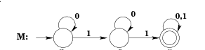

左侧的箭头指示 p 是起始状态；双圈表示一个状态是接受状态。查看这张图片，应该很容易看出 DFA M 接受的语言是 \( L(M) = \{x \in \{0, 1\}^* \mid n_1(x) \ge 2\} \)。

### 示例 3.12. 找出下图所示 DFA 接受的语言（并使用正则表达式描述它）

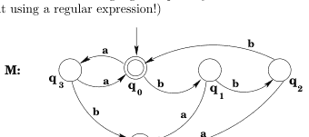

M 的起始状态是接受状态，这意味着 \( \epsilon \in L(M) \)。如果 M 处于状态 q_0，两个 a 的序列或三个 b 的序列将把 M 移回 q_0 并因此被接受。因此 \( L(M) = L((aa \mid bbb)^*) \)。


### 3.4 有限状态自动机

前面示例中的状态 $q_4$ 通常被称为垃圾状态或陷阱状态：它是一个非接受状态，一旦机器进入该状态，就无法逃脱。从转换图中省略此类状态是很常见的。例如，人们可能会看到如下图：

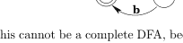

请注意，这不能是一个完整的 DFA，因为 DFA 要求为每个状态-输入对定义转换。该图是完整图的“简写”：

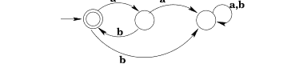

除了识别给定 DFA 接受的语言外，我们常常还想做相反的事情，即构建一个接受给定语言的 DFA。为指定语言构建 DFA 是一门艺术，而非科学。没有一种算法可以根据 DFA 应该接受的字符串集合的英文描述来生成 DFA。另一方面，仅仅列出语言中的半打字符串并设计一个 DFA 来接受这些字符串，通常也不成功——必然会有属于该语言却不被接受的字符串，以及不属于该语言却被接受的其他字符串。那么，如何构建只接受其应接受的所有字符串的 DFA 呢？我能给出的最好建议是：思考决定字符串是否属于该语言的相关特征，并思考这些特征可能的取值或“状态”；然后构建一台机器，为相关特征的每个可能取值组合设置一个状态，并确定输入的消耗如何影响这些取值。我将通过几个例子来说明我的意思。

### 示例 3.13

找出一个带有输入字母表 $\Sigma = \{a, b\}$ 的 DFA，使其接受语言 $L = \{w \in \Sigma^* \mid n_a(w) \text{ 和 } n_b(w) \text{ 都是偶数} \}$。决定字符串 $w$ 是否属于 $L$ 的特征是 $n_a(w)$ 和 $n_b(w)$ 的奇偶性。这些特征有四种可能的“值”组合：两个数都可能是偶数，两个数都可能是奇数，第一个数是奇数而第二个是偶数，或者第一个数是偶数而第二个是奇数。因此，我们构建一台具有四个状态 $q_1, q_2, q_3, q_4$ 的机器，分别对应这四种情况。我们希望设置 $\delta$，使得机器在恰好消耗了含有偶数个 $a$ 和偶数个 $b$ 的字符串时处于状态 $q_1$，在恰好消耗了含有奇数个 $a$ 和奇数个 $b$ 的字符串时处于状态 $q_2$，以此类推。

为此，我们首先将状态 $q_1$ 设为起始状态，因为 DFA 在消耗空字符串 $\epsilon$ 后会处于起始状态，而 $\epsilon$ 含有偶数个（零个）$a$ 和 $b$。现在我们通过推理额外输入如何改变 $a$ 和 $b$ 的奇偶性来添加转换。例如，如果机器处于 $q_1$（意味着已看到偶数个 $a$ 和偶数个 $b$），并且又消耗了一个 $a$，那么我们希望机器移动到状态 $q_3$，因为机器现在已消耗奇数个 $a$ 且仍为偶数个 $b$。因此，我们向机器添加转换 $\delta(q_1, a) = q_3$。同样，如果机器处于 $q_2$（意味着已看到奇数个 $a$ 和奇数个 $b$），并且又消耗了一个 $b$，那么我们希望机器再次移动到状态 $q_3$，因为机器仍然消耗了奇数个 $a$，而现在是偶数个 $b$。因此，我们向机器添加转换 $\delta(q_2, b) = q_3$。类似的推理总共产生八个转换，每个状态-输入对一个。最后，我们需要决定哪些状态应为终态。唯一对应语言 $L$ 所需标准的状态是 $q_1$，因此我们将 $q_1$ 设为终态。完整的机器如下所示。

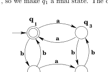

### 示例 3.14

找出一个带有输入字母表 $\Sigma = \{a, b\}$ 的 DFA，使其接受语言 $L = \{w \in \Sigma^* \mid n_a(w) \text{ 能被 } 3 \text{ 整除} \}$。

这里的相关特征当然是字符串中 $a$ 的数量是否能被 3 整除，这或许暗示了一个两状态机器。但实际上，一个数不能被 3 整除有不止一种方式：将该数除以 3 可能会产生余数 1 或 2（余数 0 对应该数实际上能被 3 整除）。

因此，我们构建一台具有三个状态 $q_0, q_1, q_2$ 的机器，并添加转换，使得机器在恰好消耗的 $a$ 的数量能被 3 整除时处于状态 $q_0$，在恰好消耗的 $a$ 的数量模 3 等于 1 时处于状态 $q_1$，$q_2$ 亦然。状态 $q_0$ 将是起始状态，因为 $\epsilon$ 有 0 个 $a$ 且 0 能被 3 整除。完成的机器如下所示。请注意，因为消耗一个 $b$ 不会影响唯一的相关特征，$b$ 不会导致状态改变。

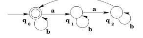

### 示例 3.15

找出一个带有输入字母表 $\Sigma = \{a, b\}$ 的 DFA，使其接受语言 $L = \{w \in \Sigma^* \mid w \text{ 包含三个连续的 } a\text{’s} \}$。

同样，这并不像创建一个两状态机器那么简单，其中状态分别对应"已看到 aaa"和"未看到 aaa"。要动态思考：当你遍历输入字符串时，如何达到已经看到三个连续 $a$ 的目标？你可能已经看到两个连续的 $a$，还需要第三个，或者你可能刚刚看到一个 $a$，正在寻找紧接着的两个 $a$，或者你可能刚刚看到一个 $b$，就看到 3 个连续 $a$ 而言又回到了起点。因此，再次会有三个状态，其中"上一个符号不是 $a$"的状态是起始状态。完整的自动机如下所示。

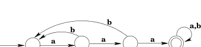

### 练习

- 1. 给出接受以下语言的 DFA，字母表为 $\Sigma = \{a, b\}$。
  - a) $L_1 = \{x \mid x \text{ 包含子串 } aba\}$
  - b) $L_2 = L(ab^*)$
  - c) $L_3 = \{x \mid n_a(x) + n_b(x) \text{ 是偶数 } \}$
  - d) $L_4 = \{x \mid n_a(x) \text{ 是 } 5 \text{ 的倍数 } \}$
  - e) $L_5 = \{x \mid x \text{ 不包含子串 } abb\}$
  - f) \( L_6 = \{x \mid x \text{ 在偶数位置没有 } a\text{'s}\} \)
  - g) \( L_7 = L(aa^* abba^*b^*) \)

- 2. 以下 DFA 接受什么语言？

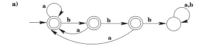

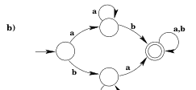

- 3. 设 \(\Sigma = \{0, 1\}\)。给出一个接受以下语言的 DFA

\( L = \{x \in \Sigma^* \mid x \text{ 是可被 } 3 \text{ 整除的整数的二进制表示} \} \)。

### 3.5 非确定性有限状态自动机

如前面简要提到的，关于有限状态自动机的转换函数应当具备哪些属性，存在另一种思考学派。回顾我们的激励示例：C++ 编译器和合法的 if 语句。在我们的描述中，编译器处于“期望一个 ”)””状态；在看到 ”)”时，编译器移动到“期望一个 ”{” 或合法语句”状态。另一种看待方式是说，编译器在看到 ”)”时，可以移动到两个不同状态中的一个：它可以移动到“期望一个 ”{”状态，或移动到“期望一个合法语句”状态。因此，从单个状态，在输入 ”)”时，编译器有多个移动。DFA 模型不允许这种替代解释。对 DFA 模型提出质疑的第二点是，机器改变状态必须消耗输入。考虑 C++ 函数声明的语法。函数的返回类型不必指定（默认取为 int）。编译器在解析函数声明时的起始状态可能是“期望一个返回类型”；然后在不消耗任何输入的情况下，编译器可以移动到状态“期望一个合法函数名”。为了建模这一点，允许不需要消耗输入的转换（such


转换被称为 $\epsilon$-转换)。同样，DFA 抽象不支持这一点。因此，人们研究的第二类有限状态自动机是非确定性有限状态自动机类。

非确定性有限状态自动机（NFA）与确定性有限状态自动机相同，区别在于转换函数不再是将状态-输入对映射到状态的函数；相反，它将状态-输入对或状态-$\epsilon$对映射到一组状态。不再有 $\delta(q, a) = q'$，这意味着如果机器处于状态 $q$ 并消耗一个 $a$，则必须转换到状态 $q'$。相反，我们有 $\delta(q, a) = \{q_1, q_2, ..., q_n\}$，这意味着如果机器处于状态 $q$ 并消耗一个 $a$，它可能直接移动到状态 $q_1, ..., q_n$ 中的任意一个。请注意，下一状态集合 $\delta(q, a)$ 对每个状态 $q$ 和每个输入符号 $a$ 都有定义，但对于某些 $q$ 和 $a$，它可能为空，或仅包含一个状态（不必有多个下一状态）。函数 $\delta$ 还必须指定机器是否可以在不消耗输入的情况下进行移动，即必须为每个状态 $q$ 指定 $\delta(q, \epsilon)$。同样，对于某些状态 $q$，$\delta(q, \epsilon)$ 可能为空：$q$ 不必有 $\epsilon$-转换出去。

### 定义 3.7.
正式地说，非确定性有限状态自动机 $M$ 由 5 个组件指定：$M = (Q, \Sigma, q_0, \delta, F)$，其中：

- $Q, \Sigma, q_0$ 和 $F$ 与 DFA 定义中的相同；
- $\delta$ 是一个转换函数，它接受 <状态, 输入符号> 对并将每个对映射到一组状态。说 $\delta(q, a) = \{q_1, q_2, ..., q_n\}$ 意味着如果机器处于状态 $q$ 并且输入符号 $a$ 被消耗，则机器可以直接移动到状态 $q_1, q_2, ..., q_n$ 中的任意一个。函数 $\delta$ 还必须对每个 <状态, 状态> 对进行定义。说 $\delta(q, \epsilon) = \{q_1, q_2, ..., q_n\}$ 意味着从状态 $q$ 到 $q_1, q_2, ..., q_n$ 中的每个状态都有直接的 $\epsilon$-转换。

函数 $\delta$ 的正式描述是 $\delta : Q \times (\Sigma \cup \{\epsilon\}) \to \mathcal{P}(Q)$。

函数 $\delta$ 描述了机器在零个或一个输入符号上的工作方式。与 DFA 一样，我们经常希望引用机器对输入字符串的行为，因此我们使用记号 $\delta^*(q, w)$ 作为“如果机器从状态 $q$ 开始并消耗输入字符串 $w$，机器可能处于的一组状态”的简写。与 DFA 一样，$\delta^*(q, w)$ 由 $\delta$ 的规范确定。请注意，对于每个状态 $q$，$\delta^*(q, \epsilon)$ 至少包含 $q$，如果从 $q$ 有（序列的）$\epsilon$-转换，则可能包含其他状态。

我们需要仔细考虑 NFA 接受字符串 \( w \) 的含义。假设 \( \delta^*(q_0, w) \) 包含接受状态和非接受状态，即机器在消耗 \( w \) 后可能以接受状态结束，但也可能以非接受状态结束。我们是否应该认为机器接受 \( w \)，或者是否应该要求 $ \delta^*(q_0, w) $ 中的每个状态都是接受状态，然后才将 $ w $ 列入接受行列？再次考虑 C++ 编译器：只要一个 _if_ 语句符合合法语法规范之一，编译器就会接受它。因此，我们将 NFA 的接受定义如下：如果 $ \delta^*(q_0, w) $ 中的至少一个状态是接受状态，则字符串 $ w $ 被 NFA 接受。也就是说，如果存在机器的一系列步骤消耗 $ w $ 并使机器处于接受状态，则机器接受 $ w $。正式地说：

### 定义 3.8.
设 \( M = (Q, \Sigma, q_0, \delta, F) \) 是一个非确定性有限状态自动机。字符串 \( w \in \Sigma^* \) 被 \( M \) **接受**当且仅当 \( \delta^*(q_0, w) \) 包含至少一个状态 \( q_f \in F \)。\( M \) **接受的语言**，记作 \( L(M) \)，是被 \( M \) 接受的所有字符串 \( w \in \Sigma^* \) 的集合：\( L(M) = \{w \in \Sigma^* \mid \delta^*(q_0, w) \cap F \neq \emptyset\} \)。

### 示例 3.16.
下面所示的 NFA 接受所有由 \( a \) 和 \( b \) 组成的字符串，其中倒数第二个符号是 \( a \)。

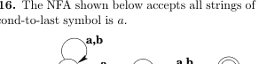

很明显，每个被 DFA 接受的语言也被 NFA 接受。从图形上看，DFA 看起来与 NFA 完全一样（一个没有 \( \epsilon \)-转换或从任何状态出现多个相同标签转换的 NFA），尽管幕后稍微复杂一些。正式地说，给定 DFA \( M = (Q, \Sigma, q_0, \delta, F) \)，你可以构建一个 NFA \( M' = (Q, \Sigma, q_0, \delta', F) \)，其中 5 个组件中有 4 个相同，并且每个转换 \( \delta(q, a) = q' \) 都被替换为 \( \delta'(q, a) = \{q'\} \)。

但是逆命题成立吗？任何 NFA 识别的语言都能被 DFA 识别吗？例如，看示例 3.16 中的语言。你能构建一个接受该语言的 DFA 吗？试试看。这相当困难。但这是否意味着确实**不存在**接受该语言的 DFA，还只是我们还不够聪明，找不到一个？

事实证明，限制实际上在于我们的聪明才智，而不是在于 DFA 的能力。

### 定理 3.2.
每个被 NFA 接受的语言都被 DFA 接受。

证明。假设给定一个 NFA $N = (P, \Sigma, p_0, \delta, F_p)$，我们想要构建一个接受相同语言的 DFA $D = (Q, \Sigma, q_0, \delta, F_2)$。其思想是使 $D$ 中的状态对应于 $N$ 状态的 *子集*，然后设置 $D$ 的转换函数 $\delta$，使得对于任何字符串 $w$，$\delta^*(q_0, w)$ 对应于 $\delta^*(p_0, w)$；即，$w$ 在 $D$ 中带你到达的**单一**状态对应于 $w$ 在 $N$ 中可能带你到达的**状态集**。如果其中任何状态在 $N$ 中是接受的，则 $w$ 会被 $N$ 接受，因此 $D$ 中的相应状态也将被设为接受状态。

那么我们如何实现这一点？首先要处理 $D$ 的起始状态 $q_0$。如果我们要使这个状态对应于 $N$ 状态的一个子集，应该是哪个子集呢？请记住，(1) 在任何 DFA 中，$\delta^*(q_0, \epsilon) = q_0$；(2) 我们希望对每个 $w$，$\delta^*(q_0, w)$ 对应于 $\delta^*(p_0, w)$。将这两个限制结合起来告诉我们，应该使 $q_0$ 对应于 $\delta^*(p_0, \epsilon)$。因此，$q_0$ 对应于不需要任何输入即可到达的 $N$ 的所有状态的子集。

现在我们通过反复执行以下操作来逐步设置 $D$ 的转换函数 $\delta$：

- 找到一个已添加到 $D$ 但其出转换尚未添加的状态 $q$。（请注意，$q_0$ 最初符合此描述。）请记住，状态 $q$ 对应于 $N$ 状态的某个子集 $\{p_1, \dots, p_n\}$。

- 对于每个输入符号 $a$，查看从 $p_1, \dots, p_n$ 中的任何一个通过消耗 $a$（可能还进行一些 $\epsilon$-转换）可以到达的所有 $N$ 状态。即，查看 $\delta^*(p_1, a) \cup \dots \cup \delta^*(p_n, a)$。如果还没有对应于 $N$ 状态此子集的 DFA 状态 $q'$，则添加一个，并将转换 $\delta(q, a) = q'$ 添加到 $D$ 的转换中。

上述过程最终必须停止，因为 NFA 中只有有限数量 $n$ 的状态，因此 DFA 中最多可以有 $2^n$ 个状态，因为这是 NFA 状态的子集数量。新 DFA 的最终状态是那些与至少一个 NFA 接受状态相关联的状态。

我们现在可以论证 $L(D) = L(N)$ 吗？可以：如果我们可以论证对于所有 $w \in \Sigma^*$，$\delta^*(q_0, w)$ 对应于 $\delta^*(p_0, w)$：如果后一个属性成立，那么 $w \in L(D)$ 当且仅当 $\delta^*(q_0, w)$ 是接受的，我们使其如此当且仅当 $\delta^*(p_0, w)$ 包含 $N$ 的一个接受状态，这发生当且仅当 $N$ 接受 $w$，即当且仅当 $w \in L(N)$。

那么我们可以论证 $\delta^*(q_0, w)$ 确实对应于所有 $w$ 的 $\delta^*(p_0, w)$ 吗？可以，通过对 $w$ 的长度进行归纳。

首先，一个初步观察。假设 $w = xa$，即 $w$ 是字符串 $x$ 后跟单个符号 $a$。$\delta^*(p_0, x)$ 和 $\delta^*(p_0, w)$ 之间有什么关系？


嗯，回顾一下，\(\delta^*(p_0, x)\) 是 \(N\) 从 \(p_0\) 开始并消耗 \(x\) 时能到达的所有状态的集合：\(\delta^*(p_0, x) = \{p_1, ..., p_n\}\)，其中 \(p_1, ..., p_n\) 为某些状态。现在，\(w\) 只是在 \(x\) 的基础上多了一个 \(a\)，那么如果 \(N\) 从 \(p_0\) 开始并消耗 \(w\)，它可能会到达哪里呢？我们知道 \(x\) 使 \(N\) 到达 \(p_1\) 或 ... 或 \(p_n\)，因此 \(xa\) 使 \(N\) 到达从 \(p_1\) 通过一个 \(a\)（以及可能的一些 \(\varepsilon\)-转移）能到达的任何状态，以及从 \(p_2\) 通过一个 \(a\)（以及可能的一些 \(\varepsilon\)-转移）能到达的任何状态，等等。因此，\(\delta^*(p_0, x)\) 与 \(\delta^*(p_0, w)\) 之间的关系是：如果 \(\delta^*(p_0, x) = \{p_1, ..., p_n\}\)，则 \(\delta^*(p_0, w) = \delta^*(p_1, a) \cup ... \cup \delta^*(p_n, a)\)。有了这一观察，让我们继续进行归纳证明。

我们要证明对于所有 \(w \in \Sigma^*\)，\(\delta^*(q_0, w)\) 都对应于 \(\delta^*(p_0, w)\)。我们对 \(w\) 的长度进行归纳。

- 1. 基础情况：假设 \(w\) 的长度为 0。长度为 0 的唯一字符串 \(w\) 是 \(\varepsilon\)，因此我们要证明 \(\delta^*(q_0, \varepsilon)\) 对应于 \(\delta^*(p_0, \varepsilon)\)。嗯，\(\delta^*(q_0, \varepsilon) = q_0\)，因为在 DFA 中，对于任何状态 \(q\)，\(\delta^*(q, \varepsilon) = q\)。我们明确地让 \(q_0\) 对应于 \(\delta^*(p_0, \varepsilon)\)，因此该属性对长度为 0 的 \(w\) 成立。

- 2. 归纳情况。假设对于某个数 \(n\)，所需属性成立，即对于所有长度为 \(n\) 的 \(x\)，\(\delta^*(q_0, x)\) 对应于 \(\delta^*(p_0, x)\)。考察任意长度为 \(n+1\) 的字符串 \(w\)。我们要证明 \(\delta^*(q_0, w)\) 对应于 \(\delta^*(p_0, w)\)。嗯，字符串 \(w\) 必须形如 \(xa\)，其中 \(x\) 为某个字符串（其长度为 \(n\)），\(a\) 为某个符号。根据归纳假设，我们知道 \(\delta^*(q_0, x)\) 对应于 \(\delta^*(p_0, x)\)。我们知道 \(\delta^*(p_0, x)\) 是 \(N\) 的一组状态，设 \(\delta^*(p_0, x) = \{p_1, ..., p_n\}\)。

此时，如果我们为 \(\delta^*(q_0, w)\)（\(D\) 在输入 \(w\) 时到达的状态）和 \(\delta^*(q_0, x)\)（\(D\) 在输入 \(x\) 时到达的状态）赋予明确的名称，后续推理可能会更清晰一些。令 \(\delta^*(q_0, w) = q_w\)，并令 \(\delta^*(q_0, x) = q_x\)。我们知道，由于 \(w = xa\)，必然存在从 \(q_x\) 到 \(q_w\) 的 \(a\)-转移。看看我们是如何向 \(\delta\) 添加转移的：从 \(q_x\) 到 \(q_w\) 存在 \(a\)-转移这一事实意味着 \(q_w\) 对应于 \(N\) 的状态集合 \(\delta^*(p_1, a) \cup ... \cup \delta^*(p_n, a)\)。根据我们的初步观察，\(\delta^*(p_1, a) \cup ... \cup \delta^*(p_n, a)\) 正是 \(\delta^*(p_0, w)\)。因此，\(q_w\)（即 \(\delta^*(q_0, w)\)）对应于 \(\delta^*(p_0, w)\)，这正是我们要证明的。由于 \(w\) 是任意长度为 \(n+1\) 的字符串，我们已证明该属性对 \(n+1\) 成立。

总而言之，我们已通过归纳证明对于所有 \(w \in \Sigma^*\)，\(\delta^*(q_0, w)\) 对应于 \(\delta^*(p_0, w)\)。正如本证明开头所指出的，这足以证明 \(L(D) = L(N)\)。因此，对于任何 NFA \(N\)，我们都可以找到一个接受相同语言的 DFA \(D\)。

Example 3.17. Consider the NFA shown below.

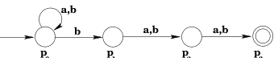

我们首先考察 \(\delta^*(p_0, \varepsilon)\)，然后按上述描述添加转移和状态。

- \(\delta^*(p_0, \varepsilon) = \{p_0\}\)，因此 \(q_0 = \{p_0\}\)。
- \(\delta(q_0, a)\) 将是 \(\delta^*(p_0, a)\)，即 \(\{p_0\}\)，所以 \(\delta(q_0, a) = q_0\)。
- \(\delta(q_0, b)\) 将是 \(\delta^*(p_0, b)\)，即 \(\{p_0, p_1\}\)，因此我们需要向 DFA 添加一个新状态 \(q_1 = \{p_0, p_1\}\)，并将 \(\delta(q_0, b) = q_1\) 添加到 DFA 的转移函数中。
- \(\delta(q_1, a)\) 将是 \(\delta^*(p_0, a)\) 与 \(\delta^*(p_1, a)\) 的并集，因为 \(q_1 = \{p_0, p_1\}\)。由于 \(\delta^*(p_0, a) \cup \delta^*(p_1, a) = \{p_0\} \cup \{p_2\} = \{p_0, p_2\}\)，我们需要向 DFA 添加一个新状态 \(q_2 = \{p_0, p_2\}\)，以及一个转移 \(\delta(q_1, a) = q_2\)。
- \(\delta(q_1, b)\) 将是 \(\delta^*(p_0, b)\) 与 \(\delta^*(p_1, b)\) 的并集，结果为 \(\{p_0, p_1\} \cup \{p_2\}\)，这又给了我们一个要添加到 DFA 的新状态 \(q_3\)，以及转移 \(\delta(q_1, b) = q_3\)。

此时，我们部分构建的 DFA 如下所示：

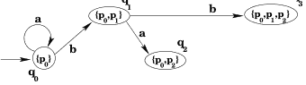

只要还在添加新状态，并且需要计算从这些状态出发的新转移，构建就会继续。最终的 DFA 如下所示。

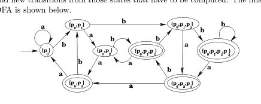

### 练习

- 1. 示例 3.17 中的 NFA 接受什么语言？

- 2. 给出一个接受以下 NFA 所接受语言的 DFA。

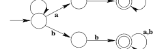

- 3. 给出一个接受以下 NFA 所接受语言的 DFA。（请务必注意，例如，在消耗一个 \(a\) 时，可以从 \(q_0\) 同时到达 \(q_1\) 和 \(q_3\)，这是因为存在 \(\epsilon\)-转移。）

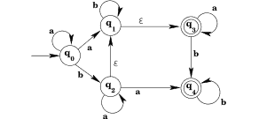

### 3.6 有限状态自动机与正则语言

我们现在知道，我们用于机械语言识别的两种模型实际上识别的是同一类语言。问题仍然存在：它们是否识别与正则表达式机械生成的语言类相同的语言类？答案是“是”。证明这一点分为两部分：首先，每个生成的语言都可以被识别；其次，每个被识别的语言都可以被生成。

Theorem 3.3. Every language generated by a regular expression can be recognized by an NFA.

Proof. The proof of this theorem is a nice example of a proof by induction on the structure of regular expressions. The definition of regular expression is inductive: $\Phi$, $\varepsilon$, and $a$ are the simplest regular expressions, and then more complicated regular expressions can be built from these. We will show that there are NFAs that accept the languages generated by the simplest regular expressions, and then show how those machines can be put together to form machines that accept languages generated by more complicated regular expressions.

Consider the regular expression $\Phi$. $L(\Phi) = \{\}$. Here is a machine that accepts \(\{\}\):

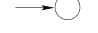

Consider the regular expression $\varepsilon$. $L(\varepsilon) = \{\varepsilon\}$. Here is a machine that accepts \(\{\varepsilon\}\):


Consider the regular expression $a$. $L(a) = \{a\}\). Here is a machine that accepts \(\{a\}\):


Now suppose that you have NFAs that accept the languages generated by regular expressions $r_1$ and $r_2$. Building a machine that accepts $L(r_1 | r_2)$ is fairly straightforward: take an NFA $M_1$ that accepts $L(r_1)$ and an NFA $M_2$ that accepts $L(r_2)$. Introduce a new state $q_{new}$, connect it to the start states of $M_1$ and $M_2$ via \(\varepsilon\)-transitions, and designate it as the start state of the new machine. No other transitions are added. The final states of $M_1$ together with the final states of $M_2$ are designated as the final states of the new machine. It should be fairly clear that this new machine accepts exactly those strings accepted by $M_1\) together with those strings accepted by $M_2$: any string $w$ that was accepted by $M_1\) will be accepted by the new NFA by starting with an \(\varepsilon\)-transition to the old start state of $M_1$ and then following the accepting path through $M_1$; similarly, any string accepted by $M_2$ will be accepted by the new machine; these are the only strings that will be accepted by the new machine, as on any input $w$ all the new machine can do is make an \(\varepsilon\)-move to $M_1$'s (or $M_2$'s) start state, and from there $w$ will only be accepted by the new machine if it is accepted by $M_1$ (or $M_2$). Thus, the new machine accepts $L(M_1) \cup L(M_2)$, which is exactly the definition of $L(r_1 | r_2)$.


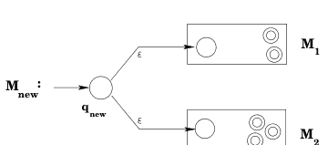

（在继续之前暂停一下：请注意，对于最简单的正则表达式，我们创建用于接受由正则表达式生成的语言的机器实际上是 DFA。然而，在上面的最后一种情况下，我们需要 $\epsilon$-转移来构建新机器，因此如果我们试图证明每个正则语言都可以被 DFA 接受，我们的证明就会遇到麻烦。这并不意味着语句“每个正则语言都可以被 DFA 接受”是错误的，只是我们不能使用这种论证来证明它，而必须找到一种替代证明。）

假设你有机器 $M_1$ 和 $M_2$，分别接受 $L(r_1)$ 和 $L(r_2)$。要构建一个接受 $L(r_1)L(r_2)$ 的机器，请按以下步骤进行。将 $M_1$ 的起始状态 $q_{01}$ 设为新机器的起始状态。将 $M_2$ 的最终状态设为新机器的最终状态。从 $M_1$ 的最终状态向 $M_2$ 的起始状态 $q_{02}$ 添加 $\epsilon$-转移。

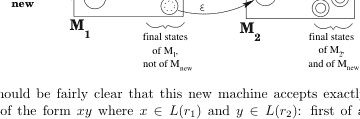

很明显，这个新机器接受的正是形式为 $xy$ 的字符串，其中 $x \in L(r_1)$ 且 $y \in L(r_2)$：首先，任何这种形式的字符串都会被接受，因为 $x \in L(r_1)$ 意味着存在一条从 $q_{01}$ 到 $M_1$ 某个最终状态的消耗 $x$ 的路径；一个 $\epsilon$-转移移动到 $q_{02}$；然后 $y \in L(r_2)$ 意味着存在一条从 $q_{02}$ 到 $M_2$ 某个最终状态的消耗 $y$ 的路径；并且 $M_2$ 的最终状态是新机器的最终状态，因此 $xy$ 会被接受。反之，假设 $z$ 被新机器接受。由于新机器的唯一最终状态位于旧的 $M_2$ 中，而进入 $M_2$ 的唯一方式是从 $M_1$ 的某个最终状态进行 $\epsilon$-转移，这意味着 $z = xy$，其中 $x$ 将机器从其起始状态带到 $M_1$ 的某个最终状态，发生一个 $\epsilon$-转移，然后 $y$ 将机器从 $q_{02}$ 带到 $M_2$ 的某个最终状态。显然，$x \in L(r_1)$ 且 $y \in L(r_2)$。

我们将从接受 $L(r)$ 的 NFA 构建接受 $L(r^*)$ 的 NFA 作为练习留给读者。

### 定理 3.4. 每个被 DFA 或 NFA 接受的语言都由一个正则表达式生成。

证明这一结果实际上相当复杂，且不太有启发性。我们不展示证明，而是给出一个示例，说明如何从 NFA 或 DFA 中提取正则表达式。

### 示例 3.18. 考虑下面所示的 DFA：

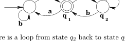

请注意，从状态 $q_2$ 回到状态 $q_2$ 有一个自环：任意数量的 $a$ 都会使机器保持在状态 $q_2$，因此我们用正则表达式 $a^*$ 标记该转移。我们对从 $q_0$ 出发标记为 $b$ 的转移做同样的处理。（请注意，结果不再是 DFA，但这不关我们的事，我们只是有兴趣开发一个正则表达式。）

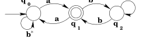

接下来我们注意到，实际上存在一个通过 $q_0$ 从 $q_1$ 到 $q_1$ 的环路。与绕环路移动的字符串匹配的正则表达式是 $ab^*a$。因此我们从 $q_1$ 到 $q_1$ 添加一个标记为 $ab^*a$ 的转移，并删除从 $q_1$ 到 $q_0$ 的现在无关紧要的 $a$-转移。（它无关紧要是因为它不是从 $q_1$ 到 $q_1$ 的任何其他环路的一部分。）

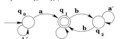

接下来我们注意到，还存在一个通过 $q_2$ 从 $q_1$ 到 $q_1$ 的环路。与绕环路移动的字符串匹配的正则表达式是 $ba^*b$。由于环路中的转移是到或从 $q_2$ 的唯一转移，我们只需删除 $q_2$ 并用从 $q_1$ 到 $q_1$ 的转移替换它。

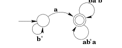

现在从图中可以清楚地看出，形式为 $b^*a$ 的字符串会带你到达状态 $q_1$，而任意次数重复与 $ab^*a$ 或 $ba^*b$ 匹配的字符串会让你保持在那里。因此，机器接受 $L(b^*(ab^*a \mid ba^*b)^*)$。

我们已经看到，如果两个语言 $L_1$ 和 $L_2$ 是正则的，那么 $L_1 \cup L_2$、$L_1L_2$ 和 $L_1^*$（当然还有 $L_2^*$）也是正则的。然而，我们尚未看到常见的集合运算交集和补集如何影响正则性。正则语言的补集是否正则？两个正则语言的交集呢？

这两个问题都可以通过从 DFA 接受的角度来思考正则语言来回答。让我们先考虑补集的问题。假设我们有一个任意的正则语言 $L$。我们知道存在一个接受 $L$ 的 DFA $M$。停下来想一想，你可以对 $M$ 做什么修改，以产生一个新机器 $M'$，使其接受 $\overline{L}$……好吧，显而易见的尝试是让 $M'$ 成为 $M$ 的副本，将 $M$ 的所有最终状态变为 $M'$ 的非最终状态，反之亦然。这实际上完全正确：$M'$ 确实接受 $\overline{L}$。为了验证这一点，考虑一个任意字符串 $w$。两个机器 $M$ 和 $M'$ 的转移函数相同，因此 $\delta^*(q_0, w)$ 在 $M$ 和 $M'$ 中是同一个状态；如果该状态在 $M$ 中是接受的，那么在 $M'$ 中就是非接受的，所以如果 $w$ 被 $M$ 接受，则不被 $M'$ 接受；如果该状态在 $M$ 中是非接受的，那么在 $M'$ 中就是接受的，所以如果 $w$ 不被 $M$ 接受，则被 $M'$ 接受。因此，$M'$ 接受的正是 $M$ 不接受的那些字符串，因而接受 $\overline{L}$。

值得停下来再仔细看看上面的论证。如果我们考虑的是一个任意语言 $L$ 和一个接受 $L$ 的任意 NFA $M$，该论证是否仍然成立？也就是说，如果我们构建了一个新机器 $M'$，其中最终状态和非最终状态被互换，新的 NFA $M'$ 是否会接受 $M$ 接受的语言的补集？答案是“不一定”。请记住，NFA 中的接受性是根据字符串到达的状态中是否至少有一个是接受状态来决定的。因此，任何具有 $\delta^*(q_0, w)$ 同时包含 $M$ 的接受和非接受状态的字符串 $w$，都会同时被 $M$ 和 $M'$ 接受。

现在让我们转向交集的问题。给定两个正则语言 $L_1$ 和 $L_2$，$L_1 \cap L_2$ 是否正则？同样，从 DFA 的角度思考很有用：给定接受 $L_1$ 和 $L_2$ 的机器 $M_1$ 和 $M_2$，你能否利用它们构建一个接受 $L_1 \cap L_2$ 的新机器？答案是肯定的，构建背后的想法与 NFA 到 DFA 构建背后的想法有些相似。我们想要一个新机器，其中的转移同时反映 $M_1$ 和 $M_2$ 的转移，并且只有当转移序列同时导致 $M_1$ 和 $M_2$ 的最终状态时，才接受字符串 $w$。因此，我们将新机器 $M$ 的状态与 $M_1$ 和 $M_2$ 的状态对相关联。对于新机器中的每个状态 $(q_1, q_2)$ 和输入符号 $a$，定义 $\delta((q_1, q_2), a)$ 为状态 $(\delta_1(q_1, a), \delta_2(q_2, a))$。$M$ 的起始状态 $q_0$ 是 $(q_{01}, q_{02})$，其中 $q_{0i}$ 是 $M_i$ 的起始状态。$M$ 的最终状态是形式为 $(q_{f1}, q_{f2})$ 的状态，其中 $q_{f1}$ 是 $M_1$ 的接受状态，$q_{f2}$ 是 $M_2$ 的接受状态。你应该自己确信，$M$ 接受字符串 $x$ 当且仅当 $x$ 被 $M_1$ 和 $M_2$ 都接受。

前一节和前面讨论的结果由以下定理总结：

### 定理 3.5. 两个正则语言的交集是一个正则语言。

- 两个正则语言的并集是一个正则语言。
- 两个正则语言的连接是一个正则语言。
- 正则语言的补集是一个正则语言。
- 正则语言的 Kleene 闭包是一个正则语言。

### 练习

- 1. 给出一个 DFA，它接受下面所示机器所接受语言的交集。（建议：使用定理 3.5 之前讨论的构造。）
- 2. 通过展示如何将接受 $L(r)$ 的机器修改为接受 $L(r^*)$ 的机器，来完成定理 3.3 的证明。


- 3. 使用定理 3.3 中描述的构造，构建一个接受 $L((ab)a^*(bb))$ 的 NFA。
- 4. 证明正则语言的逆语言是正则的。
- 5. 证明对于任意 DFA 或 NFA，存在一个恰好具有一个终态且接受相同语言的 NFA。
- 6. 假设我们修改 NFA 的模型，允许 NFA 具有多个起始状态。证明对于任何具有多个起始状态的“NFA”，存在一个恰好具有一个起始状态且接受相同语言的 NFA。

### 3.7 非正则语言

我们用于机械语言识别的模型接受的语言，与我们机械语言生成系统生成的语言完全相同，这似乎是一个非常积极的迹象，表明在“正则”中，我们确实已经隔离出了使语言具有“机械”特性的某个特征。不幸的是，有些语言我们直觉上认为是机械可识别的（并且我们可以编写 C++ 程序来识别它们），但实际上它们并不是正则语言。

如何证明一种语言不是正则的？我们可以尝试证明不存在接受它的 DFA 或 NFA，或者不存在生成它的正则表达式，但这种论证通常相当困难。要排除所有可能的自动机和所有可能的正则表达式很难。相反，我们将研究所有正则语言都具有一个属性；证明给定语言不具备这个属性，就成为证明该语言不是正则语言的一种方法。

考虑语言 $L = \{w \in \{a, b\}^* \mid n_a(w) = 2 \mod 3, n_b(w) = 2 \mod 3\}$。下面是一个接受该语言的 DFA，状态编号为 1 到 9。

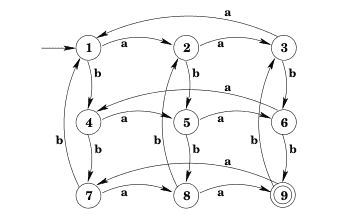

考虑机器在处理字符串 abbabb 时经过的状态序列。注意存在一个重复状态（状态 2）。我们说 abbabb "两次经过状态 2"，意思是在处理字符串的过程中，机器至少两次处于状态 2。将带你绕一圈的字符串部分称为 y，前面的部分称为 x，其余部分称为 z。那么 xz 被接受，xyyz 被接受，xyyyyz 被接受，等等。注意字符串 aabb 无法这样划分，因为它没有经过同一个状态两次。哪些字符串可以这样划分？任何经过同一个状态两次的字符串。这可能包括一些相对较短的字符串，并且必须包括任何长度大于或等于 9 的字符串，因为机器中只有 9 个状态，因此重复最迟在 9 个输入符号后必须发生。

更一般地，考虑任意 DFA M，设 M 中的状态数为 n。那么任何被 M 接受且具有 n 个或更多符号的字符串 w 必须经过同一个状态两次，因此可以将其分解为三部分 x、y、z（其中 y 至少包含一个符号），使得 w = xyz 且

- xz 被 M 接受
- xyz 被 M 接受（毕竟，我们最初是从 L(M) 中的 w 开始的）
- xyyz 被 M 接受
- 等等。

注意，你实际上可以说得更多：在 w 的前 n 个字符中，你已经必须得到一个重复状态，因此你总是可以找到如上所述的 x、y、z，并且此外，w 的 xy 部分（带你到达并返回重复状态的 w 的部分）包含的符号最多为 n 个。

总而言之，如果 M 是接受 L 的 n 状态 DFA，且 w 是 L 中长度至少为 n 的字符串，那么 w 可以分解为三部分 x、y、z，w = xyz，使得

- (i) x 和 y 合起来包含的符号不超过 n 个；
- (ii) y 包含至少一个符号；
- (iii) xz 被 M 接受
- xyz 被 M 接受
- xyyz 被 M 接受
- 等等。

这个结果通常表述的形式是泵引理：

定理 3.6. 如果 L 是正则语言，那么存在某个数 n > 0，使得 L 中任何长度大于或等于 n 的字符串 w 都可以分解为三部分 x、y、z，w = xyz，使得

- (i) x 和 y 合起来包含的符号不超过 n 个；
- (ii) y 包含至少一个符号；
- (iii) xz 被 M 接受
- xyz 被 M 接受
- xyyz 被 M 接受
- 等等。

虽然泵引理关于正则语言说了些什么，但它不用于证明语言是正则的。它说“如果一种语言是正则的，那么某些事情会发生”，而不是“如果某些事情发生，那么你可以得出语言是正则的结论”。然而，泵引理对于证明语言不是正则的很有用，因为“如果一种语言是正则的，那么某些事情会发生”的逆否命题是“如果某些事情没有发生，那么你可以得出语言不是正则的结论”。那么这些“某些事情”是什么？基本上，P.L. 说如果一种语言是正则的，那么存在某个字符串的“阈值”长度，并且每个超过该阈值的字符串都可以以某种方式分解。因此，如果我们能够证明“对于一种语言，存在某个字符串的阈值长度，使得每个超过该阈值的字符串都可以以某种方式分解”是关于该语言的错误断言，我们就可以得出该语言不是正则的结论。如何证明不存在阈值长度？说一个数是一种语言的阈值长度，意味着该语言中每个至少那么长的字符串都可以以描述的方式分解。因此，要证明一个数不是阈值，我们必须证明该语言中存在某个至少那么长但无法以适当方式分解的字符串。

### 定理 3.7. $\{a^n b^n \mid n \ge 0\}$ 不是正则语言。

证明。我们通过证明该语言不存在阈值来做到这一点。设 N 为阈值的任意候选值。我们想要证明它实际上不是阈值，因此我们想要找到语言中一个长度至少为 N 且无法以泵引理描述的方式分解的字符串。我们应该尝试证明哪个字符串不可分解？我们不能选择像 $a^{100}b^{100}$ 这样的字符串，因为我们正在处理任意的 N，即不对 N 的值做任何假设：选择 $a^{100}b^{100}$ 隐含地假设 N 不大于 200——对于更大的 N 值，$a^{100}b^{100}$ 就不是“长度至少为 N 的字符串”。无论我们选择哪个字符串，都必须确保其长度至少为 N，无论 N 是什么数字。因此我们选择，例如，$w = a^N b^N$。这个字符串在语言中，并且其长度至少为 N，无论 N 是什么数字。如果我们能证明这个字符串无法按描述的方式分解

由泵引理，那么我们就证明了 N 不能作为阈值，并且由于 N 是任意数字，我们就证明了 L 不存在阈值，因此 L 不是正则语言。所以让我们证明 $w = a^N b^N$ 无法被适当地分解。

我们需要证明你无法将 $w = a^N b^N$ 写成 $w = xyz$，其中 x 和 y 合起来包含的符号最多为 N 个，y 不为空，并且所有字符串 xz、xyyz、xyyyyz 等仍然在 L 中，即形式为某个数 n 的 $a^h b^h$。做到这一点的最佳方法是证明，任何满足前两个要求的 y 的选择（x 是其前面的内容，z 是其后面的内容）都无法满足第三个要求。那么 y 的可能选择有哪些呢？嗯，由于 x 和 y 合起来最多包含 N 个符号，而 w 以 N 个 a 开头，因此 x 和 y 必须完全由 a 组成；由于 y 不能为空，它必须至少包含一个 a，并且（根据 (i））最多包含 N 个 a。因此 y 的可能选择是某个 $1 \le d \le N$ 的 $y = a^d$。我们现在想要证明，这些选择都无法满足第三个要求，方法是证明对于任何 k 的值，字符串 xz、xyyz、xyyyyz 等中至少有一个不在 L 中。无论我们尝试什么 k 的值，我们不需要远找就能找到我们的“捣蛋”字符串：字符串 xz，即从 $a^N b^N$ 中删除了 k 个 a 的结果，看起来像 $a^{N-k} b^N$，这显然不是 $a^h b^h$ 的形式。因此，满足 (i) 和 (ii) 的 y 都不满足 (iii)；所以 w 无法按要求分解；所以 N 不是 L 的阈值；由于 N 是任意数字，L 不存在阈值；所以 L 不是正则语言。

像 $\{a^n b^n \mid n \ge 0\}$ 和 $\{a^p \mid p \text{ is prime}\}$ 这样的语言不是正则语言，这一事实对任何认为正则表达式或有限状态自动机能够捕捉计算机的语言生成或语言识别能力的想法都是一个沉重打击。这两种语言我们都可以轻松编写程序来识别。不清楚正则表达式的表达能力如何提高，也不清楚如何修改 FSA 模型以获得更强大的模型。然而，在下一章中，你将被介绍语法作为生成语言的工具的概念。最简单的语法仍然只产生正则语言，但我们将看到更复杂的语法有能力生成远超正则范畴的语言。

### 练习

- 1. 使用泵引理证明以下 {a, b} 上的语言不是正则的。

  - a) $L_1 = \{x \mid n_a(x) = n_b(x)\}$


### 3.7 非正则语言

- b) $L_2 = \{xx \mid x \in \{a, b\}^*\}$
- c) $L_3 = \{xx^R \mid x \in \{a, b\}^*\}$
- d) $L_4 = \{a^n b^m \mid n < m\}$

## 第 4 章

## 文法

自然语言（如英语）和用于编程的人工语言都具有称为文法或语法的结构。为了形成合法的句子或程序，语言的各部分必须根据某些规则组合在一起。对于自然语言，规则有些非正式（尽管高中英语老师可能会让我们相信并非如此）。对于编程语言，规则是绝对的，违反规则的程序将被编译器拒绝。

在本章中，我们将研究形式文法及其定义的语言。我们将考察的语言大多是与自然语言甚至编程语言相比的“玩具”语言，但这些思想和技术是任何语言研究的基础。事实上，许多思想几乎在 1950 年代同时出现，出自研究自然语言的语言学家和寻找指定编程语言语法方法的程序员之手。

本章中的文法是生成文法。生成文法是一组可用于生成语言中所有合法字符串的规则。我们还将考虑密切相关的语法分析概念。对字符串进行语法分析意味着确定该字符串如何根据规则生成。

本章是前一章的延续。与正则表达式一样，文法是一种用有限信息指定可能无限语言的方法。事实上，我们将看到每种正规语言都可以由某种简单类型的文法指定。我们还将看到，有些可以由文法指定的语言并非正规语言。

### 4.1 上下文无关文法

文法的最一般形式是一组改写规则。改写规则规定，某个符号串可以替换另一个字符串的全部或部分。如果 \(w\) 和 \(u\) 是字符串，则 \(w \longrightarrow u\) 是一条改写规则，规定字符串 \(w\) 可以被字符串 \(u\) 替换。符号 "\(\longrightarrow\)" 读作“可改写为”。改写规则也称为产生式或产生规则，"\(\longrightarrow\)" 也可读作“产生”。例如，如果我们考虑字母表 \(\{a, b, c\}\) 上的字符串，则产生式 \(aba \longrightarrow cc\) 可以应用于字符串 \(ababbac\)，得到字符串 \(abbccc\)。字符串 \(ababbac\) 中的子串 \(aba\) 已被替换为 \(cc\)。

在上下文无关文法中，每条改写规则的形式为 \(A \longrightarrow w\)，其中 \(A\) 是单个符号，\(w\) 是零个或多个符号组成的字符串。（该文法被称为“上下文无关”，是因为 \(w\) 可以在字符串中出现 \(A\) 的任何位置替换 \(A\)，而不受 \(A\) 周围上下文的影响。）在上下文无关文法中，出现在产生式左侧的符号称为非终结符。按照惯例，非终结符通常为大写字母。产生式右侧的符号可以包含非终结符以及其他符号，这些符号称为终结符。按照惯例，终结符通常为小写字母。以下是上下文无关文法中的一些典型产生式：

```
A \longrightarrow aAbB
S \longrightarrow SS
C \longrightarrow Acc
B \longrightarrow b
A \longrightarrow \varepsilon
```

在这个列表的最后一条规则中，\(\varepsilon\) 照常表示空字符串。例如，该规则可以应用于字符串 \(aBaAcA\)，产生字符串 \(aBacA\)。字符串 \(aBaAcA\) 中第一个出现的符号 \(A\) 已被空字符串替换——这只是另一种说法，表示该符号已从字符串中删除。

在每个上下文无关文法中，一个非终结符被指定为文法的开始符号。开始符号通常（但不总是）用 \(S\) 表示。当使用文法生成语言中的字符串时，其思路是从仅由开始符号组成的字符串开始。然后应用一系列产生式。每次将产生式应用于字符串时，都会将该字符串转换为一个新字符串。如果且当此过程产生一个仅由终结符组成的字符串时，过程结束。该终结符字符串是文法生成的语言中的一个字符串。事实上，该语言恰好由所有以这种方式产生的终结符字符串组成。

作为一个简单的示例，考虑一个具有三条产生式的文法：S → aS、S → bS 和 S → b。在这个示例中，S 是唯一的非终结符，终结符是 a 和 b。从字符串 S 开始，我们可以应用文法中的任意三条规则来产生 aS、bS 或 b。由于字符串 b 不包含非终结符，我们可以看出 b 是该文法生成的语言中的一个字符串。字符串 aS 和 bS 不属于该语言，因为它们包含非终结符 S，但我们可以继续将产生式应用于这些字符串。例如，从 aS 我们可以得到 aaS、abS 或 ab。从 abS 我们可以继续得到 abaaS、abbS 或 abb。字符串 ab 和 abb 属于该文法生成的语言。不难看出，任何由 a 和 b 组成且以 b 结尾的字符串都可以由该文法生成，而且只有这些字符串可以生成。也就是说，该文法生成的语言是由正则表达式 (a | b)*b 指定的正规语言。

是时候给出我们一直在讨论的概念的一些正式定义了。

### 定义 4.1. 上下文无关文法是一个 4 元组 (V, Σ, P, S)，其中：

- 1. V 是一个符号的有限集。V 的元素是文法的非终结符。
- 2. Σ 是一个符号的有限集，且 V ∩ Σ = ∅。Σ 的元素是文法的终结符。
- 3. P 是一组产生式。每条规则的形式为 A → w，其中 A 是 V 中的一个符号，w 是语言 (V ∪ Σ)* 中的一个字符串。
- 4. S ∈ V。S 是文法的开始符号。

尽管这是正式定义，但文法通常通过简单列出产生式集合来非正式地指定。这样做时，除非另有说明，否则假设非终结符就是出现在文法产生式左侧的符号。终结符是出现在产生式右侧的所有其他符号。开始符号是列表中第一条产生式左侧出现的符号。

因此，产生式列表

```
T --> TT
T --> A
A --> aAa
A --> bBb
B --> bB
B --> \epsilon
```

指定了一个文法 $G = (V, \Sigma, P, T)$，其中 $V$ 是 $\{T, A, B\}$，$\Sigma$ 是 $\{a, b\}$，$T$ 是开始符号。$P$ 当然是包含列表中六条产生式的集合。

设 $G = (V, \Sigma, P, S)$ 为一个上下文无关文法。假设 $x$ 和 $y$ 是语言 $(V \cup \Sigma)^*$ 中的字符串。记号 $x \Longrightarrow_G y$ 用于表示 $y$ 可以通过应用 $P$ 中的一条产生式从 $x$ 得到。更准确地说，我们说当且仅当文法中存在一条产生式 $A \longrightarrow w$ 以及语言 $(V \cup \Sigma)^*$ 中的两个字符串 $u$ 和 $v$，使得 $x = uAv$ 且 $y = uwv$ 时，$x \Longrightarrow_G y$。$x = uAv$ 这只是一种说法，表示 $A$ 在 $x$ 中的某处出现。当将产生式 $A \longrightarrow w$ 应用于在 $uAv$ 中用 $w$ 替换 $A$ 时，结果是 $uwv$，即 $y$。请注意，$u$ 或 $v$ 或两者都可以是空字符串。

如果字符串 $y$ 可以通过应用零条或多条产生式的序列从字符串 $x$ 得到，我们写作 $x \Longrightarrow^*_G y$。在大多数情况下，记号 $\Longrightarrow_G$ 和 $\Longrightarrow^*_G$ 中的“G”将被省略，假设所讨论的文法是已知的。请注意，$\Longrightarrow$ 是集合 $(V \cup \Sigma)^*$ 上的一个关系。关系 $\Longrightarrow^*$ 是该关系的自反传递闭包。（这解释了“*”的用法，它通常用于表示关系的传递但不一定是自反闭包。在此例中，$\Longrightarrow^*$ 既是自反的也是传递的，因为对于任何字符串 $x$，$x \Longrightarrow^* x$ 都成立。）例如，使用由上述产生式列表定义的文法，我们有

```
aTB \Longrightarrow aTTB
\Longrightarrow aTAB
\Longrightarrow aTAbb
\Longrightarrow aTbBbb
\Longrightarrow aTbbB
```

由此可得 $aTB \Longrightarrow^* aTbbB$。关系 $\Longrightarrow$ 读作“推导”或“产生”，而 $\Longrightarrow^*$ 可读作“在零步或多步中产生”


“语句”或“在零步或多步中产生。”下面的定理陈述了关于关系 $\Longrightarrow$ 和 $\Longrightarrow^*$ 的一些简单事实：

### 定理 4.1. 设 $G$ 为上下文无关文法 $(V, \Sigma, P, S)$。则：

- 1. 若 $x$ 和 $y$ 是 $(V \cup \Sigma)^*$ 中的字符串，且 $x \Longrightarrow y$，则 $x \Longrightarrow^* y$。
- 2. 若 $x$、$y$ 和 $z$ 是 $(V \cup \Sigma)^*$ 中的字符串，且 $x \Longrightarrow^* y$ 与 $y \Longrightarrow^* z$，则 $x \Longrightarrow^* z$。
- 3. 若 $x$ 和 $y$ 是 $(V \cup \Sigma)^*$ 中的字符串，且 $x \Longrightarrow y$，而 $s$ 和 $t$ 是 $(V \cup \Sigma)^*$ 中的任意字符串，则 $sxt \Longrightarrow syt$。
- 4. 若 $x$ 和 $y$ 是 $(V \cup \Sigma)^*$ 中的字符串，且 $x \Longrightarrow^* y$，而 $s$ 和 $t$ 是 $(V \cup \Sigma)^*$ 中的任意字符串，则 $sxt \Longrightarrow^* syt$。

证明。第 1 部分和第 2 部分源于 $\Longrightarrow^*$ 是 $\Longrightarrow$ 的传递闭包这一事实。第 4 部分很容易从第 3 部分得出。（此题留作练习。）要证明第 3 部分，假设 $x$、$y$、$s$ 和 $t$ 是满足 $x \Longrightarrow y$ 的字符串。按定义，这意味着存在字符串 $u$ 和 $v$ 以及产生式规则 $A \to w$，使得 $x = uAv$ 且 $y = uvw$。但此时我们也有 $sxt = suAvt$ 和 $syt = suwt$。这两个等式，加上产生式规则 $A \to w$ 的存在，按定义表明 $sxt \Longrightarrow syt$。$\square$

我们可以使用 $\Longrightarrow^*$ 来给出上下文无关文法所生成语言的正式定义：

### 定义 4.2. 假设 $G = (V, \Sigma, P, S)$ 是一个上下文无关文法。则 $G$ 生成的语言是字母表 $\Sigma$ 上定义的语言 $L(G)$，定义如下

\( L(G) = \{ w \in \Sigma^* \mid S \Longrightarrow^* w \} \)

也就是说，$L(G)$ 包含任何可由起始符号 $S$ 组成的字符串开始，通过应用一系列产生式规则而得到的终结符号字符串。

若存在上下文无关文法 $G$ 使得 $L(G) = L$，则称语言 $L$ 为 **上下文无关语言**。注意，可能存在多个不同的上下文无关文法生成同一个上下文无关语言。生成同一语言的两个上下文无关文法被称为 **等价**。

假设 $G$ 是起始符号为 $S$ 的上下文无关文法，且 $w \in L(G)$。按定义，这意味着存在一系列对产生式规则的一次或多次应用，从 $S$ 生成字符串 $w$。该序列形式为 $S \Longrightarrow x_1 \Longrightarrow x_2 \Longrightarrow \cdots \Longrightarrow w$。这样的序列称为 $w$ 的一个 **推导**（在文法 $G$ 中）。注意，$w$ 可能有多个推导。也就是说，可能存在多种不同的方式来生成 $w$。

考虑语言 $L = \{a^n b^n \mid n \in \mathbb{N}\}$。我们已知 $L$ 不是正规语言。然而，它是一个上下文无关语言。也就是说，存在一个上下文无关文法，使得 $L$ 是由 $G$ 生成的语言。这为我们提供了关于文法的第一个定理：

### 定理 4.2. 设 $L$ 为语言 $L = \{a^n b^n \mid n \in \mathbb{N}\}$。设 $G$ 为上下文无关文法 $(V, \Sigma, P, S)$，其中 $V = \{S\}$，$\Sigma = \{a, b\}$，且 $P$ 由以下产生式组成：

```
$S \longrightarrow aSb$
$S \longrightarrow \varepsilon$
```

则 $L = L(G)$，因此 $L$ 是一个上下文无关语言。特别是，存在不是正规语言的上下文无关语言。

证明。要证明 $L = L(G)$，我们需要同时证明 $L \subseteq L(G)$ 和 $L(G) \subseteq L$。要证明 $L \subseteq L(G)$，设 $w$ 为 $L$ 的任意元素。根据 $L$ 的定义，对于某个 $n \in \mathbb{N}$，有 $w = a^n b^n$。我们通过对 $n$ 进行归纳来证明 $w \in L(G)$。当 $n = 0$ 时，$w = \varepsilon$。由于 $\varepsilon$ 可通过对起始符号 $S$ 应用规则 $S \longrightarrow \varepsilon$ 而生成，故 $\varepsilon \in L(G)$，因此当 $n = 0$ 时我们的结论成立。现在，假设 $k \in \mathbb{N}$ 且我们已知 $a^k b^k \in L(G)$。我们需要证明 $a^{k+1} b^{k+1} \in L(G)$。由于 $S \Longrightarrow^* a^k S b^k$，根据定理 4.1，我们也有 $aSb \Longrightarrow^* aa^k S b^k b$。即，$aSb \Longrightarrow^* a^{k+1} S b^{k+1}$。将此与产生式规则 $S \longrightarrow aSb$ 结合，我们看到 $S \Longrightarrow^* a^{k+1} S b^{k+1}$。这意味着 $a^{k+1} b^{k+1} \in L(G)$，正如我们所要证明的那样。这完成了 $L \subseteq L(G)$ 的证明。

要证明 $L(G) \subseteq L$，假设 $w \in L(G)$。即，$S \Longrightarrow^* w$。我们需要证明对于某个 $n$，有 $w = a^n b^n$。由于 $S \Longrightarrow^* w$，存在一个推导 $S \Longrightarrow x_0 \Longrightarrow x_1 \Longrightarrow \cdots \Longrightarrow x_n$，其中 $w = x_n$。我们首先通过对 $n$ 进行归纳来证明：在任何推导 $S \Longrightarrow x_0 \Longrightarrow \cdots \Longrightarrow x_n$ 中，必须有 $x_n = a^n b^n$ 或 $x_n = a^{n+1} S b^{n+1}$。考虑 $n = 0$ 的情况。假设 $S \Longrightarrow x_0$。那么，$S \Longrightarrow x_0$ 必须是文法中的一条规则，因此 $x_0$ 必须是 $\varepsilon$ 或 $aSb$。由于 $\varepsilon = a^0 b^0$ 且 $aSb = a^{0+1} S b^{0+1}$，$x_0$ 具有所需形式。接下来，考虑归纳情况。假设 $k > 1$ 且我们已知：在任何推导 $S \Longrightarrow x_0 \Longrightarrow x_1 \Longrightarrow \cdots \Longrightarrow x_k$ 中，必须有 $x_k = a^k b^k$ 或 $x_k = a^{k+1} S b^{k+1}$。假设 $S \Longrightarrow x_0 \Longrightarrow x_1 \Longrightarrow \cdots \Longrightarrow x_k \Longrightarrow x_{k+1}$。根据归纳假设，我们知道 $x_k = a^k b^k$ 或 $x_k = a^{k+1} S b^{k+1}$，但由于 $x_k \Longrightarrow x_{k+1}$ 且 $a^k b^k$ 不包含非终结符号，我们必须有 $x_k = a^{k+1} S b^{k+1}$。由于 $x_{k+1}$ 是通过对 $x_k$ 应用产生式规则 $S \longrightarrow \varepsilon$ 或 $S \longrightarrow aSb$ 之一得到的，$x_{k+1}$ 要么是 $a^{k+1} \varepsilon b^{k+1}$，要么是 $a^{k+1} a S b b^{k+1}$。即，$x_{k+1}$ 要么是 $a^{k+1} b^{k+1}$，要么是 $a^{k+2} S b^{k+2}$。

### 4.1 上下文无关文法

正如我们所要证明的那样。这完成了归纳。回到 $w$，我们看到 $w$ 必须是 $a^n b^n$ 形式或 $a^n S b^n$ 形式。但由于 $w \in L(G)$，它不能包含非终结符号，因此 $w$ 必须是 $a^n b^n$ 形式，正如我们所要证明的那样。这完成了 $L(G) \subseteq L$ 的证明。

我给出了这个定理的一个非常正式且详细的证明，以展示如何进行证明，并说明归纳在许多关于文法的证明中所起的作用。然而，该定理的一个更非正式的证明可能也是可以接受的，甚至可能更有说服力。要证明 $L \subseteq L(G)$，我们只需指出推导 $S \Rightarrow aSb \Rightarrow a^2 S b^2 \Rightarrow \cdots \Rightarrow a^n S b^n \Rightarrow a^n b^n$ 表明 $a^n b^n \in L$。另一方面，很明显，该文法的每个推导都必须是这种形式，因此 L(G) 中的每个字符串都是 $a^n b^n$ 形式。

作为另一个示例，考虑语言 $\{a^n b^m \mid n \ge m \ge 0\}$。让我们尝试设计一个生成该语言的文法。这与前一个示例类似，但现在我们想包含包含比 b 更多的 a 的字符串。产生式规则 $S \rightarrow aSb$ 始终生成相同数量的 a 和 b。我们可以修改这个想法来生成更多的 a 而不是 b 吗？

一种方法是先生成包含相同数量的 a 和 b 的字符串，然后添加一些额外的 a。能够生成任意数量 a 的规则是 $A \rightarrow aA$。应用规则 $S \rightarrow aSb$ 一段时间后，我们希望转移到一个新状态，在该状态下应用规则 $A \rightarrow aA$。我们可以通过应用规则 $S \rightarrow A$ 将 S 变为 A 来进入新状态。我们仍然需要一种结束过程的方法，即消除字符串中的所有非终结符号。为此，我们可以使用规则 $A \rightarrow \varepsilon$。将这些规则组合在一起，我们得到文法

```
S --> aSb
S --> A
A --> aA
A --> ε
```

这个文法确实生成语言 $\{a^n b^m \mid n \ge m \ge 0\}$。通过对该文法进行微小变体，我们可以生成其他相关语言。例如，如果我们将规则 $A \rightarrow \varepsilon$ 替换为 $A \rightarrow a$，我们得到语言 $\{a^n b^m \mid n > m \ge 0\}$。

生成语言 $\{a^n b^m \mid n \ge m \ge 0\}$ 还有其他方法。例如，如果允许 S 有时生成一个单独的 a 而没有 b，那么额外的非终结符号 A 并非真正必要。这导致了


### 语法

```
S -> aSb
S -> aS
S -> \epsilon
```

（但请注意，规则 $S \longrightarrow Sa$ 不能代替 $S \longrightarrow aS$，因为它会允许产生 $a$ 出现在 $b$ 之后的字符串，而语言 $\{a^n b^n \mid n \ge 0\}$ 中不存在这样的字符串。）下面是生成该语言的另外两个文法：

```
S -> AB
A -> aA
B -> aBb
A -> \epsilon
B -> \epsilon
```

```
S -> ASb
A -> aA
S -> \epsilon
A -> \epsilon
```

考虑语言 $\{a^n b^n \mid n \in \mathbb{N}\}$ 的另一种变体，其中 $a$ 和 $b$ 可以以任意顺序出现，但 $a$ 的数量仍然等于 $b$ 的数量。该语言可定义为 $L = \{w \in \{a,b\}^* \mid n_a(w) = n_b(w)\}$。该语言包括 $abbaab$、$baabab$ 和 $bbaaaa$ 等字符串。让我们从包含规则 $S \longrightarrow aSb$ 和 $S \longrightarrow \varepsilon$ 的文法开始。我们可以尝试添加规则 $S \longrightarrow bSa$。使用这三条规则能够生成的每个字符串都在语言 $L$ 中。然而，$L$ 中的并非每个字符串都能被生成。以 $S \Longrightarrow aSb$ 开头的推导只能产生以 $a$ 开头并以 $b$ 结尾的字符串。以 $S \Longrightarrow bSa$ 开头的推导只能生成以 $b$ 开头并以 $a$ 结尾的字符串。无法生成字符串 $baab$ 或 $abbabaabba$，它们属于语言 $L$。但我们将看到，$L$ 中任何以相同字母开头和结尾的字符串都可以写成 $xy$ 的形式，其中 $x$ 和 $y$ 是 $L$ 中的更短字符串。为了生成这种形式的字符串，我们需要一条额外的规则 $S \longrightarrow SS$。语言 $L$ 的完整产生式规则集为

```
S -> aSb
S -> bSa
S -> SS
S -> \epsilon
```

很容易看出，使用这些规则能够生成的每个字符串都在 $L$ 中，因为每条规则引入的 $a$ 的数量与 $b$ 的数量相同。但我们需要检查 $L$ 中的每个字符串 $w$ 是否都能由这些规则生成。

### 4.1 上下文无关文法

这可以通过对 $w$ 的长度进行归纳来完成，使用数学归纳原理的第二种形式。在基本情形中，|w| = 0 且 $w = \epsilon$。在这种情况下，$w \in L$，因为 $S \Rightarrow \epsilon$ 只需一步。假设 |w| = k，其中 k > 0，并且假设我们已经知道对于任何 $|x| < k$ 的 $x \in L$，都有 $S \Rightarrow^* x$。为了完成归纳，我们必须基于这个假设证明 $S \Rightarrow^* w$。

假设 $w$ 的第一个字符和最后一个字符不同。那么 $w$ 要么是 $axb$ 的形式，要么是 $bxa$ 的形式，其中 $x$ 为某个字符串。让我们假设 $w$ 是 $axb$ 的形式。（$w$ 是 $bxa$ 形式的情况处理方式类似。）由于 $w$ 中 $a$ 和 $b$ 的数量相同，且 $x$ 比 $w$ 少一个 $a$ 和少一个 $b$，因此 $x$ 也必须有相同数量的 $a$ 和 $b$。也就是说，$x \in L$。但 $|x| = |w| - 2 < k$，所以根据归纳假设，$x \in L(G)$。于是我们有 $S \Rightarrow^* x$。根据定理 4.1，我们得到 $aSb \Rightarrow^* axb$。结合 $S \Rightarrow aSb$ 这一事实，我们得到 $S \Rightarrow^* axb$，即 $S \Rightarrow^* w$。这证明了 $w \in L(G)$。

最后，假设 $w$ 的第一个字符和最后一个字符相同。假设 $w$ 以 $a$ 开头并以 $a$ 结尾。（$w$ 以 $b$ 开头并以 $b$ 结尾的情况处理方式类似。）我声称 $w$ 可以写成 $xy$ 的形式，其中 $x \in L(G)$、$y \in L(G)$，且 $x$ 和 $y$ 都不是空字符串。这将完成归纳，因为根据归纳假设，我们将有 $S \Rightarrow^* x$ 和 $S \Rightarrow^* y$，并且我们可以通过先应用规则 $S \to SS$，然后使用右侧的第一个 $S$ 推导出 $x$ 和第二个 $S$ 推导出 $y$，从 $S$ 推导出 $xy$。

只剩下如何将 $w$ 分成两个都在 $L(G)$ 中的字符串 $x$ 和 $y$ 的问题。所使用的技术是一种更一般有用的技术。假设 $w = c_1c_2\cdots c_k$，其中每个 $c_i$ 要么是 $a$ 要么是 $b$。考虑整数序列 $r_1, r_2, \ldots, r_k$，其中对于每个 $i = 1, 2, \ldots, k$，$r_i$ 是 $c_1c_2\cdots c_i$ 中 $a$ 的数量减去 $c_1c_2\cdots c_i$ 中 $b$ 的数量。由于 $c_1 = a$，$r_1 = 1$。由于 $w \in L$，$r_k = 0$。并且由于 $c_k = a$，我们必须有 $r_{k-1} = r_k - 1 = -1$。此外，对于 $i = 1, 2, \ldots, k-1$，$r_{i+1}$ 和 $r_i$ 之间的差要么是 1 要么是 -1。

由于 $r_1 = 1$ 且 $r_{k-1} = -1$，并且当 $i$ 增加 1 时 $r_i$ 的值上升或下降 1，因此 $r_i$ 必须在 1 到 $k-1$ 之间的某个 $i$ 处为零。也就是说，$r_i$ 不能从 1 到 -1 而不经过零。设 $i$ 为 1 到 $k-1$ 之间使得 $r_i = 0$ 的一个数。令 $x = c_1c_2\cdots c_i$ 并令 $y = c_{i+1}c_{i+2}\cdots c_k$。注意 $xy = w$。$r_i = 0$ 的事实意味着字符串 $c_1c_2\cdots c_i$ 中 $a$ 和 $b$ 的数量相同，因此 $x \in L(G)$。由此可知 $y \in L(G)$ 也成立。由于 $i$ 严格介于 1 和 $k-1$ 之间，$x$ 和 $y$ 都不是空字符串。这就是完成证明 $L = L(G)$ 所需展示的全部内容。

这个证明的基本思想是，如果 $w$ 中 $a$ 和 $b$ 的数量相同，那么 $w$ 开头的一个 $a$ 必须在 $w$ 的某处有一个“匹配”的 $b$。这个 $b$ 与 $a$ 匹配，意味着相应的 $r_i$ 为零，并且这个 $b$ 标志着一个包含相同数量 $a$ 和 $b$ 的字符串 $z$ 的结束。例如，在字符串 $aababbba$ 中，字符串开头的 $a$ 被第三个 $b$ 匹配，因为 $aabb$ 是 $aababbba$ 的最短前缀，其中 $a$ 和 $b$ 的数量相等。

与匹配 $a$ 和 $b$ 的这一思想密切相关的是平衡括号的思想。考虑由括号组成的字符串，例如 ((()())(()))。这个示例字符串中的括号是平衡的，因为每个左括号都有一个匹配的右括号，且匹配对是正确嵌套的。一个仔细的定义使用了上面引入的那种整数序列。设 $w$ 为一个括号字符串。写 $w = c_1c_2\cdots c_n$，其中每个 $c_i$ 要么是 ( 要么是 )。定义整数序列 $r_1, r_2, \ldots, r_n$，其中 $r_i$ 是 $c_1c_2\cdots c_i$ 中左括号的数量减去 $c_1c_2\cdots c_i$ 中右括号的数量。我们说 $w$ 中的括号是平衡的，如果 $r_n = 0$ 且对于所有 $i = 1, 2, \ldots, n$ 都有 $r_i \ge 0$。$r_n = 0$ 的事实表明 $w$ 中左括号和右括号的数量相同。$r_i \ge 0$ 的事实表明括号对的嵌套是正确的。你不能有一个右括号，除非它由字符串前面部分的一个左括号平衡。由所有平衡括号字符串组成的语言是上下文无关的。

它由以下文法生成：

```
S → (S)
S → SS
S → ε
```

证明与前面关于 $a$ 和 $b$ 字符串的证明类似。（可能似乎我在匹配和平衡上大惊小怪。原因在于，这是我们用上下文无关语言能做而用正规语言不能做的少数事情之一。）

在离开本节之前，我们应该看一些更一般的结果。由于我们知道对正规语言的大多数运算产生的语言也是正规的，我们可以问类似的结果是否对上下文无关语言成立。我们将稍后看到，两个上下文无关语言的交集不一定是上下文无关的。此外，上下文无关语言的补集也不一定是上下文无关的。然而，上下文无关语言上的某些其他运算确实产生上下文无关语言。

**定理 4.3。** 假设 $L$ 和 $M$ 是上下文无关语言。那么语言 $L \cup M$、$LM$ 和 $L^*$ 也是上下文无关的。

### 4.1 上下文无关文法

证明。我将只证明定理的第一个主张，即 \( L \cup M \) 是上下文无关的。在本节的练习中，要求你为 \( LM \) 和 \( L^* \) 构造文法（无需给出你答案正确的正式证明）。

设 \( G = (V, \Sigma, P, S) \) 和 \( H = (W, \Gamma, Q, T) \) 为上下文无关文法，使得 \( L = L(G) \) 和 \( M = L(H) \)。我们可以假设 \( W \cap V = \emptyset \)，因为否则我们可以简单地重命名 \( W \) 中的非终结符号。证明的思想是，为了生成 \( L \cup M \) 中的一个字符串，我们首先决定是想要 \( L \) 中的字符串还是 \( M \) 中的字符串。一旦做出这个决定，为了生成 \( L \) 中的字符串，我们使用 \( G \) 中的产生式规则，而为了生成 \( M \) 中的字符串，我们使用 \( H \) 中的规则。我们需要设计一个文法 \( K \) 来表示这个过程。

设 \( R \) 为一个不在任何字母表 \( V, W, \Sigma \), 或 \( \Gamma \) 中的起始符号。\( K \) 的产生式规则由 \( G \) 和 \( H \) 中的所有产生式规则以及两条新规则组成：

```
\( R \longrightarrow S \)
\( R \longrightarrow T \)
```

形式上，\( K \) 被定义为文法

```
\( (V \cup W \cup \{R\}, P \cup Q \cup \{R \longrightarrow S, R \longrightarrow T\}, \Sigma \cup \Gamma, R) \)
```

假设 \( w \in L \)。也就是说 \( w \in L(G) \)，因此存在推导 \( S \Rightarrow^*_G w \)。由于 \( G \) 中的每条规则也是 \( K \) 中的规则，因此 \( S \Rightarrow^*_K w \)。结合 \( R \Rightarrow_K S \) 这一事实，我们有 \( R \Rightarrow^*_K w \)，且 \( w \in L(K) \)。这表明 \( L \subseteq L(K) \)。以完全类似的方式，我们可以证明 \( M \subseteq L(K) \)。因此，\( L \cup M \subseteq L(K) \)。

只剩下证明 \( L(K) \subseteq L \cup M \)。假设 \( w \in L(K) \)。那么存在推导 \( R \Rightarrow^*_K w \)。这个推导必须以应用规则 \( R \longrightarrow S \) 或 \( R \longrightarrow T \) 之一开始，因为这些是 \( R \) 出现的唯一规则。如果推导中首先应用的规则是 \( R \longrightarrow S \)，那么推导的其余部分表明 \( S \Rightarrow^*_K w \)。从 \( S \) 开始，只能应用 \( G \) 中的规则，因此事实上我们有 \( S \Rightarrow^*_G w \)。这表明 \( w \in L \)。类似地，如果推导 \( R \Rightarrow^*_K w \) 中首先应用的规则是 \( R \longrightarrow T \)，那么 \( w \in M \)。在任何情况下，\( w \in L \cup M \)。这证明了 \( L(K) \subseteq L \cup M \)。

最后，我们应该澄清上下文无关语言与正规语言之间的关系。我们已经看到存在不是正规语言的上下文无关语言。另一方面，事实证明每个正规语言都是上下文无关的。也就是说，给定任何正规语言，都存在一个生成该语言的上下文无关文法。这意味着


任何可以由正则表达式、DFA 或 NFA 表达的语法，也都可以由上下文无关文法表达。事实上，我们只需要一种受限的上下文无关文法类型，就能复现正则表达式的能力。

### 定义 4.3. 右正规文法是一种上下文无关文法，其中每个产生式右部都具有以下形式之一：空串；由单个非终结符号组成的字符串；或由单个终结符号后跟单个非终结符号组成的字符串。

右正规文法中允许的产生式类型示例包括 A -> epsilon、B -> C 和 D -> aE。证明的思路是：给定一个右正规文法，我们可以构建一个对应的 NFA，反之亦然。NFA 的状态对应文法的非终结符号。文法的起始符号对应 NFA 的起始状态。形式为 A -> bC 的产生式对应 NFA 中从状态 A 到状态 C 的转移，同时读取符号 b。形式为 A -> B 的产生式对应 NFA 中从状态 A 到状态 B 的 epsilon-转移。文法中存在形式为 A -> epsilon 的产生式，当且仅当 A 是 NFA 中的终态。有了这种对应关系，文法中字符串 w 的推导就对应 NFA 接受字符串 w 时的执行路径。这里我不会给出完整的证明。如果你愿意，欢迎自行推导细节。但重要的事实是：

### 定理 4.4. 语言 L 是正则语言，当且仅当存在一个右正规文法 G 使得 L = L(G)。特别是，每个正则语言都是上下文无关语言。

### 练习

- 1. 证明定理 4.1 的第 4 部分可由第 3 部分推出。

- 2. 仔细证明语言 {a^n b^m | n >= m >= 0} 由以下上下文无关文法生成：

```
S -> aSb
S -> A
A -> aA
A -> epsilon
```

- 3. 识别以下每个上下文无关文法生成的语言。
  - a) S \(\to\) aaSb
    S \(\to\) \(\epsilon\)
  - b) S \(\to\) aSb
    S \(\to\) aaSb
    S \(\to\) \(\epsilon\)
  - c) S \(\to\) TS
    S \(\to\) \(\epsilon\)
    T \(\to\) aTb
    T \(\to\) \(\epsilon\)
  - d) S \(\to\) ABA
    A \(\to\) aA
    A \(\to\) a
    B \(\to\) bB
    B \(\to\) b
    C \(\to\) \(\epsilon\)

- 4. 为以下每种语言找出一个能生成该语言的上下文无关文法：
  - a) \{a^n b^m | n \ge m > 0\}
  - b) \{a^n b^m | n, m \in \mathbb{N}\}
  - c) \{a^n b^n | n \ge 0\} \cup \{n, m \in \mathbb{N}\}
  - d) \{a^n b^m c^n | n, m \in \mathbb{N}\}
  - e) \{a^n b^m c^n | n = m + k\}
  - f) \{a^n b^m | n \neq m\}
  - g) \{a^n b^c d^n | n + m = r + t\}
  - h) \{a^n b^m | n \neq m + k\} | n_a(w) > n_b(w)\}

- 5. 找出一个能生成语言 \{w \in \{a, b, c\}^* | n_a(w) > n_b(w)\} 的上下文无关文法。

- 6. 找出一个能生成语言 \{w \in \{a, b, c\}^* | n_a(w) = n_b(w)\} 的上下文无关文法。

- 7. 回文是一种前后读起来相同的字符串，例如 "mom"、"radar" 或 "abccbccbaa"。也就是说，若 w = w^R，则 w 是回文。令 L = \{w \in \{a, b, c\}^* | w 是回文 \}。通过给出生成 L 的上下文无关文法，证明 L 是上下文无关语言。

- 8. 令 \Sigma = \{(, ), [, ]\}。也就是说，\Sigma 是由四个符号 (、)、[ 和 ] 组成的字母表。令 L 为 \Sigma 上的语言，由括号和方括号都平衡的字符串组成。例如，字符串 ([() ()])([]) 属于 L，但 ([]) 不属于。找出生成语言 L 的上下文无关文法。

- 9. 假设 G 和 H 是上下文无关文法。令 L = L(G) 且 M = L(H)。解释如何为语言 LM 构造一个上下文无关文法。你无需给出文法正确性的正式证明。

- 10. 假设 G 是一个上下文无关文法。令 L = L(G)。解释如何为语言 L^R 构造一个上下文无关文法。你无需给出文法正确性的正式证明。

- 11. 假设 L 是上下文无关语言。证明 L^R 是上下文无关语言。（提示：给定 L 的上下文无关文法 G，通过反转 G 中每个产生式的右部来构造一个新文法 G^R。也就是说，A \(\to\) w 是 G 中的产生式，当且仅当 A \(\to\) w^R 是 G^R 中的产生式。）

- 12. 定义左正规文法为一种上下文无关文法，其中每个产生式的右部具有以下形式之一：空串；单个非终结符号；或非终结符号后跟终结符号。证明一种语言是正则语言，当且仅当它可以由左正规文法生成。（提示：使用前一道练习和定理 4.4。）

### 4.2 应用：BNF

上下文无关文法用于描述编程语言语法的某些方面。然而，编程语言语境中用于文法的记法与前一节介绍的记法有些不同。所使用的记法称为 **巴克斯-瑙尔范式** 或 **BNF**。它以开发该记法的计算机科学家 John Backus 和 Peter Naur 命名。实际上，存在多种 BNF 变体。这里我将讨论其中一种。BNF 既可用于描述自然语言的语法，也可用于描述编程语言的语法，本节中的一些示例将涉及英语语法。

与上下文无关文法一样，BNF 文法使用产生式、非终结符和终结符。非终结符通常被赋予有意义的多字符名称。这里，我将遵循一种常见做法，即将非终结符用尖括号括起来，以便轻松区分。例如，〈_noun_〉 和 〈_sentence_〉 可能是英语 BNF 文法中的非终结符，而 〈_paragraph_〉 和 〈_if-statement_〉 可能用于编程语言的 BNF 文法。请注意，BNF 非终结符通常代表一个有意义的 **语法范畴**，即所描述语言语法中某种类型的构建块，例如副词、介词短语或变量声明语句。BNF 文法的终结符是所描述语言中实际出现的内容。在自然语言的情况下，终结符是单个单词。

在 BNF 产生式中，我将使用符号 "::=" 来代替上下文无关文法中使用的 "—"。BNF 产生式比上下文无关文法中的产生式更强大。也就是说，一条 BNF 规则可能相当于多条上下文无关文法规则。与上下文无关文法一样，BNF 产生式的左部是单个非终结符号。右部可以包含终结符和非终结符，还可以使用以下记法，这些记法应让你联想到正则表达式中使用的记法：

- 竖线 | 表示可选项。例如，

```
〈_digit_〉 ::= 0 | 1 | 2 | 3 | 4 | 5 | 6 | 7 | 8 | 9
```

这表示非终结符 〈_digit_〉 可以被替换为终结符 0、1、...、9 中的任意一个。

- 方括号括起来的项目是可选的。例如，`<declaration> ::= <type> <variable> [= <expression>] ;` 表示 `<declaration>` 可以被替换为 "`<type> <variable> ;`" 或 "`<type> <variable> = <expression> ;`"。（符号 "=" 和 ";" 是此规则中的终结符。）

- "[" 和 "]" 之间括起来的项目可以重复零次或多次。（这与正则表达式中的 "*" 效果相同。）例如，`<integer> ::= <digit> [ <digit> ]...` 表示 `<integer>` 由一个 `<digit>` 后跟任意数量的额外 `<digit>` 组成。也就是说，非终结符 `<integer>` 可以被替换为 `<digit>`、`<digit><digit>` 或 `<digit><digit><digit>`，以此类推。

- 括号可按常规用于分组。

所有这些记法都可以通过引入额外的产生式来在上下文无关文法中表达。例如，BNF 规则 "`<sign> ::= + | -`" 等价于两条规则 "`<sign> ::= +`" 和 "`<sign> ::= -`"。包含可选项目的规则也可以替换为两条规则。例如，`<declaration> ::= <type> <variable> [= <expression>] ;` 可以替换为两条规则
`<declaration> ::= <type> <variable> ;`
`<declaration> ::= <type> <variable> = <expression> ;`

在上下文无关文法中，可以通过使用递归规则（如 "`S -> aS`"）来表达重复，其中相同的非终结符号同时出现在规则的左部和右部。使用 "[" 和 "]" 的 BNF 风格记法可以通过用新的非终结符号替换，并添加递归规则来允许该符号重复零次或多次而消除。例如，产生式规则 `<integer> ::= <digit> [ <digit> ]...` 可以替换为三条规则，使用新的非终结符号 `<digit-list>` 来表示零个或多个 `<digit>` 组成的字符串：

```
(<integer> ::= <digit> <digit-list>
<digit-list> ::= <digit> <digit-list>
<digit-list> ::= <digit>
<digit-list> ::= ε
```

作为完整 BNF 文法的示例，让我们来看看一个非常小的英语子集的 BNF 文法。该文法的起始符号是

(sentence)，而终结符是英文单词。由该语法产生的所有句子在语法上都是正确的英文句子，尽管在对话中你不会遇到其中许多句子。以下是该语法：

```
<sentence> ::= <simple-sentence> [ and <simple-sentence> ]...
<simple-sentence> ::= <noun-part> <verb-part>
<noun-part> ::= (article) (noun) [ who <verb-part> ]...
<verb-part> ::= <intransitive-verb> | [ <transitive-verb> <noun-part> ]
<article> ::= the | a
<noun> ::= man | woman | dog | cat | computer
<intransitive-verb> ::= runs | jumps | hides
<transitive-verb> ::= knows | loves | chases | owns
```

该语法可以生成诸如 "A dog chases the cat and the cat hides" 和 "The man loves a woman who runs." 之类的句子。例如，第二个句子是通过以下推导生成的：

```
<sentence> => <simple-sentence>
=> <noun-part> <verb-part>
=> <article> <noun> <verb-part>
=> the <noun> <verb-part>
=> the man <verb-part>
=> the man <transitive-verb> <noun-part>
=> the man loves <noun-part>
=> the man loves <article> <noun> who <verb-part>
=> the man loves <noun> who <verb-part>
=> the man loves a woman who <verb-part>
=> the man loves a woman who <intransitive-verb>
=> the man loves a woman who runs
```

BNF 最常用于指定编程语言的语法。事实上，大多数编程语言并不是上下文无关语言，BNF 也无法表达其语法的所有方面。例如，BNF 无法表达变量必须在使用前声明这一事实，也无法表达子程序调用语句中的实际参数个数必须与子程序声明中的形式参数个数匹配这一事实。因此，BNF 用于表达编程语言的上下文无关方面，

### 4.2 应用：BNF

编程语言的语法，以及语法上的其他限制——例如关于在使用前声明变量的规则——是使用非正式的英文描述来表达的。

当 BNF 应用于编程语言时，终结符通常是“标记”（token），即程序中的最小有意义单位。例如，符号对 <= 构成一个单一标记，字符串 "Hello World" 也是如此。每个数字都由一个单一标记表示。（数字的实际值存储在标记的所谓“属性”中，但该值在语言的上下文无关语法中不起作用。）我将使用符号 number 来表示数值标记。同样，程序中的每个变量名、子程序名或其他标识符都由同一个标记表示，我将其表示为 ident。最后还有一个复杂之处：程序中使用的一些符号，例如 "[" 和 "("，在 BNF 语法中也具有特殊含义。当此类符号作为终结符出现时，我将用双引号将其括起来。例如，在 BNF 产生式规则中

```
<statement> ::= <block-statement> | <if-statement> | <while-statement>
| <assignment-statement> | <null-statement>
<block-statement> ::= { [ <statement> ]... }
<if-statement> ::= if "(" ( <condition> ) ")" ( <statement> ) [ else ( <statement> ) ]
<while-statement> ::= while "(" ( <condition> ) ")" ( <statement> )
<assignment-statement> ::= ( <variable> = ( <expression> ) );
<null-statement> ::= ε
```

非终结符 <condition>、<variable> 和 <expression> 当然必须由语法中的其他产生式规则定义。以下是一组定义简单表达式的规则，这些表达式由数字、标识符、括号和算术运算符 +、-、* 和 / 组成：

```
<expression> ::= <term> [ [ + | - ] <term> ]...
<term> ::= <factor> [ [ * | / ] <factor> ]...
<factor> ::= <ident> | <number> | "(" ( <expression> ) ")"
```

第一条规则表示，一个 <expression> 是一个或多个 <term> 的序列，由加号或减号分隔。第二条规则定义 <term> 为一个或多个（因子）的序列，由乘法或除法运算符分隔。最后一条规则表示，一个（因子）可以是标识符、数字或用括号括起来的（表达式）。这个小的 BNF 语法可以生成诸如 "3 * 5" 和 "x * (x + 1) - 3/(z+2 * (3 - x)) + 7" 之类的表达式。后一个表达式由三个项组成：x * (x + 1)、3/(z+2 * (3 - x)) 和 7。其中第一个项由两个因子组成：x 和 (x + 1)。因子 (x + 1) 由一对括号内的表达式 x + 1 组成。

这个语法的好处在于，运算符的优先级规则在语法中是隐式的。例如，根据该语法，表达式 3 + 5 * 7 被视为 (term) + (term)，其中第一个项是 3，第二个项是 5 * 7。5 * 7 作为一个整体出现，必须在结果加到 3 之前求值。括号可以改变求值顺序。例如，(3 + 5) * 7 由语法生成为形式为 (factor) * (factor) 的单个 (term)。第一个 (factor) 是 (3 + 5)。当对 (3 + 5) * 7 求值时，先计算 (3 + 5) 的值，然后乘以 7。这是一个例子，说明描述语言语法的语法也可以反映其含义。

虽然本节没有介绍任何真正新的想法或理论结果，但我希望它已经展示了上下文无关语法如何在实践中应用。

### 练习

- 1. 本节中的一个例子是英语子集的语法。给出可从该语法生成的五个更多句子示例。你的示例应总体上使用该语法的所有规则。

- 2. 将英语子集的示例 BNF 语法重写为上下文无关语法。

- 3. 编写一个单一的 BNF 产生式规则，使其等价于以下上下文无关语法：

```
S -> aSa
S -> bB
B -> bbB
B -> ε
```

- 4. 编写一个 BNF 产生式规则，以指定编程语言（如 Java 和 C）中实数的语法。实数可以包含符号、小数点和指数部分。一些示例为：17.3、73、23.1e67、-1.34E-12、+0.2、100E+100

- 5. Java 编程语言中的变量引用可能相当复杂。一些示例包括：x、list.next、A[7]、a.b.c、S[i+1].grid(r[i][c]).red 等。为 Java 变量编写一个 BNF 产生式规则。你可以在规则中使用标记 `ident` 和非终结符 `<expression>`。

- 6. 使用 BNF 表达 Java 编程语言中 try...catch 语句的语法。

- 7. 给出一个由命题变量、括号和逻辑运算符 $\land$、$\lor$ 和 $\neg$ 组成的复合命题的 BNF 语法。使用非终结符号 $\langle p \rangle$ 表示命题变量。你不需要给出 $\langle p \rangle$ 的定义。

### 4.3 语法分析与语法树

假设 $G$ 是语言 $L$ 的语法。即，$L = L(G)$。语法 $G$ 可用于生成语言 $L$ 中的字符串。然而，在实践中，我们通常从一个可能属于 $L$ 也可能不属于 $L$ 的字符串开始，问题是确定该字符串是否在语言中，如果是，如何由 $G$ 生成。目标是使用语法的产生式规则找到字符串的一个推导，或证明不存在这样的推导。这被称为对字符串进行 **语法分析**。当字符串是计算机程序或自然语言中的句子时，对字符串进行语法分析是确定其含义的关键步骤。

作为本节中将使用的示例，考虑由包含括号、二元运算符 + 和 * 以及变量 x、y 和 z 的算术表达式组成的语言。该语言中的字符串包括 x、x+y*z 和 ((x+y)*z)+z*z。以下是生成该语言的上下文无关语法：

```
E --> E + E
E --> E * E
E --> ( E )
E --> x
E --> y
E --> z
```

将由这些产生式规则描述的语法称为 $G_1$。语法 $G_1$ 表示 x、y 和 z 是表达式，并且可以通过将两个表达式相加、将两个表达式相乘以及将表达式用括号括起来来生成新表达式。（稍后，我们将研究同一语言的其他语法——这些语法相对于 $G_1$ 具有一定优势。）


考虑字符串 $x + y * z$。要证明该字符串属于语言 $L(G_1)$，我们可以展示从起始符号 $E$ 推导出该字符串的过程。例如：

```
E => E + E
=> E + E * E
=> E + y * E
=> x + y * E
=> x + y * z
```

这个推导表明，字符串 $x + y * z$ 确实属于 $L(G_1)$。现在，这个字符串有许多其他推导。在推导的每一步，关于应用哪条规则都有很多自由度。其中一些自由度显然并不十分有意义。在上面的例子中，面对字符串 $E + E * E$ 时，我们将 $E$ 替换为变量 $x, y,$ 和 $z$ 的顺序并不重要。为了消除一些这种无意义的自由度，我们可以约定，在推导的每一步中，被替换的非终结符是字符串中最左侧的非终结符。满足此条件的推导称为 **左推导**。下面是字符串 $x + y * z$ 的一个左推导，它使用与之前相同的产生式规则，但应用顺序不同：

```
E => E + E
=> x + E
=> x + E * E
=> x + y * E
=> x + y * z
```

说服自己，任何具有推导的字符串都有一个左推导（可以通过更改应用产生式规则的顺序来获得），这不应该太困难。

我们已经看到，同一个字符串可能有几种不同的推导。我们可能会问，它是否可能有几种不同的左推导。答案是，这取决于语法。如果存在一个字符串 $w \in L(G)$，使得 $w$ 根据语法 $G$ 具有多个左推导，那么上下文无关文法 $G$ 被称为 **歧义**。

我们的示例语法 $G_1$ 是歧义的。事实上，除了上面给出的左推导之外，字符串 $x + y * z$ 还有另一种左推导：

```
E => E * E
=> E + E * E
=> E + E * E
=> x + y * E
=> x + y * z
```

在这个字符串 $x + y * z$ 的左推导中，首先应用的产生式规则是 $E \longrightarrow E * E$。右侧的第一个 $E$ 最终产生 "x + y"，而第二个 $E$ 产生 "z"。在之前的左推导中，首先应用的产生式规则是 $E \longrightarrow E + E$，右侧的第一个 $E$ 产生 "x"，第二个 $E$ 产生 "y * z"。如果从算术表达式的角度来看，这两个左推导导致对表达式 $x + y * z$ 的两种不同解释。在一种解释中，$x + y$ 是一个被 $z$ 乘以的单元。在第二种解释中，$y * z$ 是一个根据通常算术规则的单元。然而，语法允许这两种解释。语法的歧义允许以两种本质上不同的方式解析该字符串，并且只有一种解析与字符串的含义一致。当然，英语的语法也是歧义的。在一个著名的例子中，无法判断 "pretty girls' camp" 是指为女孩准备的漂亮营地，还是为漂亮女孩准备的营地。

在处理编程语言等人工语言时，最好避免歧义。语法 $G_1$ 完全正确，因为它生成了正确的字符串集合，但在我们关心字符串含义的实际情况下，$G_1$ 不是这项工作的正确语法。还有其他语法生成与 $G_1$ 相同的语言。其中一些是无歧义语法，更好地反映了语言中字符串的含义。例如，语言 $L(G_1)$ 也由以下 BNF 语法生成：

```
E ::= T [ + T ] ...
T ::= F [ * F ] ...
F ::= "( E ")" | x | y | z
```

这个语法可以转换为标准上下文无关文法，我将其称为 $G_2$：

```
E \longrightarrow TA
A \longrightarrow +TA
A \longrightarrow \epsilon
T \longrightarrow FB
B \longrightarrow *FB
B \longrightarrow \epsilon
F \longrightarrow (E)
F \longrightarrow x
F \longrightarrow y
F \longrightarrow z
```

由 $G_2$ 生成的语言由所有合法的算术表达式组成，这些表达式由括号、运算符 + 和 * 以及变量 $x$、$y$ 和 $z$ 构成。也就是说，$L(G_2) = L(G_1)$。然而，$G_2$ 是一个无歧义语法。例如，考虑字符串 $x+y*z$。使用语法 $G_2$，该字符串唯一的左推导如下：

```
E \Longrightarrow TA
\Longrightarrow FBA
\Longrightarrow xBA
\Longrightarrow xA
\Longrightarrow x + TA
\Longrightarrow x + FBA
\Longrightarrow x + yBA
\Longrightarrow x + y * FBA
\Longrightarrow x + y * zBA
\Longrightarrow x + y * zA
\Longrightarrow x + y * z
```

这个推导的第一步没有选择，因为左侧为 $E$ 的唯一产生式规则是 $E \longrightarrow TA$。同样，第二步由只有一条重写 $T$ 的规则这一事实所强制。在第三步中，我们必须替换一个 $F$。重写 $F$ 有四种方法，但只有生成字符串 $x+y*z$ 开头的 $x$ 的一种方法，因此我们应用规则 $F \longrightarrow x$。现在，我们必须决定如何处理 $xBA$ 中的 $B$。重写 $B$ 有两条规则，$B \longrightarrow *FB$ 和 $B \longrightarrow \epsilon$。

然而，其中第一条规则引入了一个非终结符 *，它与我们试图解析的字符串不匹配。因此，唯一的选择是应用产生式规则 $B \longrightarrow \epsilon$。在推导的下一步中，我们必须应用规则 $A \longrightarrow +TA$ 以解释字符串 $x + y * z$ 中的 $+$。同样，左推导中剩余的每一步都是被强制的。

$G_2$ 是无歧义语法这一事实意味着，对于字符串 $w$ 的左推导中的每一步，只有一条可以应用并最终导致 $w$ 正确推导的产生式规则。然而，$G_2$ 实际上满足一个更强的属性：在 $w$ 的左推导的每一步中，通过查看 $w$ 中的下一个符号，我们可以知道必须应用哪条产生式规则。我们说 $G_2$ 是一个 LL(1) 语法。（此符号表示我们可以从左到右读取字符串，并通过最多查看字符串中的 1 个字符来构建该字符串的左推导。）给定一种语言的 LL(1) 语法，编写能够解析该语言中字符串的计算机程序相当直接。如果该语言是编程语言，那么解析是将计算机程序翻译成机器语言的基本步骤之一。LL(1) 语法及其使用的解析程序通常在编程语言和编译器原理课程中学习。

并非每个无歧义上下文无关文法都是 LL(1) 语法。例如，考虑以下语法，我将其称为 $G_3$：

```
E --> E + T
E --> T
T --> T * F
T --> F
F --> (E)
F --> x
F --> y
F --> z
```

这个语法生成与 $G_1$ 和 $G_2$ 相同的语言，并且是无歧义的。然而，不可能通过在每一步查看字符串中的一个字符来根据语法 $G_3$ 构建字符串的左推导。任何左推导的第一步必须是 $E \longrightarrow E + T$ 或 $E \longrightarrow T$。但是，我们如何决定哪一个是正确的第一步呢？考虑字符串 $(x + y) * z$ 和 $(x + y) * z * z + x$，它们都属于语言 $L(G_3)$。对于字符串 $(x + y) * z$，左推导的第一步必须是 $E \longrightarrow T$，而对于 $(x + y) * z * z + x$ 的左推导，第一步必须是 $E \Longrightarrow E + T$。然而，这两个字符串的前七个字符相同，因此显然即使查看七个字符也不足以告诉我们应用哪条产生式规则。事实上，类似的例子表明，查看任何给定的有限数量的字符都不够。

然而，有一种替代的解析过程适用于 $G_3$。这种解析字符串的替代方法产生字符串的 **右推导**，即在每一步中，被替换的非终结符是字符串中最右侧的非终结符的推导。例如，以下是根据语法 $G_3$ 对字符串 $(x + y) * z$ 的一个右推导：

```
E \Longrightarrow T
\Longrightarrow T * F
\Longrightarrow T * z
\Longrightarrow F * z
\Longrightarrow (E) * z
\Longrightarrow (E + T) * z
\Longrightarrow (E + F) * z
\Longrightarrow (E + y) * z
\Longrightarrow (T + y) * z
\Longrightarrow (F + y) * z
\Longrightarrow (x + y) * z
```

产生这个右推导的解析方法是从“底向上”产生的。也就是说，它从字符串 $(x + y) * z$ 开始，逆向推导到起始符号 $E$，按逆序生成右推导的步骤。该方法之所以有效，是因为 $G_3$ 是所谓的 **LR(1) 语法**。也就是说，大致上，可以从 **左** 到 **右** 读取字符串，并在每一步最多查看 1 个符号的情况下，产生字符串的 **右** 推导。虽然 LL(1) 语法对人们来说更容易使用，但 LR(1) 语法非常适合机器处理，并且被用作许多编译器中解析过程的基础。

LR(1) 解析使用 **移进/归约** 算法。想象一个光标或当前位置，它在被解析的字符串中移动。我们可以将光标可视化为一条垂直线，因此对于字符串 $(x + y) * z$，我们从配置 $[(x + y) * z$ 开始。**移进** 操作只是将光标向右移动一个符号。例如，移进操作会


将 [(x + y) * z 转换为 [(x + y) * z，第二个移位操作会将其转换为 (x + y) * z。在归约操作中，光标左侧紧邻的一个或多个符号被识别为文法中某个产生式规则的右部。这些符号被移除，并由产生式规则的左部替换。例如，在配置 [(x + y) * z 中，光标左侧的 x 是产生式规则 F -> x 的右部，因此我们可以应用归约操作，将 x 替换为 F，得到 [(F + y) * z。这个第一个归约操作对应于字符串最右推导的最后一步，(F + y) * z =>> (x + y) * z。现在 F 可以被识别为产生式规则 T -> F 的右部，因此我们可以将 F 替换为 T，得到 [(T + y) * z。这对应于最右推导的倒数第二步，(T + y) * z =>> (F + y) * z。

此时，我们有配置 [(T + y) * z。T 可能是产生式规则 E -> T 的右部。然而，它也可能来自规则 T -> T * F。我们如何知道此时是将 T 归约为 E，还是等待 * F 出现以便归约 T * F？我们可以通过查看光标后的下一个字符来决定。由于这个字符是 + 而不是 *，我们应选择将 T 替换为 E 的归约操作，得到 [(E + y) * z。使 $G_3$ 成为 LR(1) 文法的原因是，我们总是可以通过向前看最多一个符号（超过光标）来决定应用什么操作。

经过几次移位和归约操作后，配置变为 [(E) * z，我们可以通过应用产生式规则 F -> (E) 和 T -> F 将其归约为 [(T) * z。现在，面对 [(T) * z，我们必须再次在移位操作和应用规则 E -> T 的归约操作之间做出选择。在这种情况下，由于下一个字符是 * 而不是 +，我们应用移位操作，得到 [(T * z。从那里我们依次得到 [(T * z、[(T * F] 和最后的 [(E]。此时，我们已将整个字符串 (x + y) * z 归约为文法的起始符号。最后一步，即将 T 归约为 E，对应于最右推导的第一步，E =>> T。

总之，LR(1) 分析通过一系列移位和归约操作将字符串转换为文法的起始符号。每个归约操作对应于字符串最右推导中的一步，这些步骤按逆序生成。因为推导中的步骤是从“底向上”生成的，LR(1) 分析是一种自底向上分析。另一方面，LL(1) 分析从“顶向下”生成最左推导的步骤，因此是一种自顶向下分析。

尽管由上下文无关文法生成的语言是用推导来定义的，但展示字符串生成的另一种方式通常更有用。**分析树**以二维图表的形式显示从起始符号生成字符串的过程。下面是两个分析树，它们展示了根据本节开头给出的文法 $G_1$ 对字符串 x+y*z 的两种推导：

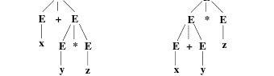

分析树由终结符和非终结符符号组成，通过线条连接。起始符号位于树的顶部，即“根”。终结符位于最低层级，即“叶子”。（出于某种原因，计算机科学家传统上将树画成叶子在底部、根在顶部。）产生式规则 A → w 在分析树中由符号 A 位于 w 中所有符号之上表示，并用一条线将 A 与 w 中的每个符号连接。例如，在上面的左侧分析树中，根 E 连接到符号 E、+ 和 E，这对应于应用产生式规则 E → E + E。

习惯上，将一串非终结符画在底部的一行，并在该基础之上构建树的其余部分。因此，上面显示的两个分析树可以画成：

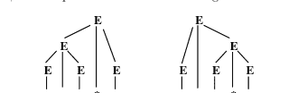

对于字符串的任何推导，都可以构建一棵显示该推导中每一步的分析树。然而，两种不同的推导可以产生相同的分析树，因为分析树不显示应用产生式规则的顺序。例如，上面左侧的分析树不显示产生式规则 E → x 是在产生式规则 E → E 之前还是之后应用。然而，如果我们将注意力限制在最左推导上，那么我们会发现每个分析树都对应一个唯一的最左推导，反之亦然。我将这一事实作为定理陈述，不作证明。类似的结果也适用于最右推导。

**定理 4.5.** 设 $G$ 为一个上下文无关文法。基于文法 $G$ 的分析树与最左推导之间存在一一对应关系。

基于这个定理，我们可以说，上下文无关文法 $G$ 是歧义的，当且仅当存在一个字符串 $w \in L(G)$ 拥有两棵分析树。

### 练习

- 1. 通过找到一个根据该文法具有两个最左推导的字符串，证明下列每个文法都是歧义的：
  - a) $S \to SS$
    - $S \to aSb$
    - $S \to baS$
    - $S \to \epsilon$
  - b) $S \to ASb$
    - $S \to \epsilon$
    - $A \to aA$
    - $A \to a$

- 2. 考虑字符串 $z + (x + y) * x$。根据本节给出的文法 $G_1$、$G_2$ 和 $G_3$，分别找出该字符串的一个最左推导。

- 3. 根据本节给出的文法 $G_1$、$G_2$ 和 $G_3$，分别为字符串 $(x + y) * z * x$ 画出一棵分析树。

- 4. 根据练习 1 部分 (a) 中给出的文法，为字符串 $ababbab$ 画出三棵不同的分析树。

- 5. 假设字符串 $abbcabac$ 根据某个文法 $G$ 具有以下分析树：

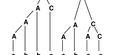

  - a) 鉴于这是一棵有效的分析树，列出文法 $G$ 中必须包含的五条产生式规则。
  - b) 根据文法 $G$，给出字符串 $abbcabac$ 的一个最左推导。
  - c) 根据文法 $G$，给出字符串 $abbcabac$ 的一个最右推导。

- 6. 展示根据文法 $G_3$ 对字符串 x + (y) * z 进行 LR(1) 分析所使用的完整移位和归约操作序列，并给出该字符串对应的最右推导。

- 7. 本节展示了如何使用 LL(1) 和 LR(1) 分析来找到由某个文法 $G$ 生成的语言 $L(G)$ 中字符串的一个推导。如何使用 LL(1) 或 LR(1) 分析来确定对于任意字符串 w 是否 w ∈ L(G)？请举例说明。

### 4.4 下推自动机

在上一章中，我们看到正规表达式与有限自动机之间存在着简洁的对应关系。也就是说，一种语言由正规表达式生成，当且仅当该语言被有限自动机接受。有限自动机分为确定型和非确定型两种，但这两种有限自动机在识别语言的能力上是等价的。因此，正规语言类可以用两种方式定义：要么作为可以由正规表达式生成的语言集合，要么作为可以由有限自动机（确定型或非确定型）识别的语言集合。

在本章中，我们介绍了上下文无关语言类，并考虑了如何使用上下文无关文法来生成上下文无关语言。你可能会想，是否存在某种可用于识别上下文无关语言的自动机。事实上，有：称为下推自动机的抽象机器可以用来定义上下文无关语言。也就是说，一种语言是上下文无关的，当且仅当存在一个接受该语言的下推自动机。

下推自动机本质上是一种带有称为栈的辅助数据结构的有限自动机。栈由一个有限的符号列表组成。符号可以添加到列表中并从列表中移除，但只能在列表的一端进行。可以添加和移除项目的列表末端称为栈顶。该列表通常被可视化为一堆垂直的符号，项目在顶部添加和移除。在栈顶添加一个符号称为将符号压入栈，移除一个符号称为从栈中弹出一个项目。在计算的每一步中，下推自动机能够对其栈执行多个压入和弹出操作（此外还可能读取正在由自动机处理的输入字符串中的一个符号）。

在给出下推自动机的正式定义之前，我们将看看它们如何通过状态转换图来表示。一个


### 4.4 下推自动机

下推自动机与 NFA 的图示类似，区别在于图中的每个转换都可能涉及栈操作。我们将在转换上使用形式为 \(\sigma, x/y\) 的标签，表示自动机从其输入字符串中消耗 \(\sigma\)，从栈中弹出 \(x\)，并将 \(y\) 压入栈中。\(\sigma\) 可以是 \(\varepsilon\) 或单个符号。\(x\) 和 \(y\) 是字符串，可能为空。（当字符串 \(x = a_1a_2 \cdots a_k\) 被压入栈时，符号按 \(a_k, \dots, a_1\) 的顺序压入，因此 \(a_1\) 最终位于栈顶；对于要从栈中弹出的 \(y = b_1b_2 \dots b_n\)，\(b_1\) 必须是栈顶符号，接着是 \(b_2\)，等等。）例如，考虑下推自动机的以下转换图：

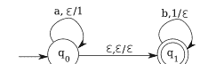

该下推自动机有起始状态 \(q_0\) 和一个接受状态 \(q_1\)。它可以读取字母表 \(\Sigma = \{a, b\}\) 上的字符串。从 \(q_0\) 到 \(q_0\)、标记为 \(a, \varepsilon/1\) 的转换表示，如果机器处于状态 \(q_0\)，则它可以从输入字符串中读取一个 \(a\)，不从栈中弹出任何内容，将 1 压入栈中，并保持在状态 \(q_0\)。同样，从 \(q_1\) 到 \(q_1\) 的转换表示，如果机器处于状态 \(q_1\)，它可以从输入字符串中读取一个 \(b\)，从栈中弹出一个 1，并不向栈中压入任何内容。最后，从状态 \(q_0\) 到 \(q_1\)、标记为 \(\varepsilon, \varepsilon/\varepsilon\) 的转换表示，机器可以在不读取、压入或弹出任何内容的情况下从状态 \(q_0\) 变为状态 \(q_1\)。

请注意，自动机只有在输入字符串的下一个符号是 \(b\) 且 1 在栈顶时，才能遵循转换 \(b, 1/\varepsilon\)。当它进行该转换时，它从输入中消耗 \(b\) 并从栈中弹出 1。由于在这种情况下，自动机将 \(\varepsilon\)（即根本没有任何符号）压入栈中，栈的净变化仅仅是弹出 1。

我们必须说明这个下推自动机接受字符串的含义。对于 \(w \in \{a, b\}^*\)，我们说这个下推自动机接受 \(w\) 当且仅当机器可以从其起始状态 \(q_0\) 开始，读取完整个 \(w\)，并在接受状态 \(q_1\) 结束，同时栈为空。特别是，机器仅结束于接受状态是不够的——它还必须清空栈。\(^1\)

\(^1\)我们可以放宽这一限制，只要求机器在读取字符串 \(w\) 后结束于接受状态，而不要求栈为空。事实上，使用这种接受定义不会改变下推自动机接受的语言类。

根据这一定义，不难看出，我们的下推自动机接受的语言是 \(\{a^n b^n \mid n \in \mathbb{N}\}\)。事实上，给定字符串 \(w = a^k b^k\)，机器可以通过 \(k\) 次遵循从 \(q_0\) 到 \(q_0\) 的转换来处理该字符串。这将消耗所有的 \(a\) 并将 \(k\) 个 1 压入栈中。然后机器可以跳转到状态 \(q_1\) 并 \(k\) 次遵循从 \(q_1\) 到 \(q_1\) 的转换。每次这样做时，它从输入中消耗一个 \(b\) 并从栈中弹出一个 1。最后，输入已被完全消耗且栈为空。因此，字符串 \(w\) 被自动机接受。反之，这个下推自动机只接受形式为 \(a^k b^k\) 的字符串，因为自动机结束于接受状态 \(q_1\) 的唯一方式是遵循从 \(q_0\) 到 \(q_1\) 的转换若干次，在此过程中读取 \(a\)，然后在某个时刻从 \(q_0\) 跳转到 \(q_1\)，接着遵循从 \(q_1\) 到 \(q_1\) 的转换若干次，在此过程中读取 \(b\)。这意味着接受的字符串必须是某些 \(k, \ell \in \mathbb{N}\) 的形式 \(a^k b^\ell\)。然而，在读取该字符串时，自动机将 \(k\) 个 1 压入栈并从栈中弹出 \(\ell\) 个 1。为了使栈最终为空，\(\ell\) 必须等于 \(k\)，这意味着字符串实际上是形式 \(a^k b^k\)，正如所声称的那样。

以下是另外两个示例。这些下推自动机使用一次推入或弹出多个符号的能力：

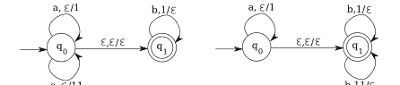

左边的自动机接受语言 \(\{a^n b^m \mid n \le m \le 2 * n\}\)。每次它读取一个 \(a\) 时，它将一个或两个 1 压入栈中，因此在读取 \(n\) 个 \(a\) 后，栈上 1 的数量在 \(n\) 到 \(2 * n\) 之间。如果机器随后跳转到状态 \(q_1\)，它必须能够读取恰好足够的 \(b\) 来清空栈，因此该机器接受的任何字符串都必须是形式 \(a^n b^m\) 且满足 \(n \le m \le 2 * n\)。反之，任何这样的字符串都可以被机器接受。同样，上面右边的自动机接受语言 \(\{a^n b^m \mid n/2 \le m \le n\}\)。要接受 \(a^n b^m\)，它必须将 1 压入栈中，然后为每个 \(b\) 弹出一个或两个 1；只有当 b 的数量在 \(n/2\) 到 \(n\) 之间时，这才能成功。

请注意，NFA 可以被视为不使用其栈的下推自动机。这意味着任何可以被 NFA 接受的语言（即任何正则语言）都可以被下推自动机接受。由于语言 \(\{a^n b^n \mid n \in \mathbb{N}\}\) 是上下文无关的但不是正则的，并且被上述下推自动机接受，我们看到下推自动机能够识别非正则的上下文无关语言，因此下推自动机比有限自动机更强大。

虽然这并不特别启发性，但我们可以给出下推自动机的正式定义。该定义至少清楚地说明，可用于栈上的符号集不一定与可用作输入的符号集相同。

### 定义 4.4. 下推自动机 $M$ 由六个组件 $M = (Q, \Sigma, \Lambda, q_0, \delta, F)$ 指定，其中

- $Q$ 是有限状态集。
- $\Sigma$ 是一个字母表。$\Sigma$ 是 $M$ 的 **输入字母表**。
- $\Lambda$ 是一个字母表。\(\Lambda\) 是 $M$ 的 **栈字母表**。
- $q_0 \in Q$ 是 $M$ 的 **起始状态**。
- \(F \subseteq Q\) 是 \(M\) 中的 **最终** 或 **接受** 状态集。
- \(\delta\) 是 \(M\) 中的转换集。\(\delta\) 可以被视为集合 \((Q \times (\Sigma \cup \{\epsilon\}) \times \Lambda^*) \times (Q \times \Lambda^*)\) 的有限子集。\(\delta\) 的一个元素 \(((q_1, \sigma, x), (q_2, y))\) 表示从状态 \(q_1\) 开始的转换，其中 \(M\) 从其输入字符串读取 \(\sigma\)，从栈中弹出 \(x\)，并将 \(y\) 压入栈中。

我们可以定义下推自动机 \(M = (Q, \Sigma, \Lambda, q_0, \delta, F)\) 接受的语言 \(L(M)\) 为集合 \(L(M) = \{w \in \Sigma^* \mid \text{从状态 } q_0 \text{ 开始，} M \text{ 可能读取完整个 } w \text{ 并在 } F \text{ 中的某个状态结束，且栈为空}\}\)。根据此定义，下推自动机接受的语言类与上下文无关文法生成的语言类相同。

### 定理 4.6. 设 \(\Sigma\) 为一个字母表，\(L\) 为 \(\Sigma\) 上的语言。那么 \(L\) 是上下文无关的，当且仅当存在一个输入字母表为 \(\Sigma\) 的下推自动机，使得 \(L = L(M)\)。

我们不会证明这个定理，但会讨论如何证明其中一个方向。假设 \(L\) 是字母表 \(\Sigma\) 上的上下文无关语言。设 \(G = (V, \Sigma, P, S)\) 为 \(L\) 的一个上下文无关文法。那么我们可以构造一个接受 \(L\) 的下推自动机 \(M\)。事实上，我们可以取 \(M = (Q, \Sigma, \Lambda, q_0, \delta, F)\)，其中 \(Q = \{q_0, q_1\}\)，\(\Lambda = \Sigma \cup V\)，\(F = \{q_1\}\)，并且 \(\delta\) 包含形式的转换


- ((q_0, \varepsilon, \varepsilon), (q_1, S));
- ((q_1, \sigma, \sigma), (q_1, \varepsilon)), 对于 \(\sigma \in \Sigma\)；以及
- ((q_1, \varepsilon, A), (q_1, x)), 对于 G 中的每个产生式 \(A \longrightarrow x\)。

转换 $((q_0, \varepsilon, \varepsilon), (q_1, S))$ 使 $M$ 从起始状态 $q_0$ 移动到接受状态 $q_1$，同时不读取任何输入并将 $S$ 压入栈。这是 $M$ 唯一可能的第一步移动。

形式为 $((q_1, \sigma, \sigma), (q_1, \varepsilon))$ 的转换，对于 \(\sigma \in \Sigma\) 允许 $M$ 从其输入字符串中读取 \(\sigma\)，前提是栈顶有一个 \(\sigma\)。请注意，如果 \(\sigma\) 在栈顶，那么此转换是 _唯一_ 适用的转换。实际上，任何出现在栈顶的终结符号都必须由输入字符串中的相同符号匹配，并且该转换规则允许 $M$ 同时从输入字符串中消耗该符号并将其从栈中移除。

第三种形式的转换，$((q_1, \varepsilon, A), (q_1, x))$ 当且仅当非终结符号 $A$ 在栈顶时才可应用。应用此规则时，$M$ 不消耗任何输入，但 $A$ 被产生式规则 \(A \longrightarrow x\) 右侧的字符串在栈顶替换。由于文法 $G$ 可以包含多个以 $A$ 为左侧的产生式规则，因此当 $A$ 在栈顶时，$M$ 中可能有多个适用的转换规则。这是 $M$ 中非确定性的唯一来源；请注意，它也是 $G$ 中非确定性的来源。

$L(M) = L(G)$ 的证明源于这样一个事实：即 $M$ 接受字符串 $w \in \Sigma^*$ 的计算，以自然方式对应于从 $G$ 的起始符号 $S$ 对 $w$ 的最左推导。与其证明这一事实，不如看一个示例。考虑以下上下文无关文法：

```
S \longrightarrow AB
A \longrightarrow aAb
A \longrightarrow \varepsilon
B \longrightarrow bB
B \longrightarrow b
```

该文法生成语言 \(\{a^n b^m | m > n\}\)。通过上述过程从此文法构造的下推自动机具有以下转换规则集：

- ((q_0, \epsilon, \epsilon), (q_1, S))
- ((q_1, a, a), (q_1, \epsilon))
- ((q_1, b, b), (q_1, \epsilon))
- ((q_1, \epsilon, S), (q_1, AB))
- ((q_1, \epsilon, A), (q_1, aAb))
- ((q_1, \epsilon, A), (q_1, \epsilon))
- ((q_1, \epsilon, B), (q_1, bB))
- ((q_1, \epsilon, B), (q_1, b))

假设在输入 $aabbbb$ 上运行该自动机。我们可以跟踪接受此输入的计算中应用的转换序列，并将计算与字符串的最左推导进行比较：

| 转换 | 已消耗输入 | 栈 | 推导 |
| :--- | :--- | :--- | :--- |
| ((q_0, \epsilon, \epsilon), (q_1, S)) | | S | S \(\Rightarrow\) AB |
| ((q_1, \epsilon, S), (q_1, AB)) | | AB | \(\Rightarrow\) aAbB |
| ((q_1, \epsilon, A), (q_1, aAb)) | | aAbB | \(\Rightarrow\) aaAbbB |
| ((q_1, a, a), (q_1, \epsilon)) | a | AbB | \(\Rightarrow\) |
| ((q_1, \epsilon, A), (q_1, aAb)) | a | aAbbB | \(\Rightarrow\) aaAbbB |
| ((q_1, a, a), (q_1, \epsilon)) | aa | AbbB | \(\Rightarrow\) |
| ((q_1, \epsilon, A), (q_1, \epsilon)) | aa | bbB | \(\Rightarrow\) |
| ((q_1, b, b), (q_1, \epsilon)) | aab | bB | \(\Rightarrow\) |
| ((q_1, b, b), (q_1, \epsilon)) | aabb | B | \(\Rightarrow\) |
| ((q_1, \epsilon, B), (q_1, bB)) | aabb | bB | \(\Rightarrow\) aabbbB |
| ((q_1, b, b), (q_1, \epsilon)) | aabbb | B | \(\Rightarrow\) |
| ((q_1, \epsilon, B), (q_1, b)) | aabbb | b | \(\Rightarrow\) aabbbb |
| ((q_1, b, b), (q_1, \epsilon)) | aabbbb | | \(\Rightarrow\) |

请注意，在此计算过程中，已消耗的输入与栈内容的连接始终等于最左推导中的某个字符串。应用形式为 ((q_1, \sigma, \epsilon), (q_1, \epsilon)) 的规则的效果是将“栈”列中的一个终结符号移至“已消耗输入”列。应用形式为 \(((q_1, \epsilon, A), (q_1, x))\) 的规则的效果是将最左推导的下一步应用于栈顶的非终结符号。（在“栈”列中，下推自动机的栈以栈顶在左侧的方式显示。）最终，整个输入字符串已被消耗且栈为空，这意味着该字符串已被下推自动机接受。可以清楚地看出，对于任何上下文无关文法 G，最左推导与由 G 构造的下推自动机执行的计算之间始终存在同样的对应关系。

下推自动机的计算可能涉及非确定性。也就是说，在计算的某个时刻，可能有多个适用的转换规则。当情况并非如此时——也就是说，当不存在两个不同的转换规则同时适用的情况时——我们说该下推自动机是 **确定性** 的。请注意，确定性下推自动机可以具有形式为 \(((q_i, \epsilon, x), (q_j, y))\)（甚至 \(((q_i, \epsilon, \epsilon), (q_j, y))\)）的转换规则，前提是这是从状态 \(q_i\) 的唯一转换。还请注意，确定性下推自动机可能会“卡住”：也就是说，在某些情况下可能没有规则适用，即使输入尚未完全消耗或栈非空。如果确定性下推自动机在读取字符串 x 时卡住，那么 x 不会被该自动机接受。

本节开头给出的接受语言 \(\{a^n b^n | n \in \mathbb{N}\}\) 的自动机不是确定性的。然而，为该语言构造一个确定性下推自动机很容易：

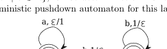

然而，考虑语言 \(\{ww^R | w \in \{a, b\}\}\)。以下是接受该语言的下推自动机：

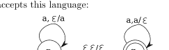

在状态 q0 中，该机器将输入字符串的第一部分复制到栈上。在状态 q1 中，它尝试将输入的其余部分与栈内容进行匹配。为了使此操作成功，它必须通过遵循从状态 \(q_0\) 到状态 \(q_1\) 的转换来“猜测”字符串中间出现的位置。在这种情况下，构造一个接受相同语言的确定性下推自动机是否可能，远非显而易见。

此时，可能会想将确定性上下文无关语言定义为存在接受该语言的确定性下推自动机的语言。然而，此定义存在一个技术问题：我们需要使下推自动机能够检测输入字符串的结束。考虑语言 \(\{w \mid w \in \{a, b\}^* \land n_a(w) = n_b(w)\}\)，它由字母表 \(\{a, b\}\) 上的字符串组成，其中 \(a\) 的数量等于 \(b\) 的数量。该语言由以下下推自动机接受：

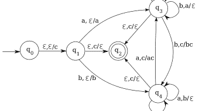

在此自动机中，首先将 \(c\) 压入栈，并且它在计算结束前一直保留在栈底。在读取输入字符串的过程中，如果机器处于状态 \(q_3\)，那么已读取的 \(a\) 的数量大于或等于已读取的 \(b\) 的数量，且栈包含已读取的多余 \(a\) 的（副本）。同样，如果机器处于状态 \(q_4\)，那么已读取的 \(b\) 的数量大于或等于已读取的 \(a\) 的数量，且栈包含已读取的多余 \(b\) 的（副本）。随着计算的进行，如果栈中仅包含 \(c\)，那么机器已消耗的 \(a\) 的数量等于已消耗的 \(b\) 的数量；在这种情况下，机器可以从栈中弹出 \(c\)——使栈为空——并跳转到状态 \(q_2\)。如果此时已读取整个字符串，那么该字符串


被接受。这涉及非确定性，因为自动机必须“猜测”何时跳转到状态 $q_2$；它无法知道是否实际上已经到达了字符串的末尾。

虽然这个下推自动机不是确定性的，但我们可以轻松地对其进行修改，得到一个接受密切相关语言的确定性下推自动机。我们只需向语言中添加一个特殊的字符串结束符号。我们使用符号 $ 来实现此目的。以下确定性自动机接受语言 $\{w\$ \mid w \in \{a, b\}^*, n_a(w) = n_b(w)\}$ ：

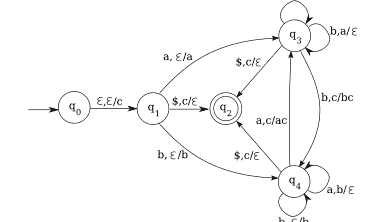

在这个修改后的自动机中，机器只有在读取字符串结束符号时，且此时已消耗的 a 的数量等于 b 的数量，才能到达接受状态 $q_2$。受此示例启发，我们定义语言为确定性上下文无关语言的含义如下：

### 定义 4.5. 设 L 是字母表 Σ 上的语言，且 $ 是不在 Σ 中的符号。如果存在一个确定性下推自动机接受语言 $L\$（即 $\{w\$ \mid w \in L\}$），则我们称 L 为确定性上下文无关语言。

存在不是确定性上下文无关的上下文无关语言。这意味着对于下推自动机，非确定性增加了真正的能力。这与有限自动机的情况形成对比，在有限自动机中，确定性有限自动机和非确定性有限自动机在接受同一类语言的意义上能力等价。

确定性上下文无关语言可以被高效解析。LL(1) 解析和 LR(1) 解析都可以用确定性下推自动机来定义，尽管我们在此未深入探讨该方法。

### 练习

- 1. 识别以下每个下推自动机所接受的上下文无关语言。解释你的答案。

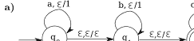

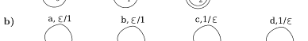

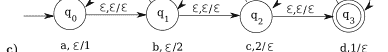

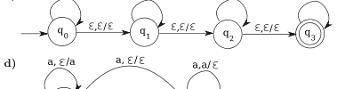

- 2. 设 B 是字母表 $\{(, )\}$ 上的语言，由平衡的括号字符串组成，其含义是每个左括号都有匹配的右括号且嵌套正确。示例包括 ()、()()、(()())(()()) 以及空字符串。找出接受语言 B 的确定性下推自动机。解释你的自动机如何工作，并说明在什么情况下它会无法接受给定的括号字符串。

- 3. 假设 L 是字母表 $\Sigma$ 上的语言。假设存在一个接受 L 的确定性下推自动机。证明 L 是确定性上下文无关的。也就是说，展示如何构建一个接受语言 $L\$$ 的确定性下推自动机。（假设符号 $ 不在 $\Sigma$ 中。）

- 4. 找出接受语言 $\{wcw^R \mid w \in \{a, b\}^*\}$ 的确定性下推自动机。

- 5. 证明语言 $\{a^nb^m \mid n \neq m\}$ 是确定性上下文无关的。

- 6. 证明语言 $L = \{w \in \{a, b\}^* \mid n_a(w) > n_b(w)\}$ 是确定性上下文无关的。

- 7. 设 \( M = (Q, \Sigma, \Lambda, q_0, \delta, F) \) 为一个下推自动机。定义 \( L'(M) \) 为语言 \( L'(M) = \{w \in \Sigma^* \mid \text{M 可以从状态 } q_0 \text{ 开始，读取 } w \text{ 的全部内容，并结束于接受状态}\} \)。\( L'(M) \) 与 \( L(M) \) 的区别在于，对于 \( w \in L'(M) \)，我们不要求计算结束时栈为空。
  - a) 证明存在一个下推自动机 \( M' \)，使得 \( L'(M') = L'(M) \)。
  - b) 证明语言 \( L \) 是上下文无关的，当且仅当存在一个下推自动机 \( M \) 使得 \( L = L'(M) \)。
  - c) 识别练习 1 中每个自动机的语言 \( L'(M) \)。

- 8. 设 \( L \) 是字母表 \( \Sigma \) 上的正则语言，\( K \) 是同一字母表上的上下文无关语言。设 \( M = (Q, \Sigma, q_0, \delta, F) \) 为接受 \( L \) 的 DFA，\( N = (P, \Sigma, \Lambda, p_0, \delta, E) \) 为接受 \( K \) 的下推自动机。通过构建一个接受 \( L \cap K \) 的下推自动机，证明语言 \( L \cap K \) 是上下文无关的。该下推自动机可以构建为 \( M \) 和 \( N \) 的“交叉积”，其中状态集为 \( Q \times P \)。该构造类似于第 3.6 节末尾给出的两个正则语言的交集是正则语言的证明。

### 4.5 非上下文无关语言

我们已经看到存在不是正则语言的上下文无关语言。自然会产生这样的问题：是否存在不是上下文无关的语言？从抽象层面回答这个问题很容易：对于给定的字母表 \( \Sigma \)，存在不可数多个 \( \Sigma \) 上的语言，但只有可数多个 \( \Sigma \) 上的上下文无关语言。因此，大多数语言都不是上下文无关的。然而，这个答案并不十分令人满意，因为它没有给出任何具体的非上下文无关语言的示例。

与正则语言的情况类似，证明给定语言 \( L \) 不是上下文无关的一种方法是找到所有上下文无关语言共享的某个属性，然后证明 \( L \) 不具备该属性。事实证明，存在针对上下文无关语言的类似泵引理。该引理的证明使用分析树。在证明中，我们需要一种表示抽象分析树的方法，而无需展示树的所有细节。下图

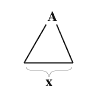

表示一棵分析树，其根为非终结符 A，树的“底部”为字符串 x。（也就是说，x 是由树枝端点的所有符号从左到右组成的字符串。）请注意，这可能是一棵部分分析树——即可能是更大树的一部分。也就是说，我们不要求 A 是文法的起始符号，并允许 x 包含终结符和非终结符。位于树底部的字符串 x 被称为分析树的**产出**。有时，我们需要在树中展示更明确的细节。

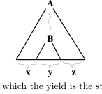

表示一棵分析树，其产出为字符串 xyz。字符串 y 是根为 B 的较小树的产出，该较小树包含在较大树中。请注意，字符串 x、y 或 z 中的任何一个都可能是空字符串。

我们还需要分析树**高度**的概念。分析树的高度是从树根到其某个树枝末端的最长路径的长度。

与正则语言版本类似，上下文无关语言的泵引理表明，上下文无关语言中任何足够长的字符串都包含一个可以重复以产生语言中新字符串的模式。然而，在这种情况下模式更为复杂。对于正则语言，模式产生的原因是任何穿过给定 DFA 的足够长路径都必须包含一个循环。对于上下文无关语言，模式产生的原因是在足够大的分析树中，沿着从树根到某个树枝末端的路径，必然存在某个出现多次的非终结符。

> 定理 4.7（上下文无关语言泵引理）。假设 L 是上下文无关语言。那么存在一个整数 K，使得任何满足 $|w| \ge K$ 的字符串 $w \in L(G)$ 都具有以下性质：w 可以写成 $w = uvxyz$ 的形式，其中
> - x 和 z 不能同时为空字符串；
> - $|vyz| < K$；
> - 对于任何 $n \in \mathbb{N}$，字符串 $uv^n x y^n z$ 属于 L。

证明。设 $G = (V, \Sigma, P, S)$ 为语言 L 的上下文无关文法。设 N 为 G 中非终结符的数量加 1。也就是说，


$N = |V| + 1$. 考虑文法 $G$ 所有高度小于或等于 $N$ 的可能分析树。（包括以任何非终结符号为根的分析树，而不仅仅是以根 $S$ 的分析树。）这样的分析树只有有限多个，因此作为这些分析树产出的不同字符串也只有有限多个。令 $K$ 为一个大于任何这样的字符串长度的整数。

现在假设 $w$ 是 $L$ 中任意长度大于或等于 $K$ 的字符串。那么 $w$ 的任何分析树必须具有大于 $N$ 的高度。（这是因为 $|w| \ge K$ 且任何高度 $\le N$ 的分析树的产出长度小于 $K$。）考虑 $w$ 的一个最小尺寸的分析树，即包含最少可能节点数的分析树。由于该分析树的高度大于 $N$，存在从树根到树枝末端的至少一条长度大于 $N$ 的路径。考虑最长的这条路径。该路径末端的符号是终结符号，但路径上的所有其他符号都是非终结符号。路径上至少有 $N$ 个这样的非终结符号。由于不同非终结符号的数量是 $|V|$ 且 $N = |V| + 1$，路径上必有某个非终结符号出现两次。事实上，路径上最底部的 $N$ 个非终结符号中必有某个非终结符号出现两次。将此符号称为 $A$。那么我们可以看到，$w$ 的分析树具有如下形式：


该树的结构将字符串 $w$ 分解为五个子串，如上图所示。于是我们有 $w = uxyzv$。只剩下证明 $x, y,$ 和 $z$ 满足定理中陈述的三个要求。

令 $T$ 指代整个分析树，令 $T_1$ 指代根为图中上方 $A$ 的分析树，令 $T_2$ 指代根为图中下方 $A$ 的分析树。注意 $T_1$ 的高度小于或等于 N。（这源于两个事实：T1 中从其根到其基的路径长度小于或等于 N，因为我们选择 $A$ 的两个出现位置位于 $T$ 从根到基的路径上最底部的 N 个非终结符号之中。我们知道从 $T_1$ 的根到其基没有更长的路径，因为我们选择 $T$ 中的路径为从 $T$ 的根到其基的最长可能路径。）由于任何高度小于或等于 N 的分析树的产出长度小于 K，我们看到 |xyz| < K。

如果我们从 $T$ 中移除 $T_1$ 并用 $T_2$ 的副本替换它，结果是一个产出为 uvy 的分析树，因此我们看到字符串 uvy 属于语言 $L$。现在，假设 x 和 z 都等于空字符串。在这种情况下，w = uvy，因此我们创建的树将是 w 的另一个分析树。但这个树比 $T$ 小，这将与 $T$ 是 w 的最小分析树这一事实相矛盾。我们看到 x 和 z 不能同时为空字符串。

如果我们从 $T$ 中移除 $T_2$ 并用 $T_1$ 的副本替换它，结果是一个产出为 ux^2 y z^2 v 的分析树，因此我们看到 ux^2 y z^2 v ∈ L。我们创建的两个分析树如下所示：


此外，我们可以将将 T2 替换为 T1 副本的过程应用到上面右侧的树上，以创建一个产出为 ux^3 y z^3 v 的分析树。继续这样做，我们看到对于所有 n ∈ N，都有 ux^n y z^n v ∈ L。这完成了定理的证明。

由于该定理保证所有上下文无关语言都具有某个属性，它可以用来证明特定语言不是上下文无关的。方法是表明所讨论的语言不具有定理所保证的属性。我们给出两个例子。

### Corollary 4.8. 令 \( L \) 为语言 \(\{a^n b^n c^n \mid n \in \mathbb{N}\}\)。那么 \( L \) 不是上下文无关语言。

### 证明. 我们用反证法证明。假设 \( L \) 是上下文无关的。那么，根据上下文无关语言的泵引理，存在一个整数 \( K \)，使得每个满足 \( |w| \ge K \) 的字符串 \( w \in L \) 都可以写成 \( w = uxyzv \) 的形式，其中 \( x \) 和 \( z \) 不能同时为空；\( |xyz| < K \)，并且对于每个 \( n \in \mathbb{N} \)，都有 \( ux^i y z^i v \in L \)。

考虑字符串 \( w = a^K b^K c^K \)，它属于 \( L \)，并写成 \( w = uxyzv \)，其中 \( u, x, y, z, \) 和 \( v \) 满足所述条件。由于 \( |xyz| < K \)，我们看到如果 \( xyz \) 包含一个 \( a \)，则它不能包含 \( c \)。如果它包含一个 \( c \)，则它不能包含 \( a \)。也有可能 \( xyz\) 完全由 \( b \) 组成。在这些情况下，字符串 \( ux^2 y z^2 v \) 不能属于 \( L \)，因为它不包含相同数量的 \( a \)、\( b \) 和 \( c \)。但这与对于所有 \( n \in \mathbb{N} \) 都有 \( ux^i y z^i v \in L \) 这一事实相矛盾。这个矛盾表明 \( L \) 是上下文无关的假设是不正确的。

### Corollary 4.9. 令 \( \Sigma \) 为包含至少两个符号的任意字母表。令 \( L \) 为在 \( \Sigma \) 上由 \( L = \{ss \mid s \in \Sigma^*\} \) 定义的语言。那么 \( L \) 不是上下文无关的。

### 证明. 为了矛盾，假设 \( L \) 是上下文无关的。那么，根据上下文无关语言的泵引理，存在一个整数 \( K \)，使得每个满足 \( |w| \ge K \) 的字符串 \( w \in L \) 都可以写成 \( w = uxyzv \) 的形式，其中 \( x \) 和 \( z \) 不能同时为空；\( |xyz| < K \)，并且对于每个 \( n \in \mathbb{N} \)，都有 \( ux^i y z^i v \in L \)。

令 \( a \) 和 \( b \) 表示 \( \Sigma \) 中不同的符号。令 \( s = a^K b^K b a^K \) 并令 \( w = ss = a^K b^K b a^K b a^K b^K b a^K \)，它属于 \( L \)。写成 \( w = uxyzv \)，其中 \( u, x, y, z, \) 和 \( v \) 满足所述条件。

由于 \( |xyz| < K \)，\( x \) 和 \( z \) 合起来最多包含一个 \( b \)。如果 \( x \) 或 \( z \) 包含一个 \( b \)，那么 \( ux^2 y z^2 v \) 包含恰好五个 \( b \)。但 \( L \) 中的任何字符串都形式为某个字符串 \( r \) 的 \( rr \)，因此包含偶数个 \( b \)。\( ux^2 y z^2 v \) 包含五个 \( b \) 这一事实与 \( ux^i y z^i v \in L \) 这一事实相矛盾。因此，在 \( x \) 或 \( z \) 包含 \( b \) 的情况下，我们得到一个矛盾。

现在，考虑 \( x \) 和 \( z \) 完全由 \( a \) 组成的情况。同样由于 \( |xyz| < K \)，我们必须有 \( x \) 和 \( z \) 都包含在字符串 \( a^K b^K b a^K b a^K b^K b a^K \) 的同一组 \( a \) 中，或者 \( x \) 包含在一组 \( a \) 中而 \( z \) 包含在下一组中。在这两种情况下，很容易检查字符串 $ux^2 y z^2 v$ 不再是任何字符串 $r$ 的形式 $rr$，这与 $ux^2 y z^2 v \in L$ 这一事实相矛盾。

由于在每种情况下都会导致矛盾，我们看到 \( L \) 是上下文无关的假设必须是不正确的。

现在我们有了一些不是上下文无关的语言的例子，可以解决关于上下文无关语言的一些其他问题。特别是，我们可以证明两个上下文无关语言的交集不一定是上下文无关的，并且上下文无关语言的补集不一定是上下文无关的。

### **Theorem 4.10.** 两个上下文无关语言的交集不一定是上下文无关语言。

### 证明. 要证明这一点，只需给出两个上下文无关语言 $L$ 和 $M$ 的例子，使得 $L \cap M$ 不是上下文无关语言。考虑以下在字母表 $\Sigma = \{a, b, c\}$ 上定义的语言：

```
$L = \{a^n b^n c^m \mid n \in \mathbb{N} \text{ and } m \in \mathbb{N}\}$
$M = \{a^m b^m c^n \mid n \in \mathbb{N} \text{ and } m \in \mathbb{N}\}$
```

注意，$L$ 中的字符串包含相同数量的 $a$ 和 $b$，而 $M$ 中的字符串包含相同数量的 $b$ 和 $c$。因此，$L \cap M$ 中的字符串包含相同数量的 $a$、$b$ 和 $c$。即，

```
$L \cap M = \{a^n b^n c^n \mid n \in \mathbb{N}\}$
```

根据上面的定理，我们知道 $L \cap M$ 不是上下文无关的。然而，$L$ 和 $M$ 都是上下文无关的。语言 $L$ 由以下上下文无关文法生成：

```
$S \longrightarrow TC$
$C \longrightarrow cC$
$C \longrightarrow \varepsilon$
$T \longrightarrow aTb$
$T \longrightarrow \varepsilon$
```

而 $M$ 由类似的上下文无关文法生成。

### **Corollary 4.11.** 上下文无关语言的补集不一定是上下文无关的。


证明。假设为了矛盾，每个上下文无关语言的补集都是上下文无关的。

设 $L$ 和 $M$ 为字母表 $\Sigma$ 上的两个上下文无关语言。根据我们的假设，补集 $\overline{L}$ 和 $\overline{M}$ 是上下文无关的。根据定理 4.3，可知 $L \cup \overline{M}$ 是上下文无关的。再次应用我们的假设，我们有 $\overline{L \cup \overline{M}}$ 是上下文无关的。但 $\overline{L \cup \overline{M}} = L \cap M$，所以 $L \cap M$ 是上下文无关的。

我们已经表明，基于任何上下文无关语言的补集是上下文无关的这一假设，任何两个上下文无关语言的交集是上下文无关的。但这与前一个定理矛盾，因此我们看到该假设不能为真。这证明了定理。$\square$

请注意，前面的定理和推论仅说明对于 _某些_ 上下文无关语言 $L$ 和 $M$，$L \cap M$ 不是上下文无关的，并且对于某些上下文无关语言 $L$，$\overline{L}$ 不是上下文无关的。当然，有许多上下文无关语言 $L$ 和 $M$ 的例子，其中 $L \cap M$ 和 $\overline{L}$ 实际上是上下文无关的。

尽管两个上下文无关语言的交集不一定是上下文无关的，但一个上下文无关语言与一个 _正则_ 语言的交集总是上下文无关的。我不会证明这个结果，但由于它对于证明某些语言是或不是上下文无关的很有用，我在此无证明地陈述它：

**定理 4.12.** 假设 $L$ 是一个上下文无关语言，且 $M$ 是一个正则语言。那么 $L \cap M$ 是一个上下文无关语言。

例如，设 $L$ 和 $M$ 为由 $L = \{w \in \{a, b\}^* \mid w = w^R\}$ 和 $M = \{w \in \{a, b\}^* \mid \text{the length of } w \text{ is a multiple of 5}\}$ 定义的语言。由于 $L$ 是上下文无关的且 $M$ 是正则的，我们知道 $L \cap M$ 是上下文无关的。语言 $L \cap M$ 由字母表 $\{a, b\}$ 上长度为 5 的倍数的每个回文组成。

这个定理也可以用来证明某些语言不是上下文无关的。例如，考虑语言 $L = \{w \in \{a, b, c\}^* \mid n_a(w) = n_b(w) = n_c(w)\}$。（回顾，$n_x(w)$ 是符号 $x$ 在字符串 $w$ 中出现的次数。）我们可以使用反证法来证明 $L$ 不是上下文无关的。设 $M$ 为由正则表达式 $a^*b^*c^*$ 定义的正则语言。显然，$L \cap M = \{a^n b^n c^n \mid n \in \mathbb{N}\}$。如果 $L$ 是上下文无关的，那么根据前一个定理，$L \cap M$ 将是上下文无关的。然而，我们知道根据定理 4.8，$L \cap M$ 不是上下文无关的。因此我们可以得出结论，$L$ 不是上下文无关的。

### 练习

- 1. 证明以下语言不是上下文无关的：
  - a) \(\{a^n b^m c^k \mid n > m > k\}\)
  - b) \(\{w \in \{a, b, c\}^* \mid n_a(w) > n_b(w) > n_c(w)\}\)
  - c) \(\{ww^R w \mid w \in \{a, b\}^*\}\)
  - d) \(\{a^m b^n c^k \mid m, n \in \mathbb{N} \text{ 且 } k = m * n\}\)
  - e) \(\{a^n b^m \mid n = m^2\}\)

- 2. 证明语言 \(\{a^n \mid n \text{ 是素数}\}\) 和 \(\{a^{n^2} \mid n \in \mathbb{N}\}\) 不是上下文无关的。（事实上，可以证明字母表 \(\{a\}\) 上的语言是上下文无关的当且仅当它是正则的。）

- 3. 证明语言 \(\{w \in \{a, b\}^* \mid n_a(w) = n_b(w) \text{ 且 } w \text{ 包含字符串 } baab \text{ 作为子串}\}\) 是上下文无关的。

- 4. 假设 \(M\) 是任何有限语言，且 \(L\) 是任何上下文无关语言。证明语言 \(L \setminus M\) 是上下文无关的。（提示：任何有限语言都是正则语言。）

### 4.6 广义文法

在本章开头，介绍了文法作为重写规则或产生式规则集合的一般概念。然而，在本章的大部分内容中，我们将注意力限制在上下文无关文法上，其中产生式规则必须形式为 \(A \to x\)，其中 \(A\) 是非终结符。在本节中，我们将考虑广义文法，即对产生式规则形式没有此类限制的文法。对于广义文法，产生式规则形式为 \(u \to x\)，其中 \(u\) 是可以包含终结符和非终结符的字符串。为方便起见，我们将假设 \(u\) 至少包含一个非终结符，尽管即使取消此限制也不会改变文法可以生成的语言类。请注意，上下文无关文法实际上是广义文法的一个示例，因为广义文法中的产生式规则允许形式为 \(A \to x\)。它们只是不必是这种形式。我将使用未修饰的术语 *文法* 来指代广义文法。文法的定义与上下文无关文法的定义相同，除了产生式规则的形式：

2. 还有一种特殊的文法类型，介于上下文无关文法和广义文法之间。在所谓的 *上下文相关文法* 中，每个产生式规则形式为 \(u \to x\)，其中 \(|x| \ge |u|\)。我们将在本教材中不涉及上下文相关文法。

### 定义 4.6. 文法是一个 4 元组 $(V, \Sigma, P, S)$，其中：

- 1. $V$ 是符号的有限集合。$V$ 的元素是文法的非终结符。
- 2. $\Sigma$ 是符号的有限集合，使得 $V \cap \Sigma = \emptyset$。$\Sigma$ 的元素是文法的终结符。
- 3. $P$ 是产生式规则集合。每个规则形式为 $u \longrightarrow x$，其中 $u$ 和 $x$ 是 $(V \cup \Sigma)^*$ 中的字符串，且 $u$ 至少包含 $V$ 中的一个符号。
- 4. $S \in V$。$S$ 是文法的起始符号。

假设 $G$ 是一个文法。与上下文无关的情况一样，$G$ 生成的语言表示为 $L(G)$，定义为 $L(G) = \{x \in \Sigma^* \mid S \Rightarrow_G^* x\}$。也就是说，字符串 $x$ 在 $L(G)$ 中当且仅当 $x$ 是终结符字符串，并且存在一个从起始符号 $S$ 在一步或多步中产生 $x$ 的推导。

自然的问题是，是否存在可以由广义文法生成但不能由上下文无关语言生成的语言。我们可以通过给出这样的语言示例立即回答这个问题。设 $L$ 为语言 $L = \{w \in \{a, b, c\}^* \mid n_a(w) = n_b(w) = n_c(w)\}$。我们在上一节末尾看到 $L$ 不是上下文无关的。然而，$L$ 由以下文法生成：

```
$S \longrightarrow SABC$
$S \longrightarrow \varepsilon$
$AB \longrightarrow BA$
$BA \longrightarrow AB$
$AC \longrightarrow CA$
$CA \longrightarrow AC$
$BC \longrightarrow CB$
$CB \longrightarrow BC$
$A \longrightarrow a$
$B \longrightarrow b$
$C \longrightarrow c$
```

对于这个文法，非终结符集合是 $\{S, A, B, C\}$，终结符集合是 $\{a, b, c\}$。由于在广义文法中，终结符和非终结符都可以出现在产生式规则的左侧，因此通常仅通过查看产生式规则列表无法确定哪些符号是非终结符，哪些是终结符。然而，我将遵循大写字母始终是非终结符的约定。根据此约定，我可以继续仅通过列出产生式规则来指定文法。

上述文法的前两条规则使得可以产生字符串 \(\epsilon\)、\(ABC\)、\(ABCABC\)、\(ABCABCABC\) 等等。这些字符串中的每一个都包含相同数量的 \(A\)、\(B\) 和 \(C\)。接下来的六条规则允许更改字符串中非终结符的顺序。它们使得可以将 \(A\)、\(B\) 和 \(C\) 排列成任意顺序。请注意，这些规则不可能出现在上下文无关文法中。最后三条规则将非终结符 \(A\)、\(B\) 和 \(C\) 转换为相应的终结符 \(a\)、\(b\) 和 \(c\)。请记住，必须消除所有非终结符才能产生 \(L(G)\) 中的字符串。下面，例如，是使用此文法对字符串 \(baabc\) 的推导。在每一行中，下一行将被替换的字符串有下划线。

```
S => SABC
=> SABCBC
=> BACABC
=> BAABCB
=> BAAABCC
=> baAABCC
=> baDABCC
=> baaBCC
=> baabCC
=> baabcC
=> baabcc
```

我们可以以类似的方式产生 \(L\) 中的任何字符串。当然，这只表明 \(L \subseteq L(G)\)。要表明 \(L(G) \subseteq L$，我们可以观察到，对于任何满足 \(S \Rightarrow^* w\) 的字符串 \(w\)，都有 \(n_A(w) + n_a(w) = n_B(w) + n_b(w) = n_C(w) + n_c(w)\)。这是因为规则 \(S \Rightarrow SABC\) 产生满足 \(n_A(w) = n_B(w) = n_C(w)\) 的字符串，且没有其他规则会改变 \(n_A(w) + n_a(w)\)、\(n_B(w) + n_b(w)\) 或 \(n_C(w) + n_c(w)\) 中的任何量。在应用这些规则产生字符串 \(x \in L(G)\) 后，我们必须有 \(n_A(x)\)、\(n_B(x)\) 和 \(n_C(x)\) 都为零。然后，\(n_a(x) = n_b(x) = n_c(x)\) 的事实源于 \(n_A(x) + n_a(x) = n_B(x) + n_b(x) = n_C(x) + n_c(x)\)。也就是说，\(x \in L\)。

我们第一个非上下文无关语言的例子是 \(\{a^n b^n c^n | n \in \mathbb{N}\}\)。该语言可以由类似于 pre- 的广义文法生成。


上一个示例。然而，要将 a、b、c 强制排列成正确顺序，需要一些技巧。为此，我们不允许 A、B、C 自发地转换为 a、b、c，而是使用额外的非终结符，仅在它们位于正确位置后才将其转换。下面是一个实现此功能的文法：

- S -> SABC
- S -> X
- BA -> AB
- CA -> AC
- CB -> BC
- XA -> aX
- X -> Y
- Y -> bY
- Y -> Z
- Z -> cZ
- Z -> \(\epsilon\)

这里，前两条规则允许字符串 X、XABC、XABCABC、XABCABCABC 等等。接下来的三条规则允许 A 向左移动、C 向右移动，生成形式为 \(XA^p B^q C^n\) 的字符串，其中 \(n \in \mathbb{N}\)。规则 XA -> aX 允许 X 从左到右穿过 A，并在过程中将 A 转换为 a。转换完所有 A 后，X 可以转换为 Y。随后 Y 将穿过 B，将它们转换为 b。然后 Y 转换为 Z，Z 负责将 C 转换为 c。最后，应用规则 \(Z \to \epsilon\) 移除 Z，留下字符串 \(a^p b^q c^n\)。

请注意，如果在所有 A 都转换为 a 之前就应用了规则 \(X \to Y\)，那么剩余的 A 将无法转换为 a 或以其他方式从字符串中移除。这意味着推导已进入死胡同，永远无法生成仅由终结符组成的字符串。唯一能生成该文法所定义语言中字符串的推导，是 X 穿过所有 A 并将它们全部转换为 a 的推导。在推导的这一阶段，字符串形式为 \(a^n X u\)，其中 u 是仅由 B 和 C 组成的字符串。此时，可以应用规则 \(X \to Y\)，生成字符串 \(a^n Y u\)。然后，若要生成终结符字符串，Y 必须穿过所有 B，生成字符串 \(a^n b^q Y C^n\)。可以看出，使用三个独立的非终结符 X、Y 和 Z，对于强制 \(a^p b^q c^n\) 中的符号按正确顺序排列是必不可少的。

再举一个例子，考虑语言 \(\{a^{n^2} \mid n \in \mathbb{N}\}\)。与本节中考虑的其他语言一样，这种语言不是上下文无关的。然而，它可以由文法生成。考虑以下文法

```
S --> DTE
T --> BTA
T --> \varepsilon
A --> aaB
BA --> aB
Ba --> aB
BE --> E
DA --> D
Da --> aD
DE --> \varepsilon
```

前三条规则生成所有形式为 \(DB^n A^n E\) 的字符串，其中 \(n \in \mathbb{N}\)。让我们考虑在应用其余规则时，字符串 \(DB^n A^n E\) 会发生什么。接下来的两条规则允许一个 \(B\) 向右移动，直到到达 \(E\)。每次 \(B\) 穿过一个 \(A\) 时，就会生成一个新的 \(a\)，但 \(B\) 只是简单地穿过 \(a\)，而不生成任何其他字符。一旦 \(B\) 到达 \(E\)，规则 \(BE \longrightarrow E\) 就会使 \(B\) 消失。字符串 \(DB^n A^n E\) 中的每个 \(B\) 都会穿过 \(n\) 个 \(A\) 并生成 \(n\) 个 \(a\)。由于有 \(n\) 个 \(B\)，总共生成了 \(n^2\) 个 \(a\)。现在，要消除字符串开头的 \(D\)，唯一的方法是让它向右穿过所有的 \(A\) 和 \(a\)，直到到达字符串末尾的 \(E\)。在此过程中，规则 \(DA \longrightarrow D\) 从字符串中消除所有的 \(A\)，留下字符串 \(a^{n^2} DE\)。对此应用规则 \(DE \longrightarrow \varepsilon\) 得到 \(a^{n^2}\)。该字符串不包含任何非终结符，因此属于该文法生成的语言。我们可以看到，每个形式为 \(a^{n^2}\) 的字符串都由该文法生成。此外，只有这种形式的字符串才能由该文法生成。

给定固定字母表 \(\Sigma\)，由文法生成的 \(\Sigma\) 上的不同语言只有可数多个。由于 \(\Sigma\) 上有不可数多个不同的语言，我们知道有许多语言无法由文法生成。然而，要找到这样的语言的实际示例却出奇地困难。作为一个初步猜测，你可能会怀疑，正如 \(\{a^n b^n \mid n \in \mathbb{N}\}\) 是非正则语言的示例，\(\{a^n b^n c^n \mid n \in \mathbb{N}\}\) 是非上下文无关语言的示例，那么 \(\{a^n b^n c^n d^n \mid n \in \mathbb{N}\}\) 可能是无法由任何文法生成的语言的示例。然而，情况并非如此。用于生成 \(\{a^n b^n c^n \mid n \in \mathbb{N}\}\) 的文法的相同技术，也可以用于为 \(\{a^n b^n c^n d^n \mid n \in \mathbb{N}\}\) 生成文法。事实上，该技术可扩展到基于任意数量符号的类似语言。

或者你可能会猜测，语言 \(\{a^n \mid n \text{ 是质数}\}\) 没有文法。当然，生成质数似乎不是我们通常会用文法来做的事情。尽管如此，确实存在一个生成该语言的文法。我们不会实际写出该文法，但最终我们会有一种方法来证明它的存在。

语言 \(\{a^{n^2} \mid n \in \mathbb{N}\}\) 同样看起来并不十分“文法化”，但我们上面为它生成了一个文法。如果你思考这个文法的工作原理，可能会觉得它的运作更像“计算”而非“文法”。这就是我们的线索。文法可以被视为一种程序，尽管它以非确定性方式执行。事实证明，一般文法与任何其他通用编程语言（如 Java 或 C++）一样强大。更准确地说，一种语言可以由文法生成，当且仅当存在一个计算机程序，其输出是一个包含该语言中所有字符串且仅包含这些字符串的列表。具有此属性的语言被称为 **递归可枚举语言**。（此处使用的术语与递归子程序的概念并不密切相关。）可以由一般文法生成的语言正是递归可枚举语言。我们将在下一章回到这个话题。

事实证明，存在许多形式的计算，其能力与文法和计算机程序完全等价，而且从未有人发现过比它们更强大的计算形式。这是二十世纪的伟大发现之一，我们将在下一章进一步探讨。

### 练习

- 1. 根据本节中的第一个示例文法，为字符串 caabcb 找出一个推导。根据第二个示例文法，为字符串 aabbcc 找出一个推导。根据第三个示例文法，为字符串 aaaa 找出一个推导。

- 2. 考虑本节中的第三个示例文法，它生成语言 \(\{a^n \mid n \in \mathbb{N}\}\)。非终结符 D 在这个文法中是必要的吗？如果将文法的第一条规则替换为 \(S \to TE\)，并将最后三条规则替换为 \(A \to \varepsilon\) 和 \(E \to \varepsilon\)，那么生成的文法是否仍然生成相同的语言？为什么或为什么不？

- 3. 找出一个生成语言 \( L = \{w \in \{a, b, c, d\}^* \mid n_a(w) = n_b(w) = n_c(w) = n_d(w)\} \) 的文法。设 \(\Sigma\) 为任意字母表。论证语言 \(\{w \in \Sigma^* \mid \Sigma\) 中的所有符号在 \(w\) 中出现的次数相等\(\}\) 可以由文法生成。

- 4. 对于下列每种语言，找出一个生成该语言的文法。在每种情况下，解释你的文法的工作原理。

  - a) \(\{a^n b^n c^n d^n \mid n \in \mathbb{N}\}\)
  - b) \(\{a^n b^n c^m \mid n \in \mathbb{N} \text{ and } m \in \mathbb{N}\}\)
  - c) \(\{ww \mid w \in \{a, b\}^*\}\)
  - d) \(\{ww^R \mid w \in \{a, b\}^*\}\)
  - e) \(\{a^{2^n} \mid n \in \mathbb{N}\}\)
  - f) \(\{w \in \{a, b, c\}^* \mid n_a(w) > n_b(w) > n_c(w)\}\)


## 第 5 章

## 图灵机与可计算性

我们在上一章末尾看到了一些暗示，“计算”可能比我们想象的更为一般。初次接触时似乎与算法或计算关系不大的广义文法，结果能够执行与计算机程序所执行任务类似的任务。在本章中，我们将看到广义文法在计算能力上与计算机程序精确等价，而两者又都等价于一种称为图灵机的特别简单的计算模型。我们还将看到，计算所能做的事情是有限度的。

### 5.1 图灵机

从历史上看，计算的理论研究始于计算机出现之前。20世纪30年代，英国数学家艾伦·图灵（Alan Turing）开发了早期的计算模型之一，他有兴趣研究计算的数学能力和局限性。他提出的计算模型是一种非常简单的抽象计算机，后来被称为图灵机。虽然图灵机的适用方式与正则表达式、有限状态自动机和文法不同，但作为计算的基本模型，每个计算机科学家都应该至少大致熟悉它们。

图灵机实际上并不比有限状态自动机或下推自动机复杂多少。$^1$ 与有限状态自动机一样，图灵机具有有限数量的可能状态，并在计算过程中在状态之间切换。然而，图灵机还拥有一条无限长的磁带，可用于输入和输出。磁带在两个方向上都延伸至无穷远。磁带被分为单元，这些单元与整数 Z 一一对应。每个单元可以是空白，也可以存储来自指定字母表的符号。图灵机可以沿着这条磁带来回移动，读写符号并改变状态。它一次只能读取一个单元，并可能在该单元中写入新值。完成此操作后，它可以改变状态，并向左或向右移动一个单元。这就是图灵机的计算方式。要使用图灵机，你会在其磁带上写入一些输入，启动机器，并让它计算直到停机。此时磁带上写下的任何内容都是计算的输出。

虽然磁带是无限的，但任何给定时间只能有有限数量的单元非空白。如果你不喜欢无限磁带的概念，可以将其视为一条有限磁带，在图灵机计算过程中可以扩展到任意大的尺寸：如果图灵机到达磁带的任一端，它会暂停并礼貌地等待，直到你添加一段新的磁带。换句话说，图灵机拥有无限内存并不重要，重要的是它可以为给定计算使用所需的任意大容量的内存。在这方面，图灵机就像一台计算机，当它需要更多存储空间以继续计算时，可以请你为它购买新的磁盘驱动器。$^2$

给定的图灵机具有一个固定的有限状态集合。其中一个状态被指定为 **起始状态**。这是图灵机开始计算时所处的状态。另一个特殊状态是 **停机状态**。当图灵机进入其停机状态时，计算结束。计算可能永远不会结束，因为机器永远不会进入停机状态。这类似于计算机程序中的无限循环。

$^1$ 事实上，可以证明图灵机在计算能力上等价于具有两个独立堆栈的下推自动机。

$^2$ 图灵机的磁带可以以简单的方式存储任意大量的信息。虽然我们可以想象使用计算机来使用任意数量的内存，但这并不容易。计算机必须设置为跟踪无限量的数据。如果你思考如何实现，你可能会意识到这并不容易。计算机可能通过使用具有整数值地址的计算机来跟踪数据位置，从而跟踪数据。如果对地址中的位数施加限制，那么只能寻址固定的有限数量的数据。如果不对地址中的位数施加限制，那么我们就回到了存储任意大数据的问题——仅仅为了表示一个地址。

在计算的每一步中，图灵机读取其所在位置的磁带单元的内容。根据其状态和读取的符号，机器向该单元写入一个符号（可能是相同的符号），向左或向右移动一个单元，并（可能）改变其状态。输出符号、移动方向和新状态由当前状态和输入符号决定。请注意，输入符号、输出符号或两者都可以是空白。图灵机具有一组固定的规则，告诉我们如何计算。每个规则为当前状态和输入符号的某些组合指定输出符号、移动方向和新状态。机器为当前状态和输入符号的每个可能组合都有一个规则，除了当前状态是停机状态时没有规则。当然，一旦机器进入停机状态，其计算就完成了，机器简单地停止。

我将使用字符 # 以可见的方式表示空白。我将始终使用 h 表示停机状态。我将使用 L 和 R 表示方向，左和右，因此 {L, R} 是可能的移动方向集合。根据这些约定，我们可以给出图灵机的正式定义如下：

定义 5.1. 图灵机是一个 4 元组 $(Q, \Lambda, q_0, \delta)$，其中：

- $Q$ 是一个有限状态集合，包括停机状态 $h$。
- $\Lambda$ 是一个包含空白符号 $\#$ 的字母表。
- $q_0 \in Q$ 是起始状态。
- $\delta : (Q \setminus \{h\}) \times \Lambda \rightarrow \Lambda \times \{L, R\} \times Q$ 是转换函数。$\delta(q, \sigma) = (\tau, d, r)$ 这一事实意味着，当图灵机处于状态 $q$ 并读取符号 $\sigma$ 时，它写入符号 $\tau$，沿方向 $d$ 移动一个单元，并进入状态 $r$。

尽管这是正式定义，但使用图灵机的转换图表示会更容易。图灵机的转换图与 DFA 的转换图类似。然而，没有“接受”状态（只有停机状态）。此外，必须有一种方法来指定计算每一步的输出符号和移动方向。我们通过给箭头标记 $(\sigma, \tau, L)$ 和 $(\sigma, \tau, R)$ 形式的注释来实现这一点，其中 $\sigma$ 和 $\tau$ 是图灵机字母表中的符号。例如， 表示，当机器处于状态 $q_0$ 并读取 $a$ 时，它写入 $b$，向左移动，并进入状态 $h$。

例如，下面是一个简单图灵机的转换图，它向右移动，将 $a$ 变为 $b$ 反之亦然，直到找到一个 $c$。它保持空白（#）不变。当且仅当机器遇到 $c$ 时，它向左移动并停机：


为了简化图表，我将省略与我希望机器执行的计算无关的任何转换。你可以假设，任何省略的转换的操作是写入读取的相同符号，向右移动，并停机。

例如，下面是一个图灵机的转换图，它用于复制由 $a$ 和 $b$ 组成的字符串。要使用此机器，你会在其磁带上写入由 $a$ 和 $b$ 组成的字符串，将机器放置在字符串的第一个字符上，并在起始状态 $q_0$ 中启动机器。当机器停机时，磁带上将有两个字符串副本，中间由一个空白分隔。机器将定位在最左侧字符串副本的第一个字符上。请注意，此机器除了使用 $a$ 和 $b$ 外，还使用 $c$ 和 $d$。在复制输入字符串时，它会暂时将已复制的 $a$ 和 $b$ 分别更改为 $c$ 和 $d$。这样，它可以跟踪已经复制了哪些字符。在字符串复制完成后，机器在停机前将 $c$ 和 $d$ 改回 $a$ 和 $b$。


在这台机器中，状态 $q_0$ 检查下一个字符是 $a$、$b$ 还是 $\#$（表示字符串结束）。状态 $q_1$ 和 $q_2$ 将一个 $a$ 添加到新字符串的末尾，状态 $q_3$ 和 $q_4$ 对 $b$ 做同样的事情。状态 $q_5$ 和 $q_6$ 将机器返回到输入字符串的下一个字符。当到达输入字符串的末尾时，状态 $q_7$ 会将机器移回输入字符串的开头，并在过程中将 c 和 d 改回 a 和 b。最后，当机器遇到输入字符串前面的 # 时，它向右移动并停机。这使其回到输入字符串的第一个字符。最好对几个示例输入字符串模拟这台机器的执行过程。你还应该检查它对长度为零的输入字符串是否也能工作。

我们对图灵机的主要兴趣在于将其作为语言处理器。假设 $w$ 是字母表 $\Sigma$ 上的一个字符串。我们假设 $\Sigma$ 不包含空白符号。只要 $\Sigma \subseteq \Lambda$，就可以将 $w$ 用作图灵机 $M = (Q, \Lambda, q_0, \delta)$ 的输入。要将 $w$ 用作 $M$ 的输入，我们将 $w$ 写在 $M$ 的磁带上，并假设磁带的其余部分是空白的。我们将机器放在包含字符串第一个字符的单元格上，但如果 $w = \varepsilon$，则我们只是将机器放在完全空白的磁带上。然后我们在初始状态 $q_0$ 下启动机器，看看它执行什么计算。我们将这种设置称为“用输入 $w$ 运行 $M$。”

当用输入 $w$ 运行 $M$ 时，它可能会一直运行下去而永不停机。在这种情况下，询问计算的输出没有意义。然而，假设 $M$ 在输入 $w$ 上确实会停机。进一步假设，当 $M$ 停机时，其磁带除了非空白符号组成的字符串 $x$ 外都是空白的，且机器位于 $x$ 的第一个字符上。在这种情况下，我们说“$M$ 带输出 $x$ 停机。”此外，如果 $M$ 带完全空白的磁带停机，我们说“$M$ 带输出 $\epsilon$ 停机。”请注意，当我们用输入 $w$ 运行 $M$ 时，可能会发生三种情况之一：(1) $M$ 可能会以某个字符串作为输出停机；(2) $M$ 可能无法停机；或 (3) $M$ 可能会在不算作输出任何字符串的某个配置中停机。

图灵机可以产生输出值这一事实，使我们第一次能够处理函数的计算。函数 $f : A \to B$ 从集合 $A$ 中取一个输入值，并产生集合 $B$ 中的一个输出值。如果这些集合是字符串集合，我们现在可以询问函数的值是否可以由图灵机计算。也就是说，是否存在一台图灵机 $M$，使得给定 $f$ 定义域中的任何字符串 $w$ 作为输入，$M$ 都会将字符串 $f(w)$ 计算为其输出。如果是这种情况，那么我们说 $f$ 是图灵可计算函数。

### 定义 5.2。
假设 $\Sigma$ 和 $\Gamma$ 是不包含 # 的字母表，且 $f$ 是从 $\Sigma^*$ 到 $\Gamma^*$ 的函数。如果存在一台图灵机 $M = (Q, \Lambda, q_0, \delta)$，使得 $\Sigma \subseteq \Lambda$ 且 $\Gamma \subseteq \Lambda$，并且对于每个字符串 $w \in \Sigma^*$，当用输入 $w$ 运行 $M$ 时，它带输出 $f(w)$ 停机，则我们说 $f$ 是 **图灵可计算** 的。在这种情况下，我们说 $M$ **计算** 函数 $f$。

例如，令 $\Sigma = \{a\}$，并定义 $f : \Sigma^* \to \Sigma^*$，使得 $f(a^n) = a^{2n}$，其中 $n \in \mathbb{N}$。那么 $f$ 是图灵可计算的，因为它由这台图灵机计算：


我们也可以使用图灵机来定义“可计算语言。”语言实际上有两种不同的图灵可计算性概念。一种基于函数的图灵可计算性概念。假设 $\Sigma$ 是一个字母表，且 $L \subseteq \Sigma^*$。$L$ 的 **特征函数** 是函数 $\chi_L: \Sigma^* \to \{0, 1\}$，其定义为：若 $w \in L$ 则 $\chi_L(w) = 1$，若 $w \notin L$ 则 $\chi_L(w) = 0$。请注意，给定函数 $\chi_L$ 后，$L$ 可以表示为集合 $L = \{w \in \Sigma^* \mid \chi_L(w) = 1\}$。给定一种语言 $L$，我们可以询问相应的函数 $\chi_L$ 是否是图灵可计算的。如果是，我们可以使用图灵机来判断给定字符串 $w$ 是否属于 $L$。只需用输入 $w$ 运行该机器即可。它将带输出 $\chi_L(w)$ 停机。（也就是说，它会停机，并且停机时磁带除了一个 0 或 1 外都是空白的，且机器定位在 0 或 1 上。）如果机器带输出 1 停机，则 $w \in L$。如果机器带输出 0 停机，则 $w \notin L$。

### 定义 5.3。
令 $\Sigma$ 是不包含 # 的字母表，令 $L$ 是 $\Sigma$ 上的一种语言。如果存在一台图灵机 $M = (Q, \Lambda, q_0, \delta)$，使得 $\Sigma \subseteq \Lambda$、$\{0, 1\} \subseteq \Lambda$，并且对于每个 $w \in \Sigma^*$，当用输入 $w$ 运行 $M$ 时，它带输出 $\chi_L(w)$ 停机，则我们说 $L$ 是 **图灵可判定** 的。（也就是说，它带输出 0 或 1 停机，且若 $w \notin L$ 则输出为 0，若 $w \in L$ 则输出为 1。）在这种情况下，我们说 $M$ **判定** 语言 $L$。

语言的第二种可计算性概念基于这样一个有趣的事实：图灵机可能永远运行而永不停机。每当我们用输入 $w$ 运行图灵机 $M$ 时，都可以提出这样一个问题：$M$ 最终会停机还是会永远运行下去？如果 $M$ 在输入 $w$ 上停机，我们说 $M$ “接受” $w$。然后我们可以查看给定字母表上由给定图灵机接受的所有字符串。这就引出了图灵可接受语言的概念。

### 定义 5.4。
令 $\Sigma$ 是不包含 $\#$ 的字母表，令 $L$ 是 $\Sigma$ 上的一种语言。如果存在一台图灵机 $M = (Q, \Lambda, q_0, \delta)$，使得 $\Sigma \subseteq \Lambda$，并且对于每个 $w \in \Sigma^*$，$M$ 在输入 $w$ 上停机当且仅当 $w \in L$，则我们说 $L$ 是 **图灵可接受** 的。在这种情况下，我们说 $M$ **接受** 语言 $L$。

显而易见，任何图灵可判定语言都是图灵可接受的。事实上，如果 $L$ 是字母表 $\Sigma$ 上的一种语言，且 $M$ 是判定 $L$ 的图灵机，那么很容易修改 $M$ 以产生接受 $L$ 的图灵机。在 $M$ 带输出 0 进入停机状态的地方，新机器应进入一个新状态，在该状态下它只是向右无限移动，永不停机。给定输入 $w \in \Sigma^*$，修改后的机器将当且仅当 $M$ 带输出 1 停机时才停机，也就是说，当且仅当 $w \in L$ 时才停机。

### 练习

- 1. 令 \(\Sigma = \{a\}\)。为计算函数 \(f: \Sigma^* \to \Sigma^*\) 的图灵机绘制状态转换图，其中 \(f(a^n) = a^{3n}\)，\(n \in \mathbb{N}\)。为计算函数 \(f: \Sigma^* \to \Sigma^*\) 的图灵机绘制状态转换图，其中 \(f(a^n) = a^{3n+1}\)，\(n \in \mathbb{N}$。

- 2. 令 \(\Sigma = \{a, b\}\)。为计算函数 \(f: \Sigma^* \to \Sigma^*\) 的图灵机绘制状态转换图，其中 \(f(w) = w^R$。

- 3. 假设 \(\Sigma\)、\(\Gamma\) 和 \(\Xi\) 是字母表，且 \(f: \Sigma^* \to \Gamma^*\) 和 \(g: \Gamma^* \to \Xi^*\) 是图灵可计算函数。证明 \(g \circ f\) 是图灵可计算的。

- 4. 我们已为函数 \(f: \Sigma^* \to \Gamma^*\) 定义了可计算性，其中 \(\Sigma\) 和 \(\Gamma\) 是字母表。图灵机如何用于定义从 \(\mathbb{N}\) 到 \(\mathbb{N}\) 的可计算函数？（提示：考虑字母表 \(\Sigma = \{a\}\)。）

- 5. 令 \(\Sigma\) 是一个字母表，令 \(L\) 是 \(\Sigma\) 上的一种语言。证明 \(L\) 是图灵可判定的当且仅当其补集 \(\overline{L}\) 是图灵可判定的。

- 6. 为判定语言 \(\{a^n b^n \mid n \in \mathbb{N}\}\) 的图灵机绘制状态转换图。（提示：将 \(a$ 和 \(b$ 成对替换为 \(\$'$。）请用一般术语说明如何构建判定 \(\{a^n b^n c^n \mid n \in \mathbb{N}\}\) 的图灵机。

- 7. 为判定语言 \(\{a^n b^m \mid n > 0 \text{ 且 } m \text{ 是 } n \text{ 的倍数}\}\) 的图灵机绘制状态转换图。（提示：一次擦除 \(n$ 个 \(b$。）

- 8. 基于你对上一题的回答，请用一般术语描述如何构建一台图灵机来判定语言 \(\{a^p \mid p \text{ 是素数}\}\)。

- 9. 令 \(g: \{a\}^* \to \{0, 1\}^*\) 为这样的函数：对于每个 \(n \in \mathbb{N}\)，\(g(a^n)\) 是 \(n$ 的二进制表示。为计算 \(g$ 的图灵机绘制状态转换图。


### 5.2 可计算性

此时，研究越来越复杂的图灵机会很有用，它们计算越来越复杂的函数和语言。虽然图灵机是非常简单的设备，但事实证明它们可以执行非常复杂的计算。事实上，任何可以由现代数字计算机（即使是具有无限内存的计算机）执行的计算，都可以由图灵机执行。虽然这无法被证明，但普遍认为任何可以合理地称为“计算”的东西都可以由图灵机完成。这一主张被称为丘尔奇-图灵论题。

我们没有足够时间通过大量示例来说服你图灵机与计算机一样强大，但证明归结为这样一个事实：计算机在其基本操作上其实相当简单。计算机所做的一切归结为将数据从一个地方复制到另一个地方，对两段数据进行简单的比较，并执行一些基本的算术运算。图灵机可以完成所有这些事情。事实上，可以构建一台图灵机来模拟给定计算机的逐步操作。这样做证明了图灵机可以执行计算机能做的任何计算，尽管它当然会慢得多、慢得多。

不过，我们可以简要地看看其他一些计算模型，并看看它们与图灵机相比如何。例如，有各种方法可以尝试增强图灵机的能力。例如，考虑一台双带图灵机，它有两条带，每条带上都有一个读写头。在计算的每一步中，双带图灵机读取两条带上读写头下方的符号。基于这些符号及其当前状态，它可以在每条带上写入一个新符号，独立地将每条带上的读写头向左或向右移动一个单元，并改变状态。

乍一看，既然有两条带可用，双带图灵机似乎可能能够执行普通单带图灵机无法完成的计算。但实际上，情况并非如此。原因同样是模拟：给定任何双带图灵机，都可以构建一台单带图灵机来模拟双带机的逐步计算。设 M 为一台双带图灵机。要用单带机 K 模拟 M，我们必须将 M 两条带的内容存储在一条带上，并且必须跟踪 M 两个读写头的位置。设 @ 和 $ 为不在 M 的字母表中的符号。@ 将用于标记读写头的位置，$ 将用于分隔 K 的带上代表 M 两条带的部分。例如，假设 M 的一条带包含符号 "abb#ccca"，读写头位于第一个 b 上，而另一条带包含 "01#111001"，读写头位于最后一个 1 上。这种配置将在 K 的带上表示为 "$a@b@b#cc$a01#111001$"。要模拟 M 计算的一步，K 必须扫描其整个带，查找 @ 并记录每个 @ 右侧的符号。基于这些信息，K 可以更新其带及其自身状态，以反映 M 在计算一步后的新配置。显然，K 所需的步数比 M 多，运行速度也慢得多；但这个论证清楚地说明，单带图灵机可以完成双带图灵机能做的任何事情。

我们无需止步于此。我们可以想象 n 带图灵机，其中 n > 2。我们可以允许图灵机拥有多个读写头，它们在每条带上独立移动。我们甚至可以允许二维或三维带。就计算能力而言，这些都没有任何区别，因为每种类型的图灵机都可以模拟任何其他类型。3

我们已使用图灵机定义了图灵可接受语言和图灵可判定语言。这些定义似乎很大程度上依赖于图灵机的特殊性。但同样的语言类可以用其他方式定义。例如，我们可以使用在具有无限内存的理想化计算机上运行的程序来接受或判定语言。或者，我们可以使用 n 带图灵机。得到的语言类将与图灵可接受语言和图灵可判定语言完全相同。

我们可以探讨从“计算”角度指定语言的其他方式。最自然的一种是想象一台永远运行的图灵机或计算机程序，它在某个字母表 $\Sigma$ 上输出一个无限的字符串列表。对于图灵机来说，可以方便地考虑一台双带图灵机，它在第二条带上列出字符串。列表中的字符串构成了 $\Sigma$ 上的一种语言。以这种方式可以列出的语言被称为**递归可枚举**。请注意，我们不假设字符串必须按特定顺序列出，并且允许同一字符串在输出中出现任意多次。显然，递归可枚举语言在某种意义上是“可计算”的。也许我们发现了一种新的可计算语言类型。但不——事实证明，我们只是找到了描述图灵可接受语言的另一种方式。下面的定理使这一事实正式化，并增加了描述同一语言类的另一种方式：

1. 我们还可以定义非确定性图灵机，它们在每一步可以有多种可能的动作。非确定性图灵机不能用于计算函数，因为对于任何给定输入，函数只能有一个可能的输出。然而，它们可以用于接受语言。我们说，如果非确定性图灵机在输入 w 上停机当且仅当 w $\in$ L，则它接受语言 L。非确定性图灵机接受的语言类与确定性图灵机接受的语言类相同。因此，非确定性不会增加任何计算能力。

### 定理 5.1. 设 \(\Sigma\) 为一个字母表，\(L\) 为 \(\Sigma\) 上的一种语言。那么以下条件等价：

- 1. 存在一台接受 \(L\) 的图灵机。
- 2. 存在一台永远运行的双带图灵机，它在第二条带上列出字符串，使得字符串 \(w\) 在列表中当且仅当 \(w \in L\)。
- 3. 存在一个图灵可计算函数 \(f: \{a\}^* \to \Sigma^*\)，使得 \(L\) 是函数 \(f\) 的值域。

虽然我不会给出该定理的完整正式证明，但不难看出它为何成立。考虑满足性质 3 的语言。我们可以利用 \(L\) 是图灵可计算函数 \(f\) 的值域这一事实，来构建一台列出 \(L\) 的双带图灵机。该机将依次考虑每个字符串 \(a^n\)（其中 \(n \in \mathbb{N}\)），并为每个 \(n\) 计算 \(f(a^n)\)。一旦计算出 \(f(a^n)\) 的值，就可以将其复制到机器的第二条带上，然后机器继续对 \(a^{n+1}\) 做同样的处理。该机将 \(L\) 的所有元素（即 \(f\) 的值域）写入其第二条带，因此 \(L\) 满足性质 2。反之，假设存在一台列出 \(L\) 的双带图灵机 \(M\)。定义一个函数 \(g: \{a\}^* \to \Sigma^*，使得对于 \(n \in \mathbb{N}\)，\(g(a^n)\) 是 \(M\) 产生的列表中的第 \((n+1)\) 个项。那么 \(g\) 的值域是 \(L\)，且 \(g\) 是图灵可计算的，因为它可以按以下方式计算：在输入 \(a^n\) 时，模拟 \(M\) 的计算，直到它产生了 \(n+1\) 个字符串，然后停机，并将第 \((n+1)\) 个字符串作为输出。这表明性质 2 蕴含性质 3，因此这些性质实际上是等价的。

我们还可以验证性质 2 与性质 1 等价。假设 \(L\) 满足性质 2。考虑一台列出 \(L\) 元素的双带图灵机 \(T\)。我们必须构建一台接受 \(L\) 的图灵机 \(M\)。具体做法如下：给定输入 \(w \in \Sigma^*\)，\(M\) 将模拟 \(T\) 的计算。每当模拟的 \(T\) 在列表中产生一个字符串时，\(M\) 就会将该字符串与 \(w\) 进行比较。如果它们相同，\(M\) 就停机。如果 \(w \in L\)，最终它会被 \(T\) 产生，因此 \(M\) 最终会停机。如果 \(w \notin L\)，那么它永远不会出现在 \(T\) 产生的列表中，因此 \(M\) 永远不会停机。因此，\(M\) 接受语言 \(L\)。这表明性质 2 蕴含性质 1。


属性1蕴含属性2这一事实要难看出一些。

首先，我们注意到，图灵机可以按某种确定顺序（例如按长度递增的顺序，同长度字符串按类似字母顺序排列）逐个生成 \(\Sigma^*\) 中的每一个可能字符串。

现在，假设 \(L\) 是图灵可接受的，且 \(M\) 是接受 \(L\) 的图灵机。我们需要一个双磁带图灵机 \(T\)，来列出 \(L\) 的所有元素。

不幸的是，以下想法行不通：依次生成 \(\Sigma^*\) 中的每个元素，并查看 \(M\) 是否接受它。如果是，则将其添加到第二磁带上的列表中。看起来我们似乎有了一台列出 \(L\) 中所有元素的机器。

问题在于，\(T\) “查看 \(M\) 是否接受”某个字符串的唯一方法是模拟 \(M\) 的计算。

不幸的是，一旦我们对任何不在 \(L\) 中的字符串 \(w\) 尝试此方法，计算将永远不会结束！\(T\) 会陷入模拟中，甚至永远不会继续处理下一个字符串。

为避免此问题，\(T\) 必须同时模拟 \(M\) 的多个计算。

\(T\) 可以在其第一磁带的不同区域中跟踪这些计算（由 $ 分隔）。设 \(\Sigma^*\) 中所有字符串的列表为 \(x_1, x_2, x_3, \dots\)。那么 \(T\) 应按以下方式运行：

- 1. 设置 \(M\) 在输入 \(x_1\) 上的模拟，并模拟 \(x_1\) 计算的一步。
- 2. 设置 \(M\) 在输入 \(x_2\) 上的模拟，并模拟 \(x_1\) 计算的一步和 \(x_2\) 计算的一步。
- 3. 设置 \(M\) 在输入 \(x_3\) 上的模拟，并模拟 \(x_1, x_2 \text{ 和 } x_3\) 各计算的一步。
- \(\dots\)
- n. 设置 \(M\) 在输入 \(x_n\) 上的模拟，并模拟 \(x_1, x_2, \dots, x_n\) 各计算的一步。

依此类推。每当某个计算停机时，\(T\) 应将相应的 \(x_i\) 模拟到其第二磁带上。

随着时间的推移，\(T\) 对每个输入 \(w \in \Sigma^*\) 模拟 \(M\) 的任意步数计算。

如果 \(w \in L\)，模拟计算最终会结束，并且 \(w\) 将出现在 \(T\) 的第二磁带上。

另一方面，如果 \(w \notin L\)，则模拟计算永远不会结束，因此 \(w\) 不会出现在列表中。

由此可见，\(T\) 确实列出了所有元素，且仅列出 \(L\) 的元素。

这就完成了定理证明的提纲。

接下来，我们将图灵机与一种完全不同的语言指定方法进行比较：一般文法。

假设 \(G = (V, \Sigma, P, S)\) 是一个一般文法，且 \(L\) 是由 \(G\) 生成的语言。那么存在一个图灵机 \(M\)，它接受相同的语言 \(L\)。\(M\) 的字母表将是 \(V \cup \Sigma \cup \{\$, \#\}\)，其中 \(\$\) 是不在 \(V \cup \Sigma\) 中的一个符号。（我们还假设 \(\#\) 不在 \(V \cup \Sigma\) 中。）假设 \(M\) 以输入 \(w\) 启动，其中 \(w \in \Sigma^*\)。我们必须设计 \(M\)，使其当且仅当 \(w \in L\) 时停机。其思路是让 \(M\) 找出每个可从起始符号 \(S\) 推导出的字符串。这些字符串将被写入 \(M\) 的磁带，并由 \(\$\) 分隔。\(M\) 可以先将起始符号 \(S\) 写在其磁带上，并用 \(\$\) 将其与 \(w\) 分隔开。然后它无限重复以下过程：对于磁带上的每个字符串和 \(G\) 的每个产生式规则 \(x \longrightarrow y\)，在字符串中搜索 \(x\) 的出现。一旦找到，就在磁带末尾添加一个 \(\$\)，并将字符串复制到磁带末尾，将 \(x\) 的出现替换为 \(y\)。新字符串表示将产生式规则 \(x \longrightarrow y\) 应用于该字符串的结果。每次 \(M\) 产生一个新字符串时，它都会将该字符串与 \(w\) 进行比较。如果相等，则 \(M\) 停机。如果 \(w\) 实际上在 \(L\) 中，那么最终 \(M\) 将产生字符串 \(w\) 并停机。反之，如果 \(w\) 不在 \(L\) 中，那么 \(M\) 将永远不断产生字符串而永远找不到 \(w\)，因此 \(M\) 永远不会停机。这表明，实际上，语言 \(L\) 被 \(M\) 接受。

反之，假设 \(L\) 是字母表 \(\Sigma\) 上的一种语言，且 \(L\) 是图灵可接受的。那么可以找到一个生成 \(L\) 的文法 \(G\)。为此，使用如上所述的事实很方便：存在一个图灵可计算的函数 \(f : \{a\}^* \rightarrow \Sigma\)，使得 \(L\) 是 \(f\) 的值域。设 \(M = (Q, A, q_0, \delta)\) 是计算函数 \(f\) 的图灵机。我们可以构建一个文法 \(G\)，它模仿 \(M\) 执行的计算。其思路是，\(G\) 的大部分产生式规则将模仿 \(M\) 计算中的步骤。添加了一些额外规则来启动过程、清理工作，并以其他方式弥合文法与图灵机之间的概念差距。

\(G\) 的终结符将是来自字母表 \(\Sigma\) 的符号。对于非终结符，我们使用：\(M\) 的状态、\(\Lambda\) 中不在 \(\Sigma\) 中的每个成员、两个特殊符号 \(<\)` 和 \(>\)`，以及两个额外符号 \(S\)` 和 \(A\)。（我们可以假设所有这些符号都互不相同。）\(S\) 将是 \(G\) 的起始符号。关于产生式规则，我们从以下三条规则开始：

```
S -> <q0 A>
A -> a A
A -> ε
```

这些规则使得可以生成任何形式为 \(<q_0 a^n>\) 的字符串。这是 \(S\)` 和 \(A\)` 在文法中所起的唯一作用。一旦摆脱了 \(S\)` 和 \(A\)`，剩余终结符和非终结符组成的字符串就表示图灵机 \(M\) 的配置。该字符串将恰好包含 \(M\) 的一个状态（记住，这是 \(G\) 的一个非终结符）。这告诉我们 \(M\) 处于哪个状态。状态符号的位置告诉我们 \(M\) 在磁带上的位置：状态符号位于字符串中 \(M\) 所在位置符号的左侧。特殊符号 \(<\)` 和 \(>\)` 仅表示 \(M\) 磁带一部分的开头和结尾。因此，初始字符串 \(<q_0a^n>\) 表示这样一个配置：\(M\) 处于其起始状态，并定位于 \(n\) 个 \(a\) 组成的字符串中的第一个 \(a\) 上。这是 \(M\) 在输入 \(a^n\) 时运行的起始配置。

现在，我们需要一些产生式规则，使文法能够模拟 \(M\) 执行的计算。对于每个状态 \(q_i\)` 和每个符号 \(\sigma \in \Lambda\)`，我们需要一个产生式规则来模仿转换规则 \(\delta(q_i, \sigma) = (\tau, d, q_j)\)`。如果 \(d = R\)`，即机器向右移动，那么我们只需要规则

```
q_i \sigma \rightarrow \tau q_j
```

这表示 \(M\) 将 \(\sigma\)` 转换为 \(\tau\)`，向右移动，并改变为状态 \(q_j\)`。如果 \(d = L\)`，即机器向左移动，那么我们需要几条规则——每个 \(\lambda \in \Lambda\)` 一条规则，即

```
\lambda q_i \sigma \rightarrow q_j \lambda \tau
```

该规则表示 \(M\) 将 \(\sigma\)` 更改为 \(\tau\)`，向左移动，并改变状态 \(q_j\)`。\(\lambda\)` 不影响规则的应用，但对于表示 \(M\) 向左移动是必要的。

应用这些规则中的每一条都表示 \(M\) 计算中的一步。正确模拟 \(M\) 还有一个剩余要求。由于 \(M\) 的磁带包含无限数量的单元，而我们只表示该磁带的一部分，因此我们需要一种方法在字符串两端添加和删除 \(\#\)`。我们可以使用以下四条规则来实现这一点：

```
< <- <#
<# -> <
> -> #>
#> -> >
```

这些规则允许空白符号在继续计算时出现在字符串两端，并在我们希望时从字符串两端消失。


现在，假设 w 是 L 的某个元素。则 w = f(a^n)，其中 n ∈ N。我们知道，在输入 a^n 时，M 会停机并输出 w。如果我们将 M 的计算转换为 G 中相应的产生式规则序列，我们会发现对于文法 G，有 <qa0^n> =>* <hw>，其中 h 是 M 的停机状态。由于我们已经知道 S =>* <qa0^n> 对每个 n ∈ N 都成立，我们实际上看到对于 L 中的每个 w，都有 S =>* <hw>。我们几乎成功了！我们想要证明 S =>* w。如果我们能去掉 <、h 和 >，我们就会得到 <hw> =>* w，然后就可以推断出对于 L 中的每个 w，都有 S =>* w，正如所期望的那样。我们可以通过向 G 添加几条规则来实现这一点。我们希望 h 去掉 <，穿过 w，然后去掉 >。我们需要以下规则

```
<h -> h
h -> ε
```

以及，对于每个 σ ∈ Σ，

```
hσ -> σh
```

我们已经构造了 G，使其生成 L 中的每个字符串。不难看出，L 中的字符串实际上正是 G 生成的唯一字符串。也就是说，L 正好是 L(G)。

我们现在已经（以某种非正式的方式）证明，一种语言 L 是 Turing-可接受的，当且仅当存在一个文法 G 生成 L。尽管图灵机和文法是非常不同的事物，但在描述语言的能力方面，它们是等价的。我们将此作为一个定理陈述：

**定理 5.2.** 一种语言 L 是 Turing-可接受的（等价地，递归可枚举的），当且仅当存在一个广义文法 G 生成 L。

在本节中，我们主要讨论的是递归可枚举语言（也称为 Turing-可接受语言）。那么 Turing-可判定语言呢？我们已经知道，如果一种语言 L 是 Turing-可判定的，那么它也是 Turing-可接受的。逆命题不成立（尽管我们要到下一节才能证明这一点）。然而，假设 L 是字母表 Σ 上的一种语言，并且 L 及其补集 T = Σ* \ L 都是 Turing-可接受的。那么 L 是 Turing-可判定的。

因为假设 M 是接受语言 L 的图灵机，M' 是接受 T 的图灵机。我们必须证明 L 是 Turing-可判定的。也就是说，我们必须构建一个图灵机 T 来判定 \( L \)。对于每个 \( w \in \Sigma^* \)，当 \( T \) 在输入 \( w \) 上运行时，如果 \( w \in L \)，它应停机并输出 1；如果 \( w \notin L \)，它应停机并输出 0。为此，\( T \) 将在输入 \( w \) 上模拟 \( M \) 和 \( M' \) 的计算。（它将模拟 \( M \) 计算的一步，然后模拟 \( M' \) 计算的一步，接着是 \( M \) 的一步，然后是 \( M' \) 的一步，依此类推。）如果且当模拟的 \( M \) 计算停机时，\( T \) 将停机并输出 1；由于 \( M \) 接受 \( L \)，这当且仅当 \( w \in L \) 时发生。如果且当模拟的 \( M' \) 计算停机时，\( T \) 将停机并输出 0；由于 \( M \) 接受 \( L \)，这当且仅当 \( w \notin L \) 时发生。因此，对于任何 \( w \in \Sigma^* \)，\( T \) 都会停机并输出所需结果。这意味着 \( T \) 确实判定了语言 \( L \)。逆命题很容易证明，证明留作练习。

因此我们看到，一种语言是 Turing-可判定的，当且仅当它及其补集都是 Turing-可接受的。由于 Turing-可接受性可以使用图灵机以外的其他计算形式来定义，Turing-可判定性也可以。例如，一种语言是 Turing-可判定的，当且仅当它及其补集都可以由广义文法生成。我们引入了术语“递归可枚举”作为 Turing-可接受的同义词。为了摆脱与特定计算形式的关联，同样，我们定义术语“递归”作为 Turing-可判定的同义词。也就是说，一种语言 \( L \) 被称为 **递归**，当且仅当它是 Turing-可判定的。我们随后有以下定理：

**定理 5.3.** 设 \( \Sigma \) 为一个字母表，\( L \) 为 \( \Sigma \) 上的一种语言。那么 \( L \) 是递归的，当且仅当 \( L \) 及其补集 \( \Sigma \setminus L \) 都是递归可枚举的。

### 练习

- 1. 语言 \( L = \{a^m \mid m > 0\} \) 是函数 \( f(a^n) = a^{n+1} \) 的值域。设计一个计算该函数的图灵机，并通过模仿该机器的计算来找出生成语言 \( L \) 的文法。

- 2. 通过证明以下命题来完成定理 5.3 的证明：如果 \( L \) 是字母表 \( \Sigma \) 上的一种递归语言，那么 \( L \) 和 \( \Sigma \setminus L \) 都是递归可枚举的。

- 3. 证明，字母表 \( \Sigma \) 上的一种语言 \( L \) 是递归的，当且仅当存在文法 \( G \) 和 \( H \)，使得 \( G \) 生成的语言是 \( L \)，而 \( H \) 生成的语言是 \( \Sigma \setminus L \)。

- 4. 本节讨论了递归语言和递归可枚举语言。如何定义 \( \mathbb{N} \) 的递归子集和 \( \mathbb{N} \) 的递归可枚举子集？

- 5. 给出一个非正式论证，以表明子集 \( X \subseteq \mathbb{N} \) 是递归的，当且仅当存在一个计算机程序，它按递增顺序打印出 \( X \) 的元素。

### 5.3 计算的极限

递归可枚举语言是可以通过计算来定义的语言。我们已经看到，存在许多不同的计算模型——图灵机、双磁带图灵机、文法、计算机程序——但它们都导出同一类语言。事实上，迄今为止开发的每一种用于指定语言的计算方法都只产生递归可枚举语言。这些语言具有一些东西——某种模式或属性——使它们“可计算”，而这是语言本身的内在属性，而不是任何给定计算模型的特性。

这一点尤其有趣，因为大多数语言都不是递归可枚举的。给定一个字母表 \(\Sigma\)，存在不可数多种 \(\Sigma\) 上的语言，但其中只有可数多种是递归可枚举的。其余的——绝大多数——都不是递归可枚举的。我们能对所有这些非递归可枚举语言说些什么呢？如果语言 \(L\) 不是递归可枚举的，那么就不存在列出 \(L\) 成员的算法。可能可以通过指定其所有成员都满足的某个属性来定义 \(L\)，但该属性不能是可计算的。也就是说，不可能存在计算机程序或图灵机来测试给定字符串 \(w\) 是否具有该属性，因为如果存在，我们就可以编写一个程序来列出 \(L\) 的成员。

因此，尽管几乎每种语言都不是递归可枚举的，但要找到一个特定的非递归可枚举语言却很困难。尽管如此，在本节中我们将找到一种这样的语言。同时，我们将找到一种递归可枚举但不是递归的语言的示例。并且我们将发现计算能力的一些有趣局限性。

本节将考察的示例涉及将其他图灵机作为数据处理的图灵机。为了实现这一点，我们需要图灵机的符号表示——一种可以写在另一台图灵机磁带上的表示。这将使我们能够创建两台机器：第一台，一台可以按需生成图灵机的图灵机，通过在其磁带上写入它们的符号表示。我们将设计一台图灵机 \(G\) 来完成此任务。第二台，一台可以模拟其他图灵机计算的图灵机，这些图灵机的描述写在其磁带上。

为了完成所有这些工作，我们必须对我们考虑的图灵机中可使用的状态和字母符号施加一些限制。显然，给定任何图灵机，我们可以更改状态的名称而不改变机器的行为。因此，不失一般性，我们可以假设所有状态的名称都从以下列表中选择：h, q, q', q'', q''', q'''', .... 我们假设 h 是停机状态，q 是起始状态。请注意，可能的状态数量是无限的，但任何给定的图灵机只会从该列表中使用有限多个状态。

至于图灵机的字母表，我想考察那些字母表包含符号 0、1、a 以及当然还有 # 的图灵机。这些是机器将用于输入和输出的符号。字母表还可以包含其他符号。我们将假设这些辅助符号从以下列表中选择：a', a'', a''', a'''', .... 给定一个字母表包含符号 0、1、a 和 # 的图灵机，我们可以使用该列表中的名称重命名其字母表中的任何其他符号。这种重命名不会影响我们感兴趣的任何行为。

现在假设我们有一台这样的标准图灵机——其状态从列表 h, q, q', q'', q''', ... 中选择，其起始状态是 q，其符号从列表 #, 0, 1, a, a', a'', a''', ... 中选择。这样的机器可以完全编码为字母表 {h, q, L, R, #, 0, 1, a, ' , $} 上的符号串。一个转换规则，例如 \(\delta(q', 0) = (a'', L, q)\)，可以编码为字符串 \(q'0a''Lq\)。要编码一台完整的机器，只需以这种方式编码其每个转换规则，并将它们连接成一个字符串，用 $ 分隔。我们现在有了所需的图灵机符号表示。

请注意，字母表 {h, q, L, R, #, 0, 1, a, ' , $} 上的字符串可能编码一台图灵机，也可能不编码。但是，检查这样的字符串是否是图灵机的代码是一件简单的事情。我们可以想象以下过程：生成字母表 {h, q, L, R, #, 0, 1, a, ' , $} 上的所有字符串。检查每个字符串，看它是否编码一台图灵机。如果是，将该字符串添加到输出列表中。通过这种方式，我们可以生成所有编码标准图灵机的字符串列表。实际上，标准图灵机，或至少它们的符号表示，构成一个递归可枚举集合。设 T0 为该标准图灵机列表中第一个字符串编码的机器；设 T1 为第二个字符串编码的机器；设 T2 为第三个字符串编码的机器；依此类推。列表 T0, T1, T2, ... 包含每台标准图灵机。此外，给定 n \(\in\) N，我们可以通过生成列表中的字符串直到拥有 n + 1 个字符串来找到 Tn 的符号表示。而且——这是关键点——我们可以使用一台图灵机来完成所有这些计算。事实上，存在一台图灵机，当以输入 a^n 运行时，它将停机并在其磁带上将 Tn 的字符串表示作为输出写出。执行此操作的图灵机就是 G。


我们需要的两台机器中的第一台。

我们需要的第二台机器将被称为 \( U \)。它是所谓的 **通用图灵机**。单一图灵机 \( U \) 可以模拟任何标准图灵机 \( T \) 在任何输入上的计算。\( T \) 的符号表示和输入字符串的符号表示都写入 \( U \) 的磁带，中间用空格分隔。当 \( U \) 模拟 \( T \) 的计算时，它需要一种方法来跟踪 \( T \) 处于什么状态以及 \( T \) 在其（模拟的）磁带上的位置。它通过在磁带上写入 \( T \) 的当前状态，紧跟在 \( T \) 的输入字符串之后，并在输入字符串中添加一个特殊符号（如 @）来标记 \( T \) 的位置来实现这一点。当 \( U \) 首次启动时，它首先在输入字符串开头添加 @，并在字符串后面写入 \( q \) 以表示 \( T \) 的起始状态。然后，\( U \) 模拟 \( T \) 的计算就相对简单了。在 \( T \) 计算的每一步中，它可以确定 \( T \) 的当前状态（记录在 \( U \) 的磁带上）以及 \( T \) 当前正在读取的符号（在 \( U \) 的磁带上，@ 之后）。\( U \) 在 \( T \) 的符号表示中搜索告诉 \( T \) 在这种情况下该做什么的规则。使用此规则，\( U \) 可以更新其对 \( T \) 的状态、位置和磁带的表示，以反映应用规则的结果。如果 \( T \) 的新状态是停止状态，那么 \( U \) 也停止。否则，它继续模拟 \( T \) 计算的下一步。请注意，当给 \( U \) 输入 \( T \) 和输入字符串 \( w \) 时，\( U \) 当且仅当 \( T \) 在输入 \( w \) 上停止时才停止。（显然，这是一种非常低效的模拟，但我们这里不关心效率。）

因此，我们有了两台机器，\( G \) 和 \( U \)。经过所有这些准备，我们终于可以来看看我们一直在努力研究的主要定理了。

**定理 5.4.** 设 \( T_0, T_1, T_2, \dots \) 为上述标准图灵机。设 \( K \) 为字母表 \(\{a\}\) 上定义的语言，由

\( K = \{a^n \mid T_n \text{ 在输入 } a^n \ 上停止} \)。

那么 \( K \) 是可枚举语言，但 \( K \) 不是递归语言。补集 \( \overline{K} = \{a^n \mid T_n \text{ 在输入 } a^n \ 上不停止} \) 是一种不可枚举语言。

首先请注意，如果 \( K \) 和 \( \overline{K} \) 都是可枚举的，那么根据定理 5.3，\( K \) 将是递归的。因此，一旦我们证明 \( K \) 是可枚举但不是递归的，就立即可以得出 \( \overline{K} \) 不可能是可枚举的。也就是说，定理的第二部分从第一部分得出。

要证明 $K$ 是可枚举的，只需找到一台接受 $K$ 的图灵机 $M$ 即可。也就是说，当以输入 $a^n$ 运行时，对于 $n \in \mathbb{N}$，$M$ 当且仅当 $a^n \in K$ 时才停止。我们可以从上面介绍的图灵机 $G$ 和 $U$ 构建 $M$。当以输入 $a^n$ 启动时，$M$ 应按以下步骤进行：首先复制输入。在 $a^n$ 的第一个副本上运行 $G$。这将产生图灵机 $T_n$ 的符号描述。现在运行 $U$ 来模拟 $T_n$ 在输入 $a^n$ 上的计算。当且仅当 $T_n$ 在输入 $a^n$ 上停止时，即当且仅当 $a^n \in K$ 时，此模拟才会结束。执行我们描述的计算的图灵机 $M$ 接受语言 $K$。这证明了 $K$ 是可枚举的。

要证明 $K$ 不是递归的，我们需要证明不存在决定 $K$ 的图灵机。设 $H$ 为任意图灵机。我们必须证明，无论 $H$ 做什么，它都不决定语言 $K$。我们必须在不知道 $H$ 的任何其他信息（除了它是图灵机这一事实）的情况下做到这一点。说 $H$ 决定 $K$ 意味着，对于任何 $n \in \mathbb{N}$，当以输入 $a^n$ 运行 $H$ 时，如果 $a^n \in K$，则 $H$ 将输出 1 停止；如果 $a^n \notin K$，则 $H$ 将输出 0 停止。要证明 $H$ 不决定 $K$，我们需要证明存在某个 $n \in \mathbb{N}$，使得当以输入 $a^n$ 运行 $H$ 时，$H$ 要么不停止，要么停止但给出错误输出。请特别注意，我们只需要找到一个 $n$，使得 $H$ 不给出正确结果。在尝试找到 $n$ 时，我们几乎只有 $H$ 本身可以利用。

要找到 $n$，我们构建一台图灵机 $M$，它是 $H$ 的一个简单变体。当在任何输入上运行 $M$ 时，它会复制 $H$ 在该输入上的行为，直到 $H$ 停止（如果它停止的话）。此时，$M` 应检查 $H` 的输出。如果 $H` 输出 1 停止，那么 $M` 应进入无限循环，这样在这种情况下 $M` 永远不会停止。否则，如果 $H` 的输出不是 1，那么 $M` 应停止。现在，我们可以假设 $M` 是标准图灵机之一，设 $M = T_n`。（如果 $M` 还不是这些机器之一，那是因为它为其状态和符号使用了不同的名称。重命名状态和符号将产生与 $M` 具有相同行为的等效机器，我们可以用这个标准机器替换 $M`。）

现在我们有一台图灵机 $T_n = M`，当以输入 $a^n` 运行时具有以下行为（请注意，这里的 $n` 与 $a^n` 中的 $n` 相同）：如果 $H` 在输入 $a^n` 上输出 1 停止，那么 $T_n` 在输入 $a^n` 上将无法停止。如果 $H` 在输入 $a^n` 上输出 0 停止，那么 $T_n` 在输入 $a^n` 上无法停止。（$T_n` 在其他情况下可能做什么在这里无关紧要。）

请记住，我们正在努力证明 $H` 不决定语言 $K`。我声称，事实上，$H` 对于

### 5.3 计算的极限

$a^n` 并不给出正确答案。当以输入 $a^n` 运行 $H` 时，如果 $a^n \in K`，它应该输出 1 停止；如果 $a^n \notin K`，它应该输出 0 停止。请回顾，$a^n \in K` 当且仅当 $T_n` 在输入 $a^n` 上停止。

假设我们以输入 $a^n` 运行 $H`。如果 $H` 不输出 0 或 1 停止，那么它肯定没有给出 $a^n` 的正确答案。现在，假设 $H` 在输入 $a^n` 上输出 1 停止。在这种情况下，根据上面给出的 $T_n` 的性质，我们知道 $T_n` 在输入 $a^n` 上不停止。但这意味着，根据 $K` 的定义，$a^n \notin K`。在这种情况下输出 1 停止，$H` 对 $a^n` 给出了错误答案。最后，假设 $H` 在输入 $a^n` 上输出 0 停止。那么我们知道 $T_n` 在输入 $a^n` 上停止。但这意味着 $a^n \in K`。同样，在这种情况下输出 0 停止，$H` 对 $a^n` 给出了错误答案。因此，在任何情况下，$H` 都不会给出 $a^n` 的正确答案。这意味着 $H` 不决定语言 $K`，因为 $H` 在以特定输入 $a^n` 运行时给出了错误答案。$H` 不决定 $K`，并且由于 $H` 是任意图灵机，我们看到根本不存在决定语言 $K` 的图灵机。因此，$K` 不是递归语言，正如定理所声称的那样。

决定语言 $K` 将等同于解决以下问题：给定一台图灵机 $T_n`，决定它在以输入 $a^n` 运行时是否会停止。这个问题称为 **停机问题**。我们已经证明不存在解决这个问题的图灵机。鉴于图灵机和计算机程序的等价性，我们也可以说不存在解决停机问题的计算机程序。我们说停机问题是 **计算上不可解的**。

停机问题只是无法由图灵机或计算机程序解决的许多问题之一。事实上，几乎任何关于图灵机或程序的有趣的是/否问题都属于这一类：这个图灵机是否对 $\Sigma^*` 中的所有可能输入都停止？给定此输入，这个程序是否最终会停止？这两个程序（或图灵机）是否对每个可能的输入都有相同的输出？如果这个图灵机在空白磁带上启动，它是否最终会停止？所有这些问题在计算上都是不可解的，这意味着不存在图灵机或计算机程序能在所有情况下正确回答它们。此类问题的存在是对计算能力的真正限制。


## 索引

- $\delta^*(q, w)$, 152
- \(\epsilon\)-转换, 158
- \(n\)-元关系, 126
- \(n_0(x)\), 141
- 被接受, 151, 152, 159
- 接受的, 150
- 二进制加法, 27
- 代数, 10, 92, 135
- 字母表, 139
- 歧义文法, 194
- 与（逻辑运算符）, 3, 88
- 与门, 19
- 反对称关系, 127
- 参数, 38
- 结合运算符, 4
- 巴科斯-纳尔范式, 188
- 平衡括号, 184
- 基础用例, 61, 66, 69
- 二进制数, 98
- 双条件运算符, 5
- 双射的, 107
- 双射函数, 115
- 二进制数, 26, 96
- 二元关系, 125
- 二叉排序树, 75
- 二叉树, 71
- 位, 96
- 按位逻辑运算符, 98
- 布尔, 乔治, 10
- 布尔代数, 10, 13
    - 与逻辑电路, 25
    - 在谓词逻辑中, 33
    - 在集合论中, 92
- 自底向上分析, 199
- 约束变量, 32
- 调用子程序, 67
- 基数, 115, 119, 129
- 笛卡尔积, 105
- 单元格, 228
- 字符类, 147
- 特征函数, 233
- 楚奇-图灵论题, 235
- CNF，参见合取范式
- 组合逻辑电路, 21
- 组合数学, 118
- 补集, 90
- 复合, 104
- 复合命题, 4
- 计算不可解性, 247
- 连接, 140, 142
- 结论, 1, 38
- 条件语句, 6
- 条件运算符, 5
- 合取, 3
- 合取范式, 28
- 上下文无关文法, 176, 177
- 上下文无关语言, 179
- 确定的, 210
- 上下文相关文法, 219
- 矛盾, 8, 57
- 逆否命题, 7

- 逆命题, 7
- 坐标, 105
- 推论, 122
- 可数集, 119
- 可数无穷, 119
- 反例, 50
- 叉积, 105
- 数据库, 125, 132
- 数据库管理系统, 132
- DBMS, 132
- 演绎, 1, 38, 39
- 德摩根定律, 17, 35, 90
- 推导, 179
- 确定有限状态自动机, 151
- 对角线法, 121
- 直接证明, 56
- 不相交集, 83
- 析取, 3
- 析取范式, 23
- 分配律, 10, 16, 18, 89
- 可被 m 整除, 52
- DNF，参见析取范式
- 域, 106
- 论域, 30
- 双重否定, 11
- 对偶性, 11
- e, 52
- 元素（集合的）, 79
- 空集, 81
- 空串, 140
- 实体, 30
- 变量, 32
- 相等, 139
- 等号, 10
- 等价类, 128
- 等价关系, 128
- 等价文法, 179
- 欧几里得, 46, 58

- 偶数, 53
- 排中律, 16
- 异或运算符, 5
- 存在性证明, 50
- 存在量词, 32
- 假（逻辑值）, 10
- 电路中的反馈, 21
- 斐波那契数列, 75
- 终态, 150
- 有限集, 115
- 有限状态自动机（FSA）, 150
- 一等公民, 108, 111
- 字体, 100
- 形式语言理论, 139
- 形式证明，参见证明
- 自由变量, 32
- 弗雷格, 戈特洛布, 46
- 函数, 103, 105
    - 在计算机编程中, 109
    - 偏函数, 111
- 函数式编程, 112
- 哥德尔, 库尔特, 46
- 盖茨, 比尔, 6
- 无限制文法, 219
- 生成文法, 175
- 文法, 219, 220
    - 歧义, 194
- 图, 105
- 图灵机的停止状态, 228
- 停机问题, 247
- 语法树的高度, 213
- 十六进制数, 97
- 假设, 50
- 恒等律, 16
- 当且仅当, 7
- 当且仅当, 51
- 像, 106
- 蕴含, 6

- 间接证明, 56
- 归纳, 60
    - 第二形式, 65
    - 归纳假设, 61
    - 归纳情形, 61
    - 归纳假设, 61
- 无限集, 116
- 单射的, 107
- 整数, 52
- 交集, 83, 88
- 无效论证, 42
- 无理数, 52
- Kleene 闭包, 142
- Kleene 星, 142
- 语言, 141
- M 接受的语言, 153, 159
- 由正则表达式 r 生成的语言, 144
- 语言, 139
- 布尔代数定律, 10
- 叶子节点, 74
- 最左推导, 194
- 左子树, 72
- 左正规文法, 187
- 引理, 58
- 长度, 140
- LL(1) 文法, 197
- 逻辑电路, 20
    - 与复合命题, 20
    - 针对输入/输出表, 24
    - 化简, 25
- 逻辑门, 19-20
- 逻辑演绎，参见演绎
- 逻辑等价, 5, 8, 10, 13, 14
    - 与逻辑演绎, 40
    - 在谓词逻辑中, 34, 36
- 逻辑运算符, 3
    - 按位, 98
- 逻辑蕴含, 39

- LR(1) 文法, 198
- 映射, 103
- 数学普遍性, 3
- 数学归纳法, 60
- 成员（集合的）, 80
- 元字符, 147
- Mets, 6
- 肯定前件, 39, 43
- 否定后件, 39, 43
- 与非门, 19
- 自然数, 52
- 否定, 3
    - 量化语句的否定, 34
- 非确定性图灵机, 236
- 非欧几何, 46
- 非终结符, 176
- 非确定有限状态自动机（NFA）, 158
- 或非门, 19
- 非（逻辑运算符）, 3
- 非门, 19
- 空指针, 72
- 显而易见性, 45
- 八进制数, 101
- 奇数, 53
- 一元谓词, 30
- 一对一, 107
- 一一对应, 115
- 满射函数, 106
- 开放语句, 32
- 或（逻辑运算符）, 3, 88
    - 包含式 vs. 排他式, 7
- 或门, 19
- 有序 n 元组, 105
- 有序对, 104
- 有序三元组, 105
- 帕林, 莎拉, 3

- 回文, 187
- 参数, 110
- 语法树, 200
- 语法分析, 175, 193
- 偏函数, 111
- 偏序, 127
- 分区, 128
- 模式, 146
- 模式匹配, 146
- 鸽巢原理, 60
- 栈的弹出操作, 202
- 幂集, 85
- 优先级规则, 4, 6, 93
- 谓词, 2, 29, 30, 82
- 谓词演算, 29
- 谓词逻辑, 29
- 前提, 1, 38
- 主键, 133
- 质数, 53
- 积（集合的）, 105
- 产生式规则, 176
- 产生式, 176
- 证明, 2, 12, 41, 46
- 反证法, 57
- 真子集, 81
- 命题, 2
    - 与某个析取范式等价, 24
    - 针对逻辑电路, 20
- 命题逻辑, 2, 29
- 命题变量, 12
- 原型, 110
- 栈的压入操作, 202
- 下推自动机, 202, 205
    - 确定的, 208
- 量词, 2
    - 在英语中, 31
    - 作用于二元谓词上, 32
- 量词, 31
- 查询语言, 132
- 查询，数据库, 132

- 值域, 106
- 有理数, 52
- 实数, 52
- 递归, 67
- 递归定义, 75
- 递归语言, 242
- 递归子程序, 68
- 递归可枚举语言, 224, 236
- 里夫斯, 基努, 40
- 自反关系, 126
- 正则表达式, 144
- 正则表达式, 144
    - 与模式匹配, 146
- 正规文法, 186
- 正规语言, 202
- 关系, 125, 132
- 关系数据库, 132
- 逆转, 140, 143
- 重写规则, 176
- 最右推导, 198
- 右子树, 72
- 右正规文法, 186
- 根, 72
- 魔方, 129
- 图灵机中的规则, 229
- 罗素悖论, 46
- 罗素, 伯特兰, 46
- 查找和替换, 146
- 集合, 79
    - 从 A 到 B 的函数集合, 108
- 集合差, 83
- 集合论, 79
- 集合, 79
- 移入/规约, 198
- 简单树, 23
- 排序树, 75
- SQL, 132
- 栈, 202
- 起始状态, 150
- 图灵机的起始状态, 228
- 起始符, 176
- 状态, 150
- 字符串, 139
- 结构化查询语言, 132
- 子程序, 67
- 子集, 81
- 替代律, 13
- 求和符号, 63
- 满射的, 106
- 三段论, 40
- 符号, 139
- 对称差, 94
- 对称关系, 126
- 语法范畴, 188
- 图灵机的磁带, 228
- 重言式, 8, 13, 14, 36
- 终结符, 176
- 三元关系, 125
- 自顶向下分析, 199
- 全函数, 111
- 全序, 127
- 汉诺塔, 70
- 状态转换图, 153
- 转换函数, 151
- 传递闭包, 130
- 传递关系, 126
- 树, 71
- 真（逻辑值）, 10
- 真值表, 4, 10, 14
    - 与逻辑电路, 23
    - 重言式的真值表, 8
- 元组, 105
- 图灵机, 227, 229
- 图灵可接受, 234
- 图灵可计算, 232
- 图灵可判定, 233
- 双磁带图灵机, 235
- 不可数集, 119

- 并集, 83, 88
- 全称量词, 32
- 全集, 90
- 通用图灵机, 245
- 有效论证, 39, 41
- 值（函数的）, 103
- 变量, 32, 36
    - 命题的, 2
- 计算机中的导线, 19
- 语法树的产出, 213

