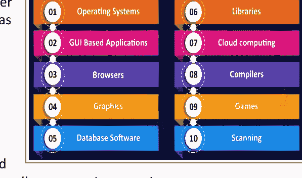
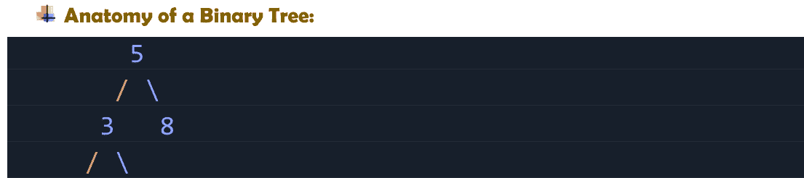
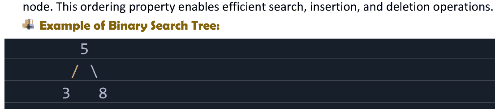
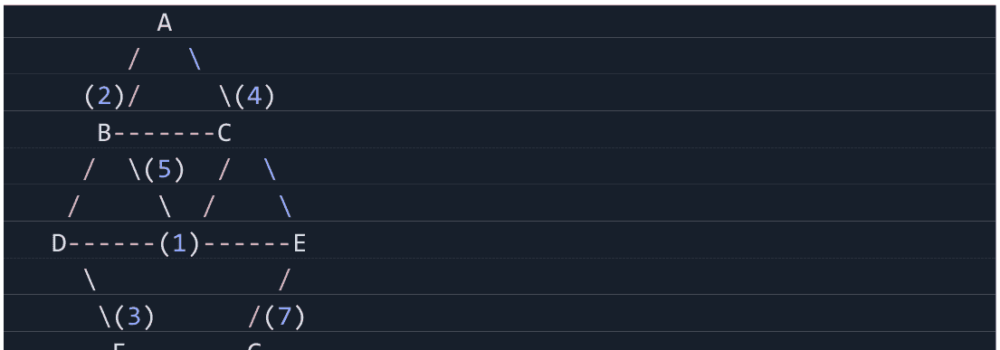

# 从新手到忍者：C++ 中精通 DSA


## 引言

欢迎踏上这段穿越编程精通领域的变革之旅。在《从新手到忍者：精通 C++ 数据结构与算法》中，我，Pabitra Banerjee——一位经验丰富的全栈 AI 工程师，同时也是 MB WEBBER'S 富有远见的首席执行官——将借助 C++ 这一强大媒介，带你展开一场对数据结构与算法（DSA）复杂世界的引人入胜的探索。

随着技术以前所未有的速度发展，对能够驾驭复杂数据处理和算法问题解决的熟练程序员的需求也在与日俱增。Pabitra Banerjee 拥有多年的实践经验和对人工智能与软件开发的热情，是你从新手到忍者这段征途中值得信赖的向导。

### 开启精通之旅

《从新手到忍者》不仅仅是一本书，更是一张为那些渴望超越初级编程界限、成为编程忍者的人准备的路线图。我的方法既富有洞见又注重实践，确保每个概念不仅能被理解，还能在真实场景中得以应用。

无论你是编程世界的新手，还是寻求提升技能的经验丰富的程序员，这本书都旨在契合你当前的水平，并推动你迈向编程卓越。所以，系好安全带，我们即将启程——这段旅程不仅承诺揭示 C++ 的复杂之处，还将为你装备征服任何编程挑战所需的数据结构与算法利器。

让从新手到忍者的转变就此开始。


Pabitra Banerjee
（全栈 AI 工程师）

## 第 1 章：C++ 入门

### C 语言的历史

20 世纪 70 年代初，计算机编程领域由 Fortran 和汇编语言等语言主导，它们各有其优势和局限性。正是在这个时代，美国计算机科学家 Dennis Ritchie 开始开发一种能够弥合低级机器语言与高级编程之间差距的语言。他的努力成果便是 C——一种广受欢迎的程序设计语言。


### C++ 的诞生

C++ 的开发始于 1979 年，当时荷兰计算机科学家 Bjarne Stroustrup 正在贝尔实验室工作。他的目标是在保持其效率和底层能力的同时，通过添加面向对象编程特性来增强 C 语言。C++ 的第一个版本被命名为“带类的 C”，因为它引入了类的概念，允许创建用户自定义的数据类型和方法。


### 面向对象范式

C++ 的开创性之一在于它融入了面向对象编程（OOP）原则。这一范式转变使开发者能够以更加模块化和可复用的方式组织代码，推动了封装、继承和多态等概念。创建类和对象的能力为软件开发带来了新的抽象层次和灵活性。

### 标准化与演进

多年来，C++ 经历了重大的改进和完善。1983 年，该语言更名为 C++，以体现其不断进化的特性。第一个标准化版本 C++98 发布，为该语言建立了共同的基线。随后的更新，包括 C++11、C++14 和 C++17，引入了新特性、增强了性能，并改善了整体编程体验。



-   **整数（`int`）**：非常适合处理整数。
-   **浮点数（`double`、`float`）**：用于表示带小数点的数字。
-   **字符（`char`）**：存储单个字符，如 `'a'`、`'B'` 或 `'@'`。
-   **布尔（`bool`）**：处理 `true` 或 `false` 值。

除了这些基本类型之外，C++ 还允许通过结构体和类创建用户自定义的数据类型，使开发者能够将数据和功能封装到内聚的单元中。

### 运算符：转换的工具

运算符是转换和组合变量与值的操作工具。理解这些运算符对于编写富有表现力和功能性的代码至关重要。以下是一些基本运算符类型的概览：

-   **算术运算符（`+`、`-`、`*`、`/`、`%`）**：进行基本的数学运算。
-   **关系运算符（`==`、`!=`、`<`、`>`、`<=`、`>=`）**：比较值并产生布尔结果。
-   **逻辑运算符（`&&`、`||`、`!`）**：组合并操作布尔值。
-   **赋值运算符（`=`）**：为变量赋值。

### 控制流：条件语句与循环

在 C++ 编程的动态领域中，掌握控制流就如同挥舞一套强大的工具集，用来引导代码的执行。条件语句和循环构成了控制流的核心，使开发者能够做出决策并迭代地执行代码。

#### 条件语句：导航决策路径

条件语句是一种编程结构，能够根据特定条件执行相应的代码块。在 C++ 中，这些条件通常通过 if、else if 和 else 语句来表达。

```
int age = 25;

if (age >= 18) {
    cout << "You are eligible to vote." << endl;
} else {
    cout << "You are not eligible to vote yet." << endl;
}
```

在此示例中，if 语句检查 age 变量是否大于或等于 18。如果为真，则执行第一个代码块；否则，运行 else 块。这种决策能力对于创建自适应且响应灵敏的程序至关重要。

#### 循环：迭代精通

循环提供了一种重复执行代码块的机制。C++ 提供多种类型的循环，其中 for、while 和 do-while 循环最为常见。

```
for (int i = 1; i <= 5; ++i) {
    cout << "Iteration " << i << ": Hello, C++!" << endl;
}
```

在这个 for 循环示例中，循环花括号内的代码被执行五次，每次迭代都会递增循环变量 i。对于需要重复执行的任务，循环是不可或缺的，例如处理数组、遍历数据结构，或执行计算直到满足某个条件。

#### 嵌套与组合使用

当条件语句和循环被组合并嵌套时，控制流的真正威力便展现出来。通过策略性地将循环放置在条件块内，或将条件块放置在循环内，你可以创建复杂而自适应的算法。

```
for (int i = 1; i <= 3; ++i) {
    cout << "Group " << i << ":" << endl;
    
    for (int j = 1; j <= 2; ++j) {
        cout << "  Member " << j << endl;
    }
}
```

在这个嵌套循环示例中，外层循环迭代三次，而每次迭代中，内层循环执行两次。这种结构在处理多维数据和复杂决策场景时非常强大。

### 函数与模块化编程

在 C++ 编程的广阔天地中，掌握函数和模块化编程的艺术，就如同打开通往结构化、高效且可扩展代码的大门。函数作为模块化编程的构建块，使开发者能够将代码拆分为可管理且可复用的单元。

#### 函数：模块化的精髓

C++ 中的函数是执行特定任务的独立代码块。这个任务可以简单到一次算术计算，也可以复杂到一套算法。函数通过声明和一组用花括号括起来的指令来定义。

```
// Function declaration
int add(int a, int b);

// Function definition
int add(int a, int b) {
    return a + b;
}

// Function call
int result = add(3, 4);
```

在此示例中，add 是一个简单的函数，接受两个参数（a 和 b）并返回它们的和。函数不仅促进了代码复用，还增强了代码的可读性和可维护性。

#### 模块化编程：突破代码的壁垒

模块化编程涉及将程序分解为更小、独立的模块或函数。每个模块封装特定的功能，促进代码组织和关注点分离。这种方法简化了调试、测试和维护。

```
// Function declarations
int calculateSquare(int x);
void printResult(int value);

// Main program
int main() {
    int number = 5;
    int square = calculateSquare(number);
    printResult(square);
    return 0;
}
```


```cpp
// Function definitions
int calculateSquare(int x) {
    return x * x;
}
void printResult(int value) {
    cout << "The result is: " << value << endl;
}
```

在这个模块化程序中，calculateSquare 计算一个数字的平方，printResult 显示结果。main 函数协调这些模块，为整个程序提供了清晰简洁的结构。

## 函数参数与返回类型：

函数可以有参数（输入）和返回类型（输出）。参数允许函数接受其操作所需的值，返回类型则指定函数作为输出提供的值的类型。

```cpp
// Function with parameters and a return type
double calculateAverage(int a, int b) {
    return (a + b) / 2.0;
}
```

在此示例中，calculateAverage 接受两个整数作为参数，并返回它们的平均值（double 类型）。这说明了函数如何根据程序中的特定需求进行定制。

### C++ 中的数组与字符串

在 C++ 编程的复杂画卷中，数组和字符串作为多用途的数据结构出现，使开发者能够高效地管理和操作元素集合。理解它们的细微差别对于在数据结构与算法的领域中导航至关重要。

### 数组：元素的有序集合：

数组是一块连续的内存块，用于存储相同数据类型的元素。这些元素可以通过索引访问，从而实现高效的存储和检索。在 C++ 中，数组的声明和初始化如下所示：

```cpp
// Declaration and initialization of an integer array
int numbers[5] = {1, 2, 3, 4, 5};
```

在此示例中，numbers 是一个容量为五个元素的整数数组。数组索引从 0 开始，因此 numbers[0] 表示第一个元素，numbers[4] 表示最后一个元素。

### 字符串：动态字符数组：

在 C++ 中，字符串被表示为字符数组，但具有标准模板库（STL）提供的额外功能。C++ 的 string 类允许对字符串进行动态操作，使其比传统的字符数组更加灵活多变。

```cpp
// Declaration and initialization of a C++ string
#include <string>
using namespace std;

string greeting = "Hello, C++!";
```

在这里，greeting 是一个用短语 "Hello, C++!" 初始化的 C++ 字符串。string 类提供了许多用于字符串操作的成员函数，简化了拼接、子串提取和长度确定等任务。

### 数组与字符串操作：

操作数组涉及访问元素、修改值和遍历整个集合等常见操作。同样，处理字符串通常包括拼接、查找子串和比较字符串等任务。

```cpp
// Array operations
int sum = 0;
for (int i = 0; i < 5; ++i) {
    sum += numbers[i];
}

// String operations
string firstName = "John";
string lastName = "Doe";
string fullName = firstName + " " + lastName;
```

在此代码片段中，遍历数组 numbers 以计算其元素总和，展示了一个典型的数组操作。此外，还演示了字符串拼接，凸显了 C++ 字符串所提供的简洁性和可读性。

### 挑战与注意事项：

数组和字符串虽然强大，但也伴随着挑战。数组具有固定大小，动态管理其长度可能很麻烦。字符串虽然是动态的，但因其实现方式可能会产生性能开销。

## 内存释放：delete 运算符：

释放内存是程序员的责任，为此使用 delete 运算符。未能释放内存可能导致内存泄漏，从而可能使程序消耗过多资源。

```cpp
delete dynamicNumber; // Deallocating memory to prevent a memory leak
```

每次 new 操作都必须与相应的 delete 配对使用，以维持健康的内存管理策略，这一点至关重要。

## 指针与数组：动态内存分配：

在 C++ 中，指针和数组密切相关。动态内存分配允许创建大小在运行时确定的数组。

```cpp
int *dynamicArray = new int[5]; // Allocating memory for an integer array of size 5
```

请记住，每次 new[] 操作都应与相应的 delete[] 匹配，以释放已分配的内存。

## 挑战与最佳实践：

尽管指针和动态内存分配提供了无与伦比的灵活性，但它们也带来了挑战。内存泄漏、悬空指针和访问无效内存区域是常见的陷阱。采用最佳实践，例如将指针初始化为 nullptr、在使用后删除指针以及使用智能指针，可以缓解这些挑战。

```cpp
int *ptr = nullptr; // Initializing a pointer to nullptr
```

## 第 2 章：C++ 中的面向对象编程

### 类与对象：OOP 的基础

面向对象编程（OOP）是一种通过将现实世界实体建模为对象来为代码带来结构和组织性的编程范式。在 C++ 中，OOP 的构建块是类和对象。让我们踏上探索类与对象世界的旅程，它们是 C++ 中 OOP 的基石。

#### 类：对象的蓝图：

类是一种用户定义的数据类型，它将数据和函数封装到单个实体中。它作为创建对象的蓝图，定义对象的属性（数据成员）和行为（成员函数）。类的结构使用 class 关键字定义：

```cpp
// Declaration of a simple class
class Car {
public:
    // Data members
    string brand;
    int year;
    // Member function
    void displayInfo() {
        cout << "Brand: " << brand << ", Year: " << year << endl;
    }
};
```

在此示例中，Car 是一个具有数据成员（brand 和 year）和成员函数（displayInfo）的类。public: 说明符表示其后的成员可以从类外部访问。

#### 对象：类的实例：

对象是类的一个实例，代表具有独特数据和行为的特定实体。对象是使用类蓝图创建的，每个对象都有自己的一组数据成员。

```cpp
// Creating objects of the Car class
Car myCar;          // An object named myCar
myCar.brand = "Toyota";
myCar.year = 2022;
myCar.displayInfo();    // Invoking the member function

Car anotherCar;     // Another object named anotherCar
anotherCar.brand = "Honda";
anotherCar.year = 2021;
anotherCar.displayInfo();
```

在这里，myCar 和 anotherCar 是 Car 类的对象，每个对象都有自己的 brand、year 以及调用 displayInfo 成员函数的能力。

#### 封装：数据隐藏与访问控制：

封装是 OOP 的一个关键原则，涉及将数据和函数捆绑在类内并控制对它们的访问。在 C++ 中，访问说明符（public、private、protected）决定了类成员的可见性：

```cpp
#include <iostream>
using namespace std;

class BankAccount {
private:
    // Private data member
    double balance;

public:
    // Public member functions
    void deposit(double amount) {
        // Deposit logic
    }

    void withdraw(double amount) {
        // Withdrawal logic
    }
};
```

在此示例中，balance 是一个私有数据成员，只能在 BankAccount 类内部访问。deposit 和 withdraw 函数提供了操作 balance 的受控访问。

### 继承与多态：扩展和塑造类

继承和多态是 C++ 中面向对象编程（OOP）的强大支柱。它们促进了复杂而灵活的类层次结构的创建，实现了代码复用、可扩展性以及多态行为的实现。

#### 🔹 继承：在基础上构建：

继承是一种机制，通过该机制，一个新类（称为派生类或子类）可以继承现有类（称为基类或超类）的属性和行为。随后，派生类可以扩展或覆盖这些功能。

```cpp
// Base class
class Animal {
public:
    void eat() {
        cout << "Animal is eating." << endl;
    }
};

// Derived class inheriting from Animal
class Dog : public Animal {
```


```cpp
class Dog : public Animal {
public:
    void bark() {
        cout << "Dog is barking." << endl;
    }
};
```

在此示例中，`Dog` 是一个派生类，它继承了基类 `Animal` 的 `eat` 函数。这种关系使得 `Dog` 既能使用 `Animal` 的现有功能，又能引入自身独有的行为。

多态性允许将不同类型的对象视为公共类型的对象。这是通过两种机制实现的：函数重载和虚函数。

### 函数重载

```cpp
class Calculator {
public:
    int add(int a, int b) {
        return a + b;
    }

    double add(double a, double b) {
        return a + b;
    }
};
```

在这里，`add` 函数被重载，以处理整数和浮点数的加法。编译器会根据传入参数的类型选择适当的版本。

### 虚函数

```cpp
// Base class with a virtual function
class Shape {
public:
    virtual void draw() {
        cout << "Drawing a shape." << endl;
    }
};

// Derived class overriding the virtual function
class Circle : public Shape {
public:
    void draw() override {
        cout << "Drawing a circle." << endl;
    }
};
```

在这个例子中，`Shape` 类有一个虚函数 `draw`，而 `Circle` 类对该函数进行了重写。这实现了动态绑定，从而能够根据对象的实际类型调用正确的函数。

#### 优点与注意事项

继承和多态促进了代码复用、可扩展性，并能更自然地表示现实世界中的关系。然而，不当使用继承可能会导致歧义和维护困难，例如多重继承场景中的“菱形问题”。

### 封装与抽象：保护并简化复杂性

封装和抽象是面向对象编程（OOP）中的基本概念，它们有助于创建健壮、模块化且易于理解的代码。它们在管理软件系统的复杂性方面发挥着关键作用。

#### 封装：数据隐藏与访问控制

封装将数据（属性）和操作这些数据的方法（函数）捆绑到一个称为类的单一单元中。它促进了数据隐藏的概念：类的实现细节对外部世界隐藏，对内部状态的访问通过公共接口进行控制。

```cpp
class BankAccount {
private:
    double balance;

public:
    // Public member functions for controlled access
    void deposit(double amount) {
        // Implementation details
        balance += amount;
    }

    void withdraw(double amount) {
        // Implementation details
        if (amount <= balance) {
            balance -= amount;
        } else {
            cout << "Insufficient funds." << endl;
        }
    }

    double getBalance() const {
        // Accessor function for read-only access
        return balance;
    }
};
```

在此示例中，`balance` 数据成员是私有的，只能通过受控的成员函数（如 `deposit`、`withdraw` 和 `getBalance`）来访问。这种封装保护了内部状态，并确保对它的修改经过了适当的验证。

#### 抽象：管理复杂性

抽象通过基于现实世界实体建模类，并关注基本属性和行为，来简化复杂系统。它让程序员能够处理高层概念，而无需深入实现细节。

```cpp
class Shape {
public:
    // Pure virtual function for abstraction
    virtual void draw() const = 0;
};
```

在此示例中，`Shape` 类是一个表示通用形状的抽象。通过声明纯虚函数 `draw`，该类变为抽象类，其派生类（如 `Circle`、`Rectangle`）必须提供具体的实现。这允许进行高层建模，而无需在需要之前指定每个形状的细节。

#### 优点与注意事项

封装和抽象提供了多个优点：

- **模块化**：封装允许创建自包含且模块化的单元，使代码更易于管理和维护。
- **安全性**：封装保护对象的内部状态，防止意外访问和修改。
- **灵活性**：抽象让程序员能够处理高层概念，促进代码适应不断变化的需求。

然而，需要保持平衡，因为过度使用抽象可能导致类层次结构过于复杂，使代码难以理解。

析构函数是一种特殊的成员函数，其名称与类名相同，前面带有波浪号（~）。当对象超出作用域或被显式删除时，析构函数会自动调用。析构函数对于释放与对象关联的资源（如释放内存或关闭文件）至关重要。

```cpp
class BankAccount {
public:
    // Constructor
    BankAccount() {
        balance = 0.0;
        cout << "BankAccount object created." << endl;
    }

    // Destructor
    ~BankAccount() {
        cout << "BankAccount object destroyed." << endl;
    }

    // Member function to display balance
    void displayBalance() {
        cout << "Balance: " << balance << endl;
    }

private:
    double balance;
};
```

在此示例中，`BankAccount` 类有一个构造函数来初始化余额，以及一个析构函数在对象销毁时打印一条消息。

### 隐式与显式构造函数调用

构造函数可以在创建对象时被隐式调用，也可以被显式调用。显式调用在需要动态内存分配或额外设置的场景中非常有用。

```cpp
Car myCar;    // Implicit call to the default constructor
Car anotherCar("Toyota", 2022);  // Explicit call to the parameterized constructor

BankAccount* accountPtr = new BankAccount();  // Explicit dynamic object creation
delete accountPtr;  // Explicit call to the destructor
```

### 拷贝构造函数

拷贝构造函数是一种特殊构造函数，它通过复制另一个对象的内容来创建一个新对象。当对象按值传递、按值返回或显式复制时，就会调用拷贝构造函数。

```cpp
class Student {
public:
    // Copy constructor
    Student(const Student& other) {
        this->name = other.name;
        this->age = other.age;
        cout << "Copy constructor called." << endl;
    }

    // Constructor
    Student(string name, int age) : name(name), age(age) {
        cout << "Student object created." << endl;
    }

    // Destructor
    ~Student() {
        cout << "Student object destroyed." << endl;
    }

private:
    string name;
    int age;
};
```

在此示例中，`Student` 类有一个拷贝构造函数，它通过复制另一个 `Student` 对象的数据来创建新对象。

### 运算符重载：扩展语言的词汇表

C++ 中的运算符重载允许用户自定义的类为标准运算符定义自身行为。此功能通过使类能够与运算符无缝协作来增强其表现力，从而使代码更直观、更易读。

#### 重载一元运算符

一元运算符只作用于一个操作数。要重载一元运算符，请为该类定义一个成员函数，使用 `operator` 关键字后跟要重载的运算符。

```cpp
class ComplexNumber {
public:
    double real;
    double imag;

    // Overloading the unary minus (-) operator
    ComplexNumber operator-() const {
        ComplexNumber result;
        result.real = -real;
        result.imag = -imag;
        return result;
    }
};
```

在此示例中，一元负号运算符（-）被重载，用于对复数的实部和虚部取反。

#### 重载二元运算符

二元运算符作用于两个操作数。要重载二元运算符，请为该类定义一个成员函数，使用 `operator` 关键字和两个参数。

```cpp
class Point {
public:
    double x;
    double y;

    // Overloading the binary plus (+) operator
    Point operator+(const Point& other) const {
        Point result;
        result.x = x + other.x;
        result.y = y + other.y;
        return result;
    }
};
```

在此示例中，二元加号运算符（+）被重载，用于将两个点相加。

#### 重载比较运算符

比较运算符（`==`、`!=`、`<`、`>`、`<=`、`>=`）可以被重载，以定义用户自定义类型的自定义比较逻辑。

```cpp
class Date {
public:
    int day;
```


```
int month;
int year;

// Overloading the equality (==) operator
bool operator==(const Date& other) const {
	return (day == other.day && month == other.month && year == other.year);
}
};
```

此处，相等运算符（==）被重载，用于比较两个 Date 对象。

## 重载流插入运算符和流提取运算符：

流插入运算符（<<）和流提取运算符（>>）可以被重载，以为用户定义类型定义自定义的输入和输出行为。

```
class Book {
public:
	string title;
	string author;

// Overloading the stream insertion (<<) operator
friend ostream& operator<<(ostream& os, const Book& book) {
	os << "Title: " << book.title << ", Author: " << book.author;
	return os;
}

// Overloading the stream extraction (>>) operator
friend istream& operator>>(istream& is, Book& book) {
	cout << "Enter title: ";
	getline(is, book.title);
	cout << "Enter author: ";
	getline(is, book.author);
	return is;
}
};
```

在本例中，为 Book 类重载了流插入和流提取运算符，从而支持自定义输入和输出。

## 准则与最佳实践：

重载运算符时，遵循一些准则是非常重要的：-

- 1. 保持语义：确保重载后的运算符保持其预期的含义和行为。

```
class Pair {
public:
    T first;
    T second;

    Pair(T f, T s) : first(f), second(s) {}
};

int main() {
    Pair<int> intPair(3, 7);
    Pair<double> doublePair(1.5, 2.5);
}
```

这里，Pair 是一个类模板，可以用不同的数据类型实例化，例如 int 和 double。

## 模板特化：

模板特化允许开发者为特定数据类型提供自定义实现，同时为其他类型保留通用版本。

```
// Generic template
template <typename T>
class Container {
public:
    T value;

    Container(T val) : value(val) {}
};

// Specialization for strings
template <>
class Container<string> {
public:
    string value;

    Container(string val) : value("Special: " + val) {}
};
```

在本例中，Container 类模板针对字符串提供了一个特化版本，演示了如何为特定数据类型定制行为。

## 概念（C++20 及更高版本）：

C++20 引入了概念（concepts），这是一个强大的特性，允许开发者为模板参数指定约束，从而提高代码可读性并提供更好的错误信息。

```
// Example of a function template with a concept
template <typename T>
requires std::integral<T>
T square(T x) {
    return x * x;
}
```

在这段代码中，requires 子句指定模板参数 T 必须是整型。

模板和泛型编程是现代 C++ 的基础，提供了一种编写灵活高效、适用于多种数据类型的代码的方式。随着本章的深入，我们将探讨其他高级特性，包括异常处理、标准模板库（STL）、智能指针和 lambda 表达式。

### 异常处理：优雅地管理错误

C++ 中的异常处理提供了一种结构化且健壮的机制，用于管理错误和意外情况。通过允许开发者将错误处理代码与正常执行流程分离，异常处理促进了更清晰、更易于维护的代码。

## try-catch 块：

C++ 中用于异常处理的主要结构是 try 块和 catch 块。可能产生异常的代码被放在 try 块中，而潜在的异常会在一个或多个相关的 catch 块中被捕获和处理。

```
#include <iostream>

int main() {
    try {
        // Code that might throw an exception
        int numerator, denominator;
        std::cout << "Enter numerator: ";
        std::cin >> numerator;
        std::cout << "Enter denominator: ";
        std::cin >> denominator;

        if (denominator == 0) {
```

```
throw std::runtime_error("Division by zero is not allowed.");
    }

    double result = static_cast<double>(numerator) /
denominator;
    std::cout << "Result: " << result << std::endl;
} catch (const std::exception& e) {
    // Catch and handle exceptions
    std::cerr << "Exception caught: " << e.what() <<
std::endl;
    }

    return 0;
}
```

在本例中，try 块包含可能抛出异常的代码，catch 块处理 try 块执行期间抛出的任何异常。

## 抛出异常：

异常通过 throw 语句抛出。既可以显式抛出以表示错误，也可以由语言或库函数在发生意外情况时隐式抛出。

```
#include <stdexcept>

void processValue(int value) {
    if (value < 0) {
        throw std::invalid_argument("Negative values are not allowed.");
    }

    // Process the value
}
```

这里，如果输入值为负数，processValue 函数会抛出 std::invalid_argument 异常。

## 异常类：

C++ 在 <stdexcept> 头文件中提供了一套异常类层次结构，其中 std::exception 是基类。开发者可以派生自己的异常类，以创建针对特定应用需求定制的自定义异常。

```
#include <stdexcept>

class CustomException : public std::exception {
public:
    const char* what() const noexcept override {
        return "Custom exception occurred.";
    }
};

void someFunction() {
    throw CustomException();
}
```

在本例中，CustomException 是派生自 std::exception 的自定义异常类。

## 异常规格说明（已弃用）：

历史上，C++ 允许开发者使用异常规格说明来指定函数可能抛出的异常类型。然而，该特性在近期的 C++ 标准中已被弃用，推荐的做法是改用 noexcept。

```
// Deprecated exception specification
void someFunction() throw(std::runtime_error) {
    // Function code
}
```

## RAII 与资源管理：

C++ 中的异常处理与资源获取即初始化（RAII）原则高度契合。通过使用智能指针、自动存储期和正确的资源管理，C++ 程序可以优雅地处理异常而不会泄漏资源。

```
#include <iostream>
#include <memory>

class Resource {
public:
    Resource() {
        std::cout << "Resource acquired." << std::endl;
    }

    ~Resource() {
```

```
std::cout << "Resource released." << std::endl;
}
};

int main() {
    try {
        // Acquire a resource using smart pointers
        std::unique_ptr<Resource> resource =
std::make_unique<Resource>();

        // Code that may throw exceptions

    } catch (const std::exception& e) {
        std::cerr << "Exception caught: " << e.what() <<
std::endl;
    }

    // Resource is automatically released when it goes out of
scope

    return 0;
}
```

这里，Resource 类分别在其构造函数和析构函数中获取和释放资源。使用智能指针可确保即使在出现异常时也能正确清理资源。

C++ 中的异常处理提供了一种强大的机制，能够以结构化且可维护的方式处理错误。

### 标准模板库（STL）：利用容器和算法的力量

标准模板库（STL）是一组强大的 C++ 模板类和函数，提供通用、高效且多用途的组件。它由多个组件组成，包括容器、算法、迭代器和函数对象，使其成为现代 C++ 开发的基石。

## 容器：

容器是 STL 提供的基本数据结构，支持动态内存管理和多种操作存储元素的方法。一些常用的容器包括：-

## Vector：-

```
#include <vector>

std::vector<int> numbers = {1, 2, 3, 4, 5};
numbers.push_back(6);
```

## List：-

```
#include <list>

std::list<double> values = {1.1, 2.2, 3.3, 4.4};
values.push_back(5.5);
```

## Deque：-

```
#include <deque>

std::deque<char> characters = {'a', 'b', 'c'};
characters.push_front('z');
```

## Map：-

```
#include <map>

std::map<std::string, int> ages = {{"Alice", 25}, {"Bob", 30}};
ages["Charlie"] = 28;
```

## 算法：

STL 算法作用于容器，为排序、搜索和修改元素等常见操作提供丰富的函数。算法设计为与迭代器配合使用，为各种容器类型提供一致的接口。

## 排序：-

```
#include <algorithm>

std::vector<int> numbers = {5, 2, 8, 1, 3};
std::sort(numbers.begin(), numbers.end());
```


## Searching:-

```cpp
#include <algorithm>

std::vector<int> numbers = {10, 20, 30, 40, 50};
auto it = std::find(numbers.begin(), numbers.end(), 30);
if (it != numbers.end()) {
 // Element found
}
```

## Transformation:-

```cpp
#include <algorithm>
#include <cmath>

std::vector<double> values = {1.0, 2.0, 3.0, 4.0};
std::transform(values.begin(), values.end(), values.begin(), std::sqrt);
```

## Iterators:

Iterators are used to traverse the elements of a container. They provide a common interface for accessing elements regardless of the underlying container type.

## Iterator Example:-

```cpp
#include <vector>

std::vector<int> numbers = {1, 2, 3, 4, 5};
for (auto it = numbers.begin(); it != numbers.end(); ++it)
{
 // Access elements using 'it'
}
```

## Range-Based For Loop:-

```cpp
#include <vector>

std::vector<int> numbers = {1, 2, 3, 4, 5};
for (const auto& num : numbers) {
 // Access elements using 'num'
}
```

## Function Objects (Functors):

Function objects, also known as functors, are objects that can be called like functions. They are often used with algorithms that require callable entities.

```
#include <iostream>

struct Square {
    int operator()(int x) const {
        return x * x;
    }
};

int main() {
    Square square;
    std::cout << square(5) << std::endl;  // Outputs 25
    return 0;
}
```

## Smart Pointers:

Smart pointers, introduced in C++11, are a part of the STL and provide automatic memory management, helping to avoid memory leaks and improve code safety.

- Shared Pointer:-

```
#include <memory>

std::shared_ptr<int> sharedInt = std::make_shared<int>(42);
```

- Unique Pointer:-

```
#include <memory>

std::unique_ptr<double> uniqueDouble =
std::make_unique<double>(3.14);
```

## Conclusion:

The Standard Template Library is a versatile and powerful feature of C++, providing developers with a rich set of tools for data manipulation, algorithms, and resource management. Understanding the STL is essential for writing efficient and maintainable C++ code.

### Smart Pointers: Intelligent Memory Management

Smart pointers in C++ are a set of classes that manage the memory of dynamically allocated objects in a safer and more efficient way than raw pointers. They provide automatic memory management, help prevent memory leaks, and contribute to writing more robust and maintainable code.

## Unique Pointer:

std::unique_ptr is a smart pointer that owns a dynamically allocated object and ensures that there is only one std::unique_ptr instance pointing to that object. When the std::unique_ptr goes out of scope, the associated object is automatically deleted.

```
#include <memory>

void useUniquePointer() {
    std::unique_ptr<int> uniqueInt = std::make_unique<int>(42);
    // uniqueInt owns the dynamically allocated integer

    // Access the value
    std::cout << "Value: " << *uniqueInt << std::endl;
    // ...

    // No need to explicitly delete, happens automatically when uniqueInt goes out of scope
}
```

## Shared Pointer:

std::shared_ptr is a smart pointer that allows multiple std::shared_ptr instances to share ownership of the same dynamically allocated object. The object is deleted when the last std::shared_ptr pointing to it is destroyed.

```
#include <memory>

void useSharedPtr() {
    std::shared_ptr<int> sharedInt = std::make_shared<int>(42);
    // sharedInt and anotherSharedInt share ownership of the dynamically allocated integer

    // Access the value
    std::cout << "Value: " << *sharedInt << std::endl;
```

```
#include <iostream>

int main() {
    // Lambda expression that takes two integers and
returns their sum
    auto add = [](int a, int b) -> int {
        return a + b;
    };

    std::cout << "Sum: " << add(3, 4) << std::endl;  //
Outputs 7

    return 0;
}
```

## Capturing Variables:

Lambda expressions can capture variables from the surrounding scope, either by value or by reference.

Capture by Value :-

```
#include <iostream>

int main() {
    int x = 42;

    // Lambda expression capturing x by value
    auto lambda = [x]() {
        std::cout << "Captured value: " << x <<
std::endl;
    };
    lambda();  // Outputs "Captured value: 42"
    return 0;
}
```

## Capture by Reference :-

```
#include <iostream>

int main() {
    int x = 42;

    // Lambda expression capturing x by reference
    auto lambda = [&x]() {
        std::cout << "Captured reference: " << x <<
std::endl;
    };

    lambda();  // Outputs "Captured reference: 42"

    return 0;
}
```

## Mutable Lambdas:

By default, variables captured by value in a lambda are treated as read-only. To modify them, the mutable keyword is used.

```
#include <iostream>

int main() {
    int x = 42;

    // Mutable lambda capturing x by value
    auto lambda = [x]() mutable {
        x++;
        std::cout << "Modified value: " << x <<
std::endl;
    };

    lambda();  // Outputs "Modified value: 43"
```

```
std::cout << "Original value: " << x <<
std::endl;  // Outputs "Original value: 42"

return 0;
}
```

#### Lambda Expressions in Algorithms

Lambda expressions are commonly used with algorithms from the Standard Template Library (STL), providing a concise way to define custom behaviours.

```
#include <algorithm>
#include <vector>
#include <iostream>

int main() {
    std::vector<int> numbers = {1, 2, 3, 4, 5};

    // Using a lambda expression with std::for_each to square each element
    std::for_each(numbers.begin(), numbers.end(),
    [](int& x) {
        x = x * x;
    });

    // Print the squared values
    for (const auto& num : numbers) {
        std::cout << num << " ";
    }

    return 0;
}
```

Lambda expressions add expressiveness and flexibility to C++, allowing developers to create concise and in-place function objects. Their usage is prevalent in modern C++, especially in combination with algorithms and other functional programming concepts.

## Chapter 4: Arrays and Linked Lists

Array Manipulation and Algorithms: Unveiling the Power of Sequential Storage

Arrays, as a fundamental data structure, offer sequential storage and efficient random access to elements. In this chapter, we explore various array manipulation techniques and algorithms that leverage the strengths of this data structure.

## Array Basics:

An array is a contiguous block of memory that stores elements of the same data type. The elements are accessed using an index, with the first element typically having an index of 0.

```
#include <iostream>

int main() {
    // Declaring and initializing an array
    int numbers[] = {1, 2, 3, 4, 5};

    // Accessing elements
    std::cout << "First element: " << numbers[0] <<
std::endl;  // Outputs 1

    return 0;
}
```

## Array Manipulation Techniques:

Arrays can be manipulated using various techniques, including:

- Traversal:-

```
#include <iostream>

int main() {
    int numbers[] = {1, 2, 3, 4, 5};

    // Traversing and printing elements
    for (int i = 0; i < 5; ++i) {
        std::cout << numbers[i] << " ";
    }
    // Outputs: 1 2 3 4 5
```

```
std::cout << numbers[i] << " ";
}
// Outputs: 1 2 4 5

return 0;
}
```

## Searching and Sorting Algorithms:

Arrays facilitate the implementation of various searching and sorting algorithms. Two common examples are :-

## Linear Search:-

```
#include <iostream>

int linearSearch(const int arr[], int size, int target) {
    for (int i = 0; i < size; ++i) {
        if (arr[i] == target) {
            return i;  // Element found at index i
        }
    }
    return -1;  // Element not found
}

int main() {
    int numbers[] = {1, 2, 3, 4, 5};

    int target = 3;
    int result = linearSearch(numbers, 5, target);

    if (result != -1) {
        std::cout << "Element " << target << " found at index " << result << std::endl;
    } else {
        std::cout << "Element not found." << std::endl;
    }

    return 0;
}
```


## 冒泡排序:-

```
#include <iostream>

void bubbleSort(int arr[], int size) {
    for (int i = 0; i < size - 1; ++i) {
        for (int j = 0; j < size - i - 1; ++j) {
            if (arr[j] > arr[j + 1]) {
                // Swap elements if they are in the wrong order
                int temp = arr[j];
                arr[j] = arr[j + 1];
                arr[j + 1] = temp;
            }
        }
    }
}

int main() {
    int numbers[] = {5, 2, 8, 1, 3};
    int size = 5;

    // Sorting the array using bubble sort
    bubbleSort(numbers, size);

    // Printing the sorted array
    for (int i = 0; i < size; ++i) {
        std::cout << numbers[i] << " ";
    }
    // Outputs: 1 2 3 5 8

    return 0;
}
```

## 结论：

数组作为一种强大的数据结构，用于顺序存储，提供高效的随机访问，并支持各种操作技巧和算法。随着我们深入本章，我们将探索链表，另一种动态数据结构，它在内存分配和操作方面提供了灵活性。

### 单链表：揭示动态链式结构

单链表是动态数据结构，提供了一种高效存储和管理元素集合的方式。与数组不同，链表提供动态内存分配，允许在任何位置轻松插入和删除元素。

## 单链表的基本结构：

单链表由节点组成，每个节点包含两部分：数据和对序列中下一个节点的引用（或指针）。

```
#include <iostream>

// Node structure for a Singly Linked List
template <typename T>
struct Node {
    T data;
    Node* next;

    Node(const T& value) : data(value), next(nullptr) {}
};

int main() {
    // Creating nodes for a Singly Linked List
    Node<int>* node1 = new Node<int>(1);
    Node<int>* node2 = new Node<int>(2);
    Node<int>* node3 = new Node<int>(3);

    // Linking nodes to form a Singly Linked List
    node1->next = node2;
    node2->next = node3;

    // Traversing and printing the linked list
    Node<int>* current = node1;
    while (current != nullptr) {
        std::cout << current->data << " ";
        current = current->next;
    }
    // Outputs: 1 2 3

    return 0;
}
```

## 单链表中的插入与删除：

链表的关键优势之一是插入和删除的简便性。添加新节点或移除现有节点只需调整指针，无需连续内存。

## 在开头插入：-

```
#include <iostream>

template <typename T>
void insertAtBeginning(Node<T>*& head, const T& value) {
    Node<T>* newNode = new Node<T>(value);
    newNode->next = head;
    head = newNode;
}

int main() {
    Node<int>* head = nullptr;

    // Inserting nodes at the beginning
    insertAtBeginning(head, 3);
    insertAtBeginning(head, 2);
    insertAtBeginning(head, 1);

    // Traversing and printing the modified linked list
    Node<int>* current = head;
    while (current != nullptr) {
        std::cout << current->data << " ";
        current = current->next;
    }
    // Outputs: 1 2 3

    return 0;
}
```

## 在给定位置删除：-

```
#include <iostream>

template <typename T>
void deleteAtPosition(Node<T>*& head, int position) {
    if (head == nullptr) {
        return;  // No nodes to delete
    }
}

if (position == 0) {
    Node<T>* temp = head;
    head = head->next;
    delete temp;
    return;
}

Node<T>* current = head;
for (int i = 0; i < position - 1 && current->next != nullptr; ++i)
{
    current = current->next;
}

if (current->next == nullptr || position < 0) {
    return; // Invalid position
}

Node<T>* temp = current->next;
current->next = current->next->next;
delete temp;
}

int main() {
    Node<int>* head = nullptr;
    // Inserting nodes
    insertAtBeginning(head, 3);
    insertAtBeginning(head, 2);
    insertAtBeginning(head, 1);

    // Deleting a node at position 1
    deleteAtPosition(head, 1);

    // Traversing and printing the modified linked list
    Node<int>* current = head;
    while (current != nullptr) {
        std::cout << current->data << " ";
        current = current->next;
    }
    // Outputs: 1 3

    return 0;
}
```

## 单链表中的搜索与遍历：

在单链表中搜索涉及遍历列表，直到找到目标元素或到达列表末尾。

```
```cpp
#include <iostream>

template <typename T>
bool searchElement(const Node<T>* head, const T& target) {
    const Node<T>* current = head;
    while (current != nullptr) {
        if (current->data == target) {
            return true; // Element found
        }
        current = current->next;
    }
    return false; // Element not found
}

int main() {
    Node<int>* head = nullptr;
    // Inserting nodes
    insertAtBeginning(head, 3);
    insertAtBeginning(head, 2);
    insertAtBeginning(head, 1);
    // Searching for an element
    int target = 2;
    if (searchElement(head, target)) {
        std::cout << "Element " << target << " found in the linked list." << std::endl;
    } else {
        std::cout << "Element " << target << " not found in the linked list." << std::endl;
    }
    return 0;
}
```
```

## 结论：

单链表为管理元素集合提供了一种灵活且动态的数据结构。其简单性允许高效的插入和删除操作，使其适用于动态内存分配和修改是常见需求的场景。

### 双链表：拥抱双向链接

双链表通过提供节点之间的双向链接扩展了单链表的能力。除了对下一个节点的引用外，双链表中的每个节点还包含对前一个节点的引用。这种双向链接简化了某些操作，例如双向遍历列表。

## 双链表的基本结构：

双链表节点包含三部分：数据、对下一个节点的引用和对前一个节点的引用。

```
#include <iostream>

// Node structure for a Doubly Linked List
template <typename T>
struct Node {
    T data;
    Node* next;
    Node* prev;

    Node(const T& value) : data(value), next(nullptr), prev(nullptr) {}
};

int main() {
    // Creating nodes for a Doubly Linked List
    Node<int>* node1 = new Node<int>(1);
    Node<int>* node2 = new Node<int>(2);
    Node<int>* node3 = new Node<int>(3);

    // Linking nodes to form a Doubly Linked List
    node1->next = node2;
    node2->prev = node1;
    node2->next = node3;
    node3->prev = node2;

    // Traversing and printing the linked list in both directions
    Node<int>* forward = node1;
    while (forward != nullptr) {
        std::cout << forward->data << " ";
        forward = forward->next;
    }
    // Outputs: 1 2 3

    std::cout << std::endl;

    Node<int>* backward = node3;
    while (backward != nullptr) {
        std::cout << backward->data << " ";
        backward = backward->prev;
    }
    // Outputs: 3 2 1

    return 0;
}
```

## 双链表中的插入与删除：

双链表允许高效的插入和删除操作，尤其是在同时进行正向和反向遍历时。

## 在开头插入：-

```
#include <iostream>

template <typename T>
void insertAtBeginning(Node<T>*& head, const T& value) {
    Node<T>* newNode = new Node<T>(value);
    newNode->next = head;
    if (head != nullptr) {
        head->prev = newNode;
    }
    head = newNode;
}

int main() {
    Node<int>* head = nullptr;

    // Inserting nodes at the beginning
    insertAtBeginning(head, 3);
    insertAtBeginning(head, 2);
    insertAtBeginning(head, 1);

    // Traversing and printing the modified linked list
    Node<int>* forward = head;
    while (forward != nullptr) {
        std::cout << forward->data << " ";
        forward = forward->next;
    }
    // Outputs: 1 2 3

    return 0;
}
```

## 在给定位置删除：-

```
#include <iostream>

template <typename T>
void deleteAtPosition(Node<T>*& head, int position) {
    if (head == nullptr) {
        return; // No nodes to delete
    }

    Node<T>* current = head;
    for (int i = 0; i < position && current != nullptr; ++i) {
        current = current->next;
    }

    if (current == nullptr) {
        return; // Invalid position
    }

    if (current->prev != nullptr) {
        current->prev->next = current->next;
    } else {
        head = current->next;
    }

    if (current->next != nullptr) {
        current->next->prev = current->prev;
    }

    delete current;
}

int main() {
    Node<int>* head = nullptr;

    // Inserting nodes
    insertAtBeginning(head, 3);
```


```cpp
insertAtBeginning(head, 2);
insertAtBeginning(head, 1);

// Deleting a node at position 1
deleteAtPosition(head, 1);

// Traversing and printing the modified linked list
Node<int>* forward = head;
while (forward != nullptr) {
    std::cout << forward->data << " ";
    forward = forward->next;
}
// Outputs: 1 3

return 0;
}
```

## 在双向链表中搜索和遍历：

在双向链表中搜索可以在正向和反向两个方向进行，提供遍历的灵活性。

##### 搜索元素

```cpp
#include <iostream>

template <typename T>
bool searchElement(const Node<T>* head, const T& target) {
    const Node<T>* forward = head;
    while (forward != nullptr) {
        if (forward->data == target) {
            return true;  // Element found
        }
        forward = forward->next;
    }
    return false;  // Element not found
}

int main() {
    Node<int>* head = nullptr;

    // Inserting nodes
    insertAtBeginning(head, 3);
    insertAtBeginning(head, 2);
    insertAtBeginning(head, 1);

    // Searching for an element
    int target = 2;
    if (searchElement(head, target)) {
        std::cout << "Element " << target << " found in the linked list." << std::endl;
    } else {
        std::cout << "Element " << target << " not found in the linked list." << std::endl;
    }

    return 0;
}
```

#### 结论

双向链表通过在节点之间提供双向链接增强了链表的功能，允许在两个方向上高效遍历。它们在插入、删除和搜索方面的灵活性使其适用于需要双向导航和修改的场景。随着我们继续本章，我们将探索循环链表，并了解它们如何在链表结构中引入循环关系。

### 循环链表：拥抱无限循环

循环链表通过允许最后一个节点指向第一个节点来扩展链表的概念，形成循环结构。这种循环排列在某些场景下提供优势，并在遍历和操作中引入独特的挑战。

#### 循环链表的基本结构

在循环链表中，最后一个节点指向第一个节点，形成一个环。

```cpp
#include <iostream>

// Node structure for a Circular Linked List
template <typename T>
struct Node {
    T data;
    Node* next;

    Node(const T& value) : data(value), next(nullptr) {}
};
```

```cpp
Node<int>* head = nullptr;

// Inserting nodes at the beginning
insertAtBeginning(head, 3);
insertAtBeginning(head, 2);
insertAtBeginning(head, 1);

// Traversing and printing the modified circular linked list
Node<int>* current = head;
for (int i = 0; i < 5; ++i) {
    std::cout << current->data << " ";
    current = current->next;
}
// Outputs: 1 2 3 1 2

return 0;
}
```

#### 在给定位置删除

```cpp
#include <iostream>

template <typename T>
void deleteAtPosition(Node<T>*& head, int position) {
    if (head == nullptr) {
        return; // No nodes to delete
    }

    Node<T>* current = head;
    for (int i = 0; i < position - 1 && current->next != head; ++i) {
        current = current->next;
    }

    if (current->next == head || position < 0) {
        return; // Invalid position
    }

    Node<T>* temp = current->next;
    current->next = current->next->next;
    delete temp;
}

int main() {
    Node<int>* head = nullptr;

    // Inserting nodes
    insertAtBeginning(head, 3);
    insertAtBeginning(head, 2);
    insertAtBeginning(head, 1);

    // Deleting a node at position 1
    deleteAtPosition(head, 1);

    // Traversing and printing the modified circular linked list
    Node<int>* current = head;
    for (int i = 0; i < 4; ++i) {
        std::cout << current->data << " ";
        current = current->next;
    }
    // Outputs: 1 3 1 2

    return 0;
}
```

#### 📚 **算法中的循环链表：**

循环链表在循环关系有益的算法中找到应用，例如在调度和循环缓冲区中。

#### 📚 **结论：**

循环链表引入循环结构，允许最后一个节点指向第一个节点。这种循环排列在特定场景下提供优势，并且在插入和删除操作中需要仔细处理指针。随着我们继续本章，我们将探索数组和链表在算法中的集成，结合两种数据结构的优势来解决各种计算挑战。

### 在算法中结合数组和链表：实现最优解

在算法中结合数组和链表提供了一种强大的问题解决方法，利用两种数据结构的优势。这种协同作用允许高效处理动态数据、内存分配的灵活性以及对各种计算挑战的最优解决方案。

#### 动态数据管理

数组和链表在管理动态数据时互为补充。数组提供常数时间随机访问，而链表则促进动态内存分配以及轻松的插入和删除。

#### 示例：使用链表实现栈

```cpp
#include <iostream>

// Node structure for a linked list
template <typename T>
struct Node {
    T data;
    Node* next;

    Node(const T& value) : data(value), next(nullptr) {}
};

// Stack implemented with a linked list
template <typename T>
class Stack {
private:
    Node<T>* top;

public:
    Stack() : top(nullptr) {}

    // Push operation
    void push(const T& value) {
        Node<T>* newNode = new Node<T>(value);
        newNode->next = top;
        top = newNode;
    }

    // Pop operation
    void pop() {
        if (top != nullptr) {
            Node<T>* temp = top;
            top = top->next;
            delete temp;
        }
    }

    // Display the stack
    void display() const {
        Node<T>* current = top;
        while (current != nullptr) {
            std::cout << current->data << " ";
            current = current->next;
        }
        std::cout << std::endl;
    }
};

int main() {
    // Using a stack implemented with a linked list
    Stack<int> stack;

    stack.push(3);
    stack.push(7);
    stack.push(1);

    stack.display();  // Outputs: 1 7 3

    stack.pop();

    stack.display();  // Outputs: 7 3

    return 0;
}
```

#### 算法效率

算法通常受益于数组和链表的结合以实现最优效率。数组提供对元素的常数时间访问，使其适合搜索和排序等任务。另一方面，链表在动态场景中表现出色，允许轻松插入和删除。

#### 示例：使用数组的归并排序

```cpp
#include <iostream>
#include <vector>

// Merge function for merging two sorted arrays
template <typename T>
void merge(std::vector<T>& arr, int left, int mid, int right) {
    int n1 = mid - left + 1;
    int n2 = right - mid;

    // Create temporary arrays
    std::vector<T> L(n1), R(n2);

    // Copy data to temporary arrays L[] and R[]
    for (int i = 0; i < n1; i++) {
        L[i] = arr[left + i];
    }

    // Merge the temporary arrays back into arr[left..right]
    int i = 0, j = 0, k = left;
    while (i < n1 && j < n2) {
        if (L[i] <= R[j]) {
            arr[k++] = L[i++];
        } else {
            arr[k++] = R[j++];
        }
    }

    // Copy the remaining elements of L[], if there are any
    while (i < n1) {
        arr[k++] = L[i++];
    }

    // Copy the remaining elements of R[], if there are any
    while (j < n2) {
        arr[k++] = R[j++];
    }
}

// Recursive function to perform merge sort on the array
template <typename T>
void mergeSort(std::vector<T>& arr, int left, int right) {
    if (left < right) {
        // Same as (left+right)/2, but avoids overflow
        int mid = left + (right - left) / 2;
        // Recursive calls to split the array into halves
    }
}
```


```cpp
mergeSort(arr, left, mid);
mergeSort(arr, mid + 1, right);

// Merge the sorted halves
merge(arr, left, mid, right);
}
}

int main() {
    // Using merge sort with arrays
    std::vector<int> numbers = {12, 11, 13, 5, 6, 7};

    std::cout << "Original array: ";
    for (const auto& num : numbers) {
        std::cout << num << " ";
    }
    std::cout << std::endl;

    // Applying merge sort
    mergeSort(numbers, 0, numbers.size() - 1);

    std::cout << "Sorted array: ";
    for (const auto& num : numbers) {
        std::cout << num << " ";
    }
    std::cout << std::endl;

    return 0;
}
```

## 解决内存约束：

在内存受限的场景中，数组与链表的结合能够有效利用可用内存。数组为固定大小的元素提供连续存储，而链表则为大小可变的元素动态分配内存。

#### 示例：使用链表进行动态内存分配

```cpp
#include <iostream>

// Node structure for a linked list
template <typename T>
struct Node {
T data;
Node* next;
Node(const T& value) : data(value), next(nullptr) {}
};

// Function to display elements in a linked list
template <typename T>
void displayList(const Node<T>* head) {
    const Node<T>* current = head;
    while (current != nullptr) {
        std::cout << current->data << " ";
        current = current->next;
    }
    std::cout << std::endl;
}

int main() {
    // Using linked list for dynamic memory allocation
    Node<int>* head = nullptr;
    for (int i = 1; i <= 5; ++i) {
        // Creating nodes dynamically
        Node<int>* newNode = new Node<int>(i);
        newNode->next = head;
        head = newNode;
    }
    // Displaying the linked list
    displayList(head); // Outputs: 5 4 3 2 1
    return 0;
}
```

📝 结论：

在算法中结合数组与链表，为解决问题提供了一种灵活而强大的途径。通过发挥这两种数据结构的优势，开发人员可以应对动态数据管理、算法效率和内存约束等挑战。随着本章的深入，我们将探索更多展示数组与链表协同应对各种计算问题的算法示例。

## 第5章：栈与队列

### 理解栈及其应用：LIFO的实际应用

栈作为一种基础数据结构，遵循后进先出（LIFO）原则。在本章中，我们将深入理解栈的概念，并探索其在各种计算场景中的多种应用。

## 栈的结构：

栈是一个元素集合，包含两个主要操作：push（压栈）将元素添加到栈顶，pop（弹栈）移除栈顶元素。最后添加的元素最先被移除，体现了LIFO原则。

#### 示例：基本栈操作

```cpp
#include <iostream>
#include <stack>

int main() {

    // Creating a stack of integers
    std::stack<int> myStack;

    // Pushing elements onto the stack
    myStack.push(3);
    myStack.push(7);
    myStack.push(1);

    // Displaying the top element
    std::cout << "Top element: " << myStack.top() << std::endl;

    // Popping elements from the stack
    myStack.pop();

    // Displaying the top element after pop
    std::cout << "Top element after pop: " << myStack.top() << std::endl;

    return 0;
}
```

## 栈的应用：

由于栈的简单性和高效性，它在众多计算场景中都有应用。一些常见的应用包括：
- **函数调用管理**：栈用于管理程序中的函数调用。每次函数调用被压入栈中，当函数完成时，即从栈中弹出。
- **表达式求值**：栈在计算算术表达式时起着关键作用。它用于跟踪运算符和操作数，确保求值顺序正确。
- **软件中的撤销机制**：软件开发中利用栈来实现撤销机制。每次执行的操作都被压入栈中，从而允许用户按相反顺序撤销操作。
- **算法中的回溯**：栈被用于涉及回溯的算法，例如深度优先搜索。栈存储已走过的路径，回溯时通过弹出元素来探索替代路径。
- **解析和语法检查**：栈是编译器中进行解析和语法检查的重要组成部分，有助于确保程序的语法符合指定的文法规则。

#### 示例：检查括号是否平衡

```cpp
#include <iostream>
#include <stack>
#include <string>

// Function to check if parentheses are balanced
bool areParenthesesBalanced(const std::string& expression) {
    std::stack<char> charStack;

    for (char ch : expression) {
        if (ch == '(' || ch == '[' || ch == '{') {
            charStack.push(ch);
        } else if (ch == ')' || ch == ']' || ch == '}') {
            if (charStack.empty() ||
                (ch == ')' && charStack.top() != '(') ||
                (ch == ']' && charStack.top() != '[') ||
                (ch == '}' && charStack.top() != '{')) {
                return false;  // Unbalanced parentheses
            }

            charStack.pop();
        }
    }
    return charStack.empty(); // Stack should be empty for balanced parentheses
}
int main() {
    // Checking balanced parentheses
    std::string expression = "[{( )]( )}";
    if (areParenthesesBalanced(expression)) {
        std::cout << "Parentheses are balanced." << std::endl;
    } else {
        std::cout << "Parentheses are not balanced." << std::endl;
    }

    return 0;
}
```

## 结论：

理解栈及其应用是解决各种计算问题的基础。LIFO原则提供了一种简单而强大的数据管理机制，使栈成为算法设计和软件开发中的关键组成部分。随着本章的推进，我们将探讨队列的实现、应用及其在解决不同问题中所扮演的角色。

### 实现队列和双端队列：FIFO与双端队列

队列和双端队列（Dequeues）是重要的数据结构，队列遵循先进先出（FIFO）原则，而双端队列提供了额外的灵活性。在本节中，我们将探讨这两种结构的实现细节和应用。

#### 队列：核心为FIFO

队列表示有序集合，元素从队尾插入（入队），从队首移除（出队），遵循先进先出（FIFO）原则。

#### 示例：基本队列操作

```cpp
#include <iostream>
#include <queue>

int main() {
    // Creating a queue of integers
```

```cpp
// Displaying the front and rear elements
std::cout << "Front element: " << myDeque.front() << std::endl;
std::cout << "Rear element: " << myDeque.back() << std::endl;
// Dequeuing elements from the front and rear of the deque
myDeque.pop_front();
myDeque.pop_back();
// Displaying the front and rear elements after dequeue
std::cout << "Front element after dequeue: " << myDeque.front() << std::endl;
std::cout << "Rear element after dequeue: " << myDeque.back() << std::endl;
return 0;
```
```

## 队列和双端队列的应用：

由于队列遵循FIFO原则，加上双端队列提供的额外灵活性，它们在各种实际场景中都有应用。
- 任务调度：队列用于任务调度算法中，任务根据其到达时间进行调度。
- 广度优先搜索（BFS）：在图的遍历中，队列在BFS算法中起着至关重要的作用，节点按层进行探索。
- 打印队列管理：队列应用于打印队列系统，确保文档按照提交顺序被打印。
- 双端队列应用：双端队列适用于需要在两端进行插入和删除的场景，例如算法中的滑动窗口管理。

## 从零实现队列和双端队列：

理解了基本原理后，我们可以使用数组或链表从零实现队列和双端队列。实现方式的选择取决于问题的具体需求。

#### 示例：使用链表实现队列

```cpp
#include <iostream>
// Node structure for a linked list
template <typename T>
```


```
template <typename T>
struct Node {
    T data;
    Node* next;

    Node(const T& value) : data(value), next(nullptr) {}
};

// Queue implemented with a linked list
template <typename T>
class Queue {
private:
    Node<T>* front;
    Node<T>* rear;

public:
    Queue() : front(nullptr), rear(nullptr) {}

    // Enqueue operation
    void enqueue(const T& value) {
        Node<T>* newNode = new Node<T>(value);
        if (rear == nullptr) {
            front = rear = newNode;
        } else {
            rear->next = newNode;
            rear = newNode;
        }
    }

    // Dequeue operation
    void dequeue() {
        if (front != nullptr) {
            Node<T>* temp = front;
            front = front->next;
            if (front == nullptr) {
                rear = nullptr;  // Queue is empty after dequeue
            }
            delete temp;
        }
    }

    // Display the queue
    void display() const {
        Node<T>* current = front;
        while (current != nullptr) {
            std::cout << current->data << " ";
            current = current->next;
        }
        std::cout << std::endl;
    }
};

int main() {

    // Using a queue implemented with a linked list
    Queue<int> myQueue;

    myQueue.enqueue(3);
    myQueue.enqueue(7);
    myQueue.enqueue(1);

    myQueue.display();  // Outputs: 3 7 1

    myQueue.dequeue();

    myQueue.display();  // Outputs: 7 1

    return 0;
}
```

#### 结论

实现队列和双端队列提供了对其机制和灵活性的实践理解。无论是队列中遵循 FIFO 原则，还是探索双端队列的增强功能，这些数据结构在算法设计、问题解决和实际应用中都发挥着关键作用。随着我们继续本章，我们将深入探讨使用栈和队列解决问题的过程，并探索诸如优先队列等高级主题。

```
    std::cout << "Expression 1 is "
              << (isValidParentheses(expression1) ? "valid." : "not valid.")
              << std::endl;
    std::cout << "Expression 2 is "
              << (isValidParentheses(expression2) ? "valid." : "not valid.")
              << std::endl;
    return 0;
}
```

### 使用队列解决问题

现在我们将使用队列解决一个问题。

#### 问题：实现 BFS 算法

队列在广度优先搜索 BFS 算法中起着至关重要的作用。在 BFS 中，节点按层级顺序探索，队列用于维护探索顺序。

```
#include <iostream>
#include <queue>
#include <vector>

// Adjacency list representation of a graph
std::vector<std::vector<int>> graph = {
    {1, 2},
    {0, 3, 4},
    {0, 4},
    {1},
    {1, 2}
};

void bfs(int startNode) {
    std::vector<bool> visited(graph.size(), false);
    std::queue<int> nodeQueue;

    visited[startNode] = true;
    nodeQueue.push(startNode);

    while (!nodeQueue.empty()) {
        int currentNode = nodeQueue.front();
        nodeQueue.pop();

        std::cout << currentNode << " ";

        for (int neighbor : graph[currentNode]) {
            if (!visited[neighbor]) {
                visited[neighbor] = true;
                nodeQueue.push(neighbor);
            }
        }
    }
}

int main() {
    // Performing BFS starting from node 0
    std::cout << "BFS starting from node 0: ";
    bfs(0);
    std::cout << std::endl;

    return 0;
}
```

### 结合栈和队列解决复杂问题

现在我们将结合栈和队列一起解决一个问题。

#### 问题：求值后缀表达式

结合栈和队列可以有效地解决更复杂的问题。例如，在求值后缀表达式时，可以使用栈来跟踪操作数，队列可以帮助管理操作序列。

```
#include <iostream>
#include <stack>
#include <queue>
#include <sstream>

int evaluatePostfix(const std::string& expression) {
    std::stack<int> operandStack;
    std::istringstream iss(expression);
    std::string token;

    while (iss >> token) {
        if (isdigit(token[0])) {
            operandStack.push(std::stoi(token));
        } else {
            int operand2 = operandStack.top();
            operandStack.pop();

            int operand1 = operandStack.top();
            operandStack.pop();

            switch (token[0]) {
                case '+':
                    operandStack.push(operand1 + operand2);
                    break;
                case '-':
                    operandStack.push(operand1 - operand2);
                    break;
                case '*':
                    operandStack.push(operand1 * operand2);
                    break;
                case '/':
                    operandStack.push(operand1 / operand2);
                    break;
                default:
                    std::cerr << "Invalid operator: " << token << std::endl;
                    return -1;  // Error
            }
        }
    }

    return operandStack.top();
}

int main() {
    // Evaluating a postfix expression
    std::string postfixExpression = "3 4 + 2 *";
    std::cout << "Result: " << evaluatePostfix(postfixExpression) << std::endl;

    return 0;
}
```

#### 结论

使用栈和队列解决问题展示了这些数据结构在算法设计中的多功能性。无论是确保括号匹配、实现图算法，还是处理复杂的算术表达式，栈和队列都提供了优雅而高效的解决方案。随着我们继续本章，我们将探索高级主题，包括优先队列和双端队列，以进一步增强我们的解决问题工具箱。

### 高级主题：优先队列和双端队列

在本节中，我们探索栈和队列领域内的高级主题，特别关注优先队列和双端队列 deque。

优先队列是一种队列，其中元素被分配优先级，并且具有最高或最低优先级的元素会在其他元素之前被服务。这种排序在需要根据重要性处理任务或事件的场景中至关重要。

优先队列的常见实现是使用堆，特别是二叉堆。二叉堆提供高效的最高或最低优先级元素的插入和提取。

```
#include <iostream>
#include <vector>
#include <algorithm>

template <typename T>
class MaxHeap {
private:
    std::vector<T> heap;

    void heapifyUp(int index) {
        while (index > 0) {
            int parentIndex = (index - 1) / 2;
            if (heap[index] > heap[parentIndex]) {
                std::swap(heap[index], heap[parentIndex]);
                index = parentIndex;
            } else {
                break;
            }
        }
    }

    void heapifyDown(int index) {
        int leftChild = 2 * index + 1;
        int rightChild = 2 * index + 2;
        int largest = index;

        if (leftChild < heap.size() && heap[leftChild] > heap[largest]) {
            largest = leftChild;
        }

        if (rightChild < heap.size() && heap[rightChild] > heap[largest]) {
            largest = rightChild;
        }

        if (largest != index) {
            std::swap(heap[index], heap[largest]);
            heapifyDown(largest);
        }
    }

public:
    void insert(T value) {
        heap.push_back(value);
        heapifyUp(heap.size() - 1);
    }

    T extractMax() {
        if (heap.empty()) {
            throw std::out_of_range("Heap is empty");
        }

        T max = heap[0];
        heap[0] = heap.back();
        heap.pop_back();
        heapifyDown(0);

        return max;
    }

    bool isEmpty() const {
        return heap.empty();
    }
};

int main() {
    // Using a max heap as a priority queue
    MaxHeap<int> priorityQueue;
    priorityQueue.insert(20);
    priorityQueue.insert(10);
    priorityQueue.insert(30);

    while (!priorityQueue.isEmpty()) {
        std::cout << priorityQueue.extractMax() << " ";
    }

    return 0;
}
```

#### 双端队列 Deques：具有两端的通用队列

双端队列，或 deque，是允许从前端和后端插入和删除元素的队列。这种灵活性使 deque 适用于各种场景，包括算法中滑动窗口的管理。

deque 可以使用数组或链表实现，具体取决于问题的特定要求。

#### 示例：使用链表的 Deque 实现

```
#include <iostream>

template <typename T>
struct Node {
    T data;
    Node* next;
    Node* prev;
    Node(const T& value) : data(value), next(nullptr), prev(nullptr) {};
};

template <typename T>
class Deque {
private:
    Node<T>* front;
    Node<T>* rear;

public:
    Deque() : front(nullptr), rear(nullptr) {}
};
```


```cpp
void pushFront(const T& value) {
    Node<T>* newNode = new Node<T>(value);
    if (isEmpty()) {
        front = rear = newNode;
    } else {
        newNode->next = front;
        front->prev = newNode;
        front = newNode;
    }
}

void pushBack(const T& value) {
    Node<T>* newNode = new Node<T>(value);
    if (isEmpty()) {
        front = rear = newNode;
    } else {
        newNode->prev = rear;
        rear->next = newNode;
        rear = newNode;
    }
}

T popFront() {
    if (isEmpty()) {
        throw std::out_of_range("Deque is empty");
    }

    T value = front->data;
    Node<T>* temp = front;

    if (front == rear) {
        front = rear = nullptr;
    } else {
        front = front->next;
        front->prev = nullptr;
    }

    delete temp;
    return value;
}

T popBack() {
    if (isEmpty()) {
        throw std::out_of_range("Deque is empty");
    }
    T value = rear->data;
    Node<T>* temp = rear;

    if (front == rear) {
        front = rear = nullptr;
    } else {
        rear = rear->prev;
        rear->next = nullptr;
    }
    delete temp;
    return value;
}

bool isEmpty() const {
    return front == nullptr && rear == nullptr;
}
};

int main() {
    // Using a deque implemented with a linked list
    Deque<int> myDeque;
    myDeque.pushFront(3);
    myDeque.pushBack(7);
    myDeque.pushBack(1);

    while (!myDeque.isEmpty()) {
        std::cout << myDeque.popFront() << " ";
    }

    return 0;
}
```

## Conclusion:

对栈和队列中高级主题的探索，即优先队列和双端队列，丰富了我们对这些基本数据结构的理解。优先队列提供了一种根据优先级处理元素的机制，而双端队列则通过允许在两端进行操作提供了多功能性。随着我们继续阅读本章，我们将应用这些高级概念来解决更复杂的问题，并进一步增强我们的算法工具箱。

## Chapter 6: Trees and Graphs

### Binary Trees and Binary Search Trees: Foundations of Tree Structures

#### Understanding Binary Trees:

二叉树是一种层次数据结构，由节点组成，每个节点最多有两个子节点，分别称为左子节点和右子节点。最顶层的节点称为根，没有子节点的节点称为叶子。二叉树在计算机科学中是基础性的，并作为更复杂树结构的构建块。

#### Anatomy of a Binary Tree:



在上面的示例中，5 是根，其左子节点和右子节点分别为 3 和 8。节点 3 的子节点为 1 和 4。

#### Binary Search Trees (BST):

二叉搜索树是一种特殊的二叉树，其中节点的左子节点包含小于该节点的值，右子节点包含大于该节点的值。这种排序属性使得搜索、插入和删除操作高效。

#### Example of Binary Search Tree:



在此 BST 中，对于任何给定节点，其左子树中的所有节点值都小于该节点，其右子树中的所有节点值都大于该节点。

#### Operations on Binary Search Trees:

- **Search**: 从根开始，将目标值与每个节点进行比较，并相应地向左或向右遍历，直到找到目标或到达叶子。
- **Insertion**: 根据 BST 的排序属性搜索插入新节点的正确位置。
- **Deletion**: 定位要删除的节点，并根据子节点的数量处理情况。

#### AVL Trees:

- **Balancing Operations:** 当插入或删除违反平衡条件时，会执行旋转（单旋转或双旋转）以恢复平衡。
- **Advantages:** AVL 树保证对数高度，确保搜索、插入和删除操作高效。

#### Red-Black Trees:

- **Definition:** 红黑树是另一种自平衡二叉搜索树。
- **Balancing Criteria:**
  - 每个节点被着色为红色或黑色。
  - 根始终为黑色。
  - 每个叶子（空指针）为黑色。
  - 如果一个节点为红色，则其两个子节点均为黑色。
  - 从一个节点到其后代叶子的每条路径包含相同数量的黑色节点。
- **Balancing Operations:** 红黑树使用颜色翻转和旋转在插入和删除期间保持平衡。
- **Advantages:** 红黑树比 AVL 树更简单易实现，并在性能和简单性之间提供了良好的平衡。

#### Choosing Between AVL and Red-Black Trees:

- **Search-Intensive Applications:** 对于搜索频率高于插入或删除的场景，由于其略好的搜索性能，AVL 树可能更受青睐。
- **Insertion and Deletion Intensive Applications:** 对于插入或删除频繁的应用，通常选择红黑树，因为它们需要较少的重构。

#### Applications of Balanced Trees:

- **Database Indexing:** 在数据库中高效搜索和检索数据。
- **Compiler Implementations:** 在编译过程中构建和优化语法树。
- **File System Implementations:** 使用层次结构管理文件系统。

在本章的后续部分，我们将扩展探索到图结构，介绍图的概念和图遍历算法。理解平衡树为更高级的数据结构和算法奠定了基础，增强了各种计算任务的效率。

### Introduction to Graphs and Graph Traversal - Exploring Networked Structures

#### Understanding Graphs:

图是一种多功能且基本的数据结构，表示节点（顶点）集合及其之间的连接（边）。图可以模拟各种关系，使其适用于各种现实场景。

#### Essential Graph Terminology:

- **Vertex (Node):** 表示图中的一个点。
- **Edge:** 表示两个顶点之间的连接。边可能有方向（有向图）或无方向。
- **Directed Graph (Digraph):** 边具有方向的图，表示单向连接。
- **Undirected Graph:** 边没有方向的图，表示双向连接。
- **Weighted Graph:** 边具有相关权重的图，表示成本或距离。
- **Degree of a Vertex:** 与顶点关联的边的数量。

#### Types of Graphs:

- **Simple Graph:** 没有环或同一对顶点之间的多条边。
- **Multigraph:** 允许同一对顶点之间存在多条边。
- **Directed Acyclic Graph (DAG):** 没有环的有向图。
- **Weighted Graph:** 为边分配权重。

#### Graph Traversal:

图遍历涉及系统地访问图的全部顶点和边。两种常见方法为深度优先遍历和广度优先遍历。

- **Depth-First Search (DFS):** 在回溯之前尽可能沿每个分支探索。使用递归或栈实现。
  - DFS Traversal: A -> B -> D -> E -> C
- **Breadth-First Search (BFS):** 按层级探索图，在进入下一层级之前访问节点的所有邻居。使用队列实现。
  - BFS Traversal: A -> B -> C -> D -> E

#### Applications of Graphs:

- **Networks and Social Graphs:** 表示个人之间的关系。
- **Transportation Networks:** 模拟道路、航班或公共交通路线。
- **Dependency Analysis:** 分析系统中任务或组件之间的依赖关系。
- **Web Page Ranking Algorithms:** 分析链接结构以确定网页的重要性。

在接下来的部分，我们将深入研究图遍历算法，特别关注用于在图中寻找最短路径的两种突出算法：Dijkstra 算法和 Bellman-Ford 算法。理解图及其遍历是解决各种现实世界问题的基础。

### Shortest Path Algorithms: Dijkstra's and Bellman-Ford

#### Importance of Shortest Path Algorithms:

在图中寻找最短路径是一个基本问题，其应用范围从网络路由到项目调度。两种广泛用于解决此问题的算法是 Dijkstra 算法和 Bellman-Ford 算法。

#### Dijkstra's Algorithm:

- **Objective:** 在非负加权图中寻找从源顶点到每个其他顶点的最短路径。
- **Approach:** 利用优先队列（最小堆）在每一步贪心地选择具有最小临时距离的顶点。
- **Steps:**
  1. 将源到所有顶点的距离初始化为无穷大，源到自身的距离为 0。
  2. 对于当前顶点，探索其邻居，如果找到更短的路径则更新其临时距离。
  3. 重复该过程直到处理完所有顶点。
- **Advantages:**
  1. 对于稠密图高效。
  2. 适用于边权重非负的场景。
- **Example:**

```text
Graph:

    1
A ----- B
| \   |
3 |  \  | 2
|   \  |
C ----- D
    4
Shortest Path from A to D: A -> C -> D (Total distance: 7)
```


- 3. 移动有序区与无序区之间的边界。

时间复杂度：最坏情况下为 O(n^2)。

## 插入排序：

原理：通过反复从无序区取出元素，并将其插入到有序区中的正确位置，逐个构建有序数组。

**过程：**

- 1. 从第二个元素开始，将它与有序区中的前面的元素进行比较。
- 2. 将该元素插入到正确的位置。
- 3. 移动到无序区中的下一个元素。

时间复杂度：最坏情况下为 O(n^2)。

**示例：**

```text
Original Array: 5 2 9 1 5

Pass 1: 2 5 9 1 5
Pass 2: 2 5 9 1 5
Pass 3: 1 2 5 9 5
Pass 4: 1 2 5 5 9
```

## 比较与选择：

- 冒泡排序：实现简单，但对于大型数据集效率较低。
- 选择排序：在效率上与冒泡排序相近，但交换次数较少。
- 插入排序：对于小型数据集和近乎有序的数组效率较高。

## 选择合适的算法：

- 数据集规模：对于小型数据集或近乎有序的数据，插入排序等基础排序算法可能更合适。
- 效率考量：对于大型数据集，应考虑使用归并排序或快速排序等更高效的排序算法。

理解这些基础排序算法，为在本章后续章节中探索更复杂、更高效的排序技术奠定了坚实的基础。

> “始终如一才是成功的关键……”
> ~ 生活

### 高效排序：归并排序、快速排序

### 高效排序的必要性：

虽然基础排序算法能发挥一定作用，但在处理大型数据集时可能变得不切实际。高效排序算法弥补了这一局限，提供了更好的时间复杂度和性能。

### 归并排序：

原理：一种分治算法，递归地将数组分成两半，直到每个子数组只包含一个元素；然后以有序方式合并这些子数组，直到整个数组有序。

**过程：**

- 1. 将数组分成两半。
- 2. 对每一半递归地应用归并排序算法。
- 3. 合并已排序的两半，得到最终的有序数组。

时间复杂度：最坏情况和平均情况下均为 O(n log n)。

**示例：**

```text
Original Array: 5 2 9 1 5
Divide: 5 2 | 9 1 5
Divide: 5 | 2     9 | 1 5
Merge: 2 5     1 5 9
Merge: 1 2 5 5 9
```

### 快速排序：

原理：同样是一种分治算法，快速排序选择一个“基准”元素，并将数组划分为两个子数组：小于基准的元素和大于基准的元素。然后对每个子数组递归应用该过程。

**过程：**

- 1. 从数组中选择一个基准元素。
- 2. 将数组划分为小于基准和大于基准的元素。
- 3. 对这两个子数组递归地应用快速排序算法。
- 4. 连接已排序的子数组。

时间复杂度：平均情况下为 O(n log n)，最坏情况下为 O(n^2)（可以通过随机选择基准元素来缓解）。

**示例：**

```text
Original Array: 5 2 9 1 5
Pivot: 5
Partition: 2 1 | 5 | 9 5
Pivot: 2
Partition: 1 | 2 | 5 | 9 5
```

### 比较与选择：

- **归并排序：** 具有稳定的 `O(n log n)` 时间复杂度，但需要额外的空间进行合并。
- **快速排序：** 原地排序，平均性能更好，但容易受到最坏情况的影响。

### 选择合适的算法：

- **归并排序：** 适用于对稳定排序和一致性能要求较高的场景。非常适合链表。
- **快速排序：** 更适合原地排序，以及平均性能比最坏性能更重要的场景。

高效排序算法在优化排序过程中起着关键作用，尤其是对于较大的数据集。理解它们的原理和权衡，能使从业者根据待排序数据的特征做出明智的选择。在后续章节中，我们将探讨搜索算法并深入其应用。

### 搜索算法：线性搜索、二分查找

### 搜索简介：

搜索是在数据集合中查找特定元素的过程。根据数据结构、规模以及组织程度等因素，会采用不同的搜索算法。

### 线性搜索：

- **原理：** 线性搜索也称为顺序搜索，它会按顺序遍历整个数据集，直到找到目标元素或到达数据集末尾。
- **过程：**
  - 1. 从数据集的第一个元素开始。
  - 2. 将每个元素与目标元素进行比较。
  - 3. 如果匹配，则返回索引；否则，继续处理下一个元素。
  - 4. 重复直到找到目标或到达数据集末尾。
- **时间复杂度：** 最坏情况下为 `O(n)`，其中 n 是数据集的大小。

**示例：**

```text
Dataset: 5 2 9 1 5
Target: 1

Iteration 1: 5 (no match)
Iteration 2: 2 (no match)
Iteration 3: 9 (no match)
Iteration 4: 1 (match found at index 3)
```

### 二分查找：

原理：适用于已排序的数据集。二分查找反复将数据集分成两半，缩小搜索范围，直到找到目标元素或确定其不存在。

**过程：**

- 1. 从整个已排序的数据集开始。
- 2. 将目标元素与中间元素进行比较。
- 3. 如果匹配，则搜索成功；否则，根据比较结果缩小搜索范围。
- 4. 重复该过程，直到找到目标或搜索范围为空。

时间复杂度：最坏情况下为 O(log n)，其中 n 是数据集的大小。

**示例：**

```text
Sorted Dataset: 1 2 5 5 9
Target: 5

Iteration 1: 5 (match found at index 2)
```

### 比较与选择：

线性搜索：简单且适用于任何数据集，但处理大型数据集时效率较低。

二分查找：适用于已排序的数据集，每次比较都能以指数级方式缩小搜索空间。

### 选择合适的算法：

线性搜索：适用于未排序的数据集或数据集规模较小的场景。

二分查找：非常适合已排序的数据集，能显著提高大型数据集的搜索速度。

### 搜索的应用：

- 数据库查询：根据指定条件定位记录。
- 信息检索：在大型数据集中查找相关数据。
- 排序算法：二分查找常被用作高效排序算法的一部分。

在本章的最后一部分，我们将探讨排序和搜索算法的实际应用，展示它们在不同领域中的重要性。理解这些算法能让人具备应对数据组织和检索方面各种挑战的能力。

### 排序与搜索的应用——现实世界中的重要性

### 排序的应用：

- 数据库管理：
  - 1. 排序对于数据库中数据的有效组织和检索至关重要。
  - 2. 涉及排序的查询有助于更快地访问相关信息。
- 文件系统：
  - 1. 文件系统利用排序来组织和定位文件，从而缩短访问时间。
  - 2. 目录列表和文件搜索得益于有序的结构。
- 联系人列表和目录：
  - 1. 排序对于设备上的联系人列表和在线目录至关重要。
  - 2. 用户可以根据姓名、地址或其他条件快速找到联系人。
- 电子商务平台：
  - 1. 电子商务平台上的商品列表通常根据价格、人气或相关性等各种参数进行排序。
  - 2. 排序以有意义的顺序展示商品，从而提升用户体验。
- 任务调度：
  - 1. 排序被用于任务调度应用中，根据截止日期或优先级对任务进行优先级排序和安排。
  - 2. 高效调度能确保资源得到最优利用。
- 数据展示：
  - 1. 排序用于可视化和报告中，以结构化且易于理解的方式呈现数据。
  - 2. 柱状图、表格和图表通常展示排序后的信息。

> “始终如一才是成功的关键……”
> ~ 生活


#### 搜索应用

##### Web 搜索引擎

1. 搜索引擎使用复杂的算法来检索和根据相关性对搜索结果进行排序。
2. 对海量网络内容的索引和搜索依赖于高效的搜索技术。

##### 导航系统

1. GPS 和地图应用使用搜索算法来定位目的地并提供路线指引。
2. 搜索地址或兴趣点是常见的应用。

##### 信息检索

1. 在信息检索系统中，搜索算法帮助用户在大型数据库中查找特定文档或信息片段。

##### 编译器实现

1. 编译器在符号解析阶段使用搜索算法。
2. 高效的搜索确保快速访问变量、函数和其他程序元素。

##### 拼写检查器和自动纠正

1. 搜索算法用于在拼写检查器和自动纠正功能中建议更正或补全。
2. 快速识别并提供相关建议可提高用户生产力。

##### 网络路由

1. 计算机网络中的路由算法依赖于搜索技术来为数据传输找到最有效路径。
2. 高效的搜索有助于降低延迟并提高网络性能。

### 排序与搜索的相互作用

#### 排序作为预处理步骤

排序通常是在搜索之前进行的预处理步骤，可提高后续搜索操作的效率，尤其是在二分搜索场景中。

#### 算法中排序与搜索的结合

高级算法，如二叉搜索树和哈希表，结合了排序和搜索原理，以在各种应用中实现最佳性能。

理解排序和搜索算法的应用对于软件开发人员、数据科学家以及任何从事数据管理的人员至关重要。这些算法是众多系统和应用的支柱，为高效的数据组织、检索和处理提供了必要工具。

## 第 8 章：动态规划

*理解动态规划 - 通过高效技术实现最优解*

### 动态规划简介

动态规划（DP）是一种强大的优化技术，通过将问题分解为较小的重叠子问题来求解。与传统的递归方法不同，DP 存储子问题的解并重复使用，从而提高效率。

### 动态规划的核心概念

**重叠子问题**

1. 动态规划识别并解决多次重复出现的子问题。
2. 这些子问题构成了整体问题的构建块。

**最优子结构**

1. 整体问题的最优解可以由其子问题的最优解构造而成。
2. 将问题分解为更小的部分可确保解决方案逐步构建。

### 动态规划的关键步骤

**递推关系的制定**

1. 用子问题的解来表达问题的解。
2. 定义问题与其子问题之间的关系。

**记忆化和表格法**

1. 存储并重用子问题的解以避免冗余计算。
2. 记忆化涉及在字典或数组等数据结构中缓存结果。
3. 表格法涉及从下而上迭代构建解表。

**最优解的重构**

1. 计算出子问题的解后，重构原始问题的最优解。

### 动态规划的优势

**时间复杂度降低**

1. 通过存储和重用子问题的解，DP 降低了整体问题的时间复杂度。
2. 避免冗余计算可带来更高效的算法。

**通用性**

1. 动态规划适用于广泛的问题，从优化到组合问题。
2. 常见应用包括序列比对、资源分配和路径优化。

### 限制与注意事项

**最优子结构要求**

1. 问题必须表现出最优子结构属性，动态规划才适用。

**状态空间爆炸**

1. 在某些情况下，子问题的数量可能呈指数增长，导致状态空间庞大。
2. 记忆化和剪枝等技术用于缓解此问题。

#### 实际类比

动态规划可比作爬楼梯，其中每一步代表一个子问题。通过高效解决每一步并记住解，可以以最优效率到达顶部。

### 示例：斐波那契数列

经典的斐波那契数列为动态规划提供了简单的入门。朴素的递归方法会产生冗余计算，而记忆化或表格法等 DP 技术可大幅提高效率。

理解动态规划的原理为更高效地解决复杂问题奠定了基础。在本章的后续部分，我们将通过问题求解和案例研究探索动态规划的实际应用。

### 记忆化和表格法 - 优化动态规划解决方案

#### 记忆化和表格法简介

动态规划（DP）采用两种基本技术，记忆化和表格法，来优化求解过程。这两种技术都旨在通过存储和重用子问题的解来避免冗余计算，从而提高 DP 算法的整体效率。

#### 记忆化（自顶向下方法）

记忆化涉及在递归求解过程中缓存子问题的解。它通常使用字典或数组等数据结构来实现，以存储计算结果。

**记忆化的步骤**

- **带缓存的递归函数**
  1. 设计一个递归函数来解决子问题。
  2. 加入缓存以存储和检索解，避免冗余计算。
- **计算前检查缓存**
  1. 在计算子问题的解之前，检查缓存。
  2. 如果解已存在于缓存中，则检索它；否则继续计算。
- **带记忆化的递归调用**
  1. 递归调用函数处理子问题，利用记忆化。
  2. 为将来参考缓存子问题的解。
- **示例 – 斐波那契数列**
  1. 在斐波那契数列问题中，记忆化解通过将中间结果存储在缓存中来防止冗余计算。

#### 表格法（自底向上方法）

表格法涉及构建表或数组，从下而上迭代存储子问题的解。这种方法从最小的子问题开始，逐步计算更大的解。

**表格法的步骤**

- **初始化表**
  1. 创建表或数组来存储子问题的解。
  2. 用基本情况值初始化表。
- **迭代计算**
  1. 从最小到最大迭代计算子问题的解。
  2. 利用表中先前计算的解。
- **最终结果提取**
  1. 从完成的表中提取最终结果。
  2. 表中的最后一个条目代表整体问题的最优解。
- **示例 – 最长递增子序列**
  1. 在最长递增子序列问题中，表格法有效地计算每个子数组长度的最长递增子序列长度。

#### 在记忆化和表格法之间选择

**记忆化**

1. 适用于具有递归结构的问题。
2. 强调自顶向下的方法，从原始问题开始计算解。

**表格法**

1. 适用于具有迭代性质和最优子结构的问题。
2. 采用自底向上方法，从子问题迭代构建到整体问题的解。

#### 优势与注意事项

**记忆化优势**

1. 对于递归问题直观且易于实现。
2. 高效避免冗余计算。

**表格法优势**

1. 为解决问题提供系统化和结构化的方法。
2. 对于某些问题，在时间和空间方面可能更高效。

#### 实际类比

记忆化类似于在笔记本上记录问题的解以供参考，而表格法类似于以系统的方式构建解表。

了解何时应用记忆化或表格法对于优化动态规划解决方案至关重要。在以下部分，我们将把这些技术应用于实际案例研究，展示其在解决复杂问题中的实用价值。

### 案例研究：最长公共子序列、背包问题 - 应用动态规划

#### 案例研究简介

在本节中，我们将深入探讨两个经典案例研究，最长公共子序列（LCS）问题和背包问题，以展示动态规划的实际应用。这些问题展示了如何使用动态规划技术高效解决现实世界挑战。

#### 案例研究 1：最长公共子序列（LCS）

给定两个序列，找到同时存在于两个序列中的最长公共子序列的长度。


### 动态规划方法：

### 递推关系式 formulation：

- 1. 根据两个序列的字符定义递推关系式。
- 2. 用更短子序列的长度来表达 LCS 的长度。

### 记忆化（自顶向下）：

- 1. 实现一个带记忆化的递归函数来计算 LCS 的长度。
- 2. 缓存中间结果以避免冗余计算。

### 填表法（自底向上）：

- 1. 创建一个表格来存储各种子序列长度的 LCS 长度。
- 2. 从下往上迭代填充表格。

### 最优解重构：

- 1. 表格完成后，通过回溯表格重构 LCS。

### 示例：

- 1. 对于序列 "ABCBDAB" 和 "BDCAB"，LCS 为 "BCAB"，长度为 4。

### 案例研究 2：背包问题：

给定一组物品，每个物品都有重量和价值，确定在不超过给定重量容量限制的情况下，通过选择物品子集所能获得的最大价值。

### 动态规划方法：

### 递推关系式 formulation：

- 1. 根据是否包含或排除每个物品来定义递推关系式。
- 2. 用剩余物品的价值和重量来表达最大价值。

### 记忆化（自顶向下）：

- 1. 实现一个带记忆化的递归函数来计算最大价值。
- 2. 缓存中间结果以避免冗余计算。

### 填表法（自底向上）：

- 1. 创建一个表格来存储各种物品子集和重量容量的最大价值。
- 2. 从下往上迭代填充表格。

### 最优解重构：

- 1. 表格完成后，重构使总价值最大化的最优物品子集。

### 示例：

- 1. 给定物品重量为 [2, 3, 4, 5]，价值为 [3, 4, 5, 6]，背包容量为 5，最大价值为 11（选择重量为 2 和 3 的物品）。

### 关键要点：

- 这些案例研究说明了动态规划在解决具有最优子结构和重叠子问题的优化问题时的多功能性和强大能力。
- 记忆化和填表技术为复杂问题提供了高效的解决方案，优化了时间和空间复杂度。
- 从这些案例研究中学习到的原理可以应用于各个领域广泛的优化问题。

## 第 9 章：贪心算法

### 贪心算法简介 - 为全局解进行局部优化

### 贪心算法概述：

贪心算法是一种问题求解策略，在每个阶段做出局部最优选择，希望找到全局最优解。这些算法旨在在不考虑整个问题的情况下，在每一步实现尽可能好的解决方案。

### 关键特征：

### 贪心选择性质：

- 1. 贪心算法做出在当前时刻看起来最好的选择，而不会在未来步骤中重新考虑它们。
- 2. 策略是选择局部最优解，并期望它将有助于整体最优解。

### 缺乏回溯：

- 1. 与动态规划不同，贪心算法不会重新访问或修改过去做出的选择。
- 2. 决策以一次性向前的方式做出，没有回溯或重新考虑。

### 适用问题：

- 1. 贪心算法对于具有最优子结构和贪心选择性质的问题有效。
- 2. 当局部最优选择也导致全局最优解时，它们特别有用。

### 贪心算法策略：

- **贪心选择：**
  - 1. 在每一步，选择在该特定时刻看起来最好的选项。
  - 2. 此选择应对整体解决方案产生积极贡献。
- **贪心选择性质：**
  - 1. 在每一步做出的选择应是最小化或最大化某个标准的一项，而不考虑全局上下文。
- **优化函数：**
  - 1. 定义一个评估解决方案质量的优化函数。
  - 2. 目标是在算法过程中优化此函数。

### 优点和注意事项：

- **简单性：**
  - 1. 贪心算法通常简单易于实现。
  - 2. 它们为优化问题提供了直接的解决方案。
- **效率：**
  - 1. 贪心算法对于特定类型的问题可能很有效，特别是具有子结构和贪心选择性质的问题。
  - 2. 它们在时间复杂度方面可能优于其他方法。
- **局限性：**
  - 1. 贪心算法并不总是能保证全局最优解。
  - 2. 缺乏回溯可能导致局部最优选择，而这些选择不利于最佳整体解决方案。

### 现实世界类比：

贪心算法可以与攀登山峰的徒步者相比。在每一步，徒步者选择最陡的路径，希望到达山顶。这种策略可能不能保证全局最容易的路径，但它旨在每一步都达到较高的点。

### 示例：找零问题：

在找零问题中，可以应用贪心算法来最小化为给定金额找零所需的硬币数量。该算法在每一步选择最大面额的硬币，直到达到所需金额。

理解贪心算法的原理对于在解决优化问题时选择适当的策略至关重要。在以下章节中，我们将通过问题求解和案例研究探索贪心算法的实际应用，展示它们在各种场景中的有效性。

### 用贪心策略解决问题 - 局部选择，全局最优

### 贪心问题求解的一般方法：

贪心算法专注于在每一步做出局部最优选择，并期望这些选择会共同导致全局最优解。该过程涉及基于特定标准迭代选择最佳可用选项。

### 用贪心策略解决问题的步骤：

- **问题识别：**
  - 1. 识别出具有贪心选择性质的问题，允许局部最优选择有助于全局最优。
- **贪心选择定义：**
  - 1. 定义在每一步做出贪心选择的标准。
  - 2. 这可能涉及选择最大值或最小值，考虑比率，或基于特定标准进行优化。
- **迭代决策：**
  - 1. 迭代做出决策，在每一步选择最佳可用选择。
  - 2. 确保每个选择对整体解决方案产生积极贡献。
- **缺乏回溯：**
  - 1. 与动态规划不同，避免重新访问或修改过去做出的选择。
  - 2. 算法以仅向前的方式推进。

#### 示例：活动选择问题

给定一组具有开始和结束时间的活动，找到可以执行的非重叠活动的最大数量。

### 贪心策略：

- **排序活动：**
  - 1. 根据结束时间按升序对活动进行排序。
- **贪心选择：**
  - 1. 选择与先前选择的活动兼容的、结束时间最早的活动。
- **迭代选择：**
  - 1. 迭代选择活动，直到处理完整个集合。

### 关键概念：

### 基于频率的代码长度：

- 1. 哈夫曼编码为更频繁的字符分配更短的代码，为较不频繁的字符分配更长的代码。
- 2. 目标是最小化输入数据的总编码长度。

### 前缀码：

- 1. 哈夫曼码是前缀无关的，这意味着没有一个码是另一个码的前缀。
- 2. 该属性确保编码消息可以唯一解码而不会产生歧义。

### 贪心构造：

- 1. 哈夫曼编码以贪心方式构造，逐步根据字符频率构建编码树。

### 哈夫曼编码算法：

### 字符频率分析：

- 1. 分析输入数据中每个字符的频率。

### 创建初始节点：

- 1. 为每个字符创建初始节点，并赋予其各自的频率。

### 构建哈夫曼树：

- 1. 反复合并频率最低的两个节点以创建新的内部节点。
- 2. 将新节点的频率更新为合并节点的总和。
- 3. 继续此过程，直到形成一棵树。

### 分配代码：

- 1. 根据在哈夫曼树中到达它们所走的路径，为每个字符分配二进制代码。
- 2. 左侧的字符得到 '0'，右侧的字符得到 '1'。

### 编码数据：

- 1. 用相应的哈夫曼码替换输入数据中的每个字符。
- 2. 编码后的数据现在更紧凑，频繁字符具有更短的代码。

### 解码数据：

- 1. 使用哈夫曼树将编码数据解码回原始字符。

#### 示例：查看下面的代码

```
Original Data: "ABRACADABRA"

Character Frequencies:
```


A: 5
B: 2
R: 2
C: 1
D: 1

哈夫曼树：

      [11]
       / \
   [5]   [6]
    / \   / \
   A [2] [4] [2]
      / \ / \ / \
     B  R C  D

哈夫曼编码：
A: 0
B: 10
R: 11
C: 100
D: 101

编码数据："0100110110101000100100100110110101"

## 应用：

- 数据压缩：
- 1. 哈夫曼编码广泛用于数据压缩算法，包括诸如 ZIP 之类的文件压缩格式。
- 图像与视频压缩：
- 1. 哈夫曼编码被用于各种图像和视频压缩技术中，在保持质量的同时减小文件大小。
- 网络传输：
- 1. 在网络通信中，可在传输前使用哈夫曼编码压缩数据，从而降低带宽需求。

## 优势与注意事项：

## 空间效率：

- 1. 哈夫曼编码通过为更频繁出现的字符分配更短的编码，实现了节省空间的编码方式。

## 时间复杂度：

- 1. 哈夫曼编码算法的时间复杂度通常与字符数量呈线性关系。

## 贪心性质：

- 1. 哈夫曼编码的贪心特性使得能够快速构造出最优的无前缀编码。

理解哈夫曼编码及其对贪心算法的应用，是高效数据压缩的基础。在后续章节中，我们将探讨贪心算法的更多应用，进一步展示其在问题求解中的通用性。

### 重新审视 Dijkstra 算法 —— 利用贪心优化高效求最短路径

## Dijkstra 算法简介：

Dijkstra 算法是一种经典算法，用于在加权图中找出从源顶点到所有其他顶点的最短路径。它由计算机科学家 Edsger W. Dijkstra 于 1956 年提出，在图的边较密集或顶点数量相对较少的情况下特别有效。

## 关键概念：

## 单源最短路径：

- 1. Dijkstra 算法确定从单一源顶点到图中所有其他顶点的最短路径。

## 贪心方法：

- 1. 该算法采用贪心策略，在每一步迭代中选择当前已知距离源点最近的顶点。

## 松弛：

- 1. 松弛过程是指在发现更短路径时，更新到某个顶点的已知最短距离。

## Dijkstra 算法的步骤：

## 初始化：

- 1. 将源顶点的距离设为 0，将所有其他顶点的距离设为无穷大。
- 2. 维护一个优先队列或最小堆，根据当前距离存储顶点。

## 贪心选择顶点：

- 1. 从优先队列中取出距离最小的顶点。
- 2. 该顶点成为当前探索的焦点。

## 松弛：

- 1. 对于当前顶点的每个邻居，如果通过当前顶点找到了更短的路径，则更新它们的距离。

## 重复：

- 1. 重复步骤 2 和 3，直到处理完所有顶点或到达目标点。

## 最短路径重构：

- 1. 完成后，可通过沿前驱节点回溯，重构到任意顶点的最短路径。

#### 示例：考虑以下加权图



## Dijkstra 算法的执行过程：

## 初始化：

- 设置距离：A (0), B (∞), C (∞), D (∞), E (∞), F (∞), G (∞)。

## 第 1 次迭代：

- 访问 A，松弛边 (A-B, A-C)。
- 设置距离：A (0), B (2), C (4), D (∞), E (∞), F (∞), G (∞)。

## 第 2 次迭代：

- 访问 B，松弛边 (B-D, B-C)。
- 设置距离：A (0), B (2), C (4), D (6), E (∞), F (∞), G (∞)。

## 第 3 次迭代：

- 访问 C，松弛边 (C-E, C-G)。
- 设置距离：A (0), B (2), C (4), D (6), E (8), F (∞), G (11)。

## 第 4 次迭代：

- 访问 D，松弛边 (D-F)。
- 设置距离：A (0), B (2), C (4), D (6), E (8), F (9), G (11)。

## 第 5 次迭代：

- 访问 F，松弛边 (F-G)。
- 设置距离：A (0), B (2), C (4), D (6), E (8), F (9), G (10)。

## 第 6 次迭代：

- 访问 G，无法进行松弛。

## 最短路径：

- 现在已知从 A 到所有其他顶点的最短路径。

## 应用：

## 路由协议：

- 1. Dijkstra 算法被用于计算机网络中的数据包路由，以确定最短路径。

## 交通网络：

- 1. 在交通规划中，Dijkstra 算法可用于寻找地点之间最高效的路线。

## 机器人与路径规划：

- 1. 自主机器人使用 Dijkstra 算法在动态环境中规划路径。

## 优势与注意事项：

## 最优性：

- 1. Dijkstra 算法保证计算出的最短路径具有最优性。

## 贪心性质：

- 1. 贪心方法使该算法在稠密图中寻找最短路径时非常高效。

## 局限性：

- 1. Dijkstra 算法在大型图中可能表现不佳，此时可能会倾向于选择像 A 等更高效的算法。

Dijkstra 算法仍然是图论和计算机科学中的基础工具，为各种应用中的最短路径查找提供了高效解决方案。


## 第 10 章：案例研究与项目

### 使用 DSA 与 C++ 构建真实应用 —— 连接理论与实践

## 简介：

在本章中，我们将使用 C++ 编程语言深入探讨数据结构与算法（DSA）的实践方面。理论知识固然重要，但只有在应用于真实世界场景时，其真正价值才会显现。我们探索设计、实现和优化应用的过程，这些应用利用 DSA 原则来提升性能和效率。

#### 案例研究 1：库存管理系统

使用 DSA 原则设计和实现一个库存管理系统，以实现高效的数据组织和检索。

- 数据结构：
- 1. 利用数组、链表或哈希表来管理产品数据。
- 2. 实现排序算法以实现快速高效的检索。
- 算法：
- 1. 采用搜索算法快速定位产品。
- 2. 使用高效的添加和删除算法来优化库存更新。
- 用户界面：
- 1. 设计一个用户友好的界面，用于添加、更新和查询库存。
- 2. 实现错误处理和验证机制。
- 性能优化：
- 1. 对应用进行性能分析，找出瓶颈。
- 2. 应用优化技术来提升系统的响应能力。

#### 案例研究 2：路线规划应用

开发一个能够在地图上查找两个地点之间最短路径的路线规划应用。

- 图表示：
- 1. 实现图数据结构来表示地图。
- 2. 使用 Dijkstra 算法查找最短路径。
- 用户界面：
- 1. 创建直观的界面，让用户输入地点并查看优化后的路线。
- 2. 结合图形化表示以提供更好的用户体验。
- 错误处理：
- 1. 为无效输入或不可用路线实现错误检查机制。
- 2. 提供信息丰富的错误消息来引导用户。
- 与地图 API 集成：
- 1. 将应用与地图 API 集成，以获得准确的位置数据。
- 2. 确保实时更新和准确的距离计算。

#### 项目：构建带自动补全功能的代码编辑器

构建一个支持自动补全的代码编辑器，并根据用户的编码上下文提供建议。

## 字典树数据结构：

- 实现一个字典树（trie）来存储编程关键字词典。
- 利用该字典树实现高效的自动补全建议。

## 算法：

- 开发用于分析用户代码上下文并预测可能关键字的算法。
- 优化自动补全功能以提高响应速度。

## 用户界面：

- 设计简洁且用户友好的代码编辑器界面。
- 实现语法高亮和错误检查等功能。

## 与 IDE 的集成：

- 允许与流行的集成开发环境（IDE）无缝集成。
- 确保与多种编程语言的兼容性。

## 成功小贴士：

## 保持模块化：

- 将应用划分为模块化组件，以便于开发和维护。

## 持续优化：

- 定期对代码进行性能分析和优化，以获得更好的性能。
- 识别并消除应用中的瓶颈。

## 拥抱设计模式：

- 结合设计模式以实现可扩展且可维护的代码。
- 利用面向对象原则来增强代码结构。

## 以用户为中心的设计：

- 在应用设计中优先考虑用户体验。
- 实现符合用户期望和偏好的功能。

## 协作与代码审查：

- 促进开发团队内的协作。
- 定期进行代码审查，以确保代码质量并遵循最佳实践。

本章旨在通过探索真实世界的案例研究和项目，弥合理论知识与实践应用之间的差距。所提供的示例


demonstrate how DSA principles can be effectively utilized in developing robust and efficient software solutions using the C++ programming language.

### 优化代码以提升性能

高效的代码对于任何软件项目的成功至关重要。优化涉及改进代码使其运行更快、消耗更少资源并提供更流畅的用户体验。诸如算法改进、数据结构优化以及最小化冗余操作等技术有助于性能优化。分析工具可帮助识别瓶颈，指导开发人员将精力集中在改进效果最显著的地方。通过优化精细调整代码，应用程序可以实现更好的响应性和可扩展性，这在资源密集型环境中至关重要。

### 调试和性能分析技术

有效的调试是软件开发中的一项必备技能。调试涉及识别并解决代码中的错误或缺陷，确保其正确性和可靠性。另一方面，性能分析涉及分析程序的性能和资源使用情况。开发人员使用断点、日志记录和交互式调试器等工具来隔离和修复错误。性能分析工具提供有关运行时行为、内存使用和执行时间的洞察，有助于识别性能瓶颈。系统化的调试和性能分析方法对于维护代码质量和交付健壮的软件至关重要。

### 高效解决问题的技巧

高效的解决问题是成功软件开发的基础。这涉及将复杂问题分解为可管理的组件、理解需求并设计有效的解决方案。关键技巧包括制定清晰的问题解决策略、透彻理解问题领域以及选择合适的数据结构和算法。持续学习、在编程平台上练习以及与同行合作有助于磨练解决问题的技能。此外，采用系统化的方法、处理边界情况以及寻求反馈可营造持续改进的环境，使开发人员能够自信且富有创造性地应对挑战。

### 感谢
