# MongoDB 全栈开发：使用 PHP、NodeJS、ExpressJS、Python 和 React Native 进行后端、前端、API 及移动应用开发（英文版）


[www.bpline.com](http://www.bpbonline.com)

[www.bpbonline.com](http://www.bpbonline.com/)

# 献给

所有的家人和朋友

我的祖母：Smt. Pushpa Devi Sharma

我的父母：Sh. Vijay Sharma 和 Smt. Neelam Sharma

我的妻子：Anu Sharma

我的妹妹：Neha Sharma

以及

特别献给我的天使女儿：Siya Sharma

# 关于作者


**Manu Sharma** (MPhil) 在软件开发（架构师级）、Web 管理、项目管理与执行、产品开发和团队管理方面拥有超过 17 年的行业经验。他曾在各种跨国公司、中小型组织、大学以及印度最大的综合性集团之一工作过。他还是两个开源项目的创始人、架构师和开发者。在空闲时间里，他喜欢与家人和女儿待在一起。他的其他爱好是唱歌和艺术。在某些周末，你可以发现他正在录音室唱歌录制音乐、吹笛子，或手持画笔绘画。

# 关于审稿者

**Dheeraj Chhabra** 是一位战略级专业人士，在 Happiest Minds Technologies Limited 担任项目总。他拥有印拉·甘迪国立开放大学（IGNOU）计算机应用硕士学位（MCA）。Dheeraj 在 IT 领域拥有 18 年的工作经验，曾在不同的知名机构担任过从软件开发人员到项目管理的各种职位。他处理过多种技术，包括 `Java Swings`、`Servlets`、`JSP`、`EJB`、`Asp`、`VB.Net`、`C#.Net`、`ASP.Net`、`SQL Server`、`Oracle` 等。他曾担任过包括但不限于软件工程师、团队负责人、项目负责人、项目经理、企业解决方案架构师、产品经理和计划经理。Dheeraj 是仆人领导力、赋能和持续集成开发的坚定信者和坚实实践者。

Dheeraj 获得了多种认证，如 `PSM`、`TOGAF`、`PMP`、`PMI-ACP`、`SAFe 4 & 5`、`EXIN ASM`，目前正追求对持续学习和发展的热忱，专注于更多技术类和领导力导向的认证。他注重细节，重点关注端到端项目/计划的规划、执行和交付。他密切关注业务的运行、保护和变更。

**Rohit Agarwal** 是一位在数据技术领域拥有丰富经验的 IT 专业人士。他专注于数据工程、架构和分析，通过创建数据流水线和构建商业智能系统为业务部门提供端到端的解决方案，帮助组织根据数据做出关键的业务决策。他于 2017 年在波士顿的东北大学获得信息系统硕士学位。他对创业和创新有浓浓的兴趣，并在波士顿哈佛延伸学院学习了相关知识。

**Mamoon Mushtaque** 是一位技术精深的 IT 专业人士，在服务型和产品型组织中拥有 9 年以上的经验，在利用多种技术进行 UI 开发的各个方面很有见解。他目前在 Spiralyze LLC 担任首席软件工程师。

**Harish Kumar Buttolia** 拥有旁遮普技术大学的 IT 硕士学位（M.Sc.）。他曾在多个政府和私营机构工作。他拥有 18 年的 IT 经验，对使用开源技术进行软件和应用开发有深入了解。他的文章/著作发表在知名的印度/国际期刊上。他总是渴望学习新技术。他还对写作、阅读、音乐和旅行感兴趣。

# 致谢

首先，感谢全能上帝给予我写书的机会。我非常感谢 Nrip Jain 先生（BPB Publications 业务发展部主管）信任我并邀请我写这本书。

我感谢生命中所有的导师和老师，感谢他们的教导和祝福。

特别感谢我的女儿“Siya”在写书期间对我的支持。

我很幸运有一些朋友；其中大多数人仍与我保持联系，包括来自 `ET&T` 的大学同学：Chandrashekhar Kalia、Kapil Bharadwaj、Ankur Sood、Umang Mathur、Nisha Jayna、Deepak Kumar、Dhirendra Kumar。

我很感谢我的叔叔和邻居 Jyoti Sharma 教授在我开始第一本书时提供的指导。

我想感谢我目前机构（`Spiralyze LLC`）的几位同事提供的支持、钦佩和认可：Gajan Retnasaba、Yaseen Shaik、Sophie D’Souza、Dheeraj Sareen、Mitko Cabevski、Hassan Ahmad、Mamoon Mushtaque、Nikunj Balar、Yuriy Kych-Kolot、Bhavesh Vavadiya、Dhaval Balar、Sohil Hunani、Riyaz Lohiya、Jaya Prakash、Mohammad Subhani、Vaibhav Anchal、Kushal Borda、Abhishek Mohata、Himujjal Upadhyaya、Sonu Rana、Sergy Babich、Donatas Jasiunas、Cris Balano、Bash Simplicio、Rachelle Olvida、Sonali Rasane、Angelica Marbella、Quirino Lacambra IV – 你们太棒了！

我还感谢来自之前机构的几个人：Rajesh Goyal、Santosh Kumar（`Infopro`）：Amit Kumar Sen、Shahid Reza、Parul Madaan、Sachin Chandra、Santosh Negi、Sandeep Kumar、Sunil Patnaik、Nishant Singh、Aniruddha Ratnaparkhi、Manish Singh、Sandeep Sugra（`Shri Ram New Horizons`）：Anupam Srivastava、Rohit Agarwal、Daljeet Singh、Ashok Kumar、Abhishek Kumar、Ajay Kumar、Puneet Sehgal、Vikrant Singh、Abhishek Verma、Aarfi Siddique、Deepak Gautam、Naveen Jeengar、Randhir Sharma、Sushil Kumar Prajapati。

我还要感谢 BPB Publications 的整个团队在整个写书过程中始终提供支持，每当我需要帮助时，他们总是乐意帮忙。

最后，非常感谢本书的所有技术审稿人，我非常感谢他们在技术评审期间的辛勤工作，并感谢他们纠正了我需要修改的地方。

# 前言

本书面向那些想要在高级水平学习 MongoDB，并希望将其知识扩展到使用 MongoDB 进行 Web 和移动端全栈软件应用程序开发的人群。

读者应该对数据库概念（如 MongoDB）有一定的基础了解，并对编程概念以及编程语言（如 `PHP`、`JavaScript`、`Node.js`、`React Native` 和 `Python`）有一定的中等理解。

虽然我们涵盖了非常实用且逐步的 MongoDB 全栈应用开发，并在章节中逐步介绍了如何结合 `PHP`、`JavaScript`、`Node.js`、`React Native` 和 `Python` 等编程语言使用 MongoDB，因此即使读者仅有基础编程知识，也能轻松理解这些章节。每个概念都以一种方式进行了解释，一旦你在阅读本书时开始进行实践开发，到结束时你将在 Web 和移动端技术的软件开发方面将更有经验。

本书涵盖了逐步的实践开发，并为几乎每个步骤都提供了截图。你将学习使用 4 种不同的语言开发以下 4 个软件应用程序：

## 一个数据库 – 4 个应用

- 出版社后端目录 – 使用 `PHP` 和 `MongoDB` 实现 CRUD 功能
- REST API 开发 – 创建出版社的 RESTful Web 服务 – 使用 `Node.js` 和 `MongoDB` 进行 API 开发
- 移动应用开发 – 创建出版社的移动应用 – 使用 `React Native` 和 `MongoDB` 通过 API 调用进行数据驱动动态移动应用开发
- 前端开发 – 创建出版社的网站 – 使用 `Python` 的 `Django Framework` 和 `MongoDB` 进行前端开发

### 本书使用的主要编程语言：

- `PHP`
- `Node.js`
- `JavaScript`
- `React Native`（用于移动应用开发）
- `Python`

### 本书使用的其他语言/组件：

- `HTML`
- `CSS`
- `React Native Stylesheet Component`

### 本书中使用的软件/模块/库/术语：

- 全栈软件开发
- 后端软件开发
- 前端软件开发
- `WAMP Stack` / `WAMP Server`
- `MERN Stack`
- API 开发
- `MongoDB Compass`
- `NPM Modules`
- `Express.js`
- `CORS`
- `Postman`
- `PIP`
- `PyPI`
- `Django Framework`
- `PyMongo`
- 以及更多……

**第 1 章** 涵盖了与客户端和服务相关的概念。你将学习客户端与服务器的区别以及它们之间是如何交互的。在本章的后期，我们还将学习客户端和服务端的概念，其中涉及如 `MongoDB` 等数据库。我们将探索使用 `MongoDB` 等数据库的动态网站是如何工作的，服务器如何处理这些请求并将其返回给客户端。在本章的最后一节，我们将涵盖 `MongoDB` 驱动程序及其用途、目前 `MongoDB` 支持的编程语言，以及 MongoDB 社区驱动程序的可用性。

**第 2 章** 涵盖了在使用 `MongoDB Compass` 创建数据库和集合后的数据输入部分，以便我们为后续章节准备一些真实数据进行操作。

**第 3 章** 涵盖了结合 `MongoDB` 的 `PHP` 编程介绍，以及我们如何将 `PHP` 用于 `MongoDB`。为了在 MongoDB 服务器上运行 `PHP`，我们需要准备好环境。因此，本章涵盖了如何搭建正确的环境来运行 `PHP` 代码。在本章中，我们将学习什么是 `WAMP server` 以及如何安装 `WAMP server`。在本章稍后部分，我们将涵盖如何结合 `PHP` 和 WAMP server 配置 `MongoDB`。在本书的最后一节，我们将进行一些编码并运行实践示例，使用 `PHP` 连接并操作 MongoDB 服务器。

**第 4 章** 涵盖了 `JavaScript` 编程语言的介绍。我们将学习结合 `MongoDB` 的 `Node.js` 编程，以及我们如何将 `Node.js` 用于 `MongoDB`。为了在 MongoDB 服务器上运行 `Node.js`，我们需要准备好环境。因此，本章涵盖了如何搭建正确的环境来运行 `Node.js` 代码。在本章中，我们将学习什么是 `Node.js` 以及如何安装 `Node.js`。在本章稍后部分，我们将涵盖如何结合 `Node.js` 配置 `MongoDB`。在本书的最后一节，我们将进行一些编码并运行实践示例，使用 `Node.js` 连接并操作 MongoDB 服务器。

**第 5 章** 涵盖了 `React Native` 移动框架的介绍，然后我们将学习如何使用 `React Native` 结合 `MongoDB` 编程构建基于移动的应用，以及我们如何将 `Node.js` 用于 `MongoDB`。为了运行 `React Native` 并使用 `MongoDB` 构建移动应用，我们需要准备好环境。因此，本章涵盖了如何搭建正确的环境来运行 `React Native` 代码。在本章中，我们将学习什么是 `React Native` 以及如何安装 `React Native`。在本书的最后一节，我们将进行一些编码并运行实践示例，使用 `React Native` 连接并操作 MongoDB 服务器。

**第 6 章** 涵盖了 `Python` 编程语言的介绍以及结合 `MongoDB` 的 `Python` 编程，以及我们如何将 `Python` 用于 `MongoDB`。为了在 MongoDB 服务器上运行 `Python`，我们需要准备好环境。因此，本章涵盖了如何搭建正确的环境来运行 `Python` 代码。在本章中，我们将学习什么是 `Python` 以及如何安装 `Python`。在本章稍后部分，我们将涵盖如何结合 `Python` 配置 `MongoDB`。在本书的最后一节，我们将进行一些编码并运行实践示例，使用 `Python` 连接并操作 MongoDB 服务器。

**第 7 章** 涵盖了与实际开发相关的主题，因为我们现在将开始涉及 `PHP`、`JavaScript` (`Node.js`)、`Python` 和 `React Native` 结合 `MongoDB` 的逐步 Web 和移动应用开发。在本章中，我们将学习应用程序和软件开发术语，如前端、后端和全栈开发，并尝试理解用于这些类型应用的各种技术和框架。在本章的后期，我们将涵盖后续章节中将开发的应用程序，最后我们将概述在后续章节中开发 Web 和移动应用时将使用的各种技术和工具。因此，本章对于概述后续相关的逐步全栈 Web 和移动应用开发的章节非常有意义。

**第 8 章** 涵盖了使用 `PHP` 和 `MongoDB` 结合 `HTML`、`CSS` 和 `JavaScript` 等前端语言进行 CRUD 后端应用的逐步实践开发。在本章中，我们将学习如何创建一个出版社的后端目录。本章从使用 `PHP` 和 `MongoDB` 开发 Web 程序的概述、基本需求以及开始开发应用程序之前需要执行的一些预开发步骤开始。在本章稍后部分，我们将学习如何为应用程序创建仪表板，以及出版社目录管理系统整体开发所需的其他相关功能。在本章中，所有章节都以逐步实践的方式进行了解释，以便在章章结束时，你对 `PHP` 和 `MongoDB` 应用开发更有信心。

**第 9 章** 介绍了如何使用 `Node.js`、`Express.js` 和 `MongoDB` 以及 `Body Parser` 等 `Node.js` 扩展来逐步开发基于 REST 的 API。在本章中，我们将学习如何为出版社创建 API。本章从使用 `Node.js`、`Express.js` 和 `MongoDB` 进行 API 开发的概述、基本要求以及在开始开发 Web 服务之前需要执行的一些开发前步骤开始。在本章的后续部分，我们将学习如何使用各种基于 REST 的方法以及开发出版社 API 所需其他相关功能。在本章中，所有章节都以循序渐进的实战方式进行了解释，以便在本章结束时，你对 `Node.js`、`Express.js` 和 `MongoDB` Web 服务以及 API 开发感到更有信心。

**第 10 章** 介绍了如何使用 `React Native` 和 `MongoDB` 逐步开发一个移动应用的实战历程。我们将学习如何为出版社创建一个移动应用，并从使用 `React Native`、`Expo`、`Expo CLI`、`Node.js`、`Express.js` 和 `MongoDB` 进行移动应用开发的概述开始。我们将学习如何添加“赞”和“踩”功能，以及如何通过 API 调用在 `MongoDB` 数据库中存储计数。在本章中，所有章节都以循序渐进且详细的方式涵盖。

**第 11 章** 介绍了如何使用 `Python` 和 `MongoDB` 逐步开发前端应用的实战。在本章中，我们将学习如何为出版社创建一个网站。本章从使用 `Python`、`Django`、`PyMongo` 和 `MongoDB` 进行前端开发的概述开始。我们将从基本要求开始本章。在本章后续部分，我们将学习如何利用 `Python` 及其 `Django` 框架通过 `Python` 官方 `MongoDB` 驱动，构建前端应用的各种功能，如显示书籍列表、显示书籍封面图像以及该特定书籍“赞”和“踩”的总数。在本章中，所有章节都以循序渐进的实战方式进行了解释，以便在本章结束时，你对结合 MongoDB 的动态 Python 应用开发更有信心。

# 本书涵盖四个应用程序

## 预览

本书涵盖了几乎每个步骤的循序渐进实战开发以及截图。你将学习使用 4 种不同的语言开发以下 4 个软件应用程序。

# 一个数据库 – 四个应用

出版社的**后端目录** – 使用 `PHP` 和 `MongoDB` 实现 CRUD 功能

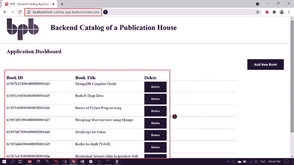

**图 0.1:** 应用仪表板页面

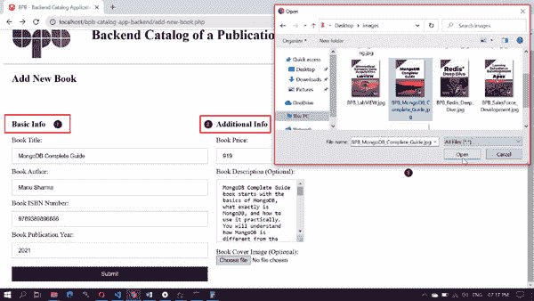

**图 0.2:** 添加新书籍页面

**REST API 开发** – 创建出版社的 RESTful Web 服务 – 使用 `Node.js` 和 `MongoDB` 进行 API 开发

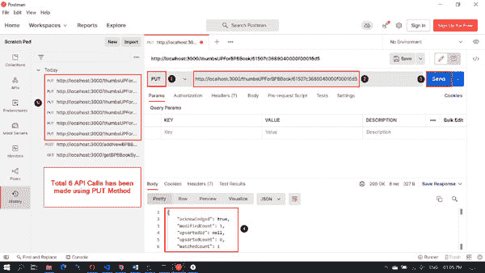

**图 0.3:** 使用 `Postman` 进行 API 调用

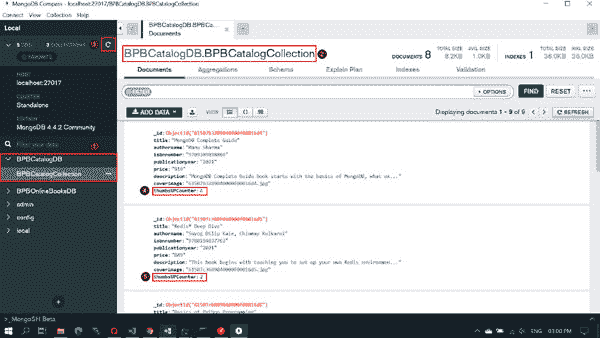

**图 0.4:** `MongoDB Compass` —— 验证由我们的 API 调用更新的文档

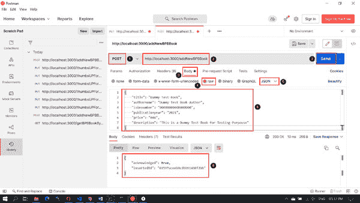

**图 0.5:** 使用我们的 API 添加虚拟书籍

**移动应用开发** – 创建出版社的移动应用 – 使用 `React Native` 和 `MongoDB` 通过 API 调用进行数据驱动的动态移动应用开发

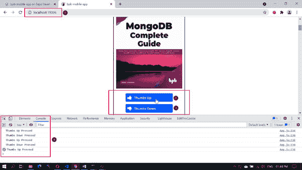

**图 0.6:** “赞”和“踩”功能

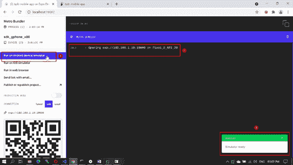

**图 0.7:** `Expo` 开发工具 > 在安卓设备/模拟器上运行

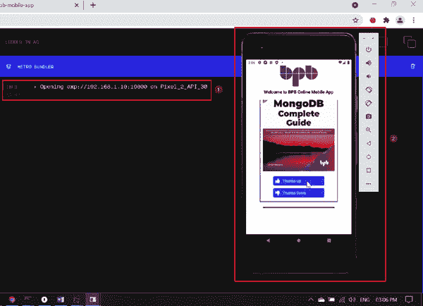

**图 0.8:** 移动应用在安卓设备/模拟器上成功运行


**前端开发 –** 创建出版社的网站 – 使用`Python`的`Django`框架和`MongoDB`进行前端开发

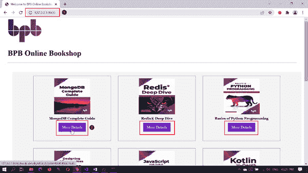

**图 0.9：** `Django`前端应用首页

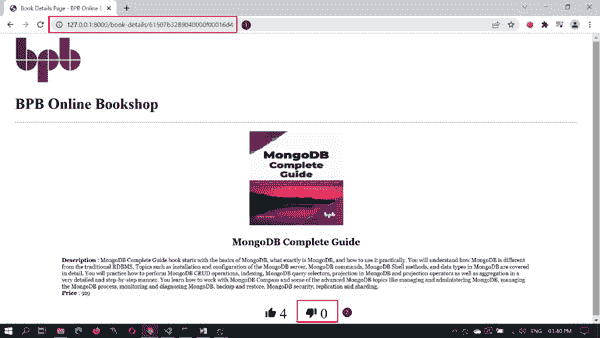

**图 0.10：** 前端 - 更多详情页 – “赞”和“踩”

# 代码包和彩色图片

请点击以下链接下载本书的代码包和彩色图片：

[`rebrand.ly/pi581cf`](https://rebrand.ly/pi581cf)

书籍的代码包也托管在 GitHub 上，地址为`https://github.com/bpbpublications/Full-Stack-Development-with-MongoDB`。如果代码有更新，将在现有的 GitHub 仓库中更新。

我们在丰富的书籍和视频目录中提供了代码包，请访问`https://github.com/bpbpublications`。快去看看吧！

# 错误列表 (Errata)

我们对 BPB Publications 的工作非常自豪，并遵循最佳实践以确保内容的准确性，为订阅者提供沉浸式的阅读体验。读者是我们的镜子，我们利用他们的反馈来反思并改进出版过程中可能出现的人为错误（如果有的话）。为了让我们维持质量并帮助我们联系可能因不可预见的错误遇到困难的读者，请通过邮箱与我们联系：

`errata@bpbonline.com`

您的支持、建议和反馈对我们非常关重要。

BPB Publications 全体对您的支持深表谢意。

# 版权问题

如果您在互联网上发现我们作品的任何形式非法拷贝，我们将感谢您向我们提供位置地址或网站名称。请通过`business@bpbonline.com`与我们联系。

# 如果您兴趣成为作者

如果您在某个领域拥有专业知识，并对编写或贡献书籍感兴趣，请访问`www.bpbonline.com`。我们与成千上万像您这样的开发者和技术专家合作，帮助他们向全球技术社区分享见解。您可以提交通用申请、申请我们正在招募作者的热点，或提交自己的想法。

# 评论

请留下评论。在阅读并使用本书后，为什么不在您购买的网站留下评论呢？潜在读者可以查看并参考您的中立意见做出购买决策。BPB 可以了解您对产品的看法，我们的作者也可以看到对书的反馈。谢谢！

有关 BPB 的更多信息，请访问`www.bpbonline.com`。

# 第一章

## 客户端与服务器概念及 MongoDB 驱动介绍

在现实场景中，当我们通过网络或互联网请求任何信息时，客户端和服务器会相互交互以传递请求的信息。在本章中，你将学习与客户端和服务相关的概念，以及它们是如何交互的。在本章的后续章节，我们将结合 MongoDB 等数据库涵盖这些概念，并学习使用 MongoDB 等数据库的动态网站是如何工作的。

### 结构

在本章中，我们将讨论以下主题：

- 客户端与服务器端概念

- 客户端与服务器端数据库概念

- MongoDB 驱动程序介绍

### 目标

学习完本章后，读者将理解客户端和服务器端的概念，并学习客户端与服务器之间的区别。读者还将学习涉及像 MongoDB 数据库的客户端和服务器端概念。本章还将涵盖 MongoDB 驱动程序及其用途、MongoDB 目前支持的编程语言，以及 MongoDB 社区提供的驱动程序。

### 客户端与服务器端概念

在进入本章及本书的编程部分之前，让我们先定义几个与客户端和服务器相关的概念。

客户端是那些向服务器发送请求以执行特定任务的实体。服务器接收客户端发送的命令并执行任务。一旦任务执行并完成，服务器就会将结果返回给客户端。

有许多类型的客户端和服务器。它们各自都执行特定的任务。例如，有 Web 服务器和 Web 客户端。Web 服务器的一个简单例子是`Apache HTTP Web server`、`Microsoft IIS Web server`或`NGINX Web server`。

同样，我们还有 Web 客户端，我们每天在 PC、笔记本电脑、手机、平板电脑等上使用它们。因此，我们可能意识到它们是 Web 浏览器，例如`Google Chrome`、`Microsoft Edge`、`Mozilla Firefox`、`Mac Safari`、`Opera`等。

那么这里发生了什么呢？你将你想要访问的网站 URL，例如`https://bpbonline.com`，这是购买在线 IT 和技术书籍最好的地方之一。当你浏览器中输入 URL 时，浏览器充当客户端，并将此请求发送到运行 BPB Publication 网站的 Web 服务器。Web 服务器接收来自客户端的请求并在其端执行，之后，它将请求作为浏览器容易理解的 HTML 页面传回，如图[图 1.1]所示。

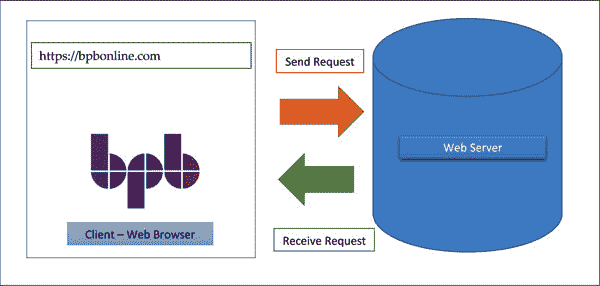

**图 1.1：** 客户端-服务器架构

现在，让我们用更有趣的方式来理解这个例子。

所以，你在浏览器中输入 URL `https://bpbonline.com`访问 BPB Publication Online 网站。现在，你想买一本书，进入网站的购物车，支付金额，然后完成了。在所有这些步骤中，你的客户端（你的浏览器）和服务器（托管 BPB Publication Online 网站的服务器）一直在相互通信。这是硬币的一面。

现在，让我们了解服务器端可能发生什么。如你所知，电子商务网站和像“BPB Publication Online”这样的门户运行在某些复杂的技术，这些网站是动态的。在这里，动态意味着这些网站上的内容和功能随着每周或每天新书名的出现而不断变化。这些网站会立即更新内容。如果你在折扣期或促销活动期间访问这些网站，有时是非常幸运的。

这里有几个问题：这些动态事物是如何发生的？是否只在 Web 服务器端发生了某些事情？

答案是否定的！没有其他技术的帮助，Web 服务器无法独自完成此类动态操作。互联网由不同类型的技术组成。每个网站在技术栈方面都是独特的。

为了运行这些动态门户和网站，使用了`PHP`、`Node JS`（一种服务器端 JavaScript 环境）和`Python`等服务器端编程语言。还有许多其他服务器端编程语言，如`Java`、`C#`、`ASP.NET`（`.NET framework`）和`Ruby on Rails`（`RoR`），但对于本章及后续章节，我们将仅使用`PHP`、`JavaScript`（`Node JS`）和`Python`等编程语言的示例。

到目前为止 MongoDB 在哪里？我们现在有几人在想 MongoDB 或任何数据库在客户端-服务器图中处于什么位置。

现在让我们从数据库的角度来理解客户端和服务器概念。

### 客户端与服务器端数据库概念

在上一节中，我们已经理解了通常意义上的客户端和服务器。现在，让我们进一步理解像 MongoDB 这样的数据库充当服务器时的客户端和服务器概念。

众所周知，MongoDB 是一个数据库服务器。它还执行从客户端接收到的请求。作为一个浏览器，它充当 Web 服务器的 Web 客户端。我们有 MongoDB 客户端，例如`MongoDB Compass`（它是 MongoDB 的官方客户端），以及其他如`Robo 3T`等有助于连接到 MongoDB 服务器的客户端。

当你在任何操作系统上安装 MongoDB 时，都需要一些客户端来连接并与 MongoDB 服务器通信。因此，MongoDB 客户端是一个帮助我们连接并执行各种操作（如执行 MongoDB 查询和数据库操作）的程序。

如果你记得，我们在之前的章节中多次使用了`MongoDB Shell`，而且在那本书的最后一章中也学习了`MongoDB Compass`。这些都是用于连接和与 MongoDB 服务器通信的 MongoDB 客户端。在这里，MongoDB 客户端请求 MongoDB 服务器执行某些查询或命令，这与 Web 客户端请求 Web 服务器交付某些 Web 页面或 URL 的方式类似，如图[图 1.2]所示。

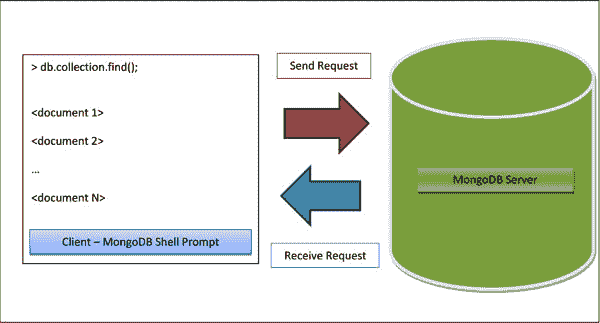

**图 1.2：** 客户端-服务器数据库架构

但你们许多人可能仍在思考动态网站和门户是如何与 MongoDB 等数据库协同工作以便在 Web 上展示动态数据的，因为我们并没有在网站上使用这些客户端。实际上，这是在`PHP`、`Node JS`等服务器端编程语言的帮助实现的。

在下一节中，我们将学习 MongoDB 驱动程序，稍后将介绍编程语言的 MongoDB 驱动程序。

### MongoDB 驱动程序介绍

数据库驱动程序是用于连接和与数据库通信的客户端库。在我们场景中，MongoDB 驱动程序的工作就像是从客户端运行并与 MongoDB 服务器通信的软件库。驱动程序的目的是在客户端环境和 MongoDB 服务器之间提供接口。

客户端环境根据它们使用的编程语言而异。任何与 MongoDB 服务器交互的 MongoDB 客户端都是通过驱动程序的帮助实现的。即使是使用`JavaScript`语言查询数据库的`MongoDB Shell`也使用驱动程序连接到 MongoDB 服务器。

因此，无论是任何如`MongoDB Compass`、`Command`类的桌面应用程序，像`Mongo Shell`类的命令行应用程序，使用`MongoDB`作为数据库服务器开发的网站，还是通过后端进程使用`REST APIs`与 MongoDB 数据库通信的任何移动应用程序，所有这些都使用驱动程序，驱动程序充当它们与 MongoDB 服务器之间的解释器，如图[图 1.3]所示。

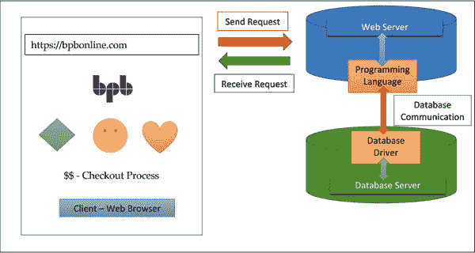

**图 1.3：** 客户端-服务器数据库架构——编程语言与数据库驱动程序——通信与交互

任何与 MongoDB 交互的应用程序或网站都可以使用`PHP`、`Node JS`或`Python`等编程语言来实现，然后这些编程语言再通过它们自己的驱动程序与 MongoDB 交互。

每种编程语言都有自己的 MongoDB 驱动程序，用于连接和与 MongoDB 服务器通信。MongoDB 支持所有主要的编程语言，且列表非常多。你可以访问 MongoDB 驱动程序页面，查看 MongoDB Inc. 官方支持的所有编程语言驱动库列表，如 图 1.4 所示。

更多详情，请访问：[`docs.mongodb.com/drivers/`](https://docs.mongodb.com/drivers/)

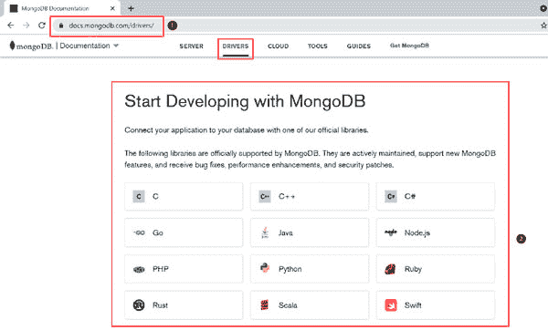

**图 1.4:** MongoDB 驱动程序——官方支持的驱动库列表

MongoDB 还支持由 MongoDB 社区支持的编程语言。如果你正在开发任何官方驱动页面上未列出的应用程序，在这种情况下，你可以查看社区页面检查你的语言是否在社区页面列表中，地址为：[`docs.mongodb.com/drivers/community-supported-drivers`](https://docs.mongodb.com/drivers/community-supported-drivers)，如 图 1.5 所示。

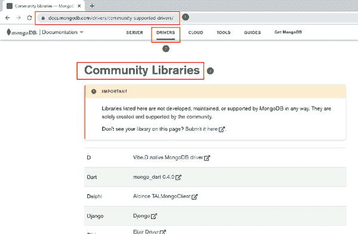

**图 1.5:** MongoDB 驱动程序——社区支持的驱动库列表

# 用于编程语言的 MongoDB 驱动 (PHP、JavaScript 和 Python) (#toc.xhtml_s6a)

在我们开始编程部分之前，请注意，为了使用这些编程语言使用 MongoDB，你必须准备好可运行的环境，以便能够轻松运行后续章节中提供的示例（这些示例与编程和应用开发有关）。

在接下来的章节中，我们将介绍 PHP、Node JS 和 Python 每种编程语言的逐步操作方法，首先在我们的机器上创建正确的环境，以运行编程的实践示例。

# 结论 (#toc.xhtml_s7a)

在本章中，我们学习了与客户端和服务器相关的概念，以及它们之间如何交互。我们还学习了与 MongoDB 等数据库相关的这些概念，以及使用 MongoDB 等数据库的动态网站是如何工作的。在本章的最后一节中，我们涵盖了 MongoDB 目前支持的编程语言驱动程序以及 MongoDB 社区驱动程序。在本书的下一章节中，我们将使用 MongoDB Compass 创建数据库和集合，并使用 MongoDB Compass 插入一些虚拟数据，这将帮助我们处理书中与 MongoDB 一起使用的不同编程语言，如 PHP、Node.js、React Native 和 Python。

# 问题 (#toc.xhtml_s8a)

1. 你如何理解客户端和服务器端？请举例。

2. 浏览器是客户端还是服务器端应用程序？

3. 你认为本质上是动态的网站使用什么来展示动态内容？

4. MongoDB 在客户端和服务器概念方面是如何对应的？通信是如何发生的？

5. 什么是数据库驱动程序？

6. 列出一些拥有官方 MongoDB 驱动程序支持的编程语言。

# 第 2 章 (#toc.xhtml_c02)

# 使用 MongoDB Compass 添加数据 (#toc.xhtml_c02)

在我们开始使用 MongoDB 和编程语言进行真实的编程和软件相关之前，我们需要一些数据作为开始。在本章中，将在使用 MongoDB Compass 创建数据库和集合后，使用 MongoDB Compass 进行一些数据输入，以便我们在接下来的章节中有一些真实数据可以处理。

# 结构 (#toc.xhtml_s9a)

在本章中，我们将讨论以下主题：

* MongoDB Compass

* 启动 MongoDB Compass 并使用它连接到 MongoDB 服务器

* 使用 MongoDB Compass 创建 MongoDB 数据库和集合

* 使用 MongoDB Compass 添加数据（在我们的 MongoDB 集合中创建一些文档）

# 目标 (#toc.xhtml_s10a)

学习本章后，读者将能够在 MongoDB 数据库中输入数据，这是我们在开始后续与编程和软件开发相关的章节之前需要的。在本章中，我们将使用 MongoDB 官方 GUI 工具 MongoDB Compass，在 MongoDB 集合中添加一些真实数据（添加一些文档）。

# 关于 MongoDB Compass (#toc.xhtml_s11a)

MongoDB Compass 是一个图形用户界面 (GUI) 工具，它可以帮助我们非常方便地连接到 MongoDB 服务器，并通过 GUI 完成许多通过命令或查询完成需要大量时间的工作。MongoDB Compass 还提供了许多有助于数据可视化以及操作集合中数据的功能。MongoDB Compass 不仅仅是一个视觉 GUI 客户端或数据操作工具。

在 Manu Sharma 编写的 BPB Publications 出版的《*MongoDB Complete Guide*》书中，从如何安装到如何使用逐步详细介绍了 MongoDB Compass。如果你想了解 MongoDB 基础和 MongoDB Compass 基础，可以参考上述书籍。

**注意**

1. 本书假设读者具有 MongoDB 和 MongoDB Compass 的基础知识。

2. 它还假设读者的机器上已经安装了 MongoDB 和 MongoDB Compass。

3. 由于这是一本高级书籍，涵盖基础知识超出了本书的范围。

# 启动 MongoDB Compass 并使用它连接到 MongoDB 服务器 (#toc.xhtml_s12a)

让我们现在尝试从你的 Windows 机器通过 MongoDB Compass 连接到 MongoDB。要从 Windows 机器连接到 MongoDB，你可以遵循以下步骤：

1. 点击任务栏的搜索区域并输入`Compass`。你会看到 Compass 应用及其详细信息。点击`打开`，或使用`以管理员身份运行`。这将以管理员权限打开 MongoDB Compass，如 图 2.1 所示。

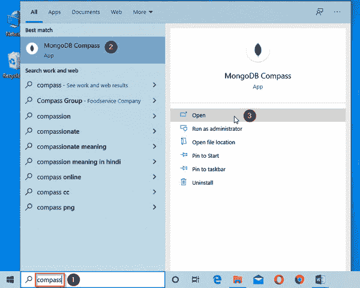

**图 2.1:** MongoDB Compass——打开 MongoDB Compass

2. 对于新连接，点击 MongoDB GUI 下的`New Connection`（单独填写连接），如 图 2.2 所示。

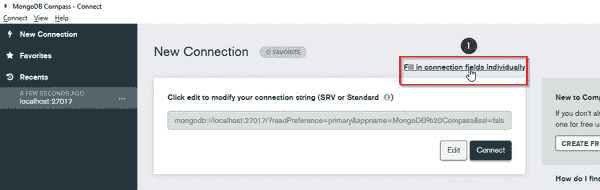

**图 2.2:** MongoDB Compass GUI——新连接——填写连接信息

3. 现在，将主机设置为`localhost`，端口设置为`27017`（默认设置），并点击`Connect`按钮连接到 MongoDB 服务器，如 图 2.3 所示。

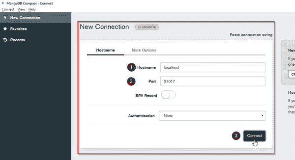

**图 2.3:** MongoDB Compass GUI——使用默认设置连接 MongoDB 服务器

# 使用 MongoDB Compass 创建 MongoDB 数据库和集合 (#toc.xhtml_s13a)

让我们现在尝试使用 MongoDB Compass 创建 MongoDB 数据库和集合，以便向我们的 MongoDB 集合添加数据（添加新文档）。使用 MongoDB Compass 创建 MongoDB 数据库和集合，你可以遵循以下步骤：

1. 连接到 MongoDB 服务器后，你可以在 MongoDB Compass GUI 的顶部区域看到名为`CREATE DATABASE`的按钮。点击此按钮，如 图 2.4 所示。

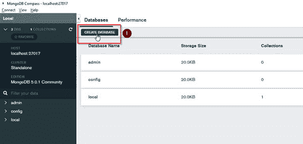

**图 2.4:** MongoDB Compass GUI——创建数据库

2. 点击`CREATE DATABASE`按钮后，将打开一个新的弹出窗口来添加详细。在`Database Name`字段中输入`BPBOnlineBooksDB`，在`Collection Name`字段中输入`BPBOnlineBooksCollection`，然后点击`Create Database`，如 图 2.5 所示。

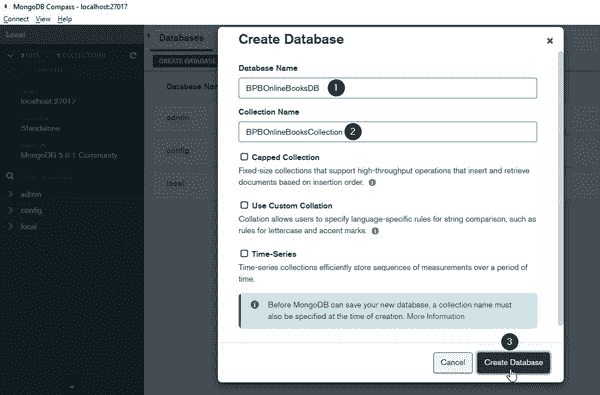

**图 2.5:** MongoDB Compass GUI——创建数据库弹出窗口


3. 一旦你按照上一步提到的所需详情点击 `Create Database`（创建数据库）按钮，你将看到你的 MongoDB 数据库以及集合已通过 MongoDB Compass 成功创建，如图 2.6。

**图 2.6：** MongoDB Compass GUI——MongoDB 数据库和集合已成功创建

### 使用 MongoDB Compass 添加数据（在我们的 MongoDB 集合中创建一些文档）

现在，让我们尝试向 MongoDB 集合中添加数据（添加新文档）。要向数据库添加新数据，我们需要在集合中创建文档。让我们以 BPB Publications 出的一些书籍为例，使用下表（包含书籍列表及其详细信息）将这些信息添加到 MongoDB 数据库中：

| 书名 | 作者 | 书籍 ISBN | 页数 | 书籍简要描述 |
| :--- | :--- | :--- | :--- | :--- |
| MongoDB Complete Guide | Manu Sharma | 9789389898866 | 470 | 《Master MongoDB》——通过循序渐进、实用且易于理解的方法，掌握这种广泛使用的现代数据库，涵盖了所有主要主题。 |
| Redis® Deep Dive | Suyog Dilip Kale, Chinmay Kulkarni | 9788194837763 | 228 | 本书从教你搭建自己的 Redis 环境开始，随后介绍了 Redis 数据结构、其架构和用例。 |
| ITIL® 2011 The Story Continues | Dr. Pratul Sharma | 9789388176736 | 82 | 本书描述了 ITIL 服务生命周期以及服务设计与开发的标准。以非传统的通俗语言进行了解释，并配有易于遵循的示例，还探讨了通过监控为客户创建和维护价值的问题。 |
| Decoding JavaScript | Rushabh Mulraj Shah | 9789390684816 | 370 | 掌握高级 JavaScript，以构建现代下一代 Web 应用程序。 |
| Python In-Depth | Ahidjo Ayeva, Kamon Ayeva, Aiman Saed | 9789389328424 | 364 | 《Python In-Depth》为你详细展示了使用 Python 解决日常问题（即使是复杂问题）的可能性。 |
| Designing User Interfaces | Dario Calonaci | 9789389898743 | 230 | 使用获奖平面设计师的设计思维原则来思考 UI 设计。 |
| Advanced Web Development with React | Mehul Mohan | 9789389423594 | 204 | 本书首先向读者介绍 React、它是什么，以及为什么你在处理中大型规模应用程序时需要像 React 这样的库。 |

**表 2.1：** 要添加到 MongoDB 数据库的示例数据（用于在 MongoDB 集合中创建 MongoDB 文档的数据）

现在，让我们使用 MongoDB Compass 进行一些数据输入。MongoDB Compass 为我们提供了多种使用 JSON、CSV 或手动数据输入来插入数据的方法。

1. 点击链接，这将显示要将文档添加到此 `Collections`（集合）中的 `Collection Name`（集合名称），如图 2.7。

   **图 2.7：** MongoDB Compass GUI——集合链接

2. 进入集合后，你将看到添加新数据的选项。点击显示 `Add Data` 的下拉按钮，然后选择 `Insert Document`（插入文档）在这一步骤中手动添加数据。我们将在接下来的步骤中也会检查 JSON 方法，如图 2.8。

   **图 2.8：** MongoDB Compass GUI——集合——添加数据

3. 点击 `Add Data` 下拉按钮并选择 `Insert Document` 添加数据后，将弹出一个窗口来手动添加数据。我们将使用 `List View`（列表视图）而不是 `Code View`（代码视图）来添加数据，并保持文档 ID 值 `_id` 不变（由 MongoDB 默认生成）。只需悬停在 `_id` 字段上并点击加号符号 `+` 即可添加新记录，如图 2.9。

   **图 2.9：** MongoDB Compass GUI——集合——添加数据

4. 我们将保持以下文档字段（键和值）的结构，并从表 2.1 中获取这些值进行添加。让我们首先定义文档的键。参考下表（表 2.2）。

| 使用来自表 2.1 标题的键（第 1 行示例） | 使用来自表 2.1 对应数据的值（第 1 行示例） |
| :--- | :--- |
| `Book-title` | MongoDB Complete Guide |
| `Book-author` | Manu Sharma |
| `Book-ISBN` | 9789389898866 |
| `Book-pages` | 470 |
| `Book-brief-description` | Master MongoDB—the widely used modern database in a step-by-step, practical, and easy-to-understand approach covering all major topics. |

**表 2.2：** 要添加到 MongoDB 数据库的键值数据

5. 在这一步骤中，我们将使用来自表 2.1 的键值对，并点击 `Add Data` 按钮选择 `Insert Document` 来在 MongoDB 集合中引用表 2.2 的键值对。这将在我们的 MongoDB 集合中创建一个新文档，如图 2.10 所示。

   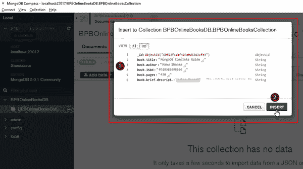

   **图 2.10：** MongoDB Compass GUI——添加数据并创建一个文档

6. 数据输入完成后，我们可以看到表 2.1 中的所有键值对。如果你想使用 JSON 方法一次性添加所有文档，可以参考图 2.11。

   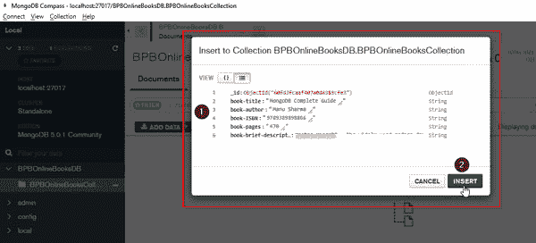

   **图 2.11：** MongoDB Compass GUI——添加数据并创建一个文档

7. 你可以使用下面的 JSON 一次性添加所有文档。从集合区域选择 `Code View` 以复制并粘贴以下数据：

```json
[
  {
    "_id": {
      "$oid": "60fd3faf07a0d6383"
    },
    "book-title": "MongoDB Complete Guide",
    "book-author": "Manu Sharma",
    "book-ISBN": "9789389898866",
    "book-pages": "470",
    "book-brief-description": "Master MongoDB—the widely used modern database in a step-by-step, practical, and easy-to-understand approach covering all major topics."
  },
  {
    "_id": {
      "$oid": "60fd485daf47a0d6384"
    },
    "book-title": "Redis® Deep Dive",
    "book-author": "Suyog Dilip Kale, Chinmay Kulkarni",
    "book-ISBN": "9788194837763",
    "book-pages": "228",
    "book-brief-description": "This book begins with teaching you to set up your own Redis environment, followed by Redis data structures, their architecture, and use cases."
  },
  {
    "_id": {
      "$oid": "60fd4975af07a0d6386"
    },
    "book-title": "ITIL® 2011 The Story Continues",
    "book-author": "Dr. Pratul Sharma",
    "book-ISBN": "9789388176736",
    "book-pages": "82",
    "book-brief-description": "This book describes the ITIL service lifecycle and standards for service design and development. An explanation is given in untraditional layman’s language, with easy-to-follow examples and explores issues of creating and maintaining value for clients through monitoring."
  },
  {
    "_id": {
      "$oid": "60fd49cdaf07a0d6387"
    },
    "book-title": "Decoding JavaScript",
    "book-author": "Rushabh Mulraj Shah",
    "book-ISBN": "9789390684816",
    "book-pages": "370",
    "book-brief-description": "Mastering advanced JavaScript to build modern next-generation Web applications."
  },
  {
    "_id": {
      "$oid": "60fd501af07a0d638"
    },
    "book-title": "Python In-Depth",
    "book-author": "Ahidjo Ayeva, Kamon Ayeva, Aiman Saed",
    "book-ISBN": "9789389328424",
    "book-pages": "364",
    "book-brief-description": "“Python In-Depth” gives you a detailed presentation of the possibilities for solving everyday problems, even complex ones using Python."
  },
  {
    "_id": {
      "$oid": "60fd4a12af407a0d6383cfe8"
    },
    "book-title": "Python In-Depth",
    "book-author": "Ahidjo Ayeva, Kamon Ayeva, Aiman Saed",
    "book-ISBN": "9789389328424",
    "book-pages": "364",
    "book-brief-description": "《Python In-Depth》为你详细介绍了使用 Python 解决日常问题的可能性，即使是复杂问题。"
  },
  {
    "_id": {
      "$oid": "60fd4a59af407a0d6383cfe9"
    },
    "book-title": "Designing User Interfaces",
    "book-author": "Dario Calonaci",
    "book-ISBN": "9789389898743",
    "book-pages": "230",
    "book-brief-description": "使用获奖平面设计师的设计思维原则来思考 UI 设计。"
  },
  {
    "_id": {
      "$oid": "60fd4ab8af407a0d6383cfea"
    },
    "book-title": "Advanced Web Development with React",
    "book-author": "Mehul Mohan",
    "book-ISBN": "9789389423594",
    "book-pages": "204",
    "book-brief-description": "本书首先向读者介绍 React、它是什么，以及为什么在处理中大型应用时需要像 React 这样的库。"
  }
]
```

8. 点击如图 2.12 所示的 `Insert` 按钮。

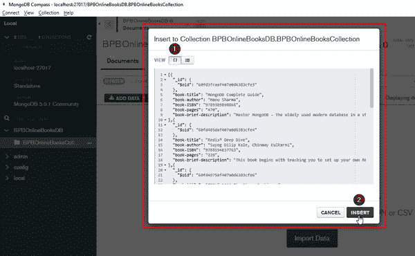

**图 2.12：** MongoDB Compass GUI——使用 JSON 方法在 MongoDB 集合中添加数据并创建多个文档。

9. 在上一步中点击 `Insert` 按钮后，你将看到使用 JSON 方法插入集合的全部七个文档，如图 2.13 所示。

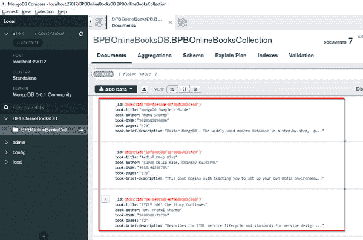

**图 2.13：** MongoDB Compass GUI——集合——使用 JSON 方法添加数据——已添加多个文档

### 结论

在本章中，我们在 MongoDB 数据库中输入了一些真实数据。我们使用了 MongoDB Compass 通过手动和 JSON 方法在 MongoDB 集合中添加了一些数据（一些文档）。在接下来的章节中，我们将开始学习 PHP 和 MongoDB 的基础编程，学习如何设置使用 PHP 的 MongoDB 环境，以及如何使用 PHP 编程语言连接 MongoDB。

### 问题

1. 什么是 MongoDB Compass？
2. 请举例说明如何使用 MongoDB Compass 连接 MongoDB 服务器。
3. 写出创建 MongoDB 集合的步骤。
4. 如何使用 MongoDB Compass 在集合中创建 MongoDB 文档？
5. 是否可以使用 MongoDB Compass 添加多个文档？

## 第 3 章：开始使用 MongoDB 和 PHP 进行编程

PHP 是一种广泛使用的编程语言，许多开源项目是用 PHP 构建的，它是 Web 开发领域最流行的语言之一，因此在本章中，我们将介绍结合 MongoDB 的 PHP 编程。我们将学习如何将 PHP 与 MongoDB 结合。我们还将学习如何在 PHP 和 WAMP 服务器上设置 MongoDB。在进入本章的最后一节中，我们将进行一些编码并运行实际示例，以使用 PHP 连接并操作 MongoDB 服务器。

### 结构

在本章中，我们将讨论以下主题：

* 将 PHP 与 MongoDB 使用
* 安装 WAMP 服务器并为 PHP 设置环境
* 使用 PHP 和 WAMP 服务器设置 MongoDB
* 使用 PHP 连接并操作 MongoDB 服务器

### 目标

学习本章后，读者将能够理解如何将 PHP 与 MongoDB 使用。本章将涵盖 WAMP 服务器的安装，并为使用 PHP 进行 MongoDB 编程准备环境。在本章的后部分，读者还将学习如何通过程序方式使用 PHP 连接并操作 MongoDB 服务器。

### 将 PHP 与 MongoDB 使用

PHP 是一种广泛使用的编程语言，许多开源项目是用 PHP 构建的，它是 Web 开发领域最流行的语言之一。在本章中，我们将介绍结合 MongoDB 的 PHP 编程。我们将学习如何将 PHP 与 MongoDB 结合。我们还将学习如何在 PHP 和 WAMP 服务器上设置 MongoDB。在进入本章的最后一节中，我们将进行一些编码并运行实际示例，以使用 PHP 连接并操作 MongoDB 服务器。

### 安装 WAMP 服务器并为 PHP 设置环境

在本节中，我们将讨论以下主题：

* 将 PHP 与 MongoDB 使用
* 安装 WAMP 服务器并为 PHP 设置环境
* 使用 PHP 和 WAMP 服务器设置 MongoDB
* 使用 PHP 连接并操作 MongoDB 服务器

一旦下载完成且安装文件完全下载完毕，它将显示如图 3.3 所示的下载完成图标，你就可以继续后续步骤。

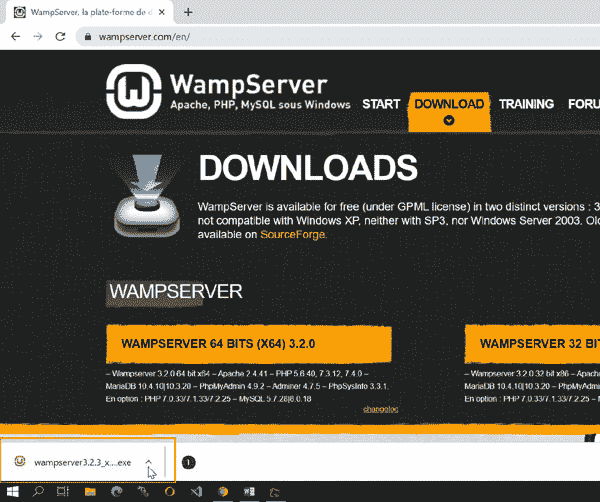

**图 3.3：** WAMP 服务器下载界面——下载完成 100%——下一步

### 使用 PHP 和 WAMP 服务器设置 MongoDB

学习本章后，读者将能够理解如何将 PHP 与 MongoDB 使用。本章将涵盖 WAMP 服务器的安装，并为使用 PHP 进行 MongoDB 编程准备环境。在本章的后部分，读者还将学习如何通过程序方式使用 PHP 连接并操作 MongoDB 服务器。

### 使用 PHP 连接并操作 MongoDB 服务器

在本节中，我们将讨论以下主题：

* 将 PHP 与 MongoDB 使用
* 安装 WAMP 服务器并为 PHP 设置环境
* 使用 PHP 和 WAMP 服务器设置 MongoDB
* 使用 PHP 连接并操作 MongoDB 服务器


1. 现在，打开此安装文件，它将启动 WAMP 服务器设置向导，该向导将引导你并在机器上完成 WAMP 服务器的安装，如`图 3.4`所示。

   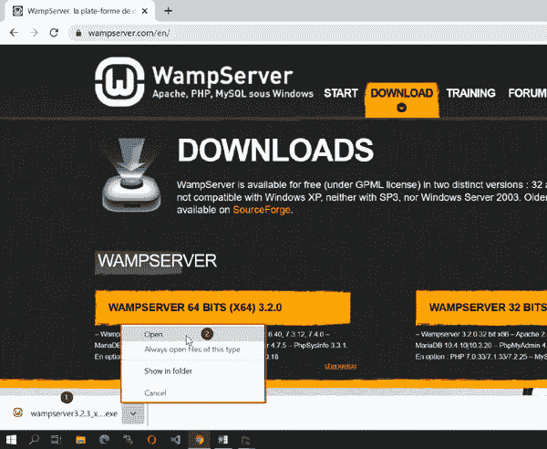

   **图 3.4:** WAMP 服务器下载界面——下载完成 100%——打开安装文件

2. 现在，打开此安装文件，它将启动 WAMP 服务器设置向导，该向导将引导你在机器上完成 WAMP 服务器的安装。我们在这里不会涵盖所有的步骤，因为这超出了本章的范围。请遵循设置过程进行，它将在你的 Windows 机器上安装 WAMP 服务器，如`图 3.5`所示。此外，在安装过程中，设置程序会要求你接受许可协议。建议阅读许可协议和其他条款与条件。

   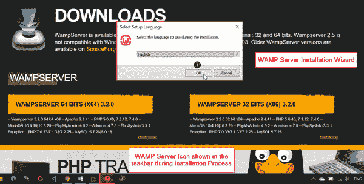

   **图 3.5:** WAMP 服务器设置向导

3. 安装程序将要求你选择不同版本的软件组件，例如 PHP、MySQL、MariaDB 等。如果你愿意，可以安装任何最新版本。但是，建议采用默认安装设置，如`图 3.6`所示。

   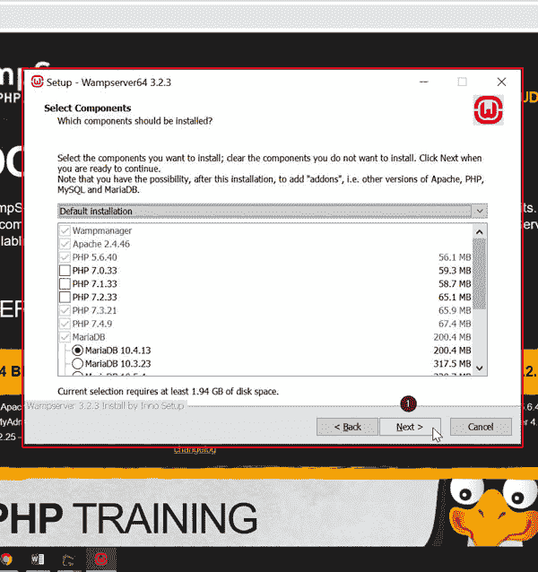

   **图 3.6:** WAMP 服务器设置向导——选择组件

4. 一旦安装 100% 完成，点击`Finish`（完成）按钮退出设置向导，如`图 3.7`所示。

   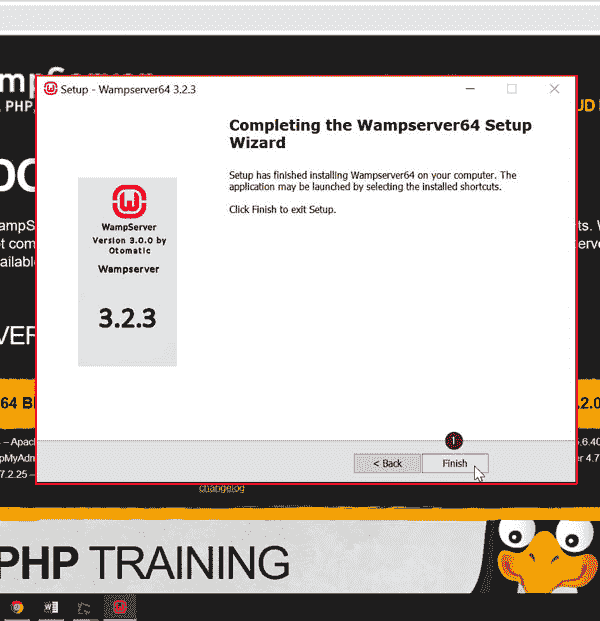

   **图 3.7:** WAMP 服务器设置向导——安装完成

### 步骤 3—在你的 Windows 机器上启动和使用 WAMP 服务器

一旦安装完成，你应该在任务栏搜索区域输入`wamp` 并打开 WAMP 服务器，这将在你的 Windows 机器上启动 WAMP 服务器，如`图 3.8`所示。

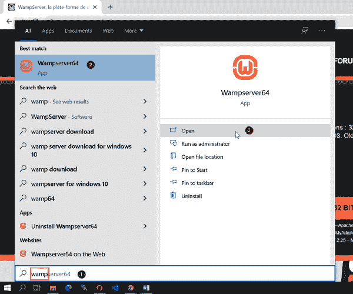

**图 3.8:** 启动 WAMP 服务器

1. 一旦 WAMP 服务器成功启动，你将在任务栏托盘中看到 WAMP 服务器图标（绿色）。当你运行 WAMP 服务器时，它通常需要几秒钟来启动 Apache、MySQL 等所有服务，图标会从红色变为橙色，最后变为绿色。如果 WAMP 图标是绿色的，意味着所有服务已成功启动，现在你就可以使用 WAMP 服务器了，如`图 3.9`所示。

   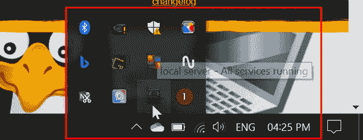

   **图 3.9:** WAMP 服务器——所有服务已成功启动

2. 你可以点击绿色图标，它将打开一个小型菜单，其中有许多选项，你可以从中进行许多操作，如启动/停止/重启 WAMP 服务器，更改 PHP、Apache 服务器的设置等。我们在本章中不会涵盖所有内容，因为这超出了本章范围。如果你愿意，可以从你的机器探索这些设置，如`图 3.10`所示。

   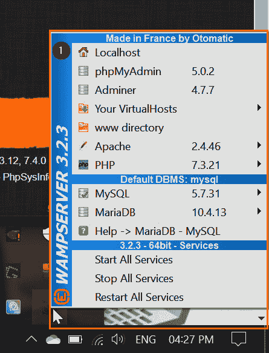

   **图 3.10:** 带有许多选项的 WAMP 服务器菜单

### 步骤 4—运行 localhost

一旦 WAMP 服务器在你的机器上启动，你现在就可以开始使用安装了 Apache 和 PHP 的本地服务器了。既然我们已经准备好了所需的环境，就可以运行 localhost。

1. 要运行 localhost，只需打开你喜欢的浏览器（如 Google Chrome）并输入：`http://localhost/` 然后按 `Enter`。这将打开一个新页面，你将看到 localhost 上的 WAMP 服务器默认页面。在这里，你将获得有关 WAMP 服务器版本的所有信息、服务器配置（列出了后台运行的各种软件列表），以及它们的版本详细信息，例如 Apache Web 服务器和 PHP，如`图 3.11`所示。

   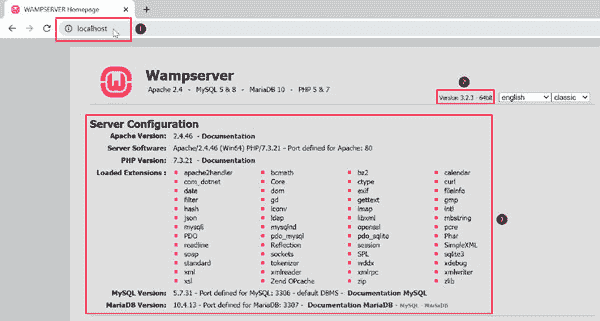

   **图 3.11:** WAMP 服务器—localhost

如果你能看到此页面，意味着启动 PHP 应用开发所需的大部分内容已就绪，但 MongoDB 除外，我们将在下一步中介绍它。

### 步骤 5—为 PHP 配置 MongoDB 扩展

在这一步中，我们将为 PHP 配置 MongoDB 扩展。有不同的方法可以实现。某些方法倾向于使用 `Composer`（它是 PHP 的依赖管理器）进行，但我们将采用另一种方法。请按照以下步骤为 PHP 配置 MongoDB 扩展。

1. 在你喜欢的浏览器中输入 URL：访问 MongoDB 的 **PHP Extension Community Library**（**PECL**）主页：[`https://pecl.php.net/package/mongodb`](https://pecl.php.net/package/mongodb)。这将打开 PECL MongoDB 主页。浏览扩展最新的可用稳定版本，并点击 Windows 图标后的 DLL 链接，如`图 3.12`所示。

   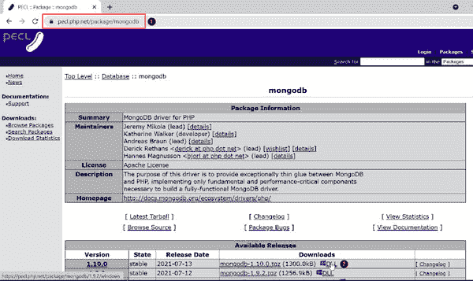

   **图 3.12:** PECL MongoDB 主页

2. 将打开一个新页面，列出适用于各种 PHP 版本的 DLL。由于我们通过 WAMP 运行 PHP 7.3，我们将下载该版本。在这里我们需要检查的另一个选项是 `Thread Safe`（线程安全）和 `Machine Architecture`（机器架构）。机器架构取决于你的硬件可以是 32 位或 64 位。如果你想检查 PHP 是否启用了线程安全，可以打开命令提示符，然后导航到 `D:\wamp\bin\php\` 并运行命令：

```
php -i|findstr "Thread"
```

你也可以在 WAMP 主页的 Tools 部分检查 `phpinfo()`。

   

   **图 13:** 检查线程安全

3. 点击正确的 DLL 文件后，下载将开始。下载完成后，你应该打开此 ZIP 文件并从中提取 DLL。之后，你应该将此 DLL 文件复制到你 PHP 版本的扩展目录（在本例中，由于我们在 WAMP 上运行 PHP 7.3 且 WAMP 安装在 D 盘），扩展目录的位置类似于：`D:\wamp64\bin\php\php.3.21\ext`。你可以在文件夹中看到许多其他 DLL 文件，如`图 3.14`所示。

   

   **图 14:** 将 PHP 扩展 DLL 复制到 PHP 扩展目录

4. 完成此步骤后，点击 Windows 托盘中的 WAMP 服务器绿色图标进入 WAMP 服务器管理器，然后导航到 PHP 并点击 `php.ini`。这将打开 `php.ini` 文件，我们要在 PHP 扩展部分添加以下行，如`图 3.15`所示。

```
extension=php_mongodb
```

   

   **图 15:** 打开 php.ini 文件

5. 上一步将打开 `php.ini` 文件。导航到此文件的 PHP 扩展部分并添加上述提到的行。之后，保存此文件。你可以将此行输入到文件末尾或扩展部分的任何位置。在我们的示例中，我们将其添加在 MySQL 扩展之后，如`图 3.16`所示。

   

   **图 16:** 在 php.ini 中添加 MongoDB 扩展

6. 在 `php.ini` 文件中添加 MongoDB 扩展代码并保存后，关闭该文件，通过点击 Windows 任务栏区域上的绿色图标进入 WAMP 服务器管理器并重启所有服务。WAMP 重启所有服务需要几秒钟，如 *图 3.17* 所示。

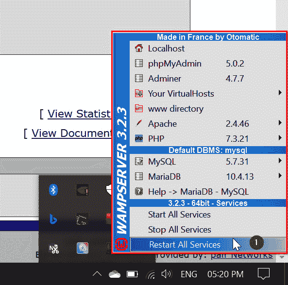

**图 3.17:** WAMP—正在重启所有服务

7. 当 WAMP 完成所有服务的重启后，在浏览器中打开 WAMP 主页，并滚动到页面底部的工具部分。点击 `phpinfo()`。这将打开一个包含 PHP 详细信息的新页面。滚动到页面中间，你将看到 PHP 扩展的详细信息。你现在可以看到 MongoDB 扩展已经为 PHP 安装并设置，如 *图 3.18* 所示。

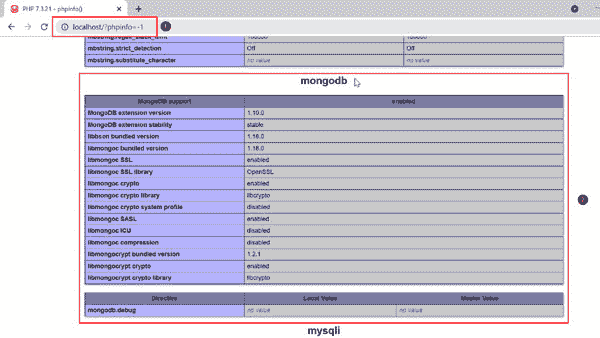

**图 3.18:** phpinfo()—MongoDB 扩展

既然我们已经完成了 MongoDB 和 PHP 的环境搭建，现在我们将开始编程部分。

## 使用 PHP 和 MongoDB 进行编程

在本章的上一节中，我们已经设置了运行 PHP 配合 MongoDB 的环境。现在，让我们开始编程部分。在开始编程和编码之前，让我们再做一件事，就像你从上一章一直在这样做一样。我们总是使用命令提示符启动 MongoDB。现在，你已经理解了基本概念，现在可以自动化一些操作，包括启动 MongoDB 服务器。在 Windows 操作系统中，当你安装 MongoDB 时，安装程序会自动创建 MongoDB 服务，你可以使用 Windows 服务管理器启动或停止 MongoDB 服务器。

让我们使用 Windows 服务管理器启动 MongoDB。

## 从 Windows 服务管理器启动 MongoDB 服务器

要使用 Windows 服务管理器启动 MongoDB，请按照以下步骤操作：

1. 在任务栏的搜索区域中输入 `services` 并打开它，如 *图 3.19* 所示。

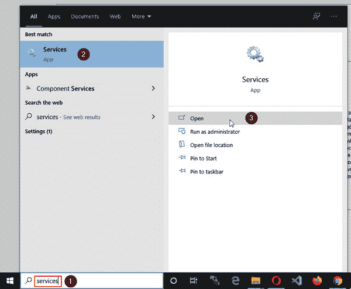

**图 3.19:** 打开服务管理器

2. 这将打开 Windows 服务管理器。你将看到安装在 Windows 机器上的所有服务。导航到 MongoDB Server (MongoDB)。点击此服务并启动它（如果尚未启动），或者如果它已经启动，你可以跳过此步骤，如 *图 3.20* 所示。

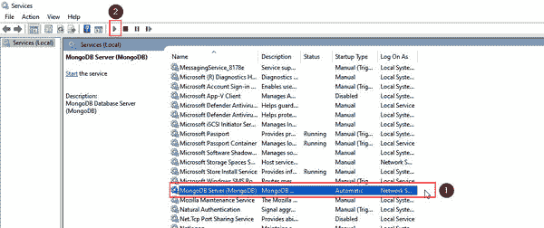

**图 3.20:** 从 Windows 服务管理器启动 MongoDB 服务

现在进入编程部分。让我们现在尝试编写一段 PHP 代码来完成连接数据库的小任务。在这里，我们将借助 PHP MongoDB 扩展在 PHP 中编写一小段代码，该扩展是我们在上一步中已经安装并设置的。

注意，由于我们正在使用 PHP 并编写 PHP 代码，建议使用某些代码编辑器或集成开发环境（`IDE`），例如 Microsoft Visual Studio Code。你可以通过此链接下载并安装 Microsoft Visual Studio Code：`https://code.visualstudio.com`。

Microsoft Visual Studio Code 是一个开源免费软件，适用于几乎所有的操作系统。

还建议你为此目的在 WAMP 的 `www` 文件夹下创建一些文件夹，并将文件保存在该文件夹下。路径可能类似于：`D:\wamp64\www\mongodb-examples`，如 *图 3.21* 所示。

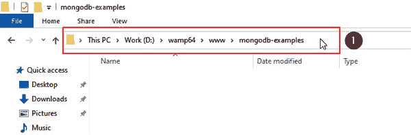

**图 3.21:** 在 WAMP www 文件夹下创建文件夹

## 示例 1—使用 PHP 连接 MongoDB 服务器

在我们的示例中，我们使用了 `$mongoDBClientConnection` 变量，它被赋值为 `MongoClient()` 类的对象。我们将此文件保存为 `mongodb-connection.php`，路径为 `D:\wamp64\www\mongodb-examples`。接下来的 *图 3.22* 显示了相应的代码。

### 代码 1

```
<?php
$mongoDBClientConnection = new MongoDB\Driver\Manager("mongodb://localhost:27017");
echo "We have Successfully Connected to MongoDB Server using PHP";
?>
```

以下是该代码在 Visual Studio Code 中的截图：

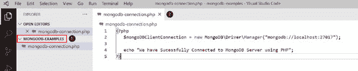

**图 3.22:** 使用 Microsoft Visual Studio Code 操作 PHP 文件

现在，让我们运行这个示例。打开你的浏览器并输入 `http://localhost/mongodb-examples/mongodb-connection.php`。你会看到我们已经使用 PHP 成功连接到 MongoDB 服务器，如 *图 3.23* 所示。

## 示例 2—使用 PHP 获取文档

在我们的示例中，我们使用了 `$mongoDBClientConnection` 变量，它被赋值为 `MongoClient()` 类的对象。我们将此文件保存为 `fetching-documents.php`，路径为 `D:\wamp64\www\mongodb-examples`。然后，我们使用了 `$query` 对象，它是 `Query` 类的实例。我们将该对象作为 `executeQuery` 方法的第二个参数传递。该方法的第一个参数是数据库名.集合名。

### 代码 2

```
<?php
$mongoDBClientConnection = new MongoDB\Driver\Manager("mongodb://localhost:27017");
echo "We have Successfully Connected to MongoDB Server using PHP";
echo '<hr>';
$query = new MongoDB\Driver\Query([]);
$rows = $mongoDBClientConnection->executeQuery("OnlineBooksDB.OnlineBooksCollection", $query);
foreach ($rows as $row) {
    echo $row['_id'] . ': ' . $row['title'] . ' [By ' . $row['author'] . ']';
    echo '<br>';
}
?>
```

现在，让我们运行这个示例。打开你的浏览器并输入 `http://localhost/mongodb-examples/fetching-documents.php`。你会看到我们已经使用 PHP 成功连接到 MongoDB 服务器，并且从集合中获取了文档，如 *图 3.24* 所示。

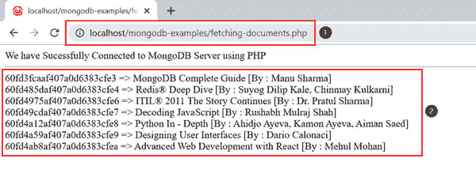

**图 3.24:** 本地—使用 PHP 连接 MongoDB 服务器并从集合获取文档

## 结

在本章中，我们涵盖了 PHP 配合 MongoDB 的 PHP 编程。我们还了解到为了运行 MongoDB 服务器，我们需要准备好正确的环境。我们学习了如何设置运行 PHP 代码所需的环境。在本章的后半部分，我们还学习了什么是 WAMP 服务器以及如何安装 WAMP 服务器。在本章的最后部分，我们完成了一些编码并运行了一些实用示例，使用 PHP 连接并操作 MongoDB 服务器。

## 习题

1. 什么是 PHP？

2. 列出两种最流行的开源软件。

3. 什么是 WAMP？

4. 我们如何安装 PHP MongoDB 扩展？请解释过程。

5. 给出一个使用 PHP 连接 MongoDB 服务器的示例。

## 第 4 章

## 开始使用 MongoDB 和 JavaScript (Node.js) 进行编程

Node.js 是一种基于 JavaScript 引擎的编程语言，它是目前最热门的编程语言之一；许多现代应用程序都在使用 Node.js 。在本章中，我们将介绍 JavaScript 编程语言，然后学习如何结合 MongoDB 进行 Node.js 编程，以及我们如何将 Node.js 与 MongoDB 使用。本章涵盖了如何配置正确的环境来运行 Node.js 代码。在章的稍后部分，我们将进行一些编码并运行一些实用示例，使用 Node.js 连接并操作 MongoDB 服务器。

### 结构

在本章中，我们将讨论以下主题：

*   使用 JavaScript (Node.js) 操作 MongoDB

*   安装 Node.js 并为服务器端 JavaScript 配置环境

*   安装并配置 NPM MongoDB 库

*   使用 Node.js 连接并操作 MongoDB 服务器

### 目标

学习本章后，读者将能够理解如何将 Node.js 与 MongoDB 使用。本章还将涵盖如何安装 Node.js 和 Node.js 的 MongoDB 驱动程序以配置好开发环境。在本章稍后部分，我们将进行一些编码并学习如何使用 Node.js 官方 MongoDB 驱动连接 MongoDB。

### 使用 JavaScript (Node.js) 操作 MongoDB

JavaScript 是最受欢迎且应用最广泛的服务器及客户端编程语言之一，其客户端版本从互联网诞生起一直存在。随着 Node.js 在 2009 年发布，服务器端 JavaScript 在开发者和软件公司中变得流行。许多开源软件和项目都是用 Node.js 开发的，它是许多其他框架（如 Express JS）以及全栈框架（如 Meteor JS）的基础框架或环境。

在 Windows、Linux 和 Mac OS 等不同的操作系统上，有多种方法可以运行 Node.js 和 MongoDB。涵盖所有方法超出了本章和本书的范围，但我们将使用一些最简单且官方的方法来准备好运行 Node.js 和 MongoDB 的工作环境。让我们开始这些步骤，以便我们能够使用 Node.js 和 MongoDB 运行代码。

### 在 Windows 操作系统上安装 Node.js

让我们按照分步安装方法在 Windows 操作系统上安装 Node.js。

### 安装步骤

让我们从在机器上安装 Node.js 开始。安装 WAMP 栈或 Node.js 需要执行以下步骤：

#### 第 1 步—下载 Node.js


1. 在您喜欢的浏览器中打开 Node.js 官方网站——[`nodejs.org`](https://nodejs.org)，浏览到主页中间部分并点击下载链接，这里有两个选项可用：一个是推荐版本，另一个是最新版本。对于本章和本书，我们将下载并安装推荐版本，如图[图 4.1]所示：

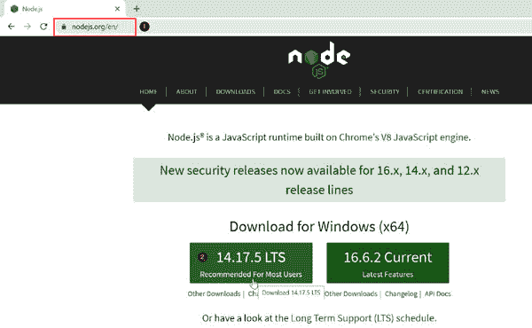

**图 4.1：** Node.js 官方网站首页

2. 一旦开始下载，您可以通过浏览器上的下载图标和进度轻松地看到下载过程（此进度在每个浏览器中的显示方式不同，截图来自 Google Chrome 浏览器，每个浏览器的显示方式不同）。您应该等待直到 100% 完成，如图[图 4.2]所示：

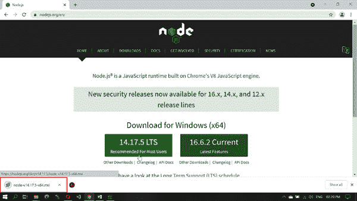

**图 4.2：** Node.js 下载界面—下载进度

3. 下载完成后（100%），您可以按照后续步骤操作（如图[图 4.3]所示）。

在第 1 步中，我们涵盖了如何从官方网站下载 Node.js。后续步骤与安装过程有关，因此我们在 Node.js 安装过程的第 2 步中单独涵盖了这一点。

#### 第 2 步—在您的 Windows 机器上安装 Node.js

一旦下载完成且安装文件完全下载，它将显示下载完成图标（如图[图 4.3]所示），您可以继续后续。

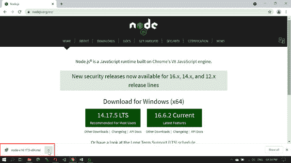

**图 4.3：** Node.js 下载界面—下载 100% 完成—后续步骤

1. 现在打开此安装文件，它将启动 Node.js 安装向导，它将引导您在机器上完成 Node.js 的安装，如图[图 4.4]所示：

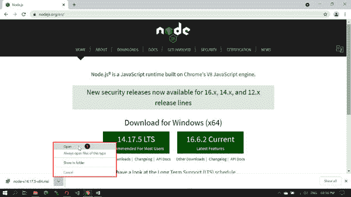

**图 4.4：** Node.js 下载界面—下载 100% 完成—打开安装文件

2. 现在打开此安装文件，它将启动 Node.js 安装向导，引导您在机器上完成 Node.js 的安装。我们在这里不涵盖所有步骤，因为这超出了本章的范围。请遵循设置向导，它将在您的 Windows 机器上安装 Node.js（如图[图 4.5]所示）：

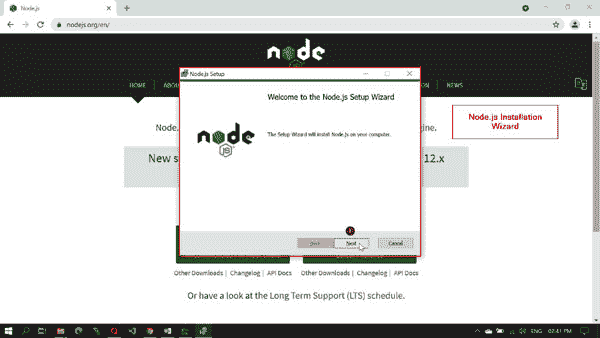

**图 4.5：** Node.js 安装向导

3. 安装程序将要求您选择在 Windows 机器上安装此软件的路径，并列出其他软件（如 `NPM` 包管理器）的列表。如果您需要，可以更改它，否则使用默认安装。但建议如图[图 4.6]所示选择所有其他功能：

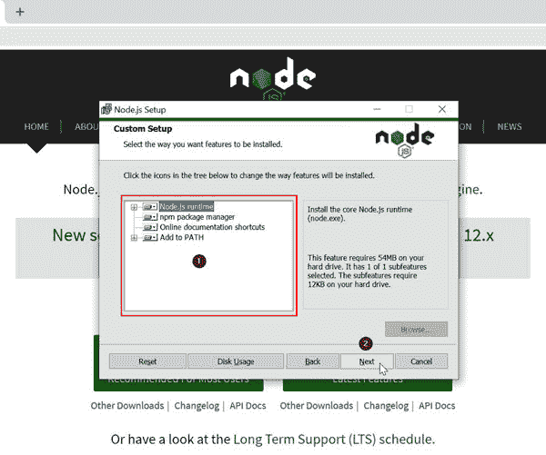

**图 4.6：** Node.js 安装向导

4. 您可以选择性安装安装程序在设置过程中可能会要求您安装的本地模块工具。您可以稍后按照 [`github.com/nodejs/node-gyp`](https://github.com/nodejs/node-gyp) 的安装说明来安装这些工具，如图[图 4.7]所示：

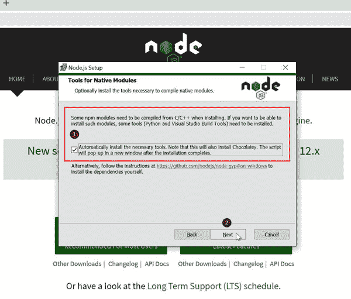

**图 4.7：** Node.js 安装向导

5. 一旦安装 100% 完成，点击 `Finish` 按钮退出安装向导，如图[图 4.8]所示：

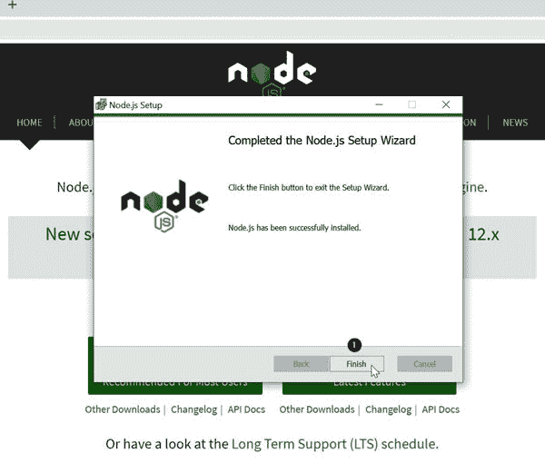

**图 4.8：** Node.js 安装向导

#### 第 3 步—在 Windows 机器上的安装后步骤并验证 Node.js

安装完成后，您应该首先验证 Node.js 和 NPM（Node 包管理器或 JavaScript 编程语言的包管理器）。为了在您的 Windows 机器上验证这两个软件，通过在任务栏搜索栏输入 `cmd` 打开命令提示符，如图[图 4.9]所示：

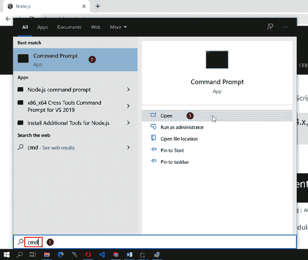

**图 4.9：** Node.js 和 NPM 安装后验证步骤

6. 在命令提示符中逐输入输入两个命令以验证 Node.js 和 NPM 的安装，如图[图 4.10]所示：

```
node --version
npm --version
```


**图 4.10：** 命令提示符—验证 Windows 上的 Node.js 和 NPM 版本

如所示，Node.js 和 NPM 都已正确安装在您的 Windows 机器上。现在，我们可以开始本章的开发部分，并开始将 Node.js 与 MongoDB。在下一节中，我们将涵盖如何与 Node.js 应用程序中使用 MongoDB。在此之前，在编码之前我们还有一个需要遵循的最后步骤。它在第 4 步中。

#### 第 4 步—使用 NPM 安装 Node.js 的 MongoDB 驱动程序

一旦在 Windows 机器上正确安装了 Node.js 和 NPM；现在我们就可以使用**包管理器**（**NPM**）安装 MongoDB 驱动程序。

1. 要安装 MongoDB 的官方驱动程序，只需打开你喜欢的浏览器（如 Google Chrome）并输入：[`www.npmjs.com/package/mongodb`](https://www.npmjs.com/package/mongodb) 然后按`Enter`键。这将打开 NPM 网站上的 MongoDB 官方页面，你会看到许多关于该驱动程序的信息，包括如何使用 NPM 安装它以及如何使用它，如图 4.11*所示：


**图 4.11：** NPM MongoDB 官方首页

2. 现在，既然我们知道了安装 Node.js 官方 MongoDB 驱动程序的正确命令，请在机器上的任意位置并创建一个名为 `mongodb-nodejs` 的新文件夹或目录，如图 4.12*所示：


**图 4.12：** 在你的 Windows 机器上创建一个名为 `mongodb-nodejs` 的新目录

3. 现在打开命令提示符并导航到该目录 `mongodb-nodejs`，如图 4.13*所示：


**图 4.13：** 导航到 `mongodb-nodejs` 目录

4. 现在运行 NPM 网站 MongoDB 驱动程序主页上提到的任何命令。这将为 Node.js 安装 MongoDB 驱动程序到我们的目录中，我们现在将在此处创建带有 MongoDB 的 Node.js，如图 4.14*所示：

```
npm i mongodb
```

或者

```
npm install mongodb
```


**图 4.14：** 安装 Node.js 的 MongoDB 驱动程序

如果你打开 `mongodb-nodejs` 文件夹（或目录），你会发现此过程自动创建了一个名为 `node_modules` 的文件夹，以及名为 `package-lock.json` 的文件。基本上，当你在 Node.js 中安装任何节点模块时，它都会创建一个名为 `node_modules` 的文件夹，并在其中下载并复制特定模块所需的所有节点模块（例如在这里我们正在安装 Node.js 的 MongoDB 驱动程序），或者说是该 MongoDB 驱动程序所依赖的 Node.js 模块加上自身的文件，如图 4.15*所示：


**图 4.15：** Node.js 驱动程序安装程序会自动创建 `node_modules` 文件夹和 `package-lock.json` 文件

你也可以打开 `node_modules` 文件夹，看到安装过程下载的其他模块，如图 4.16*所示：


**图 4.16：** MongoDB 驱动程序已与其他依赖项一起安装

`package-lock.json` 是一个文件，其中模块及其依赖项以 JSON 树状格式显示。关于 `package-lock.json` 的更多信息，你可以访问此 URL：[`docs.npmjs.com/configuring-npm/package-lock-json.html`](https://docs.npmjs.com/configuring-npm/package-lock-json.html)

我们在接下来的章节中还将介绍另一个 JSON 文件 `package.json`，它在 Node.js 应用中会被使用，届时我们将介绍使用 Node.js 进行高级应用开发。

由于我们已经完成了 MongoDB 和 Node.js 的环境搭建，现在我们可以开始编程部分了。

### Node.js 与 MongoDB 的连接与操作

在本章的前一节中，我们已经设置好了运行 Node.js 和 MongoDB 的环境。现在让我们开始编程部分。

让我们现在尝试在 Node.js 中编写代码来实现连接数据库的小型任务。在这里，我们将借助 Node.js MongoDB 驱动程序的帮助编写一段简单的 Node.js 代码，该驱动程序我们在上一步中已经安装并设置好了。

注意，由于我们正在使用 Node.js 并编写 Node.js 代码，建议使用某些代码编辑器或**集成开发环境**（**IDE**），如 Microsoft Visual Studio Code 或任何你喜欢的代码编辑器。你可以通过此链接下载并安装 Microsoft Visual Studio Code：[`code.visualstudio.com`](https://code.visualstudio.com)。Microsoft Visual Studio Code 是一款开源免费软件，适用于几乎所有的操作系统。

### 示例 1—使用 Node.js 连接到 MongoDB 服务器

在我们的示例中，我们使用了 `MongoDBClient` 常量，它被赋值为 `MongoClient` 类的对象。然后我们使用该对象调用了 `connect` 方法。我们将此文件保存为 `mongodb-nodejs` 路径下的 `mongodb-connection.js`，代码如下（如图 4.17 所示）：

```javascript
const MongoDBClient = require('mongodb').MongoClient;

// 连接 URL 字符串
const url = 'mongodb://localhost:27017';

// 使用 connect 方法连接 MongoDB 服务器
MongoDBClient.connect(url, {
  useUnifiedTopology: true
}, function(err, client) {
  if (err) {
    console.log("连接 MongoDB 服务器时出错" + err);
  } else {
    console.log("成功连接到 MongoDB 服务器使用 Node.js 驱动程序");
  }
  // 关闭服务器
  client.close();
});
```


**图 4.17：** 使用 Node.js 文件

现在让我们运行这个示例。打开命令提示符并导航到保存此文件的 `mongodb-nodejs` 文件夹，输入以下命令运行：

```bash
node mongodb-connection.js
```

你会看到我们已成功连接到 MongoDB 服务器，如图 4.18 所示：


**图 4.18：** 命令提示符—连接 MongoDB 服务器

### 示例 2—使用 Node.js 获取 MongoDB 文档

在我们的示例中，我们使用了 `MongoDBClient` 常量，它被赋值为 `MongoClient` 类的对象。然后我们使用该对象调用了 `connect` 方法。之后选择了数据库 `BPBOnlineBooksDB`，然后选择了集合 `BPBOnlineBooksCollection`，最后使用 `collection.find().toArray()` 方法从集合中获取所有文档，然后将其打印到控制台并关闭了服务器连接。我们将此文件保存为 `mongodb-nodejs` 路径下的 `list-documents.js`，代码如下：

```javascript
const MongoDBClient = require('mongodb').MongoClient;

// 连接 URL 字符串
const url = 'mongodb://localhost:27017';

// 使用 connect 方法连接 MongoDB 服务器
MongoDBClient.connect(url, {
  useUnifiedTopology: true
}, function(err, client) {
  if (err) {
    console.log("连接 MongoDB 服务器时出错" + err);
  } else {
    console.log("成功连接到 MongoDB 服务器使用 Node.js 驱动程序");
  }
  // 选择数据库
  const dbname = "BPBOnlineBooksDB";
  const db = client.db(dbname);
  // 获取 "BPBOnlineBooksCollection" 集合
  const collection = db.collection('BPBOnlineBooksCollection');

  // 在 "BPBOnlineBooksCollection" 集合中的所有文档
  collection.find().toArray(function(err, docs) {
    if (err) {
      console.log("Some Error While Executing the Script" + err);
    } else {
      console.log("Our Node.js Script Found All these records:");
      console.log(docs);
    }
    // Close the Server Connection
    client.close();
  });
});
```

现在让我们运行这个示例。打开命令提示符，导航到保存此文件的 `mongodb-nodejs` 文件夹，并输入以下命令运行此代码：

```bash
node mongodb-list-documents.js
```

你将看到我们已经使用 Node.js 成功连接到 MongoDB 服务器，然后该脚本还显示了 MongoDB 集合中的所有文档，如图 4.19*所示：


**图 4.19：** 命令行提示符——使用 Node.js 连接到 MongoDB 服务器并从集合中获取文档

### 结论

在本章中，我们涵盖了 JavaScript 和 Node.js 编程的介绍，以及如何将 Node.js 与 MongoDB 使用。我们还学习了如何为运行 Node.js 代码设置正确的环境。在本章的最后一节中，我们进行了一些编码并运行了一些实用示例，以使用 Node.js 连接并操作 MongoDB 服务器。在本书接下来的章节中，我们将学习 React Native 编程，并在本书后期的高级章节中，使用 Node.js 和 Express.js 开发的 API，通过 React Native 和 MongoDB 开始真实的数据驱动型移动应用开发。

### 问题

1. 我们可以同时使用 JavaScript 进行服务器端和客户端开发？
2. 什么是 Node.js？
3. 你能列举任何使用 Node.js 构建应用程序的现代框架吗？
4. NPM 代表什么？
5. 安装 Node.js 官方 MongoDB 驱动程序的命令是什么？
6. 给出一个使用 Node.js 连接到 MongoDB 服务器的示例。

# 第 5 章

# 使用 MongoDB 和 React Native 开始编程

全球的移动用户正在不断增长，因此在这个动态的世界中，我们在手机上使用了许多移动应用，而移动应用开发是开发者眼中非常有趣的话题之一。React Native 是目前最流行的移动应用开发框架之一，本章介绍了 React Native 移动框架的介绍。我们应该准备好正确的环境。因此，本章涵盖了如何设置正确的环境来运行 React Native 代码。我们还将涵盖如何在移动设备、模拟器和浏览器等各种平台上查看我们的 App。在本章的最后一节中，我们将进行一些编码并运行一些实用示例，展示我们如何真正开始移动应用开发。

### 结构

在本章中，我们将讨论以下主题：

* React Native 简介
* 开发前步骤
  * 检查系统中的 Node.js 和 NPM
  * 安装 Android Studio
  * 安装 Android SDK
  * 设置环境变量
  * 使用 NPM 安装 Expo CLI
  * 关于 Expo 和 Expo CLI
  * 使用 Expo 和 Expo CLI 创建我们的移动 App
  * 使用 Expo 和 Expo CLI 运行我们的移动 App
  * 使用 Expo 应用在移动设备上打开并查看 App
  * 在 Android 模拟器中打开并查看应用
* 使用 React Native 进行编程
  * 实用示例
* 使用 React Native 和 MongoDB 进行编程的简介


# 目标

学习本章后，读者将能够理解什么是 React Native。本章涵盖了开发移动 App 期间各种工具的介绍。在这里，读者将学习通过设置开发环境来安装 Android Studio 和 Android SDK，并理解什么是 Expo 和 Expo CLI。读者还将学习如何设置 Expo 和 Expo CLI。在本章的最后一节中，读者将学习如何通过逐步的实用示例开发 React Native 移动 App，读者还将获得关于如何在 React Native 中使用 MongoDB 的简要思路，以及我们将在本书后期高级章节中如何使用 MongoDB 开发动态移动 App。

## React Native 简介

React Native 是一种广泛使用的基于 React.js 的最流行框架之一，用于为所有主要平台（如 Android、iOS、通用 Windows 平台 UWP）创建移动应用程序，甚至可以用于构建 Web 应用。

React Native 和其基础库 React 均由 Facebook Inc. 创建，由于它们的特性，如今正变得非常流行，这些特性包括在应用程序数据更改时渲染正确的组件。React 使用基于组件的方法，由组件管理自己的状态。

React.js 和 React Native 之间的主要区别在于 React.js 使用虚拟文档对象模型 (DOM) 来渲染浏览器代码，而 React Native 使用原生 API 在移动设备上渲染组件。

React Native 允许我们构建跨平台的原生移动应用，这为这些应用提供了原生感。

React Native 在使用 HTML 和 CSS 方面存在差异。与 Web 应用不同，React Native 使用了一些不同的使用 HTML 和 CSS 的方法，我们稍后会看到。

## 开发前步骤

使用 React Native 创建移动应用有许多不同的方法。涵盖所有方法超出了本章的范围，但我们将使用一些最简单的方法来为 React Native 准备好环境。在前章（开始学习 JavaScript）中，我们已经涵盖了`NPM`（Node 包管理器）。

### 步骤 1——检查系统上的 Node.js 和 NPM

你应该首先验证 Node.js 和 NPM。为了在 Windows 机器上验证这两个软件，请从任务栏的搜索栏输入`cmd`打开命令提示符，如图 5.1 所示：


**图 5.1:** 打开命令行提示符

1. 在命令提示符中输入以下两个命令来验证 Node.js 和 NPM，如图 5.2 所示：

```bash
node --version
npm --version
```


**图 5.2:** 在 Windows 上验证 Node.js 和 NPM 版本

可见 Node.js 和 NPM 已正确安装在你的 Windows 机器上。

### 步骤 2——在系统中创建项目文件夹

在机器的任何位置创建一个名为`bpb-catalog-mobile-app`的新文件夹或目录，位置可以类似于`D:\bpb-catalog-mobile-app`，如图 5.3 所示：


**图 5.3:** 在 Windows 机器上创建名为 "bpb-catalog-mobile-app" 的目录

2. 点击`Download Android Studio`后，它会弹出一个包含`Terms and Conditions`（条款和条件）的窗口。建议在下载 Android Studio 之前阅读条款和条件。点击`Download Android Studio For Windows`按钮；点击此按钮后，下载将在浏览器中开始，你可以看到下载进度，如图 5.5 所示：

    

    **图 5.5:** Android Studio 下载界面

3. 下载 100% 完成后，你可以打开安装程序文件，它将启动 Android Studio 的设置向导。点击`Next`按钮开始安装过程，如图 5.6 所示：

    

    **图 5.6:** Android Studio 安装向导

4. 在安装过程中，它将显示一个屏幕，你可以在可以选择`Android Virtual Device`（安卓虚拟设备）的选项。请注意，你需要选择此选项以便我们能够使用`Android Virtual Device`或 Android 模拟器，如图 5.7 所示：

    

    **图 5.7:** Android Studio 安装向导—选择组件屏幕

5. 在安装过程中，你可以更改软件所在的位置，如果你需要将软件安装在机器的其他位置，如图 5.8 所示：

    

    **图 5.8:** Android Studio 安装向导—安装位置

6. 你可以看到安装的进度，一旦完成，你可以按`Next`按钮，如图 5.9 所示：

    

    **图 5.9:** Android Studio 安装向导—安装进度

7. 安装完成后，你将看到向导的最后一个界面，因为我们不需要启动 Android Studio。我们可以取消勾选`Start Android Studio`复选框，然后点击`Finish`按钮退出安装向导，如图 5.10 所示：

    

    **图 5.10:** Android Studio 安装向导 –安装完成

### 第 4 步—安装 Android SDK

1. 如果你是第一次打开 Android Studio（我们故意跳过了第 3 步中的启动操作，是为了涵盖`安装 Android SDK (软件开发包)`），在 Windows 任务栏下的搜索栏中输入`android`，你会看到 Android Studio 出现，因为我们在上一步中已经安装了它，如图 5.11 所示：

    

    **图 5.11:** 打开 Android Studio

2. 这将启动 Android Studio，因为我们还没有安装 Android SDK。Android Studio 首次启动时会出现一条消息，内容类似于：“您的 Android SDK 缺失、过期或损坏”，你需要点击名为`Open SDK Manager`的按钮。如果你的机器上已经安装了 Android SDK，可以跳过此步骤，如图 5.12 所示：

    

    **图 5.12:** Android Studio—SDK 问题警报框

3. 点击`Open SDK Manager`按钮后，将启动 SDK Manager 窗口，你会发现`Android SDK location`是空的。为了解决这个问题，我们需要安装 Android SDK，它将从互联网下载。如果你的机器上已经安装了 Android SDK，可以跳过此步骤，如图 5.13 所示：

    

    **图 5.13:** Android Studio—SDK Manager

4. 要安装 Android SDK，点击 Android SDK location 下方的编辑链接。这将启动另一个窗口，我们可以在其中安装最新版本的 Android SDK。如果你的机器上已经安装了 Android SDK，可以跳过此步骤，如图 5.14 所示：

    

    **图 5.14:** Android Studio—SDK 位置—点击编辑链接

### 第 5 步—设置环境变量

我们需要在 Windows 机器上为 Java 软件开发包 (`SDK`) 和 Android SDK 设置环境变量路径。这两个环境变量及其路径都是必须的，以确保我们的应用程序和 Android 模拟器能够在 Windows 上正常运行。要设置这些环境变量路径，请遵循以下步骤：

1. 在 Windows 任务栏下的搜索栏中输入`android`，你会看到 Android Studio 出现，因为我们在上一步中已经安装了它，如图 5.11 所示：

    

    **图 5.11:** 打开 Android Studio

2. 这将启动 Android Studio，因为我们还没有安装 Android SDK。Android Studio 首次启动时会出现一条消息，内容类似于：“您的 Android SDK 缺失、过期或损坏”，你需要点击名为`Open SDK Manager`的按钮。如果你的机器上已经安装了 Android SDK，可以跳过此步骤，如图 5.12 所示：

    

    **图 5.12:** Android Studio—SDK 问题警报框

3. 点击`Open SDK Manager`按钮后，将启动 SDK Manager 窗口，你会发现`Android SDK location`是空的。为了解决这个问题，我们需要安装 Android SDK，它将从互联网下载。如果你的机器上已经安装了 Android SDK，可以跳过此步骤，如图 5.13 所示：

    

    **图 5.13:** Android Studio—SDK Manager

4. 要安装 Android SDK，点击 Android SDK location 下方的编辑链接。这将启动另一个窗口，我们可以在其中安装最新版本的 Android SDK。如果你的机器上已经安装了 Android SDK，可以跳过此步骤，如图 5.14 所示：

    

    **图 5.14:** Android Studio—SDK 位置—点击编辑链接

### 第 6 步—使用 NPM 安装 Expo CLI

Expo 是用于构建 React Native 应用的框架。它内置了工具和库，在我们使用 React Native 构建应用程序时非常有帮助。

Expo CLI 是 Expo 的命令行界面，用于使用 Expo 创建 React Native 项目。

1. 打开你的命令提示符并导航到你的项目目录，在我们的案例中为`D:\bpb-catalog-mobile-app`（如图 5.20 所示）：

    

    **图 5.20:** 导航到“bpb-catalog-mobile-app”目录


## 2. 打开你喜欢的浏览器（如 Google Chrome），在地址栏中输入：`https://expo.dev/` 并按 `Enter` 键。这将打开 `Expo` 首页。在这里，你将看到关于 `Expo` 和 `Expo CLI` 的所有细节，包括在项目中安装它们的命令。点击首页顶部导航栏上的 `Get Started` 链接。这将会打开“快速上手指南”页面，如`图 5.21`所示：


**图 5.21:** Expo 首页

## 3. 由于我们在之前的章节中已经安装了 `Node.js`，因此我们可以跳过安装 `Node.js` 的步骤，直接进入步骤 3 并在项目中安装 `Expo CLI`，如`图 5.22`所示：


**图 5.22:** Expo 开始页面

## 4. 现在运行 `Expo`“快速上手指南”页面上提到的以下命令。这将使用 `Node Package Manager`（`NPM`）将 `Expo CLI` 安装到我们的项目目录，我们现在将在该目录创建带有 `MongoDB` 的 `React Native` 应用，如`图 5.23`所示：

```
npm install --global expo-cli
```

这里的 `--global` 意味着 `Expo CLI` 将全局安装在你的计算机上，这样当你再次使用 `Expo CLI` 时可以随地使用。


**图 5.23:** 安装 Expo CLI

由于我们使用了 `--global` 参数安装 `Expo`，它被全局安装在以下位置：

*   `C:\Users\manus\AppData\Roaming\npm\expo -> C:\Users\manus\AppData\Roaming\npm\node_modules\expo-cli\bin\expo.js`
*   `C:\Users\manus\AppData\Roaming\npm\expo-cli -> C:\Users\manus\AppData\Roaming\npm\node_modules\expo-cli\bin\expo.js`

## 5. 我们可以通过导航到 `AppData` 下的 `npm` 文件夹来验证这一点，如`图 5.24`所示：


**图 5.24:** AppData 全局 NPM 安装

## 步骤 7—使用 Expo 和 Expo CLI 创建我们的移动 App

1. 打开命令提示符并进入你的项目目录（在我们的案例中为 `D:\bpb-catalog-mobile-app`），并输入以下命令，如`图 5.25`所示：

```
expo init bpb-mobile-app --npm
```

我们在这里提供了 `--npm` 参数是为了使用 `NPM` 而不是 `Yarn`（默认选项）打开我们的 App。


**图 5.25:** 使用 Expo CLI 创建移动 App—Expo “init” 方法

2. 在我们运行之前提到的命令后，`Expo CLI` 将提示我们“选择一个模板”。对于我们的示例，我们将选择“blank”（空白）模板并再次按 `Enter`。在你按下 `Enter` 键后，`Expo CLI` 将开始使用 `NPM` 创建我们的移动应用，如`图 5.26`所示：


**图 5.26:** 使用 Expo CLI 创建移动 App—为开发创建的 app 结构

3. 我们可以浏览项目文件夹并看到一个新文件夹，其名称为我们在第 1 点 `EXPO CLI` 初始化命令中给出的名称。相同的文件夹已在项目文件夹下创建，包含 `Expo` 文件和其他 `Node Modules`，如`图 5.27`所示：


**图 5.27:** Expo CLI 创建的 App 文件夹和文件

## 步骤 8—使用 Expo 和 Expo CLI 运行我们的移动 App

1. 打开命令提示符进入项目目录，然后进入应用目录（在我们的案例中为 `D:\bpb-catalog-mobile-app\bpb-mobile-app`），并输入以下命令，如`图 5.28`所示：

```
npm start
```

当我们运行上述命令时，`Expo CLI` 将启动我们的应用，我们可以看到它在一段时间后启动。请记住，不要关闭此命令提示符窗口，因为这样做将停止我们的 App。你应该保持它运行。


**图 5.28:** 使用 Expo Start 命令启动我们的移动 App—“expo start”

2. 一旦 App 准备绪，`Expo` 将尝试自动启动它。（此处原文存在大量重复，已清理）。对于我们的示例，我们将选择“blank”模板并再次按 `Enter`。在你按下 `Enter` 键后，`Expo CLI` 将使用 `NPM` 创建我们的移动应用，如`图 5.26`所示。

3. 我们可以浏览项目文件夹并看到我们在第 1 点 `EXPO CLI` 初始化命令中给出的 App 名称。相同的文件夹已在项目文件夹下创建，包含 `Expo` 文件和其他 `Node Modules`，如`图 5.27`所示。

## 步骤 9—使用 Expo App 在移动设备上打开并查看应用

1. 在安卓手机上打开 `Google Play Store` 并搜索 `Expo App for React Native`。一旦获得搜索结果，点击正确的 App 并在手机上安装 `Expo App`，如`图 5.32`所示：


**图 5.32:** 在移动设备（安卓设备）上安装 Expo App

2. 安装此 App 后，在手机上打开它。此 App 需要“拍照和录制视频”的权限，因为我们需要使用此 App 扫描手机上的二维码。允许此 App 拍照，如`图 5.33`所示：


**图 5.33:** 在设备上为 Expo App 允许权限

3. 现在点击“扫描二维码”，并将手机摄像头指向二维码，你可以在你使用 `Expo CLI` 启动 App 的命令提示符中，或者在 `Node Metro Builder` 下的浏览器中看到它，如`图 5.34`所示：


**图 5.34:** 使用 Expo App 扫描浏览器或命令提示符中显示的条码

5. 一旦你在 `Expo` 项目中点击你的 App，它就会在你的手机上打开该 App，我们可以在 `Android` 手机（这是一个真实设备）上看到 App 的默认界面，如`图 5.36`所示：


**图 5.36:** 真实设备上的 App 首页

6. 你可能还会看到日志信息，这些信息会同时显示在你使用 `Expo CLI` 启动 App 的命令行提示符下，以及在打开了 `Expo Dev Tools` 和 `Node Metro Builder` 的浏览器中，如`图 5.37`所示：


**图 5.37:** Expo 工具——日志

## 步骤 10—在 Android 模拟器中打开并查看应用

如果你尝试使用 `Run on Android device/emulator` 打开你的 App，如果你的 `Windows` 机器上的 `Android` 模拟器没有配置好，可能会收到错误消息。要解决这个问题，我们首先需要借助 `Android Studio` 设置 `Android` 模拟器，如`图 5.38`所示：


**图 5.38:** 错误消息—无法启动模拟器

1. 打开 `Android Studio` 并点击 `More Actions`。点击后会显示许多选项，如`图 5.39`所示：


**图 5.39:** Android Studio—配置

2. 现在点击 `Android Virtual Device`（`AVD`）`Manager` 打开 `AVD Manager` 窗口，如`图 5.40`所示：


**图 5.40:** 在 Android Studio 配置中选择 AVD Manager

3. 在 `AVD Manager` 界面上，点击 `Create Virtual Device` 按钮，如`图 5.41`所示：


**图 5.41:** Android Studio—创建虚拟设备

4. 在 `Hardware` 界面上，选择任意手机设备（在示例中，我们选择了带有 `Play Store` 的 `Pixel 2` 手机设备）并点击 `Next`，如`图 5.42`所示：


**图 5.42:** 创建虚拟设备—选择硬件

5. 在 `Select a system image` 部分，选择任何推荐的镜像并下载它（在示例中，我们选择了 `API` 版本 30）。在下载新镜像和相关软件时，你可能需要接受条款和条件。建议在下载前阅读这些条款，如`图 5.43`所示：


**图 5.43:** Android 虚拟设备配置—选择镜像

6. 完成上述所有步骤后，我们就可以选择 `Android` 虚拟设备的名称并点击 `Finish` 按钮，如`图 5.44`所示：


**图 5.44:** Android 虚拟设备配置—验证配置

7. 该 `AVD` 将显示在 `Android Studio` 的虚拟设备列表中。点击 `Play` 按钮启动此 `AVD`，如`图 5.45`所示：


**图 5.45:** 在模拟器中启动 AVD

8. 现在点击 `Run on Android device emulator`，它将在 `Android` 模拟器中打开我们的 App，如`图 5.46`所示：


**图 5.46:** Expo 工具—在 Android 模拟器中启动我们的 App

## 使用 React Native 进行编程

在本章的上一节中，我们已经配置了运行带有 `MongoDB` 的 `React Native` 的环境。现在，让我们开始编程部分。

现在让我们尝试在 `React Native` 中编写代码来完成连接数据库的小任务。在这里，我们将 `React Native` 中编写一小段代码，它将通过我们在上一节中创建的 `API` 与 `MongoDB` 通信（在上一节中我们学习了如何使用 `Node.js` 和 `Express.js` 创建 `API`）。

注意，由于我们正在使用 `React Native` 并编写 `React Native` 代码，建议使用某些代码编辑器或集成开发环境（`IDE`），如 `Microsoft Visual Studio Code` 或你喜欢的任何代码编辑器。你可以通过此链接下载并安装 `Microsoft Visual Studio Code`：https://code.visualstudio.com。

### 示例 1—修改文本

以下是由 `Expo` 创建的 `App.js` 代码。

```javascript
import { StatusBar } from 'expo-status-bar';
import React from 'react';
import { StyleSheet, Text, View } from 'react-native';

export default function App() {
  return (
    <View style={styles.container}>
      <Text>Open up</Text>
      <StatusBar style="auto" />
    </View>
  );
}

const styles = StyleSheet.create({
  container: {
    flex: 1,
    backgroundColor: '#fff',
    alignItems: 'center',
    justifyContent: 'center',
  },
});
```

在默认代码中，`App()` 函数返回了一些 `Text`，如`图 5.48`所示。

### 示例 2—修改消息

让我们更改 App 的文本，代码如下：

```javascript
import { StatusBar } from 'expo-status-bar';
import React from 'react';
import { StyleSheet, Text, View } from 'react-native';

export default function App() {
  return (
    <View style={styles.container}>
      <Text>Welcome to BPB Online App</Text>
      <StatusBar style="auto" />
    </View>
  );
}

const styles = StyleSheet.create({
  container: {
    flex: 1,
    backgroundColor: '#fff',
    alignItems: 'center',
    justifyContent: 'center',
  },
});
```

代码修改后，再次运行此 App。万一你关闭了 App，可以在导航到正确位置后再次使用以下命令运行 App（在我们的案例中，位置是 `D:\bpb-catalog-mobile-app\bpb-mobile-app`），如`图 5.48`所示：

```
npm start
```


**图 5.48:** 使用 Expo CLI 启动我们的 App

一旦你点击 `Expo Developer Tools` 下的 `Run in Web Browser` 选项，它将启动在浏览器中运行你的 App 的进程，一段时间后，它会在浏览器中打开 App。如果没有自动发生这种情况，请首先检查 `Metro Bundler` 下的日志，然后你可以尝试在新的浏览器标签页中打开此 URL：`http://localhost:19006/`，如`图 5.50`所示。

**图 5.50：** 在浏览器中显示的 App 首页

我们已经看到了如何轻松地更改移动 App 的文本。现在在下一个示例中，让我们为 App 添加一些 Logo 图片。

## 示例 2—在我们的移动 App 中添加 Logo 图片

在示例中，我们创建了一个独立的头部部分并将其包含在默认的 `App()` 函数中。我们还从 `React Native` 导入了 `<Image>` 组件，然后使用这个 `<Image>` 组件在我们的 App 中显示 Logo 图片。如果你还记得，在上一个示例中我们学习了 `<View>` 组件可以包含 `<Image>` 组件，也可以包含 `<Text>` 组件。我们在这里也做了同样的操作；我们只是为 App 的头部部分创建了单独的代码，以下是相应的代码。

### 代码 1

```javascript
import { StatusBar } from 'expo-status-bar';
import React from 'react';
import { StyleSheet, Text, View, Image } from 'react-native'; // Imported the Image Component
export default function App() {
  return (
    <View style={styles.container}>
      {appHeaderSection}
    </View>
  );
}

//Style Sheet
const styles = StyleSheet.create({
  container: {
    flex: 1,
    backgroundColor: '#fff',
    alignItems: 'center',
    justifyContent: 'flex-start', /* Flex Start */
    marginTop: 10
  },
});

// Header Section
const appHeaderSection = (
  <View style={styles.container}>
    <Image source={require('./images/bpb-logo.png')} style={{height: 100, width: 150}} />
    <Text>Welcome to BPB Online Mobile App</Text>
    <StatusBar style="auto" />
  </View>
);
```

此外，请注意一旦你对 App 进行了更改，`Expo` 将自动刷新你的代码，你可以看到你在代码中所做的任何即时变化，如`图 5.51`所示。

**图 5.51：** 在浏览器中显示的更改了文本和 Logo 的 App

我们已经看到了如何轻松地向我们的移动 App 添加 Logo 图片。现在，让我们在 `Android` 模拟器中打开它。为此，你需要打开 `Android Studio`，并按照本章上一节中解释的步骤进行操作，即本章开发前部分的步骤 10。打开 `AVD Manager` 并启动虚拟设备，等待其启动，之后从 `Expo Developer Tool` 中点击 `Run on Android device /emulator`。这将在 `Android` 模拟器（虚拟设备）中打开我们的 App，如`图 5.52`所示。


**图 5.52：** 命令提示符—使用 Node.js 连接到 MongoDB 服务器

# 使用 React Native 和 MongoDB 编程简介

在本章中，我们学习了如何为移动应用开发创建正确的环境。现在，我们需要创建一个可以使用 MongoDB 集合数据进行读取和更新的动态应用。对于所有这些操作，我们需要某种方法让我们的移动 App 能够与 MongoDB 数据库通信。为了这个目的，我们需要`应用程序接口`（`APIs`），这对我们移动应用的进一步开发非常有帮助。

我们将在本书的后续章节中涵盖更多关于 API 和 API 开发的内容，并学习使用`Node.js`和`Express.js`（这是一个`Node.js`框架，它具有许多与 MongoDB 一起创建 API 的功能）。书中有一个专门章节用于此目的，其中你将学习如何创建 API 并通过 API 调用执行 CRUD 操作。

在学习了如何使用`Node.js`、`Express.js`以及 MongoDB 创建 API 后，我们将在高级章节中继续我们的移动应用开发，该章节专门为一家出版社开发移动应用程序，我们将在那里学习以下内容：

- 如何通过 API 借助 React Native 连接 MongoDB 服务器
- 如何显示我们将在接下来的章节中使用`PHP`和 MongoDB 创建的后端所添加的书籍列表
- 如何通过 API 从移动应用程序对书籍进行“点赞”或“踩”评分

此外，书中还会有关于“MongoDB Realm”的赠送章节，它将提供关于 MongoDB Realm 的逐步介绍，以及我们如何结合 React Native 使用 MongoDB Realm 来开发移动应用。

接下来的章节将对你学习许多新事物非常有帮助，它们将为全栈开发提供良好的学习积累，我们将在接下来的章节中逐步涵盖这些内容。

## 总结

在本章中，我们涵盖了 React Native 移动框架的介绍。我们学习了为了运行 React Native 并创建移动应用，我们应该准备好正确的环境。我们看到了如何在手机、模拟器以及浏览器等各种平台上查看我们的 App。在本章的最后一节中，我们进行了一些编码并运行了一些实际示例，并学习了我们实际上如何开始移动应用开发。在接下来的章节中，我们将涵盖如何将使用 Node.js 和 Express.js 构建的 API 与 React Native 移动应用结合并连接到 MongoDB，这些主题将以详细的方式涵盖，在最后我们学习如何创建一个动态应用。

## 问题

1. 什么是 React Native？
2. 在 React Native 中开发 App 需要哪些开发前的步骤？
3. 什么是 Expo 和 Expo CLI？
4. 如何使用 Expo CLI 创建移动应用？
5. 使用 Expo CLI 启动应用程序的命令是什么？
6. 列出在本章中学到的两个 React Native 组件？

学习本章后，读者将能够理解如何使用 Python 调用 MongoDB，以及如何安装 Python 并设置好开发环境。本章还涵盖了编码部分，读者将学习如何配置正确的环境以配合 Python 使用 MongoDB，并学习如何使用 Python 连接并操作 MongoDB 数据库。

# 使用 Python 配合 MongoDB

Python 是一种解释型、高级、面向对象的编程语言。由于其在许多领域（包括人工智能）的应用，它是目前最广泛且最流行的编程语言之一。Python 是一种通用编程语言。除了 Web 开发外，它还被用于后端开发、软件开发、数据科学以及编写系统脚本。

在 Windows、Linux 和 Mac OS 等多种操作系统上运行 Python 和 MongoDB 有多种方法。涵盖所有方法超出了本章和本书的范围。但我们将使用一些最简单且官方的方法来准备好可以使用 Python 和 MongoDB 的工作环境。让我们开始这些步骤，以便我们能够使用 Python 和 MongoDB 运行代码。

### 在 Windows 操作系统上安装 Python

让我们通过分步安装方法在 Windows 操作系统上安装 Python。

### 安装步骤

让我们从在机器上安装 Python 开始。以下是安装 Python 所需执行的步骤。

#### 步骤 1—下载 Python

1. 在你喜欢的浏览器中打开 Python 官方网站—`https://www.python.org`，将鼠标指向首页顶部的`Downloads`链接，并点击下载链接，你将在其中看到最新的 Python 版本及其版本号。点击此链接，如图 6.1 所示：

   

   图 6.1：Python 官方网站首页

2. 一旦开始下载，你可以通过浏览器上的下载图标和进度轻松地看到下载过程（此进度在不同浏览器中的显示方式不同。截图来自 Google Chrome 浏览器。每个浏览器的显示方式不同），你应该等待到 100% 完成，如图 6.2 所示：

   

   图 6.2：Python 下载界面——下载进度

3. 一旦下载 100% 完成，你就可以按照后续步骤操作（如图 6.3 所示）。

在步骤 1 中，我们涵盖了如何从官方网站下载 Python。接下来的步骤与安装过程，我们已经在 Python 安装过程的步骤 2 中单独涵盖了。

#### 步骤 2—在你的 Windows 机器上安装 Python

一旦下载完成且安装文件完全下载，它将显示下载完成图标（如图 6.3 所示），你就可以继续后续。


图 6.3：Python 下载界面——下载 100% 完成——下一步

1. 现在打开此安装文件，它将启动 Python 安装向导，引导你在你的机器上完成 Python 的安装，如图 6.4 所示：

   

   图 6.4：Python 下载界面——下载 100% 完成——打开安装文件

2. 现在打开此安装文件，它将启动 Python 安装向导，引导你在你的机器上完成 Python 的安装。建议勾选`Add Python to PATH`的复选框，这样它将把 Python 的路径添加到 Windows 环境变量中，我们可以在任何地方运行 Python 相关的命令。我们在这里不会涵盖所有的步骤，因为这超出了本章的范围。请遵循设置过程，它将在你的 Windows 机器上安装 Python（如图 6.5 所示）。此外，在安装过程中，设置可能会要求你接受许可协议。建议阅读许可协议和其他条款与条件。点击`Install Now`开始安装过程。

   

   图 6.5：Python 安装向导

3. 安装程序还允许你对 Windows 机器上的该软件进行自定义安装。如果你需要，可以更改安装位置，或者使用默认安装。但建议选择默认方法。一旦安装开始，你将看到设置进度，如图 6.6 所示：

   

   图 6.6：Python 安装向导——设置进度

4. 在安装 100% 完成后，你将看到该向导的最后一个界面。点击`Close`按钮完成设置过程，如图 6.7 所示：

   

   图 6.7：Python 安装向导

#### 步骤 3—安装后操作

一旦安装完成，你应该首先验证 Python 和 PIP（Python 包安装器，Python 标准包管理器）是否已正确安装在你的机器上。为了验证这些，请在搜索栏中输入`cmd`打开命令提示符，如图 6.8 所示：


图 6.8：安装后步骤

1. 一一输入以下命令验证 Python 和 PIP，如图 6.9 所示：

```
python --version
pip --version
```


图 6.9：命令提示符——在 Windows 上验证 Python

可见，Python 和 PIP 都已正确安装在你的 Windows 机器上。现在我们可以开始本章的开发部分并开始使用 MongoDB。在接下来的节中，我们将涵盖如何使用 Python 调用 MongoDB。在此之前，还有一个最后一个步骤需要执行。它在步骤 4 中。

### 步骤 4—使用 Python Index (PyPI) 安装 MongoDB 驱动

一旦 Python 和 PIP 已正确安装在你的 Windows 机器上，我们就可以使用 Python Index (PyPI) 安装 MongoDB 驱动，它是 Python 语言软件和模块的仓库。

1. 要安装 MongoDB 的官方驱动，只需打开喜欢的浏览器（如 Google Chrome）并输入：`https://pypi.org/project/pymongo/`然后回车。这将打开 PIP 网站上的 MongoDB 页面，你将看到关于该驱动的信息，包括如何使用 PIP 安装它以及如何使用。你还可以看到该驱动的最新发布详情，如图 6.10 所示：

   

   图 6.10：PyPI MongoDB 官方首页

2. 现在，既然我们知道安装 Python 官方驱动的正确命令，请在你的机器上的任何位置创建一个名为`mongodb-python`的新文件夹或目录，如图 6.11 所示：

   

   图 6.11：在你的 Windows 机器上创建名为 "mongodb-python" 的目录

3. 现在打开你的命令提示符并导航到该目录`mongodb-python`，如图 6.12 所示：


**图 6.12:** 导航到“mongodb-python”目录

4. 现在运行以下提到的任一条命令，这些命令在 PyPI 网站的 MongoDB 驱动主页上提到。这将 Python 的 MongoDB 驱动安装到我们当前所在的目录，我们将在该目录下创建带有 MongoDB 的 Python 应用程序，如图 6.13 所示：

```bash
pip install pymongo
```


**图 6.13:** 安装 Python 的 MongoDB 驱动

由于我们已经完成了 MongoDB 和 Python 的环境搭建，现在我们可以开始编程部分了。

# 使用 Python 和 MongoDB 进行编程

在本章的上一个节中，我们已经搭建了运行 Python 和 MongoDB 的环境。现在让我们开始编程部分。

让我们现在尝试编写一段 Python 代码来完成连接数据库的小型任务。在这里，我们将借助上一步中安装并设置的 Python MongoDB 驱动来编写一小段代码。

请注意，由于我们正在使用 Python 并编写 Python 代码，建议使用一些代码编辑器或集成开发环境（`IDE`），如 Microsoft Visual Studio Code 或你喜欢的任何代码编辑器。你可以通过链接下载并安装 Microsoft Visual Studio Code：`https://code.visualstudio.com`。Microsoft Visual Studio Code 是开源免费软件，适用于几乎所有的操作系统。

# 示例 1—使用 Python 连接 MongoDB 服务器

在我们的示例中，我们导入了`pymongo`（这是一个 Python MongoDB 驱动模块），使用了`MongoDBClient`变量（该变量被赋值为`MongoClient`类的对象），并在构造函数中传递了 MongoDB 连接字符串。我们将该文件保存为`mongodb-connection.py`，路径为：`D:\mongodb-python`，以下是相应的代码，如图 6.14 所示：

## 代码 1

```python
import pymongo

MongoDBClient = pymongo.MongoClient("mongodb://localhost:27017/")

if MongoDBClient:
    print("Connected Sucessfully to MongoDB Server using Python Driver for MongoDB")
else:
    print("Some Error While Connecting to MongoDB Server")
```

以下是在 Microsoft Visual Studio code 中运行的截图：


**图 6.14:** 使用 Microsoft Visual Studio Code 处理 Python 文件

现在让我们运行这个示例。打开你的命令提示符，导航到保存该文件的`mongodb-python`文件夹，并输入以下命令运行此代码：

```bash
python mongodb-connection.py
```

你将看到我们已经使用 Python 成功连接到 MongoDB 服务器，如图 6.15 所示：


**图 6.15:** 命令提示符—使用 Python 连接 MongoDB 服务器

# 示例 2—使用 Python 获取 MongoDB 文档

在我们的示例中，我们导入了`pymongo`（这是一个 Python MongoDB 驱动模块），使用了`MongoDBClient`变量（该变量被赋值为`MongoClient`类的对象），并在构造函数中传递了 MongoDB 连接字符串。然后我们创建了一个变量`DB`，并分配了我们的数据库`BPBOnlineBooksDB`。之后，我们在`for`循环中使用`db.BPBOnlineBooksCollection.find()`方法，并打印了`BPBOnlineBooksCollection`集合中的所有文档。我们将该文件保存为`mongodb-list-documents.py`，路径为：`D:\mongodb-python`，以下是相应的代码：

## 代码 1

```python
import pymongo

MongoDBClient = pymongo.MongoClient("mongodb://localhost:27017/")

if MongoDBClient:
    print("Connected Sucessfully to MongoDB Server using Python Driver for MongoDB")
    db = MongoDBClient.BPBOnlineBooksDB
    if db:
        print("Our Python Script Found All these records:")
        for documents in db.BPBOnlineBooksCollection.find():
            print(documents)
    else:
        print("Some Error While Connecting to Database")
else:
    print("Some Error While Connecting to MongoDB Server")
```

现在让我们运行这个示例。打开你的命令提示符，导航到保存该文件的`mongodb-python`文件夹，并输入以下命令运行此代码：

```bash
python mongodb-list-documents.py
```

你将看到我们已经使用 Python 成功连接到 MongoDB 服务器，然后该脚本还显示了 MongoDB 集合中的所有文档，如图 6.16 所示：


**图 6.16:** 命令提示符—使用 Python 连接 MongoDB 服务器并从集合中获取文档

# 结论

在本章中，我们介绍了使用 MongoDB 进行 Python 编程，以及如何将 Python 与 MongoDB 使用。我们还学习了为了运行 Python 和 MongoDB 服务器，应该准备好正确的环境。我们还学习了如何使用 Python 搭建 MongoDB。在本章的最后一节中，我们进行了一些编码并运行了一些实用示例，以使用 Python 连接并操作 MongoDB 服务器。到本书为止，我们已经学习了如何搭建正确的环境，以及如何使用 PHP 等各种编程语言连接到 MongoDB。

学习完本章后，读者将理解涵盖前端、后端技术以及其他各种技术栈的全栈开发。在在本章的学习过程中，读者将对全栈开发、相关技术，以及我们在本书后续高级章节中将要开发的应用程序有一个简要的了解。

# 全栈开发简介

你们中的许多人可能在想，“全栈”（full-stack）这个词到底是什么意思？让我们来理解这个术语，以及为什么全栈开发在如今是一个热门话题，以及为什么我们选择将其作为书中应用程序开发包含的内容。在理解“全栈”这一术语的具体含义之前，让我们先了解其他几个术语。

## 前端


前端通常是任何应用程序中可见的部分，用户通过它与应用程序进行交互。通常情况下，它是负责用户交互的界面。这些应用程序界面呈现给用户，以便户能够与系统进行交互。每个前端界面在所使用的技术上可能是独特的。某些界面（如桌面应用）的前端界面是用编程语言编写的，这与我们在 Web 和移动端开发中使用的语言不同。

对于网站和移动应用程序，其前端依赖于一些软件，例如 Web 浏览器，或者原生应用中的移动操作系统。例如，网站或 Web 应用的前端通过借助`Google Chrome`或`Mac Safari`等 Web 浏览器进行渲染。

通常，每当前端呈现给用户时，它都包含各种元素，如表单、按钮、文本框等，通过使用这些前端元素，用户可以轻松地与应用程序交互。

## 前端技术与栈

前端也指应用程序的客户端。因此，我们在前端开发的任何内容大部分都是客户端开发。

客户端开发可以是基于 Web 的（基于浏览器的），也可以使用一些移动端框架向用户展示前端。

如果前端应用程序使用浏览器来显示应用程序，那么在开发中使用的技术或技术栈通常如下：

* `HTML`

* `CSS`

* `JavaScript`

* 如`Bootstrap`等 CSS 框架

* 如`jQuery`等 JavaScript 库

通常如果前端应用程序使用移动设备来显示应用程序，那么使用的技术或技术栈主要取决于应用程序的类型。这些应用程序可以分为两类：

* 原生应用 (Native apps)

* 混合应用 (Hybrid apps)

### 原生移动应用

原生移动应用是针对特定平台（如`Android`或`iOS`）开发的。它们在本质上是原生的，这意味着它们是使用与这些平台相关的技术或编程语言开发的。例如，如果我们为`Android`编写一个原生应用，那么该应用将使用`Java`作为编程语言，因此应用开发者应该使用 Android 平台的原生语言（即`Java`）来开发和编写代码。同样的情况也适用于基于 iOS 的原生应用。在 iOS 应用的情况下，我们需要用它们的原生语言（即`Objective C`）来开发这些应用。

原生应用在用户体验方面具有优势，而且也比混合移动应用快。但这些应用的开发成本更高，因为我们需要为所有平台开发这些应用；例如，一个应用需要分别为`Android`和`iOS`进行开发，这也会消耗时间。

用于开发原生应用的主要编程语言如下：

* `Java`

* `Objective C`

### 混合移动应用

混合移动应用是使用 Web 和原生技术的组合特性开发的。这些应用通常使用来自 Web 和原生平台的元素和组件。

通常，混合应用的开发速度更快，并且具有跨平台兼容性，这意味着如果我们正在开发一个混合应用，它可以被`Android`和`iOS`等不同的移动平台支持。

混合应用通常在多平台上运行良好，并且许多新框架不断涌现，帮助我们开发它们。这些框架大部分使用基于 Web 的技术加上一些设备的原生特性。这些混合应用运行在 Web view 上。基本上，混合应用在移动平台上像 Web 应用一样运行，并使用移动平台额外的原生功能。

混合应用由于它们使用的封装器（wrapper），可以在多平台上运行，这有助于在不同的移动平台上运行这些混合应用。

用于开发混合应用的主要编程语言和框架如下：

* `HTML`

* `CSS`

* `JavaScript`

* `jQuery mobile`

* `Ionic framework`

* `Facebook's React Native framework`

* `PhoneGap framework`

* `Google's Flutter framework`

* `Python Kivy framework`

* `Python BeeWare framework`

## 后端

后端也指应用程序的服务器端。我们在服务器端开发的内容大部分都是服务器端开发。它使用各种服务器端应用程序和组件将结果渲染给客户端。从客户端向服务器发送请求开始，服务器就会使用运行在服务器端的各种服务和程序对其进行处理，而这些对客户端来说是隐藏的。

### 后端技术与栈

后端技术和栈可以包括 Web 服务器（如`Apache HTTP Server`）、数据库服务器（如`MongoDB`或`MySQL`）以及服务器端编程语言、应用程序、框架和服务器应用栈，如`PHP`、`Node.js`、`Express.js`、`Python`、`WAMP`、`LAMP`或`MAMP`。

后端应用程序使用各种服务器栈、技术、编程语言和后端框架向客户端渲染结果。这些在不同的后端应用之间会有很大差异，可能包括：

* Web 服务器，如`Apache HTTP Server`和`Nginx Server`。

* 服务器栈，如`WAMP`、`LAMP`等。

* 服务器端编程语言，如`PHP`、`Java`、`Node.js`、`Python`、`Ruby on Rails`、`C#`、`ASP.Net`等。

* 后端框架，如`Express.js`、`Sails.js`、`Laravel`、`CodeIgniter`、`Symphony`、`Zend Framework`、`Django`等。

* 数据库服务器，如`MongoDB`、`Redis`、`Firebase`、`ElasticSearch`、`Neo4j`、`OrientDB`、`MSSQL`、`Mysql`、`Oracle`等。

* 应用服务器，如`Apache Tomcat`、`JBoss`等。

## 全栈

全栈是一个术语，用于描述涉及前端和后端技术的应用程序或计算机程序的开发。全栈结合了各种技术、编程语言、框架、软件库和其他技术栈（如 Web 栈、移动栈、混合栈等），来开发应用程序的整个生态系统。

### 全栈开发与技术

全栈开发指的是结合前端和后端技术，为 Web、移动以及各种其他设备（如平板电脑、智能电视、物联网等）开发应用程序。

我们在之前的章节中列出了各种技术，涵盖了前端和后端的技术。在任何全栈开发中，我们可以根据需求选择并使用这些技术。

今天有很多栈可以根据我们的需求使用，这些是各种技术和编程语言的组合，例如：

* **MEAN 栈**：`MongoDB`、`Express.js`、`Angular JS`和`Node.js`

* **MERN 栈**：`MongoDB`、`Express.js`、`React.js`和`Node.js`

* **MEVN 栈**：`MongoDB`、`Express.js`、`VUE.js`和`Node.js`

* `Meteor.js`：一个基于`Node.js`的全栈框架，支持使用`Angular.js`和`React.js`进行前端开发，并内置对`MongoDB`的支持

还有许多其他可用的栈，它们包含了各种技术的组合，并且可以与 MongoDB 一起使用，例如：

* 可以使用 MongoDB 的 `WAMP`和`LAMP`栈

* `Python`配合`MongoDB`

### 全栈开发人员

通过阅读上面的章节，你们中的许多人可能在想，为什么我们在本书中学习 MongoDB 的时候，要提到这么多技术呢？这个列表可以更长，但为了让你们理解 MongoDB 在当今现代应用中结合当前技术的使用，我们在本章涵盖了这些技术。

我们不会在书中学习所有这些技术，因为这超出了本书的范围。我们的目标是借助全球范围内开发公司广泛使用且流行的趋势技术组合，体验 MongoDB 的实际用途。这样，你们就能理解 MongoDB 被广泛应用于几乎每一个地方。

MongoDB 是当今开发者和组织首选之一，这归功于它的可用性、与大多数广泛使用的编程语言的兼容性、对开发者的友好性以及灵活性。

全栈开发人员是指能够使用合适的编程语言和框架，同时使用前端和后端技术开发应用程序的人。

接下来的章节中，我们将通过各种技术的混合创建一个"全栈应用"，其目的是让你们理解如何结合各种技术和编程语言使用 MongoDB，这样你们就可以获得使用 MongoDB 开发应用程序的良好知识，并在未来的各种应用开发中使用这些知识。

我们接下来的章节将涉及使用 MongoDB 以及各种客户端语言（如`HTML`、`CSS`和`JavaScript`）以及服务端编程语言（如`PHP`、`Node.js`和`Python`）进行逐步应用开发。我们将以 MongoDB 为整个应用生态系统的核心，依次涵盖以下内容：

* 使用`PHP`和 MongoDB 开发基于 CRUD 的后端 Web 应用

* 使用`Node.js`和 MongoDB 开发 RESTful API

* 使用`Node.js`和 MongoDB 开发动态书店前端

* 使用`React Native`和 MongoDB 开发移动端书评应用

我们将在后续章节中创建的 Web 和移动应用整个生态系统，可以通过下面的图得到更好的理解（*图 7.1*）：

```

```

图 7.1：使用 MongoDB 进行全栈开发——生态系统

## 结论

在本章中，我们涵盖了与应用开发相关的主题，并学习了应用和软件开发术语，例如前端、后端和全栈开发，并理解了用于这些不同类型应用的各种技术、框架和栈。我们还学习了在本书后续高级章节中将用于开发 Web 和移动端应用的各种技术和工具的概述。

在接下来的章节中，我们将涵盖使用`PHP`和 MongoDB 逐步开发基于 CRUD 的后端 Web 应用的方法，并在其中创建一个动态后端应用。

## 问题

1. 什么是前端？

2. 列举一些前端编程语言。

3. 什么是后端？

4. 我们可以使用`JavaScript`进行后端应用开发吗？

5. 你如何理解"全栈"这个术语？

6. 列举任何全栈框架。

# 第 8 章

# 使用 PHP 逐步进行 MongoDB 实践应用开发

到目前为止，本书涵盖了各种编程语言，如`PHP`、`Node.js`、`React Native`和`Python`，并学习了如何将这些技术与 MongoDB 使用。在本章中，我们将涵盖使用`PHP`和 MongoDB 以及`HTML`、`CSS`和`JavaScript`等前端语言进行基于 CRUD 的后端应用的实际逐步开发。在本章的稍后部分，我们将学习如何为我们的应用创建一个仪表板（dashboard），以及出版社目录管理系统整体开发所需的各种其他相关功能。所有章节都以逐步、实战的方式进行了解释，以便在在本章结束时，你对`PHP`和 MongoDB 的应用开发感到更有信心。

### 结构

在本章中，我们将讨论以下主题：

* 使用`PHP`和 MongoDB 开发的基于 CRUD 的 Web 应用概述

* 要求

* 我们的最终应用看起来什么样

* 开发前的步骤

* 后端目录仪表板开发

* 目录功能列表

* 添加新书功能

* 删除功能

### 目标

学习本章后，读者将能够理解我们如何使用`PHP`和 MongoDB 开发基于 CRUD 的 Web 应用。在开始编码和应用开发部分之前，我们将预先预览我们的最终应用的样子，然后理解并执行一些开发前的步骤。在本章的稍后部分，我们将学习如何使用`PHP`和 MongoDB 开发后端目录仪表板，包括其他各种功能，如使用`PHP`和 MongoDB 实现目录功能列表、添加新书功能和删除功能。

# 使用 PHP 和 MongoDB 开发的 Web 应用概述

在本章中，我们将使用`PHP`、`MongoDB`、`HTML`、`CSS`和`JavaScript`开发一个 CRUD 应用。

我们将创建一个应用，其中能够创建一个像 BPB 出版社那样的后端。

该后端应用将具有以下功能：

* 添加（创建）带有详细信息的书籍的能力

* 列出（读取）目录中所有书籍的能力

* 修改（更新）现有书籍条目的能力

* 移除（删除）现有书籍书籍的能力

为了创建这个界面，我们将使用以下技术编写代码：

* `PHP` - 使用 PHP 驱动连接 MongoDB 服务器，并进行服务端 CRUD 操作与 MongoDB 交互。

* `HTML` - 展示用户界面，如表单和按钮，以便用户可以通过这些页面添加、更新、删除或列出目录。

* `CSS` - 为我们的表单和按钮添加漂亮的样式，使其看起来更好。

* `JavaScript` - 我们将使用客户端 JavaScript 和 jQuery（这是一个非常流行且常用的客户端 JavaScript 库）用于表单验证、模态窗口以及在事件发生时执行某些操作（事件处理）。

### 要求

读者应该具备对以下内容的基础知识和理解：

* `PHP`

* `HTML`

* `CSS`

* HTML 表单

* CSS Flexbox

* `JavaScript`

* `jQuery`（推荐，但本章非可选）

### 最终应用

当我们完成本章的所有章节时，我们的最终应用看起来像这样（如*图 8.1*和*图 8.2*所示）：

### 应用仪表板页面

```

```

图 8.1：应用仪表板页面——预览

### 添加新书页面

```

```

图 8.2：添加新书页面——预览

让我们将应用程序分为以下部分，这样我们就可以组合所有这些部分，使其具有此后端目录应用程序的所有功能。以下是我们要处理的部分：

* 后端目录仪表板

* 目录列表

* 添加新书籍功能

* 删除功能

* 编辑和更新功能（你自己编写代码）

让我们现在开始实际开发部分。首先，让我们先准备好真实环境，这样我们编写的代码就能反映在系统上。

# 开发前的准备步骤

在之前的一个章节中，我们介绍了如何开始使用 MongoDB 和 PHP，在那个章节中我们使用了 MongoDB 扩展并相应地编写了代码。在本章中，也可以遵循同样的方法，即使用 PHP MongoDB 扩展并编写代码。但另一种更好的方法是使用 MongoDB PHP 库而不是 PHP MongoDB 扩展。MongoDB PHP 库为 PHP 扩展提供的低级 API 提供了高级抽象。因此，在我们开始编码之前，将在在本章中安装并使用 MongoDB PHP 库。在开始编码之前请按照以下步骤操作。

#### 第 1 步 —— 安装 composer

1. `Composer`是 PHP 的包和依赖管理器，就像 Node.js 的 `NPM`或 Python 的`PyPI`一样。因此，为了安装 composer，请访问：`https://getcomposer.org`并点击下载链接这将打开下载页面：`https://getcomposer.org/download/`，如*图 8.3*所示：

```

```

**图 8.3:** Composer 首页

2. 你可以下载 composer 安装程序并运行它。只需按照网站上提供的说明安装 composer 即可。安装过程将与你在 Windows 机器上运行的其他软件安装程序类似（如果你使用的是 Linux 或 Mac OS 等其他操作系统，请参考在这些操作系统上安装 composer 的相关说明）。一旦运行了 composer 安装程序，就会出现安装向导，它将在你的 Windows 机器上安装 composer，如*图 8.4*所示：

```

```

**图 8.4:** Composer 安装向导

3. 在安装过程中，composer 会要求你提供 PHP 的位置，因为我们正在运行 WAMP 服务器并使用 PHP 版本 7.3.21（此版本会随新发布而变化。因此，你应该点击 Windows 系统托盘中的 WAMP 绿色图标来检查正确的版本）。只需点击`Browse`按钮，导航到 WAMP PHP 目录并那里选择`php.exe`，其路径类似于：`D:\wamp64\bin\php\php7.3.21\php.exe`。还应该勾选`Add this PHP to your path?`框，然后点击`Next`按钮，如*图 8.5*所示：

```

```

**图 8.5:** Composer 安装—PHP 路径

4. 一旦安装向导完成了 composer 安装，阅读安装向导提供的重要信息，然后点击`Next`按钮继续到完成屏幕，如*图 8.6*所示：

```

```

**图 8.6:** Composer 安装

5. 点击`Finish`按钮，我们就完成了安装部分，如*图 8.7*所示：

```

```

**图 8.7:** Composer 安装—完成

#### 第 2 步 —— 在 php.ini 文件中添加 MongoDB 扩展


由于我们在安装`composer`时已经提供了命令行 PHP 路径`D:\wamp64\bin\php\php7.3.21\php.exe`，它现在将使用此路径引用 PHP 并使用该位置的`php.ini`。请确保你已经在该文件中启用了 MongoDB 扩展（如果你还没有这样做，这一步在本书的上一个章节 - *第 3 章 (开始使用 MongoDB 和 PHP 编程)*`c03.xhtml`中已解释过，那里我们提供了 PHP 与 MongoDB 的基础介绍）。要启用此位置的扩展，只需打开位置`D:\wamp64\bin\php\php7.3.21\`下的`php.ini`文件（确保此文件与你的 PHP 版本相关并位于正确的路径，在我们的案例中是`D:\wamp64\bin\php\php7.3.21\php.ini`。你也可以导航到该路径并使用记事本等文本编辑器打开正确的`php.ini`）。我们将在该文件中看到 MySQL 等其他扩展的地方添加以下行，添加此行后保存此文件并关闭它，如*图 8.8](#c08.xhtml_fig8_8)*所示：

```
extension=mongodb
```


**图 8.8:** `php.ini`—添加扩展

### 第 3 步——启动 WAMP 服务器

你应该通过在任务栏的搜索区域输入`wamp`来启动 WAMP 服务器。打开 WAMP 服务器将会在你的 Windows 机器上启动 WAMP 服务器，如*图 8.9](#c08.xhtml_fig8_9)*所示：


**图 8.9:** 启动 WAMP 服务器

1. 一旦 WAMP 服务器成功启动，你将在系统托盘中看到 WAMP 图标。运行 WAMP 服务器时，通常需要几秒钟启动所有服务，图标会从红色变为橙色，最后变为绿色。如果 WAMP 图标是绿色的，意味着所有服务已启动，现在你可以使用 WAMP 服务器，如*图 8.10](#c08.xhtml_fig8_10)*所示：


**图 8.10:** 服务已启动

### 第 4 步——检查 MongoDB 服务器

每当你使用 MongoDB 安装程序在 Windows 上安装 MongoDB 时，默认会安装 MongoDB 服务，通过它我们无需命令即可运行 MongoDB 服务器。为了检查我们的 Windows 机器上运行正常，请按照以下步骤操作：

1. 在任务栏的搜索区域输入`services`并打开它，如*图 8.11](#c08.xhtml_fig8_11)*所示：


**图 8.11:** 服务管理器

2. 这将打开服务管理器。你将看到 Windows 机器上安装的所有服务。导航到 MongoDB。导航到 MongoDB 服务器 (MongoDB)。点击此服务并启动它，如果它还没有启动（如果已经启动则可以跳过此步骤），如*图 8.12](#c08.xhtml_fig8_12)*所示：


**图 8.12:** 从服务管理器启动 MongoDB 服务

### 第 5 步——运行 localhost

一旦 WAMP 服务器在你的机器上启动，你就可以开始安装了 Apache 和 PHP 的本地服务器了。由于我们已经准备好了所需环境，我们可以运行`localhost`。

1. 要运行`localhost`，只需打开你喜欢的浏览器（如 Google Chrome），输入`http://localhost/`然后按回车。这将打开一个新页面，你将在`localhost`上看到 WAMP 服务器默认首页。在这里，你将获得有关 WAMP 服务器版本和服务器配置的所有信息，其中包含了后台运行的各种软件列表及其版本详情，例如 Apache Web Server 和 PHP。

如果你能看到此页面，说明大部分工作已经准备好开始本章节的应用程序开发。在开始编写实际代码之前，让我们先开始开发工作。让我们再进行几个步骤。

### 步骤 6—为你的应用程序创建骨架

按照以下指令创建项目文件夹：

建议你为此目的在 WAMP 的`www`文件夹下创建一个文件夹，并将文件保存在该文件夹下。路径可能类似于：`D:\wamp64\www\bpb-catalog-app-backend`，如*图 8.14*所示：


**图 8.14：** 开始为你的应用程序创建骨架

1. 现在，在以下路径下：`D:\wamp64\www\bpb-catalog-app-backend` 创建三个名为如下子文件夹，如*图 8.15*所示：
   - `images`
   - `css`
   - `js`


**图 8.15：** 开始为你的应用程序创建骨架—子文件夹

### 步骤 7—为你的应用程序创建一个 MongoDB 数据库

按照以下指令为此应用程序创建 MongoDB 数据库：

1. 在任务栏的搜索区域，输入`Compass`并打开它。这将在机器上打开 MongoDB Compass 客户端，如*图 8.16*所示：


**图 8.16：** 为你的应用程序创建 MongoDB 数据库—启动 Compass

2. 启动 MongoDB Compass 后，我们需要首先连接到 MongoDB 服务器。为此，你可以使用 MongoDB URL 字符串进行连接，或者像我们在示例中使用的那样填写单个字段。主机名输入`localhost`，端口输入`27017`。保持所有其他设置不变，然后点击`Connect`按钮连接到 MongoDB 服务器，如*图 8.17*所示：


**图 8.17：** 为你的应用程序创建 MongoDB 数据库—使用 Compass 连接到 MongoDB 服务器

3. 由于我们需要为应用程序创建一个新数据库，点击`CREATE DATABASE`按钮创建一个新数据库，如*图 8.18*所示：


**图 8.18：** 为你的应用程序创建 MongoDB 数据库—使用 Compass 创建数据库

4. 这将打开一个新的弹窗窗口，你需要在其中输入数据库名称和集合名称。将`Database Name`输入`BPBCatalogDB`，将`Collection Name`输入`BPBCatalogCollection`，然后点击`CREATE DATABASE`按钮创建新数据库以及集合。完成后，我们就有了一个供应用程序使用的新数据库以及新集合，如*图 8.19*所示：


**图 8.19：** 为你的应用程序创建 MongoDB 数据库—使用 Compass 创建数据库

## 开发我们的应用程序 (#toc.xhtml_s104a)

现在我们已经准备好了正确的环境和应用程序骨架，以及我们将在应用程序中使用的新数据库和集合，让我们开始编码部分。

注意，由于我们正在使用 PHP 并编写 PHP 代码，建议使用某些代码编辑器或集成开发环境 (`IDE`)，例如 Microsoft Visual Studio Code 或你喜欢的任何代码编辑器。你可以通过此链接下载并安装 Microsoft Visual Studio Code：[`code.visualstudio.com`](https://code.visualstudio.com)。Microsoft Visual Studio Code 是开源免费软件，适用于几乎所有的操作系统。

### 步骤 1—使用 composer 在项目文件夹中安装 MongoDB PHP 库

正如本章的前一个节，我们已经安装了`composer`；现在让我们将 MongoDB PHP 库安装到项目文件夹中，这样我们就可以在项目代码中使用该库。

1. 打开命令提示符，然后导航你的项目文件夹，在我们的情况下是`D:\wamp64\www\bpb-catalog-app-backend`。在命令提示符中输入以下命令：

```bash
composer require mongodb/mongodb
```

这将 MongoDB PHP 库安装到你的项目文件夹中，如*图 8.20*所示：


**图 8.20：** 使用 composer 安装 MongoDB PHP 库

2. 当`composer`将 MongoDB PHP 库安装到项目文件夹后，你可以看到它已安装 MongoDB PHP 库代码，并创建了`vendor`文件夹以及两个文件`composer.json`和`composer.lock`（如*图 8.21*所示）。你可以浏览`vendor`文件夹并检查内容。


**图 8.21：** 使用 composer 安装 MongoDB PHP 库—安装期间 composer 创建的文件夹和文件

### 步骤 2—创建一个 MongoDB 连接文件

在我们的示例中，我们使用了`$mongoDBClientConnection`变量，它被赋值为`MongoClient()`类的对象。我们将此文件保存为`mongodb-connection.php`，路径为`D:\wamp64\www\bpb-catalog-app-backend`，以下是该文件的代码，如*图 8.22*所示：

```php
<?php
require 'vendor/autoload.php';
// Composer Autoloader will include MongoDB PHP Library in Project
$mongoDBClientConnection = new MongoClient("mongodb://localhost:27017");
?>
```


**图 8.22：** 创建连接文件–Microsoft Studio Code

### 步骤 3—创建一个 HTML 结构并将其分为部分

在编写各个部分之前，让我们为应用创建一个基础结构。我们将通过编写一些 HTML 来，然后将此 HTML 分为若干部分并使用 PHP 调用（包含）这些部分。我们将它们命名如下，如*图 8.23*所示：

- `header.php`
- `footer.php`

我们将这些文件保存到项目文件夹中，路径为：`D:\wamp64\www\bpb-catalog-app-backend`

```html
<!doctype html>
<html lang="en">
<head>
    <meta charset="utf-8">
    <title>BPB - Backend Catalog Application in PHP and MongoDB</title>
    <meta name="description" content="Backend Catalog of Publication House">
    <meta name="author" content="BPB Publications">
    <link rel="stylesheet" href="css/styles.css">
</head>
<body>
    <script src="js/scripts.js"></script>
</body>
</html>
```


**图 8.23：** 使用 Visual Studio Code 处理 PHP 文件

### 代码 2—我们的 index.php 文件（基本结构）

```html
<!doctype html>
<html lang="en">
<head>
    <meta charset="utf-8">
    <title>BPB - Backend Catalog Application in PHP and MongoDB</title>
    <meta name="description" content="Backend Catalog of Publication House">
    <meta name="author" content="BPB Publications">
    <link rel="stylesheet" href="css/styles.css">
</head>
<body>
    <?php include 'header.php'; ?>
</body>
</html>
```

### 代码 3—我们的 footer.php 文件（基本结构）

```html
    <?php include 'footer.php'; ?>
</body>
</html>
```

在这一步中，我们将向`header.php`添加 MongoDB 连接（使用 PHP 的`require`方法）和 Logo（使用 HTML``标签使用图像）。为此，请打开你的`header.php`文件并在该文件的末尾添加新代码（我们已经在之前的步骤中创建了`mongodb-connection.php`文件，而且在项目的`images`目录中我们有一个名为`bpb_logo.png`的 logo 图片，我们将在此处使用它）。以下是更新后的`header.php`代码：

### 代码 1—我们的 header.php 文件（已更新）

```php
<?php
require("mongodb-connection.php");
?>
<!doctype html>
<html lang="en">
<head>
<meta charset="utf-8">
<title>BPB - Backend Catalog Application in PHP and MongoDB</title>
<meta name="description" content="Backend Catalog of a Publication House">
<meta name="author" content="BPB Publications">
<link rel="stylesheet" href="css/styles.css">
</head>
<body>
<div class="top-section">
<div class="logo"></div>
<div class="title-text"><h1>Backend Catalog of a Publication House</h1></div>
</div>
<hr/>
```

### 步骤 4—创建应用程序主文件 (index.php)

在这一步中，我们将创建一个名为`index.php`的新文件，它将作为我们的主仪表板文件（或模板）。我们将在此文件中包含`header.php`和`footer.php`，并将此文件保存在项目文件夹的相同位置，路径为：`D:\wamp64\www\bpb-catalog-app-backend`

### 代码 1—我们的 index.php 文件

```php
<?php
include("header.php");
?>
<div class="content">
<h2>Application Dashboard</h2>
</div>
<?php
include("footer.php");
?>
```

### 步骤 5—测试首次运行

在这一步中，我们将简单地使用浏览器打开应用程序。对于这种类型，你的项目在浏览器中的 URL 为，在我们的情况下是：`http://localhost/bpb-catalog-app-backend/`。如果到目前为止一切正常且你遵循了所有之前的指令，那么浏览器将打开一个新页面，显示我们目前所完成的所有代码且没有任何错误，如图*图 8.24*所示。


**图 8.24:** 首次运行应用程序

### 步骤 6—向项目添加 CSS 和 JavaScript

在这一步中，我们将向项目添加一些 CSS 和 JavaScript。如果你注意到我们项目的`header.php`和`footer.php`文件，我们已经在`header.php`文件中引用了一个名为`styles.css`的 CSS 文件，并在`footer.php`文件中引用了`scripts.js`。现在让我们在各自的文件夹下创建这两个文件。我们将在项目目录下创建以下新文件：

- `styles.css`：位于项目的`css`目录下，路径类似于：`D:\wamp64\www\bpb-catalog-app-backend\css`
- `scripts.js`：位于项目的`js`目录下，路径类似于：`D:\wamp64\www\bpb-catalog-app-backend\js`

我们将编写一些 CSS 代码，其中将使用 Flexbox，Flexbox 是一种现代且灵活（顾名思义）的 CSS 布局模型，它被如今所有的现代浏览器支持。我们将在应用程序的顶部区域进行对齐，使用 CSS Flexbox 将 logo 和顶部文本对齐在同一行，以下是相应的代码：

### 代码 1—我们的 styles.css 文件

```css
.top-section {
    display: flex;
    align-items: center;
}
.logo {
    margin-right: 20px;
}
.title-text h1 {
    margin: 0;
}
```


```css
.top-section {
  display: flex;
  flex-direction: row;
  margin-left: 20px;
  margin-right: 20px;
}

.title-text {
  padding-left: 50px;
}

.content {
  margin-left: 20px;
  margin-right: 20px;
}
```

我们将在`scripts.js`中进行一些对齐。

### 代码 2——我们的`styles.js`文件

```javascript
console.log("BPB");
console.log("JavaScript has loaded");
```

在你拥有这些文件后，你将在浏览器中看到消息，如图 8.25。

**图 8.25：**（图像占位符）

### 第 7 步——添加 CRUD 功能

在这一步中，我们将创建 CRUD 功能：

1. 添加（Add）
2. 列表显示（Listing）
3. 编辑（Edit）
4. 删除（Delete）

### 代码 1——我们的`index.php`

```php
<?php
include("header.php");
?>
<div class="content">
<h2>Application Dashboard</h2>
<div class="addbook-container">
  <button type="button" name="addbook" id="addbook" class="addbook-btn" onclick="location.href='add-book.php'">Add New Book</button>
</div>
</div>
<?php
include("footer.php");
?>
```

### 代码 2——我们的`styles.css`

```css
/* 顶部区域 */
.top-section {
  display: flex;
  flex-direction: row;
  margin-left: 20px;
  margin-right: 20px;
}

.title-text {
  padding-left: 50px;
}

/* 内容区域 */
.content {
  margin-left: 20px;
  margin-right: 20px;
}

/* 仪表板容器 */
.addbook-container {
  text-align: right;
}

.addbook-btn {
  display: inline-block;
  padding: 15px 30px;
  background-color: #002b80;
  border: none;
  color: white;
  font-size: 14px;
  font-weight: bold;
  cursor: pointer;
  text-align: center;
  text-decoration: none;
}
```

由于仪表板中出现了一个按钮，现在应该使用此按钮来执行某些操作。如果用户点击了此按钮，有两种不同的方法可以实现此功能：

1. 点击此按钮将带你进入一个新页面，那里有一个 HTML 表单，用户可以在其中添加书籍的详细信息。
2. 点击此按钮将弹出一个弹出对话框，其中有一个 HTML 表单，用户可以在其中添加书籍的详细信息。

在情况 2 中，我们将留在同一个页面而不离开此仪表板页面，这是一个更符合用户习惯的方法，在用户体验（`UX`）方面更好。

但如果我们采用第二种方法（这对某些读者来说可能有点复杂），我们需要一些像`jQuery`和`jQuery UI`这样的库来实现它，而且我们还必须使用 AJAX。

你可能熟悉`jQuery`，它是最流行的客户端 JavaScript 库之一。`jQuery`具有许多功能，如文档对象模型（`DOM`）操作、事件处理、 CSS 效果、动画等。许多基于 Web 的脚本和程序都使用`jQuery`作为基础。

对于`jQuery`经验较少的读者来说，第二种方法可能很困难。但如果你想尝试第二种方法，你可以借助`jQuery`的帮助来实现。为此，你需要使用`jQuery`和`jQuery UI`库并将它们包含在代码中。你将使用`jQuery UI Dialog Widget`。如果你想了解更多关于该组件的细节，可以访问[`jqueryui.com/dialog/`](https://jqueryui.com/dialog/)。访问此链接后，你可以从官方`jQuery UI`网站获取所有信息，如图 8.27（c08.xhtml_fig8_27）所示：


**图 8.27：**`jQuery UI`组件

但本章不会采用第二种方法，因为对某些用户来说可能太复杂。我们将采用第一种方法，它比第二种方法简单。此外，本章的主要目标是让你意识到在`PHP`中使用`MongoDB`。因此，我们现在将保持简单。

## 添加新书籍功能

在这一部分，我们将创建一个添加书籍的新功能。对于此功能，我们需要创建一个新的 PHP 文件，向用户展示一个 HTML 表单，以便用户可以填写书籍的详细信息。在用户填写所有书籍详细信息后，按下表单的提交按钮，这些信息将存储在我们的`MongoDB`集合中。

现在让我们按照以下步骤开发此功能：

### 步骤 1——创建添加新书籍功能文件（`add-new-book.php`）

在一步中，我们将创建一个名为`add-new-book.php`的新文件，这将是我们添加新书籍的主文件（或模板）。我们将在此文件中包含`header.php`和`footer.php`，并将此文件保存在项目文件夹的相同位置，即`D:\wamp64\www\bpb-catalog-app-backend`，以下是相应的代码：

### 代码 1——我们的`add-new-book.php`文件

```php
<?php
include("header.php");
?>
<div class="content">
<h2>添加新书籍</h2>
</div>
<?php
include("footer.php");
?>
```

现在在此文件中添加 HTML 表单，以便用户可以输入书籍详细信息，以下是相应的代码：

### 代码 2——我们的`add-new-book.php`文件（更新后）

```php
<?php
include("header.php");
?>
<div class="content">
<h2>添加新书籍</h2>
<div class="addnewbook-form-container">
<form action="add-new-book.php" onsubmit="return addNewBookFormValidation()" method="post">
<label for="book-title">书籍标题:</label><br/>
<input type="text" id="book-title" name="book-title" placeholder="请输入书籍标题"><br/>
<label for="book-author-name">书籍作者:</label><br/>
<input type="text" id="book-author-name" name="book-author-name" placeholder="请输入书籍作者名称"><br/>
<label for="book-isbn-number">书籍 ISBN 号:</label><br/>
<input type="text" id="book-isbn-number" name="book-isbn-number" placeholder="请输入书籍 ISBN 号"><br/>
<label for="book-publication-year">书籍出版年份:</label><br/>
<input type="text" id="book-publication-year" name="book-publication-year" placeholder="请输入书籍出版年份"><br/>
<input type="submit" value="提交">
</form>
</div>
</</div>
<?php
include("footer.php");
?>
```

在这一步中，我们将简单地使用浏览器打开刚刚创建的新应用程序文件。对于这种类型，你在浏览器上的项目 URL 加上文件名，在我们的情况下是：[`localhost/bpb-catalog-app-backend/add-new-book.php`](http://localhost/bpb-catalog-app-backend/add-new-book.php)。如果到目前为止一切正常且你遵循了所有之前的指令，那么浏览器将打开一个新页面，显示图 8.27（c08.xhtml_fig8_27）所示的所有细节：


**图 8.27：**

### 步骤 2——添加 CSS 和 JavaScript

在这一步中，我们将为表单添加一些 CSS，使其看起来更好。我们还可以添加一些验证，如果用户提交空值表单，将显示提示，以下是代码：

### 代码 1——我们的`styles.css`文件

```css
/* 添加新书籍 */
.addnewbook-form-container {
  max-width: 700px;
}

.addnewbook-form-container input[type="text"] {
  width: 100%;
  display: inline-block;
  padding: 10px 15px;
  margin: 10px 0;
  border: 1px solid #ff9ff;
  border-radius: none;
  box-sizing: border-box;
}

.addnewbook-form-container input[type="text"]:hover {
  border: 1px solid #ff9ff;
  border-radius: none;
}

.addnewbook-form-container input[type="submit"] {
  width: 100%;
  padding: 10px 15px;
  margin: 10px 0;
  background-color: #4d004d;
  color: white;
  border: none;
  border-radius: none;
  cursor: pointer;
}

.addnewbook-form-container input[type="submit"]:hover {
  background-color: #73264d;
  cursor: pointer;
}
```

### 代码 2——我们的`scripts.js`文件

```javascript
console.log("*******BPB Publications*******");
console.log("如果你在控制台中看到这个，说明 JavaScript 文件加载正常");

function addNewBookFormValidation() {
  var booktitle = document.getElementById("book-title").value;
  var bookauthorname = document.getElementById("book-author-name").value;
  var bookisbnnumber = document.getElementById("book-isbn-number").value;
  var bookpublicationyear = document.getElementById("book-publication-year").value;

  if (booktitle == "" || bookauthorname == "" || bookisbnnumber == "" || bookpublicationyear == "") {
    alert("请正确填写所有字段，某些字段留空");
    return false;
  }
}
```

应用这些 CSS 后，添加新书籍的页面将更好看，如图 8.29（c08.xhtml_fig8_29）所示：


**图 8.29：**应用添加书籍页面——CSS 之后

在“添加新书籍”页面的表单中应用了此 JavaScript 验证后，如果用户尝试在不输入表单值的情况下填写表单，警框将按预期工作，如图 8.30。

**图 8.30：**应用程序添加新书籍页面——应用 JS 后

现在让我们在表单中再添加两个字段。第一个用于`Book Price`，第二个用于`Book Cover Image`，并相应更新我们的`styles.css`和`scripts.css`文件。

## 步骤 3——添加两个字段“书籍价格”和“书籍封面图片”

由于表单部分已基本完成，让我们在表单中添加两个与书籍价格和书籍封面相关的字段，然后就可以准备进行下一步了：

### 代码 1——我们的`add-new-book.php`文件（更新后的代码）

```php
<form action="add-new-book.php" onsubmit="return addNewBookFormValidation()" method="post" enctype="multipart/form-data">
<div class="form-content-container">
  <div class="form-content-left">
    <h3>Basic Info</h3>
    <label for="book-title">Book Title:</label><br/>
    <input type="text" id="book-title" name="book-title" placeholder="Please Enter Book Title"><br/>
    <label for="book-author-name">Book Author:</label><br/>
    <input type="text" id="book-author-name" name="book-author-name" placeholder="Please Enter Book Author Name"><br/>
    <label for="book-isbn-number">Book ISBN Number:</label><br/>
    <input type="text" id="book-isbn-number" name="book-isbn-number" placeholder="Please Enter Book ISBN Number"><br/>
    <label for="book-publication-year">Book Publication Year:</label><br/>
    <input type="text" id="book-publication-year" name="book-publication-year" placeholder="Please Enter Book Publication Year"><br/>
    <input type="submit" value="Submit" name="submit-form-button">
  </div>
  <div class="form-content-right">
    <h3>Additional Info</h3>
    <label for="book-price">Book Price:</label><br/>
    <input type="text" id="book-price" name="book-price" placeholder="Please Enter Book Price"><br/>
    <label for="book-cover-image">Book Cover Image (Optional):</label><br/>
    <input type="file" id="book-cover-image" name="book-cover-image">
  </div>
</div>
</form>
```

### 代码 2——我们的`styles.css`文件（追加的代码）

```css
.addnewbook-form-container input[type=submit]:hover {
  background-color: #73264d;
  cursor: pointer;
}

.addnewbook-form-container.form-content-container {
  display: flex;
  flex-direction: row;
}

.addnewbook-form-container.form-content-container.form-content-left {
  width: 70%;
  margin-right: 10px;
}

.addnewbook-form-container.form-content-container.form-content-right {
  width: 30%;
  margin-left: 10px;
}
```

### 代码 3——我们的`scripts.js`文件（更新后的代码）


```javascript
console.log("*******BPB Publications*******");
console.log("If you can see this in your Console that means The JavaScript File has been loaded Properly");
function addNewBookFormValidation() {
  var booktitle = document.getElementById("book-title").value;
  var bookauthorname = document.getElementById("author-name").value;
  var bookisbnnumber = document.getElementById("isbn-number").value;
  var bookpublicationyear = document.getElementById("publication-year").value;
  var bookprice = document.getElementById("book-price").value;
  if (booktitle == "" || bookauthorname == "" || bookisbnnumber == "" || bookpublicationyear == "" || bookprice == "") {
    alert("Please fill out all the Correctly, Some Fields are left");
    return false;
  }
}
```

在三个文件中应用更新后，表单的视觉效果将发生变化，如图 8.31。

**图 8.31：**应用程序新书籍页面

表单部分完成后，让我们开始处理表单提交部分，并将表单输入的值存储到我们的 MongoDB 集合中。

## 步骤 4—将表单值提交到 MongoDB

在这一步中，我们将编写 HTML、CSS 和 PHP 代码，这些代码将获取表单中的所有值并使用 MongoDB 驱动与 MongoDB 服务器交互，然后提交这些表单。我们还在表单中添加了一个 HTML 文本区域（可选），并在 PHP 中添加了代码，以便用户输入书籍描述时即可将其添加到我们的数据库中。此外，如果用户选择了任何封面图片，我们还添加了代码将封面图片上传到`images`文件夹。

### 代码 1—我们的`add-new-book.php`（更新后的代码）

```php
<?php
include("header.php");
// Form Submit and MongoDB Collection
if (isset($_POST['submit-form-button'])) {
  // If the Form is Submitted
  // Collecting all the Data by Form and Assigning it to PHP Variables
  $booktitle = $_POST['book-title'];
  $bookauthorname = $_POST['author-name'];
  $bookisbnnumber = $_POST['isbn-number'];
  $bookpublicationyear = $_POST['publication-year'];
  $bookprice = $_POST['book-price'];
  // If the User doesn't Enter Book Description then add this text "Book Description is Available" to Document
  $bookdescription = ($_POST['book-description'] == '') ? 'Book Description is Available' : $_POST['book-description'];
  // $mongoDBConnection is defined in our mongodb-connection.php which we have included in header.php
  // $mongoDBConnection->BPBCatalogDB->BPBCatalogCollection = "Connection String"->"Database Name"->"Collection Name"
  $mongoDBCollection = $mongoDBConnection->BPBCatalogDB->BPBCatalogCollection;
  //Create a Array with the field-value Pairs
  $documentArray = [
    'title' => $booktitle,
    'authorname' => $bookauthorname,
    'isbnnumber' => $bookisbnnumber,
    'publicationyear' => $bookpublicationyear,
    'price' => $bookprice,
    'description' => $bookdescription
  ];
  // Using insertOne Method to insert the Document in a Collection based on key-value Pairs
  $result = $mongoDBCollection->insertOne($documentArray);
  // If the Book Cover Image File is Selected and Uploaded
  if (isset($_FILES['book-cover-image'])) {
    // File Details
    $upload_dir = 'images/';
    $file_name = $_FILES['book-cover-image']['name'];
    $file_ext_arr = explode('.', $file_name);
    $file_ext = strtolower(end($file_ext_arr));
    $file_tmp_name = $_FILES['book-cover-image']['tmp_name'];
    $new_file_name = $result->getInsertedId() . '.' . $file_ext;
    $upload_file_with_path = $upload_dir . $new_file_name;
    $book_cover_upload_status = false;
    if (move_uploaded_file($file_tmp_name, $upload_file_with_path)) {
      $book_cover_upload_status = true;
      // Now Update the Current Document with the name of the Book Cover Image File
      // $mongoDBCollection->updateOne - First Parameter is the Query String or Filter Criteria to Match the Document and Second Parameter are field-value pairs which has to be updated
    }
  }
}
```

```php
$updateResult = $mongoDBCollection->updateOne(
    ['_id' => $result->getInsertedId()],
    ['$set' => ['coverimage' => $new_file_name]]
);
} else {
    $book_cover_upload_status = false;
}
}
?>
```

```html
<div class="form-submitted">表单已提交！<br/>文档已成功插入 ID = <?php echo $result->getInsertedId(); ?><br/>

<?php

if($book_cover_upload_status == true) {

    echo "书籍封面图片已成功上传 <br />";

} else {

    echo "上传书籍封面文件时出错 <br />";

}

?>

</div>

<br/>

<div class="addnewbookagain-container">

    <button type="button" name="addnewbookagain" id="addnewbookagain" class="addnewbookagain-btn" onclick="location.href='add-new-book.php'">再次添加书籍</button>

</div>

<?php

}

?>
```

## 代码 2—我们的`add-new-book.php`文件（更新后的 HTML 代码）

```html
<div class="content">
    <h2>添加新书籍</h2>
    <div class="gotodashboard-container">
        <button type="button" name="gotodashboard" id="gotodashboard" class="gotodashboard-btn" onclick="location.href='index.php'">回到仪表板</button>
    </div>
    <?php
    if(!isset($_POST['submit-form-button'])) {
        // 如果表单未提交，则显示表单；如果表单已提交，则隐藏表单
    ?>
    <div class="addnewbook-form-container">
        <form action="add-new-book.php" onsubmit="return addNewBookFormValidation()" method="post" enctype="multipart/form-data">
            <div class="form-content-container">
                <div class="form-content-left">
                    <h3>基础信息</h3>
                    <label for="book-title">书名：</label><br/>
                    <input type="text" id="book-title" name="book-title" placeholder="请输入书名"><br/>
                    <label for="book-author-name">作者：</label><br/>
                    <input type="text" id="book-author-name" name="book-author-name" placeholder="请输入作者姓名"><br/>
                    <label for="book-isbn-number">书籍 ISBN 号：</label><br/>
                    <input type="text" id="book-isbn-number" name="book-isbn-number" placeholder="请输入书籍 ISBN 号"><br/>
                    <label for="book-publication-year">出版年份：</label><br/>
                    <input type="text" id="book-publication-year" name="book-publication-year" placeholder="请输入出版年份"><br/>
                    <input type="submit" value="提交" name="submit-form-button">
                </div>
                <div class="form-content-right">
                    <h3>额外信息</h3>
                    <label for="book-price">书籍价格：</label><br/>
                    <input type="text" id="book-price" name="book-price" placeholder="请输入书籍价格"><br/>
                    <label for="book-price">书籍描述（可选）：</label><br/>
                    <textarea id="book-description" name="book-description" placeholder="请输入书籍描述"></textarea><br/>
                    <label for="book-cover-image">书籍封面图片（可选）：</label><br/>
                    <input type="file" id="book-cover-image" name="book-cover-image">
                </div>
            </div>
        </form>
    </div>
    <?php
    }
    ?>
</div>
<?php
include("footer.php");
?>
```

## 代码 2—我们的`styles.css`文件（追加的 CSS 代码）

```css
/* 添加新书籍样式 */
.gotodashboard-container {
    text-align: right;
}
.gotodashboard-btn {
    display: inline-block;
    padding: 15px 30px;
    background-color: #002b80;
    border: none;
    color: white;
    font-size: 14px;
    font-weight: bold;
    cursor: pointer;
    text-decoration: none;
}
.form-submitted {
    display: inline-block;
    padding: 15px 30px;
    background-color: #00802b;
    border: #04d1a;
    color: white;
}
.addnewbookagain-container {
    margin-top: 20px;
}
.addnewbookagain-btn {
    display: inline-block;
    padding: 15px 30px;
    background-color: #4d004d;
    border: none;
    color: white;
    font-size: 14px;
    font-weight: bold;
    cursor: pointer;
    text-align: center;
    text-decoration: none;
}
.addnewbookagain-btn:hover {
    background-color: #73264d;
    cursor: pointer;
}
.addnewbook-form-container textarea {
    width: 100%;
    height: 150px;
    display: inline-block;
    padding: 10px 15px;
    margin: 10px 0;
    border: 1px solid #ff9ff;
    border-radius: none;
    box-sizing: border-box;
}
```

一旦我们添加了这些代码，就可以通过浏览器刷新`添加新书籍`页面（`add-new-book.php`）并添加一些新记录，如图 32 所示：

[图 32]

书籍封面图片上传

添加新书籍页面—提交表单

在您通过此表单添加了记录后，记录将成功进入 MongoDB 数据库，屏幕上会显示成功信息。您可以点击`再次添加书籍`按钮添加新书籍，如图 33 所示：

[图 33]

书籍封面图片

表单已提交

现在，在通过表单提交书籍详情后，如果我们使用 MongoDB Compass 检查集合，就可以轻松看到新的文档，如图 34 所示：

[图 34]

书籍封面图片图片

添加新书籍页面—验证表单值

此外，我们可以检查所有的书籍封面图片是否已成功上传到我们的项目`images`文件夹，如图 35 所示：

[图 35]

书籍封面图片

添加新书籍页面—从 MongoDB 检查集合

## 代码 2—使用 PHP`foreach()`结构显示 MongoDB 集合中的所有文档（更新后的`index.php`文件—HTML 部分）


```html
<div class="content">
  <h2>应用仪表板</h2>
  <div class="addnewbook-container"><button type="button" name="addnewbook" id="addnewbook" class="addnewbook-btn" onclick="location.href='add-new-book.php'">新增书籍</button></div>
  <br/>
  <div class="row-container">
    <div class="row">
      <div class="col-container headings">
        <div class="col">书籍 ID</div>
        <div class="col">书籍标题</div>
        <div class="col">删除</div>
      </div>
    </div>
    <?php
    // 从集合中获取文档
    // 使用 PHP foreach() 结构进行迭代
    foreach ($documents as $document) {
    ?>
    <div class="row">
      <div class="col-container">
        <div class="col"><?php echo $document['_id']; ?></div>
      </div>
      <div class="col"><?php echo $document['title']; ?></div>
      </div>
      <div class="col">
        <a class="delete-book-link" onclick="return confirm('请确认删除');" href="delete-book.php?id=<?php echo $document['_id']; ?>">删除</a>
      </div>
    </div>
    <?php
    }
    ?>
  </div>
</div>
<?php
include("footer.php");
?>
```

# 代码 3—我们更新后的 styles.css 文件（追加代码）

```css
/* 仪表板 - 书籍列表 */
.row-container {
  max-width: 1000px;
  margin-bottom: 40px;
}
.col-container {
  display: flex;
}
.col-container.headings {
  font-size: 20px;
  font-weight: bold;
}
.row {
  margin-top: 5px;
  margin-bottom: 5px;
  border-bottom: 1px solid #ff99ff;
}
.col {
  width: 300px;
}
.delete-book-link {
  display: inline-block;
  padding: 15px 30px;
  background-color: #4d004d;
  border: none;
  color: white;
  font-size: 14px;
  font-weight: bold;
  cursor: pointer;
  text-align: center;
  text-decoration: none;
}
```

一旦添加了这些代码，我们现在可以使用浏览器刷新仪表板页面`index.php`。我们可以看到，我们的项目仪表板现在列出了我们在上一节中使用“新增书籍”功能输入到 MongoDB 数据库的所有书籍，如图 8.36 所示。


**图 8.36：** 我们仪表板中的书籍列表功能

## 删除功能

在这一部分中，我们将创建一个删除书籍的新功能，这在上一节的“目录列表”功能中所示。对于此功能，我们需要创建一个新的`delete-book.php`文件，在其中我们将只编写 PHP 代码，该代码将根据`index.php`删除链接传递的 id 从 MongoDB 集合中删除文档。再次查看以下代码，我们已经在`index.php`的仪表板目录列表中用过它了：

# 代码 1—删除代码（index.php—无更改）

```html
<a class="delete-book-link" onclick="return confirm('请确认删除');" href="delete-book.php?id=<?php echo $document['_id']; ?>">删除</a>
```

现在让我们按照以下步骤开发删除功能：

## 步骤 1—创建删除书籍功能 (delete-book.php)

在这一步中，我们将创建一个名为`delete-book.php`的新文件，它将作为我们删除现有书籍的主文件（或模板）。我们将在文件中包含`header.php`和`footer.php`，并将此文件保存在项目文件夹的相同位置，即`D:\wamp64\www\catalog-app-backend`，以下是相应的代码：

# 代码 1—删除书籍功能 (delete-book.php)

```php
<?php
include("header.php");
// $mongoDBClientConnection 定义在 mongodb-connection.php 中，我们已经在 header.php 中包含了它
// $mongoDBClientConnection->数据库名->集合名
$mongoDBCollection = $mongoDBClientConnection->BCatalogDB->BCatalogCollection;
// 从 PHP $_GET 方法获取文档 ID
$documentid = new MongoDB\BSON\ObjectID($_GET['id']);
$deleteResult = $mongoDBCollection->deleteOne(['_id' => $documentid]);
// 如果删除成功，则跳转到仪表板 (index.php)
if($deleteResult->getDeletedCount()==1){
  header("Location: index.php?delete=true");
  exit();
}
include("footer.php");
?>
```

# 代码 2—删除书籍功能 (index.php—用于删除后显示警框的小幅更新）

```html
<div class="content">
  <h2>应用仪表板</h2>
  <?php
  // 如果书籍删除后显示警框
  if(isset($_GET['delete'])){
  ?>
  <script>
    alert("记录已从数据库删除");
  </script>
  <?php
  }
  ?>
  <div class="addnewbook-container"><button type="button" name="addnewbook" id="addnewbook" class="addnewbook-btn" onclick="location.href='add-new-book.php'">新增书籍</button></div>
</div>
```

一旦添加了这些代码，我们现在可以使用浏览器刷新仪表板页面`index.php`，然后点击“删除”按钮来检查删除功能，如图 8.37 所示。


**图 8.37：** 我们仪表板中的删除书籍功能

我们已经看到如何使用 PHP 和 MongoDB 结合 HTML、CSS 和 JavaScript 等前端语言创建具有 CRUD 功能的后端。你完全可以修改代码并创建其他各种功能。

## 编辑和更新功能

由于这是一个实操章节，并且在本章中学习了许多知识，请尝试用你在本章学的技能编写此编辑和更新功能。你可以参考 MongoDB PHP 库。官方 URL 如下：

*   MongoDB PHP 库官方主页：https://docs.mongodb.com/php-library/current/

*   PHP 官方 MongoDB PHP 库主页：https://www.php.net/manual/en/mongodb.tutorial.library.php

## 总结

在本章中，我们涵盖了使用 PHP 和 MongoDB 开发基于 CRUD 后端应用的实操步骤，并结合了 HTML、CSS 和 JavaScript 等前端语言。最后，我们学习了如何为应用程序创建仪表板以及出版公司目录管理系统开发所需的其他相关功能。在接下来的章节中，我们将涵盖使用 Node.js 和 Express.js 的 API 新应用；我们将学习如何通过 API 调用使用 MongoDB 数据；这些 API 将进一步用于我们后续的高级移动应用开发。

## 问题

1. 什么是 Composer？

2. 什么是 PHP MongoDB 库？

3. 解释在你的 PHP 项目中使用 MongoDB PHP 库的过程。

# REST API 开发——为出版社创建 RESTful Web 服务

你们中的许多人可能对“API”这个术语并不熟悉，有些人可能已经在应用程序中使用过它们。`API` 究竟是什么？我们又如何在应用程序中开发和使用它们呢？本章将涵盖这些内容，在本章中，我们将学习如何使用 Node.js、Express.js 和 MongoDB 实际开发基于 REST 的 API。所有章节都以循序渐进的实践方式进行了解释，以便在本章结束时，你将对 Node.js、Express.js 和 MongoDB Web 服务以及 API 开发更有信心。

### 结构

在本章中，我们将讨论以下主题：

*   使用 Node.js 和 MongoDB 开发的 RESTful Web 服务概览

*   环境要求

*   `API` 简述

*   RESTful APIs 简述

*   开发前的准备步骤

*   开发我们的 API

*   使用 REST API 根据 MongoDB 文档 ID 从 MongoDB 集合中获取数据（REST GET 方法）

*   使用 REST API 向 MongoDB 集合插入数据（REST POST 方法）

*   使用 REST API 根据 MongoDB 文档 ID 更新 MongoDB 文档（REST PUT 方法）并为书籍点赞

*   使用 REST API 根据 MongoDB 文档 ID 更新 MongoDB 文档（REST PUT 方法）并为书籍点踩

### 目标

学习本章后，读者将能够理解如何使用 Node.js 和 MongoDB 开发 RESTful Web 服务，以及在开始学习和编码它们之前的基本要求是什么。在本章中，读者将学习`API`和 RESTful APIs，还将理解为 API 开发搭建正确环境所需的开发前准备步骤。本章涵盖了如何开发 API，以及如何使用 REST 方法根据 MongoDB 文档 ID 从 MongoDB 集合中获取数据（REST GET 方法）、使用 REST 方法向 MongoDB 集合添加数据（REST POST 方法），并理解如何使用 REST 方法根据 MongoDB 文档 ID 更新 MongoDB 文档（REST PUT 方法）。

## 使用 Node.js 和 MongoDB 的 RESTful Web 服务——概览

在本章中，我们将使用 Node.js 和 MongoDB 开发 REST API。我们将创建一个 RESTful Web 服务，在其中我们可以使用一些 HTTP 方法创建几个 API。

此 API（RESTful Web 服务）将具有以下功能：

*   能够列出（读取）目录中的所有书籍

*   能够添加（插入）新书籍条目

*   能够修改（更新）现有书籍条目的详情

*   能够删除现有的书籍条目（由你自己实现）

为了创建此接口，我们将使用以下工具编写代码：

*   `Node.js`：用于通过 Node.js 连接 MongoDB 服务器进行服务器端操作并与 MongoDB 交互。

*   `Express.js`：`Express.js` 是 Node.js 的应用程序框架，广泛用于开发 Web 应用程序和 API。

### 要求

读者应具备以下内容的知识和理解：

*   `Node.js`

*   `Express.js`（推荐，在本章中提供了安装和简介绍）

*   JavaScript

*   `API`（推荐，在本章中提供了简介绍）

*   RESTful APIs（推荐，在本章中提供了简介绍）

## API 简介

`API` 是 Application Programming Interface（应用程序编程接口）的缩写，用于运行在这些设备上的设备或应用程序之间进行通信。它允许不同的应用程序相互对话和通信。每个 API 调用都有定义的方法和数据格式，我们需要遵循这些格式来这些这些 API 调用。

主要有两类 API 类型：

*   简单对象访问协议 (`SOAP`)：这最初由微软开发，已使用多年。它使用 XML。

*   表述状态转移 (`REST`)：相比 SOAP，它更灵活、更易实现，并且在如今全球开发者中更受欢迎。

在本章中，我们将使用基于 REST 的 API。

### RESTful APIs

RESTful APIs 基于 REST 协议，这些 API 使用 REST 方法在设备和应用程序之间进行通信。

基于 REST 的 API 主要包含以下四个主要部分：

*   **根端点和路径 (Root endpoint and paths)**：这些基本上是访问 API 的路由。它们就像 URL，例如`https://api.bpbonline.com/getALLBPBBooks`。在这里，`https://api.bpbonline.com` 是 API 根端点，`getALLBPBBooks` 是访问特定 API 的路径。

*   **方法 (Method)**：这些是一些方法，如`GET`（从服务器获取资源）、`POST`（在服务器上创建新资源）、`PUT`（更新服务器上的现有资源）、`DELETE`（删除服务器上的现有资源）等。

*   **请求头 (Headers)**：它们用于向客户端和服务器提供信息，并用于各种场景。

*   **正文 (Body)**：它包含需要发送到服务器的数据。当我们当我们使用 API 发送需要添加的数据时，它非常有用。

### 开发前的准备步骤

在上一一章 [*第 4 章，使用 MongoDB 和 JavaScript 开始编程 (Node.js)*] 中，我们介绍了如何开始使用 MongoDB 和 JavaScript (Node.js)，我们已经涵盖了如何安装 Node.js 和 NPM。在开始编码之前，请按照以下步骤操作：

**步骤 1**——**检查你系统上的 Node.js 和 NPM**

你应该首先验证 Node.js 和 NPM。为了在 Windows 机器上验证这两个软件，请在任务栏搜索栏中输入`cmd`打开命令提示符，如图 9.3 所示：

## 图 9.3：打开命令提示符

1. 在命令提示符中依次输入以下两个命令来验证 Node.js 和 NPM 的安装情况，如图 9.4 所示：

```bash
node --version
```

```bash
npm --version
```


**图 9.4：命令提示符——在 Windows 上验证 Node.js 和 NPM 版本**

如所见，Node.js 和 NPM 都已正确安装在你的 Windows 机器上。

## 步骤 2—在系统中创建项目文件夹

在你的机器上任意位置创建一个名为`bpb-catalog-app-api`的新文件夹或目录。位置可以类似于`D:\bpb-catalog-app-api`，如图 9.5 所示：


**图 9.5：在你的 Windows 机器上创建一个名为“bpb-catalog-app-api”的新目录**

## 步骤 3—NPM init

NPM init 是一个基于命令的接口，用于设置新的或现有的基于 NPM 的包；当我们在项目目录`D:\bpb-catalog-app-api`中输入`npm init`命令时，它会向我们我们一些细节，如“Package Name”（包名）、“Package Version”（包版本）、“Author”（作者）等。在我们输入所有这些细节后，它会自动创建一个`package.json`文件，如图 9.6 所示：


**图 9.6：命令提示符——npm init**

执行`npm init`后，它会在运行的目录下创建一个新文件`package.json`（假设我们是第一次在该目录下运行）。我们可以通过在 Visual Studio code 等 IDE 中打开此文件来验证，如图 9.7 所示：


**图 9.7：Visual Studio code——npm init**

### 步骤 4—使用 NPM 安装 Express.js

在我们学习如何安装和使用 Express.js 之前，让我们了解一下 Express.js 是什么。

### 关于 Express.js

Express.js 是 Node.js 的主要后端框架，被广泛使用。Express.js 是一个基于模块的框架，对于 Web 应用开发以及使用 Node.js 进行 API 开发非常有帮助。

Express.js 提供了一种创建路由的简单方法，并根据这些路由将调用重定向到应用程序中与特定调用相关的各个部分。因此，编写路由相关的代码非常容易，对开发者非常友好。


既然我们已经学习了`Express.js`，现在让我们使用`NPM`安装它。要用`NPM`安装`Express.js`，请遵循以下步骤：

1. 打开命令提示符并导航到目录`bpb-catalog-app-api`，如图 9.8 所示：


**图 9.8： 导航到“bpb-catalog-app-api”目录**

2. 打开你喜爱的浏览器（如`Google Chrome`），在地址栏中输入：[`expressjs.com`](https://expressjs.com) 并按`Enter`。这将打开“Express.js”主页。在这里你将看到关于`Express.js`的所有细节，包括在项目中安装它的命令，如图 9.9 所示：


**图 9.9：Express.js 主页**

3. 现在运行上述提到的命令中的任意一个。这将为`Node.js`安装`Express.js`到我们的目录中，我们将在该目录创建带有`MongoDB`的`Node.js`应用（如图 9.10 所示）。

```bash
npm install express
```

```bash
npm i express
```


**图 9.10：安装 Express.js**

## 步骤 4–使用 NPM 运行 Express.js

1. 在项目目录创建一个新文件`index.js`，在我们的案例中为`D:\bpb-catalog-app-api`。以下是我们为该文件添加的新代码：

```javascript
const express = require('express'); // Express Module
const app = express();
const port = 3000; // Port, 你可以将此端口更改为任何你喜欢的端口，例如 ٨٠٠٠，对于本书我们将将其保持为 ٣٠٠٠，用于 Node.js > Express.js 的 API 示例
app.get('/', (req, res) => {
  res.send('Welcome to BPB Publications RESTful API'); // 这是默认的 API 消息
});
app.listen(port, () => {
  console.log("API App Listening to: http://localhost:" + port); // 连接到端口 3000
});
```

2. 在项目文件夹中打开`package.json`文件并在`scripts`部分下添加`start`脚本。以下是相应的代码（如图 9.11 所示）：

```json
"scripts": {
  "start": "node index.js",
  "test": "echo \"test\" && exit 1"
}
```


**图 9.11：更新 package.json 文件**

3. 打开命令提示符，导航到你的项目文件夹并运行以下命令：

```bash
npm start
```

前面的命令会检查`package.json`文件中的`start`选项，`Node.js`将执行`index.js`。随着项目增大，我们可以在`scripts`下拥有多个选项并使用。


**图 9.12：运行“npm start”**

4. 现在，打开你喜爱的浏览器（如`Google Chrome`），输入`http://localhost:3000/`并按`Enter`。这将打开我们在`index.js`中定义的 API 路由节点`/`，并向我们显示`Welcome to BPB Publications RESTful API`，如图 9.13 所示：


**图 9.13：打开默认 API 路由 (endpoint)**

## 步骤 5

1. 如果你仍然留在步骤 4，你需要停止正在运行的`Node`脚本。对于这一点，按`Ctrl + C`停止正在运行的`Node`脚本（系统可能会提示你是否要“终止此作业”。按`Y`终止它），然后你可以继续执行第 3 点。

2. 如果你已经完成了上述操作并返回，请打开命令提示符并导航到目录`bpb-catalog-app-api`。

3. 现在，运行`NPM`网站上`MongoDB`驱动主页中提到的任意一个命令：[`www.npmjs.com/package/mongodb`](https://www.npmjs.com/package/mongodb)。这将为`Node.js`安装`MongoDB`驱动到我们的目录中，我们将在该目录创建带有`MongoDB`的`Node.js`应用。

```bash
npm i mongodb
```

```bash
npm install mongodb
```


**图 9.14：为 Node.js 安装 MongoDB 驱动**

如果你打开`bpb-catalog-app-api`文件夹（或目录），你会发现在我们安装`NPM`模块时，之前的步骤自动创建了一个名为`node_modules`的文件夹，并且在这个过程中，还创建了一个名为`package-lock.json`的文件。基本上，每当你在`Node.js`中安装任何 node module 时，它都会创建一个名为`node_modules`的文件夹，其中将下载并复制特定模块所需的所有 node modules（在这里，我们安装了`Express.js`和`Node.js MongoDB`驱动），或者说是`Express.js`或`MongoDB`驱动等`NPM`模块所依赖的`Node.js`模块及其自身文件，如图 9.15 所示：


**图 9.15：** NPM 安装过程会自动创建“node_modules”文件夹和“package-lock.json”文件

你也可以打开`node_modules`文件夹，看到安装过程下载的其他模块，如图 9.16 所示：


**图 9.16：** Express.js 和 MongoDB 驱动已与其他依赖项一起安装

`package-lock.json`是一个以 JSON 树格式显示模块及其依赖项的文件。关于`package-lock.json`的更多信息，你可以访问此 URL：[`docs.npmjs.com/configuring-npm/package-lock-json.html`](https://docs.npmjs.com/configuring-npm/package-lock-json.html)

既然我们已经完成了`Express.js`和`MongoDB`驱动的环境搭建，现在我们可以开始编程部分了。

# 开发我们的 API

现在我们已经准备好了正确的环境、应用程序骨架，以及我们将在此 API 开发中使用的新数据库和集合，让我们开始编码部分。

注意，由于我们正在使用`Node.js`并编写`Node.js`代码，建议使用某些代码编辑器或集成开发环境（IDE），例如`Microsoft Visual Studio Code`或你喜欢的任何代码编辑器。你可以通过链接下载并安装`Microsoft Visual Studio Code`：[`code.visualstudio.com`](https://code.visualstudio.com)。`Microsoft Visual Studio Code`是开源免费软件，适用于几乎所有的操作系统。

## 步骤 1—连接到 MongoDB（更新 index.js）

在示例中，我们使用了`MongoDBClient`常量，它被赋值为`MongoClient`类的对象。然后，我们使用该对象调用`connect`方法，这将有助于连接到`MongoDB`。我们在路径`D:\bpb-catalog-app-api`下的`index.js`中进行了更改，以下是相应的代码（如图 9.17 所示）：

```javascript
const express = require('express'); // Express Module
const app = express();
const port = 3000; // 端口，你可以将此端口更改为任何数字，例如 ٨٠٠٠，对于本书，我们将保留为 ٣٠٠٠，用于 Node.js > Express.js 基于的 API 示例
const MongoDBClient = require('mongodb').MongoClient; // MongoDB Driver
const MongoDBObjectId = require("mongodb").ObjectId; // 创建一个新的 ObjectID 实例，用于将字符串转换为 MongoDB ObjectID 类型反反之
app.use(express.json());
app.use(express.urlencoded({ extended:true }));
app.get('/', (req, res) => {
  res.send('Welcome to BPB Publications RESTful API') // 这是默认 API 消息
});
app.listen(port, () => {
  // 这里我们的应用程序将尝试使用 Express.js 创建主机并监听指定端口的请求，在我们的情况下，端口是 "3000"
  // MongoDB 连接 字符串
  const url = 'mongodb://localhost:27017';
  // 使用 connect 方法连接到 MongoDB 服务器
  MongoDBClient.connect(url, { useUnifiedTopology:true }, function(err, client) {
    if(err) {
      console.log("Some Error While Connecting to MongoDB Server" + err);
    } else {
      console.log("Connected Sucessfully to MongoDB Server using Node.js Driver for MongoDB");
      // ... 剩余逻辑
    }
  });
});
```

（注：上面的代码块根据提供的文本逻辑进行了可读性格式化）

## 步骤 2—连接到 MongoDB（更新 index.js）

在示例中，我们使用了`app.get()`方法，并在其中声明了路由端点`getAllBooks`。我们在路径`D:\bpb-catalog-app-api`下的`index.js`中进行了更改。

```javascript
app.get('/', (req, res) => {
  res.send('Welcome to BPB Publications RESTful API')
});

// API 端点 "getAllBooks"
app.get('/getAllBooks', (request, response) => {
  collection.find().toArray((error, result) => {
    if (error) {
      return response.status(500).send(error);
    } else {
      response.send(result);
    }
  });
});
```

现在，更新代码后，如果我们的`Node.js`尚未重启，我们需要重启它。要做到这一点，转到当前运行`Node.js`程序的命令行提示符，然后按`Ctrl + C`，并在提示终止任务时按`Y`。之后，你应该再次输入`npm start`并按`Enter`键在你的机器上再次运行此`Node.js` API 应用程序，如图 9.18 所示：


**图 9.18：** 重启我们的应用程序

## 步骤 3—下载并安装 Postman

1. `Postman`是一款对 API 开发非常有帮助的软件，它是开发者中广泛使用的应用程序之一。访问：[`www.postman.com/downloads/`](https://www.postman.com/downloads/) 并点击`Download the App`按钮，如图 9.20 所示：

    

    **图 9.20：** Postman 首页

2. 你可以下载`Postman`安装程序并运行它。只需按照说明操作即可。安装过程与你在`Windows`上运行的其他软件安装程序类似（如果你使用的是`Linux`或`Mac OS`等操作系统，请遵循这些操作系统的相关安装说明）。在机器上成功安装`Postman`后，打开并启动它。这将在你的机器上打开该应用程序。

启动`Postman`应用程序后，选择`GET`方法。在`Enter Request URL`下输入 API 端点`http://localhost:3000/getAllBPBBooks`，然后点击`Send`按钮。点击`Send`按钮后，需要几秒钟调用 API 并从 API 获取记录，如图 9.21 所示：

    

    **图 9.21：** Postman 应用程序——使用 GET 方法调用我们的 API

## 步骤 4—添加 REST API 端点根据 MongoDB 文档 ID 从 MongoDB 集合获取数据（REST GET 方法）

在示例中，我们使用了`Express.js`的`app.get()`方法，并将路由或 API 端点声明为`getBPBBookById`。我们在路径`D:\bpb-catalog-app-api`下的`index.js`中进行了更改。我们将此代码添加到创建`getAllBPBBooks` API 路由或端点的代码之后，以下是相应的代码：

### 代码 1 (更新后的 index.js)

```javascript
// 使用 GET 请求的 API Endpoint "getBPBBookById"
app.get("/getBPBBookById/:bookid", (request, response) => {
  collection.findOne({"_id":new MongoObjectId(request.params.bookid)},(error, result) => {
    // 这里我们没有使用 "toArray"，因为它是单个文档，而且我们使用的是 MongoDB 的 findOne() 方法而不是 find()
    if (error) {
      // 如果发生任何错误
      return response.status(500).send(error);
    } else {
      response.send(result); // 将响应传回客户端
    }
  });
});
```

在示例中，我们创建了一个使用`GET`方法的 API。我们可以使用浏览器根据 Book ID 获取这些数据。现在我们可以使用`Postman`应用程序通过`GET`方法获取这些数据（如图 9.22 所示）。

现在，在更新代码后，我们需要重启`Node.js`应用程序。执行此操作，请在提示终止任务时按`Ctrl + C`然后按`Y`。之后，你应该再次输入`npm start`并按`Enter`，以在你的机器上再次运行此`Node.js` API 应用程序。

    

**图 9.22：** Postman 应用程序——使用 GET 方法和 book ID 调用我们的 API

## 步骤 5—添加 REST API 端点向 MongoDB 集合中添加数据（REST POST 方法）

在示例中，我们使用了`Express.js`的`app.post()`方法，并将路由或 API 端点声明为`addNewBPBBook`。我们在路径`D:\bpb-catalog-app-api`下的`index.js`中进行了更改。我们将此代码添加到创建`getBPBBookByID` API 路由或端点的代码之后，以下是相应的代码。

### 代码 1 (更新后的 index.js)

```javascript
// 使用 POST 请求的 API Endpoint “addNewBPBBook”
app.post("/addNewBPBBook", (request, response) => {
  collection.insertOne(request.body, (error, result) => {
    // 这里我们使用 "request.body" 参数，它将获取调用此 API 时客户端发送的 POST 请求体中的值
    if (error) {
      // 如果发生任何错误
      return response.status(500).send(error);
    } else {
      response.send(result);
    }
  });
});
```


```javascript
// 使用 PUT 请求的 API 端点 “thumbsUPForBPBBook”

app.put("/thumbsUPForBPBBook/:bookid", (request, response) => {
  collection.findOne({_id:new MongoDBObjectId(request.params.bookid)},(error, result) => {
    // 我们正在从集合中获取书籍记录
    if (error) {
      // 如果发生错误
      return response.status(500).send(error);
    } else {
      if (isNaN(result.thumbsUPCounter)) {
        // 如果 MongoDB 文档中不存在“thumbsUPCounter”现有值
        var thumbsUPCounterValue = 1; // 直接分配一个新值为 1
      } else {
        var thumbsUPCounterValue = result.thumbsUPCounter + 1; // 我们从数据库中获取现有的“thumbsUPCounter”值，然后将点赞计数值“thumbsUPCounterValue”加 1
      }
      collection.updateOne({_id:new MongoDBObjectId(request.params.bookid)}, { $set: {thumbsUPCounter:thumbsUPCounterValue} }, (error, result) => {
        // 我们正在使用 MongoDB updateOne() 方法将增加后的“thumbsUPCounter”值更新回数据库
        if (error) {
          // 如果发生错误
          return response.status(500).send(error);
        } else {
          response.send(result); // 将响应发送给客户端
        }
      });
    }
  });
});
```

在我们的示例中，我们创建了一个使用 PUT 方法的 API。我们现在可以使用 Postman 应用程序通过 PUT 方法更新 MongoDB 文档。

现在，在更新代码后，我们需要重启 Node.js 应用程序。要做到这一点，请转到当前运行 Node.js 的命令行提示符，然后按 `Ctrl + C`，并在提示终止任务时按 `Y`。之后，您应该再次输入 `npm start` 并按 `Enter`，在您的机器上再次运行此 Node.js API 应用程序。

当我们从 Postman 应用程序点击 `Send` 按钮后，API 请求将调用端点，并根据提供的文档 ID 更新 MongoDB 文档，并且每次调用此 API 时，点赞计数器 `thumbsUPCounter` 的值都会加 1。我们也可以在 Postman 中看到我们收到了状态为 `200 OK` 的响应以及响应体。在我们的示例中，我们对此 API 调用了六次，其中使用一个书籍 ID 调用了四次，使用另一个书籍 ID 调用了两次，如图图 9.26 所示：


**图 9.26：** Postman 应用程序——使用 PUT 方法调用我们的 API

我们也可以使用 MongoDB Compass 验证这一点。只需在计算机上启动 MongoDB Compass，然后导航到我们的应用程序 MongoDB 集合，在我们的用例中，是 `BPBCatalogCollection`。你可以看到 MongoDB 文档已通过我们的 API 调用成功了更新。如果您的机器上已经打开了 MongoDB Compass，只需点击左上角的刷新按钮来刷新 MongoDB 集合文档数据，如图图 9.27 所示：


**图 9.27：** MongoDB Compass——验证通过我们的 API 调用更新的文档

## 第 5 步——添加 REST API 端点根据 MongoDB 文档 ID 更新 MongoDB 文档（REST PUT 方法）——为书籍点点踩

在我们向 API 应用程序添加此功能之前，让我们先创建一个虚拟书籍，因为我们永远不想对数据库中的任何一本好书点点踩。为了实现这一点，我们必须使用现有的 API `addNewBPBBook`，并在使用 POST 方法调用此 API 之前在体参数中传递 JSON，如图图 9.28 所示：


**图 9.28：** 使用我们的 API 添加虚拟书籍

在我们的示例中，我们使用了 Express.js 的 `app.put()` 方法，在其中我们将路由或 API 端点声明为 `thumbsDOWNForBPBBook`。我们在 `index.js` 的此路径下进行了更改：`D:\bpb-catalog-app-api`。我们将此代码添加在之前创建 `thumbsUpForBPBBook` API 路由或端点的代码之后，以下是该部分的代码。

### 代码 1（index.js）

```javascript
// 使用 PUT 请求的 API 端点 “thumbsUPForBPBBook”

app.put("/thumbsUPForBPBBook/:bookid", (request, response) => {
  collection.findOne({_id:new MongoDBObjectId(request.params.bookid)},(error, result) => {
    // 我们正在从集合中获取书籍记录
    if (error) {
      // 如果发生错误
      return response.status(500).send(error);
    } else {
      if (isNaN(result.thumbsUPCounter)) {
        // 如果 MongoDB 文档中不存在“thumbsUPCounter”现有值
        var thumbsUPCounterValue = 1; // 直接分配一个新值为 1
      } else {
        var thumbsUPCounterValue = result.thumbsUPCounter + 1; // 我们从数据库中获取现有的“thumbsUPCounter”值，然后将点赞计数值“thumbsUPCounterValue”加 1
      }
      collection.updateOne({_id:new MongoDBObjectId(request.params.bookid)}, { $set: {thumbsUPCounter:thumbsUPCounterValue} }, (error, result) => {
        // 我们正在使用 MongoDB updateOne() 方法将增加后的“thumbsUPCounter”值更新回数据库
        if (error) {
          // 如果发生错误
          return response.status(500).send(error);
        } else {
          response.send(result); // 将响应发送给客户端
        }
      });
    }
  });
});
```

在我们的示例中，我们创建了一个使用 PUT 方法的 API。我们现在可以使用 Postman 应用程序通过 PUT 方法更新 MongoDB 文档。

现在，在更新代码后，我们需要重启 Node.js 应用程序。要做到这一点，请转到当前运行 Node.js 的命令行提示符，然后按 `Ctrl + C`，并在提示终止任务时按 `Y`。之后，你应该再次输入 `npm start` 并按 `Enter`，在您的机器上再次运行此 Node.js API 应用程序。

当我们从 Postman 应用程序点击 `Send` 按钮后，API 请求将调用端点，并根据提供的文档 ID 更新 MongoDB 文档，并且每次调用此 API 时，点赞计数器 `thumbsUPCounter` 的值都会加 1。我们也可以在 Postman 中看到我们收到了状态为 `200 OK` 的响应以及响应体。在我们的示例中，我们对此 API 调用了六次，其中使用一个书籍 ID 调用了四次，使用另一个书籍 ID 调用了两次，如图图 9.26 所示：


**图 9.26：** Postman 应用程序——使用 PUT 方法调用我们的 API

我们也可以使用 MongoDB Compass 验证这一点。只需在计算机上启动 MongoDB Compass，然后导航到我们的应用程序 MongoDB 集合，在我们的用例中，是 `BPBCatalogCollection`。你可以看到 MongoDB 文档已通过我们的 API 调用成功了更新。如果您的机器上已经打开了 MongoDB Compass，只需点击左上角的刷新按钮来刷新 MongoDB 集合文档数据，如图图 9.27 所示：


**图 9.27：** MongoDB Compass——验证通过我们的 API 调用更新的文档

## 第 5 步——添加 REST API 端点根据 MongoDB 文档 ID 更新 MongoDB 文档（REST PUT 方法）——为书籍点点踩

在我们向 API 应用程序添加此功能之前，让我们先创建一个虚拟书籍，因为我们永远不想对数据库中的任何一本好书点点踩。为了实现这一点，我们必须使用现有的 API `addNewBPBBook`，并在使用 POST 方法调用此 API 之前在体参数中传递 JSON，如图图 9.28 所示：


**图 9.28：** 使用我们的 API 添加虚拟书籍

在我们的示例中，我们使用了 Express.js 的 `app.put()` 方法，在其中我们将路由或 API 端点声明为 `thumbsDOWNForBPBBook`。我们在 `index.js` 的此路径下进行了更改：`D:\bpb-catalog-app-api`。我们将此代码添加在之前创建 `thumbsUpForBPBBook` API 路由或端点的代码之后，以下是该部分的代码。

由于这是一个实战章节，而且在本章中学习了许多内容，请尝试用你在本章中学到的技能来编写此删除 API 功能。你可以参考列出的 Node.js MongoDB 驱动和 Express.js 官方文档首页：

- GitHub 上 Node.js MongoDB 驱动官方仓库主页：[`github.com/mongodb/node-mongodb-native`](https://github.com/mongodb/node-mongodb-native)
- Express.js 官方指南：[`expressjs.com/en/guide/routing.html`](https://expressjs.com/en/guide/routing.html)

## 结论

在本章中，我们学习了如何通过实用的逐步开发来构建基于 REST 的 API。我们还学习了如何使用 `Node.js`、`Express.js` 和 `MongoDB` 驱动来开发这些 API。随后，我们还学习了基于 REST 的方法以及为出版社整体 API 开发所需的各种其他相关功能。在接下来的章节中，我们将涵盖使用 `React Native` 和 `MongoDB` 开发的移动应用的实战逐步开发。我们将学习如何为出版社创建一个移动应用，并从使用 `React Native`、`Expo`、`Expo CLI`、`Node.js`、`Express.js` 和 `MongoDB` 以及在本章中创建的 API 进行移动应用开发概述开始。我们将学习如何添加“赞”和“踩”功能，以及如何通过 API 调用将计数存储在 `MongoDB` 数据库中。在本章中，所有章节都以逐步详细的方式进行了涵盖。

## 问题

1. 什么是 API？
2. 什么是基于 REST 的 API？
3. 两种主要的 API 类型是什么？
4. 什么是 `Express.js`？
5. REST 方法有哪些类型？列举几个。
6. Postman 应用是什么？它为什么对 API 开发很有用？

# 第 10 章

## 使用 React Native 进行 MongoDB 逐步实战移动应用开发

你是否想过动态移动应用是如何工作的？你们中的某些人可能对这些移动应用程序如何从数据库渲染数据并显示在移动用户面前有所疑问？有趣吗？让我们学习如何创建一个动态数据驱动的移动应用吧。本章涵盖了使用 `React Native` 和 `MongoDB` 开发的移动应用的实战逐步开发。我们将学习如何为出版社创建一个移动应用，并从使用 `React Native`、`Expo`、`Expo CLI`、`Node.js`、`Express.js` 和 `MongoDB` 进行移动应用开发概述开始。我们将学习如何添加“赞”和“踩”功能，以及如何通过 API 调用将计数存储在 `MongoDB` 数据库中。在本章中，所有章节都以逐步详细的方式进行了。

### 结构

在本章中，我们将讨论以下主题：

- 使用 `React Native` 和 `MongoDB` 开发的移动应用概述
- 需求
- 通过 API 连接到 `MongoDB`
- 开始 `React Native` 移动应用开发
- API Fetch 部分——网络连接
- 在书籍列表部分进行工作
- CORS（跨源资源共享）简介
- 在我们的 `Node.js`（`Express.js`）API 应用中安装并添加 CORS 模块
- 在 `Node.js`（`Express.js`）应用的路由（routes）中启用 CORS
- 在移动应用的书籍列表部分中添加书籍图片
- 在移动应用的书籍列表部分中添加“赞”和“踩”
- 为移动应用的“赞”和“踩”添加数据库功能
- 在 Android 设备/模拟器上运行 `React Native` 移动应用

### 目标

学习本章后，读者将能够理解使用 `React Native` 和 `MongoDB` 开发的移动应用的概述。我们将从 `React Native` 移动应用开发开始，学习 `React Native` 中的 API Fetch 部分——网络连接，我们还将处理书籍列表部分。我们将理解什么是 CORS，并学习在我们的 `Node.js`（`Express.js`）API 应用中安装和添加 CORS 模块。我们将在 `Node.js`（`Express.js`）应用路由中启用 CORS，以便在 `React Native` 移动应用调用 API 时解决与 CORS 相关的问题。我们将处理在移动应用的书籍列表部分添加书籍图片、在书籍列表部分添加“赞”和“踩”，在书的最后一部分，我们将为移动应用的“赞”和“踩”添加数据库功能，然后在 Android 设备/模拟器上运行 `React Native` 移动应用。

## 使用 React Native 和 MongoDB 开发的移动应用概述

在本章中，我们将使用 `React Native` 和 `MongoDB` 开发一个移动应用。

我们将从我们的 `Node.js`（`Express.js`）API 应用中使用 RESTful Web。

这个 `React Native` 移动应用将具有以下功能：

- 能够列出（读取）目录中的所有书籍并显示其信息和书籍图片
- 能够对书籍给出（插入）新的“赞”和“踩”

因此，为了创建这个移动应用，我们将使用以下工具编写和修改代码：

- `React Native`——用于构建跨平台移动应用
- `Expo` 和 `Expo CLI`——使用有助于创建移动应用的 `expo` 和 `expo` 工具
- `Node.js`——使用 `Node.js` 连接到 `MongoDB` 服务器并进行服务端操作
- `Express.js`——`Express.js` 是用于 `Node.js` 的框架，被广泛用于开发应用程序

## 需求

读者应该具备以下内容的知识和理解（之前的章节已提供了所有内容的简要介绍）：

- `React Native`
- `Expo` 和 `Expo CLI`
- Android Studio
- `Node.js`
- JavaScript
- API
- RESTful APIs

### 示例 1——通过 API 连接到 MongoDB

在我们开始通过 API 连接 `MongoDB` 之前，让我们确保在本书的上一个章节中创建的 `Node.js` 应用已启动，以便我们可以使用它。

在`第 9 章 使用 JavaScript 进行 MongoDB 逐步实战应用开发 (Node.js with Express.js)`中，使用 JavaScript（`Node.js with Express.js`），我们讨论了 `Postman` 并创建了读取和写入 `MongoDB` 集合的 API。现在先启动 `Node.js` 应用。

我们需要遵循以下步骤：

1. 要启动 `Node.js` API 应用，你需要打开命令提示符并导航到与 `Node.js` 和 `Express.js` 开发部分相关的正确目录，在本例中为 `D:\bpb-catalog-app-api`，如图 10.1 所示：

   ```text
   Figure 10.1
   ```

   **Figure 10.1:** 命令提示符并导航到 Node.js 和 Express.js API 项目文件夹


2. 下一步是通过`npm start`启动此应用程序。一旦应用程序启动，你将在控制台中看到应用程序已连接到`MongoDB`数据库的消息，我们可以使用该应用程序及其 API 进一步用于我们的`React Native`移动应用（我们在本章中对其进行增强），如图 10.2 所示：

```text
Figure 10.2
```

**Figure 10.2:** 使用`npm start`启动 API 应用

3. 下一步是在我们的`React Native`移动应用中编写代码，以便能够通过 API 调用将移动应用连接到`MongoDB`服务器，然后为移动应用获取一些动态数据。为了实现这一点，我们需要在本书第 5 章 使用 MongoDB 和 React Native 开始编程中开始的`React Native`应用中进一步进行一些编码。

为此，我们需要在 Microsoft Visual Studio Code 或任何你选择的编辑器中打开 React Native 移动应用文件夹，然后在编辑器中打开`App.js`。在我们的案例中，React Native 移动应用文件夹的路径如下：

`D:\bpb-catalog-mobile-app`

请参考以下代码；我们现在在`App.js`文件中使用了两个 React.js Hooks。

**注意：** Hooks 是 React.js 引入的最新特性；它们有助于在不使用类（Class）的情况下编写代码。你可以将这些看作特殊的函数，它们用于在 React.js 中执行某些特殊操作。

在这里，我们使用了以下两个 hooks：

- `useEffect`：此 hook 用于某些副作用任务，例如数据获取、在 React.js 组件中手动更改 DOM 等。
- `useState`：此 hook 允许我们在函数组件中使用 React 状态（State）。

# 代码 1（#toc.xhtml_s163a）

以下代码是脚本的“导入部分”，我们在该处导入了 React 和 React Native 库。

```javascript
import { StatusBar } from 'expo-status-bar';
import React from 'react';
import { StyleSheet, Text, View, Image } from 'react-native'; // 导入了 Image 组件
import { useEffect, useState } from 'react'; // 导入 useEffect 和 useState React.js Hooks
```

我们现在默认的`App()`函数中有一段新代码，其中我们使用了`fetch()` API，这是一个用于网络相关的 React Native API；我们使用它来发起 API 调用。我们使用了相同的 API 端点`http://localhost:3000/getAllBPBBooks`，这在我们上一章 第 9 章，使用 JavaScript 进行 MongoDB 逐步实践应用开发 (Node.js 与 Express.js) 中也创建过，它还包含了此应用的所有其他代码（包括样式表、头部部分、书籍列表部分以及此应用的返回部分），以下是相应的代码：

# 代码 2（#toc.xhtml_s164a）

为了提高可读性，我们的应用程序被分为几个部分，代码中的注释将帮助你更好地理解这些部分。

```javascript
export default function App() {
  // API Fetch Part - Networking
  // Style Sheets
  // Header Section
  // Books List Section
  // Return Part of the App
}
```

默认函数`App()`将包含我们移动应用的所有部分。

# 代码 3—API 获取部分—网络（#toc.xhtml_s165a）

以下代码是 React Native 的 API 获取部分；使用 Fetch API；我们可以访问 API 端点并从 MongoDB 数据库获取数据。

```javascript
// API Fetch Part - Networking
const [isLoading, setLoading] = useState(true);
const [data, setData] = useState([]); // setData 函数和 useState Hook 有助于在函数组件中使用 React 状态
useEffect(() => {
  fetch('http://localhost:3000/getAllBPBBooks') // 使用 Fetch API 发起的 API 调用，“本书中 Node.js 和 Express.js 章节开发的 API”
    .then((response) => response.json()) // 来自 API 服务器的响应
    .then((json) => setData(json)) // 使用 setData 函数返回响应，然后将其存储在“data” 中
    .catch((error) => console.error(error)) // 如果捕获到任何错误则记录日志
    .finally(() => setLoading(false)); // 最后完成任务
}, []);
```

代码的其他两个部分与本书的前一章相同（仅对样式和布局进行了少量微小的代码更新），在前一章中我们开始学习如何使用 React Native 创建移动应用。这些与样式表、App 头部部分相关，代码如下：

# 代码 3—样式表（#toc.xhtml_s166a）

以下是用于我们应用程序的样式表，使其看起来更美观。在 React Native 中，我们使用`StyleSheet.create()`方法为我们的移动应用创建样式表。

```javascript
// Style Sheets
const styles = StyleSheet.create({
  container: {
    flex: 1,
    backgroundColor: '#fff',
    alignItems: 'center',
    justifyContent: 'flex-start', // Flex Start
    maxWidth: 300,
    marginLeft: 'auto',
    marginRight: 'auto',
  },
  logo: {
    flex: 1,
    backgroundColor: '#fff',
    alignItems: 'center',
    justifyContent: 'center',
    width: 300,
    height: 150,
    marginTop: 20,
  },
  heading: {
    fontSize: 15,
    fontWeight: 'bold',
  },
  listview: {
    borderWidth: 1,
    borderColor: 'blue',
    marginTop: 20,
  }
});
```

# 代码 4—头部部分（#toc.xhtml_s167a）

在头部部分，我们使用了`<View>`，我们稍后会使用它，以下是代码：

```javascript
// Header Section
const appHeaderSection = (
  <View>
    <Image source={require('./images/logo.png')} style={styles.logo} />
    <Text style={styles.heading}>欢迎来到移动应用</Text>
  </View>
);
```

# 代码 5—书籍列表部分（#toc.xhtml_s168a）

在书籍列表部分，我们使用了从 API 获取的“data”，然后通过`map`对其进行迭代：

```javascript
// Books List Section
const appBookListSection = (
  <View style={styles.listview}>
    <ul>
      {data.map((book, index) => (
        <li key={book.id} style={{paddingRight: '10px'}}>
          <b>{book.title}</b><i>[作者: {book.authorname}]</i>
        </li>
      ))}
    </ul>
  </View>
);
```

# 代码 6—应用的返回部分（#toc.xhtml_s169a）

我们刚刚在“应用的返回部分”中添加了`appBookListSection`。默认`App()`函数的这部分将在所有过程完成后向我们返回实际应用程序。

```javascript
// Return Part of the App

return (

  <View style={styles.container}>

    {appHeaderSection}

    {appBookListSection}

  </View>

);
```

现在，让我们使用 Expo CLI 运行这段代码（请注意我们的 Node.js 和 Express.js API 仍在运行）。

现在，从命令行提示符导航到你的 React Native 应用；在我们案例中，React Native 应用的路径为：`D:\bpb-catalog-mobile-app\bpb-mobile-app`，运行以下命令：

`npm start`

在你输入此命令后，Expo CLI 将尝试运行 React Native 应用，一段时间后，它将尝试在机器默认浏览器中自动打开 Expo 开发工具。

一旦 Expo 开发工具在浏览器中加载，点击“Run in web browser”链接，如图 10.3 所示。


**图 10.3:** 使用 EXPO CLI 启动 Metro Bundler (Expo Dev Tools)——`expo start`命令

一旦你点击`Run in web browser`（在浏览器中运行）链接，Metro Bundler 将尝试构建我们的应用。当构建完成后，它将尝试在浏览器的单独标签页中打开我们的应用，如*图 10.4*所示：


**图 10.4:** Expo Dev tools——在 Web 浏览器中打开我们的应用

现在，我们许多人可能会想，为什么我们在示例中编写的书籍章节没有显示在应用中，因为它们本应该通过`Fetch API`调用并以列表形式显示。

这个问题的原因可以在浏览器的`Console`（控制台）中找到；让我们打开`Console`来排查此问题。要打开控制台，首先点击浏览器菜单（在本例中是 Google Chrome），然后点击`More tools`（更多工具）选项。它将打开另一个菜单，在其中你会看到`Developer tools`（开发者工具）。点击`Developer tools`，我们可以进一步导航到控制台，如*图 10.5*所示：


**图 10.5:** 在浏览器中打开我们的应用——书籍章节未显示——打开开发者工具

`console`将与`Developer tools`一起打开，你可以看到控制台日志，如*图 10.6*所示：


**图 10.6:** 开发者工具——控制台——CORS 错误

我们在控制台中检查时会得到以下消息：

`Access to fetch at ‘http://localhost:3000/getAllBBooks’ from origin ‘http://localhost:19006’ has been blocked by CORS policy: No ‘Access-Control-Allow-Origin’ header is present on the requested resource. If an opaque response serves your needs, set the request’s mode to ‘no-cors’ to fetch the resource with CORS disabled.`

（翻译：从源`http://localhost:19006`获取`http://localhost:3000/getAllBBooks`的请求被 CORS 策略阻止：请求的资源上不存在`Access-Control-Allow-Origin`头部。如果透明响应可以满足你的需求，请将请求模式设置为`no-cors`以在禁用 CORS 获取资源。）

因此，我们可以看到这里有些被阻止了，由于这个原因，我们的 React Native 应用无法通过 API 调用获取书籍数据。

那么这里到底发生了什么？

在修复此问题之前，让我们先理解这一点。如果你看到，这里发生了以下情况：

- 我们的 React Native API 调用来自`http://localhost:19006`
- 我们的 React Native API 请求被来自`http://localhost:3000/getAllBBooks`
- CORS 策略：无`Access-Control-Allow-Origin`是导致这种阻止的原因

# CORS（#toc.xhtml_s17）

CORS 是跨源资源共享（Cross-Origin Resource Sharing）的缩写，它是限制来自其他域的资源的协议或机制。

在我们的示例中，你可以看到运行在端口 19006 的 React Native 应用正在向运行在不同域（端口 3000）的 Node.js 和 Express.js API 请求“书籍数据”。因此，该请求应用了 CORS 策略，请求失败了。

# 解决问题（#toc.）

要解决这个问题，我们可以采取以下操作之一：

1. 在请求的资源上添加`Access-Control-Allow-Origin`头部。
2. 使用某些 Node.js 模块来解决此问题。
3. 将请求模式设置为`no-cors`以禁用 CORS 获取资源。

使用 Node.js 和 Express.js 的官方方法来解决此问题更好。在 Node.js 中，有一个名为`cors`的包，它是启用 Express.js CORS 的中间件。让我们在 Node.js 应用中安装并启用它，这样来自 React Native 应用的 API 调用就不会出现 CORS 问题了。

请打开你的浏览器并访问此链接：[`www.npmjs.com/package/cors`](https://www.npmjs.com/package/cors)。你会看到关于 Node.js`cors`包的所有详细信息，以及如何在 Express.js 中使用它，如*图 10.7*所示：


**图 10.7:** 用于 Node.js 的“cors”包——首页

现在，我们需要在基于 Node.js 和 Express.js 的应用中安装并使用这个`cors`包。

记住，我们现在要进行的 CORS 相关更改（包括安装 Node.js`cors`包）将在以下目录中完成（而不是在我们当前的 React Native 应用目录中）：

`D:\bpb-catalog-app-api`

因此，你需要导航到当前目录并进行所需的更改。

**图 10.10:** Microsoft Visual Studio Code—打开`index.js`文件

因此，我们只对两行代码进行了更改或更新，现在你将看到，当在 React Native 应用中调用`fetch`时，此 API 用的 CORS 问题将得到解决。

在我们继续开发 React Native 应用之前，我们必须启动这个基于 Node.js 和 Express.js 的应用程序。要做到这一点，请在最近使用`NPM`安装 Node.js`cors`包的同一个命令行提示符中运行以下命令，如图 10.11*所示：


**图 10.11:** 命令行符——重启 API 应用

在 Node.js 和 Express.js 中完成这些更新并启动应用程序后，你可以刷新运行 React Native 应用的浏览器。一旦刷新浏览器窗口，你将看到 CORS 问题已解决，并能够看到 React Native 应用中的书籍列表（Book List）部分，如图 10.12*所示：


**图 10.12:** 刷新移动应用浏览器窗口——书籍部分出现

我们已经看到了如何连接 React Native 移动应用与 MongoDB 以及如何使用 React Native 在移动应用显示 MongoDB 数据，让我们通过更多示例为应用添加更多功能。

# 示例 2—在移动应用的书籍列表部分添加书籍图片

我们对代码进行了一些更新，并添加了以下代码用于从本地获取图像。

# 代码 1（更新后的`App.js`文件）—CSS 部分（添加了更多 CSS 并类名改为“驼峰命名 camelCase”）

```javascript
// Style Sheets

const styles = StyleSheet.create({

  bookContainer: {

    flex: 1,

    backgroundColor: '#fff',

    alignItems: 'center',

    justifyContent: 'center',

    marginLeft: 'auto',
```


```javascript
  marginRight: 'auto',

  borderWidth: 2,

  borderColor: 'darkblue',

  padding: 10

},

logo: {

  backgroundColor: '#fff',

  alignItems: 'center',

  justifyContent: 'center',

  width: 150,

  height: 100,

  marginTop: 5,

  marginBottom: 5,

  marginLeft: 'auto',

  marginRight: 'auto'

},

heading: {

  fontSize: 17,

  fontWeight: 'bold',

  marginTop: 5,

  marginBottom: 5,

  marginLeft: 'auto',

  marginRight: 'auto',

  marginBottom: 20

},

appBookdListSection: {

  marginBottom: 400

},

bookCover: {

  width: 280,

  height: 350,

  marginTop: 20,

  marginBottom: 20

},

bookListTitle: {

  fontSize: 25,

  fontWeight: 'bold',

  maxWidth: 280,

  marginLeft: 'auto',

  marginRight: 'auto'

},

bookListAuthor: {

  fontSize: 20,

  fontWeight: 'bold',

  fontStyle: 'italic',

  maxWidth: 280,

  marginLeft: 'auto',

  marginRight: 'auto'

},

/* Item Separator CSS */

itemSeparator: {

  height: 0.5,

  width: '100%',

  backgroundColor: 'darkblue',

  borderWidth: 2,

  borderBottomColor: 'darkmagenta',

  marginTop: 20,

  marginBottom: 20,

  maxWidth: 280,

  marginLeft: 'auto',

  marginRight: 'auto'

}

});
```

# 代码 2（更新后的 App.js 文件）—书籍列表部分的更新以及使用 React Native `FlatList` 组件代替 `.map` 方法

由于我们正在扩展应用程序并想要显示书籍的图片，我们将使用 React Native 的`FlatList`组件，因为它在可滚动列表中显示结构化数据时非常有用，并且只渲染屏幕上显示的数据，而不会渲染所有数据。`FlatList`还有许多其他功能，例如支持分隔符和滚动加载。

关于 React Native `FlatList` 组件的更多信息，你可以参考官方文档：https://reactnative.dev/docs/flatlist

以下是`App.js`文件的更新代码：

**导入 React Native 的 `FlatList` 和 `SafeAreaView`：**

```javascript
import { StatusBar } from 'expo-status-bar';

import { StyleSheet, Text, View, Image } from 'react-native'; // 导入了 Image 组件

//import React from 'react';

import React, { useEffect, useState } from 'react'; // 导入 useEffect 和 useState React.js Hooks

import { SafeAreaView, FlatList } from 'react-native'; // 导入 React Native FlatList 和 SafeAreaView
```

**头部部分的代码更改——更新图像路径，从应用后端调用 logo 图片：**

```javascript
// Header Section

const HeaderSection = (

  <View style={styles.bookContainer}>

    <Image

      source={{ uri: 'http://localhost/bpb-app-backend/images/logo.png' }}

      style={styles.logo}

    />

    <Text style={styles.heading}>Welcome to BPB App</Text>

    <StatusBar style="auto" />

  </View>

);

// Code change in header section

const ItemView = ({ item }) => (

  <View style={styles.bookContainer}>

    <Text style={styles.bookListTitle}>{item.title}</Text>

    <Text style={styles.bookListAuthor}>{item.author}</Text>

    <Image

      source={{ uri: 'http://localhost/bpb-app-backend/images/' + item.coverimage }}

      style={styles.bookCover}

    />

  </View>

);

const ItemSeparator = () => (

  <View style={styles.itemSeparator} />

);

const appBookdListSection = () => (

  <View style={styles.appBookdListSection}>

    <FlatList

      data={data}

      renderItem={ItemView}

      ItemSeparatorComponent={ItemSeparator}

      keyExtractor={(item, index) => index.toString()}

    />

  </View>

);
```

## 3. 验证基于 PHP 和 MongoDB 的应用程序

现在，通过在浏览器地址栏输入`http://localhost/bpb-catalog-app-backend/`来验证我们基于 PHP 和 MongoDB 的应用程序是否运行正常，你应该能看到基于 PHP 和 MongoDB 的后端应用程序正在顺利运行，如图 10.15 所示：


**图 10.15：** 基于 PHP 和 MongoDB 的后端目录应用程序

现在，我们可以刷新浏览器来检查我们的 React Native 移动应用。这里值得注意的点在于，一旦你对 React Native 应用进行更改，Expo 将自动刷新你的代码，无论你在代码中进行什么操作，你都能在浏览器中看到即时变化。因此，更改会自动反映。但由于我们已经启动了 WAMP 服务器为此应用提供书籍图片，让我们在浏览器中刷新 React Native 应用，我们可以看到由于新代码带来的结果变化，如图 10.16 所示：


**图 10.16：** 刷新我们移动应用的浏览器窗口——书籍封面图片的显示

我们可以滚动并看到，基于 React Native 的移动应用已正确列出了所有书籍，如图 10.17 所示：


**图 10.17：** 刷新我们移动应用的浏览器窗口——书籍封面图片的显示——滚动查看更多书籍

因此，我们已经看到了如何向我们的移动应用中添加动态图片，这些图片是从我们之前创建的基于 PHP 的后端应用程序获取的。现在，让我们通过一些更多有趣的示例为我们的应用添加更多功能。

# 示例 3——在移动应用的书籍列表部分添加“点赞”和“踩”

在上几个示例中，我们添加了书籍列表和书籍图片，并使用了 Fetch API 来显示书籍列表。现在，让我们在这个应用中添加更多功能，以便我们能够对书籍进行“点赞”或“踩”。

为此我们需要一些良好的图标，这些图标必须是可点击的，因此我们必须为此添加一个名为“Expo Vector Icons”的 NPM 包。

要安装它，请访问该包的官方 NPM 页面。在浏览器窗口中打开此 URL：[`www.npmjs.com/package/@expo/vector-icons`](https://www.npmjs.com/package/@expo/vector-icons)，如图 10.18 所示：


**图 10.18：** NPM—Expo Vector Icons—主页

现在，我们需要在 React Native 移动应用中安装此包。在安装此包之前，我们需要先停止通过命令行从 Expo CLI 运行的应用。要停止应用，回到使用 Expo CLI 运行 React Native 应用的命令行界面，然后输入`Ctrl + C`。这将停止我们的应用，如图 10.19 所示：


**图 10.19：** 停止我们的移动应用

现在，我们需要在 React Native 应用中安装`Expo Vector Icons`包。为此，输入以下命令（如图 10.20 所示）：

```bash
npm i @expo/vector-icons
```

或者：

```bash
npm install @expo/vector-icons
```

我们对代码进行了一些更新，并添加了以下用于从 localhost 获取图片的代码。


**图 10.20：** React Native 移动应用文件夹——使用 npm install 命令安装“Expo Vector Icons”包

由于我们现在已经安装了所需的`Expo Vector Icons`，我们现在可以在应用中使用它。我们可以使用以下命令重新启动应用：

```bash
npm start
```

因此，我们已经在代码中完成了以下更新，以实现“点赞”和“踩”功能。

# 代码 1（更新后的 App.js 文件）——从 Vector Icons 导入 FontAwesome

```javascript
import { StatusBar } from 'expo-status-bar';

import { StyleSheet, Text, View, Image } from 'react-native'; // 导入了 Image 组件

//import React from 'react';

import React, { useEffect, useState } from 'react'; // 导入 React.js Hooks useEffect 和 useState

import { SafeAreaView, FlatList } from 'react-native'; // 导入 React Native FlatList 和 SafeAreaView

import { FontAwesome } from '@expo/vector-icons'; // 导入 FontAwesome
```

# 代码 2（更新后的 App.js 文件）——为“点赞”和“踩”添加一些 CSS

```javascript
/* 分隔符 */

itemSeparator: {

  height: 0.5,

  width: '100%',

  backgroundColor: 'dark',

},

/* 点赞的新 CSS */

thumbsUP: {

  width: 200,

  marginTop: 20,

  marginBottom: 20,

  marginLeft: 'auto',

  marginRight: 'auto',

},

/* 踩的新 CSS */

thumbsDOWN: {

  width: 200,

  marginTop: 20,

  marginBottom: 5,

  marginLeft: 'auto',

  marginRight: 'auto',

},
```

# 代码 3（更新后的 App.js 文件）——添加点赞和踩

```javascript
/* 头部部分 */

// 书籍列表

const ItemView = ({item}) => {

  return (

    // 这里是 FlatList 项

    <View style={styles.bookContainer}>

      <Text style={styles.bookListTitle}>

        {item.title}

      </Text>

      <Text style={styles.bookListAuthor}>

        {item.authorname}

      </Text>

      <View>

        <Image

          source={{uri: 'http://localhost/bpb-catalog-app-backend/images/' + item.coverimage}}

          style={styles.bookCover}

        />

      </View>

      <View style={styles.thumbsUP}>

        {/* 点赞 */}

      </View>

      <View style={styles.thumbsDOWN}>

        {/* 踩 */}

      </View>

    </View>

  );

};

const doThumbsUp = () => {

  console.log('点赞');

};

const doThumbsDown = () => {

  console.log('踩');

};
```

# 代码 4（更新后的 App.js 文件）——书籍列表部分（添加了按钮组件）

因此，如果你看到按钮组件，你会发现我们创建的两个按钮中都有`onPress`事件。当用户点击这些按钮时，相应的函数将被调用，日志将显示在控制台中，如图 10.21 所示：


**图 10.21：** 开发工具 > 控制台 > 控制台日志

# 示例 4——为移动应用的“点赞”和“踩”添加数据库功能

在上一个例子中，我们为书籍添加了“点赞”和“踩”的功能。如果我们不能将“点赞”和“踩”的计数存储到 MongoDB 数据库中，此功能将是不完整的。为了实现这一功能，我们必须从 Node.js（Express.js）API 应用中再使用两个 API。

我们已经为此准备了两个现有的 API 方法可以在这里使用。但是，我们需要首先像本章之前解释的那样，停止我们的 Node.js API 应用，然后在这些 API 方法中启用“CORS”。

我们现在可以对基于 Node.js 和 Express.js 的应用程序的`index.js`文件进行一些修改，位置如下：

以下是我们将执行的更改：

## index.js 中的更改 1——在“thumbsUPForBPBBook”路由中启用 CORS

```javascript
// 使用 PUT 请求的 API 终点 "thumbsUPForBPBBook"

app.put("/thumbsUPForBPBBook/:bookid", cors(), (request, response) => {
```

我们在 Express.js 路由（`thumbsUPForBPBBook`）的基于 GET 方法中添加了`cors()`函数：

```javascript
// 使用 PUT 请求的 API 终点 "thumbsUPForBPBBook"

app.put("/thumbsUPForBPBBook/:bookid", cors(), (request, response) => {

  collection.findOne({ "_id": new ObjectId(request.params.bookid) }, (error, result) => { // 我们正在从集合中获取书籍记录

    if (error) { // 如果发生错误

      return response.status(500).send(error);

    } else {

      if (isNaN(result.thumbsUPCounter)) { // 如果 MongoDB 文档中不存在 "thumbsUPCounter" 的值

        var thumbsUPCounterValue = 1; // 直接分配一个新值 1

      } else {
```


```javascript
var thumbsUPCounterValue = result.thumbsUPCounter + 1; // 我们从数据库中获取现有的 `thumbsUPCounter` 值，然后将点赞计数值 `thumbsUPCounterValue` 增加 1
```

```javascript
collection.updateOne({ "_id": new ObjectId(request.params.bookid) }, { $set: {thumbsUPCounter:thumbsUPCounterValue} }, (error, result) => { // 我们正在使用 MongoDB `updateOne()` 方法将增加后的 `thumbsUPCounter` 值更新回数据库

  if (error) { // 如果发生错误

    return response.status(500).send(error);

  } else {

    response.send(result); // 将响应发送给客户端

  }

});
```

## index.js 中的更改 2——在 `thumbsDOWNForBPBBook` 路由中启用 CORS

```javascript
// 使用 PUT 请求的 API 终点 `thumbsDOWNForBPBBook`

app.put("/thumbsDOWNForBPBBook/:bookid", cors(), (request, response) => {
```

我们在 Express.js 路由（`thumbsDOWNForBPBBook`）的基于 get 方法中添加了 `cors()` 函数：

```javascript
// 使用 PUT 请求的 API 终点 `thumbsDOWNForBPBBook`

app.put("/thumbsDOWNForBPBBook/:bookid", cors(), (request, response) => {

  collection.findOne({ "_id": new ObjectId(request.params.bookid) }, (error, result) => { // 我们正在从集合中获取书籍记录

    if (error) { // 如果发生错误

      return response.status(500).send(error);

    } else {

      if (isNaN(result.thumbsDOWNCounter)) { // 如果 MongoDB 文档中不存在 `thumbsDOWNCounter` 的值

        var thumbsDOWNCounterValue = 1; // 直接分配一个新值 1

      } else {

        var thumbsDOWNCounterValue = result.thumbsDOWNCounter + 1; // 我们从数据库中获取现有的 `thumbsDOWNCounter` 值，然后将踩计数值 `thumbsDOWNCounterValue` 增加 1

      }

      collection.updateOne({ "_id": new ObjectId(request.params.bookid) }, { $set: {thumbsDOWNCounter:thumbsDOWNCounterValue} }, (error, result) => { // 我们正在使用 MongoDB `updateOne()` 方法将增加后的 `thumbsDOWNCounter` 值更新回数据库

        if (error) { // 如果发生错误

          return response.status(500).send(error);

        } else {

          response.send(result); // 将响应发送给客户端

        }

      });

    }

  });

});
```

有时，在特定路由上启用“cors”可能仍然会遇到如下的 CORS 问题：从源 `http://localhost:1900` 访问 `http://localhost:3000/thumbsUPForBPBBook/659749824895bd36` 的请求被 CORS 策略阻止：对预检请求的响应未通过访问检查：请求的资源上不存在 `Access-Control-Origin` 头部。如果不透明响应满足你的需求，请将请求模式设置为 `no-cors` 以获取资源。

通常建议在需要为其他应用程序提供请求服务的路由上启用 CORS，但如果你仍然面临之前描述的问题，可以为整个应用程序启用 CORS。为此，你需要在如下所示的 Node.js 应用中放入以下代码：`app.use(cors())` // 启用整个应用程序

你可以将以下代码包含在 Node.js 应用的顶部：

```javascript
const express = require('express'); // Express 模块

var cors = require('cors'); // CORS 模块

const app = express();

const port = 3000; // 端口，你可以根据需要更改此端口，例如 8000

const MongoClient = require('mongodb'); // MongoDB 驱动

const ObjectId = require("mongodb").ObjectId; // 用于将字符串转换为 ObjectID 类型

app.use(express.json());

app.use(express.urlencoded({extended:true}));

app.use(cors()); // 启用整个应用程序
```

在我们 Node.js 应用中完成这些更新后，我们应该使用 `Ctrl + C` 停止并通过 `npm start` 命令从命令行重新启动应用，正如本节之前提到的。

API 应用成功启动后，现在在 React Native 应用中，我们需要在 `doThumbsUP` 和 `doThumbsDOWN` 方法中添加这些 API 调用，以下是相应的更新代码。

## 代码 3（更新的 App.js 文件）——更新的“点赞”和“踩”按钮组件、函数和列表部分

主要的更改是我们在创建按钮时在列表中传递了书籍 ID（`item._id`），并将其进一步传递给其他 `onPress` 事件方法调用。

```javascript
// 点赞按钮

const thumbsUP = (id) => {

  return (

    <FontAwesome.Button name="thumbs-up" onPress={()=>doThumbsUP(id)}>

      点赞

    </FontAwesome.Button>

  );

};

// 踩按钮

const thumbsDOWN = (id) => {

  return (

    <FontAwesome.Button name="thumbs-down" onPress={()=>doThumbsDOWN(id)}>

      踩

    </FontAwesome.Button>

  );

};

const doThumbsUP = (id) => {

  console.log('点赞了');

  console.log(id);

  fetch('http://localhost:3000/thumbsUPForBPBBook/' + id, {

    method: 'PUT'

  }); // 使用 Fetch API 调用我们的 API“在本书的 Node.js 和 Express.js 章节开发的 API”

};

const doThumbsDOWN = (id) => {

  console.log('踩了');

  console.log(id);

  fetch('http://localhost:3000/thumbsDOWNForBPBBook/' + id, {

    method: 'PUT'

  });

};
```

```javascript
}) // 我们使用 Fetch API 的 API 调用，本书的“使用 Node.js 和 Express.js 开发 API”章节

}

// 书籍列表部分

// 我们正在使用通过 fetch API 获取的“data”，使用 React Native 的 FlatList 组件来渲染书籍数据。

const ItemView = ({item}) => {

  return (

    // 单个项目在这里，将在 FlatListItems 中重复出现

    <View style={styles.bookContainer}>

      <Text style={styles.bookListTitle}>

        {item.title}

      </Text>

      <Text style={styles.bookListAuthor}>

        {item.authorname}

      </Text>

      <View>

        <Image source={{uri: 'http://localhost/bpb-catalog-app-backend/images/' + item.coverimage}} style={styles.bookCover}/>

      </View>

      <View style={styles.thumbsUP}>

        {thumbsUP(item._id)}

      </View>

      <View style={styles.thumbsDOWN}>

        {thumbsDOWN(item._id)}

      </View>

    </View>

  );

};
```

我们可以验证此更改，并检查 `onPress` 事件方法的调用现在是否会更新 `thumbsUPCounter` 的值以及书籍记录中的 `thumbsUPCounter`（MongoDB 数据库中的文档）。为此，你需要打开 MongoDB Compass 并检查这些计数器的状态（我们在数据库 `BPBCatalogDB` 下的集合 `BPBCatalogCollection` 中的 `thumbsUPCounter` 字段），如图 10.22。

**图 10.22：** MongoDB Compass—检查“ThumbsUPCounter”和“ThumbsDOWNCounter”。

如你所见，`onPress` 事件方法的调用现在会更新 `thumbsUPCounter` 的值以及书籍记录中的 `thumbsUPCounter`（MongoDB 数据库中的文档）。

现在是时候在 Android 模拟器中打开此应用了，以确保它在手机上运行良好。但在此之前，我们需要将所有 `http://localhost` 引用更改为机器的 IP 地址。

让我们看看如何检查 Windows 机器的 IP 地址。请按照以下步骤操作：

1. 在 Windows 任务栏的系统托盘中，选择 `WiFi Network`，然后点击你所连接网络的 `Properties`，如图 10.23。

   **图 10.23：** Windows 系统托盘 > WiFi 网络 > 已连接的网络 > 属性

2. 一旦你点击网络的 `Properties`，就会打开一个新窗口。你需要向下滚动并检查你的本地 IP 地址。你应该使用 `IPv4 address`，如图 10.24。

   **图 10.24：** Windows 系统托盘 > WiFi 网络 > 已连接的网络 > 属性 > IPv4 地址

在我们案例，IP 地址是 `192.168.1.10`。

现在，为了在 Android 设备/模拟器上正确查看您的应用程序，你需要将 `App.js` 中所有的 `http://localhost` 引用更改为 `http://192.168.1.10`。以下是 `App.js` 中需要更改的代码段。

# App.js 中的更改

```javascript
// API Fetch 部分 - 网络

const [isLoading, setLoading] = useState(true);

const [data, setData] = useState([]); // setData 函数和 useState Hook 有助于使用函数组件的 React State

useEffect(() => {

  fetch('http://192.168.1.10:3000/getAllBPBBooks'); // 我们使用 Fetch API 的 API 调用，本书的“使用 Node.js 和 Express.js 开发 API”章节

    .then((response) => response.json()); // 来自 API 服务器的响应

    .then((json) => setData(json)); // 使用 setData 函数处理响应

    .catch((error) => console.error(error)); // 捕获并记录任何错误

    .finally(() => setLoading(false)); // 最后完成任务

}, []);

// 头部部分

const appHeader = (

  <View>

    <Image source={{uri: 'http://192.168.1.10:3000/images/logo.png'}} style={styles.logo}/>

    <Text style={styles.auto}>欢迎来到 App</Text>

  </View>

);

const doThumbsUP = (id) => {

  console.log('Thumbs Up Pressed', id);

  // 在处编写更新计数器的逻辑

};

const doThumbsDOWN = (id) => {

  console.log('Thumbs Down Pressed', id);

  // 在处编写更新计数器的逻辑

};
```


在本章中，我们已经涵盖了使用`React Native`和`MongoDB`开发移动应用的实战逐步开发过程，并学习了如何为出版社创建一个移动应用。本章以循序渐进的方式解释了所有章节，在读完本章后，你一定会对`React Native`和`MongoDB`移动应用开发感到更有信心。在接下来的章节中，我们将涵盖使用`Python`和`MongoDB`开发的前端应用的实战逐步开发过程。我们将学习如何为出版社创建一个网站，并从使用`Python`、`Django`和`MongoDB`进行前端开发的概述开始学习。

## Questions

1. 什么是 CORS？
2. 我们如何通过使用`Express.js`框架解决`Node.js`程序的 CORS 问题？
3. 解释`React Native`的`Fetch API`？
4. 关于`React Native`的`FlatList`组件写几句话。

# 第 11 章

## 使用 Python 进行 MongoDB 逐步实战前端开发

### 前端开发——为出版社创建一个网站

本章内容涵盖了使用`Python`和`MongoDB`开发的前端应用的实战逐步开发过程。在本章中，我们将学习如何为出版社创建一个网站。本章从使用`Python`、`Django`、`PyMongo`和`MongoDB`进行前端开发的概述开始。我们将从基础要求开始本章。在本章的后部分，我们将学习如何使用`Python`及其`Django`框架，配合`Python`官方`MongoDB`驱动，构建前端应用的各种功能，如显示书籍列表、显示书籍封面图片、以及特定书籍的“赞”和“踩”总数。在本章中，所有章节都已以循序渐进的方式进行了解释，以便到本章结束时，你会对使用`MongoDB`的动态`Python`应用开发感到更有信心。

### 结构

在本章中，我们将讨论以下主题：

* 使用`Python`和`MongoDB`开发的前端应用概述
* 在 Windows 操作系统上安装`Python`的`Django`框架
* 构建我们的前端应用
    * 步骤 1—使用`PIP`安装`Django`
    * 步骤 2—创建一个默认的`Django`项目
    * 步骤 3—创建一个新的`Django`应用
    * 步骤 4—更新`Django`应用和`Django`项目文件
    * 步骤 5—在`Django`中使用`PyMongo`连接到`MongoDB`
    * 步骤 6—在我们的`Django`应用中添加`CSS`和静态文件
    * 步骤 7—使用`CSS Flex`（弹性布局）设计我们的前端
    * 步骤 8—向我们的前端应用添加书籍图片
        * 步骤 8.1—启动`WAMP`服务器
        * 步骤 8.2—运行`localhost`
        * 步骤 8.3—代码部分
    * 步骤 9—为我们的前端应用添加更多细节功能
    * 步骤 10—使用`Django`模板标签修复`Django`的下划线属性问题
    * 步骤 11—创建详情页
    * 步骤 12—设计详情页
    * 步骤 13—让“赞”和“踩”看起来更漂亮

### 目标

学习本章后，你将学会如何使用`Python`、`Django`、`PyMongo`和`MongoDB`开发前端应用。本章从基础要求开始，在在本章的后半部分，读者将学习如何使用`Python`及其`Django`框架，配合`Python`官方`MongoDB`驱动，构建前端应用的各种功能，如显示书籍列表、显示书籍封面图片、以及特定书籍的“赞”和“踩”总数。

### 使用 Python 和 MongoDB 开发的前端应用概述

在本章中，我们将使用`Python`和`MongoDB`开发一个前端应用。

我们将使用`Python`的`Django`框架和`Python`的官方`MongoDB`驱动“`PyMongo`”，我们已经在 [第 6 章，使用 MongoDB 和 Python 开始编程] 中处理过它。

这个`Python`前端应用将具有以下功能：

* 能够列出（读取）目录中的所有书籍并显示它们的信息和图片
* 能够显示特定书籍相关的“赞”和“踩”总数

因此，为了创建这个前端应用，我们将使用以下工具编写和修改代码：

* `Python`和`Python`的`Django`框架——构建前端应用
* 用于`MongoDB`的`PyMongo`驱动——连接到`MongoDB`

### 要求

读者应该具备以下内容的基础知识和理解：

* `Python`（推荐；本书的 [第 6 章，使用 MongoDB 和 Python 开始编程] 提供了简要介绍）。

### 在 Windows 操作系统上安装 Python 的 Django 框架

让我们按照逐步安装方法在 Windows 操作系统上安装`Django`框架。

### 安装步骤

让我们从在我们的机器上安装`Python`开始；以下是安装`Django`所需执行的步骤。

#### 步骤 1—使用 PIP 安装 Django

1. 在你喜欢的浏览器中打开`Django`官方下载页面——`https://www.djangoproject.com/download/`。
2. 为了安装`Django`框架，我们需要先创建一个项目文件夹，在我们案例中是`bpb-catalog-app-frontend`，该文件夹的位置为`D:\bpb-catalog-app-frontend`。
3. 现在首先，打开命令行并导航到项目文件夹，路径为`D:\bpb-catalog-app-frontend`。
4. 现在在命令行中，导航到项目目录（即`D:\bpb-catalog-app-frontend`），然后输入以下命令并按回车，为`Python`安装`Django`框架：
```bash
pip install Django
```
5. 现在在同一命令行中，输入以下命令验证`Django`是否已成功安装：
```bash
python -m django --version
```

#### 步骤 2—创建一个默认的 Django 项目

1. 打开命令行，导航到项目目录`D:\bpb-catalog-app-frontend`，输入以下命令并按回车创建新的`Django`项目：
```bash
django-admin startproject BPBOnlineBookShop
```
2. 如果你查看你的主项目文件夹，路径为`D:\bpb-catalog-app-frontend`，你现在会看到由此步骤第 1 点中的命令创建了一个新的 Django 项目文件夹，其名称与作为参数传递的 Django 项目名称`BPBOnlineBookShop`相同。你会看到`BPBOnlineBookShop`文件夹下有一个同名的子文件夹以及一个文件`manage.py`，该文件是一个与 Django 项目通信的命令行工具，所有这些内容都是由 Django Admin 命令`django-admin`自动创建的。因此，这就是我们创建 Django 程序的起点，如图图 11.7 所示：

    

**图 11.7：** Django admin 命令创建了新文件夹和新文件

3. 现在进入命令提示符并导航到 Django 项目目录，位置位于`D:\bpb-catalog-app-frontend\BPBOnlineBookShop`，然后运行以下命令（如图 11.8 所示）：
```bash
python manage.py runserver
```
    

**图 11.8：** 使用 Django 启动我们的应用——运行服务器命令

4. 一旦运行了上述点提到的命令，你将收到消息，显示 Python 已在本地 URL 启动开发服务器，在我们的案例中为 `http://127.0.0.1:8000`，如图 11.9 所示：

    

**图 11.9：** 使用 Django 启动我们的应用——运行服务器命令——开发服务器已启动

5. 打开你喜欢的浏览器（如 Google Chrome），在地址栏中输入上述 URL：`http://127.0.0.1:8000`并按`Enter`。一旦完成此操作，你将在浏览器窗口中看到加载的 Django 演示应用，如图图 11.10 所示：

    

**图 11.10：** 浏览器加载了 Django 演示应用

## 步骤 3—创建一个新的 Django 应用

在上一个步骤中，我们已经在 Django 中创建了一个默认演示项目。注意，Django 项目可以包含很多应用；现在是时候创建一个新的 Django 应用了，以便将其连接到 MongoDB。

1. 打开命令提示符，然后导航到 Django 项目目录（在我们的案例中为`D:\bpb-catalog-app-frontend\BPBOnlineBookShop`），输入以下命令并按`Enter`，在当前 Django 项目下创建新的 Django 应用（如图 11.11 所示）：
```bash
python manage.py startapp BPBOnlineBookShopMongoDBApp
```
    

**图 11.11：** Django——创建一个新应用

2. 如果你查看你的 Django 项目文件夹（在我们的案例中为`D:\bpb-catalog-app-frontend\BPBOnlineBookShop`），你现在会看到由此步骤第 1 点中的命令创建了一个新的 Django 应用文件夹，其名称与作为参数传递的 Django 应用名称`BPBOnlineBookShopMongoDBApp`相同。你会看到`BPBOnlineBookShopMongoDBApp`文件夹下有一个名为`migrations`的子文件夹，以及由 Django 自动创建的其他 Python 应用相关文件，如图 11.12 所示：

    

**图 11.12：** Django——创建一个新应用——Django 命令创建了与新应用相关的应用文件夹

在这种情况下，与 Django 应用文件相关的重要点是 Django 为我们的应用创建了必要的文件，我们现在需要做的只是根据我们的需求修改这些文件或添加新文件。在通过 MongoDB 使我们的应用动态化之前，我们必须对现有文件进行一些调整并创建一些新文件。通过接下来的步骤帮助，我们将对当前的 Django 应用文件夹以及 Django 项目文件进行一些修改，以便它能渲染应用显示所需的 HTML 输出。

## 步骤 4—更新 Django 应用和 Django 项目文件

让我们先创建一个我们希望在 Django 项目首页上渲染的模板；正如本章的上一个步骤所示，我们已经看到启动项目并使用浏览器浏览时，它会打开默认的 Django 首页。由于我们现在正在开发自定义应用，我们希望显示特定应用的页面。因此，为了实现这一点，我们将对当前的 Django 应用文件夹以及 Django 项目文件夹进行一些修改和添加。以下是该步骤的重点：

1. 使用任何代码编辑器或集成开发环境（IDE），如 Visual Studio Code，打开当前的 Django 项目，如图 11.13 所示：

    

**图 11.13：** 在 Visual Studio Code 等代码编辑器中打开 Django 项目

2. 在应用目录下创建一个名为`templates`的新文件夹（在我们的案例中应用为`BPBOnlineBookShop`），如图 11.14 所示：

    

**图 11.14：** 在应用中创建 "templates" 文件夹

3. 在`templates`文件夹下创建一个与 Django 应用名称相同的文件夹`BPBOnlineBookShopMongoDBApp`，这种结构符合 Django 的命名规范，如图 11.15 所示：

    

**图 11.15：** 在 "templates" 文件夹下创建 "BPBOnlineBookShopMongoDBApp" 文件夹

4. 在当前路径创建一个名为`bpbIndex.html`的新 HTML 文件（在我们的案例中路径为`D:\bpb-catalog-app-frontend\BPBOnlineBookShop\BPBOnlineBookShopMongoDBApp\templates`），如图 11.16 所示：

    

**图 11.16：** 在 "templates" 文件夹下创建 bpbIndex.html

5. 现在在`bpbIndex.html`文件中添加以下 HTML，如图 11.17 所示：
```html
<!DOCTYPE html>
<html lang="en">
<head>
    <title>Welcome to BPB Bookshop</title>
</head>
<body>
    <h1>BPB Bookshop</h1>
</body>
</html>
```
    

**图 11.17：** 在 bpbIndex.html 中添加 HTML

6. 修改应用中的`views.py`文件，创建一个与视图渲染相关的函数，如图 11.18 所示：
```python
from django.shortcuts import render

# 在此处创建视图
def bpbIndex(request):
    return render(request, 'BPBOnlineBookShopMongoDBApp/bpbIndex.html')
```
    

**图 11.18：** 修改应用中的 views.py

7. 我们需要在应用创建一个创建一个`urls.py`的文件，并将其连接到项目文件夹现有的`urls.py`文件。新创建的`urls.py`与位于项目文件夹的`urls.py`类似。如果我们查看项目目录中的默认`urls.py`文件，可以从那里提取代码并粘贴到应用新创建的`urls.py`文件中。以下是我们在应用`urls.py`文件中使用的代码，经过了一些更改：
```python
from django.urls import path

urlpatterns = [
    path('', bpb_index),
]
```
8. 基本上是`import`语句和`urlpatterns`列表，我们将对该文件进行一些更改。第一件事是包含在该文件中要使用的视图，以便我们可以使用在应用中创建的视图，如图 11.19 所示：
```python
from django.urls import path
from . import views

urlpatterns = [
    path('', views.bpbAppIndex, name='BPB-Book-Shop-Home-Page'),
]
```

**图 11.19:** 在我们的 Django 应用中创建一个新的“urls.py”文件

9. 我们最后必须将应用目录下的这个`urls.py`文件映射到项目目录下的`urls.py`文件。为了实现这一目的，我们需要打开项目目录下的`urls.py`文件，并使用项目目录`urls.py`中的`urlpatterns`列表映射两个`urls.py`文件；代码所示：

首先，我们必须在`django.urls`的导入部分添加`include`函数：
```python
from django.urls import path,include
```
然后在`urlpatterns`中添加以下行：
```python
path('', include('BPBOnlineBookShopMongoDBApp.urls'))
```
我们项目中的`urls.py`中的最终代码如下所示，参见图 11.20*：
```python
from django.contrib import admin
from django.urls import path, include

urlpatterns = [
    path('admin/', admin.site.urls),
    path('', include('BPBOnlineBookShopMongoDBApp.urls'))
]
```


**图 11.20：** 更新我们 Django 项目中的`urls.py`文件——包含来自我们 Django 应用的`urls.py`文件

10. 下一步是在项目目录下的`settings.py`文件中注册我们的应用。打开项目目录下的`settings.py`文件，并在`INSTALLED_APPS`列表下的“Application definition”（应用定义）部分注册应用，如下所示：

```python
"BPBOnlineBookShopMongoDBApp.apps.BpbonlinebookshopmongodbappConfig",
```

上述代码包含了`<我们的应用名称>.apps.<位于应用文件夹下 apps.py 文件中定义的类名称>`。

我们应用的类名位于应用目录下的`apps.py`文件下，如下所示，参见图 11.21：


**图 11.21：** 我们应用文件夹下的`apps.py`文件——引用应用类文件

11. 我们需要从应用文件夹下的`apps.py`文件中复制类名，以便在安装应用列表注册我们的应用时使用，如下所示，参见图 11.22：

最终代码将如下：

```python
# Application definition

INSTALLED_APPS = [
    'django.contrib.admin',
    'django.contrib.auth',
    'django.contrib.contenttypes',
    'django.contrib.sessions',
    'django.contrib.messages',
    'django.contrib.staticfiles',
    'BPBOnlineBookShopMongoDBApp.apps.BpbonlinebookshopmongodbappConfig',
]
```


**图 11.22：** 更新我们 Django 项目中的`settings.py`文件并在安装应用列表中注册我们的新应用

12. 现在我们实际上已经创建了应用，它现在已准备好运行。为了做到这一点，我们需要打开命令提示符（Command Prompt）并导航到我们的项目文件夹，该文件夹位于`D:\bpb-catalog-app-frontend\BPBOnlineBookShop`，如图 11.23 所示：


**图 11.23：** 命令提示符——导航到我们的项目文件夹

13. 我们可以使用以下命令运行服务器，如图 11.24 所示：

```bash
python manage.py runserver
```


**图 11.24：** 命令提示符—Django 运行服务器命令——启动我们的应用

14. 如果我们在浏览器中打开`http://127.0.0.1:8000`，我们将看到该应用，如图 11.25 所示：


**图 11.25：** 运行中的 Django 应用

```python
dbname = PyMongoclient['BPBCatalogDB']
```

## 使用集合

```python
collection_name = dbname["BPBCatalogCollection"]
```

## 从集合中获取所有文档

```python
BPBBooks = collection_name.find({})
```

## 使用“Key” : “Value”样式将数据对象作为参数传递给模板输出

```python
return render(request, 'BPBOnlineBookShopMongoDBApp/bpbAppIndex.html', {'BPBBooks': BPBBooks})
```


**图 11.26：** 我们应用的更新`views.py`文件

4. 在相关的模板输出文件`BPBOnlineBookShopMongoDBApp/bpbAppIndex.html`中，我们将遍历从`views.py`文件中的`render`函数传递参数的数据对象，使用以下代码显示书籍标题列表（如图 11.27 所示）：

```html
<!DOCTYPE html>
<html lang="en">
<head>
    <title>Welcome to BPB Online Bookshop</title>
</head>
<body>
    <h1>BPB Online Bookshop</h1>
    <hr/>
    <ul
        
        <li>{{BPBBook.title}}</li>
        
    </ul>
</body>
</html>
```


**图 11.27：** 我们应用的模板视图文件—`bpbAppIndex.html`（已更新）

5. 我们现在可以使用以下命令运行服务器（如图 11.28 所示）：

```bash
python manage.py runserver
```


**图 11.28：** Django 运行服务器命令——运行我们的应用

6. 如果我们打开浏览器，我们将看到应用将显示 HTML 以及从 MongoDB 集合文档中获取的书籍标题，如图 11.29 所示：


**图 11.29：** 在浏览器中打开我们的应用——加载新更新——从 MongoDB 集合获取的书籍列表

## 第 6 步——在 Django 应用中添加 CSS 和静态文件

现在，我们可以为模板添加一些 CSS 使其看起来更漂亮。

为了做到这一点，我们需要创建一个名为`static`的新文件夹来存放 CSS 以及其他静态文件（如静态图像和 JavaScript 文件），这样我们可以在模板中调用它们。

`STATIC_URL`已经在主项目目录下的`settings.py`文件中定义（如图 11.30 所示）。

更多细节，请参考此 URL：https://docs.djangoproject.com/en/3.2/howto/static-files/


**图 11.30：** Django 项目—`settings.py`文件——`STATIC_URL`路径

你可以将其命名为任何其他名称。但对于我们的情况，我们将保持原样，并在 Django 应用中创建一个名为`static`的新文件夹。

我们将遵循 Django 特定的静态文件路径，即：

`my_app/static/my_app/example.jpg`

在我们的案例中是：

`BPBOnlineBookShopMongoDBApp/static/BPBOnlineBookShopMongoDBApp/example.jpg`

1. 首先，我们将在应用目录下创建一个`static`文件夹，即`BPBOnlineBookShopMongoDBApp`（如图 11.31 所示）。


**图 11.31：** 应用——创建一个名为`static`的新文件夹

2. 然后，我们将在新创建的`static`目录下创建一个与我们的应用同名的子目录，即`BPBOnlineBookShopMongoDBApp`（如图 11.32 所示）：


**图 11.32：** 应用——在`static`文件夹下创建一个名为`BPBOnlineBookShopMongoDBApp`的子文件夹

3. 我们现在通过将`BPB Publications`标志文件复制到此位置或路径来测试这一点，如图 11.33 所示：


**图 11.33：** 将标志等静态文件复制到`static`文件夹下新创建的文件夹

4. 为此，我们将在模板文件`bpbAppIndex.html`中添加以下代码：

首先，我们将在文件顶部添加以下代码，这允许我们在模板中加载静态文件。

```html

```

然后我们将添加一些 HTML 并使用 Django 模板助手调用相关文件（如图 11.34 所示）：

```html
<div class="logo"></div>
```


**图 11.34：** 更新我们的模板

以下是修改后的代码：

```html

<!DOCTYPE html>
<html lang="en">
<head>
    <title>Welcome to BPB Online Bookshop</title>
    <link rel="stylesheet" href="">
</head>
<body>
    <div class="main-container">
        <div class="header-container">
            <div class="logo"></div>
            <h1>BPB Online Bookshop</h1>
            <hr/>
        </div>
        <div class="body-container">
            <div class="items">
                
                <div class="item">
                    <div class="book-image-container"></div>
                </div>
                
            </div>
        </div>
    </div>
</body>
</html>
```

5. 我们现在可以使用以下命令运行服务器（如图 11.28 所示）：

```bash
python manage.py runserver
```


**图 11.28：** Django 运行服务器命令——运行我们的应用

6. 如果我们打开浏览器，我们将看到应用将显示 HTML 以及从 MongoDB 集合文档获取的书籍标题，如图 11.29 所示：


**图 11.29：** 在浏览器中打开我们的应用——加载新更新——从 MongoDB 集合获取的书籍列表

## 第 6 步——在 Django 应用中添加 CSS 和静态文件

现在，我们可以为模板添加一些 CSS 使其看起来更漂亮。

为了做到这一点，我们需要创建一个名为`static`的文件夹来存放 CSS 以及其他静态文件（如静态图像和 JavaScript 文件），这样我们可以在模板中调用它们。

`STATIC_URL`已经在主项目目录下的`settings.py`文件中定义（如图 11.30 所示）。

更多细节，请参考此 URL：https://docs.djangoproject.com/en/3.2/howto/static-files/


**图 11.30：** Django 项目—`settings.py`文件——`STATIC_URL`路径

你可以将其命名为任何其他名称。但对于我们的情况，我们将保持原样，并在 Django 应用中创建一个名为`static`的新文件夹。

我们将遵循 Django 特定的静态文件路径，即：

`my_app/static/my_app/example.jpg`

在我们的案例中是：

`BPBOnlineBookShopMongoDBApp/static/BPBOnlineBookShopMongoDBApp/example.jpg`

1. 首先，我们将在应用目录下创建一个`static`文件夹，即`BPBOnlineBookShopMongoDBApp`（如图 11.31 所示）。


**图 11.31：** 应用——创建一个名为`static`的新文件夹

2. 然后，我们将在新创建的`static`目录下创建一个与我们的应用同名的子目录，即`BPBOnlineBookShopMongoDBApp`（如图 11.32 所示）：


**图 11.32：** 应用——在`static`文件夹下创建一个名为`BPBOnlineBookShopMongoDBApp`的子文件夹

3. 我们现在通过将`BPB Publications`标志文件复制到此位置或路径来测试这一点，如图 11.33 所示：


**图 11.33：** 将标志等静态文件复制到`static`文件夹下新创建的文件夹

4. 为此，我们将在模板文件`bpbAppIndex.html`中添加以下代码：

首先，我们将在文件顶部添加以下代码，这允许我们在模板中加载静态文件。

```html

```

然后我们将添加一些 HTML 并使用 Django 模板助手调用相关文件（如图 11.34 所示）：

```html
<div class="logo"></div>
```

## 第 7 步——使用 CSS（Flexbox）设计我们的前端

现在，我们可以为模板添加一些 CSS 使其看起来更漂亮。

为了做到这一点，我们需要创建一个名为`static`的文件夹来存放 CSS 以及其他静态文件（如静态图像和 JavaScript 文件），这样我们可以在模板中调用它们。

`STATIC_URL`已经在主项目目录下的`settings.py`文件中定义（如图 11.30 所示）。

更多细节，请参考此 URL：https://docs.djangoproject.com/en/3.2/howto/static-files/


**图 11.30：** Django 项目—`settings.py`文件——`STATIC_URL`路径

你可以将其命名为任何其他名称。但对于我们的情况，我们将保持原样，并在 Django 应用中创建一个名为`static`的新文件夹。

我们将遵循 Django 特定的静态文件路径，即：

`my_app/static/my_app/example.jpg`

在我们的案例中是：

`BPBOnlineBookShopMongoDBApp/static/BPBOnlineBookShopMongoDBApp/example.jpg`

1. 首先，我们将在应用目录下创建一个`static`文件夹，即`BPBOnlineBookShopMongoDBApp`（如图 11.31 所示）。


**图 11.31：** 应用——创建一个名为`static`的新文件夹

2. 然后，我们将在新创建的`static`目录下创建一个与我们的应用同名的子目录，即`BPBOnlineBookShopMongoDBApp`（如图 11.32 所示）：


**图 11.32：** 应用——在`static`文件夹下创建一个名为`BPBOnlineBookShopMongoDBApp`的子文件夹

3. 我们现在通过将`BPB Publications`标志文件复制到此位置或路径来测试这一点，如图 11.33 所示：


**图 11.33：** 将标志等静态文件复制到`static`文件夹下新创建的文件夹

4. 为此，我们将在模板文件`bpbAppIndex.html`中添加以下代码：

首先，我们将在文件顶部添加以下代码，这允许我们在模板中加载静态文件。

```html

```

然后我们将添加一些 HTML 并使用 Django 模板助手调用相关文件（如图 11.34 所示）：

```html
<div class="logo"></div>
```


进入 `/path/to/xxx` 目录，找到 `xxx.json`。

在表达式 `cvar = avar + bvar` 中，加法运算符（`+`）将 `avar` 与 `bvar` 相加，得到它们的和 `cvar`。

在 `List.of(arg0, arg1, arg2)` 中，`List` 接口的工厂方法 `of()` 接受一系列的元素，返回包含它们的只读列表。

之后我们这样调用 `cmd` 命令：`cmd arg0 arg1 arg2`。

```
if (condVar > someVal) {console.log("xxx")}
```

以下是写在我们的 `style.css` 中的 CSS：

```css
.main-container {
  margin: 0 auto;
  max-width: 1200px;
}

.header-container {
  background: #ffffff;
  height: 200px;
}

.body-container {
  width: 1200px;
  background: #fafafa;
  margin: 20px;
}

.items {
  display: flex;
  flex-wrap: wrap;
  justify-content: center;
}

.item {
  width: 300px;
  height: 250px;
  border: 1px;
  border-style: solid;
  border-color: blueviolet;
  margin: 15px;
  text-align: center;
  padding: 10px;
}

.book-image {
  display: inline-block;
  width: 150px;
  height: 150px;
}

.book-title {
  margin-top: 5px;
  font-family: Georgia, 'Times New Roman', Times, serif;
  font-weight: bold;
  font-size: 14px;
}
```

如果服务器没有运行，我们现在可以使用以下命令来运行服务器：

```bash
python manage.py runserver
```

如果您的服务器已经启动，那么刷新浏览器页面后，布局如下所示（图 11.39）：


**图 11.39：** 刷新页面——新的前端布局

## 步骤 8—向我们的前端应用中添加书籍图片

现在，我们将在类为 `book-image-container` 的 `<div>` 中，书籍标题上方添加书籍封面图片。

为了实现这一点，我们需要首先运行之前在本书的第 8 章，MongoDB：使用 PHP 的分步实战应用开发 中用 PHP 和 MongoDB 创建的后端应用程序。要做到这一点，我们只需要确保我们的 WAMP 服务器正在运行，并且可以通过浏览器 URL 访问我们的后端应用程序：

如果您尚未启动 WAMP 服务器，请先启动 WAMP 服务器。

### 步骤 8.1—启动 WAMP 服务器

您应该在任务栏的搜索区域中输入 `wamp` 来启动 WAMP 服务器。打开 WAMP 服务器将在您的 Windows 机器上启动 WAMP 服务器，如 图 11.40 所示：


**图 11.40：** 启动 WAMP 服务器

一旦 WAMP 服务器成功启动，您将在任务栏托盘中看到 WAMP 服务器图标（绿色）。当您运行 WAMP 服务器时，通常需要几秒钟来启动 Apache、MySQL 等所有服务，图标会从红色变为橙色，最后变为绿色。如果 WAMP 图标是绿色的，意味着所有服务已成功启动，现在您可以使用 WAMP 服务器了，如 图 11.41 所示：


**图 11.41：** WAMP 服务器——所有服务已成功启动

### 步骤 8.2—运行 localhost

一旦 WAMP 服务器在您的机器上启动，您就可以使用安装了 Apache 和 PHP 的本地服务器。由于我们已经准备好了所需的环境，我们可以运行 localhost。

要运行 localhost，只需打开您喜欢的浏览器（如 Google Chrome）并输入 `http://localhost/` 然后按 `Enter`。这将打开一个新页面，您将在 localhost 上看到 WAMP 服务器默认页。在这里，您将获得有关 WAMP 服务器版本、服务器配置的所有信息，其中包含了后台运行的各种软件列表及其版本详情（例如 Apache Web 服务器和 PHP），如 图 11.42 所示：


**图 11.42：** WAMP 服务器——localhost

如果您能看到此页面，说明您的 WAMP 服务器已启动。现在尝试使用 URL `http://localhost/bp-catalog-app-backend` 打开基于 PHP 的后端应用程序。当您浏览此 URL 时，您应该看到后端仪表板，如 图 11.43 所示：


**图 11.43：** PHP 编写的后端应用程序——使用 WAMP 服务器运行

一旦我们能够打开后端应用程序，意味着我们现在可以使用后端应用程序 URL 显示书籍封面。

### 步骤 8.3—代码部分

现在我们需要按照如下方式更新 `bpbIndex.html` 中的 HTML：

```html

<!DOCTYPE html>
<html lang="en">
<head>
  <title>欢迎来到 BPB 在线书店</title>
  <link rel="stylesheet" href="">
</head>
<body>
  <div class="main-container">
    <div class="header-container">
      <div class="logo"></div>
      <h1>BPB Online Bookshop</h1>
      <hr/>
    </div>
    <div class="body-container">
      <div class="items">
        
          <div class="item">
            <div class="book-image-container"></div>
            <div class="book-title">{{BPBBook.title}}</div>
            <div class="more-details-button"></div>
          </div>
        
      </div>
    </div>
  </div>
</body>
</html>
```

如果我们仔细查看上面的 HTML（模板），会发现图片 `src` 属性下的值如下：`http://localhost/bp-catalog-app-backend/images/{{BPBBook.coverimage}}`。其中 `{{BPBBook.coverimage}}` 将根据书籍封面页面添加到 URL 中。现在让我们刷新浏览器，将看到书籍封面图片出现在前端应用中。这将显示书籍的图片，而这些书籍图片是从我们之前在本书中用 PHP 创建的后端应用程序渲染的，如 图 11.44 所示：


**图 11.44：** 我们在 Django 中的前端应用——显示图片——这些书籍图片是从我们之前在本书中用 PHP 创建的后端应用程序渲染的

```css
background: #ffffff;
height: 200px;
}

.body-container {
  width: 1200px;
  background: #fafafa;
  margin: 20px;
}

.items {
  display: flex;
  flex-wrap: wrap;
  justify-content: center;
}

.item {
  width: 300px;
  height: 250px;
  border: 1px;
  border-style: solid;
  border-color: blueviolet;
  margin: 15px;
  text-align: center;
  padding: 10px;
}

.book-image {
  display: inline-block;
  width: 150px;
  height: 150px;
}

.book-title {
  margin-top: 5px;
  font-family: Georgia, 'Times New Roman', Times, serif;
  font-weight: bold;
  font-size: 14px;
}

.more-details-button {
  margin-top: 20px;
}

.more-details-button > a {
  background-color: darkorchid;
  color: white;
  padding: 10px 15px;
  text-decoration: none;
}

.more-details-button > a:hover {
  background-color: blueviolet;
  color: white;
  padding: 10px 15px;
  text-decoration: none;
}
```

如果我们刷新浏览器，将看到更改已反映，并且可以在书籍标题下方看到 `More Details` 按钮，如图 11.45 所示：


**图 11.45：** 我们的前端应用——显示“更多详情”按钮

我们的前端应用程序主页几乎已经完成，但现在的下一步是将 `More Details` 按钮链接到书籍详情页。为了这一步，我们首先需要在按钮的链接中追加 `Book ID`，以便我们在跳转到书籍详情页时可以引用该书籍 ID。

### 步骤 9—为我们的前端应用添加更多详情功能

在一步中，我们将为应用添加 `More Details` 功能。在此过程中，一旦点击 `More Details` 按钮，它将打开与特定书籍相关的详情页。

让我们尝试在链接中追加以下内容：

`/{{BPBBook._id}}`

通过此更改，按钮 `div` 的 HTML 将更新如下所示：

```html
<div class="more-details-button"><a href="/book-details/{{BPBBook._id}}">More Details</a></div>
```

现在，如果你刷新浏览器，它将给你返回错误，我们的应用程序将会崩溃，如图 11.46 所示：


**图 11.46：** 由于“更多详情”按钮链接代码的更新，我们的前端应用崩溃了

我们甚至可以在运行前端应用程序的命令提示符或控制台中看到相同的错误，如图 11.47 所示：


**图 11.47：** 命令提示符—应用控制台显示错误

这意味着在解决此问题之前，我们无法继续。因此，在继续进行前端应用开发之前，我们需要修复这个问题。

### 步骤 10—使用 Django 模板标签解决 Django 的下划线属性问题

如你所见，上述问题的产生是因为我们正尝试通过引用 MongoDB 对象 (`BPBBook`) 来获取 MongoDB 文档 ID (`_id`)。

因此，在我们的情况下，`BPBBook._id` 将无法工作，因为这是我们需要遵循的 Django 特有命名法。

为了修复这个问题，我们需要使用 Django 模板标签，以便我们能够在模板中获取 MongoDB 文档 ID。

1. 为此，我们需要在我们的 Django 应用中创建一个名为 `templatetags` 的目录。因此，在我们的情况下，路径将是：`BPBOnlineBookShopMongoDBApp/templatetags/`，如图 11.48 所示：

   

   **图 11.48：** 在应用内部创建一个名为“templatetags”的新目录

2. 下一步是在 `templatetags` 目录下创建一个空的 `__init__.py`。该文件的目的是让 Django 框架知道 `templatetags` 是一个模块，Django 将自动将其视为模块。因此，在我们的情况下，路径将是：`BPBOnlineBookShopMongoDBApp/templatetags/__init__.py`，如图 11.49 所示：

   

   **图 11.49：** 在“templatetags”文件夹内创建一个名为“__init__.py”的新文件

3. 完成 `__init__.py` 文件后，下一步是创建一个包含模板标签代码的新文件；为此，我们将在 `templatetags` 目录中创建一个名为 `custom-mongodb-tags.py` 的新文件。因此，在我们的情况下，路径将是：`BPBOnlineBookShopMongoDBApp/templatetags/custom-mongodb-tags.py`，如图 11.50 所示：

   

   **图 11.50：** 在“templatetags”文件夹内创建一个名为“custom-mongodb-tags.py”的新文件

4. 现在，我们将在此文件中添加如下的模板标签代码：

```python
from django import template

register = template.Library()

@register.filter(name='bpfrontendapp')
def bpfrontendapp(obj, attribute):
    return obj[attribute]
```

这段代码的作用是使用模板库并注册一个名为 `bpfrontendapp` 的新过滤器。代码中的函数名称也相同，即 `bpfrontendapp`，此函数将接受两个参数：一个是 `obj`，另一个是 `attribute`。该函数将获取键对应的值并将其返回给调用它的模板。

5. 我们必须在主页中使用此过滤器功能。为此，我们需要打开模板文件，即 `bpAppIndex.html`。第一步是添加以下代码：

```html

```

这段代码将在模板文件中加载标签模块，使用后我们就可以引用此自定义函数和过滤器。

6. 我们可以在链接中使用标签过滤器，其代码如下：

```html
<div class="more-details-button"><a href="/book-details/{{ BPBBook|bpfrontendapp:'_id' }}">More Details</a></div>
```

基本上我们正在引用 `bpfrontendapp` 过滤器，它通过模板函数过滤该值并传回模板。在这种情况下将返回 MongoDB 文档 ID 的真实值，错误将会消失。以下是 `bpAppIndex.html` 的完整 HTML 代码：

```html


<!DOCTYPE html>
<html lang="en">
<head>
    <title>Welcome to BPB Online Bookshop</title>
    <link rel="stylesheet" href="
</head>
<body>
    <div class="main-container">
        <div class="header-container">
            <div class="logo"></div>
            <h1>BPB Online Bookshop</h1>
            <hr/>
        </div>
        <div class="body-container">
            <div class="items">
                
                <div class="item">
                    <div class="book-image-container">


``

`<div class="book-title">{{BPBBook.title}}</div>`

`<div class="more-details-button"><a href="/book-details/{{ BPBBook|bpfrontendapp:'_id' }}">More Details</a></div>`

``

`</html>`

现在，为了验证此功能是否已生效且我们没有遇到之前的错误，如果应用尚未运行，我们需要从命令行提示符启动，使用以下命令：

```
python manage.py runserver
```

如果你的服务器已经启动，只需刷新浏览器页面，布局将如下所示（*图 11.51*）：


**图 11.51：**我们的前端应用——错误已消失，现在我们可以在 URL 后面看到附加的 MongoDB Document 对象 ID

如果你看到上面的图片，你会发现当鼠标悬停在`More Details`（详情）按钮上时，现在可以看到 MongoDB 文档 ID 已附加到 URL 中，而且我们之前遇到的错误也消失了。

现在，我们必须为特定的书籍创建`More Details`页面。在下一步中，我们将学习如何创建这个新页面。

### 步骤 1—创建详情页面

要创建一个 More Details 页面，我们需要执行一些与为主页执行的操作相似的任务。

因此，第一件事是为这个新的 More Details 页面创建一个路由；为此，我们需要打开应用中的`urls.py`文件，然后添加一个新 URL，该 URL 将处理路由到正确的 URL 并加载相关的视图。

1. 在`urlpatters`列表中，我们需要添加以下代码：

```python
path('book-details/<str:bookId>', views.bpbAppBookDetailsIndex, name='BPB-Book-Shop-Book-Details-Page'),
```

这段代码在上一节中已经解释过，我们只是添加了自己的 URL 路径，即`book-details/<str:bookId>`，其中`bookId`是额外的参数，它实际上是一个与特定书籍相关的动态 MongoDB 文档 ID，类型为字符串。

我们还指定了相关的视图函数（方法）`bpbAppBookDetailsIndex`，我们接下来需要在应用中的`view.py`文件中创建它。

以下是我们应用更新后的`urls.py`代码，如*图 11.52* 所示：

```python
from django.urls import path
from . import views

urlpatterns = [
    path('', views.bpbAppIndex, name='BPB-Book-Shop-Home-Page'),
    path('book-details/<str:bookId>', views.bpbAppBookDetailsIndex, name='BPB-Book-Shop-Book-Details-Page'),
]
```


**图 11.52：**应用中更新的`urls.py`文件

在我们为此路径或 URL 创建模板视图之前，让我们对现有的`view.py`进行一些调整，并根据新 URL 添加相应的相关的新方法。

2. 第一件事是将所有 PyMongo 相关的代码从现有的主页视图`bpbAppIndex`移动到所有视图共同的地方。由于我们正在添加与“More Details”页面相关的新视图，以下代码必须移动到全局作用域。

```python
# 从 Django 项目 "settings.py" 中定义的连接字符串连接 MongoDB 
PyMongoclient = pymongo.MongoClient(settings.DB_CONNECTION_STRING)

# 定义数据库
dbname = PyMongoclient['BPBCatalogDB']

# 使用集合
collection_name = dbname["BPBCatalogCollection"]

# 在此处创建你的视图。
```

3. 下一步更新是在导入一些模块和库的文件顶部添加以下行代码。

```python
from bson.objectid import ObjectId # 用于 PyMongo 函数中 MongoDB 文档对象的引用
```

在调用 PyMongo find 函数时将需要此，我们现在将根据 MongoDB 文档对象 ID 来引用 MongoDB 文档。

4. 接下来，我们将定义新的视图函数，如下：

```python
def bpbAppBookDetailsIndex(request, bookId):
    # 根据文档或书籍 ID 从集合中获取特定文档
    BPBBookFromId = collection_name.find_one({"_id": ObjectId(bookId)})
    return render(request, 'BPBOnlineBookShopMongoDBApp/bpbAppBookDetailsIndex.html', {'BPBBookFromId': BPBBookFromId})
```

该函数将`bookId`作为 URL 的第二个参数并传递给函数。然后我们的函数将根据此 ID 获取相关文档，并将整个对象传递给模板。在这种情况下，模板将是`BPBOnlineBookShopMongoDBApp/bpbAppBookDetailsIndex.html`。以下是我们应用更新后的`view.py`代码，如*图 11.53* 所示：

```python
from django.shortcuts import render
import pymongo
from conf import settings
from bson.objectid import ObjectId # 用于 PyMongo 函数中 MongoDB 文档对象的引用

# 从 Django 项目 "settings.py" 中定义的连接字符串连接 MongoDB
PyMongoclient = pymongo.MongoClient(settings.DB_CONNECTION_STRING)

# 定义数据库
dbname = PyMongoclient['BPBCatalogDB']

# 使用集合
collection_name = dbname["BPBCatalogCollection"]

# 在此处创建你的视图。

def bpbAppIndex(request):
    # 从集合中获取所有文档
    BPBBooks = collection_name.find({})
    # 使用键值对将数据传递给模板
    return render(request, 'BPBOnlineBookShopMongoDBApp/bpbAppIndex.html', {'BPBBooks': BPBBooks})

def bpbAppBookDetailsIndex(request, bookId):
    # 根据文档或书籍 ID 从集合中获取特定文档
    BPBBookFromId = collection_name.find_one({"_id": ObjectId(bookId)})
    return render(request, 'BPBOnlineBookShopMongoDBApp/bpbAppBookDetailsIndex.html', {'BPBBookFromId': BPBBookFromId})
```


**图 11.53：**应用中更新的`view.py`文件

在完成上述部分后，我们必须创建一个模板文件来渲染这个新视图。

5. 为此，我们需要在现有的应用目录下创建一个新的 HTML 模板，在这种情况下为`BPBOnlineBookShopMongoDBApp/bpbAppBookDetailsIndex.html`：

以下是新创建的模板文件的代码（如*图 11.54* 所示）：

```html

<!DOCTYPE html>
<html lang="en">
<head>
    <title>书籍详情页 - BPB Onlineshop</title>
    <link rel="stylesheet" href="">
</head>
<body>
    <div class="main-container">
        <div class="header-container">
            <div class="logo"></div>
            <h1>BPB Onlineshop</h1>
            <hr/>
        </div>
        <div class="body-container">
            {{BPBBookFromId}}
        </div>
    </div>
</body>
</html>
```


**图 11.54：**应用中用于详情页的新`bpbAppBookDetailsIndex.html`模板文件

在我们使用 CSS 对此模板文件进行一些花哨操作之前，让我们运行它以检查目前为止该页面运行是否正常。

为了做到这一点，如果我们的 Django 应用没有运行，我们需要先运行它，然后启动应用服务器，并在浏览器中打开我们的前端应用程序；这些步骤在之前的章节中已经多次解释。如果你对此有任何疑问，请遵循这些步骤操作。

同时请确保你的`WAMP`服务器正在运行，并且能够访问后端应用程序，这是为前端应用提供图像所必需的。如果它没有运行，请启动你的`WAMP`服务器。

在应用启动并在浏览器中打开前端应用后，你将看到我们前端应用的主页。

6. 现在，为了检查新的“更多详情”（More Details）页面是否运行正常，你需要点击任何一个书籍的`More Details`按钮（如图 11.55* 所示），这将加载我们创建的新页面。


**图 11.55：**我们的应用——首页——点击“更多详情”按钮

一旦新页面加载，你就可以看到新的页面内容，与下面的截图相似（如图 11.56*所示）：


**图 11.56：**我们的前端应用——更多详情页面

既然我们现在已经拥有了前端“更多详情”页面显示的所有数据，我们现在对 HTML 和 CSS 进行一些修改，以美观的方式显示这些数据。

### 步骤 12—设计“更多详情”页面

让我们为“更多详情”页面设计一个非常简单的布局，如图 11.57*所示：


**图 11.57：**更多详情页面模板布局

1. 我们现在按照上述布局来制作“更多详情”页面，以下是`bpbAppBookDetailsIndex.html`文件更新后的 HTML 代码（如图 11.58*所示）：

```html

<!DOCTYPE html>
<html lang="en">
<head>
<title>Book Details Page - BPB Online Bookshop</title>
<link rel="stylesheet" href="{">
</head>
<body>
<div class="main-container">
  <div class="header-container">
    <div class="logo"></div>
    <h1>BPB Online Bookshop</h1>
    <hr/>
  </div>
  <div class="book-details-body-container">
    <div class="book-details-book-image-container"></div>
    <div class="book-details-book-title">{{BPBBookFromId.title}}</div>
    <div class="book-details-book-other-details"><b>Description</b>: {{BPBBookFromId.description}}<br/><b>Price</b>: {{BPBBookFromId.price}}</div>
    <div class="more-details-book-thumbs-up-down-container"><b>Thumbs Up Count</b>: {{BPBBookFromId.thumbsUPCounter}} <b>Thumbs Down Count</b>: {{BPBBookFromId.thumbsDOWNCounter}}</div>
  </div>
</div>
</body>
</html>
```


**图 11.58：**更多详情页面—更新后的 HTML 视图文件—`bpbAppBookDetailsIndex.html`

2. 我们还根据这个新布局更新了 CSS。以下是位于现有 CSS 文件末尾的更新代码，该文件位于应用的`static`文件夹下（如图 11.59*所示）：

```css
/* More Details Page CSS Starts Here */
.book-details-body-container {
  text-align: center;
}

.book-details-book-image {
  display: inline-block;
  width: 200px;
}

.book-details-book-title {
  font-family: Georgia;
  font-weight: bold;
  font-size: 20px;
}

.book-details-book-other-details {
  font-family: Georgia;
  font-size: 12px;
  max-width: 1000px;
  margin-left: auto;
  margin-right: auto;
}
```


**图 11.59：** 更新后的 CSS

```css
.more-details-book-thumbs-up, .more-details-book-thumbs-down {
    margin-right: 20px;
    margin-left: 20px;
    font-size: 30px;
}
```


5. 当你现在刷新浏览器页面时，你将看到不再是“Thumbs Up”（点赞）和“Thumbs Down”（点踩）文本。现在，`Google`图标出现了，这看起来非常漂亮，如图 11.61*所示：


**图 11.61:** 更多详情页——显示图标的更新后屏幕

唯一不太好看的是“点踩”图标，它没有显示任何内容；对于这本书来说，我们的数据库中没有“点踩”的条目，因此在很多情况下，`MongoDB`文档中的“点赞”或“点踩”都没有值。

就像我们 `MongoDB`集合中的“虚拟书籍”（`Dummy Book`）没有“点赞”值一样，如图 11.62*所示：


**图 11.62:** 更多详情页——显示空白计数值的图标

为了解决这种场景，我们需要处理最后一部分，如下所示：

**如果没有“点赞”或“点踩”的计数，则显示“0”而不是空白。**

为此，我们需要在包含这些图标的模板 `HTML`文件的`<<div>>`标签中添加一个简单的`if`条件。

让我们进行一些修改，并将使用`Django`模板助手来完成此操作。

6. 我们将使用简单的`if`条件来检查集合中是否存在“点赞”或“点踩”的值，存在则显示该值，否则显示`0`值。以下是相应的更新后的模板 `HTML`代码：

```html
<div class="more-details-book-thumbs-up-down-container">
  <div class="more-details-book-thumbs-up"><i class="material-icons">thumb_up</i>
     {{BPBBookFromId.thumbsUPCounter}}  0 
  </div>
  <div class="more-details-book-thumbs-down"><i class="material-icons">thumb_down</i>
     {{BPBBookFromId.thumbsDOWNCounter}}  0 
  </div>
</div>
```

7. 如果你现在刷新浏览器并看到“书籍详情”页面，当 `MongoDB`集合中没有“点赞”或“点踩”计数时，它将显示数值为“0”，如图 11.63*所示：


**图 11.63:** 更多详情页——显示“0”值而不是空白的图标

同样的情况现在出现在“虚拟书籍”的“点赞”上，因为它没有“点赞”之值，如图 11.64*所示：


**图 11.64:** 更多详情页——显示“0”值而不是空白的图标

以下是模板 `HTML`和`CSS`的更新最终代码。

## `HTML` — 文件“bpbAppBookDetailsIndex.html”

```html

<!DOCTYPE html>
<html lang="en">
<head>
  <title>书籍详情 - Book Details</title>
  <link rel="stylesheet" href="">
  <link rel="stylesheet" href="https://fonts.googleapis.com/css?family=Material+Icons">
</head>
<body>
  <div class="main-container">
    <div class="header">
      
      <h1>书籍详情</h1>
      <hr>
    </div>
    <div class="book-details-body">
      
    </div>
    <h2>Description</h2>
    <p>这里是书籍描述的内容。</p>
    <div class="more-details-book-thumbs-up"><i class="material-icons">thumb_up</i>
       {{BPBBookFromId.thumbsUPCounter}}  0 
    </div>
    <div class="more-details-book-thumbs-down"><i class="material-icons">thumb_down</i>
       {{BPBBookFromId.thumbsDOWNCounter}}  0 
    </div>
  </div>
</body>
</html>
```

## `CSS` — 文件“style.css”

```css
.main-container {
    margin: auto;
    max-width: 1200px;
}

.header {
    background: #ffffff;
    height: 200px;
}

.body-container {
    width: 1200px;
    background: #fafafa;
    margin: 20px;
}

.items {
    display: flex;
    flex-wrap: wrap;
    justify-content: center;
}

.item {
    width: 300px;
    height: 250px;
    border: 1px solid blueviolet;
    margin: 15px;
    text-align: center;
}

.book-image {
    width: 150px;
    height: 150px;
}

.book-title {
    font-family: Georgia, 'Times New Roman', serif;
    font-weight: bold;
    font-size: 14px;
    margin-top: 5px;
}

.more-details-button {
    margin-top: 20px;
}

.more-details-button > a {
    background: darkorchid;
    color: white;
    padding: 10px 15px;
    text-decoration: none;
}

.more-details-button > a:hover {
    background-color: blueviolet;
    color: white;
    padding: 10px 15px;
    text-decoration: none;
}

/* More Details Page CSS Starts */
.book-details-body-container {
    text-align: center;
}

.book-details-book-image {
    display: inline-block;
    width: 200px;
    height: 200px;
    margin-bottom: 20px;
}

.book-details-book-title {
    font-family: Georgia, 'Times New Roman', serif;
    font-size: 20px;
    font-weight: bold;
    margin-bottom: 20px;
}

.book-details-book-other-details {
    font-family: Georgia, 'Times New Roman', serif;
    font-size: 12px;
    max-width: 1000px;
    margin-left: auto;
    margin-right: auto;
    text-align: left;
    margin-bottom: 20px;
}

/* Thumbs Up and Thumbs Down */
.more-details-book-thumbs-down-container {
    display: flex;
    flex-direction: row;
    align-content: center;
    justify-content: center;
    flex-wrap: nowrap;
}

.more-details-book-thumbs-up, .more-details-book-thumbs-down {
    margin-right: 20px;
    margin-left: 20px;
    font-size: 30px;
}
```


# 结论

在本章中，我们学习了如何使用 `Python` 和 `MongoDB` 开发前端应用的实战步骤开发方法。在本章之初，我们概述了使用 `Python`、`Django`、`PyMongo` 和 `MongoDB` 进行前端开发的概要以及基本要求。在本章后面的部分，我们学习了如何利用 `Python` 及其 `Django` 框架，通过 `Python` 的官方 `MongoDB` 驱动，构建前端应用的各种功能，例如显示书籍列表、显示书籍封面图片，以及显示特定书籍的“赞”和“踩”总数。在本章中，所有章节都以循序渐变的实用方式进行了解释，以便在本章结束时，你对使用 `MongoDB` 进行动态 `Python` 应用开发更有信心。

## 问题

1. 什么是前端应用？
2. 什么是 `Django` 框架？
3. 你如何安装 `Django`？
4. 什么是 `PyMongo`？

# 索引

## A

应用程序编程接口（APIs）

- 关于 100, 179
- 开发 191
- `index.js` 更新 192-207
- JSON 请求体，在 Postman 中使用 199-201
- 表述状态转移（REST）179
- 简单对象访问协议（SOAP）179

## B

- 后端 121
- 后端目录面板 148
- `index.php` 文件 149
- `styles.css` 文件 149-151
- 书籍功能
  - `add-new-book.php` 文件 152
  - `add-new-book.php` 文件（已更新）154
  - `add-new-book.php` 文件（更新后的代码）157
  - `add-new-book.php` 文件（更新后的 PHP 代码）161
  - 创建 152
  - `scripts.js` 文件（更新后的代码）156, 160
  - `styles.css` 文件（追加的代码）154, 156
  - `styles.css` 文件（追加的 CSS 代码）167, 168

## C

- 目录功能
  - 列表 169
  - 更新的 `index.php` 文件 169
  - 更新的 `styles.css` 文件（追加的代码）173
- 客户端概念 2, 3
- 客户端数据库概念 3, 4
- 跨域资源共享（CORS）
  - 关于 220
  - 书籍列表部分，更新 230-235
  - 书籍图片，在书籍列表部分添加 227
  - 数据库功能，添加到“踩”按钮 241-253
  - 数据库功能，添加到“赞”按钮 241-253
  - 启用，在 `get` 方法中 224-227
  - `FlatList` 组件，使用 230-235
  - 问题，解决 220-222
  - 模块，使用 `require()` 函数 224
  - “踩”按钮，添加 235-241
  - “赞”按钮，添加 235-241
- CRUD 应用
  - 后端功能 128
  - 开发 141, 142
  - 使用 `MongoDB` 开发 128
  - 使用 `PHP` 开发 128
  - `footer.php` 文件 144
  - `header.php` 文件 144, 145
  - `HTML` 结构 143
  - `index.php` 文件 146, 147
  - 概述 129, 130
  - 开发前的步骤 130-140
  - 要求 129
  - `scripts.js` 文件 148
  - `CSS` 129

## D

- 使用 `MongoDB` 添加数据 14-22
- 删除功能
  - 关于 173
  - 删除功能（`delete-book.php`）174
  - 删除功能（`index.php`）175
  - 删除代码（`index.php`）174
  - 文档对象（DOM）62, 151

## E

- 编辑功能 176
- `Express.js`
  - 关于 185
  - `index.js` 文件 187
  - 开发前的步骤 185-191
  - 更新 `package.json` 文件 187, 188

## F

- 前端 119
- 前端应用
  - `CSS` 文件，更新 294
  - 使用 `MongoDB` 开发 256
  - 使用 `Python` 开发 256
  - `HTML` 文件，更新 291
- 混合移动应用 120
  - 更多详情功能，添加 295, 296
  - 更多详情页面，创建 301-312
- 原生移动应用 119
  - “踩”按钮 313-317
  - “赞”按钮 313-317
  - 下划线属性问题，使用 `Django` 模板标签修复 `Django` 296-301
- 全栈 121
- 全栈开发者 122-124
- 全栈开发
  - 关于 118, 122
  - 后端 121
  - 后端技术栈 121
  - 前端 118
  - 前端技术栈 119
  - 全栈技术栈 122

## G

- 图形用户界面（GUI）10

## H

- `HTML` 128
- 混合应用
  - 关于 120
  - 编程语言 120

## I

- 集成开发环境（IDE）38, 55, 93

## J

- `JavaScript` 44, 129

## M

- MEAN 栈 122
- MERN 栈 122
- `Meteor.js` 122
- MEVN 栈 122
- Microsoft Visual Studio 参考 38

## 移动应用

- API Fetch 214
- 书籍部分 216, 217
- 通过 API 连接 `MongoDb` 211, 212
- 使用 `MongoDB` 开发 210
- 使用 `React Native` 开发 210
- 头部部分 216
- 要求 211
- `return()` 函数 217-220
- 样式表 214

## MongoDB

- 关于 3
- 连接 54
- `Node.js`，使用 44, 45
- `PHP`，使用 24
- 编程使用 37, 100, 101, 113
- `Python`，使用 104
- 用于开发 CRUD 应用 128
- 用于开发前端应用 256
- 用于开发移动应用 210
- 使用于 RESTful Web 服务 178

## MongoDB Compass

- 关于 10

## MongoDB 数据库

- 使用，用于 MongoDB 数据库集合 12, 13
- 集合，使用 `MongoDB Compass` 12, 13
- 创建 12, 13

## MongoDB 文档

- 获取，使用 `Node.js` 56-58
- 获取，使用 `PHP` 40
- 获取，使用 `Python` 114, 115

## Node.js MongoDB 驱动

- 安装，使用 `NPM` 51-54

## MongoDB 驱动

- 关于 4-6
- 用于编程语言 7
- 链接引用 6

## MongoDB PHP 库

- 链接引用 176

## MongoDB 服务器

- 连接，使用 `MongoDB Compass` 10-12
- 连接，使用 `Node.js` 55, 56
- 连接，使用 `PHP` 39
- 连接，使用 `Python` 113, 114
- 启动，使用 Windows 服务管理器 37, 38

## N

- 原生移动应用 119

## Node.js

- 连接 54
- 安装，在 Windows 机器上 46-49
- 安装，在 Windows 操作系统上 44
- 安装后操作，在 Windows 机器上 50, 51
- 开发前的步骤 181-184
- URL 44
- 用于连接到 MongoDB 服务器 55, 56
- 用于获取 MongoDB 文档 56-58
- 用于 RESTful Web 服务 178
- 与 MongoDB 使用 44, 45
- 在 Windows 机器上验证 50, 51

## Node 包管理器（NPM）

- 关于 51, 63
- 用于安装 Node.js MongoDB 驱动 51-54

## P

### PHP

- 关于 128
- 使用 `PHP` 编程 37
- 用于连接到 MongoDB 服务器 39
- 用于开发 CRUD 应用 128
- 用于获取 MongoDB 文档 40
- 与 MongoDB 使用 24

### PHP 扩展社区库（PECL）

- URL 32

### Python

- 下载 104, 105
- 安装，在 Windows 机器上 106-109
- 安装，在 Windows 操作系统上 104
- Python MongoDB 驱动，使用 Python 包索引（`PyPI`）安装 111, 112
- 使用 `Python` 编程 113
- 用于连接 MongoDB 服务器 113, 114
- 用于开发前端 256
- 用于获取 MongoDB 文档 14, 115
- 与 MongoDB 使用 104
- 在 Windows 机器上验证 109, 110
- Python 应用 257
- Python 包索引（`PyPI`）111

### Python Django 框架

- 在 Windows 操作系统上安装 257-291

## R

### React Native

- 关于 62
- 在移动应用中添加 logo 98, 99
- 使用 React 编程 93, 100, 101
- 在移动应用中修改文本 94-97
- 用于开发移动应用 210

### React Native 打包器

- 链接引用 80

### React Native 开发准备步骤

- 关于 63
- 安装 Android SDK 68-70
- 安装 Android Studio 64-68
- 设置环境变量 71-73
- 使用 `NPM` 安装 Expo CLI 74-77
- 使用 Expo 创建移动应用 77, 78
- 使用 Expo CLI 创建移动应用 77, 78
- 在 Android 模拟器中打开移动应用 88-92
- 使用 Expo 运行移动应用 82-88
- 使用 Expo 运行移动应用 79-82
- 使用 Expo CLI 运行移动应用 79-82
- 在 Android 模拟器中查看移动应用 88-92
- 使用 Expo 查看移动应用 82-88
- 验证 `Node.js` 63, 64
- 验证 `NPM` 63, 64
- 在系统中创建项目文件夹 64

## 基于 REST 的 API

- 主体 180
- 请求头 180
- 方法 180
- 根节点和路径 180

## REST DELETE 方法

- 关于 208
- 链接引用 208

## RESTful API

179-181

## RESTful Web 服务

- 特性 178
- 使用 `MongoDB` 178
- 使用 `Node.js` 178
- 决条件 179

## Ruby on Rails（RoR）

3

## S

- 服务端概念 2, 3
- 服务端数据库概念 3, 4
- 开发包（`SDK`）71

## U

- 通用平台（`UWP`）62
- 更新功能 176
- 用户体验（`UX`）151

## W

### WAMP 服务器

- 在 Windows 操作系统上安装 24-36
- URL 25

### Windows 机器

- 在 Windows 机器上安装 `Node.js` 46-49
- 在 Windows 机器上安装 `Python` 106-109
- 在 Windows 机器上的 `Node.js` 安装后操作 50, 51
- 在 Windows 机器上验证 `Node.js` 50, 51

### Windows 操作系统

- 在 Windows 操作系统上安装 `Python` 104

### Windows 服务管理器

- 用于启动 MongoDB 服务器 37, 38
