# 函数式与并发编程：核心概念与特性


本页 intentionally left blank.

献给 Karen 和 Andre

本页 intentionally left blank.


## Cay Horstmann 序言

在我的书籍《Scala for the Impatient》中，我提供了 Scala 语言和 API 众多特性的快速入门。如果你需要了解某个特性是如何工作的，你会找到简洁的解释和最小的代码示例（使用真实代码，而不是水果或动物）。我假设读者熟悉 Java 或类似的面向对象编程语言，并组织材料以最大化此类读者的经验和直觉。事实上，我写这本书是因为当时我对学习材料感到不满，这些材料蔑视面向对象编程，并偏向于把函数式编程作为更优范式。

那是在十多年前。如今，函数式技术已变得更加主流，并且人们普遍认识到面向对象和函数式范式是互补的。在本书中，Michel Charpentier 提供了对函数式和并发编程的可访问介绍。与我的 Scala 书籍不同，这里的材料围绕概念和技术组织，而不是语言特性。这些概念比在以编程语言为重点的书籍中会发展的更深入得多。你将学习到诸如 zipper 和 trampoline 之类的非平凡而优雅的技术。

本书在大多数示例中使用 Scala 3，这是一个很好的选择。简洁而优雅的 Scala 语法使概念脱颖而出，而不会被繁琐的记号所掩盖。你尤其会注意到，当同一个概念用 Scala 和 Java 表达时。开始时你不需要知道任何 Scala，代码示例中只使用了 Scala 的一小部分。再一次，本书的重点是概念，而不是编程语言的细枝末节。掌握这些概念将使你在任何语言中成为更好的程序员，即使你在职业生涯中永远不会使用 Scala。

我鼓励你积极使用示例程序。执行它们，观察其行为，并通过更改进行实验。我建议你使用支持 Scala 工作表的编程环境，例如 Visual Studio Code、IntelliJ 或在线 Scastie 服务。使用工作表，转换速度很快，探索性编程也很有趣。

28 章中有 7 章是完整的案例研究，说明了之前的内容。它们被选为有趣而不至于压倒性。我确信你会从详细研究它们中获益。

本书分为两部分。第一部分涵盖使用不可变数据的函数式编程、代数数据类型、递归、高阶函数和惰性求值。即使你起初对重新实现列表和树不感兴趣，也请给它一个机会。观察与传统可变数据结构的对比，你会发现旅程很有收获。本书令人愉快地避免了复杂的范畴论，在我看来——作者显然也认同——范畴论需要在产生微薄收益之前使用大量的术语。

第二部分的重点是并发编程。这里沿着概念而不是语言和 API 特性组织也令人耳目一新。并发编程是一个复杂的主体，具有许多不同的用例，并且没有明显的教学方法。Michel 将材料分解成一个有趣且发人深省的章节序列，这与你可能见过的不同。与第一部分一样，最终目标不是教你特定的技能和技术，而是让你在更高层次上思考程序设计。

我很享受阅读和研究这本独特的书籍，并非常希望你也会喜欢。

Cay Horstmann
柏林，2022

## 前言

在开始阅读本书之前，重要的是要思考编程语言和编程语言特性之间的区别。我认为开发人员受益于能够依赖广泛的编程语言特性，并且对任何语言中这些特性的扎实理解——将有助于他们在多种编程语言中保持生产力，无论是现在还是将来。

编程语言的世界是多样的，并且不断演变。作为开发人员，你被期望适应并反复将编程技能从一种语言转移到另一种语言。通过掌握当今编程语言经常共享的核心特性，并且明天许多语言也可能使用的特性，可以更容易地学习新编程语言。

本书通过大量代码示例说明了编程语言特性，主要使用 Scala（原因将在后面详细说明）。然而，这些概念与各种程度的相关性适用于其他流行语言，如 Java、C++、Kotlin、Python、C#、Swift、Rust、Go、JavaScript，以及未来可能出现的任何支持强类型以及函数式和/或并发编程的语言。

作为语言与特性区别的说明，考虑以下编程任务：

> *将给定列表中的每个数字随机偏移 -10 到 10 之间的随机量。返回偏移后的数字列表，省略所有非正值。*

Java 程序员可能会这样实现所需函数：

```java
List<Integer> randShift(List<Integer> nums, Random rand) {
    var shiftedNums = new java.util.ArrayList<Integer>(nums.size());
    for (int num : nums) {
        int shifted = num + rand.nextInt(-10, 11);
        if (shifted > 0) shiftedNums.add(shifted);
    }
    return shiftedNums;
}
```

Python 程序员可能会这样写：

```python
def rand_shift(nums, rand):
    shifted_nums = []
    for num in nums:
        shifted = num + rand.randrange(-10, 11)
        if shifted > 0:
            shifted_nums.append(shifted)
    return shifted_nums
```

尽管它们是用两种不同的语言编写的，但两个函数遵循类似的策略：创建一个空的新列表来保存偏移后的数字，将每个原始数字偏移随机量，并且仅在它们为正时将新值添加到结果列表中。就所有意图而言，这两个程序是相同的。

其他程序员可能会选择不同的方法。这里有一个可能的 Java 变体：

```java
List<Integer> randShift(List<Integer> nums, Random rand) {
    return nums.stream()
        .map(num -> num + rand.nextInt(-10, 11))
        .filter(shifted -> shifted > 0)
        .toList();
}
```

此实现的具体细节现在并不重要——它依赖于将在第一部分讨论的函数式编程概念。重要的是代码明显不同于之前的 Java 实现。

你可以用 Python 写一个类似的函数式变体：

```python
def rand_shift(nums, rand):
    return list(filter(lambda shifted: shifted > 0,
                    map(lambda num: num + rand.randrange(-10, 11), nums)))
```

这个实现可能更接近第二个 Java 变体，而不是第一个 Python 程序。

这四个程序展示了解决原始问题的两种不同方法。它们对比了用 Java 或 Python 编写的命令式实现与用 Java 或 Python 编写的函数式实现。根本区分程序的不是语言——Java 与 Python——而是使用的特性——命令式与函数式。命令式变体中使用的编程语言特性（赋值语句、循环）和函数式变体中使用的特性（高阶函数、lambda 表达式）独立于 Java 和 Python；事实上，它们在许多编程语言中都可用。

我并不是说编程语言不重要。我们都知道，对于给定的任务，有些语言比其他语言更合适。但我想强调的是跨语言延伸的核心特性和概念，即使它们以不同的语法出现。例如，经验丰富的 Python 程序员更可能以这种方式编写示例函数式程序：

```python
def rand_shift(nums, rand):
    return [shifted for shifted in (num + rand.randrange(-10, 11) for num in nums)
        if shifted > 0]
```

这段代码看起来与之前的 Python 代码不同——细节再次不重要。注意函数 map 和 filter 无处可见。概念上，这与使用特定于 Python 的称为列表推导的语法而不是 map 和 filter 编写的相同程序。

这里需要理解的重要概念是使用 map 和 filter（更一般地，高阶函数，它们是示例），而不是列表推导。你从这种理解中受益于两种方式。首先，支持高阶函数的语言比具有推导语法的语言更多。如果你正在用 Java 编程，例如，你将不得不显式地编写 map 和 filter（至少现在）。其次，如果你遇到使用有些不寻常语法的语言，就像 Python 用列表推导一样，一旦你意识到它只是你已经理解的概念的变体，就更容易认识到正在发生什么。

之前的代码示例说明了用纯命令式风格编写的程序与利用许多语言可用的函数式编程特性的程序之间的对比。我可以用并发编程做出类似的论证。语言（和库）已经演进，没有理由像 20 年前那样编写今天的并发程序。作为一个相当极端的例子，回到差不多 20 年前的 2004 年，Java 1.4 时代，考虑以下问题：

> 给定两个各自产生字符串的任务，并行调用这两个任务并返回首先产生的字符串。

假设有一个类型 StringComputation 具有产生字符串的方法 compute。在 Java 1.4 中，问题可以按如下方式解决（不要尝试理解代码；它相当长，细节不重要）：


- 它使用 `wait` 和 `notifyAll` 方法，在 JVM 上实现基本的同步方案。
- 它启动自己的两个线程来并行运行这两个任务。

快进到今天的 Java，重新实现这个程序：

```java
String firstOf(StringComputation comp1, StringComputation comp2, Executor threads)
    throws InterruptedException, ExecutionException {
  var result = new CompletableFuture<String>();
  result.completeAsync(comp1::compute, threads);
  result.completeAsync(comp2::compute, threads);
  return result.get();
}
```

同样，忽略细节，注意以下几点：

- 代码短得多。
- `Result` 类消失了。它实现的是一种穷人版的 `future`，但现在许多语言都提供了 future，包括 Java。
- 同步方法消失了。代码不再依赖任何锁。
- `wait` 和 `notifyAll` 方法消失了。取而代之，`CompletableFuture` 自己实现了同步，正确且高效。
- 没有显式创建线程。相反，线程以 `Executor` 的形式作为参数传入，并且可以与应用程序的其他部分共享。

两个变体之间还有一个我想要强调的区别。在新代码中，两个 Runnable 类消失了。它们被一种 Java 1.4 中不存在的奇特语法所取代：`comp1::compute`。你可能会觉得这种语法令人困惑，因为 `compute` 方法似乎缺少括号。实际上，这段代码并不调用 `compute`，而是将方法本身作为参数传给 `completeAsync`。它也可以用 lambda 表达式来写：`comp1::compute` 等同于 `() -> comp1.compute()`。将函数作为参数传递给函数是函数式编程的一个基本概念，第一部分对此进行了详细探讨，但它在编写并发代码时也同样频繁使用。

这个例子的要点是：在今天的 Java 中你仍然可以编写第一个版本的程序，但你不应该这样做。众所周知，让多线程代码正确是困难的，而既正确又高效则更加困难。相反，你应该利用语言中已有的特性并有效使用它们。你是否充分利用了今天所使用的编程语言？

作为一种趋势，编程语言已经变得更加抽象、特性更加丰富，这种转变使许多编程任务不再那么费力。Java 19 中需要理解的概念比 Java 1 更多，但编写正确的代码却更容易。

Scala 是一种旨在结合面向对象和函数式编程的编程语言，同时也对并发提供了良好的支持。² 它是一种混合语言——也被称为多范式语言。事实上，之前用 Java 和 Python 编写的随机移位程序的三个版本都可以用 Scala 编写：

```scala
def randShift(nums: List[Int], rand: Random): List[Int] = {
  val shiftedNums = List.newBuilder[Int]
  for (num <- nums) {
    val shifted = num + rand.between(-10, 11)
    if (shifted > 0) {
      shiftedNums += shifted
    }
  }
  shiftedNums.result()
}

def randShift(nums: List[Int], rand: Random): List[Int] =
  nums.view
    .map(num => num + rand.between(-10, 11))
    .filter(shifted => shifted > 0)
    .toList

def randShift(nums: List[Int], rand: Random): List[Int] =
  for {
    num <- nums
    shifted = num + rand.between(-10, 11)
    if shifted > 0
  } yield shifted
```

第一个函数是命令式的，基于迭代和可变列表。下一个变体是函数式的，显式使用了 map 和 filter。最后一个变体依赖于 Scala 的 for 推导式，这是一种类似于（但比 Python 的列表推导式更强大的）机制。

你也可以使用 Scala 为并发问题编写简洁的解决方案。它使用了 future 和线程池，就像之前的 Java 程序一样：

```scala
def firstOf(comp1: StringComputation, comp2: StringComputation)
          (using ExecutionContext): String = {
  val future1 = Future(comp1.compute())
  val future2 = Future(comp2.compute())
  Await.result(Future.firstCompletedOf(Set(future1, future2)), timeout)
}
```

² Scala 存在不同的版本。本书使用最常见的一种 Scala，即运行在 JVM 上并利用 JVM 对并发支持的版本。

基于本书的目标，使用 Scala 进行代码示例有几个好处。首先，Scala 语言特性丰富，使得在不切换语言的情况下就能说明许多概念成为可能。函数式编程和并发编程的许多标准特性在 Scala 中都存在，同时它还拥有强大的类型系统。其次，Scala 出现得相当晚，而且经过精心（且往往优美）的设计。与一些较老的语言相比，Scala 中妨碍讨论底层概念的历史包袱较少。最后，Scala 语法相当传统，对于大多数之前没有接触过该语言的程序员来说也很容易理解。

然而，重要的是要记住，本书的重点是编程语言特性，而不是 Scala 本身。虽然我个人喜欢把它作为教学语言，但我并不是在推销 Scala，这也不是一本 Scala 书籍。只是恰好我需要一种在所有相关领域都简洁清晰的编程语言，而我相信 Scala 符合这些要求。

## 目标读者

目标读者是那些经验丰富、不会因语法上的简单问题而分心的程序员。我假设读者有 Java 经验，或有足够的整体编程经验来阅读和理解简单的 Java 代码。类、方法、对象、类型、变量、循环和条件语句等概念被假定为已知。对程序执行的基本理解——执行栈、垃圾回收、异常——也被假定具备，同时对数据结构和算法有基础了解。对于书中深入讨论的其他关键术语，术语表提供了基本定义，并指出该概念在相应章节中的介绍位置。

*不假设读者具备函数式或并发编程的预先知识。也不假设读者具备 Scala 的预先知识。* 可以推测，许多读者对函数式或并发概念有一些了解，例如递归或锁，但本书并不要求具备这些知识。例如，我并不期望你一定能理解前面讨论过的函数式 Python 和 Java 程序、那两个 Java 并发程序，或最后两个 Scala 函数。事实上，我认为如果这些程序让你感到陌生和神秘，那么这本书就是为你准备的！相比之下，数字移位程序的命令式版本应该易于理解，我希望你能理解相应的代码，无论它是用 Java、Python 还是 Scala 编写的。当 Scala 的简单语法与其他语言相似时，你应该能够理解，并在新元素引入时学会它们。

Scala 的语法受 Java 语法启发，而 Java 的语法又受 C 语法启发——这应该会让大多数程序员的迁移过程相当直接。Scala 与 Java 的不同之处将在引入代码示例时逐一解释。目前，我只强调三个差异：

- *分号推断。* 在 Scala 中，行尾分号由编译器推断，很少显式使用。但它们偶尔仍会出现——例如，为了在同一行放置两条语句。
- *无需 “return”。* 尽管 Scala 中存在 return 关键字，但很少使用。相反，函数会隐式返回其函数体中最后一个表达式求值的结果。
- *有意义的缩进。* 用于定义代码块的花括号通常可以根据缩进推断出来，因此是可选的。第一个 Scala `randShift` 变体可以这样写：

```scala
def randShift(nums: List[Int], rand: Random): List[Int] =
  val shiftedNums = List.newBuilder[Int]
  for num <- nums do
    val shifted = num + rand.between(-10, 11)
    if shifted > 0 then shiftedNums += shifted
  end for
  shiftedNums.result()
end randShift
```

当使用缩进创建代码块时，可以添加标记来强调代码块结束，但这些标记是可选的。`randShift` 函数还有一个更短的版本，形式如下：

```scala
def randShift(nums: List[Int], rand: Random): List[Int] =
  val shiftedNums = List.newBuilder[Int]
  for num <- nums do
    val shifted = num + rand.between(-10, 11)
    if shifted > 0 then shiftedNums += shifted
  shiftedNums.result()
```

在本书中，代码示例尽可能使用缩进而不是花括号，并且为了紧凑而省略了大多数结束标记。我希望读者能够阅读这种形式的命令式 Scala 代码，例如前面的函数。

## 如何阅读本书

我相信这本书的主要价值在于它的代码示例。在很大程度上，文本是为了支撑代码而存在，而不是反过来。代码示例往往简短，并聚焦于它们想要说明的概念。特别是，很少有示例是为了完成你在日常编程活动中需要解决的具体任务而设计的。这不是一本菜谱。

此外，概念是从基础开始逐步引入的，从基本原理出发，逐步扩展和抽象到应用层面。这些代码


## 致谢

我想感谢过去和现在的同事们，感谢他们的鼓励让我开始了这个项目，也感谢他们在项目早期阶段提供的反馈。有些人比我自己更早地确信我有值得表达的东西（而且能够表达出来）。

特别感谢我的学生们，他们经历了最终收录进本书的各种版本的材料。他们是我的“试验品”。我曾多次（多得我不愿承认）让他们面对我仓促的临场发挥，因为某天讲座突然需要的新特性，只能等到下周的讨论中才会正式介绍。（要将数百个代码示例按一致的顺序排列，比看上去要困难得多。）由于每节课前都有最后一刻的改动，学生们已经习惯了用他们自己的话来说——“墨水还没干透的讲义和幻灯片”。

本书中一些代码示例的构思是在三十年的时间里积累起来的，期间我通过用多种编程语言反复编写和重写许多实现来不断完善它们。尽管我很想具体感谢这些示例的原创作者，但我记不清所有使用过的来源，也不知道哪些是原创的，而且我觉得只提某些名字而不提其他名字并不公平。尽管如此，我并不声称本书中使用的所有示例都是我发明的。代码是我的（包括其中的错误），但源自其他地方的程序构思应归功于它们的创造者，无论他们是谁。

如果只有我孤军奋战，真不敢想象这本书会变成什么样子。无论它现在还有哪些缺陷，在我的编辑 Gregory Doench 和他的制作团队的帮助下，它已经变得好得多了。他们对一位显然并不总是清楚自己在做什么的首次写作者非常有耐心。

我对匿名和非匿名审阅者的感情是复杂的。毫无疑问，他们帮助改进了这本书，但代价是每次我希望能“假释”时，我的“刑期”都被延长了。我感谢他们的帮助——尤其是 Cay Horstmann、Jeff Langr 和 Philippe Quéinnec 的反馈，以及与 Brian Goetz 的漫长电子邮件讨论——但我不能说我一直把他们提出的意见当作纯粹的利好消息来欢迎。有人警告过我，写这样一本书是一项重大工程，但没有人告诉我，我实际上得把它写四遍。

这让我想到了我最深切的感激之情。它献给我的家人，在我一年多的时间里不断承诺“下个月就能写完”时，他们表现出了天使般的耐心。他们一定已经厌倦了“这本书”反复妨碍我们的家庭生活。事实上，我很惊讶我的妻子没有某天拿起电话，打给我的编辑，通知他：“到此为止。这本书写完了。结束了。今天。现在。”

## 关于作者

**Michel Charpentier** 是新罕布什尔大学（UNH）计算机科学系的副教授。多年来，他的研究兴趣从分布式系统延伸到形式化验证和移动传感器网络。他自 1999 年起就在 UNH 工作，目前教授编程语言、并发、形式化验证和模型检验等课程。

请在 InformIT 网站上注册您的《*函数式与并发编程：核心概念与特性*》副本，以便在更新和/或勘误发布时方便地获取。要开始注册过程，请访问 informit.com/register 并登录或创建一个账户。输入产品 ISBN（9780137466542）并点击提交。在“已注册产品”选项卡中，找到此产品旁边的“获取附加奖励内容”链接，点击该链接以访问任何可用的奖励材料。如果您希望收到关于新版本和更新的独家优惠通知，请勾选接收我们电子邮件的复选框。

### 第一部分
#### 函数式编程

### 第 1 章
#### 函数式编程的概念

对于函数式编程，并没有一个普遍接受的定义，但所有人都同意它涉及使用函数进行编程。本章概述了函数式编程风格的一些特征，并论证了这些特征在不同程度上都是选择以函数方式来编程的结果。

#### 1.1 什么是函数式编程？

用函数编程的想法并不新鲜。函数式编程背后的概念至少可以追溯到编程语言 Lisp（20 世纪 50 年代末），甚至在更理论的层面上可以追溯到 λ-演算（20 世纪 30 年代）。近年来，函数式编程的概念已经从真正的函数式编程语言（如 Haskell 和 ML）渗透到主流通用语言（如 Java、Python 和 Kotlin）中。根据应用领域和个人偏好，你可以以多种方式使用这些新增的函数式编程特性。讨论函数式编程利弊的开发人员往往关注那些对自己最有利或最不利的特征。与编程和编程语言的其他方面一样，人们可能会变得非常固执己见，关于函数式编程是什么、不是什么，争论常常很激烈。

你可能会听说函数式编程的核心是高阶函数和 lambda 表达式。或者你可能会读到一篇长篇讨论递归的函数式编程介绍。或者有一种观点认为函数式编程完全关乎不可变性。或者惰性求值。

本章是对我自己观点的一个简要阐述，可以概括为：*以上都是*。函数式编程的核心是用函数来编程的思想，我希望让你相信，许多通常与函数式编程风格相关联的编程特征，比如刚才提到的那些，或多或少都直接源于对函数的使用。定义上的明显冲突，往往只是选择强调哪些方面、以及以什么顺序强调的问题。

本书不假设读者具备函数式编程的先前知识。后续章节将定义这里仅简要提及的术语（高阶函数和递归函数、lambda 表达式、不可变性、惰性求值），以及另外一些术语，如尾递归、模式匹配和代数数据类型。你

并不需要从本章理解所有这些概念。相反，其目的是指出它们在某种程度上都是相互关联的。细节将在后面介绍。

#### 1.2 函数

函数是一个成熟的数学概念：函数将一个集合中的每个值关联到另一个集合中的一个唯一值（这两个集合可能相同，也可能不同）。第一个集合通常被称为函数的定义域，第二个集合被称为其值域或陪域。函数被称为将定义域中的值映射到陪域中的值，因此函数有时也被称为映射。函数式编程植根于一种渴望，即用接近数学函数的构造来编写程序。

这种数学意义上的函数不一定与编程语言中的 `function` 关键字所做的相符，也不一定与你在自己最喜欢的语言中决定实现一个“函数”时所想的一致。相反，你需要回想一下高中代数课上见过的函数。从这个意义上说，f(x) = √x 和 g(x) = x² − 1 是（实数上的）函数，而 Java 的排序方法 `Arrays.sort` 则不是。

为什么？因为 Java 的方法通过重新排列数组内容来对数组排序。这样做时，它修改了数组；它并没有将数组映射为另一个值。在数学中，函数不会修改任何东西。再说，有什么可修改的呢？数字 4 是一个值；√4 是另一个值，也是一个数字；4² − 1 也是如此。函数将值映射为值，但值不被修改。在更大的表达式中使用 √4 或 4² − 1 并不会“修改”数字 4，无论那意味着什么。类似地，一个排序函数——与 Java 的 `Arrays.sort` 相对——会将一个数组值映射为另一个已排序的数组值，但不会以任何方式修改其输入数组。

函数式编程的一个核心原则是按照不修改任何东西的函数来组织代码。例如，考虑这两个 Java “函数”：

```
Java
String firstString1(List<String> strings) {
    return strings.get(0);
}

String firstString2(List<String> strings) {
    return strings.remove(0);
}
```

两者都返回字符串列表中的第一个字符串（假设列表非空）。从函数的角度看，它们是等价的：对于任何非空字符串列表 x，`firstString1(x)` 和 `firstString2(x)` 是相同的字符串。¹ 然而，`firstString2` 函数还会从列表中移除第一个字符串——从而修改了列表——而 `firstString1` 则不会。


正如这个 Java 示例所说明的那样，修改某对象的函数和不修改的函数往往从它们的签名上无法区分：`firstString1` 和 `firstString2` 都接受一个 `List<String>` 参数并返回类型为 `String` 的值。相反，程序员被期望依靠良好的命名和文档——包括可能使用注解——来强调一个函数式构造也会修改系统的状态。例如，前述示例中的两个函数分别可以命名为 `getFirstString` 和 `getAndRemoveFirstString`。

函数式编程的起点是依赖于作为代码基本组织块的函数，这些函数产生新值但以任何方式都不修改现有数据。状态修改在必要时会在别处以无歧义的方式执行——即不通过看起来像函数的构造。

#### 关于 λ-演算的旁注

在讨论函数时，来自典型代数课的记法在某种程度上是模糊的。人们可能会写出 $f(x) = x^2 - 1$ 来定义函数 $f$。然后，$f(2)$ 用于表示将函数 $f$ 应用于数字 2 所得到的值。以同样的方式，$f(y)$ 是 $f$ 应用于变量 $y$。然而，仅凭本身，$f(x) = (x - 1)(x + 1)$ 远非清晰。这是 $f$ 的（重新）定义吗？还是关于现有函数 $f$ 的一个定理，断言 $f(x)$ 总等于 $(x - 1)(x + 1)$？

$\lambda$-演算（其中 $\lambda$ 是希腊字母 *lambda*）是于 1930 年代发展起来的函数理论，是函数式编程的数学基础之一。在 $\lambda$-演算中，$f$ 的定义和相应的定理会被无歧义地表述。$f$ 的定义可以写成 $f = \lambda x. (x^2 - 1)$；将 $f$ 应用于数字 2 为 $f 2$；而一般定理为 $f x = (x - 1)(x + 1)$（假设算术运算的标准记法）。

本书侧重于实践编程，因此不会深入讨论 $\lambda$-演算。应该指出的是，函数式编程的许多核心思想都源于此。例如，在 $\lambda$-演算中，函数和数据是同一代数的项。这自然导致了函数作为值的概念，这在第 9 章中进行了探讨。*柯里化*（第 9.2 节）与 $\lambda$-演算中所有函数都是单参数函数这一事实相关。例如，加法会被定义为 $\lambda x. \lambda y. (x + y)$，它是一个单参数 $(x)$ 的函数，返回另一个单参数 $(y)$ 的函数 $\lambda y. (x + y)$。函数式编程的其他方面也常以 $\lambda$-演算来讨论。例如，混合编程语言有时会以 $\eta$-转换来讨论 *方法* 与 *函数* 之间的关系（第 9.6 节），该转换指出 $\lambda x. f x$ 与 $f$ 是等价的。（在编程语言术语中，你可以将其视为将方法 `f` 应用的函数与方法 `f` 本身之间的等价性。）

函数式编程对 $\lambda$-演算的债务在用于 *函数字面量*（第 9.3 节）的术语中体现得最为明显：它们通常被表达为“*lambda 表达式*”，并且 `lambda` 实际上是 Ruby 和 Python 等语言中用于定义此类函数的关键字。

#### 1.3 从函数到函数式编程概念

本书第一部分介绍的许多编程概念和特性都自然地源于将代码组织为函数这一决策。首先， 不修改任何内容的函数的思想可以推广到更广义的 *不可变数据* 概念，后者根本无法被修改。函数式编程通常涉及将函数应用于从其他不可变值计算不可变值，例如将 √ 应用于（不可变）数字 4 以产生（不可变）数字 2。前面给出的函数 `firstString2` 可以修改其输入列表，因为 Java 列表（通常）是可变的。相比之下，Scala 列表是不可变的：

```scala
def firstString(strings: List[String]): String = ...
```

函数如何实现并不重要：你可以确信它不会修改给定的字符串列表，因为该列表根本无法被修改。（不可变性在第 3 章和第 4 章中讨论。）

性能方面呢？不可变列表是否会强制在系统状态演变时创建昂贵的新列表？不一定。新的不可变列表通常可以与现有列表共享数据，并以最小的复制和内存分配创建。其他数据结构也有此特性。它们通常以 *代数数据类型* 定义，而函数式编程语言通常实现 *模式匹配* 的概念，以更好地支持使用此类类型的编程。（代数数据类型和模式匹配是第 5 章的主题。）

关于不可变性的另一个重要观察是，从另一个不可变值产生不可变值的代码重复多次执行并无收益。这很关键，因为这意味着在纯函数式编程方法中，循环是无用的。事实上，如果循环体以任何方式都不改变系统的状态，将其执行十次而不是一次（甚至零次）并无区别。如果你习惯于命令式编程，你可能会发现不使用循环编程的想法相当神秘。当初学函数式编程时，试图将函数式计算用作循环体的内容是一个常见的错误。相反，函数式编程大量使用 *递归*，不仅作为循环的替代品，而且作为处理本质上递归的代数数据类型（如树）的一种自然方式。（递归在第 6 章到第 8 章中进行了详细讨论，并在全书中使用。）

从函数式编程中函数的中心地位又涌现出另一个思想，即函数作为值。在函数式编程语言中，函数是常规值，可以存储在集合中，或用作其他函数的参数和返回值。这产生了 *高阶函数* 和 *函数字面量* 的概念，通常以 *lambda 表达式* 表达。（高阶函数、函数字面量和 lambda 表达式是第 9 章和第 10 章的主题。）

由于在函数式编程中函数可以用作值，有时你可以将显式参数替换为可以计算该参数的函数，从而

### 第 2 章 编程语言中的函数

数学函数的简洁性在编程语言中常被丰富为便于其作为编程抽象使用的特性。本章讨论其中最常见的一些特性。混合语言，即结合函数式和面向对象编程的语言，通常在运算符、方法和函数之间进行区分，并定义机制以桥接三者。此外，类型参数化、可选参数和可变长度参数通常用于定义表示函数族的模板。

大多数编程语言都提供一种以函数为单位组织代码的机制。你通过为函数命名并指定其参数和返回值来定义一个函数。例如，一个简单的绝对值函数可以在多种语言中定义：

```java
int abs(int x) {
  if (x > 0) return x; else return -x;
}
```

```javascript
function abs(x) {
  if (x > 0) return x; else return -x;
}
```

```python
def abs(x):
  return x if x > 0 else -x
```

```kotlin
fun abs(x: Int): Int = if (x > 0) x else -x
```

```scala
def abs(x: Int): Int = if x > 0 then x else -x
```

这五个定义显示出许多相似之处。例如，Java 和 JavaScript 中的函数体完全相同，Kotlin 和 Scala 也是如此。然而，你也可能会注意到一些差异：

- Java 中函数无需关键字引入。相比之下，JavaScript 使用 `function`，Kotlin 使用 `fun`，Python 和 Scala 使用 `def`。

- Java、JavaScript 和 Python 都使用关键字 `return` 来返回值。Kotlin 和 Scala 不使用（至少在此示例中）。

- 函数体在 Java 和 JavaScript 中由大括号分隔。Python 使用缩进。对于绝对值这样简单的函数体，Kotlin 和 Scala 变体使用空。 （定义更复杂的函数时，Kotlin 使用大括号，Scala 使用大括号或缩进。）

- 类型处理方式不同：Java 使用“类型变量”语法，而 Kotlin 和 Scala 使用“变量: 类型”。更明显的是，JavaScript 和 Python 根本不提及类型。

- 语言使用不同的语法来测试输入 x 是否为正。有些依赖括号；有些不依赖。有些包含 then 关键字；有些不包含。更重要的是，Python、Kotlin 和 Scala 变体将“if”用作表达式，具有值。Java 和 JavaScript 变体则不然。

其中一些差异只是语法上的琐事。开发者在切换语言时被期望无缝地应对这种细微变化。你在开始用 Kotlin 编程时可能会写几次 `def`，但调整到改写 `fun` 应该不会花很长时间。其他差异则更为深远，将在后续重访（类型策略在第 15 章讨论，条件式作为表达式的使用在第 3 章讨论）。本书在代码示例中主要使用 Scala——并辅以一些 Java。你可能已经熟悉其中一种或两种语言——我猜更常是 Java 而非 Scala——但在阅读代码示例时应很快适应两者。

#### 2.2 组合函数

命令式代码往往严重依赖顺序组合：

```text
doOneThing(...);
doAnotherThing(...);
```

两个函数 `doOneThing` 和 `doAnotherThing` 按顺序执行，一个接着另一个。当函数被用作函数——作为从


值——而不是以某种方式作用于应用程序的状态——需要以不同的方式进行组合。为了说明，让我们为绝对值函数补充第二个函数 dots：

```
def dots(length: Int): String = "." * length
```

这个函数会创建一个指定长度的点字符串。它可以与绝对值函数组合，从数字 -3 生成字符串 "..."：

```
dots(abs(-3)) // the string "..."
```

函数组合是将一个函数的输出作为另一个函数的输入。请注意，我没有使用顺序组合，也没有编写：

```
abs(-3);
dots(-3);
```

这不会产生期望的效果。为了让顺序组合生效，函数 abs 需要先将一个数字（转换为其绝对值），然后 dots 才能使用它来构建字符串。下面这样做才能奏效：

```
num = -3;
num = abs(num);
dots(num); // the string "..."
```

然而，如果不引入变量 num，这种模式就无法表达。你需要将序列第一部分的效果存储在某个地方，并告诉第二部分在哪里找到它们。

函数可以更容易地组合，因为它们的效果是局部的。理想情况下，函数只需要知道它的输入，并且只产生一个输出（参见第 3 章关于纯函数的讨论）。这使得函数可以组合成更大的函数，为此函数式编程语言定义了特定的运算符：

```
(dots compose abs)(-3) // the string "..."
(abs andThen dots)(-3) // the string "..."
```

函数 abs 和 dots 被组合起来，然后组合后的函数被应用于参数 -3。相比之下，你无法将两段顺序代码片段组合成一个，除非你明确说出第一部分转换了什么，以便第二部分可以使用它，这就是前面示例中变量 num 的作用。

如果你是函数式编程新手，可能会觉得 dots compose abs 或 abs andThen dots 这样的表达式有些令人费解。函数 abs 和 dots 看起来不是被应用于参数，而是它们自身成了运算符 compose 和 andThen 的参数。事实上，这正是发生的事情，第 9 章和第 10 章专门讨论函数式编程的这一重要特性。

> **注意**
> 如果 length 为负数，函数 dots 会出错。为了让代码片段保持简短并聚焦于所要说明的概念，我在全书中刻意省略了所有参数校验。作为读者，请你假设参数具有合理的值，并且已在其他地方经过校验。

#### 2.3 将函数定义为方法

作为一种编程语言，Scala 被称为混合型或多范式语言，因为它旨在结合面向对象编程和函数式编程的概念。这使得它非常适合本书的目的，但也使函数定义的讨论略显复杂。

作为一种函数式语言，Scala 提供了多种定义函数的机制。但是，由于它同时是一种面向对象语言，它也使用了方法的概念。其他混合语言，如 Kotlin，也是如此。从技术上讲，第 2.2 节中 abs 和 dots 的 Scala 实现是方法，而不是函数。函数和方法都可以用作代码结构化手段，但它们并不总是等价的。

这里没有必要因为函数和方法之间冗长的讨论而偏离主题——我听说就连 Scala 语言规范也没有一致地使用这些术语。随着我们对函数式编程探索的深入，一些差异将被讨论（尤其参见第 2.5 节和第 9.4 节）。目前，我粗略地使用“函数”一词来指代具有输入参数和输出值的编程语言构造，这也包括 Scala 方法。

#### 2.4 将运算符定义为方法

编程语言不仅拥有函数（和方法），而且在构建表达式时往往还会使用运算符。例如，所有五个绝对值实现都在表达式 x > 0 中使用了二元运算符“>”，在表达式 −x 中使用了一元运算符“−”。

Scala 使用具有符号名称的方法来实现几乎所有运算符。例如，“>”和“−”都是作为方法实现的。表达式 x > 0 在对象 x 上以参数 0 调用方法“>”。它也可以写成 x.>(0)，但确实没有理由这样写。相反，一些语言允许在调用方法时使用中缀表示法，这对于使用符号名称定义的方法来说非常合理。这包括你自己定义的方法：

```
class Node:
  def --> (that: Node): Edge = Edge(this, that)
  ...
```

清单 2.1：使用符号名称定义方法的示例。

根据这个定义，表达式 a --> b 可以用来创建两个节点 a 和 b 之间的一条边。实际上，你已经定义了一个运算符“-->”。此外，有时你可以指定一个具有常规名称的方法用作运算符：

```
class Node:
  infix def to(that: Node): Edge = Edge(this, that)
  ...
```

清单 2.2：为中缀调用定义的方法示例。

根据这个定义，你可以使用表达式 a to b 在 a 和 b 之间构建一条边。

#### 2.5 扩展方法

更复杂的是——仿佛必须区分函数、方法和运算符还不够——编程语言经常定义一些跨越这三个概念的特性。例如，定义为方法的函数有时受益于作为方法而非函数来调用。（你没有看错。）例如，一个函数 f(x,y,z) 也许最好作为其第一个参数的方法来使用：x.f(y,z)。

扩展方法是一种强大的机制，它让你能够为现有类型看似添加方法。它们存在于多种编程语言中，包括 Scala、Kotlin、C# 和 Swift。它们让你能够为某个类型添加一个现有函数作为额外的方法。

作为说明，假设已经定义了一个两个参数的函数（作为方法）来缩短字符串：

```
def shorten(str: String, maxLen: Int): String =
  if str.length > maxLen then str.substring(0, maxLen - 3) + "..." else str
```

#### 2.6 局部函数

局部函数由花括号分隔，但如果你使用正确的缩进，通常可以省略花括号，如清单 2.4 所示。

局部函数的一个重要特性是它们可以访问其封闭函数的参数和局部变量。作为绝对值的一种更奇特的定义，你可以编写：

```
def abs(x: Int): Int =
  def maxX(a: Int): Int = if a > x then a else x
  maxX(-x)
```

请注意局部函数 maxX 如何使用变量 x，而 x 并不是它的参数之一。

#### 2.7 重复参数

许多编程语言支持重复参数或可变长度参数的概念，有时称为“varargs”。最著名的可变长度参数函数示例是 printf。在格式字符串之后，该函数接受数量不定的参数：

```
printf("%d bottles of beer\n", 99);    // prints the string "99 bottles of beer"
printf("%s: $%.2f\n", "total", 12.3456); // prints the string "total: $12.35"
```

开发人员可以定义自己的重复参数函数：

```
def average(first: Double, others: Double*) = (first + others.sum) / (1 + others.size)
```

清单 2.5：具有可变长度参数的函数示例。

这里的 * 在签名中表示参数 others 可以出现 0 次或更多次。以下都是对函数 average 的有效调用：

```
average(1.0, 2.3, 4.1)
average(10.0, 20.0)
average(10.0)
```

你可以将这个特性看作一种用于定义函数族的机制：一个单参数的 average 函数、一个双参数的 average 函数、一个三参数的 average 函数，等等。可选参数和类型参数也是如此，稍后将介绍它们。


#### 2.8 可选参数

可选参数是许多语言中都可用的另一个特性。它允许程序员为参数指定默认值，从而在使用函数时使该参数成为可选的：

```
```scala
def formatMessage(msg: String,
    user: String = "",
    withNewline: Boolean = true): String =
    val sb = StringBuilder()
    if user.nonEmpty then sb.append(user).append(": ")
    sb.append(msg)
    if withNewline then sb.append("\n")
    sb.result()
```
```

清单 2.6：一个函数示例，其中部分参数具有默认值。

在此函数中，user 字符串默认为空字符串，而 withNewline 标志默认为 true。以下所有调用都是该函数的有效调用：

```
```scala
formatMessage("hello") // "hello\n"
formatMessage("hello", "Joe") // "Joe: hello\n"
formatMessage("hello", "Joe", false) // "Joe: hello"
```
```

#### 2.9 命名参数

你可能需要调用 formatMessage 函数来格式化一条没有用户且没有换行的消息：

```
```scala
formatMessage("hello", false) // rejected by the compiler
```
```

这不起作用，因为函数期望第二个参数为字符串，而不是布尔值 false，后者应为第三个参数。为了解决这一困难，你需要显式指定参数的名称：

```
```scala
formatMessage("hello", withNewline = false) // "hello"
```
```

使用显式名称，参数可以任意重新排序。以下所有调用都是有效的：

```
formatMessage(msg = "hello", user = "Joe")
formatMessage(user = "Joe", msg = "hello")
formatMessage(user = "Joe", withNewline = false, msg = "hello")
```

即使并非严格必要，有时你也可以依赖参数名称来提高代码可读性：

```
formatMessage("Tweedledee", "Tweedledum") // which is user and which is message?
formatMessage(msg = "Tweedledee", user = "Tweedledum") // clearer

Writer("/var/log/app.log", true) // what is true?
Writer("/var/log/app.log", autoflush = true) // clearer
```

#### 2.10 类型参数

在许多类型化编程语言中，函数可以由类型参数化。这意味着函数不仅使用类型化的参数，而且这些参数的类型（以及返回值的类型）本身就是函数的参数。这被称为参数化多态，有时也称为泛型（Java）或模板（C++）。考虑函数 first，它返回一对中的第一个元素：

```
// DON'T DO THIS!
def first(pair: (Any, Any)): Any = pair(0)
```

参数 pair 的类型为 (Any, Any)，表示任意类型的对——Any 是 Scala 中所有事物的类型。该函数可以应用于整数对，如 first((1, 2))，或字符串对，如 first(("A", "B"))。此 first 定义的问题在于其返回类型为 Any。当你将 first 应用于整数对时，函数返回类型为 Any 的值。该值碰巧是一个整数，但类型信息丢失了：

```
first((1, 2))                         // has type Any
first((1, 2)) + 10                    // rejected by the compiler
first(("egg", "chicken"))           // has type Any
first(("egg", "chicken")).toUpperCase // rejected by the compiler
```

整数 1 和字符串 "chicken"。编译器将 A 设置为 Any²，即包含这两个值的唯一类型。为了更好地处理异构对，你可以修改函数 first 以使用两个类型参数：

```
def first[A, B](pair: (A, B)): A = pair(0)

Scala
```

清单 2.8：多个类型参数化示例；与清单 2.7 对比。

表达式 first((1, "chicken")) + 10 现在可以编译，编译器推断出类型 A=Int 和 B=String。同样，first(("egg", 2)).toUpperCase 也是一个有效表达式，其中类型 A=String 且 B=Int。

类型参数化是一个强大的特性，你应尽可能频繁地使用它。如果你发现自己经常在运行时测试和转换类型，这可能是类型参数化利用不足的迹象。退一步思考，看看为函数、方法或类添加类型参数是否可以帮助你避免类型转换。

#### 2.11 总结

- 所有主流编程语言都实现至少一种代码结构化抽象，可用于表示函数。在偏好面向对象编程的语言中，许多函数被实现为方法。
- 函数的作用是从输入值产生输出值。因此，函数式代码通常以函数组合为结构，其中一个函数的输出用作下一个函数的输入。
- 除了函数和方法外，编程语言还可能依赖运算符，通常以前缀或中缀表示法应用。一些语言使用符号名称将部分或全部运算符实现为函数或方法。
- 函数在其定义中通常依赖于其他中间函数。在某些语言中，可以在函数内部定义局部函数。局部函数可以直接访问其封闭函数的参数和局部变量，从而简化其签名并提高代码可读性。（这类似于面向对象语言中使用局部类。）
- 为了提高灵活性，函数可以使用命名参数、重复参数（也称为可变长度参数或 varargs）或默认值。一些语言，如 Scala、Kotlin 和 Python，实现了全部三种机制，而其他语言，如 Java，支持重复参数但不支持命名参数或默认值。

²技术上，Scala 编译器推断的类型是 Matchable，是 Any 的严格子类型，但你可以将其视为 Any 用于所有实际目的。

- 在类型化语言中，函数通常可以由类型参数化，使开发人员能够编写代码模板以实现具有不同签名的多个函数。有效使用类型参数化有助于减少对运行时类型检查和类型转换的需求以及它们带来的运行时异常风险。

### Chapter 3

#### 不可变性

函数式编程受数学函数启发，数学函数不依赖于任何变异、状态更改或变量赋值的概念。函数式编程风格偏爱不可变数据。基于变异的命令式代码被替换为将不可变值组合成表达式的程序。特别是，系列的不可变值被用作命令式程序中典型可变数据结构的替代品。

#### 3.1 纯函数与不纯函数

数学函数先前被描述为从输入集合到输出集合的值映射。例如，绝对值函数将整数（任意符号）映射到非负自然数。编程语言函数是能够表示数学函数的构造，但它们并不限于此目的。你可以将数学绝对值函数实现为你喜爱的语言的函数——正如我们在 Java、JavaScript、Python、Kotlin 和 Scala¹ 中早先所做的那样——但你也可以编写执行 I/O、与用户和设备交互、阻塞线程或以任意方式修改应用程序状态的“函数”。

此时，我需要引入一些术语，以避免在本书剩余部分中写关于函数和“函数”。指代表示数学函数的编程函数的一种标准说法是说该函数是纯的。纯函数具有两个特性。首先，其输出完全由其输入决定。特别是，当在相同输入上多次调用时，纯函数始终产生相同的输出。² 其次，纯函数不修改系统的状态（或其环境的<|message|>）。这些修改被称为副作用：除了产生输出值，函数应有的行为外，带副作用的代码还会修改现有数据。不满足这两个属性的函数被称为不纯。大多数编程语言允许你编写纯函数和不纯函数。

> ¹ 第 2 章中的函数并未实现数学绝对值函数，因为它们的定义域不是具有通常加法和减法运算的无限整数集合，而是具有 2 的补码算术的不同 32 位值集合。尽管如此，它们实现了一个数学函数，只是不是标准的绝对值。
> 
> ² 此处的输入应理解为输入值。当在相同可变对象上多次调用时，纯函数仍可能产生不同的输出，因为该对象——从而输入——已发生变化。


#### 3.2 Actions

请注意，函数可能不纯的两个原因——副作用或依赖于外部可变状态——是密切相关的。两者都源于可变状态的概念：一个函数可能因为自身的修改而不纯，也可能因为其他函数的修改而受到影响。特别是，在一个完全由无副作用函数组成的程序中，所有函数都是纯的。³ 突变是 impure 的来源。

函数 firstString1 和 firstString2 都返回列表的第一个字符串，但 firstString2 还会作为副作用删除该字符串。函数的第三种变体也是可能的，它删除第一个字符串，但不返回它：

```
def removeFirstString(strings: util.List[String]): Unit = strings.remove(0)
```

该函数使用与 firstString2 相同的实现，但其返回类型不同：Unit 而不是 String。对于刚接触函数式编程的程序员来说，Unit 是一个不寻常的类型。Unit 类型只有一个值，通常称为 unit，在 Scala 中由标记 “()” 表示。

作为一个函数，removeFirstString 并不是很有用：从其返回类型来看，你在调用它之前就已经知道该函数会返回 unit。那么为什么还要调用它呢？为了它删除列表中第一个字符串的副作用。

当一个函数没有有用的返回值并且仅为利用其副作用而定义时，就会使用 Unit 类型。这样的函数有时被称为过程。在本书中，我使用更简单更短的术语 action 而不是 procedure，但这不是标准术语。通过选择 Unit 作为返回类型，你可以让用户清楚地知道一个函数具有副作用。事实上，一个返回类型为 Unit 且没有副作用的函数将是真正无用的。

几种混合语言依赖于 Unit 类型来确保所有方法都是函数：每个方法都返回一个值，即使这个值有时是无用的。作为一种较老的语言，Java 使用 void 方法的概念，它们不返回任何内容，因此不是函数，甚至不是奇特的函数。在 Java 中，removeFirstString 将是一个 void 方法，这使得很清楚它仅为了产生副作用而被调用。

你可以通过尽可能多地依赖 actions 和纯函数来使你的代码不那么令人惊讶。例如，类 java.util.Arrays。它的所有方法要么是像 sort 或 fill 或 setAll 这样的 actions，它们修改输入但不返回值，要么是纯函数，如 binarySearch 或 hashCode 或 equals，它们在没有副作用的情况下返回新值。

包含副作用但不是 actions 的函数，如 firstString2，往往更令人困惑。特别是，从函数的签名来看，impurity 并不是显而易见的，因为

可以用相同的签名定义一个有意义的纯函数。这可能导致你在不了解其副作用的情况下调用一个函数，从而产生不利后果。换句话说，很容易在以 firstString1 的实现为前提的情况下使用 firstString2。

尽管如此，不纯的函数也有其用途。当某物具有明显的副作用——它不可能是一个纯函数时——一个 action 可以安全地被一个返回有用内容 的函数所取代。例如，Java 方法 add，它明显将一个值添加到集合中，也返回一个 Boolean：

```
Java
Set<String> set = ...;
if (set.add("X")) {
    // "X" was added and was not already in the set
} else {
    // "X" was already in the set, which was left unchanged
}
```

你可以依赖 add 返回的值来知道元素是否确实被插入到集合中，或者元素是否已在集合中且无需添加。

Boolean 值并不是添加函数唯一合理的选择。例如，Scala 的 set 方法 “+=”，返回集合本身，使得可以链接操作：

```
Scala
val set: Set[String] = ...
set += "X" -= "Y"
```

字符串 "X" 首先被添加到集合中。方法 “+=” 返回集合本身，随后方法 “-= ” 在其上应用以删除字符串 "Y"。

请注意方法 “-= ” 也返回集合，但在该示例中，被返回的值被忽略。换句话说，“-= ” 在这里被用作 action。当一个具有副作用的函数的返回值被忽略时，我有时会简单地将该函数称为 action，而不是更累赘的“用作 action 的不纯函数”。

总之，“first string” 函数有三种可能的变体：

```
Scala
// pure function, cannot be used as an action
def getFirstString(strings: util.List[String]): String = strings.get(0)

// impure function, can be used as an action
def getAndRemoveFirstString(strings: util.List[String]): String = strings.remove(0)

// action, cannot be used as a function
def removeFirstString(strings: util.List[String]): Unit = strings.remove(0)
```

列表 3.1：纯函数 vs 不纯函数 vs action。

#### 3.3 Expressions Versus Statements

虽然命令式编程以使用语句为特征，但函数式编程则依赖于表达式。语句是为了更新可变状态而做的事情。相比之下，表达式是事物：它们是值。在第 3.1 节的代码示例中，prompt = "% " 和 lastID += 1 是语句；prompt + msg 和 prefix + lastID 是表达式。

表达式在每种编程风格中都被使用，包括命令式。然而，旨在支持函数式编程的语言通常赋予表达式一种在命令式语言中没有的优先地位。特别是，函数式编程语言往往包含适合表达式的额外机制。例如，我们已经看到 Scala 中的代码块本身也是一个表达式，等于块中最后一个表达式的值。在 C 或 Java 中，代码块没有值，不能用作表达式。

另一个例子，考虑条件语句。如果你习惯于命令式编程，你熟悉 if-then-else 作为根据布尔条件选择语句的构造：

```
if (num > 100) println("large"); else println("small");
```

列表 3.2：if-then-else 作为语句的示例；与 Lis. 3.3 对比。

这段代码是一个语句，它对大数字打印 large，对小数字打印 small。它不是一个表达式。Java 的 if-then-else 不适合组合表达式。如果 f 和 g 是纯函数，那么代码

```
if (condition) f(x); else g(y);
```

是愚蠢的：它根据条件计算 f 或 g，但由于这些函数没有副作用，它也可能什么都不做。为了有效，Java 的 if-then-else 必须涉及语句，例如通过赋值或 action：

```
if (condition) r = f(x); else someAction(g(y));
```

相比之下，函数式编程语言中的 **if-then-else** 用于根据布尔条件选择 *表达式*，并且它本身就是一个表达式：

```
if num > 100 then "large" else "small"
```

列表 3.3：**if-then-else** 作为表达式的示例；与 Lis. 3.2 对比。

这一行是一个值，类型为 **String**，等于 "large" 或 "small"，取决于条件。你可以在任何可以使用字符串的地方使用这个值：

```
(if num > 100 then "large" else "small").toUpperCase
"the number is " + (if num > 100 then "large" else "small")
println(if num > 100 then "large" else "small")
```

在这个示例的最后一行，**if-then-else** 表达式被用作 action **println** 的输入。这与列表 3.2 中的 Java 程序具有相同的效果，但过程不同：不是在两个打印语句之间选择，**if-then-else** 用于在两个字符串之间选择，然后打印所选字符串。当然，没有什么能阻止你使用 **if-then-else** 来组合具有副作用的表达式。列表 3.2 的行为也可以在 Scala 中如下实现：

```
if num > 100 then println("large") else println("small")
```

这仍然是一个表达式，但其值——*unit*——是无用的。该表达式仅为其副作用而被求值。

作为一个表达式，**if-then-else** 没有 **else** 部分就毫无意义，这在函数式编程语言中通常是必需的。然而，**if-then**（没有 **else**）在使用 actions 时是有意义的。作为一种混合语言，Scala 在 **if-then-else** 被命令式使用时，会为缺失的 **else** 子句隐式替换 **else ()**。

在命令式编程中用于组合语句的另一个基本构造是 **while**-循环（及其 **for**-循环和 **do**-循环衍生）。虽然它们对语句有用，但循环对表达式意义不大：对纯函数的重复求值是无意义的。从命令式转向函数式编程时，这样的无效循环可以用递归（第 6 章和第 7 章）或高阶函数（第 9 章和第 10 章）来代替。

#### 3.4 Functional Variables

最基本的语句是赋值语句，通常表示为 "="，有时表示为 ":="。它是副作用最常见的来源。到目前为止代码示例中的所有副作用都是由赋值引起的，要么直接（for


例如，通过修改变量 prompt 和 lastID（或间接地，例如在 list 方法 remove 的实现内部）来产生副作用。函数式编程风格旨在消除副作用，以便以纯函数的方式编写程序。毫不奇怪，这意味着要针对赋值语句进行消除（或至少大幅减少使用）。

如果你仔细查看到目前为止的 Scala 示例，你会注意到我使用关键字 val 引入了一些局部变量，而另一些则使用关键字 var。你可能还会注意到 var 变量被用作赋值语句的目标，而 val 变量则没有。事实上，两者之间的显著区别在于 val 用于禁止赋值：

```
val two = 2
val three = two + 1
two = two + 1 // rejected by the compiler
```

val 真正做的是给一个表达式命名。尽管语法相似，你最好将 val two = 2 视为给值 2 起名字 two，而不是将 2 赋给变量 two。因为其 val 定义，two 并不是 C 或 Java 意义上的普通变量。特别是，它不能被重新赋值为不同的值。如果你尝试编写这种赋值，例如 two = two + 1 或 two = 3，编译器会将其拒绝为“reassignment to val”错误。

由于这一限制，two 和 2 现在是等价的表达式；在 val 声明的作用域内，每当出现名字 two 时，它就意味着 2。这一特性被称为引用透明性：表达式 two 和 2 可以互换，并且总能相互替代。你无需仔细解析代码来查看 two 是否在某处被修改，因为它不可能被改变。如果 two 是使用可重新赋值的变量 var 引入的，那么情况就不会如此。然后它可以在程序开始时初始化为 2，但在稍后表达式中使用时可能已有另一个值。

使用 val 引入的名字通常被称为函数式变量。你也可能会看到它们被称为不可变、不可重新赋值或一次赋值变量。函数式编程语言 heavily 依赖于这种变量的概念。混合语言可能会用传统的、可重新赋值的变量来补充函数式变量。在 Scala 中，声明 var two = 2 将值 2 赋给名字 two，但该变量之后可通过赋值语句如 two = 3 或 two += 1 进行更新，并且引用透明性属性会丢失。

如果你是函数式编程的新手，你可能会觉得不使用赋值进行编程的想法相当令人困惑。尽管如此，如果你想在一个同时支持两种类型变量的语言中练习函数式编程风格，你应该努力最大化对函数式变量的使用。纯粹主义者甚至可能认为任何使用赋值语句的情况都是“代码坏味道”，但混合语言的务实使用者会知道何时可重新赋值的变量是合理的，何时最好避免使用。

作为一个说明，考虑解析命令行选项以设置详细程度级别的问题：0 是默认级别，-v 将其设置为 1，-vv 将其设置为 2。命令式程序员可以这样实现：

```
var verbosity = 0
if arg == "-v" then verbosity = 1
else if arg == "-vv" then verbosity = 2
```

这将 verbosity 设置为期望的值，但该变量是可重新赋值的，并且没有引用透明性。verbosity 能否声明为 val 呢？习惯于更函数式风格的程序员会这样实现计算：

```
val verbosity = if arg == "-v" then 1 else if arg == "-vv" then 2 else 0
```

诀窍在于将 if-then-else 函数式地用作表达式，然后一次性地将 verbosity 设置为该表达式的值。

如果你之前的经验主要来自命令式编程，你可能会发现第一个版本更容易理解。习惯于以表达式而非语句的方式思考确实需要一点时间。然而，作为一种趋势，许多编程语言提供了对使用表达式编程的更好支持。例如，Java 在第 14 版中对其 switch 语句进行了改造，使其成为表达式。你可以用它来实现解析示例：

```
final int verbosity = switch (arg) {
  case "-v" -> 1;
  case "-vv" -> 2;
  default -> 0;
};
```

在 Java 中，final 用于防止变量重新赋值。如果你使用前面命令式的[content]

例如，通过修改变量 prompt 和 lastID（或间接地，例如在 list 方法 remove 的实现内部）来产生副作用。函数式编程风格旨在消除副作用，以便以纯函数的方式编写程序。毫不奇怪，这意味着要针对赋值语句进行消除（或至少大幅减少使用）。

如果你仔细查看到目前为止的 Scala 示例，你会注意到我使用关键字 val 引入了一些局部变量，而另一些则使用关键字 var。你可能还会注意到 var 变量被用作赋值语句的目标，而 val 变量则没有。事实上，两者之间的显著区别在于 val 用于禁止赋值：

```
val two = 2
val three = two + 1
two = two + 1 // rejected by the compiler
```

val 真正做的是给一个表达式命名。尽管语法相似，你最好将 val two = 2 视为给值 2 起名字 two，而不是将 2 赋给变量 two。因为其 val 定义，two 并不是 C 或 Java 意义上的普通变量。特别是，它不能被重新赋值为不同的值。如果你尝试编写这种赋值，例如 two = two + 1 或 two = 3，编译器会将其拒绝为“reassignment to val”错误。

由于这一限制，two 和 2 现在是等价的表达式；在 val 声明的作用域内，每当出现名字 two 时，它就意味着 2。这一特性被称为引用透明性：表达式 two 和 2 可以互换，并且总能相互替代。你无需仔细解析代码来查看 two 是否在某处被修改，因为它不可能被改变。如果 two 是使用可重新赋值的变量 var 引入的，那么情况就不会如此。然后它可以在程序开始时初始化为 2，但在稍后表达式中使用时可能已有另一个值。

使用 val 引入的名字通常被称为函数式变量。你也可能会看到它们被称为不可变、不可重新赋值或一次赋值变量。函数式编程语言 heavily 依赖于这种变量的概念。混合语言可能会用传统的、可重新赋值的变量来补充函数式变量。在 Scala 中，声明 var two = 2 将值 2 赋给名字 two，但该变量之后可通过赋值语句如 two = 3 或 two += 1 进行更新，并且引用透明性属性会丢失。

如果你是函数式编程的新手，你可能会觉得不使用赋值进行编程的想法相当令人困惑。尽管如此，如果你想在一个同时支持两种类型变量的语言中练习函数式编程风格，你应该努力最大化对函数式变量的使用。纯粹主义者甚至可能认为任何使用赋值语句的情况都是“代码坏味道”，但混合语言的务实使用者会知道何时可重新赋值的变量是合理的，何时最好避免使用。

作为一个说明，考虑解析命令行选项以设置详细程度级别的问题：0 是默认级别，-v 将其设置为 1，-vv 将其设置为 2。命令式程序员可以这样实现：

```
var verbosity = 0
if arg == "-v" then verbosity = 1
else if arg == "-vv" then verbosity = 2
```

这将 verbosity 设置为期望的值，但该变量是可重新赋值的，并且没有引用透明性。verbosity 能否声明为 val 呢？习惯于更函数式风格的程序员会这样实现计算：

```
val verbosity = if arg == "-v" then 1 else if arg == "-vv" then 2 else 0
```

诀窍在于将 if-then-else 函数式地用作表达式，然后一次性地将 verbosity 设置为该表达式的值。

如果你之前的经验主要来自命令式编程，你可能会发现第一个版本更容易理解。习惯于以表达式而非语句的方式思考确实需要一点时间。然而，作为一种趋势，许多编程语言提供了对使用表达式编程的更好支持。例如，Java 在第 14 版中对其 switch 语句进行了改造，使其成为表达式。你可以用它来实现解析示例：

```
final int verbosity = switch (arg) {
  case "-v" -> 1;
  case "-vv" -> 2;
  default -> 0;
};
```

在 Java 中，final 用于防止变量重新赋值。如果你使用前面命令式的方法来定义 verbosity，你将无法将其标记为 final。

#### 3.5 不可变对象

使用 val 声明变量保证了名字在作用域内持续引用相同的值。然而，如果这个值是一个可变对象，那么对象本身仍可能发生变化（如 Listing 2.6 中所示）。要获得引用透明性的全部威力，你需要使用 val 来引用不可变值。

一个对象如果其自身状态不能被改变，则称为不可变，也称为函数式或持久的。许多常见的 Java 类型，如 String 和 BigInteger，定义了不可变对象。你可能已经熟悉使用不可变对象的益处，例如避免别名问题或便于线程间共享。函数式编程风格更强调它们的使用，这种模式有时被称为函数式面向对象编程。

像定义 val 变量或将 if-then-else 视为表达式一样，使用和设计不可变对象，如果你来自命令式编程思维，可能需要一些调整。你需要习惯不同的接口和编程模式。

以集合为例。Scala 标准库同时实现了可变和不可变集合。如果你来自 Java 或 Python 背景，可变集合感觉完全自然：

```
val set = Set("A", "B") // a mutable set
set += "C"
// set is now {A,B,C}
```

操作 set += "C" 通过向其中添加 "C" 来修改集合。或者，你也可以使用存储在可变变量中的不可变集合重写示例：

```
var set = Set("A", "B") // an immutable set
set = set + "C"
// set is now {A,B,C}
```

不可变集合不是定义会修改集合的 "+=" 方法，而是定义 "+" 方法从现有集合创建新集合。对方法 "+" 应用的集合不会被修改——它是不可变的。

避免常见的错误，即以期望可变性的思维框架使用持久结构：

```
// DON'T DO THIS!
var set = Set("A", "B") // an immutable set
set + "C"
// set is still {A,B}
```

这里，方法 "+" 被用作其效果是修改集合以添加元素。但这不是该方法所做的。相反，会创建一个新集合——并且未被使用——变量 set 保持不变，所以它仍然等于集合 {A,B}。

#### 3.6 可变状态的实现

要能够“添加” C 到不可变集合 {A,B}，我必须将集合存储在 var 中，而不是 val。定义为 val 的变量对不可变集合而言无法以任何方式修改。相比之下，可变集合可以存储在 val 中：集合本身被修改，而变量从未被重新赋值。

通常，你可以选择在 var 中使用不可变类型，或在 val 中使用可变类型来实现相同的可变状态。两种方法各有优缺点。一般来说，使用不可变结构会导致更容易的数据共享和重用，但可变结构可能具有稍好的性能，并且还可以促进并发编程中的线程安全委派（参见第 19.5 节）。Scala 在许多可变类型上使用名为 “+” 和 “=” 的方法，使两种变体看起来相似：

```
```scala
val set = Set("A", "B") // a mutable set
set += "C" // a call to method +=; that is, set.+("C")
// set is now {A,B,C}

var set = Set("A", "B") // an immutable set
set += "C" // a reassignment of a var; that is, set = set + "C"
// set is now {A,B,C}
```
```

这种相似性使得在两种方法之间切换变得更容易。然而，它也可能成为混淆的来源：

```
```scala
var set = Set("A", "B") // a set of unknown type
set += "C" // is this a call to += or a reassignment of a var?
```
```

Scala 中的常见做法是默认使用不可变类型：Set，未加限定，通常指的是持久集合。要使用可变类型，你需要显式导入它们。使用一种策略，使其清楚地表明正在使用可变类型：

```
```scala
val set1 = Set(1, 2, 3)
import scala.collection.mutable
val set2 = mutable.Set(1, 2, 3)
import scala.collection.mutable.Set as MutableSet
val set3 = MutableSet(1, 2, 3)
```
```

**NOTE**

为了方便和可读性，我在全书中经常使用诸如“元素被添加到/从集合中移除”或“列表被反转”或“第 k 个值被替换”等表述，即使在引用持久结构时也是如此。这些陈述旨在表示“创建一个新集合，其中元素被添加/移除”，“创建一个新列表，其中所有值按相反顺序排列”，等等。


#### 3.7 函数式列表

在函数式编程中最广泛使用的持久数据结构是函数式列表。列表要么为空（没有元素），要么由一个首值（称为 *head*）组成，后面可能跟着更多的值（*tail*）。每个列表都可以由两个原语构建：空列表和一个将头元素与现有列表组合的运算符。传统上，空列表称为“nil”，运算符称为“cons”。这种术语可以追溯到 Lisp 的时代，列表 [1,2,3] 的构建如下：

```lisp
(cons 1 (cons 2 (cons 3 nil)))
```

嵌套表达式从空列表 nil 开始，使用 cons 构建列表 (cons 3 nil)，即列表 [3]，然后再次使用 cons 在列表前面添加 2，然后是 1。最终列表的 head 是 1；其 tail 是列表 (cons 2 (cons 3 nil))。

ML 家族的语言推广了使用中缀运算符“::”来表示 cons。它也在较新的语言如 F# 和 Scala 中使用。上面给出的 Lisp 代码可以用 Scala 写成如下：

```scala
1 :: 2 :: 3 :: Nil
```

再次，列表的 head 是 1，其 tail 是 2 :: 3 :: Nil。

为了方便，语言定义了工厂函数来构建列表。你可以在 Lisp 中用 (list 1 2 3) 构建列表 [1,2,3]，在 Scala 中用 List(1, 2, 3)。Scala 还定义了一个返回 Nil 的函数 List.empty；我有时使用这个版本以提高清晰度和更好的类型推断。然而，必须牢记函数式列表的 nil/cons 结构，至少有两个原因。

首先，从现有列表构建新列表通常不需要完整复制原始列表。这是因为不同的列表可以经常共享数据。作为说明，考虑以下定义的三个列表 a、b 和 c：

```scala
val a = List(1, 2, 3)   // the list [1,2,3]
val b = 0 :: a           // the list [0,1,2,3]
val c = a.tail           // the list [2,3]
```

这三个列表的内存分配看起来像图 3.1。虽然三个列表总共包含九个值，但由于 a、b 和 c 之间的数据共享，内存中只分配了四个单元。因为列表是不可变的，这种共享是无害的。其他持久数据结构在某种程度上也是如此。之前在不可变集合上使用的“+”方法不会完整复制集合。如果 largeSet 包含 100 万个元素，largeSet + x 是一个包含 100 万零一个元素的新集合，但这两个集合共享了实现它们的大部分内存。

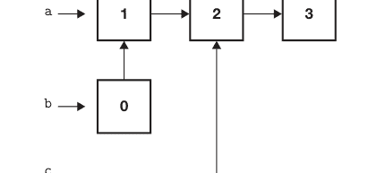

图 3.1 函数式列表内存共享。

这种数据共享的另一个结果是，在函数式列表上，head 和 tail 方法都是高效的、常数时间操作——通常是一个指针解引用。只要你可以用 head 和 tail 表示算法，列表就是一个合理的实现选择。然而，请注意，其他列表操作可能没有那么快。例如，last 和 length 方法所需计算时间与列表长度成比例，而 appended 或 concat 等方法需要复制整个列表。

函数式列表的 head/tail 结构重要的第二个原因是，非空列表的 tail 本身就是一个列表。因此，许多对列表的计算都可以用递归有效地实现。第 7 章专门介绍使用列表的递归编程。

#### 3.8 混合设计

在纯函数式编程方法中，所有函数都是纯的，所有值都是不可变的。这没什么问题——而且有很多好处——但有时程序员更喜欢一种更混合的方法，将纯函数和值与动作和可变对象结合起来。如果你习惯于命令式编程风格，你可以在不完全承诺纯函数式设计的情况下开始使用一些函数式编程特性。特别是，在构建可变对象时依赖不可变值，反之亦然，有一些好处。

在一个结合纯函数、不纯函数和动作的混合应用程序中，你需要担心调用不在你控制下的函数时可能出现的副作用。不可变值的美妙之处在于它们可以安全地共享，因为知道没有任何意外的副作用会修改它们。

作为说明，考虑一个在可变集合中跟踪已注册用户的应用程序：

```scala
type Directory = mutable.Set[String]

def register(dir: Directory, user: String): Unit = dir += user
```

列表 3.4：目录作为可变集合；与列表 3.5 对比。

用户通过 register 动作添加，该动作修改集合。

现在假设你需要调用一个不在你控制下的函数——比如 newRegistrations，它根据之前的目录计算新注册用户的集合：

```scala
val yesterdayDir: Directory = ...
val todayDir: Directory = ...
register(todayDir, "new user 1")
register(todayDir, "new user 2")
val todayReg = newRegistrations(todayDir, yesterdayDir)
```

问题在于函数 newRegistrations 不一定是纯的。它可以实现如下：

```scala
def newRegistrations(newDir: Directory, oldDir: Directory): Directory =
    newDir.subtractAll(oldDir)
```

此实现从集合 newDir 中删除所有已在集合 oldDir 中的用户，并返回 newDir。返回值是正确的，但集合 newDir 已被修改。

因为你担心 newRegistrations 可能这样实现，所以你需要确保作为参数传递的目录不会被修改。因此，你最终在目录的副本上调用 newRegistrations：

```scala
val todayReg = newRegistrations(todayDir.clone(), yesterdayDir.clone())
```

除非你能确定 **newRegistrations** 不会修改其参数，⁶ 你就不能省略对 **clone** 的调用，有时称为 *防御性拷贝*。这个故事的悲惨之处在于，**newRegistrations** 很可能——甚至很可能——被实现为纯函数。在这种情况下，防御性拷贝完全是浪费的。

浪费的防御性拷贝在依赖大量库的大型应用程序中实际上相当常见⁷。你可以通过使用不可变目录来避免它们：

```scala
type Directory = Set[String]

def register(dir: Directory, user: String): Directory = dir + user
```

列表 3.5：目录作为不可变集合；与列表 3.4 对比。

注册依赖于一个纯函数，该函数生成新的已注册用户集合，但不修改其输入。你可以按如下方式在应用程序中使用不可变目录：

```scala
val yesterdayDir: Directory = ...
var todayDir: Directory      = ...
todayDir = register(todayDir, "new user 1")
todayDir = register(todayDir, "new user 2")
val todayReg = newRegistrations(todayDir, yesterdayDir)
```

函数 **newRegistrations** 可以直接在目录上调用，而无需克隆——不可变集合在 Scala 中甚至没有公共的 **clone** 方法。**newRegistrations** 内部不会有副作用修改它们的风险：它们是不可变的！

请注意，应用程序不是以函数式风格编写的：它使用赋值语句作为副作用，并使用顺序组合来链接修改。尽管如此，命令式代码通过避免不必要的防御性拷贝而从使用不可变目录中受益。

你可能会争辩说，没有人会明智地通过修改输入集合来实现函数 **newRegistrations**。也许。但你能依赖所有库都使用合理代码的立场吗？在理想世界中，你会依赖文档来确认 **newRegistrations** 没有副作用。但你有多少次发现库文档不充分？

⁶这包括该函数的明天实现。因此，如果函数不在你的控制之下，检查源代码是不够的。你需要一些保证，通常在文档中，函数不仅 *是* 纯的，而且 *将保持* 纯的。

⁷也可能出现你调用的方法存储其参数并自行进行防御性拷贝，因为它担心参数可能在调用后被修改。在最坏的情况下，你可能在调用方和被调用代码内部都克隆对象。矛盾的是，共享不可变对象通常会导致更少的内存分配，而不是更多。


#### 3.9 更新可变/不可变对象的集合

如前所述，一个不可重新赋值的变量可以引用一个不可变对象或一个可变对象。同样，一个不可变的结构，如函数式列表或持久集合，可以包含可变或不可变对象。这会影响你使用这些结构更新状态的方式。

以下场景作为说明。数据表示为 Load 对象的不可变列表。每个 Load 对象都有一个 weight，可以减少一。Load 的可变变体实现了两个方法：

```
trait Load:
  def weight: Int    // current weight
  def reduce(): Unit // reduce load weight by one
```

列表 3.6：可变类型的示例；与列表 3.7 对比。

一个应用程序需要执行一个操作，将列表中所有 loads 的 weight 减少一。你可以按如下方式实现它：

```
def reduceAll(loads: List[Load]): List[Load] =
  for load <- loads do load.reduce()
  loads
```

即使列表是不可变的，其内容也在被修改。然而，包含相同对象的相同列表被返回。

或者，你也可以将 loads 实现为不可变类型：

```
trait Load:
  def weight: Int    // current weight
  def reduced: Load // a reduced load, with a weight reduced by one
```

列表 3.7：不可变类型的示例；与列表 3.6 对比。

weight 方法与之前保持不变。然而，由于 loads 现在是不可变的，reduce 操作被替换为没有副作用的 reduced 函数，该函数生成一个 weight 减少后的新 load。你不能再通过修改 loads 来实现函数 reduceAll。相反，必须创建新的 load 对象，然后

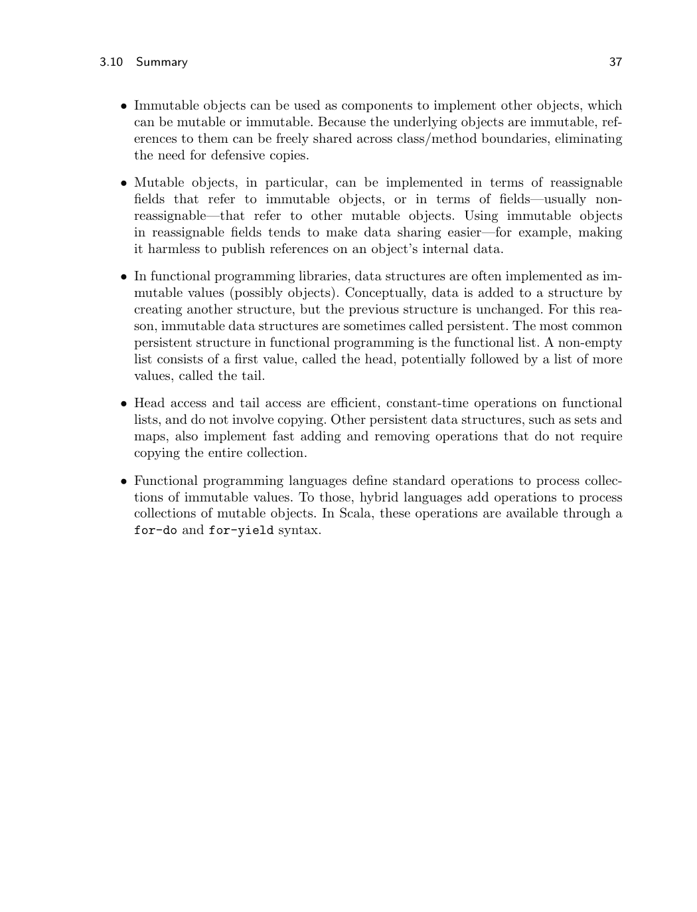

本页 intentionally left blank

### Chapter 4

#### 案例研究：主动-被动集合

为了巩固第 1 章到第 3 章中探讨的思想，本案例研究开发了小型程序的多个变体。要实现的功能是一个结构，用于跟踪对象集合的状态。集合中的每个元素可以处于活动或被动状态。可以查询状态，并从被动更改为活动，或从活动更改为被动。整个集合的状态也可以通过激活或停用所有元素的全局操作来查询和修改。该服务以经典面向对象风格、纯函数式风格以及使用函数式对象的混合风格实现。

#### 4.1 面向对象设计

首先考虑标准、面向对象的实现——这里没有函数式内容。ActivePassive 类由活动/被动元素的类型参数化。它使用一个可变集合 activeSet 实现，用于表示活动元素的子集——集合外的元素为被动。初始时，所有元素都是被动的，该集合为空。

```
class ActivePassive[A](elements: Set[A]):
  private val activeSet = mutable.Set.empty[A]

  def isActive(elem: A): Boolean = activeSet.contains(elem)

  def isPassive(elem: A): Boolean = !isActive(elem)

  def allActive: Set[A] = activeSet.toSet

  def allPassive: Set[A] = elements diff activeSet

  def isAllActive: Boolean = activeSet.size == elements.size

  def isAllPassive: Boolean = activeSet.isEmpty

  def activate(elem: A): Unit = activeSet += elem

  def deactivate(elem: A): Unit = activeSet -= elem
```

```
def activateAll(): Unit = activeSet ++= elements

def deactivateAll(): Unit = activeSet.clear()
```

列表 4.1：使用底层可变集合的面向对象主动-被动集合。

该类使用两个字段：elements，一个不可变集合（在构造函数中初始化），和 activeSet，一个可变集合，初始为空。方法 isActive 和 isPassive 是通过在 activeSet 中查找实现的：元素如果被找到则为活动，如果未找到则为非活动。¹ 用户可以通过调用方法 allActive 获取当前所有活动元素的集合。该方法使用方法 toSet 复制可变 activeSet，该方法返回一个不可变集合。² 要生成所有非活动元素的集合，你需要计算 elements 和 activeSet 之间的集合差，这在 Scala 中使用方法 diff 完成。方法 isAllActive 必须恰好在所有元素都活动时返回 true——也就是说，当 elements == activeSet 时。由于 activeSet 总是 elements 的子集，这等价于更快的测试 activeSet.size == elements.size。实现 isAllPassive 更简单：只需测试 allActive 是否为空。要激活一个元素，你将其添加到（可变）集合 activeSet 中。要停用一个元素，你将其从集合中移除。要激活所有元素，你将整个 elements 集合添加到 activeSet。要停用所有元素，你只需清空 activeSet。

ActivePassive 类的实例是可变的：当元素被激活或停用时它们会发生变化。列表 4.1 中的实现依赖于可变集合，但你也可以使用不可变集合实现一个可变的 ActivePassive 类。列表 4.2 显示了这个版本。

```
private var activeSet = Set.empty[A]

def allActive: Set[A] = activeSet

def activate(elem: A): Unit = activeSet += elem

def deactivate(elem: A): Unit = activeSet -= elem

def activateAll(): Unit = activeSet = elements

def deactivateAll(): Unit = activeSet = Set.empty
...
```

列表 4.2：使用底层不可变集合的面向对象主动-被动集合。

¹ 如同往常，参数检查被省略。假设 isActive、isPassive、activate 等总是对 elements 集合的成员调用。

² 在 Java 中，你可以通过在可变集合上返回一个不可变包装来避免复制——Collections.unmodifiableSet(activeSet)——但 Scala 的标准库中没有这样的机制。

#### 4.2 函数式值

方法 allActive 比之前简单：你可以直接返回字段 activeSet 的引用，而不必复制集合。这可行，因为 activeSet 是一个不可变集合，返回对其的引用是无害的。方法 activate 和 deactivate 的代码看起来没有变化，但实际上编译方式不同。不是在可变集合上调用方法 ++ 和 --，你现在是在创建一个新的不可变集合并重新赋值一个可变字段。（这种语法上的相似性在第 3.6 节中讨论过。）方法 activateAll 和 deactivateAll 是在没有任何集合操作的情况下实现的。它们只是（并且高效地）将字段 activeSet 重置为值 elements，或重置为空集合。其他方法（isActive、isPassive、allActive 和 isAllPassive）保持不变。

总之，你可以用两种方式定义 activeSet 来实现一个可变的主动-被动集合：

```
```scala
private val activeSet = mutable.Set.empty[A] // in Listing 4.1
private var activeSet = Set.empty[A] // in Listing 4.2
```
```

在一种情况下，你通过修改可变集合来激活/停用元素。在另一种情况下，你通过构建一个新的不可变集合并重新赋值一个可变字段来完成。

#### 4.2 函数式值

现在让我们戴上函数式程序员的帽子，完全使用纯函数和不可变值重写主动-被动示例。我们需要某种类型来表示 ActivePassive 值。一个典型的函数式方法是使用对。

```
```scala
opaque type ActivePassive[A] = (Set[A], Set[A])
```
```

对中的第一个集合表示整个集合；第二个集合是活动元素的子集。两个集合都是不可变的。所有剩余的代码都写成函数：

```
```scala
private def elements[A](ap: ActivePassive[A]): Set[A] = ap(0)
private def activeSet[A](ap: ActivePassive[A]): Set[A] = ap(1)

def createActivePassive[A](elements: Set[A]): ActivePassive[A] = (elements, Set.empty)
```

```
def isActive[A](ap: ActivePassive[A], elem: A): Boolean = activeSet(ap).contains(elem)

def isPassive[A](ap: ActivePassive[A], elem: A): Boolean = !isActive(ap, elem)

def allActive[A](ap: ActivePassive[A]): Set[A] = activeSet(ap)

def allPassive[A](ap: ActivePassive[A]): Set[A] = elements(ap) diff activeSet(ap)

def isAllActive[A](ap: ActivePassive[A]): Boolean =
    elements(ap).size == activeSet(ap).size

def isAllPassive[A](ap: ActivePassive[A]): Boolean = activeSet(ap).isEmpty

def activate[A](ap: ActivePassive[A], elem: A): ActivePassive[A] =
    (elements(ap), activeSet(ap) + elem)

def deactivate[A](ap: ActivePassive[A], elem: A): ActivePassive[A] =
    (elements(ap), activeSet(ap) - elem)

def activateAll[A](ap: ActivePassive[A]): ActivePassive[A] =
    (elements(ap), elements(ap))

def deactivateAll[A](ap: ActivePassive[A]): ActivePassive[A] =
    (elements(ap), Set.empty)
```

列表 4.3：函数式主动-被动集合。

查询函数与面向对象实现中对应的 methods 相似。它们的区别在于使用显式参数 ap 而不是隐式使用 this：

// in Listings 4.1 and 4.2
def isAllActive: Boolean = activeSet.size == elements.size

// in Listing 4.3
def isAllActive[A](ap: ActivePassive[A]): Boolean =
    activeSet(ap).size == elements(ap).size

由于主动-被动集合现在是不可变的，激活或停用元素的操作变化更大。它们现在需要创建一个新值：一个与之前不同之处在于某些元素被激活或停用的新的主动-被动对。请注意，签名与之前不同：而不是 Unit，它们现在返回 ActivePassive[A] 作为返回类型。例如，要在函数 activate 中激活单个元素 elem，你创建一个新的活动集合 activeSet(ap) + elem，并用它制作一个新的主动-被动对。添加了两个私有函数来访问对元素，以避免以 ap(0) 和 ap(1) 形式编写所有代码，这会容易出错。最后，面向对象变体中的类构造函数被 createActivePassive 函数取代。


实现中使用的所有函数都是纯函数，激活-未激活值通过函数组合来使用。不是像面向对象设计中那样写：

```
Scala
ap.activateAll()
ap.deactivate(A)
ap.deactivate(B)
```

而是在函数式变体中这样写：

```
Scala
deactivate(deactivate(activateAll(ap), A), B)
```

#### 4.3 函数式对象

在混合编程语言中，你可以将对不可变值的选择（如函数式实现中那样）与使用方法代替函数（如面向对象实现中那样）结合起来。在这种函数式-面向对象方法中，激活-未激活值是不可变对象：

```
Scala
class ActivePassive[A] private (elements: Set[A], activeSet: Set[A]):
  def this(elements: Set[A]) = this(elements, Set.empty[A])

  def isActive(elem: A): Boolean = activeSet.contains(elem)

  def isPassive(elem: A): Boolean = !isActive(elem)

  def allActive: Set[A] = activeSet

  def allPassive: Set[A] = elements diff activeSet

  def isAllActive: Boolean = activeSet.size == elements.size

  def isAllPassive: Boolean = activeSet.isEmpty

  def activate(elem: A): ActivePassive[A] = ActivePassive(elements, activeSet + elem)

  def deactivate(elem: A): ActivePassive[A] = ActivePassive(elements, activeSet - elem)

  def activateAll(): ActivePassive[A] = ActivePassive(elements, elements)

  def deactivateAll(): ActivePassive[A] = ActivePassive(elements, Set.empty)

清单 4.4：函数式面向对象的激活-未激活集合。
```

这两种实现是相同的。它们都将激活-未激活集合表示为不可变集合的配对，要么使用内置的配对类型，要么使用我们自己的双字段 `ActivePassive` 类作为包装。两种实现共享同样的基本特性：激活-未激活集合是不可变的，激活/停用总是会创建新的集合。

在使用真正的函数式编程语言时，你很可能会直接用函数来编写这种不可变变体。然而，在使用面向对象/函数式混合语言时，使用函数式对象是一个有吸引力的选择，可以说它比纯粹的函数式实现能产生更简洁的代码。

你可能会好奇每种实现的相对性能——在讨论不可变性时，性能问题总会浮现。不可变的激活-未激活集合会产生两项性能成本：

-   元素的激活和停用需要为这两个集合分配一个新的包装容器——要么是一个配对，要么是类 `ActivePassive` 的一个实例。被丢弃的配对、集合和包装器也会给垃圾收集器带来额外的工作。
-   可变集合上的 `+=` 和 `-=` 方法可能比不可变集合上的 `+` 和 `-` 稍微高效一些，尽管不一定多多少。

总体而言，与更简单、更安全的数据共享所带来的好处相比，这些缺点很可能是微不足道的，如果不可变路线对你的应用有意义，就不应该因此阻止你采用它。与往常一样，在性能剖析确认这些微小差异会成为应用的瓶颈之前，没有必要担心它们。

### 第 5 章
#### 模式匹配与代数数据类型

大多数函数式编程语言——以及许多渴望支持函数式编程的混合语言——都定义了某种形式的*模式匹配*。模式匹配有许多用途，从简单的类 switch 结构到运行时类型检查与类型转换，但在应用于代数数据类型时最为有效，它将备选（alternatives）和聚合（aggregation）结合了起来。

#### 5.1 函数式 switch

作为起点，你可以把模式匹配看作一种函数式的 `switch`。例如，之前使用 `if-then-else` 的例子：

```scala
val verbosity = if arg == "-v" then 1 else if arg == "--vv" then 2 else 0
```

可以改用模式匹配来重写：

```scala
val verbosity = arg match
  case "-v"  => 1
  case "--vv" => 2
  case _      => 0
```

*清单 5.1：将模式匹配用作 `switch` 表达式的示例。*

整个 `match-case` 是一个表达式，用于设置 `verbosity`。模式按顺序依次考虑，整个模式匹配表达式的值是第一个匹配模式所关联的值。下划线代表默认情况，匹配任何内容。没有穿透（fall-through）。同一个表达式可以与多个模式关联，如 `case "-v" | "--verbose" => 1`。

不过这仅仅是冰山一角。模式匹配远不止是一种简单的 switch 表达式，它还有更多的用途。其中之一是，条件（有时称为 *守卫*）可以添加到模式上：

```
val pair: (String, Int) = ("foo", 42)

pair match
  case (str, 0) => ... // no match because the number in pair is not zero
  case (str, n) => ... // str is the string "foo", n is the integer 42
```

# 清单 5.4：使用模式匹配提取元组元素的示例。

如果你只关心提取值，可以在 match 构造之外使用元组模式：

```
val (str, n) = pair // str is the string "foo", n is the integer 42
```

这等价于

```
val str = pair(0)
val n   = pair(1)
```

函数式编程语言非常依赖元组作为聚合值的机制。在面向对象语言中，你可以使用类来实现这一目的。作为一门混合语言，Scala 实现了元组，同时也定义了样例类的概念，你通常可以用样例类来聚合数据。样例类的一个显著好处是，它们使得模式匹配成为可能。

```
case class TempRecord(city: String, temperature: Int)

val rec = TempRecord("Phoenix", 122)

rec.city        // "Phoenix"
rec.temperature // 122

val TempRecord(name, temp) = rec // name is "Phoenix", temp is 122
```

通过使用样例类而不是元组，你有时可以提高代码的可读性——用 `rec.city` 而不是 `rec(0)`——同时保留模式匹配的便利性。特别是，你可以定义各自独立的类型，它们都包含相同的类型组成部分，比如城市和温度，或标签和计数，或时间单位和时长，而不是更通用的 `(String, Int)`。在本书的多个案例研究和示例中，为了方便起见都使用了样例类。

1 样例类在其他几个方面也不同于普通类（它们重新定义了相等性和字符串表示，其构造器参数隐式地是公开的 val 变量），但在本书中，它们主要用于模式匹配。

#### 5.3 Option 类型

元组聚合值，但不提供选择：一个配对总是由两个值组成。其他类型则被定义成采用多种形式之一作为备选。Option 类型是一种简单且广泛使用的类型，它有两个备选：一个 Option 可以包含一个值，也可以为空。考虑下面的例子：

```
val someNum: Option[Int] = Some(42)
val noNum: Option[Int] = None
```

类型 `Option[Int]`² 的值表示要么是一个整数，要么什么都没有。你可以把它用作不保证一定会产生结果的函数的返回类型，例如一次搜索可能会找到目标，也可能找不到。为此目的，返回 Option 远比使用 null 更可取，这个话题我们将在第 13 章探讨。

你可以对 Option 使用模式匹配：

```
optNum match
  case Some(x) => if x > 0 then x else 0
  case None => 0
```

清单 5.5：同时用于 switch 和提取的模式匹配示例。

在这个例子中，`optNum` 是一个可选的数字，类型为 `Option[Int]`。如果它包含一个正数，清单 5.5 就会生成那个数字。否则——如果 option 为空或数字不是正数——它就生成零。在这个例子中，模式匹配之所以强大，是因为它有两个用途：它让你判断 option 是否为空，并用于从非空 option 中提取值。你还可以使用带条件的模式来实现同样的计算：

```
optNum match
  case Some(x) if x > 0 => x
  case _ => 0
```

下划线模式处理所有未匹配第一个模式的值，在本例中就是包含非正数的 option 或空的 option。请注意，在第一个变体中你可以交换模式的位置，但在第二个变体中则不能：


Scala

```scala
optNum match
  case None      => 0
  case Some(x) => if x > 0 then x else 0
```

这段代码仍然可以工作，但下一个变体则不行：

```
Scala

```scala
// DON'T DO THIS!
optNum match
  case _         => 0
  case Some(x) if x > 0 => x
```
```

下划线模式匹配任何内容，第二个模式变得不可达。

#### 5.4 重新审视函数式列表

早些时候，我介绍了函数式列表的概念：函数式列表要么为空，要么由头部和尾部组成。像 Option 一样，列表类型基于一种选择：空或非空。但像元组一样，它也依赖于聚合：头部和尾部。这使得模式匹配成为处理列表的理想方式。使用模式，你可以判断一个列表是否为空，也可以提取非空列表的头部和尾部。特别是，模式匹配可以用来独立实现 head 和 tail 函数，而不依赖于标准 List 类型中定义的 head 和 tail 方法：

```
Scala

```scala
def head[A](list: List[A]): A = list match
  case h :: _ => h
  case Nil    => throw NoSuchElementException("head(empty)")

def tail[A](list: List[A]): List[A] = list match
  case _ :: t => t
  case Nil    => throw NoSuchElementException("tail(empty)")
```

Listing 5.6: Reimplementing head and tail using pattern matching.
```

观察模式是如何用来区分空列表和非空列表的，以及如何捕获非空列表的相关部分，使用下划线忽略不关心的部分。

其他列表函数也可以使用模式匹配重新实现——例如，isEmpty：

```
def isEmpty[A](list: List[A]): Boolean = list match
  case Nil => true
  case _ => false

def isEmpty[A](list: List[A]): Boolean = list match
  case _ :: _ => false
  case _ => true
```

Listing 5.7: Reimplementing isEmpty using pattern matching.

第一个变体使用 Nil 匹配空列表，并用“_”匹配其他——因此是非空的——列表。第二个变体首先匹配非空列表，使用模式“_ :: _”，它匹配任何具有头部和尾部的列表。下一个模式仅匹配没有头部和尾部的列表——即空列表——并且为了清晰起见本可以使用 Nil 代替“_”。两种方法都是正确的。

在 isEmpty 函数的实现中，模式仅用于区分空列表和非空列表，而在 head 和 tail 中，它们还从非空列表中提取一个组件。根据你的需求，你可以用以下任何模式匹配非空列表：

```
_ :: _            // nothing captured
head :: _          // capture head only
_ :: tail          // capture tail only
head :: tail       // capture head and tail
all @ head :: tail // capture head, tail, and the entire list
all @ head :: _    // capture head and the entire list
all @ _ :: tail    // capture tail and the entire list
all @ _ :: _       // capture the entire list
```

模式可以任意嵌套。特别是，你可以使用“@”在同时将复合类型分解为其自身组件时捕获其组件。例如，如果一个表达式是选项对的列表，模式匹配可以应用于列表，以及列表中的选项，以及选项中的对，所有这些都在同一个模式中：

```
List(Some(("foo", 42)), None) match
  case (head @ Some(str, n)) :: tail => <expr>
```

在表达式 <expr> 内部，变量 head、str、n 和 tail 表示以下值：

```
enum BoolExpr:
  case T
  case F
  case Not(e: BoolExpr)
  case And(e1: BoolExpr, e2: BoolExpr)
  case Or(e1: BoolExpr, e2: BoolExpr)
```

Listing 5.8: Boolean expressions as an algebraic data type.

与列表一样，树类型涉及选择（五种可能性）、聚合（And 和 or 的左操作数和右操作数）以及递归（Not、And 和 Or 是包含子树的树）。使用此类型，图 5.1 中的树变为以下表达式：

```
And(T, Or(F, Not(And(T, F))))
```

树可以使用模式匹配来在备选方案之间切换并提取子树，从而非常自然地进行处理。例如，你可以编写一个函数将树求值为其真值：

```
def eval(expr: BoolExpr): Boolean =
  import BoolExpr.*
  expr match
    case T        => true
    case F        => false
    case Not(e)   => !eval(e)
    case And(e1, e2) => eval(e1) && eval(e2)
    case Or(e1, e2) => eval(e1) || eval(e2)
```

Listing 5.9: Recursive evaluation of Boolean expressions using pattern matching.

鉴于树的递归性质，函数 eval 本身也是递归的。递归是第 6 章的主题。

#### 关于和类型与积类型的旁注

像本章中使用的 Option、pair、list 和 tree 这样的类型的探索通常以和类型与积类型的形式来表述。你不需要知道这些名称就能有效地使用这些类型，但对这种术语的简要讨论可以帮助你更好地理解此类类型的代数本质。

考虑以下定义的两个 Scala 类型：

```
type Stooge = "Larry" | "Curly" | "Moe"
type Digit = 0 | 1 | 2 | 3 | 4 | 5 | 6 | 7 | 8 | 9
```

为讨论的目的，类型可以被视为值的集合：布尔类型包含两个值 true 和 false；Int 有 2^32 个可能的值；String 有无限多个值。在这里，我们依赖于两个小的类型：Stooge，有三个值，以及 Digit，有十个值。

积类型用于聚合。例如，pair 类型 (Stooge, Digit) 包含由一个 stooge 和一个 digit 组成的值：

```
type StoogeAndDigit = (Stooge, Digit)
```

该类型包含 30 个值——("Moe", 5)、("Larry", 1) 等——这是 stooge 数量和 digit 数量的乘积（因此得名）。与其使用 pair，你可能在面向对象的语言中使用 cast 将 stooge 和 digit 组合到一个对象中。在本说明的上下文中，所有将一个 stooge 与一个 digit 聚合的类型都是等价的，并表示为 Stooge × Digit。

类型可以以任意方式聚合。例如，类型 StoogeLink = (Stooge, Stooge, Boolean)，表示为 Stooge × Stooge × Boolean，包含由两个 stooges 和一个布尔值组成的所有 18 个值。

对积类型的支持在编程语言中几乎是普遍的，无论是通过类、记录还是元组。函数式语言，以及许多混合语言，还支持和类型，表示备选方案。能够是一个 stooge 或一个 digit 的值可以赋予类型 StoogeOrDigit，定义如下：

```
enum StoogeOrDigit:
    case S(stooge: Stooge)
    case D(digit: Digit)
```

该类型包含 13 个值——S("Larry")、S("Curly")、S("Moe")、D(0)、D(1)、…、D(9)——这是 stooge 数量和 digit 数量的和。名称 S 和 D 是无关紧要的，类型表示为 Stooge + Digit。请注意，和可以由不是不相交集合的类型构建：

```
enum Number:
    case Zero
    case Pos(digit: Digit)
    case Neg(digit: Digit)
```

Pos(3) 和 Neg(3) 是不同的值，Number 类型包含 21 个值。名称 Zero 与名称 Pos 和 Neg 一样不相关，类型可以表示为 Digit + Digit + 1，其中“1”表示包含 Zero 的单值类型。

Scala 定义了标准的积类型——所有元组都是 `Product` 的子类型——和和类型。例如，`Option` 定义了一个和类型作为值或无的备选。类型 `Option[Stooge]` 有四个值：`Some("Moe")`、`Some("Larry")`、`Some("Curly")` 和 `None`。我们可以将其表示为 `Stooge + 1`。

给定 × 和 + 的这种（松散）定义，可以对类型应用代数变换。例如，`(Stooge + 1) × Digit`——一个可选的 stooge 与一个 digit 聚合——可以实现为 pair `(Option[Stooge], Digit)`。通过将 × 分布到 +，该类型可以被认为等价于 `(Stooge × Digit) + Digit`，该类型可以用以下方式实现：

```
```scala
enum StoogeAndDigitOrDigit:
  case SD(stooge: Stooge, digit: Digit)
  case D(digit: Digit)
```
```

概念上，该类型表示与类型 `Option[Stooge], Digit` 相同的 40 个值。例如，`(Some("Moe"), 5)` 对应于 `SD("Moe", 5)`，而 `(None, 8)` 是 `D(8)`。

最后，和与积可以以循环的方式定义，从而导致递归数据类型，如前面定义的 `BoolExpr` 树类型，或整数列表 `IntList`，定义为 `IntList = 1 + (Int × IntList)`，并实现如下：

```
```scala
enum IntList:
  case Nil
  case Cons(head: Int, tail: IntList)
```
```

#### 5.6 插图：列表拉链

作为模式匹配强大功能的简单示例，本节实现了一种称为 *zipper* 的数据类型。此拉链以一对列表定义，使得代码中可以依赖各种模式。

考虑维护一个非空值序列并带有指向当前元素的光标的问题。你希望能够左右移动光标，并查询或更新光标下的值。可变实现只需在值数组旁边存储一个索引。所有所需操作都可以在常数时间内轻松实现。使用可变类型的缺点是传递值进出函数时可能需要防御性拷贝（参见我们第 3.8 节的早期讨论）。即使移动光标也可能需要克隆整个数组。

相反，一个不可变实现会更好。一种天真的方法可以在函数式列表旁边存储一个索引。然而，这效率低下。回想一下，在函数式列表中访问指定索引处的元素不是常数时间


operation: 其耗时与索引的值成正比。此外，要更改索引 n 处的值，你必须从列表中丢弃 n 个元素，并分配一个长度为 n 的新列表。例如，如果索引指向列表 [P,l,a,t,o] 中的第一个“a”，并且你想将其替换为“u”以生成 [P,l,u,t,o]，你需要创建一个新的列表 [P,l,u]：

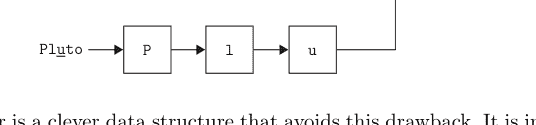

拉链是一种巧妙的数据结构，可以避免这种缺点。它被实现为一对列表 (left, right)：第二个列表包含光标右侧的元素；第一个列表包含光标左侧的元素，但顺序是反的。所有必要的操作——向左或向右移动光标，以及查询和更新光标下的元素——都可以以常数时间实现。

为了帮助可视化拉链，再次考虑列表 [P,l,a,t,o]，当前元素为“a”。它被表示为此拉链：

```
(List('l', 'P'), List('a', 't', 'o'))
```

将光标向右移动会产生新的拉链：

```
(List('a', 'l', 'P'), List('t', 'o'))
```

要实现拉链，首先定义 Zipper 类型为一对列表。拉链值是从非空元素列表构造的：

```
type Zipper[A] = (List[A], List[A])

def fromList[A](list: List[A]): Zipper[A] = (Nil, list)
```

Listing 5.10: List zipper definition and construction.

当你从列表构造拉链时，光标位于最左侧位置（左列表中没有元素）。拉链始终包含至少一个值（当前元素），并且一对中的右列表永远不会为空（fromList 的正确实现会以异常拒绝空列表参数）。

右列表的头部是光标下的元素。它可以被高效地查询和更新：

```
def get[A](zipper: Zipper[A]): A = zipper match
  case (_, x :: _) => x

def set[A](zipper: Zipper[A], value: A): Zipper[A] = zipper match
  case (left, _ :: right) => (left, value :: right)
```

Listing 5.11: List zipper getting and setting.

函数 get 使用匹配第二元素为非空列表且头部为 x 的对的模式。此头部是光标下的值并被返回。由于拉链是不可变的，函数 set 通过生成新的拉链来更新光标下的值。模式 _ :: right 匹配右列表非空且头部未指定的情况。通过使用头部为 value 参数的新右列表构建新的拉链。由于函数列表中的数据共享，set 和 get 都是常数时间操作。此外，函数 set 产生的新的拉链也与用作参数的拉链共享数据——所有第一个列表和第二个列表的大部分。

要将光标向左移动，你需要函数 moveLeft 将光标左侧的第一个列表中最右边的元素移动到第二个列表。由于光标左侧的元素以相反顺序存储，要移动的元素是第一个列表的头部，它需要成为第二个列表的头部：x :: left 变为 left，right 变为 x :: right。在前面的示例中，(List('a','l','P'), List('t','o')) 变为 (List('l','P'), List('a','t','o'))。如果光标已在最左侧位置，则拉链保持不变。此情况由下划线模式捕获：

```
def moveLeft[A](zipper: Zipper[A]): Zipper[A] = zipper match
  case (x :: left, right) => (left, x :: right)
  case _                 => zipper

def moveRight[A](zipper: Zipper[A]): Zipper[A] = zipper match
  case (left, x :: right) if right.nonEmpty => (x :: left, right)
  case _                                    => zipper
```

Listing 5.12: List zipper navigation.

将光标向右移动是类似的：取第二个列表的头部并将其移动到第一个列表的头部。然而，你还需要避免将光标移动到最右边元素之后，因为这会留下没有当前值的拉链。函数 moveRight 的第一个模式中的条件保证了新拉链中的第二个列表是非空的。两个光标移动都以常数时间实现。

与其使用条件，你可以使用模式 "_ :: _" 来确保 right 非空：

```
val alpha = bits >>> 8
(alpha, r, g, b)
```

Listing 5.14: Example of an extractor (RGB values).

在 Scala 中，函数的名称 unapply 具有特殊作用。只要对象 ARGB 在作用域中，你现在就可以使用模式匹配将一个数字拆分为其颜色元素：

```
val ARGB(a, r, g, b) = 0xABCDEF12
```

这将变量 a 设置为 0xAB，变量 r 设置为 0xCD，等等。

对象 ARGB 被称为提取器。许多提取器在 Scala 标准库中定义。例如，你可以使用模式匹配检索正则表达式中的捕获组：

```
val Phone: Regex = """(?(?:\+1\s)?([2-9]\d{2})[\s-]([2-9]\d{2})-?\d{4})""".r

def formatNumber(str: String): Option[String] = str match
  case Phone(npa, nxx, number) => Some(s"($npa) $nxx-$number")
  case _                       => None

formatNumber("603 5551234")     // Some("(603) 555-1234")
formatNumber("+1 603-555-1234") // Some("(603) 555-1234")
formatNumber("6035551234")      // None
```

Listing 5.15: Example pattern matching on a regular expression.

#### 5.8 Summary

- Pattern matching 是函数式编程语言的常见特性。在最简单的形式中，你可以将其视为一种强大的 switch 表达式形式。它可用于测试布尔条件，将值与常量进行比较，或检查运行时类型。
- 然而，模式匹配的真正威力来自于用于处理代数数据类型。它所特有的类型是按其他类型的替代（也称为和）和聚合（也称为积）定义的。模式匹配可用于在替代之间切换，并从聚合类型中提取组件。

> 3In Scala, the r method creates a regular expression out of a string. Also, the s prefix enables interpolation in string literals: s"$x" is a string that contains the value of x.

This page intentionally left blank

actually remove anything from an immutable collection, you would need to replace the action processOne with a function¹ that processes an element and returns a new collection with that element removed:

```
// processes one element, and returns a collection with this element removed
def processOne[A](collection: ImmutableCollection[A]): ImmutableCollection[A] = ...
```

So far, so good. Now, you need a way to use this function to process an entire collection, one element at a time. The same approach as before will not do: If collection.nonEmpty is true, processOne(collection) will not change that—the collection is immutable. Therefore, collection.nonEmpty will remain true, and the loop will never terminate. Can a loop be used at all? Yes, and this program would work:

```
def processCollection[A](collection: ImmutableCollection[A]): Unit =
  var remaining = collection
  while remaining.nonEmpty do
    remaining = processOne(remaining)
```

This gets the job done, but at the cost of reintroducing mutation through an assignment statement: Something in the body of the loop must have some side effect, and since collection cannot change, a mutable variable remaining is introduced. (The same approach was used in Section 3.6 to implement a mutable state in terms of an immutable data structure.) The loop-based solution works only because there is mutation. To achieve a fully immutable style—no var—you need to take a different route.

If a function f is free of side effects, the repetition f(x); f(x); f(x) is pointless. Think of code that executes Math.sqrt(4.0); Math.sqrt(4.0); Math.sqrt(4.0). What is the point? Instead, the output of f must be used, typically as the input to further computing. Instead of loops, what you need is a mechanism that can arbitrarily nest function calls. This mechanism is recursion.

Let’s go back to the problem of processing an entire immutable collection. A function needs to process one element from the collection and then process, in the same fashion, a new collection with that one element removed. In other words, you need to invoke processOne on the value produced by a previous call to processOne. Since processCollection is designed to invoke processOne, all you need to do is to call processCollection again on the output of processOne:

```
def processCollection[A](collection: ImmutableCollection[A]): Unit =
  if collection.nonEmpty then processCollection(processOne(collection))
```

Listing 6.1: Nesting function calls through recursion.

An initial call to processCollection processes the first element of a collection, and produces a new, reduced collection. This collection is then processed in the same way

¹This function is not pure because processing an element must have some side effect. However, it has no side effect on the collection itself, which is all that matters for the purpose of this illustration.


通过对函数 processCollection 的另一次调用，等等。处理整个列表的计算是 processOne(processOne(processOne(...)))，其形式为 f(f(f(x)))，而不是 f(x); f(x); f(x)。不涉及任何可变变量。

你总是可以用使用递归和不可变变量的代码替换使用循环和可变变量的代码。函数组合结合递归与顺序组合结合循环具有相同的表达能力。任何能用其中一种方法计算的东西，都可以用另一种方法计算。

#### 6.2 递归算法

在教科书和教程中，阶乘是最广泛使用的递归函数示例。由于任何讨论递归编程的书籍如果没有它都不完整，这里给出 Scala 中的实现：

```
def factorial(n: Int): Int = if n == 0 then 1 else n * factorial(n - 1)
```

Listing 6.2: Recursive implementation of factorial; contrast with Lis. 6.11.

这段代码当然很优雅。它比基于循环的替代方案更短，使用变量更少。然而，我不认为它能很好地说明递归的使用动机。你可以用循环轻松实现阶乘函数，并且 resulting 代码可能更高效。对许多其他典型的递归教学示例，如最大公约数，也可以说同样的话。² 因此，如果你过去见过阶乘示例，而它让你印象不深，没关系。本书包含数十个递归函数的示例，理想情况下你会发现后面的示例更有说服力。

汉诺塔是另一个经典的教学示例，它比阶乘或最大公约数问题更有效。它代表一个谜题，其中不同大小的圆盘堆放在三根柱子上。最初，所有圆盘都堆在最左边的柱子上，按从大到小的顺序排列。游戏的目标是使用中间柱子作为临时存储，将所有圆盘移动到最右边的柱子上，同时遵守以下规则：

- 一次只能移动一个圆盘。
- 只能移动最上面的圆盘。
- 没有圆盘可以放在较小的圆盘上面。

Figure 6.1 显示了将三圆盘塔从左向右移动所需的七个步骤。

你可以用递归算法解决汉诺塔问题：要将 n 个圆盘从柱子 L 移动到柱子 R，使用柱子 M，如果 n > 0，先将 n − 1 个圆盘从 L 移动到 M

使用 R；然后将一个圆盘从 L 移动到 R；然后将 n-1 个圆盘从 M 移动到 R 使用 L。如果 n = 0，则无需执行任何操作。此策略可以翻译成一个递归函数，该函数打印移动给定数量圆盘所需的所有步骤：

```
def hanoi[A](n: Int, from: A, middle: A, to: A): Unit =
  if n > 0 then
    hanoi(n - 1, from, to, middle)
    println(s"$from -> $to")
    hanoi(n - 1, middle, from, to)
```

# Listing 6.3: Recursive solution to the Tower of Hanoi problem.

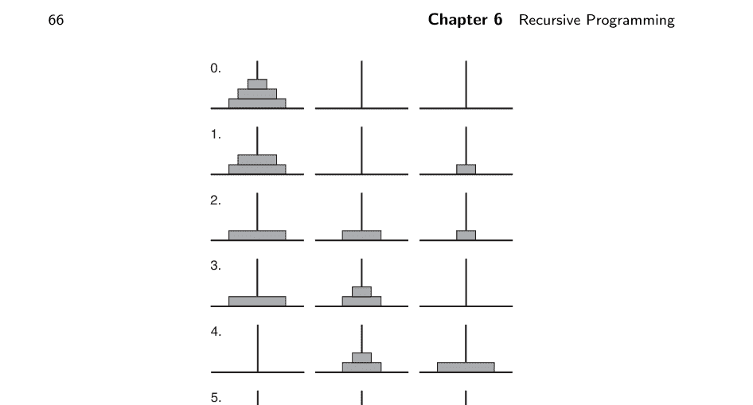

#### 6.3 递归算法的关键原则

如果 n = 0，此函数不执行任何操作。否则，第一次递归调用用于将 n–1 个圆盘从左柱移动到中间柱，使用右柱作为临时存储。此调用的效果是使第 n 个圆盘自由（图 6.1 中的位置 3）。然后打印语句将此圆盘从左移动到右（图 6.1 中的位置 4）。第二次递归调用将 n–1 个圆盘从其存储柱（中间）移动到右柱，使用左柱作为存储。当调用为 hanoi(3, 'L', 'M', 'R') 时，此函数产生的步骤序列与图 6.1 相同：

```
L -> R
L -> M
R -> M
L -> R
M -> L
M -> R
L -> R
```

汉诺塔之所以成为一个引人注目的例子，是因为没有直截了当的基于循环的等价实现来实现相同的算法。³ 其原因之一是函数 hanoi 对自身进行了两次递归调用，而阶乘或最大公约数示例中只需要一次调用。

#### 6.3 递归算法的关键原则

递归算法的核心思想是将问题简化为一个或多个相同问题的较小实例，并利用这些子问题的解来推导出原问题的解。第 6.2 节中的汉诺塔函数通过组合移动 n – 1 个圆盘的两个子问题的解来解决移动 n 个圆盘的问题。将此策略视为分而治之方法的特例，其中子任务与原始任务同源。

编写递归函数时，你需要注意三个主要问题：

- 计算的至少一个分支不应是递归的。如果你的函数评估总是触发递归调用，函数会不断重新执行自身，根本不可能终止。在汉诺塔示例中，情况 n = 0 不需要递归调用。

> 汉诺塔存在迭代解，可以很容易地用循环实现，但其正确性更难证明，甚至最简单的基于循环的程序仍然比这里介绍的递归函数更复杂。

牢记这一原则有助于快速发现错误。例如，考虑这个试图定义一个函数来提取列表最后一个元素的错误尝试：

```
// DON'T DO THIS!
def last[A](list: List[A]): A = list match
  case Nil      => throw NoSuchElementException("last(empty)")
  case _ :: tail => last(tail)
```

Listing 6.4: Incorrect implementation of last; fixed in Lis. 6.10.

该算法基于空列表没有最后一个元素，以及非空列表的最后一个元素是其尾部的最后一个元素这一思想。然而，函数按所写的方式不可能工作，因为它没有返回值的非递归分支：函数要么抛出异常，要么继续运行。事实上，非空列表的最后一个元素是其尾部的最后一个元素这一直觉在大小为 1 的列表上是不成立的。

- 递归解决的所有子问题在某种程度上必须比原问题更小。这同样是为了保证终止。常见模式包括对更短列表应用列表函数；对更小的正数应用数字函数（如 hanoi 的情况）；对子树应用树函数；等等。

作为未能遵守这一原则的说明，考虑这个错误的归并排序实现（函数 merge 被省略）：

```
// DON'T DO THIS!
def mergeSort[A](list: List[A]): List[A] =
  if list.isEmpty then list
  else
    val (left, right) = list.splitAt(list.length / 2) // split in the middle
    merge(mergeSort(left), mergeSort(right))
```

Listing 6.5: Incorrect merge sort; fixed in Lis. 7.18.

方法 splitAt 在给定点拆分列表：List(A,B,C,D).splitAt(2) 是对 (List(A,B), List(C,D))。此方法用于将非空列表拆分为两半。每一半递归排序，然后将两个已排序的半合并为一个已排序的列表。

问题在于 mergeSort(right) 不保证是对更小列表的递归调用。如果你拆分一个恰好包含一个元素的列表，你会得到两个列表：一个为空，另一个是未改变的原始列表。在 mergeSort 函数的情况下，这意味着 right 可能与 list 相同，并且

函数会递归应用于一个未变小的排序问题。此 `mergeSort` 函数是错误的：当在非空列表上调用时，它不会终止。

当问题有多个参数时，有时只要其中一个参数或它们的组合变小就足够了。例如，由正数和列表组成的对可以通过数字变小、列表变短，或数字加上列表长度之和变小等方式变小，等等。

有些情况更复杂，需要更精细的“更小”概念。例如，在这个经典示例中（有时称为 *Ackermann 函数*），⁴ 计算保证终止，因为对 (x,y) 在字典序中减小：要么 x 减小，要么 x 不变且 y 减小：

```
def a(x: BigInt, y: BigInt): BigInt = (x, y) match
  case (0, _) => y + 1
  case (_, 0) => a(x - 1, 1)
  case _      => a(x - 1, a(x, y - 1))
```

Listing 6.6: Ackermann function.

- *作为程序员，你的关注点应放在使用较小问题的解上，而不是这些较小问题本身如何通过递归调用解决。* 这点至关重要，是有效递归思维的关键。初学者常见的错误是试图展开递归调用以跟随其计算。除了最简单的函数之外，深入递归调用很快就会变得难以处理。（在 `hanoi` 上试试。）相反，你必须把对较小问题的解视为理所当然——由递归的“魔法”提供——并专注于使用这些值来构建原问题的解。

#### 6.4 递归结构

如第 5 章所述，一些代数数据类型呈现递归结构，可以通过递归函数相当自然地处理。事实上，处理递归结构是递归编程的主要用途之一。

树是编程中最常用的递归结构之一。Listing 5.9 使用树来表示表达式并使用递归函数来评估树。作为另一个例子，考虑二叉树。非空二叉树由根组成

⁴尽管该函数在理论上保证终止，但其复杂度巨大，其递归求值在大多数输入上会耗尽栈空间。Ackermann 函数是为递归函数的理论研究而定义的，没有实际用途。


value 和两个子节点，通常命名为 left 和 right，它们本身也是二叉树：⁵

```scala
enum BinTree[+A]:
  case Empty
  case Node(value: A, left: BinTree[A], right: BinTree[A])
```

在这样的树上，你可以递归地计算值的数量：

```scala
def size[A](tree: BinTree[A]): Int = tree match
  case Empty          => 0
  case Node(_, left, right) => 1 + size(left) + size(right)
```

列表 6.7：二叉树上 size 的递归实现。

空树不包含任何值，而非空树包含其合并子节点中的值数，再加上根节点的一个。许多其他关于二叉树的计算都可以递归进行，使用空树作为终止的非递归情况。二叉树是第 8 章案例研究的重点。

递归结构有时也是通过相互递归类型定义的：类型 A 依赖于类型 B，而类型 B 又依赖于类型 A，例如。这导致使用相互递归函数，也称为协同递归函数的代码。例如，你可以用两种类型 Tree 和 Forest 来定义 N 叉树，其中节点有零个、一个或多个子节点：一方面，森林是非空树的列表；另一方面，非空树由根值和子节点森林组成：

```scala
enum Tree[+A]:
  case Empty
  case Node(value: A, trees: Forest[A])

type Forest[A] = List[Tree.Node[A]]
```

然后你可以通过依赖其森林的大小来计算树的大小，并通过依赖其树的尺寸来计算森林的大小：

```scala
def treeSize[A](tree: Tree[A]): Int = tree match
  case Empty      => 0
  case Node(_, trees) => 1 + forestSize(trees)

def forestSize[A](forest: Forest[A]): Int = forest match
  case Nil          => 0
  case tree :: trees => treeSize(tree) + forestSize(trees)
```

列表 6.8：N 叉树上 size 的递归实现。

这些函数是相互递归的：treeSize 调用 forestSize，而 forestSize 调用 treeSize。N 叉树在第 11 章中作为案例研究进行探讨。

#### 6.5 尾递归

函数调用通常以执行栈的形式实现。当你调用一个函数时，会在执行栈上分配并推送一个新的栈帧。该帧包含函数参数及其局部变量的空间等内容。当控制从调用返回时，它会被从栈中弹出。

回想一下，递归被引入作为一种可以任意嵌套函数调用的机制——它被用来用更有用的 f(f(f(x))) 替换无用的重复 f(x); f(x); f(x)。与循环可以涉及多次重复一样，函数可以涉及多次递归调用。因此，递归代码通常会导致执行栈的<|message|> 重度使用。特别是，深度递归函数可能因耗尽栈空间而无法求值。

函数式编程语言的编译器通常通过关注尾调用来优化栈使用。尾调用是在另一个函数末尾发生的函数调用，如以下模式所示：

```
function f(x,y,z) {
  <code>
  return g(t,u,v)
}
```

在此模式中，当控制从对 g 的调用返回时，它将立即从对 f 的调用返回——函数 f 在调用 g 之后没有其他事情要做。特别是，当函数 f 发起对函数 g 的调用时，其 x、y 和 z 参数不再需要（其局部变量也不需要）。它们可以在分支到 g 之前从栈中弹出，从而限制栈增长——先弹出一个帧，然后推送一个帧。此外，如果调用是递归调用（f 和 g 是同一函数），整个栈帧可以通过重新分配变量 x、y 和 z 使其具有值 t、u 和 v，然后分支回 f 的开头来重用。在这种情况下，你可以像循环一样执行计算，而完全不使用栈。

某些函数式语言可能保证某些或全部尾调用被优化，而其他语言可能仅关注尾递归调用，还有一些可能将决策留给特定的编译器实现。混合语言，其中函数以方法实现，通常面临更具挑战性的情况，因为方法调用通常涉及其自身独特的特性（参见第 15.7 节关于动态分派的讨论）。

作为一个例子，当前的 Scala 编译器关注 *尾递归函数*——具有单个递归调用且位于尾位置的函数。它不会优化其他尾调用，包括相互递归函数中的那些。此外，由于函数被实现为方法，而方法可以被覆盖，看起来是尾递归的代码可能不会被优化。你可以使用 `tailrec` 注解来确认优化是否确实发生：带有 `tailrec` 注解的函数保证会被编译器优化，否则编译会失败。

#### 关于尾递归函数的优化字节码

作为一个实验，考虑这里展示的小类，它有一个单一的递归方法：

```scala
class TailRecursionTest:
  def zero(x: Int): 0 = if x == 0 then 0 else zero(x - 1)
```

这个无用的方法总是返回零（因此其名称和返回类型）。Scala 编译器为其生成的字节码看起来像这样：

```
public int zero(int);
Code:
  0: iload 1
  1: iconst_0
  2: if_icmpne 9
  5: iconst_0
  6: goto 16
  9: aload 0
 10: iload 1
 11: iconst_1
 12: isub
 13: invokevirtual #16    // Method zero:(I)I
 16: ireturn
```

细节并不重要。第 2 行比较变量 x 与 0。如果 x 非零，执行跳转到第 9 行。第 9–12 行计算 x − 1，第 13 行再次在 x − 1 上调用方法 zero。没有优化发生。如果方法带有 tailrec 注解，编译将失败。

阻止编译器优化的原因是方法 zero 可能在扩展 TailRecursionTest 的类中被覆盖。如果禁止覆盖，例如通过使 zero 成为 final 方法，编译器生成的字节码会发生变化：

```
bytecode
public final int zero(int);
  Code:
    0: aload 0
    1: astore 2
    2: iload 1
    3: istore 3
    4: iload 3
    5: iconst_0
    6: if_icmpne 13
    9: iconst_0
   10: goto 30
   13: aload 2
   14: astore 4
   16: iload 3
   17: iconst_1
   18: isub
   19: istore 5
   21: aload 4
   23: astore 2
   24: iload 5
   26: istore 3
   27: goto 31
   30: ireturn
   31: goto 4
   34: athrow
   35: athrow
```

细节并不重要，但需要注意的重要之处是 invokevirtual 指令消失了。取而代之的是第 31 行的 goto 4：递归函数现在被实现为循环。

#### 6.6 尾递归函数的示例

本章中第一个递归函数——在列表 6.1 中定义用于处理项目集合——是尾递归的。假设它不是作为可覆盖的方法编写的，它将在 Scala 中被编译为循环。作为更有意义的示例，考虑在已排序数组中的二分搜索。它可以用循环迭代实现：

```scala
def search(sortedSeq: IndexedSeq[String], target: String): Option[Int] =
  var from = 0
  var to = sortedSeq.length - 1
  while from <= to do
    val middle = (from + to) / 2
    sortedSeq(middle) match
      case midVal if target > midVal => from = middle + 1
      case midVal if target < midVal => to = middle - 1
      case _ /* found at middle */ => return Some(middle)
  end while
  None
```

该函数通过在 from 和 to 之间搜索数组切片来工作，初始时为整个数组。每次循环迭代都从查看范围中点的值 midVal 开始。如果目标大于中点值，函数会在上半部分继续搜索，在 middle + 1 到 to 之间，利用序列已排序的事实。如果目标小于中点值，函数则在下半部分继续，在 from 到 middle - 1 之间。否则，该值必须等于目标，因此函数返回找到的索引。每次循环迭代都在更小的范围内执行搜索。搜索在找到目标值或范围变为空（from > to）时结束。

与其使用循环，你可以用递归调用来实现这些连续搜索：

```scala
def search(sortedSeq: IndexedSeq[String], target: String): Option[Int] =
  @tailrec
  def doSearch(from: Int, to: Int): Option[Int] =
    if from > to then None
    else
      val middle = (from + to) / 2
      sortedSeq(middle) match
        case midVal if target > midVal => doSearch(middle + 1, to)
        case midVal if target < midVal => doSearch(from, middle - 1)
        case _ /* found at middle */ => Some(middle)
  doSearch(0, sortedSeq.length - 1)
```

列表 6.9：已排序序列中二分搜索的尾递归实现。

辅助函数 doSearch 被定义为在给定索引范围内执行搜索。该函数使用与之前相同的算法，但依赖递归调用在上半部分或下半部分继续搜索。


即使一个使用循环，另一个使用递归，这两种实现也相当相似。对 `doSearch` 的递归调用会将计算带回新的中点计算，就像循环所做的那样。事实上，函数 `doSearch` 是尾递归的，并且在 Scala 中被编译为循环。因此，与其再次调用 `doSearch`，递归调用是通过更新局部变量——`from` 或 `to`——并跳回函数开头来实现的，就像在循环变体中一样。编译后，两种实现使用的字节码在实际用途上是等价的。你选择写哪一种只是个人喜好问题。

有时，尾递归会相当自然地发生，而无需过多思考，就像二分查找的例子中那样。例如，来自列表 6.4 的函数 `last` 也是尾递归的。当然，它也是错误的，但可以在不失去尾递归的情况下修复：

```scala
@tailrec
def last[A](list: List[A]): A = list match
  case Nil        => throw NoSuchElementException("last(empty)")
  case head :: tail => if tail.isEmpty then head else last(tail)
```

列表 6.10：`last` 的正确尾递归实现；修复自列表 6.4。

有时，函数并非自然地是尾递归的。例如，来自列表 6.2 的阶乘函数就不是尾递归的。递归调用不在尾位置：在从它返回控制后，数字仍需要在返回一个值之前乘以 `n`。如果你需要一个不会增长执行栈的优化实现，可以改回使用 `while`-循环，如果编程语言支持的话。否则，你需要稍微不同地重写递归函数。标准技巧包括添加第二个参数，该参数用作正在计算的值的累加器：

```scala
def factorial(n: Int): Int =
  @tailrec
  def loop(m: Int, f: Int): Int = if m == 0 then f else loop(m - 1, m * f)

  loop(n, 1)
```

列表 6.11：`factorial` 的尾递归实现；与列表 6.2 对比。

函数 `loop` 的第二个参数包含已计算的阶乘部分，∏\_{i=m+1}^{n} i。乘法 `m * f` 在递归调用之前进行，而递归调用现在处于尾位置。函数 `loop` 是尾递归的，并被编译为循环。然而，来自列表 6.2 的简单递归实现的优雅性在某种程度上丧失了。

涉及多个递归调用的函数永远不是尾递归的——最多只有一个递归调用可以处于尾位置。它们能被改成尾递归吗？可以，但代价是引入额外的數據结构。例如，考虑列表 6.7 中二叉树上的函数 `size`。该函数对左树和右树各进行一次递归调用。为了触发尾递归优化，你可能会想采用与函数 `factorial` 相同的技巧：

```scala
def size[A](tree: BinTree[A]): Int =
  def loop(tree: BinTree[A], sz: Int): Int = tree match
    case Empty                 => sz
    case Node(_, left, right)  => loop(right, loop(left, sz + 1))

  loop(tree, 0)
```

对 `loop` 的一次递归调用现在处于尾位置并且可能被优化，但嵌套调用 `loop(left, ...)` 仍需要使用栈帧：在从它返回控制后，仍需要执行 `loop(right, ...)` 调用，并且仍使用当前帧（以访问局部变量 `right`）。

真正的尾递归变体只需要一次递归调用。你可以通过引入自己的栈，即树的列表来实现这一点：

```scala
def size[A](tree: BinTree[A]): Int =
  @tailrec
  def sizeSum(list: List[BinTree[A]], sum: Int): Int = list match
    case Nil                    => sum
    case Empty :: trees          => sizeSum(trees, sum)
    case Node(_, left, right) :: trees => sizeSum(left :: right :: trees, sum + 1)

  sizeSum(List(tree), 0)
```

函数 `sizeSum` 计算树列表的大小之和。它是尾递归的。当在列表中找到空树时，它对总和不做贡献。当从列表中取出一个节点时，总和累加器增加一，并且该节点的子节点被添加到待处理的树列表中。树的尺寸是通过将函数 `sizeSum` 应用于仅包含该树的列表来获得的。实际上，执行栈已被常规列表所取代。与 `factorial` 一样，尾递归是以牺牲优雅性为代价实现的。

寻求用尾递归替代一般递归涉及权衡。虽然推入和弹出执行栈可能比列表操作更快，但栈空间往往有限。相比之下，函数 `sizeSum` 中添加的列表是在堆内存中与其它对象一起分配的。堆内存通常比栈空间大几个数量级。

存在其它方法来优化递归调用并以堆空间换取栈空间。其中一种著名技术称为 *trampoline*，已被用于将具有尾调用优化的语言翻译成没有该优化的语言。弹跳台在第 14 章中作为案例研究进行探讨。

#### 6.7 总结

- 循环是编程语言实现重复的机制。循环只有在其主体实现某种形式的狀態变化时才有用，无论是通过变异对象还是重新赋值变量。
- 取而代之的是变异，严格的函数式编程风格依赖于纯函数的组合，使得循环变得无用。取而代之循环所需的是能够任意嵌套函数调用的机制。递归就是这样的机制。
- 递归函数是触发对自身调用的函数，无论是直接还是通过中间函数（可能导致相互递归）。它们可以用作替代循环来结构化程序的手段。
- 更重要的是，递归函数适合于将给定问题递归分解为相同类型更小问题的算法。递归算法结合了使用相同问题较小实例的解的策略与一个或多个平凡（非递归）情况。
- 递归函数必须始终包含至少一个不需要递归的平凡情况，并且必须确保所有递归调用都应用于更接近平凡情况之一的问题实例。这两个条件对于确保函数终止是必要的。
- 递归函数非常适合处理递归数据类型，如树和函数式列表。对树和列表的任务通常可以分解为对子树和子列表的类似任务，这些任务可递归实现。
- 在另一个函数的最后发生的函数调用——如 `return f(x)`——有时可以被优化以减少执行栈的使用。作为特例，一个函数如果在执行结束时恰好只调用自身一次，则称为尾递归。尾递归函数在函数式编程语言中通常会被优化。
- 当尾递归由编译器优化时，它可以安全地用于模拟重复。事实上，为优化后的尾递归函数生成的代码通常与从循环编译的代码相同。

此页故意留空

### 第 7 章

#### 列表上的递归

由于函数式列表是递归数据结构——非空列表的尾部是一个列表——许多列表处理函数非常适合递归模式，其中递归应用于列表的尾部。本章使用此模式来（重新）实现几个常见的列表函数。目标是双重的：它既是对标准列表函数的介绍，也是练习递归思维的一种方式。还探讨了其它模式，其中递归应用于尾部以外的子列表。讨论了一些性能考虑，例如尾递归的使用或内部依赖可变结构的纯函数。

### 注意

Scala 集合库将许多列表操作实现为其 List 类型的 方法。在本章中，其中一些被重新实现为函数，以便我们讨论递归和递归算法。代码示例故意依赖于先前定义的函数而不是相应的标准方法——例如写 `head(list)` 而不是可以使用 `list.head`——因此代码更接近于在具有函数式列表的另一种编程语言中可能的样子。这种方法仅适用于本章。书的后面部分为了方便和可读性而使用相应的 List 方法。

#### 7.1 递归算法作为等式

在第 6 章中，我们实现了一个函数 `last` 来提取列表的最后一个元素：

```scala
def last[A](list: List[A]): A = list match
  case Nil          => throw NoSuchElementException("last(empty)")
  case head :: tail => if isEmpty(tail) then head else last(tail)
```

该函数基于这样一个想法：一般来说，列表的最后一个元素是其尾部的最后一个元素。换句话说，它依赖于以下等式：

last(list) = last(tail(list))

由于空列表没有最后一个元素，这两个特殊情况在函数 `last` 中以非递归方式处理。


最后一种情况——空列表以及`isEmpty(tail)`——递归调用随后简单地遵循这个等式。

每个递归算法都建立在这样一个等式之上。例如，一棵树的大小等于其所有子树的大小之和再加一；前面讨论过的经典阶乘实现则基于等式 n! = n × (n − 1)!。要熟练进行递归编程，你需要学会识别这些等式。

一个常见的列表模式是，通过对列表尾部进行一次递归调用来计算列表上的函数 f：

```
f(list) = g(f(tail(list)))
```

你的目标是计算 f(list)，并且你可以使用 f(tail(list)) 的值。这个值通过递归的“魔法”免费获得。你的任务是构造并实现函数 g。

对于 `last` 函数，g 是恒等函数，f(list) 就是 f(tail(list))。后续的许多示例都依赖于函数 g，它可能被显式写出，也可能没有。例如，清单 7.1 中的 `contains` 函数（在列表中搜索目标值）使用了 g(x) = (head(list) == target) || x。清单 7.3 中的 `length` 函数（计算列表长度）使用了 g(x) = x + 1。

一旦你弄清了通用等式，递归函数通常就顺理成章了。你只需要处理等式不成立的特殊情况。这些情况成为计算中的非递归分支，比如 `last` 函数中的短列表，或阶乘中的零。等式本身定义了递归。接下来的几节将通过考察典型的列表计算，并从等式和一个或多个特殊情况中推导出每个递归函数来说明这一原则。

#### 7.2 遍历列表

与其遍历整个列表来到达最后一个元素，你也可以设定一个具体目标，然后遍历列表直到找到你要找的元素。`contains` 函数测试目标值是否在列表中：如果目标在列表头部，或者它在尾部的某个位置，那么目标就在列表中。这提示了以下递归等式：

```
contains(list, target) = head(list) == target || contains(tail(list), target)
```

这个等式对空列表没有定义，因为空列表既没有头部也没有尾部，需要作为一个简单的特殊情况来处理（空列表不包含任何内容）：

```scala
@tailrec
def contains[A](list: List[A], target: A): Boolean =
  !isEmpty(list) && (head(list) == target || contains(tail(list), target))
```

**清单 7.1：** 使用尾递归的简单列表查找；另见清单 7.2。

注意代码几乎可以自我解读：“一个列表包含目标值，当且仅当它非空，并且要么列表的第一个元素是目标值，要么目标值在列表的其他位置。”¹ 该函数是尾递归的，因为逻辑运算符“||”在 Scala 中（与 C 或 Java 一样）使用短路求值，因此等价于以下表达式：

```scala
(if head(list) == target then true else contains(tail(list), target))
```

将“||”展开为 if-then-else 后，尾递归更加清晰。

除了依赖 `head` 和 `tail` 函数，你也可以使用模式匹配：

```scala
@tailrec
def contains[A](list: List[A], target: A): Boolean = list match
  case Nil        => false
  case head :: tail => head == target || contains(tail, target)
```

**清单 7.2：** 使用尾递归和模式匹配的简单列表查找。

在本章的其余部分——以及整本书中——代码示例大多采用这种模式匹配风格，我通常觉得这种风格更易读。

下一个例子是计算列表长度的递归函数。非空列表包含的元素数量等于其尾部元素数量加一（列表头部的一个元素）：

```
length(list) = 1 + length(tail(list))
```

在将空列表（长度为 0）作为特殊情况处理后，实现形式如下：

```scala
def length[A](list: List[A]): Int = list match
  case Nil      => 0
  case _ :: tail => 1 + length(tail)
```

**清单 7.3：** 列表长度，非尾递归；与清单 7.4 对比。

这个实现的一个缺点是函数不是尾递归的。它的求值需要与列表中值数量相同的栈帧，并且很可能在大型列表上因空间耗尽而失败。

你可以通过应用与编写尾递归阶乘函数时相同的变换来推导出尾递归变体：为长度添加第二个参数，并在递归调用之前更新它。辅助函数 `addLength` 将列表的长度加到给定的累加器上。然后通过使用 `addLength` 将列表长度加到零来实现 `length` 函数：

```scala
def length[A](list: List[A]): Int =
  @tailrec
  def addLength(theList: List[A], len: Int): Int = theList match
    case Nil => len
    case _ :: tail => addLength(tail, len + 1)

  addLength(list, 0)
```

**清单 7.4：** 列表长度，使用尾递归；与清单 7.3 对比。

函数 `addLength` 是尾递归的。整个 `length` 函数现在可以被编译成一个循环，从而避免栈溢出问题。

#### 7.3 返回列表

到目前为止，我们只考虑了从列表中提取信息的函数：`last` 返回一个元素，`contains` 返回一个布尔值，`length` 返回一个整数。然而，有些函数通过构建并返回其他列表来处理列表。

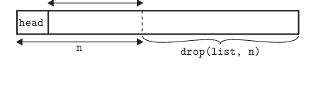

*图 7.1 函数 `drop` 的递归策略。*

作为第一个例子，考虑标准函数 `drop`，它用于从列表中移除前 n 个元素：`drop(List(A,B,C,D), 2)` 的结果是 `List(C,D)`。它的递归等式源于这样一个事实：要从列表中移除 n 个元素，你需要先移除列表的头部，然后从尾部移除 n − 1 个元素（图 7.1）：

```
drop(list, n) = drop(tail(list), n - 1)
```

要使等式成立，列表需要有尾部，且 n − 1 不能是负数，因为负数在此上下文中没有意义。从这个观察中，可以得出两个特殊情况，一个是空列表，另一个是 n = 0：

```scala
@tailrec
def drop[A](list: List[A], n: Int): List[A] =
  if n == 0 then list
  else list match
    case Nil        => Nil
    case _ :: tail => drop(tail, n - 1)
```

**清单 7.5：** 列表上 `drop` 的递归实现；另见清单 7.6。

函数 `drop` 接受两个参数：一个列表和一个要移除的元素数量 n。特殊情况 n = 0（不移除任何元素）通过原样返回列表来处理。你可以用两种不同的方式处理另一个特殊情况（空列表），具体取决于从空列表中移除元素的期望语义：

- 空列表中没有要移除的元素：抛出异常。
- 无论移除什么，空列表仍然是空列表：返回空列表。

一些编程语言（如 ML）采用第一种解释。Scala 标准库采用第二种解释，我在这里也选择了这种。函数 `drop` 是尾递归的，在运行时不会占用栈空间。

作为 if-then-else 后跟模式匹配的替代方案，你可以通过将数字和列表组成一个对，直接对两者进行模式匹配：

```scala
@tailrec
def drop[A](list: List[A], n: Int): List[A] = (list, n) match
  case (_, 0) | (Nil, _) => list
  case (_ :: tail, _)    => drop(tail, n - 1)
```

**清单 7.6：** 列表上 `drop` 的递归实现；另见清单 7.5。

模式 `(_, 0)` 对应 n = 0 的情况，模式 `(Nil, _)` 对应空列表的情况。在这两种情况下，函数都原样返回列表。

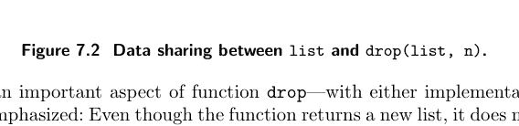

*图 7.2 列表与 `drop(list, n)` 之间的数据共享。*

函数 `drop` 有一个重要方面需要强调——无论采用哪种实现：尽管该函数返回一个新列表，但它不会在内存中分配任何新的列表数据。返回的列表与参数列表共享其所有存储（图 7.2）。鉴于该函数是尾递归的且不创建新数据，它将被编译成一个循环，该循环沿着链表移动指针 n 次，直到到达所需位置。因此，你可以使用 `drop` 作为实现 `getAt` 函数的基础，该函数获取指定索引处的元素：


```
def getAt[A](list: List[A], i: Int): A = drop(list, i) match
  case Nil        => throw NoSuchElementException("getAt(empty)")
  case value :: _ => value
```

清单 7.7：在列表上使用 drop 实现 getAt。

在移除 i 个元素之后，剩余列表的头部（如果存在）即为原列表中位置 i 处的元素（索引从 0 开始）。

你需要避免的一个常见错误是，把列表当作支持快速索引的数组来使用。² 请始终记住，访问函数式列表中第 i 个元素所需的时间与 i 成正比，这一点从清单 7.6 和 7.7 中 drop 与 getAt 的实现可以清晰看出。

#### 7.4 从执行栈构建列表

你可以将 drop 视为 tail 函数的一种推广：drop(list, 1) 与 tail(list) 几乎是³相同的事情。函数 head 可以类似地推广为一个名为 take 的函数，它提取列表的前 n 个元素。函数 take 基于一个与 drop 类似的等式。也就是说，要从列表中取出前 n 个元素，先取列表的头部，再取尾部的 n − 1 个元素：

```
take(list, n) = head(list) :: take(tail(list), n - 1)
```

相应的代码很直接：

```
def take[A](list: List[A], n: Int): List[A] = (list, n) match
  case (_, 0) | (Nil, _) => Nil
  case (head :: tail, _) => head :: take(tail, n - 1)
```

清单 7.8：take 的递归实现；可与清单 7.21 至 7.23 对比。

函数 take 和 drop 的一个关键区别是：对于 drop，输入和输出列表可以在内存中共享数据；但函数 take 需要分配新列表来存储被提取的元素（图 7.3）。还要注意，与 drop 不同，

²这一点在 Scala 中尤其需要注意，因为 Scala 使用了具有诱惑性的语法 list(i) 和 array(i) 来访问列表或数组的第 i 个元素。

³唯一的区别是，根据我选择的语义，drop(Nil, 1) 是空列表，而 tail(Nil) 会抛出异常。

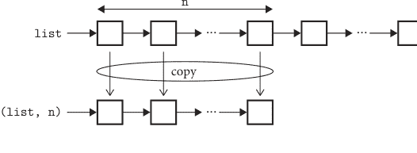

## 图 7.3 列表与 take(list, n) 之间的数据复制。

函数 take 不是尾递归的。它的工作方式是将输入列表的前 n 个元素压入执行栈，然后在函数调用返回时根据这些元素构建列表。

### 注意

第 7.9 节将简要讨论有限度地使用执行栈构建列表，并讨论函数 take 可能的可扩展实现。然而，本书中的许多代码示例仍然像清单 7.8 那样使用执行栈构建列表。我采用这种方式是为了避免不必要的干扰，让代码示例聚焦于当前的概念。在本节中，重点在于递归算法核心的等式，我愿意牺牲库级别的性能和健壮性，以使代码更直接地对应相应的等式。例如在 take 的实现中，代码 head :: take(tail, n - 1) 与等式 head(list) :: take(tail(list), n - 1) 几乎完全一致。在本书的语境下，不值得为了提高代码性能而失去这种清晰性。

#### 7.5 多个/嵌套列表上的递归

让我们继续用几个涉及多个列表（包括嵌套在列表中的列表）的递归函数示例来说明递归。

首先考虑一个 concat 函数，它连接两个列表（这个功能在标准 Scala 库中作为“:::”方法提供）：

```
val abc = List(A, B, C)
concat(abc, abc) // List(A, B, C, A, B, C); 标准 Scala 中为 abc ::: abc
```

## 第 7 章 列表上的递归

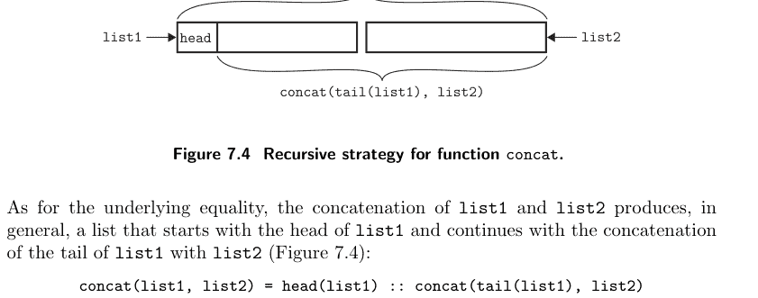

至于底层等式，list1 和 list2 的连接通常会产生一个列表，它以 list1 的头部开始，并以 list1 的尾部与 list2 的连接继续（图 7.4）：

concat(list1, list2) = head(list1) :: concat(tail(list1), list2)

为了使这个等式成立，第一个列表需要有头部和尾部（第二个列表可以为空）。你通过观察“空列表与另一个列表的连接就是另一个列表本身”来处理第一个列表为空的特殊情况。

```
def concat[A](list1: List[A], list2: List[A]): List[A] = list1 match
  case Nil => list2
  case head1 :: tail1 => head1 :: concat(tail1, list2)
```

清单 7.9：列表连接的递归实现。

注意递归只发生在第一个列表上：第二个列表在递归调用中保持不变。这意味着调用 concat 的计算时间与第一个列表的长度成正比，而与第二个列表的大小无关。特别是，你可以通过连接一个单元素列表来在列表末尾追加元素，但这需要的时间与列表长度成正比。第二个列表很短并不会带来任何帮助：

```
def append[A](list: List[A], value: A): List[A] = concat(list, List(value))
```

清单 7.10：使用连接在列表末尾追加元素。

这与在列表前追加元素形成对比：通过一次“::”调用即可在常数时间内完成。这种差异极大地影响了你应当如何实现基于函数式列表的算法。良好的性能依赖于通过前追加而非后追加来构建列表。特别是，永远不要将列表用作先进先出队列。

列表的元素本身可以是列表。通过重复连接可以将列表的列表展平：

```
flatten(List(List(1, 2, 3), Nil, List(4, 5), List(6))) // List(1, 2, 3, 4, 5, 6)
List(1, 2, 3) ::: Nil ::: List(4, 5) ::: List(6)      // List(1, 2, 3, 4, 5, 6)
```

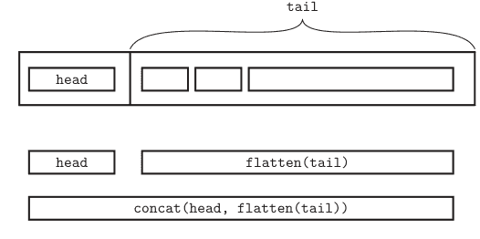

## 图 7.5 函数 flatten 的递归策略。

函数 flatten 返回的列表以第一个内部列表的元素开始，并通过与展平尾部的结果连接而继续（图 7.5）：

```
flatten(list) = concat(head(list), flatten(tail(list))
```

实际实现模仿这个等式，只对空列表进行特殊处理：

```
def flatten[A](list: List[List[A]]): List[A] = list match
  case Nil          => Nil
  case head :: tail => concat(head, flatten(tail))
```

# 清单 7.11：列表展平的递归实现。

注意函数的签名是从 List[List[A]] 到 List[A]，因为它只对嵌套列表有意义。

作为本节最后一个示例，让我们实现函数 zip，它同时遍历两个列表以构建一个由对组成的列表：

```
zip(List(A, B, C), List(1, 2, 3)) // List((A,1), (B,2), (C,3))
```

直观想法很简单：

```
zip(list1, list2) = (head(list1), head(list2)) :: zip(tail(list1), tail(list2))
```

这个等式假设两个列表都不为空，因此需要将空列表作为特殊情况进行处理：

```
Scala
def zip[A, B](list1: List[A], list2: List[B]): List[(A, B)] = (list1, list2) match
  case (Nil, _) | (_, Nil)          => Nil
  case (head1 :: tail1, head2 :: tail2) => (head1, head2) :: zip(tail1, tail2)
```

清单 7.12：列表 zip 的递归实现。

函数 zip 由两个类型 A 和 B 参数化，以允许两种不同类型的列表元素。与 concat 不同，函数 zip 同时深入两个列表。只要其中一个列表为空，它就停止。因此，如果两个列表长度不等，较长列表中的剩余元素不会包含在输出中。

#### 7.6 在尾部之外的其他子列表上的递归

关于列表的递归函数需要更小的列表来应用递归。到目前为止，本章中的较小列表都是一个或多个输入列表的尾部。虽然这是一种非常常见的模式，但你也可以使用不是列表尾部的子列表来递归处理列表。

作为示例，考虑对列表元素进行分组的问题。给定一个列表和一个正数 k，目标是生成一个由 k 个元素组成的列表的列表：

```
Scala
group(List(A, B, C, D, E), 2) // List(List(A,B), List(C,D), List(E))
```

所有内部列表的长度都是 k，除了最后一个可能包含少于 k 个元素。相应的递归等式基于以下思想。首先，使用函数 take 取出主列表的前 k 个元素——它们形成第一个内部列表。然后使用函数 drop 从主列表中移除这些前 k 个元素，并递归处理剩余元素：

```
group(list, k) = take(list, k) :: group(drop(list, k), k)
```

函数 group、take 和 drop 在空列表上都定义良好，因此不需要考虑特殊情况：


#### 7.7 反向构建列表

如在讨论函数 append 时提到的那样，向列表追加元素所需的时间与列表长度成正比，而 prepend 则是常数时间操作。如果你想避免编写性能极差的基于列表的代码，就必须牢记这一点。

考虑列表反转的情况。要递归实现该函数，你可能会想先递归反转列表的尾部，然后将列表的头部追加到反转后的尾部末尾：

```
reverse(list) = append(reverse(tail(list)), head(list))
```

虽然这个等式在非空列表上确实成立，但使用它会导致不可接受的 reverse 函数：

```
Scala
// DON'T DO THIS!
def reverse[A](list: List[A]): List[A] = list match
  case Nil          => list
  case head :: tail => append(reverse(tail), head)
```

尽管该函数能正确生成反序列表，但它存在两个主要缺陷。首先，它不是尾递归，应用于大型列表时会耗尽栈空间。其次，更重要的是，即使对于能放入执行栈的列表，其性能也不令人满意。

如果被反转的列表包含 n 个元素，则 reverse(tail) 的长度为 n − 1，append 的求值需要 n − 1 次操作。但在 reverse(tail) 的计算中，又会有一个对长度为 n − 2 的列表的 append 调用；在下一个嵌套计算中，又有一个对长度为 n − 3 的列表的 append 调用；以此类推。总共需要 (n − 1) + (n − 2) + ⋯ + 1 = (n × (n − 1))/2 次操作。因此，该 reverse 函数的计算时间与被反转列表长度的平方成正比。

为避免这种情况，引入第二个列表参数：

```
Scala
def reverse[A](list: List[A]): List[A] =
  @tailrec
  def addToStack(rem: List[A], rev: List[A]): List[A] = rem match
    case Nil          => rev
    case top :: bottom => addToStack(bottom, top :: rev)

  addToStack(list, Nil)

Listing 7.15: Linear, tail recursive implementation of list reversal.
```

该函数通过反复将待反转列表的头部添加到累加器列表 `rev` 的前面来工作。你可以把它想象成从一副牌中剥离卡片并放到桌上：最终，得到的牌堆是原始牌堆的反转。

与之前的尝试不同，此实现仅直接使用 “::” 来构建结果列表，并且复杂度为线性。作为在排版本书时使用的桌面计算机上的一个简单实验，使用第一个实现反转包含 5000 个数字的列表大约需要 75 毫秒。使用改进版本时，该时间降至 0.027 毫秒，减少了超过 1/2000。顺便说一下，此实现也已变为尾递归，可以处理任意长度的列表。

可能存在你想通过追加来构建列表的情况，因为 prepend 不会产生正确的顺序。不要这样做。相反，以高效的方式按错误顺序构建列表，然后再反转它。例如，要从字符流中提取以空格分隔的标记，使用 append 将字符添加到当前标记，然后再次使用 append 将标记添加到标记列表，似乎很自然。相反，你可以使用 prepend 和反转的组合：

```
```scala
def tokenize(stream: List[Char]): List[String] =
  def addToken(token: List[Char], tokens: List[String]): List[String] =
    if isEmpty(token) then tokens else reverse(token).mkString :: tokens

  @tailrec
  def loop(stream: List[Char], token: List[Char], tokens: List[String]): List[String]=
    stream match
      case w :: chars if w.isWhitespace => loop(chars, Nil, addToken(token, tokens))
      case c :: chars                  => loop(chars, c :: token, tokens)
      case Nil                          => addToken(token, tokens)

  reverse(loop(stream, Nil, Nil))
```
```

字符在函数 `loop` 中一次处理一个。非空白字符 (c) 被添加到当前标记中，计算递归进行。遇到空白字符 (w) 时，当前标记被添加到标记列表中，并开始一个新的标记 (Nil)。最后一个标记不一定后面跟着空白，在最后被添加。

注意字符是如何使用常数时间操作 “::” 添加到标记中的。因此，标记是以反向顺序构建的。在函数 addToken 中，每个标记在被添加到列表时被反转一次。(该函数跳过空标记，并使用标准方法 `mkString` 将字符列表转换为字符串。) 同样，标记也是使用 “::” 添加到标记列表中，并在最后反转列表。由于反转已以线性时间实现，整个标记化时间与标记的长度和数量成正比。

#### 7.8 插图：排序

### NOTE

高效排序通常不是直接在列表上执行。相反，列表值可以存储在临时数组中，对数组进行排序，然后重建列表。此外，实用的排序函数应由排序元素的类型和用于排序它们的标准参数化。本节关注对整数列表的直接排序，因为它提供了递归模式的良好示例。由此产生的函数存在局限性和低效率，在生产代码中可能不可接受。

考虑将整数列表按递增顺序排序的问题。你可以将非空列表分解为头部和尾部，并对尾部应用递归。然后你剩下单个值 (头部) 和一个已排序的列表 (已排序的尾部)。完成排序函数所需的一切就是将此值插入到已排序列表的正确位置。这种策略导致了一种插入排序形式：

```
def insertInSorted(x: Int, sorted: List[Int]): List[Int] = sorted match
  case Nil => List(x)
  case min :: others =>
    if x < min then x :: sorted else min :: insertInSorted(x, others)

def insertSort(list: List[Int]): List[Int] = list match
  case Nil => list
  case h :: t => insertInSorted(h, insertSort(t))
```

Listing 7.17: Insertion sort.

排序函数使用函数 insertInSorted 将列表的头部插入到其已排序的尾部中。在此辅助函数中，你通过创建一个单元素列表 List(x) 将元素 x 插入到空列表中。否则，x 与已排序列表的头部 min 进行比较，min 是其最小元素。如果 x 小于最小值，则它也小于所有其他值，因此属于列表的最前面。否则，列表中的最小值仍然是 min，你需要在列表的尾部插入 x，这通过递归调用实现。

众所周知，插入排序的性能较差——计算时间与列表长度的平方成正比——并且已经设计出更好的策略，基于将列表拆分为两半而不是头部和尾部。你可能熟悉这种模式的两个经典变体：

- *Merge-sort*: 将列表在中间拆分，递归排序两半，然后将两个已排序的列表合并为一个。
- • Quick-sort: 将列表拆分为低值和高值，递归排序两部分，然后将两个已排序的列表连接成一个。

Merge-sort 使用简单的策略将列表拆分为两部分，但在排序后合并列表的工作更多。Quick-sort 依赖于更复杂的拆分策略，但一旦排序，列表只需要连接。

```
def merge(sortedA: List[Int], sortedB: List[Int]): List[Int] = (sortedA, sortedB) match
case (Nil, _) => sortedB
case (_, Nil) => sortedA
case (hA :: tA, hB :: tB) =>
if hA <= hB then hA :: merge(tA, sortedB) else hB :: merge(sortedA, tB)
```

合并已排序列表从两个模式开始处理空列表——将列表与空列表合并会得到列表本身。最后一个模式然后比较两个非空列表的头部。较小的一个需要在合并列表中先出现。一旦选择了该值，两个列表的其余部分将递归合并。合并函数以这种方式编写后，你通过使用函数 length 和 splitAt 将列表在中间拆分来实现 merge-sort。

一个容易犯的错误是在 mergeSort 中的第一个模式中忘记 case List(_)。如前所述，在讨论 Listing 6.5 时，这会导致一个不终止的函数。作为变体，你可以对列表的长度进行模式匹配，该长度是拆分所需的，并按如下方式编写 merge-sort 函数：

```
def mergeSort(list: List[Int]): List[Int] = length(list) match
case 0 | 1 => list
case len =>
val (left, right) = splitAt(list, len / 2)
merge(mergeSort(left), mergeSort(right))
```

再次，不要忘记对太短而无法拆分的列表的 case 1。

要实现 quick-sort，你需要将列表拆分为低值和高值。这通常通过选择一个值，称为 pivot，并将列表拆分为值


#### 7.9 高效构建列表

```scala
def takeAndAdd(list: List[A], n: Int, added: List[A]): List[A] = (list, n) match
  case (_, 0) | (Nil, _) => added
  case (head :: tail, _) => takeAndAdd(tail, n - 1, head :: added)

reverse(takeAndAdd(list, n, Nil))
```

清单 7.21：`take` 的尾递归实现；与清单 7.8 对比。

注意，出于性能原因，向累加器添加值时使用的是 `::` 而不是追加操作。因此，函数 `takeAndAdd` 会以相反的顺序累加元素，并且在返回之前会对累加得到的列表进行反转。

另一种在库中常用的方法是，在内部使用非函数式元素来实现纯函数。你可以使用一个中间的 `ListBuffer` 来实现 `take`，这是一个专为构建不可变列表而设计的可变累加器：

```scala
def take[A](list: List[A], n: Int): List[A] =
  @tailrec
  def takeAndAdd(list: List[A], n: Int, added: mutable.ListBuffer[A]): List[A] =
    (list, n) match
      case (_, 0) | (Nil, _) => added.result()
      case (head :: tail, _) => takeAndAdd(tail, n - 1, added += head)

  takeAndAdd(list, n, mutable.ListBuffer.empty[A])
```

清单 7.22：基于缓冲区的 `take` 实现；与清单 7.21 对比。

要向累加器中添加元素，可以通过 `+=` 方法改变列表缓冲区。构建完成后，使用 `result` 方法从可变缓冲区生成不可变列表，从而回到函数式编程的领域。由于缓冲区支持常数时间的追加操作，因此最后不需要反转。

最后，如果你的语言支持，你总是可以使用循环而不是递归来更新可变缓冲区：

```scala
def take[A](list: List[A], n: Int): List[A] =
  val added = mutable.ListBuffer.empty[A]
  val elems = list
  var rem = n
  while rem > 0 && elems.nonEmpty do
    added += head(elems)
    elems = tail(elems)
    rem -= 1
  added.result()
```

清单 7.23：基于循环的 `take` 实现；与清单 7.22 对比。

编译之后，函数 `take` 的后两个变体应该大致等效。虽然清单 7.22 和 7.23 是实现 `take` 的“正确”方式，但在本书第一部分中，我们将继续主要依靠 `::` 和不可变累加器（或执行栈）来构建列表。这样做是为了清晰起见。使用可变构建器（即使是隐藏的）也会不必要地混淆函数式编程概念的阐述。

#### 7.10 小结

- 每个递归函数的背后都有一个递归等式：给定问题的解 *等于* 对更小问题（递归求解）的解的组合。牢记这些等式有助于你正确设计递归算法。这种方法将注意力集中在期望值 *是什么* 上，而不是代码必须 *做什么* 来计算它，从而强调函数式编程的声明式一面。
- 递归等式通常只在输入数据的子集上有良好定义。不满足等式的值需要单独处理。它们通常会导致递归函数中出现一个或多个非递归分支。
- 函数式列表构成了一种递归数据结构：非空列表由一个头部值和一个后续列表（尾部）组成。因此，列表天然适合递归编程。许多操作都可以实现为对列表尾部进行递归调用的函数。也可以对除尾部之外的一个或多个子列表进行递归。
- 有些列表函数天然就是尾递归的。另一些则可能需要从它们的自然形式重写以实现尾递归。这种重写通常涉及将累加器作为函数的附加参数。在自然形式的递归函数的简洁性与尾递归变体的稳健性之间往往需要权衡。
- 需要构建列表的函数有时可以依赖执行栈来存储列表元素，直到列表构建完成。如果相反需要使用尾递归，那么累加器应该始终从前面构建列表，使用常数时间的头部添加操作。从另一端构建列表通常会导致代码在运行时呈二次复杂度。
- 如果由于从前面构建而导致列表是逆序构造的，可以在构造完成后将其反转。列表反转所需的时间与列表长度成正比。如果以正确顺序构建列表的代价是二次的，那么在最后额外进行一次反转通常是更好的选择。
- 在处理任意大小列表的代码中，可以使用可变缓冲区和/或可重新赋值的变量及循环来构建不可变列表。只要变更操作限制在局部变量内，这些函数仍然是纯函数。函数式代码库在内部依赖这类命令式结构并不少见。

### 第 8 章

#### 案例研究：二叉搜索树

有序映射可以实现为二叉搜索树。在本案例研究中，树是不可变的，通过构建新树来添加或移除值。树是递归的——树的子节点本身也是树——并且大多数树操作都是以递归方式实现的。二叉搜索树只有在充分平衡（高度不太深）时才是高效的。本案例研究将完善初始代码以实现 AVL 树，这是一种经典的自平衡策略。

#### 8.1 二叉搜索树

二叉搜索树是一种有根树，有时用于实现从键到值的映射。键值对存储在树的节点中。每个节点最多有两个子节点，即左子节点和右子节点，它们本身也是二叉树。

二叉搜索树假定键上存在全序关系，并维护一个不变性质：任意节点中的键大于其左子树中的所有键，且小于其右子树中的所有键。利用这一性质，你可以使用以下算法在树中搜索键 `k`：如果 `k` 等于根节点的键，则找到该键，并可检索相应的值；否则，如果 `k` 小于根节点的键，则在左子树（如果存在）中使用相同算法继续搜索；否则，`k` 大于根节点的键，则在右子树（如果存在）中使用相同算法继续搜索。

该算法天然是递归的：树搜索通过在子树内部递归搜索来进行。搜索要么在节点中找到相等的键时结束（成功），要么到达子节点缺失的位置时结束（失败）。许多其他树操作也是递归定义的，实现这些操作是对前几章讨论的递归模式的很好说明。

二叉搜索树中键查找的基本性质是，任意节点最多只会探索它的一个子节点。因此，搜索的最坏情况时间复杂度受限于树中最长分支的长度，即树的高度。如果树是良好平衡的，其高度不超过节点数的二进制对数。这意味着在包含 `n` 个键的平衡二叉搜索树中进行查找所需的时间与 log₂(n) 成正比。

图 8.1 描绘了一棵包含键 6、20、32、43、51、52、57、60、71、78 和 83 的二叉搜索树。与键关联的值被省略了。作为示例，要查找键 51，你需要将 51 与 57 比较，沿着左分支前进，将 51 与 43 比较，沿着右分支前进，然后找到包含键 51 的节点。查找键 79 时，则会依次与 57、71、83 和 78 比较，然后失败。

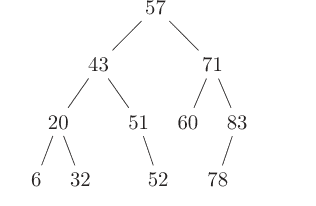

图 8.1 一棵二叉搜索树。

比较次数等于所经过分支的长度。

#### 8.2 整数集合作为二叉搜索树

将映射恰当地实现为二叉搜索树，需要定义一个树类型，该类型以键和值的类型以及键类型上的某种排序概念为参数。为了保持代码清晰，本案例研究不使用类型或排序参数化：键是整数，按它们的自然顺序进行比较。此外，所有相关算法和实现函数都围绕键而不是值展开——存储的值与递归讨论无关。因此，代码忽略值，只存储键，从而实现键的集合而不是从键到值的映射。

树可以像前面的示例那样实现，遵循清单 5.8 和 6.7 中的相同模式：

```scala
enum BinTree:
  case Empty
  case Node(key: Int, left: BinTree, right: BinTree)
```

`Empty` 表示空树；非空树由一个 `Node` 组成，其中包含一个键和两个子节点。缺失的子树用空树表示。给定此类型，你可以通过模式匹配来实现树函数。例如，`isEmpty` 函数可以写成如下形式：


#### 8.3 不带重平衡的实现

对象 `Empty` 的实现很直接：

```scala
case object Empty extends BinTree:
  def isEmpty = true
  def contains(k: Int) = false

  def size = 0
  def height = 0

  def min = throw new NoSuchElementException("Empty.min")
  def max = throw new NoSuchElementException("Empty.max")

  def +(k: Int): BinTree = Node(k, Empty, Empty)
  def -(k: Int): BinTree = this

  def toList = List.empty
```

清单 8.1：空二叉搜索树。

空树不包含任何内容。特别是，它没有最小值和最大值。它的大小和深度为零。方法“+”即插入，将一个键插入空树时，会创建一个包含该键的单个节点。方法“−”即删除，将空树保持不变。树是不可变的这一事实反映在方法“+”和“−”的签名中，它们会生成一棵新树。

由于特别使用了递归，类 `Node` 的实现更有趣：

```scala
case class Node(key: Int, left: BinTree, right: BinTree) extends BinTree:
  def isEmpty = false

  def size = 1 + left.size + right.size
  def height = 1 + (left.height max right.height)

  def min = if left.isEmpty then key else left.min
  def max = if right.isEmpty then key else right.max

  def contains(k: Int) =
    if k < key then left.contains(k)
    else if k > key then right.contains(k)
    else true
```

清单 8.2：二叉搜索树上的查询方法。

方法 `size` 的实现与清单 6.7 中的类似，只是它使用 `Empty` 和 `Node` 方法而不是函数。方法 `height` 几乎相同，但由于树的高度是其最长分支的长度，子树的高度使用 `max` 而不是“+”进行合并。要找到树中的最小值，只需沿着最左分支向下即可：如果树没有左子节点，其最小值就是其根；否则，它是左子节点的最小值。对最大值的查询是对称的。¹

¹在 Scala 中，无参数方法可以实现为字段：`def size = ...` 可以替换为 `val size = ...`。节点的内存占用会增加，但 size 将成为常数时间操作。`height`、`min` 或 `max` 也可能进行相同的内存/速度权衡。第 8.4 节中实现的自平衡树在高度计算上高度依赖，并且会从将 `height` 设为 `val` 而非 `def` 中受益。

方法 `contains` 遵循前面概述的搜索算法。如果搜索目标 `k` 小于节点键 `key`，则在左子节点中搜索它（它不可能在右子节点中）。如果目标较大，则在右子节点中搜索。如果它既不小于也不大于，则必须等于节点键，因此已找到。递归通过对左或右调用方法 `contains` 来实现。请注意，这些可以是节点（搜索继续）或空树（终止情况）。

下一个要实现的方法是“+”，用于将键插入树中：

```scala
def + (k: Int): Node =
  if k < key then Node(key, left + k, right)
  else if k > key then Node(key, left, right + k)
  else this
```

清单 8.3：二叉搜索树中的键插入。

此方法的结构与查找方法 `contains` 相似。如果要添加的键 k 小于节点的键，则需要在左子节点中添加它。调用 `left + k` 会生成一个已添加键 k 的新左子节点。此新树与未更改的现有右子节点组合，以构建一个新节点。将大于节点键的键插入的方式在右子节点上类似。如果要添加的键已存在，则树保持不变。

向树中添加键是一个函数式操作，不会修改任何树。它的输入是插入前的树——`Node(key, left, right)`——输出是插入后的新树——例如 `Node(key, left + k, right)`。请注意，旧树和新树在内存中共享数据：它们引用相同的右树。

事实上，在递归的每一层都共享一棵树，插入前后的树除了正在遍历的那个分支外，其余所有节点都共享。这是持久数据结构的一个基本属性，此前在第 3.7 节函数式列表的上下文中讨论过（参见图 3.1）。

如果你习惯使用可变类型，请注意一个常见的初学者错误：

```scala
// DON'T DO THIS!
def + (k: Int): Node =
    if k < key then
        left + k
        Node(key, left, right)
    else if k > key then
        right + k
        Node(key, left, right)
    else this
```

尝试像这样实现方法“+”表明了一种命令式编程思维，它假设 `left + k` 修改树 `left`。但 `left + k` 没有副作用。相反，它构建一棵新树，供在较大表达式中使用。在此错误变体中，新树被构建但未被使用。还要注意 `Node(key, left, right)` 与 `this` 相同，并且构造一个与现有节点相同的节点没有任何价值。

你可能已经意识到，树中键的删除往往比键的插入更棘手。困难在于，在移除树的根之后，必须通过某种方式合并左右子节点，同时保持键排序的基本属性：

```scala
def - (k: Int): BinTree =
    if k < key then Node(key, left - k, right)
    else if k > key then Node(key, left, right - k)
    else if left.isEmpty then right
    else if right.isEmpty then left
    else
        val (minRight, othersRight) = right.minRemoved
        Node(minRight, left, othersRight)

def minRemoved: (Int, BinTree) =
    if left.isEmpty then (key, right)
    else
        val (min, othersLeft) = left.minRemoved
        (min, Node(key, othersLeft, right))
```

清单 8.4：二叉搜索树中的键删除。

方法“−”与方法“+”类似，首先从左或右子节点中删除目标键 k。然而，在删除方法中，k == key 的情况在插入方法中是微不足道的，但在删除方法中更具挑战性。移除树的根后，你会剩下两个独立的子树。如果任一子节点为空，你可以简单地返回另一棵树，其中包含集合中的所有键。

复杂的情况是最后的 else：你正在移除一棵树的根，并且左右子节点都非空。在这种情况下，你需要从子节点中提取一个键，并将其用作新的根键。为了保持二叉搜索树的排序属性，一个常见的策略是关注右子节点的最小键（或者，替代地，左子节点的最大键）。右子节点的最小键大于左子节点中的所有键（所有右子节点键都大于）。它也小于右子节点中其他所有键。因此，你可以使用此键作为新根，并使用右子节点的剩余键创建新的右子节点。这样，新根大于左子节点中的所有键，小于新右子节点中的所有键。

提取此键是方法 `minRemoved` 的任务，它返回一个二元组：树的最小键和不含此键的树。要从图 8.1 中的示例树中删除键 57——根——你将 `minRemoved` 应用于右子节点。这会生成一个二元组 `(minRight, othersRight)`，其中 `minRight` 为 60，`othersRight` 为树：

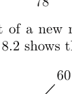

然后你使用 `minRight` 作为新节点根的根，其右子节点为 `othersRight`。左子节点保持不变。图 8.2 显示了 resulting 树。

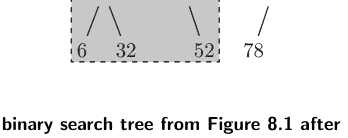

图 8.2 图 8.1 中的二叉搜索树在删除键 57 之后。

要实现方法 `minRemoved`，你使用与方法 `min` 类似的递归方法。不同之处在于 `min` 只返回最小值，而 `minRemoved` 还构建一个包含其他值的树。如果节点没有左子节点，则其根是


## 第8章 案例研究：二叉搜索树

树的最小键，其右子节点是删除该键后树剩余的部分。否则，树中的最小键是左子节点的最小键，就像之前一样。这个左子节点在删除最小键后成为节点的新左子节点。节点的关键和右子节点保持不变。

如果需要，你可以构建树中所有键的列表。由于二叉搜索树的键排序特性，中序遍历——左子节点，然后根，然后右子节点——会产生一个有序的键列表。一种朴素的实现很简单：

```
```scala
// DON'T DO THIS!

// in object Empty:
def toList = List.empty

// in class Node:
def toList = left.toList ::: key :: right.toList
```
```

尽管这种方法确实能产生正确的列表，但其性能因使用了列表连接操作符“:::”而受损，该操作符花费的时间与第一个操作数的长度成正比（参见第7.9节中函数 concat 的讨论）。请记住，由于方法 toList 的递归性质，这不是一次性成本：连接操作符在调用 left.toList 和 right.toList 中使用，并在这些调用中的递归调用中再次使用，依此类推。为了避免这种低效，你可以在累加器参数中构建列表：

```
```scala
// in class BinTree:
def toList: List[Int] = makeList(List.empty)
def makeList(list: List[Int]): List[Int]

// in object Empty:
def makeList(list: List[Int]) = list

// in class Node:
def makeList(list: List[Int]) = left.makeList(key :: right.makeList(list))
```
```

### 列表 8.5：从二叉搜索树到有序列表的转换。

添加了一个带有累加器列表的辅助方法 makeList。在不包含键的对象 Empty 中，累加器列表保持不变返回。在类 Node 中，递归调用 right.makeList(list) 将右子节点的所有键添加到列表中。然后，使用“::”添加节点的根。最后，另一个对 left.makeList 的递归调用添加左子节点的所有键。注意所有键都是使用“::”添加到列表中的，而“:::”从未被使用。

当我们在第7.9节中早些时候使用这种技术时，它导致列表以相反的顺序构建，并且在构建后需要一次反转。在二叉搜索树的情况下，你通过从右到左遍历树来避免最后的反转。这样，较大的键先被添加，其次是较小的键。

由于键始终添加到列表的前面，你最终得到一个按递增顺序排列的列表，正如所期望的那样。

最后，你可以为用户提供一个树构建函数。（请记住，在实际实现中，Node 和 Empty 不会是公共的。）伴生对象定义了方法 apply 和 fromSet 来直接从一组键构建树：

```
```scala
object BinTree:
  def empty: BinTree = Empty
  def fromSet(keys: Set[Int]): BinTree =
    def makeTree(list: List[Int]): BinTree =
      if list.isEmpty then Empty
      else
        val (left, mid :: right) = list.splitAt(list.length / 2)
        Node(mid, makeTree(left), makeTree(right))
    makeTree(keys.toList.sorted)
  end fromSet
  def apply(keys: Int*): BinTree = fromSet(keys.toSet)
```
```

列表 8.6。集合转换为平衡二叉搜索树，在 Lis. 8.12 中改进

函数 fromSet 首先将键排序为一个列表。列表的中间值用作树的根键。两个子节点递归构建。中间键左侧的值构成左子节点，中间键右侧的值构成右子节点。由于列表已排序，结果树满足二叉搜索树的键排序特性。此外，由于左右列表的长度最多相差一个，你最终得到一棵良好平衡的树。为方便起见，添加了带有可变长度参数的函数 apply，因此可以直接从枚举的键构建树，如 BinTree(4,5,1,3,2)。

列表 8.6 中的函数 fromSet 构建的二叉搜索树是良好平衡的。然而，一旦你开始对现有树应用方法“+”和“-”，新产生的树可能会变得不平衡。作为极端情况的一个例子，考虑 fromSet 的这种替代实现：

```
```scala
// DON'T DO THIS
def fromSet(keys: Set[Int]): BinTree =
  var set = empty
  for key <- keys do set += key // i.e., set = set + key
  set
```
```

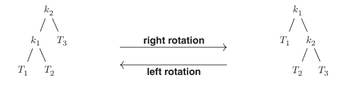

### 图 8.3 树旋转。

右子节点。右到左旋转具有相反的效果。模式匹配使得在 Node 类中实现树旋转变得简单：

```
def rotateRight: Node = left match
  case Node(keyL, leftL, rightL) => Node(keyL, leftL, Node(key, rightL, right))

def rotateLeft: Node = right match
  case Node(keyR, leftR, rightR) => Node(keyR, Node(key, left, leftR), rightR)
```

在 rotateRight 中，图 8.3 中的 k₁、k₂、T₁、T₂ 和 T₃ 分别是 keyL、key、leftL、rightL 和 right。空树没有模式，因为它们永远不需要旋转。

接下来，你引入一个方法 imbalance 来检测不平衡的树：

// in object Empty:
def imbalance = 0

// in class Node:
def imbalance = right.height - left.height
```

在平衡树上，此方法返回一个介于 -1 和 1 之间（包含）的数值。当添加或删除一个键时，树的失衡可能达到 -2 或 2。例如，图 8.1 中的节点 71 的失衡为 1。删除键 60 后，失衡变为 2，这表明树需要重新平衡。当树失衡为 2 时，你需要考虑两种情况：

- 右子节点是完全平衡的或“右重”的（其自身失衡为 1）。在这种情况下，单次右到左旋转足以重新平衡树：

## 第8章 案例研究：二叉搜索树

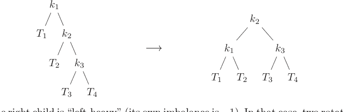

右子节点是“左重”的（其自身失衡为 -1）。在这种情况下，需要两次旋转：首先对右子节点进行左到右旋转，以回到前一种情况，然后像之前一样进行右到左旋转：

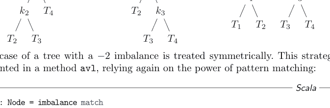

失衡为 -2 的树的情形是对称处理的。这种策略在方法 avl 中实现，再次依赖于模式匹配的强大功能：

```
```scala
def avl: Node = imbalance match
  case -2 => left.imbalance match
    case 0 | -1 => rotateRight
    case 1 => Node(key, left.rotateLeft, right.rotateRight)
  case 2 => right.imbalance match
    case 0 | 1 => rotateLeft
    case -1 => Node(key, left, right.rotateRight).rotateLeft
  case 0 | 1 | -1 => this
```
```

> **列表 8.8：** 通过旋转重新平衡二叉搜索树。

有了平衡方法 avl 实现后，插入方法稍作修改以始终产生平衡树：

```
def + (k: Int): Node =
  if k < key then Node(key, left + k, right).avl
  else if k > key then Node(key, left, right + k).avl
  else this
```

### 列表 8.9：自平衡二叉搜索树中的键插入。

与之前相比的唯一变化是，每次构造新节点时你都会应用方法 avl。子树 left + k 和 right + k 使用相同的“+”方法递归构建，因此保证是平衡的。

删除也类似地修改以确保所有新树都是平衡的。这需要更改“−”和 minRemoved 两个方法：

```
def - (k: Int): BinTree =
  if k < key then Node(key, left - k, right).avl
  else if k > key then Node(key, left, right - k).avl
  else if left.isEmpty then right
  else if right.isEmpty then left
  else
    val (minRight, othersRight) = right.minRemoved
    Node(minRight, left, othersRight).avl

def minRemoved: (Int, BinTree) =
  if left.isEmpty then (key, right)
  else
    val (min, othersLeft) = left.minRemoved
    (min, Node(key, othersLeft, right).avl)
```

### 列表 8.10：自平衡二叉搜索树中的键删除；另见 Lis. 8.11。

请注意，从右子节点中删除一个值最多会使其高度减少一个。换句话说，othersRight.height 等于 right.height 或 right.height - 1。因此，如果 right.height 至少等于 left.height，则 left 的高度和 othersRight 的高度最多相差一个。因此，在这种情况下，Node(minRight, left, othersRight) 必然是平衡的，对方法 avl 的调用是不必要的。相反，如果 left.height 至少等于 right.height，你


#### 8.5 小结

二叉树构成了一种典型的递归结构，可以在其上演示递归编程。许多操作（例如查找和插入）都是通过将同一操作应用于子树来实现的。函数式树由一个终止情形（空树 Empty）和一个构造器 Node 定义，Node 从两个子节点和根的内容创建一棵新树。这让人想起函数式列表，它们由空列表 Nil 和 cons 运算符 “::” 构建。

根本区别在于，树节点可以有两个子节点，而非空列表只有一个尾部。

在支持模式匹配的语言中，可以通过将空树视为特殊情况，并将非空树解构为节点值和两个子节点来处理树，就像将非空列表分解为头部和尾部一样。虽然树操作可以完全通过使用模式匹配的函数来实现，但在混合语言中，通常更倾向于函数式面向对象风格。

函数式树不能被修改，插入和删除操作会产生新树。然而，在插入或删除前后的树之间可以共享许多子树。这再次让人想起在列表上下文中已经讨论过的数据共享。

某些树操作（如删除）比相应的列表操作更复杂。移除列表的头部后，剩下的尾部本身就是一个列表；而移除树的根后，剩余的子节点并不构成一棵树，需要以某种方式合并。

二叉搜索树通过维护键排序属性来扩展二叉树，从而加速查找。这一属性需要由所有树操作保持，包括在移除树根后合并子节点。

二叉搜索树只有在树良好平衡的情况下才能提供高效查找。虽然可以轻松地从列表构建平衡树，但后续的插入和删除可能导致树不平衡。人们已经设计出在每次插入和删除后仍保持平衡的树算法。作为示例，本案例研究将基本的二叉搜索树扩展为自平衡的 AVL 树。重新平衡操作的实现严重依赖递归和模式匹配。

### 第 9 章 高阶函数

对于以函数为中心的编程范式来说，将函数视为一等公民是很自然的。在函数式编程中，函数是值，可以存储在变量中并作为参数传递。消费或产生其他函数的函数被称为高阶函数。使用高阶函数，可以用其他计算以强大的方式对计算进行参数化。

#### 9.1 函数作为值

前面的章节展示了如何将从不可变值到不可变值的纯函数用作编程构建块，以及如何通过组合函数（包括通过递归将函数与自身组合）来实现复杂计算。尽管纯函数、不可变性和递归是基本概念，但许多人认为函数式编程风格的显著特征是使用函数作为值。

为了帮助说明函数作为值的好处，请看第一个例子。假设你需要在列表中搜索一个值。你可以在递归函数中实现这种查找，类似于第 7 章的 contains 函数：

```scala
def find[A](list: List[A], target: A): Option[A] = list match
  case Nil => None
  case h :: t => if h == target then Some(h) else find(t, target)
```

清单 9.1：针对特定目标的列表查找。

该函数检查非空列表的头部是否等于目标，如果不是，则继续在列表的尾部搜索。它返回一个 Option，以处理未找到目标值的情况。你可以使用 find 在列表中查找特定值，例如温度列表：

```scala
val temps = List(88, 91, 78, 69, 100, 98, 70)
find(temps, 78) // Some(78)
find(temps, 79) // None
```

你可以使用这个新函数 `find` 在温度列表中查找大于 90 的值，方法是首先将“大于 90”的搜索标准定义为一个函数：

```scala
def greaterThan90(x: Int): Boolean = x > 90
find(temps, greaterThan90) // Some(91)
```

在最后一个表达式中，你并没有在整数参数上调用函数 `greaterThan90`。相反，你将函数本身作为参数传递给 `find`。要查找标识为 12345 的项目，只需定义一个不同的搜索标准：

```scala
def hasID12345(project: Project): Boolean = project.id == 12345L
find(projects, hasID12345) // project with identity 12345
```

由于 `find` 将函数作为参数，因此它被称为*高阶函数*。函数式编程库定义了许多标准高阶函数，其中一些将在第 10 章讨论。特别是，Scala 的 `List` 类型上已经定义了 `find` 方法。前面示例中的两次搜索可以写成如下形式：

```scala
temps.find(greaterThan90)
projects.find(hasID12345)
```

从现在开始，本章中的代码示例使用标准方法 `find` 而不是前面用户自定义的函数。

方法 `find` 是一个高阶函数，因为它将另一个函数作为参数。函数也可以通过返回一个函数值而成为高阶函数。例如，无需实现 `greaterThan90`，你可以定义一个函数来构建搜索标准，以查找大于给定界限的温度：

```scala
def greaterThan(bound: Int): Int => Boolean =
  def greaterThanBound(x: Int): Boolean = x > bound
  greaterThanBound
```

清单 9.3：返回函数的函数示例；另见清单 9.4 和 9.5。

函数 `greaterThan` 的工作方式是先定义一个函数 `greaterThanBound`。这个函数不会被应用于任何东西，而是直接作为值返回。请注意，`greaterThan` 的返回类型是 `Int => Boolean`，表示从整数到布尔值的函数。给定下界 b，表达式 `greaterThan(b)` 是一个函数，它测试某个整数是否大于 b。它可以用作高阶方法 `find` 的参数：

```scala
temps.find(greaterThan(90))
temps.find(greaterThan(80))
```

以类似的方式，你可以定义一个函数来为项目生成搜索标准：

```scala
def hasID(identity: Long): Project => Boolean =
  def hasGivenID(project: Project): Boolean = project.id == identity
  hasGivenID
projects.find(hasID(12345L))
projects.find(hasID(54321L))
```

返回其他函数的函数在函数式编程中很常见，许多语言为它们定义了更方便的语法：

```scala
def greaterThan(bound: Int)(x: Int): Boolean = x > bound
def hasID(identity: Long)(project: Project): Boolean = project.id == identity
```

清单 9.4 通过柯里化定义的高阶函数示例。

看起来 greaterThan 好像是接受两个参数 bound 和 x 的函数，但实际上不是。它是接受单个参数 bound 的函数，并像之前一样返回一个类型为 Int => Boolean 的函数；x 实际上是所返回函数的一个参数。

以这种方式编写的函数被称为柯里化函数。1 柯里化函数接受其第一个参数列表，返回另一个使用下一个参数列表的函数，依此类推。你可以将 greaterThan 的定义理解为：实现一个接受整数参数 bound 并返回另一个函数的函数，该返回函数接受整数参数 x 并返回布尔值 x > bound。换句话说，greaterThan 的返回值是将 x 映射到 x > bound 的函数。

> 1这个概念以逻辑学家哈斯凯尔·柯里（Haskell Curry）的名字命名，curried 和 currying 这两个词有时会大写。


languages like Haskell and ML. For instance, we tend to think of addition as a function of two arguments:

```
def plus(x: Int, y: Int): Int = x + y // a function of type (Int, Int) => Int
plus(5, 3) // 8
```

However, you can also think of it as a single-argument (higher-order) function:

```
def plus(x: Int)(y: Int): Int = x + y // a function of type Int => (Int => Int)
plus(5) // a function of type Int => Int
plus(5)(3) // 8
```

Curried functions are so common in functional programming that the => that represents function types is typically assumed to be right-associative: Int => (Int => Int) is simply written Int => Int => Int. For example, the function

```
def lengthBetween(low: Int)(high: Int)(str: String): Boolean =
  str.length >= low && str.length <= high
```

has type Int => Int => String => Boolean. You can use it to produce a Boolean, as in

```
lengthBetween(1)(5)("foo") // true
```

but also to produce other functions:

```
val lengthBetween1AndBound: Int => String => Boolean = lengthBetween(1)
val lengthBetween1and5: String => Boolean = lengthBetween(1)(5)

lengthBetween1AndBound(5)("foo") // true
lengthBetween1and5("foo") // true
```

Before closing this section on currying, we should consider a feature that is particular to Scala (although other languages use slightly different tricks for the same purpose).

In Scala, you can call a single-argument function on an expression delimited by curly braces without the need for additional parentheses. So, instead of writing

```
println({
  val two = 2
  two + two
}) // prints 4
```

you can simply write:

```
println {
  val two = 2
  two + two
} // prints 4
```

To use this syntax when multiple arguments are involved, you can rely on currying to adapt a multi-argument function into a single-argument function. For instance, the curried variant of function plus can be invoked as follows:

```
plus(5) {
  val two = 2
  two + 1
}
```

This is still value 8, as before.

Many functions and methods are curried in Scala for the sole purpose of benefiting from this syntax. The syntax is introduced here because we will encounter some example uses throughout the book, starting with the next section.

#### 9.3 Function Literals

It would be inconvenient if, to use higher-order functions like find, you always had to separately define (and name) argument functions like hasID12345 and greaterThan90. After all, when you call a function on a string or an integer, you don’t need to define (and name) the values first. This is because programming languages define a syntax for strings and integer literals, like the "foo" and 42 that are sprinkled throughout this book’s code illustrations. Similarly, functional programming languages, which rely heavily on higher-order functions, offer syntax for function literals, also called anonymous functions. The most common form of function literals is lambda expressions, which are often the first

thing that comes to mind when you hear that a language has support for functional programming.

In Scala, the syntax for lambda expressions is `(v1: T1, v2: T2, ...) => expr`. This defines a function with arguments v1, v2, … that returns the value produced by expr. For instance, the following expression is a function, of type `Int => Int`, that adds 1 to an integer:

```
```scala
(x: Int) => x + 1
```
```

Function literals can be used to simplify calls to higher-order functions like `find`:

```
```scala
temps.find((temp: Int) => temp > 90)
projects.find((proj: Project) => proj.id == 12345L)
```
```

The Boolean functions “to be greater than 90” and “to have identity 12345” are implemented as lambda expressions, which are passed directly as arguments to method `find`. You can also use function literals as return values of other functions. So, a third way to define functions `greaterThan` and `hasID`, besides using named local functions or currying, is as follows:

```
```scala
def greaterThan(bound: Int): Int => Boolean = (x: Int) => x > bound
def hasID(identity: Long): Project => Boolean = (p: Project) => p.id == identity
```
```

The expression `(x: Int) => x > bound` replaces the local function `greaterThanBound` from Listing 9.3.

Function literals have no name, and usually do not declare their return type. Compilers can sometimes infer the types of their arguments. You could omit argument types in all the examples written so far:

```
```scala
temps.find(temp => temp > 90)
projects.find(proj => proj.id == 12345L)

def greaterThan(bound: Int): Int => Boolean = x => x > bound
def hasID(identity: Long): Project => Boolean = p => p.id == identity
```
```

> Lambda expressions can also be parameterized by types, though this is a more advanced feature not used in this book. For instance, Listing 2.7 defines a function first of type `(A, A) => A`, parameterized by type A. It could be written as the lambda expression `[A] => (p: (A, A)) => p(0)`.

Today, many programming languages have a syntax for function literals. The Scala expression (temp: Int) => temp > 90 could be written in other languages as shown here:

| (int temp) -> temp > 90 | // Java |
| (int temp) => temp > 90 | // C# |
| [](int temp) { return temp > 90; } | // C++ |
| { temp: Int -> temp > 90 } | // Kotlin |
| fn temp: int => temp > 90 | // ML |
| fn temp -> temp > 90 end | // Elixir |
| function (temp) { return temp > 90 } | // JavaScript |
| temp => temp > 90 | // also JavaScript |
| lambda { |temp| temp > 90 } | // Ruby |
| -> temp { temp > 90 } | // also Ruby |
| (lambda (temp) (> temp 90)) | // Lisp |
| (fn [temp] (> temp 90)) | // Clojure |
| lambda temp: temp > 90 | // Python |

The argument (or arguments) of a lambda expression can be composite types. For example, assume you have a list of pairs (date, temperature), and you need to find a temperature greater than 90 in January, February, or March. You can use find with a lambda expression on pairs:

```
Scala
val datedTemps: List[(LocalDate, Int)] = ...
datedTemps.find(dt => dt(0).getMonthValue <= 3 && dt(1) > 90)
```

The test checks that the first element of a pair (a date) is in the first three months of the year, and that the second element of the pair (a temperature) is greater than 90.

Languages that support pattern matching often let you use it within a lambda expression. In the preceding example, you can use pattern matching to extract the date and temperature from a pair, instead of dt(0) and dt(1):

```
Scala
datedTemps.find((date, temp) => date.getMonthValue <= 3 && temp > 90)
```

This is a lot more readable than the variant that uses dt(0) and dt(1).

More complex patterns can be used. In Scala, a series of case patterns, enclosed in curly braces, also define an anonymous function. For instance, if a list contains temperatures with an optional date, and temperatures without a date are not eligible, you can search for a temperature greater than 90 in the first three months with the following code:³

³Here, I must admit that the Scala syntax can be confusing at first. As with code blocks, a call f({...}) can omit extraneous parentheses, and be written as f{...}. This example becomes clearer once you understand that it is a call to a higher-order method on a function literal defined with pattern matching and that a pair of unnecessary parentheses have been dropped.

```
```scala
val optionalDatedTemps: List[(Option[LocalDate], Int)] = ...

optionalDatedTemps.find {
  case (Some(date), temp) => date.getMonthValue <= 3 && temp > 90
  case _                  => false
}
```
```

#### 9.4 Functions Versus Methods

So far in this book, the words *function* and *method* have been used almost interchangeably. It is now time to discuss differences between the two. Methods are often defined as being functions associated with a target object: `x.m(y)`, which invokes method m on object x with argument y, is not much different from `f(x,y)`, which calls a function f on x and y. This way of differentiating methods from functions is premised on them being mechanisms used to encapsulate behaviors—blocks of code—which both methods and functions are.

However, the story somewhat changes once functions become values. A more meaningful difference between methods and functions in the context of this book is that functions are values in functional programming, while methods are not objects in object-oriented programming. In a hybrid language like Scala, functions are objects; methods are not. Instead of the function literal `(temp: Int) => temp > 90`, you could build a regular object explicitly. This object would implement the type `Function`:

```
```scala
object GreaterThan90 extends Function[Int, Boolean]:
  def apply(x: Int): Boolean = x > 90
```
```

The notation `Int => Boolean` is syntactic sugar for the type `Function[Int, Boolean]`. This type defines a method `apply`, which is invoked when the function is applied. The expression `temps.find(GreaterThan90)` could replace `temps.find(temp => temp > 90)` to perform the same computation.⁴ `GreaterThan90` is an object—which defines a function—not a method. In contrast,

```
```scala
def greaterThan90(x: Int): Boolean = x > 90
```
```

defines a method `greaterThan90`, not a function.

But then, the plot thickens. We *did* write `temps.find(greaterThan90)` earlier to search a list of temperatures, as if `greaterThan90` were an object, which it is not. This is possible because the language implements bridges between methods and functions. In

> ⁴ In JVM languages, anonymous functions are often compiled through a separate mechanism but, as a function, object `GreaterThan90` is conceptually equivalent to the earlier lambda expression.


在 2.5 节，我们讨论了扩展方法，这是一种使函数看起来像方法的机制。这里，我们需要的是相反方向的转换，以便把方法当作函数来使用。

这个概念的正式名称是 η-变换。在 λ-演算中，它表明 f 与 λx. f x 是等价的。更直白地说，你可以把它看作 greaterThan90 与 x => greaterThan90(x) 之间的等价。作为计算单元，两者执行相同的任务：判断一个整数是否大于 90。鉴于 find 的参数类型必须是 Int => Boolean，而 greaterThan90 是一个从 Int 到 Boolean 的方法，表达式 temps.find(greaterThan90) 的意图十分清晰，编译器能够插入必要的 η-变换。

其他语言也提供了类似的桥梁，支持从方法中创建函数，有时依赖更显式的语法。例如，在 Java 中，lambda 表达式 x -> target.method(x) 可以用方法引用 target::method 替换。Kotlin 使用类似的语法。

#### 9.5 单抽象方法接口

在混合语言中，函数是对象，lambda 表达式是创建这类对象的便捷方式。事实上，lambda 表达式的语法非常方便，许多语言允许你用它来创建函数以外类型的实例。

单抽象方法（SAM）接口是恰好包含一个抽象方法的接口。例如，在 Scala 中，类型 Function[A,B]（或者等价地，A => B）就是具有单个抽象方法 apply 的 SAM 接口。我们在代码示例中使用 lambda 表达式创建 Function[A,B] 的实例，但事实证明，所有 SAM 类型都可以使用 lambda 表达式实例化，即使是那些与 Function 无关的类型：

```
Scala
abstract class Formatter:
  def format(str: String): String
  def println(any: Any): Unit = Predef.println(format(any.toString))
```

类 Formatter 只定义了一个抽象方法 format，因此它是一个 SAM 接口。它可以用 lambda 表达式来实现：

```
Scala
val f: Formatter = str => str.toUpperCase
f.println(someValue)
```

注意，方法 println 是如何在被定义为 lambda 表达式的对象 f 上被调用的。这之所以可行，只是因为 f 被声明为 Formatter 类型；表达式 (str => str.toUpperCase).println("foo") 没有任何意义。

#### 9.6 部分应用

许多 Java 接口都可以用 lambda 实现，尽管它们早于 Java 的 lambda 表达式语法，并且与函数式编程关系不大：

```
val absComp: Comparator[Int] = (x, y) => x.abs.compareTo(y.abs)
val stream: IntStream = ...
val loggingStream: IntStream = stream.onClose(() => logger.info("closing stream"))
```

Comparator 是一个 Java 2 的 SAM 接口，带有一个抽象方法 compare。Stream 的 onClose 方法接受一个类型为 Runnable 的单一参数，Runnable 是 Java 1 的 SAM 接口，带有一个抽象方法 run。Comparator 和 Runnable 都可以用 lambda 表达式实现。

#### 9.6 部分应用

除了 lambda 表达式、柯里化和 η-变换之外，部分应用是另一种用于创建函数值的机制。在 Scala 中，它采用下划线占位的形式，用来代替表达式的一部分。这会生成一个函数，当该函数被应用时，会用其参数替换给定表达式中的下划线。例如，以下代码在一个摄氏温度列表中查找大于 90（华氏度）的温度：

```
celsiusTemps.find(temp => temp * 1.8 + 32 > 90)
```

你不需要使用 lambda 表达式，而是可以通过将表达式 temp * 1.8 + 32 > 90 中的 temp 替换为下划线来构建所需的函数参数：

```
celsiusTemps.find(_ * 1.8 + 32 > 90)
```

表达式 _ * 1.8 + 32 > 90 表示一个布尔函数，它将 temp 映射到 temp * 1.8 + 32 > 90，就像 lambda 表达式 temp => temp * 1.8 + 32 > 90 定义的函数一样。之前用 lambda 表达式编写的搜索可以改用部分应用：

```
temps.find(_ > 90)
projects.find(_ .id == 12345L)
```

通过在同一个表达式中使用多个下划线，部分应用被推广到多参数函数。例如，_ * 1.8 + 32 > _ 是一个双参数

迫使你为在 then 和 else 块内声明的变量选择不同的名称。

虽然通常每个代码块都定义自己的作用域，但并非所有语言都遵循这一规则。例如，JavaScript 和 Python 会为函数体引入新作用域，但不会为条件语句的 then 和 else 分支或循环体引入新作用域。当你习惯了更主流的作用域规则时，这可能会令人困惑。作为示例，请考虑以下 Python 程序：

```
```python
x = 1
def f():
  x = 2
  if x > 0:
    x = 3
    y = 4
  print(x)  # prints 3
  print(y)  # prints 4

f()
print(x)  # prints 1
print(y)  # error: name 'y' is not defined
```
```

函数 f 的函数体定义了自己的作用域，但 if 内部的代码块却没有。相反，x=3 是对在函数作用域中声明的变量 x（初始值为 2）的赋值，而 y=4 在同一个作用域中引入了变量 y。特别地，这个变量 y 在 if 语句之后仍然存在，其值为 4。函数 f 内部的 print(x) 语句打印函数作用域中变量 x 的值，即 3；而函数 f 外部的 print(x) 语句打印最外层作用域中变量 x 的值，即 1。最后的 print(y) 语句会触发错误，因为在函数作用域之外没有声明 y 变量。在 JavaScript 中行为也是如此。对比 Scala 中的情况：

```
```scala
var x = 1
def f() =
  var x = 2
  if x > 0 then
    var x = 3
    var y = 4
  println(x) // prints 2
  println(y) // rejected at compile-time
```
```

```
f()
println(x) // prints 1
println(y) // rejected at compile-time
```

大多数语言现在使用静态作用域，但在哪些编程语言结构会引入新作用域上存在差异。相比之下，动态作用域容易出错，已不那么流行。它曾被用于最初的 Lisp，并且在现代版本的该语言中仍然作为一个选项存在。它也被用于一些脚本语言，最著名的是 Perl 和各种 Bourne Shell 实现。

作为示例，这个 Scala 程序遵循静态作用域规则：

```
Scala
var x = 1

def f() =
  x += 1
  println(x) // prints 2

def g() =
  var x = 10
  f()

g()
println(x) // prints 2
```

函数 g 定义了一个局部变量 x，然后调用 f。然而，函数 f 内部使用的变量 x 是在程序第一行声明的那个，即函数 f 定义处作用域内的那个。函数 g 内部定义的同名局部变量不参与其中。等效的 Java、Kotlin、C 或任何其他使用静态作用域的语言编写的程序，行为也是一样的。

对比下面这个 Bash 实现：

```
Bash
x=1

f() {
```

```
(( x++ ))
printf "%d\n" $x # prints 11
}

g() {
  local x=10
  f
}

g
printf "%d\n" $x # prints 1
```

在 Bash 中，函数 f 内部使用的变量 x 不是 f 定义处作用域内的变量，而是函数 f 被调用处作用域内的变量。这个变量等于 10，被递增到 11。程序开头声明的变量 x 从未被修改。

动态作用域可用于用局部变量覆盖全局变量，从而改变函数的行为。这有时很有用，而在 Scala 中可以通过隐式参数实现类似的行为。例如，通过复用 9.5 节的 Formatter 类型，可以定义一个函数，使用作用域内的默认格式化器来打印对象：

```
Scala
def printFormatted(any: Any)(using formatter: Formatter): Unit =
  formatter.println(any)

printFormatted("foo") // uses the default formatter in scope (there must be one)
```

在函数内部——或任何引入自身作用域的代码块中——可以指定不同的格式化器：

```
Scala
given UpperCaseFormatter: Formatter = str => str.toUpperCase

printFormatted("foo") // prints "FOO"
```

这种技术带回了动态作用域的一些灵活性，但安全得多：函数 printFormatted 明确允许局部定义的格式化器影响其行为。

本书中的代码示例并不太依赖隐式参数，除了在第二部分偶尔使用。特别是，Scala 倾向于使用隐式参数来指定执行并发活动的线程池。


```
case None =>
  val y = f(x)
  store(x) = y
  y

g
```

## Listing 9.6: 使用闭包的记忆化；另见 Lis. 12.2.

函数 memo 是一个高阶函数。其参数 f 是一个类型为 A => B 的函数。其输出是另一个相同类型的函数 g。函数 g 在功能上等价于 f——它计算相同的内容——但会将每个计算出的值存储到一个映射中。当在某个输入 x 上调用时，函数 g 首先查找映射以查看值 f(x) 是否已被计算，如果是，则返回它。否则，f(x) 会使用函数 f 计算，并在返回前存储到映射中。你可以将 memo 应用于一个函数以生成该函数的记忆化版本：

```
val memoLength: String => Int = memo(str => str.length)

memoLength("foo") // invokes "foo".length and returns 3
memoLength("foo") // returns 3, without invoking method length
```

函数 memoLength 是一个从字符串到整数的函数，如 str => str.length。它计算字符串的长度并将其存储起来。第一次调用 memoLength("foo") 时，函数会在字符串 "foo" 上调用方法 length，将 3 存储起来并返回 3。如果再次调用 memoLength("foo")，值 3 会直接返回，而不会调用字符串的方法 length。另一次调用 memo(str => str.length) 将会创建一个具有自己的存储映射的新闭包。

闭包捕获的是词法环境。该环境包含函数参数、局部变量，以及如果有的话，外围类的字段：

```
def logging[A, B](name: String)(f: A => B): A => B =
  var count = 0
  val logger = Logger.getLogger("my.package")

  def g(x: A): B =
    count += 1
    logger.info(s"calling $name ($count) with $x")
    val y = f(x)
    logger.info(s"$name($x)=$y")
    y

g
```

## Listing 9.7: 函数在其闭包中写入的示例。

与其它形式的隐式引用（例如内部类）一样，你需要意识到闭包的存在，以避免因非预期共享而导致的棘手错误。当闭包捕获可变数据时尤其如此。始终如一地强调不可变性往往会产生更安全的代码。

#### 9.8 控制反转

你有时会看到高阶函数在更广泛的控制反转概念中被讨论。当使用高阶函数时，控制流从调用者转移到被调用者，后者将函数参数用作回调到调用者。

要搜索温度列表中大于 90 的值，你可以使用本章前面定义的递归函数 findGreaterThan90，或基于循环的等价实现：

```
Scala
def findGreaterThan90(list: List[Int]): Option[Int] =
  var rem = list
  while rem.nonEmpty do
    if rem.head > 90 then return Some(rem.head) else rem = rem.tail
  None
```

无论你使用递归还是循环，列表都会被查询其值（head 和 tail），但控制流仍保留在函数 findGreaterThan90 内部。如果改用表达式 temps.find(greaterThan90)，你就不再查询列表的值。函数 find 现在负责控制流——并且可能根据其自身实现使用递归或循环。它会回调你的代码，即测试函数 greaterThan90。

这种将控制流从应用程序代码转移到库代码的转变，是函数式编程相比命令式编程感觉更抽象、更声明式的原因之一。然而，一旦高阶函数被很好地理解，它们就成为方便的抽象，可以提高生产力并减少调试需求。通过使用像 find 这样的方法，你不仅节省了编写实现循环所需的三四行代码的时间，更重要的是，消除了写错的风险。

#### 9.9 总结

- 函数式编程的一个决定性特征是使用函数作为值。函数可以存储在数据结构中，作为参数传递给其它函数，或由其它函数作为值返回。接受函数作为参数或返回函数作为值的函数被称为高阶函数。
- 将函数作为参数传递给其它函数使得可以按其函数参数的行为对高阶函数进行参数化——例如，按搜索标准参数化的搜索方法。
- 为了便于实现和使用高阶函数，许多编程语言提供函数字面量的语法，即求值为函数值的表达式。这可以采用不同形式，但非常常见的语法是 lambda 表达式，它以参数和返回值定义匿名函数。
- 柯里化函数会消耗其第一个参数（或参数列表）并返回另一个函数，该函数将使用剩余的参数（或参数列表）。通过柯里化，使用多个参数列表的函数可以转换为使用多个较少参数列表的函数。这便于对原始参数的部分应用，即只对部分参数应用。
- 在结合面向对象和函数式编程的混合语言中，函数值往往表现为对象，而函数是通过调用对象的某个方法来应用的。因此函数和方法在概念上是不同的：函数是对象，其中包含方法。请注意，方法和函数都可以是高阶的。
- 混合语言定义了用于桥接方法和函数的语法，特别是为了从方法中定义的代码构建函数值。一个例子是方法引用：`obj::method` 在 Java 中表示函数 `x -> obj.method(x)`。另一个是隐式 η-转换：`obj.method` 会由 Scala 编译器根据上下文转换为 `x => obj.method(x)`。
- 部分应用是用于生成函数的另一个便利机制。它依赖于占位符——例如 Scala 中的“_”，Kotlin 中的 `it`——将任意表达式变为函数，可以被视为柯里化的推广。
- 用于实现函数字面量的语法——lambda 表达式、方法引用、部分应用等——通常可以在混合语言中用于创建 SAM 接口的实例，即只有一个抽象方法的接口和抽象类。这导致 lambda 表达式频繁被用作更冗长的机制（如匿名类）的替代，与函数式编程模式无关。
- 当从引用除其参数之外变量的函数或方法中的代码生成函数值时，编译器需要构造一个闭包。闭包将正在创建的函数与其捕获这些变量的词法环境关联起来。这对于函数值在定义上下文之外可用是必要的。
- 使用高阶函数编程通常涉及一种控制反转形式。控制流被嵌入到高阶函数中，后者随后使用参数作为回调到调用者的代码。这是一种一旦掌握就很有效的编程风格，但由此产生的代码更抽象，对于习惯命令式编程的程序员可能需要一些适应。

### Chapter 10
#### 标准高阶函数

函数式编程库通常定义一组常见的高阶函数来实现核心模式集合。开发者也可以实现自己的高阶函数，为用户提供这些标准模式。特别感兴趣的是 `filter`、`map` 和 `flatMap`，它们具有深厚的理论基础，并在某些语言中得到专用语法的支持。本章的大多数代码示例为简单起见主要关注列表和选项，但高阶函数通常在许多其它类型上可用。

#### 10.1 具有谓词参数的函数

高阶函数的主题在第 9 章中由函数 `find` 引入，该函数接受一个测试函数作为参数并搜索满足该测试的元素。`find` 的函数参数是一个布尔函数，也称为谓词。本节探讨使用谓词参数的其他标准高阶函数。如对 `find` 所做的那样，函数以 Scala 中对应的方法的形式讨论。

函数 `find` 搜索满足布尔测试的元素并将其作为选项返回。有时，你只需要知道是否存在这样的元素，而不需要获取元素本身。函数 `exists` 就是这样做的：

```
```scala
val temps = List(88, 91, 78, 69, 100, 98, 70)

temps.exists(_ > 90)  // true
temps.exists(_ > 100) // false
```
```

函数 `exists` 对应于逻辑中的存在量词（∃）。对偶的全称量词（∀）作为函数 `forall` 可用：

```
```scala
temps.forall(temp => 32 <= temp && temp <= 100) // true
```
```


请记住，在空结构上，`exists` 始终为 `false`，`forall` 始终为 `true`：

```
Some("foo").exists(_.endsWith("o")) // true
Some("foo").forall(_.endsWith("o")) // true
Some("bar").exists(_.endsWith("o")) // false
Some("bar").forall(_.endsWith("o")) // false

None.exists((proj: Project) => proj.id == 12345L) // false
None.forall((proj: Project) => proj.id == 12345L) // true   <- BE CAREFUL HERE!
```

最后一种情况最有可能让粗心的开发者栽跟头。

函数 `exists` 和 `forall` 只告诉你部分或全部元素是否具有所需属性。在需要更精确地知道有多少个值满足条件的情况下，你可以改用 `count` 函数：

```
temps.count(_ > 90) // 3
```

如果列表 `temps` 表示随时间变化的温度，你可以使用 `count` 来计算温度上升了多少次：

```
val ups = temps.sliding(2).count(pair => pair(1) > pair(0)) // 2
```

表达式 `temps.sliding(2)` 生成一个包含两个连续温度的滑动窗口：88 和 91、91 和 78、78 和 69，等等。值 `ups` 统计这些数对中有多少对满足第二个数大于第一个数，结果是 2（88 到 91 以及 69 到 100）。

当满足给定属性的值的数量信息不够，而你需要这些值本身时，使用 `filter`：

```
temps.filter(_ > 75) // List(88, 91, 78, 100, 98)
```

Scala 还有一个 `filterNot` 方法，它反转测试条件。要分离具有和不具有所需属性的值，可使用 `partition` 来生成两个集合，这通常比先调用 `filter` 再调用 `filterNot` 更高效，只需一次遍历：

```
temps.filterNot(_ > 75) // List(69, 70)
temps.partition(_ > 75) // (List(88, 91, 78, 100, 98), List(69, 70))
```

清单 7.20 中之前的快速排序实现可以通过将用户自定义函数 `splitPivot` 替换为对 `partition` 的调用来简化：

```
def quickSort(list: List[Int]): List[Int] = list match
  case Nil          => list
  case pivot :: others =>
    val (low, high) = others.partition(_ < pivot)
    quickSort(low) ::: pivot :: quickSort(high)
```

清单 10.1：使用 `partition` 的快速排序。

同样地，`takeWhile` 和 `dropWhile` 是另一对使用谓词的高阶函数。它们与 `filter` 和 `filterNot` 相似，但又有所不同：

```
temps.takeWhile(_ > 75) // List(88, 91, 78)
temps.dropWhile(_ > 75) // List(69, 100, 98, 70)
```

函数 `takeWhile` 从列表头部开始取元素，只要它们满足测试条件。一旦遇到一个未通过测试的元素（或列表已耗尽），函数就会停止。在测试温度是否大于 75 时，`takeWhile` 生成 88、91 和 78。它在遇到 69 时停止。这与 `filter` 的行为形成对比，`filter` 会跳过 69，但会继续处理 100 和 98。与 `drop` 一样（参见清单 7.6），`dropWhile` 不需要在内存中分配新列表。因此，你可以使用 `dropWhile` 实现一个高效的 `find`：

```
def find[A](list: List[A], test: A => Boolean): Option[A] =
  list.dropWhile(!test(_)).headOption
```

清单 10.2：使用 `dropWhile` 实现 `find`。

`dropWhile` 返回的列表以第一个满足测试条件的元素开头，如果没有找到这样的元素，则返回空列表。函数 `headOption` 将列表的头部作为 `option` 返回，并通过返回 `None` 来处理空列表。

正如 `partition` 结合了 `filter` 和 `filterNot`，当你需要在同一个谓词上同时使用 `takeWhile` 和 `dropWhile` 的输出时，可以使用 `span` 函数。例如，要构建一个列表，其中第一个不大于 75 的温度被替换为 0，可以使用以下表达式：

```
temps.span(_ > 75) match
  case (all, Nil) => all
  case (left, _ :: right) => left ::: 0 :: right
```

回顾一下，`temps` 是列表 [88,91,78,69,100,98,70]。列表 `left` 与 `takeWhile(_ > 75)` 返回的列表相同：[88,91,78]。第二个列表就像是通过 `dropWhile(_ > 75)` 得到的，以 69 开头。它的尾部，即列表 `right`，是 [100,98,70]。总的来说，代码生成列表 [88,91,78,0,100,98,70]。如果 `temps` 中的所有值都大于 75，第一个模式会生成一个不变的完整列表（`all == temps`）。

10.1 节讨论的所有高阶函数都使用谓词参数。其他标准高阶函数使用非布尔函数作为参数。函数 `map` 和 `foreach` 接受一个具有任意返回类型的函数，并将其应用于结构中的所有元素。两者之间的区别在于，`map` 生成一个包含函数应用结果的结构，而 `foreach` 应用函数是为了产生副作用，并忽略返回值。

例如，你可以使用 `map` 将华氏温度列表转换为摄氏温度值：

```
temps.map(temp => ((temp - 32) / 1.8f).round) // List(31, 33, 26, 21, 38, 37, 21)
```

所应用函数的返回类型决定了返回集合中元素的类型：

```
temps.map(temp => if temp > 72 then "high" else "low")
// List("high", "high", "high", "low", "high", "high", "low")
```

```
temps.map(temp => (72, temp - 72))
// List((72,16), (72,19), (72,6), (72,-3), (72,28), (72,26), (72,-2))
```

本例中的字符串和元组以列表形式返回，因为 `temps` 是一个列表。如果温度存储在数组中，则 `temps.map` 将生成一个数组。Scala 中的许多类型都提供了 `map` 方法：

```
Set(0.12, 0.35, 0.6).map(1.0 - _) // Set(0.88, 0.65, 0.4)
```

```
Some("foo").map(_.toUpperCase) // Some("FOO")
```

由于某些集合对某些类型没有意义，`map` 可能返回不同类型的结构：

```
"foo".map(_.toInt) // IndexedSeq(102, 111, 111)
```

```
BitSet(12, 35, 60).map(_ / 100.0) // SortedSet(0.12, 0.35, 0.6)
```

字符串是字符序列，但整数序列不再是字符串，必须使用不同类型的（索引）序列。类似地，位集只对整数有意义，必须选择不同类型的（有序）集合来包含浮点数。

如果你想应用一个函数以达到副作用的目的，并且它返回的值无关紧要，请使用 `foreach` 而不是 `map`：

```
val out: DataOutputStream = ...
temps.foreach(temp => out.writeInt(temp))
```

函数 `foreach` 与 `map` 一样，将给定函数应用于结构中的所有元素。区别在于 `foreach` 不返回任何内容——它的返回类型是 `Unit`。请注意，`temps.map(temp => out.writeInt(temp))` 会将所有温度写入输出流，但同时也会生成一个单位值列表——由 `writeInt` 方法返回，该方法在 Java 中是 `void`——每个写入的温度对应一个。这个列表毫无用处，但除非编译器进行优化，否则它仍然会被创建并被垃圾回收。

你也可以使用 `foreach` 来应用返回有意义值的函数，但这些值仍会被忽略：

```
val writer: Writer = ...
temps.foreach(temp => writer.append(temp.toString).append('\n'))
```

尽管 `append` 方法返回 `writer` 本身，但对 `foreach` 的调用返回 `unit`。使用 `map` 代替 `foreach` 会产生一个无用的 `writer` 引用列表。

#### 10.3 flatMap

函数 `flatMap` 是 `map` 的一种变体，它“展平”生成的值：

```
List(1, 2, 3).map(x => List(x, x, x))
// List(List(1, 1, 1), List(2, 2, 2), List(3, 3, 3))

List(1, 2, 3).flatMap(x => List(x, x, x))
// List(1, 1, 1, 2, 2, 2, 3, 3, 3)
```

`flatMap` 的作用很容易理解。更难掌握的是这种行为有多有用。随着经验的积累，你会意识到 `flatMap` 可能是标准高阶函数中最强大、最实用的一个。函数 `flatMap` 是一种基本操作。特别是，通过使用一对一和一对零映射，你可以用 `flatMap` 来表达 `map` 和 `filter`：


#### 10.3 flatMap

```scala
getAccount(user) match
case None => None
case Some(account) => applyOperation(account, op)
```

# Listing 10.4: Processing options through pattern matching; contrast with Lis. 10.5.

This works but is definitely not as nice as the earlier function composition.

As an alternative, map can be used to apply a function to the value inside an option, if any:

```
```scala
Some(42).map((x: Int) => x + 1) // Some(43)
None.map((x: Int) => x + 1) // None
```
```

You could use map to retrieve an account from a user (if any), then again to apply an operation to the account (if any):

```
```scala
// DON'T DO THIS!
parseRequest(request)
.map(user => getAccount(user).map(account => applyOperation(account, op)))
```
```

This approach is inadequate for several reasons. First, the type of this expression is Option[Option[Option[Int]]]. In other words, if the last stage produces a value v, the expression returns it as Some(Some(Some(v))), which is obviously far from ideal. Furthermore, if a computation stage fails, the expression results in None. If, however, the request cannot be parsed, the expression is None. If, however, the request can be parsed but no account is found, it is Some(None), which is another way of not having a value. If an account is found but the operation fails, the expression is Some(Some(None)), yet another expression without a meaningful value.

All this can be avoided by replacing map with flatMap. When you apply a function with an optional result to an optional input, flatMap flattens the “option of option” into a simple option:

```
```scala
parseRequest(request)
.flatMap(user => getAccount(user))
.flatMap(account => applyOperation(account, op))
```
```

# Listing 10.5: Example of using flatMap in a pipeline; see also Lis. 10.9

This expression has type Option[Int]. It is Some(v) if an operation output v is produced and None if any stage of the computation is unsuccessful.

Some scenarios require more careful error handling—for instance, by triggering fall-back computations. For those, you can still rely on flatMap, but use it on other types

like Either and Try, in addition to Option. Functional error handling is the topic of Chapter 13.

In the code example, flatMap is used to apply transformations that might fail to outputs of previous computations, which might also have failed. You can use a similar strategy to transform asynchronous computations using transformations that can themselves be asynchronous by using flatMap to avoid nesting futures. This will be explored in Part II of the book (contrast Listing 10.5 with Listing 26.9, for instance).

Another area where flatMap is handy is reactive programming organized in terms of streams of events. While map is limited to a one-to-one mapping, flatMap is not. In particular, when an event is processed, it can be entirely consumed (triggering no further events), or it can trigger exactly one event, or it can trigger multiple events. By using flatMap instead of map, you avoid nesting streams of events, in the same way you avoid nesting options when dealing with missing values, or nesting futures when dealing with asynchronous computations (see Listing 27.9 for an illustration).

Indeed, flatMap is such a fundamental operation that it has its own underlying theory (monads), and Scala defines convenient syntax to organize flatMap-based computations (see Section 10.9).

#### Aside on Functors and Monads

More than five minutes of browsing on the topic of functional programming is likely to bring you in contact with two intimidating words: functor and monad. These terms have their origin in category theory. The simplest definitions are as follows: A functor is a structure that implements map, and a monad is a structure that implements flatMap.

Technically, the map and flatMap functions need to satisfy a few properties for functors and monads to qualify as such. These properties are generic for all functors and all monads, and are expressed here in terms of a functor F and a monad M. Think of F[A] and M[A] as types like List[A] or Option[A]. For F to be a functor, the map method on F[A] must have the following signature:

```
def map[B](f: A => B): F[B] = ...
```

It must also satisfy the two following properties on every struct of type F[A]:

```
struct == struct.map(identity)
// or equivalently: struct == struct.map(x => x)
struct.map(f).map(g) == struct.map(f andThen g)
// or equivalently: struct.map(f).map(g) == struct.map(x => g(f(x)))
```

The first property states that mapping the identity function has no effect. The second property requires that map preserves function composition: Mapping f

and then g produces the same value as mapping a single function that applies f and then g. When implementing a map function on your own structure, strive to maintain these properties. As a mental exercise, you can check that the map functions used in the book's code illustrations all satisfy these conditions.

Monads can be defined in terms of a function unit and a method flatMap. The unit function has type A => M[A] and is used to build a monad—for example, from x to List(x) or from x to Some(x). Method flatMap on M[A] has the following signature:

```
def flatMap[B](f: A => M[B]): M[B] = ...
```

Monads have their own conditions to satisfy. First, the unit function maintains two properties with respect to flatMap:

```
struct.flatMap(unit) == struct
unit(x).flatMap(f) == f(x)
```

The first property states that “flat-mapping” unit does nothing (as mapping the identity does nothing). The second property corresponds to the fundamental intuition behind flatMap: Function unit places x into a container, and flatMap(f) applies f to the contents of the container (see Section 10.9). Finally, flatMap must satisfy a form of composition similar to map:

```
struct.flatMap(f).flatMap(g) == struct.flatMap(x => f(x).flatMap(g))
```

As mentioned earlier, map can be implemented in terms of flatMap (Listing 10.3). Indeed, a monad M[A] is also a functor, in which map is defined as follows:

```
def map[B](f: A => B): M[B] = flatMap(x => unit(f(x)))
```

There is a lot more to functors and monads than is covered in this short note. Indeed, entire books have been dedicated to the subject. You are likely to see functors and monads (and other similar abstractions) explicitly in genuine functional programming languages (like Haskell) and libraries (like Scala’s Cats). Even if you intend to stay away from those, keep in mind that the various map and flatMap functions you encounter share some fundamental properties and lead to similar programming patterns.

#### 10.4 fold and reduce

As mentioned earlier, iterations are not a good fit for functional programming, and recursion is instead needed to arbitrarily nest function composition. When processing a collection, a family of higher-order functions exists that is specifically designed to implement the necessary nesting of function calls, without additional need for loops or recursion. Internally, these higher-order functions might be implemented using iteration or recursion.

As an illustration, let abc be a list that contains values A, B, and C, in that order. Then, abc.foldLeft(X)(f) is equivalent to the expression f(f(f(X,A),B),C). The given function f is used to combine an initial value X with the first element of the list: f(X,A). This new value is then combined with the next element in the list, still using f: f(f(X,A),B). The computation proceeds in this fashion on the entire list, and the value produced by the final invocation of f is returned. When using foldLeft, elements are processed from left to right. A similar function foldRight processes the elements from right to left instead: abc.foldRight(X)(f) is f(A,f(B,f(C,X))). Unordered collections, like sets, tend to offer a single function fold, which does not specify the order in which the elements are processed and thus typically requires that you use it with an argument function that is symmetric and associative.

You can use fold variants to replace computations that would otherwise be done iteratively or recursively:

```
Scala
def calculate(numbers: List[Int]): Double =
  var acc = 10.0
  for x <- numbers do acc = 3.0 * acc + x + 1.0
  acc

def calculate(numbers: List[Int]): Double =
  @tailrec
  def loop(nums: List[Int], acc: Double): Double = nums match
    case Nil => acc
    case x :: r => loop(r, 3.0 * acc + x + 1.0)
  loop(numbers, 10.0)

def calculate(numbers: List[Int]): Double =
  numbers.foldLeft(10.0)((acc, x) => 3.0 * acc + x + 1.0)
```

Listing 10.6: Example of iteration, recursion, and fold for the same computation.

In Listing 10.6, all three calculate functions perform the same computation: one iteratively, one with a tail recursive function, and one using foldLeft. In each vari-


ant，一个当前值 acc 通过表达式 3.0 * acc + x + 1.0 与列表元素 x 结合。

折叠函数非常通用，你可以用它们来实现许多集合处理计算。例如：

```
def sum(list: List[Int]): Int = list.foldLeft(0)(_ + _)

def product(list: List[Int]): Int = list.foldLeft(1)(_ * _)

def reverse[A](list: List[A]): List[A] = list.foldLeft(List.empty[A])((l, x) => x :: l)

def filter[A](list: List[A], test: A => Boolean): List[A] = list.foldRight(List.empty[A])((x, l) => if test(x) then x :: l else l)
```

列表 10.7：使用 fold 实现的 sum、product、reverse 和 filter。

函数式库通常会实现一个名为 reduce 的简化版 fold。与 fold 的区别在于 reduce 使用集合中的一个元素作为计算的起点。如果 abc 是之前所述的列表 A、B、C，那么 abc.reduceLeft(f) 就是 f(f(A,B),C)。列表 10.7 中的 sum 和 product 函数可以用 reduce 来写：

```
def sum(list: List[Int]): Int = list.reduce(_ + _)
def product(list: List[Int]): Int = list.reduce(_ * _)
```

请注意 reduce 未定义于空集合，且限制返回类型与集合元素相同或为其超类型。若要将元素归约为不同类型的数值，有时可以先应用 map 进行类型转换，再 reduce。假设例如一个文本文件每行一个数字，任务是求所有绝对值的对数之和，忽略零。你可以用 map、filter 和 reduce 的组合来实现：

```
lines.map(_.toDouble.abs).filter(_ != 0.0).map(math.log).reduce(_ + _)
```

该表达式使用 map 将字符串转换为非负数，然后 filter 忽略零，再次 map 应用对数函数，最后 reduce 计算总和。这种方法的缺点是需要创建三个中间列表，一个包含所有绝对值（第一个 map 的输出），一个去掉零后（filter 的输出），一个包含所有对数（第二个 map 的输出）。如果文件很大，这可能导致性能问题。

一个初始值 X。参数函数产生一个 option，且当它返回 None 时计算终止：

```
List.unfold("XXXX")(str => if str.isEmpty then None else Some((str, str.tail)))
// List("XXXX", "XXX", "XX", "X")
```

#### 10.6 sortWith、sortBy、maxBy 和 minBy

要对序列进行排序，需要有一种比较元素的方式。例如在 Java 中，可比较接口的子类型实现了一种排序，序列可使用 java.util.Collections.sort 方法进行排序。或者该方法可以接受一个显式的 Comparator 参数，以对非自然可比较的值进行排序（或覆盖默认排序）。Scala 提供了一个类似的方法 sorted，它接受一个类型为 Ordering 的可选参数，很像 Java 的 Comparator。

在本节中，我们想关注对方法 sorted 的高阶替代方案。首先是 sortWith，它接受一个比较函数，而不是比较器对象：

```
temps.sortWith(_ < _) // List(69, 70, 78, 88, 91, 98, 100)
temps.sortWith(_ > _) // List(100, 98, 91, 88, 78, 70, 69)
```

你可以用 sortWith 按长度对字符串列表进行排序：

```
val strings: List[String] = ...

strings.sortWith(_.length < _.length)
```

在此场景中更好的替代方案是使用 sortBy。该函数以一个将待排序元素映射到任意有序值的函数作为参数：

```
strings.sortBy(_.length)
```

在前述表达式中，字符串也按其长度的递增顺序排序。这是通过将字符串映射到其长度，然后依赖整数的默认排序实现的。请注意结果是一个字符串列表，而不是整数列表（如 strings.map(_.length).sorted 就会得到）。如果 2D 点表示为对，你可以使用 sortBy 按到原点的欧几里得距离递增顺序对它们进行排序：

## 第 10 章 标准高阶函数

```
```scala
val points: List[(Double, Double)] = ...
points.sortBy((x, y) => x * x + y * y)
```
```

同样，结果是点的列表，而不是距离的列表。

```
```scala
val temps: List[Int] = ...
val datedTemps: List[(LocalDate, Int)] = ...
temps.max // 最高温度
datedTemps.max // 最后日期的最高温度
```
```

请注意第二个表达式需要比较对。默认情况下，在 Scala 中，它们按字典顺序比较——即按第一个分量，或在第一个分量相等时按第二个分量。因此 datedTemps.max 找到最后（最高）日期，并在该日期内找到最高温度。要检索忽略日期的整体最高温度，请使用 maxBy：

```
```scala
datedTemps.maxBy((_, temp) => temp) // 整体最高温度
```
```

要获取整体最高温度，但在出现多次时选择最早的日期，则稍微复杂一些：

```
```scala
val byTemp: Ordering[(LocalDate, Int)] = Ordering.by((_, temp) => temp)
val byDate: Ordering[(LocalDate, Int)] = Ordering.by((date, _) => date)
datedTemps.max(byTemp.orElse(byDate.reverse))
```
```

注意使用高阶函数 by 来构建排序对象，然后将它们组合起来按温度先排序，对等温度则按日期的逆序排序。

本章讨论的最后一个标准高阶函数是 groupBy，也常见于函数式库（甚至在 Java 中作为 Collectors.groupingBy）。顾名思义，该函数用于从集合中形成元素组。

像 `sortBy` 和 `maxBy` 一样，它以一个映射函数作为参数，并将映射到相同值的元素分组在一起：

```
List(2, 5, 4, 10, 7, 1, 20).groupBy(n => n % 2)
```

该表达式将偶数映射到 0，奇数映射到 1，导致类型为 `Map[Int,List[Int]]` 的表达式，包含两个键：

```text
0 -> List(2, 4, 10, 20)
1 -> List(5, 7, 1)
```

你可以按日期对有日期的温度进行分组：

```
val tempsOn = datedTemps.groupBy((date, _) => date)
```

值 `tempsOn` 的类型为 `Map[LocalDate, List[(LocalDate, Int)]]`；表达式 `tempsOn(someDate)` 产生给定日期的所有（带日期）温度列表。或者，有日期的温度可以按温度分组：

```
val daysWith = datedTemps.groupBy((_, temp) => temp)
```

然后，`daysWith(temp)` 是一个温度为 `temp` 的日期（和温度）列表。

鉴于 `tempsOn(d)` 中的所有对都有相同日期 `d`，而 `daysWith(t)` 中的所有对都有相同温度 `t`，你可以通过对高阶函数 `map` 的合适应用将对简化为其相关分量：

```
datedTemps.groupBy((d, _) => d).map((d, list) => (d, list.map((_, t) => t)))
```

该表达式有点难解析，但第一个对 `map` 的调用用于将每个有日期的温度列表转换为纯温度列表；第二个 map 是将有日期的温度转换为整数的转换。如果你幸运的话，你的语言提供了 `groupMap`，它将 `groupBy` 和 `map` 组合成一个单一函数：

```
datedTemps.groupMap((d, _) => d)((_, t) => t) // 类型为 Map[LocalDate, List[Int]]
```

函数 `groupMap` 以两个映射函数作为参数（以柯里化风格），一个用于分组（如 `groupBy`），一个用于转换（如 `map`）。

²如果该日期没有记录温度，map 中的查找将失败并抛出异常。这可以通过使用 map 方法 `withDefaultValue` 来避免，创建一个返回空列表而不是抛出异常的 map。

#### 10.9 foreach、map、flatMap 和 for- comprehensions

一种思考 foreach、map 和 flatMap 函数的有用方式是它们实现了一种在容器内部起作用的机制。把一个结构想象成一个“盒子”，把这些高阶函数想象成在不打开盒子的情况下作用于盒子内容的方式。例如在列表 10.5 中，解析请求会产生一个（可能）包含用户的盒子。函数 flatMap 用于处理该用户（如果有），并返回一个（可能）包含账户的盒子，然后用另一个 flatMap 使用。

这种模式足够常见——函数式编程就是通过函数转换值——以至于语言有时会为其定义特殊语法。在 Scala 中，它称为 for- comprehension。你可以按如下方式重写请求解析示例：3

```
for
user <- parseRequest(request)
account <- getAccount(user)
result <- applyOperation(account, op)
yield result
```

列表 10.9：使用 for- comprehension 重写的 Lis. 10.5 中的管道。

此代码由编译器转换为使用 flatMap 的表达式，等价于列表 10.5。for-do 和 for-yield 都是对高阶函数调用组合的语法糖。例如，

```
for load <- loads yield load.reduced
```

在第 3 章中用于创建更新后的 load 对象列表。它被编译为

```
loads.map(load => load.reduced)
```


## 第10章 标准高阶函数

同样，

```
for load <- loads do load.reduce()
```

用于更新可变对象的列表。它被编译为

```
loads.foreach(load => load.reduce())
```

当 for-do 和 for-yield 使用条件时，编译器会插入一个过滤步骤。表达式

```
for load <- loads if load.weight != 0 yield load.reduced
```

被编译为

```
loads.withFilter(load => load.weight != 0).map(load => load.reduced)
```

列表 10.8 为二叉树添加了方法 foreach。因此，你现在可以使用 for-do 处理树：

```
val tree: BinTree = ...
```

```
for x <- tree do println(x) // 按顺序打印树中的所有值
```

for-do 表达式被编译为 tree.foreach(println)。

许多库实现了 foreach、map、flatMap 和 filter 函数，但很少有编程语言定义与 Scala 相同的 for-comprehension 语法。一些构造是相似的，比如 Python 的列表推导式。Python 代码

```
[round((temp - 32) / 1.8) for temp in temps if temp > 75]
```

对应于以下 Scala 代码：

```
for temp <- temps if temp > 75 yield ((temp - 32) / 1.8f).round
```

方法 withFilter 在语义上等同于 filter，但使用延迟求值的形式来避免创建中间列表（参见第 12.9 节中关于视图和惰性求值的讨论）。

在 Java 中，它只有高阶函数，你需要直接使用 filter 和 map：

```
Java
IntStream temps = ...
temps.filter(temp -> temp > 75).map(temp -> Math.round((temp - 32) / 1.8f))
```

### NOTE

鉴于我希望为开发者准备多种语言，我经常在代码示例中使用高阶函数而不是 for-do 或 for-yield，尤其是在案例研究之外。这是出于教学原因做出的选择，以更好地强调跨语言模式的相似性，但这往往会导致 Scala 代码并不总是符合惯用法。有 Scala 经验的读者会原谅我。

#### 10.10 总结

- 本章介绍的函数构成了在函数式库中常见的核心高阶函数集合。它们通常可用于多种类型，例如流和集合，但也包括选项和未来。
- 若干函数使用谓词——一个布尔函数——作为其参数。它们用于查找、计数、过滤或断言存在满足该谓词的元素。
- 函数 map 用于对结构内的元素应用任意转换，并生成包含转换后值的新的结构。如果操作仅为产生副作用而应用于元素，且不需要结果结构，则可以使用函数 foreach 代替 map。
- 函数 flatMap 与 map 类似，但负责“展平”嵌套结构，如列表的列表或选项的选项。此函数功能强大，可用于将具有可选输出的计算应用于可选输入（以避免选项的选项），或处理触发新事件流的事件（以避免流的流），或异步转换本身异步计算的值（以避免未来的未来）。
- 从根本上说，foreach、map、flatMap 和 filter（或 withFilter）用于从结构外部转换结构的内容（例如，列表、选项、未来）。这种常见模式有时由语言级别的语法支持，如 Scala 的 for-comprehension 或 Python 的列表推导式。
- 折叠函数用于使用组合运算符将结构的元素归约为单个值。许多会迭代处理集合元素的计算都可以用折叠函数实现。
- 相反，高阶函数可用于生成元素集合。例如，函数 iterate 和 unfold 就依赖于初始种子和函数的重复应用来生成一系列值。
- 最小值、最大值和排序等需要元素比较的计算，需要通过用于比较值的标准来参数化。高阶变体通常使用比较函数（例如，`sortWith`）或映射到现有有序类型（例如，`sortBy`、`maxBy`）。
- 作为排序或最小/最大值计算的比较标准的替代，有时使用分组标准来收集相关元素（例如，`groupBy`）。
- 除了这个基本核心组之外，还存在许多其他高阶函数。例如，RxJava 响应式库的 `Observable` 类有超过一百个高阶方法，其中一些处理错误处理、线程或实时问题，除本章讨论的核心函数式转换之外。

目录中的节点列表绝不能包含两个同名的节点。节点列表的顺序无关紧要：包含相同文件和子目录但顺序不同的目录被视为等价。树是不可变的：添加或删除文件和目录是通过产生新树的函数实现的。

#### 11.2 一个节点搜索辅助函数

几个树操作需要更新目录的子节点列表。这需要按名称在列表中查找节点，删除它，并可能用新节点替换它。为此目的定义了以下辅助方法：

// inside class Dir
def removeByName(name: String): Option[Node, List[Node]] =
  nodes.partition(_.name == name) match
    case (Nil, _)             => None
    case (List(found), others) => Some((found, others))
```

高阶方法 `partition` 用于将节点列表划分为具有给定名称的节点（最多一个）和具有不同名称的节点。如果没有具有给定名称的节点，函数返回 None。否则，它返回一个包含被提取的节点和剩余节点列表的对。作为示例，如果你在包含目录/文件 A、B、C 和 D 的节点列表中查找名称 B，该方法返回对：`(B, [A,C,D])`。

#### 11.3 字符串表示

文件和目录都定义了 `toString` 方法，返回其名称。为了帮助区分文件和目录，会在目录名称后添加斜杠：

// inside class Dir
override def toString = name + "/"

// inside class File
override def toString = name
```

目录还定义了方法 `ls` 按名称列出其内容，以及方法 `lsFiles` 仅列出文件的名称，忽略子目录。你可以通过使用高阶方法 map 从节点列表生成字符串列表来实现

ls。对于 lsFiles，你使用 flatMap 来保留文件的名称并跳过子目录：

// inside class Dir
def ls: List[String] = nodes.map(_.toString)

def lsFiles: List[String] = nodes.flatMap {
  case file: File => List(file.toString)
  case _ => Nil
}
```

除了 ls 和 lsFiles 之外，你可能还想构建一个表示目录整个内容的字符串，包括子目录。为了强调树结构，文件和目录名称会根据其深度缩进。图 11.1 显示了文件系统树及其字符串表示。

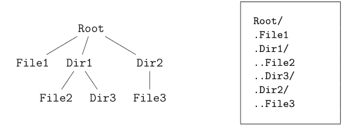

# 图 11.1 文件系统树及其字符串表示。

为了高效实现此方法，你可以创建一个字符串构建器并使用递归将行添加到其中，树中每个文件和目录各一行。为了实现缩进，每行以前缀开头，前缀由分隔符的重复组成（图 11.1 中的分隔符是一个点）。方法 mkString 分配一个字符串构建器和一个空前缀，并将递归委托给另一个也名为 mkString 的方法，其职责是将行添加到构建器中：

// inside trait Node
def mkString(sep: String): String = mkString(sep, StringBuilder(), "").result()
def mkString(sep: String, builder: StringBuilder, prefix: String): StringBuilder
```

这里使用方法 flatMap 来组合过滤（保留文件，忽略目录）和映射（将文件转换为其名称）。或者，lsFiles 可以用 filter 和 map 来编写。

这与 Unix 系统上常见的 tree 命令类似。


The implementation of this second mkString method is straightforward inside class File. You simply add to the builder a line that consists of the prefix followed by the file name and a newline:

```
// inside class File
def mkString(sep: String, builder: StringBuilder, prefix: String): StringBuilder =
  builder += prefix += name += '\n'
```

Inside the Dir class, the method starts by adding a line for the directory itself. It then proceeds by adding all the nodes (files and subdirectories) inside the directory. This is achieved recursively by calling mkString on all the nodes, using a longer prefix and the same string builder. You can perform these recursive calls by applying higher-order method foreach on the list of nodes:

```
// inside class Dir
def mkString(sep: String, builder: StringBuilder, prefix: String): StringBuilder =
  builder += prefix += name += "/\n"
  val newPrefix = prefix + sep
  nodes.foreach(_.mkString(sep, builder, newPrefix))
  builder
```

Listing 11.1: Example of using foreach with a mutable string builder.

Method mkString mixes higher-order functions and recursion: The action applied by foreach invokes mkString, which uses foreach to invoke mkString, and so on. This is a consequence of the fact that a node contains a list (hence the use of higher-order functions) of nodes (hence the use of recursion). You will notice how this pattern is used again in other tree functions in this chapter.

As mentioned earlier, method foreach makes sense only when the function being applied has a side effect. Here, the side effect comes from modifying a mutable string builder. Tree users, however, would call only the first mkString method—the only one public in an actual implementation. From their standpoint, the function is pure and produces a string from a tree, without any observable side effects.

#### 11.4 Building Trees

The constructor of the Dir class makes it possible to build invalid directories that contain multiple nodes with the same name. In practice, this constructor would not be public. Instead, you would provide public methods to create empty directories and to add files and subdirectories to an existing directory.

Inside the companion object of the Dir class, you can define a function that creates an empty directory:

### Chapter 11 Case Study: File Systems as Trees

You need to think functionally to follow this code. Trees are immutable, and node modification is achieved by replacing nodes with new nodes to create new trees. For instance, when adding a file, node this—which is Dir(this.name, nodes)—is replaced with a new tree Dir(this.name, File(name) :: nodes). In the same way, you add a new subdirectory by first creating it as a Dir(dirname).mkPath(more, filename))—and by replacing the current tree Dir(this.name, nodes) with a new tree Dir(this.name, nodes).

When an existing node needs to change, you remove it from the current list of children—nodes becomes otherNodes—and replace it with a new node—node becomes mkPath(more, filename) may call mkPath on a directory node, thus continuing the traversal/construction, or on a file node, in which case the path being followed does not exist and cannot be created because its creation would require replacing an existing file with a directory with the same name. Accordingly, method mkPath in class File simply throws an exception:

```
// inside class File
def mkPath(path: List[String], filename: Option[String]) =
  throw FileSystemException(name, "cannot create dir: file exists")
```

Once method mkPath is defined, you can implement the public methods mkFile and mkDir in terms of it:

```
// inside class Dir
def mkDir(name: String, names: String*): Dir = mkPath(name :: names.toList, None)
def mkFile(name: String, names: String*): Dir =
  val allNames = name :: names.toList
  mkPath(allNames.init, Some(allNames.last))
```

Both methods use variable-length arguments and require at least one name to operate. In the case of mkDir, all the names are directories, and the path to be added is name :: names.toList. In mkFile, the last name is the file to add. The path of directories starts with name, followed by all the strings in names, except the last. This is allNames.init (init returns all the elements of a list, except the last). As an illustration, the file system from Figure 11.1 can now be created with the following expression:

#### 11.4 Building Trees

```
```scala
Dir("Root")
.mkFile("Dir2", "File3")
.mkDir("Dir1", "Dir3")
.mkFile("Dir1", "File2")
.mkFile("File1")
```
```

You can remove files and directories from a tree by following a similar strategy. Method rmPath follows a path to its last element and removes it from the tree, whether it is a file or a directory. A first difference with mkPath is that, instead of creating missing directories, rmPath can stop traversing a branch as soon as a directory is missing (nothing to remove). Another difference is that you need to stop following the path one level above the last element so you can remove this element from the list of nodes of its parent. In other words, you remove a node by replacing Dir(name, list) with Dir(name, shorterList), not by replacing this with “nothing.” This results in a recursion that ends with a single-element list instead of an empty list:

```
```scala
// inside class Dir
def rmPath(path: List[String]): Dir = path match
  case node::more =>
    removeByName(node.name) match
    case None => this
    case Some((node, otherNodes)) =>
      if more.isEmpty then Dir(this.name, otherNodes)
      else Dir(this.name, node.rmPath(more) :: otherNodes)

def rm(name: String, names: String*): Dir = rmPath(name :: names.toList)
```
```

First, split the path, which is never empty, into its first name (node name) and the remainder of the path (more). Use helper method removeByName to extract an existing node by that name, if any. If no node is found, there is nothing to delete from the tree, so return this. If a node is found and is the last path element (more.isEmpty), remove it from the list of nodes. Otherwise, proceed recursively with the rest of the path (node.rmPath(more)) to create a replacement node. In that case, you know that more is not empty, and therefore that rmPath is not applied to an empty list.

As before, a path that encounters an existing file cannot proceed. However, there is no actual node to remove in this case—the path denotes a non-existing file or directory— and method rmPath in class File just leaves the file unchanged instead of throwing an exception:

```
```scala
// inside class File
def rmPath(path: List[String]) = this
```
```

#### 11.5 Querying

Section 11.4 focused on building and modifying trees that represent file systems. Once a tree is built, you can define additional methods to query it. Because directories are implemented in terms of lists of nodes. For instance, many querying methods can rely on standard higher-order functions on lists. For instance, you can calculate the total number of files and directories in a system by folding:

```
```scala
// inside class Dir
def fileCount: Int = nodes.foldLeft(0)(_ + _.fileCount)
def dirCount: Int = nodes.foldLeft(1)(_ + _.dirCount)
// inside class File
def fileCount: Int = 1
def dirCount: Int = 0
```
```

Listing 11.4: Example of using fold to count nodes in a general tree.

In a directory, the total number of files is obtained by folding the list of nodes with a function that adds the number of files of each node to an accumulator, initially 0. In a file, the total number of files is 1—the file itself. The total number of directories is calculated using a similar approach, except that folding a directory starts with 1—the directory itself—and files are counted as 0 instead of 1.

You can also define your own higher-order methods on file systems for easier querying. For instance, fileExists and dirExists are used to assert the existence of files or directories that satisfy a given criterion.

```
```scala
// inside class Dir
def fileExists(test: File => Boolean): Boolean =
  nodes.exists(_.fileExists(test))
def dirExists(test: Dir => Boolean): Boolean =
  test(this) || nodes.exists(_.dirExists(test))
```
```

> A nodeExists method is also possible but would imply that type Node is public. The code presented in this chapter is predicated on the assumption that the Node trait remains private.


```scala
// inside class File
def fileExists(test: File => Boolean): Boolean = test(this)
def dirExists(test: Dir => Boolean): Boolean  = false
```

### 清单 11.5：在通用树上实现 exists 的示例。

方法 `fileExists` 接受一个布尔函数作为参数，如果树中至少有一个文件满足该测试函数，则返回 `true`。也就是说，如果存在一个节点，其中存在这样的文件，则该结果为 `true`。因此，在目录上实现 `fileExists` 时，你可以依赖列表的 `exists` 方法来检查所有节点，并在每个节点上递归调用 `fileExists` 方法本身。对于文件，`fileExists` 只是将测试应用于该文件。

方法 `dirExists` 的实现类似。它接受一个作用于目录而非文件的布尔函数，并先将其应用于当前目录（`test(this)`），然后像之前一样使用 `exists` 检查各个节点。对于文件，此方法始终返回 `false`。

通过利用递归和列表的 `exists` 方法，在树上实现 `fileExists` 和 `dirExists` 各只需两行。同样，你还可以实现树折叠函数，将递归与列表的 `foldLeft`（或 `foldRight`，因为目录中节点的顺序无关紧要）方法结合起来：

```scala
// inside class Dir
def fileFold[A](init: A)(f: (A, File) => A): A =
    nodes.foldLeft(init)((acc, node) => node.fileFold(acc)(f))

def dirFold[A](init: A)(f: (A, Dir) => A): A =
    nodes.foldLeft(f(init, this))((acc, node) => node.dirFold(acc)(f))

// inside class File
def fileFold[A](init: A)(f: (A, File) => A): A = f(init, this)
def dirFold[A](init: A)(f: (A, Dir) => A): A = init
```

### 清单 11.6：在通用树上实现 fold 的示例。

你通过逐个折叠目录的所有子节点来折叠目录。当你折叠处理文件的函数时，子节点的折叠从 `init` 开始；但当你折叠处理目录的函数时，它从 `f(init, this)` 开始，以便在遍历子节点之前先处理当前目录。（清单 11.4 中 `fileCount` 和 `dirCount` 的 0 和 1 背后也是同样的原理。）对于文件节点，`fileFold` 将给定函数 `f` 应用到这个文件，而 `dirFold` 保持折叠累加器不变。

方法 `fileFold` 和 `dirFold` 功能强大，可用于实现各种文件系统查询。例如，如果 `fileCount` 和 `dirCount` 尚未作为 `Dir` 类的方法实现，你可以改用 `fileFold` 和 `dirFold` 来编写它们：

```scala
def fileCount(dir: Dir): Int = dir.fileFold(0)((acc, _) => acc + 1)
def dirCount(dir: Dir): Int = dir.dirFold(0)((acc, _) => acc + 1)
```

你还可以使用 `fileFold` 查找树中最长的文件名：[^5]

```scala
def longestFilename(dir: Dir): String = dir.fileFold("") { (longest, file) =>
  if file.name.length > longest.length then file.name else longest
}
```

同样，你可以使用 `dirFold` 构建文件系统中所有文件名的列表：

```scala
def allFileNames(dir: Dir): List[String] =
  dir.dirFold(List.empty[String])((list, subdir) => subdir.lsFiles ::: list)
```

然而要小心：折叠函数并不适合实现搜索，因为它们总是遍历整棵树，[^6] 即使已经找到元素也是如此。例如，下面这个 `fileFind` 方法的实现是不可取的：

```scala
// DON'T DO THIS!

// inside class Dir
def fileFind(test: File => Boolean): Option[File] =
  fileFold(Option.empty[File]) { (found, file) =>
    found.orElse(if test(file) then Some(file) else None)
  }
```

此方法的缺点是，在找到合适的文件后，它仍会继续遍历树。[^7]

要让 `fileFind` 在找到文件后停止，同时保持函数式编程风格，并不是一件直截了当的事。鉴于我们使用列表的 `exists` 实现了 `fileExists`，使用列表的 `foldLeft` 实现了 `fileFold`，你可能会想使用列表的 `find` 来实现 `fileFind`。问题是，对子树列表应用 `find` 会产生一棵（如果有的话）可以找到所需文件的树，而不是文件本身。你需要再次使用 `fileFind` 搜索这棵树，才能提取出文件：

```scala
// DON'T DO THIS!

// inside class Dir
def fileFind(test: File => Boolean): Option[File] =
  nodes.find(_.fileExists(test)).map(_.fileFind(test).get)
```

该实现使用 `find` 搜索包含所需文件的节点。如果找到，就对 Option 调用 `map`，在此节点上应用 `fileFind` 以获取实际文件。这是不可取的，因为 Option 中的节点已经被搜索过该文件，而且确实包含它（对 `fileFind` 的调用保证会成功，因此使用 `get` 来获取实际文件）。于是该节点被搜索了两次，而且由于 `fileFind` 的递归性质，内部节点最终会被多次搜索（节点越深，被搜索的次数越多）。

与其使用 `find` 来定位包含合适文件的子树，更好的策略是利用列表的 `map` 方法从每个子树中提取所需文件。表达式 `nodes.map(_.fileFind(test))` 的类型是 `List[Option[File]]`，为每个子树包含一个可接受的文件（如果有的话）。然后可以使用 `find` 方法从列表中找到非空 Option。表达式 `nodes.map(_.fileFind(test)).find(_.nonEmpty)` 会产生所需的文件，但得到的是 `Option[Option[File]]`，可以被展平：

```scala
// DON'T DO THIS!

// inside class Dir
def fileFind(test: File => Boolean): Option[File] =
  nodes.map(_.fileFind(test)).find(_.nonEmpty).flatten
```

这种方法的问题在于，`map` 无论如何都会处理整个节点列表，而且目录中的所有节点都会被搜索，即使已经找到了文件。避免这个问题的标准技术是引入某种形式的惰性求值：

```scala
// OK, but can be improved

// inside class Dir
def fileFind(test: File => Boolean): Option[File] =
  nodes.view.map(_.fileFind(test)).find(_.nonEmpty).flatten
```

通过对 `nodes.view` 而不是 `nodes` 调用高阶方法 `map`，你可以在找到文件后防止继续探索节点。惰性求值将在第 12 章详细讨论。目前，只需知道示例中的实现在找到第一个文件时停下（如果没有找到文件，则遍历整棵树）。

你可以用对 `flatMap` 的调用来替换 `map`/`flatten` 组合，从而生成所有解包后的文件，而不是让它们位于 Option 中。最终，`fileFind` 和 `dirFind` 的期望实现如下：[^8]

```scala
// inside class Dir
def fileFind(test: File => Boolean): Option[File] =
  nodes.view.flatMap(_.fileFind(test)).headOption

def dirFind(test: Dir => Boolean): Option[Dir] =
  if test(this) then Some(this) else nodes.view.flatMap(_.dirFind(test)).headOption

// inside class File
def fileFind(test: File => Boolean): Option[File] =
  if test(this) then Some(this) else None

def dirFind(test: Dir => Boolean): Option[Dir] = None
```

表达式 `nodes.view.flatMap(_.fileFind(test))` 生成一个（惰性求值的）文件集合，其中包含满足给定测试的文件，每个子树对应一个。调用 `headOption` 会强制对视图进行求值，直到找到文件，或者视图已经穷尽而没有产生文件。

#### 11.6 导航

类 `Dir` 和 `File` 中的最后一组方法涉及文件系统内的导航。你可以定义一个 `cd` 方法来进入子目录，它模仿同名的 Unix 命令：

```scala
// inside class Dir
def cdPath(path: List[String]): Dir = path match
  case Nil => this
  case dirname :: more =>
    nodes
      .find(_.name == dirname)
      .getOrElse(throw FileSystemException(dirname, "cannot change: no such dir"))
      .cdPath(more)
```

[^5]: 该函数体也可以写成 `Seq(file.name, longest).maxBy(_.length)`。

[^6]: 除非抛出异常。抛出（并捕获）异常有时被用作提前终止折叠计算的技术。

[^7]: 尽管所有文件都会被访问，但此实现会在找到文件后停止应用测试函数。这是因为，当 `orElse` 应用于非空 Option 时，作为其参数的表达式不会被求值。这种现象被称为惰性求值或延迟求值，将在第 12 章中探讨。

[^8]: 类 `File` 中 `fileFind` 的函数体可以写成 `Some(this).filter(test)`，而不是 `if test(this) then Some(this) else None`。代码中还有其他地方也可以对 Option 应用 `filter`。虽然这会说明高阶方法 `filter` 的用法，但可能会损失一些代码可读性。为了清晰起见，我选择坚持使用 `if–then–else`。


```scala
def cd(name: String, names: String*): Dir = cdPath(name :: names.toList)

// inside class File
def cdPath(path: List[String]): Dir =
    throw FileSystemException(name, "cannot change: not a directory")
```

正如之前对 mkFile、mkDir 和 rm 所做的那样，方法 cd 是通过一个辅助方法 cdPath 实现的，该方法遍历由名称指定的目录列表。如果名称列表为空，则返回当前目录。否则，使用 find 查找具有指定名称的子目录（如果有）。使用 getOrElse，从 resulting option 中提取目录，或在 option 为空时抛出异常。然后将路径的剩余部分递归地应用于子目录。如果在任何时候路径遇到文件而不是目录，则会抛出异常。

#### 11.7 Tree Zipper

方法 cd 可用于向下遍历树。向上返回呢？必须认识到问题不在于在遍历时 somehow 保留对包含树的引用。原因在于树是不可变的，添加或删除文件或子目录会产生一棵新树。在此类修改之后，返回包含子树的树在其修改之前的状态是没有意义的。你需要实现的方法是 up 和 down，使得以下代码产生的与图 11.1 中的文件系统相同：

```scala
Dir("Root").nav
.mkDir("Dir2")
.down("Dir2")
.mkFile("File3")
.up
.mkDir("Dir1")
.down("Dir1")
.mkDir("Dir3")
.mkFile("File2")
.up
.mkFile("File1")
.dir
```

请注意，例如第一次调用方法 up 不能简单地返回到 down("Dir2") 所调用的树，因为该树不包含 File3。换句话说，up 不一定会带你回到之前的树，在某些情况下还需要创建新树。

一种可行的办法是将树类型修改为 zipper。第 5.6 节实现了用于在列表中向左和向右导航的 zipper。相同的思想可用于在树中上下移动。⁹ Zippers 是不可变的。树 zipper 将子树与导致该子树的步骤序列结合起来。这些步骤可以按相反顺序重新应用以向上移动。与返回现有树不同，应用步骤会构建一棵新树，其中包含反映文件系统修改的更新子树。在前面的代码中，调用 nav 将文件系统的类型从树更改为树 zipper，该 zipper 通过其 up 和 down 方法实现导航。最后一次调用 dir 会带你回到常规树。

要向下进入子目录，你创建一个包含父目录名称以及该目录中所有其他节点的步骤。例如，进入图 11.1 中文件系统中的 Dir1 会返回以 Dir1 为根的子树，但也会创建一个包含名称 Root 和除 Dir1 之外的子树列表的步骤：

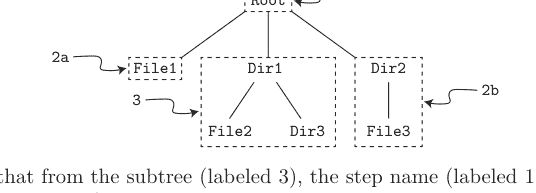

你可以看到，从子树（标记为 3）、步骤名称（标记为 1）和步骤树（标记为 2a 和 2b）可以重建之前的树以向上移动。如果子树已被更改——即被不同的树替换——通过重新组装向上移动会产生不同的树（相同的 1 和 2 部分，但子树 3 不同）。

zipper 在类 DirNav 中实现：

```scala
final class DirNav (val dir: Dir, steps: List[(String, List[Node])]):
...
```

zipper 由当前目录（dir）和导致它的向下步骤列表（steps）组成。每个步骤是一对，包含父节点的名称作为 String，以及当前目录的兄弟节点列表，类型为 List[Node]。当当前目录是文件系统的根时，步骤列表为空。

zipper 实现两个方法 up 和 down。要向下移动到子目录，方法 down 会产生与之前的 cd 方法相同的子目录，但会在步骤列表中添加一个步骤，以便方法 up 可以通过该步骤逆向向下移动而向上返回：

⁹本节仅考虑上下移动。更复杂的 zipper 可以编写以在兄弟节点之间向左和向右移动。

```scala
// inside class DirNav
def down(dirname: String): DirNav =
    dir.removeByName(dirname) match
    case None =>
        throw FileSystemException(dirname, "cannot change: no such directory")
    case Some((file: File, _)) =>
        throw FileSystemException(dirname, "cannot change: not a directory")
    case Some((subdir: Dir, otherNodes)) =>
        DirNav(subdir, (dir.name, otherNodes) :: steps)

def up: DirNav = steps match
    case Nil => this
    case (name, nodes) :: more => DirNav(Dir(name, dir :: nodes), more)
```

列表 11.8：树 zipper 中的导航方法（1）。

要向下移动，按名称搜索目标子目录并将其从节点列表中移除。如果未找到，或按该名称找到文件而不是目录，则抛出异常。否则，如果子目录存在（subdir），则通过添加新步骤创建包含它的 zipper。此步骤包含父目录的名称（dir.name）和 subdir 的所有兄弟节点（otherNodes）。新步骤添加到步骤列表的前面，该列表像栈一样使用。要向上返回，方法 up 从栈中弹出第一个步骤，并使用其名称和节点列表构造一棵新树 Dir(name, dir :: nodes)，该树被包装在具有剩余步骤的 zipper 中。

为了方便，你还可以实现一个方法用于多次向下移动，以及一个方法用于返回到树的根：

```scala
// inside class DirNav
def down(dirname1: String, dirname2: String, dirnames: String*): DirNav =
    (dirname1 :: dirname2 :: dirnames.toList).foldLeft(this)(_.down(_))
@tailrec
def top: DirNav = if steps.isEmpty then this else up.top
```

列表 11.9：树 zipper 中的导航方法（2）。

要向下移动由多个子目录组成的路径，你使用 foldLeft 并以当前目录作为初始值，对路径中的所有名称逐一调用单名称变体的 down 方法。要一直移动到顶部，方法 top 反复应用 up 直到到达树的根。

类 DirNav 的所有其他方法都是通过转发调用到类 Dir 中的对应方法实现的，除了创建方法（添加和删除文件和子目录）需要返回可导航的目录而不是普通目录：

```scala
// inside class DirNav
override def toString = dir.toString

def mkFile(name: String, names: String*): DirNav =
    DirNav(dir.mkFile(name, names*), steps)

def mkDir(name: String, names: String*): DirNav =
    DirNav(dir.mkDir(name, names*), steps)

def rm(name: String, names: String*): DirNav =
    DirNav(dir.rm(name, names*), steps)

export dir.{
    mkString, ls, lsFiles,
    dirCount, dirExists, dirFold, dirFind, fileCount, fileExists, fileFold, fileFind
}
```

最后，一个方法 nav 被添加到类 Dir 以使普通目录可导航：

```scala
// inside class Dir
def nav: DirNav = DirNav(this, List.empty)
```

#### 11.8 Summary

在本章中，文件系统表示为文件和目录的树。目录的内容存储为节点列表，并使用列表的高阶方法有效地处理这些节点。树还定义了自己的高阶方法。它们是递归实现的，并且对子目录的递归调用使用列表的高阶方法在目录的内容上执行。最后，树被扩展为 zippers 以便可导航，具有向下进入子目录和向上返回父目录的方法。总计（包括许多脚注），本文件系统案例研究使用和/或重新实现了标准高阶方法 exists、find、flatMap、foldLeft、foreach、filter、map、maxBy 和 partition。

### Chapter 12

#### Lazy Evaluation

通过将函数用作值，可以用计算该数据的函数替换数据。通过这种方法，可以推迟参数的求值直到需要时，从而可以将未求值的代码传递给方法和函数。结合语言的语法帮助，可以从编程语言内部定义额外的控制结构，从而可能定义内部领域特定语言。函数也可以存储在数据结构中以推迟该结构部分求值。流是经典的函数式编程结构，实现延迟求值的序列。除了未求值参数和延迟数据结构之外，延迟求值还可以采用其他几种形式，例如延迟高阶函数求值的视图以及变量延迟初始化的机制。

我们已经看到高阶函数可以接受本身就是函数的参数。通过用计算该参数的函数替换显式参数，例如字符串，可以推迟字符串的计算直到其值需要时。

```scala
val logger: Logger = ...

logger.info("incoming request from ${ip.getHostName} (${ip.getAddress})")
```

这种方法的缺点是字符串参数总是被构建，即使在 INFO 级别日志被禁用时也是如此。在此示例中，如果日志设置为 WARNING 级别，仍然会进行可能代价高昂的主机名查找来创建随后立即丢弃的字符串。

Java 8 为 Logger 类引入了第二个 info 方法。它用返回字符串的函数替换字符串参数：

```scala
logger.info(() => "incoming request from ${ip.getHostName} (${ip.getAddress})")
```


你同样可以像使用上一个方法一样，轻松地通过为函数参数传入 lambda 表达式来调用这个 info 方法。前面的表达式不会执行主机名查找。查找只会在 logger 内部进行，并且只有当日志级别被设置为包含 INFO 消息的级别时才会发生。

你可以定义自己的方法，用函数参数来替换可能并不需要的显式值。例如，Java 的 Properties 类定义了一个属性查找方法，它的第二个参数指定了在找不到键时要使用的默认值：

```
val properties: Properties = System.getProperties

properties.getProperty("hostname", "unknown")
```

当默认值是常量（如 `"unknown"`）时，这样已经足够了。然而，如果计算默认值的代价很高，而某个属性键已经关联了一个值，那么这次计算就被浪费了。并没有一个接受函数作为第二个参数的 getProperty 方法。不过，你可以借助一个单参数的 getProperty 方法（在找不到键时返回 null），轻松地以扩展方式添加一个：

```
extension (properties: Properties)
  def getProperty(key: String, fallback: () => String): String =
    val prop = properties.getProperty(key)
    if prop ne null then prop else fallback()
```

默认值以回退函数的形式给出，该函数只在找不到属性时才会被调用。当这个扩展处于作用域内时，你可以这样写：

```
properties.getProperty("hostname", () => InetAddress.getLocalHost.getHostName)
```

如果 hostname 属性已经定义，就不会产生任何额外开销。

#### 12.2 按名参数

在任何支持高阶函数的编程语言中——所有函数式编程语言都包括在内——你都可以通过将值替换为能生成这些值的函数，来实现参数的延迟求值。那些用于延迟求值的无参函数有时被称为 thunk（形实转换子）。如果你的语言支持 lambda 表达式，它们通常是生成 thunk 最便捷的方式。

有些语言还提供了一种额外的机制，即按名传参。例如，下面这段代码会生成一个伪随机数列表：

```
```scala
val rand = Random(42)
List.fill(5)(rand.nextInt(100)) // List(30, 63, 48, 84, 70)
```
```

如果你是从 Java 或 C 这样的语言过来的，这可能会让你感到惊讶。的确，`java.util.Collections` 中的 fill 方法的行为有所不同：

```
```java
List<Integer> numbers = ...
Collections.fill(numbers, rand.nextInt(100)); // sets the list to 30, 30, 30, 30, ...
```
```

在 Java 版本中，表达式 `rand.nextInt(100)` 产生值 30，列表会用这个值填充。然而在 Scala 的代码中，fill 表现得就像把 thunk `() => rand.nextInt(100)` 作为参数传入了一样。这是因为 Scala 的 fill 的参数是按名传递、无需求值的。你可以这样实现自己的 fill 函数：

```
```scala
def fill[A](len: Int)(value: => A): List[A] =
  val buffer = List.newBuilder[A]
  var i = 0
  while i < len do
    buffer += value
    i += 1
  buffer.result()
```
```

清单 12.1：重新实现 List.fill。

这种“魔法”来自于在参数类型前面加上一个箭头——`value: => A`——这会触发按名传参。如果没有这个箭头，fill 函数的行为就会和 Java 中一样，用同一个值的重复序列来填充列表。但正因为参数是按名传递的，表达式 `rand.nextInt(100)` 会在 while 循环的每次迭代中被重新求值，从而产生不同的数字。与普通参数传递（有时也被称为急切求值）相比，按名参数实现了一种惰性求值的形式。它们避免了显式地创建 thunk，从而提高了代码的可读性。

Scala 标准库中的许多函数和方法都使用了按名参数。例如，Option 类型定义了 `orElse` 和 `getOrElse` 方法，用于用备选值替换空的 Option。它们在 Option 类中的定义如下：

```
// inside class Option:
def orElse[B >: A](alternative: => Option[B]): Option[B] =
    if isEmpty then alternative else this

def getOrElse[B >: A](default: => B): B =
    if isEmpty then default else this.get
```

`alternative` 和 `default` 参数都是按名传递的，只有在 Option 为空时才会被求值。

getProperty 扩展的实现可以依靠 `getOrElse`：

```
def getProperty(key: String, fallback: () => String): String =
    Option(properties.getProperty(key)).getOrElse(fallback())
```

预定义函数 Option 会把值包装进 Option 中，并将 null 映射为 None。（关于 `orElse` 在分支算法中的示例，请参见第 12.11 节。）

与 `orElse` 和 `getOrElse` 类似，可变 Map 也有 `getOrElseUpdate(k, v)` 方法，它会返回与键 k 关联的值；如果键不存在，则用新的键值对 `(k, v)` 更新该 Map。参数 v 是按名传递的：如果键存在，就用不到 v，也就不会对 v 求值。你可以使用 `getOrElseUpdate` 来简化清单 9.6 中高阶函数 memo 的实现：

```
def memo[A, B](f: A => B): A => B =
    val store = mutable.Map.empty[A, B]
    x => store.getOrElseUpdate(x, f(x))
```

清单 12.2：使用按名参数进行记忆化，是对清单 9.6 的改进。

和之前一样，该函数首先在 Map 中查找。如果在 Map 中找到了 x，`getOrElseUpdate` 就不会对其第二个参数求值。只有找不到键时，才会对 x 调用函数 f。

#### 12.3 控制抽象

fill 函数内嵌了一个 while 循环；`getOrElseUpdate` 内嵌了一个条件判断。第 10 章讨论的许多高阶函数也实现了一种控制抽象：在 `map`、`filter` 和 `find` 的实现中，某个地方会有一个循环或递归函数来执行所需的迭代。借助延迟求值，各种形式的流程控制——如循环、条件判断和异常处理——都可以被抽象到用户自定义的高阶构造中。

例如，看看 Java 的 try-with-resources，它用于确保在计算结束时释放资源：

```
```java
<A> void writeToFile(Path file, Iterable<A> values) throws IOException {
    try (var out = new ObjectOutputStream(Files.newOutputStream(file))) {
        for (var item : values) out.writeObject(item);
    }
}
```
```

这个函数把一组对象写入文件。try 构造保证了在写入之后文件会被关闭，即使发生异常也不例外。你可以用 Scala 编写类似的方法：

```
```scala
def writeToFile[A](file: Path, values: Iterable[A]): Unit =
    Using.resource(ObjectOutputStream(Files.newOutputStream(file))) { out =>
        for item <- values do out.writeObject(item)
    }
```
```

然而，一个关键的区别是，Java 的 try-with-resources 是语言本身的一种构造，而 Scala 的 `Using.resource` 是定义在标准库中的一个普通函数。在最简单的形式下，你可以自己实现它：

```
def resource[R <: AutoCloseable, A](res: R)(use: R => A): A =
    try use(res) finally res.close()
```

函数 resource 是柯里化的高阶函数。它有两个类型参数：资源类型 R（必须是 Java 的 `AutoCloseable` 的子类型¹）和值的类型 A——该值是通过给定的函数 use 从资源中产生的。该实现会在一个 try-finally 构造中调用这个 use 函数，以保证资源被关闭：`resource(r)(f)` 就是值 `f(r)`，并且 r 在应用 f 之后会被关闭。

函数 resource 需要把给定的资源与使用它的代码绑定在一起，因此将代码作为资源的函数传入是合理的。当不需要这种绑定时，要执行的代码就变成了无参函数，而你可以用按名值来替代它。其结果是一种控制抽象，它隐藏了参数实际上是一个函数的事实。例如，你可以编写一个构造来计算任意代码片段的执行时长：

```
def timeOf[U](code: => U): Double =
    val startTime = System.nanoTime()
    code
    val endTime = System.nanoTime()
    (endTime - startTime) / 1E9
```

清单 12.3：控制抽象示例：函数 timeOf。


## 第12章 惰性求值

这个函数接收一个按名参数，跟踪求值所需的时间，并以秒为单位返回持续时间。你可以在不显式创建 thunk 函数的情况下使用它：

```scala
val seconds: Double = timeOf {
  InetAddress.getLocalHost.getHostName // or any code for which you want the duration
}
```

流行的 Scala 库 Scalactic 定义了一个 `times` 构造，使用方式如下：

```scala
3 times {
  println("Beetlejuice!")
}
```

尽管 `times` 看起来像一个关键字和语言构造，但它实际上是作为一个常规函数定义的。你可以将其实现为一个扩展方法：

```scala
extension (count: Int)
  infix def times[U](code: => U): Unit =
    var n = count
    while n > 0 do
      code
      n -= 1
```

> 列表 12.4：控制抽象示例：函数 `times`。

该方法被定义为扩展方法，因此可以在常规整数上调用。它使用按名参数作为要重复的代码：代码以未求值的方式传递，并在 `times` 方法中根据需要多次求值。

作为一个更复杂的示例，让我们定义一个新的循环构造 repeat–until：

```scala
class Repeat[U](code: => U):
  infix def until(test: => Boolean): Unit =
    code
    while !test do code

def repeat[U](code: => U) = Repeat(code)
```

> 列表 12.5：控制抽象示例：repeat–until。

类 `Repeat` 在其构造函数中使用按名参数。构造函数生成一个对象，该对象在其 `until` 方法中实现重复，使用按名传递的终止测试。你可以按如下方式使用这个新构造：

```scala
var n = 3
repeat {
  println("Beetlejuice!")
  n -= 1
} until (n == 0)
```

在此示例中，`println("Beetlejuice!"); n -= 1` 被传递（未求值）给函数 `repeat`，然后传递给类 `Repeat` 的构造函数。最后，在 resulting 对象上调用方法 `until`，并传入（未求值）的参数 `n == 0`。

#### 12.4 内部领域特定语言

如前面的示例所示，巧妙地使用按名参数可以产生看起来非常像编程语言构造的抽象。你可以应用此技术来定义领域特定语言（DSL），它们是小型语言，通常用于在特定领域建模或架构。与其作为独立语言实现，内部 DSL 嵌入到像 Scala 这样的通用编程语言中。例如，测试框架 ScalaTest 定义了用于编写单元测试的 DSL：

```scala
class ExampleSpec extends AnyFlatSpec with should.Matchers:

  "A Stack" should "pop values in last-in-first-out order" in {
    val stack = Stack[Int]()
    stack.push(1)
    stack.push(2)
    stack.pop() should be (2)
    stack.pop() should be (1)
  }

  it should "throw NoSuchElementException if an empty stack is popped" in {
    val emptyStack = Stack[Int]()
    a [NoSuchElementException] should be thrownBy {
      emptyStack.pop()
    }
  }
```

方法和对象被仔细命名为 `it`、`should`、`in`、`a`、`be` 和 `thrownBy`，以便测试代码自然流畅，并在测试失败时产生合适的错误消息。

#### 12.5 流作为惰性求值的列表

考虑这样一个场景：应用程序的某个组件以某种方式产生的数据，正在被另一个组件搜索特定值。一个可能的方案可以依赖于具有以下签名的搜索方法：

```scala
def searchData(data: List[Data]): Option[Data] = ...
```

这种方法的缺点是，在可以搜索之前必须先生成整个数据列表，可能导致列表很大而搜索只需要前几个元素的情况。作为替代方案，你可以使用惰性求值参数：

```scala
def searchData(data: => List[Data]): Option[Data] = ...
```

但这完全没有帮助，因为在搜索开始之前整个列表仍需被求值。你真正想要的是延迟每个列表元素的求值。你可以用 thunk 来实现：

```scala
def searchData(data: List[() => Data]): Option[Data] = ...
```

然而，这远非理想，因为在搜索开始之前必须创建所有 thunk。在这种方法下，你可能不必生成所有实际数据，但仍需要为每个潜在数据片段创建与之相同数量的 thunk 函数。

你真正想要的是避免创建超出搜索完成所需的数据元素之外的任何内容。在 Scala 中，你通过具有以下签名的搜索方法来实现这一点：

```scala
def searchData(data: LazyList[Data]): Option[Data] = ...
```

`LazyList` 是一种线性序列的类型——像列表一样——其中元素是惰性求值的。这类序列通常称为流。Scala 流是不可变的。它们也是记忆化的：³ 一旦计算，每个元素都会存储在流中。

> ³ 这意味着在流内部确实发生了突变，以用实际值替换未求值的元素。然而，作为一个序列，流在概念上是不可变的，并且流始终表示相同的序列。

你通常可以像使用常规列表一样使用流。例如，要搜索第一个值大于 10 的数据片段，你可以定义一个尾递归函数：

```scala
def searchData(data: LazyList[Data]): Option[Data] =
  if data.isEmpty then None
  else if data.head.value > 10 then Some(data.head)
  else searchData(data.tail)
```

除了方法的签名外，这段代码与使用列表的变体完全相同。注意，由于记忆化，流的 head 仅被求值一次，即使代码中 `data.head` 被使用了两次。此外，如果这个第一个数据片段的值大于 10，则不会求值任何其他流元素。

`LazyList` 支持模式匹配，你也可以将递归搜索函数写成如下形式：

```scala
def searchData(data: LazyList[Data]): Option[Data] = data match
  case LazyList() => None
  case head #:: tail => if head.value > 10 then Some(head) else searchData(tail)
```

此实现与对列表的模式匹配和递归类似。唯一的区别是空流模式——`LazyList()` 而不是 `Nil`——以及“cons”操作符——流上命名为 `#::` 而不是列表上的 `::`。对于这种简单的搜索任务，你的最佳策略是依赖于 `LazyList` 类型上定义的标准高阶方法：

```scala
def searchData(data: LazyList[Data]): Option[Data] = data.find(_.value > 10)
```

通常，创建列表的代码可以很容易地修改为生成流。例如，`hanoi` 函数在第 6 章中编写用于说明递归，它只是将每个移动作为字符串打印出来。要以图形方式显示移动，将图形代码直接并入求解函数中可能不方便。相反，你可以通过让求解函数创建移动列表并让显示函数消费它来分离移动的创建和显示：

```scala
def hanoi[A](n: Int, from: A, mid: A, to: A): List[(A, A)] =
  if n == 0 then List.empty
  else hanoi(n - 1, from, to, mid) ::: (from, to) :: hanoi(n - 1, mid, from, to)
```

> 列表 12.6：作为列表的汉诺塔移动：与列表 12.7 对比。

此函数不打印它们，而是将移动作为对列表 `(from, to)` 返回。如果你想要流而不是列表，对代码所需的更改是微不足道的：

```scala
def hanoi[A](n: Int, from: A, mid: A, to: A): LazyList[(A, A)] =
  if n == 0 then LazyList.empty
  else hanoi(n - 1, from, to, mid) #::: (from, to) #:: hanoi(n - 1, mid, from, to)
```

> 列表 12.7：作为流的汉诺塔移动。

此函数看起来几乎相同，但它不会计算任何实际移动。它返回一个流，并且移动将在流被查询时按需创建：

```scala
val allMoves    = hanoi(100, 'L', 'M', 'R')
val oneMove     = allMoves(999) // ('M', 'L')
val anotherMove = allMoves(49)  // ('L', 'R')
```

注意 `allMoves` 是一个包含 2^100 − 1 个元素的流，数量级约为 10^30。显然，这种集合使用基于列表的实现将无法放入内存中。`oneMove` 的计算会触发流的前 1000 个元素的求值。`anotherMove` 的求值不会涉及任何额外计算：已经在流中的第 50 个移动被检索出来。

#### 12.6 流作为管道

由于它们是惰性求值的，流是管道化转换的绝佳结构。例如，考虑搜索文件中长单词的问题。函数 `longWords(lines, min)` 接收一个行列表和最小单词长度。它通过将行拆分为单词、删除非字母字符并选择长度至少等于指定最小值的单词来进行。你可以用以下代码以函数式方式完成此操作：

```scala
def clean(str: String): String = str.filter(_.isLetter) // remove non-letters

def longWords(lines: List[String], min: Int): List[String] =
  lines
    .flatMap(_.split(' '))
    .map(clean)
    .filter(_.length >= min)
```

由于函数的第一个参数是行列表，而每一行是单词列表，因此使用 `flatMap` 来避免嵌套列表。然后对单词进行清理，并且只有长单词包含在最终结果中。

这段代码产生了期望的输出，但存在一个小的效率问题：计算的每个阶段都会产生一个列表——首先是单词列表，然后是清理后的单词列表，


最后才得到所需的长单词列表。这些中间列表必须在内存中分配，然后被垃圾回收，这并非没有代价。

在第 10.4 节中，我们讨论了一种避免该问题的可行方法：用一次 fold 替换高阶函数管道。你可能还记得，这种改动并没有提升代码的可读性。对于 longWords 来说，甚至更糟：

```scala
def longWords(lines: List[String], min: Int): List[String] =
  lines.foldRight(List.empty[String]) { (line, words) =>
    line.split(' ').foldRight(words) { (word, moreWords) =>
      val cleanWord = clean(word)
      if cleanWord.length >= min then cleanWord :: moreWords else moreWords
    }
  }
```

不必费心去理解这个函数。它在这里只是为了说明，这个问题确实可以用 foldRight 解决，但得到的代码很难阅读——显然比 flatMap/map/filter 的版本难读得多。

一个能避免中间列表的更好策略是继续使用 flatMap、map 和 filter，不过是在流上而非列表上：

```scala
def longWords(lines: List[String], min: Int): List[String] =
  lines.to(LazyList)
    .flatMap(_.split(' '))
    .map(clean)
    .filter(_.length >= min)
    .toList
```

初始的行列表被转换为一个流。由于流是惰性求值的，对 flatMap、map 和 filter 的调用不会触发任何计算，尤其不会创建中间列表。最后的 toList 调用会强制对最终流进行求值，并生成所需的列表，且不分配任何中间列表。

这种方法在 Java 中尤其流行，因为 Java 的 Stream 类实现了所有必要的高阶方法，而 List 等集合类却没有。在 Java 中，你可以这样编写 longWords 函数：

```java
List<String> longWords(List<String> lines, int min) {
  return lines.stream()
    .flatMap(line -> line.replace(' ', '\n').lines())
    .map(word -> clean(word))
    .filter(word -> word.length() >= min)
    .toList();
}
```

#### 12.7 流作为无限数据结构

清单 12.7 中的 `hanoi` 函数使用“`#::`”和“`#:::`”来构建其结果流。这些操作是惰性实现的，可以在不触发其流参数求值的情况下构建流。特别是，它们可以用来定义概念上无限的流：

```scala
def countUp(n: Int): LazyList[Int] = n #:: countUp(n + 1)

val naturals = countUp(0) // 0, 1, 2, 3, ...
```

乍一看，`countUp` 函数毫无意义。它似乎违反了一个良好递归函数的原则——即为了终止，函数总应至少定义一个非递归分支。这里，`countUp` 总是调用 `countUp`。的确，如果你用列表来编写这个函数，它将永远不会终止。然而，在流上，这个定义是有效的。它会产生一个永不结束的数字流。当然，任何试图对整个流求值的操作——例如 `naturals.toList`——都会导致无法终止的计算。

有时，你可以用无限流来替换可变数据，从而获得更具函数式风格的值。例如，可以将（可变的）伪随机数生成器替换为伪随机数的无限流：

```scala
def randomNumbers: LazyList[Float] = Random.nextFloat() #:: randomNumbers
```

无限流通常使用生成式高阶函数来创建。例如，`naturals` 和 `randomNumbers` 流可以这样创建：

```scala
val naturals      = LazyList.iterate(0)(_ + 1)
val randomNumbers = LazyList.continually(Random.nextFloat())
```

#### 12.8 迭代器

“3n + 1”问题定义了如下序列：如果自然数 n 是偶数，则其下一个数是 n ÷ 2；否则为 3n + 1。这个序列有时被称为 Collatz 序列，人们猜想对于任何起始自然数，它最终都会到达 1。例如，如果你从 27 开始，序列会产生 111 个数，然后才第一次到达 1（之后会永远按 4, 2, 1, 4, 2, 1, … 继续下去）：

27 82 41 124 62 31 94 47 142 71 214 107 322 161 484 242 121 364 182 91 274 137 412 206 103 310 155 466 233 700 350 175 526 263 790 395 1186 593 1780 890 445 1336 668 334 167 502 251 754 377 1132 566 283 850 425 1276 638 319 958 479 1438 719 2158 1079 3238 1619 4858 2429 7288 3644 1822 911 2734 1367 4102 2051 6154 3077 9232 4616 2308 1154 577 1732 866 433 1300 650 325 976 488 244 122 61 184 92 46 23 70 35 106 53 160 80 40 20 10 5 16 8 4 2 1

你可以编写一个函数来计算到达 1 所需的步数。一种命令式实现可以是：

```scala
def collatz(start: BigInt): Int =
  var count = 0
  var n     = start
  while n != 1 do
    n = if n % 2 == 0 then n / 2 else 3 * n + 1
    count += 1
  count

collatz(27) // 111
collatz(BigInt("992774507105260663893249807781832616822016143650134730933270")) // 2632
```

清单 12.8：3n + 1 序列的命令式实现。

这个迭代程序的函数式等价写法是什么？乍一看，它可以表示为实际数字序列的长度：

```scala
// DON'T DO THIS!
def collatz(start: BigInt): Int =
  LazyList
    .iterate(start)(n => if n % 2 == 0 then n / 2 else 3 * n + 1)
    .takeWhile(_ != 1)
    .length
```

这个实现将序列显式地构建为一个无限流，然后使用 `takeWhile` 查找数字 1 的第一次出现。从起始数到 1 的序列长度就是该函数期望的输出。

尽管它对前面两个例子产生了正确的输出，但这个函数效率较低，并且在更大的数字上实际上会失败。原因在于，在计算长度之前，整个数字列表都会被分配到内存中——在第二个测试中是 2632 个数字。幸运的是，有一个简单的解决办法：用迭代器替换惰性列表。Scala 的 `Iterator` 类型实现了许多标准高阶方法，包括 `iterate` 和 `takeWhile`：

```scala
def collatz(start: BigInt): Int =
  Iterator
    .iterate(start)(n => if n % 2 == 0 then n / 2 else 3 * n + 1)
    .takeWhile(_ != 1)
    .length
```

清单 12.9：3n + 1 序列的函数式实现。

这个变体不会在内存中分配任何显式序列。它的性能与迭代版本相当。

当你在惰性求值的类型（如流或迭代器）上使用管道式计算时，有些迭代器很容易直接构建，比如 `collatz` 函数。另一些则可能更棘手，有时你可以使用流作为中间阶段。

例如，编写一个产生汉诺塔移动步骤的迭代器并不容易。不过，你可以使用清单 12.7 中基于流的 `hanoi` 函数来创建一个流，然后从该流派生出一个迭代器：

```scala
def hanoiIterator[A](n: Int, from: A, mid: A, to: A): Iterator[(A, A)] =
  hanoi(n, from, mid, to).iterator

val moves = hanoiIterator(100, 'L', 'M', 'R')
```

`moves` 是一个迭代器，可以用来逐个获取移动步骤，而不会在内存中展开实际的移动序列。`iterator` 方法在 `LazyList` 类中得到了正确实现，不会保留对流头部的引用，从而避免内存泄漏。

作为通过迭代器引入惰性的最后一个例子，考虑在文本文件中搜索匹配给定标准的行的问题。首先，考虑（笨拙的）命令式实现：

```scala
def read(file: Path): List[String] = ...
def searchFiles(files: List[Path], lineTest: String => Boolean): Option[String] =
  val fileArray = files.toIndexedSeq
  var fileIndex = 0
  while fileIndex < fileArray.length do
    val lineArray = read(fileArray(fileIndex)).toIndexedSeq
    var lineIndex = 0
    while lineIndex < lineArray.length do
      val line = lineArray(lineIndex)
      if lineTest(line) then return Some(line)
      lineIndex += 1
    fileIndex += 1
  None
```

> 至少在使用 `hanoi` 函数的递归算法时是这样。还存在一种非递归的替代算法，从该算法直接派生出迭代器其实很容易。


```
```scala
while lineIndex < lineArray.length do
  val line = lineArray(lineIndex)
  if lineTest(line) then return Some(line)
  lineIndex += 1
end while
fileIndex += 1
end while
None
```
```

函数 read 用于将文件内容加载到行数组中。外部循环遍历所有文件。对于每个文件，内部循环检查所有行，直到在任意文件中找到合适的行。

其函数式等价物要简单得多。首先，你使用 flatMap 将所有文件展平成一个单一的行序列，然后在该序列上应用 find 来搜索所需行：

```
```scala
// DON'T DO THIS!
def searchFiles(files: List[Path], lineTest: String => Boolean): Option[String] =
  files.flatMap(read).find(lineTest)
```
```

此实现看起来不错，但它实际上会打开并读取所有文件，无论如何。相比之下，命令式程序只会在找到合适的行之前打开文件；剩余的文件保持未触碰。要以函数式编程风格实现这一点，请使用惰性求值：

```
```scala
def searchFiles(files: List[Path], lineTest: String => Boolean): Option[String] =
  files.iterator.flatMap(read).find(lineTest)
```
```

对迭代器调用方法 flatMap 会产生一个迭代器；没有任何文件被打开。方法 find 通过逐个打开文件来搜索此迭代器，直到找到一行。函数现在执行的计算与命令式程序相同。

流为列表带来了惰性。然而，由于流是记忆化的，它们在元素被求值时就变成了常规列表。这可能导致内存浪费。例如，将汉诺塔移动的流传递给显示函数是危险的：随着移动的显示，流会增长并最终填满整个内存。相反，你可以使用一个消耗移动迭代器的显示函数，就像前面定义的那样。

然而，使用迭代器的主要困难在于大多数方法都是破坏性的，包括高阶方法：

## Chapter 12 Lazy Evaluation

```
val iter1 = List(1, 2, 3).iterator
iter1.find(_ > 1) // Some(2)
iter1.next() // invalid call
```

对 find 的调用使迭代器失效。你不能在之后再对迭代器调用任何方法。同样，在使用方法 map 之后，你需要依赖返回的新迭代器；map 所应用的旧迭代器不再有效。

因此，迭代器非常适合管道化计算，例如 collatz 和 searchFiles 中的函数。对于其他用途，你应格外谨慎。如果你想避免因记忆化而浪费内存，有时可以使用其他类型。在 Scala 中，例如，视图的行为就像非记忆化流，而没有迭代器的缺点。

```
val iter2 = List(1, 2, 3).iterator
iter2.map(_ + 1) // a new iterator
iter2.next() // invalid call
```

让我们用一个简单示例来说明列表、流和视图之间的差异。假设有一个函数 times10，它将输入乘以 10，但每次调用时也在终端打印 multiplying——跟踪哪些操作是惰性执行的。首先，考虑普通列表的情况：

```
val list = List(1, 2, 3).map(times10)
printIn(list)
printIn(list.head)
printIn(list.last)
printIn(list.head)
```

```
multiplying
multiplying
multiplying
List(10, 20, 30)
10
30
10
```

对方法 map 的调用在列表甚至显示之前就急切地将函数 times10 应用于所有列表元素。当查询列表时，不再有进一步的计算。

```
lazy val before = hanoi(n - 1, from, to, mid)
lazy val after  = hanoi(n - 1, mid, from, to)
before #:: (from, to) #:: after
```

如果没有 lazy，流 before 和 after 将在 “#::” 和 “#::” 施展其魔力之前完全求值，惰性将完全丧失。

#### 12.11 Illustration: Subset-Sum

子集和是理论计算机科学的经典问题。可以定义如下：给定一组整数，找到一个子集使其总和等于给定的目标。 （多重集是可以重复的集合，在本节中表示为列表，并简称为集合。）有些问题有一个或多个解，而有些则没有解。例如，给定数字集合 −1, 3, −6, −6, 11, 7 和 3，目标 18 可以达到（11 + 7 = 18），但目标 19 不可以。

子集和是已知的 NP-完全问题。然而，你可以使用简单的（但效率低下）分而治之方法来解决它。要达到目标 T，选择集合中的一个元素 x 并尝试用剩余数字达到 T − x。如果可以做到，你将 x 添加到实现它的集合中以形成总和为 T 的集合。如果 T − x 无法达到，则 x 不能使用。剩下的唯一可能性是尝试仅用剩余数字达到全部 T。

该算法本质上是递归的：子集和通过在更小的集合上的两个子集和问题来解决，一个尝试达到 T − x，另一个尝试达到 T。与前面讨论的一些递归算法（如汉诺塔、快速排序和归并排序）的一个关键区别是，你可能不需要解决两个子问题：如果第一个递归计算成功，就不需要另一个。你可以编写一个递归函数来解决子集和：

```
def findSum(target: Int, numbers: List[Int]): Option[List[Int]] =
  if target == 0 then Some(List.empty) // target is zero: trivial solution
  else
    numbers match
      case Nil => None // target is non-zero and set is empty: no solution
      case first :: others =>
        (findSum(target - first, others).map(first :: _) // first rec call succeeds
         orElse findSum(target, others)) // otherwise, try second rec call
```

Listing 12.10: Recursive implementation of subset-sum; see also Lis. 12.11.

为处理没有解的问题，函数返回一个 option。变量 target 对应于前述算法中的 T，而 first 是 x。第一次递归调用——findSum(target - first, others)——尝试解决 T − x 问题。如果它成功，使用 map 将 first 添加到 option 内部的列表中。如果第一次递归调用没有产生列表，则第二次调用——findSum(target, others)——尝试在不使用 first 的情况下解决问题。重要的是，只有在第一次调用未能产生解时，才会进行第二次递归调用。这里的行为由 orElse 的参数按名称传递并且仅在第一个 option 为空时才求值这一事实保证。

顺便说一句，注意实现之所以简化，是因为列表是不可变的。特别是，尽管递归调用在概念上是在数字列表中挖掘，但在两次递归调用中都使用相同的列表 others 作为参数。如果列表被变异，你需要在第二次调用中重用列表之前“撤销”第一次计算中的更改。

子集和问题可能有多个解。例如，使用示例集合中的数字，18 也可以表示为 3 − 6 + 11 + 7 + 3 = 18。要计算所有解，你可以修改 findSum 以始终进行第二次递归调用，即使第一次调用成功：

```
def findAllSums(target: Int, numbers: List[Int]): Set[List[Int]] =
  if target == 0 then Set(List.empty)
  else
    numbers match
      case Nil => Set.empty
      case first :: others =>
        (findAllSums(target - first, others).map(first :: _)
         union findAllSums(target, others))
```

Listing 12.11: All the solutions to subset-sum; contrast with Lis. 12.10 and 12.12.

findSum 和 findAllSums 之间的差异很小。Option 被集合取代，orElse 被 union 取代。与 orElse 相反，方法 union 总是求值其两个参数。

鉴于它们如此相似，是否有办法避免必须编写两个函数？如果你拥有问题的所有解，你总可以选择一个，因此你可能会想在 findAllSums 的基础上实现 findSum：

```
// DON'T DO THIS!
def findSum(target: Int, numbers: List[Int]): Option[List[Int]] =
  findAllSums(target, numbers).headOption
```

这种方法的问题在于 findSum 现在计算所有解，即使它只需要一个。相比之下，Listing 12.10 中的函数一旦找到解就会停止。这可以通过编写 findAllSums 的惰性求值变体来解决：

```
def lazyFindAllSums(target: Int, numbers: List[Int]): LazyList[List[Int]] =
  if target == 0 then LazyList(List.empty)
  else
```


numbers match
  case Nil => LazyList.empty
  case first :: others =>
    lazyFindAllSums(target - first, others).map(first :: _)
    #::: lazyFindAllSums(target, others)

Listing 12.12: The solutions to subset-sum derived lazily; contrast with Lis. 12.11.

Again, the required changes to the code are minimal. Sets are replaced with streams, and union is replaced with “#:::”, which brings back lazy evaluation. You can then use this function as the basis for various subset-sum functions:

```
def findSum(target: Int, numbers: List[Int]): Option[List[Int]] =
  lazyFindAllSums(target, numbers).headOption

def findAllSums(target: Int, numbers: List[Int]): Set[List[Int]] =
  lazyFindAllSums(target, numbers.sorted).toSet

def findShortestSum(target: Int, numbers: List[Int]): Option[List[Int]] =
  lazyFindAllSums(target, numbers).minByOption(_.length)
```

This findSum function evaluates only the first element of the stream, and stops computing as soon as one solution is found, as in Listing 12.10. In findAllSums, the call to toSet forces the evaluation of the entire stream to compute all the solutions.⁷ Function findShortest also computes the entire stream to find a solution of minimal length. It relies on minByOption—a variant of minBy that does not fail on an empty collection—to compare solutions by their length.

#### 12.12 Summary

- In languages that support higher-order functions, you can replace explicit arguments with functions that compute them, thus delaying evaluation of an argument until its value is needed. In particular, if the value of an argument is never needed, it may never be computed.
- Some programming languages add syntax so arguments can be passed unevaluated without explicitly creating a function—typically, the function is created by the compiler and hidden from the user. For a while, functional programming languages, such as Miranda and Haskell, even experimented with the idea of passing all arguments unevaluated.
- Unevaluated arguments can sometimes be used to create abstractions that embed reusable patterns and resemble standard programming language constructs.

⁷The list of numbers is sorted beforehand so that solutions are always produced as sorted lists of numbers. Otherwise, the set could contain “duplicates”—List(3,7) and List(7,3), for instance.

## Chapter 12 Lazy Evaluation

Such constructs can be designed to form an internal domain-specific programming language—a kind of mini-language within a language.

- Streams are sequences that are lazily evaluated and (typically) memoized. Their values are computed only when (and if) needed and, if the stream is memoized, stored for later retrieval.
- Streams are well suited to pipelined transformation of data. Being lazily evaluated, they do not require allocation of a separate data structure for each stage of a pipeline.
- Streams can also be used to implement sequences that are conceptually infinite, as long as there is never an attempt to evaluate the entire sequence. Infinite streams can often replace mutable objects, such as iterators and stateful generators, with a more functional alternative.
- Because of memoization, streams involve a risk of leakage as they grow in memory. Languages may define non-memoized variants that introduce only laziness. They are sometimes called views (but also iterators or even streams, which can be confusing).
- In addition to delayed arguments and lazily evaluated data structures, languages may support lazy initialization of fields and local variables. This can be used to delay costly evaluation of code until a value is first used, possibly avoiding an entire computation if a value is never used.

### Chapter 13

#### Handling Failures

Functional programming is centered on the use of values, produced and consumed by functions. It is therefore natural, when programming functionally, to treat failures as special values instead of using exceptions. A few standard types are commonly used to represent failures, most notably `Option`, `Try` (also called `Result`), and `Either`. These types can be manipulated by higher-order functions to process valid values and to propagate errors or to recover from them. This approach to error handling is particularly well suited to pipelined computations in which catching exceptions is unwieldy because of higher-order functions that embed their own control flow.

#### 13.1 Exceptions and Special Values

A component of a software application that faces unexpected circumstances is often unable to fully react to them, typically because the data and logic needed to address the situation are only present in another component. Failure information then needs to be propagated elsewhere in the system where the problem can be properly handled.

One way is to use “special” values that represent failures, but this is notoriously error-prone. A famous and most widely used special value is null. It is also the source of innumerable bugs. Another common error value is -1, used to represent a missing integer. In Section 5.3, I briefly mentioned that using options is preferable to relying on null. This chapter develops this argument and introduces other types, beside options, suitable for error handling.

In languages that support them, you can use exceptions as alternatives to special values. A major benefit of exceptions is that there is no risk of using them as if they were valid outputs, like null or -1. The danger of exceptions, however, is that they can disrupt an application in major ways when they are not handled, up to forcing an abrupt termination.

To contrast these various approaches, consider the following illustration. A function searches for a given element in a list, and returns, as an index, the position at which it is found. It has the following signature:

```
def search[A](values: List[A], target: A): Int = ... // returns -1 when not found
```

This function needs to return an integer, even when a target is not found in the list. A common convention—used, for instance, by Scala’s `indexWhere` function—is to return -1 as a special value to represent a failed search.

Suppose now that you use this search function to extract from a list all the values between two given targets:

```
// DON'T DO THIS!
def between[A](values: List[A], from: A, to: A): List[A] =
  val i = search(values, from)
  val j = search(values, to)
  values.slice(i min j, (i max j) + 1)
```

As long as both targets are found in the list, this is fine:

```
val words = List("one", "two", "three", "four")

between(words, "two", "four") // List("two", "three", "four")
between(words, "four", "two") // List("two", "three", "four")
```

But if either target is missing, the function falls apart:

```
between(words, "two", "five") // List("one", "two")
between(words, "ten", "four") // List("one", "two", "three", "four")
```

No error is reported, but the outputs make no sense. Of course, the problem is that the implementation of function between is missing code to check that the targets were indeed found in the list. However, you get no help from the compiler to let you know that something is missing. A special value like -1, which can potentially be used as an actual value, is particularly dangerous. In some languages, -1 is actually a valid index, which refers to the last element of a sequence.

Another value frequently used to represent failures is null.

```
def search[A](values: List[A], target: A): Integer = ... // returns null when not found
```

The null value cannot be used as a number, and the same implementation of between does not produce nonsensical values when a target is not found:

```
between(words, "two", "four") // List("two", "three", "four")
between(words, "four", "two") // List("two", "three", "four")
between(words, "two", "five") // throws NullPointerException
between(words, "ten", "four") // throws NullPointerException
```

This is a mixed blessing. On the one hand, the risk of continuing the computation with an incorrect list is eliminated. On the other hand, the exception, if it is not handled, has the potential to cause a lot of damage—for instance, by stopping a server entirely instead of only failing one transaction.

Instead of using special values, function search could rely on an exception to indicate that an element is missing:

```
// throws NoSuchElementException when not found
def search[A](values: List[A], target: A): Int = ...
```

But there is still nothing that forces function between to handle the exception. An implementation without checks for missing targets now throws NoSuchElementException instead of NullPointerException, with the same potential for widespread damage.²

#### 13.2 Using Option

Options are a primary mechanism to deal with computations that may not produce a value. We have already discussed options in the context of searching functions like find (Section 9.1) and findSum (Section 12.11). Indeed, our own binary search function in Listing 6.9 uses an option to return an index.

Instead of returning -1 or null, search could produce a value of type Option[Int], and use None to indicate that a search was unsuccessful:

```
def search[A](values: List[A], target: A): Option[Int] = ...
```

The benefit of this definition is that the previous implementation of function between, which is missing error-handling code, can no longer be compiled. Instead, you need to handle failed searches explicitly:

```
def between[A](values: List[A], from: A, to: A): List[A] =
  (search(values, from), search(values, to)) match
    case (Some(i), Some(j)) => values.slice(i min j, (i max j) + 1)
    case _                 => List.empty
```

²Java uses the notion of a checked exception, which forces the calling code to either handle an exception or declare it explicitly as being rethrown. The mechanism is intended to prevent developers from ignoring possible exceptions, but it is unwieldy, especially when using lambda expressions. It would not help in this illustration because you may prefer to ignore the exception if you know for sure that the targets are in the list. Indeed, NoSuchElementException is an unchecked exception in Java. I am not aware of another language today that uses checked exceptions.


失败情况可以用任何方式处理。这里，选择的语义是返回一个空列表。

#### 13.3 使用 Try

使用 Option 可以在避免异常的同时，避免在同一类型中使用特殊值来处理错误方面大有帮助。然而，Option 完全不会说明失败的原因。当你需要更多关于错误性质的信息时，可以改用 Try 类型（在某些语言中也称为 Result）。它是一种具有两种备选的类型，类似于 Option。第一个备选 Success(value) 代表一个可用的值，类似于 Some(value)。第二个备选 Failure(error) 代表一个错误，可以提供比 Option 中的 None 更详细的信息。

例如，函数 between 搜索的列表可能来自一个文件，而读取该文件可能因多种原因而失败：文件未找到，文件为空，权限不允许读取，等等。返回 option 的 readFile 函数会完全隐藏失败的原因。或者，你可以定义 readFile 返回一个 Try：

```
Scala
def readFile(file: Path): Try[List[String]] = ...
```

与 Option 类似，Try 类型支持高阶方法。你可以使用 map 将字符串列表，如果有的话，传递给函数 between。在 Try 上，函数 map 转换有效值；失败保持不变：

```
Scala
readFile(wordFile).map(between(_, "two", "three")) // Success(List("two", "three"))
readFile(notFound).map(between(_, "two", "three")) // Failure(...)
```

这两个表达式的类型都是 Try[List[String]]。如果文件 wordFile 包含前面使用的单词序列，则第一个表达式是一个成功值。如果文件 notFound 不存在，则第二个表达式是 readFile 返回的失败值，未被 map 改变，并包含相关的 NoSuchFileException。

在第 10.3 节中，我们看到 flatMap 如何用于转换可选值，而计算本身也产生选项。对 Try 也是如此：

```
Scala
def compute(list: List[String]): Int = ...
def computeOrFail(list: List[String]): Try[Int] = ...

readFile(...).map(compute) // of type Try[Int]
readFile(...).flatMap(computeOrFail) // of type Try[Int]
```

如果读取文件失败，则两个表达式都会产生一个失败值，其中包含导致 readFile 失败的异常。如果文件可以读取，则第一个表达式是成功。第二个表达式仍可能成功或失败，具体取决于 computeOrFail 的返回值。

如果你更愿意忽略失败的原因，可以将 Try 类型转换为 option：

```
readFile(...).toOption // of type Option[List[String]]
```

Try 类型在并发编程中被大量使用，用来在线程之间传递异常（第 II 部分提供了若干示例）。将其与 Java 中 future 的使用对比：

```
future.whenComplete((value, error) -> {
  if (error == null) ... // use value
  else ... // handle error
});
```

与 Scala 中的相同程序对比：

```
future.onComplete {
  case Success(value) => ... // use value
  case Failure(error) => ... // handle error
}
```

使用 Try 比处理一个其中一个元素始终为 null 的 (value,error) 对更清晰、更安全。

#### 13.4 使用 Either

Try 类型非常专门用于处理失败，而 Option 你也可以用于其他用途。另一种标准、通用且具有两种备选的类型 Either，有时也用于错误处理。

而 Option 是一个值或无，Try 是一个值或异常，Either 是一个值或另一个值，可能类型不同。类型 Either[A,B] 的值要么是 Left[A] 要么是 Right[B]。概念上，你可以将 Option[A] 视为 Either[None.type,A]，将 Try[A] 视为 Either[Throwable,A]。通常使用 Right 表示成功路径，使用 Left 表示替代。相应地，像 contains、map 和 filter 这样的方法作用于右侧内部。

3 这可以通过 left 方法改变：either.left.map(...) 将转换 either 值的左侧部分。

你可以定义一个 readFile 函数，如果文件无法读取，则返回文件内容作为列表或错误消息：

```
def readFile(file: Path): Either[String, List[String]] = ...
```

然后你可以通过 map 和 flatMap 使用返回值，就像使用 Option 或 Try 一样：

```
readFile(wordFile).map(between(_, "two", "three")) // Right(List("two", "three"))
readFile(notFound).map(between(_, "two", "three")) // Left("not found: ...")
```

Either 类型很灵活。如果 Either 值的左侧部分是一个异常，你可以使用 toTry 将 Either 转换为 Try。你也可以用 toOption 完全忽略左侧部分。相反，一个 option 可以通过指定额外的左侧或右侧部分转换为 Either 值，在 Scala 中是惰性求值的：

```
Some(42).toRight("no number") // Right(42)
None.toRight("no number")     // Left("no number")
```

你也可以使用 fold 从类型 Either[A,B] 的值中提取内容到类型 C 的值，通过提供两个函数，一个用于左侧，类型为 A => C，一个用于右侧，类型为 B => C：

```
def mkString(stringOrNumber: Either[String, Int]): String =
    stringOrNumber.fold(identity, n => if n < 0 then s"($n)" else s"$n")

mkString(Right(-42))          // "(-42)"
mkString(Left("no number")) // "no number"
```

当你需要返回与常规值相同类型的特殊值时——例如，在字符串函数中返回错误消息——你可以使用左右类型相同的 Either。例如，Java 的库函数 binarySearch 搜索已排序的数组。如果找到元素，则返回对应索引。否则，函数返回一个负数 n，使得 −n − 1 是元素如果在数组中时应处的索引。这样，你可以轻松访问缺失元素前后的元素。

为了消除将此负值用作索引的风险，你可以让 binarySearch 返回类型为 Either[Int,Int] 的值，找到时使用 Right，未找到时使用 Left 返回有用信息。对于给定的数字 x，值 Left(x) 和 Right(x) 是不同的，调用代码可以以不同方式处理它们。

#### 13.5 高阶函数和管道

除了遗漏必要处理的代码问题外，异常在函数式编程风格中还带来另一个困难：高阶函数。抛出和捕获异常是一种控制流形式：通过抛出异常，你“跳转”到可以处理情况的代码。相比之下，高阶函数往往嵌入自己的控制流，无法承受被异常破坏。

作为说明，考虑城市名称和华氏温度的文件格式如下：

```
Austin: 101
Chicago: 88
Big Spring: 92
```

一个应用程序需要从文件中读取位置和温度，聚焦于德克萨斯州记录的温度，将华氏温度转换为摄氏度，并生成格式如输入文件一样的字符串列表。你可以将其实现为高阶函数的管道：

```
```scala
@throws[IOException]
def readFile(file: Path): List[String] = ...

@throws[ParseException] @throws[NumberFormatException]
def parse(line: String): (String, Int) = ...

@throws[NoSuchElementException]
def stateOf(city: String): String = ...

def convert(input: Path): List[String] =
  readFile(input).view
    .map(parse)
    .filter((city, _) => stateOf(city) == "TX")
    .map((city, temp) => (city, ((temp - 32) / 1.8f).round))
    .map((city, temp) => s"$city: $temp")
    .toList
```
```

列表 13.1：无失败处理的管道示例；与列表 13.2 对比。

你使用 map 将行解析为对，使用 filter 消除德克萨斯州以外的城市，再次使用 map 将温度转换为摄氏度，最后再使用 map 生成最终字符串。成对的 view/toList 并非严格必要，但用于避免创建中间列表。在示例文件中，函数 convert 产生列表 ["Austin: 38", "Big Spring: 33"]。

此计算中可能出现许多问题：文件无法读取，数据库中找不到城市，或行无法解析为城市名称和数字。


让我们拆解一下。函数 readFile 返回一个 Try，其中包含一个行列表或一个 I/O 异常。函数 parse 返回一个 Either 值。它在可以解析一行时生成一个 pair（right），或保持该行不变（left）。每个 pair 都包含一个城市的名称和一个温度，但温度被包装在一个 option 中以处理无法转换为整数值的字符串。最后，函数 stateOf 将城市映射到州，但使用 option 来处理数据库中不存在的城市。

convert 最先做的事情是对 readFile 返回的 Try 值应用 map。如果它是一个异常，map 会保持它不变，并且 convert 会返回一个包含 I/O 异常的 Failure 值。否则，我们有一个可操作的行的列表：使用 view 使其变为惰性，并使用 map 对每一行应用 parse。随后对现在是一个 Either 值列表的内容应用 filter。每个值要么是无法解析的行，要么是包含城市名称和可选温度的 pair。这些值使用 forall 进行测试，forall 在任何 Left 值上为 true，但在 Right 值上会应用一个测试。⁴ 因此，未解析的行保持原样，但 pair 可能会被消除。用于消除它们的测试在城市名称上调用 stateOf 并检查返回的 option 是否包含字符串 "TX"。该测试在 None（未知城市）上为 false，在包含除 "TX" 之外的字符串的 option 上也为 false（德克萨斯州以外的城市）。

管道的下一阶段使用 map 来转换每个剩余的 Either 值（代码中的变量 badLineOrPair）。第一个转换将华氏温度转换为摄氏度。未解析的行再次保持不变，因为 map 只转换 Right 值。转换本身是通过对包含温度的 option 使用 map 实现的。第二个也是最后一个转换通过给未解析的行添加方括号或通过格式化城市名称和温度来从每个 Either 值创建字符串。温度现在以摄氏度表示，从其 option 中提取，使用 getOrElse 将缺失的温度替换为字符串 "unknown"。

convert 的这个变体在示例文件上产生的输出与之前相同。对于包含缺陷的文件，例如：

```
Austin: hot
Chicago: 88
Big
Spring: 92
```

它会生成列表 `["Austin: unknown", "[Big]"]`。Chicago 因不在德克萨斯州而被消除，Spring 因不在数据库中而被消除。

请注意，在这种编程风格中，错误倾向于以空 Option、失败的 Try 或 left Either 值的形式沿管道向下传播。相比之下，被抛出的异常会向上冒到管道顶部，未被其上方的 higher-order 函数处理，并且忽略其下方的所有阶段。

与之前的版本相比，函数 convert 的更新代码可能看起来很复杂，尤其是在你刚接触函数式编程的情况下，但错误处理很少是容易的。没有 Option、Try、Either 及其 higher-order 方法的替代方法不太可能更简单。

⁴ 这行很 tricky：filter 应用于一个序列，forall 应用于类型为 Either 的值，contains 应用于一个 option。

### 第 14 章

#### 案例研究：蹦床

Scala 编译器会优化（大多数）尾递归函数并生成将其实现为循环的代码。其他语言，如 Java，则不会这样做。在 Scala 中，尾递归函数之外的尾调用不会被优化。本案例研究实现了蹦床，这是一种用于尾调用优化的经典策略。它展示了如何使用蹦床在不增长执行栈的情况下实现尾递归调用，即使在 Java 中也是如此。然后该策略被改进以处理非尾调用。

回顾我们在第 6.5 节中对尾递归函数的早期讨论。一些编译器，包括 Scala 的编译器，会优化实现为其最后一个操作的函数，这些函数仅进行一次递归调用：¹

```
@tailrec
def zero(x: Int): Int = if x == 0 then 0 else zero(x - 1)

zero(1_000_000) // 0
```

函数 zero 被实现为一个循环，可以处理较大的输入值。

然而，当前的 Scala 编译器并不优化所有尾调用。特别是，相互递归函数中的尾调用会增长执行栈：

```
def isEven(n: Int): Boolean = if n == 0 then true else isOdd(n - 1)

def isOdd(n: Int): Boolean = if n == 0 then false else isEven(n - 1)

isEven(42) // true
isOdd(42) // false
isEven(1_000_000) // throws StackOverflowError
```

列表 14.1：未优化尾调用的示例；与列表 14.3 对比

即使对 isOdd 的调用是函数 isEven 内部的最后一个表达式（反之亦然），也不会进行优化，并且对足够大的数字调用 isEven 会导致栈溢出。

#### 14.2 用于尾调用的蹦床

蹦床² 在第 6 章末尾被简要提及，作为优化尾调用的一种可能技术。你可以在 thunk 的基础上实现蹦床，thunk 是无参数函数，已在惰性求值的上下文中讨论过。核心思想是用一个 thunk 替换函数调用，该 thunk 推迟此调用。当求值时，此 thunk 会产生另一个包含下一个函数调用的 thunk，依此类推。这个 thunk 链是惰性构建的，需要很少的内存。此外，thunk 可以一个接一个地在尾递归函数中求值（或在循环中），而不受栈大小限制。

蹦床可以实现为一个类型 Computation，其参数为计算的返回类型。如同之前的案例研究，访问修饰符被省略，本章中的所有类都保持 public：³

```
trait Computation[A]:
  @tailrec
  final def result: A = this match
    case Done(value) => value
    case Call(thunk) => thunk().result

case class Done[A](value: A) extends Computation[A]
case class Call[A](thunk: () => Computation[A]) extends Computation[A]
```

列表 14.2：Scala 中用于尾调用优化的蹦床。

计算有两种形式：Done 表示具有最终值的已完成计算，Call 表示作为未求值 thunk 的正在进行计算。方法 result 通过一次运行一个 thunk 来求值计算。它是尾递归的，并由 Scala 编译器优化为循环。

²“蹦床”这个名字来源于执行从一个计算“弹跳”到另一个计算，而不是依赖嵌套的函数调用。蹦床可以用延续来描述，但延续在本书中未涵盖，同时在本案例研究中引入蹦床和延续会令人困惑。相反，在本章中，蹦床被视为一种延迟求值形式。

³Computation trait 应该被 sealed 以防止添加 Done 和 Call 之外的子类型。

作为说明，让我们用 Java 重新实现蹦床，Java 是一种完全没有尾调用优化的语言（目前）：⁴

```
interface Computation<A> {
  A result();

  static <T> Computation<T> done(T value) {
    return new Done<>(value);
  }

  static <T> Computation<T> call(Supplier<Computation<T>> thunk) {
    return new Call<>(thunk);
  }
}

record Done<A>(A value) implements Computation<A> {
  public A result() {
    return value;
  }
}

record Call<A>(Supplier<Computation<A>> thunk) implements Computation<A> {
  public A result() {
    Computation<A> calc = this;
    while (calc instanceof Call<A> call)
      calc = call.thunk().get();
    return calc.result();
  }
}
```

列表 14.4：Java 中用于尾调用优化的蹦床。

方法与列表 14.2 相同。Java 类型 `Supplier<T>` 对应于一个无参数且返回类型为 T 的函数。为了帮助构建蹦床，两个辅助函数 done 和 call 被定义为之前一样。因为 Java 不支持任何尾递归优化，蹦床在方法 result 中的求值使用常规 while 循环。它执行与 Scala 变体相同的计算。

偶数-奇数示例现在可以用 Java 重写：

```
Computation<Boolean> isEven(int n) {
  if (n == 0) return done(true);
  else return call(() -> isOdd(n - 1));
}
```


```
Computation<Boolean> isOdd(int n) {
    if (n == 0) return done(false);
    else return call(() -> isEven(n - 1));
}

isEven(1_000_000).result() // true
```

Listing 14.5: Optimized tail-calls, using a trampoline, Java variant.

The main differences from the Scala variant are that you need to invoke function done explicitly (instead of relying on an implicit conversion in Scala), and you must use a lambda expression as the argument for function call (instead of a by-name argument in Scala).

#### 14.4 Dealing with Non-Tail-Calls

The trampolines implemented in Listings 14.2 and 14.4 can only deal with tail-calls. Can anything be done to handle non-tail-calls, and thus tackle general recursion with no need to grow the execution stack? If a call is not in tail position, you need a way to use the value produced by the call in the continuing code. The key idea is to use map (and flatMap) as a mechanism to transform the result of a function call according to some additional computation. This section extends the Computation type with map and flatMap methods to handle non-tail-calls.

Consider first a non-tail recursive factorial function as an illustration:

```
def factorial(n: Int): BigInt = if n == 0 then BigInt(1) else factorial(n - 1) * n

factorial(1_000_000) // throws StackOverflowError
```

This function is not tail recursive because a computation—a multiplication by n—needs to take place after the recursive call. For this, you need to keep n on the execution stack while computing factorial(n - 1), and the stack grows. For large enough inputs, the function fails with a StackOverflowError.

If the Computation type from Listing 14.2 is used, the recursive call factorial(n - 1) produces a value of type Computation[BigInt]. What you need then is to multiply the (yet to be computed) BigInt inside this computation by n to produce another Computation[BigInt]. This suggests regarding a computation as one of those “boxes” from our earlier discussion of map in Section 10.9. Indeed, the computation that calculates the factorial of n is factorial(n - 1).map(x => x * n). So, what we need is to add a map method to the Computation type. It could be implemented naively as follows:

```
// DON'T DO THIS!
trait Computation[A]:
    @tailrec
    final def result: A = this match
      case Done(value) => value
      case Call(thunk) => thunk().result

    def map[B](function: A => B): Computation[B]

case class Done[A](value: A) extends Computation[A]:
    def map[B](f: A => B): Computation[B] = Done(f(value))

case class Call[A](thunk: () => Computation[A]) extends Computation[A]:
    def map[B](f: A => B): Computation[B] = Call(() => Done(f(thunk().result)))
```

Invoking map(f) on a Done object simply applies f to the value inside. On a Call object, map produces a new computation that will apply f to the result of the current computation.

The problem with this approach is that the execution stack grows when you compute the result of a computation. If c2 = c1.map(f), then the evaluation of c2.result involves computing f(c1.result).result. In other words, before the tail-call to result—which is still optimized as a loop—the execution reenters result to apply f. If you evaluate a long enough chain of calls to map, you will still run out of stack space.

To avoid this, the implementation of Computation needs to be refined. The remainder of this section focuses on the implementation of flatMap instead of map. The reason is that flatMap is needed to handle functions with multiple recursive calls, and map can always be derived from flatMap.

### NOTE

The implementation developed here follows a strategy defined by Rúnar Óli Bjarnason in his article “Stackless Scala with Free Monads.” The same strategy is implemented, more robustly, in the standard Scala library as scala.util.control.TailCalls.

The implementation of Computation just given runs into problems because the map method in class Call uses result to generate a suitable input for function f. This can be avoided by delaying the creation of the computation that uses f until you are inside the implementation of result. There, you can deal with chained calls to flatMap explicitly, in ways that avoid growing the execution stack:

```
trait Computation[A]:
  @tailrec
  final def result: A = this match
    case Done(value) => value
    case Call(thunk) => thunk().result
    case FlatMap(f, arg) => arg match
      case Done(v) => f(v).result
      case Call(thunk) => thunk().flatMap(f).result
      case FlatMap(g, arg2) => arg2.flatMap(x => g(x).flatMap(f)).result

def flatMap[B](f: A => Computation[B]): Computation[B] = FlatMap(f, this)

def map[B](f: A => B): Computation[B] = flatMap(x => Done(f(x)))

case class Done[A](value: A) extends Computation[A]
case class Call[A](thunk: () => Computation[A]) extends Computation[A]

case class FlatMap[A, B](f: A => Computation[B], arg: Computation[A])
  extends Computation[B]
```

Listing 14.6: Trampoline extended with map and flatMap.

Listing 14.6 introduces a third class, FlatMap. Invocations of flatMap do nothing but create an instance of this class.

The implementation of result is trickier. You can deal with the first two cases, Done and Call, as before. However, when you need to evaluate an instance FlatMap(f, arg), you need special handling for the case where arg is itself a FlatMap to deal with chains of calls to flatMap. The evaluation of FlatMap(f, arg), which is arg.flatMap(f), proceeds according to the nature of arg:

- Done(v).flatMap(f) is f(v).
- Call(thunk).flatMap(f) evaluates to thunk().flatMap(f), which is processed recursively.
- The last case represents chained calls to flatMap. The expression to evaluate is FlatMap(g, arg2).flatMap(f), which is arg2.flatMap(g).flatMap(f). It is replaced with the equivalent expression arg2.flatMap(x => g(x).flatMap(f)), which reduces a two-flatMap chain to a single flatMap and is evaluated recursively. This avoids any nested invocation of result, which was the source of our troubles in the previous implementation.

Once flatMap is implemented, map can be written in terms of it: comp.map(f) is equivalent to comp.flatMap(x => Done(f(x))). With this implementation of

5This equivalence is one of the fundamental properties of flatMap, discussed in an aside on monads at the end of Section 10.3.

## Chapter 14 Case Study: Trampolines

Computation in place, you can use map to handle the non-tail recursive call inside the factorial function:

```
```scala
def factorial(n: Int): Computation[BigInt] =
 if n == 0 then BigInt(1) else call(factorial(n - 1)).map(_ * n)

factorial(1_000_000).result // a number with 5,565,709 digits
```
```

> Listing 14.7: Non-tail recursive factorial, as a trampoline; see also Lis. 14.10.

The factorial function makes a single recursive call, for which map is sufficient. When a function makes multiple recursive calls, they can be combined with flatMap. For instance, you can rewrite our earlier function size on binary trees in terms of a trampoline:

```
```scala
def size[A](tree: BinTree[A]): Computation[Int] = tree match
 case Empty => 0
 case Node(_, left, right) =>
  call(size(left)).flatMap(ls => call(size(right)).map(rs => 1 + ls + rs))
```
```

> Listing 14.8: Non-tail recursive size on trees, as a trampoline; see also Lis. 14.10.

The first recursive call, size(left), produces the size of the left child as a value ls. This value is transformed using flatMap instead of map because the function being applied in the transformation produces a Computation[Int], not an Int. This computation is obtained by recursively calling size(right) to get a right size rs, then by transforming rs into 1 + ls + rs, using map.

Function hanoi from Listing 12.6 can be similarly trampolined:

```
```scala
def hanoi[A](n: Int, from: A, middle: A, to: A): Computation[List[(A, A)]] =
 if n == 0 then List.empty
 else
  val call1 = call(hanoi(n - 1, from, to, middle))
  val call2 = call(hanoi(n - 1, middle, from, to))
  call1.flatMap(moves1 => call2.map(moves2 => moves1 ::: (from, to) :: moves2))
```
```

> Listing 14.9: Non-tail recursive hanoi, as a trampoline; see also Lis. 14.10.

Recall from Section 10.9 that Scala’s for-yield construct is transformed at compile time into suitable calls to higher-order methods. Instead of using flatMap directly, you can write functions factorial, size, and hanoi very nicely as follows:


```
def factorial(n: Int): Computation[BigInt] =
  if n == 0 then BigInt(1) else for f <- call(factorial(n - 1)) yield f * n

def size[A](tree: BinTree[A]): Computation[Int] = tree match
  case Empty => 0
  case Node(_, left, right) =>
    for
      ls <- call(size(left))
      rs <- call(size(right))
    yield 1 + ls + rs

def hanoi[A](n: Int, from: A, middle: A, to: A): Computation[List[(A, A)]] =
  if n == 0 then List.empty
  else
    for
      moves1 <- call(hanoi(n - 1, from, to, middle))
      moves2 <- call(hanoi(n - 1, middle, from, to))
    yield moves1 ::: (from, to) :: moves2
```

清单 14.10：蹦床上的 for-yield；与清单 14.7 至 14.9 对比。

这些函数会被编译成前面使用过的相同的 map 和 flatMap 组合。

#### 14.5 小结

在第十二章中探讨的用 thunk（延迟计算）来延迟参数求值的思路，也可以用来延迟递归尾调用的求值，这种技术有时被称为蹦床（trampoline）。每个调用表示为一个个 thunk，执行栈被替换为一系列惰性构建的 thunk，这只需要非常少的内存。这些 thunk 可以使用循环（或者在能将其优化为循环的语言中使用尾递归函数）逐个求值。当递归调用不处于尾位置时，它的值会在调用之后被用于进一步的计算。为了保持惰性求值，使用该值的计算需要作为变换嵌入到蹦床中，变换可以使用 map（用于普通函数调用，利用执行栈）或 flatMap（用于需要进一步递归调用的变换）。flatMap 的实现很微妙，因为它必须确保长调用链的求值过程不会导致执行栈增长。一旦高效地实现了 flatMap 方法，就可以从它推导出 map。

## 简短插曲

### 第 15 章

#### 类型（及相关概念）

现代语言（如 Scala 或 Rust）——或者早期语言的新版本，如 Java——的许多强大能力，同时也是学习曲线的主要部分，都围绕着类型。作为我们在函数式和并发编程语言特性探索之间的一段插曲，本章从开发者的角度讨论几个与类型相关的概念——这里不涉及类型理论。读者可能已经熟悉常见特性，如静态和动态类型检查、抽象数据类型、子类型和多态，但可能对另一些特性不太熟悉，例如类型推断、类型变型、类型边界和类型类，这些并非所有编程语言都支持。

#### 15.1 类型化策略

说不同的编程语言往往以不同的方式对待类型，未免太轻描淡写了。即使不深入实现问题（如类型推断算法），要详尽讨论每一个与类型相关的概念，所需篇幅也比本书其余各章加起来还要多。这并非这段插曲的本意。我们的目标只是简要介绍一些基本概念，帮助你在编程语言的世界中导航，并顺利迁移到新语言。

尽管类型理论有坚实的数学基础作为严谨支撑，但那些不那么正式、以用户为中心的关于类型的讨论往往更加模糊和含混。这种困难部分源于对常规术语的确切含义缺乏共识。例如，类型系统常常被用动态与静态、强与弱来讨论。这些说法的真正含义远非清晰。有些作者认为静态/动态与强/弱这两对二分法是等价的，另一些则视它们为相互独立。此外，虽然对于静态类型检查和动态类型检查之间的差异大体上有一致意见，但关于强和弱在类型语境中的确切含义却并无共识。我不想卷入这场争论：通过代码示例我们就能引入足够多的关键概念，而不必先解决术语问题。

大体上，静态类型指的是编译器在分析源代码时执行的类型检查——以及类型推断。相比之下，动态类型检查是在运行时，利用编译器生成的额外代码来执行的。

举例来说，考虑 Scala——静态类型——和 Python——动态类型。假设已经定义了一个 Book 类，其中包含 title 属性。

一个应用创建了一个书籍列表并显示它们的标题，但错误地在书籍列表中插入了一个数字：

```
val books: List[Book] = List(book1, book2, 42) // rejected by the compiler
for book <- books do println(book.title)
```

代码被 Scala 编译器拒绝：

```
Found:    (42 : Int)
Required: Book
```

错误信息很清楚：类型为 Int 的数字 42 不能成为书籍列表的一部分。

如果让编译器自行推断列表的类型，

```
val books = List(book1, book2, 42)
for book <- books do println(book.title) // rejected by the compiler
```

错误则不同：

```
value title is not a member of Matchable
```

你希望将 book1、book2 和 42 放入同一个列表，而编译器试图满足你的要求。它编译第一行时推断变量 books 的类型为 List[Matchable]，因为 Matchable 是同时适用于整数和书籍的最窄类型（参见第 15.5 节）。随后编译在第二行失败，因为并非所有 Matchable 类型的值都定义 title 属性。（Matchable 是一个非常宽泛的类型：字符串、列表和选项都是“可匹配的”，并且都没有 title。）

在这两种情形中——无论类型是显式声明还是推断出来——程序员的错误都会终止编译，并且必须在程序执行之前处理。将这些编译时错误与 Python 程序的行为进行对比：

```
books = [book1, book2, 42]
for book in books:
    print(book.title)
```

你可以编译并运行这段代码，但执行会以如下错误失败：

```
AttributeError: 'int' object has no attribute 'title'
```

#### 15.1 类型化策略

这种行为在两个方面值得注意：

-   编译成功，并且生成了代码。程序的某些部分确实运行了。程序甚至在失败之前显示了 book1 和 book2 的标题。错误发生在运行时。如果出错的代码位于程序中未执行的分支里，这个错误就会一直不被发现。
-   这个错误与其说是数字 42 具有错误的类型——它不是书——不如说它缺少 title 属性——有点类似于第二个 Scala 程序中的情况。这表明运行时系统会接受一个非书籍的值，只要它有一个 title（参见第 15.6 节关于结构化类型的讨论）。

静态类型和动态类型之间的区别相当清楚：一种主要（在编译时）检查类型；另一种主要（在运行时）检查。然而，强类型和弱类型之间的区别则不那么清楚。它通常围绕编译器对类型是严格还是宽松展开，但要明确地把一种语言归入“强”或“弱”阵营可能很难。例如，许多人认为 Python 是一种强类型语言——尽管是动态类型。然而，考虑下面这段有效的 Python 代码：

```
book_or_string = book
... # use variable book_or_string as a book
book_or_string = "Le Comte de Monte-Cristo"
... # use variable book_or_string as a string
```

Scala 的等价代码则行不通：

```
var bookOrString = book
bookOrString = "Le Comte de Monte-Cristo" // rejected by the compiler
... // use variable bookOrString as a book
```

在 Scala 中，变量 bookOrString 被编译器指定为类型 Book，第二个赋值会被拒绝。相比之下，Python 不会给变量 book_or_string 指定类型，而是允许它在不同时间被赋予不同类型的值。因此，你可以争辩说 Scala 的类型化比 Python 更强。然而，如果 price 被定义为一个数字，表达式 book.title + ": " + price 会被 Scala 接受，但会被 Python 拒绝：

```
TypeError: can only concatenate str (not "float") to str
```


在这种情况下，Python 是更挑剔的语言，拒绝将数字附加到字符串上。因此，并非总是可以说某种语言总是更强，或者总是更弱。此外，可接受的内容不仅因语言而异，而且随时间变化。截至今天，下面的变体

```
price + ": " + book.title
```

会被 Python 拒绝，在 Scala 中会触发弃用警告，而在 Java 中则完全没问题。在得出 Python 的类型比 Scala 更强——而 Scala 本身比 Java 更强——之前，请考虑另一种情况：

```
if book.pagecount:
    print(book.title)
```

在此程序中，书籍的页数——表面上是一个整数——被用作测试中的布尔值。这在 Python 中可行，但在 Scala 和 Java 中都会触发类型错误。

你可能会争辩说在测试中使用数字很方便——前述测试中的 pagecount 代表 pagecount != 0——但对布尔类型的松散处理也可能很危险。首先考虑这个 Java 程序：

```
Set<Book> books = ... // a set of books

if (books.add(book))
    added += 1;
```

方法 add 在元素实际被添加时返回 true（即如果它之前不在集合中）。因此，此代码正确地计算了已添加的书籍。然而，不要在 Python 中写同样的东西：

```
books = ... # a set of books

# DON'T DO THIS!
if books.add(book):
    added += 1
```

Python 中的 add 方法是“void”：它返回 None，¹ 而 None 在布尔测试中求值为 false。Python 的类型检查无法捕获此错误——程序可以执行，但变量 added 不会被递增。

> ¹这是 Python 的 None，而不是 Scala 中 options 的 None。Python 的 None 更接近 Scala 的 unit。

#### 15.1 类型策略

为了进一步混淆讨论，语言还可以为其自己的类型系统定义后门，在语言较强的地方引入弱点。Python 函数

```
```python
def print_title(book):
    print(book.title)
```
```

会显示书籍标题，但也可以对整数调用，在这种情况下它会因找不到合适的 title 属性而失败（如前所述）。为了更好地处理错误，可以重写该函数以显式测试其参数的类型：

```
```python
def print_title(book):
    if isinstance(book, Book):
        print(book.title)
    else:
        raise TypeError("not a book")
```
```

在 Scala 中不需要添加的代码，因为可以信任编译器检查参数是否具有所需类型。然而，你仍然可以编写等同于 Python 函数的内容：

```
```scala
// DON'T DO THIS!
def printTitle(item: Any) =
    if item.isInstanceOf[Book] then
        val book = item.asInstanceOf[Book]
        println(book.title)
    else throw IllegalArgumentException("not a book")
```
```

编译器的类型检查被绕过，并被运行时的一种动态检查形式所取代，从而削弱了语言的整体类型安全性。

像 isInstanceOf/asInstanceOf 这样的方法构成了类型系统的后门。它们有时是必要的，但不应被滥用。有些语言根本没有此类漏洞。例如，在函数 printTitle 中使用的运行时类型检查和强制转换在——更静态？更强类型？——像 SML 这样的语言中是不可能的。

尽管编译器有时可以使用类型信息来提高性能，但类型的首要动机是帮助程序员捕获并修复错误。从开发者的角度来看，有用的类型系统是能够促进这一目标的系统，无论是通过“强”还是通过“静态”来实现。

作为程序员，你通常更关心类型的三个特征，而不是静态/动态或强/弱对立。首先，类型实用性取决于类型的——即它们在错误触发运行时错误之前捕获错误的有效性。第二，方便性取决于类型系统的灵活性：灵活的类型系统不会妨碍开发者的设计。第三是简单性：有些类型系统更容易理解，而其他则更复杂。

在安全性、灵活性和简单性之间，编程语言通常以牺牲第三者为代价来偏爱两者。类型变体在第 15.8 节中讨论的处理方式就是一个完美的例子。一种语言可以使所有数据结构协变；它会很简单且灵活，但不安全。或者它可以使它们全部不变，这很简单且安全，但缺乏灵活性。或者它可以定义机制让用户通过注释指定变体，这很安全且灵活，但更复杂。在变体的情况下，较旧的语言（Java、C++）偏爱简单性和刚性，但更现代的语言（C#、Scala、Kotlin）以增加复杂性为代价提高了灵活性。本章的其余部分讨论了有助于类型安全性、灵活性和复杂性的几个概念。

#### 15.2 类型作为集合

一种简单的方式来看待类型是将其视为值的集合。² 例如，类型 String 就是所有字符串值的集合，类型 Int 就是所有（32 位）整数的集合。用集合的术语来说，"foo" ∈ String 且 42 ∈ Int。³ 如果程序声明变量 x 的类型为 S，则在程序执行期间 x ∈ S 应该始终为真；否则，类型系统是不健全的。同样，如果函数 f 指定其参数的类型为 T，则调用 f(x) 只有在 x ∈ T 时才有效。最重要的是，如果类型 S 是 T 的子类型，则 S ⊆ T。子类型在第 15.6 节中讨论。

作为集合，类型可以使用标准的集合并集和集合交集进行组合。类型 S | T 是类型 S 和 T 的并集——换句话说，属于 S 或 T 的值的集合。类型 S & T 是类型 S 和 T 的交集。例如，类型 Book & Serializable 包含那些可以被序列化的书籍对象。

有些类型是非常小的集合。例如，Scala 定义了一个仅包含整数 42 的类型 42，以及一个仅包含字符串 "foo" 的类型 "foo"。类型 Unit 也有一个单一元素，值 unit——表示为 "()"——而类型 Null 仅包含 null。类型 Boolean 仅包含两个值，类型 0 | 1 也是如此。此函数将 0 翻转为 1，将 1 翻转为 0，并且只能在这两个值上调用：

```
def flip(x: 0 | 1): 0 | 1 = if x == 0 then 1 else 0
Scala
```

更小的类型更精确，传达的信息更多。值 List(1,2,3) 属于类型 List[Int]，但也属于类型 Seq[Int]、List[Any] 和 Any。类型 List[Int] 是最具信息量的：Seq[Int] 包括非列表序列，List[Any] 包括非整数值的列表，而 Any 包括根本不是列表的对象。

²某些语言，包括 Scala，还将种类定义为类型的集合。例如，List 是一个包含类型 List[String] 和 List[Int] 等的种类。本章不涉及种类。

³"x ∈ S" 表示值 x 是集合 S 的元素。"S ⊆ T" 表示 S 是 T 的子集：S 的所有元素也在 T 中。

#### 15.3 类型作为服务

在 Scala 中，每个变量 x 都定义了一个小的类型 x.type，它仅包含 x——就集合而言是单例 {x}。例如，函数

```
```scala
def doSomethingWithBook(book: Book): book.type = ...
```
```

在返回书籍之前对书籍做一些事情。使用 Book 作为返回类型会允许函数返回不同的书籍，可能输入的副本。非常具体的类型 book.type 保证函数返回用作输入的同一书籍对象。

这种方法通常用于“构建器”类以链接方法调用。例如，你可以定义一个带有 append 方法的缓冲区：

```
```scala
class Buffer[A]:
  def append(value: A): Buffer[A] = ...
...
// used as:
val buffer = Buffer[String]()
buffer.append("foo").append("bar");
```
```

意图是方法 append 将元素添加到缓冲区并返回缓冲区本身，以便可以应用进一步的操作。然而，Buffer[A] 返回类型允许实现返回不同的缓冲区。你可以使用更具体的类型来明确缓冲区本身正在被返回：

```
```scala
class Buffer[A]:
  def append(value: A): this.type = ...
...
```
```

最后，一些语言定义了一个不包含任何值——空集——的类型 Nothing。在 Scala 中，例如，空列表 Nil 的类型为 List[Nothing]。指定 Nothing 作为返回类型的函数，例如 Nil.head，不可能返回一个值，因为类型 Nothing 是空的。它唯一能做的就是无限运行或抛出异常。由于空集是每个集合的子集，Nothing 是每种类型的子类型。

#### 15.3 类型作为服务

另一种看待类型的方式是关注类型化值如何被使用。在这种观点中，类型是一组可供利用的操作或服务。一本书是一个具有标题、作者和页数的对象。你可以创建一个 Book 类型来


指定一本书上可用的操作。在面向对象语言中，这通常通过定义类（或 trait/接口）来完成：

```
case class Book(title: String, author: String, pageCount: Int)
```

这定义了一个 Book 类型，具有三个功能：标题、作者和页数。这个类将书实现为两个字符串和一个整数的简单记录⁴，但当然也可以有其他实现：

```
class Book(pages: Seq[String]):
  def title: String = pages(0)
  def author: String = pages(1)
  def pageCount: Int = pages.length
```

在这个变体中，书被实现为页面序列，并假定第一页是标题，第二页是作者。实现已经改变了，但类型与之前相同。你也可以独立于书的实现方式来定义 Book 类型：

```
trait Book:
  def title: String
  def author: String
  def pageCount: Int
```

Book 类型所提供的功能已被指定，但并未实现。

当把类型看作服务的集合时，不理想的类型与其说是大的集合（如 Any），不如说是未能包含必要信息的接口，或者相反，是方法过多的臃肿接口，甚至是泄露了不相关的实现细节的接口。

#### 15.4 抽象数据类型

这两种视角——集合和服务——构成了被称为抽象数据类型（ADT）的类型形式化定义的基础。抽象数据类型被定义为一个值的集合，以及对那些值的操作。⁵ 这些操作的行为被规定了，但没有给出实现（因此得名“抽象”）。

⁴在 Scala 中，case class 的构造参数都可用作公共服务。本章为了简洁而使用 case class，但也可以使用普通类。

⁵类似地，在数学中，集合通过附加其元素必须遵守的法则而成为代数结构，如群和域。例如，整数集合必须满足以下法则：x + y = y + x、x + (y + z) = (x + y) + z、x + 0 = x、x + (−x) = 0，对所有 x、y、z 都成立，这使其成为阿贝尔群。

例如，表达式

```
if x > 0 then List(1, 2, 3) else List.empty
```

被编译器赋予类型 List[Int]，而

```
if x > 0 then List(1, 2, 3) else Vector(1, 2, 3)
```

被赋予类型 Seq[Int]，因为 List 和 Vector 都是 Seq 的子类型。相反，

```
if x > 0 then List(1, 2, 3) else "123"
```

被赋予类型 AnyRef——Scala 中所有对象的公共类型——因为不存在同时包含 List[Int] 和 String 的更小类型。类似地，表达式

```
List(Some(42), Some(31))
```

被赋予类型 List[Some[Int]]，而

```
List(Some(42), None)
```

被赋予更大的类型 List[Option[Int]]，该类型也能容纳值 None。严格来说，编译器推断出的类型并不总是约束条件下的绝对最小集合。相反，它会考虑用户意图。例如，

```
var n = 0
```

为变量 n 推断出类型 Int，而不是类型 0。类似地，给定以下定义

```
val book1, book2: Book = ...
val books = List(book1, book2)
```

变量 books 被赋予类型 List[Book]，而不是 List[book1.type | book2.type]。

#### 15.5 类型推断

有时，什么才是“最佳”推断类型并不明显。给定如下表达式：

```scala
List(book1, book2, "book")
```

类型 List[book1.type | book2.type | "book"] 不太可能是你想要的。然而，在 List[Book | String] 和 List[AnyRef] 之间的选择则更有争议——当前的 Scala 编译器推断为 List[AnyRef]。

为了取悦用户，编译器可能会推断出复杂的类型：

```scala
val v = if x > 0 then List(1, 2, 3) else Set(4)
```

使用当前的 Scala 编译器，变量 v 被赋予以下类型：

```scala
scala.collection.immutable.Iterable[Int] & (Int => Int | Boolean & Equals)
```

回顾一下，& 是类型交集。因此，变量 v 被赋予了三种类型。首先，它是整数组成的可迭代、不可变集合，List[Int] 和 Set[Int] 都是这样的集合。但列表和集合也是函数：List[A] 是 Int => A 的子类型，Set[A] 是 A => Boolean 的子类型。因此，该表达式也可以被视为类型为 Int => Int | Boolean 的函数。最后，List 和 Set 都支持相等比较，而并非所有可迭代对象和函数都支持——由此得到类型 Equals。

得益于这个复杂类型，你可以将 v 用作可迭代集合：

```scala
v.iterator.next() // 1 or 4, of type Int
```

或者用作函数：

```scala
v(1) // 2 or false, of type Int | Boolean
```

它还支持相等比较：

```scala
v == List(1, 2, 3) || v == Set(4) // true
```

## 第 15 章 类型（及相关概念）

有时，被推断出的类型甚至无法用编程语言表达：

```java
var task = new Runnable() {
public int result;
public void run() {
result = 42;
}
};
task.run();
int r = task.result; // 42
```

变量 task 使用 var 定义，没有显式类型。Java 编译器推断出的类型并不是 Runnable——否则最后一行中的 task.result 会被拒绝——而是一种还定义了公共字段 result 的 Runnable 形式。这种类型无法用 Java 语言表达。6

> 它可以用 Scala 表达为 Runnable { def result: Int }。

当编译器做出的决定不符合你的需求时，你有时可以显式指定所需的类型，只要选择的类型包含该值。例如，以下代码无法编译：

```scala
var books = List.empty
books ::= book1 // rejected by the compiler
```

意图是让 books 以空列表开始，随后可以向其中添加书。然而，编译器为变量 books 推断出类型 List[Nothing]，并拒绝用书列表重新赋值。不过，你可以通过显式类型声明来表达你的意图：

```scala
var books: List[Book] = List.empty
books ::= book1 // adds book1 to the list
```

变体写法 var books = List.empty[Book]（给函数 empty 一个显式类型参数）和 var books = List.empty : List[Book]（对值 List.empty 进行类型归属）同样有效。类似地，

```scala
var solution = None
if solutionIsFound then solution = Some(value) // rejected by the compiler
```

> 它可以用 Scala 表达为 Runnable { def result: Int }。

这样做是行不通的，因为编译器会给变量 solution 赋予类型 None.type。相反，你可以显式指定一个类型，例如使用 Option.empty[...]。请注意，由于编译器倾向于尽可能推断出小的类型，显式类型声明的目的始终是将类型扩大到一个更大的集合，而不是指定一个更小的类型。⁷

#### 15.6 子类型

将类型视为集合有助于我们理解子类型的概念。如果类型是集合，那么子类型基本上就是子集。如果类型 S 是类型 T 的子类型，那么类型 S 中的所有值也都在类型 T 中，因此（至少）实现了类型 T 所定义的功能。当类型 S 是 T 的子类型时，类型 T 被称为 S 的超类型。与子集类似，子类型关系是传递的：如果 S 是 T 的子类型，且 T 是 U 的子类型，那么 S 就是 U 的子类型。

例如，Book 类型可以是类型层次结构的一部分：

```
trait Publication:
  def title: String
  def pageCount: Int

case class Book(title: String, author: String, pageCount: Int) extends Publication
case class Magazine(title: String, number: Int, pageCount: Int) extends Publication
```

类型 Publication 有两个功能：title 和 pageCount。类型 Book 和 Magazine 都是 Publication 的子类型。因此它们也是子集：每本书都是出版物，每本杂志也都是出版物。因此，书和杂志必须实现这些出版功能：title 和 pageCount。除此之外，书有作者（但杂志没有），杂志有期号（但书没有）。类型 Book 和 Magazine 彼此之间没有关系：Book 不是 Magazine 的子类型，Magazine 也不是 Book 的子类型。

子类型最基本的属性是，它们的值可以替换超类型的值。再以集合视角思考，它们就是超类型的值。这有时被称为里氏替换原则（Liskov substitution principle）或行为子类型。例如，你可以定义一个打印出版物标题的函数：

```
def printTitle(publication: Publication): Unit = println(publication.title)
```

由于类型 Book 和 Magazine 是 Publication 的子类型，一本书或一本杂志必定有标题，可以用作函数 printTitle 的参数。这一点由编程语言层面的类型系统强制保证：

函数 print_title 没有为其 book 参数指定类型。你可以将它成功用于任何定义了合适的 title 方法的对象：

```
magazine = Magazine(title="Life", number=123, pagecount=45)
print_title(magazine) # prints "Life"
```

这种类型化方式增加了灵活性：只要一个对象定义了 title 方法，它就可以用作函数 print_title 的参数。这有助于程序员处理那些独立于函数 print_title 定义的类，包括那些早于该函数就存在的类。当然，灵活性并非没有风险：

```
person = Noble(name="Edmond Dantès", title="Comte de Monte-Cristo")
print_title(person) # prints "Comte de Monte-Cristo"
```

person 对象也可以传递给 print_title 函数，因为它碰巧有一个 title 方法，而该方法与出版物完全无关。具有名义子类型的语言有时可以通过类型类以更可控的方式实现同样的灵活性，这将在第 15.10 节讨论。

## 附注：组合与继承

里氏替换原则是组合通常优于继承的主要原因。例如，考虑一个具有三种服务的类型 T：

```
class T:
  def service1: Int      = ...
  def service2(str: String): Int = ...
  def service3(n: Int): String  = ...
```

假设需要一种类型 S，它保持 service1 不变，修改 service3 的行为，并新增 service4，但不支持 service2。你可以使用继承来定义 S：

```
class S extends T:
  override def service3(n: Int): String = super.service3(n + service1)
  def service4: Double = ...
```

在那种情况下，类型 S 的值可以在任何期望类型 T 值的地方使用，包括在调用 service2 的地方，而类型 S 本不该实现 service2。现在假设使用组合：

```
class S:
  private val underlying: T = ...
  export underlying.service1

  def service3(n: Int): String = underlying.service3(n + service1)
  def service4: Double = ...
```

类型 S 现在独立于类型 T，在期望 T 值的地方使用 S 值的尝试会在编译时被拒绝。类型 S 中没有 service2，因此不存在被误调用的风险。使用 export，方法 service1 在类型 S 中可用，并原封不动地转发给底层 T 实例。相比之下，方法 service3 显式使用底层实例来修改类 T 中定义的同名方法的行为。

#### 15.7 多态

《牛津词典》将多态定义为“以多种不同形式出现的状态”。编程语言中多态背后的思想是让一个服务根据其参数类型以多种形式存在。多态本身也以不同形式存在（！），编程语言通常实现三种变体中的部分或全部。

首先是特设多态的概念，通过重载方法名或函数名来实现：

```
def displayBook(book: Book)      = println(s"${book.title} by ${book.author}")
def displayMagazine(mag: Magazine) = println(s"${mag.title} (${mag.pageCount} pages)")
```

这里实现了两个不同的服务，一个用于书籍，一个用于杂志。这两个服务使用不同的名称，书籍应使用 displayBook 函数，而杂志应使用 displayMagazine 函数。然而，支持特设多态的语言可以在同一名称下提供这两个服务：

```
def display(book: Book)    = println(s"${book.title} by ${book.author}")
def display(mag: Magazine) = println(s"${mag.title} (${mag.pageCount} pages)")
```

清单 15.1：特设多态示例。

你可以将 display 函数看作两个被统一访问的服务，或者看作一个对书籍和杂志呈现不同形态的单一服务——一个多态服务。

第二种多态是*参数多态*，它依赖于由一个或多个类型参数化的函数和方法，如 Java 中的泛型或 C++ 中的模板：

```
def withHash[T](value: T): (T, Int) = (value, value.##)
```

清单 15.2：参数多态示例。

这个函数将一个值与它的哈希码组合成一个对。它以类型 T 为参数，并且是多态的，因为它以多种形式存在，每种可能的类型实参对应一种形式。这个单一参数化函数代表了一组特定于类型的函数——例如：

```
def bookWithHash(book: Book): (Book, Int) = (book, book.##)
def magazineWithHash(magazine: Magazine): (Magazine, Int) = (magazine, magazine.##)
```

不必定义多个函数，你可以对书籍和杂志调用同一个 `withHash`，按需获得 (Book,Int) 或 (Magazine,Int) 类型的值：

```
val hashedBook: (Book, Int) = withHash(book)
val hashedMagazine: (Magazine, Int) = withHash(magazine)
```

第三种也是最有意思的多态是*子类型多态*。它基于这样的思想：一个类型中的服务可以有多种形式，每种子类型对应一种形式。例如，你可以定义一个函数来打印出版物列表中各出版物的标题：

```
def printTitles(pubs: List[Publication]) = for pub <- pubs do println(pub.title)
```

清单 15.3：子类型多态示例；另请参见清单 15.4。

出版物列表可能包含书籍或杂志。处理书籍时，会调用 Book 类中的 `title` 方法；处理杂志时，会调用 Magazine 类中的 `title` 方法。换句话说，代码片段 pub.title 会根据变量 pub 中对象的类型呈现多种形式。

你可能以*动态分派*、*动态绑定*或*后期绑定*等名称了解这种现象。这些术语都反映了这样一个事实：`pub.title` 执行哪段代码并非在编译时决定，而是在运行时、一旦 pub 中对象的类型已知后动态决定。编译器通常依赖一种称为*虚方法表*的结构来存储某个给定方法不同实现的引用，而子类型多态有时也被称为使用*虚方法*。

在 Java 和 Scala 这类语言中，子类型多态的力量来源于这样一个事实：方法调用 x.m(y) 可以根据 x 的运行时类型执行方法 m 的不同实现。某些语言（如 C# 和某些 Lisp 变体）实现了多重分派，以便根据目标对象以外的参数动态选择调用哪个方法——在前面的例子中，就是根据 x 和 y 两者的类型来决定方法 m 的实现。由于 Scala 只支持单分派多态，即使定义了清单 15.1 中的两个 display 函数，下面的代码也无法编译：

```
// rejected by the compiler
def displayCollection(pubs: List[Publication]) = for pub <- pubs do display(pub)
```

调用 display(pub) 在编译时被解析。它之所以失败，是因为没有为类型为 Publication 的参数定义 display 函数，尽管在运行时 pub 将是 Book 或 Magazine 类型，而针对这些类型存在这样的函数。

当然，你也可以在程序中通过运行时类型查询来选择合适的函数：

```
// DON'T DO THIS!
def displayCollection(pubs: List[Publication]) =
  for pub <- pubs do
    pub match
      case book: Book        => display(book)
      case magazine: Magazine => display(magazine)
```

这种方法的主要缺点是冗长和僵化。不仅需要显式枚举所有现有子类型，而且以后每新增一个子类型，都需要在使用这种模式的每个地方进行更新。例如，如果你创建了 Publication 的一个新子类型，比如 Report，并对一个包含报告的列表调用 displayCollection，它会因 MatchError 异常而失败，因为模式匹配代码中没有处理报告的分支。

相反，你应该设计代码以利用子类型多态。就 displayCollection 而言，这意味着用在一个类型为 Publication 的目标上调用的 display 方法取代清单 15.1 中的 display 函数：

```
trait Publication:
  def title: String
  def pageCount: Int
  def display(): Unit

case class Book(title: String, author: String, pageCount: Int) extends Publication:
  def display() = println(s"$title by $author")

```


#### 15.8 类型变体

```
case class Magazine(title: String, number: Int, pageCount: Int) extends Publication:

def display() = println(s"$title ($pageCount pages)")

def displayCollection(pubs: List[Publication]) = for pub <- pubs do pub.display()
```

> Listing 15.4: Using subtype polymorphism to process a heterogeneous collection.

The implementation of displayCollection is simpler and, more importantly, does not need to be updated after a new type of publication is introduced:

```
case class Report(title: String, pageCount: Int) extends Publication:

def display() = println(s"Report: $title")

displayCollection(List(book, magazine, report)) // OK
```

Heavy use of explicit runtime type testing and casting—including through pattern matching—is often a sign of a flawed design that should be modified to rely instead on subtype polymorphism.

```
import java.util.List;
void printTitles(List<Publication> pubs) {
	for (Publication pub : pubs) System.out.println(pub.title());
}
```

The type List refers here to Java's List interface. As before, printTitles relies on subtype polymorphism, and invokes the title method that corresponds to the runtime type of object pub. You can call it on a mixed list of books and magazines:

```
List<Publication> pubs = List.of(book, magazine);
printTitles(pubs); // prints both titles
```

However, you cannot call this printTitles function on a List<Book> value:

```
List<Book> books = List.of(book1, book2);
printTitles(books); // rejected by the compiler
```

The Java compiler rejects the call with an error:

```
java: incompatible types:
    java.util.List<Book> cannot be converted to java.util.List<Publication>
```

In other words, in Java, List<Book> is not a subtype of List<Publication>, even though Book is a subtype of Publication.

To understand why, consider a variant of printTitles that prints titles and adds a magazine to the list:

```
void printTitlesAndAddMagazine(List<Publication> pubs) {
    for (Publication pub : pubs) System.out.println(pub.title());
    pubs.add(new Magazine(...));
}
```

If the Java compiler lets you call printTitles on a List<Book> value, it must also let you call printTitlesAndAddMagazine on that same value—both functions have the same signature, and an argument that is valid for one must be valid for the other. But the compiler cannot allow a call to printTitlesAndAddMagazine on a List<Book> value because this would cause a magazine to be added to a list of books, which is unsound type-wise, since type Magazine is not a subtype of type Book. Type List<Book> is not a subtype of type List<Publication> because it does not adhere to the substitution principle: It does not support all the functionalities of the supertype. In particular, a magazine can be added to a List<Publication> but not to a List<Book>.

The situation is different in Scala. You can apply function printTitles from Listing 15.3 to a List[Book] value:

```
def printTitles(pubs: List[Publication]) = for pub <- pubs do println(pub.title)

val books: List[Book] = List(book1, book2)
printTitles(books) // prints both titles
```

How come? If such a call is unsound in Java, why is it allowed in Scala? The key difference is that Scala lists are immutable: You cannot write a Scala equivalent of the

Java printTitlesAndAddMagazine function.⁹ Indeed, Scala’s mutable types face the same difficulty encountered in Java:

```
def printTitles(pubs: Array[Publication]) = for pub <- pubs do println(pub.title)

val books: Array[Book] = Array(book1, book2)
printTitles(books) // rejected by the compiler
```

A magazine could be inserted into an Array[Publication] value but not into an Array[Book] value, and thus the compiler is justified in rejecting the call: Array[Book] is not a subtype of Array[Publication].

In Scala, List is said to be covariant: If S is a subtype of T, and C is covariant, then C[S] is a subtype of C[T]. By contrast, Java’s lists and Scala’s arrays are non-variant (also called invariant): If C is non-variant, any subtyping relationship between types S and T is not carried over to C[S] and C[T].

In Java, all data structures are non-variant—except arrays, as discussed later. In Scala, mutable structures are non-variant, but most immutable structures are covariant. Variance is specified when defining a type, using annotations. For instance, arrays are defined as

```
class Array[A] extends ...
```

while lists use

```
class List[+A] extends ...
```

The relevant difference here is between [A], which specifies non-variance, and [+A], which indicates covariance. Many immutable types in Scala use a covariant annotation:

```
class Tuple2[+T1, +T2] ...
class Option[+A] ...
class Vector[+A] ...
class HashMap[K, +V] ... // inside package immutable
class HashMap[K, V] ... // inside package mutable
class LazyList[+A] ...
```

Accordingly, in Scala, `Option[Book]` is a subtype of `Option[Publication]`, and `LazyList[Magazine]` is a subtype of `LazyList[Publication]`. In contrast, in Java, `Optional<Book>` is not a subtype of `Optional<Publication>`, and `Stream<Magazine>` is not a subtype of `Stream<Publication>`.

In languages that support variance annotations, you can define your own covariant types:

```
```scala
class Ref[+A](contents: A):
  private var count = 0

  def get(): A =
    count += 1
    contents

  def accessCount: Int = count

  def reset(): Unit = count = 0
```
```

Listing 15.5: Example of a user-defined covariant type.

Class `Ref` implements a wrapper that keeps track of how many times a value is accessed. Thanks to the variance annotation, `Ref[Book]` is a subtype of `Ref[Publication]`. Note that instances of class `Ref` are mutable—both methods `get` and `reset` can modify the state of the object. However, the contents of a reference cannot be changed. An attempt to change `contents` into a `var` and to add a setter method are rejected by the compiler:

```
```scala
// rejected by the compiler
class Ref[+A](private var contents: A):
  private var count = 0

  def set(value: A): Unit =
    contents = value
    count = 0
  ...
```
```

Methods in class `Ref[+A]` can return values of type A, but any method that declares an argument of type A—like method `set`—will be rejected. If you want a resettable reference, you will need to declare it as `class Ref[A]` and make it non-variant.

Covariance has a dual concept called *contravariance*: If C is contravariant and S is a subtype of T, then C[T] is a subtype of C[S]. The contravariance annotation in Scala is a minus sign:

```
class TrashCan[-A](log: Logger):
  def trash(x: A): Unit = log.info(s"trashing: $x")
```

Listing 15.6: Example of a user-defined contravariant type.

Because of the contravariance annotation, TrashCan[Publication] is a subtype of TrashCan[Book]. This makes sense: An object of type TrashCan[Publication] can trash any type of publication, including books, and thus implements the functionality of a TrashCan[Book] value.

Constraints on contravariant types mimic those of covariant types: Inside class TrashCan[-A], you can use type A for method arguments, but not for return values. Covariance and contravariance constraints are reflected in the choice some languages made for their variance annotations. In C# and Kotlin, for instance, the covariance annotation is named out, and the contravariance annotation is named in (instead of “+” and “−” in Scala).

The main use of contravariance—in some languages, the only use, as in Rust and SML—is within function types. One-argument functions are defined in Scala as follows:

```
trait Function1[-A, +B] extends ...
```

This is the type of functions with a single argument of type A and a return value of type B—also denoted A => B. If S is a subtype of T, type A => S is a subtype of A => T. By returning a value of type S, a function of type A => S does indeed implement the functionality of a function of type A => T: It consumes a value of type A and produces a value of type T—because of type S. But because of contravariance in the input side, type T => B is also a subtype of type S => B, by the same argument used for class TrashCan—type TrashCan is basically A => Unit. Functions of multiple arguments follow the same pattern:

```
trait Function2[-T1, -T2, +R] extends ...
trait Function3[-T1, -T2, -T3, +R] extends ...
...
```

In a functional programming style, where functions are used as arguments to higher-order functions, you sometimes need to decide whether a function is a subtype of another function. Figure 15.1 shows that type Publication => Magazine is a subtype of Book => Publication because Publication is a supertype of Book—and functions are contravariant in their input type—and because Magazine is a subtype of Publication


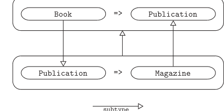

## 图 15.1 两个函数的子类型关系。

并且函数在其输出类型上是协变的。实际上，如果你定义了一个高阶函数：

```
Scala
def higherOrder(f: Book => Publication) = ...
```

你可以安全地使用类型为 `Publication => Magazine` 的参数调用它。作为一个函数，这个参数可以应用于 `Book` 类型的值（它可以应用于任何出版物类型），并会产生 `Publication` 类型的值（具体来说是杂志），因此它与参数 `f` 的类型要求一致。

当考虑型变时，可能会出现一些特殊情况。这里有两个例子。首先，Scala 中的不可变集合是不型变的。原因是 `Set[A]` 是 `A => Boolean` 的子类型。数据结构视角要求协变，但函数类型则要求逆变。

其次，虽然 Java 中所有其他数据结构都是不型变的，但数组是协变的。这种设计选择早于泛型的引入，并且是为了提高灵活性所必需的。例如，你可以定义一个签名为 `Object[]` 的排序函数，并将其应用于 `String[]` 类型的值——`String[]` 是 `Object[]` 的子类型。然而，由于数组是可变的，这种协变性会导致类型不安全：

```
Java
void printTitlesAndAddMagazine(Publication[] pubs) {
    for (Publication pub : pubs) System.out.println(pub.title());
    pubs[0] = new Magazine(...);
}

Book[] books = new Book[]{book1, book2};
printTitlesAndAddMagazine(books); // 抛出 ArrayStoreException
```

类型系统允许对书籍数组调用 `printTitlesAndAddMagazine` 函数，但尝试向数组中插入杂志会导致运行时异常。C# 中的情况相同，其数组也是协变的，并可能触发 `ArrayTypeMismatchException`。在 Scala 和 Kotlin 中，数组是不型变的。

你可以使用 `<:` 来指定上界，这意味着你要求一个类型变量是另一个类型的子类型。你可以使用相反的操作符 `>:` 来指定下界，要求一个类型变量是另一个类型的超类型：

```
```scala
def addMagazine[A >: Magazine](pubs: Set[A]): Unit = pubs += Magazine(...)
```
```

清单 15.8：使用点型变的下类型界示例。

函数 `addMagazine` 将一本杂志添加到可变集合中，要求类型 `A` 是 `Magazine` 的超类型。该函数很灵活，你可以在 `Set[Magazine]`、`Set[Publication]` 或 `Set[AnyRef]` 类型的值上调用它。

当你使用类型界时，会面临与之前看到的协变和逆变类型类似的约束。例如，以下函数会被编译器拒绝：

```
```scala
def printTitlesAndAddMagazine[A <: Publication](pubs: Set[A]): Unit =
  for pub <- pubs do println(pub.title)
  pubs += Magazine(...) // 被编译器拒绝

def printTitlesAndAddMagazine[A >: Magazine](pubs: Set[A]): Unit =
  for pub <- pubs do println(pub.title) // 被编译器拒绝
  pubs += Magazine(...)
```
```

第一个函数被拒绝，因为它试图向 `Set[A]` 类型的值中添加杂志，但你只知道类型 `A` 是 `Publication` 的子类型。不能保证类型 `A` 是 `Magazine` 的超类型——例如，它可能是 `Book`。第二个函数失败，因为它试图在类型 `A` 的值上调用 `title` 方法，但 `A` 仅被知道是 `Magazine` 的超类型，不一定是 `Publication` 的子类型——例如，类型 `A` 可能是 `AnyRef`。为了使其工作，`printTitlesAndAddMagazine` 需要 `A` 同时是 `Publication` 的子类型和 `Magazine` 的超类型。你可以通过同时指定下界和上界来实现：

```
```scala
def printTitlesAndAddMagazine[A >: Magazine <: Publication](pubs: Set[A]): Unit =
  for pub <- pubs do println(pub.title)
  pubs += Magazine(...)
```
```

清单 15.9：同时具有下界和上界的类型参数示例。

在更复杂的场景中，你可以将类型界与类型交集结合，以指定多个上界或下界：

```
def printTitlesInOrder[A <: Publication & Ordered[A]](pubs: Set[A]): Unit =
  for pub <- SortedSet.from(pubs) do println(pub.title)
```

清单 15.10：组合上类型界示例；与清单 15.14 对比。

出版物可以收集到有序集合中，因为类型 `A` 除了是 `Publication` 的子类型外，还已知是有序类型。

本节中用作示例的大多数函数都可以用 Java 编写：

```
<A extends Publication> void printTitles(Set<A> pubs) {
  for (Publication pub : pubs) System.out.println(pub.title());
}

void addMagazine(Set<? super Magazine> pubs) {
  pubs.add(new Magazine(...));
}

<A extends Publication & Comparable<A>> void printTitlesInOrder(Set<A> pubs) {
  for (Publication pub : new TreeSet<>(pubs)) System.out.println(pub.title());
}
```

Java 使用 `S extends T` 和 `? extends T` 表达上界，使用 `? super T` 表达下界。Java 没有 `S super T` 语法，因此有必要在函数 `addMagazine` 的定义中使用通配符。截至撰写本文时，Java 中不能组合下界和上界，因此无法编写清单 15.9 中函数 `printTitlesAndAddMagazine` 的等价形式。

在设计依赖不型变类型的库时，一个好的做法是依靠类型界来提高灵活性。例如，考虑一个并行执行任务并返回其输出列表的函数。¹¹ 任务指定为无参数函数：

```
public <A> List<A> runInParallel(List<Function0<A>> tasks) {...}
```

由于列表在 Java 中是不型变的，`runInParallel` 的一个限制是它不能应用于类型为 `List<T>` 的值，其中 `T` 是 `Function0<Book>` 的子类型。例如，假设 `BookPublisher` 是一个生成书籍的函数：

```
class BookPublisher implements Function0<Book> { ... }
```

¹¹ 关于可能的实现策略，请参见第 24 章中的案例研究。

你不能在 `List<BookPublisher>` 上调用 `runInParallel`。添加一个类型界可以使函数更加灵活：

```
public <A> List<A> runInParallel(List<? extends Function0<A>> tasks) {...}
```

你现在可以在 `List<BookPublisher>` 上调用此函数。但是，它随后返回的是具体为 `List<Book>` 类型的值：

```
List<BookPublisher> bookPublishers = ...
List<Book> books = runInParallel(bookPublishers); // 正确
List<Publication> pubs = runInParallel(bookPublishers); // 被编译器拒绝
```

要使最后一行工作，类型 `A` 必须是 `Publication`。但 `BookPublisher` 是 `Function0<Book>` 的子类型，而不是 `Function0<Publication>` 的子类型，并且函数类型在 Java 中不是协变的：`Function0<Book>` 不是 `Function0<Publication>` 的子类型。

你可以通过在函数类型内部使用第二个类型界来进一步改进 `runInParallel` 函数：

```
public <A> List<A> runInParallel(List<? extends Function0<? extends A>> tasks) {...}
```

清单 15.11：在不型变类型上使用类型界以提高灵活性。

这第二个界使得调用 `runInParallel(bookPublishers)` 并让返回值类型为 `List<Publication>` 成为可能，因为 `BookPublisher` 是 `Function0<? extends Publication>` 的子类型。你可以在 Scala 中定义一个类似的函数：¹²

```
def runInParallel[A](tasks: List[() => A]): List[A] = ...

val bookPublishers: List[BookPublisher] = ...
val pubs: List[Publication] = runInParallel(bookPublishers) // 正确
```

该定义更简单，并且不需要类型界，因为在 Scala 中，列表是协变的，函数在其返回类型上也是协变的。类型 `A` 可以是 `Publication`，因为 `BookPublisher` 是 `() => Book` 的子类型，而 `() => Book` 是 `() => Publication` 的子类型。

¹²一个更灵活的函数会使用种类（高阶类型），从而从列表返回列表，从集合返回集合，等等。


#### 15.10 类型类

之前，曾区分了名义子类型，通常在静态类型语言中使用，以及结构子类型，后者在动态类型语言中不太安全但更灵活且更受欢迎。有时，程序员本可以从静态类型中受益，但他们决定不能使用某种特定语言，因为他们需要更多的灵活性。在你因为绝对需要结构子类型而跑去使用 Python 或 JavaScript 之前，请注意一些静态类型语言提供了实现类似灵活性的机制，可能以更安全的方式实现。

```
case class Report(title: String, number: Int) // does not refer to Publication
```

即使报告有标题，你也不能使用定义为

```
def printTitle(pub: Publication): Unit = println(pub.title)
```

的函数 `printTitle` 来显示报告的标题，因为 Report 不是 Publication 的子类型。

正如我们所见，在依赖结构子类型（鸭子类型）的语言中，这不是问题：在这些语言中，只要运行时参数具有 title 方法，无论其名义类型如何，调用都是有效的。虽然 Scala 在核心使用名义子类型，但该语言也允许你定义结构类型：

```
type Titled = { def title: String }

def printTitle(doc: Titled): Unit = println(doc.title)
```

列表 15.12：Scala 中结构类型的示例。

类型 Titled 表示具有字符串值 title 方法的对象。你可以在任何具有 title 的东西上使用这个 printTitle 函数，包括报告：

```
val report = Report("Count to count: from Monte-Cristo to Mathias Sandorf", 123)
printTitle(report) // prints "Count to count: from Monte-Cristo to Mathias Sandorf"
```

当然，这种增加的灵活性带来了第 15.6 节中关于 Python 讨论的相同风险：

```scala
val person = Noble(name = "Edmond Dantès", title = "Comte de Monte-Cristo")
printTitle(person) // prints "Comte de Monte-Cristo"
```

结构子类型有一个更好的替代方案，其起源于函数式编程的世界：类型类。乍一看，这个概念很复杂，但它非常强大，并在函数式编程库中被广泛使用。

与结构类型一样，起点是定义一个具有标题的值的类型：

```scala
trait Titled[A]:
  def titleOf(document: A): String
```

Titled 表示一个类型类，即所有具有标题的类型类。你然后可以使用类型为 `Titled[A]` 的对象来显示类型 A 的值的标题：

```scala
def printTitle[A](doc: A, titledEvidence: Titled[A]): Unit =
  println(titledEvidence.titleOf(doc))
```

函数 printTitle 将第二个参数作为证据，即类型 A 是“titled”。只要类型 Titled[Report] 的对象可用，你就可以对报告应用 printTitle：

```scala
object ReportsAreTitled extends Titled[Report]:
  def titleOf(report: Report): String = report.title

printTitle(report, ReportsAreTitled) // prints the string returned by report.title
```

请注意，你可以为任何现有类型创建像 ReportsAreTitled 这样的证据值，包括在 printTitle 函数之前就存在的类型。在 Scala 中，类型属于类型类的证据通常使用上下文界限隐式传递：

```scala
def printTitle[A : Titled](doc: A): Unit =
  val titledEvidence = summon[Titled[A]]
  println(titledEvidence.titleOf(doc))
```

语法 `A : Titled` 表示你必须向函数 printTitle 传递一个类型为 `Titled[A]` 的隐式值，除了文档 doc 之外。这个值可以用 `summon` 函数检索。一旦类似对象 ReportsAreTitled 的值被隐式可用，你就可以在不提及证据的情况下显示报告标题：

```
given Titled[Report] with
  def titleOf(report: Report): String = report.title

printTitle(report) // prints the string returned by report.title
```

如果你定义类型为 Titled[Book] 和 Titled[Magazine] 的“given”值，你也可以显示书籍和杂志的标题。

为方便起见，你可以添加一个 apply 方法来更轻松地检索隐式参数：

```
object Titled:
  def apply[A : Titled]: Titled[A] = summon[Titled[A]]
```

你也可以添加一个扩展，使“titled”值具有 title 方法：

```
extension [A : Titled](document: A) def title: String = Titled[A].titleOf(document)
```

让我们把所有这些元素放在一起，作为类型类的典型应用：

```
// define a Titled type class, with convenience methods
trait Titled[A]:
  def titleOf(document: A): String

object Titled:
  def apply[A : Titled]: Titled[A] = summon[Titled[A]]

extension [A : Titled](document: A) def title: String = Titled[A].titleOf(document)

// use the type class in methods and classes, e.g.:
def printTitle[A : Titled](document: A): Unit = println(document.title)

// make books, magazines, and reports members of the type class:
given Titled[Report]    = _.title
given Titled[Book]      = _.title
given Titled[Magazine] = _.title

printTitle(report)    // OK
printTitle(book)      // OK
printTitle(magazine)  // OK
```

列表 15.13：通过类型类实现的泛型多态示例。

使用 `_.title` 的简写语法来定义 given 值。由于 Titled 是一个 SAM 接口，你可以使用函数来定义 Titled 对象，从而依赖于偏应用或 lambda 表达式。

当你定义类型类时，你依赖于特设多态——具有不同签名的各种 titleOf 方法——而不是子类型多态——在不同的子类型中以不同方式实现的相同 title 方法。这提高了灵活性，因为现有类型可以在不修改的情况下轻松添加到类型类中：必要的代码，如方法 titleOf，位于类型之外。

例如，方法 printTitlesInOrder 的这个定义优于列表 15.10 中使用 Publication & Ordered[A] 边界的定义：

```
def printTitlesInOrder[A <: Publication : Ordering](pubs: Set[A]): Unit =
  for pub <- SortedSet.from(pubs) do println(pub.title)
```

列表 15.14：结合类型边界和类型类以实现灵活性的示例。

该函数的这个变体更灵活，因为你可以在为其定义了 Ordering[A] 值的任何出版物类型 A 上使用它，包括不是 Ordered 的子类型的出版物类型。例如，由于标准库中的隐式转换，printTitlesInOrder 现在可以调用扩展 Java 的 Comparable 接口的出版物。

使用类型类而不是结构类型有几个好处。首先，尝试打印贵族人物的标题现在会被拒绝：

```
no implicit argument of type Titled[Noble] was found for an implicit parameter of method printTitle
```

其次，你可以在概念上具有标题但未定义 title 方法的文档上使用 `printTitle`。你只需要创建一个合适的证据对象：

```
case class Memo(header: String)
val memo = Memo("Famous Counts")

given Titled[Memo] = _.header

printTitle(memo) // prints "Famous Counts"
```

即使备忘录有标题而不是标题，你也可以对备忘录调用 printTitle。

第三，值和方法可以与每个类型类关联：

```
trait Titled[A]:
  def titleOf(document: A): String
  def logger: Logger = Logger.getAnonymousLogger
```

```
given Titled[Book] with
  def titleOf(book: Book) = book.title
  override def logger      = Logger.getLogger("book_logger")
```

这个类型类为每种标题类型关联一个记录器，因此例如与书籍相关的活动与其它出版物分开记录。这是用纯子类型多态无法做到的。另请参见下一个示例中零和 fromInt 的情况。

在 Scala 中，类型类在库设计中被广泛使用。标准库定义了几个类型类，如 Ordered（前面使用过）、Numeric（具有加法和乘法的数字）和 Fractional（具有除法的 Numeric 子类）。作为最后的说明，考虑一个对数字列表求平均值的函数：

```
def average(numbers: Seq[Double]): Double =
  if numbers.isEmpty then 0.0 else numbers.sum / numbers.length.toDouble
```

如果数字序列为空，该函数返回零。否则，它将所有数字的总和除以序列的长度来计算平均值。你可以将此函数推广到支持算术运算的任何类型 A：

```
def average[A : Fractional](numbers: Seq[A]): A =
  if numbers.isEmpty then Fractional[A].zero
  else Fractional[A].div(numbers.sum, Fractional[A].fromInt(numbers.length))
```

Fractional[A] 证据值用于获取零、除法运算以及从 Int 到 A 的转换。它也被方法 sum 隐式使用来添加所有数字。

你可以使用几个精心选择的 import 语句来提高代码可读性。在列表 15.15 中，infixFractionalOps 类似于列表 15.13 中的扩展方法 `title`：

```
def average[A : Fractional](numbers: Seq[A]): A =
  val evidence = Fractional[A]
  import evidence.{ fromInt, zero }
  import math.Fractional.Implicits.infixFractionalOps

  if numbers.isEmpty then zero else numbers.sum / fromInt(numbers.length)
```

列表 15.15：基于类型类的平均函数。

你可以在 double 值以及其它 Fractional 类型（如 BigDecimal）上使用这个 average 函数。[^14]

[^14]：为了创建 decimals 列表，会触发一个标准隐式转换，将 1.2 和 2.4 转换为 BigDecimal 值。


# 第15章 类型（及相关概念）

```scala
val doubles: List[Double] = List(1.2, 2.4)
val decimals: List[BigDecimal] = List(1.2, 2.4)

average(doubles) // 1.799999999999998, as a Double
average(List.empty[Double]) // 0.0, as a Double
average(decimals) // 1.8, as a BigDecimal
average(List.empty[BigDecimal]) // 0.0, as a BigDecimal
```

请注意，即使 Double 和 BigDecimal 实现了共同的数值类型——比如 Number——你也不能依赖子类型多态来实现 average 函数，因为对于给定的子类型 A，没有办法获得一个零值和一个 fromInt 函数。

- 类型策略因编程语言而异。它们通常在静态（编译时）与动态（运行期）之间进行比较，和/或在强（更严格）与弱（更宽松）之间进行比较。术语有些模糊，并非 universally agreed upon。
- 类型系统的更重要特征是它们在安全性（捕捉错误的有效性）、灵活性（在多大程度上实现而非阻止首选设计）以及简洁性（理解和使用的难易程度）方面存在差异。语言通常以牺牲第三个属性为代价来偏爱其中两个属性。
- 一种可能的观点认为类型是值的集合。有些集合，如 String 和 List[Int]，很大。另一些，如 Unit 和 Boolean，则很小。如果一个变量具有给定类型，其值始终属于对应的集合。类型越小，此信息越有价值。
- 对偶的观点试图将类型与它们定义的操作——例如方法与属性——联系起来。例如，在面向对象的语言中将类型定义为接口时，重点不在于该接口可以包含的值的集合，而在于可以对这些值应用的操作。
- 抽象数据类型（ADTs）是基于集合和操作的对偶视图的类型形式化模型。ADTs 定义了类型上所有可用操作的语义，通常以公理的形式给出。编程语言类型只是 ADTs 的近似，因为它们通常只指定操作的签名，而不指定其语义。

- 除了源代码中的显式类型声明外，许多编程语言还依赖推断算法来计算未指定的类型。类型推断的一个总原则是计算适合程序中表达的约束的最小类型——通常是最小上界。偶尔，推断的类型可能对程序员来说太窄，需要使用显式声明或类型标注来拓宽。推断类型过宽而需要收窄的情况也是可能的，但要罕见得多。
- 当类型被视为集合时，子类型对应于子集关系：S（作为类型）是 T 的子类型，如果 S（作为集合）是 T 的子集。因此，子类型 S 中的所有值也都在超类型 T 中并实现（至少）相同的功能。子类型满足替换属性：子类型的值可以在期望超类型值的地方使用。
- 一些编程语言使用名义子类型，即子类型通过名称与其超类型关联。其他语言使用结构子类型，其中子类型只需要实现超类型的功能，而不需要显式引用超类型。结构子类型往往更灵活但安全性更低：语义上独立但恰好共享方法名称的值可以通过未打算的子类型关系联系起来。
- 多态依赖于单一服务采取多种形式的思想。编程语言通常实现三种多态中的一些或全部：特设（同名但不同的方法和函数）、参数化（由一个或多个类型参数化的方法和函数）以及子类型（在不同子类型中实现不同的方式）。
- 来自共同超类型的不同子类型的异构值集合通常可以使用子类型多态统一处理。由此产生的代码简洁、健壮且灵活。特别是，如果以后创建了超类型的新的子类型，则无需修改。
- 参数化类型可能会保留其类型参数的子类型关系（协变）、反转它（逆变）或忽略它（非变体，也称为不变）。换句话说，当 S 是 T 的子类型时，可能 C[S] 是 C[T] 的子类型（C 是协变的），C[T] 是 C[S] 的子类型（C 是逆变的），或者 C[S] 与 C[T] 之间没有子类型关系（C 是非变体）。
- 对类型变体的支持因编程语言而异。一些语言实现固定规则——例如，在 Java 中除数组外的所有类型都是非变体。其他语言提供用户定义变体的机制——例如，C#、Scala 和 Kotlin 使用类似的变体注解。

- 通常，不可变的数据结构可以安全地设为协变，而可变结构只有在非变体时才是类型安全的。在支持函数式编程的语言中，函数类型通常在其输出类型上协变，在其输入类型上逆变。为了简化，语言可能会故意引入类型不健全性，使某些可变结构协变，就像 Java 和 C# 中的数组一样。
- 为了提高灵活性，使用非变体类型的代码可以依赖类型边界——也称为使用点变体注解——而不是指定精确类型。上界用于将类型参数约束为另一个类型的子类型；下界用于要求它为另一个类型的超类型。
- 特设多态和参数化多态有时被打包成类型类的概念，尤其是在没有子类型多态支持的语言中。类型类可用于在不同类型的值上统一访问服务，即使这些服务不通过共同的超类型相关。特别是，与使用类型类的函数独立开发的类型可以被适配并用作该函数的参数。

### 第二部分

# 并发编程

此页 intentionally left blank

### 第16章

#### 并发编程的概念

第一部分从这样一个观察开始：不存在单一的函数式编程定义。不幸的是，并发编程也没有 universally agreed-upon 的定义，而且定义并发编程至少与第一部分中定义函数式编程一样困难。问题类似：术语模糊，不同的人选择强调不同的方面。尽管如此，从并发程序并非以纯顺序方式执行这一无可争议的前提出发，并发编程的几个关键概念浮现出来，包括同步性、原子性、线程、同步和非确定性。

一个可能的起点是把并发程序看作是非顺序的程序。顺序程序一次执行一条指令，从头到尾执行。大多数程序员通过先编写顺序程序来学习编程。“main”函数从第一个编程语句开始，继续经过条件、循环和函数调用，直到执行最后一个语句，然后终止。

程序执行可以不是顺序的吗？一个常见的答案是程序可能涉及多个执行线程。每个线程按顺序执行程序，但多个线程同时进行。另一个答案是程序通过让其部分因异步操作的存在而乱序执行而不再是顺序的。非常经常，异步操作涉及线程，而线程主要通过异步操作使用，因此两种答案重合。然而，异步代码不必是多线程的，线程也不一定使代码异步。

作为说明，考虑以下程序：

```
println('A')
println('B')
println('C')
```

pseudocode


# 第16章 并发编程概念

这个程序是顺序的，并且按顺序打印 A、B 和 C。你可以通过让第二个打印语句乱序执行来打破顺序性。在 Scala 中，它可以写成如下形式：

```
```scala
println('A')
Future(println('B'))
println('C')
```
```

第二个打印语句被安排为乱序执行，程序输出不再保证是 A 后跟 B 后跟 C。乱序执行也可以在其他语言如 Kotlin 中触发：

```
```kotlin
println('A')
launch { println('B') }
println('C')
```
```

或 JavaScript：

```
```javascript
console.log('A');
Promise.resolve().then(() => console.log('B'));
console.log('C');
```
```

在最初的伪代码中，println('B') 是一个同步调用：它在此处、此时发生，在当前运行中，在打印 A 和打印 C 之间。相比之下，Scala 行 Future(println('B'))、Kotlin 行 launch { println('B') } 以及 JavaScript 行 Promise.resolve().then(() => console.log('B')) 具有类似的效果，即以异步方式调用 B 的打印，不是此处和/或不是此时，而是在当前操作流程之外。

作为一个非计算的类比，如果我点一份三明治并站在柜台前等待三明治在我面前制作完成，那就是同步的。如果我下单、拿到号码，并在三明治准备好之前就离开柜台，那就是异步的。¹

那么，刚才展示的三个程序不再是顺序的。它们是并发的吗？

JavaScript 程序使用单线程并保证 B 会在 A 和 C 之后打印，按 ACB 顺序。B 的打印不是“现在”发生，但某种程度上它仍然是“在此处”发生，在同一个执行线程内。鉴于程序是单线程的，并且 ACB 顺序是有保证的，你甚至可以争辩说执行仍然是顺序的，只是顺序不同。

> 在这种情况下，它也是多线程的，只是顺序不同。除非我被要求在回到柜台取三明治时自己制作三明治。

那么，并发是否与使用多个线程相关？根据配置方式，示例 Scala 和 Kotlin 程序可能使用也可能不使用额外的线程来执行 B 的打印。相同的程序是否会因外部配置而并发或不并发？即使我们假设 Scala 和 Kotlin 程序在调用 Future 或 launch 时被配置为使用多个线程，这是否必然使它们并发？考虑这些变体：

```
println('A')
Await.ready(Future(println('B')), Duration.Inf)
println('C')
```

```
println('A')
launch { println('B') }.join()
println('C')
```

由于添加了同步，即使这些程序使用多个线程，也会按 ABC 顺序打印 A、B 和 C。你可以说 B 的打印不是发生在“此处”，即当前执行线程中，但它仍然是“现在”发生，在 A 和 C 之间。这使得程序成为顺序的，还是它们仍然是并发的？是否存在多线程的顺序程序？² 此外，即使在更早的非同步版本程序中，A、B 和 C 也注定会按某种顺序打印，一个接一个，顺序地。并不是两个字母会重叠，或者甚至出现在同一行。那么，这些名义上非顺序的程序中并发的是什么？

让我们修改 Scala 程序以使用慢速打印函数：

```
def slowPrint(x: Any) =
  var n = BigInt("1000000000")
  while n > 0 do n -= 1
  println(x)
slowPrint('A')
Future(slowPrint('B'))
slowPrint('C')
```

打印每个字母现在需要时间，因为它需要使用大整数从一个大数倒数。使用单线程配置，在用于排版本书的多核计算机上

> 你可能会争辩说最后这两个例子很愚蠢且人为（它们确实如此）。但更现实的例子也存在。例如，处理传入消息的 actors 代码（第 27.5 节）通常由多个线程按顺序执行，一个接一个。

程序需要 7.6 秒完成并按 ACB 顺序打印字母，像 JavaScript 程序一样。使用多线程配置，运行时间减少到 5.2 秒，约为单线程时间的三分之二。这是因为 B 的慢速打印和 C 的慢速打印现在在两个独立的执行线程内并发运行。时间从

(打印 A) + (打印 B) + (打印 C)

减少到

(打印 A) + max((打印 B) + (打印 C))

计算机的两个核心同时并行执行慢速倒数，即使终端上两个字母的实际打印仍然是顺序的，B 在 C 之前或 C 在 B 之前。换句话说，在两个核心执行大整数运算的层面存在并发，但共享终端上的打印仍然是顺序的（理应如此），即使涉及多个线程。

## NOTE

此时，你可能会期待关于并发与并行之间必然讨论的发生。在书籍和互联网博客中，这通常被认为是一个需要及早解决的基本要点。我不同意。尽管许多解释力求确定，但它们往往彼此不一致。如果你逼我，就像学生逼我一样，坚持让我做出区分，我的观点——受计算机协会 ACM 计算机科学课程 2013 版启发——是并行是我想要的并发（为了速度！），而并发是我需要处理的并行（程序中所有那些同时发生的事情）。然而，我在这里的论点是这并不重要。总体而言，无论你将它们归因于并行还是并发，你都面临相同的编程挑战。就本书而言，坚持基本的词典定义并将并行和并发视为同义词就足够了，两者都代表了几个动作在（大约）同一时间发生这一思想。在以下章节中，我交替使用这两个术语。

#### 16.2 并发编程概念

第 16.1 节的代码片段并没有导致并发的明确定义，但它们仍然可以用来说明并发编程的几个基本概念，这些概念将在以下章节中探讨。

- *异步性* 是触发乱序执行的原因。并发程序涉及异步操作，这些操作偏离了所有开发人员熟悉的更简单、顺序的程序：`println('B')` 同步打印 B；`Future(println('B'))` 则异步执行，无论它是否引入并行。在编写并发程序时，你需要考虑

- *执行线程*，简称为线程，是程序中并发的常见来源，但不是唯一来源：进程也倾向于并发运行，并且诸如用户点击或传入服务器连接之类的外部事件也会引入并发。此外，程序员通常在非线程层面处理并发——例如，以任务、future、actor 或协程的形式。
- *原子性* 定义了基本程序单元，即可以乱序执行或“同时”执行的“部分”。例如，在第 16.1 节的示例中，将 BigInt 减一是一个原子操作，但从 1,000,000,000 倒数到零则不是。同样，一个字母要么被打印在终端上，要么不被打印；它不能“部分打印”。相比之下，打印多个字母不一定是原子的。单线程 JavaScript 程序保证 A 和 C 行构成一个原子单元，中间不可能有 B，而 Scala 和 Kotlin 程序——当配置为使用多个线程时——则不保证。作为程序员，你必须意识到程序中需要什么保持原子性，以及你正在使用的语言和库的原子性保证。
- *同步* 通常是协调并发活动所必需的。你可以使用 *同步器*，如锁和信号量，来将程序的并发性降低到不会危及程序正确性的水平。当同步器被误用时——正如我之前用 Scala 的 Await 和 Kotlin 的 join 所做的那样——它们可以将并发程序变成顺序程序，甚至可能阻止程序运行（参见第 22.3 节关于死锁的讨论）。
- *非确定性* 是并发的自然结果，也是并发编程的祸根。JavaScript 程序与 Scala 和 Kotlin 程序——当配置为多线程且没有额外同步时——之间最显著的区别在于，前者只能产生一种可能的字母序列 ACB，而后者可能在不同运行中产生不同的序列。这种非确定性行为对测试和调试的影响是巨大的。

#### 16.3 总结

没有必要深入探讨什么构成并发编程的哲学讨论来介绍许多编程语言构造的基础核心概念，如执行线程、异步调用、原子操作、同步和非确定性。并发编程的艺术在于编写能够恰当地平衡并发多个方面的程序：线程太多（或


## 第16章 并发编程概念

（不足）可能会影响性能；同步不足（或过多）可能会影响正确性；原子性是推理并发系统的关键，但非确定性使得此类推理变得困难；等等。以下章节将通过 Scala、Java 和 Kotlin 中的代码示例探讨这些相互交织的并发编程概念。

> NOTE
>
> 本书中的所有代码示例都依赖于语言的 JVM 实现。虽然第一部分的大多数示例在不同的实现上行为相似——Scala 和 Kotlin 都定义了基于 JavaScript 的替代实现——但第二部分的代码示例则不然。多线程通常涉及与操作系统（OS）的紧密交互。线程，尤其是通常由操作系统作为轻量级进程进行管理。在本书的剩余部分，并发编程的讨论以在 Unix 系统上运行的标准 JVM 为前提。如果代码在不同的平台上编译和执行，例如 Android，则需要调整一些注释和解释。

### 第17章 线程与非确定性

顺序程序只有一个执行线程。程序可以通过创建额外的线程使之并发，从而使多个线程并行执行程序。线程如何访问硬件计算资源通常由调度程序编排——通常在操作系统中——而这不在程序员的控制之下。因此，在没有额外同步的情况下，多个线程共同执行其指令的确切顺序是不可预测的。因此，多线程程序往往表现出非确定性行为。这种非确定性极大地增加了测试和调试的复杂性。

#### 17.1 执行线程

执行线程——简称为线程——表示一系列指令的执行。程序通常从一个线程¹开始，并在该线程完成时终止。程序

```scala
import tinyscalautils.text.{ println, threadTimeDemoMode }

println("START")
println("END")
```

会产生如下形式的输出：

```text
main at XX:XX:14.216: START
main at XX:XX:14.217: END
```

该程序依赖于一个 println 函数，该函数被定义为向显示的消息添加线程和时间信息。² 这里，一个名为“main”的线程由 JVM 创建并启动，按顺序执行这两个语句，在几毫秒内完成，此时程序结束，JVM 终止。

要创建额外的线程（除 main 之外），Java 定义了 Thread 类，JVM 语言依赖于 Java 的线程创建机制。你通过将类型为 Runnable 的参数传递给其构造函数来实例化 Thread 类，Runnable 是一个只有一个方法 run 的接口。启动后，新创建的线程执行此 run 方法，然后终止：

```scala
println("START")
class LetterPrinter(letter: Char) extends Runnable:
  def run(): Unit = println(letter)

val tA = Thread(LetterPrinter('A'))
val tB = Thread(LetterPrinter('B'))
val tC = Thread(LetterPrinter('C'))

tA.start()
tB.start()
tC.start()
println("END")
```

> 列表 17.1：多线程程序示例。

该程序定义了一个可运行类 LetterPrinter，并实例化三次以创建三个线程 tA、tB 和 tC，然后启动它们。该程序会产生如下形式的输出：

> main at XX:XX:42.767 : START
> Thread-0 at XX:XX:42.789 : A
> Thread-2 at XX:XX:42.789 : C
> Thread-1 at XX:XX:42.789 : B
> main at XX:XX:42.789 : END

START 和 END 消息由 main 线程打印，如前所述。字母 A、B 和 C 由三个不同的线程打印，分别命名为 Thread-0、Thread-1 和 Thread-2。当你对 tA、tB 和 tC 调用 start 时，你有效地在系统中引入了并行性。在三个新线程启动后，程序中有四个正在运行的线程——main、Thread-0、Thread-1 和 Thread-2——所有打印语句（A、B、C 和 END）几乎在同一时间一起发生。

创建线程时为其命名是一个良好的实践。这使得阅读日志和线程转储变得更容易（参见第 22.4 节）。要为它们命名，你可以按如下方式创建三个线程 tA、tB 和 tC：

```scala
val tA = Thread(LetterPrinter('A'), "printerA")
val tB = Thread(LetterPrinter('B'), "printerB")
val tC = Thread(LetterPrinter('C'), "printerC")
```

#### 17.2 使用 Lambda 表达式创建线程

第 9.5 节讨论了使用 lambda 表达式实现单抽象方法（SAM）接口。由于 Runnable 是一个 SAM 接口，你可以使用 lambda 表达式生成线程。线程 tA、tB 和 tC 可以在没有类 LetterPrinter 的情况下创建：

```scala
val tA = Thread(() => println('A'), "printerA")
val tB = Thread(() => println('B'), "printerB")
val tC = Thread(() => println('C'), "printerC")
```

列表 17.2：使用 lambda 表达式创建线程的示例。

Java 的 lambda 表达式和方法引用也可以使用：

```java
void printB() {
    println('B');
}

var tA = new Thread(() -> println('A'), "printerA");
var tB = new Thread(this::printB, "printerB");
```

#### 17.3 多线程程序的非确定性

让我们修改列表 17.1 中的程序，为其线程命名并连续运行三次。你可能会观察到如下输出：

```text
main at XX:XX:30.563: START
printerC at XX:XX:30.585: C
printerA at XX:XX:30.585: A
printerB at XX:XX:30.585: B
main at XX:XX:30.585: END
```

```text
main at XX:XX:51.482: START
printerA at XX:XX:51.505: A
printerB at XX:XX:51.505: B
main at XX:XX:51.505: END
printerC at XX:XX:51.505: C
```

```text
main at XX:XX:38.261: START
main at XX:XX:38.283: END
printerB at XX:XX:38.283: B
printerA at XX:XX:38.283: A
printerC at XX:XX:38.283: C
```

特别值得注意的是，三次运行中字母的打印顺序在第一次运行中为 CAB，但在接下来的两次运行中为 ABC 和 BAC。这说明了多线程程序的非确定性。

当在 Thread 对象上调用 start 方法时，运行时需要创建一个实际的线程——通常由操作系统管理的轻量级进程——并将其调度以供执行。运行时如何调度线程不在程序员的控制之下。调度程序以应用程序级别未知的方式向线程分配运行时量子。当我运行演示程序时，我的计算机报告有 2985 个活动线程——其中大多数在 JVM 之外——共享八个处理器核心。所有正在运行的线程都在你不知道且无法选择的时间不断地被调入和调出执行。因此，你无法确切知道你的线程何时执行其指令以及在被操作系统挂起以让其他线程运行之前会持续多长时间。示例程序中字母打印的确切顺序是不可预测的，通常每次运行都会有所不同。

还请注意，在最后两次运行中，main 线程在打印完成之前就已终止。在 main 线程对另一个线程调用 start 后，它继续自己的运行，而可运行目标稍后在单独的线程内执行。由于存在其他活动线程，JVM 在 main 线程完成后仍会继续运行。它只有在所有线程终止后才会停止。³

#### 17.4 线程终止

一旦启动，线程会一直运行，直到其可运行任务中指定的 run 方法结束。要使线程终止，run 方法必须完成，无论是正常完成还是通过异常突然终止。没有办法从另一个线程强制终止一个线程。相反，你需要向线程发出信号，指示它应结束其运行，给它一个清理资源和共享数据的机会，然后再终止。请记住，如果一个线程选择忽略此类信号，它将继续运行，可能阻止 JVM 终止。

¹ 更准确地说，用户代码在单个执行线程内执行。通常，JVM 使用额外的线程进行垃圾回收、即时编译和其他操作。

² 在接下来的章节中，许多代码示例使用此修改后的 println 函数——或其 printf 变体——而无需显式导入。

³ Java 还有守护线程的概念，它们不会阻止 JVM 终止，但很少使用。


一种优雅终止的常见策略如下：

```
object task extends Runnable:
  @volatile private var continue = true

  def terminate() = continue = false

  def run() =
    while continue do
      // perform task
    end while
    // cleanup
end task

val runner = Thread(task, "Runner")
runner.start()
// other code while runner is running
task.terminate()
```

清单 17.3：使用 volatile 标志请求线程终止。

runner 线程持续执行其任务中的代码，同时定期检查一个标志，这里命名为 continue。通过将该标志设置为 false 来请求线程终止。

这种线程终止模式是足够的，只要线程没有陷入循环中某处、无法检查终止标志的危险。这种情况可能由同步（例如，线程阻塞在锁或其他同步器上）或 I/O（例如，线程阻塞在从空套接字读取数据）引起。在存在阻塞操作的情况下处理终止可能相当棘手，这个主题留待更高级的讨论。

变量 continue 必须声明为 volatile，因为它在没有任何同步形式的情况下在线程间共享（参见第 22.5 节关于 Java 内存模型的讨论）。volatile 变量是一个高级概念，在你决定更深入地钻研并发编程之前，可以放心地忽略它。像 continue 这样的终止标志是 volatile 变量在高级编程模式之外最常见的用途。

调用 task.terminate() 只是一个终止请求，但运行该任务的线程将继续运行，直到（并且除非）它检查 continue 标志、执行清理代码并完成 run 方法，此时任务才可以被视为已完成，其状态可被主线程使用。经常需要让一个线程等待另一个线程结束——例如，监督线程等待工作线程完成其任务。可以使用线程的 join 方法来实现这一点。

触发不正确行为的时机。这种情况给开发人员带来了双重困扰：

- *测试：* 你可以成功测试一个程序一百万次，却在下一次运行测试时——甚至在生产环境中——因为线程执行时机的糟糕配合而失败。甚至可能出现这样的情况：导致这种糟糕时机所需的环境只存在于应用部署的环境中，也许是由于特定数据（影响运行时间）或同一硬件上运行的其他活动。
- *调试：* 在观察到失败（测试中或生产中）之后，可能很难复现它：完全相同运行的下一次执行可能看起来又正常了。这大大增加了调试的难度。即使能够复现失败，故障场景往往涉及高并发（例如数百个线程），这使得追踪 bug 变得非常困难。更糟糕的是，在调试过程中应用的任何步骤（断点、日志记录等）都会影响线程的同步和时序，并可能使 bug 无法被察觉（参见 18.3 节末尾关于“海森虫”的附注）。

虽然测试和调试多线程程序没有银弹，但记住一些基本原则还是有帮助的：

- *避免过早优化。* 这条建议通常适用于单线程代码，但在多线程程序的情况下，更重要的是你要从安全、直接且易于理解的策略开始。这将降低推理、维护和修改代码的难度。需要记住的一点是，并发程序比顺序程序更难测试，你不能过于依赖测试这一安全网来捕获破坏性变更。
- *测试时最大化并发。* 测试并发应用时，仅仅尝试“合理”的场景是不够的。bug 往往是由不寻常甚至极端的时序触发的——例如，由于任务异常短或异常长。为了产生多种多样的操作交错，你应该努力以高并发级别测试程序。测试在十几个线程时成功运行、而在使用一百个线程时开始失败的情况并不少见。⁴ 同样重要的是要确保更大的线程数量确实会增加并发。一个常见的错误是引入一个人为的瓶颈（例如，一个日志数据结构、一个伪随机数生成器），它会串行化操作，阻止线程按照应有的方式并发运行。
- Thread 类定义了一个静态方法 yield，⁵ 根据其文档，这是一个“对调度器的提示，表明当前线程愿意放弃

其对处理器的当前使用。”在测试时，你可以在程序中插入对 `yield` 的调用，尝试增加一次运行中操作交错的方式数量。（第 18.3 节在原子性方面讨论了 `yield` 合适用法的示例。）因为线程随时可能被调度器挂起，使用 `yield` 不会产生原本不可能出现的场景，因此，在正确的程序中添加对 `yield` 的调用绝不会导致故障。

- *为线程命名并记录细粒度活动。* 让一个不正确的并发程序在测试中失败已经够难了。要找出导致失败的一系列步骤则更难，尤其是涉及许多线程的时候。详细的日志信息——不幸的是它随线程数量增长——通常是定位同步错误所必需的。在记录日志时，你可以使用 Java 静态方法 `Thread.currentThread` 来获取正在执行某段代码的线程的信息。
- *用静态分析工具补充测试。* 静态分析技术可以应用于设计、源代码或编译代码级别，许多此类技术主要关注并发问题。由于它们不依赖特定运行时步骤序列的非确定性出现，因此常常可以发现其他测试形式未能发现的 bug。（参见 23.4 节末尾关于模型检查的附注。）

#### 17.6 小结

- 默认情况下，许多程序是单线程的。并发/并行是通过创建额外的执行线程引入的。线程随后可以在同一程序中并发运行并相互交互。
- JVM 语言依赖于 Java 的 `Thread` 类来创建线程。这个类的一个实例是一个普通对象，具有方法和字段。然而，当它的 `start` 方法被调用时，就会创建一个新的（真正的）执行线程。这个线程通常作为操作系统的一个轻量级进程实现，但也可能由 JVM 直接管理。
- 新线程的行为由一个带无参 `run` 方法的对象指定，该方法包含线程要执行的代码。这个对象通常可以用 lambda 表达式语法实现为一个函数。
- 线程在到达其代码末尾时终止，无论是正常结束还是因异常而突然中断。线程可以通过 `join` 方法等待其他线程终止，该方法常被监督线程用来等待工作线程完成。当所有应用线程都结束时，JVM 终止。
- 线程需要与其他计算机活动共享计算资源，包括 JVM 之外的其他进程的线程。调度机制（通常是操作系统的一部分）负责向所有线程分配计算时间。因此，线程会被挂起——以让其他线程运行——然后以应用程序无法控制的方式恢复。这种不可预测的线程调度往往使多线程程序变得不确定：同一程序在相同输入下，连续运行可能表现出不同的行为。
- 不确定性常常使多线程程序的测试和调试变得非常棘手。一个给定的测试可能不可预测地成功或失败，并且故障场景在调试时可能难以复现。只有在许多线程下才偶尔出现的 bug 可能非常难以追踪。


This page intentionally left blank

### Chapter 18: Atomicity and Locking

During the execution by a thread of a compound operation that consists of multiple steps, other threads can observe and interfere with the state of an application as it exists between these steps. By contrast, an atomic operation consists of a single step, with no possibility of disruption during that step. Locking is a mechanism that can be used to make a compound operation by a thread appear atomic to other threads, thereby preventing them from interfering during its execution in ways that would be detrimental to correctness. Different systems define their own locking mechanisms. In particular, Java defines a basic form of locks that can be used with any JVM language.

#### 18.1 Atomicity

Chapter 17 discussed a program in which three threads shared a terminal to output the letters A, B, and C. The three letters could appear in different orders from run to run, and this nondeterminism was due to the unpredictable scheduling of threads.

Consider this variant in which, instead of sharing a terminal, two threads (in addition to main) share an integer value:¹

```scala
// DON'T DO THIS!
var shared = 0

def add(n: Int): Unit = n times (shared += 1)

val t1 = Thread(() => add(5), "T1")
val t2 = Thread(() => add(5), "T2")

t1.start(); t2.start()
t1.join(); t2.join()

println(shared)
```

Listing 18.1: Multiple threads share an integer unsafely.

¹Function times is used to repeat code n times. It was defined in Listing 12.4.

Two threads are started by the main thread. Each thread increments a shared integer five times. The main thread waits for completion of all the increment operations and then prints the value of the shared integer.

On its first run, the program’s output was

```
main at XX:XX:19.251: 10
```

In my experiment, the output was similar on the next run and, using a loop to repeat execution, in the next 3189 runs. The 3190th run, however, produced this output:

```
main at XX:XX:26.180: 7
```

The remaining 96,810 runs all produced the value 10. In other words, two threads performing five increments each increase the value of a shared integer by 10 most of the time, but not always.

Looking at the bytecode² resulting from the compilation of shared += 1 can be informative:

```bytecode
0: aload 1
1: getfield      #92      // Field scala/runtime/IntRef.elem:I
4: iconst_1
5: iadd
6: istore 2
7: aload 1
8: iload 2
9: putfield      #92      // Field scala/runtime/IntRef.elem:I
```

Field 92 corresponds to variable shared in Listing 18.1. The bytecode shows that the field is read from memory (getfield), incremented by one (iconst_1/iadd), and the new value stored in memory (putfield).

When threads T1 and T2 execute this code concurrently, the scenario depicted in Figure 18.1 is possible. In this scenario, T2 reads the same value of shared read by T1 (say, 3), also increments it to 4 (as T1 did), and writes 4 back into shared. After both threads have completed their execution of shared += 1, the value has changed from 3 to 4, and an increment has been lost. Because of overlapping read/write sequences by separate threads during a run, you can end up with a final value of shared that is less than 10, like the value 7 observed in the 3190th run.

Figure 18.1 Possible interleaving of two increment operations.

This example illustrates that incrementing an integer variable is not an atomic operation. It is implemented using multiple instructions—at least reading, incrementing, and writing back—and those steps can end up being interleaved among multiple threads in arbitrary ways.

²Of course, the bytecode could be different with another compiler and is often recompiled into machine code by the JVM's just-in-time compilers anyway. Nonetheless, looking at it helps emphasize the non-atomicity of an integer increment.

#### 18.2 Non-atomic Operations

If something as basic as incrementing an integer is not atomic, very few functions and methods can be expected to run atomically when executed by multiple threads. This has important consequences for the multithreaded behavior of code designed with a single thread in mind: Simply put, it doesn't work.

For instance, you can modify the previous program to share a Java list instead of an integer:

```scala
// DON'T DO THIS!
val shared = ArrayList[String]()

def addStrings(n: Int, str: String): Unit = n times shared.add(str)

val t1 = Thread(() => addStrings(5, "T1"), "T1")
val t2 = Thread(() => addStrings(5, "T2"), "T2")

t1.start(); t2.start()
t1.join(); t2.join()

println(shared.size)
```

Listing 18.2: Multiple threads share a list unsafely; fixed in Listing 18.5.

As before, some runs display a size of 10 for the list at the end, while others finish with fewer than ten elements. If you think about it, somewhere in the implementation of ArrayList, an index needs to be incremented to fill the next slot in the array. Since integer increments are not atomic and can produce incorrect values in a multithreaded context, it is not surprising that multiple threads calling method add at the same time can overwrite each other, resulting in lost values.

If you run the program enough times, it will also exhibit another interesting behavior. The 6,402,829th run in my experiment produced an exception in thread T1:

```
Exception in thread "T1" java.lang.ArrayIndexOutOfBoundsException:
    Index 3 out of bounds for length 0
    at java.base/java.util.ArrayList.add(ArrayList.java:455)
    ...
```

An examination of the source code of the class ArrayList used in the test suggests an explanation. Lists are created using an empty array with zero capacity. When a first element is added to a list, this array is replaced with a newly allocated array (with a capacity of 10). In the failed run shown here, thread T2 created this new array and used it to insert three values into the list. Because class ArrayList does not include any mechanism for synchronization, thread T1 then tried to insert its first value (4th list element, at index 3) into the previous array, with zero capacity.

Functions typically consist of multiple statements, and most statements consist of even more elementary instructions at the machine code level. These can be interleaved in arbitrary ways by independent threads. As a result, code that was not designed to handle such interleaving is likely to break when instances are shared among threads. In particular, and with very few exceptions (Random is one), most classes in java.util are not safe for multithreaded use without synchronization. If you improperly share instances of classes such as HashMap and PriorityQueue between threads, they will exhibit unpredictable behavior similar to what was demonstrated using ArrayList.

Note that the programs being tested in this experiment were designed to fail, and they still can appear to behave correctly in thousands of successive runs. In these programs, threads interact in unrealistic ways, modifying shared data as often as possible, which increases the chances for an undesirable interaction. In an actual application, threads will perform independent work and only occasionally access a shared data structure at the same time. Failures will be more infrequent and harder to produce but still potentially devastating.

#### 18.3 Atomic Operations and Non-atomic Composition

Some operations are guaranteed to be atomic. For instance, reading or writing a primitive int on the JVM is atomic: A thread will never see “half” an integer, or a mixture of bits from two separate integers. As we have seen, however, code that combines multiple atomic operations—such as reading and then writing to implement an increment—is not atomic by default.

As an illustration, consider the problem of assigning a unique rank to users as they register for a service: The first user gets rank 1, the next user rank 2, and so on. You can implement registration by incrementing a userCount value with each incoming user. However, if you want it to work correctly when a service is shared among threads, you cannot write the increment as userCount += 1, which is not atomic. Instead, you would need to rely on a different type, one that implements an atomic increment. Java defines a class AtomicInteger for this purpose:

```scala
private val userCount = AtomicInteger(0)

// DON'T DO THIS!
def getRank(): Int =
    userCount.increment()
    userCount.get
```

A single atomic integer is created and initialized with zero. The getRank function increments this integer using a method increment, which is designed to be safe when called by multiple threads. This way, all the registrations are guaranteed to be recorded—no lost increments as occurred earlier—and after ten users register, the value of userCount will be 10.

However, the program is still incorrect. It does not satisfy the desired property that all users are assigned unique ranks. A scenario is possible in which two users, say the third and fourth, register at about the same time. Both threads execute userCount.increment(), which brings the counter value to 3, then to 4. Both threads then execute userCount.get, which returns the value 4 for both, and both users end up with identical ranks (Figure 18.2).

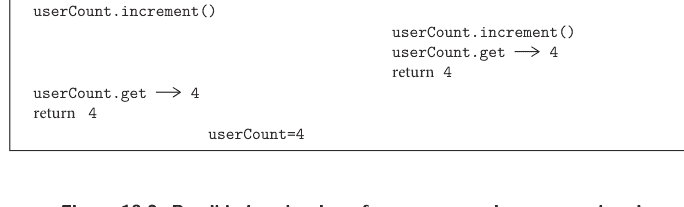

Figure 18.2 Possible interleaving of two non-atomic compound actions.

The increment that took multiple steps with a regular integer has become atomic, but in getRank, incrementing and getting the incremented value are still two separate steps. Indeed, Java's class AtomicInteger does not define an increment method; I added it only for the purposes of this illustration. Instead, the class defines a method incrementAndGet, which first increments the integer, then returns the incremented value, all in one atomic step. This is exactly what you need to implement getRank:


```
private val userCount = AtomicInteger(0)

def getRank(): Int = userCount.incrementAndGet()
```

### Listing 18.3: Using an AtomicInteger to generate unique values.

现在考虑该问题的这个变体，其中只有前五个用户被允许注册。注册成功或失败通过返回一个选项来指示：

// DON'T DO THIS!
def getRank(): Option[Int] =
  if userCount.get < 5 then Some(userCount.incrementAndGet()) else None
```

### Listing 18.4: Example of non-atomic check-then-act; fixed in Lis. 18.7.

这个变体是不正确的。`incrementAndGet` 的使用保证了排名的唯一性。然而，这段代码使得多于五个用户注册成为可能。一个可能的场景如图 18.3 所示。失败的原因是两个线程同时检查条件 `userCount.get < 5`。这里的问题在于测试和随后的操作不是原子的，仍然分为两步：先检查值是否小于五，然后再递增它并返回递增后的值。`AtomicInteger` 类没有定义一个方法来在一个原子步骤中执行整个计算——检查、递增和获取。

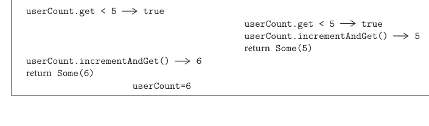

### Figure 18.3 Possible interleaving of two non-atomic check-then-act.

非原子的检查后执行是并发错误的一个常见来源。在多线程程序中编写条件时，你应该始终仔细思考。随着练习，你会自然地开始思考线程在 `if` 之后、`then` 或 `else` 代码之前被切换出去的情况。

你可以通过编写一个测试来证明这两个有缺陷的 `getRank` 实现是不正确的，其中多个线程同时调用该函数。测试有时会成功，有时失败。当另一个线程在递增和获取之间访问原子整数时失败（第一个示例），或在 `if` 和 `then` 之间失败（第二个示例）。你可以通过在 `getRank` 函数的代码中插入对 `Thread.yield` 的调用来使这些失败更有可能发生（参见第 17.5 节）：

```
def getRank(): Int =
  userCount.increment()
  Thread.`yield`()
  userCount.get()

def getRank(): Option[Int] =
  if userCount.get() < 5 then
    Thread.`yield`()
    Some(userCount.incrementAndGet())
  else None
```

添加了对 `Thread.yield` 的调用后，测试会更频繁地失败。相比之下，在正确的程序中添加对 `Thread.yield` 的调用永远不会破坏它。在线程可能不安全地失去 CPU 控制的地方插入此类调用通常是一个很好的测试策略；正确的代码应该继续表现正确。

### Aside: Example of a Heisenbug

考虑对 Listing 18.2 的这个修改版本：

```
val shared = ArrayList[String]()

def addStrings(n: Int, str: String): Unit =
  var added = 0
  while added < n do
    if shared.size >= 2 * added then
      shared.add(str)
      added += 1

val t1 = Thread(() => addStrings(5, "T1"), "T1")
val t2 = Thread(() => addStrings(5, "T2"), "T2")

t1.start(); t2.start()
t1.join(); t2.join()

println(shared.size)
```

在这个变体中，每个线程在向共享列表添加值之前检查自己是否没有太超前于另一个线程。线程只有在列表的长度至少是该线程已添加项目数的两倍时，才会向列表添加新项。在我的电脑上运行，这个程序什么也不打印并一直运行。

为了帮助调试问题，你可以使用简单的打印语句记录变量 `added` 的值：

```
Scala
...
while added < n do
  println(added)
  if shared.size >= 2 * added then
...
```

令人惊讶的是，这个修改后的程序确实终止了，并输出了预期结果：

```
T1 at XX:XX:28.543: 0
T2 at XX:XX:28.543: 0
T1 at XX:XX:28.543: 1
T2 at XX:XX:28.543: 1
T1 at XX:XX:28.544: 2
T2 at XX:XX:28.544: 2
T1 at XX:XX:28.544: 3
T2 at XX:XX:28.544: 3
T2 at XX:XX:28.544: 4
T1 at XX:XX:28.544: 4
main at XX:XX:28.544: 10
```

请注意，这个程序仍然是错误的：`java.util.ArrayList` 不是线程安全的结构，被多个线程在没有同步的情况下共享。然而，错误不再显现。注释掉打印语句并运行程序后，程序再次出现非终止。这种在被观察时消失的错误，有时戏谑地被称为 Heisenbug。

#### 18.4 Locking

本章迄今为止的错误代码示例都犯了同样的错误：线程在没有适当同步的情况下共享可变数据。解决这个问题的方法有多种，其中一些将在后面的章节中讨论，但锁定仍然是同步线程对共享数据操作的常用技术之一。

锁定的基本原理是使用需要在运行代码之前获取的锁来保护代码段（例如函数和方法）。最常见的锁形式是独占锁，一次只能被一个线程获取。当线程获取独占锁时，线程被称为拥有该锁。所有权在线程释放锁时结束。在线程拥有独占锁时，其他线程无法使用该锁。其他线程的任何获取尝试通常都会被阻塞，直到锁可用为止。

在 Listing 18.2 中，两个线程向共享列表添加字符串，导致不可取的行为和错误输出。为了解决这个问题，一个策略可以是让每个线程在能够向列表添加字符串之前获取一个独占锁：

```
exclusiveLock.lock()
shared.add(str)
exclusiveLock.unlock()
```

由于锁是独占的，你不能有两个线程同时在列表的 `add` 方法内部。相反，一个线程必须完成对 `add` 的整个调用的执行，然后释放锁，另一个线程才能再次开始该方法。实际上，`add` 方法现在看起来是原子的：不可能让一个线程部分运行该方法而另一个线程插入进来。特别是，列表在线程执行 `add` 时可能具有的中间状态对其他线程不可见——假设列表在应用程序中没有被其他地方使用。

#### 18.5 Intrinsic Locks

JVM 定义了自己的基本独占锁形式，称为内在锁。 （其他类型的锁在第 23.1 节中讨论。）在 Scala 中，内在锁是通过 `synchronized` 方法获取和释放的，该方法按名称以未计算的方式接受其代码参数（参见第 12.2 节）：

```
lock.synchronized(shared.add(str))
```

或

```
lock.synchronized {
  shared.add(str)
}
```

（请记住，Scala 允许你使用大括号而不是括号调用单参数函数。）锁在进入指定代码片段时获取，并在线程退出此代码时释放，无论是正常退出还是抛出异常。在线程位于 `synchronized` 方法内部时，锁不可用，尝试获取它的其他线程将被阻塞。值 `lock` 必须是对对象的引用。任何 Java 对象都可以用作锁。⁴

Listing 18.2 的错误列表共享程序可以使用内在锁修复：

```
val shared = ArrayList[String]()

def addStrings(n: Int, str: String): Unit =
  n times {
    shared.synchronized(shared.add(str))
  }

val t1 = Thread(() => addStrings(5, "T1"), "T1")
val t2 = Thread(() => addStrings(5, "T2"), "T2")

t1.start(); t2.start()
t1.join(); t2.join()

println(shared.size)
```

### Listing 18.5: Multiple threads share a list safely; fixed from Lis. 18.2.

两个线程都需要锁定共享对象，然后才能调用其 `add` 方法。由于一次只有一个线程可以拥有锁，现在不可能有多个线程同时位于 `add` 方法内部。程序结束时显示的列表大小现在保证为 10。

在 Listing 18.5 中，锁在每次调用 `add` 之前和之后获取和释放。作为替代，线程可以获取一次锁并在多次调用 `add` 时保持它：

```
def addStrings(n: Int, str: String): Unit = shared.synchronized {
  n times shared.add(str)
}
```

在这种情况下，锁定使整个函数 `addStrings` 看起来是原子的：一个线程将其所有字符串添加到列表中，然后是另一个线程的所有字符串。列表中不会出现 "T1" 和 "T2" 的交错。

哪个 `addStrings` 函数是正确的？这取决于你的应用程序的需求。例如，如果字符串列表是为日志目的而共享的，并且线程调用 `add` 方法来添加日志消息，那么单独锁定每次 `add` 的调用可能是正确的选择。相反，如果 `add` 方法用于添加多行日志消息中的一行，你可能必须在多个调用周围同步一个单一块。

⁴使用锁时，你应坚持使用你自己分配的对象。一些对象是由 JVM 隐式创建的——例如，用于装箱原始值——不能可靠地用作锁。


调用 add 的次数，因为包含来自不同消息的交错行的日志是不期望的。你甚至可以向用户提供这两种函数作为选择：

```scala
def addStrings(n: Int, str: String): Unit =
  n times {
    shared.synchronized(shared.add(str))
  }

def addAllStrings(n: Int, str: String): Unit = shared.synchronized(addStrings(n, str))
```

列表 18.6：锁可重入性的说明。

根据需要，用户现在可以调用 addStrings 以获得细粒度的并行性，或调用 addAllStrings 以获得粗粒度的并行性。请注意，源自 addAllStrings 内部的对 addStrings 的调用在到达 shared.synchronized(shared.add(str)) 时已经拥有 shared 锁。这是可以的。JVM 内在锁是可重入的，并且拥有锁的线程可以进入对同一锁同步的其他代码块。线程只有在退出外部块时才会释放锁——在此示例中，在完成对 addAllStrings 的调用时。

你需要谨慎使用锁，以为程序的正确性引入足够的原子性。如果通过加锁使之原子的代码块很小，它们可以在许多不同的方式下非确定性地交错，并且在断言正确性时需要考虑所有可能性。如果块太小——例如递增一个整数的三个原子步骤——正确性可能会丢失。另一方面，大型的原子步骤会降低并行性，因为这些步骤必须按顺序执行，一次一个线程。这可能会对性能产生负面影响。

#### 18.6 选择加锁目标

列表共享示例通过让线程在添加字符串之前先锁定列表本身 shared 来修复。加锁是必要的，但锁不一定是列表。唯一重要的是锁对象在线程之间共享，并且所有线程都通过锁定同一对象来进行同步。

考虑程序的这个变体作为一个独立应用程序：

```scala
object SharedListApplication:
  @main def run(msg: String, count: Int) =

    val msg1 = msg + "1"
    val msg2 = msg + "2"

    val shared = ArrayList[String]()

class Adder(str: String):
  def addStrings(n: Int): Unit =
    n times {
      synchronized(shared.add(str))
    }

val t1 = Thread(() => Adder(msg1).addStrings(count), "T1")
val t2 = Thread(() => Adder(msg2).addStrings(count), "T2")

t1.start(); t2.start()
t1.join(); t2.join()

println(shared.size)
end SharedListApplication
```

调用方法 synchronized 所使用的对象未指定。可以使用的潜在对象有多个。锁可以是列表 shared，如前所述。但你也可以使用 SharedListApplication，即定义整个应用程序的对象，或 msg1，即第一个线程使用的字符串，甚至是 scala.collection.immutable.Nil，即表示空列表的对象。所有这些选择都会导致一个正确的程序。

显然，有些选择比其他选择更有意义。在此示例中，使用 shared 或 SharedListApplication 是合理的。使用 msg1 会令人困惑。使用 Nil 则完全荒谬。关于使用哪些对象作为锁的问题将在第 19 章中更详细地重新讨论。请注意，如果你选择 msg1，程序之所以有效，是因为两个线程锁定的是同一个对象，而不是每个线程锁定自己的字符串。所有线程必须竞争同一个锁以实现所需的互斥至关重要。这里的一个可能错误是使用 this 作为同步的目标——也就是说，简单地写 synchronized(shared.add(str))。在这种情况下，每个线程在写入共享列表时会锁定自己的 Adder 实例。两个实例可以同时被锁定，允许线程同时进入列表的 add 方法。换句话说，将代码放在 synchronized 块中并不是保证此代码不能同时被多个线程执行的保证。一切都取决于你用作加锁目标的对象。

在某些情况下，没有明显的要加锁的对象。在这些情况下，你可以为此目的创建一个额外的对象。列表 18.4 中的程序因非原子的 if-then-else 而不正确。它可以用内在锁修复：

```scala
private var userCount = 0

private val lock = Object()

def getRank(): Option[Int] = lock.synchronized {
  if userCount < 5 then
    userCount += 1
    Some(userCount)
  else
    None
}
```

列表 18.7：使用加锁的原子检查后执行；从列表 18.4 修复。

由于加锁对于使 if-then-else 原子是必要的，因此递增普通整数没有问题，也不需要 AtomicInteger。

根据情况，你可以选择用单个锁保护数据，或决定将数据拆分为由单独锁保护的块。例如，假设列表 18.7 中注册的用户是玩家，并且函数 play 可以由注册用户调用以在游戏中行动：

```scala
def getRank(): Option[Int] = X.synchronized {
  // register user
}

def play(rank: Int): Unit = Y.synchronized {
  // act in the game
}
```

根据类的内部设计，新用户注册可能会或可能不会与游戏进行相互干扰。如果 X 和 Y 引用的是同一个对象——X eq Y 为真——则 getRank 和 play 函数是互斥的：一个线程在其中一个函数内部会阻止其他线程进入另一个函数。然而，如果 X 和 Y 引用的是两个不同的对象，一个线程可以在拥有 X 锁的同时执行 getRank 函数，而另一个线程可以在拥有 Y 锁的同时执行 play 函数。无论 X 和 Y 是同一个对象还是两个不同对象，都不会有两个线程同时执行 getRank，也不会有两个线程同时执行 play。我们在第 20 章的下一个案例研究将探讨用作单个锁的对象选择的各种选择，并讨论同一结构的双锁变体。

#### 18.7 总结

- JVM 对象是在所有线程都可以访问的共享堆中分配的。如果多个线程引用同一个对象，它们可以同时使用它。然而，线程的非确定性调度使得它们可能在操作中间被中断，可能使数据处于不适合其他线程使用的状态。未设计为线程安全的可变结构如果在没有额外协调的情况下在线程之间共享，将以不可预测的方式失败。特别是，这对 java.util 中的大多数集合是正确的。
- 这些故障是执行代码中指令不可预测交错的结果。即使概念上简单的操作，例如整数递增，也是由几个更小的指令实现的。为了防止不期望的交错，一组指令可以被设为原子。当原子操作由线程执行时，其所有效果或根本没有效果对其他线程可见。
- 不同数据类型提供不同的原子性承诺。例如，写入 `Int`、递增 `AtomicInteger`，以及在 `ConcurrentHashMap` 上调用 `putIfAbsent`，在多线程存在的情况下都被保证是原子的。然而，使用原子操作构成的复合操作仍可能涉及基本步骤的不可预测交错——递增 `Int`、仅在小于界限时递增 `AtomicInteger`、以及向 `ConcurrentHashMap` 添加多个键值对都不是原子操作。
- 创建代码的原子单元最常见的方法是通过加锁。独占锁一次只能供一个线程使用，可用于保证代码块互斥。需要执行受锁保护的代码的线程必须先获取锁，并且在锁可用之前可能被阻塞。
- 在 JVM 内部，任何对象都可以用作独占锁。这些内在锁在语言级别可用，作为函数（Scala、Kotlin、Clojure）、注解（Groovy）或关键字（Java）。内在锁是可重入的：拥有锁的线程在再次尝试获取它时不会被阻塞。
- 锁定的代码段必须仔细选择，以确保足够的原子性以满足正确性需求，同时不过度限制并行性。大的锁定代码段会导致大的原子操作，更容易推理，但并发性会降低，因为每个锁定段必须按顺序执行。
- 加锁目标——锁本身——也必须明智地选择。由不同锁保护的代码段可以并行执行，这可能取决于应用程序的细节而是期望的或不期望的。一方面，多个用途使用同一把锁可能会阻止线程在独立任务上取得进展，并可能造成同步瓶颈。另一方面，线程在不同锁上同步时仍可能在访问共享数据时相互干扰，导致可能不期望的结果。


### 第19章
#### 线程安全对象

线程交互最常见的方式是通过共享对象。那些可以在线程之间自由共享而无需线程协调访问的对象被称为线程安全。不可变对象天然就是线程安全的，但可变对象需要依赖内部策略来确保线程安全，通常通过加锁来实现。不同的加锁设计允许线程安全对象暴露其同步策略的多少或多少，从而在灵活性和误用风险之间产生权衡。

之前的示例表明，当数据被多个线程共享时，程序很容易表现异常。所有这些示例的共同点是被共享的数据是可变的：声明为 var 的整数变量、`AtomicInteger` 的实例，或由数组支持的可变列表。

事实上，并发编程的许多困难都源于共享可变数据。可变对象由于不可预测的写/写和读/写并发访问，并不是天然线程安全的。相比之下，不可变对象是可读但不可写的，可以在线程之间自由共享而无需额外同步。

以下示例使用三个线程运行存储在不可变数据结构中的一组任务：

```scala
val tasksA: List[Runnable] = ...
val tasksB: List[Runnable] = ...

val duties: Map[Int, List[Runnable]] = Map(1 -> tasksA, 2 -> tasksB, 3 -> tasksB)

def runTasks(id: Int): Unit = for task <- duties(id) do task.run()

val t1 = Thread(() => runTasks(1), "T1")
val t2 = Thread(() => runTasks(2), "T2")
val t3 = Thread(() => runTasks(3), "T3")

t1.start(); t2.start(); t3.start()
```

清单 19.1：线程自由共享不可变对象的示例。

任务存储在不可变列表中，而列表又存储在不可变映射中。在运行时，三个线程都会并发访问该映射，并且线程 T2 和 T3 也能安全地共享列表 tasksB。这是在没有任何加锁或其他同步的情况下完成的。

通过避免共享可变数据，你可以大大简化多线程程序的设计，首先通过最小化共享——在可能的情况下，线程最好处理自己的数据——其次尽可能使共享数据不可变。在本书第一部分中，我们在函数式编程的背景下考虑了不可变性的一些优点。不可变对象对并发编程也极其有益。

在 JVM 上，技术上不可变对象和从未被修改的对象之间存在区别，这源于对 final 字段的特殊处理。非 final 字段（Scala 中的 var 字段）在被任何线程自由读取之前可能需要某种形式的初始同步。这种同步在干净、简单的设计中往往会自然发生。[^1] 尽管如此，在处理线程时，对于不打算进行修改的字段，最好使用 val 而不是 var——或在 Java 中添加 final 修饰符。要判断从未被修改的对象的非 final 字段是否可以被线程安全地读取，需要理解 Java 内存模型（JMM），这是一个较为高级的话题（参见第 22.5 节）。

#### 19.2 封装同步策略

你可以自由地在线程之间共享不可变对象，但共享数据的修改需要线程通过同步进行协调，通常以独占锁的形式出现。例如在清单 18.5 中，两个线程能够正确地共享并修改一个可变列表，通过在每次访问列表之前锁定列表。正如第 18.6 节所述，选择锁定列表本身是任意的。你可以使用任何其他对象作为锁，只要该对象是共享的，并且所有线程都同意在访问列表时锁定该对象。

依赖这种约定是容易出错的。它要求用户代码在访问对象之前始终锁定特定的锁，这只能通过考虑代码库中对象的所有使用情况来检查。如果手动完成，这是一项繁重的工作。[^2] 这就像要求对对象的公共字段的所有修改都保持某种不变性。这不切实际。相反，良好的设计依赖于数据封装，这是面向对象编程的一个关键特性：可变字段往往是私有的，并且有公共方法可用于修改它们。

你可以使用相同的原则——封装——来控制线程间同步。不是指定代码访问对象时需要遵循的同步策略，而是让对象本身封装其自身的策略。能够在内部强制执行其策略的对象是线程安全的：所需的线程协调是在对象的方法内部实现的，线程可以自由调用这些方法而无需进一步同步。

作为说明，让我们用封装的加锁策略重写列表共享示例：

```scala
class SafeStringList:
  private val contents = ArrayList[String]()

  def add(str: String): Unit = synchronized(contents.add(str))
  def size: Int = synchronized(contents.size)
end SafeStringList

val shared = SafeStringList()

def addStrings(n: Int, str: String): Unit = n times shared.add(str)
```

清单 19.2：封装同步的安全列表；与清单 18.5 对比。

基于数组的列表不是线程安全的，被封装在 SafeStringList 类内部。内部列表 contents 是私有的，只能通过方法 add 和 size 访问。这些方法通过在每次使用数组列表之前始终锁定 this 来实现必要的同步。现在你可以编写函数 addStrings 而无需任何显式同步。

在类 SafeStringList 内部，两个方法都使用加锁来访问内部列表——不仅是修改列表的 add，还有仅查询其大小的 size。这极其重要：当可变数据受锁保护时，对数据的所有访问都必须通过锁进行。这包括写入和读取访问。[^3]

这一要求有两个主要原因。首先，加锁读取可以防止不期望的读/写交互。如果读取访问未加锁，你可能会观察到结构的中介、不一致状态。虽然在基于数组的列表中不太可能，但 size 方法可以通过遍历列表的循环来实现，而一个正在被线程修改的列表可能处于不适合另一个线程执行此迭代的状态。第二点更技术性。它是 Java 内存模型的结果：在读取时不加锁，就无法保证线程会看到其他线程先前使用锁所做的对结构的所有修改，包括使用锁写入的数据。细节并不重要，规则很简单：加锁时，所有访问——写入和读取——都必须通过同一把锁。

#### 19.3 避免引用逃逸

SafeStringList 中的同步封装之所以有效，是因为存在相应的数据封装。你可以确保对 contents 的所有访问都使用正确的锁，因为除了通过方法 add 或方法 size 之外，没有其他方式可以到达该数据。

如果对 contents 的引用逃逸封装，线程就可以在不加锁的情况下开始读取和写入列表：

```scala
// DON'T DO THIS!
def getAll: List[String] = synchronized(contents)
```

添加此方法后，SafeStringList 就不再是线程安全的：

```scala
shared.getAll.add(...) // adds to the list without locking!
```

执行此代码的线程会获取锁以获得对内部列表 contents 的引用。然而，锁会在方法 getAll 结束时释放，在线程调用 add 之前。换句话说，线程现在正在无锁地向基于数组的列表添加内容。

当然，引用逃逸在面向对象设计中通常是有害的，即使在单线程程序中也需要避免。然而，多线程往往使问题复杂化。方法 getAll 的下一个变体以在单线程上下文中无害的方式共享 contents 列表，但在多个线程参与时仍会引起问题：

```scala
// DON'T DO THIS!
def getAll: List[String] = Collections.unmodifiableList(synchronized(contents))
```

Java 函数 `Collections.unmodifiableList` 创建了一个包装器，禁用列表的所有变异方法。它通常用于在不破坏数据封装的情况下向外部代码提供对内部列表的只读访问：用户代码可以使用包装器查询列表，但不能修改它。然而，调用 `shared.getAll.get(...)` 的线程仍会在不加锁的情况下读取列表。正如第 19.2 节末尾所讨论的，这是不安全的，因为其他线程可能会锁定列表并同时修改它，导致并发读/写冲突（除内存模型问题外）。

[^1]：例如，如果映射是可变的并且所有 vals 都被替换为 vars，只要映射从未被修改且变量从未被重新赋值，清单 19.1 中的程序仍然是正确的。

[^2]：事实上，一些静态分析器正是这样做的：当一个值几乎总是使用同一个对象加锁访问时，对该值在未加此锁的情况下的任何访问都会被标记为可疑代码。

[^3]：清单 18.5 在检查两个工作线程都已终止后，在未加锁的情况下正确查询列表的大小。


总的来说，在单线程环境中用于维护数据封装的某些技术，在多线程存在的情况下是不够的。你仍然可以编写线程安全的getAll方法变体，但代价是复制整个列表：

```scala
def getAll: List[String] = ArrayList(synchronized(contents))
```

这类防御性复制通常可以通过用不可变数据结构实现可变对象来避免。这在第3.8节中讨论过，第19.5节将在多线程背景下重新讨论这个主题。

#### 19.4 公有锁与私有锁

在清单19.2的SafeStringList实现中，包装器本身被用作锁。这种设计选择使得锁是公有的——使用SafeStringList的代码可以直接访问该锁——并带来了客户端锁定的好处。

例如，你可以编写一个函数，在元素数量不超过某个上限时进行添加：

```scala
val shared: SafeStringList = ...

def addStringIfCapacity(str: String, bound: Int): Boolean = shared.synchronized {
  if shared.size >= bound then false
  else
    shared.add(str)
    true
}
```

清单19.3：客户端锁定示例。

该函数只有在列表大小保持在给定范围内时，才会将字符串添加到共享列表中。它类似于清单18.7中的getRank函数，并且出于相同的原因需要加锁——检查后操作（check-then-act）的原子性。这种锁定之所以可行，是因为add和size方法实现内部使用的锁已经被设为公有（并且可重入）。

使用公有锁时，必须考虑三个主要困难。首先是文档问题：文档需要明确说明使用哪个锁，并且这一选择在之后具有约束力，防止将来的实现改用另一个（公有或私有）锁。例如，Java的Collections.synchronizedList——一个类似于SafeStringList的标准库函数——其文档规定：“在遍历返回的列表时，用户必须手动对该列表进行同步”，这说明了包装器本身就是在内部使用的锁。

第二，公有锁存在被滥用风险——代码可能在不应该锁定列表的情况下锁定它。一个执行如下形式代码的线程：

```scala
shared.synchronized {
  // lengthy computation, or I/O, or other blocking calls...
}
```

会阻止其他线程以任何方式访问共享列表，即使只是查询其大小，并且这种阻止可能持续很长时间。

第三，也是最后一点，公有锁定仅在使用简单的同步策略时才可行——SafeStringList使用单一锁。对于更复杂的策略，例如锁分段（如java.util.concurrent.ConcurrentHashMap）和无锁算法（如java.util.concurrent.ConcurrentLinkedQueue），它就不再适用。

为了规避这些困难，可以将锁保持私有：

```scala
class SafeStringList:
  private val contents = ArrayList[String]()

  def add(str: String): Unit = contents.synchronized(contents.add(str))
  def size: Int = contents.synchronized(contents.size)
```

清单19.4：基于私有锁的安全列表；与清单19.2进行对比。

这个SafeStringList实现与之前一样线程安全，但使用一个私有对象（内部列表）作为锁。当然，缺点是那些需要原子迭代或原子检查后操作的外部函数无法编写。清单19.3中的addStringIfCapacity这样的函数不再可能实现，因为它无法访问contents进行加锁。作为替代方案，你可以丰富SafeStringList以提供额外的原子操作，但用户将仅限于该类所定义的操作。

#### 19.5 利用不可变类型

本章开头指出，不可变结构天然是线程安全的。同样正确的是，可变对象通常可以通过存储在可重新赋值字段中的不可变数据来实现（参见第4.1节的示例）。这两个观察结果产生了以下线程安全的SafeStringList实现：⁴

```scala
class SafeStringList:
  private var contents = List.empty[String]

  def add(str: String): Unit = synchronized(contents ::= str)
  def size: Int = synchronized(contents.size)
  def getAll: List[String] = synchronized(contents)
```

清单19.5：基于不可变列表的安全列表；与清单19.2和19.4进行对比。

这里的List类型指的是Scala的列表，contents现在是一个不可变列表。列表存储在一个var字段中，而不是val字段，以便可以重新赋值。通过将contents设置为新列表来添加元素——contents ::= str等同于contents = str :: contents。这个实现的一个有趣之处在于，getAll只是返回对内部列表的引用，避免了使用可变列表时所需的复制。内部列表最终在线程之间共享，但由于列表是不可变的，这种共享是无害的。⁵

当然，读写可变字段contents仍然需要加锁。这个变体使用的是公有锁，即包装器本身（this）。如果更倾向于私有锁，那么像清单19.4那样对底层列表进行加锁是不可行的：

```scala
// DON'T DO THIS!
class SafeStringList:
  private var contents = List.empty[String]

  def add(str: String): Unit = contents.synchronized(contents ::= str)
  ...
```

> ⁴我在这里假设线程通过适当的同步从其他线程获取对象的引用，这是通常情况。否则，Java内存模型的微妙之处将再次发挥作用，contents字段将需要在持有锁的情况下进行初始化：
> 
>     private var contents: List[String] = uninitialized
>     synchronized {
>       contents = List.empty
>     }

> ⁵由于值总是添加到列表的前端，因此返回时它们是逆序的。如果顺序很重要，可以使用列表以外的不可变类型，例如不可变队列。

这种方法行不通。调用add的线程需要先读取contents的值，然后才能将其用作锁。这种读取是在没有加锁的情况下进行的，因此是不正确的。

查看一下方法add的字节码，有助于更直观地理解这个问题：

```text
0: aload 0
1: getfield #38 // Field contents:Lscala/collection/immutable/List;
4: dup
5: astore 2
6: monitorenter
7: aload 0
8: aload 0
9: getfield #38 // Field contents:Lscala/collection/immutable/List;
12: aload 1
13: invokevirtual #51 // Method scala/collection/immutable/List.$colon$colon ...
16: putfield #38 // Field contents:Lscala/collection/immutable/List;
...
```

在第1行读取了contents字段，没有进行任何锁定。然后在第6行对其进行锁定——monitorenter是JVM的锁定指令——并在第9行再次读取。在第1行和第6行之间，变量contents可能被另一个调用add方法的线程写入，这种情况下，在第9行读取到的列表与第6行锁定的列表不同。图19.1展示了简化字节码中的一种场景。三次调用add方法后，列表只包含两个值。请注意，在某一时刻，两个线程最终锁定了两个不同的对象——一个空列表和一个只包含"B"的列表——并并行地进入它们的同步代码块。

图19.1 三次SafeStringList.add操作的可能交错。

```text
contents=list[]

Thread T1                          Thread T2

// add("A")
getfield #38 → list[]

// add("B")
getfield #38 → list[]

monitorenter: lock list[]
getfield #38 → list[B]
putfield #38 ← list[A,B]
monitorexit

// add("C")
monitorenter: lock list[]
getfield #38 → list[B]
putfield #38 ← list[A,B,C]
monitorexit

contents=list[C,B]
```

可以使用val字段作为锁来保护自身，如清单18.5和19.4所示，但对于可重新赋值的var字段，你不能这样做。（同样的情况也适用于Java中的final和非final字段。）相反，你需要创建一个额外的锁定目标，如清单18.7所示：

```scala
class SafeStringList:
  private var contents = List.empty[String]

  private val lock = Object()

  def add(str: String): Unit = lock.synchronized(contents ::= str)
  def size: Int = lock.synchronized(contents.size)
  def getAll: List[String] = lock.synchronized(contents)
```

清单19.6：使用不可变列表/私有锁的安全列表；与清单19.5进行对比。

#### 19.6 线程安全

本章和第18章都包含一些有缺陷的程序示例，这些程序在多线程存在的情况下行为不正确。我们还看到了如何通过加锁恢复正确性，从而得到能够处理并发访问的线程安全对象。然而，到目前为止，在本次讨论中，“安全”（或“不安全”）和“正确”（或“不正确”）只是被粗略地定义。

有些程序明显是不正确的，例如清单18.2中的程序，在尝试向列表添加字符串时抛出异常。但一个程序在并发情况下正确到底意味着什么呢？清单18.5中的程序是正确的，因为最终的字符串列表长度为10。但为什么期望值是10？你可能会回答：依次运行 shared.add("T1") 5次和 shared.add("T2") 5次会产生一个大小为10的列表，因此当两个计算并行执行时，也应该是这种情况。但顺序执行还会将所有五个"T1"值放在一起，所有五个"T2"值放在一起，而并行版本并不期望如此，它可能产生"T1"和"T2"值的任意交错。因此，一个并行程序可能产生一个在其顺序对应版本中不可能出现的列表，但并不会因此被视为不正确。需要更详细的解释。

当你向列表添加字符串时，期望add方法在效果上是原子的。列表首先在没有该字符串的状态下存在，然后包含整个字符串——不存在字符串“被添加了一半”的列表状态。列表的定义本身——即“成为一个列表”的语义——就是通过这种原子操作来表达的。“线程安全”的期望就是这些原子操作得以保留——换句话说，当一个列表被多个线程访问时，它仍然是一个列表。

并发可以形式化地定义为原子操作的交错。如果A和B是共享结构上的原子操作——比如列表上的add或get——并且一个线程与另一个执行B的线程并行地执行A，记为A || B，


单线程技术——例如在内部数据上共享只读视图——在涉及多个线程时就不再有效。

- 对象的用户有时可以参与其同步策略。这可以通过共享内部使用的锁来实现，这种技术被称为客户端锁定。这种方法的优点是外部代码可以锁定对象状态以实现多步原子操作，例如迭代。缺点是代码也可能误用同步策略，例如不必要地持有锁，从而造成同步瓶颈。更安全但也更受限的策略是完全封装同步，例如仅使用私有实例作为锁。
- 可变对象可以在内部依赖不可变类型。这种方法的最大好处是，对内部不可变数据的引用可以安全地在线程之间共享。这通常是只读视图（在多线程下不安全）或防御性拷贝（成本高昂）的可行替代方案。
- 当使用不可变类型实现可变对象时，它们存储在可重新赋值的变量中。为了保证线程安全，这些变量必须使用适当的同步进行读取和赋值。至关重要的是绝不要使用可重新赋值的字段本身作为锁：字段中的对象必须先在没有锁的情况下读取——因此可能与其他线程并发写入该字段——然后才能进行必要的锁定。
- 在设计并发程序时，你必须首先决定对可变对象的哪些操作应被外部感知为原子。然后通过确保由多个线程并行执行的同时原子操作始终具有与这些操作的某种顺序执行相同的效果来实现线程安全。

### 第 20 章

#### 案例研究：线程安全队列

本第一个并发编程案例研究讨论了线程安全先进先出队列的几种可能的基于锁的实现。特别有趣的是公共锁与私有锁之间以及单锁与多锁之间的对比。

##### 20.1 队列作为列表对

一种经典的先进先出队列设计使用两个函数式列表。思路是将队列的状态存储到两个列表中：in 和 out。列表 out 表示队列的前端，按顺序排列，而列表 in 是队列的后端，按 *反向* 顺序排列（图 20.1）。因此，out 的头部是队列中最旧（最先插入）的元素；in 的头部是最年轻（最后插入）的。队列元素从列表 out 的前端移除并添加到列表 in 的前端。这样，两个列表都从头部使用，避免了低效的尾端访问。当 out 用尽元素时，你需要反转 in 并使其成为新的 out（新的 in 然后为空）。这种反转被摊销到多个队列操作上，导致平均插入和移除时间为常数。

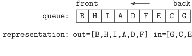

**图 20.1** FIFO 队列实现为两个 LIFO 列表。

在本章中，目标是编写一个适用于多线程使用的该队列版本。 resulting 队列将是非阻塞的：添加元素始终是可能的（容量无界），并且从队列中取出的元素以选项形式返回，以便从空队列中取出可以返回 `None`。

> ¹ 另一种选择是在队列满时阻塞线程，直到其他线程移除元素，并在队列空时阻塞线程，直到其他线程添加元素。这需要使用同步器，同步器将在第 22 章和第 23 章中讨论。参见列表 23.6 至 23.8 中的可能的阻塞队列实现。

##### 20.2 单公共锁实现

使传统的双列表队列线程安全的最简单方法是使用队列本身作为独占锁，并且仅在持有锁时访问任一列表：

```
class ConcurrentQueue[A]:
  private var in, out = List.empty[A]

  def isEmpty: Boolean = synchronized(out.isEmpty && in.isEmpty)

  def put(value: A): Unit = synchronized(in ::= value)

  def take(): Option[A] = synchronized {
    if isEmpty then None
    else
      if out.isEmpty then
        out = in.reverse
        in = List.empty
      val first = out.head
      out = out.tail
      Some(first)
  }
```

列表 20.1：线程安全队列（单公共锁）；另见列表 20.5 和 20.7。

当两个列表都为空时，队列为空。你通过将值 prepend 到 in 列表来向队列添加值——in ::= value 与 in = value :: in 相同。你通过将列表 out 减少到其尾部并返回其头部来从队列中移除值。空的列表 out 需要作为特殊情况处理：反转列表 in，使其成为新的 out，并将 in 重置为空列表。 resulting 代码基本上是标准的双列表队列实现，只是每个方法的整个主体都在持有锁的情况下执行。

请注意，isEmpty 在 take 内部被调用，此时锁已被持有。这不会造成伤害，因为内在锁是可重入的。然而，以下在获取锁之前调用 isEmpty 的变体是不正确的：

```
// DON'T DO THIS!
def take(): Option[A] =
  if isEmpty then None
  else
    synchronized {
      if out.isEmpty then
        out = in.reverse
        in = List.empty
      val first = out.head
```

```
out = out.tail
Some(first)
}
```

此方法始终在持有锁的情况下读取和写入两个变量 in 和 out，但这是不够的。这里的错误在于 take 现在依赖于非原子的检查后执行：锁在进入 isEmpty 时被获取，在此方法结束时释放，然后在 else 分支中再次获取。在队列被解锁的时刻和再次被锁定的时刻之间，它可能被另一个线程获取，导致图 20.2 中描绘的场景。你应该始终警惕非原子的检查后执行，并考虑到在释放锁和重新获取锁之间可能发生的一切。

```
in=list[], out=list[X]
Thread T1                Thread T2
--------                --------
// take()                 // take()
lock
isEmpty → false
unlock

lock
out.isEmpty → false
out ← list[]
return Some(X)
unlock

lock
isEmpty → false
unlock

lock
out.isEmpty → true
out ← list[]
in ← list[]
out.head → NoSuchElementException!
```

# 图 20.2 两个 ConcurrentQueue.take 操作可能的交错。

列表 20.1 使用队列本身作为锁，从而启用客户端锁定。例如，你可以编写一个函数，在不插入中间元素的情况下向队列添加一批值：

```
Scala -
def putAll[A](queue: ConcurrentQueue[A], values: A*): Unit =
  queue.synchronized {
    for value <- values do queue.put(value)
  }
```

列表 20.2：通过在并发队列上进行客户端锁定进行批量插入。

##### 20.3 单私有锁实现

作为并发队列的替代设计，你可以决定客户端锁定的价值不大，并使用私有锁代替：

```
class ConcurrentQueue[A]:
  private var in, out = List.empty[A]
  private val lock = Object()

  private def isEmpty: Boolean = lock.synchronized(out.isEmpty && in.isEmpty)

  def put(value: A): Unit = lock.synchronized(in ::= value)

  def take(): Option[A] = lock.synchronized {
    if isEmpty then None
    else
      if out.isEmpty then
        out = in.reverse
        in = List.empty
      val first = out.head
      out = out.tail
      Some(first)
  }
```

列表 20.5：线程安全队列（单私有锁）；另见列表 20.1 和 20.7。

代码并没有改变太多。取而代之的是，一个为此目的创建的私有对象被用作锁。

请注意，作为设计决策，方法 isEmpty 已变为私有。在没有客户端锁定的情况下，保持 isEmpty 为公开并不是必要的，因为通常在其他线程调用队列的 put 和 take 时，该方法返回的值是无用的。公开的 isEmpty 方法是编写错误代码的诱因：

```
// DON'T DO THIS!
if queue.isEmpty
then ... // 这里并不能保证队列为空
else ... // 这里并不能保证队列非空
```

存在 isEmpty 公共方法可用的场景——例如，如果所有可能导致


to add to the queue are terminated—but you can usually deal with these situations by relying on take (as in Listing 20.4).

As before, isEmpty acquires the lock to access fields in and out. Given that the method is private, this is not strictly necessary: isEmpty is called only from within method take, after the lock has been acquired, and therefore a thread that enters isEmpty already has the necessary lock. You could write the method as follows:

```
private def isEmpty: Boolean =
  assert(Thread.holdsLock(lock))
  out.isEmpty && in.isEmpty
```

An assertion is used to ensure that the necessary lock is indeed held. It can help catch a mistake, by which other paths to isEmpty have been overlooked. In practice, there is little value in this alternative implementation. Going through a lock that is already acquired is extremely fast.

Due to private locking, functions putAll and drain from Listings 20.2 and 20.3 can no longer be written. If needed, you can implement them within class ConcurrentQueue:

```
// inside ConcurrentQueue
def putAll(values: A*): Unit = lock.synchronized {
  for value <- values do in ::= value
}

def drain(): List[A] =
  val (in, out) = lock.synchronized {
    val i = this.in
    val o = this.out
    this.out = List.empty
    this.in = List.empty
    (i, o)
  }
  out ++ in.reverseIterator
```

Listing 20.6: Batch processing from a queue with a private lock.

Method drain is written in such a way that the lock is held for as little time as possible, enough to grab the in and out lists and to reset them to empty lists. The more costly iteration and list building are performed after the lock has been released, with the queue already available to other threads. In general, it is good practice to avoid keeping locks longer than necessary and to perform lengthy operations after all unnecessary locks have been released.

#### 20.4 Applying Lock Splitting

A drawback of the queue implementations of Listings 20.1 and 20.5 is that threads that add to the queue and threads that take from the queue are competing for the same lock, even though, most of the time, they end up accessing different lists—in when adding and out when taking. This is undesirable, as contention for exclusive locks can be a major cause of performance loss in concurrent applications.

You can improve the thread-safe queue by applying lock splitting: Split the single lock into two locks, and use one to guard list in and the other to guard list out. This results in the following implementation of ConcurrentQueue:

```
class ConcurrentQueue[A]:
  private var in, out = List.empty[A]
  private val inLock, outLock = Object()

  def put(value: A): Unit = inLock.synchronized(in ::= value)

  def take(): Option[A] =
    outLock.synchronized {
      out match
        case first :: others => out = others; Some(first)
        case Nil =>
          val in = inLock.synchronized {
            val i = this.in
            this.in = List.empty
            i
          }
          in.reverse match
            case first :: others => out = others; Some(first)
            case Nil => None
    }
```

Listing 20.7: Thread-safe queue (two private locks); see also Listings 20.1 and 20.5.

Two private objects, inLock and outLock, are created to serve as locks.³ Inside method put, which is based solely on list in, you acquire inLock, but leave outLock free for threads that call method take. Method take is a little more intricate. You start by using outLock to access list out. If the list is non-empty, this is enough: outLock is the only lock you need, and the call to take proceeds without any interference with concurrent calls to put. If, however, list out is empty, you have to acquire the second lock, inLock, to retrieve and reset list in. You then reverse it and use it as the new out list. The code is written to hold inLock to read and update list in; the list is reversed after the lock is released, so that calls to put can take place concurrently with this reversal. You also want to avoid any initial isEmpty test, because it would require locking both lists. Between occasional reversals, multiple calls to put and take can proceed fully in parallel, without lock contention.⁴

> ³In Scala, val x, y = expr evaluates expr twice, once to initialize x and once to initialize y.

In this implementation of ConcurrentQueue, the locks are private and not exported. Client-side locking is not available, but you can implement putAll and drain as part of the class if needed:

```
// inside ConcurrentQueue
def putAll(values: A*): Unit = inLock.synchronized {
  for value <- values do in ::= value
}

def drain(): List[A] =
  val (in, out) =
    outLock.synchronized {
      inLock.synchronized {
        val i = this.in
        val o = this.out
        this.out = List.empty
        this.in = List.empty
        (i, o)
      }
    }
  out ++ in.reverseIterator
```

Listing 20.8: Batch processing from a queue with a split lock.

Like put, method putAll needs to acquire only inLock. Method drain acquires both locks, and then proceeds as in Listing 20.6. The order in which the two locks are acquired is very important. This variant is incorrect:

```
// DON'T DO THIS!
def drain(): List[A] =
  val (in, out) =
    inLock.synchronized {
      outLock.synchronized {
        val i = this.in
        val o = this.out
        this.out = List.empty
        this.in = List.empty
        (i, o)
      }
    }
  out ++ in.reverseIterator
```

The only difference is that inLock is acquired before outLock. The change may seem innocent enough—after all, both locks are needed anyway—but could result in a major failure if two threads call take and drain concurrently.

Consider the scenario from Figure 20.3. A thread T1 invokes method take at the same time a thread T2 enters method drain. T1 acquires lock outLock and T2 acquires lock inLock. If list out is empty, thread T1 now needs inLock—held by T2—and thread T2 needs outLock—held by T1. However, T1 will not release outLock until it locks inLock, and T2 will not release inLock until it locks outLock. Both threads are stuck waiting for a lock that will never be available. This situation is known as a deadlock—a set of threads waiting for each other in a cyclical way. Multiple threads acquiring the same set of locks in different orders is a common cause of deadlock. Deadlocks are discussed in Section 22.3.

in=list[X], out=list[]

| Thread T1 | Thread T2 |
| --- | --- |
| // take() | // drain() |
| lock outLock | lock inLock |
| out.isEmpty → true | // blocks trying to lock outLock |
| // blocks trying to lock inLock |  |

Figure 20.3 Possible deadlock due to an incorrect drain implementation in ConcurrentQueue.

#### 20.5 Summary

First-in-first-out queues can be implemented in terms of two lists and the implementation made thread-safe by locking. The simplest approach is to use a single lock to guard both lists. The lock can be public—enabling client-side locking—or private. A possible mistake is to release and then reacquire the lock in the middle of a compound operation, like check-then-act, thus breaking atomicity. Instead, you want to hold the lock for the duration of the entire operation.

However, unnecessarily holding locks that are not needed can prevent other threads from performing operations that could potentially be done in parallel. In general, code should strive to release locks as soon as they are not needed, especially before starting lengthy operations.

Querying methods like isEmpty are of limited use on concurrent data structures without client-side locking: By the time the value they return is used, the lock has been released and the state of the structure may have changed. In particular, an `isEmpty` test cannot guarantee, in general, that the structure is or is not empty.

Since a queue uses two lists internally, an alternative to using a single lock is to have each list guarded by its own lock. A two-lock variant of the queue allows for more parallelism between the `put` and `take` operations, albeit at the cost of increased code complexity. In particular, operations that require acquiring both locks at the same time must be implemented with care to avoid possible deadlocks.


### 第21章
#### 线程池

出于性能原因，线程通常会被池化。池化有助于通过重用线程来减少线程创建，并使限制活动线程数量变得更容易。线程池由通用工作线程组成，这些工作线程共同执行提交到池中的任务。存在不同类型的线程池，其特征在于各种属性：固定或灵活的工作线程数量、有界或无界的任务队列、调度和延迟设施等等。应用程序可以通过直接向工作线程提交任务来显式使用线程池。此外，一些语言定义了可以并行处理其内容的结构，通过将内部任务提交给线程池来实现。在函数式和混合语言中，这通常以高阶函数的并行实现的形式出现。

#### 21.1 Fire-and-Forget 异步执行

我们对并发编程的讨论始于如何创建线程以在应用程序中引入并发的考虑。到目前为止的所有示例中，线程都是为了与其它线程并行运行特定任务而创建的——例如在终端上打印一个字母或向列表中添加一个字符串。然而，实际上，应用程序很少按任务为基础启动线程。相反，通用工作线程被池化在一起，任务被提交给它们执行。

线程与任务的这种解耦有两个主要好处。首先，它使控制应用程序创建的线程数量变得更容易。例如，如果服务器对每个传入请求都创建一个新线程，则创建的线程数量没有上限，这可能导致性能不佳和/或资源耗尽。其次，线程的创建和销毁并非免费。它们往往具有不可忽略的运行时成本，而线程池有助于摊销这些成本。

与其像清单 17.1 中那样创建三个线程来打印字母 A、B 和 C，不如先创建一个线程池，然后将打印字母的任务提交给它：

```
Scala
println("START")

class LetterPrinter(letter: Char) extends Runnable:
  def run(): Unit = println(letter)

val exec = Executors.newFixedThreadPool(4)
```

```
exec.execute(LetterPrinter('A'))
exec.execute(LetterPrinter('B'))
exec.execute(LetterPrinter('C'))

println("END")
```

清单 21.1：来自线程池的示例并发；与 Lis. 17.1 对比。

线程池创建了四个工作线程。打印字母的任务使用方法 execute 提交给它。输出与清单 17.1 相似，除了线程名称不同：

```
main at XX:XX:38.670: START
pool-1-thread-1 at XX:XX:38.694: A
pool-1-thread-2 at XX:XX:38.694: B
main at XX:XX:38.694: END
pool-1-thread-3 at XX:XX:38.694: C
```

调用 execute 提交任务的线程通常不会运行该任务，而只是将其提交以供执行。方法 execute 立即返回，任务稍后异步执行。任务实际上是在其中一个可用工作线程抓取它并开始执行时运行。如果所有工作线程都忙，任务可能会被排队或被拒绝，具体取决于线程池配置。

方法 execute 不返回任何有用的内容——在 Java 中它是一个 void 方法。使用它会导致“fire-and-forget”编程风格：提交一个任务并让它运行。你也可以通过创建对正在运行任务的句柄，即 futures，以更受控的方式使用线程池。Futures 在第 25 章中讨论。

在前面的运行中，注意主线程在所有任务完成之前就已终止。之前的示例依赖于线程方法 join 来强制主线程等待其它线程完成后再终止。当使用线程池时，你可以通过等待所有工作线程完成来实现类似的行为：

```
...
exec.shutdown()
exec.awaitTermination(5, MINUTES)

println("END")
```

方法 shutdown 用于向池发出信号，表明不会再提交新任务（它禁用方法 execute）。一旦池被关闭，你就可以等待其终止。

```
def handleConnection(socket: Socket): Unit = ...

val server = ServerSocket(port)

while true do
  val socket = server.accept()
  handleConnection(socket)
```

清单 21.3：按顺序处理请求的服务器；与 Lis. 21.4 对比。

该服务器开始监听给定的端口号并按顺序处理所有传入请求。只有一个线程参与。它在方法 accept 上被阻塞，直到请求到来。当客户端连接到服务器时，accept 返回一个 socket，可用作客户端与服务器之间的双向通道。在线程在方法 handleConnection 内部处理请求、从 socket 读取和写入时，不会接受进一步的连接。

你可以轻松地使该服务器多线程化以并行处理多个客户端：

```
val server = ServerSocket(port)
val exec   = Executors.newFixedThreadPool(16)

while true do
  val socket = server.accept()
  exec.execute(() => handleConnection(socket))
```

清单 21.4：并行处理请求的服务器；与 Lis. 21.3 对比。

在此变体中，当请求到来时，被阻塞在方法 accept 上的线程不会处理它。相反，它创建一个任务——作为 lambda 表达式——并将其交给线程池。对方法 execute 的调用是瞬时的，线程立即返回到方法 accept 以监听更多传入连接，可能在线程池中启动新的处理任务，这些任务可以并行运行。监听和接受连接是该线程所做的一切，这就是为什么它通常被称为监听线程。所有实际处理客户端请求的任务都在线程池中完成。

你需要避免的一个容易犯的错误是将 socket 变量“内联”的诱惑：

```
// DON'T DO THIS!
while true do
  exec.execute(() => handleConnection(server.accept()))
```

这种内联在清单 21.3 的顺序服务器中是无害的，但在清单 21.4 的并行服务器中是不可接受的。行为会从根本上改变。因为方法 `execute` 是异步的——它不会停止来执行任务——循环现在会创建无界数量的任务，所有这些任务都在监听连接。所有对 `accept` 的调用都在线程池中进行。循环体中没有任何阻塞内容，这将迅速耗尽资源并导致服务器崩溃。

在多核或多处理器硬件上，使用线程池可以提高服务器吞吐量：通过并行处理连接，每单位时间内完成的工作更多。使用线程池甚至在单处理器系统上也可以提高延迟。顺序服务器的一个缺点是，单个较长的请求可能会延迟多个较小的请求。相比之下，线程池使得即使在单个处理器上也能在不同的线程上同时处理大请求和小请求。当然，这些好处并非免费。特别是，你现在需要 `handleConnection` 以线程安全的方式实现，因为它可能最终由池中的多个线程并发执行。

除了提供更好的性能外，并行变体的服务器比顺序服务器更健壮。在顺序实现中，在线程忙于处理连接时收到的请求存储在操作系统和/或网络库管理的内部队列之一中。这些队列通常很小——最多十几个请求——进一步尝试连接到服务器将被拒绝，并出现“connection refused”错误。相比之下，如果清单 21.4 中的所有工作线程都忙于处理连接，新请求将被放置在线程池的队列中，该队列存储在堆内存中，通常相当大。²

基于线程池的并行服务器也比以下变体更健壮：

```
// DON'T DO THIS!
while true do
  val socket = server.accept()
  Thread(() => handleConnection(socket)).start()
```

此实现也通过为每个传入请求创建并启动一个新线程来并行处理连接。此方法的主要缺点——除了线程创建和销毁的开销之外——是创建的线程数量没有上限。活动激增，同时有许多请求到来，可能会创建数百或数千个线程，这可能会对性能产生不利影响，甚至可能由于资源耗尽而导致崩溃。相比之下，清单 21.4 中的服务器无论有多少请求到来，都仅限于 17 个线程——1 个监听器和 16 个工作线程。

²在清单 21.4 中使用的线程池中，队列实际上是无界的，并且可能潜在地填满整个内存。然而，通常可以在内存中存储的任务比可以创建的套接字更多。当过载时，服务器可能会在监听线程调用 accept 的级别上失败。


#### 21.3 不同类型的线程池

概念上，线程池由一个任务队列和一组工作线程组成。我们已经见过 newCachedThreadPool，它使用无限数量的线程且没有队列，³ 以及 newFixedThreadPool，它使用固定数量的线程和一个无界 FIFO 队列。JVM 线程池在类 ThreadPoolExecutor 中实现，该类高度可定制。特别是，你可以指定线程创建的工厂、在任务进入队列前保持活跃的最小线程数、当队列已满时创建的额外线程的最大数量、当不需要时这些额外线程被从池中移除前的时长、要使用的队列类型（例如有界或无界、FIFO 或优先级），以及当队列已满且已达到最大活跃线程数时如何处理资源耗尽。你还可以使用各种“钩子”来指定在任务开始或结束时、或线程池关闭时运行的自定义代码。

作为示例，下一个示例自定义了多个线程池元素：

```
object exec extends ThreadPoolExecutor(
  4,
  16,
  3, MINUTES,
  ArrayBlockingQueue(128),
  ThreadPoolExecutor.CallerRunsPolicy()
):
  override def beforeExecute(thread: Thread, task: Runnable): Unit =
    logger.info(() => s"${thread.getName} starts task $task"
```

池维护最少四个工作线程，准备运行任务。如果全部四个线程都忙，任务会被排入一个基于数组的容量为 128 的队列。如果该队列已满，则最多创建 12 个额外线程，使最大池大小达到 16。之后，这些额外线程在空闲 3 分钟后会被终止。如果全部 16 个线程都忙，队列已满，并且提交了一个新任务，则提交任务的线程会运行它。CallerRunsPolicy 是一种方便的方式，可以在同时减少任务创建速率的情况下引入额外的 worker；在服务器示例中，这将使监听线程在一段时间内运行连接处理代码。最后，每次任务开始运行时都会记录信息。

为方便起见，通常会为创建任务的代码提供一个默认线程池。你可以在 Scala 中将其作为 scala.concurrent.ExecutionContext.global 访问，在 Java 中作为 java.util.concurrent.ForkJoinPool.commonPool 访问。其大小通常基于（但不一定等于）运行时可用核心的数量。因为

³更准确地说，池使用一个零容量队列，该队列始终为空。

该线程池不会被关闭，其线程以守护模式启动，以便不阻止 JVM 终止（参见第 17 章，脚注 3）。⁴

除了标准线程池之外，类 ScheduledThreadPoolExecutor 扩展了 ThreadPoolExecutor，并提供了用于计划任务的机制。它定义了若干方法来延迟和/或重复任务执行，因此可作为计时器使用。例如，你可以修改字母打印示例以使用计划线程池：

```
println("START")
val exec = Executors.newScheduledThreadPool(2)

exec.schedule(() => println('A'): Runnable, 5, SECONDS)
exec.scheduleAtFixedRate(() => println('B'), 3, 10, SECONDS)
exec.scheduleWithFixedDelay(() => println('C'), 3, 10, SECONDS)

println("END")
```

清单 21.5：使用计时器池进行计划执行的示例。

字母 A 被安排在 5 秒后显示。⁵ 字母 B 和 C 被安排在 3 秒后显示，然后每隔 10 秒重复显示一次。典型的输出如下所示：

```
main at 09:23:41.514: START
main at 09:23:41.517: END
pool-1-thread-1 at 09:23:44.518: B
pool-1-thread-2 at 09:23:44.518: C
pool-1-thread-1 at 09:23:46.517: A
pool-1-thread-2 at 09:23:54.521: B
pool-1-thread-1 at 09:23:54.521: C
pool-1-thread-2 at 09:24:04.517: B
pool-1-thread-1 at 09:24:04.522: C
...
```

执行在 09:23:41 开始。三秒后，在 09:23:44，字母 B 和 C 被打印。两秒后——从开始算起 5 秒——字母 A 被打印。在 09:23:54，即首次显示后 10 秒，字母 B 和 C 再次被打印，之后重复。

B 和 C 下一次显示之间轻微的时间差异说明了 scheduleAtFixedRate 和 scheduleWithFixedDelay 的区别。字母 B 的显示每 10 秒启动一次（固定速率），而字母 C 的显示在同一事件上一次出现后 10 秒启动（固定延迟）。由于显示字母需要时间，字母 C 会在字母 B 之后几毫秒打印。这种差异会随时间累积。字母 B 总是在 09:23:44 加上 10 秒的倍数的时间显示；字母 C 总是在上一次显示后 10 秒打印，与开始时间无关。稍后时间的输出显示 B 和 C 之间的时间差异已经增加：

```
...
pool-1-thread-2 at 10:15:14.524: B
pool-1-thread-1 at 10:15:15.526: C
pool-1-thread-2 at 10:15:24.521: B
pool-1-thread-1 at 10:15:25.531: C
...
```

程序启动 52 分钟后，字母 C 比字母 B 晚了整整一秒。你在任务完成时间异常时也可能观察到固定速率调度和固定延迟调度的区别。例如，如果出于某种原因打印单个 B 被延迟并花费整整一分钟完成，随后会以快速连续的方式进行多次 B 的显示，以维持期望的速率。相比之下，如果 C 的打印被延迟，则会跳过错过的运行，下一次显示在 10 秒后进行。

> ⁴这种方法往往使默认池不适合小型说明性示例，因为 JVM 会过早终止。出于这个原因，我在这本书中很少使用它，而是依赖于非守护线程的自定义池。

> ⁵由于另一个重载的 schedule 方法，需要类型标注 :Runnable。

#### 21.4 并行集合

清单 21.4 中的并行服务器是无缝并发编程的示例，前提是方法 handleConnection 必须是线程安全的。如果服务器的请求相互独立且无需相互交互，则更容易实现。这与通常情况一样，共享越少，并行化越容易。

基于此精神，并发库提供服务，通过在隐藏底层线程池的同时并行处理独立数据。以下示例说明了这一点：

```
Scala
println("START")

def distinctWordsCount(url: URL): Int =
  println(s"start $url")
  val count =
    Using.resource(Source.fromURL(url)(UTF8)) { source =>
      source
        .getLines()
        .flatMap(line => line.split("""\b"""))
        .map(word => word.filter(_.isLetter).toLowerCase)
        .filter(_.nonEmpty)
        .distinct
```

```
.size
}
println(s"end $url")
count

val urls: List[URL] = ...

val counts = urls.map(distinctWordsCount)
println(counts.max)

println("END")
```

该程序的想法是对 URL 列表应用函数 distinctWordsCount 以找到产生的最大值。函数计算源中不同单词的数量，其实现细节并不重要（参见第 12.6 节，了解更多此类流水线计算的示例）。

在十本经典书籍的列表上运行此程序会产生以下形式的输出：⁶

```
main at XX:XX:03.586: START
main at XX:XX:03.620: start https://gutenberg.org/files/13951/13951-0.txt
main at XX:XX:09.000: end https://gutenberg.org/files/13951/13951-0.txt
main at XX:XX:09.000: start https://gutenberg.org/files/2650/2650-0.txt
main at XX:XX:12.715: end https://gutenberg.org/files/2650/2650-0.txt
main at XX:XX:12.715: start https://gutenberg.org/files/98/98-0.txt
main at XX:XX:15.634: end https://gutenberg.org/files/98/98-0.txt
main at XX:XX:15.635: start https://gutenberg.org/files/1342/1342-0.txt
main at XX:XX:18.336: end https://gutenberg.org/files/1342/1342-0.txt
main at XX:XX:18.336: start https://gutenberg.org/files/76/76-0.txt
main at XX:XX:20.840: end https://gutenberg.org/files/76/76-0.txt
main at XX:XX:20.841: start https://gutenberg.org/files/4300/4300-0.txt
main at XX:XX:26.460: end https://gutenberg.org/files/4300/4300-0.txt
main at XX:XX:26.460: start https://gutenberg.org/files/28054/28054-0.txt
main at XX:XX:33.829: end https://gutenberg.org/files/28054/28054-0.txt
main at XX:XX:33.829: start https://gutenberg.org/files/6130/6130-0.txt
main at XX:XX:37.955: end https://gutenberg.org/files/6130/6130-0.txt
main at XX:XX:37.955: start https://gutenberg.org/files/2000/2000-0.txt
main at XX:XX:45.789: end https://gutenberg.org/files/2000/2000-0.txt
main at XX:XX:45.789: start https://gutenberg.org/files/1012/1012-0.txt
main at XX:XX:48.152: end https://gutenberg.org/files/1012/1012-0.txt
main at XX:XX:48.155: 29154
main at XX:XX:48.155: END
```

所有源都由主线程顺序处理。整个计算大约需要 45 秒。然而，对 URL 进行单词计数是完全独立的

⁶该应用程序是 I/O 密集型的，计算机速度很快。在本节的示例输出中，单词处理被人为放慢，以便观察更有意义且可预测的时间。


val max = urls.foldLeft(Int.MinValue)(_ max distinctWordsCount(_))

然而，这种并行化方法行不通：

```
// DON'T DO THIS!
val max = urls.par.foldLeft(Int.MinValue)(_ max distinctWordsCount(_))
```

方法 foldLeft 即使在并行集合上也是按顺序从左到右实现的。⁸ 在并行处理源时避免中间数字列表，需要使用稍微复杂一点的方法 aggregate：

```
val max = urls.par.aggregate(Int.MinValue)(_ max distinctWordsCount(_), _ max _)
```

方法 aggregate 接受两个函数参数：主计算函数，如同 foldLeft，以及第二个用于合并并行计算的中间结果的函数。

#### 21.5 Summary

- 不要在每次任务需要执行时都创建一个新线程，通常会先设置通用工作线程池，然后将任务提交到池中执行。
- 使用线程池有两个主要好处：它使更容易控制应用程序的总线程数，并且有助于摊销创建和终止线程的成本，后者通常不可忽略。
- 线程池可以被关闭，从而使它们的线程终止。创建一个临时线程池以并行运行任务，在所有任务提交后关闭它，并等待池终止，通常可以成为实现第 17.4 节中提到的 fork-join 模式的一种简单方法，在该模式中，主线程创建工作线程然后等待它们完成任务。
- 线程池可以用 fire-and-forget 风格使用，即提交任务并让其运行完成，提交线程不再与其交互。处理独立或基本独立请求的服务器可以实现为一个单一的监听线程，该线程将请求处理任务提交给线程池。然后，活动的突发通过临时将请求存储在线程池的队列中来管理。
- 线程池通常有变体，允许延迟和/或重复任务执行，如计时器。重复任务可以按固定速率调度，或在连续运行之间有固定延迟。
- 线程池有时会被隐式使用，由隐藏其实现中并行性的机制使用。例如，Scala 提供了并行集合，可以并行执行其某些高阶方法。功能行为与它们的顺序对应物相同——`map` 仍然是 `map`，`filter` 仍然是 `filter`——但并行处理可以带来性能提升。Java 在其 `Stream` 类中实现了类似的机制。

### Chapter 22

#### Synchronization

线程协作需要协调，通常通过同步实现。等待线程或线程池终止就是这种同步的例子。更一般地说，可以使用不同类型的同步器来阻塞一个或多个线程，直到应用程序的状态允许它们继续进行。当被误用时，不必要地阻塞线程的同步可能会导致程序变慢，甚至在死锁的情况下完全停止。线程状态的快照——它们是否被阻塞，以及阻塞在哪个同步器上——可用于调试这些情况。同步也被运行时系统利用来优化并行任务的内存使用。这些优化在内存模型中指定。

#### 22.1 Illustration of the Need for Synchronization

在并发程序的早期示例中，两个线程向不安全的列表中添加字符串，导致程序崩溃。然后通过加锁使列表变得安全，并引入线程池作为管理和重用线程的方式。把所有东西放在一起，我们现在可以按如下方式编写列表共享示例：

```scala
val exec = Executors.newCachedThreadPool()
val shared = SafeStringList()

def addStrings(n: Int, str: String): Unit = n times shared.add(str)

exec.execute(() => addStrings(5, "T1"))
exec.execute(() => addStrings(5, "T2"))

exec.shutdown()
exec.awaitTermination(5, MINUTES)

assert(shared.size == 10)
```

Listing 22.1: Threads from a pool share a safe list.

要使程序末尾的断言有效，你需要在查询列表大小之前等待两个字符串添加任务都完成。这里通过关闭线程池并等待其所有活动终止来实现。

另一种常见但错误的策略是你想要避免的忙等待。在这种模式中，线程会持续轮询其等待的活动的状态。例如，可以引入一个计数器来跟踪任务的终止情况：

```
val shared      = SafeStringList()
var terminated = 0

def addStrings(n: Int, str: String): Unit =
  n times shared.add(str)
  terminated += 1

exec.execute(() => addStrings(5, "T1"))
exec.execute(() => addStrings(5, "T2"))

// DON'T DO THIS!
while terminated < 2 do ()

assert(shared.size == 10)
```

基于我们之前对共享访问和锁的讨论，我们已经知道这个程序是有缺陷的：可变变量 terminated 由多个线程在没有锁的情况下共享。特别是，两个线程可能同时完成任务并并发执行 terminated += 1，我们知道这是不安全的。

然而，添加必要的锁并不是解决方案：

```
val shared      = SafeStringList()
var terminated = 0
val lock        = new Object()

def addStrings(n: Int, str: String): Unit =
  n times shared.add(str)
  lock.synchronized(terminated += 1)

exec.execute(() => addStrings(5, "T1"))
exec.execute(() => addStrings(5, "T2"))

// DON'T DO THIS!
while lock.synchronized(terminated) < 2 do ()

assert(shared.size == 10)
```

变量 terminated 现在总是通过锁访问。按写法，程序确实保证主线程在对共享列表调用方法 size 之前等待两个任务完成，但实现仍然不可接受。忙等待方法的真正缺陷是主线程在任务执行期间保持运行。这浪费了计算资源——CPU 周期——并且无法扩展到实际规模的应用程序，尤其是在等待长时间运行的任务时。更糟糕的是，主线程不仅浪费 CPU 时间，它还通过反复获取共享锁——在这个小的示例程序中大约十万次——从而可能延迟它正在等待的任务的完成！

睡眠和忙等待有时会结合在混合方法中使用：

```
// DON'T DO THIS!
while lock.synchronized(terminated) < 2 do MILLISECONDS.sleep(5)
```

虽然这缓解了每种单独方法的一些弱点——主线程中浪费的 CPU 时间更少，并且可以安全地使用较小的睡眠时间——但它仍然不会使你的代码像正确同步的解决方案那样高效和响应。

这些方法——睡眠、忙等待或其组合——是并发程序中错误和性能不佳的主要来源，应避免。相反，你希望依赖同步器，它们可以高效地挂起线程（不浪费 CPU）直到期望条件确立的精确时刻（不浪费睡眠时间）。

#### 22.2 Synchronizers

从根本上说，同步器是有状态的对象，能够阻塞线程。同步器具有可变状态并定义修改其状态的操作。此外，其中一些操作可能会阻塞调用它们的线程，直到同步器由另一个线程转换到可接受的状态。你可以将同步器视为线程协调的智能交通灯：它们停止线程或让它们通过，并使用线程自己的操作来改变灯光。

为了帮助说明概念，考虑我们在第 18 章和第 19 章中讨论过的独占锁。锁是同步器。锁具有二值状态——空闲或拥有——并定义修改此状态的操作——lock，将状态从空闲更改为拥有，以及 unlock，将其从拥有更改为空闲。lock 操作如果锁处于拥有状态则可能阻塞。unlock 操作永远不会阻塞：拥有的锁始终可以被释放，释放空闲锁是无效的。

另一个例子是线程池。在一些早期示例中，它们被用作同步器。线程池可以从活动并接受任务的状态转换到关闭状态并且所有任务都已终止的状态。方法 awaitTermination 用于阻塞线程，直到池处于终止状态。

本章的重点是通过共享内存进行线程间同步。在通过消息通信的系统中，通道也是一个同步器。发送


发送和接收消息是修改通道状态的操作，如果通道已满或为空则可能阻塞。对非线程实体（如 actors 和 coroutines）的同步以及消息的使用在第 27 章中简要讨论。

锁主要用于非干扰，但其他同步器更适合合作。第 23 章概述了最常见的同步器。现在，让我们用一个简单但有用的同步器——倒计时闩锁——来解决列表共享问题。它在 java.util.concurrent 库中实现为 CountDownLatch：

```
val shared = SafeStringList()
val latch  = CountDownLatch(2)

def addStrings(n: Int, str: String): Unit =
    n times shared.add(str)
    latch.countDown()

exec.execute(() => addStrings(5, "T1"))
exec.execute(() => addStrings(5, "T2"))

latch.await()

assert(shared.size == 10)
```

### Listing 22.2: Waiting for task completion using a countdown latch synchronizer.

倒计时闩锁的状态是一个计数器。方法 countDown 如果计数器为正则递减该计数器，而方法 await 会阻塞调用线程，直到闩锁的计数器为 0。在此示例中，闩锁的初始状态为 2。主线程在查询列表大小之前等待闩锁状态变为 0。其他两个线程在各自完成时各递减状态 1，从而在它们都完成后将其降为 0。通过调用 latch.await，你避免了休眠或忙等待的缺点：主线程被高效地阻塞，在等待期间不使用 CPU 时间，并且在闩锁打开后立即被通知恢复执行，而不会有额外的休眠延迟。

#### 22.3 Deadlocks

当程序使用同步器时，线程会被阻塞，直到同步器达到期望状态。同步存在危险——即线程会等待可能永远无法满足的条件。有些错误很容易发现。例如，线程在闩锁上调用 await，但代码中根本没有调用 countDown。其他错误可能更棘手，例如等待的倒计时次数比程序中可能发生的还要多。²

²尽管本节不以此为重点，但等待的倒计时次数过少也是同步错误，会导致线程过早使用数据。

死锁是线程最终等待永远无法建立的条件的一种相当常见的情况。在死锁中，多个线程在循环中相互等待。作为说明，请考虑以下线程安全盒的实现：

```
Scala
class SafeBox[A]:
  private var contents = Option.empty[A]
  private val filled   = CountDownLatch(1)

  // DON'T DO THIS!
  def get: A = synchronized {
    filled.await()
    contents.get
  }

  def set(value: A): Boolean = synchronized {
    if contents.nonEmpty then false
    else
      contents = Some(value)
      filled.countDown()
      true
  }
```

### Listing 22.3: Deadlock-prone implementation of a box; fixed in Listing 22.4.

盒子初始为空，只能使用 set 方法填充一次。进一步调用 set 仅返回 false。闩锁在盒子被填充时打开。需要访问盒子内容的线程在此闩锁上被阻塞，直到调用 set。盒子设计为 set 和 get 可以由不同线程并发调用。对变量 contents 的所有访问都通过锁，即盒子本身进行。³

这一切听起来都很合理，但 get 的实现是错误的。它首先锁定盒子。然后，如果盒子仍为空，调用线程会在闩锁上被阻塞。然而，该线程仍然拥有盒子的锁，使得任何其他线程都无法运行 set 来填充盒子。这就是死锁情况，如图 22.1 所示。线程 T1 拥有盒子的锁并等待 T2 填充盒子。线程 T2 等待 T1 释放锁，以便 T2 设置盒子的内容。两个线程在永久地相互等待。

³这样的盒子通常在并发库中作为 future 或 promise 提供，无需重新实现。Futures 和 promises 在第 25 章中讨论。

### Figure 22.1 Possible deadlock of the incorrect box implementation in Listing 22.3.

这个问题很容易修复。get 方法中的线程在闩锁打开之前无需访问盒子的内容。因此，线程应先等待闩锁。（作为同步器，闩锁显然是线程安全的，可以在不加锁的情况下访问。）然后，在闩锁打开后，线程可以锁定盒子以访问其内容：

```
Scala
class SafeBox[A]:
  private var contents = Option.empty[A]
  private val filled   = CountDownLatch(1)

  def get: A =
    filled.await()
    synchronized(contents.get)

  def set(value: A): Boolean = synchronized {
    if contents.nonEmpty then false
    else
      contents = Some(value)
      filled.countDown()
      true
  }
```

### Listing 22.4: Thread-safe box with a latch; fixed from Listing 22.3; see also Listing 27.2.

set 的实现保持不变。由于 countDown 是一个快速的非阻塞操作，你可以在持有锁时调用它。

对并发编程新手来说可能觉得奇怪，但你也可以这样实现 set 方法：

## Chapter 22 Synchronization

```
```scala
def set(value: A): Boolean = synchronized {
 if contents.nonEmpty then false
 else
  filled.countDown()
  contents = Some(value)
 true
}
```
```

此变体在变量 contents 设置之前打开闩锁，此时盒子仍为空。乍一看似乎是错误，但由于加锁，此闩锁的打开是无害的：get 中的线程可能在此点通过闩锁，但它仍会被锁阻塞，直到盒子内容实际被设置。如果你想在锁定的部分之外访问闩锁，如在 get 中，你可以稍作不同地编写 set 方法：

```
```scala
def set(value: A): Boolean = {
  val setter = synchronized {
    if contents.nonEmpty then false
    else
      contents = Some(value)
    true
  }
  if setter then filled.countDown()
  setter
}
```
```

在此变体中，你首先锁定盒子以检查它是否仍为空。如果是，则设置盒子内容，且 setter 为 true。然后你可以在打开闩锁之前释放锁。释放锁是无害的：它只是让另一个线程调用 set 并发现盒子已被填充。

使用同步器进行编程容易出错，死锁是常见问题。死锁可能非常严重——线程挂起，系统停滞——但它们并不是最糟糕的并发错误。死锁相比其他情况更容易调查的原因在于，参与等待循环的线程并未运行，你可以随意检查它们。

Java 虚拟机通常可以提供其线程的信息，通常以线程转储的形式。如何触发线程转储取决于 JVM——本书使用的 HotSpot JVM 对 SIGQUIT 信号做出反应——而输出的确切格式可能有所不同。

作为说明，你可以通过以下双线程程序使 Listing 22.3 中的错误盒子实现发生死锁：

```
val exec = Executors.newCachedThreadPool()
val box  = SafeBox[Int]()
exec.execute(() => box.set(0))
println(box.get)
```

一个辅助线程尝试用零设置盒子，而主线程调用 get。在某些运行中，此程序会正常终止。在其他情况下，它会卡住。线程转储揭示了以下信息（为清晰起见略有编辑）：

```
"pool-1-thread-1" #15 prio=5 os_prio=31 cpu=3.79ms elapsed=121.29s
  java.lang.Thread.State: BLOCKED (on object monitor)
    at chap22.Box1$SafeBox.set
  - waiting to lock <0x000000061f1f6a68> (a chap22.Box1$SafeBox)

"main" #1 prio=5 os_prio=31 cpu=223.28ms elapsed=121.51s
  java.lang.Thread.State: WAITING (parking)
    at jdk.internal.misc.Unsafe.park
  - parking to wait for <0x000000061f99e8>
    (a java.util.concurrent.CountDownLatch$Sync)
  at java.util.concurrent.locks.LockSupport.park
  at java.util.concurrent.locks.AbstractQueuedSynchronizer.acquire
  at java.util.concurrent.CountDownLatch.await
  at chap22.Box1$SafeBox.get
    - locked <0x000000061f1f6a68> (a chap22.Box1$SafeBox)
```

（转储中包含此处未显示的许多其他线程。这些是 JVM 内部的，用于即时编译、垃圾回收和其他操作。）

输出显示了两个感兴趣的线程并未运行。线程池的工作线程 pool-1-thread-1 在 set 方法开始处被阻塞在对象监视器上——JVM 对其内部锁的术语——它正尝试锁定对象 0x000000061f1f6a68，即 SafeBox 的一个实例。与此同时，主线程在 CountDownLatch 的 await 方法上被阻塞。（java.util.concurrent 中的所有同步器都是基于 AbstractQueuedSynchronizer 类实现的，并使用低级操作 park 来挂起线程。）你可以在最后一行看到，主线程拥有工作线程正在等待的同一个 SafeBox 实例的锁，即对象 0x000000061f1f6a68。死锁状态正是图 22.1 所示的状态（main 为 T1，pool-1-thread-1 为 T2）。


#### 22.5 Java 内存模型

内存模型定义了使用内存的操作的语义——特别是读写变量的操作。你可能认为写入和读取变量时发生的事情很清楚，不需要在四页的章节中进行解释。如果是这样，那只是因为你脑海中想的是单线程程序中使用的简单内存模型。当涉及多个线程时，情况变得更加复杂。

作为说明，图 22.2 显示了单线程程序中两个变量 x 和 y 的读写操作随时间发生的情况。记号 Wx(v) 表示用值 v 写入变量 x 的动作，而 Rx 是对变量 x 的读取。在此场景中，读取 x 产生的值为 v3，而 y 的两次读取都产生值 v4。没有什么令人惊讶的：读取一个变量会产生写入到该变量的最后一个值，这一属性被称为顺序一致性。

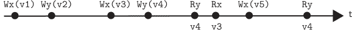

**图 22.2** 单线程执行是顺序一致的。

然而，在存在多个线程的情况下，内存模型通常*不是*顺序一致的——换句话说，读取一个变量可能不会产生写入到其中的最后一个值。原因是顺序一致性通常在多线程应用程序中不需要，而硬件可以通过不实现它来更高效。特别是，更弱的一致性模型促进了硬件优化，例如核心级缓存、指令重排序和推测执行。为了提高性能，硬件制造商做出非顺序的一致性承诺，程序员需要意识到这一点（尤其是在实现编译器和操作系统时）。为了确保在不同硬件和操作系统之间的可移植性，Java 定义了自己的内存模型，即 Java 内存模型（JMM），它是运行在 JVM 上的所有语言共有的。为了更好地利用硬件性能，JMM 不是顺序一致的。

图 22.3 显示了与图 22.2 相同的操作，但由两个不同的线程 T1 和 T2 执行。虽然顺序一致性会确保当变量 x 被 T1 读取时其值为 v3，但在 JMM 下没有这种保证，即使 v3

> .NET 语言的内存模型与 JMM 非常相似；C/C++ 模型更复杂。

例如，在列表 17.3 中，我们看到了一种使用 volatile 布尔变量请求终止另一个线程的线程终止模式。这里重现了它：

```
@volatile private var continue = true

def terminate() = continue = false

def run() =
  while continue do
    // perform task
  end while
  // cleanup
```

volatile 变量的定义属性是：写入一个 volatile 变量 happens-before 对该变量的下一次读取。从这一点，你知道 run 中的线程第一次在 terminate 方法被调用后读取共享变量 continue 时，它将读取在 terminate 中写入的值 false。如果共享布尔标志不是 volatile，则其写入与其后续读取之间没有 happens-before 连接，并且运行线程有风险在写入 false 之后仍然读取 true，从而继续运行。

作为另一个说明，考虑一个三线程程序：

```
def run1() = // behavior of thread t1
  SECONDS.sleep(4)
  println(x)
  SECONDS.sleep(5)
  y.synchronized {
    SECONDS.sleep(1)
    println(x)
    SECONDS.sleep(2)
  }

def run2() = // behavior of thread t2
  x = v1
  SECONDS.sleep(2)
  t3.start()
  SECONDS.sleep(3)
  y.synchronized {
    SECONDS.sleep(2)
    x = v2
    SECONDS.sleep(1)
  }
```

```
def run3() = // behavior of thread t3
    SECONDS.sleep(1)
    println(x)
    SECONDS.sleep(11)
    println(x)
```

列表 22.7：由 happens-before 关联和未关联的事件示例；参见图 22.4。

三个线程同时开始运行，图 22.4 中的图表显示了根据 happens-before 关系它们的操作如何连接。Ly 和 Uy 分别表示对对象 y 的加锁和解锁。特别感兴趣的是 t3.start 和 t3.Rx 之间的边（启动一个线程 happens-before 该线程采取的第一个动作）以及 t2.Uy 和 t1.Ly 之间的边（释放锁 happens-before 对该锁的下一次获取）。其他边是线程内程序顺序的结果。对 sleep 方法的调用不会创建 happens-before 链接——这是你除了第 22.1 节中讨论的原因之外，不应使用睡眠进行同步目的的另一个原因。

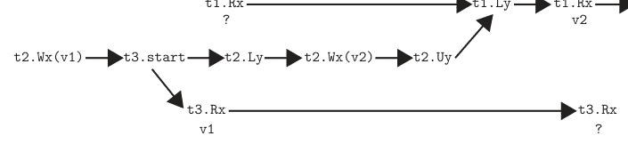

# 图 22.4 列表 22.7 中操作的 happens-before 图。

线程 t3 对变量 x 的第一次读取产生 v1，即写入 x 的最后一个值，因为 t2.Wx(v1) happens-before t3.Rx（通过传递性）。类似地，线程 t1 对变量 x 的第二次读取产生 v2，即写入 x 的最后一个值，因为 t2.Wx(v2) happens-before 第二次 t1.Rx，通过传递性。请注意，t2.Wx(v1) 在实际时间上发生在第一次 t1.Rx 之前（没有破折号，如“先发生”），但它并不 happens-before 它（带破折号，根据定义 JMM 的关系）。t2.Wx(v2) 和第二次 t3.Rx 也是如此。因此，第一次 t1.Rx 和第二次 t3.Rx 可以自由地产生除 v1 和 v2 之外的其他值。

粗略地说，你可以将并发程序视为属于以下三组之一：

- 组 1：完全同步的程序，其中所有必要 happens-before 关系都存在，并且由于加锁、提交到线程池或其他形式的显式同步而显而易见。
- 组 2：完全同步的程序，其中必要 happens-before 关系存在但不一定显而易见。例如，

#### 22.6 总结

- 当并行任务并非完全独立时，线程需要与其他线程协调。一个常见的需求是线程暂停其计算并等待，直到其他线程使系统的状态适合继续。
- 面对这个问题，有两种做法同样诱人但通常不合适。不管你多么谨慎地选择睡眠时间值，只要其他线程的活动持续时间不可预测，就没有正确的选择。太短，应用程序的状态可能在线程睡眠后恢复时尚未准备好。太长，则会浪费时间睡眠，而线程本可以取得进展，从而损害应用程序的性能和响应能力。
- 另一种误导策略是线程不断轮询系统状态，直到适合该线程继续，这是一种称为自旋或忙等待的编程风格。这种方法在多方面浪费，并且无法随着大量线程和/或长时间活动而扩展。首先，轮询线程持续使用计算资源并且需要反复调度执行，从而占用 CPU 时间，远离它们等待的线程。其次，在其他线程更新时反复查询应用程序的状态，需要线程安全机制——例如锁——当频繁使用时，如在持续检查循环中，会变得昂贵。
- 与睡眠和忙等待不同，并发程序应依赖适当的同步。同步器旨在高效地阻塞线程（无忙等待），直到其他线程建立所需条件（无需猜测合适的睡眠时长）。在共享内存系统中，同步器维护状态并提供方法来阻塞一个或多个线程，直到其他线程将同步器设置为所需状态。
- 最知名的同步器是独占锁，它会阻塞获取线程，直到锁被另一个线程释放并变得可用。并发库通常实现许多其他类型的同步器，其中一些将在第 23 章中讨论。
- 使用同步器容易出错。线程可能无限期地等待永远不会建立的条件，可能导致整个应用程序停止。死锁是无限期等待的常见原因。它们是线程以循环方式相互等待的结果。在持有锁的同时调用同步器的阻塞方法，是导致死锁的可靠方式。


- 死锁更容易被调查，因为涉及的线程都被阻塞了，所以可以在程序员方便的时候进行检查。JVM 可以生成其线程的信息快照，称为线程转储。此信息通常包括线程是否被阻塞或正在运行、它们被阻塞在哪些同步器上、它们当前拥有哪些锁等等。
- 单线程程序是顺序一致的：读取内存位置会产生写入到该位置的最后一个值。出于性能原因，处理器、操作系统和虚拟机在存在多个线程时通常不是顺序一致的。虽然总体上不是顺序一致的，但 Java 内存模型被定义为这样：正确同步的程序可以期望顺序一致性。

在释放锁之前加上一个 if-then-else。你也可以使用没有超时的 tryLock 在锁可用时获取锁，或者立即放弃而不阻塞线程。

ReentrantLock 通常在 try-finally 块内使用，以确保即使在出现异常的情况下锁也能被正确释放。在这个特定示例中，tryLock 和 unlock 之间可能不会出什么问题，但 try-finally 结构使得在返回值时更容易释放锁，而无需将该值存储在局部变量中。

在没有超时的情况下获取锁时，你可以使用 lock 不可中断地等待，或使用 lockInterruptibly 使被阻塞的线程对中断做出响应。lock 的行为与 synchronized 相同：中断线程不会使线程放弃获取锁的尝试。相比之下，lockInterruptibly 会在线程等待锁时被中断时抛出 InterruptedException。使用 lockInterruptibly 更容易编写可以被取消的、使用锁的任务。

除了更灵活的锁定方法之外，ReentrantLock 相对于固有锁的另一个主要好处是，你可以在同一把锁上创建多个条件。条件在第 23.4 节中讨论，列表 23.8 使用了带有两个条件的锁。

除了这种对独占锁的重实现外，标准库中的第二个类 ReentrantReadWriteLock 实现了非独占锁。这些锁的定义特征是你可以用两种不同的模式获取它们：写模式（独占）和读模式（共享）。在写模式下获取的锁由单个线程拥有，就像独占锁一样。相比之下，以读模式获取的锁可以被多个线程在该模式下共享。

你可以使用读写锁来保护频繁读取但很少修改的结构。线程可以通过以读模式获取锁来并发读取，而写入结构需要独占访问，因此线程必须以写模式获取锁。注意，名称读写在历史上是如此，可能具有一定的误导性。读写锁实际上是共享-独占锁，无论共享模式是在写入时使用还是在读取时使用。

例如，假设一个应用程序依赖于一个线程安全的结构，无需额外同步即可读取或写入，但偶尔也需要读取结构的整个状态以获取快照：

```scala
import scala.collection.concurrent.TrieMap // thread-safe

private val users = TrieMap.empty[String, UserInfo]

private val (rlock, wlock) =
  val lock = ReentrantReadWriteLock()
  (lock.readLock, lock.writeLock)

def register(username: String): Option[UserInfo] =
  val info = UserInfo(username)
  rlock.lock()
  try if users.putIfAbsent(username, info).isEmpty then Some(info) else None
  finally rlock.unlock()

def saveToFile(filename: String): Unit =
  wlock.lock()
  try Using.resource(Files.newBufferedWriter(Path.of(filename))) { out =>
      for (user, info) <- users do out.write(s"$user:$info\n")
    }
  finally wlock.unlock()
```

列表 23.2：读写锁的使用示例。

类 TrieMap 实现了一个线程安全的映射。你可以从多个线程并发读取和写入它而无需锁定。这里使用其 putIfAbsent 方法来注册新用户。如果实际添加了键值对，则返回 None，如果键已在映射中则返回非空选项。在 saveToFile 内部，你需要创建映射的快照。为了防止在遍历所有键和值期间进行新的注册，映射被 wlock 独占锁定。相比之下，register 方法使用 rlock 允许多个线程并发调用 putIfAbsent，因为该方法是线程安全的。注意如何以“写”模式获取锁来读取映射，并以“读”模式获取锁来写入映射。

#### 23.2 闩锁和屏障

闩锁是简单的同步器，它们在之前的示例中用于终止检测（列表 22.2）和实现线程安全盒（列表 22.4）。闩锁用途广泛。它们通常用于实现 fork-join（散布-收集）模式，如列表 22.2 中所示，但也有其他用途。我经常在编写并发程序的测试时使用闩锁。例如，闩锁可以表示模拟活动——闩锁在活动终止时打开。闩锁在测试中的另一个用途是同步活动以最大化对共享结构的并发访问，从而更好地评估其线程安全性。

作为说明，让我们重新审视列表 21.2 中线程安全列表的测试。按原样编写，这段代码的问题在于 N 个任务以交错的方式开始访问共享列表：任务 k 可能已经在使用列表，而线程仍在启动以运行任务 k + 1（启动线程需要时间）。这减少了实际应用于列表的并发量。你可以添加一个闩锁，使所有任务在所有线程都已创建并启动后大致同时开始访问列表：

```scala
val exec   = Executors.newCachedThreadPool()
val shared = SafeStringList()
val start  = CountDownLatch(N + 1)
val finish = CountDownLatch(N)

for i <- 1 to N do
    exec.execute { () =>
        start.countDown()
        start.await()
        5 times shared.add(i.toString)
        finish.countDown()
    }

start.countDown()
start.await()
val time1 = System.nanoTime()
finish.await()
val time2 = System.nanoTime()

exec.shutdown()

assert(shared.size == 5 * N)
assert((1 to N).forall(i => shared.getAll.count(_ == i.toString) == 5))
assert((time2 - time1) / 1E9 <= 0.01)
```

列表 23.3：向列表 21.2 添加闩锁以提高并发性和精确计时。

start 闩锁的目的，它初始化为 N + 1，是确保所有池线程开始向列表添加以及主线程开始记录时间在同一瞬间。第一，这使得线程更有可能同时尝试调用列表的 add 方法，从而增加你在列表不是线程安全时发现 bug 的机会。第二，这是一种衡量所有 add 操作完成所需时间的方法。通过在开始计时之前等待 start 闩锁，你可以忽略激活线程所需的时间。第二个闩锁 finish 在所有列表插入完成后打开，此时你可以记录结束时间。除了检查共享列表的最终状态外，测试还断言所有列表操作在 1/100 秒以内完成。

闩锁可以从“关闭”转换到“打开”一次且仅一次。它们不能从“打开”转换到“关闭”，因此不可重用——在闩锁打开后，countdown 和 await 没有效果。当线程需要重复使用同步点时，它们可以使用循环屏障代替。循环屏障在最后一个线程到达屏障时自动打开，并立即再次关闭。代替两个闩锁，你可以用单个可重用的屏障编写列表测试示例：

```scala
val exec    = Executors.newCachedThreadPool()
val shared  = SafeStringList()
val startEnd = CyclicBarrier(N + 1)
```


```
for i <- 1 to N do
  exec.execute { () =>
    startEnd.await()
    5 times shared.add(i.toString)
    startEnd.await()
  }

startEnd.await()
val time1 = System.nanoTime()
startEnd.await()
val time2 = System.nanoTime()

exec.shutdown()

assert(shared.size == 5 * N)
assert((1 to N).forall(i => shared.getAll.count(_ == i.toString) == 5))
assert((time2 - time1) / 1E9 <= 0.01)
```

Listing 23.4: Replace two latches from Lis. 23.3 with a single barrier.

In this variant of the test, all the threads reach the barrier a first time, at which point the pool threads start adding to the list and the main thread starts keeping track of time. After all the add operations are completed, all the threads reach the barrier again, and the main thread records the finish time. Cyclic barriers are often used in the implementation of iterative algorithms.

#### 23.3 Semaphores

A semaphore is a synchronizer that maintains a count of virtual permits as its state. Threads can acquire and release permits, and when no permit is available, the acquiring method becomes blocking.

Semaphores are very versatile, but rather low-level synchronizers. You can implement many other synchronizers using semaphores. (Concurrency libraries typically rely on more efficient, non-semaphore-based implementations.) For instance, you can write a simple, exclusive, non-reentrant lock using a semaphore:

```
class SimpleLock:
  private val semaphore = Semaphore(1)
  @volatile private var owner = Option.empty[Thread]

  def lock(): Unit =
    semaphore.acquire()
    owner = Some(Thread.currentThread)
```

acquired by some threads may be released by other threads (semaphore permits are virtual), hence my choice of the word “created” instead of “released.” This implementation of a bounded queue suffers from the fact that operations on a non-empty and non-full queue—which are non-blocking—still need to go through two semaphore operations. This inefficiency is avoided in a better bounded queue implementation in Listing 23.8.

#### 23.4 Conditions

Conditions are another low-level synchronizer that you can use to implement other synchronizers. Conceptually, a condition maintains a set of waiting threads, which are blocked. A condition defines methods for the thread to notify another thread that it can continue, or to add itself to the set. Notification has no effect if no thread is currently waiting.

Conditions have been available on the JVM since the beginning: Every Java object is a condition, in the same way that every Java object is a lock. Conditions and locks work hand-in-hand: You typically need to lock a shared state to decide whether waiting is needed. If a thread needs to wait, it must release this lock before waiting so that other threads can lock and modify the shared state. Note that an object needs to maintain two separate sets of waiting threads: those waiting to acquire the lock and those waiting to be notified from the condition.

Before the advent of java.util.concurrent in Java 5, you had to write all your synchronizers in terms of these basic Java conditions. As an illustration, the blocking queue from Section 23.3 could be reimplemented using a condition:

```
```scala
class BoundedQueue[A](capacity: Int):
  private val queue = mutable.Queue.empty[A]

def take(): A synchronized {
    while (queue.isEmpty) do wait()
    notifyAll()
    queue.dequeue()
  }

def put(element: A): Unit = synchronized {
    while (queue.length == capacity) do wait()
    notifyAll()
    queue.enqueue(element)
  }
```
```

> Listing 23.7: Bounded queue with a single condition; see also Lis. 23.8.

The bounded queue itself is used as the lock and condition—all calls to methods synchronized, wait, and notifyAll are made on this. In take, you make the calling

thread wait on the condition if the queue is empty; in put, you make it wait if the queue is full. After any successful element insertion or removal, you notify the entire set of waiting threads that the state of the queue has changed.

This code has a few peculiarities that deserve to be discussed in detail:

- The blocking method wait is called within the synchronized block of code, even though I stated earlier that you should never invoke a blocking method while holding a lock because it results in deadlocks. First, let’s understand why this is necessary. The issue is a non-atomic check-then-act: In take, for instance, a thread could see that a queue is empty and release the lock in anticipation to calling wait. But before this thread reaches wait and is actually added to the set of waiting threads, another thread invokes put and calls notifyAll. By the time the taking thread reaches the waiting set, notifyAll has already happened, and the thread gets stuck, even though the queue is now non-empty. (Listing 23.6 does not suffer from this problem because a semaphore permit can always be safely created, whether a thread is waiting for it or not.) Calling method wait within the synchronized block avoids this problem, but what about the deadlock issue? Things work correctly only because wait internally releases the lock after a thread is added to the waiting set (and it is invalid for a thread to invoke wait on an object that is not locked by the thread). So, the first rule to remember is simple: Code should always use X.wait inside an X.synchronized block on the same object X.
- In both take and put, the check that a queue is not empty or not full is performed inside a loop. This is essential, and it is a consequence of the locking issues discussed earlier. When a thread calls wait, it owns a lock that is automatically released. This lock needs to be reacquired after the thread is notified for the thread to continue executing the synchronized block. Several threads—notified from the set of waiting threads, or initiating new calls to method take or put—compete for this lock, and any thread that ends up acquiring the lock can modify the state of the queue. A taking thread, for instance, could be notified that a queue is non-empty, but the queue could become empty again by the time the thread manages to reacquire the lock. So, once the lock has been reacquired, a thread needs to test the state of the queue again and go back to waiting again if the state is not suitable. The second rule is as simple as the first: Always invoke wait in a loop that reevaluates the condition you are waiting for.
- All the waiting threads are notified—using notifyAll—after a queue element is added or removed. This is wasteful: If you are adding one element in an empty queue, why notify ten threads to come and get it? However, method notify, which notifies only one of the waiting threads, cannot be used in this example. When multiple threads are waiting, method notify does not specify which thread is

```
def put(element: A): Unit =
    lock.lock()
    try
        while queue.length == capacity do canPut.await()
        canTake.signal()
        queue.enqueue(element)
    finally lock.unlock()
```

Listing 23.8: Bounded queue based on two conditions.

Methods await, signal, and signalAll correspond to methods wait, notify, and notifyAll on intrinsic conditions. This implementation has better performance than Listing 23.7 because inserting or removing an element triggers the notification of at most one thread—using signal, not signalAll. Standard blocking queues from java.util.concurrent rely on a similar strategy—an instance of ReentrantLock and two conditions.

## Aside on Verification by Model Checking

Footnote 1 mentioned that using notify instead of notifyAll in Listing 23.7 could lead to a deadlock situation. This deadlock is not as systematic as it was in Listing 22.3—most runs proceed correctly to completion—and the steps it takes to make it happen are not entirely obvious. As an illustration of techniques that can be used to complement runtime testing, this aside applies model checking to the incorrect queue implementation—notifyAll replaced with notify—to discover the deadlock.

The formalism used here is TLA⁺, the Temporal Logic of Actions. It is a mathematical notation based on set theory, with some temporal logic elements added. A model of method put from a blocking queue can be written in TLA⁺ as follows:

Put(t, m) ≜ IF Len(queue) < Capacity
    THEN queue' = Append(queue, m) ∧ Notify
    ELSE Wait(t) ∧ UNCHANGED queue

The details are not essential, but it can be seen that the model uses the same strategy as in Listing 23.7, except that notify is used instead of notifyAll.ᵃ In particular, if the queue is not full, an element is added and method notify is called; otherwise, the thread calls method wait and the queue is unchanged. Method take is modeled similarly.

ᵃThe models uses IF instead of while because of an implicit loop in the TLA⁺ model, but the condition is being rechecked as in Listing 23.7.


`wait`、`notify` 和 `notifyAll` 方法也可以按照它们的 Java 语义进行建模：

```
Wait(t) ≜ waitSet′ = waitSet ∪ {t}
Notify ≜ IF waitSet = {} THEN UNCHANGED waitSet
ELSE ∃t ∈ waitSet : waitSet′ = waitSet \ {t}
NotifyAll ≜ waitSet′ = {}
```

同样，这些细节超出了本说明的范围，但你可以看到 `wait` 将线程 `t` 添加到等待线程集合中——在 TLA⁺ 中，记号 `waitSet′ = …` 表示“`waitSet` 的新值是……”。类似地，`notifyAll` 会从等待集合中移除所有线程，使集合为空。`notify` 方法的表示则稍微复杂一些。它基本上是说：如果等待线程集合为空，则什么都不发生，集合保持不变；否则，会有一个线程 `t` 被从集合中移除。这里使用存在量词来表示这样一个事实：`notify` 方法并不指定具体移除哪一个线程——只是从集合中取出某个线程。

有了这些数学定义——以及这里省略的一些其他元素——就可以运行模型检查器了。基本的模型检查器会尝试枚举线程交错执行动作的所有可能方式，直到所有可能性都被检查完毕或发现错误。

对于这个阻塞队列，模型检查器可以产生如图 23.1 所示的死锁场景。在这个场景中，队列容量为 2，由三个生产线程 p1、p2、p3 和两个消费线程 c1、c2 共享。初始时，队列为空，所有线程都在运行。生产者开始调用 `put` 方法，直到队列满（状态 3）。接下来的三次 `put` 调用导致生产者调用 `wait` 并被加入等待线程集合（状态 6）。消费者开始调用 `take` 方法，每次通知一个生产者，直到队列为空（状态 8）。它们继续调用 `take`，直到全部被加入等待集合（状态 10）。有趣的是，此时集合中同时包含生产者和消费者线程。

在状态 11，某个生产者——p2 或 p3——向队列中添加了一个元素，并因此调用 `notify`。这次 `notify` 调用的目的是让某个消费者知道队列中已经加入新值。然而，被移出集合的却是线程 p1——一个生产者。队列再次被填满（状态 12），导致生产者被阻塞在等待集合中（状态 15）。此时，线程 c1 是唯一在运行的线程。它从队列中消费第一个元素，并通知 p1（状态 16）。接着它从队列中取出第二个元素，但通知的是消费者 c2，而不是某个生产者（状态 17）。随后两个消费者都在空队列上阻塞，只剩下线程 p1 运行（状态 19）。这个线程向队列中放入一个值，但通知的是 p2，而不是某个消费者。

```
State 1: <Initial predicate>
waitSet = {}
queue = <>

State 2: <Put>
waitSet = {}
queue = <m>

State 3: <Put>
waitSet = {}
queue = <m, m>

State 4: <Put>
waitSet = {p1}
queue = <m, m>

State 5: <Put>
waitSet = {p1, p2}
queue = <m, m>

State 6: <Put>
waitSet = {p1, p2, p3}
queue = <m, m>

State 7: <Take>
waitSet = {p1, p2}
queue = <m>

State 8: <Take>
waitSet = {p1}
queue = <>

State 9: <Take>
waitSet = {p1, c1}
queue = <>

State 10: <Take>
waitSet = {p1, c1, c2}
queue = <>

State 11: <Put>
waitSet = {c1, c2}
queue = <m>

State 12: <Put>
waitSet = {c2}
queue = <m, m>

State 13: <Put>
waitSet = {p1, c2}
queue = <m, m>

State 14: <Put>
waitSet = {p1, p2, c2}
queue = <m, m>

State 15: <Put>
waitSet = {p1, p2, p3, c2}
queue = <m, m>

State 16: <Take>
waitSet = {p2, p3, c2}
queue = <m>

State 17: <Take>
waitSet = {p2, p3}
queue = <>

State 18: <Take>
waitSet = {p2, p3, c1}
queue = <>

State 19: <Take>
waitSet = {p2, p3, c1, c2}
queue = <>

State 20: <Put>
waitSet = {p3, c1, c2}
queue = <m>

State 21: <Put>
waitSet = {c1, c2}
queue = <m, m>

State 22: <Put>
waitSet = {p1, c1, c2}
queue = <m, m>

State 23: <Put>
waitSet = {p1, p2, c1, c2}
queue = <m, m>

State 24: <Put>
waitSet = {p1, p2, p3, c1, c2}
queue = <m, m>
```

图 23.1 由模型检查器发现的阻塞队列死锁场景。

下一步，某个生产者——p1 或 p2——向队列中添加元素，（错误地）通知了 p3。此时，在状态 21，情况已经无可挽回：队列已满，所有消费者都被阻塞。剩下的两个生产者随后调用 `put` 方法，并被加入等待集合。到状态 24 时，死锁出现了：所有线程都被阻塞在集合中。

图 23.1 显示的是模型检查器的实际输出——做了少量编辑，以对应 `Put` 和 `Take` 方法名。模型检查的强大之处在于它能够生成描述通向问题状态的轨迹。这个有缺陷的阻塞队列所导致的死锁，在运行测试时可能观察到，也可能观察不到；但即使它发生了，查看线程转储也只能看到最终的死锁状态，而看不到线程是如何一步步走到该状态的。需要指出的是，这里使用的模型检查器以广度优先的方式探索状态。因此，它保证找到的死锁场景具有最短长度。

模型检查技术的主要限制在于需要探索的状态数量迅速增长，这种现象称为*组合状态空间爆炸*。例如，容量为 10 的队列至少需要 21 个线程才能达到死锁。最短的场景需要 431 步，而模型检查器要探索 23,011,357 个不同状态才能发现它。

#### 23.5 阻塞队列

清单 23.6 至 23.8 中实现的有界队列不仅仅是数据结构：它们本身就是同步器。它们的方法可以根据队列处于空还是满的状态来阻塞线程。并发库通常实现两类队列：并发队列——线程安全的数据结构，但可能没有阻塞方法；以及阻塞队列——同步器。阻塞队列总是并发队列，因为它们必须是线程安全的，但并非所有并发队列都是阻塞队列。例如，第 20 章中实现的队列就是并发非阻塞队列。在每种类型内部，还存在多种变体。队列可以是有界的，也可以是无界的；可以由数组、链表或其他结构支持；可以依赖锁或无锁算法；通常按先进先出（FIFO）顺序，但也可以基于优先级或时间采用其他排序；等等。

阻塞队列通常用于*生产者—消费者*模式：生产活动向共享队列中添加元素，而消费活动并发地从队列中取出元素。这种模式应用广泛，带来多个好处。首先，它将数据创建与数据使用解耦，这与 12.5 节中流（stream）的应用方式类似。其次，有时可以使用单生产者或单消费者模式来混合并发与顺序活动，如 23.9 中所示。第三，生产者—消费者模式在某种程度上天然具有自我平衡能力：当队列满时，生产任务被阻塞，释放出资源让消费任务赶上进度；当队列为空时则正好相反。

作为示例，再次考虑并行搜索文件的问题。每个任务包含两个阶段：在文件中查找目标数据，以及存储搜索结果。一种实现方式如下：

```
Scala
val exec: ExecutorService = ...
def isMatch(line: String): Boolean = ...
val files: ConcurrentLinkedQueue[Path] = ...
val out: Writer = ...

def searchFile(path: Path): Unit =
  Using.resource(Source.fromFile(path.toFile)(UTF8)) { in =>
    for line <- in.getLines() do
      if isMatch(line) then out.synchronized { out.write(line); out.write('\n') }
  }

val searchTask: Runnable = () =>
  var file = Option(files.poll())
  while file.nonEmpty do
    searchFile(file.get)
    file = Option(files.poll())

N times exec.execute(searchTask)
```

在这段代码中，要搜索的文件被存储在一个并发队列中。这个队列必须是线程安全的，因为所有搜索任务都会并行地从其中获取文件。每个搜索任务持续从队列中取出文件，直到队列为空，此时任务终止。队列不需要是阻塞的：它最初被填满文件，并且在为空之后不再使用。你需要使用 `poll`——它在队列为空时返回 null³——来从队列中取出文件：`if !files.isEmpty then file = files.take()` 是行不通的，因为这是非原子性的先检查后执行。每个文件被顺序地搜索，匹配的行会被添加到共享输出文件中。你需要对这个文件的访问加锁，因为尽管 Java 中 `Writer` 类型的实例通常是线程安全的，否则行内容和换行符可能会被错误地交错。⁴

与其让所有搜索任务都把结果添加到共享输出中，你可以将代码重构为生产者—消费者模式：生产者从文件中产生匹配的行，而单个消费者将这些行存储到输出文件中：

³ 为了处理 null，值会被包装到 Option 中，如 12.2 节中所做的那样。

⁴ `PrintWriter` 类定义了一个原子性的 `println` 方法，我本可以在这里使用它。但它的实现实际上是在 synchronized 块中对 `write` 方法进行两次调用，就像我的 `searchFile` 方法一样。


```
val queue = ArrayBlockingQueue[String](capacity)

def searchFile(path: Path): Unit =
  Using.resource(Source.fromFile(path.toFile)(UTF8)) { in =>
    for line <- in.getLines() do if isMatch(line) then queue.put(line)
  }

val writeTask: Runnable = () =>
  while [?] do
    out.write(queue.take())
    out.write('\n')

N times exec.execute(searchTask)
exec.execute(writeTask)
```

在这段代码中，阻塞队列被创建作为行缓冲。文件被搜索时，匹配的行会被添加到队列中，而不是直接写入输出文件。单个 writeTask 活动从队列中检索行并将其存储到文件中。对 out 的锁定不再需要，因为文件现在仅由一个线程访问。当然，阻塞队列的实现内部可能仍在进行锁定，但 put 和 take 的调用很快，并且在 I/O 操作期间不会持有锁。任务 searchTask 的代码保持不变，仍可以由多个线程并行运行。每个线程从一个（并发）队列中取出文件，并将匹配的行放入一个（并发、阻塞）队列中。注意程序现在同时使用了两种类型的队列，阻塞和非阻塞。

函数 writeTask 中缺少一段代码：终止行写入循环的条件。终止问题在生产者-消费者模式中往往很微妙。首先，让我们确认以下方法不可行：

// DON'T DO THIS!
while !queue.isEmpty do ...

阻塞队列可能暂时为空——迄今为止找到的所有匹配行都已写入输出文件——但这并不意味着搜索已完成。搜索任务仍可能在打开和读取文件，并可能找到更多匹配项。如果写入任务因队列为空而终止，这些新匹配将永远不会保存到文件中。

下一个想法是跟踪仍处于活动状态的搜索任务数量。活动任务的计数必须是线程安全的——它由搜索任务本身递减，并由文件写入任务查询。如果使用 N 个搜索任务，你可能会诱惑修改代码如下：

```
Scala
val active = AtomicInteger(N)
...
active.decrementAndGet() // at the end of each searching task

// DON'T DO THIS!
while active.get() > 0 do ...
```

然而，这仍可能导致循环过早终止：所有搜索任务都已终止，活动计数达到零，文件写入任务被允许在可能仍残留在队列中的行未处理的情况下终止。这将再次导致输出文件中缺少匹配项。

现在你可能会想：没问题，让我们结合两种终止条件——没有活动的搜索任务，匹配队列为空——以确保写入任务在所有搜索任务完成后清空队列：

```
Scala
// DON'T DO THIS!
while active.get() > 0 || !queue.isEmpty do ...
```

这仍然不起作用，但这里的问题更微妙。假设你取出了队列中最后一条匹配行，但搜索任务仍在运行。此时队列为空，但条件 active.get() > 0 为真，因此文件写入任务不会终止。相反，它重新进入循环，调用 queue.take，并阻塞。然而，如果没有找到更多匹配项，搜索任务将在不向队列添加任何更多行的情况下终止。活动计数变为零，终止条件成立——计数为零且队列为空。但消费线程仍无限期地阻塞在 take 上，没有机会再次评估此条件。

正确终止生产者-消费者应用的常用技术是在队列中插入特殊值——称为毒丸——作为生产者指示消费者应终止的方式。你可以将毒丸策略应用于文件搜索示例的两种方式。首先，你可以像之前一样保留正在运行的生产者的线程安全计数，并让最后一个终止的生产者向队列中插入单个毒丸。或者，你可以让每个生产者在终止时插入一个特殊值，并让消费线程计数这些值直到全部接收到。第一种方法仍需要活动任务的线程安全计数；第二种方法在以下代码中使用，不需要：

```
val queue = ArrayBlockingQueue[Option[String]](capacity)

def searchFile(path: Path): Unit =
  Using.resource(Source.fromFile(path.toFile)(UTF8)) { in =>
    for line <- in.getLines() do if isMatch(line) then queue.put(Some(line))
  }

val searchTask: Runnable = () =>
  var file = Option(files.poll())
  while file.nonEmpty do
    searchFile(file.get)
    file = Option(files.poll())
  queue.put(None)

val writeTask: Runnable = () =>
  var active = N
  while active > 0 || !queue.isEmpty do
    queue.take() match
      case None => active -= 1
      case Some(line) =>
        out.write(line)
        out.write('\n')
```

列表 23.9：以生产者-消费者模式搜索文件并存储结果。

匹配行的队列被改为选项队列：Some(line) 表示匹配，None 是毒丸。每个搜索任务在其搜索结束时向队列中插入单个 None。文件写入任务计数这些 None 值，并在全部接收且队列为空时知道应终止。计数在任务内部进行，不需要使用线程安全的原子整数。事实上，生产者和消费者完全通过队列进行协调，并且不依赖任何其他共享同步机制。 （消费者仍需要知道生产任务的总数 N。）

#### 23.6 总结

- Java 标准库通过类 ReentrantLock 提供了独占锁的灵活实现，可用作内置锁的替代。它为用户提供了相同的<|message|>


运行过程将如下所示：

```
main at XX:XX:47.521: START
main at XX:XX:47.550: begin 2
main at XX:XX:49.551: end 2
main at XX:XX:49.552: begin 1
main at XX:XX:50.552: end 1
main at XX:XX:50.552: begin 3
main at XX:XX:53.552: end 3
main at XX:XX:53.553: END
```

所有工作都由调用 `run` 方法的线程执行。整个执行过程耗时 6 秒，也就是三个任务耗时的总和。

本章讨论几种并行化策略。并行运行器必须在一个同步调用 `run` 方法期间将任务全部运行完毕——所有任务都必须在 `END` 消息之前完成——但它们可以使用额外线程并行执行多个任务，从而加快计算速度。这些任务被假定为相互独立，并且不会相互干扰。

#### 24.2 每个任务一个新线程

最简单——但有点过时——的并行化策略是为每个任务创建一个新线程：

```
class Runner[A](comp: A => Unit):
  def run(inputs: Seq[A]): Unit =
    val threads = inputs.map(input => Thread(() => comp(input)))
    for thread <- threads do thread.start()
    for thread <- threads do thread.join()
```

清单 24.1：并行执行：每个任务一个新线程。

这里使用高阶方法 `map` 来创建一个线程序列，每个输入对应一个线程。随后是两个循环——一个用于启动所有线程，另一个用于等待线程终止——两者都通过 `join` 方法实现。如果你像之前一样处理相同的 2、1、3 序列，你会得到如下形式的输出：

```
main at XX:XX:06.593: START
Thread-0 at XX:XX:06.623: begin 2
Thread-2 at XX:XX:06.623: begin 3
Thread-1 at XX:XX:06.623: begin 1
Thread-1 at XX:XX:07.623: end 1
Thread-0 at XX:XX:08.623: end 2
Thread-2 at XX:XX:09.623: end 3
main at XX:XX:09.624: END
```

这三个任务并行运行。执行过程大约耗时 3 秒，即最长任务的耗时。

对线程调用 `join` 的顺序无关紧要——代码需要等待所有线程终止——但至关重要的是，所有线程都必须在开始调用 `join` 之前启动。一个可能的错误是把最后两个循环合并成一个循环：

```
// DON'T DO THIS!
for thread <- threads do
    thread.start()
    thread.join()
```

即使你仍然在独立线程中执行每个任务，这些任务现在也是串行运行的，因为你只有在前一个线程终止后才会启动下一个线程。处理 2、1、3 序列需要 6 秒，这与顺序运行器相同：

```
main at XX:XX:06.235: START
Thread-0 at XX:XX:06.263: begin 2
Thread-0 at XX:XX:08.264: end 2
Thread-1 at XX:XX:08.265: begin 1
Thread-1 at XX:XX:09.265: end 1
Thread-2 at XX:XX:09.266: begin 3
Thread-2 at XX:XX:12.266: end 3
main at XX:XX:12.267: END
```

#### 24.3 线程数量上限

清单 24.1 的一个主要缺点是：如果输入序列很大，运行器会创建数量不合理的线程。例如，如果你的计算机有八个核心，而输入序列包含 1000 个值，最终会有 1000 个线程共享八个处理器，这不太可能是并行处理输入的最高效方式。

要将运行器创建的线程数限制到指定上限，可以采用与清单 23.9 类似的基于队列的方法：

```scala
class Runner[A](bound: Int)(comp: A => Unit):
  def run(inputs: Seq[A]): Unit =
    val queue = ConcurrentLinkedQueue(inputs.asJava)

    val task: Runnable = () =>
      var input = Option(queue.poll())
      while input.nonEmpty do
        comp(input.get)
        input = Option(queue.poll())

    val threads = Seq.fill(bound min inputs.length)(Thread(task))
    for thread <- threads do thread.start()
    for thread <- threads do thread.join()
```

清单 24.2：并行执行：线程数量有上限。

所有给定输入都被放入一个线程安全的队列中。线程的数量取期望线程上限与输入数量两者中的较小值。所有线程都运行同一个任务。该任务通过一个循环从队列中取出输入，并对其应用运行器的函数；当队列为空时循环结束。

你可以创建 `Runner(2)(sleepTask)` 来将线程数限制为两个。当应用于输入列表 2、1、3 时，一个典型输出如下所示：

```
main at XX:XX:15.696: START
Thread-1 at XX:XX:15.731: begin 1
Thread-0 at XX:XX:15.731: begin 2
Thread-1 at XX:XX:16.733: end 1
Thread-1 at XX:XX:16.733: begin 3
Thread-0 at XX:XX:17.732: end 2
Thread-1 at XX:XX:19.734: end 3
main at XX:XX:19.734: END
```

该运行器使用两个线程；它们立即从队列中取出输入 2 和 1。1 秒后，`Thread-1` 完成第一个任务，并从队列中取出输入 3。再过 1 秒——即运行开始 2 秒后——`Thread-0` 完成任务 2，发现队列为空，随即终止。又过 2 秒，`Thread-1` 完成任务 3，也随之终止。整个运行大约耗时 4 秒。

#### 24.5 共享线程池

使用线程池的动机之一是限制线程数量，如前一个示例所示；另一个动机是线程复用，因为应用程序通常受益于在多个组件之间共享线程池。

清单 24.3 会为运行器的每次运行创建一个包含全新线程的新线程池；因此，该示例中的线程复用是有限的。作为替代，你可以实现一个使用现有线程池而不是自行创建线程池的运行器。这一改变会影响设计，因为你无法关闭共享线程池。相反，调用 `run` 方法的线程需要等待所有任务完成，无论线程池中的线程是否仍在运行。这是我们在清单 22.2 中已经遇到过的问题，同样的方法——倒计时闩（countdown latch）——也可以用来解决它：

```
class Runner[A](exec: Executor)(comp: A => Unit):
    def run(inputs: Seq[A]): Unit =
        val done = CountDownLatch(inputs.length)

        for input <- inputs do
            val task: Runnable = () =>
                try comp(input)
                finally done.countDown()
            exec.execute(task)

        done.await()
```

清单 24.4：并行执行：共享线程池。

创建一个闩，其计数等于输入值的数量。提交给线程池的任务被扩展为在每次计算结束时对闩进行倒计数。`try-finally` 结构可以确保即使函数执行失败，闩也会被倒计数。调用 `run` 的线程不会关闭线程池，而只是等待闩。

使用一个包含两个线程的线程池会产生与之前相同的 4 秒运行结果。但请注意，同一个运行器的多个并发运行会在同一个线程池上执行任务；而在清单 24.3 的实现中，它们会在各自独立、互不干扰的线程池上运行。

也可以使用其他同步器来等待任务完成。例如，你可以创建一个没有许可的信号量，让每个完成的任务释放一个许可，并让等待线程阻塞，直到它能获取与输入序列长度相等数量的许可。另外，线程池本身可能已经实现了用于此目的的方法。如果参数 `exec` 以 `ExecutorService` 类型而不是 `Executor` 类型的值给出（所有标准 Java 线程池都实现了该类型），那么也可以直接使用它的 `invokeAll` 方法来等待一组任务完成。

#### 24.6 有界线程池

在清单 24.3 中，你可以限制并发运行的任务数量，这在某些情况下可能是有益的。清单 24.4 则失去了这一特性，因为你无法控制共享线程池中的工作线程数量。

一种两全其美的实现会既依赖共享线程池，又对池内并发运行的任务数量施加额外限制。你可以通过信号量实现这一点：信号量的初始许可数等于期望的并行度。

```
class Runner[A](exec: Executor, bound: Int)(comp: A => Unit):
    def run(inputs: Seq[A]): Unit =
        val canStart = Semaphore(bound)

        for input <- inputs do
            val task: Runnable = () =>
                try comp(input)
                finally canStart.release()

            canStart.acquire()
            exec.execute(task)
        end for

        canStart.acquire(bound)
```

清单 24.5：并行执行：带上限的共享线程池。

调用 `run` 方法的线程在提交每个任务执行之前，先从信号量获取一个许可。任务完成时释放该许可，以便可以提交另一个任务。这保证了任意时刻正在运行的任务数不会超过信号量中的初始许可数。在所有任务提交之后，使用 `canStart.acquire(bound)` 等待任务完成：一旦所有许可都回到信号量中，你就知道所有任务都已完成。不需要额外的倒计时闩。

以 `Runner(exec, 2)(sleepTask)` 创建运行器，其中 `exec` 是一个无限制线程池，可能会产生如下输出：

```
main at XX:XX:04.870: START
pool-1-thread-1 at XX:XX:04.901: begin 2
pool-1-thread-2 at XX:XX:04.901: begin 1
pool-1-thread-2 at XX:XX:05.901: end 1
pool-1-thread-3 at XX:XX:05.902: begin 3
pool-1-thread-1 at XX:XX:06.901: end 2
pool-1-thread-3 at XX:XX:08.902: end 3
main at XX:XX:08.903: END
```


The run ends up using three different threads—the thread pool is unlimited—but there are never more than two tasks active at the same time. The overall run takes about 4 seconds, as before.

#### 24.7 Parallel Collections

For a final—and simpler—variant of the runner, recall the discussion of parallel collections in Section 21.4. Indeed, given our assumption that the concurrent invocations of the shared function are independent, parallel collections are a perfect match. You can trivially modify the one-line sequential runner implementation used at the beginning of the chapter to introduce parallelism in the execution of the tasks:

```
Scala
class Runner[A](comp: A => Unit):
    def run(inputs: Seq[A]): Unit = for input <- inputs.par do comp(input)
```

Listing 24.6: Parallel execution: parallel collections.

In Scala, for-do is syntactic sugar for a call to higher-order method foreach, and the body of method run could be written as inputs.par.foreach(comp). On parallel collections, foreach is implemented using a common thread pool.² The runner in Listing 24.6, on the same 2, 1, 3 example, produces an output of the following form:

```
main at XX:XX:26.201: START
scala-execution-context-global-16 at XX:XX:26.275: begin 1
scala-execution-context-global-17 at XX:XX:26.275: begin 3
scala-execution-context-global-15 at XX:XX:26.275: begin 2
scala-execution-context-global-16 at XX:XX:27.276: end 1
scala-execution-context-global-15 at XX:XX:28.276: end 2
scala-execution-context-global-17 at XX:XX:29.277: end 3
main at XX:XX:29.277: END
```

#### 24.8 Asynchronous Task Submission Using Conditions

Section 24.7 makes concurrent programming look easy—and it sometimes is. However, you should be ready for scenarios that do not quite fit the canned patterns as nicely.

As an illustration, consider a variation of the runner problem that allows more inputs to be added after a run has started. The Runner type is extended with a method addInput that can be used to add one or more input values to an ongoing run. This small change brings a host of problems and design challenges:

²Mechanisms are available that can make parallel collections run on your own thread pool, but they are a bit awkward in Scala.

- The thread that initiates a computation is stuck inside method run for the duration of the run. Adding tasks can happen only in other threads. Accordingly, runner instances now need to be safe when shared by multiple threads.
- There is an inherent race condition between a finishing run and an attempt to add inputs to this run. A method to test the state of a runner—is it running?—would be useless because of a non-atomic check-then-act: A runner could become passive right after it is checked for being active. Instead, method addInput should be expected to fail to add an input to the current run if it comes too late, and it needs a way to indicate such a failure to its caller.
- Waiting for run completion is harder because new tasks can be added after waiting has begun. In particular, the simple approach used earlier, based on a countdown latch created from a known number of tasks, becomes insufficient.
- If runs are allowed to overlap—a new run can be started by another thread before the previous run is finished—and further inputs are added while multiple runs are ongoing, to which run should they be added?
- Alternatively, overlapping runs can be prohibited by making sure method run is not allowed to start until the previous run is completed. This choice requires that the method behaves differently depending on the state of a runner—active versus passive. All the runners implemented so far have been stateless—not counting the thread pool, which is obviously thread-safe. A stateful runner must be designed more carefully when shared among threads.

This section focuses on implementations that share two design choices. First, runs cannot overlap. Method run blocks until the previous run is terminated, then submits a new set of inputs (and blocks again until this new computation is finished). Second, addInput indicates success or failure by returning a Boolean value. (Some of Java’s concurrent collections use the same approach, such as method offer on queues.)

```
class Runner[A](exec: Executor)(comp: A => Unit):
private var active = 0
private var runs = 0
def run(inputs: Seq[A]): Unit = synchronized {
while active != 0 do wait()
val myRun = runs + 1
runs = myRun
active = inputs.length
}
```

```
for input <- inputs do exec.execute(task(input))
while runs == myRun && active != 0 do wait()
}

def addInput(input: A): Boolean = synchronized {
if active == 0 then false
else
active += 1
exec.execute(task(input))
true
}

private def task(in: A): Runnable = () =>
try comp(in)
finally synchronized {
active -= 1
if active == 0 then notifyAll()
}
```

Listing 24.7: Extensible parallel execution using a single condition.

A variable active is used to count the number of tasks still active in the current run. It is incremented when new tasks are submitted to the executor (inside run and addInput) and decremented by the tasks themselves as they terminate. All accesses to this variable are guarded by using synchronized to lock the runner itself.

When trying to add a new input, the code needs to check whether the current run is still ongoing. If active == 0, method addInput returns false immediately. Variable active needs to be zero to start a new run (first line of method run) and also to complete the current run (last line of method run). The last task of a run, when the active count reaches zero, notifies waiting threads that the run is terminated using notifyAll.

The role of variables runs and myRun is subtle and deserves a detailed explanation. Consider first a simpler but incorrect implementation of method run, without these variables:

```
// DON'T DO THIS!
def run(inputs: Seq[A]): Unit = synchronized {
while active != 0 do wait()
active = inputs.length
for input <- inputs do exec.execute(task(input))
while active != 0 do wait()
}
```

Method run waits for the active count to be zero to start a run, and again to terminate the run. Consider now a scenario in which a thread T1 initiates a run and is blocked waiting for the run to terminate and a thread T2 is blocked at the beginning of method run waiting to start a second run. Both threads wait for active to be zero. When the last task of the first run finishes, both threads are notified. At this point, they compete

to relock the runner so as to continue their execution of method run. If thread T2, which is waiting to start a run, gets the lock first, it will submit new tasks to the executor and make the active count non-zero. It will then release the lock and wait for this second run to finish. Thread T1 can then obtain the lock, but it will test active != 0 to be true and will go back waiting—now waiting for the completion of the second run, instead of simply being done with its own run.

This is a difficulty that is actually not uncommon in concurrent programming. You often need to distinguish between separate repetitions of the same state—here, a runner with a positive count of active tasks. For instance, cyclic barriers face a similar challenge when they need to differentiate between two closed states in a closed-open-closed sequence. A common strategy, used here, is to number iterations as a mechanism to distinguish between states that otherwise would be equivalent: Closed-open-closed becomes closed1-open1-closed2, where closed2 is somehow different from closed1.

In the runner example, each run is assigned a unique number,³ and threads that have started a run wait for the active count of their own run to be zero. If a new run has already started—which implies that the active count must have reached zero—those threads are free to terminate their execution, even if the active count has already become non-zero again.⁴

To conclude this section, I will make two final comments on this implementation. First, locking is necessary to manipulate fields active and runs: You need to read and write them within synchronized blocks. However, it is essential that when the tasks apply the runner’s function, they do it without the lock owned. If the code comp(in) is placed inside the synchronized block, all parallelism is lost.

Second, it is necessary to use notifyAll when you wake waiting threads because you need to notify not only the thread that initiated the run that its run is finished, but also possibly another thread that is waiting to start a new run. Two successive calls to notify won’t work because they might notify two threads waiting to start a run, and not the thread that is finishing. In contrast, by using notifyAll, you can notify all the waiting threads, including multiple threads waiting to start a new run, even though only one of them can initiate a run at a time.

Ideally, you would like to notify the thread waiting for its run to finish as well as one of the threads waiting to start a new run. For this, you need to use two separate conditions, one to start a run and another to finish a run:

³Strictly speaking, runs can wrap and reuse a value, but the number of runs needed is so large that it is not an issue in practice: A run will have terminated long before its number is being reused.

⁴To avoid getting stuck because the active count quickly transitions from non-zero to zero and back to non-zero, you might be tempted to implement method run as follows (assuming inputs is not empty):

```
// DON'T DO THIS!
def run(inputs: Seq[A]): Unit = synchronized {
  while active != 0 do wait()
  active = inputs.length
  for input <- inputs do exec.execute(task(input))
  wait()
}
```

This is incorrect because the JVM allows for spurious wake-ups: A thread blocked on wait may—rarely—unblock and continue without having been notified. For this reason, it is important to always stick to the pattern of invoking wait inside a loop that reevaluates the condition a thread is waiting for.


```
class Runner[A](exec: Executor)(comp: A => Unit):
    private var active = 0
    private var runs = 0
    private val lock = ReentrantLock()
    private val start, finish = lock.newCondition()
    def run(inputs: Seq[A]): Unit =
        lock.lock()
        try
            while active != 0 do start.await()
            val myRun = runs + 1
            runs = myRun
            active = inputs.length
            for input <- inputs do exec.execute(task(input))
            while runs == myRun && active != 0 do start.signal()
            start.signal()
        finally lock.unlock()
    def addInput(input: A): Boolean =
        lock.lock()
        try
            if active == 0 then false
            else
                active += 1
                exec.execute(task(input))
                true
        finally lock.unlock()
    private def task(in: A): Runnable =
        try
            comp(in)
        finally
            lock.lock()
            try
                active -= 1
                if active == 0 then finish.signal()
            finally lock.unlock()
```

> Listing 24.8: 使用两个条件的可扩展并行执行。

ReentrantLock 实例用于在同一锁上获取两个条件，这是不支持的普通同步。在 run 内部，线程首先在 start 条件上等待，然后在 finish 条件上等待。当一个运行的最后一个任务完成时，它在 finish 条件上通知一个线程——只有一个等待，即启动当前运行的线程。这个线程反过来在 start 条件上通知一个线程

一个新的运行可以开始。尽管多个线程可能在 start 条件上等待，但只有一个被通知开始新的运行。实现的其余部分保持不变，除了必须使用 ReentrantLock 而不是 synchronized 的尴尬。

#### 24.9 两个信号量实现

Section 24.8 说明了条件的使用，条件是并发编程的基本构造，以及需要通过生成计数器（24.7 和 24.8 列表中的变量 runs）来区分的重复状态的常见问题。在现实中，对于这个特定的例子，你可以通过完全不使用条件来实现更简单的设计。

What complicates the earlier implementations is the fact that both threads that need to begin a run and threads that need to end a run are waiting for the same state of the application (active == 0) even when using two separate conditions. You can avoid that by using two completely separate waiting criteria. The following implementation shows the power and versatility of semaphores:

```
class Runner[A](exec: Executor)(comp: A => Unit):
  private var active = 0
  private val start = Semaphore(1)
  private val finish = Semaphore(0)

  def run(inputs: Seq[A]): Unit =
    if inputs.nonEmpty then
      start.acquire()
      synchronized {
        active = inputs.length
        for input <- inputs do exec.execute(task(input))
      }
      finish.acquire()
      start.release()

  def addInput(input: A): Boolean = synchronized {
    if active == 0 then false
    else
      active += 1
      exec.execute(task(input))
      true
  }
```

runs 变量仍然是必要的，以处理线程在当前运行完成时调用 run 方法，并在即将终止自己运行的线程获取锁之前的情况。

### 第 25 章

#### Future 和 Promise

Part I 的主要主题之一是函数式编程涉及从动作和可变性向函数和不可变性的转变，其主要好处是更容易在程序组件之间共享数据。在第 II 部分，我们已经在第 22 到 24 章中看到，在线程之间共享可变数据——以及由此产生的同步需求——是并发编程复杂性的一个巨大来源。本章和下一章旨在表明，通过利用函数式编程原则，并发代码可以大大简化。和以前一样，一切都从将纯函数用作计算单元开始，但现在由单独的线程执行。Future 是用于操作并发执行的函数的标准编程语言构造。在基本层面上，future 结合了函数和同步器的特性。第 26 章以更函数式的方式考虑 futures。

#### 25.1 功能任务

到目前为止，用于说明并发编程的大多数任务都是 Runnable 接口的实例。其 run 方法返回空值，用于对某些共享数据应用修改。例如，这里重现了 Listing 22.1，使用两个任务向共享列表添加字符串：

```
Scala -
val exec = Executors.newCachedThreadPool()
val shared = SafeStringList()

def addStrings(n: Int, str: String): Unit = n times shared.add(str)

exec.execute(() => addStrings(5, "T1"))
exec.execute(() => addStrings(5, "T2"))

exec.shutdown()
exec.awaitTermination(5, MINUTES)

assert(shared.size == 10)
```

为了确保这种方法有效，共享列表被设计为线程安全的——在这种情况下，通过依赖锁来实现。然而，请注意，这种线程安全性给了我们比我们需要的更多的东西：列表在任何线程对其 add 方法的每次调用后都保持有效状态。在这个特定的例子中，这些中间状态虽然有效，但不是必需的。列表只在添加了它的任务完成后使用——当它已经包含所有十个字符串时。

If all you need is to build a collection of all the strings produced together by the two tasks, you don’t care about the state of the list as it evolves during this computation. Instead, you can have each task produce its own collection of strings, and then put the two collections together at the end:

```
val exec = Executors.newCachedThreadPool()

def makeStrings(n: Int, str: String): List[String] = List.fill(n)(str)

var strings1: List[String] = null
var strings2: List[String] = null

exec.execute(() => strings1 = makeStrings(5, "T1"))
exec.execute(() => strings2 = makeStrings(5, "T2"))

exec.shutdown()
exec.awaitTermination(5, MINUTES)

val strings: List[String] = strings1 ::: strings2
assert(strings.size == 10)
```

This variant of the program proceeds differently from before. Instead of sharing a single list, each task creates its own list. These per-task lists are not shared and do not need to be thread-safe.¹ No locks are involved. After the tasks have terminated, the main thread puts the two lists together, again without a need for synchronization.

The program works but lacks elegance. It uses two mutable variables, initialized with arbitrary values, and runs the risk that these values may be used by mistake, resulting in a NullPointerException. What brings about this convoluted structure is a discrepancy between the purpose of each task—to create a list—and the fact that the tasks are still implemented as actions—instances of Runnable that modify mutable data. It would be more sensible for the tasks to be functions—value-producing tasks, or functional tasks—instead of actions that set external variables.

All of the mechanisms used so far to create concurrent activities—the Runnable interface, the constructor of Thread class, the execute method of a thread pool—focus on actions. They are inadequate to handle functional tasks. This chapter and the next discuss futures, an established device tailored to value-producing tasks.

¹As immutable lists, they are thread-safe in this example, but they don’t need to be.

#### 25.2 Futures as Synchronizers

#### NOTE

The Java standard library defines an interface Future, introduced in Java 5. The Scala standard library also defines a trait by the same name. The Scala type includes many functionalities not found in the Java interface. Various third-party libraries—most notably Google’s Guava—developed types of future that were closer to Scala’s Future trait until a class CompletableFuture was introduced in Java 8. Java’s CompletableFuture and Scala’s Future now offer similar mechanisms (CompletableFuture has a bit more), which are explored in Chapter 26. This chapter focuses on using futures as synchronizers, which you can do with all three types. Code illustrations in this section and the next use Java’s earlier Future for simplicity. Section 25.4 introduces the other two implementations.

So far, we have used thread pools through a method execute, which takes an argument of type Runnable. In addition to Runnable, Java defines a Callable interface. In contrast to the run method in Runnable, the call method in Callable can return values.² Java thread pools define a method submit that takes a Callable argument. While execute returns nothing—it’s a void method—submit returns a future:

```
```scala
val exec: ExecutorService = ...

def makeStrings(n: Int, str: String): List[String] = List.fill(n)(str)

val f1: Future[List[String]] = exec.submit(() => makeStrings(5, "T1"))
val f2: Future[List[String]] = exec.submit(() => makeStrings(5, "T2"))

val strings: List[String] = f1.get() ::: f2.get()
assert(strings.size == 10)
```
```

As with Runnable, you often create values of type Callable as lambda expressions. In this example, two tasks are handed to a thread pool for execution using method submit. Each task invokes function makeStrings; no assignment statement is involved. You can then use the futures returned by submit to retrieve the lists created by the tasks using method get, and concatenate the lists as before.

> ² Another difference is that call can throw checked exceptions. This is something that neither run (in Runnable) nor apply (in Function) is allowed to do.


这个程序有几个值得指出的方面：

- 方法 `submit` 与 `execute` 一样，通常触发其参数的异步执行并立即返回。
- 该方法返回一个 future，其类型由任务产生的值类型参数化——在此例中为字符串列表。你可以将 future 视为任务的句柄，甚至就是任务本身（有时确实如此，正如后面对 `FutureTask` 的讨论所述）。
- Future 定义了可用于检索任务产生值的机制。对于 Java future，该机制就是 `get` 方法。
- 如果任务尚未完成——仍在运行或尚未开始——其返回值不可用，`get` 方法会阻塞：`f1.get` 会阻塞直到第一个任务完成，`f2.get` 也会对第二个任务同样阻塞。主线程在此利用这一特性等待两个任务完成，而无需像之前那样关闭线程池或使用闭锁。
- 之前程序中的可变变量 `strings1` 和 `strings2` 可以被赋值且任意初始化，现在已被功能性、不可重新赋值的变量——两个 future——所取代。[^3]

从这个例子可以看出，future 是一种同步器：它们可以基于任务的完成/未完成状态，通过 `get` 方法阻塞线程。与阻塞队列一样，future 既是同步器又是数据结构。任务终止后，future 包含该任务产生的值。`get` 方法不再阻塞，可直接用于访问该值。在前面的例子中，如果主线程再次调用 `f1.get` 或 `f2.get`，它将不会阻塞。

future 极其强大，利用它们可以简化大量并发编程。例如，考虑一个类似于清单 21.4 的简单服务器：

```scala
val exec = Executors.newFixedThreadPool(16)
val server = ServerSocket(port)

def handleConnection(connection: Connection): Unit =
  val request = connection.read() // get request from client
  val data = dbLookup(request) // search the database
  addToLog(data) // log the results of the search
  val ad = fetchAd(request) // fetch a customized ad
  val page = makePage(data, ad) // create a page
  connection.write(page) // reply to the client
  connection.close() // close the socket
  updateStats(page) // record some statistics

while true do
  val socket = server.accept()
  exec.execute(() => handleConnection(Connection(socket)))
```

该服务器使用线程池并行处理传入的连接，最多可同时处理 16 个请求。然而，每个连接都是一系列操作按顺序处理的：先读取请求，然后从数据库检索数据，接着获取定制广告，以此类推。

这些步骤中的某些步骤可以不按顺序执行，而是并发执行。例如，通过与其他操作并行获取广告，可以让服务器更快、响应更迅速：

```scala
val exec1 = Executors.newFixedThreadPool(12)
val exec2 = Executors.newFixedThreadPool(8)
val server = ServerSocket(port)

def handleConnection(connection: Connection, exec: ExecutorService): Unit =
  val request = connection.read()
  val futureAd = exec.submit(() => fetchAd(request))
  val data = dbLookup(request)
  addToLog(data)
  val page = makePage(data, futureAd.get())
  connection.write(page)
  connection.close()
  updateStats(page)

while true do
  val socket = server.accept()
  exec1.execute(() => handleConnection(Connection(socket), exec2))
```

清单 25.2：一个在响应内部具有并行性的并行服务器；另请参见清单 26.8。

从套接字读取请求后，会创建一个任务来获取定制广告。对 `submit` 方法的调用立即返回一个 future，处理该请求的线程继续执行数据库查找。在检索并记录数据之后，需要广告来组装页面。你可以通过对 future 调用 `get` 来获取广告。此时有两种可能。如果广告获取任务仍在运行，`get` 方法会阻塞。一旦广告可用，`get` 解除阻塞，页面随即组装完成。然而，如果在执行到 `makePage` 时广告获取任务已经完成，`get` 方法不会阻塞，而是直接返回广告，供你组装页面。换句话说，获取广告和查询数据库现在并行进行，而同一段代码可以处理所有情况，无论广告获取比数据库查询更快还是更慢。

除了无参数的 `get` 方法外，Java 中的 future 还定义了一个 `isDone` 方法，用于在不阻塞的情况下查询任务状态。它可用于实现更复杂的策略，涉及轮询和阻塞的组合。请注意，清单 25.2 中的服务器使用了两个线程池。使用同一个执行器来运行 `handleConnection` 和 `fetchAd` 会有死锁风险。本主题将在 26.1 节详细讨论。

#### 25.3 超时、失败与取消

future 在任务完成后携带函数式任务的结果。但如果任务失败会发生什么？在这种情况下，future 仍然必须完成——等待 `get` 永远不会到来的结果毫无意义。此时 future 包含的不是任务结果，而是失败的原因。在 Java 中，`get` 方法会重新抛出导致任务失败的异常，但首先会将其包装在 `ExecutionException` 中。

与几乎所有同步器一样，你可以为线程可能阻塞的时间设置上限。Java 的 `get` 方法接受一个可选的超时参数。如果在任务产生值之前达到超时时间，该 `get` 变体会抛出 `TimeoutException`。

作为示例，你可以修改清单 25.2 中的服务器：如果加载定制广告失败，则使用备用广告；如果在数据库查找和记录完成后加载时间超过 0.5 秒，则用默认广告替代定制广告：

```scala
val futureAd = exec.submit(() => fetchAd(request))
... // DB lookup and logging
val ad =
  try futureAd.get(500, MILLISECONDS)
  catch
    case _: ExecutionException => failedAd
    case _: TimeoutException => futureAd.cancel(true); timeoutAd
val page = makePage(data, ad)
...
```

清单 25.3：处理 future 的超时和失败。

变量 `ad` 会设置为三个值之一：（1）定制广告，如果加载在 0.5 秒超时内完成；（2）失败广告，如果加载在 0.5 秒内失败；或（3）默认广告，如果加载在 0.5 秒后仍在进行。在最后一种情况下，仍在加载的广告永远不会被使用，加载可以被中断。这正是调用 `cancel(true)` 的目的。[^4]

#### 25.4 Future 变体

25.2 节和 25.3 节中的代码示例依赖于 `java.util.concurrent.Future`，这是 Java 两种 Future 类型中最古老的一种。Java 8 引入了 `java.util.concurrent.CompletableFuture`，其创建方式略有不同。例如，清单 25.1 中的 future `f1` 可以创建为 `CompletableFuture`，如下所示：

```scala
val f1 = CompletableFuture.supplyAsync(() => makeStrings(5, "T1"), exec)
```

或

```scala
val f1 = CompletableFuture.supplyAsync(() => makeStrings(5, "T1"))
```

第二种形式使用公共线程池，而不是用户指定的线程池。Scala 使用自己的 future，并将要使用的线程池指定为隐式参数。这样你可以编写：

```scala
given ExecutionContext = exec

val f1 = Future(makeStrings(5, "T1")) // uses exec
```

或

```scala
val f1 = Future(makeStrings(5, "T1")) // uses the default thread pool in scope
```

请注意，Scala 依赖于未求值的按名参数，从而避免了使用 lambda 表达式作为显式 thunk（参见 12.2 节的讨论）。对于 Scala 的 `Future` 和 Java 的 `CompletableFuture`，返回的 future 实现了更丰富的接口，支持一种函数式并发编程形式，如第 26 章所讨论。

#### 25.5 Promise（承诺）

Promise 是创建 future 的内部机制。Promise 表示 future 的（尚未到来的）值。从某种意义上说，它是构成 future 的数据/同步器组合中的“数据”部分。

Promise 可以用值或错误来完成，此时 future 即完成。Promise 通常——但并非总是——由一个线程创建并完成。

[^3]: 这种转换与第 I 部分讨论的从命令式编程到函数式编程的过渡类似——例如，清单 3.2 和清单 3.3 之间的过渡。

[^4]: `cancel` 中的布尔参数会影响已经开始运行的任务。如果为 `true`，则会尝试终止执行。这通常通过中断正在运行的线程来实现，但线程可能响应，也可能不响应，因此任务可能停止，也可能不停止。如果布尔参数为 `false`，则不会尝试停止正在运行的任务，但 future 仍会被标记为已取消。Java 较新的 future 仅实现 `cancel(false)` 语义，而 Scala 的 future 没有取消机制。（其理由是，作为取消机制，中断只对设计为响应中断的任务才能充分生效。例如，执行不可中断 I/O 的任务不会对 `cancel(true)` 作出反应。）取消正在运行的任务通常很困难。第 28 章的案例研究需要在任务开始运行后取消任务，并实现了一种独立于 future 的专门取消策略。


由另一个线程完成。例如，这就是线程池创建 future 的方式：提交任务的线程创建一个 promise，而线程池中的工作线程来兑现它。

作为说明，请考虑 Future 伴生对象中的函数 apply。它曾被用于创建 future f1——请回忆在 Scala 中 Future(makeStrings(5, "T1")) 等价于 Future.apply(makeStrings(5, "T1"))。你可以使用 promise 来实现 apply：

```
import scala.concurrent.{ Future, Promise }

def apply[A](code: => A)(using exec: ExecutionContext): Future[A] =
  val promise = Promise[A](
    exec.execute(() => promise.complete(Try(code)))
  promise.future
```

清单 25.4：Future.apply 的可能实现；另见清单 25.5 和 25.6。

函数 apply 是柯里化的，其第一个参数——要执行的代码——按名称传递，未求值。该函数创建一个 promise 并返回与其关联的 future。它还在线程池上调度一个任务，该任务会求值代码参数并用其输出兑现 promise。方法 complete 用于兑现 promise。它使用类型为 Try 的参数（见第 13.3 节），这使其能够同时处理成功和失败情况。作为替代方案，Scala promise 定义了方法 success 和 failure，如果你想分别处理两种情况。

如果你想编写一个类似的 apply 函数来生成 Java future 而不是 Scala future，你可以选择使用 Future 的旧实现或新实现：

```
import java.util.concurrent.{ CompletableFuture, Future }

def apply[A](code: => A)(using exec: ExecutionContext): Future[A] =
  val promise = CompletableFuture[A]()
  exec.execute { () =>
    try promise.complete(code)
    catch case ex: Exception => promise.completeExceptionally(ex)
  }
  promise
```

清单 25.5：从 CompletableFuture promise 创建 Future。

此变体使用更新的 `CompletableFuture`。与之前一样，创建一个 promise 并调度一个任务来兑现它。与清单 25.4 的一个不同之处在于，`CompletableFuture` 不使用 `Try` 类型，因此你需要分别处理成功和错误情况。另一个不同之处在于，promise 本身就是被返回的 future——类型 `CompletableFuture` 同时扮演两个角色。

或者，你也可以通过使用 Java 的旧版 futures 来实现 `apply`：

```
```scala
import java.util.concurrent.{ Future, FutureTask }

def apply[A](code: => A)(using exec: ExecutionContext): Future[A] =
  val promise = FutureTask(() => code)
  exec.execute(promise)
  promise
```
```

清单 25.6：从 `FutureTask` promise 创建 Future。

类型 `FutureTask` 同时是 `Runnable` 和 `Future`，因此 promise 本身在线程池中被执行并作为 future 返回。如果其 run 方法失败，future 将被异常完成。

#### 25.6 插图：线程安全的缓存

在清单 25.4 到 25.6 中，promise 与线程池结合使用，为用户提供一个 future，但涉及 promise 的有用模式还有很多。本节使用 promise 来实现我们第 12 章中备忘录化示例的线程安全变体。不涉及线程池，future 仅在内部使用且不对外可见。

请回忆，问题是要缓存函数计算的值。在清单 12.2 中，函数 `memo` 使用闭包存储已知输入-输出对的映射。给定函数 `f`，函数 `g = memo(f)` 计算与 `f` 相同的值，但增加了缓存。然而，函数 `g` 包含可变状态——闭包中的映射——并且不是线程安全的，即使函数 `f` 是线程安全的。

⁵ JavaScript 也将 promise 和 future 实现为单个对象，但称其为 *promise*，而 Java 则称其为 *future*。碰巧的是，由于 Scala 中 promise 的当前实现方式，`promise.future` 也是与 `promise` 相同的对象——future 只是返回它本身——但通过两种不同的类型 `Future` 和 `Promise` 使用。

为了使其线程安全，一个天真的想法是使用线程安全的 map 替换常规的 mutable.Map：

```
// DON'T DO THIS!
def memo[A, B](f: A => B): A => B =
  val store = TrieMap.empty[A, B]
  x => store.getOrElseUpdate(x, f(x))
```

类 TrieMap 在第 23 章的读写锁示例中被使用，它实现了线程安全的 map。因此，如果函数 f 是线程安全的，memo(f) 现在是线程安全的。然而，该实现存在一个主要缺陷。

考虑以下场景：假设函数 f 计算 f(x0) 需要 10 秒，对于某个值 x0。函数 g 被创建为 memo(f)。线程 T1 调用 g(x0) 并开始计算 f(x0)。9 秒后，线程 T2 也调用 g(x0)。此时，线程 T1 仍在计算 f(x0) 内部，store map 仍为空。因此，方法 getOrElseUpdate 在线程 T2 中触发了 f(x0) 的第二次计算。从这一刻起，线程 T2 需要 10 秒才能获得值 f(x0)，而该值在线程 T1 将其添加到 map 后 9 秒才会被添加（图 25.1）。

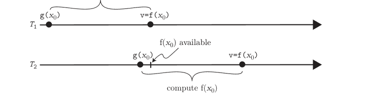

图 25.1 天真线程安全备忘录化策略的缺陷。

与其启动另一次 10 秒的计算，线程 T2 最好等待 1 秒让线程 T1 完成，然后从 store map 中获取值。你可以通过使用 promise 和 future 来实现这种行为。

关键思想是在线程开始计算时将一个 future 放入 store map 中，这样其他需要相同值的线程就知道计算已经在进行中。它们可以等待该 future 完成，而不是启动自己的新计算。以下变体使用 Java 的旧版 futures 实现此策略，但你也可以使用 CompletableFuture 或 Scala 的 Future 来实现：

```
def memo[A, B](f: A => B): A => B =
  val store = TrieMap.empty[A, Future[B]]
  x =>
    val future = store.get(x) match
      case Some(future1) => future1
      case None =>
        val task = FutureTask(() => f(x))
        store.putIfAbsent(x, task) match
          case Some(future2) => future2
          case None =>
            task.run()
            task
    future.get()
```

# 清单 25.7：使用 promise 和 future 的线程安全备忘录化函数。

变量 store 现在将类型 A 的输入映射到类型 Future[B] 的 future 输出。当线程需要值 f(x) 时，首先查询 map。如果找到一个 future——future1——则使用它，而不是重新计算 f(x)。如果 x 不在 map 中，则创建一个 promise/future 作为 FutureTask 实例命名为 task。然后尝试将其添加到 map 中。如果在此期间——在 get 方法调用之后不久——其他线程已经开始计算 f(x)，方法 putIfAbsent 不会将 task 添加到 map 中，而是返回该其他计算的 future——future2。在这种情况下，使用它（并忘记 task）。如果方法 putIfAbsent 成功将 task 添加到 store map 中，则当前线程现在负责计算 f(x)。其他需要此值的线程将在 map 中找到 task，并在 f 的计算完成前可能阻塞在它上面。然后调用 task.run，这会触发 f(x) 的求值。运行完成后，对 store map 中 x 的任何后续查找都会找到一个已完成的 future，并从中检索值 f(x)，而不会调用 f 或阻塞在 get 方法上。

请注意，task 被称为 promise/future。确实如此，它两者都是。它由创建它的线程作为 promise 完成，并由任何需要计算值的线程作为 future 使用。还请注意，future1 处理的是在本次对备忘录化函数调用之前某个时间开始的计算的情况，而 future2 处理的是两个线程在同一时间对同一输入调用备忘录化函数的情况：两个线程都未能在 store map 中找到键，都尝试将 promise 添加到 map 中，而只有一个成功。


#### 25.7 总结

+   - 产生值的任务可以实现为动作——通常是接口 `Runnable` 的实例。在这种情况下，它们需要修改共享数据来存储这些值，而对共享可变数据的并发访问要求它们自行实现同步。Future 是一种专门为任务检索由其他任务产生的值而设计的替代同步机制。
+   - Future 非常适合函数式任务——即通过调用函数来产生值的任务。如果函数是纯的，所有需要的同步都可以嵌入到 future 中。
+   - 线程池可以在任务提交执行时创建一个 future。future 然后充当任务的句柄。它可用于查询任务的状态或作为同步器等待任务完成。任务完成后，future 还充当任务产生的值——或错误——的容器。
+   - 不同类型的 future 在提供的功能上有所不同。本章重点关注 Java 旧版 `Future` 类型定义的基本机制。Scala 的 `Future` 更丰富，而 Java 的 `CompletableFuture` 最丰富。它们的额外功能将在第 26 章中探讨。
+   - Future 是从 promise 创建的。promise 是一个容器，最初为空，可以通过设置值或在失败情况下设置异常来完成。promise 可以由创建它的线程完成（如第 25.7 节所示），也可以由其他线程完成，例如来自线程池（如第 25.4 节至 25.6 节所示）。
+   - Promise 和 future 紧密耦合，并且通常是同一个对象，扮演两个角色。术语可能有点令人困惑，因为某些资料将此对象称为 promise，而其他资料则称为 future。

```
val highSorted = quickSort(high, exec)
lowFuture.get() ::: pivot ::: highSorted
```

### Listing 26.1: 死锁倾向的并行快速排序；另见 Lis. 26.5。

此方法遵循与第 10.1 节中快速排序先前实现相同的模式。唯一的区别是该函数使用单独的线程对低值进行排序，而当前线程对高值进行排序，从而并行对两个列表进行排序。两个列表排序完成后，使用方法 get 检索已排序的低值，并像之前一样将两个列表围绕 pivot 拼接起来。这是服务器示例中在后台获取自定义广告时使用的相同模式，只是用于创建 future 的任务是函数本身，递归调用。

起初，代码似乎工作得足够好。你可以使用 quickSort 成功对一小串数字进行排序：

```
Scala
val exec = Executors.newFixedThreadPool(3)
quickSort(List(1, 6, 8, 6, 1, 8, 2, 8, 9), exec) // List(1, 1, 2, 6, 6, 8, 8, 8, 9)
```

然而，如果你使用同一个三线程池尝试对列表 [5,4,1,3,2] 进行排序，函数就会卡住并且无法终止。查看线程转储会显示所有三个线程都阻塞在对 lowFuture.get 的调用上，导致死锁。

图 26.1 显示了此时计算的状态作为一棵树。每个排序任务被拆分为三个分支：low、pivot 和 high。首次调用 quickSort 的线程在此称为 main。它将列表拆分为 pivot（5）、低列表（[4,1,3,2]）和高列表（[]）。它迅速自行对空列表进行排序，然后阻塞，等待列表 [4,1,3,2] 的排序完成。负责对列表 `[4,1,3,2]` 进行排序的线程也在进行类似的步骤，依此类推，递归进行。最终，线程池中的三个工作线程都阻塞在三个排序任务上：`[1,3,2]`、`[2]` 和 `[]`。最后一个任务——在图 26.1 左下角对空列表进行排序——位于线程池的队列中，因为没有剩余线程可以运行它。

这种有缺陷的快速排序实现在低列表较短的计算上工作得相当好，即使高列表很长。例如，你可以使用它在三线程池上对已排序的列表 `[1,2,...,100]` 进行排序。然而，当低列表很长时，即使高列表很短，函数也会失败。在同一个三线程池上，它无法对列表 `[5,4,1,3,2]` 进行排序，甚至无法对列表 `[4,3,2,1]` 进行排序。

在同一个线程池上递归创建更多任务的任务是死锁的常见来源。事实上，这个问题如此普遍，以至于专门设计了特殊线程池来处理它（见第 27.3 节）。递归任务很容易让你陷入麻烦，但只要任务等待同一线程池上其他任务的完成，即使没有递归，死锁的风险也存在。这就是为什么第 25.2 节中的服务器使用两个独立的线程池。它的 `handleConnection` 函数——此处已去掉与讨论无关的代码——涉及以下步骤：

```
```scala
val futureAd: Future[Ad] = exec.submit(() => fetchAd(request)) // a Java future
val data: Data          = dbLookup(request)
val page: Page          = makePage(data, futureAd.get())
connection.write(page)
```
```

Listing 26.2: 广告获取示例；与 Lis. 26.3、26.6 和 26.7 对比。

使用单个包含 *N* 个线程的池，你可能会出现 *N* 个同时连接，从而导致函数 `handleConnection` 的 *N* 个并发运行。每次运行都会向池提交一个广告获取任务，而没有线程可以执行它。所有运行随后都会永远卡在 `futureAd.get` 上。

避免这些死锁情况通常并不容易。你可能必须向池中添加大量线程以确保不会发生死锁，但大量线程可能对性能有害。很可能——甚至很可能——大多数运行只会阻塞线程的一小部分，远未达到死锁情况，并留下太多使用 CPU 资源的主动线程。有些情况无望：在最坏的情况下，朴素的快速排序示例需要与列表中的值一样多的线程才能保证计算免于死锁。

即使你发现自己处于更好的情况，并且可以用中等大小的池避免死锁，等待 future 仍然会产生不可忽略的成本。阻塞——在任何同步器上，包括锁——需要挂起一个线程，保存其执行栈，并在之后恢复栈并重新启动线程。被挂起的线程还倾向于使其数据在处理器级缓存中被其他计算覆盖，导致线程恢复执行时出现缓存未命中。这对性能可能产生严重后果。

避免死锁当然应该是你的首要关注点，但这些性能成本也不能总是被忽略。因此，它们构成了减少线程阻塞的另一个激励。已经提出了几种策略来最小化阻塞，其中一些将在第 27 章中详细描述。现在，我们将重点关注一种函数式并发编程风格，它通过高阶函数使用 future 而不阻塞。它脱离了更熟悉的对同步器的依赖，因此需要一些适应。一旦掌握，它就是安排并发程序的强大方式。

#### 26.2 回调

NOTE

本章中的代码示例主要依赖 Scala 的 futures，原因与本书首先使用 Scala 相同：它们往往比 Java 的 CompletableFuture 更简洁（尽管不总是功能丰富）。第 26.10 节和第 27.9 节以及第 28 章中的一些代码使用了 CompletableFuture，附录 A 中有更多示例。请注意，future 上的回调机制和其他高阶函数通常需要一个执行上下文——在并发应用程序中通常是线程池。如何指定此上下文因语言而异。它也可能成为呈现更重要概念时的干扰。本章中的大多数函数都假设存在全局执行上下文，未作说明。一个例外是第 26.5 节的列表（与第 26.1 节保持一致）；其他函数也可以使用类似的模式——即添加 "(using ExecutionContext)" 参数而不是假设全局上下文。

回调是一段被注册以供执行、通常在稍后执行的代码（异步回调）。现代 future 实现——包括 Scala 的 Future 和 Java 的 CompletableFuture——都提供回调注册机制。在 Scala future 上，你使用方法 onComplete 注册回调，其参数是要应用于 future 结果的动作。因为 future 可能以异常而不是值结束，所以回调动作的输入类型为 Try（见第 13.3 节）。

对于任务仍在进行的 future，对 onComplete 的调用会立即返回。动作将在 future 完成时运行，通常在指定为执行上下文的线程池上运行：

```
Scala
println("START")
given ExecutionContext = ... // a thread pool

val future1: Future[Int] = ... // a future that succeeds with 42 after 1 second
val future2: Future[String] = ... // a future that fails with NPE after 2 seconds
future1.onComplete(println)
future2.onComplete(println)

println("END")
```


这个示例启动了一个 1 秒的任务和一个 2 秒的任务，并在每个任务上注册了一个简单的回调。它会产生如下形式的输出：

```
main at XX:XX:33.413: START
main at XX:XX:33.465: END
pool-1-thread-3 at XX:XX:34.466: Success(42)
pool-1-thread-3 at XX:XX:35.465: Failure(java.lang.NullPointerException)
```

你可以看到主线程会立即终止——回调注册几乎不花费时间。一秒后，第一个回调运行并打印一个 Success 值。再过一秒，第二个回调运行并打印一个 Failure 值。在此输出中，两个回调都在同一个线程上运行，但不能保证这种情况总会发生。

你可以在广告获取场景中使用回调。与在 26.2 节的示例中等待自定义广告来组装页面不同，你指定一个操作作为广告一旦可用时要执行的操作：

```
val futureAd: Future[Ad] = Future(fetchAd(request))
val data: Data = dbLookup(request)
futureAd.onComplete { ad =>
  val page = makePage(data, ad.get)
  connection.write(page)
}
```

清单 26.3：带回调的未来广告获取示例。

在连接处理线程完成数据库查找后，它在广告获取任务上注册一个回调操作，而不是等待任务完成。回调操作从 Try 值中提取自定义广告（假设没有错误），将数据和广告组装成页面，并像之前一样将其作为回复发送回去。与清单 26.2 的主要区别在于，不涉及任何阻塞。

#### 26.3 Future 上的高阶函数

通过使用回调来组装和发送页面，你避免了阻塞，从而消除了死锁的风险。然而，由于 onComplete 的函数参数是一个操作，该操作是为了其副作用而执行的，因此丢失了一些早期的函数式风格。请回忆在清单 25.2 中的服务器完整版本中，组装好的页面还用于统计保持函数。如果作为未来产生的值需要在多个地方使用，使用回调来处理这些使用可能会变得复杂。如果该值

是异步使用的，你甚至可能需要回调中的回调，这很难编写，也更难调试。更好的解决方案是将回调的非阻塞特性带入保持更函数式风格的代码中。

在我们重访 26.5 节中的广告获取示例之前，考虑这个基于回调的函数：

```
Scala
def multiplyAndWrite(futureString: Future[String], count: Int): Unit =
  futureString.onComplete {
    case Success(str) => write(str * count)
    case Failure(e)   => write(s"exception: ${e.getMessage}")
  }
```

在某处，一个输入字符串正在异步生成。它作为未来传递给函数 multiplyAndWrite。该函数使用回调来重复字符串多次并写入结果——在 Scala 中，“A” * 3 是 “AAA”。这种方法要求你在回调操作中指定你想对字符串 str * count 做的一切，而该字符串在回调之外不存在。这是可能复杂性和模块化丧失的来源。用某种方式返回字符串 str * count 并使其可供任何需要它的代码使用的 multiply 函数来替换 multiplyAndWrite 可能会更有优势。

然而，在这个 multiply 函数内部，可能还没有要乘的字符串可用——它的计算可能仍在进行中。你也不能等待它，因为你想避免阻塞。相反，你需要将乘法的字符串本身作为未来返回。因此，multiply 的返回类型不是 String，而是 Future[String]。要返回的未来可以使用承诺创建，如清单 25.4 所示：

```
Scala
def multiply(futureString: Future[String], count: Int): Future[String] =
  val promise = Promise[String]()
  futureString.onComplete {
    case Success(str) => promise.success(str * count)
    case Failure(e)   => promise.failure(e)
  }
  promise.future
```

你创建一个承诺来保存乘法的字符串，并创建一个回调操作来兑现该承诺。如果未来 futureString 产生一个字符串，回调会将其乘以并成功兑现承诺。否则，承诺会失败，因为没有可用于乘法的字符串。

现在有趣的部分来了。从概念上讲，前面的代码与字符串和乘法关系不大。它真正做的是转换未来产生的值，以便创建一个新的未来。当然，我们以前见过这种模式——例如，将函数应用于选项的内容——以高阶函数 map 的形式出现。不是关注字符串乘法的特殊情况，你可以编写一个通用的未来上的 map 函数：

```
def map[A, B](future: Future[A], f: A => B): Future[B] =
  val promise = Promise[B]()
  future.onComplete {
    case Success(value) => promise.complete(Try(f(value)))
    case Failure(e)     => promise.failure(e)
  }
  promise.future
```

该函数是为通用类型 A 和 B 定义的，而不是字符串。与函数 multiply 的唯一有意义的区别是 f 可能会失败并且在 Try 内部被调用。因此，承诺可能因两个原因之一而失败：没有产生类型 A 的值来应用 f，或者函数 f 本身的调用失败。

提出 map 的好处在于它带我们进入一个熟悉的世界，即高阶函数，如第 9 章和第 10 章以及第一部分中讨论的那样。事实上，Try 类型本身有一个 map 方法，你可以使用它来简化未来上 map 的实现：

```
def map[A, B](future: Future[A], f: A => B): Future[B] =
  val promise = Promise[B]()
  future.onComplete(tryValue => promise.complete(tryValue.map(f)))
  promise.future
```

清单 26.4：在未来上重新实现高阶函数 map。

注意错误情况是如何透明地处理的，这要归功于 Try 类型（参见第 13.3 节，了解 Try 上 map 的行为）。

函数作为值和高阶函数构成了函数式编程的一个基本方面。第 25 章介绍了未来作为一种方式，通过依赖于适用于产生值的任务的机制，使并发编程更具函数式。一旦你选择函数式，就不应该对高阶模式开始出现感到惊讶。但故事并没有止步于 map。未来上的各种高阶函数催生了一种强大的并发编程风格，它既是函数式的又是非阻塞的。

你不需要在未来上重新实现 map：Scala 未来已经有一个 map 方法。你可以简单地按如下方式编写 multiply 函数：

```
def multiply(futureString: Future[String], count: Int): Future[String] =
  futureString.map(str => str * count)
```

最后两个函数可能比 flatMap/map 变体更容易阅读。尽管如此，你应该牢记 flatMap 的基本性质。事实上，zip 和 zipWith 可以使用 flatMap 实现。

一位经验丰富的 Scala 程序员可能会这样编写 multiply：

```
def multiply(futureString: Future[String], futureCount: Future[Int]): Future[String] =
  for str <- futureString; count <- futureCount yield str * count
```

请回忆第 10.9 节，Scala 中的 for-yield 是作为 map 和 flatMap（以及 withFilter）的组合实现的。该代码将被编译器转换为之前的 flatMap/map 版本。for-yield 语法非常好用，尤其是在处理未来时。我鼓励你在 Scala 编程时使用它。然而，正如前面注释中提到的，出于教学原因，我将在本书的示例中继续偏爱显式使用 map 和 flatMap。

通过使用 flatMap、zip 或 zipWith 将两个未来合并为一个，你可以将清单 26.1 的并行快速排序示例重写为非阻塞函数：

```
def quickSort(list: List[Int])(using ExecutionContext): Future[List[Int]] = list match
  case Nil => Future.successful(list)
case pivot :: others =>
  val (low, high) = others.partition(_ < pivot)
  val lowFuture  = Future.delegate(quickSort(low))
  val highFuture = quickSort(high)
  lowFuture.flatMap(lowSorted =>
    highFuture.map(highSorted => lowSorted ::: pivot :: highSorted)
  )
```

清单 26.5：并行快速排序的非阻塞实现。

为了避免阻塞，函数的返回类型从 List[Int] 改为 Future[List[Int]]。与之前一样，排序低值的任务被委托给线程池。你也可以等价地写成 lowFuture = Future(quickSort(low)).flatten。对高值使用直接递归调用，并将两个未来合并，遵循与函数 multiply 相同的模式。这种快速排序变体不涉及任何阻塞，与清单 26.1 相比，不可能发生死锁。¹

¹此实现仍然效率低下。其主要弱点是它为非常小的列表一直到空列表创建单独的排序任务。更现实的实现会在某个点停止并行化，并在当前线程内对短列表进行排序。例如，Java 的 Arrays.parallelSort 函数，一旦子数组的元素数少于或等于 8192 就会停止将其分发到单独的线程。


#### 26.5 插图：并行服务器再探

有了对 futures 的标准高阶函数，我们现在可以回到服务器示例。首先，你可以用 `map` 调用替换 26.3 节清单中的回调动作，从而从 `Future[Ad]` 生产出一个 `Future[Page]`：

```scala
val futureAd: Future[Ad] = Future(fetchAd(request))
val data: Data = dbLookup(request)
val futurePage: Future[Page] = futureAd.map(ad => makePage(data, ad))
futurePage.foreach(page => connection.write(page))
```

清单 26.6：使用 map 和 foreach 对 futures 进行广告获取示例。

你使用 map 将广告转换为完整的页面，通过将广告与已从数据库检索的数据结合。你现在拥有一个 `Future[Page]`，可以在页面所需的地方使用它。特别是，将页面发送回客户端是一个无值动作，回调非常自然地适合此目的。为说明目的，此代码使用 `foreach` 而不是 `onComplete` 注册回调。两者不同之处在于 `foreach` 不处理错误：如果 future 失败，其动作不会运行。

在清单 26.6 中，数据库由连接处理线程查询，同时在后台获取自定义广告。或者，数据库查找可以交给另一个线程，导致类型为 `Future[Data]` 的值。然后你可以使用 `flatMap`/`map` 组合两个 futures：

```scala
val futureAd: Future[Ad] = Future(fetchAd(request))
val futureData: Future[Data] = Future(dbLookup(request))
val futurePage: Future[Page] =
  futureData.flatMap(data => futureAd.map(ad => makePage(data, ad)))
futurePage.foreach(page => connection.write(page))
```

清单 26.7：使用 flatMap 和 foreach 对 futures 进行广告获取示例。

这段代码有趣之处在于，执行它的线程不执行任何数据库查找、广告获取或页面组装和写入。它只是创建 futures 并在它们上调用非阻塞高阶方法。如果你以相同风格编写连接处理代码的其余部分，你会得到一个完全异步且非阻塞的 `handleConnection` 函数：

```scala
given exec: ExecutionContextExecutorService =
  ExecutionContext.fromExecutorService(Executors.newFixedThreadPool(16))

val server = ServerSocket(port)

def handleConnection(connection: Connection): Unit =
  val requestF = Future(connection.read())
  val adF      = requestF.map(request => fetchAd(request))
  val dataF    = requestF.map(request => dbLookup(request))
  val pageF    = dataF.flatMap(data => adF.map(ad => makePage(data, ad)))
  dataF.foreach(data => addToLog(data))
  pageF.foreach(page => updateStats(page))
  pageF.foreach(page => { connection.write(page); connection.close() })

while true do handleConnection(Connection(server.accept()))
```

清单 26.8：一个完全非阻塞的并行服务器。

`handleConnection` 函数首先向线程池提交一个从套接字读取请求并生成 future `requestF` 的任务。从那时起，代码通过在 futures 上调用高阶函数继续进行。首先，使用 `map` 安排广告获取任务在请求读取后运行。此调用生成 future `adF`。数据库查找 future `dataF` 以相同方式创建。两个 futures `dataF` 和 `adF` 使用 `flatMap` 和 `map` 组合成 future `pageF`，如前所述。最后，注册了三个回调动作：一个在 `dataF` 上用于日志记录，两个在 `pageF` 上用于统计记录和回复客户端。

运行函数 `handleConnection` 的线程不执行任何实际的连接处理工作。该线程只是创建 futures 并在它们上调用非阻塞函数。运行整个 `handleConnection` 主体所需的时间可以忽略不计。特别是，你可以让监听线程本身执行它，与清单 25.2 不同，后者为此目的创建了单独的任务。

处理请求时需要进行的各种计算相互依赖，如图 26.2 所示。清单 26.8 中实现的服务器在其依赖项完成后立即执行任务，除非线程池中的全部 16 个线程都忙碌。事实上，16 个线程在任务变得有资格运行时在计算之间跳转——获取广告、记录日志、构建页面等——跨请求边界。它们从不阻塞，除非根本没有任务可运行。此实现最大化并行性且无死锁。

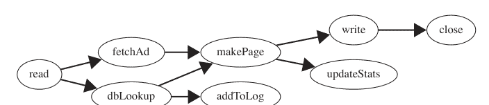

图 26.2 服务器示例中的活动依赖关系。

此代码在 future `dataF` 完成时运行——当数据库中的数据可用时。如果此时广告已准备好——`adF.isCompleted` 为 true——你可以使用它。否则，你需要确保广告很快可用。为此，你创建一个 promise，并使用计时器在 0.5 秒后用默认广告兑现此 promise。你还向 `adF` 添加一个回调动作，它尝试兑现同一个 promise。哪一个先运行——计时器任务或自定义广告任务——将用其值设置 promise。² 调用 `timerF.cancel` 严格来说不是必需的，但它用于避免在自定义广告及时可用的情况下创建不必要的默认广告。

作为最后一个案例研究的一部分，清单 28.4 使用了类似的策略来扩展 Scala futures 以提供 `completeOnTimeout` 方法。

#### 26.6 函数式并发编程模式

一方面是 futures，另一方面是高阶函数，都是强大的抽象。它们一起形成了一种强大的组合，尽管掌握起来可能需要一些努力。即便如此，这也是值得的努力。本节说明了你在进入函数式并发编程时应牢记的几个指导原则。

### flatMap 作为阻塞的替代方案

高阶函数是你不必编写的代码的抽象。它们很方便，但通常可以用手写实现来替代。例如，如果 `opt` 是一个 option，`opt.map(f)` 也可以写成：

```scala
opt match
  case Some(value) => Some(f(value))
  case None        => None
```

然而，对于 futures 来说，高阶函数是对难以直接实现的计算的替代。如果 `fut` 是一个 future，你可以用什么替换 `fut.map(f)`？由于值可能尚不存在，future 不能简单地“打开”以访问其值。除了创建并阻塞额外的线程之外，没有替代方案可以使用高阶函数在 future 内部执行操作。

你可以在处理 futures 时利用函数式编程技能与高阶函数。早些时候，例如，我们在 option 上使用 `flatMap` 来链接可能产生或可能不产生值的计算。你可以在 futures 上以类似方式使用 `flatMap` 来链接可能异步或可能不异步的计算。不是从 A 到 `Option[B]` 的“可选”阶段，而是定义异步阶段，即从 A 到 `Future[B]` 的函数。

作为说明，第 10.3 节中使用的三个可选函数可以改为表示异步步骤：

```scala
def parseRequest(request: Request): Future[User] = ...
def getAccount(user: User): Future[Account] = ...
def applyOperation(account: Account, op: Operation): Future[Int] = ...
```

然后可以使用 `flatMap` 链接这些步骤：

```scala
parseRequest(request)
  .flatMap(user => getAccount(user))
  .flatMap(account => applyOperation(account, op))
```

清单 26.9：使用 flatMap 的 futures 管道。

清单 26.9 中的表达式与清单 10.5 中的表达式完全相同，只是它产生类型为 `Future[Int]` 的值而不是 `Option[Int]`。

### 同步和异步计算的统一处理

你可以通过组合类型为 A => B 的步骤——使用 `map`——和类型为 A => `Future[B]` 的步骤——使用 `flatMap`——来混合同步和异步操作。相反，通常更方便只使用形式为 A => `Future[B]` 的步骤并结合 `flatMap`。如果需要，同步步骤可以实现为已完成的 future。这种设计增加了灵活性：它使替换同步步骤为异步步骤，反之亦然变得更容易。

例如，如果账户只是存储在 map 中，则来自前面示例的 `getAccount` 函数可以在调用线程中同步实现：

```scala
val allAccounts: Map[User, Account] = ...
def getAccount(user: User): Future[Account] = Future.successful(allAccounts(user))
```

此函数返回一个已完成的 future，并且不涉及任何额外线程。如果随后需要异步获取账户，你可以重新实现该函数而不修改其签名，并让使用它的所有代码——例如清单 26.9——保持不变。

### 函数式失败处理

异常通常在线程内抛出和捕获。它们不会自然地在线程之间传递，并且不适合多线程编程。相反，你最好遵循第 13 章中讨论的函数式错误处理方法。


依赖于类型为 A => Future[B] 的计算而不是 A => B 的额外好处是，future 还可以携带失败——在 Scala 中，你可以将 Future 视为异步的 Try。例如，你可以通过确保即使找不到用户时也始终产生一个 future 来改进 getAccount 函数：

```
def getAccount(user: User): Future[Account] = Future.fromTry(Try(allAccounts(user)))
```

这样，类似 getAccount(user).onComplete(...) 的表达式仍然会执行回调动作，而如果 getAccount 抛出异常则不成立。失败的 future 可以以函数式的方式处理，使用 Scala 中的 recover 等专用函数，或 Java 中的 exceptionally。

为简单起见，来自清单 26.8 的连接处理函数并未处理错误。你可以使用标准的 future 函数为服务器增加健壮性。例如，创建页面失败可以通过转换 pageF future 来处理：

```
val safePageF: Future[Page] = pageF.recover { case ex: PageException => errorPage(ex) }
```

或通过添加失败回调：

```
pageF.failed.foreach { ex =>
  connection.write(errorPage(ex))
  connection.close()
}
```

使用 pageF.foreach 或使用 pageF.failed.foreach 指定的回调动作中，只会运行其中一种，而不会同时运行两种。

## 非阻塞“Join”模式

在服务器示例中，pageF 是通过使用 flatMap 组合两个 future dataF 和 adF 创建的。你可以使用相同的方法组合三个或更多 future：

```
val f1: Future[Int] = ...
val f2: Future[String] = ...
val f3: Future[Double] = ...

val f: Future[(Int, String, Double)] =
  f1.flatMap(n => f2.flatMap(s => f3.map(d => (n, s, d))))
```

不过这无法扩展到更大数量的 future。一种有趣且并不罕见的情况是将 N 个相同类型的 future 组合成一个单一的 future，N 为任意数。在服务器示例中，客户端可能从 *N* 个数据库查询中获取数据，这些查询并行执行：

```
```scala
def queryDB(requests: List[Request]): Future[Page] =
  val futures: List[Future[Data]] = requests.map(request => Future(dbLookup(request)))
  val dataListF: Future[List[Data]] = Future.sequence(futures)
  dataListF.map(makeBigPage)
```
```

第一行使用 `map` 为每个请求创建一个数据库查询任务。这些并行运行的任务形成一个 future 列表。`queryDB` 中的关键步骤是对 `Future.sequence` 的调用。此函数使用类型为 `List[Future[A]]` 的输入来产生类型为 `Future[List[A]]` 的输出。它返回的 future 在所有输入 future 完成后完成，并包含它们的所有值作为一个列表（假设没有错误）。调用 `Future.sequence` 起到的作用与 fork-join 模式中的“join”部分相同，但不会阻塞。最后一步使用从 `List[Data]` 到 `Page` 的函数 `makeBigPage` 来构建最终页面。

截至本文撰写时，`CompletableFuture` 没有标准的 sequence 函数，但你可以使用 `thenCompose`（相当于 `flatMap`）和 `thenApply`（相当于 `map`）自行实现：

```
```scala
def sequence[A](futures: List[CompletableFuture[A]]): CompletableFuture[List[A]] =
  futures match
    case Nil => CompletableFuture.completedFuture(List.empty)
    case future :: more =>
      future.thenCompose(first => sequence(more).thenApply(others => first :: others))
```
```

清单 26.10：不阻塞地将一个 CompletableFuture 列表合并为一个。

此函数使用递归来嵌套调用 `thenCompose`（`flatMap`）。在递归分支中，`sequence(more)` 是一个 future，它将包含除第一个之外的所有输入 future 的值。然后使用 `thenCompose` 和 `thenApply`（`flatMap` 和 `map`）将此 future 与第一个输入 future 组合起来，其模式与之前合并两个 future 时使用的模式相同（如清单 26.5、26.7 和 26.8 所示）。

## 非阻塞“Fork-Join”模式

函数 `queryDB` 使用一种 fork-join 模式，其中 `sequence` 在不阻塞的情况下实现了“join”部分。fork-join 是一种足够常见的模式，以至于 Scala 定义了函数 `traverse` 来实现计算的“fork”和“join”两部分。你可以使用它来实现 `queryDB` 的更简洁版本：

```
```scala
def queryDB(requests: List[Request]): Future[Page] =
  Future.traverse(requests)(request => Future(dbLookup(request))).map(makeBigPage)
```
```

### 第 27 章

#### 最小化线程阻塞

第 26 章提倡以函数式的方式使用 future 的编程风格，从而最小化线程阻塞。多年来，人们花费了大量精力试图避免不必要的线程阻塞，通常出于性能原因。¹ 本章快速概述了一些流行的技术，这些技术力求不阻塞线程，并且通常避免使用锁和其他同步器。

#### 27.1 原子操作

作为第一个示例，考虑类 java.util.concurrent.AtomicInteger 的情况，它在一些早期的示例中使用过。在 Java² 中使用锁实现线程安全的可变整数是相当直接的：

// THIS IS NOT java.util.concurrent.AtomicInteger!
private int value = 0;

public synchronized int get() {
    return value;
}

public synchronized int incrementAndGet() {
    value += 1;
    return value;
}
```

此代码是正确且线程安全的，但不一定高效。如果两个线程共享这样的整数，并且同时调用 incrementAndGet，一个线程成功获取对象的内部锁，而另一个线程被阻塞。这是不理想的，因为将该线程挂起和恢复所需的时间远多于另一个线程执行 value += 1 所需的时间。当锁不可用时，让线程浪费一些 CPU 周期进行自旋，而不是阻塞，直到另一个线程完成整数的递增会更好。

实际的类 `AtomicInteger` 并未使用锁。从概念上讲，它实现如下：

```
```java
public class AtomicInteger {

    private static final AtomicIntegerFieldUpdater<AtomicInteger> updater
        = newUpdater(AtomicInteger.class, "value");

    private volatile int value;

    public int get() {
        return value;
    }

    public int incrementAndGet() {
        while (true) {
            int current = value;
            int next = current + 1;
            if (updater.compareAndSet(this, current, next))
                return next;
        }
    }
    ...
}
```
```

清单 27.1：Java 中类 `AtomicInteger` 的概念实现。

没有任何方法被同步，并且实现不依赖任何锁定机制。相反，变量 value 是 volatile 且无需锁定即可访问。

读取整数不是问题：方法 `get` 只是读取并返回 value。然而，方法 `incrementAndGet` 存在原子性挑战。你需要避免两个并发进入该方法的线程相互覆盖对方的更新的场景（参见第 18.1 节的讨论）。

实现依赖于 compare-and-set（CAS）操作：

```
`compare-and-set(target, expectedValue, newValue)`
```

此表达式仅在目标等于预期值时才将目标设置为新值。如果目标与预期值不同，CAS 操作不会修改它。在语义上，这等同于 if (target == expected) target = newValue，只是检查后再执行的操作是原子执行的。CAS 在目标成功更新时返回 true，否则返回 false。

> 出于这个原因，现代 JVM 实现在锁不可用时通常不会立即挂起线程，而是先自旋一段时间，以防锁很快变得可用。
> 
> Compare-and-set 有时也称为 *compare-and-swap*。区别在于 compare-and-swap 返回交换前变量的值，而 compare-and-set 返回布尔值。


`updater` 在列表 27.1 中的作用是为类的 `value` 字段提供一个 CAS 操作。⁵ 这为您提供了一个原子性的检查后执行，足以安全地实现 `incrementAndGet`。首先，您将 `value` 中的数字读入局部变量 `current`。然后，您使用 CAS 来更新 `value`：如果它仍然等于 `current`，它将被替换为 `next`，即 `current + 1`。如果 CAS 失败并返回 false，则表示在读取后另一个线程修改了 `value`。在这种情况下，您使用循环读取 `value` 的新内容，并再次尝试递增操作。

可以这样思考这种实现：而不是使用锁来防止干扰，线程在乐观的假设下继续执行，即没有其他线程会干扰其操作。然而，如果确实发生了干扰，可以从 CAS 的失败中检测到，并且操作会被重新启动。

当两个线程同时修改一个原子整数时，可能出现线程两次计算 `next = current + 1` 的情况，但额外的递增成本可以忽略不计，与挂起和恢复线程所需的时间相比。即使涉及多个操作并且某些线程在 CAS 成功之前多次重复循环，这种非锁定策略往往优于基于锁的策略，除非线程数量极端。

Java 标准库定义了其他具有原子操作的类，例如 `AtomicLong` 和 `AtomicBoolean`。作为后者的说明，您可以重写列表 22.4 中的线程安全盒，而不使用任何锁：

```
class SafeBox[A]:
  private var contents: A = uninitialized
  private val filled      = CountDownLatch(1)
  private val isSet       = AtomicBoolean(false)

  def get: A =
    filled.await()
    contents

  def set(value: A): Boolean =
    if isSet.get || isSet.getAndSet(true) then false
    else
      contents = value
      filled.countDown()
      true
```

列表 27.2：使用栅栏且无锁的线程安全盒。

方法 `get` 的实现与列表 22.8 中类似：它在栅栏打开后简单地读取 `contents`。在 `set` 内部，您可以使用原子布尔值确保只有一条线程成功设置盒子。布尔值初始为 false，并且只能使用 `getAndSet` 从 false 翻转为 true 一次。`AtomicBoolean`

⁵ 来自 `java.util.concurrent` 的实际 `AtomicInteger` 类使用不同的 updater，但原理相同。

保证如果多个线程对一个为 false 的布尔值调用 getAndSet(true)，该方法对恰好一个线程返回 false，对所有其他线程返回 true。内部，getAndSet 被实现为一个循环，使用 CAS。

测试 isSet.get 并不是严格必要的：它是一个性能优化，避免在布尔值已为 true 时使用成本更高的 getAndSet。列表 22.4 中必要的 nonEmpty 测试不再使用。无用的 option 因性能原因被移除，并且变量 contents 现在的类型为 A 而不是 Option[A]。

#### 27.2 无锁数据结构

比较并交换操作不仅限于整数和布尔值等原始类型。事实上，它们也作为 AtomicReference 类的方法在引用对象上可用。这使得可以在不加锁的情况下原子地更新指针，这是无锁算法的基础。

作为说明，考虑这种基于锁的线程安全栈的实现：

```
Scala
private class Node[A](val value: A, val next: Node[A])

final class Stack[A]:
  private var top: Node[A] = null

  def peek: Option[A] = synchronized {
    if top == null then None else Some(top.value)
  }

  def push(value: A): Unit = synchronized {
    top = Node(value, top)
  }

  def pop(): Option[A] = synchronized {
    if top == null then None
    else
      val node = top
      top = node.next
      Some(node.value)
  }
```

您需要加锁来为 push 和 pop 带来原子性。如果没有同步，例如两个并发调用 push 可能会读取相同的 top 值并创建两个节点 V1 和 V2，它们都引用它（图 27.1）。然后，如果您将 top 更新为指向节点 V1，您会丢失 V2 的值，反之亦然。

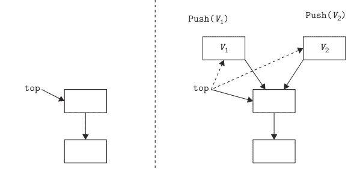

## 图 27.1 并发调用栈的 push 时可能丢失值。

为了避免加锁，您可以将 top 改为原子引用并使用 CAS 更新它。这样，失败的 CAS 可以用来检测并发修改栈的尝试：

```
import java.util.concurrent.atomic.AtomicReference

private class Node[A](val value: A, var next: Node[A])

final class Stack[A]:
  private val top = AtomicReference[Node[A]]()

  def peek: Option[A] = top.get match
    case null => None
    case node => Some(node.value)

  def push(value: A): Unit =
    val node = Node(value, top.get)
    while !top.compareAndSet(node.next, node) do node.next = top.get

@tailrec
def pop(): Option[A] = top.get match
  case null => None
  case node => if top.compareAndSet(node, node.next)
    then Some(node.value) else pop()
```

列表 27.3：线程安全栈的无锁实现（Treiber 算法）。

方法 peek 与之前没有太大区别：它读取顶节点，如果不是 null，则返回其值。不需要原子性，top 就像一个普通的 volatile 变量一样使用。其他两个方法更为复杂。

在 push 中，您首先创建一个新节点，其 next 指针引用当前 top 的值。然后您需要使用 CAS 将 top 更新为指向这个新节点（图 27.2 中向上移动 top 指针）。如果另一个线程并发修改 top（在 push 或 pop 内部），CAS 可能会失败。如果 CAS 失败，您将节点的 next 指针更新为引用 top 的新值并再次尝试更新 top。类似地，pop 使用 CAS 尝试将 top 更新为 top.get.next（图 27.2 中向下移动 top 指针），如果 CAS 失败则重试 pop 操作。⁶

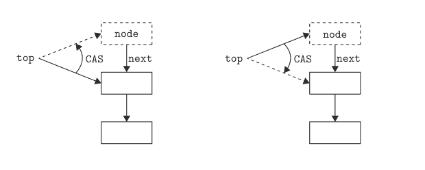

## 图 27.2 使用比较并交换来 push/pop 无锁栈。

在这个栈示例中，您可以看到无锁算法比使用锁的算法明显更复杂。java.util.concurrent 中的许多线程安全数据结构都依赖于无锁算法，包括内部用于实现同步器的结构，例如等待线程的队列。其中一些相当棘手，因为一个操作需要更新多个引用，即使使用 AtomicReference 实例上的 compareAndSet，这也不是原子操作。

CAS 的一个限制是它可能成功，即使目标值已被并发修改，只要它被修改回预期值——这种场景被称为 ABA 问题。例如，对 AtomicBoolean 的 compareAndSet(false, true) 可能无法注意到并发交互将布尔值从 false 改为 true，然后再改回 false。如果算法需要检测此类更改，可以使用类 AtomicStampedReference。该类通过为引用添加整数计数器来区分相同的值。⁷

⁶ 方法 pop 使用尾递归进行重试；方法 push 使用循环，因为这样更容易在 CAS 尝试之间重用同一个节点——使用递归需要引入额外的方法。

⁷ 现代处理器提供了一种替代 CAS 的方法，称为 load-linked/store-conditional（LL/SC），这是一对检测负载和存储之间干扰的指令，与加载和存储的值无关，因此不受 ABA 问题的影响。

#### 27.3 Fork/Join 池

## 注意

第 27.3 到 27.6 节依赖于第 26 章中的广告获取示例来说明各种框架。此示例不一定是最能说明这些框架优势的示例。相反，这里目标是使比较方法更容易，并强调它们都可以用于实现相同的非阻塞计算。

在第 26 章中，我以一个递归任务的例子开始讨论阻塞的危险：一个快速排序任务启动另一个快速排序任务并等待其完成（列表 26.1）。这导致线程等待任务，而任务等待线程执行，从而可能导致死锁。

为了更好地处理创建其他任务的任务这一常见模式，Java 并发库定义了一种特殊的线程池形式，称为 ForkJoinPool。该池实现了与常规池相同的功能，但还具有专门的机制，使任务能够创建任务（fork）并等待其完成（join）而不阻塞工作线程。方法 join 的实现方式是，如果正在加入的任务尚未完成，工作线程将改为检索并启动为执行而调度的另一个任务。⁸ 这使线程保持活跃，整体任务持续取得进展，从而避免死锁——前提是任务没有被设置为在循环中相互等待。

为了说明这种非阻塞 join 的使用，让我们使用 ForkJoinPool 重写我们对并行获取定制广告与数据库查找的示例解决方案：

```
import java.util.concurrent.ForkJoinTask

val futureAd: ForkJoinTask[Ad]      = ForkJoinTask.adapt(() => fetchAd(request)).fork()
val futureData: ForkJoinTask[Data]  = ForkJoinTask.adapt(() => dbLookup(request)).fork()
val data: Data                      = futureData.join()
val ad: Ad                          = futureAd.join()
val page: Page                      = makePage(data, ad)
```

列表 27.4：使用 ForkJoinPool 的非阻塞并发示例。

> ⁸ ForkJoinPool 类实现了一种工作窃取模式，其中每个工作线程维护自己的任务队列，并在工作耗尽时从其他工作线程“窃取”。与单一队列模型相比，这种方法的好处是新创建的任务可以添加到当前工作线程的队列中以供稍后处理，而不会干扰其他线程。这已成为如此受欢迎的功能，以至于 Java 后来引入了新的 newWorkStealingPool 方法，使这种模式独立于 fork/join 机制可用。


调用 `futureData.join()` 和 `futureAd.join()` 不会阻塞线程，即使广告或数据尚不可用。将这种实现与代码清单 25.2 对比：后者使用普通 Future 的 `get` 方法来获取广告，如果广告获取任务仍在运行，则可能导致工作线程阻塞。

在实际应用中，代码清单 27.4 的实现与代码清单 26.7 等价；后者使用 `flatMap` 和 `map` 以非阻塞方式将广告与数据库数据组合起来。它的主要好处在于风格更接近代码清单 25.2 中那种熟悉的（但阻塞的）变体。

借助 fork/join，你就有了一种让任务等待另一个任务而不阻塞线程的机制。但是，如果你使用锁、信号量或阻塞队列，仍然可能阻塞线程。要真正利用 ForkJoinPool 的优势，你需要避免使用同步器。如果确实需要阻塞线程，该框架定义了 ManagedBlocker 接口，你可以用它来表明线程即将阻塞。这样，线程池就可以适当地创建额外线程，以保持所需的并行度。

#### 27.4 异步编程

代码清单 27.4 中“等待但不阻塞”的思想在其他编程模型中也有体现。这些模型往往侧重于让代码变成异步的——而不是并发的——但通常也可以配置为支持并发。例如，在 Scala 中，你可以使用一个实验性的异步框架，以看起来相当标准的风格实现并行获取广告和查询数据库的示例：

```
import cps.compat.sip22.{ async, await }

async {
  val futureAd: Future[Ad]      = Future(fetchAd(request))
  val futureData: Future[Data] = Future(dbLookup(request))
  val ad: Ad                    = await(futureAd)
  val data: Data                = await(futureData)
  val page: Page                = makePage(data, ad)
}
```

代码清单 27.5：使用 async/await 结构的非阻塞并发示例。

`await` 方法会挂起 `async` 块的执行，直到目标 Future 完成，但它不会阻塞线程，线程可以继续在其他地方执行代码。这种实现同样遵循传统的阻塞式风格，但在行为上与代码清单 26.7（使用 `flatMap`/`map`）或代码清单 27.4（使用 ForkJoinPool）几乎等价。⁹

> ⁹这个示例使用了 Ruslan Shevchenko 编写的一个非标准库，它实际上会在编译时将 async/await 代码转换成对应的 map/flatMap 调用。

#### 27.5 Actor

由于 Scala 已经提供了优雅的 for-yield 结构来处理 `flatMap` 和 `map`，因此它不像其他一些语言那样关注这种编程风格。例如，Kotlin 通过其协程提供了更丰富的构造。你可以使用协程来实现广告获取示例：

```
import kotlincoroutines.*

coroutineScope {
  val futureAd: Deferred<Ad> = async { fetchAd(request) }
  val futureData: Deferred<Data> = async { dbLookup(request) }
  val data: Data = futureData.await()
  val ad: Ad = futureAd.await()
  val page: Page = makePage(data, ad)
}
```

代码清单 27.6：使用 Kotlin 协程的非阻塞并发示例。

在 Kotlin 中，`async` 构造用于启动一个协程，并产生一个 `Deferred` 对象。与 ForkJoinTask 一样，这是一种 Future。它实现了一个 `await` 方法——类似于 ForkJoinTask 上的 `join`——你可以用它来等待 Future 完成，而不会阻塞当前线程。这段代码与代码清单 27.4 和 27.5 中的代码非常相似。

Kotlin 协程的一大优势是，除了任务完成之外，它们还实现了其他非阻塞同步。例如，Mutex 实现了互斥锁，其中的 `lock` 方法会挂起代码执行而不阻塞线程；Semaphore 实现了信号量，其中的 `acquire` 方法会挂起代码执行而不阻塞线程。

对于消息传递应用，Channel 定义了发送和接收消息的方法，这些方法在概念上会等待（如果通道已满或为空），但不会阻塞当前线程。Go 是另一种强调这种编程风格的流行语言。例如，它的“goroutines”可以在通道上等待传入消息，而不会阻塞执行它们的线程。使用通道（或其他设计为不阻塞线程的同步器）进行通信的协程，已经成为实现非阻塞并发的一种流行方式。

#### 27.5 Actor

Actor 是一种经典的基于消息的模型，它通过 Erlang 等语言和 Akka 等库重新流行起来。Actor 通常不共享可变数据，而是通过发送和接收（不可变）消息来进行通信。在 Actor 内部，所有消息都会按顺序处理，因此 Actor 可以依赖非线程安全的内部数据结构。当 Actor 没有消息要处理时，它会保持被动状态，但不会阻塞任何线程。相反，线程可以继续运行其他 Actor，从而像协程一样，让少量线程也能处理大量 Actor。

你可以使用 Akka actor 重新实现并行获取广告和查询数据库的示例：

```
Scala
import akka.actor.typed.{ ActorRef, Behavior }
import akka.actor.typed.scaladsl.Behaviors

case class RequestMsg(replyTo: ActorRef[PageMsg], request: Request)
case class AdMsg(ad: Ad)
case class PageMsg(page: Page)

def requestHandling(): Behavior[RequestMsg] =
  Behaviors.receivePartial {
    case (context, RequestMsg(replyTo, request)) =>
      val dbQueryingActor = context.spawnAnonymous(dbQuerying(replyTo, request))
      context.spawnAnonymous(adFetching(dbQueryingActor, request))
      Behaviors.same
  }

def adFetching(replyTo: ActorRef[AdMsg], request: Request): Behavior[Nothing] =
  Behaviors.setup { context =>
    val ad = fetchAd(request)
    replyTo ! AdMsg(ad)
    Behaviors.stopped
  }

def dbQuerying(replyTo: ActorRef[PageMsg], request: Request): Behavior[AdMsg] =
  Behaviors.setup { context =>
    val data = dbLookup(request)

    Behaviors.receiveMessagePartial {
      case AdMsg(ad) =>
        val page = makePage(data, ad)
        replyTo ! PageMsg(page)
        Behaviors.stopped
    }
  }
```

代码清单 27.7：使用 actor 的非阻塞并发示例。

代码清单 27.7 定义了一个 `requestHandling` actor 来处理 `RequestMsg` 类型的消息，其中包含一个请求和一个地址 `replyTo`，用于指示最终页面的发送位置。收到请求后，该 actor 会创建两个新 actor：`adFetching` 负责获取定制广告，`dbQuerying` 负责查询数据库。你需要把 `dbQuerying` 的地址交给 `adFetching`，这样它就能在获取广告后发送广告消息。（在 Akka 中，发送消息使用“!”方法，这种记法起源于 CSP。）`dbQuerying` 的行为从数据库查询开始，接着处理 `adFetching` 发送来的包含广告的消息。然后，该 actor 组装页面，并将其发送回最初发起请求的实体（`replyTo`）。图 27.3 展示了该 actor 系统中的消息流。通过在包含多个线程的线程池上运行 actor，你可以实现与代码清单 26.7、27.4、27.5 和 27.6 相同的并行、非阻塞广告获取和数据库查询。

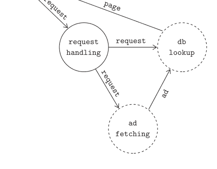

图 27.3 代码清单 27.7 中 actor 的消息流。

在创建两个新 actor（这几乎不花什么时间）之后，`requestHandling` actor 就完成了对该请求的处理。然而，它会继续存在，行为与之前相同，即 `Behaviors.same`，随时准备处理更多请求。相比之下，`adFetching` 和 `dbQuerying` 是临时 actor。它们在完成任务后，会使用 `Behaviors.stopped` 终止。

你可以选择复用一个或多个现有 actor，也可以决定创建新的 actor，从而获得极大的灵活性。例如，如果你正在实现代码清单 26.8 中的完整服务器，你可以决定使用一个单独的 actor 来处理日志记录，从而保证所有日志记录都按顺序完成。你也可以不为每个请求创建新的 actor 来获取广告，而是用固定数量的 actor 专门负责获取广告，甚至可以根据服务器活动情况动态调整这个数量。

最后，只要消息可以被序列化以进行网络通信，基于消息的协议就能让 actor 更容易部署在分布式系统中。Akka 常用于实现跨网络的计算，并提供了许多支持分布式计算的功能，包括 actor 迁移和负载均衡。


作为补充说明，Actor 有一个有趣的特性：它们可以切换行为，从而以不同方式处理后续传入的消息。这个特性可以用来以 Actor 的形式实现状态机：

```scala
trait Command
case class Start(replyTo: ActorRef[Number]) extends Command
case class Number(value: Int) extends Command
case object Stop extends Command

def reset(): Behavior[Command] =
  Behaviors.receiveMessagePartial {
    case Start(replyTo) => add(replyTo, reset())
  }

def add(replyTo: ActorRef[Number], reset: Behavior[Command]): Behavior[Command] =
  var sum = 0
  Behaviors.receiveMessagePartial {
    case Number(value) =>
      sum += value
      Behaviors.same
    case Stop =>
      replyTo ! Number(sum)
      reset
  }
```

清单 27.8：一个以切换行为的 Actor 实现的状态机示例

这个示例通过以重置（reset）行为启动一个 Actor 来实现计数器。该 Actor 等待 Start 命令。收到 Start 后，Actor 将行为切换为 add，并把当前行为作为参数传入，以便之后可以切换回来。随后，消息就按照新的行为来处理。收到类型为 Number 的消息时，其值被累加到累加器 sum 中，Actor 的行为保持不变。收到 Stop 消息时，Actor 回复累加后的总和，并恢复为初始行为，等待下一条 Start 消息。作为状态机，该 Actor 按如下方式在状态之间转换：

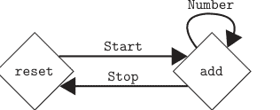

add 方法以命令式风格实现，使用了一个可变变量 sum。这样做是有意为之，是为了强调一个事实：在 Actor 内部，消息是按顺序处理的。Actor 可能并发地收到数字，但仍然能正确地将它们累加，即使没有使用锁，并且 sum += value 这个赋值操作并不是线程安全的。

#### 27.6 响应式流

清单 27.4 到 27.7 最后都构造出了单个页面。在实际应用中，你需要以某种方式对这个页面进行操作。如果所有页面都是彼此独立使用的，这种模式就能很好地工作，如服务器示例中那样：每个页面通过 socket 发送回客户端。但是，如果你需要在更大的组件中把所有页面作为一个整体来处理，那么异步创建的页面只能零散地分布——例如一个 Future[Page] 值的集合——就不够用了。作为替代，你可以使用异步页面流。

响应式流是一种抽象，它将 Future 的异步特性与迭代器的多值特性结合在一起。在多种语言中都有多种实现——例如 RxJava、RxSwift、RxAndroid、Akka Streams 和 Vert.x——还包括 java.util.concurrent.Flow 这样的极简变体。下一个示例使用 Reactor，一个流行的 Java 实现：

```scala
import reactor.core.publisher.{ Flux, Mono }

def makePages(requests: Flux[Request]): Flux[Page] =
  requests.flatMap { request =>
    val adF = CompletableFuture.supplyAsync(() => fetchAd(request), exec)
    val dataF = CompletableFuture.supplyAsync(() => dbLookup(request), exec)
    val pageF = dataF.thenCombine(adF, makePage)
    Mono.fromFuture(pageF)
  }
```

清单 27.9：使用响应式流进行非阻塞转换的示例

这个变体不是从单个请求创建单个页面，而是将请求流（在 Reactor 中称为 Flux）转换为页面流。这段代码是异步的：对请求流调用 makePages 方法会立即完成，并返回一个页面流。之后，随着请求被添加到输入流，相应的页面会出现在输出流中。与之前一样，广告获取和数据库查询在线程池上并行执行。[10] 这两个 Future 被异步组合成一个 Future 页面（thenCombine 是 CompletableFuture 中的 zipWith 版本，zipWith 曾在 26.4 节中使用）。这个 Future 页面随后被转换为只含单个值的短流，在 Reactor 中称为 Mono。

响应式流的强大之处在于其管理背压（减缓上游计算，直到下游能够赶上）、错误处理和基于时间处理的机制。这些机制超出了本书的范围，但作为基于时间处理的简短示例，请看下面这个例子：

```scala
val pages: Flux[Page] = ...

val largestPastHour: Flux[Int] =
  pages
    .map(_.length)
    .window(Duration.ofHours(1), Duration.ofMinutes(5))
    .flatMap(lengths => lengths.reduce(0, Integer.max))
```

该表达式使用重叠窗口，以数字流的形式每 5 分钟报告一次过去一小时内创建的最长页面的长度。想想看，如果要直接用各个页面的 Future 来实现这个功能，而且始终不阻塞任何线程，该怎么做。这是一个不简单的问题。

#### 27.7 非阻塞同步

本章和第 26 章介绍了几种避免阻塞线程的技术。在这最后一节中，我想澄清一个我多次遇到的误解。这个误解是：因为在使用这些方法时线程永远不会被阻塞，所以死锁这类同步错误不可能发生。事实并非如此。是的，不阻塞线程确实可以避免一些常见的容易死锁的情况——例如，参见 26.1 节对递归任务的讨论。但这并不意味着包括死锁在内的同步错误就不会发生。

你需要区分两种情况：一个 Future、任务、协程或 Actor “等待”某个事件——这并不涉及阻塞线程——以及线程被挂起（parked）。特别是，你仍然可能因为 Future、任务、协程或 Actor 彼此循环等待而导致死锁，这与运行它们的线程状态无关。作为示例，这个（人为构造的）例子中有两个 Future 在相互等待：

```scala
lazy val future1: Future[Int] = Future.delegate {
  println("future 1 starts")
  val future2: Future[String] = Future.delegate {
    println("future 2 starts")
    future1.map(n => n.toString)
  }
  future2.map(str => str.length)
}
```

在多线程线程池上执行时，该程序会打印“future 1 starts”和“future 2 starts”这两条语句，然后挂起。要完成执行，future2 需要 future1 产生一个数字，而 future1 需要 future2 产生一个字符串。这是 Future 之间的死锁，而不是线程之间的死锁。线程转储会显示线程池中的所有线程都处于空闲状态，等待要执行的任务。

你可能会说这个例子是人为构造的（确实如此），但复杂的应用程序，尤其是显式使用 Promise 的应用程序，也可能遇到这种情况。在面向消息的框架中，一组实体循环等待消息，也很容易导致死锁。例如，你可以使用 Kotlin 协程在不阻塞线程的情况下等待 Channel 上的消息：

```kotlin
val strings = Channel<String>()
val ints = Channel<Int>()

suspend fun task1() = coroutineScope {
    launch { task2() }
    println("waiting for a string")
    val str = strings.receive()
    ints.send(str.length)
}

suspend fun task2() = coroutineScope {
    println("waiting for an int")
    val n = ints.receive()
    strings.send(n.toString())
}
```

这个程序同样会打印两条消息然后停止，即使 receive 方法并不会阻塞线程，且所有线程都处于空闲状态。Actor 也会面临同样的困难。一个常见的模式是：Actor 需要收到 N 条消息后才能发出响应——这类似于在阻塞式实现中使用倒计时门闩（countdown latch）。如果改为只等待 N − 1 条消息，可能会产生不完整的响应；如果等待 N + 1 条消息，则可能导致死锁，完全不会发送任何响应。

除了重要的性能考量之外，非阻塞策略的一大好处是帮助程序员将注意力从非干扰（non-interference）转向协作。通常使用锁实现的非干扰式同步不再需要，但那些需要协作式同步器的模式——如阻塞队列或倒计时门闩——仍然存在。你只是换了一种方式实现它们——例如，让 Actor 或协程等待消息，或者通过 zip 或 flatMap 组合多个 Future。线程不会被阻塞这一事实，


#### 27.8 总结

- 在使用同步器（如锁、闩锁和期货）进行编程时，线程可能会在其他线程执行操作时暂时被阻塞，这通常会导致不可忽略的性能损失。第 26 章介绍了一种以函数式方式使用期货而不会阻塞线程的编程风格。本章讨论的其他一些技术可以最大限度地减少线程阻塞。
- 比较并交换（CAS）是一种硬件指令，实现了基本的原子检查后执行操作。它在语言级别的类型（如 `AtomicInteger` 和 `AtomicReference`）上也可用，作为 `compareAndSet` 方法。它可用于实现其他线程安全操作，例如类 `AtomicInteger` 中的 `incrementAndGet` 和 `getAndSet`。
- 特别是，类 `AtomicReference` 和原子更新器使得可以在不经过锁的情况下以原子方式操作指针。这是各种无锁算法的基础，这些算法在不加锁的情况下实现线程安全的数据结构，尽管代价是代码复杂性增加。
- 无锁算法往往遵循相似的模式。计算在不加锁的情况下进行，因此无法保证其他线程不会干扰。工作是推测性地执行，然后使用 CAS 提交。CAS 失败表明其他线程的干扰确实发生了，在这种情况下可以重试操作。
- 函数式并发编程通过使用回调和高阶函数中的期货来避免阻塞线程。另一种方法是使代码能够显式等待期货完成，但不会阻塞线程。这种原则有许多不同的实现方式。例如，Java 的 `ForkJoinTask` 实现了一种具有 `join` 方法的期货，该方法在期货终止前挂起代码执行，但不会阻塞运行线程，使其可以自由执行池中的其他任务。这导致了一种编程风格，通常感觉更自然——类似于阻塞变体——而不是依赖回调和计划转换。
- 这种不阻塞的等待思想有时会扩展到期货之外，并在其他形式中提供，例如 *async/await* 构造和协程。除了等待任务生成的值之外，这些构造还提供了非阻塞的方式来等待来自通道的消息，或获取独占锁，例如。
- Actor 是一种以消息为中心的并发和分布式编程模型。Actor 发送和接收消息，这些消息在 Actor 内部按顺序处理，使得在消息处理期间可以使用非线程安全代码。没有待处理消息的被动 Actor 不使用计算资源。它们不会阻塞线程，后者仍然可用于运行活动 Actor。
- 框架也存在以并行方式处理数据流，同时在数据不可用时避免线程阻塞。响应式流通过能够在终止前产生零个或多个值来补充期货——后者最终要么产生单个值，要么失败。通用响应式流规范（www.reactive-streams.org）已在多种编程语言中实现。
- 当代码不阻塞线程时，性能通常会提高，并且许多与使用锁编程相关的常见同步错误得以避免。然而，非阻塞方法并非万无一失。并发实体仍需要正确协调以实现整体计算目标。特别是，同步错误仍可能导致死锁——期货、协程或 Actor 的死锁——即使底层线程未被阻塞。

此页 intentionally left blank

### 第 28 章：案例研究：并行策略

我们最后的案例研究在前一案例研究的基础上扩展，重点关注函数的并行执行——而不是第 24 章中检查的操作。它考虑了一种场景，其中多个函数应用于相同的输入，每个函数成功可能性不同。实现利用了前几章中探讨的并发构造——承诺、期货、高阶函数——并使用其功能来解决失败、超时、取消和缓存问题。

#### 28.1 问题定义

> **NOTE**
>
> 本案例研究受到了我很久以前在从事程序静态分析工作时遇到的问题的启发。我正在实现一个工具，该工具通过生成证明义务来工作——即需要有效以证明程序满足期望属性的逻辑公式。这些公式通常很大、数量众多且验证成本高昂。我的工具使用自动定理证明器来检查公式的有效性，但不同的定理证明器——以及同一定理证明器的不同配置——在同一公式上通常表现非常不同。由于无法预测哪个证明器效果最好，每个公式都会并行启动多个定理证明器，并在某个证明器发现公式有效或无效时立即停止。本章中做出的一些假设反映了这一定理证明场景的特殊性。

本案例研究最后调查了一种场景，其中一系列问题需要使用多种启发式方法来解决。对于给定问题，你不知道哪种启发式方法会奏效，因此你希望并行尝试几种启发式方法，直到其中一种成功。在本章中，启发式方法以 Strategy 接口表示：

```scala
trait Strategy[A, B]:
  trait Task:
    def run(): Option[B]
    def cancel(): Unit

  def apply(input: A): Task
```

策略由输入类型 A 和输出类型 B 参数化。（在程序验证问题中，类型 A 将表示逻辑公式，类型 B 将为 Boolean。）当应用于给定输入时，策略会生成一个任务，该任务可以运行以尝试计算相应的输出。任务可能成功或失败，因此返回一个选项。任务也可以被取消——例如，因为它已超出时间配额，或因为另一个策略已解决该问题。本章开发的代码依赖于以下几个假设：

- 策略只能以值成功、以空选项失败，或无限期运行。特别是，我们假设策略不会以异常失败。这不是一个重大的限制。你总是可以用返回 None 而不是抛出异常的函数 x => Try(f(x)).getOrElse(None) 替换可能抛出异常的类型 A => Option[B] 的函数 f。
- 对于给定的输入，所有产生成功值的策略都产生相同的值。（在我原来的上下文中，如果一个定理证明器可以证明一个公式有效，其他证明器就不能证明它无效，反之亦然。）没有“更好”值的概念。这使得一旦某个策略成功终止，就忽略所有其他策略的输出成为可能——甚至是可取的。
- 通过调用其 cancel 方法来取消任务，该方法针对每个策略进行定制。这使得策略更容易使用对线程中断无响应的代码——Java 线程池使用的默认取消机制——例如套接字 I/O。（我的验证工具在远程计算机上运行定理证明器。）
- 取消可以按“尽力而为”的方式实现：任务在被取消后可能仍会运行一段时间。对任务调用 cancel 不能保证其 run 方法中的线程会立即完成此调用。
- 在任务运行前取消任务可防止该任务 ever 运行；如果调用，其 run 方法会立即返回 None。取消已完成的任务没有任何效果。

作为参考，一个简单的顺序实现会依次尝试所有策略，直到其中一个产生非空选项或所有策略都已耗尽：

```scala
{runner-seq}
class Runner[A, B](strategies: Seq[Strategy[A, B]]):
  def compute(input: A): Option[B] =
    strategies.view.flatMap(strategy => strategy(input).run()).headOption
```

运行器由一组策略创建。其 compute 方法遍历所有策略，使用视图。对于每个策略，它创建并运行任务，直到某个任务产生非空选项或所有策略都失败。使用视图可保证 compute 在策略成功后立即终止，而无需不必要地评估


the remaining strategies.¹ (See Sections 12.8 and 12.9 for an introduction to using views and iterators in this programming style.)

#### 28.2 Sequential Implementation with Timeout

The implementation just described ignores strategies that return an empty option, but it does not handle strategies that fail by continuing to run—a common behavior with theorem provers and other searches based on heuristics. In particular, compute may keep running forever if it gets stuck with a non-terminating strategy.

You can write a better implementation that takes an additional argument as a timeout, in seconds:

```
class Runner[A, B](strategies: Seq[Strategy[A, B]]):
  def compute(input: A, timeout: Double): Option[B] =
    val exec = Executors.newSingleThreadExecutor()
    val tasks = strategies.map(strategy => strategy(input))

    val future: Future[Option[B]] = exec.submit { () =>
      tasks.view.flatMap(task => task.run()).headOption
    }
    exec.shutdown()

    try future.get((timeout * 1E9).round, NANOSECONDS)
    catch
      case _: TimeoutException =>
        for task <- tasks do task.cancel()
        None
```

Listing 28.1: A sequential runner of strategies with timeout.

You cannot afford to use the thread that invokes compute to directly evaluate strategies because it could get stuck—possibly uninterruptibly—inside a run method that does not terminate before the timeout. Instead, you can create a separate thread—as a single-thread executor—and use it to run all the strategies, sequentially. This run produces a future of type java.util.concurrent.Future, which the first thread can use to retrieve the result.

You implement the desired timeout by using a variant of the get method that throws an exception if the future is not completed before a specified amount of time has elapsed. Note that the time it takes to create the tasks and to start the second thread is assumed to be negligible and is not taken into account: The entire timeout duration is spent on the get method. Other runner implementations in this chapter will refine this assumption.

¹You could implement this approach as a loop with a break statement in an imperative language. I use a functional style here because Scala has no break statement.

After you catch a timeout exception but before compute returns None, it can be desirable to cancel the run that is still ongoing, since it is now wasting computing resources to calculate data that will never be used, as well as all the runs that follow. The easiest way to do so is simply to cancel all the tasks, including tasks that have already completed with a failure: In this case study, we assume that canceling a finished task is harmless. This approach to cancellation is used in all runner implementations throughout the chapter.

Despite the use of a second thread, the runner implementation in Listing 28.1 remains sequential: One thread is blocked while the other thread applies strategies one at a time. In particular, the (single) computing thread might potentially spend all the allowed time running an early strategy, even though other strategies further down the list could produce a result more quickly.

With no a priori knowledge of which strategies are more likely to be successful, and assuming enough computing resources, a better approach is to start all the strategies in parallel and use the result of the first strategy that succeeds. It is straightforward to modify Listing 28.1 to use a multithreaded pool and to create multiple tasks that each evaluate a single strategy. The difficulty is to wait exactly until the first successful strategy terminates or the elapsed time has reached the timeout value.

A “do-it-yourself” solution is certainly possible. For instance, you could use an approach that combines:
- A shared mutable variable to store the result of the first successful strategy, if any.
- A counter of how many strategies are actively running.
- A latch to wait, with a timeout, for the first available result. The latch is opened by a task if it is successful or if it is the last task to finish.
- A lock, to guard the variable used to store the result and the count of active tasks.

Instead of a low-level programming style, which we exercised in Chapter 24, the remainder of this chapter uses futures—and related standard mechanisms—to derive simpler or richer implementations.

#### 28.3 Parallel Implementation Using invokeAny

A first possible approach to achieving a simpler runner implementation is to rely on method invokeAny, available on Java thread pools. You can use this method to run a collection of tasks in parallel, to wait for the completion of the first task that terminates successfully, and then to cancel all other tasks. This pattern nicely fits the requirements for a parallel runner of strategies:

²Even if you try to cancel only running (and yet to run) tasks, you face the inherent race condition that a task you are about to cancel might terminate at any time, and therefore the possibility that cancel is applied to a finished task needs to be addressed anyway.

```
class Runner[A, B](strategies: Seq[Strategy[A, B]], exec: ExecutorService):
    def compute(input: A, timeout: Double): Option[B] =
        val deadline = System.nanoTime() + (timeout * 1E9).round

        val tasks = strategies.map(strategy => strategy(input))
        val calls = tasks.map(task => (() => task.run().get): Callable[B])

        try Some(exec.invokeAny(calls.asJava, deadline - System.nanoTime(), NANOSECONDS))
        catch case _: ExecutionException | _: TimeoutException => None
        finally for task <- tasks do task.cancel()
```

Listing 28.2: A parallel runner of strategies based on invokeAny.

The first argument of invokeAny is a list of tasks to execute in parallel. The method submits all the tasks for execution and blocks until one task finishes successfully, ignoring failed ones. Here, each task has type Callable[B] and is created as a lambda expression () => task.run().get. The call to get is necessary because invokeAny defines “failure” as throwing an exception, while strategies in this case study fail by returning None (but None.get will throw an exception). Method invokeAny throws a TimeoutException if no task completes successfully before the timeout, or an ExecutionException if all the tasks fail. Both exceptions are caught, and None is returned instead. Upon completion (successfully or by timeout), invokeAny cancels the remaining computations. However, it does so by interrupting threads, which could be insufficient in the case of strategy tasks. Instead, all tasks are explicitly canceled in a finally block.

The timeout value is handled slightly differently than in Listing 28.1. Instead of assuming that the time it takes to start threads and create tasks is negligible, you can subtract it from the initial timeout value. You do this by calculating an absolute deadline as the very first step of compute and then by having invokeAny wait for only the amount of time left before the deadline: deadline - System.nanoTime().

#### 28.4 Parallel Implementation Using CompletionService

Method invokeAny perfectly fits the needs of a parallel runner of strategies, except for the minor inconvenience that failures are defined in terms of exceptions instead of empty options. However, this method is available only in the ExecutorService interface. If instead you need to work with an instance of Executor (in Java) or ExecutionContext (in Scala), you cannot use invokeAny.

The Java concurrency library defines a notion of completion service, which you can use to fulfill the requirements of a parallel runner—it is actually used internally to implement invokeAny. The CompletionService interface lets you submit tasks to a

```
def compute(input: A, timeout: Double): scala.concurrent.Future[Option[B]] = ...
```

A call to compute returns immediately. Later, the future is completed when a strategy succeeds, all the strategies have failed, or the specified timeout is reached, whichever comes first. An asynchronous runner is more flexible than the blocking variant: You can choose to use the returned future asynchronously, by means of higher-order functions, or to block until the future is complete, which brings you back to the behavior of the previous (blocking) compute methods.

The implementation of an asynchronous runner using Scala futures faces two difficulties. First, you need a mechanism to complete a future after a timeout. You can reuse the approach described in Section 26.5, based on a promise and a timer, to implement a generic completeOnTimeout extension to futures:

```
extension [A](future: Future[A])
  def completeOnTimeout(timeout: Long, unit: TimeUnit)(fallbackCode: => A)(
    using exec: ExecutionContext, timer: ScheduledExecutorService
  ): Future[A] =
    if future.isCompleted then future
    else
      val promise   = Promise[A]()
      val complete  = (() => promise.completeWith(Future(fallbackCode))): Runnable
      val completion = timer.schedule(complete, timeout, unit)

      future.onComplete { result =>
        completion.cancel(false)
        promise.tryComplete(result)
      }
      promise.future
```

Listing 28.4: Extending Scala futures with completeOnTimeout.

If the future is not already completed, a promise is created, and a task is scheduled on a timer to complete this promise with a default value after a timeout delay. Using onComplete, a callback action is registered with the original future, which also tries to complete the same promise, using the future's own result. If this action runs before the timeout, the timer task is not needed and is canceled—completion is a Java future with a cancel method. In all cases, the promise is eventually completed either by the timer task, after a timeout delay, or when the initial future terminates, if this happens before the timeout.

You may be wondering about the initial if-then-else because no locks are used, which results in a non-atomic check-then-act. Could this be a problem? The answer is that the test is not strictly necessary: The code still works even if all it does is follow the else branch. The early test is merely an optimization that avoids creating a new promise if completeOnTimeout happens to be called on a completed future. If a future


completes right after you test it to be incomplete, the else branch is applied to a finished future and unnecessarily creates a promise and a timer task. But everything still works.

默认值 fallbackCode 在超时未触发时不需要，且按名称传递，未被求值。如果超时被触发，fallbackCode 会在线程池 exec 上求值，以避免在定时器线程中运行未知代码——定时器任务通常预期很短。这就是使用 completeWith 而不是 tryComplete 来从定时器完成 promise 的原因。除了 fallback 代码按名称传递未求值之外，该扩展的行为与 Java 的 CompletableFuture 的 completeOnTimeout 方法类似。

实现非阻塞运行器的第二个困难是，需要在第一个成功的策略终止时恰好完成 method compute 返回的 future——假设没有超时。Scala 定义了一个函数 firstCompletedOf，它是一种非阻塞的 invokeAny：给定一个 future 列表，它创建一个 future，当列表中的第一个 future 终止时完成。乍一看，这似乎正是我们需要的。然而，虽然 invokeAny 返回第一个成功终止的 future，但 firstCompletedOf 返回的是第一个无论成功还是不成功都终止的 future 的等价物。这是个问题，因为直接对正在运行的策略列表应用 firstCompletedOf 会产生一个 future，其中包含第一个终止的策略的结果，即使该策略返回 None。 这不是你想要的。

你真正想要的是一个 findFirst 函数，从列表中找到最早以满足给定谓词的值终止的 future——例如非空的 option。你可以使用 firstCompletedOf 来实现 findFirst，³ 结合 flatMap 和递归，类似于 Listing 26.10：

```
def findFirst[A](futures: Seq[Future[A]], test: A => Boolean)(
  using ExecutionContext
): Future[Option[A]] =
  if futures.isEmpty then Future.successful(None)
  else
    Future.firstCompletedOf(futures).flatMap { _ =>
      val (finished, running) = futures.partition(_ .isCompleted)
      finished.flatMap(_.value.get.toOption).find(test) match
        case None => findFirst(running, test)
        case found => Future.successful(found)
    }
```

Listing 28.5: Earliest Scala future that satisfies a condition; see also Lis. 28.7.

函数 findFirst 不会做任何阻塞操作。它的职责是创建一个最终会包含你要查找的值的 future。它通过使用 flatMap 在 future 完成时触发计算来实现这一点。首先，你使用 firstCompletedOf 创建一个 future，当列表中的第一个 future 终止时完成。此时

³你不必这样做。你也可以直接使用回调和 promise 实现 findFirst，如 Listing 28.7 所示。

#### 28.6 Asynchronous Implementation with CompletableFuture

与其使用 Scala future，你可以基于 Java 的 CompletableFuture 建立并行异步实现。该类已实现 completeOnTimeout 方法，因此无需额外代码来处理超时。然而，你仍然需要一个 findFirst 函数来检索最早成功策略的结果。

Java 定义了一个函数 anyOf，它返回一个等价于第一个已完成的 CompletableFuture 的 future，来自一个数组。它的目的与 Scala 的 firstCompletedOf 相似，但不同之处在于输入数组可以包含不同类型的 future，而 resulting future 会丢失所有类型信息——它是一个 CompletableFuture[Object]。为了避免在没有类型的情况下工作的尴尬，并且作为说明不同方法的借口，以下实现绕过了 anyOf 并使用 promise：

```
def findFirst[A](futures: Seq[CompletableFuture[A]],
        test: A => Boolean): CompletableFuture[Option[A]] =
  if futures.isEmpty then CompletableFuture.completedFuture(None)
  else
    val promise = CompletableFuture[Option[A]]()
    val active  = AtomicInteger(futures.length)

    for future <- futures do
      future.handle { (value, ex) =>
        if !promise.isDone then
          if (ex eq null) && test(value) then promise.complete(Some(value))
          else if active.decrementAndGet() == 0 then promise.complete(None)
      }
    promise
```

Listing 28.7: Earliest CompletableFuture that satisfies a condition.

除非 future 列表为空，否则会创建一个作为 CompletableFuture 的不完整实例的 promise。想法是使用列表中第一个产生满足给定测试的值的 future 来兑现此 promise。然而，如果没有 future 产生这样的值，promise 仍需要完成。因此，引入了一个计数器 active 来跟踪仍在运行的 future 的数量。这样，最后一个终止的 future 仍可在未找到合适值时用 None 完成 promise。该计数器在线程之间共享，需要是线程安全的——这里使用 AtomicInteger 的实例。有了这个计数器，你就可以为每个 future 添加一个回调，使用 handle 方法，它是 CompletableFuture 的 Scala onComplete 等价物。如果 promise 仍未打开并且 future 产生的值满足测试，则该值用于兑现 promise。否则，active 计数器递减，如果该 future 是最后一个终止的，则它用 None 兑现 promise。

（在 promise 被兑现后，代码会停止更新 active 计数器，因为此时它不再需要。）

用于创建回调的操作以非原子的检查后执行开始。它是无害的，原因与 Listing 28.4 中初始的非原子测试无害的原因相同：这里包含 if !promise.isDone 测试仅作为性能优化。多个线程同时尝试兑现 promise 的情况由 complete 方法处理，该方法内部使用原子的 if-then。最坏的情况是线程在 promise 已完成之后无谓地求值 test(value) 或递减 active。

有了 findFirst 方法编写好后，你可以轻松实现一个异步运行器：

```
Scala
class Runner[A, B](strategies: Seq[Strategy[A, B]], exec: Executor):
  def compute(input: A, timeout: Double): CompletableFuture[Option[B]] =
    val deadline = System.nanoTime() + (timeout * 1E9).round

    val tasks  = strategies.map(strategy => strategy(input))
    val futures =
      tasks.map(task => CompletableFuture.supplyAsync(() => task.run(), exec))

    val first = findFirst(futures, _.nonEmpty)
      .thenApply(_.flatten)
      .completeOnTimeout(None, deadline - System.nanoTime(), NANOSECONDS)

    first.handle((_, _) => for task <- tasks do task.cancel())
    first
```

Listing 28.8: Asynchronous runner variant based on CompletableFuture.

这段代码与 Listing 28.6 中的代码几乎相同。主要区别在于 Scala future 被 CompletableFuture 取代，后者使用不同的方法名称：map 变为 thenApply，onComplete 变为 handle。这些方法根据自身设计使用现有线程，并且不需要 Listing 28.6 中使用的两个额外的线程池。

#### 28.7 Caching Results from Strategies

本案例研究的一个前提是，应用策略可能是一项昂贵的计算，值得我们付出努力引入并行。因此，让运行器缓存先前策略运行的结果可能是可取的。

我们可能可以重用 Listing 12.2 中实现的通用记忆化机制，或 Listing 25.7 中的线程安全变体。相反，我们将开发一个改进版本，它仍然是线程安全的，但也考虑到超时值。 该设计基于这样一个假设：失败的策略运行可能在有更多时间的情况下成功，但不会在更少时间的情况下成功。⁷ 如前所述，缓存被组织为从输入到输出 future 的线程安全映射（参见第 25.6 节中的 rationale），但也存储与每个 future 关联的超时值。

当线程使用输入值和超时调用 `compute` 时，会在映射中搜索输入，并按如下方式处理搜索结果：

- 1. *未找到输入。* 在这种情况下，重用 Listing 25.7 中的设计：将一个 promise 放入映射中，并调用策略来完成它。
- 2. *找到一个已完成且值不为 None 的 future。* 这意味着策略在过去已成功。期望的输出取自 future，无需进一步计算。
- 3. *找到一个 future 但没有可用输出。* 这可能是未完成的 future 或用 None 完成的 future。在这种情况下，有两种情况需要考虑：
  - (a) 如果此早期计算关联的超时大于现在指定的超时，由于前面所述的假设，你没有希望改善结果；不要启动新的计算，并使用映射中的 future。
  - (b) 如果映射中的 future 对应于超时更小的计算，你可以使用它希望它产生成功的输出，但也有可能它已失败（或将失败），而更长的计算本会成功。

这是有趣的情况。如果缓存的 future 已完成（为 None），你可以忽略它。但如果它仍在运行，你需要考虑它：它可能很快会产生成功的输出。然而，你不能承诺它，因为它仍可能失败。此外，future 也可能在你考虑它时随时从未完成变为已完成。

你通过启动一个新的计算，使用更大的超时，并使用第一个可用的成功结果来处理这种情况，无论是来自此新计算还是来自缓存中已有的 future。请注意，这种方法无论缓存的 future 是否已完成都有效，因此它正确处理了缓存的 future 在这些步骤中间突然完成的情况，无论成功与否。

使用 Scala future ——Listing 25.7 使用 CompletableFuture——一个可能的实现如下：

```
Scala
class Runner[A, B](strategies: Seq[Strategy[A, B]], exec: ExecutionContext)
    (using ScheduledExecutorService)(using ExecutionContext):
```

⁷这在实践中可能不成立，因为计算资源可能波动，使得较短的运行使用比较长的运行更多的实际 CPU 时间。


```
private val cache = TrieMap.empty[A, (Double, Future[Option[B]])]

def compute(input: A, timeout: Double): Future[Option[B]] =
  val deadline = System.nanoTime() + (timeout * 1E9).round

  def hasResult(future: Future[Option[B]]): Boolean =
    future.value.flatMap(_.toOption).flatten.nonEmpty

  def searchCache(): Future[Option[B]] = cache.get(input) match
    case None => // case 1
      val promise = Promise[Option[B]]()
      if cache.putIfAbsent(input, (timeout, promise.future)).isEmpty
      then doCompute(None, promise)
      else searchCache()

    case Some((_, future)) if hasResult(future) => // case 2
      future

    case Some(cached @ (time, future)) => // case 3
      if time >= timeout then // case 3(a)
        future.completeOnTimeout(deadline - System.nanoTime(), NANOSECONDS)(None)
      else // case 3(b)
        val promise = Promise[Option[B]]()
        if cache.replace(input, cached, (timeout, promise.future))
        then doCompute(Some(future), promise)
        else searchCache()
  end searchCache

  def doCompute(future: Option[Future[Option[B]]],
                promise: Promise[Option[B]]): Future[Option[B]] =
    val tasks   = strategies.map(strategy => strategy(input))
    val futures = tasks.map(task => Future(task.run())(using exec)) ++ future

    findFirst(futures, _.nonEmpty)
      .map(_.flatten)
      .completeOnTimeout(deadline - System.nanoTime(), NANOSECONDS)(None)
      .onComplete { result =>
        promise.complete(result)
        for task <- tasks do task.cancel()
      }
    promise.future
  end doCompute

  searchCache()
end compute
```

Listing 28.9: Asynchronous runner with thread-safe caching.

这是本书的最后一个代码示例，但绝非最简单的。你可以一步步跟随它。缓存被分配为从输入到对的线程安全映射。每个对包含一个 future 和与其关联的超时。方法 `compute` 只是返回由 `searchCache` 生成的 future，后者按前面概述的顺序处理各个情况。

在第一种情况下，缓存中找不到 future。因此，你必须启动新的计算。你创建一个 promise 并尝试将其添加到缓存中。如果 promise 被添加，你使用 `doCompute` 启动计算。`else` 分支处理另一个线程在你之前将 promise 添加到缓存中的情况（参见第 25.6 节中对 Listing 25.7 的讨论），在这种情况下，你需要通过递归调用 `searchCache` 来考虑它 [情况 3(b) 中也是如此]。

`searchCache` 中的下一个情况找到一个成功完成的 future 并原样返回它。 （函数 `hasResult` 难以阅读：它在 future 已完成、其计算未抛出异常，并且其产生的 option 非空时返回 true。）

第三种情况处理失败或未完成的 future。如果 future 关联的超时值大于当前 `compute` 调用的允许值 [情况 3(a)]，你使用它而不启动新的计算。你只是为现有 future 添加一个超时，以防其剩余运行时间长于 `compute` 调用中使用的超时参数。

这就剩下情况 3(b)：你找到一个 future——失败或未完成都无所谓——但其超时小于你在当前 `compute` 调用中可以承受的时间。在这种情况下，你像情况 1 中一样为新的计算创建一个 promise，并用它替换现有缓存的 future。一旦新的 future 进入缓存，你就启动其计算。与情况 1 的唯一区别是，你将从策略创建的 futures 列表中添加缓存中找到的旧 future（这是在 `doCompute` 函数开头用 `++ future` 完成的）。

要实现在情况 1 和 3(b) 中使用的函数 `doCompute`，你按 Listing 28.6 中的做法进行：使用 `findFirst`，展平，添加超时，并在完成后取消所有剩余任务。但是，与直接返回 `findFirst` 生成的 future 不同，你使用它来完成已在缓存中的 promise。

总之，这个缓存运行器以两种方式之一处理缓存中已有的 futures。如果一个 future 不可能被改进——它已成功完成或基于更大的超时——则使用它。否则，它会被一个不可能更差的 future 替换。⁸ 这个新 future 在现有 future 成功终止时立即完成，或稍后基于新的策略调用完成。它不比之前的 future 差，因为如果原始 future 成功，它会在同一时间产生成功结果，或者继续运行，并在原始 future 失败后仍可能产生成功值。

⁸忽略启动新计算可能因计算资源有限而减慢现有计算的可能性。

#### 28.8 Summary

第 24 章的案例研究关注任务作为为其副作用而执行的操作，而这个变体则考虑了函数式——产生值的——任务。它使用了 futures，一种常见的函数式任务处理器，要么作为同步器（Lis. 28.1），要么与其它同步器联合使用（Lis. 28.2 和 28.3），要么通过非阻塞高阶函数（Lis. 28.4 到 28.9）。特别注意了超时和取消问题。为了对比两种标准的 future 实现，我们两次实现了异步运行器，首先使用 Scala futures，然后使用 Java 的 CompletableFuture。最后，使用 Scala futures 和 promises 为异步运行器添加了线程安全、感知超时的缓存。

在 Kotlin 中，你可以将函数定义为扩展并作为方法调用。此外，声明为 infix 的 Kotlin 方法可以用中缀记法调用。此示例结合了这两个特性，以定义整数的 infix 扩展 max：

```
infix fun Int.max(that: Int): Int = if (this > that) this else that
```

给定此定义，你可以对整数 x 和 y 写出表达式如 x.max(y) 或 x max y。Java 中不支持这些特性。

两种语言都不支持符号名称，但 Kotlin 中可以通过实现相应方法定义多个运算符：

```
operator fun String.times(count: Int): String {
    val builder = StringBuilder(this.length * count)
    for (i in 1..count) builder.append(this)
    return builder.toString()
}
"A" * 3 // "AAA"
```

在此示例中，通过实现扩展方法 times 在字符串上添加了与 Scala 类似的运算符 *。其它运算符有对应的方法名：“+” 是 plus，“++” 是 inc，“+=” 是 plusAssign，“..” 是 rangeTo，等等。

特殊方法 invoke 扮演 Scala 的 apply 的角色：

```
operator fun String.invoke(i: Int): Char = this[i]
"foo"(2) // 'o'
```

请注意 this[i] 实际上被编译为方法调用 this.get(i)。通过定义自己的 get，你可以在自己的类型上设置方括号语法，这是 Scala 中不可能的。Java 中不支持用户定义运算符或隐式应用函数。

在 Java 和 Kotlin 中，你都可以用类型参数化函数。例如，以下函数返回列表的第一个和最后一个元素作为短列表：

```
```java
<A> List<A> firstLast(List<A> list) {
    return List.of(list.get(0), list.get(list.size() - 1));
}
```
```

```
```kotlin
fun <A> firstLast(list: List<A>): List<A> = list.slice(listOf(0, list.size - 1))
```
```

在两种语言中，函数 `firstLast` 都由列表元素的类型参数化：它在应用于 `List<String>` 时返回 `List<String>`，在应用于 `List<Color>` 时返回 `List<Color>`。

两种语言都支持可变长度参数：

```
```java
double average(double first, double... others) {
    return (first + Arrays.stream(others).sum()) / (1 + others.length);
}
```
```

```
```kotlin
fun average(first: Double, vararg others: Double): Double =
    (first + others.sum()) / (1 + others.size)
```
```

函数 `average` 可以接受可变数量的参数：例如可以调用为 `average(1.0, 2.3, 4.1)` 或 `average(10.0, 20.0)`。

最后，Kotlin 函数可以使用命名参数和默认值：

```
```kotlin
fun write(str: String, withNewline: Boolean = true): Unit =
    if (withNewline) println(str) else print(str)

// can be called as:
write("message")
write("message", false)
write("message", withNewline = false)
```
```

Java 没有此类特性。


## A.2 不可变性

Java 和 Kotlin 中的函数可以是纯函数或不纯函数。对于动作——没有返回值、用于产生副作用的函数——Java 有一个关键字 void，而 Kotlin 使用 Unit 返回类型，像 Scala 一样。Kotlin 使用 var 和 val 来定义可重新赋值的变量和不可重新赋值的变量，像 Scala 一样。在 Java 中，变量默认是可重新赋值的，但在使用了关键字 final 时变为不可重新赋值。

Kotlin 允许你延迟初始化一个 val 变量，这是 Scala 所没有的功能：

```kotlin
fun parseVerbosity(arg: String): Int {
  val verbosity: Int
  if (arg == "-v") verbosity = 1
  else if (arg == "-vv") verbosity = 2
  else verbosity = 0
  return verbosity
}
```

大多数 Java 集合是可变的。Kotlin 定义了不可变集合类型，但它们大多是底层可变实现的只读视图：

```kotlin
val readOnly: List<Int> = listOf(1, 2, 3)
val cheating = readOnly as MutableList<Int>
cheating[1] = 20
val x = readOnly[1] // 20
```

在这个例子中，变量 readOnly 的类型是 List，在 Kotlin 中是一个不可变类型。然而在内部，它在 JVM 上被实现为一种老式的基于数组的列表。甚至可以将其类型转换为可变类型并进行修改：列表 readOnly 的第二个元素从 2 改为 20。

这使得 Kotlin 列表与 Scala 中的列表（或任何函数式编程语言中的列表）从根本上不同。特别是，Kotlin 列表没有常数时间的 head 和 tail 操作：

```scala
val a: List[String] = List("A","B","C")
val b = a.tail // constant time, lists a and b share all their data
```

```kotlin
val a: List<String> = listOf("A","B","C")
val b = a.drop(1) // requires a full copy, no data sharing
```

Kotlin 中的不可变结构并未实现第 3.7 节中描述的数据共享方案（并在图 3.1 中用 Scala 列表展示）。它们更像是 Java 中可用的不可修改视图。一个区别是它们定义了自己的类型，而没有用于变异的方法。相比之下，在 Java 中，对不可修改结构调用变异方法会抛出异常：

```java
List<Integer> nums = List.of(1, 2, 3);
nums.add(4); // throws UnsupportedOperationException
```

```kotlin
val nums = listOf(1, 2, 3)
nums.add(4) // rejected at compile time
```

在 Java 和 Kotlin 中，内部只有一个列表实现。在 Kotlin 中，你可以将其视为可变或不可变，使用两种不同的类型——List 和 MutableList。在 Java 中，只有一个类型——List，是可变的——但在某些列表上，变异方法在运行时不可用。

## A.3 模式匹配和代数数据类型

目前，Java 和 Kotlin 都没有提供函数式语言中发现的模式匹配的全部功能。特别是，对代数数据类型的支持很少。尽管如此，Java 正在稳步赶上——记录的模式匹配，与 Scala 的 case class 相似，已作为预览功能在 Java 19 中出现。switch 构造在 Java 14 中变成了表达式：

```java
int parseVerbosity(String arg) {
    return switch(arg) {
        case "-v" -> 1;
        case "-vv" -> 2;
        default -> 0;
    };
}
```

这里，你使用整个 switch 表达式作为函数返回的值。后来，Java 添加了类型测试和逻辑守卫：

```java
<A> String listInfo(List<A> list) {
    return switch (list) {
        case null -> "no list";
        case List<A> empty when empty.isEmpty() -> "an empty list";
        case RandomAccess seq -> "a random access list";
        default -> "some other list";
    };
}
```

Java 还最近引入了记录的模式匹配，与 Scala 的 case class 相似（参见第 5.2 节）：¹

```java
record TempRecord(String city, int temperature) {}

TempRecord rec = ...

String str = switch (rec) {
    case TempRecord(String city, int temp) -> "%d in %s".formatted(temp, city);
};
```

Java 中不可能实现 Scala 的一些更花哨的模式，例如 case TempRecord("Phoenix", temp) 和 case TempRecord(city, temp) if temp >= 100。

Kotlin 的 when 构造提供了类似但不同的功能：

```kotlin
val str: String = when (obj) {
    1 -> "One"
    2, "2" -> "Two"
    is List<*> -> "A list"
    !is String -> "Not a string"
    else -> "Unknown"
}
```

when 构造既不支持任意守卫，也不支持像 Java 和 Scala 那样对记录进行解构。

> ¹本节最后两个 Java 示例以及第 A.4 节中的 Java 代码使用了一种模式匹配语法，该语法仅在 Java 19 中作为预览功能可用。

## A.4 递归编程

函数在 Java 和 Kotlin 中都可以是递归的。尾递归优化在 Kotlin 中可用，但在 Java 中不可用：

```kotlin
fun factorial(n: Int): Int {
    tailrec fun loop(m: Int, f: Int): Int = if (m == 0) f else loop(m - 1, f * m)
    return loop(n, 1)
}
```

tailrec 关键字的工作方式与 Scala 中的 @tailrec 注解不同。在 Kotlin 中，只有在指定了 tailrec（并且函数确实是尾递归的）时才会进行优化。

你可以在两种语言中定义和处理递归结构，如下所示：

```java
sealed public interface BinTree {
    BinTree Empty = new Empty(); // empty tree singleton
}
record Empty() implements BinTree {}
record Node(int key, BinTree left, BinTree right) implements BinTree {}

int size(BinTree tree) {
    return switch (tree) {
        case Empty() -> 0;
        case Node(int _, BinTree left, BinTree right) -> 1 + size(left) + size(right);
    };
}
```

```kotlin
sealed interface BinTree
object Empty : BinTree
data class Node(val key: Int, val left: BinTree, val right: BinTree) : BinTree

fun size(tree: BinTree): Int = when (tree) {
    is Empty -> 0
    is Node -> 1 + size(tree.left) + size(tree.right)
}
```

与第 6.7 节中的 Scala 变体的主要区别在于，Kotlin 的 when 比模式匹配更受限制：你不能使用 Node(...) 形式的模式来提取节点的左子节点和右子节点，就像在 Java 或 Scala 中那样。

## A.5 高阶函数

你可以在 Java 和 Kotlin 中都将函数用作值。Kotlin 用 (A) -> B 表示从类型 A 的输入到类型 B 的输出的函数类型——即 Scala 中的 A => B。Java 的情况更复杂：Function<T,R> 表示从类型 T 到类型 R 的函数，但 T 和 R 都必须引用对象，不能是原始类型。例如，一个函数使用对象产生原始 int 值，其类型为 ToIntFunction<T>，而一个函数消耗 int 创建对象，其类型为 IntFunction<R>。类似地，从对象产生布尔值的函数类型为 Predicate<T>，而从 int 到布尔的函数类型为 IntPredicate，从 int 到 int 的函数类型为 IntBinaryOperator。针对其他原始类型也定义了相应的类型。

Java 没有像 Scala 和 Kotlin 那样的 Unit 类型，而是使用 void 方法。它还需要容纳不带参数的函数。因此，一个消耗对象但不返回值 的函数类型为 Consumer<T>，而一个不带参数返回对象的函数类型为 Supplier<R>。当然，原始类型使得有必要定义诸如 IntConsumer 和 LongSupplier 之类的类型。Java 还缺乏一对类型，而是为双参数函数定义了特定的接口，如 BiFunction<T,U,R>、BiConsumer<T,U>、ObjIntConsumer<T> 和 IntBinaryOperator。总之，java.util.function 包定义了 43 个函数式接口。

Java 和 Kotlin 都具有用于匿名函数的 lambda 表达式语法。作为示例，你可以使用任一语言定义一个 negate 函数来否定一个谓词：

```java
<A> Predicate<A> negate(Predicate<A> f) {
    return x -> !f.test(x);
}
```

```kotlin
fun <A> negate(f: (A) -> Boolean): (A) -> Boolean = { x -> !f(x) }
```

函数 negate 将一个谓词——一个布尔值函数——作为参数，并返回一个谓词，定义为 lambda 表达式。在函数 f 上，Kotlin 的 invoke 方法会被隐式调用，而 Java 需要显式调用 test 方法。lambda 表达式的主体可以是一个简单表达式，如前面的示例。如果主体是一个完整的代码块，两种语言都需要使用 return 关键字。


Java 和 Kotlin 通过方法引用在方法和函数之间提供了桥梁。Kotlin 还为匿名函数定义了一种更简短的形式，其中 `x -> f(x)` 被替换为 `f(it)`，类似于 Scala 使用“_”进行部分应用的方式：

```
Kotlin
fun pos(x: Int): Boolean = x > 0

val neg: (Int) -> Boolean = negate { x -> pos(x) }
val neg: (Int) -> Boolean = negate { pos(it) }
val neg: (Int) -> Boolean = negate(::pos)
```

如果 `pos` 是对象 `ref` 的方法，那么在最后一个表达式中，你会将 `::pos` 替换为 `ref::pos`。在 Java 中，方法总是定义在类中，因此用于方法引用的“::”运算符总是有左侧参数：

```
Java
class Math {
    public boolean pos(int x) {
        return x > 0;
    }
}
Math m = new Math();

Predicate<Integer> neg = negate(x -> m.pos(x));
Predicate<Integer> neg = negate(m::pos);
```

反过来，lambda 表达式可以用来实现方法。在 Java 中，与 Scala 一样，lambda 表达式可以直接实现 SAM 接口：

```
Scala
val byLength: Comparator[String] = (a, b) => a.length.compareTo(b.length)
```

```
Java
Comparator<String> byLength = (a, b) -> Integer.compare(a.length(), b.length());
```

相比之下，在 Kotlin 中，你通常需要显式提及接口名称，lambda 表达式才能实现它：

```
Kotlin
// rejected by the compiler:
val byLength: Comparator<String> = { a, b -> a.length.compareTo(b.length) }

val byLength = Comparator<String> { a, b -> a.length.compareTo(b.length) } // OK
```

在 Java 中，lambda 表达式实际上要求你使用 SAM 接口：

```
Java
ToIntFunction<String> len = (String str) -> str.length(); // OK
Object len = (String str) -> str.length(); // rejected by the compiler
var len = (String str) -> str.length();    // rejected by the compiler
```

在 Scala 或 Kotlin 中这不是问题：

```
Scala
val len: Any = (str: String) => str.length // OK
val len = (str: String) => str.length      // type String => Int inferred
```

```
Kotlin
val len: Any = { str: String -> str.length } // OK
val len = { str: String -> str.length }      // type (String) -> Int inferred
```

回想一下，在 Scala 中，函数可以柯里化，单参数调用可以使用花括号而不是圆括号：

```
Scala
def existsOrEmpty[A](list: List[A])(test: A => Boolean): Boolean =
    list.isEmpty || list.exists(test)

val e = existsOrEmpty(List(1, 2, 3)) { num =>
    num > 1
}
```

Kotlin 没有柯里化函数，但为了实现同样的目的使用了一种不同的“技巧”。如果 lambda 表达式是调用中的最后一个参数，它允许你将这个表达式（包含它自己的一对花括号）移到参数列表之外：

```
Kotlin
fun <A> existsOrEmpty(list: List<A>, test: (A) -> Boolean): Boolean =
    list.isEmpty() || list.any(test)

val e = existsOrEmpty(listOf(1, 2, 3)) { num ->
    num > 1
}
```

注意，在最后一个表达式中，lambda 表达式 `{ num -> num > 1 }` 已被移到 `existsOrEmpty` 的参数列表之外。

Kotlin 的 `any`（用于前面的示例）等同于 Scala 的 `exists` 方法。Kotlin 集合定义了大多数标准高阶函数，包括 `forEach`、`filter`、`map` 和 `flatMap`。例如，你可以使用 `map` 将华氏温度转换为摄氏温度：

```
temps.map { temp -> ((temp - 32) / 1.8f).roundToInt() }
```

作为高阶函数更复杂的组合，你可以从一个字符串列表开始，将每个字符串解析为空格分隔的温度列表，忽略非数值，并将数值转换为摄氏温度：

```
val SPACES = Regex("\\s+")
val strings: List<String> = ...

val celsius: List<Int> = strings
    .flatMap { SPACES.split(it) }
    .mapNotNull { it.toIntOrNull() }
    .map { ((it - 32) / 1.8f).roundToInt() }
```

此示例使用了基于 `it` 的更简短语法。Kotlin 倾向于在 Scala 使用 option 的地方使用 `null`——例如，使用 `toIntOrNull` 而不是 `toIntOption`。方法 `mapNotNull` 结合了映射和过滤步骤，忽略映射函数的 `null` 输出。

在 Java 中，标准集合实现的高阶函数很少。相反，集合被桥接到流中，流实现了所有高阶函数。一个简单的转换为摄氏温度的操作可以如下编写：

```
List<Integer> temps = ...

List<Integer> celsius = temps.stream().map(temp -> round((temp - 32) / 1.8f)).toList();
```

这种计算迫使原始 `int` 值与 `Integer` 值之间进行装箱和拆箱。为了避免这种情况，Java 还为其原始类型定义了专门的流类：

```
int[] temps = ...

int[] celsius = Arrays.stream(temps).map(temp -> round((temp - 32) / 1.8f)).toArray();
```

在此计算中，`map` 是在 `IntStream` 类型的对象上调用的，而不是 `Stream`。

你还可以在 Java 中实现前面展示的更复杂的转换：从字符串列表到摄氏温度列表。Java 没有将字符串解析为 optional 整数（甚至可空整数）的标准函数，因此你需要先编写一个：

```
Optional<Integer> parse(String str) {
    try {
        return Optional.of(Integer.valueOf(str));
    } catch (NumberFormatException ex) {
        return Optional.empty();
    }
}
```

使用此函数，转换代码与在 Scala 中的写法类似。关键区别在于，在第二次调用 `flatMap` 时，需要将 option 显式转换为流（Scala 在那里使用隐式转换）：

```
Pattern SPACES = Pattern.compile("\\s+");
List<String> strings = ...

List<Integer> celsius = strings.stream()
    .flatMap(str -> Arrays.stream(SPACES.split(str)))
    .flatMap(str -> parse(str).stream())
    .map(temp -> round((temp - 32) / 1.8f))
    .toList();
```

你还可以编写一个变体，通过使用 `OptionalInt` 代替 `Optional` 和 `IntStream` 代替 `Stream`，将字符串数组 `String[]` 处理为整数数组 `int[]`。

当高阶函数返回函数时，Java 和 Kotlin 中都会创建闭包。清单 12.2 中的记忆化示例可以用任一语言编写：

```
<A, B> Function<A, B> memo(Function<A, B> f) {
    Map<A, B> store = new HashMap<>();
    return x -> store.computeIfAbsent(x, f);
}
```

```
fun <A, B> memo(f: (A) -> B): (A) -> B {
    val store = mutableMapOf<A, B>()
    return { x -> store.computeIfAbsent(x, f) }
}
```

在 Kotlin 中，闭包可以写入捕获的数据，正如在 Scala 中那样：

```
fun <A, B> single(f: (A) -> B): (A) -> B {
    var called = false
    return { x ->
        if (called) throw IllegalStateException()
        called = true
        f(x)
    }
}
```

此示例创建了函数 `f` 的一个变体，该变体只能被调用一次，之后就会抛出异常——例如用于测试目的。这需要从闭包中写入布尔变量 `called`。相比之下，Java 不允许闭包重新赋值变量。此代码会被编译器拒绝：

```
<A, B> Function<A, B> single(Function<A, B> f) {
    var called = false;
    return x -> {
        if (called) throw new IllegalStateException();
        called = true; // rejected at compile time
        return f.apply(x);
    };
}
```

作为替代，你可以用匿名类替换 lambda 表达式，该类定义了一个可重新赋值的布尔字段：

```
<A, B> Function<A, B> single(Function<A, B> f) {
    return new Function<>() {
        private boolean called = false;

        public B apply(A x) {
            if (called) throw new IllegalStateException();
            called = true;
            return f.apply(x);
        }
    };
}
```

参数 `f` 仍然在闭包中被捕获，但只被读取而不会被重新赋值。

## A.6 惰性求值

通过用无参函数（thunks）替换值，你可以在 Java 和 Kotlin 中延迟函数参数的计算。Scala 中更花哨的按名参数在两种语言中都不存在。

然而，当 lambda 不接收参数或参数被忽略时，Kotlin 使得 lambda 表达式的箭头变得可选。以下 Scala 表达式

```
Scala
List.tabulate(5)(i => "X" * (i + 1)) // [X, XX, XXX, XXXX, XXXXX]
List.fill(5)(Random.between(1, 11)) // 5 numbers, possibly different
```

可以写成 Kotlin 形式：

```
Kotlin
List(5) { i -> "X".repeat(i + 1) }
List(5) { Random.nextInt(1, 11) }
```

你可以在 Scala 需要 `tabulate` 和 `fill` 两个函数的地方使用同一个 `List` 函数。此示例中使用的 Kotlin 函数等同于 `tabulate`。你可以将前面示例中的最后一行写成：

```
Kotlin
List(5) { _ -> Random.nextInt(1, 11) }
```

但未使用的参数和箭头是可选的。

这使得在 Kotlin 中可以实现类似于 Scala 的控制抽象形式，尽管没有按名参数。例如，你可以用这种方式重写清单 12.3 中的 `timeOf` 函数：

```
Kotlin
fun <U> timeOf(code: () -> U): Double {
    val start = System.nanoTime()
    code()
    val end = System.nanoTime()
    return (end - start) / 1E9
}
```

它的使用方式与 Scala 变体完全相同，没有可见的显式 thunk：


就像 Scala 的视图和迭代器一样；它们提供延迟求值，但不进行记忆化。清单 12.9 中基于迭代器的函数可以用 Java 或 Kotlin 编写：²

```java
int collatz(BigInteger start) {
    return (int) Stream.iterate(start, n ->
        n.mod(BigInteger.TWO).equals(BigInteger.ZERO) ? n.divide(BigInteger.TWO)
        : n.multiply(BigInteger.valueOf(3)).add(BigInteger.ONE))
        .takeWhile(n -> !n.equals(BigInteger.ONE))
        .count();
}
```

```kotlin
fun collatz(start: BigInteger): Int =
    generateSequence(start) { n ->
        if (n % BigInteger.TWO == BigInteger.ZERO) n / BigInteger.TWO
        else n * 3.toBigInteger() + BigInteger.ONE
    }
    .takeWhile { n -> n != BigInteger.ONE }
    .count()
```

与 Scala 的迭代器和视图一样，Stream 和 Sequence 会堆叠并延迟变换，直到序列被消费，从而避免创建中间结构。这里展示的两个函数不会分配从 start 到 ONE 的数字列表。

最后，Kotlin（而非 Java）提供了一种类似于 Scala 的 lazy 的机制，用于变量的惰性初始化。Scala 的

```scala
lazy val variable: Int = someComputation()
```

可以用 Kotlin 写成

```kotlin
val variable: Int by lazy {
    someComputation()
}
```

在这两种情况下，someComputation 只在 variable 第一次被访问时触发（如果真的被访问的话）。与 Scala 一样，lazy 默认是线程安全的，但在不需要时可以关闭线程安全。

²这两种实现都可以在不使用 takeWhile 步骤的情况下写得更简单。在 Java 中，你可以使用预定义的“iterate while”函数；在 Kotlin 中，你可以利用 generateSequence 在其函数参数返回 null 时停止这一特性。这里的代码是为了模仿 Scala 变体而编写的。

## A.7 处理失败

Java 和 Kotlin 中的错误处理仍然在很大程度上以抛出和捕获异常为中心。Kotlin 最近引入了 `Result` 类型，类似于 Scala 的 `Try`。你可以用 Kotlin 重写第 13.3 节中一些基于 Scala `Try` 的代码：

```kotlin
val lines: Result<List<String>> = runCatching {
    ... // a list-producing computation
}

val linesOrNull: List<String>? = lines.getOrNull()
val linesOrEmpty: List<String> = lines.getOrDefault(listOf())
val linesOrOther: List<String> = lines.getOrElse { someListComputation() }
```

如果 `runCatching` 内的计算生成了一个列表，那么值 `lines` 就是一个成功的结果。如果它抛出了异常，该异常会被捕获并包装成一个失败的结果。`Result` 内部的值可以被提取，并在缺失时替换为默认值或 null。（在 Kotlin 中，类型 A 不包含 null，null 被添加到类型 A? 中；请参阅后面的讨论。）

与 `Try` 一样，`Result` 值可以使用高阶函数进行变换：

```kotlin
fun compute(list: List<String>): Int = ...
fun computeOrFail(list: List<String>): Result<Int> = ...

lines.map { compute(it) }                         // of type Result<Int>
lines.mapCatching { computeOrFail(it).getOrThrow() } // of type Result<Int>
```

第二个表达式在 Scala 中更简单，但 Kotlin 的 `Result` 类型（尚）未实现 `flatMap` 方法。

Java 只有 `Optional` 类型可以提供，但至少它定义了 `flatMap` 方法：

```java
List<String> someListComputation() { ... }
int compute(List<String> list) { ... }
Optional<Integer> computeOrFail(List<String> list) { ... }

Optional<List<String>> lines = ...

List<String> linesOrEmpty = lines.orElse(Collections.emptyList());
List<String> linesOrOther = lines.orElseGet(() -> someListComputation());
```

## 附录 A Java 和 Kotlin 的特性

```
lines.map(list -> compute(list));
// of type Optional<Integer>
lines.flatMap(list -> computeOrFail(list)); // of type Optional<Integer>
```

除了 Result 类型，Kotlin 还实现了一种编译时空安全。它迫使你测试空值性、提供替代值或传播 null。这是 Kotlin 最受欢迎的特性之一，因为它帮助程序员避免了许多可怕的 NullPointerException。因此，Kotlin 倾向于在其他语言使用 option 的地方依赖 null 值。例如，Scala 的

```scala
val maybeString: Option[String] = ...
val optStr: Option[String] = maybeString.map(_.toUpperCase)
val optInt: Option[Int] = maybeString.flatMap(_.toIntOption)
```

等价于 Kotlin 的

```kotlin
val maybeString: String? = ...
val optStr: String? = maybeString?.uppercase()
val optInt: Int? = maybeString?.toIntOrNull()
```

Kotlin 的类型 Int 和 String 不包含 null，但类型 Int? 和 String? 包含 null。因此，maybeString 可以是字符串或 null。调用 maybeString.uppercase() 在编译时会被拒绝，要求你在代码中添加对 null 的检查。Kotlin 没有依赖 if-then-else，而是定义了额外的语法，使得处理 null 值更容易。运算符 "?" 将方法应用于非空引用，或返回 null，但不会抛出 NullPointerException。它取代了 Scala 中在 option 上使用 map 和 flatMap 的做法。在其 Option 类型上，Scala 还定义了 orElse 和 getOrElse 等方法，这些方法接受一个未求值的参数，仅在 option 为空时使用：

```scala
def someStringComputation: String = ...
val maybeString: Option[String] = ...
val maybeOtherString: Option[String] = ...
val str: String = maybeString.getOrElse(someStringComputation)
val optStr: Option[String] = maybeString.orElse(maybeOtherString)
```

在这个例子中，函数 someStringComputation 和 maybeOtherString 仅在 maybeString 为空时被触发。Kotlin 则依赖于运算符 “?:”（称为 “Elvis”）：

```kotlin
fun someStringComputation(): String = ...
val maybeString: String? = ...
fun maybeOtherString(): String? = ...

val str: String = maybeString ?: someStringComputation()
val optStr: String? = maybeString ?: maybeOtherString()
```

“?:” 的右侧仅在左侧为 null 时才被求值。

## A.8 类型

Scala、Java 和 Kotlin 中的类型在许多方面是相似的。这三种语言都是静态类型，但允许在运行时进行类型测试和转换。它们依赖接口（或 trait）和类作为引入用户定义类型的主要机制。你可以在不同程度上依赖类型推断——例如，Java 不推断方法的返回类型。函数名可以被重载以实现临时多态，类和函数可以由类型参数化以实现参数多态，而方法的动态绑定实现了子类型多态。

Scala 和 Kotlin 都允许你定义类型别名——即用不同名称表示相同类型。Java 则不行。Scala 可以定义不透明类型——具有相同实现但彼此独立的类型：

```scala
// inside a package
opaque type Length = Double

def fromMeters(meters: Double): Length = meters
def wholeMeters(len: Length): Length = len.ceil

// outside the package
val oneInch: Length = fromMeters(0.0254)
val len: Length = wholeMeters(oneInch)

wholeMeters(2.3) // rejected at compile time
```

类型 Length 被实现为一个 double 值，但与 Double 类型不兼容。在定义包之外，你不能对 Double 值调用 wholeMeters。

Kotlin 使用内联类实现了相同的类型安全（这也是早期版本 Scala 使用的方法）：

```kotlin
@JvmInline
value class Length(val meters: Double)

fun fromMeters(meters: Double): Length = Length(meters)
fun wholeMeters(len: Length): Length = Length(ceil(len.meters))
```

与 Scala 一样，不能对 Double 值调用 wholeMeters。然而，由于 Length 是一个内联类，wholeMeters 在内部被实现为一个从 Double 到 Double 的函数，并且不涉及在运行时构造 Length 类型的对象。因此，它像 Scala 一样在不付出运行时成本的情况下提供了类型安全。一些标准库类型，例如前面使用的 Result，被定义为值类以提高性能。

Java 和 Kotlin 在型变方面有明显差异。Java 的情况已在第 15.8 节中讨论过。相比之下，Kotlin 更接近 Scala。第 15 章中的大多数 Book/Magazine/Publication 示例都可以用 Kotlin 编写：

```kotlin
fun printTitles(pubs: List<Publication>) {
    for (pub in pubs) println(pub.title)
}

val books: List<Book> = listOf(book1, book2)
printTitles(books) // prints both titles
```

这段代码成功地打印了两本书的标题。回想一下，在 Java 中，类似的 printTitles 函数不能调用在 List<Book> 值上，因为列表在 Java 中是不变的。在 Kotlin 中，List 类型是协变的。它定义如下：

```kotlin
public interface List<out E> : Collection<E> { ... }
```

型变注解 out 与 Scala 中的 “+” 扮演相同角色，使不可变的 List 类型成为协变。与 Scala 一样，可变类型是不变的。Array 和 MutableList 等类型就是如此定义的

```kotlin
public class Array<T> { ... }
public interface MutableList<E> : List<E>, MutableCollection<E> { ... }
```


没有 out 注解。在 Kotlin 中，in 型变注解扮演了 Scala 中“−”的角色。它用于定义逆变类型：

```
public interface Comparable<in T> { ... }
```

因此，在 Kotlin 中，Comparable<Publication> 是 Comparable<Book> 的子类型。与 Java 和 Scala 一样，你可以使用使用处型变注解来处理非变类型：

```
fun printTitles(pubs: Array<out Publication>) {
    for (pub in pubs) println(pub.title)
}
```

参数 pubs 的类型是 Array<out Publication> 而不是 Array<Publication>。即使 Array 不是协变的，你也可以在类型为 Array<Book> 的值上调用这个 printTitles 函数。

Scala 中存在的一些高级构造，如类型类、高阶类型和类型并集，在 Java 或 Kotlin 中没有直接对应的实现。

## A.9 线程

### 注意

本书第二部分主要使用 Scala 和 Java 说明并发编程概念。与 Scala 一样，Kotlin 也面向 JVM 以外的平台。本附录的讨论仅限于 Kotlin 的 JVM 实现。

Kotlin 定义了一个用于创建线程的工具函数：

```
val tA = thread {
    println('A')
}

val tB = thread(name = "TB", start = false) {
    println('B')
}
tB.start()
```

默认情况下，线程会自动启动，就像示例中的线程 tA 一样。但也可以禁用此行为——例如，线程 tB 是在创建后显式启动的。

## A.10 原子性与锁

在 JVM 上执行时，Java、Scala 和 Kotlin 依赖相同的线程和相同的字节码，因此这三种语言中的原子性问题是相同的。获取和释放内置锁在 Java 和 Kotlin 中使用类似的语法。Scala 的清单 18.7 可以写成如下形式：

```
private final Object lock = new Object();
private int userCount = 0;

OptionalInt getRank() {
    synchronized (lock) {
        if (userCount < 5) {
            userCount += 1;
            return OptionalInt.of(userCount);
        }
        return OptionalInt.empty();
    }
}
```

```
private val lock = Object()
private var userCount = 0

fun getRank(): Int? = synchronized(lock) {
    if (userCount < 5) {
        userCount += 1
        userCount
    } else null
}
```

但请注意，synchronized 是 Java 的关键字，而在 Kotlin 中，它是一个函数，其第二个参数本身也是一个函数。

Java 还使用额外的语法来方便地锁定方法的整个主体：

```
synchronized OptionalInt getRank() {
    if (userCount < 5) {
        userCount += 1;
        return OptionalInt.of(userCount);
    }
}
```

```
return OptionalInt.empty();
}
```

此方法的行为就像使用了以下定义：⁴

```
OptionalInt getRank() {
    synchronized (this) {
        if (userCount < 5) {
            ...
```

Kotlin 使用注解实现了相同的目的：

```
@Synchronized
fun getRank(): Int? =
    if (userCount < 5) {
        ...
```

## A.11 线程安全对象

借助内置锁，你可以使用与第 19 章讨论的相同策略（并面临相同的权衡）在 Java 或 Kotlin 中设计线程安全对象。与 Scala 相比，这两种语言的一个弱点是标准库中缺乏函数式数据结构。例如，这个 Scala 线程安全集合

```
class SafeSet[A]:
    private var elements = Set.empty[A] // an immutable set

    def += (elem: A): Int = synchronized {
        elements += elem // this is: elements = elements + elem
        elements.size
    }

    def all: Set[A] = synchronized(elements)
```

在 Java 或 Kotlin 中没有完全对应的实现。在 Scala 实现中，“+=”和 all 都是高效的：“+=”会创建一个与当前集合共享大量数据的新集合，all 则只是返回指向当前集合的指针。

相比之下，依赖 Java 或 Kotlin 标准库的代码在添加元素或返回整个集合时都需要完整复制该集合。例如，在下面的 Java 和 Kotlin 变体中，你需要在持有锁的情况下，在 all 方法内部复制整个集合：

```
Java
public class SafeSet<A> {
    private final Set<A> elements = new java.util.HashSet<>();

    public synchronized int add(A elem) {
        elements.add(elem);
        return elements.size();
    }

    public synchronized Set<A> all() {
        return Set.copyOf(elements); // full copy here
    }
}
```

```
Kotlin
class SafeSet<A> {
    private val elements = mutableSetOf<A>()

    @Synchronized fun add(elem: A): Int {
        elements += elem
        return elements.size
    }

    @Synchronized fun all(): Set<A> = elements.toSet() // full copy here
}
```

以下这些 all 的实现是不正确的：

```
Java
// DON'T DO THIS!
public synchronized Set<A> all() {
    return Collections.unmodifiableSet(elements);
}
```

```
Kotlin
// DON'T DO THIS!
@Synchronized fun all(): Set<A> = elements
```

因为返回的集合是（或包含）对内部集合的引用，所以这些实现可能导致持锁的写入线程与未持锁的读取线程之间发生不安全的交互。

相比之下，如果你使用 Kotlin 的不可变集合，可以使 all 变得高效——但现在 add 需要完整复制整个集合：

```
class SafeSet<A> {
    private var elements = setOf<A>() // an immutable set

    @Synchronized fun add(elem: A): Int {
        elements += elem // full copy here
        return elements.size
    }

    @Synchronized fun all(): Set<A> = elements
}
```

Scala 的变体在不可变集合上使用高效的“+”方法——集合 elements 和 elements + elem 共享数据——而这种方法在 Kotlin 的标准库中不可用。

## A.12 线程池

在 java.util.concurrent 中定义的 JVM 线程池可以直接用于这三种语言。例如，清单 21.4 中的 Scala 代码在服务器中使用了一个线程池：

```
exec.execute(() => handleConnection(socket))
```

它可以写成 Java 代码：

```
exec.execute(() -> handleConnection(socket));
```

或者写成 Kotlin 代码：

```
exec.execute {
    handleConnection(socket)
}
```

```
List<URL> urls = ...;

IntStream counts = urls.parallelStream().mapToInt(url -> distinctWordsCount(url));
```

在 Java 中，线程池还在其他一些地方被透明地使用。例如，java.util.Arrays 类定义了 parallelSetAll 和 parallelSort 函数，它们分别依赖公共线程池来初始化和排序数组。

## A.13 同步

前面讨论的同步器在 Java 标准库中实现，因此可用于 Java、Scala 和 Kotlin。举例来说，你可以使用与 Scala 变体非常相似的代码，在 Java 或 Kotlin 中实现清单 23.5 中的简单锁：

```
public class SimpleLock {
  private final Semaphore semaphore = new Semaphore(1);
  volatile private Thread owner;

  public void lock() throws InterruptedException {
    semaphore.acquire();
    owner = Thread.currentThread();
  }

  public void unlock() {
    if (owner != Thread.currentThread())
      throw new IllegalStateException("not the lock owner");
    owner = null;
    semaphore.release();
  }
}
```

```
class SimpleLock {
  private val semaphore = Semaphore(1)
  @Volatile private var owner: Thread? = null

  fun lock() {
    semaphore.acquire()
    owner = Thread.currentThread()
  }

fun unlock() {
	if (owner != Thread.currentThread())
		throw IllegalStateException("not the lock owner")
	owner = null
	semaphore.release()
}
```

## A.14 Future 与函数式并发编程

之前，我们从 Java 和 Scala 代码中使用过 Java 的 Future 和 CompletableFuture。它们同样可以在 Kotlin 中使用。对于函数式并发编程风格，Scala 倾向于使用自己的 Future 类型，而 Java 使用 CompletableFuture。举例来说，你可以在 Java 中重写清单 26.8 中的并行服务器：

```
ExecutorService exec = Executors.newFixedThreadPool(16);

ServerSocket server = new ServerSocket(port);

void handleConnection(Connection connection) {
	var requestF = CompletableFuture.supplyAsync(connection::read, exec);
	var adF = requestF.thenApplyAsync(request -> fetchAd(request), exec);
	var dataF = requestF.thenApplyAsync(request -> dbLookup(request), exec);
	var pageF = dataF.thenCompose(data ->
		adF.thenApply(ad -> makePage(data, ad), exec)
	);
	dataF.thenAcceptAsync(data -> addToLog(data), exec);
	pageF.thenAcceptAsync(page -> updateStats(page), exec);
	pageF.thenAcceptAsync(page -> {
		connection.write(page);
		connection.close();
	}, exec);
}

while (true) handleConnection(new Connection(server.accept()));
```

对 thenApply、thenCompose 和 thenAccept 的调用是非阻塞的，用于在数据可用时调度未来要执行的计算。它们分别对应 Scala 中对 map、flatMap 和 foreach 的调用。调用 handleConnection 的线程不会执行实际处理，因此你可以使用服务器的监听线程。

在 CompletableFuture 上，高阶方法有两种形式：带或不带“Async”后缀。带后缀时，你可以指定运行计算的线程池。

⁴如果方法是静态的，则使用与外围类关联的反射对象作为锁，而不是 this。


argument function; without the suffix, the code keeps running in an existing thread. Scala offers no such choice. (A plain thenCompose is used in the example because the code to run is only a call to thenApplyAsync, which takes no time.)

You could write a similar server in Kotlin. However, Kotlin tends to favor an asynchronous programming style that uses coroutines instead. See Listing 27.6 for a Kotlin coroutine variant of a (simpler) server.

## A.15 Minimizing Thread Blocking

Chapter 27 discussed the use of ForkJoinPool in Java and of coroutines in Kotlin. As mentioned in Section 27.4, Kotlin defines additional coroutine-level synchronization mechanisms that do not block threads. As an illustration, consider first this Java program:

```java
var exec = Executors.newFixedThreadPool(N);
var latch = new CountDownLatch(M);

for (int id = 1; id <= M; id++) {
  exec.execute(() -> {
    latch.countDown();
    try {
      latch.await();
    } catch (InterruptedException e) { /* ignored */ }
  });
}
```

In this example, a pool is created with N threads, and M tasks are submitted for execution. These tasks share a countdown latch, created with an initial count equal to M. Each task decrements the count and then waits for the latch to open.

As long as N ≥ M, the tasks are able to complete. However, if M > N, the program gets stuck in a deadlock. After the latch count is decremented N times, all the worker threads are blocked waiting for the latch to open, and no worker is available to run the remaining decrementing tasks. The behavior would be the same in Scala or Kotlin.

In Kotlin, however, you can define a countdown latch that suspends coroutines without blocking a thread:

```kotlin
class CountDownLatch(count: Int) {
  private val remaining = AtomicInteger(count)
  private val semaphore = Semaphore(permits = 1, acquiredPermits = 1)
  suspend fun await() {
    if (remaining.get() > 0) {
      semaphore.acquire()
```

```
semaphore.release()
}
fun countDown() {
	if (remaining.get() > 0 && remaining.decrementAndGet() == 0)
	semaphore.release()
}
```

This implementation uses a semaphore. The semaphore has no permit initially, making method await blocking. Once the latch count reaches zero, a permit is created. This permit is then acquired by one of the tasks blocked on await and released again for the next task, thus allowing all the blocked tasks to go through the latch.

The semaphore used in the preceding example is an instance of kotlinx.coroutines.sync.Semaphore, and its acquire method is implemented to suspend a calling coroutine without blocking the corresponding thread. Therefore, await in the countdown latch can also block a task without blocking a thread. You can use the latch to implement a Kotlin coroutine variant of the Java program introduced earlier in this section:

```
val exec = Executors.newFixedThreadPool(N)
val latch = CountDownLatch(M)
withContext(exec.asCoroutineDispatcher()) {
	for (id in 1..M) {
		launch {
			latch.countDown()
			latch.await()
		}
	}
}
```

This program does not deadlock, even when M > N. When a thread reaches await on a closed latch, the corresponding coroutine is suspended, but the thread remains available to run another coroutine, which will perform another countdown. Eventually, all the count-downs are executed, and the latch opens.

## Appendix A Features of Java and Kotlin

## Glossary

*action* An impure subroutine that relies on **side effects** to modify the state of an application but does not return a (meaningful) value; sometimes also called a procedure. See also **pure**. Discussed in Chapter 3.

*algebraic data type* A **type** that combines existing types through a combination of alternatives (sum) and aggregation (product). Many standard types, including **tuples**, **options**, **lists**, and **trees**, can be defined as algebraic data types. Discussed in Chapter 5.

*anonymous function* See **function literal**.

*argument* An input to a **function** or **method**, such as a **value** or a **type**. Also called *parameter*.

*asynchronous, asynchronously* The opposite of **synchronous**, **synchronously**.

*callback* 1. A piece of code registered for (single, multiple, or optional) execution. Callbacks may run **synchronously** (as in Chapter 9) or **asynchronously** (as in Chapter 26). 2. The action of running such code.

*CAS* Compare-and-set.

*class* In object-oriented programming, a template for the creation of **objects**.

*concurrent* Said of multiple code executions that happen at the same time (“concurrently”). In this book, synonymous with *parallel*. Discussed in Chapter 16.

*curried, currying* A curried **function** consumes its first **argument** (or argument list) and returns another function that will use the remaining arguments (or argument lists). By currying, a function that uses a list of multiple arguments can be transformed into a function that uses multiple lists of fewer arguments. See also **higher-order**. Discussed in Section 9.2.

*deadlock* A situation is which several entities perpetually wait for each other in a cycle due to faulty **synchronization**. Discussed in Sections 22.3 and 27.7.

*exception* A disruption in the flow of program execution, typically caused by a failure and possibly handled by an exception handler. Exceptions are said to be thrown (or raised) and caught (or handled). Uncaught exceptions can cause a **thread** to terminate its execution.

*execution stack* A **stack** that keeps track of the current nesting of subroutines executed by a **thread**: Entering a subroutine adds to the stack, exiting it removes from the stack. Also called *call stack*.

**expression** A code fragment that, through computation, evaluates to a value. In addition to expressions, programming languages may involve code without a value, evaluated for the purpose of side effects.

**extension method** A mechanism by which additional methods can be grafted onto an existing type. Discussed in Section 2.5.

**FIFO** First-in, first-out.

**function** 1. A mathematical abstraction that maps each value from a set to a unique value from another set. 2. A programming language subroutine parameterized by zero or more arguments and which produces a value. For disambiguation, see pure, side effect. Discussed in Chapter 2.

**function literal** An expression that denotes an unnamed function; also called *anonymous function*. **Lambda expressions** are a common syntax for function literals. Discussed in Section 9.3.

**functional** Variously defined by different authors, but often said of a programming style that emphasizes the use of **pure functions, immutability, recursion, algebraic data types, higher-order** functions, and/or **lazy** evaluation. Discussed in Chapter 1.

**future** A handle on an asynchronous computation. Futures vary in capabilities, and terminology is ambiguous. Futures are sometimes referred to as *promises*. Discussed in Chapters 25 and 26.

**garbage collection** A form of automatic memory management used to reclaim unused memory. The Java Virtual Machine implements a garbage collector, available to all languages that run on this platform.

**happens-before** The partial order that defines the Java Memory Model. Note that “happens before” and “happens-before” have a different meaning in the book. Discussed in Section 22.5.

**higher-order** Said of a **function** that consumes or produces other functions as values. Discussed in Chapters 9 and 10.

**immutable** That which cannot be changed. This term can apply to an **object** state (immutable object) or a non-reassignable **variable**. See also **mutable**. Discussed in Chapter 3.

**imperative** Said of a programming style centered on **actions** that modify a state, such as assignment statements. By contrast, **functional** programming is said to be more declarative. See also **pure, side effect**.

**infix** Said of a notation in which an **operator** appears between its two arguments, as in `x + y`. See also **prefix, postfix**.


*instance* 一个 **值** 的 **类型** 成员。具体在面向对象编程中，一个 **类** 的实例——即通过实例化该类创建的 **对象**。

*JMM* Java 内存模型。

*JVM* Java 虚拟机。

*lambda expression* 一种 **函数字面量** 的常见语法，以 λ-演算命名，λ-演算是一种可计算 **函数** 的理论。详见第 9.3 节。

*lazy* 指各种形式的延迟求值：惰性求值、惰性初始化等。详见第 12 章。

*LIFO* 后进先出。

*list* 1. 一个有序 **值** 集合的通用术语，可以是 **可变** 的也可以不是，可以支持通过索引高效访问也可以不支持等。2. 在 **函数式** 编程中使用的特定数据结构，其特征是不可变性和头/尾结构；有时为区分而称为 *functional* list。详见第 3.7 节和第 7 章。

*lock* 在 **并发** 程序中用于防止共享数据任务相互干扰的一种基本 **同步** 机制。锁只是编程环境可能提供的众多同步器之一。详见第 18 章和第 19 章以及第 23.1 节。

*method* 一种与目标 **对象** 关联的类似 **函数** 的子程序，该对象作为其 **参数** 之一。

*mutable* 可以被改变的。例如，可变 **对象** 的状态可以被修改；可变 **变量** 可以用新的 **值** 重新赋值。另见 **immutable**。详见第 3 章。

*node* 在图中，一个顶点。

*object* 面向对象程序状态的基本组成部分。对象通常封装数据以及操作这些数据的操作。

*operator* 一种通常具有一个或两个参数、通常具有符号名称、并以 **前缀**、**中缀** 或 **后缀** 记法调用的 **函数**。

*option* 用于表示可能存在也可能不存在的 **值**。一个 option 要么为空，要么恰好包含一个值。option 通常用作 **函数** 的返回类型，而这些函数并不总是具有有效值可返回。详见第 5.3 节。

*parallel* 指同时发生的多个代码执行（“并行”）。在本书中，与 **concurrent** 同义。详见第 16 章。

*pattern matching* 一种构造，常见于 **函数式** 编程语言，用于在备选方案之间选择并分离聚合 **类型** 的组件。可以将模式匹配视为 **switch** 的强大泛化。在处理 **代数数据类型** 时尤其方便。详见第 5 章。

*pattern-zipper* 一种用于可遍历（可导航）的 **不可变** 结构的高效实现技术。详见第 5.6 节。

*postfix* 指一种记法，其中 **运算符** 位于其参数之后，如 **x++**。另见 **infix**、**prefix**。

*prefix* 指一种记法，其中 **运算符** 位于其参数之前，如 **++x**。另见 **infix**、**postfix**。

*promise* 1. 一个 **future** 的生成器。2. future 的另一个名称。详见第 25.5 节。

*pure* 指编程 **函数** 的行为仅取决于其输入，并且没有 **副作用**。**纯函数** 用于表示真正的（数学）函数。另见 **action**。详见第 3 章。

*queue* 1. 用于临时存储等待处理的 **值** 的数据结构。队列元素通常按预定义顺序检索。常见顺序有先进先出（FIFO）、后进先出（LIFO）、基于优先级的或基于时间的。2. 一个先进先出的队列。

*recursion* 参见 **recursive**。

*recursive* 指一个 **函数** 在其计算中一次或多次直接或间接调用自身，以及依赖此类函数的编程风格。详见第 6 章。

*runtime* 在代码执行期间，与编译时相对的时期——代码被编译时。

*scope* 程序中特定定义生效的片段。已定义的实体（**变量**、**函数**、**类** 等）只能在其作用域内使用。

*stream* 一个随时间创建其 **值** 的序列。流可能无限。详见第 12 章。

*switch* 用于在多个备选方案中选择的编程语言构造。可以视为 **if-then-else** 的泛化，后者基本上是具有两个分支的 **switch**。另见 **pattern matching**。

*synchronization* **线程** 用于协调的机制和技术的通用术语。详见第 22 章和第 23 章。

*synchronous, synchronously* 在本书中，指在程序流程中（“现在”）进行的计算，与不干扰当前执行流程的异步计算相对。详见第 16 章。

*tail recursion* 一种可由编译器优化的特定形式的 **递归**。详见第 6.5 节。

*thread* *执行线程* 的简称。线程代表程序的执行（或运行）。正在运行的程序至少包含一个线程，但程序也可以是多线程的。详见第 16 章。

*tree* 一个连通的无环图，通常是无向的。*有根* 树将一个顶点标识为树的根；*有序* 树在 **节点** 的子节点之间保持顺序（例如二叉树中的左和右）。

*tuple* 若干 **值** 的有序聚合，可能具有不同的 **类型**。2-元组称为二元组；3-元组称为三元组。

*type* 可能 **值** 的抽象特征。**变量**、**表达式** 以及 **函数** 输入和输出都可以具有类型，限制它们可能取的实际值。类型通常还限制对该类型值的可用操作。详见第 15 章。

*value* 一个不可变的数据片段。值可以存储在 **变量** 和数据结构中，由 **函数** 返回，或作为 **参数** 传递给函数。

*varargs* *变长参数* 的简称。指子程序的参数数量不固定的情况。详见第 2.7 节。

*variable* 在 **作用域** 内有效的一个命名引用。概念比听起来更微妙：变量可以引用数据或代码，并且有些变量的内容可以更新而有些则不能。详见第 3 章和第 9 章。

本页 intentionally left blank

## Index

Symbols
::: (concat), 59, 85–86
:: (cons operator or method reference)
    cons operator, 31. See also functional lists
    method reference, 124, 134, 263
- (contravariance annotation), 238–239. See also contravariance
+ (covariance annotation), 237–239. See also covariance
>: (lower type bound), 176, 242. See also type bounds
| (pipe)
    pattern matching alternatives, 47. See also pattern matching
    type union, 54, 222, 226–227. See also types
& (type intersection), 222, 227, 243, 248. See also types
_ (underscore)
    for partial application, 125–126, 134, 248. See also partial application
    in pattern matching, 47–48, 50–52, 58–59. See also pattern matching
() (unit value), of type Unit, 23, 222
<: (upper type bound), 177, 241–243, 248. See also type bounds

A
abstract data types (ADT), 224–225, 250
actions, 23–26
    composition of, 10–11
    tasks implemented as, 274–277, 284, 355, 370, 379, 384–386, 390–391, 397
    versus pure functions, 24, 32–34, 63–64
actors, 407–410, 414–415. See also non-blocking synchronization
ad hoc polymorphism, 232, 248, 251–252. See also polymorphism
ADT. See abstract data types
algebraic data types, 6, 48–56, 60–61
anonymous functions. See function literals

append list function, 86, 90–91
arguments
    by-name, 175–178, 192, 207, 279, 376, 424. See also lazy evaluation
    delayed evaluation of, 173–174, 193. See also thunks
    named, 16–17, 19
    optional, 16, 19
    repeated, 15, 19
async/await, 406–407, 414. See also non-blocking synchronization
asynchronous operations, 255–258, 307–311, 371–372. See also higher-order functions
atomic operations, 259, 271–277. See also check-then-act; compare-and-set
    by locking, 279–284, 289–290, 296
interleaving of, 272–277, 293–295

B
barrier. See cyclic barrier synchronization
behavioral subtyping, 223–224, 229–230, 235–244. See also subtyping
Bjarnason, Rúnar Óli, 210
blocking queue synchronizer, 342–346, 349–354. See also producer-consumer pattern
busy-waiting, 322–325, 335. See also sleeping for synchronization
bytecode examples
    atomicity, 272
    locking, 292
    tail recursion, 72–73

C
callbacks
    asynchronous on futures, 384–386, 390–391, 397, 414
    synchronous by higher-order functions, 133, 135
CAS. See compare-and-set
check-then-act, 276–277, 282–283, 289–290, 344, 400–401, 414. See also atomic operations


闭包，130–134, 377。另见作用域
集合。见数据结构
比较并交换（CAS），400–404, 414。另见原子操作
组合
  操作组合，10–11
  函数组合，10–12
  对象组合，172, 231–232
推导式
  for 推导式，35–37, 153–155, 212–213, 317, 362, 389, 407。另见高阶函数
  列表推导式，154–155
concat 列表函数 (::)，59, 85–86
条件同步器，343–346, 354, 364–366。另见锁
cons (::)，31。另见函数式列表
消费者。见生产者-消费者模式
contains 列表函数，80–81
逆变，238–240, 251–252。另见变型，
  注解 (-)，238–239
  限制，239
控制抽象，176–179, 193
协程，407, 412–413。另见 async/await
高阶函数 count，138
倒计时门闩同步器，325–328, 334, 339–340, 354
协变，222, 237–240, 244, 251–252。另见变型
  注解 (+)，237–239
  限制，238
柯里化，5, 118–120, 134, 148。另见偏应用
循环屏障同步器，340–341, 354

D
守护线程，264, 313
数据结构。另见函数式列表；树；流；线程安全
  无锁，401–404
  可变与不可变，29–30
  并行，314–319, 362
  递归，6, 53–54, 61, 69–71
死锁，259, 304–306, 325–327, 335–336, 342, 374, 382–383, 391,
  使用线程转储调试，328–329, 336
  任务而非线程的死锁，412–415

默认参数。见参数
防御性复制，33–34, 37, 56, 289, 291, 296
领域特定语言（DSL），179, 194。另见控制抽象
drop 列表函数，82–84, 89
高阶函数 dropWhile，139
DSL。见领域特定语言
鸭子类型。见结构子类型
动态绑定。见子类型多态
动态分派。见子类型多态

E
错误处理。见失败处理
异常，48, 177, 195–197, 199, 201–204
高阶函数 exists，137–138, 152, 164–165
表达式，25–28, 36,
  代码块作为表达式，14
  if-then-else 作为表达式，10, 26, 28, 36
  语句与表达式对比，25–26
  switch 作为表达式，28, 47, 60
扩展方法，13–14, 178, 247。另见方法
提取器，59–61。另见模式匹配

F
失败处理，6, 195–204
  Future 的失败处理，199, 374, 394–395
  使用高阶函数进行失败处理，198, 200–204
高阶函数 filter、filterNot，138, 142, 154–155
高阶函数 find，116–118, 167–168
高阶函数 flatMap，141–146, 153, 155, 211–213, 388–389, 393–394
flatten
  列表函数，87
  Future 上的 flatten，389
高阶函数 fold、foldLeft、foldRight，146–148, 152, 155, 165–166
高阶函数 forall，137–138
高阶函数 foreach，140–141, 152–155

fork-join 模式，266, 318, 339
  不阻塞线程的 fork-join 模式，395-397, 405-406, 414
fork/join 池，405-406, 414。另见非阻塞同步
for-yield、for-do。见推导式
函数字面量，5-6, 120-123, 134。另见高阶函数
  作为 lambda 表达式，120-122
  通过偏应用，125-126
  通过模式匹配，122-123
函数式列表，31-32, 35-37, 51-53, 225, 236-237, 297。另见递归数据结构
  数据共享，6, 31-32, 83
  递归，75, 79-96
函数式变量，26-30, 37
函数式面向对象编程，28-30, 32-37, 43-45
函数，4-6, 9-20。另见递归函数；高阶函数
  组合，10-12
  柯里化的函数，118-120, 134, 148
  局部函数，14-15, 19
  纯函数，21-25, 34, 36, 41-43, 95, 97, 160
  任务作为函数实现，369-370, 387, 418
  函数与方法对比，12, 123-124, 134
函子，144-146
Future，369-397。另见 Promise
  取消，374, 393
  高阶函数，385-397, 414
  作为同步器，371-380, 397

G
getAt 列表函数，84
group 列表函数，88-89
高阶函数 groupBy、groupMap，150-151, 156

H
happens-before。见 Java 内存模型
head 列表函数，37, 51
海森 Bug，277, 278
高阶函数，6, 94, 115-156, 239-240。另见函数字面量
  作为推导式的基础，153-155
  count，138
  由柯里化产生，118-120
  dropWhile，139
  exists，137-138, 152, 164-165
  用于失败处理，198, 200-204
  filter、filterNot，138, 142, 154-155
  find，116-118, 167-168
  flatMap，141-146, 153, 155, 211-213, 388-389, 393-394
  fold、foldLeft、foldRight，146-148, 152, 155, 165-166
  forall，137-138
  foreach，140-141, 152-155
  用于 Future，385-397, 414
  groupBy、groupMap，150-151, 156
  用于控制反转，133, 135
  iterate，148, 155
  map，140-142, 153-155, 211, 387-389
  maxBy，149-150, 156
  minBy，149
  并行求值，314-319, 362
  partition，138-139
  reduce，147
  sortBy、sortWith，149-150, 156
  span，139
  tabulate，148
  takeWhile，139
  unfold，148-149, 155
  与循环对比，185-187
  zipWith，388-389, 411

I
if-then-else 表达式，10, 26, 28, 36
非纯函数。见纯函数
推断。见类型
中缀运算符作为方法，12-13, 19
继承，231-232
不变性。见非变型
isEmpty 列表函数，52
高阶函数 iterate，148, 155
迭代器，185-188。另见惰性求值

J
Java 内存模型（JMM），265, 286-287, 291, 330-334, 336
Java 虚拟机（JVM），260-261, 265, 268, 271, 279, 284, 329
JMM。见 Java 内存模型
JVM。见 Java 虚拟机

# L

lambda 演算，3, 5, 124
lambda 表达式，5–6, 120–122, 134, 174。
    另见函数字面量
    使用 lambda 表达式实现 SAM 接口，124–125, 263, 268, 371
last 列表函数，75, 79–80
门闩。见倒计时门闩同步器
后期绑定
    在作用域中，126
    在子类型多态中，233
惰性求值，7, 167–168, 173–194。另见流
    参数惰性求值，7, 175–178, 192, 207, 279, 376, 424
    使用迭代器，185–188
    用于惰性初始化，190–191, 194
    使用视图，7, 167–168, 188–190, 194
length 列表函数，81–82
里氏替换原则。见行为子类型
列表函数
    append，86, 90–91
    concat (::)，59, 85–86
    contains，80–81
    drop，82–84, 89
    flatten，87
    getAt，84
    group，88–89
    head，37, 51
    isEmpty，52
    last，75, 79–80
    length，81–82
    reverse，90–91, 96
    splitAt，89
    tail，37, 51
    take，84–85, 94–95
    zip，87–88
列表。见函数式列表
无锁算法。见比较并交换
锁，278–284, 337–339, 341–342, 353。另见条件同步器；同步
    启用客户端锁定，289–290, 299–300
    独占锁，278–284
    内部锁，279–284
    读写锁，338–339, 353–354
    可重入性，281, 284, 289, 300, 338, 341–342
    锁拆分，303–305
    作为同步器，324, 335
循环
    与高阶函数对比，133, 146, 176
    与递归对比，6, 63–65, 74

# M

高阶函数 map，140–142, 153–155, 211, 387–389
高阶函数 maxBy，149–150, 156
记忆化
    使用闭包，130–131。另见线程安全缓存示例
    在流中，180, 194
内存模型。见 Java 内存模型
方法
    扩展方法，13–14, 178, 247
    中缀运算符作为方法，12–13, 19
    方法与函数对比，12, 123–124, 134
高阶函数 minBy，149
模型检查，268, 346–349
单子，144–146
多分派。见子类型多态

# N

Nil。见函数式列表
名义子类型，230–231, 245, 251。另见子类型
非阻塞同步。另见高阶函数
    使用 Actor，407–410, 414–415
    使用 async/await，406–407, 414
    使用 fork/join 池，405–406
非变型，237–244。另见变型
非确定性，259, 263–264, 267, 269, 272, 274
处理失败时 null 与 Option 的对比，50, 176, 195–197

# O

Option，50–51,
    用于失败处理，142–143, 197, 204

# P

对偶。见元组
并行数据结构，314–319, 362
并行服务器示例，309–311, 372–374, 383, 385, 390–392, 405–408, 411
参数多态，17–20, 233, 235–244, 251。另见多态
偏应用，125–126, 134, 248。另见函数字面量
高阶函数 partition，138–139
模式匹配，6, 47–61
  对代数数据类型，48–56, 60–61
  用于定义函数字面量，122–123
  用于运行时类型检查，48
  用于切换，47–48, 60
性能，6, 29, 45, 85–86, 90–92, 94–96, 147–148, 173–174, 281, 303, 311, 316, 322, 324, 330, 335, 343, 383, 397, 414–415
流水线
  异步流水线，394, 411–412
  流水线中的失败处理，201–203
  惰性求值的流水线，182–183, 186–187, 201–202
毒丸，352–353
多态，232–244, 247–252
  特设多态，232, 248, 251–252
  参数多态，17–20, 233, 235–244, 251
  子类型多态，233–235, 249–251
过程。见操作
生产者。见生产者-消费者模式
生产者-消费者模式
  通过阻塞队列，349–354
  通过惰性求值，180–181
积类型。见代数数据类型
Promise，375–380。另见 Future
纯函数，21–23,
  与操作对比，24–25

# Q

队列，86,
  阻塞队列，311–312, 342–346, 349–354
  线程安全队列，297–306, 350–351

# R

响应式流，411–412, 415
读写锁，338–339, 353–354
递归数据结构，53, 69–71, 77。另见函数式列表；树
递归函数，54
  设计，67–69, 77, 80
  作为等式，79–88, 96
  使用尾递归，71–77, 81–82, 94–96, 205–209
  终止性，67–69, 93
  与循环对比，6, 63–65, 74, 77, 82, 95, 133
高阶函数 reduce，147
引用透明，27–28。另见函数式变量
reverse 列表函数，90–91, 96

# S

SAM。见单抽象方法接口
分散-聚集。见 fork-join 模式
作用域，126–129。另见闭包，
  静态（词法）作用域与动态（后期绑定）作用域，126
信号量同步器，341–343, 354, 407
变量遮蔽，126。另见作用域
Shevchenko, Ruslan, 406
副作用，21–23,
  由赋值引起的副作用，27–30
单抽象方法接口（SAM），124–125, 134,
  作为 lambda 表达式实现，124–125
通过睡眠进行同步，322, 324, 335。另见忙等待
高阶函数 sortBy、sortWith，149–150, 156
排序示例，92–94, 139, 381–383, 389
高阶函数 span，139
splitAt 列表函数，89
语句与表达式对比，25–27。另见副作用
流，7, 180–184。另见惰性求值
  作为无限数据结构，184, 194
  作为惰性数据结构，180–182, 189, 192–194
  用于流水线，182–183, 194
字符串插值，60
结构子类型，230, 245–248, 251。另见子类型
子集和示例，191–193


- 子类型多态，233–235, 249–251。另见多态
- 子类型，229–231。另见子类型多态
    - 作为子集，222, 229, 250–251
- 子类型化。另见子类型
    - 行为子类型化，223–224, 229–230, 235–244
    - 名义子类型化与结构子类型化，230–231, 245, 251
- 和类型。见代数数据类型
- switch 表达式，28, 47, 60。另见表达式
- 符号方法名。见中缀运算符作为方法
- 同步，257, 259–260, 266, 285–287, 295–296, 321–322, 331–335, 412–415。另见同步器；死锁
- 同步（synchronized）。见锁
- 同步器，324–325, 335, 337–354。另见同步
    - 阻塞队列，342–346, 349–354
    - 条件，343–346, 354, 364–366
    - 倒计时门闩，325–328, 334, 339–340, 354
    - 循环屏障，340–341, 354
    - Future，371–380, 397
    - 锁，324, 335
    - 信号量，341–343, 354, 407

## T

- tabulate 高阶函数，148
- tail 列表函数，37, 51
- 尾递归，71–77。另见递归函数
    - 编译器优化，72–73, 77
    - 通过蹦床（trampolines），76, 205–209
- take 列表函数，84–85, 94–95
- takeWhile 高阶函数，139
- 线程转储，262
    - 使用线程转储调试死锁，328–329, 336
- 线程池，307–319。另见并行数据结构
    - 作为计时器，313–314, 319
    - 默认，312–313
    - fork/join，405–406, 414
- 线程，255–269。另见线程池
    - 创建，261–263, 268, 356–357
    - 守护线程，264, 313
    - 非确定性，259, 263–264, 267, 269, 272, 274
    - 终止，264–266, 268, 351–353
    - 测试和调试，259, 266–269, 277, 328–329, 336, 339–340
- 线程安全缓存示例，377–379, 427–430
- 线程安全，274, 285–296
    - 通过比较并交换（compare-and-set），400–404, 414
    - 通过不可变性，285–286, 290–293, 295–296
    - 通过加锁，287–293, 297–306, 399–400, 402
- thunk（延迟计算），174–175, 206–207
- 超时，337–338, 374
    - 非阻塞代码中的超时，392–393, 419, 421–424, 427–430
- 蹦床（trampolines），76, 205–213
- 树，6, 53–54。另见递归数据结构
    - 二叉树，70, 76, 99–113, 212–213
    - N 叉树，70–71, 157–172
- Treiber, R. Kent，403
- 三元组。见元组
- 元组，48–49。另见代数数据类型
- 类型边界，241–244, 252。另见类型
    - 下界，241–243, 252
    - 上界，242–244, 252
    - 通配符，241, 243–244
- 类型，217–252。另见子类型
    - 抽象数据类型，224–225, 250
    - 代数数据类型，6, 48–56, 60–61
    - 静态类型与动态类型，217–219, 221, 250
    - 强类型与弱类型，217–220, 250
    - 类型边界，241–244, 252
    - 类型类，245–250, 252
    - 类型推断，225–229, 251
    - 类型参数，17–20, 233, 235–244, 251
    - 类型型变，235–240

## U

- unfold 高阶函数，148–149, 155
- Unit 类型的单位值，23, 141, 222
- 使用点型变注解。另见类型边界

## V

- `val`/`var` 关键字。*见*函数式变量
- *可变参数*。*见*重复参数
- 变长参数。*见*参数
- 型变，235–240。*另见*类型
- 视图。*见*惰性求值
- 虚方法。*见*子类型多态
- volatile 变量。*见* Java 内存模型

## Z

- `zip` 列表函数，87–88
- 拉链（zipper）示例，56–59
    - 在树上，169–172
- `zipWith` 高阶函数，388–389, 411

本页有意留空


## 在 informit.com/register 注册您的产品

获取额外优惠，下次购买可节省高达 65%\*

- 自动获得书籍、电子书和网络版 35% 折扣及视频课程 65% 折扣的优惠券，有效期 30 天。请在您的 InformIT 购物车或账户页面的“管理代码”部分查找您的代码。
- 下载可用的产品更新。
- 如果可用，获取附赠材料。\*\*
- 勾选此框以接收我们的消息，并获得新版及相关产品的专属优惠。

## InformIT——值得信赖的技术学习之源

InformIT 是全球领先的学习公司 Pearson 旗下信息技术品牌在线大本营。在 informit.com，您可以：

- 选购我们的书籍、电子书和视频培训。大多数电子书为 DRM 免费，并包含 PDF 和 EPUB 文件。
- 享受我们的特别优惠和促销活动（informit.com/promotions）。
- 注册优惠和内容简报（informit.com/newsletters）。
- 访问数千个免费章节和视频课程。
- 美国订单免费陆运。\*

\* 优惠如有变更，恕不另行通知。
\*\* 注册福利因产品而异。福利将列在您账户页面上的“已注册产品”下。

## 与 InformIT 保持联系——访问 informit.com/community

twitter.com/informit
