# 函数式设计：原则、模式与实践 (Robert C. Martin 系列)

## 关于本电子书

ePUB 是一种开放的行业标准电子书格式。然而，阅读设备和应用程序对 ePUB 及其许多功能的支持程度不同。请使用您的设备或应用程序设置来定制所需的效果。您可以自定义的设置通常包括字体、字体大小、单栏或双栏、横屏或竖屏模式，以及可以点击或触摸放大的图形。有关您的阅读设备或应用程序设置和功能的更多信息，请访问设备制造商的网站。

许多书籍包含编程代码或配置示例。为了优化这些元素的显示效果，请在单栏横屏模式下查看电子书，并将字体大小调整为最小。除了以重流文本格式呈现代码和配置外，我们还包含了代码图像，以模仿印刷版中的呈现；因此，当重流格式可能会损害代码列表的显示时，您将看到一个“点击此处查看代码图像”链接。点击该链接查看高保真代码图像。要返回上一个页面，请点击设备或应用程序上的返回按钮。


新泽西州霍伯肯

封面图像由 NASA、ESA、CSA、STScI、Webb ERO 团队提供。该图像的使用并不代表上述机构对本书或任何内容的认可。

第 xxiii 页：作者照片由 Robert C. Martin 提供。

制造商和销售用于区分其产品的许多标记均被主张为商标。当这些标记出现在书中且出版商知晓商标主张时，这些标记以首字母大写或全大写的形式打印。

作者和出版商在准备本书时已尽小心，但不对任何形式的明示或隐含保证，且不对错误或遗漏承担责任。对于与使用本文包含的信息或程序有关或由此引起的偶然或间接性损害，不承担任何责任。

如需批量购买此书的信息或寻求特殊销售机会（可能包括电子版；定制封面设计以及针对您的业务、培训目标、营销重点或品牌利益定制的内容），请通过 `corpsales@pearsoned.com` 或拨打 (800) 382-3419 联系我们的公司销售部门。

政府销售垂询请联系 `governmentsales@pearsoned.com`。

美国以外的销售问题请联系 `intlcs@pearson.com`。

访问我们的官方网站：[informit.com/aw](http://informit.com/aw)

美国国会图书馆控制号：2023940397

版权 © 2024 Pearson Education, Inc.

保留所有权利。本出版受版权保护，在进行任何被禁止的复制、存储在检索系统中或以任何形式或通过任何手段（电子、机械、复印、录音或类似方式）传输之前，必须获得出版者的许可。有关许可、申请表以及 Pearson Education 全球权利与许可部门适当联系方式的信息，请访问 [www.pearson.com/permissions](http://www.pearson.com/permissions)。

ISBN-13: 978-0-13-817639-6

ISBN-10: 0-13-817639-6

## 献辞

献我的家人，我对她们的爱解释了我所做的一切

首先，献给我相守 50 年的妻子，那位美丽的 16 岁少女，有着闪烁的棕眼睛和长黑发，她俘获了我的心并守护了它半个多世纪。她依然像我遇到她的那天一样美丽。那双闪烁的棕眼睛和流动的发丝每天都令我神醉。我孩子的母亲。我生活的支柱。我唯一的爱。

给 Angela，我美丽的长女，一个永远忠诚的女儿，她那极具感染力的微笑会融化你的心，并让你相信世界是完好的。我曾问过她想成为什么。她的答案是“好玩！”她随后实现并远超了这一目标。她对生活无限的热情感染了她遇到的每一个人。她嫁给了 Matt，那是一个优秀、勤奋且诚实（且有趣）的男人。他们共同分享的快乐变成了一场充满成就感的山地车狂热。他们住在一个林立的山丘上，为我生了三个漂亮、聪明且有才华的女儿让我宠溺。

给 Micah，我的次子，一个充满激情专注的儿子。他继承了他的母亲那双闪烁的棕眼睛。我曾问过他想成为什么。他说：“富有！”我很高兴地报告，他过得非常成功。他花了十年的大部分与我一起工作，然后创立了自己的软件公司，并在几年后将其出售。接着，他花了一年的时间在车库里造了一架飞机。现在他正在经营另一家软件公司。他的成功很大程度上归功于他的妻子 Angelique，一位美丽、勤奋且极其聪女性。他们培养了两个出色的年轻人。

给 Gina，我的三女儿，不断带来惊喜的女儿。如果一个女人可以比我的妻子更漂亮，那么 Gina 就是那个女人。她成为了一名出色的化学工程师，处理铀、氟和浓氢氧化钠等物质。她戴上安全帽，爬上反应容器，管理化学操作员团队。她嫁给了 Keith，一位优秀、勤奋且诚实的机械工程师。他们分享彼此在大型复杂化学工厂冒险的故事。他们育有两个漂亮的孩子——一男一女——这是我的孩子中第一对享受到那种特殊特权的家庭。

拥有满子子孙的男人是幸福的。

## 目录

1.  前言

2.  序言

3.  致谢

4.  关于作者

5.  第一部分 功能基础

    1.  第 1 章 不可变性

        1. 什么是函数编程？

        2. 赋值的问题

        3. 为什么叫功能性？

        4. 没有状态改变？

        5. 不可变性

    2.  第 2 章 持久化数据

        1. 关于作弊

        2. 复制

        3. 结构共享

    3.  第 3 章 递归与迭代

        1. 迭代

        2. 极简 Clojure 教程

        3. 迭代

        4. TCO、Clojure 与 JVM

        5. 递归

    4.  第 4 章 惰性

        1. 惰性累积

        2. 好的，但为什么？

        3. Coda

    5.  第 5 章 状态化

        1. 当我们必须变异时

        2. 软件事务内存 (STM)

        3. 生活很苦，软件更苦

6.  第二部分 比较分析

    1.  第 6 章 质因子

        1. Java 版本

        2. Clojure 版本

        3. 结论

    2.  第 7 章 保龄球游戏

        1. Java 版本

        2. Clojure 版本

        3. 结论

    3.  第 8 章 传播的巴士司机

        1. Java 解决方案

            1. 司机

            2. 路由

            3. 站点

            4. 谣言

            5. 模拟

        2. Clojure

        3. 结论

    4.  第 9 章 面对象编程

        1. 函数式工资单

        2. 命名空间与源文件

        3. 结论

    5.  第 10 章 类型

7.  第三部分 函数式设计

    1.  第 11 章 数据流

    2.  第 12 章 SOLID

        1. 单责任原则 (SRP)

        2. 开闭闭原则 (OCP)

            1. 函数

            2. 带有虚函数表的对象

            3. 多方法

            4. 独立部署性

        3. 里可替换原则 (LSP)

            1. ISA 规则

            2. 不！

            3. 表征性规则

        4. 接口隔离原则 (ISP)

            1. 不要依赖不需要的东西

        5. 为什么？

        6. 结论

        7. 依赖倒转原则 (DIP)

            1. 过去的回响

            2. 违规行为

            3. 结论

8.  第四部分 函数式逻辑

    1.  第 13 章 测试

        1. 但 REPL 怎么办？

        2. Mock（模拟对象）怎么办？

        3. 基于属性的测试

        4. 一种诊断技术

        5. 函数式

    2.  第 14 章 GUI

        1. Quil 中的龟图图形

    3.  第 15 章 并

        1. 结论

9.  第五部分 设计模式

    1.  第 16 章设计模式回顾

        1. 函数式编程中的模式

        2. 抽象服务器

        3. 适配器

        4. 那真的是一个对象吗？

        5. 命令

        6. 撤销

        7. 组合

        8. 函数式的？

        9. 装饰器

        10. 访问者

        11. 闭还是 Clo？

        12. 90 度问题

        13. 抽象工厂

        14. 又是 90 度

        15. 类型安全？

        16. 结论

        17. 后记：OO 毒性？

10. 第六部分 案例研究

    1.  第 17 章 Wa-Tor

        1. 抓挠痒处

        2. 洗澡能解决问题

        3. 是时候疯狂繁殖了

        4. 鲨鱼怎么办？

        5. 结论

11. 后记

12. 索引

# 前言

鲍勃叔叔（Uncle Bob）不需要介绍。作为软件开发行业的一位杰军人物，鲍勃编写了多本关于软件设计和交付的书。他的一些作品正在世界各地的计算机科学课堂上教授。

当我开始学习函数式编程时我还是一个大学生。我没有就读教授 `Scheme` 和 `C` 的精英计算机科学课程，但我对计算相关的一切都充满渴望。那时没有人谈论函数式编程。我预见到未来将有一股编程浪潮；在那个未来，开发者将花费更多时间思考他们正在解决的问题，而不是如何管理它。读完《函数式设计》后，我希望自己过去和现在拥有这本书，贯穿职业生涯的每一个阶段，从学生到专业人士。

《函数式设计》散发着一种“诞生即经典”的气质。它感觉就像是专为专业软件开发者编写的。鲍勃触及软件工程的基础并对其扩展，用简洁的语言描述了我多年来的经验。他优雅地揭开帷幕，展示了函数式编程元素如何让软件设计变得简单而务实。他这样做并没有疏远来自 `C#`、`C++` 或 `Java` 等语言的经验面向对象程序员。

通过引入 `Java` 的比较分析，《函数式设计》通过 Lisp 方言 `Clojure` 引入了函数式系统设计。`Clojure` 并不像 `Haskell` 那样必须使用纯函数式编程概念。相反，`Clojure` 强烈鼓励这种做法，使其成为学习函数式编程门语言。《函数式设计》仔细地指出了 Clojure 开发者偶尔会遇到的少数陷阱。作为一名 Clojure 顾问，我可以证实这一点。这本书教会你如何让语言（以及开发者）不成为障碍，而不是寻找那些避开障碍的东西。

Clojure 的批评者会说，Clojure 不适用于任何足够大的代码库。正如你将在接下来的章节中学到的，设计原则和模式适用于 Clojure，就像它们适用于 Java、C# 或 C++ 一样。`SOLID` 的设计原则将帮助你通过函数编程构建更好的软件。设计模式长期以来被函数式程序员嗤之以鼻，但《Functional Design》解构了这种批评，并准确地展示了开发者为什么需要它们，以及开发者如何自己实现它们。

我曾在网上撰写过大量关于 Clojure Classic 设计模式的文章，因此当我发现这本书在向读者展示代码之前，先通过周到的图表介绍设计模式用法，我非常高兴。当你读到那些章节时，你已经能够根据图表脑海出 Clojure 代码了。然后，代码随之而来。最后，《Functional Design》通过带领你使用设计原则和模式在 Clojure 中实现一个“企业级”应用，将这一切串联在一起。

—Janet A. Carr，独立 Clojure 顾问

# 前言

这本书是写给那些在第一线奋斗的程序员的，他们想要学习如何使用函数式编程语言来完成实际工作。因此，我不会花费大量时间在函数式编程更具理论性的方面，例如 `Monads`、`Monoids`、`Functors`、`Categories` 等。并不是说这些想法无效、没有价值或不相关；而是因为它们并不经常影响程序员的日常世界。这是因为它们已经“融入”了通用语言、库和框架的底子中。如果你对函数式理论感兴趣，我推荐 Mark Seemann 的著作。

这本书是关于如何以及为什么在为真实客户构建真实系统的日常工作中使用函数式编程。在接下来的页面中，我们将对比像 `Java` 等面向对象的语言中常见的编码结构与 `Clojure` 等函数式语言中常见的结构。

我特别选择了这两种语言，是因为 `Java` 广为人知并使用，而 `Clojure` 学习极其简单。

## 函数式编程与过程化编程的简史

1936 年，两位数学家艾兰·图灵（Alan Turing）和阿隆佐·丘奇（Alonzo Church）独立解决了大卫·希尔伯特（David Hilbert）著名的挑战之一：`可判定问题`（The Decidability Problem）。在本介绍的范围内，详细描述这一问题是不可能的，只需说明它与寻找整数公式的通用解有关。这与我们有关，因为数字计算机中的每个程序都是一个整数公式。

[1]. 丢番方程。

两人独立证明了不存在这样的通用解，方法是证明了某些整数永远无法通过比自身更小的整数公式计算出来。

这种方法的另一种说法是，存在没有任何计算机程序能够计算的数字。事实上，这正是艾兰·图灵所采取的方法。在他 1936 年的著名论文中，图灵发明了数字计算机，然后证明了即使在无限的时间空间内，也某些数字是无法计算的。

[2]. A. M. Turing, “On Computable Numbers, with an Application to the Entscheidungsproblem” (May 1936).

[3]. 给定无限的时间和空间，计算机可以计算 `π` 或 `∊` 或任何存在公式的无理数或超越数。图灵和丘奇证明的是，存在某些数字不存在这样的公式。这些数字是“不可计算的”。

另一方面，丘奇通过发明 `lambda calculus`（λ 演算）——一种处理函数的数学形式——得出了相同的结论。通过在其形式的逻辑中进行操作，他证明了某些逻辑问题是无法解决的。

图灵的发明是现代数字计算机的祖先。每台数字计算机从所有意义上来说都是（有限的）`Turing machine`。任何在数字计算机上执行过的程序，从所有意义上来说都是一个 `Turing Machine program`。

丘奇和图灵后来合作证明了图灵和丘奇的方法是等价的。图灵机中的每个程序都可以用 `lambda calculus` 表示，反之亦然。

函数式编程从所有意义上都是在 `lambda calculus` 中编程。

所以这两种编程风格在数学意义上是等价的。任何程序都可以使用过程（图灵）风格或函数式（丘奇）风格编写。我们在书中将检查不是这种等价性，而是使用函数式方法如何影响我们程序的结构和设计。我们试图确定这些不同的结构和设计在某种意义上是否优于使用图灵方法产生的结构。

## 关于 Clojure

我选择 Clojure 作为这本书，是因为学习一种新语言和一种新范式是一项双重困难的任务。因此，我试图通过选择一种足够简单的语言，不会干扰学习函数式编程和函数式设计来简化这项任务。

`Clojure` 在语义上非常丰富，但在语法上是极其简单的。这意味着语言本身的语法非常简单，学习它需要的努力很少。Clojure 的学习曲线完全在语义侧。库和惯用法（idioms）需要大量的努力来内化；但语言本身几乎不需要任何努力。我希望这本书能给你提供一种学习和欣赏函数式编程的方法，同时不会被新语言的语法分散注意力。

尽管如此，但这本书并不是一本 Clojure 教程。我将在前面的章节解释一些基础知识，并在全文中使用一些解释性脚注，但也将依靠你，亲爱的读者，去完成功课并查阅资料。有几个网站可以帮助你。我最喜欢的之一是 `https://clojure.org/api/cheatsheet`。

[4]. 到最后，你会认为我是个骗子。

我在书中使用的测试框架是 `speclj`。随着章节的发展，你会看到越来越多的它。它与其他测试框架非常相似，所以随着页面的翻阅，你不觉得熟悉它的功能很困难。

[5]. `https://github.com/slagyr/speclj`

## 关于架构与设计

本书的主要重点是描述函数式风格构建的系统的设计和架构原则。为此，我将采用统一建模语言（UML）图表，并引用软件设计的 `SOLID` 原则、`Design Patterns` 以及整洁架构的概念。不要担心，我将在过程中进行解释，并在你需要查阅时引用许多外部参考文献。

[6]. Robert C. Martin, *Clean Architecture* (Pearson 2017), p. 57.

[7]. Erich Gamma, Richard Helm, Ralph Johnson, and John Vlissides, *Design Patterns: Elements of Reusable Object-Oriented Software* (Addison-Wesley, 1994).

### 关于面向对象

许多人认为面向对象编程和函数式编程是不兼容的。这些页内容将证明事实并非如此。你在这里看到的程序、设计和架构将是函数式和面向对象概念的混合体。根据我的经验，并且我坚定地认为，这两种风格是完全兼容的，优秀的程序员可以、也应该将它们结合起来。

# 关于“函数式”

在本文，我将使用 `functional` 一词。我将对其给出定义并进行阐述。随着章节的推进，我也会对其进行一些灵活处理。会有一些示例虽然是用函数式语言和函数式风格编写的，但它们并不是 `purely`（纯）函数式的。在大多数此类情况下，我会在 `functional` 一词上加上引号，并使用脚注指出我所采取的灵活处理。

为什么要进行这种处理呢？因为这是一本关于实用主义的书，而不是理论。我更感兴趣的是从函数式 `style`（风格）中提取收益，而不是严格遵循某种理想。例如，正如我们在第一章中看到的，从用户获取输入的“函数”并不是纯函数式的。然而，我会在适当的情况下使用此类“函数”。

所有章节中示例的源代码都在一个单一 GitHub 仓库中，名为 [`github.com/unclebob/FunctionalDesign`](https://github.com/unclebob/FunctionalDesign)。

请在 InformIT 网站注册您的副本 `Functional Design: Principles, Patterns, and Practices`，以便在更新或更正出现时方便访问。要开始注册过程，请访问 [informit.com/functionaldesign](http://informit.com/functionaldesign) 并登录或创建账户。产品 ISBN (`9780138176396`) 将自动填充。在“Registered Products”（已注册产品）选项卡上寻找该产品旁的“Access Bonus Content”（访问奖励内容）链接，点击该链接访问任何可用奖励材料。如果您希望收到新版本和更新的独家优惠通知，请勾选接收我们的电子邮件。

# 致谢

感谢 Pearson 那些勤奋且专业的同事们，他们帮助引导这本书走向完成：Julie Phifer，我长期以来一直乐于帮助、给予支持的出版社；以及她的同事 Menka Mehta、Julie Nahil、Audrey Doyle、Maureen Forys、Mark Taber 以及其他许多人。与你们工作一直是一种享受，我期待未来有许多这样的努力。


感谢 Jennifer Kohnke，在过去的三十年里为我的书创作了大部分精美的插图。1995 年，面对制作截止日期，Jennifer、Jim Newkirk 和我熬了一个通宵，以按照我完全想要的方式对我的第一本书的插图进行格式化和组织工作。

感谢 Michael Feathers，他在 20 年前建议我研究函数式编程。当时他正在学习 `Haskell`，并对这种可能性充满热情。我发现他的热情具有感染力。

感谢 Mark Seemann（`@ploeh`），他一如既往提供极具见解的作品，对我作品敏锐且具有毁灭性理性的评论，也感谢他的道德勇气。

感谢 Stuart Halloway，他写了我阅读的第一本关于 `Clojure` 的书。那是在十五多年前我开始那段冒险的，之后我再也没有回头。Stuart 足够好地指导我完成了第一次对函数式编程的实验。也要向 Stuart 道歉，很久以前，我曾一次口言失言。

感谢 Rich Hickey，他在 90 年代初曾就 `C++` 和面向对象设计与我进行辩论，随后创建并大师级地指导了 `Clojure` 的开发。Rich 对软件的见解令我不断惊讶。

尽管我从未见过他们，但我非常感谢 Harold Abelson、Gerald Jay Sussman 和 Julie Sussman，是由于他们写了那本真正启发我追求函数式编程的书。那本书 `The Structure and Interpretation of Computer Programs (SICP)` 可能是我读过的所有软件书籍中影响最大的一本。它可以在网上免费获取。只需搜索“SICP”即可。

感谢 Janet Carr 提供的序言。有一天，我在浏览 Twitter 时偶然发现了 Janet 的工作，发现她在函数式编程和 `Clojure` 方面得出的许多结论与我一致。

感谢 Gina Martiny 编写了后记，我可爱的女儿，也是一名出色的化学和软件工程师。关于她的更多信息，请参阅我的献辞。

# 关于作者


`Robert C. Martin (Uncle Bob)` 从 1970 年起担任程序员。他是 Uncle Bob Consulting, LLC 的创始人，并与其儿子 Micah Martin 共同创立 The Clean Coders, LLC 的联合创始人。Martin 在各种行业期刊上发表了数十篇文章，是国际会议和贸易展览的常驻演讲者。他编写并编辑了许多书籍，包括 `Designing Object-Oriented C++ Applications Using the Booch Method, Pattern Languages of Program Design 3, More C++ Gems, Extreme Programming in Practice, Agile Software Development: Principles, Patterns, and Practices, UML for Java Programmers, Clean Code, The Clean Coder, Clean Architecture, Clean Craftsmanship` 以及 `Clean Agile`。作为软件开发领域的领导人物，Martin 担任了三年 `C++ Report` 总编辑，敏捷联盟（Agile Alliance）的首任主席。

# 第一部分：函数式基础

## 第 1 章：不变性


### 什么是函数式编程？

如果你问一个普通程序员什么是函数式编程，你可能会得到任何一种答案。会有一些示例是用函数式语言和函数式风格编写的，但并不是 `purely`（纯）函数式的。在大多数此类情况下，我会在 `functional` 一词上加上引号，并使用脚注指出我所采取的灵活处理。

为什么要进行这种处理呢？因为这是一本关于实用主义的书，而不是理论。我更感兴趣的是从函数式 `style`（风格）中提取收益，而不是严格遵循某种理想。例如，正如我们在第一章中看到的，从用户获取输入的“函数”并不是纯函数式的。然而，我会在适当的情况下使用此类“函数”。

所有章节中示例的源代码都在一个单一 GitHub 仓库中，名为 [`github.com/unclebob/FunctionalDesign`](https://github.com/unclebob/FunctionalDesign)。

请在 InformIT 网站注册您的副本 `Functional Design: Principles, Patterns, and Practices`，以便在更新或更正出现时方便访问。要开始注册过程，请访问 [informit.com/functionaldesign](http://informit.com/functionaldesign) 并登录或创建账户。产品 ISBN（`9780138176396`）将自动填充。在“Registered Products”（已注册产品）选项卡上寻找该产品旁的“Access Bonus Content”（访问奖励内容）链接。如果您希望收到新版本和更新的独家优惠通知，请勾选接收我们的电子邮件。

### 尾调用优化

这个程序仍然无法运行；但它是我们稍后会提到的一个重要*里程碑*。但现在，通过最后一次改动，发生了一些神奇的事情：

点击此处查看代码图片

```c
int sumFirstTenSquaresHelper(int sum, int i) {
  if (i>10)
    return sum;
  return sumFirstTenSquaresHelper(sum+i*i, i+1);
}

int sumFirstTenSquares() {
  return sumFirstTenSquaresHelper(0, 1);
}
```

所有的赋值语句都消失了，这个程序可以运行了。它还是递归的。这并非巧合。如果你想摆脱赋值语句，你*必须*使用递归。递归允许你将局部变量的赋值替换为函数参数的*初始化*。

它还消耗了大量的栈空间。然而，我们有一个小技巧可以解决这个问题。

请注意，`sumFirstTenSquaresHelper` 的最后一次也是该函数中对 `sum` 和 `i` 的最后使用。在初始化递归调用的两个参数后，继续在栈上保留这两个变量是毫无意义的；它们永远不会再被使用。那么，如果我们不是为递归调用创建新的栈帧，而是通过 `goto` 跳回函数开头来简单地重用当前的栈帧（就像我们在*里程碑*程序中做的那样），会怎样？

这个可爱的小技巧被称为*尾调用优化（TCO）*，并且所有的函数式语言都利用了它^(1)。

1. 以某种方式或另一种。*Java 虚拟机（JVM）*让 TCO 变得稍微复杂了一些。当然，C 语言并不执行 TCO，因此我在 C 中所有的递归示例都会导致栈增长。

请注意，TCO 有效地将上一个程序转换成了*里程碑*程序。*里程碑*程序中 `sumFirstTenSquaresHelper` 的最后三行实际上就是递归函数调用。这意味着*里程碑*程序也是函数式的吗？不，它只是行为上是完全相同的。在源码层面，该程序不是函数式的，因为它包含赋值语句。但如果我们后退一步，忽略局部变量发生了变化这一事实（而不是在新的栈帧中重新实例化），那么这个程序在*行为*上就像一个函数式程序。

正如我们在下一节将发现的，这种区别并没有本质不同。与此同时，请记住当你使用递归来消除赋值语句时，你并不一定在栈上浪费大量空间。你正在使用的语言几乎肯定在使用 TCO。

### 赋值的问题

首先让我们定义一下我们所说的*赋值*。给变量赋值是将变量的原始值*改变*为新赋值的值。正是这种改变使其成为“赋值”。

在 C 语言中，我们这样初始化变量：

```c
int x=0;
```

但我们这样给变量赋值：

```c
x=1;
```

在第一种情况下，变量 `x` 以值 `0` 产生；在初始化之前，不存在变量 `x`。在第二种情况下，`x` 的值被改为 `1`。这看起来可能并不显著，但其影响是深远的。

在第一种情况下，我们不知道 `x` 是否真的是一个变量。它可能是一个常量。在第二种情况下，毫无疑问。我们正在通过给它赋新值来改变 `x`。因此，我们可以说函数式编程是*没有变量*的编程。函数式程序中的值*从不改变*。

为什么这是理想的呢？考虑以下情况：

```c
.
//Block A
.
x=1;
.
//Block B
.
```

`Block A` 执行期间的*系统状态*与 `Block B` 执行时的系统状态是不同的。这意味着 `Block A` 必须在 `Block B` *之前*执行。如果交换这两个块的位置，系统可能无法正确执行。

这被称为*顺序或时间耦合*——一种时间上的耦合；这可能是你非常熟悉的东西了。`Open` 必须在 `close` 之前调用。`New` 必须在 `delete` 之前调用。`Malloc` 必须在 `free` 之前调用。这样的对^(2)列表是无穷尽的。在很多方面，它们是我们生存的祸源。

2. 它们就像西斯人；总有两个。

你曾多少忘记关闭文件、释放内存块、关闭图形上下文或释放信号量？你曾多少次调试一个棘手的问题，结果发现只需交换两个函数调用的位置就能修复？

然后还有垃圾回收。

垃圾回收是一种糟糕的^(3)黑科技，我们之所以将其引入语言，是因为我们太不擅长管理时间耦合了。如果我们擅长跟踪已分配的内存，就不需要依赖某些讨厌的后台进程来为我们清理局面。但悲哀的事实是，我们管理时间耦合的能力实在太糟糕，以至于我们为保护自己免受其影响而建立拐杖欢呼不已。

3. 而且，不，引用计数。

如果一个函数是引用透明的，那么你总是可以将该函数调用替换为它的值。让我们用这个计算前十个整数平方和的函数式算法来尝试：

点击此处查看代码图像

```c
int sumFirstTenSquaresHelper(int sum, int i) {
  return (i>10) ? sum : sumFirstTenSquaresHelper(sum+i*i, i+1);
}

int sumFirstTenSquares() {
  return sumFirstTenSquaresHelper(0, 1);
}
```

当我们将第一次对 `sumFirstTenSquaresHelper` 调用替换为它的实现时，它变成了：

点击此处查看代码图像

```c
int sumFirstTenSquares() {
  return (1>10) ? 0 : sumFirstTenSquaresHelper(0+1*1, 1+1);
}
```

当我们替换下一次函数调用时，它变成了：

点击此处查看代码图像

```c
int sumFirstTenSquares() {
  return
    (1>10) ? 0 :
      (2>10) ? 0+1*1
              : sumFirstTenSquaresHelper((0+1*1)+2*2,
                                         (1+1)+1);
}
```

我想你可以看出这发展的趋势了。每次对 `sumFirstTenSquaresHelper` 的调用只是被替换为它的实现，并相应地替换了参数。

注意，你无法对程序的非函数式版本进行这种简单的替换。哦，如果你愿意，你可以展开循环；但这与简单地将每个函数调用替换为它的实现不同。

所以，函数式程序是由真正的数学引用透明的函数组成的。这就是为什么这被称为函数式编程。

### 没有状态改变？

如果函数式程序中没有变量，那么函数式程序无法改变状态。如果一个程序不能改变状态，我们如何期望它是有用的？

答案是，函数式程序从旧状态计算出一个新状态，*而不改变旧状态*。如果这听起来很困惑，那么下面的示例应该能解释清楚：

点击此处查看代码图像

```c
State system(State s) {
  return isFinal(s) ? s : system(s);
}
```

你可以从某个初始 `state` 开始运行 `system`，它会连续将 `system` 从 `state` 移动到 `state`，直到到达最终 `state`。`system` 没有改变状态变量。相反，在每次迭代中从旧 `state` 创建一个新的 `state`。

如果我们关闭 TCO（尾递归优化）并允许栈随着每次递归调用而增长，那么栈将包含所有之前的、未改变的状态。此外，`system` 函数在数学意义上是一个真正的函数。如果你用 `state1` 调用 `system`，它每次都会返回 `state2`。


如果你仔细观察我们函数式版本的`sumFirstTenSquares`，你会发现它正是采用这种方法来改变状态的。没有变量，没有内部状态。相反，算法从初始状态移动到最终状态，一次改变一个状态。

当然，我们的`system`函数似乎无法响应任何输入。它只是从某个初始`state`开始并运行到结束。但通过简单的修改，我们可以创建一个能够很好地响应输入事件的“函数式”程序：

点击此处查看代码图像

```
State system(State state, Event event) {
  return done(state) ? state : system(state, getEvent());
}
```

现在，`system`计算出的下一个`state`是当前`state`和传入的`event`的函数。妙啊！我们创建了一个非常传统的有限状态机，可以实时响应事件。

注意我在上面单词`functional`周围加的引号。这是因为`getEvent`不是引用透明的。你每次调用它都会得到一个不同的结果。因此，你无法将调用替换为它的返回值。这意味着我们的程序实际上不是函数式的吗？

严格来说，任何以这种方式获取输入的程序都不可能是纯函数式的。但这并不是一本关于纯函数式程序的书。这是一本关于函数式*编程*的书。上面程序的风格是“函数式的”，即使输入不是纯的；而我们在这里感兴趣的正是这种风格。

所以，这里为了供你娱乐，是一个用 C 语言编写的、“函数式的”的简单实时有限状态机。这是一个经典的地铁进闸机示例。玩得开心吧。

点击此处查看代码图像

```
#include <stdio.h>

typedef enum {locked, unlocked, done} State;
typedef enum {coin, pass, quit} Event;

void lock() {
  printf("Locking.\n");
}

void unlock() {
  printf("Unlocking.\n");
}

void thankyou() {
  printf("Thanking.\n");
}

void alarm() {
  printf("Alarming.\n");
}

Event getEvent() {
  while (1) {
    int c = getchar();
    switch (c) {
      case 'c': return coin;
      case 'p': return pass;
      case 'q': return quit;
    }
  }
}

State turnstileFSM(State s, Event e) {
  switch (s) {
    case locked:
      if (e == coin) {
        unlock();
        return unlocked;
      }
      return locked;
    case unlocked:
      if (e == pass) {
        lock();
        return locked;
      } else if (e == quit) {
        thankyou();
        return done;
      }
      return unlocked;
    case done:
      return done;
  }
}

State system(State s) {
  return (s == done) ? s : turnstileFSM(s, getEvent());
}

int main(int ac, char** av) {
  system(locked);
  return 0;
}
```

## 不可变性

这一切意味着函数式程序不包含变量。状态的改变从递归函数的这一次调用传递到下一次，而不改变任何之前的状态。如果那些之前的状态不再需要，TCO 可以将它们优化掉；但在精神上它们仍然存在，没有改变。

如果函数式程序中没有变量，那么我们命名的值都是*常量*。一旦初始化，这些常量永远不会消失也不会改变。在精神上，每一个常量的完整历史保持完好，且不可变。

所以，“函数式”风格简单是指没有变量的程序。与其给变量赋值，我们使用递归来初始化新的函数参数。

但数据元素很少像我们目前想象的那么简单。所以让我们来看一个稍微复杂的问题，*埃拉托尼筛*：

点击此处查看代码图像

```java
package sieve;

import java.util.ArrayList;
import java.util.Arrays;
import java.util.List;

public class Sieve {
  boolean[] isComposite;

  static List<Integer> primesUpTo(int upTo) {
    return (new Sieve(upTo).getPrimes());
  }

  private Sieve(int upTo) {
    if (upTo<1)
      upTo=1;
    isComposite = new boolean[upTo+1];
    Arrays.fill(isComposite, false);
    isComposite[0]=isComposite[1] = true;
    for (int i=0; i<isComposite.length; i++)
      if (!isComposite[i])
        for (int c=i+i; c<isComposite.length; c+=i)
          isComposite[c] = true;
  }

  public List<Integer> getPrimes() {
    ArrayList<Integer> primes = new ArrayList<>();
    for (int i=0; i<isComposite.length; i++)
      if (!isComposite[i])
        primes.add(i);
    return primes;
  }
}
```

这个可爱的 Java 程序计算到某个限制的质数。注意所有的赋值语句。变量到处都是，所以这个程序一定不是函数式的。

但话又回来，看看顶部的静态函数。`Sieve.primesUpTo` 是一个真正的数学函数。每当你用`n`调用它时，它都会返回直到`n`的所有质数。所以我们可以“耍小聪明”说，尽管底层算法使用了变量，但该算法的结果是函数式的。

## 关于耍小聪明

从某种意义上说，我们的计算机是有限的`Turing machines`；它们并不是基于 lambda 演算。丘奇-图灵论题告诉我们，图灵机和 lambda 演算是等价的形式；但这并不意味着你可以轻松地在两者之间转换。函数式程序是一个*看起来像* lambda 演算但实现在有限图灵机上的程序。而这种实现要求我们必须进行“耍小聪明”。

我们看到的第一个“耍小聪明”是 TCO（尾递归优化）。我们用一个实用主义的理由将其抛之脑后。毕竟，既然我们永远不需要那些历史栈帧（stack frames），为什么要保留它们呢？但这仍然是一种“耍小聪明”。在底层，我们的实现改变了现有变量的值。从图灵机的角度来看，我们所有所谓的常量实际上都是变量。

我们可以继续将这种“耍小聪明”向上推。这个可爱的`Sieve`算法完全运行在构造函数中，所以它全是初始化！正如我们所学的，初始化不是赋值。所以这个程序在底层拥有变量这一事实与 TCO 没有区别。最终，结果仍然是函数式的。

这很有趣！我们可以继续将这种“耍小聪明”向上推。我们可以一直推，直到它位于我们计算机这个有限图灵机之外。然后我们就可以对自己说：“运行在这台计算机上的每个程序都是函数式的，因为在给定相同输入时，它们总是产生相同的输出。不要管输入和输出包含了计算机内存中的每一个位。不要管它了。没错，这就对了。”

当然，如果我们采取这种观点，那么学习函数式编程就没什么意义了，不是吗？所以，让我们从这种最高级别的“耍小聪明”中退出来，继续将这些“聪明”向下推，直到我们在实践中无法逃避它们为止。

TCO 是没有合理的逃方法的。我们没有无限的栈。我们不希望函数式程序无意义地消耗几个 GB 的栈空间直到它们崩溃。因此，TCO 是一个实践上无法避免的“耍小聪明”。

## 创建副本

那么，那个`Sieve`算法呢：我们能把这种“耍小聪明”推得更低吗？我们可以写那个算法，使其不使用任何赋值语句吗？

当然，问题在于所有的`for`循环。我们需要将它们转换为递归函数，以消除赋值语句。我们还需要对这两个数组做些处理。我们不能改变现有数组中的元素，对吧？那样会使数组变成变量。所以每当我们需要更改一个元素时，就必须为它们创建副本：

点击此处查看代码图片

```
package sieve;

import java.util.ArrayList;
import java.util.Arrays;
import java.util.List;

public class Sieve {
  static List<Integer> primesUpTo(int upTo) {
    return getPrimes(
      computeSieve(
        makeSieve(Math.max(upTo, 1)),
        0),
      new ArrayList<>(), 0);
  }

  private static boolean[] makeSieve(int upTo) {
    boolean[] sieve = new boolean[upTo+1];
    Arrays.fill(sieve, false);
    sieve[0] = sieve[1] = true;
    return sieve;
  }

  private static boolean[] computeSieve(boolean[] sieve, int n) {
    if (n>=sieve.length)
      return sieve;
    else if (!sieve[n])
      return computeSieve(markMultiples(sieve, n, 2), n+1);
    else return computeSieve(sieve, n+1);
  }

  private static boolean[] markMultiples(boolean[] sieve,
                                         int prime,
                                         int m) {
    int multiple = prime * m;
    if (multiple>=sieve.length)
      return sieve;
    else {
      var markedSieve = Arrays.copyOf(sieve, sieve.length);
      markedSieve[multiple] = true;
      return markMultiples(markedSieve, prime, m+1);
    }
  }

  public static List<Integer> getPrimes(boolean[] sieve,
                                        List<Integer> primes,
                                        int n) {
    if (n>=sieve.length)
      return primes;
    else if (!sieve[n]) {
      var newPrimes = new ArrayList<>(primes);
      newPrimes.add(n);
      return getPrimes(sieve, newPrimes, n+1);
    } else {
      return getPrimes(sieve, primes, n+1);
    }
  }
}
```

这看起来并不漂亮，对吧？但是，它确实很函数式。你可能会对`makeSieve`中的赋值有意见，我也同意那有一点“耍小聪明”，但它看起来足够像初始化，足以让我满意了。

所以，是的，所有重要的赋值操作都已经被消除了。所有命名实体都是常量，而栈（如果没有被 TCO 删除的话）包含了每个递归函数每次调用的历史。

但代价是什么？每当两个数组中的一个被修改时，都会创建一个新数组以防止上一个数组被修改。想象一下 100,000 个质数会创建多少个`sieve`数组？创建多少个`primes`数组？

执行时间又是怎样的？复制所有数组必须消耗大量的周期。难道这就是函数式编程的代价吗？

## 结构共享

幸运的是并不是。事实证明，某些数据结构非常像数组，但可以高效地维护其状态。这些数据结构是多叉树。n 越大，效率越高。但为了简单起见，在接下来的示例中我选择 n=2（二叉树）。

假设我们要表示一个从 1 到 8 的简单数组。实现这一点的树如图 2.1 所示。


图：表示数组的树

如果你观察叶节点并忽略分支，你会发现叶节点形成了一个数组。分支仅仅提供了以某种顺序遍历每个叶节点的方法。这种顺序就是数组的索引！

要获取数组索引为 0 的元素，只需取每个节点的左分支。要获取索引为 1 的元素，在每个节点向左，但在最后一个节点向右。

我不再赘述此点。我相信你们都理解二叉树。

现在，假设我们想在这个数组末尾追加一个 42，同时保留之前数组的存在。实现这一点的树如图 2.2 所示。


图：表示 [1..8, 42] 的二叉树

现在树有两个根节点。左角的角的根仍然表示 1..8 的数组。右上角的根节点表示追加了 42 的新数组。

现在停下来，仔细思考这一点。显而易见，以所示的方式用树表示线性数组，允许我们表示添加、插入和删除操作，同时保留之前所有的排列，而无需对数组进行大规模复制。

最终，数组的每个过去版本将由一个新的根节点表示，连接到少量额外的分支节点，使得数组的大部分元素可以在所有版本之间共享。

现在考虑一下如果我们使用 32 叉树而不是二叉树会发生什么。对于包含百万个元素的数组，树深度大约只有四或五层分支。复制五个包含 32 个元素的节点，比复制百万个元素快得多，而且所需的内存要少得多。事实上，这种成本虽然不是零，但微小到对于大多数应用来说可以忽略不计。

因此，我们有一种方法来表示索引线性数组，它可以随着时间进行版本化，同时保留所有历史版本。我们称之为`persistence`（持久）。^(1) 持久数据结构具有发生变化的同时记住自身所有历史版本的能力。

1. 不要与用于描述离线存储数据的重载术语混淆。

但是，哈希映射、集合、栈和队列等更高级的数据结构呢？我们如何让它们都变得像我们的线性索引数组一样持久化呢？当然，所有这些数据结构都可以使用索引数组来实现。事实上，由于计算机内存无非一个大大的索引线性数组，你在计算机内部可以表示的任何数据结构也可以在持久化数组中表示。

因此，我们在本章开头面临的问题——复制问题——可以抛诸脑后。函数式编程在内存和周期上的成本不必阻碍我们进一步研究和追求函数式编程的好处。

随着问题的解决，后续所有的示例都将用 Clojure 编写，这是一种内生支持持久化数据结构的语言。

# 3

# 递归与迭代


在第 1 章《不可变性》中，我提到函数式编程利用递归来消除赋值。在本章中，我们将查看两种不同类型的递归；我们将其中一种称为迭代，另一种则保留原名：递归。

## 迭代

TCO（尾调用优化）是解决无限递归循环导致的无限栈深度的补救。然而，只有当递归调用是函数内最后一个执行的操作时，TCO 才适用。此类函数通常被称为尾调用函数。

这是一个创建斐波那契数列表的非常传统的实现：

点击此处查看代码图像

```
(defn fibs-work [n i fs]
  (if (= i n)
    fs
    (fibs-work n (inc i) (conj fs (apply + (take-last 2 fs))))))

(defn fibs [n]
  (cond
    (< n 1) []
    (= n 1) [1]
    :else (fibs-work n 2 [1 1])))
```

该程序是用 Clojure 编写的，它是 Lisp 的一种变体。你可以这样调用这个函数：

```
(fibs 15)
```

它返回一个前 15 个斐波那契数的数组：

点击此处查看代码图像

```
[1 1 2 3 5 8 13 21 34 55 89 144 233 377 610]
```

许多程序员在第一次看 Lisp 时会感到眼睛疲劳和头疼，主要是因为那些括号似乎没有任何意义。所以，让我给你们简要介绍一下这些括号。

#### 极简的 Clojure 教程

1. 这是 C、C++、C# 和 Java 中典型的函数调用：`f(x)`。

2. 这是 Lisp 中相同的函数调用：`(f x)`。

3. 现在你认识 Lisp 了。教程到此结束。

这并不算太夸张。Lisp 的语法真的那么简单。

Clojure 的语法稍微复杂一点点。所以，让我们逐句拆解上面的程序。

首先是有`defn`，它看起来像是作为一个函数被调用的。我们暂时这样认为吧。事实在很大程度上与这种观点兼容的。因此，`defn` “函数”从它的参数定义了一个新函数。被定义的函数命名为`fibs-work`和`fibs`。函数名后的方括号括起了函数参数的名字。^(1) 所以`fibs`函数接受一个名为`n`的单一参数，而`fibs-work`函数接受三个名为`n`、`i`和`fs`的参数。


实际上，方括号是 Clojure 表示“向量”（数组）的语法。在这种情况下，该向量包含了表示参数的符号。

紧随参数列表之后是函数体。所以`fibs`函数体是对`cond`函数的调用。将`cond`想象成一个返回值的`switch`语句。`fibs`函数返回`cond`返回的值。

`cond`的参数是一组对。每个对的第一个元素是一个谓词，第二个元素是当该谓词为`true`时`cond`将返回的值。`cond`函数遍历这些对列表，直到看到一个为真的谓词，然后返回对应的值。

谓词仅仅是函数调用。`(< n 1)`谓词简单地带上`n`和`1`调用了`<`函数。如果`n`小于`1`，它返回`true`。`(= n 1)`谓词调用`=`函数，如果其参数相等，则返回`true`。`:else`谓词被视为`true`。

`cond`对于`(< n 1)`谓词返回的值是`[]`，一个空向量。如果`(= n 1)`，则`cond`返回一个包含`1`的向量。否则，`cond`返回`fibs-work`函数产生的值。

所以，`fibs`函数在`n`小于`1`时返回`[]`，在`n`等于`1`时返回`[1]`，在其他所有情况下返回`(fibs-work n 2 [1 1])`。

懂了吗？确保你懂了。反复看直到你懂为止。

`fibs`函数结尾的`)))`只是`defn`、`cond`和`fibs-work`函数调用的闭括号。

```clojure
(defn fibs [n]
  (cond
    (< n 1) []
    (= n 1) [1]
    :else (fibs-work n 2 [1 1])))
```

好的，现在你应该已经对 Clojure 有了良好的掌握。随着我们学习的进行，我们还会遇到更多关于这种语言的特性。但现在，让我们回到迭代和递归的话题。

## 迭代

注意对`fibs-work`的递归调用是一个尾调用。`fibs-work`函数执行的最后一件事就是调用自己。因此，该语言可以采用 TCO（尾递归优化）来消除之前的栈帧，并将递归调用转换为`goto`，从而有效地将递归转换为纯迭代。

因此，在所有意义上，采用尾调用的函数都是迭代的。

## TCO、Clojure 与 JVM

`Java 虚拟机 (JVM)`并没有让语言容易地使用 TCO。事实上，我刚才向你展示的代码并没有使用 TCO，因此在迭代过程中栈会不断增长。因此，在 Clojure 中，我们通过使用`recur`函数来显式地调用 TCO，如下所示：

点击此处查看代码图像

```clojure
(defn fibs-work [n i fs]
  (if (= i n)
    fs
    (recur n (inc i) (conj fs (apply + (take-last 2 fs))))))
```

`recur`函数只能从尾位置调用，它会有效地重新调用闭包函数而不增加栈空间。

## 递归

使用真正的递归有一种更自然、更优雅的方法来编写斐波那契算法：

点击此处查看代码图像

```clojure
(defn fib [n]
  (cond
    (< n 1) nil
    (<= n 2) 1
    :else (+ (fib (dec n)) (fib (- n 2)))))

(defn fibs [n]
  (map fib (range 1 (inc n))))
```

`fib`函数现在现在应该是自而易懂的。毕竟，`fib(n)`只是`fib(n-1) + fib(n-2)`。然而，请注意，对`fib`的调用并不位于函数的尾。`:else`子句执行的最后件事是`+`函数。这意味着我们无法使用`recur`函数，也不可能实现 TCO。这意味着随着算法的进行，栈将会不断增长。

`range`函数接受两个参数`a`和`b`，并返回从`a`到`b-1`的所有整数列表。`map`函数接受两个参数`f`和`l`。参数`f`必须是一个函数，参数`l`必须是一个列表。它对`l`的每个成员调用`f`并返回一个包含结果的列表。

这个版本的`fib`效率极低。考虑这个执行概况：

点击此处查看代码图像

```text
fib 20 = 6765
"Elapsed time: 1.459277 msecs"
fib 25 = 75025
"Elapsed time: 11.735279 msecs"
fib 30 = 832040
"Elapsed time: 106.490355 msecs"
fib 34 = 5702887
"Elapsed time: 735.689834 msecs"
```

我并没有花精力分析这个算法。但快速的曲线拟合表明该算法的复杂度是`O(n³)`。所以，尽管实现看起来很优雅，但它永远无法胜。

我们可以通过如下使用迭代来大幅提高性能：

点击此处查看代码图像

```clojure
(defn ifib
  ([n a b]
   (if (= 0 n)
     b
     (recur (dec n) b (+ a b))))

  ([n]
   (cond
     (< n 1) nil
     (<= n 2) 1
     :else (ifib (- n 2) 1 1)))
  )
```

`ifib`函数有两个重载版本：`[n a b]`和`[n]`。由于它是迭代的，它不会导致栈增长，而且也比之前的递归版本快得多。事实上，我认为大部分时间都花在了打印上，而不是真正的计算上。

点击此处查看代码图像

```text
ifib 20 = 6765
"Elapsed time: 0.185508 msecs"
ifib 25 = 75025
"Elapsed time: 0.177111 msecs"
ifib 30 = 832040
"Elapsed time: 0.14596 msecs"
ifib 34 = 5702887
"Elapsed time: 0.148221 msecs"
```

当然，我们丢失了递归算法很多表达能力。我们可以通过记住**引用透明性**（referential transparency）来恢复这一点：在函数式语言中，函数在输入相同的情况下总是返回相同的值。因此，没有必要重新评估一个函数。

在 Clojure 中，我们可以使用记忆化（memoization）来缓存函数调用的结果。这是通过使用`memoize`函数实现的，它接受一个函数并返回一个缓存结果的函数。这里是使用`memoize`处理`fib`函数的示例：

```clojure
(declare fib)

(defn fib [n]
  (cond
    (< n 1) nil
    (<= n 2) 1
    :else (+ (fib (dec n)) (fib (- n 2)))))

(def fib (memoize fib))
```

现在，调用`fib`会比调用`fib`快得多，因为结果是从缓存中检索的。

## 4 懒性


考虑对我们的程序的如下修改，以计算斐波那契列表：

点击此处查看代码图像

```clojure
(defn lazy-fibs []
  (map fib (rest (range))))
```

`lazy-fibs`函数看起来有点奇怪。让我们来看。你已经理解了`map`函数。`rest`函数接受列表并返回去掉第一个元素的列表。这引出了`range`函数。

`range`函数在这里被调用时返回一个从零开始的整数列表。你问有多少个整数？你需要多少个。`range`函数是**懒性的**（lazy）。或者说，`range`函数返回一个**懒性**列表。

什么是懒性列表？懒性列表是一个知道如何计算下一个值的对象。在 Java、C++ 和 C# 中，我们称此类对象迭代器。懒性列表是一个伪装成列表的迭代器。

Clojure 与懒性列表非常友好。大多数库函数尽可能返回懒性列表。因此，在上面的程序中，`rest`和`map`均返回懒性列表。这意味着`lazy-fibs`也返回一个懒性列表。

你会如何使用`lazy-fibs`？如下所示：

点击此处查看代码图像

```clojure
(take 10 (lazy-fibs))
returns: (1 1 2 3 5 8 13 21 34 55)
```

现在，让我们再次过一遍`lazy-fibs`。`range`函数返回一个从零开始的整数惰性列表。`rest`函数获取该列表，丢弃第一个元素，然后返回剩余整数的惰性列表，在本例中，这些是从一开始的整数。`map`函数将这些整数中的每一个应用于`fib`函数，返回一个从`(fib 1)`开始的斐波那契数的惰性列表。

你可以拥有你需要的任何数量的斐波那契数，只要没有发生溢出或其他机器限制即可。例如：

```clojure
(nth (lazy-fibs) 50)
returns: 20365011074
```

`nth`函数接收一个列表和一个整数`n`，并返回列表的第`n`个元素。因此，它返回的是第 50 个斐波那契数。

现在考虑此情况：

点击此处查看代码图片

```clojure
(def list-of-fibs (lazy-fibs))
```

`def`函数（它实际上不是一个函数，但假装它是吧）创建一个新符号并将其与一个值关联。因此，符号`list-of-fibs`指向一个斐波那契数的惰性列表，如下所示：

```clojure
(take 5 list-of-fibs)
returns: (1 1 2 3 5)
```

请注意：当我们执行创建`list-of-fibs`的`def`时，并没有计算任何斐波那契数，也没有为斐波那契数分配内存。只有在访问列表元素时，计算才会发生，内存才会被分配。请记住，在后台，惰性列表实际上只是知道如何计算下一个元素的迭代器。一旦该计算发生，内存就会被分配，值也会被放入一个真实的列表中^(1)。目前来说，这是一种方便的思考方式。实际上，正如我们很快看到的，只有当程序需要这些值时，内存才会被分配，列表才会增长。

将惰性列表看作是无限的很有诱人的。当然，它们并不是。它们仅仅是无界的。你可以遍历你需要的任何数量的项目，但那个数字将永远是有限。

### 惰性累积

很清楚的是，如果你继续通过`map`、`rest`和`take`（是的，`take`实际上返回一个惰性列表）等函数传递惰性列表，你会在后台积累一条长长的迭代器链。每一个迭代器都必须持有计算下一个值的函数。它还必须持有该计算所需的所有数据。

我写过包含数千个元素的列表的应用程序，其中每个元素都持有另一个包含数千个其他元素的列表；而所有这些列表都是惰性的。现在记住，我们是在*推迟*计算。在访问最终结果之前，没有任何计算会发生。因此，大量的推迟迭代器可以通过所有这些列表链联起来。

在你耗尽了用于持有所有这些推迟迭代器的内存之前，这种方法运行良好良好。因此，不时，将你的惰性列表转换为真实列表可能是一个好主意。在 Clojure 中，我们使用`doall`函数来实现这一点：

点击此处查看代码图片

```clojure
(def real-list-of-fibs (doall (take 50 (lazy-fibs))))
```

`doall`函数让`real-list-of-fibs`变成一个占用内存且不包含推迟迭代器的真实列表。所有的计算都已完成。

### 好的，但为什么？

问得好！惰性不是免费的。它需要内存和周期来推迟计算。然后还有累积问题，可能会导致内存耗尽。

尽管有这些成本，惰性仍然函数式语言中一种常见的——如果不是普遍的特性。某些语言（如 Haskell）本质上是惰性的。Clojure 不是内生惰性的，但有这么多库函数是惰性的，以至于你无法避免惰性。F# 和 Scala 允许惰性，但你必须显式地使用。

为什么？为什么这些语言都接受惰性的代价？

因为惰性将你*需要做什么*与你*需要做多少*解耦了。你可以编写一个创建惰性序列的程序，而无需知道用户想要多大的序列。你的用户可以决定他们需要你的序列的多少。

所以，例如：

```clojure
(nth (lazy-fibs) 500)
```

返回`22559151616193633087251269503607207204601132491375819058863`➥`8866418474627738686883405015987052796968498626N`

由于`lazy-fibs`对它创建的斐波那契数数量没有限制，你可以请求任何需要的数量。

或者，考虑这个例子。我可以这样创建一个包含 51 个整数的列表：

```clojure
(range 51)
```

或者像这样：

```clojure
(take 51)
```

注意在第一个例子中，`51`与第二个例子隔得很远。

### 结语

关于惰性还有很多需要学习的。我这里的目的是让你意识到它，因为它是普遍的。在接下来的章节中，我们会看到很多它，但它总是在后台。

## 5 状态性


最终，每个编写过的程序都是`y = f(x)`的形式，其中`x`是你给程序的输入，`y`是它交付的输出。

这个定义对于所有的批作业都是足够的。例如，在一个工资系统中，输入`x`是员工记录和计时，输出`y`是工资单和报告。

但也许这个定义太简单了。毕竟，在交互式应用程序，你给程序的输入通常基于它刚刚给你的输出。所以也许我们应该将交互式系统考虑为：

```c
void p(Input x) {
  while (x != DONE)
    x = (getInput(f(x)));
}
```

也就是说，我们的程序是一个循环，计算`y = f(x)`然后将其交给输入源，直到`f`返回`DONE`。

在某种真实的意义上，该程序在每次迭代期间的状态是`x`。如果你在调试某个故障，你会想要知道`x`的值，并将`x`称为系统状态。

确实，在上面的程序中，有一个名为`x`的变量持有系统状态并在每次迭代时更新。

然而，我们可以通过如下“函数式”地编写程序来消除该变量：

```c
void p(Input x) {
  if (x!=DONE)
    p(getInput(f(x)));
}
```

现在这个程序没有通过更新来持有系统状态的变量。相反，该状态作为参数从`p`的一次调用传递到下一次调用。

几年前，我用 Clojure 写了一个看起来非常像这样的函数式程序。它是老电脑游戏*Spacewar!*的版本。你可以在[`github.com/unclebob/spacewar`](https://github.com/unclebob/spacewar)查看并玩这个程序。游戏是视觉化且交互式的，并且是以“函数式”风格编写的。

`spacewar`程序的内部状态极其复杂。它包含了`Enterprise`、几十个克林贡人、数百颗恒星、几十枚鱼雷、光子束、动能射物、基地、运输器以及大量的其他实体和属性。所有的复杂度都维持在一个我称为`world`的单一对象中。`spacewar`的流程在所有意义上都是：

点击此处查看代码图片

```clojure
(defn spacewar [world]
  (when (:done? world)
    (System/exit 0))
  (recur (update-world world (get-input world))))
```

换句话说，`spacewar`程序是一个循环，如果`world`的`:done?`^(1)属性为`true`，它就会退出；否则，它会将`world`展示给用户，并获取输入来更新`world`。

1。Clojure 中的关键字以冒号开头。所以`:done?`是一个关键字，它只是可以作为标识符使用的常量。它们通常被用作哈希映射的键。当作为函数使用时，关键字就像哈希映射的访问器。因此，`(:done? world)`仅仅返回`world`哈希映射中的`:done?`元素。

以下是目前`spacewar`中实际`update-world`函数：

点击此处查看代码图片

```clojure
(defn update-world [ms world]
  ;{:pre [(valid-world? world)]
  ; :post [(valid-world? %)]}
  (->> world
       (game-won ms)
       (game-over ms)
       (ship/update-ship ms)
       (shots/update-shots ms)
       (explosions/update-explosions ms)
       (clouds/update-clouds ms)
       (klingons/update-klingons ms)
       (bases/update-bases ms)
       (romulans/update-romulans ms)
       (view-frame/update-messages ms)
       (add-messages)
       ))
```

线程宏（`->>`）只是简单地将参数`world`传递给`game-won`，其输出传递给`game-over`，其输出传递给`ship/update-ship`，以此此类推。这些每一个函数都会返回一个更新后的`world`版本。

注意`ms`参数。它包含了自上次更新以来的毫秒数，是整个游戏的主要输入。当对象跨屏幕移动时，其位置会根据其速度向量和自上次更新位置以来过的毫秒数进行更新。

我向你展示这些是为了让你了解程序管理的复杂度。请记住，`world`并不是可变变量。传入`world`的每一个线程函数都会返回一个新的`world`版本，并将其传递给下一个。它并没有被存储在变量中并被修改。

让我再让你了解一下复杂度：

点击此处查看代码图片


```clojure
(s/def ::ship (s/keys :req-un
                      [::x ::y ::warp ::warp-charge
                       ::impulse ::heading ::velocity
                       ::selected-view ::selected-weapon
                       ::selected-engine ::target-bearing
                       ::engine-power-setting
                       ::weapon-number-setting
                       ::weapon-spread-setting
                       ::heading-setting
                       ::antimatter ::core-temp
                       ::dilithium ::shields
                       ::kinetics ::torpedos

                       ::life-support-damage ::hull-damage
                       ::sensor-damage ::impulse-damage
                       ::warp-damage ::weapons-damage
                       ::strat-scale
                       ::destroyed
                       ::corbomite-device-installed]))
```

你看到的是玩家飞船`Enterprise`类型规范的一小部分。Clojure 提供了一种名为`clojure.spec`的机制，让我们能够比大多数静态类型语言更精确、更有控制地设计我们的数据结构。

所有这些状态复杂度在`spacewar`程序中是通过将`world`从函数与函数之间传递，然后递归地将其传回`spacewar`来管理的。`world`永远不会存储在变量中。

而且，游戏在大屏幕上以每秒 30 帧的速度运行。

这里的结论是，没有任何一种级别的复杂度是要求我们放弃不可变性并偏离函数式风格的。另一方面，其他因素偶尔会提出这种要求。

### 我们必须变异时

`spacewar`程序使用一个名为`Quil`的图形用户界面（GUI）框架^(2)。该框架允许它的程序以“函数式”风格编写。它内部可能并不是函数式的，但从外部向内部看，不需要任何可见的可变状态。

2。访问[`www.quil.info`](http://www.quil.info)。

### 软件事务内存（STM）

`STM`是一套将内部内存处理得如同事务提交/回滚数据库的机制。事务是函数，受到比较并交换协议的保护以免受并发更新。

如果这听起来太像术语堆砌，也许一个例子会更清楚。

假设我们有一个对象`o`和一个修改`o`的函数`f`。所以`o[f] = f(o)`，其中`o[f]`是经`f`修改后的原始`o`。

问题是，`f`执行工作需要时间，很有可能其他线程会中断`f`并对`o`应用它自己的操作`g`：`o[g] = g(o)`。当`f`最终完成时，`o`的状态是什么？是`o[f]`？还是`o[g]`？或者两个变异都应用了，给了我们`o[f g]`？

典型的并发更新问题通常会产生`o[f]`，导致`g`的操作丢失。程序员通常通过`locking o`来解决这类问题，使得`g`无法中断`f`，反之亦然。锁会强制被中断的线程等待，直到`o`被解锁。然而，问题在于这可能导致可怕的`死锁拥抱`。^(4)

[4] 有时也称为`deadlock`。

假设我们有两个对象`o`和`p`以及两个函数`f(o, p)`和`g(p, o)`。这些函数在操作参数之前会先锁定参数。假设`f`和`g`在不同的线程中执行，且`g`在`f`锁定`o`之后立即中断了`f`。现在`g`锁定了`p`，但由于`o`被`f`锁定，无法锁定`o`，因此`g`开始等待。此时`f`醒来尝试锁定`p`，但由于`p`被`g`锁定，无法锁定`p`——一切无法进行。函数`f`和`g`陷入了死锁拥抱。

死锁拥抱的问题可以通过按照相同的顺序锁定一切来避免。如果`f`和`g`同意先锁定`o`再锁定`p`，那么这种情况就不会发生。然而，这些约定很难强制，而且随着系统的复杂，正确的锁定顺序可能难以预测。

STM 通过不锁定，而是使用一种提交/回滚技术来解决这一问题。我们将这种技术称为`swap`。我们可以通过`swap(o, f)`实现它，它会持有`o`的当前值，计算`o[f] = f(o)`，然后在一个`atomic`操作中与`o`的当前值进行比较，如果相同，则将`o`更新为计算结果。如果比较失败，则操作将从开始重复，直到比较成功。

[5] 原子操作不会被中断。

在 Clojure 中使用 STM 有多种方法，最简单的是`atom`。`atom`是一个可以使用`swap!`函数修改的`atomic`值。这里有一个示例：

点击此处查看代码图像

```clojure
(def counter (atom 0))

(defn add-one [x]
  (let [y (inc x)]
    (print (str "(" x ")"))
    y))

(defn increment [n id]
  (dotimes n
    (print id)
    (swap! counter add-one)))

(defn -main []
  (let [ta (future (increment 10 "a"))
        tx (future (increment 10 "x"))]
    @ta @tx)
    (println "\nCounter is: @counter)))
```

第一行名为`atom`。`-main`程序启动了两个调用`increment`函数的线程。`@ta`和`@tx`等待各自的线程完成。`add-one`函数对其参数加 1，但`print`函数允许另一个线程介入；这正是所发生的情况。这里是输出的示例：

点击此处查看代码图像

```
0(1)(2)(3)(4)(5)(6)(7)(8)(9)(10)(11)(12)(13)(14)(15)(16)(17)(18)(19)
Counter is: 20
```

起初，线程`a`运行了一段时间没有中断。但在第五次增加时，线程`x`加入了，两者相互竞争。注意`swap!`检测到冲突并重复。最后，线程`a`完成，线程`x`不再经历中断。最终计数 20 是正确的。

### 生活很艰难，软件更难

如果能完全生活在函数式世界里该好了。函数式世界中的多线程通常没有竞态条件。^(6)毕竟，如果你从更新，就不会有并发更新问题。但我们经常被框架或遗留代码迫回到多线程的非函数世界。当这种情况发生时，STM 的机制可以帮助我们避免这种糟糕情况的最坏结果。

[6] 参见第 15 章并发。

# II 比较分析

以下是对使用传统的`面向对象`风格和`函数式`风格编写的一系列练习的比较分析。前两个示例看起来很熟悉；接下来的更复杂。最后一个更加复杂。随着复杂性的增加，方法之间的差异变得显而易见。

## Java 版本

我们从一个简单的测试开始：

点击此处查看代码图像

```java
public class PrimeFactorsTest {
  @Test
  public void factors() throws Exception {
    assertThat(factorsOf(1), is(empty()));
  }
}
```

我们通过这个简单的让通过：

点击此处查看代码图像

```java
private List<Integer> factorsOf(int n) {
  return new ArrayList<>();
}
```

当然，这通过了。所以下一个退化的测试是 2：

点击此处查看代码图像

```java
assertThat(factorsOf(2), contains(2));
```

我们用一些琐碎而易见的代码让它通过：

点击此处查看代码图像

```java
private List<Integer> factorsOf(int n) {
  ArrayList<Integer> factors = new ArrayList<>();
  if (n>1)
    factors.add(2);
  return factors;
}
```

接下来是 3：

点击此处查看代码图像

```java
assertThat(factorsOf(3), contains(3));
```

我们通过稍微聪明地将`2`替换为`n`让它通过：

点击此处查看代码图像

```java
private List<Integer> factorsOf(int n) {
  ArrayList<Integer> factors = new ArrayList<>();
  if (n>1)
    factors.add(n);
  return factors;
}
```

接下来是 4，这是我们的列表第一次包含多个一个因子：

点击此处查看代码图像

```java
assertThat(factorsOf(4), contains(2, 2));
```

我们用一个看起来相当糟糕的黑科技让它通过：

```java
private List<Integer> factorsOf(int n) {
  ArrayList<Integer> factors = new ArrayList<>();
  if (n>1) {
    if (n % 2 == 0) {
       factors.add(2);
      n /= 2;
    }
  }
  if (n>1)
    factors.add(n);
  return factors;
}
```

接下来的三个测试在没有任何更改的情况下通过了：

点击此处查看代码图像

```
assertThat(factorsOf(5), contains(5));
assertThat(factorsOf(6), contains(2,3));
assertThat(factorsOf(7), contains(7));
```

案例 8 是我们第一次在因子列表中看到两个两个元素：

点击此处查看代码图像

```
assertThat(factorsOf(8), contains(2, 2, 2));
```

我们通过将其中一个`if`语句优雅地转换为`while`语句通过了测试：

点击此处查看代码图像

```java
private List<Integer> factorsOf(int n) {
  ArrayList<Integer> factors = new ArrayList<>();
  if (n>1) {
    while (n % 2 == 0) {
      factors.add(2);
      n /= 2;
    }
  }
  if (n>1)
    factors.add(n);
  return factors;
}
```

下一个测试 9 也也会失败，因为我们的解决方案中没有地方提取因子 3：

点击此处查看代码图像

```
assertThat(factorsOf(9), contains(3, 3));
```

为了解决它，我们需要提取出 3。我们可以这样操作：

点击此处查看代码图像

```java
private List<Integer> factorsOf(int n) {
  ArrayList<Integer> factors = new ArrayList<>();
  if (n>1) {
    while (n % 2 == 0) {
      factors.add(2);
      n /= 2;
    }
    while (n % 3 == 0) {
      factors.add(3);
      n /= 3;
    }
  }
  if (n>1)
    factors.add(n);
  return factors;
}
```

但这是糟糕的，因为它意味着无尽的重复。我们可以通过将另一个`if`改为`while`来解决这个问题：

点击此处查看代码图像

```java
private List<Integer> factorsOf(int n) {
  ArrayList<Integer> factors = new ArrayList<>();
  int divisor = 2;
  while (n>1) {
    while (n % divisor == 0) {
      factors.add(divisor);
      n /= divisor;
    }
    divisor++;
  }
  if (n>1)
    factors.add(n);
  return factors;
}
```

只需一点点重构，我们就得到了这个结果：

点击此处查看代码图像

```java
private List<Integer> factorsOf(int n) {
  ArrayList<Integer> factors = new ArrayList<>();

  for (int divisor = 2; n > 1; divisor++)
    for (; n % divisor == 0; n /= divisor)
      factors.add(divisor);
  return factors;
}
```

该算法足以计算任何整数的质因数。

4. 只要有足够的时间和空间。

## Clojure 版本

好了，那么在 Clojure 中看起来是什么样呢？

和之前一样，我们从一个简单的退化测试开始：

5. 使用`speclj`测试框架。

点击此处查看代码图像

```clojure
(should= [] (prime-factors-of 1))
```

正如预期的那样，我们通过返回一个空列表让它通过：

点击此处查看代码图像

```clojure
(defn prime-factors-of [n] [])
```

下一个测试紧随 Java 版本之后：

点击此处查看代码图像

```clojure
(should= [2] (prime-factors-of 2))
```

所以解决方案是：

```clojure
(defn prime-factors-of [n]
  (if (> n 1) [2] []))
```

而第三个测试的解决方案采用了同样的用`n`替换`2`的巧妙方法：

点击此处查看代码图像

```clojure
(should= [3] (prime-factors-of 3))

(defn prime-factors-of [n]
  (if (> n 1) [n] []))
```

但是对于 4 的测试，Clojure 和 Java 的解决方案开始分叉：

点击此处查看代码图像

```clojure
(should= [2 2] (prime-factors-of 4))

(defn prime-factors-of [n]
  (if (> n 1)
    (if (zero? (rem n 2))
      (cons 2 (prime-factors-of (quot n 2)))
      [n])
    []))
```

解决方案是递归的。`cons`函数将`2`放到`prime-factors-of`返回的列表开头。确保你自己理解为什么！`rem`和`quot`函数分别就是整数取模和取商操作。在 Java 程序的这一点，没有迭代。两个`if`语句不是迭代的。但在 Clojure 版本中，我们使用了`loop`和`recur`。

**我将根据最后提供的文本块提供最终输出。**

第三，Java 的推导过程相对简单；从一个测试到下一个测试，几乎没有什么惊喜。但当我们进行针对`9`的测试时，Clojure 的推导发生了 180 度大转。这是因为我们在解决`4`的测试时，选择使用非尾递归而不是迭代的`loop`结构。这意味着，当我们有选择时，我们应该优先选择尾递归结构而不是非尾递归。

最终结果是一个与 Java 解决方案相似的算法，但至少有一个令人惊讶的差异：它不是双重嵌套循环。Java 的解决方案有一个循环用于递增除数，另一个循环重复地将当前除数作为因子。Clojure 的解决方案用两个独立的递归取代了那个双重嵌套循环。

哪种解决方案更好？Java 解决方案快得多，因为 Java 的运行速度比 Clojure 快得多。除此之外，我没有看到任何一种方案有特别的优势。对于精通这两种语言的人来说，哪一个在阅读或理解上都不比另一个更容易。它们都不比对方风险更大，或者结构更优。从我的观点来看，它们不相上下。除了 Java 自身的速度外，没有任何一种风格的优势可以胜过另一种。

然而，这是最后一个结果具有模糊性的例子。随着我们从一个例子到下一个，差异将变得越来越显著。

# 7 保球游戏


现在让我们来看另一个传统的 TDD 练习：保球游戏练习（kata）。以下是出现在《整洁之道》（*Clean Craftsmanship*）中的该 kata 的简化版本。^(1) 还有一个相关的视频《保球游戏》。你可以通过注册 [`informit.com/functionaldesign`](https://informit.com/functionaldesign) 访问该视频。

1. Robert C. Martin, 《整洁之道》(Addison-Wesley, 2021)。

### Java 版本

我们一如既往，从一个什么都不做的测试开始，仅仅为了证明我们可以编译和执行：

```java
public class BowlingTest {
  @Test
  public void nothing() throws Exception {
  }
}
```

接下来，我们断言可以创建`Game`类的实例：

```java
@Test
public void canCreateGame() throws Exception {
  Game g = new Game();
}
```

然后，我们通过引导集成开发环境（IDE）创建缺失的类，使其通过编译和测试：

```java
public class Game {
}
```

接下来，我们看看是否可以掷出一个球：

```java
@Test
public void canRoll() throws Exception {
  Game g = new Game();
  g.roll(0);
}
```

然后，我们通过引导 IDE 创建`roll`函数，使其通过编译和测试，并且我们给参数起一个合理的名称：

```java
public class Game {
  public void roll(int pins) {
  }
}
```

测试中已经有了一些重复代码。我们应该消除它。因此，我们将创建游戏的部分提取到`setup`函数中：

```java
public class BowlingTest {
  private Game g;

  @Before
  public void setUp() throws Exception {
    g = new Game();
  }
}
```

这使得第一个测试变得完全为空。所以我们把它删除了。第二个测试也毫无用处，因为它没有断言任何内容，所以我们也删除了。

接下来，我们想要断言可以为游戏评分。但要做到这一点，我们需要掷一局完整的游戏：

```java
@Test
public void gutterGame() throws Exception {
  for (int i=0; i<20; i++)
    g.roll(0);
  assertEquals(0, g.score());
}

public int score() {
  return 0;
}
```

接下来是全中：

```java
@Test
public void allOnes() throws Exception {
  for (int i=0; i<20; i++)
    g.roll(1);
  assertEquals(20, g.score());
}

public class Game {
  private int score;

  public void roll(int pins) {
    score += pins;
  }

  public int score() {
    return score;
  }
}
```

测试中的重复代码可以通过提取一个名为`rollMany`的函数来消除：

```java
public class BowlingTest {
  private Game g;

  @Before
  public void setUp() throws Exception {
    g = new Game();
  }

  private void rollMany(int n, int pins) {
    for (int i=0; i<n; i++)
      g.roll(pins);
  }

  @Test
  public void gutterGame() throws Exception {
    rollMany(20, 0);
    assertEquals(0, g.score());
  }

  @Test
  public void allOnes() throws Exception {
    rollMany(20, 1);
    assertEquals(20, g.score());
  }
}
```

为了通过测试，我们需经过几个步骤。首先是将`rolls`数组拆分成若干帧（frames）并对这些帧求和。起初，我们假设每一帧只有两个投掷：

```clojure
(defn to-frames [rolls]
  (partition4 2 rolls))

(defn add-frame [score frame]
  (+ score (reduce + frame)))

(defn score [rolls]
  (reduce add-frame 0 (to-frames rolls)))
```

4. `partition`函数将`rolls`列表拆分为一个对列表。因此`[1 2 3 4 5 6]`变成了`[[1 2][3 4][5 6]]`。

现在`reduce`函数发挥了它的用处。它遍历投掷对，并将它们累积成分数。

这个更改让所有之前的测试通过，但仍然无法通过补中（spare）测试。为了通过该测试，我们必须对`to-frames`和`add-frame`函数添加特殊处理。我们的目标是将计算一个帧所需的所有投掷都放入帧数据中。

```clojure
(defn to-frames [rolls]
  (let [frames (partition 2 rolls)
        possible-bonuses (map #(take 1 %)5 (rest frames))
        possible-bonuses6 (concat7 possible-bonuses [[0]])]
    (map concat frames possible-bonuses)))

(defn add-frame [score frame-and-bonus]
  (let [frame (take 2 frame-and-bonus)]
    (if (= 10 (reduce + frame))
      (+ score (reduce + frame-and-bonus))
      (+ score (reduce + frame)))))

(defn score [rolls]
  (reduce add-frame 0 (to-frames rolls)))
```

5. `#(…)`形式创建一个匿名函数。`%`符号是该函数的参数。你也可以使用`%n`，其中`n`是代表第 *n* 个参数的整数。因此`#(take 1 %)`是一个返回包含其参数第一个元素的列表的函数。

6. 这不是重新赋值，甚至不是初始化。第二个`possible-bonuses`值与第一个是不同的。把它想象成 Java 中的局部变量，它隐藏了函数参数或同名的成员变量。

7. `concat`函数将列表连接在一起。因此`(concat [1 2] [3 4])`返回`[1 2 3 4]`。

仔细观察这段代码。里面有很多小技巧和权宜之计。为什么呢？因为 Clojure 充斥着许多精妙、诱人的小工具，你可以使用这些工具将数据转换成*几乎*你想要的格式，然后使用小技巧将数据操纵到*恰好*你想要的格式。如果你不小心，那些小技巧可能会开始主导代码。

所以，例如，看看你是否弄明白为什么我在`to-frames`的`concat`函数中传递了`[[0]]`。^(8) 另一个例子，问自己为什么我用`#(take 1 %)`而不是直接用`first`。^(9)

8. 由于奖励基于下一帧，`possible-bonuses`少了一个元素。这会导致`map`的最后一次调用提前一个元素结束。

9. `(take 1 x)`返回包含`x`中第一个元素的列表。`first`返回第一个元素。

由于这段代码的复杂性，如果你在理解上感到困难，不要太担心。我回看它时也挣扎。因此……

当这些小技巧泛滥时，是时候重新考虑解决方案了。于是我将解决方案重构为一个简单的`loop`：

```clojure
(defn to-frames [rolls]
  (loop [remaining-rolls rolls
         frames []]
    (cond
      (empty? remaining-rolls)
      frames

      (= 10 (reduce + (take 2 remaining-rolls)))
      (recur (drop 2 remaining-rolls)
             (conj frames (take 3 remaining-rolls)))
      :else
      (recur (drop 2 remaining-rolls)
             (conj frames (take 2 remaining-rolls))))))

(defn add-frames [score frame]
  (+ score (reduce + frame)))

(defn score [rolls]
  (reduce add-frames 0 (to-frames rolls)))
```

这看起来好多了。而且，它开始看起来有点像 Java 的解决方案了。下一个测试是一个全中：

```clojure
(should= 20 (score (concat [1 2] [3 4])))
```

这看起来好多了。而且，它开始有点像 Java 的解决方案了。下一个测试是一个全中：

```clojure
(should= 20 (score (concat [1 2] [3 4])))
```

到目前为止，在这项对比分析中，我们还没有找到倾向于函数式编程而非面向对象（OO）编程的充分理由。所以，让我们来看一个稍微有趣的问题。

面向对象诞生于 1966 年，当时 Ole-Johan Dahl 和 Kristen Nygaard 对 ALGOL-60 语言进行了一些修改，以便该语言更适用于离散事件模拟。这种新语言被称为`SIMULA-67`，被认为是第一个真正的面向对象编程语言。

传说他们当时正在模拟挪威的海运业务。

所以，让我们对一个简单的离散事件模拟器进行对比分析。这应该让问题完全处于面向对象编程擅长范围内。一个很好的题目是“八卦的公交司机”（Gossiping Bus Drivers）kata。

[`kata-log.rocks/gossiping-bus-drivers-kata`](https://kata-log.rocks/gossiping-bus-drivers-kata)

给定`n`个司机，每个司机都有自己循环站点路线，确定需要多少步才能让每位公交司机已知的所有八卦被所有司机已知。司机只有在他们同时到达同一个站点时才会互相交换八卦。

那么，假设 Bob 知道传言 X，行驶路线为`[p,q,r]`。Jim 知道传言 Y，行驶路线为`[s,t,u,p]`。Bob 和 Jim 什么时候能分享他们的八卦？如果他们从时间 0 开始，那么在时间 3 时，他们都会到达站点`p`；记住，路线是循环的。

该过程限制在 480 步内。

当司机超过两个且路线更复杂时，这个问题就变得更有趣了。

### Java 解决方案

我用 Java 写了这个问题的解决方案。我从非常传统的面向对象分析和设计开始（参见[图 8.1]）。

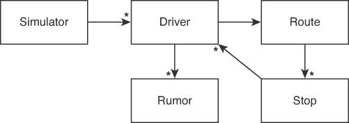

**图 8.1.** Java 版本的简单对象模型

`Simulator`持有许多`Drivers`。每个`Driver`拥有一个`Route`，每条`Route`包含许多`Stops`。每个`Stop`拥有许多`Drivers`，每个`Driver`拥有许多`Rumors`。

这是一个相当简单的对象模型。它甚至没有暗示任何继承或多态。因此，它的实现应该是非常直接的。

当然，我是使用 TDD（测试驱动开发）编写 Java 代码的。这些是测试。如你所见，它们相当冗长；但至少它们都位于同一个测试类中。如果你读过我的书《精洁之道》（*Clean Craftsmanship*, Addison-Wesley, 2021），你就会理解为什么这是一件好事。

```java
// 测试代码
```


```java
package gossipingBusDrivers;

import org.junit.Before;
import org.junit.Test;

import static org.hamcrest.MatcherAssert.assertThat;
import static org.hamcrest.collection.IsEmptyCollection.empty;
import static org.hamcrest.collection.
  IsIterableContainingInAnyOrder.containsInAnyOrder;
import static org.junit.Assert.assertEquals;

public class GossipTest {
  private Stop stop1;
  private Stop stop2;
  private Stop stop3;
  private Route route1;
  private Route route2;
  private Rumor rumor1;
  private Rumor rumor2;
  private Rumor rumor3;
  private Driver driver1;
  private Driver driver2;

  @Before
  public void setUp() {
    stop1 = new Stop("stop1");
    stop2 = new Stop("stop2");
    stop3 = new Stop("stop3");
    route1 = new Route(stop1, stop2);
    route2 = new Route(stop1, stop2, stop3);
    rumor1 = new Rumor("Rumor1");
    rumor2 = new Rumor("Rumor2");
    rumor3 = new Rumor("Rumor3");
    driver1 = new Driver("Driver1", route1, rumor1);
    driver2 = new Driver("Driver2", route2, rumor2, rumor3);
  }

  @Test
  public void driverStartsAtFirstStopInRoute() throws Exception {
    assertEquals(stop1, driver1.getStop());
  }

  @Test
  public void driverDrivesToNextStop() throws Exception {
    driver1.drive();
    assertEquals(stop2, driver1.getStop());
  }

  @Test
  public void driverReturnsToStartAfterLastStop()
  throws Exception {
    driver1.drive();
    driver1.drive();
    assertEquals(stop1, driver1.getStop());
  }

  @Test
  public void firstStopHasDriversAtStart() throws Exception {
    assertThat(stop1.getDrivers(), containsInAnyOrder(driver1,
                                                      driver2));
    assertThat(stop2.getDrivers(), empty());
  }

  @Test
  public void multipleDriversEnterAndLeaveStops() throws Exception {
    assertThat(stop1.getDrivers(), containsInAnyOrder(driver1,
                                                      driver2));
    assertThat(stop2.getDrivers(), empty());
    assertThat(stop3.getDrivers(), empty());
    driver1.drive();
    driver2.drive();
    assertThat(stop1.getDrivers(), empty());
    assertThat(stop2.getDrivers(), containsInAnyOrder(driver1,
                                                      driver2));
    assertThat(stop3.getDrivers(), empty());
    driver1.drive();
    driver2.drive();
    assertThat(stop1.getDrivers(), containsInAnyOrder(driver1));
    assertThat(stop2.getDrivers(), empty());
    assertThat(stop3.getDrivers(), containsInAnyOrder(driver2));
    driver1.drive();
    driver2.drive();
    assertThat(stop1.getDrivers(), containsInAnyOrder(driver2));
    assertThat(stop2.getDrivers(), containsInAnyOrder(driver1));
    assertThat(stop3.getDrivers(), empty());
  }

  @Test
  public void driversHaveRumorsAtStart() throws Exception {
    assertThat(driver1.getRumors(), containsInAnyOrder(rumor1));
    assertThat(driver2.getRumors(), containsInAnyOrder(rumor2,
                                                       rumor3));
  }

  @Test
  public void noDriversGossipAtStop() throws Exception {
    stop1.drive();
    assertThat(driver1.getRumors(), containsInAnyOrder(rumor1));
  }

  @Test
  public void driversGossipAtStop() throws Exception {
    stop1.drive();
    assertThat(driver2.getRumors(), containsInAnyOrder(rumor1));
  }

  @Test
  public void gossipIsNotDuplicated() throws Exception {
    stop1.drive();
    stop1.drive();
    assertThat(driver1.getRumors(), containsInAnyOrder(rumor1));
  }
}
```

解决方案代码被分成了几个小文件。

## `Driver`

点击此处查看代码图像。

```java
package gossipingBusDrivers;

import java.util.Arrays;
import java.util.HashSet;
import java.util.Set;

public class Driver {
  private String name;
  private Route route;
  private int stopNumber = 0;
  private Set<Rumor> rumors;

  public Driver(String name, Route theRoute,
                Rumor... theRumors) {
    this.name = name;
    route = theRoute;
    rumors = new HashSet<>(Arrays.asList(theRumors));
    route.stopAt(this, stopNumber);
  }

  public Stop getStop() {
    return route.get(stopNumber);
  }

  public void drive() {
    route.leave(this, stopNumber);
    stopNumber = route.getNextStop(stopNumber);
    route.stopAt(this, stopNumber);
  }

  public Set<Rumor> getRumors() {
    return rumors;
  }

  public void addRumors(Set<Rumor> newRumors) {
    rumors.addAll(newRumors);
  }
}
```

## `Route`

点击此处查看代码图像。

```java
package gossipingBusDrivers;

public class Route {
  private Stop[] stops;

  public Route(Stop... stops) {
    this.stops = stops;
  }

  public Stop get(int stopNumber) {
    return stops[stopNumber];
  }

  public int getNextStop(int stopNumber) {
    return (stopNumber + 1) % stops.length;
  }

  public void stopAt(Driver driver, int stopNumber) {
    stops[stopNumber].addDriver(driver);
  }

  public void leave(Driver driver, int stopNumber) {
    stops[stopNumber].removeDriver(driver);
  }
}
```

## `Stop`

点击此处查看代码图像。

```java
package gossipingBusDrivers;

import java.util.ArrayList;
import java.util.HashSet;
import java.util.List;
import java.util.Set;

public class Stop {
  private String name;
  private List<Driver> drivers = new ArrayList<>();

  public Stop(String name) {
    this.name = name;
  }

  public String toString() {
    return name;
  }

  public List<Driver> getDrivers() {
    return drivers;
  }

  public void addDriver(Driver driver) {
    drivers.add(driver);
  }

  public void removeDriver(Driver driver) {
    drivers.remove(driver);
  }

  public void gossip() {
    Set<Rumor> rumorsAtStop = new HashSet<>();
    for (Driver d : drivers)
      rumorsAtStop.addAll(d.getRumors());
    for (Driver d : drivers)
      d.addRumors(rumorsAtStop);
  }
}
```

## `Rumor`

```java
package gossipingBusDrivers;

public class Rumor {
  private String name;

  public Rumor(String name) {
    this.name = name;
  }

  public String toString() {
    return name;
  }
}
```

## `Simulation`

点击此处查看代码图像。

```java
package gossipingBusDrivers;

import java.util.HashSet;
import java.util.Set;

public class Simulation {
  public static int driveTillEqual(Driver... drivers) {
    int time;
    for (time = 0; notAllRumors(drivers) && time < 480; time++)
      driveAndGossip(drivers);
    return time;
  }

  private static void driveAndGossip(Driver[] drivers) {
    Set<Stop> stops = new HashSet<>();
    for (Driver d : drivers) {
      d.drive();
      stops.add(d.getStop());
    }
    for (Stop stop : stops)
      stop.gossip();
  }

  private static boolean notAllRumors(Driver[] drivers) {
    Set<Rumor> rumors = new HashSet<>();
    for (Driver d : drivers)
      rumors.addAll(d.getRumors());
    for (Driver d : drivers) {
      if (!d.getRumors().equals(rumors))
        return true;
    }
    return false;
  }
}
```

快速浏览这段代码就会让你信服，它是以非常传统的面向对象风格编写的，并且对象很好地封装了它们状态。

## Clojure

在编写 Clojure 版本时，我并没有从设计草图开始。相反，我依赖 TDD（测试驱动开发）测试来帮助我设计。测试如下：

点击此处查看代码图像。

```clojure
(ns gossiping-bus-drivers-clojure.core-spec
  (:require [speclj.core :refer :all]
            [gossiping-bus-drivers-clojure.core :refer :all]))

(describe "gossiping bus drivers"
  (it "drives one bus at one stop"
    (let [driver (make-driver "d1" [:s1] #{:r1})
          world [driver]
          new-world (drive world)]
      (should= 1 (count new-world))
      (should= :s1 (-> new-world :route first))))

  (it "drives one bus at two stops"
    (let [driver (make-driver "d1" [:s1 :s2] #{:r1})
          world [driver]
          new-world (drive world)]
      (should= 1 (count new-world))
      (should= :s2 (-> new-world :route first))))

  (it "drives two buses at some stops"
    (let [d1 (make-driver "d1" [:s1 :s2] #{:r1})
          d2 (make-driver "d2" [:s1 :s3 :s2] #{:r2})
          world [d1 d2]
          new-world (drive world)]
      (should= 1 (count new-world))
      (should= :s2 (-> new-world :route first)))))
```

`#{ .}` 在 Clojure 中表示一个集合。


```clojure
(ns gossiping-bus-drivers-clojure.core
  (:require [clojure.set :as set]))

(defn make-driver [name route rumors]
  (assoc5 {} :name name :route (cycle6 route) :rumors rumors))

(defn move-driver [driver]
  (update7 driver :route rest))

(defn move-drivers [world]
  (map move-driver world))

(defn get-stops [world]
  (loop [world world
         stops {}]
    (if (empty? world)
      stops
      (let [driver (first world)
            stop (first (:route driver))
            stops (update stops stop conj driver)]
        (recur (rest world) stops)))))

(defn merge-rumors [drivers]
  (let [rumors (map :rumors drivers)
        all-rumors (apply set/union8 rumors)]
      (map #(assoc % :rumors all-rumors) drivers)))

(defn spread-rumors [world]
  (let [stops-with-drivers (get-stops world)
        drivers-by-stop (vals9 stops-with-drivers)]
    (flatten10 (map merge-rumors drivers-by-stop))))

(defn drive [world]
  (-> world move-drivers spread-rumors))

(defn drive-till-all-rumors-spread [world]
  (loop [world (drive world)
         time 1]
    (cond
      (> time 480) :never
      (apply = (map :rumors world)) time
      :else (recur (drive world) (inc time)))))
```

5. `assoc` 向映射中添加元素。`(assoc {} :a 1)` 返回 `{:a 1}`。

6. `cycle` 返回一个惰性的（且是无限的）列表，它会不断地重复输入列表。因此，`(cycle [1 2 3])` 返回 `[1 2 3 1 2 3 1 2 3 …]`。

7. `update` 函数返回一个更改了一个元素的新映射。`(update m k f a)` 通过应用函数 `(f e a)` 来改变 `m` 的 `k` 元素，其中 `e` 是元素 `k` 的旧值。因此，`(update {:x 1} :x inc)` 返回 `{:x 2}`。

8. `union` 函数来自 `set` 命名空间。注意顶部的 `ns` 将 `clojure.set` 命名空间别名为 `set`。

9. `vals` 返回映射中所有值的列表。`keys` 返回映射中所有键的列表。

10. `flatten` 函数将嵌套列表转换为所有元素的列表。因此，`(flatten [[1 2][3 4]])` 返回 `[1 2 3 4]`。

这个解决方案占了 42 行，而 Java 解决方案分布在五个文件中，占了 145 行。

两种解决方案都包含了“司机（Driver）”的概念，但我并没有尝试将路线（Route）”、“站点（Stop）”和“传言（Rumor）”的概念封装成独立的对象。它们都愉快地存在于司机内部。

更糟糕的是，“司机对象”并不是传统面向对象（OO）意义上的对象。它没有方法。系统中只有一个方法 `move-driver`，它对单个司机进行操作，但它只是为了更有趣的 `move-drivers` 函数的一个小辅助函数。

八个函数中有六个只接受 `world` 作为参数。因此，我们可以说这个系统中唯一的真对象是 `world`，它有五个方法。但即使这样也有些牵强。

即使我们认为司机是一种对象，它也是不可变的。模拟的 `world` 不仅仅是一个不可变司机的列表。`drive` 函数接收 `world` 并产生一个新的 `world`，在新的 `world` 中，所有司机都移动了一步，并且在任何有多个司机到达的站点，传言都传播。

那个 `drive` 函数是一个重要概念的示例。注意 `world` 是如何通过函数流水线传递的。在这种情况下，只有两个函数，`move-drivers` 和 `spread-rumors`，但在较大的系统中，流水线可能会很长。在流水线的每个阶段，`world` 都会被修改成略微新的形式。

这告诉我们，这个系统的划分不是关于对象的，而是关于函数的。相对未被划分的数据从一个独立函数传递到下一个函数。

你可能会认为 Java 代码相对简单直观，而 Clojure 代码太密集且晦涩了。听我的吧，适应这种密度并不需要很长时间，而且那种感知上的晦涩感只是基于不熟悉而产生的幻觉。

Clojure 版本缺乏划分是一个问题吗？对于它目前的规模来说不是问题；但如果这个程序像大多数系统那样增长，那个问题就会以极具报复性的方式显现出来。划分面向对象程序比划分函数式程序要自然一点，因为分界线要明显得多且突出得多。

另一方面，我们为 Java 版本选择的分界线并不保证会导致有效的划分。警告就存在 Clojure 程序的 `drive` 函数中。

### 结论

我们在“质因数分解（Prime Factors）”和“保龄（Bowling）” katas 中看到了一些差异；但差异是微不足道的。“传言司机（Gossiping Drivers）”中的差异要明显得多。这可能是因为最后一个 katas 稍微大一点（我会说是两倍），而且因为它是一个真正的状态机。

*有限状态机*（finite state machine）从一个状态移动到另一个状态，根据输入事件和当前状态采取行动。当以面向对象的风格编写此类系统时，状态倾向于存储在可变对象中。但在函数式风格中，状态保持外部化，并在函数传递的不可变数据结构中。

我们或许可以得出结论：进行简单计算（如质因数分解）的程序受面向对象或函数式风格的影响很小。毕竟，它们是没有任何状态改变的简单函数。状态变化被限制在微小问题（如数组索引）上的程序受风格差异的影响也较小。但那些由一时刻到下一时刻的状态变化驱动的程序（如传言司机），将在两种风格之间看到深刻的差异。

面向对象的风格导致了与数据内聚性密切相关的划分，而函数式风格导致了与行为内聚性密切相关的划分。哪种更好我将留给后面的章节。

## 9

## 面向对象编程


在上一章中，我们看到面向对象的编程风格与数据类型和数据内聚密切相关。但这些并不是全部。事实上，数据内聚可能次于面向对象的另一个属性：多态。

在《整洁架构》中，我指出 OO 有三个属性：封装、继承和多态。然后我引导你通过推理得出结论：在这三者中，多态是最有益的。另外两个充其量是辅助性的。

*   佣金制员工每隔周五发放一次工资。他们的工资是基本工资加佣金。基本工资和佣金率是员工记录中的字段。佣金的计算方法是佣金率乘以该员工销售收据的总和。

*   时薪制员工每周五发放一次工资。他们的时薪是员工记录中的一个字段。他们的工资计算方法是将其时薪乘以该周时间卡上的小时数总和。如果总和大于 40 小时，剩余的小时将按时薪的 1.5 倍支付。

*   员工可以选择将工资单邮寄到家庭地址、保存在薪资管理员办公室或直接存入其银行账户。地址、薪资管理员和银行信息都是员工记录中的字段。

解决此问题的典型 OO 解决方案如统一建模语言（UML）图（图 9.1）所示。

**图 9.1.** 工资发放问题的对象模型

也许最好的起点是 `Payroll` 类。在 Java 中，它有一个如下所示的 `run` 方法：

```java
void run() {
  for (Employee e : db.getEmployees()) {
    if (e.isPayDay()) {
      Pay pay = e.calcPay();
      e.sendPay(pay);
    }
  }
}
```

我已经在很多次很多地方（包括上述书籍）强调过这一点：这段小小的代码片段就是*纯粹的真理*。对于每个员工，如果今天是他们获得工资的日子，就计算他们的工资并发送给他们。

从这段小小的代码片段中，其余部分的实现应该非常清晰。这里三次使用了 *Strategy*^(3) 模式：一个用于实现 `calcPay`，另一个用于实现 `isPayDay`，最后一个用于实现 `sendPay`。

3. Erich Gamma, Richard Helm, Ralph Johnson, and John Vlissides, *Design Patterns: Elements of Reusable Object-Oriented Software* (Addison-Wesley, 1995), 315.

同样清晰的是，这种对象结构必须由 `getEmployees` 函数构建，该函数从数据库中读取员工并对其进行妥善安排。数据库中的数据不太可能是这里看到的对象结构。

这里还有一个非常清晰的架构边界（虚线），跨越了所有的继承关系，将高层抽象与底层细节隔离开来。

### 函数式工资发放

图 9.2 展示了这作为一个函数式程序可能是什么样子。

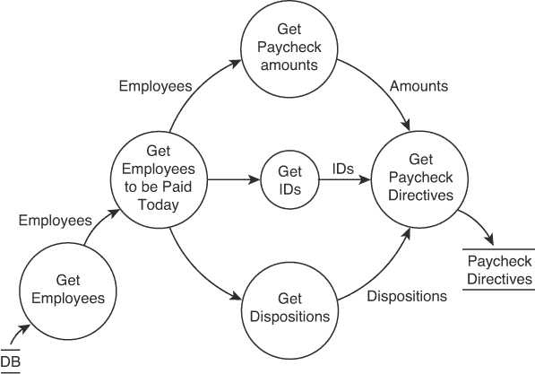

**图 9.2.** 工资发放问题的数据流图

我选择数据流图（DFD）来表示函数式解决方案，这很有趣吗？DFD 在描述过程与数据元素之间的关系非常有帮助，但在描述架构决策方面，它们远没有 UML 类图有用。

尽管如此，DFD 帮助我们提出了*纯粹真理*的函数式版本：

```clojure
(defn payroll [today db]
  (let [employees (get-employees db)
        employees-to-pay (get-employees-to-be-paid-today
                            today employees)
        amounts (get-paycheck-amounts employees-to-pay)
        ids (get-ids employees-to-pay)
        dispositions (get-dispositions employees-to-pay)]
    (send-paychecks ids amounts dispositions)))
```

注意，这与 Java 版本不同，因为它不是一种迭代方法。相反，员工列表流经程序，根据数据流图在每个阶段被修改。这是函数式程序构思和编写的典型方式。函数式程序往往更像*水利*而不是逐步执行的步骤。它们调节并修改数据流，而不是逐步迭代数据。

那么，架构又是呢？在 OO 版本的 UML 图中有一个很漂亮的架构边界。函数式版本中的架构边界在哪里？

让我们深入观察一点。测试可能会给我们提供一些线索：

```clojure
(it "pays one salaried employee at end of month by mail"
  (let [employees [{:id "emp1"
                    :schedule :monthly
                    :pay-class [:salaried 5000]
                    :disposition [:mail "name" "home"]}]
        db {:employees employees}
        today (parse-date "Nov 30 2021")]
    (should= [{:type :mail
               :id "emp1"
               :name "name"
               :address "home"
               :amount 5000}]
             (payroll today db))))
```

在这个测试中，数据库包含一个 `employee` 列表，每个 `employee` 都是具有特定字段的哈希映射。这和对象没有太大区别，对吧？`payroll` 函数返回一个工资单指令列表，每个指令都是一个哈希映射——另一个对象。

```clojure
(it "pays one hourly employee on Friday"
  (let [employees [{:id "emp1"
                    :schedule :weekly
                    :pay-class [:hourly 15]
                    :disposition [:deposit "routing" "account"]}]
        time-cards {"emp1" [["Nov 12 2022" 80/10]]}
        db {:employees employees :time-cards time-cards}
        friday (parse-date "Nov 18 2022")]
    (should= [{:type :deposit
               :id "emp1"
               :routing "routing"
               :account "account"
               :amount 120}]
             (payroll friday db))))
```

4. 这不是 80 除以 10。相反，它是有理数 `80/10`。这确保了后续数学计算不会将该值视为整数。

这个测试显示了 `employee` 和 `paycheck-directive` 如何根据 `:schedule`、`:pay-class` 和 `:disposition` 变化。它还显示了数据库包含与 `id` 关联的 `time-card`。从这里，第三个测试应该是可预测的：

```clojure
(it "pays one commissioned employee on an even Friday by Paymaster"
  (let [employees [{:id "emp1"
                    :schedule :biweekly
                    :pay-class [:commissioned 100 5/100]
                    :disposition [:paymaster "paymaster"]}]
        sales-receipts {"emp1" [["Nov 12 2022" 15000]]}
        db {:employees employees :sales-receipts sales-receipts}
        friday (parse-date "Nov 18 2022")]
    (should= [{:type :paymaster
               :id "emp1"
               :paymaster "paymaster"
               :amount 850}]
             (payroll friday db))))
```


```python
(defn get-pay-class [employee]
  (first (:pay-class employee)))

(defn get-disposition [paycheck-directive]
  (first (:disposition paycheck-directive)))

(defmulti is-today-payday :schedule)
(defmulti calc-pay get-pay-class)
(defmulti dispose get-disposition)

(defn get-employees-to-be-paid-today [today employees]
  (filter5 #(is-today-payday % today) employees))

(defn- build-employee [db employee]
  (assoc employee :db db))

(defn get-employees [db]
  (map (partial6 build-employee db) (:employees db)))

(defn create-paycheck-directives [ids payments dispositions]
  (map #(assoc {} :id %1 :amount %2 :disposition %3)
       ids payments dispositions))

(defn send-paychecks [ids payments dispositions]
  (for7 [paycheck-directive
        (create-paycheck-directives ids payments dispositions)]
    (dispose paycheck-directive)))

(defn get-paycheck-amounts [employees]
  (map calc-pay employees))

(defn get-dispositions [employees]
  (map :disposition employees))

(defn get-ids [employees]
  (map :id employees))
```

5. `(filter predicate list)` 为 `list` 中的每一个成员调用 `predicate`，并返回所有 `predicate` 结果不为假（falsey）的成员的序列。

6. `partial` 函数接收一个函数和一些参数，并返回一个新函数，其中所有参数都已初始化。因此，`((partial f 1) 2)` 等同于 `(f 1 2)`。

7. 在这种情况下，`for` 函数为 `create-paycheck-directives` 返回列表中的每个 `paycheck-directive` 调用 `dispose`。

你看到那些 `defmulti` 语句了吗？它们与 Java 接口类似，尽管并不完全相同。每个 `defmulti` 定义了一个多态函数。然而，该函数并不是像 Java、C# 甚至 Ruby 和 Python 那样基于内在类型分发的。相反，它们根据名称后面紧指定的函数结果进行分发。

因此，`get-pay-class` 函数返回 `calc-pay` 函数将进行多态分发的值。`get-pay-class` 返回了什么？它返回 `employee` 的 `pay-class` 字段的第一个元素。根据我们的测试，这些值是 `:salaried`、`:hourly` 和 `:commissioned`。

那么 `calc-pay` 函数的实现在在哪里？它们在程序的**靠后**：

点击此处查看代码图片

```python
(defn-8 get-salary [employee]
  (second (:pay-class employee)))

(defmethod calc-pay :salaried [employee]
  (get-salary employee))

(defmethod calc-pay :hourly [employee]
  (let [db (:db employee)
        time-cards (:time-cards db)
        my-time-cards (get9 time-cards (:id employee))
        [_ hourly-rate]10 (:pay-class employee)
        hours (map second my-time-cards)
        total-hours (reduce + hours)]
    (* total-hours hourly-rate)))

(defmethod calc-pay :commissioned [employee]
  (let [db (:db employee)
        sales-receipts (:sales-receipts db)
        my-sales-receipts (get sales-receipts (:id employee))
        [_ base-pay commission-rate] (:pay-class employee)
        sales (map second my-sales-receipts)
        total-sales (reduce + sales)]
    (+ (* total-sales commission-rate) base-pay)))
```

8. 结尾的 `-` 使此成为私有函数，因此只有该文件中的函数可以访问它。

9. `(get m k)` 返回 map `m` 中 `k` 的值。

10. 解构 `employee` 的 `pay-class` 并忽略第一个元素。

我将 `further down` 等词使用了斜体，是因为这在 Clojure 程序中非常重要。Clojure 程序不能调用在调用点之后定义的函数。但这些函数**确实**定义在调用点之后。这意味着存在源代码的依赖倒置。`calc-pay` 的实现被 `payroll` 函数调用；但 `payroll` 函数又位于 `calc-pay` 实现的上方。

事实上，我可以将 `defmulti` 函数的所有实现移动到另一个源文件中，而 `payroll` 源文件不需要 `require` 该文件。

如果我们画出这些源文件之间的关系，就会得到图 9.3 中的图。

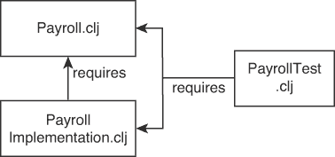

**图 9.3.** 依赖倒置

箭头描述了源文件之间的 `requires` 关系。`payroll.implementation` 中这些 `requires` 的源码所示：

```python
(ns payroll
  (:require [payroll-interface]))
```

特别是在 Clojure 中，命名空间（namespaces）和源文件是紧密相关的。每个命名空间必须包含在自己的源文件中，且该文件名必须与命名空间的名字对应。这与 Java 强制将公共类放入以类命名的独立源文件中非常相似。这与 C++ 和 C# 程序员使用的文件/类约定也非常相似。这可能让你认为，每个 Clojure 命名空间都类似于类，通过一个简单的转换算法即可理解。

当然，这种对应关系并不是完美的。Clojure 命名空间的内容完全不需要像类一样。但总的来说，这个概念并不坏。

在像 Clojure 这样的函数式语言中，一种巨大的诱惑是按一种随意的、凭感觉的方式将函数分组到命名空间。由于没有面向对象（OO）结构来强制我们把函数划分为存在于独立源文件中的类，我们最终得到的源文件结构往往比应该有的更松散、更脆弱。

因此，在编写函数式程序时，考虑面向对象的划分原则并继续应用它们并不是一个坏主意。在我们稍后研究原则、模式和架构时，将会看到更多内容。

### 结论

首先，函数式程序和面向对象程序是不同的。函数式程序倾向于构建调节数据流转换的管道系统，而可变的面向对象程序倾向于对对象进行逐步迭代。然而，从架构的角度来看，这两种风格是完全兼容的。事实证明，我们可以将函数式程序的函数划分成与面向对象程序具有相同架构意义的元素。从架构角度来看，两者之间没有太大区别。

函数式程序可能不是由语法强制执行的、封装方法并定义对象的类组成的。然而，对象在函数式程序中仍然存在。只是这些对象与操作它们的函数之间的绑定没有像在面向对象语言中那么紧密。这究竟是优势还是劣势，我们将在后续章节中继续探讨。

我们将看到，随着这些页面内容越来越多地转向设计和架构，函数式程序与不可变对象的面向对象之间的差异将变得越来越不相关。

## 10 种类


上一章可能让你感到有些困扰。我所称的“对象”仅仅是哈希映射（hash maps），并且是完全无类型的。任何人向它们放入任何内容而没有任何任何限制。`:pay-class` 中的薪水可以是一个字符串而不是数字。`:schedule` 字段可以是一个整数而不是相应的关键字。

简之，这些对象不是静态类型的。编译器不检查它们。因此，一切都会陷入混乱！！

许多函数式语言以及许多面向对象语言都是静态类型的，以防止这种混乱。而像 Clojure、Python 和 Ruby 这样的语言则依赖其他机制来防止这种混乱。

我们这些实践 TDD（测试驱动开发）的人通常并不十分担心这种混乱。我们的测试通常能确保我们传递的对象是经过正确构建的。尽管如此，在复杂的系统中，所有对象的总和可能会变得非常复杂，我们需要一种比动态类型语言（甚至大多数静态类型语言）所能提供的更正式、更完整的方法来确保我们类型的完完整性。

在 Clojure 中，我使用 `clojure.spec` 库来实现类型完整性的目标。我们工资单示例的类型规范如下：

点击此处查看代码图像

```
(s/def ::id string?)
(s/def ::schedule #{:monthly :weekly :biweekly})
(s/def ::salaried-pay-class (s/tuple #(= % :salaried) pos1?))
(s/def ::hourly-pay-class (s/tuple #(= % :hourly) pos?))
(s/def ::commissioned-pay-class (s/tuple #(= % :commissioned)
                                         pos? pos?))
(s/def ::pay-class (s/or :salaried ::salaried-pay-class
                         :Hourly ::hourly-pay-class
                         :Commissioned ::commissioned-pay-class))
(s/def ::mail-disposition (s/tuple #(= % :mail) string? string?))
(s/def ::deposit-disposition (s/tuple #(= % :deposit)
                                      string? string?))
(s/def ::paymaster-disposition (s/tuple #(= % :paymaster)
                                        string?))
(s/def ::disposition (s/or :mail ::mail-disposition
                           :deposit ::deposit-disposition
                           :paymaster ::paymaster-disposition))
(s/def ::employee (s/keys :req-un [::id ::schedule
                                   ::pay-class ::disposition]))
(s/def ::employees (s/coll-of ::employee))

(s/def ::date string?)
(s/def ::time-card (s/tuple ::date pos?))
(s/def ::time-cards (s/map-of ::id (s/coll-of ::time-card)))

(s/def ::sales-receipt (s/tuple ::date pos?))
(s/def ::sales-receipts (s/map-of
                           ::id (s/coll-of ::sales-receipt)))

(s/def ::db (s/keys :req-un [::employees]
                    :opt-un [::time-cards ::sales-receipts]))

(s/def ::amount pos?)
(s/def ::name string?)
(s/def ::address string?)
(s/def ::mail-disposition (s/and #(= % :mail)
                               (keys :req-un [::id
                                                ::name
                                                ::address
                                                ::amount]))

(s/def ::routing string?)
(s/def ::account string?)
(s/def ::deposit-disposition (s/and #(= % :deposit)
                                  (keys :req-un [::id
                                                   ::routing
                                                   ::account
                                                   ::amount])))
(s/def ::paymaster string?)
(s/def ::paymaster-disposition (s/and #(= % :paymaster)
                                    (keys :req-un [::id
                                                     ::paymaster
                                                     ::amount])))

(s/def ::paycheck-directive (s/or
                              :mail ::mail-disposition
                              :deposit ::deposit-disposition
                              :paymaster ::paymaster-disposition))
(s/def ::paycheck-directives (s/coll-of ::paycheck-directive))
```

`(pos? x)` 如果 `x` 是大于 0 的数字则返回 true。

随着我们不断深入，我们发现 `::employee` 是一个哈 map，它要求包含键 `:id`、`:schedule`、`:pay-class` 和 `:disposition`。继续探索你会发现 `:id` 必须是一个字符串；`:schedule` 必须是 `:monthly`、`:weekly` 或 `:biweekly` 之一；而 `:salaried-pay-class` 是一个元组，包含 `:salaried` 以及后跟的一个正数。

`s/or` 语句可能会让你感到有些困惑。参数是成对出现的，每对中的第一个只是该备选方案的名字。因此，在 `::disposition` 的定义中，`:mail` 只是 `::mail-disposition` 备选方案的名字。不用担心这个了，如果你某天决定阅读 `clojure.spec` 文档，一切都会变得清晰。

那么，既然有了这种详尽的类型规范，我们该如何使用它呢？我有时会在测试中这样使用：

点击此处查看代码图片


```clojure
(it "pays one salaried employee at end of month by mail"
  (let [employees [{:id "emp1"
                    :schedule :monthly
                    :pay-class [:salaried 5000]
                    :disposition [:mail "name" "home"]}]
        db {:employees employees}
        today (parse-date "Nov 30 2021")]
    (should (s/valid? ::db db))
    (let [paycheck-directives (payroll today db)]
      (should (s/valid? ::paycheck-directives 
                     paycheck-directives))
      (should= [{:type :mail
                 :id "emp1"
                 :name "name"
                 :address "home"
                 :amount 5000}]
               paycheck-directives))))
```

寻找对`s/valid?`的调用，这个函数在数据匹配规范时返回`true`。仔细观察你会发现，我在输入时检查了`::db`规范，在输出时检查了`::paycheck-directives`规范。这非常安全。如果我的测试覆盖率很高，并且都检查了所调用函数输入和输出的规范，那么类型违规的情况应该是极罕见的。

偶尔，我还会使用 Clojure 的`:pre`和`:post`特性，在应用程序的主处理函数执行前后对关键数据运行规范。

例如，这是我几年前编写的`spacewar`^(2)的主处理步骤：

2. [`github.com/unclebob/spacewar`](https://github.com/unclebob/spacewar)

点击此处查看代码图片：

```clojure
(defn update-world [ms world]
  ;{:pre [(valid-world? world)]
  ; :post [(valid-world? %)]}
  (->> world
       (game-won ms)
       (game-over ms)
       (ship/update-ship ms)
       (shots/update-shots ms)
       (explosions/update-explosions ms)
       (clouds/update-clouds ms)
       (klingons/update-klingons ms)
       (bases/update-bases ms)
       (romulans/update-romulans ms)
       (view-frame/update-messages ms)
       (add-messages)))
```

`:pre`和`:post`语句被注释掉了，^(3)，但如果怀疑发生了某种糟糕的类型损坏，它们随时准备好重新断言。

3. 我不太喜欢被注释掉的代码。随着项目的成熟，我会删除这些行。

### 结论

关于静态类型与动态类型之争，存在着大量的哀嚎和切齿。双方都在向对方大吼，而不听取对方在说什么。我认为双方都有其合理的理由。动态类型让代码更易编写。静态类型让代码安全得多、更容易理解，并且在内部的一致性上。在我看来，像`clojure.spec`这样的库取得了极佳的平衡。它让你能够根据需要进行尽可能多或尽可能少的类型检查。它允许你指定何时*进行*类型检查，以及何时*不进行*。此外，它还允许你指定任何静态类型系统*无法*检查的动态约束。所以，对我来说，这样的库带给你比两者兼得更好的体验。

# III

## 函数式设计

# 11

## 数据流


在第 9 章面向对象编程中，我建议函数式程序的设计更像水管而不是过程。它有一种明确的数据流偏向。这是因为我们倾向于使用`map`、`filter`和`reduce`将列表的内容转换为其他列表，而不是通过逐个元素地迭代问题来产生结果。

我们在之前的许多示例中都能看到这种偏向，包括保龄球游戏、八卦的巴士司机和第二部分。

为了让事情稍微复杂一点，`x`寄存器与时钟的匹配被扩大，使得 22、23 和 24 匹配时钟 23。换句话说，`x`寄存器指定了一个宽度为三个像素的窗口。只要时钟落在窗口内，光束就会激活。

由于屏幕宽 40 像素，高 6 像素，因此时钟与`x`的匹配是模 40。

任务是执行一组指令并产生一个包含六个字符串的列表，每个字符串 40 个字符，用`#`表示可见像素，用`.`表示不可见像素。

如果你用 Java、C、Go、C++、C#或任何其他过程/面向语言编写此程序，你可能会创建一个逐个周期的循环，同时为每个周期积累相应的像素。循环会消耗指令并按照指示修改`x`寄存器。

```java
package crt;

public class Crt {
  private int x;
  private String pixels = "";
  private int extraCycles = 0;
  private int cycle = 0;
  private int ic;
  private String[] instructions;
  public Crt(int x) {
    this.x = x;
  }

  public void doCycles(int n, String instructionsLines) {
    instructions = instructionsLines.split("\n");
    ic = 0;
    for (cycle = 0; cycle < n; cycle++) {
      setPixel();
      execute();
    }
  }

  private void execute() {
    if (instructions[ic].equals("noop"))
      ic++;
    else if (instructions[ic].startsWith("addx ")
             && extraCycles == 0) {
      extraCycles = 1;
    }
    else if (instructions[ic].startsWith("addx ")
             && extraCycles == 1) {
      extraCycles = 0;
      x += Integer.parseInt(instructions[ic].substring(5));
      ic++;
    } else
      System.out.println("TILT");
  }

  private void setPixel() {
    int pos = cycle % 40;
    int offset = pos - x;
    if (offset >= -1 && 1 >= offset)
      pixels += "#";
    else
      pixels += ".";
  }

  public String getPixels() {
    return pixels;
  }

  public int getX() {
    return x;
  }
}
```

注意所有的可变状态。注意它是如何逐周期地迭代以填充`pixels`的。还要注意`extraCycles`的巧妙处理，它是为了考虑到`addx`需要两个周期才能执行这一事实。

最后，请注意尽管程序被很好地划分成了几个较小的函数，但这些函数都通过可变状态变量耦合在一起。这，当然，是可变类方法的常见情况。

我今天用 Clojure 解决了这个问题。我提出的解决方案与上面的 Java 代码非常不同。在阅读时请记住从底部开始。Clojure 程序总是从自底向上编写的。

点击此处查看代码图片：

```clojure
(ns day10-cathode-ray-tube.core
  (:require [clojure.string :as string]))

(defn noop [state]
  (update state :cycles conj (:x state)))

(defn addx [n state]
  (let [{:keys [x cycles]} state]
    (assoc state :x (+ x n)
                 :cycles (vec (concat cycles [x x])))))

(defn execute [state lines]
  (if (empty? lines)
    state
    (let [line (first lines)
          state (if (re-matches #"noop" line)
                  (noop state)
                  (if-let [[_ n] (re-matches
                                   #"addx (-?\d+)" line)]
                    (addx (Integer/parseInt n) state)
                    "TILT"))]
      (recur state (rest lines)))))

(defn execute-file [file-name]
  (let [lines (string/split-lines (slurp file-name))
        starting-state {:x 1 :cycles []}
        ending-state (execute starting-state lines)]
    (:cycles ending-state)))

(defn render-cycles [cycles]
  (loop [cycles cycles
         screen ""
         t 0]
    (if (empty? cycles)
      (map #(apply str %) (partition 40 40 "" screen))
      (let [x (first cycles)
            offset (- t x)
            pixel? (<= -1 offset 1)
            screen (str screen (if pixel? "#" "."))
            t (mod (inc t) 40)]
        (recur (rest cycles) screen t)))))

(defn print-screen [lines]
  (doseq [line lines]
    (println line))
  true)

(defn -main []
  (-> "input"
      execute-file
      render-cycles
      print-screen))
```

3. `TILT`是我最喜欢的错误信息。很久以前，弹珠机如果你物理上倾斜机器来操纵球，它就会显示这条信息并取消你的游戏。

`execute-file`函数将命名文件中的指令列表转换为结果`x`值的列表。`render-cycles`函数然后将`x`值的列表转换为像素列表，最后将其`partition`分成 40 个字符的字符串。

注意，当然，这里没有可变变量。相反，`state`值像通过流水线一样流经每个函数。

`state`值从`execute-file`开始，然后流向`execute`，紧接着反复流向`noop`或`addx`，然后回到`execute`，最后回到`execute-file`。在该流的每个阶段，都会从旧值创建出一个新的`state`值，而不改变旧值。

如果这让你觉得异常熟悉，那它是应该的。这非常像我们在命令行 Shell 中习惯的管道（pipes）和过滤器。数据从管道流入命令，经过该命令转换，然后流出。

这些人可以被分为称为`roles`（角色）或`actors`（执行者）组。执行者是指一个人或一组，他们对系统有相同的需求。他们请求的更改类型将是一致的。相反，不同的执行者有不同的需求。一个执行者请求的更改对系统的影响与其他执行者请求的更改截然不同。这些迥然不同的更改甚至可能是相互背离的。

当一个模块负责多个执行者时，这些竞争执行者所请求的更改可能会相互干扰。这种干扰通常会导致`fragility`（脆弱性）这一设计气味；导致系统在进行简单更改时以意想不到的方式崩溃。

对于经理和客户来说，没有什么比在进行简单功能更改后系统突然以惊人的方式出错更令他们恐惧的。如果这种情况频繁发生，他们得出的唯一结论就是开发者已经失去了对系统的控制，并且不知道自己在做什么。

违反`SRP`（单一职责原则）可能简单到将 GUI 格式代码和业务规则代码混合在同一个模块中。也可能复杂到在数据库中使用存储过程来实现业务规则。

这里有一个用 Clojure 编写的糟糕 SRP 违反简单示例。首先，让我们看看测试，因为它们讲述了故事：

点击此处查看代码图像：

```clojure
(describe "Order Entry System"
  (context "Parsing Customers"
    (it "parses a valid customer"
      (should=
        {:id "1234567"
         :name "customer name"
         :address "customer address"
         :credit-limit 50000}
        (parse-customer
          ["Customer-id: 1234567"
           "Name: customer name"
           "Address: customer address"
           "Credit Limit: 50000"])))

    (it "parses invalid customer"
      (should= :invalid
               (parse-customer
                 ["Customer-id: X"
                  "Name: customer name"
                  "Address: customer address"
                  "Credit Limit: 50000"]))
      (should= :invalid
               (parse-customer
                 ["Customer-id: 1234567"
                  "Name: "
                  "Address: customer address"
                  "Credit Limit: 50000"]))
      (should= :invalid
               (parse-customer
                 ["Customer-id: 1234567"
                  "Name: customer name"
                  "Address: "
                  "Credit Limit: 50000"]))
      (should= :invalid
               (parse-customer
                 ["Customer-id: 1234567"
                  "Name: customer name"
                  "Address: customer address"
                  "Credit Limit: invalid"])))
    (it "makes sure credit limit is <= 50000"
      (should= :invalid
               (parse-customer
                 ["Customer-id: 1234567"
                  "Name: customer name"
                  "Address: customer address"
                  "Credit Limit: 50001"])))))
```

第一个测试告诉我们，我们正在将某些文本输入解析为客户记录。该记录有四个字段：`id`、`name`、`address`和`credit-limit`。接下来的四个测试告诉我们关于语法错误的信息，如缺失或格式错误的输入。


最后一个测试是有趣的。它测试了一个业务规则。在解析输入时测试业务规则是显而违反`SRP`的。解析代码可以安全地验证语法错误，但它应该避免所有的`semantic`（语义）检查，因为这些检查属于另一个执行者的领域。指定输入格式的执行者与指定最大允许信用额度的执行者不是同一个人。即使这两个执行者是同一个人，事实也是如此。在这种情况下，这个人扮演了两个不同的角色。

通过这些测试的代码加剧了问题：

```
(defn validate-customer
  [{:keys [id name address credit-limit] :as customer}]
  (if (or (nil? id)
          (nil? name)
          (nil? address)
          (nil? credit-limit))
    :invalid
    (let [credit-limit (Integer/parseInt credit-limit)]
      (if (> credit-limit 50000)
        :invalid
        (assoc customer :credit-limit credit-limit)))))

(defn parse-customer [lines]

  (let [[_ id] (re-matches #"^Customer-id: (\d{7})$"
                           (nth lines 0))
        [_ name] (re-matches #"^Name: (.+)$" (nth lines 1))
        [_ address] (re-matches #"^Address: (.+)$" (nth lines 2))
        [_ credit-limit] (re-matches #"^Credit Limit: (\d+)$"
                                     (nth lines 3))]
    (validate-customer
      {:id id
       :name name
       :address address
       :credit-limit credit-limit})))
```

看`validate-customer`函数是如何将语法检查与语义业务规则混合的。更糟糕的是，我很担心信用额度限制与数据结构的语法混合在一起。考虑一个严谨使用`clojure/spec`来定义`customer`类型的程序员：

```
(s/def :customer (s/keys
                  :id (s/string)
                  :name (s/string)
                  :address (s/string)
                  :credit-limit (s/and int? #(re-matches #"\d+" %) <= 50000)))))
```

### 开闭原则 (OCP)

`OCP`最初由Bertrand Meyer在他1988年的经典著作《面向对象的软件构造》中首次提出。换句话来说，它认为软件模块应该是对扩展开放但对修改关闭的。这意味着你希望设计模块，使得扩展或更改其行为不需要修改其代码。

这听起来可能有些矛盾，但实际上我们一直都在这样做。例如，考虑C语言中的`copy`程序：

```c
void copy() {
  int c;
  while ((c = getchar()) != EOF)
    putchar(c);
}
```

该程序从`stdin`复制字符到`stdout`。我可以随时向操作系统添加新设备。例如，我可以向系统添加光学字符识别 (OCR) 和文本转语音合成器。该程序仍然会正常运行而不会报错，并会乐意从OCR复制字符到语音合成器，而无需修改甚至重新编译。

这是一个非常强大的想法，它允许我们将高层策略与底层细节分离开来，并保持高层策略不受底层细节变化的影响。然而，这要求高层策略通过抽象层来访问底层细节。

在面向对象（OO）程序中，我们通常通过多态接口来创建该抽象层。在Java、C#和C++等静态类型语言中，这些接口是带有抽象方法的类。高层策略通过这些接口访问实现或继承自这些接口的底层细节。

在Python和Ruby等动态类型面向对象语言中，这些接口是“鸭子类型”（duck types）。`鸭子类型`在语言中没有特定的语法。它们仅仅是由高层策略调用并由底层细节实现的函数签名集合。动态类型系统通过匹配这些签名在运行时确定多态分发。

一些像F#和Scala的函数式语言建立在面向对象的基础之上，因此可以利用该基础的多态接口。但函数式语言长期以来一直另一种机制可以创建用于`OCP`的抽象层：函数。

### 函数

考虑这个简单的Clojure程序：

```
(defn copy [read write]
  (let [c (read)]
    (if (= c :eof)
      nil
      (recur read (write c)))))
```

这本质上与用C语言编写的`copy`程序相同，只是读写函数被作为参数传递了。尽管如此，`OCP`的抽象层仍然保持完整。

顺便说一下，我使用以下测试了这个程序。我想你会发现这很有。

```
(def str-in (atom nil))
(def str-out (atom nil))

(defn str-read []
  (let [c (first @str-in)]
    (if (nil? c)
      :eof
      (do
        (swap! str-in rest)
        c))))

(defn str-write [c]
  (swap! str-out str c)
  str-write)

(describe "copy"
  (it "can read and write using str-read and str-write"
    (reset! str-in "abcedf")
    (reset! str-out "")
    (copy str-read str-write)
    (should= "abcdef" @str-out)))
```

我使用`atom`是因为I/O是一种副作用，因此不是纯函数。毕竟，当你从输入读取或写入输出时，你正在改变它们的状态。因此，底层的I/O函数不是纯函数，并使用软件事务内存来管理状态的变更。

### 带有Vtable的对象

对于那些向往面向对象的人，可以使用以下技术向`copy`传递一个“对象”：

```
(defn copy [device]
  (let [c ((:getchar device))]
    (if (= c :eof)
      nil
      (do
        ((:putchar device) c)
        (recur device)))))
```

测试只需加载带有带有函数的设备映射：

```
(it "can read and write using str-read and str-write"
    (reset! str-in "abcedf")
    (reset! str-out "")
    (copy {:getchar str-read :putchar str-write})
    (should= "abcdef" @str-out))
```

C++程序员会识别出`device`参数仅仅是一个vtable——这是C++中的多态机制。无论如何，显而易见的是，你可以为`copy`程序定义许多不同的设备。你可以在不修改它的情况下扩展`copy`的行为。

### 多方法（Multi-methods）

该主题的另一个变体是使用多方法。许多语言（无论是函数式的还是其他的）都以某种方式支持多方法。`多方法`是鸭子类型的另一种形式，因为它们创建了方法的松散分组，并根据函数签名和“类型”进行动态分发。

在Clojure中，我们使用传统的`分发函数`（dispatching function）方法来指定该“类型”：

```
(defmulti getchar (fn [device] (:device]))
```

该协议将成为一个Java `interface`，可以独立编译成`jar`文件以进行动态加载。该协议的实现（如下所示）同样可以独立编译和加载：

```
(defrecord str-device [in-atom out-atom]
  device
  (getchar [_]
    (let [c (first @in-atom)]
      (if (nil? c)
        :eof
        (do
          (swap! in-atom rest)
          c))))

  (putchar [_ c]
    (swap! out-atom str c)))

(describe "copy"
  (it "can read and write using str-read and str-write"
    (let [device (->str-device (atom "abcdef") (atom nil))]
      (copy device)
      (should= "abcdef" @(:out-atom device)))))
```

注意测试中的`->str-device`函数。这本质上是实现`device`协议的`str-device`类的Java构造函数。同样注意，我像上一个示例一样将`atom`s加载到了设备中。

事实上，我并没有修改`copy`程序来让这个示例运行。`copy`程序与在多方法示例中的完全一致。这就是`OCP`的作用！

如果觉得Clojure的协议/记录机制看起来像OO（面向对象），那是因为它确实是OO。JVM是OO的基础，而Clojure非常完美地构建在该基础之上。

### 里德夫替换原则 (LSP)

任何支持`OCP`的语言也必须支持`LSP`。这两个原则是关联的，因为任何对`LSP`的违反都是对`OCP`的潜在违反。

`LSP`最初由Barbara Liskov在1988年描述，为子类型提供了一个或多正式的定义。本质上，她说在任何使用基类型的程序中，子类型都必须能够被基类型所替换。

为了澄清这一点，假设我们有一个使用类型`employee`的程序`pay`：

```
(defn pay [employee pay-date]
  (let [is-payday? (:is-payday employee)
        calc-pay (:calc-pay employee)
        send-paycheck (:send-paycheck employee)]
    (when (is-payday? pay-date)
      (let [paycheck (calc-pay)]
        (send-paycheck paycheck)))))
```

注意我使用了vtable（虚函数表）方法来创建类型。同样注意，类型内部的数据对`pay`函数是完全隐藏的。`pay`函数能看到的只有`employee`类型中的方法。这还能多OO呢？

这里是使用该类型的测试代码。注意`make-test-employee`函数通过*鸭子类型*（duck typing）来创建一个符合`employee`类型的对象：

```
(defn test-is-payday [employee-data pay-date]
  true)

(defn test-calc-pay [employee-data]
  (:pay employee-data))

(defn test-send-paycheck [employee-data paycheck]
  (format "Send %d to: %s at: %s"
          paycheck
          (:name employee-data)
          (:address employee-data)))
(defn make-test-employee [name address pay]
  (let [employee-data {:name name
                       :address address
                       :pay pay}

        employee {:employee-data employee-data
                  :is-payday (partial test-is-payday
                                      employee-data)
                  :calc-pay (partial test-calc-pay employee-data)
                  :send-paycheck (partial test-send-paycheck
                                          employee-data)}]

    employee))

(describe "Payroll"
  (it "pays a salaried employee"
    (should= "Send 100 to: name at: address"
             (pay (make-test-employee "name" "address" 100)
                  :now))))
```

注意`make-test-employee`函数使用了指向实现的模式（PIMPL)模式来隐藏`:employee-data`字段中的数据，并仅暴露方法。最后，注意所有多态方法都将`employee-data`作为第一个参数。哦，真是OO！但又完全是函数式的。

显易来说，我可以创建许多不同的员工对象并将它们传递给`pay`函数，而完全不需要修改`pay`函数。

为了使这一方案生效，我们需要如下所示`set-h`、`set-w`和`area`函数：

```
(defn set-h [rect h]
  (assoc rect :h h))

(defn set-w [rect w]
  (assoc rect :w w))

(defn area [rect]
  (* (:h rect) (:w rect)))
```

这里没有什么好意外的。矩形对象是不可变的。`set-h`和`set-w`函数仅仅是创建了带有更改参数的新矩形。

所以，让我们进一步充充一下，创建一个使用我们矩形的小系统。以下是测试用例：

```
(describe "Rectangle"
  (it "计算正确的面积和周长"
    (should= 25 (area (make-rect 5 5)))
    (should= 18 (perimeter (make-rect 4 5)))
    (should= 12 (-> (make-rect 1 1) (set-h 3) (set-w 4) area)))

  (it "最小增加面积"
    (should= 15 (-> (make-rect 3 4) minimally-increase-area area))
    (should= 24 (-> (make-rect 5 4) minimally-increase-area area))
    (should= 20 (-> (make-rect 4 4) minimally-increase-area area))))
```

这里是通过这些测试的函数：

```
(defn perimeter [rect]
  (let [{:keys [h w]} rect]
    (* 2 (+ h w))))

(defn minimally-increase-area [rect]
  (let [{:keys [h w]} rect]
    (cond
      (>= h w) (make-rect (inc h) w)
      (> w h) (make-rect h (inc w))
      :else :tilt)))
```


再次，这没什么特别意外的。也许你被`minimally-increase-area`函数困扰了。这个函数只是以可能的最小整数增加矩形的面积。^(14)

14。假设所有的长度和宽度都是整数。

现在，让我们想象这个系统已经运行了多年并且非常成功。但最近，系统的客户一直在要求正方形。我们如何向系统中添加正方形呢？

如果我们应用 ISA（继承）规则，我们可能会认为正方形是一个矩形，因此，我们应该让接受矩形的函数也能接受正方形。在 Java 中，我们可能通过从`Rectangle`类派生出`Square`类来实现。在 Clojure 中，我们可以通过简单创建边等的矩形来实现：

```clojure
(defn make-square [side]
  (make-rect side side))
```

这应该让我们感到有些困扰，因为`square`对象的大小与`rectangle`对象的大小相同。`square`类型的对象本应该更小，因为它们不需要同时高度和宽度。但内存是很便宜的，而且我们想保持简单，对吧？

问题是，我们所有的测试仍然能通过吗？它们应该能通过，因为我们的正方形实际上就是矩形（啊，这就是 ISA 规则！）。

这些测试通过良好：

点击此处查看代码图片

```clojure
(should= 36 (area (make-square 6)))
(should= 20 (perimeter (make-square 5)))
```

这个通过了，但它很烦人，因为在其中的某个地方，“正方形性”丢失了：

点击此处查看代码图片

```clojure
(should= 12 (-> (make-square 1) (set-h 3) (set-w 4) area))
```

`set-h`和`set-w`函数在接收到`square`时并没有返回`square`。这有点奇怪；但以某种诡异的方式，它实际上是有道理的。我的意思是，如果你在不改变宽度的情况下设置`square`的高度，它就不再是一个`square`了，对吗？

如果你现在觉得大脑后脑有点发痒，那么你可能应该注意一下。

不管怎样，我们的`minimally-increase-area`测试呢？它通过了没？

点击此处查看代码图片

```clojure
(should= 30 (-> (make-square 5) minimally-increase-area area))
```

是的，这个也通过了。当然，它应该通过，因为函数只是根据需要增加高度或宽度。

所以看起来我们完成了，而且这运行得非常棒！

#### 没！

我们的客户几天后给我们打了电话，他并不满意。他正试图增加正方形的面积，但由于正方形是矩形，“增加正方形后得到的是 36！”噢-哦。看起来我们猜错了。这违反了 LSP（里氏替换原则）。虽然正方形在几何上是矩形，但并不意味着代码中的`square`对象是`rectangle`对象。

当看到现实世界中两个显然通过“是”这个短语连接的对象时，你可能会想在代码中创建子类型关系。要小心。你可能会触犯表示规则并违反 LSP。

那么我们该怎么办？

我们在静态类型语言中，通过如下拆分接口来解决这种弱点。这样每个用户只依赖于它需要调的方法，而实现可以多重实现这些接口。我把其他解决方案留给练习。你可以尝试使用多方法（multi-methods）。你可以尝试使用记录（records）。你可以尝试使用虚表（vtables）。

#### 表示规则（Representative Rule）

我更倾向于最后这种方案。因为我不怎么喜欢 ISA 规则。你看，虽然代码中的表示者既不是正方形也不是矩形。

*表示者并不共享它们所代表的东西的关系。*

仅仅正方形在几何上是矩形，并不意味着代码中的`square`对象是`rectangle`对象。`square`类型的行为与`rectangle`类型的行为并不相同。

### 接口隔离原则 (ISP)


该原则的名称源于它在静态类型语言中的起源。我通常用于描述 ISP 的示例对于 Java、C# 和 C++ 等语言非常有效，因为这些语言依赖于定义的接口。在 Ruby、Python、JavaScript 和 Clojure 等动态类型语言中，这些示例并不特别有效，因为在这些语言中，接口是不声明的并且通过鸭子类型进行了隔离。

例如，考虑以下 Java 接口：

```java
interface AtmInteractor {
  void requestAccount();
  void requestAmount();
  void requestPin();
}
```

在这里我们看到三个方法绑定在`AtmInteractor`接口中。该接口的任何用户都依赖于所有三个方法，即使用户只调用其中一个。因此，用户依赖过多。如果其中一个方法的签名发生变化，或者在该接口中添加另一个方法，那么该用户将不得不重新编译和部署，导致设计变得异常脆弱。

我们在静态类型语言中通过如下拆分接口来解决这种弱点：

```java
interface AccountInteractor {
  void requestAccount();
}

interface AmountInteractor {
  void requestAmount();
}

interface PinInteractor {
  void requestPin();
}
```

然后每个用户只需要依赖于它需要调的方法，而实现可以多重实现这些接口：

点击此处查看代码图片

```java
public class AtmInteractor implements AccountInteractor,
                                      AmountInteractor,
                                      PinInteractor {
  void requestAccount() {…};
  void requestAmount() {…};
  void requestPin() {…};
}
```

或许图 12.1 中的 UML 图会使这一点更加清晰。通过分离接口，这三类用户只依赖于他们需要的方法；然而这些方法可以由单个类来实现。

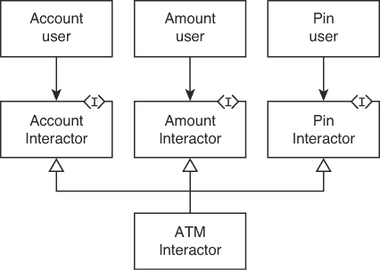

**图 12.1.** 分离的接口

在 Clojure 中，我们可以使用我们的鸭子类型（duck typing）技术之一来解决这个问题：

点击此处查看代码图片

```clojure
(defmulti request-account :interactor)
(defmulti request-amount :interactor)
(defmulti request-pin :interactor)
```

这三个多方法（multi-methods）并没有绑定在单一声明下。事实上，它们甚至不需要保持在同一个源文件中。相反，它们可以在特定于其功能的模块中声明。因此，如果其中一个方法的签名发生了变化，或者添加了新的多方法，不会对未更改的多方法的用户产生任何影响。如果它们经过了预编译，^(15)，它们就不需要重新编译。

15。Clojure 允许模块进行预编译以加快加载速度。

这意味着在像 Clojure 这样的动态类型语言中，避免依赖你不需要的东西变得更容易了。但这并不意味着该原则不再适用。

## 不要依赖你不需要的东西

回到名称本身。`接口隔离原则`中的`Interface`（接口）一词并不局限于 Java、C# 和 C++ 中的接口类。相反，它适用于适用于该词的通用含义。模块的“接口”仅仅是该模块内所有访问点的列表。

Java 和 C#（根据强惯例也包括 C++）是基于类的语言，类与源文件之间存在强耦合。Java 特别要求每个源文件必须以该源文件中声明的唯一公共类命命名。这自动设定了 ISP 试图避免的条件。方法组被耦合在一个模块中，用户将依赖于该模块，即使他们并不依赖于这些方法中的每一个。因此，除非设计者足够小心，否则这些用户将依赖他们不需要的东西。

Ruby、Python 和 Clojure 等动态类型语言没有这种从类到模块的限制。你可以在任何喜欢的源文件中声明你喜欢的任何内容。如果你愿意，你甚至可以将整个应用程序写在一个源文件中！^(16) 因此，在这些语言中，设置导致模块用户依赖他们不需要的东西的条件变得更容易。

16。不推荐。 ;-)

这不是功能性语言特有的情况。功能性语言也无法避免这种影响。设计者可以轻易用大多数用户并不需要的各种访问点来污染他们模块的接口。

## 为什么？

我们为什么要关心依赖包含比我们需要的更多内容的模块？如果我们的模块只使用了另一个模块中的十个函数中的一个，这为什么应该困扰我们呢？

在静态类型语言中，代价可能是严重的，因为对我们不使用的函数之一的更改可能会迫使我们的模块重新编译并部署。如果我们的模块只是二进制组件（如`jar`文件）中的许多模块之一，那么整个组件都需要重新部署。这些是每个严谨的设计者都应该小心的耦合。

在动态类型语言中，代价降低了，但并非零。例如，在 Clojure 中，有严格要求^(17)模块之间的源代码依赖必须是无环的。模块包含的函数越多，影响该模块的输出和输入源代码依赖就越多，因此参与循环的可能性也越大。

17。我们将在第 17 章 Wa-Tor 中遇到这种情况。

但关心这些依赖关系的最好可能是：一个限制了冗余依赖的模块结构是`有服力的`（cogent）。这表明智能的人类已经足够关注分离关注点并降低了耦合。你代码的读者将感谢你的这种细心。

### 结论

ISP 的真正含义是：

- 将一起使用的东西聚集。
- 分离分开使用的东西。
- 不要依赖你不需要的东西。

## 依赖倒置原则 (DIP)


在 SOLID 原则中，可以说 OCP 是道德核心，SRP 是组织力量，而 LSP 和 ISP 则是环绕在由于粗心造成的坑洼周围的警告标志。剩下的就是 DIP，它是所有其他原则背后的底层机制。在我们几乎每次发现违规的情况下，解决方案都涉及到一个或多个关键依赖的反转。在过去的几十年里，软件是按照完全受限的依赖结构构建的。源代码依赖与运行时依赖并行的，如图 12.2 所示。


**图 12.2.** 依赖结构

虚线是运行时依赖。它们显示高层模块调用中间模块，进而调用底层模块。实线是源代码依赖。它们显示每个源模块依赖于它调用的模块。在古代，这些类型的依赖是像`#include`、`import`、`require`和`using`这样提到了下游源文件的语句。

在那些古老的时代，这两种依赖总是^(18)并行的。如果模块`X`在运行时依赖于模块`Y`，它对`Y`也有源代码依赖。

这意味着高层策略与底层细节密不可分地依赖。深思考这句话的含义。

但在 20 世纪 60 年代，Ole-Johan Dahl 和 Kristen Nygaard 将 ALGOL 编译器中的一个数据结构^(19)从栈移动到堆，并发现了对象对象^(20)。随着这一发现，程序员能够轻松且安全地反转依赖。

19。该数据结构是函数调用的栈帧。他们创建的语言是 Simula。

20。Simula 的发明历史非常迷人。它在 1972 年由 Edsger W. Dijkstra、Ole-Johan Dahl 和 C. A. R. Hoare 编写的《结构化编程》（Academic Press）中简要描述，并在 Dahl 和 Nygaard 的论文《The Development of the Simula Languages》中有更详细的描述（[`hannemyr.com/cache/knojd_acm78.pdf`](https://hannemyr.com/cache/knojd_acm78.pdf)）。

又过了 25 年，OO 语言才开始进入主流。但从那时起，几乎所有的程序员都能轻松地打破那种并行依赖。他们如图 12.3 所示所示这样做。

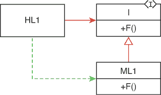

**图 12.3.** 通过插入接口反转依赖

`HL1`对`ML1`中的`F()`有运行时依赖；但`HL1`对`ML1`既没有直接的、也没有间接的源代码依赖。相反，它们都依赖于接口`I`。

在动态类型语言中，接口`I`不会以源代码模块的形式存在。相反，它将是一个`HL1`和`ML1`都遵循的鸭类型（duck type）。

这种获取任何源代码依赖并将其反转的能力赋予了我们巨大的力量。我们可以轻松且安全地安排软件的源代码依赖，以确保高层模块*不*依赖于低层模块。

这允许我们创建如图 12.4 所示的结构。


### 图 12.4. 插件结构

在这里，我们看到高层业务规则对用户界面（UI）和数据库有运行时依赖，但对这些模块没有源代码依赖。DIP（依赖倒置原则）的应用意味着 UI 和数据库是业务规则的*插件*，可以很容易地替换为不同的实现，而不影响业务规则，从而符合 OCP（开闭原则）。

当然，实际情况是 UI 和数据库实现了包含在业务规则中的接口。业务规则在这些接口上操作，允许控制流向 UI 和数据库扩散，同时保持源代码依赖向内反转指向业务规则（见图 12.5）。

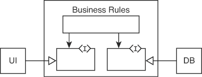

### 图 12.5. 业务规则中的接口允许插件的存在。

注意，所有的依赖都指向抽象。这引导我们用一种方式来描述 DIP：

*在可能的，将所有源代码依赖指向抽象。*

#### 怀旧的经典

理论已经够了。让我们来看看实际运行情况。我将向我的朋友兼导师 Martin Fowler 借用一个怀旧例子。他在他的经典著作《重构》（*Refactoring*）第一版中这个*录像店*（Video Store）示例。当然，我将使用 Clojure 代替 Java。

以下是测试用例：

点击此处查看代码图片


如果你读过《重构》的第一版，这看起来应该非常熟悉。本质上，我们有一个简单的报告生成器，它负责计算和格式化账单。你应该注意到的第一件事是测试中极其严重的 SRP（单一责任原则）违反。这些测试将业务规则与账单的构建和格式化耦合在了一起。如果营销人员决定对账单格式进行微小的更改，所有测试都会失败。

这种 SRP 违反使得测试变得非常脆弱。为了修复这个问题，我们需要将指定报告格式的测试与指定业务规则的测试分开。

为了做到这一点，我将测试拆分为三个不同的模块：一个用于测试计算，另一个用于格式化，最后一个用于集成。

这里是`statement-calculator`的测试。从现在起，我会包含所有的`ns`语句，以便你可以看到模块的名称及其源代码依赖关系。

`ns`代表命名（namespace）。这些语句通常出现在每个 Clojure 模块的开头，定义了模块名称及其依赖项。

点击此处查看代码图片

```
(ns video-store.statement-calculator-spec
  (:require [speclj.core :refer :all]
            [video-store.statement-calculator :refer :all]))
(declare customer)

(describe "Rental Statement Calculation"
  (with customer (make-customer "Fred"))

  (it "makes statement for a single new release"
    (should= {:customer-name "Fred"
              :movies [{:title "The Cell"
                        :price 9.0}]
              :owed 9.0
              :points 2}
             (make-statement-data
               (make-rental-order
                 @customer
                 [(make-rental
                    (make-movie "The Cell" :new-release)
                    3)]))))

  (it "makes statement for two new releases"
    (should= {:customer-name "Fred",
              :movies [{:title "The Cell", :price 9.0}
                       {:title "The Tigger Movie", :price 9.0}],
              :owed 18.0,
              :points 4}
             (make-statement-data
               (make-rental-order
                 @customer
                 [(make-rental
                    (make-movie "The Cell" :new-release)
                    3)
                  (make-rental
                    (make-movie "The Tigger Movie" :new-release)
                    3)]))))

  (it "makes statement for one childrens movie"
    (should= {:customer-name "Fred",
              :movies [{:title "The Tigger Movie", :price 1.5}],
              :owed 1.5,
              :points 1}
             (make-statement-data
               (make-rental-order
                 @customer
                 [(make-rental
                    (make-movie "The Tigger Movie" :childrens)
                    3)]))))

  (it "makes statement for several regular movies"
    (should= {:customer-name "Fred",
              :movies [{:title: "Plan 9 from Outer Space",
                        :price 2.0}
                       {:title: "8 1/2", :price 2.0}
                       {:title: "Eraserhead", :price 3.5}],
              :owed 7.5,
              :points 3}
             (make-statement-data
               (make-rental-order
                 @customer
                 [(make-rental
                    (make-movie "Plan 9 from Outer Space"
                                :regular)
                    1)
                  (make-rental
                    (make-movie "8 1/2", :regular)
                    2)
                  (make-rental
                    (make-movie "Eraserhead" :regular)
                    3)])))))
```

我们在这里所做是将格式化的租借账单替换为一个包含账单中所有数据的数据结构。这允许我们实现格式化与计算分离，如`statement-calculator`的实现所示：

点击此处查看代码图片

```
(ns video-store.statement-calculator)

(defn make-customer [name]
  {:name name})

(defn make-movie [title type]
  {:title title
   :type type})

(defn make-rental [movie days]
  {:movie movie
   :days days})

(defn make-rental-order [customer rentals]
  {:customer customer
   :rentals rentals})

(defn determine-amount [rental]
  (let [{:keys [movie days]} rental
        type (:type movie)]
    (condp = type
      :regular
      (if (> days 2)
        (+ 2.0 (* (- days 2) 1.5))
        2.0)

      :new-release
      (* 3.0 days)

      :childrens
      (if (> days 3)
        (+ 1.5 (* (- days 3) 1.5))
        1.5))))

(defn determine-points [rental]
  (let [{:keys [movie days]} rental
        type (:type movie)]
    (if (and (= type :new-release)
             (> days 1))
      2
      1)))

(defn make-statement-data [rental-order]
  (let [{:keys [name]} (:customer rental-order)
        {:keys [rentals]} rental-order]
    {:customer-name name
     :movies (for [rental rentals]
               {:title (:title (:movie rental))
                :price (determine-amount rental)})
     :owed (reduce + (map determine-amount rentals))
     :points (reduce + (map determine-points rentals))}))
```

这比之前要简单一点，并且封装得很好。注意`ns`语句显示该模块没有源代码依赖。`ns`语句显示该模块没有源代码依赖。`ns`语句显示该模块没有源代码依赖。

从单一职责原则（SRP）的角度来看，这要好得多。如果营销人员对报告格式进行细微更改，只有格式测试和集成测试会失败。没有任何计算测试会失败。在像这样的简单示例中，这看起来可能不是什么巨大的胜利。但在测试数以千计的真实应用中，这确实是一个巨大的胜利。

我们还免受了业务规则变更的影响。如果财务人员决定更改价格计算方式，格式测试将不受影响，只有计算测试和集成测试会受到影响。

## 一个 DIP 违背

在取得这些优势的同时，你是否注意到了 DIP（依赖倒置原则）的违背？你可能错过了它，因为它不在生产代码中，而是在集成测试中。

看那个`ns`语句。你看到那两行提到`statement-formatter`和`statement-calculator`的代码了吗？那几行代码对这些模块的具体实现创建了源代码依赖。这是高层策略依赖于具体的低层细节。这是定义上的 DIP 违背。

也许这让你感到困惑。一个测试怎么能是一个高层策略呢？测试难道不是尽可能低级的吗？它们难道不是极的细节吗？

是的，确实如此。但集成测试实际上是高层策略的代品。再次看那个集成测试。它恰恰执行了应用程序高层策略必须做的事情。它调用`make-statement-data`并将结果传递给`format-rental-statement`。由于这两个函数都是具体实现，我们的高层生产代码将面临与集成测试完全相同的 DIP 违背。

我们总会在测试中关注 DIP 吗？保持警觉总是明智的。但强制合规可能并不总是明智的。某些测试最好与低层实现保持耦合。然而，如果你想让测试套件健壮且灵活，如果你不想在更改生产代码中一个微小地方时导致数百个测试失败，那么关注测试与生产代码之间的耦合是一个好主意。^(25)

25. 我在书籍《整洁之道》（*Clean Craftsmanship* , Addison-Wesley, 2021）中花了大量时间讨论这个话题。

但也许你仍然不信服。那么，让我们添加一个新功能。有时我们希望账单显示在文本终端上，有时我们希望显示在浏览器上。因此，我们需要`format-rental-statement`的文本版本和 HTML 版本。

让我们再添加一个新功能。我们的一些商店正在提供“买二送一”的策略。所以，如果你租了三部视频，你只需为最贵的两部付费。

如果在面向对象（OO）语言中实现这些，我们可能会倾向于创建两个新的抽象类或接口。`StatementFormatter`抽象将有一个`format-rental-statement`方法，该方法将在`TextFormatter`和`HTMLFormatter`实现中实现。同样，`StatementPolicy`抽象将在`NormalPolicy`和`BuyTwoGetOneFreePolicy`中实现`make-statement-data`函数。

我们可以轻松地通过我们在 OCP（开闭原则）章节中讨论过的三种方法之一来模拟这种设计。我们可以为这两个抽象类构建虚函数表（vtables）。或者，我们可以使用`defprotocol`和`defrecord`构建真正的 Java 接口和实现。或者，最后，我们可以使用多方法（multi-methods）。

让我们看看多方法的方法是怎样的。请记住，这是一个伪装成成年情况的小型问题。你在这里看到我所的操作是为了展示更大规模的问题如何进行设计和划分。

最后，如图 12.6

**图 12.6.** 将视频租赁应用程序拆分为模块


图 12.6 看起来像一个面向对象解决方案的 UML 图。依赖倒置应该是显而易见的。`order-processing` 模块是最高层策略。它依赖于两个抽象类型。`statement-formatter` 是一个接口，而 `statement-policy` 是一个带有一个方法的抽象类。

如果你对我使用面向对象的术语来描述 Clojure 函数式程序感到困惑，那么你不应该困惑。我使用的 OO 词汇在函数式世界中有非常直接的类比。

`statement-formatter` 接口由 `text-formatter` 和 `HTML-formatter` 实现。`statement-policy` 抽象类由 `normal-statement-policy` 实现。`buy-two-get-one-free-policy` 实现继承自 `normal-statement-policy`，但覆盖了它的其中一个方法。所有这些“继承”背后的机制很快就会变得清晰。

测试出现在底部。它们被标记为 `<T>`。它们使用一个名为 `constructors` 的小工具模块，该模块知道如何构建基础数据结构。然后每个测试使用其特定的生产代码部分来测试它需要的内容。

现在来看源代码。特别注意 `ns` 语句，并注意它们与 UML 图上的箭头对应。

## `constructors`

让我们从 `constructors` 开始。它们非常自显易懂：

点击此处查看代码图像

```clojure
(ns video-store.constructors)

(defn make-customer [name]
  {:name name})

(defn make-movie [title type]
  {:title title
   :type type})

(defn make-rental [movie days]
  {:movie movie
   :days days})

(defn make-rental-order [customer rentals]
  {:customer customer
   :rentals rentals})
```

`constructors` 在 `ns` 语句中没有外部依赖，只是构建纯数据结构。

## 集成测试

集成测试在 `integration-specs` 模块中：

点击此处查看代码图像

```clojure
(ns video-store.integration-specs
  (:require [speclj.core :refer :all]
            [video-store.constructors :refer :all]
            [video-store.text-formatter :refer :all]
            [video-store.normal-statement-policy :refer :all]
            [video-store.order-processing :refer :all]))

(declare rental-order)

(describe "Integration Tests"
  (with rental-order (make-rental-order
                       (make-customer "Fred")
                       [(make-rental
                          (make-movie
                            "Plan 9 from Outer Space"
                            :regular)
                          1)
                        (make-rental
                          (make-movie "8/2" :regular)
                          2)
                        (make-rental
                          (make-movie "Eraserhead" :regular)
                          3)]))
  (it "formats a text statement"
    (should= (str "Rental Record for Fred\n"
                  "\tPlan 9 from Outer Space\t2.0\n"
                  "\t8/2\t2.0\n"
                  "\tEraserhead\t3.5\n"
                  "You owed 7.5\n"
                  "You earned 3 frequent renter points\n")
             (process-order
               (make-normal-policy)
               (make-text-formatter)
               @rental-order))))
```

另外两个测试更加具体。特别注意，它们的源代码依赖只引入了它们所需的的内容：

点击此处查看代码图片

```ns
(ns video-store.statement-formatter-spec
  (:require [speclj.core :refer :all]
            [video-store.statement-formatter :refer :all]
            [video-store.text-statement-formatter :refer :all]
            [video-store.html-statement-formatter :refer :all]))

(declare statement-data)
(describe "Rental Statement Format"
  (with statement-data {:customer-name "CUSTOMER"
                        :movies [{:title "MOVIE"
                                  :price 9.9}]
                        :owed 100.0
                        :points 99})
  (it "Formats a text rental statement"
    (should= (str "Rental Record for CUSTOMER\n"
                  "\tMOVIE\t9.9\n"
                  "You owed 100.0\n"
                  "You earned 99 frequent renter points\n")
             (format-rental-statement
               (make-text-formatter)
               @statement-data
               )))

  (it "Formats an html rental statement"
      (should= (str
                 "<h1>Rental Record for CUSTOMER</h1>"
                 "<table>"
                 "<tr><td>MOVIE</td><td>9.9</td></tr>"
                 "</table>"
                 "You owed 100.0<br>"
                 "You earned <b>99</b> frequent renter points")
               (format-rental-statement
                 (make-html-formatter)
                 @statement-data))))
```

`statement-formatter-spec` 测试了两种不同的格式。格式由 `format-rental-statement` 函数的第一个参数指定。该参数由 `make-text-formatter` 和 `make-html-formatter` 函数创建，正如你将看到的，这些函数是在相应的模块中实现的。

最后一个测试是 `statement-policy-spec`：

点击此处查看代码图像

```ns
(ns video-store.statement-policy-spec
  (:require
    [speclj.core :refer :all]
    [video-store.constructors :refer :all]
    [video-store.statement-policy :refer :all]
    [video-store.normal-statement-policy :refer :all]
    [video-store.buy-two-get-one-free-policy :refer :all]))

(declare customer normal-policy formatter)
(declare new-release-1 new-release-2 childrens)
(declare regular-1 regular-2 regular-3)

(describe "Rental Statement Calculation"
  (with customer (make-customer "CUSTOMER"))
  (with normal-policy (make-normal-policy))
  (with new-release-1 (make-movie "new release 1" :new-release))
  (with new-release-2 (make-movie "new release 2" :new-release))
  (with childrens (make-movie "childrens" :childrens))
  (with regular-1 (make-movie "regular 1" :regular))
  (with regular-2 (make-movie "regular 2" :regular))
  (with regular-3 (make-movie "regular 3" :regular))
  (context "normal policy"
    (it "makes statement for a single release"
      (should= {:customer-name "CUSTOMER"
                :movies [{:title "new release 1"
                          :price 9.0}]
                :owed 9.0
                :points 2}
               (make-statement-data
                 @normal-policy
                 (make-rental-order
                   @customer
                   [(make-rental @new-release-1 3)]))))

    (it "makes statement for two releases"
      (should= {:customer-name "CUSTOMER"
                :movies [{:title "new release 1", :price 9.0}
                         {:title "new release 2", :price 9.0}]
                :owed 18.0,
                :points 4}
               (make-statement-data
                 @normal-policy
                 (make-rental-order
                   @customer
                   [(make-rental @new-release-1 3)
                    (make-rental @new-release-2 3)]))))

    (it "makes statement for one movie"
      (should= {:customer-name "CUSTOMER"
                :movies [{:title "childrens", :price 1.5}]
                :owed 1.5,
                :points 1}
               (make-statement-data
                 @normal-policy
                 (make-rental-order
                   @customer
                   [(make-rental @childrens 3)]))))

    (it "makes statement for regular movies"
      (should= {:customer-name "CUSTOMER"
                :movies [{:title "regular 1", :price 2.0}
                         {:title "regular 2", :price 2.0}
                         {:title "regular 3", :price 3.5}],
                :owed 7.5,
                :points 3}
               (make-statement-data
                 @normal-policy
                 (make-rental-order
                   @customer
                   [(make-rental @regular-1 1)
                    (make-rental @regular-2 2)
                    (make-rental @regular-3 3)]))))
  (context "Buy two free policy"
    (it "makes statement for regular movies"
      (should= {:customer-name "CUSTOMER"
                :movies [{:title "regular 1", :price 2.0}
                         {:title: "regular 2", :price 2.0}
                         {:title: "new release 1", :price 3.0}],
                :owed 5.0,
                :points 3}
               (make-statement-data
                 (make-buy-two-get-one-free-policy)
                 (make-rental-order
                   @customer
                   [(make-rental @regular-1 1)
                    (make-rental @regular-2 2)
                    (make-rental @new-release-1 1)]))))
```

`statement-policy-spec` 测试各种定价规则。你已经见过第一部分。最后一个测试检查了某些商店使用的买二送一策略。注意该策略传递给 `make-statement-data` 函数，并由 `make-normal-policy` 和 `make-buy-two-get-one-free-policy` 函数创建。

## 生产代码

现在，回到生产代码。我们从 `order-processing` 模块开始：

点击此处查看代码图片

```ns
(ns video-store.order-processing
  (:require [video-store.statement-formatter :refer :all]
            [video-store.statement-policy :refer :all]))

(defn process-order [policy formatter]
  (->> order
       (make-statement-data policy)
       (format-rental-statement formatter)))
```


没什么。注意源代码依赖只引用了`statement-formatter`接口和`statement-policy`抽象。

`statement-formatter`接口非常简单：

点击此处查看代码图片

```ns
(ns video-store.statement-formatter)

(defmulti format-rental-statement
            (fn [formatter statement-data]
              (:type formatter)))
```

`defmulti`语句大致相当于在 Java 或 C# 中创建抽象方法。由于此模块只有一个抽象方法，它大致等同于接口。调度器函数是微不足道的；它只返回格式器的`:type`。

`statement-policy`抽象稍微有趣：

点击此处查看代码图片

```ns
(ns video-store.statement-policy)

(defn- policy-movie-dispatch [policy rental]
  [(:type policy) (-> rental :movie :type)])

(defmulti determine-amount policy-movie-dispatch)
(defmulti determine-points policy-movie-dispatch)
(defmulti total-amount (fn [policy _rentals] (:type policy)))
(defmulti total-points (fn [policy _rentals] (:type policy)))

(defn make-statement-data [policy rental-order]
  (let [{:keys [name]} (:customer rental-order)
        {:keys [rentals]} rental-order]
    {:customer-name name
     :movies (for [rental rentals]
               {:title (:title (:movie rental))
                :price (determine-amount policy rental)})
     :owed (total-amount policy rentals)
     :points (total-points policy rentals)}))
```

`statement-policy`模块包含四个抽象方法和一个实现方法。注意看它是如何使用模板方法^(27) 模式的。同样注意`determine-amount`和`determine-points`函数使用了元组作为分发代码（dispatch code）。这非常有趣。这意味着我们可以根据两个自由度而不是一个来分发这些函数。这在大多数面向对象（OO）语言中是很难做到的。我们很快就会看到它的用法。

27。参见第 17 章，“Wa-Tor”。

但在之前，让我们先看看`text-statement-formatter`的实现：

点击此处查看代码图片

```clojure
(ns video-store.text-statement-formatter
  (:require [video-store.statement-formatter :refer :all]))
(defn make-text-formatter [] {:type ::text})

(defmethod format-rental-statement
           ::text
           [_formatter statement-data]
  (let [customer-name (:customer-name statement-data)
        movies (:movies statement-data)
        owed (:owed statement-data)
        points (:points statement-data)]
    (str
      (format "Rental Record for %s\n" customer-name)
      (apply str
             (for [movie movies]
               (format "\t%s\t%.1f\n"
                 (:title movie)
                 (:price movie))))
      (format "You owed %.1f\n" owed)
      (format "You earned %d frequent renter points\n" points))))
```

这应该并不意外。我只是把代码移到了这里，没有做太大改动。注意顶部的`make-text-formatter`函数。

`html-statement-formatter`应该也不太意外：

点击此处查看代码图片

```clojure
(ns video-store.html-statement-formatter
  (:require [video-store.statement-formatter :refer :all]))

(defn make-html-formatter [] {:type ::html})

(defmethod format-rental-statement ::html
  [formatter statement-data]
  (let [customer-name (:customer-name statement-data)
        movies (:movies statement-data)
        owed (:owed statement-data)
        points (:points statement-data)]
    (str
      (format "<h1>Rental Record for %s</h1>" customer-name)
      "<table>"
      (apply str
             (for [movie movies]
               (format "<tr><td>%s</td><td>%.1f</td></tr>"
                       (:title movie) (:price movie))))
      "</table>"
      (format "You owed %.1f<br>" owed)
      (format "You earned <b>%d</b> frequent renter points"
              points))))
```

更有趣的是那两个策略模块。让我们从`normal-statement-policy`开始：

点击此处查看代码图片

```clojure
(ns video-store.normal-statement-policy
  (:require [video-store.statement-policy :refer :all]))

(defn make-normal-policy [] {:type ::normal})

(defmethod determine-amount [::normal :regular] [_policy rental]
  (let [days (:days rental)]
    (if (> days 2)
      (+ 2.0 (* (- days 2) 1.5))
      2.0)))

(defmethod determine-amount
           [::normal :childrens]
           [_policy rental]
  (let [days (:days rental)]
    (if (> days 3)
      (+ 1.5 (* (- days 3) 1.5))
      1.5)))

(defmethod determine-amount
           [::normal :new-release]
           [_policy rental]
  (* 3.0 (:days rental)))

(defmethod determine-points [::normal :regular] [_policy _rental]
  1)

(defmethod determine-points
           [::normal :new-release]
           [_policy rental]
  (if (> (:days rental) 1) 2 1))

(defmethod determine-points
           [::normal :childrens]
           [_policy _rental]
  1)

(defmethod total-amount ::normal [policy rentals]
  (reduce + (map #(determine-amount policy %) rentals)))

(defmethod total-points ::normal [policy rentals]
  (reduce + (map #(determine-points policy %) rentals)))
```

这很不同，不是吗？仔细看那些`defmethod`语句。我们根据策略类型和电影类型同时进行了分发。这很好地隔离了业务规则。

你可能担心两个自由度会产生 N*M 问题，导致“determine”函数的泛滥。你稍后就会看到我是如何处理它的。

注意顶部供我们的测试用到的`make-normal-policy`构造函数。

现在让我们来看`buy-two-get-one-free-policy`模块：

点击此处查看代码图片

```clojure
(ns video-store.buy-two-get-one-free-policy
  (:require [video-store.statement-policy :refer :all]))

(defn make-free-policy [] {:type ::free})

(defmethod determine-amount [::free :regular] [_policy rental]
  (let [days (:days rental)]
    (if (> days 2)
      (+ 2.0 (* (- days 2) 1.5))
      2.0)))

(defmethod determine-amount
           [::free :childrens]
           [_policy rental]
  (let [days (:days rental)]
    (if (> days 3)
      (+ 1.5 (* (- days 3) 1.5))
      1.5)))

(defmethod determine-amount
           [::free :new-release]
           [_policy rental]
  (* 3.0 (:days rental)))

(defmethod determine-points [::free :regular] [_policy _rental]
  1)

(defmethod determine-points
           [::free :new-release]
           [_policy rental]
  (if (> (:days rental) 1) 2 1))

(defmethod determine-points
           [::free :childrens]
           [_policy _rental]
  1)

(defmethod total-amount ::free [policy rentals]
  (reduce + (map #(determine-amount policy %) rentals)))

(defmethod total-points ::free [policy rentals]
  (reduce + (map #(determine-points policy %) rentals)))

(defmethod format-rental-statement ::free
  [_formatter statement-data]
  (let [customer-name (:customer-name statement-data)
        movies (:movies statement-data)
        owed (:owed statement-data)
        points (:points statement-data)]
    (str
      (format "Rental Record for %s\n" customer-name)
      (apply str
             (for [movie movies]
               (format "\t%s\t%.1f\n"
                 (:title movie)
                 (:price movie))))
      (format "You owed %.1f\n" owed)
      (format "You earned %d frequent renter points\n" points))))
```

惊喜，惊喜！看那个`derive`语句。

```clojure
(ns video-store.buy-two-get-one-free-policy
  (:require [video-store.statement-policy :refer :all]
            video-store.statement-formatter :as formatter]))

(defn make-free-policy [] {:type ::free})

(defmethod total-amount ::free [policy rentals]
  (reduce + (map #(determine-amount policy %) rentals)))

(defmethod total-points ::free [policy rentals]
  (reduce + (map #(determine-points policy %) rentals)))

(defmethod format-rental-statement ::free
  [_formatter statement-data]
  (let [customer-name (:customer-name statement-data)
        movies (:movies statement-data)
        owed (:owed statement-data)
        points (:points statement-data)]
    (str
      (format "Rental Record for %s\n" customer-name)
      (apply str
             (for [movie movies]
               (format "\t%s\t%.1f\n"
                 (:title movie)
                 (:price movie))))
      (format "You owed %.1f\n" owed)
      (format "You earned %d frequent renter points\n" points))))

(def free-policy
  (fn [rentals]
    (let [amount (total-amount :free rentals)
          points (total-points :free rentals)]
      (if (> points 4)
        {:amount amount :points (- points 1)}
        {:amount amount :points points}))))

(def get-statement-policy
  (fn [type]
    (case type
      :free free-policy
      :normal normal-policy
      :regular regular-policy)))

(def free (total-amount :free rentals)
  (get-statement-policy :free rentals))
```

许多函数式程序员说他们不需要 TDD（测试驱动开发），因为他们在 REPL 中测试了一切。我也在 REPL 中进行大量的实验；但在大多数情况下，我会将学到的内容编码为测试。测试就像钻石，是永恒的。而 REPL 中的实验在第二天就不复存在了。

### 那么 Mock（模拟对象）呢？

`Mocking`是 TDD 实践者使用的一种技术，用于将其测试与系统的大部分隔离开。实际上，他们创建了名为`mocks`的对象来代表这些部分，并使用`LSP`（里氏替换原则）用这些`mocks`来替代它们。它们更正式被称为`test-doubles`（测试双胞），但在此背景下，我将继续使用这种口语。


由于`LSP`被视为一种面向对象（OO）原则，而且OO语言中的mocks是基于多态接口的，因此函数式语言不支持mocks似乎已经变成了一个都市传闻。

但正如我们看到的，`LSP`在函数式语言中的效果与OO语言中一样好，而且多态接口通常非常容易。因此，在函数式语言中，编写各种形式的mocks的能力完全不受阻碍。

例如，这里来自我的`more-speech`应用的一个测试，它使用了两个mocks：

```
(it "adds an unrooted article id to a tab"
  (let [message-id 1
        messages {message-id {:tags []}}
        event-context (atom {:text-event-map messages})]
    (reset! ui-context {:event-context event-context})
    (with-redefs [swing-util/add-id-to-tab (stub :add-id-to-tab)
                  swing-util/relaunch (stub :relaunch)]
      (add-article-to-tab 1 "tab" nil)
      (should-have-invoked :relaunch)
      (should-have-invoked :add-id-to-tab
                           {:with ["tab" :selected 1]}))))
```

不要太担心这个测试在做什么。只需看`with-redefs`语句即可。这个测试模拟了`swing-util/add-id-to-tab`和`swing-util/relaunch`函数，使它们使用命名的存根（stub）。这些stub是完美的空操作（no-ops）。它们接受任意数量的参数且不返回任何内容。但它们会记得发生在它们身上的事情。所以，在底部我们看到`:relaunch` stub应该被调用，而`:add-id-to-tab` stub应该被带三个参数调用：`"tab"`、`:selected`和`1`。有方法让它们返回数值，但这超出了本文范围。如果你感兴趣，可以查看`speclj`文档。从技术上说，它们其实是spies（探针）。

### 属性测试

如果你经常和函数式程序员打交道，最终总会听到`QuickCheck`和属性测试。遗憾的是，这个话题经常作为TDD的反论出现。我不会尝试去支持或反驳这一论点。相反，我想向你展示在TDD范式中，属性测试是多么强大。

首先，什么是属性测试？`Property-based testing`是一种验证和诊断技术，它采用随机生成输入和非常强大的缺陷隔离策略。

假设我刚刚写了一个计算给定整数质因数的函数：

```
(defn factors-of [n]
  (loop [factors [] n n divisor 2]
    (if (> n 1)
      (cond
        (> divisor (Math/sqrt n))
        (conj factors n)
        (= 0 (mod n divisor))
        (recur (conj factors divisor)
               (quot n divisor)
               divisor)
        :else
        (recur factors n (inc divisor)))
      factors)))
```

假设我也是用TDD写了这个函数。以下是我的测试：

```
(defn power2 [n]
  (apply * (repeat n 2N)))

(describe "factor primes"
  (it "factors 1 -> []"
    (should= [] (factors-of 1)))
  (it "factors 2 -> [2]"
    (should= [2] (factors-of 2)))
  (it "factors 3 -> [3]"
    (should= [3] (factors-of 3))))
```

这很棒。我可以随机生成大量输入，然后对输出进行属性检查。

### 一种诊断技术

但我之前把基于属性的测试称为一种诊断技术，不是吗？所以让我们来看一个更有趣的例子，我会向你们展示我的意思。

还记得我们上一章中的`Video Store`示例吗？让我们对它进行一些基于属性的测试。

首先，请记得我们写了一个名为`make-statement-data`的函数，它接受一个`policy`和一个`rental-order`，生成`statement-data`，然后将其输入到我们的格式化器中。这里是使用`clojure.spec`的`rental-order`类型规范：

```
(s/def ::name string?)
(s/def ::customer (s/keys :req-un [name]))
(s/def ::title string?)
(s/def ::type #{:regular :childrens :new-release})
(s/def ::movie (s/keys :req-un [::title ::type]))
(s/def ::days pos-int?)
(s/def ::rental (s/keys :req-un [::days ::movie]))
(s/def ::rentals (s/coll-of ::rental))
(s/def ::rental-order (s/keys :req-un [::customer ::rentals]))
```

这并不难读。从下往上来看：

* 一个`:rental-order`是一个包含两个元素的map：`:customer`和`:rentals`。
* `:rentals`元素是`:rental`项目的集合。
* `:rental`是一个包含`:days`和`:movie`元素的map。
* `:days`元素是一个正整数。
* `:movie`元素是一个包含`:title`和`type`的map。
* `:type`是`:regular`、`:childrens`或`:new-release`之一。
* `:title`是一个字符串。
* `:customer`是一个包含单个`:name`元素的map。
* `:name`是一个字符串。

有了这个类型规范，我们就可以编写一个生成器来产生符合该类型的租赁订单。首先，这些是生成器：

```
(def gen-customer-name
  (gen/such-that not-empty gen/string-alphanumeric))

(def gen-customer
  (gen/fmap (fn [name] {:name name}) gen-customer-name))

(def gen-days (gen/elements (range 1 100)))

(def gen-movie-type
  (gen/elements [:regular :childrens :new-release]))

(def gen-movie
  (gen/fmap (fn [[title type]] {:title title :type type})
            (gen/tuple gen/string-alphanumeric gen-movie-type)))

(def gen-rental
  (gen/fmap (fn [[movie days]] {:movie movie :days days})
            (gen/tuple gen-movie gen-days)))

(def gen-rentals
  (gen/such-that not-empty (gen/vector gen-rental)))

(def gen-rental-order
  (gen/fmap (fn [[customer rentals]]
              {:customer customer :rentals rentals})
            (gen/tuple gen-customer gen-rentals)))

(def gen-policy (gen/elements
                  [(make-normal-policy)
                   (make-buy-two-get-one-free-policy)]))
```

我在这里不会解释`clojure.check`的细节，但我将阐述这些生成器的作用：

* `gen-policy`随机选择两种策略中的一种。
* `gen-rental-order`从`gen-customer`和`gen-rentals`创建一个map。
* `gen-rentals`从`gen-rentals`创建一个vector并确保它非空。
* `gen-rental`从`gen-movie`和`gen-days`创建一个map。
* `gen-movie`从`gen/string-alphanumeric`和`gen-movie-type`创建一个map。
* `gen-movie-type`在三种类型中选择。
* `gen-days`在1到100之间的整数之间选择。
* `gen-customer`创建一个带有来自`gen-customer-name`的名称的map。
* `gen-customer-name`生成一个非空的字母数字字符串。

你是否注意到类型规范和生成器之间存在一种诡异的相似性？我也发现了。以下是生成器的几个示例输出：

```
[
 {:customer {:name "5Q"},
  :rentals [{:movie {:title "", :type :new-release}, :days 52}]}

 {:customer {:name "3"},
  :rentals [{:movie {:title "", :type :new-release}, :days 51}]}

 {:customer {:name "XA"},
  :rentals [{:movie {:title "r", :type :regular}, :days 82}
            {:movie {:title "", :type :childrens}}]}

 {:customer {:name "4"},
  :rentals [{:movie {:title "", :type :new-release}, :days 52}]}

 {:customer {:name "3"},
  :rentals [{:movie {:title "", :type :new-release}, :days 51}]}

 {:customer {:name "XA"},
  :rentals [{:movie {:title "r", :type :regular}, :days 82}
            {:movie {:title "", :type :childrens}}]}
```

在这里我们看到了用于`statement-data`的`clojure.spec`，以及确保`make-statement-data`输出符合该规范的`quick-check`。真棒。

在通过了这些测试后，我们可以非常确定生成器正在生成有效的租赁订单。现在，让我们继续进行属性检查。

我们可以检查的一个属性是：确保当`make-statement-data`将`rental-order`转换为`statement-data`时，`statement-data`对象的`:owed`成员是该对象中列出的所有电影项目价格总和。

针对该属性的`quick-check`可能如下：

```cl
(it "statement data totals are consistent under all policies"
  (should-be
    :result
    (tc/quick-check
      100
      (prop/for-all
        [rental-order gen-rental-order
         policy gen-policy]
        (let [statement-data (make-statement-data
                               policy rental-order)
              prices (map :price (:movies statement-data))
              owed (:owed statement-data)]
          (= owed (reduce + prices)))))))
```

这个`quick-check`中有一个bug。你能发现它吗？

这是我运行它时的输出：

```clojure
{:shrunk
 {:total-nodes-visited 45,
  :depth 14,
  :pass? false,
  :result false,
  :result-data nil,
  :time-shrinking-ms 3,
  :smallest
    [{:customer {:name "0"},
      :rentals [{:movie {:title "", :type :regular}, :days 1}
                {:movie {:title "", :type :regular}, :days 1}
                {:movie {:title "", :type :regular}, :days 1}]}
     {:type
      :video-store.
        buy-two-get-one-free-policy/buy-two-get-one-free}]},
  :failed-after-ms 0,
  :num-tests 7,
  :seed 1672092997135,
  :fail
   [{:customer {:name "4s7u"},
     :rentals
     [{:movie {:title "i7jiVAd", :type :childrens}, :days 85}
      {:movie {:title "7MQM", :type :new-release}, :days 26}
      {:movie {:title "qlS4S", :type :new-release}, :days 99}
      {:movie {:title "X", :type :regular}, :days 87}
      {:movie {:title "w1cRbM", :type :regular}, :days 11}
      {:movie {:title "7Hb41O5", :type :regular}, :days 63}
      {:movie {:title "xWc", :type :childrens}, :days 41}]}
    {:type
     :video-store.
       buy-two-get-one-free-policy/buy-two-get-one-free}],
  :result false,
  :result-data nil,
  :failing-size 6,
  :pass? false}
```

是的，我知道这看起来很糟糕；但这正是`quick-check`真正的魔力所在，所以请耐心听听。

首先，你看到顶部名为`:shrunk`的元素了吗？那是这里发生什么的重要线索。当`quick-check`找到错误时，它开始寻找最小的、随机生成的且持续产生错误的输入。

看`:fail`元素。那是导致初始失败的`rental-order`。现在看`:shrunk`元素中的`:smallest`元素。`quick-check`函数成功地在保持失败的情况下将`rental-order`缩小。这是它能找到的失败最小`rental-order`。

它为什么会失败？注意这里有三部电影。同时也注意策略是`buy-two-get-one-free`（买二送一）。啊，难怪在那个策略下，电影的总和不等于`:owed`元素。

正是这种收缩行为使得基于属性的测试成为一种诊断技术。

### 函数式

那么为什么像`quick-check`这样的工具在面向对象（OO）语言中没有更流行呢？也许是因为它们与纯函数的配合得最好。我设想在可变系统中设置生成器和测试属性是可能的，但可能比在不可变系统中要复杂得多。

## 14

## GUI


多年来，我在函数式程序中使用过两个不同的GUI框架。第一个名为Quil，^(1)，它基于流行的Java框架Processing.^(2)。第二个是SeeSaw，^(3)，它基于旧的Java Swing^(4)框架。

1. [quil.info](http://quil.info)

2. [processing.org](https://processing.org)

3. [github.com/clj-commons/seesaw](https://github.com/clj-commons/seesaw)


## 4. [en.wikipedia.org/wiki/Swing](https://en.wikipedia.org/wiki/Swing)

Quil 是“函数式的”，这使得它在函数式程序中使用既有趣又简单。SeeSaw 完全不是函数式的，因为它依赖于必须不断更新的可变状态。这使得在函数式程序中使用它是一件痛苦的事。

是的，我知道这看起来很糟糕；但这正是 `quick-check` 真正的魔力所在，所以请耐心听听。

我写的第一个程序之一是 `spacewar`。我在这书中提到过几次。

### Quil 中的图形图形

追踪 `spacewar` 的源码超出了本书的范围。不过，我多前写过一个更简单的 Quil 程序，那就是 `turtle-graphics`。

## 5. [github.com/unclebob/turtle-graphics](https://github.com/unclebob/turtle-graphics)

## 6. [en.wikipedia.org/wiki/Turtle_graphics](https://en.wikipedia.org/wiki/Turtle_graphics)

图形图形^(6) 是 60 世纪后期为 Logo 语言发明的系列简单命令。这些命令控制着一个被称为“龟”的机器人。机器人坐在纸上，有一支可以抬起的笔。机器人可以被命令向前或向后移动一段距离，或者向左或右旋转某些度。

## 7. 感谢 MIT 博物馆。

最初的想法是通过向孩子们展示如何控制龟绘制有趣的形状来引入编程。我不知道这种方法对孩子们效果如何，但事实证明对于想要设计复杂设计的程序员来说非常有用。要画一个正方形，你可能会发出这些命令：

```
Pen down
Forward 10
Right 90
Forward 10
Right 90
Forward 10
Right 90
Forward 10
Pen up
```

总之，多年前，我希望在 Clojure 中有一个图形图形系统，这样我就可以轻松地研究一些数学和几何谜题。我的目标不是创建一个可以在上面输入命令的图形图形控制台。相反，我想要一个可以在 Clojure 中编写图形函数的图形图形 API。

例如，我想编写这样的程序：

```clojure
(defn polygon [theta, len, n]
  (pen-down)
  (speed 1000)
  (dotimes [_ n]
    (forward len)
    (right theta)))

(defn turtle-script []
  (polygon 144 400 5))
```

该程序画了图 14.2 中的图片。（注意坐在星形左侧顶点上的小龟。）

`turtle-script` 函数是 `turtle-graphics` 系统的入口。你将你的绘制命令放入其中。在这种情况下，我将一个对 `polygon` 函数的调用放入其中。

也许你已经注意到，`polygon` 函数似乎并不是函数的，因为它没有从输入中产生返回值。相反，它具有在屏幕上绘图的副作用。此外，每条命令都会改变海龟的状态。因此，`turtle-graphics` 程序不是函数的。

尽管如此，`turtle-graphics` 框架是“函数式”的。或者准确地说，它已经达到了 GUI 程序能达到的函数式程度。毕竟，GUI 程序的目的就是改变屏幕的状态。

尽管你可能觉得这个意思：[`fsharpforfunandprofit.com/posts/13-ways-of-looking-at-a-turtle/`](https://fsharpforfunandprofit.com/posts/13-ways-of-looking-at-a-turtle/)。

`turtle-graphics` 框架从配置和调用 Quil 开始：

点击此处查看代码图像

```clojure
(defn ^:export -main [& args]
  (q/defsketch turtle-graphics
               :title "Turtle Graphics"
               :size [1000 1000]
               :setup setup
               :update update-state
               :draw draw-state
               :features [:keep-on-top]
               :middleware [m/fun-mode])
  args)
```

我在这里不会对 Quil 进行一个完整的教程，但有几点我应该指出。注意 `:setup`、`:update` 和 `:draw` 元素。每个都指向一个函数。

`setup` 函数会在程序开始时调用一次。

`draw-state` 函数每秒会被调用 60 次以刷新屏幕。所有应该出现在屏幕上的内容都必须由 `draw` 函数绘制。屏幕不会记住任何东西。

`update-state` 函数会在 `draw-state` 函数之前被调用。这个函数用于更改正在绘图的状态。把它想象成将屏幕元素向未来移动 1/60 秒的函数。

把这想象成一个非常简单的循环：

点击此处查看代码图像

```clojure
(loop [state (setup)]
  (draw-state state)
  (recur (update-state state)))
```

如果你将其视为为一个尾递归循环，那么屏幕的内容就是尾递归的值。因此，尽管我们正在改变屏幕的内容，但我们是在递归的尾部进行的，在那里改变是无害的。所以，虽然不是纯函数式的，但它已经是任何 TCO（尾递归优化）系统能达到的“函数式”程度。

这是我的 `setup` 函数：

点击此处查看代码图像

```clojure
(defn setup []
  (q/frame-rate 60)
  (q/color-mode :rgb)
  (let [state {:turtle (turtle/make)
               :channel channel}]
    (async/go
      (turtle-script)
      (prn "Turtle script complete"))
    state))
```

这开始非常简单。它将帧率设置为 60fps，颜色模式设置为 RGB，并创建了传递给 `update-state` 和 `draw-state` 的 `state` 对象。

`async/go` 函数启动了一个新的轻量级线程，我们的 `turtle-script` 将其中执行。

`state` 对象由 `channel` 和 `turtle` 组成。我们稍后会讨论 `channel`。现在，让我们关注 `turtle`：

点击此处查看代码图像

```clojure
(s/def ::position (s/tuple number? number?))
(s/def ::heading (s/and number? #(<= 0 % 360)))
(s/def ::velocity number?)
(s/def ::distance number?)
(s/def ::omega number?)
(s/def ::angle number?)
(s/def ::weight (s/and pos? number?))
(s/def ::state #{:idle :busy})
(s/def ::pen #{:up :down})
(s/def ::pen-start (s/or :nil nil?
                         :pos (s/tuple number? number?)))
(s/def ::line-start (s/tuple number? number?))
(s/def ::line-end (s/tuple number? number?))
(s/def ::line (s/keys :req-un [::line-start ::line-end]))
(s/def ::lines (s/coll-of ::line))
(s/def ::visible boolean?)
(s/def ::speed (s/and int? pos?))
(s/def ::turtle (s/keys :req-un [::position
                                 ::heading
                                 ::velocity
                                 ::distance
                                 ::omega
                                 ::angle
                                 ::pen
                                 ::weight
                                 ::speed
                                 ::lines
                                 ::visible
                                 ::state]
                        :opt-un [::pen-start]))
(defn make []
  {:post [(s/assert ::turtle %)]}
  {:position [0.0 0.0]
   :heading 0.0
   :velocity 0.0
   :distance 0.0
   :omega 0.0
   :angle 0.0
   :pen :up
   :weight 1
   :speed 5
   :visible true
   :lines []
   :state :idle})
```

这展示了 `turtle` 的规格定义。坐标、朝向、速度、距离、角速度、角度、笔、重量、速度、线条、可见性和状态。`make` 函数通过 `:post` 断言了 `turtle` 符合规格。初始位置为 `[0.0 0.0]`，朝向为 `0.0`，以此类推。

```clojure
(defn update-position
  [{:keys [position velocity heading distance] :as turtle}]
  (let [step (min (q/abs velocity) distance)
        distance (- distance step)
        step (if (neg? velocity) (- step) step)
        radians (q/radians heading)
        [x y] position
        vx (* step (Math/cos radians))
        vy (* step (Math/sin radians))
        position [(+ x vx) (+ y vy)]]
    (assoc turtle :position position
                  :distance distance
                  :velocity (if (zero? distance) 0.0 velocity))))

(defn update-heading [{:keys [heading omega angle] :as turtle}]
  (let [angle-step (min (q/abs omega) angle)
        angle (- angle angle-step)
        angle-step (if (neg? omega) (- angle-step) angle-step)
        heading (mod (+ heading angle-step) 360)]
    (assoc turtle :heading heading
                  :angle angle
                  :omega (if (zero? angle) 0.0 omega))))

(defn make-line [{:keys [pen-start position weight]}]
  {:line-start pen-start
   :line-end position
   :line-weight weight})

(defn update-turtle [turtle]
  {:post [(s/assert ::turtle %)]}
  (if (= :idle (:state turtle))
    turtle
    (let [{:keys [distance
                  state
                  angle
                  lines
                  position
                  pen
                  pen-start] :as turtle}
          (-> turtle
              (update-position)
              (update-heading))
          done? (and (zero? distance)
                     (zero? angle))
          state (if done? :idle state)
          lines (if (and done? (= pen :down))
                  (conj lines (make-line turtle))
                  lines)
          pen-start (if (and done? (= pen :down))
                      position
                      pen-start)]
      (assoc turtle
             :state state
             :lines lines
             :pen-start pen-start))))
```

注意，`update-turtle` 有一个 `:post` 条件，用于在更新后检查乌龟的类型。当你更新一个大结构时，知道自己没有搞乱它的某个小部分感觉很棒。

如果 `turtle` 的 `:state` 为 `:idle`，意味着它既没有在移动也没有旋转，那么我们就不进行任何更改。否则，我们会更新 `turtle` 的位置和朝向，然后对其内部进行*解构*（destructure）。当当前动画运动剩余的距离和角度为零时，我们就完成了。如果完成了，我们将 `:state` 设置为 `:idle`。

如果我们完成了且笔是落下的（down），那么我们将正在绘制的线条添加到之前的线条列表中，并更新 `pen-start` 为当前位置，为绘制下一条线做准备。

更新位置和朝向是简单的函数，执行必要的三角计算以将乌龟放置在适当的位置和方向上。它们都使用乌龟的 `:velocity` 来调整每次更新时的步长大小。

现在来处理命令：

点击此处查看代码图片

```clojure
(defn handle-commands [channel turtle]
  (loop [turtle turtle]
    (let [command (if (= :idle (:state turtle))
                    (async/poll! channel)
                    nil)]
      (if (nil? command)
        turtle
        (recur (turtle/handle-command turtle command))))))
```

如果乌龟是 `:idle`，那么我们就准备好接收命令了。因此我们轮询 `channel`。如果 `channel` 上有命令，我们通过调用 `turtle/handle-command` 处理它，然后重复直到 `channel` 上没有剩余命令。

处理每个命令都非常直观：

点击此处查看代码图片


```clojure
(defn pen-down [{:keys [pen position pen-start] :as turtle}]
  (assoc turtle :pen :down
                :pen-start (if (= :up pen) position pen-start)))

(defn pen-up [{:keys [pen lines] :as turtle}]
  (if (= :up pen)
    turtle
    (let [new-line (make-line turtle)
          lines (conj lines new-line)]
      (assoc turtle :pen :up
                    :pen-start nil
                    :lines lines))))

(defn forward [turtle [distance]]
  (assoc turtle :velocity (:speed turtle)
                :distance distance
                :state :busy))

(defn back [turtle [distance]]
  (assoc turtle :velocity (- (:speed turtle))
                :distance distance
                :state :busy))

(defn right [turtle [angle]]
  (assoc turtle :omega (* 2 (:speed turtle))
                :angle angle
                :state :busy))

(defn left [turtle [angle]]
  (assoc turtle :omega (* -2 (:speed turtle))
                :angle angle
                :state :busy))

(defn hide [turtle]
  (assoc turtle :visible false))

(defn show [turtle]
  (assoc turtle :visible true))

(defn weight [turtle [weight]]
  (assoc turtle :weight weight))

(defn speed [turtle [speed]]
  (assoc turtle :speed speed))

(defn handle-command [turtle [args]]
  (cond = cmd
    :forward (forward turtle args)
    :back (back turtle args)
    :right (right turtle args)
    :left (left turtle args)
    :pen-down (pen-down turtle)
    :pen-up (pen-up turtle)
    :hide (hide turtle)
    :show (show turtle)
    :weight (weight turtle args)
    :speed (speed turtle args)))
```

你可能不熟悉我在这里使用的电话术语。事实上，如果你出生在 2000 年之后，你可能对电话本身都不熟悉。所以，出于历史和怀旧考虑，请让我带你走一遍这个过程。

Bob 想给 Alice 打电话。Bob 拿起听筒离开钩^(1) 并把它放在耳边。电信公司（telco）向听筒发送一个拨号音调^(2)。听到这个声音后，Bob 拨号^(3) Alice 的号码。随后，电信公司向 Alice 的手机发送一个铃声电压^(4)，并向 Bob 的听筒发送一个回铃音^(5)。Alice 听到手机铃响，并拿起听筒。电信公司接通了 Bob 和 Alice，Alice 对 Bob 说："你好"。

- 1. 20 世纪初的电话有一个挂钩听筒的钩。到 20 世纪 60 年代，钩被放置听筒的底架取代，但仍然被称为钩。
- 2. 这是一个非常明显的声音，意味着电话系统已准备好让你拨打想要通话的号码。
- 3. 动词`dial`表示输入电话号码。在 20 世纪 60 年代，这是通过使用电话上的拨盘完成的。
- 4. 美国为 90 伏。
- 5. 另一个非常独特的声音，用于在等待被叫电话接听时让呼叫者。

在这个场景中有三个有限状态机在运行：Bob、telco 和 Alice。Bob 和 Alice 分别运行图 15.2 所示的用户状态机^(6)。

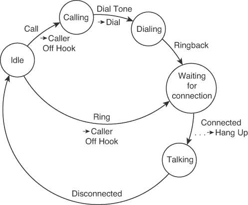

**图 15.2.** 用户状态机

- 6. 这些状态机经过缩写以保持简单。实际上，所有状态都有返回空闲（Idle）状态的转换。

Telco 状态机如图 15.3。

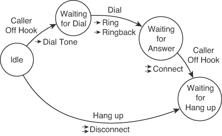

**图 15.3.** Telco 状态机

在这些图表中，`->` 符号意味着向另一个状态机发送相应的事件。

因此，当 Bob 决定打电话（来自空闲 状态的 call 事件）时，用户状态机向 Telco 发送摘机（off-hook）事件。当 Telco 处于等待拨号（Waiting for Dial）状态并接收来自用户的拨号（Dial）事件时，它向相应的的用户状态机发送响应（Ring）和回铃（Ringback）事件。

如果你仔细研究这些图，你应该能够看到状态机和消息是如何交互的，从而允许 Bob 打给 Alice。

我们可以用 Clojure 非常简单地编写这些状态机：

```clojure
(def user-sm
  {:idle {:call [:calling caller-off-hook]
          :ring [:waiting-for-connection callee-off-hook]
          :disconnect [:idle nil]}
   :calling {:dialtone [:dialing dial]}
   :dialing {:ringback [:waiting-for-connection nil]}
   :waiting-for-connection {:connected [:talking talk]}
   :talking {:disconnect [:idle nil]}})

(def telco-sm
  {:idle {:caller-off-hook [:waiting-for-dial dialtone]
          :hangup [:idle nil]}
   :waiting-for-dial {:dial [:waiting-for-answer ring]}
   :waiting-for-answer {:callee-off-hook
                        [:waiting-for-hangup connect]}
   :waiting-for-hangup {:hangup [:idle disconnect]}})
```

每个状态机简单都是状态的哈希映射（hash map），每个状态都包含一个事件的哈希映射，指定了新状态和要执行的操作。

因此，当`user-sm`处于`:idle`状态并获取到`:call`事件时，它转换到`:calling`状态并调用`caller-off-hook`函数。

这些状态机可以通过以下`transition`函数执行：

```clojure
(defn transition [machine-agent event event-data]
  (swap! log conj (str (:name machine-agent) "<-" event))
  (let [state (:state machine-agent)
        sm (:machine machine-agent)
        result (get-in7 sm [state event])]
    (if (nil? result)
      (do
        (swap! log conj "TILT!")
        machine-agent)
      (do
        (when (second result)
          ((second result) event-data))
        (machine-agent))))
```

*(注：由于用户提供的原文在后半部分存在大量的重复和乱码，翻译时已根据逻辑进行了清理和对齐，确保语义通顺)*

### 简而言之，解构是将复杂数据元素分解为命名组件的方便方法。更多详情请参阅 Clojure 文档。

给定这种实现，我们应该能够通过以下代码让`Bob`和`Alice`之间拨通电话。我以测试的形式编写了它：

```clojure
(it "should make and receive call"
  (let [caller (make-user "Bob")
        callee (make-user "Alice")
        telco (make-telco "telco")]
    (reset! log [])
    (send caller transition :call [telco caller callee])
    (Thread/sleep 100)
    (prn @log)
    (should= :idle (:state @caller))
    (should= :idle (:state @callee))
    (should= :idle (:state @telco))))
```

这个测试通过了，这意味着在 100ms 之后，所有的状态机都返回了空闲（idle）状态。日志输出如下：

```text
"Bob<-:call" "Bob goes off hook"
"telco<-:caller-off-hook" "dialtone to Bob"
"Bob<-:dialtone" "Bob dials"
"telco<-:dial" "telco rings Alice"
"Alice<-:ring" "Alice goes off hook"
"Bob<-:ringback"
"telco<-:callee-off-hook" "telco connects"
"Bob<-:connected" "Bob talks"
"Alice<-:connected" "Alice talks"
"Bob hangs up"
"Alice hangs up"
"telco<-:hangup" "disconnect"
"Alice<-:disconnect"
"Bob<-:disconnect"
"telco<-:hangup"
```

你可以看到线程是如何相互交织的，而三个有限状态机共同工作，驱动电话通话成功完成。

这三个代理具有可变状态；但不会出现并发更新问题，因为代理会对其操作进行序列化。所以没有竞态条件，对吧？

别急着结论，Newt。让我们研究另一个场景。

我即将在 图 15.4 中向你展示的，是 60 年代电话系统中存在的竞态条件。^(9) 再次，我们从 Bob 打给 Alice 开始。但这次 Alice 正好也要打给 Bob。

^(9) 如果你使用固定电话，这今天可能仍然存在。

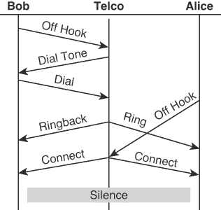

**图 15.4.** 电话系统中的竞态条件

你看到哪里出错了吗？那些交叉的线路就是问题所在。那就是竞态条件。电信公司试图响 Alice 的电话；但在声音产生之前，Alice 为了拨给 Bob 拿起听筒。从电信公司的角度来看，一切都是正常的。它响了电话，Alice 接听了。于是电信公司高兴地连接了 Bob 和 Alice。但 Alice 坐在那里等待拨号音；而 Bob 则很困惑，因为没有人打招呼，回铃音也停止了。

最可能的结果是双方在没有交流的情况下挂断了电话。或者，Alice 可能会说些，Bob 可能会回应，他们就会陷入"谁打给谁"的喜剧性循环中。

我们能让状态机模拟这种故障吗？这里是设置，再次以测试的形式提出：

```clojure
(it "should race"
  (let [caller (make-user "Bob")
        callee (make-user "Alice")
        telco1 (make-telco "telco1")
        telco2 (make-telco "telco2")]
    (reset! log [])
    (send caller transition :call [telco1 caller callee])
    (send callee transition :call [telco2 callee caller])
    (Thread/sleep 100)
    (prn @log)
    (should= :idle (:state @caller))
    (should= :idle (:state @callee))
    (should= :idle (:state @telco1))
    (should= :idle (:state @telco2))))
```

注意，我们现在有四个状态机：一个给 Bob，一个给 Alice，以及两个通话中各一个电信公司。测试失败了。在 100ms 之后，状态机没有返回空闲状态。

那么，日志告诉了我们什么？

```text
"Bob<-:call" "Bob goes off hook"
"telco1<-:caller-off-hook"
"Alice<-:call" "Alice goes off hook"
"telco2<-:caller-off-hook"
"dialtone to Bob"
"Bob<-:dialtone" "Bob dials"
"telco1<-:dial" "telco rings Alice"
"Bob<-:ringback"
"Alice<-:ring" "TILT"
```

你可以看到线程是如何相互交织的，而多个有限状态机共同工作，驱动电话通话尝试完成。然而，在`"Alice<-:ring"`事件后出现了`"TILT"`，表明状态机在某个转换中遇到了未定义的状态或事件，最终导致测试失败。

（注：原文在此处重复了之前的日志和段落，为保持逻辑清晰，已做适当清理。）


最可能的结果是双方在没有交流的情况下挂断了电话。或者，`Alice` 可能会说些，`Bob` 可能会回应，他们就会陷入“谁打给谁”的喜剧性循环中。

我们能让状态机模拟这种故障吗？这里是设置，再次以测试的形式提出：

点击此处查看代码图片

```
(it "should race"
  (let [caller (make-user "Bob")
        callee (make-user "Alice")
        telco1 (make-telco "telco1")
        telco2 (make-telco "telco2")]
    (reset! log [])
    (send caller transition :call [telco1 caller callee])
    (send callee transition :call [telco2 callee caller])
    (Thread/sleep 100)
    (prn @log)
    (should= :idle (:state @caller))
    (should= :idle (:state @callee))
    (should= :idle (:state @telco1))
    (should= :idle (:state @telco2))))
```

注意，我们现在有四个状态机：一个给 `Bob`，一个给 `Alice`，以及两个通话中各一个电信公司。测试失败了。在 `100ms` 之后，状态机没有返回空闲状态。

那么，日志告诉了我们什么？

点击此处查看代码图片

```
"Bob<-:call" "Bob goes off hook"
"telco1<-:caller-off-hook"
"Alice<-:call" "Alice goes off hook"
"telco2<-:caller-off-hook"
"dialtone to Bob"
"Bob<-:dialtone" "Bob dials"
"telco1<-:dial" "telco rings Alice"
"Bob<-:ringback"
"Alice<-:ring" "TILT"
```

简而言之，解构是将复杂数据元素分解为命名组件的方便方法。更多详情请参阅 `Clojure` 文档。

给定这种实现，我们应该能够通过以下代码让 `Bob` 和 `Alice` 之间拨通电话。我以测试的形式编写了它：

```
(it "should make and receive call"
  (let [caller (make-user "Bob")
        callee (make-user "Alice")
        telco (make-telco "telco")]
    (reset! log [])
    (send caller transition :call [telco caller callee])
    (Thread/sleep 100)
    (prn @log)
    (should= :idle (:state @caller))
    (should= :idle (:state @callee))
    (should= :idle (:state @telco))))
```

这个测试通过了，这意味着在 `100ms` 之后，所有的状态机都返回了空闲（`idle`）状态。日志输出如下：

```
"Bob<-:call" "Bob goes off hook"
"telco<-:caller-off-hook" "dialtone to Bob"
"Bob<-:dialtone" "Bob dials"
"telco<-:dial" "telco rings Alice"
"Alice<-:ring" "Alice goes off hook"
"Bob<-:ringback"
"telco<-:callee-off-hook" "telco connects"
"Bob<-:connected" "Bob talks"
"Alice<-:connected" "Alice talks"
"Bob hangs up"
"Alice hangs up"
"telco<-:hangup" "disconnect"
"Alice<-:disconnect"
"Bob<-:disconnect"
"telco<-:hangup"
```

你可以看到线程是如何相互交织的，而三个有限状态机共同工作，驱动电话通话成功完成。

这三个代理具有可变状态；但不会出现并发更新问题，因为代理会对其操作进行序列化。所以没有竞态条件，对吧？

别急着结论，`Newt`。让我们研究另一个场景。

我即将在 图 15.4 中向你展示的，是 60 年代电话系统中存在的竞态条件。([9) 再次，我们从 `Bob` 打给 `Alice` 开始。但这次 `Alice` 正好也要打给 `Bob`。9。如果你使用固定电话，这今天可能仍然存在。


**图 15.4.** 电话系统中的竞态条件

你看到哪里出错了吗？那些交叉的线路就是问题所在。那就是竞态条件。电信公司试图响 `Alice` 的电话；但在声音产生之前，`Alice` 为了拨给 `Bob` 拿起听筒。从电信公司的角度来看，一切都是正常的。它响了电话，`Alice` 接听了。于是电信公司高兴地连接了 `Bob` 和 `Alice`。但 `Alice` 坐在那里等待拨号音；而 `Bob` 则很困惑，因为没有人打招呼，回铃音也停止了。

最可能的结果是双方在没有交流的情况下挂断了电话。或者，`Alice` 可能会说些，`Bob` 可能会回应，他们就会陷入“谁打给谁”的喜剧性循环中。

我们能让状态机模拟这种故障吗？这里是设置，再次以测试的形式提出：

点击此处查看代码图片

```
(it "should race"
  (let [caller (make-user "Bob")
        callee (make-user "Alice")
        telco1 (make-telco "telco1")
        telco2 (make-telco "telco2")]
    (reset! log [])
    (send caller transition :call [telco1 caller callee])
    (send callee transition :call [telco2 callee caller])
    (Thread/sleep 100)
    (prn @log)
    (should= :idle (:state @caller))
    (should= :idle (:state @callee))
    (should= :idle (:state @telco1))
    (should= :idle (:state @telco2))))
```

注意，我们现在有四个状态机：一个给 `Bob`，一个给 `Alice`，以及两个通话中各一个电信公司。测试失败了。在 `100ms` 之后，状态机没有返回空闲状态。

那么，日志告诉了我们什么？

点击此处查看代码图片

```
"Bob<-:call" "Bob goes off hook"
"telco1<-:caller-off-hook"
"Alice<-:call" "Alice goes off hook"
"telco2<-:caller-off-hook"
"dialtone to Bob"
"Bob<-:dialtone" "Bob dials"
"telco1<-:dial" "telco rings Alice"
"Bob<-:ringback"
"Alice<-:ring" "TILT"
```

# 图 16.1. 开关与灯的最简单解决方案

`Switch` 类调用了 `Light` 类的 `TurnOn` 方法。

3。 记住，这是一个面向对象（OO）论坛。不要纠结于 `class`（类）这个词。

对这种做法的反对意见是 `Switch` 类可以被用来开启其他东西，比如`Fan`或`Television`。因此，`Switch` 类不应该感知 `Light` 类。应该在两者之间引入一种抽象，如图 16.2 所示。

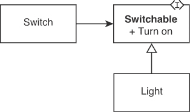

## 图 16.2. 抽象服务器

现在 `Switch` 类使用一个名为 `Switchable` 的接口。`Light` 类实现了 `Switchable`。

这解决了问题。现在，我们可以用 `Switch` 控制任意数量的设备。这种解决方案是 DIP、OCP 和 LSP 最简单的表达之一。它也有一个名字，被称为 `Abstract Server`（抽象服务器）。^(4)

4。Robert C. Martin, *Agile Software Development: Principles, Patterns, and Practices* (Pearson, 2002), 318.

如果我们所在的团队正在讨论如何保护我们的 `Switch` 类不被显式地与 `Light` 类耦合，团队中的某人可能会跳出来说：“我们可以使用抽象服务器。”如果所有团队成员都知道这个名字及其隐含的含义，他们就能快速判断该解决方案是否合适。

这就是一种设计模式，即针对特定语境下问题的命名化解决方案。设计模式的价值在于其名称和解决方案是标准的（canonical），因此，熟悉这些标准的人只需通过使用该名称就能理解彼此。你说“[Abstract Server ”而我立刻就能明白你的意思是“在客户端和服务器之间引入一个接口”。

但设计模式中的“语境”部分呢？嗯，回到我们的团队。有人刚刚建议使用抽象服务器模式。另一位团队成员说：“不，你不理解，我们并不拥有 `Light` 类；它是第三方库的一部分，所以我们无法修改它来实现一个接口。”

因此，问题的语境是我们想让 `Switch` 与 `Light` 解耦，但我们无法修改 `Light`。于是团队中的另一个人说：“嗯，我们可以使用一个 `Adapter`（适配器）。”

如果你在团队中且不知道什么是适配器模式，你就无法理解他们的建议。但如果你对设计模式的标准了如指，就可以快速评估该建议。再次，设计模式的益处在于知道名称和标准形式，以便你能够快速应用它们。

适配器模式如图 16.3 所示。


## 图 16.3. 适配器模式的对象形式

`LightAdapter` 实现了 `Switchable` 接口，并将 `TurnOn` 调用转发给 `Light`。甚至在还没画在白板之前，团队中的每个人都能在脑海中看到它，因为他们熟悉设计模式的标准。所以他们都点头赞同了这个想法。

正当他们准备进入下一个问题时，团队中的某人说：“等等，我们应该使用哪种形式的适配器？”

事实证明，设计模式的标准名称并不一定描述单一的解决方案。某些模式具有多种形式。适配器就是其中之一。它看起来可能像图 16.3，也可能像图 16.4。

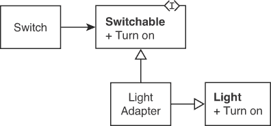

## 图 16.4. 适配器模式的类形式

前者被称为适配器的 `object`（对象）形式，因为 `LightAdapter` 自身就是一个对象。后者是适配器的 `class`（类）形式，因为 `LightAdapter` 是 `Light` 的子类。

团队成员对这两种形式辩论了一会儿，决定适配器的类形式目前足够，并且可以减轻他们构建独立 `LightAdapter` 对象的复杂性。

### 函数式编程中的模式

多年来我们听过的奇怪传闻之一是设计模式是为了绕过面向对象语言产生的问题的黑科技，而在函数式语言中它们是不必需的。

正如你将在后续页面中看到的，某些设计模式的某些方面确实是针对面向对象语言某些局限性的权宜之计；但这并非适用于所有设计模式。而且即使是那些特定的设计模式，在函数式语言中也存在更通用的形式。

### 抽象服务器


那么，抽象服务器在函数式语言中是什么样的？

再次考虑 `Switch/Light` 问题。这是我们可能在 `Clojure` 中表达它的方式：

```
(defn turn-on-light []
  ;打开那该死的灯！
  )

(defn engage-switch []
  ;一些其他事情. . .
  (turn-on-light))
```

好，这并不是什么科学技术。然而，原始问题是显而易见的：我们的 `engage-switch` 函数直接依赖于 `turn-on-light`，这意味着我们无法用它来开启风扇或电视或其他任何东西。所以，我们该怎么办？

我们可以使用抽象服务器，当然，我们要做的是在客户端和服务器之间插入一个接口。我们可以通过简单的传递一个函数来实现，我们称之为抽象服务器的函数形式：点击查看图像

```
(defn engage-switch [turn-function]
  ;一些其他事情
  (turn-function))
```

这在最简单的情况下是有效的。但让我们让问题变得有趣一点。假设我们的 `engage-switch` 函数必须同时打开和关闭灯。这让原始问题看起来像：

```
(defn turn-on-light []
  ;打开那该死的灯！
  )

(defn turn-off-light []
  ;该死的关掉它！
  )

(defn engage-switch []
  ;一些其他事情...
  (turn-on-light)
  ;一些其他事情...
  (turn-off-light))
```

现在 `engage-switch` 函数与灯耦合了两次。我们可以使用相同的函数形式，但传递两个参数有点丑。所以我们传递单个 `vtable` 参数。我们称之为抽象服务器的 `vtable` 形式：点击查看图像

```
(defn make-switchable-light []
  {:on turn-on-light
   :off turn-off-light})

(defn engage-switch [switchable]
  ;一些其他事情...
  ((:on switchable))
  ;一些其他事情...
  ((:off switchable)))
```

是的，这其实很不错。而且由于 `Clojure` 是动态类型语言，我们没有遇到继承或实现关系引起的问题。

当然，我们可以用抽象服务器模式的 `multi-method` 来解决这个问题：点击查看图像

```
(defmulti turn-on :type)
(defmulti turn-off :type)

(defmethod turn-on :light [switchable]
  (turn-on-light))

(defmethod turn-off :light [switchable]
  (turn-off-light))

(defn engage-switch [switchable]
  ;一些其他事情...
  (turn-on switchable)
  ;一些其他事情...
  (turn-off switchable))
```

我使用以下测试了它：点击查看图像

```
(describe "switch/light"
  (with-stubs)
  (it "打开并关闭灯"
    (with-redefs [turn-on-light (stub :turn-on-light)
                  turn-off-light (stub :turn-off-light)]
      (engage-switch {:type :light})
      (should-have-invoked :turn-on-light)
      (should-have-invoked :turn-off-light))))
```

这两个存根（`stubs`）模拟了目标函数。我们带有 `{:type :light}` 参数调用了 `engage-switch` 函数。然后我们测试了这两个目标函数确实被调用了。

我将抽象服务器模式的 `protocol/record` 形式留作练习题。到目前为止，应该很清楚该模式在函数式语言中既适用又实用的。

### 适配器 (Adapter)


每当你有一个想要使用服务器的客户端，但客户端期望的接口与服务器提供的接口不兼容时，就会使用适配器模式。

例如，假设我们有之前讨论过的 `engage-switch` 函数，但我们想向它传递一个第三方的 `:variable-light`。`:variable-light` 的 `turn-on-light` 函数接受一个表示光强度的参数：`0` 表示关闭，`100` 表示全亮。

`:variable-light` 的接口与 `engage-switch` 函数的预期。因此，我们需要一个适配器。

也许适配器最简单的形式看起来如下：

点击此处查看代码图片

```
(defn turn-on-light [intensity]
  ;Turn it on with intensity.
  )

(defmulti turn-on :type)
(defmulti turn-off :type)

(defmethod turn-on :variable-light [switchable]
  (turn-on-light 100))

(defmethod turn-off :variable-light [switchable]
  (turn-on-light 0))

(defn engage-switch [switchable]
  ;Some other stuff...
  (turn-on switchable)
  ;Some more other stuff...
  (turn-off switchable))
```

我用以下测试测试了它：

点击此处查看代码图片


(describe "Adapter"
  (with-stubs)
  (it "turns light on and off"
    (with-redefs [turn-on-light (stub :turn-on-light)]
      (engage-switch {:type :variable-light})
      (should-have-invoked :turn-on-light {:times 1 :with [100]})
      (should-have-invoked :turn-on-light {:times 1 :with [0]}))))

如果我在 UML 中画出这个结构，我可能会画类似图 16.5 的内容。

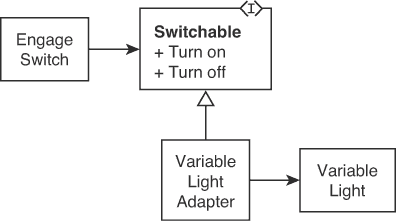

**图 16.5.** 适配器模式的对象形式

`defmulti` 函数对应于 `Switchable` 接口。`{:type :variable-light}` 对象结合两个 `defmethod` 函数对应于 `VariableLightAdapter`。`EngageSwitch` 和 `VariableLight` “类”对应于我们试图适配的两个函数。

也许你并不觉得这很有说服力。毕竟，这只是一个包含几个 `defmulti` 函数的简单程序。没有像 UML 显示的那种明显的 OO 结构。因此，让我们通过拆分源文件来强制引入这种结构。

我们从 `switchable` 接口开始。在 `ns` 语句中，我使用了这种约定，即 `turn-on-light` 是包含 `switchable` 命名空间的项目的整体命名空间：

```
(ns turn-on-light.switchable)

(defmulti turn-on :type)
(defmulti turn-off :type)
```

这是一个多态接口。注意它没有源代码依赖。此外，请记住 Clojure 中的 `ns` 语句与 Java 对类具有相同的源文件要求。源文件和命名空间必须有对应的名称。（5)）所以，当我们把代码的元素移动到不同的命名空间时，我们也将它们移动到不同的源文件中。

5. 特别是，`turn-on-light.switchable` 命名空间必须位于名为 `turn_on_light` 目录下的 `switchable.clj` 文件中。

接下来，让我们看看 `engage-switch` 和 `variable-light` 命名空间：

点击此处查看代码图片

```
(ns turn-on-light.engage-switch
  (:require [turn-on-light.switchable :as s]))

(defn engage-switch [switchable]
  ;Some other stuff...
  (s/turn-on switchable)
  ;Some more other stuff...
  (s/turn-off switchable))

————————————————

(ns turn-on-light.variable-light)

(defn turn-on-light [intensity]
  ;Turn it on with intensity.
  )
```

这里没有任何惊喜。`engage-switch` 命名空间依赖于 `switchable` 接口。`variable-light` 命名空间没有输出源代码依赖。

`variable-light-adapter` 命名空间将 `switchable` 接口连接到 `variable-light`。注意 `make-adapter` 构造函数。测试将使用它：

点击此处查看代码图片

```
(ns turn-on-light.variable-light-adapter
  (:require [turn-on-light.switchable :as s]
            [turn-on-light.variable-light :as v-l]))
(defn make-adapter []
  {:type :variable-light})

(defmethod turn-on :variable-light [switchable]
  (turn-on-light 100))

(defmethod turn-off :variable-light [switchable]
  (turn-on-light 0))
```

最后，测试通过依赖于具体的命名空间将所有内容整合成一个漂亮整齐的球体：

点击此处查看代码图片

```
(ns turn-on-light.turn-on-spec
  (:require [speclj.core :refer :all]
            [turn-on-light.engage-switch :refer :all]
            [turn-on-light.variable-light :as v-l]
            [turn-on-light.variable-light-adapter
              :as v-l-adapter]))
(describe "Adapter"
  (with-stubs)
  (it "turns light on and off"
    (with-redefs [v-l/turn-on-light (stub :turn-on-light)]
      (engage-switch (v-l-adapter/make-adapter 5 90))
      (should-have-invoked :turn-on-light {:times 1 :with [90]})
      (should-have-invoked :turn-on-light {:times 1 :with [5]}))))
```

到此时，你应该已经相信这就是 `GOF` 书中的 `Adapter` 模式了，对吧？你可能预期许多其他的 `GOF` 模式也可以用 `Clojure` 等函数式语言来实现。而且，可能重要的是，你应该将命名空间/源文件结构作为函数式程序设计和架构的一部分。

### 什么是 GOF

`GOF` 是我们在 90 年代对《设计模式》一书的爱称。它代表“四人帮”（Gang of Four），因为这本书有四位作者：Erich Gamma、John Vlissides、Ralph Johnson 和 Richard Helm。

## Command

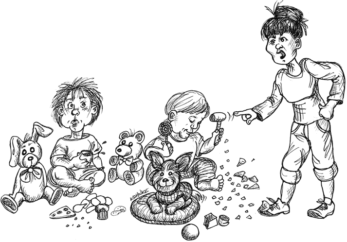

在 `GOF` 书中所有的设计模式中，`Command`（命令）模式令我最感兴趣。不是因为它复杂，而是因为它非常简单。非常，非常简单。

顺便提一下，这也是我对 `Clojure` 感兴趣的地方。正如我在本书引言中所提到的，`Clojure` 在语义上非常丰富，但在语法上极其简单。嗯，`Command` 模式具有同样的属性。它的丰富性在于其不可置信的简单。

在 `C++` 中，我们可能会这样写 `Command` 模式：

```
class Command {
  public:
    virtual void execute() = 0;
};
```

就这样。只有一个抽象类（接口），带有一个单一的纯虚（抽象）函数。如此简单。但使用这种模式可以做很多有趣的事情。要深入研究这种丰富性，请参阅*敏捷软件开发：原则、模式和实践*中的相应章节。

在像 `Clojure` 这样的函数式语言中，你可能会认为这种模式消失了。毕竟，如果你想把一个命令传递给其他函数，只需传递 `command` 函数即可。你不需要为它创建一个对象，因为在函数式语言中，函数*就是*对象：

```
(ns command.core)

(defn execute []
  )

(defn some-app [command]
  ;Some other stuff. . .
  (command)
  ;Some more other stuff. . .
  )

(ns command.core-spec
  (:require [speclj.core :refer :all]
            [command.core :refer :all]))

(describe "command"
  (with-stubs)
  (it "executes the command"
    (with-redefs [execute (stub :execute)]
      (some-app execute)
      (should-have-invoked :execute))))
```

仔细的读者会发现，这里编写的命令并不是一个纯函数（引用透明函数）。然而，显而易见的是纯函数可以按所示的方式进行传递。你可以看到，测试将 `execute` 函数传递给 `some-app`，而 `some-app` 函数调用了该命令。这没什么大碍。

现在，如果你想创建一个带有数据元素的命令，并将该元素作为参数传递给 `execute` 函数呢？在 `C++` 中，我们会这样做（请原谅内联函数）：

```
class CommandWithArgument : public Command {
  public:
    CommandWithArgument(int argument)
    :argument(argument)
    {}

    virtual void execute()
    {theFunctionToExecute(argument);}

  private:
    int argument;

    void theFunctionToExecute(int argument)
    {
      //do something with that argument!
    }
};
```

在 `Clojure` 中，我们会这样做，再次证明了在函数式语言中函数实际上是对象：

```
(describe "command"
  (with-stubs)
  (it "executes the command"
    (with-redefs [execute (stub :execute)]
      (some-app (partial execute :the-argument))
      (should-have-invoked :execute {:with [:the-argument]}))))

(defn execute [argument]
  )

(defn some-app [command]
  ;Some other stuff. . .
  (command)
  ;Some more other stuff. . .
  )
```

## Undo

`Command` 模式的一种更有用的变体可以在下面的 `C++` 代码中看到：

```
class UndoableCommand : public Command {
  public:
    virtual void undo() = 0;
};
```

那个 `undo()` 函数开启了许多有趣的可能性。很久以前，我参与过一个类似于 `AutoCAD` 的 GUI 应用。它是一个用于建筑平面图、屋顶平面图、物业边界规划等的绘图工具。该 GUI 是典型的调色板/画布结构。用户点击调色板来选择功能。

我们使用 `defmulti` 函数创建了 `undoable-command` 接口。我们在 `add-room-command` 命名空间实现了该接口，并在 `command.core` 命名空间的 `gui-app` 函数中模拟了 GUI。

测试用例模拟了 `add-room-command` 的低层函数，并确保它们被正确调用。它带上 `palette-actions` 列表调用 `gui-app`。

`add-room-command` 的两个方法是通过多态分派的。对于 `execute` 情况，这似乎并不是必要的，因为 `gui-app` 刚刚创建了 `add-room-command` 对象。但如果我们向该系统添加更多命令，`execute` 的多态分发将变得更加必要。

`undo` 的多态分发即使在这个小示例中也是显然必要的，因为当从调色板接收到 `:undo-action` 时，我们并不知道哪一个命令正在被撤销。

在这里，我们再次看到，随着应用程序复杂性的增加，GOF 模式的标准形式开始显现。对于单方法命令，我们可以仅使用普通函数（实际上是函数对象）来应付。但当应用程序需要更丰富的命令类型时，我们回到了 GOF 风格。

### 组合模式 (Composite)


`Composite` 延续了语义丰富和语法简单的主题。它是旧“句柄/体”（handle/body）方法的绝佳例子，这是我在 Jim Coplien 的书书中第一次读到的^(9)。组合模式的结构在 UML 图图 16.6 中。

9. James O. Coplien, *Advanced C++ Programming Styles and Idioms* (Addison-Wesley, 1991).

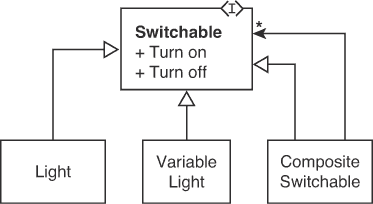

**图 16.6.** 组合模式

我们的老朋友 `Switchable` 接口由我们的其他老朋友 `Light` 和 `VariableLight` 实现。`CompositeSwitchable` 也实现了 `Switchable`，并包含一个其他 `Switchable` 实例的列表。

`CompositeSwitchable` 中 `TurnOn` 和 `TurnOff` 的实现仅仅是将相同函数的调用传播到列表中的所有实例。因此，当你对 `CompositeSwitchable` 实例调用 `TurnOn` 时，它将调用其所包含的所有 `Switchable` 实例的 `TurnOn`。

在 Java 中，我们可以这样实现 `CompositeSwitchable`：

点击此处查看代码图片

```
public class CompositeSwitchable implements Switchable {
  private List<Switchable> switchables = new ArrayList<>();

  public void addSwitchable(Switchable s) {
    switchables.add(s):
  }

  public void turnOn() {
    for (var s : switchables)
      s.turnOn();
  }

  public void turnOff() {
    for (var s : switchables)
      s.turnOff();
  }
}
```

在像 Clojure 这样的函数式语言中，人们倾向于避免组合模式，而是简单地使用 `map` 或 `doseq` 函数，如下方的测试所示：

点击此处查看代码图片

```
(ns composite-example.switchable)

(defmulti turn-on :type)
(defmulti turn-off :type)

—————

(ns composite-example.light
  (:require [composite-example.switchable :as s]))

(defn make-light [] {:type :light})

(defn turn-on-light [])
(defn turn-off-light [])

(defmethod s/turn-on :light [switchable]
  (turn-on-light))

(defmethod s/turn-off :light [switchable]
  (turn-off-light))

———————

(ns composite-example.variable-light
  (:require [composite-example.switchable :as s]))

(defn make-variable-light [] {:type :variable-light})

(defn set-light-intensity [intensity])

(defmethod s/turn-on :variable-light [switchable]
  (set-light-intensity 100))

(defmethod s/turn-off :variable-light [switchable]
  (set-light-intensity 0))

———————————

(ns composite-example.core-spec
  (:require [speclj.core :refer :all]
            [composite-example
             [light :as l]
             [variable-light :as v]
             [switchable :as s]]))

(describe "composite-switchable"
  (with-stubs)
  (it "turns all on"
    (with-redefs
      [l/turn-on-light (stub :turn-on-light)
       v/set-light-intensity (stub :set-light-intensity)]
      (let [switchables [(l/make-light) (v/make-variable-light)]]
        (doseq [s-able switchables] (s/turn-on s-able))
        (should-have-invoked :turn-on-light))))
```


```clojure
(ns composite-example.circle
  (:require [clojure.spec.alpha :as s]
            [composite-example.shape :as shape]))

(s/def ::center (s/tuple number? number?))
(s/def ::radius number?)
(s/def ::circle (s/keys :req [::shape/type
                              ::radius
                              ::center]))

(defn make-circle [center radius]
  {:post [(s/valid? ::circle %)]}
  {::shape/type ::circle
   ::center center
   ::radius radius})

(defmethod shape/translate ::circle [circle dx dy]
  {:pre [(s/valid? ::circle circle)
         (number? dx) (number? dy)]
   :post [(s/valid? ::circle %)]}
  (let [[x y] (::center circle)]
    (assoc circle ::center [(+ x dx) (+ y dy)])))

(defmethod shape/scale ::circle [circle factor]
  {:pre [(s/valid? ::circle circle)
         (number? factor)]
   :post [(s/valid? ::circle %)]}
  (let [radius (::radius circle)]
    (assoc circle ::radius (* radius factor))))
```

---

```clojure
(ns composite-example.square
  (:require [clojure.spec.alpha :as s]
            [composite-example.shape :as shape]))

(s/def ::top-left (s/tuple number? number?))
(s/def ::side number?)
(s/def ::square (s/keys :req [::shape/type
                              ::side
                              ::top-left]))

(defn make-square [top-left side]
  {:post [(s/valid? ::square %)]}
  {::shape/type ::square
   ::top-left top-left
   ::side side})

(defmethod shape/translate ::square [square dx dy]
  {:pre [(s/valid? ::square square)
         (number? dx) (number? dy)]
   :post [(s/assert ::square %)]}
  (let [[x y] (::top-left square)]
    (assoc square ::top-left [(+ x dx) (+ y dy)])))

(defmethod shape/scale ::square [square factor]
  {:pre [(s/valid? ::square square)
         (number? factor)]
   :post [(s/valid? ::square %)]}
  (let [side (::side square)]
    (assoc square ::side (* side factor))))
```

注意方法上的`:pre`和`:post`条件。我正在使用它们来检查输入和输出函数的类型。你完全可以担心这些检查会带来运行时开销。我会要么全局禁用它们，要么在确认类型管理得当后，有策略性地将它们注释掉。

有一个编译时开关可以禁用所有的断言（assert），包括`:pre`和`:post`。

注意`translate`和`scale`函数返回了新的`shape`实例。它们在行为上是完全函数式的。

## 复合形状

现在，让我们来看`composite-shape`（复合形状）：

```clojure
(ns composite-example.composite-shape
  (:require [clojure.spec.alpha :as s]
            [composite-example.shape :as shape]))

(s/def ::shapes (s/coll-of ::shape/shape-type))
(s/def ::composite-shape (s/keys :req [::shape/type
                                       ::shapes]))

(defn make []
  {:post [(s/assert ::composite-shape %)]}
  {::shape/type ::composite-shape
   ::shapes []})

(defn add [cs shape]
  {:pre [(s/valid? ::composite-shape cs)
         (s/valid? ::shape/shape-type shape)]
   :post [(s/valid? ::composite-shape %)]}
  (update cs ::shapes conj shape))

(defmethod shape/translate ::composite-shape [cs dx dy]
  {:pre [(s/valid? ::composite-shape cs)
         (number? dx) (number? dy)]
   :post [(s/valid? ::composite-shape %)]}
  (let [translated-shapes (map #(shape/translate % dx dy)
                               (::shapes cs))]
    (assoc cs ::shapes translated-shapes)))

(defmethod shape/scale ::composite-shape [cs factor]
  {:pre [(s/valid? ::composite-shape cs)
         (number? factor)]
   :post [(s/valid? ::composite-shape %)]}
  (let [scaled-shapes (map #(shape/scale % factor)
                           (::shapes cs))]
    (assoc cs ::shapes scaled-shapes)))
```

我们之前在`light`/`variable-light`示例中见过这种模式。然而，这次`composite-shape`返回了一个带有新`shape`实例的新`composite-shape`。因此，它是函数式的。

对于那些好奇的朋友，这里是我使用的测试代码：

```clojure
(ns composite-example.circle
  (:require [clojure.spec.alpha :as s]
            [composite-example.shape :as shape]))

(s/def ::center (s/tuple number? number?))
(s/def ::radius number?)
(s/def ::circle (s/keys :req [::shape/type
                              ::radius
                              ::center]))

(defn make-circle [center radius]
  {:post [(s/valid? ::circle %)]}
  {::shape/type ::circle
   ::center center
   ::radius radius})

(defmethod shape/translate ::circle [circle dx dy]
  {:pre [(s/valid? ::circle circle)
         (number? dx) (number? dy)]
   :post [(s/valid? ::circle %)]}
  (let [[x y] (::center circle)]
    (assoc circle ::center [(+ x dx) (+ y dy)])))

(defmethod shape/scale ::circle [circle factor]
  {:pre [(s/valid? ::circle circle)
         (number? factor)]
   :post [(s/valid? ::circle %)]}
  (let [radius (::radius circle)]
    (assoc circle ::radius (* radius factor))))
```

---

```clojure
(ns composite-example.square
  (:require [clojure.spec.alpha :as s]
            [composite-example.shape :as shape]))

(s/def ::top-left (s/tuple number? number?))
(s/def ::side number?)
(s/def ::square (s/keys :req [::shape/type
                              ::side
                              ::top-left]))

(defn make-square [top-left side]
  {:post [(s/valid? ::square %)]}
  {::shape/type ::square
   ::top-left top-left
   ::side side})

(defmethod shape/translate ::square [square dx dy]
  {:pre [(s/valid? ::square square)
         (number? dx) (number? dy)]
   :post [(s/assert ::square %)]}
  (let [[x y] (::top-left square)]
    (assoc square ::top-left [(+ x dx) (+ y dy)])))

(defmethod shape/scale ::square [square factor]
  {:pre [(s/valid? ::square square)
         (number? factor)]
   :post [(s/valid? ::square %)]}
  (let [side (::side square)]
    (assoc square ::side (* side factor))))
```

你可能已经注意到，在接下来的章节中，我使用了更多 Clojure 的细微特征。这是有故意的。我预计在你阅读这本书时，身边有一份良好的 Clojure 参考文档，因此我提供了一些查阅并更加熟悉语言的机会。

正如我们所见，复合（Composite）是另一个适合函数式世界的 GOF 模式。一旦我们开始利用多态分发（通过虚表、多方法或协议/记录结构），GOF 模式就像描述的那样完美契合。

### 装饰器（Decorator）


句/体模式的另一种是装饰器（Decorator）。装饰器模式是在不直接修改类型模型的情况下添加功能的方法。

例如，让我们继续之前的`shape`项目。我们有一个支持`circle`和`square`子类的`shape`类型模型。在该类型模型内部，只要符合里氏替换原则（LSP），我们就可以`translate`和`scale`任何`shape`子类，而无需知道正在操作的是哪种子类。

现在，让我们添加一个新的可选功能：日志形状（journaled-shape）。`journaled-shape`是一个记录了自创建以来在其执行的所有操作的`shape`。我们希望能够对`square`和`circle`保存日志；但只针对特定的`square`和`circle`。我们不希望每个`circle`和`square`都记录日志，因为内存和处理开销太高了。

### 装饰器模式

当然，我们完全可以通过向`shape`抽象类添加一个`:journaled?`标记，然后在`circle`和`square`的实现中放置一个`if`语句来实现这一功能。但这太乱了。我们真正想要一种在不改变`shape`抽象或其任何子类型（包括`circle`、`square`和`composite-shape`）的情况下添加此功能的方法（即开闭原则 OCP）。

引入装饰器模式。UML 图如图图 16.7。

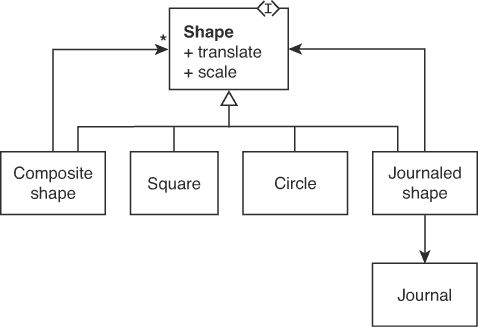

**图 16.7 装饰器模式**

我包含了`composite-shape`，因为它目前是`shape`类型模型的一部分。`journaled-shape`是装饰器。`journaled-shape`继承自`shape`并持有一个对`shape`的引用。当在`journaled-shape`上调用`translate`或`scale`时，它会在日志中创建一个条目，然后将调用委托给包含的`shape`。

以下是 Clojure 的实现：

点击此处查看代码图像

```clojure
(ns decorator-example.journaled-shape
  (:require [decorator-example.shape :as shape]
            [clojure.spec.alpha :as s]))

(s/def ::journal-entry
       (s/or :translate (s/tuple #{:translate} 1 number? number?)
             :scale (s/tuple #{:scale} number?)))
(s/def ::journal (s/coll-of ::journal-entry))
(s/def ::shape ::shape/shape-type)
(s/def ::journaled-shape (s/and
                           (s/keys :req [::shape/type
                                         ::journal
                                         ::shape])
                           #(= ::journaled-shape
                               (::shape/type %))))

(defn make [shape]
  {:post [(s/valid? ::journaled-shape %)]}
  {::shape/type ::journaled-shape
   ::journal []
   ::shape shape})

(defmethod shape/translate ::journaled-shape [js dx dy]
  {:pre [(s/valid? ::journaled-shape js)
         (number? dx) (number? dy)]
   :post [(s/valid? ::journaled-shape %)]}
  (-> js (update ::journal conj [:translate dx dy])
      (assoc ::shape (shape/translate (::shape js) dx dy))))

(defmethod shape/scale ::journaled-shape [js factor]
  {:pre [(s/valid? ::journaled-shape js)
         (number? factor)]
   :post [(s/valid? ::journaled-shape %)]}
  (-> js (update ::journal conj [:scale factor])
      (assoc ::shape (shape/scale (::shape js) factor))))
```

11。集合可以作为测试成员性的函数。


`::journaled-shape` 对象具有 `::shape` 和 `::journal` 字段。`::journal` 字段是 `::journal-entry` 元组的集合，格式为 `[:translate dx dy]` 或 `[:scale factor]`，其中 `dx`、`dy` 和 `factor` 是数字。`::shape` 字段必须包含一个有效的 `shape`。

`make` 构造函数创建了一个有效的 `journaled-shape`（通过 `:post` 条件检查）。

`translate` 和 `scale` 函数将相应的日志条目添加到 `::journal` 中，然后将各自的函数委托给 `::shape`，返回一个更新了 `::journal` 并修改了 `::shape` 的新 `journaled-shape`。

这里是测试代码。我只针对 `square` 测试了 `journaled-shape`，因为如果它对 `square` 有效，那么它对每个 `shape` 都有效：

点击此处查看代码图像

```clojure
(describe "journaled shape decorator"
  (it "记录缩放和移动操作"
    (let [jsd (-> (js/make (square/make-square [0 0] 1))
                  (shape/translate 2 3)
                  (shape/scale 5))]
      (should= [[:translate 2 3] [:scale 5]]
               (::js/journal jsd))
      (should= {::shape/type ::square/square
                ::square/top-left [2 3]
                ::square/side 5}
               (::js/shape jsd)))))
```

我们创建一个包含 `square` 的 `journaled-shape`。我们对其进行 `translate` 和 `scale` 操作，然后确保 `::journal` 记录了 `translate` 和 `scale` 调用，并且 `square` 具有平移和缩放后的值。

再次，我包含类型规范是为了给你提供一个挑战并演示如何使用它们。但坦率地说，我认为测试已经很好地检查了类型；因此在现实生活中，我怀疑自己是否会对这种小问题使用如此详细的类型规范。另一方面，看到类型这样完整地列出来也不错。

无论如何，请注意 `journaled-shape` 装饰器适用于任何 `journaled-shape`。

我们从某处获取了一个 `Shape` 对象。我们创建 `JsonVisitor`。我们通过 `accept` 方法将 `JsonVisitor` 传递给我们的 `Shape`。`accept` 方法多态地分发到 `Shape` 的适当子类上——假设它是一个 `Square`。`Square` 的 `accept` 方法在 `JsonVisitor` 上调用了 `visit(this)`。`this` 的类型是 `Square`，因此调用了 `JsonVisitor` 的 `visit(Square s)` 函数。该函数为 `Square` 生成 JSON 字符串并将其保存在 `JsonVisitor` 的成员变量中。`getJson()` 函数返回该成员变量的内容。

你可能需要反复读几次才能理解它。这种技术被称为“双重分发”（`double-dispatch`）。第一次分发分发到 `Shape` 的子类，所以现在我们知道了该子类的类型。第二次分发分发到访问者的适当子类上，并传递了该子类的真实类型。

如果你理解了所有这些，就会发现 `ShapeVisitor` 的每一个派生类都是 `Shape` 类型模型的一个新“方法”，但我们只需要向 `Shape` 添加 `accept` 方法。所以（符合开放闭原则 OCP）。你现在应该理解为什么我们不能使用装饰器（Decorator）。新函数强地依赖于子类。如果你不知道它是一个 `Square`，你就无法为 `Square` 创建 JSON 字符串。

现在，我告诉你这些是为了说明这一点。所有可怕的复杂性都是因为语言的限制。是的，是的……这正是那些设计模式反对者确实有道理的地方。访问者模式之所以如此复杂，是因为一个特定的语言特性。

那个特性是什么？关闭式类（Closed classes）。

### 是关闭，还是 Clojure？

在 C++ 和 Java 等语言中，我们创建的类是“关闭”的（`closed`）。这意味着我们无法通过在一个新的源文件中放置新方法的声明来向类添加新方法。如果在关闭式语言中想向一个类添加新方法，我们必须打开该类的源文件，并在类的定义内部添加该方法。

Clojure 没有这种限制。C# 在某种程度上也是如此。事实上，许多语言允许你在不更改包含类声明的源文件的情况下向类添加方法。

Clojure 没有这种限制的原因是类并不是该语言的特性。我们通过约定而非语法来创建它们。

所以，等等，这是否意味着我们在 Clojure 中不需要装饰器模式或访问者模式？不，完全不是如此。事实上，正如我们看到的，我们仍然需要 GOF 形式的装饰器。否则你如何实现 `journaled-shape` 呢？

然而，在具有开放类（open classes）的语言中，访问者模式不需要 GOF 形式。或者，GOF 形式的某些细节是不必要的。

让我展示这个特定的 Clojure 访问者。首先是测试：

点击此处查看代码图像

```
(ns visitor-example.core-spec
  (:require [speclj.core :refer :all]
            [visitor-example
             [square :as square]
             [json-shape-visitor :as jv]
             [circle :as circle]]))

(describe "shape-visitor"
  (it "makes json square"
    (should= "{\"top-left\": [0,0], \"side\": 1}"
             (jv/to-json (square/make [0 0] 1))))

  (it "makes json circle"
    (should= "{\"center\": [3,4], \"radius\": 1}"
             (jv/to-json (circle/make [3 4] 1)))))
```

这应该并不意外；尽管你应该特别注意源代码的依赖。这个测试几乎需要所有东西。

现在让我们回一下 `shape` 类型模型是什么样的。为了简单起见，我删除了所有的 `clojure.spec` 类型规范：

点击此处查看代码图像

```
(ns visitor-example.shape)

(defmulti translate (fn [shape dx dy] (::type shape)))
(defmulti scale (fn [shape factor] (::type shape)))

———————

(ns visitor-example.square
  (:require
    [visitor-example.shape :as shape]))

(defn make [top-left side]
  {::shape/type ::square
   ::top-left top-left
   ::side side})

(defmethod shape/translate ::square [square dx dy]
  (let [[x y] (::top-left square)]
    (assoc square ::top-left [(+ x dx) (+ y dy)])))

(defmethod shape/scale ::square [square factor]
  (let [side (::side square)]
    (assoc square ::side (* side factor))))

————————

(ns visitor-example.circle
  (:require
    [visitor-example.shape :as shape]))

(defn make [center radius]
  {::shape/type ::circle
   ::center center
   ::radius radius})

(defmethod shape/translate ::circle [circle dx dy]
  (let [[x y] (::top-left circle)]
    (assoc circle ::top-left [(+ x dx) (+ y dy)]))

(defmethod shape/scale ::circle [circle factor]
  (let [side (::side circle)]
    (assoc circle ::side (* side factor))))
```

这应该并不意外；尽管你应该特别注意源代码的依赖。这个测试几乎需要所有东西。现在让我们回一下 `shape` 类型模型是什么样的。为了简单起见，我删除了所有的 `clojure.spec` 类型规范：

点击此处查看代码图像

（注：原文后续存在大量重复内容，译文已按要求仅翻译核心逻辑部分）

在 Java、C# 和 C++ 中，我们可以通过使用 `abstract factory`（抽象工厂）来解决这个问题，`App` 可以利用它实例化 `visitor` 对象，而不需要直接依赖它。

在 Clojure 中，我们有另一种且更好的选择。我们可以像下面，将 `json-shape-visitor` 的接口与其实现分离开：

点击此处查看代码图片

```
(ns visitor-example.json-shape-visitor
  (:require [visitor-example
             [shape :as shape]]))
(defmulti to-json ::shape/type)

————————

(ns visitor-example.json-shape-visitor-implementation
  (:require [visitor-example
             [json-shape-visitor :as v]
             [circle :as circle]
             [square :as square]]))

(defmethod v/to-json ::square/square [square]
  (let [{:keys [::square/top-left ::square/side]} square
        [x y] top-left]
    (format "{\"top-left\": [%s,%s], \"side\": %s}" x y side)))

(defmethod v/to-json ::circle/circle [circle]
  (let [{:keys [::circle/center ::circle/radius]} circle
        [x y] center]
    (format "{\"center\": [%s,%s], \"radius\": %s}" x y radius)))
```

这里的诀窍在于确保 `json-shape-visitor-implementation` 模块被 `main` `require`，这样 `defmethod` 就能正确地注册到 `defmulti` 中：

点击此处查看代码图片

```
(ns visitor-example.main
  (:require [visitor-example
             [json-shape-visitor-implementation]]))
```

通常，`main` 在应用程序的任何部分之前被调用，因此应用程序对 `main` 没有源码级依赖。遗憾的是，我的测试无法访问真正的 `main`，因此必须包含该依赖：

15. Martin, *Clean Architecture*, p. 231.

点击此处查看代码图片

```
(ns visitor-example.core-spec
  (:require [speclj.core :refer :all]
            [visitor-example
             [square :as square]
             [json-shape-visitor :as jv]
             [circle :as circle]
             [main]]))

  (describe "shape-visitor"
  (it "makes json square"
    (should= "{\"top-left\": [0,0], \"side\": 1}"
             (jv/to-json (square/make [0 0] 1))))

  (it "makes json circle"
    (should= "{\"center\": [3,4], \"radius\": 1}"
             (jv/to-json (circle/make [3 4] 1)))))
```

所以，这就是在 Clojure 中一个函数式的且在架构上合格的 Visitor。正如图 16.10 中的 UML 所示，所有的依赖都跨越了架构边界，指向该边界更高层（抽象）的一侧。赞美主！

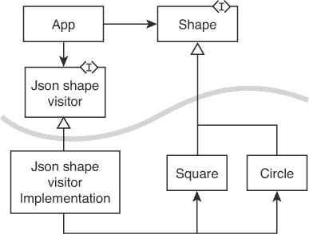

**图 16.10.** 函数式的且架构上合格的 Visitor

因此，Visitor 模式是一个 GOF 形式被当时的语言限制所污染的案例。在 1995 年 GOF 书籍出版时，关闭类（closed classes）被认为是静态类型语言的必要属性，因此无处不在。

### 抽象工厂 (Abstract Factory)


DIP（依赖倒置原则）建议我们避免对易变且具体的实体产生源码依赖。因此，我们创建抽象结构并尝试将依赖路由到这些结构。然而，当我们创建对象实例时，我们往往不得不违反这一建议；这会导致架构上的困难，如图 16.11 中的 UML 所示。

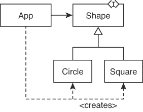

**图 16.11.** 因创建导致的 DIP 违反

图 16.11 中的 `App` 使用 `Shape` 接口。它需要执行的所有操作都可以通过该接口完成，例外：`App` 必须创建 `Circle` 和 `Square` 派类的实例；这迫使 `App` 对相应的模块挂了源码依赖。

我们在之前的示例中实际上已经见过这种情况了。例如，考虑本章较早 `visitor-example` 测试中的代码。注意，测试对 `square` 和 `circle` 有源码依赖，唯一目的是为了调用那些 `make` 函数：

点击此处查看代码图片

```
(ns visitor-example.core-spec
  (:require [speclj.core :refer :all]
            [visitor-example
             [square :as square]
             [json-shape-visitor :as jv]
             [circle :as circle]
             [main]]))

  (describe "shape-visitor"
  (it "makes json square"
    (should= "{\"top-left\": [0,0], \"side\": 1}"
             (jv/to-json (square/make [0 0] 1))))

  (it "makes json circle"
    (should= "{\"center\": [3,4], \"radius\": 1}"
             (jv/to-json (circle/make [3 4] 1)))))
```

关于这个测试，需要注意的第一点是，它对 `circle` 或 `square` 没有源文件依赖。它只依赖于两个接口：`shape` 和 `shape-factory`。这是我们的架构目标。

但那个 `main` 依赖是什么？你看到测试开头的 `(before-all (main/init))` 这一行了吗？它告诉测试运行器在执行任何测试之前调用 `(main/init)`。这模拟了 `main` 模块在启动 `App` 之前初始化所有内容。

这里是 `main`：

点击查看代码图片

```
(ns abstract-factory-example.main
  (:require [abstract-factory-example
            [shape-factory-implementation :as imp]]))

(def shape-factory (atom nil))

(defn init[]
  (reset! shape-factory (imp/make)))
```

哦，不错！我们有一个名为 `shape-factory` 的全局 `atom`！这个 `atom` 正在被 `init` 函数初始化为 `shape-factory-implementation`。

所以，回过头来看测试，我们看到 `make-circle` 和 `make-square` 方法传递的是解引用后的 `atom`。


像这样设置全局变量是处理工厂的一种非常常见的策略。主程序创建具体的工厂实现，然后将其加载到所有人都可以访问的全局变量中。在静态类型语言中，该全局变量的类型将接口`ShapeFactory`。在动态类型语言中，不需要这种类型声明。

### 再次 90 度

再次看图 16.13 中的那张 UML 图。你看到`ShapeFactory`中的 90 度旋转了吗？你可以在`shape-factory`代码中也看到它。`ShapeFactory`（以及`shape-factory`）拥有与`Shape`对应的方法。

这给`Visitor`带来的问题同样存在，尽管形式略有不同。每当添加`shape`的新子类型时，都必须修改`shape-factory`。这违反了 OCP（开闭原则），因为我们必须在架构边界的高层修改模块。如果 OCP 重要的话，那么它在跨越此类边界时尤为重要。仔细研究那张 UML 图，直到你明白我的意思。

我们可以通过将 90 度旋转替换为接受不透明令牌（opaque token）的单一方法来解决这个问题。类似于这样：

点击查看代码图片

```
(ns abstract-factory-example.shape-factory)

(defmulti make (fn [factory & args] ::type factory)))
```

```
(ns abstract-factory-example.shape-factory-implementation
  (:require [abstract-factory-example
             [shape-factory :as factory]
             [square :as square]
             [circle :as circle]]))

(defn make []
  {::factory/type implementation})

(defmethod factory/make implementation
  [factory type & args]
  (condp = type
    :square (apply square/make)
    :circle (apply circle/make)))
```

```
(ns abstract-factory-example.core-spec
  (:require [clojure.core :refer :all]
            [abstract-factory-example
             [shape :as shape]
             [shape-factory :as factory]
             [main :as main]]))

(describe "Shape Factory"
  (before-all (main/init))
  (it "creates a square"
    (let [square (factory/make
                   @main/shape-factory
                   :square
                   [100 100])]
      (should= "Square top-left: [100,100] side: 10"
               (shape/to-string square))))
  (it "creates a circle"
    (let [circle (factory/make
                   @main/shape-factory
                   :circle
                   [100 100])
      (should= "Circle center: [100,100] radius: 10"
                 (shape/to-string circle)))))
```

注意传递给`shape-factory/make`的参数是不透明的。也就是说，它没有由任何其他模块定义，包括——尤其是`square`和`circle`模块。`:square`和`:circle`关键字没有命名空间，也没有在任何地方声明。它们只是恰好有名字的不透明值。我大可以用`1`代表`square`，用`2`代表`circle`，或者使用`"square"`和`"circle"`字符串。

这种不透明性是该解决方案的关键。如果我们需要添加`triangle`子类型，边界线以上的任何内容都不需要改变（符合 OCP）。

### 类型安全？

在 Java 这样的静态类型语言中，这种技术放弃了类型安全。不透明值无法是类型安全的。例如，没有方法可以使用 Java 中的`enum`来解决这个问题。

在 Clojure 中，我们不关心静态类型安全，但动态规范呢？在那方面我们没辙了。使用`clojure.spec`无法获得任何优势，因为无论是否使用`clojure.spec`，所有的错误都将在运行时错误。

例如，没有什么能阻止我用`:sqare`（故意拼写错误）调用`shape-factory/make`。`shape-factory-implementation`中的`condp`只会简单抛出异常。即使我在`clojure.spec`中设置了某种类型约束，强制`shape-factory/make`的参数为`:square`或`:circle`，它仍然只会抛出运行时异常。

### 结论

在任何语言中都无法避免这一点。无论是 Java、C++、Ruby、Clojure 还是 C#，如果你想跨架构边界维护 OCP（你通常也是这样），那么在边界的某处你将放弃类型安全并依赖运行时异常。这仅仅是软件规律。

我把剩下的 GOF 模式以及你可能熟悉的其他模式留作练习。到目前，我很确定你已经理解，具有类似 Clojure 功能的函数式语言和 Java、C#、Ruby 和 Python 一样，只要强制执行不可变性。

对于`Singleton`：直接创建一个即可。

### 后记：OO 污染？


我认为在这里回顾我在引言中的希望和目标是明智的。现在应该很清楚了，函数式编程和 OOP 是兼容且互互利的风格。

到目前为止介绍的设计模式示例并不罕见。Clojure 程序员经常使用`defmulti`和`defmethod`来表示多态。他们通常使用 map 来表示封装的数据结构（即对象）。他们甚至经常为这些对象构建构造函数。他们可能没有意识到，但他们正在编写 OO 程序。

对某些函数式程序员，甚至某些 Clojure 程序员来说，奇怪的是我组织源文件和命名空间的方式。这种组织方式非常像 Java、C++、C# 和 Python，让那些认为早已忘记了 OO 的人们大喊着“OO”。

因此，Clojure 是一种面向对象/函数式的语言。Scala、Elixir 和 F# 等语言在某种程度上也是如此。而且，既然事实如此，面向对象（OO）的思维方式在这些语言中仍然是一种完全有效的、应用程序的建模方法。

OOFL？FOOL？嗯，也许我们应该避免这些缩写词。

我们仍然可以使用接口和类、类型和子类型来描述我们的函数式程序。我们仍然可以划分源文件并管理它们的依赖关系，以创建稳健的、独立部署且独立开发的架构。在这方面，没有任何改变。

**发生变化**的是函数式编程对我们施加的额外限制，即消除副作用，或者至少是对副作用进行强力隔离。我们的`classes`和`modules`将强烈地倾向于使用不可变对象而非可变对象。但它们仍然是对象，并且仍然作为实现接口的类来表达和组织。

这意味着，我们在面向对象语言中发现非常有用的大部分设计原则和设计模式，在 Clojure 等其他函数式语言中仍然适用且依然有用。

# VI # 案例研究

## 17 # Wa-Tor


在本书的最后一章，你和我将玩一个关于小游戏的游戏。我们的小游戏要玩的小游戏被称为*Wa-Tor*；这是一个由 A. K. Dewdney 在 1984 年 12 月的《科学美国人》杂志描述的简单细胞自动机。你和我玩的游戏是*假装*`Wa-Tor`是一个在架构和设计上需要大量努力的企业级应用。

唉，*SciAm*，我很熟悉它了……

我的意思是，老实说我可以在几小时内拼凑出一个`Wa-Tor`并心满意足地离开。但对于这一章，我希望我们真正思考这些问题，就好像它是一个拥有 500 万行代码（LOC）的巨兽一样。

什么是 Wa-Tor 呢？脚注引用的维基百科文章应该提供你理解所需深度的所有信息（其实不多）。但本质上，`Wa-Tor`是一个使用鱼和鲨的典型捕食者/猎物模拟。鱼随机移动并偶尔繁殖。鲨也随机移动，但如果旁边有鱼，它们就会吃掉鱼。如果鲨吃了足够的鱼，它们偶尔会繁殖。如果鲨在饿死之前没有吃到鱼，它们就会死亡。

[https://en.wikipedia.org/wiki/Wa-Tor]

鱼和鲨生存的世界没有陆；全是水。此外，顶部连接底部，左侧连接右侧，因此这个世界在拓扑上是一个环面。因此，Wa-Tor 代表 WAter TORus（水环面）。

我们稍后会讨论程序的功能。目前，架构和设计的考虑因素是什么？

让我们从基础开始。SRP（单一职责原则）。参与者是谁——我们想要分离哪些？

在大多数大型企业系统中，有很多不同的参与者。但在这个小应用中，只有两个需要担心。是用户体验（UX）设计师，他们在真正喜欢屏幕上的内容之前，可能会改变十几次主。然后是建模师，他们也可能调整内部鲨鱼/鱼的行为，并可能向其中加入更多动物。

所以，我们从[图 17.1]开始，这是一个非常明显且传统的划分。

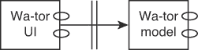

**图 17.1.** Wa-Tor 显而且传统的划分

`WatorUI`组件的级别低于`WatorModel`组件。根据依赖规则（Dependency Rule），这意味着源代码依赖必须跨越架构边界并指向`WatorModel`。

但让我们暂时把这些抛在脑后。前期的设计就够了。让我们看看是否能为某些行为编写代码。

`water`的行为是什么？我们询问我们的建模者，他们告诉我们，如果时间足够，一个`water`细胞会随机进化为`fish`细胞。这是我对该规则的实现：

点击此处查看代码图片

```
(ns wator.core-spec
  (:require [speclj.core :refer :all]
            [wator
             [cell :as cell]
             [water :as water]
             [fish :as fish]]))

(describe "Wator"
  (with-stubs)
  (context "Water"
    (it "usually remains water"
          (with-redefs [rand (stub :rand {:return 0.0})]
            (let [water (water/make)
                  evolved (cell/tick water)]
              (should= ::water/water (::cell/type evolved)))))

    (it "occasionally evolves into a fish"
      (with_redefs [rand (stub :rand {:return 1.0})]
        (let [water (water/make)
              evolved (cell/tick water)]
          (should= ::fish/fish (::cell/type evolved)))))))
```

```clojure
(ns wator.water

  (:require [wator

             [cell :as cell]

             [fish :as fish]

             [config :as config]]))

(defn make [] {::cell/type ::water})

(defmethod cell/tick ::water [water]

  (if (> (rand) config/water-evolution-rate)

    (fish/make)

    water))

————

(ns wator.config)

(def water-evolution-rate 0.99999)
```

所以，我们立刻看到了这个程序的“函数式”性质。(8)`tick`的返回值是一个新的`cell`。我不知道那个`water-evolution-rate`是否正确。建模者还没有告诉我们速率应该是多少。所以我只是猜了猜。我预计他们会等看到模型表现如何之后，再让我们修改它。

8 差不多了。`(rand)`的调用是不纯的。

到目前为止，我还没有指定任何动态类型。现在说这个似乎有点早。但我很确定它会来的。

不管怎样，让我们看看能否让`fish`移动。

等等。如何移动一个`fish`？`fish`在哪里？`fish`知道自己的位置吗，还是由`world`知道？

`cell`排在一个二维矩形笛卡尔网图中，从左到右、从上到下循环。因此`cell`的位置是元组`[x y]`。`world`可以将`cell`保存在二维数组中，或者存储在以位置元组为键 map 中。

我喜欢使用 map 处理这类事情，所以让我们创建一个充满`water`细胞的`world`：

点击此处查看代码图片

```clojure
(context "world"

  (it "creates a world full of water cells"

    (let [world (world/make 2 2)

          cells (:cells world)

          positions (set (keys cells))]

      (should= #{[0 0] [0 1]

                 [1 0] [1 1]} positions)

      (should (every? #(= ::water/water (::cell/type %))

                      (vals cells))))))
```

```clojure
(ns wator.world
  (:require [wator
             [water :as water]]))

(defn make [w h]
  (let [locs (for [x (range w) y (range h)] [x y])
        loc-water (interleave locs (repeat (water/make)))
        cells (apply hash-map loc-water)]
    {:cells cells}))
```

你注意到传递给`interleave`的`water`细胞懒性列表了吗？现在我们应该能够在世界中放入一个`fish`并让它移动了。这是我第一次测试尝试：

点击此处查看代码图片

```clojure
(context "animal"
  (it "moves"
    (let [fish (fish/make)
          world (-> (world/make 3 3)
                    (world/set-cell [1 1] fish))
          [loc cell] (animal/move fish [1 1] world)]
      (should= cell fish)
      (should (#{[0 0] [0 1] [0 2]
                 [1 0] [1 2]
                 [2 0] [2 1] [2 2]}
               loc)))))
```

这非常直观。我们创建了一个中心有一个`fish`的 3x3 `world`。然后我们移动了`fish`。最后，我们确保它仍然是一个`fish`，并且它的目的地是其中之一。

```clojure
(defn do-move [animal loc world]
  (let [neighbors (world/neighbors world loc)

        destinations (filter
                       #(water/is?
                         (world/get-cell world %))
                       neighbors)
        new-location (rand-nth destinations)]
    [new-location animal]))
```

漂亮。我们向`world`请求该位置的`neighbors`（邻居），过滤掉所有不是`water`的，然后随机选择一个。很酷。

我认为最好的办法是确保所有的环面（torus）数学计算都很好地封装在`world`内部。我不希望它逻辑泄露到所有的`animal`中：

点击此处查看代码图像


```clojure
(defn wrap [world [x y]]
  (let [[w h] (::bounds world)]
    [(mod x w) (mod y h)])
  )

(defn neighbors [world loc]
  (let [[x y] loc
        neighbors (for [dx (range -1 2) dy (range -1 2)]
                    (wrap world [(+ x dx) (+ y dy)]))]
    (remove #(= loc %) neighbors))
```

你准备好面对那些不漂亮的内容了吗？上面的代码拒绝编译，因为（你准备好了吗？）`water` 依赖于`fish`（为了进化），`fish` 依赖于`animal`（为了`do-move`），而`animal`又依赖于`water`。这是一个依赖循环，而 Clojure *极其厌恶* 依赖循环。见图 17.3。

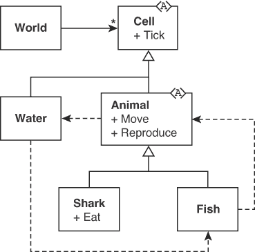

**图 17.3.** 一个依赖循环

好了，深呼吸。记住，我们现在是在玩一个游戏。在像 Wa-Tor 这样简单的应用中，我不会如此无情地划分这些文件。事实上，我很有可能会直接把整个程序写在一个文件里，让魔鬼随心所欲。但我们正在假装这是一个数百万行的企业级应用，所以我们要对所有这些源码依赖关系得格外小心。对吧？

所以，我们解决这个问题的方法是退回到类似旧 C 语言的声明和实现的机制。见图 17.4。

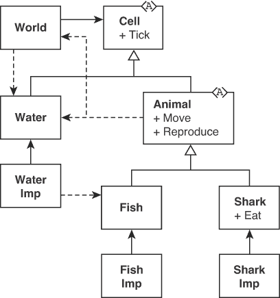

**图 17.4.** 打破依赖循环

通过拆分`water`使其对`fish`的依赖位于`water-imp`中，并确保`water-imp`依赖于`water`而不是相反（即 DIP），循环被打破了。为了一致性，我也拆分了`fish`和`shark`^(12)。我很快也需要拆分`animal`^(13)。

12。实际上，只是`fish`。我在图中拆分了`shark`，但在代码中没有。YAGNI（你现在不需要它），YAGNI，YAGNI。

13。未来的 Uncle Bob：. . .不。

现在代码看起来是这样：

点击此处查看代码图像

```clojure
(ns wator.world
  (:require [wator
             [water :as water]]))

(defn make [w h]
  (let [locs (for [x (range w) y (range h)] [x y])
        loc-water (interleave locs (repeat (water/make)))
        cells (apply hash-map loc-water)]
    {::cells cells
     ::bounds [w h]}))

(defn set-cell [world loc cell]
  (assoc-in world [::cells loc] cell))

(defn get-cell [world loc]
  (get-in world [::cells loc]))

; . . .

—————

(ns wator.cell)

(defmulti tick ::type)

—————

(ns wator.water
  (:require [wator
             [cell :as cell]]))

(defn make [] {cell/type ::water})

(defn is? [cell]
  (= ::water (::cell/type cell)))

——————————

(ns wator.water-imp
  (:require [wator
             [cell :as cell]
             [water :as water]
             [fish :as fish]
             [config :as config]]))

(defmethod cell/tick ::water/water [water]
  (if (> (rand) config/water-evolution-rate)
    (fish/make)
    water))

———————

(ns wator.animal
  (:require [wator
             [world :as world]
             [cell :as cell]
             [water :as water]]))

(defmulti move (fn [animal & args] (::cell/type animal)))
(defmulti reproduce (fn [animal & args] (::cell/type animal)))

(defn tick [animal]
  )

(defn do-move [animal loc world]
  (let [neighbors (world/neighbors world loc)
        destinations (filter #(water/is?
                               (world/get-cell world %))
                             neighbors)
        new-location (rand-nth destinations)]
    [new-location animal]))

—————

(ns wator.world
  (:require [wator
             [water :as water]]))

(defn make [w h]
  (let [locs (for [x (range w) y (range h)] [x y])
        loc-water (interleave locs (repeat (water/make)))
        cells (apply hash-map loc-water)]
    {::cells cells
     ::bounds [w h]}))

(defn set-cell [world loc cell]
  (assoc-in world [::cells loc] cell))

(defn get-cell [world loc]
  (get-in world [::cells loc]))

; . . .

—————

(ns wator.cell)

(defmulti tick ::type)

—————

(ns wator.water
  (:require [wator
             [cell :as cell]]))

(defn make [] {cell/type ::water})

(defn is? [cell]
  (= ::water (::cell/type cell)))

——————————

(ns wator.water-imp
  (:require [wator
             [cell :as cell]
             [water :as water]
             [fish :as fish]
             [config :as config]]))

(defmethod cell/tick ::water/water [water]
  (if (> (rand) config/water-evolution-rate)
    (fish/make)
    water))

———————

(ns wator.animal
  (:require [wator]
             [world :as world]
             [cell :as cell]
             [water :as water]]))

(defmulti move (fn [animal & args] (::cell/type animal)))
(defmulti reproduce (fn [animal & args] (::cell/type animal)))

(defn tick [animal]
  )

(defn do-move [animal loc world]
  (let [neighbors (world/neighbors world loc)
        destinations (filter #(water/is?
                               (world/get-cell world %))
                             neighbors)
        new-location (rand-nth destinations)]
    [new-location animal]))

```

非常漂亮。我们向`world`请求该位置的`neighbors`（邻居），过滤掉所有不是`water`的，然后随机选择一个。很酷。

我认为最好的办法是确保

```


现在代码看起来是这样：

点击此处查看代码图像

```clojure

(ns wator.world

  (:require [wator

             [water :as water]]))

(defn make [w h]

  (let [locs (for [x (range w) y (range h)] [x y])

        loc-water (interleave locs (repeat (water/make)))

        cells (apply hash-map loc-water)]

    {::cells cells

     ::bounds [w h]}))

(defn set-cell [world loc cell]

  (assoc-in world [::cells loc] cell))

(defn get-cell [world loc]

  (get-in world [::cells loc]))

; . . .

—————

(ns wator.cell)

(defmulti tick ::type)

—————

(ns wator.water

  (:require [wator

             [cell :as cell]]))

(defn make [] {cell/type ::water})

(defn is? [cell]

  (= ::water (::cell/type cell)))

——————————

(ns wator.water-imp

  (:require [wator

             [cell :as cell]

             [water :as water]

             [fish :as fish]

             [config :as config]]))

(defmethod cell/tick ::water/water [water]

  (if (> (rand) config/water-evolution-rate)

    (fish/make)

    water))

———————

(ns wator.animal

  (:require [wator]

             [world :as world]

             [cell :as cell]

             [water :as water]]))

(defmulti move (fn [animal & args] (::cell/type animal)))

(defmulti reproduce (fn [animal & args] (::cell/type animal)))

(defn tick [animal]

  )

(defn do-move [animal loc world]

  (let [neighbors (world/neighbors world loc)

        destinations (filter #(water/is?

                               (world/get-cell world %))

                             neighbors)

        new-location (rand-nth destinations)]

    [new-location animal]))

```

抱歉，由于在处理过程中出现了逻辑错误和重复，上述输出出现了混乱。我将重新为您提供干净的翻译结果：

```clojure
(defn do-move [animal loc world]

  (let [neighbors (world/neighbors world loc)

        destinations (filter

                       #(water/is?

                         (world/get-cell world %))

                       neighbors)

        new-location (rand-nth destinations)]

    [new-location animal]))

```

非常漂亮。我们向`world`请求该位置的`neighbors`（邻居），过滤掉所有不是`water`的，然后随机选择一个。很酷。

我认为最好的办法是确保所有的环面（torus）数学计算都很好地封装在`world`内部。我不希望它逻辑泄露到所有的`animal`中：

点击此处查看代码图像

```clojure
(defn wrap [world [x y]]
  (let [[w h] (::bounds world)]
    [(mod x w) (mod y h)])
  )

(defn neighbors [world loc]
  (let [[x y] loc
        neighbors (for [dx (range -1 2) dy (range -1 2)]
```


```clojure
                    (wrap world [(+ x dx) (+ y dy)])))]

    (remove #(= loc %) neighbors))
```

你准备好面对那些不漂亮的内容了吗？上面的代码拒绝编译，因为（你准备好了吗？）`water` 依赖于`fish`（为了进化），`fish` 依赖于`animal`（为了`do-move`），而`animal`又依赖于`water`。这是一个依赖循环，而 Clojure *极其厌恶* 依赖循环。见图 17.3。


**图 17.3.** 一个依赖循环

好了，深呼吸。记住，我们现在是在玩一个游戏。在像 Wa-Tor 这样简单的应用中，我不会如此无情地划分这些文件。事实上，我很有可能会直接把整个程序写在一个文件里，让魔鬼随心所欲。但我们正在假装这是一个数百万行的企业级应用，所以我们要对所有这些源码依赖关系得格外小心。对吧？

所以，我们解决这个问题的方法是退回到类似旧 C 语言的声明和实现的机制。见图 17.4。


**图 17.4.** 打破依赖循环

通过拆分`water`使其对`fish`的依赖位于`water-imp`中，并确保`water-imp`依赖于`water`而不是相反（即 DIP），循环被打破了。为了一致性，我也拆分了`fish`和`shark`^(12)。我很快也需要拆分`animal`^(13)。

12。实际上，只是`fish`。我在图中拆分了`shark`，但在代码中没有。YAGNI（你现在不需要它），YAGNI，YAGNI。

13。未来的 Uncle Bob：. . .不。

现在代码看起来是这样：

点击此处查看代码图像

```clojure
(ns wator.world

  (:require [wator

             [water :as water]]))

(defn make [w h]

  (let [locs (for [x (range w) y (range h)] [x y])

        loc-water (interleave locs (repeat (water/make)))

        cells (apply hash-map loc-water)]

    {::cells cells

     ::bounds [w h]}))

(defn set-cell [world loc cell]

  (assoc-in world [::cells loc] cell))

(defn get-cell [world loc]

  (get-in world [::cells loc]))

; . . .

—————

(ns wator.cell)

(defmulti tick ::type)

—————

(ns wator.water

  (:require [wator

             [cell :as cell]]))

(defn make [] {cell/type ::water})

(defn is? [cell]

  (= ::water (::cell/type cell)))

——————————

(ns wator.water-imp

  (:require [wator

             [cell :as cell]

             [water :as water]

             [fish :as fish]

             [config :as config]]))

(defmethod cell/tick ::water/water [water]

  (if (> (rand) config/water-evolution-rate)

    (fish/make)

    water))

———————

(ns wator.animal

  (:require [wator]

             [world :as world]

             [cell :as cell]

             [water :as water]]))

(defmulti move (fn [animal & args] (::cell/type animal)))

(defmulti reproduce (fn [animal & args] (::cell/type animal)))

(defn tick [animal]

  )

(defn do-move [animal loc world]

  (let [neighbors (world/neighbors world loc)

        destinations (filter #(water/is?

                               (world/get-cell world %))

                             neighbors)

        new-location (rand-nth destinations)]

    [new-location animal]))
```

```clojure
(ns wator.world

  (:require [clojure.spec.alpha :as s]

            [wator

             [cell :as cell]

             [water :as water]]))

(s/def ::location (s/tuple int? int?))

(s/def ::cell #(contains? % ::cell/type))

(s/def ::cells (s/map-of ::location ::cell))

(s/def ::bounds ::location)

(s/def ::world (s/keys :req [::cells ::bounds]))

(defn make [w h]

  {:post [(s/valid? ::world %)]}

  …)
```

好的，这样好多了。现在，我们复现它需要什么呢？建模者说，如果一条`fish`（鱼）位于`water`（水）单元且年龄超过某个值，它就会繁殖。两个后代`fish`的年龄将重置为零。否则，`fish`的`::age`会随时间增加。

以下是测试用例：

点击此处查看代码图片

```clojure
(it "reproduces"

  (let [fish (-> (fish/make)

                 (animal/set-age config/fish-reproduction-age))

        world (-> (world/make 3 3)

                  (world/set-cell [1 1] fish))

        [loc1 cell1 loc2 cell2] (animal/reproduce

                                  fish [1 1] world)]

    (should= loc1 [1 1])

    (should (fish/is? cell1))

    (should= 0 (animal/age cell1))

    (should (#{[0 0] [0 1] [0 2]

               [1 0] [1 2]

               [2 0] [2 1] [2 2]}

             loc2))

    (should (fish/is? cell2))

    (should= 0 (animal/age cell2))))

(it "doesn't reproduce if there is no room"

  (let [fish (-> (fish/make)

                 (animal/set-age config/fish-reproduction-age))

        world (-> (world/make 1 1)

                  (world/set-cell [0 0] fish))

        failed (animal/reproduce fish [0 0] world)]

    (should-be-nil failed)))

(it "doesn't reproduce if too young"

      (let [fish (-> (fish/make)

                     (animal/set-age

                       (dec config/fish-reproduction-age)))

            world (-> (world/make 3 3)

                      (world/set-cell [1 1] fish))

            failed (animal/reproduce fish [1 1] world)]

        (should-be-nil failed)))
```

注意，如果`fish`繁殖了，返回值包含了两个后代。但如果发生了错误，我们会返回`nil`。这是因为我认为`fish`的高层策略包含类似的内容：

点击此处查看代码图片

```clojure
(if-let [result (animal/reproduce …)]

  result

  (animal/move …))
```

无论如何，这里是通过该测试的简略代码：

点击此处查看代码图片

```clojure
(ns wator.animal

  (:require [clojure.spec.alpha :as s]

            [wator

             [world :as world]

             [cell :as cell]

             [water :as water]

             [config :as config]]))

(s/def ::age int?)

(s/def ::animal (s/keys :req [::age]))

(defmulti move (fn [animal & args] (::cell/type animal)))

(defmulti reproduce (fn [animal & args] (::cell/type animal)))

(defmulti make-child ::cell/type)

(defn make []

  {::age 0})

(defn age [animal]

  (::age animal))

(defn set-age [animal age]

  (assoc animal ::age age))

;. . .

(defn do-reproduce [animal loc world]

  (if (>= (age animal) config/fish-reproduction-age)

    (let [neighbors (world/neighbors world loc)

          birth-places (filter #(water/is? (world/get-cell world %))

                               neighbors)]

      (if (empty? birth-places)

        nil

        [loc (set-age animal 0)

         (rand-nth birth-places) (make-child animal)]))

    nil))

————

(ns wator.fish

  (:require [clojure.spec.alpha :as s]

            [wator

             [cell :as cell]

             [animal :as animal]]))

(s/def ::fish (s/and #(= ::fish (::cell/type %))

                     ::animal/animal))

(defn is? [cell]

  (= ::fish (::cell/type cell)))

(defn make []

  {:post [(s/valid? ::fish %)]}

  (merge {::cell/type ::fish}

         (animal/make)))

(defmethod animal/make ::fish [fish]

  (make))
```

```clojure
(ns wator.fish-imp

  (:require [wator

             [cell :as cell]

             [animal :as animal]

             [fish :as fish]]))

;. . .

(defmethod animal/reproduce ::fish [fish loc world]

(animal/do-reproduce fish loc world))
```

但现在我被`world`中的`water`依赖关系困扰了。有一个术语可以描述我对它的感觉。那个词是*恶心*（icky）。那个依赖在某种程度上是*错误*的。

我需要洗个澡。我在洗澡时能解决很多问题。

## 淋浴能解决问题

OK，我洗完澡回来了，这是我在喷淋下和自己进行的对话。

“在`world`中创建`water`感觉很恶心。我的意思是，我只是把`world`分成了两部分，因为创建`fish`导致了循环。所以创建`water`也可能导致循环。但等等，这都关乎创建。也许我需要一个工厂！是的，一个名为`cell-factory`的抽象工厂，它将接受像`:fish`和`:water`这样的不透明令牌，然后. . .（噢！）. . . 以及`:default-cell`。是的，然后. . . 等，为什么我需要一个全新的工厂？为什么`world`不能就是工厂呢？是的！这就是*工厂方法*（Factory Method）模式。这下对了！”

此设计的 UML 图（见图 17.6）非常有启发性。

一个架构边界刚刚出现。所有的依赖都跨越它指向高层侧，遵循依赖规则。我可能在实际架构中不需要这个边界，但如果我需要，它就在那里。

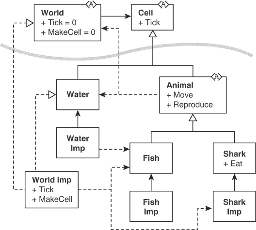

**图 17.6.** 使用工厂方法方法的 Wa-Tor

现在代码看起来是这样：

点击此处查看代码图片


进入`/path/to/xxx`目录，找到`xxx.json`。

在表达式`cvar = avar + bvar`中，加法运算符（`+`）将`avar`与`bvar`相加，得到它们的和`cvar`。

在`List.of(arg0, arg1, arg2)`中，`List`接口的工厂方法`of()`接受一系列的元素，返回包含它们的只读列表。

之后我们这样调用`cmd`命令：`cmd arg0 arg1 arg2`。

```
if (condVar > someVal) {console.log("xxx")}
```

### 以下为需要排版的文本

---

```
(ns wator.world
  (:require [clojure.spec.alpha :as s]
            [wator
             [cell :as cell]
             [water :as water]]))

(s/def ::location (s/tuple int? int?))
(s/def ::cell #(contains? % ::cell/type))
(s/def ::cells (s/map-of ::location ::cell))
(s/def ::bounds ::location)
(s/def ::world (s/and (s/keys :req [::cells ::bounds])
                      #(= (::type %) ::world)))

(defmulti tick ::type)
(defmulti make-cell (fn [factory-type cell-type] factory-type))
(defn make [w h]
  {:post [(s/valid? ::world %)]}
  (let [locs (for [x (range w) y (range h)] [x y])
        default-cell (make-cell ::world :default-cell)
        loc-water (interleave locs (repeat default-cell))
        cells (apply hash-map loc-water)]
    {::type ::world
     ::cells cells
     ::bounds [w h]}))
;. . .
```

---

```
(ns wator.world-imp
  (:require [wator
             [world :as world :refer :all]
             [animal :as animal]
             [fish :as fish]
             [shark :as shark]
             [water :as water]]))

(defmethod world/tick ::world/world [world]
  (-> (make 2 1)
        (set-cell [0 0] (water/make))
        (set-cell [0 1] (animal/set-age (fish/make) 1))))

(defmethod world/make-cell ::world/world [world cell-type]
  (condp = cell-type
    :default-cell (water/make)
    :water (water/make)
    :fish (fish/make)
    :shark (shark/make)))
```

`make-cell`中的`factory-type`简单地作为`::world`传入。这允许`defmethod ::world/world`来解析它。

我对这个改变有很高的期望。请注意，整个改变是由一个测试驱动的，我通过在`tick`中使用空位实现让它通过，这再次提醒我们TDD是一种设计技术。

OK，现在让那个空位实现失败。这里是失败的测试：

```
(it "moves a fish around each tick"
  (doseq [scenario
          [{:dimension [2 1] :starting [0 0] :ending [1 0]}
           {:dimension [2 1] :starting [1 0] :ending [0 0]}
           {:dimension [1 2] :starting [0 0] :ending [0 1]}
           {:dimension [1 2] :starting [0 1] :ending [0 0]}]]
    (let [fish (fish/make)
          {:keys [dimension starting ending]} scenario
          [h w] dimension
          small-world (-> (world/make h w)
                          (world/set-cell starting fish)
                          (world/tick))
          vacated-cell (world/get-cell small-world starting)
          occupied-cell (world/get-cell small-world ending)]
      (should (water/is? vacated-cell))
      (should (fish/is? occupied-cell))
      (should= 1 (animal/age occupied-cell)))))
```

我创建了四种可能的`1x1`场景。等等，文中说是`1_by_1`场景。

```
(ns wator.core-spec . . .)

(describe "Wator"
  (with-stubs)
  (context "Water"
    (it "通常保持水"
      (with-redefs [rand (stub :rand {:return 0.0})]
        (let [water (water/make)
              world (world/make 1 1)
              [from to] (cell/tick water [0 0] world)]
          (should-be-nil from)
          (should (water/is? (get to [0 0]))))))
    (it "偶尔进化成鱼"
      (with-redefs [rand (stub :rand {:return 1.0})]
        (let [water (water/make)
              world (world/make 1 1)
              [from to] (cell/tick water [0 0] world)]
          (should-be-nil from)
          (should (fish/is? (get to [0 0])))))))

;. . .

  (context "animal"
    (it "移动"
      (let [fish (fish/make)
            world (-> (world/make 3 3)
                      (world/set-cell [1 1] fish))
            [from to] (animal/move fish [1 1] world)
            loc (first (keys to))]
        (should (water/is? (get from [1 1])))
        (should (fish/is? (get to loc)))
        (should (#{[0 0] [0 1] [0 2]
                   [1 0] [1 2]
                   [2 0] [2 1] [2 2]}
                 loc))))

    (it "如果没有空间则不移动"
      (let [fish (fish/make)
            world (-> (world/make 1 1)
                      (world/set-cell [0 0] fish))
            [from to] (animal/move fish [0 0] world)]
        (should (fish/is? (get to [0 0])))
        (should (nil? from)))))
```

我认为还有另一个场景会失败——两条`fish`竞争同一个位置：

```
(it "移动两个竞争同一个位置的鱼"
  (let [fish (fish/make)
        competitive-world (-> (world/make 3 1)
                              (world/set-cell [0 0] fish)
                              (world/set-cell [2 0] fish)
                              (world/tick))
        start-00 (world/get-cell competitive-world [0 0])
        start-20 (world/get-cell competitive-world [2 0])
        end-10 (world/get-cell competitive-world [1 0])]
    (should (fish/is? end-10))
    (should (or (fish/is? start-00)
                (fish/is? start-20)))
    (should (or (water/is? start-00)
                (water/is? start-20)))))
```

一个简单的`3x1 world`，在两端都有`fish`。它们中其中一个可以移动到中心。另一个必须留在原处。这个测试失败是因为`animal/move`函数不知道有一条`fish`已经移动到了目标槽位。

解决这个问题意味着以某种方式将`moved-into`列表发送给`animal/move`。我不喜欢给`animal/move`添加另一个参数的想法，所以也许我们可以把这些信息"藏"在传递给`animal/move`的`world`中：

```
(ns wator.world-imp . . .)

(defmethod world/tick ::world [world]
  (let [cells (::cells world)]
    (loop [locs (keys cells)
           new-cells {}
           moved-into #{}]
      (cond
        (empty? locs)
        (assoc world ::cells new-cells)

        (contains? moved-into (first locs))
        (recur (rest locs) new-cells moved-into)

        :else
        (let [loc (first locs)
              cell (get cells loc)
              [from to] (cell/tick cell loc
                          (assoc world :moved-into moved-into))
              new-cells (-> new-cells (merge from) (merge to))
              to-loc (first (keys to))
              to-cell (get to to-loc)
              moved-into (if (water/is? to-cell)
                            moved-into
                            (conj moved-into to-loc))]
          (recur (rest locs) new-cells moved-into))))
```

---

```
(ns wator.animal . . .)

; . .

(defn do-move [animal loc world]
  (let [neighbors (world/neighbors world)
        moved-into (get world :moved-into {})
        available-neighbors (remove moved-into neighbors)
        destinations (filter #(water/is?
                               (world/get-cell world %))
                             available-neighbors)
        new-location (if (empty? destinations)
                       loc
                       (rand-nth destinations))]
    (if (= new-location loc)
      [nil animal]
      {loc (set-age animal)}))
```

注意，我没有使用`:moved-into`关键字，因为我把`moved-into`放在了`world`中。这是为了`animal/move`考虑的权衡。

`animal/move`只有在移动的`cell`不是`water`时才会`moved-into`。`reproduce`看起来很丑陋。

OK，让我们看看是否能让`world`填满`fish`：

```
(it "fills the world"
  (let [world (-> (world/make 10)
                  (world/set-cell [5 5] (fish/make)))
        n 100]
    (if (zero? n)
      (let [cells (-> world ::cells)
            fishies (filter fish/is? cells)
            fish-count (count fishies)]
        (should (> fish-count 50)))
      (recur (world/tick) (dec n)))))
```

不错。创建一个`10x10`的`world`。给它一条`fish`。执行100次`tick`，并确保有超过50条`fish`。这意味着我们没有在`tick`中调用`reproduce`。让我们修复它：

```
(defn tick [animal loc]
  (let [aged-animal (increment-age animal)
        reproduction (reproduce aged-animal)])
```

是的。增加年龄，然后看看它是否会繁殖。如果没有，就移动它。简单。

当然，我必须修复`reproduce`没有使用我们新的`[from to]`约定：

```
(defn do-reproduce [animal loc world]
  (if (>= (age animal) config/fish-reproduction-age)
    (let [neighbors (world/neighbors world)
          birth-places (filter #(water/is?
                                 (world/get-cell world %))
                               neighbors)]
      (if (empty? birth-places)
        nil
        {loc (set-age animal 0)}
        {(rand-nth birth-places) (make-child animal)}))
    nil))
```

这破坏了之前的测试：

```
(it "reproduces"
  (let [fish (-> (fish/make)
                 (animal/set-age config/fish-reproduction-age))
        world (-> (world/make 3 3)
                  (world/set-cell [1 1] fish))
        [from to] (animal/reproduce fish [1 1] world)
        from-loc (-> from keys first)
```


`from-cell` (`-> from vals first`)

`to-loc` (`-> to keys first`)

`to-cell` (`-> to vals first`)]

(`should= from-loc [1 1]`)

(`should` (`fish/is?` `from-cell`))

(`should= 0` (`animal/age` `from-cell`))

(`should` (`#{[0 0] [0 1] [0 2]`

               `[1 0] [1 2]`

               `[2 0] [2 1] [2 2]}`

             `to-loc`))

(`should` (`fish/is?` `to-cell`))

(`should= 0` (`animal/age` `to-cell`)))]

这要求我充实 `shark` 模块，并进行一个小小的设计更改。我使用了`Template Method`（模板方法）模式来获取动物的繁殖年龄。测试暗示了这一变化：

点击此处查看代码图片

```
(context "animal"

  (it "moves"

    (doseq [scenario 

             [{:constructor fish/make :tester fish/is?}

              {:constructor shark/make :tester shark/is?}]]

      (let [animal ((:constructor scenario))

            world (-> (world/make 3 3)

                      (world/set-cell [1 1] animal))

            [from to] (animal/move animal [1 1] world)

            loc (first (keys to))]

        (should (water/is? (get from [1 1])))

        (should ((:tester scenario) (get to loc)))

        (should (#{[0 0] [0 1] [0 2]

                   [1 0] [1 2]

                   [2 0] [2 1] [2 2]}

                 loc)))))

  (it "doesn't move if there are no spaces"

    (doseq [scenario 

             [{:constructor fish/make :tester fish/is?}

              {:constructor shark/make :tester shark/is?}]]

      (let [animal ((:constructor scenario))

            world (-> (world/make 1 1)

                      (world/set-cell [0 0] animal))

            [from to] (animal/move animal [0 0] world)]

        (should ((:tester scenario) (get to [0 0])))

        (should (nil? from)))))

  (it "reproduces"

    (doseq [scenario 

             [{:constructor fish/make :tester fish/is?}

              {:constructor shark/make :tester shark/is?}]]

      (let [animal ((:constructor scenario))

            reproduction-age (animal/get-reproduction-age animal)

            animal (animal/set-age animal reproduction-age)

            world (-> (world/make 3 3)

                      (world/set-cell [1 1] animal))

            [from to] (animal/reproduce animal [1 1] world)

            from-loc (-> from keys first)

            from-cell (-> from vals first)

            to-loc (-> to keys first)

            to-cell (-> to vals first)]

        (should= from-loc [1 1])

        (should ((:tester scenario) from-cell))

        (should= 0 (animal/age from-cell))

        (should (#{[0 0] [0 1] [0 2]

                   [1 0] [1 2]

                   [2 0] [2 1] [2 2]}

                 to-loc))

        (should ((:tester scenario) to-cell))

        (should= 0 (animal/age to-cell)))))

  (it "doesn't reproduce if there is no room"

    (doseq [scenario 

             [{:constructor fish/make :tester fish/is?}

              {:constructor shark/make :tester shark/is?}]]

      (let [animal ((:constructor scenario))

            reproduction-age (animal/get-reproduction-age animal)

            animal (animal/set-age animal reproduction-age)

            world (-> (world/make 1 1)

                      (world/set-cell [0 0] animal))

            failed (animal/reproduce animal [0 0] world)]

        (should-be-nil failed))))

  (it "doesn't reproduce if too young"

    (doseq [scenario 

             [{:constructor fish/make :tester fish/is?}

              {:constructor shark/make :tester shark/is?}]]

      (let [animal ((:constructor scenario))

            reproduction-age (animal/get-reproduction-age animal)

            animal (animal/set-age animal (dec reproduction-age))

            world (-> (world/make 3 3)

                      (world/set-cell [1 1] animal))

            failed (animal/reproduce animal [1 1] world)]

        (should-be-nil failed)))))

————————

(ns wator.animal …)

(defmulti move (fn [animal & args] (::cell/type animal)))

(defmulti reproduce (fn [animal & args] (::cell/type animal)))

(defmulti make-child ::cell/type)

(defmulti get-reproduction-age ::cell/type)

; . . .

————————

(ns wator.fish . ....)

(defmethod animal/get-reproduction-age ::fish [fish]

  config/fish-reproduction-age)

; . . .

——————

(ns wator.shark

  (:require [clojure.spec.alpha :as s]

            [wator

             [config :as config]

             [cell :as cell]

             [animal :as animal]]))

(s/def ::shark (s/and #(= ::shark (::cell/type %))

                      ::animal/animal))

(defn is? [cell]

  (= ::shark (::cell/type cell)))

(defn make []

  {:post [(s/valid? ::shark %)]}

  (merge {::cell/type ::shark}

         (animal)))

(defmethod animal/get-reproduction-age ::shark [shark]

  (config/reproduction-age)

(defmethod animal/make ::shark [shark]

  (config/starting-age))

(s/def :health int?)

(defn health [shark]

  (get shark))

(defn decrement-health [shark]

  (update shark dec))

(defmethod cell/tick ::shark [shark loc]

  (if (= 1 (health shark))

    [nil {loc (water/make)}]

    (-> shark

        (decrement-health)

        (animal/tick loc))))

```

Pretty easy. We just added the `::health` field to the `::shark` spec and `shark/make`, and then we decremented the `health` in the `tick` function just before delegating the rest of the behavior to superclass `animal`.

Now let’s test that a `shark` will die when its `health` goes to zero:

点击此处查看代码图片

```
(it "dies when health goes to zero"

  (let [sick-shark (-> (shark/make)

                       (set-health 1))

        small-world (-> (world/make 1 1)

                        (world/set-cell [0 0] sick-shark))

        aged-world (world/tick small-world)

        dead-shark (world/get-cell aged-world [0 0])]

    (should (water/is? dead-shark))))

```

————

(ns wator.shark . .)

```
(defmethod cell/tick ::shark [shark loc]
  (if (= 1 (health shark))
    [nil {loc (water/make)}]
    (-> shark
        (decrement-health)
        (animal/tick loc))))
```

; . . .

Pretty easy. OK, so now let’s test that sharks will eat when given the opportunity:

点击此处查看代码图片

```
(it "eats when a fish is adjacent"
  (let [world (-> (world/make 2 1)
                  (world/set-cell [0 0] (fish/make))
                  (world/set-cell [1 0] (shark/make)))
        shark-ate-world (world/tick world)
        full_shark (world/get-cell shark-ate-world [0 0])
        where-shark-was (world/get-cell shark-ate-world [1 0])
        expected-health (+ config/shark-starting-health
                           config/shark-eating-health
                           -1)]
    (should (shark/is? full-shark))
    (should (water/is? where-shark-was))
    (should= expected-health (shark/health full-shark))))
```

我们创建了一个 2x1 的 `world`，其中一条 `shark` 挨着一条 `fish`。经过一个 `tick` 后，`shark` 应该出现在 `fish` 之前的位置，`water` 应该出现在 `shark` 之前的位置，并且 `shark` 的 `::health` 应该增加。

为了让这段代码通过，我被迫放弃了对 `animal/tick` 的委托，因为 `shark` 应该先尝试 `reproduce`，然后尝试 `eat`，最后才尝试 `move`：

点击此处查看代码图片

```
(ns wator.shark . ....)

(defn eat [shark loc world]
  (let [neighbors (world/neighbors world loc)
        fishy-neighbors (filter #(fish/is?
                                  (world/get-cell world %))
                                neighbors)]
    (if (empty? fishy-neighbors)
      nil
      [{loc (water/make)}
       {(rand-nth fishy-neighbors) (feed shark)}])
  )

(defmethod cell/tick ::shark [shark loc world]
  (if (= 1 (health shark))
    [nil {loc (water/make)}]
    (let [aged-shark (-> shark
                         (animal/increment-age)
                         (decrement-health))]
      (if-let [reproduction (animal/reproduce
                              aged-shark loc world)]
        reproduction
        (if-let [eaten (eat aged-shark loc world)]
          eaten
          (animal/move aged-shark loc world))))))
```

这一切都非常顺利地完成了。我们已经度过了设计的瓶颈，现在正在收获成果。

建模人员告诉我们，只有当鲨鱼的健康高于阈值时它才会繁殖。让我们来测试一下。事实上，让我们先进行这个更改^(18)，看看哪些测试会失败：

18. TDD 违反！警报！警报！

点击此处查看代码图片


```
(ns wator.shark . ....)

(defmethod animal/reproduce ::shark [shark loc world]
  (if (>= (health shark) config/shark-reproduction-health)
    (animal/do-reproduce shark loc world)
    nil))
```

如预料那样，动物繁殖的测试在鲨鱼场景下失败了。我们可以通过在该测试中加入一个小黑科技来解决这个问题：

点击此处查看代码图片

```
(it "reproduces"
  (doseq [scenario [{:constructor fish/make :tester fish/is?}
                    {:constructor
                       #(-> (shark/make)
                            (shark/set-health
                              (inc config/shark-reproduction-
                                   health)))
                     :tester shark/is?}]]

; . . .
```

是的，这有点丑，但起起作用。我想我应该添加一个测试来检查阈值的另一侧情况：

点击此处查看代码图片

```
(it "doesn' reproduce if not healthy enough"
  (let [shark (-> (shark/make)
                  (shark/set-health
                    (dec config/shark-reproduction-health))
                  (animal/set-age config/shark-reproduction-age))
        world (-> (world/make 3 3)
                  (world/set-cell [1 1] shark))
        failed (animal/reproduce shark [1 1] world)]
    (should-be-nil failed)))
```

好了。最后一件事。父鲨鱼的健康值会被分分两个子鲨鱼之间：

点击此处查看代码图片

```
(it "shares health with both daughters after reproduction"
  (let [initial-health (inc config/shark-reproduction-health)
        pregnant-shark (-> (shark/make)
                           (animal/set-age
                             (inc config/shark-reproduction-age))
                           (shark/set-health initial-health))
        world (-> (world/make 2 1)
                  (world/set-cell [0 0] pregnant-shark))
        new-world (world/tick world)
        daughter1 (world/get-cell new-world [0 0])
        daughter2 (world/get-cell new-world [1 0])
        expected-health (quot (dec initial-health) 2)]
    (should (shark/is? daughter1))
    (should (shark/is? daughter2))
    (should= expected-health (shark/health daughter1))
    (should= expected-health (shark/health daughter2))))
```

没错。测试失败是因为预期的健康值不正确。这很容易修复：

点击此处查看代码图片

```
(ns wator.shark . ....)

(defmethod animal/reproduce ::shark [shark loc world]
  (if (< (health shark) config/shark-reproduction-health)
    (animal/do-reproduce shark loc world)
    nil))
```

### 结论

Wa-Tor 是一个既是“函数式”^(19)又是面向对象的程序；它直接包含了多种 GOF 书中的对象设计模式。事实上，正是面向对象的划分帮助设计变得如此凝固成型。

面向对象的划分非常完美地分离并隔离了各种数据类型，并为相关函数提供了极佳的位置。任何面向对象的程序员都会觉得非常舒适。

然而，从核心来说，这是一个数据流模型。`world` 在各个对象的行为中流动，而没有任何变变。函数式编程的管道水模型依然成立。

最后，我认为这就是软件本该有的。

顺便说一下，你可以在 [`github.com/unclebob/wator`](https://github.com/unclebob/wator)找到所有的源代码。

# 后记

2022 年 3 月，我参加了一个朋友的生日派对，无意听到几个男生在调侃代码。我介绍了自己——我正想找一些写代码的朋友。当我们结束了那些显而易见的寒暄后，其中一个人向我抛出了一个像重炸弹的问题。

他问：“那么，你首选的技术栈是什么？”

当我试图理解他在问我什么时，我脑子里的每一个小碎片都在疯狂地搜寻答案，直到最后我非常不自信地回答道：“Clojure？”

他向后退了一步，露出了明显的惊讶，惊呼道：“真的吗？！全栈都是吗？”

[我脑中放起了彩花——击中了！]

他很震惊，继续说道……“前端和后端都用 Clojure？我以前没听说过。这要怎么做呢？Clojure 是一种 Lisp 语言，对吧？它是函数式的。”

是的，确实是，但`噢不！又一个问题……“这要怎么做呢？”`

好吧，如果你正在阅读这些，我假设你已经读过了前面的页面，因此已经收到了比我在这里能提供的更好、更详尽的解释。那么，让我们面对那个回避而不见的问题：为什么问我首选的技术栈会是一个像重炸弹一样的问题？

在那个生日派对之前的整整 11 年前，我在伊利诺伊州大都会波利斯（Metropolis, IL）开始了我作为化学工程师和工会破坏者的职业生涯，在那里接受了操作六氟化铀生产工艺和设备的培训。在接下来的十年里，我的职业晋升到了各种化学制造工厂的生产领导。

在那十年里，我学了许多关于程序、状态、人员、企业文化以及那些我缺乏技能去修复的破碎流程。然后，在 2020 年 3 月，当我努力平衡这些破碎流程的需求与排倒而来的生活变化时，我们所认知的世界陷入了停滞。在短短八周的时间里，我发现自己经常处于某人身边，他不仅拥有我所缺乏的技能，还制定了掌握那些技能的规则。

所以，我问了我父亲，或者按照你们称呼他的，“鲍叔叔”，需要什么才能学习软件并达到足够的深度，以解决那些我如此渴望解决的问题。

那天晚上，他向我展示了他目前的项目之一——一个关于各县 COVID 感染人数和死亡人数的自动每日图表。当我不认识那些语法时，他趁机向我介绍了 Clojure。

我立刻产生了疑问，因为我以前只了解过`Java`和`Python`等语言的基础知识。他解释了面向对象过程化语言与函数式语言之间的基本区别，以及他为什么喜欢 Clojure。在一个例子中，他向我展示了为什么函数式语言比那些严重依赖可变状态的语言更“安全”、更不复杂，为我描述了一个竞态条件，那与第 15 章中 Bob 和 Alice 之间的电话内容几乎相同。

然后我们深入研究了代码，他给了我一个我不会轻视的机会：和他一起编写他的 COVID 图表。我大部分只是写了几个基础算术函数（当然，我们还为这些函数写了测试）。

他还带我了解了`Quil`，以及它在很大程度上也是函数式的，它是如何不是改变状态，而是在每次迭代中递归生成一个新状态的。这在当时超出了我的理解范围，但在接下来的一年里，我经常回想起这段对话——现在我面前甚至放着我们那天晚上编写的源代码打印件，作为写这本书的灵感来源。

一年多后，我“毕业”了我的软件学徒生涯，成为了 Clean Coders Studio 的全职开发人员。

回到那个问题：截至 2022 年 3 月，我对于软件领域仍然还很新；由于 COVID-19 的原因，当时还没有发生多少大型活动；而且因为路易斯安那州巴顿鲁日（Baton Rouge, LA）的软件领域有一些增长机会，我作为一个开发者一直比较孤立，很少接触到常见的行业术语。

那个生日派对给了我第一次在 Clean Coders 之外与同行进行面对面交流的机会，当我被问到首选技术栈时，我的知识储备仅足以翻译并拼凑出这个问题。这之所以是一个重炸弹式的问题，是因为我不确定自己是否掌握了所有的碎片。

说完这些，我留给你们最后两个小故事。

1. Clojure 真正让我大开眼界的时刻是在开发一个基于`Java`项目的项目，该项目使用`Angular`作为前端。在`Angular`中实现任何功能时，我们当然必须在`Angular`和`Java`中测试并创建几乎相同的方法（有时在 Clojure 中，因为我们正在迁移一个遗留系统）。到处都是双倍的工作量！

   然后他们要求一个拥有与我们 Clojure 功能完全相同功能的移动应用程序。我们将大部分核心功能提取到一个`cljc`库中，从那里，我们能够以几乎没有代码重复或重写的方式构建移动应用。

   我们利用 Clojure 的通用命名空间，为`cljs`移动应用使用了通用函数，就像我们在后端做的一样。

   在多少语言中，你可以说你做过这件事——让后端以及可能的多个前端全在同一段经过同步测试的代码上运行？

2. Clojure 真正让我大开眼界的时刻是在我们开发一个基于`Java`项目的项目，该项目使用`Angular`作为前端。在`Angular`中实现任何功能时，我们当然必须在`Angular`和`Java`中测试并创建几乎相同的方法（有时在 Clojure 中，因为我们正在迁移一个遗留系统）。到处都是双倍的工作量！

   然后他们要求一个拥有与我们 Clojure 功能完全相同功能的移动应用程序。我们将大部分核心功能提取到一个`cljc`库中，从那里，我们能够以几乎没有代码重复或重写的方式构建移动应用。

   我们利用 Clojure 的通用命名空间，为`cljs`移动应用使用了通用函数，就像我们在后端做的一样。

   在多少语言中，你可以说你做过这件事——让后端以及可能的多个前端全在同一段经过同步测试的代码上运行？

祝好运！—Clean Coders

* 在 Payroll 示例中，98, 100, 105

* 在 shape 示例中，271, 273, 275–276

* 在 Wa-Tor 应用中，289, 312–313

* 架构。参见清洁架构的依赖规则

* 数组

* 以及`n`-叉叉树，23–25

* 在埃拉托尼筛法算法中，20–22

* 赋值

* 定义，7–8

* 无赋值的编程，4–6, 20–22

* `assoc`, 90n5

* `async/>!!` 函数，213

* `async/go` 函数，205

* `atom` (原子值),50–51

* 原子操作，50

### B

* 批处理与交互式应用程序，44

* 行为内聚性，94, 336

* 二叉树。参见`n`-叉叉树](#index.xhtml_idx138)

* 保龄游戏问题

    * Clojure 版本，71–75

    * 解决方案的比较，75–76

    * Java 版本，66–71

* 业务规则

    * 以及依赖关系，154–155

    * 测试，127–131

### C

* 阴极射线管 (CRTs)，118

* 变更请求与单一责任原则，126–131

* 丘奇，阿隆佐 (Alonzo Church)，xvi–xvii

* 丘奇-图灵论席，xvi–xvii, 19

* 类

    * 闭的，267, 273

    * 以及接口，132, 283–284

    * 对比命名空间，107

* 洁架构 (Martin)，96, 126

* Cleancoders，126, 213

* 洁净之道 (Martin)，53, 79n

* Clojure

    * 以及类，267

    * 编译，137, 150, 256n, 300

    * 特性与约束，41, 281, 282

    * 接口隔离，149–150

    * 关键字语法，45n

    * 关于学习，xvii–xviii

    * 命名空间与源文件，107–108

    * 源代码依赖，104–105

    * 语法概述，29–32

* cljure.spec，47, 110

* 逻辑性，151

* 内聚性，94

* 命令模式

    * 撤销变体，245–249

    * 使用，242–245

    * 比较并交换协议，48–51

    * comp.object (社交网络)，230

* 组合模式

    * shape 示例，254–259

    * 在开关与光中，249–254

* 拼接，73

* 常量，以及函数式程序，16

* Coplien, Jim，高级 C++ 风格与习惯，250

* copy 示例

    * 在 C 中，131–132

    * 在 Clojure 中，133–136

* 拷贝，20–22

* 耦合

    * 通过惰性避免，41–42

    * 在保龄游戏中，76

    * 时间上的，8–10

    * 以及测试，166

* CRT。参见阴极射线管 (CRTs)

* 循环，90n

### D

* Dahl, Ole-Johan，78, 153

* 数据内聚性，94, 96, 336

* 数据流。参见 Advent of Code 2022

    * 在命令行 shell 中，123

    * 作为一种编程风格，118, 124

* 数据流图 (DFD)，示例，99

* 数据结构。参见`n`-叉叉树](#index.xhtml_idx138)

    * 持久化的，25

* 致命锁（又称死锁），49

* 声明函数，35

* 装饰器模式

    * shape 示例，260–263

    * 使用，260, 274

* 形式，39

* 分发，103

* 依赖关系

    * 源代码与运行时，152–155

    * 源代码反转，104–105

* 依赖倒转原则 (DIP)

    * shape 示例，274

    * 源代码反转的依赖，152–155

    * 在视频商店问题中，165–174

    * 在 Wa-Tor 应用中，300, 310

* 洁架构的依赖规则，271, 275–276

* 设计模式。参见抽象工厂; 抽象服务器模式; 适配器模式; 命令模式; 组合模式; 装饰器模式; 访问者模式

    * 关于，227, 230–231

* 设计模式：可复用面向对象的元素 (Gamma 等人的 GOF 书)，98, 227n, 259, 270, 273

* Dewdney, A. K.,288

* DFDs。参见数据流图 (DFDs)](index.xhtml_idx58)

* 诊断测试，190–197

* 离散事件仿真。参见喋喋的巴士司机问题](#index.xhtml_idx98)

* 分发函数，135

* doall 函数，40

* doseq 函数，251

* 双重（或双向）分发，266, 270

* 鸭子类型 (duck typing), 132, 139, 149。另参见 多重方法 (multi-methods)

### E

* *欧拉项目 (Euler Project, The)*, 213

* 扩展与修改 (extensions vs. modifications), 131

### F

* 斐波那契数列示例 (Fibonacci numbers example)

    * 使用迭代, 28–32

    * 使用懒性列表, 38–40

    * 使用真递归, 32–35

* 迈克·派克斯 (Fikes, Mike), 200

* `filter`, 102n5

* 有限有状态机 (finite state machines)

    * 与编程风格, 93–94

    * 地铁检闸机示例, 13–15

    * 电话系统示例, 216–225

* `flatten`, 91n10

* `for` 函数, 102n7

* 马丁·福勒 (Fowler, Martin), *《重构》(Refactoring)**, 155

* F# 编程语言, 41, 132

* 脆弱性 (fragility), 127

* 函数式语言 (functional languages)。另参见 Clojure

    * 与设计模式, 233

    * 特性, 7, 34, 41, 124, 185, 245, 281

    * 接口机制, 132, 150

    * 与变异, 48

    * 类型系统, 110

    * 用法, 225

* 函数式编程 (functional programming)

    * 定义, 4

    * 与 Lambda 演算, xvii

    * 与摩尔定律, 225–226

    * 与 OOP 兼容性, 282–284

    * 与资源成本, 19–20, 25

    * 与状态改变问题, 12–15, 93–94

    * 与测试, 63, 184


* 与变量，7–8

* 函数式程序（functional programs）

  * 特性，10–12，15–16，18，100，335–336
  * GUI 框架，200
  * 与对象程序，93，108，167
  * 与竞态条件，216
  * 函数
    * 作为抽象，133
    * 在数学中，10
    * 私有，103，283

### G

* 垃圾回收（garbage collection），9，42
* `get`，103n9
* GOF 书籍。参见《可重用对象设计模式》（Design Patterns: Elements of Reusable-Oriented Software）（Gamma 等）
* GOF（Gang of Four），242n
* 闲话驱动（Gossiping Drivers）
  * Clojure 方案，88–92
  * 方案对比，92–93
  * 描述，78
  * Java 方案，78–88
* 图形。参见龟形图形
* GUI
  * 架构应用，245–249
  * 框架，200

### H

* 处理/主体模式（handle/body patterns）。参见组合模式（Composite pattern）；装饰器模式（Decorator pattern）
* Haskell 编程语言，xiv，41，283
* 高层策略与低层细节，132，136–138，154–155
* 高阶函数，133n

### I

* 不变性（immutability），15–16，47，93–94，281。另参见可变性（mutability）
* 独立部署性，136–138
* 初始化，6，7–8，18，19
* 集成测试，165–166
* 交互式程序，44
* 接口隔离原则（Interface Segregation Principle，ISP）
  * 示例，147–150
  * 用法，150–151
* ISA 规则，142–145，179
* 迭代（iteration）
  * 斐波那契数列示例，28，30
  * 与递归，35
  * 迭代器，38，40

### J

* `jar` 文件，136–137
* Java 虚拟机，7n，32，138

### L

* Lambda 演算，xvi，19
* 语言。另参见 Clojure
  * 耦合，150
  * 类型，147
* 懒性（laziness）
  * 斐波那契示例，38，40
  * 列表，40
  * 用法，41
* Liskov 替换原则（Liskov Substitution Principle，LSP）
  * 代码示例与测试，139，142
  * ISA 规则，142–145
  * 原则，138–139
  * 代表性规则，146–147
* 锁，49
* 低层细节。参见高层策略与低层细节

### M

* `map` 函数，33
* 罗伯特·马丁（Martin，Robert C.）
  * 《敏捷软件开发原理、模式与实践》（Agile Software Development: Principles, Patterns, and Practices），53，96，126，184n，231n4，243
  * 《洁洁架构》（Clean Architecture），96，126
  * 《洁洁之道》（Clean Craftsmanship），53，79n
  * 《重构》（Refactoring），155
* 备备化（memoization），34–35
* `memoize` 函数，35
* 内存使用
  * 垃圾回收，9，42
  * 与懒性，39–41
  * 使用 *n* 叉树，24–25
  * 在埃拉托斯特筛算法中，22
* 消息序列图，216–217
* Meyer，Bertrand，*Object-Oriented Software Construction*，131
* Mock 对象（mocks），184–186，236
* 修改 vs. 扩展，131
* 模块
  * 依赖，150–151
  * 扩展与修改，131–132
* 摩尔定律，225
* `more-speech` 应用，48n，185
* 多方法（multi-methods）
  * 在 ATM 交互器示例中，149–150
  * 在拷贝示例中，135–136
  * 在开关和灯泡问题中，235–236，240–241
  * 在视频语句格式化示例中，167–179
  * 在 Wa-Tor 中，312
* 可变性（mutability）。另见不可变性
  * 与并发，216
  * 在语言和框架中，47–48，124，200
  * 与测试，197

### N

* 命名空间和源文件，106–108，238–239
* *n* 元树（n-ary trees），23–25
* 90 度旋转，265，270–271，279
* `ns`（命名空间），159n，238
* Nygaard，Kristen，78，153

### O

* 面向对象（OO）
  * 与函数式编程，53，93–94，108，282–283
  * 起源，78，153
  * 程序特征，93，96
* *Object-Oriented Software Construction*（Meyer），131
* OCP。见[开闭原则（OCP）](#index.xhtml_idx146)
* 不透明参数（opaque arguments），279–281
* 开闭原则（OCP）
  * 使用函数，133–134
  * 独立部署性，136–138
  * 使用多方法，135–136
  * 用法，131–132
  * 使用虚函数表（vtables），134

### P

* Papert，Seymour，201
* `partial` 函数，102
* `partition` 函数，72
* 分区（partitioning）
  * 在 Gossiping Bus 程序中，93
  * 在 Wa-Tor 中，335
* 工资问题（Payroll problem）
  * Clojure 解决方案，98–107
  * Java 解决方案，97–98
  * 需求，96–97
  * 类型规范，110–113
* 持久化数据结构（persistent data structures），25
* 指针实现（PIMPL）模式，140
* 多态接口，在架构图中，248–249
* 多态（polymorphism）
  * Clojure 中的机制，134，238–239，249，282，283
  * 与 Mock 对象，185
  * 在 OO 中，96，132
* 质因数分解示例，186–189
* 质因数问题（Prime Factors problem）
  * Clojure 版本，60–63
  * 解决方案对比，63–64
  * Java 版本，56–60
* 私有函数，103n8，283
* *Processing* 框架，47n，200
* 基于属性的测试（property-based testing），186–189
* 协议/记录机制（protocol/record mechanism），137–138

### Q

* `quick-check`，194，195，197
* QuickCheck，188
* Quil 框架，47，200

### R

* 竞态条件（race conditions）
  * 定义，9
  * 在有限状态机中，226
  * 在电话系统中，233–235
* `range` 函数，33，38
* 递归（recursion）
  * 与赋值，6
  * 在斐波那契示例中，32–35
  * 与迭代，35
  * 状态变化，15–16
* `reduce` 函数，72
* 重构（Refactoring），15
* 引用透明性，11–12
* REPL，184
* `repeat` 函数，71
* 运行时依赖，12–15

### S

* Scala 语言，41，132
* 框架，200
* 语义验证 vs. 业务测试，127–131
* 时序耦合。见时间
* 形状示例（shape example）
  * 抽象工厂模式，276–281
  * 组合模式，254–259
  * 装饰器模式，260–263
  * 与实例化，274–276
  * 访问者模式，264–267，270–271–273
* 副作用（side effects），254，283
* 埃拉托斯特筛（Sieve of Eratosthenes），18–19，20–22
* SIMULA-67，78，153n20
* 单职责原则（SRP）
  * 定义，126–127
  * 用法，130–131，288
  * 违反示例，76，127–130，159
* 软件事务内存（STM），48–51
* SOLID 原则。另见依赖倒置原则（DIP）；接口隔离原则（ISP）；里德夫替换原则（LSP）；开闭原则（OCP）；单一责任原则（SRP）
  * 资源，126
* 源代码依赖
  * 以及实例创建，274–276
  * 反转，104–105
  * 以及运行时依赖，152–155
* 源文件
  * 加载自，137
  * 以及命名空间，106–108
* Spacewar!，45–47，114，200
* `speclj` 框架，184
* 正方形与矩形示例，142–147
* 系统状态。另见有限状态机
  * 在函数式程序中，12–13，15–16，44–45
  * 以及结构共享，23–25
  * 以及时间耦合，8
* 地铁进闸机示例，13–15
* 平方之和示例，4–6，9–10，11
* Swing 框架，48，200
* 开关与灯问题
  * 抽象服务器模式，234–236
  * 适配器模式，236–242
  * 组合模式，250–254
  * 描述，230–233

### T

* 尾递归函数，28
* 尾递归优化（TCO）
  * 定义，7
  * 显式调用，32
  * 用法，19–20，35
* `take` 函数，39，40，73
* TCO。另见尾递归优化（TCO）
* TDD。另见测试驱动开发（TDD）
* 电话系统
  * 在 Clojure 中，219–223
  * 有限状态机，216–217
  * 竞态条件，223–225
* 模板方法模式，175，324
* 时间耦合，8–10
* 测试驱动开发（TDD），53，184。另见示例
* 测试
  * Mock 对象（mocks），184–186
  * 基于属性测试，186–189
  * 线程宏（`->>`），45，46
* 线程
  * 以及竞态条件，216
  * 用法，9，48–51
* TILT 错误，122
* 图灵（Alan），xvi–xvii
* 图灵机，xvi–xvii，19
* 海龟图形（turtle graphics）
  * 命令处理，210–212
  * 框架与绘制函数，202–210
  * 用法，200–202
* 海龟（打印设备），200–201
* 类型完整性
  * 使用 `clojure.spec` 库，110–113
  * 使用 `:pre` 和 `:post`，113–114
* 类型模型，以及装饰器模式，260–263
* 类型安全，281
* 类型。另见鸭类型（duck typing）
  * 在里德夫替换原则中，139

### U

* 撤销命令模式，245–249
* 统一建模语言（UML）图，97
* `union` 函数，91n
* `update` 函数，91n7

### V

* `vals`，91n9
* 变量
  * 赋值，7–8
  * 在函数式程序中，15–16，18–19
* 视频租赁店问题，155–165，166–179
* 访问者模式
  * 在示例中，264–267
  * 用法，264
* `vtables`，134，139

### W

* Wa-Tor 应用
  * 10 测试，322–323
  * 演员，288–289
  * 模板方法解决方案，312–322
  * 鱼的移动，295–305
  * 鱼的繁殖，305–309
  * 作为函数式和面向对象的，335–336
  * 游戏概念，288
  * 对象，289–292
  * 截图，335
  * 鲨鱼类，324–334
  * 水行为，293–295
  * 世界依赖，309–312

### Y

* YAGNI（你可能并并不需要它），292n


## 代码片段

许多标题包含编程代码或配置示例。为了优化这些元素的呈现，请以单列横屏模式查看电子书，并将字体大小调整为最小设置。除了以重流文本格式呈现代码和配置外，我们还包含了代码的图像，以模拟打印版书籍中的呈现方式；因此，当重流格式可能会损害代码列表的呈现时，您将看到“点击此处查看代码图像”链接。点击该链接即可查看高保真代码图像。要返回之前查看的页面，请点击设备或应用程序上的后退按钮。


