# 函数设计：原则、模式与实践

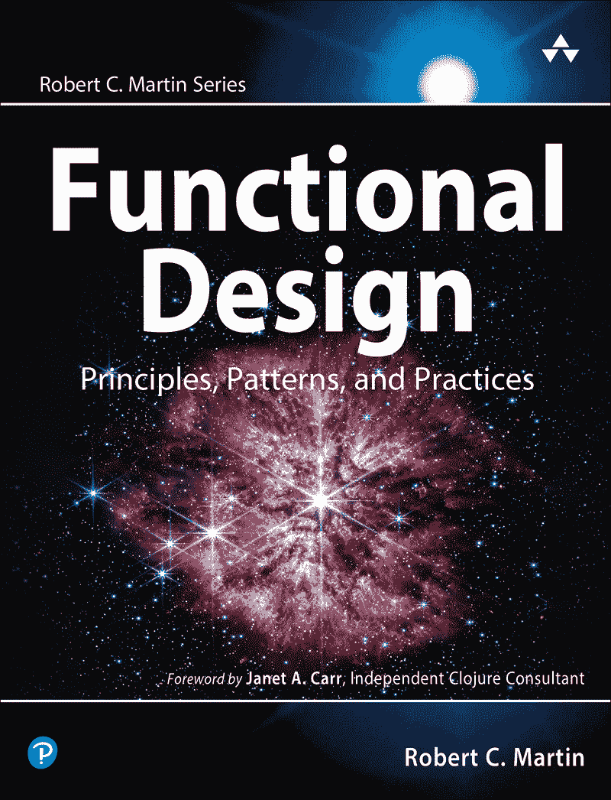

## 关于本电子书

ePUB 是一种开放的行业标准电子书格式。然而，阅读设备和应用程序对 ePUB 及其许多功能的支持各异。请使用您的设备或应用设置根据您的喜好自定义显示。您可以自定义的设置通常包括字体、字号、单栏或双栏、横屏或竖屏模式，以及可以点击或触摸放大的图形。有关您的阅读设备或应用设置和功能的更多信息，请访问设备制造商的网站。

许多书籍包含编程代码或配置示例。为了优化这些元素的显示效果，请在单栏横屏模式下查看电子书，并将字体大小调整为最小设置。除了以重流文本格式显示代码和配置外，我们还包含了代码图像，以模拟印刷版中的呈现效果；因此，当重流格式可能影响代码列表的显示时，您将看到一个“点击此处查看代码图像”的链接。点击链接即可查看高保真代码图像。要返回之前过的页面，请点击设备或应用上的“返回”按钮。

## 功能设计


封面图像由 NASA、ESA、CSA、STScI、Webb ERO 制作团队提供。使用此图像不代表上述归属机构对本书或其书中任何内容的认可。

第 xxiii 页：作者照片由 Robert C. Martin 捐赠。

制造商和销售商用于区分其产品的许多标识均被主张为商标。当这些标识出现在书中且出版者知晓商标主张时，这些标识将以首字母大写或全大写形式打印。

作者和出版者在准备本书时已尽小心，但不提供任何形式的明示或隐含保证，并不对错误或遗漏承担任何责任。对于与使用本文包含的信息或程序有关或由此产生的附带或结果性损害，不承担任何责任。

如需批量购买此书的信息，或获取特殊销售机会（可能包括电子版；定制封面设计以及针对您的业务、培训目标、营销重点或品牌兴趣的内容定制），请通过 `corpsales@pearsoned.com` 或拨打 `(800) 382-3419` 联系我们的企业销售部门。

政府销售垂询请联系 `governmentsales@pearsoned.com`。

关于美国以外销售的问题，请联系 `intlcs@pearson.com`。

访问我们的网站：[informit.com/aw](http://informit.com/aw)

美国国会图书馆控制号：2023940397

版权所有 © 2024 Pearson Education, Inc.

保留所有权利。本出版受版权法保护，在进行任何禁止的复制、存储在检索系统中或以任何形式或通过方式（电子、机械、复印、录音或类似方式）传输之前，必须先获得出版者的许可。有关许可信息、申请表以及 Pearson Education 全球权利与许可部门内部适当联系人的信息，请访问 [www.pearson.com/permissions](http://www.pearson.com/permissions)。

ISBN-13: 978-0-13-817639-6

ISBN-10: 0-13-817639-6

## 献辞

献我的家人，我对他们的爱解释了我所做的一切。

首先，献给我结婚 50 年的妻子，那位美丽的 16 岁少女，有着闪烁的棕色眼睛和长长的黑发，她捕捉了我的心并守护了它半个多世纪。她依然像我遇见她的第一天一样美丽。那双闪烁的棕色眼睛和流动的发丝每天都令我着迷。孩子的母亲。我生活的锚石。我唯一的爱。

献给 Angela，我美丽的长女，忠诚的女儿，她那极具感染力的微笑会融化你的心，并让你深信世界一切如好。我曾问过她想成为什么。她的答案是“有趣！”她随后实现了并远超了这一目标。她对生活无限的热情感染了她遇到的每一个人。她嫁给了 Matt，那是一个优秀、勤奋且诚实（且有趣）的男人。他们两人将分享的乐趣变成了一场充满成就感的山地车狂热。他们住在一个林木环绕的山丘，并生了三个美丽、聪明且有才的女儿让我宠爱。

献给 Micah，我的二子，充满激情的儿子。他继承了母亲那双闪烁的棕色眼睛。我曾问过他想成为什么。他说：“富有！”我很高兴地报告，他做得非常出色。他花了十年的大部分时间与我共，然后创立了自己的软件公司，并在几年后将其卖掉。接着他花了一年时间在车库里造了一架飞机。现在他正经营着另一家软件公司。他的成功很大归功于 Angelique，他娶的那个美丽、勤奋且深智的女性。他们培养了两个出色的年轻男性。

献给 Gina，我的三女，不断惊喜的女儿。如果一个女人可以比我的妻子更漂亮，那么 Gina 就是那个人。她成为了一名成就化学工程师，处理铀、氟和浓氢氧化钠等物质。她戴上安全帽，攀爬反应器，并管理着化学工厂操作员团队。她嫁给了 Keith，一位优秀、勤奋且诚实的机械工程师。他们交换着在大型复杂工厂工作的冒险故事。他们育有两个漂亮的孩子——一个男孩和一个女孩，这是我的孩子中第一个享受到这一特权的家庭。

拥有装满箭的箭袋（指子孙辈）的男人是幸福的。

## 关于作弊

### 拷贝

### 结构共享

# 第 3 章 递归与迭代

## 迭代

## 极简 Clojure 教程

## 迭代

## TCO、Clojure 与 JVM

# 递归

# 第 4 章 惰性

## 懒性累加

## 可以，但为什么？

## Coda

# 第 5 章 状态性

## 我们必须变异的时候

## 软件事务内存（STM）

## 生活艰难，软件更难

# 第二部分 比较分析

# 第 6 章 质因子

## Java 版本

## Clojure 版本

## 结论

# 第 7 章 保龄球游戏

## Java 版本

## Clojure 版本

## 结论

# 第 8 章 传播的巴士司机

## Java 解决方案

## 司机程序

## 路线

## 站点

## 谣言

## 模拟

## Clojure

## 结论

# 第 9 章 面对象编程

## 函数式工资单

## 命名空间与源文件

## 结论

# 第 10 章 类型

# 第三部分 函数式设计

# 第 11 章 数据流

## 第 12 SOLID

### 单一责任原则（SRP）

### 开放封闭原则（OCP）

### 函数

### 带有虚函数表的对象

### 多方法

### 独立部署性

#### 里氏夫替换原则（LSP）

### ISA 规则

### 不行！

### 代表性规则

### 接口隔离原则（ISP）

### 不要依赖不需要的东西

### 为什么？

### 结论

### 依赖倒置原则（DIP）

### 过去的回响

### DIP

### 结论

# 第四部分 实践

# 第 13 章 测试

## 但 REPL 怎么办？

## Mock（模拟对象）怎么办？

## 基于属性的测试

## 诊断技术

## 函数式

# 第 14 章 GUI

## Quil 中的海龟图形

# 第 15 章 并发

## 结论

# 第五部分 设计模式

# 第 16 章设计模式回顾

## 函数式编程中的模式

## 抽象服务器

## 适配器

## 那真的是个对象吗？

## 命令

## 撤销

## 组合

## 函数式的？

## 装饰器

## 访问者

## 要关闭，还是用 Clojure？

## 90 度问题

## 抽象工厂

## 又是 90 度

## 类型安全？

## 结论

## 后记：OO 之毒？

# 第六部分 案例研究

# 第 17 章 Wa-Tor

## 挠那个痒处

## 淋浴解决问题

## 是时候疯狂繁殖了

## 鲨鱼怎么办？

## 结论

## 结语

## 索引

## 前言

Bob 叔叔（Uncle Bob）不需要自我介绍。作为软件开发领域的杰军人物，Bob 编写了多本关于软件设计和交付的书籍。他的一些著作在世界各地的计算机科学课堂上教授。

我在大学期间开始学习函数式编程。我没有就读教授 `Scheme` 和 `C` 的精英计算机科学专业，但我对所有计算事物都充满渴求。那时还没有谈论函数式编程。我看到未来将有一股编程浪潮；在未来，开发者将花费更多时间思考他们正在解决的问题，而不是如何管理它。在读完《函数式设计》后，我希望那时以及现在，在我从学生到专业人士的职业每个阶段都能拥有这本书。

《函数式设计》散发着一种“诞生即经典”的气质。它就像是一本专为专业软件开发者编写的书。Bob 触及软件工程的基础并对其进行扩展，用简洁的语言描述了我多年来的经验。他优雅地揭开帷纱，展示了函数式编程元素如何让软件设计变得简单而务实。他这样做并没有让来自 `C#`、`C++` 或 `Java` 等语言的经验面向对象程序员感到疏远。

通过引入 `Java` 的比较分析，《函数式设计》介绍了基于 Lisp 方言 `Clojure` 的函数式系统设计。`Clojure` 不像 `Haskell` 那样必须使用纯函数式编程概念。相反，`Clojure` 强烈鼓励这种做法，使其成为极好的入门函数式编程语言。《函数式设计》仔细指出了 `Clojure` 开发者偶尔会遇到的少数陷阱。作为一名 `Clojure` 顾问，我可以证明这一点。这本书教会你如何让语言（和开发者）不成为障碍，而不是寻找那些能避开障碍的东西。

Clojure 的批评者会说，Clojure 不适用于任何足够大的代码库。正如你将在接下来的章节中学到的，设计原则和模式适用于 Clojure 就像适用于 Java、C# 或 C++ 一样。SOLID 设计原则将帮助你通过函数式编程构建更好的软件。函数式程序员长期以来对设计模式嗤之以鼻，但《Functional Design》解构了这种批评，并准确地展示了开发者为什么需要它们，以及开发者如何自己实现它们。

我曾在网上撰写过大量关于 Clojure Classic 设计模式的文章，因此发现这本书在向读者展示代码之前，先通过周全的图表探讨设计模式用法，当你读到那些章节时，你已经能够根据图表构海出 Clojure 代码了。然后，代码随之而来。最后，《Functional Design》将通过带你实现一个使用设计原则和模式的“企业”应用，将这一切串联在一起。

—Janet A. Carr，独立 Clojure 顾问

## 前言

这本书是为那些身处一线的程序员准备的，他们想要学习如何使用函数式编程语言来完成实际工作。因此，我不会花费大量时间在函数式编程的理论方面上，例如 `Monads`、`Monoids`、`Functors`、`Categories` 等。并不是说这些想法无效、没有价值或不相关；而是它们往往并不影响程序员的日常世界。这是因为它们已经“烘焙”在了常用语言、库和框架的“蛋糕”中。如果你对函数式理论感兴趣，我推荐 Mark Seemann 的著作。

本书关于如何以及以及为什么在为真实客户构建真实系统的日常工作中使用函数式编程。在接下来的页面中，我们将比较并对比如 `Java` 等面向对象的语言中常见的编码结构，与如 `Clojure` 等函数式语言中常见的编码结构。

我特别选择了这两种语言，是因为 `Java` 被广为人知和使用，而 `Clojure` 极其容易学习。

### 函数式与过程化编程的简史

1936 年，两位数学家艾兰·图灵（Alan Turing）和阿隆佐·丘奇（Alonzo Church）独立解决了大卫·希尔伯特（David Hilbert）著名的挑战之一：`The Decidability Problem`（可判定性问题）。详细描述这个问题超出了本介绍的范围，只能说它与找到整数公式的通用解有关。这与我们有关，因为数字计算机中的每个程序都是一个整数公式。

另一种说法是，这两个人独立地证明了不存在这样的解。图灵和丘奇后来证明了他们的方法是等价的。

### 关于 Clojure

Clojure 在语义上非常丰富，但在语法上极其简单。这意味着语言本身拥有一套非常简单的语法。库和惯用法需要大量的努力；而语言本身几乎不需要任何努力。

话虽如此，这本书并不是一本 Clojure 教程。我将在早期章节解释一些基础知识，并在全文中加入一些解释性脚注，但我也将依靠你，亲爱的读者，去完成功课并查阅资料。有几个网站可以提供帮助。我最喜欢的之一是 `https://clojure.org/api/cheatsheet`。

### 关于架构与设计

本书的一个主要重点是描述为函数式风格构建的系统提供设计和架构原则。为此，我将使用统一建模语言（UML）图表，并引用软件设计的 `SOLID` 原则、`Design Patterns`（设计模式）以及 `Clean Architecture`（整洁架构）的概念。不要担心，我将在进展过程中进行解释，并在你需要查阅资料时将引用许多外部参考文献。

### 关于面向对象

许多人认为面向对象程序编程和函数式编程是不兼容的。这些页面将证明事实并非如此。你在这里看到的程序、设计和架构将是函数式和面向对象概念的混合体。根据我的经验，也是我坚有的观点，这两种风格是完全兼容的，优秀的程序员可以并且应该将它们结合起来。

# 关于“函数式”

在本文，我将使用 `functional`（函数式）这一术语。我会对其进行定义并阐述。随着章节的推进，我也会对其进行一些灵活处理。有些示例虽然是用函数式语言并按照函数式风格编写的，但它们并不是 `purely`（纯粹）函数式的。在大多数此类情况下，我会在 `functional` 一词上加上引号，并使用脚注指出我所做的灵活处理。

为什么要采取这种灵活处理呢？因为这是一本关于实用的书，而不是理论。我更感兴趣的是从函数式 `style` 中提取益处，而不是严格遵循某种理想。例如，正如我们在第一章中看到的，从用户处获取输入的“函数”并不是纯函数式的。然而，我会在适当的情况下此类“函数”。

所有章节中示例的源代码都在一个名为 GitHub 仓库中，地址为 `https://github.com/unclebob/FunctionalDesign`。

在 InformIT 网站注册您的副本 `Functional Design: Principles, Patterns, and Practices`，以便在发布更新和或更正时方便访问。要开始注册过程，请访问 `informit.com/functionaldesign` 并登录或创建账户。产品 ISBN (`9780138176396`) 将自动填充。在“Registered Products”（注册产品）选项卡上寻找产品旁边的“Access Bonus Content”链接，点击该链接访问任何可用奖励材料。如果您希望接收新版本和更新的独家优惠通知，请勾选接收我们的邮件。

# 致谢

感谢 Pearson 勤奋且专业的人士，他们帮助引导了本书走向完成：Julie Phifer，我长期以来一直乐于帮助、支持我的出版社；以及她的同事 Menka Mehta、Julie Nahil、Audrey Doyle、Maureen Forys、Mark Taber 以及其他。与你们工作一直是一件乐事，我期待未来此类努力。

感谢 Jennifer Kohnke，她在过去的三十年里为我的书创作了大部分绝美的插图。1995 年，面对制作截止日期，Jennifer、Jim Newkirk 和我熬了一个通宵，以确保我第一本书的插图完全按照我想要的方式进行了格式化和组织。

感谢 Michael Feathers，他在 20 年前建议我研究函数式编程。当时他正在学习 `Haskell`，并对这种可能性充满热情。我他的他的非常有感染力。

感谢 Mark Seemann (`@ploeh`)，感谢他一如既往富有见解的作品，对我作品的敏锐且具有毁灭性理性的评论，也感谢他的道德勇气。

感谢 Stuart Halloway，他撰写了我读过的第一本关于 `Clojure` 的书。那是十五多年前，我开始了那段冒险，并且再也没有回头。Stuart 非常友善，指导我完成了第一次函数式编程的实验。也要向 Stuart 道歉，很久以前，我曾言辞失当。

感谢 Rich Hickey，他在 20 世纪 90 年代初曾就 `C++` 和面向对象设计与我进行辩论，随后创建并精通地指导了 `Clojure` 的开发。Rich 对软件的见解令我不断惊讶。

尽管我从未见过他们，但我对 Harold Abelson、Gerald Jay Sussman 和 Julie Sussman 怀有感激之情，感谢那本真正启发我追求函数式编程的书。那本书 `The Structure and Interpretation of Computer Programs (SICP)` 可能是我读过的所有软件书籍中影响最大的一本。它可以在网上免费获取。只需搜索“SICP”即可。

感谢 Janet Carr 的序言。有一天，我在浏览 Twitter 时偶然发现了 Janet 的工作，发现她在函数式编程和 `Clojure` 方面得出了许多与我相同的结论。

最后感谢 Gina Martiny 撰写了后记，我亲爱的女儿，一位出色的化学工程师和软件工程师。关于她的更多信息请参阅我的献辞。

# 关于作者


`Robert C. Martin (Uncle Bob)` 自 1970 年以来一直是一名程序员。他是 Uncle Bob Consulting, LLC 的创始人，并与儿子 Micah Martin 共同成为 The Clean Coders, LLC 的联合创始人。Martin 在各种行业期刊上发表了数十篇文章，并是国际会议和贸易展览的常驻演讲者。他撰写并编辑了许多书籍，包括 `Designing Object-Oriented C++ Applications Using the Booch Method, Pattern Languages of Program Design 3, More C++ Gems, Extreme Programming in Practice, Agile Software Development: Principles, Patterns, and Practices, UML for Java Programmers, Clean Code, The Clean Coder, Clean Architecture, Clean Craftsmanship` 以及 `Clean Agile`。作为软件开发领域的领袖，Martin 曾担任 `C++ Report` 总编辑三年，并在敏捷联盟（Agile Alliance）的首任主席。

# I

# 函数基础

## 1

## 不变性


### 什么是函数式编程？

如果你问普通程序员什么是函数式编程，你可能会得到以下任何答案：


### 函数式编程的核心概念

用函数编程。
函数是“一等”元素。
引用透明性编程。
基于 lambda 演算的编程风格。

虽然这些断可能是正确的，但它们并没有特别帮助。我认为更好的答案是：`不使用赋值语句的编程`。也许你并不觉得这个定义好在哪里。也许它让你感到恐惧。毕竟，你怎么可能在没有它们的情况下编程呢？这些问题我打算在本章中回答。

考虑以下简单的 C 程序：

```c
int main(int ac, char** av) {
    while(!done())
        doSomething();
}
```

这个程序是几乎所有编写程序的核心循环。它字面上的意思是：“在完成之前做某事”。而且，这个程序没有可见的赋值语句。它是函数式的吗？如果是的话，是否意味着编写的每个程序都是函数式的？

让我们让这个函数实际做点什么。让它计算前十个整数 `[1..10]` 的平方和：

```c
int n=1;
int sum=0;
int done() {
  return n>10;
}

void doSomething() {
  sum+=n*n;
  ++n;
}

void sumTenSquares() {
    while(!done())
        doSomething();
}
```

这个程序不是函数式的，因为它在`doSomething`函数中使用了两个赋值语句。由于那两个全局变量，它也非常糟糕。让我们改进它：

```c
int sumTenSquares() {
  int sum=0;
  int i=1;
loop:
  if (i>10)
    return sum;
  sum+=i*i;
  i++;
  goto loop;
}
```

这个好多了；两个全局变量变成了局部变量。但它仍然不是函数式的。也许你担心那个`goto`。它的出现是有充分理由的。请耐心考虑这个微小的修改，它使用一个辅助函数将局部变量转换为函数参数：

```c
int sumTenSquaresHelper(int sum, int i) {
loop:
  if (i>10)
    return sum;
  sum+=i*i;
  i++;
  goto loop;
}

int sumTenSquares() {
  return sumTenSquaresHelper(0, 1);
}
```

这个程序仍然无法运行；但它是我们稍后会提到的一个重要*里程碑*。但现在，通过最后一次修改，神奇的事情发生了：

```c
int sumFirstTenSquaresHelper(int sum, int i) {
  if (i>10)
    return sum;
  return sumFirstTenSquaresHelper(sum+i*i, i+1);
}

int sumFirstTenSquares() {
  return sumFirstTenSquaresHelper(0, 1);
}
```

所有的赋值语句都消失了，这个程序现在可以运行了。它还是递归的。这绝非偶然。如果你想摆脱赋值语句，你*必须*使用递归。递归允许你用函数参数的*初始化*代替局部变量的赋值。

它还消耗了大量的栈空间。然而，我们有一个小技巧可以解决这个问题。

注意，`sumFirstTenSquaresHelper` 的最后一次调用也是该函数对`sum`和`i`的最后使用。在初始化递归调用的两个参数后，将这两个变量保留在栈上是毫无意义的；它们永远不会被使用。如果我们不是为递归调用创建一个新的栈帧，而是通过`goto`跳回函数顶部，简单地复用当前的栈帧，就像我们在*里程碑*程序中所做的那样呢？

这个可爱的小技巧被称为*尾调用优化 (TCO)*，并且所有的函数式语言都利用了它^(1)

1. 以某种方式或另一种。*Java 虚拟机 (JVM)* 让 TCO 变得复杂了一些。当然，C 不进行 TCO，因此我在 C 中所有的递归示例都会导致栈增长。

注意，TCO 有效地将最后一个程序转换成了*里程碑*程序。*里程碑*程序中`sumFirstTenSquaresHelper`的最后三行实际上就是递归函数调用。这意味着*里程碑*程序也是函数式的吗？不，它只是行为完全相同。在源码层面，该程序不是函数式的，因为它包含赋值语句。但如果我们向后退一步，忽略局部变量发生了改变而不是在新的栈帧中重新实例化这一事实，那么这个程序的*行为*就像一个函数式程序。

正如我们在下一节将发现的，这种区别并没有本质不同。在此，请记住当你使用递归来消除赋值语句时，你并不一定浪费大量的栈空间。你使用的语言几乎肯定在使用 TCO。

### 赋值的问题

首先，让我们定义什么是*赋值*。给变量赋值赋值会将变量的原始值*改变*为新赋值的值。正是这种改变使其成为赋值。

在 C 中，我们这样初始化变量：

```c
int x=0;
```

但我们这样给变量赋值：

```c
x=1;
```

在第一种情况下，变量`x`以值`0`诞生；在初始化之前，不存在变量`x`。在第二种情况下，`x`的值被改为`1`。这看起来可能并不重要，但其影响是深远的。

在第一种情况下，我们不知道`x`是否真的是变量。它可能是一个常量。在第二种情况下，毫无疑问。我们正在通过给`x`赋新值来改变它。因此，我们可以说函数式编程是*没有变量*的编程。函数式程序中的值*不会改变*。

为什么这是理想的？考虑以下内容：

```
.
//Block A
.
x=1;
.
//Block B
.
```

执行`Block A`期间期间*系统状态*与`Block B`中的系统状态不同。这意味着`Block A`必须在`Block B`*之前*执行。如果交换这两个块的位置，系统可能无法正确执行。

这被称为*顺序或时间耦合*——时间上的耦合；你可能对此非常熟悉。`Open`必须在`close`之前调用。`New`必须在`delete`之前调用。`Malloc`必须在`free`之前调用。这样的对列表^(2)是无穷无尽的。在很多方面，它们是我们生存的祸根。

2. 它们就像西斯人；总有两个。

你有多少次忘记关闭文件、释放内存块、关闭图形上下文或释放信号量？你曾多少次调试一个棘手的问题，结果发现通过交换两个函数调用的位置就能修复它？

然后是垃圾回收。

垃圾回收是一种极其糟糕^(3)的黑手段，我们将其引入语言是因为我们实在太不擅长管理时间耦合了。如果我们擅长跟踪已分配的内存，就不需要依赖某些糟糕的后台进程来为我们清理。但悲哀的事实是，我们管理时间耦合的能力实在太差，以至于对为保护自己而建立的拐杖欢呼之不已。

3. 并且，不，引用计数是

如果一个函数是引用透明的，那么你总是可以用它的值来替换函数调用。让我们用计算前十个整数平方和的函数式算法来尝试一下：

```
int sumFirstTenSquaresHelper(int sum, int i) {
  return (i>10) ? sum : sumFirstTenSquaresHelper(sum+i*i, i+1);
}

int sumFirstTenSquares() {
  return sumFirstTenSquaresHelper(0, 1);
}
```

当我们第一次对`sumFirstTenSquaresHelper`的调用替换为它的实现时，它变成了：

```
int sumFirstTenSquares() {
  return (1>10) ? 0 : sumFirstTenSquaresHelper(0+1*1, 1+1);
}
```

当我们再替换下一个函数调用时，它变成了：

```
int sumFirstTenSquares() {
  return
    (1>10) ? 0 :
      (2>10) ? 0+1*1
              : sumFirstTenSquaresHelper((0+1*1)+2*2,
                                         (1+1)+1);
}
```

我想你已经看出这里的逻辑了。每次对`sumFirstTenSquaresHelper`的调用只需被替换为它的实现，并且参数也被相应地替换。

注意，你不能在非函数版本的程序中进行这种简单的替换。哦，如果你愿意，你可以展开循环；但这与简单地将每个函数调用替换为它的实现不同。

所以，函数式程序是由真正的数学引用透明的函数组成的。这就是为什么这被称为函数式编程。

### 没有状态改变？

如果函数式程序中没有变量，那么函数式程序就无法改变状态。如果一个程序不能改变状态，我们如何期望它是有用的？

答案是，函数式程序从旧状态计算出一个新状态，*而不改变旧状态*。如果这听起来很困惑，那么下面的例子应该迎刃而解：

```
State system(State s) {
  return isFinal(s) ? s : system(s);
}
```

你可以从某个初始`state`开始运行`system`，它会连续将`system`从`state`移动到`state`，直到到达最终`state`。`system`没有改变变量。相反，在每次迭代中，都会从旧`state`创建一个新的`state`。

如果我们关闭 TCO（尾递归优化）并允许栈随着每次递归调用而增长，那么栈将包含所有之前的状态，且保持不变。此外，`system`函数在数学意义上是一个真正的函数。如果你用`state1`调用`system`，它每次都会返回`state2`。

如果你仔细观察我们函数式版本的`sumFirstTenSquares`，你会发现它恰恰使用了这种方法来改变状态。没有变量，没有内部状态。相反，算法从初始状态移动到最终状态，一次改变一个状态。

当然，我们的`system`函数似乎无法对任何输入做出响应。它只是从某个初始`state`开始然后运行完成。但通过一个简单的修改，我们可以创建一个对输入事件响应非常良好的“函数式”程序：

```
State system(State state, Event event) {
  return done(state) ? state : system(state, getEvent());
}
```

现在，`system`计算出的下一个`state`是当前`state`和输入事件`event`的函数。当当！我们创建了一个可以实时响应事件的传统有限状态机。

注意我在上面给 *functional* 一词加的引号。那是因为`getEvent`不是引用透明的。你每次调用它都会得到一个不同的结果。因此，你不能将调用替换为它的返回值。这意味着我们的程序实际上不是函数式的吗？

严格来说，任何以这种方式获取输入的程序都不可能是纯函数式的。但这并不是一本关于纯函数式程序的书。这是一本关于函数式*编程*的书。上面程序的风格是“函数式的”，即使输入不是纯的；而我们在这里感兴趣的正是这种风格。

所以，为了让你消遣，这里有一个用 C 语言编写的、是“函数式的”的简单实时有限状态机。它是经典的地铁闸机示例。请玩得开心。

```c
#include <stdio.h>

typedef enum {locked, unlocked, done} State;
typedef enum {coin, pass, quit} Event;

void lock() {
  printf("Locking.\n");
}

void unlock() {
  printf("Unlocking.\n");
}

void thankyou() {
  printf("Thanking.\n");
}

void alarm() {
  printf("Alarming.\n");
}

Event getEvent() {
  while (1) {
    int c = getchar();
    switch (c) {
      case 'c': return coin;
      case 'p': return pass;
      case 'q': return quit;
    }
  }
}

State turnstileFSM(State s, Event e) {
  switch (s) {
    case locked:
      return (e == coin) ? unlocked : locked;
    case unlocked:
      return (e == pass) ? done : unlocked;
    case done:
      return done;
  }
}

State turnstileSystem(State s) {
  return (s == done) ? done : turnstileFSM(s, getEvent());
}

int main(int ac, char** av) {
  turnstileSystem(locked);
  return 0;
}
```

### 不可变性

这一切意味着函数式程序不包含变量。状态的改变从一次调用传递到下一次，而不修改任何之前的状态。如果那些之前的状态不再需要，TCO 可以将它们优化掉；但在精神上，它们仍然以不变的形式存在于过去的帧中。

如果函数式程序中没有变量，那么我们命名的所有值都是*常量*。一旦初始化，这些常量永远不会消失也不会改变。在精神上，每一个常量的所有历史都保持完好且不可变。

## 2 持久数据


到目前为止这似乎相对简单。以“函数式”风格编写的程序只是没有变量的程序。与其给变量赋值，我们使用递归来初始化函数参数的新值。简单。

但数据元素很少像我们目前想象的那样简单。所以让我们来看稍微复杂的问题，*埃拉托尼筛法*：

```java
package sieve;

import java.util.ArrayList;
import java.util.Arrays;
import java.util.List;

public class Sieve {
  boolean[] isComposite;

  static List<Integer> primesUpTo(int upTo) {
    return (new Sieve(upTo).getPrimes());
  }

  private Sieve(int upTo) {
    if (upTo<1)
      upTo=1;
    isComposite = new boolean[upTo+1];
    Arrays.fill(isComposite, false);
    isComposite[0]=isComposite[1] = true;
    for (int i=0; i<isComposite.length; i++)
      if (!isComposite[i])
        for (int c=i+i; c<isComposite.length; c+=i)
          isComposite[c] = true;
  }

  public List<Integer> getPrimes() {
    ArrayList<Integer> primes = new ArrayList<>();
    for (int i=0; i<isComposite.length; i++)
      if (!isComposite[i])
        primes.add(i);
    return primes;
  }
}
```

这个可爱的 Java Java 程序计算到限制内的质数。注意所有的赋值语句。变量随处可见，所以这个程序一定不是函数式的。

但话说回来，看看顶部的静态函数。`Sieve.primesUpTo` 是一个真正的数学函数。每当你传入`n`调用它时，它都会返回到`n`的质数。所以我们可以“耍小聪明”说，尽管底层算法使用了变量，但该算法的结果是函数式的。

### 关于欺骗

在某种意义上，我们的计算机是有限的`Turing machines`；它们并非基于 lambda 演算。丘奇-图灵论题告诉我们，图灵机和 lambda 演算是等价的形式；但这并不意味着你可以轻松地在两者之间进行转换。函数式程序是一个*看起来像* lambda 演算但在有限图灵机上运行的程序。而这种实现要求我们必须“耍小聪明”。

我们看到的第一个欺骗是`TCO`。我们用一个关于实用主义的理由将其抛之脑后。毕竟，既然我们永远不需要那些历史栈帧（stack frames），为什么要保留它们呢？但这仍然是一种欺骗。在底层，我们的实现改变了现有变量的值。从图灵机的角度来看，我们所有所谓的常量实际上都是变量。

我们可以继续将这种欺骗向上传递。这个可爱的`Sieve`算法完全在构造函数中运行，所以它全是初始化！正如我们学到的，初始化不是赋值。所以这个程序在底层拥有变量这一事实与`TCO`没有区别。最终，结果仍然是函数式的。

这很有趣！我们可以继续将这种欺骗向上推。我们可以一直推，直到它超出了我们计算机的有限图灵机。然后我们可以对自己说：“运行在这台计算机上的每个程序都是函数式的，因为它们在给定相同输入时总是产生相同的输出。不用管输入和输出包含了计算机内存中的每一个位。不用管那个。没错，这就对了。”

当然，如果我们采取这种观点，那么学习函数式编程就没什么意义了，不是吗？所以让我们从这种最高级别的欺骗中退一步，继续将欺骗向下推，直到我们无法逃避它们为止。

`TCO`是无法合理逃的。我们没有无限的栈。我们不希望函数式程序无意义地消耗几个 GB 的栈空间直到它们崩溃。所以`TCO`是一个实践上无法避免的欺骗。

### 制作副本

那么，那个`Sieve`算法呢：我们可以把欺骗推得更低吗？我们可以写出该算法让它不使用任何赋值语句吗？


当然，问题在于所有那些`for`循环。我们需要将这些转换为递归函数，以消除赋值语句。我们还需要对这两个数组做些处理。我们不能改变现有数组中的元素，对吧？那会让这些数组变成变量。所以当我们需要更改元素时，必须为它们制作副本：

```
package sieve;

import java.util.ArrayList;
import java.util.Arrays;
import java.util.List;

public class Sieve {
  static List<Integer> primesUpTo(int upTo) {
    return getPrimes(
      computeSieve(
        makeSieve(Math.max(upTo, 1)),
        0),
      new ArrayList<>(), 0);
  }

  private static boolean[] makeSieve(int upTo) {
    boolean[] sieve = new boolean[upTo+1];
    Arrays.fill(sieve, false);
    sieve[0] = sieve[1] = true;
    return sieve;
  }

  private static boolean[] computeSieve(boolean[] sieve, int n) {
    if (n>=sieve.length)
      return sieve;
    else if (!sieve[n])
      return computeSieve(markMultiples(sieve, n, 2), n+1);
    else return computeSieve(sieve, n+1);
  }

  private static boolean[] markMultiples(boolean[] sieve,
                                         int prime,
                                         int m) {
    int multiple = prime * m;
    if (multiple>=sieve.length)
      return sieve;
    else {
      var markedSieve = Arrays.copyOf(sieve, sieve.length);
      markedSieve[multiple] = true;
      return markMultiples(markedSieve, prime, m+1);
    }
  }

  public static List<Integer> getPrimes(boolean[] sieve,
                                        List<Integer> primes,
                                        int n) {
    if (n>=sieve.length)
      return primes;
    else if (!sieve[n]) {
      var newPrimes = new ArrayList<>(primes);
      newPrimes.add(n);
      return getPrimes(sieve, newPrimes, n+1);
    } else {
      return getPrimes(sieve, primes, n+1);
    }
  }
}
```

这不太漂亮，对吧？然而，它确实很函数式。你可能会对`makeSieve`中的赋值产生意见，我也同意那有一点欺骗，但它看起来足够像初始化，可以满足我。

所以，是的，所有重要的赋值操作都被消除了。所有的具名实体都是常量，而栈（如果没被`TCO`删除）包含了每个递归函数每次调用的历史。

但代价是什么？每当两个数组中的一个被修改时，都会创建一个新数组。为了防止之前的数组被修改，内存占用可能是巨大的。想象一下寻找直到 100,000 的质数。会创建多少`sieve`数组？多少`primes`数组？

执行时间又是？

## 结构共享

幸运的是，并不是。事实证明，某些数据结构的行为非常像数组，但可以高效地维护之前的状态。这些数据结构是 n 叉树。n 越大，效率越高。但为了简单，我在后续示例中选择 n 为 2（即二叉树）。

假设我们要表示一个简单的整数数组。实现这一点的如图 1 所示](#ch02_images.xhtml_f020-01)。

![图 2.1 表示数组的二叉树]

如果你观察叶子并忽略分支，你会发现叶子形成了一个数组。分支仅提供了一种有序遍历每个叶子的方法。要访问索引为 0 的元素，只需取每个节点的左分支。要访问索引为 1 的元素，每个节点向左，在最后一个节点向右。

我不赘述这一点了，我确定你们都理解二叉树。

现在，假设我们要在这个数组末尾追加 42，同时保留之前数组的存在。实现这一点的如图 2 所示](#ch02_images.xhtml_f020-01)。

![图 2.2 保留原始数组的二叉树]

现在树有两个根。左上角的根仍然表示 1..8 的数组。右上角的根表示追加了 42 在 8 之后的新数组。

现在停下来仔细思考一下。很显然，以这种方式将线性数组表示为树，允许我们在执行添加、插入和删除的同时保留之前所有的排列，而无需对数组进行大规模复制。

噢，确实存在一些复制。根据我们执行的操作，我们可能需要复制叶子节点或某些分支节点。但内存占用和周期数远少于简单地维护数组的所有版本。

根结底，数组的每个过去版本都将由一个新的根节点表示，并连接到少量额外的分支节点，使得数组的大部分元素可以在所有版本之间共享。

现在考虑如果我们使用 32 叉树而不是二叉树会发生什么。对于一个百万个元素的数组，树的深度大约四或五个分支。复制 5 个每个包含 32 个元素的节点比复制百万个元素快得多，而且需要的内存少得多。事实上，这种成本虽然不是零，但小到对于大多数应用来说可以忽略不计。

因此，我们有一种方法表示可索引的线性数组，它可以随着时间进行版本化，同时保留所有历史版本。我们将其称为*持久性*（persistence）。(1) 持久数据结构具有在改变的同时记住自身过去所有版本的能力。

1 不要与描述离线存储中数据的重载术语混淆。

但是哈希映射、集合、栈和队列等更高级的数据结构又呢？我们如何让它们都像我们的线性索引数组一样持久化？当然，所有这些数据结构都可以使用索引数组来实现。事实上，由于计算机内存无非一个巨大的索引线性数组，你可以在计算机内部表示的每种数据结构也可以在持久化数组中表示。

因此，我们在本章开头面临的问题——复制问题——可以被搁置。函数式编程在内存和周期上的成本不必阻碍我们进一步研究和追求函数式编程的好处。

随着问题的解决，未来所有的示例都将用 Clojure 编写，这是一种从本质上支持持久数据结构的语言。

# 3

## 递归与迭代


在第 1 章](#ch01.xhtml_ch01) 不可变性中，我提到函数式编程利用递归来消除赋值。在本章中，我们将观察两种不同的递归类型；我们将一种称为迭代，另一种保留原名：递归。

### 迭代

`TCO`（尾调用优化）是解决无限递归循环导致的无限栈深度的方案。然而，只有当递归调用是函数中最后一个执行的操作时，`TCO` 才适用。此类函数通常被称为尾调用函数。

这是一个创建斐波那契数列列表函数的传统实现：

```
(defn fibs-work [n i fs]
  (if (= i n)
    fs
    (fibs-work n (inc i) (conj fs (apply + (take-last 2 fs))))))

(defn fibs [n]
  (cond
    (< n 1) []
    (= n 1) [1]
    :else (fibs-work n 2 [1 1])))
```

该程序是用 Clojure 编写的，它是 Lisp 的变体。你可以这样调用这个函数：

```
(fibs 15)
```

它返回一个包含前 15 个斐波那契数字的数组：

```
[1 1 2 3 5 8 13 21 34 55 89 144 233 377 610]
```

许多程序员在第一次看 Lisp 时会感到眼睛酸、头疼，主要是因为那些括号似乎没有任何意义。所以，让我给你们关于这些括号的一个非常简短的教程。

#### 极简的 Clojure 教程

1. 这是 C、C++、C# 和 Java 中典型的函数调用：`f(x)`。

2. 这是 Lisp 中相同的函数：`(f x)`。

3. 现在你懂 Lisp 了。教程到此结束。

这并不夸张。Lisp 的语法真的那么简单。

Clojure 的语法稍微复杂一点。所以，让我们逐条语句地拆解上面的程序。

首先是`defn`，它看起来像是被当做函数调用的。我们先这样认为吧。事实在很大程度上与这种观点兼容。所以`defn` “函数”根据它的参数定义了一个新函数。被定义的函数名为`fibs`和`fibs-work`。

（注：原文文本中存在大量重复的错误，此处已清理。）

好的，现在你应该已经很好地掌握了 Clojure。随着学习的深入，我们还会遇到更多关于这种语言的内容。但现在，让我们回到迭代和递归的主题。

### 迭代

注意对`fibs-work`的递归调用是一个尾调用。`fibs-work`函数执行的最后一件事就是调用自己。因此，语言可以利用 TCO（尾递归优化）来消除之前的栈帧，并将递归调用转换为`goto`，从而有效地将递归转换为纯迭代。

所以，从任何意义上来说，使用尾调用的函数都是迭代。

### TCO、Clojure 与 JVM

`Java virtual machine (JVM)`并不让语言容易地使用 TCO。事实上，我刚才向你展示的代码并没有使用 TCO，因此在迭代过程中会不断增长栈。因此，在 Clojure 中，我们通过使用`recur`函数来`显式`调用 TCO，如下所示：

```
(defn fibs-work [n i fs]
  (if (= i n)
    fs
    (recur n (inc i) (conj fs (apply + (take-last 2 fs))))))
```

`recur`函数只能从尾部位置调用，它会有效地重新调用闭包函数而不增加栈空间。

## 递归

使用真正的递归，有一种更自然、更优雅的方法来编写斐波纳契算法：

```
(defn fib [n]
  (cond
    (< n 1) nil
    (<= n 2) 1
    :else (+ (fib (dec n)) (fib (- n 2)))))

(defn fibs [n]
  (map fib (range 1 (inc n))))
```

`fib`函数现在应该是不言自明的了。毕竟，`fib(n)`仅仅是`fib(n−1) + fib(n−2)`。然而，注意，对`fib`的调用并不在函数的尾部。`:else`子句执行的最后一件事是`+`函数。这意味着我们不能使用`recur`函数，并且无法实现 TCO。这意味着栈会随着算法的进行而增长。

`range`函数接受两个参数`a`和`b`，并返回从`a`到`b−1`的所有整数列表。`map`函数接受两个参数`f`和`l`。参数`f`必须是一个函数，参数`l`必须是一个列表。它用`l`中的每个成员调用`f`并返回一个包含结果的列表。

这个版本的`fib`效率极低。考虑这个执行概况：

```
fib 20 = 6765
"Elapsed time: 1.459277 msecs"
fib 25 = 75025
"Elapsed time: 11.735279 msecs"
fib 30 = 832040
"Elapsed time: 106.490355 msecs"
fib 34 = 5702887
"Elapsed time: 735.689834 msecs"
```

我没有费力分析这个算法。但快速的曲线拟合表明该算法的复杂度是`O(n³)`。所以，尽管实现看起来很优雅，它也是无法胜任。

我们可以通过如下使用迭代来大幅提高性能：

```
(defn ifib
  ([n a b]
   (if (= 0 n)
     b
     (recur (dec n) b (+ a b))))

  ([n]
   (cond
     (< n 1) nil
     (<= n 2) 1
     :else (ifib (- n 2) 1 1)))
  )
```

`ifib`函数有两个重载：`[n a b]`和`[n]`。由于它是迭代的，它不会导致栈空间增长，而且比之前的递归版本快得多。事实上，我相信其中大部分时间都花在了打印上，而不是真正的计算上。

```
ifib 20 = 6765
"Elapsed time: 0.185508 msecs"
ifib 25 = 75025
"Elapsed time: 0.177111 msecs"
ifib 30 = 832040
"Elapsed time: 0.14596 msecs"
ifib 34 = 5702887
"Elapsed time: 0.148221 msecs"
```

当然，我们失去了递归算法的很多表达能力。我们可以通过记住**引用透明性**来找回这一点：在函数式语言中，函数在给定相同输入时总是返回相同的值。因此，没有必要重新评估一个函数。

## 4 惰性


考虑以下对程序进行的加粗修改，用于计算斐波纳契列表：

```
(declare fib)

(defn fib-w [n]
  (cond
    (< n 1) nil
    (<= n 2) 1
    :else (+ (fib (dec n)) (fib (- n 2)))))

(def fib (memoize fib-w))

(defn lazy-fibs []
  (map fib (rest (range))))
```

`lazy-fibs`函数对来说可能有点奇怪。让我们过一遍。你已经理解了`map`函数。`rest`函数接收一个列表并返回去掉第一个元素的列表。这就引入了`range`函数。

`range`函数在此处调用时返回一个从零开始的整数列表。你问返回多少个？你需要多少个。`range`函数是**惰性的**。或者说，`range`函数返回一个**惰性**列表。

现在，让我们再次梳一遍`lazy-fibs`。`range`函数返回一个从零开始的整数惰性列表。`rest`函数获取该列表，丢弃第一个元素，然后返回剩余整数的惰性列表，在这一例中，这些整数是从一开始的。`map`函数将这些整数中的每一个都应用于`fib`函数，返回一个从`(fib 1)`开始的斐波那契数的惰性列表。

你可以拥有你需要的任意数量的斐波那契数，只要不发生溢出或其他机器限制即可。例如：

```
(nth (lazy-fibs) 50)
returns: 20365011074
```

`nth`函数接收一个列表和一个整数`n`，并返回列表的第`n`个元素。因此，它返回了第 50 个斐波那契数。

现在考虑以下情况：

```
(def list-of-fibs (lazy-fibs))
```

`def`函数（它其实不是一个函数，但假装它是吧）创建一个新符号并将其与一个值关联。因此，符号`list-of-fibs`指向一个斐波那契数的惰性列表，如下所示：

```
(take 5 list-of-fibs)
returns: (1 1 2 3 5)
```

请注意：当我们执行创建`list-of-fibs`的`def`时，没有任何斐波那契数被计算，也没有为斐波那契数分配内存。只有在访问列表元素时，计算才会发生，内存也只会被分配。记住，在后台，惰性列表实际上只是知道如何计算下一个元素的迭代器。一旦该计算发生，内存就会被分配，值也会被放入一个真实的列表中。(1)

1。目前来说这是一种非常方便的思考方式。实际上，正如我们很快看到的，只有当程序需要持有这些值时，内存才会被分配，列表才会增长。

人们很容易将惰性列表看作是无限。。，它们不是。它们仅仅是无边界。你可以遍历你需要的任意数量，但那个数字始终是有限的。

### 惰性累积

应该清楚的是，如果你继续将惰性列表通过`map`、`rest`和`take`等函数（是的，`take`实际上返回的是一个惰性列表），你会在后台积累一条长长的迭代器链。每一个迭代器都必须持有计算其下一个值的函数。它还必须持有该计算所需的所有数据。

我写过包含数千个元素的列表的应用程序，其中每个元素都持有另一个包含数千个其他元素的列表；而所有这些列表都是惰性的。现在记住，我们是在*延迟*计算。在访问最终结果之前，任何计算都不会发生。因此，大量堆积的延迟迭代器可以通过所有这些列表链联起来。

在耗尽用于持有所有这些延迟迭代器的分配内存之前，这种方法运行良好良好。因此，每隔一段时间，将你的惰性列表转换为真实列表可能是一个好主意。在 Clojure 中，我们使用`doall`函数来实现：

```
(def real-list-of-fibs (doall (take 50 (lazy-fibs))))
```

`doall`函数使`real-list-of-fibs`变成一个占用内存且不包含延迟迭代器的真实列表。所有的计算都已完成。

### 好吧，但为什么？

问得好！惰性不是免费的。它需要内存和周期来延迟计算。然后还有累积问题，可能会导致内存耗尽。


尽管有这些成本，惰性仍然是函数式语言中一种常见的——如果不是普遍的——特征。某些语言如 `Haskell`，天生就是惰性的。`Clojure` 不是天生惰性的，但有这么多库函数是惰性的，以至于你无法避免惰性。`F#` 和 `Scala` 允许惰性，但你必须明确表示。

为什么？为什么这些语言都接受惰性的代价？

因为惰性将你*需要做什么*与*需要做多少*解耦。你可以写一个创建一个惰性序列的程序，而不需要知道用户想要多大的序列。你的用户可以决定他们需要你序列的多少。

例如：

```
(nth (lazy-fibs) 500)
```

返回 `22559151616193633087251269503607207204601132491375819058863`➥`8866418474627738686883405015987052796968498626N`

由于`lazy-fibs`对其创建的斐波那契数量没有限制，你可以请求任何需要的数量。

或者，考虑这个例子。我可以这样创建一个包含 51 个整数的列表：

```
(range 51)
```

或者像这样：

```
(take 51)
```

注意在第一个例子中，`range`比第二个例子要耦合得多。在第二个例子中，`take`则要远离。

## 结语

关于惰性还有很多需要学习的。我这里的目的是让你意识到它，因为它非常常见。在接下来的章节中我们将看到很多它，但它将始终在后台。

## 5 状态性


最终，每一个写的程序都是 *y = f(x)* 的形式，其中 *x* 是你提供的输入 *y* 是它交付的输出。这个定义对于所有的批处理作业都是足够的。例如，在一个工资系统中，输入 *x* 是员工记录和时间卡，输出 *y* 是工资单和报告。

但也许这个定义过于简单。毕竟，在交互式应用程序中，你提供的输入通常基于它刚刚给出的。所以也许我们应该将交互式系统视为：

```
void p(Input x) {
  while (x != DONE)
    x = getInput(f(x))
}
```

换句话说，我们的程序是一个循环，计算 *y = f(x)* 然后将其交给某个输入源，直到 *f* 最后返回` DONE`。

在某些真实的意义上，该程序在每次迭代期间是 *x*。如果你在调试某个故障，你会想要知道 *x* 的值，并可能称 *x* 为系统的状态。

确实，在上面的程序中，有一个名为`x`的变量持有系统的状态并在每次迭代时更新。

然而，我们可以通过如下“函数式”地编写程序来消除该变量：

```
void p(Input x) {
  if (x!=DONE)
    p(getInput(f(x)));
}
```

现在这个程序没有更新以持有系统状态的变量。相反，状态作为参数从`p`的一次调用传递到下一次调用。

几年前，我用` Clojure`写了一个看起来非常像这样的函数式程序。它是旧电脑游戏 *Spacewar!* 的版本。你可以在 [`github.com/unclebob/spacewar`](https://github.com/unclebob/spacewar) 查看（并玩一下）这个程序。游戏是视觉化且交互式的，并且是以“函数式”风格编写的。

`spacewar`程序的内部状态极其复杂。它由`Enterprise`、几十个克林贡人、数百颗恒星、数十枚鱼雷、相位射击、动能射物、基地、运输器以及大量的实体和其他属性组成。所有复杂性都维持在一个我称为`world`的对象中。而`spacewar`的流程在所有意义上都是：

点击此处查看代码图像

```clojure
(defn spacewar [world]
  (when (:done? world)
    (System/exit 0))
  (recur (update-world world (get-input world))))
```

换句话说，`spacewar`程序是一个循环，如果`world`的`:done?`^(1)属性为`true`，它就会退出；否则，它将`world`展示给用户并获取输入来更新`world`。

1. `Clojure`中的关键字以冒号开头。所以`:done?`是一个关键字，它只是可以作为标识符使用的常量。它们通常被用作哈希映射（hash maps）的键。当用函数时，关键字类似于哈希映射的访问器。因此，`(:done? world)`仅仅返回`world`哈希映射中的`:done?`元素。

以下是目前`spacewar`中`update-world`函数：

点击此处查看代码图像

```clojure
(defn update-world [ms world]
  ;{:pre [(valid-world? world)]
  ; :post [(valid-world? %)]}
  (->> world
       (game-won ms)
       (game-over ms)
       (ship/update-ship ms)
       (shots/update-shots ms)
       (explosions/update-explosions ms)
       (clouds/update-clouds ms)
       (klingons/update-klingons ms)
       (bases/update-bases ms)
       (romulans/update-romulans ms)
       (view-frame/update-messages ms)
       (add-messages)
       ))
```

线程宏（`->>`）只是简单地将参数`world`传递给`game-won`，其输出传递给`game-over`，其输出再传递给`ship/update-ship`，以此此类推。这些每一个函数都会返回一个更新后的`world`版本。

注意`ms`参数。它包含了自上次更新以来的毫秒数，是整个游戏的主要输入。当对象跨越屏幕时，它的位置会根据其速度向量和自上次更新位置以来经过的毫秒数进行更新。

我向你展示这些是为了让你一略该程序所管理的复杂性。请记住，`world`不是一个可变变量。传递`world`的每一个线程化函数都会返回一个`world`的新版本，并将其传递给下一个。它并没有被存储在变量中并进行变异。

让我让你再次了解这种复杂性：

点击此处查看代码图像

```clojure
(s/def ::ship (s/keys :req-un
                      [::x ::y ::warp ::warp-charge
                       ::impulse ::heading ::velocity
                       ::selected-view ::selected-weapon
                       ::selected-engine ::target-bearing
                       ::engine-power-setting
                       ::weapon-number-setting
                       ::weapon-spread-setting
                       ::heading-setting
                       ::antimatter ::core-temp
                       ::dilithium ::shields
                       ::kinetics ::torpedos

                       ::life-support-damage ::hull-damage
                       ::sensor-damage ::impulse-damage
                       ::warp-damage ::weapons-damage
                       ::strat-scale
                       ::destroyed
                       ::corbomite-device-installed]))
```

你看到的是玩家飞船`Enterprise`类型规范的一小部分。`Clojure`提供了一种名为`clojure.spec`的机制，使我们能够以比大多数静态类型语言更精确、更有力的方式设计数据结构。

所有这些状态的复杂性都在`spacewar`程序通过将`world`从一个函数传递到另一个函数，然后递归地将其传回`spacewar`来管理。`world`永远不会被保存在变量中。

而且，游戏在大屏幕上以每秒 30 帧的速度运行。

这里的结论是，没有任何程度的复杂性是要求我们放弃不可变性并偏离函数式风格的。另一方面，确实有其他因素会提出这种需求。

### 当我们**必须**变异时

`spacewar`程序使用了一个名为`Quil`的图形用户界面（GUI）框架。^(2)该框架允许使用它的程序以“函数式”风格编写。它在内部可能实际上并不是函数式的，但从外部观察来看，不需要任何可见的可变状态。

2. 访问 [www.quil.info](http://www.quil.info)。`Processing`在后台使用`Processing`。`Processing`显然不是函数式的。（等等，让我重新调整文本流）。

这使得此类框架的用户陷入了在多个线程内部进行状态变异的双重困境。幸运的是，有一些函数式语言提供了设施，可以减少变异问题，并允许函数式风格与多线程、非函数式的风格良好地交互。

## 软件事务内存 (STM)

`STM`是一组机制，将内部内存处理得类似于事务提交/回滚的数据库。事务是函数，受`compare-and-swap`协议保护以不受并发更新的影响。

如果这听起来太是一言乱语，也许一个例子会更清楚。

假设我们有一个对象`o`和一个修改`o`的函数`f`。所以`o[f] = f(o)`，其中`o[f]`是被`f`变异后的原始`o`。

问题是`f`执行工作需要时间，可能会有其他线程中断`f`并在`o`上应用它自己的操作`g`：`o[g] = g(o)`。当`f`最终完成时，`o`的状态是什么？是`o[f]`？还是`o[g]`？或者两个变异都应用了，给了我们`o[f g]`？

典型的并发更新问题通常会产生`o[f]`，导致`g`的操作丢失。程序员通常通过`locking o`来解决此类问题，使得`g`无法中断`f`，反之亦然。锁会强制中断的线程等待，直到`o`被解锁。然而，问题在于，这可能导致可怕的“死锁拥抱（deadly embrace）”。^(4)

4. 有时称为“死锁”（deadlock）。

假设我们有两个对象`o`和`p`以及两个函数`f(o, p)`和`g(p, o)`。这些函数在操作参数之前会锁定这些参数。假设`f`和`g`在不同的线程中执行，并且`g`在`f`锁定`o`之后中断了`f`。现在`g`锁定了`p`但无法锁定`o`，因为`o`被`f`锁定，所以`g`在等待。现在`f`唤醒并尝试锁定`p`，但由于`p`被`g`锁定，没有任何操作都无法进行。函数`f`和`g`处于死锁拥抱中。

每次都按照相同的顺序锁定一切就可以避免死锁拥抱问题。如果`f`和`g`同意先锁定`o`后锁定`p`，那么拥抱就不会发生。然而，这些约定很难执行，随着系统变得越来越复杂，想要找到正确的锁定顺序是非常困难的。

STM通过*不*锁定来解决这个问题，而是使用提交/回滚（commit/rollback）技术。我们将这种技术称为`swap`。我们可以通过`swap(o, f)`来实现它，它会将`o`的当前值保存在`o[h]`中，计算`o[f] = f(o)`，然后在一个`atomic`^(5)操作中，将`o`的当前值与`o[h]`进行比较，如果相同，则将`o`与`o[f]`交换。如果比较失败，则从头开始重复操作，持续直到比较成功。

5. 原子操作不能被中断。

在`Clojure`中使用STM有几种方法，最简单的是`atom`。`atom`是一个`atomic`值，可以使用`swap!`函数进行修改。这里有一个示例：

点击此处查看代码图像

```
(def counter (atom 0))

(defn add-one [x]
  (let [y (inc x)]
    (print (str "(" x ")"))
    y))

(defn increment [n id]
  (dotimes [_ n]
    (print id)
    (swap! counter add-one)))

(defn -main []
  (let [ta (future (increment 10 "a"))
        tx (future (increment 10 "x"))
        _ @ta
        _ @tx]
    (println "\nCounter is: " @counter)))
```

第一行创建了名为`counter`的`atom`。`-main`程序使用`future`启动了两个线程，它们都调用了`increment`函数。`@ta`和`@tx`表达式等待相应线程完成。

`add-one`函数为其参数加 1，但该`print`函数允许另一个线程插进来；而这恰恰就是发生了。以下是输出示例：

点击此处查看代码图像

```
a(0)a(1)a(2)a(3)a(4)xa(5)x(5)(6)(6)x(7)(7)a(8)(8)
x(9)(9)a(10)(10)x(11)a(11)(12)(12)a(13)x(13)(14)(14)
x(15)(15)(16)x(17)x(18)x(19)
Counter is:  20
```

起初，线程`a`在不中断的情况下运行了一会儿。但在第五次增加时，`x`线程插了进来，两者相互竞争。注意那些重复的值，因为`swap!`检测到了冲突并重复了操作。最后，线程`a`完成，线程`x`不再受到进一步中断。20 的最终计数结果是正确的。

### 生存很艰难，软件更难

如果能全天生活在函数式世界里将是好的。函数式世界中的多个线程通常不会产生竞态条件。^(6)毕竟，如果你从不更新，就不会有并发更新问题。但我们往往被框架或遗留代码迫回到多线程的非函数式世界。当这种情况发生时，STM机制可以帮助我们避免本就糟糕的情况变得进一步恶化。

6. 当发生这些情况时，请参见第 15 章 并发。

# II

# 比较分析

以下是对用传统的`面向对象`（object-oriented）风格和`函数式`（functional）风格编写的一系列练习的比较分析。每种的前两个是……

```
private List<Integer> factorsOf(int n) {
  ArrayList<Integer> factors = new ArrayList<>();
  if (n>1) {
    if (n % 2 == 0) {
      factors.add(2);
      n /= 2;
    }
  }
  if (n>1)
    factors.add(n);
  return factors;
}
```

接下来的三个测试无需任何更改即可通过：

点击此处查看代码图片

```
assertThat(factorsOf(5), contains(5));
assertThat(factorsOf(6), contains(2,3));
assertThat(factorsOf(7), contains(7));
```

8 这种情况是我们第一次在因因子列表中看到超过两个元素：

点击此处查看代码图片

```
assertThat(factorsOf(8), contains(2, 2, 2));
```

我们通过将其中一个`if`语句优雅地转换为`while`语句通过了测试：

点击此处查看代码图片

```
private List<Integer> factorsOf(int n) {
  ArrayList<Integer> factors = new ArrayList<>();
  if (n>1) {
    while (n % 2 == 0) {
      factors.add(2);
      n /= 2;
    }
  }
  if (n>1)
    factors.add(n);
  return factors;
}
```

接一个测试 9 也会失败，因为我们的解决方案中没有地方提取因子 3：

点击此处查看代码图片

```
assertThat(factorsOf(9), contains(3, 3));
```

为了解决这个问题，我们需要提取因子 3。我们可以这样操作：

点击此处查看代码图片

```
private List<Integer> factorsOf(int n) {
  ArrayList<Integer> factors = new ArrayList<>();
  if (n>1) {
    while (n % 2 == 0) {
      factors.add(2);
      n /= 2;
    }
    while (n % 3 == 0) {
      factors.add(3);
      n /= 3;
    }
  }
  if (n>1)
    factors.add(n);
  return factors;
}
```

但这是非常糟糕的，因为它意味着无限的重复。我们可以通过将另一个`if`改为`while`来解决这个问题：

点击此处查看代码图片


`private List<Integer> factorsOf(int n) { ArrayList<Integer> factors = new ArrayList<>(); int divisor = 2; while (n>1) { while (n % divisor == 0) { factors.add(divisor); n /= divisor; } divisor++; } if (n>1) factors.add(n); return factors; }`

只需要稍微重构一下，我们就得到了这个结果：

```
private List<Integer> factorsOf(int n) {
  ArrayList<Integer> factors = new ArrayList<>();

  for (int divisor = 2; n > 1; divisor++)
    for (; n % divisor == 0; n /= divisor)
      factors.add(divisor);
  return factors;
}
```

该算法足以计算任何^(4) 整数的质因数。

4. 只要有足够的时间和空间。

### Clojure 版本

好了，这在 Clojure 中看起来是什么样的？

和之前一样，我们从一个简单的退化测试开始：^(5)

5. 使用 `speclj` 测试框架。

```
(should= [] (prime-factors-of 1))
```

我们正如预期的那样，通过返回一个空列表让它通过：

```
(defn prime-factors-of [n] [])
```

下一个测试紧随 Java 版本之后：

```
(should= [2] (prime-factors-of 2))
```

所以解决方案是：

```
(defn prime-factors-of [n]
  (if (> n 1) [2] []))
```

而第三个测试的解决方案采用了同样用 `n` 替换 `2` 的巧妙方法：

```
(should= [3] (prime-factors-of 3))
```

第三，Java 的推导相对直接；从一个测试到下一个测试几乎没有、甚至没有惊喜。但当我们进行到 `9` 的测试时，Clojure 的推导发生了 180 度的大转变。这是因为我们在解决 `4` 的测试时，选择使用非尾递归而不是迭代的 `loop` 结构。这意味着，当我们有选择时，我们应该优先选择尾递归结构，而不是非尾递归。

最终结果是一个与 Java 解决方案类似的算法，但至少有一个令人意外的区别：它不是双层嵌套循环。Java 的解决方案有一个循环用于增加除数，另一个循环用于不断将当前除数作为因子相加。Clojure 的解决方案将双层嵌套循环替换为两个独立的递归。

哪种解决方案更好？Java 的解决方案快得多，因为 Java 的运行速度远比 Clojure 快。但除此之外，我没有看到任何一种有特别的优势。对于精通这两种语言的人来说，哪一个在阅读或理解上都不比另一个更简单。也没有一个比另一个风险更高或结构更好。从我的观点来看，它们不相上下。除了 Java 自身的速度之外，没有哪种风格的优势可以压倒另一种。

然而，这是最后一个结果会产生模糊性的例子。随着我们从一个例子进展到下一个，差异将变得越来越显著。

## 保龄游戏 (Bowling Game)

现在让我们来看另一个传统的 TDD 练习：保龄球游戏 kata。以下是《洁净之道》（*Clean Craftsmanship*）中该 kata 的极大简化版本。^(1) 相关的视频《保龄球游戏》也可用。你可以通过注册 [`informit.com/functionaldesign`](https://informit.com/functionaldesign) 访问该视频。

1. Robert C. Martin, *洁净之道* (Addison-Wesley, 2021)。

## Java 版本

我们一如既往地从一个什么都不做的测试开始，只是为了证明我们可以进行编译和执行：

```java
public class BowlingTest {
  @Test
  public void nothing() throws Exception {
  }
}
```

接下来，我们断言我们可以创建 `Game` 类的实例：

```java
@Test
public void canCreateGame() throws Exception {
  Game g = new Game();
}
```

然后，通过引导集成开发环境（IDE）创建缺失的类，使其通过编译通过：

```java
public class Game {
}
```

接下来，我们看看是否可以投出一个球：

```java
@Test
public void canRoll() throws Exception {
  Game g = new Game();
  g.roll(0);
}
```

然后，通过引导 IDE 创建 `roll` 函数，使其通过编译通过，并给参数起一个合理的名称：

```java
public class Game {
  public void roll(int pins) {
  }
}
```

测试中已经有了一点重复。我们应该消除它。因此，我们将创建游戏提取到 `setup` 函数中：

```java
public class BowlingTest {
  private Game g;

  @Before
  public void setUp() throws Exception {
    g = new Game();
  }
}
```

这使得第一个测试变得完全空。所以我们删除了它。第二个测试也没什么用，因为它没有断言任何内容，所以我们也删除了。

接下来，我们想要断言我们可以为游戏评分。但要做到这一点，我们需要投完整个游戏：

```java
@Test
public void gutterGame() throws Exception {
  for (int i=0; i<20; i++)
    g.roll(0);
  assertEquals(0, g.score());
}

public int score() {
  return 0;
}
```

接下来是全中：

```java
@Test
public void allOnes() throws Exception {
  for (int i=0; i<20; i++)
    g.roll(1);
  assertEquals(20, g.score());
}

public class Game {
  private int score;

  public void roll(int pins) {
    score += pins;
  }

  public int score() {
    return score;
  }
}
```

通过提取一个名为 `rollMany` 的函数可以消除测试中的重复：

```java
public class BowlingTest {
  private Game g;

  @Before
  public void setUp() throws Exception {
    g = new Game();
  }

  private void rollMany(int n, int pins) {
    for (int i=0; i<n; i++) {
      g.roll(pins);
    }
  }

  @Test
  public void gutterGame() throws Exception {
    rollMany(20, 0);
    assertEquals(0, g.score());
  }

  @Test
  public void allOnes() throws Exception {
    rollMany(20, 1);
    assertEquals(20, g.score());
  }
}
```

（注：提示中提供的 `rollMany` 重构代码被截断了，我根据标准的 TDD 模式重构了逻辑。）

为了通过这一测试，我们经过了几个步骤。首先是将 `rolls` 数组拆分成帧（frames），并对这些帧求和。起初，我们假设每一帧只包含两次投掷：

```
(defn to-frames [rolls]
  (partition4 2 rolls))

(defn add-frame [score frame]
  (+ score (reduce + frame)))

(defn score [rolls]
  (reduce add-frame 0 (to-frames rolls)))
```

4. `partition` 函数将 `rolls` 列表拆分为一个对对列表。因此，`[1 2 3 4 5 6]` 变成了 `[[1 2][3 4][5 6]]`。

现在 `reduce` 函数发挥了它的用处。它循环遍历投掷对，并将它们累积为得分。

这个变化让之前所有的测试依然通过，但仍然没有通过补格（spare）测试。为了通过该测试，我们必须为 `to-frames` 和 `add-frame` 函数添加特殊处理。我们的目标是将计算一个帧所需的所有投掷放入帧数据中。

```
(defn to-frames [rolls]
  (let [frames (partition 2 rolls)
        possible-bonuses (map #(take 1 %)5 (rest frames))
        possible-bonuses6 (concat7 possible-bonuses [[0]])]
    (map concat frames possible-bonuses)))

(defn add-frame [score frame-and-bonus]
  (let [frame (take 2 frame-and-bonus)]
    (if (= 10 (reduce + frame))
      (+ score (reduce + frame-and-bonus))
      (+ score (reduce + frame)))))

(defn score [rolls]
  (reduce add-frame 0 (to-frames rolls)))
```

5. `#(…)` 形式创建了一个匿名函数。`%` 符号是该函数的参数。你也可以使用 `%n`，其中 `n` 是代表第 *n* 个参数的整数。因此，`#(take 1 %)` 是一个返回包含参数第一个元素的列表的函数。

6. 这不是重新赋值，甚至重新初始化。第二个 `possible-bonuses` 值与第一个是不同的。可以把它想象成 Java 中的局部变量，它隐藏了函数参数或同名的成员变量。

7. `concat` 函数将列表连接在一起。因此，`(concat [1 2] [3 4])` 返回 `[1 2 3 4]`。

仔细观察这段代码。里面有很多小技巧和权宜之计。为什么呢？因为 Clojure 充满了许多美妙、诱人的小工具，你可以利用它们将数据转换成*几乎*符合你想要的格式，然后利用小技巧将数据操纵到*完全*符合你要求的格式。如果你不小心，这些小技巧就会主导代码。

所以，例如，看看你能不能弄明白为什么我在 `to-frames` 中向 `concat` 函数传递了 `[[0]]`。^(8) 另一个例子，问问自己为什么我用 `#(take 1 %)` 而不是直接用 `first`。^(9)

8. 由于奖金基于下一帧，`possible-bonuses` 的元素少了一个。这会导致 `map` 的最后一次调用提前一个元素结束。

9. `(take 1 x)` 返回一个包含 `x` 中第一个元素的列表。`first` 返回第一个元素本身。

由于这段代码的复杂性，如果你在理解上感到困难，不要太担心。我回看它时也感到很挣扎。所以……

当这些小技巧泛滥时，是时候重新考虑解决方案了。于是，我将解决方案重构为一个简单的 `loop`：

```
(defn to-frames [rolls]
  (loop [remaining-rolls rolls
         frames []]
    (cond
      (empty? remaining-rolls)
      frames

      (= 10 (reduce + (take 2 remaining-rolls)))
      (recur (drop 2 remaining-rolls)
             (conj frames (take 3 remaining-rolls)))
      :else
      (recur (drop 2 remaining-rolls)
             (conj frames (take 2 remaining-rolls))))))

(defn add-frames [score frame]
  (+ score (reduce + frame)))

(defn score [rolls]
  (reduce add-frames 0 (to-frames rolls)))
```

这看起来好多了。而且，它开始有点像 Java 的解决方案了。下一个测试是全中：

```
(should= 20 (score (concat [10 2 3] (repeat 16 0)))))
```

我们通过在 `cond` 中增加一个情况来让它通过：

```
(defn to-frames [rolls]
  (loop [remaining-rolls rolls
         frames []]
    (cond
      (empty? remaining-rolls)
      frames

      (= 10 (first remaining-rolls))
      (recur (rest remaining-rolls)
             (conj frames (take 3 remaining-rolls)))

      (= 10 (reduce + (take 2 remaining-rolls)))
      (recur (drop 2 remaining-rolls)
             (conj frames (take 3 remaining-rolls)))
      :else
      (recur (drop 2 remaining-rolls)
             (conj frames (take 2 remaining-rolls))))))

(defn add-frames [score frame]
  (+ score (reduce + frame)))

(defn score [rolls]
  (reduce add-frames 0 (to-frames rolls)))
```

很简单，对吧？所以剩下的就是全中局（perfect game）。

## 结论

Java 和 Clojure 版本之间存在着许多有趣的差异。首先，Clojure 版本没有 `Game` 类。所以剩下的就是全中局。

你可能会认为 `Game` 类的缺失是 Clojure 版本的弱点。毕竟，创建一个 `Game` 实例，投入一系列投掷然后获取得分是非常方便的。然而，Clojure 版本将投掷的累积与得分的计算分离开了。这些概念在 Clojure 版本中并没有耦合在一起。

其次，当我们尝试解决补格情况时，我们看到 Clojure 版本是如何充斥着小技巧的。这是 Clojure 程序（或者说是 Clojure 程序员）的一个真实问题。为了让工作，增加一个小技巧实在太容易了。

第三，Clojure 的解决方案与 Java 的解决方案显著不同。噢，它们确实有一些相似之处。Clojure 版本中的 `cond` 结构非常类似于 Java 版本中的 `if/else` 结构。然而，这两个相似的结构产生了截然不同的结果。Java 版本产生的是得分；而 Clojure 版本产生的是包含补格和全中奖励球的帧。

这是一个有趣的关注点分离。事实上，计算得分要求两个版本都要识别影响每一帧的所有投掷。然而，Java 版本是在就地完成的，而 Clojure 版本则很好地分离了这两个问题。

哪一个版本更好？Java 版本看起来比 Clojure 版本简单一些；但它也耦合得更紧。Clojure 版本的关注点分离说服了我，在两者之间，它更灵活且更有用。

# 引言

到目前为止的这项对比分析中，我们还没有发现倾向于函数式编程而非面向对象（OO）编程的充分理由。因此，让我们来看一个稍微有趣一点的例子。

面向对象诞生于 1966 年，当时 Ole-Johan Dahl 和 Kristen Nygaard 对 `ALGOL-60` 语言进行了一些修改，以使其更适用于离散事件模拟。这种新语言被称为 `SIMULA-67`，被认为是第一种真正的 OO 编程语言。

据说他们当时正在模拟挪威的海洋运输。

所以，让我们对一个简单的离散事件模拟器进行对比分析。这应该完全在面向对象的编程擅长范围内。一个很好的题目是“八卦的公交司机”（Gossiping Bus Drivers）卡塔（kata）。

给定 `n` 个司机，每个人都有自己的环形站点路线，确定需要多少步才能让每位公交司机所知的所有传言被所有人知晓。司机只有在他们同时到达同一个站点时才会进行互相八卦。


假设 Bob 知道传言 X，行驶路线为`[p,q,r]`。Jim 知道传言 Y，行驶路线为`[s,t,u,p]`。Bob 和 Jim 什么时候能分享他们的八卦？如果他们从时间 0 开始，那么在时间 3，他们都会到达站点`p`；记住，路线是环形的。

过程被限制在 480 步内。

当司机超过两个且路线更加复杂时，这个问题变得更有趣了。

## Java 解决方案

我用 Java 编写了这个问题的解决方案。我从一种非常传统的 OO 分析和设计开始（参见[图 8.1]）。

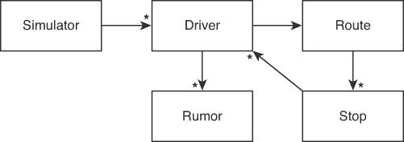

**图 8.1.** Java 版本的简单对象模型

`Simulator`持有多个`Drivers`。每个`Driver`拥有一个`Route`，每个`Route`包含多个`Stops`。每个`Stop`拥有多个`Drivers`，每个`Driver`拥有多个`Rumors`。

这是一个相当简单的对象模型。甚至没有隐含任何继承或多态。因此，它的实现过程应该非常直接。

当然，我使用 TDD（测试驱动开发）编写了 Java 代码。这里是测试用例。如你所见，它们非常冗长；但至少它们都符合一个单一测试类。如果你读过我的书《精益手艺》（Addison-Wesley, 2021），你就会理解为什么这是一件好事了。

[点击此处查看代码图片]

```java
package gossipingBusDrivers;

import org.junit.Before;
import org.junit.Test;

import static org.hamcrest.MatcherAssert.assertThat;
import static org.hamcrest.collection.IsEmptyCollection.empty;

import static org.hamcrest.collection.
  IsIterableContainingInAnyOrder.containsInAnyOrder;
import static org.junit.Assert.assertEquals;

public class GossipTest {
  private Stop stop1;
  private Stop stop2;
  private Stop stop3;
  private Route route1;
  private Route route2;
  private Rumor rumor1;
  private Rumor rumor2;
  private Rumor rumor3;
  private Driver driver1;
  private Driver driver2;

  @Before
  public void setUp() {
    stop1 = new Stop("stop1");
    stop2 = new Stop("stop2");
    stop3 = new Stop("stop3");
    route1 = new Route(stop1, stop2);
    route2 = new Route(stop1, stop2, stop3);
    rumor1 = new Rumor("Rumor1");
    rumor2 = new Rumor("Rumor2");
    rumor3 = new Rumor("Rumor3");
    driver1 = new Driver("Driver1", route1, rumor1);
    driver2 = new Driver("Driver2", route2, rumor2, rumor3);
  }

  @Test
  public void driverStartsAtFirstStopInRoute() throws Exception {
    assertEquals(stop1, driver1.getStop());
  }

  @Test
  public void driverDrivesToNextStop() throws Exception {
    driver1.drive();
    assertEquals(stop2, driver1.getStop());
  }

  @Test
  public void driverReturnsToStartAfterLastStop()
  throws Exception {
    driver1.drive();
    driver1.drive();
    assertEquals(stop1, driver1.getStop());
  }

  @Test
  public void firstStopHasDriversAtStart() throws Exception {
    assertThat(stop1.getDrivers(), containsInAnyOrder(driver1,
                                                      driver2));
    assertThat(stop2.getDrivers(), empty());
  }

  @Test
  public void multipleDriversEnterAndLeaveStops() throws Exception {
    assertThat(stop1.getDrivers(), containsInAnyOrder(driver1,
                                                      driver2));
    assertThat(stop2.getDrivers(), empty());
    assertThat(stop3.getDrivers(), empty());
    driver1.drive();
    driver2.drive();
    assertThat(stop1.getDrivers(), empty());
    assertThat(stop2.getDrivers(), containsInAnyOrder(driver1,
                                                      driver2));
    assertThat(stop3.getDrivers(), containsInAnyOrder(driver1,
                                                      driver2));
    driver1.drive();
    driver2.drive();
    assertThat(stop1.getDrivers(), containsInAnyOrder(driver1,
                                                      driver2));
    assertThat(stop2.getDrivers(), empty());
    assertThat(stop3.getDrivers(), empty());
    driver1.drive();
    driver2.drive();
    assertThat(stop1.getDrivers(), empty());
    assertThat(stop2.getDrivers(), empty());
    assertThat(stop3.getDrivers(), empty());
  }
}
```

解决方案代码被分为几个小文件。

## 程序

点击此处查看代码图片

```java
package gossipingBusDrivers;

import java.util.Arrays;

import java.util.HashSet;

import java.util.Set;

public class Driver {

  private String name;

  private Route route;

  private int stopNumber = 0;

  private Set<Rumor> rumors;

  public Driver(String name, Route theRoute,

                Rumor... theRumors) {

    this.name = name;

    route = theRoute;

    rumors = new HashSet<>(Arrays.asList(theRumors));

    route.stopAt(this, stopNumber);

  }

  public Stop getStop() {

    return route.get(stopNumber);

  }

  public void drive() {

    route.leave(this, stopNumber);

    stopNumber = route.getNextStop(stopNumber);

    route.stopAt(this, stopNumber);

  }

  public Set<Rumor> getRumors() {

    return rumors;

  }

  public void addRumors(Set<Rumor> newRumors) {

    rumors.addAll(newRumors);

  }

}
```

## 路线

点击此处查看代码图片

```java
package gossipingBusDrivers;

public class Route {

  private Stop[] stops;

  public Route(Stop... stops) {

    this.stops = stops;

  }

  public Stop get(int stopNumber) {

    return stops[stopNumber];

  }

  public int getNextStop(int stopNumber) {

    return (stopNumber + 1) % stops.length;

  }

  public void stopAt(Driver driver, int stopNumber) {

    stops[stopNumber].addDriver(driver);

  }

  public void leave(Driver driver, int stopNumber) {

    stops[stopNumber].removeDriver(driver);

  }

}
```

## 站点

点击此处查看代码图片

```java
package gossipingBusDrivers;

import java.util.ArrayList;

import java.util.HashSet;

import java.util.List;

import java.util.Set;

public class Stop {

  private String name;

  private List<Driver> drivers = new ArrayList<>();

  public Stop(String name) {

    this.name = name;

  }

  public String toString() {

    return name;

  }

  public List<Driver> getDrivers() {

    return drivers;

  }

  public void addDriver(Driver driver) {

    drivers.add(driver);

  }

  public void removeDriver(Driver driver) {

    drivers.remove(driver);

  }

  public void gossip() {

    Set<Rumor> rumorsAtStop = new HashSet<>();

    for (Driver d : drivers)

      rumorsAtStop.addAll(d.getRumors());

    for (Driver d : drivers)

      d.addRumors(rumorsAtStop);

  }

}
```

## 谣言

```java
package gossipingBusDrivers;

public class Rumor {

  private String name;

  public Rumor(String name) {

    this.name = name;

  }

  public String toString() {

    return name;

  }

}
```

## 仿真

点击此处查看代码图片

```java
package gossipingBusDrivers;

import java.util.HashSet;

import java.util.Set;

public class Simulation {

  public static int driveTillEqual(Driver... drivers) {

    int time;

    for (time = 0; notAllRumors(drivers) && time < 480; time++)

      driveAndGossip(drivers);

    return time;

  }

  private static void driveAndGossip(Driver[] drivers) {

    Set<Stop> stops = new HashSet<>();

    for (Driver d : drivers) {

      d.drive();

      stops.add(d.getStop());

    }

    for (Stop stop : stops)

      stop.gossip();

  }

  private static boolean notAllRumors(Driver[] drivers) {

    Set<Rumor> rumors = new HashSet<>();

    for (Driver d : drivers)

      rumors.addAll(d.getRumors());

    for (Driver d : drivers) {

      if (!d.getRumors().equals(rumors))

        return true;

    }

    return false;

  }

}
```

## Clojure

快速浏览这段代码会让你相信，它是以传统的面向对象风格编写的，对象相对较地封装了它们的状态。在编写 Clojure 时，我并没有从草图开始。相反，我依赖 TDD 测试来帮助设计。测试如下：点击此处查看代码图片

```clojure
(ns gossiping-bus-drivers

  (:require [clojure.core :refer :all]))

(describe "gossiping bus"

  (it "drives one bus at stop"

    (let [driver (make-driver "d1" [:s1] #{r1})

          world [driver]

          new-world (drive world)]

      (should= 1 (count new-world))

      (should= :s1 (-> new-world first))))

  (it "drives one bus at two stops"

    (let [driver (make-driver "d1" [:s1 :s2] #{r1})

          world [driver]

          new-world (drive world)]

      (should= 1 (count new-world))

      (should= :s2 (-> new-world first))))

  (it "drives two buses at some stops"

    (let [d1 (make-driver "d1" [:s1 :s2] #{r1})

          d2 (make-driver "d2" [:s1 :s3] #{r2})

          world [d1 d2]

          new-1 (drive world)

          new-2 (drive new-1)]

      (should= 2 (count new-1))

      (should= :s2 (-> new-1 first))

      (should= :s3 (-> new-1 second))))
```

快速浏览这段代码会让你相信，它是以传统的面向对象风格编写的，对象相对较地封装了它们的状态。在编写 Clojure 时，我并没有从草图开始。相反，我依赖 TDD 测试来帮助设计。测试如下：点击此处查看代码图片

（注：此处 Clojure 代码块已按要求保留且不翻译）

```clojure
(ns gossiping-bus-drivers-clojure.core

  (:require [clojure.set :as set]))
```


(defn make-driver [name route rumors]

  (assoc5 {} :name name :route (cycle6 route) :rumors rumors))

(defn move-driver [driver]

  (update7 driver :route rest))

(defn move-drivers [world]

  (map move-driver world))

(defn get-stops [world]

  (loop [world world

         stops {}]

    (if (empty? world)

      stops

      (let [driver (first world)

            stop (first (:route driver))

            stops (update stops stop conj driver)]

        (recur (rest world) stops)))))

(defn merge-rumors [drivers]

  (let [rumors (map :rumors drivers)

        all-rumors (apply set/union8 rumors)]

      (map #(assoc % :rumors all-rumors) drivers)))

(defn spread-rumors [world]

  (let [stops-with-drivers (get-stops world)

        drivers-by-stop (vals9 stops-with-drivers)]

    (flatten10 (map merge-rumors drivers-by-stop))))

(defn drive [world]

  (-> world move-drivers spread-rumors))

(defn drive-till-all-rumors-spread [world]

  (loop [world (drive world)

         time 1]

    (cond

      (> time 480) :never

      (apply = (map :rumors world)) time

      :else (recur (drive world) (inc time)))))

```

5. `assoc` 向 map 中添加元素。`(assoc {} :a 1)` 返回 `{:a 1}`。

6. `cycle` 返回一个惰性的（且“无限的”）列表，它只是无休止地重复输入列表。因此，`(cycle [1 2 3])` 返回 `[1 2 3 1 2 3 1 2 3 …]`。

7. `update` 函数返回一个元素已改变的新 map。`(update m k f a)` 通过应用函数 `(f e a)` 来改变 `m` 的 `k` 元素，其中 `e` 是元素 `k` 的旧值。因此，`(update {:x 1} :x inc)` 返回 `{:x 2}`。

8. `union` 函数来自 `set` 命名空间。注意顶部的 `ns` 将 `clojure.set` 命名空间别名为 `set`。

9. `vals` 返回 map 中所有值的列表。`keys` 返回 map 中所有键的列表。

10. `flatten` 函数将列表的列表转换为包含所有元素的列表。因此，`(flatten [[1 2][3 4]])` 返回 `[1 2 3 4]`。

这个解决方案有 42 行，而 Java 解决方案在五个文件中分布了 145 行。

两种解决方案都具有 `Driver` 的概念，但我并没有尝试将 `Route`、`Stop` 和 `Rumor` 的概念封装到独立的对象中。它们都快乐地存在于 `Driver` 之中。

糟糕的是，`Driver` “对象”并不是传统 OO 意义上的对象。它没有方法。系统中只有一个方法 `move-driver`，它作用于单个 `Driver`，但它只是为更有趣的 `move-drivers` 函数提供的一个小辅助函数。

八个函数中有六个只接受 `world` 作为参数。因此，我们可以说，这个系统中唯一的真对象是 `world`，它有五个方法。但即使这样也有些牵强。

即使我们认为 `Driver` 是一种对象，它也是不可变的。模拟的 `world` 仅仅是一个不可变 `Drivers` 列表。`drive` 函数接收 `world` 并产生一个新的 `world`，在那个新的 `world` 中，所有的 `Drivers` 都已移动了一步，并且在任何超过一个 `Driver` 到达的站点，Rumors 均已完成传播。

那个 `drive` 函数是一个重要概念的示例。注意 `world` 如何通过一个函数流水线。在这种情况下，只有两个函数，`move-drivers` 和 `spread-rumors`，但在较大的系统中，流水线可能很长。在沿流水线的每个阶段，`world` 都会被修改成略微新的形式。

这告诉我们，这个系统的划分不是关于对象的，而是关于函数的。这种不怎么分块的数据从一个独立函数传递到下一个独立函数。

你可能会说 Java 代码相对直观，而 Clojure 代码太晦密且晦涩。请相信我，适应这种晦密程度并不需要长时间，而且感知到的晦涩感只是基于不陌生的错觉。

Clojure 版本缺乏划分是一个问题吗？对于它目前的规模来说不是；但如果这个程序像大多数系统那样增长，那个问题就会以凶猛的姿态显现出来。划分 OO 程序比划分函数式程序要自然一点，因为分界线要明显得多且突出。

另一方面，我们为 Java 版本选择的分界线并不保证是有效的划分。

## 结论

我们看到了 `Prime Factors` 和 `Bowling Game` kata 的差异，但差异相对较小。`Gossiping Bus Drivers` kata 的差异大得多。这可能是因为最后一个 kata 的规模大了一点（我说是两倍），而且它是真正的有限状态机。

*有限状态机*从状态移动到状态，取决于输入事件和当前状态。当此类系统以 OO 风格编写时，状态往往存储在具有方法的变变对象中。但在函数风格中，状态外部化在不可变数据结构中。

我们从中可以推断，简单计算的程序（如 `Prime Factors`）不受 OO 或函数式风格的影响。毕竟在状态改变限制在微小问题（如数组索引）的情况下，影响微乎其微。

## 9. 对象面向编程

graphics/09_unnum_objectoriented.jpg

在前章中，我们看到 OO 编程风格与数据类型和数据内聚密切相关。但这些并不是面向对象的全部。事实上，数据内聚可能次于面向对象的另一个属性：多态。

在《整洁架构》中，(1) 我指出 OO 风格有三个属性：封装、继承和多态。然后我引导你通过推理得出，在这三者中，多态是最有益的。另外两个最好的也只是辅助性的。

-   佣金制员工每隔周五发放一次工资。他们的工资由基本工资加佣金组成。基本工资和佣金率是员工记录中的字段。佣金的计算方法是佣金率乘以该员工销售收据的总和。

-   时薪制员工每周五发放一次工资。他们的时薪是其员工记录中的一个字段。他们的工资计算方法是时薪乘以该周时间卡上的工时总和。如果总和大于 40 小时，剩余的小时将按时薪的 1.5 倍支付。

-   员工可以选择将工资单邮寄到家庭地址、留存在薪资管理员办公室或直接存入其银行账户。地址、薪资管理员和银行信息都是其员工记录中的字段。

该问题的典型对象（OO）解决方案在统一建模语言（UML）图图 9.1 中所示。

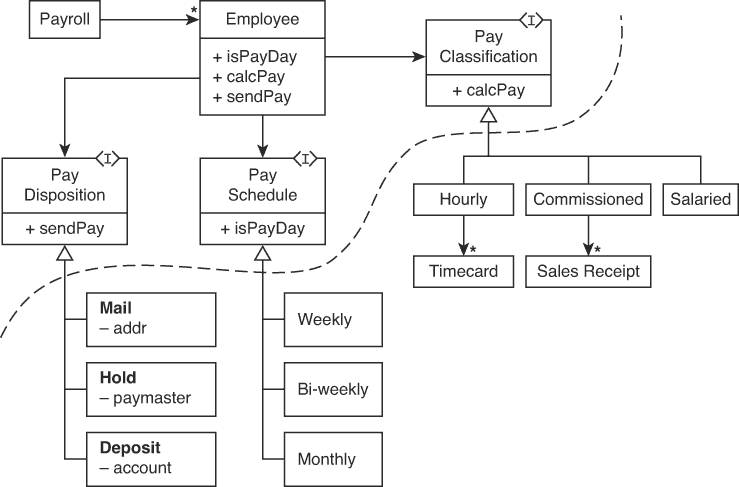

**图 9.1.** 工资问题的对象模型

也许最好的起点是 `Payroll` 类。在 Java 中，它有一个如下所示的 `run` 方法：

```java
void run() {

  for (Employee e : db.getEmployees()) {

    if (e.isPayDay()) {

      Pay pay = e.calcPay();

      e.sendPay(pay);

    }

  }

}
```

我已经在很多次、许多地方（包括上述书籍）强调过，这段小代码段就是*纯粹的真理*。对于每个员工，如果今天是他们应该领取工资的日子，就计算他们的工资并发送给他们。

从这段小代码段中，其余的实现部分应该非常清晰。这里使用了三次 *Strategy*^(3)：一个用于实现 `calcPay`，另一个用于实现 `isPayDay`，最后一个用于实现 `sendPay`。

3. Erich Gamma, Richard Helm, Ralph Johnson, and John Vlissides, *Design Patterns：可重用面向对象软件元素* (Addison-Wesley, 1995), 315.

同样清晰的是，这种对象结构必须由 `getEmployees` 函数构建，该函数从数据库中读取员工并对其进行妥善安排。数据库中的数据不太可能像这里看到的对象结构。

还有一个非常清晰的架构边界（虚线）横越了所有继承关系，将高层抽象与低层细节隔离开。

### 函数式工资管理

图 9.2 展示了这作为一个函数程序可能是什么样子。

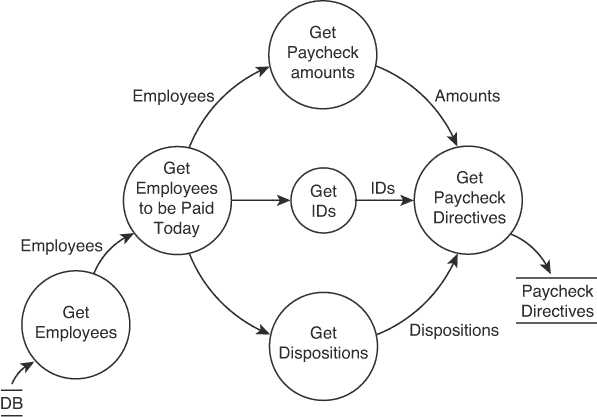

**图 9.2.** 工资问题的数据流图

我选择数据流图（DFD）来表示函数式解决方案不是很有趣吗？DFD 在描述过程与数据元素之间的关系非常有帮助，但在描述架构决策时，它们远没有 UML 类图那么有用。

尽管如此，DFD 仍然帮助我们提出了*纯粹真理*的函数式版本：

```clojure
(defn payroll [today db]

  (let [employees (get-employees db)

        employees-to-pay (get-employees-to-be-paid-today

                            today employees)

        amounts (get-paycheck-amounts employees-to-pay)

        ids (get-ids employees-to-pay)

        dispositions (get-dispositions employees-to-pay)]

    (send-paychecks ids amounts dispositions)))
```

注意，这与 Java 版本的不同之处在于它不是一种迭代方法。相反，员工列表流经程序，根据数据流图在每个阶段被修改。这是函数式程序构思和编写的典型方式。函数式程序往往更像*管道*而不是分步骤的程序。它们调节并修改数据流，而不是逐步迭代数据。

那么，架构呢？在 OO 版本的 UML 图中有一个漂亮的架构边界。函数式版本中的架构边界在哪里？

让我们深入观察一下。测试可能会给我们一些线索：

```clojure
(it "pays one salaried employee at end of month by mail"

  (let [employees [{:id "emp1"

                    :schedule :monthly

                    :pay-class [:salaried 5000]

                    :disposition [:mail "name" "home"]}]

        db {:employees employees}

        today (parse-date "Nov 30 2021")]

    (should= [{:type :mail

               :id "emp1"

               :name "name"

               :address "home"

               :amount 5000}]

             (payroll today db))))
```

在这个测试中，数据库包含一个 `employee` 列表，每个 `employee` 是一个具有特定字段的哈希映射。这和对象没有太大，对吧？`payroll` 函数返回一个工资单指令列表，每个指令都是一个哈希映射——另一个对象。

```clojure
(it "pays one employee on Friday"

  (let [employees [{:id "empid"

                    :schedule :weekly

                    :pay-class [:hourly 15]

                    :disposition [:deposit "routing" "account"]}]

        time-cards {"empid" [["Nov 12 2022" 80/10]]}

        db {:employees employees :time-cards time-cards}

        friday (parse-date "Nov 18 2022")]

    (should= [{:type :deposit

               :id "empid"

               :routing "routing"

               :account "account"

               :amount 120}]

             (payroll friday db))))
```

4. 这不是 80 除以 10。相反，它是理数 `80/10`。这确保了后续数学计算不会将其视为整数。

这个测试展示了 `employee` 和 `paycheck-directive` 对象如何根据 `:schedule`、`:pay-class` 和 `:disposition` 变化。它还显示数据库包含与 `id` 相关的 `time-card`。从此，第三个测试应该是可以预期的：

```clojure
(it "pays one commissioned employee on an even Friday"

  (let [employees [{:id "empid"

                    :schedule :biweekly

                    :pay-class [:commissioned 100 5/100]

                    :disposition [:paymaster "paymaster"]}]

        sales-receipts {"empid" [["Nov 12 2022" 15000]]}

        db {:employees employees :sales-receipts sales-receipts}

        friday (parse-date "Nov 18 2022")]

    (should= [{:type :paymaster

               :id "empid"

               :paymaster "paymaster"

               :amount 850}]

             (payroll friday db))))
```

```clojure
(defn get-pay-class [employee]

  (first (:pay-class employee)))

(defn get-disposition [paycheck-directive]

  (first (:disposition paycheck-directive)))

(defmulti is-today-payday :schedule)

(defmulti calc-pay get-pay-class)

(defmulti dispose get-disposition)

(defn get-employees-to-be-paid-today [today employees]

  (filter5 #(is-today-payday % today) employees))

(defn- build-employee [db employee]

  (assoc employee :db db))

(defn get-employees [db]

  (map (partial6 build-employee db) (:employees db)))

(defn create-paycheck-directives [ids payments dispositions]

  (map #(assoc {} :id %1 :amount %2 :disposition %3)

       ids payments dispositions))

(defn send-paychecks [ids payments dispositions]

  (for7 [paycheck-directive

        (create-paycheck-directives ids payments dispositions)]

    (dispose paycheck-directive)))

(defn get-paycheck-amounts [employees]

  (map calc-pay employees))

(defn get-dispositions [employees]

  (map :disposition employees))

(defn get-ids [employees]

  (map :id employees))
```


- 5. `(filter predicate list)` 对`list`中的每个成员调用`predicate`，并返回所有`predicate`结果非 *falsey* 的成员序列。

- 6. `partial`函数接收一个函数和一些参数，并返回一个新函数，其中所有参数都已经被初始化。因此，`((partial f 1) 2)` 等于 `(f 1 2)`。

- 7. 在这种情况下，`for`函数会对`create-paycheck-directives`返回的列表中的每个`paycheck-directive`调用`dispose`。

你看到那些`defmulti`语句（加粗）了吗？它们与 Java 接口类似，尽管并不完全相同。每个`defmulti`都定义了一个多态函数。然而，该函数并不是根据内在类型进行分发（不像 Java、C# 甚至 Ruby 和 Python 那样）。相反，它们根据名称后紧指定的函数的结果进行分发。

因此，`get-pay-class`函数返回`calc-pay`函数将进行多态分发的值。`get-pay-class`返回什么？它返回`employee`的`pay-class`字段的第一个元素。根据我们的测试，这些值是`:salaried`、`:hourly`和`:commissioned`。

那么`calc-pay`函数的实现在哪里？它们在程序的*靠后*：

点击此处查看代码图像

```clojure
(defn-8 get-salary [employee]
  (second (:pay-class employee)))

(defmethod calc-pay :salaried [employee]
  (get-salary employee))

(defmethod calc-pay :hourly [employee]
  (let [db (:db employee)
        time-cards (:time-cards db)
        my-time-cards (get9 time-cards (:id employee))
        [_ hourly-rate]10 (:pay-class employee)
        hours (map second my-time-cards)
        total-hours (reduce + hours)]
    (* total-hours hourly-rate)))

(defmethod calc-pay :commissioned [employee]
  (let [db (:db employee)
        sales-receipts (:sales-receipts db)
        my-sales-receipts (get sales-receipts (:id employee))
        [_ base-pay commission-rate] (:pay-class employee)
        sales (map second my-sales-receipts)
        total-sales (reduce + sales)]
    (+ (* total-sales commission-rate) base-pay)))
```

- 8. 结尾的`-`这是一个私有函数，因此只有该文件中的函数可以访问它。

- 9. `(get m k)`返回映射`m`中`k`的值。

- 10. *解构*`employee`的`pay-class`并忽略第一个元素。

我将 *further down* 一词使用了斜体，是因为这在 Clojure 程序中非常重要。Clojure 程序不能调用在调用点之后声明的函数。但这些函数*确实*是在调用点之后声明的。这意味着存在源码依赖倒置。`calc-pay`的实现被`payroll`函数调用；但`payroll`函数又位于`calc-pay`实现之上。

事实上，我可以将`defmulti`函数的所有实现移动到另一个源文件中，而`payroll`源文件并不`require`该文件。

如果我们画出这些源文件之间的关系，就会得到图 9.3 中的图。

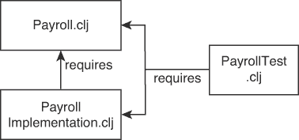

**图 9.3.** 依赖倒置

箭头描述了源文件之间的`requires`关系。`payroll`中这些`requires`的源码如下：

```clojure
(ns payroll
  (:require [payroll-interface :refer [is-today-payday calc-pay]]))
```

特别是在 Clojure 中，命名空间（namespaces）和源文件是紧密相关的。每个命名空间必须包含在自己的源文件中，且该文件名必须与命名空间的名称对应。这与 Java 强制将公共类放入以类命名的源文件中非常相似。这与`C++`和`C#`程序员使用的文件/类约定也非常相似。这可能会让你通过一个简单的翻译算法，认为每个 Clojure 命名空间都是类似于“类”的东西。

当然，这种对应关系并非完美。Clojure 命名空间的内容完全不需要像类。但总的来说，这个概念并不是坏主意。

在像 Clojure 这样的函数式语言中，巨大的诱惑之一是以某种随意的、凭感觉的方式将函数分组到命名空间。由于没有面向对象（OO）结构来强制我们将函数划分为存在独立源文件的类，我们往往得到的源文件结构比应该有的更松散、更脆弱。

因此，在编写函数式程序时，考虑面向对象的划分原则并继续应用它们并不是一个坏主意。在我们之后研究原则、模式和架构时，将会看到更多内容。

## 结论

首先，函数式程序和面向对象程序是不同的。函数式程序倾向于是调节数据流转换的管道构造，而可变的面向对象程序则倾向于对对象进行逐步迭代。然而，从架构的角度来看，这两种风格是非常兼容的。事实证明，我们可以将函数式程序的函数划分为与 OO 程序相同的具有架构意义的元素。从架构的角度来看，它们之间几乎没有区别。

函数式程序可能不是由语法强制的封装方法并定义对象的类组成的。然而，对象在函数式程序中仍然存在。这些对象与操作它们的函数绑定程度没有在面向对象语言中那么紧密。这是优势还是劣势，我们将在后续章节中继续探讨。

我们将看到，随着这些页面越来越转向设计和架构，函数式程序与不可变对象的面向对象之间的差异将变得越来越不相关。

# 10 种类

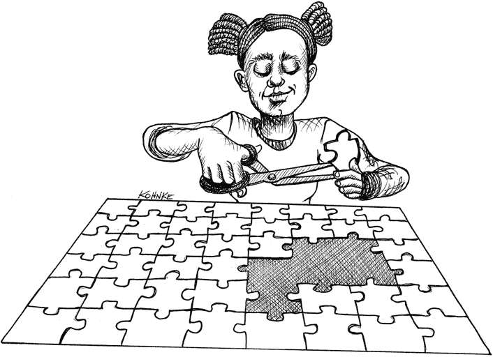

上一章可能让你感到有些困惑。我称之为对象的那些其实只是哈希映射（hash maps），并且完全没有类型。任何人都可以向它们放入任何东西，而没有任何任何限制。`:pay-class`中的薪水可以是一个字符串而不是数字。`:schedule`字段可以是一个整数而不是适当的关键字。

简之，这些对象不是静态类型的。编译器不检查它们。因此，一切都会陷入混乱！

许多函数式语言以及许多面向对象语言都是静态类型的，以防止这种混乱。其他语言如`Clojure`、`Python`和`Ruby`则依赖于其他机制来防止这种混乱。

我们这些实践 TDD（测试驱动开发）的人通常并不担心这种混乱。我们的测试通常能确保我们传递的对象是正确构造的。尽管如此，在复杂系统中，所有对象的整体可能会变得非常复杂，我们需要一种更正式、更完整的方式来确保类型完整性，而不是动态类型语言（甚至是大多数静态类型语言）所能提供的。

在 Clojure 中，我使用`clojure.spec`库来实现类型完整性的目标。我们工资示例的类型规范如下：

```clojure
(s/def ::id string?)
(s/def ::schedule #{:monthly :weekly :biweekly})
(s/def ::salaried-pay-class (s/tuple #(= % :salaried) pos1?))
(s/def ::hourly-pay-class (s/tuple #(= % :hourly) pos?))
(s/def ::commissioned-pay-class (s/tuple #(= % :commissioned)
                                         pos? pos?))
(s/def ::pay-class (s/or :salaried ::salaried-pay-class
                         :Hourly ::hourly-pay-class
                         :Commissioned ::commissioned-pay-class))
(s/def ::mail-disposition (s/tuple #(= % :mail) string? string?))
(s/def ::deposit-disposition (s/tuple #(= % :deposit)
                                      string? string?))
(s/def ::paymaster-disposition (s/tuple #(= % :paymaster)
                                        string?))
(s/def ::disposition (s/or :mail ::mail-disposition
                           :deposit ::deposit-disposition
                           :paymaster ::paymaster-disposition))
(s/def ::employee (s/keys :req-un [::id ::schedule
                                   ::pay-class ::disposition]))
(s/def ::employees (s/coll-of ::employee))
(s/def ::date string?)
(s/def ::time-card (s/tuple ::date pos?))
(s/def ::time-cards (s/map-of ::id (s/coll-of ::time-card)))
(s/def ::sales-receipt (s/tuple ::date pos?))
(s/def ::sales-receipts (s/map-of
                           ::id (s/coll-of ::sales-receipt)))
(s/def ::db (s/keys :req-un [::employees]
                    :opt-un [::time-cards ::sales-receipts]))
(s/def ::amount pos?)
(s/def ::name string?)
(s/def ::address string?)
(s/def ::mail-directive (s/and #(= (: %) :mail)
                               (s/keys :req-un [::id
                                                ::name
                                                ::address
                                                ::amount])))
(s/def ::routing string?)
(s/def ::account string?)
(s/def ::deposit-directive (s/and #(= (: %) :deposit)
                                  (s/keys :req-un [::id
                                                   ::routing
                                                   ::account
                                                   ::amount])))
(s/def ::paymaster string?)
(s/def ::paymaster-directive (s/and #(= (: %) :paymaster)
                                    (s/keys :req-un [::id
                                                     ::paymaster
                                                     ::amount])))
(s/def ::paycheck-directive (s/or
                              :mail ::mail-directive
                              :deposit ::deposit-directive
                              :paymaster ::paymaster-directive))
(s/def ::paycheck-directives (s/coll-of ::paycheck-directive))
```

`(pos? x)` 如果`x`是一个大于零的数字，则返回 true。

随着我们不断深入，我们看到`::employee`是一个哈希映射，要求包含键`:id`、`:schedule`、`:pay-class`和`:disposition`。继续探索你会发现`:id`必须是字符串；`:schedule`必须是`:monthly`、`:weekly`或`:biweekly`之一；而`:salaried-pay-class`是一个元组，包含`:salaried`以及随后的一个正数。

`s/or`语句可能会让你有些困惑。参数是成对出现的，每对中的第一个只是该备选方案的名称。因此，在`::disposition`定义中，`:mail`只是`::mail-disposition`备选方案的名称。不用担心，如果你某天决定阅读`clojure.spec`的文档，一切都会变得清晰。

那么，既然有了如此详尽的类型规范，我们如何使用它呢？我有时会在测试中如下使用：

点击此处查看代码图像

```clojure
(it "pays one salaried employee at end of month by mail"
  (let [employees [{:id "emp1"
                    :schedule :monthly
                    :pay-class [:salaried 5000]
                    :disposition [:mail "name" "home"]}]
        db {:employees employees}
        today (parse-date "Nov 30 2021")]
    (should (s/valid? ::db db))
    (let [paycheck-directives (payroll today db)]
      (should (s/valid? ::paycheck-directives 
                     paycheck-directives))
      (should= [{:type :mail
                 :id "emp1"
                 :name "name"
                 :address "home"
                 :amount 5000}]
               paycheck-directives))))
```

寻找对`s/valid?`的调用，该函数在数据匹配规范时返回 true。仔细看，你会发现我进输入时检查了`::db`规范，在输出时检查了`::paycheck-directives`规范。这非常安全。如果我的测试覆盖率很高，并且它们都检查了所调用函数的输入和输出规范，那么类型违规的情况将极其罕见。

偶尔，我还会使用 Clojure 的`:pre`和`:post`功能，在应用程序的主处理函数执行前后对关键数据运行规范。

例如，这里是我几年前写的一个`spacewar`^(2) 游戏的主处理步骤：

2. [`github.com/unclebob/spacewar`](https://github.com/unclebob/spacewar)

点击此处查看代码图像

```clojure
(defn update-world [ms world]
  ;{:pre [(valid-world? world)]
  ; :post [(valid-world? %)]}
  (->> world
       (game-won ms)
       (game-over ms)
       (ship/update-ship ms)
       (shots/update-shots ms)
       (explosions/update-explosions ms)
       (clouds/update-clouds ms)
       (klingons/update-klingons ms)
```


# I.

## 时间管理

`(bases/update-bases ms)`  
`(romulans/update-romulans ms)`  
`(view-frame/update-messages ms)`  
`(add-messages)`

`:pre` 和 `:post` 语句被注释掉了，^(3)，但如果我怀疑某种糟糕的类型损坏，它们随时准备好重新断言。

3. 我不太喜欢注释掉的代码。随着项目的成熟，我会删除这些行。

## 结论

关于静态类型与动态类型之争，存在许多哀嚎和切齿。双方都在向对方大吼，而不听听对方在说什么。我认为双方都有道理。动态类型让代码更容易编写。静态类型让代码更安全、更容易理解，并且在内部一致性上高得多。在我看来，像 `clojure.spec` 这样的库达成了极佳的平衡。它让你拥有根据需要进行尽可能多或尽可能少类型检查的能力。它允许你指定何时*检查*类型，何时*不检查*。此外，它还允许你指定任何静态类型系统都*无法*检查的动态约束。因此，对我来说，这样的库带给你比两者兼得更好的体验。

# II.

# 函数式设计

## 11. 数据流


在第 9 章面向对象编程中，我建议函数式程序的设计更像管道而不是过程。它有明确的数据流偏向。这是因为我们倾向于使用 `map`、`filter` 和 `reduce` 将列表内容转换为其他列表，而不是逐个元素迭代问题以产生结果。

我们在之前的许多例子中都能看到这种偏向，包括第二部分 比较分析中的保龄球游戏、八卦的巴士司机和薪资发放应用程序。

另一个例子，考虑来自 2022 年 Advent of Code 第十天的这个有趣问题^(1)。目标是在 6x40 的屏幕上渲染像素。像素根据时钟电路从左到右一个一个地绘制。时钟周期从 0 开始计数。如果某个寄存器 `x` 匹配时钟周期数，则相应屏幕位置的像素打开；否则关闭。

1. [`adventofcode.com/2022/day/10`](https://adventofcode.com/2022/day/10)

这实际上是旧 CRT^(2) 显示器工作的一种典型方式。你必须在电子束扫描屏幕的恰好时刻对其励电。因此，你将位图中的位与驱动该束的时钟匹配。如果根据时钟，位是 934，则相应屏幕位置的像素被打开；否则关闭。

2. 阴极射线。*阴极射线*是电子。CRT 拥有电子枪，产生电子束，通过周期变化的磁场在屏幕上扫描。电子束击中屏幕上的荧光粉使其发光，从而创建栅格图像。

Advent of Code 问题更有趣一点。它要求我们模拟一个简单的处理器，它有两个指令。第一个指令是 `noop`，占用一个时钟周期但没有其他影响。另一个指令是 `addx`，它接受一个整数参数 `n` 并将其加入处理器的 `x` 寄存器。该指令消耗两个时钟周期，并在两个周期完成后才修改 `x` 寄存器。如果在该周期开始时 `x` 寄存器匹配时钟周期，屏幕上的像素在该周期内可见。

所以如果根据时钟，电子束位于位置 23，且在周期 23 开始时 `x` 寄存器为 23，则在该周期内激发电子束。

为了让情况稍微复杂一点，`x` 寄存器与时钟周期的匹配被放宽，使得 22、23 和 24 匹配时钟周期 23。也就是说，`x` 寄存器指定了一个三像素宽的窗口。只要时钟周期落在窗口内，电子束就会被激发。

由于屏幕宽 40 像素，高 6 像素，时钟周期与 `x` 的匹配是模 40。

任务是执行一组指令并产生六个每个 40 个字符的字符串，其中 `#"` 表示可见的像素，`."` 表示不可见的像素。

如果你用 Java、C、Go、C++、C# 或任何其他过程/面向对象的语言编写此程序，可能会创建一个循环，每次迭代一次周期，积累每个周期的相应像素。循环会消耗指令并按照指示修改 `x` 寄存器。

这是一个典型的 Java 示例：

```java
package crt;

public class Crt {

  private int x;

  private String pixels = "";

  private int extraCycles = 0;

  private int cycle = 0;

  private int ic;

  private String[] instructions;

  public Crt(int x) {

    this.x = x;

  }

  public void doCycles(int n, String instructionsLines) {

    instructions = instructionsLines.split("\n");

    ic = 0;

    for (cycle = 0; cycle < n; cycle++) {

      setPixel();

      execute();

    }

  }

  private void execute() {

    if (instructions[ic].equals("noop"))

      ic++;

    else if (instructions[ic].startsWith("addx ")

             && extraCycles == 0) {

      extraCycles = 1;

    }

    else if (instructions[ic].startsWith("addx ")

             && extraCycles == 1) {

      extraCycles = 0;

      x += Integer.parseInt(instructions[ic].substring(5));

      ic++;

    } else

      System.out.println("TILT");

  }

  private void setPixel() {

    int pos = cycle % 40;

    int offset = pos - x;

    if (offset >= -1 && 1 >= offset)

      pixels += "#";

    else

      pixels += ".";

  }

  public String getPixels() {

    return pixels;

  }

  public int getX() {

    return x;

  }

}
```

注意所有的可变状态。注意它是如何一个周期一个周期地填充 `pixels` 的。还要注意 `extraCycles` 的奇妙处理，它是为了考虑到 `addx` 需要两个周期才能执行这一事实。

最后，请注意尽管程序很好地划分成了几个较小的函数，但这些函数都是通过可变状态变量耦合在一起的。当然，这正是可变类中方法的常态。

我今天用 Clojure 解决了这个问题。我得出的解决方案与上面的 Java 代码非常不同。在阅读这里时请记住从底部开始看。Clojure 程序总是从自底向上编写的。

```clojure
(ns day10-cathode-ray-tube.core

  (:require [clojure.string :as string]))

(defn noop [state]

  (update state :cycles conj (:x state)))

(defn addx [n state]

  (let [{:keys [x cycles]} state]

    (assoc state :x (+ x n)

                 :cycles (vec (concat cycles [x x])))))

(defn execute [state lines]

  (if (empty? lines)

    state

    (let [line (first lines)

          state (if (re-matches #"noop" line)

                  (noop state)

                  (if-let [[_ n] (re-matches

                                   #"addx (-?\d+)" line)]

                    (addx (Integer/parseInt n) state)

                    "TILT"))]

      (recur state (rest lines)))))

(defn execute-file [file-name]

  (let [lines (string/split-lines (slurp file-name))

        starting-state {:x 1 :cycles []}

        ending-state (execute starting-state lines)]

    (:cycles ending-state)))

(defn render-cycles [cycles]

  (loop [cycles cycles

         screen ""

         t 0]

    (if (empty? cycles)

      (map #(apply str %) (partition 40 40 "" screen))

      (let [x (first cycles)

            offset (- t x)

            pixel? (<= -1 offset 1)

            screen (str screen (if pixel? "#" "."))

            t (mod (inc t) 40)]

        (recur (rest cycles) screen t)))))

(defn print-screen [lines]

  (doseq [line lines]

    (println line))

  true)

(defn -main []

  (-> "input"

      execute-file

      render-cycles

      print-screen))
```

3. `TILT` 是我最喜欢的错误信息。很久以前，弹珠机如果你从物理上倾斜机器来操纵球，它就会显示这条信息并取消你的游戏。

`execute-file` 函数将命名文件中的指令列表转换为结果 `x` 值的列表。然后 `render-cycles` 函数将 `x` 值的列表转换为像素列表，最后它将其 `partition` 分成 40 个字符的字符串。

注意，当然，这里没有可变变量。相反的，`state` 值像流过管道一样，流经了每个函数。

`state` 值从 `execute-file` 开始，然后流向 `execute`，然后反复流向 `noop` 或 `addx`，然后回到 `execute`，最后回到 `execute-file`。在流流的每个阶段，都会从旧值中创建一个新的 `state` 值，而不改变旧值。

如果你觉得这听起来异常地熟悉，那它确实如此。这非常像我们在命令行 Shell 中已经习惯的管道（pipes）和过滤器（filters）。数据从管道流入一个命令，经过该命令转换，然后流出。

# III.

## 设计原则

这些人员可以分为被称为 `roles`（角色）或 `actors`（参与者）的组。一个参与者是指一个人或一组人，他们对系统有相同的需求。他们所请求的变化类型将是一致的。相反，不同的参与者有不同的需求。一个参与者请求的变化对系统的影响与其他参与者所请求的变化的影响截不相同。这些迥异的变化甚至可能是背道而驰的。

当一个模块负责多个参与者时，这些相互竞争的参与者所请求的变化可能会相互干扰。这种干扰通常会导致 `fragility`（脆弱性）这一设计气味，导致系统在进行简单更改时以意想不到的方式崩溃。

对于经理和客户来说，没有什么比系统在进行简单功能更改后突然以惊人的方式出错更令他们恐惧的。如果这种情况频繁发生，他们得出的唯一结论就是开发人员已经失去了对系统的控制，并且不知道自己在做什么。

违反 `SRP` 可能仅仅是如在同一个模块中混合 GUI 格式化代码和业务规则代码。也可能复杂如在数据库中使用存储过程来实现业务规则。

这里有一个用 Clojure 编写的糟糕 SRP 违反的简单示例。首先，让我们看看测试，因为它们讲述了故事：

```clojure
(describe "Order Entry System"

  (context "Parsing Customers"

    (it "parses a valid customer"

      (should=

        {:id "1234567"

         :name "customer name"

         :address "customer address"

         :credit-limit 50000}

        (parse-customer

          ["Customer-id: 1234567"

           "Name: customer name"

           "Address: customer address"

           "Credit Limit: 50000"])))

    (it "parses invalid customer"

      (should= :invalid

               (parse-customer

                 ["Customer-id: X"

                  "Name: customer name"

                  "Address: customer address"

                  "Credit Limit: 50000"]))

      (should= :invalid

               (parse-customer

                 ["Customer-id: 1234567"

                  "Name: "

                  "Address: customer address"

                  "Credit Limit: 50000"]))

      (should= :invalid

               (parse-customer

                 ["Customer-id: 1234567"

                  "Name: customer name"

                  "Address: "

                  "Credit Limit: 50000"]))

      (should= :invalid

               (parse-customer

                 ["Customer-id: 1234567"

                  "Name: customer name"

                  "Address: customer address"

                  "Credit Limit: invalid"])))

    (it "makes sure credit limit is <= 50000"

      (should= :invalid

               (parse-customer

                 ["Customer-id: 1234567"

                  "Name: customer name"

                  "Address: customer address"

                  "Credit Limit: 50001"])))))
```

第一个测试告诉我们，正在将某些文本输入解析为客户记录。该记录有四个字段：`id`、`name`、`address` 和 `credit-limit`。接下来的四个测试告诉我们关于语法错误的信息，如输入缺失或格式不正确。

最后一个测试是有意思的。它测试了一个业务规则。在解析输入时中测试业务规则是明显的 SRP 违反。解析代码可以安全地验证语法错误，但它应该避免所有的 `semantic`（语义）检查，因为这些检查属于另一个参与者的范畴。指定输入格式的参与者与指定最大允许信用限额的参与者不是同一个人。(3)

3. 即使这两个参与者是同一个人，事实也是成立的。在这种情况下，这个人扮演了两个不同的角色。

通过这些测试的代码加剧了问题：

```clojure
(defn validate-customer

  [{:keys [id name address credit-limit] :as customer}]

  (if (or (nil? id)

          (nil? name)

          (nil? address)

          (nil? credit-limit))

    :invalid

    (let [credit-limit (Integer/parseInt credit-limit)]

      (if (> credit-limit 50000)

        :invalid

        (assoc customer :credit-limit credit-limit)))))

(defn parse-customer [lines]

  (let [[_ id] (re-matches #"^Customer-id: (\d{7})$"
```


`(nth lines 0))`

`[_ name] (re-matches #"^Name: (.+)$" (nth lines 1))`

`[_ address] (re-matches #"^Address: (.+)$" (nth lines 2))`

`[_ credit-limit] (re-matches #"^Credit Limit: (\d+)$" (nth lines 3))]`

```clojure
(validate-customer
  {:id id
   :name name
   :address address
   :credit-limit credit-limit})
```

看`validate-customer`函数是如何将语法检查与限制信用限额的语义业务规则混合在一起的。

更糟糕的是，考虑一个诚实使用`clojure/spec`来定义`customer`类型的程序员：

```clojure
(s/def ::customer (s/keys
                    :id s/string?
                    :name s/string?
                    :address s/string?
                    :credit-limit (s/and int?
                                       #(<= % 50000))))
```

该规范正确地约束了数据在语法上是正确的；但它也施加了信用限额不能超过 50000 的语义规则。

为什么要担心将限额限制与数据的语法混合在一起？是因为我预计数据的语法和限额限制是由不同的参与者指定的。而且预计这些参与者会在不同的时间请求更改。我不希望语法的更改意外破坏业务规则。

当然，这引出了一个问题：语义验证应该在哪里？答案是，语义验证应该位于可能更改它们的模块中。例如，如果有一个规定信用限额不能超过 50000 的业务规则，那么执行代码应该放在处理所有信用限额的模块中。

### 开闭原则 (OCP)

`OCP` 由 Bertrand Meyer 在其 1988 年的经典著作《面向对象的软件构造》中首次提出。(4) 转述一下，这意味着软件模块应该是扩展开放的，对修改关闭的。这意味着你希望设计你的模块，使得扩展或更改其行为不需要修改其代码。

这听起来可能自矛盾，但实际上是我们一直在做的事情。例如，考虑 C 语言中的`copy`程序：

```c
void copy() {
  int c;
  while ((c = getchar()) != EOF)
    putchar(c);
}
```

该程序从`stdin`复制字符到`stdout`。我随时可以向操作系统添加新设备。例如，我可以向系统添加光学字符识别 (OCR) 和文本语音合成器。这个程序仍然会正常运行而不会报错，并乐意地将字符从 OCR 复制到语音合成器，而无需进行任何修改或重新编译。

这是一个非常强大的想法，允许我们将高层策略与低层细节分离，并保持高层策略不受低层细节变化的影响。然而，这意味着高层策略通过抽象层来访问低层细节。

在面向对象（OO）程序中，我们通常通过多态接口来创建该抽象层。在 Java、C# 和 C++ 等静态类型语言中，这些接口是带有抽象方法的类^(5)。高层策略通过这些接口访问实现或继承了这些接口的低层细节。

5。Java 和 C# 中的`interface`关键字定义了每个方法都为抽象的类。

在 Python 和 Ruby 等动态类型面向对象语言中，这些接口是鸭子类型（duck types）。`鸭子类型`在语言中没有特定的语法。它们仅仅是由高层策略调用并由低层细节实现的函数签名集合。动态类型系统通过匹配这些签名在运行时确定多态分发。

某些函数式语言（如 F# 和 Scala）构建在面向对象的基础上，因此可以利用该基础的多态接口。但函数式语言长期以来一直另一种创建 OCP 抽象层的机制：函数。

## 函数

考虑这个简单的 Clojure 程序：

```clojure
(defn copy [read write]
  (let [c (read)]
    (if (= c :eof)
      nil
      (recur read (write c)))))
```

这在本质上与 C 语言编写的`copy`程序相同，只是读和写函数被作为参数传递了^(6)。尽管如此，OCP 的抽象层仍然保持完整。

6. 作为参数传递的函数或作为函数返回值的函数有时被称为`高阶函数`。

顺便说一下，我使用以下测试了这个程序。我觉得你会发现这很有趣。

```clojure
(def str-in (atom nil))
(def str-out (atom nil))

(defn str-read []
  (let [c (first @str-in)]
    (if (nil? c)
      :eof
      (do
        (swap! str-in rest)
        c))))

(defn str-write [c]
  (swap! str-out str c)
  str-write)

(describe "copy"
  (it "can read and write using str-read and str-write"
    (reset! str-in "abcedf")
    (reset! str-out "")
    (copy str-read str-write)
    (should= "abcdef" @str-out)))
```

我使用`atom`是因为 I/O 是一种副作用，不是纯函数。毕竟，当你从输入读取或向输出写入时，你正在改变它们的状态。因此，低层 I/O 函数不是纯函数，并使用软件事务内存（Software Transactional Memory）来管理状态的变更。

### 带有虚函数表（Vtables）的对象

对于那些渴望面向对象编程同学，可以使用以下技术向`copy`传递一个"对象"：

```clojure
(defn copy [device]
  (let [c ((:getchar device))]
    (if (= c :eof)
      nil
      (do
        ((:putchar device) c)
        (recur device)))))
```

测试简单地加载了带有函数的设备映射：

```clojure
(it "can read and write using str-read and str-write"
    (reset! str-in "abcedf")
    (reset! str-out "")
    (copy {:getchar str-read :putchar str-write})
    (should= "abcdef" @str-out))
```

C++ 程序员会识别出`device`参数仅仅是一个虚函数表（vtable）——这是 C++ 中的多态机制。无论如何，显而易见的是你可以为`copy`程序定义许多不同的设备。你可以在不修改它的情况下扩展`copy`的行为。

### 多方法（Multi-methods）

该主题的另一个变体是使用多方法。许多语言（无论是函数式的还是其他的）都以某种方式支持多方法。`多方法`是鸭子类型的另一种形式，因为它们创建了一组松散的方法，根据它们的函数签名和参数的"类型"^(7)进行动态分发。

7.我在这里使用引号是因为参数的"类型"并不一定与其特定的数据类型相关。事实上，那个"类型"可以是一个完全不同的概念。

在 Clojure 中，我们使用传统的`分发函数`（dispatching function）方法来指定该"类型"：

```clojure
(defmulti getchar (fn [device] (:device)))
```

该协议将成为一个 Java `interface`，可以独立编译成`jar`文件以进行动态加载。该协议的实现（如下所示）同样可以独立编译和加载：

```clojure
(defrecord str-device [in-atom out-atom]
  device
  (getchar [_]
    (let [c (first @in-atom)]
      (if (nil? c)
        :eof
        (do
          (swap! in-atom rest)
          c))))
  (putchar [_ c]
    (swap! out-atom str c)))

(describe "copy"
  (it "使用 str-read 和 str-write 进行读写"
    (let [device (->str-device (atom "abcdef") (atom nil))]
      (copy device)
      (should= "abcdef" @(:out-atom device)))))
```

注意测试中的`->str-device`函数。它本质上是实现`device`协议的`str-device`类的 Java 构造函数。同样注意，我像上一个示例一样将`atom`加载到了设备中。

事实上，我并没有为了让这个示例运行而修改`copy`程序。`copy`程序与多方法（multi-method）示例中的完全一致。这就是 OCP 的用处！

如果觉得 Clojure 的协议/记录机制看起来像面向对象（OO），那是因为它确实是 OO。JVM 是一个 OO 基础，而 Clojure 非常完美地构建在该基础之上。

### 里科夫替换原则 (LSP)

任何支持 OCP 的语言也必须支持 LSP。这两个原则是关联的，因为对 LSP 的每一次违反都是对 OCP 的潜在违反。

`LSP` 最初由 Barbara Liskov 在 1988 年提出，^(9)，她对子类型提供了一个或或正式的定义。从本质上说，她说在任何使用基类型的程序中，子类型都必须能够替换基类型。

9。巧合的是，那是 Bertrand Meyer 发布 OCP 的同一年。

为了澄清这一点，假设我们有一个使用`employee`类型的程序`pay`：

```clojure
(defn pay [employee pay-date]
  (let [is-payday? (:is-payday employee)
        calc-pay (:calc-pay employee)
        send-paycheck (:send-paycheck employee)]
    (when (is-payday? pay-date)
      (let [paycheck (calc-pay)]
        (send-paycheck paycheck)))))
```

注意我正在使用`vtable`方法来创建类型。同样注意，类型内部的数据对`pay`函数是完全隐藏的。`pay`函数能看到的只有`employee`类型中的方法。你还能得到什么程度的 OO？

这里是使用该类型的测试代码。注意`make-test-employee`函数创建了一个使用`鸭子类型`（duck typing）来符合`employee`类型的对象：

```clojure
(defn test-is-payday [employee-data pay-date]
  true)

(defn test-calc-pay [employee-data]
  (:pay employee-data))

(defn test-send-paycheck [employee-data paycheck]
  (format "Send %d to: %s at: %s"
          paycheck
          (:name employee-data)
          (:address employee-data)))

(defn make-test-employee [name address pay]
  (let [employee-data {:name name
                       :address address
                       :pay pay}
        employee {:employee-data employee-data
                  :is-payday (partial test-is-payday
                                      employee-data)
                  :calc-pay (partial test-calc-pay employee-data)
                  :send-paycheck (partial test-send-paycheck
                                          employee-data)}]
    employee))

(describe "Payroll"
  (it "支付薪资员工"
    (should= "Send 100 to: name at: address"
             (pay (make-test-employee "name" "address" 100)
                  :now))))
```

注意`make-test-employee`使用了指向实现的（PIMPL)^(10) 模式来隐藏`:employee-data`字段中的数据并仅暴露方法。最后，注意所有多态方法都将`employee-data`作为第一个参数。噢，太 OO 了！然而完全是函数式的。

10。将所有数据保留在单个字段后面以保持其私有性。访问 [`cpppatterns.com/patterns/pimpl.html`](https://cpppatterns.com/patterns/pimpl.html)。

很明显，我可以创建许多不同类型的员工对象并将它们传递给`pay`函数，而无需修改`pay`函数。这就是 OCP。

然而，为了实现这一点，我必须确保我创建的每个员工对象都符合`pay`函数的预期。如果这些方法中的一个执行了`pay`不预期的操作，`pay`就会出问题。例如，这个测试失败了：

```clojure
(it "不支付一个发放日今天的员工"
        (should-be-nil
          (pay (make-later-employee "name" "address" 100)
               :now)))
```

因为它`make-later-employee`不符合`pay`函数对`:is-payday`方法的预期。如下所示，它返回了`:tomorrow`而不是`false`：

```clojure
(defn make-later-employee [name address pay]
  (let [employee (make-test-employee name address pay)
        is-payday (partial (fn [_] :tomorrow)
                            (:employee-data))]
    (employee)))
```

为了让这些正常工作，我们需要如下定义`set-h`、`set-w`和`area`函数：

```clojure
(defn set-h [rect h]
  (assoc rect :h h))

(defn set-w [rect w]
  (assoc rect :w w))

(defn area [rect]
  (* (:h rect) (:w rect)))
```

这里没有任何地方是意外的。矩形对象是不可变的。`set-h`和`set-w`函数仅仅是创建了带有更改参数的新矩形。

所以，让我们充实一下内容，创建一个使用我们矩形的小系统。这里是测试用例：

```clojure
(describe "Rectangle"
  (it "calculates proper area and perimeter"
    (should= 25 (area (make-rect 5 5)))
    (should= 18 (perimeter (make-rect 4 5)))
    (should= 12 (-> (make-rect 1 1) (set-h 3) (set-w 4) area)))
```


### 最小化增加面积

```clojure
(it "minimally increases area"
  (should= 15 (-> (make-rect 3 4) minimally-increase-area area))
  (should= 24 (-> (make-rect 5 4) minimally-increase-area area))
  (should= 20 (-> (make-rect 4 4) minimally-increase-area area)))
```

这里是通过这些测试的函数：

```clojure
(defn perimeter [rect]
  (let [{:keys [h w]} rect]
    (* 2 (+ h w))))

(defn minimally-increase-area [rect]
  (let [{:keys [h w]} rect]
    (cond
      (>= h w) (make-rect (inc h) w)
      (> w h) (make-rect h (inc w))
      :else :tilt)))
```

`{:keys [h w]}` 会将 map 解构为命名的组件。在这种情况下，它等同于 `(let [h (:h rect) w (:w rect)]`……

再次，这并没有什么意外的。也许你对 `minimally-increase-area` 函数感到困惑。这个函数只是以可能的最小整数增量增加矩形的面积。^(14)

14. 假设所有的长度和宽度都是整数。

现在，让我们想象这个系统已经运行了多年并且非常成功。但最近，系统的客户一直在要求正方形。我们如何向系统中添加正方形呢？

如果我们应用 ISA（是一个...）规则，我们可能会认为正方形是一个矩形，因此我们应该让接受矩形的函数也接受正方形。在 Java 中，我们可能通过从 `Rectangle` 类派生出 `Square` 类来实现。在 Clojure 中，我们可以通过简单创建边相等的矩形来实现：

```clojure
(defn make-square [side]
  (make-rect side side))
```

这应该让我们稍微感到困扰，因为 `square` 对象的大小与 `rectangle` 对象的大小相同。`square` 类型的对象应该更小，因为它们不需要同时高度和宽度。但内存是廉价的，而且我们想要保持简单，对吧？

问题是，我们所有的测试仍然能通过吗？它们理应能通过，因为我们的正方形实际上只是矩形（啊，那正是 ISA 规则！）。

这些测试通过良好：

```clojure
(should= 36 (area (make-square 6)))
(should= 20 (perimeter (make-square 5)))
```

这个通过了，但它很令人困扰，因为在其中的某处，“正方形性”丢失了：

```clojure
(should= 12 (-> (make-square 1) (set-h 3) (set-w 4) area))
```

函数 `set-h` 和 `set-w` 在接收到 `square` 时并没有返回一个 `square`。这有点奇怪；但在某种诡异的情况下，它实际上是有道理的。我的意思是，如果你在不改变宽度的情况下设置 `square` 的高度，它就不再是一个 `square` 了，对吗？

如果你现在感到脑后勺有点发痒，你可能应该关注一下。

不管，我们的 `minimally-increase-area` 测试呢？它通过了吗？

```clojure
(should= 30 (-> (make-square 5) minimally-increase-area area))
```

是的，它也通过了。当然，它应该通过，因为该函数只是根据需要增加高度或宽度。

看起来我们已经完成了，而且这运行得非常棒！

#### 不！

几天后，我们的客户给我们打了电话，他不高兴。他一直尝试使用正方形，并发现 `set-h` 和 `set-w` 函数在接收到 `square` 时并没有返回一个 `square`。

“当你在现实世界中看到两个显然通过‘是一个’连接起来的对象时，你可能想在代码中创建子类关系。小心这一点。你可能会触犯代表规则并违反 LSP（里替换原则）。仅仅因为几何学上的正方形是矩形，并不意味着代码中的 `square` 对象是代码中的 `rectangle` 对象。`square` 类型对象的行为与 `rectangle` 对象的行为不同。”

#### 代表规则 (Representative Rule)

我倾向于最后这种选择。因为我不喜欢 ISA 规则。事物的代表并不共享它们所代表的东西。仅仅因为几何学上的正方形是矩形，它们并不共享这些关系。

### 接口隔离原则 (ISP)

该原则的名称源于它在静态类型对象语言中的起源。我用来描述 ISP 的示例对于 Java、C# 和 C++ 等语言非常有效，因为这些语言依赖于声明接口。在 Ruby、Python、JavaScript 和 Clojure 等动态类型语言中，这些示例并不特别适用，因为在这些语言中，接口是未声明的，并且通过鸭子类型已经隔离了。

例如，考虑以下 Java 接口：

```java
interface AtmInteractor {
  void requestAccount();
  void requestAmount();
  void requestPin();
}
```

在这里我们看到三个方法绑定在 `AtmInteractor` 接口中。因此，该接口的任何用户都依赖于所有三个方法，即使该用户只调用其中一个。因此，该用户依赖了多于它需要的。如果其中一个方法的签名发生变化，或者在该接口中添加了另一个方法，那么该用户将不得不重新编译和部署，使得设计变得不必要的脆弱。

我们通过如下隔离接口来解决静态类型对象语言中的这种缺陷：

```java
interface AccountInteractor {
  void requestAccount();
}

interface AmountInteractor {
  void requestAmount();
}

interface PinInteractor {
  void requestPin();
}
```

然后，每个用户都可以仅依赖它们需要调用的方法，而实现可以多重实现这些接口：

```java
public class AtmInteractor implements AccountInteractor,
                                      AmountInteractor,
                                      PinInteractor {
  void requestAccount() {…};
  void requestAmount() {…};
  void requestPin() {…};
}
```

或许图 12.1 中的 UML 图会使这一切更清晰。通过分离接口，三个用户只依赖于他们需要的方法；然而这些方法可以由单个类来实现。

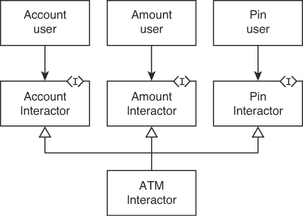

在 Clojure 中，我们可以使用鸭子类型技术之一来解决这个问题：

```clojure
(defmulti request-account :interactor)
(defmulti request-amount :interactor)
(defmulti request-pin :interactor)
```

这三个多变方法（multi-methods）并没有绑定在同一个声明下。事实上，它们甚至不需要保持在同一个源文件中。相反，它们可以在特定于其功能的模块中声明。因此，如果其中一个方法的签名发生了变化，或者添加了新的多变方法，不会对未发生变化的多变方法的用户产生影响。如果它们被预编译了，^(15)它们将不需要重新编译。

15. Clojure 允许模块进行预编译以加快加载。

这意味着在像 Clojure 这样的动态类型语言中，它更容易避免依赖你并不需要的东西。但这并不意味着该原则不适用。

### 不要依赖你不需要的东西

回到名称上。`接口分离原则`中的“接口（Interface）”一词并不仅仅局限于 Java、C# 和 C++ 中的接口类。相反，它适用于该词的通用含义。一个模块的“接口”就是该模块内部所有访问点的列表。

Java 和 C#（根据强惯例，也包括 C++）是基于类的语言，类与源文件之间存在强耦合。Java 特别要求每个源文件的命名必须与该源文件中声明的唯一公共类相同。这自动设定了 ISP 试图避免的条件。方法组被耦合到一个单一模块中，用户将依赖该模块，即使他们并不依赖于这些方法中的每一个。因此，除非设计者非常小心，否则这些用户将依赖于他们不需要的东西。

Ruby、Python 和 Clojure 等动态类型语言没有这种从类到模块的限制。你可以在任何喜欢的源文件中声明任何你想要的内容。如果你愿意，甚至可以将整个应用程序写在一个单一源文件中！^(16)因此，在这些语言中，设置导致模块用户依赖于他们不需要的东西会变得更容易。

16. 不推荐。 ;-)

这不是函数式语言特有的情况。函数式语言也无法受此影响。设计者可以很容易地用大多数用户都不需要的各种访问点来污染他们模块的接口。

### 为什么？

我们为什么要关心依赖于包含比我们需求更多的模块？如果我们的模块只使用了另一个模块中的十个函数之一，这为什么应该困扰我们呢？

在静态类型语言中，代价可能是严重的，因为对我们不使用的函数之一的更改可能会迫使我们的模块重新编译并部署。如果我们的模块只是二进制组件中许多模块之一（例如一个 `jar` 文件），那么整个组件都需要重新部署。这些是每个严肃的设计者都应该小心的耦合。

在动态类型语言中，代价降低了但并非零。例如，在 Clojure 中，有严格要求^(17) 模块之间的源代码依赖必须是无环的。模块包含的函数越多，影响该模块的输出和输入源代码依赖就越多，因此它参与循环的概率也越大。

17. 我们将在第 17 章 Wa-Tor 中遇到这种情况。

但关心这些依赖关系最好的理由可能是，限制冗余依赖的模块结构是**有服力的（cogent）**。这表明智能的人类足够关注并分离关注点并降低耦合。你代码的读者将感谢你的细心。

### 结论

ISP 的真正含义是：

* 将一起使用的东西聚集在一起。
* 分离那些分开使用的东西。
* 不要依赖你不需要的东西。

### 依赖倒转原则 (DIP)


在 SOLID 原则中，可以说 OCP 是道德核心，SRP 是组织力量，而 LSP 和 ISP 是环绕在由于疏忽造成的坑洼周围的警告标志。这留下了 DIP，它是所有其他原则背后的底层机制。在几乎每种我们发现违反的情况下，都涉及一个或多个关键依赖的倒转。

在过去的几十年里，软件是以受限依赖结构构建的。虚线箭头是运行时依赖。显示高层模块调用中间模块，再调用底层模块。实线箭头是源代码依赖。显示每个源代码依赖于它所调用的模块。在古代，这两种类型的依赖总是^(18) 平行的。如果模块 X 对模块 Y 有运行时依赖，它也对模块 Y 有源代码依赖。

18. 嗯，并不总是这样。在 50 年代末 60 年代初，操作系统工程师付出了艰巨努力倒转某些战略依赖，以创建设备无关的抽象。除了显式指针外，他们没有其他工具，所以非常小心。

这意味着高层策略不可分割地依赖于底层细节。深思这句话的含义。

但在 60 年代末，Ole-Johan Dahl 和 Kristen Nygaard 将 ALGOL 编译器中的一种数据结构^(19) 从栈移动到堆，并发现了对象对象^(20)。随着这一发现，程序员获得了轻松安全地倒转依赖的能力。

19. 数据结构是函数调用的栈帧。他们创建的语言是 Simula 67。

20. Simula 的发明历史非常迷人。在 Edsger W. Dijkstra、Ole-Johan Dahl 和 C. A. R. Hoare 写的 1972 年书籍《结构化编程》中有简要描述，并在 Dahl 和 Nygaard 的论文《Simula 语言的发展》中有更详细的描述（[`hannemyr.com/cache/knojd_acm78.pdf`](https://hannemyr.com/cache/knojd_acm78.pdf)）。

又过了 25 年，对象语言才开始进入主流。但从那时起，几乎程序员都能轻松地打破那种并行依赖。他们这样做的方式如图 12.3 所示。

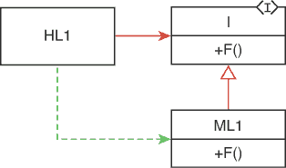

`HL1` 对 `ML1` 中的 `F()` 有运行时依赖；但 `HL1` 对 `ML1` 没有产生任何直接或间接的源代码依赖。相反，它们都依赖于接口 `I`。

21. 在动态类型语言中，接口 `I` 不会以源代码模块的形式存在。相反，它将是一个 `HL1` 和 `ML1` 都遵循的鸭类型（duck type）。

这种获取任何源代码依赖并将其反转的能力赋予了我们巨大的力量。我们可以轻松且安全地安排软件的源代码依赖，以确保高层模块*不*依赖于低层模块。

这允许我们创建如 [图 12.4] 所示的结构。

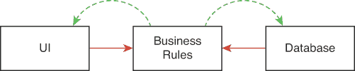

在这里我们看到高层业务规则对用户界面 (UI) 和数据库有运行时依赖，但对这些模块没有源代码依赖。DIP 的应用意味着 UI 和数据库是业务规则的*插件*，可以很容易地替换为不同的实现，而不影响业务规则，从而符合 OCP（开闭原则）。

当然，实际情况是 UI 和数据库正在实现包含在业务规则中的接口。业务规则在这些接口上运行，允许控制流向外指向 UI 和数据库，同时将源代码依赖反向指向业务规则（参见 [图 12.5]）。

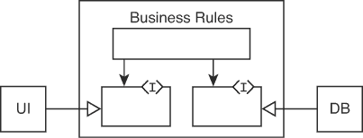

注意，所有的依赖都指向抽象。这引导我们用一种描述 DIP 的方法：

*在可能的情况下，将所有的源代码依赖指向抽象。*

### 怀旧的经典

理论够够了。让我们来看看它的运行情况。我将从我的朋友兼导师 Martin Fowler 那里借用一个怀旧的示例。他在著名的著作《重构》第一版中介绍了这个*视频录带店*的例子。当然，我将使用 Clojure 代替 Java。

22. 视频杀杀了收音机店，互联网杀杀了视频录带店。是的，男孩女孩们，曾经有一个我们去视频录带店租赁录像带和 DVD 的时代。

23. Addison-Wesley, 1999。

以下是测试代码：

```clojure
(describe "Video Store"
  (with customer (make-customer "Fred"))

  (it "makes statement for a single new release"
    (should= (str "Rental Record for Fred\n"
                  "\tThe Cell\t9.0\n"
                  "You owed 9.0\n"
                  "You earned 2 frequent renter points\n")
             (make-statement
               (make-rental-order
                 @customer
                 [(make-rental
                    (make-movie "The Cell" :new-release)
                    3)]))))

  (it "makes statement for two new releases"
    (should= (str "Rental Record for Fred\n"
                  "\tThe Cell\t9.0\n"
                  "\tThe Tigger Movie\t9.0\n"
                  "You owed 18.0\n"
                  "You earned 4 frequent renter points\n")
             (make-statement
               (make-rental-order
                 @customer
                 [(make-rental
                    (make-movie "The Cell" :new-release)
                    3)
                  (make-rental
                    (make-movie "The Tigger Movie" :new-release)
                    3)]))))

  (it "makes statement for one childrens movie"
    (should= (str "Rental Record for Fred\n"
                  "\tThe Tigger Movie\t1.5\n"
                  "You owed 1.5\n"
                  "You earned 1 frequent renter points\n")
             (make-statement
               (make-rental-order
                 @customer
                 [(make-rental
                    (make-movie "The Tigger Movie" :childrens)
                    3)]))))
```


如果你读过《重构》的第一版，这应该看起来非常熟悉。本质上，我们有一个简单的报告生成器，用于计算和格式化租赁订单的语句。

你应该首先注意到的就是测试中严重的 SRP 违反行为。这些测试将业务规则与语句的构建和格式化耦合在一起。这种 SRP 违反使得测试非常脆弱。为了修复这个问题，我们需要将指定报告格式的测试与指定业务规则的测试分开。

为了做到这一点，我将测试拆分为三个不同的模块：一个用于测试计算，另一个用于格式化，最后一个用于集成。

这里是`statement-calculator`测试。从现在起，我将包含所有的`ns`语句，这样你就可以看到模块名称及其源代码依赖了。

`ns`代表命名空间（namespace）。这些语句通常每个 Clojure 模块的开头，定义了模块的名称及其依赖。点击此处查看代码

```clojure
(ns video-store.statement-calculator-spec

  (:require [speclj.core :refer :all]

            [video-store.statement-calculator :refer :all]))

(declare customer)

(describe "Rental Calculation"

  (with customer (make-customer "Fred"))

  (it "makes statement for single new release"

    (should= {:customer-name "Fred"

              :movies [{:title "The Cell"

                        :price 9.0}]

              :owed 9.0

              :points 2}

             (make-statement-data

               (make-rental-order

                 @customer

                 [(make-rental

                    (make-movie "The Cell" :new-release)

                    3)]))))

  (it "makes statement for two new releases"

    (should= {:customer-name "Fred",

              :movies [{:title "The Cell",

                        :price 9.0}

               {:title "Tigger Movie",

                :price 9.0}],

              :owed 18.0,

              :points 4}

             (make-statement-data

               (make-rental-order

                 @customer

                 [(make-rental

                    (make-movie "The Cell" :new-release)

                    3)

                  (make-rental

                    (make-movie "Tigger Movie" :new-release)

                    3)]))))

  (it "makes statement for one childrens movie"

    (should= {:customer-name "Fred",

              :movies [{:title "Tigger Movie",

                        :price 1.5}],

              :owed 1.5,

              :points 1}

             (make-statement-data

               (make-rental-order

                 @customer

                 [(make-rental

                    (make-movie "Tigger Movie" :childrens)

                    3)]))))

  (it "makes statement for several regular movies"

    (should= {:customer-name "Fred",

              :movies [{:title "Plan 9 from Outer Space",

                        :price 2.0}

               {:title "8 1/2",

                :price 2.0}

               {:title "Eraserhead",

                :price 3.5}],

              :owed 7.5,

              :points 3}

             (make-statement-data

               (make-rental-order

                 @customer

                 [(make-rental

                    (make-movie "Plan 9 from Outer Space"

                                :regular)

                    1)

                  (make-rental

                    (make-movie "8 1/2", :regular)

                    2)

                  (make-rental

                    (make-movie "Eraserhead" :regular)

                    3)]))))))
```

我们在这里做的是将格式化的语句替换为包含所有数据的数据的结构。这允许我们将格式化与计算分离，如`statement-calculator`的实现所示：点击此处查看代码

```clojure
(ns video-store.statement-calculator)

(defn make-customer [name]

  {:name name})

(defn make-movie [title type]

  {:title title

   :type type})

(defn make-rental [movie days]

  {:movie movie

   :days days})

(defn make-rental-order [customer rentals]

  {:customer customer

   :rentals rentals})

(defn determine-amount [rental]

  (let [{:keys [movie days]} rental

        type (:type movie)]

    (condp = type

      :regular

      (if (> days 2)

        (+ 2.0 (* days 2) 1.5))

        2.0)

      :new-release

      (* 3.0 days)

      :childrens

      (if (> days 3)

        (+ 1.5 (* days 3) 1.5))

        1.5))))

(defn determine-points [rental]

  (let [{:keys [movie days]} rental

        type (:type movie)]

    (if (and (= type :new-release)

             (> days 1))

      2

      1)))

(defn make-statement-data [rental-order]

  (let [{:keys [name]} (:customer rental-order)

        {:keys [rentals]} rental-order]

    {:customer-name name

     :movies (for [rental rentals]

               {:title (:title (:movie rental))

                :price (determine-amount rental)})

     :owed (reduce + (map determine-amount rentals))

     :points (reduce + (map determine-points rentals))}))
```

这比之前简单一点并且封装良好。注意`ns`语句显示该模块没有源代码依赖。模块中的所有内容都暗示了格式化。实现也很简单：点击此处查看代码

```clojure
(ns video-store.formatter)

(defn format-rental-statement [statement-data]

  (let [customer-name (:customer-name statement-data)

        movies (:movies statement-data)

        owed (:owed statement-data)

        points (:points statement-data)]

    (str

      (format "Rental Record for %s\n" customer-name)

      (apply str

             (for [movie movies]

               (format "\t%s\t%.1f\n"

                       (:title movie)

                       (:price movie))))

      (format "You owed %.1f\n" owed)

      (format "You earned %d frequent renter points\n" points))))
```

再次，我们拥有一个没有依赖的封装良好的模块。为了确保这两个模块按照预期协同工作，我添加了一个简单的集成测试：点击此处查看代码

```clojure
(ns video-store.integration-specs

  (:require [speclj.core :refer :all]

            [video-store.formatter :refer :all]

            [video-store.statement-calculator :refer :all]))

(describe "Integration Tests"

  (it "formats a statement for several regular movies"

    (should= (str "Rental Record for Fred\n"

                  "\tPlan 9 from Outer Space\t2.0\n"

                  "\t8 1/2\t2.0\n"

                  "\tEraserhead\t3.5\n"

                  "You owed 7.5\n"

                  "You earned 3 frequent renter points\n")

             (format-rental-statement

               (make-statement-data

                 (make-rental-order

                   (make-customer "Fred")

                   [(make-rental

                    (make-movie

                      "Plan 9 from Outer Space"

                                :regular)

                    1)

                    (make-rental

                    (make-movie "8 1/2", :regular)

                    2)

                    (make-rental
```


```clojure
(make-movie "Eraserhead" :regular)

3)]))))))
```

从 SRP（单一职责原则）的角度来看，这要好得多。如果营销人员对报告格式进行细微调整，只有格式测试和集成测试会失败。所有的计算测试都不会受到影响。在像这样的小玩具示例中，这看起来可能不是什么巨大的胜利。但在测试用例以千计的真实应用中，这确实是一个巨大的胜利。

我们还免受了业务规则变化的影响。如果财务人员决定改变价格计算方式，格式测试将不受影响，只有计算测试和集成测试会受到影响。

## 一个 DIP 违背

在取得这些优势的同时，你是否注意到了 DIP（依赖倒置原则）的违背？你可能错过了它，因为它不在生产环境代码中，而是在集成测试中。

看看 `ns` 语句。你看到那两行提到 `statement-formatter` 和 `statement-calculator` 的代码了吗？这些行对这些模块的具体实现创建了源代码级依赖。这是一个高层策略依赖于具体的低层细节。这是定义意义上的 DIP 违背。

也许这让你感到困惑。测试怎么能成为高层策略呢？测试难道不是尽可能低层的吗？它们难道不是终极细节吗？

是的，确实如此。但集成测试实际上是高层策略的代品。再次看看那个集成测试。它精确地执行了应用程序高层策略必须做的事情。它调用 `make-statement-data` 并将结果传递给 `format-rental-statement`。由于这两个函数都是具体实现，我们的高层生产代码将面临与集成测试完全相同的 DIP 违背。

我们在测试中总是关注 DIP 吗？时刻保持这种意识总是明智的。但强制合规并不总是是明智的。某些测试最好保持与低层实现的耦合。然而，如果你希望你的测试套件既健壮又灵活，而且你不希望在更改生产代码中的一个微小变动时导致几百个测试失败，那么关注测试与生产代码之间的耦合是一个好主意^(25)

25。我在我的书籍《整洁手艺》（`Clean Craftsmanship`，Addison-Wesley, 2021）中对这个主题花费了大量时间。

但也许你仍然不服。那么让我们添加一个新功能。有时我们希望账单显示在文本终端上，有时我们希望它显示在浏览器上。因此，我们需要 `format-rental-statement` 的文本和 HTML 版本。

让我们再增加一个新功能。我们的一些商店提供“买二送一”策略。所以，如果你租了三部视频，你只需要支付最贵的两部的费用。

如果我们用面向对象的语言来实现这一这一点，我们可能会尝试创建两个新的抽象类或接口。`StatementFormatter` 抽象类将有一个 `format-rental-statement` 方法，该方法将在 `TextFormatter` 和 `HTMLFormatter` 实现中实现。同样，`StatementPolicy` 抽象将在 `NormalPolicy` 和 `BuyTwoGetOneFreePolicy` 中实现 `make-statement-data` 函数。

我们可以轻松地通过我们在 OCP 章节中讨论的三种方法中的一种来模拟这种设计。我们可以为这两个抽象类构建虚表（vtables）。或者我们可以使用 `defprotocol` 和 `defrecord` 来构建真实的 Java 接口和实现。最后，我们也可以使用多方法（multi-methods）。

让我们看看多方法方法是什么样子的。记住，这是一个伪装成成人问题的初级问题。你看到我在这里所做的，是为了展示更大的问题可以如何进行设计和划分。

最后，如图 12.6 所示，我将整个系统分为十一个模块，其中三个是测试。

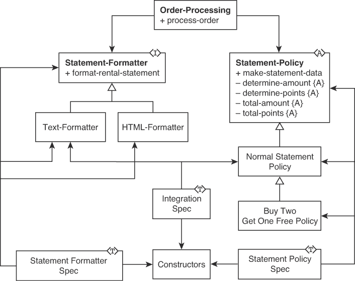

**图 12.6.** 将视频租赁店应用拆分为模块

图 12.6 看起来像是一个面向对象解决方案的 UML 图。依赖倒置应该是显而易见的。`order-processing` 模块是最高层策略。它依赖于两个抽象。`statement-formatter` 是接口，而 `statement-policy` 是一个有一个实现方法的抽象类。

如果你对我使用面向对象的术语来描述 Clojure 函数式程序感到困惑，你不应该困惑。我使用的面向对象词汇在函数式世界中有非常直接的类比。

`statement-formatter` 接口由 `text-formatter` 和 `HTML-formatter` 实现。`statement-policy` 抽象类由 `normal-statement-policy` 实现。`buy-two-get-one-free-policy` 实现继承自 `normal-statement-policy` 但重写了它的一个方法。所有这些“继承”背后的机制很快就会变得清晰。

测试出现在底部。它们被标记为 `<T>`。它们使用一个名为 `constructors` 的小型工具模块，该模块知道如何构建基础数据结构。然后每个测试都使用其特定的生产代码部分来测试它需要的内容。

现在来看源代码。特别注意 `ns` 语句，并注意它们与 UML 图上的箭头对应。

让我们从 `constructors` 开始。它们非常自而易见：

点击此处查看图像

```clojure
(ns video-store.constructors)

(defn make-customer [name]
  {:name name})

(defn make-movie [title type]
  {:title title
   :type type})

(defn make-rental [movie days]
  {:movie movie
   :days days})

(defn make-rental-order [customer rentals]
  {:customer customer
   :rentals rentals})
```

`constructors` 在 `ns` 语句中没有外部依赖，只需构建 Clojure 数据结构。

集成测试位于 `integration-specs` 模块中：

点击此处查看图像

```clojure
(ns video-store.integration-specs
  (:require [speclj.core :refer :all]
            [video-store.constructors :refer :all]
            [video-store.text-statement-formatter :refer :all]
            [video-store.normal-statement-policy :refer :all]
            [video-store.order-processing :refer :all]))

(declare rental-order)

(describe "Integration Tests"
  (with rental-order
    (make-rental-order
      (make-customer "Fred")
      [(make-rental
         (make-movie
           "Plan 9 from Outer Space"
           :regular)
         1)
       (make-rental
         (make-movie "8/1/2", :regular)
         2)
       (make-rental
         (make-movie "Eraserhead" :regular)
         3)]))

  (it "formats a text statement"
    (should=
      (str "Rental Record for Fred\n"
           "\tPlan 9 from Outer Space\t2.0\n"
           "\t8/1/2\t2.0\n"
           "\tEraserhead\t3.5\n"
           "You owed 7.5\n"
           "You earned 3 frequent renter points\n")
      (process-order
        (make-normal-policy)
        (make-text-formatter)
        @rental-order))))
```

另外两个测试更加具体。请特别注意，它们的源代码依赖仅引入它们所需的内容：

点击此处查看代码图片

```clojure
(ns video-store.statement-formatter-spec
  (:require [speclj.core :refer :all]
            [video-store.statement-formatter :refer :all]
            [video-store.text-statement-formatter :refer :all]
            [video-store.html-statement-formatter :refer :all]))

(declare statement-data)

(describe "Rental Statement Format"
  (with statement-data
    {:customer-name "CUSTOMER"
     :movies [{:title "MOVIE"
               :price 9.9}]
     :owed 100.0
     :points 99})

  (it "Formats a text rental statement"
    (should=
      (str "Rental Record for CUSTOMER\n"
           "\tMOVIE\t9.9\n"
           "You owed 100.0\n"
           "You earned 99 frequent renter points\n")
      (format-rental-statement
        (make-text-formatter)
        @statement-data)))

  (it "Formats an html rental statement"
    (should=
      (str
        "<h1>Rental Record for CUSTOMER</h1>"
        "<table>"
        "<tr><td>MOVIE</td><td>9.9</td></tr>"
        "</table>"
        "You owed 100.0<br>"
        "You earned <b>99</b> frequent renter points")
      (format-rental-statement
        (make-html-formatter)
        @statement-data))))
```

`statement-formatter-spec` 测试了两种不同的格式。格式由 `format-rental-statement` 函数的第一个参数指定。该参数由 `make-text-formatter` 和 `make-html-formatter` 函数创建，正如你将看到的，这些函数实现在相应的模块中。

最后一个测试是 `statement-policy-spec`：

点击此处查看代码图片

```clojure
(ns video-store.statement-policy-spec
  (:require
    [speclj.core :refer :all]
    [video-store.constructors :refer :all]
    [video-store.statement-policy :refer :all]
    [video-store.normal-statement-policy :refer :all]
    [video-store.buy-two-get-one-free-policy :refer :all]))

(declare customer normal-policy formatter)

(declare new-release-1 new-release-2 childrens)

(declare regular-1 regular-2 regular-3)

(describe "Rental Statement Calculation"
  (with customer
    (make-customer "CUSTOMER"))

  (with normal-policy
    (make-normal-policy))

  (with new-release-1
    (make-movie "new release 1" :new-release))

  (with new-release-2
    (make-movie "new release 2" :new-release))

  (with childrens
    (make-movie "childrens" :childrens))

  (with regular-1
    (make-movie "regular 1" :regular))

  (with regular-2
    (make-movie "regular 2" :regular))

  (with regular-3
    (make-movie "regular 3" :regular))

  (context "normal policy"
    (it "makes statement for a single new release"
      (should=
        {:customer-name "CUSTOMER"
         :movies [{:title "new release 1"
                   :price 9.0}]
         :owed 9.0
         :points 2}
        (make-statement-data
          @normal-policy
          (make-rental-order
            @customer
            [(make-rental @new-release-1 3)]))))

    (it "makes statement for two new releases"
      (should=
        {:customer-name "CUSTOMER"
         :movies [{:title "new release 1" :price 9.0}
                  {:title "new release 2" :price 9.0}]
         :owed 18.0
         :points 4}
        (make-statement-data
          @normal-policy
          (make-rental-order
            @customer
            [(make-rental @new-release-1 3)
             (make-rental @new-release-2 3)]))))

    (it "makes statement for one childrens movie"
      (should=
        {:customer-name "CUSTOMER"
         :movies [{:title "childrens" :price 1.5}]
         :owed 1.5
         :points 1}
        (make-statement-data
          @normal-policy
          (make-rental-order
            @customer
            [(make-rental @childrens 3)]))))
```


`(it "makes statement for several regular movies"`

```
  (should= {:customer-name "CUSTOMER",

            :movies [{:title "regular 1", :price 2.0}

                     {:title "regular 2", :price 2.0}

                     {:title "regular 3", :price 3.5}],

            :owed 7.5,

            :points 3}

           (make-statement-data

             @normal-policy

             (make-rental-order

               @customer

               [(make-rental @regular-1)

                (make-rental @regular-2)

                (make-rental @regular-3)]))))
```

```
  (context "buy two get free policy"

    (it "makes statement for regular movies"

      (should= {:customer-name "CUSTOMER",

                :movies [{:title "regular 1", :price 2.0}

                         {:title "regular 2", :price 2.0}

                         {:title "new release 1", :price 3.0}],

                :owed 5.0,

                :points 3}

               (make-statement-data

                 (make-buy-two-get-one-free-policy)

                 (make-rental-order

                   @customer

                   [(make-rental @regular-1)

                    (make-rental @regular-2)

                    (make-rental @new-release-1)])))))
```

`statement-policy-spec` 测试了各种定价规则。你已经看到了第一部分。最后一个测试检查了某些商店使用的“买二送一”策略。该策略被传递给`make-statement-data`函数，并由`make-normal-policy`和`make-buy-two-get-one-free-policy`函数创建。

现在，来看生产代码。我们从`order-processing`模块开始：

点击此处查看代码图片

```
(ns video-store.order-processing

  (:require [video-store.statement-formatter :refer :all]

            [video-store.statement-policy :refer :all]))

(defn process-order [policy formatter]

  (-> order

       (make-statement-data policy)

       (format-rental-statement formatter)))
```

这里没什么。注意源代码依赖只引用了`statement-formatter`接口和`statement-policy`抽象。

`statement-formatter`接口非常简单：

点击此处查看代码图片

```
(ns video-store.statement-formatter)

(defmulti format-rental-statement

            (fn [formatter statement-data]

              (:type formatter)))
```

`defmulti`语句大致等同于 Java 或 C# 中创建抽象方法。由于该模块只有一个抽象方法，它大致等同于接口。分发函数是平庸的；它只是返回格式器的`:type`。

`statement-policy`抽象更有趣：

点击此处查看代码图片

```
(ns video-store.statement-policy)

(defn- policy-movie-dispatch [policy rental]

  [(:type policy) (-> rental :movie :type)])

(defmulti determine-amount policy-movie-dispatch)

(defmulti determine-points policy-movie-dispatch)

(defmulti total-amount (fn [policy _rentals] (:type policy)))

(defmulti total-points (fn [policy _rentals] (:type policy)))

(defn make-statement-data [policy rental-order]

  (let [{:keys [name]} (:customer rental-order)

        {:keys [rentals]} rental-order]

    {:customer-name name

     :movies (for [rental rentals]

               {:title (:title (:movie rental))

                :price (determine-amount policy rental)})

     :owed (total-amount policy rentals)

     :points (total-points policy rentals)}))
```

`statement-policy`模块包含四个抽象方法和一个实现方法。请注意它是如何使用模板方法^(27)模式的。同样请注意，`determine-amount`和`determine-points`函数使用一个元组作为分发代码。这非常有意思。这意味着我们可以根据两个自由度而不是一个来分发这些函数。这在大多数面向对象（OO）语言中很难实现的。我们很快就会看到它的用法。

27. 参见第 17 章，“Wa-Tor”。

但首先，让我们来看`text-statement-formatter`的实现：

点击此处查看代码图片

```clojure
(ns video-store.text-statement-formatter

  (:require [video-store.statement-formatter :refer :all]))

(defn make-text-formatter [] {:type ::text})

(defmethod format-rental-statement

           ::text

           [_formatter statement-data]

  (let [customer-name (:customer-name statement-data)

        movies (:movies statement-data)

        owed (:owed statement-data)

        points (:points statement-data)]

    (str

      (format "Rental Record for %s\n" customer-name)

      (apply str

             (for [movie movies]

               (format "\t%s\t%.1f\n"

                 (:title movie)

                 (:price movie))))

      (format "You owed %.1f\n" owed)

      (format "You earned %d frequent renter points\n" points))))
```

这应该并不意外。我只是在没有太大改动的情况下将代码移到了这里。注意顶部的`make-text-formatter`函数。

`html-statement-formatter`应该也不算意外：

点击此处查看代码图片

```clojure
(ns video-store.html-statement-formatter

  (:require [video-store.statement-formatter :refer :all]))

(defn make-html-formatter [] {:type ::html})

(defmethod format-rental-statement ::html

  [formatter statement-data]

  (let [customer-name (:customer-name statement-data)

        movies (:movies statement-data)

        owed (:owed statement-data)

        points (:points statement-data)]

    (str

      (format "<h1>Rental Record for %s</h1>" customer-name)

      "<table>"

      (apply str

             (for [movie movies]

               (format "<tr><td>%s</td><td>%.1f</td></tr>"

                       (:title movie) (:price movie))))

      "</table>"

      (format "You owed %.1f<br>" owed)

      (format "You earned <b>%d</b> frequent renter points"

              points))))
```

更有趣的是那两个策略模块。让我们从`normal-statement-policy`开始：

点击此处查看代码图片

```clojure
(ns video-store.normal-statement-policy

  (:require [video-store.statement-policy :refer :all]))

(defn make-normal-policy [] {:type ::normal})

(defmethod determine-amount [::normal :regular] [_policy rental]

  (let [days (:days rental)]

    (if (> days 2)

      (+ 2.0 (* (- days 2) 1.5))

      2.0)))

(defmethod determine-amount

           [::normal :childrens]

           [_policy rental]

  (let [days (:days rental)]

    (if (> days 3)

      (+ 1.5 (* (- days 3) 1.5))

      1.5)))

(defmethod determine-amount

           [::normal :new-release]

           [_policy rental]

  (* 3.0 (:days rental)))

(defmethod determine-points [::normal :regular] [_policy _rental]

  1)

(defmethod determine-points

           [::normal :new-release]

           [_policy rental]

  (if (> (:days rental) 1) 2 1))

(defmethod determine-points

           [::normal :childrens]

           [_policy _rental]

  1)

(defmethod total-amount ::normal [policy rentals]

  (reduce + (map #(determine-amount policy %) rentals)))

(defmethod total-points ::normal [policy rentals]

  (reduce + (map #(determine-points policy %) rentals)))
```

这很不同，不是吗？仔细看那些`defmethod`语句。我们同时根据策略类型和电影类型进行了分发。这很好地隔离了业务规则。

你可能担心两个自由度会产生 N*M 问题，导致“确定”函数的泛滥。稍后你就会看到我是如何处理它的。

注意顶顶部供我们的测试使用的`make-normal-policy`构造函数。

现在，让我们来看`buy-two-get-one-free-policy`模块：

点击此处查看代码图片

```clojure
(ns video-store.buy-two-get-one-free-policy

  (:require [video-store.statement-policy :refer :all]

            video-store.statement-policy :as normal))

(defn make-buy-two-get-one-free-policy [] {:type ::buy-two-get-one-free})

(defmethod total-amount :buy-two-get-one-free-policy [policy rentals]

  (reduce + (map (derive normal) rentals)))
```


惊喜！看那个`derive`。它告诉编译器使用`:normal`来解析对应的`defmethod`。

好了，就是这些。我们将整个系统拆分成了 11 个模块。每个模块都封装良好。我们反转了最重要的依赖，使得高层策略不依赖于低层细节。整体结构看起来像一个面向对象的程序，但它完全是函数的。

## 结论

整体结构看起来像一个面向对象的程序，但它是函数的。

# IV

# 函数实用主义

## 13

## 测试


在本书中，你看到了我写的单元测试。在几乎每种情况下，我都使用了TDD^(1)准则，在编写测试和代码时进行快速循环，让测试领先于代码。

大部分情况下，这些测试是用一个名为`speclj`^(2)（读作“spekle”）的框架写的，由`Micah Martin`等编写。它与`Ruby`中流行的`RSpec`框架非常相似。

2. [`github.com/slagyr/speclj`](https://github.com/slagyr/speclj)

我实践TDD已经超过20年。我在`Java`、`C#`、`C`、`C++`、`Ruby`、`Python`、`Lua`、`Clojure`以及各种语言中使用过它。这些年来我学到的是语言对于准则并不重要。无论使用什么语言，准则都是相同的。

`Clojure`是一种函数式语言这一事实并没有改变我的测试策略，也不会影响我对TDD准则的使用。我编写`Clojure`程序的方式和编写`Java`程序一样，都是测试先行。范式并不重要。准则是通用的。

### 但REPL怎么呢？

许多函数式程序员经常说他们不需要TDD（测试驱动开发），因为他们在`REPL`中测试了一切。我也在`REPL`中进行大量的实验；但在大多数情况下，我会将学到的内容编码为测试。测试就像钻石，是永恒的。而`REPL`中的实验在第二天早上就不复存在了。

## 关于Mock（模拟）？

`Mocking`是TDD实践者使用的一种技术，用于将测试与系统的大部分隔离开。实际上，他们创建了被称为`mocks`^(3)的对象来代表这些部分，并使用`LSP`（可替换原则）用`mock`代替它们。

3. 它们更正式地被称为`test-doubles`（测试双胞），但在本文背景下，我将继续使用这种口语表达。

由于`LSP`被视为一种面向对象（OO）原则，而且面向对象语言中的`mocks`是基于多态接口的，函数式语言不支持`mocks`似乎已经变成了一个都市传说。

但正如我们所看到的，`LSP`在函数式语言中的效果与在面向对象语言中一样，而且多态接口通常非常容易创建。因此，在函数式语言中编写各种形式的`mocks`的能力完全没有受到阻碍。

例如，这里来自我的`more-speech`^(4)应用程序的测试，它使用了两个`mock`：

4. [`github.com/unclebob/more-speech`](https://github.com/unclebob/more-speech)

点击查看代码图片

```
(it "adds an unrooted article id to a tab"
  (let [message-id 1
        messages {message-id {:tags []}}
        event-context (atom {:text-event-map messages})]
    (reset! ui-context {:event-context event-context})
    (with-redefs [swing-util/add-id-to-tab (stub :add-id-to-tab)
                  swing-util/relaunch (stub :relaunch)]
      (add-article-to-tab 1 "tab" nil)
      (should-have-invoked :relaunch)
      (should-have-invoked :add-id-to-tab
                           {:with ["tab" :selected 1]}))))
```

不要太担心这个测试做了什么。只需看底部的`with-redefs`语句。这个测试`mock`了`swing-util/add-id-to-tab`和`swing-util/relaunch`函数，使用命名的`stubs`（存根）。这些`stubs`是完美的空操作。它们接受任意数量的参数并且不返回任何值。^(5) 但它们记得作用身上发生了什么。^(6) 所以，在底部，我们看到`:relaunch` stub应该被调用，且`:add-id-to-tab` stub应该带有三个参数被调用：`"tab"`、`:selected`和`1`。

5. 有方法让它们返回值，但这超出了本文的范围。如果你感兴趣，请查看`speclj`文档 ([`github.com/slagyr/speclj`](https://github.com/slagyr/speclj))。

6. 从技术上说，它们是`spies`（间谍）。

## 基于属性的测试（Property-Based Testing）

与函数式程序员打交道，你最终会听到`QuickCheck`和属性测试。遗憾的是，这个话题经常作为TDD的反论出现。我并不打算尝试支持或反驳这一观点。相反，我想向你展示属性测试在TDD范式内是多么强大。

首先，什么是属性测试？`属性测试`是一种利用随机生成输入和非常强大的缺陷隔离策略的验证和诊断技术。

假设我刚刚写了一个计算给定整数质因数数的函数：

点击查看代码图片

```
(defn factors-of [n]
  (loop [factors [] n divisor 2]
    (if (> n 1)
      (cond
        (> divisor (Math/sqrt n))
        (conj factors n)
        (= 0 (mod n divisor))
        (recur (conj factors divisor)
               (quot n divisor)
               divisor)
        :else
        (recur factors n (inc divisor)))
      factors)))
```

假设我也是用TDD写了这个函数。这里是我的测试：

点击查看代码图片

```
(defn power2 [n]
  (apply * (repeat n 2N)))

(describe "factor primes"
  (it "factors 1 -> []"
    (should= [] (factors-of 1)))
  (it "factors 2 -> [2]"
    (should= [2] (factors-of 2)))
  (it "factors 3 -> [3]"
    (should= [3] (factors-of 3)))
```

这很棒。我可以随机生成大量的输入，然后对输出进行属性检查。

### 一种诊断技术

但我把基于属性的测试称为一种诊断技术，不是吗？让我们来看一个更有趣的例子，我会向你展示我的意思。

还记得我们上一章中的`Video Store`例子吗？让我们对它进行一些基于属性的测试。

首先，回想我们写了一个名为`make-statement-data`的函数，它接受一个`policy`和一个`rental-order`并生成`statement-data`，然后将其输入到一个格式化器中。这里是使用`clojure.spec`对`rental-order`的类型规范：

点击此处查看代码图片

```
(s/def ::name string?)
(s/def ::customer (s/keys :req-un [name]))
(s/def ::title string?)
(s/def ::type #{:regular :childrens :new-release})
(s/def ::movie (s/keys :req-un [::title ::type]))
(s/def ::days pos-int?)
(s/def ::rental (s/keys :req-un [::days ::movie]))
(s/def ::rentals (s/coll-of ::rental))
(s/def ::rental-order (s/keys :req-un [::customer ::rentals]))
```

这并不难读。从下往上：

* 一个`:rental-order`是一个包含两个元素的map：`:customer`和`:rentals`。
* `:rentals`元素是`:rental`项目的集合。
* 一个`:rental`是一个包含`:days`和`:movie`元素的map。
* `:days`元素是一个正整数。
* `:movie`元素是一个包含`:title`和`:type`的map。
* `:type`是`:regular`、`:childrens`或`:new-release`之一。
* `:title`是一个字符串。
* `:customer`是一个包含单个`:name`元素的map。
* `:name`是一个字符串。

有了这个类型规范，我们就可以编写一个生成器来产生符合该类型的租赁订单。首先，这些是生成器：

点击此处查看代码图片

```
(def gen-customer-name
  (gen/such-that not-empty gen/string-alphanumeric))

(def gen-customer
  (gen/fmap (fn [name] {:name name}) gen-customer-name))

(def gen-days (gen/elements (range 1 100)))

(def gen-movie-type
  (gen/elements [:regular :childrens :new-release]))

(def gen-movie
  (gen/fmap (fn [[title type]] {:title title :type type})
            (gen/tuple gen/string-alphanumeric gen-movie-type)))

(def gen-rental
  (gen/fmap (fn [[movie days]] {:movie movie :days days})
            (gen/tuple gen-movie gen-days)))

(def gen-rentals
  (gen/such-that not-empty (gen/vector gen-rental)))

(def gen-rental-order
  (gen/fmap (fn [[customer rentals]]
              {:customer customer :rentals rentals})
            (gen/tuple gen-customer gen-rentals)))

(def gen-policy (gen/elements
                  [(make-normal-policy)
                   (make-buy-two-get-one-free-policy)]))
```

我在这里不会解释`clojure.check`的内部细节，但我将阐述这些生成器的作用：

* `gen-policy`随机选择两个策略中的一个。
* `gen-rental-order`从`gen-customer`和`gen-rentals`创建一个map。
* `gen-rentals`从`gen-rentals`创建一个vector并确保它不空。
* `gen-rental`从`gen-movie`和`gen-days`创建一个map。
* `gen-movie`从`gen/string-alphanumeric`和`gen-movie-type`创建一个map。
* `gen-movie-type`从这三种类型中选择。
* `gen-days`在1到100之间的整数中选择。
* `gen-customer`创建一个带有来自`gen-customer-name`名称的map。
* `gen-customer-name`生成一个非空字母数字字符串。

你注意到类型规范和生成器之间存在一种奇异的相似性吗？我一样。以下是生成器的几个示例输出：

点击此处查看代码图片

```
[
 {:customer {:name "5Q"},
  :rentals [{:movie {:title "", :type :new-release}, :days 52}]}
 {:customer {:name "3"},
  :rentals [{:movie {:title "", :type :new-release}, :days 51}]}
 {:customer {:name "XA"},
  :rentals [{:movie {:title "r", :type :regular}, :days 82}
            {:movie {:title "", :type :childrens}, :days 60}]}
 {:customer {:name "4v"},
  :rentals [{:movie {:title "3", :type :childrens}, :days 29}]}
 {:customer {:name "0rT"},
  :rentals [{:movie {:title "", :type :regular}, :days 42}
            {:movie {:title "94Y", :type :regular}, :days 34}
            {:movie {:title "D5", :type :new-release},
                     :days 58}]}
 {:customer {:name "ZFAK"},
  :rentals [{:movie {:title "H8", :type :regular}, :days 92}
            {:movie {:title "d6WS8", :type :regular}, :days 59}
            {:movie {:title "d", :type :regular}, :days 53}
            {:movie {:title "Yj8b7", :type :regular}, :days 58}
            {:movie {:title "Z2q70", :type :childrens},
                     :days 9}]}
 {:customer {:name "njak"},
  :rentals [{:movie {:title "H8", :type :regular}, :days 92}]
            {:movie {:title "d6WS8", :type :regular}, :days 59}
            {:movie {:title "d", :type :regular}, :days 53}
            {:movie {:title "Yj8b7", :type :regular}, :days 58}
            {:movie {:title "Z2q70", :type :childrens},
                     :days 9}]}
```

在这里我们看到了`statement-data`的`clojure.spec`，以及确保`make-statement-data`的输出符合该定义的`quick-check`。很棒。

在这些测试都通过后，我们可以非常确定生成器生成了有效的租赁订单。现在让我们进行属性检查（property checks）。

我们可以检查的一个属性是：确保当`make-statement-data`将一个`rental-order`转换为`statement-data`时，`statement-data`对象的`:owed`成员是该对象中列出的所有电影项目的总和。

该属性的`quick-check`可能如下所示：

点击此处查看代码图片

```
(it "statement data totals are consistent under all policies"
  (should-be
    :result
    (tc/quick-check
      100
      (prop/for-all
        [rental-order gen-rental-order
         policy gen-policy]
        (let [statement-data (make-statement-data
                               policy rental-order)
              prices (map :price (:movies statement-data))
              owed (:owed statement-data)]
          (= owed (reduce + prices)))))))


这个 `quick-check` 中有一个 Bug。你能发现它吗？

这是我运行它时的输出：

点击此处查看代码图片

```clojure
{:shrunk
 {:total-nodes-visited 45,
  :depth 14,
  :pass? false,
  :result false,
  :result-data nil,
  :time-shrinking-ms 3,
  :smallest
  [{:customer {:name "0"},
    :rentals [{:movie {:title "", :type :regular}, :days 1}
              {:movie {:title "", :type :regular}, :days 1}
              {:movie {:title "", :type :regular}, :days 1}]}
   {:type
    :video-store.
    buy-two-get-one-free-policy/buy-two-get-one-free}]},
  :failed-after-ms 0,
  :num-tests 7,
  :seed 1672092997135,
  :fail
  [{:customer {:name "4s7u"},
    :rentals
    [{:movie {:title "i7jiVAd", :type :childrens}, :days 85}
     {:movie {:title "7MQM", :type :new-release}, :days 26}
     {:movie {:title "qlS4S", :type :new-release}, :days 99}
     {:movie {:title "X", :type :regular}, :days 87}
     {:movie {:title "w1cRbM", :type :regular}, :days 11}
     {:movie {:title "7Hb41O5", :type :regular}, :days 63}
     {:movie {:title "xWc", :type :childrens}, :days 41}]}
   {:type
    :video-store.
    buy-two-get-one-free-policy/buy-two-get-one-free}],
  :result false,
  :result-data nil,
  :failing-size 6,
  :pass? false}
```

是的，我知道这看起来很糟糕；但这正是 `quick-check` 真正的魔力所在，所以请耐心听。

首先，你看到顶部那个名为 `:shrunk` 的元素了吗？那是这里发生什么的一个大线索。当 `quick-check` 找到错误时，它开始寻找最小的随机生成输入，该输入仍然产生该错误。

看 `:fail` 元素。那是导致初始失败的 `rental-order`。现在看 `:shrunk` 元素中的 `:smallest` 元素。`quick-check` 函数成功地在保持失败的情况下缩小了 `rental-order`。这是它能找到的失败的最小 `rental-order`。

它为什么会失败呢？注意这里有三部电影。同时也注意策略是 `buy-two-get-one-free`（买二送一）。啊，当然，在那种策略下，电影的总和*并不等于* `:owed` 元素。

正是这种收缩（shrinking）行为使得基于属性测试（property-based testing）成为了一种诊断技术。

## 函数式

那么为什么像 `quick-check` 这样的工具在面向对象的语言中不更流行呢？也许是因为它们与纯函数配合得最好。我设在可变系统中设置生成器和测试属性是可能的，但可能比在不可变系统中要复杂得多。

## 14. GUI


多年来，我在函数式程序中使用过两个不同的 GUI 框架。第一个名为 Quil，(1)，它基于流行的 Java 框架 Processing。(2) 第二个是 SeeSaw，(3)，它基于旧的 Java Swing (4) 框架。

1  
2  
3  
4

Quil 是“函数式的”，这使其易于使用。SeeSaw 不是函数的。它依赖于可变状态。

最初的想法是通过让乌龟绘制有趣的形状来向孩子们介绍编程。我不知道这对孩子们效果如何，但对于想要绘制复杂设计的程序员来说，事实证明非常有用。

总之，一段时间以前，我想在 Clojure 中有一个龟图系统会很有趣，这样我可以轻松研究一些数学和几何问题。

我的目标不是创建一个输入命令的龟图控制台。相反，我想要一个图形 API，让我可以在 Clojure 中编写图形函数。

### Quil 中的龟图

20 世纪 60 年代发明的的一类简单指令控制了一个被称为“龟”的机器人。它坐在纸上，拥有一支可以抬起落下的笔。它可以被命令向前或向后移动距离，或者向左向右旋转度数。

图 14.1 是发明者 Seymour Papert 和他的龟之一。

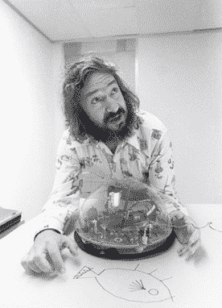

**图 14.1 Seymour Papert 和他的龟**

所以，例如，如果你想画一个正方形，你可以发出这些命令：

```text
笔下
前进 10
右 90
前进 10
右 90
前进 10
右 90
前进 10
笔起
```

龟图是为 Logo 发明的的一套简单指令。机器人可以被命令向前或向后移动距离，或者向左向右旋转度数。

遍历 `spacar` 的源码超出了本书的范围。然而，有一个更简单的 Quil 程序可以在你的浏览器中运行。

我在书中提到过几次 `spacar`。它实际上在我的浏览器中可以运行 Clojure。

我用了一天时间移植过来。

```clojure
(defn polygon [theta, len, n]
  (pen-down)
  (speed 1000)
  (dotimes [_ n]
    (forward len)
    (right theta)))

(defn turtle-script []
  (polygon 144 400 5))
```

该程序绘制了图 14.2 中的图片。（注意位于星形左顶点的小龟。）


**图 14.2 使用龟图绘制的星**

`turtle-script` 函数是 `turtle-graphics` 系统的入口。你把绘图命令放在这里。在这种情况下，我把一个对 `polygon` 函数的调用放在这里。

你可能已经注意到，`polygon` 函数似乎并不是函数式的，因为它没有从输入产生返回值。相反，它具有在屏幕上绘图的副作用。此外，每条命令都会改变乌龟（turtle）的状态。因此 `turtle-graphics` 程序不是函数式的。

然而，`turtle-graphics` 框架是“函数式”的。或者准确地说，它已经是 GUI 程序能达到的函数式程度了。毕竟，GUI 程序的目的就是改变屏幕的状态。

尽管你可能觉得这个很有趣：[`fsharpforfunandprofit.com/posts/13-ways-of-looking-at-a-turtle/`](https://fsharpforfunandprofit.com/posts/13-ways-of-looking-at-a-turtle/)。

`turtle-graphics` 框架从配置和调用 Quil 开始：

点击此处查看代码图片

```clojure
(defn ^:export -main [& args]
  (q/defsketch turtle-graphics
    :title "Turtle Graphics"
    :size [1000 1000]
    :setup setup
    :update update-state
    :draw draw-state
    :features [:keep-on-top]
    :middleware [m/fun-mode])
  args)
```

我在这里不会对 Quil 进行进行完整的教程，但有几点我应该指出来。注意 `:setup`、`:update` 和 `:draw` 元素。每一个元素都指向一个函数。

`setup` 函数会在程序开始时调用一次。

`draw-state` 函数每秒会被调用 60 次，以刷新屏幕。所有应该出现在屏幕上的内容都必须由 `draw` 函数绘制。屏幕不会记住任何东西。

`update-state` 函数会在 `draw-state` 函数调用之前被调用。这个函数用于更改正在绘图的状态。把它想象成将屏幕元素移动到未来 1/60 秒的函数。

把它想象成一个非常简单的循环：

点击此处查看代码图片

```clojure
(loop [state (setup)]
  (draw-state state)
  (recur (update-state state)))
```

如果你把这看作一个尾递归循环，那么屏幕的内容就是尾递归的值。所以尽管我们正在改变屏幕的内容，但我们是在递归的尾部执行的，这种改变是无害的。因此，虽然不是纯函数式的，但它已经是任何 TCO 系统所能达到的“函数式”程度了。

这是我的 `setup` 函数：

点击此处查看代码图片

```clojure
(defn setup []
  (q/frame-rate 60)
  (q/color-mode :rgb)
  (let [state {:turtle (turtle/make)
               :channel channel}]
    (async/go
      (turtle-script)
      (prn "Turtle script complete"))
    state))
```

这部分开始非常简单。它将帧率设置为 60fps，颜色模式设置为 RGB，并创建了传递给 `update-state` 和 `draw-state` 的 `state` 对象。

`async/go` 函数启动了一个新的轻量级线程，我们的 `turtle-script` 将在其中执行。

`state` 对象由 `channel` 和 `turtle` 组成。我们稍后会讨论 `channel`。现在，让我们关注 `turtle`：

点击此处查看代码图片

```clojure
(s/def ::position (s/tuple number? number?))
(s/def ::heading (s/and number? #(<= 0 % 360)))
(s/def ::velocity number?)
(s/def ::distance number?)
(s/def ::omega number?)
(s/def ::angle number?)
(s/def ::weight (s/and pos? number?))
(s/def ::state #{:idle :busy})
(s/def ::pen #{:up :down})
(s/def ::pen-start (s/or :nil nil?
                         :pos (s/tuple number? number?)))
(s/def ::line-start (s/tuple number? number?))
(s/def ::line-end (s/tuple number? number?))
(s/def ::line (s/keys :req-un [::line-start ::line-end]))
(s/def ::lines (s/coll-of ::line))
(s/def ::visible boolean?)
(s/def ::speed (s/and pos? number?))
```

### 绘制乌龟

`draw-state` 函数被 Quil 每秒调用 60 次，它将屏幕背景颜色设置为浅灰色，将绘图置于 (500, 500)，然后调用 `turtle/draw`，它会绘制当前正在进行的线条，以及之前绘制的所有其他线条。最后，它会绘制乌龟本身。注意 Quil 如何帮助处理平移和旋转。

### 乌龟模块

点击此处查看代码图片

```clojure
(defn draw-state [state]
  (q/background 240)
  (q/with-translation
    [500 500]
    (let [{keys [turtle]} state]
      (turtle/draw turtle))))

;; ——Turtle——

(defn draw [turtle]
  (when (= :down (:pen turtle))
    (q/stroke 0)
    (q/stroke-weight (:weight turtle)))
  (q/line (:pen-start turtle) (:position turtle)))

  (doseq [line (:lines turtle)]
    (q/stroke-weight (:line-weight line))
    (q/line (:line-start line) (:line-end line)))

  (when (:visible turtle)
    (q/stroke-weight 1)
    (let [[x y] (:position turtle)
          heading (q/radians (:heading turtle))
          base-left (- WIDTH 2)
          base-right (/ WIDTH 2)
          tip HEIGHT]
      (q/stroke 0)
      (q/with-translation
        [x y]
        (q/with-rotation
          [heading]
          (q/line 0 base-left 0 base-right)
          (q/line 0 base-left tip 0)
          (q/line 0 base-right tip 0)))))
```

### 更新乌龟状态

我们如何更新乌龟的状态？

```clojure
(defn update-state [{keys [channel] :as state}]
  (let [turtle (:turtle state)
        turtle (turtle/update-turtle turtle)]
    (assoc state :turtle (handle-commands channel turtle))))
```

`update-state` 函数调用 `turtle/update-turtle`。然后它调用 `handle-commands`，那里又有那个 `channel`。我们先看 `update-turtle`：

```clojure
(defn update-position
  [{:keys [position velocity heading distance] :as turtle}]
  (let [step (min (q/abs velocity) distance)
        distance (- distance step)
        step (if (neg? velocity) (- step) step)
        radians (q/radians heading)
        [x y] position
        vx (* step (Math/cos radians))
        vy (* step (Math/sin radians))
        position [(+ x vx) (+ y vy)]]
    (assoc turtle
           :position position
           :distance distance
           :velocity (if (zero? distance) 0.0 velocity))))

(defn update-heading
  [{:keys [heading omega angle] :as turtle}]
  (let [angle-step (min (q/abs omega) angle)
        angle (- angle angle-step)
        angle-step (if (neg? omega) (- angle-step) angle-step)
        heading (mod (+ heading angle-step) 360)]
    (assoc turtle
           :heading heading
           :angle angle
           :omega (if (zero? angle) 0.0 omega))))

(defn make-line
  [{:keys [pen-start position weight]}]
  {:line-start pen-start
   :line-end position
   :line-weight weight})

(defn update-turtle [turtle]
  {:post [(s/assert ::turtle %)]})
```


进入`/path/to/xxx`目录，找到`xxx.json`。

在表达式`cvar = avar + bvar`中，加法运算符（`+`）将`avar`与`bvar`相加，得到它们的和`cvar`。

在`List.of(arg0, arg1, arg2)`中，`List`接口的工厂方法`of()`接受一系列的元素，返回包含它们的只读列表。

之后我们这样调用`cmd`命令：`cmd arg0 arg1 arg2`。

```
if (condVar > someVal) {console.log("xxx")}
```

---

### 处理乌龟更新

```clojure
(if (= :idle (:state turtle))
  turtle
  (let [{:keys [distance state angle lines position pen pen-start] :as turtle}
        (-> turtle 
            (update-position)
            (update-heading))
        done? (and (zero? distance) (zero? angle))
        state (if done? :idle state)
        lines (if (and done? (= pen :down))
                (conj lines (make-line turtle))
                lines)
        pen-start (if (and done? (= pen :down))
                    position
                    pen-start)]
    (assoc turtle
           :state state
           :lines lines
           :pen-start pen-start)))
```

注意，`update-turtle`有一个`:post`条件，用于在更新后检查乌龟的类型。当你更新一个大型结构时，知道自己没有破坏其中的某个小部分，这种感觉很棒。

如果`turtle`的`:state`为`:idle`（即意味着它既没有在移动也没有旋转），那么我们就不进行任何更改。否则，我们会更新`turtle`的位置和方向，然后对其内部结构进行解构。当当前动画运动中剩余的距离和角度为零时，我们就完成了操作。如果任务完成，我们将`:state`设置为`:idle`。

如果任务完成且画笔处于按下状态（`:down`），我们将正在绘制的线条添加到之前的线条列表中，并更新`pen-start`为当前位置，为下一条线条做准备。

更新位置和方向是简单的函数，它们执行必要的三角计算，将乌龟放置在适当的位置和方向上。它们都使用乌龟的`:velocity`来调整每次更新时步长的大小。

---

### 处理命令

```clojure
(defn handle-commands [channel turtle]
  (loop [turtle turtle]
    (let [command (if (= :idle (:state turtle))
                    (async/poll! channel)
                    nil)]
      (if (nil? command)
        turtle
        (recur (turtle/handle-command turtle command))))))
```

如果乌龟处于`:idle`状态，我们就准备好接收命令了。因此，我们轮询`channel`。如果`channel`上有命令，通过调用`turtle/handle-command`处理它，然后重复此过程，直到`channel`上没有命令为止。

处理每个命令非常直观：

```clojure
(defn pen-down [{:keys [pen position pen-start] :as turtle}]
  (assoc turtle :pen :down
                :pen-start (if (= :up pen) position pen-start)))

(defn pen-up [{:keys [pen lines] :as turtle}]
  (if (= :up pen)
    turtle
    (let [new-line (make-line turtle)
          lines (conj lines new-line)]
      (assoc turtle :pen :up
                    :pen-start nil
                    :lines lines))))

(defn forward [turtle [distance]]
  (assoc turtle :velocity (:speed turtle)
                :distance distance
                :state :busy))

(defn back [turtle [distance]]
  (assoc turtle :velocity (- (:speed turtle))
                :distance distance
                :state :busy))

(defn right [turtle [angle]]
  (assoc turtle :omega (* 2 (:speed turtle))
                :angle angle
                :state :busy))

(defn left [turtle [angle]]
  (assoc turtle :omega (* -2 (:speed turtle))
                :angle angle
                :state :busy))

(defn hide [turtle]
  (assoc turtle :visible false))

(defn show [turtle]
  (assoc turtle :visible true))

(defn weight [turtle [weight]]
  (assoc turtle :weight weight))

(defn speed [turtle [speed]]
  (assoc turtle :speed speed))

(defn handle-command [turtle [cmd]]
  (cond cmd
    :forward (forward turtle)
    :back (back turtle)
    :right (right turtle)
    :left (left turtle)
    :pen-down (pen-down turtle)
    :pen-up (pen-up turtle)
    :hide (hide turtle)
    :show (show turtle)
    :weight (weight turtle)
    :speed (speed turtle)))
```

---

### 电话场景解释

你可能并不熟悉我在这里使用的电话术语。事实上，如果你是在2000年之后出生，你可能对电话本身都不熟悉。所以，出于历史和怀旧的考虑，让我带你走一遍这个过程。

Bob想给Alice打电话。Bob拿起听筒<sup>[1]</sup>并将其放在耳边。电话公司（telco）向听筒发送拨号音<sup>[2]</sup>。听到该音后，Bob拨号<sup>[3]</sup>Alice的号码。随后，电话公司向Alice的电话发送铃响电压<sup>[4]</sup>，并向Bob的听筒发送回铃音<sup>[5]</sup>。Alice听到手机响铃并拿起听筒。电话公司接通了Bob和Alice的通话，Alice对Bob说“你好”。

- <sup>[1]</sup> 20世纪初的电话有一个挂钩听筒的钩。到20世纪60年代，钩被放置听筒的底座取代；但仍然被称为钩。
- <sup>[2]</sup> 这是一个非常容易识别的声音，意味着电话系统已准备好让你拨打想要通话的号码。
- <sup>[3]</sup> 动词`dial`的意思是输入电话号码。在20世纪60年代，这是通过使用电话上的旋转拨盘实现的。
- <sup>[4]</sup> 美国为90伏。
- <sup>[5]</sup> 另一个非常独特的声音，旨在等待被叫电话接听期间让呼叫者娱乐。

在这个场景中运行着三个有限状态机：Bob、telco和Alice。Bob和Alice分别运行图15.2所示的用户状态机<sup>[6]</sup>。

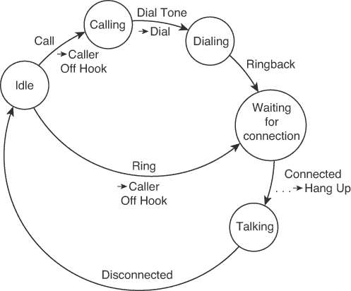

**图15.2.** 用户状态机

- <sup>[6]</sup> 这些状态机经过缩写以保持简单。实际上，所有状态都有返回空闲（Idle）的转换。

Telco状态机如图15.3所示。

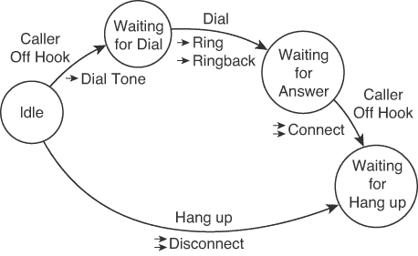

**图15.3.** Telco状态机

在这些图中，`->`符号意味着向另一个状态机发送相应的事件。

所以，当Bob决定打电话（来自Idle状态的`call`事件）时，用户状态机向Telco发送摘机（`off-hook`）事件。当Telco处于等待拨号（Waiting for Dial）状态并接收到来自用户的拨号（`Dial`）事件时，它向相应的用户状态机发送铃响（`Ring`）和回铃（`Ringback`）事件。

如果你仔细研究这些图，你应该能够看到状态机和消息是如何相互作用以允许Bob给Alice打电话的。

我们可以用Clojure非常简单地编写这些状态机：

```clojure
(def user-sm
  {:idle {:call [:calling caller-off-hook]
          :ring [:waiting-for-connection callee-off-hook]
          :disconnect [:idle nil]}
   :calling {:dialtone [:dialing dial]}
   :dialing {:ringback [:waiting-for-connection nil]}
   :waiting-for-connection {:connected [:talking talk]}
   :talking {:disconnect [:idle nil]}})

(def telco-sm
  {:idle {:caller-off-hook [:waiting-for-dial dialtone]
          :hangup [:idle nil]}
   :waiting-for-dial {:dial [:waiting-for-answer ring]}
   :waiting-for-answer {:callee-off-hook [:waiting-for-hangup connect]}
   :waiting-for-hangup {:hangup [:idle disconnect]}})
```

每个状态机都是状态的哈希映射（hash map），每个状态包含一个事件的哈希映射，指定了新状态和要执行的操作。

所以，当`user-sm`处于`:idle`状态并收到`:call`事件时，它转换到`:calling`状态并调用`caller-off-hook`函数。

这些状态机可以通过以下`transition`函数执行：

```clojure
(defn transition [machine-agent event event-data]
  (swap! log conj (str (:name machine-agent) "<-" event))
  (let [state (:state machine-agent)
        sm (:machine machine-agent)
        result (get-in sm [state event])]
    (if (nil? result)
      (do
        (swap! log conj "TILT!")
        machine-agent)
      (do
        (when (second result)
          ((second result)))
        machine-agent))))
```

---

### 解构

简而言之，解构是一种将复杂数据元素拆分为具名组件的方便方法。更多详情请参阅Clojure文档。

给定此实现，我们应该能够通过执行以下代码在Bob和Alice之间建立通话。我已以测试的形式编写了它：

```clojure
(it "should make and receive call"
  (let [caller (make-user "Bob")
        callee (make-user "Alice")
        telco (make-telco "telco")]
    (reset! log [])
    (send caller transition :call [telco caller callee])
    (Thread/sleep 100)
    (prn @log)
    (should= :idle (:state @caller))
    (should= :idle (:state @callee))
    (should= :idle (:state @telco))))
```

该测试通过了，这意味着在100毫秒之后，所有的状态机都已返回空闲状态。日志输出如下：

```clojure
"Bob<-:call" "Bob goes off hook"
"telco<-:caller-off-hook" "dialtone to Bob"
"Bob<-:dialtone" "Bob dials"
"telco<-:dial" "telco rings Alice"
"Alice<-:ring" "Alice goes off hook"
"Bob<-:ringback"
"telco<-:callee-off-hook" "telco connects"
"Bob<-:connected" "Bob talks"
"Alice<-:connected" "Alice talks"
"Bob hangs up"
"Alice hangs up"
"telco<-:hangup" "disconnect"
"Alice<-:disconnect"
"Bob<-:disconnect"
"telco<-:hangup"
```

你可以看到线程是如何相互交错执行的，而三个有限状态机共同工作，驱动通话圆满完成。

这三个代理具有可变状态；但不会出现并发更新问题，因为代理会序列化它们的操作。所以没有竞态条件，对吧？

别太急，Newt。让我们调查另一个场景。

我即将在向你展示的图15.4中，我们再次从Bob打给Alice开始。但这次Alice正好也要拨打Bob<sup>[9]</sup>。

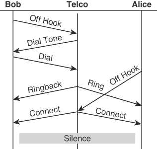

**图15.4.** 电话系统中的竞态条件。

你看到哪里出错了吗？那些交叉的线路就是问题所在。那就是竞态条件。电信公司尝试响起Alice的电话；但在声音产生之前，Alice为了拨打Bob拿起听筒。从电信公司的角度来看，一切都是正常的。它响了电话，Alice接听了。于是，电信公司高兴地连接了Bob和Alice。但Alice坐在那里等待拨号音；而Bob则很困惑，因为没有人打招呼，而且回铃音也停止了。

最可能的结果是双方在没有交流的情况下挂了电话。或者，Alice可能会说些什么而Bob可能会回应，他们可能会陷入“是谁打给谁的”这种喜剧性循环。

我们可以让我们的状态机模拟这种故障吗？这里是设置，再次以测试的形式提出：

```clojure
(it "should race"
  (let [caller (make-user "Bob")
        callee (make-user "Alice")
        telco1 (make-telco "telco1")
        telco2 (make-telco "telco2")]
    (reset! log [])
    (send caller transition :call [telco1 caller callee])
    (send callee transition :call [telco2 callee caller])
    (Thread/sleep 100)
    (prn @log)
    (should= :idle (:state @caller))
    (should= :idle (:state @callee))
    (should= :idle (:state @telco1))
    (should= :idle (:state @telco2))))
```

注意，我们现在有四个状态机：一个给Bob，一个给Alice，以及每个通话对应一个电信公司。测试失败了。在100毫秒后，状态机没有返回空闲状态。

那么，日志告诉了我们什么？

```clojure
"Bob<-:call" "Bob goes off hook"
"telco1<-:caller-off-hook"
"Alice<-:call" "Alice goes off hook"
"telco2<-:caller-off-hook"
"dialtone to Bob"
"Bob<-:dialtone" "Bob dials"
"telco1<-:dial" "telco rings Alice"
"Bob<-:ringback"
```


"Alice<-:ring" "TILT"

你可以看到线程是如何相互交错执行的，而三个有限状态机共同工作驱动通话圆满完成。

三个代理具有可变状态；但不会出现并发更新问题，因为代理会序列化它们的操作。所以没有竞态条件，对吧？

别太急，Newt。让我们调查另一个场景。

我即将在向你展示的图 15.4 是 20 世纪 60 年代电话系统中存在的竞态条件。([9) 我们再次从 Bob 打给 Alice 开始。但这次 Alice 正好也要拨打 Bob。

9。如果你使用固定电话，这现在可能仍然存在。


**图 15.4.** 电话系统中的竞态条件。

你看到哪里出错了了吗？那些交叉的线路就是问题所在。那就是竞态条件。电信公司尝试响起 Alice 的电话；但在声音产生之前，Alice 为了拨打 Bob 拿起听筒。从电信公司的角度来看，一切都是正常的。它响了电话，Alice 接听了。于是，电信公司高兴地连接了 Bob 和 Alice。但 Alice 坐在那里等待拨号音；而 Bob 则很困惑，因为没有人打招呼，而且回铃音也停止了。

最可能的结果是双方在没有交流的情况下挂了电话。或者，Alice 可能会说些什么而 Bob 可能会回应，他们会陷入是谁打给谁的这种喜剧性循环。

我们可以让我们的状态机模拟这种故障吗？这里是设置，再次以测试的形式提出：

```
(it "should race"

  (let [caller (make-user "Bob")

        callee (make-user "Alice")

        telco1 (make-telco "telco1")

        telco2 (make-telco "telco2")]

    (reset! log [])

    (send caller transition :call [telco1 caller callee])

    (send callee transition :call [telco2 callee caller])

    (Thread/sleep 100)

    (prn @log)

    (should= :idle (:state @caller))

    (should= :idle (:state @callee))

    (should= :idle (:state @telco1))

    (should= :idle (:state @telco2))))
```

注意，我们现在有四个状态机：一个给 Bob，一个给 Alice，以及每个通话对应一个电信公司。测试失败了。在 100 毫秒后，状态机没有返回空闲状态。

那么，日志告诉了我们什么？

```
"Bob<-:call" "Bob goes off hook"

"telco1<-:caller-off-hook"

"Alice<-:call" "Alice goes off hook"

"telco2<-:caller-off-hook"

"dialtone to Bob"

"Bob<-:dialtone" "Bob dials"

"telco1<-:dial" "telco rings Alice"

"Bob<-:ringback"

"Alice<-:ring" "TILT"
```

## 图 16.1. 开关与灯的最简单解决方案

`Switch` 类调用了 `Light` 类的 `TurnOn` 方法。

3。记住，这是一个面向对象（OO）论坛。不要纠结于*class*（类）这个词。

对这点的反对是，`Switch` 类可以被用来开启其他东西，如 `Fan`（风扇）或 `Television`（电视）。因此，`Switch` 类不应该感知 `Light` 类。在两者之间应该实施一种抽象，如图图 16.2 所示。

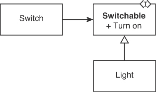

## 图 16.2. 服务器（Abstract Server）

现在 `Switch` 类使用一个名为 `Switchable` 的接口。`Light` 类实现了 `Switchable`。

这解决了问题。现在我们可以有由 `Switch` 控制的任意数量设备。该解决方案是 DIP、OCP 和 LSP 最简单的表达之一。它也有一个名字，被称为*Abstract Server*（抽象服务器）。^(4)

4。Robert C. Martin, *Agile Software Development: Principles, Patterns, and Practices* (Pearson, 2002), 318。

如果我们所在的团队正在讨论如何保护我们的 `Switch` 类不被显式地耦合到 `Light` 类，团队中的某人可能会跳出来说：“我们可以使用 Abstract Server。”如果所有团队成员都认识这个名字及其包含的含义，他们就能快速决定该解决方案是否合适。

这是一种设计模式，是对特定语境下问题的命名解决方案。设计模式的价值在于，这些名称和解决方案是标准的（canonical），因此，熟悉这些规范的人只需通过使用名称就能理解彼此。你说“Abstract Server”，我立刻就能理解你的意思是“在客户端和服务器之间实施一个接口”。

但设计模式中的“语境”部分呢？好吧，让我们回到团队。有人刚刚提议使用 Abstract Server 模式。另一个团队成员说：“不，你不明白，我们并不拥有 `Light` 类；它是第三方库的一部分，所以我们无法修改它来实现一个接口。”

所以，问题的语境是我们想要将 `Switch` 与 `Light` 解耦，但我们无法修改 `Light`。于是团队中的另一个人说：“嗯，我们可以使用一个*Adapter*（适配器）。”

如果你在团队中且不知道 Adapter 模式是什么，你就无法理解他们的建议。但如果你熟悉设计模式的规范，你就能快速评估该建议。再次，设计模式的益处在于了解名称和标准形式，以便你快速应用它们。

Adapter 模式看起来如图图 16.3 所示。


## 图 16.3. Adapter 模式的对象形式

`LightAdapter` 实现了 `Switchable` 接口，并将 `TurnOn` 调用转发给 `Light`。即使在还没被画在白板上之前，团队中的每个人都能在脑海中看到它，因为他们熟悉设计模式规范。所以他们都点头赞同这个主意。

正当他们准备谈论下一个问题时，团队中的某人说：“等一下，我们应该使用哪种形式的 Adapter？”

事实证明，设计模式的标准名称并不一定描述单一的解决方案。某些模式有多种形式。Adapter 就是其中一种模式。它可能看起来像图 16.3，也可能看起来像图 16.4。

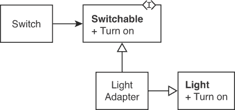

## 图 16.4. Adapter 模式的类形式

前者被称为 Adapter 的*对象*（object）形式，因为 `LightAdapter` 本身是一个对象。后者是 Adapter 的*类*形式形式，因为 `LightAdapter` 是 `Light` 的子类。

团队成员对这两种形式辩论了一会儿，决定目前 Adapter 的类形式是足够的，并且可以减轻他们构建独立 `LightAdapter` 对象的复杂性。

## 函数式编程中的模式

在多年来我们听到的奇怪传闻中，设计模式是绕过面向对象语言产生问题的黑科技（hacks），而在函数式语言中它们是不必要的。

正如你将在后续章节中看到的，某些设计模式确实某些方面似乎是针对面向对象语言某些局限性的变通方案；但这并不适用于所有的设计模式。而且，即使是那些特定的设计模式也有更通用的形式，使其适用于函数式语言。

### Abstract Server


那么，Abstract Server 在函数式语言中长什么样？

再次考虑 `Switch/Light` 问题。这是我们如何在 Clojure 中可能表达它的：

```clojure
(defn turn-on-light []

  ;打开那该死的灯！

  )

(defn engage-switch []

  ;一些其他事情...

  )
```

这两个存根（stubs）模拟了目标函数。我们使用参数 `{:type :light}` 调用了 `engage-switch` 函数。然后，我们测试这两个目标函数是否真的被调用了。

我将抽象服务器模式（Abstract Server pattern）的 `protocol/record` 形式留作练习。到此时，应该清楚该模式在函数式语言中既适用又有用。

### 适配器 (Adapter)


当你有一个想要服务器的客户端，但客户端期望的接口与服务器提供的接口不兼容时，就可以使用适配器模式。

例如，假设我们有前面讨论过的 `engage-switch` 函数，但我们想向它传递一个第三方的 `:variable-light`。`:variable-light` 的 `turn-on-light` 函数接受一个表示光强度的参数：`0` 表示关闭，`100` 表示全亮。

`:variable-light` 的接口与 `engage-switch` 函数的预期不匹配。因此我们需要一个适配器。

适配器最简单的形式可能如下：

```
(defn turn-on-light [intensity]

  ;Turn it on with intensity.

  )

(defmulti turn-on :type)

(defmulti turn-off :type)

(defmethod turn-on :variable-light [switchable]

  (turn-on-light 100))

(defmethod turn-off :variable-light [switchable]

  (turn-on-light 0))

(defn engage-switch [switchable]

  ;Some other stuff...

  (turn-on switchable)

  ;Some more other stuff...

  (turn-off switchable))
```

我用以下测试对其进行了测试：

```
(describe "Adapter"

  (with-stubs)

  (it "turns light on and off"

    (with-redefs [turn-on-light (stub :turn-on-light)]

      (engage-switch {:type :variable-light})

      (should-have-invoked :turn-on-light {:times 1 :with [100]})

      (should-have-invoked :turn-on-light {:times 1 :with [0]}))))
```

如果我要在 UML 中画这个结构，我可能会画类似图 16.5 的内容。

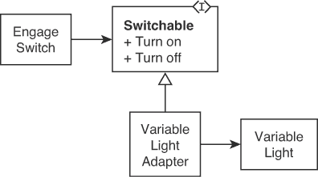

**图 16.5.** 适配器模式的对象形式

`defmulti` 函数对应于 `Switchable` 接口。`{:type :variable-light}` 对象结合两个 `defmethod` 函数对应于 `VariableLightAdapter`。`EngageSwitch` 和 `VariableLight` “类”对应于我们正尝试适配的两个函数。

也许你觉得这没有说服力。毕竟，这只是一个带有几个 `defmulti` 函数的简单小程序。它没有 UML 中所示的那明显的面向对象结构。因此，让我们通过拆分源文件来强制实现这种结构。

我们从 `switchable` 接口开始。在 `ns` 语句中，我使用了约定，即 `turn-on-light` 是包含 `switchable` 命名项目的整体命名空间：

```
(ns turn-on-light.switchable)

(defmulti turn-on :type)

(defmulti turn-off :type)
```

这是一个多态接口。注意它没有源代码依赖。此外，请记住，Clojure 中的 `ns` 语句对源文件的要求与 Java 对类的相同。源文件和命名空间必须具有相应的名称。因此，当我们将代码元素移动到不同的命名空间时，我们也将把它们移动到不同的源文件中。

特别是，`turn-on-light.switchable` 命名空间必须位于名为 `turn_on_light` 的目录下的 `switchable.clj` 文件中。

接下来，看看 `engage-switch` 和 `variable-light` 命名空间：

```
(ns turn-on-light.engage-switch

  (:require [turn-on-light.switchable :as s]))

(defn engage-switch [switchable]

  ;Some other stuff...

  (s/turn-on switchable)

  ;Some more other stuff...

  (s/turn-off switchable))

————————————————

(ns turn-on-light.variable-light)

(defn turn-on-light [intensity]

  ;Turn it on with intensity.

  )
```

这里没有意外。`engage-switch` 命名空间依赖于 `switchable` 接口。`variable-light` 命名空间没有向外的源代码依赖。

`variable-light-adapter` 命名空间将 `switchable` 接口连接到 `variable-light`。注意 `make-adapter` 构造函数。测试将将使用它：

```
(ns turn-on-light.variable-light-adapter

  (:require [turn-on-light.switchable :as s]

            [turn-on-light.variable-light :as v-l]))

(defn make-adapter [min-intensity max-intensity]

  {:type :variable-light

   :min-intensity min-intensity

   :max-intensity max-intensity})

(defmethod s/turn-on :variable-light [switchable]

  (v-l/turn-on-light (:max-intensity switchable)))

(defmethod s/turn-off :variable-light [switchable]

  (v-l/turn-on-light (:min-intensity switchable)))
```

最后，测试通过依赖具体的命名空间将所有内容整合成一个整洁的整体：

```
(ns turn-on-light.turn-on-spec

  (:require [speclj.core :refer :all]

            [turn-on-light.engage-switch :refer :all]

            [turn-on-light.variable-light :as v-l]

            [turn-on-light.variable-light-adapter

              :as v-l-adapter]))

(describe "Adapter"

  (with-stubs)

  (it "turns light on and off"

    (with-redefs [v-l/turn-on-light (stub :turn-on-light)]

      (engage-switch (v-l-adapter/make-adapter 5 90))

      (should-have-invoked :turn-on-light

                           {:times 1 :with [90]})

      (should-have-invoked :turn-on-light

                           {:times 1 :with [5]}))))
```

# 适配器模式

到这里，你应该已经确定这就是 `GOF` 书中的适配器模式了，对吧？你可能还会预期许多其他的 GOF 模式可以用 `Clojure` 这样的函数式语言来表达。也许更重要的是，你应该将命名空间/源文件结构视为函数式程序设计和架构的一部分。

`GOF` 是我们在 90 年代对《设计模式》（Design Patterns）一书的亲切称呼。它代表“四人帮”（Gang of Four），因为这本书有四位作者：Erich Gamma、John Vlissides、Ralph Johnson 和 Richard Helm。

## 命令模式 (Command)

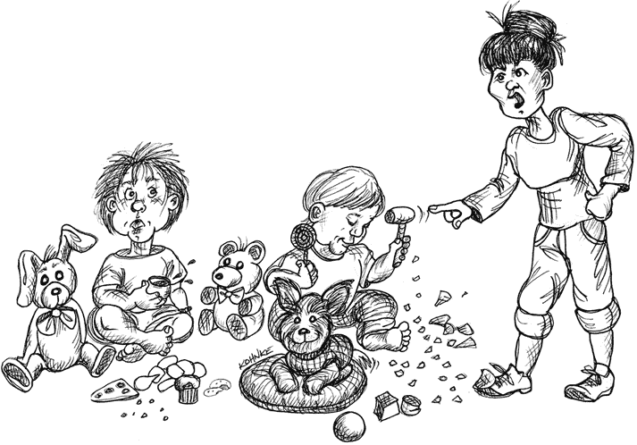

在 GOF 书中所有的设计模式里，`Command` 最令我感兴趣的。这并不是因为它复杂，而是因为它非常`simple`。非常，非常简单。

顺带提一下，这也是我对 Clojure 感兴趣的地方。正如我在本书引言中所说的，Clojure 在语义上非常丰富，但在语法上极其简单。没错，命令模式也具有同样的属性。它的丰富性在于其不可置信的简单。

在 `C++` 中，我们可能会这样写命令模式：

```cpp
class Command {

  public:
```


`virtual void execute() = 0;`

};

就这些了。只有一个抽象类（接口），包含一个单一的纯虚（抽象）函数。如此简单。但使用这种模式可以做很多有趣的事情。若想深入研究这种丰富性，请参考《敏捷软件开发：原则、模式与实践》（Agile Software Development: Principles, Patterns, and Practices）中的相应章节。

在像`Clojure`这样的函数式语言中，你可能会认为这种模式消失了。毕竟，如果你想把命令传递给其他函数，只需要传递`command`函数即可。你不需要把它封装成对象，因为在函数式语言中，函数就是对象：

```clojure
(ns command.core)

(defn execute []

  )

(defn some-app [command]

  ;一些其他内容 . .

  (command)

  ;更多其他内容 . .

  )
```

## 撤销 (Undo)

命令模式更有用的变体之一可以在下面的 C++ 代码中看到：

```cpp
class UndoableCommand : public Command {

  public:

    virtual void undo() = 0;

};
```

那个`undo()`函数开启了许多有趣的可能性。

我们使用`defmulti`函数创建了`undoable-command`接口。我们在`add-room-command`命名空间实现了该接口，并在`command.core`命名空间的`gui-app`函数中模拟了 GUI。

测试部分存根了`add-room-command`的底层函数并确保它们被正确调用。它带有一个`palette-actions`列表调用了`gui-app`。

`add-room-command`的两个方法是通过多态分派的。对于`execute`情况，这似乎并不是必要的，因为`gui-app`刚刚创建了`add-room-command`对象。但如果我们向该系统添加更多命令，`execute`的多态分发将变得更加必要。

`undo`的多态分发即使在这个小示例中显然也是必要的，因为当调面板接收到`:undo-action`时，我们并不知道正在撤销的是哪个命令。

在这里，我们再次看到，随着应用程序复杂性的增加，GOF 模式的标准形式开始显现出来。对于单方法命令，我们可以使用普通的函数（实际上是函数对象）来解决。但当应用程序需要更丰富的命令类型时，我们又回到了 GOF 风格。

### 组合模式 (Composite)

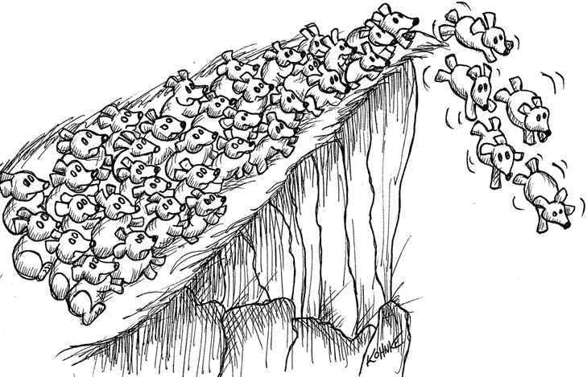

`Composite`延续了语义丰富性和语法简单的主题。它是旧句柄/实现（handle/body）方法的极佳示例，这种方法我在 Jim Coplien 的其中一书中首次读到^(9)。组合模式的结构在图 16.6 的 UML 中所示。

9. James O. Coplien, *Advanced C++ Programming Styles and Idioms* (Addison-Wesley, 1991).

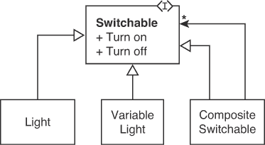

**图 16.6.** 组合模式

我们的老朋友`Switchable`接口由其他老朋友`Light`和`VariableLight`实现。`CompositeSwitchable`也实现了`Switchable`并包含一个其他`Switchable`实例列表。

`CompositeSwitchable`中的`TurnOn`和`TurnOff`实现简单是将相同函数的调用传播到列表中的所有实例。因此，当对`CompositeSwitchable`实例调用`TurnOn`时，它将调用其所包含的所有`Switchable`实例的`TurnOn`。

在 Java 中，我们可以如下实现`CompositeSwitchable`：

点击此处查看代码图片

```java
public class CompositeSwitchable implements Switchable {

  private List<Switchable> switchables = new ArrayList<>();

  public void addSwitchable(Switchable s) {

    switchables.add(s):

  }

  public void turnOn() {

    for (var s : switchables)

      s.turnOn();

  }

  public void turnOff() {

    for (var s : switchables)

      s.turnOff();

  }

}
```

在函数式语言（如 Clojure）中，人们倾向于避免组合模式，简单地使用`map`或`doseq`函数，如下方的测试所示：

点击此处查看代码图片

```clojure
(ns composite-example.switchable)

(defmulti turn-on :type)

(defmulti turn-off :type)

—————

(ns composite-example.light

  (:require [composite-example.switchable :as s]))

(defn make-light [] {:type :light})

(defn turn-on-light [])

(defn turn-off-light [])

(defmethod s/turn-on :light [switchable]

  (turn-on-light))

(defmethod s/turn-off :light [switchable]

  (turn-off-light))

———————

(ns composite-example.variable-light

  (:require [composite-example.switchable :as s]))

(defn make-variable-light [] {:type :variable-light})

(defn set-light-intensity [intensity])

(defmethod s/turn-on :variable-light [switchable]

  (set-light-intensity 100))

(defmethod s/turn-off :variable-light [switchable]

  (set-light-intensity 0))

———————————

(ns composite-example.core-spec

  (:require [speclj.core :refer :all]

            [composite-example

             [light :as l]

             [variable-light :as v]

             [switchable :as s]]))

(describe "composite-switchable"

  (with-stubs)

  (it "turns all on"

    (with-redefs

      [l/turn-on-light (stub :turn-on-light)

       v/set-light-intensity (stub :set-light-intensity)]

      (let [switchables [(l/make-light) (v/make-variable-light)]]

        (doseq [s-able switchables] (s/turn-on s-able))

        (should-have-invoked :turn-on-light)
```

```clojure
(ns composite-example.circle

  (:require [clojure.spec.alpha :as s]

            [composite-example.shape :as shape]))

(s/def ::center (s/tuple number? number?))

(s/def ::radius number?)

(s/def ::circle (s/keys :req [::shape/type

                              ::radius

                              ::center]))

(defn make-circle [center radius]

  {:post [(s/valid? ::circle %)]}

  {::shape/type ::circle

   ::center center

   ::radius radius})

(defmethod shape/translate ::circle [circle dx dy]

  {:pre [(s/valid? ::circle circle)

         (number? dx) (number? dy)]

   :post [(s/valid? ::circle %)]}

  (let [[x y] (::center circle)]

    (assoc circle ::center [(+ x dx) (+ y dy)]))

(defmethod shape/scale ::circle [circle factor]

  {:pre [(s/valid? ::circle circle)

         (number? factor)]

   :post [(s/valid? ::circle %)]}

  (let [radius (::radius circle)]

    (assoc circle ::radius (* radius factor))))
```

———————

```clojure
(ns composite-example.square
  (:require [clojure.spec.alpha :as s]
            [composite-example.shape :as shape]))

(s/def ::top-left (s/tuple number? number?))
(s/def ::side number?)
(s/def ::square (s/keys :req [::shape/type
                              ::side
                              ::top-left]))

(defn make-square [top-left side]
  {:post [(s/valid? ::square %)]}
  {::shape/type ::square
   ::top-left top-left
   ::side side})

(defmethod shape/translate ::square [square dx dy]
  {:pre [(s/valid? ::square square)
         (number? dx) (number? dy)]
   :post [(s/assert ::square %)]}
  (let [[x y] (::top-left square)]
    (assoc square ::top-left [(+ x dx) (+ y dy)]))

(defmethod shape/scale ::square [square factor]
  {:pre [(s/valid? ::square square)
         (number? factor)]
   :post [(s/valid? ::square %)]}
  (let [side (::side square)]
    (assoc square ::side (* side factor))))
```

```clojure
(ns composite-example.composite-shape
  (:require [clojure.spec.alpha :as s]
            [composite-example.shape :as shape]))

(s/def ::shapes (s/coll-of ::shape/shape-type))
(s/def ::composite-shape (s/keys :req [::shape/type
                                       ::shapes]))

(defn make []
  {:post [(s/assert ::composite-shape %)]}
  {::shape/type ::composite-shape
   ::shapes []})

(defn add [cs shape]
  {:pre [(s/valid? ::composite-shape cs)
         (s/valid? ::shape/shape-type shape)]
   :post [(s/valid? ::composite-shape %)]}
  (update cs ::shapes conj shape))

(defmethod shape/translate ::composite-shape [cs dx dy]
  {:pre [(s/valid? ::composite-shape cs)
         (number? dx) (number? dy)]
   :post [(s/valid? ::composite-shape %)]}
  (let [translated-shapes (map #(shape/translate % dx dy)
                               (::shapes cs))]
    (assoc cs ::shapes translated-shapes)))

(defmethod shape/scale ::composite-shape [cs factor]
  {:pre [(s/valid? ::composite-shape cs)
         (number? factor)]
   :post [(s/valid? ::composite-shape %)]}
  (let [scaled-shapes (map #(shape/scale % factor)
                           (::shapes cs))]
    (assoc cs ::shapes scaled-shapes)))
```

```clojure
(ns composite-example.composite-shape
  (:require [clojure.spec.alpha :as s]
            [composite-example.shape :as shape]))

(s/def ::shapes (s/coll-of ::shape/shape-type))
(s/def ::composite-shape (s/keys :req [::shape/type
                                       ::shapes]))

(defn make []
  {:post [(s/assert ::composite-shape %)]}
  {::shape/type ::composite-shape
   ::shapes []})

(defn add [cs shape]
  {:pre [(s/valid? ::composite-shape cs)
         (s/valid? ::shape/shape-type shape)]
   :post [(s/valid? ::composite-shape %)]}
  (update cs ::shapes conj shape))

(defmethod shape/translate ::composite-shape [cs dx dy]
  {:pre [(s/valid? ::composite-shape cs)
         (number? dx) (number? dy)]
   :post [(s/valid? ::composite-shape %)]}
  (let [translated-shapes (map #(shape/translate % dx dy)
                               (::shapes cs))]
    (assoc cs ::shapes translated-shapes)))

(defmethod shape/scale ::composite-shape [cs factor]
  {:pre [(s/valid? ::composite-shape cs)
         (number? factor)]
   :post [(s/valid? ::composite-shape %)]}
  (let [scaled-shapes (map #(shape/scale % factor)
                           (::shapes cs))]
    (assoc cs ::shapes scaled-shapes)))
```


注意方法上的 `:pre` 和 `:post` 条件。我正在使用这些来检查进入和离开函数的类型。你可能会合理地担心这些检查带来的运行时开销。我会全局禁用它们，或者在确认类型管理得当后，有选择性地注释掉它们。

有一个编译时开关可以禁用所有的断言，包括 `:pre` 和 `:post`。

注意 `translate` 和 `scale` 函数返回了新的 `shape` 实例。它们在行为上是完全函数式的。

所以，现在让我们来看看 `composite-shape`：

我们之前在 `light`/`variable-light` 示例中见过这种模式。这次不同的是，`composite-shape` 返回的是一个带有新 `shape` 实例的新 `composite-shape`。因此，它是函数式的。

对于那些好奇的人，这里是我使用的测试用例：

现在，当然，我们可以通过向 `shape` 抽象类添加一个 `:journaled?` 标记，然后在 `circle` 和 `square` 的实现中放入一个 `if` 语句来实现。但这太乱了。我们真正想要的是一种方法，可以在不改变 `shape` 抽象类或其任何子类（包括 `circle`、`square` 和 `composite-shape`，即符合 OCP）。

引入装饰器模式（Decorator pattern）。UML 所示图 16.7。

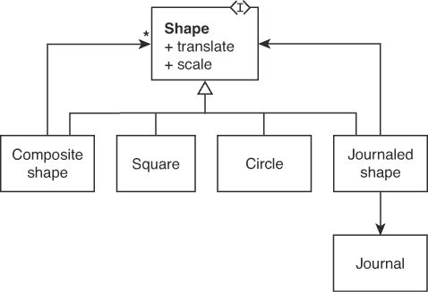

**图 16.7.** 装饰器模式

我包含了 `composite-shape`，因为它目前是 `shape` 类型模型的一部分。`journaled-shape` 是装饰器。`journaled-shape` 派自 `shape` 并持有一个 `shape` 的引用。当在 `journaled-shape` 上调用 `translate` 或 `scale` 时，它会在日志中创建一个条目，然后将调用委托给包含的 `shape`。

这里是 Clojure 的实现：

```clojure
(ns decorator-example.journaled-shape
  (:require [decorator-example.shape :as shape]
            [clojure.spec.alpha :as s]))

(s/def ::journal-entry
       (s/or :translate (s/tuple #{:translate}1 number? number?)
             :scale (s/tuple #{:scale} number?)))
(s/def ::journal (s/coll-of ::journal-entry))
(s/def ::shape ::shape/shape-type)
(s/def ::journaled-shape (s/and
                           (s/keys :req [::shape/type
                                         ::journal
                                         ::shape])
                           #(= ::journaled-shape
                               (::shape/type %))))

(defn make [shape]
  {:post [(s/valid? ::journaled-shape %)]}
  {::shape/type ::journaled-shape
   ::journal []
   ::shape shape})

(defmethod shape/translate ::journaled-shape [js dx dy]
  {:pre [(s/valid? ::journaled-shape js)
         (number? dx) (number? dy)]
   :post [(s/valid? ::journaled-shape %)]}
  (-> js (update ::journal conj [:translate dx dy])
      (assoc ::shape (shape/translate (::shape js) dx dy))))

(defmethod shape/scale ::journaled-shape [js factor]
  {:pre [(s/valid? ::journaled-shape js)
         (number? factor)]
   :post [(s/valid? ::journaled-shape %)]}
  (-> js (update ::journal conj [:scale factor])
      (assoc ::shape (shape/scale (::shape js) factor))))
```

`::journaled-shape` 对象拥有 `::shape` 和 `::journal` 字段。`::journal` 字段是 `::journal-entry` 元组的集合，格式为 `[:translate dx dy]` 或 `[:scale factor]`，其中 `dx`、`dy` 和 `factor` 是数字。`::shape` 字段必须包含一个有效的 `shape`。

`make` 构造函数创建一个有效的 `journaled-shape`（通过 `:post` 条件检查）。

`translate` 和 `scale` 函数将相应的日志条目添加到 `::journal` 中，然后将各自的函数委托给 `::shape`，返回一个带有更新的 `::journal` 和修改后的 `::shape` 的新 `journaled-shape`。

这是测试。我只针对 `square` 测试了 `journaled-shape`，因为如果它对 `square` 有效，那么它对每个 `shape` 都有效：

```clojure
(describe "journaled shape decorator"
  (it "journals scale and translate operations"
    (let [jsd (-> (js/make (square/make-square [0 0] 1))
                  (shape/translate 2 3)
                  (shape/scale 5))]
      (should= [[:translate 2 3] [:scale 5]]
               (::js/journal jsd))
      (should= {::shape/type ::square/square
                ::square/top-left [2 3]
                ::square/side 5}
               (::js/shape jsd)))))
```

我们创建了一个包含 `square` 的 `journaled-shape`。我们对其进行 `translate` 和 `scale` 操作，然后确保 `::journal` 记录了 `translate` 和 `scale` 调用，并且 `square` 具有平移和缩后的值。

再次，我包含了类型规范，是为了给你提供一个挑战并演示如何使用它们。但坦率地说，我认为测试已经能够很好地检查类型了；因此在现实生活中，我怀疑我不会对这种小问题使用如此详细的类型规范。另一方面，看到类型这样完整地列出来也挺不错的。

无论如何，请注意 `journaled-shape` 装饰器将适用于任何 `journaled-shape`。

### 访问者 (Visitor)

在某个时刻，你会意识到这些数据格式是没有尽头的，而且客户会不断向你索要更多。你不希望用这些方法来污染 `shape` 接口。

访问者模式给了我们解决这种困境的方法。UML 所示图 16.8。


**图 16.8.** 访问者模式

我想首先指出的是 `Shape` 子类到 `ShapeVisitor` 方法的 90 度旋转。每个子类 `Square` 和 `Circle` 都是 `ShapeVisitor` 中 `visit` 函数的参数类型。我将子类到方法的转换为 90 度旋转，因为它满足了我某些神经元。

我们在左侧看到 `shape` 抽象及其所有子类。在右侧，我们看到 `ShapeVisitor` 层级结构。模式为 `shape` 接口增加了 `accept` 函数。该函数接受一个参数，即 `ShapeVisitor`。这违反了 OCP，但只有一次。

在 Java 中，`accept` 函数的实现是显而易见的：

```java
void accept(ShapeVisitor v) {
  v.visit(this);
}
```

如果你从未学过访问者模式，这可能有点难以理解。所以请花时间跟我一起过一遍。

假设我们为某些 `Shape` 获取 JSON 字符串。在 Java、C++ 或其他语言中，我们这样获取它：

```java
Shape s = // 在不知道子类的情况下获取 shape
ShapeVisitor v = new JsonVisitor();
s.accept(v);
String json = v.getJson();
```


我包含了`composite-shape`，因为它目前是`shape`类型模型的一部分。`journaled-shape`是装饰器。`journaled-shape`派自`shape`并持有一个`shape`的引用。当在`journaled-shape`上调用`translate`或`scale`时，它会在日志中创建一个条目，然后将调用委托给包含的`shape`。

这里是 Clojure 的实现：

点击此处查看代码图像

```
(ns decorator-example.journaled-shape
  (:require [decorator-example.shape :as shape]
            [clojure.spec.alpha :as s]))

(s/def ::journal-entry
       (s/or :translate (s/tuple #{:translate}1 number? number?)
             :scale (s/tuple #{:scale} number?)))
(s/def ::journal (s/coll-of ::journal-entry))
(s/def ::shape ::shape/shape-type)
(s/def ::journaled-shape (s/and
                           (s/keys :req [::shape/type
                                         ::journal
                                         ::shape])
                           #(= ::journaled-shape
                               (::shape/type %))))

(defn make [shape]
  {:post [(s/valid? ::journaled-shape %)]}
  {::shape/type ::journaled-shape
   ::journal []
   ::shape shape})

(defmethod shape/translate ::journaled-shape [js dx dy]
  {:pre [(s/valid? ::journaled-shape js)
         (number? dx) (number? dy)]
   :post [(s/valid? ::journaled-shape %)]}
  (-> js (update ::journal conj [:translate dx dy])
      (assoc ::shape (shape/translate (::shape js) dx dy))))

(defmethod shape/scale ::journaled-shape [js factor]
  {:pre [(s/valid? ::journaled-shape js)
         (number? factor)]
   :post [(s/valid? ::journaled-shape %)]}
  (-> js (update ::journal conj [:scale factor])
      (assoc ::shape (shape/scale (::shape js) factor))))
```

11。集合可以用作测试成员关系的函数。

`::journaled-shape`对象拥有`::shape`和`::journal`字段。`::journal`字段是`::journal-entry`元组的集合，格式为`[:translate dx dy]`或`[:scale factor]`，其中`dx`、`dy`和`factor`是数字。`::shape`字段必须包含一个有效的`shape`。

`make`构造函数创建一个有效的`journaled-shape`（通过`:post`条件检查）。

`translate`和`scale`函数将相应的日志条目添加到`::journal`中，然后将各自的函数委托给`::shape`，返回一个带有更新的`::journal`和修改后的`::shape`的新`journaled-shape`。

这是测试。我只针对`square`测试了`journaled-shape`，因为如果它对`square`有效，那么它对每个`shape`都有效：

点击此处查看代码图像

```
(describe "journaled shape decorator"
  (it "journals scale and translate operations"
    (let [jsd (-> (js/make (square/make-square [0 0] 1))
                  (shape/translate 2 3)
                  (shape/scale 5))]
      (should= [[:translate 2 3] [:scale 5]]
               (::js/journal jsd))
      (should= {::shape/type ::square/square
                ::square/top-left [2 3]
                ::square/side 5}
               (::js/shape jsd)))))
```

我们创建了一个包含`square`的`journaled-shape`。我们对其进行`translate`和`scale`操作，然后确保`::journal`记录了`translate`和`scale`调用，并且`square`具有平移和缩后的值。

再次，我包含了类型规范，是为了给你提供一个挑战并演示如何使用它们。但坦率地说，我认为测试已经能够很好地检查类型了；因此在现实生活中，我怀疑我不会对这种小问题使用如此详细的类型规范。另一方面，看到类型这样完整地列出来也挺不错的。

无论如何，请注意`journaled-shape`装饰器将适用于任何`journaled-shape`。

我们从某处获取一个`Shape`对象。我们创建了`JsonVisitor`。通过`accept`方法将`JsonVisitor`传递给我们的`Shape`。`accept`方法会多态地分发到`Shape`的适当子类——假设它是一个`Square`。`Square`的`accept`方法会调用`JsonVisitor`的`visit(this)`。由于`this`的类型是`Square`，因此调用了`JsonVisitor`的`visit(Square s)`函数。该函数为`Square`生成 JSON 字符串并将其保存在`JsonVisitor`的成员变量中。`getJson()`函数返回该成员变量的内容。

你可能需要读几遍才能理解。这种技术被称为`double-dispatch`（双重分发）。第一次分发部署到`Shape`的子类，因此我们现在知道了该子类的类型。第二次分发部署到访问者的适当子类，并传递了该子类的真实类型。

如果你跟上了所有的步骤，就会发现`ShapeVisitor`的每个派生类都是`Shape`类型模型的一个新“方法”，但我们唯一向`Shape`添加的只是`accept`方法。因此（符合开闭原则 OCP）。你现在也应该理解为什么我们不能使用装饰器（Decorator）。新函数强依赖于子类。如果你不知道它是一个`Square`，你就无法为`Square`生成 JSON 字符串。

现在，我告诉你这些是为了引出：所有这些糟糕的复杂性都是因为语言限制。是的，是的……在这里，设计模式的反对者确实有一定的道理。访问者模式之所以如此复杂，是因为特定的语言特性。

那个特性是什么呢？`Closed classes`（封闭类）。

### 是关闭，还是 Clojure？

在 C++ 和 Java 等语言中，我们创建的类是封闭的。这意味着我们无法通过在新的源文件中放入新方法的声明来向类添加新方法。在封闭型语言中，如果我们想向类添加新方法，必须打开该类的源文件，并在类定义内部添加该方法。

Clojure 没有这种限制。C# 在某种程度上也是如此。事实上，许多语言允许你在不更改包含类声明的源文件的情况下向类添加方法。

Clojure 没有这种限制的原因是类并不是该语言的特性。我们通过约定创建类，而不是通过语法。

所以，等等，这意味着在 Clojure 中我们不需要装饰器模式或访问者模式了吗？不，完全不是这个意思。事实上，正如我们看到的，我们仍然需要 GOF 形式的装饰器。否则你该如何实现`journaled-shape`呢？

然而，在拥有开放类的语言中，GOF 形式的访问者并不是必须的。或者说，GOF 形式的某些细节并不是必要的。

让我给你看这个在 Clojure 中实现的特定访问者。首先是测试：

点击此处查看代码图片

```
(ns visitor-example.core-spec
  (:require [speclj.core :refer :all]
            [visitor-example
             [square :as square]
             [json-shape-visitor :as jv]
             [circle :as circle]]))

(describe "shape-visitor"
  (it "makes json square"
    (should= "{\"top-left\": [0,0], \"side\": 1}"
             (jv/to-json (square/make [0 0] 1))))

  (it "makes json circle"
    (should= "{\"center\": [3,4], \"radius\": 1}"
             (jv/to-json (circle/make [3 4] 1)))))
```

这并不太意外；尽管你应该特别注意源代码的依赖。这个测试几乎需要所有东西。

现在让我们回一下`shape`类型模型是什么样的。为了简单起见，我移除了所有的`clojure.spec`类型规范：

点击此处查看代码图片

```
(ns visitor-example.shape)

(defmulti translate (fn [shape dx dy] (::type shape)))
(defmulti scale (fn [shape factor] (::type shape)))

———————

(ns visitor-example.square
  (:require
    [visitor-example.shape :as shape]))

(defn make [top-left side]
  {::shape/type ::square
   ::top-left top-left
   ::side side})

(defmethod shape/translate ::square [square dx dy]
  (let [[x y] (::top-left square)]
    (assoc square ::top-left [(+ x dx) (+ y dy)])))

(defmethod shape/scale ::square [square factor]
  (let [side (::side square)]
    (assoc square ::side (* side factor))))

————————

(ns visitor-example.circle
  (:require
    [visitor-example.shape :as shape]))

(defn make [center radius]
  {::shape/type ::circle
   ::center center
   ::radius radius})

(defmethod shape/translate ::circle [circle dx dy]
  (let [[x y] (::top-left circle)]
    (assoc circle ::top-left [(+ x dx) (+ y dy)])))

(defmethod shape/scale ::circle [circle factor]
  (let [side (::side circle)]
    (assoc circle ::side (* side factor))))
```

在 Java、C# 和 C++ 中，我们可以通过使用`abstract factory`来解决这个问题，`App`可以使用它来实例化`visitor`对象，而不需要直接依赖它。

在 Clojure 中，我们有另一个且更好的选择。我们可以如下所示将`json-shape-visitor`的接口与其实现分离开：

点击此处查看代码图片

```clojure
(ns visitor-example.json-shape-visitor
  (:require [visitor-example
             [shape :as shape]]))
(defmulti to-json ::shape/type)

(ns visitor-example.json-shape-visitor-implementation
  (:require [visitor-example
             [json-shape-visitor :as v]
             [circle :as circle]
             [square :as square]]))

(defmethod v/to-json ::square/square [square]
  (let [{:keys [::square/top-left ::square/side]} square
        [x y] top-left]
    (format "{\"top-left\": [%s,%s], \"side\": %s}" x y side)))

(defmethod v/to-json ::circle/circle [circle]
  (let [{:keys [::circle/center ::circle/radius]} circle
        [x y] center]
    (format "{\"center\": [%s,%s], \"radius\": %s}" x y radius)))
```

这里的诀窍在于确保`json-shape-visitor-implementation`模块被`main` `require`，这样`defmethod`s就能正确注册到`defmulti`中：

点击此处查看代码图片

```clojure
(ns visitor-example.main
  (:require [visitor-example
             [json-shape-visitor-implementation]]))
```

通常，`main`在应用程序的任何部分之前被调用，因此应用程序对`main`没有源码级依赖。遗憾的是，我的测试无法访问真正的`main`，因此必须包含该依赖：

15 . Martin, *Clean Architecture*, p. 231.

点击此处查看代码图片

```clojure
(ns visitor-example.core-spec
  (:require [speclj.core :refer :all]
            [visitor-example
             [square :as square]
             [json-shape-visitor :as jv]
             [circle :as circle]
             [main]]))

(describe "shape-visitor"
  (it "makes json square"
    (should= "{\"top-left\": [0,0], \"side\": 1}"
             (jv/to-json (square/make [0 0] 1))))

  (it "makes json circle"
    (should= "{\"center\": [3,4], \"radius\": 1}"
             (jv/to-json (circle/make [3 4] 1)))))
```

所以，这就是一个在 Clojure 中功能性且架构合格的 Visitor。正如图 16.10 中的 UML 所示，所有依赖都跨越了架构边界，指向该边界的更高层（抽象）侧。赞美上帝！

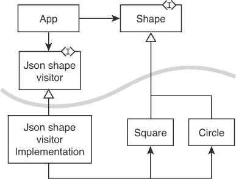

**图 16.10.** 功能性且架构合格的 Visitor

因此，Visitor 模式是一个 GOF 形式被当时的语言限制所污染的案例。在 1995 年 GOF 书籍出版时，关闭类被认为是静态类型语言的必要属性，因此几乎无处不在。

## 抽象工厂


DIP（依赖倒置原则）建议我们避免对既易变又具体的事产生源码依赖。因此，我们创建抽象结构并尝试将依赖路由到它们。然而，当我们创建对象实例时，往往必须违反这一建议；这会导致架构上的困难，如图 16.11 中的 UML 所示。

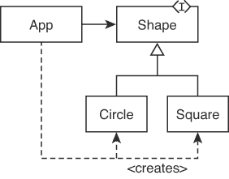

**图 16.11.** 创建导致的 DIP 违反


图 16.11 中的 `App` 使用 `Shape` 接口。它需要做的一切都可以通过该接口完成，但有一个例外。`App` 必须创建 `Circle` 和 `Square` 衍生类的实例；这迫使 `App` 对相应的模块挂了源码依赖。

我们实际上在之前的示例中已经见过这种情况。例如，考虑本章前面 `visitor-example` 测试中的代码。注意，测试对 `square` 和 `circle` 的源码依赖仅仅是为了调用那些 `make` 函数：

```clojure
(ns visitor-example.core-spec
  (:require [speclj.core :refer :all]
            [visitor-example
             [square :as square]
             [json-shape-visitor :as jv]
             [circle :as circle]
             [main]]))

(describe "shape-visitor"
  (it "makes json square"
    (should= "{\"top-left\": [0,0], \"side\": 1}"
             (jv/to-json (square/make [0 0] 1))))

  (it "makes json circle"
    (should= "{\"center\": [3,4], \"radius\": 1}"
             (jv/to-json (circle/make [3 4] 1)))))
```

# 引言

关于这个测试需要注意的第一点是，它对 `circle` 或 `square` 没有源文件依赖。它只依赖于两个接口：`shape` 和 `shape-factory`。这是我们的架构目标。

但这个 `main` 依赖是什么？你看到测试开始的 `(before-all (main/init))` 这一行了吗？它告诉测试运行器在执行任何测试之前调用 `(main/init)`。这模拟了 `main` 模块在启动 `App` 之前初始化一切的过程。

这里是 `main` 代码：

```kotlin
(ns abstract-factory-example.main
  (:require [abstract-factory-example
            [shape-factory-implementation :as imp]]))

(def shape-factory (atom nil))

(defn init[]
  (reset! shape-factory (imp/make)))
```

噢，天！我们有一个名为 `shape-factory` 的全局 `atom`！那个 `atom` 正在被 `init` 函数初始化为 `shape-factory-implementation`。

回过来看测试，我们看到 `make-circle` 和 `make-square` 方法传递的是解引用后的 `atom`。

像这样设置全局变量是处理工厂的一种非常常见的策略。主程序创建具体的工厂实现，然后将其加载到所有人都可以访问的全局变量中。在静态类型语言中，该全局变量的类型是接口 `ShapeFactory`。在动态类型语言中，不需要这种类型声明。

## 再次 90 度

再次查看图 16.13 中的那张 UML 图。你看到 `ShapeFactory` 中的 90 度旋转了吗？你在 `shape-factory` 代码中也能看到它。`ShapeFactory`（以及 `shape-factory`）拥有与 `Shape` 的子类型对应的方法。

这给 Visitor 模式带来的问题在这里也存在，尽管形式略有不同。每当添加一个新的 `shape` 的子类型时，都必须修改 `shape-factory`。这违反了 OCP（开闭原则），因为我们必须修改架构边界高层侧的模块。如果 OCP 重要，那么它在跨越此类边界时就尤为重要。仔细研究那张 UML 图，直到你明白我的意思。

我们可以通过将 90 度旋转替换为接受一个不透明令牌（opaque token）的方法来解决这个问题。类似于这样的：

```kotlin
(ns abstract-factory-example.shape-factory)

(defmulti make (fn [factory type & args] (::type factory)))

——————————

(ns abstract-factory-example.shape-factory-implementation
  (:require [abstract-factory-example
             [shape-factory :as factory]
             [square :as square]
             [circle :as circle]]))

(defn make []
  {::factory/type ::implementation})

(defmethod factory/make ::implementation
  [factory type & args]
  (condp = type
    :square (apply square/make args)
    :circle (apply circle/make args)))

————————————————

(ns abstract-factory-example.core-spec
  (:require [speclj.core :refer :all]
            [abstract-factory-example
             [shape :as shape]
             [shape-factory :as factory]
             [main :as main]]))

(describe "Shape Factory"
  (before-all (main/init))
  (it "creates a square"
    (let [square (factory/make
                   @main/shape-factory
                   :square
                   [100 100] 10)]
      (should= "Square top-left: [100,100] side: 10"
               (shape/to-string square))))

  (it "creates a circle"
      (let [circle (factory/make
                     @main/shape-factory
                     :circle
                     [100 100] 10)]
        (should= "Circle center: [100,100] radius: 10"
                 (shape/to-string circle)))))
```

注意传递给 `shape-factory/make` 的参数是不透明的。也就是说，它没有由任何其他模块定义，包括特别是 `square` 和 `circle` 模块。`:square` 和 `:circle` 关键字没有命名空间，也没有在任何地方声明。它们只是恰好有名字的不透明值。我完全可以用 `1` 代表 `square`，用 `2` 代表 `circle`，或者使用 `"square"` 和 `"circle"` 字符串。

这种不透明性是该解决方案的关键。如果我们以后需要添加 `triangle` 子类型，边界线之上的任何内容都不需要更改（符合 OCP）。

## 类型安全？

在静态类型语言（如 Java）中，这种技术放弃了类型安全。不透明值无法类型安全的。例如，在 Java 中无法使用 `enum` 来解决这个问题。

在 Clojure 中，我们不关心静态类型安全，但动态类型规范呢？在这方面我们也没办法。使用 `clojure.spec` 无法获得优势，因为无论是否使用 `clojure.spec`，所有的错误都将在运行时产生。

例如，没有什么能阻止我用 `shape-factory/make` 使用 `sqare`（故意拼写错误）或 `circle`（故意拼写错误），它仍然会抛出异常。

## 总结

我认为在这里回顾一下我在引言中的希望和目标是明智的。我相信你已经理解了函数式编程和 OOP 是兼容且互益的风格。

## 后记：OO 毒？


我到目前为止展示的设计模式示例并不罕见。Clojure 程序员经常使用 `defmulti` 和 `defmethod` 来表示多态。他们通常使用 map 来表示封装的数据结构（即对象）。他们甚至经常为这些对象构建构造函数。他们可能没有意识到，但他们正在编写 OO 程序。

至于 *Singleton*（单例模式）：直接创建一个即可。

因此，Clojure 是一种面向对象/函数式语言。在某种程度上，像 Scala、Elixir 和 F# 等语言也是如此。而且，既然事实如此，面向对象的思维仍然是这些语言中进行应用程序建模的完全有效的方法。

OOFL？FOOL？嗯，也许我们应该避免这些缩写。

我们仍然可以使用接口和类、类型和子类型来描述我们的函数式程序。我们仍然可以划分源文件并管理它们的依赖关系，以创建健壮、独立部署且独立开发的架构。在这方面，没有任何改变。

*发生变化*的是函数式编程对我们施加的额外约束，即消除副作用，或者至少对副作用进行强力隔离。我们的类和模块将强烈倾向于不可变对象，而不是可变对象。但它们仍然是对象，并且仍然作为实现接口的类来表示和组织。

这意味着，我们在面向对象语言中发现非常有用的大部分设计原则和设计模式，在 Clojure 等其他函数式语言中仍然适用且依然有用。

# VI

# 案例研究

## 17

## Wa-Tor


在本书的最后一章，你和我将玩一个关于小游戏的游戏。我们的小游戏的主题叫做 `Wa-Tor`；这是一个由 A. K. Dewdney 在 1984 年 12 月份的《科学美国》杂志描述的简单细胞自动机。你和我要玩的是*假装* `Wa-Tor` 是一个在架构和设计上需要大量努力的企业级应用。

唉，*SciAm*，我很熟悉它……

我的意思是，诚实地说，我可以在几小时内凑出一个 `Wa-Tor` 并开快地离开。但对于这一章，我希望我们能像对待一个 500 万行代码（LOC）巨兽一样真正思考这些问题。

那么 `Wa-Tor` 是什么？脚注中引用的 Wikipedia 文章应该提供你理解它所需深度的所有信息（其实不多）。但本质上，`Wa-Tor` 是一个使用鱼和鲨的典型捕食者/猎物模拟。鱼随机移动并偶尔繁殖。鲨也随机移动，但如果旁边有鱼，它们就会吃鱼。如果鲨吃了足够的鱼，它们偶尔繁殖。如果鲨在饿死之前没有吃到鱼，它们就会死。

[`en.wikipedia.org/wiki/Wa-Tor`](https://en.wikipedia.org/wiki/Wa-Tor)

鱼和鲨生存的世界没有陆地；全是水。此外，顶部连接底部，左侧连接右侧，所以这个世界在拓扑上是一个环面（torus）。因此，`Wa-Tor` 代表 WAter TORus（水环面）。

稍后我们会讨论程序的特性。目前，架构和设计考虑因素有哪些？

让我们从基础开始。`SRP`。哪些是参与者——我们想要把谁保持分开？

在大多数大型企业系统中，有很多不同的参与者。但在这个小应用中，只有两个需要担心。是用户体验（UX）设计师，他们在真正喜欢屏幕上显示的内容之前，无疑会改变十次左右。然后是建模者，他们也可能调整内部鲨鱼/鱼的行为，并可能向其中加入更多动物。

所以我们从[图 17.1] 开始，这是一个非常明显且非常传统的划分。

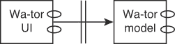

**图 17.1.** Wa-Tor 显而易见且传统的划分

`WatorUI` 组件的层级低于 `WatorModel` 组件。根据依赖规则，这意味着源代码的依赖必须跨越指向 `WatorModel` 的架构边界。因为如此，`WatorUI` 将是 `WatorModel` 的插件。

到目前为止，这种划分只有两个组件和一个边界。在更大的系统中，我们将看到更多的边界以及每个边界内更多的组件。

让我们先关注模型。我们需要种类的类？

是的，我说了类。我们可能正在使用函数式语言。所以，起，模型看起来像[图 17.2]。

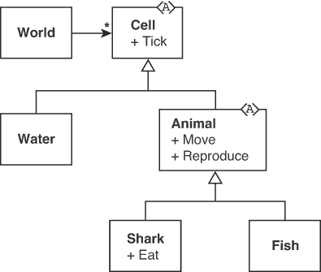

**图 17.2.** Wa-Tor 的初始模型

鱼和鲨生存的世界没有陆地；全是水。此外，顶部连接底部，左侧连接右侧，所以这个世界在拓扑上是一个环面。因此，`Wa-Tor` 代表 WAter TORus（水环面）。

`WatorUI` 组件的层级低于 `WatorModel` 组件。根据依赖规则，这意味着源代码的依赖必须跨越指向 `WatorModel` 的架构边界。因为如此，`WatorUI` 将是 `WatorModel` 的插件。

`world` 包含 `fish`。

```clojure
(ns wator.cell)

(defmulti type)
```

```clojure
(ns wator.water
  (:require [cell as cell]))

(defn make {::type})

(defmethod type [water])
```

```clojure
(ns wator.animal)

(defmulti move)
(defmulti reproduce)

(defn tick [animal])
```

```clojure
(ns wator.fish
  (:require [cell as cell]
             [animal as animal]))

(defn make {::type})

(defmethod type [fish])

(defmethod move [fish])

(defmethod reproduce [fish])
```

```clojure
(ns wator.shark
  (:require [cell as cell]
             [animal as animal]))

(defmethod type [shark])

(defmethod move [shark])

(defmethod reproduce [shark])

(defn eat [shark])
```

但让我们暂时把这些都放在一边吧。前期设计就够了。让我们看看能否通过代码实现一些行为。

`water` 的行为是什么？我们询问我们的建模师，他们告诉我们，如果给予足够的时间，一个 `water` 细胞会随机演变成一个 `fish` 细胞。这里是我对该规则的实现：

```clojure
(ns wator.core-spec
  (:require [speclj.core :refer :all]
            [wator
             [cell :as cell]
             [water :as water]
             [fish :as fish]]))

(describe "Wator"
  (with-stubs)
  (context "Water"
    (it "usually remains water"
          (with-redefs [rand (stub :rand {:return 0.0})]
            (let [water (water/make)
                  evolved (cell/tick water)]
              (should= ::water/water (::cell/type evolved)))))

    (it "occasionally evolves into a fish"
      (with-redefs [rand (stub :rand {:return 1.0})]
        (let [water (water/make)
              evolved (cell/tick water)]
          (should= ::fish/fish (::cell/type evolved)))))))

———

(ns wator.water
  (:require [wator
             [cell :as cell]
             [fish :as fish]
             [config :as config]]))

(defn make [] {::cell/type ::water})

(defmethod cell/tick ::water [water]
  (if (> (rand) config/water-evolution-rate)
    (fish/make)
    water))

——————

(ns wator.config)

(def water-evolution-rate 0.99999)
```

所以，我们立刻看到了这个程序的“函数式”本质。8。`tick` 的返回值一个新的 `cell`。我不知道那个 `water-evolution-rate` 是否正确。建模师还没有告诉我们速率应该是多少。所以我只是猜猜的。我预计他们会等到看到模型的行为后，再告诉我们修改它。

8。几乎如此。`(rand)` 的调用是不纯的。

到目前为止，我还没有指定任何动态类型。现在考虑这些有点早。但我确定它会来的。

总之，让我们看看能否让 `fish` 移动。

等一下。如何移动一个 `fish`？`fish` 在哪里？`fish` 知道自己的位置吗，还是由 `world` 知道？


`cell` 排在一个二维矩形笛卡尔网格中，从左到右、从上下循环。因此，`cell` 的位置是元组`[x y]`。`world` 可以用二维数组存储`cell`，也可以用以位置元组为键的`map`。

我喜欢用`map`来处理这类事情，所以让我们创建一个充满`water`细胞的`world`：

点击此处查看代码图片

```ns
(context "world"
  (it "creates a world full of water cells"
    (let [world (world/make 2 2)
          cells (:cells world)
          positions (set (keys cells))]
      (should= #{[0 0] [0 1]
                 [1 0] [1 1]} positions)
      (should (every? #(= ::water/water (::cell/type %))
                      (vals cells))))))

————

(ns wator.world
  (:require [wator
             [water :as water]]))

(defn make [w h]
  (let [locs (for [x (range w) y (range h)] [x y])
        loc-water (interleave locs (repeat (water/make)))
        cells (apply hash-map loc-water)]
    {:cells cells}))
```

你注意到传递到`interleave`的`water`细胞惰性列表了吗？现在我们应该能够把一个`fish`放入世界并让它移动了。这是我的第一次测试尝试：

点击此处查看代码图片

```ns
(context "animal"
  (it "moves"
    (let [fish (fish/make)
          world (-> (world/make 3 3)
                    (world/set-cell [1 1] fish))
          [loc cell] (animal/move fish [1 1] world)]
      (should= cell fish)
      (should (#{[0 0] [0 1] [0 2]
                 [1 0] [1 2]
                 [2 0] [2 1] [2 2]}
               loc)))))
```

这非常直观。我们创建了一个`3x3`的`world`，中心有一个`fish`。然后我们移动这个`fish`。最后，我们确保它仍然是一个`fish`，并且它的目的地是其中之一。

```clojure
(defn do-move [animal loc world]
  (let [neighbors (world/neighbors world loc)

        destinations (filter
                       #(water/is?
                         (world/get-cell world %))
                       neighbors)
        new-location (rand-nth destinations)]
    [new-location animal]))
```

非常漂亮。我们向`world`请求该位置的`neighbors`，过滤掉所有不是`water`的位置，然后随机选择一个。很酷。

我认为最好确保所有的环面数学（torus math）都很好地隔离在`world`内部。我不希望这些逻辑泄露到所有的`animal`中：

点击此处查看代码图像

```clojure
(defn wrap [world [x y]]
  (let [[w h] (::bounds world)]
    [(mod x w) (mod y h)])
  )

(defn neighbors [world loc]
  (let [[x y] loc
        neighbors (for [dx (range -1 2) dy (range -1 2)]
                    (wrap world [(+ x dx) (+ y dy)]))]
    (remove #(= loc %) neighbors))
```

你准备好面对那些不漂亮的内容了吗？上面的代码拒绝编译，因为（你准备好了吗？）`water`依赖于`fish`（为了进化），`fish`依赖于`animal`（为了`do-move`），而`animal`又依赖于`water`。这是一个依赖循环，而 Clojure *极其讨厌*依赖循环。参见图 17.3。

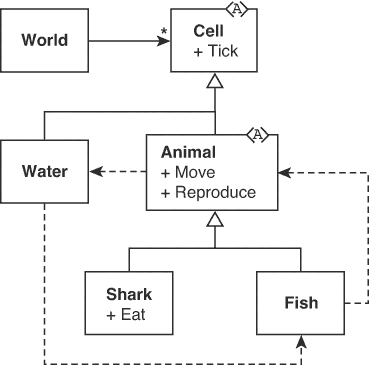

**图 17.3.** 依赖循环

好了，深呼吸。记住，我们现在是在玩一个游戏。在像 Wa-Tor 这样简单的应用程序中，我并不会如此无情地划分这些文件。事实上，我很有可能直接把整个程序写在一个文件里，让魔鬼随心所欲。但我们假装这是一个数百万行的企业级应用，所以我们要对所有的源码依赖关系都格外小心。对吧？

因此，我们解决这个问题的方法是回到类似于旧 C 语言的声明和实现的机制。参见图 17.4。

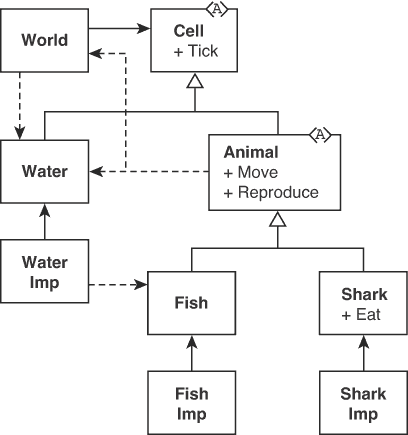

**图 17.4.** 破解依赖循环

通过拆分`water`使其对`fish`的依赖位于`water-imp`中，并确保`water-imp`依赖于`water`而不是相反（即 DIP），循环被打破了。为了一致性，我也拆分了`fish`和`shark`^(12)。我很快也需要拆分`animal`^(13)。

12. 实际上，只有`fish`。我在图中拆分了`shark`，但在代码中没有。YAGNI（你现在不需要它），YAGNI，YAGNI。

13. 未来的 Uncle Bob：. . .不。

现在代码看起来是这样：

点击此处查看代码图像

```clojure
(ns wator.world
  (:require [wator
             [water :as water]]))

(defn make [w h]
  (let [locs (for [x (range w) y (range h)] [x y])
        loc-water (interleave locs (repeat (water/make)))
        cells (apply hash-map loc-water)]
    {::cells cells
     ::bounds [w h]}))

(defn set-cell [world loc cell]
  (assoc-in world [::cells loc] cell))

(defn get-cell [world loc]
  (get-in world [::cells loc]))

; . . .

—————

(ns wator.cell)

(defmulti tick ::type)

—————

(ns wator.water
  (:require [wator
             [cell :as cell]]))

(defn make [] {::cell/type ::water})

(defn is? [cell]
  (= ::water (::cell/type cell)))

——————————

(ns wator.water-imp
  (:require [wator
             [cell :as cell]
             [water :as water]
             [fish :as fish]
             [config :as config]]))

(defmethod cell/tick ::water/water [water]
  (if (> (rand) config/water-evolution-rate)
    (fish/make)
    water))

———————

(ns wator.animal
  (:require [wator
             [world :as world]
             [cell :as cell]
             [water :as water]]))

(defmulti move (fn [animal & args] (::cell/type animal)))
(defmulti reproduce (fn [animal & args] (::cell/type animal)))

(defn tick [animal]
  )

(defn do-move [animal loc world]
  (let [neighbors (world/neighbors world loc)
        destinations (filter #(water/is?
                               (world/get-cell world %))
                             neighbors)
        new-location (rand-nth destinations)]
    [new-location animal]))

————

(ns wator.fish
  (:require [wator
             [cell :as cell]]))
(defn make []::cell/type ::fish})

——————

(ns wator.fish-imp
  (:require [wator
             [cell :as cell]
             [animal :as animal]
             [fish :as fish]]))

(defmethod cell/tick ::fish/fish [fish]
  (animal/tick fish)
  )

(defmethod animal/move ::fish/fish [fish loc world]
  (animal/do-move fish loc world))

(defmethod animal/reproduce ::fish/fish [fish]
  )
```

```clojure
(ns wator.world
  (:require [clojure.spec.alpha :as s]
            [wator
             [cell :as cell]
             [water :as water]]))

(s/def ::location (s/tuple int? int?))
(s/def ::cell #(contains? % ::cell/type))
(s/def ::cells (s/map-of ::location ::cell))
(s/def ::bounds ::location)
(s/def ::world (s/keys :req [::cells ::bounds]))

(defn make [w h]
  {:post [(s/valid? ::world %)]}
  …)
```

好的，这样好多了。现在，我们需要什么来复现呢？建模人员说，如果`fish`（鱼）位于`water`（水）单元旁边并且超过了某个年龄，它就会繁殖。两个后代`fish`的年龄将重置为零。否则，`fish`的`::age`会随时间增加。

这里是测试用例：

点击此处查看代码图片

```clojure
(it "reproduces"
  (let [fish (-> (fish/make)
                 (animal/set-age config/fish-reproduction-age))
        world (-> (world/make 3 3)
                  (world/set-cell [1 1] fish))
        [loc1 cell1 loc2 cell2] (animal/reproduce
                                  fish [1 1] world)]
    (should= loc1 [1 1])
    (should (fish/is? cell1))
    (should= 0 (animal/age cell1))
    (should (#{[0 0] [0 1] [0 2]
               [1 0] [1 2]
               [2 0] [2 1] [2 2]}
             loc2))
    (should (fish/is? cell2))
    (should= 0 (animal/age cell2))))

(it "doesn't reproduce if there is no room"
  (let [fish (-> (fish/make)
                 (animal/set-age config/fish-reproduction-age))
        world (-> (world/make 1 1)
                  (world/set-cell [0 0] fish))
        failed (animal/reproduce fish [0 0] world)]
    (should-be-nil failed)))

(it "doesn't reproduce if too young"
      (let [fish (-> (fish/make)
                     (animal/set-age
                       (dec config/fish-reproduction-age)))
            world (-> (world/make 3 3)
                      (world/set-cell [1 1] fish))
            failed (animal/reproduce fish [1 1] world)]
        (should-be-nil failed)))
```

注意，如果`fish`繁殖了，返回值包含了两个后代。但如果发生了错误，我们返回`nil`。这是因为我认为`fish`的高层策略包含了类似这样的内容：

点击此处查看代码图片

```clojure
(if-let [result (animal/reproduce …)]
  result
  (animal/move …))
```

无论如何，这里是通过该测试的简略代码：

点击此处查看代码图片


### 代码结构分析

以下是 WaTor 模拟项目的 Clojure 代码结构。该代码展示了如何通过依赖反转和工厂方法模式来解决循环依赖问题，并遵循 TDD 设计流程。

### 基础动物命名空间

```clojure
(ns wator.animal
  (:require [clojure.spec.alpha :as s]
            [wator
             [world :as world]
             [cell :as cell]
             [water :as water]
             [config :as config]]))
```

这里定义了动物的基本属性和多方法：

- `::age` 表示动物年龄
- `::animal` 是动物应满足的 spec
- 三个多方法：`move`、`reproduce` 和 `make-child`

```clojure
(s/def ::age int?)
(s/def ::animal (s/keys :req [::age]))

(defmulti move (fn [animal & args] (::cell/type animal)))
(defmulti reproduce (fn [animal & args] (::cell/type animal)))
(defmulti make-child ::cell/type)

(defn make []
  {::age 0})

(defn age [animal]
  (::age animal))

(defn set-age [animal age]
  (assoc animal ::age age))

; . . .
```

`do-reproduce` 函数实现了通用的繁殖逻辑：如果动物年龄达到 `config/fish-reproduction-age`，则在空闲邻居中随机选择出生地，并返回包含新位置、重置年龄和孩子的向量。

```clojure
(defn do-reproduce [animal loc world]
  (if (>= (age animal) config/fish-reproduction-age)
    (let [neighbors (world/neighbors world loc)
          birth-places (filter #(water/is? (world/get-cell world %))
                               neighbors)]
      (if (empty? birth-places)
        nil
        [loc (set-age animal 0)
         (rand-nth birth-places) (make-child animal)]))
    nil))
```

### 鱼类实现

```clojure
(ns wator.fish
  (:require [clojure.spec.alpha :as s]
            [wator
             [cell :as cell]
             [animal :as animal]]))
```

鱼类命名空间定义了 `::fish` spec，并实现了 `animal/make-child` 方法。

```clojure
(s/def ::fish (s/and #(= ::fish (::cell/type %))
                     ::animal/animal))
(defn is? [cell]
  (= ::fish (::cell/type cell)))

(defn make []
  {:post [(s/valid? ::fish %)]}
  (merge {::cell/type ::fish}
         (animal/make)))

(defmethod animal/make-child ::fish [fish]
  (make))
```

### 鱼类行为实现

```clojure
(ns wator.fish-imp
  (:require [wator
             [cell :as cell]
             [animal :as animal]
             [fish :as fish]]))
```

这里实现了 `animal/reproduce` 方法，将具体行为委托给 `animal/do-reproduce`。这种设计允许在基类中定义通用行为，同时让子类覆盖或增强。

```clojure
(defmethod animal/reproduce ::fish/fish [fish loc]
  (animal/do-reproduce fish loc))
```

注：将 `fish/reproduce` 延迟委托到 `animal/do-reproduce`，可在 `animal` 中指定通用行为，并允许 `fish` 覆盖。这种设计成本低，可消除重复代码，尽管可能违反 YAGNI 原则，但规则可以打破。

### 转向 world/tick 实现

在实现更多动物行为前，先关注 `world/tick`。这是第一个测试：

```clojure
(it "moves a fish around"
  (let [fish (fish/make)
        small-world (-> (make 2)
                        (set-cell [0 0] fish)
                        (world/tick))
        vacated-cell (world/get-cell small-world [0])
        occupied-cell (world/get-cell small-world [1])]
    (should (water/is? vacated-cell))
    (should (fish/is? occupied-cell))
    (should= 1 (animal/age occupied-cell))))
```

模拟的 `tick` 实现（无法编译，因为循环依赖）：

```clojure
(defn tick [world]
  (-> world
      (make 1)))
```

### 打破循环依赖

循环依赖是设计不良的表现。通过将 `world-imp` 从 `world` 中拆分来反转依赖（DIP），UML 如图 17.5 所示。


**图 17.5.** 打破循环

`World` 类旁的 `=` 表示这是一个抽象方法。以下是代码：

```clojure
(ns wator.world
  (:require [clojure.spec.alpha :as s]
            [wator
             [cell :as cell]
             [water :as water]]))

(s/def ::location (s/tuple int? int?))
(s/def ::cell #(contains? % ::cell/type))
(s/def ::cells (s/map-of ::location ::cell))
(s/def ::bounds ::location)
(s/def ::world (s/and (s/keys :req [::cells ::bounds])
                      #(= (type %) ::world)))

(defmulti tick ::type)

(defn make [w h]
  {:post [(s/valid? ::world %)]}
  (let [locs (for [x (range w) y (range h)] [x y])
        loc-water (interleave locs (repeat (water/make)))
        cells (apply hash-map loc-water)]
    {::type ::world
     ::cells cells
     ::bounds [w h]}))
; . .
```

```clojure
(ns wator.world-imp
  (:require [wator
             [world :as world :refer :all]
             [animal :as animal]
             [fish :as fish]
             [water :as water]]))

(defmethod world/tick ::world/world [world]
  (-> (make 2 1)
      (set-cell [0 0] (water/make))
      (set-cell [0 1] (animal/set-age (fish/make) 1))))
```

在测试的 `:require` 列表中添加 `[world-imp]` 后，测试通过。`tick` 现在是只有一个实现的多态方法，这正是依赖反转。

但 `world` 中对 `water` 的依赖仍令人困扰。这种感觉被称为"恶心"，该依赖在某种程度上是"错误"的。

### 淋浴带来的解决方案

在洗澡时思考后，得出结论：在 `world` 中创建 `water` 可能同样导致循环问题。解决方案是引入工厂方法模式，让 `world` 自身成为工厂。

此设计的 UML（图 17.6）揭示了新的架构边界。所有依赖都向高层跨越，遵循依赖规则。

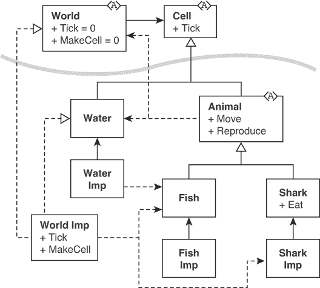

**图 17.6.** 使用工厂方法模式的 WaTor

更新后的代码：

```clojure
(ns wator.world
  (:require [clojure.spec.alpha :as s]
            [wator
             [cell :as cell]
             [water :as water]]))

(s/def ::location (s/tuple int? int?))
(s/def ::cell #(contains? % ::cell/type))
(s/def ::cells (s/map-of ::location ::cell))
(s/def ::bounds ::location)
(s/def ::world (s/and (s/keys :req [::cells ::bounds])
                      #(= (::type %) ::world)))

(defmulti tick ::type)
(defmulti make-cell (fn [factory-type cell-type] factory-type))

(defn make [w h]
  {:post [(s/valid? ::world %)]}
  (let [locs (for [x (range w) y (range h)] [x y])
        default-cell (make-cell ::world :default-cell)
        loc-water (interleave locs (repeat default-cell))
        cells (apply hash-map loc-water)]
    {::type ::world
     ::cells cells
     ::bounds [w h]}))
; . . .
```

```clojure
(ns wator.world-imp
  (:require [wator
             [world :as world :refer :all]
             [animal :as animal]
             [fish :as fish]
             [shark :as shark]
             [water :as water]]))

(defmethod world/tick ::world/world [world]
  (-> (make 2 1)
      (set-cell [0 0] (water/make))
      (set-cell [0 1] (animal/set-age (fish/make) 1))))

(defmethod world/make-cell ::world/world [world cell-type]
  (condp = cell-type
    :default-cell (water/make)
    :water (water/make)
    :fish (fish/make)
    :shark (shark/make)))
```

`make-cell` 中的 `factory-type` 作为 `::world` 传入，允许 `defmethod ::world/world` 解析。这个改变由测试驱动，通过模拟实现通过测试，再次验证 TDD 作为一种设计技术。

### 使模拟实现失败

以下测试会使模拟实现失败，验证多个移动方向：

```clojure
(it "moves a fish around each tick"
  (doseq [scenario
          [{:dimension [2 1] :starting [0 0] :ending [1 0]}
           {:dimension [2 1] :starting [1 0] :ending [0 0]}
           {:dimension [1 2] :starting [0 0] :ending [0 1]}
           {:dimension [1 2] :starting [0 1] :ending [0 0]}]]
    (let [fish (fish/make)
          {:keys [dimension starting ending]} scenario
          [h w] dimension
          small-world (-> (world/make h w)
                          (world/set-cell starting fish)
                          (world/tick))
          vacated-cell (world/get-cell small-world starting)
          occupied-cell (world/get-cell small-world ending)]
      (should (water/is? vacated-cell))
      (should (fish/is? occupied-cell))
      (should= 1 (animal/age occupied-cell)))))
```

### 水单元测试

```clojure
(ns wator.core-spec . . .)
(describe "Wator"
  (with-stubs)
  (context "Water"
    (it "usually remains water"
      (with-redefs [rand (stub :rand {:return 0.0})]
        (let [water (water/make)
              world (world/make 1 1)
              [from to] (cell/tick water [0 0] world)]
          (should-be-nil from)
          (should (water/is? (get to [0 0]))))))
    (it "occasionally evolves into a fish"
      (with-redefs [rand (stub :rand {:return 1.0})]
        (let [water (water/make)
              world (world/make 1 1)
              [from to] (cell/tick water [0 0] world)]
          (should-be-nil from)
          (should (fish/is? (get to [0 0])))))))
; . . .
```

### 动物移动测试

```clojure
(context "animal"
  (it "moves"
    (let [fish (fish/make)
          world (-> (world/make 3 3)
                    (world/set-cell [1 1] fish))
          [from to] (animal/move fish [1 1] world)
```


`loc (first (keys to))]`

```
(should (water/is? (get from [1 1])))

(should (fish/is? (get to loc)))

(should (#{[0 0] [0 1] [0 2]

           [1 0] [1 2]

           [2 0] [2 1] [2 2]}

         loc))))
```

```
(it "doesn't move if there are no spaces"

  (let [fish (fish/make)

        world (-> (world/make 1 1)

                  (world/set-cell [0 0] fish))

        [from to] (animal/move fish [0 0] world)]

    (should (fish/is? (get to [0 0])))

    (should (nil? from))))
```

```
(it "move two fish who compete for the same spot"

  (let [fish (fish/make)

        competitive-world (-> (world/make 3 1)

                              (world/set-cell [0 0] fish)

                              (world/set-cell [2 0] fish)

                              (world/tick))

        start-00 (world/get-cell competitive-world [0 0])

        start-20 (world/get-cell competitive-world [2 0])

        end-10 (world/get-cell competitive-world [1 0])]

    (should (fish/is? end-10))

    (should (or (fish/is? start-00)

                (fish/is? start-20)))

    (should (or (water/is? start-00)

                (water/is? start-20)))))
```

一个简单的 3x1 `world`，在两端各有一条 `fish`。只有其中一个可以移动到中间槽。另一个将不得不留在原处。这个测试失败是因为 `animal/move` 函数并不知道 `fish` 已经移动到了目标槽。

解决这个问题意味着要某种方式将 `moved-into` 列表发送到 `animal/move`。我不喜欢给 `animal/move` 再增加一个参数的主意，所以也许我们可以将这些信息藏在传递给 `animal/move` 的 `world` 中：

```
(ns wator.world-imp . . .)

(defmethod world/tick ::world/world [world]

  (let [cells (::world/cells world)]

    (loop [locs (keys cells)

           new-cells {}

           moved-into #{}]

      (cond

        (empty? locs)

        (assoc world ::world/cells new-cells)

        (contains? moved-into (first locs))

        (recur (rest locs) new-cells moved-into)

        :else

        (let [loc (first locs)

              cell (get cells loc)

              [from to] (cell/tick

                          cell loc

                          (assoc world :moved-into moved-into))

              new-cells (-> new-cells (merge from) (merge to))

              to-loc (first (keys to))

              to-cell (get to to-loc)

              moved-into (if (water/is? to-cell)

                            moved-into

                            (conj moved-into to-loc))]

          (recur (rest locs) new-cells moved-into))))))
```

———————

```
(ns wator.animal . . .)

; . . .

(defn do-move [animal loc world]

  (let [neighbors (world/neighbors world loc)

        moved-into (get world :moved-into #{})

        available-neighbors (remove moved-into neighbors)

        destinations (filter #(water/is?

                               (water/is %))

                             neighbors)

        new-location (if (empty? destinations)

                       nil

                       (rand-nth destinations))]

    (if new-location

      (set-cell world new-location animal)

      nil)))
```

这要求我完善 `shark` 模块，并进行了一处微小的设计调整。我使用了**模板方法（Template Method）模式来获取动物的繁殖年龄。测试代码提示了这一变化：

点击此处查看代码图片

```
(context "animal"

  (it "moves"

    (doseq [scenario 

             [{:constructor fish/make :tester fish/is?}

              {:constructor shark/make :tester shark/is?}]]

      (let [animal ((:constructor scenario))

            world (-> (world/make 3 3)

                      (world/set-cell [1 1] animal))

            [from to] (animal/move animal [1 1] world)

            loc (first (keys to))]

        (should (water/is? (get from [1 1])))

        (should ((:tester scenario) (get to loc)))

        (should (#{[0 0] [0 1] [0 2]

                   [1 0] [1 2]

                   [2 0] [2 1] [2 2]}

                 loc)))))

  (it "doesn't move if there are no spaces"

    (doseq [scenario 

             [{:constructor fish/make :tester fish/is?}

              {:constructor shark/make :tester shark/is?}]]

      (let [animal ((:constructor scenario))

            world (-> (world/make 1 1)

                      (world/set-cell [0 0] animal))

            [from to] (animal/move animal [0 0] world)]

        (should ((:tester scenario) (get to [0 0])))

        (should (nil? from)))))

  (it "reproduces"

    (doseq [scenario 

             [{:constructor fish/make :tester fish/is?}

              {:constructor shark/make :tester shark/is?}]]

      (let [animal ((:constructor scenario))

            reproduction-age (animal/get-reproduction-age animal)

            animal (animal/set-age animal reproduction-age)

            world (-> (world/make 3 3)

                      (world/set-cell [1 1] animal))

            [from to] (animal/reproduce animal [1 1] world)

            from-loc (-> from keys first)

            from-cell (-> from vals first)

            to-loc (-> to keys first)

            to-cell (-> to vals first)]

        (should= from-loc [1 1])

        (should ((:tester scenario) from-cell))

        (should= 0 (animal/age from-cell))

        (should (#{[0 0] [0 1] [0 2]

                   [1 0] [1 2]

                   [2 0] [2 1] [2 2]}

                 to-loc))

        (should ((:tester scenario) to-cell))

        (should= 0 (animal/age to-cell)))))

  (it "doesn't reproduce if there is no room"

    (doseq [scenario 

             [{:constructor fish/make :tester fish/is?}

              {:constructor shark/make :tester shark/is?}]]

      (let [animal ((:constructor scenario))

            reproduction-age (animal/get-reproduction-age animal)

            animal (animal/set-age animal reproduction-age)

            world (-> (world/make 1 1)

                      (world/set-cell [0 0] animal))

            failed (animal/reproduce animal [0 0] world)]

        (should-be-nil failed))))

  (it "doesn't reproduce if too young"

    (doseq [scenario 

             [{:constructor fish/make :tester fish/is?}

              {:constructor shark/make :tester shark/is?}]]

      (let [animal ((:constructor scenario))

            reproduction-age (animal/get-reproduction-age animal)

            animal (animal/set-age animal (dec reproduction-age))

            world (-> (world/make 3 3)

                      (world/set-cell [1 1] animal))

            failed (animal/reproduce animal [1 1] world)]

        (should-be-nil failed)))))
```

————————

```
(ns wator.animal …)

(defmulti move (fn [animal & args] (::cell/type animal)))

(defmulti reproduce (fn [animal & args] (::cell/type animal)))

(defmulti make-child ::cell/type)

(defmulti get-reproduction-age ::cell/type)

; . . .
```

————————

```
(ns wator.fish . ....)

(defmethod animal/get-reproduction-age ::fish [fish]

  config/fish-reproduction-age)

; . . .
```

——————

```
(ns wator.shark

  (:require [clojure.spec.alpha :as s]

            [wator

             [config :as config]

             [cell :as cell]

             [animal :as animal]]))

(s/def ::shark (s/and #(= ::shark (::cell/type %))

                      ::animal/animal))

(defn is? [cell]

  (= ::shark (::cell/type cell)))

(defn make []

  {:post [(s/valid? ::shark %)]}

  (merge {::cell/type ::shark}

         (animal)))

(defmethod animal/make-child ::shark [shark]

  (shark/make))

(defmethod animal/get-reproduction-age ::shark [shark]

  (animal/get-reproduction-age shark))

(defmethod cell/tick ::shark [shark loc]

  (animal/tick loc))

(defmethod cell/reproduce ::shark [shark loc]

  (animal/reproduce shark loc))

; . .
```

我们创建了一个 2x1 的 `world`（世界），其中一条 `shark`（鲨鱼）旁边有一条 `fish`（鱼）。经过一个 `tick`，`shark`应该出现在 `fish` 之前的位置，`water`出现在 `shark` 之前的位置，并且 `shark` 的 `::health` 应该增加。

为了让这段代码通过，我被迫放弃将逻辑委托给 `animal/tick`，因为 `shark` 应该先尝试 `reproduce`（繁殖），然后尝试 `eat`（进食），最后才尝试 `move`（移动）：

点击此处查看图片

```
(ns wator.shark . . .)

(defn eat [shark loc world]

  (let [neighbors (world/neighbors world loc)

        fishy-neighbors (filter #(fish/is?

                                  (world/get-cell world %))

                                neighbors)]

    (if (empty? fishy-neighbors)


`nil`

```
[{loc (water/make)}
 {(rand-nth fishy-neighbors) (feed shark)}]
```

```
(defmethod cell/tick ::shark [shark loc world]
  (if (= 1 (health shark))
    [nil {loc (water/make)}]
    (let [aged-shark (-> shark
                         (animal/increment-age)
                         (decrement-health))]
      (if-let [reproduction (animal/reproduce
                              aged-shark loc world)]
        reproduction
        (if-let [eaten (eat aged-shark loc world)]
          eaten
          (animal/move aged-shark loc world))))))
```

这一切都很顺利地完成了。我们已经渡过了设计上的瓶颈，现在正在收获成果。

建模师告诉我们，鲨鱼只有在健康值高于阈值时才会进行繁殖。让我们测试一下。事实上，让我们先做这个改动^(18) 看看哪些测试会失败：

18. TDD 违反！警告！警报！

点击此处查看图片

```
(ns wator.shark . . .)

(defmethod animal/reproduce ::shark [shark loc world]
  (if (>= (health shark) config/shark-reproduction-health)
    (animal/do-reproduce shark loc world)
    nil))
```

正如所料，鲨鱼场景下的动物繁殖测试失败了。我们可以通过在那个测试中加入一个小黑科技（hack）来解决这个问题：

点击此处查看图片

```
(it "reproduces"
  (doseq [scenario [{:constructor fish/make :tester fish/is?}
                    {:constructor
                       #(-> (shark/make)
                            (shark/set-health
                              (inc config/shark-reproduction-
                                   health)))
                     :tester shark/is?}]]
; . . .
```

是的，这有点丑，但它起作用了。我想我应该添加一个测试来检查该阈值的另一侧情况：

点击此处查看图片

```
(it "doesn't reproduce if not healthy enough"
  (let [shark (-> (shark/make)
                  (shark/set-health
                    (dec config/shark-reproduction-health))
                  (animal/set-age config/shark-reproduction-age))
        world (-> (world/make 3 3)
                  (world/set-cell [1 1] shark))
        failed (animal/reproduce shark [1 1] world)]
    (should-be-nil failed)))
```

好的。最后一件事。父鲨鱼的健康值会被分配到两个母鲨鱼之间：

点击此处查看图片

```
(it "shares health with both daughters after reproduction"
  (let [initial-health (inc config/shark-reproduction-health)
        pregnant-shark (-> (shark/make)
                           (animal/set-age
                             (inc config/shark-reproduction-age))
                           (shark/set-health initial-health))
        world (-> (world/make 2 1)
                  (world/set-cell [0 0] pregnant-shark))
        new-world (world/tick world)
        daughter1 (world/get-cell new-world [0 0])
        daughter2 (world/get-cell new-world [1 0])
        expected-health (quot (dec initial-health) 2)]
    (should (shark/is? daughter1))
    (should (shark/is? daughter2))
    (should= expected-health (shark/health daughter1))
    (should= expected-health (shark/health daughter2))))
```

没错。测试失败了是因为预期的健康值不正确。这很容易修复：

点击此处查看图片

```
(ns wator.shark . . .)

(defmethod animal/reproduce ::shark [shark loc world]
  (if (< (health shark) config/shark-reproduction-health)
    nil
    (if-let [reproduction (animal/do-reproduce shark loc world)]
      (let [[from to] reproduction
            from-loc (-> from first)
            to-loc (-> to first)
            daughter-health (quot (health shark) 2)
            from-shark (-> from first)
                         (set-health daughter-health))
            to-shark (-> to first)
                         (set-health daughter-health))
        [{from-shark} {to-shark}])
      nil)))
```

到此，我认为模型已经完成了。让我们看看是否能在它上面添加一个 GUI：

点击此处查看图片

```
最后，我认为软件本该是这样的。

顺便说一下，你可以在 [`github.com/unclebob/wator`](https://github.com/unclebob/wator)找到所有的源代码。
```

# 后记

2022 年 3 月，我参加了一个朋友的生日派对，在那里无意中听到几个家伙在调侃代码。我介绍了自己——当时我正想找一些编程朋友。当我们结束了那些显而易见的寒暄后，其中一人向我抛出了一个如重炸弹一样的问题。

他问：“所以，你首选的技术栈是什么？”

我大脑里的每一个小碎片都在疯狂地寻找答案，与此同时，我还在试图理解他在问什么，直到最后我非常不自信地回答道：“Clojure？”

他后退了一步，露出了明显的惊讶，惊呼道：“真的吗？！全栈的？”

[我脑海里放起了彩花——击中了！]

他很震惊，继续说道……“前端和后端都用 Clojure？我以前没听过这种说法。它是怎么运作的？Clojure 是一种 Lisp 语言，对吧？它是函数式的。”

是的，确实是，但`噢不！又来一个问题 . . “它是怎么运作的？”`

嗯，如果你正在读这些，我假设你已经读了前面的章节，因此已经得到了比我在这里能提供的更好、更详尽的解释，所以，让我们直面那个无法回避的问题：为什么问我首选的技术栈是一个像重炸弹一样的问题？

在那个生日派对之前的整整 11 年前，我在伊利诺伊州的梅大波利斯（Metropolis, IL）开始了我的化学工程师和工会职业生涯，在那里接受了操作六氟化铀制造过程中工艺和设备的培训。在接下来的十年里，我的职业进展到了各种化学制造工厂的生产领导岗位。

在这十年中，我学习了许多关于流程、状态、人员、企业文化以及那些我缺乏技能去修复的破碎流程的知识。在 2020 年 3 月，正当我平衡这些破碎流程的需求与排倒而来的生活变化时，我们所认知的世界陷入了停。在八周的时间里，我突然发现自己一直处于某人身边，他不仅拥有我所缺乏的技能，还制定了掌握这些技能的规则。

所以，我问我爸爸，或者用你们熟悉的称呼，“鲍叔叔”，学习软件需要达到什么种深度，才能解决那些我如此渴望解决的问题。

那天晚上，他向我展示了他当前的一个项目——一个按县统计 COVID-19 感染和死亡人数的自动每日图表。当我不认识语法时，他借此机会向我介绍了 Clojure。

我立刻产生了疑问，因为我只学过像`Java`和`Python`这种语言的基础。他解释了面向对象过程化语言与函数式语言的基本区别，以及他为什么喜欢 Clojure。在一个例子中，他向我展示了为什么函数式语言比那些严重依赖可变的语言更“安全”、更不复杂，他为我描绘了一个竞态条件，那个条件几乎与第 15 章中 Bob 和 Alice 之间的电话内容完全一样。

然后我们深入了代码，他给了我一个我不会轻视的机会：和他一起编写他的 COVID 图表。我大部分只是写了几个基础算术函数（当然，我们还为这些函数编写了测试）。

他还带我了解了`Quil`，以及它在很大程度上也是函数式的，它是如何不是改变状态，而是在每次迭代中递归生成新状态的。这在当时有点超出了我的理解范围，但在接下来的一年里，我经常回想起这段对话——我现在面前甚至放着那天晚上编写的源代码打印件，作为我写这本书的灵感来源。

多一年后，我“毕业”了我的软件学徒生涯，成为了 Clean Coders Studio 的全职开发人员。

那么，回到那个问题：截至 2022 年 3 月，我对软件来说还是个新手；由于 COVID-19，还没有发生很多大型活动；而且因为路易斯安那州巴顿鲁日市（Baton Rouge, LA）的软件领域有一些增长机会，作为一个开发者，一直非常孤立，很少接触到常见的行业术语。

那个生日派对给了我第一次与 Clean Coders 之外的开发者面对面互动的机会，当我被问到首选的技术栈时，我掌握的知识仅足以翻译并拼凑出这个问题。这之所以是一个重炸弹般的问题，是因为我不确定自己是否拥有所有的碎片。

解决完这些后，我给你们留下两个小贴士。

1. Clojure 让我大开眼界的真实时刻是当我们正在开发一个基于 Java 项目的项目，该项目使用`Angular`作为前端。在`Angular`中实现任何功能时，我们当然必须在`Angular`和`Java`中测试并创建几乎相同的方法（有时在 Clojure 中，因为我们正在迁移一个旧系统）。到处都是双倍的工作！

   然后他们要求一个移动应用程序，具有与我们的 Clojure 功能完全相同的功能。我们将许多核心功能提取到`cljc`库中，从那里我们能够在几乎或完全没有代码重复或重写的情况下构建移动应用。

   我们通过利用 Clojure 的通用命名空间，为`cljs`移动应用使用了通用函数，就像我们在后端做的一样。

   在多少种语言中你可以说你说过这件事——让后端以及可能的多个前端都运行在同一段、经过同步测试的代码上？

2. Clojure 让我大开眼界的真实时刻是当我们正在开发一个基于 Java 项目的项目，该项目使用`Angular`作为前端。在`Angular`中实现任何功能时，我们当然必须在`Angular`和`Java`中测试并创建几乎相同的方法（有时在 Clojure 中，因为我们正在迁移一个旧系统）。到处都是双倍的工作！

   然后他们要求一个移动应用程序，具有与我们的 Clojure 功能完全相同的功能。我们将许多核心功能提取到`cljc`库中，从那里我们能够在几乎或完全没有代码重复或重写的情况下构建移动应用。

   我们通过利用 Clojure 的通用命名空间，为`cljs`移动应用使用了通用函数，就像我们在后端做的一样。

   在多少种语言中你可以说你说过这件事——让后端以及可能的多个前端都运行在同一段、经过同步测试的代码上？

祝运！——Bob

- 在 Payroll 示例中，98, 100, 105

- 在 shape 示例中，271, 273, 275–276

- 在 Wa-Tor 应用中，289, 312–313

## 架构。参见整洁架构的依赖规则

## 数组

- 以及`n`-ary 叉树，23–25

- 在埃拉托尼筛法算法中，20–22

## 赋值

- 定义，7–8

- 无赋值的编程，4–6, 20–22

## `assoc`, 90n5

## `async/>!!` 函数，213

## `async/go` 函数，205

## `atom` (原子值),50–51

## 原子子操作，50

## B

- 批量处理与交互式应用，44

- 行为内聚性，94, 336

- 二叉树。参见`n`-ary 叉树](#index.xhtml_idx138)

- 保龄游戏

    - Clojure 版本，71–75

    - 解决方案，75–76

    - Java 版本，66

- 业务规则

    - 以及依赖，154–155

    - 测试，127–131

## C

- 阴射线管 (CRTs)，118

- 变更与单一职责原则，126–131

- 丘奇, Alonzo，xvi–xvii

- 丘奇-图灵论题，xvi–xvii, 19

- 类

    - 闭合，267, 273

    - 以及接口，132, 283–284

    - 与命名空间，107

- 整洁架构 (Martin)，96, 126

- 整洁代码师，126, 213

- 整洁手工艺 (Martin)，53, 79n

- Clojure

    - 以及类，267

    - 编译，137, 150, 256n, 300

    - 特性与约束，41, 281, 282–284

    - 接口隔离，149–150

    - 关键字语法，45n

    - 关于学习，xvii–xviii

    - 命名空间与源文件，107–108

    - 源代码依赖，104–105

    - 语法概述，29–32

- clojure.spec，47, 110

- 严密性，151

- 内聚性，94

- 命令模式

    - 撤销变体，245–249

    - 用法，242–245

    - 比较并交换协议，48–51

- 组件对象 (社交网络)，230

- 组合模式

    - 示例，254–259

    - 在开关和光，249–254

- 拼接函数，73

- 常量，16

- Coplien, Jim, Advanced C++ 风格与惯用法，250

- 拷贝示例

    - 在 C 中，131–132

    - 在 Clojure 中，133–136

- 拷贝制作，20–22

- 耦合

    - get 惰性避免，41–42

    - 在保龄游戏中，76

    - 时间上的，8–10

    - 以及测试，166

- CRT。参见阴射线管 (CRTs)](index.xhtml_idx31)

- 循环，90

## D

- Dahl, Ole-Johan，78, 153

- 数据内聚性，94, 96, 336

- 数据流。参见 Advent of Code 2022](index.xhtml_idx14)

    - 在命令行壳中，123

    - 这种编程风格，118, 124

- 数据流图 (DFDs)，示例，99

- 数据结构。参见`n`-ary 叉树](#index.xhtml_idx138)

    - 持久化的，25

- 致命拥抱（又死锁），49

- 声明函数，35

- 装饰器模式

    - 示例，260–263

    - 用法，260, 264

- def 形式，39

- defmulti，103

- 依赖

    - 源代码和运行时，152–155

    - 源代码反转，104–105

- 依赖倒置原则 (DIP)

    - 以及 示例，274

    - 源代码和运行时依赖，152–155

    - 在视频店问题中，165–174

    - 在 Wa-Tor 中，300, 310

- 整洁架构的依赖规则，271, 275–276

- 设计模式。参见抽象工厂;抽象服务器模式;适配器模式;命令模式;组合模式;装饰器模式;访问者模式

    - 关于，227, 230–231

- 设计模式：可复用面向对象元素 (Gamma 等 GOF 书书)，98, 227n, 259, 270, 273

- Dewdney, A. K.,288

- DFDs。参见数据流图 (DFDs)](index.xhtml_idx58)

- 诊断测试，190–197


- 离散事件模拟。参见闲聊巴士司机问题
- 分发函数，135
- `doall` 函数，40
- `doseq` 函数，251
- 双重（或双重）分发，266, 270
- 鸭子类型（duck typing），132, 139, 149。参见多态方法

### E

- Euler Project，213
- 扩展 vs. 修改（extensions vs. modifications），131

### F

- 斐波那契数字示例
  - 使用迭代，28–32
  - 使用懒性列表，38–40
  - 使用真递归，32–35
- Fikes, Mike，200
- `filter`，102n5
- 有限状态机
  - 以及编程风格，93–94
  - 地铁站闸机示例，13–15
  - 电话系统示例，216–225
- `flatten`，91n10
- `for` 函数，102n7
- Fowler, Martin，《重构》（Refactoring），155
- F# 编程语言，41, 132
- 脆弱性，127
- 函数式语言。参见 Clojure
  - 以及设计模式，233
  - 特性，7, 34, 41, 124, 185, 245, 281
  - 接口机制，132, 150
  - 以及变异，48
  - 类型系统，110
  - 用法，225
- 函数式编程
  - 定义，4
  - 以及 Lambda 演算法，xvii
  - 以及摩尔定律，225–226
  - 与 OOP 的兼容性，282–284
  - 以及资源成本，19–20, 25
  - 以及状态变化问题，12–15, 93–94
  - 以及测试，63, 184
  - 以及变量，7–8
- 函数式程序
  - 特征，10–12, 15–16, 18, 100, 335–336
  - 在 GUI 框架中，200
  - 对比对象，93, 108, 167
  - 以及竞态条件，216
  - 函数
    - 作为抽象层，133
    - 在数学中，10
    - 私有，103n, 283

### G

- 垃圾回收，9, 42
- `get`，103n
- GOF 书。参见《可重用对象设计模式》（Design Patterns: Reusable Object-Oriented Software）Gamma 等
- GOF（四人），242n
- 发布驱动（Gossiping Drivers）
  - Clojure 方案，88–92
  - 方案对比，92–93
  - 描述，78
  - Java 方案，78–88
- 图形。参见龟画图形（turtle graphics）
- GUI
  - 架构应用，245–249
  - 框架，200

### H

- 处理/主体模式（handle/body patterns）。参见组合模式（Composite pattern）；装饰器模式（Decorator pattern）
- Haskell 编程语言，xiv, 41, 283
- 高层策略与低层细节，132, 136–138, 154–155
- 高阶函数，133n

### I

- 不可变性，15–16, 47, 93–94, 281。参见可变性（mutability）
- 独立部署性，136–138
- 初始化，6, 7–8, 18, 19
- 集成测试，165–166
- 交互式程序，44
- 接口隔离原则（ISP）
  - 示例，147–150
  - 用法，150–151
- ISA 规则，142–145, 179
- 迭代
  - 斐波那契示例，28, 30, 32
  - 对比递归，35
  - 迭代器，38, 40

### J

- `jar` 文件，136
- Java 虚拟机，7n, 32, 138

### L

- Lambda 演算，vi, 19
- 语言。参见 Clojure；函数式语言
  - 耦合，150
  - 类型，147
- 懒性
  - 斐波那契示例，39–41
  - 列表累积，40
  - 在埃拉斯特尼筛法算法中，22
- Liskov 原则（LSP）
  - 代码示例，139–142
  - 以及 ISA 规则，142–145
  - 原则，138–149
  - 代表性规则，146
- 锁，49
- 低层细节。参见高层策略与低层细节

### M

- `map` 函数，33
- Martin, Robert C.
  - 《敏捷软件开发原理、模式与实践》，53, 96, 126, 184n, 231n4, 243
  - 《整洁架构》，96, 126
  - 《整洁之道》，53, 79n
  - 《重构》，155
- 记忆化，34–35
- `memoize` 函数，35
- 内存使用
  - 垃圾回收，9, 42
  - 以及懒性，39–41
  - 使用 `n` 叉树，24–25
  - 在埃拉斯特尼筛法算法中，22
- 消息序列图，216–217
- Meyer, Bertrand, *Object-Oriented Software Construction*，131
- 模拟对象（mocks），184–186, 236
- 修改 vs 扩展，131
- 模块
  - 依赖，150–151
  - 扩展 vs. 修改，131–132
- 摩尔定律，225
- `more-speech` 应用，48n, 185
- 多方法
  - 在 ATM 交互器示例中，149–150
  - 在拷贝示例中，135–136
  - 在开关和灯光问题中，235–236, 240–241
  - 在视频语句格式化示例中，167–179
  - 在 Wa-Tor 中，312
- 可变性。另见不可变性
  - 以及并发，216
  - 在语言和框架中，47–48, 124, 200
  - 以及测试，197

### N

- 命名空间和源文件，106–108, 238–239
- `n`-叉树，23–25
- 90 度旋转，265, 270–271, 279
- `ns`（命名空间），159n, 238
- Nygaard, Kristen，78, 153

### O

- 面向对象（OO）
  - 以及函数式编程，53, 93–94, 108, 282–283
  - 起源，78, 153
  - 程序特征，93, 96
- *Object-Oriented Software Construction*（Meyer），131
- OCP。见开闭原则（OCP）
- 不透明参数，279–281
- 开闭原则（OCP）
  - 结合函数，133–134
  - 独立部署性，136–138
  - 结合多方法，135–136
  - 用法，131–132
  - 结合虚函数表，134

### P

- Papert, Seymour，201
- `partial` 函数，102
- `partition` 函数，72
- 分区（partitioning）
  - 在 Gossiping 中，93
  - 在 Wa-Tor 中，335
- 工资工资问题（Payroll problem）
  - Clojure 解决方案，98–107
  - Java 解决方案，97–98
  - 要求，96–97
  - 类型规范，110–113
  - 持久数据结构，25
  - 指向实现（PPL）模式，140
  - 多态接口，在架构图中，248–249
- 多态（polymorphism）
  - 在 Clojure 中的机制，134, 238–239, 282, 283
  - 以及模拟对象，185
  - 在 OO 中，96, 132
  - 素因子示例，186–189
- 素因子问题（Prime Factors）
  - Clojure 版本，60–63
  - 解决方案对比，63–64
  - Java 版本，56–60
  - 私有函数，103n, 283
  - *Processing* 框架，47n, 200
  - 基于属性的测试，186–189
  - 协议/记录机制，137–138

### Q

- `quick-check`，194, 195, 197
- QuickCheck，188
- Quil 框架，47, 200

### R

- 竞态条件（race conditions）
  - 定义，9
  - 在有限状态机中，226
  - 在电话系统中，223–225
- `range` 函数，33, 38
- 递归
  - 对比赋值，6–7
  - 在斐波那契示例中，32–35
  - 对比迭代，35
  - 状态变更，15–16
- `reduce` 函数，72
- *重构*（Martin），155
- 引用透明性，11, 34
- `repeat` 函数，71
- REPL，184
- 运行时依赖，152–155

### S

- Scala 语言，41, 132
- 见框架，200
- 语义验证 vs 业务测试，127–131
- 顺序耦合。见时间耦合
- 形状示例
  - 抽象工厂模式，276–281
  - 组合模式，254–259
  - 装饰器模式，260–263
  - 以及实例化，274–276
  - 访问者模式，264–267, 268–270, 271–273
- 副作用，254, 283–284
- 埃拉托尼筛，18–19, 20–22
- SIMULA-67，78, 153n20
- 单职责原则（SRP）
  - 定义，126–127
  - 用法，130–131, 288
  - 违反示例，76, 127–130, 159
- 软件事务内存（STM），48–51
- SOLID 原则。另见依赖倒置原则（DIP）；接口隔离原则（ISP）；里斯基夫替换原则（LSP）；开闭原则（OCP）；单一责任原则（SRP）
  - 资源，126
- 源代码依赖
  - 以及实例创建，274–276
  - 反转，104–105
  - 以及运行时依赖，152–155
- 源文件
  - 加载自，137
  - 以及命名空间，106–108
- Spacewar! 游戏，45–47, 114, 200
- `speclj` 框架，184
- 正方形与矩形示例，142–147
- 系统状态。另见有限状态机
  - 在函数式程序中，12–13, 15–16, 44–45
  - 以及结构共享，23–25
  - 以及时间耦合，8
- 地铁进闸机示例，13–15
- 平方和示例，4–6, 9–10, 11
- Swing 框架，48, 200
- 开关与灯问题
  - 抽象服务器模式，234–236
  - 适配器模式，236–242
  - 组合模式，250–254
  - 描述，230–233

### T

- 尾递归函数，28
- 尾递归优化（TCO）
  - 定义，7
  - 显式调用，32
  - 使用，19–20, 35
- `take` 函数，39, 40, 73
- TCO。另见尾递归优化（TCO）
- TDD。另见测试驱动开发（TDD）
- 电话系统
  - 在 Clojure 中，219–223
  - 有限状态机，216–217
  - 竞态条件，223–225
  - 模板方法模式，175, 324
  - 时间耦合，8–10
- 测试驱动开发（TDD），53, 184。另见示例
  - 模拟（mocks），184–186
  - 属性测试，186–189
- 线程宏（`->`），45, 46
  - 以及竞态条件，216
  - 使用，9, 48–51
- TILT 错误消息，122
- 图灵，艾兰，xvi–vii
- 图灵机，xvi–vii, 19
- 龟图形
  - 命令处理，210–212
  - 框架与绘图函数，202–210
  - 使用，200–202
- 乌龟设备，200–201
- 类型完整性
  - 使用 `clojure.spec` 库，110–113
  - 使用 `:pre` 和 `:post`，113–114
- 类型模型，以及装饰器模式，260–263
- 类型安全，281
- 类型。另见鸭子类型（duck typing）
  - 在里斯基夫替换原则中，139

### U

- 撤销命令模式，245–249
- 统一建模语言（UML）图，97
- `union` 函数，91
- `update` 函数，91

### V

- `vals`，91
- 变量
  - 赋值，7–8
  - 在函数式程序中，15–16, 18–19
- 视频店问题，155–165, 166–179
- 访问者模式
  - 形状示例，264–267
  - 使用，264
- 虚表，134, 139

### W

- Wa-Tor 应用
  - 10 个测试，322–323
  - 演员，288–289
  - 模板方法解决方案，312–322
  - 鱼移动，295–305
  - 鱼的繁殖，305–309
  - 作为函数式和面向对象，335–336
  - 游戏概念，288
  - 对象，289–292
  - 截图，335
  - 鲨鱼类，324–334
  - 水行为，293–295
  - 世界依赖，309–312

## 代码段

许多标题包含编程代码或配置示例。为了优化这些元素的呈现，请以单列横屏模式查看 eBook，并将字体大小调整为最小设置。除了以重流文本格式呈现代码和配置外，我们还包含了模拟打印版中呈现效果的代码图像；因此，当重流格式可能会损害代码列表的呈现时，您将看到“点击此处查看代码图像”的链接。点击链接即可查看打印真度的代码图像。要返回之前查看的页面，请点击设备或应用程序上的返回按钮。

![图片#ch01.xhtml_f005-01a)![图片#ch01.xhtml_f006-01a)![图片#ch01.xhtml_f009-01a)![图片#ch01.xhtml_f010-01a)![图片#ch01.xhtml_f011-01a)![图片#ch01.xhtml_f011-02a)![图片#ch01.xhtml_f011-03a)![图片#ch01.xhtml_f012-01a)![图片#ch01.xhtml_f013-01a)![图片#ch01.xhtml_f013-02a)![图片#ch01.xhtml_f013-02a)![图片#ch01.xhtml_f013-02a)

![图片#ch02.xhtml_f018-01a)![图片#ch02.xhtml_f020-01a)![图片#ch02.xhtml_f020-01a)

![图片#ch03.xhtml_f028-01a)![图片#ch03.xhtml_f028-02a)![图片#ch03.xhtml_f030-01a)![图片#ch03.xhtml_f031-01a)![图片#ch03.xhtml_f032-01a)![图片#ch03.xhtml_f032-02a)![图片#ch03.xhtml_f033-01a)![图片#ch03.xhtml_f033-02a)![图片#ch03.xhtml_f034-01aa)![图片#ch03.xhtml_f034-01a)![图片#ch03.xhtml_f035-01a)

![图片#ch04.xhtml_f038-01a)![图片#ch04.xhtml_f039-01a)![图片#ch04.xhtml_f039-02a)![图片#ch04.xhtml_f040-01a)

![图片#ch05.xhtml_f045-01a)![图片#ch05.xhtml_f045-02a)![图片#ch05.xhtml_f046-01a)![图片#ch05.xhtml_f050-01a)![图片#ch05.xhtml_f051-01a)


![图片#ch06.xhtml_f056-01a)![图片#ch06.xhtml_f056-02a)![图片#ch06.xhtml_f056-03a)![图片#ch06.xhtml_f056-04a)![图片#ch06.xhtml_f057-01a)![图片#ch06.xhtml_f057-02a)![图片#ch06.xhtml_f057-03a)![图片#ch06.xhtml_f057-04a)![图片#ch06.xhtml_f058-01a)![图片#ch06.xhtml_f058-02a)![图片#ch06.xhtml_f058-03a)![图片#ch06.xhtml_f058-04a)![图片#ch06.xhtml_f058-05a)![图片#ch06.xhtml_f059-01a)![图片#ch06.xhtml_f059-02a)![图片#ch06.xhtml_f060-01a)![图片#ch06.xhtml_f060-02a)![图片#ch06.xhtml_f060-03a)![图片#ch06.xhtml_f060-04a)![图片#ch06.xhtml_f061-01a)![图片#ch06.xhtml_f061-02a)![图片#ch06.xhtml_f062-01a)![图片#ch06.xhtml_f062-02a)![图片#ch06.xhtml_f063-01a)![图片#ch06.xhtml_f063-02a)![图片#ch06.xhtml_f064-01a)![图片#ch06.xhtml_f064-02a)![图片#ch06.xhtml_f065-01a)![图片#ch06.xhtml_f065-02a)![图片#ch06.xhtml_f066-01a)![图片#ch06.xhtml_f066-02a)![图片#ch06.xhtml_f067-01a)![图片#ch06.xhtml_f067-02a)![图片#ch06.xhtml_f068-01a)![图片#ch06.xhtml_f068-02a)![图片#ch06.xhtml_f069-01a)![图片#ch06.xhtml_f069-02a)![图片#ch06.xhtml_f070-01a)![图片#ch06.xhtml_f070-02a)![图片#ch06.xhtml_f070-02aa)![图片#ch06.xhtml_f071-01a)![图片#ch06.xhtml_f071-02a)![图片#ch06.xhtml_f072-01a)![图片#ch06.xhtml_f072-02a)![图片#ch06.xhtml_f072-03a)![图片#ch06.xhtml_f074-01a)![图片#ch06.xhtml_f074-02a)![图片#ch06.xhtml_f074-03a)![图片#ch06.xhtml_f075-01a)![图片#ch06.xhtml_f075-02a)

![图片#ch06.xhtml_f079-01a)![图片#ch06.xhtml_f080-01a)![图片#ch06.xhtml_f081-01a)![图片#ch06.xhtml_f082-01a)![图片#ch06.xhtml_f083-01a)![图片#ch06.xhtml_f084-01a)![图片#ch06.xhtml_f085-01a)![图片#ch06.xhtml_f085-02a)![图片#ch06.xhtml_f086-01a)![图片#ch06.xhtml_f087-01a)![图片#ch06.xhtml_f088-01a)![图片#ch06.xhtml_f089-01a)![图片#ch06.xhtml_f089-02a)![图片#ch06.xhtml_f090-01a)![图片#ch06.xhtml_f090-02a)![图片#ch06.xhtml_f091-01a)![图片#ch06.xhtml_f091-02a)![图片#ch06.xhtml_f092-01a)![图片#ch06.xhtml_f093-01a)![图片#ch06.xhtml_f094-01a)![图片#ch06.xhtml_f095-01a)![图片#ch06.xhtml_f096-01a)![图片#ch06.xhtml_f097-01a)![图片#ch06.xhtml_f098-01a)![图片#ch06.xhtml_f099-01a)

![图片#ch09.xhtml_f100-01a)![图片#ch09.xhtml_f100-02a)![图片#ch09.xhtml_f101-01a)![图片#ch09.xhtml_f102-01a)![图片#ch09.xhtml_f103-01a)![图片#ch09.xhtml_f104-01a)![图片#ch09.xhtml_f105-01a)![图片#ch09.xhtml_f106-01a)![图片#ch09.xhtml_f110-01a)![图片#ch09.xhtml_f110-01a)![图片#ch09.xhtml_f113-01a)![图片#ch09.xhtml_f114-01a)![图片#ch09.xhtml_f119-01a)![图片#ch09.xhtml_f119-01a)![图片#ch09.xhtml_f121-01a)![图片#ch09.xhtml_f122-01a)![图片#ch09.xhtml_f123-01a)![图片#ch10.xhtml_f127-01a)![图片#ch10.xhtml_f128-01a)![图片#ch10.xhtml_f129-01a)![图片#ch10.xhtml_f130-01a)![图片#ch10.xhtml_f131-01a)![图片#ch10.xhtml_f133-01a)![图片#ch10.xhtml_f133-01aa)![图片#ch10.xhtml_f134-01a)![图片#ch10.xhtml_f134-02a)![图片#ch10.xhtml_f135-01a)![图片#ch10.xhtml_f135-02a)![图片#ch10.xhtml_f136-01a)![图片#ch10.xhtml_f137-01a)![图片#ch10.xhtml_f137-02a)![图片#ch10.xhtml_f139-01a)![图片#ch10.xhtml_f139-02a)![图片#ch10.xhtml_f141-01a)![图片#ch10.xhtml_f141-02a)![图片#ch10.xhtml_f141-03a)![图片#ch10.xhtml_f142-01a)![图片#ch10.xhtml_f143-01a)![图片#ch10.xhtml_f143-02a)![图片#ch10.xhtml_f144-01a)![图片#ch10.xhtml_f145-01a)![图片#ch10.xhtml_f145-02a)![图片#ch10.xhtml_f145-03a)![图片#ch10.xhtml_f148-01a)![图片#ch10.xhtml_f149-01a)![图片#ch10.xhtml_f149-02a)![图片#ch10.xhtml_f150-01a)![图片#ch10.xhtml_f150-02a)![图片#ch10.xhtml_f151-01a)![图片#ch10.xhtml_f151-02a)![图片#ch10.xhtml_f152-01a)![图片#ch10.xhtml_f152-02a)![图片#ch10.xhtml_f154-01a)![图片#ch10.xhtml_f154-02a)![图片#ch10.xhtml_f155-01a)![图片#ch10.xhtml_f155-02a)![图片#ch10.xhtml_f157-01a)![图片#ch10.xhtml_f157-02a)![图片#ch10.xhtml_f159-01a)![图片#ch10.xhtml_f159-02a)![图片#ch10.xhtml_f161-01a)![图片#ch10.xhtml_f161-02a)![图片#ch10.xhtml_f161-02aa)![图片#ch10.xhtml_f163-01a)![图片#ch10.xhtml_f164-01a)![图片#ch10.xhtml_f164-02a)![图片#ch10.xhtml_f169-01a)![图片#ch10.xhtml_f169-02a)![图片#ch10.xhtml_f170-01a)![图片#ch10.xhtml_f170-02a)![图片#ch10.xhtml_f171-01a)![图片#ch10.xhtml_f171-02a)![图片#ch10.xhtml_f172-01a)![图片#ch10.xhtml_f172-02a)![图片#ch10.xhtml_f172-03a)![图片#ch10.xhtml_f174-01a)![图片#ch10.xhtml_f174-02a)![图片#ch10.xhtml_f174-03a)![图片#ch10.xhtml_f175-01a)![图片#ch10.xhtml_f175-02a)![图片#ch10.xhtml_f175-02a)![图片#ch10.xhtml_f176-01a)![图片#ch10.xhtml_f177-01a)![图片#ch10.xhtml_f178-01a)![图片#ch10.xhtml_f178-02a)

![图片#ch10.xhtml_f179-01a)![图片#ch10.xhtml_f180-01a)

![图片#ch11.xhtml_f185-01a)![图片#ch11.xhtml_f186-01a)![图片#ch11.xhtml_f187-01a)![图片#ch11.xhtml_f188-01a)![图片#ch11.xhtml_f189-01a)![图片#ch11.xhtml_f189-02a)![图片#ch11.xhtml_f190-01a)![图片#ch11.xhtml_f191-01a)![图片#ch11.xhtml_f192-01a)![图片#ch11.xhtml_f192-01aa)![图片#ch11.xhtml_f194-01a)![图片#ch11.xhtml_f194-02a)![图片#ch11.xhtml_f195-01a)![图片#ch11.xhtml_f196-01a)![图片#ch11.xhtml_f204-01a)![图片#ch11.xhtml_f204-02a)![图片#ch11.xhtml_f205-01a)![图片#ch11.xhtml_f205-02a)![图片#ch11.xhtml_f207-01a)![图片#ch11.xhtml_f208-01a)![图片#ch11.xhtml_f208-02a)![图片#ch11.xhtml_f209-01a)![图片#ch11.xhtml_f210-01a)![图片#ch11.xhtml_f211-01a)![图片#ch11.xhtml_f211-01aa)![图片#ch11.xhtml_f212-01a)![图片#ch11.xhtml_f219-01a)![图片#ch11.xhtml_f219-02a)![图片#ch11.xhtml_f220-01a)![图片#ch11.xhtml_f220-02a)![图片#ch11.xhtml_f221-01a)![图片#ch11.xhtml_f222-01a)![图片#ch11.xhtml_f224-01a)![图片#ch11.xhtml_f224-02a)![图片#ch11.xhtml_f234-01a)![图片#ch11.xhtml_f235-01a)![图片#ch11.xhtml_f235-02a)![图片#ch11.xhtml_f236-01a)![图片#ch11.xhtml_f237-01a)![图片#ch11.xhtml_f237-02a)![图片#ch11.xhtml_f239-01a)![图片#ch11.xhtml_f239-02a)![图片#ch11.xhtml_f240-01a)![图片#ch11.xhtml_f241-01a)![图片#ch11.xhtml_f243-01a)![图片#ch11.xhtml_f244-01a)![图片#ch11.xhtml_f245-01a)![图片#ch11.xhtml_f245-02a)![图片#ch11.xhtml_f246-01a)![图片#ch11.xhtml_f247-01a)![图片#ch11.xhtml_f248-01a)![图片#ch11.xhtml_f249-01a)![图片#ch11.xhtml_f250-01a)![图片#ch11.xhtml_f251-01a)![图片#ch11.xhtml_f252-01a)![图片#ch11.xhtml_f252-02a)![图片#ch11.xhtml_f254-01a)![图片#ch11.xhtml_f254-02a)![图片#ch11.xhtml_f256-01a)![图片#ch11.xhtml_f257-01a)![图片#ch11.xhtml_f257-02a)![图片#ch11.xhtml_f259-01a)![图片#ch11.xhtml_f259-02a)![图片#ch11.xhtml_f260-01a)![图片#ch11.xhtml_f260-02a)![图片#ch11.xhtml_f261-01a)![图片#ch11.xhtml_f262-01a)![图片#ch11.xhtml_f263-01a)![图片#ch11.xhtml_f266-01a)![图片#ch11.xhtml_f268-01a)![图片#ch11.xhtml_f268-02a)![图片#ch11.xhtml_f269-01a)![图片#ch11.xhtml_f269-02a)![图片#ch11.xhtml_f270-01a)![图片#ch11.xhtml_f270-02a)![图片#ch11.xhtml_f271-01a)![图片#ch11.xhtml_f271-02a)![图片#ch11.xhtml_f272-01a)![图片#ch11.xhtml_f272-02a)![图片#ch11.xhtml_f275-01a)![图片#ch11.xhtml_f276-01a)![图片#ch11.xhtml_f277-01a)![图片#ch11.xhtml_f278-01a)![图片#ch11.xhtml_f278-02a)![图片#ch11.xhtml_f279-01a)![图片#ch11.xhtml_f280-01a)

![图片#ch12.xhtml_f285-01a)![图片#ch12.xhtml_f286-01a)![图片#ch12.xhtml_f287-01a)![图片#ch12.xhtml_f288-01a)![图片#ch12.xhtml_f289-01a)![图片#ch12.xhtml_f289-02a)![图片#ch12.xhtml_f290-01a)![图片#ch12.xhtml_f290-01a)![图片#ch12.xhtml_f290-01a)![图片#ch12.xhtml_f293-01a)![图片#ch12.xhtml_f294-01a)![图片#ch12.xhtml_f295-01a)![图片#ch12.xhtml_f296-01a)![图片#ch12.xhtml_f298-01a)![图片#ch12.xhtml_f298-02a)![图片#ch12.xhtml_f299-01a)![图片#ch12.xhtml_f301-01a)![图片#ch12.xhtml_f302-01a)![图片#ch12.xhtml_f303-01a)![图片#ch12.xhtml_f303-02a)![图片#ch12.xhtml_f305-01a)![图片#ch12.xhtml_f306-01a)![图片#ch12.xhtml_f307-01a)![图片#ch12.xhtml_f307-02a)![图片#ch12.xhtml_f308-01a)![图片#ch12.xhtml_f309-01a)![图片#ch12.xhtml_f310-01a)![图片#ch12.xhtml_f311-01a)![图片#ch12.xhtml_f312-01a)![图片#ch12.xhtml_f313-01a)![图片#ch12.xhtml_f313-01a)![图片#ch12.xhtml_f315-01a)![图片#ch12.xhtml_f315-02a)![图片#ch12.xhtml_f317-01a)![图片#ch12.xhtml_f318-01a)![图片#ch12.xhtml_f318-02a)![图片#ch12.xhtml_f318-02aa)![图片#ch12.xhtml_f319-01a)![图片#ch12.xhtml_f320-01a)![图片#ch12.xhtml_f320-02a)![图片#ch12.xhtml_f321-01a)![图片#ch12.xhtml_f322-01a)![图片#ch12.xhtml_f322-02a)![图片#ch12.xhtml_f323-01a)![图片#ch12.xhtml_f324-01a)![图片#ch12.xhtml_f325-01a)![图片#ch12.xhtml_f326-01a)![图片#ch12.xhtml_f327-01a)![图片#ch12.xhtml_f327-02a)![图片#ch12.xhtml_f329-01a)![图片#ch12.xhtml_f329-02a)![图片#ch12.xhtml_f330-01a)![图片#ch12.xhtml_f331-01a)![图片#ch12.xhtml_f331-02a)![图片#ch12.xhtml_f331-03a)![图片#ch12.xhtml_f332-01a)![图片#ch12.xhtml_f332-02a)![图片#ch12.xhtml_f333-01a)![图片#ch12.xhtml_f334-01a)![图片#ch12.xhtml_f335-01a)![图片#ch12.xhtml_f336-01a)![图片#ch12.xhtml_f337-01a)![图片#ch12.xhtml_f337-02a)![图片#ch12.xhtml_f339-01a)![图片#ch12.xhtml_f339-02a)
