# C# 函数式编程


## 目的

> 我们使用的工具对我们的思维习惯有着深刻（而且狡猾！）的影响，因此，也影响了我们的思维能力。
> — Edsger Dijkstra

> OO 通过封装可变部分使代码变得可理解。
> FP 通过最小化可变部分使代码变得可理解。
> —Michael Feathers (Twitter)

本书的主要原因之一是将面向对象开发者社区带入功能性方面的一些思想和进步。本书希望保持务实。不幸的是，一些伟大的思想来自学术界，普通开发者在日常编码中无法使用。

**这不是一本函数式编程入门书籍，**即使我在范畴论和面向对象范式的光照下重述了一些最基本概念。本书涵盖了中间地带。尽管如此，它是这样写的，如果有人注意并通过示例， 他或她就能理解概念。一本入门书籍将在 Leanpub 上发布，涵盖更基础的思想，以及本书的扩展版本涵盖更高级主题。

**在这本书中，我将尝试以可以用代码展示的方式简化数学概念。**如果某件事不能用代码轻松展示，可能就不是开发者技术和模式工具箱中可以 readily 可用的东西。

**如果你觉得某个章节很无聊，那就跳过它，也许以后再完成。**

我钦佩软件工程师的一项能力，那就是推断事物的能力。连接点子的能力是将卓越开发者与优秀开发者区分开来的关键。在本书的某些部分，我确实可能存在空白，甚至假设一些你不熟悉的东西。尽管如此，我确信即使是缺乏经验的开发者也会连接点子并赋予意义，就像我通常在面对未完成时所做的那样

## 关于本书：编码约定

让我们务实一点，这里提倡纯度的这种编码风格**不应该成为目的本身**，我们应该始终能够说服自己回到面向对象的编码风格，即使它不那么纯粹。重要的是要编写**为组织和最终将使用它的终端用户提供业务价值的函数式代码**。我们在编码时必须务实和功利主义，在思考代码时才是抽象主义者。

本书旨在使用 **language-ext** 库介绍函数式编程的基础知识。我们将尝试在 ASP.NET MVC Web 范式内展示基本函数式类型的使用：Option、Either、Task 和 Validation。

有一个 **WebApplicationExample** 解决方案，其中包含多个 language-ext 在 .net core Web 应用程序中的更简单示例。其意图是建立对 **language-ext GitHub 项目**中 **Sample Contoso** Web 应用程序架构的理解，该应用程序在本书最后一章中进行了检查。

## language-ext C# 库

本书全部关于使用 language-ext C# 库对函数式编程概念的**专门化**。目前 C# 上有一些函数式库，但目前唯一可以在商业项目中使用的完整库是 language-ext。在本节中我们将看到库中的几个基本横切思想，然后在接下来的章节中我们将介绍所有不同的结构。

在这本书中我们只会**使用 NuGet 包 LanguageExt.Core。**

## C# 函数式特性

概述

> "1996 - James Gosling 发明了 Java。Java 是一种相对冗长、垃圾回收、基于类、静态类型、单分派、面向对象的语言，具有单实现继承和多接口继承。Sun 大声宣扬 Java 的新颖性。
> 
> 2001 - Anders Hejlsberg 发明了 C#。C# 是一种相对冗长、垃圾回收、基于类、静态类型、单分派、面向对象的语言，具有单实现继承和多接口继承。Microsoft 大声宣扬 C# 的新颖性。"
> —Brief, Incomplete and Mostly Wrong History of Programming Languages,

## 1 语言函数式支持

### 1.1 纯函数和副作用

无论编程范式如何，处理的最小单元都是一个函数 a→b。如果一个值不能被转换到另一个值，就不会有任何运动。在面向对象编程中我们称它们为方法。函数最重要的事情是其类型签名。类型签名或类型注解定义了函数、子程序或方法 的输入和输出。在面向对象编程中我们不太考虑函数类型，而在函数式编程中函数类型是主要焦点。

例如，查看以下函数：

```
public double GetDiscountedPrice(double price, double discount)
{
    return price * (1 - discount);
}
```

此函数具有如下签名 GetDiscountedPrice: (double, double) → double。这几乎是一个完美的函数。首先，它是 total 的，因为无论你为 price 和 discount 输入什么值它都会产生结果。它不会抛出异常或返回 null。如果所有函数都像这样就好了。此外，它是纯的，因为它不访问任何外部变量或以任何方式修改计算环境（这意味着它**没有副作用**）。

在面向对象编程中，类型签名的重要性因耦合太多而降低。让我解释一下。查看以下对象：

```
public class Product
{
    public double Price { get; set; }
    public Product(double price)
    {
        Price = price;
    }
    public void AddDiscount(double discount)
    {
        this.Price = this.Price * (1 - discount);
    }
}
```

现在我们将之前的函数放在一个对象中。AddDiscount 方法的类型签名是什么？是 double→()? 它看起来确实只是接受一个 double 并返回 nothing。所以为什么不呢？好吧，几乎。事实是该函数**以隐藏的方式访问** this.Price，所以这算作一个额外的输入参数 (double, double)→()。没有返回输出；这很可疑，因为它还访问 Product 的 this.Price 并改变其状态。

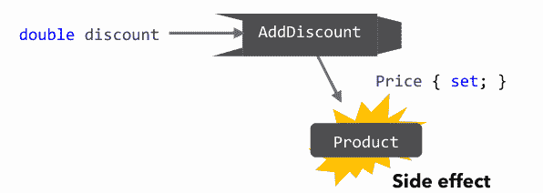

副作用是**改变计算全局状态**的操作。形式上，所有赋值和所有输入/输出操作都被视为副作用。**函数式编程风格试图避免/减少副作用。**

首先，对象暴露 Price 可能会导致错误。例如，我们可以有以下序列：

```
var product = new Product(100);
product.AddDiscount(0.1);

//...
// 在其他地方
product.Price = 80; // 现在怎么办？这取消了之前的折扣
```

你甚至可以在简单的多线程应用程序中以与预期不同的顺序访问 Price。当然，我们可以从外部环境隐藏 Price（类作用域）。

```
public class Product
{
    public double Price { get; private set; }
    public Product(double price)
    {
        Price = price;
    }
    public void AddDiscount(double discount)
    {
        this.Price = this.Price * (1 - discount);
    }
}
```

更好。现在 Product 价格不能直接从外部环境更改。

当然，我们可以完全移除 setter 并每次创建一个新的更新后的 product。因此，我们可以使 Product 不可变。

```
public class Product
{
    public double Price { get; }
    public Product(double price)
    {
        Price = price;
    }
    public Product GetDiscountedProduct(double discount)
    {
        return new Product(this.Price * (1 - discount));
    }
}
```

没有 setter

我们返回一个新的 Product

现在我们可以完全从 Product 中提取该方法并将其放在 PricingService 中：

```
public class PricingService {
    public Product GetDiscountedProduct(Product product, double discount)
    {
```


return new Product(product.Price * (1 - discount));
}
}
var discountedProduct = new PricingService()
    .GetDiscountedProduct(new Product(100), 0.1);

The type signature of the GetDiscountedProduct function now is

```
(Product, double) → Product
```

Finally, this type reflects the real intention of the Pricing computation.

### 1.2 Evolution of Delegates in C#

The most prominent language feature that facilitates functional programming is the existence of First-Class functions. This means the language needs to support the ability to treat functions as you would any variable and pass them around to other functions as you see fit. Lambda functions extend this concept, allowing the creation of an anonymous function, in a compressed and easy to read syntax.

Here we are going to display in rapid succession in just a section all the C# features related to lambdas. Consider this as a small reference guide. From .net 1.0 version the delegate was introduced. The delegate is a thing of the past and you probably will not see it anywhere but is behind all other concepts. A delegate Type is just a declaration of a function signature.

#### Delegates

For example, we can declare this delegate:

```
public delegate double DiscountDelegate(double price, double discount);
```

this informs us that anything that looks like the following:

```
double __ (double price, double discount)
```

can be assigned at a variable of type DiscountDelegate. If we have the following function:

```
double GetDiscountedPrice(double price, double discount)
{
    return price * (1 - discount);
}
```

This is a perfectly valid declaration:

```
DiscountDelegate discountFunc = GetDiscountedPrice;
```

You will see if you try to use this discountFunc variable the intellisense informs you that this expects 2 arguments of double and returns a double

```
DiscountDelegate discountFunc = GetDiscountedPrice;
```

```
double DiscountDelegate(double price, double discount)
```

> Intellisense information

#### C#3.0 lambda expression

After C# 3.0 we do not have to declare delegates anymore, and we instead use the generic Func<>. For example, we can write the following:

```
Func<double, double, double> discountFunc = GetDiscountedPrice
```

The Func<double, double, double> represents a Delegate Type that has the following signature (A, B) → C

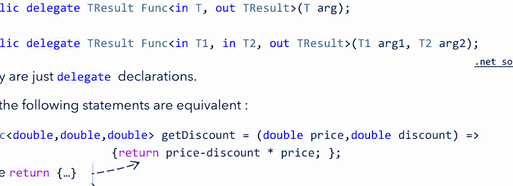

And we can assign a lambda expression directly to a Func<...>

```
public delegate TResult Func<in T, out TResult>(T arg);
```

```
public delegate TResult Func<in T1, in T2, out TResult>(T1 arg1, T2 arg2);
```

they are just delegate declarations.

All the following statements are equivalent :

```
Func<double,double,double> getDiscount = (double price,double discount) => { return price-discount * price; };
```

```
Func<double, double, double> getDiscount1 = (double price, double discount) => price-discount * price;
```

```
Func<double, double, double> getDiscount2 = (price, discount) => price-discount * price;
```

hopefully, you are already familiar with this notation, but in case you are not, let us go through each one by one briefly. Firstly, the following is an lambda expression :

```
(double price,double discount) =>{ return price - discount * price; };
```

And is just a function. We can remove the { return __ }; with the resulting expression:

```
Func<double, double, double> getDiscount = (double price, double discount) => price - discount * price;
```

Remove double keyword

```
Func<double, double, double> getDiscount2 = (price, discount) => price-discount * price;
```

```
```csharp
{
    throw new NotImplementedException();
};

return price - discount * price;
};
```
```

### 1.3 Built-in .NET Delegates

.NET contains a set of delegates designed for commonly occurring use cases, so we do not have to declare custom delegates. Those are residing in the **System** namespace. Here are the most important and most used:

Func<T, R>

The most common delegate by far will be the `Func<T, R>`, which represents functions and methods that look like this `R f(T t)` taking one argument and returning one result.

Visually this could be represented by just an arrow:


Func<T, U, R>

Represents a function Type that has the following signature `R f(T t1, U t2)`.

The `Func<T, U, R>` represents a Delegate Type that has the following signature `(T, U) → R`

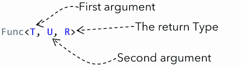

If you wanted to visualize this could be a join:

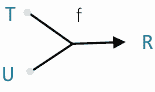

#### Action<T>

The Action<T> Functional interface represents functions that have this signature void f(T t). In functional programming we usually do not like the void because it is not a Type like all the others, and this forces us to treat it differently. Action<T> is just a Func<T, void> but because void is not a Type .NET had to invent Action<T>. As an example of usage look at the following, where we “consume” a string returning nothing:

```
Action<string> print = (string x) => Console.WriteLine(x);
```

When you return void is an indication that you create a side effect of some sort. We can shorten the declaration, using the point free notation :

```
Action<string> print1 = Console.Write;
```

A visualization for Action<T> could be:

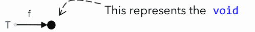

#### Func<T>

The Func<T> represents functions that have this signature T f() that do not take any arguments. A simple example would be:

```
Func<string> getName =()=>"jim";
```

visualize this as a value coming out of nothing:

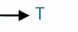

Func<T> is the dual of Action<T> and in this way we can compose them and annihilate them into a void.

```
Action<string> print = Console.Write;
Func<string> getName =()=>"jim";
```

```
print(getName()); // prints Jim as side effect with return type void
```

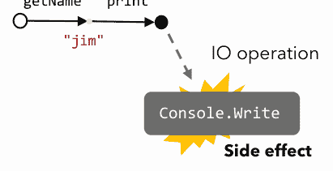

#### Predicate<T>

The Predicate<T> Functional interface represents functions that have this signature bool f(T t1) that returns a bool. This is equivalent to a Func<T, bool>.

#### Summary Table

|  |  |
|---|---|
| Action<T1> | void f(T1 a){...} |
| Action<T1,T2> | void f(T1 arg1, T2 arg2){...} |
| Func<TResult> | TResult f(){...} |
| Func<T1,TResult> | TResult f(T1 arg1){...} |
| Func<T1,T2,TResult> | TResult f(T1 arg1, T2 arg2){...} |
| Func<T1,T2,...T16,TResult> | TResult f(T1 arg1, T2 arg2,...,T16 arg16){...} |
| Predicate<T> | bool f(T arg1){...} |

#### Remember :

- 1. The Action delegates only have input arguments.
- 2. The Func<_,_> is the general case.
- 3. For Any Func<_,_,TResult> the Result is always at the Last position.
- 4. If you only want to return a result ()=>... you must use a Func<TResult>.

.NET Conventions ?.Invoke(...)

Since we can declare Func delegates as variables, it is possible that the delegate variable has not been assigned at the time of Invocation:

```
Func<string> getName = null;
var name = getName();      // we get a Null Reference Exception
```

in order to avoid this situation we usually use the ?.Invoke() method on the Delegates

```
getName?.Invoke();      //because of the ? operator we dont have an Exception.
```

### 1.4 Essential Typed Lambda calculus and C#

Lambda calculus is the original functional language. Lambda calculus is a formal system in mathematical logic, that was used to express computations. It was created by the great Alonzo Church in the 1930s.

In this section we are going to see the simply typed lambda calculus (the usual symbol is λ→) and how this relates to the C# lambdas. In order to do that we will keep only for this section a subset of C# equivalent to the λ→. Simple typed lambda calculus is a very simple system that does not support Generics but allows for simple types.

#### Terms

The formulation of the lambda expressions is constructed bottom up-in an inductive manner using as its base the term Term. A Term can be one of three things:

- 1. A Variable: x is a Term
- 2. An Abstraction: λx:A.M is a Term, where M is a Term and x is a variable.
- 3. An Application: (M N) is a Term, where M and N are Terms
- 4. A Constant c is a Term

From those the peculiar ones are the (2), and (3) which correspond in C# loosely to the following (we are going to elaborate on this):

- 1. The lambda abstraction λx:A.M corresponds to a C# function
  Func<A, B> f = (A x) => ...
- 2. And the application (M N) corresponds to the trivial function call f(x)

Of course, only with those expressions you cannot expect to do any meaningful computation because you must introduce syntax related with the Natural Numbers (+, -, ...), Booleans (if, then... ). Nonetheless, one could go down the road of defining Numerals using the Church encoding (we will skip this part in this book) which are typable in λ→ using only one type:

```
Func<Func<_, _>, Func<_, _>> zero = (Func<_, _> f) => (_ x) => x;
Func<Func<_, _>, Func<_, _>> one = (Func<_, _> f) => (_ x) => f(x);
Func<Func<_, _>, Func<_, _>> two = (Func<_, _> f) => (_ x) => f(f(x));
```

For some single arbitrary empty type class _ { }.


## 丘奇编码

在数学中，**丘奇数**是用 λ 记号表示自然数的一种方式。该方法以阿隆佐·丘奇的名字命名，他是最早以这种方式在 λ 演算中对数据进行编码的人。

0 ≡ λf. λx. x
1 ≡ λf. λx. f(x)
2 ≡ λf. λx. f(f(x))

这些数字的类型是 (_→_)→(_→_)，为了简单起见，我们可以把它定义为一个委托：

```
delegate Func<_, _> N (Func<_, _> f);
```

然后你就可以定义后继函数、加法等操作。

```
Func<N, N> Succ = (N n) => (f) => x => f(n(f)(x)); // add an additional f in front
```

这不过是一种取巧的算术做法，由天才阿隆佐·丘奇在 20 世纪 30 年代构想出来，构成了计算机科学的史前史。

现在，在无类型 λ 演算中，我们可以对任意两个项进行 λ 应用 (M N)。这在早期导致了一些问题，因为它允许出现罗素式类型悖论 [柯里悖论]。这就是引入**类型**的原因：根据项的类型来限制项的操作。

如今，类型思想在像 C# 这样的强类型语言中已被视为常识。

##### 类型

λ→ 中仅有的类型是某个基础类型集合 **B**，以及由如下 BNF 形式的简单文法生成的一切内容：

τ ::= τ→ τ | T where T ∈ B

这意味着 λ→ 中出现的类型都是归纳定义的；它们要么形如 τ→ τ（其中 τ 是某个已经构造出的类型），要么属于某个基础类型。例如若 B = {σ, ρ}，那么生成的类型如下：

σ, ρ, σ→ σ, ρ→ ρ, ρ→ σ, (ρ→ σ) → ρ, ..., (ρ→ σ) →(ρ→ σ) ...

如果我们采用 C# 类型系统以及常见的原始内建类型，那么一个受 λ→ 限制的简化版 C# 会把 B = {int, char, bool, ...} 作为基础类型，并将所有由 τ ::= τ→ τ | T 文法生成的东西都包含进来。这会得到如下这样的语法树：

(int→ int) → int

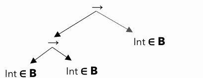

(int→ bool) → (int → char)

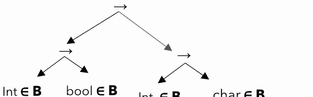

在 C# 中，(int→ int) → int 对应委托 Func<Func<int,int>, int>，而第二个 (int→ bool) → (int → char) 则对应 Func<Func<int,bool>, Func<int,char>>。

可以看到，内嵌于 C# 的 λ→ 版本只允许形如 Func<Func<..., ...>, Func<..., ...>> 的嵌套 Func 委托。

### 引入与消去规则

#### 引入规则

我们已经用归纳定义创建了一个类型集合，又用归纳定义定义了一个项集合，下一步是将它们联系起来。我们必须归纳地给出：特定的项如何归属于特定的类型。

首先是引入规则，它说明了我们构造 λ 抽象的方式。

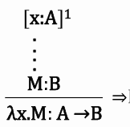

这里你看到的是构造 λx:A.M 项的机制，以及为什么这个项具有类型 A → B；这也是构造 τ→ τ 类型的唯一方式。[x: A]¹ 表示在某个时刻我们假设存在一个类型为 A 的变量 x；换句话说，我们有一个包含类型为 A 的变量 x 的上下文。在 C# 中，这由下面的声明表达：

```
(A x) => ...
```

通过开始一个 lambda，你可以假设凭空引入一个 x:A。然后在这个设定下，我们最终构造出项 M:B；此时可以撤销该假设并引入蕴含符号 ⇒（等价于 C# 中的 =>），于是我们得到

```
Func<A, B> Id = (A x) => ... ;
```

我们用箭头 ⇒ I₁ 来标记引入规则。

[另一种使用推出符号 ⊢ 的引入规则记法如下：

Γ, x : A ⊢ M : B
------------------- ⇒ E
Γ ⊢ λx.M : A → B

这与之前的记法表达的是同一件事：在一个类型上下文 Γ, x:A ⊢ .... （上下文由置于 ⊢ 左侧的假设组成）中，我们产生项 M:B；于是可以推出，在不含 x:A 的类型上下文中，我们可以推出 λ 项 λx:A.M : A → B]

#### 消去规则

λ 的消去规则等价于逻辑中非常著名的肯定前件（modus ponens）：

M : A → B   N : A
------------------- ⇒ E
(MN) : B

也就是说，只有当两个项分别具有 A → B 和 A 这种特定类型时，才能对它们应用 (M N)，并且这会生成一个类型为 B 的新项 (M N)。

当然，这并没有解释应用具体是如何发生的，因此我们还需要最后一组规则：计算规则。

##### 计算规则

应用的计算规则就是所谓的 β-归约：

(λx:A. M)(a ) → M[a/x]

M[a/x] 是类型论中替换（substitution）的表示，意思是把 M 中出现的所有变量 x 都替换为 a。

如果我们有下面这个 f，执行函数的标准概念就是如此：

```
Func<int, int> f = (int x) => x + 2;
```

当我们要计算 f(2) 时，就用 2 替换 f 中的 x。

以上就是对简单类型 λ 演算系统的一个介绍。

现在，为了使用整数类型，从形式上讲，我们应该通过声明形成、引入、消去和计算规则来说明它们的行为 [这需要引入哥德尔系统 T（我们会在递归一节中简要看到）]。但这里我们只是提供类型规则和操作语义的混合体，以便让它能与 λ→ 配合工作。

例如，假设只考虑加法，我们可以有一条规则规定只能将整数相加：

a: int   b: int
-------------------
(a + b): int

另一条计算规则可以说：如果你有一个加法 (a+b): int，就能推出加法的结果 n，它也是 int：

(a + b): int
---------------
n: int      其中 n = a + b

现在我们可以做如下简单的推导：

[x: int]¹   2: int
-------------------
x + 2: int
---------------------------- ⇒ I₁
λx: int. (x + 2): int → int
---------------------------- ⇒ E
(λx: int. (x + 2))(2): int

### 可选内容

### 柯里-霍华德对应

在编程语言理论和证明论中，柯里-霍华德对应（Curry-Howard correspondence）描述的是计算机程序与数学证明之间的直接关系。我们会在后续内容中探讨其中的一些联系。在本书范围内，我们只以简化的方式粗略地介绍一下柯里-霍华德对应。

第一个明确的联系是 λ 抽象（⇒）与逻辑蕴含（→）之间的对应：

类型 | 逻辑
引入 | [x:A]¹ ... M:B / λx.M: A → B ⇒ I₁ | [A]ˣ ... B / A → B ⇒ I₁
消去 | λx.M: A → B   t:A / M(t): B ⇒ E | A → B   A / B → E

+   1. 一条引入规则，描述如何创建该类型的元素；
+   2. 一条消去规则，描述如何使用该类型的元素。

对应关系如下：

+   1. 逻辑中的蕴含**引入**类似于 λ 演算中的 λ**抽象**。
+   2. 逻辑中的蕴含**消去**类似于 λ 演算中的 λ**应用**。

我们最容易证明的是恒等函数：Func<A, A> Id = (A x) => x;

逻辑

[A]^x
---
A → A  → I_x

类型

[x: A]
---
λx. x: A → A  ⇒ I_x

自然演绎推导十分简单：

+   1. **[A]^x**：我们做出一个假设 **[A]^x**，即我们有一个 **A**。在代码中，这意味着我们以 `(A x) =>` 开始 lambda，于是我们就被赋予了一个 **A**，可以在函数实现中使用它。问题是，当我们需要使用 **Id** 时，必须有一个 **A** 可用。在演绎上下文中，[...]^x 这种记号被用作簿记机制，以追踪假设。
+   2. 然后立即得出结论 **A**（即 `(A x) => x`），并通过调用蕴含 → 引入规则来**消去假设**（撤销假设）**[A]^x**。

另一个简单的重言式是命题 **A → (B → A)** [这被称为 **K 组合子**]，下面是用 C# 仅通过 lambda 给出的直接实现：

```
Func<A, Func<B, A>> K = (A x) => ((B y) => x);
```

它对应于如下 λ 项：

**λx:A. λy:B. x: (A → (B → A))**

**K** 只是接受一个变量 **x:A**，返回一个函数；该函数接受 **y:B** 但完全忽略它，并返回最初的变量 x。是的，正如你可能预料到的，它在实际场景中完全无用。

为了完整地介绍组合子，我们还会简要讨论 **S 组合子**。

```
Func<Func<A, B>, Func<A, C>> S<A, B, C>(Func<A, Func<B, C>> f) =>
    (Func<A, B> g) => ((A a) => f(a)(g(a)));
```

这个函数的类型是：

**S: (A → (B → C)) → ((A → B) → (A → C))**


And it is an interesting exercise to try and implement S in C# because it will give you better understanding of Func delegates.

S, takes x and applies it to both f and g and then applies the g(x) onto f(x). We will find this in the applicative reader functor section. The x should be understood like a common environment of variables (or a configuration) that is provided to both f and g, and then we apply the result of g(x) to the f(x), which is a function. An example would be the following:

```
Product result = S<Config,Product,Product>
(config =>product=>new Product(product.Name, product.Price*(1- config.Discount)))
(config => new Product($"A:{config.Category}", 100))
(new Config(0.1, "Widgets"));
```

We used the Combinator to pass (1) the Config(0.1, "Widgets") to the first lambda (2) and create a new Product and then we passed both the configuration and the Product to the (3) lambda to create a discounted Product using the Config Discount.

### η-reduction / expansion - Point Free notation

Let us say we have a simple lambda:

```
Func<int, int> f = (int a) => a + 1;
```

We can use this directly in any method that accepts a Func<int, int> delegate:

```
var x = new List<int> { 1, 2, 3 }.Select(f);
```

but we can also create a new lambda that explicitly call the function:

```
var y = new List<int> { 1, 2, 3 }.Select(x => f(x));
```

this is an η-expansion (eta-expansion). It is obvious that f ≡ (x => f(x)), that is the function f is equivalent to the lambda x => f(x). We can also keep doing this process indefinitely for example we could define the following lambdas:

```
Func<int, int> f1 = (int x) => f(x);
```

```
Func<int, int> f2 = (int x) => f1(x);
```

Each of which can be used in place of the initial f e.g.:

```
var z = new List<int> { 1, 2, 3 }.Select(f1);
```

when we move in the opposite direction by simplifying a **x => f(x)** into just **f**, we make what is called an **η-reduction (eta-reduction)**

```
new List<int> { 1, 2, 3 }.Select(x => f(x));
```

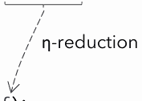

```
new List<int> { 1, 2, 3 }.Select(f);
```

this syntax is called _point-free_ because you don’t have explicit reference to the object **x =>**

> That is called the “point”

```
new List<int> { 1, 2, 3 }.Select(x => f(x));
```

The formal justification from _Gentzen_ is that the introduction for lambda `(int x)=>` is (post)-inverse to the lambda elimination `f(x)`

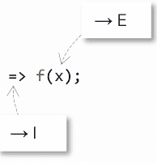

```
Func<int, int> f1 = (int x) => f(x);
```

In the logical form we just conclude **B** from **A** and **(A → B)** and then immediately introduce the assumption of **A** getting back the **(A → B)**

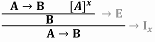

or in type theoretic derivation

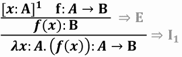

### 1.5 Higher-order functions

A **Higher-Order function (Hof)** is a function that receives a function as an argument or returns a function as output. But I assume that you are already familiar with this definition.

The following is a Hof because it takes a Func<T, U> delegate as an argument.

```
R F<T, U, R>(Func<T, U> g, T y)
{
    ...
}
```

The type of this function is **F: ((T→U) × T) → R**. While the following is a Hof because it returns a Func<T, U>

```
Func<T, U> G<T, U>(T y)
{
    ...
}
```

With a type of **G: T→(T→U)**, we can also use the local function form inside other methods or functions.

In the form of Func delegates the previous functions now should be declared like this:

```
Func<Func<T, U>, T, R> F = (Func<T, U> g, T y) => ...
```

```
Func<T, Func<T, U>> G = (T y) => ...
```

unfortunately, C# does not allow for Generic definitions at the level of the delegate. We cannot write for example :

```
Func<Func<T, U>, T, R> F = <T, U, R>(Func<T, U> g, T y) => ...
```

```
Func<T, Func<T, U>> G = <T, U>(T y) => ...
```

For this reason, we must place them in a Function or Class, and include the generic constrains there:

```
public static void Foo<T, U, R>()
{
    Func<Func<T, U>, T, R> F = (Func<T, U> g, T y) => ...
```

```
Func<T, Func<T, U>> G = (T y) => ...
}
```

Again, here the type of Func<Func<T, U>, T, R> corresponds to ((T→U) × T) →R and the type of Func<T, Func<T, U>> corresponds to T→(T→U)

Obviously, we can have as many levels of Higher order Functions by allowing the Functions passed as arguments or return as results being themselves of Higher type. For example:

```
R F<T, U, R>(Func<Func<T, U>, U> g, T y)
{
    ...
}
```

This is a Hof passed as an argument.

With type F: (((T→U) →U) × T) →R. In practice this type of Higher-Higher-order-functions becomes too convoluted too fast, and it is not recommended. In a delegate variable declaration this already looks way to complex.

```
Func<Func<Func<T, U>, U>, T, R> F = (Func<Func<T, U>, U> g, T y) => ...
```

What makes it worse is that we cannot replace the variable type with the var keyword.

### Strategy design pattern

The strategy design pattern is the closest thing to Higher order function form a purely OOP perspective since it allows to pass around functions as Objects. With the strategy pattern, we can modify the behavior of an object based on the different strategy object that we pass to it.

If for example, we have two different discounting scenarios for our product, we can abstract the discounting calculation from the product object and place it in a strategy object.

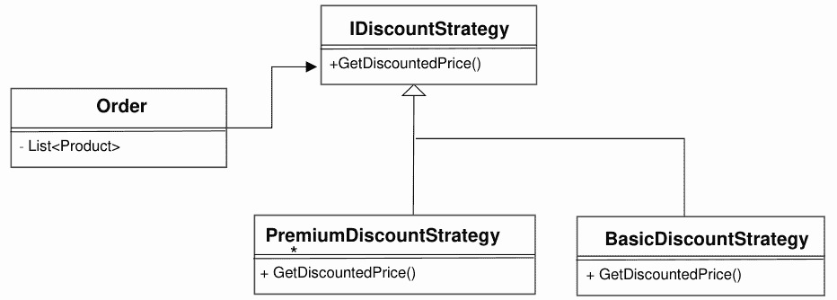

```
public interface IDiscountStrategy {
    double GetDiscountedPrice(Product product);
}
```

```
public class PremiumDiscountStrategy : IDiscountStrategy {
    public double GetDiscountedPrice(Product product) => product.Price * 0.7;
}
```

```
public class BasicDiscountStrategy : IDiscountStrategy {
    public double GetDiscountedPrice(Product product) => product.Price * 0.9;
}
```

If we have defined an Order class, responsible for handling a collection of Product items, we can place there the calculation of the Total amount, by using a IDiscountStrategy that might vary:

```
public class Order
{
    IList<Product> Products { get; }

    public Order(IList<Product> products) => Products = products;

    public double GetTotalPrice(IDiscountStrategy activeDiscount) =>
        Products
            .Select(activeDiscount.GetDiscountedPrice)
            .Sum();
}
```

In his way if we have an order containing some Products, we can instruct how the discount will be computed by providing at run time a concrete class implementing IDiscountStrategy

```
var total = order.GetTotalPrice(new PremiumDiscountStrategy());
```

In a functional manner we could refactor this to directly pass the discount calculation function Func<Product, double> as an argument. We can thus define a GetTotalPrice function:

```
double GetTotalPrice(List<Product> products, Func<Product, double> activeDiscount) =>
    products.Select(activeDiscount).Sum();
```

and define some predetermined Discounts:

```
Func<Product, double> PremiumDiscountStrategy = (Product product) =>
    product.Price * 0.7;
```

```
Func<Product, double> BasicDiscountStrategy = (Product product) =>
    product.Price * 0.9;
```

We could even define the GetDiscountedPrice function, as an extension method attached on the List<Product> type:

```
public static partial class FunctionalExtensions
{
    public static double GetDiscountedPrice(this List<Product> @products,
        Func<Product, double> activeDiscount) =>
        products.Select(activeDiscount).Sum();
}
```

This would allow for the following syntax:

```
var total = products.GetDiscountedPrice(PrimumDiscountStrategy);
```

In this example GetDiscountedPrice(...) is the Higher-order Function. We can call this refactoring move “Replace Strategy with Higher-order Function.” For simple scenarios, we do not have to create a full class in order to use the strategy pattern. In functional programming Higher-order functions are everywhere. This is the core idea of functional programming; to treat functions as data.

### 1.6 Simple Function Composition

One can argue that composing functions is the most important idea in programming and functional programming in particular. Functional composition is an instance of the concept of compositionality. Creating systems by composing smaller systems that are easier to implement and design can be found in all levels of programming. Staring from the Syntax of the language, to Design patterns, architectural patterns, larger System design etc.

In this section we are going to take a brief look at one of the most basic ones; Function composition.

In mathematics, function composition is the application of one function to the result of another to produce a third function. For instance, the functions f : T→ R and g : R→ U can be composed to yield a function h: g(f(x)) with type T→ U we usually represent that as g ∘ f and we read that as “g after f” the symbol ∘ usually represents “after”.

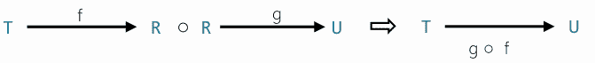

```
Func<T, R> Compose<T, U, R>(Func<T, U> f, Func<U, R> g) => (T x) => g(f(x));
```


如果我们有一些函数，我们可以组合它们：

```
Func<Product, string> GetName = product => product.Name;
Func<string, string> ToUpper = name => name.ToUpper();
```

```
Func<Product, string> GetNameUpperCase = Compose(GetName, ToUpper);
```

或者通过使用扩展方法，我们可以流畅地链式调用函数委托：

```
public static partial class FunctionalExt
{
    public static Func<A, C> Compose<A, B, C>(this Func<A, B> @f, Func<B, C> g) =>
        (A x) => g(f(x));
}
```

这使我们能够以这种方式编写组合：

```
Func<Product, string> GetNameUpperCase = GetName.Compose(ToUpper);
```

下面是对C#类型系统中函数组合的浅层探索。我们在此不讨论实际应用，而只探讨组合的形态。

可选

我们将解释构造这个函数背后的直觉。

由于我们要构造一个 Func<T,R>，我们必须返回一个接受参数 T x 并返回 R 类型值的函数（lambda），只使用我们想要组合的两个函数 Func<T, R> 和 Func<R, U>。

- 1. 我们首先将这个函数写为 lambda (T x) =>...，现在我们有了 T x 和两个委托 Func<T, R> f、Func<R, U> g。
- 2. 我们使用 T x 调用 Func<T, R> f，即 f(x)，这将返回一个 R，然后我们可以使用函数委托 Func<R, U>（它表示从 R 到 U 的函数 g: R→ U）来得到一个 U 并返回它。

如果第一个函数是双参数函数，我们有另一个函数组合的例子：

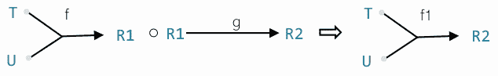

实现同样非常简单：

```
Func<T, U, R2> Compose<T, U, R1, R2>(Func<T, U, R1> f, Func<R1, R2> g) =>
(T x, U y) => g(f(x, y));
```

构造这个函数的直觉也很简单：

由于我们要构造一个 Func<T, U, R2>，我们必须返回一个接受两个参数 T x 和 U y 并返回 R2 类型值的函数，只使用我们想要组合的两个函数 Func<T, U, R1> 和 Func<R1, R2>。

- 1. 我们首先将这个函数写为 lambda (T x, U y) =>...，现在我们有了 T x、U y 以及两个委托 Func<T, U, R1> f、Func<R1, R2> g。
- 2. 我们使用 T x 和 U y 调用 Func<T, U, R1> f，即 f(x, y)，这将返回一个 R1，然后我们可以使用函数委托 Func<R1, R2>（它表示从 R1 到 R2 的函数 g: R1→R2）。

可选

柯里-霍华德对应

这个简单函数的构造对应于如下形式的一个项的证明：((T∧U → R1)→(R1 → R2)→((T∧U) → R2)

当我们实现 Compose 函数时，我们实际上构造了一个演绎证明。

```
[T]^x [U]^y   T∧U   [T∧U → R1]^f     [R1 → R2]^g

T∧U   I∧     R1   →E     R2   →E

T → R2   I_x
U → T → R2   I_y
```

- 1. 我们做出两个假设 [T]^x 和 [U]^y，这基本上就是引入两个参数 (T x, U y)。
- 2. 然后我们将它们与函数 f: T∧U → R1 一起使用，进行所谓的蕴含消去 →E，这其实就是函数应用 f(x, y)。
- 3. 最后，我们使用另一个蕴含消去 →E，即应用 g(f(x, y))。

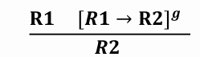

我们在强演绎意义上证明了：以 T、U、T∧U→R1、R1→R2 作为假设，我们可以得到 R2。

### 类型理论

### 居留类型

如果我们有另一个函数 g，例如 R1→T，那么将无法证明 R2。用编程语言来说，这意味着在没有编译器错误的情况下，不可能实现以下类型的有效 Compose：

```
Func<T, U, R2> Compose<T, U, R1, R2>(Func<T, U, R1> f, Func<R1, T> g) =>{ }
```

在类型理论中，我们说类型 ((T×U) → R1) →(R1 → T) →((T×U) → R2) 没有被居留。当然，如果我们添加一些关于 T 和 R2 的额外“事实”，例如 T 是 R2 的子类型，那么它可能成立。通过添加 T:R2 这个约束，这是可以类型化的：

```
Func<T, U, R2> Compose1<T, U, R1, R2>(Func<T, U, R1> f, Func<R1, T> g)
where T:R2 =>
(x, y) => g(f(x, y));
```


在简单类型 lambda 演算中，一个类型存在居留者当且仅当它在逻辑中对应的命题是重言式。

另一种组合方式是在第一个参数上预先组合某个其他函数。

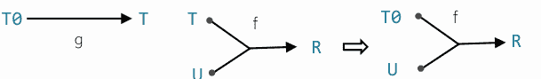

```
Func<T0, U, R> PreCompose<T, U, R, T0>(Func<T, U, R> f, Func<T0, T> g) =>
(T0 x, U y) => f(g(x), y);
```

我们也可以同时在两个参数上进行预组合：

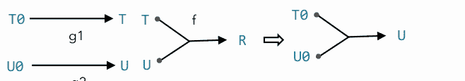

```
Func<T0, U0, R> PreCompose<T, U, R1, T0, U0>(Func<T, U, R> f, Func<T0, T> g1, Func<U0, U> g2) => (T0 x, U0 y) => f(g1(x), g2(y));
```

另一种可能的情况是使用一个简单的值提供者 Func<T> 作为第一个函数。在这种情况下，我们只能进行后组合：

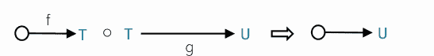

```
Func<U> Compose<T, U>(Func<T> f, Func<T, U> g) => () => g(f());
```

类似地，我们可以组合到一个“值汇”或析构器 Action<R> 中，它消费一个值 R：

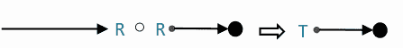

```
Action<T> PreCompose<T, R>(Func<T, R> g, Action<R> f) => (T x) => f(g(x));
```

另一种情况是有一个值供应者，紧接着有一个该值的消费者：


```
void Compose<T>(Func<T> f, Action<T> g) => g(f());
```

### 终结操作

非正式地，我们通常将不返回任何结果的方法称为终结操作。

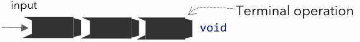

最常见的例子是 List<T>.ForEach(...) 方法，其声明如下：

```
public void ForEach(Action<T> action);
```

例如，我们可以在 ForEach 中传入一个 Action<T>：

```
Action<Product> printProductName = product => Console.WriteLine(product.Name);
```

```
new List<Product>{
    new Product("widgetA",100 ),
    new Product( "widgetB",1100),
    new Product( "widgetA",2000),
    new Product( "widgetB",300)
}.ForEach(printProductName);
```

当某个方法返回 void 时，你可能会怀疑它接受一个 Action<> 作为参数。

### 1.7 回调

让我们用另一种常见的高阶函数组合类型——回调——来结束本节。我们将在本书中各种形式地使用回调（尤其是在下一章中将看到的模式匹配概念一起使用）。

回调是一个 Func 委托，作为参数传递给某个函数。函数内部的代码需要在给定时间调用这个 Func 委托参数。

回调最简单的形式如下：

```
void G<T, R>(Action<R> callback, T y)
```

```
{
    //... do some stuff
    callback(default(R)); // call the action passing inside some result.
    //... continue or return
}
```

在纯粹的面向对象环境中，它是最接近于触发 .NET 事件的东西。

回调在异步场景和事件驱动架构中经常出现，并且是 Task<T>、Rx.NET 的 Observables<T> 以及观察者设计模式等概念的核心组成部分。

每个函数都可以转换为一个使用回调的等价函数。这被称为续延传递风格变换。如果我们有一个函数：

```
R F<T, R>(T y)
{
    return default(R);
}
```

我们可以将其转换为等价的形式：

```
void F<T, R>( T y, Action<R> callback)
{
    callback(default(R));
}
```

- 1. 该函数现在返回 void（1）。
- 2. 并有一个额外的参数 Action<R>（2），我们可以在其中传递结果。

使用 Func 委托语法，续延传递变换现在接受一个 Func<T,R>：

```
Func<T, R> F = (T y) => default(R);
```

转换为 Action<T, Action<R>>：

```
Action<T, Action<R>> G = (T y, Action<R> callback) => callback(default(R));
```

而不是最初的函数调用：

```
R result = F(default(T));
```

现在我们通过以下方式访问结果：

```
G(default(T), (R result) => { });
```

作为一个简单的例子，我们可以将一个返回字符串长度的简单函数：

```
Func<string, int> F = (string y) => y.Length;
```


```
Console.WriteLine(F("Foo"));
```

into this:

```
Action<string, Action<int>> G = (string y, Action<int> callback) => callback(y.Length);
```

```
G("Foo", (int result) => { Console.WriteLine(result); });
G("Foo", result => Console.WriteLine(result));
G("Foo", Console.WriteLine);
```

optional

### Continuations

Furthermore, if you curry (we will see currying in a later section) the callback argument you get something like the following:

```
Func<T, Action<Action<R>>> F = (T y) => (Action<R> callback) => callback(default(R));
```

That is used in this manner:

```
F(default(T))((R result) => { });
```

In the case of the previous simple example, we now have this transformation.

```
Func<string, Action<Action<int>>> F = (string y) => (Action<int> callback) => callback(y.Length);
```

```
F("Jim")(Console.WriteLine);
```

In C# instead of continuations we use `Task<T>`. The previous can be rewritten using Tasks:

```
Func<string, Task<int>> F = (string y) => Task.Run(() => y.Length);
```

```
F("Jim").ContinueWith(x => Console.WriteLine(x.Result));
```

### 1.8 Named parameters and Tuples

Another late functional feature of C# is the named parameters feature. Named parameters are meant to increase readability. Using named parameters makes code way less ambiguous. If you have a method like the following for example:

```
void PrintOrderDetails(int orderNum, string productName, string sellerName) {...}
```

We can call it by explicitly naming the parameter names along with the values:

```
PrintOrderDetails(orderNum: 31, productName: "Red Mug", sellerName: "Gift Shop");
```

Instead of the following:

```
PrintOrderDetails("Gift Shop", 31, "Red Mug");
```

#### Tuples

Sometimes instead of creating new classes we might use tuples. Tuples are lightweight, and do not pollute our model with unnecessary intermediate classes. For example, when you have a long parameter list for a method it is common practice to refactor it and introduce a parameter object. For example, in this simple method:

```
public void PrintOrderDetails(int orderNum, string productName, string sellerName)
```

we could create the following type:

```
public struct PrintOrderDetailsCommand
{
    public int OrderNum { get; set; }
    public string ProductName { get; set; }
    public string SellerName { get; set; }
}
```

and replace the arguments:

```
public void PrintOrderDetails(PrintOrderDetailsCommand printCommand) { }
```

and use it like this:

```
var printCommand = new PrintOrderDetailsCommand
{
    OrderNum = 1,
    ProductName = "widget",
    SellerName = "ace"
};
```

```
new Printer().PrintOrderDetails(printCommand);
```

Even if Introduce Parameter Object refactoring sometimes is an improvement, we might not want to create a new class. We can instead use a tuple as an argument:

```
void PrintOrderDetails((int OrderNum, string ProductName, string SellerName) command)
```

Amazingly, this is a valid syntax: the triple

```
(int OrderNum, string ProductName, string SellerName)
```

represents an object:

```
var printCommandTuple = (
    OrderNum: 1,
    ProductName: "widget",
    SellerName: "ace"
);
```

we can pass this into the method above

```
void PrintOrderDetails((int OrderNum, string ProductName, string SellerName) command)
```

```
var printCommandTuple = (
    OrderNum: 1,
    ProductName: "widget",
    SellerName: "ace"
);
```

```
PrintOrderDetails(printCommandTuple);
```

Tuples make it easier to also return multiple results from methods or Func delegates. For example if we wanted to return a Result object from the PrintOrderDetails method we could modify the method as follows:

```
(int orderPlacementId, int orderStatus) PrintOrderDetails((int OrderNum, string ProductName, string SellerName) command)
```

#### 1.8.1 Lambda expressions and tuples

##### Tuples in Func delegates

We can also mix the tuples with the Func<> delegates by using tuples as an argument type or a result type. This means we can write Func delegates of this form `Func<(_, _), (_, _)>` and create expressions like the following:

```
Func<(int OrderNum, string ProductName), (int orderPlacementId, int orderStatus)> printOrderDetails = command => { ... };
```

This is equivalent to the method PrintOrderDetails:

```
public class Printer
{
    public (int orderPlacementId, int orderStatus) PrintOrderDetails(
        (int OrderNum, string ProductName) command)
    {
        ...
    }
}
```

And we can even assign this method to a delegate of that type:

```
printOrderDetails = new Printer().PrintOrderDetails;
```

this is equivalent to:

```
printOrderDetails = command => new Printer().PrintOrderDetails(command);
```

if one wants to explicitly mention the command input argument.

##### Func delegates in Tuples

Also, you can have tuples that contain Func<> delegates. We are going to use those kinds of tuples as well. For example, look at this type:

```
(Func<int> zero, Func<int, int, int> add) monoid = (zero: () => 0, add: (x, y) => x + y);
```

It is a collection of two functions `zero: () => 0` and `add: (x, y) => x + y`.

Which is equivalent to the following class:

```
public class Monoid
{
    public int Zero() { return 0; }
    public int Add(int x, int y) { return x + y; }
}
```

Or if we use the inline function notation:

```
public class Monoid
{
    public int Zero() => 0;
    public int Add(int x, int y) => x + y;
}
```

Unfortunately we cannot assign tuples to interfaces:

```
interface IMonoid
{
    int Zero();
    int Add(int x, int y);
}
```

```
IMonoid monoid1 = (Zero: () => 0, Add: (x, y) => x + y);
```

Also, we cannot destructure tuples with Func delegates like this:

```
(Func<int>, Func<int, int, int>)(zero, add) = (zero: () => 0, add: (x, y) => x + y);
```

Tuples fit perfectly the linear model of functional programming because we can easily adjust the inputs and outputs of consecutive function pipelines.

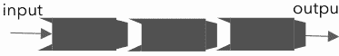

For example, we can trail along the pipeline some state data without the need to access the outside scope and thus maintaining the purity of the functions:

```
Func<(Order, double discount), (Order updatedOrder, double totalPrice)> updateOrder = state => { ... };
```

```
Func<(Order, double totalPrice), (double totalPrice, string errors)> validate = state => { ... };
```

```
Func<(Order, double discount), (double totalPrice, string errors)> process = order => validate(updateOrder(order));
```

here for example, we transfer the updated Order across the pipeline.

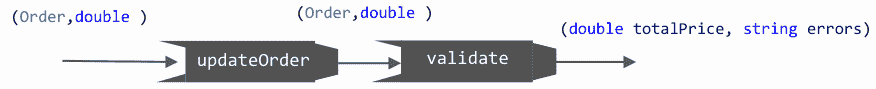

Sometimes if you must pass too much data across, it might be an indication that you should break down even more the functions, or even use Object-oriented instead of Functional design.

There are functional patterns like the State monad that facilitate this kind of composition. We are not going to see state monad in this book since C# is not purely functional and there is no need to introduce complexity when not needed.

### 1.9 Extension Methods

We are going to use extension methods a lot. Extension methods might diverge from the traditional Object-oriented model of programming but allow us to provide custom functionality to .NET native types or extend our classes in ways that are not possible (or very difficult) through the standard language capabilities.

For example, we can give useful methods to native types to simplify our code and provide method chaining. Take for example this extension of Tuples that we are going to use. By adding the following static class that contains an Extension method on the ValueTuple:

```
public static class FunctionalExt
{
    public static List<T> ToList<T>(this ValueTuple<T, T> @this) =>
        new List<T> { @this.Item1, @this.Item2 };
}
```

Extension methods should be static (1) inside a static class (2) and you must use the `this` keyword (3) before the argument, which acts as a reference to the type you want to attach the method.

We can now go ahead and use the `ToList<T>` method on any 2-item ValueTuple:

```
var list = (4, 5).ToList();
```

since `ValueTuple<T, T>` is equivalent to a list `List<T>` with 2 items.

To take this one step further we will rewrite our Map definition on `ValueTuple<T, T>` from the Higher-Order Functions section:

```
ValueTuple<T1, T1> Map<T, T1>(ValueTuple<T, T> @this, Func<T, T1> f) =>
    new ValueTuple<T1, T1>(f(@this.Item1), f(@this.Item2));
```

and instead create an extension method on the ValueTuple<T, T>:

```
public static class FunctionalExt
{
    public static ValueTuple<T1, T1> Map<T, T1>(
        this ValueTuple<T, T> @this,
        Func<T, T1> f) => new ValueTuple<T1, T1>(f(@this.Item1), f(@this.Item2));
}
```

The above declaration now will allow us to write:

```
var result = (1, 3).Map(x => x * x);
```

instead of this:

```
var result = Map((1, 3), x => x * x);
```

in this way we obtain a certain control over the Native types and force our functional style of writing.


### 1.10 使用 static 指令

借助 static 指令，我们可以直接使用静态方法，而无需引用类。例如，因为 `WriteLine` 是 `System.Console` 的 `static` 方法

我们可以直接写：

```
WriteLine("message");
```

而不是：

```
Console.WriteLine("message");
```

如果我们在 using 语句中写下：

```
using static System.Console;
```

就像这样：

```
using static System.Console;

namespace PracticalCSharp
{
    public class Demo
    {
        public void Run()
        {
            WriteLine("message");
        }
    }
}
```

在函数式编程（以及 language-ext 库）中，我们可以利用这一点来提供工厂方法，并避免使用 `new` 关键字。例如，假设我们有这样一个类：

```
public class IO<T>
{
    public Func<T> Fn { get; set; }
    public IO(Func<T> fn) => Fn = fn;
    public T Run() => Fn();
}
```

与其写成：

```
var t = new IO(() => 1);
```

我们可以定义一个包含静态方法的类来创建 `new IO()`：

```
public class Factories
{
    public static IO<T> IO<T>(Func<T> fn) => new IO<T>(fn);
```

这样，通过使用 static Factories，我们可以直接写：

```
var t = IO(() => 1);
```

而不需要 new 关键字。我们可以讨论这个想法的实用性。但它源于函数式语言的传统，并且最大限度地简化了语法。同时，它允许我们将 new 隐藏在单一入口点中。这样一来，如果我们想更改每次 `IO(() => ...)` 函数调用所创建的类，只需修改静态定义即可，就像我们使用标准工厂设计模式或 IoC 容器时那样。

在 language-ext 库中，大多数类型都有静态的 “工厂”，因此我们通常可以写出如下表达式：

```
var optional = Some(123);
```

而不是：

```
var optional = new Some(123);
```

### 1.11 自定义数据结构的 LINQ 支持

你知道吗，如果你在任何类型中实现了 Select 方法，就可以使用 `from... in ...select` 的 LINQ 语法？？？C# 社区很快发现，在 LINQ 这一特性中，可以模拟一种用于链式计算（computation chaining）的语法模式，这种模式被称为 Do 记法（do notation），在 Haskell 中它长这样：

```
do { x1 <- action1
  ; x2 <- action2
  ; action( x1,x2 )}
```

这在 LINQ 中大致可以翻译为：

```
var r = from x1 in new Id<int>(5)
    from x2 in new Id<int>(2)
    select x1 + x2;
```

我们将在函子（Functor）和单子（Monad）章节中更详细地了解如何为自定义数据结构添加 LINQ 支持。我们也可以使用扩展方法为原生 C# 类型（例如 `Lazy<T>`）提供 LINQ 支持：

```
public static Lazy<T1> Select<T, T1>(this Lazy<T> @this, ...) =>{ ... }
```

这样可以允许类似下面的代码：

```
var r = from x1 in new Lazy <int>(( )=>5)
    select x1 + 1;
```

### 1.12 柯里化与部分应用

柯里化（Currying）是函数式编程中一个相当基础且深刻的概念。因此，它以伟大的 Haskell Curry 的名字命名。柯里化意味着，一个接受多个参数的函数可以被转化为一系列每次只接受单个参数的函数调用。像这样的表达式：

```
public string F(int x, int y) { }
```

我们这样调用它：

```
var resultString = F(4,5);
```

可以转化为等价的：

```
public Func<int, string> F(int x)
{
    string g(int y) { }
    return g;
}
```

我们可以这样调用：

```
var resultString = F(4)(5);
```

或者如果我们只使用 lambda，上述转换看起来就像这样：

```
Func<int, int, string> F = (x, y) => { };
```

```
Func<int, Func<int, string>> F1 = x => y => { };
```

我们说第二个是第一个的柯里化版本。我知道使用 Func 委托会让人难以理解。例如，在没有类型的 JavaScript 中，上述代码看起来像这样：

```
var f = (x, y, z) => {...}
```

```
var f = x=>y=>z=> {...}
```

我们只是把逗号（ , ）替换成箭头 =>。

language-ext 库提供了柯里化函数。一个简单的、将双参数函数转换为柯里化版本的泛型高阶函数实现如下：

```
Func<A, Func<B, C>> Curry<A, B, C>(Func<A, B, C> f) => (A x)=>(B y) => f(x, y);
```

这个函数的类型是 ((A × B) → C) →(A →(B →C))。在一个更具体的例子中，一个带有折扣和价格参数的函数：

```
Func<double, double, double> discountedPrice = (discount, price) =>
```

```
price - discount * price;
```

等价的柯里化函数看起来像这样：

```
Func<double, Func< double, double>> discountedPrice = (discount) => (price) =>
    price - discount * price;
```

如果我们想使用未柯里化的函数来处理一组价格，给定一个折扣，通常我们会这样写：

```
var discountedPrices = new List<double> { 10, 20, 30 }
    .Select(x =>discountedPrice(0.1, x));
```

这里是柯里化版本：

```
var discountedPrices1 =new List<double>{ 10, 20, 30 }
    .Select(discountedPriceCurried(0.1));
```

这里的区别是，在第二种情况下，我们没有 `.Select(x =>`，因为无需显式地引用数组对象。因此，第一种写法被称为“带点”（pointed）风格，而第二种则称为“无点”（point free）风格。

在我们将某个参数固定为特定的折扣 0.1 后，我们得到了一个特化函数：

```
var discountedPricePartial = x => discountedPrice(0.1, x);
```

这种减少函数参数的过程称为部分应用（partial application），（有时我们也可能将这个过程称为特化），它通常与柯里化一起被提及，因为在对函数进行柯里化之后，我们可以像这样随时获得部分应用：

```
Curry(discountedPrice)(0.1)
```

#### 部分应用

部分应用是一个很容易理解的概念。假设我们有一个双参数函数：

```
R F<A, B, R>(A a, B b) => default(R);
```

我们可以创建一个新函数：

```
R G<B, R>(B b) => F<A, B, R>(x1, b);
```

通过为 A 参数提供某个默认值 x1，它只需要一个参数。

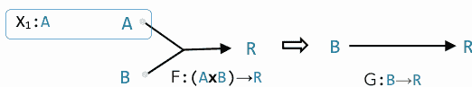

举个简单的例子，考虑一个测试两个整数是否相等的谓词：

```
bool areEqual(int a, int b = 0) => a == b;
```

我们可以通过对任意参数进行部分应用，创建一系列特化的谓词：

```
bool isZero(int a) => areEqual(a, 0);
```

```
bool isOne(int a) => areEqual(a, 1);
```

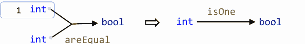

显然，我们可以对多个参数（甚至所有参数）进行部分应用。

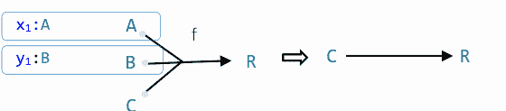

柯里化总是让手头的函数保持相同的语法状态 `x=>y=>z=>...`。每当我们使用 **compose** 或 **部分应用** 一个值时，我们就消耗掉一个箭头（=>），但结果仍然保持相同的语法形式；`y=>z=>...`，从而促进了统一性。这是实践中的幂等设计。缺点在于，参数的顺序现在变得很重要，简单的参数重排重构可能会产生副作用。

### 编程代数

范畴论是一门数学学科，在理论计算机科学中有着广泛的应用。范畴（Category）、函子（Functor）、单子（Monad）等概念最初定义于范畴论中，如今已经成为理解现代函数式编程（FP）语言和范式的关键。

范畴只是经典的对象集合（Set of Objects）概念的延伸。一个范畴 C 由以下三个数学实体组成：

+   1. 一个类 ob(C)，其元素称为对象。任何面向对象程序员都会觉得这是一个很好的定义起点。


在编程中，我们最喜欢的范畴是类型范畴：int、bool、char 等。在编程中还有许多有趣的范畴，在本书中，我们将探索其中一些。


+   2. 一组称为**态射**或箭头的元素。每个态射 **f** 都有一个源对象 **a** 和一个目标对象 **b**。

### **范畴** C

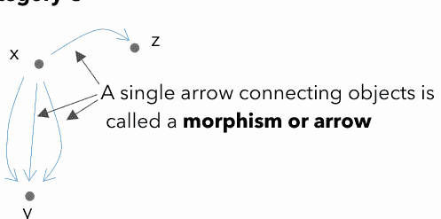

在我们的类型范畴中，例如，从 `int` 到 `bool` 的任何箭头都表示一个函数 `int → bool`。一些例子可能是：

```
bool isEven(int a)=> a%2==0;
```

或者这个：

```
bool isLessThan10(int a)=> a<10
```

### 类型的**范畴**

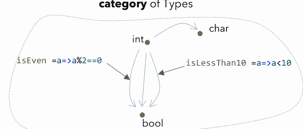

范畴论的基本焦点**是对象之间的关系**，而不是对象本身，这与主要关注对象集合的集合论形成对比。函数式程序员很快接受了范畴论的这一独特视角。

### 2.2 幺半群

> “另一种说法是，范畴论的基本概念是幺半群”
> ——《给数学工作者的范畴论》

幺半群是一种深刻而又易于理解、无处不在的思想。幺半群属于代数范畴。在函数式编程中，有几种特别重要的方式来组织不同的结构。代数就是其中之一。Fantasy Land 规范中包含了一些最重要的代数。

维基百科说，幺半群是一种具有单个结合二元运算和单位元的代数结构。任何具有这两个要素的结构都是幺半群。

假设 S 是一个结构，⊗ 是某种二元运算 S ⊗ S → S，那么 S 与 ⊗ 构成一个幺半群，如果它满足以下两条公理：

-   1. 结合律：对于 S 中的所有 a、b 和 c，等式 (x ⊗ y) ⊗ z = x ⊗ (y ⊗ z) 成立。

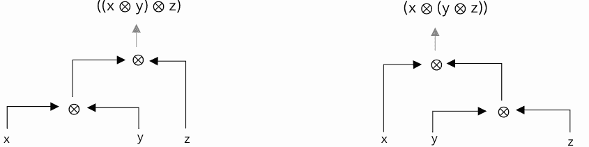

-   2. 单位元：在 S 中存在一个元素 e，使得对于 S 中的每个元素 a，等式 e ⊗ a = a ⊗ e = a 成立。

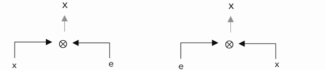

让我们以整数为例，我们可以将加法视为两个整数之间的二元运算。加法是结合的。这意味着加法的顺序并不重要。

```
(x+(y+z)) = ((x+y) +z)
```

而 0 是加法的单位元，因为：

```
x + 0 = x
```

基于这些原因，配对 (0, +) 在整数上构成了一个幺半群。然而，我们可以在整数上构造其他不同的幺半群。例如，乘法 * 也可以被视为一个幺半群，其对应的单位元是 1。这样，(1, *) 就是整数上的另一个

幺半群。C# 中的字符串有一个默认的幺半群，它由连接操作和空字符串 ("", Concat) 构成。

我们将在代码中使用幺半群，通过定义简单的对象字面量来实现，其中包含两个函数：一个返回单位元，称为 Empty；一个表示二元运算，称为 Concat。

> [在本书中，我们将遵循 Fantasy Land 规范中关于幺半群的命名约定，尤其是因为 C# 已经对字符串和数组使用了 Concat。]

```
public interface IMonoid<T>
{
    T Empty { get; }
    T Concat(T x, T y);
}
```

这个接口的类型是：IMonoid<T>: (Empty: T, Concat: (T × T)→ T)，另一种写法是 Concat 的柯里化版本 (T → T)→ T，这是一种常见的类型表示方法。

我们将这样使用幺半群：

```
var sum = new Sum();
var total = sum.Concat(1, sum.Concat(3, 4));
```

这个定义允许我们直接将其用于列表的 Aggregate 函数：

```
total = new[] { 1, 3, 4, 5 }.Aggregate(sum.Empty, sum.Concat);
```

我们也可以将幺半群定义为一个元组：

```
(int empty, Func<int, int, int> concat) sum = (0, (x, y) => x + y);
```

另外，如果我们希望具有封闭性 [意味着 Concat 和 Empty 的返回类型与初始对象是同一类型]，我们可以为每个幺半群定义一个类。

```
public interface IMonoidAcc<T>
{
    T Identity { get; set; }
    IMonoidAcc<T> Concat(IMonoidAcc<T> m);
}
```

```
public class Sum : IMonoidAcc<int>
{
    public Sum(int value) => Identity = value;
    public int Identity { get; set; }
    public IMonoidAcc<int> Concat(IMonoidAcc<int> m) =>
        new Sum(m.Identity + Identity);
}
```

```
var total = new Sum(0).Concat(new Sum(1)).Concat(new Sum(2)).Concat(new Sum(3));
```

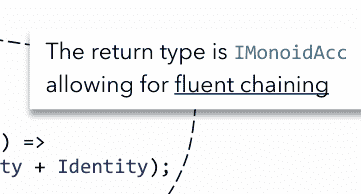

这种写法的优点在于它允许流畅的链式调用 var total = new Sum(0) .concat(new Sum(1)) .concat(new Sum(2))，因为 empty 和 concat 都返回相同类型的结果。这也更符合数学定义：如果 S 是一个结构（在编程语言中，这对应一个类型），那么 S × S → S 意味着该运算返回同一种结构。

在实践中，只要我们清楚自己正在处理幺半群，就不必在意严格的定义。

#### 2.2.1 折叠幺半群

幺半群有一个非常理想的特性：如果我们持续应用这个二元运算 ⊗，我们总能将计算归约为同一类型的单个元素：

(M⊗...(M⊗(M⊗M)))→M

这被称为折叠。

(((v:M ⊗ u:M) ⊗ w:M ) ⊗ ... ⊗ z:M) =a:M

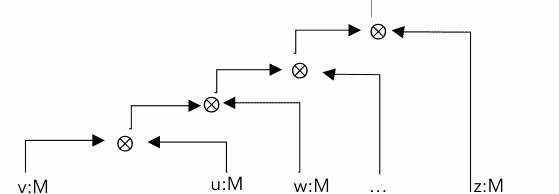

假设我们有一个整数序列 2,4,5,6，想要将它们相加，这是一个入门级问题：

```
var list = new[] { 1, 2, 3, 4 };
var accumulation = 0;
foreach (var current in list)
    accumulation = accumulation + current;
(0,+) monoid
```

我在这里强调的只是一个初始元素 0 和加法，加法是两个整数之间返回一个整数的运算。

如果我们想将它们相乘呢？

```
var accumulation = 1;
foreach (var current in list)
    accumulation = accumulation * current;
(1,*) monoid
```

+ 和 * 都可以抽象为 lambda。对于 + 的情况：

```
Func<int, int, int> add = (int x, int y) => x + y;
```

在第二种情况下，我们从初始元素 1 开始，使用乘法作为两个整数之间的运算：

```
Func<int, int, int> add = (int x, int y) => x * y
```

因为两者具有相同的签名，我们可以对它们进行抽象，创建一个可以复用的高阶函数：

```
public T Fold<T>(List<T> list, T accumulation, Func<T, T, T> concat)
{
    foreach (var current in list)
        accumulation = concat(accumulation, current);
    return accumulation;
}
```

现在我们可以在这两种情况下使用这个函数：

```
var sum = Fold<int>(new[] { 1, 2, 3, 4 }, 0, (x, y) => x + y);
var product = Fold<int>(new[] { 1, 2, 3, 4 }, 1, (x, y) => x * y);
```

此外，我们还可以使用 (T accumulation, Func<T, T, T> concat) 参数（即幺半群）的其他组合来折叠数组。例如：

```
var max = Fold(new[] { 1, 2, 3, 4 }, int.MinValue, (x, y) => x > y ? x : y);
```

显然，这个 Fold 函数非常重要，所有编程语言都为数组数据结构实现了它。在 .NET 中，它被称为 Aggregate：

```
var sum = new List<int> { 1, 2, 3, 4 }
    .Aggregate(0, (accumulation, current)=> accumulation + y);

var product = new List<int> { 1, 2, 3, 4 }
    .Aggregate(1, (accumulation, current) => accumulation * y);
```

如果你在任意 List 上通过元数据定义（按 F12）查看类型签名，你会看到以下内容：

```
TAccumulate Aggregate<TSource, TAccumulate>(TAccumulate seed, Func<TAccumulate, TSource, TAccumulate> func);
```

[附注：Aggregate 通常就是我们所说的 FoldMap，它与 Fold 相同，但还包含一个 Map（即 Select）操作，这允许我们让结果 TAccumulate 的类型不同于 List 的类型 TSource。]

### 2.3 折叠幺半群展示

在本节中，我们将展示一些使用 Aggregate 函数进行幺半群折叠的示例。在所有示例中，我们将会：

-   1. 确定某个类型 S，并找到某种将两个 S 组合成单个 S 的方法。
-   2. 然后，给定一个 S 的 List，我们可以使用 Aggregate 来折叠它们。

## 折叠委托 Func<,>

我们将在本章后面详细研究这个案例，因为它是许多经典面向对象模式的基础。这里我们将从两个 Func<int, int> 委托开始：

```
Func<int, int> A = (x) => x + 1;
Func<int, int> B = (x) => x + 2;
```

有了这两个委托，我们可以找到一个将它们组合成单个 Func<int, int> 的函数：

```
Func<int, int> compose = (x) => A(x) + B(x);
```

有了这个函数，我们现在可以将整个 Func<int, int> 列表折叠成一个。

```
List<Func<int, int>> list = new List<Func<int, int>>() { A, B };
```

```
Func<int, int> accumulation = (x) => x;
foreach (var current in list)
{
    accumulation = (x) => accumulation(x) + current(x);
}
```

这个 for 循环可以使用 Aggregate 方法来简化：

```
var folding = list.Aggregate(
    (int x) => x,
    (Func<int, int> accumulation, Func<int, int> current) =>
        (x) => accumulation(x) + current(x)
);
```

```
Console.WriteLine(folding(2));
```

## 折叠回调

有了两个回调，我们可以找到一种将它们组合成单个回调的方法：

```
Action<int, Action<int>> square = (x, callback) => callback(x * x);
Action<int, Action<int>> cube = (x, callback) => callback(x * x * x);
```

```
Action<int, Action<int>> Compose(Action<int, Action<int>> c1,
```


```
Action<int, Action<int>> c2) =>
(int x, Action<int> callback) =>
    c1(x, r => c2(r, callback));
```

```
var f = Compose(square, cube);
```

```
f(4, r => Console.WriteLine(r));
```

有了组合的概念，我们可以折叠一个回调列表。

### 折叠任务

拥有两个 Task，我们可以组合：

```
Task<int> A = Task<int>.FromResult(5);
Task<int> B = Task<int>.FromResult(7);
```

```
Task<int> Compose(Task<int> t1, Task<int> t2) =>
    t1.ContinueWith(a => a.Result + t2.Result);
```

拥有一个 Task 列表，我们可以折叠它们：

```
var list = new List<Task<int>>() { A, B };
```

```
Task<int> total = Task<int>.FromResult(0);
foreach (var current in list)
{
    total = A.ContinueWith(a => a.Result + B.Result);
}
```

或者使用 Aggregate（聚合）：

```
Task<int> t = list.Aggregate(
    Task.FromResult(0),
    (accumulation, current) => A.ContinueWith(a => a.Result + B.Result)
);
```

我们将在 Monads（单子）一章中更详细地讨论。

### 2.4 函数组合作为幺半群

函数组合本身是幺半群的一个更抽象且有趣的例子。假设我们有一个范畴，其中对象是函数 `Func<A, B>`，二元运算是两个函数的**组合** `∘`。

```
Func<A, C> Compose<A, B, C>(Func<A, B> f, Func<B, C> g) => (A x) => g(f(x));
```

然后结合律仍然成立，因为：**(f ∘ g) ∘ h = f ∘ (g ∘ h)**

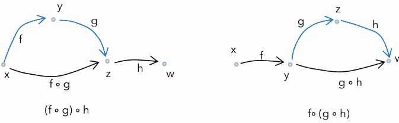

这意味着这两条路径：

```
Func<A, D> Path1<A, B, C, D>(Func<A, B> f, Func<B, C> g, Func<C, D> h) =>
    Compose(Compose(f, g), h);
```

```
Func<A, D> Path2<A, B, C, D>(Func<A, B> f, Func<B, C> g, Func<C, D> h) =>
    Compose(f, Compose(g, h));
```

将对所有输入都相等（遗憾的是，我们无法在类型系统中表达**全称**量化）。此外，`A Id<A>(A x) => x` 是函数组合 `∘` 的单位元：

**(f ∘ id) = f**

或者在代码中：

```
Func<A, B> Refl<A, B>(Func<A, B> f) => Compose<A, B, B>(f, Id<B>);
```

这将在 **f** 的所有输入上与函数 **f** 等价。这样，组合就在 `Func<,>` 上构成了一个幺半群 `(x => x, ∘)`。

### 附注：

由于组合的幺半群性质，我们可以通过不断应用组合，将只接受两个函数的定义扩展到任意数量的函数。例如，对于四个函数，可以是 `compose(h)(compose(g)(compose(g)(k)))`，前提是它们的类型合适。

### 2.5 组合幺半群

幺半群也可以通过多种方式组合，产生更多的幺半群。在本节中，我们将看到三个这样的组合示例。我们的第一个幺半群组合是由具有相同类型签名的函数形成的：

(A→B) ⊗ (A→B) → (A→B)

[注意：这不同于函数组合，函数组合的运算是 (A→B) o (B→C) → (A→C)]

让我以实际方式说明这个幺半群是如何产生的。例如，假设我们有一个折扣函数 `(double price) => 0.1 * price`，该函数的类型是 `double → double`，我们可以定义一个高阶函数 `ComposeDiscounts`，它组合两个这种类型的函数：

```
Func<double, double> basicDiscount = (double price) => 0.1 * price;
Func<double, double> repeatCustomerDiscount = (double price) => 0.2 * price;
```

```
Func<double, double> ComposeDiscounts(Func<double, double> firstDiscount,
    Func<double, double> secondDiscount) =>
    (double price) => firstDiscount(price) + secondDiscount(price);
```

double 上的幺半群

这样，通过使用 double 类型上的 + 幺半群运算，我们创建了一个函数 `ComposeDiscounts`，它是在 `Func<double, double>` 上的幺半群。

```
Func<double, double> GetFinalPrice(Func<double, double> discount) =>
    (double price) => price - discount(price);
```

```
var basicAndRepeatedDiscount = ComposeDiscounts(basicDiscount, repeatCustomerDiscount);
```

```
var finalPrice = GetFinalPrice(basicAndRepeatedDiscount)(100);
```

### 这种组合的机制非常容易理解：

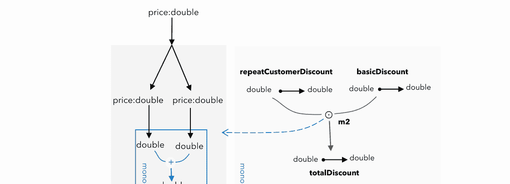

- 1. 我们将输入价格传递给两个 `Func<double, double>`，得到结果，
- 2. 然后使用 + 得到一个单一的 double。

我们可以证明，当 B 具有幺半群 ⊗ 时，我们可以从函数 (A→B) `Func<A, B>` 创建一个幺半群 ⊙。


我们可以通过同时应用 f 和 g，然后将它们的 B 结果粘合起来，创建一个新的 A→B。

这个想法是著名的“四人组”设计模式中的 Composite（组合）和 Decorator（装饰器）[以及解释器] 设计模式的核心。

立即可以看到，如果我们有一个折扣列表（`Func<double, double>`），我们可以使用 `ComposeDiscounts` 将它们折叠成一个单一的折扣委托：

```
Func<double, double> ComposeAll(List<Func<double, double>> @discounts) =>
    @discounts.Aggregate(
        (x) => 0,
        (totalDiscount, current) => ComposeDiscounts(totalDiscount, current)
    );
```

折扣上的幺半群

首先，让我们用完整的面向对象语法重写上述内容：

```
public interface IDiscount {
    double GetDiscountedAmount(double price);
}
```

```
public class BasicDiscount : IDiscount
{
    private readonly double discount;
    public BasicDiscount(double discount) => this.discount = discount;
    public double GetDiscountedAmount(double price) => discount * price;
}
```

```
public class ComposeDiscounts : IDiscount
{
    private readonly IDiscount firstDiscount;
    private readonly IDiscount secondDiscount;

    public ComposeDiscounts(
        IDiscount firstDiscount,
        IDiscount secondDiscount)
    {
        this.firstDiscount = firstDiscount;
        this.secondDiscount = secondDiscount;
    }
    public double GetDiscountedAmount(double price) =>
        firstDiscount.GetDiscountedAmount(price) +
        secondDiscount.GetDiscountedAmount(price);
}
```

折扣上的幺半群

这里的 `GetDiscountedAmount` 相当于匿名的 `Func<double, double>`。

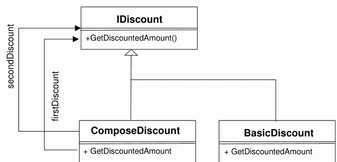

### 2.6 组合设计模式——函数式视角

以下是组合设计模式的一个实现，它推广了组合折扣模型。这很容易通过创建一个包含 `List<IDiscount>` 折扣列表的新子类来完成：

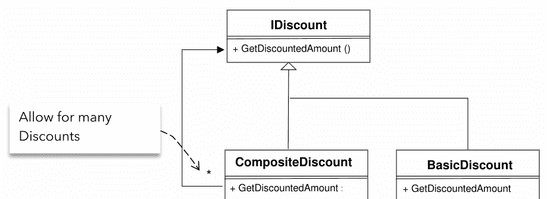

```
class CompositeDiscount : IDiscount
{
    List<IDiscount> discounts { get; set; } = new List<IDiscount>();

    public CompositeDiscount AddDiscount(IDiscount discount)
    {
        discounts.Add(discount);
        return this;
    }
}
```

```
public double GetDiscountedAmount(double price)
{
    return discounts.Aggregate(
        seed: 0.0,
        func: (sum, discount) => sum + discount.GetDiscountedAmount(price)
    );
}
```

组合折扣在 `GetDiscountedAmount` 中使用了幺半群的组合。

正如你在下图中看到的，使用折叠，当 B 具有可折叠的幺半群时，你可以将任意数量（列表）的相同类型 A→B（例如 `GetDiscountedAmount`）的函数转换为单个函数 A→B（例如 `GetDiscountedAmount`）。

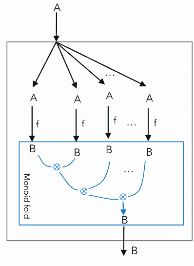

我们可以通过将相同的 A 应用于所有 f，然后粘合它们的 B 结果，创建一个新的 A→B。

### 2.7 装饰器设计模式——函数式视角

函数组合是许多面向对象最佳实践的核心。这里我们将看到装饰器设计模式的一个惯用表达，它是“四人组”集合中最常用的面向对象设计模式之一。

让我们从一个简单的例子开始：我们有一个 `ProductA`，可以用 `Packaging` 来装饰它。添加包装会影响价格，但我们希望在代码中可互换地处理产品和包装后的产品。装饰器模式允许我们通过将 `ProductA` 和 `Packaging` 统一在共同的 `IPriced` 接口下做到这一点：

```
public interface IPriced {
  double GetPrice();
}
```

```
public class ProductA : IPriced {
  public double GetPrice() => 100;
}
```

```
public class Packaging : IPriced
{
  private readonly IPriced product;
  public Packaging(IPriced product) => this.product = product;
  public double GetPrice() => product.GetPrice() + 10;
}
```

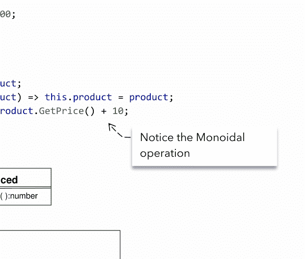

装饰器模式基于这样的思想/主题：装饰器与被装饰对象暴露相同的接口。

在这个例子中，`Packaging` 与被装饰的 `Product` 暴露了相同的 `GetPrice()` 方法。这使得应用程序的其余部分可以以相同的方式处理简单产品或装饰后的产品，无需了解更多细节即可获取价格[这是面向对象编程中信息隐藏/封装的一个很好的体现，因为被装饰对象对外部世界隐藏了实现细节，只显示价格]。

从函数式视角来看，这同样是因为 `GetPrice` 函数的返回类型上的 + 幺半群而成为可能。

最后，我们可以完全去掉所有对象语法，只保留函数。


```csharp
Func<double> ProductA = () => 100;
Func<double> ProductB = () => 200;
Func<Func<double>, Func<double>> Packaging =
    (product) => () => product() + 10;

Func<double> packagedProduct = Packaging(ProductA);
```

因此，从某种意义上说，任何形如 `(T a) => (R b) => {}` 的函数，都等价于这样一个对象：构造函数接收一个 `a: T`，并且只有一个接受 `b: R` 作为参数的方法。

仅使用函数：`(Func<double> product) => () => {...}`
面向对象：`class Packaging { constructor(IPriced product) {...} double getPrice() {...} }`

这里的思路是，让那些在返回类型为 `Product` 的被装饰函数之后出现的装饰组合函数也能采用同样的形式。

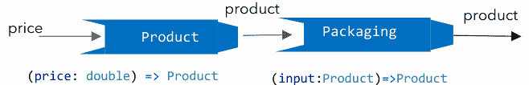

### 元组记法

表示该对象的另一种方式是使用元组。不幸的是，C# 不允许只有单个成员的元组。因此，为了演示，我们给 product 添加另一个返回名称的方法 `getName: () => name`。现在我们可以用一个充当构造器的函数来定义 product：

```csharp
Func<string, double, (Func<string> getName, Func<double> getPrice)> Product =
    (string name, double price) =>
        (getName: () => name, getPrice: () => price);
```

我们可以用这个来创建产品：

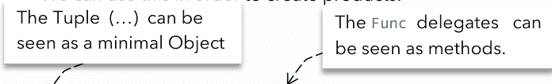

```csharp
(Func<string> getName, Func<double> getPrice) ProductA = Product("A", 100);
(Func<string> getName, Func<double> getPrice) ProductB = Product("B", 200);
```

现在我们可以如下定义装饰器函数：

```csharp
Func<(Func<string> getName, Func<double> getPrice),
    (Func<string> getName, Func<double> getPrice)>
    Packaging =
    product =>
    (
        getName: () => product.getName() + "Packaging",
        getPrice: () => product.getPrice() + 0.1
    );
```

然后我们可以这样使用它：

```csharp
(Func<string> getName, Func<double> getPrice) packagedProduct = Packaging(ProductA);
```

```csharp
(Func<string> getName, Func<double> getPrice) doublePackagedProduct = Packaging(Packaging(ProductA));
```

显然，这里“元组作为对象”的最小语法仅用于演示。在 C# 9.0 中，加入了不可变记录类型，以覆盖我们希望遵循更简约的函数式编码风格的情况。

### 2.8 谓词幺半群组合

最著名的逆变函数类型是谓词（Predicate），即任何类型为 `_ → bool`（返回布尔值）的函数。我们已经看到 .NET 提供了原生的 Predicate 委托：

```csharp
public delegate bool Predicate<in T>(T obj);
```

在实践中，我们通常使用委托 `Func<T, bool>` 来表示谓词。.NET 框架内部也大多使用 `Func<T, bool>` 作为谓词类型。例如，.NET 框架中 `List<T>.Where` 的定义具有以下签名：

```csharp
IEnumerable<TSource> Where<TSource>(this IEnumerable<TSource> source, Func<TSource, bool> predicate)
```

#### 范畴论：逆变类型

这类类型被称为逆变类型，是因为它们将“变化的（类型）”放在“函数的负侧（即输入侧）”。输入参数是可变的 `(T x) → bool`。当我们这里说输入参数可变时，指的是输入参数的类型是泛型的（输入参数具有参数多态性），而返回类型则固定为 `bool`。

要理解为什么它是逆变的，可以尝试将一个函数 `T → R` 与一个谓词 `(R a) => bool` 组合，得到一个谓词 `(T a) => bool`。唯一可行的组合方式是将 `T → R` 预先复合到 `(R a) => bool` 之前，从而得到 `(T a) => bool`。

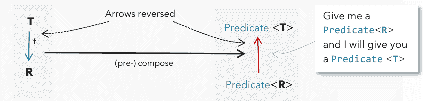

这在视觉上看起来像这样：

`T → R ∘ R → ● ⇔ T → ●`

其中 `●` 在我们的例子中就是 `bool`。

通过这种方式，对于谓词，我们可以定义一个 PreCompose（预复合）函数：

```csharp
Predicate<R> PreCompose<T, R>(Func<R, T> f, Predicate<T> g) => (R x) => g(f(x));
```

当你看到下面这个简单示例时，整个逆变预复合就变得一目了然了：我们对 Price 有一个 `Predicate<double>`，并希望使用一个用于 Price 的投影 GetPrice 来产生一个作用于 Product 的 `Predicate<Product>`：

```csharp
Predicate<double> IsHighPriced = (price) => price > 100;
```

```csharp
Func<Product, double> GetPrice = (product) => product.Price;
```

```csharp
Predicate<Product> IsHighPricedProduct = PreCompose(GetPrice, IsHighPriced);
```

这是组合像 Predicate 这样的逆变类型的一种方式。

另一种方式是幺半群组合。利用 bool 上的幺半群运算 `&&`、`||`、`~`，我们可以定义多种组合 `And`、`Or` 和 `Not`，从而能够从更简单的谓词构造出更大的谓词。

规范模式（Specification pattern）就是基于这一思想，其定义如下：

```csharp
Func<T, bool> And<T>(Func<T, bool> p1, Func<T, bool> p2) => (T x) => p1(x) && p2(x);
```

```csharp
Func<T, bool> Or<T>(Func<T, bool> p1, Func<T, bool> p2) => (T x) => p1(x) || p2(x);
```

```csharp
Func<T, bool> Not<T>(Func<T, bool> p1) => (T x) => !p1(x);
```

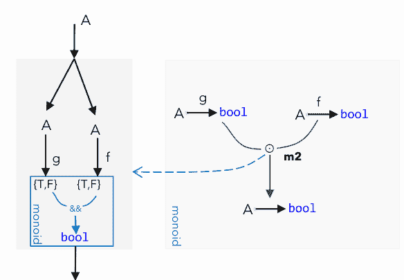

我们可以同时应用两个谓词，然后将它们的布尔结果粘合在一起，从而创建出新的谓词。

然后我们可以在产品上使用一些基本的谓词：

```csharp
Func<string, Func<Product, bool>> nameContains = pattern => product =>
    product.Name.Contains(pattern);
```

```csharp
Func<Product, bool> highPriced = product => product.Price > 1000;
```

接着我们可以使用 `And`、`Or` 和 `Not` 将它们组合成更复杂的谓词，例如：

```csharp
Func<Product, bool> highPricedAndContainsA = And(highPriced, nameContains("A"));
```

我们可以将这些谓词与数组的 filter 方法一起使用：

```csharp
var products = new List<Product>{
    new Product("widgetA", 100),
    new Product("widgetB", 1100),
    new Product("widgetA", 2000),
    new Product("widgetB", 300)
};
```

```csharp
var notHighPricedAndContainsA = Not(highPricedAndContainsA);
```

```csharp
var filteredProducts = products.Where(notHighPricedAndContainsA);
```

运行此示例：.NET Fiddle

或者尝试用以下谓词过滤该 List：

```csharp
var filter = Or(highPriced, nameContains("B"));
```

```csharp
var filter = Not(Or(highPriced, nameContains("B")));
```

我们还可以通过提供静态扩展来进一步简化语法，以实现流畅（fluent）的组合：

```csharp
public static partial class FunctionalExt
{
    public static Func<T, bool> And<T>(this Func<T, bool> @this, Func<T, bool> p) =>
        (T x) => @this(x) && p(x);

    public static Func<T, bool> Not<T>(this Func<T, bool> @this) =>
        (T x) => !@this(x);
}
```

现在我们可以这样写：

```csharp
Func<Product, bool> notHighPricedAndContainsA = highPriced.And(nameContains("A")).Not();
```

### 2.9 规范模式——函数式视角

我们可以将这些机制提取为一个流畅的构造过程，从而创建谓词表达式。这就是非常著名的规范模式。规范模式常常引起褒贬不一的反应，甚至被许多人视为反模式。尽管如此，它仍是 Eric Evans 所设想的领域驱动设计战术模式的一部分。

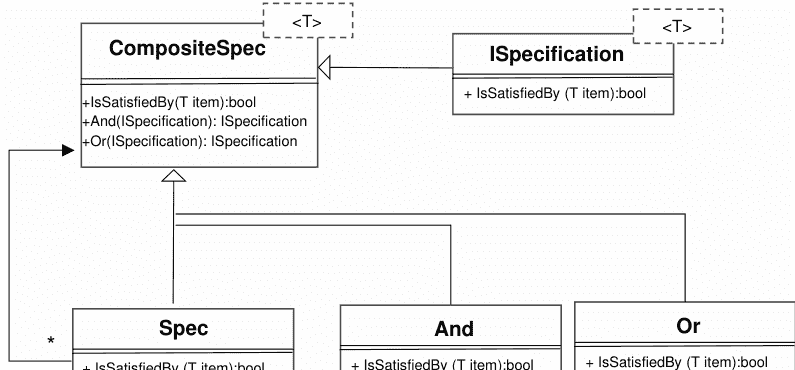

规范模式的基本思想，就是我们之前看到的在布尔幺半群上对谓词进行组合。其主要面向对象的增强之处，是添加了一个流畅的构建器，允许我们链式编写如下表达式：

```csharp
var spec1 = new Spec(nameContains("A")).And(highPriced);
```

而不是“函数式”的写法：

```csharp
And(highPriced, nameContains("A"))
```

其核心是 `CompositeSpecification`，所有其他表达式都继承自它：

```csharp
public interface ISpecification<T> {
    bool IsSatisfiedBy(T item);
}
```

// 为了给 And、Or、Not 添加流畅构建器语义

```csharp
public abstract class CompositeSpecification<T> : ISpecification<T>
{
    public CompositeSpecification<T> And(ISpecification<T> spec) =>
        new And<T>(this, spec);
    public CompositeSpecification<T> Or(ISpecification<T> spec) =>
        new Or<T>(this, spec);
    public CompositeSpecification<T> Not() =>
        new Not<T>(this);
    public abstract bool IsSatisfiedBy(T item);
}
```

这里我们将会有一个基类 `Spec<T>`：

```csharp
public class Spec<T> : CompositeSpecification<T>
{
    private Func<T, bool> expression;
    public Spec(Func<T, bool> expression) => this.expression = expression;
    public override bool IsSatisfiedBy(T item) => expression(item);
}
```

看一下 `And<T>`：

```csharp
public class And<T> : CompositeSpecification<T>
{
    private ISpecification<T> left;
    private ISpecification<T> right;
    public And(ISpecification<T> left, ISpecification<T> right)
    {
        this.left = left;
        this.right = right;
    }
    public override bool IsSatisfiedBy(T item) =>
        left.IsSatisfiedBy(item) && right.IsSatisfiedBy(item);
}
```

> CompositeSpecification 提供了一个流畅的接口。

运行此示例：.NET Fiddle


### 单子同态

范畴论

单子同态是一种美妙的事物，也是一个深刻的概念，它可以在数学、逻辑和编程中随处找到。它捕捉了当我们将某物从一个单子结构映射到另一个单子结构时保持结构不变的想法。词 homomorphism 来自古希腊语：ὁμός (homos)意为“相同”，μορφή (morphe)意为“形式”或“形状”。

两个单子 (⊗, M) 和 (⊙, N) 之间的单子同态，是一个函数：

φ: M → N

满足：

φ(a₁ ⊗ a₂)=φ(a₁) ⊙ φ(a₂)

φ(1ₘ)=1ₙ

其中 1ₘ 和 1ₙ 是 N 和 M 的单位元 aka 我们的单子空值。

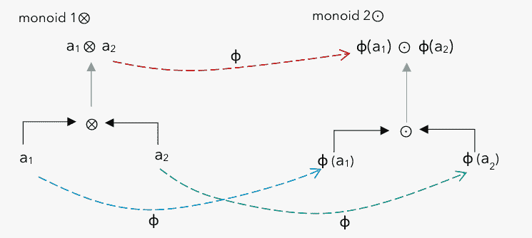

这意味着如果我们将 a₁ ,a₂ 和 a₁ ⊗ a₂ 映射到 φ(a₁), φ(a₂) 和 φ(a₁ ⊗ a₂)，那么用第二个单子 ⊙ 的 φ(a₁) ⊙ φ(a₂) 乘法应该恰好等于 φ(a₁ ⊗ a₂)。结构应该被保持。

另外 φ 将 M 单子的单位元 1ₘ 映射到 N 单子的单位元。

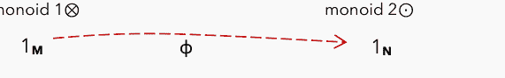

让我们再看一个例子：

```
("monoid" + "homomorphism ").Length == ("monoid".Length + "homomorphism ".Length);
```

或者这个：

```
var totalSum = array => array.Aggregate( 0 , (a, b) => a + b)
```

```
totalSum([1, 2, 3, 4].concat([7, 8])) === totalSum([1, 2, 3, 4]) + totalSum([7, 8])
```

其中 totalSum 函数是和单子 (θ, (x, y) => x + y) 和数组单子上的同态。这一切的要点是我们可以通过将列表拆分为更小的块并独立处理它们来并行化。这就是著名的模式 mapReduce 背后的思想

如果我们有一个大列表，我们可以将其切片并对每个块应用一个函数，然后对每个切片进行折叠，然后对块的结果进行折叠。

```
var biglist = Enumerable.Range(1, 1000000);
```

```
Func<IEnumerable<int>, Func<int, IEnumerable<IEnumerable<int>>>> slice = list => size =>
{
  var accumulation = new List<IEnumerable<int>>();
  for (int i = 0; i < list.Count(); i += size)
    accumulation.Add(list.Skip(i).Take(size));
  return accumulation;
};
```

```
var mapReduce = list => monoid => map =>
list.Select(chunk =>
  chunk.Select(Convert.ToDecimal).Select(map).Aggregate(monoid.Empty, monoid.Concat)
).Aggregate(monoid.Empty, monoid.Concat);
```

```
var chunks = slice(bigList)(10000);
var sum = mapReduce(chunks)(new SumDecimal())(x => x + 1);
```

当然 C# 已经在 TPL(Task Parallel Library) 和 LINQ 的 PLINQ 扩展中嵌入了一定程度的并行性。本节的重点是为什么单子与并行性相关。

map reduce 模式的理论支持来自 Richard Bird 和 Lambert Meertens 的工作，他们提出了 Bird-Meertens 形式主义和专门针对列表的同态引理，该引理指出列表上的函数 h 是列表同态：

```
h([])=e
h(a.concat(b))=h(a) • h(b)
```

当且仅当存在函数 f 和运算 • 时，以下成立

```
h = reduce(•) • map(f)
```

reduce (•) 这里表示运算 (e1•(e2•(e3 • e4))) 对列表中的元素进行折叠。如果存在同态，它应该能够分解为 map 后跟 reduce。

列表中的同态意味着并行性。让我们再看一个例子。

在大型文档中计数单词也是可以并行完成的事情。

- 1. 我们可以将文档拆分为块并
- 2. 然后在每个块中计数单词并将它们添加到字典中。
- 3. 然后我们可以合并字典，因为它们形成了一个单子

这里的单子是字典作为 Dictionary。我们可以证明如果我们有一个 IDictionary<TKey, TValue>，其键类型为 TKey，值类型为 TValue，并且 TValue 是一个单子，那么我们可以创建一个 IDictionary 单子：

```
var dictionary1 = new Dictionary<string, int> {
  { "or", 2 },
  { "and", 3 },
  { "the", 4 }
};

var dictionary2 = new Dictionary<string, int> {
  { "or", 1 },
  { "and", 5 },
  { "jim", 1 },
  { "his", 1 }
};
```

```
var merged = new DictionaryMonoid<string, int>(new Sum()).Concat(dictionary1, dictionary2);
```

```
public class DictionaryMonoid<TKey, TValue> : IMonoid<IDictionary<TKey, TValue>>
{
	private IMonoid<TValue> ValueMonoid { get; }
	public DictionaryMonoid(IMonoid<TValue> monoid) => ValueMonoid = monoid;
	public IDictionary<TKey, TValue> Empty => new Dictionary<TKey, TValue>();
}

public IDictionary<TKey, TValue> Concat(IDictionary<TKey, TValue> x, IDictionary<TKey, TValue> y)
{
	var merge = y.ToDictionary(entry => entry.Key, entry => entry.Value);
	foreach (var keyValue in x)
		if (merge.ContainsKey(keyValue.Key))
			merge[keyValue.Key] = ValueMonoid.Concat(merge[keyValue.Key], keyValue.Value);
		else
			merge[keyValue.Key] = keyValue.Value;
	return merge;
}
```

```
}
}
public class Sum : IMonoid<int>
{
    public int Concat(int x, int y) => x + y;
    public int Empty => 0;
}
```

Run This: Fiddle

这个想法意味着我们**可以并行化词计数问题，只是因为我们能够识别出一个单子。**

本页故意留空。

## 3 代数数据类型

> “在讨论单子时，列表经常出现，
> 这并非偶然：列表是“最基本”的单子实例。”
> Monoids: Theme and Variations (Functional Pearl)

许多最受欢迎的数据结构，如列表，有这样的定义：

> “一个列表是**要么**一个**空列表**要么一个**元素**和一个**列表**的**连接**。”

在上面的句子中，如果我们用 a 替换元素，用 + 替换要么，用 * 替换连接，我们就得到了列表的代数定义：

**List (a)** = [ ] + **a** * **List(a)**

这个定义是递归的，因为项 List 在定义的两边都出现了。在 C# 中，这可以翻译成如下形式：

```
public abstract class ListBase<T> { }

public class Cons<T> : ListBase<T> {
    public ListBase<T> Rest { get; set; }
    public T Value { get; set; }

    public Cons(T value, ListBase<T> rest)
    {
        this.Value = value;
        this.Rest = rest;
    }
}

public class Empty<T> : ListBase<T> { }
```

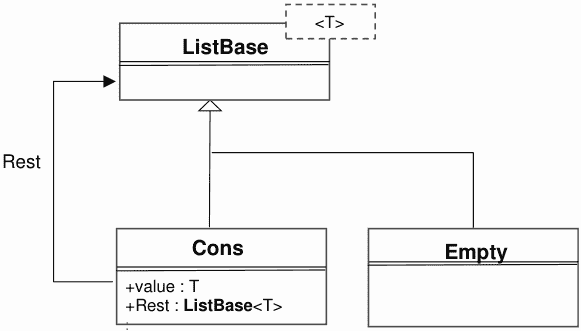

```
var list = new Cons<int>(value: 2,
    rest: new Cons<int>(value: 5,
        rest: new Empty<int>()));
```

这个定义是列表的基础定义。此外，由于其重要性，我们经常会使用这种简单的代数形式来展示许多函数式思想。

从实际角度来看，给出递归定义意味着我们可以通过在它们之间应用某些操作，从更简单的对象中逐步组合出更复杂的实体。以下三种组合结构的方式在编程中最为普遍。

- 1. **积** [面向对象等价：**组合**]：在我们对列表的定义中，具有两个属性的对象字面量是一个积
  `Cons(T value, ListBase<T> rest)`
- 2. **余积** [面向对象等价：**继承**]：在我们对列表的定义中，`Cons<T> : ListBase<T>`，和 `Empty<T> : ListBase<T>` 形成一个余积，通常称为联合类型。在面向对象术语中，简单的继承就是一种联合类型。
- 3. **递归类型** [面向对象等价：**包含同一类型或继承类型的对象的类型**]：在
  `Cons<T> : ListBase<T> {public ListBase<T> Rest { get; set; }}`
  中 Rest 是 ListBase<T> 类型，这意味着我们有一个递归定义。

由于数据类型可以通过在它们之间应用某些操作来形成，因此它们被称为**代数**。**代数数据类型**是一种复合类型。

现在，如果我们在任何语言或编程范式中定义这三个操作，我们就可以按照代数定义“一个列表是**要么**一个**空列表**要么一个**元素**和一个**列表**的**连接**。”来定义一个列表。如果有人告诉我们如何在 Java 或 python 或 Elm 中形成积、余积和递归类型，我们就可以立即编写列表的定义，而无需成为该语言的专家。


我们可以使用 C# 中可用的语法以多种方式形成乘积，以下是乘积或由两个对象形成的 arity-2（arity 是项目的数量），但可以有任意大小的乘积

```
(int A, int B) product = (A: 10, B: 20); //tuples are products.
```

```
public class Product
{
    public int A { get; set; }
    public int B { get; set; }
}
//objects are products.
```

```
var product = new List<int> { 10, 20 }; //a list can be seen as a product.
```

所有这些都是同构的，包含完全相同的信息，我们可以构造函数将一个转换为另一个。

这就是为什么我们可以例如用元组或对象替换方法上的参数列表。以下所有都是等价的：

```
public static void GetDiscount(int A, int B) { }
public static void GetDiscount((int A, int B) product) { }
public static void GetDiscount(Product product) { }
```

这种转换通常称为引入参数对象重构移动。它基于这样一个事实：两者 (,,,) 和元组 ((,,)) 都是乘积。为了将某物视为乘积，最重要的定律是我们必须能够编写两个函数，它们将接受一个乘积并给出我们组件部分。这些函数称为投影。

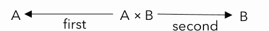

例如，对于乘积的数组定义 [, ]，投影将是：

```
var product = new List<int> { 10, 20 };
Func<List<int>, int> first = p => p[0];
Func<List<int>, int> second = p => p[1];
```

对于乘积的元组 (int A, int B) 定义，投影将是：

```
(int A, int B) product = (A: 10, B: 20);
```

```
Func<(int A, int B), int> first = p => p.A;
Func<(int A, int B), int> second = p => p.B;
```

### 3.2 可选的一个

如果我们定义了 + 和 • 也许，我们可以定义一个 1 项，它将与我们通常的代数规则 a•1 = a 一致，对于 C# 数组，如果我们假设 • 是 Concat 操作，那么 1 应该是 [] 以便保持 a.Concat([]) = a 。项 1 被称为范畴的终对象。

**终对象**：终对象是范畴中从任何对象到它只有一个且唯一一个态射的对象。

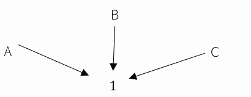

在列表的范畴中，终对象可以是空列表 [ ]，因为我们可以从任何其他列表得到一个函数到空列表，如果我们丢弃所有元素。然而，我们不能在没有任何特设特定说明的情况下对任何其他列表有一个单一的函数。这不是一个很有趣的想法，但它展示了代数在不同领域之间的一致性。例如对于列表的代数定义，我们有

x = 1 + a • x

我们可以将左侧的 x 用定义替换并得到：

x = 1 + a• ( 1 + a • x ) =1+a+a • a • x

如果我们继续这样做，我们得到：

x= 1 + a + a•a + a•a•a•x...

这说明一个列表可以是空的 1 = [] 或只有一个元素 [a] 或两个元素 [a, a] 或三个元素 [a ,a, a]，等等，这与列表的定义非常一致。此外，我们可以尝试这样求解：

x•(1- a) = 1 => x=1/(1- a)

然而，由于我们没有除法的定义，我们可以在 1/(1-x) 上使用泰勒展开，这展开为几何级数 1 + a + a²+ a³+a⁴+...

代数的一致性令人惊叹。

#### 3.2.1 带乘积类型的 Lambda 演算 可选

简单类型 lambda 演算 λ→ 的下一个有用扩展是添加乘积 _×_ λ→,×

##### 类型

λ→ 中唯一的只是基类型集合 B 和通过以下简单 BNF 形式语法产生的所有其他内容：

τ ::= τ→τ | τ×τ | T where T ∈ B

(int × int) → int


(int→ bool) → (int × char)


C# 中的 (int × int) → int 是委托：

```
Func<(int, int), int> f = ((int, int) a) => default(int);
```

或者在 lambda 记法中现在我们可以有变量为乘积类型的 lambdas

λx:(int× int).B: (int× int)→int

而第二个 (int→ bool) → (int × char) 将是：

```
Func<Func<int, bool>, (int a, char b)> g = (Func<int, bool> a) =>
    (a: default(int), b: default(char);
```

此外，我们必须将 Func<(int,int), int> 和 Func<int, int, int> 视为等价，因为我们可以找到两个路径将一个转换为另一个：

```
Func<A, B, C> Path1(Func<(A, B), C> f) => (A x, B y) => f((x, y));
```

```
Func<(A, B), C> Path2(Func<A, B, C> f) => ((A, B) p) => f(p.Item1, p.Item2);
```


出于这个原因，我们必须说这两种语法在 C# 类型系统中是等价的：

```
Func<(A, B), C> ≈ Func<A, B, C>
```

在 lambda 记法中，这两者是通过允许多参数 lambdas λ(x,y).B 以及单变量 lambdas 表示的，其中变量是乘积类型 λx:(A × B)：

```
Func<(A, B), C> λx:(A×B).B: (A × B)→C
```

```
Func<A, B, C> λ(x:A, y:B).B: (A × B)→C
```

##### 引入消除规则

对于乘积有一个单一的引入规则：


这只是一个构造函数，它接受一个 A 和一个 B 并返回一个 A× B

```
Func<A, B, (A, B)> Intro = (A x, B y) => (x, y);
```

消除规则是两个投影：


```
Func<(A, B), A> Pr1 = ((A, B) p) => p.Item1;
```

```
Func<(A, B), B> Pr2 = ((A, B) p) => p.Item2;
```

##### 计算规则

##### β-归约

乘积的 β-归约意味着如果我们有一个以规范形式存在的乘积并且我们投影第一个，我们应该得到第一个元素，同样对于第二个投影：

```
π1( (x, y) : A×B ) ≡ x:A ×β1
```

```
π2( (x, y) : A×B ) ≡ y:B ×β2
```

这说明来自 Gentzen 的，**消除是引入的后逆**规则：

π₁( (x, y): A×B ) ≡ x:A  ×β₁

如果我们有一对项并首先使用构造函数（即引入）得到一个 ( , ) 然后立即使用投影 π₁( · )（即消除，即析构）那么这些应该相互抵消并得到回原始元素，对于适当的消除。对于 C# 元组，这意味着我们可以提供如下构造：

```
A Beta1<A, B>(A x, B y) => (x, y).Item1;
```

```
B Beta2<A, B>(A x, B y) => (x, y).Item2;
```

并且理想情况下在其他一些设置中我们希望能够表达：

(x, y).Item1 ≡ x  for-all x

##### η-归约

```
var t = (1, 2);
```

```
var y = (t.Item1, t.Item2);
```

```
(A, B) Eta<A, B>((A, B) p) => (p.Item1, p.Item2);
```

A ∧ B / A ∧E₁   A ∧ B / B ∧E₂
---------------------- I∧
      A ∧ B

##### 递归子

> 而不是每次我们想要定义一个函数时都调用这个函数定义原理，一个替代方法是只在通用情况下调用一次，然后在所有其他情况下简单地应用 resulting 函数。也就是说，我们可以定义一个类型为的函数：

Homotopy Type Theory: Univalent Foundations of Mathematics

Recₐₓᵦ: (A→B→C) → A×B→C

这说明如果你给我一个函数 (A→B→C) 它接受一个 A 然后一个 B 并产生一个 C 那么如果你给我一个乘积类型 AxB 的东西我可以给你一个 C。这是反柯里化的定义。并且在 C# 中很容易实现：

```
Funcn<(A, B), C> Rec(Func<A, Func<B, C>> f) => ((A, B) p) => f(p.Item1)(p.Item2);
```

有了这个递归子，我们可以定义所有其他内容。例如，我们可以使用 Rec AxB 定义投影

```
Funcn<(A, B), A> Pr1<A, B> (Func<A, Func<B, A>> f) => Rec<A, B, A>(x => y => x);
```

```
Funcn<(A, B), B> Pr2<A, B> (Func<A, Func<B, B>> f) => Rec<A, B, B>(x => y => y);
```

我们将在实践中经常使用这个乘积递归子，以模式匹配包含组合的对象形式。

##### Curry-Howard 对应

乘积等价于逻辑 AND 或两个命题 A 和 B 的合取 A ∧ B。为了得出命题 A ∧ B 成立，我们必须知道 A 和 B 都为真。或者等价地，如果我们可以证明 A 并证明 B 那么我们可以证明 A ∧ B。这个规则通常在数理逻辑中命名为引入，因为它从先前的命题中引入合取 ∧。

> A / A∧B ^I

同样，为了创建一个类型 A 和类型 B 的乘积，我们必须在调用乘积的构造函数 var product = (x, y) => _ 时具有两种类型的实例。这种等价源于 Curry-Howard 同构，这可能是计算机程序和数学证明之间最深刻的联系。如果我们有一个 A ∧ B 那么我们可以推导出 A 或 B 中的任何一个。这称为合取消除。从 A ∧ B 以下成立

> A∧B / A ^E1

> A∧B / B ^E2

或命题 A ∧ B → A , A ∧ B → B 是重言式。

乘积“构造成本高”因为我们需要所有组件，但使用容易，因为通过投影（第一个、第二个...）取出任何组件都是有效的。


[x:A]¹ [y:B]²
(x,y): A × B   I_{x,y} ^

- 2. 我们还假设一个函数 f: A×B → C
- 3. 我们使用乘积来调用函数 f，得到 f(x,y)
- 4. 然后我们在 y:B 上引入一个 λ

```
(f(x,y)): C
λy: B. (f(x,y)): B → C
```

5. 紧接着在 x:A 上引入 λ，然后是 f

```
λy: B. (f(x,y)): B → C
λx: A. λy: B. (f(x,y)): (A → (B → C))
λf. λx: A. λy: B. (f(x,y)): ((A × B) → C) → (A → (B → C))
```

### 3.3 余积（又称并集）

> > “…如果你只学过传统编程语言，你之前可能从未听说过和类型（Sum types），因为这里存在一个巨大的盲区……”
> 
> — Robert Harper
> 
> 俄勒冈编程语言暑期学校

余积（或要么-要么和类型，或 +）是乘积的对偶结构。一族对象的余积本质上是“最不具体”的对象（用语言学的术语来说，是试图描述与其求和的所有对象相似之处的某种东西），该族中的每个对象都承认到它有一个态射。它是范畴论中范畴乘积的对偶概念，这意味着其定义与乘积相同，但所有箭头方向相反。

如果类型 S 可以是类型集合 {A, B} 中的任意一个，那么我们可以说 S 是 A、B 的和类型，或者 S = A+B。在强类型语言中，为了将 A 或 B 中的任意一个赋值给变量 S，A 和 B 必须是 S 的子类。如果我们反转图中的箭头，就可以从乘积的定义推导出余积的定义。


余积不是由投影定义的，而是由其**注入（inl 表示左注入，inr 表示右注入）**定义的。必须有两个函数提供到余积的包含。**在面向对象环境中，注入就是子类的构造函数。**

要创建余积，我们只需提供其所求和的类型中的**任意一个**，这与乘积不同——乘积需要**所有**类型才能调用构造函数。

如果我们稍微弯曲箭头，并将注入命名为子类型，这会看起来像一个有效的图，类似于余积的定义。


如果我们定义 <: 为子类型关系，即如果 A <: B，那么 **A 可以在 B 的位置使用，而不是 B**，那么 <: 就是一种有效的余积概念。用 C# 的术语来说，一个有效的子类型方案是 B<: A，如果 A = {x₁, x₂ , x₃ ,...,xₙ } 且 B= {x₁, x₂ , x₃ ,...,xₘ }，**其中顶级类的属性较少 n<m，而子类型对象属性较多。**

这种子类型定义通常被视为里氏替换原则，并因成为 SOLID 原则中的字母 L 而闻名。

另一种区分方式是给每个类型添加一个**标签**，但我们这里不打算这么做。C# 社区一直有这样的需求，尤其是在函数式编程逐渐普及、对模式匹配的呼声渐高之时。最终，C# 8.0 加入了模式匹配能力，使 C# 开发者在处理联合类型时能够编写更优雅的 C# 代码。

### 类型论
#### 里氏替换原则

Barbara Liskov 在 1994 年的一篇论文中对该原则的描述如下：

> «子类型要求：设 φ(x) 是关于类型 T 的对象 x 可证明的性质。那么对于类型 S 的对象 y，其中 S 是 T 的子类型，φ(y) 应该为真.»

该要求定义了我们之前看到的子类型关系 S<:ₗ T，这种关系可以称为行为子类型。

如果 φ(x) 其中 x: T，那么若 S<:ₗ T，则 φ(y) 对于所有 y: S 也应成立。

行为子类型是比类型论中定义的函数典型子类型更强的概念，后者仅依赖于参数类型的逆变性和返回类型的协变性。

#### 3.3.1 带余积类型的 Lambda 演算

我们还将通过添加联合类型 A + B 来扩展我们简单的类型系统。

##### 类型

所有可能的类型现在都由扩展语法生成：

```
τ ::= τ→τ | τ×τ | τ+τ | T 其中 T ∈ B
```

##### 引入/消去规则

在本节中，我们将使用继承作为联合类型的约定，因为这就是本书中使用联合类型的方式。

##### 引入

有两条引入规则：

x:A
inl(x) : A + B + I₁

y:B
inr(y) : A + B + I₂

为了在 C# 中模拟这些规则，我们将定义一个简单的层次结构。

```
public class AB { }
public class A : AB { }
public class B : AB { }
```

其中 AB 表现得像 A 和 B 的联合：A+B。在这个假设下，左注入（inl）是 A 的构造函数 new A()，右注入（inr）是 B 的构造函数 new B()：

```
Func<A, AB> Inl = (A x) => new A();
Func<B, AB> Inr = (B x) => new B();
```

##### 消去

+ 的消去规则稍微复杂一些。消去意味着我们必须间接找出联合类型 A+B 是用哪个类型实例化的。这种消去被称为 Case：

f : A → C    g : B → C    x : (A + B)
---------------------------------------- + E
Case(x, f, g) : C

使用 switch-case 的 C# 实现：

```
Func<AB, Func<A, C>, Func<B, C>, C> Case = (x, f, g) =>
{
    switch (x)
    {
        case A a: return f(a);
        case B b: return g(b);
        default: throw new Exception();
    };
};
```

运行此代码：.Net Fiddle

或者使用带 switch 的模式匹配：

```
Func<AB, Func<A, C>, Func<B, C>, C> Case = (x, f, g) =>
    x switch
    {
        A { } => f((A)x),
        B { } => g((B)x),
    };
```

##### 计算规则

如果在引入之后使用消去，它们应该相互抵消：

+E   +I

Case(Inl(x), f, g) ≡ f(x) : C   +β₁
Case(Inr(y), f, g) ≡ g(x) : C   +β₁

这意味着如果我们使用 Case：

- 1. 对左注入使用时，得到 f 作用于 x。
- 2. 对右注入使用时，得到 g 作用于 y。

在 C# 中使用上述引入/消去定义，我们得到两个 beta 归约：

```
Func<A, C> Beta1(Func<A, C> f, Func<B, C> g) => (A x) => Case(Inl(x), f, g);
Func<B, C> Beta2(Func<A, C> f, Func<B, C> g) => (B y) => Case(Inr(y), f, g);
```

##### 递归子

余积的递归子 Rec A+B 正是上面看到的 Case，因为 + 在其定义中已经是通用的。Case 或 Rec A+B 的类型为：

Rec A+B: (A→C)→(B→C)→A+B→C

我们将再次广泛使用 Rec A+B，以对层次结构进行模式匹配的形式。

##### 与面向对象多态的联系

在经典的面向对象编程中，我们不是给出两个函数 f: A→C 和 g: B→C，而是将它们以同名的基类方法重写形式嵌入到对象中：

```
public abstract class AB<C> {
    public abstract C F();
}
```

```
public class A<C> : AB<C> {
    public override C F() => default(C);
}
```

```
public class B<C> : AB<C> {
    public override C F() => default(C);
}
```

然后我们可以仅使用多态方法 F() 重写 Case：

```
Func<AB<C>/>/* Func<A, C>, Func<B, C>*/, C> Case = (/*f, g,* /x) =>
{
    switch (x)
    {
        case A<C> a: return a.F();
        case B<C> b: return b.F();
        default: throw new Exception();
    };
};
```

可选

##### Curry-Howard 对应

余积等价于逻辑上的 OR——即两个命题 A、B 的析取 A ∨ B。为了得出命题 A ∨ B 成立的结论，我们必须知道 A 或 B 中至少有一个为真。或者等价地说，如果我们能证明 A 或能证明 B，那么我们就可以证明 A ∨ B。这条规则通常被称为析取引入 ∨。

A
A ∨ B   或   B
A ∨ B

同样地，为了创建类型 A 和类型 B 的余积，我们必须拥有其中任意一个的实例。回到逻辑 OR——A ∨ B，如果我们有一个 A ∨ B，我们不能推导出 A 或 B 中的任何一个，因为我们无法知道最初注入到联合类型中的是哪一个。但我们可以通过第三种类型 C 间接地消去析取，方式如下：


或者用另一种记号：


这表示如果我们有一个从 A 得到 C 的证明（A→C）和一个从 B 得到 C 的证明（B→C），并且我们有 A 或 B 中的任意一个（A∨B），那么我们可以推导出 C。

### 3.4 扩展联合类型

在本书中，我们将看到一些在联合类型上添加行为的方法，但现在让我们先看看默认方式：使用多态。

正如我之前提到的，如果我们想给一个类型的联合添加新的属性/方法，我们必须在该联合可能包含的所有子类型中添加该属性/方法的变体。这就是使用默认多态来区分联合的各部分：

```
public class Cons<T> : ListBase<T>
{
    ...
    public override T Multiply() => Value * Rest.Multiply();
}
```

```
public class Empty<T> : ListBase<T>
{
    ...
    public override T Multiply() => 1;
}
```

这里我们在联合的两个部分都添加了 Multiply。


#### 3.4.2 使用 MatchWith 重写联合类型的 方法

把 MatchWith 想成一个通用定义，它允许我们在联合类型的所有分支中一次性编写必须添加的多态方法。

我们现在可以使用仅 MatchWith 在我们的 ListBase<T> 联合类型中编写任何方法定义。这里我使用扩展方法重写 Multiply：

```
public static T Multiply<T>(this ListBase<T> @this) =>
    @this.MatchWith(pattern: (
        Empty: () => 1,
        Cons: (value, rest) =>  value* rest.Multiply()
    ));
```

如果你不想使用扩展方法，可以将方法添加到基类中：

```
public abstract class ListBase<T>
{
    public T Multiply() =>
        this.MatchWith(pattern: (
            Empty: () => 1,
            Cons: (value, rest) => value* rest.Multiply()
        ));

    public abstract T1 MatchWith<T1>(
        (Func<T1> Empty, Func<T, ListBase<T>, T1> Cons) pattern);
}
```

我们将在本书中大量使用这种扩展联合类型的方式。

#### 3.4.3 C# 8.0 模式匹配特性

> -"function follows form."

在 C# 8.0 之后，我们可以在多态类型上原生进行 case 分析。我们现在可以跳过 MatchWith 的自定义实现，而改用 switch 语句：

```
public static T Multiply<T>(this ListBase<T> @this,
    (Func<T, T, T> concat, T empty) monoid) =>
    @this switch
    {
        Empty<T> { } => monoid.empty,
        Cons<T> { Value: var value, Rest: var rest } =>
            monoid.concat(value, rest.Multiply(monoid))
    };
```

运行此代码：.Net Fiddle

我们将在 Functors 示例中讨论更多关于 C# 8.0 模式匹配的内容。但立刻你可以看到，为了添加多态函数，你完全不需要修改你的类型。唯一的缺点是你必须将想要访问的属性公开为 public（或者你必须定义类型析构器来将类型分解为值）

#### 3.5 递归简介

> "Did you mean: recursion"
> -Google Search

> "Hofstadter's Law: It always takes longer than you expect, even when you take into account Hofstadter's Law."
> - Hofstadter's Law

**递归** 发生在事物以自身或其类型定义时。递归在人类思维、计算机科学以及尤其是函数式编程中的重要性是巨大的。我们将在全书中使用递归。因此，我不会进行入门解释。相反，我们将对 C# 类型系统中的递归进行轻度探索。在 C# 中给出递归定义最简单的方式是：

```
public T F<T>() => F<T>();
```

不出所料，如果你尝试调用函数 F()，你会得到一个堆栈溢出。因为它会产生无限的 ...F(F(F (...))) 调用序列。但我们现在不会运行任何东西，只是探索递归的形态。首先让我们添加一些输入参数。我们可以例如添加一个整数：

```
public T F<T>(int n) => F<T>(n);
```

它通过了类型检查，所以我们没问题。同样，我们可以添加任意多的泛型类型或函数，例如：

```
public T F<T, T1>(Func<T, T> f, Func<T, T1> g) => F(f, g);
```

我们对定义所做的任何更改都必须找到适当类型的东西来调用该函数。

让我们使用函数 f。唯一的要求是我们写的东西要通过类型检查。为了使用 f，我们需要通过提供一个 T 来调用它，而 F(f) 的类型是 T：

```
public T F<T>(Func<T, T> f) => f(F(f));
```

显然，你可以按你想要的次数使用 f：

```
public static T F<T>(Func<T, T> f) => f(f(f(F<T>(f))));
```

我们现在也可以添加一个 T1 参数。没有任何变化：

```
T F<T, T1>(Func<T, T> f, T1 n) => f(F(f, n));
```

现在让我们更改 f 的签名，使其也接受另一个类型为 T1 的参数

```
T F<T, T1>(Func<T, T1, T> f, T1 n) => f(F(f, n), n);
```

添加一个 T1 并使用 n 来调用 f

我们可以为 f 添加任意多的参数：

添加 3 个 T1 并使用 n 3 次。

```
T F<T, T1>(Func<T, T1, T1, T1, T> f, T1 n) => f(F(f, n), n, n, n);
```

运行此代码：.Net Fiddle

#### 柯里化版本

让我们仅为好玩看看递归函数的柯里化版本：

```
T F<T, T1>(Func<T, T1, T> f, T1 n) => f(F(f, n), n);
```

将此参数柯里化。

步骤如下：

+   1. 柯里化参数 (T1 n) =>
+   2. 将返回类型改为 Func<T1, T>
+   3. 将函数调用 F(f)(n) 更改

```
Func<T1, T> F<T, T1>(Func<T, T1, T> f) => (T1 n) => f(F(f)(n), n);
```

1. 柯里化了参数。

2.更改返回类型

3.更改函数调用

运行此代码：.Net Fiddle

为了最大程度的混淆，让我们也对 F 内部的函数 Func<T, T1, T> f 进行柯里化

```
Func<T1, T> F<T, T1>(Func<T, T1, T> f) => (T1 n) => f(F(f)(n), n);
```

让我们也对这个 f 进行柯里化。

步骤如下：

+   1. 将 f 类型 Func<T, T1, T> 改为柯里化版本：Func<T, Func<T1, T>>
+   2. 将函数调用 f(..., n) 改为：f(...)(n)

1. 柯里化参数。

```
Func<T1, T> F<T, T1>(Func<T, Func<T1, T>> f) => (T1 n) => f(F(f)(n))(n);
```

2.更改函数调用

#### 终止

当然，如果你决定调用这些递归函数，它们不会终止，你会得到通常的堆栈溢出异常。为了停止递归，我们应该有一些递减的计数器，以表示我们到达了终止状态。

我们可以用许多东西作为计数器。任何在每次递归调用中都可以剥离的递归数据结构都可以。例如，我们可以用数组 [ ] 或树作为计数器。这里我们将使用整数以便与下一节联系起来。

为了简单起见，让我们说 T1 类型是 int

```
T F<T>(Func<T, int, T> f, int n) => f(F(f, n), n);
```

我们可以通过检查 n 是否为 0（或其他常量）来停止递归

```
T F<T>(Func<T, int, T> f, int n) => n == 0 ? default(T) : f(F(f, n), n);
```

显然返回 default(T)（即 null）只是一种可能性，但我们可以抽象化它，通过添加另一个参数，我们必须在函数调用中传递：

```
T F<T>(Func<T, int, T> f, int n, T v) => n == 0 ? v : f(F(f, n, v), n);
```

为 T 添加一个默认值 V 参数

运行此代码：.Net Fiddle

这里如果我们将 _?_:_ 抽象为以下内容：

```
public static T1 MatchWith<T1>(
    this int @this,
    (Func<T1> Zero, Func<int, T1> Succ) pattern) =>
        (@this == 0) ?
        pattern.Zero() :
        pattern.Succ(@this - 1);
```

我们可以按如下方式重写函数 F：

```
T F<T>(Func<T, int, T> f, int n, T v) =>
    n.MatchWith(
        pattern: (
            Zero: () => v,
            Succ: (predecessor) => f(F(f, predecessor, v), predecessor)
        ));
```

运行此代码：.Net Fiddle

#### 使用列表作为计数器

我已经提到我们可以用数组作为计数器代替整数。这将确保递归通过在每次递归调用中传递初始数组越来越小的部分而终止。这将最终保证递归的终止。

将 int 改为 List<T>

```
T F<T>(Func<T, List<T>, T> f, List<T> n, T v) =>
    n.MatchWith((
        Empty: () => v,
        Cons: (current, rest) => f(F(f, rest, current), rest)
    ));
```

当
列表为空时终止。

#### 3.5.1 再次 Lambda 演算 - Gödel 的 System T 可选

Gödel 的 System T 是带积 λ→, × 的简单类型 λ-演算，其中添加了自然数 ℕ 的基本类型和自然数的递归子。

对于自然数，引入的类型规则很简单，我们有一个零 0，它属于自然数 ℕ，或者如果我们有一个属于自然数的项，那么它的后继也是自然数。

0 : ℕ
Zero — ℕ

n : ℕ
S(n) : ℕ
Succ — ℕ

而它只有一个消除规则，称为递归子 Rec

n : ℕ   a : A   c : A → ℕ → A
Rec(n, a, c) : A
Rec — ℕ

这里的递归子再次是经典的聚合折叠，a:A 是“种子”元素（或累加器），c: A → ℕ → A 是聚合函数，它接受之前的累加、计数器 n:ℕ 的当前状态并返回新的累加。

递归子的求值/β-归约/计算规则是对当前计数器的 case 分析：

Rec(0, a, c):A →β a:A   β-ℕ

Rec(n, a, c):A →β c(Rec(n-1), n):A

这正是 C# 递归函数：

```
public static A Rec<A>(int @num, A a, Func<A, int, A> c) =>
    num == 0 ?
        a :
        f(Rec(num - 1, acc, c), num - 1);
```

让我们重构它以便采用熟悉的形式。首先我们将在自然数的定义上添加自定义模式匹配（case 分析）：

```
public static T1 MatchWith<T1>(this int @this,
    (Func<T1> Zero, Func<int, T1> Succ) pattern) =>
        (@this == 0) ?
        pattern.Zero() :
        pattern.Succ(@this - 1);
```

这只是隐藏了 _?_:_ 操作。现在我们可以使用自定义模式匹配 MatchWith 函数重写上面的递归：

```
public static A Rec<A>(int @num, A a, Func<A, int, A> c) =>
    @num.MatchWith(pattern: (
        Zero: () => a,


```
Succ: (n) => c(Rec(n, a, c), n)
));
```

Run This: .Net Fiddle

The elimination Rule represents in System T the Schema of induction

The simplest form of mathematical induction infers that a statement C involving a natural number n holds for all values of n, by proving two cases:

+   1. The initial or base case: prove that the statement holds for 0. This means C(0) holds.
+   2. The induction step: prove that for every n, if the statement holds for n, then it holds for n + 1. C(n) → C(n + 1)

The logical formal abbreviation of the schema is:

C(0) ∧ ∀n. (C(n) → C(n+1)) → ∀n. C(n)

to understand the reasoning of why the above function represents the induction keep in mind that when we program we are working in Type theory. In this setting proving a term of Type A is inhabited (aka can be constructed) means that we proved in logic that a Statement C holds.

Let us dissect the above function Rec<A> using the Induction steps as comparative guideline:

+   1. The initial or base case: prove that the statement holds for 0, a:A that is the Zero: () => a case.
+   2. The induction step, inductive step: prove that for every n, if the statement holds for n, then it holds for n + 1. ∀n.(C(n) → C(n+1)) the type of this can be understood in the following way:
+   a. If you give me any n [that is ∀n which in type theory means a function that takes a n as input : n: ℕ ⇒...] in code: Succ: (n) =>
+   b. And then you give me something where the property C holds C(n):A ⇒ In code Rec(n, a, c).
+   c. I can construct the next C(n+1):A in code: c(Rec(n, a, c), n).
+   d. Stringing all this together we get : ℕ ⇒ A ⇒ A which is the A⇒ ℕ ⇒ A reordered. This is the type of the Func<A, int, A> c.

Finally, if we just attach this as an extension method on the integers we get a familiar method:

```
public static T Aggregate<T>(this int @this, T acc, Func<T, int, T> f) =>
    Rec(@this, acc, f);
```

Now we can write stuff like this:

```
var range = (5).Aggregate(new List<T>(), (acc, n) => (n, acc).AsList());
```

this starts with an empty list and then appends all the integers as the counter decreases. Let us run this computation step by step. Here i denote as * the operation of concatenating to the list:

```
Rec(5,[], *)        →        //we can apply.
[5, Rec(4,[], *)]   →
[5,4, Rec(3,[], *)] →        //we can
…                           //at some point we reach zero
[5,4,3,2,1, Rec(0,[], *)] →  //we reached the base case, and the recursion
stops.
[5,4,3,2,1,0]
```

Obviously, there is no reason to use (and should not use) the **Recursor**, since we can use a `for` loop. The intension of the section was to bring together the ideas of Gödel System T, mathematical induction, pattern matching and recursion.

### 3.6 Recursive Algebraic Types

The fact that our list is a recursive type means that when we try to construct a new method for our type, we must give an inductive definition (or recursive definition). So, let me create a map function that will apply a function f to all the values of the list:

```
public class Cons<T> : ListBase<T>
{

        public override ListBase<T1> Map<T1>(Func<T, T1> f) => { … }
}

public class Empty<T> : ListBase<T>
{
        public override ListBase<T1> Map<T1>(Func<T, T1> f) => { … }
}
```

Firstly, because it is a coproduct, we must define the **map** in **both subtypes of the coproduct**. We start with the `Empty`, which the easiest. `Empty` is the base case of the _structural induction_. We know that the map must return something of the same type, so we will return a new `Empty` since there is nothing else that we could do with f.

```
public override ListBase<T1> Map<T1>(Func<T, T1> f) => new Empty<T1>();
```

we can represent that symbolically with **Map**(f, [ ]) = [ ]

Now, let us move to `Cons`. `Cons` is a product (Value, Rest) the Value is something concrete so we can apply the f directly and get the lifted value f(value). The second part Rest is a list, and the only thing we know is that it must have a **Map** function working as we

expect. This claim constitutes the inductive hypothesis, so we assume that `Rest.Map(f)` returns a lifted list for the `Rest`. We must finally return something of the same type, so we return a new `Cons`

```
ListBase<T1> Map<T1>(Func<T, T1> f) => new Cons<T1>(f(Value), Rest.Map(f))
```


we can represent that symbolically:

**Map**(f, [ v, rest]) = [ f(v), **Map**(f, rest) ]

Furthermore, that is the correct implementation-defined recursively.

```
public class Cons<T> : ListBase<T>
{
    public override ListBase<T1> Map<T1>(Func<T, T1> f) =>
        new Cons<T1>(f(Value), Rest.Map(f));
}

public class Empty<T> : ListBase<T>
{
    public override ListBase<T1> Map<T1>(Func<T, T1> f) => new Empty<T1>();
}

var list = new Cons<int>(value: 2,
                         rest: new Cons<int>(value: 5,
                                             rest: new Empty<int>()));

var list2 = list.Map(x=>x+2);
```

Run This: [.Net Fiddle](https://dotnetfiddle.net/)

### 3.7 Practical Structural Induction

> "Informal proofs are algorithms; formal proofs are code."
> -Logical Foundations

This section aims to convey the general idea behind Structural induction and how we can use it when we want to formulate methods from Recursive Algebraic Data structures.

Structural induction is used to prove that some proposition P(x) holds for all x of some sort of recursively defined structure, such as formulas, lists, or trees.


The structural induction generalizes the simple mathematical induction on Natural numbers, can be generalized within the context of Inductive types. Mathematicians are obsessed with the Natural numbers and it is of no surprise, that Gödel started with his System T Recusor from the Naturals. Nonetheless it soon became clear that from the point of view of Computer Science the Natural numbers is simple a recursive structure 0, S0, SS0..., which does not have any difference from other recursive structures like the lists and trees.

For the structural induction there is a generalized form of the induction that says : If x is a Type of a Recursive Type T and P(y) is true for all substructures y, then P(x) must also be true.

```
[∀x: T [∀y: T [ y <: x → P(y)] ] → P(x)
```

Structural induction is a more general version of the Mathematical induction on the naturals. The nice thing with programming is that you can actually test your "proof" immediately by seeing that the types "fit" using the type-checking of the compiler and also that some example cases have the expected result at runtime.

Let’s revisit the Custom List implementation seen above, from the point of view of structural induction.

#### Base Case:

For the tree structure the terminal element is the empty list [] represented by the Empty<T> sub-class. This is the smallest possible element Empty<T> <: List<T>

```
public class Empty<T> : ListBase<T>
{
    public override ListBase<T1> Map<T1>(Func<T, T1> f) => new Empty<T1>();
}
```

This is the minimum object we could build using Empty and Cons.

#### Inductive Hypothesis:

We want to “prove” Map<T1>(Func<T, T1> f) holds for Cons<T>. We do that unknowingly by providing a valid implementation for the method. Writing a program implementation is equivalent to a proof in mathematical logic, due to the Curry-Howard correspondence.

+   1. Assuming that we have, as a given that the this.Rest.Map(f) works correctly, and it’s of Type List<T1>
+   2. We want to give a valid implementation that respects the types for the following:

```
```csharp
public class Cons<T> : ListBase<T>
{
public override ListBase<T1> Map<T1>(Func<T, T1> f) => □<---
}
```
```

> We must fill this to fit the types.


+   1. Assuming Rest, provides a valid Map(f)
+   2. We should be able to construct the whole type

##### 3.7.1 Rewriting Map with MatchWith

And since we have a MatchWith method in place we can rewrite Map as an extension method:

```
```csharp
public static ListBase<T1> Map<T, T1>(this ListBase<T> @this, Func<T, T1> f) =>
@this.MatchWith<ListBase<T1>>((pattern: {
Empty: () => new Empty<T1>(),
Cons: (value, rest) => new Cons<T1>(f(value), rest.Map(f))
}));
```
```

Or using the switch:

```
```csharp
public static ListBase<T1> Map<T, T1>(this ListBase<T> @this, Func<T, T1> f) =>
@this switch
{
Empty<T> { } => new Empty<T1>(),
Cons<T> { Value: var value, Rest: var rest } =>
new Cons<T1>(f(value), rest.Map(f))
};
```
```

Run This .Net Fiddle


#### 3.7.2 关于符号表示的价值

> "In its most general form, algebra is the study of mathematical symbols and the rules for manipulating these symbols."
> -Wikipedia:Algebra

你可能想忽略符号表示，而专注于代码，或者你可以尝试通过归纳法写出自己的 map 方程。让我写一些我刚刚想到的更多 map 定义：

+   1. 这里我只是加了一个 → 符号来指向被映射的项，并且我用 * 乘法替换了 concat
+   
+   **map**(f) → ([ ]) = [ ]
+   
+   **map**(f) → ([value * rest]) = [ f(v) * **map**(f)→ (rest)]

+   2. 或者这个，我用下划线 (___)₍f₎ 替换了 fmap f 因为为什么不呢：
+   
+   ([ ])₍f₎ = [ ]
+   
+   ([value , rest])₍f₎ = [ f(v), ([ rest])₍f₎ ]

我们可以想出上百种不同的方式来表示同样的事物。在尝试弄清某些函数式概念背后的机制时，以图形-符号的方式思考对我非常有价值，我认为它也能帮助你。请花几分钟时间在纸上写下你自己的 list 的 map(f) 方程。将一个想法抽象成符号表示的能力使我们能够在范式之间移动，并更深入地理解其机制。

#### 3.7.3 为 List<T> 添加模式匹配扩展

我们现在将在 **原生 .net List<T> 类型上添加一个 MatchWith 扩展，以便能够使用递归定义：**

```
public static T1 MatchWith<T, T1>
    (this List<T> @this, (Func<T1> Empty, Func<T, List<T>, T1> Cons) pattern) =>
        (@this.Count == 0) ?
            pattern.Empty() :
            pattern.Cons(@this[0], @this.GetRange(1, @this.Count - 1));
```

这个定义将允许我们为 List<T> 类型使用模式匹配语法：

```
public static int Multiply(this List<int> @this) =>
    @this.MatchWith(
        pattern: (
            Empty: () => 1,
            Cons: (v, r) => v * r.Multiply()
        ));
```

在函数式语言中，通过简单地进行模式匹配来编写定义是很常见的。看一下 Haskell 的列表 map 定义：

```
map _ [] = []
map f (x:xs) = f x : map f xs
```

这是我们在递归代数类型小节中定义它的方式

```
Map (f, []) = []

Map (f, [v, rest]) = [f(v), Map (f, rest)]
```

如果我们能用 MatchWith 重写 map 使用模式匹配

```
public static List<T1> Map<T, T1>
    (this List<T> @this, Func<T,T1> f) => @this.MatchWith(
        pattern: (
            Empty: () => new List<T1> { },
            Cons: (v, r) => new List<T1> { f(v) }.Concat(r.Map(f))
        ));
```

当你开始用 MatchWith 对列表使用模式匹配重写代码时，会对函数式思维有所了解。我们来看看如何 zip 两个列表。在命令式风格中我们会有 for 循环

```
for (let index = 0; index < a1.Length; index++) {
    const element1 = a1[index];
    const element2 = a2[index];
```

```
zipped.Add(element1);
zipped.Add(element2)
}
```

在这种情况下我假设数组长度相同。如果不是这样，我们必须使用更多的 if (...) 语句。现在如果我们把数组看成 [x:xs] [y:ys] 的形式，这揭示了一个非常不同的视角。zip([x:xs],[y:ys]) = [x,y:zip(xs,ys)] 的一般情况

```
public static List<T> Zip<T>(this List<T> @this, List<T> @a2) =>
    @this.MatchWith(pattern: (
        Empty: () => @a2,
        Cons: (x, xs) =>
            @this.MatchWith(pattern: (
                Empty: () => xs,
                Cons: (y, ys) =>
                    new List<T> { x, y }.Concat(xs.Zip(ys))
            ))));

```

Run This: .Net Fiddle

### 3.8 重组列表

这是本章的结尾，对于本节的其余部分我们将看到 List 上的各种递归定义。所有的例子都有两个情况：

+   1. 空列表 [] 的基本情况
+   2. 以及一个递归情况，我们分解列表 [v, Rest]，使用列表的第一个元素 head v，然后对列表的其余部分 Rest 重复递归操作。

让我们先从一个简单的开始。我们将分解列表并重新组装它。我们符号化地定义一个函数 Rebuild，它只是重建列表而不修改它：

Rebuild ([ ]) = [ ]

Rebuild ([v, rest]) = [v, Rebuild (rest)]

一个实现是：

```
List<int> Rebuild(List<int> @list)
{
    return @list.MatchWith((
        Empty: () => new List<int> { },
        Cons: (v, rest) => (v, Rebuild(rest)).AsList()
    ));
}
```

Rebuild ([ ]) = [ ]

[v, Rebuild (rest)]

这里的 .AsList() 是一个自定义的类型扩展：

```
public static List<T> AsList<T>(this ValueTuple<T, List<T>> @this) =>
    @this.Item1.AsList().Concat(@this.Item2);
```

让我们做一个这个简单重写系统的“执行”示例，它有两个规则。让我们从初始状态 [1, 4,6] 开始，我们将依次应用规约。

Rebuild ([1,4,6]) →

[1, Rebuild ([4,6]) ] →

[1,4, Rebuild ([6]) ] →

... //在某个时刻我们清空列表

[1,4,6, Rebuild ([]) ] → //我们到达了基本情况，递归停止

[1,4,6]

正如你所看到的，我们所做的只是通过递归一次遍历一个元素，并使用列表幺半群 ([I],*) 来重建它。

使用 List<T> 上的 Aggregate Linq 方法

```
List<T> Rebuild<T>(List<T> @list) => list.Aggregate(
    new List<T> { },
    (acc, current) => (acc, current).AsList()
);
```

不幸的是，这会反转列表（即使你反转连接的顺序 (current, acc).AsList() 也会发生）。Aggregate 比递归弱，因为我们丢失了遍历顺序。Aggregate 对于我们想要将事物折叠成更少信息的情况很棒，例如将列表折叠成 bool 或整数。

### 3.9 传递更多参数

我们可以很简单地向递归函数传递更多参数。

```
List<int> Rebuild(List<int> @list, Func<int,int> f)
{
    return @list.MatchWith((
        Empty: () => new List<int> { },
        Cons: (v, rest) => (v, Rebuild(rest, f)).AsList()
    ));
}
```

声明一些 f

向下传递 f

符号上：

Rebuild ([ ], f) = [ ]

Rebuild ([v, rest], f) = [v, Rebuild (rest, f) ]

如果我们在每一步对子列表的头部使用它，我们就得到默认的 Map：

**Map** ([ ], f) = [ ]

**Map** ([v , rest], f) = [f(v), **Map** (rest, f) ]

### 3.10 返回更多项

以类似的方式我们可以修改 **Rebuild** 函数使其返回一个元组 (v, v * v) 将值与其平方配对

```
List<(int, int)> Squares(List<int> @list) =>
    @list.MatchWith((
        Empty: () => new List<(int, int)> { },
        Cons: (v, rest) => ((v, v * v), Squares(rest)).AsList()
    ));
```

符号上：

**Squares** ([ ]) = [ ]

**Squares** ([v , rest]) = [(v, v²), **Squares** (rest) ]

当然，我们也可以只用 **Map** 函数来做同样的事：

```
List<(int, int)> Squares(List<int> @list) => Map(@list, v => (v, v * v));
```

或直接使用 Select：

```
List<(int, int)> Squares(List<int> @list)=> @list.Select(v =>(v, v*v)).ToList();
```

### 3.11 过滤

这里我们将向递归函数添加另一个 Func<T, bool> @predicate 参数，我们将使用这个 @predicate 通过递归过滤数组。符号上，**Filter** 函数：

**Filter** ([ ], predicate) = [ ]

**Filter** ([v , rest], predicate) = if( predicate (v) )
    [v , **Filter** (rest , predicate) ]
else
    **Filter** (rest , predicate)

这说明：

+   1. 如果你有一个空数组就返回一个空数组。
+   2. 如果你有任何其他数组：
+      a. 检查数组的头部是否满足谓词，如果满足则保留头部并附加剩余的已过滤数组：
+         [v, Filter(rest, predicate)]
+      b. 如果不满足则只返回剩余的已过滤数组并丢弃该元素：
+         Filter(rest, predicate)

```
List<T> Filter<T>(List<T> @array, Func<T, bool> @predicate)
where T : IEquatable<T> =>
    @array.MatchWith(
        Empty: () => new List<T> { },
        Cons: (v, rest) => @predicate(v) ?
            Filter(rest, @predicate) :
            (v, Filter(rest, @predicate)).AsList()
    );
```

Run This: .Net Fiddle

### 3.12 在有序列表中插入项

在这种情况下，我们想在已经有序的列表上添加一个项，同时保持列表的顺序。

Insert([ ], s) = [ ]

Insert([v, rest], s) = if(v>s) [s, v, rest] else [v, Insert(rest, s)]

这说明：

+   1. 如果你有一个空数组就返回一个空数组。
+   2. 如果你有任何其他数组：
+      a. 检查数组的头部 v 是否大于要插入的元素 s，v>s，如果是则我们必须在前面加上该元素并结束递归 [s, v, rest]。
+      b. 否则如果数组的头部 v 小于要插入的元素 s，v<s 它必须在列表的其余部分中插入。

实现很直接：

```
List<T> InsertInOrdered<T>(List<T> @ordered, T @elementToInsert)
where T : IComparable<T> =>
@ordered.MatchWith((
```


### Peano numerals

```
public class Succ : Numeral
{
    public Numeral Rest { get; set; }
}
public class Zero : Numeral { }

var fourNumeral = new Succ(rest: new Succ(rest: new Succ(
    rest: new Succ(rest: new Zero()))));
```

### List

```
public class Cons<T> : ListBase<T>
{
    public ListBase<T> Rest { get; set; }
    public T Value { get; set; }
}

public class Empty<T> : ListBase<T> { }

var list = new Cons<int>(value: 2,
    rest: new Cons<int>(value: 5,
        rest: new Empty<int>()));
```

### Tree

```
public class Node<T> : Tree<T>
{
    public Tree<T> Left { get; set; }
    public T Value { get; set; }
    public Tree<T> Right { get; set; }
}

public class Leaf<T> : Tree<T>
{
    public T V { get; }
}

var tree = new Node<int>(
    new Node<int>(new Leaf<int>(1), 2, new Leaf<int>(3)),
    4,
    new Node<int>(new Leaf<int>(5), 6, new Leaf<int>(7)));
```

### Sidenote

这些代数数据结构可以变得越来越复杂，但始终都有一个终止条件，由 `Zero`、`Empty`、`Leaf` 等表示。另一方面，还有所谓的余归纳或余递归数据结构，它们是双重构造，通常是无限的。

### Functors

> “It should be observed first that the whole concept of a category is essentially an auxiliary one; our basic concepts are essentially those of a functor and of a natural transformation.”
>
> S. Eilenberg and S. MacLane

### The Idea

在 C# 中，最著名的函数式编程思想是使用 `List.Select` 来代替 `for` 循环进行迭代，以便转换数组的值。这是因为数组是一个函子，这是一个更抽象的概念，我们将在本节中探讨。

> “实际上，函子就是任何具有有效的 `.Map(f)` 方法的东西。”

函子可以被视为范畴论的核心概念。

## 4 Functors

在数学中，函子是范畴之间的映射。


这个函子 F 必须满足两个要求。

- 1. 将 C 中的每个对象 x 映射到 D 中的对象 F(x)。
- 2. 将 C 中的每个态射 f 映射到 D 中的态射 F(f)。

对于面向对象编程来说，函子的最佳隐喻是一个容器，加上一个映射函数。数组作为数据结构是一个函子，加上 map 方法。map 是数组方法，通过应用函数 f 来转换数组的项。

### 4.1 The Identity Functor

我们将从 C# 中符合函子条件的最小结构开始查看：

```
public class Id<T>
{
    public T Value { get; set; }
    public Id(T value) => Value = value;
    public Id<T1> Map<T1>(Func<T, T1> f) => new Id<T1>(f(Value));
}
```

这是我们可以称为函子的最小构造，因为它恰好有两件事：

- 1. 一个将值 v 映射到对象字面量 `Id<T>` 的“构造函数”
- 2. 以及一个映射方法 `Map<T1>(Func<T, T1> f)`，它提升函数 f


因为它是最小的函子结构，所以它被称为恒等函子。让我们看一个简单的例子，其中我们有两个整数 2 和 4（这里为了简单起见，我们将整数范畴作为初始范畴 C）。在这个范畴中还有函数 `square = x => x * x`，它将 2 映射到 4。

### 4.2 Commutative Diagrams

关于映射函数，有一件重要的事情：映射应该对 `Id(4)` 达到相同的结果，无论我们采用哪两种可能的路径到达那里。这意味着 **map**（即从 C 到 D 的函数提升）**应该保持 C 的结构。**

- 1. 我们可以先获取函子然后映射 **f**。这是图表上的红色路径。

```
Id(y) = Id(x).Map(f);
```


- 2. 或者先用 **f** 提升 2，然后获取函子。

```
Id(y) = Id(f(x));
```


在范畴 **C** 中用箭头连接的两个对象，也应该在范畴 **D** 中用箭头连接。反之，如果在 **C** 中没有连接，在 **D** 中也不应该有连接。

当红色和蓝色路径给出相同结果时，我们说图表是交换的。


而且，这意味着态射的提升（即箭头，即编程中的函数）保持了 C 中对象的结构。

在日常实际编程中，交换图表意味着我们可以交换操作的顺序仍然得到相同的结果。这并不是自动发生的，而是在编码时拥有它非常有帮助。

在范畴论中，交换图表在某种程度上代表了相等性的概念。一个交换图表是所有具有相同起点和终点的有向路径都导致相同结果的图表。据说交换图表在范畴论中扮演的角色与方程在代数中扮演的角色相同。

例如，在拉回的情况下，你可以想象 A 是红色项和蓝色项之间的一种乘积。为了使两条路径都映射到同一个绿色项，必须满足以下条件：`f(x) = g(y)`。

### Products of Red, Blue


### 4.3 The Functor Laws

每个数据结构不仅有签名，还有一些期望的行为。例如，栈有一个 push 和 pop 操作来指定栈功能，我们期望这些操作以某种方式表现：

- 1. 对于所有 x，都有 `pop(push x empty) = empty` — 如果栈为空，则推送某些内容然后弹出最后一个项，栈必须保持为空。
- 2. 等等。

给定数据结构的定律通常源于其操作的规范。我们将在本书中讨论的大多数构造都附带定律。任何函子在提升态射时都必须遵守两个定律：

- 1. `F(idₓ) = id_{F(x)}`。这意味着函子保持恒等。函子应该正确映射恒等函数 `x => x`。


这只是意味着 `Id(value).Map(x => x) ≡ Id(value)`。或者以视觉形式：


谁会期望那样？这太明显了。这证明了数学家复杂化事物的能力。

- 2. `F(f ∘ g) = F(f) ∘ F(g)`。这意味着函子保持函数的复合。


`F(f ∘ g) = F(f) ∘ F(g)`

这只是说明对于任意函数 f 和 g，以下必须成立：`functor(value).map(x => f(g(x))).value ≡ functor(value).map(f).map(g)`。


再次，这两个定律在数学上看起来很严格，但在实际软件开发中，这两个条件表达了一个设计良好的 map 方法，其行为符合人们的预期。

我们期望，例如，这两个表达式应该给出相同的结果：

```
new[] { 2.0, 3, 4, 5 }.ToList().Map(discountedPrice.Compose(title));
new[] { 2.0, 3, 4, 5 }.ToList().Map(discountedPrice).Map(title);
```

更一般地，对于所有 f 和 g，以下应该成立：

```
// Law 1 - identity preserving: fmap id = id
Id(value).Map(x => x).Value ≡ value;

// Law 2 - composition of functions is preserved: fmap (f . g) == fmap f . fmap g
Id(value).Map(x => f(g(x))).Value ≡ Id(value).Map(f).Map(g).Value;
```

顺便说一下，我希望复合定律 `F(f ∘ g) = F(f) ∘ F(g)` 让你想起同态方程 `φ(a * b) = φ(a) • φ(b)`，因为它就是同态。同态无处不在。

### 4.4 Pattern Matching

模式匹配是一个计算机科学概念，在不同上下文中意味着不同的东西。在许多语言中，由于语法本身的原因，人们无法在语言的语法内解释它。这又是 Whorf 假说，即“语言的结构影响其使用者的世界观或认知，因此人们的感知相对其所说的语言”。如果我们将其转移到软件工程领域，我们可以说开发人员只能相对于他们使用的编程语言的语法来思考代码。

尽管如此，自 C# 8.0 以来，模式匹配的概念终于被承认为真正的特性；我们希望它将来会成为主流 C# 开发者的直观概念。

在我们用函子包装一个值并用 map 操作它之后，最终我们希望优雅且一致地从函子中取出值。到目前为止，我们可以直接访问值，因为我们已将其显式存储在对象字面量中：

```
public class Id<T>
{
    public T Value { get; set; }
    public Id(T value) => Value = value;
}
```

不太漂亮。尤其是当每个人都可以访问它并修改它时。作为面向对象程序员，我们对此没有任何问题，但这可能会让函数式程序员发疯。

尽管如此，如果我们有意识地这样做，暴露值始终是一个选项。然而，还有一些更正统的方法可以从函子中提取值，其中之一就是模式匹配。我们还将看到折叠。

例如，我们如何从 Id 函子中提取值？提供一个方法（cata），它接受一个回调（alg）[alg 是代数 algebra 的简写，暗示了折叠背后的数学]，我们将值传递给它：

```
public class Id<T>
{
```


```
public T Value { get; set; }
public Id(T value) => Value = value;

public T1 MatchWith<T1>(Func<T, T1> callback) => callback(Value);
public void MatchWith(Action<T> callback) => callback(Value);
}
```


```
new Id<int>(3).MatchWith(Console.WriteLine);
```

```
Console.WriteLine( new Id<int>(3).value)    // Instead of this
```

如果我们只想获取值，可以在内部传递恒等函数

```
var value =new Id<int>(3).MatchWith (x=>x);
```

这里我们将第一次以一种平凡的方式使用 C# 8.0 的模式匹配。
看一下：

```
string result = new Id<int>(5)
    switch
    {
        Id<int> { Value: var v } => v.ToString(),
    };
```

使用以下 switch 语法：

```
switch
{
    _ =>
};
```

我们可以窥探 Id<int>( ) 的内部

```
switch
{
    Id<int> { } => _
};
```

并匹配值（访问值，对 Id<int>( ) 在被拆解时看起来如何做出断言）

```
switch
{
    Id<int> { Value: var v } => _
};
```

在某些纯函数式语言中，这可能看起来像这样：

**Id(5) = Id(x)**

并且 x 立即被推断为 5，因为左侧必须作为模式匹配右侧。C# 的语法更冗长。

### 模式匹配于组合

让我们在 Id 内部再添加一个属性，并将其制作成一个 Pair“容器”（基本上是一个自定义的 Tuple）

```
public class Pair<T>
{
    public T Value1 { get; set; }
    public T Value2 { get; set; }
    public Pair(T value1, T value2) { Value1 = value1; Value2 = value2; }
    public Pair<T1> Map<T1>(Func<T,T1> f) =>new Pair<T1>(f(Value1),f(Value2));
}
```

我们可以将 MatchWith 定义为：

```
public T1 MatchWith<T1>(Func<T, T, T1> callback) =>
    callback(Value1, Value2);
```

这只是 Value1 和 Value2 的面向对象组合，或者在另一种解释中是 Value1 和 Value2 的乘积类型。我们现在可以使用 MatchWith 来提取值：

```
string pairResult1 = new Pair<int>(4, 5)
    .MatchWith((v1, v2) => (v1 + v2).ToString());
```

### 使用 C# 8.0 模式匹配

如果我们使用原生语法，这就变成了：

```
string pairResult = new Pair<int>(4,5)
    switch
    {
        Pair<int> { Value1: var v1, Value2:var v2} => (v1+v2).ToString(),
    };
```

运行此代码：.Net Fiddle

### 模式匹配于继承

假设现在你有一个简单的形状层次结构：

```
abstract class Shape { }
```

```
class Rectangle : Shape
{
    public int Width { get; set; }
    public int Height { get; set; }
}

class Circle : Shape
{
    public int Radius { get; set; }
}
```

现在如果我将一个 Shape 变量赋值。我可以分配矩形或圆形。这里我选择矩形：

```
Shape shape = new Rectangle { Width = 100, Height = 100, };
```

运行时如何得知我放入的是哪种形状？当然使用模式匹配。从继承的角度来看，通常我们使用像 case analysis 这样的词。

我们可以使用自 C# 7.0 以来的传统 switch 用法

```
string GetShapeDescription(Shape shape)
{
    switch (shape)
    {
        case Circle c:
            return $"found a circle with radius {c.Radius}";
        case Rectangle s:
            return $"Found {s.Height }x {s.Width} rectangle";
        default:
            throw new System.Exception(nameof(shape));
    }
};
```

很好，但与上一节的精神相同，我们可以定义一个 MatchWith，它接受一些暴露值的回调：

```
abstract class Shape
{
    public abstract T MatchWith<T>(Func<Rectangle, T> rectangleCase,
        Func<Circle, T> circleCase);
}
```

```
class Rectangle : Shape
{
    public int Width { get; set; }
    public int Height { get; set; }

    public override T MatchWith<T>(Func<Rectangle, T> rectangleCase,
```

```
Func<Circle, T> circleCase)
=> rectangleCase(this);
```

```
}

class Circle : Shape
{
    public int Radius { get; set; }
    public override T MatchWith<T>(Func<Rectangle, T> rectangleCase,
        Func<Circle, T> circleCase)
        => circleCase(this);
}
```

我们可以用它像这样使用：

```
Shape shape = new Rectangle { Width = 100, Height = 100, };
```

```
var description = shape.MatchWith<string>(
    rectangleCase: r => $"Found {r.Height}x {r.Width} rectangle",
    circleCase: c => $"found a circle with radius {c.Radius}"
);
```

### 使用 C# 8.0 模式匹配

正如你所想象的，我们可以在 C#8.0 中用以下方式编写，而无需创建像这样的自定义模式匹配定义：

```
string GetShapeDescription(Shape shape) =>
    shape switch
    {
        Rectangle { Height: var h,Width: var w } => $"Found {h }x {w} rectangle",
        Circle { Radius: var r } => $"found a circle with radius {r}",
    };
```

并像这样使用它：

```
Shape shape = new Rectangle{Width = 100, Height = 100,};
```

```
var description = GetShapeDescription(shape);
```

我们将在具有继承结构的许多 Functor 中看到模式匹配。

### 4.5 Id<T> Functor 即时创建

我们可以使用扩展方法允许从值 T 创建 Id<T> 并立即使用 Map 然后 Fold。

```
public static Id<T> ToId<T>(this T @this) => new Id<T>(@this);
```

并且这样写：

```
(5).ToId()
.Map(x => x + 1)
.MatchWith(Console.WriteLine);
```

这有用吗？也许有用，也许没用。但它标志着一种非常常见的函数式编程写法，使用链式调用和使用 .ToId() 之类的转换方法，以便在一种数据结构和另一种数据结构之间移动。

Id<T> 和 T 是同构的。它们包含完全相同的信息，因此我们可以使用 ToId<T> 和 Fold() 方法在两者之间来回转换，而不会丢失任何信息或需要任何额外信息（它们在某种意义上是逆运算）


在这本书的整个过程中，我们将看到许多同构。在 Functor 的情况下，这些同构被称为自然变换。我们将在后面的章节中更详细地看到它们。现在，我们将看到另外四个同构（Task、Func、Lazy、IO）与普通值 T，从而为处理它们提供统一的抽象。

#### 4.5.1 其他同构

但首先让我们再创建一个与 T 相关的函子。值 T 本身可以看作是一个仅包含一个元素的 List：

```
public static List<T> ToList<T>(this T @this) => new List<T> { @this };
```

它的逆运算是 First()，因为例如 5.ToList().First()==5;


T 也是一个只有一个元素的 ValueTuple

```
ValueTuple<int> t1 = ValueTuple.Create(5);
```

其逆运算是微软为元组提供的通用 Fold 实现：

```
static S Fold<A, S>(this System.ValueTuple<A> self, S state, System.Func<S, A, S> fold);
```

这是标准的 Fold 签名，它等价于 List.Aggregate，我们可以用它来获取值，如下所示：

```
var value = t1.Fold(0, (a, e) => a + e);
```


最后，显然 ValueTuple<T> 与 List<T> 同构，因此我们可以创建一些扩展方法在两者之间转换

```
static List<T> ToList<T>(this ValueTuple<T, T> @this) => new List<T> {
    @this.Item1,
    @this.Item2
};
```

ValueTuple 是一个 Functor，因为它等价于 List()，但为了好玩我们可以直接创建 ValueTuple .Map 扩展方法：

```
static ValueTuple<T1, T1> Map<T, T1>(this ValueTuple<T,T> @this, Func<T, T1> f) => (f(@this.Item1), f(@this.Item2));
```

### SideNote:

一个非常明显的观察是，如果我们正确实现了 ValueTuple<T, T>.ToList<T>() 和 ValueTuple<T1, T1>.Map<T, T1>(f)，那么以下表达式的结果应该相等：

```
(3, 4).ToList().Select(x => x + 4);
(3, 4).Map(x => x + 4).ToList();
```

这两个表达式代表了以下图表中的不同路径：


因此，该图必须是可交换的。这是函子之间有效同构的标志：在 Map 和 Iso 变换之后，结构应当被保留。

### 4.5.2 基本函子机制

下图展示了我们如何构造函子的映射的完整思想。如果我们接受将函子视为容器的隐喻，那是一种可视化函子的可接受方式，尤其是在面向对象编程环境中。


映射函数将函数 f: int → int 提升，它遵循以下步骤：

- 1. 打开容器 F(a) 并访问值 a
- 2. 将函数 f 应用于值 a，得到新值 b
- 3. 将结果值再次包装到新容器 F(b) 中，并返回这个 F(b)

在最简单的恒等函子形式中，map 遵循这些步骤

```
public class Id<T>
{
	public T Value { get; set; }
	public Id(T value)= Value = value;
	public Id<T> Map<T>(Func<T, T> f) => new Id<T>(f(Value));
}
```

### 4.6 将 Task<T> 扩展为函子

在接下来的章节中，我们将看到 C# 中其他一些流行的函子示例。我们将从扩展 Task<T> 开始，通过提供一个遵循函子定律的 Map 方法，从而将原生 Task<T> 提升为函子。

我们已经说过，函子的常见隐喻是“容器”。Task 可以被看作一个容器，它获取一个值并将其包装起来，直到该值被解析。为了将 Task<T> 提升为函子，必须有一个映射函数，能够提升任意函数，并返回一个包含已提升值的新 Task<T>。

这里有一个保留结构的可能的映射函数：

```
public static Task<T1> Map<T, T1>(this Task<T> task, Func<T, T1> mapping)
{
    var value = task.GetAwaiter().GetResult();
    return Task<T1>.Run(() => mapping(value));
}
```

```
Task<int>task2 = Task<int>.Run(() => 2).Map(x => x * x);
```

运行此代码：.Net Fiddle

映射函数将函数 f: T → T1 提升，它遵循以下步骤：

- 4. 等待 Task 的结果（因此在某种程度上解开了包含的值） task.GetAwaiter().GetResult()
- 5. 应用函数 f : f(value)
- 6. 将结果值再次包装到一个新的 Task 中：Task<T1>.Run(() => f(value)); 因为当我们实现 Map 时，我们总是返回相同类型的东西，以便属于同一个范畴（在这种情况下是类型）或 Promise。

记住这些步骤，因为它们在许多函子和单子的实现中很常见。

附注：从现在起，我们将以这种方式编写 Task<T> 的 Map 方法

```
public static Task<T1> Select<T, T1>(this Task<T> task, Func<T, T1> mapping)=>
    task.ContinueWith(t => mapping(t.Result));
```

我们将利用 ContinueWith 来继续该任务。

> 这里值得指出的是异常的可能性，这属于失败路径并忽略 f 映射（有人可能会争辩说，如果出现异常，那么这就不像函子了；我们将在讨论 Either 函子时处理这个问题）。我们将在本书中多次回到这个观察。

我们现在可以使用我们的 map 函数：

### 4.7 IO 函子，一个惰性 Id 函子

另一个通过添加惰性来扩展恒等函子的简单函子是 IO 函子。IO 是一个惰性的 Id 函子。当我们想要将函数对象化、传递它并在之后用它产生副作用时，IO 就很方便，我们将会看到。Lazy<T> 作为函子

```
public static Lazy<T1> Map<T, T1>(this Lazy<T> @this, Func<T, T1> f) =>
new Lazy<T1>(() => f(@this.Value));
```

提升函数 f: T →T1 的映射函数背后的机制与 Task<T> 的步骤相同：

- 1. 等待 Lazy 的结果（因此在某种程度上解开了包含的值） @this.Value
- 2. 应用函数 f : f(@this.Value)
- 3. 将结果值再次包装到一个新的 Lazy 中：Lazy<T1>(() => f(@this.Value))，因为当我们实现 Map 时，我们总是返回相同类型的东西，以便属于同一个范畴（在这种情况下是类型）。

你必须意识到这保留了 Lazy<T> 的惰性：在任何时候，Lazy 都不能在未尝试访问外部 Value 的情况下崩溃。在步骤 3 中，我们在看似求值（@this.Value）的周围应用了惰性包装器 () =>，因此它不会被执行。

#### 4.7.1 Func<T> 委托作为函子

我们可以类似地扩展 Func<T> 委托，以提供一个 Map 方法：

```
public static Func<T1> Map<T, T1>(this Func<T> @this, Func<T, T1> f) =>
new Func<T1>(() => f(@this()));
```

到现在为止，你可能已经发现了 Task、Lazy 和 Func 的 Map 实现之间的模式。map 是对每种类型特定机制的一种强大抽象。Map 抽象了对数据结构内部值进行转换的需求。

#### 4.7.2 IO 函子

函数式编程同样提供了 IO 函子：

```
public class IO<T>
{
    public Func<T> Fn { get; set; }
    public IO(Func<T> fn) => Fn = fn;
    public IO<T1> Map<T1>(Func<T, T1> f) => new IO<T1>(() => f(Fn()));
    public T1 MatchWith<T1>(Func<T, T1> callback) => callback(Fn());
    public T Run() => Fn();
}
```

并按如下方式使用它：

```
new IO<int>(() => 3)
    .Map(x => x + 3)
    .MatchWith(Console.WriteLine);
```

运行此代码：.Net Fiddle


这个 map 实现应该会让你稍微想起 Task 的 Map 实现思路。

- 1. 我们首先必须“运行”之前的计算 Fn()
- 2. 然后使用函数 f 得到提升后的值 f(Fn())
- 3. 然后最终将这个新值重新包装到一个新的 IO<T1>(() => f(Fn())) 中。


一个示例应用是使用 IO 来隔离访问控制台的效果。这被认为是**副作用**，因为输入不可预测。它不是*引用透明*的。

```
var readKeyInstruction = new IO<ConsoleKeyInfo>(() => Console.ReadKey());
```

```
var UserInputAsInt = readKeyInstruction
    .Map(x => int.Parse(x.KeyChar.ToString()))
    .Run();
```

运行此代码：.Net Fiddle

它与 Id 函子相同，但将我们提供的值封装在一个 thunk - () => { } 中，只是为了使其惰性。我们必须折叠函数 Fn() 才能取回值，大多数 IO 实现通常提供一个 Run() 函数来做到这一点。此外，通过扩展方法，我们可以随时从任何东西创建 IO。

```
public static IO<T> ToIO<T>(this T @this) => new IO<T>(() => @this);
```

### 4.8 Reader 函子

Reader 函子表示一种计算，它可以从共享环境中读取值。Reader 函子概念化了存储表达式的想法，我们可以在之后的不同配置中求值该表达式。我们可以这样表示：((→) env)，这意味着我们提供一个环境，然后得到我们想要的东西。

```
public class Reader<Env, T>
{
    public Func<Env, T> Fn { get; set; }
    public Reader(Func<Env, T> fn) => Fn = fn;
    public Reader<Env, T1> Map<T1>(Func<T, T1> f) =>
        new Reader<Env, T1>((env) => f(Fn(env)));
    public T Run(Env env) => Fn(env);
}
```


举个简单的例子，我们可能有一个包含各种参数的 Config 类型，并且我们想要创建一个 Reader，它存储一个依赖于 Config 的简单表达式。有了 reader，我们可以在还没有 Config 的情况下对表达式进行惰性计算：

```
public class Config
{
    public string Name { get; set; }
}
```

```
var getName = new Reader<Config, string>(environment => environment.Name).
    Map(name => $"Name: {name }").
    Run(new Config { Name = "Sql" });
```

这里的 map 接受一个函数 (a → b)，然后将包含 a 的初始 reader (((→) e) a) 提升为包含 b 的 reader (((→) e) b)

map: (a → b) → (((→) e) a) → (((→) e) b)

实现更复杂，但再次遵循 Task<T> 和 IO 的思路

- 1. 首先，我们求值内部 reader Fn(env)（因此在某种程度上解开了包含的值）
- 2. 应用函数 f: f(Fn(env))
- 3. 将结果值再次包装到一个新的 Reader((env) => f(Fn(env))) 中


### 4.9 LINQ 原生查询语法：函子支持

你知道吗，如果你在任何类型中实现 Select 方法，你就可以使用 from ... in ... select 的 LINQ 语法？？？

这里我将把我们 Id<T> 的 Map() 方法重命名为 Select()

```
public class Id<T>
{
    public T Value { get; set; }
```


```
public Id(T value) => Value = value;
public Id<T1> Select<T1>(Func<T, T1> f) => new Id<T1>(f(Value));
}
```

这将允许编译器将下面的 from...in...select 语句识别为有效：

```
var r = from x in new Id<int>(5) select x + 3;
```

```
r.MatchWith(Console.WriteLine);
```

select 的结果来自 Id<T1> Select<T1>(Func<T, T1> f)，在我们的示例中，结果不必与 Id<T1> 为同一类型。例如，我们可以定义一个如下所示的 select 方法：

```
public T1 Select<T1>(Func<T, T1> f) => (f(Value));
```

Id<T> 不再符合函子的要求，但 LINQ 语句仍然可以正常编译。唯一的要求是参数采用 (Func<T, T1> f) 的形式，并且方法名必须是 Select。

同样地，如果我们将 Task 中的 .Map() 重命名为 Select()，那么我们就能获得编译器支持：

```
public static Task<T1> Select<T, T1>(this Task<T> task, Func<T, T1> f)
=> task.ContinueWith(t => f(t.Result));
```

这让我们能够在 Task 上编写 LINQ 查询：

```
var repository = new MockClientRepository();
```

```
var clientName = await (from client in repository.GetById(4)
    select client != null ? client.Name : "Nothing found");
```

### 约定：Map 和 Select

作为一种约定，我们仍将映射方法命名为 Map，但在某些情况下，如果需要 LINQ 支持，我们也会使用 Select。在本书中，Map 和 Select 将互换使用。在现实世界中，任何合适的函数式库中，都应该有一个 Select 方法作为 Map 的别名。

### 4.10 Maybe 函子（又名 Option<T>）

#### 4.10.1 处理 null

> “……缺乏和类型正是 Tony Hoare 所称的**十亿美元的错误**……所有关于 null 的迷信胡说都与语言设计的失败有关，因为语言没有和类型。”
> 
> —— Robert Harper
> 
> 俄勒冈编程语言暑期学校

null 或 undefined 的问题是计算理论中最大的问题之一。如果我们要编写有意义的程序，就必须接受这样一个事实：某些计算可能不产生任何结果。面向对象语言处理此问题的通常方式是，先检查类型是否为非 undefined，然后使用它们。任何开发人员都知道，由 undefined 问题引起的 bug 有多少。

经典的解决方案是到处使用条件语句来检查 null。

```
if (result) {
  result.operation();
} else {
  //do nothing
}
```

这降低了代码库的内聚性，因为我们必须将代码与 null 检查这一横切关注点紧密耦合。

#### 4.10.2 空对象设计模式

对于 null 问题，一种更优雅的解决方案是“空对象（Null Object）”设计模式。空对象模式是策略设计模式的一个特例。这里的想法是用策略取代条件判断。与其将某些内容设置为 null，不如将其设置为 NullObject。NullObject 的方法是空的，或者它们在调用时不执行任何操作。实际上，NullObject 的设计方式是：如果它被传递给任何等待 RealObject 的方法，都不应该产生任何意外副作用，也不应抛出任何异常。


一个简单的 `NullObject` 设计模式的 C# 实现可以如下所示：

```csharp
public abstract class AbstractObject<T>
{
    public abstract void Operation();
}

public class NullObject<T> : AbstractObject<T>
{
    public NullObject() { }
    public override void Operation() {//Do nothing here }
}

public class RealObject<T> : AbstractObject<T>
{
    private readonly T value;
    public RealObject(T value) => this.value = value;//instructor injection

    public override void Operation()
    {
        // do something with value
        Console.WriteLine($"{value}");
    }
}
```

运行此代码：[.Net Fiddle](https://dotnetfiddle.net/)

这种实现是非侵入式的。它不会影响其他代码，并且无需再检查 null。

这种模式的主要问题是，对于每个对象，我们都需要在其余代码中用到的操作创建一个 nullObject。**这将迫使我们复制模型中的所有领域对象。这是一个很大的权衡。** 在面向对象的世界中，没有简单的方法来抽象这种实现的机制，这主要是因为，我们无法获得想要隔离的操作的具体信息，也无法创建一个提供这些操作的 nullObject。

#### 4.10.3 函数式的等价物 —— Maybe 作为函子

在函数式编程中，我们使用 Maybe 类型（有时也称为 Option）来表示某事物可能为 null。Maybe 通过将 null 检查机制移入函子的 map 中来解决 null 问题。因此，我们不是将对象应用在函数上，而是反转流程，将函数应用在对象上。现在，我们可以将该效应隔离在一个单独的点——map 中。

maybe/option 类型的标准实现是一个层次结构，包含一个基类和两个子类型：Some 和 None。None 表示 null 的情况。


经过上述全部讨论，希望 maybe 函子的实现已经显而易见了：

```
public abstract class Maybe<T>
{
    public abstract Maybe<T1> Map<T1>(Func<T, T1> f);
    public abstract TResult MatchWith<TResult>(
        (Func<TResult> None, Func<T, TResult> Some) pattern);
}
```

```
public class None<T>: Maybe<T>
{
    public override TResult MatchWith<TResult>(
        (Func<TResult> None, Func<T, TResult> Some) pattern) => pattern.None();

    public override Maybe<T1> Map<T1>(Func<T, T1> f) => new None<T1>();
}
```

```
public class Some<T> : Maybe<T>
{
    private readonly T value;
    public Some(T value) => this.value = value;

    public override TResult MatchWith<TResult>(
    (Func<TResult> None, Func<T, TResult> Some) pattern) => pattern.Some(value);

    public override Maybe<T1> Map<T1>(Func<T, T1> f) => new Some<T1>(f(value));
}
```


Maybe 的 MatchWith 实现是直截了当的。由于它是一个层次结构，我们必须为每个子类型实现 MatchWith，并调用不同的回调，以便区分（模式匹配）Some 和 None。

我们可以这样使用它：

```
var result = new None<int>( )
    .Map(v=> $"number is  : {v}")
    .MatchWith<string>(pattern: (
        None: () => "Not found",
        Some: v => $"Answer - {v}"
    ));
```

##### 4.10.3.1 使用 C# 8 模式匹配

为了完整起见，我们将同时展示 MatchWith 和 switch 模式匹配。通过使用原生 C# 8.0 模式匹配，我们可以跳过自定义定义，只需定义：

```
public abstract class Maybe<T>
{
    public Maybe<T1> Map<T1>(Func<T, T1> f) =>
    this switch
    {
        None<T> { } => new None<T1>(),
        Some<T> { Value: var v } => new Some<T1>(f(v)),
    };
}

public class None<T> : Maybe<T>
{
    public None() { }
}
```

```
public class Some<T> : Maybe<T>
{
    public readonly T Value;
    public Some(T value) => this.Value = value;
}
```

如果我们想将 value（public readonly T Value）隐藏起来并使其变为私有，那么可以使用 Deconstruct 来获得模式匹配的访问权限：

```
public abstract class Maybe<T>
{
    public Maybe<T1> Map<T1>(Func<T, T1> f) =>
        this switch
        {
            None<T>() => new None<T1>(),
            Some<T>(var v) => new Some<T1>(f(v)),
            _ => throw new NotImplementedException(),
        };
}
```

```
public class None<T> : Maybe<T>
{
    public None() { }
    public void Deconstruct() { }
}
```

```
public class Some<T> : Maybe<T>
{
    private readonly T value;
    public Some(T value) => this.value = value;
    public void Deconstruct(out T value) => value = this.value;
}
```

有了这种形式化定义，我们现在可以编写如下示例：

```
string result = new None<int>()
    .Map(x => x + 1)
    switch
    {
        None<int>() => "nothing",
        Some<int>(var x) => x.ToString(),
        _ => throw new NotImplementedException(),
    };
```


### 4.10.4 Maybe Functor 示例

现在让我们异步获取一个具有特定 Id 的客户端。

```
public class MockClientRepository
{
    List<Client> clients = new List<Client>{
        new Client{Id=1, Name="Jim"},
        new Client{Id=2, Name="John"}
    };

    public Maybe<Client> GetById(int id) =>
        clients.FirstOrNone(x => x.Id == id);
}
```

这里我们将数组过滤的结果替换为：

```
.FirstOrDefault(x => x.Id == id)
```

用一些东西来返回一个 Maybe<Client>。如果没有特定 id 的客户端，我们应该返回 None()。如果有客户端，我们将返回 Some(client)。

```
public static partial class FunctionalExtensions
{
    public static Maybe<T> FirstOrNone<T>(this List<T> @source, Func<T, bool> predicate)
    {
        var firstOrDefault = @source.FirstOrDefault(predicate);
        if (firstOrDefault != null)
            return new Some<T>(firstOrDefault);
        else
            return new None<T>();
    }
}
```

现在我们可以写：

```
var repository = new MockClientRepository();

var result = repository.
    GetById(1)
    .MatchWith(pattern:(
        none: () => "Not Found",
        some: (client) => client.Name
```

```
```csharp
GetById(1) switch
{
    None<Client>() => "Not Found",
    Some<Client>(var client) => client.Name,
    _ => throw new NotImplementedException(),
};
```
```

或使用原生模式匹配

```
```csharp
var repository = new MockClientRepository();
var result = repository.
```


> SideNote:
> You can run a simple ASP.NET MVC Maybe Functor Example .NET Fiddle. Also you can download the Practical-Functional-CSharp project from Github and run WebApplicationExample.sln in the from the WebApplicationExample folder.

### 4.10.5 Maybe in Language-ext / Option

在大多数函数式语言中，这个函子 F=1+X（带基点的不相交并）在大多数函数式语言中通常被称为 Maybe，但在 Language-ext 中称为 Option，这也是 Maybe 的另一种常见命名，更接近 OOP 范式。让我们说 Maybe 是概念的名称，而 Option 是实现。它是同一件事。对于本书的其余部分，我们将在代码示例中使用 language-ext Option monad。

### 4.10.6 Maybe Functor 示例 With language-ext Option

幸运的是，language-ext 为 Option 定义了一个隐式运算符，可以立即将 null 转换为 Option：

```
public static implicit operator Option<A>(A a);
```

这使我们能够编写如下内容：

```
public Option<Client> GetById(int id) => clients.SingleOrDefault(x => x.Id == id);
```

我们现在返回一个 Option<Client>

编译器期望一个 Option<Client>，因此它使用运算符 Option<A>(A a) 在原地进行转换。现在我们可以写：

```
public class MockClientRepository
{
    List<Client> clients = new List<Client>{
        new Client{Id=1, Name="Jim", },
        new Client{Id=2, Name="John",}
    };

    public Option<Client> GetById(int id) =>
        clients.SingleOrDefault(x => x.Id == id);
}
```

Run This: .Net Fiddle

我们可以再次写：

```
public string GetNameById(int clientId) =>
    clients
    .GetById(clientId)
    .Map(client => client.Name)
    .Match(Some: (name) => name,
        None: () => "no client");
```

Run This: .Net Fiddle

### 4.10.7 C# 8. pattern matching Support for Option

由于 language-ext 库中 Option 实现的结构，不可能直接在 Option<> 上使用 switch，但幸运的是它公开了一个 Option<>.Case 属性，允许我们使用 switch：

```
public string GetNameById1(int clientId) =>
    clients
```

```
.GetById(clientId)
.Map(client => client.Name)
.Case switch
{
    SomeCase<string>(var name) => name,
    NoneCase<string> { } => "no client",
    _ => throw new NotImplementedException()
};
```

Option 暴露了一个 Case 属性。

我们必须匹配的两个子类型是 SomeCase<> 和 NoneCase<>，我们将使用这种形式而不是 Match。两者提供相同的行为，这取决于偏好。

唯一的缺点是你必须显式地写出 SomeCase<> 和 NoneCase<> 的类型，因为编译器无法推断这些。

### 4.10.8 Folding Maybe

对于 maybe，Fold 非常容易实现，我们从累加器开始，如果我们有 None，则只返回它本身，或者在 Some 的情况下，我们将 reducer 应用于累加器和值以合并值：

```
public S Fold<S>(S accumulator, Func<S,T,S> reducer) =>
    this.MatchWith((
        none: () => accumulator,
        some: (v) => reducer(accumulator,v)
    ));
```

大多数时候（几乎全部）我们更喜欢 MatchWith 来获取 Maybe 中的值。我们可以这样使用 Fold：

```
public string GetNameById(int clientId) =>
    clients
    .GetById(clientId)
    .Map(client => client.Name)
    .Fold("", (a, name) =>
    {
        return name;
    });
```

### 4.10.9 Using the Linq syntax

language-ext 库提供了一个 Select 方法，允许我们使用 Linq 语法与 Option：

```
public string GetNameById (int clientId) =>
    (from client in clients.GetById(clientId)
     select client.Name) .Case switch
    {
        SomeCase<string>(var name) => name,
        NoneCase<string> { } => "no client",
        _ => throw new NotImplementedException()
    };
```

Run This: .Net Fiddle
Run This: ASP.NET MVC Fiddle

你可以在光标悬停在 select 关键字上时看到 select 的签名。


### 4.11 Either Functor

Either Functor 是 Maybe 的扩展。Right 等于 Maybe.Some，而 Left 等同于 Maybe.None，但现在我们可以让它携带一个值 Left =(v)=>{}。这个值可以被视为一条消息（通常，它代表一条错误消息）。


```
public abstract class Either<TL, TR>
{
    public abstract Either<TL, T1> Map<T1>(Func<TR, T1> f);
}
```

```
public class Left<TL, TR> : Either<TL, TR>
{
    public TL Value { get; }
    public Left(TL value) => Value = value;
    public override Either<TL, T1> Map<T1>(Func<TR, T1> f) =>
        new Left<TL, T1>(Value);
}

public class Right<TL, TR> : Either<TL, TR>
{
    public TR Value { get; }
    public Right(TR value) => Value = value;
    public override Either<TL, T1> Map<T1>(Func<TR, T1> f) =>
        new Right<TL, T1>(f(Value));
}
```

Run This: .Net Fiddle

我们在这里必须注意的是，Left 是一个函子，它**丢弃映射函数 f** 并返回自身 - Map:(f)=>Left(Value)。本质上，它保留了它持有的值。在我们到达 Left 之后，通过 map(f) 的所有后续转换都被忽略。

#### 4.11.1 Pattern matching for Either <T>

Either 的 MatchWith 实现与 Maybe 类似。

```
public abstract class Either<TL, TR>
{
    public abstract T1 MatchWith<T1>((Func<TR, T1> right, Func<TL, T1> left) pattern);
}
```

```
public class Left<TL, TR> : Either<TL, TR>
{
    public TL Value { get; }
    public Left(TL value) => Value = value;
    public override T1 MatchWith<T1>((Func<TR, T1> right, Func<TL, T1> left) pattern) => pattern.left(Value);
}
```

```
}

public class Right<TL, TR> : Either<TL, TR>
{
    public TR Value { get; }
    public Right(TR value) => Value = value;
    public override T1 MatchWith<T1>((Func<TR, T1> right, Func<TL, T1> left) pattern) => pattern.right(Value);
}
```

#### 4.11.2 Using C# 8.0 pattern matching

像 Maybe 的情况一样，我们可以跳过 MatchWith 并使用 switch 进行模式匹配。使用原生 C# 8.0 模式匹配定义 Either 会给我们如下内容：

```
public abstract class Either<TLeft, T>
{
    public Either<TLeft, T1> Map<T1>(Func<T, T1> f) =>
        this switch
        {
            Left<TLeft, T>(var v) => new Left<TLeft, T1>(v),
            Right<TLeft, T>(var v) => new Right<TLeft, T1>(f(v)),
        };
}
```

```
public class Left<TLeft, T> : Either<TLeft, T>
{
    private readonly TLeft value;
    public Left(TLeft value) => this.value = value;
    public void Deconstruct(out TLeft value) => value = this.value;
}
```

```
public class Right<TLeft, T> : Either<TLeft, T>
{
    private readonly T value;
    public Right(T value) => this.value = value;
    public void Deconstruct(out T value) => value = this.value;
}
```


### 4.11.3 Either Functor 示例

由于 Either 是一个在 Left 子类型中柯里化值的 Maybe，我们可以创建一个将 Maybe 转换为 Either 的方法。


下面的方法是从 Maybe<T> 到 Either<TLeft,T> 的自然变换

```
public static Either<TLeft, T> ToEither<TLeft, T>(this Maybe<T> @source,TLeft defaultLeft)
{
    return @source.MatchWith<Either<TLeft, T>>((
        none: () => new Left<TLeft, T>(defaultLeft),
        some: (v) => new Right<TLeft, T>(v)
    ));
}
```

我们对 maybe 进行模式匹配，在 None 的情况下返回一个带有默认值 的 Left。例如，对于 Client 仓库示例，如果我们找不到给定 id 的客户端，我们可以返回比单纯的 None 更具体的内容：

```
public class MockClientRepository
{
    ...
    public Either<string, Client> GetById(int id) =>
        clients.FirstOrNone(x => x.Id == id)
            .ToEither("No client Found");
}
```

计算的后续部分是通常的

```
public class Controller
{
```

```
MockClientRepository clients = new MockClientRepository();
public string GetClientNameById(int clientId) =>
    clients
    .GetById(clientId)
    .Map(client => client.Name)
    .MatchWith((
        left: (e) => "error:" + e,
        right: (name) => name
    ));
}
```

left 情况现在如果匹配到错误 e 将会是 "No client Found"

Run This: .Net Fiddle

Run This: ASP.NET MVC Fiddle

### 4.11.4 C# 8. 模式匹配对 language-ext Either 的支持

language-ext 从现在开始提供了一个标准的 Either 类型，我们将在我们的代码示例中使用这个 Either 而不是自定义的 Either。Map 和 Match 方法基本相同。

与 Option 类似，language-ext 库中的 Either 实现不允许直接在 Either<> 上使用 switch，但它公开了 Either<>.Case 属性让我们可以进行切换：

```
public string GetAssignedEmployeeNameById(int clientId) =>
    clients
        .GetById(clientId)
        .Map(client => client.EmployeeId)
        .Bind(employees.GetById)
        .Case switch
    {
        LeftCase<string, Employee>(var error) => error,
        RightCase<string, Employee>(var employee) => employee.Name,
        _ => throw new NotImplementedException(),
    };
```

我们现在返回一个 Option<Client>

我们必须匹配的两个子类型是 LeftCase<> 和 RightCase<> 。

### 4.11.5 使用 Either 进行异常处理

正如我们所见，如果我们丢弃 left 侧传递的值，Either 可以简化为 maybe。**Either 的左侧代表一个有问题的路径，其中 Error 被保留并且不参与任何其他计算；它只是传递错误信息。** 让我们将 try/catch 重构为其 Either 等价物。我们将从这个 try-catch 块开始：

```
double finalPrice;
try
{
    var discount = 0.1;
    finalPrice = 10 - discount * 10;
}
catch (Exception e)
{
    Console.WriteLine(e);
    throw;
}
```

我们可以提取 try catch 的轮廓并注入 try... 和 catch 的两个片段，使用委托 [这是 **模板方法设计模式** 的函数式风格版本 ]。

所以我们可以像下面这样以更通用的方式重写它。

```
public class Try<T>
{
    public T Result { get; set; }
    public Try(Func<T> @try, Action<Exception> exeptionHandler)
    {
        try
        {
            Result = @try();
        }
        catch (Exception e)
        {
            exeptionHandler(e);
        }
    }
}
```

并像这样使用它：

```
var tryResult =new Try<double>(( ) =>
{
    var discount = 0.1;
    finalPrice = 10 - discount * 10;
```

```
return finalPrice = 10 - discount * 10;
},
e => Console.WriteLine(e);
```

最后，我们返回一个 Either：

```
public class Try<T>
{
    public Either<Exception, T> Result { get; set; }
    public Try(Func<T> @try)
    {
        try
        {
            Result = new Right<Exception, T>(@try());
        }
        catch (Exception e)
        {
            Result = new Left<Exception, T>(e);
        }
    }
}
```

我们可以通过暴露结果来使用它

```
new Try<double>((() =>
{
    var discount = 0.1;
    finalPrice = 10 - discount * 10;
    return finalPrice = 10 - discount * 10;
}))
.Result
.MatchWith(
pattern: (
    Right: v => Console.WriteLine(v),
    Left: v => Console.WriteLine("Either Error :" + v)
));
```

或者我们也可以再创建一个名为 Try Functor 的 Functor，只需隐藏结果并暴露 Map 和 MatchWith。这里是我的快速实现：

```
public class Try<T>
{
    private Either<Exception, T> Result { get; set; }
    public Try(Func<T> @try)
    {
```

```
try
{
    Result = new Right<Exception, T>(@try());
}
catch (Exception e)
{
    Result = new Left<Exception, T>(e);
}
}
```

```
public void MatchWith((Action<T> Right, Action<Exception> Left) pattern) =>
    Result.MatchWith(pattern);
```

```
public Try<T1> Map<T1>(Func<T, T1> f) => new Try<T1>(() =>
Result.MatchWith<T1>(pattern: (
    Right: x => f(x),
    Left: e => throw e))
);
```

我们也可以推迟执行，直到而不是立即尝试运行 Func<T> @try Right<Exception, T>(@try())。

现在我们有了 Try，我们可以修改一些代表延迟计算的 functors，如 Lazy、IO 和 Reader，以安全地执行包含的计算并产生一个 Either：

```
public static Try<T> ToTry<T>(this Lazy<T> @this) => new Try<T>(() => @this.Value);
```

Run This: .Net Fiddle

Language-Ext
Try<T>

库中有一个 Try<T> 的显式实现，你可以在这里找到

### 4.12 显式组合 Functor

**Functors 在组合下是封闭的。** 术语 **封闭** 意味着如果我们有两个 functors 并将它们组合，结果结构也是一个 functor。这意味着我们应该能够为组合构造一个良好的 Map 方法，**仅使用组合 functors 的 Map 方法** 而无需其他任何东西。

例如对于 Task 中的一个 id `new Id<Task<int>>(Task<int>.Run(() => 4))` 我们可以用这个扩展方法定义组合的整体 map：

```
public static Id<Task<T1>> Map<T, T1>(this Id<Task<T>> @this, Func<T, T1> f)
    => @this.Map(t => t.Map(f));
```

很容易理解其工作原理。你首先使用第一个 functor 的 map 将函数传递进去，然后使用内部（第二个）functor 的 map 再次映射结果值。

**这适用于所有 functors。** 问题是使用 C# 我们无法编写有效的 Generic Functor 组合类型。这是因为我们无法将“Functor”种类表示为泛型。例如，如果我们能写一个接口就好了

```
public interface IFunctor<T>
{
    IFunctor<T1> Map<T1>(Func<T, T1> f);
}
```

来抽象 Functor 的概念，然后也许可以写下如下内容来抽象所有 Functor 组合

```
public static F<G<T1>> Map<T, T1>(this F<G<T>> @this, Func<T, T1> f)
where F:IFunctor<G>
where G:IFunctor<T>
=> @this.Map(t => t.Map(f));
```

不幸的是，C# 类型系统没有那么富有表现力。你可以尝试自己实现类似的东西来看看为什么这是不可能的。这是因为 C# 不支持 **高阶多态** 你可以在 dotnet github 仓库上关注一些讨论。Scala 和 Haskell 相反支持高阶类型。

问题是如果你想使用 Functors 的特定组合进行组合，你将不得不为其提供自己的扩展

```
public static Task<Id<T1>> Map<T, T1>(this Task<Id<T>> @this, Func<T, T1> f)
    => @this.Map(t => t.Map(f));
```

这对于所有组合来说都是完全相同的 `@this.Map(t => t.Map(f))` 除了类型。


我们现在可以重新审视 Maybe 部分中的仓库示例，其中我们有一个返回 maybe 数组的仓库异步操作：

```
var result = new MockClientRepository()
    .GetById(1)
    .Map(client => client.Map(v => $"Answer - {v.Name}"))
    .ToEitherTask();
```

```
result = new MockClientRepository()
    .GetById(1)
    .MapT(v => $"Answer - {v.Name}")
    .ToEitherTask();
```

其中 **MapT** 现在被定义为：

```
public static Task<Maybe<T1>> MapT<T, T1>(this Task<Maybe<T>> @this, Func<T, T1> f)
    => @this.Map(t => t.Map(f));
```

### 4.13 组合 Task 和 Option – Task<Option<T>>

我们首先展示了一些 Option 和 Either 类型的简单示例用法。但正如我们在 Contoso 应用程序示例章节中将会看到的，在现实生活情况下，复合 functors 自然会出现。例如 Task 中的一个 Option `Task<Option<Client>>` 或 task 中的一个 Either `Task<Either<string,Client>>`。在本节中，我们将修改 Option 示例以包含异步。例如，当我们从 EntityFramework、MondoDb 等访问数据库，或等待 HttpClient GET 请求时。


使用 Entity Framework 的异步 Get 仓储操作可能如下所示：

```
public class EFClientRepository
{
    public async Task<Option<Client>> GetByIdAsync(int id)
    {
        using (var context = new DbContext())
        {
            var clients = await context.Clients.ToListAsync();
            Option<Client> client = clients.SingleOrDefault(x => x.Id == id);
            return client;
        }
    }
}
```

或者在领域驱动或微服务环境中，使用 HttpClient 的异步操作从另一个服务获取 Client：

```
public class HttpClientRepository
{
    public async Task<Option<Client>> GetByIdAsync(int id)
    {
        HttpClient httpClient = new HttpClient();
        HttpClient response = await httpClient.GetAsync("");

        if (response.IsSuccessStatusCode)
        {
            var streamTask = httpClient.GetStreamAsync($"https://myapi/client/{id}");
            var client = await JsonSerializer.DeserializeAsync<Client>(await streamTask);
            return Some(client);
        }
        else
        {
            return None;
        }
    }
}
```

为了模拟一般情况，我们将使用这个模拟的 MockClientRepository：

```
public class MockClientRepository
{
    List<Client> clients = new List<Client>{
        new Client{Id=1, Name="Jim" },
        new Client{Id=2, Name="John" }
```

```
public Task<Option<Client>> GetByIdAsync(int id) =>
    System.Threading.Tasks.Task.Run(() =>
    {
        System.Threading.Thread.Sleep(1000);
        Option<Client> maybeClient = clients.SingleOrDefault(x => x.Id == id);
        return maybeClient;
    });
```

这里重要的一点是，我们有一个 Get 方法签名：

```
OptionAsync<Client> GetByIdAsync(int id)
```

我们现在可以组合出 GetNameByIdAsync：

```
public class Controller
{
    MockClientRepository clients = new MockClientRepository();

    public Task<string> GetNameByIdAsync(int clientId) =>
        clients
            .GetByIdAsync(clientId)
            .Map(x => x.Map(client => client.Name))
            .Match(Some: (name) => name,
                   None: () => "no client");
}
```

```
var assignedEmployeeName = await new Controller().GetNameByIdAsync(1);
```

这里我们使用了复合的 Map 来绕过 Task，并使用内部 Option 的 Map：

```
.Map(x => x.Map(client => client.Name))
```

幸运的是，language-ext 几乎为每一种类型都提供了 MapT。因此，我们可以改用这个：

```
public class Controller
{
    MockClientRepository clients = new MockClientRepository();

    public Task<string> GetNameByIdAsync(int clientId) =>
        clients
            .GetByIdAsync(clientId)
```

```
.MapT(client => client.Name)
.Match(Some: (name) => name,
    None: () => "no client");
}
```

### 附注：

在本例中，language-ext 确实为我们提供了一个扩展方法，用于在包含 Option 的 Task 上执行 Match：

```
public static Task<B> Match<A, B>(this Task<Option<A>> self, Func<A, B> Some, Func<B> None)
```

```
public static OptionAsync<B> MapAsync<A, B>(this Task<Option<A>> self, Func<A, B> f);
public static Task<B> Match<A, B>(this Task<Option<A>> self, Func<A, B> Some, Func<B> None);
public static Task<Unit> Match<A>(this Task<Option<A>> self, Action<A> Some, Action None);
public static Task<B> MatchAsync<A, B>(this Task<Option<A>> self, Func<A, Task<B>> Some, Func<Task<B>> None);
public static Task<B> MatchAsync<A, B>(this Task<Option<A>> self, Func<A, B> Some, Func<Task<B>> None);
```

尽管如此，在接下来的章节中我们将会看到，Task<Either<,>> 没有对应的 Match 扩展方法。

### 4.14 组合 Task 和 Option – OptionAsync<T>

OptionAsync<T> 是看待 Task 与 Option 组合的另一种方式，它属于 Monad Transformer 的范畴。我们还没有讲到 Monad 那一章，而且本书中也不会探讨 Monad Transformer 的内部机制。但即使没有理论，它用起来也非常直观。OptionAsync<T> 只是在 Option 上叠加了一个 Task，并提供了一些有效的方法，如 Map 和 Match。

我们可以通过使用 .ToAsync() 方法将 Task<Option<Client>> 转换为 OptionAsync<Client>：

```
public OptionAsync<Client> GetByIdAsync(int id)
{
    Task<Option<Client>> r = System.Threading.Tasks.Task.Run(() =>
    {
        System.Threading.Thread.Sleep(1000);
        Option<Client> t = clients.SingleOrDefault(x => x.Id == id);
        return t;
    });
    return r.ToAsync();
}
```

当我们有一个 OptionAsync 后，就可以像往常一样使用 Map 和 Match：

```
public class Controller
{
    MockClientRepository clients = new MockClientRepository();

    public Task<string> GetNameByIdAsync(int clientId) =>
        clients
        .GetByIdAsync(clientId)
        .Map(client => client.Name)
        .Match(Some: (name) => name,
            None: () => "no client");
}
```

这里的 Match 返回的是 Task<string>。

### 4.15 组合 Task 和 Either – Task<Either<,>>

正如人们所预料的那样，如果我们想要传播错误消息而不只是返回 None，那么最终会得到 Either 位于 Task 内部的情况。我们可以再次修改 Repository，让它返回 Task<Either<string, Client>>：

```
public class MockClientRepository
{
    ...
    public Task<Either<string, Client>> GetByIdAsync(int id)
    {

    Task<Either<string, Client>> maybeClientTask =
    System.Threading.Tasks.Task.Run(() =>
    {
        System.Threading.Thread.Sleep(1000);
        Option<Client> maybeClient = clients.SingleOrDefault(x => x.Id == id);
        return maybeClient.ToEither("no Client Found");
    });
        return maybeClientTask;
    }
}
```

现在我们可以将其用在控制器中（同样有两种不同的版本，其中一种使用了 MapT）：

```
public class Controller
{
```

```
MockClientRepository clients = new MockClientRepository();
public Task<Either<string, string>> GetNameByIdAsync(int clientId)
    => clients.GetByIdAsync(clientId)
        .MapT(client => client.Name);

public Task<Either<string, string>> GetNameByIdAsync1(int clientId)
    => clients.GetByIdAsync(clientId)
        .Map(x => x.Map(client => client.Name));
}
```

然后，我们终于可以通过先 await 任务、再进行 case 分析的方式来调用它：

```
var clientName = (await new Controller().GetNameByIdAsync(3))
    .Case switch
    {
        LeftCase<string, string>(var error) => error,
        RightCase<string, string>(var name) => name,
        _ => throw new NotImplementedException(),
    };
```

await 之后，我们就只剩下 Either 了。

这等同于：

```
var clientName = await new Controller().GetNameByIdAsync(3)
    .Map(x => x.Case) switch
    {
        LeftCase<string, string>(var error) => error,
        RightCase<string, string>(var name) => name,
        _ => throw new NotImplementedException(),
    };
```

甚至还可以：

```
var clientName = (await new Controller().GetNameByIdAsync(3))
    .Match(
        Right: (name) => name,
        Left: (e) => $"error {e}");
```

这就是 Either 的 Match。

### 4.16 组合 Task 和 Either – EitherAsync<>

EitherAsync<> 是另一个 Monad Transformer，它帮助我们处理 Task 与 Either 的组合。同样，EitherAsync<> 只是在 Either 上叠加了一个 Task，并提供了一些有效的方法，如 Map 和 Match。

```
public class MockClientRepository
{
    public EitherAsync<string, Client> GetByIdAsync(int id)
    {
        Task<Either<string, Client>> maybeClientTask =
            System.Threading.Tasks.Task.Run(() =>
        {
            System.Threading.Thread.Sleep(1000);
            Option<Client> maybeClient = clients.SingleOrDefault(x => x.Id == id);
            return maybeClient.ToEither("no Client Found");
        });
        return maybeClientTask.ToAsync();
    }
}
```

与 Task<Either<>> 相比，EitherAsync 的不同之处就在于 Match：

```
public class Controller
{
    MockClientRepository clients = new MockClientRepository();
    public Task<string> GetNameByIdAsync(int clientId)
        => clients.GetByIdAsync(clientId)
            .Map(client => client.Name)
            .Match(
                Right: (name) => name,
                Left: (e) => $"error {e}");
}
```

```
var clientName = await new Controller().GetNameByIdAsync(3);
```

另一种写法是：

```
public class Controller
{
    MockClientRepository clients = new MockClientRepository();
```


```
public async Task<string> GetNameByIdAsync(int clientId)
    => await clients.GetByIdAsync(clientId)
        .Map(client => client.Name).Case_switch
{
    LeftCase<string, string>(var error) => error,
    RightCase<string, string>(var name) => name,
    _ => throw new NotImplementedException(),
};
}
```

Note :The use of .Case without the need to first await

Github: source

### 4.17 Functors from Algebraic Data Types

我们已经在第 3.4 节中看到了针对列表数据结构的代数定义实现的 map 函数。我在这里重述该实现：

```
public class Cons<T> : ListBase<T>
{
    ...
    public override ListBase<T1> Map<T1>(Func<T, T1> f) =>
        new Cons<T1>(f(Value), Rest.Map(f));
}
```

```
public class Empty<T> : ListBase<T>
{
    public override ListBase<T1> Map<T1>(Func<T, T1> f) => new Empty<T1>();
}
```

现在我们对函子有了更多了解，可以推导出二叉树的 map 实现。因此，让我们从线性到二次。

树也是一个递归数据结构。二叉树的定义是：

Tree (a)= leaf(a) + Node(Tree(a), Tree (a))

这说明 Tree(a) 可以是一个 Leaf (a) 或两个 Tree a 类型的 Node。

[Sidenote: 列表可以被视为一棵树，其所有节点的右侧始终是叶子：Tree a = Leaf a + Node (Leaf a) * (Tree a) ≅ List a = a + a * (List a) ]

```
public abstract class Tree<T>
{
    public abstract Tree<T1> Map<T1>(Func<T, T1> f);
}
```

```
public class Node<T> : Tree<T>
{
    public Tree<T> Left { get; set; }
    public T Value { get; set; }
    public Tree<T> Right { get; set; }

    public Node(Tree<T> left, Tree<T> right)
    {
        this.Left = left;
        this.Right = right;
    }
}
```

```
public class Leaf<T> : Tree<T>
{
    public T V { get; }
    public Leaf(T v) => V = v;
}
```

为了基于此代数数据类型创建一个函子，我们定义一个有效的 **map** 方法。我们将再次遵循 **结构归纳法** 来定义 **map**。

首先，因为它是一个 **余积**，我们必须在余积的两个子类型 Leaf 和 Node 中都定义 map 方法。

- 1. 我们从 Leaf 开始，它是结构归纳的基础情形。我们必须返回相同类型的东西。因此我们返回一个新的 Leaf，并将函数应用于该值
   
  `Tree<T1> Map<T1>(Func<T, T1> f) => new Leaf<T1>(f(V))`

**叶就是一个恒等函子。** 希望你能认出来。

- 2. Node 部分是两个树的乘积（Left, Right），两者都是我们想要定义 map 的相同类型。唯一的处理方式是假设两者都已经有了可按预期工作的 map 函数（这又是归纳假设），
  
  `Tree<T1> Map<T1>(Func<T, T1> f) => new Node<T1>(Left.Map(f), Right.Map(f))`

```
this.Left = left;
Value = value;
this.Right = right;
}
```

Tree (a)= leaf(a) + Node(Tree(a), a, Tree (a))

你能将之前的 map 定义扩展以提升节点的值吗？

你能为这个树版本写出 map 定义的符号方程吗？

### C# 8.0 Pattern Matching

我们可以使用 switch 和扩展方法重写 map，这样就跳过了自定义的 MatchWith 方法

```
public static Tree<T1> Map<T, T1>(this Tree<T> @this, Func<T, T1> f) =>
    @this switch
    {
        Leaf<T> { Value: var v } => new Leaf<T1>(f(v)),
        Node<T> { Left: var l, Right: var r } =>
            new Node<T1>(l.Map(f), r.Map(f)),
    };
```

Run This: .Net Fiddle

### 4.18 Applicative Functors

Applicative 是一个相对容易理解的概念。它是一个包含函数（ a→ b ）而不仅仅是值的函子 F，我们必须提供一个有效的方法，该方法可以取另一个包含值 F(a) 的函子并给出一个 F(b)。我们称之为 apply（通常方法名为 Ap）：

Ap: F(a → b) → F(a) → F(b)


你可以将它与 map 签名 Map : (a → b) → F(a) → F(b) 进行比较，唯一的区别是初始的 F。

如果我们以恒等函子为例，可以按如下方式实现 apply：

### 4.19 Reader Applicative Functor optional

Reader applicative 是一个存储函数作为表达式 expr 的 reader。实现有点复杂。试着想象你想要组合一个包含函数和一个仅包含值的 reader。这是我的实现：

```
public static class FunctionalExtensions
{
    public static Reader<Env, T1> App<Env, T, T1>
        (this Reader<Env, Func<T, T1>> @this, Reader<Env, T> fa) =>
    new Reader<Env, T1>(env => { return @this.Map(f => fa.Map(f).Run(env)).Run(env); });
}
```

```
var r = new Reader<(int, int), Func<int, int>>((g => (r) => g.Item1 + r))
    .App(new Reader<(int, int), int>(g => 1))
    .Run((1, 2));
```

如果我们取 applicative 操作

Ap: f(a→b)→f(a)→f(b) （这是 ⟨⊗...⟩ 的名称）

对于 reader 具体地，通过将 f 替换为 ((→) env) [即 (env →_)] 我们得到

⟨⊗⟩: ((→)env) (a→b) → ((→)env) a → ((→)env) b

经过一些化简我们得到形式

(env → (a→b)) → (env → a) → (env → b)

例如，如果我们有一个二元柯里化函数如 x=>y=>y+x，我们可以这样做

⟨add ⊗ 1 ⊗ 2⟩ → ⟨1+2⟩ 我们将得到一个加法的 reader

```
var t = new Reader<object, Func<int, Func<int, int>>>((g => x1 => y1 => x1 + y1))
    .App(new Reader<object, int>(g => 1)).App(new Reader<object, int>(g => 1))
    .Run(default);
```

Category Theory Monoidal Functor

设 (C,⊗_C,1_C) 和 (D,⊗_D,1_D) 为两个幺半范畴。它们之间的 lax 幺半函子是

- 1. 一个函子 F:C→D。
- 2. 一个态射 ε:1_D→F(1_C)

3. 对所有 x,y∈ C 的自然变换 μ_{x,y}:F(x)⊗_D F(y)→F(x⊗_C y)

ε:1_D→F(1_C) 表示 applicative 的纯操作，允许我们进入一个 applicative

F(x)⊗_D F(y)→F(x⊗_C y) 是 applicative 操作 ap。 这个定义有趣的地方在于它将一个范畴的“乘法” ⊗_D 与另一个范畴的“乘法” ⊗_C 连接起来。

在我们上面的例子中，等价性是整数的乘法 ⊗_Int : (+) 现在与 reader 的 ⊗_Reader、applicative 操作 ap ⟨ ⟩ 相同：

(+) → 是同一个 ⟨ ⟩

```
Reader(g=>x=>y=>y+x).ap(Reader(g => 1)).ap(Reader(g => 2)).run({});
```

两个完全不同的域，但在不同抽象层面上 ap 等价于 +。酷吧。

另外正如我们在 traversable 部分会看到的，数组的“乘法” ⊗_Array concat (:) 将被提升为现在与 reader 的 ⊗_Reader、applicative 操作 ap ⟨ ⟩ 相同

(:) → ⟨ ⟩

```
Reader(g=>x=>y=>[y].concat(x)).ap(...).ap(Reader(...)) ;
```

（希望你能认出 μ_{x,y}:F(x)⊗_D F(y)→F(x⊗_C y) 是一个幺半同态）

```
public Id<T1> Bind<T1>(Func<T, Id<T1>> f) => f(Value);
```

这里的新东西是 bind 方法。Id<T1> Bind<T1>(Func<T, Id<T1>> f) => f(Value)

```
Id(5).Bind(x=>Id(x+1)) == Id(6)
```

这个 bind 方法的类型为 Bind:(T→ M <T1>) →M<T1>，它接受一个函数 T→M <T1>，当提供包含的值 v 时返回一个新的单子 M<T1>，类型为 T1。

```
var result = new Id<int>(2)
    .Bind(x => new Id<int>(2)
        .Bind(y => new Id<int>(x + y)));
```

让我们把一个单子放在另一个单子中并用恒等 x=>x 进行 Bind 以得到初始的 Monad。

```
var IdInId = new Id<int>(5).Map(x => new Id<int>(x + 1));
var justId = IdInId.Bind(x => x);
```

在恒等单子中 bind 与 map 的区别在于 map 将提升的值传递给单子构造器 Id(f(v)) 而 bind 不会：f(v)。在其他单子中 map 将与 bind 有显著不同。

同样的推理适用于所有函子，这里有一些其他例子，使用 Map 导致了 Functor in a Functor 的相同情况：

```
New IO(()=>5).Map(x=> new IO(()=> x+1)) === new IO(()=>new IO(()=> 6))
```

```
var a = new[] { 4 }.Select(x => new[] { x + 1 });
var b = new[] { new[] { 4 } };
```

```
new Some<int>(4).Map(x=> new Some<int>(x+1)) === new Some (new Some (5))
```

因此通常在大多数 Functor 中定义一个 Bind，从而将它们升级为单子。

### Conventions: Bind and SelectMany

作为约定，我们将把我们的映射方法命名为 Bind，尽管在某些情况下如果我们需要 LINQ 支持，我们也可能会使用 SelectMany。Map 和 Select 在本书中可以互换使用。language-ext 库提供了 Bind 和 SelectMany 方法别名


## 5.1 范畴论中的 Monad 可选

> "A monad is just a monoid in the category of endofunctors"
> - A Brief, Incomplete, and Mostly Wrong History of Programming Languages

这个定义在函数式社区中已成为一个内部笑话。因为它让一个从编程角度看极易掌握的概念变得神秘。然而，在范畴论中由于涉及的抽象，monad 的定义理所当然地难以把握。我们已经看到了这个定义的全部组成部分。

monad 的等价定义是 **monad** 是一个 [endofunctor]( ) **F**（一个 [functor]( ) 将 [category]( ) 映射到自身），连同两个 [natural transformations]( ) 需要满足某些 [coherence conditions]( )（即定律）。

Monads 有两个操作叫做 return 和 join（这些是 **monoid** 操作）：

+   1. η: v → F(v) //Return（这是 monoid 的 empty）
+   2. μ: F(F(v)) → F(v) //Join（这是 monoid 的 concat）

**1)** 在这个第一个操作 v → F(v) 中，我们可以从一个对象 v 开始得到一个容器 F(v)。这是我们获得 monads 的方式。这只是用编程术语来说 **Monad constructor** 的花哨说法：


**2)** 第二个 F(F(v)) → F(v) 的意思是我们可以将两个容器合并/展平为一个。


你可能会觉得这很直接，并且你已经可以看到与 Id 和 array monads 的联系。我们在这里隐藏的概念是这些是自然变换。所以，让我们尝试以视觉方式看看这意味着什么。首先，我们将看看 Endofunctor 是什么意思。这可能需要一些数学想象力。

### Category Theory

### Endofunctor

从一个范畴到自身的函子称为 endofunctor。给定任意范畴 C，我们可以创建一个新的范畴 End(C) 称为 C 的 endofunctor 范畴。End(C) 的对象是 endofunctors F:C → C，而态射是此类 endofunctors 之间的 **natural transformation**。

以视觉形式这看起来如下。首先，我们有一个在同一范畴 **C** 之间的函子。由于本节更抽象，我暂时不会给出编程示例。让我们先说我们有这个范畴 C 它有一些对象和箭头（我们这里省略箭头）。对象只是那三个 ●、●、●


函子 F 转换绿色 ●→● 紫色 ●→● 和红色 ●→●

但由于对象是相同的，我们可以在同一张图中描绘它。


现在我们可以将这个 F 作为 Endofunctors 范畴中的一个点放置，其中对象是 C 中的函子


现在我们可以添加第二个 endofunctor。[箭头不应该相同，但我对第二个函子使用了相同对象之间的箭头以使图表在视觉上不混乱。]


第二个 Endofunctor

最后，两个 Endofunctors F,G 之间的自然变换 α 用黄色箭头表示


两个 endofunctors 之间的箭头

在这个 endofunctor 范畴中的一个 monoid 称为 C 上的 monad。

对于第一个操作 η: 1_F → F 从函子 F 的恒等 Id_F 描绘为 Id_F: ●→● 围绕绿色对象 ● 的浅绿色箭头


从 Id_F 到 F 的自然变换看起来像下面的黄色箭头：


现在对于第二个自然变换 μ: F ∘ F → F 它是从 F 与另一个 F 的复合而来。我们可以直观地看到这意味着什么，如果我们可以将两个箭头 ●→● 和 ●→● 替换为复合 ●→●→● 这被视为 F ∘ F 下面的红色箭头： ●→● 现在应该有一个从这个箭头到另一个 F 箭头的自然变换。这是操作 F ∘ F→ F


## 5.2 List Monad

如果我们有一个整数列表并尝试得到平方、立方和四次方的列表，我们可能会尝试使用 map：

```
var a = new[] { 2,3 }.Select(x => new[] { x * x, x * x * x , x * x * x *x});
```

这会创建一个列表中嵌套列表 var list = [[4,8,16], [9,27,91]]

如果有一种方法可以只得到这些子列表元素的并集就好了。嗯，这正是列表作为 monad 通过 SelectMany 使用的目的。

```
var b = new[] { 2,3 }.SelectMany(x => new[] { x * x, x * x * x , x * x * x *x});
```

让我们逐一重新审视 monad 的操作，专门针对列表。

+   1. η :c → T(c) 表示通过元素 new[] { _ } 构造数组。如果我们再次应用列表构造函数，我们会得到一个列表中的列表 [ [ ] ]

+   2. μ:T(T(c))→ T(c) 是 join 操作，它逆转了添加的一层包含并给我们 T(c) 再次 [ ]
+   new[] { new[] { _ } }.SelectMany(x=>x) = new[] { _ }

## 5.3 Identity Monad

Identity Monad 是 monad 的最简单形式。

```
public class Id<T>
{
    public T Value { get; set; }
    public Id(T value) => Value = value;
    public Id<T1> Map<T1>(Func<T, T1> f) => new Id<T1>(f(Value));
    public Id<T1> Bind<T1>(Func<T, Id<T1>> f) => f(Value);
}
```

它没做什么。它没有任何计算价值。Identity Monad 的新东西是 bind 方法，如我们已经看到的：

```
Id<T1> Bind<T1>(Func<T, Id<T1>> f) => f(Value)
```

```
var result = new Id<int>(2)
    .Bind(x => new Id<int>(2)
        .Bind(y => new Id<int>(x + y)));
```

#### 5.3.1 Identity Monad 的 Optional Monad 定律

一个 monad 有 3 条直接的定律，它们是：

+   1. 左恒等，应用 unit 函数到一个值然后将 resulting monad 绑定到函数 f 与直接对同一值调用 f 相同。
+   2. 右恒等，将 unit 函数绑定到 monad 不会改变 monad
+   3. 结合律，如果我们有一串 monadic 函数应用，它们的嵌套方式无关紧要：m.bind(f).bind(g) == m.bind(x => f(x).bind(g));

```
Func<int, Id<int>> f = x => new Id<int>(x + 2);
var m1 = new Id<int>(5).Bind(f);
var m2 = f(5);
```

```
var value = 5;
var m1 = new Id<int>(value).Bind(x => new Id<int>(x));
var m2 = new Id<int>(value);
```

```
Func<int, Id<int>> f = x => new Id<int>(x + 2);
Func<int, Id<int>> g = x => new Id<int>(x * x);
var value = 5;

var m1 = new Id<int>(value).Bind(f).Bind(g);
var m2 = new Id<int>(value).Bind(x => f(x).Bind(g));
```


左右恒等都保证将 monad 应用到值只会包装它：值不会改变，monad 也不会被改变。最后一个定律保证 monadic 组合是结合的。所有定律一起使代码更健壮，防止反直觉的程序行为，该行为取决于何时以及如何创建 monad 以及如何以及以何种顺序组合函数。

## 5.4 Maybe Monad

Maybe monad 是 Maybe Functor 的扩展。为了将我们的 maybe functor 实现扩展为 Monad，我们必须提供一个 Bind 方法将两个 Maybe monads 组合成一个。可以有 4 种不同的方式来组合 maybe 的 2 种可能状态（some,none）可以看出一个有效的实现将是以下：

```
public abstract class Maybe<T>
{
    public abstract T1 MatchWith<T1>((Func<T1> none, Func<T, T1> some) pattern);

    public Maybe<T1> Bind<T1>(Func<T, Maybe<T1>> f) =>
        this.MatchWith((
            none: () => new None<T1>(),
            some: (v) => f(v)
        ));
}
```

或使用 switch 代替：

```
public abstract class Maybe<T>
{
    public Maybe<T1> Bind<T1>(Func<T, Maybe<T1>> f) =>
        this switch
        {
            None<T>() => new None<T1>(),
            Some<T>(var v) => f(v),
            _ => throw new NotImplementedException(),
        };
}
```

当然 language-ext 库有 Option<>.Bind 具有类似的实现。唯一导致新的 some (_) 的组合是当两个路径都具有值时被组合。

```
Some (x). Bind ( None )
None ( ). Bind ( Some )
Some (x). Bind ( Some ) //只有这个给出 Some 结果
None ( ). Bind ( None )
```


假设我们有这样一个场景：有一个客户列表，每个客户都被分配给了某位员工。然后，假设我们想获取该客户所分配员工的姓名。

这是标准的一对多关系，建模方式是在 Client 实体上添加一个属性来存储相关员工的 Id 值：


```
public class Client
{
    public int Id { get; set; }
    public string Name { get; set; }
    public int EmployeeId { get; set; }
}
```

我们使用绑定函数 .Bind(employees.GetById) 从 MockClientRepository 返回的 Maybe<Client> 中捕获 Client 值，并将其传递给 MockEmployeeRepository.getById，后者返回 Maybe<Employee>。bind 的最终结果实际上是一个 Maybe<Employee>。下面是使用我们简单的自定义 Maybe 的实现。

```
public class MockClientRepository
{
    ...
    public Maybe<Client> GetById(int id) => clients.FirstOrNone(x => x.Id == id);
}
```

```
public class MockEmployeeRepository
{
    ...
    public Maybe<Employee> GetById(int id) => clients.FirstOrNone(x => x.Id == id);
}
```

```
public class Controller{
```

```
MockEmployeeRepository employees = new MockEmployeeRepository();
MockClientRepository clients = new MockClientRepository();

public string GetAssignedEmployeeNameById(int clientId) =>
    clients
        .GetById(clientId)
        .Map(client => client.EmployeeId)
        .Bind(employees.GetById)
        .MatchWith((
            none: () => "there is non employee assigned",
            some: (employee) => employee.Name
        ));
}
```

运行此示例：.Net Fiddle
运行此示例：ASP.NET MVC Fiddle
GitHub：源代码

### 5.4.1 使用 language-ext Option

使用 language-ext Option 重写同样的代码，我们会得到：

```
public class MockClientRepository
{
    ...

    public Option<Client> GetById(int id) => clients.SingleOrDefault(x => x.Id == id);
}
```

```
public class MockEmployeeRepository
{
    ...

    public Option<Employee> GetById(int id) => clients.SingleOrDefault(x => x.Id == id);
}
```

```
public class Controller
{
    MockEmployeeRepository employees = new MockEmployeeRepository();
    MockClientRepository clients = new MockClientRepository();

    public string GetAssignedEmployeeNameById (int clientId) =>
        clients
            .GetById(clientId)
            .Map(c => c.EmployeeId)
            .Bind(employees.GetById)
            .Match(
                Some: (employee) => employee.Name,
                None: () => $" No Employee Found"
            );
```

当然，除了 Match，我们也可以使用 .Case switch：

```
public string GetAssignedEmployeeNameById(int clientId) =>
    clients
        .GetById(clientId)
        .Map(c => c.EmployeeId)
        .Bind(employees.GetById)
        .Case switch
        {
            SomeCase<Employee>(var employee) => employee.Name,
            NoneCase<Employee> { } => "No Employee Found",
            _ => throw new NotImplementedException()
        };
```

GitHub：源代码

### 5.4.2 使用 Option 单子的 LINQ 语法

对于 Maybe 示例的最后一个变体，我们将使用 LINQ 语法。通过定义具有以下签名的 SelectMany 方法：

```
Maybe<T2> SelectMany<T1, T2>(Func<T, Maybe<T1>> f, Func<T, T1, T2> selector)
```

这是经典的 Bind，但增加了一个中间步骤和一个选择器。如果你感兴趣，以下是实现代码。

```
public abstract class Maybe<T>
{
    ...
    #region Linq support Aliases
        public Maybe<T1> Select<T1>(Func<T, T1> f) => Map(f);

        public Maybe<T2> SelectMany<T1, T2>(Func<T, Maybe<T1>> f, Func<T, T1, T2> selector) =>
            MatchWith((
                none: () => new None<T2>(),
                some: (v) => f(v).Map(x => selector(v, x))
            ));
    #endregion
}
```

```
));
}
```

运行此示例：.Net Fiddle

Left 总是会停止计算并返回其本身 Left(v)。这意味着在 Right 和 Left 之间四种可能的 bind 组合中，只有在 Right.Bind(Right) 的情况下我们才会得到 Right。在所有其他情况下，计算都会停止，并返回第一个 Left。


### 5.5.1 使用 Either 单子进行异常处理

在本节中，我想在我们之前关于如何使用 Either 解决错误处理问题的讨论基础上进一步展开。这适用于我们希望返回第一个失败（由 Left (_) 表示）的情况。

只要将 Maybe 稍作重构为 Either，我们就可以修改上一节的示例，以便在找不到分配给该客户的员工时显示更具体的错误消息。这里我们使用了 Maybe.ToEither。

```
public static Either<TLeft,T> ToEither<TLeft,T>(this Maybe<T> @source, TLeft defaultLeft)
{
    return @source.MatchWith<Either<TLeft, T>>((
        none: () => new Left<TLeft, T>(defaultLeft),
        some: (v) => new Right<TLeft, T>(v)
    ));
}
```

```
public class MockClientRepository
```

```
{    public Either<string, Client> GetById(int id) =>        clients.FirstOrNone(x => x.Id == id)        .ToEither("No client Found");}
```

使用 toEither 将可能的 None 转换为带有更具体消息的 Either.Left：

```
public class MockEmployeeRepository{
    public Either<string, Employee> GetById(int id) => clients.FirstOrNone(x => x.Id == id)        .ToEither("No employee Found");
}
```

```
public class Controller{
    MockEmployeeRepository employees = new MockEmployeeRepository();
    MockClientRepository clients = new MockClientRepository();
    public string GetAssignedEmployeeNameById(int clientId) =>
        clients
        .GetById(clientId)
        .Map(client => client.EmployeeId)
        .Bind(employees.GetById)
        .MatchWith((
            left: (e) => "there was an issue:" + e,
            right: (employee) => employee.Name
        ));
}
```

运行此示例：.Net Fiddle
运行此示例：ASP.NET MVC Fiddle

### 5.5.2 使用 language-ext 的 Either<>

使用 language-ext 库中的 Either 会得到相同的代码，因为它的 Bind 实现是相同的。

```
public string GetAssignedEmployeeNameById(int clientId) =>
    clients
        .GetById(clientId)
        .Map(client => client.EmployeeId)
        .Bind(employees.GetById)
        .Match(
            Right: (employee) => employee.Name,
            Left: (e) => $"error{e}"
        );
```

当然，我们也可以改用原生的模式匹配：

```
public string GetAssignedEmployeeNameById(int clientId) =>
    clients
        .GetById(clientId)
        .Map(client => client.EmployeeId)
        .Bind(employees.GetById)
        .Case switch
        {
            LeftCase<string, Employee>(var e) => $"error{e}",
            RightCase<string, Employee>(var employee) => employee.Name,
            _ => throw new NotImplementedException(),
        };
```

GitHub：源代码

### 5.5.3 使用 Either 单子的 LINQ 语法

与 Maybe/Option 单子一样，Either 也有一个 SelectMany 实现，允许我们使用 LINQ 语法：

```
var r = from x1 in Right(2)
        from x2 in Right(3)
        select x1 + x2;
```

这与以下代码相同：

```
var r1 = Right(2).Bind(x => Right(3).Map(y => x + y));
```

这意味着我们可以将 GetAssignedEmployeeNameById 重写为：

```
public string GetAssignedEmployeeNameById(int clientId) =>
    (from c in clients.GetById(clientId)
     from e in employees.GetById(c.EmployeeId)
     select e) .Case switch
    {
        LeftCase<string, Employee>(var error) => error,
        RightCase<string, Employee>(var employee) => employee.Name,
        _ => throw new NotImplementedException(),
    };
```

GitHub：源代码

### 5.5.4 使用 Either 进行验证

我们可以使用 Either 进行验证。例如，我们可以链式调用多个验证函数，当验证不通过时返回一个带有相应验证错误的 Left。例如，假设我们有一个 isDigit 函数，用于检查给定的输入字符串是否仅由数字组成：

```
Either<TestError, string> isDigit(string str) =>
    str.ForAll(Char.IsDigit)
    ? Right<TestError, string>(str)
    : Left<TestError, string>(new TestError("must be a valid number"));
```

我们还可以有一个检查字符串最大长度的函数（注意这是一个柯里化函数）：

```
Func<string, Either<TestError, string>> maxStrLength(int maxlenght) => str =>
    str.Length < maxlenght
    ? Right<TestError, string>(str)
    : Left<TestError, string>(new TestError("failed max length"));
```

然后，我们可以链式调用这两个验证，以确保一个字符串输入同时满足两个验证：

```
var res = maxStrLength(3)("abcd").Bind(s => isDigit(s));
```

```
res.Match(
    Right: _ =>
    {
        Console.WriteLine("no errors");
    },
    Left: error =>
    {
        Console.WriteLine(error);
    });
```

运行此示例：.Net Fiddle

将 Either 用于验证的问题在于，我们无法累积各个验证的错误；相反，复合验证会在第一个未通过的验证处失败，并返回该验证的错误。

要累积错误，我们必须使用 language-ext 库中的 Validation 类型。

### 5.6 Validation 单子

在本节中，我们将简要介绍验证类型。Validation 的行为类似于 Either，但它还提供了一个操作来累积验证错误。


首先，我们可以将验证示例改写为使用 Validations 而不是 Either。在 Left 的位置我们使用 Fail，在 Right 的位置我们使用 Success：

```
Validation<TestError, string> isDigit(string str) =>
    str.ForAll(Char.IsDigit)
? Success<TestError, string>(str)
: Fail<TestError, string>(TestError.New("failed isDigit"));
```

```
Func<string, Validation<TestError, string>> maxStrLength(int maxlength) => str =>
    str.Length < maxlength
? Success<TestError, string>(str)
: Fail<TestError, string>(TestError.New("failed maxlength"));
```

```
var res = maxStrLength(3)("aaa").Bind(s => isDigit(s));
```

```
res.Match(
    Succ: _ =>
    {
        Console.WriteLine("no errors");
    },
    Fail: errors =>
    {
        errors.ToList().ForEach(error => Console.WriteLine(error));
    });
```

### 5.6.1 使用 Validation.Apply 收集验证

Validation 还有一个运算符 |，它可以将多个 Validation 类型组合成一个，同时收集错误。所以现在我们可以这样写：

```
Validation<TestError,string>bothFailed= maxStrLength(3)("aadda") | isDigit("1e12");
```

现在 bothFailed 是一个 Validation<TestError, string>，其中包含一个错误列表，我们可以通过模式匹配提取：

```
Validation<TestError, string> bothFailed = maxStrLength(3)("aadda") | isDigit("1e12");
bothFailed.Match(
    Succ: _ =>
    {
```

```
Console.WriteLine("no errors");
},
Fail: errors =>
{
    errors.ToList().ForEach(error => Console.WriteLine(error));
});
```

在 language-ext 库中使用 validation 的另一种方式是使用 .Apply() 方法，并传入一个 Validations 元组，例如：

```
(maxStrLength(3)("aadda"), isDigit("1e23")).Apply((name, cardNumber) => ...)
```

这里如果所有验证都成功，那么每个验证的结果会被放入 Apply((name, cardNumber) => ...) 中的 lambda 里，我们可以收集它们，并通过组合返回任何对象：

```
var result = (maxStrLength(3)("aadda"), isDigit("1e23"))
    .Apply((name, cardNumber) => new Card { Name=name, CardNumber=cardNumber });

result.Match(
    Succ: _ =>
    {
        Console.WriteLine("no errors");
    },
    Fail: errors =>
    {
        errors.ToList().ForEach(error => Console.WriteLine(error));
    });
```

### 5.7 Task<T> 作为 Monad

在接下来的章节中，我们将看到如何在异步场景中使用 Monad。首先，我们可以通过提供一个 Bind 方法将原生的 Task<T> 扩展为 monad，从而允许我们使用 async/await 组合 Task：

```
public static async Task<T1> BindAsync<T, T1>(
    this Task<T> @source,
    Func<T, Task<T1>> f)
{
    var value = await @source;
    var continuation = await f(value);
    return continuation;
}
```

或者我们也可以使用 ContinueWith。

```
public static Task<T1> Bind<T, T1>(this Task<T> @source, Func<T, Task<T1>> f) =>
    source.ContinueWith(task => f(task.Result).Result);
```

这样我们就可以编写如下代码：

```
var result = await Task<int>.Run(() => 4)
    .Map(x => x * x)
    .BindAsync(x => Task<int>.Run(() => x + 2))
    .MatchWithAsync((
        left: (e) =>
        {
            return e.Message;
        },
        right: (v) =>
        {
            return "result:" + v;
        }
    ));
```

其中 MatchWithAsync 的定义是为了提供一种标准化的函数式语法，使 Maybe、Either 看起来相同：

```
public static async Task<T1> MatchWithAsync<T, T1>(this Task<T> @this,
(Func<Exception, T1> left, Func<T, T1> right) pattern) =>
    await @this.ContinueWith(t =>
    {
        if (t.IsFaulted)
            return pattern.left(t.Exception);
        else
            return pattern.right(t.Result);
    });
```

Language-ext 没有类似的 Match 实现，我们不会再看到这个方法，而是通过 await Task 来提取结果。

### 5.8 Task 与 Option Monad 组合 - Task<Option<>>

我们将通过让两个仓库都返回 Task<Option<>> 类型，来构建之前的 Option 示例。

```
public class MockClientRepository
{
public Task<Option<Client>> GetByIdAsync(int id)
{
    Task<Option<Client>> maybeClientTask =
        System.Threading.Tasks.Task.Run(() =>
        {
            System.Threading.Thread.Sleep(1000);
            Option<Client> maybeClient =
                clients.SingleOrDefault(x => x.Id == id);

            return maybeClient;
        });

        return maybeClientTask;
    }
}
```

```
public class MockEmployeeRepository
{
    public Task<Option<Employee>> GetByIdAsync(int id)
    {
        Task<Option<Employee>> maybeEmployeeTask =
            System.Threading.Tasks.Task.Run(() =>
            {
                System.Threading.Thread.Sleep(1000);

                Option<Employee> maybeEmployee =
                    employees.SingleOrDefault(x => x.Id == id);

                return maybeEmployee;
            });

            return maybeEmployeeTask;
        }
    }
```

我们可以使用 BindT 来组合它们，BindT 是 Bind 在 Task<Option<>> 类型之上的 Monad 转换器扩展。

```
public class Controller
{
    MockEmployeeRepository employees = new MockEmployeeRepository();
    MockClientRepository clients = new MockClientRepository();

    public Task<Option<Employee>> GetAssignedEmployeeNameById(int clientId)
        => clients.GetByIdAsync(clientId)
            .BindT(client => employees.GetByIdAsync(client.EmployeeId));
}
```

```
public Task<Option<Employee>> GetAssignedEmployeeNameById(int clientId)
=> clients
.GetByIdAsync(clientId)
.Map(client => client.EmployeeId)
.BindT(employees.GetByIdAsync);
```

这与以下代码相同：

```
public Task<string> GetAssignedEmployeeNameById2(int clientId)
=> clients
.GetByIdAsync(clientId)
.Map(client => client.EmployeeId)
.BindT(employees.GetByIdAsync)
.Map(e => e.Case
switch
{
SomeCase<Employee>(var client) => client.Name,
NoneCase<Employee> { } => "No Client Found",
_ => throw new NotImplementedException()
});
```

上面的 GetAssignedEmployeeNameById 返回 Task<Option<Employee>>，但我们可以在早期解析值并返回 Task<string>

```
public Task<string> GetAssignedEmployeeNameById2(int clientId)
=> clients
.GetByIdAsync(clientId)
.Map(client => client.EmployeeId)
.BindT(employees.GetByIdAsync)
.Map(e => e.Case
switch
{
SomeCase<Employee>(var client) => client.Name,
NoneCase<Employee> { } => "No Client Found",
_ => throw new NotImplementedException()
});
```

或者甚至使用 Linq 语法

```
public Task<string> GetAssignedEmployeeNameById3(int clientId) =>
(from c in clients.GetByIdAsync(clientId)
from e in employees.GetByIdAsync(c.EmployeeId)
select e)
.Map(e => e.Case
switch
{
SomeCase<Employee>(var client) => client.Name,
NoneCase<Employee> { } => "No Client Found",
_ => throw new NotImplementedException()
});
```

### 5.9 Task 与 Option Monad 组合 - OptionAsync<>

再次回到 OptionAsync，我们可以修改前面的示例，让仓库返回 OptionAsync。

```
public class MockClientRepository
{
    public OptionAsync<Client> GetById(int id)
    {
        Option<Client> t = clients.SingleOrDefault(x => x.Id == id);
        return t.ToAsync();
    }
}

public class MockEmployeeRepository
{
    public OptionAsync<Employee> GetById(int id)
    {
        Option<Employee> t = employees.SingleOrDefault(x => x.Id == id);
        return t.ToAsync();
    }
}
```

我们可以使用 Bind 来组合它们，因为两者都是相同类型的 Monad 转换器 OptionAsync<Employee>。同样，Monad 转换器为这种新组合类型提供了有效的 Bind（以及 Match 和 Map）方法，这种类型是在将一个 Monad 叠加在另一个 Monad 之上时形成的。

```
public class Controller
{
    MockEmployeeRepository employees = new MockEmployeeRepository();
    MockClientRepository clients = new MockClientRepository();

    public OptionAsync<Employee> GetAssignedEmployeeNameById(int clientId)
        => clients
        .GetByIdAsync
        .Map(client => ...)
        .Bind(employees.GetByIdAsync);
}
```

我们可以像这样使用该方法：

```
var employee = await new Controller().GetAssignedEmployeeNameById(3).Case switch
{
    SomeCase<Employee>(var client) => client.Name,
    NoneCase<Employee> { } => "No Client Found",
    _ => throw new NotImplementedException()
};
```

此外，我们可以在控制器层面返回 Task<Option<Employee>>，而不是 OptionAsync<Employee>。


```
public Task<Option<Employee>> GetAssignedEmployeeNameById1(int clientId)
    => clients
        .GetByIdAsync(clientId)
        .Map(client => client.EmployeeId)
        .Bind(employees.GetByIdAsync)
        .ToOption();
```

使用 .ToOption()。 .ToOption() 是从 OptionAsync<> 到 Task<Option<> > 的逆向转换

我们也可以在 Controller 内部提前进行 case 分析并返回一个 Task<string>

```
public Task<string> GetAssignedEmployeeNameById2(int clientId)
    => clients
        .GetByIdAsync(clientId)
        .Map(client => client.EmployeeId)
        .Bind(employees.GetByIdAsync)
        .ToOption()
        .Map(e => e.Case
switch
{
    SomeCase<Employee>(var client) => client.Name,
    NoneCase<Employee> { } => "No Client Found",
    _ => throw new NotImplementedException()
});
```

或者使用 LINQ 语法：

```
public Task<string> GetAssignedEmployeeNameById3(int clientId)
    => (from c in clients.GetByIdAsync(clientId)
        from e in employees.GetByIdAsync(c.EmployeeId)
        select e)
        .ToOption()
        .Map(e => e.Case
switch
{
    SomeCase<Employee>(var client) => client.Name,
    NoneCase<Employee> { } => "No Client Found",
    _ => throw new NotImplementedException()
});
```

### 5.10 Task - Either 单子组合 -Task<Either<,>>

最后，Task 和 Either 作为单子的组合。希望这些最后的部分不会让人感到意外。同样，我们修改 Repository 使其返回一个 Task<Either<>>

```
public class MockClientRepository
{
    public Task<Either<string, Client>> GetByIdAsync(int id)
    {
        Task<Either<string, Client>> eitherClientTask =
            System.Threading.Tasks.Task.Run(() =>
            {
                System.Threading.Thread.Sleep(1000);
                Option<Client> maybeClient =
                    clients.SingleOrDefault(x => x.Id == id);
                return maybeClient.ToEither("no Client Found"); ;
            });
        return eitherClientTask;
    }
}
```

```
public class MockEmployeeRepository
{
    public Task<Either<string, Employee>> GetByIdAsync(int id)
    {
        Task<Either<string, Employee>> eitherEmployeeTask =
            System.Threading.Tasks.Task.Run(() =>
            {
                System.Threading.Thread.Sleep(1000);
                Option<Employee> maybeEmployee =
                    employees.SingleOrDefault(x => x.Id == id);
                return maybeEmployee.ToEither("no Employee Found"); ;
            });
        return eitherEmployeeTask;
    }
}
```

使用 MapT 和 BindT 的组合是直接的：

```
public class Controller
{
    MockEmployeeRepository employees = new MockEmployeeRepository();
    MockClientRepository clients = new MockClientRepository();
    public Task<Either<string, Employee>> GetAssignedEmployeeNameById(int clientId)
        => clients
            .GetByIdAsync(clientId)
            .MapT(client => client.EmployeeId)
            .BindT(employees.GetByIdAsync);
}
```

或者使用提前的 case 分析返回一个 Task<string>

```
public Task<string> GetAssignedEmployeeNameById1(int clientId) =>
    (from c in clients.GetByIdAsync(clientId)
    from e in employees.GetByIdAsync(c.EmployeeId)
    select e).Map(e => e.Case switch
    {
        LeftCase<string, Employee>(var error) => error,
        RightCase<string, Employee>(var employee) => employee.Name,
        _ => throw new NotImplementedException(),
    });
```

SideNote：case 位于 map.Map(e => e.Case switch...) 内部，因为对于 Task<Either<string, Employee>> 这种组合的 Match 没有单子变换器支持。这就引出了真正的单子变换器 EitherAsync<string, Client>，它拥有自己的 Bind 和 Match 方法。

### 5.11 Task - Either 单子组合 -EitherAsync<>

使用 .ToAsync() 我们可以将任何 Task<Either<string, Client>> 转换为 EitherAsync<string, Client>。

现在我们可以拥有具有以下方法的仓库：

```
EitherAsync<string, Client> GetByIdAsync(int id)
```

以及

```
EitherAsync<string, Employee> GetByIdAsync(int id)
```

我们可以将它们组合起来：

```
public class Controller
{
    MockEmployeeRepository employees = new MockEmployeeRepository();
    MockClientRepository clients = new MockClientRepository();

    public EitherAsync<string, Employee> GetAssignedEmployeeNameById1(int clientId)
        => clients
            .GetById(clientId)
            .Map(client => client.EmployeeId)
            .Bind(employees.GetById);
}
```

并像这样使用它：

```
var employeeName = await new Controller().GetAssignedEmployeeNameById(1)
    .Case switch
{
    LeftCase<string, Employee>(var error) => error,
    RightCase<string, Employee>(var employee) => employee.Name,
    _ => throw new NotImplementedException(),
};
```

另一种变体可以是：

```
public async Task<string> GetAssignedEmployeeNameById2(int clientId)
    => await clients
        .GetById(clientId)
        .Map(client => client.EmployeeId)
        .Bind(employees.GetById).Case switch
{
    LeftCase<string, Employee>(var error) => error,
    RightCase<string, Employee>(var employee) => employee.Name,
};
```

我们也可以使用 .ToEither() 将 EitherAsync<string, Employee> 转换为 Task<Either<string, Employee>>，例如一种变体可以是这样：

```
public Task<string> GetAssignedEmployeeNameById2(int clientId) =>
    (from c in clients.GetById(clientId)
     from e in employees.GetById(c.EmployeeId)
     select e)
        .ToEither()
        .Map(e =>
        e.Case switch
{
    LeftCase<string, Employee>(var error) => error,
    RightCase<string, Employee>(var employee) => employee.Name,
});
```


### Traversables

可选章节

## 6 Catamorphisms Again

本章是关于折叠、分解、各种结构，它全部是关于以优雅且一致的方式从数据结构中获取值。我们将遵循的路径将涉及范畴论中的许多概念，如 catamorphism 概念（源自希腊语：κατά "向下" 和 μορφή "形式、形状"），其对偶 anamorphism（源自希腊语：ανά "向上" 和形状），以及它们的组合 hylomorphism（源自希腊语：ὕλη hyle "物质" 和形状），并且可能是本书中最困难的部分。随意跳过你不喜欢或不感兴趣的任何部分，也许在以后再回访。

### 6.1 F-代数的简要提及

如果 F 是一个函子，那么 F-代数是一个对 (A, α)，其中 A 称为载体类型，α 是一个函数 F(A) → A 称为结构映射。F-代数是一种从 F(A) 中获取 A 的方法。它是一种求值。

对于我们的 Peano 数字函子，一个载体类型为整数的代数是这样的

```
public abstract class Numeral { }
```

```
public class Succ : Numeral
{
    public Numeral Rest { get; set; }
    public Succ(Numeral rest)
    {
        this.Rest = rest;
    }
}
```

```
public class Zero : Numeral { }
```

```
(Func<int> Zero, Func<int, int> Succ) algebraInt = (
    Zero: () => 0,
    Succ: (n) => n + 1
);
```

这被称为结构映射，但当我们说代数时，我们指的是这个函数

这个代数告诉我们如何将 Numeral 表达式 *解释* 为整数。这个代数是 *预期解释*（也称为 *标准模型*，该术语由 Abraham Robinson 于 1960 年引入），因为它给出了表达式的预期“含义”，在这种情况下是用形式语言表示数字¹。尽管如此，基于此函子我们可以有许多代数。以下是一些例子：

下面的代数不需要进一步解释。

```
(Func<string> Zero, Func<string, string> Succ) algebraString = (
  Zero: () => $"Zero( )",
  Succ: (Rest) => $"Add one -({Rest })"
);
```

问题在于我们还不能将代数应用于像 Succ(Succ(Succ( Succ(Zero())))) 这样的表达式。例如。代数仅用于评估表达式的“一个步骤”或“层”。我们必须以某种方式将代数向下推，进行求值，然后组合结果。**catamorphism 正是这个过程。**

范畴论
F-代数

如果 C 是一个范畴，且 F : C → C 是 C 的一个自函子，那么 F-代数是一个对 (A, α)，其中 A 是 C 的一个对象，α 是一个态射 F(A) → A，a 通常称为结构映射。

### 6.2 Catamorphisms

现在我们将为 Numeral 联合类型定义一个 Cata 方法，它将接受一个代数并评估 Numeral。这里的实现是特设的——专门针对 Numeral 结构。

```
T1 Cata<T1>(this Numeral @this, (Func<T1> Zero, Func<T1, T1> Succ) algebra)
  =>@this.MatchWith<T1>(pattern: (
    Zero: () => algebra.Zero(),
    Succ: (Rest) => algebra.Succ(Rest.Cata<T1>(algebra))
  ));
```

> 将代数传递给 Rest

> 使用代数进行求值

¹ Lectures on Semantics: The initial algebra and final coalgebra perspectives


[旁注： 我们之前已经见过使用 MatchWith 的递归定义。这是我们第一次创建一个方法，它接受一个 `(Func<T1> Zero, Func<T1, T1> Succ)` 代数作为参数，该参数的类型与 MatchWith 的参数相同。真是“盗梦空间”。Cata 是组合代数类型的广义 MatchWith。或者说，MatchWith 只是基本类型的 Cata]

该定义遵循结构归纳法，现在应该很容易理解。现在我们可以使用上面的代数来求值一个数。

```
(Func<int> Zero, Func<int, int> Succ) algebraInt = (
    Zero: () => 0,
    Succ: (n) => n + 1
);

var four = fourNumeral.Cata<int>(algebraInt); //"4"
```

Numeral 函子有两个部分，Zero 的类型是 () → 1，这意味着我们可以根据 A 得到一个初始对象（""、[]、0 等），而 Succ 的类型是 A → A。由于 Numeral 是一个联合（union），我们应该将它们相加：Numeral: A → 1 + A。

您可能已经见过 Numeral 的 ToString() 实现。

```
public static string ToString(this Numeral @this) =>
    @this.MatchWith(pattern: (
        Zero: () => $"Zero( )",
        Succ: (Rest) => $"Succ({Rest.Show()})"
    ));
```

Cata 只是通过提取递归机制来泛化这一点，并允许 Cata 与不同的代数一起使用，而无需定义任何额外的扩展方法。

例如，我们可以通过提供自定义的模式匹配代数来提供不同的 ToString。例如，这是一个从 Numeral → string 的不同映射。

```
(Func<string> Zero, Func<string, string> Succ) justExclamationmarks = (
    Zero: () => $"",
    Succ: (Rest) => $"!{Rest }"
);
```

### C# 8.0 模式匹配

我们可以改用 C# 8.0 的模式匹配，从而可以毫不突兀地将 Cata<T1> 附加到 Numeral 类型上。

```
public static partial class FunctionalExt
{
    public static T1 Cata<T1>(this Numeral @this,
        (Func<T1> Zero, Func<T1, T1> Succ) algebra) =>
        @this switch
        {
            Zero { } => algebra.Zero(),
            Succ { Rest: var rest } => algebra.Succ(rest.Cata<T1>(algebra))
        };
}
```

### 6.3 初始代数（可选）

本节是可选的。即使你还没有感觉到所有内容都“串联起来”，你可能也值得重新阅读整个第 6 节。

#### 6.3.1 F-代数同态

范畴论学家会用任何东西来构成一个范畴，那么为什么不考虑 F-代数的范畴呢？让我们取两个 F-代数，看看它们之间的关系。

根据下图，从 F-代数 (A, α) 到 F-代数 (B, β) 的同态是一个态射 f: A→B，使得 f ∘ α = β ∘ F(f)：


这实际上意味着，例如我们有两个 Numeral 函子的代数。


```
justExclamationmarks = (Zero: () => "$"", Succ: (Rest) => "$!{Rest }" );
var algInt = (Zero: () => 0, Succ: (Rest) => Rest + 1 );
```

我们显然可以从 `Succ(Succ(Succ(Succ(Zero()))))` 得到 4，但也可以使用 `justExclamationmarks` 来消费这个 `fourNumeral` 从而得到 `!!!!`。然后使用这个函数 `f = n => n == 0 ? "" : "$!{ f(n - 1)}"` 从 4 得到 `!!!!`。

事实是，对于任意 A，我们可以从 4 到达任何类型为 1+A 的函子的任何其他可能解释，因为整数和 `algInt` 是我们的 Numeral 函子的一个初始代数。初始代数意味着对于任何其他代数，都存在一个从初始代数到该对象的箭头（在 F-代数范畴中表示一个同态）。从本质上讲，这证明了我们可以用下面这种方式来表示迭代：

```
Func<int, string> recursion = null;
recursion = n => n == 0 ? algebra.E() : "$!{ algebra.F(recursion(n - 1))}";
```

对于任意代数： `(Func<string> E, Func<string, string> F) algebra = (E: () => $"", F: (Rest) => "$!{Rest }");`

运行此示例：.Net Fiddle


所有这一切的重点是，Peano 函子 Numeral 的初始代数在语义上等价于一个 `for ()` 循环。

### 范畴论

### 自然数系统

这种将简单 Peano 算术推广到其他领域的思想，最早由 Lawvere 提出，被称为 Peano-Lawvere 公理。这个三元组 (Numeral, Succ, Zero) 由于与自然数 (N, S, 0) “等价”，因此被称为一个自然数系统（在我们这里是在 TS 类型范畴中），而 Numeral 是一个自然数对象。

我们已经看到过另一个位于 λ 演算中的自然数系统，即邱奇编码：

```
0 ≅ λf. λf. x
1 ≅ λf. λf. f(x)
2 ≅ λf. λf. f(f(x))
```

### 6.4 树的递归折叠

我们已经见过 Peano 数作为最简单的递归代数类型。我们还将看看二叉树。假设我们有一个针对此树的简单代数。该代数对节点的值求和，如果遇到叶子则返回叶子的值。

```
var algSumInt = (
    Leaf: (v) => v,
    Node: (l, v, r) => l + v + r
)
```

我们的 Cata 方法将如下所示：

```
public static T Cata<T>(this Tree<T> @this,
    (Func<T, T> Leaf, Func<T, T, T, T> Node) algebra) =>
        @this.MatchWith(algebra: (
            Leaf: v => algebra.Leaf(v),
            Node: (l, v, r) =>
            algebra.Node(r.Cata<T>(algebra), v, l.Cata<T>(algebra))
        ));
```

希望到目前为止，像 Cata 这样通过对树进行结构归纳来实现方法的方式，你已经很熟悉了。如果你仍然没有信心，我将在下面再走一遍构造过程。

```
var tree = new Node<int>(new Node<int>(new Leaf<int>(1), 2, new Leaf<int>(3)),
    4,
    new Node<int>(new Leaf<int>(5), 6, new Leaf<int>(7)));

    //(Func<T, T> Leaf, Func<T, T, T, T> Node) algebra
    Console.WriteLine(
        tree.Cata(algebra: (
        Leaf: (v) => v,
        Node: (l, v, r) => l + v + r))
    );
```

这与之前的定义几乎完全相同，目的是强调这样一个事实：对于简单的代数结构，这是一个自动化的过程。

再次强调，由于它是一个余积（coproduct），我们必须同时在 Leaf 和 Node 两个子类型中定义 cata 方法。

- 1. 我们从 Leaf 开始，因为这是结构归纳的基本情况。既然没有其他事情可做，我们可以直接将代数应用于这个叶子。

```
Leaf: v => algebra.Leaf(v),
```

- 2. Node 是两个树（左、v、右）和一个值的乘积。处理它的唯一方法是假设这些子树必须有一个符合预期的 `Cata<T>` 函数（这又是归纳假设）。如果我们把该代数应用于这些节点，结果必然是一个整数；这样我们将得到三个整数——一个来自左节点：`l.Cata<T>(algebra)`[它返回 T 类型]；节点 v；以及一个来自右节点：`r.Cata<T>(algebra)`[它也返回 T 类型]。然后我们可以使用该代数来调用 `algebra.Node(___)`，以便对这些现在同为 T 类型的三个结果进行求值。

```
Node: (l, v, r) => algebra.Node(r.Cata<T>(algebra), v, l.Cata<T>(algebra)
```

### C# 8.0 模式匹配

同样，我们可以使用 switch 用另一种方式表述 Cata。

```
public static T1 Cata<T, T1>(this Tree<T> @this,
    (Func<T, T1> Leaf, Func<T1, T1, T1> Node) algebra) =>
    @this switch
{
    Leaf<T> { Value: var v } => algebra.Leaf(v),
    Node<T> { Left: var l, Right: var r } =>
        algebra.Node(l.Cata(algebra), r.Cata(algebra)),
};
```

### 6.5 结合访问者设计模式的递归折叠

我们还可以使用访问者设计模式将我们的代数应用于树，只要我们在树结构上定义一个 accept 方法。访问者提供了多一个自由度，因为我们可以使用不同种类的访问者。

```
```csharp
public class AlgebraSumVisitor : Visitor<int, int>
{
	public override int VisitLeaf(Leaf<int> leaf) => leaf.V;
	public override int VisitNode(Node<int> node) =>
		node.Left.Accept(this) + node.Value + node.Right.Accept(this);
}
```
```

然后我们在每个组件中实现标准的 accept 方法。

```
```csharp
public abstract class Tree<T>
{
	public abstract T1 Accept<T1>(Visitor<T, T1> visitor);
}
```
```

```
```csharp
public class Node<T> : Tree<T>
{
	public Tree<T> Left { get; set; }
	public T Value { get; set; }
	public Tree<T> Right { get; set; }
	public Node(Tree<T> left, T value, Tree<T> right)
	{
		this.Left = left;
		this.Value = value;
		this.Right = right;
	}
	public override T1 Accept<T1>(Visitor<T, T1> visitor) =>
		visitor.VisitNode(this);
}
```
```

```
```csharp
public class Leaf<T> : Tree<T>
{
	public T V { get; }
	public Leaf(T v) => V = v;
	public override T1 Accept<T1>(Visitor<T, T1> visitor) =>
		visitor.VisitLeaf(this);
}
```
```

正如你所看到的，访问者与递归折叠实现几乎同构。访问者使用双重分发（double dispatch）将函数调用分发到不同的具体函数。


假设我们尝试写出 `Maybe<Product<T>>` 的样子（以某种符号表示）

```
Maybe<Product<T>> = None<Product<T>> + Some<Product<T>>({ Value=a:T, Rest: Maybe<Product<T>>})
```

如果我们用名字 `List<T>` 来替换 `Maybe<Product<T>>`，就会得到：

```
List<T> = None<Product<T>> + Some<Product<T>>({ Value=a:T, Rest: List<T>}).
```

这正好具有 List 的正确含义。

让我试着从另一个角度解释同样的事情。现在从这个类开始：

```
public class SomeF<T, E>
{
    private readonly Product<T, E> value;
    public SomeF(Product<T, E> value) => this.value = value;
}
```

这个类看起来就是 `SomeF<T, E>`，其中值的类型是 `Product<T, E>`。

让我们写出这个类的一些实例。

第一个实例中，T 是 `int`，E 也是 `int`。

```
SomeF<int, int> s = new SomeF<int, int>(new Product<int, int>() { Value = 1, Rest = 1 });
```

现在把 E 设为 `SomeF<int, int>`，这是合法的：

```
SomeF<int, SomeF<int, int>> s1 = new SomeF<int, SomeF<int, int>>(new Product<int, SomeF<int, int>>() { Value = 1, Rest = s });
```

现在如果 E 是 `SomeF<int, SomeF<int, int>>`，我们会得到：

```
SomeF<int, SomeF<int, SomeF<int, int>>> s2 = new SomeF<int, SomeF<int, SomeF<int, int>>>(
    new Product<int, SomeF<int, SomeF<int, int>>>() { Value = 1, Rest = s1 });
```

关键在于，我们怀疑 s1 应该是 s2 的子类型，即 s1<: s2。从行为意义上说，例如在用 C# 编写时，用 s2 替换 s1 是安全的。

我们怀疑，如果继续用 `SomeF<int, SomeF<int, SomeF<int, …>>>` 来替换 E，这个替换过程应该会收敛到某处。我们把这种无限表达式称为 X；那么多迭代一次也不会有任何区别（就像无穷大加 1 仍然是无穷大一样。这是推理无穷结构时常用的一种策略）。所以 `SomeF<int, X> == X`。我们称，这个 X 类型就是类型 `SomeF<int, X>` 的不动点类型（Fix Type）。在 C# 中，我们只能这样写出这个等价关系：

```
public class SomeFixed<T,E> where E : SomeFixed<T, E>
```

```csharp
{
    private readonly Product<T,E> value;
    public SomeFixed(Product<T, E> value) => this.value = value;
}
```

最后，像这样完全替换 E：

```csharp
public class SomeFixed <T>
{
    private readonly Product<T, SomeFixed <T>> value;
    public Some(Product<T, SomeFixed <T>> value) => this.value = value;
}
```

这一切的重点在于，`Maybe<Product<T>>` 与 `List<T>` 是等价的。

### 类型论

### 基础函子与不动点

在列表定义中

List (a)= [] + a * List(a)

我们可以通过用新类型 E 替换右侧的 List(a) 来消除递归：

ListF (a, E) = [] + a * E

**这就是基础函子。** *即当我们用一个新类型替换递归出现之处时得到的函子。* 现在，对于这个新的基础函子而言，关于 **E** 的 map 函数正是我们之前创建的那些。

把它想象成一个类型 F(_)，其中 F(_)=ListF (a, _)=[] + a * _。

如果我们用任意类型替换 E，就会得到一个 ListF (a, E) 类型。例如，把 E 设为 int，就得到类型 ListF(a,int)=[] + a * b，其中 b 是 int。我们可以把 E 设成任何想要的类型；但在本例中，有一个特殊的类型 X，如果 E 是这个类型，就会有特别的事情发生：

**ListF (a, X) = X**

我们想要找到这个特定的 X，因为如果把它代入定义，就会得到：

ListF (a, X) = [] + a * X = [] + a * ListF (a, X)

现在，如果我们把 ListF (a, X) 换成一个诸如 list(a) 的名字，就会得到

**list(a) = [] + a * list(a)**

好了，我们就得到了列表定义。我们从一个非递归定义 ListF (a, E) = [] + a * E 出发，找到了一个能给出我们想要的递归类型的 E。

### 6.5.2 简要提及 Anamorphisms（可选）

使用递归来构造这个类型的实例很容易：new Some({ value: 2, rest: new Some({ value: 1, rest: new None() }) })

```
public static Maybe<Product<int>> AnaToListBase(this int @n) =>
@n == 0 ? (Maybe<Product<int>>)new None<Product<int>>() :
    new Some<Product<int>>(new Product<int>()
    {
        Value = @n,
        Rest = (@n - 1).AnaToListBase()
    });
```

(2).AnaToListBase()//{"v":{"value":2,"rest":{"v":{"value":1,"rest":{}}}}}

这是 unfold（展开）或 anamorphism（展开态射）的一个例子。从一个单一的种子整数值开始，我们逐步构建出一个 Maybe 函子实例。

上述定义中混杂着两个可以被分离的概念。我们可以把递归部分独立出来，写出类似下面的代码：

```
var coAlgListBase = n => n <=0 ? new None() : new Some({
    head: n - 1,
    tail: n - 1
});

var ana = (colAg) => oldState => colAg(oldState).cata({
    some: (v) => new Some({value:v.head, rest:(ana(colAg)(v.tail))}),
    none: (_) => new None()
})

var nat = ana(coAlgListBase)(2);//{"v":{"value":1,"rest":{"v":{"value":0,"rest":{"}}}}}
```

我知道这种方式更复杂，我们在这里得到的唯一好处是能够使用不同的 coAlg。例如，使用下面的 coAlg，我们只会得到偶数：

```
var coAlgListBaseEvens = n => n <=0 ? new None() : new Some({
    head: n - 2,
    tail: n - 2
});
```

我们也可以修改 ana 函数，使用由 Maybe 构成的指令来生成列表：

```
Func<int, Maybe<Product<int>>, Maybe<Product<int>>> Coana = null;
```

```
Coana = (n, r) => Coana(n + 1, new Some<Product<int>>(new Product<int>() { Value = n, Rest = r }));
```

```
var stream = Coana(0, new None<Product<int>>());
```

那么，尽情享受 StackOverflowException 吧。

最终得到的 stream 结构**是无限的**，并且会给出**所有**自然数！余递归（Corecursion）经常会产生无限的数据结构，我们称之为余数据（co-data）。

问题在于我们不能调用 Coana，因为 C# 会尝试立刻对所有内容求值。但我们可以使用 Func<> () => **让它变惰性，对吧**？好吧，请你自己 fork 一下 .NET Fiddle 试试。

我加入了一个间隔，只是为了观察这个余迭代；前几次重复会给出如下结果：

```
//(Value: 0, Rest:{ })
//(Value: 1, Rest: (Value: 0, Rest:{ }))
//(Value: 2, Rest: (Value: 1, Rest: (Value: 0, Rest:{ }))) 
//(Value: 3, Rest: (Value: 2, Rest: (Value: 1, Rest: (Value: 0, Rest:{ }))))
```

运行此示例：.Net Fiddle

正如上文所述，使它具有余递归性质的特征与递归的特征是对偶的：

- 1. 有一个基础的**初始**条件 (0, new None())。
- 2. 有一个**积**（product）参与值的累积。在我们的例子中，元组 (n, rest) 扮演这个角色。
- 3. 我们**以递增的**参数再次调用该函数。没有任何保证这一过程最终会停止。我们逐步**构造**出**最终**的值。

[关于余归纳的一些深入但可管理的论文可以在 Jan Rutten 的页面找到，其中收录了广受欢迎的《An introduction to (co)algebra and (co)induction》²]

### 6.5.5 简要提及 Hylomorphisms（混合态射）

> “Hylomorphism（或 hylemorphism）是亚里士多德提出的一种哲学理论，它将存在者（ousia）视为质料与形式的复合物。”
> ——维基百科

我们现在可以把 ana 和 cata 组合起来：先用一个 anamorphism（ana）生成像这样的表达式：

```
new Some({ value: 2, rest: new Some({ value: 1,rest: new None() }) })
```

然后再使用 catamorphism（cata）把这个表达式压缩成单个值。这个过程称为 Hylomorphism。在我们的例子中，可以借此得到阶乘：

```
public static int Multiply(this Maybe<Product<int>> @this) =>
@this.MatchWith(pattern: (
    None: () => 1,
    Some: (product) => product.Value * product.Rest.Multiply()
));

public static Maybe<Product<int>> AnaToListBase(this int @n) =>
@n == 0 ? (Maybe<Product<int>>)new None<Product<int>>() :
    new Some<Product<int>>(new Product<int>()
    {
        Value = @n,
        Rest = (@n - 1).AnaToListBase()
    });

Func<int, int> factorial = n => n.AnaToListBase().Multiply();
```

混合态射背后的数学形式是一个递归函数

h(a) = { c if p(a) == true
b ⊗ h(a') where g(a) = (a',b)

其中 h 是一个函数 h: A → C。它可以分解为一个展开部分 g: A → A × B（它生成一对 (a: A, b:B)）和一个折叠部分，后者由算子 ⊗ : C × B → C 表示，它把一对 (c: C, b:B) 折叠成一个 a: A；此外还有一个条件 P(a)，它决定展开过程是否应该停止，并开始在类型 C 的基础元素 c 上累积已生成的项。为了充分理解这一思想，你可以先看下面的图形表示，然后再回头阅读这个数学记号。


假设我们有一个余代数（coalgebra）`g : □ → [[□ Δ] Δ]` 和一个代数（algebra）`h : [[● Δ] Δ] → ●`。该过程从 `g` 将方块 `□` 替换为对 `[[□ Δ] Δ]` 开始：`□ → [[□ Δ] Δ] → [[[□ Δ] Δ] Δ] → ...` 在某个时刻，当满足某个条件时，我们用 `●` 替换最内层的方块 `□`；这便开始了塌缩（catamorphism）。


### 6.5.6 Hylomorphism 示例：归并排序

> “任何变化中都必然存在三样东西：
> (1) 某种在变化过程中作为基础并持续存在的东西；
> (2) 一种“缺失”，它是一对对立面中的一方，而另一方是
> (3) 在变化过程中获得的一种形式”
> ——亚里士多德《物理学》

在本节中，我们将看到使用 hylomorphism 对数组进行归并排序的函数式方法（你可以在维基百科页面中看到，当我们尝试解决使用分治策略的问题时，命令式代码会变得多么丑陋，而函数式风格正擅长于此）。首先，我们将使用 anamorphism 将一个数组转换为二叉树；然后，我们将使用 catamorphism 逐步折叠树的叶子，同时保持有序性这一性质。

我们递归地将数组对半拆分，直到得到单个元素；我们将用叶子节点包裹它们，并用节点自底向上地组合。

```
public static Tree<T> ToTree<T>(this List<T> @this)
{
    var length = @this.Length();
    return length == 1 ? (Tree<T>)new Leaf<T>(@this.FirstOrDefault()) :
        new Node<T>(
            @this.GetRange(0, length / 2).ToTree(),
            @this.GetRange(length / 2, (int)Math.Ceiling((decimal)length / 2)).ToTree()
        );
}
```

```
new List<int> { 1, 2, 10, 6, 20, 11, 2, 3, 4 }.ToTree() → (((1,2),(10,6)),((20,11),(2,(3,4))))
```

#### 2) 在保持顺序的同时折叠树

这里分两步。假设我们有一个归纳假设：函数 `zipOrdered` 在给定两个有序列表时，返回一个保持顺序的合并列表。我们稍后会定义 `zipOrdered`。现在，我们可以假设它已经定义好了。接下来，我们可以使用 cata 在树上通过模式匹配定义一个递归的排序函数：

```
public static List<T> Sort<T>(this Tree<T> @this) where T : IComparable =>
@this.MatchWith(algebra: (
    Leaf: v => v.ToList(),
    Node: (l, r) => l.Sort().ZipOrdered(r.Sort())
));
```

这段代码是说，如果我们遇到 Leaf，就直接返回值 `v`，因为它是单个元素，所以是有序的。对于 Node，我们首先递归调用 sort 获得排序后的列表（`l.Sort()`、`r.Sort()`），然后用 `zipOrdered` 将它们合并。

```
public static List<T> ZipOrdered<T>(this List<T> @this, List<T> @a2)
where T : IComparable
=>
@this.MatchWith(algebra: (
    Empty: () => @a2,
    Cons: (x, xs) =>
        @a2.MatchWith(algebra: (
            Empty: () => xs,
            Cons: (y, ys) => (x.CompareTo(y) > 0) ?
                x.ToList().Concat(xs.ZipOrdered((y, ys)).ToList())
                : y.ToList().Concat(ys.ZipOrdered((x, xs)).ToList())
        ))
));
```

这个定义与 zip 的定义相同，但增加了一个节点级的比较，以决定哪个数组中的下一个元素应该排在前。

```
var initial = new List<int> { 1, 2, 10, 6, 20, 11, 2, 3, 4 }.ToTree();
Console.WriteLine(initial.Show()); // (((1,2),(10,6)),((20,11),(2,(3,4))))
var sorted = initial.Sort();
Console.WriteLine(sorted.ToTree().Show()); // (((20,11),(10,6)),((4,3),(2,(2,1))))
```

### 6.6 Fold 与 Cata 的关系

Fold 也是一种折叠（collapse）结构的方式。Catamorphism 更为通用，因为我们在访问值的方式上有更多自由。我们将在后面的章节中更详细地讨论 Fold。本节的重点是强调 cata 与 fold 之间的相似性，并指出一些库提供了可用于从特定数据结构中提取值的 fold 函数。

```
new List<int>() { 2, 3, 4 }.Aggregate(0, (accumulate, element) => accumulate + element);
```

这个扩展方法的签名非常标准，从 Enumerable 的源码中可以看出：

```
static TAccumulate Aggregate<TSource, TAccumulate>(this IEnumerable<TSource> source,
TAccumulate seed,
Func<TAccumulate, TSource, TAccumulate> func)
```

`TAccumulate seed` 和 `Func<TAccumulate, TSource, TAccumulate> func` 足以定义一个幺半群（monoid）：`Empty` 就是 seed，`Concat` 就是 `Func<...>`。

类似地，对于 `Id` 函子，我们可以定义一个具有相同签名的 Fold：

```
public class Id<T>
{
	public T Value { get; set; }
	public Id(T value) => Value = value;
	public Id<T1> Map<T1>(Func<T, T1> f) => new Id<T1>(f(Value));
	public TM Fold<TM>(TM state, Func<T, TM, TM> reducer) => reducer(Value, state);
}
```

然后像这样使用它：

```
var toArray = new Id<int>(4).Fold<List<int>>(new List<int>(), (e, a) => a.Concat(e.ToList()));

var multiply = new Id<int>(4).Fold<int>(1, (e, a) => a * e);
```

或者，如果我们有一个简单的 Product 结构，我们可以提供如下所示的 fold：

```
var Pair = (a, b) => ({
    map: f => pair(f(a), f(b)),
    fold: (accumulator, reducer) => reducer(reducer(accumulator, a), b)
});
```

```
var r = Pair(2,3).fold(0, (accumulator, currentValue) => accumulator + currentValue);
```

请注意，这与 monoids 一节中的幺半群折叠思想相同。

你还可以看到，如果我们在一个 product 结构 (a,b,c,d,...) 中添加更多成员，那么 fold 会是这样的：

```
fold: (accumulator, reducer) => reducer(reducer(reducer(reducer(accumulator, a), b), c), d)
```

这近似于 fold 的列表定义，因为从本质上讲，任意 product (a,b,c,d,...) 就是一个列表。我们还可以为 Either、IO 和 Reader 函子定义 fold（这部分我们暂时跳过）。

## 7 Traversable（可遍历）

我预计你会觉得接下来的内容有些困难。我之所以知道这一点，是因为我在从理论推导具体实现时花了不少时间，因为在 C# 中没有类似的示例。不过在 Haskell 和 Scala 等其他函数式语言中，Traversable 的概念被认为是相当标准的。首先，我们将尝试推导 List 被 Id 遍历的一些特例，然后进行泛化。之后，我们将从另一条路径来理解 Traversable：FoldMap。希望通过从两个不同角度观察同一事物，你能识别出这种模式。

假设我们有一个幺半群，例如 Array（[], concat），以及一个作为 applicative（应用函子）的 Identity 函子。我们可以使用 applicative 链式调用来合并包含数组的函子：

```
new Id<Func<List<int>, Func<List<int>, List<int>>>>(x => y => x.Concat(y))
    .Ap(new Id<List<int>>((10, 5).ToList()))
    .Ap(new Id<List<int>>((3, 6).ToList()));
// Id([10,5,3,6])
```

由于结构类型相同，我们可以通过将最后一个 Ap() 替换为整个结构来重复这一过程：

```
new Id<Func<List<int>, Func<List<int>, List<int>>>>(x => y => x.Concat(y))
    .Ap(new Id<List<int>>((10, 5).ToList()))
    .Ap(new Id<Func<List<int>, Func<List<int>, List<int>>>>(x => y => x.Concat(y))
        .Ap(new Id<List<int>>((10, 5).ToList()))
        .Ap(new Id<List<int>>((3, 6).ToList()))
    );
```

我们可以使用递归将其应用于任何列表：

```
public static Id<List<T>> Distribute<T>(this List<Id<T>> @this,
    Func<Id<List<T>>> TypeRep) =>
    @this.MatchWith(algebra: (
        Empty: () => TypeRep(),
        Cons: (v, r) =>
            new Id<Func<List<T>, Func<List<T>, List<T>>>>(x => y => x.Concat(y))
                .Ap(v.Map(x => x.ToList()))
                .Ap(r.Distribute(TypeRep))
    ));
```

```
new List<Id<int>> { new Id<int>(2), new Id<int>(3) }
    .Distribute<int>(() => new Id<List<int>>(new List<int>())); //Id([2, 3])
```

在引入 applicative 概念的论文《Applicative Programming with Effects》中，Conor McBride 和 Ross Paterson 将其称为列表的 applicative 分配器（distributor）：

```
distribute :: Applicative f => [f a] ⟶ f [a]      // the f from inside the list goes to the outside
distribute [] = ⟨ [] ⟩
distribute ([value: rest]) = ⟨ (:) value (distribute rest) ⟩
```

将其与 map 进行对照：

```
map f [] = []
map f ([value: rest]) = [f(value) : map f (rest)]
```

这是一个粗略的表示，其中 ⟨...⟩ 表示 applicative 操作。

当我们的 f 是 Id applicative 函子时，⟨ (concat) __ ⟩ 表示下面的表达式：

```
Id(x => y => x.concat(y)).app(_).app(_);
```


它是在我们数据结构的构造函数内部传递一个 lambda

```
⟨_ _ _⟩
(x=>y=>_ concat _)
Id(x => y => x.concat(y)).app(_).app(_ );
```

在这里我们将柯里化的 concat 函数 (_=>_=>_.concat_) 放置在 applicative 内部，以便能够链式调用 applicative。在 Haskell 中，例如，这被称为 sequenceA :: Applicative f => t (f a) → f (t a)，它的作用是取一个包含 f(a) 项的可遍历 t 并对其求值并收集结果。

为什么要费这么大劲只为了得到一个 Id ([1, 2, 3]) ？好吧，我们可以抽象出 Id 并拥有一个函数 a → Id(b)，它将执行 Id ([_]) 的生成。我们得到以下实现：

```
public static Id<List<T1>> Traverse<T,T1>(this List<T> @this,Func<T, Id<T1>> f)
=>
    @this.MatchWith(pattern: (
        Empty: ()      => new Id<List<T1>>(new List<T1>()),
        Cons : (v, r) =>
        new Id<Func<T1, Func<List<T1>, List<T1>>>>(x =>y =>x.AsList().Concat(y))
        .Ap(f(v))
        .Ap(r.Traverse(f))
    ));
var result = [2, 3, 5].Traverse( IdF, v => IdF(v + 1));
```

这里的 f 是 applicative functor 构造器，也即 fiddle 中写的 pure (_) 为 Type Representable，(TypeRep 是 Functor 的构造器)。在符号表示法中，它可以描述如下：

```
traverse: Applicative f : (a → f(b)) → [ a ] → f [ b ]

traverse (f, []) = ⟨ [] ⟩

traverse (f, [value, rest]) = ⟨ (.) f(value) (traverse( f, rest)) ⟩
```

现在如果比较 distribute 和 traverse 的签名，你可以看到我们可以通过先将 (a → f(b)) 映射到数组元素上，从而从 distribute 创建 traverse，这样我们得到：

[ a ].map(a → f(b)) → [f(b)] 然后应用 distribute 得到最终的 f [ b ] 所以：

list .traverse (g) = list .map(g). distribute ( ) where g : a → f(b) :

```
var TraverseEquivalent= (list,g)=>list.map(g).distribute();
```

### 7.1 Traversable 代数数据结构

现在让我们为代数数据结构定义 traverse，再次以简单的 Tree 为例。

```
tree (a)= leaf(a) + node(tree(a), a, tree (a))
```

这再次是一个归纳定义。符号定义将是

```
traverse (f, leaf(a)) = leaf (f(a))
```

```
traverse (f, node(l, x, r)) = { (node) traverse (f, r) f(x) traverse (f, l) }
```

这转化为以下实现。

```
public static Id<Tree<int>> Distribute(this Tree<Id<int>> @this) =>
@this.MatchWith(algebra: (
Leaf: v => new Id<Func<int, Tree<int>>>(x => new Leaf<int>(x)).Ap(v),
Node: (l, r) => new Id<Func<Tree<int>, Func<int, Tree<int>>, Tree<int>>>( 
(x => y => new Node<int>(x, y))
.Ap(1.Distribute())
.Ap(r.Distribute())
));
);
```

不幸的是，显式编写 Types 的需求会让 C# 代码很快变得难以阅读。

如果我们去掉类型，我们得到这个：

```
public static Id<Tree> Distribute(this Tree<Id> @this) =>
@this.MatchWith(algebra: {
Leaf: v => new Id(x => new Leaf<int>(x)).Ap(v),
Node: (l, r) => new Id(x => y => new Node<int>(x, y))
.Ap(1.Distribute())
.Ap(r.Distribute())
});

```

这在第一次尝试实现时有点棘手。这里再次在 node 中我们有 applicative 操作 { (node) _ _ } [Id(x => y => new Node<int>(x, y)) ] 其中 node 构造器 new Node<int>(x, y) 被柯里化，以便使用 applicative 链式调用。这是一个重复出现的主题。花点时间将它与数组等价物 { (Concat) _ _ } 进行比较，并尝试自己理解这个概念所涉及的机制。

```
.Ap(v)
.Ap(r.Distribute())
));

Func<int, int, Task<int>> delay = (result, time) => Task<int>.Run(() =>
{
    Console.WriteLine($"{result} started ");
    Thread.Sleep(time);
    Console.WriteLine($"{result} finished {time}");
    return result;
});

var t = await new List<Task<int>> {delay(20, 2000),delay(10, 3000) }.Distribute();
```

我们也可以定义一个 traverse，它将从一个列表开始，应用一个返回 Task 的函数，然后等待所有任务并返回结果：

```
static Task<List<T1>> Traverse<T, T1>(this List<T> @this,Func<T,Task<T1>> f)
    =>
    @this.MatchWith(pattern: (
    Empty: () => Task<List<T1>>.FromResult(new List<T1>()),
    Cons: (v, r) => System.Threading.Tasks.Task
.FromResult<Func<T1, Func<List<T1>, List<T1>>>>(x => y => x.AsList().Concat(y))
    .Ap(f(v))
    .Ap(r.Traverse(f))
    ));
```

现在有了它，我们例如可以从一个包含 Github api url 的 url 列表开始 https://api.github.com/users 某些用户详情

```
List<string> {
    "https://api.github.com/users/mojombo",
    "https://api.github.com/users/defunkt"
}
```

现在如果我有一个异步方法，通过 Http 调用获取 url https://api.github.com/users/{userName} 的详情

```
public static async Task<object> GetUserDetails(string uri)
{
using (HttpClient httpClient = new HttpClient())
{
httpClient.DefaultRequestHeaders.Add("User-Agent", "Test");
var response = await httpClient.GetAsync(uri, default(CancellationToken));
```

```
public Expr<T> X { get; }
public Expr<T> Y { get; }
}

public class SubExpr<T> : Expr<T>
{
	public SubExpr(Expr<T> x, Expr<T> y) { X = x; Y = y; }
	public Expr<T> X { get; }
	public Expr<T> Y { get; }
}
```

我们想要创建一个函数 eval，它将由 (Val, Add, Sub) 组合形成的表达式 Exp 求值。该类型在这种情况下为：

```
Eval : (u:Expr, env:Env)→result:Int
```

Eval 应该接收一个表达式 u:Expr 和一个上下文 (env) 并返回 result:Int 类型的结果。在我们的示例中，上下文为了简单起见将为空，但我们在代码中不会省略它。

### 7.3.1 标准 Catamorphism 实现

```
public abstract class Expr<T>
{
	public abstract T1 MatchWith<T1>(((Func<Expr<T>, Expr<T>, T1> add,
		Func<Expr<T>, Expr<T>, T1> sub,
		Func<T, T1> val) pattern);
	public class ValExpr<T> : Expr<T>
	{
		public override T1 MatchWith<T1>(((Func<Expr<T>, Expr<T>, T1> add,
			Func<Expr<T>, Expr<T>, T1> sub,
			Func<T, T1> val) pattern) => pattern.val(X);
	}
	public class AddExpr<T> : Expr<T>
	{
		public override T1 MatchWith<T1>(
			(Func<Expr<T>, Expr<T>, T1> add,
				Func<Expr<T>, Expr<T>, T1> sub,
				Func<T, T1> val) pattern) => pattern.add(X, Y);
	}
	public class SubExpr<T> : Expr<T>
	{
		public override T1 MatchWith<T1>((Func<Expr<T>, Expr<T>, T1> add,
				Func<Expr<T>, Expr<T>, T1> sub,
				Func<T, T1> val) pattern) => pattern.sub(X, Y);
	}
}
```

```
Func<Expr<T>, Expr<T>, T1> sub,
Func<T, T1> val) pattern) => pattern.sub(X, Y);
}
```

```
public static T1 Eval<T, T1>(this Expr<T> @this,
    (Func<T1, T1, T1> add, Func<T1, T1, T1> sub, Func<T, T1> val) algebra) =>
        @this.MatchWith(pattern: (
            add: (x, y) => algebra.add(x.Eval(algebra), y.Eval(algebra)),
            sub: (x, y) => algebra.sub(x.Eval(algebra), y.Eval(algebra)),
            val: v => algebra.val(v)
        ));
```

```
var expression = new SubExpr<int>(
    new AddExpr<int>(new ValExpr<int>(2), new ValExpr<int>(2)),
    new ValExpr<int>(2));

    var result = expression.Eval(algebra: (
        add: (x, y) => x + y,
        sub: (x, y) => x + y,
        val: v => v
    ));
```

### C# 8.0 模式匹配

通过使用 switch，我们得到以下不显眼的 Cata 声明

```
public static T1 Cata<T, T1>(this Expr<T> @this,
    (Func<T1, T1, T1> add, Func<T1, T1, T1> sub, Func<T1, T1> val) algebra) =>
        @this switch
        {
            ValExpr<T> { X: var v } => algebra.val(v),
            AddExpr<T> { X: var x, Y: var y } =>
                algebra.add(x.Cata(algebra), y.Cata(algebra)),
            SubExpr<T> { X: var x, Y: var y } =>
                algebra.sub(x.Cata(algebra), y.Cata(algebra)),
        };
```

### 7.3.2 Reader applicative 实现

这里的想法是创建一个 reader Applicative，它将遍历每个表达式，应用上下文并累积结果。我在这里重写 applicative reader，只是为了再次查看它。

```
public static Reader<Env, T1> App<Env, T, T1>
    (this Reader<Env, Func<T, T1>> @this, Reader<Env, T> fa) =>
new Reader<Env, T1>(env => { return @this.Map(f => fa.Map(f).Run(env)).Run(env);
});
```

```
var res = Reader(g=>x=>g.x2+x).ap(Reader(g => g.x1));
```

```
var r =res.run({x1:10,x2:20});//30
```

下面是我的实现，尝试在 fiddle 中玩一下

```
public static int Eval(this Expr<int> @this)
    => @this.MatchWith(pattern: (
        add: (x, y) =>

new Reader<object, Func<int, Func<int, int>>>(g => x1 => y1 => x1 + y1)
        .App(new Reader<object, int>(g => x.Eval()))
        .App(new Reader<object, int>(g => y.Eval()))
        .Run(default),
        val: v => v));
```

```
var expression = new AddExpr<int>(new AddExpr<int>(new ValExpr<int>(2), new ValExpr<int>(2)), new ValExpr<int>(2));
    var result = expression.Eval();
```

使用我们的 applicative 符号 ⟨ ⟩ 的 eval 代数是

```
eval::(Expr u) → Env v → b

eval (Val(i), g)  = ⟨ i ⟩
eval (Add(x, y),g) = ⟨ (+) eval (x, g) eval (y, g)⟩
```


### 7.3.3 面向对象解释器模式实现

花点时间欣赏一下使用 reader applicative 来求值表达式。 在面向对象世界中存在与上述实现同构的东西：解释器设计模式。 我在下面给出一个基于 ECS6 的实现，以强调面向对象的特性：

```
public class Context
{
    public string Log { get; set; }
}

public abstract class Expr
{
    public abstract void Eval(Context context);
}
public class ValExpr : Expr
{
    public ValExpr(int x) { X = x; }
    public int X { get; }

    public override void Eval(Context context)
    {
        context.Log += $"{X}";
    }
}
public class AddExpr : Expr
{
    public AddExpr(Expr x, Expr y)
    {
        X = x;
        Y = y;
    }

    public Expr X { get; }
    public Expr Y { get; }

    public override void Eval(Context context)
    {
        context.Log += $"Adding(";
        X.Eval(context);
        context.Log += $",";
        Y.Eval(context);
        context.Log += $")";
    }
}
```


正如你所见，这两种实现几乎是等价的。 我们可以争论哪一个更好，但面向对象的实现看起来更容易。 简单直观的实现是面向对象编程的优势之一，即使解释器设计模式在开发中并不常用。 相反，我认为函数式 applicative 实现看起来更漂亮。

### 7.4 显式组合 Traversables

Traversables 在组合下是封闭的。 我们可以通过将遍历操作推送到内部函子，然后用此函数遍历内部函子，为我们的两个函子组合制定一个有效的 traverse 操作。 不幸的是，C# 中没有 Higher Kind Types，所以你必须使用你想要组合的具体 Traversables 重写上述实现。

```
public static Id<List<Tree<T>>> TraverseT<T>(this List<Tree<T>> @this, Func<T, Id<T>> f) => @this.Traverse(x => x.Traverse(f));
```

```
public static Id<Tree<List<T>>> TraverseT<T>(this Tree<List<T>> @this, Func<T, Id<T>> f) => @this.Traverse(x => x.Traverse(f));
```

第一个可以遍历这个 Tree of Lists<int>

```
var treeOfLists = new Node<List<int>>(new Leaf<List<int>>(new List<int>() { 1, 2 })
, new Node<List<int>>(new Leaf<List<int>>(new List<int>() { 3, 4 }),
new Leaf<List<int>>(new List<int>() { 5, 6 })));
```

```
var traversedTree = treeOfLists.TraverseT(x => new Id<int>(x + 1));
```

第二个可以遍历这个

```
var listOfTrees = new List<Tree<int>>() {
    new Node<int>(new Leaf<int>(2), new Node<int>(new Leaf<int>(2), new Leaf<int>(4)))
    , new Node<int>(new Leaf<int>(2), new Leaf<int>(4)) };

var traversedList = listOfTrees.TraverseT(x => new Id<int>(x + 1));
```

你可以通过 fork 之前的一些 Fiddles 来尝试其他变体，比如组合树等。 我认为 traversable 是一个被低估的概念，应该在实际情况下更频繁地使用。

### 7.5 Foldable

在同一篇“Applicative Programming with Effects”论文中，Conor McBride 和 Ross Paterson 使用了基于幺半群的 applicative 常量函子，以便与 traversable 一起使用以执行累积。 我计划在这里以这种方式介绍 Traversables 与 Foldables 的连接，但由于 C# 的类型系统，我认为这只会使事情变得更加难以理解。

相反，我们将直接进入列表和 Trees 上的 Fold 的一些实现。 让我们先在 List 上定义 Fold（这基本上是 Enumerable.Aggregate。 不幸的是，.NET 框架设计者在命名 Aggregate 函数时面临两难境地，一方面他们必须遵循整个 LINQ 思想并遵守 SQL 命名，另一方面是 Fold 的默认函数式命名。 他们选择了 SQL 命名约定）

```
public static T Fold<T>(this List<T> @this, (Func<T> empty, Func<T, T, T> concat) monoid)
    =>
    @this.MatchWith(algebra: (
        Empty: monoid.empty,
        Cons: (v, r) => monoid.concat(v, r.Fold(monoid))
    ));
```

Run This: .Net Fiddle

这里我们有一个 List 和一个幺半群（Func<T> empty, Func<T, T, T> concat）在其简单的 Tuple 形式中，我们最终得到一个单一类型 T 在下一节的 FoldMap 中我们将看到更通用的情况，其中 T 不必是幺半群，但我们必须提供一个函数 Func<T, TM> f 将其转换为幺半群 TM

Fold 的类型定义是这个：

```
Fold: t(a) → m    // where t : traversable and m: monoid
```

现在让我们为 Tree 定义同样的东西：

```
public static T Fold<T>(this Tree<T> @this, (Func<T> empty, Func<T, T, T> concat) monoid)
    =>
    @this.MatchWith(pattern: (
    Leaf: v => monoid.concat(monoid.empty(), v),
    Node: (l, r) => monoid.concat(l.Fold(monoid), r.Fold(monoid))
    ));
```

```
var tree = new Node<int>(new Leaf<int>(2), new Node<int>(new Leaf<int>(2), new Leaf<int>(4)));
var r = tree.Fold(monoid: (() => 0, (x, y) => x + y));
```

或者我们可以使用 Array 作为幺半群，从而通过使用列表幺半群 ([,]) 对树进行折叠将其转换为 map

```
var tolist = tree.Map(x => x.AsList())
.Fold(monoid: (() => new List<int>(), (x, y) => x.Concat(y)));
```

但我们必须先映射到列表 Map(x => x.AsList()) 才能使用这个 Fold 定义。 我们可以定义一个新方法来同时执行此映射和 Fold。 这传统上称为 FoldMap，是下一节的主题。

#### 7.5.1 FoldMap

让我们讨论一下 foldMap。 FoldMap 接受一个返回幺半群的函数（a→m）并将其应用于 traversable 以获得类型为 m 的单个值。 这实际上是 Fold 的一种变体。

Foldmap: (a→m) → t(a) → m where m is a monoid

所以，我们直接从 fold 定义 FoldMap，如下所示

```
public static TM FoldMap<T, TM>(this Tree<T> @this,
    (Func<TM> empty, Func<TM, TM, TM> concat) monoid, Func<T, TM> f)
    =>
    @this.MatchWith(pattern: (
        Leaf: v => monoid.concat(monoid.empty(), f(v)),
        Node: (l, r) => monoid.concat(l.FoldMap(monoid, f), r.FoldMap(monoid, f))
    ));
```

在某些情况下，我们可以只是省略对两者


- 1. (Func<TM> empty, Func<TM, TM, TM> concat) monoid
- 2. Func<T, TM> f

的需求。但这并不是说我们总能给出非常方便的

```
(Func<TM> empty, Func<TM, T, TM> concat) reducer
```

我们在 List 实现中找到的

要了解原因，你可以为树实现以下内容吗？

```
public static TM FoldMap<T, TM>(this Tree<T> @this,
(Func<TM> empty, Func<TM, T, TM> concat) reducer)
=>
@this.MatchWith(pattern: (
Leaf: v => monoid.concat(monoid.empty(), f(v)),
Node: (l, r) => monoid.concat(l.FoldMap(monoid, f), ?)
));
```


让我们继续。 在 FoldMap 的帮助下，我们可以更直观地定义一些操作，例如对于这个合取幺半群：

```
(empty: () => true, concat: (x, y) => x && y)
```

并询问关于布尔值的问题，例如

```
var allLargetThanThree = tree.FoldMap<int, bool>(
(empty: () => true, concat: (x, y) => x && y), i => i > 3);
```

我们可以定义一个 All，如果 traversable 的所有成员都满足条件则返回 true

```
public static bool All<T>(this Tree<T> @this, Func<T, bool> f)
=> @this.FoldMap((empty: () => true, concat: (x, y) => x && y), f);
```

另一种等价的实现是定义我们累积的 Monoid 为不同的类

```
public interface IMonoidAcc<T>
{
T Identity { get; set; }
IMonoidAcc<T> Concat(IMonoidAcc<T> m);
}
```

现在有了这个等价的 FoldMap 形式

```
public static IMonoidAcc<TM> FoldMap<T, TM>(this Tree<T> @this,
(Func<IMonoidAcc<TM>> empty, Func<T, IMonoidAcc<TM>> f) m)
=>
@this.MatchWith(pattern: (
Leaf: v => m.f(v),
```


```
Node: (l, r) => l.FoldMap(m).Concat(r.FoldMap(m))
));
}
```

我们只需要提供一个 f，它返回一个具有 concat 方法的东西，我们可以用它来进行累积。

并且像这样使用显式幺半群

```
var all2 = tree.FoldMap(m: (() => new And(true), x => new And(x > 4)));
```

```
public class And : IMonoidAcc<bool>
{
    public And(bool value) => Identity = value;
    public bool Identity { get; set; }

    public IMonoidAcc<bool> Concat(IMonoidAcc<bool> m) => new And(Identity && m.Identity);
}
```

### 7.5.2 显式组合 Foldables

显然，我们可以为列表和树编写一些显式的 Fold 组合实现。

```
public static T FoldT<T>(this List<List<T>> @this, (Func<T> empty, Func<T, T, T> concat) monoid)
    => @this.Select(x => x.Fold(monoid)).ToList().Fold(monoid);
```

或者为什么不尝试列表的树：

```
public static T FoldT<T>(this List<Tree<T>> @this, (Func<T> empty, Func<T, T, T> concat) monoid)
    => @this.Select(x => x.Fold(monoid)).ToList().Fold(monoid);
```

```
var tree = new Node<List<int>>(new Leaf<List<int>>(new List<int>() { 1, 2 })
, new Node<List<int>>(new Leaf<List<int>>(new List<int>() { 3, 4 })
,
    new Leaf<List<int>>(new List<int>() { 5, 6 }));

var compositeFold = tree.FoldT(monoid: (() => 0, (x, y) => x + y));
```

或者一些列表的树，或者一些树的树，所有折叠组合都有相同的签名 @this.Map(x => x.Fold(monoid)).Fold(monoid) [我们可以不使用 Map 也写出来]你可以尝试一些并使用其他幺半群进行折叠。例如，在 *Array 幺半群 的帮助下我们可以将* 一切展平为一个列表。

### .NET 中的整洁架构

在本节中，我们将简要回顾函数式软件架构的可能性以及它如何集成到现代面向对象软件架构的最新趋势中。这不是对架构设计的深入探讨，而是对 language-ext GitHub 项目中示例 Contoso Web 应用程序架构背后的讨论。

## 8 一个整洁的函数式架构示例

### 8.1 下载和设置项目

该项目是无头的，没有实现任何视图。你可以使用 postman 或任何其他工具模拟 Http 操作，或者也可以考虑构建自己的前端 UI。你也可以通过随附应用程序的测试作为入口点进行调试。

```
[Test]
0 references
public async Task CreateStudent_ValidStudent_CreateSuccessfully()
{
    // Arrange
    var student = new CreateStudent("James", "Test", DateTime.Now);
    studentRepository.Setup(s =>
    var handler = new CreateStud
    // Act
    var result = await handler.H
    // Assert
    result.Match(
        Left: error => Assert.Fail
        Right: result => Assert.
}
```

#### 8.1.1 使用 .NET core 的整洁架构

Web 应用程序的架构取决于应用程序的规模和范围。上一个十年，小型和中型 Web 应用程序的主导架构是 **分层架构**。分层架构将项目结构组织成四个主要类别：**表示层、应用层、领域层和基础设施层。**


在 Eric Evans 的领域驱动设计和 “Uncle Bob” - Robert C. Martin 的整洁代码等思想的压力下，架构的重点变成了将 **领域** 与技术细节如技术、工具和实现细节等分离。

**领域及其用例** 现在被放置在架构设计的 **中心**，具有最小的依赖关系。这导致了分层结构的一系列演进式转变（六边形架构、管道与适配器、DDD 等），最终导致了 [整洁架构](#) 概念的出现。

### 8.2 一个函数式应用程序架构

函数式编程在更大的架构视图中处于什么位置？在 Scott Wlaschin 的文章“函数式架构入门”中，他认识到可以应用于架构层面的函数式编程的三个原则：

- 1. 第一点是 **函数** 是独立的值。在函数式架构中，基本单元也是一个函数，但是一个更大、面向业务的函数，我喜欢称之为 **工作流**
- 2. 第二，**组合** 是构建系统的首要方式。两个简单的函数可以通过将一个函数的输出连接到另一个函数的输入来组合
- 3. 函数式程序员尽可能多地使用 **纯函数**

总体思路是尽可能以 FP 风格编写应用程序，使用 Task、Option、Either、Validation 幺半群或其组合进行链式计算，并避免副作用和耦合。这将导致通常的管道计算风格：


而不是混乱的面向对象：


Wlaschin 提出的函数式架构的想法是一个管道，它通过架构的各层进行，具有最小的耦合和副作用。


### 8.3 使用 .NET core 和 language-ext 的 Contoso 整洁架构

Contoso 应用程序近似于嵌入在整洁架构中的函数式架构风格。

Contoso 应用程序由四个项目组成，其中三个是面向 .NET standard 2.0 框架的类库（Contoso.Application、Contoso.Core、Contoso.Infrastructure），而“UI”项目名为 Contoso.Web 是一个与剩余项目兼容的 .NET 3.0 Web 应用程序项目

### 8.4 Web Api

此层包含 Web API 端点逻辑的代码，包括控制器。解决方案的 API 项目将只有一个职责，那就是仅处理 Web 服务器收到的 HTTP 请求并返回 HTTP 响应，成功或失败。


我们将处理在领域或数据项目中发生的异常和错误，以便有效地与 API 的消费者进行通信。此通信将使用 HTTP 响应代码以及位于 HTTP 响应正文中的任何返回数据。

在 ASP.NET Core Web API 中，路由使用属性路由处理。如果你需要了解有关 ASP.NET Core 中属性路由的更多信息，请去这里。我们还使用依赖注入将 MediatR 实例注入到 Controller 中。

```
[Produces("application/json")]
[Route("api/[controller]")]
[ApiController]
public class CoursesController : ControllerBase
{
    private readonly IMediator _mediator;
    public CoursesController(IMediator mediator) => _mediator = mediator;

    [HttpGet("{courseId}")]
    public Task<IActionResult> Get(int courseId) =>
        _mediator.Send(new GetCourseById(courseId)).ToActionResult();

    [HttpPost]
    public Task<IActionResult> Create(CreateCourse createCourse) =>
        _mediator.Send(createCourse).ToActionResult();

    [HttpPut]
    public Task<IActionResult> Update(UpdateCourse updateCourse) =>
        _mediator.Send(updateCourse).ToActionResult();

    [HttpDelete]
    public Task<IActionResult> Delete(DeleteCourse deleteCourse) =>
        _mediator.Send(deleteCourse).ToActionResult();
}
```

### 8.5 领域模型

领域模型仅存在于 **Contoso.Core** 项目中，并且不依赖于任何其他解决方案项目或工具，如 Entity Framework 等。


领域模型可能看起来很平凡，因为在整洁架构的大多数实现中，领域对象只是 POCO（Plain old CLR object）对象。例如：

```
public class Course
{
    public int CourseId { get; set; }
    public string Title { get; set; }
    public int Credits { get; set; }
    public int? DepartmentId { get; set; }

    public Department Department { get; set; }
    public List<Enrollment> Enrollments { get; set; }
    public List<CourseAssignment> CourseAssignments { get; set; }
}
```

Github: source

这在面向对象世界中通常被视为反模式，尤其是在 DDD 世界中，它有一个特殊的名字：贫血领域模型。其他人则认为这是适当的实践形式。

在小规模应用程序中，这完全没问题。我们在这里关注的不是业务逻辑的放置位置，而是领域模型中使用函数式类型


### VS Contoso 解决方案

领域对象

EntityFramework - 实体配置

该应用程序的完整领域模型可以用 UML 图表示。

GitHub：源代码


### Code First

这些项目遵循 Code First 的 Entity Framework 范式，这意味着领域模型没有对 Entity Framework 的注解或依赖。相反，OOP 实体与数据库实体之间的关联是通过配置文件实现的。


```
class StudentConfiguration : IEntityTypeConfiguration<Student>
{
    public void Configure(EntityTypeBuilder<Student> builder)
    {
        builder.Property(b => b.FirstName)
            .HasMaxLength(50);
        builder.Property(b => b.LastName)
            .HasMaxLength(50);
    }
}
```

GitHub：源代码

#### 8.5.1 仓储

仓储是领域与外层之间的接触点。正是在这一点上，我们可以使用 Option 和 Either 的函数式结构。正如你将看到的，在大多数仓储中，Get 操作都有相似的签名：

```
Task<Option<T>> Get(int id)
```

对于按 ID 检索单个元素的方法，如果我们关心暴露数据库中的任何错误，也可以使用 Either。

```
public interface ICourseRepository
{
    Task<Option<Course>> Get(int id);
    Task<int> Add(Course course);
    Task<Unit> Update(Course course);
    Task<Unit> Delete(int id);
}
```

- 查询操作：Get
- 命令操作：Create、Update、Delete

GitHub：源代码

此外，结果被包装在 Task 中，因为在大多数情况下，使用 Entity Framework 6 的持久化可以通过用于保存和查询的异步方法实现异步。你可以查看仓储实现，其中使用了 SaveChangesAsync 和 SingleOrDefaultAsync。

### 8.6 CQRS

该项目使用 CQRS 架构模式来降低耦合。CQRS（命令查询职责分离）这一术语基于著名的 CQS 思想。它是可用于拆分这些职责、实现更多目标并简化设计的最贴近的架构。这完全关乎分离事物，尤其是在读取和更新模型方面，这些概念在本质上有很大不同。

该模式基本分为两类：

- 1. 查询（Queries）：仅获取信息，绝不更改模型中的任何内容。
- 2. **命令（Commands）**：执行写入、更新和删除操作（以及业务规则中固有的所有逻辑复杂性）。


从 Web 应用程序 HTTP Web API 的角度来看，查询对应 GET 方法，命令对应 POST/PUT/DELETE 方法。

- 1. **查询** - GET 方法
- 2. **命令** - POST/PUT/DELETE 方法

微软将 [CQRS 模式](CQRS pattern) 列为 [云设计模式](Cloud design patterns) 的一部分，并且由于其使用日益广泛，你可以在许多架构指导指南中找到参考，例如在 .NET 微服务：*适用于容器化 .NET 应用程序的架构* 的 *应用简化的 CQRS 和 DDD 模式* 一章中。

当然，CQRS 在大型领域驱动架构中可能会变得复杂，微软过去也提供了一些指南，例如 *探索 CQRS 和事件溯源*，这些指南虽已归档，但仍具有价值，值得探索。


### 8.7 CQRS 与 MediatR

#### 8.7.1 使用中介者的命令模式

在 CQRS 上下文中，命令和查询只是 DTO（*数据传输对象*），它们封装了执行操作所需的所有信息。例如：

```
public class CreateCourse : Record<CreateCourse>, IRequest<Either<Error, int>>
{
    public CreateCourse(string title, int credits, int departmentId)
    {
        Title = title;
        Credits = credits;
        DepartmentId = departmentId;
    }

    public string Title { get; }
    public int Credits { get; }
    public int DepartmentId { get; }
}
```

GitHub：源代码

在这个项目中，CreateCourse DTO 扩展为两种类型：

- 1. 扩展了属于语言扩展库（Record<A>）的 Record<CreateCourse> 类，并为该类提供 Equals、IEquatable.Equals、IComparable.CompareTo、GetHashCode、operator==、operator!=、operator>、operator>=、operator< 和 operator<= 的实现。这个项目并不需要它，但展示了使用该库的良好实践。
- 2. 实现了来自 MediatR 的 IRequest<Either<Error, int>> 接口，允许 MediatR 找到要用作消息的对象。你可以在此处看到 MediatR 使用的基本请求/响应模式。

通过中介者模式将执行与命令状态解耦，可以对该方法进行强大的改进。在此模式中，所有命令（每个命令都包含简单的可序列化状态）都被分派给中介者，由中介者决定哪些处理程序将执行该命令：


由于命令与执行解耦，可以将多个处理程序与一个命令关联，并且将处理程序移动到不同的进程空间（例如将一个 Web API 拆分为多个 Web API）只需更改中介者的配置即可。而且由于命令是简单的状态，我们可以轻松地将其序列化到例如事件存储中（下面的示例说明了一个能够将命令直接序列化到存储中的中介者，但这也可以通过额外的处理程序来实现）。

由于命令是命令式的，它们通常使用祈使语气的动词命名（例如“create”或“update”），并且可能包含聚合类型，例如 CreateOrderCommand。与事件不同，命令不是过去的事实；它只是一个请求，因此可能会被拒绝。

也许还值得简要提及 CQRS 模式——虽然命令消息模式可能有助于 CQRS 方法，但它既不要求 CQRS，也没有对其有任何特定看法。

解决了这个问题后，让我们看看这种模式如何影响我们应用程序的架构。

现在，在每个控制器内部，命令消息会立即发送给 MediatR 以进行分派：

```
[Produces("application/json")]
[Route("api/[controller]")]
[ApiController]
public class CoursesController : ControllerBase
{
    private readonly IMediator _mediator;
    public CoursesController(IMediator mediator) => _mediator = mediator;

    [HttpGet("{courseId}")]
    public Task<IActionResult> Get(int courseId) =>
        _mediator.Send(new GetCourseById(courseId)).ToActionResult();
    ...
}
```

MediatR 的 Send 具有此签名，并且只接受一个 IRequest<TResponse> 请求消息：

```
Task<TResponse> Send<TResponse>(IRequest<TResponse> request, CancellationToken cancellationToken = default)
```

这在接收端连接到一个 IRequestHandler，该处理程序必须实现 Handle(IRequest<TResponse> request) 方法。


```
public class CreateCourseAssignmentHandler : IRequestHandler<CreateCourseAssignment, Validation<Error, int>>
{
    private readonly IInstructorRepository _instructorRepository;
    private readonly ICourseRepository _courseRepository;
    private readonly ICourseAssignmentRepository _courseAssignmentRepository;

    public CreateCourseAssignmentHandler(IInstructorRepository instructorRepository,
        ICourseRepository courseRepository,
        ICourseAssignmentRepository courseAssignmentRepository)
    {
        _instructorRepository = instructorRepository;
        _courseRepository = courseRepository;
        _courseAssignmentRepository = courseAssignmentRepository;
    }

    public Task<Validation<Error, int>> Handle(CreateCourseAssignment request, CancellationToken cancellationToken) { ... }
}
```

我们现在将更详细地了解命令和查询这两条基本路径，以及 language-ext 函数式风格是如何融入其中的。

#### 8.7.2 查询工作流

在本节中，我们将逐步了解一些查询路径的工作流。我们将查看 GetCourseById 案例。我们假设客户端发出了一个 HTTP GET 请求。这意味着在 CoursesController 内部，会使用 HTTP 请求中使用的参数 courseId 调用 Get(int courseId) 操作：

```
public class CoursesController : ControllerBase
{
    [HttpGet("{courseId}")]
    public Task<IActionResult> Get(int courseId) =>
        _mediator.Send(new GetCourseById(courseId)).ToActionResult();
    ...
}
```

正如你所看到的，消息会立即发送给中介者。这里使用的消息 DTO（数据传输对象）是 GetCourseById：

```
public class GetCourseById : Record<GetCourseById>, IRequest<Option<CourseViewModel>>
{
    public GetCourseById(int courseId) => CourseId = courseId;
    public int CourseId { get; }
}
```


这个 DTO 只有我们想要检索的 CourseId。


Mediator 然后分发消息并将其传递给相应的处理器，即 GetCourseByIdHandler，MediatR 能识别它是因为它实现了 IRequestHandler<GetCourseById, _> 接口。

```
GetCourseByIdHandler : IRequestHandler<GetCourseById, Option<CourseViewModel>>
```

这是请求消息的类型

这是响应消息的类型

此时 MediatR 调用处理器的 Handle 方法，并传入请求 DTO 消息 GetCourseById

```
public class GetCourseByIdHandler:IRequestHandler<GetCourseById, Option<CourseViewModel>>
{

public Task<Option<CourseViewModel>> Handle(GetCourseById request,
    CancellationToken cancellationToken) =>
    Fetch(request.CourseId)
    .MapT(Project);
}
```

MediatR 调用此方法

现在此时主要事务终于被执行

```
Fetch(request.CourseId).MapT(Project);
```

其中 Fetch 为

```
private Task<Option<Course>> Fetch(int id) => _courseRepository.Get(id);
```

我们使用注入到处理器中的仓库，以便从数据库中获取具有特定 Id 的 Course。这返回一个 Task<Option<Course>>，现在我们想将 Course 转换为 CourseViewModel，这是一个遵循 View Model 模式的新 DTO：

```
public class CourseViewModel : Record<CourseViewModel>
{
    public int CourseId { get; }
    public string Title { get; }
    public int Credits { get; }
    public int? DepartmentId { get; }
}
```

这里为了进行映射，我们必须使用 MapT 来绕过 Task 并将函数应用到 Option<Course> 上，如果它不是 Option.None，则对 course 应用以下转换

```
private static CourseViewModel Project(Course course) =>
    new CourseViewModel(course.CourseId,
                        course.Title,
                        course.Credits,
                        course.DepartmentId);
```

在 .MapT(Project) 之后，我们得到一个 Task<Option<CourseViewModel>> 作为结果。这就是 mediator 返回给控制器作为响应的内容。好的，现在我们再次回到 CoursesController 中的这一点

```
_mediator.Send(new GetCourseById(courseId)).ToActionResult();
```

_mediator.Send(new GetCourseById(courseId)) 已经完成并返回一个结果，我们对其应用 .ToActionResult()。这是一个扩展方法，它会将 option 转换为适当的 IActionResult，该结果将成为 Web Api 控制器的响应

```
public static IActionResult ToActionResult<T>(this Option<T> option) =>
    option.Match<IActionResult>(
        Some: t => new OkObjectResult(t),
        None: () => new NotFoundResult());
```

GitHub source

你可以看到这里我们对 Option 进行模式匹配，在它是 None 的情况下我们返回一个 NotFoundResult，对应于 Not Found（404）响应。此时显然我们可以向客户端发送更自定义的响应。这结束了请求的生命周期。

### 8.7.3 命令工作流

在本节中我们将看到一些命令路径。我们将首先检查 CreateCourse 案例，然后我们将看到其他一些案例，以涵盖 Contoso 示例中的所有函数式模式。好的，我们再次假设这次客户端发出了一个 HTTP POST 请求。这意味着在 CoursesController 内部，Create(CreateCourse createCourse) 动作被调用，并且作为参数我们有在客户端 HTTP ajax 请求中使用的反序列化 CreateCourse 对象：

```
[HttpPost]
public Task<IActionResult> Create(CreateCourse createCourse) =>
    _mediator.Send(createCourse).ToActionResult();
```


消息 CreateCourse 立即发送给 mediator。这里使用的 DTO 消息是：

```
public class CreateCourse : Record<CreateCourse>, IRequest<Either<Error, int>>
{
    public string Title { get; }
    public int Credits { get; }
    public int DepartmentId { get; }
}
```

这个 DTO 包含了我们想要存储到 DB 的所有数据。

Mediator 然后分发消息并将其传递给 CreateCourseHandler，MediatR 能识别它是因为它实现了 IRequestHandler<CreateCourse, _> 接口。像往常一样，MediatR 调用处理器的 Handle 方法，并传入请求 DTO 消息 CreateCourse

```
public class CreateCourseHandler : IRequestHandler<CreateCourse, Either<Error, int>>
{
    public Task<Either<Error, int>> Handle(CreateCourse request, CancellationToken cancellationToken) =>
        Validate(request)
            .MapT(PersistCourse)
            .Bind(v => v.ToEitherAsync());
    ...
}
```

MediatR 调用 Handle 方法

- 1. 现在此时主要事务终于被执行

```
Validate(request)
    .MapT(PersistCourse)
    .Bind(v => v.ToEitherAsync());
```

这是一个三个函数的组合，首先我们验证请求。对于查询工作流没有必要这样做，所以这是新的一步。

```
private async Task<Validation<Error, Course>> Validate(CreateCourse create) =>
    (await DepartmentMustExist(create), ValidateTitle(create))
        .Apply((id, title) => new Course { Title = title, DepartmentId = id, Credits = create.Credits });
```

这使用验证单子来进行一些验证，然后使用 apply .Apply 收集结果并重新创建对象 new Course { }。如果一个或多个验证失败，Apply 的结果是一个包含所有错误的 Validation。在这种第二种情况下，计算在此停止，后续的 PersistCourse 步骤不会发生。

- 2. 下一步是 .MapT(PersistCourse) 绕过 Task 并将函数 PersistCourse 应用于上一步 Validation 的内容（即一个 Course 对象），使用 Validation.Map 方法。
- 此时在 PersistCourse 之后我们手头的类型是 Validation<Error, Task<int>>


[你可以通过将光标放在变量上查看任意状态下的类型

```
2 references
public Task<Either<Error, int>> Handle(CreateCourse request, CancellationToken cancellationToken) =>
  Validate(request)
    .MapT(Persi Validation<Error, Task<int>> v
    .Bind(v => v.ToEitherAsync());
```

]

- 3. 我们想将这个 Validation<Error,Task<int>> 转换为遵循通常响应模式的 Task<Either<Error,int>>，因此为此目的实现了一个扩展方法，只需将 Task 从 Validation 外部转移并使用 validation.ToEither() 将 Validation 转换为 Either

```
public static Task<Either<Error, R>> ToEitherAsync<R>
    (this Validation<Error, Task<R>> validation) =>
        validation.ToEither()
        .MapLeft(errors => errors.Join())
        .MapAsync<Error, Task<R>, R>(e =>
    e);
```

并且通过 .Bind(v => v.ToEitherAsync()) 应用。

这种函数式方法的全部困难集中在如何使用 Map、Bind 和各种转换方法正确转换类型上。


- 4. 最后，这被发送回控制器，其中方法 ToActionResult Task<IActionResult> ToActionResult<L, R>(this Task<Either<L, R>> either) 被用来将 Either 转换为适当的 IActionResult


整个工作流如下


通常我们尽量避免副作用，但在现实世界中副作用是不可避免的

在上面的示例中，对 DB 的访问是一个副作用，因为它超出了函数和工作流的边界并改变了程序的环境。


### 联系

欢迎通过以下方式联系我：

https://leanpub.com/u/dimitrispapadim
https://medium.com/@dimpapadim3
https://github.com/dimitris-papadimitriou-chr
dimitrispapadim@live.com

© 2019 Dimitris Papadimitriou

