# 函数式编程更简单：逐步指南

- 可复用的代码。
- 对代码正确性的信心。
- 消除不必要的复杂性。
- 主要编写“快乐路径”的代码。

我无法想象会有多少程序员不看重这份清单上的东西。我们都想要强大的工具来帮助我们解决问题，而不需要一遍又一遍地重复相同的工作，同时生成的代码是可预测且易于维护的。

我们不想把代码部署到生产环境后，它却发生故障，迫使我们在生产系统宕机的压力下彻夜不眠，去理解我们几个月前写的代码。

本质上，我们想要掌控自己的代码，以尽量减少痛苦，任何能让我们的工作更轻松、更少痛苦的东西，对我们来说都很有价值。

如果你看重这些，那么函数式编程就是迄今为止我们所拥有的、能够实现这份清单上所有目标甚至更多目标的最佳、最强大的工具。这并不是说 10 到 20 年后不会出现更强大的工具，因为那是可能的。

但与命令式编程不同，函数式编程根植于数学，其历史可以追溯到 100 多年前，而数学本身又建立在更加古老的基础之上，那些基础甚至可以追溯到数百年甚至数千年之前。相比之下，传统编程语言的历史只有大约 60 年。

据说数学是被发现的，而不是被发明的。这意味着函数式编程也是被发现的，而大多数其他语言则只是被发明出来的。[3]

既然数学几乎在人类一切活动中都证明了自己对于解决复杂问题的巨大价值，那么函数式编程很可能就是我们控制现代软件中普遍存在的复杂性祸患的最大希望。

## 你无法描述一种体验

你听过有人说“你得亲临其境”吗？嗯，试图解释函数式编程为什么如此出色，多少有点像这样。

我现在知道，如果有选择，我再也不会用命令式语言而不是函数式语言。

然而，如果你非要我解释的话，我会说，因为用函数式语言编程的*体验*实在是太出色了，让我对编程的喜爱无限增加。

不幸的是，这个解释很糟糕，因为我无法把一种体验描述得足够清楚，让你能够理解，当然，除非你也亲身经历过那种体验。

这就像试图向一对即将迎来第一个宝宝的夫妇解释为人父母是什么感觉、他们的世界中心将如何转移到孩子身上一样。我甚至都不会去尝试解释这件事。相反，我

## 案例研究：Javascript

软件领域也是如此。我们开发者在选择使用哪种语言时，主要考虑的是语言的流行度和工作前景。然而，我们很少考虑拥有成本。

当我刚开始使用 Javascript 时，我真正喜欢它的一点是，我能很快写出东西并让它跑起来。我来自 Java 背景，很欢迎那种我从当时所谓的“它对类型的专横坚持”中获得的自由。

在 Javascript 早期，运行代码时我有时会遇到运行时异常，但我可以轻松快速地修复它。我完全没有意识到，这种体验会随着程序规模的扩大而成倍地增长。

使用动态语言让我感到自由和高效，因为我不必等待编译，而且我可以对程序做“任何事”，“不必担心类型”。如果我愿意，我甚至可以有一个同时包含字符串和数字的数组。在我看来，这在开发阶段是一个巨大的胜利。

编写 Javascript 代码的相关成本远低于使用静态类型语言，这就是我最初喜欢它的原因。

但因为 Javascript 不是编译型的，它经常会在用户手中崩溃。为了应对这个问题，业界采用了测试驱动开发。这种方法风靡一时，被吹捧为能发现 bug 并减少运行时错误。不幸的是，这种方法让我们背上了编写和维护测试代码的负担，而这些测试代码很快就会增长为我们代码库中相当可观的一部分，并且还带有自身的一堆 bug。

对我来说，这种成本开始超过我从使用动态语言中最初获得的所有收益。

## 案例研究：Elm

当我们公司决定在下一个大项目中使用 Elm 而不是 Javascript 时，我不得不培训开发人员基本的函数式概念，这是一次性的前期成本。

刚开始，我们花了很多时间试图解读编译器错误。例如，Elm 具有类型推断功能，这意味着你不必总是指定类型，因为编译器可以从你使用变量的方式中推断出来。然而，这也就意味着错误并不总是在你犯错的地方被报告。

开发者需要花时间才能意识到，他们在两个地方以不同方式使用了同一个变量，例如一个是字符串，一个是数字，而错误会显示在第二次使用的地方。有时那并不总是错误的用法。也许它本应是数字，而作为字符串使用的地方才是真正的错误所在。

即使过了最初这段开发者适应期，仍然会有相当多的时间花在处理编译器错误信息上，即开发者犯下的、被编译器捕获的错误。这些 bug 不是由测试代码或用户捕获的，而是由编译器捕获的——我们不必专门为程序编写这些代码，也不必维护这些代码。

当我们把 Elm 代码部署到生产环境时，它似乎就是能正常工作，没有任何运行时错误。[5]

与 Javascript 相比，Elm 的前期成本巨大，但拥有成本却大幅降低，以至于我们能够比以往任何时候都更快地为产品添加复杂功能。

值得指出的是，这种收益并不仅仅来自静态类型语言和动态类型语言之间的差异。开发中的许多收益还来自开发者能够更轻松地推理自己的代码，并能够利用强大的抽象能力。

## 寻找开发者

如果你参与招聘流程，并且读到此处时想知道，如果在工作中采用函数式语言，你该如何找到受过训练的函数式程序员，那么在撰写本文时，答案是：你可能找不到，至少在你所在的地区找不到。

如果你的公司对远程工作者开放，那么寻找开发者就不是问题。有很多开发者会乐意离开目前的工作，只为了得到一个能用函数式编程语言工作的机会。我们在招聘 Elm 程序员时就亲身经历过这一点。

此外，根据我的经验，函数式程序员通常比大多数人更优秀。他们通常不得不利用自己的时间艰难地学习这门手艺，而且往往是终身学习者。希望这本书能大大减轻这种艰难，但它永远不会被完全消除。任何值得做的事情都需要付出艰苦的努力。

但事实是，你很可能会不得不培训他们。我希望这本书能在这一过程中对你有所帮助，也希望有更多具有类似目标的书会被写出来。

## 寻找工作

我一直为自己始终能跟上技术的发展而感到自豪。既然我不可能了解所有技术，我就必须有所选择。在我职业生涯早期，我这样做的方式是观察行业，并尝试预测未来 5 年会需要哪些技能。

那么，函数式编程会在 5 年后成为一种必备技能吗？如果你在撰写本文时问我，我得说它可能不会。尽管许多编程语言已经采用了函数式特性，例如 Java 现在有了 Lambda 表达式，但仍然很难找到可以用函数式语言编程的工作。

关于在绿地项目（即从零开始编写的项目）中使用函数式编程语言的好处的故事，需要时间去反复讲述，之后业界才会开始考虑这种方法。此外，还需要写更多帮助开发者快速上手的书。

这就是为什么我相信，在 2020 年到 2030 年之间的某个时候，函数式编程将成为大多数绿地项目的首选范式。

即便如此，对命令式程序员的需求仍将非常庞大。仍然有对 Cobol 的需求

在其诞生约60年后，程序员们依然存在，但这些工作将只是维护过时的遗留系统。

说了这么多，并不会削弱这样一个事实：函数式编程语言如今已唾手可得，拥有足够丰富的生态系统，并且正被用于生产环境，涉及人工智能、金融、加密货币、Web服务、Web应用等众多领域，使用者包括Facebook、IBM、Twitter、AT&T、美国银行、巴克莱资本、NVIDIA、微软以及世界各地许多名不见经传的小公司。

此外，请记住，函数式编程思想已经开始渗透到编程语言版图之中。越来越多的语言正在采纳这些理念。这只是时间问题。

编程世界正日益函数式化。最好能走在这股潮流的前面。

## 这本书是为谁写的？

这本书是写给在职程序员的。但这并不意味着学生无法从中受益。只是他们不像那些在一个或多个面向对象编程语言中吃过苦头、挣扎过的人那样能体会到这些好处。

我理想中的读者是使用过以下至少一种语言或类似语言的人：JavaScript [6]、C#、Java、Python、Ruby等。他们至少有两年的程序员工作经验。他们重视我之前列出的那些价值，并希望提升自己，让编程成为一种更愉快的体验。

他们希望自己手中握有最强大的工具，并愿意预先付出努力去熟练使用这些工具。

这个理想化的读者只是我为写这本书而想象出来的人。如果你不符合这个描述，那更多说明我缺乏想象力，而不是你的问题。请不要因此气馁。

## 从A到Z

在我的职业生涯中，我购买了价值数千美元的书籍，也读过许多不同类型的书。以下是我对其中一些书的评价：

### A, B, X, Y, Z

我对许多技术书最常用的一句抱怨是：

- 第1章：你的A, B, C
- 第2章：你的1, 2, 3
- 第3章：微分学

这类书总是从简单的内容开始，让你产生一种错觉，觉得每一步都能跟上。开头容易理解，目前一切顺利。然后，不可避免地，你翻过一页，就撞上了一堵墙。

你疯狂地翻回前一页，怀疑自己是不是漏了什么。也许你阅读时眼神呆滞，而如果重读最后几段，就能顺利过渡到下一部分。

唉，事实并非如此。你已经从*A*走到了*B*，然后跳到*X, Y, Z*。

### A, B, C

还有一种书，内容根本不够。它们在解释基础知识方面做得很好，但所含的信息不足以让你精通该主题。

我对许多Haskell书籍也有这种感觉。读完后，我以为自己理解得相当不错。可一旦上网看到一些Haskell代码，就完全彻底懵了。

这类书之所以这么多，是因为谈论简单的东西很容易，而任何学科的开头都是容易的部分。许多你想从中学习的书最后都会让你悬在半空。

它们从*A*出发，却让你在*C*处仍感不足。

### X, Y, Z

还有一种书，你从第1章起就知道它们不适合你。你读了前言和引言，觉得一切都会很正常。直到你打开第一章。

这些书从*X*开始，显然是高级内容。

### 从A到Z

声称把一个人从*A*带到*Z*很容易，但困难的是理解*Z*到底意味着什么。

当我想象*Z*时，我想到的是这样一个人：他能够以纯函数式编程语言受聘为函数式程序员，编写标准的业务软件，例如前端Web图形界面、命令行程序、服务器（Web或其他类型）等等。

*Z*应该代表我们大多数人在日常工作中所做的事情，只不过用的是函数式语言。*Z*并不意味着没有更多东西可学了。关于编程有一点是：总有更多东西要学。

大多数人学习一门新技术时，目标是能够用它解决日常遇到的问题。这就是*Z*对我的意义，而这本书将带你到达那个*Z*。

我在这里的目标是带着一位熟练的程序员——也就是能够编写代码、并且曾多次以不同成功程度完成编写的人——一小步一小步地从基础到中级，再以同样的节奏一路走到高级，直到他们能够经常面对现实世界的问题，并运用函数式编程语言高效、有效地解决它们。

## 为什么是PureScript？

我想象当人们发现这本书将使用PureScript时，会有三种反应：

- 1. PureScript？那是什么？
- 2. PureScript？为什么不是Haskell或Elm或……？
- 3. PureScript？为什么是PureScript？

所以让我逐一回答。

### PureScript是什么？

PureScript是一种*纯粹*的函数式语言，可编译为JavaScript。[^7]

它既可以在浏览器中运行，也可以在服务器上运行（通过Node.js）。几乎所有你能用JavaScript编写的东西，都可以用PureScript编写。

PureScript从Haskell中借鉴了很多。事实上，Markdown和AsciiDoc（本书所用的写作格式）的语法高亮就直接使用了Haskell的。PureScript背后的大多数开发者都是从Haskell起步的，而且PureScript编译器是用Haskell编写的（Elm的编译器也是如此）。

PureScript还对Haskell进行了改进，在某些情况下更加强大，同时也更易于使用。

如果你已经会Haskell，你能很快学会PureScript。如果你学会了PureScript，你也能轻松学会Haskell，而且你已经超越了学习Elm的阶段。

开始使用PureScript几乎不需要什么环境配置，最快几分钟就能完成。

### 为什么不是Haskell或Elm或……？

### Haskell

Haskell是一门已有30年历史的老语言。它最初是作为一门研究语言出现的，并且拥有大量语言扩展，做现代编程时必须学习这些扩展。这种复杂性会分散学习者对函数式编程概念本身的注意力。

PureScript没有这样的扩展。

Haskell在浏览器中的表现也不太好。当然，有些技术可以让Haskell代码在浏览器中运行，但正如Haskell社区中任何人都会告诉你的，这些技术不适合胆小的人，也绝对不适合学生。

所以，如果你是一名前端开发者，Haskell并不能为你的日常工作带来多大希望。

而PureScript从底层开始就是为浏览器而设计的。

Haskell的环境配置虽然多年来已有很大改进，但比其他大多数语言要笨重一些。编辑器插件和构建系统有太多不同的选择，很难决定该用哪个，而且它们的可靠性往往不达标，或者需要学习者从源代码编译它们。

PureScript只有少数几种构建方式，而且按本书作者的观点，其中只有一种好的构建PureScript程序的方式。编辑器插件的选择更少，也更可靠，对现代编辑器的支持相当不错。

Haskell有3种字符串类型（准确说是6种）。这种灵活性让Haskell开发者可以使用最适合当下情境的字符串类型，但很多时候单个应用里会混合使用多种字符串类型。这种复杂性对学习者来说既困难又分散注意力。

PureScript只有一种字符串类型。

### Elm

Elm是一门很好的A, B, C语言，但它不能带你走完全程。它只适用于前端Web工作，因此后端开发者无法将所学应用到日常工作中。

Elm是一种非常有主见的语言，它规定所有Elm程序都采用单一架构。这种架构是以Web前端为出发点开发的。在我看来，它算不上一种优秀的前端架构，用于后端则更糟。

### 其他某种函数式语言

我还可以给出很多为什么不用其他语言的理由。比如，我认为Scala是一种妥协的语言，优先考虑与Java的互操作性，因此变得不必要的冗长和复杂。又比如，F#只能在微软的.NET虚拟机上运行，而且和Scala一样，并非纯函数式语言。

我可以对ReasonML、Elixir、Clojure、Idris、Agda等语言发表同样贬损的评论，但事实是，我只懂Haskell、PureScript和Elm。

公平地说，我之所以只懂这些语言，部分原因正是我上面提到的那些理由。我了解过其他语言，在我看来，它们都在某个方面有所欠缺，所以我没有去学。

目前，我在工作中只使用Haskell编写后端，前端则使用Elm或PureScript，这让我在运用这些语言解决现实世界问题方面积累了大量经验。

过去，我还用汇编语言、C、C++、Pascal、FORTRAN、COBOL、Smalltalk、Java和JavaScript等语言编过程序，这里仅举几例。我绝不是什么语言专家，但我也用相当多的语言解决过现实世界的问题。

现在我已经可能贬低了一些读者喜爱的环境（JVM、.NET）或语言，我想说，你在这里学到的概念完全可以迁移到上述大多数（如果不是全部）环境中。

例如，Monad（单子）出现在 Scala、F#、Elixir（以库的形式）甚至 JavaScript（Promise 就是一个 Monad）中。所以学习这些概念将直接转化到我刚才快速略过的每一种语言中。

学习有用的思想从来不会浪费时间，即使你不能立即使用它们。

## 为什么选择 PureScript？

我沿途已解释了 PureScript 相对于 Haskell 或 Elm 的好处，但我选择它而非另外两者有两个主要原因。

首先，它是完备的。对于我想在本书中教授的每一件事，只有 Haskell 和 PureScript 足够先进，能够胜任。请记住，这两种语言都比你在本书中学到的内容更高级。这是好事，因为这意味着你可以继续自我成长。

其次，PureScript 可以同时在前端和后端运行。Haskell 只能在后端运行（在前端非常痛苦），而 Elm 只能在前端运行（在后端更加痛苦）。

## 四部分和谐

本书分为四个部分：

- 入门
- 中级
- 高级
- 超越

## 入门

本部分将逐步向读者介绍适用于该范式并在几乎所有函数式编程语言中都能找到的函数式概念，同时用 PureScript 给出简单的示例来说明。

如果你已经有一些函数式编程经验，你可能会想跳过这一部分，但我建议你不要跳过，原因有二。

首先，在这一部分我会向你介绍 PureScript，你将有机会用 PureScript 进行一些编码。

其次，也是最重要的一点，回顾你已经知道的内容总是一件值得做的事。它有助于巩固你所知，而且很多时候，当我这样做时，我会从不同的角度看到一些我原以为完全理解的东西，从而进一步加深我的理解。

## 中级

在具备了函数式基础并在 PureScript 中编写简单函数的经验后，本部分将进一步深入探讨类型类（Typeclass）、折叠（Fold）以及函数式语言中出现的其他数学概念，例如函子（Functor）。

如果你害怕数学，别担心，所有数学概念都会在假设读者不具备相关背景的前提下得到充分解释。

范畴论在本书中所占篇幅非常小。我几乎完全把它删掉了，但如果你想在这个领域立足，你一定会遇到那些理解范畴论如何应用于编程的人，因此对范畴论是什么以及它如何应用于函数式编程有一个大致了解，对你是有好处的。

## 高级

我开玩笑说，当我学习 C 语言时，我学到的第一件事是“Hello, world!”，而当我学习 Haskell 时，“Hello, world!”却是我最后才学到的东西。

这里面有很多道理。在纯函数式编程语言中做输入/输出（I/O）实际上是高级内容。乍一看似乎有些疯狂，但当你读到本书这个部分时，我希望它不再显得那么难以理解。

本部分将深入探讨用于完成实际工作的日常抽象，也就是你每天都会遇到的那类东西。它将为你提供轻松完成这些任务所需的工具，你会想知道没有它们你是怎么过来的。

## 超越

在本部分中，我们将构建一个后端服务器及其相应的前端。这将是一个非常简单的程序，但能帮助你了解如何使用全栈 PureScript。我们将使用 *Halogen* 框架构建前端的 Web 界面，并使用 *HTTPure* 框架在后端构建 Web 服务器。

我们的前端将在浏览器中运行，后端将在 Node 中运行。[8]

## 练习

我讨厌书中的练习。这都始于我学校的数学书。它们只给你答案，却不告诉你问题是怎么解决的，不告诉你他们解题时的想法，也不告诉你通过解题学到了什么。我们得到的只有答案。

更糟的是，大多数书可能只给奇数题的答案，以阻止作弊，但当地球上几乎所有数学老师都信奉“展示你的解题过程”这一信条时，这就毫无意义了。

所以这里呈现的练习会有所不同。我会先给你问题，然后你会停止阅读，自己尝试解决。如果在这个过程中遇到困难，就回到书里继续读。


有时紧随其后的部分会提供提示，但总会有一节内容专门教你如何逐行编写实现代码。当我们一起编码时，我会解释每一步背后的思路。如果有合理替代方案，我也会告诉你。

我会在本书的每一部分都这样做，而不仅仅是在开头的几个练习中。

所以，拜托，拜托，如果你像我一样通常跳过练习，我恳求你认真完成它们。我无法告诉你，我有多少次阅读或听讲后以为自己全明白了，结果双手一碰到键盘就愣住了。

当我阅读或观看学习材料时，一切似乎都讲得通，但我无法使用这些新学到的知识，这一事实告诉我，我并没有真正理解它。

我做这些练习的目标是让你将刚学到的内容立即运用起来，帮助你在脑海中巩固并化为己有。在这个过程中，我们会讨论和思考我们刚刚做了什么，以及写出这样的代码需要什么样的思考。有时我们会仅从几行代码出发思考更大的概念，通过对我们的工作进行事后分析，来真正加深对正确抽象和模型的理解。

大多数书不会帮助你从一张白纸到完整的解决方案。这本书不会是其中之一。你会盯着许多空白页，当你卡住时，这本书会带你一步一步，即一次一行代码，从零到一个可用的解决方案。这也是这本书篇幅如此庞大的原因之一。

我还故意加入了许多错误。有些是我编码时犯的，有些是故意添加的。这就是你会看到成百上千条编译器错误的原因。太多书给你一种“无菌”体验，所有错误都被清除，使得编程过程看起来像魔法或只有少数人才能真正掌握的技能。

我不在乎你编程多久了。每个人都会犯错，你越早习惯编译器错误并学会如何修复它们，就越好。

## 页数如此之多

由于我选择以这种方式写这本书，它的篇幅相当大。请不要因此而气馁。篇幅庞大有很多原因。

其一，当我展示如何编写练习代码时，我会一次写一行，有时只写一行的一部分。每次我都会展示我们的函数在这一步长什么样，所以大部分代码会一遍又一遍地重复出现。

我还会复制之前的代码，以减少你为了理解引用而翻回前文的需要。这有助于你阅读，但肯定会增加页数。

我做的另一件事是把段落分成很少的句子。这能让读者在进入下一个想法之前有时间消化前一个想法。即使段落只有一个句子，我也会这么做。

最后，这本书大部分是代码，我选择了大号字体以减少眼睛疲劳。

本书外观的目标是留出大量空白。这是为了减少阅读所需的精力。最重要的不是减少页数，而是尽我所能让你轻松地学习这门主题。

你自身带来的东西要重要得多。你投入的努力与你获得的收获成正比。记住给自己时间，不要匆忙读完材料。

所有重要的主题和技能都需要时间。所以要对自己有耐心，勤奋学习，适时休息。很多学习发生在睡眠中，因为我们的大脑会重放白天的事情。

做到这些，我保证你不会后悔。

[1] 像 `JavaScript`、`C#`、`Python` 和 `Java` 这类语言都是命令式编程语言。

[2] 这里的 `Z` 代表足以专业地用函数式语言进行开发的程度。我个人的目标是用 `Haskell` 编写一个 Web 服务器。

[3] 关于回答这个问题的一种方法，请参阅 John Hughes 的《为什么函数式编程很重要》。

[4] 请在 YouTube 上观看 Phillip Wadler 的演讲《命题即类型》，或阅读他同名论文。

[5] 我们的应用中确实仍会出现运行时错误，但几乎总是我们故意加入的崩溃语句，用来表示程序逻辑有缺陷，或者错误出在 `JavaScript` 代码中，因为我们需要的所有操作并非都能用 `Elm` 编写。

[6] 许多早期示例假定读者具备一点点 `JavaScript` 知识。

[7] 在撰写本文时，编译器还有其他积极维护的后端，例如 `C++11`、`Go` 和 `Erlang`。

[8] 在撰写本文时，`Deno` 仍处于起步阶段，但我怀疑在不久的将来 `PureScript` 绑定会出现。

# 第一部分：初学者

## 第1章 自律即自由

在20世纪60年代中期到后期，结构化编程范式旨在提高编程质量的同时减少所需开发时间。像 `ALGOL`、`Pascal` 和 `C` 这样的结构化编程语言最显著的特征其实并不是一个特性。它是没有 `GOTO` 语句。

这在20世纪70年代乃至80年代初都极具争议并被激烈争论。对消除 `GOTO` 的反对意见通常集中在过去的问题上，例如，`GOTO-less` 代码产生的机器指令数量比带 `GOTO` 的代码更多。这场运动的最大反对者不出所料，是习惯于在最方便时使用 `GOTO` 来短路其逻辑的经验丰富的程序员。对他们来说，直接触发 `GOTO` 的编程开销更小，他们不愿意为此放弃他们认为更强大的东西。

在支持者反复提出的示例中，`GOTO` 似乎比其结构化对应物更强大、更简洁。然而，实践并非如此。术语 **意大利面条代码** 描述了 `GOTO` 的过度使用，这使得在程序中追踪单一控制流就像在碗里追踪一根意大利面条一样困难。

今天，没有人再争论不使用 `GOTO` 的好处，而且自从有一种语言推出这种强大却危险的特性以来已经过去了数十年。我可以亲自证明，我们在它被淘汰后确实过得更好。我记得试图追踪汇编代码，而汇编代码由于其低级特性，只能通过跳转指令这种 `GOTO` 形式来分支。如果程序员过度使用跳转指令，那么程序就是一个难以理解的混乱，重写比试图理解其工作原理更容易。

你可能会想，在这种类似西部狂野的思维方式下，程序是如何被编写的。对于汇编语言而言，程序员只需对控制流非常自律。对于更高级别的语言，人们会选择一种没有此类破坏性选项的语言。去掉这些选项后，你就不会意外地（或故意地）做一些日后会后悔的事情。

这种在缺乏适当内置安全措施的情况下使用自律，然后语言开发者将这些特性添加到新语言中并对旧语言进行改造的过程，从那时起就一直持续着。

到这一步，你可能会想知道，我在程序中习惯做的事情中有哪些，我们以后都会认为它们是危险且不必要的。

### 1.1. 全局状态

全局状态（或全局变量）很早就被认为会在程序中造成问题。其中一些问题是：

- 任何人可以在任何模块的任何时间更改数据

- 全局变量之间可能存在紧密耦合，容易被不合规的代码破坏

- 并发需要竞争管理逻辑，但这种逻辑未被强制执行

- 由于变量名存在于每个命名空间中，因此可能发生变量名冲突

许多人会认为面向对象编程解决了这些问题。不幸的是，它没有。它只是隐藏了它们。

你可以轻松创建一个包含所有全局变量的单例对象，然后将其公开。现在你就在任何面向对象语言中拥有了等同于全局变量的东西。它们只是存在于该单例对象的命名空间中，而单例对象本身就是全局的。

就像 `GOTO` 一样，消除这种祸害的唯一真正方法就是使其不可能拥有全局状态，而函数式编程语言正是这样做的。

### 1.2. 可变状态

可变状态的弊端也已为人所知相当一段时间，最近我们看到许多流行的框架和语言正在缓慢地为开发者提供工具来帮助控制它。

可变状态导致的一些问题是：

- 代码更难推理，因为值可能会改变，从而极大地改变代码语义

- 代码更脆弱，因为程序推理能力大大降低

为部分解决这些问题，`Javascript` 添加了 `const`（及其所有缺陷），并且开发了支持不可变数据结构的库，例如 `immutable.js` 库。

然而，这些语言特性要求开发者每天都保持自律以避免突变，不幸的是，许多标准库函数无论你是否愿意都会突变你的数据结构。使用错误的函数也很容易，例如 `splice` 会突变但 `slice` 不会。在 `Javascript` 中，你只差一个拼写错误就会在生产环境中出现突变 bug。

流行的框架 `React` 对其架构采取了通用的不可变方法。问题在于它在一种并非如此的语言中这样做，把负担放在了开发者身上。

在函数式编程中，一切都是不可变的，但移除可变性会带来什么影响？

#### 1.2.1. 没有变量

你还记得你第一次学习编程时，有人向你展示了以下内容吗：

```
x = x + 1
```

他们告诉你“忘记你在数学中学到的一切”。虽然在数学中，这个公式没有解，即没有 `x` 的值能使它等于 `x + 1`，但在编程中，这意味着完全不同的东西。它基本上说，取 `x` 的值，给它加 1，然后再放回 `x`。

在这种类型的编程语言中，`x` 代表内存中可以存储数字的占位符。我们先看等式右边并像在数学中一样对其求值，然后将求值结果放入名为 `x` 的内存位置。

在函数式编程中，没有变量。我们仍然像在数学中那样称它们为变量，但它们不会像我们在编程中习惯的那样变化。我们的思维必须回到中学时代我们学习代数的时候。

回忆一下我们的代数应用题：

```
约翰逊太太的班级有 20 名学生。12 名学生有棕色头发，3 名有红色头发，其余有金色头发。有多少名学生有金色头发？
```

我们解决的第一步是定义我们的“变量”。所以我们会写下以下内容：

```
设 s = 学生人数
设 b = 棕色头发的学生
设 r = 红色头发的学生
设 y = 金色头发的学生
```

然后我们写出公式：

```
y = s - b - r
```

要在 `PureScript` 中实现，我们会写出非常相似的内容：

```
let s = 20      -- 学生人数
  b = 12      -- 棕色头发的学生
  r = 3       -- 红色头发的学生
  y = s - b - r -- 金色头发的学生
```

就像在数学中一样，变量 `s` 代表学生人数。学生人数在我们的问题中间不会改变。它始终是 20。在数学和函数式编程中 `s` 是不可变的。

那么我们在数学中是如何求解 `y` 的呢？

我们进行了代入：

```
y = s - b - r
  = 20 - 12 - 3
```

在函数式编程中，编译器执行我们小时候学到的同样的代入操作，而且我们可以在任何时候这样做，因为我们不必担心 `s` 或 `b` 或 `r` 会改变。

当我们说 `s = 20` 时，我们并不是要求编译器为我们的 20 分配一些内存然后称之为 `s`。我们是在定义 `s` 为值 20。从技术上讲，`s = 20` 是一个表达式。

> 如果一个表达式可以用其值替换而不改变程序的行为，则该表达式是引用透明的。

这里 `s` 被定义为与 20 相同。它等于 20，并且由于它们是等价的，我们可以随时互换使用。在 `Haskell` 中，`s` 只会在需要时被替换，因为该语言默认是惰性的，即只在需要时才求值。

`PureScript` 默认是严格的，意味着它会急切地求值所有定义，这意味着我们不会自动从这种运行时优化中受益。然而，我们仍然获得了引用透明性的所有其他好处。

通过从语言中移除可变性，我们获得了在任何我们认为合适的时候进行简单替换的能力。我们也可以更轻松地推理代码，并且在许多情况下，可以通过我们在学校学到的简单数学替换更好地理解代码。

到这一步你可能在问自己，“在没有变量的语言中我如何做循环”。答案是你不能。

#### 1.2.2. 没有循环

在数学中没有循环，但它仍然是一种足够强大的语言（是的，数学是一种语言）来定义编程中发现的循环。

让我们看一下数学中 `n > 0` 的阶乘函数：

```
n! = 1 · 2 · 3 ··· (n − 2) · (n − 1) · n        (Eq. #1)
```

那么 `5!` 是：

```
5! = 1 · 2 · 3 · 4 · 5
```

当我们将其倒写时：

```
5! = 5 · 4 · 3 · 2 · 1
```

我们可以看出以下分组：

`5! = 5 · (4 · 3 · 2 · 1)`

其中括号中的值只是 `$4!$`：

```
5! = 5 · 4!
```

这引出了阶乘的另一种定义：

```
n! = n · (n − 1)!
```

但当 `$n − 1$` 为 `$0$` 时会怎样？

我们如何计算 `$0!$`？

我们可以通过观察 `$1!$` 来弄清楚：

```
1! = 1 · (1 − 1)!
   = 1 · 0!
```

根据我们对阶乘的原始定义（见公式 #1），`$1! = 1$`。所以，让我们代入并化简：

```
1! = 1 · 0!
1  = 1 · 0!
1  = 0!
```

因此，我们可以合理地将 `$0!$` 定义为：

```
0! = 1
```

所以这是我们对阶乘的数学定义：

```
0! = 1
对于所有 n > 0，n! = n · (n − 1)!
```

用更数学的符号表示：

```
0! = 1
∀n ∈ ℕ, n! = n · (n − 1)!
```

其中 `∀n ∈ ℕ` 表示 **对于所有属于自然数集合的 n 的值。**

自然数也称为计数数，1, 2, 3, 4, ...，这等价于我们之前定义中的 `n > 0`。

那么我们如何使用循环（在 `Javascript` 中）定义一个阶乘函数呢：

```javascript
const factorial = n => {
  var result = 1;
  for (var i = 1; i <= n; ++i)
    result = result * i;
  return result;
};
```

首先注意这个定义与我们数学定义相比有多复杂。你可能会认为这是数学与编程之间预期的差异，但不必如此。

你可能会期望函数式编程会神奇地减少这种复杂性。嗯，是也不是。

减少复杂性并不是函数式编程的特殊特性。相反，它只是思考问题的一种不同方式，即使大多数命令式编程语言也支持这种方式。

> 命令式编程语言，如 `Javascript`，由一组改变程序状态的命令组成。

回顾我们对阶乘函数的最终数学定义：

```text
0! = 1
∀n ∈ ℕ, n! = n · (n − 1)!
```

我们可以看出阶乘是用自身定义的，即等式右边有一个阶乘。这被称为 *递归定义*。

数学对应物。

事实证明，如果你的语言支持递归，就不需要循环，而所有函数式编程语言都支持递归，因为它们没有循环。

此外，你可以将任何循环转换为递归函数，也可以将任何递归函数转换为循环。

递归的优点是很多时候它简化了函数，使其比循环更容易思考。

递归的缺点是它不如循环直观，但通过练习会变得容易得多。我们将做一套编写递归函数的练习。如此之多，以至于递归思考会成为第二天性。

此外，许多递归函数具有相同的模式，因此有库函数可以帮助我们利用这些相似性。我们也将详细研究这些函数。

### 1.3. 纯度

让我们看一些简单的数学函数：

```text
f(x) = 25x − 17
g(y,z) = 42y + z
```

它们执行以下操作：

- 接收一个或多个输入

- 执行计算

- 返回一个结果

```text
f(0) = −17
g(1,2) = 44
```

数学中的函数非常严格。它们都遵守这些限制。

然而，在命令式编程中，函数没有此类要求。我们都写过不返回值 的函数。例如，在 `Javascript` 中：

```
var workCounter = 0;
const doWork = str => {
  ++workCounter;
  console.log("Working with: " ++ str);
};
```

请注意此函数中没有 `return`。它的返回值是 `undefined`。那为什么还要调用它呢？

我们调用它是为了它的副作用，它们是：

- 增加 `workCounter`

- 写入控制台

在基于 Lambda 演算的纯函数式编程语言中，我们有以下严格要求：

- 接收一个参数

- 执行计算

- 返回一个结果

所有像这样的函数都称为纯函数。

> 纯函数没有副作用，并且给定相同的输入将始终产生相同的输出。

请注意，这些要求与数学上的要求不同。这里我们的函数只能接收单个参数。你可能会认为这限制很大，但事实并非如此。

事实证明，任何具有多个参数的函数都可以重写为一组每个只接收单个参数的函数。这是一个强大的概念，称为柯里化，我们稍后会更深入地探讨。

再次，函数式编程移除了我们都习惯的东西，即在任何地方和任何时候执行副作用。如果你想想看，任何不产生副作用的程序都不会产生有价值的工作。

它只是运行一段时间加热 CPU，然后以一个单一值退出。没有文件被写入。没有 HTML 代码被发送或接收。数据库没有更新。那么如果限制为只能使用纯函数，如何编写任何有价值的东西呢？

相信我，你可以做到。我第一个真正的 `Haskell` 程序是一个后端服务器，具有 WebSocket API 并维护 Postgres 数据库。你得等一会儿才能看到它是如何做到的，因为执行副作用出人意料地是一个更高级的主题。

我经常开玩笑说，当我学习 C 时，我学到的第一件事是 Hello World，而当我学习 Haskell 时，它

是最后的。

在 `Haskell` 的早期，没有办法执行副作用，直到他们想出如何在纯粹的方式下执行它们。我知道这听起来像自相矛盾，但事实并非如此，如你稍后会看到的。

### 1.4. 优化

当你只使用纯函数时，你会得到一些隐藏的好处，即能够使用某些优化。

> 糟糕的设计会产生意外的后果，而好的设计会产生意外的好处。

#### 1.4.1. 记忆化

这个难以发音的术语定义了一种存储昂贵计算结果的技术，以便可以查找结果而不是重新计算。

为了更好地理解这一点，让我们看一个 `Javascript` 中的玩具示例：

```
const g = v => {
  for (var i = 0; i < 1000000; ++i) {
    // do some complex calculation ①
    console.log ("processing index: " + i); ②
  }
  return v;
};
```

① 在这里想象一些非常长的复杂计算。

② 由于这一行，`g` 不是一个纯函数。

不幸的是，由于 `g` 不是纯的，我们无法对计算进行记忆化。但为什么呢？

如果我们用相同的 `v` 调用 `g` 两次，它会两次记录到控制台。

如果我们用 `v` 调用 `g` 一次并记住其结果（记忆化），然后如果我们简单地查找其存储的结果而不是第二次调用它，我们将只记录一次到控制台。

我们的程序行为将不相同，因此我们不能通过使用记忆化来优化。有人可能会争辩说这种差异是微不足道的，但只要想象一下我们的副作用是写入数据库。

让我们将 `g` 改为纯函数并构建一个记忆化的 `g` 版本，称为 `mg`：

```
const gCache = {};
const mg = v => {
    if (gCache[v] === undefined) {
        const result = g(v);
        gCache[v] = result;
    }
    return gCache[v];
};
const g = v => {
    for (var i = 0; i < 1000000; ++i) {
        // do some complex calculation
    }
    return v;
};
```


① 这是我们之前计算值的缓存，以输入参数为索引（我知道这是全局的，但这是 Javascript，只是一个例子）。

② 我们检查是否已经用参数 `v` 调用过 `g`。

③ 如果我们还没有调用过 `g`，那么我们现在就调用它并保存结果。

④ 我们将结果放入缓存中。

⑤ 我们返回缓存的值。

⑥ `g` 现在是纯的，因为我们移除了记录的副作用。

⑦ 假设这个复杂计算也是纯的。

在这种情况下，我们不直接调用 `g`，除非我们想浪费时间计算，而是调用 `mg`，我们的记忆化 `g` 函数。

第一次用 `v` 调用 `mg` 时，结果计算不会在缓存中。所以我们计算它并以输入参数 `v` 为索引保存它。如果我们第二次用相同的输入参数调用它，那么我们可以简单地查找之前的结果并立即返回我们的计算。

对于纯函数，优化解决方案可以手工构建，也可以由智能编译器通过某种形式的注释来标记 `g` 为昂贵的方式完成。

没有纯度，某些编译器优化是不可能的。

#### 1.4.2. 编译器优化

让我们考虑 Javascript 中的另一个玩具示例：

[PAGE 45]

```js
const g = v => {
  // do some complex calculation ①
  console.log("g was called with: " + v); ②
  return v;
};

const f = n => n * g(x) - g(x); ③
```

① 想象一下我们在这里做一个复杂的计算。

② 由于这个副作用，`g` 不是纯的。

③ 当 `n = 1` 时，这里存在优化的可能。

如果编译器能够在 `n = 1` 时自动优化掉对 `g` 的 2 次调用就好了，但它无法做到，因为 `g` 不是纯的。

如果 `f` 中没有两次调用 `g`，那么我们的程序就不会两次执行向控制台记录日志的副作用。即使我们知道答案总是 0，我们仍然必须两次执行昂贵的计算。

让我们让 `g` 变成纯函数：

```js
const g = v => { ①
  // do some complex calculation ②
  return v;
};

const f = n => n * g(x) - g(x); ③
```

① 移除了 `console` 日志记录后，`g` 现在是纯的。

② 同样的昂贵计算。

③ 现在可以自动优化了。

编译器可以通过生成如下代码来优化 `f`，就好像我们写了以下内容一样：

```js
const f = n => n === 1 ? 0 : n * g(x) - g(x);
```

如果没有纯函数，这种自动优化是不可能的，因为编译器很难判断优化是否会影响程序的行为。

如果编译器事先知道一个函数是纯的，它可以进行更多优化。这些只是一些简单的例子。

[PAGE 47]

- 限制程序员的自由

- 需要显式类型

- 信号与噪声比高

#### 1.5.2. 感知的限制

有一种常见的看法认为，使用动态类型语言，你不需要在运行时之前知道会得到什么类型的数据，而且这使得动态类型语言比静态类型语言更灵活。

这完全不是真的。编写能够处理随机数据结构的代码是不可能的。静态类型语言强迫你明确使用类型，以保证程序的正确性。

动态类型语言对于快速粗糙的 hack 或非常小的程序来说很棒，这些程序可以快速调试并且不会成为维护的负担，即永远不会改变。

即便如此，如果你关心代码质量和正确性，那么你会选择静态类型语言，因为它会在编译时而不是运行时发现整套错误。静态类型的纯函数式编程语言可以自动测试，而无需让开发者负担编写、调试和维护单元测试代码。

#### 1.5.3. 兼得其利

有些语言强迫开发者显式定义每一个类型，但有一整套语言，主要是函数式语言，支持 *类型推断*。

> *类型推断* 使程序员免于显式定义类型，因为编译器通常可以根据其使用方式推断出类型。

来看下面一段 PureScript 代码：

```purescript
add x y = x + y
```

我们可以推断出 `x` 和 `y` 是某种数字。数学家会说 `x` 和 `y` 是半环的成员（稍后会详细介绍）。

那么我们是如何“知道”涉及的类型呢？我们之所以知道是因为 `+` 运算符。它接受 2 个数字并将它们相加。我们根据 `x` 和 `y` 的使用方式进行推断，这本质上就是编译器推断类型的方式。

指定类型对于帮助记录代码很重要，尤其是在复杂类型的情况下，但有了类型推断，我们并不总是必须指定类型，例如在短暂的局部变量的情况下。这减少了许多静态类型语言中存在的负担。

#### 1.5.4. 穿透噪音

让我们重温我们的 Java 示例：

```java
private static final Map<Integer, List<String>> map =
    new HashMap<Integer, List<String>>;
```

使这段难以阅读的原因是类型信息与变量名交织在一起。在大多数基于 ML 的语言中，例如 PureScript、Haskell 和 Elm，它们将类型信息，即类型签名，与函数定义分开。

以下是 PureScript 中 `add` 的一个过于简化的定义：

```haskell
add :: Int -> Int -> Int  -- Type definition
add x y = x + y          -- Function definition
```

注意类型是在函数定义之外单独一行定义的。这个小改动对我们理解这个函数的功能产生了巨大影响。事实上，有时我们仅通过查看其类型签名就能了解一个函数的所有信息。我们稍后会花一些时间研究类型签名并猜测这些函数的作用。

如果你觉得类型签名乍一看很奇怪，你并不孤单。别担心，我们会花足够的时间与类型签名相处，直到它们变得自然。

#### 1.5.5. 静态类型的成本与收益

采用静态类型的语言给程序员施加了额外的负担，即在创建新值时定义类型并使用它们。这种有纪律的方法的好处是获得了程序将按指定运行的信心。

我们用 PureScript 编写的代码大部分会通过编译器进行调试。我听说过 Haskell 和 Elm 程序员说“如果它能编译，就能工作。”虽然这是夸张的，但我可以亲自证明这种体验。很多时候，一旦我的程序编译通过，它就直接能工作了。

### 1.6. 总结

多年来，有纪律的编程方法已经证明了自己。令人不意外的是，这种纪律会遭到那些每天承受巨大压力以产出成果的专业人士的抵制。最终，更好的想法即使需要几十年也会进入行业。

函数式编程的限制与结构化编程引入的限制并无不同。那些限制在 1960 年代使编程变得更好，就像函数式编程今天所做的那样。

我们已经看到了函数式编程为了使我们的程序更稳定、更易于理解而对我们施加的限制：

- 所有函数都是纯的（无副作用）

- 所有值都是不可变的（无变量）

- 迭代通过递归完成（无循环结构）

接下来，我们将看看函数式编程的一些强大特性，这些特性在其他范式中很少见。

## Chapter 2. The Power of Functions

很久以前我在用 Java 编程时，有很多次我想重构我的代码，但却做不到。这里有一个简单的例子，我被卡住了：

```java
public class HelloWorld {
    public static String appendIfSmall(String s, String append) {
        if (s.length() < 10) ①
            return s + append;
        else
            return s;
    }
    public static String appendIfOddLength(String s, String append) {
        if (s.length() % 2 != 0) ②
            return s + append;
        else
            return s;
    }
    public static void main(String[] args) {
        System.out.println(appendIfSmall("Hello World", "!!!"));
        System.out.println(appendIfOddLength("Hello World", "!!!"));
    }
}
```

① 这个 `if` 检查长度是否“小”。

② 这个 `if` 检查长度是否奇数。

上面代码的输出是：

```text
Hello World ①
Hello World!!!
```

① 这没有追加 !!!，因为它不“小”，长度为 11。

虽然这是一个玩具示例，但它展示了一个非常真实的问题。我无法将这段代码重构为单个 `append` 函数。这里有一个失败的尝试：

```java
public class HelloWorld {
    public static String appendIf(String s, String append) {
        if (??? WHAT DO I PUT HERE ???) ①
            return s + append;
        else
            return s;
    }
}
```

① 我不能在这里同时放入奇数长度检查和小长度检查。而且，我也不想要两个检查。有时我想要奇数长度检查，有时我想要小长度检查。我想要一种方法来传入 `if` 语句。

为了解决这个困境，我们需要一种叫做谓词的东西，即接受输入参数并返回布尔值的函数。以下是封装了两个 `if` 检查的两个函数。

```java
public class HelloWorld {
    public static Boolean isSmall(String s) {
        return s.length() < 10;
    }
    public static Boolean isOddLength(String s) {
        return s.length() % 2 != 0;
    }
    // ...
}
```

我想要一种方法将这些函数作为参数传递给单个 `append` 函数。在我用 Java 编程的时候，没有办法做到这一点。现在，Java 采用了一种非常强大的特性，函数式编程已有 50 多年历史，即将函数作为参数传递。

### 2.1. Functions as Parameters

在函数式编程中，函数是一等公民。这个概念可以追溯到 1950 年代后期。在 Lisp 中，有一句说法：

> Code is Data, Data is Code

这意味着代码可以像数据一样被操作，数据可以被执行。

虽然这很强大，但也非常危险，在极少数情况下，例如遗传算法，这是一个通常应该避免的特性。

然而，真正的威力在于“函数与整数并无不同”这一理念。在我们之前的`append`示例中，我们难以传递一个谓词函数，因为这门语言根本没有相应的机制。

既然Java从函数式语言中借鉴了这一特性，我们可以这样写：

```java
import java.util.function.Function;

public class HelloWorld {

    public static Function<String, Boolean> isSmall =
        s -> s.length() < 10; ①
    public static Function<String, Boolean> isOddLength =
        s -> s.length() % 2 != 0; ①
    public static Boolean isSmall(String s) {
        return s.length() < 10;
    }
    public static String appendIf(Function<String, Boolean> pred,
                    String s, String append) {
        if (pred.apply(s)) ②
            return s + append;
        else
            return s;
    }
    public static void main(String[] args) {
        System.out.println(appendIf(isSmall, "Hello World", "!!!"));
        System.out.println(appendIf(isOddLength, "Hello World", "!!!"));
    }
}
```

① 在Java中，这些特殊类型的函数可以像我们传递字符串`s`和`append`一样，被传递给`appendIf`。

② 我们将参数`s`应用于谓词函数`pred`。

我真希望Java早期就有这种机制，但这类事情在函数式语言中早已司空见惯。

让我们看看PureScript中的等价写法：

```purescript
module Main where

import Prelude

import Data.String.CodePoints (length)

import Effect (Effect)

import Effect.Console (log)

isSmall :: String -> Boolean

isSmall s = length s < 10

isOddLength :: String -> Boolean

isOddLength s = length s `mod` 2 /= 0

appendIf :: (String -> Boolean) -> String -> String -> String

appendIf pred s append = if pred s then s <> append else s

main :: Effect Unit

main = do

  log $ appendIf isSmall "Hello World" "!!!"

  log $ appendIf isOddLength "Hello World" "!!!"

```

❶ 这些函数就是普通函数而已，不需要任何特殊语法。

我并不指望你现在就能理解这段代码，但我想向你展示与Java相比，PureScript是多么简洁。当然，如果你是Java程序员，PureScript版本一开始会感觉很陌生。

尽管如此，它优美地省略了括号、逗号、分号、花括号以及访问修饰符（即`public`和`static`）。虽然此刻可能令人不习惯，但我保证你很快就会被宠坏。

Java使用`Function<String, Boolean>`的地方，PureScript使用`String -> Boolean`。

在Java中，若要使用作为参数传入的函数，需要遵循特殊协议，即调用`pred.apply(f)`。而在PureScript中，这与调用其他任何函数没有区别，直接`pred f`即可。

为了好玩，我们来看看用Haskell编写的相同代码：

```js
const isEven = n => n % 2 === 0;
const upperLower = n => {
  if (isEven(n)) return String.prototype.toUpperCase;
  else return String.prototype.toLowerCase;
};

console.log(upperLower(0).apply("this should be output in uppercase"));
console.log(upperLower(1).apply("THIS SHOULD BE OUTPUT IN LOWERCASE"));
```

① 如果`n`是偶数，我们返回一个将字符串转换为大写的函数；否则，返回一个将字符串转换为小写的函数。

我们来看看如何用PureScript编写这段代码：

```purescript
module Main where

import Prelude

import Data.String.Common (toLower, toUpper)
import Effect (Effect)
import Effect.Console (log)

isEven :: Int -> Boolean
isEven n = n `mod` 2 == 0

upperLower :: Int -> (String -> String)
upperLower n = if isEven n then toUpper else toLower

main :: Effect Unit
main = do
  log $ upperLower 0 "this should be output in uppercase"
  log $ upperLower 1 "THIS SHOULD BE OUTPUT IN LOWERCASE"
```

同样，PureScript示例对你来说可能还不太能理解，但我们只关心它与Javascript的对比。

也有可能你同样不熟悉Javascript，在这种情况下，你最多能从这两个示例中看出：PureScript的语法远比Javascript稀疏。

你可能还会注意到，PureScript中有更多额外开销，因为我们必须导入库。在这个具体示例中，Javascript所需的所有函数都是内置的。但情况并非总是如此。

如果你用过Javascript，你一定很清楚添加库会多么复杂，尤其是当你面向浏览器，却要使用一个最初为Node编写的库时。

这就是如今前端开发者的生活。

### 2.3. 高阶函数

总而言之，函数式语言将函数视为值，这意味着函数可以作为参数传递给其他函数，也可以被其他函数返回。

其技术术语称为*高阶函数*。

> *高阶函数*是这样一个函数：它将函数作为参数、返回函数，或者两者兼而有之。

相比之下，不这样做的函数则被称为*一阶函数*。

回顾一下前面的PureScript代码，看看你能否找出其中的高阶函数和一阶函数。

如果卡住了，不妨看看Javascript代码。其中有2个一阶函数和1个高阶函数。

看看你答对了吗：


```purescript
module Main where

import Prelude

import Data.String.Common (toLower, toUpper)
import Effect (Effect)
import Effect.Console (log)

isEven :: Int -> Boolean ❶
isEven n = n `mod` 2 == 0

upperLower :: Int -> (String -> String) ❷
upperLower n = if isEven n then toUpper else toLower

main :: Effect Unit ❶
main = do
  log $ upperLower 0 "this should be output in uppercase"
  log $ upperLower 1 "THIS SHOULD BE OUTPUT IN LOWERCASE"
```

❶ 一阶函数。

❷ 高阶函数。

在PureScript中，语法`(String → String)`表示一个接受`String`并返回`String`的函数。由于这是`upperLower`的返回类型，因此`upperLower`是一个高阶函数。

如果现在还不怎么理解，也别担心，因为稍后我们将深入研究类型签名，届时一切都会清楚。我们现在只是浅尝代码，以帮助大家适应PureScript。

### 2.4. 函数组合

从较小的组件构建较大的事物，在自然界、工程、制造和编程中随处可见。通过组合较小、较简单的函数来构建更大、更复杂的函数，是一种非常强大的技术。

在数学中，我们学过（而且很可能已忘记）可以使用函数组合来合并两个函数：

```
f : Y → Z, g : X → Y ⇒ f ∘ g (x) = f(g(x)) : X → Z ∀x ∈ X
```

如果你不习惯阅读数学表述，这可能会令人生畏。那么让我们分解一下这个语法：

```
f : Y → Z
```

这表示`f`是一个将定义域`Y`中的元素映射到陪域`Z`的函数。别忘了，`Y`和`Z`都是集合，例如`Y`可以是实数集合ℝ（ℝ是数学家用来表示实数的符号）。

数学家所称的`Domain`和`Codomain`，我们程序员分别称之为`Input`和`Output`。

这里的`maps`（映射）是什么意思呢？

它的意思是，`f`接受`Y`中的一个元素（传统上用`y`表示），并产生`Z`中的一个元素（通常用`z`表示）。

这种箭头语法与我们在Haskell和PureScript中定义函数时所见的箭头语法非常相似。例如：

```
negate :: Int -> Int
negate n = (-1) * n
```

`negate`就类似于上面的`f`。它的定义域（或输入）是`Int`，陪域（或输出）也是`Int`。

我们继续分解：

```
g : X → Y
```

这表示`g`是一个将定义域`X`中的元素映射到陪域`Y`的函数。

注意，`g`的陪域与`f`的定义域相同，也就是说，`g`的输出是`f`的输入。如果我们要把这两个函数粘合在一起，这是一个关键要求。

```
f ∘ g (x) = f(g(x)) : X → Z ∀x ∈ X
```

第一部分表示：`f`与`g`组合后应用于`x`，等价于先将`x`应用于`g`，再把结果应用于`f`。符号`∘`是组合运算符。

该行的其余部分表示：组合后的`f∘g`将定义域`X`中的元素映射到陪域`Z`，对`X`中的所有元素`x`都成立。

函数组合是从右到左进行的。

```
f ∘ g
```

这读作“f 由 g 组合而成”（f COMPOSED WITH g），或“f 在 g 之后”（f AFTER g），或“f 跟随 g”（f FOLLOWING g）。“在之后”和“跟随”这两个词有助于提醒我们组合是从右到左的。

```
f ∘ g (x)
```

这读作“f 与 g 组合后应用于 x”（f COMPOSED WITH g APPLIED TO x）。

现在让我们攻克整个表达式：

```
f : Y → Z, g : X → Y ⇒ f ∘ g (x) = f(g(x)) : X → Z ∀x ∈ X
```

这表示：如果`f`将`Y`映射到`Z`，`g`将`X`映射到`Y`，那么`f`与`g`组合后应用于`x`，等于先将`x`应用于`g`，再对结果应用`f`；该组合将`X`映射到`Z`，对`X`中的所有元素`x`成立。

写出来真是又长又拗口。可见，为什么数学家要像程序员一样使用符号。

说到程序员，我们在代码中如何将两个小函数组合成一个更大的函数呢？

下面是一个PureScript示例：

```purescript
toString :: Int -> String
toString n = show n

toArray :: String -> Array String
toArray s = [s]

intToStringArray :: Int -> Array String
intToStringArray n = toArray (toString n)
```

- `toString`将`Int`映射到`String`，即给这个函数一个`Int`它就会返回一个`String`。
- `toArray`将`String`映射到`Array String`，即给定一个`String`它会返回一个`String`数组。
- 将`Int`映射到`Array String`。
- `intToStringArray`是`toString`和`toArray`的手动组合。注意它如何接收一个`Int`并使用`toString`生成一个`String`，然后将该`String`传递给`toArray`，`toArray`生成一个`Array String`，即我们的返回值。

让我们使用PureScript的组合运算符`<<<`重写`intToStringArray`：

```purescript
intToStringArray :: Int -> Array String
intToStringArray = toArray <<< toString
```

这里我们使用`<<<`组合了2个函数。注意组合运算符如何提醒我们函数组合像数学一样从右到左工作。但在PureScript中，与数学不同，我们也可以使用`>>>`从左到右进行组合。

让我们回顾一下上面简化的数学定义：

```text
f : Y → Z, g : X → Y ⇒ f ∘ g : X → Z
```

注意`g`的**输出**与`f`的**输入**匹配。如果`toString`的输出类型与`toArray`的输入类型不匹配，PureScript编译器会给出错误。

为了帮助展示代码如何契合，请看以下代码：

```purescript
toString :: Int -> String
toString n = show n

toArray :: String -> Array String
toArray s = [s]

intToStringArray :: Int -> Array String
intToStringArray = toArray <<< toString
```

并以图示方式显示它：

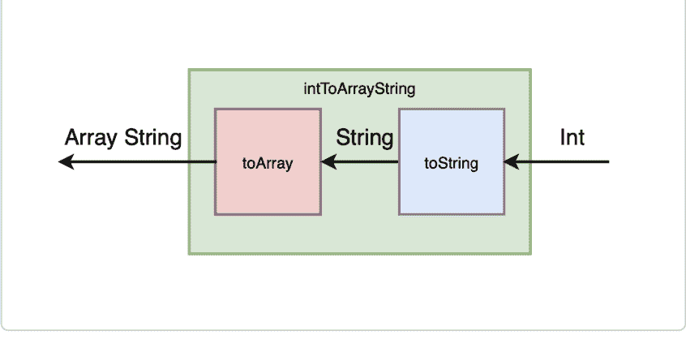

`toString`接收一个`Int`并输出一个`String`，这是`toArray`的输入，`toArray`输出`Array String`。

组合`toArray <<< toString`给出我们`intToStringArray`，它接收一个`Int`并生成一个`Array String`。

函数组合是函数式语言的强大特性，在大多数函数式代码库中经常使用。Haskell使用`.`运算符来模仿数学中的`∘`，而PureScript使用`<<<`运算符来帮助我们记住数学中的组合是从右到左的：

```purescript
notLarge :: Int -> Boolean
notLarge = not <<< isLarge
```

> ❶ 在这个例子中你不需要使用`<<<`与`not`。它只是作为示例使用。代码本可以只是`not isLarge`。

PureScript还提供了`>>>`运算符，当我们想反向组合时使用。这通常是因为代码读起来更好。在上面的例子中，使用`<<<`读起来更好。随着学习的深入，我们会看到`>>>`更可取的例子。

#### 2.4.1. 无点记法

注意我们的`notLarge`函数没有正式定义的`参数`。这是因为它以一种称为无点的形式编写。

> 无点记法或风格意味着函数是在未显式提及一个或多个参数的情况下定义的。

我们可以通过显式提及参数来编写`notLarge`，但现在我们有命名和记住它们的负担：

```
notLarge :: Int -> Boolean
notLarge num = not (isLarge num) -- NOT Point-free
```

这个版本不如我们的无点版本易读。编写函数的无点版本并不总是使函数更易读，但当它确实如此时，绝对值得去做。

大多数命令式语言没有对组合或无点记法的直接支持。例如，在Javascript中，`notLarge`必须写成：

```
const notLarge = num => not (isLarge num);
```

将其与我们的PureScript无点版本进行比较：

```
notLarge :: Int -> Boolean
notLarge = not <<< isLarge
```

无点版本读起来像英语（`notLarge`是`not <<< isLarge`）。这就是我选择使用`<<<`而不是`>>>`的原因，后者读起来是反的（`isLarge >>> not`）。

现在，假设你写了以下函数，用零在左侧填充字符串到指定大小：

```
zeroPad :: Int -> String -> String
zeroPad size s = padLeft '0' size s
```

是否可以将此函数重写为无点？`size`和`s`在等号两边都出现这一事实应该表明这是可能的。

如果你看不出如何以无点方式编写它，那么添加冗余的括号可能会有所帮助：

```haskell
zeroPad :: Int -> String -> String
zeroPad size s = (padLeft '0') size s
```

如果我们将函数视为一个简单的等式，我们可以看到`(padLeft '0')`等于`zeroPad`，给出：

```haskell
zeroPad :: Int -> String -> String
zeroPad = padLeft '0'
```

现在我们有了无点的`zeroPad`。它也读起来更好（`zeroPad`是`padLeft`with`0`）。

注意我们没有触及签名。这是因为函数仍然接收这些参数。它们只是未命名的参数。

有一种更简单的方法来看待这种简化，我称之为**右侧抵消：**

```haskell
zeroPad :: Int -> String -> String
zeroPad size s = padLeft '0' size s
```

首先，注意`s`是等号两边最右边的参数。这意味着我们可以从等式两边抵消它：

```haskell
zeroPad :: Int -> String -> String
zeroPad size = padLeft '0' size
```

现在`size`是等号两边最右边的参数，所以我们也抵消它：

```haskell
zeroPad :: Int -> String -> String
zeroPad = padLeft '0'
```

由于等式左侧不再有参数，`zeroPad`处于最简化的无点形式。

```
zeroPad :: String -> Int -> String
zeroPad s size = padLeft '0' size s
```

在这种情况下，我们将无法简化，因为`size`是等式左侧最右边的参数，而`s`是右侧最右边的。就像代数一样，我们不能用另一边的`s`抵消一边的`size`。

在编码时，我经常会改变参数的顺序以允许这种抵消，从而帮助减少函数定义的复杂性。

### 2.5. 柯里化

你还记得函数式编程语言的一个限制是所有函数只接受1个参数吗？好吧，这个限制来自于由数学家Haskell Curry创建的Lambda演算。

在Lambda演算中，函数只能接受一个参数。它们以以下数学符号编写：

```
λx. x + 1
```

在PureScript中，我们会写成：

```
\x -> x + 1
```

注意`\`有点像Lambda，`λ`。`.`被替换为`->`，但思想是相同的。

在两种情况下，这都定义了一个匿名函数，它接受一个参数并加1。

如果我们的函数只能接受一个参数，我们如何在Lambda演算中编写一个加两个数的函数？

别忘了函数可以返回其他函数：

```
λx. λy. x + y
```

这是PureScript的等价物：

```
\x -> \y -> x + y
```

当这个函数被`3`调用时：

```
(\x -> \y -> x + y) 3
```

值`3`绑定到变量`x`并返回以下函数：

```
\y -> 3 + y
```

当我们用`5`调用这个返回的函数时：

```
(\y -> 3 + y) 5
```

值`5`绑定到`y`返回：

```
3 + 5
```

由于`+`是一个函数，它返回：

```
8
```

在PureScript（以及Haskell和Elm）中我们可以写：

```
\x y -> x + y
```

虽然这在Lambda演算中是非法的，但在编程中，我们能够定义多个参数以减少视觉复杂性。当我们之前说所有函数式编程中的函数只接受单个参数时，这怎么可能。

这就是*柯里化*的作用。柯里化将一个函数如：

```
\x y -> x + y
```

转换为一个函数如：

```
\x -> \y -> x + y
```

编译器会自动为我们完成此操作，因此我们可以以更少的技艺。

让我们看一个命名函数：

```haskell
add :: Int -> Int -> Int
add x y = x + y
```

类型签名是右结合的，这意味着该函数是柯里化的。

所有类型签名都隐含有右结合的括号，即向右结合：

```haskell
add :: Int -> (Int -> Int)
add x y = x + y
```

当隐式括号被显式定义后，我们可以看到这个函数如何只接受1个参数，并返回一个同样只接受一个参数的函数——一个`Int`并返回一个`Int`。

这是另一个包含更多参数以及显式右结合括号的函数：

```haskell
add3 :: Int -> (Int -> (Int -> Int))
add3 x y z = x + y + z
```

有了显式括号，我们可以看到函数只接受单个参数，并返回一个只接受1个参数的函数，直到最终值被返回，在上面的例子中最终值是一个`Int`。

另一个带有显式括号的例子：

```haskell
show3 :: Int -> (Int -> (Int -> String))
show3 x y z = show x <> "," <> show y <> "," <> show z
```

`show`将我们的`Int`转换为`String`。

`<>`用于拼接我们的`String`。

当括号没有右对齐时，含义会改变：

```haskell
f :: Int -> (Int -> String) -> String
```

- 第一个参数是`Int`。
- 第二个参数是`Int -> String`。
- 结果是`String`。

这意味着第二个参数是一个函数，使得`f`成为高阶函数。

那么像这样的函数呢：

```haskell
g :: ((Int -> Int) -> Int) -> Int
```

- 第一个参数是`((Int -> Int) -> Int)`，它接受一个从`Int -> Int`的函数并返回一个`Int`。
- 结果是`Int`。

下面这些函数的隐式括号是什么：

```haskell
h :: Int -> String -> String -> String
```

记住它们是右结合的，即使用括号向右结合。

所以从右侧开始，添加第一组括号：

```haskell
h :: Int -> String -> (String -> String)
```

然后再次添加：

```haskell
h :: Int -> (String -> (String -> String))
```

一旦我们得到一个只接受1个参数的函数就可以停止。在这种情况下，`h`接受一个`Int`并返回一个类型为`String -> (String -> String)`的函数，所以我们可以停止。

这些隐式括号之所以存在，是因为函数只能接受单个参数。需要注意的重要一点是，变量会在此过程中被绑定。例如，回到`add3`：

```haskell
add3 :: Int -> Int -> Int -> Int
add3 x y z = x + y + z
```

当我们用一个参数调用`add3`时：

```haskell
add3 1 :: Int -> Int -> Int
```

`x`被绑定到`1`。当我们用单个参数调用该结果函数时：

```haskell
(add3 1) 2 :: Int -> Int
```

`y`被绑定到`2`。用单个参数调用该结果函数：

```haskell
((add3 1) 2) 3 :: Int
```

`z`被绑定到`3`。该函数现在已*完全应用*，并返回值`6`，其类型为`Int`。

#### 2.5.1. 部分应用


回到我们的 `zeroPad` 函数：

```haskell
zeroPad :: Int -> String -> String
zeroPad = padLeft '0' ① ②

padLeft :: Char -> Int -> String -> String
padLeft padCh size s = ... ③
```

① `padLeft` 只被赋予了它产生最终结果所需的众多参数中的 1 个。
② 我们已经部分应用了 `padLeft`。
③ 我们目前不关心 `padLeft` 的实现。

> *部分应用*是指函数以少于其所有参数的数量被调用。

当我们认为函数有多个参数时，部分应用就说得通了。然而，当我们考虑柯里化函数时，由于只有一个参数，就不存在所谓部分应用。

部分应用的力量可能不会立即显现，但考虑一个简单的例子：

```haskell
pad :: Boolean -> Char -> Int -> String -> String
pad rightSide padCh size s = ... ①

padLeft :: Char -> Int -> String -> String
padLeft = pad false ②

padRight :: Char -> Int -> String -> String
padRight = pad true ②

zeroPad :: Int -> String -> String
zeroPad = padLeft '0' ③

spacePad :: Int -> String -> String
spacePad = padRight ' ' ④

dotPad :: Int -> String -> String
dotPad = padRight '.' ④
```

① 我们目前不关心 `pad` 的实现。
② 对 `pad` 的部分应用。
③ 对 `padLeft` 的部分应用。
④ 对 `padRight` 的部分应用。

我喜欢把部分应用看作是对一个更通用函数的配置。我们有点像在“烘焙”配置值。

请注意，部分应用之所以可行，仅仅是因为那些“配置参数”被放在前面。`pad` 的 Boolean 参数让我们能够定义 `padLeft` 和 `padRight`，然后它们的 Char 参数让我们能够定义 `zeroPad`、`spacePad` 和 `dotPad`。

这里顺序很重要。想象一下 Char 在 Boolean 之前：

```haskell
pad :: Char -> Boolean -> Int -> String -> String
pad padCh rightSide size s = ...

padZero :: Boolean -> Int -> String -> String
padZero = pad '0'

padSpace :: Boolean -> Int -> String -> String
padSpace = pad ' '

zeroPad :: Int -> String -> String
zeroPad = padZero false

spacePad :: Int -> String -> String
spacePad = padSpace true

padDot :: Boolean -> Int -> String -> String
padDot = pad '.'

dotPad :: Int -> String -> String
dotPad = padDot true
```

1. 我们必须编写这 3 个函数来首先烘焙填充字符。
2. 接下来，我们编写这 3 个函数来指定在哪一侧填充。
3. 为了实现 `dotPad`，我们必须编写一个额外的函数 `padDot`，因为填充字符是 `pad` 的第一个参数。

这种方法迫使我们为每个新的填充字符编写一个新函数。我们原来的方法更好，因为它让我们能够在添加填充字符之前就创建 `padLeft` 和 `padRight`。现在，每当我们要添加一个新的填充字符函数时，我们都可以利用这些函数。

正因如此，花些时间规划参数顺序是值得的。

> 参数顺序的一般规则是：变化*最少*的参数放在*最左边*，变化*最多*的参数放在*最右边*。

重新审视我们的填充函数的更好版本：

```haskell
pad :: Boolean -> Char -> Int -> String -> String
pad rightSide padCh size s = ...

padLeft :: Char -> Int -> String -> String
padLeft = pad false

padRight :: Char -> Int -> String -> String
padRight = pad true

zeroPad :: Int -> String -> String
zeroPad = padLeft '0'

spacePad :: Int -> String -> String
spacePad = padRight ' '

dotPad :: Int -> String -> String
dotPad = padRight '.'
```

如果你看 `pad`，会注意到 `size` 参数在 `s`（我们想要填充的 String）之前。这是因为我们可能想要编写以下函数：

```haskell
dotPad20 :: String -> String
dotPad20 = dotPad 20
```

现在，我们可以向 `dotPad20` 传递大量的 `String`。我们想要填充的 `String` 是变化最大的部分，因此应该位于参数列表的最后。

所有其他参数都可以视为配置参数，用来告诉 `pad` 如何填充，而 `s` 是要填充什么，由于它变化最大，它是最右边的参数。

有时你会有两个总是变化的参数，在这种情况下，只需确保它们位于最后。它们各自的顺序无关紧要。

## 第 3 章 PureScript 基础

Kernighan 和 Ritchie 的《C 程序设计语言》开创了一个传统：学习新语言时，从打印 `Hello, World!` 的程序开始。

所以这就是：

```haskell
module Main where ①

import Prelude ②

import Effect (Effect) ③
import Effect.Console (log)

main :: Effect Unit ④
main = log "Hello, world!" ⑤
```

① 每个 `module` 都以它的定义开始。这里我们称它为 `Main`，它应该放在文件 `Main.purs` 中。
② 你使用 `import` 导入库。这里我们导入名为 `Prelude` 的标准基础库。
③ 我们还导入了一些额外的库来处理副作用，例如打印到控制台。我们将在本书的后面详细重新讨论副作用。
④ 这表示 `main` 是一个副作用函数，其计算结果是 `Unit`，这与其它语言（如 C、C++ 和 Java）中的 `void` 在函数式意义上是等价的。
⑤ 这会将我们的世界问候语记录到控制台。

像这样的 I/O 在函数式编程中是一个高级主题，因为它是一种副作用，这里有很多你现在还无法完全理解的内容。

但这不应阻止我们使用 `log` 函数来快速而粗略地测试我们为练习而编写的函数。我保证一旦我们学完 Monad，这段代码会更有意义。

从 Monad 开始就像在幼儿园之前先上高中，所以你只能暂时相信我表面的解释。

我们不会深入探讨 `Hello, world!`，而是从学习类型开始，这是 PureScript 和 Haskell 中最重要的部分之一，因为它们都是静态类型语言。

我们将在本书的高级部分回到 `Hello, world!` 的微妙之处。

### 3.1. 类型

PureScript 的大部分代码都是开源的，可以通过 GitHub 仓库轻松查阅，但 implementation for Primitive Types are built into the compiler, which is written in Haskell.

In PureScript, Types always start with an uppercase letter.

#### 3.1.1. Javascript Primitives

The following Primitive Types map directly to Javascript’s types:

- `Boolean`
- `Char`
- `String`
- `Number`

##### Boolean Type

Boolean values are true and false. Unlike Haskell and Elm, these are true primitives since they compile directly to Javascript’s boolean values.

```
t :: Boolean
t = true

f :: Boolean
f = false
```

##### Char Type

Char is defined with single quotes:

```
ch :: Char
ch = 'a'

unicodeCh :: Char
unicodeCh = '\x00E9'
```

##### String Type

String is defined with double quotes:

```
s :: String
s = "This is a multi-line string\nwith embeded newlines"

s2 :: String
s2 = "This is a multi-line string with continuations\
\ at the end of the lines" ①

s3 :: String
s3 = """ ②
This is a multi-line that can contain quotes """ but \n will not be a newline
"""

unicodeStr :: String
unicodeStr = "This is a unicode character: \x00E9" ③
```

① Characters to the left of \, in this case spaces, are NOT part of the string.
② Triple quotes can have newlines in them. The escape sequence \n will NOT be interpreted as a newline but will be interpreted as the literal characters, '\' and 'n'.
③ Unicode characters can be embedded with the escape sequence \x followed by a 4-hex-digit code.

##### Number Type

Number compile directly to Javascript representation for numbers:

```
import Prelude ①

n :: Number
n = 1.0 ②

smallestNumber :: Number
smallestNumber = (−5e−324) ③

largestNumber :: Number
largestNumber = 1.7976931348623157e+308
```

① Imports Prelude for the negate operator, i.e. −.
② Must have decimal point otherwise interpreted as Int.
③ Negative numbers MUST be in Parentheses. You will forget this. I know I still do from time to time. So, I’ll say it again. Negative numbers MUST be in Parentheses.

#### 3.1.2. PureScript Primitives

These are the PureScript-specific primitives, i.e. they don’t map *directly* to Javascript’s types:

- `Int`
- `Array`
- `Record`

##### Int Type

The underlying representation of Int is Javascript’s number type but all of its operators, e.g. +, -, etc., will limit the results to only Int values:

```
import Prelude

i :: Int
i = 42 ①

i2 :: Int
i2 = 1 + 4

smallestInt :: Int
smallestInt = (-2147483648) -- -2^31 ②

largestInt :: Int
largestInt = 2147483647  -- 2^31 - 1
```

① No decimal point otherwise it’ll be interpreted as Number.
② Just in case you’ve already forgotten, negative numbers MUST be in Parentheses.

Even though Javascript has a range of −2^53 to 2^53 − 1 for Integers with no loss of accuracy, PureScript limits Int to 32-bits, i.e. −2^31 to 2^31 − 1.

There is, however, a PureScript library called `purescript-int-53` that supports the full 53-bit Integer that Javascript supports. This increases the range to from −9,007,199,254,740,991 to 9,007,199,254,740,991.

##### Array Type

The Array Type is represented by Javascript arrays at runtime but, unlike Javascript, the elements must be *Homogenous (Homo, meaning same and genos meaning a kind)*, i.e. Arrays must contain elements of the same Type.

```
mta :: Array Number
mta = [] ①

a :: Array Int
a = [1, 2, 3]

a2 :: Array String
a2 = ["abc", "123"]

aa :: Array (Array Int) ②
aa = [ [1, 2, 3], [4, 5], [6, 7, 8, 9] ]
```

① An empty Array of Number.
② An Array of an Array of Int, i.e. array of arrays.

##### Record Type

Record is an aggregate Type with named fields that is represented by Javascript objects at runtime.

```
r :: { firstName :: String, lastName :: String }
r = { firstName: "Joe", lastName: "Mama" }

type Person = ①
{ name :: String
, age :: Int
}

r2 :: Person ①
r2 = { name: "Jane Doe", age: 37 }

type Nested = ②
{ val :: Int
, rec ::
  { val2 :: Int
  , name :: String
  }
}
```

① You can define a Type Alias using the type keyword. Here Person is an alias for the Record. You can imagine copying and pasting the Record everywhere the Type Alias name is used.
② This is a nested record. The field rec is itself a Record. Notice the formatting of the records. They are defined on multiple lines. This formatting is idiomatic PureScript formatting.

#### Syntactical Oddity

To create a Record, we use the following syntax:

```
person = { name: "Candy Cane", age: 37 }
```

To modify a one or more elements in the Record and return a new Record (remember, all Values are immutable), we use the following syntax:


```
newPerson = person { name = "Randy Cane" }
```

This is the ONLY time an equal sign is used in `Record` syntax. All other times, a colon is used. This is another nuance that’s easy to forget.

If you know Javascript, using a `:` won’t be foreign but using the `=` for updating a `Record` will be.

## 3.1.3. User Types

PureScript comes with many useful built-in Types but without the ability to make your own Types, you won’t be able to model your problem domain. PureScript has the following facilities for defining your own Types:

- Type Alias
- Data Type
- Algebraic Data Types
  - Product Type
  - Coproduct or Sum Type
- New Type

### Type Alias

A Type Alias allows you to make an alias for another Type. Think of it as shorthand for a more complex Type.

```
type Id = String

type Message = { id :: Id, payload :: String }

type MessageHandler = Message -> Result

handler :: MessageHandler ①
handler messageHandler = ...

handler' :: Message -> Result ① ②
handler' messageHandler = ...
```

① These two Type Signatures are identical. The compiler substitutes `MessageHandler` with its definition, `Message -> Result`.

② PureScript allows you to name a Function with a prime, i.e. the apostrophe character. Traditionally, this is at the end of the Function name and is related to the unprimed version in some way.

### Data Type

We can make our own Data Types from scratch. Here is the simplest example:

```
data MyType = MyType
```

Notice `MyType` is on both sides of the equal sign.

The `MyType` on the left-hand side is defining a new Data Type called `MyType`.

On the right-hand side is `MyType` again but this defines the Data Constructor.

The namespace for Data Types and Data Constructors are separate so there is no name collision here. You cannot use a Data Constructor where a Data Type is used and vice versa, which is why you will often see the names reused on both sides of the equal sign. Many times the word, Data, will be dropped and these will be referred to as Type and Constructor.

In PureScript, Data Types and Data Constructors always start with an uppercase letter, whereas variables start with a lowercase letter or an underscore:

```
x :: Int
x = 100

_b :: Boolean
_b = true

data MyOtherType = MyOtherType
```

### Algebraic Data Types (ADTs)

There are 2 types of Algebraic Data Types, Product Types and Coproduct Types (also called Sum Types). The names reflect the process by which you determine how many inhabitants exist in a particular Type.

If the calculation involves a multiplication then it’s a Product Type. If it involves addition then it’s a CoProduct Type or Sum Type. In Math, the prefix co is added to mean the opposite (Domain, Codomain, Sine, Cosine, Tangent, Cotangent, etc.).

### Sum Types (Coproduct)

```
data Bool = True | False
```

In Haskell and Elm, this is how they define their boolean values. We can make our own `Bool` in PureScript since it won’t collide with `Boolean`.

Here `Bool` is the Data Type and `True` and `False` are the 2 Data Constructors:

```
mkTrue :: Bool ①
mkTrue = True ②

mkFalse :: Bool ①
mkFalse = False ②
```

① `Bool` is the Data Type.

② `True` and `False` are the Data Constructors

`Bool` can be either `True` or `False` but NOT both. That’s what makes it a Sum Type. Sum Types are also called Unions because a union in Set Theory is an OR operation. The union of Set A and Set B contains elements that are contained in A OR contained in B.

Understanding this should help you see why we separate the different possible Values of `Bool` with `|`, which is commonly used as the OR symbol in many languages, i.e. `||`.

让我们再来看一个 `Sum Type`：

```purescript
data FailureReason
  = InvalidSyntax
  | InvalidInput
  | AlreadyExists
  | NotFound
  | Other String
```

这里我们有一个类型来建模失败原因，并带有一个兜底情况 `Other`。注意 `Other` 接受一个 `String` 作为参数。类型可以像函数一样接受参数。

事实证明，数据构造子 `Other` 本身就是一个函数。它的 *隐式* 类型是：

```purescript
Other :: String -> FailureReason
```

这意味着我们可以像使用函数一样使用 `Other`，因为它就是一个函数。

`FailureReason` 的其他所有数据构造子都是值。以下是它们的 *隐式* 类型：

```purescript
InvalidSyntax :: FailureReason
InvalidInput :: FailureReason
...
```

不过 `FailureReason` 有点受限。你能看出为什么吗？

注意 `Other` 只接受一个 `String`。这对于大多数情况可能足够，但在我们代码库的其他地方使用 `FailureReason` 时，如果 `String` 不足以完全描述 `Other` 情况怎么办？

让我们制作一个更灵活的 `FailureReason` 版本：

```purescript
data FailureReason' a
  = InvalidSyntax'
  | InvalidInput'
  | AlreadyExists'
  | NotFound'
  | Other' a
```

❶ 我们在所有名称末尾添加了 `'` 来将其与旧定义区分开。

现在我们引入了 *类型变量* `a` 到定义中。这意味着 `Other'` 如果我们想要仍然可以接受一个 `String`，但现在它也可以接受任何其他类型：

```purescript
failWithString :: FailureReason' String ①
failWithString = Other' "Because this Function always fails"

type Error = { code :: Int, reason :: String }

failWithError :: FailureReason' Error ②
failWithError = Other' { code: -123, reason: "Because of reasons"}
```

① 我们将 `String` 传递给 `FailureReason'` 类型，这使得 `a` 与 `String` 统一。这意味着 `Other'` 必须接受一个 `String`。

② 这里 `a` 与 `Error` 统一，意味着 `Other'` 期望一个 `Error`。

### 多态 vs 单态

让我们来看一下我们的两个定义：

```
data FailureReason ①
  = InvalidSyntax
  | InvalidInput
  | AlreadyExists
  | NotFound
  | Other String

data FailureReason' a ②
  = InvalidSyntax'
  | InvalidInput'
  | AlreadyExists'
  | NotFound'
  | Other' a
```

① 这是单态的，因为 `FailureReason` 不接受任何类型参数（Mono 表示一个，morph 表示形状）。我们的 `Other` 数据构造子也是单态的，因为它只能接受一种形状或类型，即 `String`。

② 这是多态的，因为 `FailureReason'` 接受一个类型参数 `a`（Poly 表示许多，morph 表示形状）。我们的 `Other'` 数据构造子是多态的，因为它可以接受许多形状或类型，例如 `String`、`Error` 等。

单态类型始终是大写，例如 `String`，而多态类型始终是小写，例如 `a`。

### 积类型

让我们来看一个简单的类型：

```
data Triplet a b c = Triplet a b c
```

这里我们有 3 个多态类型参数 `a`、`b` 和 `c`。

数据构造子 `Triplet` 的隐式类型是：

```
Triplet :: a -> b -> c -> Triplet
```

让我们创建一个 `Triplet`：

```
type StringStats = Triplet String Int Int

getStats :: String -> StringStats
getStats s = Triplet s (length s) (vowelCount s) ① ②
```

① `Triplet` 的第一个槽位包含我们的 `String`。第二个槽位包含长度，第三个是元音数量。

② `vowelCount` 是一个想象中的函数，而 `length` 是 `Data.String.CodeUnits` 模块中的一个函数。

`StringStats` 同时包含 1 个 `String` 和 2 个 `Integer`。这就是它成为积类型的原因。它包含一个 `String` AND 一个 `Int` AND 另一个 `Int`。在集合中，这对应于交集。集合 A 和集合 B 的交集包含在 A 中 AND 在 B 中的元素。

`Triplet` 的麻烦之处在于我们可能会混淆那 2 个 `Int`。可以用 `newtype` 来修复这个问题，我们稍后会讨论，但有更好的方法。

我们可以将 `StringStats` 改为使用 `Record` 而不是使用可能存在歧义的 `Triplet`：

```
data StringStats = StringStats ①
  { string :: String ②
  , length :: Int ③
  , vowelCount :: Int ④
  }
```

① `StringStats` 不再是类型别名，而是真正的数据类型。这种更改并不是在 PureScript 中创建 `Record` 的要求（在 Haskell 中是）。我们本可以让它保持类型别名。

② 与 `Triplet` 的第一个槽位相同。

③ 与 `Triplet` 的第二个槽位相同。

④ 与 `Triplet` 的第三个槽位相同。

`StringStats` 不像 `Triplet` 那样存在歧义。

### 同构

比较我们的 `Triplet` 和 `StringStats`：

```
data Triplet a b c = Triplet a b c

data StringStats = StringStats
{ string :: String
, length :: Int
, vowelCount :: Int
}
```

`StringStats` 和 `Triplet` 包含相同的信息。最大的区别在于 `Triplet` 更灵活，因为它可以接受任意类型 `a`、`b` 和 `c`，而 `StringStats` 接受非常具体的类型 `String`、`Int` 和 `Int`：

它们几乎相同，但让我们努力让它们更接近。首先，让我们制作一个 `Triplet` 的特化版本：

```
data StringTriplet = StringTriplet String Int Int

data StringStats = StringStats
{ string :: String
, length :: Int
, vowelCount :: Int
}
```

现在 `StringTriplet` 和 `StringStats` 具有完全相同的类型。这意味着我们可以互换使用这两种类型。有正式的定义：

> 两个类型 `T1` 和 `T2` 是同构的（Iso 表示相等，morph 表示形状），如果可以编写从 `T1` 到 `T2` 的函数以及从 `T2` 到 `T1` 的函数，而不丢失任何信息。

让我们通过尝试编写它们之间无损的转换函数来看看我们的新类型是否同构：

```
from :: StringTriplet -> StringStats
from (StringTriplet string length vowelCount) = ①
  StringStats ②
  { string: string
  , length: length
  , vowelCount: vowelCount
  }

to :: StringStats -> StringTriplet
to (StringStats { string, length, vowelCount }) = ③
  StringTriplet string length vowelCount ④
```

① `from` 的参数使用模式匹配解构，让我们访问积类型 `StringTriplet` 的元素（稍后会详细介绍）。

② 我们从 `StringTriplet` 解构出的部分构造 `StringStats`。

③ `to` 也使用模式匹配来访问 `StringStats` 中 `Record` 的字段，使用略有不同的语法，因为它正在解构一个 `Record`。

④ 我们从 `StringStats` 解构出的部分构造 `StringTriplet`。

不用担心，我们很快就会更深入地探讨模式匹配。但这段代码的重点是证明我们可以编写函数在 `StringTriplet` 和 `StringStats` 之间来回转换而不会丢失信息。

这些函数证明了 `StringTriplet` 和 `StringStats` 是同构的。

### 居民

同构中无信息丢失的部分非常重要。乍一看，你可能会认为 `String` 和 `Int` 是同构的，因为任何 `Int` 都可以转换为 `String`。但并非任何 `String` 都可以转换为 `Int`。

类型类似于集合，只是集合有元素，类型有居民。而且 `String` 的居民远多于 `Int`，即使它们都有无限多个居民。


这涉及到令人困惑的无穷大小概念，但我们可以简单地认为，每个 `Int` 在 `String` 类型中都有字符串表示，但 `String` 有额外的居民没有数字，例如 `""`、`"._."`、`"abc"` 等。

`String` 中的居民数量大于 `Int` 中的居民数量，这意味着它们不能同构。

让我们想象一个只包含数字 42 和 79 的类型，并称之为 `TwoNum`。因为它有两个居民，所以它与 `Boolean` 同构，因为 `Boolean` 也有两个居民 `true` 和 `false`。

我们在 `TwoNum` 和 `Boolean` 之间映射的方式可以完全任意。我们可以简单地制作一个查找表，由我们的 `to` 和 `from` 函数使用：

| TwoNum | Boolean |
| --- | --- |
| 42 | false |
| 79 | true |

有了查找表，只要它们具有相同数量的居民，我们就可以在任何两个类型之间来回映射。

> > 任何具有相等居民数量的两个类型都是同构的。

让我们来看一下和类型（余积）和计算它们的居民：

```
data Variant = This | That | TheOther
```

很容易看出 `Variant` 有 3 个居民，`This`、`That` 和 `TheOther`。

再试一个：

```
data DualResult = First Boolean | Second Variant
```

`DualResult` 有 2 个数据构造子 `First` 和 `Second`，但这并不自动意味着它有 2 个居民。

由于 `First` 和 `Second` 都有类型参数，我们必须考虑这些。`First` 可以接受一个 `Boolean`，它有 2 个居民，而 `Second` 接受一个 `Variant`，它有 3 个居民。所以让我们枚举 `DualResult` 的所有可能值：

```
First true
First false
Second This
Second That
Second TheOther
```

注意每个数据构造子接受一个 `Boolean` 类型（2 个居民）或 `Variant` 类型（3 个居民）的参数。又出现了那个 OR，就像我们在联合中看到的那样。

综合考虑，应该很清楚 `DualResult` 有 2 + 3 个居民。这种用于计算居民的加法运算就是我们称之为 `和类型` 的原因。

让我们看看同样的逻辑是否适用于 Product Types：

```purescript
data BooleanVariant = BooleanVariant Boolean Variant
```

要小心不要混淆 Type，`BooleanVariant`（左侧），与 Data Constructor，`BooleanVariant`（右侧）。以下是 Type `BooleanVariant` 的所有可能值：

```purescript
BooleanVariant true This
BooleanVariant true That
BooleanVariant true TheOther
BooleanVariant false This
BooleanVariant false That
BooleanVariant false TheOther
```

注意每个 Data Constructor 都有 `Boolean` AND `Variant`。

对于 Product Type，我们必须考虑这些类型的全部组合，即 `Boolean` 中 2 个 inhabitants 与 `Variant` 中 3 个 inhabitants 的所有组合，或 `2 · 3` 个 inhabitants。这种乘法运算就是我们称之为 `Product Type` 的原因。

当 Types 如 `DualResult` 中那样被 OR 时，我们 ADD（Sum），而当类型如 `BooleanVariant` 中那样被 AND 时，我们 MULTIPLY（Product）。

但当它们被组合时会发生什么：

```purescript
data Combo = Dual DualResult | BoolVar BooleanVariant
```

`|` 告诉我们我们在对每个侧的 inhabitants 进行加法。所以我们有 `(2 + 3) + (2 · 3)` 或 `5 + 6` 个 inhabitants，因为 `DualResult` 有 5 个而 `BooleanVariant` 有 6 个。

到目前为止，我们一直在为 Monomorphic Types 计算 inhabitants。我们如何为 Polymorphic Types 计算 inhabitants？

```purescript
data Sometimes a = HaveIt a | DoNotHaveIt
```

`Sometimes` 代表有时有 `a`，即我们可能有也可能没有 `a`。

`HaveIt` 的 inhabitants 数量为 `a`，`DoNotHaveIt` 为 `1`。这意味着 `Sometimes` 的 inhabitants 数量为 `a + 1`。

这里 `a` 代表 *a 的 inhabitants 数量*。

如果 `a` 是 Boolean，如：

```purescript
type SomeBool = Sometimes Boolean
```

① `a` 与 `Boolean` 统一。

那么 SomeBool 的 inhabitants 数量为 2 + 1。我们通过将 `a + 1` 中的 `a` 替换为 Boolean 的 inhabitants 数量 2 得到的结果。

### New Types

我们刚刚学习了如何创建自己的 Types 来建模问题域。接下来，让我们看看如何建模一些简单问题。

让我们写一个简单的 Function 来格式化名字：

```purescript
fullName :: String -> String -> String -> String
fullName first middle last = first <> " " <> middle <> " " <> last
```

① 运算符 `<>` 将字符串彼此附加。

暂时忽略如果中间名为空字符串，我们的 Function 会在名字和姓氏之间有 2 个空格的问题，你还能看出我们的 Function 有什么其他问题吗？

HINT: 看 Types。

想象我们这样调用我们的 Function：

```purescript
fullName "Smith" "Jay" "John"
```

我们不小心把姓氏放在了前面。这是怎么发生的？

只看 Type Signature：

```purescript
fullName :: String -> String -> String -> String
```

我们可以看到它对于参数的顺序帮助不大。所以，让我们通过创建 Type Aliases 使其更易读：

```purescript
type FirstName = String
type MiddleName = String
type LastName = String

fullName :: FirstName -> MiddleName -> LastName -> String
fullName first middle last = first <> " " <> middle <> " " <> last
```

现在，当我们查看 Type Signature 时，我们将能够知道应该如何调用它，大大减少出错的几率：

```purescript
fullName "Smith" "Jay" "John"
```

好吧，我们又做了一次同样的错误！我们犯了同样的错误。Type Aliases 有帮助，但前提是程序员要阅读它们。我们如何让它更好？

理想情况下，我们希望如果参数顺序错误，程序无法编译。所以让我们为 Function 中的每个参数创建 *唯一* 的 Types：

```purescript
data FirstName = FirstName String
data MiddleName = MiddleName String
data LastName = LastName String
data FullName = FullName String

fullName :: FirstName -> MiddleName -> LastName -> FullName
fullName (FirstName first) (MiddleName middle) (LastName last) =
  FullName (first <> " " <> middle <> " " <> last)
```

1. 我们用唯一的 Types 包装所有 `Strings`。

2. 我们使用 Pattern Matching 解构所有参数。

3. 最终结果被包装在 `FullName` 中。

现在让我们用新的 Types 调用我们的 Function：

```purescript
-- COMPILER ERROR!
fullName (LastName "Smith") (MiddleName "Jay") (FirstName "John")
```

我们再次以错误顺序传递了参数。但这次，我们得到编译错误，因为即使 `FirstName` 和 `LastName` 都接受 `Strings`，它们现在也不是相同的 Type。

所以当我们不小心将 `LastName "Smith"` 传递给 Function 期望 `FirstName` 的位置时，编译器捕获了 `Type Mismatch` 错误，保护我们免于自己犯错。

```purescript
data NoInhabitants = NoInhabitants
```

不幸的是，这有 1 个 inhabitant，即 NoInhabitants。

有一个可能的解决方案。我们可以将此 Type 定义放在一个 Module 中，然后只导出 Type 而不导出 Data Constructor。这样就没人能构造 Void。

但还有另一种更聪明、更简单的解决方案：

```purescript
data Void = Void Void
```

乍一看，这可能令人困惑，所以让我们从左到右逐步分解：

- 第一个 `Void` 是 Data Type。

- 第二个 `Void` 是 Data Constructor。

- 第三个 `Void` 是 `Void` Data Constructor 的 Type 参数。

所以要创建一个 Void，我们必须使用 Void Data Constructor 并传递它一个 Void：

```purescript
v :: Void
v = Void (???)
```

`???` 必须是 Void 类型，我们可以使用 Void Data Constructor 创建它：

```purescript
v :: Void
v = Void (Void (???))
```

但我们的下一个 Data Constructor 也需要一个 Void，我们可以使用 Void Data Constructor 创建它，依此类推：

```purescript
v :: Void
v = Void (Void (Void (Void (Void (Void (...))))))
```

构造 Void 是不可能的，因为它的唯一 Data Constructor 需要一个 Void。我们有一个先有鸡还是先有蛋的问题。

技术术语是 Recursive Definition，因为定义引用了自身。

不过，在这种特定情况下，它是 Infinitely Recursive Definition，因为没有 base-case 来终止递归。

让我们看一个虚构的 Infinitely Recursive Definition：

```purescript
data NeverEnding = NeverEnding NeverEnding
```

现在，我们添加一个 base-case 将其变成普通的 Recursive Definition：

```purescript
data NeverEnding = NeverEnding NeverEnding | TheEnd
```

❶ `TheEnd` 是我们的 base-case，因为它 *终止* 了 Recursive Definition。

由于新添加的 Data Constructor `TheEnd`，这个定义不再是 Infinitely Recursive。因此，我们实际上可以写下 NeverEnding 类型的值：

```purescript
actuallyEnds :: NeverEnding
actuallyEnds = NeverEnding (NeverEnding (NeverEnding TheEnd))
```

第一个和第二个 NeverEnding Data Constructor 需要 NeverEnding 类型的值，并通过使用 NeverEnding Data Constructor 得到它。

但第三个也是最后一个 NeverEnding，也需要 NeverEnding 类型的值，却得到了 `TheEnd`，从而终止了我们的构造。

### Unit

在 Set Theory 中，有 *Unit Set* 的概念，它恰好有 1 个元素。

在 Type Theory 中，有 *Unit Type* 的概念，即只有 一个 Inhabitant 的 Type，在 PureScript 中这个 Type 称为 Unit。

Unit 的唯一 inhabitant 称为 unit。

Unit 在带有 Effects 的代码中经常出现。我们的 Hello World 示例中的 main Function 具有以下签名：

```purescript
main :: Effect Unit
```

事实上，所有 PureScript 程序的入口点将始终具有此 Type Signature。

### Maybe

任何在 C、Java、Javascript 以及大量允许值为空 NULL 的其他语言中编码过的人都非常清楚处理这些情况的痛苦。似乎 NULL 值自有史以来就困扰着程序员。好吧，至少自 NULL 值出现以来。

事实证明 PureScript 通过没有 NULL 来解决这个问题。你可能会想知道没有 NULL 如何处理可选值。好吧，这就是通过 Maybe Type 完成的。

以下是它的定义以及它如何被使用的一个例子：

```purescript
data Maybe a = Just a | Nothing

data Person = Person
  { name :: String
  , birthdate :: Date
  , deathdate :: Maybe Date
  }
```

1. `Maybe` 接受一个单一的 Polymorphic 参数 `a`，它可以是 ANY Type。

2. `Person` 是一个有 3 个字段的 Record。

3. `deathdate` 是一个 `Maybe Date`，因为 Person 可能仍在世。在这种情况下，Maybe 的 Type 参数 `a` 与 Date 统一。

要为现有人员设置 deathdate，我们会这样做：

```purescript
import Data.Date (canonicalDate)

person :: Person
person = Person
  { name: "Joe Mama"
  , birthdate: canonicalDate 1962 10 2
  , deathdate: Nothing
  }

-- 在代码的其他地方
deadPerson = person { deathdate = Just today }
```

1. 我们通过调用 `canonicalDate` 设置 birthdate，它接受年、月和日并返回一个 Date。

2. 当此记录被构造时，没有 deathdate，所以我们通过使用构造函数 `Nothing` 构造一个 `Maybe Date`。

3. 稍后在我们的代码中，我们通过使用 Data Constructor `Just` 设置 deathdate。但我们不能只使用 Just 本身。Just 需要一个 Type 为 `a` 的单一参数，在这种情况下是 Date。因此，我们必须给它一个 Date，我们通过给 Data Constructor 一个单一参数 `today` 来做到这一点，我们假装它是 Date。

4. 我们正在使用 Update Record 语法，因此使用 `=` 而不是 `:`。

这都很好，但你可能仍然在想这比 NULL 好在哪里。这最好可以

通过查看一个示例来回答。

首先在 JavaScript 中：

```
const x = 10;
const y; ①
const add = (x, y) => x + y -- z = NaN ②
```

① 我们没有初始化 y。

② 这里我们尝试在计算中使用 y，最终得到 NaN。现在任何使用 z 的计算都将是 NaN。

现在在 PureScript 中：

```
add :: Int -> Int -> Int
add x y = x + y

useAdd :: Int
useAdd =
  let x :: Int
      x = 10

      y :: Maybe Int
      y = Nothing ①
  in
  add x y -- COMPILER ERROR!! ②
```

① 我们没有 y 的值，并且它被显式地定义为 `Maybe Int`。

② 编译器会报错，因为我们试图将一个 `Int` 与一个 `Maybe Int` 相加。

编译器让我们避免使用不兼容的类型。那么我们该如何修复呢？


```purescript
add :: Int -> Int -> Int
add x y = x + y

useAdd :: Int
useAdd =
  let x :: Int
      x = 10

      y :: Int
      y = Nothing  -- COMPILER ERROR!!
  in
  add x y
```

① 如果我们试图让 `y` 成为 `Int`，但将其设置为 `Nothing`，编译器会报错，因为我们的类型不匹配（`Int ≠ Maybe Int`）。

② 这里编译器不会抱怨，因为我们定义 `y` 的类型为 `Int`，把它与另一个 `Int` 相加是没问题的。

类型系统再次让我们避免将 `Maybe Int` 赋值给 `Int`。但现在我们该如何修复呢？

我们可以直接将 `y` 初始化为某个值：

```purescript
add :: Int -> Int -> Int
add x y = x + y

useAdd :: Int
useAdd =
  let x :: Int
      x = 10

      y :: Int
      y = 42
  in
  add x y
```

现在一切都能正常工作了。但这个例子过于简单。如果 `useAdd` 被传入 `y`，会发生什么：

在 JavaScript 的情况下，我们的值变成了 `NaN`，它与 `Nothing` 是同构的。不同之处在于，PureScript 编译器强制使用 `Maybe`。如果我们采用最佳实践，`Maybe` 会出现在我们的类型签名中，这将会告知我们和其他人：我们的函数可能会失败。

因此，`Maybe` 的语义是“可能会失败”。在我们的例子中，如果缺少其中一个 `Int`，`useAdd` 就无法使用 `add`。

很多时候，`Maybe` 会派上用场：

- 在 `String` 中查找 `Char` 或另一个 `String`。
- 使用键从 `Map`（一种键/值存储）中获取值。
- 从 `Array` 的特定索引处获取值。

这些函数中的每一个都有一个*明显*的失败情形：找不到 `Char` 或 `String`、找不到键、或者索引越界。

但如果不是这种情况，或者我们的函数可能因多种原因失败，我们该如何返回一个明确的失败原因呢？

### Either

`Either` 类型是另一种失败类型，与 `Maybe` 类似，但它额外的好处是能给出失败的原因：

```
data Either a b = Left a | Right b
```

这里，类型 `a` 由 `Left` 数据构造器使用，类型 `b` 由 `Right` 数据构造器使用。为了更好地理解这一点，让我们看一个示例：

```
data QueryError
  = DatabaseConnectionError String
  | InvalidQuery
  | NotFound

query :: Query -> Either QueryError Int
```

❶ `QueryError` 对我们可能遇到的不同错误进行建模。

❷ `DatabaseConnectionError` 接受一个 `String`，其中包含有关连接失败的更多信息。

❸ `query` 接受一个 `Query`（此处未定义），并返回 `QueryError` 或 `Int`。

那么，我们如何创建这些不同的错误呢：

你可以将 `Left` 和 `Right` 视为给 `Int` 打上标签，以便我们区分它表示错误还是成功。这就是为什么和类型也被称为带标签的联合。

### Maybe 与 Either

`Maybe` 和 `Either` 都可以表示错误结果，但只有 `Either` 会给我们一个原因。另一方面，`Maybe` 可以表示一个可选值。

为了好玩，让我们来看看两者的成员：

```
data Maybe a = Just a | Nothing

data Either a b = Left a | Right b
```

记住，`Maybe` 是一个和类型，所以我们需要将所有数据构造器的成员数量相加。`Maybe` 的成员数量为：`Just a` 对应 a 个，`Nothing` 对应 1 个，因此成员总数为 a + 1。

而对于 `Either`，它也是一个和类型，`Left` 有 a 个成员，`Right` 有 b 个成员，即 a + b 个成员。

```
Maybe:    a + 1
Either:    a + b
```

这个练习还算有点意思，但如果我们试图让 `Maybe` 和 `Either` 拥有相同的成员数量，从而使它们同构，那会更有趣。

我们可以通过两种方式做到这一点。

第一种，我们为 b 选择一个只有一个成员的类型：

```
Maybe:    a + 1
Either:    a + 1        (b = 1)
```

这里需要注意的一点是，`Maybe` 类型中的 a 与 `Either` 类型中的 a 是相互独立的。因此，让它们拥有相同成员数量的一种简单方法是，为两个 a 选择相同的类型。我们也可以选择两个成员数量相等的不同类型。

让我们为两个 a 选择 `Boolean`，为 b 选择 `Unit`（我们需要 b 只有 1 个成员）：

```
Maybe Boolean ≅ Either Boolean Unit ①
```

① 符号 ≅ 表示“同构于”。

注意，我们的 `Either` 有一个错误值，但没有成功值。虽然从技术上讲它们是同构的，

`Either Boolean Unit` 在 `Maybe Boolean` 的语义下没有意义。这是因为 `Maybe` 中的 `Boolean` 是成功类型，而 `Either` 中的 `Boolean` 是错误类型。

让它们同构的第二种方法是交换 `Either` 的类型参数：

```
Maybe Boolean ≅ Either Unit Boolean
```

现在，我们的 `Either` 有成功值但没有错误值，这与 `Maybe` 完全一样。它同样只有一个成功值。从语义上讲，这种同构是合理的。两个类型中的 `Boolean` 都是成功类型。

因此，以下每个类型都有 3 个成员：

```
Maybe Boolean
_____________
Just true
Just false
Nothing

Either Boolean Unit
____________________
Left true
Left false
Right unit

Either Unit Boolean
____________________
Left unit
Right true
Right false
```

虽然这稍微有趣了一些，但你可能会想，这与使用这些类型有什么关系。事实证明，有时我们想在 `Maybe` 和 `Either` 之间转换，而当它们同构时，我们可以轻松做到：

```
to :: Maybe Boolean -> Either Unit Boolean
to (Just b) = Right b
to Nothing  = Left unit

from :: Either Unit Boolean -> Maybe Boolean
from (Right b) = Just b
from (Left _)  = Nothing ①
```

① 我们可以使用 `_` 来表示一个我们不想命名的变量。这是处理 `unit` 时的常见模式。

但说真的，我们永远不会有一个 `Either` 的类型参数是 `Unit` 类型。我们只会使用 `Maybe`。

那么，当它们不同构时，我们如何在它们之间进行转换呢？

查看上面的 `to` 和 `from` 会给我们一些线索。

当我们从 `Maybe` 转到 `Either` 时，我们必须为 `Nothing` 这种情况编造一些数据。我们用 `unit` 做到了这一点。当我们从 `Either` 转到 `Maybe` 时，我们丢弃了 `Nothing` 这种情况的数据。我们丢弃了 `unit`。

如果我们想在任意 `Maybe` 和 `Either` 之间转换，就需要做类似的事情：

```
hush :: Either a b -> Maybe b
```

注意，`Maybe` 结果中没有 a。这应该告诉我们，`hush` “丢弃”了 `Either` 左侧的错误类型。

让我们看看这个函数的其余部分：

```
hush :: ∀ a b. Either a b -> Maybe b ①
hush (Left _)  = Nothing ② ④
hush (Right x) = Just x ③ ④
```

① 在函数中定义多态类型参数时，你必须使用 `forall` 关键字显式定义它们，或者你也可以选择使用符号 `∀`。我使用这个符号，因为它更容易阅读。

② 这里使用 `_`，因为我们不会使用 `Left` 中的 a。

③ 我们对 `Right` 进行解构以得到 x，其类型为 b，然后使用 `Just` 构造一个 `Maybe`。

④ 在 PureScript 中，我们可以编写不同版本的函数。编译器通过匹配传入的参数来决定调用哪个版本。与支持重载的语言不同，这些版本必须具有相同的类型签名。

```
let Tuple pos neg = splitPosAndNeg [1, -2, 3, -4, 5, -6]
```

这里我们使用解构来将 `pos` 赋值为 Tuple 的第一个元素，将 `neg` 赋值为第二个元素。

我们可以使用库函数来做同样的事情：

```
let split = splitPosAndNeg [1, -2, 3, -4, 5, -6]
    pos = fst split ①
    neg = snd split ②
```

① `fst` 获取 Tuple 的第一个值。

② `snd` 获取 Tuple 的第二个值。

`fst` 和 `snd` 位于 `purescript-tuple` 包的 `Data.Tuple` 模块中。

### Either 与 Tuple 的对比

之前，我们构造了 Maybe 和 Either 的单态（Monomorphic）版本，使它们成为同构（Isomorphic）的。

换句话说，我们为 Maybe 的多态类型参数 `a`，以及 Either 的多态类型参数 `a` 和 `b` 提供了具体类型，使 Maybe 和 Either 同构。

我们能否对 Tuple 和 Either 做同样的事情？

我们真正要问的是：能否让一个乘积类型（Product Type）如 Tuple，与一个和类型（Sum Type）如 Either 同构。记住，乘积类型是 AND（且），和类型是 OR（或）。

`Tuple a b` 意味着这个 Tuple 既有一个 `a` **且**有一个 `b`，而 `Either a b` 意味着这个 Either 有一个 `a` **或**一个 `b`。

要回答这个问题，首先来看它们有多少个可能的实现（inhabitants）：

```
Tuple = a * b
Either = a + b
```

记住，当实现的数量相等时，Tuple 和 Either 是同构的，也就是说，下面这个等式必须成立：

```
a * b = a + b
```

只有两种情况下，两个数的加法与这两个数本身的乘法相等：

```
0 * 0 = 0 + 0      (a, b = 0)
2 * 2 = 2 + 2      (a, b = 2)
```

让我们写出相应的类型：

```
Tuple Void Void ≅ Either Void Void
Tuple Boolean Boolean ≅ Either Boolean Boolean
```

虽然我们在这两种情况下使乘积类型和和类型同构了，但这些类型作为类型来说没什么用。

正因为如此，乘积类型和和类型之间的转换很少进行，甚至几乎从不进行。

举个例子，没有任何库函数可以将 Tuple 转换为 Either，反之亦然。

### List（列表）

Array 的实现基于 JavaScript 数组以保证效率，你很可能使用 Array 多于 List，但在模式匹配（Pattern Matching）中我们会看到一些无法用 Array 完成的事情。

学习 PureScript 中 List 的工作方式，将帮助你理解 Haskell 中 List 的使用，在那里 List 的使用频率远高于与之对应的数组。

我们还会自己编写许多 List 的库函数作为练习，这将让你习惯函数式与递归式编程。

下面是 List 的递归定义及其对应运算符：

```
data List a = Cons a (List a) | Nil ①

infixr 6 Cons as : ②
```

① 一个包含 `a` 类型的 List，要么是空列表 `Nil`，要么是一个 `a` 通过 `Cons` 连接到另一个 List 的头部（稍后详细说明）。

② `:` 是数据构造器 `Cons` 的中缀运算符。它的优先级为 6，并且是右结合（Right-Associative），因此 `infixr` 末尾的 `r` 表示右结合（稍后详细说明）。

`Cons` 操作将一个单独的值放到 List 的头部。

我们可以使用 `Cons` 运算符来构造一个 List：

```
nums :: List Int
nums = 1 : 2 : 3 : Nil
```

记住，运算符 `:` 是右结合的，也就是说它向右结合，因此上面的示例等价于：

```
nums :: List Int
nums = (1 : (2 : (3 : Nil))) ①
```

① 多余的括号展示了运算符的右结合性。注意括号是如何在右侧聚集的。这些括号表明运算顺序是从右向左的。首先，3 通过 `Cons` 与 `Nil` 结合。然后，2 与结果 List 结合，最后，1 与其结合。

我们也可以只使用数据构造器 `Cons` 而不使用运算符来构造列表：

```
nums :: List Int
nums = Cons 1 (Cons 2 (Cons 3 Nil)) ①
```

① 这种语法有助于我们直观看到递归定义的实际运作，但更难以阅读和推理。这时候 `:` 运算符就很有用了。

List 实际上是链表。下面是我们列表的图示：

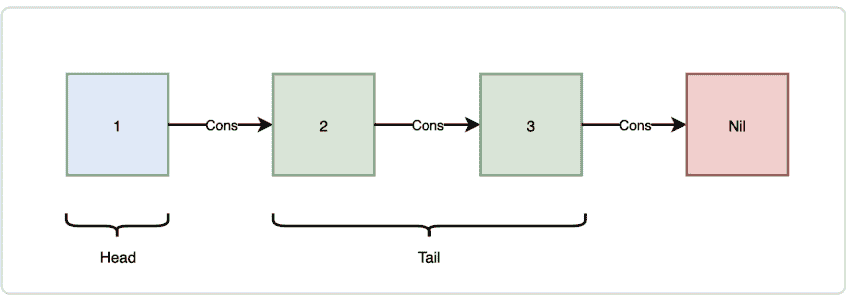

列表的头部是列表中的第一项。尾部是除头部外的所有内容。

在 `Data.List` 模块中，有一些函数可以获取 List 的头和尾：

```
head :: ∀ a. List a -> Maybe a
head Nil      = Nothing ①
head (x : _) = Just x ②

tail :: ∀ a. List a -> Maybe (List a)
tail Nil      = Nothing ③
tail (_ : xs) = Just xs ④
```

① 如果 List 为空，则无法获取头部，因此返回 `Nothing`。

② 这里我们对 `Cons` 运算符进行模式匹配，以获取列表头部。我们不在意尾部的命名，因此使用 `_`。

③ 如果 List 为空，则没有尾部。

④ 我们对 `Cons` 运算符进行模式匹配以提取尾部并返回。我们不在意头部，称之为 `_`。

我们将在接下来看到这种模式匹配是如何工作的。

> `Cons` 源于 Lisp，一种 20 世纪 50 年代的编程语言。Lisp 代表 List Processor（列表处理器）。在 Lisp 中，`cons` 是列表的构造器。

### 3.2. 模式匹配

在研究类型时，我们略过了 PureScript 中的模式匹配。让我们深入探讨一下。

> 模式匹配基于值的形状（Shape）和值本身（Value）来匹配。例如，`Just 10` 和 `Just 5` 具有相同的形状但不同的值，而 `Nothing` 和 `Just "xyz"` 具有不同的形状。

#### 3.2.1. case 表达式

一个简单的例子：

```
import Data.Maybe (Maybe(..)) ①

isNothing :: ∀ a. Maybe a -> Boolean ②
isNothing m = case m of ③
  Nothing -> true ④
  _       -> false ⑤
```

① `Maybe` 位于 `Data.Maybe` 模块中。`Maybe` 后面的 `(..)` 表示，除了导入类型 `Maybe` 之外，我们还要包含它的所有数据构造器。

② 别忘了 `∀ a.`。注意 `.` 终止了类型变量的定义。

③ 我们使用 `case` 对 `m` 进行模式匹配。

④ 我们的第一种情况是检查 `Nothing`。`->` 右侧的表达式是该模式匹配时函数的值。

⑤ `_` 通常是一个“不关心”的变量，在这里也有类似的语义。这是一个匹配任何模式的兜底情况，类似于“不关心”的模式。

还有一种更符合惯用法的写法，就是通过定义同一个函数的多个版本，但输入参数使用不同的模式：

```
import Data.Maybe (Maybe(..))

isNothing :: ∀ a. Maybe a -> Boolean
isNothing Nothing = true ①
isNothing _       = false ②
```

① 如果输入参数与 `Nothing` 匹配，将调用这个版本的 `isNothing`。

② 如果之前的任何版本都没有匹配，将调用这个版本的 `isNothing`。

我们的模式必须覆盖每个输入参数的所有可能值。该要求同样适用于 `case` 表达式。

如果你的模式不是穷尽的（exhaustive），即你遗漏了一种可能的情况，编译器会告诉你。

模式匹配从第一个定义开始，并依次进行后续定义。`case` 的模式匹配也是如此。因此，所有兜底情况必须放在最后。

如果某个情况不可达，例如你没有把兜底情况放在最后，编译器会告诉你。

#### 3.2.2. 字符串模式

让我们看另一个示例：


### 3.2.3. 数组模式

数组只能与固定长度的数组进行模式匹配。所以我们可以用模式匹配编写一个 `isEmpty` 函数：

```
isEmpty :: ∀ a. Array a -> Boolean
isEmpty [] = true ①
isEmpty _ = false
```

① 一个空数组字面量写作 `[]`。

我们还可以编写：

```
multiplyTwo :: Array Int -> Maybe Int
multiplyTwo [x, y] = Just (x * y)
multiplyTwo _      = Nothing
```

数组的模式匹配远不如 `List` 灵活。

#### 3.2.4. List 模式

当我们第一次看 `List` 时，我们看到两个辅助函数，`head` 和 `tail`：

```
head :: ∀ a. List a -> Maybe a
head Nil      = Nothing
head (x : _) = Just x ①

tail :: ∀ a. List a -> Maybe (List a)
tail Nil      = Nothing
tail (_ : xs) = Just xs ①
```

① `Cons` 运算符 `:` 可用于模式匹配。

符合惯用法的 PureScript（以及 Haskell）使用单个字符变量，例如 `x`，来表示 `List` 的头部，并且

同一个变量名后面加上一个 `s`，即 `xs`，用来表示尾部。

你可以把 `head` 想象成单个的 `x`，把 `tail` 想象成 `x` 的复数形式，即 `xs`。

让我们看看如何将 `Cons` 与模式匹配一起使用：

```
head :: ∀ a. List a -> Maybe a
head Nil        = Nothing
head (Cons x _) = Just x ①

tail :: ∀ a. List a -> Maybe (List a)
tail Nil        = Nothing
tail (Cons _ xs) = Just xs ②
```

① 我们就像匹配任何其他带有两个参数的数据构造器一样进行匹配。这里第一个参数 `x` 就是头部。

② 这里 `Cons` 的第二个参数 `xs` 就是尾部。

花点时间将其与使用运算符的 `head` 和 `tail` 进行比较。就个人而言，我更喜欢运算符版本。事实证明，你会更频繁地使用运算符来做模式匹配，而不是 `Cons`。

#### 3.2.5. 数组与列表的对比

对数组进行模式匹配时，需要知道它的确切大小。同时，你还得一次性处理数组的所有部分：

```
addThree :: Array Int -> Maybe Int
addThree [x, y, z] = Just (x + y + z)
addThree _        = Nothing
```

对于列表，我们可以编写能够处理任意长度列表的函数，而且在这种情况下，我们只需处理头部，然后通过递归继续处理列表的尾部：

```
sum :: List Int -> Int
sum Nil      = 0 ①
sum (x : xs) = x + sum xs ②
```

① 这个模式匹配匹配空列表，其长度为零。

② 我们通过模式匹配提取头部和尾部。然后把头部 `x` 与尾部的总和 `sum xs` 相加。

这个函数是递归的，但如果你不太擅长递归也不用担心。在接下来的章节中，我们会编写许多递归函数，它会变得越来越容易。

这里的关键点是，对于列表，我们不需要知道列表的大小，也不必像处理数组那样一次性处理列表中的所有元素。

数组在模式匹配上的限制意味着，无法使用模式匹配来为数组编写 `sum` 函数：

```
sum :: Array Int -> Int
sum ???? -- 这里无法写出一个模式
```

我们无法匹配任意大小的数组。这个问题有许多其他解决方案，其中之一是改用列表，或者将数组转换为列表，然后使用列表模式匹配。

稍后，当我们学习 `Fold`（折叠）时，我们会看到对数组求和的最佳解决方案。

#### 3.2.6. 记录模式

让我们从下面这些记录开始：

```
type Address =
  { street :: String
  , city :: String
  , state :: String
  , zip :: Int
  }

type Employee =
  { name :: String
  , jobTitle :: String
  , yearsAtCompany :: Int
  , address :: Address
  }

type Company =
  { name :: String
  , yearsInBusiness :: Int
  , address :: Address
  }
```

现在，让我们看看编写一个函数来检查员工是否为 CEO 的各种不同方式。首先，最直接的方式：

```
isCEO :: Employee -> Boolean
isCEO employee = if employee.jobTitle == "CEO" then true else false ①
```

① 访问 `Employee` 记录的字段使用 `employee.jobTitle`。

PureScript 中访问记录的语法使用点表示法，这与你在许多其他语言（例如 JavaScript）中看到的相同。但与 JavaScript 不同的是，你不能在运行时创建访问器。

我们继续，移除多余的 `if` 表达式：

```
isCEO :: Employee -> Boolean
isCEO employee = employee.jobTitle == "CEO"
```

现在让我们用模式匹配来写：

```
isCEO :: Employee -> Boolean
isCEO { jobTitle } = jobTitle == "CEO" ①
```

① `{ jobTitle }` 模式匹配 `jobTitle` 字段，并将其绑定到同名的局部变量。

当我们使用 `{ jobTitle }` 时，这被称为记录简写（Record Pun）。

由于我们只关心 `Employee` 记录中的 `jobTitle`，所以我们只指定了它。我们本可以指定该记录中的其他字段：

```
isCEOAndGates :: Employee -> Boolean
isCEOAndGates { name, jobTitle } = jobTitle == "CEO" && name == "Bill Gates"
```

让我们编写一个函数来检查公司是否在加利福尼亚州：

```
isCalifornia :: Company -> Boolean
isCalifornia { address: { state } } = state == "CA" ①
```

① 这就是如何对嵌套记录进行模式匹配。`address` 的类型是 `Address`，而 `Address` 是一个记录。不要漏掉 `address` 后面的冒号，这点很容易忘记。

如果我们想要函数同时检查公司和员工的所在州，会发生什么：

```
isCompanyCalifornia :: Company -> Boolean
isCompanyCalifornia { address: { state } } = state == "CA"

isEmployeeCalifornia :: Employee -> Boolean
isEmployeeCalifornia { address: { state } } = state == "CA"
```

这两个函数几乎一模一样。想象一下，我们还有其他带有 `Address` 字段的记录，也想检查它们所在的州。我们不得不一遍又一遍地重复这种样板代码。

有一种更通用的方式来编写这两个函数：

```
isCalifornia :: ∀ r. { address :: Address | r } -> Boolean ① ②
isCalifornia { address: { state } } = state == "CA"
```

① 我们必须记得定义 `∀ r`。别忘了变量定义后面的点号。

② 类型 `{ address :: Address | r }` 表示我们有一个记录，其中至少有一个名为 `address` 的字段，其类型为 `Address`。`| r` 表示可能还有其他字段，但我们不关心它们是什么。

这个定义的妙处在于，即使 `Company` 和 `Employee` 的其他字段不同，它也能同时匹配两者。那些其他字段由 `r` 表示，由于这个定义适用于所有 `r`，即 `∀ r`，因此它能匹配任何字段集合。

`r` 的技术术语是行类型。后面会详细讨论。

在对记录进行模式匹配时，还有一件重要的事情可以做，那就是重命名字段参数：

```
isCalifornia :: ∀ r. { address :: Address | r } -> Boolean
isCalifornia { address: { state: s } } = s == "CA"
```

重命名在字段名与作用域中的其他变量冲突时很有用，例如与同一模块中的函数名冲突。

在我们的例子中，可以想象我们重命名字段变量是因为在 `isCalifornia` 函数所在的模块中有一个名为 `state` 的函数。

我们还可以将记录中的字段匹配到特定值：

```
isCalifornia :: ∀ r. { address :: Address | r } -> Boolean
isCalifornia { address: { state: "CA" } } = true ①
isCalifornia _ = false ② ③
```

① 模式匹配 `state` 等于 `"CA"`。

② 使用这种方法，我们不得不提供同一函数的其他版本。在这种特定情况下，这种方式更加冗长。

③ 我们的兜底情况总是 `false`。

### 3.3. 逻辑控制

在 PureScript 中，只有少数几种方式进行逻辑决策：

- `if-then-else` 表达式

- `case` 表达式

- 模式匹配

- 守卫

#### 3.3.1. If-Then-Else 表达式

注意，我在描述 `if-then-else` 时使用了“表达式”这个词。因为它不像许多语言中那样是语句。一个 `if` 必须始终有 `else` 部分。要理解原因，让我们看一个简单的例子：

```
keepPositive :: Int -> Int
keepPositive x = if x < 0 then 0 else x ①
```

① 如果 `x` 为负数，我们强制将其设为 `0`，否则保持不变。

如果没有 `else` 部分，那么当 `x` 为 `-1` 时，`keepPositive x` 会求值成什么呢？

在 JavaScript 中，有一个类似的 `if` 表达式需要 else 部分：

```
const keepPositive = x => x < 0 ? 0 : x
```

JavaScript 也有一个 `if` 语句，但在 PureScript 中一切都是表达式，不可能在一种情况下求值某物而在另一种情况下什么都不做。我们总是求值一个表达式或调用一个函数，然后对该结果进行一些处理。

如果你有一个没有 `else` 的 `if` 语句，那么你通常是在做以下某件事：执行计算或调用函数并将结果存储到变量中，或者为了副作用而调用函数，等等。

首先，在纯函数式编程中没有副作用，所以这种情况对我们来说不适用。

其次，调用一个函数获取其返回值，或者进行计算获取其结果，本质上是一回事。而且

我们也可以这样做，但不能选择性地将该结果赋值给变量，因为这假设了两种情况之一：要么变量已经有值，这意味着我们会在修改它；要么它没有值，因此为 NULL。

这两种情况在 PureScript 中都是不允许的。这就是为什么我们只有 if 表达式。

#### 3.3.2. case 表达式

我们可以使用 `case` 表达式进行逻辑分支，但它仅限于模式匹配：

```haskell
data ContactMethod
  = Phone
  | Email
  | Fax

keepModern :: ContactMethod -> ContactMethod
keepModern preferredContactMethod =
  case preferredContactMethod of
    Phone -> Phone
    Email -> Email
    Fax -> Email ①
```

① 如果首选联系方式是 `Fax`（传真），我们将使用 `Email`（电子邮件）替代。

从技术上讲，我们可以使用 `case` 重写 `keepPositive`：

```haskell
keepPositive :: Int -> Int
keepPositive x = case x < 0 of
  true -> 0
  false -> x
```

虽然这在技术上是有效的，但与 `if-then-else` 版本相比，这个版本显得笨拙。

#### 3.3.3. 模式匹配

模式匹配与使用 `case` 非常相似：

```haskell
data ContactMethod
  = Phone
  | Email
  | Fax

keepModern :: ContactMethod -> ContactMethod
keepModern Phone = Phone
keepModern Email = Email
keepModern Fax = Email
```

> ① 这个版本比 `case` 表达式版本稍微更容易阅读。

仅使用模式匹配是无法编写 `keepPositive` 的。我们需要一种类似于 `if` 的操作方式，而模式匹配不允许这样做。

要是还有别的办法就好了……

#### 3.3.4. 守卫

守卫（Guards）是一种以简洁且可读的方式指定 `if` 逻辑的方法。初次遇到时语法有点奇怪：

```haskell
keepPositive :: Int -> Int
keepPositive x
  | x < 0      = 0
  | otherwise  = x
```

> ① 注意使用守卫时没有等号。这一点很容易忘记。

> ② 竖线 `|` 就是守卫。后面是一个布尔表达式、一个等号，以及在布尔表达式为 `true` 时该表达式的值。

> ③ 这一行表示如果 `x < 0` 为 `true`，则返回 `0`。

> ④ `otherwise` 被定义为等于 `true`，其存在只是为了更好地阅读守卫。它是兜底情况，我们直接返回 `x`。

我们也可以在 `case` 表达式中使用守卫：

```haskell
data ContactMethod
  = Phone
  | Email
  | Fax

keepModernIfYoung :: Int -> ContactMethod -> ContactMethod
keepModernIfYoung age preferredContactMethod =
  case preferredContactMethod of
    Phone -> Phone
    Email -> Email
    Fax | age < 40  -> Email ① ③
      | otherwise -> Fax ② ③
```

① 我们首先对 `Fax` 进行模式匹配，然后守卫开始生效。如果年龄小于 `40`，我们使用 `Email`。

② 我们的兜底情况适用于 `40` 岁及以上的人，我们将使用 `Fax`。

③ 别忘了在 `case` 表达式中，守卫使用的是 `->` 而不是 `=`。这一点同样容易忘记。

下面是守卫在 `case` 中的另一个示例：

```haskell
noBiggerThan10 :: Maybe Int -> Int
noBiggerThan10 x = case x of
  Just x | x > 10    -> 10 ①
        | otherwise -> x
  Nothing            -> 0
```

① 模式匹配在 `|` 的左侧，然后是条件，接着是箭头，最后是值。注意模式 `Just x` 中的 `x` 可以用于守卫的右侧。

守卫和模式匹配可以协同工作：

```haskell
takeWhile :: ∀ a. (a -> Boolean) -> List a -> List a ①
takeWhile p (x : xs) | p x = x : takeWhile p xs ②
takeWhile _ _ = Nil ③
```

① 接收一个谓词（Predicate）和一个列表（List），并在谓词满足时从列表头部开始取值。一旦谓词返回 `false`，它就停止，并返回到目前为止所取的所有元素组成的列表。

② `p x` 用谓词 `p` 检查列表头部 `x`。如果为 `true`，则将 `x` 添加到对 `takeWhile` 进行递归调用（使用尾部）的头部。如果为 `false`，由于没有兜底守卫，因此会转到另一个版本的 `takeWhile`。

③ 这个版本涵盖两种情况。首先，它是第一个带守卫版本中条件为 `false` 的情况。其次，它是空列表的情况，因为 `Nil` 不匹配第一个 `takeWhile` 版本的第二个参数，即 `(x : xs)`。

让我们回顾一下模式 `x : xs` 将匹配什么：


```haskell
1 : 2 : 3 : Nil    (x = 1, xs = 2 : 3 : Nil)
1 : 2 : Nil        (x = 1, xs = 2 : Nil)
1 : Nil            (x = 1, xs = Nil)
Nil                (NO MATCH)
```

> **谓词**（**Predicate**）是一个函数，它接收一个值，并根据有关该值的某种条件返回布尔值。例如，`isOdd :: Int -> Boolean` 接收一个`Int`，如果它是奇数则返回`true`。

### 3.4. Lambda 函数

之前，当我们稍微了解 Lambda 演算时，我们看到了 PureScript 中与 Lambda 演算函数等价的形式：

```haskell
\x -> x + 1
```

这个函数是一个匿名函数，即没有名称。我们可以通过将其命名为`f`来给它一个名称：

```haskell
f :: Int -> Int
f = \x -> x + 1
```

既然我们将其命名为`f`，就没有理由再使用 Lambda。我们也可以轻松地将参数写在等号另一侧来编写`f`：

```haskell
f :: Int -> Int
f x = x + 1
```

那么，为什么支持这种语法呢？Lambda 的真正好处是什么？

当你需要将一个函数传递给另一个函数，但它又不值得拥有一个正式名称，因为只会使用一次时，这种语法很有用：

```haskell
filter (\x -> x < 10) [1, 2, 3, 10, 20, 30] == [1, 2, 3]
```

这里 Lambda 函数是一个谓词，用于检查值是否小于 10。

`filter` 会保留`Array`中通过测试的所有元素。它会遍历我们的`Array`，调用我们的 Lambda，并将`Array`中的元素传入；如果 Lambda 返回`true`，则`filter`会保留该元素，否则它会被过滤掉。

请记住，没有变更（mutation），因此从`filter`返回的`Array`将是一个新的`Array`。

在 Lambda 中指定多个参数与普通函数非常相似：

```haskell
\x y -> x + y
```

它是以下写法的语法糖：

```haskell
\x -> \y -> x + y
```

如果你习惯使用 JavaScript，你已经见过类似的手动编写柯里化函数的模式：

```javascript
x => y => x + y // Javascript
```

有时函数拥有的参数比类型签名中指定的要多。当你第一次遇到这种情况时可能会感到困惑，但考虑到 Lambda 会有所帮助。

为了说明这一点，让我们检查一下`compose`函数，通常通过其二元运算符`<<<`调用，它组合两个函数：

```haskell
compose :: ∀ a b c. (b -> c) -> (a -> b) -> (a -> c)
compose f g x = f (g x)
```

- 1. `compose` 接受 2 个参数，都是函数，并返回一个函数。
- 2. 我们在这里指定了 3 个参数。怎么回事？
- 3. `f (g x)` 的类型是`c`，与类型签名中的返回值不匹配。这是怎么回事？

事实证明，这个函数等价于用 Lambda 编写：

```haskell
compose :: ∀ a b c. (b -> c) -> (a -> b) -> (a -> c)
compose f g = \x -> f (g x)
```

- 1. 现在它只接受 2 个参数。
- 2. 现在它返回一个从`a`到`c`的函数。等号右侧的 Lambda 接受一个类型为`a`的`x`，并返回类型为`c`的`f (g x)`。

### 3.5. 通配符

到目前为止，我们已经看到`_`被用作“不关心”变量。有时它也用作通配符。

#### 3.5.1. case 表达式

```haskell
data ContactMethod
  = Phone
  | Email
  | Fax

-- verbose version

keepModernIfYoung :: Int -> ContactMethod -> ContactMethod
keepModernIfYoung age preferredContactMethod =
  case preferredContactMethod of ①
    Phone -> Phone
    Email -> Email
    Fax | age < 40  -> Email
        | otherwise -> Fax

-- simpler with a wildcard

keepModernIfYoung' :: Int -> ContactMethod -> ContactMethod
keepModernIfYoung' age = case _ of ②
  Phone -> Phone
  Email -> Email
  Fax | age < 40  -> Email
      | otherwise -> Fax
```

① 注意，我们必须为一个参数提供名称，该参数会立即在 case 表达式中使用，之后不会再使用。

② 这里我们以 Point-free 风格编写该函数。这允许`_`代表第二个参数。它仍然是一个“不关心”变量，因为我们没有命名它，但作为通配符，我们实际上使用了这个值。

以下两行代码是等价的：

```purescript
keepModernIfYoung' age = case _ of

keepModernIfYoung' age = \someNameIHaveToThinkOf ->

  case someNameIHaveToThinkOf of
```

我认为这很好地说明了使用通配符（Wildcards）的好处。

#### 3.5.2. 运算符片段（Operator Sections）

通配符也可以用在*运算符片段*中：

```purescript
filter (\x -> x < 10) [1,2,3,10,20,30] -- [1,2,3]

filter (_ < 10) [1,2,3,10,20,30] -- [1,2,3]

filter (10 <= _) [1,2,3,10,20,30] -- [10,20,30]
```

- 1. 这是我们上面使用 Lambda 的`filter`函数调用。
- 2. 这里使用了运算符片段，其中的通配符位于运算符左侧。这与之前的函数调用等价。
- 3. 这里将通配符放在了运算符的另一侧。

> 运算符片段是带有括号括起来的一两个通配符变量的二元运算符。

以下也是合法的运算符片段：

```purescript
(_ <> "suffix")   -- 追加字符串 "suffix"

(_ / 10)          -- 除以 10

(10 / _)          -- 被 10 除

(_ == _)          -- 相等检查
```

- 1. 这些函数接受 1 个参数。
- 2. 这个函数接受 2 个参数。

#### 3.5.3. 记录（Records）

通配符可以用在记录中：

```purescript
\name age -> {name: name, age: age}

{ name: _, age: _ }
```

① 一个接受 2 个参数并返回一个用这些参数的值填充的记录的 Lambda。

② 这是前一行代码的通配符等价形式。参数顺序必须保持一致，这一点非常重要：从左到右遇到的第一个通配符对应第一个参数，第二个通配符对应第二个参数，以此类推。

记录的更新也可以使用通配符：

```purescript
\name age -> person { name = name, age = age } ①
person { name = _, age = _ } ②
```

① 这里有一个 Lambda，它接受一个`person`，更新其中的两个字段（`person`可能不止两个字段），并返回一个仅修改了这两个字段的新记录。请记住，不存在变异，因此`person`保持不变。

② 同样的事情可以用通配符配合这个语法完成。

另一个用于更新的通配符示例：

```purescript
\person -> person { age = 18 } ①
_ { age = 18 } ②
```

① 这个 Lambda 接受一个`person`，更新`age`，返回一个新的记录。

② 通配符等价形式。这个语法一开始看起来有点奇怪。

### 3.6. 绑定（Bindings）

我们有两种将值绑定到变量的方式。（别忘了，在函数式编程中，函数也是值。）

#### 3.6.1. where

```haskell
multSum :: Int -> Int -> Tuple Int Int ①
multSum x y = Tuple mult sum ②
  where
    mult = x * y ③ ⑤
    sum = x + y ④ ⑤
```

① `multSum` 接受两个整数，返回一个整数元组。

② 这里使用了变量`mult`和`sum`，但它们尚未定义。

③ `mult` 绑定到`x * y`。

④ `sum` 绑定到`x + y`。

⑤ `where` 部分只能访问与函数`multSum`同一层级的变量，即它的参数。任何局部函数变量都不能被`where`访问。

`where` 部分对于函数`multSum`是私有的。

这种绑定风格不会让人阅读时被过多的前置细节拖累。读者首先看到术语`mult`和`sum`，然后它们的实际定义放在`where`部分作为事后补充。

有时候，最好把计算中繁琐的细节放到后面，先在代码中呈现高层概念。

`Tuple mult sum` 已经传达了很多信息。它告诉我们元组第一个位置是某种乘法，第二个位置是加法。

等我们到了`where`部分，就能看到这些计算的具体细节。而且有时，根据函数的不同，我们可能根本不需要深究到这里。

对于换行的情况，下一行必须缩进到超过变量名首字符的位置：

```haskell
where
    mult = x * y
    sum = x
        + y ①
```

① 第一个字符至少要缩进到`sum`中s后面一个空格的位置。

#### 3.6.2. let

相反，`let` 则是在前面定义：

```haskell
multSum' :: Int -> Int -> Tuple Int Int
multSum' x y =
    let mult = x * y ①
    sum = x + y in ②
    Tuple mult sum
```

① `let` 和`where`一样，可以有多个定义。使用`let`时，我们得先让读者看这些细节，然后指定整体运算。

② `let` 块以保留字`in`结尾。

`let` 块中的绑定只在`in`块内有效。

与`where`必须是命名函数的一部分不同，`let`可以用作任何表达式的一部分：

```haskell
filter (\n -> let n2 = n * n in n == n2) [0, 1, 2] -- [0, 1]
```

如果你用`where`尝试这个，会遇到编译器错误：

```haskell
-- 非法
filter (\n -> n == n2 where n2 = n * n) [0, 1, 2] -- 编译器错误！！
```

对于换行，缩进规则与`where`类似：

```haskell
let mult = x * y
    sum = x
        + y in
Tuple mult sum
```

### 3.7. 二元运算符（Binary Operators）

我们已经见识过二元运算符的实际使用，但还没有正式定义它们。

> 二元运算符是由符号表示的、具有 2 个参数的函数。运算符左侧的值是第一个参数，右侧的值是第二个参数。

让我们看一个例子：

```haskell
data List a = Nil | Cons a (List a)

append :: ∀ a. List a -> List a -> List a ①
append xs Nil = xs ②
append Nil ys = ys ③
append (Cons x xs) ys = Cons x (append xs ys) ④

infixr 5 append as <> ⑤
```

① `append` 会将第二个列表追加到第一个列表之后。

② 第二种列表为空的情况。

③ 第一种列表为空的情况。

④ 一般情况：我们移除第一个列表的头部，并将其预先（PREPEND）到尾部列表追加结果的前面。

优先级数字越高，越先被求值。这里`*`高于`+`，所以它先被求值。

在我们上面的`append`定义中，我们指定了：

```haskell
infixr 5 append as <>
```

这把运算符`<>`定义为等价于以右结合（Right Associativity）和优先级 5 的中缀形式调用`append`。这意味着它会在同一表达式中任何优先级较低（即 4、3、2、1、0）的运算符之前被求值。

#### 3.7.3. 固定性（Fixity）

`infix` 表示中缀运算符，即它位于两个值之间：

```haskell
l1 <> l2
```

与之比较，前缀形式是：

```haskell
append l1 l2
```

我们可以在前缀位置使用中缀运算符，也可以在中缀位置使用函数：

```haskell
(<>) l1 l2 ①
l1 `append` l2 ②
```

① 要在前缀位置使用运算符，必须用括号把它括起来。

② 要中缀使用函数名，函数名必须用反引号括起来。

当中缀形式的命名函数有助于提高可读性时，这样使用是有意义的，例如`elem`是一个谓词，如果某个值是一个数组的元素，它就返回`true`：

```haskell
if 42 `elem` [1, -5, 42] then "YES" else "NO"
```

我们可以这样读：如果`42`是`[1, -5, 42]`中的一个元素……

### 3.8. 注释（Comments）

到目前为止我们见过行内注释，例如：

```haskell
add :: Int -> Int -> Int
add x y = x + y -- 两个数相加
```

行内注释以`--`开头。

块注释可以这样写：

```haskell
{- 这个函数将对两个数做加法
   并返回结果，也就是
   这两个数相加的和。
-}
add :: Int -> Int -> Int
add x y = x + y -- 两个数相加
```

以竖线字符`|`开头的注释被视为文档，供`psc-docs`和 Pursuit（PureScript API 文档的在线仓库）等工具使用。Pursuit 可以在 https://pursuit.purescript.org/ 找到。

### 3.9. 从类型签名推断功能

所有函数都有类型签名，无论是开发者显式定义的，还是编译器根据开发者使用参数的方式隐式确定的。

最佳实践要求模块中至少所有顶层函数都应该有显式的类型签名。

这不仅有助于提高代码库的可读性，还能帮助编译器生成更好的错误信息。但类型签名不仅仅对编译器有用。我们可以仅从类型签名中推断出很多信息。

看下面的类型签名：

```haskell
f :: Int -> Int -> Int
```

猜猜函数`f`可能是什么。

下面是`f`可能的一些函数列表：

```haskell
max :: Int -> Int -> Int
min :: Int -> Int -> Int
add :: Int -> Int -> Int
sub :: Int -> Int -> Int
mult :: Int -> Int -> Int
div :: Int -> Int -> Int
```

And we could go on from here.

But what about more abstract Type Signatures such as:

```haskell
f :: ∀ a. a -> a
```

How many Functions can you write that perform this? Try to list them all out before reading any further.

Remember, that `a` is an unknown Type to the developer of `f`. It can be ANY Type, e.g. an `Int`, `String`, `Array Unit`, `List (Maybe Int)`, anything.

Now how many Functions can you think of?

The way to think this through is to realized that you’re given a value of some UNKNOWN Type `a` and you have to return a value of some UNKNOWN Type `a`. You cannot write any code to look at the `a` because you don’t know what `a` is. But you still need to produce an `a`. And the only `a` you have is the one you’ve been given.

Therefore, there is only 1 Function that can have this signature:

```haskell
identity :: ∀ a. a -> a
identity x = x
```


`identity` takes the only `a` it has and returns it back unchanged since it doesn’t know anything about `a`.

What about the following Function:

```
f :: ∀ a b. a -> b
```

How many Functions can your write with this Type Signature?

Thinking this through, we are given an `a` and must produce a `b`. But we don’t know what Type `a` is and we don’t know what Type `b` is. So how are we supposed to convert an UNKNOWN `a` into an UNKNOWN `b`?

The answer is we cannot. There are no Functions with this Type Signature. If you find this hard to believe,

### How can we take this Partial Function and make it Total?

Here’s the Type Signature for a Total version:

```
f :: ∀ a. a -> List a -> a
```

Can you see what this does? Try to imagine the Function that we’d write for this Type Signature before moving on.

The newly added Parameter is a Default Value:

```
alwaysFirst :: ∀ a. a -> List a -> a
alwaysFirst def list = ... ❶
alwaysLast :: ∀ a. a -> List a -> a
alwaysLast def list = ... ❶
```

> ❶ The details of the Function are not important here.

If given an empty `List`, these Functions will return the supplied default.

Let’s try another Type Signature:

```
f :: ∀ a. a -> Int -> List a -> a
```

This is pretty close to the previous Type Signature with the addition of an `Int` Parameter. What can we do with that Parameter?

The most logical explanation is that the `Int` is an index into the `List`:

```
getAt :: ∀ a. a -> Int -> List a -> a
getAt def index list = ... ❶
```

> ❶ The details of the Function are not important here.

Once again, if given an empty `List`, this Function will return the supplied default.

What would you put in place of the `???` in the following:

```
f :: ∀ a. Int -> List a -> ???
```

This looks like our `getAt` Function above, but it’s just missing the default Parameter. That means that we could fail in the case of an empty `List`.

That means we have:

```
getAt :: ∀ a. Int -> List a -> Maybe a
getAt index list = ...
```

❶ `???` was replaced by `Maybe a` to account for the possibility of a failure.

❷ The details of the Function are not important here.

Here’s another one:

```
f :: ∀ a b. a -> Int -> (a -> b) -> List a -> b
```

This may seem pretty complex, but it’s actually not. It looks a lot like `getAt` but with the added Type `b` and the extra Parameter `a -> b`.

So this Function simply does what `getAt` does, but before it returns a Value, it converts it from Type `a` to `b` using the supplied conversion Function (3rd Parameter).

Here’s what this Function looks like:

```
getAtConvert :: ∀ a b. a -> Int -> (a -> b) -> List a -> b
getAtConvert def index convert list = ...
```

❶ The details of the Function are not important here.

But wait. I thought we couldn’t have a Function from `a -> b`. What gives?

While it’s true that we cannot write a Function from ANY `a` to ANY `b`, we could write a Function from `Int` to `String` and then call `getAtConvert` with it:

```
intToString :: Int -> String
intToString i = show i

getAtConvert (-1) 2 intToString (1 : 2 : 3 : Nil)
```

❶ Here our default value is `-1` and our index is `2`.

When we call this Function with `intToString`, our Type Parameter `a` gets unifies with `Int` and `b` gets unifies with `String`. Our `convert` Function’s Type is `a -> b` or, in this particular case, `Int -> String`. A Function from `Int` to `String` is a Function we can write.

We cannot have a free-standing Function with the Type Signature of `a -> b` since we cannot write code for converting ANY `a` to ANY `b`. But in this case, the caller of our Function can pick Concrete Types for `a` and `b`,

write a conversion Function for those Concrete Types and then pass that Function to us.

We don’t have any idea what `a` and `b` will be when we write our Function, so the best we can do is take something of Type `a` and give it to that Function to get a Value of Type `b`.

Notice that we didn’t need to look at the implementation of the Function to guess what that Function does and what roles the Parameters played in the Function.

For example, if we have the following:

```
inBetween :: Int -> Int -> Boolean
```

We have enough information to make a pretty good guess as to what it does and what each Parameter SHOULD be. In this example, convention would dictate that we have a starting and ending number in that order. The only real question is whether `inBetween` is inclusive of it’s endpoints or not.

If we see:

```
singleton :: ∀ a. a -> List a
```

We can surmize that this takes a Value of Type `a` and puts it into a `List`.

When we see:

```
f :: ∀ a. a -> a -> Maybe a
```

The best we can surmize here is that `f` takes 2 values of `a` and possibly returns one of them based on some internal criteria.

And with:

```
f :: ∀ a. a -> (a -> Boolean) -> Maybe a
```

We can see that we’re passing the criteria (Predicate) for returning `a`. The criteria is the 2nd Parameter which will take a an `a` and return `true` or `false`, which we can reasonably assume will be returned if `true` and not if `false`.

A lot can be determined by just looking at the Type Signatures of Functions. This process will come it handy when we start coding and we’re looking at library documentation that somewhat vague or incomplete, which unfortunately is more the rule than the exception.

### 3.10. Summary

We’ve learned a lot in this Chapter about some of the basic parts of PureScript from Types to common language constructs. There will be more to come. And while theory is important, getting some hands on experience can help cement that theoretical understanding. And often times, we think we understand something only to learn otherwise when we attempt to use our newfound knowledge.

You will probably find yourself returning to this Chapter as you work out the coming exercises. Now it’s time to get our hands dirty.

## Chapter 4. Installing PureScript

Of all the Chapters of this book, this one will become obsolete the fastest. That’s because in the software world things change constantly. The tools I’m going to suggest are the best ones that I know of at the time of this writing and I expect that they will be around for at least the next 5 years.

If you’re reading this around 2025 or after, you may want to check to see if there are newer/better tools than I’m suggesting here. Even then, I’d suggest you still read through this to make sure you’re getting all of the same features and capabilities.

### 4.1. Compiler and Tools

Navigating to `http://www.purescript.org/` in 2020, we find the following:


This will get you up and running pretty quickly, but I’d like to suggest NOT following this process. I believe installing the tools locally is a much better long term strategy. The choice is totally up to you but at least hear me out first.

I’d recommend installing `n`.

You can install `n` (visit The `n` GitHub repository for the latest instructions):

- Mac

  - Using Homebrew - `brew install n`

- Mac or Linux

  - Manual process - `curl -L https://git.io/n-install | bash`

- Windows

  - NOT SUPPORTED (see Node Version Manager for Windows)

Once `n` is installed, you can install Node using ONE of the following commands:

```
sudo n latest # install the latest release
sudo n lts # install the newest Long Term Support release
```

For Windows Users using `nvm` you can install Node using ONE of the following commands:

```
nvm install latest 64 # install latest release 64-bit version
nvm install latest 32 # install latest release 32-bit version
nvm install latest all # install latest release 64 & 32-bit versions
```

You can test that you have the right version of Node by running:

```
node -v # version should be at least 14.15.4 LTS or 15.7.0 for latest
```

You can double check that you have the right version by running:

```
npx -v # should display 5.2.0 or higher
```

If all is right here, then you’re ready to create your first PureScript project.

#### 4.1.2. Create Project


First thing we must do is to create a directory for our project. You probably have a location you keep your programs already and so I’d suggest you create a directory under that called `purescript` so you can keep all of your PureScript code together.

If your code is kept in a folder called `/dev`, then you’d run:

```
mkdir /dev/purescript
```

接下来，创建项目目录：

```
cd /dev/purescript
mkdir fp-book # or some other name you like better
cd fp-book
```

在继续之前 *请确保你位于项目目录中。*

接下来，我们将执行以下操作以完整创建我们的 PureScript 项目：

+   1. 初始化项目以使用 `npm` 和 `npx`。
+   2. 安装 `purescript` 和 `spago`（本地）。
+   3. 初始化项目以使用 `git`（可选）。如果你使用 VSCode，这很有用。

### 初始化项目以使用 `npm` 和 `npx`

要初始化你的项目，以便我们可以安装 `npm` 包并使用 `npx` 在项目内部运行编译器和构建工具，请运行：

```
npm init -y
```

这将创建一个名为 `package.json` 的文件。这将跟踪我们为生产和开发安装的任何包。例如，我们可能会安装 `uuid` 和 `uuid-validate`，它们是节点 `npm` 包，被 PureScript 包 `purescript-uuid` 所要求。

### 未来-proofing

由于技术变化如此之快，库、编译器和工具的新版本可能会破坏本书中的代码。为了保证你使用的是我写这本书时使用的完全相同的版本，我会要求你使用其显式版本安装 `spago` 和 `purescript`。你可以选择不这样做，但那么在编译器出现破坏性更改时你只能自求多福。

不用担心因为你使用的是较旧版本的编译器（约 2020 年）而错过什么。这里你将学习的概念是通用的，并且将在未来几十年内保持价值。

### 将 `purescript` 和 `spago` 安装到你的项目中

要本地安装 PureScript 编译器 `purescript` 和构建工具 `spago`，请运行：

```bash
npm install --save-dev spago@0.20.0 purescript@0.14.1
```

或者要冒险安装最新版本，请运行（记住，如果你选择这样做，你就自求多福）：

```bash
npm install --save-dev spago purescript
```

注意 `--save-dev` 选项。这将告诉 `npm` 这些包仅用于开发。

为了验证我们是否已本地安装了编译器，我们将使用 `npx`（注意 `x`）：

```bash
npx purs --version # should print out 0.14.1
```

`npx` 会在我们的本地 `node_modules` 目录中查找 `purs`，即 PureScript 编译器的名称，然后运行它并将所有其他命令行参数传递给它。参数 `--version` 告诉 `purs` 打印出其版本。

为了验证我们是否已本地安装了构建工具，请运行：

```bash
npx spago version # should print out 0.20.0
```

### 初始化项目以使用 `git`（可选）

要为使用 `git` 进行版本控制准备我们的项目，请运行：

```bash
git init # should print `Initialized empty Git repository in <dir>`
```

虽然这是可选的，但我仍然建议这样做。

#### 初始化 PureScript 项目

最后一步是使用 `spago` 初始化此项目以构建 PureScript 程序：

```bash
npx spago init
```

如果你好奇 `spago` 创建了什么，你应该查看项目目录的内容：

```bash
ls -l
```

如果你使用 git，你会很高兴知道 spago 为你提供了一个预填充的 `.gitignore` 文件。

我们可以通过运行以下命令构建项目：

```
npx spago build
```

或者我们可以通过运行以下命令构建并运行项目：

```
npx spago run # should print out the <spaghetti-emoji>
```

#### 第二个项目

虽然这看起来要启动和运行需要做很多事情，但其中大部分是首次配置。

要开始第二个项目涉及：

```
#### make project directory
mkdir /dev/purescript/second-project
#### enter project
cd /dev/purescript/second-project
#### initialize for using `npm` and `npx`
npm init -y
#### add compiler and build tools to the project
npm install --save-dev spago@0.20.0 purescript@0.14.1
#### initialize our `git` repo (Optional)
git init
#### create a skeleton PureScript project
npx spago init
#### build and run the skeleton project
npx spago run
```

### 编辑器和插件

截至本文撰写时，以下编辑器有 PureScript 插件：

+   1. Atom
+   2. Emacs
+   3. Sublime
+   4. Vim
+   5. VSCode

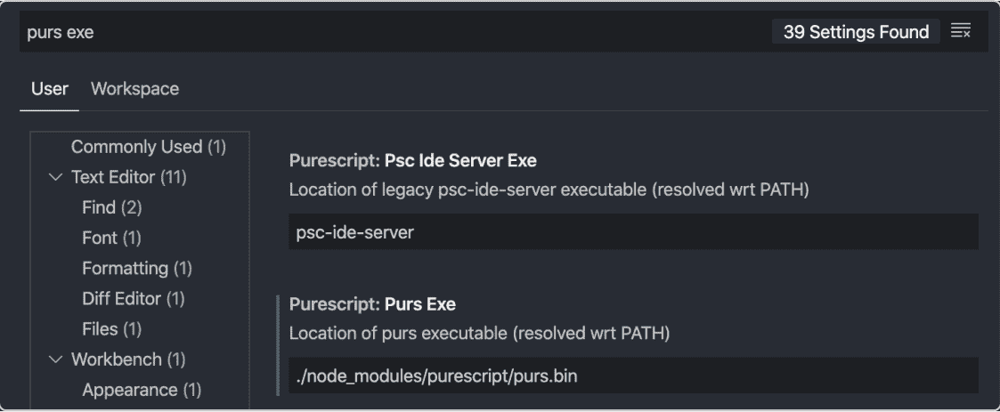

如果将来由于 npm 的某些更改而此位置发生变化，你将不得不定位 node_modules 中的 PureScript 编译器并使用适当的路径进行配置。

配置正确后，编辑器将在我们保存代码时编译，并在鼠标悬停时在弹出窗口中向我们显示错误消息：

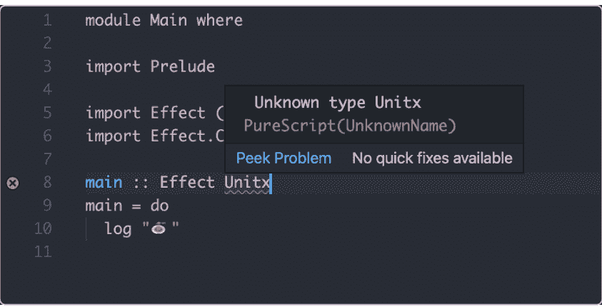

#### 配置编辑器

在 Windows/Linux 上使用 Ctrl-Shift-P 或在 Mac 上使用 Cmd-Shift-P 打开命令调色板。然后输入 open settings：

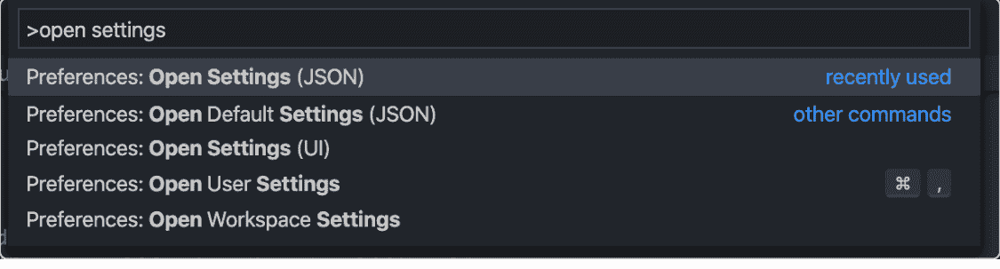

选择 `Preferences: Open Settings (JSON)`，你现在将编辑你的 `settings.json`。

将以下代码放在 JSON 对象中：

```json
"[purescript]": {
    "editor.tabSize": 2
}
```

它放在开头、中间或结尾都无关紧要：

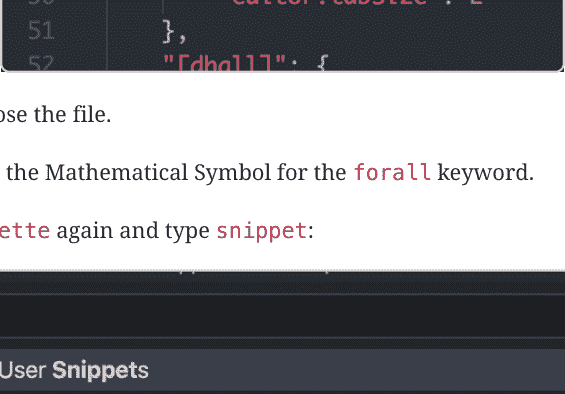

确保保存并关闭文件。

接下来让我们为 `forall` 关键字的数学符号添加一个片段。

再次打开 `Command Palette` 并输入 `snippet`：


选择 `Preferences: Configure User Snippets`，你会得到另一个菜单：

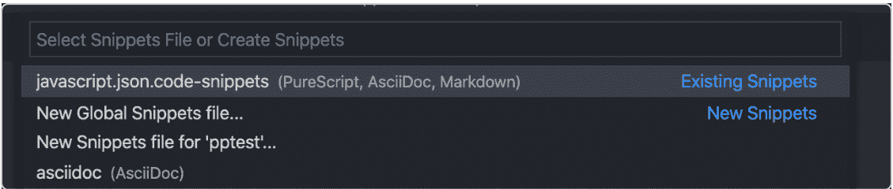

如果你已经有片段文件则选择它。我这里叫 javascript.json.code-snippets。

如果你第一次创建片段则选择 New Global Snippets file... 并命名为你能记住的名称：


你将被呈现你的片段 JSON 文件：

```
{
  // Place your global snippets here. Each snippet is defined under a snippet name and has a scope, prefix, body and
  // description. Add comma separated ids of the languages where the snippet is applicable in the scope field. If scope
  // is left empty or omitted, the snippet gets applied to all languages. The prefix is what is
  // used to trigger the snippet and the body will be expanded and inserted. Possible variables are:
  // $1, $2 for tab stops, $0 for the final cursor position, and ${1:label}, ${2:another} for placeholders.
  // Placeholders with the same ids are connected.
  // Example:
  // "Print to console": {
  //   "scope": "javascript,typescript",
  //   "prefix": "log",
  //   "body": [
  //     "console.log('$1');",
  //     "$2"
  //   ],
  //   "description": "Log output to console"
  // }
}
```

接下来将以下文本添加到 JSON 对象的末尾：

```
"Forall": {
  "scope": "purescript",
  "prefix": "fa",
  "body": "∀"
}
```

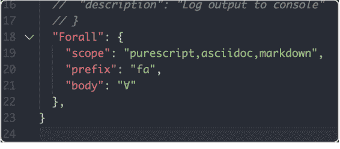

如果你将此书作为 PDF 阅读，则可以从本书中复制/粘贴。如果你阅读的是纸质书，则需要输入此代码。

输入 `∀` 的最简单方法是将其从互联网上复制并粘贴。搜索 `unicode forall` 或从此处获取 ForAll。

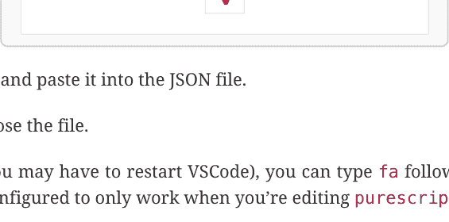

然后选择 `∀` 并将其复制并粘贴到 JSON 文件中。

确保保存并关闭文件。

配置完成后（你可能需要重新启动 VSCode），你可以输入 `fa` 然后按 `Tab`，`fa` 将被替换为 `∀`。这仅在你编辑 `purescript` 文件时有效。

最后，我建议安装 `One Dark Pro` 扩展。这是我在截图中使用的扩展，其配色方案非常适合 PureScript 和 Haskell。

如果你想这样做，只需安装扩展，然后点击 `Set Color Theme` 按钮：


你现在准备好开始用 PureScript 编程了。

## 第5章 PureScript基础编码

读书可能会让我们产生一种已经理解所读内容的错觉。这种情况在我身上尤其容易发生在编程学习中。当内容被讲解时，我们似乎理解了，但只有真正使用过后，我们才算完全理解。

所以这就是练习的意义所在。如果你和我一样，倾向于跳过书中的练习，请务必不要这样做。这些练习的深意远超表面所见。

许多概念会在练习中被引入。许多常用的库函数也会在这个过程中介绍。你还将学习如何编程，更重要的是，学会用函数式的思维方式使用PureScript。

### 5.1. Prelude

`Prelude` 是一个包含常用函数的库，几乎每个程序都会用到。与 Haskell 不同，你必须在代码中显式 `import` 这个模块：

```purescript
import Prelude
```

像这样导入模块时，*所有*导出的函数都会被导入到你模块的全局命名空间中。如果它们与其他模块的函数发生命名冲突，就会带来问题。

假设我们有一个名为 `AnotherModule` 的模块，它导出了 `identity` 和 `doSomething`。如果我们按如下方式导入，然后尝试使用 `identity`：

```purescript
import Prelude
import AnotherModule

id = identity   -- COMPILER ERROR!!
```

编译器会抱怨 `identity` 有歧义：

```
module Ch5 where

import Prelude
import AnotherModule

id = identity
    identity :: Int

    Conflicting definitions are in scope for value identity from the following modules:

    AnotherModule
    Prelude
    PureScript(ScopeConflict)

Peek Problem  No quick fixes available
```

我们可以通过*选择性导入*来解决这个问题：

```
import Prelude
import AnotherModule (doSomething) ①

id = identity
```

① 导入 AnotherModule，但只包含 doSomething。

或者，我们可以决定使用来自 AnotherModule 的 identity，但希望同时使用 Prelude 中的其他所有内容：

```
import Prelude hiding (identity) ①
import AnotherModule (identity, doSomething) ②

id = identity
```

① 导入 Prelude，但*隐藏* identity，即不导入它。

② 显式指定从 AnotherModule 导入 identity 和 doSomething。

> 良好实践是*显式*指定从模块导入的所有函数。在小型程序中，不这样做也没关系，但随着代码库的增长，要确定函数从哪里导入就变得越来越困难。这条规则的唯一例外是 Prelude。

但如果我们有时想用 Prelude 的 identity，有时想用 AnotherModule 的呢？

```
module Ch5 where ①

import Prelude (Unit) ②

import Effect (Effect) ③
import Effect.Console (log)

test :: Effect Unit ③
test = do ③
  log "test" ④
```

① 我们定义并命名我们的模块。

② 我们只导入 Unit 类型，因为在这里我们要自己编写许多 Prelude 函数的版本，不希望产生命名冲突。

③ 先不用管这几行。之后讨论 Effects 时我们自然会讲到。

④ 这会将字符串 test 记录到控制台。我们稍后会删除它。

现在，为了在 Node 中运行这个程序，我们可以在 VSCode 中按 Ctrl+` 打开终端，然后输入：

```
npx spago run
```

我们的程序应该打印出字符串 test。

我们现在可以开始写代码了。

### 5.3. Pursuit

由于我们要编写大量 Prelude 库中已经存在的函数，我们应该习惯查找函数定义。

有一个网站可以用来做这件事，叫做 Pursuit。你可以在 https://pursuit.purescript.org/ 上找到它。打开网站后，你可以使用搜索字段搜索函数。

在编写本章中的任何函数之前，请先查阅 Pursuit，找到它的类型签名以及它的功能。

让我们在搜索框中输入函数名 flip，然后按回车：


你应该会看到以下定义：

#### 搜索结果

#### `flip`

```purescript
flip :: forall a b c. (a -> b -> c) -> b -> a -> c
```

翻转两个参数函数的参数顺序。

```purescript
flip const 1 2 = const 2 1 = 2
```

这个函数的类型签名是：

```purescript
flip :: ∀ a b c. (a -> b -> c) -> b -> a -> c
```

如 `Pursuit` 所示，我用 `∀` 代替了 `forall`。

我们想了解这个函数做什么，有时会得到一个不错的示例（有时则没有）：

```purescript
flip const 1 2 = const 2 1 = 2
```


遗憾的是，我们现在还不知道`const`是做什么的，所以这个示例帮助有限。它只是说，对`const`函数（不管它做什么）调用`flip`，并传入参数`1`和`2`，等同于将参数调换顺序后调用`const`。它还展示了`const`调用的结果是`2`。

另一个需要注意的是`flip`所在的包和模块。包是`purescript-prelude`，模块是`Data.Function`。

#### 5.4. 编写 `flip`

有时候，某个函数的参数顺序不符合我们的使用需求。这就是`flip`发挥作用的地方。尝试在`Ch5`模块中编写`flip`，然后在你的`test`函数中加入下面这一行：

```purescript
log (show (flip const 1 2))
```

另外，删除这一行：

```purescript
log "test"
```

你的模块应该看起来像这样：

```purescript
module Ch5 where

import Prelude (Unit, show, const) ① ②

import Effect (Effect)
import Effect.Console (log)

test :: Effect Unit
test = do
  log (show (flip const 1 2)) ③
```

① 我们需要 Prelude 中的 show 函数，以便将我们最终从 flip const 调用中得到的 Int 转换为可以传给 log 的 String。

② 我们暂时也需要 const。最终，我们会自己编写这个函数，所以到时候需要移除它。

③ 这是我们的测试代码。

现在你只需要编写`flip`函数。请先不要看后面的内容，自己尝试一下。完成之后，或者卡住了，再继续往下看。

##### 5.4.1. flip 的提示

让我们仔细看看`flip`的类型签名的细节：

```purescript
flip :: ∀ a b c. (a -> b -> c) -> b -> a -> c
```

它告诉我们，`flip`接受一个两个参数的函数（a 和 b 返回 c）、一个类型为 b 的参数、一个类型为 a 的参数，并返回一个类型为 c 的值。

我们的第一步是给这些参数命名：

```purescript
flip :: ∀ a b c. (a -> b -> c) -> b -> a -> c
flip f x y = ???
```

看看这样是否能帮助你写出这个函数。

##### 5.4.2. `flip` 的代码

下面是`flip`的代码：

```purescript
flip :: ∀ a b c. (a -> b -> c) -> b -> a -> c
flip f x y = f y x
```

❶ 我们用颠倒后的参数顺序来调用 f。

我们可以运行程序来测试：

```bash
npx spago run
```

它应该打印出 2。

##### 5.4.3. `flip` 的另一种写法

如果`flip`的类型签名加上多余的括号，会怎样呢：

```purescript
flip :: ∀ a b c. (a -> b -> c) -> (b -> a -> c)
```

现在它接受一个函数并返回一个函数。由于类型签名是右结合的，这些括号实际上是隐性的，但看到它们会改变我们看待这个函数的方式。

如果你看到这个版本的类型签名，你可能会用不同的方式编写它：

```purescript
flip :: ∀ a b c. (a -> b -> c) -> (b -> a -> c)
flip f = \x y -> f y x
```

❶ 我们返回一个 Lambda 函数。

还记得我们讨论 Lambda 函数时，说过把参数移到等号另一边吗？这里就正是这样做的。

顺便说一句，事实证明我们的第一个`flip`版本是地道的 PureScript 写法。但看看其他的编写和思考方式也不错。

为了好玩，这里还有另一种同样有效的写法：

```purescript
flip :: ∀ a b c. (a -> b -> c) -> b -> (a -> c)
flip f x = \y -> f y x
```

❶ 这里多余括号的位置不同。

❷ 接受一个函数和一个类型为 b 的参数，并返回一个一元函数。

顺便说一句，这三个版本是等价的：

```purescript
flip f = \x y -> f y x
flip f x = \y -> f y x
flip f x y = f y x
```

类型签名也是如此：

```purescript
flip :: ∀ a b c. (a -> b -> c) -> (b -> a -> c)
flip :: ∀ a b c. (a -> b -> c) -> b -> (a -> c)
flip :: ∀ a b c. (a -> b -> c) -> b -> a -> c
```

如果你仍然觉得困惑，请回去重新阅读关于 Lambda 函数的那一节。

### 5.5. 编写 const

在继续阅读之前，先在 Pursuit 上查一下`const`，看看你是否能弄清楚它的作用以及如何使用。

`const`用于当你调用某个函数时，该函数需要一个函数来执行一个操作，但这个操作从不变化，而是总是返回一个**恒定**的值。

在编写`const`之前，记得将它从`Prelude`的导入中移除：

```purescript
import Prelude (Unit, show) ❶
```

❶ 因为我们要自己编写 const，所以把它从 Prelude 导入的函数列表中移除。

现在，你可以开始编写`const`了。

#### 5.5.1. const 的提示

查看`const`的类型签名：

```purescript
const :: ∀ a b. a -> b -> a
```

我们可以看到，第一个参数 a 被返回，第二个参数 b 被忽略。

这应该能告诉我们如何编写它。来试试吧。

#### 5.5.2. Code for const

```purescript
const :: ∀ a b. a -> b -> a
const x _ = x
```

1. 我们不关心第二个参数，因此使用`_`，并且我们只返回第一个参数。

如果不知道这有什么用处，也许一个简单的例子会有所帮助：

```purescript
filter (\n -> n > 2) [1, 2, 3]  -- [3]
filter (const true) [1, 2, 3]  -- [1, 2, 3]
```

1. 用于过滤的谓词是一个 Lambda 函数，它接受单个参数`n`并返回一个布尔值，该布尔值告诉`filter`是否在结果数组中保留该元素。

2. 这里`const true`是谓词，当它从数组中传入一个元素时，会忽略它（因为它是`const`的第二个参数），然后只返回`true`（`const`的第一个参数）。

注意`const true`是对`const`函数的部分应用，即我们还没有完全给出它的所有参数。通过部分应用，我们实际上是在“烘焙”我们希望此函数返回的常量值。记住`const`会忽略其第二个参数并始终返回第一个参数。

> 把`const`想象成一个常量函数而不是常量值。`const true`是一个常量函数，而`true`是一个常量值。

你的模块现在应该看起来像这样：

```purescript
module Ch5 where

import Prelude (Unit, show)

import Effect (Effect)
import Effect.Console (log)

flip :: ∀ a b c. (a -> b -> c) -> b -> a -> c
flip f x y = f y x

const :: ∀ a b. a -> b -> a
const x _ = x

test :: Effect Unit
test = do
  log (show (flip const 1 2))
```

并且运行后仍应打印 2，假设我们正确编写了`const`，因为现在我们的测试代码使用的是我们的`const`而不是 Prelude 的。

### 5.6. The Apply Operator (`$`)

PureScript 中经常使用的一个非常有用的运算符是`$`。虽然这个运算符很容易实现（我们很快就会这样做），但它在通过消除括号来减少编码噪音方面非常强大。

让我们看看我们的测试函数：

```purescript
test :: Effect Unit
test = do
  log (show (flip const 1 2)) ①
```

① 最好能减少这些括号。

使用 Apply 运算符我们可以从该行代码中删除所有括号：

```purescript
test :: Effect Unit
test = do
  log $ show $ flip const 1 2 ①
```

① 等价于带括号的语句。

我们可以把`$`想象成在`$`所在位置添加一个开始括号，并在行尾添加一个结束括号。

现在，让我们编写该函数：

```purescript
apply :: ∀ a b. (a -> b) -> a -> b
apply f x = f x
```

嗯，这很简单。

接下来，尝试编写该运算符。

#### 5.7.1. Hint for (`$`)

很可能，当你读到上一节的最后一句话时，你会感到困惑。我知道我会。即使我们谈论过运算符并且我们看过它们是如何定义的，我们从未**创建**过自己的运算符。

这就是练习如此重要的原因。它迫使你真正理解事物。

所以这里有一个关于如何创建运算符的快速复习：

1. 决定你的中缀运算符的结合性并相应地使用以下之一：

   1. `infixl`（左结合）。

   2. `infixr`（右结合）。

   3. `infix`（非结合）。

2. 决定优先级（优先级越高越先执行）。

这里有一个虚构的运算符`!!!`的例子，它是右结合的并且优先级为`3`：

```purescript
infixr 3 notReal as !!!
```

现在看看你是否能为`apply`编写一个右结合、优先级为 0 的运算符。（这些选择很快就会变得显而易见。）

#### 5.7.2. Code for (`$`)

以下是`apply`及其运算符的代码：

```purescript
apply :: ∀ a b. (a -> b) -> a -> b
apply f x = f x

infixr 0 apply as $
```

你可能想知道我们是如何知道为结合性和优先级选择什么的。对于这个运算符，这是一个非常简单的过程，这对所有运算符都不成立。

如果我们思考括号的优先级，它将是 9，因为它具有最高的优先级，因此最先被求值。

让我们回到带括号的代码：

```purescript
test :: Effect Unit
test = do
  log (show (flip const 1 2))
```

我们说的是我们希望括号内的所有内容先发生。这意味着我们希望括号内的结果最后被应用到`log`。

因此，如果我们要用新的运算符`$`来表示该应用，我们希望它的优先级是最后的，这样`$`右侧的所有内容都会先被求值，就像被括号包围一样。

这就是为什么它具有 0 的优先级，并且我们可以用它来代替括号。

在考虑该运算符的结合性时，我们需要记住运算符是如何定义的。我们说过它相当于在`$`指定的位置添加一个开始括号，并在行尾添加一个结束括号。

这告诉我们，在同一行代码中对运算符的重复使用应该像其括号等价物一样工作，而括号在行尾收集：

```purescript
log $ show $ flip const 1 2  -- log (show (flip const 1 2))
```

右结合意味着括号向右收集。这正是我们在这里看到的，这就是我们选择`infixr`的原因。

现在更改你的测试代码以使用`$`并重新运行它。它仍应打印 2。

### 5.8. Writing the Apply Flipped Operator (`#`)

PureScript 中还有另一个非常有用的运算符`#`。但它为什么有用更难理解，所以让我们看一个例子：

```purescript
f x =
  step3 (step2 (step1 x))
```

这里我们有一个函数，它按顺序执行 3 个函数`step1`、`step2`和`step3`。但我们从左到右书写的顺序，与执行顺序相比感觉是 inside-out。内部的括号最先执行，然后是下一个括号，最后`step3`使用结果被调用。

所以让我们使用我们新造的运算符`$`重写它：

```purescript
f x =
  step3 $ step2 $ step1 x
```

它不再是 inside-out 了，但由于我们从左到右阅读代码，它感觉是反的。`step1`先被调用，然后是`step2`然后是`step3`。执行是从右到左。

很多时候，我们喜欢把事情看作一系列操作。用英语写出来就是“取`x`并将其应用到`step1`，然后取该结果并将其应用到`step2`，然后最后将该结果应用到`step3`。”

这只是一种不同的思考方式，如果这样更有意义，我们希望能够以这种方式编码。

好吧，我们可以用`$`运算符的翻转版本，即`#`来做到这一点：

```purescript
f x = x
  # step1
  # step2
  # step3
```

这段代码读起来就像我们上面的英语句子一样。而且由于我们从上到下阅读代码，步骤的顺序就是它们被应用的顺序。

现在，在继续之前，编写`applyFlipped`及其运算符`#`。

#### 5.8.1. Code for `applyFlipped` and (`#`)

首先看签名：

```purescript
applyFlipped :: ∀ a b. a -> (a -> b) -> b
```

我们可以看到它名副其实。它的类型签名只是`apply`类型签名的翻转版本，这意味着我们可以使用`flip`在`apply`上编写此函数：

```purescript
applyFlipped :: ∀ a b. a -> (a -> b) -> b
applyFlipped = flip apply
```

如果此实现不够清晰，请看手动编写的版本：

```purescript
applyFlipped :: ∀ a b. a -> (a -> b) -> b
applyFlipped x f = f x
```

接下来，我们关注运算符的优先级和结合性。

让我们回顾一下`#`的示例用法：

```purescript
f x = x
  # step1
  # step2
  # step3
```

由于我们希望先将`x`应用到`step1`然后是`step2`等，我们应该添加括号来反映这一事实：

```purescript
f x = (((x
  # step1)
  # step2)
  # step3)
```

① 注意括号是如何向左收集的。

这告诉我们我们想要使用`infixl`进行左结合。

为了确定优先级，让我们再次看一下`#`的示例用法：

```purescript
f x = x
  # step1
  # step2
  # step3
```

① 想象一下我们的`x`是一个更复杂的计算，例如`x + 10`。

如果我们用`x + 10`替换`x`，我们希望该计算**在**我们将其应用到`step1`之前发生：

```purescript
f x = (x + 10)
  # step1
  # step2
  # step3
```

① 括号将保证`x + 10`先求值。

如果不必输入括号，我们其实并不想输入。这意味着我们希望`#`的优先级是*最后*。

基于以上所有考虑，我们选择如下运算符定义：

```purescript
infixl 0 applyFlipped as #
```

这个定义在一段时间内尚可，但在实际使用中，我们最终会遇到以下问题：

```purescript
g x = lastStep $ x
  # step1      -- COMPILER ERROR!!
  # step2
  # step3
```

但为什么呢？

以下是编译器错误：

```text
# :: ∀ a b. a → (a → b) → b
Cannot parse an expression that uses operators of the same precedence but mixed associativity:

Ch5.(#) is infixl
Ch5.($) is infixr

Use parentheses to resolve this ambiguity.
PureScript(MixedAssociativityError)
Peek Problem   No quick fixes available
```

编译器强制我们添加*显式*括号。但`$`的全部意义就在于减少括号，而现在我们对`#`的定义正在破坏这一点。

我们该如何解决？

编译器错误表明，问题出在具有*混合*结合性的*相同*优先级运算符上。

这意味着我们只有两种方法可以解决：

- 更改结合性，使它们保持一致。

- 更改优先级，使它们不再相同。

方案 1 不可行，因为它会彻底改变我们运算符的语义：

```purescript
f x = (x
  # (step1    -- COMPILER ERROR!!
  # (step2
  # step3)))
```

而且它无法再通过类型检查，因为函数会被传递给其他函数，这不是我们想要的。

方案 2 才是我们唯一现实的选择。

那么我们该如何更改优先级呢？

编译器之所以不满，是因为它们的优先级完全相同，而我们希望`#`*最后*求值：


```purescript
g x = lastStep $ x
  # step1    -- COMPILER ERROR!!
  # step2
  # step3
```

但如果我们稍微思考一下这段代码，就会发现我们其实并不希望 `#` 垫底。我们只希望它排在最后，正好在 `$` 之前。

而我们的解决方案正在于此：

```purescript
infixl 1 applyFlipped as #
```

我们让 `#` 的优先级为 `1`，这意味着当它与其他运算符一起使用时，它将在最后求值，而 `$` 则会在垫底求值。

我们最终的解决方案是：

```purescript
applyFlipped :: ∀ a b. a -> (a -> b) -> b
applyFlipped = flip apply

infixl 1 applyFlipped as #
```

我们应将下面这一行添加到测试函数中来测试这段代码：

```purescript
flip const 1 2 # show # log
```

但随后编译器会报错：

```purescript
test :: Effect Unit
test = do
  log $ show $ flip const 1 2   -- COMPILER ERROR!!
  flip const 1 2 # show # log
```

① `do` 块是一种特殊语法，我们将在本书更高级的部分学习它。

这个错误似乎毫无来由，令人费解：

```text
Unknown value discard. You’re probably using do-notation, which the compiler replaces with calls to the discard function. Please import discard from module Prelude
PureScript(UnknownName)
Peek Problem  No quick fixes available
log $ show $ flip const 1 2
flip const 1 2 # show # log
```

有一些内部函数通常由 `Prelude` 导入，用于 `do` 语法。由于我们决定在模块中只从 `Prelude` 导入几项，因为我们正在重写一些 `Prelude` 函数，所以我们没有导入 `do` 语法函数。

根据错误消息，我们可以通过将 `discard` 添加到 `Prelude` 导入列表来修复此问题：

```purescript
import Prelude (Unit, show, discard)
```

现在我们的程序可以编译了，运行时应该会打印两次 `2`。

### 5.9. 准备编写 Data.List 函数

本章我们将编写的其余函数将来自 `Data.List`。

我们需要有选择地从 `Data.List` 导入，这样我们就不必把一切都写出来。

要包含 `List` 功能，请将以下内容添加到导入中，并保持导入列表按字母顺序排列（`Prelude` 除外，它排在第一位）：

```purescript
import Data.List (List(..), (:))
```

① `List(..)` 是一种简写，表示导入 `List` 类型及其所有数据构造器。其完整写法是 `List(Nil, Cons)`。

② `(:)` 导入 `Cons` 运算符。

你的导入现在应该如下所示：

```purescript
import Prelude (Unit, show, discard)

import Data.List (List(..), (:))
import Effect (Effect)
import Effect.Console (log)
```

① 这应该会产生一个编译器错误。

原来我们还没有 `List` 包。如果你在 `Pursuit` 中搜索 `Data.List`，你会找到包含此类型的包：

**模块 Data.List**

该模块定义了一种 *严格* 链表类型，以及相关的辅助函数和类型类实例。

*注意：* 根据你的用例，你可能更倾向于使用 `Data.Sequence`，它在某些用例下可能会提供更好的性能。在纯函数式环境中处理不可变数据列表时，该模块是对 `Data.Array` 的改进，但它不具备良好的随机访问性能。

**包：`purescript-lists`**

在底部，我们看到 `purescript-lists` 是包名。

要向构建中添加包，我们需要编辑 `spago.dhall` 文件。添加包时，我们总是去掉 `purescript-` 前缀。因此，我们需要将 `lists` 添加到 `dependencies` 中：

```dhall
{-
Welcome to a Spago project!
You can edit this file as you like.
-}
{ name = "my-project"
, dependencies =
  [ "console"
  , "effect"
  , "lists"
  , "prelude"
  , "psci-support"
  ]
, packages = ./packages.dhall
, sources = [ "src/**/*.purs", "test/**/*.purs" ]
}
```

① 这将添加包含我们所需模块（`Data.List`）的包。

完成此操作后，重新构建你的程序：

```bash
npx spago build
```

这将安装 `purescript-lists` 包并编译它。

你会得到一堆警告。原因有两点。

首先，我们还没有使用 `Data.List`，因此出现以下警告：

```text
Warning 9 of 9:

    in module Ch5
    at src/Ch5.purs:5:1 - 5:33 (line 5, column 1 - line 5, column 33)

    The import of Data.List is redundant

    See
https://github.com/purescript/documentation/blob/master/errors/UnusedImport.md
for more information,
    or to contribute content related to this warning.
```

其余 `8` 个警告是因为 `PureScript` 库中某些内容尚未跟上。

### 5.10. List 类型

```purescript
Cons 1 (Cons 2 (Cons 3 Nil))
```

你还可以使用 `Cons` 二元运算符：

```purescript
1 : 2 : 3 : Nil
```

### 5.11. 编写 singleton

现在将下面这一行添加到测试中：

```purescript
log $ show $ singleton "xyz"
```

① 应该打印出 `("xyz" : Nil)`。

现在，在继续阅读之前，先编写 `singleton` 函数。

#### 5.11.1. singleton 的代码

这个函数非常简单：

```purescript
singleton :: ∀ a. a -> List a
singleton x = x : Nil
```

① 使用 `Cons` 运算符。

也可以使用 `Cons` 来编写：

```purescript
singleton :: ∀ a. a -> List a
singleton x = Cons x Nil
```

① 这仅仅是前缀版本，而运算符版本是中缀版本。

我更喜欢运算符版本，因为它更简洁。

### 5.12. 编写 null

如果你来自一个存在 `NULL` 的语言，我希望你意识到这里所说的不是一回事。这个函数用于检查列表是否为空。

虽然你可以用 `if` 或 `case` 来编写这个函数，但更地道的做法是使用模式匹配。所以请尝试采用这种方法。

另外，将下面几行添加到测试中来测试你的代码：

```purescript
log $ show $ null Nil
log $ show $ null ("abc" : Nil)
```

① 应该打印出 `true`。

② 应该打印出 `false`。

在继续之前，先试一试编写它。

#### 5.12.1. null 的代码

你能仅通过查看其类型签名就判断出 `null` 是什么类型的函数吗？

```purescript
null :: ∀ a. List a -> Boolean
```

任何签名形式为 `a -> Boolean` 的函数都是谓词。在这种情况下，我们谓词类型签名中的 `a` 代表 `null` 类型签名中的 `List a`。

下面是使用模式匹配编写的 `null` 代码：

```purescript
null :: ∀ a. List a -> Boolean
null Nil = true
null _ = false
```

① 空列表的情形。

② 全匹配（兜底）情形。

注意，我们没有使用 `if` 或 `case` 表达式。模式匹配要干净得多。

### 5.13. 编写 snoc

这个函数的名字是 `Cons` 反转而来。既然 `Cons` 将元素放在 `List` 的头部，那你认为 `snoc` 会做什么呢？

它将元素放在末尾。在编码之前，先想想你打算如何解决这个问题。

另外，将下面这一行添加到测试中来测试你的代码：

```purescript
log $ show $ snoc (1 : 2 : Nil) 3
```

① 应该打印出 `(1 : 2 : 3 : Nil)`。

#### 5.13.1. snoc 的提示

你是否尝试过写类似下面的代码：

```
snoc :: ∀ a. List a -> a -> List a
snoc l x = l : x   -- COMPILER ERROR!!
```

之所以行不通，是因为 `l` 是列表而 `x` 是元素。这不是 `Cons` 运算符想要的。它期望在列表头部放置一个元素，而不是尾部。

记住，列表本质上是链表。在列表头部添加元素很容易且快速。在列表尾部添加元素需要以下策略：

+   1. 解开列表直到到达末尾。这需要递归。

+   2. 在列表末尾，返回只包含一个元素的列表，即我们要添加到末尾的元素。

+   3. 在返回递归调用时，一次一个元素地将列表重新组合起来。

希望这有所帮助。尝试使用此策略再次编写该函数。

#### 5.13.2. snoc 的代码

根据我们的策略，让我们先实现递归的基例（#2）：

```
snoc :: ∀ a. List a -> a -> List a
snoc Nil x = singleton x ① ②
```

① 这是我们策略中的基例（#2）。我们已到达列表末尾（或从空列表开始），并且我们只需返回一个包含我们想要放在列表末尾的元素的单例列表。

② 我们还没有完成。这个函数是一个部分函数，编译器会抱怨因为并非所有情况都已穷尽。

> 递归函数的基例是终止递归调用的情况。如果递归函数没有基例，那么它就是无限递归的，永远不会产生输出值。

下一步是弄清楚下一个模式匹配应该是什么。查看到目前为止的函数，我们可以看到我们已经处理了空列表的情况，所以我们需要一个非空列表的模式匹配。

让我们只添加这一部分：

```
```purescript

snoc :: ∀ a. List a -> a -> List a

snoc Nil x       = singleton x

snoc (y : ys) x = ???

```
```

> ❶ 这将匹配具有模式 `(y : ys)` 的非空列表。

我们需要问自己的下一个问题是是否还有其他情况。我们有空 `List` 情况和非空 `List` 情况。由于这涵盖了所有情况，我们现在有一个总函数。

现在我们要做的就是弄清楚 `???` 应该放什么。

重新审视我们的策略 #1，它说：

> 解开 `List` 直到到达末尾。这需要递归。

解开列表本质上就是我们在非空 `List` 情况下从 `tail` 中取出头部所做的事情：

```
```purescript

snoc :: ∀ a. List a -> a -> List a

snoc Nil x       = singleton x

snoc (y : ys) x = ???

```
```

> ❶ 取出头部。

但我们仍然需要递归以继续向下遍历 `List` 直到到达 `List` 的末尾：

```
```purescript

snoc :: ∀ a. List a -> a -> List a

snoc Nil x       = singleton x

snoc (y : ys) x = snoc ys x

```
```

> ❶ 递归以便到达 `List` 的末尾。我们使用 `List` 的尾部 `ys`，它在每次对 `snoc` 的递归调用中会变得越来越小，直到为空，这将终止递归。

如果你用这段代码运行程序，你会看到假设你在 `test` 函数末尾添加测试时打印的最后一件事：

```
```text

(3 : Nil)

```
```

> ❶ 不是正确答案！！

我们遗漏了什么？

我们没有重新组装列表，即我们策略中的 #3。让我们检查这种情况以弄清楚哪里出了问题：

```
snoc (y : ys) x = snoc ys x
```

请注意，我们没有对 `y` 做任何事情。我们取出头部然后不使用它。所以我们实际上是在丢弃它。

一旦我们通过 `snoc ys x` 将 `x` 添加到 `ys`，我们应该将 `y` 放回列表的头部：

```
snoc :: ∀ a. List a -> a -> List a
snoc Nil x     = singleton x
snoc (y : ys) x = y : snoc ys x ❶
```

> ❶ 我们将 `y` 放在列表的头部。

现在当我们运行程序时，我们得到：

```
(1 : 2 : 3 : Nil)
```

这有效！

但让我们确保我们理解它是如何工作的。通常，递归部分总是令人最困难的：

```
snoc (y : ys) x = y : snoc ys x
```

我们可以按如下方式推理这行代码：

> 我们从列表中取出头部，然后将元素 `x` 添加到尾部。

> 然后我们将头部放回该新列表。

以下是完整的实现：

```
snoc :: ∀ a. List a -> a -> List a
snoc Nil x     = singleton x ❶
snoc (y : ys) x = y : snoc ys x ❷
```

接下来，让我们通过从初始调用开始并使用上面注释的两个不同方程进行简单的数学替换来看看每次调用是如何工作的：

```
snoc (1 : 2 : Nil) 3 =     -- original call
1 : snoc (2 : Nil) 3 =     -- substitute using ②
1 : (2 : snoc Nil 3) =     -- substitute using ②
1 : (2 : singleton 3) =     -- substitute using ①
1 : (2 : (3 : Nil))   =     -- singleton definition
1 : 2 : 3 : Nil            -- remove redundant Parentheses since
                           -- `:` is Right-Associative
```

请注意，每次我们进行数学替换时，都相当于对程序中 `snoc` 的一次递归调用。我们替换 3 次，我们递归 3 次。

### 5.14. 编写 length

在处理了 `snoc` 之后，下一个函数应该更容易。它是计算列表长度的 `length` 函数。

确保你在搜索 `Pursuit` 时查看的是来自 `Data.List` 的正确版本的 `length`。

将此行添加到你的 `test` 函数中以测试 `length`：

```
log $ show $ length $ 1 : 2 : 3 : Nil ①
```

① 打印 `3`。

另外，为了避免剧透解决方案，将 `(+)` 运算符添加到 `Prelude` 导入列表中：

```
import Prelude (Unit, (+), show, discard)
```

现在，尝试在继续之前编写 `length`。

#### 5.14.1. length 的提示

想象我告诉你我有一个列表，你必须确定其长度，但你不允许查看该列表。而且我还告诉你，你可以问我关于该列表的一个问题，但不能问其长度。

你可能会问什么问题？

你可能会想一分钟，然后通过问我列表尾部的长度来对我耍个花招。

为什么这是个花招？好吧，你没有问原始列表的长度，而是问了尾部的长度。

为什么这是作弊？好吧，你只需将答案加 1 就可以知道原始 `List` 有多长。

重申一下，`List` 的长度是其尾部长度加 1。

在阅读后续内容之前，使用此方法帮助你编写 `length`。

#### 5.14.2. `length` 的代码

像往常一样，我们从类型签名开始：

```
length :: ∀ a. List a -> Int
```

然后我们写出平凡的情况，即 `Recursive Function` 的 `Base Case`：

```
length :: ∀ a. List a -> Int
length Nil = 0
```

> 空列表的长度为 0。

最后，我们写出一般或 `Recursive` 情况，即非空 `List`：

```
length :: ∀ a. List a -> Int
length Nil      = 0
length (x : xs) = ???
```

但我们如何编写 `???` 部分？

如果我们知道 `xs` 的长度，那么我们只需加 1 就可以得到我们 `List` 的长度：

```
length :: ∀ a. List a -> Int
length Nil      = 0
length (_ : xs) = 1 + length xs
```


> 使用 `_` 代替上一步中的 `x`，因为我们没有使用它。如果我们不使用变量，编译器会产生警告。

当我们使用代数替换时，这看起来如何：

```
length (1 : 2 : 3 : Nil)    -- original call
1 + length (2 : 3 : Nil)    -- substitute using ②
1 + (1 + length (3 : Nil))   -- substitute using ②
1 + (1 + (1 + length Nil))   -- substitute using ②
1 + (1 + (1 + 0))            -- substitute using ①
1 + (1 + 1)                  -- reduce
1 + 2                        -- reduce
3                            -- reduce
```

我们有 4 次替换，这意味着我们有 4 次递归调用。`List` 越长，我们的递归调用就越多。

### 5.15. 尾递归

`length` 函数是学习 `Tail Recursion` 的绝佳示例。

在深入探讨该主题之前，我们需要谈谈大多数计算机在最低级别调用函数时的工作方式。当函数被调用时，其代码必须被执行，并且当函数完成时，程序需要返回到调用它的位置。

它知道如何返回到调用函数的方式是通过实现一个称为 *Stack* 的数据结构。

栈保存了调用过程的完整记录。就像一叠盘子，最后一个放上的盘子是第一个取下的盘子。这就是为什么栈被称为 *LIFO* 数据结构或 *后进先出*。

这里有一个例子：

```purescript
f :: Int -> Int
f x = g x ①
g :: Int -> Int
g x = h x ②
h :: Int -> Int
h x = x + 10 ③
```

+   ① `f` 调用 `g`。
+   ② `g` 调用 `h`。
+   ③ `h` 返回计算结果。

接下来，让我们看看调用 `f` 并传入 `10` 的底层过程：

```
f 10      -- original caller calls f
          -- push return address of original caller onto the Stack
g 10      -- f calls g
          -- push return address of f onto Stack
h 10      -- g calls h
          -- push return address
```

此时，栈看起来像这样：

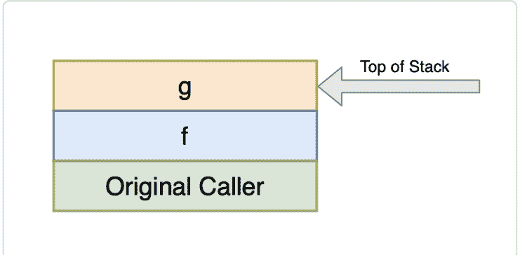

看着这个栈，我们会按顺序返回到 g，然后是 f，最后是原始调用者。如果你把栈想象成一叠盘子，这个顺序就说得通了。

到目前为止，我们只看到了执行到调用 h 为止的情况。让我们从这一点继续执行代码：

```
h returns 20  -- pops the top of the Stack (getting g)
               -- returns 20 to g
g returns 20  -- pops the top of the Stack (getting f)
               -- returns 20 to f
f returns 20  -- pops the top of the Stack (getting original caller)
               -- returns 20 to the original caller
```

那是一个简单的例子，我们只需要栈上的 3 个槽位。

让我们回头看看我们的 length 函数：

```
length :: ∀ a. List a -> Int
length Nil      = 0
length (_ : xs) = 1 + length xs ①
```

#### ① 递归函数调用。

我们可以看到，它对列表中的每个元素都会调用一次自身。如果列表有 2 个元素，那么我们将发起 2 次调用，并需要栈上的 2 个槽位。

如果我们有一个包含 1000 个元素的列表，就需要栈上的 1000 个槽位。一百万个元素将需要一百万个槽位。

总有一天，我们会遇到一个足够长的列表，用尽栈中所有可用的槽位。这被称为栈溢出（Stack Overflow）。你可能听说过一个以这个不幸事件命名的网站。

我们的 length 函数的问题在于，它是递归的，但不是尾递归的。

> 如果函数的最后一个操作是递归调用，那么该函数就是尾递归的。

当一个函数是尾递归时，编译器可以很聪明地不在栈上保存返回位置，因为调用方函数已经没有剩余工作要做，没有理由再返回去。

这样就能避免我们的栈溢出。

下面再次给出 length：

```
length :: ∀ a. List a -> Int
length Nil      = 0
length (_ : xs) = 1 + length xs ①
```

① `length` 看起来像是尾递归，因为 `length` 调用是我们输入的最右侧内容，但它并不是最后执行的操作。在这个例子中，最后执行的是将 1 加到对 `length` 的递归调用结果上。正是这个加法导致该函数不是尾递归的。

那么，我们能否重写 `length`，使它变成尾递归呢？

我相信你已经猜到这是可能的，否则我为什么要等到现在才提起这个话题呢？

要把 `length` 重写为尾递归，我们必须先完成所有计算，然后再进行递归，这样后面就没有任何剩余工作了。

但怎么做呢？

就 `length` 而言，先做计算意味着我们要把 1 加到一个累加的 `length` 值上，然后把它传递给每次递归调用。

让我们写出这样的 `length`：

```
length :: ∀ a. Int -> List a -> Int ①
length acc Nil      = acc ②
length acc (x : xs) = length (acc + 1) xs ③
```

① 为累加中的 `length` 值在类型签名中添加了 `Int`。
② `acc` 是用于累加 `length` 值的累加器。因此，当到达列表末尾时，我们可以返回 `acc`，也就是最终的 `length` 值。
③ 现在我们是尾递归了，因为我们在递归之前先加 1，而且没有理由从递归调用返回，因为没有任何剩余工作了。

所以，我们可以恭喜自己写出了这个尾递归函数，天下太平了，对吧？

错。

我们的新版本给 `length` 的调用者带来了负担：他们必须传入 `acc` 参数，而且该参数必须以 0 开头，否则我们的 `length` 计算结果就会出错：

```
list = 1 : 2 : 3 : 4 : Nil
len = length 0 list ① ②
badLen = length 7 list ① ③
```

① 我们必须传入初始的 `length` 值，它应该是 0。
② 这次调用会产生正确的 `length` 值。
③ 这次调用会产生错误的 `length` 值，因为它会相差 7。

这很糟糕。那么，我们怎样才能鱼与熊掌兼得呢？

解决这个两难问题的办法是，用原来的类型签名来编写 `length` 函数，也就是没有 `acc` 参数。然后，我们立即调用一个私有的尾递归版 `length` 函数，我们把它命名为 `go`，并将 `acc` 参数设为 0：

```
length :: ∀ a. List a -> Int
length l = go 0 l where ① ② ③
  go :: Int -> List a -> Int ④
  go acc Nil      = acc
  go acc (_ : xs) = go (acc + 1) xs ⑤
```

① `length` 负责确保以 0 作为起始值传入。我们只需要把这处代码写对一次，而不必像之前那样在每次调用 `length` 时都传对。
② 在这种情况下，把我们的私有函数命名为 `go` 是一种惯用做法。我不太清楚这背后的历史，但这个传统始于 Haskell。
③ `go` 是私有的，因为我们是用 `where` 关键字声明它的。
④ 这就是我们把 `length` 的尾递归版本出于历史原因改名为 `go` 的实现。
⑤ 这就是我们的尾递归调用。

现在，`length` 的调用者不必担心尾递归的要求。`length` 通过确保 0 是累计 `length` 值的起始值来管理这一切。

#### 5.15.1. 关于尾递归的几点思考

尾递归非常节省栈空间，但它更难编写、更难推理，而且会让代码库更复杂。一开始就把所有递归函数都写成这种形式，被称为过早优化。我们只在必要时才优化代码。

事实证明，并非所有递归函数都能轻易写成尾递归；即使能写，函数本身的复杂度也可能使其难以维护。还有一些情况下，你虽然节省了栈空间，却转而使用了堆空间。有时候这是可以接受的，因为我们拥有的堆通常比栈大得多。

> 堆是程序可用的一个内存区域。随着程序运行，变量会从堆中分配。通常，堆比栈大得多。

所以，如果我们能轻松地把某个函数写成尾递归，那可能值得去做。但最好不要过早优化代码，而是等到真正需要时再说。重要的是要知道尾递归这种东西的存在，并且像 PureScript（和 Haskell）这样的编译器足够聪明，能够利用它。

但这并不意味着我们应该为了那 1% 的情况，让自己背负额外复杂性的负担。

### 5.16. 编写 head

有了 `length` 之后，`head` 函数应该相对容易。再次强调，在 Pursuit 中搜索时，请确保你查看的是来自 `Data.List` 的 `head`。

添加以下代码进行测试：

```
log $ show $ head Nil
log $ show $ head ("abc" : "123" : Nil)
```

① 测试空列表这种边界情况。打印 `Nothing`。
② 测试一般情况。打印 `(Just 2)`。

在这个过程中，你会遇到几个编译器问题。试着自行解决；如果卡住了，请参考下面的提示部分。

#### 5.16.1. 关于 `head` 的提示

如果你还没有写完 `head`，请先把你写的内容注释掉，然后添加下面这个 `head` 的桩版本：

```
head :: ∀ a. List a -> Maybe a
head _ = Nothing
```

这个函数只是为了让你能跟得上进度。

如果你已经完成了 `head` 函数，那么你可能注意到编译器在抱怨它不知道 `Maybe` 是什么。那是因为你需要从 `Data.Maybe` 中导入它。

所以，如果你还没有试过，请现在就这样做，然后再继续往下读。

如果你只是添加了以下代码：

```
import Data.Maybe (Maybe)
```

但现在你在 `Nothing` 和/或 `Just` 上遇到了错误，那是因为上面的导入只导入了类型 `Maybe`，并没有导入数据构造器 `Nothing` 和 `Just`。

请记住，构造类型 `Maybe` 的值的唯一方式是使用它的数据构造器。

所以我们需要把 `import` 语句改为：

```
import Data.Maybe (Maybe(..))
```

这应该能解决你与 `Maybe` 等相关的所有问题。但现在，编译器对我给你的测试代码有意见了。你可能会遇到类似这样的错误：

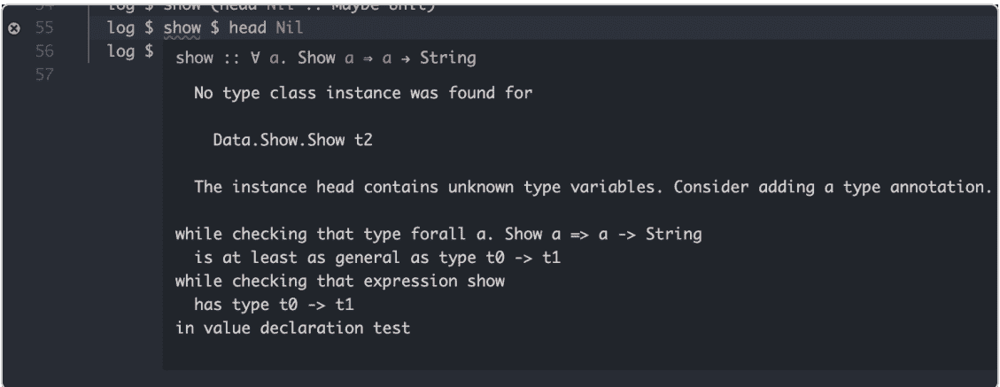

And if you’re like me, the first time you see this, all you can do is scratch your head and wonder. There’s a lot of information here and you can get overloaded with all of it.

The most import part for our situation is the following:

```
No type class instance was found for Data.Show.Show t2
```

The real key here is t2. That tells us that the Type Inference engine has failed to figure out a Concrete Type. If it had, it would have been something like Int, Boolean or some uppercased Type name.

But it’s lowercased meaning that it’s still a Type Parameter that the Type Inference couldn’t figure out based on how you’re using it. Why though?

To answer that, we need to look at the code in question:

```
log $ show $ head Nil
```

Now, imagine we are doing the Type Inference instead of the compiler, and we’re trying to figure out the Types in this line of code. First, we know the Types for log, show and head because those have been explicitly typed, e.g. here’s head:

```
head :: ∀ a. List a -> Maybe a
```

But what about Nil? What’s its Type?

Let’s refer back to List’s definition to see if we can ferret out it’s Type:

```
data List a = Nil | Cons a (List a)
```

If we use the Data Constructor, Nil, we will construct a Type, List a. But what Type is a?

There is no way to tell.

If we look at the other test code line I gave you, we can determine List’s Type easily:

```
log $ show $ head ("abc" : "123" : Nil)
```

It’s Type is List String.

But with an empty List, there are no elements to interrogate. It could be a List of anything, viz. List a, where a is our anything. The problem is that the compiler wants to verify that a can be passed to show (more on that later).

How do we fix this then?

Type Inference infers what Types our values are by how we use them. But when there isn’t enough evidence, as in the case of our empty List, then we must explicitly specify the Type.

Here’s how to properly do that:

```
log $ show (head Nil :: Maybe Unit)
```

We parenthesize the call to head and specify an explicit Type for its return value. But why Unit as the List element Type?

It really doesn’t matter. It just needs any valid Type that we can show (more on that later). By using Unit, we are signaling to anyone reading our code that the element Type really doesn’t matter. Had we used Int or some other non-trivial Type, the reader of our code (which could very well be us some time in the future), may think there’s more to that list than meets the eye.

Returning to the error message for a minute:

```
No type class instance was found for Data.Show.Show t2
```

It’s worth noting that during Type Inference, the compiler will "lose" your names and create any unknown type names with a t and a number. Here it has come up with t2 for our a.


It can be very difficult from time to time to do that mapping between the type the compiler is referring to and what we called it. This is an understandable issue, since it may be referring to multiple `Function`, like, `log`, `show` and `head` which all call their Type Parameters `a`.

Hopefully, in the future, the PureScript compiler will attempt to match the name to the original, e.g. instead of `t2`, it would print `a2` which would at least give us some clue to look for some `a`.

Another thing to note is that when I explicitly specified the Type, I added Parentheses to make sure that I specified the Type that `head` would return. With no Parentheses, the explicit Type Signature refers to the whole line of code:

```
log $ show $ head Nil :: Maybe Unit    -- COMPILER ERROR!!
```

Also, I removed the `$` Operator from after the `show`. I did this because it’s completely redundant in the following:

```
log $ show $ (head Nil :: Maybe Unit)    -- `$` is redundant
```

I chose to specify the return Type of `head`, but I could’ve just as easily specified the List Type instead:

```
log $ show $ head (Nil :: List Unit)
```

The choice is really up to you.

Now with all of the compiler errors out of the way, see if you can finish writing `head` before continuing on.

#### 5.16.2. Code for `head`

Start with the Type Signature:

```
head :: ∀ a. List a -> Maybe a
```

Next, write the trivial case, i.e. empty `List`:

```
head :: ∀ a. List a -> Maybe a
head Nil = Nothing ❶
```

> ❶ There is no head if the list is empty.

Next, we write the general case by Pattern Matching on the `List`:

```
head :: ∀ a. List a -> Maybe a
head Nil     = Nothing
head (x : _) = Just x ❶
```

① Don’t forget the Just. Also, we don’t name the tail, i.e. `_`, here because we don’t need it.

### 5.17. Writing tail

After writing head, you should be able to write tail in a flash.

Here is the test code to add to test:

```
log $ show $ tail Nil
log $ show $ tail ("abc" : "123" : Nil)
```

Code it before moving on.

#### 5.17.1. Hint for tail

Yes, yes, I know. I set you up. I purposely left off the explicit Type Signature from the test code. But, hopefully, if I did a good enough job explaining why it was needed, you were able to quickly figure out what was wrong and knew how to fix it.

If you weren’t able to, please reread the section on head and pay close attention to the Type Signature to tail (it’s slightly different than head). That should help you figure out what the explicit Type should be. Try again before moving on.

#### 5.17.2. Code for tail

Just in case you are still struggling with the explicit Type in the test code:

```
log $ show (tail Nil :: Maybe (List Unit))
```

Unlike head, tail returns `Maybe (List a)`. And since the Type Inference engine cannot determine what Type `a` is, we need to give it one, viz. `Unit`.

Here’s the other way to specify the explicit Type for a:

```
log $ show $ tail (Nil :: List Unit)
```

This Function is so close to head, we can pretty much jump right into it:

```
tail :: ∀ a. List a -> Maybe (List a)
tail Nil     = Nothing ①
tail (_ : xs) = Just xs ②
```

+   ① Same idea as in head. There is no tail of a empty List

+   ② Here we don’t name the head since we’re just interested in the tail.

You may have realized that the definition for tail could have been the following:

```
tail :: ∀ a. List a -> List a    -- ALTERNATIVE definition
```

This definition would mean that you’d get an empty tail for an empty List, which may seem like a valid return value. But that really depends on your definition of tail.

Consider the following definition for tail:

> The tail of a List is what is remaining after the first element, i.e. the head, is removed.

If the List is empty then no head can be removed and therefore there can be no remainder to represent the tail.

This definition matches the Type Signature for tail:

```
tail :: ∀ a. List a -> Maybe (List a)
```

And since head can fail, so can tail therefore tail also returns a Maybe. In Haskell, this definition is not the case. `tail` throws an exception given an empty list. This is also the case with head in Haskell. It is the rare case, where this is desirable over returning Maybe as PureScript does.

### 5.18. Writing last

`last` is just like head, except that the single element removed from the List is at the end.

This process is more difficult since Lists are built by adding elements to the front. That fact makes writing head easier than writing last.

Before you try to code this, devise a strategy for how you’re going to attack this problem before moving on to the coding. If you get stuck for an obvious approach, then proceed to the hint.

Here is the code you should add to your test:

```
log $ show $ (last Nil :: Maybe Unit) ① ②
log $ show $ last ("a" : "b" : "c" : Nil) ③
```

+   ① Just like we’ve done before, we need to let the compiler know what Type `a` is in the Maybe a return Type

of `last`.

+   ② Prints `Nothing`.

+   ③ Prints `(Just "c")`.

By the way, you can also write the last test line as:

```
log $ show $ last $ "a" : "b" : "c" : Nil
```

Since `$` has the lowest precedence, the `:` Operator gets evaluated first. In this particular case, I prefer using Parentheses because it helps highlight that we have a `List`. Most other cases, I prefer `$` over Parentheses.

#### 5.18.1. Hint for `last`

Since we can only work with the `head` and `tail` of a `List` using Pattern Matching, we must proceed down the list one element at a time, removing and discarding the `head` along the way until we get to a list with only 1 element left and that is our `last`.

So we’re going to have a Pattern Match case for a `List` of one element.

If you struggled writing this, try to take this approach in your code before moving on.

#### 5.18.2. Code for `last`

Start with the Type Signature from `Data.List`:

```
last :: ∀ a. List a -> Maybe a
```

This Type Signature tells us a lot. The fact that it returns a `Maybe` tells us that it can fail. That’s an important clue.

We should ask ourselves, "When can this fail". After our experience with `head` and `tail`, we may guess that it’ll fail if it’s given an empty `List`. But does that make sense?

If `last` is just like `head` but from the other end of the `List`, then it seems logical that it fails on the empty `List` just like `head` does since you cannot return the last element of an empty `List` because there is no last element.

Let’s add that case:

```
last :: ∀ a. List a -> Maybe a
last Nil = Nothing ❶
```

❶ The empty `List` is our failure case.

使用 `head` 和 `tail` 之后，我们下一步要考虑一般情况，所以让我们尝试这种方法，看看是否适用于编写 `last`。

回顾一下我们在 `last` 的提示部分中的策略，我们需要丢弃 head，直到只剩下单个元素的列表。所以让我们写下它：

```
last :: ∀ a. List a -> Maybe a
last Nil     = Nothing
last (_ : xs) = if length xs == 1 then head xs else last xs
```

+   1. 不要忘记将 `(==)` 添加到 `import Prelude` 导入列表中。

+   2. head 在模式匹配中通过简单地不命名它来丢弃，即使用 `_`。

+   3. 如果长度为 1，则我们取出 `xs` 中唯一的元素，否则我们继续递归直到耗尽除最后一个元素之外的所有元素。请注意，由于 `head` 返回一个 `Maybe`，并且我们知道 `xs` 不为空，事实上其长度为 1，我们将得到一个包含唯一元素的 `Just`，因此不需要添加它。

为了好玩，看看这段代码，看看它是否是尾递归？记住，一个递归函数如果最后做的事是递归，则为尾递归。

事实证明它确实是尾递归的，但在用 `if` 编写时很难看出。而且事实证明，对于这种情况，有一种更优雅的解决方案，它不使用 `if` 而是使用模式匹配。

你能想到怎么做吗？在继续之前，回到并尝试对单个元素的 `List` 使用模式匹配。

`length xs == 1` 的情况，即我们有一个只有一个元素的 `List`，与以下情况相同：

```
last (x : Nil) = Just x
```

+   1. `if` 部分作为模式匹配，即 `length` 等于 1。

+   2. `(x : Nil)` 做了 if-then-else 版本中 `head` 做的事情，但我们在这里没有得到一个 `Maybe`，因此必须自己添加 `Just`。

并且将此情况添加到我们的代码中后，我们就不需要 `if` 了。基本上，模式匹配为我们做了 `if`。所以我们只需要编码 `else` 情况：

```
last (_ : xs) = last xs
```

+   1. `else` 部分作为模式匹配。

并把它们全部放在一起：

```
last :: ∀ a. List a -> Maybe a
last Nil      = Nothing
last (x : Nil) = Just x ①
last (_ : xs) = last xs ②
```

① 此匹配必须在一般情况之前，否则包含 1 个元素的列表将匹配一般情况，我们将永远不会执行此逻辑。记住，使用模式匹配时，编译器会按我们定义的顺序为我们进行 if 检查。

② 这里是尾递归。

现在我们可以清楚地看到这个函数是尾递归的，因为它只在一个案例中递归，并且它所做的只是递归。

你可能没有注意到的一件事是，我们不再像第一个版本那样调用 length。这意味着我们不再多次遍历列表，使得这个版本对于大型列表来说比我们之前的版本更高效。


记住 `length` 会遍历列表一次。之前的版本会对列表中的每个元素都调用 `length`。这意味着大小为 `n` 的列表将遍历 `n²` 次，尽管每次迭代的列表越来越小。

这个改进绝对值得做，因为它效率更高，而且更易于阅读和理解。这是一个三赢的局面。

### 5.19. 编写 `init`

`init` 就像 `tail` 一样，只是返回的列表是开头减去最后一个元素。

你可能已经猜到了，`head` 与 `tail` 的关系就像 `last` 与 `init` 的关系。

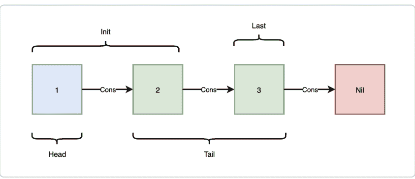

以下是你应该添加到测试中的代码：

```purescript
log $ show $ init Nil ❶
log $ show $ init (1 : Nil) ❷
log $ show $ init (1 : 2 : Nil) ❸
log $ show $ init (1 : 2 : 3 : Nil) ❹
```

- ❶ 打印 `Nothing`。
- ❷ 打印 `(Just Nil)`。
- ❸ 打印 `(Just (1 : Nil))`。
- ❹ 打印 `(Just (1 : 2 : Nil))`。

再次，在跳入代码之前，尝试制定一个策略。

#### 5.19.1. `init` 的提示

正如我们在 `last` 中所做的那样，我们希望递归直到得到一个单例 `List`，即只有一个元素的 `List`。但与 `last` 不同，我们不想在途中丢弃元素。相反，我们希望在递归时收集元素到一个新的 `List` 中。

另外，回想一下我们之前编写的几个函数。我们总是问这个问题：“失败情况是什么”。

如果你还没有写出来，带着这些提示再试一次。

#### 5.19.2. `init` 的代码

一如既往，我们从类型签名开始：

```purescript
init :: ∀ a. List a -> Maybe (List a)
```

仅通过查看它并知道 `init` 应该做什么，我们能确定什么？

首先，我们知道它会接受一个 `List`，根据我们之前对 `head`、`tail` 和 `last` 的经验，这告诉我们我们将进行迭代，即我们的函数将是递归的。这意味着我们需要一种方法来终止递归，即一个基本情况。

就像在 `last` 中一样，我们的基本情况是一个单例 `List`：

```purescript
init :: ∀ a. List a -> Maybe (List a)
init (x : Nil) = Just Nil ❶ ❷
```

- ❶ 我们返回一个列表，其中包含除最后一个元素 `x` 之外的所有内容，即 `Nil`。
- ❷ 不要忘记 `Just`。

我们的失败情况是空列表：

```purescript
init :: ∀ a. List a -> Maybe (List a)
init Nil = Nothing ①
init (x : Nil) = Just Nil
```

① 如果我们最初得到一个空列表，我们将无法生成一个减去其不存在的最后一个元素的列表。

最后，我们需要处理非空列表的一般情况。我们希望删除列表的 `head` 并递归地将其添加到 `tail` 的 `init` 中：

```purescript
init :: ∀ a. List a -> Maybe (List a)
init Nil = Nothing
init (x : Nil) = Just Nil
init (x : xs) = x : init xs  -- COMPILER ERROR!! ①
```

① 为什么这是错误？

编译器抱怨：

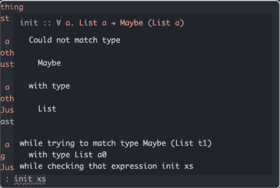

虽然这种方法过去有效，但在这里不起作用，因为 `init` 不返回一个列表。相反，它返回一个 `Maybe` 列表。请注意，这两个类型是我们类型不匹配错误中的类型。

我们需要比之前函数采用的不同策略。

让我们把代码回滚到仅我们的失败情况：

```purescript
init :: ∀ a. List a -> Maybe (List a)
init Nil = Nothing
```

我们已经处理了空列表的情况。我们需要编写的所有其他情况都将是我们拥有非空列表的情况。

`init` 返回 `Maybe List` 的唯一原因是它最初可能被传递一个空 `List`。在编写递归情况时，我们不再有这个限制。

所以让我们编写一个本地函数，习惯上命名为 `go`，它返回一个 `List`，因为我们保证它永远不会得到一个空 `List`：

```purescript
init :: ∀ a. List a -> Maybe (List a)
init Nil = Nothing
init l = go l where ❶
  ???
```

❶ 这里 `l` 是一个非空 `List`，多亏了上一行代码捕获了空 `List` 情况并返回 `Nothing`。

现在我们只需要弄清楚如何编写 `go`。再次，我们知道我们将递归，并且我们将最终将非空 `List` 减少到只剩下 1 个元素：

```purescript
init :: ∀ a. List a -> Maybe (List a)
init Nil = Nothing
init l = go l where
  go (_ : Nil) = Nil ❶
  ???
```

❶ 就像我们之前做的那样，我们排除了列表的最后一个元素 `x`，这正是 `init` 的目的。这是我们递归的基本情况。

我们已经编写了基本情况，现在必须编写递归情况。

```purescript
init :: ∀ a. List a -> Maybe (List a)
init Nil = Nothing
init l = go l where      -- COMPILER ERROR!!
  go (_ : Nil) = Nil
  go (x : xs) = x : go xs ❶
```

❶ 这个情况正是我们之前用 `init` 尝试编写的情况。现在编译器不再抱怨，因为 `go` 返回一个 `List`，而不是 `init` 返回的 `Maybe List`。

但现在我们有一个不同位置的不同编译器投诉：

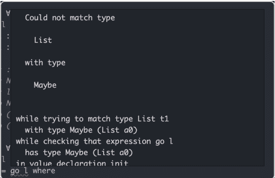

这里 `go` 返回一个列表但 `init` 返回一个 `Maybe`。我们需要添加 `Maybe` 的数据构造函数，即我们需要将 `Just` 添加到我们对 `go` 的调用中，将一个列表变成一个 `Maybe` 列表：

```purescript
init :: ∀ a. List a -> Maybe (List a)
init Nil = Nothing
init l = Just $ go l where      -- COMPILER ERROR!! ①
  go (_ : Nil) = Nil
  go (x : xs) = x : go xs
```

① 现在 `init l` 返回一个 `Maybe` 列表。注意使用 `$` 而不是括号。

再次，我们有一个不同的错误：

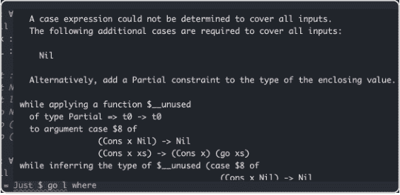

此错误表示我们缺少 `go` 在列表为空，即 `Nil` 时的情况。

这乍一看似乎是错误的，因为我们知道 `go` 永远不会得到一个空列表。为什么？因为我们永远不会用空列表初始调用它，并且我们将在列表只剩下 1 个元素时终止递归。

但问题是编译器不知道这些。PureScript 中有一个非空列表类型，我们还没有学过，但那会不必要地使这个特定函数复杂化。

所以最简单的方法就是添加该情况来取悦编译器，即使我们知道它永远不会被执行。

```purescript
init :: ∀ a. List a -> Maybe (List a)
init Nil = Nothing
init l = Just $ go l where
  go Nil = Nil ①
  go (_ : Nil) = Nil ②
  go (x : xs) = x : go xs
```

① This will never be executed.

② The real base-case that terminates the recursion.

And now we have the same compiler error we’ve seen before on the following line:

```purescript
log $ show $ init Nil
```

We’ll need to fix this like before:

```purescript
log $ show $ init (Nil :: List Unit)
```

### 5.20. Writing `uncons`

`uncons` is a Function that’s the opposite of the `Cons` constructor. Instead of taking a `head` and a `tail` and producing a `List`, `uncons` takes a `List` and produces a `head` and `tail`.

But Functions in PureScript can only return one value from a Function, not two. So `uncons` solves this problem by returning a `Record` with two fields:

```purescript
uncons :: ∀ a. List a -> Maybe { head :: a, tail :: List a }
```

Since `uncons` can fail to produce both a `head` and a `tail` if given an empty `List`, it returns a `Maybe`.

Add the following code to your test code:

```purescript
log $ show $ uncons (1 : 2 : 3 : Nil) ①
```

① Prints `(Just { head: 1, tail: (2 : 3 : Nil) })`.

This Function is pretty simple compared to what we’ve written so far, so give it try before moving on.

#### 5.20.1. Code for `uncons`

Since this Function is so simple, there’s no need for a Hint section.

Starting with the Type Signature, we write:

```purescript
uncons :: ∀ a. List a -> Maybe { head :: a, tail :: List a }
```

Next we add the failure case, which is when we have an empty `List`:

```purescript
uncons :: ∀ a. List a -> Maybe { head :: a, tail :: List a }
uncons Nil = Nothing ①
```

① There is neither a `head` nor a `tail` in an empty `List`.

And finally, we add the non-empty `List` case:

```purescript
uncons :: ∀ a. List a -> Maybe { head :: a, tail :: List a }
uncons Nil      = Nothing
uncons (x : xs) = Just { head: x, tail: xs } ①
```

① Destructuring the `List` we add the parts to our the `Record` and return it.

### 5.21. Writing `index`

`index` takes a `List` and an index value (an `Int`) and returns the value at that index.

We can immediately tell from this description, that this Function can fail. The obvious case is when the index is out of bounds, i.e. it’s passed a `List` of length 3 but an index of 99.

Another case for failure is when given empty `List` or a negative index.

Add the following code to your test code:

```purescript
log $ show $ index (1 : Nil) 4 ①
log $ show $ index (1 : 2 : 3 : Nil) 1 ②
log $ show $ index (Nil :: List Unit) 0 ③ ④
```

① Prints `Nothing`.

② Prints `(Just 2)`.

③ Here we have to explicitly specify the Type for the empty `List`.

④ Prints `Nothing`.

Try to think through the strategy before jumping into coding this Function. Then once you have a strategy, give it a try before moving on.

#### 5.21.1. Hint for `index`

Our strategy for writing this Function should be to remove the `head` of the `List` keeping track of what our current index is until we get to the requested index and then return that value, which should be the `head` we just removed.

At any point, we can exhaust our list before we’ve gotten to the requested index. This is our failure case.

Since we will need to keep track of our current index as we go, we will need a `go` Function that takes the current index as an extra Parameter, when compared to `index`.

If you want a review of how this is done, take a look back at how we made `length`, tail recursive (see Tail Recursion).

#### 5.21.2. Code for `index`

Our Type Signature:

```purescript
index :: ∀ a. List a -> Int -> Maybe a
```

One thing to note here. The Parameter order seems off here. Typically, we want the thing that changes most to be last, yet, the `List` is first. Can you think of any reason this would be defined this way?

Keep your guess in mind as we will see why in a bit.

Next, we add the failure case:

```purescript
index :: ∀ a. List a -> Int -> Maybe a
index Nil _ = Nothing
```

All that’s left is the general case. We need to have a `go` Function so we can keep track of our extra information, i.e. the current index:

```purescript
index :: ∀ a. List a -> Int -> Maybe a
index Nil _ = Nothing
index l i = go 0 l where ①
???
```

① `go` takes 1 more Parameter than `index`, i.e. the current index.

We know `go` is going to be recursive, so we need to write the base-case for `go`:

```purescript
index :: ∀ a. List a -> Int -> Maybe a
index Nil _ = Nothing
index l i = go 0 l where
  go _ Nil     = Nothing
```

If we get to the base-case for `go`, we have failed to find an element at the requested index. This is why we return `Nothing`.

And finally, we need to code the general case for `go`:

```purescript
index :: ∀ a. List a -> Int -> Maybe a
```


```
index Nil _ = Nothing
index l i = go 0 l where
  go _ Nil     = Nothing
  go ci (x : xs) = if ci == i then Just x else go (ci + 1) xs
```

Don’t forget to add `(==)` to the `import Prelude` import list, if it’s not already there.

Here `ci` is the current index and `i` is the request index. When the current index equals the requested index, we have found our element and we simply return it, i.e. `Just x`. Otherwise, we increment the current index and recurse, i.e. we keep looking.

It’s worth noting that we don’t bother passing `i` to `go`. Can you think of any reason why not?

First of all, `i` is in `go`’s scope, i.e. `go`’s code can "see" `i`.

Second, `i`, the requested index, doesn’t change. `ci` and `l` do change as we recurse and so they are passed to `go`.

Based on those two facts, we don’t need to pass `i` to `go`.

But, what if `i` did change? A completely different strategy could have been to **decrement** the requested index each recursion until it reaches `0` at which point we’ve found our element:

```purescript
index :: ∀ a. List a -> Int -> Maybe a
index Nil _ = Nothing
index l i = go l i where
  go Nil       _  = Nothing
  go (x : xs) ci = if ci == 0 then Just x else go xs (ci - 1)
```

Either implementation is fine. Sometimes more than one strategy can work. Also, we could have coded this with Guards:

```purescript
import Prelude (Unit, (+), (==), show, discard, otherwise) ①

index :: ∀ a. List a -> Int -> Maybe a
index Nil _ = Nothing
index l i = go l i where ②
  go Nil _     = Nothing
  go (x : xs) ci
    | ci == 0   = Just x
    | otherwise = go xs (ci - 1)
```

① Added `otherwise` to our import list.

② It appears that we can write this in Point-free notation since the rightmost 2 Parameters are the same on both sides of the equal sign (this is why I swapped the Parameter order earlier).

Now, let’s write it Point-free:

```purescript
index :: ∀ a. List a -> Int -> Maybe a
index Nil _ = Nothing   -- COMPILER ERROR!! ①
index = go where
  go Nil _     = Nothing
  go (x : xs) ci
    | ci == 0   = Just x
    | otherwise = go xs (ci - 1)
```

① Compiler complains due to Parameter list length difference.

Here’s the official error:

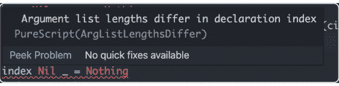

The reason this error occurs is because we’ve taken away the Parameters for Pattern Matching. So while ETA-Reduction (what I call cancel on the right) is typically a nice final clean-up step on your Functions, we cannot write Point-free notation if we are also using Pattern Matching.

So put back the parameters to both sides of the equal sign and take a look at your working code. Can you see a failure case that we missed?

What happens when `i` is negative?

Let's fix that oversight:

```purescript
import Prelude (Unit, (+), (==), (<), show, discard, otherwise) ①

index :: ∀ a. List a -> Int -> Maybe a
index Nil _ = Nothing
index l i = go 0 l where
  go _ Nil      = Nothing
  go ci (x : xs)
    | i < 0     = Nothing ②
    | ci == i   = Just x
    | otherwise = go (ci + 1) xs
```

① Added `<` to import list.

② Check for negative index. To add this code, Guards are the cleanest approach.

Adding guards to `index` would’ve be clunky, which is why the check is done in `go` instead. Technically, it’s not as efficient since `i` never changes, but it’s such a small overhead, it’s worth it to gain readability of the code.

Add the following to your test code and make sure it prints out `Nothing`:

```purescript
log $ show $ index (1 : 2 : 3 : Nil) (-99) ① ②
```

① Make sure you have `negate` imported from Prelude or you’ll get an error regarding Unknown value `negate`, since `negate` is used under the covers to make 99 negative.

② All negative numbers in PureScript must be surrounded by Parentheses.

### 5.22. Writing `!!`

`!!` is the Binary Operator for `index` that lets us write code like:

```purescript
addresses !! 7 ①
```

① Get the element at index 7.

Add the following code to your test code:

```purescript
log $ show $ (1 : 2 : 3 : Nil) !! 1 ①
```

① Prints `(Just 2)`.

在 Pursuit 上查找 `!!` 的结合性和优先级，然后为这个运算符编写代码。

请确保查看的是 `Data.List` 版本的运算符，尽管其他版本的值相同。由于有很多库使用相似的运算符和函数名，因此在 Pursuit 中查看正确的文档仍然是一个好习惯。

#### 5.22.1. `!!` 的提示

如果你在阅读时无法访问互联网，以下是相关内容：

#### `(!!)`

来源

`Data.Array.index` 的运算符别名（左结合 / 优先级 8）

`index` 的中缀版本。

```purescript
sentence = ["Hello", "World", "!"]

sentence !! 0 = Just "Hello"
sentence !! 7 = Nothing
```

#### 5.22.2. `!!` 的代码

由于 `!!` 运算符是左结合的，且优先级为 8，我们编写：

```purescript
infixl 8 index as !!
```

让我们更详细地看看这个运算符的用法：

```purescript
index addresses 7
addresses `index` 7
addresses !! 7
```

以上所有行都是等价的。这解释了为什么 `index` 的参数顺序看起来是反的。这是为了便于实现 `!!` 运算符所需的语法。

如果我们需要参数按另一种顺序排列，我们总是可以翻转 `index`：

```purescript
flip index 7 addresses
```

### 5.23. 编写 `findIndex`

以下是 `Pursuit` 对 `findIndex` 的解释：

| # findIndex | 来源 |
|---|---|
| `findIndex :: forall a. (a -> Boolean) -> List a -> Maybe Int` | 找到满足谓词的第一个索引。 |

那么这到底意味着什么？

首先，要记住的是谓词的定义。谓词是一个具有以下类型签名的函数：

```purescript
somePredicateFunction :: ∀ a. a -> Boolean
```

它接受一个类型为 `a` 的值，根据其值做出判断，并返回一个 `Boolean`。以下是一些谓词函数的示例：

```purescript
isEven :: Int -> Boolean
isOdd :: Int -> Boolean
(_ -> 7) ❶ ❷
("" /= _) ❶ ❸
```

- ❶ 这些是通配符函数。

- ❷ 其类型签名为 `Int -> Boolean`。

- ❸ 其类型签名为 `String -> Boolean`。

让我们回到 `findIndex` 的类型签名：

```purescript
findIndex :: ∀ a. (a -> Boolean) -> List a -> Maybe Int
```

我们现在可以看到，第一个参数是一个谓词。它将用于判断某个元素是否是我们正在寻找的那个。

我们还可以看到，我们返回的是一个 `Maybe Int`，这意味着我们返回找到的索引，并且有可能找不到它。

添加以下测试代码：

```purescript
log $ show $ findIndex (_ >= 2) (1 : 2 : 3 : Nil)
log $ show $ findIndex (_ >= 99) (1 : 2 : 3 : Nil)
log $ show $ findIndex (10 /= _) (Nil :: List Int)
```

① 打印 `(Just 1)`。

② 打印 `Nothing`。

③ 显式将空列表的类型指定为 `Int`（而不是 `Unit`），因为谓词需要一个 `Int`。

④ 打印 `Nothing`。

另外，将 `(>=)` 和 `(/=)` 运算符添加到 `Prelude` 导入中。

编写这个函数与我们目前编写的其他函数没有太大区别。试试看，看看你做得如何。

#### 5.23.1. `findIndex` 的提示

这里唯一真正的提示是，`findIndex` 在递归时需要跟踪当前索引。我们在之前的 `index` 中已经这样做过。所以，如果你不记得了，回头看看我们为 `index` 编写的代码，看看我们是如何在递归时跟踪额外参数的。

在继续阅读之前，请尝试完成 `findIndex` 的编码。

#### 5.23.2. `findIndex` 的代码

首先，类型签名：

```purescript
findIndex :: ∀ a. (a -> Boolean) -> List a -> Maybe Int
```

然后是失败情况：

```purescript
findIndex :: ∀ a. (a -> Boolean) -> List a -> Maybe Int
findIndex _ Nil = Nothing
```

① 这是递归的基准情况，因为我们已经穷尽了列表。同时，这也是当给定一个空列表时的失败情况。

最后，一般情况（或递归情况）：

```purescript
findIndex :: ∀ a. (a -> Boolean) -> List a -> Maybe Int
findIndex _ Nil       = Nothing
findIndex pred (x : xs) = ???
```

这里有一个问题，因为 `findIndex` 没有跟踪索引值。看起来这需要 `go` 来完成。

让我们像在 `index` 中那样添加一个 `go` 函数来跟踪当前索引：

```purescript
findIndex :: ∀ a. (a -> Boolean) -> List a -> Maybe Int
findIndex _ Nil       = Nothing
findIndex pred l = go 0 l where
  ???
```

① `go` 比 `findIndex` 多一个额外参数，即当前索引，初始值为 0。

② 我们不将 `pred` 传递给 `go`，因为它已在作用域内，即 `go` 可以访问它，并且它不会改变。

由于我们正在编写一个新函数 `go`，我们必须为 `go` 编写基准/失败情况，以及它的递归/一般情况。

首先是 `go` 的基准情况：

```purescript
findIndex :: ∀ a. (a -> Boolean) -> List a -> Maybe Int
findIndex _ Nil       = Nothing
findIndex pred l = go 0 l where
  go _ Nil = Nothing
```

① 基准情况是我们已经穷尽了 `List`，即我们没有找到所寻找的内容。

现在来看 `go` 的递归情况：

```purescript
findIndex :: ∀ a. (a -> Boolean) -> List a -> Maybe Int
findIndex _ Nil       = Nothing
findIndex pred l = go 0 l where
  go _ Nil = Nothing
  go i (x : xs) = if pred x then Just i else go (i + 1) xs
```

① 我们使用 `x` 调用谓词函数 `pred`，如果它通过了，即返回 `true`，那么我们找到了正在寻找的内容，直接返回它即可。否则，我们递增索引，并使用尾部 `xs` 进行递归。

② 别忘了 `Just`，因为 `go` 和 `findIndex` 一样返回 `Maybe`。

### 5.24. 编写 `findLastIndex`

这类似于 `findIndex`，不同之处在于它找到满足谓词条件的最后一个索引。请记住，仅仅因为 `findLastIndex` 找到了一个索引，并不意味着它会停止。`findLastIndex` 需要继续查找，因为列表中后面总有可能出现另一个匹配项。

很多时候，在编码时创建简单的示例会大有帮助。让我们使用以下谓词：

```purescript
(_ == 10)
```

在编写 `findLastIndex` 时，请记住以下几个示例：

```purescript
Nil
10 : 5 : 10 : -1 : 2 : 10 : Nil
11 : 12 : Nil
```

让我们也在测试代码中使用这些示例：

```purescript
log $ show $ findLastIndex (_ == 10) (Nil :: List Int) ① ②
log $ show $ findLastIndex (_ == 10) (10 : 5 : 10 : -1 : 2 : 10 : Nil) ③ ④
log $ show $ findLastIndex (_ == 10) (11 : 12 : Nil) ⑤
```

① 为空的 `Int` 列表显式指定类型，因为谓词需要一个 `Int`。

② 打印 `Nothing`。


### 5.24. 编写 `findLastIndex`

③ 确保你从 `Prelude` 导入了 `negate`，否则你会得到一个关于未知值 `negate` 的错误。所有负数实际上都在底层使用 `negate`。注意，我们不需要把 `-1` 放在括号中，因为它是 `Cons` 二元运算符（即 `:`）的一部分。

④ 打印 `(Just 5)`。

⑤ 打印 `Nothing`。

在继续获取提示之前，请牢记这些示例并编写这个函数。另外，不要犹豫，可以回头看看 `findIndex` 寻求帮助，因为它是一个类似的函数。

#### 5.24.1. `findLastIndex` 的提示

`findIndex` 和 `findLastIndex` 的基本区别在于，`findLastIndex` 即使已经找到了索引，也必须继续搜索。这意味着在 `findLastIndex` 中，我们必须跟踪当前索引（就像在 `findIndex` 中那样），但我们也必须跟踪之前找到的内容（如果有的话）。

“如果有的话”这个短语告诉我们，它将是一个 `Maybe Int`，因为有可能我们还没有找到任何东西。因此，我们期望将已找到的索引初始化为 `Nothing`。

在继续之前再试一次。

#### 5.24.2. `findLastIndex` 的代码

我们从类型签名开始：

```
findLastIndex :: ∀ a. (a -> Boolean) -> List a -> Maybe Int
```

这个签名与 `findIndex` 完全相同。唯一的区别是，我们一直搜索到 `List` 的末尾。

下一步是添加失败情况：

```
findLastIndex :: ∀ a. (a -> Boolean) -> List a -> Maybe Int
findLastIndex _ Nil = Nothing
```

❶ 无法在空 `List` 中找到元素，因此这里失败。

现在，在继续之前，让我们思考一下。我们知道什么？我们知道这与 `findIndex` 非常相似。我们还知道我们需要跟踪我们在 `findIndex` 中所做的一切，即当前索引，此外，我们还需要跟踪我们找到的索引。

因此，可以稳妥地说，我们可以使用 `findIndex` 作为这个函数的模板：

```
findLastIndex :: ∀ a. (a -> Boolean) -> List a -> Maybe Int
findLastIndex _ Nil = Nothing
findLastIndex pred l = go Nothing 0 l where
  go fi _ Nil        = fi
  go fi i (x : xs) = go (if pred x then Just i else fi) (i + 1) xs
```

❶ 我们比 `findIndex` 多了一个额外参数，即第一个参数，它是我们已找到的索引，我们最初将其设置为 `Nothing`，因为我们还没有找到任何东西。

❷ 这是终点。由于我们在寻找满足谓词的最后一个元素，我们必须尝试 `List` 中的每一个元素。当我们到达这里时，我们已经完成了搜索，只需返回最后找到的索引 `fi`，它可能是 `Nothing`。

❸ 递归 `go` 调用的第一个参数是一个 `if` 表达式。`if` 是我们决定这个索引是否是我们新的最后找到的索引的地方。如果是，则设置为 `Just i`，否则保留我们之前找到的值，该值可能是 `Nothing`。然后我们像在 `findIndex` 中那样递增当前索引，并使用尾部（即 `xs`）继续搜索。

将此函数与 `findIndex` 进行比较，以查看细微的差异。

此外，与 `findIndex` 一样，此函数是尾递归的。比起 `findIndex` 来说，要更容易看出这一点，因为 `findIndex` 的递归调用是 `if` 表达式 `else` 部分的一部分。

### 5.25. 局部函数类型签名

请注意，当我们编写 `findLastIndex` 时，我们没有为 `go` 指定类型。到目前为止，我们从未为 `go` 指定过类型。我们只是依赖编译器来推断它。

让我们添加它，看看会发生什么：

```
findLastIndex :: ∀ a. (a -> Boolean) -> List a -> Maybe Int
findLastIndex _ Nil = Nothing
findLastIndex pred l = go Nothing 0 l where
  go :: ∀ a. Maybe Int -> Int -> List a -> Maybe Int
  go fi _ Nil = fi
  go fi i (x : xs) =
    go (if pred x then Just i else fi) (i + 1) xs -- COMPILER ERROR!!
```

请注意，我们得到了编译器错误。但为什么呢？

这里是确切的错误：

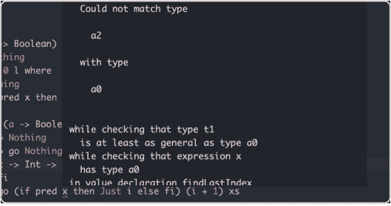

它说无法匹配 `a2` 与 `a0`。前缀 `a` 告诉我们我们正在处理某种 `a`，实际上是两个 `a`。

让我们看看是否能找到这些 `a`：

```
findLastIndex :: ∀ a. (a -> Boolean) -> List a -> Maybe Int
findLastIndex _ Nil = Nothing
findLastIndex pred l = go Nothing 0 l where
  go :: ∀ a. Maybe Int -> Int -> List a -> Maybe Int
  go fi _ Nil = fi
  go fi i (x : xs) =
    go (if pred x then Just i else fi) (i + 1) xs -- COMPILER ERROR!!
```

① 这里有一个 `a`。

② 这里还有另一个 `a`。

如果我们回顾错误信息，我们可以看到编译器错误发生在 `x` 上。我们可以通过 `x` 下方的红色下划线看到这一点，但原因是什么？

问题是 `pred` 是根据第一个 `a` 定义的，而 `x` 是根据第二个 `a` 定义的。

当我们在局部函数中说 `∀ a` 时，我们是在告诉编译器 `a` 是一个新的独立 `a`。是的，我们将其命名为 `a`，但它不是与主函数中相同的 `a`：

```
findLastIndex :: ∀ a. (a -> Boolean) -> List a -> Maybe Int
findLastIndex _ Nil = Nothing
findLastIndex pred l = go Nothing 0 l where
  go :: ∀ a. Maybe Int -> Int -> List a -> Maybe Int
  go fi _ Nil = fi
  go fi i (x : xs) =
    go (if pred x then Just i else fi) (i + 1) xs -- COMPILER ERROR!!
```

① 主函数的 `a`。

② 独立的 `a`。

但我们不希望 `a` 彼此不同。那么我们如何修复这个问题？

很简单。我们只需从 `go` 的类型签名中删除 `∀ a`：

```
findLastIndex :: ∀ a. (a -> Boolean) -> List a -> Maybe Int
findLastIndex _ Nil = Nothing
findLastIndex pred l = go Nothing 0 l where
  go :: Maybe Int -> Int -> List a -> Maybe Int
  go fi _ Nil = fi
  go fi i (x : xs) = go (if pred x then Just i else fi) (i + 1) xs
```

① `List a` 中的 `a` 现在与 `findLastIndex` 的类型签名中的 `a` 相同。

在为局部函数添加类型签名时请记住这一点。大多数情况下，你希望你的类型参数匹配。

### 5.26. 编写 `reverse`

`reverse` 接受一个 `List` 并将其反转。类型签名相当令人困惑的非常简单的函数：

```
reverse :: List ~> List
```

`~>` 被称为 **自然变换**。这与左右两边的类型都是 **函子** 这一事实有关。我们现在不需要担心这意味着什么。我们很快就会讲到函子。

现在，只需意识到以下签名是等价的：

```
reverse :: List ~> List ❶
reverse :: ∀ a. List a -> List a ❷
```

- ❶ 易于输入。

- ❷ 带有自然变换的签名的等价签名。

需要记住的另一件事是 `~>` 是一个类型运算符，即它是对类型而不是值的二元运算符。这就是为什么它出现在类型签名中而不是我们的代码中。

因此你需要特别导入此运算符：

```
import Prelude (Unit, (+), (===), (<), (>=), (/=), show, discard, negate,
otherwise, type (~>)) ❶
```

- ❶ `(~>)` 需要以关键字 `type` 为前缀。

将以下内容添加到你的测试代码中：

```
log $ show $ reverse (10 : 20 : 30 : Nil) ❶
```

- ❶ 打印 `(30 : 20 : 10 : Nil)`

尝试使用类型签名中的自然变换编写该函数，以便你习惯于看到它。如果卡住了，请继续阅读提示。

#### 5.26.1. `reverse` 的提示

编写 `reverse` 时常见错误如下：

```
-- THIS IS WRONG
reverse :: List ~> List
reverse Nil = Nil
reverse (x : xs) = x : reverse xs ①
```

① 我们使用过这种模式很多次，看起来是正确的方法，如果不仔细思考问题的话。

运行此代码时，列表的顺序与之前完全相同。

想法接近了，但 `x` 需要放在反转列表的末尾而不是头部：

```
reverse :: List ~> List
reverse Nil = Nil
reverse (x : xs) = reverse xs : x -- COMPILER ERROR!! ①
```

① 这是无效的，因为你不能在 `Cons` 运算符 `:` 的左侧有一个列表。它必须在右侧。

在技术上这就是我们想要的，但无法将元素添加到列表的末尾。

让我们尝试完全不同的做法。

想象我们有 2 个列表，反转列表和原始列表。我们将把它们想象成栈而不是列表，`Nil` 在底部，列表的头部在顶部。

并且在每一步，我们都从原始列表的顶部取出并放在反转列表的顶部。 （这里顶部与头部同义）：

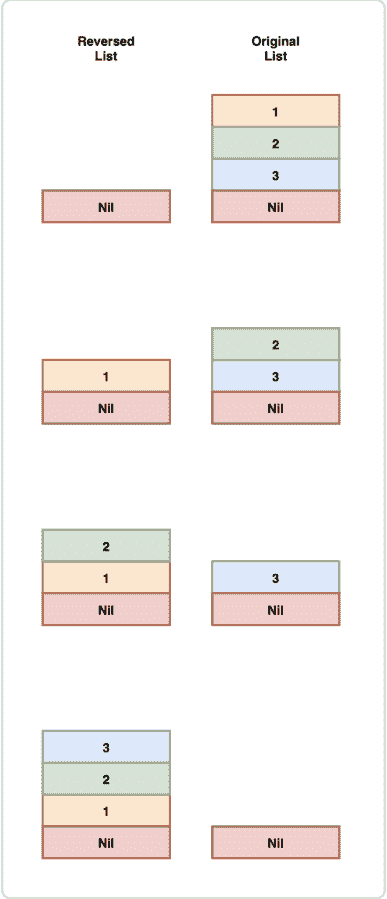

我们的原始 `List` 现在被反转了。

如果你在编写时遇到困难，请在继续之前尝试这种策略。

#### 5.26.2. `reverse` 的代码

从类型签名开始：

```
reverse :: List ~> List
```

添加基本情况：

```
reverse :: List ~> List
reverse Nil = Nil
```

这可能很难看出，所以这里是它作为数组的数组的样子：

```
[[1, 2, 3], [4, 5], [6], []]
  -> [1, 2, 3, 4, 5, 6]
```

让我们用这个例子作为测试代码：

```
log $ show $
  concat ((1 : 2 : 3 : Nil) : (4 : 5 : Nil) : (6 : Nil) : (Nil) : Nil)
```

① 打印 `(1 : 2 : 3 : 4 : 5 : 6 : Nil)`

在继续之前先尝试这个函数。

### 5.27. 编写 `concat`

#### 5.27.1. `concat` 的提示

第一次尝试编写此函数时很容易迷路。我们想要构建一个单一列表，到目前为止，这一直涉及一次构建一个元素，在这里也不例外。

困难之处在于我们不能直接从列表的头部取出该元素，因为每个元素本身就是一个列表。因此我们需要一点额外的逻辑来从原始的列表的列表中提取元素。

在继续查看解决方案之前，看看你是否能使用模式匹配做到这一点。

#### 5.27.2. `concat` 的代码

一如既往，我们从类型签名开始：

```
concat :: ∀ a. List (List a) -> List a
```

接下来，我们添加基本情况：

```
concat :: ∀ a. List (List a) -> List a
concat Nil = Nil
```

① 给定一个空的列表的列表返回一个空列表。

最后，递归情况：

```
concat :: ∀ a. List (List a) -> List a
concat Nil = Nil
concat ??? = x : concat ???
```

- 1. 我们需要想出一个模式匹配来提取下一个元素。

- 2. 我们把提取出的元素 `x` 放在 `concat` 的前面。

- 3. 我们还需要将 `List` 的 `List`s 减去提取的元素传递给 `concat` 的递归调用。

提取该元素是棘手的部分，因为它在 `List` 的第一个元素中，而该元素本身就是一个 `List`。让我们思考一分钟。我们如何获取以下 `List` 中的元素 `1`：

```
((1 : 2 : 3 : Nil) : (4 : 5 : Nil) : (6 : Nil) : (Nil) : Nil)
```

我们需要获取 `1`，但它不是我们 `List` 的头部，而是我们 `List` 的头部的头部。

让我们看看是否能在模式匹配中捕捉到这个想法：

```
concat :: ∀ a. List (List a) -> List a
concat Nil = Nil
concat ((x : xs) : xss) = x : concat ???
```

- 1. `(x : xs)` 是我们 `List` 的头部，它本身就是一个 `List`，而 `x` 是该 `List` 的头部。

- 2. `xss` 是 `xs` 的复数，即我们列表的尾部。

现在我们把列表拆分为 3 部分，`x`、`xs` 和 `xss`。我们的元素 `x` 是我们将放在新 `List` 前面的元素，所以这已经解决了。

`xs` 是我们删除 `x` 后的头部 `List`。而 `xss` 是我们原始的 `List` 的 `List`s 减去头部 `List`，即减去 `xs`。我们可以把我们头部 `List` 的剩余部分 `xs` 放回 `xss` 的头部，以获得继续 `concat` 的剩余 `List` 的 `List`：

```
concat :: ∀ a. List (List a) -> List a  -- COMPILER ERROR!!
concat Nil = Nil
concat ((x : xs) : xss) = x : concat (xs : xss)
```

- 1. 编译器抱怨因为我们缺少一个 case。我们稍后会讲到这一点。

- 2. 我们把剩余的头部 `List`、`xs`，放回 `xss` 的头部，即我们的 `List` 的 `List`s。

编译器的确切错误：

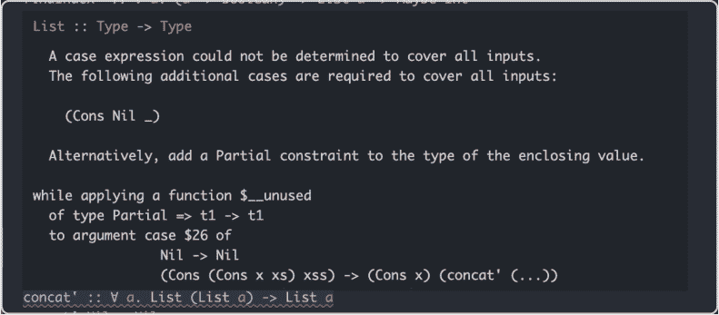

根据错误信息，缺少的 case 是 `(Cons Nil _)`。所以让我们添加它：

```
concat :: ∀ a. List (List a) -> List a
concat Nil = Nil
concat (Nil : xss) = ??? ①
concat ((x : xs) : xss) = x : concat (xs : xss)
```

① 这是我们耗尽了头部 `List` 的情况。这也是我们在 `List` of `List`s 中遇到空 `List` 的情况，就像我们在测试代码中的最后一个 `List`。

一旦我们耗尽了头部 `List` 并处理了它的所有元素，它将变为空，我们就可以直接丢弃它并继续处理其余的 `List`s：

```
concat :: ∀ a. List (List a) -> List a
concat Nil = Nil
concat (Nil : xss) = concat xss ①
concat ((x : xs) : xss) = x : concat (xs : xss)
```

① 我们继续对 `List` of `List`s 的剩余部分进行 `concat`。

### 5.28. 编写 `filter`

我第一次学习 Functional Javascript 时，学习了 3 个函数，`map`、`reduce` 和 `filter`。`filter` 是那些函数之一，如果不能将函数作为参数传递给另一个函数，就无法实现。

像 Java 这样的非函数式语言很长一段时间都无法做到这一点，所以这个函数对我来说似乎很神奇，因为我从来没有能够写出像 `filter` 这样的函数。我总是必须写一个 for-loop。

但在函数式语言中情况并非如此，因为我们有高阶函数，即接受或返回函数的函数。

`filter` 接受一个谓词函数，在谓词返回 `true` 时保留或过滤入元素。看一下

花点时间重读上一句话。我们是过滤入而不是过滤出。这与我们在英语中说 `filter` 时的意思相反。通常，我们在思考我们不想要的东西。


记得在 `Pursuit` 上查找类型签名，并确保你查看的是来自 `Data.List` 的定义。直接阅读后面的内容以获取类型签名可能更容易，但练习在 `Pursuit` 上查找东西是有益的，因为当你不使用本书中的问题时，这就是你会做的事情。

添加以下测试代码：

```
log $ show $ filter (4 >_) $ (1 : 2 : 3 : 4 : 5 : 6 : Nil) ❶
```

> ❶ 打印 `(1 : 2 : 3 : Nil)`

你需要从 `Prelude` 导入 `(>)`。

这个函数很简单。在阅读后续内容之前先试试。

#### 5.28.1. `filter` 的代码

这个函数足够简单，我们可以直接进入代码。首先是签名：

```
filter :: ∀ a. (a -> Boolean) -> List a -> List a
```

由于这是一个迭代函数，即递归，我们将有一个基本情况：

```
filter :: ∀ a. (a -> Boolean) -> List a -> List a
filter _ Nil = Nil
```

> ❶ 不能从空 `List` 中过滤出任何东西。

最后是递归情况：

```
filter :: ∀ a. (a -> Boolean) -> List a -> List a
filter _ Nil = Nil
filter pred (x : xs) = if pred x then x : filter pred xs else filter pred xs
❶
```

> ❶ 如果 `x` 通过了 `pred` 的测试，那么我们保留它并继续过滤 `xs`。否则我们就继续过滤 `xs`，即 `List` 的其余部分。

#### 5.28.2. `filter` 的替代编码

这里是使用 Guards 编写 `filter` 的另一种方法：

```
filter :: ∀ a. (a -> Boolean) -> List a -> List a
filter _ Nil = Nil
filter pred (x : xs)
  | pred x     = x : filter pred xs
  | otherwise  = filter pred xs
```

你可能会发现这个版本更容易阅读。我觉得它有点冗长。我发现当一个单一的 `if expression` 就足够时使用 Guards，不值得这种冗长。但是，一旦我需要开始嵌套 if 时，我就会求助于 Guards。

这基本上是个人偏好。你可能喜欢 `if expression` 但不喜欢它全部在一行上：

```
filter :: ∀ a. (a -> Boolean) -> List a -> List a
filter _ Nil = Nil
filter pred (x : xs) =
  if pred x then x : filter pred xs
  else filter pred xs
```

或者你可能不介意用更多行来表达这一点：

```
filter :: ∀ a. (a -> Boolean) -> List a -> List a
filter _ Nil = Nil
filter pred (x : xs) =
  if pred x then
    x : filter pred xs
  else
    filter pred xs
```

对我来说，这个最后一个版本是最糟糕的，因为它占用了屏幕上宝贵的垂直空间。

代码格式不仅仅是个人偏好。它也是你习惯看的东西。如果你来自 Elm，你可能会发现最后一个版本最好，因为你习惯于查看 Elm 代码。

我建议你尝试习惯查看更简洁的代码，这将有助于你在查看 PureScript 和 Haskell 编写的代码时。

### 5.29. `filter` 的尾递归版本

你可能已经注意到，我们的 `filter` 版本不是尾递归的：

```
filter :: ∀ a. (a -> Boolean) -> List a -> List a
filter _ Nil = Nil
filter pred (x : xs) =
  if pred x then x : filter pred xs else filter pred xs
```

> ¹ `x : filter pred xs` 必须从 `filter` 返回以完成 `Cons` 操作，使其成为非尾递归。

让我们使其尾递归。通常，你通过在递归之前执行操作，在本例中为 `Cons` 来做到这一点。这将需要一个额外的参数来跟踪我们递归时过滤的 `List`。这就是我们的局部 `go` 函数的作用：

```
filter :: ∀ a. (a -> Boolean) -> List a -> List a
filter pred l = go Nil l where
  ???
```

> ¹ `Nil` 是我们新 `List` 的初始值。我们将把通过谓词的元素添加到这个 `List` 中。
>
> ² 等号两边最右边的参数是 `l`。我们可以对它进行 ETA-Reduce（在右边取消）。

无点版本：

```
filter :: ∀ a. (a -> Boolean) -> List a -> List a
filter pred = go Nil where
  ???
```

> ¹ 我们移除了 `l`。

现在我们需要 `go` 的基本情况：

```
filter :: ∀ a. (a -> Boolean) -> List a -> List a
filter pred = go Nil where
  go nl Nil = nl
```

```
filter :: ∀ a. (a -> Boolean) -> List a -> List a
filter pred = go Nil where
  go nl Nil       = nl
  go nl (x : xs)  = if pred x then go (x : nl) xs else go nl xs
```

❶ 请记住，我们不需要将 `pred` 传递给 `go`，因为它在 `go` 的作用域中。

❷ 如果 `x` 通过了 `pred` 的要求，那么我们首先将其添加到我们的新 `List` `nl` 中，然后用 `List` 的剩余部分 `xs` 进行递归。否则，我们就继续使用 `xs`。现在我们先进行 `Cons`，我们的函数是尾递归的。

但现在我们有一个大问题。我们正在以**相反的顺序**将元素添加到我们的新列表中。第一个元素被放到列表的头部，然后下一个元素被放到头部，依此类推。这将导致我们的结果与原始顺序相比被反转。

我们如何修复这个问题？

由于我们只能添加到 `List` 的头部**并且**我们希望这个版本是尾递归的，我们只有一个选择，那就是在最后反转列表。

我们可以用我们编写的 `reverse` 函数来做到这一点，但在这样做之前，我们应该确保 `reverse` 是尾递归的，否则如果 `reverse` 会溢出我们的栈，编写 `filter` 尾递归就没有意义了：

```
reverse :: List ~> List
reverse Nil = Nil
reverse ol = go Nil ol where
  go rl Nil       = rl
  go rl (x : xs)  = go (x : rl) xs
```

❶ 它通过调用 `go` 进行递归，而没有其他操作。所以这是尾递归的。

现在我们可以看到 `reverse` 是尾递归的，我们可以将其添加到 `filter` 中：

```
filter :: ∀ a. (a -> Boolean) -> List a -> List a
filter pred l = reverse $ go Nil l where
  go nl Nil       = nl
  go nl (x : xs)  = if pred x then go (x : nl) xs else go nl xs
```

❶ 我们现在正在反转 `go` 的结果。

❷ 注意我不得不把我删除的 `l` 参数放回来，当我使其无点时。

要再次使这个版本无点，我们需要使用函数组合 `<<<` 而不是函数应用 `$`。

```
filter :: (a -> Boolean) -> List a -> List a
filter pred = reverse <<< go Nil where
  go nl Nil     = nl
  go nl (x : xs) = if pred x then go (x : nl) xs else go nl xs
```

> `[]` 参数又消失了。`go Nil` 等待 1 个参数，即我们删除的 `[]`。然后 `go` 的结果被传递给 `reverse`，它也等待 1 个参数。记住，组合只适用于等待单个参数的函数。

### 5.30. 时间与空间

在我们的尾递归 `filter` 版本中，我们被迫处理列表两次。一旦在过滤期间，再次在反转期间。这比非尾递归版本花费更多时间。但它占用更少的空间。

在编程中，我们总是需要在时间和空间之间进行权衡。非尾递归函数在时间上更高效，而尾递归版本在空间上更高效。

理解差异至关重要，这样你才能在编写自己的函数时做出正确的选择。

### 5.31. 编写 `catMaybes`

`catMaybes` 接受一个 `Maybe a` 的 `List`，过滤掉 `Nothing` 并解包 `Just a`，给你一个 `a` 的 `List`。

如果你有一个可能失败的项目的 `List`，并且只想要成功的结果，这非常有用。

添加以下测试代码：

```
log $ show $
  catMaybes (Just 1 : Nothing : Just 2 : Nothing : Nothing : Just 5 : Nil)
```

> 打印 `(1 : 2 : 5 : Nil)`

在参考下一节之前先尝试编写它。

#### 5.31.1. `catMaybes` 的提示

你需要使用 `case` 表达式。除此之外，这是一个相当直接的函数。

#### 5.31.2. `catMaybes` 的代码

一如既往，从类型签名开始：

```
catMaybes :: ∀ a. List (Maybe a) -> List a
```

然后是基础情况：

```
catMaybes :: ∀ a. List (Maybe a) -> List a
catMaybes Nil = Nil
```

最后是递归情况：

```
catMaybes :: ∀ a. List (Maybe a) -> List a
catMaybes Nil      = Nil
catMaybes (x : xs) = case x of
  Just y  -> y : catMaybes xs ① ②
  Nothing -> catMaybes xs
```

- ① 这就是我们将 `Maybe a` 转换为单纯的 `a` 的方法。
- ② 注意我这里用 `y` 来表示 `Just` 中的值。我不想把它叫作 `x`，因为那会在模式匹配和 `case` 表达式中遮蔽之前的 `x`。

### 5.32. 编写 range

`range` 有助于用一组连续的数字来填充 `List`（或 `Array`）。显然，生成的 `List` 将是排序的。

`range` 包含端点，但有一个小问题。`range` 可以生成升序或降序的 `List`。

将以下内容添加到你的测试代码中：

```
log $ show $ range 1 10 ①
log $ show $ range 3 (-3) ②
```

- ① 打印 `(1 : 2 : 3 : 4 : 5 : 6 : 7 : 8 : 9 : 10 : Nil)`
- ② 打印 `(3 : 2 : 1 : 0 : -1 : -2 : -3 : Nil)`

停在这里，自己编写 `range`。

#### 5.32.1. range 的提示

编写这个函数有很多方法。但我建议你记住一点：递归时传入的新起始值将是 `start + 1` 或 `start + (-1)`，具体取决于起始值是否大于结束值。

这可以通过内联的 `if` 表达式来完成，以降低代码复杂度。

#### 5.32.2. range 的代码

和往常一样，我们从类型签名开始：

```
range :: Int -> Int -> List Int
```

接下来是基础情况：

```
range :: Int -> Int -> List Int
range start end  | start == end  = singleton start ①
                 | otherwise     = ??? ②
```

- ① 创建一个以 `start` 为唯一元素的 `List`。
- ② 这里是递归情况将要放置的位置。

注意我们使用了守卫，因为模式匹配不处理布尔逻辑。

递归情况是：

```
range :: Int -> Int -> List Int
range start end
  | start == end = singleton start
  | otherwise    =
      start : range (start + (if start < end then 1 else (-1))) end ① ②
```

- ① 将 `start` 放在头部，并以递增/递减后的 `start` 递归。如果 `start` 小于 `end`，则递增，否则递减。
- ② 确保从 `Prelude` 导入 `(<)` 和 `otherwise`。

### 5.33. 优化 range

你可能已经把 `range` 写成了这样：

```
range :: Int -> Int -> List Int
range start end =
  let step = if start < end then 1 else (-1) in ①
  if start == end then singleton start
  else start : range (start + step) end
```

- ① 意图是只计算一次 `step`。

如果这样写的意图是只计算一次 `step`，那么它实际上并没有实现。因为这个函数是递归的，每次调用都会重新计算该值。

在命令式语言中编写循环时，这是一种常见做法。通常你会在开始循环之前进行计算。但对于递归，我们必须确保它不在递归调用中，而这里并没有做到。

现在，编译器有可能做一些优化，消除这种重复计算，但我非常怀疑这一点，因为每次递归调用 `start` 都会变化（要么递增要么递减）。

实际上，`step` 计算的开销非常小，不值得为此优化。但为了讨论，我们假设这是一项开销大得多的计算。我们该如何优化呢？

先想一想，然后自己试试，再继续往下读。

我们希望只计算一次 `step`，并且让它远离递归调用：

```
range :: Int -> Int -> List Int
range start end = go (if start < end then 1 else (-1)) start where ①
  go step start' | start' == end = singleton start' ②
                | otherwise      = start' : go step (start' + step) ③ ④
```

- ① 只计算一次 `step` 值，并将其传给 `go` 的首次调用。
- ② 不得不把这个变量命名为 `start'`，以免遮蔽 `start`。
- ③ 递归只发生在我们的 `go` 函数中，我们把 `step` 值传进去，而不是每次都计算它。
- ④ 如果还没有从 `Prelude` 导入 `otherwise`，请确保导入。

你可能想过使用 `let-in` 表达式，这样就不必传入 `step`：

```
-- 无法编译
range :: Int -> Int -> List Int
range start end = let step = if start < end then 1 else (-1) in go start
  where
  go start' | start' == end = singleton start'
            -- 编译器错误！！
            | otherwise      = start' : go (start' + step) ①
```

- ① `step` 不在作用域内。

记住，`let` 的值只在 `in` 部分可见，而 `in` 部分在 `where` 处结束。

但我们可以通过把 `step` 的计算移到 `where` 部分来实现：

```
range :: Int -> Int -> List Int
range start end = go start where ①
  go start' | start' == end = singleton start'
            | otherwise      = start' : go (start' + step)
  step = if start < end then 1 else (-1) ①
```

- ① 我们不再需要把 `step` 传给 `go`，因为 `step` 现在对 `go` 可见，它们都在 `where` 部分中。

现在，即使我们已经优化到了这个程度，我们仍然没有一个尾递归函数。

让我们做最后的优化：


```
range :: Int -> Int -> List Int
range start end = go Nil start where ①
  go rl start' | start' == end = start' : rl ②
               | otherwise      = go (start' : rl) (start' + step) ③
  step = if start < end then 1 else (-1)
```

- ① 传入一个空 `List` 作为起点。在 `go` 函数中它叫作 `rl`，代表“范围列表”（Range List）。
- ② 基础情况将 `start'` 添加到“范围列表”中。
- ③ 在这个版本中，我们在递归之前将元素添加到列表，这使其成为尾递归。

尝试运行这个版本，看看会发生什么。

你得到的结果是不是：

### 5.34. 编写 `take`

要编写这个函数所需的一切我们之前都做过了。所以，在查看提示之前，先试着自己写。

#### 5.34.1. `take` 的提示

`take` 需要跟踪它已经取了多少项，以便知道何时结束。这需要一个 `go` 函数，但也许通过将要取的元素数量作为倒计时，我们可以避免跟踪任何额外的状态，也避免需要局部函数。

#### 5.34.2. `take` 的代码

类型签名：

```
take :: ∀ a. Int -> List a -> List a
```

接下来是基础情况：

```
take :: ∀ a. Int -> List a -> List a
take ??? ①
```

- ① 实际上有两个基础情况。

我们确实有两个基础情况。一个是倒计时达到 0（或初始为 0），另一个是列表被取空（或初始为空）：

```
take :: ∀ a. Int -> List a -> List a
take _ Nil = Nil
take 0 _   = Nil
```

最后是递归情况：

```
take :: ∀ a. Int -> List a -> List a
take _ Nil      = Nil
take 0 _        = Nil
take n (x : xs) = x : take (n - 1) xs ① ②
```

- ① 将 `(-)` 添加到你的 `Prelude` 导入列表中。
- ② 这不是尾递归，因为我们需要在递归调用后返回到这里，以便将 `x` 添加到 `List` 的头部。

在像 Haskell 这样的惰性语言中，这种实现没问题，因为 `take (n - 1) xs` 只有在需要时才会被求值（甚至可能永远不会），所以我们可以通过惰性获得一些优化。但 PureScript 是一门严格的语言，意味着所有内容都会预先求值。因此，对于非常大的列表，我们不得不担心栈的使用。

在查看解决方案之前，尝试将其重写为尾递归。

将 `take` 写成尾递归函数只是一个练习。我通常会让函数保持原样，因为在我编写的程序类型中，栈溢出的概率极其罕见。

但如果真的遇到这个问题，能够解决它还是很不错的：

```
take :: ∀ a. Int -> List a -> List a
take = go Nil where ① ④
  go nl _ Nil     = nl ②
  go nl 0 _       = nl ③
  go nl n (x : xs) = go (x : nl) (n - 1) xs -- 顺序错误！！ ④
```

- ① 这是以无点风格编写的。在这里未命名的参数是要取的元素数量和列表。我们初始用一个名为 `nl` 的空列表调用 `go`。
- ② 如果我们耗尽列表，或初始传入空列表，则返回我们的新列表，它可能是 `Nil`。
- ③ 如果我们耗尽计数，或初始计数为 0，则返回我们的新列表，它可能是 `Nil`。
- ④ 为了使其成为尾递归，我们最终构建的是反向的列表。

以下是使用 `reverse` 的正确版本：

```
take :: ∀ a. Int -> List a -> List a
take n = reverse <<< go Nil n where ① ② ③
  go nl _ Nil     = nl
  go nl 0 _       = nl
  go nl n' (x : xs) = go (x : nl) (n' - 1) xs ④
```

- ① 我们不得不把 `n` 参数加回来，因为函数组合 `<<<` 期望单参数函数。
- ② 我们对最终结果调用 `reverse`。这里我们是用时间换空间。我们使用尾递归函数是因为栈中没有足够的空间。所以，我们必须花时间在最后反转列表。
- ③ 如果还没有从 `Prelude` 导入 `(<<<)`，请确保导入。
- ④ 不得不把 `n` 重命名为 `n'`，以免遮蔽参数 `n`。

这里需要注意的一点是，如果你传入一个负数作为计数，这会无限递归并溢出栈。让我们修复这个问题。

首先，我们修复非尾递归版本：

```
take :: ∀ a. Int → List a → List a
take n = go (max 0 n) where
  go _ Nil       = Nil
  go 0 _         = Nil
  go n' (x : xs) = x : go (n' - 1) xs
```

1. `max 0` 用于保持计数为正数。
2. 别忘了从 `Prelude` 导入 `max`。
3. 这里将 `n` 重命名为 `n'`，以避免遮蔽参数 `n`。

现在，我们来修复尾递归版本：

```
take :: ∀ a. Int → List a → List a
take n = reverse <<< go Nil (max 0 n) where
  go nl _  Nil       = nl
  go nl 0  _         = nl
  go nl n' (x : xs) = go (x : nl) (n' - 1) xs
```

1. `max 0` 用于保持计数为正数。
2. 别忘了从 `Prelude` 导入 `max`。

### 5.35. 编写 `drop`

`drop` 与 `take` 的区别在于它返回的内容。和 `take` 一样，它会移除指定数量的元素，但不会返回被移除的元素，而是返回剩余的元素。因此以下等式成立：

```
nums = (1 : 2 : 3 : 4 : 5 : 6 : 7 : Nil)
take 2 nums == (1 : 2 : Nil)
drop 2 nums == (3 : 4 : 5 : 6 : 7 : Nil)
```

将以下内容添加到你的测试代码中：

```
log $ show $ drop 2 (1 : 2 : 3 : 4 : 5 : 6 : 7 : Nil)
log $ show $ drop 10 (Nil :: List Unit)
```

1. 打印 `(3 : 4 : 5 : 6 : 7 : Nil)`
2. 这里显式指定了空 `List` 的类型。
3. 打印 `Nil`

#### ❷ 打印 `Nil`

这个函数与我们之前所做的工作非常相似，因此无需提示。请尝试自己编写。仅仅阅读代码解决方案永远不够。当你首先尝试自己编写代码时，你会学到更多。

#### 5.36.1. `takeWhile` 的代码

通常的类型签名：

```
takeWhile :: ∀ a. (a → Boolean) → List a → List a
```

我们将 `take` 中的 `Int` 替换为 `takeWhile` 中的 `a → Boolean`。

接下来，唯一的基础情况（与 `take` 不同）：

```
takeWhile :: ∀ a. (a → Boolean) → List a → List a
takeWhile _ Nil = Nil ❶
```

> ❶ 我们传入一个初始的空 `List`，或者通过递归调用自身并传入越来越小的 `List` 来耗尽我们的 `List`。

最后，递归情况：

```
takeWhile :: ∀ a. (a → Boolean) → List a → List a
takeWhile _ Nil = Nil
takeWhile pred (x : xs) =
  if pred x then x : takeWhile pred xs else Nil ❶ ❷
```

> ❶ 如果 `x` 通过谓词测试，则继续处理尾部 `xs`。返回时，我们将 `x` 添加到头部。
>
> ❷ 如果 `x` 未通过谓词测试，则我们完成并返回 `Nil`。如果这是我们第一次调用 `takeWhile`，那么第一个元素不满足谓词条件，我们将得到一个空 `List` 作为最终返回值。然而，如果这是一个递归调用，那么这个 `Nil` 将终止我们的 `List`，因为之前的 `x` 值在我们逐步返回所有先前的递归调用时被逐个放置在列表头部，最终返回完整的 `List`。

让我们使用以下示例更详细地检查递归情况：

```
takeWhile (_ <= 2) (1 : 2 : 3 : Nil)
```

并注释我们代码的不同情况：

```
takeWhile :: ∀ a. (a -> Boolean) -> List a -> List a
takeWhile _ Nil = Nil ①
takeWhile pred (x : xs) = ②
  if pred x then x : takeWhile pred xs else Nil
```

我们将像之前一样使用数学替换。由于引用透明性，我们可以这样做：

```
-- 从以下开始
takeWhile (_ <= 2) (1 : 2 : 3 : Nil)
-- 代入 ②
if (_ <= 2) 1 then 1 : takeWhile (_ <= 2) (2 : 3 : Nil) else Nil
-- 求值得到
1 : takeWhile (_ <= 2) (2 : 3 : Nil)
-- 代入 ②
1 : (if (_ <= 2) 2 then 2 : takeWhile (_ <= 2) (3 : Nil) else Nil)
-- 求值得到
1 : (2 : takeWhile (_ <= 2) (3 : Nil))
-- 代入 ②
1 : (2 : (if (_ <= 2) 3 then 3 : takeWhile (_ <= 2) Nil else Nil))
-- 求值得到
1 : (2 : takeWhile (_ <= 2) Nil else Nil)
-- 代入 ①
1 : (2 : Nil)
-- 去掉括号
1 : 2 : Nil
```

### 5.37. 编写 `dropWhile`

`dropWhile` 之于 `takeWhile`，正如 `drop` 之于 `take`。

将此添加到你的测试中：

```
log $ show $ dropWhile (_ > 3) (5 : 4 : 3 : 99 : 101 : Nil) ①
log $ show $ dropWhile (_ == -17) (1 : 2 : 3 : Nil) ②
```

① 打印 `(3 : 99 : 101 : Nil)`

② 打印 `(1 : 2 : 3 : Nil)`

查阅 Pursuit 了解细节，然后在继续之前编写 `dropWhile`。

#### 5.37.1. `dropWhile` 的代码

首先，第一件事：

```
dropWhile :: ∀ a. (a -> Boolean) -> List a -> List a
```

接下来，基础情况：

```
dropWhile :: ∀ a. (a -> Boolean) -> List a -> List a
dropWhile _ Nil = Nil
```

最后，递归情况：

```
dropWhile :: ∀ a. (a -> Boolean) -> List a -> List a
dropWhile _ Nil      = Nil
dropWhile pred l@(x : xs) = if pred x then dropWhile pred xs else l ①
```

① 如果 `x` 通过谓词测试，则丢弃它并继续使用尾部 `xs` 进行删除。否则，我们返回完整的 `List`，即 `l`。注意 `l@` 语法。这会为完整的 `List` 创建一个变量，然后使用模式匹配将其解构为 `x` 和 `xs`。

事实证明，与 `takeWhile` 不同，`dropWhile` 是尾递归的。

### 5.38. 编写 `takeEnd`

`takeEnd` 的功能与 `take` 相同，但作用于 `List` 的末尾。这使得它稍微复杂一些。

将以下内容添加到你的测试中：

```
log $ show $ takeEnd 3 (1 : 2 : 3 : 4 : 5 : 6 : Nil) ①
log $ show $ takeEnd 10 (1 : Nil) ②
```

① 打印 `(4 : 5 : 6 : Nil)`

② 打印 `(1 : Nil)`

在继续之前尝试编写 `takeEnd`。

#### 5.38.1. `takeEnd` 的提示

你可能会想这样编写 `takeEnd`：

- ② 如果还没有导入 `(>>>)`，别忘了从 `Prelude` 导入。
- ③ 无点风格，其中 `List` 未被命名。一旦 `go` 完成，我们使用 `snd` 从 `Tuple` 的第二个位置获取 `List`。
- ④ 一旦我们完全遍历完原始 `List`，我们将开始使用 `Nil` 构建新的 `List`，显然它的长度是 `0`。这就是我们从 `Tuple 0 Nil` 开始的原因。

现在递归情况必须继续递归以耗尽 `List`，然后在 `go` 返回其 `Tuple` *之后*构建新的 `List`。

为了了解其工作原理，让我们看一个简单的例子：

```
takeEnd 2 (1 : 2 : 3 : 4 : Nil)
```

我们一直遍历直到到达基础情况。我们从这个基础情况开始，之后每一步都是返回给前一次调用的结果：

```
Tuple 0 Nil          -- 基础情况
Tuple 1 (4 : Nil)    -- 返回
Tuple 2 (3 : 4 : Nil) -- 返回
Tuple 3 (3 : 4 : Nil) -- 返回 ①
Tuple 4 (3 : 4 : Nil) -- 返回 ①
(3 : 4 : Nil)        -- snd ②
```

- ① 这里我们不改变 `List`，因为我们已经达到了所需的元素数量。我们继续计数（稍后详述），但返回相同的 `List`。
- ② 我们在顶部取 `Tuple` 的 `snd`，并返回 `(3 : 4 : Nil)` 作为最终结果。

在继续之前，尝试编写递归情况来实现这一点。

#### 5.39.1. `takeEnd` 的代码

这是我们在上一个提示部分停下的地方：

```
takeEnd :: ∀ a. Int -> List a -> List a
takeEnd n = go >>> snd where
  go Nil = Tuple 0 Nil
```

我们现在只需要递归情况：

```
takeEnd :: ∀ a. Int -> List a -> List a
takeEnd n = go >>> snd where
  go Nil     = Tuple 0 Nil
  go (x : xs) = go xs ①
    # \(Tuple c nl) -> Tuple (c + 1) $ if c < n then x : nl else nl ② ③
```

① 我们立即对尾部调用 `go`。记住，我们希望从 `List` 的末尾向前工作。这就是为什么我们在调用 `go` 之后构建列表。

② 我们获取 `go` 的返回值，并使用 `#` 将其传递到 Lambda 函数中。`Tuple` 被解构为其组成部分，`c` 表示元素数量，`nl` 是我们的新 `List`。

③ 我们返回一个 `Tuple`，其中计数递增，如果尚未达到我们的配额，则将 `x` 添加到新 `List` 的头部。否则，我们只返回最终的 `List`。

注意我们总是增加计数 `c`，即使我们没有向新 `List` 添加任何内容。这只是为了简洁。在这种情况下，我们的计数仍然会大于 `n`。我们本可以写成计数保持不变，但我们只需要它来知道何时停止，因此它不必准确表示新 `List` 的长度。

对于好奇的人来说，如果我们想保持精确计数，代码会是这样：

```
takeEnd :: ∀ a. Int -> List a -> List a
takeEnd n = go >>> snd where
  go Nil     = Tuple 0 Nil
  go (x : xs) = go xs
    # \tup@(Tuple c nl) -> if c < n then Tuple (c + 1) (x : nl) else tup ①
```

① 我们将 `go` 返回的 `Tuple` 绑定到 `tup`，并用 `Tuple c nl` 解构它。当我们不向列表添加内容时，我们原样返回 `Tuple`，即 `tup`。

这个版本比那个不关心计数上限是否达到新 `List` 长度的版本稍微复杂一些。而且由于我们使用 `snd` 丢弃它，没有理由增加这种复杂度。

### 5.40. 编写 `dropEnd`

`dropEnd` 类似于 `takeEnd`，但它返回的是没有从提供的 `List` 末尾丢弃的部分。

与 `takeEnd` 一样，我们可以使用长度计算来编写：


```
dropEnd :: ∀ a. Int -> List a -> List a
dropEnd n l = take (max 0 $ length l - n) l
```

这种方法有我们在 `takeEnd` 中提到的所有相同问题。因此我们应该考虑编写一个更…

这是一个高效的版本。

将以下内容添加到你的测试代码中：

```purescript
log $ show $ dropEnd 3 (1 : 2 : 3 : 4 : 5 : 6 : Nil) ①
log $ show $ dropEnd 10 (1 : Nil) ②
```

① 打印 `(1 : 2 : 3 : Nil)`

② 打印 `Nil`

试试这个练习，回想一下我们在编写 `takeEnd` 时学到的关于从 `List` 末尾操作的知识。

#### 5.40.1. `dropEnd` 的代码

首先是类型签名：

```purescript
dropEnd :: ∀ a. Int -> List a -> List a
```

我们预期自己的代码与 `takeEnd` 类似，因为它们都是从 `List` 的末尾操作。因此在学到其他办法之前，让我们在添加基础情形时走一条相似的路径：

```purescript
dropEnd :: ∀ a. Int -> List a -> List a
dropEnd n = go >>> snd where
  go Nil = Tuple 0 Nil
```

对于递归情形，我们将沿用 `takeEnd` 的做法，但要反转逻辑。我们的计数`c`现在将统计要丢弃的元素数量，而在`takeEnd`中，它统计的是要保留的元素数量：

```purescript
dropEnd :: ∀ a. Int -> List a -> List a
dropEnd n = go >>> snd where
  go Nil = Tuple 0 Nil
  go (x : xs) = go xs
    # \(Tuple c nl) -> Tuple (c + 1) $ if c < n then nl else x : nl ①
```

① 我们只是将`takeEnd`逻辑中的`then`部分与`else`部分互换了一下。这意味着只要我们的丢弃计数`c`小于丢弃值`n`，我们就不动新的`List`；而一旦超过这个阈值，我们就把`x`添加到头部。

`takeEnd`统计已获取的元素数量，一旦达到配额就不再向新的`List`添加元素；而`dropEnd`则统计已丢弃的元素数量，直到达到配额后，再开始添加到新的`List`。

### 5.41. 编写 `zip`

`zip`将接受两个`List`，并把它们配对成一个`List`。输出`List`的每个元素都是一个`Tuple`，其中第一个位置存放第一个`List`的元素，第二个位置存放第二个`List`的元素。

需要注意的重要一点是：最短的`List`决定了`zip`何时停止。

更多信息请查阅`Pursuit`。

将以下内容添加到你的测试代码中：

```purescript
log $ show $ zip (1 : 2 : 3 : Nil) ("a" : "b" : "c" : "d" : "e" : Nil)
log $ show $ zip ("a" : "b" : "c" : "d" : "e" : Nil) (1 : 2 : 3 : Nil)
log $ show $ zip (Nil :: List Unit) (1 : 2 : Nil)
```

- 1. 打印 `((Tuple 1 "a") : (Tuple 2 "b") : (Tuple 3 "c") : Nil)`。

- 2. 打印 `((Tuple "a" 1) : (Tuple "b" 2) : (Tuple "c" 3) : Nil)`。

- 3. 显式指定空 `List` 的类型。

- 4. 打印 `Nil`。

先不要往下看，试着写一下 `zip`。

#### 5.41.1. `zip` 的代码

从类型签名开始：

```purescript
zip :: ∀ a b. List a -> List b -> List (Tuple a b)
```

花点时间看看这个签名。注意我们必须同时定义`a`和`b`，即`∀ a b`。这是因为`Tuple`可以接受两种不同的类型。所以我们的两个`List`不必是相同类型。它们*可以*相同，但不是必须相同。

`∀ a b`表示`a`和`b`可以是任何类型，例如它们可以都是`Int`。但它们的名字不同，意味着它们是相互独立的，可以是不同的类型，就像我们的测试代码中那样。

接下来，我们编写基础情形（有两个）：

```
zip :: ∀ a b. List a -> List b -> List (Tuple a b)
zip Nil _ = Nil
zip _ Nil = Nil
```

如果任一`List`为空，那就没有什么可配对的了。

最后，递归情形：

```
zip :: ∀ a b. List a -> List b -> List (Tuple a b)
zip Nil _           = Nil
zip _ Nil           = Nil
zip (x : xs) (y : ys) = Tuple x y : zip xs ys ①
```

① 取出两个列表的头部，将它们放进一个`Tuple`，再把这个`Tuple`放到对尾部进行`zip`后得到的结果列表的头部。

### 5.42. 编写 `unzip`

`unzip`是`zip`的逆操作。你应该能够把`zip`的输出交给`unzip`，从而重新得到原来的两个列表——只不过它们被包在一个`Tuple`里，前提是你最初的两个列表长度相同。这是因为`zip`会截断两个列表中较长的那一个。

将以下内容添加到你的测试代码中：

```
log $ show $ unzip (Tuple 1 "a" : Tuple 2 "b" : Tuple 3 "c" : Nil) ①
log $ show $ unzip (Tuple "a" 1 : Tuple "b" 2 : Tuple "c" 3 : Nil) ②
log $ show $ unzip (Nil :: List (Tuple Unit Unit)) ③ ④
```

① 打印`(Tuple (1 : 2 : 3 : Nil) ("a" : "b" : "c" : Nil))`。

② 打印`(Tuple ("a" : "b" : "c" : Nil) (1 : 2 : 3 : Nil))`。

③ 显式指定了空`List`的类型。注意`unzip`期望的是一个由`Tuple`组成的`List`。因为我们的`List`为空，我们并不关心底层的类型，所以直接指定`Unit`。

④ 打印`(Tuple Nil Nil)`。

查阅`Pursuit`获取类型签名和更多示例，然后在继续阅读之前试着编写`unzip`。

#### 5.42.1. `unzip`的代码

首先，类型签名和唯一的基础情形：

```purescript
unzip :: ∀ a b. List (Tuple a b) -> Tuple (List a) (List b)
unzip Nil = Tuple Nil Nil
```

接下来，递归情形：

```purescript
unzip :: ∀ a b. List (Tuple a b) -> Tuple (List a) (List b)
unzip Nil = Tuple Nil Nil
unzip (Tuple x y : ts) =
  unzip ts # (Tuple xs ys) -> Tuple (x : xs) (y : ys) ❶ ❷
```

- ❶ 我们取出`List`的头部，并在这个过程中将其解构为`x`和`y`。

- ❷ 我们对尾部调用`unzip`，并将结果传给一个 Lambda，该 Lambda 对`Tuple`进行解构以得到各自的`Lists`。最后，我们将`x`和`y`添加到各自`Lists`的头部，并把最终结果包装成一个`Tuple`。

## 第二部分：中级

### 第 6 章 类型类

到目前为止我们学到的概念已经足以让你深入 Elm 或函数式 JavaScript。但有一些抽象是你将会错过的，它们可以减少样板代码，例如 JSON 解码。

在 Haskell 和 PureScript 中，编译器可以为我们生成代码，大大减少我们编写样板代码的需要。此外，借助更高层次的抽象，我们不必一再重新发明轮子。手工编写这些代码既繁琐又容易出错。

从现在开始，我们将学习一些语言特性和概念，它们能赋予你比带有函数式特性的命令式语言以及 Elm 更强大的能力。起初，你可能不会想念这些特性。我当时也没有。但最终，你会发现自己一遍又一遍地编写相同的逻辑，导致代码库膨胀。到那时，你会寻求解决样板代码和代码膨胀的方法，却无济于事。大多数语言根本不支持像类型类这样的减少样板代码的抽象。

让我们从类型类所解决的一些问题开始。

#### 6.1. 问题

假设我们有一个类型别名`Address`，对应于下面的记录：

```
type Address =
  { street1 :: String
  , street2 :: String
  , city :: String
  , state :: String
  , zip :: String
  }
```

再假设我们还有一个获取方向的函数，如下所示：

```
getDirections :: Address -> Directions ①
getDirections address = ... ②
```

① 给定一个`Address`，该函数将返回驾驶方向`Directions`。

② 这里的实现细节并不重要。

我们还假设有以下数据类型：

```text
data Person = Person
  { name :: String
  , age :: Int
  , address :: Address
  }

data Company = Company
  { name :: String
  , address :: Address
  }

data Residence
  = Home Address
  | Facility Address
```

❶ 每个类型都有一个`Address`组件。

我们要如何获取这些类型中每一个的`Directions`呢？

看看下面每个类型的具体示例：

```text
person :: Person
person = Person
  { name: "Joe Mama"
  , age: 22
  , address:
      { street1: "123 Main Street"
      , street2: "Apt 152"
      , city: "Jamestown"
      , state: "CA"
      , zip: "95327"
      }
  }

company :: Company
company = Company
  { name: "Acme"
  , address:
      { street1: "987 Tesla Way"
      , street2: "Suite 101"
      , city: "Irvine"
      , state: "CA"
      , zip: "92602"
      }
  }

-- Buford, WY has population of 1
home :: Residence
home = Home
  { street1: "1 1st Street"
  , street2: "Apt 1"
  , city: "Buford"
  , state: "WY"
  , zip: "82052"
  }

facility :: Residence
facility = Facility
  { street1: "54321 Countdown Ave"
  , street2: ""
  , city: "Huntsville"
  , state: "AL"
  , zip: "35805"
  }
```

我们可以看到下面的函数如何让我们为每种类型获取`Directions`：

```
getPersonDirections :: Person -> Directions
getPersonDirections (Person person) = getDirections person.address ①

getCompanyDirections :: Company -> Directions
getCompanyDirections (Company company) = getDirections company.address ①

getResidenceDirections :: Residence -> Directions
getResidenceDirections residence = getDirections $ case residence of ②
  Home address -> address
  Facility address -> address
```

① `record.fieldName`是我们访问记录字段的方式。

② 我们必须为`Residence`使用`case`表达式，因为它是一个 Sum Type。

顺便说一下，我们可以用几种不同的方式编写`getResidenceDirections`：

```
getResidenceDirections' :: Residence -> Directions
getResidenceDirections' = getDirections <<< case _ of ①
  Home address -> address
  Facility address -> address

getResidenceDirections'' :: Residence -> Directions
getResidenceDirections'' = getDirections <<< go where ②
  go (Home address) = address
  go (Facility address) = address
```

① 点自由写法，其中`case`表达式使用通配符变量，即`Residence`值。

② 使用局部函数`go`的点自由写法，该函数使用 Pattern Matching 而不是`case`表达式。

编写这些函数相当简单，但当你尝试在同一个函数中使用它们时会发生什么？

让我们尝试编写一个函数来接收这三种类型：

```
getDirectionsTo :: ??? -> Directions
```

问题是我们希望`getDirectionsTo`接受`Person`、`Company`或`Residence`。但那是什么类型？

注意我们使用了“OR”这个词。这应该提示我们如何统一这些类型。我们需要创建一个 Sum Type：

```
data HasAddress
  = PersonAddress Person
  | CompanyAddress Company ①
  | ResidenceAddress Residence ①
```

① 注意使用 OR 符号，`|`。这表示`HasAddress`等于`PersonAddress`或`CompanyAddress`或`ResidenceAddress`。

现在我们有一个单一的类型，可以涵盖所有具有`Address`的类型以传递给`getDirectionsTo`：

```
getDirectionsTo :: HasAddress -> Directions
getDirectionsTo = case _ of
  PersonAddress (Person person) -> getPersonDirections person
  CompanyAddress (Company company) -> getCompanyDirections company
  ResidenceAddress residence -> getResidenceDirections residence
```

起初我们可能对解决方案感到满意，但当我们的代码库中出现新的具有`Address`的类型时会发生什么？

```
data EmptyLot = EmptyLot
  { daysEmpty :: Int
  , price :: Int
  , address :: Address
  }
```

现在我们必须编写以下内容：

```
getEmptyLotDirections :: EmptyLot -> Directions
getEmptyLotDirections lot = getDirections lot.address
```

不算太糟糕，但我们还没做完。`getDirectionsTo`需要更新，Sum Type`HasAddress`也需要更新：

```haskell
data HasAddress
  = PersonAddress Person
  | CompanyAddress Company
  | ResidenceAddress Residence
  | EmptyLotAddress EmptyLot

getDirectionsTo :: HasAddress -> Directions
getDirectionsTo = case _ of
  PersonAddress (Person person) -> getPersonDirections person
  CompanyAddress (Company company) -> getCompanyDirections company
  ResidenceAddress residence -> getResidenceDirections residence
  EmptyLotAddress lot -> getEmptyLotDirections lot
```


1. 将我们的新类型添加到 Sum Type 中。
2. 添加 `EmptyLot` 的 case。

这可能看起来不算太糟，但想象一下我们现在想要编写一个函数来计算到地址的距离。现在我们需要另一个像 `getDirectionsTo` 这样的函数来计算距离：

```haskell
newtype Miles = Miles Int

getMilesTo :: HasAddress -> Miles
getMilesTo = case _ of
  PersonAddress (Person person) -> getPersonMiles person
  CompanyAddress (Company company) -> getCompanyMiles company
  ResidenceAddress residence -> getResidenceMiles residence
  EmptyLotAddress lot -> getEmptyLotMiles lot
```

1. 我们创建一个 `newtype` 来包装 `Int`，表示英里数而不是公里数。
2. 需要编写 `getPersonMiles`。
3. 需要编写 `getCompanyMiles`。
4. 需要编写 `getResidenceMiles`。
5. 需要编写 `getEmptyLotMiles`。

所以现在我们有一整套其他函数需要编写。不太好。

让我们通过编写一个单一的 `getMiles` 函数并使用它来修复这个问题：

```haskell
getMiles :: Address -> Miles
getMiles address = ... ①

getMilesTo :: HasAddress -> Miles
getMilesTo = getMiles $ case _ of ②
  PersonAddress (Person { address }) -> address ③
  CompanyAddress (Company { address }) -> address ④
  ResidenceAddress (Home address) -> address ⑤
  ResidenceAddress (Facility address) -> address ⑥
  EmptyLotAddress (EmptyLot { address }) -> address ⑦
```

① 细节在这里不重要。

② 在这里我们用 `case` 表达式的值，即一个 `Address`，来调用 `getMiles`。

③ 我们模式匹配 `Person` 并解构其 `Record` 以获取 `address` 字段。

④ 我们模式匹配 `Company` 并解构其 `Record` 以获取 `address` 字段。

⑤ 我们模式匹配 `Home`。

⑥ 我们模式匹配 `Facility`。注意我们在这里再次提及 `ResidenceAddress`，唯一的区别是我们匹配的是哪个 `Residence` 构造子。

⑦ 我们模式匹配 `EmptyLot` 并解构其 `Record` 以获取 `address` 字段。

采用这种方法我们不需要编写那么多函数，但维护 Sum Type 并更新 `case` 表达式仍然很麻烦，不仅在这个函数中，而且在接受我们 Sum Type 的每一个函数中。

#### 6.2. 解决方案

我们到目前为止所做的一切都是样板代码。当你不需要太多思考就可以复制粘贴现有解决方案并做少量修改来获得新函数或 case 时，你就知道它是样板代码。

复制粘贴应该是提醒你更通用的解决方案是可取的并且希望是可能的红旗。有时技术限制会迫使你创建样板代码。但在我们的例子中，我们只需要一种方法来指定 `Person`、`Company`、`Residence` 和 `EmptyLot` 都有地址。

如果它们都是记录的类型别名，那么我们就可以简单地使用 `._address` 作为我们的访问函数（使用通配符表示 `Record`）。但其中一个是 Sum Type，即 `Residence`，所以这对我们不起作用。

当我们想在 C# 或 Java 等语言中以类似的方式处理不同的事物时，我们使用接口：

```java
// Java

public interface HasAddress {

    Address getAddress();

}
```

```csharp
// C#

interface IHasAddress

{

    Address getAddress();

}
```

在这些语言中，对象只需要支持接口，然后在代码中任何想要处理 JUST `Addresses` 的地方，都可以将接口传递给你的函数。

但在 PureScript 和 Haskell 中，我们没有对象。取而代之的是，我们有类型。

幸运的是，我们可以通过创建 *Typeclasses* 来对类型进行分组，并使我们的类型成为该 Typeclass 的 *Instance*。

为了更好地理解这一点，让我们先创建 Typeclass `HasAddress`：

```haskell
class HasAddress a where

    getAddress :: a -> Address
```

1. 我们使用 `class` 关键字创建 Typeclass。
2. 注意这个类有一个单一的类型参数 `a`。在定义实例时我们会把我们的类型放在这里。
3. 这里列出创建 Typeclass 实例必须实现的所有函数。在这种情况下，我们只有一个。

类型参数 `a` 代表实现类实例的类型。所以让我们为 `Person` 编写实例：

```haskell
instance hasAddressPerson :: HasAddress Person where

    getAddress (Person p) = p.address
```

将期望 `Person` 作为其第一个参数。

③ 我们解构 `Person` 以获取底层 `Record`，然后访问 `address` 字段。

花点时间想象如何为 `Company`、`Residence` 和 `EmptyLot` 编写实例。这些将镜像上面的 `hasAddressPerson`，除了 `Residence` 因为它是 Sum Type。

以下是这些实例：

```haskell
instance hasAddressCompany :: HasAddress Company where
    getAddress (Company c) = c.address

instance hasAddressResidence :: HasAddress Residence where ①
    getAddress (Home address) = address
    getAddress (Facility address) = address

instance hasAddressEmptyLot :: HasAddress EmptyLot where
    getAddress (EmptyLot l) = l.address
```

① `Residence` 的实例使用 Pattern Matching 有多个版本的 `getAddress`。

有了这个新特性，让我们重写 `getDirections`：

```haskell
-- WILL NOT COMPILE!!!
getDirections :: ∀ a. a -> Directions ①
getDirections hasAddr = let address = getAddress hasAddr in ②
    ... ③
```

① 签名错误。

② 通过调用 `getAddress`，我们期望 `hasAddr` 具有 `HasAddress` 实例。

③ 细节在这里不重要。

但这不能编译。为什么呢？

#### 6.3. 约束

我们告诉编译器 `a` 可以是任意类型，但我们却像它有 `HasAddress` 实例一样使用 `a`。我们需要一种方法让编译器知道 `a` 可以是任意类型，但它也必须具有 `HasAddress` 实例。

我们使用约束来实现这一点：

```haskell
getDirections :: ∀ a. HasAddress a => a -> Directions
getDirections hasAddr = let address = getAddress hasAddr in
  ...
```

❶ 类型 `a` 必须是 `HasAddress` 的一个实例。

❷ 这里的细节不重要。

`HasAddress a =>` 是将 `a` 约束为具有 `HasAddress` 实例的类型的语法。

你可以在一个类型签名中包含多个约束：

```haskell
getDirections :: ∀ a. Show a => HasAddress a => a -> Directions
getDirections hasAddr = let address = getAddress hasAddr in
  ...
```

❶ 类型 `a` 必须同时是 `Show` 和 `HasAddress` 的实例。

❷ `Show` 是一个用于可以表示为字符串的类型的类型类。

❸ 这里的细节不重要。

注意约束是如何位于 `∀ a.` 和类型参数之间的。

你也可以使用圆括号将类型类用逗号分隔来定义多个约束：

```haskell
getDirections :: ∀ a. (Show a, HasAddress a) => a -> Directions
```

当我的签名都在一行时，我倾向于使用圆括号版本；当我的类型签名跨多行时，则恢复为更冗长的签名：

```haskell
getDirections
  :: ∀ a
  . Show a
  => HasAddress a
  => a
  -> Directions
```

现在我们有了类型类，只需为 `Person` 编写以下代码：

```haskell
class HasAddress a where
    getAddress :: a -> Address

data Person = Person
    { name :: String
    , age :: Int
    , address :: Address
    }

instance hasAddressPerson :: HasAddress Person where
    getAddress (Person p) = p.address

getDirections :: ∀ a. HasAddress a => a -> Directions
getDirections hasAddr = let address = getAddress hasAddr in
    ... ①
```

① 这里的细节不重要。

如果我们要添加 `Company`，只需实现以下代码：

```haskell
data Company = Company
    { name :: String
    , address :: Address
    }

instance hasAddressCompany :: HasAddress Company where
    getAddress (Company c) = c.address
```

现在我们可以将 `getDirections` 用于 `Company`，而无需更改 `getDirections`。

借助类型类，我们可以轻松地以类似方式处理不同的类型，而无需创建和类型（Sum Type）。也不需要 `case` 表达式。编译器在编译时确定我们引用的是哪个类型。

这大大降低了复杂性和样板代码。

#### 6.4. 类型类要求

每个类型类函数都称为一个方法：

```haskell
instance hasAddressPerson :: HasAddress Person where
    getAddress (Person p) = p.address ①
```

① `getAddress` 是类型类 `HasAddress` 唯一的方法。

请不要将此与面向对象的方法混淆。虽然使用了“类”和“方法”这两个词，但在这里含义不同。

类型类有一个起初可能并不明显的要求。

每个类型类方法必须在其类型签名中包含其多态参数。

原因在于，调用 `getAddress` 不足以确定要调用哪个 `getAddress`，因为许多类型都可以是 `HasAddress` 的实例。编译器需要有一个类型来确定调用哪个 `getAddress`。

如果我们回顾一下我们的类，可以看到每个方法（一共 1 个）都需要 `a` 作为其参数之一：

```haskell
class HasAddress a where
  getAddress :: a -> Address ①
```

① 要求将 `a` 作为第一个参数。该信息足以让编译器确定要使用哪个 `HasAddress` 实例。

暂且让我们想象一下没有这个限制的情况：

```haskell
-- COMPILER ERROR!!
class HasAddress a where
  getAddress :: Address
```

以下是具体的错误：

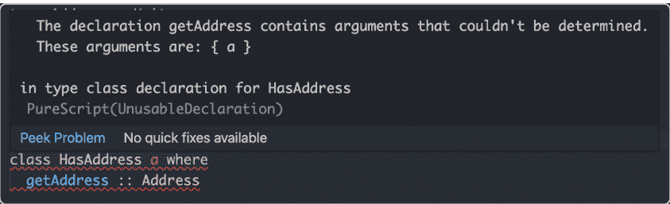

错误指出有一些“参数”无法确定，即 `a`。

#### 6.5. 内置类型类

在 PureScript 中有许多内置类型类。我们即将查看的大多数类型类在 Haskell 中都有等价（如果不完全相同）的版本。

##### 6.5.1. `Eq` 类型类

该类型类用于比较同一类型的两个值是否相等。

以下是定义：

```haskell
class Eq a where ①
  eq :: a -> a -> Boolean ②

infix 4 eq as == ③
```

① 该类有一个类型参数 `a`。

② 注意 `eq` 的类型签名中包含了类型参数 `a`。

③ 运算符（`==`）是 `eq` 函数的中缀版本。它没有结合性，这意味着当在一个表达式中使用多个此类运算符时，我们必须添加括号。

让我们为 `Person` 编写一个实例：

```haskell
data Person = Person
  { name :: String
  , age :: Int
  , address :: Address
  }

instance eqPerson :: Eq Person where
  eq (Person p1) (Person p2) = ??? ①
```

① 我们已经解构了两个 `Person` 值以暴露其底层的记录。

现在我们卡住了。我们需要确定什么意味着两个 `Person` 相同。根据你的类型的语义（基于你所建模的内容），我们在这里可能会有完全不同的实现。

在这种情况下，我们假设如果记录的所有字段都相等，则 `Person` 值相等：

```haskell
instance eqPerson :: Eq Person where
  eq (Person p1) (Person p2) =
    p1.name == p2.name && p1.age == p2.age && p1.address == p2.address ①
```

① `String`（`name`）、`Int`（`age`）和记录（`Address`）都有 `Eq` 的实例。

我们很幸运。我们不必让任何字段类型成为 `Eq` 的实例，因为它们已经是了。

然而，如果 `Address` 被定义为一个真正的类型，而不仅仅是一个类型别名：

```haskell
data Address = Address
  { street1 :: String
  , street2 :: String
  , city :: String
  , state :: String
  , zip :: String
  }
```

我们的 `Eq` 实例会出现以下错误：

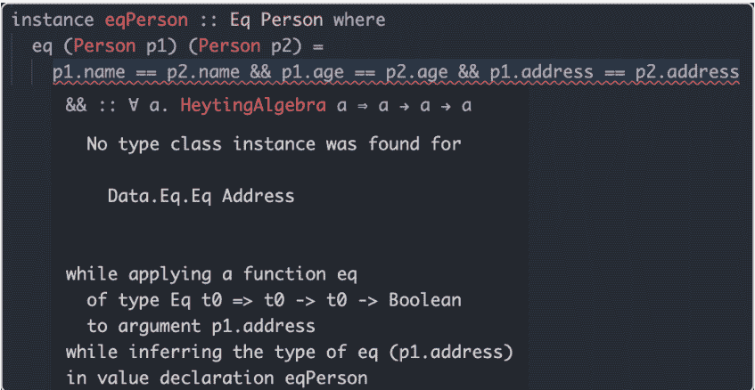

现在编译器在寻找 `Eq` `Address` 的类型类实例。之前，`Address` 只是记录的别名，而记录有 `Eq` 实例。

但现在 `Address` 是它自己的类型，我们需要添加一个 `Eq` 实例：

```haskell
instance eqAddress :: Eq Address where
  eq (Address a1) (Address a2) = a1 == a2 ① ②
```

① 解构两个 `Address` 值以暴露其底层的记录。

② 在使用 `==` 时，我们利用了记录的 `Eq` 实例。

记录只有在所有字段类型也都具有 `Eq` 实例时才能进行相等性比较。在我们的例子中，`Address` 中的每个字段都是 `String` 类型，而 `String` 有 `Eq` 实例。

以下是我们最终的实现：

```haskell
data Address = Address
  { street1 :: String
  , street2 :: String
  , city :: String
  , state :: String
  , zip :: String
  }

data Person = Person
  { name :: String
  , age :: Int
  , address :: Address
  }

instance eqPerson :: Eq Person where
  eq (Person p1) (Person p2) =
    p1.name == p2.name && p1.age == p2.age && p1.address == p2.address

instance eqAddress :: Eq Address where
  eq (Address a1) (Address a2) = a1 == a2
```

##### 6.5.2. `Ord` 类型类

该类型类用于确定同一类型的两个值的顺序。

以下是定义：

```haskell
class Eq a <= Ord a where ①
  compare :: a -> a -> Ordering

data Ordering = LT | GT | EQ ②
```

① 反向胖箭头是一个超类约束。

② 这个和类型定义了同一类型任意两个值之间 3 种可能的排序。

可以说 `Eq` 是 `Ord` 的超类。这并不像继承。它仅仅意味着任何 `Ord` 实例也必须是 `Eq` 实例。


如果我们在 Pursuit 中查阅 `Ord`，我们会看到以下内容：

### Ord

```
class (Eq a) <= Ord a where
```

`Ord` 类型类表示支持全序比较的类型。

`Ord` 实例应满足全序的定律：

- 自反性：`a <= a`
- 反对称性：如果 `a <= b` 且 `b <= a`，则 `a = b`
- 传递性：如果 `a <= b` 且 `b <= c`，则 `a <= c`

#### 成员

- `compare :: a -> a -> Ordering`

#### 实例

- `Ord Boolean`
- `Ord Int`
- `Ord Number`
- `Ord String`
- `Ord Char`
- `Ord Unit`
- `Ord Void`
- `(Ord a) => Ord (Array a)`
- `Ord Ordering`
- `(RowToList row list, OrdRecord list row) => Ord (Record row)`

注意大多数原始类型都有 `Ord` 实例，例如 `Boolean`、`Int`、`String` 等。但也有一些奇怪的，例如 `Unit`、`Void` 和 `Ordering`。

`Unit` 的实例会是什么样子？

试着在不继续阅读的情况下编写它。

为 `Unit` 编写实例通常非常简单：

```
instance ordUnit :: Ord Unit where
  compare _ _ = EQ ① ②
```

① 这里我们使用惯用的实例命名方式。先是类名 `ord`，然后是类型名 `Unit`，得到 `ordUnit`。

② `Unit` 只有一个成员，即 `unit`。一切事物都等于自身（数学中的自反性）。

`Void` 呢？该如何编写它？

尝试在阅读后续内容之前做到这一点。

`Void` 是一个奇怪的存在，因为我们永远不可能拥有 `Void` 的值。所以你可能会认为我们选择什么并不重要。两个 `Void` 总是可以 `compare` 为 `GT`。

但这真的违背了逻辑。怎么可能有两个无法获得的值是可比较的，以至于一个大于（或小于）另一个。

一种看待这个问题的方法是使用集合。如果我们比较空集 A 中的值与空集 B 中的值，我们能否证明其中一个会大于（或小于）另一个？但我们也不能证明它们相等。

但如果我们决定所有不存在的东西彼此共享所有可辨别的属性。而且如果我们也定义当所有可辨别属性相等时两个事物相等，那么我们可以说所有不存在的实体彼此相等，从而得到以下实现：

```purescript
instance ordVoid :: Ord Void where
  compare _ _ = EQ
```

在解决了这个脑筋急转弯之后，我们可以将注意力转向 `Ordering` 的 `Ord` 实例。你会如何编写这样的实例？

这里有一个定义来帮助你：

```purescript
data Ordering = LT | GT | EQ
```

想想 `LT`、`GT` 和 `EQ` 的某种逻辑顺序。你会把它们放在什么顺序？

在我看来，最合理的顺序是 `LT` 小于所有其他值，而 `GT` 大于所有其他值。基于这种逻辑，`Ordering` 的定义如果为：

```purescript
-- NOT the official definition
data Ordering = LT | EQ | GT
```

会更合理。然后值也会按其自然顺序排列，但这不是 PureScript 库的定义方式。

在继续之前尝试为 `Ordering` 编写 `Ord` 实例。

```
instance ordOrdering :: Ord Ordering where
    compare LT LT = EQ
    compare EQ EQ = EQ
    compare GT GT = EQ
    compare LT _ = LT
    compare EQ LT = GT
    compare EQ GT = LT
    compare GT _ = GT
```

① 首先，我们表达了 3 个 EQ 情况。

② 接下来，我们指定 LT 小于所有内容。

③ 然后，我们指定 EQ 在 LT 和 GT 之间。

④ 最后，我们指定 GT 大于所有内容。

接下来，让我们为我们自己的类型编写 `Ord`。这里有一个简单的和类型 `Place`：

```
data Place = First | Second | Third
```

要编写它，我们需要确定和类型应该具有什么顺序。我们的解决方案应该是逻辑的、直观的且易于记忆。

我们可以决定数据构造器或值，在本例中，按其定义的顺序就是和类型的自然顺序。这符合我们所有的要求，它是逻辑的、直观的且易于记忆。而且这正是 PureScript 编译器在为我们自动派生时采用的方法（稍后会详细介绍）。所以，这将是我们的解决方案。

在继续之前试试看。

不要忘记先为 `Place` 创建 `Eq` 实例。

以下是 `Eq` 实例：

```
instance eqPlace :: Eq Place where
    eq First First = true
    eq Second Second = true
    eq Third Third = true
    eq _ _ = false
```

接下来，是 `Place` 的 `Ord` 实例：

```
instance ordPlace :: Ord Place where
  compare First First = EQ
  compare First _ = LT
  compare Second Third = LT
  compare Second Second = EQ
  compare Second First = GT
  compare Third Third = EQ
  compare Third _ = GT
```

所有这些工作给我们带来了什么？

我们可以对 `Place` 值的数组进行排序：

```
import Data.Array (sort) ①

x :: Array Place
x = [Third, First, Second]

sx :: Array Place
sx = sort x -- [First, Second, Third]
```

① 从 `Data.Array` 导入 `sort` 函数。

查看 `sort` 的类型签名：

```
sort :: ∀ a. Ord a => Array a -> Array a
```

我们注意到 `a` 受 `Ord a` 约束，即它必须具有 `Ord` 的实例，而 `Place` 具有。没有它，`sort` 就无法决定数组中哪个元素放在哪里。

我们也可以将我们的类型用作 `Map` 中的键：

```
insert :: ∀ k v. Ord k => k -> v -> Map k v -> Map k v
```

请注意，只有键 `k` 必须具有 `Ord` 实例。这是因为我们根据其键的顺序将值放入 `Map` 结构中。

`Map` 位于包 `purescript-ordered-collections` 中的模块 `Data.Map`。

要将包添加到你的 `spago.dhall` 文件中，请记住删除前缀 `purescript-`。

### 6.5.3. Show 类型类

另一个常见的内置类型类是 `Show`。这个类用于将你的类型的值转换为 `String`，以便我们可以显示它。

以下是其定义：

```haskell
class Show a where
  show :: a -> String
```

尝试为我们的 `Place` 类型编写一个 `Show` 实例。

实例如下：

```haskell
instance showPlace :: Show Place where
  show First  = "First"
  show Second = "Second"
  show Third  = "Third"
```

> ① 我们使用惯用的实例命名，即类名后跟类型名。

### 6.6. 派生实例

让我们想象我们有另一个和类型：

```haskell
data SomeType = This | That | TheOther | AndYetAnother
```

我们希望它具有 `Eq`、`Ord` 和 `Show` 实例。你会怎么想？如果你像我一样，你可能会回头看看我们为 `Place` 做的事情，复制粘贴它并开始编辑。

完成后你会得到这里的内容：

```
instance eqSomeType :: Eq SomeType where
    eq This This           = true
    eq That That           = true
    eq TheOther TheOther   = true
    eq AndYetAnother AndYetAnother = true
    eq _ _                 = false

instance ordSomeType :: Ord SomeType where
    compare This This               = EQ
    compare This _                  = LT
    compare That TheOther           = LT
    compare That AndYetAnother      = LT
    compare That That               = EQ
    compare That This               = GT
    compare TheOther AndYetAnother  = LT
    compare TheOther TheOther       = EQ
    compare TheOther This           = GT
    compare TheOther That           = GT
    compare AndYetAnother AndYetAnother = EQ
    compare AndYetAnother _         = GT

instance showPlace :: Show Place where ①
show This = "This"
show That = "That"
show TheOther = "TheOther"
show AndYetAnother = "AndYetAnother"
```

以防你想知道，那很痛苦。它只是一堆样板代码，我不得不检查不止一次以确保它是正确的。而且它仍然可能有 bug，因为看它会让我眼花。

这比人类更适合机器来做。幸运的是，PureScript 允许我们使用以下语法派生它们；

```
data SomeType = This | That | TheOther | AndYetAnother

derive instance eqSomeType :: Eq SomeType ①
derive instance ordSomeType :: Ord SomeType ②
```

① 派生 `Eq` 实例。

② 派生 `Ord` 实例。

由于编写这些通常是一个机械过程，编译器通过为我们编写它们使我们的工作变得容易得多。请记住，派生会按你定义数据构造器的顺序对和类型进行排序。

但 `Show` 呢？

事实证明 `Show` 也可以派生，但需要做一些额外的工作。

```
import Data.Generic.Rep (class Generic)
import Data.Show.Generic (genericShow)

derive instance genericSomeType :: Generic SomeType _
instance showSomeType :: Show SomeType where
  show = genericShow
```

- ① 我们需要导入类 `Generic`。注意关键字 `class`。

- ② 我们还需要导入通用的 `Show` 函数，`genericShow`。

- ③ 我们可以为我们的类型派生 `Generic` 实例。事实上，我们只能派生它。我们不允许编写自己的实例。这保证了内部表示是正确完成的。这也是为什么 `Generic` 类的第二个类型参数为 `_`。编译器将填充其类型以保证它也是正确的。

- ④ 我们现在可以利用我们类型的通用 `show`。

这里有很多内容需要拆解。首先，编译器可以生成 `SomeType` 的内部表示。该表示具有一个类型，该类型由编译器在 `Generic` 类的第二个类型参数中填充。我们放置下划线的地方。

`genericShow` 函数利用内部表示来显示 `SomeType` 的值。这就是为什么我们的类型必须是 `Generic` 的实例，否则 `genericShow` 无法在运行时解释它。

这可能看起来有点令人困惑，因为它涉及在运行时表示类型。我们将在后面深入研究 Generics，但现在，你可以简单地像上面所示那样使用它。

作为另一个具体示例，这里是我们如何为 `Place` 使用 `genericShow`：

```
derive instance genericPlace :: Generic Place _
instance showSomeType :: Show Place where
  show = genericShow
```

它只是 `SomeType` 实现的复制粘贴，只更改了名称。

### 6.7. Newtype 类型类

`Newtype` 类允许对 `newtype` 类型进行通用包装和解包。该类型必须

```
glueNames ①
  :: ∀ a b
    . Newtype a String ②
  => Newtype b String ②
  => String
  -> a
  -> b
  -> String
glueNames between n1 n2 = unwrap n1 <> between <> unwrap n2 ③

lastNameFirst :: LastName -> FirstName -> String ④
lastNameFirst = glueNames ", " ⑤

fullName :: FirstName -> LastName -> String ④
fullName = glueNames " " ⑥
```

① 当类型签名变长时，这是一种常用的替代格式化方式。需要一点适应，但确实有助于可读性。

② 我们将 `a` 和 `b` 都约束为具有 `Newtype` 实例的新类型。它们还必须都包装一个 `String` 类型。`FirstName` 和 `LastName` 都符合这一要求。

③ 我们的通用函数用于粘合这些名称，使用 `Newtype` 的 `unwrap` 方法，完全不关心实际的类型。

④ 注意 `lastNameFirst` 和 `fullName` 之间参数的顺序被翻转了。由于 `glueNames` 不关心确切的类型，我们有这种灵活性。`glueNames` 唯一的要求是它得到两个都包装 `String` 的新类型。

⑤ 我们使用逗号作为分隔符调用 `glueNames`。这是用无点记法编写的，其中姓氏和名字没有显式指定。

⑥ 我们使用空格作为分隔符调用 `glueNames`。这也是用无点记法编写的，其中名字和姓氏没有显式指定。

### 6.8. 使用 newtype 推导实例

让我们重新审视 `FirstName` 并推导其 `Eq` 实例：

```
newtype FirstName = FirstName String
derive instance newTypeFirstName :: Newtype FirstName _
derive instance eqFirstName :: Eq FirstName ①
```

① 推导 `Eq`。

这很容易，因为我们总是可以推导 `Eq`。但当我们的新类型包装的东西比 `String` 更复杂，或者我们希望我们的新类型成为一个不可推导的类型实例，例如 `HasAddress` 时，事情就会变得复杂一些。

让我们重新审视 `Person` 和 `HasAddress`：

```
newtype Person = Person ①
  { name :: String
  , age :: Int
  , address :: Address
  }

instance hasAddressPerson :: HasAddress Person where ②
  getAddress (Person p) = p.address

newtype Ceo = Ceo Person ③

newtype Janitor = Janitor Person ③
```

① 请注意这是一个 `newtype`，而之前我们是用 `data` 定义的。

② 这里是之前相同的 `HasAddress` 实例实现。

③ 我们为 `Ceo` 和 `Janitor` 创建了一个新类型， presumably 为了确保我们不会用 `Janitor` 调用 `Ceo` 的函数。

继续为 `Ceo` 和 `Janitor` 编写 `HasAddress`。尽量不要偷看后面的内容，但请随意回顾我们到目前为止所做的工作。

有多种方法可以为 `Ceo` 和 `Janitor` 实现 `HasAddress` 实例。

首先，手写：

```
instance hasAddressCeo :: HasAddress Ceo where
  getAddress (Ceo p) = getAddress p ①

instance hasAddressJanitor :: HasAddress Janitor where
  getAddress (Janitor p) = getAddress p ①
```

① 我们使用模式匹配来解包 `Person`。


接下来，我们使用 `Newtype` 的 `unwrap` 以通用方式编写它：

```
import Data.Newtype (class Newtype, unwrap) ①

newtype Ceo = Ceo Person
derive instance newtypeCeo :: Newtype Ceo _ ②

newtype Janitor = Janitor Person
derive instance newtypeJanitor :: Newtype Janitor _ ②

genericPersonHasAddress :: ∀ a. Newtype a Person => a -> Address ③
genericPersonHasAddress wrappedPerson =
  getAddress $ unwrap wrappedPerson ④

instance hasAddressCeo :: HasAddress Ceo where
  getAddress = genericPersonHasAddress ⑤

instance hasAddressJanitor :: HasAddress Janitor where
  getAddress = genericPersonHasAddress ⑤
```

① 我们需要导入 `Newtype` 类和 `unwrap`。

② 我们需要使 `Ceo` 和 `Janitor` 成为 `Newtype` 类的实例。

③ `a` 是任意类型，只要它是包装 `Person` 的 `Newtype`，这就是 `Newtype a Person` 的含义。

④ 我们解包 `Person` 然后用它调用 `getAddress`。请记住，由于 `getAddress` 的 `a` 是 `Person`，编译器将调用 `Person` 的 `getAddress` 方法。

⑤ 我们现在可以为 `Ceo` 和 `Janitor` 利用 `genericPersonHasAddress`。这与我们使用 `genericShow` 的方式非常相似。

虽然这比手写代码要多，但真正的优势在于，现在每个包装 `Person` 的类型都可以利用 `genericPersonHasAddress`。

最后，我们可以使用 `derive newtype` 来编写这些实例：

```
import Data.Newtype (class Newtype) ①

newtype Ceo = Ceo Person
derive instance newtypeCeo :: Newtype Ceo _ ②
derive newtype instance hasAddressCeo :: HasAddress Ceo ③

newtype Janitor = Janitor Person
derive instance newtypeJanitor :: Newtype Janitor _ ②
derive newtype instance hasAddressJanitor :: HasAddress Janitor ③
```

① 我们需要导入 `Newtype` 类。

② 我们需要使 `Ceo` 和 `Janitor` 成为 `Newtype` 类的实例。

③ 我作弊使用了 `derive newtype`。

在最终版本中，我作弊使用了我们尚未见过的内容，`derive newtype`。这告诉编译器我们的类型只是一个 `newtype`，因此通过调用被包装类型的实现来推导实例，在本例中是 `Person` 的 `HasAddress` 实例。

这非常方便，节省了我们编写样板代码的工作量。而且这也是编译器可以非常轻松为我们完成的事情。

使用此技术时非常重要的一点是，底层类型必须实现该实例。如果 `Person` 没有 `HasAddress` 实例，那么编译器会抱怨。

### 6.9. 重叠实例

考虑以下实例：

```
data Overlap = Overlap

instance overlapShow1 :: Show Overlap where
  show = "Overlap 1"

instance overlapShow2 :: Show Overlap where -- COMPILER ERROR!
  show = "Overlap 2"
```

编译器不喜欢看到两个用于显示 `Overlap` 的实例。截断的错误信息是：

```
Overlapping Typeclass instances found for

    Data.Show.Show Overlap
```

你能理解为什么不允许这样做，因为编译器无法解决要使用哪一个。

但有时我们需要处理这种情况。让我们看看用于 `Combine` 值的以下类：

```
class Combine a where
  combine :: a -> a -> a ❶
```

❶ 接收一个 `a` 和另一个 `a`，以某种方式组合它们并产生另一个 `a`。

如果我们想使用加法组合 `Int`，我们会创建 `Combine` 的以下实例：

```
instance combineInt :: Combine Int where
    combine = (+)
```

但如果我们还想在同一程序中使用乘法组合 `Int` 怎么办：

```
instance combineMultInt :: Combine Int where -- OVERLAPPING INSTANCES!!
    combine = (*)
```

问题是我们有两种在同一模块、包或程序中组合 `Int` 的方法。如果我们对 `Int` 有一种方法，对 `String` 有一种方法，那就没问题。但在这种情况下，我们对 `Int` 有两种方法。

通过为 `Int` 创建新类型，我们可以走出困境。一个类型使用加法组合，另一个使用乘法组合：

```
newtype AddInt = AddInt Int ①
newtype MultiInt = MultiInt Int ②

instance combineAddInt :: Combine AddInt where
    combine (AddInt x) (AddInt y) = AddInt (x + y) ③

instance combineMultiInt :: Combine MultiInt where
    combine (MultiInt x) (MultiInt y) = MultiInt (x * y) ④
```

① 我们用于加法组合的新类型。

② 我们用于乘法组合的新类型。

③ 解构我们的参数并计算它们的和，然后重新包装回 `AddInt`。

④ 解构我们的参数并计算它们的积，然后重新包装回 `MultiInt`。

因此，我们不再使用 `Int`，而是使用 `AddInt` 或 `MultiInt`，并且没有歧义，也没有重叠实例。

但如果我们的类型不是单态的怎么办？在上面的例子中，我们有具体的类型 `Int`。

这是一个多态示例：

```
class IsRecord a where
  isRecord :: a -> Boolean

instance isRecordRecord :: IsRecord (Record a) where
  isRecord _ = true

instance isRecordOther :: IsRecord a where -- COMPILER ERROR
  isRecord _ = false
```

+ 1. 这里我们有一个类，其 `isRecord` 方法如果它是 `Record` 则返回 `true`。
+ 2. 这是 `Record` 对 `IsRecord` 的实例。
+ 3. 我们试图在这里为每个其他类型编写一个实例，使其返回 `false`，因为我们已经处理了 `Record` 实例。

编译器对此不满意。你能看出为什么吗？

对我们来说可能很清楚我们想要做什么，并且对于除 `Record` 之外的每个类型都有效。

当类型为 `Record a` 时，它匹配两个实例。在第一个实例中，`Record a` 与 `Record a` 统一。在第二个实例中，`Record a` 与 `a` 统一。 （请记住 `Record a` 中的 `a` 与 `class IsRecord a` 中的 `a` 不同。）

我们需要一种方法来指定第一个实例为特定情况，并将第二个指定为捕获所有情况。我们可以用 *实例链* 做到这一点。

```
class IsRecord a where
  isRecord :: a -> Boolean

instance isRecordRecord :: IsRecord (Record a) where
  isRecord _ = true
else instance isRecordOther :: IsRecord a where
  isRecord _ = false
```

添加关键字 `else` 将这两个实例“链接”在一起。

使用实例链时，顺序很重要。因此，如果我们交换实例顺序，编译器不会抱怨。它只是永远不会使用第二个，因为 `a` 将匹配所有类型。这与我们看到的模式匹配问题相同。

### 6.10. 孤儿实例

我们可以在哪里定义类的实例有一些限制，出于很好的原因，很快就会变得明显：

实例 **必须** 为 *以下两者之一*：

+ 1. 在与类型类 **相同** 的模块中定义。
+ 2. 在与类型 **相同** 的模块中定义。

以下是这两种情况的图示：

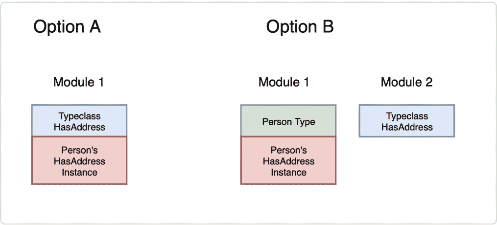

在 **选项 A** 中，我们在与类型类 **相同** 的模块中定义了 `Person’s` 实例。

**选项 B** 在其类型的 **相同** 模块中定义了 `Person’s` 实例，而类型类则定义在不同的模块中。

如果未遵循这两个要求中的任何一个，则我们就会得到一个 **孤立实例**。

乍一看，这一限制似乎很奇怪。让我们看看替代方案，看看问题出在哪里：

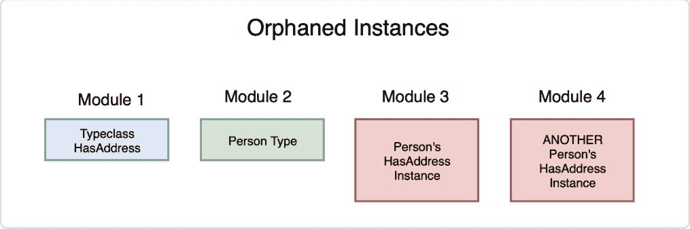

这里 **模块 3** 定义了 `Person’s HasAddress` 实例。但 **模块 4** 也这么做了。让我们想象 **模块 3** 和 **模块 4** 彼此完全独立，即两者互不导入。

现在我们将拥有 `Person` 的两个可能不同的 `HasAddress` 实现。如果我们的一半模块导入模块 3，而另一半导入模块 4，我们可能会陷入困境。

我们需要一个权威定义，而真正有权威的只有两个地方，即定义类型类的模块（模块 1）和定义类型的模块（模块 2）。

这看起来可能很局限，坦白说，有时确实如此。甚至在 Haskell 中，有办法告诉编译器允许在特定模块中使用孤立实例，即本质上将特定模块定义为权威。然而，这并非没有风险。如果过度使用，就可能导致同一实例的两个不同的定义。

因此在 PureScript 中，这是被禁止的，且没有可覆盖的选项。但当你发现自己遇到了孤立实例时会发生什么？让我们看一个这样的例子：

```
import Combine.Class (class Combine) ①

-- ORPHANED INSTANCE!!
instance combineInt :: Combine Int where ②
  combine = (+)
```

① 类型类定义在此模块之外。

② `Int` 类型定义在 PureScript 模块 `Prim` 中，因此类型也定义在此模块之外。

这是一个典型的孤立实例案例。你既不控制类型类也不控制类型。但你希望让该类型具有额外的功能。

可以怎么做？

我们需要控制类型类或类型中的一个。如果你创建另一个类型类，那么使用其他类型类的所有代码都将无法与你的类型类一起工作。但如果我们创建自己的类型，那么我们就是该类型的权威声音。

我们如何做到这一点？当然是用 `newtype`：

```
import Combine.Class (class Combine)

newtype AddInt = AddInt Int ①

instance combineAddInt :: Combine AddInt where ①
  combine (AddInt x) (AddInt y) = AddInt (x + y)
```

① 现在我们的 `AddInt` 类型与我们为 `AddInt` 定义的 `Combine` 实例位于同一模块中。不再有孤立实例。

这种解决方案并非免费。我们不能像使用 `Int` 一样使用 `AddInt`：

```
x :: AddInt
x = AddInt 10

y :: Int
y = 11

z :: Int
z = x + y --- COMPILER ERROR!! ①
```

① 这将导致类型不匹配错误。x 是 Int，y 是 AddInt，而 + 要求两个类型相同。

我们也不能添加两个不同的 AddInt：

```
z :: AddInt
z = (AddInt 7) + (AddInt 3) --- COMPILER ERROR!!
```

如果你尝试，就会得到以下编译器错误：

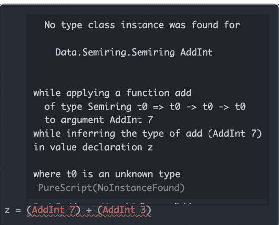

错误中最相关的部分是：

```
No Typeclass instance was found for

Data.Semiring.Semiring AddInt
```

这令人困惑，直到我们进入抽象代数部分学习一点关于半环的知识之前，它仍会令人困惑。现在让我们接受我们缺少一个实例来添加两个 AddInt。

对于好奇的人，这里是可以让我们对 AddInt 进行加法和乘法运算的实例，这两个运算是半环的运算：

```
instance semiringAddInt :: Semiring AddInt where
  add (AddInt x) (AddInt y) = AddInt (x + y)
  zero = AddInt 0
  mul (AddInt x) (AddInt y) = AddInt (x * y)
  one = AddInt 1
```

虽然 `newtype` 让我们绕过了孤立实例问题，但它并非没有缺点。很多时候我们需要为我们的 `newtype` 实现底层实例，使用 `derive newtype`：

```
import Data.Newtype (class Newtype)

newtype AddInt = AddInt Int
derive instance newtypeAddInt :: Newtype AddInt _ ①
derive newtype instance semiringAddInt :: Semiring AddInt ②
derive newtype instance ringAddInt :: Ring AddInt ③
derive newtype instance commutativeRingAddInt :: CommutativeRing AddInt ④
derive newtype instance euclideanRingAddInt :: EuclideanRing AddInt ④
```

① 我们必须先为我们的类型派生 `Newtype` 实例，然后才能利用 `derive newtype`。

② 现在，虽然我们还不了解半环是什么，但我们仍然可以利用 `Int` 的底层实现。这个定义让我们可以对 `AddInt` 进行加法和乘法。

③ 这让我们可以对 `AddInt` 进行减法。

④ 这些让我们可以对 `AddInt` 进行除法。`CommutativeRing` 是 `EuclideanRing` 的超类，因此我们必须同时实现两者，因为 `EuclideanRing` 提供了除法操作。

幸运的是，`derive newtype` 大大减少了我们的工作量。不幸的是，我们在使用 `AddInt` 的不同情况下，可能会发现自己不断向此列表中添加内容。

### 6.11. 实例依赖

实例也可以受约束，即实例依赖于一个或多个实例：

```
data Maybe = Nothing | Just a

instance showMaybe :: Show a => Show (Maybe a) where
  show Nothing = "Nothing"
  show (Just x) = "(Just " <> show x <> ")" ①
```

① 调用 `show x` 的原因在于 `x` 的类型是 `a`，因此 `a` 必须是 `Show` 的实例。

该实例依赖于 `Show`，即只要我们可以显示 `a`，我们就可以显示 `Maybe a`。

这里是另一个例子：

```
data Either a b = Left a | Right b

instance showEither :: (Show a, Show b) => Show (Either a b) where ①
  show (Left x)  = "(Left " <> show x <> ")" ②
  show (Right y) = "(Right " <> show y <> ")" ③
```

+ ① 我们使用括号和逗号列出多个约束。
+ ② 调用 `show x` 的原因在于 `a` 必须是 `Show` 的实例。
+ ③ 调用 `show y` 的原因在于 `b` 必须是 `Show` 的实例。

你可能已经注意到，在实例定义中，我们不使用 ∀。那是因为它是隐含的。

### 6.12. 多参数类型类

到目前为止，我们只看到具有单个类型参数的类型类，通常是 `a`，但也可以有多个：


```
import Data.List (List) ①
import Data.List as List ②
import Data.String.CodeUnits as String ③

class Decapitate collection element where ④
  decapitate :: collection -> Maybe {head :: element, tail :: collection}

instance decapitateList :: Decapitate (List a) a where ⑤
  decapitate = List.uncons

instance decapitateString :: Decapitate String Char where ⑥
  decapitate = String.uncons
```

+   ① 我们只导入 `List` 类型，这样就不需要写 `List.List`。
+   ② 然后我们将 `Data.List` 中的所有内容导入到命名空间 `List` 中。这意味着我们必须为此模块的所有导入加上 `List.` 前缀，例如 `List.uncons`。
+   ③ 这是非 Unicode 的 `String` 模块。
+   ④ 用于从 `collection` 中移除头部 `element` 的类。
+   ⑤ `List` 实例，我们利用 `List` 的 `uncons` 函数。`a` 是我们 `List` 的元素。
+   ⑥ `String` 实例，我们利用 `String` 的 `uncons` 函数。`Char` 是我们 `String` 的元素。

`collection` 和 `element` 是 `Decapitate` 类型类的类型参数。`collection` 是集合的类型，`element` 是集合中每个元素的类型。

`decapitate` 删除 `collection` 的头部，并以 `Record` 的形式返回它和剩余元素。由于这可能失败，因此返回 `Maybe`。

`List` 实例在第二个类型参数中被称为 **多态**，即类型 `a`。记住 **Poly** 表示 **多**，**morph** 表示 **形状**：

```
instance decapitateList :: Decapitate (List a) a where
  decapitate = List.uncons
```

第二个类型参数 `a` 可以采用多种形状，即 `a` 可以与多种类型统一。

相比之下，`String` 实例在第二个类型参数中是 **单态** 的，即 `Char`。记住 **Mono** 表示 **一**，**morph** 表示 **形状**：

```
instance decapitateString :: Decapitate String Char where
  decapitate = String.uncons
```

第二个参数 `Char` 是一个单一、固定的类型。

### 6.13. 函数依赖

回到我们对 `Decapitate` 的 `String` 实例：

```
import Data.String.CodeUnits as String

instance decapitateString :: Decapitate String Char where
  decapitate = String.uncons
```

这是非 Unicode 版本的 `String`。但如果我们也想支持 Unicode 呢：

```haskell

import Data.String.CodePoints (CodePoint)

import Data.String as StringUnicode

instance decapitateStringUnicode :: Decapitate String CodePoint where

  decapitate = StringUnicode.uncons

```
```

你可能会认为这是一个 Overlapping Instances 的情况，但事实并非如此。`Decapitate String Char` 与 `Decapitate String CodePoint` 是不同的。

让我们在查看一个利用这些实例返回尾部的函数时记住这些实现：

```haskell

genericTail

  :: ∀ collection element

  . Decapitate collection element ❶

  => collection

  -> Maybe collection

genericTail xs = case decapitate xs of -- COMPILER ERROR!!

  Just { tail } -> Just tail ❷

  Nothing -> Nothing

```
```

> ❶ 我们将 `collection` 和 `element` 约束为 `Decapitation` 实例的一部分。
> 
> ❷ 我们从 `Record` 中模式匹配 `tail`。

以下是编译器错误：

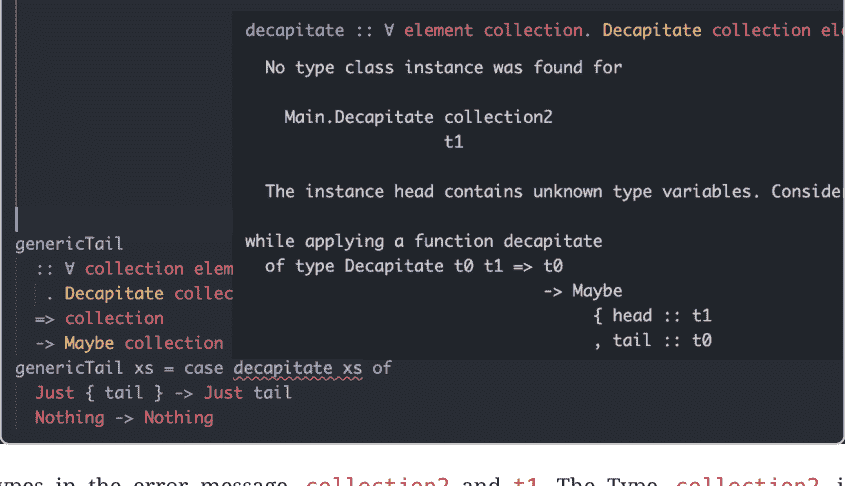

注意错误信息中的类型，`collection2` 和 `t1`。类型 `collection2` 显然就是我们的 `collection`。而 `t1` 显然是 `element`。但为什么它找不到实例？

在 `genericTail` 中，`element` 类型并未作为函数的参数提供，只有 `collection` 是。(`element` 只出现在约束中，但没有作为参数出现。) 但编译器需要同时知道 `collection` 和 `element` 才能选择要使用的 `Decapitate` 的正确实例实现。

在上面的示例中，我们有 Unicode 和非 Unicode 版本的 `Decapitate`，其中 `collection` 在两种情况下都是 `String`。但在不知道 `element` 类型的情况下，我们无法决定使用哪一个，编译器也无法决定。

解决这个问题有 2 种方法。一种有点 hacky，另一种涉及 Functional Dependencies。

首先，让我们看看 hacky 的方法。我们需要为函数提供适当类型的元素，以便编译器能够确定为 `Decapitate` 使用哪个实例：

```
genericTail
    :: ∀ collection element
    . Decapitate collection element
    => element ❶
    => collection
    -> Maybe collection
genericTail _ xs = ❷
  case (decapitate xs :: Maybe {head :: element, tail :: collection}) of ❸
    Just { tail } -> Just tail
    Nothing -> Nothing
```

❶ `element` 现在作为参数传递给函数。编译器将同时拥有 `collection` 和 `element` 的具体类型，这意味着它现在可以决定为 `decapitate xs` 调用哪个实例。

❷ 我们没有使用 `element` 参数。它仅用于其类型。因此我们不费心命名它并使用 `_`。

❸ 出于某种原因（可能是 bug），编译器在这里需要显式的类型定义。

当我们想要使用 `genericTail` 时，我们被迫想出 `element` 类型的 inhabitant：

```
t :: Maybe String
t = genericTail 'c' "abc" ❶
```

❶ 提供 `Char`，`'c'`，作为我们的 `element` 类型。这个示例让编译器知道我们希望它使用实例 `decapitateString`。

对于 Unicode：

```
tu :: Maybe String
tu = genericTail (codePointFromChar 'c') "abc" ①
```

① element 现在是 CodePoint。这个示例让编译器知道我们希望它使用实例 decapitateStringUnicode。

这绝对是一种 hacky 的方法，但它有效。但我们能做得更好吗？

似乎我们只是挑选一个随机值只是为了定义 element 的类型。有没有更干净的方法可以做到这一点，而无需挑选随机值。虽然在谈论提供原始类型时这不是什么大问题，但当我们的类型是一个复杂、嵌套的 Record 时，情况就完全不同了。想出这样的 Record 并非易事。

事实证明，有一种更干净的方法可以告诉编译器我们的 element 应该是什么类型：

```
import Type.Proxy (Proxy) ①

genericTail
  :: ∀ collection element
  . Decapitate collection element
  => Proxy element ②
  -> collection
  -> Maybe collection
genericTail _ xs = case (decapitate xs :: Maybe {head :: element, tail :: collection}) of ③
  Just { tail } -> Just tail
  Nothing -> Nothing
```

① Proxy 在其自己的包 purescript-proxy 中，这意味着 proxy 需要添加到你的 spago.dhall 中的 Dependencies。

② 我们不再需要挑选一些随机值了。我们只需要提供该类型的 Proxy 即可。

③ 我们仍然忽略 Proxy 参数。

我们现在可以提供适当类型的 Proxy：

```
import Type.Proxy (Proxy(..)) ①

t :: Maybe String
t = genericTail (Proxy :: Proxy Char) "abc"

tu :: Maybe String
tu = genericTail (Proxy :: Proxy CodePoint) "abc"
```

❶ 我们需要 `..` 来包含 `Proxy` 的构造子，它也叫做 `Proxy`。

这里发生的事情并不那么明显，所以让我们分解一下。

首先，让我们看看 `Proxy` 的定义：

```haskell

data Proxy a = Proxy

```
```

你可能注意到的第一件事是，`a` 类型参数在等式的右边没有出现。我们之前在 `Maybe a` 和 `Nothing` 中见过这种情况。但至少对于 `Maybe` 来说，`a` 类型参数被 `Just` 数据构造子使用。

在这里它从未被使用。当这种情况发生时，类型 `a` 被称为 *Phantom Type*。

记得使用 `Nil` 时编译器无法确定 `List` 的 `a` 类型吗？为了解决这个问题，我们必须显式指定类型：

```haskell

log $ show $ index (Nil :: List Unit) 0

```
```

好吧，我们在 `Proxy` 数据构造子中也有同样的问题。我们必须提供显式类型，而正是该类型与 `element` 统一。这种统一让编译器知道 `element` 的类型：

```haskell

import Type.Proxy (Proxy(..)) ❶

t :: Maybe String

t = genericTail (Proxy :: Proxy Char) "abc" ❶

tu :: Maybe String

tu = genericTail (Proxy :: Proxy CodePoint) "abc" ❷

genericTail

  :: ∀ collection element

  . Decapitate collection element

  => Proxy element ❶ ❷

  => collection

  => Maybe collection

genericTail _ xs = case (decapitate xs :: Maybe {head :: element, tail :: collection}) of

  Just { tail } -> Just tail

  Nothing -> Nothing

```
```

❶ 类型 `Proxy Char` 与 `genericTail` 中的 `Proxy element` 统一。因此，`element` 与 `Char` 统一。

❷ 类型 `Proxy CodePoint` 与 `genericTail` 中的 `Proxy element` 统一。因此，`element` 与

CodePoint 统一。

好吧，这就结束了我们的 hacky 解决方案。它有点复杂且繁琐。

希望一个名为 *Functional Dependencies* 的特性可以简化这个混乱。嗯，它确实可以，也并不总是。

以下是我们如何使用 Functional Dependencies 编写 Typeclass Decapitate：

```
class Decapitate collection element | collection -> element where ①
  decapitate :: collection -> Maybe {head :: element, tail :: collection}
```

① 竖线后面的部分指定了 collection 和 element 之间的 Functional Dependency。

Functional Dependency 定义了对于每个 collection 类型只能有一个 element 类型。

这意味着当编译器只知道 collection 类型时，它可以安全地推断 element 类型，因为只有一个可能性。但这也意味着，你在可以创建的实例方面受到限制。

使用 Functional Dependencies，所有歧义都被消除，使得我们可以编写更简单的 genericTail 版本：

```
genericTail
  :: ∀ collection element
  . Decapitate collection element
  => collection ①
  -> Maybe collection
genericTail xs = case decapitate xs of ②
  Just { tail } -> Just tail
  Nothing -> Nothing
```

① 我们不再需要额外的参数。

② 现在编译器不需要这一行的显式类型。

这似乎解决了我们之前的所有问题……除了我之前提到的那个限制：

```
instance decapitateString :: Decapitate String Char where
    decapitate = String.uncons

-- OVERLAPPING INSTANCE ERROR!!
instance decapitateStringUnicode :: Decapitate String CodePoint where
    decapitate = StringUnicode.uncons
```

你认为为什么我们在这里会得到 Overlapping Instance 错误？

记住我们的 Functional Dependency 说什么。知道 collection 将决定 element 且没有歧义。但当我们为 collection String 引入 2 种不同的情况时，我们现在就有了歧义，因此出现了 Overlapping Instance 错误。

那么这个困境有解决方案吗？

实际上有。我们只需反转 Functional Dependency：

```
class Decapitate collection element | element -> collection where ①
    decapitate :: collection -> Maybe {head :: element, tail :: collection}
```

① 反转的依赖。

现在我们的 String 实例不会重叠，因为元素是不同的。Functional Dependency 反转后，编译器从 Char 或 CodePoint 开始，基于此它可以推断出 collection，在这两种情况下都是 String。

这也没问题，因为是 element 决定它将为 decapitate 使用哪个实例，而 Char 和 CodePoint 之间没有歧义。

但我们被迫为 genericTail 添加回显式的类型签名：

```
genericTail
    :: ∀ collection element
      . Decapitate collection element
    => collection
    -> Maybe collection
genericTail xs = case (decapitate xs :: Maybe {head :: element, tail :: collection}) of ①
    Just { tail } -> Just tail
    Nothing -> Nothing
```

① Functional Dependency 反转后，我们需要显式指定类型以供编译器使用。

显式的类型签名并不算太糟糕，但现在我们在

will always be picked removing any ambiguity.

But now `decapitateArray` will NEVER be picked because `List` will always match:


```
ta :: Maybe (Array String) -- COMPILER ERROR!! ①
ta = genericTail ["abc"]

tl :: Maybe (List String)
tl = genericTail ("abc" : Nil)
```

① Could not match type `List` with type `Array`.

On the surface, it may appear that Functional Dependencies don’t work well and require a lot of work. But in practice, they are usually the easiest and best solution.

The example with non-Unicode and Unicode `Strings` both needing to be an instance of the same Class is pretty rare and quite contrived to demonstrate some problems you’ll run into and some possible solutions.

And in the rare case where Functional Dependencies fail us due to crazy requirements, we can always use `Proxy` to force the compiler to pick the instance we want.

### Chapter 7. Coding Typeclasses

It’s always good to take something we’ve just learned and play with it to get a good feeling for the concepts. Please don’t just read this section, but make sure you try to code as much as possible.

#### 7.1. Coding Preparation

Working in the same project as we did for our earlier coding sessions, let’s simply add a file for this Chapter called `Ch7a`. (The `a` is important since we’ll create a `b` file later on in this Chapter.)

Next, write the module definition for `Ch7a` without looking back on what we’ve done before. See if you can remember it. If not, no worries. It’s just good to challenge your memory. If you have to cheat and look, don’t copy and paste it. Typing it over will help cement it into your mind.

#### 7.2. Maybe Data Type

Create the definition for `Maybe`. You’ve seen it more than a few times, so it should be easy.

If you struggle with this, that’s a good thing. That means trying to write it is worth doing.

Try to define it before moving on.

#### 7.3. Code for `Maybe` Data Type

Your file should look like:

```
module Ch7a where

data Maybe a = Nothing | Just a
```

> The order of the Data Constructors could be reversed, but remember the `Ord` Typeclass derivations we talked about in the last Chapter will order values based on the order of the Data Constructors. So, I’ve chosen to put `Nothing` first here to cause `Nothings` to sort to the top of `Lists` and `Arrays` of `Maybes`.

#### 7.4. Writing `Eq` for `Maybe`

Add the following imports:

```
import Prelude (Unit, show, discard, (==), ($)) ①

import Data.Eq (class Eq) ②
import Effect (Effect) ③
import Effect.Console (log) ③
```

① Some things we’ll need from Prelude. Remember, discard is implicitly used in the do syntax (more on this later in the book).

② We need to import the Eq Typeclass. Note the class keyword.

③ These imports are for our debugging code, viz. the test function.

Edit your Main.purs to look like:

```
module Main where

import Prelude
import Effect (Effect)

import Ch7a as Ch7a ①

main :: Effect Unit
main = Ch7a.test ②
```

① Change from Ch5 to Ch7a.

② Change from Ch5.test to Ch7a.test.

Add the following Function to test our code in Ch7a.purs:

```
test :: Effect Unit
test = do
  log $ show $ Just 5 == Just 5 -- COMPILER ERROR!! ①
  log $ show $ Just 5 == Just 2 ②
  log $ show $ Just 5 == Nothing ③
  log $ show $ Nothing == Just 5 ④
  log $ show $ Nothing == (Nothing :: Maybe Unit) ⑤ ⑥
```

① Prints true.

② Prints false.

③ Prints false.

④ Prints false.

⑤ Prints true.

⑥ Once again, the compiler cannot figure out the a in Maybe a since the Data Constructor, Nothing, doesn’t take a Type Parameters. So we have to explicitly specify a. We chose Unit for a because a must have an Eq instance, which Unit does.

The compiler error is expected here. We’ll fix it soon enough.

Notice that we only had to explicitly specify the Type on one side of ==. That’s because == is an alias for eq which expects both Parameters to be of the same Type. Once we let the compiler know that the right-hand side is of Type Maybe Unit, it can figure out that the left-hand side is of the same Type.

A friendly reminder, you run your program with the following command (once it compiles):

```
npx spago run
```

Now you’re ready to write the Eq instance for Maybe. We want to write the instance by hand for practice even though we can derive Eq.

Use Pursuit to look up the definition of the Eq Typeclass.

Please give it a try before reading further.

#### 7.5. Code for Eq for Maybe

First, we code the instance definition:

```
instance eqMaybe :: Eq (Maybe a) where ①
```

① We use canonical naming here for the Instance Name, first the Typeclass name and then the Type name, viz. eqMaybe.

Next, we code up the Methods. Based on Pursuit, Eq only has one Method, eq. First, let’s code up the trivial case:

```
instance eqMaybe :: Eq (Maybe a) where
  eq Nothing Nothing = true ①
```

① This is a trivial case.

Next, we should code up the Just case:

```
No type class instance was found for

    Data.Eq.Eq a1
```

Data.Eq.Eq is the fully-qualified Typeclass name. Data.Eq is the Module name and the second Eq is the Typeclass.

Notice the underlined part in the editor is x == y. That makes sense based on the error message. It cannot determine an Eq Instance for a1. But what’s a1? We don’t have an a1.

Remember, the compiler adds numbers to the end of the Types to distinguish different variables with the same names. So we need to look for an a in our code:

```
instance eqMaybe :: Eq (Maybe a) where ①
    eq Nothing Nothing = true
    eq (Just x) (Just y) = x == y -- COMPILER ERROR!!
    eq _ _ = false
```

① This is the ONLY a.

We get an error when trying to compare x and y for equality using == which is just an Operator Alias for the eq Method in the Eq Typeclass. The compiler wants to be able to use the appropriate Eq instance on this line of code.

Both x and y are Type a since they were constructed with Just, which takes an a. You can also say they were destructured with Just, which gives us a value of Type a.

The compiler is complaining that there is NO Instance for our a. So we need to provide one. But we cannot just write one since even we don’t know what Type a will be when our Typeclass gets used.

Therefore, we only have one choice. We must REQUIRE that a comes with its own Eq instance. And we accomplish this with a Constraint:

```
instance eqMaybe :: Eq a => Eq (Maybe a) where ①
    eq Nothing Nothing = true
    eq (Just x) (Just y) = x == y
    eq _ _ = false
```

① We require a to have an Eq instance by constraining a.

#### 7.6. Writing Ord for Maybe

Remember that the Ord class lets us determine the ordering of values in a Type. So operations like <, >, <=

and >= all require an Instance of the Ord Typeclass.

Look up Ord in Pursuit to see what Methods are part of the Ord Typeclass.

Next, update your Prelude imports:

```
import Prelude (Unit, show, discard, (==), ($), (<), (>), (<=), (>=))
```

And let’s import from Data.Ord that we’ll need for implementing an Instance for Ord:

```
import Data.Ord (class Ord, Ordering(..), compare)
```

And add the following lines to your test function:

```
log "----------------" ❶
log $ show $ Just 1 < Just 5 -- COMPILER ERROR!! ❷
log $ show $ Just 5 <= Just 5 ❸
log $ show $ Just 5 > Just 10 ❹
log $ show $ Just 10 >= Just 10 ❺
log $ show $ Just 99 > Nothing ❻
log $ show $ Just 99 < Nothing ❼
```

- 1. This will make reading the output of our test code easier since the previous tests also print out `Booleans`.

- 2. Prints `true`.

- 3. Prints `true`.

- 4. Prints `false`.

- 5. Prints `true`.

- 6. Prints `true`.

- 7. Prints `false`.

Once again, we are expecting this compiler error since we haven’t implemented Ord yet, so we cannot use any of the comparison operators here.

Please consult Pursuit to refresh your memory about the Ordering Type since it’s used in the Ord Typeclass.

If you struggle with writing this Typeclass, then proceed to the Hint section that follows. But give it try before giving up.

#### 7.7. 关于Maybe实现Ord的提示

Ordering类型如下：

```
data Ordering = LT | GT | EQ
```

Ord类型类的compare方法定义如下：

```
compare :: a -> a -> Ordering
```


这意味着你需要比较两个`Maybe`，可能使用模式匹配，并根据值返回`LT`、`GT`或`EQ`。这也意味着我们的底层值也需要是可比较的。

再试一次。

## 7.8. 为`Maybe`实现`Ord`的代码

首先编写实例定义：

```
instance ordMaybe :: Ord a => Ord (Maybe a) where
```

我们约束`a`也必须有`Ord`实例，就像之前为`Eq`所做的那样，以便比较两个`Just`。

接下来，我们编写平凡情况：

```
instance ordMaybe :: Ord a => Ord (Maybe a) where
  compare Nothing Nothing = EQ
```

现在来看`Just`的情况：

```
instance ordMaybe :: Ord a => Ord (Maybe a) where
  compare Nothing Nothing = EQ
  compare (Just x) (Just y) = ??? ①
```

① 我们不能像在`Eq`中那样使用运算符。

因此，问号处是我们停下来思考如何比较底层值`x`和`y`的地方。在`Eq`类型类中，我们使用了`==`运算符。我们当然也可以使用`<`和`>`运算符：

```
instance ordMaybe :: Ord a => Ord (Maybe a) where
    compare Nothing Nothing  = EQ
    compare (Just x) (Just y) =
        if x > y then GT else if y < x then LT else EQ ①
```

① 在第一个`else`下嵌套的`if`。

但这没有必要，因为大于和小于运算符本来就是基于`compare`实现的。稍后我们编写`>=`代码时会看到这一点。

所以，我们干脆避免中间人，直接使用`compare`：

```
instance ordMaybe :: Ord a => Ord (Maybe a) where
    compare Nothing Nothing  = EQ
    compare (Just x) (Just y) = compare x y ①
```

① 注意，`x`和`y`的顺序与`Just x`和`Just y`的顺序一致。

最后，我们处理比较`Nothing`和`Just`的两种情况：

```
instance ordMaybe :: Ord a => Ord (Maybe a) where
    compare Nothing Nothing  = EQ
    compare (Just x) (Just y) = compare x y
    compare Nothing _        = LT ①
    compare _ Nothing        = GT
```

① 请记住，我们先定义了`Nothing`数据构造器，然后才定义`Just`数据构造器，因此`Nothing`小于`Just a`，反过来，`Just a`大于`Nothing`。这遵循了编译器在派生`Ord`时使用的规则。

## 7.9. 编写 `>=`

你可能会奇怪，为什么我们编写返回`LT`、`GT`或`EQ`的`compare`，却用`<`、`>`、 `<=`和`>=`来测试代码。

为了更好地理解它们之间的关系，请在`Pursuit`上查看`>=`是哪个函数的运算符别名。然后查看该函数的类型签名。

最后，在继续之前，编写该函数并定义运算符。

## 7.10. 对`>=`的提示

这是`>=`的定义：

### (>=)

来源

运算符别名，对应`Data.Ord.greaterThanOrEq`（左结合 / 优先级4）

我们可以看到，这个运算符是`greaterThanOrEq`的别名。让我们在同一页面上该运算符定义的正上方查找它的类型签名：

### greaterThanOrEq

来源

`greaterThanOrEq :: forall a. Ord a => a -> a -> Boolean`

测试一个值是否非严格大于另一个值。

从这个类型签名可以看出，`greaterThanOrEq`并不像我们使用`>=`时习惯的那样接受一个数字。相反，它接受一个被约束为具有`Ord`实例的`a`。

所以请记住这些，先自己再试一次，再继续往下看。

## 7.11. 编写`>=`的代码

我们先从类型签名开始：

```
greaterThanOrEq :: ∀ a. Ord a => a -> a -> Boolean
```

接下来是实现：

```
greaterThanOrEq :: ∀ a. Ord a => a -> a -> Boolean
greaterThanOrEq x y = ??? ①
```

① 我们知道这应该以某种方式利用`compare`。

我们知道`compare`返回`LT`、`GT`和`EQ`。我们要做的就是调用`compare`，然后检查结果是`GT`还是`EQ`：

```
greaterThanOrEq :: ∀ a. Ord a => a -> a -> Boolean
greaterThanOrEq x y = cmp == GT || cmp == EQ where cmp = compare x y ① ②
```

① 我们需要将`(||)`添加到我们的`Prelude`导入列表中。

② 我们在这里使用`where`，这样就不必真正调用`compare`两次。

最后，我们只需要添加运算符别名，回顾`Pursuit`文档以查看结合性和优先级。

```
infixl 4 greaterThanOrEq as >= ① ②
```

① 我们需要从`Prelude`导入列表中移除`(>=)`，因为我们要定义自己的运算符。

② 结合性是左结合，所以我们使用`infixl`，优先级是4。

## 7.12. 为`Maybe`编写`Show`实例

使用`Pursuit`查找`Show`类型类的定义。

添加以下导入：

```
import Data.Show (class Show) ①
```

① 可选地，你可以从`Prelude`导入列表中移除`show`，并在这里添加它。`Prelude`会从`Data.Show`中为你导入它。两种方式都有效。

然后将以下内容添加到你的测试代码中：

```
log $ show $ Just "abc" ①
log $ show $ (Nothing :: Maybe Unit) ② ③
```

① 输出 `(Just "abc")`。

② 再次强调，我们必须显式指定类型。

③ 输出 `Nothing`。

现在，在继续之前，为`Maybe`编写`Show`实例。请手写，即不要使用`genericShow`。我们很快会用到它。

## 7.13. 为`Maybe`实现`Show`的代码

首先编写实例定义行：

```
instance showMaybe :: Show (Maybe a) where
```

接下来，我们编写平凡情况下的`show`方法，即`Nothing`的情况：

```
```haskell

instance showMaybe :: Show (Maybe a) where

  show Nothing = "Nothing"

```
```

最后，我们编写`Just`的情况：

```
```haskell

instance showMaybe :: Show (Maybe a) where

  show Nothing = "Nothing"

  show (Just x) = "(Just " <> show x <> ")" -- COMPILER ERROR! ❶ ❷

```
```

- 1. 我们需要将 `(<>)` 添加到我们的 `Prelude` 导入列表中。

- 2. 显示 `x` 是个问题。你能想到为什么吗？

这是编译器错误：

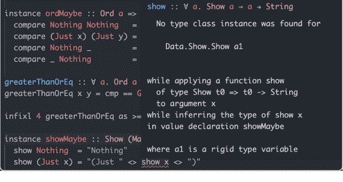

请注意，在编辑器中 `show x` 被加了下划线，编译器错误提示 `a1`（对应于我们 `Maybe a` 中的 `a`）没有 `Show` 实例。

我们让编译器显示 `x`，但 `x` 可以是任意 `a`。然而，它不能是任意 `a`，它必须是一个可显示的 `a`。所以我们要添加那个约束：

```
```haskell

instance showMaybe :: Show a => Show (Maybe a) where ❶

  show Nothing = "Nothing"

  show (Just x) = "(Just " <> show x <> ")"

```
```

- 1. 我们在 `a` 上添加了一个约束，要求它也是可显示的。

现在，`a` 不仅仅是任意 `a`，而是任意同时具有 `Show` 实例的 `a`。

## 7.14. 为`Maybe`派生`Eq`、`Ord`和`Show`

既然我们已经手写了这些实例（这样做是为了更好地理解它们的工作原理），我们可以将它们注释掉，并替换为派生语句。

一旦你注释掉`Show`实例，你会在`Prelude`导入行收到一个警告。当鼠标悬停在该行上时，你会看到对`<>`的导入不再必要。

现在继续将其移除。

试着看看你是否记得如何派生这些实例，不要回头看或向前看。如果记不住，就直接跳到Hint部分。

## 7.15. 关于派生的提示

如果你记不住派生语法（这在一开始是很正常的），那么我想借此机会说明一下，为什么我们要做所有这些练习，尽管我们在上一章已经讨论过所有这些内容。

我知道，我不得不翻了好几次运算符别名和派生之类的语法，才能做到不假思索地直接输入。说实话，运算符别名有时候仍然会难住我。

通过做这些练习而不仅仅是阅读，我们正在用经验巩固理解，这将在我们编写真正的代码时有所帮助。

现在来看派生的语法：

```
derive instance eqMaybe :: ???
```

看看这是否有帮助，然后再试一次。如果你在`Show`上卡住了，请看下一个Hint部分。

## 7.16. 关于派生`Show`的提示

你可能记得也可能不记得，你不能这样做：

```
derive instance showMaybe :: Show (Maybe a) -- COMPILER ERROR!!
```

下面是你将得到的错误：

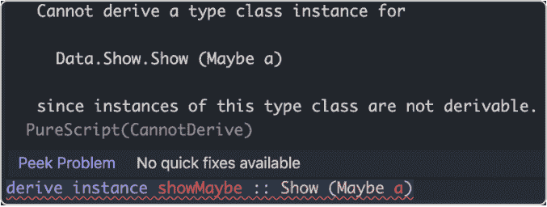

编译器说它 *Cannot derive a type class for Data.Show.Show*。并且它在下面说它无法这样做，因为 *instances of this type class are not derivable*。

在上一章中，我们谈到了使用 `genericShow`。但要做到这一点，我们的类型必须具有类型的内部表示，以便 `genericShow` 可以使用该表示来显示值。

这是通过以下导入完成的：

```
import Data.Generic.Rep (class Generic)
import Data.Show.Generic (genericShow)
```

接下来，我们想要使用以下命令构建：

```
npx spago build
```

我们得到以下错误：

```
[error] Some of your project files import modules from packages that are not in the direct dependencies of your project.
To fix this error add the following packages to the list of dependencies in your config:
- maybe
- tuples
```

我们需要将这些包添加到 `spago.dhall` 作为项目的直接依赖项：

```
```haskell

derive instance genericMaybe :: Generic (Maybe a) _

```
```

❶ 不要忘记第二个未指定的类型参数始终是 `_`。

下划线类型参数由编译器填充。

最后，我们可以手动编写 Show 实例：

```
```haskell

instance showMaybe :: Show a => Show (Maybe a) where

  show = genericShow

```
```

❶ 不要忘记 `a` 的约束。

最终的代码应该看起来像这样：

```
```haskell

data Maybe a = Nothing | Just a

derive instance eqMaybe :: Eq a => Eq (Maybe a)

derive instance ordMaybe :: Ord a => Ord (Maybe a)

derive instance genericMaybe :: Generic (Maybe a) _

instance showMaybe :: Show a => Show (Maybe a) where

  show = genericShow

```
```

现在重新运行你的测试，看看输出是否与你的手动版本相同。

## 7.18. 为 `Either` 推导 `Eq`、`Ord` 和 `Show`

创建 `Either` 数据类型，然后推导 `Eq` 和 `Ord`，并使用 `genericShow` 为 `Either` 编写 `Show`。

以你对 `Maybe` 所做的工作作为 `Either` 的模板。

记住 `Maybe` 和 `Either` 之间有一些细微差别，例如 `Either` 有 2 个类型参数 `a` 和 `b`。

在继续之前尝试编写代码。

## 7.19. 为 `Either` 编写 `Eq`、`Ord` 和 `Show`

让我们先创建数据类型：

```
```haskell

data Either a b = Left a | Right b

```
```

接下来，让我们编写 `Eq` 实例：

```
derive instance eqEither :: (Eq a, Eq b) => Eq (Either a b)
```

① 我们必须使用带括号和逗号的这种特殊语法来约束 `a` 和 `b` 两者。

然后我们编写 `Ord`：

```
derive instance ordEither :: (Ord a, Ord b) => Ord (Either a b)
```

在我们能够编写 `Show` 之前，我们需要推导 `Generic` 以便我们可以使用 `genericShow`：

```
derive instance genericEither :: Generic (Either a b) _
```

最后，我们编写利用 `genericShow` 的 `Show` 实例：

```
instance showEither :: (Show a, Show b) => Show (Either a b) where
  show = genericShow
```

让我们添加一些测试代码：

```
log $ show $ Left "left" -- COMPILER ERROR!! ①
log $ show $ Right (Just 42)
```

① 这是我们之前见过的编译器错误。

以下是编译器错误的详细内容：

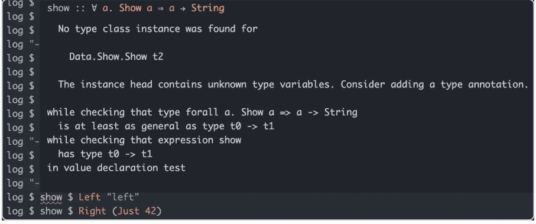

在这里，编译器给出了 `t2` 的类型，这完全没有帮助。

```
instance showEither :: (Show a, Show b) => Show (Either a b) where
  show = genericShow
```

① 我们在这里有 2 个类型参数，`a` 和 `b`。

查看这个定义，我们可以合理地假设 `t2` 是 `b`，因为它是第二个参数。但它为什么关心 `b`？

为了看看我们是否走在正确的轨道上，注释掉有问题的行，看看是否会为下一行得到类似的错误：

```
-- log $ show $ Left "left"
log $ show $ Right (Just 42) -- COMPILER ERROR!! ①
```

① 完全相同的错误。

以下是新的错误：

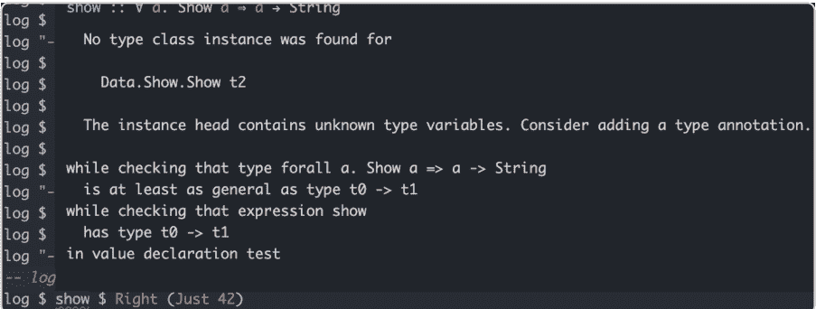

不幸的是，这也给出了 `t2` 作为类型。所以也许我们最初关于 `t2` 代表 `b` 的评估是错误的，因为 `Right` 为编译器提供了 `b`。

因此 `Left` 和 `Right` 都给出了一个错误，提示我们添加类型注释。但仍然不清楚该怎么做。

让我们通过进入 REPL（Read-Evaluate-Print-Loop）来做一个测试，但首先注释掉两行测试代码，以便我们的程序可以编译：

```
-- `log $ show $ Left "left" -- COMPILER ERROR!!
-- log $ show $ Right (Just 42)
```

进入终端，确保你在项目目录中并运行：

```
npx spago repl
```

然后让我们在提示符 `>` 处输入以下命令：

```
> import Ch7a ① ②
> :t Left "left" ③
forall t2. Either String t2 ④
```

① 不要输入 `>`，因为那是 REPL 的提示符。

② 我们导入代码，以便在 REPL 中有 `Either` 的定义。

③ `:t` 是 `:type` 的简写，它打印 `Left "left"` 的类型。

④ 这是 `:t` 命令的输出。

注意类型的写法是：

```
forall t2. Either String t2
```

编译器弄清楚了 `Either a b` 中的 `a`，因为我们给了它 `Left "left"`，它将我们的 `String` `"left"` 与 `a` 统一了。但它不知道 `b` 是什么。

它说 `b` 或它称之为 `t2`，可以是任何类型，因此 `forall t2`。

让我们尝试找到第二个测试的类型：

```
> :t Right (Just 42) ①
forall t1. Either t1 (Maybe Int) ②
> ^D ③
See ya!
()
```

① 我们请求测试代码中 `Right` 的类型。

② 这是 `:t` 命令的输出。

③ 输入 Control-D 退出 REPL。

奇怪的是，它在这里称我们的 `b` 为 `t1`，这与编译器错误中的名称不同，但没关系。这告诉我们需要知道什么。


当我们给编译器一个 `Left` 时，它可以推断 `a` 但不能推断 `b`。但当我们给它一个 `Right` 时，它可以推断 `b` 但不能推断 `a`。

这是有道理的，因为在两种情况下信息都不够。`Left` 对于 `b` 没有提供信息，而 `Right` 对于 `a` 没有提供任何信息。

让我们更改测试代码以提供足够的信息。

有 2 种方法可以做到这一点。我们可以像编译器建议的那样添加类型注释：

```
log $ show (Left "left" :: Either _ Unit) <1> ② ③
log $ show (Right (Just 42) :: Either Unit _) <1> ② ④
```

① `_` 由编译器填充，因为我们知道它可以推断该类型参数。

② `Unit` 被使用，因为它有 `Show` 实例。

③ 我们可以用 `String` 替换这个 `_`。

④ 我们可以用 `(Maybe Int)` 替换这个 `_`。

另一种修复方法是使用变量，这更接近我们在程序中会做的事情。我们不会这样做，但这就是它的工作方式。

首先，让我们定义一个类型别名：

```
type MyEitherVar = Either String (Maybe Int) ①
```

① 一个命名糟糕的类型别名。

接下来，让我们定义一些类型为 `MyEitherVar` 的值并显示它们：

```
let x = Left "left" :: MyEitherVar ①
    y :: MyEitherVar ①
    y = Right $ Just 42
log $ show x ②
log $ show y ②
```

① 我们可以使用这两种不同的语法来定义 `x` 和 `y`。选择权在你。

② 编译器知道 `a` 和 `b`，因为 `x` 和 `y` 都是 `MyEitherVar` 类型。所以编译器可以仅从拥有 `x` 或 `y` 就推断出 `(Show a, Show b)` 约束。

此时，我们可以清理导入：

```
import Prelude (Unit, discard, show, ($), (<), (<=), (==), (>), (>=)) ①
import Data.Ord (class Ord) ②
```

① 从导入列表中移除了 `(<>)`。

② 移除了 `Ordering(..)` 和 `compare`。

### 7.20. 创建我们自己的类型类

假设我们有一些东西想要编码为 CSV（逗号分隔值）。

一种非常有效的方法是创建一个类型类。让我们称它为 `ToCSV`，它有一个名为 `toCSV` 的方法。

首先，让我们在 `src` 目录下创建一个名为 `Ch7b.purs` 的新文件，内容如下：

```
module Ch7b where

import Prelude

import Effect (Effect)
import Effect.Console (log)

test :: Effect Unit
test = do
  log "placeholder" ①
```

① 我们很快就会删除这一行。它现在在这里只是为了让编译器高兴。

并将 `Main.purs` 改为：

```
module Main where

import Prelude
import Effect (Effect)

import Ch7b as Ch7b ①

main :: Effect Unit
main = Ch7b.test ②
```

① 将导入从 `a` 改为 `b`。

② 调用 `b` 的 `test` 函数。

现在，继续编写 `ToCSV` 的类型类，然后再继续。如果卡住了，请查看提示部分。

### 7.21. `ToCSV` 的提示

当我们思考如何对某物进行编码时，我们首先要确定编码的类型。

我们的情况只是一个 CSV，可以很容易地用一个 `String` 来编码。但我们不想把任意的 `String` 与我们的 CSV `String` 混淆。

所以首先让我们为我们的 CSV 编码字符串创建一个 `newtype`。我们称它为 `CSV`。

为了帮助你回忆 Typeclass 的语法，这里是我们之前章节中的 `HasAddress` Typeclass：

```
class HasAddress a where
  getAddress :: a -> Address
```

在继续之前，先尝试写出 `newtype` 和 `class`。

### 7.22. `ToCSV` 的代码

首先，让我们创建我们的 `newtype`：

```
newtype CSV = CSV String
```

`CSV` 只是一个 `String` 的包装，但好处是类型安全，即如果我们传入一个 `String` 代替它，编译器会报错。

接下来，我们写类：

```
class ToCSV a where
  toCSV :: a -> CSV
```

方法 `toCSV` 将接收我们的类型，这里用 `a` 表示，并将其编码为 `CSV`。

### 7.23. 使用 `ToCSV`

对以下数据类型为 `Person` 创建一个 `ToCSV` 的实例：

```
newtype FullName = FullName String

newtype Age = Age Int

data Occupation = Doctor | Dentist | Lawyer | Unemployed

data Person = Person
  { name :: FullName
  , age :: Age
  , occupation :: Occupation
  }
```

试着做一下，看看能做到什么程度。如果遇到困难，请参考下面的提示部分。

### 7.24. `ToCSV` 的另一个提示

首先要意识到，在攻克 `Person` 的 `ToCSV` 实例之前，最容易先为 `FullName`、`Age` 和 `Occupation` 实现 `show`。

在阅读后续内容前再试一次。

### 7.25. `ToCSV` 的代码

让我们先写 `FullName` 的实例：

```
newtype FullName = FullName String

instance showFullName :: Show FullName where
  show (FullName name) = name ①
```

① 我们解构 `FullName` 暴露出 `name`，其类型为 `String`。

然后我们可以为 `Age` 写同样的内容，但这次我们会用不同的方法：

```
import Data.Newtype (class Newtype) ①

newtype Age = Age Int
derive instance newtypeAge :: Newtype Age _ ②
derive newtype instance showAge :: Show Age ③
```

① 我们需要导入 `Newtype` 类以便为 `Age` 派生 `Newtype`。

② `Newtype` 类型类让我们可以通过委托给被包装类型的实现来为包装类型派生类型类。这让我们免于编写和调试实现。

③ 通过使用 `Int` 的 `Show` 为 `Age` 派生 `Show`。

我们本可以用完全相同的技术来实现 `FullName`。派生通常比手工编码更可取。

接下来，我们将为 `Occupation` 编写 `show` 实例：

```
import Data.Generic.Rep (class Generic) ①
import Data.Show.Generic (genericShow)

data Occupation = Doctor | Dentist | Lawyer | Unemployed
derive instance genericOccupation :: Generic Occupation _ ②

instance showOccupation :: Show Occupation where
  show = genericShow ③
```

① 我们需要导入这些以实现 `show`。

② 我们需要派生 `Generic` 以利用 `genericShow`。

③ 我们使用 `genericShow` 实现 `Show`。

现在，我们准备好为 `Person` 编写 `ToCSV` 实例：

```
data Person = Person
  { name :: FullName
  , age :: Age
  , occupation :: Occupation
  }

instance toCSVPerson :: ToCSV Person where
  toCSV (Person {name, age, occupation}) = ①
    CSV $ show name <> "," <> show age <> "," <> show occupation ②
```

① 解构 `Person` 然后解构其底层记录的字段。

② 我们按定义顺序显示每个字段，然后用逗号分隔并将结果包装在 `CSV` 中。

### 7.26. 测试 `ToCSV`

在查看我对测试的建议之前，先尝试为 `Person` 的 `toCSV` 想出测试代码。

不要忘记从测试函数中删除我们的占位符代码：

```
log "placeholder"
```

删除这一行。

如果你想不出要写什么，这里有一些测试代码：

```
-- COMPILER ERROR!
log $ show $ toCSV
  (Person
    { name: FullName "Sue Smith"
    , age: Age 23
    , occupation: Doctor
    }) == CSV "Sue Smith,23,Doctor"
```

无法对 `CSV` 进行相等比较。

注意 `name` 不仅仅是一个硬编码的 `String`，而是一个 `FullName`。`age` 也是同样的问题。

为了让编译器满意，我们需要为 `CSV` 实现 `Eq` 以便检查相等性：

```
newtype CSV = CSV String
derive instance newtypeCSV :: Newtype CSV
derive newtype instance eqCSV :: Eq CSV
```

首先派生 `Newtype` 以便轻松派生其他类型类。我们稍后会用到它。

利用底层 `String` 的 `Eq` 实例派生我们的实例。我们也可以省略 `newtype`，因为我们可以为任意类型派生 `Eq`。

现在我们的测试代码可以编译并运行：

```
log $ show $ toCSV
  (Person
    { name: FullName "Sue Smith"
    , age: Age 23
    , occupation: Doctor
    }) == CSV "Sue Smith,23,Doctor"
```

打印 `true`。

### 7.27. 编写 **FromCSV**

每当你对某物进行编码时，你几乎总是需要对其进行解码。所以让我们创建一个名为 `FromCSV` 的另一个类型类，它有一个名为 `fromCSV` 的单一方法。

回顾我们对 `ToCSV` 所做的工作应该会有所帮助。试着做一下，然后在下一节检查你的工作。

另外，你需要 `Data.String` 模块中的一个名为 `split` 的函数。查阅 Pursuit 了解更多关于此函数的信息。

### 7.28. `FromCSV` 的代码

这个类非常简单：

```
import Data.Maybe (Maybe) ①

class FromCSV a where
  fromCSV :: CSV -> Maybe a ②
```

① 导入类型 `Maybe`。注意构造子并未导入。我们很快需要纠正这一点。

② 由于我们接收的是 `CSV`，本质上只是一个 `String`，可能无法将其解码为我们的类型，例如我们编码类型 A 然后尝试将其解码为类型 B。这种潜在的失败就是我们返回 `Maybe` 的原因。

现在，我们可以一步一步地编写 `Person` 的实例。首先是导入：

```
import Data.Maybe (Maybe(..)) ①
-- COMPILER ERROR!!
import Data.String (Pattern(..), split) ②
```

① 添加 `(..)` 以包含 `Just` 和 `Nothing`，`fromCSV` 需要它们。

② 用于根据 `Pattern` 将字符串拆分为 `Array String` 的导入。

我们需要为 `Data.String` 模块添加包。去 Pursuit 上查找该模块属于哪个包，然后返回这里。

根据 Pursuit，它可以在 `purescript-strings` 中找到。

首先，注释掉有问题的导入：

```
-- import Data.String (Pattern(..), split)
```

这将允许我们完整构建项目。

将 `strings` 添加到你的 `spago.dhall` 文件中，然后使用以下命令构建项目：

```
npx spago build
```

我们得到以下输出：

```
[warn] None of your project files import modules from some projects that are in the direct dependencies of your project.
These dependencies are unused. To fix this warning, remove the following packages from the list of dependencies in your config:
- strings
[error] Some of your project files import modules from packages that are not in the direct dependencies of your project.
To fix this error add the following packages to the list of dependencies in your config:
- newtype
```

警告是预期的，但错误告诉我们需要在 `spago.dhall` 中添加 `newtype`。

添加它然后重新运行：

```
npx spago build
```

不要忘记取消注释 `import Data.String` 行。

下一步是实例：

```
instance fromCSVPerson :: FromCSV Person where
  fromCSV (CSV str) = case split (Pattern ",") str of ① ②
    [name, age, occupation] -> Just $ Person ③
      { name: FullName name
      , age Age ??? ④
      , occupation: ??? ④
      }
    _ -> Nothing
```

① 我们解构 `CSV` 以暴露其底层的 `String`。我们本可以同样调用 `unwrap`。但首先，我们需要为 `CSV` 派生一个 `Newtype` 实例。

② 我们按逗号拆分字符串 `str`。这将返回一个 `String` 的 `Array`。

③ 我们在长度为 3 的 `Array` 上进行模式匹配。记住，我们只能对确切大小的 `Array` 进行模式匹配。

④ `???` 是我们需要将 `String` 转换为其他类型的地方，`age` 为 `Int`，`Occupation` 为

`occupation`.

要将 String 转换为 Int，我们应该先查看 Pursuit。试着在阅读后续内容之前找到该函数，即使你还不知道函数名。

我搜索了 `toInt` 但没有找到任何东西。我希望在 `Data.String` 模块中找到一个将 `String` 转换为 `Int` 的函数。

接下来，我搜索了 `fromString` 并在 `Data.Int` 中找到了一个函数：

```
fromString :: String -> Maybe Int
```

注意它是一个 `Maybe Int`，因为它可能失败。这会使我们的代码变得复杂。

事实证明，我本可以搜索 Pursuit 上的 `String -> Maybe Int`，它也会列出 `fromString`。使用 Pursuit，你可以按类型签名搜索。

让我们用 `fromString` 更新我们的实例：

```
import Data.Int (fromString) ①

instance fromCSVPerson :: FromCSV Person where
  fromCSV (CSV str) = case split (Pattern ",") str of
    [name, age, occupation] -> case fromString age of
      Just age' -> Just $ Person
        { name: FullName name
        , age: Age age' ②
        , occupation: ??? ③
        }
      Nothing -> Nothing ④
      _ -> Nothing
```

① 需要从 `Data.Int` 模块导入 `fromString`。

② 我们使用 `age'` 以免与 `age` 产生遮蔽。

③ `???` 仍需处理。

④ 如果无法解码 `age` 则我们失败。

现在我们需要将 `String` 转换为 `Occupation`。那个函数显然需要我们自己编写。此外，存在失败的可能性，所以我们的函数类型签名将是 `String -> Maybe Occupation`。

在阅读后续内容之前，试着编写这个函数。将其命名为 `toOccupation`。

编写它很简单但很繁琐：


```
toOccupation :: String -> Maybe Occupation
toOccupation = case _ of ① ②
  "Doctor" -> Just Doctor
  "Dentist" -> Just Dentist
  "Lawyer" -> Just Lawyer
  "Unemployed" -> Just Unemployed
  _ -> Nothing ③
```

① `toOccupation`是无点的。

② 我们正在使用通配符`case`表达式。

③ 这是捕获所有情况，在这里我们有一个无法识别的`String`。

要意识到，这个转换函数很脆弱。如果未来我们添加另一个`Occupation`，我们就必须记得同时更新这个函数。编译器在这里无法帮助我们。

要理解原因，想象我们添加了一个`BusDriver`职业。注意没有任何方法让编译器知道`String`"BusDriver"应该返回`Just BusDriver`。这是因为捕获所有情况已经很好地匹配了我们新添加的职业。

现在让我们处理上面的代码中的`???`并完成解码器：

```
instance fromCSVPerson :: FromCSV Person where
  fromCSV (CSV str) = case split (Pattern ",") str of
    [name, age, occupation] -> case fromString age of
      Just age' -> case toOccupation occupation of ①
        Just occupation' -> Just $ Person
          { name: FullName name
          , age: Age age'
          , occupation: occupation'
          }
        Nothing -> Nothing ②
      Nothing -> Nothing
    _ -> Nothing
```

① 使用可能失败的机会将`String`转换为`Occupation`。

② 这是我们未能解码`occupation`的情况。

虽然这段代码可行，但很混乱。我们还没有学到足够的内容来清理它，但作为一个预览，这里是生产代码中它会是什么样子。我把它放在这里，以防你在完成这本书后再次回到这里：

```
instance fromCSVPerson :: FromCSV Person where
  fromCSV (CSV str) = case split (Pattern ",") str of
    [name, age, occupation] -> do ①
      age' <- fromString age
      occupation' <- toOccupation occupation
      pure $ Person
        { name: FullName name
        , age: Age age'
        , occupation: occupation'
        }
    _ -> Nothing
```

① 我们正在`Maybe` `Monad`中执行。未来的你会理解并欣赏这一点。

到目前为止应该很清楚，这个版本比我们的版本更干净。一旦我们学习到`Monad`，我们就能编写更简单的代码。

### 7.29. 测试 FromCSV

测试编码器和解码器的最佳方式是进行往返测试，即编码然后解码并将结果与原始值进行比较。它们应该匹配。

在继续之前，试着为`FromCSV`编写一个好的测试，但首先为`Person`编写一个`Eq`实例，以便我们可以比较编码/解码后的`Person`与原始值。在阅读后续内容之前完成此操作。

所以首先，我们必须能够比较两个`Type` `Person`的值是否相等：

```
data Person = Person
  { name :: FullName
  , age :: Age
  , occupation :: Occupation
  }
derive instance eqPerson :: Eq Person -- COMPILER ERROR!!
```

编译器抱怨因为它需要知道如何比较`Age`。我们也应该添加它。同时，我们也应该为`FullName`和`Occupation`添加`Eq`。

让我们先做`Age`：

```
newtype Age = Age Int
derive instance newtypeAge :: Newtype Age _
derive newtype instance showAge :: Show Age
derive newtype instance eqAge :: Eq Age
```

① 这是我们需要添加到现有`Age`代码中的唯一一行。

让我们将上面的`Age`与`FullName`的实现进行比较：

```
newtype FullName = FullName String

instance showFullName :: Show FullName where
  show (FullName name) = name
```

我们没有`Newtype`实例的好处。试着在阅读之前将此实现转换为与`Age`相同。

以下是使用`Newtype`的`FullName`。它替换了上面所有的代码：

```
newtype FullName = FullName String
derive instance newtypeFullName :: Newtype FullName _
derive newtype instance showFullName :: Show FullName
```

现在，像我们对`Age`所做的那样，简单地添加`Eq`实例。先试试再继续。

以下是`FullName`的`Eq`实例：

```
derive newtype instance eqFullName :: Eq FullName
```

现在我们只需要为`Occupation`添加`Eq`。阅读之前先试试。

我们可以简单地添加一行代码来实现`Occupation`的`Eq`实例：

```
derive instance eqOccupation :: Eq Occupation
```

现在我们的编译错误消失了：

```
{-
Welcome to a Spago project!
You can edit this file as you like.
-}
{ name = "my-project"
, dependencies =
  [ "console"
  , "effect"
  , "integers" ①
  , "lists"
  , "maybe"
  , "newtype"
  , "prelude"
  , "psci-support"
  , "strings"
  , "tuples"
  ]
, packages = ./packages.dhall
, sources = [ "src/**/*.purs", "test/**/*.purs" ]
}
```

① 在这里添加以保持字母顺序。

当你重新运行测试时，注意到它们都`FAILED`。

不知怎么的我们破坏了测试。让我们弄清楚出了什么问题。这里是我们的测试代码：

```
test :: Effect Unit
test = do
  log $ show $ toCSV
    (Person
      { name: FullName "Sue Smith"
      , age: Age 23
      , occupation: Doctor
      }) == CSV "Sue Smith,23,Doctor"
  let person = Person
      { name: FullName "Sue Smith"
      , age: Age 23
      , occupation: Doctor
      }
  log $ show $ (toCSV person # fromCSV) == Just person
```

两个测试都打印`false`，这是不对的。这让我认为`toCSV`不能正常工作，因为两个测试都使用`toCSV`但只有一个测试使用`fromCSV`。所以，让我们测试这个理论。

将以下代码添加到测试代码顶部以打印`toCSV`的结果：

```
log $ show $ toCSV -- COMPILER ERROR! ①
  (Person
    { name: FullName "Sue Smith"
    , age: Age 23
    , occupation: Doctor
    })
```

① 没有找到`Data.Show.Show CSV`的类型类实例。

我们从未为`CSV`实现`Show`，所以让我们添加它：

```
newtype CSV = CSV String
derive instance newtypeCSV :: Newtype CSV _
derive newtype instance eqCSV :: Eq CSV
derive newtype instance showCSV :: Show CSV ①
```

① 我们只需要添加这一行。

现在使用`npx spago run`运行测试会打印：

```
"\"Sue Smith\",23,Doctor" ①
false
false
```

① `\"`看起来不对。

由于某种原因，我们的`String`中嵌入了引号。但为什么？我们又改变了什么来破坏它？

乍一看可能并不明显为什么会这样。为了看原因，让我们再次运行`REPL`：

```
npx spago repl
```

并在提示符下输入：

```
> show "Sue Smith"
"\"Sue Smith\"" ①

> ^D ②
See ya!
()
```

① 又出现了那些嵌入的引号。

② 按`Control-D`退出。

从这个测试中，我们可以看到显示一个`String`会用双引号包围该`String`。

这意味着我们在派生其`Show`实例时破坏了`FullName`。让我们看一下`BEFORE`：

```
instance showFullName :: Show FullName where
  show (FullName name) = name ①
```

① 我们不调用`show name`。我们只是返回`String`。

现在`AFTER`：

```
derive newtype instance showFullName :: Show FullName ①
```

① 委托给被包装类型的`Show`实例，即`String`。

我们可以看到派生的代码在底层值上调用`show`，即`name`。这与我们手工编写的`show`完全不同，后者只是返回`String`。

让我们通过首先删除`derive`来恢复`FullName`的旧`Show`实例：

```
derive newtype instance showFullName :: Show FullName ①
```

① 删除这一行。

然后通过添加手工编写的`Show`实例：

```
instance showFullName :: Show FullName where
  show (FullName name) = name
```

现在再次运行测试时，它会打印：

```
"Sue Smith,23,Doctor"
true
true
```

好多了。

我们将调试代码保留，但只是注释掉：

```fsharp

test :: Effect Unit

test = do

  -- log $ show $ toCSV

  --   (Person

  --     { name: FullName "Sue Smith"

  --     , age: Age 23

  --     , occupation: Doctor

  --     })

  log $ show $ toCSV

    (Person

      { name: FullName "Sue Smith"

      , age: Age 23

      , occupation: Doctor

      }) == CSV "Sue Smith,23,Doctor"

let person = Person

      { name: FullName "Sue Smith"

      , age: Age 23

      , occupation: Doctor

      }

log $ show $ (toCSV person # fromCSV) == Just person

```

### 第8章 抽象代数

函数式编程大量借鉴了数学中的许多概念。其中一个领域就是范畴论。我们将在讨论函子、应用和单子时看到这一点。

另一个领域是抽象代数。我们将对这些概念进行整体的粗略了解，因为我们只需要理解它们与编程相关的部分。这里要提醒一句。这些概念实际上非常简单。简单到你完全可以在代数课上轻松学会它们。

我猜想这些科目之所以不在中学教授，是因为它们被认为过于抽象，不适合教给每个学生，因为大多数学生未来并不需要它们。不幸的是，这种思维在一个仍然为培养工业革命工人而设立的教育体系中根深蒂固。但我们生活在信息时代，这些概念对我们程序员来说是有益的，因此值得学习。

另一点要记住的是，这些概念并非由某个人在短时间内发展起来。它们经历了数百年，由来自不同国家的人们共同发展，其中许多人研究的是数学的不同领域。

这在一定程度上解释了为什么相似概念的名称彼此差异如此之大。例如，`Monoid`（幺半群）和`Semigroup`（半群）这两个概念的差异仅在于一条规则或要求，但它们的名称却暗示着它们是截然不同的想法。

这种不幸的历史偶然事件只是我们需要克服的唯一困难。这里的名称很复杂，但概念非常简单。相信我，你在编程中做过比这里要做的困难得多的事情。

#### 8.1. 二元运算符

作为快速回顾，让我们看一下二元运算符。单词`Binary`（二元）意为2。这个2代表2个参数。`Operator`（运算符）是一个暗示特定函数的符号，例如`+`：

```
12 + 73
```

这里的2个（二元）参数是12和73。`+`（运算符）是数值加法。

以下是我们都应该非常熟悉的一些二元运算符的更多示例：

```
+
-
*
/
&&
||
```

二元运算符通常以中缀形式书写，在编程中如此，在数学中总是如此：

```
1 + 3
51 - 19
4 * 43
100 / 20
true && false
false || true
```

##### 8.1.1. 结合律

如果一个二元运算符•满足以下条件，则它是结合的：

```
a • (b • c) = (a • b) • c ①
```

> ① 括号用于结合。在左侧，括号将b与c结合，在右侧，它将a与b结合。

如果你将括号视为将运算符与其参数结合的机制，就能记住这意味着什么。

这里我们使用符号•来代表**任何**二元运算符。可以是加法、乘法或逻辑与。

当一个二元运算符是结合的时，我们可以随意重新排列括号，结果相等：

```
((a • b) • c) • d   =
 (a • (b • c)) • d   =
 (a • b) • (c • d)   =
  a • (b • (c • d))  = ...
```

我们对结合运算符太熟悉了（运算顺序无关紧要）：

```
(1 + 3) + 47 = 1 + (3 + 47)
2 * (17 * 54) = (2 * 17) * 54
```

我们对非结合运算符同样熟悉（运算顺序很重要）：

```
1 / (3 / 5) /= (1 / 3) / 5
(17 - 42) - 3 /= 17 - (42 - 3)
```

##### 8.1.2. 交换律

如果一个二元运算符•满足以下条件，则它是交换的：

```
a • b = b • a ①
```

① `a`和`b`交换或穿过二元运算符，结果不变。

同样，我们在算术中见过许多交换运算符的示例：

```
1 + 10 = 10 + 1
3 * 25 = 25 * 3
```

以及非交换运算符：

```
1 - 10 /= 10 - 1
3 / 25 /= 25 / 3
```

#### 8.2. 封闭性

在编程中，`Closure`（闭包）一词的含义与数学中的含义截然不同。

让我们研究一下数学定义。

取以下集合：

```
{ true, false }
```

让我们将二元运算符`&&`应用于集合元素的所有组合：

```
true  && true  = true
true  && false = false
false && true  = false
false && false = false
```

注意，结果总是我们集合中的一个值。当这种情况发生时，我们说该集合在`&&`运算下是封闭的。

再取另一个集合：

```
{ 1, 2, 3 }
```

这个集合在二元运算符`+`下封闭吗？

不，不封闭，因为`3 + 3 = 6`，而6不在集合中。

那减法呢？乘法呢？或除法呢？

事实证明，这些问题的答案都是否定的。

让我们考虑集合：

```
{ 1, 2, 3, ... }
```

> 正整数集合。

这个集合在二元运算符`+`下封闭吗？

是的。任意两个正整数相加产生一个正整数。

那减法、除法或乘法呢？

减法和除法不封闭，例如`1 − 3 = −2`和`1 / 3 = 1/3`。

但这个集合在乘法下封闭，因为任意两个正整数相乘是一个正整数。

#### 8.3. 原群

`Magma`（原群）是一种红色的、炽热的液态岩石。但它也是一种抽象代数结构。它可以说是我们这里讨论的所有内容的基础。我们将研究的其他代数结构都建立在此之上。

> 一个*原群*是一个在二元运算符下封闭的集合。

以下是一个原群的示例：

```
`M = { true, false } and • = &&`
```

集合**M**是所有**布尔值**的集合，二元运算符**•**是**逻辑与**运算，**&&**。

以下是一个不是原群的示例：


`X = { 0, 1, 2, 3, ... } and • = −`

我们之前已经看到，减法在正整数集合上不封闭。对于包括0的自然数集合也是如此。

以下是原群的正式定义，使用数学符号：

```
∀ a, b ∈ M  ⇒  a • b ∈ M
```

其中`M`是原群的集合。

由于数学是一种具有自身语法且我们可能不太熟悉的语言，让我们解析这个语句：

```
∀ a, b ∈ M     （对于所有属于M的元素a和b）
⇒              （可以推出）
a • b ∈ M       （a • b的结果是M的一个元素）
```

### 8.4. 半群

如果我们从一个原群开始，再增加一个要求，就得到半群。

> 一个**半群**是一个二元运算符满足结合律的原群。

半群的一个示例：

```
S = { "a", "b", ..., "z", "aa", "ab", ... } and • = <>
```

- `S` 是非空字符串的集合。
- `<>` 是拼接（或追加）运算符。

我们应该验证我们的二元运算符是否满足结合律：

### 8.5. 半群类型类

在PureScript中，我们有一个用于半群的类型类：

```
class Semigroup a where
  append :: a -> a -> a

infixr 5 append <> ①
```

① 我们的二元运算符。

一些常见的半群实例是`String`、`List`和`Array`：

```
"ab" <> "123" = "abc123"
(1 : 2 : 3 : Nil) <> (98 : 99 : Nil) = (1 : 2 : 3 : 98 : 99 : Nil)
[1, 2, 3] <> [98, 99] <> [1, 2, 3, 98, 99]
```

### 8.6. 幺半群

如果我们再向半群增加一个要求，就得到幺半群：

> 一个幺半群是其集合具有一个中性元素`e`的半群。

以下是幺半群的正式定义，使用数学符号：

```
e ∈ M, ∀ a ∈ M ⇒ a • e = e • a = a
```

其中`M`是幺半群的集合。

让我们解析上述关于中性元素要求的定义：

```
e ∈ M                     （e是M的一个元素）
, ∀ a ∈ M                 （并且对于所有属于M的元素a）
⇒                         （可以推出）
a • e = e • a = a         （将a应用于e等于
                          将e应用于a，两者都等于a）
```

简单来说，中性元素（也称为空元素或单位元）可以应用于集合中的任何元素，包括它自身，因为它也是集合的一个元素，并且对该元素没有影响。

以下是一个幺半群的示例，以加深理解：

`M = { "", "a", "b", ..., "z", "aa", "ab", ... }` 且 `• = <>` ① ② ③

① `e` 是 `""`（空字符串），它是集合 `M` 的第一个元素。
② `M` 是字符串的集合。
③ `<>` 是连接（或追加）运算符。

如果我们将空字符串追加到任何字符串，我们会得到同一个字符串。反之，如果我们将任何字符串追加到空字符串，我们仍然会得到同一个字符串。

这就是为什么 `e` 被称为单位元（Identity），因为它只是简单地返回你最初拥有的那个完全相同的东西。Prelude 中有一个名为 `identity` 的函数，具有类似的效果：

```
identity :: ∀ a. a -> a
identity x = x
```

这里是另一个 `Monoid`（幺半群）的例子：

```
M = { 0, 1, 2, 3, ... } and • = +, e = 0
```

记住，`M` 首先是一个 `Magma`（原群）：

```
1 + 3 = 4      (Closed)
```

然后是一个 `Semigroup`（半群）：

```
1 + (2 + 3) = (1 + 2) + 3      (Associative)
```

最后是一个 `Monoid`：

```
0 + 1 = 1 + 0 = 1      (Identity)
```

另一个例子：

```
M = { true, false } and • = ||, e = false
```

`M` 首先是一个 `Magma`，然后是一个 `Semigroup`，最后是一个 `Monoid`：

### 8.8. 编程中的 Monoid 与数学中的 Monoid

当我们在 PureScript 和 Haskell 这类静态类型语言中编程时，我们关心的是类型而不是集合。那么我们如何在数学和编程之间架起桥梁呢？

在数学中，`Monoid` 是一个带有二元运算符的集合。在 PureScript 中，`Monoid` 是一个带有二元运算符 `<>` 的类型。

之前我们谈到类型拥有成员（Inhabitants）。我们可以把类型看作是成员的集合。

以 `Boolean` 类型为例。它的成员是集合：

```
{ true, false }
```

而 `String`、`Int` 和 `Array Int` 都有以下成员集合：

```
{ "", "a", "b", ... }              -- String
{ ..., -3, -2, -1, 0, 1, 2, 3, ... }  -- Int
{ [], [1], [2], ... }                 -- Array Int
```

因此，数学中的 `Monoid` 与编程中的 `Monoid` 是同构的。数学中的集合就是编程中某个类型的成员集合。

### 8.9. 编程中的 Monoid

假设我们想要编写一个函数来组合一个由 `Monoid` 组成的 `List`：

```
import Data.List (List)

combineListOfMonoids :: ∀ a. Monoid a => List a -> a
combineListOfMonoids = go mempty where
  go c Nil       = c
  go c (x : xs)  = go (c <> x) xs
```

- `a` 被约束为 `Monoid`。
- `combineListOfMonoids` 采用 Point-free 表示法。`List` 变量没有被提及。
- 初始结果是空元素 `mempty`。
- 这种情况发生在 `List` 被耗尽时。`c` 是这里的组合值，如果我们最初得到的是一个空列表 `Nil`，那么 `c` 就是 `mempty`。
- 我们将 `List` 的 `head` 追加到组合值 `c` 上，然后使用 `tail` 进行递归。

注意我们从 `mempty` 开始。这有两个原因。第一，因为我们的 `List` 最初可能是空的；第二，因为我们想要一个不会影响追加操作结果的初始值。就像乘以 `1` 或加上 `0` 一样。

如果只使用 `Semigroup` 约束，我们是做不到这一点的，因为 `Semigroup` 没有空元素。

但如果我们想要编写一个也允许 `Semigroup` 的版本呢？我们可以从第一个元素开始，而不是从空元素开始。但如果 `List` 是空的，就没有第一个元素。

我们需要一种方法来保证列表不为空，我们可以通过使用 `NonEmpty` 类型来做到这一点。

让我们编写一个类似的函数，但这次是针对非空 `List`：

```
import Data.List (List)
import Data.NonEmpty (NonEmpty(..))

combineNEListOfSemigroups :: ∀ a. Semigroup a => NonEmpty List a -> a
combineNEListOfSemigroups (NonEmpty x xs) = go x xs where
  go c Nil = c
  go c (y:ys) = go (c <> y) ys
```

- 通常的做法是按字母顺序排列导入语句。这就是为什么 `Data.List` 在 `Data.NonEmpty` 之前。
- 我们需要导入构造函数，这样才能解构非空 `List`。
- 既然我们不允许空 `List`，我们就可以放宽对 `a` 的要求，允许使用 `Semigroup`。
- 由于我们不再有 `mempty`，我们现在必须从 `NonEmpty` 的头部开始。但因为 `NonEmpty` 类型保证 `List` 始终至少有一个元素，所以我们可以毫无失败风险地取得 `head`。

代码的主体与 `combineListOfMonoids` 非常相似。但这个 `NonEmpty` 类型对我们来说还很陌生，所以让我们仔细看看。

下面是 `NonEmpty` 的定义：

```
data NonEmpty f a = NonEmpty a (f a)

infixr 5 NonEmpty as :|
```

这是用于构造 `NonEmpty` 的二元运算符。注意它与 `List` 的 Cons 运算符 `:` 非常相似。

注意 `NonEmpty` 接受 2 个类型参数。`f` 是集合类型，`a` 是元素类型。它本来可以这样定义：

```
data NonEmpty collection element = NonEmpty element (collection element)
```

这样的写法看起来会非常冗长，所以使用单个字母是有道理的。但至于为什么用 `f`，就不太清楚了。

我们习惯看到 `a`，但为什么是 `f` 和 `a`，而不是比如 `a` 和 `b` 呢？

事实证明，所有元素的集合（至少我能想到的每个集合）也都是 `Functor`。我们还没有学习 `Functor`，但显然这个类型的作者是理解 `Functor` 的，所以才用 `f` 来表示 `Functor`。

下面是我们 `combineNEListOfSemigroups` 的类型签名：

```
combineNEListOfSemigroups :: ∀ a. Semigroup a => NonEmpty List a -> a
```

注意我们是如何将 `f` 指定为 `List` 的。那就是集合类型或 `Functor` 类型。第二个类型参数是 `a`，即元素类型。

现在让我们来看看 `NonEmpty` 的构造函数，它也被称为 `NonEmpty`：

```
data NonEmpty f a = NonEmpty a (f a) ①
```

① 构造函数在等号的右侧。

注意，要构造一个 `NonEmpty`，我们必须同时拥有一个 `a` 的值和一个 `f a` 的值。这就是这个类型的神奇配方。缺少任何一部分，你都无法构造 `NonEmpty`，这正是为什么它能保证集合（在我们的例子中就是 `List`）不为空。它的构造函数要求至少有一个元素。

有一个辅助函数可以将 `NonEmpty` 转换为 `List`：

```
newtype NonEmptyList a = NonEmptyList (NonEmpty List a) ①
toList :: NonEmptyList ~> List
```

① `NonEmptyList` 是一个 `newtype`，它只有一个类型参数，即元素类型。

记住，`~>` 是从一个 `Functor` 到另一个 `Functor` 的自然变换。（`Functor` 马上就会讲到了，我保证。）它是以下形式的简写：

```
toList :: ∀ a. NonEmptyList a -> List a
```

你可能想知道如何从 `List` 转成 `NonEmpty`。库中并没有提供这样的辅助函数。但我们可以自己编写一个这样的函数：

```
import Data.List (List(..), (:))
import Data.List.Types (NonEmptyList(..))
import Data.Maybe (Maybe(..))
import Data.NonEmpty ((:|))

fromEmptyList :: ∀ a. List a -> Maybe (NonEmptyList a) ①
fromEmptyList Nil = Nothing ②
fromEmptyList (x : xs) = Just $ NonEmptyList $ x :| xs ③
```

① 如果传入的是一个空 `List`，我们可能会失败，所以我们返回一个 `Maybe`。
② 这是失败的情况。
③ 我们取出 `List` 的头部，把它交给 `NonEmpty` 的 Cons 运算符 `:|`，然后将其包装在 `NonEmptyList` 这个 `newtype` 中。

这是一个有趣的插曲，现在我们回到抽象代数。

### 8.10. 群（Groups）

如果我们给 `Monoid` 再加上 1 个要求，就得到了 `Group`（群）。

`Group` 是一种 `Monoid`，其中集合里的每个元素都有一个唯一逆元（Unique Inverse）。

下面是用数学符号表示的 `Group` 的形式化定义：

```
∀ a ∈ G, a' ∈ G, e ∈ G  ⇒  a • a' = a' • a = e
```

让我们来解析一下：

```
∀ a ∈ G                 (For all a that is an element of G)
, a' ∈ G                (and a' that is an element of G)
, e ∈ G                 (and e that is an element of G)
⇒                       (it follows that)
a • a' = a' • a = e     (applying a to a' is equal to
                        applying a' to a which is equal to e)
```

本质上，`a'` 是 `a` 的唯一逆元，`e` 是空元素，即单位元（Identity Element）。

现在让我们从下面的 `Monoid` 开始，看看这是如何运作的：

```
M = { 0, 1, 2, 3, ...} and • = +, e = 0
```

现在让我们加上群的要求，即集合中所有元素的唯一逆元：

```
G = { ..., -3, -2, -1, 0, 1, 2, 3, ...} and • = +, e = 0
```

注意空元素 `e` 是它自己的逆元，并且是唯一的，因为它不是集合中任何其他元素的逆元。

如果我们对 `e` 应用 `e`，我们得到 `e`。所以它对所有元素都起恒等作用，同时对自身也起逆元作用。它对自身也像恒等一样起作用。

注意逆元 `a'`，它取任意元素 `a`，并在与二元运算符应用时将其映射到恒等元素 `e`，即 `a' • a = e`。

这里是另一个群的例子：

```
G = { ..., 1/3, 1/2, 1, 2, 3, ...} and • = *, e = 1
```

同样，`1` 是它自己的逆元，即 `1 * 1 = 1`，并且它是每个元素的恒等元，例如 `1/3 * 1 = 1/3` 包括它自身，`1 * 1 = 1`。

一个不是群的例子：

```
X = { ..., -3, -2, -1, 0, 1, 2, 3, ...} and • = -, e = 0
```

减法再次让我们失望，因为它不是结合的：

```
(-3) - 3 /= 0
  3 - (-3) /= 0
```

### 8.11. Group 类型类

在 PureScript 中，`Group` 是一个类型类定义为：

```
class Monoid g <= Group g where ①
  ginverse :: g -> g ②
```

① `Monoid` 是 `Group` 的超类。注意向后的粗箭头。
② `ginverse` 返回它所给值的逆元。

注意 `ginverse` 取一个 `g` 并返回一个 `g`。这是因为逆元属于同一个集合，在编程中就是同一个类型。

### 8.12. 模算术与群

想象你有一个时钟，有 4 个位置而不是 12 个。这个时钟从 0 开始而不是从 1 开始：

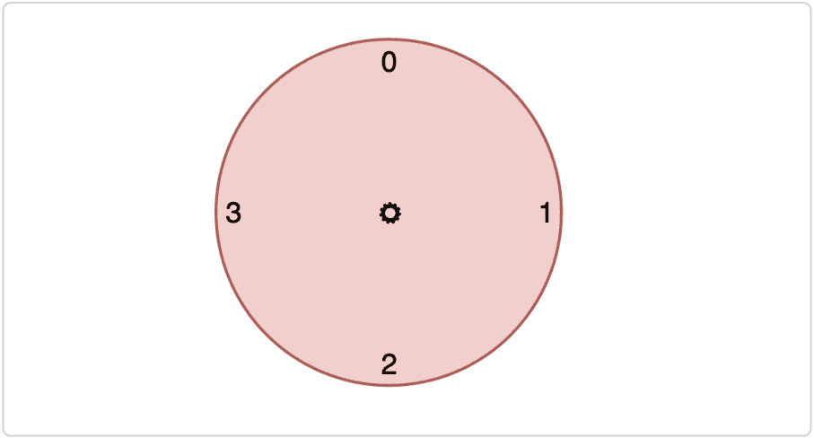

让我们从位置 3 开始并加上 3，即顺时针走 3 个位置，也就是从 3 到 0 到 1 到 2：

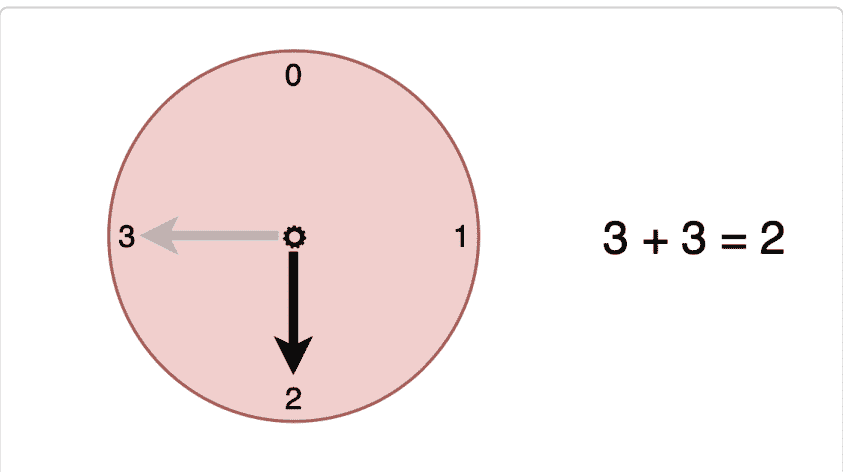

这种算术也被称为 *模算术*。

接下来，想象我们从 2 开始加上 3。再次顺时针移动 3 个位置，最终到达 1：

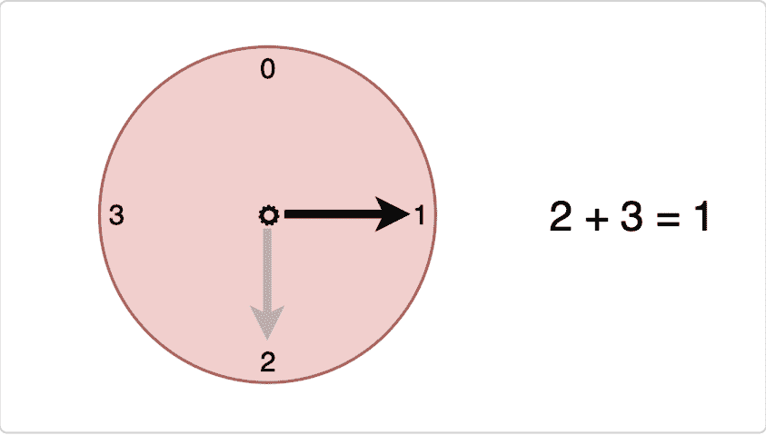

这个时钟代表整数模 4。`Mod` 是 `Modulo` 的简称。

符号上，它显示为 ℤ₄，它是以下集合 `{ 0, 1, 2, 3 }`。注意这些就是我们时钟上的数字。

但减法呢？我们可以减吗？

实际上，我们可以通过逆时针移动来实现。但由于我们对群的上下文中的模算术感兴趣，而群只有一个二元运算符，让我们看看如何改用加法来得到与减法相同的结果。

在数学中，我们学到减法就像加上逆元或负数，例如：

```
10 - 3 = 10 + (-3)
```

这里 `-3` 是 `3` 的逆元。在模算术中，我们也有逆元，但它们不是负数。

记住，在群的定义中，我们集合中的每个元素都有一个逆元，使得：

```
a • a' = a' • a = e
```

其中 `a'` 是 `a` 的逆元。

在常规算术中，这只是 `a` 和 `-a`。但这对于模算术并不成立。

我们可以参考我们的时钟来帮助理解为什么是这样：

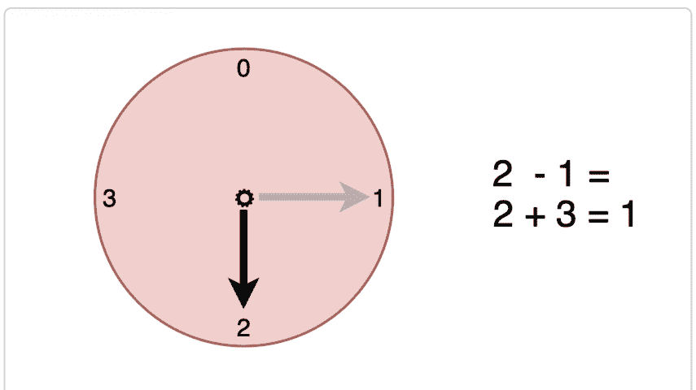

注意减去 1 与加上 3 相同。这使得 3 成为 1 的逆元，反之亦然。以下是逆元：

| a | a' |
|---|---|
| 0 | 0 |
| 1 | 3 |
| 2 | 2 |
| 3 | 1 |

由于我们的二元运算符是 `+`，`a` 和 `a'` 相加总是得到 `0`，这正是我们在群要求中看到的逆元定义：

| a | a' | a • a' |


|---|---|---|

| 0 | 0 | 0 + 0 = 0 |

| 1 | 3 | 1 + 3 = 0 |

| 2 | 2 | 2 + 2 = 0 |

| 3 | 1 | 3 + 1 = 0 |

（如果上面的表格没有意义，尝试用我们的时钟检查这些情况。）

我们已经证明整数模 4，`ℤ₄`，二元运算符为 `+` 满足群的唯一要求。但我们需要确保它是幺半群。

要成为幺半群，我们需要一个恒等元素。那就是 `0`。用我们的二元运算符将其应用于集合的任意元素，我们会得到回那个元素。

```
type ConstrainAbelian a b = Abelian a b
```

这是一个更好的名字，因为它提醒我们 `Abelian` 类型别名提供了一种轻松约束 `a` 为阿贝尔群的方法，即 `a` 必须是 `Group` 且 `Commutative`。但 `Commutative` 究竟是什么？

`Commutative` 是一个类型类：

```
class Semigroup a <= Commutative a
```

`Commutative` 只是一个 `Semigroup`，具有以下隐含定律：

```
∀ x, y ⇒ x <> y = y <> x    [Commutative]
```

在 PureScript 中，我们无法强制 `<>` 运算符的交换性，所以最好的办法就是将其定义为这样。

为了更好地感受这个类型别名如何使用，让我们看一个简单的例子：

```
find :: ∀ a. Abelian a (Set a -> Maybe a) ❶
```

> ❶ 别名定义中的 `b` 是函数的完整类型签名，即 `(Set a -> Maybe a)`。

它展开为：

```
find :: ∀ a. Group a => Commutative a => Set a -> Maybe a
```

所以 `Abelian` 类型别名只是为函数类型签名添加必要约束的帮助器，即 `Group a => Commutative a =>`。

#### 8.15. PureScript 中的算术运算符

PureScript 中的算术运算符使用不熟悉的类型。在 Haskell 中，类型是 `Num`。一点也不吓人。

要查看这些类型，请使用以下命令运行 PureScript REPL：

```
npx spago repl
```

然后输入 `:t (+)` 来确定加法的类型签名：

```
```purescript

> :t (+)

forall a. Semiring a => a -> a -> a

```
```

类型签名中唯一令人困惑的部分是 `Semiring` 约束。`a -> a -> a` 有意义。事实上，它意味着 `+` 对类型 `a` 的居民集合是封闭的。所以 `Semiring` 至少是一个幺半群。

接下来，让我们试着看看乘法的类型签名是什么：

```
```purescript

> :t (*)

forall a. Semiring a => a -> a -> a

```
```

它也有 `Semiring` 约束。

减法呢：

```
```purescript

> :t (-)

forall a. Ring a => a -> a -> a

```
```

出乎意料。它有一个 `Ring` 约束，不知道那是什么。

最后，除法：

```
```purescript

> :t (/)

forall a. EuclideanRing a => a -> a -> a

```
```

再次，这个约束相当令人惊讶。

所以我们有：

```
```text

Semiring

Ring

EuclideanRing

```
```

谁会想到我们在小学学到的简单算术运算会如此复杂。

事实证明，在 PureScript 中，算术运算符是使用这些抽象代数结构定义的。这样做的好处是这些运算符可以用于非数值事物，从而赋予我们这些抽象的全部威力。

#### 8.17. Semiring 类型类

在 PureScript 中，`Semiring` 是一个类型类定义为：

```
class Semiring a where
    add :: a -> a -> a
    zero :: a
    mul :: a -> a -> a
    one :: a

infixl 6 add as +
infixl 7 mul as *
```

① 运算符优先级使 `*` 比 `+` 更高，这在数字算术中很常见。

我们可以看到 `add` 和 `mul` 的类型签名表明它们是封闭运算，因为它们取 2 个 `a` 并返回一个 `a`。并且存在一个恒等元 `zero` 用于 `add`，另一个恒等元 `one` 用于 `mul`。

典型实现是 `Int`：

```
instance semiringInt :: Semiring Int where
    add = intAdd
    zero = 0
    mul = intMul
    one = 1

foreign import intAdd :: Int -> Int -> Int
foreign import intMul :: Int -> Int -> Int
```

① 实际实现在 Javascript 中。

以下是 `Unit` 的平凡实现：

```
instance semiringUnit :: Semiring Unit where
    add _ _ = unit
    zero = unit
    mul _ _ = unit
    one = unit
```

由于 `Unit` 只有一个居民 `unit`，它是 `add` 和 `mul` 运算的唯一解。所以我们只是忽略输入参数。

并且由于 `zero` 和 `one` 必须属于集合，我们在两种情况下都使用我们唯一的居民 `unit`。

#### 8.18. 函数的 Semiring

使用抽象来表示简单算术的好处之一是你可以将数字推广到行为相似的事物。例如，函数。

你可能不会立刻想到用函数替换数字，但实际上可以做到。这里是函数的 `Semiring` 实例：

```
instance semiringFn :: Semiring b => Semiring (a -> b) where
  add f g x = f x + g x
  zero = \_ -> zero
  mul f g x = f x * g x
  one = \_ -> one
```

这有点复杂且令人困惑，所以让我们逐行分解。

```
instance semiringFn :: Semiring b => Semiring (a -> b) where
```

这个实例适用于类型 `a -> b` 的函数，其中 `b` 也是一个 `Semiring`。这在我们查看 `add` 和 `mul` 时会很重要。

但从中我们可能会问，关于多参数的函数呢？好吧，记住，由于柯里化，所有函数技术上只有一个参数。它们改为返回一个函数来支持多个参数。所以这里的 `b` 可能是个函数。

我们可以通过将 `b` 替换为 `(b -> (c -> d))` 最好地看到这一点。我们再次可以看到，多参数函数等价于一个返回另一个函数的函数，以此类推，直到耗尽所有参数。

并且由于多参数函数只是取 1 个参数并返回一个函数的函数，该函数满足 `Semiring b` 约束。

让我们看下一行：

```
instance semiringFn :: Semiring b => Semiring (a -> b) where
  add f g x = f x + g x
```

`add` 函数在我们考虑其类型签名时看起来有点奇怪：

```
```haskell

add :: a -> a -> a

```
```

接受 2 个参数，而不是 3 个。

然而，我们的 `add` 函数中有 3 个参数。如果还记得之前的内容，我们可以将变量移到等号另一侧。让我们这样做，看看我们实际上只有 2 个参数：

```
```haskell

instance semiringFn :: Semiring b => Semiring (a -> b) where

  add f g = \\x -> f x + g x

```
```

等价于上面原始的 `add` 函数，但现在左侧只有 2 个参数。

现在我们只有 2 个参数。原始的编码方式要干净得多，但写出 Lambda 版本只是为了提醒我们它真正的工作原理。

接下来一行代码：

```
```haskell

instance semiringFn :: Semiring b => Semiring (a -> b) where

  add f g x = f x + g x

  zero = \\_ -> zero

```
```

`add` 的恒等元是 `zero`，它看起来像是无限循环，因为等号两边都有 `zero`。但事实并非如此。

左侧的 `zero` 是 `Semiring (a -> b)` 的 `zero`，即函数 的 `zero`。

右侧的 `zero` 是 `Semiring b` 的 `zero`，即 `b` 的零，无论 `b` 的类型是什么。

起初这可能看起来很 confusing，但请记住，`zero` 的整个右侧的类型是 `a`（参见 Typeclass 定义），这里是 `(a -> b)`。这意味着表达式 `\\_ -> zero` 接受一个 `a`（它会忽略它）并返回一个 `b`，在本例中为 `zero`。这表明右侧的 `zero` 是 `b` 的 `zero`。因此这里没有无限循环。

剩下的代码行：

```
```haskell

instance semiringFn :: Semiring b => Semiring (a -> b) where

  add f g x = f x + g x

  zero = \\_ -> zero

  mul f g x = f x * g x

  one = \\_ -> one

```
```

`mul` 和 `one` 与 `add` 和 `zero` 类似，其中 `one` 是 `mul` 的恒等元。

#### 8.19. 函数的 Semiring 律

我们应该验证我们的 `Semiring` 实例的律。它们再次列出如下：

可交换幺半群（其二元运算可交换）的律和加法：

```
(`R`, `+`) 是具有 `0` 恒等元的 **可交换幺半群**：

(a + b) + c = a + (b + c)    [**结合律**] (**半群**)
0 + a = a + 0 = a              [**恒等律**] (**幺半群**)
a + b = b + a                  [**可交换律**] (**可交换幺半群**)
```

接下来是幺半群和乘法的律：

```
(`R`, `·`) 是具有 `1` 恒等元的 **幺半群**：

(a · b) · c = a · (b · c)    [**结合律**] (**半群**)
1 · a = a · 1 = a              [**恒等律**] (**幺半群**)
```

然后是乘法在加法左右分配的律：

```
a · (b + c) = (a · b) + (a · c)              [**左分配律**]
(a + b) · c = (a · c) + (b · c)              [**右分配律**]
```

最后是乘以 `0` 消去 `R` 的律：

```
0 · a = a · 0 = 0                         [**消去律**]
```

正如你所见，这将是一个冗长的过程，所以我们只做一个，但过程会类似。

让我们证明加法的右恒等律：

```
a + 0 = a ❶
```

❶ 在右手边加上 `0` 不会影响原始值（或我们这里的情况是函数）。

这是我们为函数提供的 Semiring 实例：

```
```purescript

instance semiringFn :: Semiring b => Semiring (a -> b) where

  add f g x = f x + g x

  zero = \_ -> zero

  mul f g x = f x * g x

  one = \_ -> one

```
```

这是我们的证明：

```
```text

b is a Semiring                                      [Given]

add h zero = \x -> h x + zero x                      [Definition] ❶

= \x -> h x + (\_ -> zero) x                         [Substitution] ❷

= \x -> h x + zero                                     [Function Application]

= \x -> h x                                            [Semiring Right Identity for b] ❸

= h                                                    [ETA Reduction] ❹

```
```

- ❶ 我们将 `x` 移到等号右侧。
- ❷ 我们使用 `zero` 的定义进行替换。
- ❸ 由于我们可以假设 `b` 是一个 `Semiring`，我们使用 `b` 的右恒等律来进行此化简。
- ❹ ETA 化简，或我喜欢称之为右侧消去。

因此 `add h zero` 等于 `h`，证明了我们的实现遵守右恒等律。现在你可以想象证明左恒等律会多么容易，因为我们有了这个证明。

证明其他律是我们程序员必须做的事情，因为 PureScript 在这里帮不了我们。但证明相当简单，只是繁琐。因此我们不会全部做。我鼓励你练习为函数证明所有这些律。

#### 8.20. 环

环在 `Semiring` 的基础上增加 1 个额外要求。

在环中，集合具有加法逆元：

```
```text

a + (-a) = 0        [加法逆元] ❶

```
```

❶ 环具有 `Semiring` 的所有律加上这一条。

这使得 `(`R`, +)` 成为可交换群，而对于 `Semiring` 来说它是可交换幺半群。

由于具有加法逆元，我们终于可以进行减法，因为减法只是加上逆元。

#### 8.21. 环类型类

在 PureScript 中，我们有一个环的类型类：

```
class Semiring a <= Ring a where
  sub :: a -> a -> a

infixl 6 sub as - ①
```

① 注意 `-` 的优先级与 `Semiring` 中的 `+` 相同。

以下是 `Int` 的典型环实现：

```
instance ringInt :: Ring Int where
  sub = intSub

foreign import intSub :: Int -> Int -> Int ①
```

① 在 Javascript 中实现。

以下是 `Unit` 的平凡实现：

```
instance ringUnit :: Ring Unit where
  sub _ _ = unit
```

以及函数的环：

```
instance ringFn :: Ring b => Ring (a -> b) where
  sub f g x = f x - g x
```

没有真正的惊喜。这里的 `sub` 与 `add` 类似。

#### 8.22. 可交换环类型类

环对加法是可交换的。但可交换环对加法和乘法都是可交换的。

类型类非常简单，因为我们无法在 PureScript 中强制可交换性：

```
class Ring a <= CommutativeRing a
```

规范实现是平凡的：

```
instance commutativeRingInt :: CommutativeRing Int
instance commutativeRingUnit :: CommutativeRing Unit
instance commutativeRingFn :: CommutativeRing b => CommutativeRing (a -> b)
```

由于 `CommutativeRing` 类型类中没有方法，它们的实例只是简单的声明。

#### 8.23. 欧几里得环

欧几里得环是具有 1 个额外要求的可交换环。欧几里得环支持除法。

它有一些相当复杂的律，但我们这里不会涉及。

#### 8.24. 总结

我们现在可以看到为什么简单算术运算符的类型对我们程序员来说如此奇怪。希望本章使它们没那么奇怪。在日常的函数式编程中，你最常使用 `Semigroup` 和 `Monoid` 类型类。

但了解它们在层级中的位置是好的：

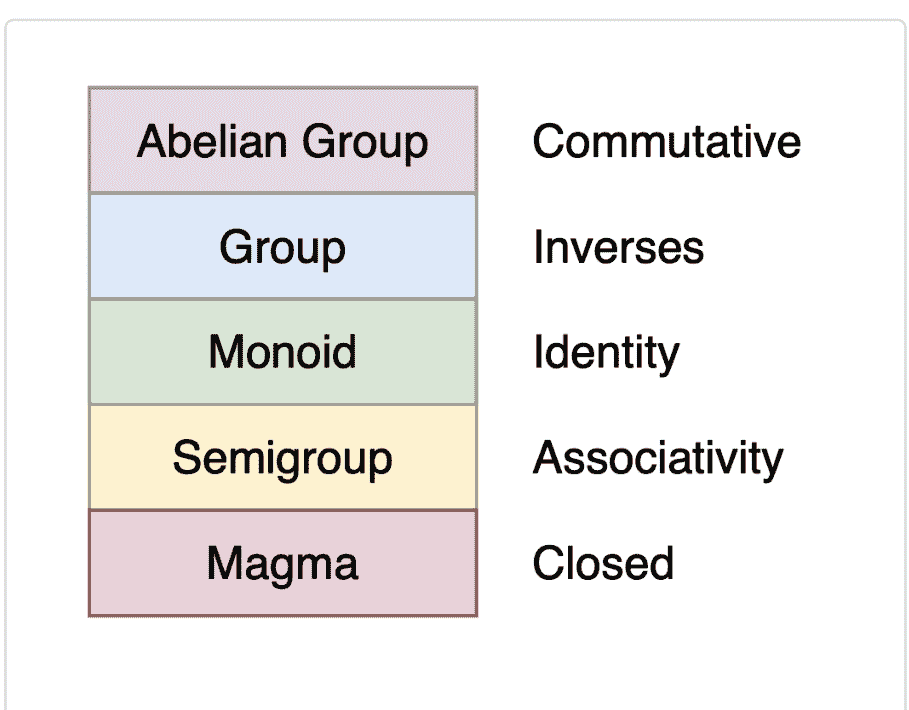

了解算术运算符层级也很重要，这样我们就不会因为约束中使用的复杂名称而感到害怕：

|  |  |

|---|---|

| EuclideanRing | 除法 |

| CommutativeRing | (R, *) 是可交换幺半群 |

| Ring | (R, +) 是可交换群（减法） |

| Semiring | (R, +) 是可交换幺半群 (R, *) 是幺半群 |

```
```haskell

class Semigroup a where

  append :: a -> a -> a

infixr 5 append as <>

```
```

> ① 组合 2 个 `a` 并产生一个 `a`。这满足了在二元运算符 `<>` 下封闭的 Magma 要求。

## 9.4. 编写 `Monoid` 类型类

接下来，尝试在不查阅任何其他文档的情况下为 `Monoid` 编写类型类。

记住 `Monoid` 也必须是 `Semigroup`。


## 9.5. `Monoid` 类型类的代码

```haskell
class Semigroup a <= Monoid a where

  mempty :: a
```

> ① `Semigroup` 是 `Monoid` 的超类，即每个 `Monoid` 实例也必须有一个 `Semigroup` 实例。

## 9.6. 为 `AndBool` 编写 `Semigroup`

让我们从以下数据类型开始：

```haskell
import Data.Generic.Rep (class Generic)

import Data.Show.Generic (genericShow)

data AndBool = AFalse | ATrue

derive instance eqAndBool :: Eq AndBool

derive instance genericAndBool :: Generic AndBool _

instance showAndBool :: Show AndBool where

  show = genericShow
```

> ① 我们需要添加这些导入以使用 `genericShow`。
> ② 这是一个布尔型的数据类型，其二元运算符将是逻辑与。
> ③ 我们稍后在测试代码中需要它。
> ④ 我们为我们的类型派生 `Generic` 实例，以便可以使用 `genericShow`。
> ⑤ 我们实现 `Show` 以便在测试代码中使用。

删除占位符测试代码并替换为：

```
log $ show $ ATrue <> ATrue ①
log $ show $ ATrue <> AFalse ②
log $ show $ AFalse <> AFalse ③
```

① 打印 `ATrue`。
② 打印 `AFalse`。
③ 打印 `AFalse`。

你还需要更改你的 `Prelude` 导入为：

```
import Prelude (Unit, class Show, class Eq, ($), discard, show)
```

最后，不要忘记更改你的 `Main.purs` 以调用 `Ch9.test`：

```
module Main where

import Prelude
import Effect (Effect)

import Ch9 as Ch9 ①

main :: Effect Unit
main = Ch9.test ①
```

① 从 `Ch7` 改为 `Ch9`。

我们有一个编译错误，这是预期的，因为我们还没有完成。

现在，你准备好为 `AndBool` 编写 `Semigroup` 并使用逻辑与的二元运算符。请在阅读之前先尝试一下。

## 9.7. Semigroup for AndBool 的提示

你可能想写以下内容：

```
instance semigroupAndBool :: Semigroup AndBool where
  append = (&&) -- COMPILER ERROR!! ① ②
```

+ 1. 第一个编译错误是因为 `&&` 未从 `Prelude` 导入。
+ 2. 修复导入错误后，你会得到一个错误，提示没有 `HeytingAlgebra` 的实例（那是什么）。

`&&` 运算符仅适用于 `HeytingAlgebra` 的实例，这基本上是布尔类型的值。由于我们还没有学习 Heyting 代数，而我们目前正在研究 `Semigroup`，让我们简单地枚举不同的情况。

在返回这里之前再试一次。

## 9.8. `Semigroup` for `AndBool` 的代码

```
instance semigroupAndBool :: Semigroup AndBool where
  append ATrue ATrue  = ATrue
  append _ _          = AFalse
```

逻辑与仅在为真时才为真。

运行测试会产生：

```
ATrue
AFalse
AFalse
```

## 9.9. 为 `AndBool` 编写 `Monoid`

对于 `Monoid` 实例，我们需要选择适当的恒等值，使得：

```
∀ a ∈ G ⇒ a • e = a
```

其中 • 是我们的二元运算符，在 PureScript 中是 `<>`。

将 `(==)` 添加到你的 `Prelude` 导入中，然后添加以下测试代码来测试上述 `Monoid` 要求：

```
log $ show $ empty <> ATrue == ATrue
log $ show $ empty <> AFalse == ATrue
```

+ 1. 打印 `true`。
+ 2. 打印 `false`。

## 9.10. Monoid for AndBool 的代码

```
instance monoidAndBool :: Monoid AndBool where
  mempty = ATrue
```

我们选择 `ATrue` 作为我们的恒等元素，因为与 `ATrue` 进行逻辑与不会影响其他值。

## 9.11. 验证 AndBool 的 Semigroup 定律

让我们验证 `Semigroup` 定律，它们是：

```
∀ a, b, c ∈ S  ⇒  a • (b • c) = (a • b) • c
```

本质上，我们想要确保我们的二元运算符是结合的。所以，这里有一个函数可以帮助你完成大部分工作：

```
verifyAndBoolSemigroup :: Effect Unit
verifyAndBoolSemigroup = do
  log "Verifying AndBool Semigroup Laws (1 test)"
  log $ show $ ??? ①
```

① 用一个布尔表达式替换 `???`，如果 `a • (b • c) = (a • b) • c` 则该表达式求值为 `true`。

将以下内容添加到你的测试代码中：

```
verifyAndBoolSemigroup
```

先试试，然后再阅读进一步的内容。

## 9.12. 编写 verifyAndBoolSemigroup

我们希望在二元运算符是结合的时打印 `true`。有很多变体，以下代码即可：

```
verifyAndBoolSemigroup :: Effect Unit
verifyAndBoolSemigroup = do
  log "verifying AndBool Semigroup Laws (1)"
  log $ show $ (AFalse <> ATrue) <> ATrue == AFalse <> (ATrue <> ATrue) ①
```

❶ 打印 `true`。

如果我们的二元运算符是结合的，那么这应该有效。尽管更全面的测试，如随机值或大量穷举测试是理想的。但由于我们知道 `&&` 是结合的，而我们对 `Semigroup` 实例的实现模仿了 `&&`，一个简单的测试就足够了。随意尝试其他测试。

## 9.13. 验证 `AndBool` 的 Monoid 定律

接下来，让我们验证 `Monoid` 定律，它们是：

`e ∈ M, ∀ a ∈ M ⇒ a • e = e • a = a`

我们必须确保我们的 `mempty` 满足 `a • e = e • a = a`，其中 `mempty` 是 `e`。

以下是该函数的模板：

```
verifyAndBoolMonoid :: Effect Unit
verifyAndBoolMonoid = do
  log "Verifying AndBool Monoid Laws (2 tests)"
  log $ show $ ??? ❶
  log $ show $ ??? ❷
```

+ ❶ `???` 应替换为一个布尔值，如果 `a • e = e • a = a` 对 `ATrue` 成立则求值为 `true`。
+ ❷ 同上 `???`，但针对 `AFalse`。

将以下内容添加到你的测试代码中：

```
verifyAndBoolMonoid
```

## 9.14. 编写 `verifyAndBoolMonoid`

我们希望展示我们的 `mempty` 同时适用于 `ATrue` 和 `AFalse`：

```
verifyAndBoolMonoid :: Effect Unit
verifyAndBoolMonoid = do
  log "Verifying AndBool Monoid Laws (2 tests)"
  log $ show $ mempty <> ATrue == ATrue <> mempty && ATrue <> mempty == ATrue
  log $ show $ mempty <> AFalse == AFalse <> mempty && AFalse <> mempty == AFalse
```

① 你需要在 `Prelude` 导入列表中添加 `(&&)`。
② 打印 `true`。
③ 打印 `true`。

我们已经证明 `e` 可以应用于集合 `{ ATrue, AFalse }` 中任何 `a` 的右侧或左侧，并且不会影响该值。

## 9.15. 为 `OrBool` 编写 `Semigroup` 和 `Monoid`

从数据类型开始：

```
data OrBool = OFalse | OTrue
```

其中二元运算符是逻辑或。

回顾一下你对 `AndBool` 所做的工作，并实现 `Eq` 和 `Show`。

在继续之前，你应该能够轻松实现 `Semigroup` 和 `Monoid` 实例。

## 9.16. `Semigroup` 和 `Monoid` for `OrBool` 的代码

`OrBool` 的代码将几乎与 `AndBool` 相同：

```
data OrBool = OFalse | OTrue
derive instance eqOrBool :: Eq OrBool
derive instance genericOrBool :: Generic OrBool _

instance showOrBool :: Show OrBool where
  show = genericShow
```

`Semigroup` 实例将仅与我们的 `AndBool` 实现不同之处在于逻辑与与逻辑或的区别：

```
instance semigroupOrBool :: Semigroup OrBool where
  append OFalse OFalse  = OFalse
  append __ __           = OTrue
```

> 逻辑或仅在两个值都为假时才为假。

逻辑或的恒等值是假值，对于我们的类型是 `OFalse`：

```
instance monoidOrBool :: Monoid OrBool where
  mempty = OFalse
```

> 当 `OFalse` 与任何值进行逻辑或时，该值保持不变。

## 9.17. 验证 `OrBool` 的 Semigroup 和 Monoid 定律

我们想要为 `OrBool` 编写类似的例程来验证定律。参考你对 `AndBool` 所做的工作，在继续之前先试试。

不要忘记将它们添加到你的测试代码中。

## 9.18. `OrBool` 的 Semigroup 和 Monoid 定律的代码

以下是验证 `Semigroup` 定律的函数：

```
verifyOrBoolSemigroup :: Effect Unit
verifyOrBoolSemigroup = do
  log "Verifying OrBool Semigroup Laws (1 test)"
  log $ show $ (OFalse <> OTrue) <> OTrue == OFalse <> (OTrue <> OTrue)
```

> 我们使用了与 `verifyAndBoolSemigroup` 中相同的测试。
> 打印 `true`。

这里可以编写许多不同的测试。你的可能不同，但只要它在同一表达式上改变结合性，你的测试就应该没问题。

以下是 `Monoid` 定律验证例程：

```
verifyOrBoolMonoid :: Effect Unit
verifyOrBoolMonoid = do
  log "Verifying OrBool Monoid Laws (2 tests)"
  log $ show $ mempty <> OTrue == OTrue <> mempty && OTrue <> mempty == OTrue
  log $ show $ mempty <> OFalse == OFalse <> mempty && OFalse <> mempty == OFalse
```

① 我们使用了与 `verifyAndBoolMonoid` 中相同的测试。
② 打印 `true`。
③ 打印 `true`。

将以下内容添加到你的测试代码中：

```
verifyOrBoolSemigroup
verifyOrBoolMonoid
```

## 9.19. 编写 Mod4 数据类型

记住我们只有 4 个位置的时钟：

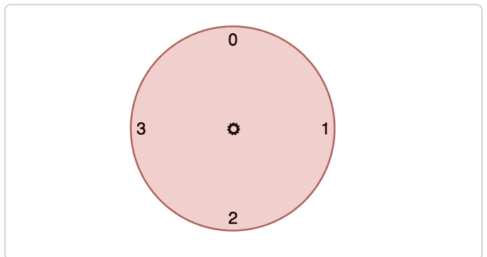

我们可以将其表示为 `Coproduct`（和类型）。让我们称之为 `Mod4`。在阅读之前先试试。

## 9.20. Mod4 数据类型的代码

```
data Mod4 = Zero | One | Two | Three
```

我们将数据类型称为 `Mod4`，因为它表示整数模 4，ℤ₄。我们用

数据构造器，0 对应 `Zero`，1 对应 `One`，等等。

## 9.21. 为 Mod4 编写 Semigroup

在上一章中，我们证明了 ℤ₄ 是一个群。现在我们来为它编写代码。

为此，我们必须从一个 `Semigroup` 实例开始。我们知道值的集合是 `{ 0, 1, 2, 3 }`，我们在 PureScript 中将其表示为 `{ Zero, One, Two, Three }`。

接下来，我们必须确定二元运算符。当我们在做时钟算术时，我们在做加法。所以我们的运算符是 `+`。

我们已经决定了实现 `Mod4` 的 `Semigroup` 实例所需的一切。请在阅读提示部分之前先尝试一下。

## 9.22. Semigroup for Mod4 的提示

我们不应该期望在这里利用正常的加法运算。我们必须手动指定每一种可能的运算。

这将涉及使用模式匹配。一旦你编码完成，好好看看 `Zero` 情况，看看是否可以简化它。

再试一次，然后进入下一节看看你做得如何。

## 9.23. Semigroup for Mod4 的代码

我们将一次写一个部分。首先是 `Zero` 情况：

```
instance semigroupMod4 :: Semigroup Mod4 where
  append Zero x = x
  append x Zero = x
```

我们知道 `Zero` 加上任何值 `x`，得到的就是同一个值 `x`。加在左边还是右边都无关紧要。

记住，我们正在进行模式匹配，所以我们必须在 `<>` 运算符的两侧都匹配 `Zero`。

接下来我们添加 `One` 情况：

```
instance semigroupMod4 :: Semigroup Mod4 where
    append Zero x     = x
    append x Zero     = x

    append One One    = Two
    append One Two    = Three
    append One Three  = Zero
```

这里我们确保在超过 `Three` 时进行回绕。如果这没有意义，请参考我们的时钟表盘并通过顺时针移动来计数加法。

接下来，我们添加 `Two` 情况：

```
instance semigroupMod4 :: Semigroup Mod4 where
    append Zero x     = x
    append x Zero     = x

    append One One    = Two
    append One Two    = Three
    append One Three  = Zero

    append Two One    = Three
    append Two Two    = Zero
    append Two Three  = One
```

最后，我们添加 `Three` 情况：

```
instance semigroupMod4 :: Semigroup Mod4 where
  append Zero x = x
  append x Zero = x

  append One One = Two
  append One Two = Three
  append One Three = Zero

  append Two One = Three
  append Two Two = Zero
  append Two Three = One

  append Three One = Zero
  append Three Two = One
  append Three Three = Two
```

## 9.24. 为 Mod4 编写 Monoid

`Monoid` 实例只是定义了恒等值。

在继续之前先试一下。

## 9.25. Monoid for Mod4 的代码

```
instance monoidMod4 :: Monoid Mod4 where
  mempty = Zero
```

`Zero` 是加法恒等元，即将 `Zero` 加到我们集合的任何元素上都会返回该值。

## 9.26. 编写 Group 类型类

尝试在不参考任何参考资料的情况下编写 `Group` 类型类的代码。

我唯一能给出的提示是唯一的方法叫做 `ginverse`。在继续之前先试试。

## 9.27. Group 类型类的代码

```
class Monoid a <= Group a where ①
  ginverse :: a -> a
```

① `Monoid` 是 `Group` 的超类。


这里`ginverse`接收类型`a`的值并返回其逆值也是类型`a`。这是因为`Group`也是一个`Magma`。

## 9.28. 为 `Mod4` 编写 `Group`

在编写`Group`实例时，你必须确定集合中每个值的逆值是什么。记住恒等元素是它自己的逆。

另外，请记住，二元运算符是加法，这意味着要确定一个值的逆，我们必须问自己：“我必须加什么到这个值上才能得到我们的恒等值？”

如果有帮助，可以参考我们的时钟表盘。

试试看，看看你做得如何。

## 9.29. `Group` for `Mod4` 的代码

让我们从`Zero`开始：

```
instance groupMod4 :: Group Mod4 where
  ginverse Zero = Zero
```

由于`Zero`是我们的恒等值，它就是它自己的逆。

接下来我们编码`One`：

```
instance groupMod4 :: Group Mod4 where
  ginverse Zero = Zero
  ginverse One = Three
```

我们必须先加`Three`才能绕回到`Zero`。

接下来，我们添加`Two`：

```
instance groupMod4 :: Group Mod4 where
  ginverse Zero = Zero
  ginverse One = Three
  ginverse Two = Two
```

我们必须加比`One`情况少一个的值才能回到`Zero`。

最后，最后一种情况：

```
instance groupMod4 :: Group Mod4 where
    ginverse Zero  = Zero
    ginverse One   = Three
    ginverse Two   = Two
    ginverse Three = One
```

注意`One`和`Three`的加法与`Three`和`One`的加法相同。我们的运算符不必是可交换的，但事实证明它是可交换的。所以，如果我们愿意，我们可以为我们的类型创建可交换实例。

```
class Semigroup g <= Commutative g

instance commutativeMod4 :: Commutative Mod4
```

记住我们的类型只需要是`Semigroup`就可以使其可交换。

## 9.30. 为 `Mod4` 编写 `Eq` 和 `Show`

在为我们新的数据类型编写测试代码之前，我们需要一些有用的实例，即`Eq`和`Show`。

我们已经做过很多次了，所以应该相当容易。在继续之前自己写它们。

## 9.31. `Eq` 和 `Show` for `Mod4` 的代码

代码与`AndBool`和`OrBool`完全一样：

```
data Mod4 = Zero | One | Two | Three
derive instance eqMod4 :: Eq Mod4
derive instance genericMod4 :: Generic Mod4 _

instance showMod4 :: Show Mod4 where
    show = genericShow
```

## 9.32. 为 `Mod4` 编写 `verifyMod4Semigroup`

我们应该确保我们编写的`Semigroup`实例遵守定律。

我们可以参考`AndBool`和`OrBool`来看看如何创建验证函数。

不要忘记将此函数调用添加到你的测试代码中。

## 9.33. `verifyMod4Semigroup` for `Mod4` 的代码

```
verifyMod4Semigroup :: Effect Unit
verifyMod4Semigroup = do
  log "Verifying Mod4 Semigroup Laws (1 test)"
  log $ show $ (One <> Two) <> Three == One <> (Two <> Three) ①
```

① 打印 true。

同样，这个测试代码有很多变体。你的可以有所不同仍然是正确的。最主要的是确保左右两边仅在括号上有所不同。

## 9.34. 为 `Mod4` 编写 `verifyMod4Monoid`

接下来，我们想检查我们的`Monoid`是否是好公民。

参考`AndBool`和`OrBool`获取帮助，将`verifyMod4Monoid`添加到你的测试代码中，看看效果如何，然后再进入下一节。

## 9.35. `verifyMod4Monoid` for `Mod4` 的代码

```
verifyMod4Monoid :: Effect Unit ①
verifyMod4Monoid = do
  log "Verifying Mod4 Monoid Laws (1 test)"
  log $ show $ mempty <> One == One <> mempty && One <> mempty == One ②
```

① 在你的测试代码中添加对该函数的调用。

② 打印 true。

注意这里我们只有一个测试。我们只需要这个测试来证明`mempty`不会改变值，并且由于这个测试在左边和右边都有`Zero`，所以它涵盖了两种情况。

## 9.36. 为 `Maybe` 编写 `Semigroup`

有时，正如我们所见，组合事物的方式可能不止一种。例如，对于`Int`，我们可以通过加法或乘法来组合它们。我们通过为每种情况创建`newtype`来实现这一点，即`AddInt`和`MultInt`。

在为`Maybe`编写`Semigroup`时，有两种可能的情况。让我们举个例子：

```haskell
(Just 10 <> (Just 20 <> Just 30)) = Just 10 ❶
(Just 10 <> (Just 20 <> Just 30)) = Just 20 ❷
(Just 10 <> (Just 20 <> Just 30)) = Just 30 ❸
```

- ❶ 取第一个 `Just`。

- ❷ 有时取第一个 `Just` 然后取第二个 `Just`。这种情况没有意义。

- ❸ 取最后一个 `Just`。

要得到 `Just 20` 的结果，我们首先必须选择 `second` 值，即括号内的部分。接下来，为了评估括号内的内容，我们必须选择 `first`。这完全荒谬，因为我们不能随意选择。所以我们将忽略这种情况。

但是，我们在这新的例子中也没有好到哪里去，因为我们仍然有 2 种可能性。所以就像 `AddInt` 和 `MultInt` 一样，让我们为这两种情况创建 2 个 `newtypes`：

```haskell
newtype First a = First (Maybe a)

newtype Last a = Last (Maybe a)
```

我们称之为 `First` 和 `Last`，以表示在长串的 `appends` 中，我们取第一个 `non-Nothing` 值或最后一个。

### 9.37. 为 `First` 编写 `Semigroup` 和 `Monoid`

继续为`First`编写`Semigroup`和`Monoid`实例，记住`Nothing`是我们的恒等元，因此在使用`<>`应用时对任何值都没有影响。

在阅读解决方案之前自己尝试一下。

### 9.38. `Semigroup` 和 `Monoid` for `First` 的代码

首先，定义：

```haskell
newtype First a = First (Maybe a)
```

接下来，`Semigroup` 实例：

```
import Data.Maybe (Maybe (..)) ①

instance semigroupFirst :: Semigroup (First a) where
  append (First Nothing) last = last ②
  append first _             = first ③
```

① 添加了此导入。

② 如果第一个是`Nothing`则保留最后一个。

③ 否则，始终保留第一个。

我们保留第一个值，除非第一个是`Nothing`。请注意，一旦我们得到第一个非`Nothing`，我们就会无限期地保留它，因为整个右手边被忽略了。这将有效地在我们找到第一个非`Nothing`时短路计算。

最后，我们编写`Monoid`实例：

```
instance monoidFirst :: Monoid (First a) where
  mempty = First Nothing
```

请注意，它不仅仅是`Nothing`（双关语无意），而是`First Nothing`。

## 9.39. 为 `Last` 编写 `Semigroup` 和 `Monoid`

在完成了`First`之后，编写`Last`应该很容易。在继续解决方案之前先试试看。

## 9.40. `First` 的 `Semigroup` 和 `Monoid` 的代码

首先，定义：

```
newtype Last a = Last (Maybe a)
```

接下来是`Semigroup`实例：

```
instance semigroupLast :: Semigroup (Last a) where
  append first (Last Nothing) = first ①
  append _ last               = last ②
```

① 如果`last`是`Nothing`，则保留`first`。

② 否则，保留`last`。

同样，我们保留最后一个值，除非它是`Nothing`。与`First`不同，我们没有忽略右手边的机会，这意味着使用`Last`我们将不会短路。这使得合并`Last`的效率低于`First`，因为我们必须计算表达式的每个值：

```
First (Just 1) <> (First (Just 2) <> First Nothing) ①
Last (Just 1) <> (Last (Just 2) <> Last Nothing) ②
```

① 我们不需要计算`First (Just 2) <> First Nothing`，因为我们已经通过`First (Just 1)`找到了第一个非`Nothing`。

② 我们必须计算`Last (Just 2) <> Last Nothing`，因为我们必须继续寻找最后一个非`Nothing`。

最后，`Monoid`实例：

```
instance monoidLast :: Monoid (Last a) where
  mempty = Last Nothing
```

同样，它不仅仅是`Nothing`，而是`Last Nothing`。

让我们编写测试代码：

```
-- COMPILER ERROR!!
log $ show $ First Nothing <> First (Just 77) ①
log $ show $ Last (Just 1) <> Last (Just 99) ②
```

① 打印`(First (Just 77))`。

② 打印`(Last (Just 99))`。

为`First`和`Last`编写`Show`实例以消除编译器错误。

以下是这些更改：

```
length :: ∀ a. List a -> Int
length Nil      = 0 ①
length (x : xs) = 1 + length xs
```

① 当已耗尽`List`时终止。

这些是我们将更仔细研究的函数类型。

让我们从`length`开始：

```
length :: ∀ a. List a -> Int
length Nil      = 0
length (x : xs) = 1 + length xs ①
```

① 非尾递归。

请注意，我们这里没有`State`需要传递。`State`维护在`Stack`中。我们需要返回以加 1。这就是我们计数的方式。

但在`length`的尾递归版本中，我们显式传递`State`，这通过`go`函数的存在得以证明：

```
length :: ∀ a. List a -> Int
length l = go 0 l where
go :: ∀ a. Int -> List a -> Int ①
go acc Nil      = acc
go acc (x : xs) = go (acc + 1) xs
```

① 第一个参数是长度的累积计数。

这类函数非常适合一种称为`Fold`的过程。

> `Fold`是使用`State`迭代的通用方式。

`Fold`的一个主要限制是它们不会短路。这意味着我们可以使用`Fold`重写`length`，但不能重写`index`或`findIndex`。

## 10.1. `Fold` 的其他名称

在许多非函数式语言中，`fold`也称为`reduce`。在我们的`length`函数的情况下，我们将`List`归约为单个`Int`。但这并不总是如此。我们可以使用`fold`来分解一个结构并构建另一个结构，例如处理`List`并生成`Map`（键/值存储）。

在范畴论中，你会听到 **Catamorphism** 这个术语（*Cata* 表示 *down*，*morph* 表示 *shape*），本质上意味着 *分解结构*。

这与 **Anamorphism** 相反（*Ana* 表示 *up*，*morph* 表示 *shape*），本质上意味着 *构建结构*。

如果你忘记这些术语，你可以记住 Anabolic Steroids 它构建肌肉或 Catabolic Exercise 它分解肌肉组织并燃烧脂肪。

重点是 `folds` 被称为 `Catamorphisms` 因为它们分解原始结构。还有另一个概念称为 `unfold`，使用频率远低于它，被称为 `Anamorphisms` 因为它们从单个起始值构建结构。

我们这里只关注 `folds`。

## 10.2. `Foldable` 类型类

在 PureScript 中，如果一个类型具有`Foldable`的实例，则它可以是`Foldable`。以下是该类型类：

```purescript
class Foldable f where
  foldr :: ∀ a b. (a -> b -> b) -> b -> f a -> b
  foldl :: ∀ a b. (b -> a -> b) -> b -> f a -> b
  foldMap :: ∀ a m. Monoid m => (a -> m) -> f a -> m
```

让我们一次分解一个函数。首先是 `foldr`：

```purescript
foldr :: ∀ a b. (a -> b -> b) -> b -> f a -> b
```

让我们分解其每个参数：

```text
(a -> b -> b)    — 用于处理 Foldable 元素的函数
b                — 初始值
f a              — Foldable 类型 `f`，例如 `List` 或 `Array`
```

`foldr` 返回一个 `b` 作为折叠操作的最终结果。

函数名以 `r` 结尾，意味着操作是 **右结合** 的。我们很快会看到一个很好的例子。

接下来，我们来看 `foldl`：

```haskell
foldl :: ∀ a b. (b -> a -> b) -> b -> f a -> b
```

它与 `foldr` 相同，除了第一个参数。第一个参数是一个函数，其参数与 `foldr` 相比是 `flipped` 的。我们很快会看到为什么这很重要。

最后是 `foldMap`：

```haskell
foldMap :: ∀ a m. Monoid m => (a -> m) -> f a -> m
```

让我们分解其每个参数：

```text
(a -> m)    -- 用于将元素转换为 Monoid 的函数
f a         -- Foldable 类型 `f`，例如 `List` 或 `Array`
```

此函数返回一个 `m`，它是一个 `Monoid`。

你能想到为什么它是 `Monoid` 而不是 `Semigroup` 吗？它本可以是 `Semigroup`，但那样我们会让用户负担传递初始值的责任，而如果可能的话，这意味着该类型可能已经是 `Monoid`。

请注意 `foldMap` 不像 `foldl` 和 `foldr` 那样需要初始值。那是因为 `foldMap` 使用 `Monoids` 并且可以使用类型的 `mempty` 作为其初始值。

另外，请注意这里变量 `f` 被用作我们要折叠的集合或结构。同样，这是因为它代表 `Functor`，因为大多数 `Functors` 也是 `Foldable`。不用担心，我们很快就会花大量时间研究 `Functors`。

## 10.3. `Fold` 结合性

`foldr` 是右结合的，而 `foldl` 是左结合的，意味着：

```haskell
foldr (-) 99 [1, 2, 3] == 1 - (2 - (3 - 99)) == -97
foldl (-) 99 [1, 2, 3] == ((99 - 1) - 2) - 3 == 93
```

请注意初始值 `99` 的位置。对于 `foldr` 它在最右边，对于 `foldl` 它在最左边。

为了更好地理解差异，让我们重写 `(-)` 以显示其组成部分：

```haskell
foldr (\n acc -> n - acc) 99 [1, 2, 3] == -97
foldl (\acc n -> acc - n) 99 [1, 2, 3] == 93
```

请注意，在`foldr`中，我们的累加器`acc`在参数列表的右边，并且在二元运算符`−`的右边。

另外，请注意，在`foldl`中，`acc`在参数列表的左边，并且在`−`的左边。


这就是我们实现适当结合性的方式。这也是传递给 `foldr` 的函数是传递给 `foldl` 的函数的翻转版本的原因：

```
foldr :: ∀ a b. (a -> b -> b) -> b -> f a -> b
foldl :: ∀ a b. (b -> a -> b) -> b -> f a -> b
```

记住，`flip` 交换函数的前两个参数。

## 10.4. List 的 Foldable

让我们查看 `List` 的 `Foldable` 实现的细节。

首先，我们来看实例定义：

```
instance foldableList :: Foldable ??? where
```

我们在其他类型类中放入 `???` 的内容是具有其所有参数的类型，例如 `List a` 或 `Maybe a`，如：

```
instance eqMaybe :: Eq a => Eq (Maybe a) where
  ... ①
```

① 实现细节在这里不重要。

这是因为如果我们查看 `Eq` 类型类的定义，我们会发现：

```
class Eq a where
  eq :: a -> a -> Boolean
```

`Eq` 类的类型参数是 `a` 并且其 `Kind` 是 `Type`。

> 类型以与 `Kind` 对类型相同的方式对值进行分类，即值具有类型，类型具有 `Kind`。换句话说，值的类型称为类型，而类型的类型称为 `Kind`。

将上面的 `Eq` 定义与 `Foldable` 进行比较：

`class Foldable f where`

  `foldr :: ∀ a b. (a -> b -> b) -> b -> f a -> b`

  `foldl :: ∀ a b. (b -> a -> b) -> b -> f a -> b`

  `foldMap :: ∀ a m. Monoid m => (a -> m) -> f a -> m`

`Foldable` 类的类型参数是 `f`，当我们查看方法类型签名中 `f` 的使用方式时，可以看到 `f` 接受另一个类型，即 `a`。

这意味着 `f` 的 `Kind` 是 `Type -> Type`，即 `f` 是一个**类型构造子**。就像数据构造子一样，我们可以将类型构造子视为函数，只是其参数是类型。

这里 `f` 是一个类型构造子，它期望一个 `Type` 类型的单个参数，并返回一个 `Type`。

为了更好地理解类型构造子与数据构造子之间的相似性，让我们看看一些常见数据构造子的类型签名：

```
Just  :: ∀ a. a -> Maybe a
Left  :: ∀ a. a -> Either a b
Right :: ∀ b. b -> Either a b
```

注意数据构造子接受一个值并返回一个值。

而现在一些类型构造子的 *Kind 签名* 示例：

```
Maybe   :: Type -> Type
Either  :: Type -> Type -> Type
```

注意类型构造子接受类型并返回类型。

现在我们理解了这些差异，应该很清楚我们需要以不同的方式指定类定义：

```
instance foldableList :: Foldable List where
```

`List` 的 `Kind` 是 `Type -> Type`，这与 `f` 的类型签名匹配。注意我们没有在任何地方提到 `a`。

当 `f` 被 `List` 替换时，方法的类型签名专门化为：

```
instance foldableList :: Foldable List where
  foldr :: ∀ a b. (a -> b -> b) -> b -> List a -> b
  foldl :: ∀ a b. (b -> a -> b) -> b -> List a -> b
  foldMap :: ∀ a m. Monoid m => (a -> m) -> List a -> m
```

注意我们所做的只是将 `f` 替换为 `List`。我们可以这样做，因为 `f` 接受一个单一的类型参数 `a`，而 `List` 也是如此。我们同样可以轻松地将 `f` 替换为 `Array` 或 `Maybe`。

但我们不能用 `Either` 替换它，因为它的 `Kind` 签名是 `Type -> Type -> Type`。相反，我们必须固定第一个参数并用 `Either a` 替换 `f`。这可行，因为我们正在用其第一个参数部分应用类型构造子。`Either a` 的 `Kind` 签名是 `Type -> Type`，这现在与 `List`、`Array`、`Maybe` 和 `f` 匹配。

现在开始编写 `foldr`。首先是基本情况：

```
instance foldableList :: Foldable List where
  foldr _ acc Nil = acc
```

这里我们只是提供累积结果。这是我们初始状态，如果我们从空列表开始，或者我们在耗尽列表时被传递的状态。

接下来，我们编写递归情况：

```
instance foldableList :: Foldable List where
  foldr _ acc Nil      = acc
  foldr f acc (x : xs) = ???
```

在确定等号右侧要写什么之前，我们必须记住要使其为右结合。让我们再看看它是什么样子：

```
foldr (-) 99 [1, 2, 3] == 1 - (2 - (3 - 99)) == -97
```

注意我们的初始值 `99` 直到我们到达列表末尾才在计算中使用。这意味着我们需要递归地传递这个初始值，直到耗尽列表。我们可以看到基本情况将简单地把这个初始值返回给我们，然后我们就可以开始进行计算。

这很好，因为我们希望最后一个元素在我们执行的第一个计算中被使用。这就是右结合的含义。如果你计算上面的例子，你会做的第一件事是 `3 - 99`。我们的函数需要以相同的方式执行。

所以我们的策略是，保持递归，传递我们的初始值，只有当我们到达末尾时，我们才会执行函数（在我们的例子中是减法）并将结果返回给之前的调用，然后它会用前一个值执行函数，以此类推：

```haskell
instance foldableList :: Foldable List where
  foldr _ acc Nil      = acc
  foldr f acc (x : xs) = f x (foldr f acc xs)
```

❶ 基本情况返回初始值。

❷ 这里我们可以看到我们推迟了函数调用 `f`，直到 `(foldr f acc xs)` 被计算。并且每次后续递归都会这样做，直到最后一个元素与初始值一起计算（从基本情况返回的值）。

为了从不同角度了解其工作原理，让我们通过代数替换逐步查看执行过程：

```haskell
foldr (-) 99 [1, 2, 3] =                 -- initial call
(-) 1 (foldr (-) 99 [2, 3]) =             -- substitution into ❷
(-) 1 ((-) 2 (foldr (-) 99 [3])) =        -- substitution into ❷
(-) 1 ((-) 2 ((-) 3 (foldr (-) 99 []))) = -- substitution into ❷
(-) 1 ((-) 2 ((-) 3 99)) =                -- substitution into ❶
(-) 1 ((-) 2 (3 - 99)) =                  -- rewrite prefixed as infixed
(-) 1 (2 - (3 - 99)) =                    -- rewrite prefixed as infixed
1 - (2 - (3 - 99)) =                      -- rewrite prefixed as infixed
```

注意 `99`，我们的初始值，被一路传递下来，直到它在与最后一个元素 `3` 的计算中被需要。

接下来，我们编写 `foldl` 的基本情况：

```haskell
instance foldableList :: Foldable List where
  foldr _ acc Nil      = acc
  foldr f acc (x : xs) = f x (foldr f acc xs)
  foldl _ acc Nil      = acc
```

然后是递归情况：

```haskell
instance foldableList :: Foldable List where
  foldr _ acc Nil      = acc
  foldr f acc (x : xs) = f x (foldr f acc xs)
  foldl _ acc Nil      = acc
  foldl f acc (x : xs) = ???
```

在确定等号右侧要写什么之前，我们必须记住要使其为左结合。让我们再看看它是什么样子：

```
foldl (-) 99 [1, 2, 3] == ((99 - 1) - 2) - 3 == 93
```

在这种情况下，我们立即使用初始值并将其结果作为新的累加器值传递给递归调用：

```
instance foldableList :: Foldable List where
  foldr _ acc Nil      = acc
  foldr f acc (x : xs) = f x (foldr f acc xs)
  foldl _ acc Nil      = acc ①
  foldl f acc (x : xs) = foldl f (f acc x) xs ②
```

让我们通过代数替换逐步查看执行过程：

```
foldl (-) 99 [1, 2, 3] =                 -- initial call
foldl (-) ((-) 99 1) [2, 3] =           -- substitution into ②
foldl (-) ((-) ((-) 99 1) 2) [3] =     -- substitution into ②
foldl (-) ((-) ((-) ((-) 99 1) 2) 3) [] = -- substitution into ②
(-) ((-) ((-) 99 1) 2) 3 =             -- substitution into ①
(-) ((-) (99 - 1) 2) 3 =                -- rewrite prefixed as infixed
(-) ((99 - 1) - 2) 3 =                   -- rewrite prefixed as infixed
((99 - 1) - 2) - 3 =                     -- rewrite prefixed as infixed
```

在继续 `foldMap` 之前，我们可以做一些观察。当我们使用 `foldl` 或 `foldr` 时，我们正在使用 `acc` 变量传递状态。我们一直称之为累加器，但它实际上是我们的状态。

由于函数式编程中没有全局状态，我们能做的最好的就是从一次调用传递到下一次调用：

```
instance foldableList :: Foldable List where
  foldr _ acc Nil      = acc ①
  foldr f acc (x : xs) = f x (foldr f acc xs) ②
  foldl _ acc Nil      = acc ③
  foldl f acc (x : xs) = foldl f (f acc x) xs ④
```

- ① 这里 `acc` 是我们的初始状态。
- ② 我们的初始状态被传递。
- ③ 这里 `acc` 是我们的最终状态。
- ④ 新状态被传递。

在 `foldl` 的情况下，我们将新状态传递给递归调用，而在 `foldr` 的情况下，我们从递归调用返回新状态。

花点时间让这一点沉淀下来。在函数式编程中，我们只能传递状态更改或返回状态更改。这将是我们查看状态单子时要重访的概念。

现在，我们准备编写 `foldMap`。

首先，我们添加基本情况：

```
instance foldableList :: Foldable List where
  foldr _ acc Nil      = acc
  foldr f acc (x : xs) = f x (foldr f acc xs)
  foldl _ acc Nil      = acc
  foldl f acc (x : xs) = foldl f (f acc x) xs
  foldMap _ Nil        = mempty
```

- 基本情况。

幸运的是，`Monoid` 有一个空元素。所以当我们得到一个空列表时，我们有一个值可以返回，即 `Monoid` 的空元素，`mempty`。

最后，我们添加递归情况：

```
instance foldableList :: Foldable List where
  foldr _ acc Nil      = acc
  foldr f acc (x : xs) = f x (foldr f acc xs)
  foldl _ acc Nil      = acc
  foldl f acc (x : xs) = foldl f (f acc x) xs
  foldMap _ Nil        = mempty
  foldMap f (x : xs)   = ???
```

- 递归情况。

在填充 `???` 时我们可以采取两种可能的方法。我们可以右结合或左结合：

```
foldMapL f = foldl (\acc x -> acc <> f x) mempty
foldMapR f = foldr (\x acc -> f x <> acc) mempty
```

- 以无点表示法编写，其中列表未明确定义。
- 累加器在 `<>` 的左侧，因此为左结合。
- 累加器在 `<>` 的右侧，因此为右结合。

在 PureScript 库中，有 2 个函数，`foldMapDefaultR` 和 `foldMapDefaultL`，其效果与上述代码相同。

事实证明，`Array` `Foldable` `Typeclass` 的作者选择了右结合，而 `List` 的作者选择了左结合。

虽然这很不幸，但我们可以将 `List` 和 `Array` 之间相互转换，因此我们可以选择其中一个。我们也可以显式地对 `Lists` 调用 `foldMapDefaultR`。但这些非默认的解决方案无法受益于 `Typeclasses`。

因此，让我们选择左结合以匹配库作者的选择：

```
instance foldableList :: Foldable List where
  foldr _ acc Nil      = acc
  foldr f acc (x : xs) = f x (foldr f acc xs)
  foldl _ acc Nil      = acc
  foldl f acc (x : xs) = foldl f (f acc x) xs
  foldMap _ Nil        = mempty
  foldMap f l          = foldl (\acc x -> acc <> f x) mempty l ①
```

① 我们在使用模式匹配时无法写成 Point-free 形式。

## 10.5. 使用 Folds 重写 length

由于 `foldl` 和 `foldr` 传递 `State`，我们可以使用 `Fold` 来重新编码 `length` 的尾递归版本。在此之前，让我们回顾一下 `length` 的那个版本：

```
length :: ∀ a. List a -> Int
length l = go 0 l where ①
  go :: ∀ a. Int -> List a -> Int ①
  go acc Nil      = acc
  go acc (x : xs) = go (acc + 1) xs ②
```

① 第一个参数是我们的 `State`，即当前计数，它从 `0` 开始。
② 每次迭代我们将计数加 `1`。

要使用 `foldl` 或 `foldr`，我们需要确定 2 件事。首先，`State` 是什么以及其初始值是什么。在这种情况下，它是 `List` 中元素的计数，其初始值为 `0`。

需要确定的第二件事是每次迭代我们将执行什么操作。在这种情况下，我们只需将计数加 `1`。

需要确定的最后一件事是我们是否关心结合性。由于我们的操作是 `+`，它是可交换的，即顺序无关紧要，我们不关心结合性。

因此我们可以选择 `foldl` 或 `foldr`，结果将相同：

```
(((1 + 1) + 1) + 1) = (1 + (1 + (1 + 1)))
```

但还有一个因素需要考虑。这里是我们为 `List` 实现的 `Foldable`：

```
instance foldableList :: Foldable List where
  foldr _ acc Nil      = acc
  foldr f acc (x : xs) = f x (foldr f acc xs)
  foldl _ acc Nil      = acc
  foldl f acc (x : xs) = foldl f (f acc x) xs
  foldMap _ Nil        = mempty
  foldMap f l          = foldl (\acc x -> acc <> f x) mempty l
```

比较 `foldr` 和 `foldl` 的实现，看看你是否能找到使用其中一个而不是另一个的理由。

如果你看不出为什么一个会比另一个更受青睐，看看哪一个更高效。

事实证明 `foldl` 比 `foldr` 更高效，因为 `foldl` 是尾递归的，而 `foldr` 不是。因此我们选择它来使用 `foldl` 重写 `length`：

```
length :: ∀ a. List a -> Int
length = foldl (\count _ -> count + 1) 0 ①
```


① 由于我们不在乎 `List` 中的值是什么，我们用 `_` 忽略它。

```haskell
reverse :: List ~> List
reverse Nil = Nil
reverse ol = go Nil ol where
  go rl Nil     = rl
  go rl (x : xs) = go (x : rl) xs
```

继续使用 `foldl` 或 `foldr` 中的任意一个重写它，哪个更有意义。然后继续阅读。

## 11.2. `reverse` 的代码

在开始编码之前要决定的第一件事是 `reverse` 的 State 是什么。查看我们的尾递归版本，我们看到我们将 `rl`，即反转后的 `List`，传递给我们的 `go` 函数。我们还可以看到初始 State 是 `Nil`，即我们最初传递给 `go` 的值。

我们应该使用 `foldl`，因为它是尾递归的，因此更高效，更不用说我们正在重写一个尾递归函数，我们希望保持这种方式：

```haskell
import Data.List (List(..), (:), foldl)

reverse :: List ~> List
reverse = foldl (\rl x -> x : rl) Nil
```

1. 我们也可以从 `Data.Foldable` 导入 `foldl`。`Data.List` 从 `Data.Foldable` 重新导出 `foldl`。
2. 初始 State 是 `Nil`，并且在每次迭代中我们都添加到 `rl` 的头部并将其作为修改后的 State 返回。
3. 这是以 Point-free 形式编写的，其中 `List` 未命名。

## 11.3. 编写 `max`

让我们稍作停留并编写 `max` 函数。它接受 2 个值并返回两者中的最大值。

将以下内容添加到你的测试代码中：

```haskell
log $ show $ max (-1) 99
log $ show $ max "aa" "z"
```

1. 打印 `99`。
2. 打印 `"z"`。

另外，将 `discard` 和 `negate` 添加到你的 `Prelude` 导入列表中。我们需要 `discard`，因为我们使用 `do` 语法将多行添加到我们的测试代码中（稍后会详细介绍，我保证）并且我们需要 `negate` 用于我们的 `-1`。

记住，当编写普通代码时，我们通常不需要担心这些导入，但由于我们正在从 `Prelude` 重新编码函数，我们对导入非常小心。

处理来自 `Prelude` 的导入的另一种可能方法是使用 `hiding` 来排除我们正在覆盖的内容，例如：

```haskell
import Prelude hiding (max)
```

但如果你这样做，你将学到更少关于不同函数及其来源的知识。请记住，你将在生产代码中仅使用无导入列表的 `Prelude`。

在继续阅读提示部分之前，先编写 `max`。

## 11.4. `max` 的提示

你可能被测试代码难住了。你必须编写一个适用于 `Ints` 和 `Strings` 的函数。但怎么做呢？

我将向你展示一个小技巧。先在没有类型签名的情况下编写函数。然后一旦你的函数编译通过，你会得到一个编译器警告，它会建议你应该使用的类型签名。建议的类型签名会告诉你怎么做。

再试一次，看看你得到什么。

## 11.5. `max` 的代码

我们将遵循提示部分中建议的方法。

我们可以使用 `if` 表达式或 `Guards` 来编写它。让我们使用 `Guards`：

```haskell
import Prelude (Unit, show, negate, discard, otherwise, type (~>), ($), (>))

max x y | x > y      = x   -- COMPILER WARNING!!
        | otherwise = y
```

1. 必须添加 `>` 和 `otherwise`。记住，`otherwise` 只是定义为 `true`。

现在我们得到以下编译器警告：

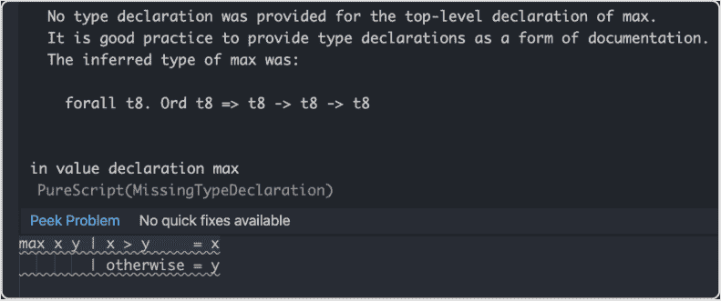

我们可以看到我们需要约束 `a` 具有 `Ord` 实例。这是因为运算符 `>`，它是 `greaterThan` 的运算符别名，调用了 `Ord` Typeclass 的 `compare`。

这就是 `max` 如何适用于 `Ints` 和 `Strings`：

```haskell
import Prelude (class Ord, Unit, show, negate, discard, otherwise,
    type (~>), ($), (>)) ①

max :: ∀ a. Ord a => a -> a -> a ②
max x y | x > y     = x
        | otherwise = y
```

① 我们必须导入 `Ord` 类。注意 `class` 关键字。

② 类型签名如编译器警告消息所建议。

## 11.6. 编写 `findMax`

有了我们的 `max` 函数，我们现在可以编写一个函数来查找 `List` 的最大值。我们之前没有写过这个，所以我们将首先将其作为常规递归函数编写。

让我们将 `findMax` 的第一个参数设为默认值，这样我们就不必返回 `Maybe`。

将以下行添加到你的测试代码中：

```haskell
log $ show $ findMax 0 (37 : 311 : -1 : 2 : 84 : Nil) ①
log $ show $ findMax "" ("a" : "bbb" : "c" : Nil) ②
```

① 打印 `311`。

② 打印 `"c"`。

在继续之前尝试编写 `findMax`。

## 11.7. `findMax` 的代码

由于我们编写了 `max` 来帮助我们编写 `findMax`，我们可以参考 `max` 的类型签名来了解我们需要什么约束。我们可以看到如果 `max` 要求值具有 `Ord` 实例，那么我们将需要相同的约束，即如果我们想用来自我们的 `List` 的元素调用 `max`：

```haskell
findMax :: ∀ a. Ord a => a -> List a -> a
```

第一个参数是默认值，以防我们的 `List` 为空。

接下来，我们编写基本情况：

```haskell
findMax :: ∀ a. Ord a => a -> List a -> a
findMax mx Nil = mx
```

如果初始 `List` 为空，我们返回默认值，或者如果我们刚刚耗尽了我们的 `List`，我们返回当前的最大值。

最后，我们编写递归情况：

```haskell
findMax :: ∀ a. Ord a => a -> List a -> a
findMax mx Nil = mx
findMax mx (x : xs) = findMax (max x mx) xs
```

尾递归调用。

我们使用列表的尾部和我们当前的最大值（最初是我们的默认值）与列表头部的 `max` 进行递归。

## 11.8. 改进 `findMax`

让我们检查一下 `findMax` 的测试代码：

```haskell
log $ show $ findMax 0 (37 : 311 : -1 : 2 : 84 : Nil)
```

如果我们没有使用 `0` 作为默认值会怎样？如果我们将默认值改为 `999` 并运行测试会怎样。你认为你会得到什么？继续尝试。

如果你更改了测试并运行它，你会看到你得到 `999`，因为它大于列表中的任何内容。不是理想的。

我们不能信任调用者选择正确的默认值。这个函数的设计有缺陷。我们如何修复 it?

我们可以将我们的 `a` 要求为一个 `Monoid`，这样我们就不需要默认值了。我们可以使用 `empty`。但随后 `empty` 必须小于 `List` 中任何其他值，而我们无法保证这一点。

此外，`Ints` 并不是 `Monoids`，因为我们无法确定地确定二元运算符。它可能是加法或乘法。

这是一个麻烦的罐子。一开始，不必处理 `Maybe` 似乎是个好主意，但它实际上造成的问题比解决的问题更多。所以，让我们重新设计我们的函数，使其返回一个 `Maybe`：

```haskell
import Data.Maybe (Maybe(..))

findMax :: ∀ a. Ord a => List a -> Maybe a
```

> 我们需要导入带有其数据构造子的 `Maybe`。随着我们继续，我们将看到对 `Just` 和 `Nothing` 的需求。

继续编写剩余的代码，然后再继续。不要忘记从你的测试代码中删除默认值。

## 11.9. 改进的 `findMax`

到目前为止我们有：

```haskell
findMax :: ∀ a. Ord a => List a -> Maybe a
```

现在是基本情况：

```haskell
findMax :: ∀ a. Ord a => List a -> Maybe a
findMax Nil = Nothing
```

> 失败情况，因为我们无法找到空 `List` 的最大值。

最后，我们编写递归情况：

```haskell
findMax :: ∀ a. Ord a => List a -> Maybe a
findMax Nil = Nothing
findMax (x : xs) = ???
```

我们知道这里没有空的 `List`，并且我们仍然需要在遍历 `List` 时跟踪我们的最大值。但我们不能用 `findMax` 递归，因为我们移除了最大值参数。

因此，我们将不得不引入一个 `go` 函数，它有一个额外的变量来跟踪当前最大值。

```haskell
findMax :: ∀ a. Ord a => List a -> Maybe a
findMax Nil = Nothing
findMax l@(x : _) = Just $ go x l where
  ???
```

1. 我们不使用尾部，所以我们将 `xs` 重命名为 `_`。
2. 我们使用模式匹配来移除 `List` 的头部。头部将是我们开始的最大值。
3. 我们使用 `@` 语法为完整的 `List` 分配一个名称。该名称是 `l`。

现在，我们需要处理 `go` 的基本情况：

```haskell
findMax :: ∀ a. Ord a => List a -> Maybe a
findMax Nil = Nothing
findMax l@(x : _) = Just $ go x l where
  go mx Nil = mx
```

1. 这是当我们*最初*得到一个空 `List` 时 `findMax` 的基本情况。
2. 这是当我们耗尽 `List` 时 `go` 的基本情况。我们在到达 `List` 末尾后返回当前最大值 `mx`。

最后，我们编写 `go` 的递归情况：

```haskell
findMax :: ∀ a. Ord a => List a -> Maybe a
findMax Nil = Nothing
findMax l@(first : _) = Just $ go first l where
  go mx Nil     = mx
  go mx (x : xs) = go (max x mx) xs
```

1. 将 `x` 重命名为 `first`，以免与最后一行的 `x` 冲突。
2. 尾递归。

我们需要更改我们的测试代码：

```haskell
log $ show $ findMax (37 : 311 : -1 : 2 : 84 : Nil)
log $ show $ findMax ("a" : "bbb" : "c" : Nil)
```

① 移除了第一个参数。

我们现在准备将 `findMax` 的最终版本转换为使用 fold。试试看，然后再查看解决方案。

## 11.10. 使用 Fold 的 `findMax` 代码

首先，我们知道我们想要使用 `foldl` 来保持 `findMax` 尾递归。

我们还知道我们的初始状态是 `first`，我们的初始最大值，并且我们将使用我们的 `max` 函数修改我们的状态。这意味着 `foldl` 调用的函数将返回 `List` 元素和当前最大值（我们的状态）之间的最大值：

```haskell
findMax :: ∀ a. Ord a => List a -> Maybe a
findMax Nil = Nothing
findMax l@(first : _) = Just $ foldl (\curMax e -> max curMax e) first l
```

但 `foldl` 调用的函数，`(\curMax e -> max curMax e)`，可以进行 ETA 归约，即在右侧取消：

```haskell
findMax :: ∀ a. Ord a => List a -> Maybe a
findMax Nil = Nothing
findMax l@(first : _) = Just $ foldl (\curMax -> max curMax) first l ①
```

① 通过取消 `e` 进行 ETA 归约。

我们还可以再次进行：

```haskell
findMax :: ∀ a. Ord a => List a -> Maybe a
findMax Nil = Nothing
findMax l@(first : _) = Just $ foldl max first l ①
```

① 通过取消 `curMax` 进行 ETA 归约。

现在我们有一个更容易阅读的函数，它利用了已经编写并调试过的代码，`foldl`。

此外，它比我们最初使用默认值设计的方案处理错误情况更好，代价是迫使调用者处理 `Maybe`。我们可以通过强制 `List` 为非空来修复这个问题，就像我们之前做过的那样。

让我们这样做。我们将调用我们的函数 `findMaxNE` 并将以下行添加到测试代码中：

```haskell
log $ show $ findMaxNE (NonEmptyList $ 37 :| (311 : -1 : 2 : 84 : Nil))
log $ show $ findMaxNE (NonEmptyList $ "a" :| ("bbb" : "c" : Nil))
```

❶ 打印 `311`。

❷ 打印 `"c"`。

注意，这几乎与 `findMax` 测试代码相同，唯一的区别是创建了一个 `NonEmptyList`。我们使用 `NonEmptyList` 的构造函数，它接受一个 `NonEmpty List`。我们使用 `:|` 运算符，它是 `NonEmpty` 数据构造子的运算符别名。

记住 `NonEmptyList` 至少需要 1 个元素和一个 `List`。由于我们总是有头部值，所以该 `List` 可以为空。在我们的测试代码中，这将是 `NonEmptyList Int` 情况下的 `37`，以及 `NonEmptyList String` 的 `"a"`。

以及以下导入：

```haskell
import Data.NonEmpty (NonEmpty(..), (:|))
```

如果需要提醒，请回看书中关于 `NonEmptyList` 的内容。在阅读之前，先尝试编写 `findMaxNE`。

## 11.11. 使用 `NonEmptyList` 的 `findMax` 代码

首先我们编写类型签名：

```haskell
import Data.List.Types (NonEmptyList(..))

findMaxNE :: ∀ a. Ord a => NonEmptyList a -> a
```

❶ 我们需要导入 `NonEmptyList`。不要忘记保持导入的字母顺序。这将在 `Data.List` 导入之后。

❷ 我们只是将旧类型签名中的 `List` 改为 `NonEmptyList` 并移除了 `Maybe`，因为我们不再可能失败。

接下来，我们编写基本情况：

```haskell
findMaxNE :: ∀ a. Ord a => NonEmptyList a -> a
findMaxNE ???
```

等等，`findMaxNE` 没有基本情况。我们将始终拥有一个 `NonEmptyList`。

```text
[error] Some of your project files import modules from packages that are not in the direct dependencies of your project.
To fix this error add the following packages to the list of dependencies in your config:
- nonempty
```

将此包添加到 `spago.dhall` 并再次运行。

## 11.12. `findMax` 和 `findMaxNE` 的事后分析

`findMax` 因可能失败而变得复杂。当我们必须为失败和成功情况编码时，复杂性变得明显。

通过要求 `List` 为非空，我们获得了更简单的接口，即 `findMaxNE` 不返回 `Maybe`。但我们的模式匹配是一场噩梦。

那么，有没有办法鱼与熊掌兼得呢？

你知道有的。

## 11.13. 使用 `foldl1` 编写 `findMaxNE`

当你知道你的集合永远不会为空时，你也知道你总至少能从该集合中取出 1 个元素。在我们的例子中，我们有一个 `NonEmptyList` 并使用模式匹配取出 `first`：

```haskell
findMaxNE :: ∀ a. Ord a => NonEmptyList a -> a
findMaxNE (NonEmptyList (NonEmpty first l)) = foldl max first l
```

我们然后将 `first` 传递给 `foldl`。但这项工作对于任何 `NonEmpty` 都是相同的，并且有一个名为 `foldl1` 的辅助函数可以做一些繁重的工作：


```
foldl1 :: ∀ f a. Foldable f => (a -> a -> a) -> NonEmpty f a -> a
```

注意没有初始状态。`foldl1` 从 `NonEmpty` 集合的头部获取其初始状态。

另外，注意我们传递给 `foldl1` 的函数不像 `foldl` 那样有 `b`。这是因为我们的状态与我们非空集合的元素类型相同。这并不总是我们想要的，但在 `findMaxNE` 的情况下，这正是我们需要的。

顺便说一下，一旦 `foldl1` 有了其初始状态，它就像我们之前做的那样，只是调用我们的老朋友 `foldl`。

在阅读之前，先尝试使用 `foldl1` 重写 `findMaxNE`。

请记住，你只需要模式匹配 `NonEmptyList` 来获取 `NonEmpty`，然后就可以用它调用 `foldl1`。

## 11.14. 使用 `foldl1` 的 `findMaxNE` 代码

代码非常简单：

```
import Data.NonEmpty ((:|))
import Data.Semigroup.Foldable (foldl1)

findMaxNE :: ∀ a. Ord a => NonEmptyList a -> a
findMaxNE (NonEmptyList ne) = foldl1 max ne
```

① 我们不再需要导入 `NonEmpty(..)`，所以它已被移除。

② 导入 `foldl`。

这个版本是所有版本中最简洁的。它也不会给调用者带来检查 `Nothing` 的负担。

运行它以确保它有效。当你这样做时，你应该会收到以下错误：

```
[error] Some of your project files import modules from packages that are not in the direct dependencies of your project.
To fix this error add the following packages to the list of dependencies in your config:
- foldable-traversable
```

将 `foldable-traversable` 包添加到 `spago.dhall` 并再次尝试。它现在应该可以运行了。

## 11.15. 编写 `foldl1`

`foldl1` 确实让我们的工作变得更容易了，它看起来可能像魔法，那就是直到你自己编写它的时候。所以让我们这样做。

继续从你的导入中移除 `foldl1` 并添加：

```
import Data.Foldable (class Foldable)
```

另外，添加回 `NonEmpty` 导入：

```
import Data.NonEmpty (NonEmpty, (:|))

foldl1 :: ∀ f a. Foldable f => (a -> a -> a) -> NonEmpty f a -> a
foldl1 f (x :| xs) = foldl f x xs
```

① 请注意，我们不必修改导入，因为我们已经导入了我们的运算符。

② 移除了 `(..)`，因为在这个版本中我们不使用模式匹配。

这个练习的目的是揭开 `foldl1` 的神秘面纱。我讨厌事情看起来像魔法。一旦你理解了，就没有什么是魔法。自己编写函数是理解它的最好方式。

## 11.18. 编写 `sum`

让我们休息一下，编写一个简单的函数 `sum`，它接受一个 `Int` 列表并将它们相加。首先我们将它写成一个递归函数，然后我们将使用 `foldl` 来编写它。

但为什么不用 `foldr`？那是因为 `foldl` 是尾递归的，因此能更高效地利用栈，而且加法是结合性的，这意味着它对右结合或左结合的计算产生相同的结果：

```
1 + (2 + 3) == (1 + 2) + 3
```

下面是我们将使用的测试代码：

```
log $ show $ sum (1 : 2 : 3 : Nil) ①
```

① 打印 6。

所以首先编写 `sum` 作为普通的递归函数，然后继续。

## 11.19. 作为递归函数的 `sum` 代码

首先我们编写类型签名：

```
sum :: List Int -> Int
```

接下来，我们编写基准情形：

```
sum :: List Int -> Int
sum Nil = 0
```

最后，我们编写递归情形：

```
sum :: List Int -> Int
sum Nil = 0 ①
sum (x : xs) = x + sum xs ② ③
```

① 注意 0 是加法恒等元。

② 我们必须将 `(+)` 添加到我们的 `Prelude` 导入中。

③ 这不是尾递归，因为我们必须从 `sum` 调用返回才能加上 `x`。

在继续之前，请使用一个 `go` 函数将 `sum` 重写为尾递归，其中我们将状态作为额外参数传递给 `go`。

## 11.20. 尾递归 `sum` 的代码

像往常一样，我们从类型签名开始：

```
sum :: List Int -> Int
```

接下来我们编写基准情形：

```
sum :: List Int -> Int
sum Nil = 0 ①
```

① 对空列表的值求和返回 0，即 `Int` 的加法恒等元。

接下来我们编写递归情形：

```
sum :: List Int -> Int
sum Nil = 0
sum l = go 0 l where
  ???
```

① 我们将初始状态设置为 0，因为它是 `Int` 的加法恒等元，这意味着我们可以将它加到任何东西上而不影响结果。

现在，我们可以编写基准情形，但是针对 `go` 函数：

```haskell
sum :: List Int -> Int
sum Nil = 0
sum l = go 0 l where
  go acc Nil = acc
```

① `sum` 的基准情形。

② 一旦我们耗尽我们的 `List`，我们就返回累加值 `acc`。

此时，你可能已经注意到，如果 `go` 最初被传入一个空的 `List`，`acc` 将是 `0`，它会返回这个值。这与 `sum` 的基准情形完全相同。

这告诉我们 `sum` 的基准情形是多余的。现在让我们移除它：

```haskell
sum :: List Int -> Int
sum = go 0 where
  go acc Nil = acc
```

① 我们现在可以以 Point-free 风格编写它，其中 `List` 未被指定。

现在我们可以最终为 `go` 函数编写递归情形：

```haskell
sum :: List Int -> Int
sum = go 0 where
  go acc Nil       = acc
  go acc (x : xs) = go (x + acc) xs
```

① 我们将 `List` 的头部 `x` 加到累加器 `acc` 上，并用 `List` 的剩余部分 `xs` 进行递归。

现在它是尾递归的。

但编写和调试这些代码需要做很多工作。在学习时这些工作是值得的，但在编写生产代码时，我们希望更高效。

所以让我们使用 `foldl`（尾递归折叠）重写它。完成后再继续。

## 11.21. 使用 `foldl` 实现 `sum` 的代码

回顾我们的尾递归版本，我们可以看到初始状态是 `0`，即加法恒等元，而我们每次迭代的函数就是简单的加法。

这意味着我们可以编写以下内容：

```
sum :: List Int -> Int
sum = foldl (\acc x -> acc + x) 0
```

当我们使用这个函数运行测试时，我们看到它打印出 6，表示它起作用了。但仅仅因为某件事能工作并不意味着我们就完成了。

我们确实应该看看是否能在已完成的基础上进行改进。你能看出任何改进的空间吗？

看一下传递给 `foldl` 的函数，我们可以看到我们只是重写了加法函数。看一看，看看你现在能否看出这一点。

看到这一点的最好方法是用前缀表示法重写该函数：

```
sum :: List Int -> Int
sum = foldl (\acc x -> (+) acc x) 0 ①
```

① 二元运算符采用前缀表示法。

现在，我们可以先对 `x` 进行 ETA 归约，再对 `acc` 进行 ETA 归约，从而剩下 `(+)`。

所以，让我们用加法函数替换它：

```
sum :: List Int -> Int
sum = foldl (+) 0
```

看起来很棒。它利用了 `foldl` 和 `+`，使其非常简洁且易于阅读。

但我们能做得更好吗？这仅适用于 `Int` 的列表。我们能否让它也适用于 `Numbers`，即 PureScript 的浮点数？

在继续阅读提示部分之前，尝试修改这个版本的函数，使其适用于 `Int` 和 `Numbers`。

## 11.22. 针对 `Int` 和 `Numbers` 的 `sum` 的提示

我们从小学就知道了可以使用 `+` 运算符来加整数和小数。但我们如何告诉编译器这一点呢？我们可以编写：

```
sum :: ∀ a. List a -> a ①
sum = foldl (+) 0 -- COMPILER ERROR!!
```

① 我们已经将 `Int` 改成了 `a`。

这给了我们以下编译器错误：

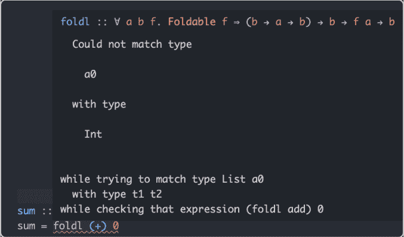

这个错误中关键的部分是：

> 无法将类型 `a0` 与类型 `Int` 匹配

那是因为我们使用 `Int` 作为初始状态。我们可以将其改为 `0.0`：

```haskell
sum :: ∀ a. List a -> a
sum = foldl (+) 0.0 -- COMPILER ERROR!! (AGAIN)
```

但现在错误是：

> 无法将类型 `a0` 与类型 `Number` 匹配

我们需要一个表示所有数字（即 `Ints` 和 `Numbers`）以及加法运算符的抽象。你能想到能做到这一点的东西吗？也许来自抽象代数的某个概念。

如果你想不出来，运行 REPL 并检查加法运算符的类型：

```text
npx spago repl
> import Prelude ❶
> :t (+) ❷
??? ❸
```

❶ 我们需要这个来导入 `(+)`。

+ ② 别忘了输入 Control-D 退出

+ ③ 自己运行 REPL 看看答案。

有了这些信息，看看你是否能修改 `sum`，使其同时适用于 `Ints` 和 `Numbers`。为了帮助测试这一更改，请将以下内容添加到测试代码中：

```haskell
log $ show $ sum (1.0 : 2.0 : 3.0 : Nil) ①
```

① 打印 `6.0`。

向前推进之前，回顾抽象代数部分以及你编写的抽象代数代码，以帮助你编写这个版本的 `sum`。

## 11.23. 针对 `Ints` 和 `Numbers` 的 `sum` 代码

如果你在 REPL 中查看了 `(+)` 的类型，你会得到：

```haskell
> import Prelude
> :t (+)
forall a. Semiring a => a -> a -> a ①
> ^D
See ya!
()
```

① 注意：`Semiring`。

这应该提醒我们，我们需要 `a` 具有 `Semiring` 实例。如果是这样，那么我们可以将该约束添加到我们的函数中，希望能消除编译器错误：

```haskell
import Data.Semiring (class Semiring) ①

sum :: ∀ a. Semiring a => List a -> a
sum = foldl (+) 0.0 --- COMPILER ERROR!! (STILL)
```

① 导入 `Semiring` 类型类，因此使用 `class` 关键字。

我们得到和之前一样的编译器错误：

> 无法将类型 `a0` 与类型 `Number` 匹配

但为什么？看看你是否能发现这个错误。

问题在于我们仍然使用硬编码的初始状态，即 `Numbers` 的加法恒等元。我们知道如果将其改为 0，即 `Int` 的加法恒等元，我们仍然会得到类似的错误。

我们需要的是任何 `Semiring` 的加法恒等元。幸运的是，`Semiring` 类型类正好有我们需要的这个东西，它叫做 `zero`。

编译器会为 `Int`、`Numbers` 或任何具有 `Semiring` 实例的类型选择合适的 `zero`。

让我们回顾一下 `Semiring` 的定义：

```
class Semiring a where
  add :: a -> a -> a ①
  zero :: a ②
  mul :: a -> a -> a
  one :: a

infixl 6 add as + ③
infixl 7 mul as *
```

① 这是 `add` 函数。

② 这是加法恒等元。

③ `add` 的运算符别名是 `+`。

有了这个复习，我们可以通过将 `0.0` 替换为 `zero` 来修复编译器错误：

```
import Data.Semiring (class Semiring, zero) ①

sum :: ∀ a. Semiring a => List a -> a
sum = foldl (+) zero
```

① 将 `zero` 添加到导入列表中。

编译器会为 `Semiring` 选择合适的 `zero`。当 `Semiring` 是 `Int` 时，它会使用 0；当是 `Number` 时，它会使用 0.0。

这将适用于任何 `Semiring`。

编译器还会为 `Semiring` 选择合适的 `add`。记住，每个 `Semiring` 都有自己的 `add` 实现。

现在我们大大改进了我们的 `sum` 函数，因为它不再仅限于 `Int`。

但是……我们还没有完成。我们可以做得更好。你能看出下一步的改进应该是什么吗？

我给你一个提示，我们把 `Int` 替换成了 `Semiring`，使其适用于 ANY 元素。现在呢？你还能看到其他硬编码的类型吗？

没错。集合，即 `List`，也可以被抽象化。我们可以在集合上添加什么约束来使其更通用？

本章是关于 `Foldable` 的，我们一直将代码限制在 `List` 上，但还有许多其他 `Foldable` 数据结构，例如 `Array` 或树等。

在能够对 `Arrays` 进行 `sum` 之前，请在你的测试代码中添加以下行：

```
log $ show $ sum [1, 2, 3] ❶
log $ show $ sum [1.0, 2.0, 3.0] ❷
```

+ ❶ 打印 `6`。

+ ❷ 打印 `6.0`。

所以尝试修改我们的函数使其适用于 ANY `Foldable` 类型。然后通过进入下一节来查看你的成果。

## 11.24. 使用 `Foldable` 的 `sum` 代码

```
sum :: ∀ f a. Foldable f => Semiring a => f a -> a
sum = foldl (+) zero
```

❶ 我们添加了 `Foldable f` 约束，其中 `f` 是我们的可折叠类型，例如 `List`、`Array` 等。

这个最终版本的 `sum` 是我们能做到的最灵活的。我们同时抽象了数据结构和元素。

我们可以创建一个树并使其成为 `Foldable`，然后如果树持有 `Semiring`，我们就可以对其调用 `sum`，它将无需我们额外付出努力就能正常工作。这就是类型类的真正威力。

如果我们能做到，也许我们应该这么做。

## 11.25. 使用 `Tree` 的 `sum`

这是递归定义，因为 `Tree` 类型同时出现在等号的左右两侧。

`Leaf` 是基本情况。它终止递归。

`Node` 是递归情况。

这与递归函数中基本情况和递归情况的工作方式相呼应。我们的基本情况终止了递归。

现在，我们所要做的就是让我们的树成为 `Foldable`。说起来容易做起来难。

在使其成为 `Foldable` 之前，我们必须先决定一些事情。当我们遇到 `Node` 时，我们是偏向左侧还是右侧？我们是要深度优先遍历树还是广度优先遍历。

对于 `List` 我们不需要做出这些决定，因为遍历 `List` 只有一种方式，即从头到尾。但树是一种可以以几种不同方式遍历的结构。

为了让我们的代码更简单，让我们做出一个行政决定并选择 **深度优先**。

通常，停下来为你的数据结构创建一个简单示例来帮助你开发代码是值得的。这里有一个简单的 `Tree`：

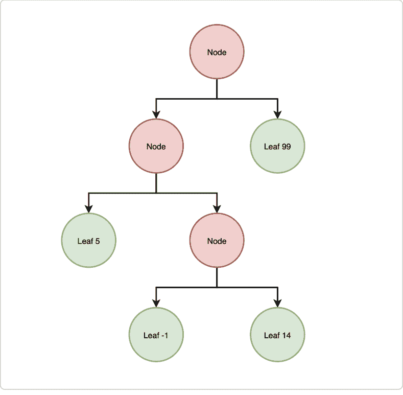

让我们看看我们的 `sum` 函数在偏向 *左侧* 时会受到什么影响：

```
0 + 5 + (-1) + 14 + 99 = 117
```

如果现在我们偏向 *右侧*，我们会得到：

```
0 + 99 + 14 + (-1) + 5 = 117
```

注意结果是相同的。所以使用 `sum` 来帮助我们决定偏向哪一边对我们帮助不大。

我们还需要记住，我们正在为所有函数编写 `Foldable` 实例，而不仅仅是 `sum`。因此，我们需要考虑最佳的遍历方式，以便对所有 `Foldable` 操作都有效，例如减法。使用减法，结果将不会相同。

但是，我们没有对这个二叉树做任何特殊说明。它只是一个二叉树。它不是平衡的也不是排序的。所以我们不能基于此信息做出任何决定。

所以，让我们再做一个行政决定，只选择 *左侧*。

现在我们已经决定了遍历方式，我们就可以为 `Tree` 编写 `Foldable` 实例了。请参阅

在所有 3 种情况下，我们传递除最后一个参数之外的所有参数。这使我们能够简单地组合这些函数，因为它们都在等待单个参数。

现在我们的树是可折叠的，我们可以在它是一个 `Semiring` 时对其调用 `sum`，就像我们的测试树一样：

```
(Node (Node (Leaf 5) (Node (Leaf (-1)) (Leaf 14))) (Leaf 99))
```

## 11.29. 改进 `Tree` 的 `Foldable`


如果我们想支持偏向右侧和/或广度优先遍历，那么我们可以使用`newtype`来创建具有适当行为的新类型，并为其提供自己的`toList`和`Foldable`实例。

我们甚至可以创建一个名为`ToList`的自己的类型类来使该过程更容易。

我们现在不会深入探讨这一点，但为了好玩，这里是仅深度优先的左侧和右侧偏好的实现，因为我太懒了不想写广度优先遍历代码。

以下是感兴趣者的完整实现：

```haskell
data Tree a = Leaf a | Node (Tree a) (Tree a)

class ToList f where ❶

  toList :: ∀ a. f a -> List a

newtype RightFirstTree a = RightFirstTree (Tree a) ❷

newtype LeftFirstTree a = LeftFirstTree (Tree a)

instance toListRightFirstTree :: ToList RightFirstTree where

  toList (RightFirstTree (Leaf x)) = singleton x

  toList (RightFirstTree (Node lt rt)) =

    toList (RightFirstTree rt) <> toList (RightFirstTree lt) ❸ ❺

instance toListLeftFirstTree :: ToList LeftFirstTree where

  toList (LeftFirstTree (Leaf x)) = singleton x

  toList (LeftFirstTree (Node lt rt)) =

    toList (LeftFirstTree lt) <> toList (LeftFirstTree rt) ❹ ❺

instance foldableRightFirstTree :: Foldable RightFirstTree where

  foldr f acc = foldr f acc <<< toList

  foldl f acc = foldl f acc <<< toList

  foldMap f = foldMap f <<< toList

instance foldableLeftFirstTree :: Foldable LeftFirstTree where

  foldr f acc = foldr f acc <<< toList

  foldl f acc = foldl f acc <<< toList

  foldMap f = foldMap f <<< toList
```

1. `ToList` 类用于区分对非列表结构的遍历。
2. 我们将 `Tree` 包装在这些具有明确遍历的特殊类型中。
3. `rt` 被前置到 `lt` 以进行右偏向遍历。
4. `lt` 被前置到 `rt` 以进行左偏向遍历。
5. 我们必须在递归之前重新包装左右 `Trees` 的 `newtype`。我们本可以派生一个 `Newtype` 实例并改用 `wrap`。

注意，我们不再需要 `Tree` 的 `Foldable` 实例或我们独立的 `toList` 辅助函数了。此外，我们的测试代码也应稍作更改：

# 第 12 章. 函子

我们将最终深入探讨函子，这是一种从数学范畴论中窃取的非常强大的抽象。我们不会在这里深入探讨范畴论，但主要集中在使用这种抽象来帮助解决编程问题的动机上。

但在我们开始之前，我想先奠定一些基础，希望能带我们一直走到应用函子和单子。

## 12.1. 定义 ADTs

当我们定义代数数据类型 ADT，例如 `Maybe` 时，我们对该类型代表什么有一个想法。我们一直在谈论 `Maybe` 是可能失败的计算结果的类型：

```
data Maybe a = Nothing | Just a
```

但在这一点上，我们只有我们的意图。我们还没有指定它的使用方式。一旦我们开始添加类型类实例，我们的意图就会变得更明确：

```
data Maybe a = Nothing | Just a
derive instance eqMaybe :: Eq (Maybe a)
derive instance ordMaybe :: Ord (Maybe a) ①
```

① 这种派生连同初始类型定义将决定 `Maybe` 如何排序。`Nothing` 会小于 `Just`，因为它们是先定义的。

每次我们实现另一个类型类实例时，我们都在巩固该类型的行为，选择一种可能的行为而非其他行为。这并不意味着我们不能编写代码来对 `Maybe` 进行排序，其中 `Just` 在 `Nothing` 之前排序，尽管 `Ord` 派生如此。但 `Ord` 的全部意义在于规定比较类型值时的行为。

我们也可以决定不为我们的类型派生 `Ord`，从而让使用者编写大量样板代码来实现常见功能：

```
compareMaybe :: ∀ a. Maybe a -> Maybe a -> Boolean
```

但这会短视且难以维护。它可能适用于小型代码库，但它肯定无法扩展，也无法很好地与多个项目协同工作，特别是如果 `compareMaybe` 在不同项目之间不同。

现在，想象我们想要计算以下数学方程：

f(x) = (83 ÷ x) × 10

我们将首先编写一个除法函数，其中除以零将导致 `Nothing`：

```
import Prelude

import Data.EuclideanRing (class EuclideanRing)
import Data.Maybe (Maybe(..))

divide :: ∀ a. Eq a => EuclideanRing a => a -> a -> Maybe a ①
divide x y
  | y == zero = Nothing ②
  | otherwise = Just $ x / y
```

① Division is supported in a `EuclideanRing`.

② We are checking for a divide by abstract zero. We can use this since all `EuclideanRing`s are also `Semiring`s.

现在，让我们计算我们之前的公式：

```
f :: Number -> Maybe Number
f x = case divide 83.0 x of
  Nothing     -> Nothing ①
  Just result -> Just $ result * 10.0 ②
```

① We cannot continue our computation because the division failed.

② We continue our computation.

我们没有明确指定失败将停止所有计算的进行。那是基于类型结构的隐式行为。`Nothing` 不包含任何值来继续。唯一能做的就是返回 `Nothing`。

这对于 `Either` 来说并非如此，这使得我们的意图变得更加模糊：

```
data Either a b = Left a | Right b
```

当我们定义这个类型时，我们的意图是什么？

可能有 2 种不同的可能性。`Either` 可以是一个选择，即逻辑或。它也可以是带原因的失败，其中 `Left` 是失败情况，`Right` 是成功情况。

仅凭这个定义，我们无法分辨。让我们看看这两种意图。首先，带 `Reason` 的失败，通过重新使用我们的 `Maybe` 示例：

```
import Data.Either (Either(..))

divide :: ∀ b. Eq b => EuclideanRing b => b -> b -> Either String b ①
divide x y
  | y == zero = Left "Divide by zero" ②
  | otherwise = Right $ x / y

f :: Number -> Either String Number ③
f x = case divide 83.0 x of
  Left reason -> Left reason ④
  Right result -> Right $ result * 10.0 ⑤
```

① We changed our return Type to contain an error string if a failure occurs.

② Here we return a reason for the error.

③ We changed our return Type here too.

④ We cannot continue our computation since an error occurred. The best we can do is just return the reason for our failure.

⑤ We continue our computation.

这种意图与 `Maybe` 的非常接近，因此使用了相同的示例。主要区别在于我们使用 `Either` 显式地短路 `Left`，而对于 `Maybe`，这个选择是隐式的，因为 `Nothing` 没有值。

对于 `Choice` 意图，我们需要想象一个不同的用例：

```
convert :: ∀ a b c d. (a -> c) -> (b -> d) -> Either a b -> Either c d
convert f g = case _ of
  Left x -> Left $ f x
  Right y -> Right $ g y
```

这里我们有两个有效值，我们可以使用 `f` 将 `Left` 从 `a` 转换为 `b`，或者使用 `g` 将 `Right` 从 `b` 转换为 `d`。

我们可以对两边进行操作，因为我们的意图在这里是将 `Either` 用作两个不同值的选择，可能来自两种不同的类型。

最好通过创建一个与 `Either` 同构的不同类型来捕捉我们意图的语义，称为 `Choice`：

```haskell
data Choice a b = PickA a | PickB b
```

现在，我们的名字更好地反映了类型的语义。

以下是使用我们命名更优越的类型时 `convert` 函数的样子：

```haskell
convert :: ∀ a b c d. (a -> c) -> (b -> d) -> Choice a b -> Choice c d

convert f g = case _ of

  PickA x -> PickA $ f x

  PickB y -> PickB $ g y
```

这比使用 `Either` 的 `convert` 清晰得多。

## 12.2. Semantics

当我们创建一个新类型时，我们希望它以非常特定的方式使用。这就是类型的语义，我们有几种定义这些语义的方法：

- Name
- Implicit Behaviors
- Explicit Behaviors

### 12.2.1. Name

我们选择的名称在很大程度上传达了我们的意图，并提供了类型语义的提示。当我们选择创建 `Choice` 类型来表示逻辑或时，名称极大地帮助使事情更清晰。

这比重用 `Either` 以有限的方式实现 `Choice` 的语义要好得多。由于它们同构，你可以选择使用 `Either`，你的代码会工作，但你会冒着混淆 `Either` 语义的风险。

最好为你的情况创建一个专门的类型。例如，如果我们可以得到一个 `String` 或一个 `Int`，最好创建以下数据类型而不是使用 `Either Int String`：

```haskell
data IntOrString = GotInt Int | GotString String
```

这种方法使我们有机会制定独特且完全适合我们需求的语义。当然，如果我们需要与 `Either` 完全相同的语义，那么使用它是有意义的，因为它节省了我们大量定义重复语义的工作。

### 12.2.2. Implicit Behavior

当我们构造一个类型时，我们隐式地定义了它的一些行为。在 `Maybe` 的情况下，我们有两种可能性，`Just a` 或 `Nothing`。对于 `Nothing`，没有值可供使用。因此，根据定义，我们必须用这个值终止（或短路）所有未来的计算。

我们不必决定是否短路或不短路。数据结构强加了这一点。短路是 `Nothing` 定义中的隐式行为。

在 `Tree` 的情况下：

```
data Tree a = Leaf a | Node (Tree a) (Tree a)
```

我们有一个递归定义。任何数据构造函数不具有 `Tree a` 作为类型参数的都将终止我们的递归，例如 `Leaf a`。这种行为在定义中是隐式的。对于 `List`，我们有非常相似的情况：

```
data List a = Nil | Cons a (List a)
```

这里 `Nil` 类似于 `Leaf a`，不同之处在于 `Nil` 短路了任何进一步的计算，因为它不包含其他值。相比之下，`Leaf a` 包含一个 `a`，这意味着我们可以对该 `a` 进行计算，并且除非我们明确选择，否则没有隐式短路。

### 12.2.3. Explicit Behavior

我们已经在为 `Either` 编写的代码中看到了显式短路行为：

```
f :: Number -> Either String Number
f x = case divide 83.0 x of
  Left reason -> Left reason ①
  Right result -> Right $ result * 10.0
```

① Explicit Short-circuit, i.e. we’re not required to short-circuit like with `Nothing`.

与 `Maybe` 不同，这是我们基于对 `Either` 的意图所做出的选择。我们本可以决定将除零视为等于 0：

```
f :: Number -> Number ①
f x = 10.0 * case divide 83.0 x of
  Left reason -> 0.0 ②
  Right result -> result
```

① Doesn't fail anymore so we can always return `Number`.

② Doesn't short-circuit here but instead returns 0 as the result of the division allowing the computation to continue.

但那样我们就不会返回 `Either` 了。但我们仍然基于 `Either` 的语义做出了选择。

我们对 `Choice` 做了非常不同的选择（双关语并非本意）：

```
convert :: ∀ a b c d. (a -> c) -> (b -> d) -> Choice a b -> Choice c d
convert f g = case _ of
  PickA x -> PickA $ f x ①
  PickB y -> PickB $ g y
```

① No short-circuit. We apply the conversion function.

我们在实现类型类时所做的决定也是显式行为，即它们不受类型的结构支配。我们很快就会在实现 `Functor`s 时看到这一点，特别是对于 `Either`。

## 12.3. Contexts

被包装在 `Maybe` 中的值与同一个值被包装在 `Either` 中的情况非常不同：

```
Left "ABCDEFGH I" ①
Just "ABCDEFGH I" ②
```

① Short-circuiting since the Semantics of `Left` is an error.

② A successful value.

我们将这种差异称为上下文。我们可以从一个纯值开始，它只是一个原始值，没有上下文（或可能在 `Identity` 上下文中），然后我们可以使用数据构造函数将该纯值放入上下文中。

对于 `List`，我们使用 `Cons`。对于 `Maybe` 我们使用 `Just`。对于 `Either` 我们使用 `Right` 或 `Left`。

你可以将上下文视为某种容器，但这个想法会限制你的思维，因为我们转向更抽象的类型。上下文更为细致，不仅包括它包含的数据，还包括类型的行为。

我们已经看到上下文可以具有不同的流程控制。当我们进入 `Monad`s 时，我们会看到上下文可以有自己的计算，与我们自己的计算并行运行。

## 12.4. 高阶种类类型

我们谈论过值是如何按类型分组的，以及类型是如何按种类分组的，例如 `Maybe` 的种类签名是：

```
Maybe :: Type -> Type
```

`Maybe` 接受一个 `Type` 并返回一个 `Type`。与 `Int` 不同：

```
Int :: Type
```

`Int` 只是一个 `Type`。而 `Either` 接受 2 个类型：

```
Either :: Type -> Type -> Type
```

如果你愿意，可以在 PureScript REPL 中获取类型的种类：

```text
$ npx spago repl

> import Data.Either

> :k Either

Type -> Type -> Type

> ^D

See ya!

()

$
```

❶ `:k` 是 `:kind` 的简写。

❷ 按 Control-D 退出 REPL。

`Maybe` 和 `Either` 看起来像函数，我们也可以这样概念化它们。事实上它们是 *类型构造子*，这与 *数据构造子* 类似，后者也是函数。

> 任何接受 1 个或多个参数的类型构造子都是高阶种类类型。

`Int` 不是像 `Maybe` 和 `Either` 那样的高阶种类类型，因为它不接受任何类型参数。

我们可以将程序中的 *值空间* 和 *类型空间* 进行类比：


| `Value` | `10 :: Int` |

| `Function` | `f :: Int -> Int` |

| `Type` | `Int :: Type` |

| `Higher-kinded Type` | `Maybe :: Type -> Type` |

注意值与类型之间的平行关系。还有函数与高阶种类类型之间的平行关系。

## 12.5. 具有简单类型的函数

当我们使用简单类型时，即非高阶种类类型，我们可以写出如下函数：

```
f :: ∀ a b. a -> b
g :: ∀ b c. b -> c
h :: ∀ c d. c -> d
```

然后将它们组合：

```
hgf :: ∀ a d. a -> d
hgf = h <<< g <<< f
```

在数学中，函数将定义域映射到值域。定义域和值域是元素为值的集合：

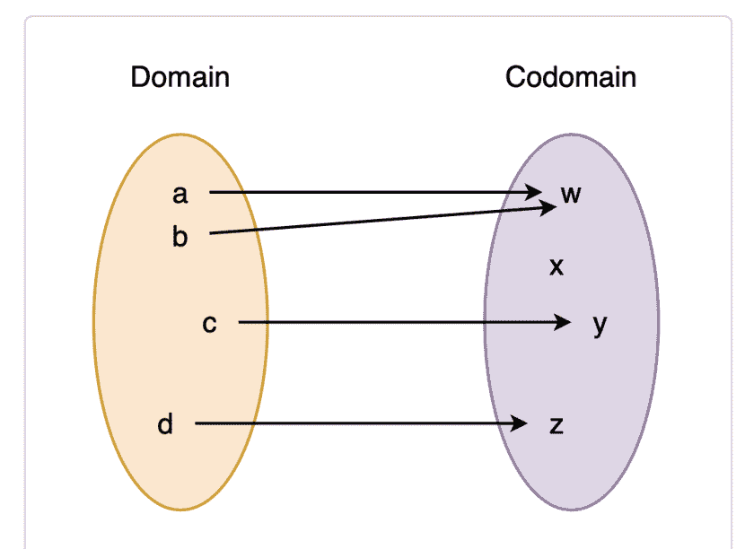

我们说函数将定义域中的元素映射到值域中的元素。

但在编程中，我们的定义域和值域是类型，而元素是这些类型的居民：

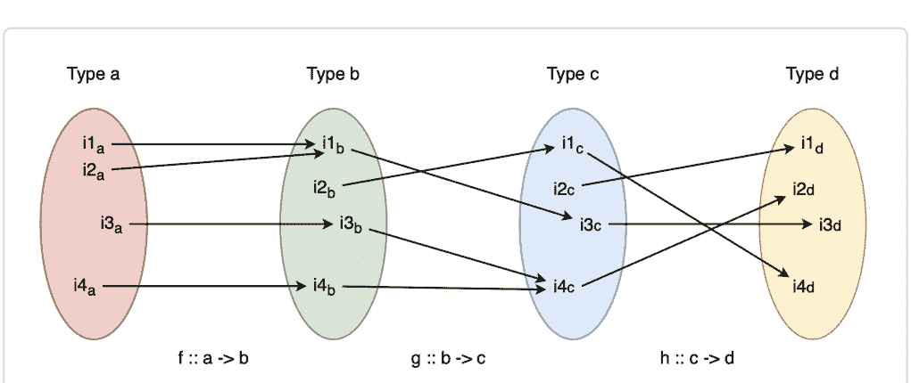

这里我们展示了 `f`、`g` 和 `h` 的组合，以及它们从类型 `a` 的集合到类型 `b` 的映射，以此类推。类型 `a` 的居民是类型 `a` 集合的元素。

并且该图像对于重复的函数应用也成立：

```
fgh :: ∀ a d. a -> d
fgh x = h $ g $ f x
```

函数组合和函数应用是函数式编程的面包和黄油。我们能够利用较小的事物解决更大的问题，例如用原子来制造分子。

注意我们迄今为止使用的所有类型都是简单类型，如 `Int`、`String`、`Number` 等。但当我们考虑失败的情况时会怎样，例如如果 `g` 可能失败：

```
g :: ∀ b c. b -> Maybe c -- 返回一个高阶种类类型
```

我们可以在不产生问题的情况下将其与 `f` 组合：

```
gf :: ∀ a c. a -> Maybe c
gf = f <<< g
```

我们也可以用它进行函数应用：

```
fg :: ∀ a c. a -> Maybe c
fg x = g $ f x
```

但当我们想要组合或应用 `h` 时会怎样？

问题是 `h` 接受一个 `c` 而不是一个 `Maybe c`。我们当然可以重写 `h` 或制作一个专门接受 `Maybe` 的 `h` 版本，但这只会打开一个潘多拉魔盒。我们的 `h` 函数适用于简单类型，但不适用于高阶种类类型。

函子 `Functor` 和单子 `Monad` 解决了这些问题。我们将在本章和接下来的几章中详细讨论这个看似简单问题的解决方案。在此过程中，我们将发现这些概念的真正威力。

这些概念在其他文本中经常被草草带过，或过早引入。我们花了数百页才走到这里，希望你在深入这些抽象之前对底层概念感到舒适。而且，希望你现在能够专注于手头的概念。

这些抽象将构成你函数式编程体验的很大一部分，因此值得慢慢来，确保你获得良好的、扎实的理解。

## 12.6. 函子来救援

我们之前介绍了上下文 `Context` 的概念，在我们最近的例子中，`c` 处于 `Maybe` 的上下文中：

```
g :: ∀ b c. b -> Maybe c
```

我们的难题是如何将 `h` 应用于 `g` 的输出。让我们写一个函数来帮助我们将 `h` 应用于 `Maybe c`。

首先，我们从类型签名开始：

```
applyH :: (c -> d) -> Maybe c -> ???
```

我们应该为函数的最终类型填入什么？我们可能倾向于使其为 `d`，以匹配 `g` 不会失败时的做法。但当我们尝试时，我们会卡住：

```
applyH :: (c -> d) -> Maybe c -> d
applyH h Nothing = ???
```

我们无法神奇地为 `Nothing` 情况生成一个值。我们需要短路计算并返回 `Nothing`。这意味着我们的最终结果必须是 `Maybe d`：

```
applyH :: (c -> d) -> Maybe c -> Maybe d
applyH _ Nothing = Nothing
```

接下来，我们可以写 `Just` 情况：

```
applyH :: (c -> d) -> Maybe c -> Maybe d
applyH _ Nothing = Nothing
applyH h (Just x) = ???
```

我们可以用 2 个可能的值替换 `???`。第一个是 `Nothing`，但那么我们的函数就不会提供在 `Maybe` 上下文中应用 `h` 的承诺功能。它只会总是丢弃所有数据并总是返回 `Nothing`。我们完全可以把 `h` 替换为 `const Nothing`。

所以，只有一个合理的实现：

```
applyH :: (c -> d) -> Maybe c -> Maybe d
applyH _ Nothing = Nothing
applyH h (Just x) = Just $ h x
```

太好了。现在我们可以重写上一节中的函数应用示例：

```
fgh :: ∀ a d. a -> Maybe d
fgh x = applyH h $ g $ f x
```

但如果我们希望 `g` 也返回失败的原因呢：

```
g :: ∀ b c. b -> Either String c
```

现在我们必须再写一个适用于 `Either String` 的应用 `h` 的函数。此时你的脑海中应该响起警钟。这对于所有高阶种类类型都是一个问题。

我们希望以更通用的方式解决这个问题，而事实证明范畴论 `Category Theory` 给出了恰到好处的解决方案，即函子 `Functor`。

以下是 PureScript 中函子的定义：

```
class Functor f where ①
  map :: ∀ a b. (a -> b) -> f a -> f b ②

infixl 4 map as <$> ③
```

① 当我们使用 `NonEmpty` 时，它在类型签名中使用了 `f`。那代表 `Functor`，我们在这里使用相同的变量名。这在 PureScript 和 Haskell 中很常见。`f` 作为类型参数的另一种用法是 `Foldable`。但通常当你看到 `f` 时它代表一个函子。

② 注意这里的 `f` 是一个高阶种类类型，因为它接受一个单一的类型参数，这意味着它的种类是 `Type -> Type`。

③ 对函子进行映射非常常见，因此它有一个操作符别名。注意它如何镜像函数应用操作符 `$`。另外，意识到我们的 `applyH` 只是 `Maybe` 的 `map` 方法，其中 `f` 是 `Maybe`。

`map` 方法允许我们将函数 `a -> b` 应用于 `f` 上下文中的 `a` 并修改它，而不改变上下文。这是一个重要点。当我们检查函子定律时，我们会看到为什么这是正确的。

很不幸函数叫做 `map`，因为这是一个重载的术语，例如 `Map` 是键/值存储，函数将定义域映射到值域。所以虽然函数叫做 `map`，但我们经常说 `map over`，例如我们想将 `f` `map over` 列表。

让我们为 `Maybe` 写函子实例：

```haskell
instance functorMaybe :: Functor Maybe where

  map _ Nothing = Nothing

  map f (Just x) = Just $ f x
```

看起来熟悉吗？`map` 是我们试图用 `applyH` 解决的特定问题的通用解决方案。

现在让我们用它来重写我们的函数应用示例：

```haskell
fgh :: ∀ a d. a -> Maybe d

fgh x = h <$> g $ f x
```

与纯版本对比，即没有高阶种类类型：

```haskell
fgh :: ∀ a d. a -> d

fgh x = h $ g $ f x
```

唯一的区别是 `$` 被 `<$>` 替换了。

## 12.7. `map` 的两种视角

仔细观察 `map` 的类型签名：

```haskell
class Functor f where

  map :: ∀ a b. (a -> b) -> f a -> f b
```

我们可以将此函数解释为接受一个从 `a` 到 `b` 的函数，以及在某个上下文 `f` 中的值 `a`，并返回在同一上下文中的 `b`。

另一种说法是函数 `a -> b` 被 *提升* 到上下文中并被应用。当谈论函子时，你会经常听到 *提升* 这个术语。

现在，让我们取同一个类型签名并加上我们之前做过的隐含的括号：

```haskell
class Functor f where

  map :: ∀ a b. (a -> b) -> (f a -> f b)
```

我们又该如何解释它？

我们可以说 `map` 将函数 *提升* 到函子中，即我们取一个在简单类型上操作的功能，也称为纯值，并将其提升为在函子类型上工作。

So, `map` can morph BOTH functions and values. Keep this in mind as we see how Functors work in Category Theory.

## 12.8. 抽象的力量

抽象模型是在我们看到许多不同具体示例之间存在共同模式时产生的。例如，我们在年轻时建立狗的抽象模型。我们注意到狗有尾巴并且会叫。这种模式是在反复接触狗后建立起来的。一开始我们的模型是天真的。

一个五岁的孩子可能会告诉我们所有狗都会叫并且所有狗都有尾巴。但随着我们对狗的经验增长，我们意识到有些狗没有尾巴，有些狗不叫。但大多数会。

我们完善了对狗的模型，当我们谈论特定品种时，我们可能会用该特定品种不叫这一事实来限定它。

在数学中也会发生类似的过程。我们首先学习群。它们是经过多年观察数学中共同模式而发展起来的抽象。但随着我们与群的相处，我们在某些具体示例中看到了细微差异。

其中一个差异是二元运算是否可交换。这不是成为群的要求，但我们在遇到的许多运算都是可交换的，因此我们专门化了阿贝尔群来捕捉这一事实。

这些抽象在数学和编程中都很棒。我们希望抽象地思考一次，然后只需认识到我们遇到了抽象的新示例。

类型类就是我们最近学到的这种抽象之一。让我们看一个具体的例子：

```
class Eq a <= Ord a where
    compare :: a -> a -> Ordering

data Ordering = LT | GT | EQ
```

在这里，我们抽象了具有顺序意味着什么。集合的元素可能具有顺序。并非所有事物都有顺序，但当它们有顺序时，我们知道可以用我们关于可排序事物所学的一切来使用我们的新示例。

例如，如果某个类型是可排序的，那么我们可以对它们排序列表或数组。我们不必考虑它，因为我们有一个关于排序和排序的抽象概念，告诉我们这是可能的。

如果你学习数学足够长的时间，你会开始一次又一次地看到相同的模式。这是因为相同的思想以略有不同的方式表达在不同的学科中，但它们本质上是同构的思想。

有许多例子。其中一个相关例子是 Lambda 计算中的教堂数。

这是一种使用 Lambda 表示法表示数字的方法：

```
0 = λf.λx.x
1 = λfλx.f x
2 = λf.λx.f (f x)
3 = λf.λx.f (f (f x))
```

基本上，数字由函数 `f` 应用于 `x` 的次数来表示。在零的情况下，它被应用 0 次。在一的情况下，它被应用 1 次，以此类推。

使用 PureScript 表示法可能更容易看到：

```
0 = \f x -> x
1 = \f x -> f x
2 = \f x -> f (f x)
3 = \f x -> f (f (f x))
```

我们也可以用 PureScript 中的数据类型来表示同样的思想：

```
data Nat = Zero | Succ Nat ①
```

① `Nat` 代表自然数

请注意，这是一个递归定义，因为 `Nat` 同时出现在等号的两侧。`Zero` 是我们的起点，`Succ` 代表前一个自然数的后继。

以下是我们如何表示数字：

```
0 = Zero
1 = Succ Zero
2 = Succ (Succ Zero)
3 = Succ (Succ (Succ Zero))
```

`3` 的定义说 `3` 是 `0` 的后继的后继的后继。另一种说法是 `3` 是 `2` 的后继，`2` 是 `1` 的后继，`1` 是 `0` 的后继。

请注意，Lambda 计算编码中的函数 `f` 是我们的 `Succ` 数据构造函数，而教堂数中的 `x` 是我们的 `Zero`。

现在让我们看看数字在集合论中的表示方法：

```
0 = {}          = ∅
1 = { 0 }        = { ∅ }
2 = { 0, 1 }     = { ∅, { ∅ } }
3 = { 0, 1, 2 } = { ∅, { ∅ }, { ∅, { ∅ } } }
```

这里 `∅` 代表空集。

我们从空集 `∅` 开始表示 `0`，然后将 `0` 添加到该集合中得到 `1`。

要得到 `2`，我们将 `1` 添加到 `1` 的集合中，以此类推。

这里的要点是，当你在数学中创建模型时，如果你能展示模型中元素到数字的映射，就不要引入数字。

在集合论中，一切都是集合。在创建数学的新领域时，你希望定义最少的元素数量，然后从这些原始元素构建整个宇宙。Lambda 计算也是如此。整个世界都是 Lambda 表达式。

这才刚刚触及不同数学领域之间可能找到的共同性的表面。

希望从这个简单的例子中，你可以看到我们可能基于它们的相似性在许多数学领域上进行抽象是可能的。

而这正是范畴论所做的。它是对数学的抽象。它允许我们学习这个超抽象，然后将新的研究领域应用于这个抽象，如果我们能使其契合，我们就能瞬间洞察我们研究的本质。

函数式编程可以用范畴论建模，通过这样做，它极大地启发了我们，并赋予了我们强大的抽象能力，我们在这本书中刚刚开始涉足，例如 `Functors`、`Applicatives` 和 `Monads`。

## 12.9. 一点范畴论

范畴论极其抽象，正因为这种抽象，它才能抽象出许多数学领域。我们关心的是编程领域，那就是我们将集中精力的地方。

我们这里只是稍微触及表面，但函数式领域充斥着范畴论的引用，因此一点基础知识将极大地帮助你在本书之外导航。

让我们从范畴的定义开始。

> 一个范畴由一组对象和对象之间的态射集合组成。

一个相当简单的定义，正如对如此抽象的东西所期望的那样。现在魔鬼在细节中。

我们可以选择我们的对象和态射是什么，这取决于我们试图建模的内容。由于我们的兴趣是编程，我们将选择我们的对象为类型，我们的态射为函数。这个范畴传统上称为 `Hask`，源自 Haskell。但对 PureScript 也同样适用。

而正如数学中总是存在的，有定律：

- 每个态射 `f` 都有一个源对象 `a` 和目标对象 `b`，写成 `f: a → b`，我们说“`f` 是从 `a` 到 `b` 的态射”

- 态射可复合

- 每个对象都有一个恒等态射，即 `1ₓ: x → x`

- 复合是结合的：如果 `f: a -> b`，`g: b -> c`，和 `h: c -> d` 那么 `h ∘ (g ∘ f) = (h ∘ g) ∘ f`

这一次性消化起来很多，但希望你能看到我们到目前为止在 PureScript 中所做的大量相似之处。

让我们一次一步地处理所有这些，但这次用图片：

这里有一个范畴 `C`，具有一组对象 `{ a, b, c, d, e }`：

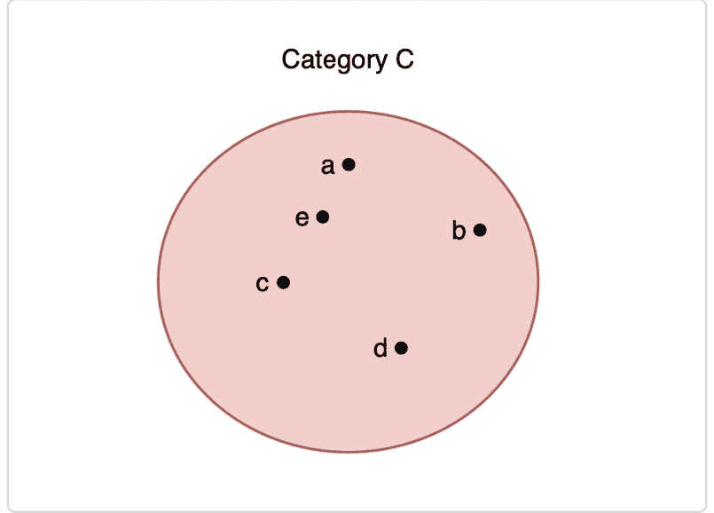

在 PureScript 中，`a`、`b` 等是类型。

这里是从 `a` 到 `b` 的态射 `f`，`f: a → b`：

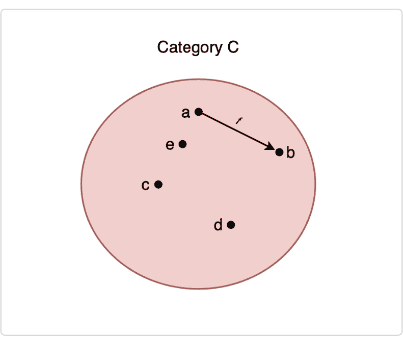

态射 `f` 将对象 `a` 映射到对象 `b`。

但由于对象在 `Hask` 中是类型，当我们在 PureScript 中编写函数时，它将类型 `a` 的值映射到类型 `b` 的值：

```
f :: ∀ a b. a -> b
```

接下来，我们将为对象 `d` 添加一个恒等态射 `1₍d₎: d -> d`（所有对象都有恒等态射，但我们只为 `d` 显示）：

一个交换图是一个所有具有相同起点和终点的有向路径（箭头）导致相同结果的图。

如果我们从 **a** 开始，带上 **a** 类型的任意值，我们可以沿水平路径通过 **f** 得到 **b** 类型的值，然后通过 **g** 将该值带到 **c** 类型的值。

这必须产生与从 **a** 开始并将相同值通过 `g ∘ f` 相同的结果。

由于复合的定义，它确实如此。但并非所有图都交换：

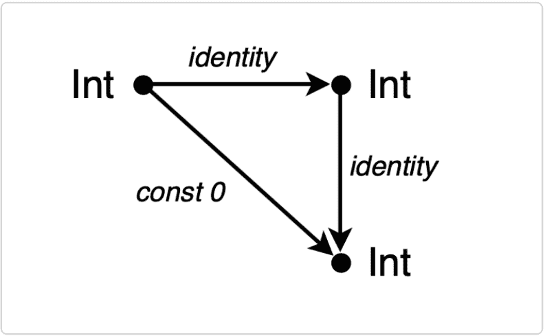

如果我们从左上角 `Int` 开始，带上任意值，水平通过 `identity` 然后垂直再次通过 `identity`，我们会以相同的值结束在右下角。

但如果我们从左上角开始，带上相同的值，沿对角线通过 `const 0`，我们会以 `0` 结束在右下角。

从左上角到右下角的这两条路径没有产生相同的结果，因此不交换。

在 PureScript 中，我们会像这样编写组合函数：

```
compose :: ∀ a b c. (b -> c) -> (a -> b) -> (a -> c)
compose g f x = g (f x)
```

注意，这不是 PureScript 中的实现方式。它实际上是在名为 `Semigroupoid` 的类型类中实现的，它类似于没有恒等要求的 `Category`。但就我们的目的而言，这个定义有效。

现在我们可以检查复合的结合性：

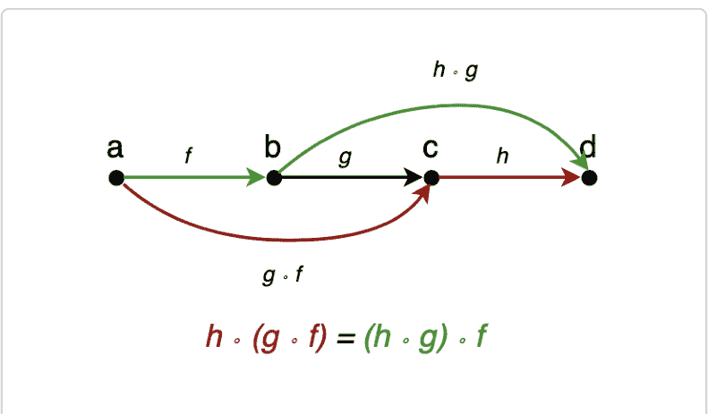

在 PureScript 中，我们可以证明组合是结合的：

```text
compose :: ∀ a b c. (b -> c) -> (a -> b) -> (a -> c)
compose g f x = g (f x)  -- ①
```

① 这个等式将在下面的证明中使用。


```text
h ∘ (g ∘ f)               = (h ∘ g) ∘ f                 -- Given (Math)
compose h (compose g f) x = compose (compose h g) f x -- Given (PureScript)
h ((compose g f) x)      = compose (compose h g) f x -- Subst left using ①
h ((compose g f) x)      = (compose h g) (f x)      -- Subst right using ①
h (compose g f x)        = (compose h g) (f x)      -- Remove Parentheses
h (g (f x))              = (compose h g) (f x)      -- Subst left using ①
h (g (f x))              = h (g (f x))              -- Subst right using ①
```

我们现在已经展示了如何将类型作为对象、函数作为态射构成一个守法的范畴。并且在对范畴论这个非常简短的介绍之后，我希望你能看出函数式语言设计者是如何受到这个相对较新的数学领域（约 1945 年）的影响的。

## 12.10. Hask 中的具体示例

让我们从 Show 方法 `show` 开始，在 Hask 中看一些示例：

```text
class Show a where
  show :: a -> String
```

我们可以将其图示表示为：

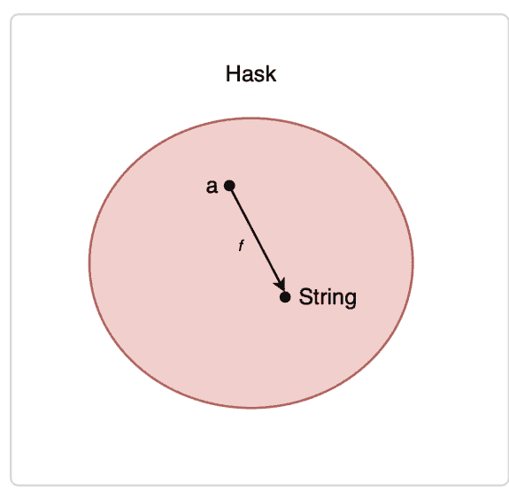

对于 Show 的 Int 实例：

```text
instance showInt :: Show Int where
    show = showIntImpl

foreign import showIntImpl :: Int -> String  -- ①
```

① Javascript 中的实际实现。

我们可以将其表示为：

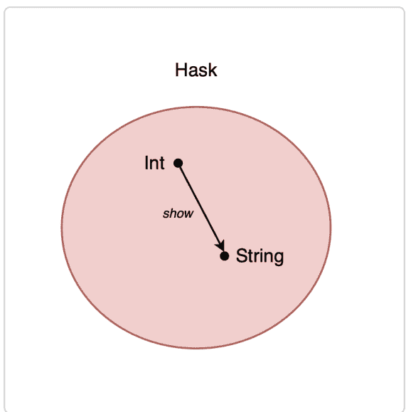

希望，这些简单的例子基于我们迄今为止所做的内容是有意义的。但这些例子似乎过于简单了。多个参数的函数呢？

```text
f :: Int -> Int -> String
```

记住所有函数都是柯里的。并且可以将此函数重写为其非柯里形式：

```text
f :: Tuple Int Int -> String  -- ①
```

① 从技术上讲，我们已经将此函数 *非柯里化* 了。（稍后会详细介绍）

现在它只接受一个参数，我们可以在范畴 Hask 中绘制它：

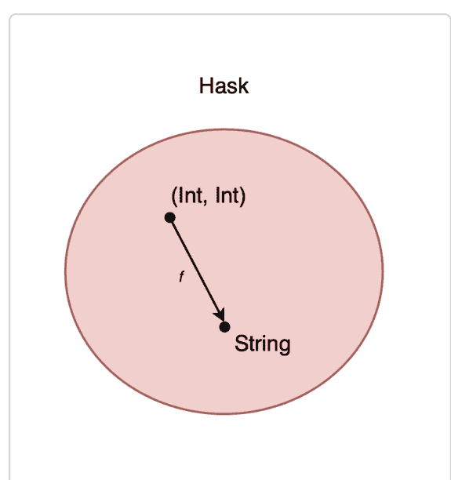

希望，你可以想象我们如何用 3 个参数的函数来做这件事：

```text
g :: Int -> Boolean -> String -> String

g' :: Tuple Int (Tuple Boolean String) -> String
```

等等。

在这一简短介绍之后，我们现在应该能够看到函子在范畴论中是如何工作的，并将其与编程中的函子进行比较。

## 12.11. 范畴论中的函子

到目前为止，我们只看过一个范畴以及在该范畴内将对象变形为同一范畴中其他对象的方式。这就是 PureScript 中的函数所做的：

```text
f :: ∀ a b. a -> b  -- ①
```

① 将类型映射到类型。

而态射是在对象之间的映射，函子是在范畴之间的映射。而在 PureScript 中，正如我们所见，函子只是函数，即 `map`。

但在编程中，我们只有一个范畴，因为我们的函数只能将类型映射到类型。映射回同一范畴的函子被称为 *EndoFunctors*。因此 PureScript 中的所有 *函子* 实际上都是 EndoFunctors，但大家都只是称之为 *函子*。

函子还有另一个非常重要的要求。

> 函子保持范畴结构。在抽象代数中，保持群等代数结构的函数称为 *同态*（*Homo* 意为 *相同*，*morph* 意为 *形状*）。这里函子就像同态，因为它们也保持范畴结构。

如果对象 `a` 有一个到对象 `b` 的态射，那么函子必须在将它们映射到新范畴时保持该态射。它也不能在映射时丢弃任何对象或态射，也不能创建原始范畴中不存在的新对象或态射：

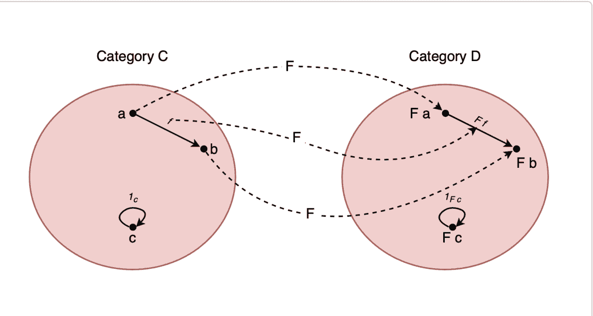

这里函子 `F` 将对象和态射从范畴 `C` 映射到 `D`。

在此图中，`F` 将 `a` 映射到 `F a` 并将 `b` 映射到 `F b`，即映射所有对象（未显示所有映射）。

它还显示 `F` 将 `f` 映射到 `F f`，即映射所有态射（未显示所有映射）。

当我们用隐含的括号来看 PureScript 中的 `map` 时：

```text
class Functor f where
  map :: ∀ a b. (a -> b) -> (f a -> f b)  -- ①

infixl 4 map as <$>
```

① 我们添加了隐含的括号。

我们可以看出态射的映射，即 `a -> b` 被映射到 `f a -> f b`。

但在 PureScript 中，`a` 到 `f a` 和 `b` 到 `f b` 的映射在哪里。对于这一点，我们必须等待 Applicative 函子。但这里有一个预览：

```text
class Apply f <= Applicative f where  -- ①
  pure :: ∀ a. a -> f a
```

① `Functor` 是 `Apply` 的超类，这意味着 `Applicative` 也是一个函子。因此，`Applicative` 具有 `map` 和 `pure`，这涵盖了范畴函子对对象（`pure`）和态射（`map`）的映射。

我们很快就会遇到 Applicative 函子，但就目前而言，还有很多关于函子需要学习和做的事。

## 12.12. 函子定律

在 PureScript 中无法强制执行函子定律。验证其实现是否遵守这些定律的责任在于类型类的作者：

```text
map identity = identity          [Identity]
map (g <<< f) = map g <<< map f   [Composition]
```

简而言之，这些定律规定函子必须保持恒等和组合。

恒等定律说，如果我们映射恒等函数，那么它等价于仅在函子上调用恒等。请注意，这一定律意味着 `map` 永不能改变函子的结构。因此 `Just` 永不能变成 `Nothing`，`Left` 不能改变为 `Right`。换句话说，映射恒等会保持函子不变。

从范畴的角度来看，函子将范畴 `C` 中的恒等态射映射到范畴 `D` 中的恒等态射：

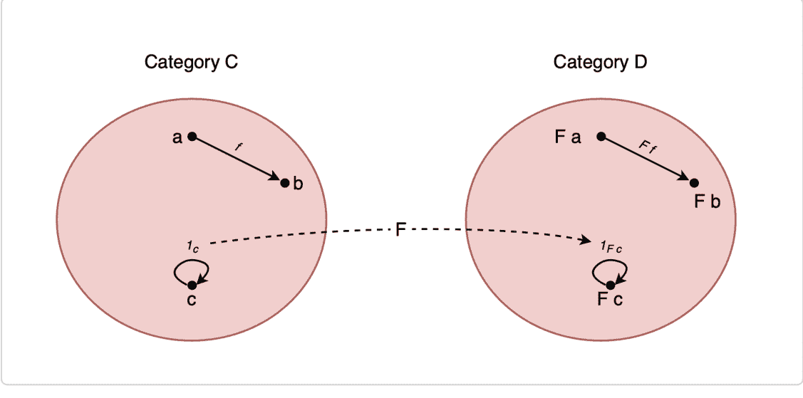

**组合** 定律说，映射 2 个函数的组合等价于分别映射它们然后组合结果。我们可以用范畴在图示上看到这一点：

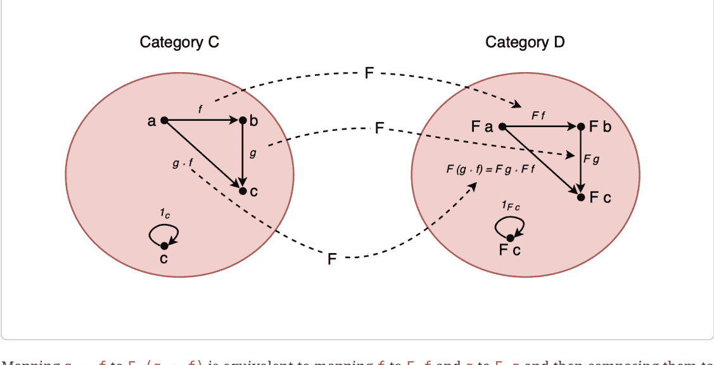

将 `g ∘ f` 映射到 `F (g ∘ f)` 等价于将 `f` 映射到 `F f` 并将 `g` 映射到 `F g`，然后将它们组合得到 `F g ∘ F f`。这是有意义的，因为函子必须保持范畴结构和规则，其中之一就是态射可组合。

暂时离开范畴论，回到编程，我们可以看到从 **恒等** 定律，映射恒等函数（或态射）没有效果。

让我们用 `Maybe` 看看这意味着什么：

```text
instance functorMaybe :: Functor Maybe where
  map _ Nothing  = Nothing
  map f (Just x) = Just $ f x
```

这里 `Nothings` 保持为 `Nothings`，`Justs` 保持为 `Justs`。如果不是这样，我们就会破坏 `Identity` 定律。

`Either` 的 `Lefts` 和 `Rights` 也是如此：

```text
instance functorEither :: Functor (Either a) where
  map _ (Left x)  = Left x
  map f (Right y) = Right $ f y
```

## 12.13. 验证 `Maybe` 的函子定律

让我们从以下开始：

```text
data Maybe a = Nothing | Just a

instance functorMaybe :: Functor Maybe where
  map _ Nothing  = Nothing  -- ①
  map f (Just x) = Just $ f x  -- ②
```

① 这个等式将在下面的证明中使用。

② 这个等式将在下面的证明中使用。

让我们验证定律。我们的方法是先从定律开始，然后使用我们的实现，减少等式的左边然后右边。如果结果相同，则它们显然相等。

首先，`Nothing` 的恒等：

```text
map identity Nothing  = identity Nothing       -- Identity Law
Nothing              = identity Nothing       -- Subst left using ①
Nothing              = Nothing                -- Function Application
```

接下来，`Just`：

```text
map identity (Just x) = identity (Just x)    -- Identity Law
Just (identity x)    = identity (Just x)    -- Subst left using ②
Just x               = identity (Just x)    -- Function Application
Just x               = Just x              -- Function Application
```

接下来，我们将验证 `Nothing` 的组合定律：

```text
map (g <<< f) Nothing = (map g <<< map f) Nothing -- Composition Law
Nothing               = (map g <<< map f) Nothing -- Subst left using ①
Nothing               = map g (map f Nothing)     -- Function Composition
Nothing               = map g Nothing             -- Subst right using ①
Nothing               = Nothing                  -- Subst right using ①
```

最后，使用 `Just`：

```text
map (g <<< f) (Just x) = (map g <<< map f) (Just x) -- Composition Law
Just ((g <<< f) x)      = (map g <<< map f) (Just x) -- Subst left using ②
Just (g (f x))          = (map g <<< map f) (Just x) -- Function Composition
Just (g (f x))          = map g (map f (Just x))     -- Function Composition
Just (g (f x))          = map g (Just (f x))         -- Subst right using ②
Just (g (f x))          = Just (g (f x))             -- Subst right using ②
```

## 12.14. `Either` 的函子实例

让我们在记住我们对 `Left` 进行短路的情况下，遵循我们对 `Maybe` 所做的，为 `Either` 编写 `Functor` 实例：

```text
data Either a b = Left a | Right b

instance functorEither :: Functor Either where -- COMPILE ERROR!!
  map _ (Left x)  = Left x  -- ①
  map f (Right y) = Right $ f y  -- ②
```

- ① 短路。

- ② 将 `f` 应用于上下文中的值，即 `y`。

让我们看看编译器错误：

所以这就是 Kind 不匹配的地方。我们把 `Either` 放在了 `f` 的位置上。但 `Either` 的 Kind 与 `f` 的不匹配：

```
f :: Type -> Type
Either :: Type -> Type -> Type
```

但我们可以通过对 `Either` 部分应用类型来修复这个问题。就像函数一样，我们可以对类型构造子进行部分应用，它是函数式的：

```
f :: Type -> Type
Either a :: Type -> Type
```

现在 Kinds 匹配了。让我们把这个修复应用到我们的实例中：

```
data Either a b = Left a | Right b

instance functorEither :: Functor (Either a) where ①
  map _ (Left x)  = Left x
  map f (Right y) = Right $ f y
```

① 用 `Either a` 替换了 `Either`。

我们需要注意的是，`Either a` 中的 `a` 被隐含为 `∀ a`，并且不需要像我们在函数中那样在此处显式定义。

但这里还有一个更大的问题。因为 `Functor` 的类型参数 `f` 只接受 1 个类型参数 `a`，所以我们即使想映射 `Left` 也无法映射。让我们看看如果尝试会发生什么：

```
instance functorEither :: Functor (Either a) where
  map f (Left x)  = Left $ f x  -- COMPILER ERROR!!
  map f (Right y) = Right $ f y
```

这是编译器错误：


错误中的类型名有点令人困惑，而且其余的错误信息在这里也没有什么帮助。我能推断出的最好结果是编译器无法匹配两个不同的 `a`。

但如果我们耐心一点，花时间思考一下，我们就能理解为什么这行不通。

让我们采取一种激进的方法。我们将用 `Either a'` 替换 `Functor` 类型类定义中的 `f`。这不会编译，但有助于我们理解正在发生的事情。

从 `Functor` 开始：

```haskell
class Functor f where
  map :: ∀ a b. (a -> b) -> (f a -> f b)
```

用 `Either a'` 替换 `f`（我们使用 `a'` 以免与 `map` 的类型签名中的 `a` 冲突）：

```haskell
-- WON'T COMPILE — ONLY FOR ILLUSTRATIVE PURPOSES
class Functor (Either a') where
  map :: ∀ a b. (a -> b) -> ((Either a') a -> (Either a') b)
```

从中，我们可以看到传递给 `map` 的函数 `f :: a -> b` 会改变 `Either a' a` 的第二个类型参数。

第一个类型参数保持不变，显然与 `map` 的函数期望的 `a` 不匹配。

这就是为什么我们不能对 `Left` 值使用 `f`。`Left` 的类型是 `a'`，它必须保持不变。

现在，编译器错误更有意义了。它无法将 `a` 匹配到 `a'`。这就是那两个不同的 `a`。

让我们提醒自己 `Either` 的正确 `Functor`：

```
instance functorEither :: Functor (Either a) where
  map _ (Left x) = Left x
  map f (Right y) = Right $ f y
```

我们在这里学到的是，当尝试为具有多个类型参数的高阶类型创建 Functor 实例时，除了最右边的类型参数外，其余所有参数都保持不变。

在练习中编写 Tuple a b 的 Functor 时请记住这一点。

## 12.15. Choice 的 Functor 实例

我们决定让 Either 短路与否并不重要，因为 Functor 已经为我们决定了。

但我们的 Choice 数据类型有一个真正的问题：

```
data Choice a b = PickA a | PickB b
```

我们决定这不会短路。但我们刚刚看到 Functor 强制我们在最后一个类型参数之外的所有参数上短路。

如果我们让 Choice 成为一个 Functor，我们就必须对 PickA 短路：

```
instance functorChoice :: Functor (Choice a) where
  map _ (PickA x) = PickA x ①
  map f (PickB y) = PickB $ f y
```

① 我们不想要的短路。

那么有没有一个 Functor 能让我们映射两者呢？


到目前为止，你应该知道如果没有办法，我是不会问这个问题。

## 12.16. `Bifunctor` 类型类

我们已经看到 `Functor` 只能映射 1 个类型参数。要映射 2 个类型参数，我们需要使用称为 `Bifunctor` 的东西（Bi 表示两个）。

以下是 PureScript 中的 `Bifunctor`：

```
class Bifunctor f where
  bimap :: ∀ a b c d. (a -> c) -> (b -> d) -> f a b -> f c d
```

① 类型构造子 `f` 接受 2 个参数，不像 `Functor` 只接受 1 个。

`bimap` 接受 2 个函数，一个用于映射第一个类型 `a`，一个用于映射第二个类型 `b`。

现在我们可以为 `Choice` 创建 `Bifunctor` 实例，而不会被迫短路：

```
instance bifunctorChoice :: Bifunctor Choice where
  bimap f _ (PickA x) = PickA $ f x
  bimap _ g (PickB y) = PickB $ g y
```

① 我们不再需要像在 `Functor` 中那样使用 `Choice a`，因为 `Bifunctor` 的 `f` 接受 2 个参数，`Choice` 也是如此。换句话说，它们的 Kinds 匹配，即 `Choice :: Type -> Type` 匹配 `f :: Type -> Type`。

现在我们对 `Choice` 的两种情况都进行映射，因为我们现在为每种情况都有一个量身定制的函数。

`Choice` 是一个和类型（`Coproduct`），但对于积类型呢？你能想到一个可以做成 `Bifunctor` 的积类型吗？

比如这个：

```
data Tuple a b = Tuple a b

instance bifunctorTuple :: Bifunctor Tuple where
  bimap f g (Tuple x y) = Tuple (f x) (g y)
```

在这里我们每次都映射 `Tuple` 的两边。但如果我们只想映射 `Tuple` 的左边呢？

我们可以写出以下函数：

```
lmap :: ∀ a b c f. Bifunctor f => (a -> b) -> f a c -> f b c
lmap f = bimap f identity
```

① 我们提供 `identity` 作为右侧映射，effectively 将右侧映射回自身。

结果是这个函数和 `rmap` 都在 PureScript `Bifunctor` 库中，包 `package-bifunctors`，模块 `Data.Bifunctor`。

`rmap` 映射 `Bifunctor` 的右侧，这基本上就是 `Functor` 中的 `map`。

## 12.17. 范畴论中的 Bifunctors

让我们回到 `Hask` 范畴，其中对象是类型，态射是函数。

当我们查看 `Hask` 中的 `Functors` 时，我们看到它如何将类型映射到其他类型。但我们只有一个类型可供使用，而 `Bifunctors` 将 2 个类型映射到 2 个类型。

因此，对于 `Bifunctors`，我们的对象必须是 2 个类型。所以我们需要一个是 2 个类型的类型。如果这听起来不可能或悖论，实际上并非如此。

让我们在跨过那座桥之前先看几件事。首先，让我们回顾一下 **笛卡尔积**。这里有一个例子：

```
A = { 1, 2, 3 }
B = { a, b }

A × B = { (1, a), (1, b), (2, a), (2, b), (3, a), (3, b) }
```

笛卡尔积是由取 `Set A` 的每个元素并与 `Set B` 中的每个元素组合而成的 `成对集合`。

而这里是正式定义：

```
A × B = { (a, b) : a ∈ A and b ∈ B }
```

再次，让我们解析一下数学：

```
A × B          （集合 A 和 B 之间的笛卡尔积）
{ ... }         （包含一个集合）
(a, b)         （元素对）
a ∈ A           （a 是集合 A 的元素）
b ∈ B           （b 是集合 B 的元素）
```

在范畴中，对象和态射都是集合。特别是在 `Hask` 中，我们有一个 `类型集合`。对于 `Bifunctor` 我们需要一个对象是 2 个类型的范畴。我们可以通过取 `Hask` 与 `Hask` 的笛卡尔积来创建这样的范畴。


我们新的范畴 Hask × Hask 是通过取我们对象的笛卡尔积而用一些黑魔法 conjured 出来的。但我们新的范畴是一个有效的范畴吗？

让我们确保态射可以组合。但等等，我们新范畴中的态射是什么？在 Hask 中，它只是从类型到类型的函数，但我们有一个类型对，这意味着我们需要一对函数。


我们接下来需要证明我们的态射可以组合：

```
(f, g) ∘ (f', g') = (f ∘ f', g ∘ g')
```

我们需要定义恒等态射：

```
(identity, identity)
```

¹ 只是 `identity` 函数的一对。

因此，这个范畴似乎是有效的。我说似乎是因为我们还没有穷举地证明一切，例如结合律。但它成立。

现在，我们可以在 `Hask × Hask` 中查看 Functors：


这相当不引人注目。它看起来就像任何范畴之间的 `Functor`，只是略有不同之处在于它对类型对进行操作，这基本上就是 `Bifunctor` 的定义，其定义如下：

```
对于 *范畴*，C、D 和 E，*函子*

    F: C × D → E

也称为从 C 和 D 到 E 的 *Bifunctor*。
```

C × D 在这个定义中是我们上面图表中的范畴 Hask × Hask。而 E 在这个定义中是我们上面图表中的范畴 D。

最后，我们准备好看看 `Either` 如何成为一个 `Bifunctor`。但首先让我们稍作停留。

首先要注意的是，我们在 PureScript 中使用 `Tuple` 来表示对，因此我们将有序对 (a, b) 编码为：

```
Tuple a b
```

接下来要注意的是这些有用的函数，它们形成了函数的同构：

```
bimap identity identity = identity      [Identity]
bimap (g1 <<< f1) (g2 <<< f2) =
    bimap g1 g2 <<< bimap f1 f2      [Composition]
```

它们与 `Functor` 定律类似：

```
map identity = identity      [Identity]
map (g <<< f) = map g <<< map f      [Composition]
```

看看你是否能看出它们之间的相似之处。

## 12.19. 从视角看 Functors

正常的函数应用如下所示：

```
f $ x ①
```

① 这里我们冗余地使用了 `$` 运算符。

我们可以取 Pure 值并将其应用于期望这些 Pure 值的函数。我们在查看 `$` 运算符的类型签名时可以看到这一点：

```
apply :: ∀ a b. (a -> b) -> a -> b ①

infixr 0 apply as $
```

① 所有值都是 Pure 的。

用隐含的括号重写 `apply`：

```
apply :: ∀ a b. (a -> b) -> (a -> b)
```

我们可以看到这只是针对函数的恒等函数，即接收 `a -> b` 并返回 `a -> b`。

表面上，这似乎没用，而且确实如此。`apply` 很少被直接调用。它存在的原因是为了让我们能够使用其运算符 `$` 的括号化好处。

但对于 `map` 来说，它不仅仅是便利：

```
map :: ∀ a b. (a -> b) -> f a -> f b
```

记住这是类方法，`f` 在 `class` 定义中定义。这就是为什么我们不需要在 `∀` 之后加上 `f`。

没有 `map`，我们就没有办法将 Context 中的值应用到接受 Pure 值的函数上。想象一下我们在 `Maybe` 中有一个 Pure 值：

```
Just 10
```

让我们也想象一下我们是从一个可能失败的函数中获得这个值的。而且，当它不失败时，我们希望将该函数的结果除以 2。

以下代码将无法工作：

```
div2 :: Int -> Int
div2 = (_ / 2)

x :: Maybe Int
x = div2 $ Just 10 — COMPILER ERROR
```

编译器抱怨它无法将 `Maybe Int` 与 `Int` 匹配。

这就是 `Functor` 类中的 `map` 发挥作用的地方。对我们的代码做一个很小的修改，我们就得到了可工作的程序：

```
div2 :: Int -> Int
div2 = (_ / 2)

x :: Maybe Int
x = div2 <$> Just 10
```

记住 `<$>` 是 `map` 的运算符。

所以 Functors 让我们可以将上下文值，即 Context 中的值，例如 `Just 10`，应用到期望 Pure 值的函数上。

我们在从未需要此功能的情况下编写了大量函数式代码。你可以想象，一切都进展顺利，使用简单的函数，直到人们开始创建这些复杂上下文的那一刻。一旦发生这种情况，就希望使用他们手头的众多函数来操作这些新的上下文值。

上下文只是我们称之为 `Functor` 的东西。`map` 函数允许我们访问封装的值或值并在原地操作它们：

```
map :: ∀ a b. (a -> b) -> f a -> f b
```

并且从同一枚硬币的另一面来看，`map` 接收并返回 Pure 值的函数，并将它们 *提升* 为接收并返回上下文值的函数：

```
map :: ∀ a b. (a -> b) -> (f a -> f b) ①
```

① 这里唯一的区别是我们添加了隐含的括号以强调提升效果。

有了这种视角，我们看到 `map` 接收期望 Pure 值的函数并将其转换为处理上下文值的函数。

# 第 13 章. 编码 Functors

在我们继续学习更高级的 `Functors` 之前，我们将首先为我们已经熟悉的一些类型编写 `Functor` 实例。然后我们将创建自己的类型并使它们成为 `Functors`。

返回你一直在编码的项目并创建一个名为 `Ch13.purs` 的文件并添加以下内容：

```
module Ch13 where

import Prelude (Unit)
import Effect (Effect)
import Effect.Console (log)

test :: Effect Unit
test = do
  log "placeholder"
```

① 只是提醒一下，我们通常会直接包含整个 `Prelude`，但由于我们将覆盖 `Prelude` 中的内容，我们将非常具体地只包含我们需要的东西。

② 我们很快就会删除它。它只是为了让编译器保持快乐而存在。

接下来，修改你的 `Main` 模块以导入 `Ch13` 并调用其 `test` 函数：

```
module Main where

import Prelude
import Effect (Effect)
import Ch13 as Ch13

main :: Effect Unit
main = Ch13.test
```

## 13.1. 为 `Maybe` 编写 `Functor` 实例

`Maybe` 是我们学过的第一个类型之一。`Maybe` 在非失败情况下具有上下文值，即 `Just`。

我们希望能够在保持上下文完整的同时操作这个值，因此我们将通过使 `Maybe` 成为 `Functor` 来实现这一点。为此，我们只需要为 `Maybe` 创建一个遵守定律的 `Functor` 实例。

从我们的测试代码中删除占位符行并替换为以下行：

```
log $ show $ (_ / 2) <$> Just 10 ①
log $ show $ (_ / 2) <$> Nothing ②
```

① 打印 `(Just 5)`。

② 打印 `Nothing`。

此外，编辑 `Prelude` 导入以包含我们需要执行这些测试的更多函数：

```
import Prelude (Unit, show, discard, ($), (/), (<$>)) ①
```

① 记住 `discard` 用于 `do` 语法（更多内容将在我们学习 Monads 时介绍）。

现在首先编写 `Maybe` 的类型。我们已经做过很多次了，所以这应该很容易。

接下来，编写 `Functor` 类型类定义。尽量不要作弊，看看你记住了多少。在这个阶段，查阅部分内容是很常见的。

最后，为 `Maybe` 编写 `Functor` 实例。这也应该很容易，因为你只需要 `Maybe` 的类型定义和 `Functor` 的类型类定义。

在继续之前先试试。

## 13.2. `Maybe` 的 `Functor` 实例代码

首先让我们编写 `Maybe` 类型定义：

```
data Maybe a = Nothing | Just a ①
```

① `Nothing` 定义在前面，以便它在排序时排在 `Just` 之前。

接下来，让我们一行一行地编写 `Functor` 类型类：

```
class Functor f where
```

这里 `f` 是 `Functor` 类型。在我们的例子中，它代表 `Maybe`。

现在让我们添加 `Functor` 方法：

```
class Functor f where
  map :: ∀ a b. (a -> b) => f a -> f b
```

① 注意 `f` 不是 `∀` 的一部分。那是因为它已经作为类型类定义的一部分定义了，这意味着 `∀ f`。

`map` 函数接收 Pure 值的函数 `a -> b` 和一个上下文值，并将该函数应用于该值并以相同的上下文返回结果。相同的上下文要求由恒等 `Functor` 定律决定。

最后，我们将一行一行地为 `Maybe` 编写 `Functor` 实例：

```
instance functorMaybe :: Functor Maybe where
```

我们使用了规范的命名 `functorMaybe`。此外，我们没有在 `Maybe` 之后指定 `a`。你还记得为什么吗？

这是因为 `f` 的 Kind 是 `Type -> Type`，`Maybe` 的也是。既然 `Maybe` 接收一个 `Type` 并返回一个 `Type`，它就与类型类中 `f` 的使用方式匹配。所以我们直接用 `Maybe` 替换 `f`。提示：这对于 Kind 为 `Type -> Type -> Type` 的 `Either` 不会成立。

接下来我们为 `Nothing` 情况编写 `map` 方法：

```
instance functorMaybe :: Functor Maybe where
  map _ Nothing = Nothing
```

① 第一个参数未使用。

如果我们有 `Nothing`，那么我们就没有值可以应用函数。唯一能做的就是返回 `Nothing`。

最后，我们编写 `Just` 情况：

```
instance functorMaybe :: Functor Maybe where
  map _ Nothing = Nothing
  map f (Just x) = Just $ f x
```

① 我们解包 `Just` 以暴露其值，然后将函数应用于该值并立即将其重新包装在 `Just` 中。

现在，在这一点上，你的代码有以下编译器错误：

```
No type class instance was found for

    Data.Show.Show (Maybe Int)
```

那是因为我们没有让 `Maybe` 可显示。停止在这里并为我们的 `Maybe` 创建一个 `Show` 实例。我们以前做过，这将是对该过程的良好复习。尽量不要作弊并查看你之前做过的事情，即除非你尝试过并完全卡住。

为 `Maybe` 添加 `Show` 实例的第一步是为 `Maybe` 派生一个 `Generic` 实例，以便我们可以利用 `genericShow`。

```
import Data.Generic.Rep (class Generic) ①

data Maybe a = Nothing | Just a
derive instance genericMaybe :: Generic (Maybe a) _ ②
```

① 添加 `Generic` 类型类的导入。

② 派生 `Generic`，第二个参数留空，即 `_`。

然后我们将 `Maybe` 的 `show` 委托给 `genericShow`：

```
import Prelude (class Show, Unit, show, discard, ($), (/), (<$>)) ①

import Data.Show.Generic (genericShow) ②

data Maybe a = Nothing | Just a
derive instance genericMaybe :: Generic (Maybe a) _

instance showMaybe :: Show (Maybe a) where ③
    show = genericShow
```

① 添加来自 `Prelude` 的 `Show` 类型类。

② 添加 `genericShow` 的导入。

③ 为 `Maybe` 添加 `Show` 实例，委托给 `genericShow`（因为 `Maybe` 有 `Generic` 实例）。

现在我们有编译器错误！！

为什么？

让我们仔细查看错误：


```
No type class instance was found for

    Data.Functor.Functor Maybe

while applying a function map
    of type Functor t0 => (t1 -> t2) -> t0 t1 -> t0 t2
    to argument \$0 ->
                (div $0) 2
while inferring the type of map (\$0 ->
                (div $0) 2
)
te in value declaration test
te
log $ show $ (_ / 2) <$> Just 10
log $ show $ (_ / 2) <$> Nothing
```

The salient portion:

```
No type class instance was found for

    Data.Functor.Functor Maybe
```

How can this be possible? We wrote a `Functor` instance for `Maybe`:

```
instance functorMaybe :: Functor Maybe where
  map _ Nothing   = Nothing
  map f (Just x)  = Just $ f x
```

Take a moment to see if you can figure out what we did wrong. HINT: Look very carefully at the error message.

Notice that the error message says we don’t have an instance of `Data.Functor.Functor Maybe`. We have our OWN `Functor` class and we made an instance for `Maybe` for OUR Typeclass.

What we didn’t do is provide an instance for the `Functor` class that’s in the module `Data.Functor`.

Looking at WHERE the error occurred we can see that it’s on the line where we call `map`. Actually, we use the `<$>` operator. But the `<$>` operator was imported from `Prelude`:

```
import Prelude (class Show, Unit, show, discard, ($), (/), (<$>))
```

And that operator doesn’t know about our `Functor`. It does, however, know about the `Data.Functor.Functor` Typeclass. In fact, the operator is in the same module.

So we need to write our own `<$>` operator and NOT use the one from `Prelude`:

```
import Prelude (class Show, Unit, show, discard, ($), (/)) ❶

class Functor f where
  map :: ∀ a b. (a -> b) -> f a -> f b

infixl 4 map as <$> ❷
```

- ❶ Remove (`<$>`) from the import list.
- ❷ Add our own operator.

And everything is... NOT GOOD. We still have a COMPILER ERROR!!

Why?

Once again, we look carefully at the error message:

```
genericShow :: ∀ α rep. Generic α rep ⇒ GenericShow rep ⇒ α → String
  No type class instance was found for

    Data.Show.Show α0

  while checking that type forall α rep. Generic α rep ⇒ GenericShow rep ⇒ α → String
    is at least as general as type Maybe α0 → String
  while checking that expression genericShow
    has type Maybe α0 → String
  in value declaration showMaybe

instance  where α0 is a rigid type variable
  show = genericShow
```

The salient portion:

```
No type class instance was found for

  Data.Show.Show α0
```

Can you see why this is problematic? Let’s look at our instance definition to hopefully see why:

```
instance showMaybe :: Show (Maybe a) where
  show = genericShow -- COMPILER ERROR!!
```

Looking at the error message it says that we don’t have a `Data.Show.Show` instance for `a0`. Remember the compiler types don’t always match our types. But since the only type we have is `a` and the compiler is referring to `a0`, we can safely deduce that they are the same.

The compiler is saying that it cannot call `genericShow` since `a` doesn’t have a `Show` instance. That’s because `a` can be ANY Type. Not just showable ones.

Let’s fix this by assuring the compiler that we’ll only accept showable Types for `a`:

```
instance showMaybe :: Show a => Show (Maybe a) where
  show = genericShow
```

① Constrain `a` to have a `Show` instance.

And FINALLY, our code compiles. But does it work? I hope so. Run the tests and see.

# 13.3. Writing Functor Instance for Either

Now that we’ve made it through writing the `Functor` Instance for `Maybe`, writing it for `Either` should be pretty easy. Keep in mind that `Either` has a different Kind Signature than `Maybe`. Review the last chapter on this point if you’ve forgot this nuance.

And once your memory has been refreshed, add the following lines to your test code and repeat what we just did for `Maybe` but for `Either`:

```
log $ show $ (_ / 2) <$> Right 10 ①
log $ show $ (_ / 2) <$> Left "error reason" ②
```

- ① Prints (`Right 5`).
- ② Prints (`Left "error reason"`).

# 13.4. Code for Functor Instance of Either

First we write the Type definition:

```
data Either a b = Left a | Right b
```

Next, we make `Either` showable for our tests to compile:

```haskell
data Either a b = Left a | Right b

derive instance genericEither :: Generic (Either a b) _

instance showEither :: Show a => Show (Either a b) where

  show = genericShow -- COMPILER ERROR!!
```

1. Derive `Generic` so we can use `genericShow`.
2. Added the `Show` instance like we did in `Maybe`.

Essentially, this code just mimics what we did for `Maybe`. But there’s a COMPILER ERROR!! Why?

Here’s the salient part of the error:

```text
No type class instance was found for

  Data.Show.Show b1
```

We’ve seen this before when we forgot the `Show a` for the `Maybe` instance of `Show`. This is telling us that we also need to constrain `b`:

```haskell
data Either a b = Left a | Right b

derive instance genericEither :: Generic (Either a b) _

instance showEither :: (Show a, Show b) => Show (Either a b) where

  show = genericShow
```

1. Added `Show b` constraint.

While that fixes this compiler error, we have a brand new one to contend with in our test code:


Here’s the salient part of the error:

```
No type class instance was found for

  Data.Show.Show t2
```

What’s `t2` here? Well, since we’re trying to show an `Either`, `t2` must be `a` or `b` in our `Either a b`. And since we have a `Right Int` on this line, `b` is an `Int`. But what is `a`?

`a` is an unknown Type. We cannot answer that question anymore than the compiler can. So `t2` must unify with our `a`.

We’ve seen this problem before. We had to give the compiler an answer to what `a` is but not just any answer. Looking back at our instance definition for showing an `Either`:

```
instance showEither :: (Show a, Show b) => Show (Either a b) where
  show = genericShow
```

We can see that we told the compiler that `a` isn’t ANY `a`, but ONLY showable `a’s`. Now the compiler is holding us to that promise, but it cannot verify that fact since neither of us know what type `a` is. So it’s up to us to give it a Type but not just any old Type.

We have to provide a Type that has a `Show` instance. We could just decide to say it’s an `Int` also. But why not say it’s a `List Int` or `Maybe String`. There are a lot of possible Types that will make the compiler happy.

But we want to pick the simplest showable Type here. And if you remember from before, that Type is `Unit`.

```
log $ show $ (_ / 2) <$> (Right 10 :: Either Unit _)
```

> Clearly, the compiler knows what Type the right is, so we can use `_` here to let the compiler fill that in for us. All that’s critical here is that we provide the left Type.

Notice how we put Parentheses around the `Right 10` part. That’s because if we didn’t, then we’d be specifying the Type for the whole line of code, which would be `Effect Unit` and that doesn’t help the compiler out at all.

But now the same line has a different COMPILER ERROR!! Why?

Here’s that error:


The salient portion is:

```
No type class instance was found for

    Ch13.Functor (Either Unit)
```

This is saying that our `Either` doesn’t have a `Functor` instance. So let’s write one.

We’ve already written the `Functor` Typeclass when we were working on `Maybe`, so we can skip that step and write the `Functor` instance for `Either` one line at a time:

```
instance functorEither :: Functor Either where
```

Next, the Left case:

```
instance functorEither :: Functor Either where
  map _ (Left err) = Left err ①
```

① This seems like a waste of effort. We’re unwrapping the error, doing nothing with it and then rewrapping it.

Let’s return to this minor issue AFTER we write the Right case:

```haskell
-- COMPILER ERROR!!

instance functorEither :: Functor Either where

  map _ (Left err) = Left err

  map f (Right x) = Right $ f x
```


❶ This is exactly like we did with `Just`, we apply the function to the contained Value.

Now, we can simplify the process for `Left`, by doing it last and not wasting time wrapping and unwrapping it:

```haskell
-- COMPILER ERROR!!

instance functorEither :: Functor Either where

  map f (Right x) = Right $ f x

  map _ left = left
```

❶ Return the `Left` value unchanged.

Here we have to check `Right` first so we KNOW that the next case must be `Left`. The second case is the catch-all case since it’s has NO Patterns to match, i.e. none of the Parameters involve Data Constructors.

Now we have an compiler error to contend with:


Can you see the problem? Stop and try to fix this before reading on.

Okay, so you either figured it out or gave up. The important part is that you spent times, but `kritzcreek` said something that just clicked and the problem became obvious.

Let’s look back at the two different ways of coding the `Left` case:

```purescript
map _ left = left -- COMPILER ERROR!!

map _ (Left err) = Left err
```

Now, let’s ask ourselves questions about the different types. First, let’s start with the one that broke the compilation.

What type is `left`? Can you answer this? If not, let’s look at the Type Signature for `map` to help, but let’s specialize it for `Either`:

```purescript
map :: ∀ b c. (b -> c) -> Either a b -> Either a c
```

> I renamed some of the Type Parameters from the traditional definition to avoid confusion.

Now, we can see that `left` is Type `Either a b` because it’s on the left-hand side of the equal sign and it’s the second Parameter.

But wait. It’s also on the right-hand side. But the `map` function expects the right-hand side to have a DIFFERENT Type, viz. `Either a c`. And that’s our problem!

`left` cannot have both Types. And the mystery is solved. Right?

Well, no. That doesn’t explain why the other approach works. It only explains why our original approach failed. Let’s look at the working code.

① For some reason, I like Left before Right.

And FINALLY our code compiles! Go ahead and run the tests and see if it works. Spoiler, it does.

## 13.5. Writing Functor Instance for Tuple

Writing the Functor instance for Tuple should be very easy now that we’ve got Either working and that’s because both Tuple and Either have 2 Type Parameters.

Add the following to your test code:

```
log $ show $ (_ / 2) <$> Tuple 10 20 ①
```

① Prints `(Tuple 10 10)`.

Go ahead and give it a try before you continue reading.

## 13.6. Code for Functor Instance of Tuple

First we code the Type definition:

```
data Tuple a b = Tuple a b
```

Next, we make it showable for our test code:

```
data Tuple a b = Tuple a b
derive instance genericTuple :: Generic (Tuple a b) _ ①

instance showTuple :: (Show a, Show b) => Show (Tuple a b) where ②
  show = genericShow
```

① Derived Generic instance so we can use genericShow.

② Leverage genericShow.

And finally, we add the Functor instance:

```
instance functorTuple :: Functor (Tuple a) where ①
  map f (Tuple x y) = Tuple x $ f y ②
```

① Just like Either we fix the a Type Parameter, which means we can only map over the second value of the Tuple. We’ll need a Bifunctor instance to map over the first.

② Here we only map over the y.

And that's it. Run it and see if it works.

## 13.7. Writing Functor Instance for Threeple

Threeple? What's that?

It's a name I made up for a Tuple that has 3 Type Parameters:

```
data Threeple a b c = Threeple a b c
```

Add this definition and the following line to your test code:

```
log $ show $ (_ / 2) <$> Threeple 10 20 40 ①
```

① Prints `(Threeple 10 20 20)`.

So go ahead and write this. It'll be just as fast as Tuple was with the only wrinkle being that you have 3 Type Parameters to deal with.

Don't read ahead until you've given it a try.

## 13.8. Writing Functor Instance for Threeple

First we wrote the definition:

```
data Threeple a b c = Threeple a b c
```


Then we write the `Show` instance so our test code will work:

```
data Threeple a b c = Threeple a b c
derive instance genericThreeple :: Generic (Threeple a b c) _ ①

instance showThreeple :: (Show a, Show b, Show c) => Show (Threeple a b c)
where ①
  show = genericShow
```

① We had to add one more Type Parameter `c` in 2 places.

And finally, we write the `Functor` Instance:

```
instance functorThreeple :: Functor (Threeple a b) where
  map f (Threeple x y z) = Threeple x y $ f z
```

1 We had to add the first 2 Type Parameters so that the Kinds would match. This means that the only thing we can map is the `c` Type Parameter.

2 Here we only map our `z` Parameter which is of Type `c`.

## 13.9. Validating the Functor Laws

We’ve been coding Functors without validating the laws. There are 2 different ways we could do this. First, is to write test code to verify them. The second approach is Algebraic Substitution. For Functors, we’re going to write code. Later, when we get to `Bifunctor`, we’ll use Algebraic Substitution.

The first way is easy. We’re just going write test code for them. Here’s the test code for `Maybe`:

```
import Prelude (class Show, Unit, show, discard, identity, ($), (/), (<>), (==))

log $ show $ "Maybe Identity for Nothing: "
  <> show (identity <$> Nothing == Nothing) -- COMPILER ERROR!!
```

1 Added `identity`, `<>` and `==` from `Prelude`.

2 Prints Maybe Identity for Nothing: true.

This is testing to see if the Identity Law holds for `Nothing`, but we’re getting the following compiler error:


The error message tells us everything. We have used `<$>` and `==` on the same line of code and they both have the same precedence with different associativity (`<$>` is Left-Associative and `==` is Right). So we need to resolve the ambiguity manually by adding Parentheses:

```
log $ show $ "Maybe Identity for Nothing: "
  <> show ((identity <$> Nothing) == Nothing) -- NEW COMPILER ERROR!!
```

现在出现了一个新的编译错误，告诉我们无法对 `Maybe` 进行相等比较。但这很容易修复，我会让你自己修复这个问题。

继续操作，使 `Maybes` 可以进行相等比较，并在继续之前运行此测试。

第一步是为 `Maybe` 添加 `Eq` 实例：

```haskell
import Data.Eq (class Eq) ❶

derive instance eqMaybe :: Eq (Maybe a) — COMPILER ERROR!!
```

❶ 我们也可以从 `Prelude` 导入它。

编译错误应该很熟悉。看看你是否能在阅读后续内容之前解决它。

再次，如果我们想比较 `Maybe a` 的相等性，我们必须能够比较 `a` 的相等性，这意味着我们需要一个 `Eq` 约束：

```haskell
import Data.Eq (class Eq)

derive instance eqMaybe :: Eq a => Eq (Maybe a)
```

但现在我们仍然有问题：

```text
log $ show $ "Maybe Identity for Nothing: "

  <> show ((identity <$> Nothing) == Nothing) — NEWER COMPILER ERROR!!
```

这次错误提示：

```text
No type class instance was found for

  Data.Eq.Eq t1

The instance head contains unknown type variables. Consider adding a type annotation
```

我们之前见过这种情况。编译器无法判断 `a` 是否有 `Eq` 实例，因为它无法判断 `a` 是什么。所以，像以前很多次一样，我们会给它一个 `a`，即 `Unit`，最简单的类型：

```text
log $ show $ "Maybe Identity for Nothing: "

  <> show ((identity <$> Nothing) == (Nothing :: Maybe Unit)) ❶ ❷
```

① 重要的是要对它进行括号括起，否则编译器会认为我们在为整个相等测试定义类型，而不是仅为 `Nothing` 的类型。

② 我们本可以同样把这个类型注解放在第一个 `Nothing` 上，但那样会让代码变得杂乱。

现在运行你的测试，它们应该能正常工作。

在继续之前，先为 `Just 10` 或 `Just "abc"` 或其他 `Just a` 添加一个测试。

这是我的 `Just a` 测试：

```
log $ show $ "Maybe Identity for Just: "
    <> show ((identity <$> Just [1, 2]) == Just [1, 2]) ①
```

① 打印 Maybe Identity for Just: true。

接下来，在阅读后续内容之前编写验证组合律的代码。以下是 `Functor` 律以供回顾：

```
map identity = identity          [Identity]
map (g <<< f) = map g <<< map f    [Composition]
```

在看我的解决方案之前先试试。

下面是如何编写验证组合律的一个示例。你的代码可能会有所不同：

```
import Prelude (class Show, Unit, show, discard, identity, ($), (/), (<>), (
==), (<<<), (*)) ①

let g x = x * 2 ②
    f x = x * 3
log $ show $ "Maybe Composition for Nothing: "
    <> show ((map (g <<< f) Nothing) == (map f <<< map g) Nothing) ③ ④
log $ show $ "Maybe Composition for Just: "
    <> show ((map (g <<< f) (Just 60)) == (map f <<< map g) (Just 60)) ⑤
```

① 必须从 `Prelude` 导入 `<<<` 和 `*` 运算符。

② 定义本地函数来测试将 `Int` 乘以常数。

③ 我们不需要在此处显式注解 `Maybe a` 中 `a` 的类型，因为编译器可以从 `f` 和 `g` 都作用于 `Int` 推断出类型。因此，`a` 是 `Int`。

④ 打印 Maybe Composition for Nothing: true。

⑤ 打印 Maybe Composition for Just: true。

运行测试代码后，我们可以看到它们都打印 true。这意味着我们对 `Maybe` 的实现是一个守法的 `Functor`。

这可以对我们为其创建了 Functors 的所有其他类型都这样做。我们不会逐步讲解，因为它与我们为 `Maybe` 所做的几乎完全相同。事实上，这里是 `Tuple` 的测试：

```
log $ show $ "Tuple Identity: "
    <> show ((identity <$> Tuple 10 20) == Tuple 10 20) ①
log $ show $ "Tuple Composition : "
    <> show ((map (g <<< f) (Tuple 10 20)) == (map f <<< map g) (Tuple 10 20))
②
```

① 打印 "Tuple Identity: true"。

② 打印 "Tuple Composition : true"。

上面代码需要的一件事是 `Tuple` 的 `Eq` 实例。以下是如何派生它：

```
derive instance eqTuple :: (Eq a, Eq b) => Eq (Tuple a b)
```

注意我必须将 `a` 和 `b` 都约束为具有 `Eq` 实例。

运行测试并验证其是否有效。

## 13.10. 为 `Either` 编写 `Bifunctor` 实例

我们无法为 `Maybe` 编写 `Bifunctor` 实例，因为它只有一个类型参数 `a`：

```
data Maybe a = Nothing | Just a
```

但 `Either` 有两个：

```
data Either a b = Left a | Right b
```

所以我们可以为 `Either` 编写一个实例。

但首先将以下代码行添加到你的测试代码中：

```
import Data.String.Common (toUpper) ①

log $ show $ rmap (_ * 2) $ Left "error reason" ②
log $ show $ rmap (_ * 2) $ (Right 10 :: Either Unit _) ③ ④
log $ show $ lmap toUpper $ (Left "error reason" :: Either _ Unit) ⑤ ⑥
log $ show $ lmap toUpper $ Right 10 ⑦
```

① 从 `Data.String.Common` 导入 `toUpper`。这是通过在 Pursuit 中搜索确定的。

② 打印 (Left "error resason")。

③ 打印 (Right 20)。

④ 我们需要在此处添加类型注解。稍后会详细介绍。

⑤ 打印 (Left "ERROR REASON")。

⑥ 我们需要在此处添加类型注解。稍后会详细介绍。

⑦ 打印 (Right 10)。

在上面的测试代码中，我们必须为 `rmap` 中的 `Right` 指定类型注解，但对 `Left` 不需要。而对 `lmap` 则对 `Left` 需要，对 `Right` 不需要。可以很容易看出，右映射 `rmap` 需要对 `Right` 进行类型注解，而 `lmap` 需要对 `Left` 进行类型注解。

但为什么会这样，以及为什么对 `rmap` 和 `Left` 或对 `lmap` 和 `Right` 不需要，这就不那么清楚了。为了更好地了解原因，请在继续之前搜索 Pursuit 以确定 `rmap` 和 `lmap` 的类型签名，看看你是否能弄明白为什么会这样。

请在阅读后续内容之前花时间思考这个问题。

以下是 `rmap` 和 `lmap` 的类型签名：

```
rmap :: ∀ f a b c. Bifunctor f => (b -> c) -> f a b -> f a c ①
lmap :: ∀ f a b c. Bifunctor f => (a -> b) -> f a c -> f b c ②
```

① `rmap` 转换第二个类型参数。

② `lmap` 转换第一个类型参数。

让我们将这些类型签名专门化为 `Either a b`：

```
rmap :: ∀ a b c. (b -> c) -> Either a b -> Either a c
lmap :: ∀ a b c. (a -> b) -> Either a c -> Either b c
```

让我们从 `rmap` 开始：

```
log $ show $ rmap (_ * 2) $ Left "error reason"
```

`rmap (_ * 2) $ Left "error reason"` 的类型是 `Either a b`。编译器需要在安全调用 `show` 之前判断 `a` 和 `b` 是否都可显示。

由于 `rmap` 接受一个转换第二个类型参数的函数，编译器可以从该函数推断出 `b`。在这种情况下，`b` 与 `Int` 统一，因为 `(_ * 2)` 返回一个 `Int`。

我们还给 `rmap` 提供了一个值，告诉编译器第一个类型参数是什么。`Left "error reason"` 的类型是 `Either String b`。

因此，编译器可以推断 `rmap (_ * 2) $ Left "error reason"` 的类型是 `Either String Int`。由于 `String` 和 `Int` 都有 `Show` 实例，这行代码可以编译。

但当 `lmap` 被调用在 `Left "error message"` 上时：

```
log $ show $ lmap toUpper $ Left "error reason" — COMPILER ERROR!!
```

编译器只能推断出 `a` 是 `String`，但没有传递给 `lmap` 的函数涉及第二个类型参数。所以编译器无法验证 `b` 上的 `Show` 约束。这里的编译器错误正好说明了这一点：


主要部分：

```
No type class instance was found for

    Data.Show.Show t2

The instance head contains unknown type variables. Consider adding a type annotation.
```

所以我们被迫提供一个显式类型签名来告诉它 `b` 的类型。我们通过指定

# `Either _ Unit`.

做到了这一点。

对 `rmap` 使用 `Right` 时也可以做出同样的论证。编译器力不从心，我们被迫定义 `a`，我们指定了 `Either Unit _`。

在这两种情况下，我们都简单地使用 `_` 代替编译器可以自行推断的类型。这不仅仅是为了输入效率。如果我们在未来更改程序并且编译器可以推断的类型发生变化，那么编译器将用这个新类型填充 `_`。

如果我们显式地写成 `String`，例如，而在未来类型变为 `Int`，那么我们的显式类型注解也需要编辑以避免编译错误。这就是为什么最好不要不必要地指定类型。

在完成所有这些之后，你就可以编写 `Bifunctor` 类型类定义，然后为 `Either` 编写 `Bifunctor` 实例。在你尝试之后再继续。

## 13.11. Either 的 Bifunctor 实例代码

首先，我们逐步编写 `Bifunctor` 的类型类定义：

```
class Bifunctor f where ①
```

① 我们需要考虑这里类型参数 `f` 的 Kind 签名。

`f` 的 Kind 签名与 `Functor` 的不同。`Bifunctor` 的全部意义在于允许我们映射两个类型参数。这意味着 `f` 具有 Kind `Type -> Type -> Type`。我们应该注意，这与 `Either` 的 Kind 签名相同。

接下来，我们编写类型类方法类型签名：

```
class Bifunctor f where
  bimap :: ∀ a b c d. (a -> c) -> (b -> d) -> f a b -> f c d
```

我们需要编写辅助函数 `rmap` 和 `lmap`，因为我们在测试代码中使用了它们。首先，我们将编写 `rmap` 的类型签名：

```
rmap :: ∀ f a b c. Bifunctor f => (b -> c) -> f a b -> f a c ① ②
```

① `f` 被约束为具有 `Bifunctor` 实例。

② 注意函数 `b -> c` 映射到右类型参数，并将 `f a b` 变成 `f a c`。

现在我们可以编写 `rmap` 的实现，但由于我们将 `f` 约束为 `Bifunctor`，我们可以利用 `bimap`:

```
rmap :: ∀ f a b c. Bifunctor f => (b -> c) -> f a b -> f a c
rmap = bimap identity ①
```

① 用无点式记法编写，函数未命名。

现在我们可以写出 `lmap` 的类型签名：


```
lmap :: ∀ f a b c. Bifunctor f => (a -> c) -> f a b -> f c b ①
```

① 注意函数 `a -> c` 映射在左侧类型参数上，并将一个 `f a b` 转换为 `f c b`。

最后，我们利用 `bimap` 为 `lmap` 编写实现：

```
lmap :: ∀ f a b c. Bifunctor f => (a -> c) -> f a b -> f c b
lmap f = bimap f identity ①
```

① 这本可以用 `flip` 写成无点式，但在这种情况下会使代码更冗长。对好奇的人来说，无点式版本是：`lmap = flip bimap identity`。

现在我们准备开始为 `Either` 编写实例。我们先写它的类型定义：

```
data Either a b = Left a | Right b ①
```

① `Either` 的 Kind 是 `Type -> Type -> Type`

接下来，让我们写出实例定义：

```
instance bifunctorEither :: Bifunctor Either where ①
```

① `Either` 的 Kind 签名与 `Bifunctor` 类型类中的 `f` 匹配，因此我们可以直接指定它而无需任何类型参数。

现在，让我们添加 `Left` 情况的实现：

```
instance bifunctorEither :: Bifunctor Either where
  bimap f _ (Left err)  = Left $ f err ①
```

① 在这种情况下，我们不关心右侧的映射函数。这是因为 `Either` 是一个和类型（余积）。当我们为积类型编写 `bimap` 时才会关心。

最后，我们编写 `Right` 情况的代码：

```
instance biFunctorEither :: Bifunctor Either where
  bimap f _ (Left err)  = Left $ f err
  bimap _ g (Right x)   = Right $ g x ①
```

① 在这种情况下，我们不关心左侧的映射函数。

## 13.12. 为元组编写 Bifunctor 实例

与 `Either` 不同，元组是一个积类型，即它的两个类型参数同时存在。因此在编写其 `Bifunctor` 实例时请记住这一点。

这里是你应该添加的测试代码：

```
log $ show $ rmap (_ * 2) $ Tuple 80 40 ①
log $ show $ lmap (_ / 2) $ Tuple 80 40 ②
log $ show $ bimap (_ / 2) (_ * 2) $ Tuple 80 40 ③
```

① 打印 `(Tuple 80 80)`。

② 打印 `(Tuple 40 40)`。

③ 打印 `(Tuple 40 80)`。

注意我们没有遇到 `Either` 测试代码中遇到的任何问题。那是因为元组是一个积类型，其两个类型参数都存在于其所有居民中。编译器可以完全确定 `a` 和 `b` 都是 `Int`。

现在基于我们之前做过的工作，为元组编写 `Bifunctor` 应该相当顺利。写完后继续。

## 13.13. 为元组编写 Bifunctor 实例的代码

首先我们写出实例定义：

```
instance biFunctorTuple :: Bifunctor Tuple where
```

最后，我们写出 `bimap` 方法：

```
instance bifunctorTuple :: Bifunctor Tuple where
  bimap f g (Tuple x y) = Tuple (f x) (g y) ①
```

## 13.16. 验证 Bifunctor 定律

现在，我们准备验证 `Bifunctor` 定律。当我们对 `Functor` 做这件事时，我们使用了代码。这次我们将使用代数替换。

让我们回顾一下定律：

```
bimap identity identity = identity        [Identity]
bimap (g1 <<< f1) (g2 <<< f2) =
        bimap g1 g2 <<< bimap f1 f2        [Composition]
```

用文字来说，`Identity` 定律指出，如果你在左右两侧都使用 `identity` 进行 `bimap`，其效果与仅使用 `identity` 函数相同。而 `Composition` 定律指出，在两侧组合 2 个函数等价于先用一组函数 `bimap`，然后与另一组函数的 `bimap` 组合。

让我们验证我们的 `Tuple` 实现是否是一个守法的 `Bifunctor`：

```
instance bifunctorTuple :: Bifunctor Tuple where
  bimap f g (Tuple x y) = Tuple (f x) (g y)
```

我们将从左手边开始替换，然后到右手边，直到两侧相等，这就证明了我们是守法的。

让我们从 `Identity` 定律开始：

```
bimap identity identity (Tuple x y)
                       = identity (Tuple x y) -- Given
Tuple (identity x) (identity y)
                       = identity (Tuple x y) -- Subst into
Tuple x y = identity (Tuple x y)          -- Function application
Tuple x y = Tuple x y                      -- Function application
```

接下来是 `Composition` 定律：

```
bimap (g1 <<< f1) (g2 <<< f2) (Tuple x y)
    = bimap g1 g2 <<< bimap f1 f2 (Tuple x y) — Given
Tuple (g1 <<< f1 $ x) (g2 <<< f2 $ y)
    = bimap g1 g2 <<< bimap f1 f2 (Tuple x y) — Subst into ❶
Tuple (g1 (f1 x)) (g2 (f2 y))
    = bimap g1 g2 <<< bimap f1 f2 (Tuple x y) — Compose equivalence
Tuple (g1 (f1 x)) (g2 (f2 y))
    = bimap g1 g2 (bimap f1 f2 (Tuple x y)) — Compose equivalence
Tuple (g1 (f1 x)) (g2 (f2 y))
    = bimap g1 g2 (Tuple (f1 x) (f2 y)) — Subst into ❶
Tuple (g1 (f1 x)) (g2 (f2 y))
    = Tuple (g1 (f1 x)) (g2 (f2 y)) — Subst into ❶
```

# 第 14 章. 更多函子

到目前为止，我们只考虑过包含值的函子。但从技术上讲，函数本身就是一个值。那么函子可以包含函数吗？

当然可以，而且这类函子是我们将使用到的最强大和最有用的函子之一。但在深入研究函数函子之前，让我们先快速回顾一下值函子。

## 14.1. 值函子

这里有一些具有 1 个和 2 个参数的通用积类型：

```
newtype PV1 a = PV1 a
data PV2 a b = PV2 a b
```

编写它们的 `Functor` 实例相当机械：

```
instance functorPV1 :: Functor PV1 where
  map f (PV1 x) = PV1 (f x)

instance functorPV2 :: Functor (PV2 a) where
  map f (PV2 x y) = PV2 x (f y)
```

注意我们如何使用函数 `f`。我们立即将其应用于值以在上下文中产生新的值。这是一个重要的区别，当那些值是函数时将更加明显。

这里有一些具有 1 个或 2 个参数的通用和类型：

```
data SV1 a = Nought | SV1 a
data SV2 a b = Nada | SV2A a | SV2B b
```

为这些编写 `Functor` 实例同样机械：

```
instance functorSV1 :: Functor SV1 where
    map _ Nought = Nought
    map f (SV1 x) = SV1 (f x)

instance functorSV2 :: Functor (SV2 a) where
    map _ Nada = Nada
    map _ (SV2A x) = SV2A x
    map f (SV2B y) = SV2B (f y)
```

同样，我们立即将函数 `f` 应用于值。

## 14.2. 函数函子

但当我们有以下类型时会发生什么：

```
newtype F1 a = F1 (Int -> a)
```

我们如何为 `F1` 编写 `Functor` 实例？让我们试试：

```
instance functorF1 :: Functor F1 where
    map f (F1 g) = F1 (???) ①
```

① 我们需要以某种方式组合 `f` 和 `g`。

我们如何组合函数？通常通过组合，但具体取决于情况。我们还必须确保类型匹配。所以，让我们详细查看类型。

首先，我们的映射函数的类型签名：

```
f :: a -> b
```

这里没什么特别的。这是任何 `Functor` 映射函数的标准类型签名。

接下来，让我们加上 `F1` 函数的类型 `g`：

```
f :: a -> b
g :: Int -> a
```

最后，让我们加上 `f` 和 `g` 的组合：

```
f :: a -> b
g :: Int -> a
g <<< f --- COMPILER ERROR!! ①
f <<< g :: Int -> b ②
```

① 无法这样组合，因为类型不匹配。

② 这是一个线索，表明组合很可能给我们想要的结果，因为 `Int -> b` 是我们调用 `map` 在 `F1` 上后期望得到的结果类型签名。

看起来 `f <<< g` 是我们的答案，因为它给出了正确的类型签名。仅为好玩，让我们回到尝试编写 `F1` 的 `Functor` 的尝试，并从另一个角度来看这个问题：

```
instance functorF1 :: Functor F1 where
  map f (F1 g) = F1 (???)
```

在 `???` 的位置，我们需要一个接受 `Int` 并返回 `b` 的函数。如果我们从 `g` 开始，它接受 `Int` 并返回 `a`，我们可以使用 `f` 将那些 `a` 转换为 `b`，这正是我们正在寻找的返回类型。

这也向我们展示了我们可以使用 `f` 将 `g` 的输出转换为所需类型来组合这两个函数：

```
instance functorF1 :: Functor F1 where
  map f (F1 g) = F1 (f <<< g)
```

注意当我们映射包含函数而不是值的类型时，我们不会将函数应用于值。相反，我们组合函数。这是一个我们应该在继续前进时牢记的重要区别。

再试一个：

```
newtype C1 a = C1 (a -> Int)
```

这与我们的 `F1` 非常相似，唯一的区别是 `C1` 包含一个函数，其类型签名与 `F1` 相反。

但没关系，我们应该编写下一个 `Functor`：

```
instance functorC1 :: Functor C1 where
  map f (C1 g) = C1 (f <<< g) -- COMPILER ERROR!!
```

看起来我们的类型不匹配。让我们看看它们：

```
f :: (a -> b)
g :: (a -> Int)
f <<< g -- Type mismatch
g <<< f -- Type mismatch
```

`f <<< g` 无效，因为 `g` 的输出是 `Int`，而这不是 `f` 的输入。同样，`g <<< f` 也无效，因为 `f` 的输出是 `b`，而这不是 `g` 的输入。

那么问题出在哪里？我们如何组合 `f` 和 `g` 才能使它们的类型匹配？

让我们更仔细地看看 `F1` 和 `C1` 之间的差异，看看是否能从中获得一些启示来帮助我们解决这个困境：

```
newtype F1 a = F1 (Int -> a)
newtype C1 a = C1 (a -> Int)
```

这里的主要区别是 `F1` 产生 `a`，而 `C1` 消耗 `a`。

我们之所以能够轻松为 `F1` 编写 `Functor` 实例，是因为我们可以使用 `f` 将 `Functor` 的输出 `a` 转换为 `b`，`f` 接收 `a` 并将其转换为 `b`。

当我们对 `F1 a` 进行 `map` 时，我们将其转换为 `F1 b`，这意味着底层函数现在将 PRODUCE `b`。

但当我们对 `C1 a` 进行 `map` 时，我们希望将其转换为 `C1 b`，这意味着底层函数现在将 CONSUME `b`。

当我们有一个 PRODUCE `a` 的函数，并且希望它 PRODUCE `b` 时，我们所要做的就是将其 OUTPUT `a` 转换为 `b`。这正是 Functors 最擅长的。

但当我们想要转换函数的 INPUT 时，我们需要另一种东西。记住，我们从一个消耗 `a` 的函数开始。我们希望让它消耗 `b`。这意味着我们需要一个函数，它从外部世界接收 `b` 并将其转换为 `a`，而我们的原始函数期望 `a`，这样我们就可以调用它。

让我们详细看看：

```
f' :: b -> a ①
g :: a -> Int ②
g <<< f' :: b -> Int ③
```

① 我们的翻转映射函数，它接收 `b` 并将其转换为可以安全传递给原始函数的 `a`。

② 我们的原始函数。

③ 这些函数可以组合。

注意我们的 `f'` 转换的是 INPUTS，而与 `Functor` 中的 `f` 不同，后者转换的是 OUTPUTS。

应该很清楚，我们需要一个类似 `Functor` 的东西，它映射 INPUTS 而不是像 Functors 那样映射 OUTPUTS。

## 14.3. 逆变函子

`Functor` 的全名是协变函子。在数学中，协变是常态，逆变是相反的。

逆变函子的映射函数与协变函子相比箭头方向是反的：

```
f :: a -> b ①
f' :: b -> a ②
```

① 箭头从 `a` 指向 `b`。

② 箭头从 `b` 指向 `a`。

在 PureScript 中，逆变函子由 `Contravariant` 类型类表示：

```
class Contravariant f where
  cmap :: ∀ a b. (b -> a) -> f a -> f b

infixl 4 cmap as >$<
```

除了类型类名称外，这里只有 2 处不同。首先，`Contravariant` 的方法称为 `cmap`，并且映射函数的类型签名与 `Functor` 相比箭头方向是反的。

其次，`Contravariant` 的操作符别名，大于号/小于号符号被翻转了。

我们未能为 `C1` 创建 `Functor` 实例，但现在有了 `Contravariant`，我们至少可以让它成为 `Contravariant` 的实例：

```
instance contravariantC1 :: Contravariant C1 where
  cmap f (C1 g) = C1 (g <<< f) ①
```

① 这里 `f` 在调用原始函数 `g` 之前转换 INPUT。

让我们将其与 `F1` 的 `Functor` 实例进行比较：

```
instance functorF1 :: Functor F1 where
  map f (F1 g) = F1 (f <<< g)
```

> 在这里我们先调用原始函数，然后使用 `f` 转换其 OUTPUT。

## 14.4. 逆变定律

当然，`Contravariant` 也有定律：

```
cmap identity = identity             [Identity]
cmap (f <<< g) = cmap f <<< cmap g   [Composition]
```

这些与 `Functor` 定律相镜像，唯一的区别是方法名称：

```
map identity = identity             [Identity]
map (f <<< g) = map f <<< map g   [Composition]
```

基本上，这些定律告诉我们，映射 `identity` 没有任何效果 [Identity]。并且我们可以映射 2 个函数的组合，这等价于分别映射它们然后组合结果函数 [Composition]。

## 14.5. 范畴论中的逆变

在范畴论中，有这个相反范畴的概念，记为 `𝒞ᵒᵖ`。如果原始范畴，记为 `𝒞`，有一个从 `a` 到 `b` 的箭头，那么 `𝒞ᵒᵖ` 就有一个从 `b` 到 `a` 的箭头。相反范畴中的所有箭头都被反转：

在上面的图中，映射函数映射 `Functor` 的 OUTPUT 和 `Contravariant` 的 INPUT。

但这适用于 2 个参数。超过 2 个参数呢？

考虑以下：

```
newtype F2 a = F2 (a -> Int -> Int)
```

这种情况呢？你觉得怎么样？多态参数是 INPUT，所以我们期望编写一个 `Contravariant` 实例。这对你来说合理吗？

为了帮助我们决定，让我们加上隐含的括号：

```
newtype F2 a = F2 (a -> (Int -> Int))
```

希望你现在可以看到 `a` 明显是一个 INPUT，因此可以为 `F2` 创建一个 `Contravariant` 实例。

但对于这个呢：

```
newtype F3 a = F3 (Int -> Int -> a)
```

`a` 明显是一个 OUTPUT，但由于额外的参数，我们的实现不能简单地组合 2 个函数。让我们加上隐含的括号：


```
newtype F3 a = F3 (Int -> (Int -> a))
```

现在我们可以看到，一旦我们接收到第一个参数，我们就回到了`Int -> a`，在这里我们可以组合`f`和`g`。所以我们需要接受一个额外的参数，然后将其传递给`g`再与`f`组合。

由于`a`是 OUTPUT，所以可以编写一个`Functor`实例：

```
instance functorF3 :: Functor F3 where
  map f (F3 g) = F3 \x -> f <<< g x ①
```

① 我们首先将`x`传递给`g`，使结果类型签名为`Int -> a`，现在可以与`f`组合。

到目前为止一切顺利，但对于以下情况呢：

```
\h -> ??? :: (b -> Int) -> Int  -- 映射后的函数
h :: (b -> Int)             -- 最终函数的第 1 个参数
g :: (a -> Int) -> Int       -- 原始函数
```

我们知道最终会调用`g`。所以让我们加上它：

```
\h -> g ??? :: (b -> Int) -> Int  -- 映射后的函数
h :: (b -> Int)             -- 最终函数的第 1 个参数
g :: (a -> Int) -> Int       -- 原始函数
```

但我们不能直接将`h`传递给`g`，因为`g`想要一个`a -> Int`，但`h`是`b -> Int`。

不过，如果我们能将`h`更改为接受`a`而不是`b`，我们就可以将`h`传递给`g`。我们可以通过将`h`与转换函数`f`组合来实现：

```
f :: a -> b
h <<< f :: a -> Int
```

在这里我们将收到的`a`转换为`b`，以便可以传递给`h`。现在，应该很清楚`f`是`Functor`的映射函数。我们可以通过只查看`f`的类型签名来得知。

让我们把这些加进来：

```
\h -> g ??? :: (b -> Int) -> Int  -- 映射后的函数
h :: b -> Int                 -- 最终函数的第 1 个参数
g :: (a -> Int) -> Int        -- 原始函数
f :: a -> b                   -- Functor 映射函数
h <<< f :: a -> Int            -- g 会接受的函数
```

注意`h <<< f`正是`g`所需要的。现在我们可以将我们的最终函数中的`???`替换为它：

```
\h -> g (h <<< f) :: (b -> Int) -> Int  -- 映射后的函数
h :: b -> Int                 -- 最终函数的第 1 个参数
g :: (a -> Int) -> Int        -- 原始函数
f :: a -> b                   -- Functor 映射函数
h <<< f :: a -> Int            -- g 会接受的函数
```

映射函数的类型签名`a -> b`告诉我们需要创建一个`Functor`实例：

```
newtype F4 a = F4 ((a -> Int) -> Int)

instance functorF4 :: Functor F4 where
  map f (F4 g) = F4 \h -> g (h <<< f)
```

注意`map`方程右边和左边的类型：

```
F4 g :: F4 ((a -> Int) -> Int)        -- 左边
F4 \h -> g (h <<< f) :: (b -> Int) -> Int -- 右边
```

这正是`map`应该做的，将接收`a`的函数转换为接收`b`的函数。

但等等...

我们成功编写了一个`Functor`实例，其中多态类型参数是 INPUT。但我们的规则说我们不能这样做。根据我们的规则，我们只能为 INPUT 创建一个`Contravariant`。这正是`Contravariant`的全部意义所在。

那么问题出在哪里？

为了更好地理解这个困境，让我们通过反转`F4`的函数参数来做一些实验：

```
newtype F5 a = F5 ((Int -> a) -> Int)
```

基于之前的经验，我们期望这也违背我们的规则。即使我们的多态类型参数`a`是一个 OUTPUT，通常这意味着我们可以创建一个`Functor`实例，我们还是要尝试编写一个`Contravariant`。

让我们像之前一样开始编写映射后我们想要的函数：

```
\h -> ??? :: (Int -> b) -> Int  -- 映射后的函数
h :: (Int -> b)                    -- 最终函数的第 1 个参数
```

接下来，我们将添加原始函数，我们将在最终函数中最终调用它。我们还将添加来自`Contravariant`的映射函数：

```
\h -> g ??? :: (Int -> b) -> Int  -- function AFTER mapping
h :: (Int -> b)               -- 1st parameter to final function
g :: (Int -> a) -> Int        -- original function
f :: b -> a                   -- Contravariant mapping function
```

像之前一样，我们可以用`f`将`h`转换为可以传递给`g`的形式。唯一的区别是，我们先调用`h`，然后将它的输出类型`b`转换为`a`。为了做到这一点，我们将它们以与之前相反的顺序组合：

```
\h -> g ??? :: (Int -> b) -> Int  -- function AFTER mapping
h :: (Int -> b)               -- 1st parameter to final function
g :: (Int -> a) -> Int        -- original function
f :: b -> a                   -- Contravariant mapping function
f <<< h :: Int -> a           -- a function that g will accept
```

现在我们可以简单地用`f <<< h`替换`???`来为`F5`编写`Contravariant`实例：

```
newtype F5 a = F5 ((Int -> a) -> Int)

instance contravariantF5 :: Contravariant F5 where
  cmap f (F5 g) = F5 \h -> g (f <<< h)
```

我们对输入和输出的简化规则在我们查看作为其他函数输入的函数时就不再适用了。

事实上，在这种新场景下，规则就像完全相反一样。

## 14.7. 极性

我们需要一个更好的模型来确定我们是否可以编写`Functor`或`Contravariant`。

让我们定义一个叫做极性的东西为：

```
Positive Position: Any Parameter that is an OUTPUT of a Function
Negative Position: Any Parameter that is an INPUT of a Function
```

让我们看看这个简单函数的类型的极性：

```
foo :: a -> b
foo :: - -> +
```

这里说`foo`在`b`中是协变的（正），在`a`中是逆变的（负）。

如果多态参数在正位置（输出），则创建`Functor`实例。

如果多态参数在负位置（输入），则创建`Contravariant`实例。

回到我们的第一个`Functor`实例：

```
newtype F1 a = F1 (Int -> a) ①

instance functorF1 :: Functor F1 where
  map f (F1 g) = F1 (f <<< g)
```

① `a`在正位置。

由于多态参数`a`在正位置（输出），我们可以创建一个`Functor`实例。

再回顾我们的第一个`Contravariant`实例：

```
newtype C1 a = C1 (a -> Int) ①

instance contravariantC1 :: Contravariant C1 where
  cmap f (C1 g) = C1 (g <<< f)
```

① `a`在负位置。

由于多态变量`a`在负位置（输入），我们可以创建一个`Contravariant`实例。

但这与我们旧的规则没有什么不同，只是增加了正负位置的复杂性。

这有什么帮助呢？

让我们看看我们的问题案例，看看正负位置如何帮助我们：

```
newtype F4 a = F4 ((a -> Int) -> Int) ① ②

instance functorF4 :: Functor F4 where
  map f (F4 g) = F4 \h -> g (h <<< f)
```

① `a`在负位置。

② `a -> Int`也在负位置。

即使`a`在负位置，我们仍然成功创建了一个`Functor`。但这里不仅仅是`a`的问题。`a`所属的函数也在负位置。这在我们的简单示例中并非如此。

最后，让我们看看我们的第二个问题案例：

```
newtype F5 a = F5 ((Int -> a) -> Int) ① ②

instance contravariantF5 :: Contravariant F5 where
  cmap f (F5 g) = F5 \h -> g (f <<< h)
```

① `a`在正位置。

② `a -> Int`在负位置。

这个案例与前一个的唯一真正区别是`a`现在处于负位置。

总结如下：

```
newtype   a   function   result   instance

=======   =   ========   ======   ========

F4        -   -          +        Functor

F5        +   -          -        Contravariant
```

你能看出为什么我们谈论极性并使用正负术语吗？

对于`F4`，我们有 2 个负号，它们导致了正号。

对于`F5`，我们有一个负号和一个正号，导致了负号。

这似乎遵循与正负数乘法相同的规则。两个负数相乘得到正数（`F4`）。负数乘以正数得到负数（`F5`）。

以下是多态类型参数和极性的速查表：

```
a   function   result   multiplication

=   ========   ======   =============

+   +          +        + • + = +   ①

+   -          -        + • - = -   ②

-   +          -        - • + = -   ③

-   -          +        - • - = +   ④
```

① `a`在正位置的函数中处于正位置，结果为正位置。

2 `a`在正位置的函数中处于负位置，结果为负位置。

3 `a`在负位置的函数中处于正位置，结果为负位置。

4 `a`在负位置的函数中也处于负位置，结果为正位置。

让我们将这个新模型应用到我们的案例中：

```
-- Negative • Negative = Positive (Functor)
newtype F4 a = F4 ((a -> Int) -> Int)
        (  -   )           -- a -> Int (Negative Position)
        (-   + )           -- a           (Negative Position)

-- Negative • Positive = Negative (Contravariant)
newtype F5 a = F5 ((Int -> a) -> Int)
        (  -   )           -- Int -> a (Negative Position)
        ( -   +)           -- a           (Positive Position)
```

如果我们交换函数的位置会怎样：

```
-- Positive • Negative = Negative (Contravariant)
newtype X a = X (Int -> (a -> Int))
        (   +   )  -- a -> Int (Positive Position)
        (-   + )  -- a           (Negative Position)

-- Positive • Positive = Positive (Functor)
newtype Y a = Y (Int -> (Int -> a))
        (   +   )  -- a -> Int (Positive Position)
        ( -   +)  -- a           (Positive Position)
```

极性以完全相同的方式适用于更复杂的类型签名：

```
-- Negative • Negative • Negative = Negative (Contravariant)
newtype Z a = Z (Int -> ((a -> Int) -> Int) -> Int)
        (           -       )           -- (Negative)
        ((   -     )       )           -- (Negative)
        ((-   +)           )           -- (Negative)
```

作为记住什么是正、什么是负的记忆技巧，我总是说“Positive Outcome”，这提醒我输出是正的。

## 14.8. 不变函子

极性是有用的模型，可以帮助我们确定`a`是否处于正位置或负位置。但如果`a`同时处于两者中呢？

```
newtype Both a = Both (a -> a)
```

我们无法编写`Functor`实例，因为`a`处于负位置，我们也无法编写`Contravariant`实例，因为`a`也处于正位置。我们需要一些能处理两者的东西。

而这个东西就叫做*不变函子*。在 PureScript 中，类型类的定义如下：

```
class Invariant f where
  imap :: ∀ a b. (a -> b) -> (b -> a) -> f a -> f b
```

第一个映射函数`a -> b`与`Functor`中的相同，用于映射输出值。第二个映射函数`b -> a`与`Contravariant`中的相同，用于映射输入。

我们需要两个函数将`a -> a`映射到`b -> b`：


注意这两个函数可以形成同构（没有要求必须）：


如果你从`b`开始，你可以把它变成`a`，然后再变回`b`。反之亦然，从`a`开始也一样。

然而，思考具体的例子比你想象的要困难得多。例如，你不能将`Int -> Int`映射到`Number -> Number`。那是因为`Int`和`Number`不是同构的，因为 1.0、1.1 和 1.2 可以映射到 1，但无法映射回去产生原来的数字。

当然 1 可以映射到 1.0，但它也需要映射到 1.1 和 1.2 等。但函数不能这样做，因为它们对一个输入只能有一个输出。

`Int`和`String`也是如此。从`Int`到`String`的转换很容易，但反过来就有问题，因为没有办法将`"abc"`映射到`Int`。所以任何从`String`到`Int`的函数，其类型签名都会是`String -> Maybe Int`，因为失败是可能的。

我们很快就会看到一些使用不变式的不变函子的真实世界示例。

## 14.9. 不变定律

正如我们所期望的，不变式有一组定律：

```
imap identity identity = identity      [Identity]
imap (f1 <<< g1) (f2 <<< g2) =
    imap f1 g1 <<< imap f2 g2      [Composition]
```

不出所料，这些也与`Functor`定律相镜像，唯一的区别是方法名：

```
map identity = identity                [Identity]
map (f <<< g) = map f <<< map g        [Composition]
```

## 14.10. 同态

*Homo* 意为 *相同*，*morph* 意为 *形态*。而 *同态* 是保持形态或结构的态射。

函子（`Functor`）是同态，因为它们保持了范畴结构。但“保持范畴结构”是什么意思？实际上问题在于“范畴结构”指的是什么。

回顾一下，范畴包含对象，以及这些对象之间可能存在零个或多个态射。

另外，请记住，每个对象至少有一个称为恒等态射的*自同态*（*Endo* 意为*内部*）。

范畴还有另一个要素：复合。在映射到另一个范畴后，这一点也必须得到保持。

因此，“保持范畴结构”意味着函子必须将所有对象和态射映射到新范畴，同时保持这些对象之间相同的态射。

例如，如果源范畴中对象`a`和`b`之间存在一个态射，那么函子必须保持目标范畴中它们对应对象之间的这个态射。

## 14.11. 自然变换

自然变换就是函子之间的态射。它们也是同态。


符号 η 用来表示自然变换，因为它看起来有点像字母 N，我猜。实际上，它是希腊字母中被称为 Eta 的 H 的小写形式。

让我们用下面的图来帮助理解自然变换：


让我们一次只看这个图的一部分。

在左侧，我们有范畴 C。态射 f 从 a 映射到 b。

在右侧，我们有范畴 D。函子 F 将 a、b 和 f 从范畴 C 映射到范畴 D。

我们还有函子 G，它同样进行映射。

现在，让我们在函子 F 和 G 之间添加态射：


当且仅当以下条件成立时，函子之间的这些态射才是自然变换：

- 1. 对于范畴 C 中的每个对象 x，态射 η x : F x → G x 在范畴 D 中都存在。

- 2. 对于范畴 C 中的每个态射 f : a → b，在范畴 D 中有 η b ∘ F f = G f ∘ η a。

注意，条件 #1 处理的是从 C 到 D 的对象映射，条件 #2 处理的是态射映射。这并不奇怪，因为函子两者都映射。

这里还要注意一点：上面范畴 D 中的图是交换的。

> 交换图是这样一种图：所有具有相同起点和终点的有向路径都会导向相同的结果。

需要注意的是，上面的图是针对协变函子的，在 PureScript 中它们被称为 `Functor`。

如果我们想要表示逆变函子，就需要反转图中所有的垂直箭头。逆变函子的自然变换条件如下：

- 1. 对于范畴 C 中的每个对象 x，态射 η x : F x → G x 在范畴 D 中都存在。与协变情况相同。

- 2. 对于范畴 C 中的每个态射 f : b → a，在范畴 D 中有 η a ∘ F f = G f ∘ η b。a 和 b 交换了位置。

让我们看一个现实世界的例子：从 `Maybe` 到 `Either Unit` 的同态：

```
hom :: Maybe ~> Either Unit
 hom Nothing = Left unit
 hom (Just x) = Right x
```

① `~>` 是 PureScript 中表示自然变换的符号。

我们本可以同样轻松地将类型签名写成：

```
hom :: ∀ a. Maybe a -> Either Unit a
```

① 这等价于 η a : F a -> G a，其中 `Maybe` 是 F，`Either Unit` 是 G。

我们不必证明自然变换条件 #1 成立，因为我们的函数能编译，而且我们的类型签名基本上就是该条件。

对于协变情况的条件 #2：

```
f : a -> b
hom ∘ (mMap f) = (eMap f) ∘ hom
```

① `mMap` 是 `Maybe` 的 `map`，即函子 F。

② `eMap` 是 `Either Unit` 的 `map`，即函子 G。

从第二个等式的左边开始，如果我们先使用 `Maybe` 的 `map`（即 `mMap f`），再转换为 `Either` 的 `hom`，这等同于先转换为 `Either` 的 `hom`，再使用 `Either` 的 `map`（即 `eMap f`）进行映射。

我们可以确信这个等式成立，这要归功于函子定律。

如果你仍然有疑问，可以看看 `Maybe` 和 `Either a`（在我们的例子中 `a` 是 `Unit`）的 `Functor` 实现：

```
instance functorMaybe :: Functor Maybe where
  map _ Nothing = Nothing
  map f (Just x) = Just $ f x

instance functorEither :: Functor (Either a) where
  map _ (Left x) = Left x
  map f (Right y) = Right $ f y
```

你能看出相似之处吗？

如果你还是不相信，直接做代数代入即可。这里再次给出 `hom`：

```haskell
hom :: Maybe ~> Either Unit

hom Nothing  = Left unit ⑤

hom (Just x) = Right x ⑥
```

首先，`Nothing` 的情况：

```text
(hom ∘ (mMap f)) Nothing = ((eMap f) ∘ hom) Nothing        — Given

hom Nothing = ((eMap f) ∘ hom) Nothing                       — Substitute into ❶

Left unit = ((eMap f) ∘ hom) Nothing                         — Apply on left side ⑤

Left unit = (eMap f) (Left unit)                              — Apply on right side ⑤

Left unit = Left unit                                         — Substitute into ❸
```

接下来是 `Just x` 的情况：

```text
(hom ∘ (mMap f)) (Just x) = ((eMap f) ∘ hom) (Just x)       — Given

hom (Just $ f x) = ((eMap f) ∘ hom) (Just x)                — Substitute into ❷

Right $ f x = ((eMap f) ∘ hom) (Just x)                     — Apply on left side ⑥

Right $ f x = (eMap f) (Right x)                             — Apply on right side ⑥

Right $ f x = Right $ f x                                    — Substitute into ❹
```

## 14.12. 幺半群同态

数学中的函数将元素从输入集合（称为定义域 Domain）映射到输出集合（称为陪域 Codomain）：


幺半群是带二元运算符并满足某些限制的集合：

- 1. 二元运算符必须在集合上是封闭的。原群（Magma）

- 2. 二元运算符必须是可结合的。半群（Semigroup）

- 3. 集合必须有一个单位元。幺半群（Monoid）

可能存在一个函数，其输入集合（定义域）来自幺半群 M。但无法保证输出集合（陪域）也是幺半群。这取决于函数本身。

这里我们使用的是恒等函数的等价形式：

```
idHom :: ∀ m. Monoid m => m -> m
idHom x = x
```

显然，这保持了幺半群结构，也就是说，这个函数对输入没有任何影响，因此其结果仍然是幺半群。

下面是另一个例子，它只是 `const mempty` 的等价形式：

```
constHom :: ∀ m. Monoid m => m -> m
constHom _ = mempty
```

这同样保持了幺半群结构，因为它是一个只包含 `mempty` 的集合，而 `mempty` 满足幺半群的所有要求：

```
mempty <> mempty = mempty                 Closed      Magma
(mempty <> mempty) <> mempty = 
    mempty <> (mempty <> mempty)   Associative  Semigroup
mempty <> mempty = mempty                Identity     Monoid
```

我们还可以编写一个破坏该结构的函数：

```
always123 :: String -> String
always123 _ = "123"
```

这个函数将 `String` 幺半群中的每个 `String` 映射为 `"123"`。得到的集合（陪域）不是幺半群。事实上，它甚至不是原群（Magma）：

```
"123" <> "123" = "123123"          NOT CLOSED
```

但到目前为止，我们只看到了一些刻意构造的简单例子。然而，有一个我们都用过很多次的常见函数是幺半群同态，那就是 `length`，即字符串长度函数。它将 `String` 映射为 `Int`。

但在验证 `length` 是幺半群同态之前，最好先给出幺半群同态的形式定义：

一个函数 h : M -> N，将幺半群 M 中的元素映射到幺半群 N，如果满足以下条件，则它是一个同态：

```
h (m1 • m2) = h(m1) * h(m2)
```

换句话说，先在 M 中组合 m1 和 m2，再映射到 N，等于先将 m1 和 m2 映射到 N，再在 N 中组合。

注意，在 M 中组合使用的是 M 的二元运算符 `•`，而在 N 中组合使用的是 N 的二元运算符 `*`。在 `length` 这个同态中，这两个二元运算符不同，但在使用 `idHom` 或 `constHom` 时，它们是相同的。

下面我们来看看它的实际应用：

```haskell
length :: String -> Int

length s = ...

length "" = 0 ①

length (xs <> ys) = length xs + length ys ②
```

① 将 `String` 的 `mempty` 映射到 `Int` 的 `mempty`。

② `<>` 是 `String` 的二元运算符，`+` 是 `Int` 的二元运算符。

我们也能直观地看到这一点：


这里，`""` 是 `String` 的空元素，`length` 为 `Int` 生成了空元素 `0`。

而且，由于连接后的 `String` 的长度等于它们各自长度之和，`length` 保持了幺半群结构。

`Data.Array` 和 `Data.List` 中的 `length` 函数同样也是幺半群同态：

```
import Data.Array as A
import Data.List as L

A.length [] = 0
A.length (xs <> ys) = A.length xs + A.length ys

L.length Nil = 0
L.length (xs <> ys) = L.length xs + L.length ys
```

需要注意的一点是，同态是单向映射。并不要求存在可映射回来的逆函数。事实上，针对 `length` 编写一个从 `Int` 映射回 `String` 的逆函数是不可能的：

```
length "abc" = 3
length "xyz" = 3
```

这里，`"abc"` 和 `"xyz"` 得到的都是 `3`。如果我们从 `3` 出发，无法映射回两个 `String`。函数做不到这一点。

但如果我们能拥有反向同态（Inverse Homomorphism）的情况呢？它们被称为同构（Isomorphism）。

## 14.13. 同构

正如我们所见，`Maybe` 和 `Either Unit` 是同构的。这里有一对函数在 `Maybe` 和 `Either Unit` 之间形成同构：

```
maybeToEither :: Maybe ~> Either Unit
maybeToEither Nothing = Left unit
maybeToEither (Just x) = Right x

maybeFromEither :: Either Unit ~> Maybe
maybeFromEither (Left _) = Nothing
maybeFromEither (Right x) = Just x
```

我们可以编写一个辅助类型来对同构建模：

```
data Iso a b = Iso (a -> b) (b -> a)
```

第一个参数是一个从 `a` 到 `b` 的函数，第二个参数是一个返回 `a` 的函数。

让我们为数据构造器写出类型签名：

```
Iso :: ∀ a b. (a -> b) -> (b -> a) -> Iso a b
```

如果我们仔细观察作为 `Iso` 数据构造器参数的这些函数，可能会发现它与我们的老朋友 `Invariant` 中的 `imap` 非常相似：

```
class Invariant f where
  imap :: ∀ a b. (a -> b) -> (b -> a) -> f a -> f b
```

在我们最初讨论 `Invariant` 时，我们说过这两个函数可以是同构的。它们并非必须是同构的，但如果不是，就没什么用处，因为我们无法把所有 `a` 表示成 `b`，反之亦然。这确实取决于具体应用。

对于它们同构的情况，我们可以编写一个辅助函数，将 `Iso` 与 `Invariant` 一起使用：

```
iso :: ∀ f a b. Invariant f => Iso a b -> f a -> f b
```

① 我们将 `f` 约束为 `Invariant` 函子。

接下来，让我们创建一个为 `Invariant` 函子的类型。我们将为自同态（Endomorphism）创建一个类型。自同态是回到自身的态射。恒等函数 `identity` 就是一个自同态：

```
identity :: ∀ a. a -> a
identity x = x
```

注意这里使用了前缀 `Endo`，就像我们在 Endofunctor 中看到的，即映射回同一类别的函子，也就是 PureScript 和 Haskell 中的所有函子。从范畴论的角度看，自同态是映射回原对象的态射。在编程中，这指的是将一个类型映射回同一类型的函数。

下面是我们用来建模自同态的类型：

```
newtype Endo a = Endo (a -> a)
```

⑤ 我们借助同构 `isoMaybeEither`，使用 `iso` 将 `positive` 转换为 `positiveEither`。具体来说，由于 `Endo` 具有 `Invariant` 实例，我们把 `positive` 包装在 `Endo` 中，然后对它进行映射，再解包得到映射后的函数。

通过识别同构，我们可以在同构类型之间直接映射，而不必被迫重写那些不能返回我们所需确切类型的函数。

## 14.14. 函数的 Functor 实例

我们可以从两种方式来看函数：

```
a -> b      -- infix
(->) a b    -- prefixed
```

当考虑函数的前缀写法时，我们可以看到 `(->)` 只是一个拥有两个类型参数 `a` 和 `b` 的类型构造器。它与 `Either a b` 没有区别。严格来说，因为包含符号，它是一种类型运算符。

`->` 内置于 PureScript，但我们也可以创建自己的类型运算符，然后在类型签名中使用它们：

```
infixr 6 type Tuple as & ①

tup :: ∀ a b. a -> b -> a & b ②
tup x y = Tuple x y
```

① 我们将 `&` 定义为 `Tuple` 的中缀运算符。

② 这里就是在使用我们的类型运算符。

既然 `->` 与 `Either` 没有区别，我们应该能够为函数编写一个 `Functor` 实例：

```
instance functorFn :: Functor ((->) r) where ① ② ③
  map f g = ??? ④
```

① 传统上使用 `r` 作为 `(->)` 的第一个类型参数。

② 因为这里针对的是内置于语言的 `(->)`，没有它可以作为别名的函数，所以不能遵循通常的命名约定。因此，我们在名称中用 `Fn` 替换了运算符。

③ `((->) r)` 固定了输入参数类型，也就是说我们不能对输入进行映射。这与映射输出的 `Functor` 是一致的。

④ 我们需要将我们的映射函数 `f` 应用于 `g` 的结果。

我们应该用将 `f` 映射到 `g`（我们的函数）输出值上的代码替换 `???`。使用 `compose` 可以轻松做到这一点：

```
instance functorFn :: Functor ((->) r) where
  map f g = f <<< g
```

① 调用我们的函数，然后映射输出值。

太棒了。函数也是 `Functor`。但函数有两个类型参数。我们能写一个 `Bifunctor` 实例吗？应该可以。但在开始之前，让我们先回顾一下 `Bifunctor` 的样子：

```
class Bifunctor f where
  bimap :: ∀ a b c d. (a -> b) -> (c -> d) -> f a c -> f b d
```

请记住，`Bifunctor` 的类型参数 `f` 就是 `(->)`，也就是函数的构造器。因此，让我们用 `(->)` 替换 `f`，为函数重写 `bimap` 的类型签名：

```
bimap :: ∀ a b c d. (a -> b) -> (c -> d) -> (->) a c -> (->) b d
```

现在让我们将函数类型运算符改写为中缀形式：

```
bimap :: ∀ a b c d. (a -> b) -> (c -> d) -> (a -> c) -> (b -> d)
```

现在，我们准备为函数编写 `Bifunctor` 实例：

```
instance bifunctorFn :: Bifunctor (->) where
  bimap f g h = ???
```

此时，我们有两个映射函数 `f` 和 `g`。原来的函数是 `h`。注意 `h` 的类型签名是 `a -> c`。也就是说，我们可以把 `h :: a -> c` 的输出传给 `g :: c -> d`。

让我们把这一部分写出来：

```
h >>> g :: a -> d
```

现在我们只需要弄清楚如何使用 `f`：

```
h >>> g :: a -> d
f :: a -> b
```


我们不能把 `f` 和 `h >>> g` 组合，因为类型对不上。`f` 的方向与我们想要的相反。我们之前在 `Contravariant` 中已经见过这种情况。看起来我们无法为函数编写 `Bifunctor` 实例。但这是为什么呢？

为了理解原因，让我们先看看 `Functor`：

```
class Functor f where
  map :: ∀ a b. (a -> b) -> f a -> f b
```

这是一个协变函子。它有一个从 `a -> b` 的映射函数，这意味着它映射输出。该映射函数是协变的。

现在让我们看看 `Contravariant`：

```
class Contravariant f where
  cmap :: ∀ a b. (b -> a) -> f a -> f b
```

这是逆变（`Contravariant`）。它的映射函数映射输入，也就是说它是逆变的。

让我们带着协变和逆变的视角重新审视 `Bifunctor`：

```
class Bifunctor f where
  bimap :: ∀ a b c d. (a -> b) -> (c -> d) -> f a c -> f b d
```

注意，这两个映射函数都是协变的。因此，要拥有 `Bifunctor` 实例，`a` 和 `c` 必须是协变的，因为这两个函数都必须映射输出。

但这对函数来说是不可能的。根据定义，函数有一个输入和一个输出：

```
f :: a -> b
f :: (->) a b
```

这意味着 `(->)` 在 `a` 上是逆变的，在 `b` 上是协变的。这就是为什么我们不能为 `(->)` 编写 `Bifunctor` 实例的原因。

那 `Invariant` 呢？它有两个映射函数。第一个是协变的（映射输出），第二个是逆变的（映射输入）。

问题在于 `f` 在 `Invariant` 中的种类签名是 `Type -> Type`，而 `(->)` 的种类签名是 `Type -> Type -> Type`，即 `Invariant` 接受 1 个参数，而 `(->)` 接受 2 个：

```
class Invariant f where
  imap :: ∀ a b. (a -> b) -> (b -> a) -> f a -> f b
```

这里的 `f` 的种类是 `Type -> Type`。

我们能否像创建 `Functor` 实例那样固定 `INPUT` 参数？

```
instance invarianFn :: Invariant ((->) r) where
  imap :: ∀ a b. (a -> b) -> (b -> a) -> (r -> a) -> (r -> b) 1
  imap f g h = ??? 2 3
```

1 这里是为 `(->)` 专门化的 `imap` 类型签名。

2 `f` 和 `g` 是我们的映射函数。`f` 是协变的，`g` 是逆变的。

3 `h` 是我们的函数。

我们可以将 `h` 和 `f` 组合起来：

```
h >>> f :: r -> b
```

得到：

```
instance invarianFn :: Invariant ((->) r) where
  imap :: ∀ a b. (a -> b) -> (b -> a) -> (r -> a) -> (r -> b)
  imap f g h = h >>> f 1
```

1 没有使用 `g`。

我们完成了。但我们从未使用过 `g`，它本质上只是一个 `Functor`：

```
instance functorFn :: Functor ((->) r) where
  map f h = h >>> f 1
```

1 这之前写成 `f <<< g`，是等价的。我将 `g` 重命名为 `h` 并翻转了组合运算符和参数的顺序。

没有理由写 `Invariant`，因为它与 `Functor` 相同。所以，很明显函数不是 `Invariant` 函子。

## 14.15. Profunctor

要能够映射函数的 `INPUT` 和 `OUTPUT` 类型，我们需要使用所谓的 `Profunctor`。

```
class Profunctor p where
    dimap :: ∀ a b c d. (b -> a) -> (c -> d) -> p a c -> p b d
```

这看起来很像 `Bifunctor`，值得注意的区别是第一个映射函数类型签名中类型的反转，即 `b -> a`。

这意味着 `Profunctor` 在第一个参数上是逆变的（映射 `INPUTS`）而在第二个参数上是协变的（映射 `OUTPUTS`）。

让我们为 `(->)` 编写一个 `Profunctor` 实例：

```
instance profunctorFn :: Profunctor (->) where
    dimap :: ∀ a b c d. (b -> a) -> (c -> d) -> (a -> c) -> (b -> d) ①
    dimap f g h = ??? ②
```

① 为 `(->)` 专门化的 `dimap` 类型签名，以中缀形式表示，即 `p a c` 首先变为 `(->) a c` 然后变为 `a -> c`。并且通过同样的过程，`p b d` 变为 `b -> d`。

② `f` 和 `g` 是我们的映射函数。`h` 是我们的原始函数。

由于 `f` 是逆变的（映射 `INPUTS`），我们应该期望在函数 `h` 之前调用它。同样，由于 `g` 是协变的（映射 `OUTPUTS`），我们应该期望在 `h` 之后调用它。所以让我们尝试按该顺序组合它们，看看类型是否匹配：

```
f :: b -> a
g :: c -> d
h :: a -> c
g <<< h <<< f :: b -> d ①
```

① 这正是 `dimap` 的返回类型。

由于 `f`、`g` 和 `h` 的组合是正确的类型，我们可以简单地用它替换 `???`：

```
instance profunctorFn :: Profunctor (->) where
  dimap :: ∀ a b c d. (b -> a) -> (c -> d) -> (a -> c) -> (b -> d)
  dimap f g h = g <<< h <<< f
```

与 `Bifunctor` 一样，如果你只想映射其中一侧，也有 `Profunctor` 辅助函数：

```
lcmap :: ∀ a b c p. Profunctor p => (b -> a) -> p a c -> p b c

rmap :: ∀ a c d p. Profunctor p => (c -> d) -> p a c -> p a d
```

注意这里。`rmap` 来自 `Data.Profunctor` 会与 `Data.Bifunctor` 中的 `rmap` 发生命名冲突。

`lcmap` 可能代表 `Left Contravariant Map`，因此不会与 `Data.Bifunctor` 中的 `lmap` 发生命名冲突。

## 14.16. Profunctor Laws

我不想让人失望而省略 `Profunctor` 定律：

```
dimap identity identity = identity          [Identity]
dimap (f1 <<< g1) (g2 <<< f2) = ①
    dimap g1 g2 <<< dimap f1 f2    [Composition]
```

① 与 `Bifunctor` 定律相比，`f1 <<< g1` 被交换了。

注意这与 `Bifunctor` 类似：

```
bimaps identity identity = identity          [Identity]
bimap (g1 <<< f1) (g2 <<< f2) =
    bimap g1 g2 <<< bimap f1 f2    [Composition]
```

有两个值得注意的区别。首先，`Profunctor` 的映射函数称为 `dimap`。

其次，在 `Profunctor` 中，逆变组合是 `f1 <<< g1`，而在 `Bifunctor` 中，协变组合是 `g1 <<< f1`。它们被交换了，因为我们在 `Profunctor` 中映射 `INPUTS`。

这里有一张图显示了 `INPUT` 和 `OUTPUT` 的映射，以帮助我们理解原因：


记住，`dimap f1 f2` 首先被调用（参见 `Profunctor` 组合定律）。这就是为什么我们在图中看到 `f1` 和 `f2` 靠近原始函数。

`dimap g1 g2` 其次被调用（参见同一定律）。这就是为什么我们在图中看到 `g1` 和 `g2` 分别在 `f1` 和 `f2` 之外。

`g1` 从外部世界获取 `INPUT`，映射它并将值传递给 `f1`，`f1` 映射它并将值传递给原始函数，换句话说 `f1` 在 `g1` 之后或 `f1 <<< g1`。

但在 `OUTPUT` 侧，`f2` 从原始函数获取 `OUTPUT`，映射它并将值传递给 `g2`，`g2` 映射它并将结果返回给外部世界，换句话说 `g2` 在 `f2` 之后或 `g2 <<< f2`。

## 14.17. Profunctor and Isomorphisms

`Profunctor` 与 `Invariant` 非常相似，最值得注意的区别是 `Profunctor` 有 2 个类型参数而 `Invariant` 有 1 个。

这意味着我们应该能够像为 `Invariant` 所做的那样创建一个类似的 `Isomorphism` 辅助函数。在此之前，让我们回顾一下 `Invariant` 辅助函数：

```
data Iso a b = Iso (a -> b) (b -> a) ①

iso :: ∀ a b f. Invariant f => Iso a b -> f a -> f b
iso (Iso to from) = imap to from
```

① 一个建模同构的数据类型，具有两个互为逆的函数。

```
import Data.Either (note, hush)

data Iso a b = Iso (a -> b) (b -> a)

isoPFn :: ∀ a b. Iso a b -> (a -> a) -> (b -> b)
isoPFn (Iso to from) = dimap from to

positive :: Maybe Int -> Maybe Int ①
positive x = if x >= Just 0 then x else Nothing

isoMaybeEither :: String -> Iso (Maybe Int) (Either String Int) ①
isoMaybeEither err = Iso (note err) hush

positiveEither :: Either String Int -> Either String Int ②
positiveEither = isoPFn (isoMaybeEither "Not a positive integer") positive
```

① 这两个函数与 `Invariant` 时没有变化。

② 不需要像 `Invariant` 版本中那样在 `where` 部分用 `Endo` 包装和解包我们的函数。因为函数是 `Profunctor`，我们可以直接使用它们。

## 14.18. Profunctor Perspective

可以将 `Profunctor` 视为广义的函数应用：

```
class Profunctor p where
    dimap :: ∀ a b c d. (b -> a) -> (c -> d) -> p a c -> p b d

instance profunctorFn :: Profunctor (->) where
    dimap :: ∀ a b c d. (b -> a) -> (c -> d) -> (a -> c) -> (b -> d)
    dimap f g h = g <<< h <<< f
```

当 `Profunctor` 的抽象性令人困惑时，你可以简单地将 `p a b` 视为 `a -> b`。拥有这种抽象的现实世界示例会有所帮助，尤其是我们非常熟悉的一个。

这种视角在你使用 `Lenses` 时会很有用。`Lenses` 允许我们遍历复杂的数据结构以检索或修改值。`Lenses` 与函数一样是可组合的。

当你学习或使用 `Lenses` 时，理解 `Profunctors` 将至关重要，因为 `PureScript` 中的 `Lenses`（以及 Haskell 中的一些库）是建立在 `Profunctors` 之上的。

## 14.19. Functor Summary

我们已经查看了许多 `Functor`，过了一段时间，它们都可能混在一起。以下是一些有助于区分它们的图表：


包含一个 `a` 的 `Functor`，通过 `a -> b` 转换产生 `b`。


包含 `a` 和 `c` 的 `Bifunctor`，通过 `a -> b` 和 `c -> d` 转换产生 `b` 和 `d`。


包含 `Int -> a` 的协变 `Functor`，与 `a -> b` 组合产生 `Int -> b`。


包含 `a -> Int` 的逆变函子，与 `b -> a` 组合产生 `b -> Int`。


包含 `a -> a` 的 `Invariant`，与 `b -> a` 和 `a -> b` 组合产生 `b -> b`。


包含 `a -> c` 的 `Profunctor`，与 `b -> a` 和 `c -> d` 组合产生 `b -> d`。

这里有一个 `Functor` 的快速查找表：

- 具有 1 个映射函数 `f` 的函子

  - `Functor`        （协变）                  （`a -> b`）❶

  - `Contravariant` （逆变）                  （`b -> a`）❶

- 具有 2 个映射函数 `f, g` 的函子，

  - `Bifunctor`     （协变，协变）       （`a -> b, c -> d`）❷

  - `Invariant`     （协变，逆变）       （`a -> b, b -> a`）❶

  - `Profunctor`    （逆变，协变）       （`b -> a, c -> d`）❷

❶ 有 1 个类型参数。

❷ 有 2 个类型参数。

## 14.20. Functor Intuition

为了帮助我们对 `Functor` 有一些直觉，让我们看看不同的 `Functor` 数据类型：

```text
Functor a
Bifunctor a b
Contravariant a
Invariant a
Profunctor a b
```

我们可以这样思考这些 Functor：

- 一个 `Functor` 是包含 `a` 的东西。

- 一个 `Bifunctor` 是包含 `a` 的东西 AND `b` 的东西。

- 一个 `Contravariant` 是消耗 `a` 的东西。

- 一个 `Invariant` 是消耗 `a` 的东西并产生 `a` 的东西。

- 一个 `Profunctor` 是消耗 `a` 的东西并产生 `b` 的东西。

请记住，当我们说例如 `Functor` 包含一个 a 时，a 可以是 ANY 类型，包括一个函数。

另外，尝试不要通过认为它们只是容器来过度泛化 Functor。随着我们的进展，我们会看到这并非总是如此。最好将它们视为上下文。

# 第 15 章. 编写更多 Functor

正如始终一样，花时间为自己编写我们刚刚学习的内容是个好主意。第一次学习时，很容易自欺欺人地认为自己理解了某些东西。但尝试实现我们刚刚学习的内容是了解我们实际学习程度的好方法，也有助于加深这种理解。

返回你一直在编写的项目并创建一个名为 `Ch15.purs` 的文件并添加以下内容：

```purescript
module Ch15 where

import Prelude ❶

import Effect (Effect)
import Effect.Console (log)

test :: Effect Unit
test = do
  log "placeholder" ❷
```

❶ 我们在本章中不会重写 Prelude 中的任何内容，因此我们可以直接从 Prelude 导入所有内容。

❷ 我们很快就会删除它。它只是为了让编译器保持快乐而存在的。

接下来，修改你的 `Main` 模块以导入 `Ch15` 并调用其 `test` 函数：

```purescript
module Main where

import Prelude
import Effect (Effect)

import Ch15 as Ch15

main :: Effect Unit
main = Ch15.test
```

如果运行：

```shell
npx spago run
```

你应该会看到它构建并打印：

```
[info] Build succeeded.
placeholder
```


### 15.1. 编写谓词 `odd`

让我们重新审视谓词的概念。谓词是一个函数，它接收一个值并确定它是否满足某些预定义条件并返回一个布尔值。`Data.Int` 中的 `even` 就是一个例子：

```purescript
import Data.Int.Bits ((.&.)) ①

even :: Int -> Boolean
even x = x .&. 1 == 0 ②
```

① 导入按位与运算符。

② 屏蔽最低有效位，如果它是 0 则我们有一个偶数。

如果你对二进制算术不太熟悉，这里有一个快速入门。这里有一个数字的十进制和二进制等价表的表格：

| Decimal | Binary |
| ------- | ------ |
| 0 | 0000 |
| 1 | 0001 |
| 2 | 0010 |
| 3 | 0011 |
| 4 | 0100 |
| 5 | 0101 |
| 6 | 0110 |
| 7 | 0111 |

请注意，所有奇数在最低有效位置都有一个 1，即最右边的位。还请记住，与操作只有在两个值都为真时才为真，或者在二进制世界中等于 1：

| `a` | `b` | `a .&. b` |
| --- | --- | --- |
| 0 | 0 | 0 |
| 0 | 1 | 0 |
| 1 | 0 | 0 |
| 1 | 1 | 1 |

考虑到这个真值表，这里有一些数字与 1 进行与操作以查看 `even` 函数内部发生了什么：

```
    0000 = 0
.&. 0001 = 1 (this is the 1 from `even`)
    ----
    0000 = 0

    0001 = 1
.&. 0001 = 1 (this is the 1 from `even`)
    ----
    0001 = 1

    0010 = 2
.&. 0001 = 1 (this is the 1 from `even`)
    ----
    0000 = 0

    0011 = 3
.&. 0001 = 1 (this is the 1 from `even`)
    ----
    0001 = 1
```

请注意，每次我们对奇数与 1 进行与操作时我们得到 1，每次对偶数与 1 进行与操作时我们得到 0。这是因为奇数在最低有效位置有一个 1，当与 1 进行与操作时，1 也在最低有效位置有一个 1，结果为 1（见上文真值表）。

这里是一般情况：

```
    xxx0 = some even number (x is a don't care value)
.&. 0001 = 1 (this is the 1 from `even`)
    ----
    0000 = 0

    xxx1 = some odd number (x is a don't care value)
.&. 0001 = 1 (this is the 1 from `even`)
    ----
    0001 = 1
```

这里 `x` 是一个无关值，因为它不重要它是 0 还是 1，因为它将被与 0 进行与操作，而与 0 进行与操作总是 0（假）。

希望这有助于你看到为什么 `even` 是与 1 进行与操作并检查 0 结果。

现在，为了强调这一点，编写 `odd`，但在编写之前先将以下内容添加到你的测试代码中：

```
log $ show $ odd 0 ①
log $ show $ odd 1 ②
```

① 打印 false。

② 打印 true。

现在，你可以从测试代码中删除占位符行。在继续之前先试试，使用上面的真值表来帮助你，如果有必要的话。

### 15.2. 谓词 `odd` 的代码

这里是真值表再次：

| `a` | `b` | `a .&. b` | 标记 |
| --- | --- | --- | --- |
| 0 | 0 | 0 |  |
| 0 | 1 | 0 |  |
| 1 | 0 | 0 | ① |
| 1 | 1 | 1 | ② |

① 1 与 0 进行与操作得到 0 的事实可用于确定一个数字是否为偶数。

② 1 与 1 进行与操作得到 1 的事实可用于确定一个数字是否为奇数。

由于在二进制中奇数以 1 结尾，我们应该做与 `even` 完全相同的事情，只有一个细微差别，我们将检查结果是否为 1：

```purescript
import Data.Int.Bits ((.&.)) ①

odd :: Int -> Boolean
odd x = x .&. 1 == 1 ②
```

① 需要导入按位与运算符。

② 与 `even` 不同，我们检查 1。

另一种我们可以编写 `odd` 的方式是使用取模运算符，即除法的余数：

```purescript
odd' :: Int -> Boolean
odd' x = x `mod` 2 == 1 ①
```

① 使用中缀表示法的 `mod`。

这种方法很好，但不如按位操作高效。但实际上，除非

### 15.3. 编写 `Predicate` 类型

让我们查看一些谓词的具体示例的类型签名，看看我们是否能看到一个模式，从而允许我们编写一个通用的谓词类型：

```
even :: Int -> Boolean
odd :: Int -> Boolean
null :: String -> Boolean
null :: ∀ a. List a -> Boolean
null :: ∀ a. Array a -> Boolean
member :: ∀ a. Ord a => a -> Set a -> Boolean
member :: ∀ k v. Ord k => k -> Map k v -> Boolean
```

看看这些类型签名，看看你是否能看到一个模式。你应该注意到每个函数都在提问，例如，“这个数字是否偶数”。

接下来，你可能会注意到答案总是 yes/no 或在我们的特定情况下 true/false。所以返回类型总是 `Boolean`。

而且，你可能还会注意到，几乎所有的函数都只接受 1 个参数并返回一个布尔值。只有 2 个不这样做：

```
member :: ∀ a. Ord a => a -> Set a -> Boolean
member :: ∀ k v. Ord k => k -> Map k v -> Boolean
```

有没有办法让它们只接受 1 个参数以匹配我们的模式？

记住 `curry` 和 `uncurry` 形成的同构？

如果你不记得，这里是它们的 Type Signatures 来帮助唤起你的记忆：

```
curry :: ∀ a b c. (Tuple a b -> c) -> a -> b -> c
uncurry :: ∀ a b c. (a -> b -> c) -> Tuple a b -> c
```

我们可以取任何 2 个参数的函数并 `uncurry` 它以产生一个 1 个参数的函数。然后我们可以使用 `curry` 将其转换回原始形式。`curry` 和 `uncurry` 是逆函数，因此形成同构。

顺便说一下，3 个或更多参数的函数可以多次 `uncurried`，直到它们只接受单个参数。就像这个虚构的函数：

```
isExactMember :: ∀ k v. Ord k => k -> v -> Map k v -> Boolean
isExactMember k v m = ... ①

un :: ∀ v k. Ord k => Tuple k v -> Map k v -> Boolean ②
un = uncurry isExactMember

unun :: ∀ k v. Ord k => Tuple (Tuple k v) (Map k v) -> Boolean ③
unun = uncurry un
```

① 细节在这里并不重要。

② 第一次解曲线的结果。我们现在有 2 个参数。请注意 `isExactMember` 的前 2 个参数现在是 `Tuple` 化了。

③ 第二次解曲线的结果。我们现在只有一个输入参数。请注意 `un` 的前 2 个参数现在是 `Tuple` 化了。

让我们回到我们以解曲线形式存在的 2 个 `member` 函数：

```
member :: ∀ a. Ord a => Tuple a (Set a) -> Boolean
member :: ∀ k v. Ord k => Tuple k (Map k v) -> Boolean
```

现在我们所有的示例函数都接受 1 个参数并产生布尔结果。

基于此，创建一个体现谓词思想的类型。提示：该类型将包含一个接受 1 个参数并返回布尔值的函数。

在阅读解决方案之前先试试。

### 15.4. 谓词类型的代码

虽然可能还不直观，但编写此类型相当简单：

```
data Predicate a = Predicate (a -> Boolean)
```

由于我们一直在研究 `Functor` 和极性，我们可能会从这个角度来看 `Predicate` 类型中包含的函数。单态参数 `Boolean` 处于正位置，因为它是输出。

多态参数 `a` 处于负位置，这意味着我们不能编写 `Functor` 实例，而可以编写 `Contravariant` 实例。

但在编写 `Contravariant` 之前，让我们先编写一个名为 `runPredicate` 的辅助函数，它将为我们运行嵌入的函数。你需要从 `Predicate` 中提取函数然后调用它。

使用以下代码测试你的代码：

```
log "___________________________"
log $ show $ runPredicate (Predicate odd) $ 10
log $ show $ runPredicate (Predicate odd) $ 11
```

1 有助于分隔我们的输出，因为它们都是布尔值。

2 打印 false。

3 打印 true。

在阅读后续内容之前先试试。

### 15.5. Code for `runPredicate`

让我们先写类型签名：

```
runPredicate :: ∀ a. Predicate a -> a -> Boolean
```

我们接受一个 `Predicate a` 和一个值 `a` 并返回该 `Predicate` 的结果。

请注意 `runPredicate` 是通用的，即它适用于任何 `Predicate`。这就是我们使用多态参数 `a` 的原因。

接下来，我们写函数：

```
runPredicate :: ∀ a. Predicate a -> a -> Boolean
runPredicate (Predicate f) x = ???
```

1 我们使用模式匹配解构 `Predicate` 以提取或解包函数。

接下来，我们只需调用该函数：

```
runPredicate :: ∀ a. Predicate a -> a -> Boolean
runPredicate (Predicate f) x = f x
```

### 15.6. Writing `Contravariant` Instance for `Predicate`

我们现在准备编写 `Contravariant` 实例。

首先，将以下代码添加到你的测试代码中：

```
log "________________________________"
log $ show $ runPredicate (cmap (_ + 1) (Predicate odd)) 10
log $ show $ runPredicate (cmap (_ + 2) (Predicate odd)) 10
log $ show $ runPredicate ((_ + 1) >$< (Predicate odd)) 10
log $ show $ runPredicate ((_ + 2) >$< (Predicate odd)) 10
```

1 有助于分隔我们的输出，因为它们都是布尔值。

2 打印 true。

3 打印 false。

4 打印 true。

5 打印 false。

请记住 (`>$<`) 是 `cmap` 的二元运算符别名。

请注意，这些测试将函数通过 `cmap` 映射到 `Predicate` 上，以便在执行 `Predicate` 函数之前先增强输入值。

你还需要添加以下导入以使编译器满意：

```
import Data.Functor.Contravariant (cmap, (>$<))
```

现在为 `Predicate` 编写 `Contravariant` 实例。查阅 Pursuit 刷新你对 `Contravariant` 的记忆，并在进入下一节之前回顾上一章中编写此类实例的示例。

另外，请记住 `cmap` 的映射函数映射输入。

### 15.7. Code for `Contravariant` Instance for `Predicate`

`Predicate` 的实例代码非常简单。我们所要做的就是使用 `cmap` 的映射函数将输入映射到 `Predicate` 的函数。这可以通过函数组合实现：

```
import Data.Functor.Contravariant (class Contravariant, cmap, (>$<))

instance contravariantPredicate :: Contravariant Predicate where
  cmap f (Predicate g) = Predicate (g <<< f)
```

① 导入类型类 `Contrvariant`。

② 我们先调用 `f` 以将输入映射为 `g` 所期望的形式。

现在运行测试代码看看结果。

你应该会得到：

```
[error] Some of your project files import modules from packages that are not in the direct dependencies of your project.
To fix this error add the following packages to the list of dependencies in your config:
- contravariant
```

将 `contravariant` 添加到 `spago.dhall` 并重试。

### 15.8. Folds and Moore Machines

在编写 `Profunctors` 之前，让我们先像处理 `Predicates` 一样在类型中建模 Folds。

建模任何事物的第一步是确保我们完全理解要建模的事物。很多时候，我们可以通过先查看要建模的事物的显著属性来获得良好的概览。因此，让我们列出 Fold-Left 操作的属性：

```
s0 :: s          -- initial State
x :: a           -- input value
step :: s -> a -> s -- function called at each step
```

当我们完成 `foldl` 或 `foldr` 时，我们会得到操作的最终状态。我们并不总是想要完整的 State，但也许只需要其中的一部分，例如，我们可能在 State 中有一个元组，但我们只想要该元组的 `fst`，因为 `snd` 只是一个工作值。

让我们添加一个名为 `extract` 的函数来提取我们感兴趣的最终结果。请注意，当我们想要完整状态时，该函数始终可以是 `identity`：

```
s0 :: s          -- initial State
x :: a           -- input value
step :: s -> a -> s -- function called at each step
extract :: s -> r  -- function to extract result from Final State
```

下面是一张展示 Fold 执行的图表：


让我们分解图表：

- S 是状态集合

- X 是输入集合

- `step` 接收当前状态 Sₙ 和当前输入 Xₙ 并产生下一个状态 Sₙ₊₁

- `extract` 接收一个状态并提取我们感兴趣的结果

事实证明，这个模型非常接近一种称为 Moore Machine 的东西。Moore Machine 是有限状态机的定义。

状态机在编写处理协议、机器控制、过程控制的代码时常用，事实上，我们编写的几乎任何内容都可以建模为状态机。然而，有些应用比其他应用更适合状态机。

这些状态机以 Edward F. Moore 命名，他的 1956 年论文“Gedanken-experiments on Sequential Machines”提出了这一概念。

以下是维基百科对 Moore Machine 的定义：

Moore machine 可以定义为一个 6 元组 (S, S₀, Σ, Λ, T, G)，由以下组成：

- 有限的状态集合 S

- 起始状态（也称为初始状态）S₀，它是 S 的一个元素

- 称为输入字母表的有限集合 Σ

- 称为输出字母表的有限集合 Λ

- 转换函数 T : S × Σ → S，将状态和输入字母表映射到下一个状态

- 输出函数 G : S → Λ，将每个状态映射到输出字母表

尽管使用希腊字母可能感觉有些陌生，但如果仔细观察，我们可以看到与我们的 Fold 定义的相似之处：

```
s0 :: s            -- initial State
x :: a             -- input value
step :: s -> a -> s -- function called at each step
extract :: s -> r   -- function to extract result from Final State
```

`s` = 有限的状态集合 S

`s0` = 起始状态（也称为初始状态）S₀，它是 S 的一个元素

`a` = 称为输入字母表的有限集合 Σ

`r` = 称为输出字母表的有限集合 Λ

`step` = 转换函数 T : S × Σ → S

`extract` = 输出函数 G : S → Λ


请注意，程序中的类型在数学定义中是集合。这是因为类型具有居民，它们是该类型值的集合。

让我们查看 `foldl` 的类型签名，看看 Moore Machines 如何相关：

```
foldl :: ∀ a s f. Foldable f => (s -> a -> s) -> s -> f a -> s
```

`foldl` 的第一个参数是我们模型中的 `step` 函数（Moore：转换函数，`T : S × Σ → S`）。请注意，Moore 的定义只是 `S` 和 `Σ` 的笛卡尔积，这只是 `foldl` 的函数未柯里化，`Tuple s a -> s`：

```
S = 有限的状态集合 S
a = 称为输入字母表的有限集合 Σ
Tuple s a = (s, a) ∈ S × Σ
```

`foldl` 的第二个参数是初始状态（Moore：起始状态，`s₀`）。

`foldl` 的第三个参数是一个 `Foldable`，其中包含输入值（Moore：输入字母表，`Σ`）

而 `foldl` 的最终参数是最终状态，它与 Moore Machine 没有直接的对应关系。我们的 `foldl` 只是返回完整的最终状态，但 Moore 有一个输出函数 **`G : S → A`** 来提取结果。这对应于我们之前 Fold 模型中的 `extract` 函数。

由于 Moore Machine 比 Folds 稍微更通用，我们将建模一个 Moore Machine：

```
data Moore s a b = Moore ???
```

这里 `s` 是状态类型，`a` 是输入类型，`b` 是输出类型。

让我们将初始状态添加到我们的定义中：

```
data Moore s a b = Moore s ???
```

回顾 Moore Machine 的定义，我们只缺少输出函数和转换函数。因此，让我们先添加输出函数，即接收状态并产生输出的函数：

```
data Moore s a b = Moore s (s -> b) ???
```

请记住，`s` 是状态类型，`b` 是输出类型。在折叠时，我们将使用此函数生成最终结果。但在 Moore Machine 中，每个状态都有一个输出值。

这可以在以下状态图中看到，该图是对烤箱控制的过度简化：


在这个图中，我们的 Output 是 Heat 是否为 ON 或 OFF。我们可以想象 Output Function 的代码会是什么样子：

```
data OvenState = Off | Bake | Idling

data Heat = HeatOn | HeatOff

outputFn :: OvenState -> Heat ①
outputFn Off = HeatOff
outputFn Bake = HeatOn
outputFn Idling = HeatOff
```

① 在这个具体例子中，`s`，即 State，是 `OvenState`，而 `b`，即 Output，是 `Heat`。

现在，我们可以对 Transition Function 进行建模：

```
data Moore s a b = Moore s (s -> b) (s -> a -> s)
```

将此定义添加到你的代码中。

对于我们的 Oven，Transition Function 会是：

```
data InputSignal = BakePressed | OffPressed | TooHot | TooCold

transitionFn :: OvenState -> InputSignal -> OvenState ①
transitionFn Off BakePressed = Bake
transitionFn Bake OffPressed = Off
transitionFn Bake TooHot = Idling
transitionFn Idling TooCold = Bake
transitionFn Idling OffPressed = Off
transitionFn s _ = s ②
```

① 再次，`s`，即 State，是 `OvenState`，而 `a`，即 Input，是 `InputSignal`。

② 在 State 图中没有 Transition 的状态下收到的任何 InputSignals，将不会发生 Transition，而是简单地保持当前状态 `s`。

在继续之前，请将此函数与我们上面的 Oven State Machine 进行比较。重要的是要看到 State Machine 图如何轻松地转换为代码。

现在，让我们回到我们对 Moore Machine 的定义：

```
data Moore s a b = Moore s (s -> b) (s -> a -> s)
```

我们可以看到在 Output Function 中，`s -> b`，`b` 处于 Positive Position（OUTPUT），这意味着 `Moore s` 在 `b` 上是协变的。

但是，查看 Transition Function 就有点困难了，所以让我们将其映射出来：

```
s -> (a -> s) ①
-     ( +   ) ②
      (-   +) ③
```

① 添加了隐含的括号。

② 函数 `a -> s` 是一个 OUTPUT，因此处于 Positive Position。

③ `a` 是一个 INPUT，所以它处于 Negative Position。

总体而言，`a` 处于 Negative Position 乘以 Positive Position 的函数，结果为 Negative Position。这意味着 `Moore s` 在 `a` 上是反变的。

你可能会想知道我为什么一直提到 `Moore s` 而不是 `Moore`。那是因为 `Moore s` 有 2 个参数 `a` 和 `b`，我们已经确定它们分别是反变和协变，这意味着我们可以为 `Moore s` 编写一个 Profunctor 实例。

记住 Profunctors 只有 2 个类型参数，但 Moore 有 3 个类型参数。这就是为什么我们需要将 `Moore s a b` 看作：

```
(Moore s) a b
```

其中我们 Profunctor 实例中的 `p` 将是 `Moore s`：

```
instance profunctorMoore :: Profunctor (Moore s) where
```

最后。经过所有这些之后，我们可以编写一个 Profunctor 实例。所以请试试看。参考之前的

章节和 Pursuit 以刷新你对如何编写 `Profuctor` 实例的记忆。

但在你这样做之前，你必须将包 `purescript-profuctor` 添加到 `spago.dhall` 中。你的文件现在应该如下所示：

```
```dhall

{-

Welcome to a Spago project!

You can edit this file as you like.

-}

{ name = "my-project"

, dependencies =

  [ "console"

  , "contravariant"

  , "effect"

  , "foldable-traversable"

  , "integers"

  , "lists"

  , "maybe"

  , "newtype"

  , "nonempty"

  , "prelude"

  , "profuctor"

  , "psci-support"

  , "strings"

  , "tuples"

  ]

, packages = ./packages.dhall

, sources = [ "src/**/*.purs", "test/**/*.purs" ]

}

```
```

❶ 这是添加了 MINUS `purescript-` 前缀。

不要忘记使用以下命令重建：

```
```text

npx spago build

```
```

现在当你添加以下导入时，编译器不会再抱怨：

```
```purescript

import Data.Profuctor (class Profunctor)

```
```

在继续之前，请尝试为 `Moore` 编写 `Prof unctor` 实例。

# 15.9. Moore 的 Profunctor 提示

如果你在编写代码时遇到困难，这可能是因为你没有意识到类型参数和数据构造函数参数之间存在巨大差异。例如，我们正在映射类型：

```
Moore s a b   -- 映射前
Moore s c d   -- 映射后
```

但是当我们解构和重构 Moore 数据结构时，我们正在查看数据构造函数映射：

```
Moore s (s -> b) (s -> a -> s)   -- 映射前
Moore s (s -> d) (s -> c -> s)   -- 映射后
```

请不要将类型参数与数据构造函数参数混淆。这里是其参数的类型：

```
Moore s a b
```

类型参数 `a` 位于类型的第二个位置，这与传递给数据构造函数第二个位置的参数非常不同：

```
Moore s (s -> b) (s -> a -> a)
```

数据构造函数的第二个位置接受一个类型为 `s -> b` 的函数。当编写此代码时，很容易混淆这两个。注意 `a` 位于类型构造函数的第二个位置，但在数据构造函数的第三个位置使用：

```
data Moore s a b = Moore s (s -> b) (s -> a -> s)
```

任何类型构造函数参数都可能出现在数据构造函数的任何位置：

```
data SomeType a b c = SomeType a (c -> a) (a -> b)
```

另外，请记住 `Moore` 是类型构造函数的名称，也是数据构造函数的名称。这可能会增加混淆，但在 Haskell 和 PureScript 的代码库中都很普遍，值得习惯。

记住，当我们为 `dimap` 编写专门的类型签名时，我们只关心类型

构造函数参数：

```
instance profunctorMoore :: Profunctor (Moore s) where
  dimap :: ∀ a b c d. (c -> a) -> (b -> d) -> Moore s a b -> Moore s c d
```

当我们编写 `dimap` 函数时，我们现在只关心数据构造函数参数。

总之，类型构造函数以类型作为参数，而数据构造函数以值作为参数，这些值具有特定的类型。

希望这能帮助你度过这个难关。再试一次代码。

# 15.10. Moore 的 Profunctor 代码

这是 Moore 的定义再次：

```
data Moore s a b = Moore s (s -> b) (s -> a -> s)
```

以及其 Profunctor 实例的开始：

```
instance profunctorMoore :: Profunctor (Moore s) where ①
  dimap ::
    ∀ a b c d. (c -> a) -> (b -> d) -> Moore s a b -> Moore s c d ②
  dimap ??? = ???
```

① 再次，我们需要一个只有 2 个参数的类型。这就是为什么我们在这里使用 `Moore s`，因为还有 2 个剩余参数，即 `a` 和 `b`。

② 编写实例方法时，编写专门的类型签名不是必需的，但很多时候这作为编写代码时的参考很有帮助。

接下来，让我们处理左边的 `???`：

```
instance profunctorMoore :: Profunctor (Moore s) where
  dimap :: ∀ a b c d. (c -> a) -> (b -> d) -> Moore s a b -> Moore s c d
  dimap f g (Moore s0 output transition) = ??? ①
```

① `s0` 是初始状态，`output` 是输出函数，`transition` 是转换函数。

我们所做的只是命名我们的映射函数并解构我们的 Moore。

注意在 `dimap` 的类型签名中，我们从 `a`（在 `Moore s a b` 中）到 `c`（在 `Moore s b d` 中），但 `f` 是 `c -> a`。它是反向的，这意味着 `f` 是反变的。

相比之下，我们从 `b`（在 `Moore s a b` 中）到 `d`（在 `Moore s b d` 中），而 `g` 是 `b -> d`，这匹配意味着 `g` 是协变的。

下一步是重构一个新的 Moore：

```
instance profunctorMoore :: Profunctor (Moore s) where
  dimap :: ∀ a b c d. (c -> a) -> (b -> d) -> Moore s a b -> Moore s c d
  dimap f g (Moore s0 output transition) = Moore s0 ??? ①
```

① 初始状态不会被 `dimap` 修改。这通过我们为 `Moore s` 编写 Profunctor 实例这一事实得到加强。

弄清楚接下来要做什么的最简单方法，是开始写下我们的类型。我们有 2 个映射函数 `f` 和 `g`，在这个阶段，我们正在尝试映射 `output`。所以让我们写下这些类型：

```
f :: c -> a
g :: b -> d
output :: ???
```

那么 `output` 的类型是什么？如果你说 `a`，请回去重读提示部分。要确定类型，我们需要查看数据构造函数：

```
Moore s (s -> b) (s -> a -> s)    -- 第 1 个参数是初始状态
                              -- 第 2 个参数是输出函数
                              -- 第 3 个参数是转换函数
```

所以我们现在可以把这个类型添加到我们的列表中：

```
f :: c -> a
g :: b -> d
output :: s -> b
```

此时应该很清楚我们不能使用 `f` 来映射 `output`，因为它们没有共同的类型。但 `g` 看起来很有希望。我们可以取 `output` 的输出，其类型为 `b`，并将其传递给 `g`，而 `g` 接受一个 `b`：

```
f :: c -> a
g :: b -> d
output :: s -> b
g <<< output :: s -> d ①
```

① 记住，我们先调用 `output`，然后把它的返回值（类型为 `b`）传给 `g`。

映射函数 `g` 与 `output` 复合后，我们得到了期望的类型：`b` 已经被映射为 `d`，现在可以更新代码了：

```
instance profunctorMoore :: Profunctor (Moore s) where
  dimap :: ∀ a b c d. (c -> a) -> (b -> d) -> Moore s a b -> Moore s c d
  dimap f g (Moore s0 output transition) = Moore s0 (g <<< output) ??? ①
```

① 先调用原来的 `output` 函数，再使用 `g :: b -> d` 把 `b` 转换成 `d`。

最后，我们准备转换转换函数（transition function），即 `s -> a -> s`。但这里的 `a` 并不像上一章中那样是第一个参数。我们不能简单地把 `f` 与 `transition` 复合，因为类型对不上。

如果 `transition` 的类型签名是 `a -> s`，那我们就能把它与 `f` 复合。为了解决这个问题，我们只需向 `transition` 传入一个 `s`。通过将 `s` 部分应用到 `transition` 上，我们得到：

```
transition s :: a -> s
```

接下来，我们把映射函数及其类型加入这个列表：

```
transition s :: a -> s
f :: c -> a
g :: b -> d
```

显然，`g` 不能用来映射 `transition s`，因为它们没有任何共同类型。但 `f` 看起来很有希望。那么让我们把它们复合起来，并加入列表：

```
transition s :: a -> s
f :: c -> a
g :: b -> d
transition s <<< f :: c -> s ①
```

① 与 `output` 的映射不同，我们先调用 `f`，这是因为 `f` 是逆变（Contravariant）的，即它映射输入。

尽管我们还没有得到想要的签名，即 `s → c → s`，但先看看如果直接把它加到函数里会发生什么：

```
instance profunctorMoore :: Profunctor (Moore s) where
  dimap :: ∀ a b c d. (c -> a) -> (b -> d) -> Moore s a b -> Moore s c d
  dimap f g (Moore s0 output transition) =
    Moore s0 (g <<< output) (transition s <<< f) -- COMPILER ERROR!!
```

你能看出我们遗漏了什么吗？看不出来？好吧，也许编译器错误能帮到你：


问题在于这里没有 `s`，所以让我们给它一个 `s`：


```
instance profunctorMoore :: Profunctor (Moore s) where
  dimap :: ∀ a b c d. (c -> a) -> (b -> d) -> Moore s a b -> Moore s c d
  dimap f g (Moore s0 output transition) =
    Moore s0 (g <<< output) (\s -> transition s <<< f) ①
```

① 我们新的 `transition` 函数接收一个 `s`，先用 `f` 转换输入，然后再调用旧的 `transition` 函数。

让我们通过观察类型来分解一下为什么这样可行。首先，这是 `Moore` 两个版本的 `transition` 函数：

```
transition :: s -> a -> s  -- Moore s a b ①
transition :: s -> c -> s  -- Moore s c d ②
```

① 映射之前。

② 映射之后。

所以我们需要从第一个映射到第二个。让我们看看映射 `transition` 函数所涉及的类型。

这个解决方案并不差，我们会把它作为“备用方案”（back-pocket solution）。这是我所说的：只有所有其他可行方案都失败时才会使用的解决方案。很多时候，我会寻找比备用方案更好的方案。但至少我知道这个方案是可行的。

在寻找更好方案的过程中，如果可能的话，我们会寻找直接表达 `Fold` 的方案。

一种可能的方案是使用类型别名（Type Alias）：

```
type FoldL = Moore
```

这会让它们完全等价。不错，但它并没有完全建模 `foldl`。它通过 `output` 函数走得更远，而这个 `output` 函数可能并不一定是我们想要的。我们可以有两种变体：

```
type FoldL' = Moore ①
type FoldL s a = Moore s (s -> s) (s -> a -> s) ②
```

① 全功能版 `Fold`。

② 精确建模 `Fold`，并把 `output` 函数约束为 `identity`。记住，类型签名是 `s -> s` 的函数只能写一个，那就是 `identity`。

这并不差。但我们不能为它编写 `Contravariant` 实例，因为它是一个类型别名，而不是一个类型。

我们可以用 `newtype` 来解决这个问题：

```
newtype FoldL s a = FoldL (Moore s a b) -- COMPILER ERROR!!
```

但现在我们没有办法定义 `b`。相信我，我们不想走上这条路。前方有恶龙（Here be dragons）。

另一种方法是包装 `Moore`：

```
newtype FoldL s a b = FoldL (Moore s a b)
```

但现在我们必须通过包装和解包才能访问 `Moore`，除了命名以外没有任何好处。

很明显，所有这些方案都很糟糕。`Moore` 机（Moore Machine）不过是一个 `Fold` 的轻微扩展，因此所有这些方案都只是在回避 `Moore` 这个名字。

所以我们将放弃这条路径，直接使用 `Moore`，正如我们把 `Functor` 称为 `Functor` 而不是 `Mappable` 一样。即使我们只是打算用它来做 `Fold`，把它视为 `Moore` 机并接受随之而来的一切，也会让我们受益。

## 15.12. 编写一个能进行 Fold 的 Moore 机

与其编写一个接收 `Int` 数组并把它们加起来的方法，不如直接用 `Moore` 来建模或定义这个操作。最终，我们会编写一个方法去执行这个定义。

把这个方法命名为 `addr`，在继续阅读之前先试着自己写一下。

## 15.13. addr 的代码

像往常一样，我们先写出类型签名：

```
--     Moore s a b
addr :: Moore Int Int Int
```

这里 `Moore` 的第一个参数，即我们的 `State`，是 `Int`，因为它是我们求和的累加器。

第二个参数是 `Int`，即我们 `Foldable` 中的每个元素都是 `Int`。

第三个参数也是 `Int`，即把所有 `Int` 相加后，我们期望的结果是一个 `Int`。

在添加代码之前，让我们看一下 `Moore` 的数据构造器：

```
data Moore s a b = Moore s (s -> b) (s -> a -> s)
```

所以我们得写出类似这样的代码：

```
addr :: Moore Int Int Int
addr = Moore ??? ??? ???
```

数据构造器的第一个参数是初始状态。对于我们的 `addr`，那就是 `0`。

```
addr :: Moore Int Int Int
addr = Moore 0 ??? ???
```

数据构造器的第二个参数是 `output` 函数，它把最终状态转换为我们想要的结果。但最终状态就是总和，正是我们想要的。所以我们不需要对它做任何处理，这意味着我们可以在这里使用 `identity`：

```
addr :: Moore Int Int Int
addr = Moore 0 identity ???
```

最后一个参数是 `transition` 函数，即状态机收到输入时被调用、用于计算下一个状态的函数。

在 `Fold` 中，输入是来自 `Foldable` 的一组元素；在我们的例子中，这些元素就是我们要相加的 `Int` 值。我们将每个元素加到当前状态上，从而产生下一个状态。换句话说，我们的 `State` 就是一个累加器。

我们可以通过使用加法函数 `(+)` 来实现这一点。这个函数最终会在我们的解释器中被传给 `foldl`：

```
addr :: Moore Int Int Int
addr = Moore 0 identity (+)
```

要知道，这个函数只是产生一个 `Moore`，而这只是如何对 `Int` 进行 `Fold` 的定义或指令。我们需要这个值的解释器来真正执行操作。

但在我们编写解释器之前，如果 `addr` 也能适用于 `Number` 就更好了。事实上，如果它能适用于任何支持 `(+)` 的类型就更好了。

使用 `Pursuit` 或 `REPL` 来查看 `(+)` 的类型签名。这可以帮助你把 `addr` 写得更通用。

然后，在你的项目中注释掉这个版本的 `addr`，并把它重写为尽可能通用的版本。这个版本至少应该能处理 `Int` 和 `Number`。在进入下一节之前，先试一试。

## 15.14. 通用 addr 的代码

如果你查阅过 `Pursuit`，你会发现 `(+)` 定义在 `Data.Semiring` 模块中。这可能会提示你：我们希望函数适用于所有 `Semiring`。如果你没有立刻得出这个结论，而是继续查找，你会发现 `(+)` 是 `Data.Semiring.add` 的别名，而 `add` 是 `Semiring` 的一个方法。

这也说明你要处理的是 `Semiring`。所以让我们先重写 `addr` 的类型签名，记得把类型约束为 `Semiring`：

```
addr :: ∀ a. Semiring a => Moore a a a ①
```

① 第一次写的时候很容易忘记 `∀ a.`。幸运的是，编译器会提醒我们。

接下来我们编写代码：

```
addr :: ∀ a. Semiring a => Moore a a a
addr = Moore 0 identity (+) -- COMPILER ERROR!!
```

Can you see where we went wrong? Turns out, we cannot use 0 since that’s the Additive Identity for Int. But this Function needs to work with all Semirings not just Int.

This is why Semiring has the value zero. A zero for Int is 0, but a zero for Number is 0.0. Let’s fix this by using a’s zero value:

```
addr :: ∀ a. Semiring a => Moore a a a
addr = Moore zero identity (+) ①
```

① The compiler will use the appropriate zero depending on what Type a unifies to. If a unifies with Int, then zero will be 0. If a unifies with Number, then zero will be 0.0.

Now, we have a general addr Function. Next, we need to write the interpreter that will take this Fold Definition and actually perform the foldl operation. We’re going to call this Function, runFoldL.

## 15.15. Writing runFoldL

We can finally add some test code to test the code we’ve been writing:

```
log "________________________"
log $ show $ runFoldL addr [1, 2, 3] ①
log $ show $ runFoldL addr (1.0 : 2.0 : 3.0 : Nil) ②
```

① Prints 6.

② Prints 6.0.

You’re also going to need the following imports:

```
import Data.Foldable (class Foldable, foldl)
import Data.List (List(..), (:))
```

Next, write a Function called `runFoldL` that takes a `Moore`, i.e. a Fold Definition, and a `Foldable` and performs the operation. Take a look at the test code to see how it’s used.

Take a swing at this before reading the solution. Even if all you get is the Type Signature, that’s better than not trying at all.

## 15.16. Code for runFoldL

First, as always, we write the Type Signature. `runFoldL` will take a `Moore` and a `Foldable` of Type `a` and perform the foldl over that Data Structure to produce a final result, `b`:

```
runFoldL :: ∀ s a b f. Foldable f => Moore s a b -> f a -> b
```

Next, let’s write half of the function body to destructure the `Moore`. But before we do, it’s useful to consult the Data Constructor:

```
data Moore s a b = Moore s (s -> b) (s -> a -> s)
```

That helps us write the following:

```
runFoldL :: ∀ s a b f. Foldable f => Moore s a b -> f a -> b
runFoldL (Moore s0 output transition) xs = ??? ① ② ③ ④
```

① `s0` is our Initial State.

② `output` takes the Final State and produces our result, `b`.

③ `transition` is the foldl step function.

④ `xs` is our Foldable.

Now, we can write the rightside of the equal sign:

```
runFoldL :: ∀ s a b f. Foldable f => Moore s a b -> f a -> b
runFoldL (Moore s0 output transition) xs =
    output $ foldl transition s0 xs ①
```

① Perform the foldl and then use output to extract the result from the Final State.

This function can be Eta Reduced by canceling xs on both sides of the equal sign:

```
runFoldL :: ∀ s a b f. Foldable f => Moore s a b -> f a -> b
runFoldL (Moore s0 output transition) = output <<< foldl transition s0 ①
```

① Notice how Function Application changes to Function Composition. That’s because foldl transition s0 is short 1 Parameter.

## 15.17. Leveraging Moore’s Profunctor Instance

Our `addr` function is pretty useful, but to appreciate the full power of the Profunctor, let’s leverage addr to write a function called `sizer` that takes a Foldable of String and takes the length of each String and adds them up.

And when it’s done, we want it to print out a message telling us the length. Here’s some test code to add that illustrates how sizer will be used and its expected output:

```
log $ show $ runFoldL sizer [ "This", "is", "the", "test" ]
```

1 Prints "Size is 13".

Remember, `sizer` is just a Definition of a Fold. `runFoldL` interprets that Definition and performs the actual Fold.

Also, keep in mind, we want to leverage `addr` and the goal of this section is to experience the power of the Profunctor Instance, so chances are we’re going to use `dimap` or perhaps just `rmap` or `lmap`.

Keeping all of this in mind, write `sizer` by leveraging `addr` without looking ahead.

## 15.18. Hint for sizer

When planning to write `sizer` we should first consult the Type Signature for `Moore`:

```
data Moore s a b = Moore s a b = Moore s (s -> b) (s -> a -> s)
```

1 `s` is the State Type, `a` is the Element Type and `b` is the Output Type.

Here’s the start of our `sizer` Type Signature:

```
sizer :: Moore ? ? ?
```

The first ? is the State Type. Since we’re leveraging `addr`, we’d expect `sizer`’s State Type to match `addr`’s. But `addr`’s State Type is the Polymorphic Parameter `a`:

```
addr :: ∀ a. Semiring a => Moore a a a
```

But we know that `sizer` will be adding lengths of Strings. So `sizer`’s State isn’t just any Semiring but a very specific one, `Int`:

```
sizer :: Moore Int ? ?
```

The next ? is the Element Type. Looking at our test code:

```
log $ show $ runFoldL sizer [ "This", "is", "the", "test" ]
```

① Prints "Size is 13".


we see that we have a `Foldable` of `String`. So this `Type Parameter` is `String`, to indicate we have `String` Elements:

```
sizer :: Moore Int String ?
```

The final `?` is the `Output Type`. We know by looking at the expected output of our test code, `"Size is 13"`, that this is also a `String`.

```
sizer :: Moore Int String String
```

Now that we have the `Type Signature` figured out, go ahead and write the `sizer` function remembering the important fact that we’re going to do some sort of mapping over the `addr`.

So we’re going to need to map `addr` to `sizer`:

```
s   a   b
Moore a a a ---> Moore Int String String
```

We know that `a` unifies with `Int` giving us:

```
s   a   b       s   a   b
Moore Int Int Int ---> Moore Int String String
```

This tells us we need to map `addr`’s `Output`, which is an `Int`, to `sizer`’s `Output`, which is a `String`.

This also tells us that we need to map `sizer`’s `Element`, which is an `String`, to `addr`’s `Element`, which is an `Int`. Notice how the previous sentence is BACKWARDS from the one before it. That’s because this is mapping an INPUT `Contravariant`. We want to leverage `addr`, so we have to map from `String` to `Int` before we can safely call `addr`.

We have specified 2 mappings. The second specification is `Contrvariant`. Does that sound familiar?

If it doesn’t, it should. It’s our old friend `Profunctor`.

Use this new perspective to finish writing the function before reading on.

## 15.19. Code for sizer

Starting with the `Type Signature` from the Hint section:

```
sizer :: Moore Int String String
```

We know we're going to use `dimap` over `addr`, which will do the summing for us:

```
import Data.Profunctor (class Profunctor, dimap) ①

sizer :: Moore Int String String
sizer = dimap ??? ??? addr
```

① Added `dimap` to the import list.

Now all we have to do is figure out what our mapping functions are.

Let's look back at the `dimap` `Type Signature`:

```
class Profunctor p where
  dimap :: ∀ a b c d. (b -> a) -> (c -> d) -> p a c -> p b d
```

We can see that the first `Function` is the `Contravariant` function. We can use it to map the `Element` `see Hint section`.

Let's do that. So, how do we map `String` to `Int`? Lots of ways, but `sizer` is for adding up LENGTHS of `Strings`. So we'll use the function, `length :: String -> Int`, to do that mapping:

```
import Data.String (length) ①

sizer :: Moore Int String String
sizer = dimap length ??? addr ②
```

① Added this import.

② Convert `String` elements that `sizer` expects into `Int` elements that `addr` expects.

Now looking back at `dimap`, we can see that the second `Function` is `Covariant`, i.e. maps OUTPUTS. This is what we'll use to map `addr`'s `Output`, the sum total, from `Int` to `String`.

But how to do that?

Let's look back at the our test code:

```
log $ show $ runFoldL sizer [ "This", "is", "the", "test" ] ①
```

① Prints `"Size is 13"`.

From the annotation, we can see that we need a function that takes the result of adding up all the lengths, which is an `Int`, and displays a message like, `"Size is 13"`. So let’s add such a function:

```
sizer :: Moore Int String String
sizer = dimap length (\n -> "Size is " <> show n) addr ①
```

① We use `show` to convert the `Int`, `n`, to a `String`.

Test out your code to see if it works.

We have now successfully leveraged `addr` to create `sizer` using `Profunctor`’s `dimap`.

## 15.20. Power of the Functor

`Functors` of `Functions` let us leverage existing functions to create new ones. With `Profunctors`, specifically `Moore`, we were able to map INPUTS and OUTPUTS to leverage the existing function `addr` to produce `sizer`.

If we didn’t have this power, we’d have to write:

```
log $ show $ (\n -> "Size is " <> show n) $
  runFoldL addr (length <$> [ "This", "is", "the", "test" ]) ②
```

① We take the result of running the `Fold` and convert it to a `String`. This is analogous to mapping OUTPUTS.

② We use `Functor` to map `length` over the `List` of `Strings`. This is analogous to mapping the INPUTS.

instead of:

```
log $ show $ runFoldL sizer [ "This", "is", "the", "test" ]
```

And we’d have to do this extra work every single time we wanted to leverage `addr`.

With the power of `Functors`, and in particular `Profunctors`, we can make our lives so much easier by both leveraging existing functions and by making the use of those new functions easy.

# 第三部分：高级

# 第16章。应用函子、遍历子和替代子

到目前为止，我们已经见过几种函子的变体来执行以下操作：

+   将函数映射到处于上下文中的值上（函子、双函子）
+   将函数映射到处于上下文中的另一个函数上（函子、反变、协变、余函子）

在两种情况下，我们都有上下文外部的函数，应用于上下文内部的值或函数。

我们尚未检查的唯一情况是值在外部而函数在内部。这看起来如何？

让我们从上下文中的一个函数开始：

```
Just (_ * 10) :: Maybe (Int -> Int)
```

现在，我们想取某个值，比如 20 并将其应用于此函数，并将结果放入我们的上下文中，这里是 `Maybe`。我们可以写：

```
(\f -> f 20) <$> Just (_ * 10) :: Maybe Int
```

这里我们的 `Lambda` 表达式将被应用于上下文中的“值”，它恰好是一个函数。然后 `f` 将被绑定到 `(_ * 10)`，然后 20 将被应用于它。

看起来我们已经可以用函子做到这一点。但如果我们有 `Just 20` 而不是 20 会怎样？

让我们尝试类似的方法：

```
(\f -> f <$> Just 20) <$> Just (_ * 10) :: Maybe (Maybe Int) ①
```

① 呃。不是我们希望的结果。

我们在这里映射了两次。第一次是在将 `f` 应用于 `Just 20` 时，然后我们将整个 `Lambda` 应用于 `Just (_ * 10)`。这就是为什么我们得到一个 `Maybe` 在另一个 `Maybe` 中的原因。

所以映射并不是一个很好的解决方案。

另一种可能性是为 `Maybe` 编写一个特殊函数：

```
applyToMaybe :: ∀ a b. Maybe (a -> b) -> Maybe a -> Maybe b
applyToMaybe Nothing _ = Nothing
applyToMaybe (Just f) x = f <$> x
```

这可行，但当 `Either` 是我们的上下文时，我们也必须为它编写一个特别命名的函数。我们以前见过这种模式，最好用类型类来处理。

`PureScript` 正好有这个类型类，叫做 `Apply`：

```
class Functor f <= Apply f where
  apply :: ∀ a b. f (a -> b) -> f a -> f b ①

infixl 4 apply as <*> ②
```

① 将上下文中的函数 `f (a -> b)` 应用于上下文中的值 `f a`。

② `apply` 二元运算符别名 `<*>` 是中缀且左结合的。

注意 `Apply` 是一个函子。

事实证明 `Maybe` 有一个 `Apply` 实例。所以，我们可以重写我们之前需要映射两次的代码来使用 `apply` 代替：

```
Just (_ * 10) <*> Just 20 :: Maybe Int ① ②
```

① 现在我们只有一个 `Maybe`。

② 结果为 `Just 200`

让我们看看另一种使用 `apply` 的运算符别名 `<*>` 的方法：

```
data Tuple a b = Tuple a b

x :: ∀ a b. Maybe a -> Maybe b -> Maybe (Tuple a b)
x ma mb = Tuple <$> ma <*> mb ①
```

① 哇？第一次看到这个时，我很困惑。别担心，我们会慢慢讲解。

所以让我们一步一步来。

首先，`ma` 是一个 `Maybe a`。这意味着我们可以将数据构造器 `Tuple` 映射到它上面：

```
ma :: Maybe a
Tuple <$> ma :: Maybe (b -> Tuple a b) ①
```

① 我们只部分应用了 `Tuple`。它期望 2 个参数但我们只给了它 1 个。

我们现在处于之前谈到的情况。我们有一个函数 `b -> Tuple a b` 在上下文 `Maybe` 中，我们想将 `mb` 应用于它。认识到 `mb` 只是同一个上下文中的 `b`。

现在我们可以使用 `apply`：

```
ma :: Maybe a
Tuple <$> ma :: Maybe (b -> Tuple a b)
mb :: Maybe b
Tuple <$> ma <*> mb :: Maybe (Tuple a b) ①
```

① 这次我们使用的是 `<*>` 而不是 `<$>`，所以我们不会得到一个 `Maybe` 包裹在另一个 `Maybe` 中。

这是一个使用 `apply` 的常见示例。首先，我们用 `<$>` 映射第一个参数，然后所有剩余的参数都使用 `<*>` 应用。

这里是另一个使用我们老朋友 `Threeple` 的示例：

```
data Threeple a b c = Threeple a b c

threeple :: ∀ a b c. Maybe a -> Maybe b -> Maybe c -> Maybe (Threeple a b c)
threeple mx my mz = Threeple <$> mx <*> my <*> mz ①
```

① 一旦我们有了上下文中的函数，即 `Maybe`，我们就可以开始使用 `<*>`。

如果 `Threeple` 已经在上下文中，即 `Maybe Threeple` 那么我们就可以立即使用 `<*>`：

```
data Threeple a b c = Threeple a b c

threeple :: ∀ a b c. Maybe a -> Maybe b -> Maybe c -> Maybe (Threeple a b c)
threeple mx my mz = Just Threeple <*> mx <*> my <*> mz ①
```

① 我们不使用 `<$>` 因为我们的函数 `Threeple`，即数据构造器，已经在上下文中。

将此版本与前一个版本进行比较。区别很微妙。

现在让我们取 `threeple` 的最后一个版本并使上下文成为一个参数，即让我们将其泛化：

```
data Threeple a b c = Threeple a b c

threeple :: ∀ a b c f. f a -> f b -> f c -> f (Threeple a b c) ①
threeple mx my mz = ??? Threeple <$> mx <$> my <$> mz ②
```

① 我们用类型参数 `f` 替换了 `Maybe`。

② `???` 是类型 `f` 的数据构造器所在的位置。

问题在于我们不知道如何将 `Threeple` 包装在上下文 `f` 中。我们知道 `f`，但 `f` 是一个类型而不是数据构造器。我们需要一个数据构造器，例如 `Just`，来包装 `Threeple`，但我们所知道的只是类型，例如 `Maybe`。

而再次，不在事先知道类型的情况下做到这一点的方法是使用类型类。

事实证明，我们可以使用 `PureScript` 中的 `Applicative` 类型类来实现这一点：

```
class Apply f <= Applicative f where
  pure :: ∀ a. a -> f a
```

这里 `pure` 接收一个纯值并将其包装到上下文中。注意 `Applicative` 是一个 `Apply`，这意味着它也是一个函子。

现在，让我们完成 `threeple` 的编写：

```
data Threeple a b c = Threeple a b c

threeple :: ∀ a b c f. Applicative f => ①
  f a -> f b -> f c -> f (Threeple a b c)
threeple mx my mz = pure Threeple <$> mx <$> my <$> mz ②
```

① 我们将 `f` 约束为 `Applicative`。

② 我们用 `pure` 替换了之前的 `???`。

所以只要 `f` 是 `Applicative`，我们就可以通过使用 `pure` 将其包装在上下文 `f` 中，然后使用 `apply` 或其二元运算符 `<$>`。

## 16.1. Haskell 中的 Applicative

在 `Haskell` 中，`Applicative` 定义为：

```
-- HASKELL Applicative
class Functor f => Applicative f where ①
  pure :: a -> f a ②
  (<*>) :: f (a -> b) -> f a -> f b ③
```

① 在 `Haskell` 中，类上的约束与函数上的约束使用相同的向前箭头。


② 在 Haskell 中，∀ `a` 是隐含的。

③ 在 Haskell 中，二元运算符不必别名。

注意 Haskell 的 `Applicative` 与 PureScript 的 `Apply` 和 `Applicative` 具有相同的类型类方法。

这是一个小的区别，但我们会看到在 PureScript 中，决定是稍微更细粒度地处理 `Applicative` 和 `Monad`。

希望这个例子能证明更多，从 PureScript 迁移到 Haskell 会比一开始学习函数式编程容易得多。就像从 Java 迁移到 C# 一样。

## 16.2. 范畴论中的 Applicative 函子

与函子不同，`Applicative` 函子的起源在于编程。但它确实完善了范畴论中的函子。

如果你还记得，函子只映射态射：

```
class Functor f where
  map :: ∀ a b. (a -> b) -> (f a -> f b) ①
```

① 我们在这里添加了隐含的括号。

但在范畴论中，函子映射对象和态射两者：


在图中，函子 `F` 将 `a` 映射到 `F a`。

现在有了 `Applicative` 中的 `pure`，我们终于有了一种映射对象的方法：

```
class Apply f <= Applicative f where
  pure :: ∀ a. a -> f a
```

`pure` 将 `a` 映射到上下文 `f a` 中，这与函子在范畴之间映射对象的方式相呼应。

由于 `Applicative` 也是一个函子，它也映射态射，这使其成为范畴论中函子的编程等价物。

## 16.3. Apply 定律

将 `Apply` 的定义放在手边，会使理解其单一而复杂的定律变得容易得多：

```
class Functor f <= Apply f where
  apply :: ∀ a b. f (a -> b) -> f a -> f b
```

这是 `Apply` 的唯一定律：

```
((<<<) <$> u <*> v <*> w = u <*> (v <*> w)    [Associative Composition]
```

这里 `u` 和 `v` 是函数，`w` 是值。但不明显的是 `u`、`v` 和 `w` 都在某个上下文中，即在 `Apply` 中，它是一个函子。

所以让我们重写它，以便我们可以跟踪所有内容都在上下文中。

让我们用 `C f` 替换 `u`，其中 `C` 是上下文（例如函子 `Maybe`）而 `f` 是包含的函数。

让我们用 `C g` 替换 `v` 并用 `C x` 替换 `w`：

```
((<<<) <$> C f <*> C g <*> C x = C f <*> (C g <*> C x)
```

现在，`f` 和 `g` 是纯函数，`x` 是纯值。所有这些都在上下文 `C` 中。

在左边，我们先将组合运算符应用于 `C f` 和 `C g`，然后再应用于 `C x`。

在右边，我们先将 `C g` 应用于 `C x`，然后将 `C f` 应用于其结果。

这与函数组合定律并没有太大不同：

```
(f <<< g) x = f (g x)
```

让我们继续写，直到它看起来更像上面的定律：

```
((<<<) f g) x          = f (g x)
(((<<<) $ f) g) x      = f (g x)
(((<<<) $ f) $ g) x    = f (g x)
(((<<<) $ f) $ g) $ x = f (g x)
(((<<<) $ f) $ g) $ x = f $ (g x)
(((<<<) $ f) $ g) $ x = f $ (g $ x)
```

现在相似之处应该很明显了：

```
(( (<<<) $ f) $ g) $ x = f $ ( g $ x)
((C ((<<<) <*> C f) <*> C g) <*> C x = C f <*> (C g <*> C x)
```

注意 `<*>` 等价于纯函数中的 `$`。

为了证明这个定律，让我们先从简化左边开始，然后再简化右边，直到它们相等：

```
(<<<) <$> C f <*> C g <*> C x = C f <*> (C g <*> C x)    -- Given
C (f <<< _) <*> C g <*> C x = C f <*> (C g <*> C x)    -- Applying <$>
C (f <<< g) <*> C x = C f <*> (C g <*> C x)    -- Applying <*>
C ((f <<< g) x) = C f <*> (C g <*> C x)    -- Applying <*>
C (f (g x)) = C f <*> (C g <*> C x)    -- Composition
C (f (g x)) = C f <*> C (g x)    -- Applying <*>
C (f (g x)) = C (f (g x))    -- Applying <*>
```

## 16.4. Applicative 定律

以下是供参考的 `Applicative` 定义：

```
class Apply f <= Applicative f where
  pure :: ∀ a. a -> f a
```

以下是 `Applicative` 定律：

```
pure identity <*> x = x                        [Identity]
pure (f x) = pure f <*> pure x                [Homomorphism]
u <*> pure x = pure (_ $ x) <*> u             [Interchange]
```

这些定律看起来很吓人。所以让我们一次看一个。首先是 Identity：

```
pure identity <*> x = x                        [Identity]
```

这仅仅说明将 `identity` 包装在 Context 中然后应用到同样在 Context 中的 `x`，对 `x` 没有任何影响。

这应该是有意义的，因为：

```
pure identity <*> ≡ identity <$>
```

得到：

```
identity <$> x = x                              [Identity]
```

这说明将 `identity` 映射到 Context 不会影响 Context。这只是 `Functor` 定律的 Identity。

接下来，让我们看 Homomorphism 定律。但在之前，让我们提醒自己 Homomorphism 是什么：

```
h (x · y) = h(x) ⋆ h(y)
```

这里 `h` 是保持结构的同态函数。对于 `Monoid` 同态，我们看到它保持了 `Monoidal` 结构，即在应用 `h` 之后，我们期望新的二元运算符表现得像一个正确的 `Monoid`。

对于 `Applicative`，我们期望函数应用运算符 `$` 表现得类似。

所以，让我们重写该定律以便更好地理解：

```
pure (f x) = pure f <*> pure x        [Homomorphism]
pure (f $ x) = pure f <*> pure x        -- 添加了冗余的 $
```

希望你现在能看到它如何匹配 Homomorphism 公式：

```
pure (f $ x) = pure f <*> pure x
h   (x • y) = h   (x) ⋆  h   (y) ❶
```

> ❶ 请记住，二元运算符在等号两边不一定相同。在本例中，它们不是。左边是函数应用运算符 `$`，右边是 `<*>`。

这里 `pure` 是我们保持函数应用操作的同态。

我们可以先用 `$` 应用函数 `f` 到 `x`，然后 `pure` 结果，这等价于先对 `f` 和 `x` 都使用 `pure`，然后使用 `Applicative` 的 `apply` 函数 `<*>` 应用它们。

最后，让我们看 Interchange 定律：

```
u <*> pure x = pure (_ $ x) <*> u        [Interchange]
```

通过查看该定律，应该很清楚 `<*>` 不是可交换的。但如果我们做一点小魔法，我们可以交换函数和值。那魔法就是函数 `(\_ $ x)`。

仅看魔法部分，我们可以看到它只是一个高阶函数，期望一个函数并将 `x` 传递给它。

这并不特殊，因为这个技巧对纯函数和纯值也适用：

```
f $ x = (_ $ x) $ f ① ②
```

① 这里的最后一个 `$` 是冗余的，但有助于与 `Applicative` 进行比较（见下文）。

② 在脑海中，只需将 `_` 替换为 `f` 即可看到它们相等。

唯一复杂的是在 `Applicative` 中，一切都被包装在 Context 中。让我们看看纯版本与 `Applicative` 版本的对比：

```
f $     x =     (_ $ x) $ f
 u <*> pure x = pure (_ $ x) <*> u
```

让我们一次看一个纯部分及其对应的 Contextual 部分。

- `f` 是一个函数，而 `u` 是 Context 中的函数。
- `$` 是纯函数应用运算符，而 `<*>` 是在 Context 内的函数应用。
- `x` 是一个值，而 `pure x` 是 Context 中的值。
- `(_ $ x)` 是一个高阶函数，而 `pure (_ $ x)` 是该函数在 Context 中。

注意 `<*>` 如何再次类似于 `$`。就像我们在 Homomorphism 定律中看到的那样。

该定律基本上说明函数应用虽然不可交换，但可以使用 `(_ $ x)` 写成反向形式，这对于纯函数应用来说没有区别，即函数和值不在 Context 中。

## 16.5. Maybe 的 Applicative 实例

我们可以为 `Maybe` 编写 `Apply` 和 `Applicative` 实例：

```
data Maybe a = Nothing | Just a

instance functorMaybe :: Functor Maybe where
  map f (Just x) = Just (f x)
  map _ Nothing = Nothing

instance applyMaybe :: Apply Maybe where
  apply (Just f) x = f <$> x ①
  apply Nothing _ = Nothing

instance applicativeMaybe :: Applicative Maybe where
  pure = Just ② ③
```

- 1. 一旦我们解包了 `f`，我们就可以将它映射到 `x` 上，而 `x` 是被包装的。
- 2. `Just` 是这里唯一合乎逻辑的选择。如果我们使用了 `Nothing`，我们就会丢弃纯值。此外它还会破坏 `Identity` 定律。
- 3. 用无点表示法编写，纯值未命名。

注意我们是用 `map` 来编写 `Apply` 实例的。那是因为：

```
pure f <*> x = f <$> x
```

`f` 是纯的，而 `x` 在 Context 中。

该等式仅适用于 `Applicatives`，说明我们可以将 `apply` 用 `map` 来编写，这就是我们所做的。

但它也说明，我们可以用 `apply` 来编写 `map`：

```
data Maybe a = Nothing | Just a

instance functorMaybe :: Functor Maybe where
  map f x = pure f <*> x

instance applyMaybe :: Apply Maybe where
  apply (Just f) x = f <$> x
  apply Nothing _ = Nothing

instance applicativeMaybe :: Applicative Maybe where
  pure = Just
```

- 1. 已更改以利用 `Applicative` 实例。我们使用了来自 `Apply` 的 `<*>` 和来自 `Applicative` 的 `pure`。
- 2. **注意无限循环！**

仅仅将我们的实现改为 `map` 是不够的。它导致了无限循环。`map` 是用 `apply` 定义的，而 `apply` 又是用 `map` 定义的。

这对数学来说没问题，但对软件来说意味着它会无限递归且永远不会终止。

所以，让我们通过编写一个正确的 `apply` 来修复它：

```
data Maybe a = Nothing | Just a

instance functorMaybe :: Functor Maybe where
    map f x = liftA1 -- equivalent to pure f <*> x

instance applyMaybe :: Apply Maybe where
    apply (Just f) (Just x) = Just (f x)
    apply _ Nothing = Nothing
    apply Nothing _ = Nothing

instance applicativeMaybe :: Applicative Maybe where
    pure = Just
```

1 这里我们将之前的实现改为使用来自 `Control.Applicative` 模块的辅助函数 `liftA1`。它等价于 `pure f <*> x`。

2 我们必须添加这 2 行来处理 2 个 `Just` 情况。

注意没有免费的午餐。我们必须显式编写 `map` 函数或 `apply`。我们可以用其中一个来编写另一个，但不能同时写两个。

当查看这两个版本时，我更喜欢将 `apply` 写成 `map` 的形式，因为它代码少且更简单。

我个人的经验是编写 `apply` 通常比编写 `map` 更困难。所以我通常在 `apply` 函数中利用 `map`。见仁见智。

## 16.6. 产品类型的 Applicative 实例

`Tuple` 是一个产品类型，这稍微使编写 `Applicative` 实例变得复杂。要了解原因，让我们想象 `Tuple` 已经有一个 `Apply` 实例。

那么它的 `pure` 实现会是什么样？像下面这样：

```
instance applicativeTuple :: Applicative (Tuple a) where
    pure x = Tuple ??? x
```

很清楚如何处理 `x`，因为 `Applicative` 的 Kind 是 `Type -> Type`，即它有 1 个类型参数。

但我们把什么放在 `Tuple` 的第一个位置，它是一个类型为 `a` 的值？

如果没有更多信息，我们无法制造一个 `a`。这意味着我们需要约束 `a` 以便安全地构造它。但怎么做？

如果这不明显，也许我们可以通过考虑 `Apply` 实例来获得一些线索

# Tuple:

```
instance applyTuple :: Apply (Tuple a) where
  apply (Tuple x f) (Tuple y z) = Tuple ??? (f z)
```

同样，我们知道如何处理 `Tuple` 的第二部分。我们对 `f` 应用 `z`，即 `f :: a -> b` 应用于 `z :: a` 产生 `f z :: b`。

但我们对 `x` 和 `y`，即第一个位置的值，一无所知。似乎不对保留一个而丢弃另一个。而且即使那样是正确的，哪个优先？

相反，我们正在寻找一种将这些值 somehow 结合起来的解决方案。

```
instance applyTuple :: Apply (Tuple a) where
  apply (Tuple x f) (Tuple y z) = Tuple (x ??? y) (f z) ①
```

① 这里 `???` 是某种二元运算符，将 `x` 和 `y` somehow 结合起来。

对于 `pure`，我们正在寻找一种为第一个位置创建 EMPTY 值的解决方案：

```
instance applicativeTuple :: Applicative (Tuple a) where
  pure x = Tuple ??? x ①
```

① `???` 是类型为 `a` 的某个 EMPTY 值。

你能想到之前见过且符合这些要求的东西吗？

我们需要一个具有 EMPTY 值和将两个类型为 `a` 的值结合以产生类型为 `a` 的结果的二元运算符的东西。

到目前为止，我希望你大声喊出 `Monoid`。它拥有我们需要的一切。所以让我们为 `Apply` 添加 `Semigroup` 约束，为 `Applicative` 添加 `Monoid` 约束：

```
instance applyTuple :: Semigroup a => Apply (Tuple a) where ①
  apply (Tuple x f) (Tuple y z) = Tuple (x <> y) (f z) ②

instance applicativeTuple :: Monoid a => Applicative (Tuple a) where ③
  pure x = Tuple mempty x ④
```

① 我们将 `a` 约束为 `Semigroup`，因为在这个实例中我们只使用 `<>`。
② 我们使用 `append` 运算符结合第一个位置的值。
③ 我们将 `a` 约束为 `Monoid`，因为我们使用 `mempty`。
④ 我们在第一个位置的值使用 `Monoid` 的 EMPTY 值。

现在，让我们看看我们新创建的 `Applicative` 的实际效果：

```
Tuple "abc" (_ * 10) <*> Tuple "123" 42 -- Tuple "abc123" 420
pure (_ * 10) <*> Tuple "abc" 42 -- Tuple "abc" 420 ①
Tuple "abc" (_ * 10) <*> pure 42 -- Tuple "abc" 420 ①
```


① 注意，当我们使用 Pure 函数或 Pure 值进行应用时，`Tuple` 的第一个值保持不变。这是因为 `pure` 使用的 `mempty`。

既然我们已经解决了 `Tuple` 的问题，我们应该能够利用这种经验推广到 `Threeple`：

```
data Threeple a b c = Threeple a b c
```

我们现在需要担心合并 2 个类型，`a` 和 `b`。你能想到解决方案吗？

### 更多 `Monoid` 约束

```
instance applyThreeple ::
  (Monoid a, Monoid b) => Apply (Threeple a b) where ①
    apply (Threeple v w f) (Threeple x y z) =
      Threeple (v <> x) (w <> y) (f z) ②

instance applicativeThreeple ::
  (Monoid a, Monoid b) => Applicative (Threeple a b) where ①
    pure x = Threeple mempty mempty x ③
```

① 我们保持 `a` 和 `b` 不变。

② 我们合并 `a` 值和 `b` 值。

③ 我们有两个空值。

## 16.7. Sum Types 的 `Applicative` 实例

对于 Sum Types，我们在为 Product Types 编写 `Applicative` 实例时遇到的那些问题都不存在。

这是 `Maybe` 的实现再次：

```
data Maybe a = Nothing | Just a

instance functorMaybe :: Functor Maybe where
  map f (Just x) = Just (f x)
  map _ Nothing = Nothing

instance applyMaybe :: Apply Maybe where
  apply (Just f) x = f <$> x
  apply Nothing _ = Nothing

instance applicativeMaybe :: Applicative Maybe where
  pure = Just
```

它相当直接。无需约束或 `Monoid`。

这里是另一个 Sum Type 及其 `Applicative` 实例：

```
data Somethings a b c
  = Something1 a
  | Something2 b
  | Something3 c

instance functorSomethings :: Functor (Somethings a b) where
  map f (Something3 x) = Something3 $ f x
  map _ x = x ①

instance applySomethings :: Apply (Somethings a b) where
  apply (Something3 f) x = f <$> x
  apply _ x = x ②

instance applicativeSomethings :: Applicative (Somethings a b) where
  pure x = Something3 x ③
```

① 对 `Something1` 或 `Something2` 进行映射没有效果。

② 使用 `Something1` 或 `Something2` 进行应用没有效果。

③ 我们使用 `Something3` 来包装我们的 Pure 值，以便我们可以将其应用于另一个 `Something`。如果我们将其放在 `Something1` 或 `Something2` 中，那么在 `apply` 中它将没有效果，因为在这些情况下我们不使用上下文函数。

虽然比 `Maybe` 稍微复杂，但此实现相当简单。但并非总是如此。

这里有一个 Sum Type 举例说明了这种不幸的事实：

```
data Things a b c
  = Thing1 a
  | Thing2 b c -- PRODUCT
```

现在，即使 `Things` 是一个 Sum Type，`Thing2` 构造了一个 Product。

查看 `Things` 类型，我们可以看到我们需要保持 `a` 和 `b` 不变。我们还需要将 `b` 约束为 `Monoid`，这是由于数据构造函数 `Thing2`：

```
instance functorThings :: Functor (Things a b) where ①
  map _ (Thing1 x)  = Thing1 x
  map f (Thing2 x y) = Thing2 x $ f y

instance applyThings :: Monoid b => Apply (Things a b) where ① ②
  apply (Thing2 x f) (Thing2 y z) = Thing2 (x <> y) (f z)
  apply _            (Thing1 x)   = Thing1 x
  apply (Thing1 f)   _            = Thing1 f

instance applicativeThings :: Monoid b => Applicative (Things a b) where ① ③
  pure x = Thing2 mempty x
```

① `a` 和 `b` 保持不变。

② `Apply` 实例需要 `b` 约束为 `Monoid`。

③ 由于 `Applicative` 也是一个 `Apply`，它必须遵守其超类的相同约束。所以我们也必须在这里约束 `b`。

仅仅因为我们从 Sum Type 开始，并不总是意味着会一帆风顺。我们必须小心检查底层的数据构造函数，它们可能构造 Product。

## 16.8. 一个 `Applicative` 示例

让我们想象我们想要一个函数，它从姓名组件构建全名。所以我们写下以下内容：

```
fullName :: String -> String -> String -> String
fullName first middle last = first <> " " <> middle <> " " <> last
```

但后来我们意识到这不太奏效，因为我们的数据库中 `first`、`middle` 和 `last` 名字可能有 NULL 值。所以参数不是 `String` 而是 `Maybe String`。

所以我们修改我们的函数：

```
fullName :: Maybe String -> Maybe String -> Maybe String -> Maybe String ①
fullName (Just first) (Just middle) (Just last) =
    Just $ first <> " " <> middle <> " " <> last
fullName Nothing _ _ = Nothing ②
fullName _ Nothing _ = Nothing ②
fullName _ _ Nothing = Nothing ②
```

① 为了适应缺失值，这接受 `Maybe String` 并返回 `Maybe String`。

② 只要我们缺少一个值，此函数就会失败。

虽然这有点冗长，但它确实实现了我们想要的功能... 或多或少。我们希望知道缺少的是哪个元素。

让我们将返回类型从 `Maybe` 改为 `Either String`：

```
fullName :: Maybe String -> Maybe String -> Maybe String
    -> Either String String ①
fullName (Just first) (Just middle) (Just last) =
    Right $ first <> " " <> middle <> " " <> last
fullName Nothing _ _ = Left "first name missing" ②
fullName _ Nothing _ = Left "middle name missing" ②
fullName _ _ Nothing = Left "last name missing" ②
```

① 现在它返回一个 `Either String String`。

② 返回一个错误，附带一条消息告诉我们哪个字段缺失。

好吧，我们得到了想要的，但我们是强行实现的，并且远离了我们原始函数的简洁性。

让我们至少写一个函数，它像我们之前那样接受 `String` 并让它调用我们的错误检查函数 `fullName`：

```
fullName' :: String -> String -> String -> String
fullName' first middle last =
  case fullName (Just first) (Just middle) (Just last) of
    Left err -> err ①
    Right name -> name
```

① 将错误 `String` 作为全名返回很笨拙，但由于我们永远不会将 `Nothing` 传递给 `fullName`，我们知道这种情况永远不会发生。仍然不是最好的解决方案。

我们完成了设定的目标，但付出了很多努力，产生了冗长复杂的函数，结果也不灵活。

这个解决方案不令人满意的原因是我们写下了脑中第一个冒出来的东西。当你在截止日期前工作且没有时间思考时，这很常见。但这不是这种情况。我们有时间思考。

所以让我们多想一点。回顾我们第一次尝试，我们可以学到一些东西。例如，我们在追求错误检查时丢失了简单的函数。

此外，当我们编写了那个简单函数的版本时，它被错误检查版本的复杂性所困扰，即我们现在必须检查 `Left` 和 `Right`。

让我们再试一次，但这次我们希望保留原始的、简单的函数。所以让我们从那里开始：

```
fullName :: String -> String -> String -> String
fullName first middle last = first <> " " <> middle <> " " <> last
```

接下来，我们还希望有一个函数作为错误检查版本：

```
fullNameEither :: Maybe String -> Maybe String -> Maybe String -> Either String String
fullNameEither = ???
```

但这次，我们希望此函数调用我们的简单版本。

与其在 `fullNameEither` 内部编写代码来检查缺失字段，让我们将其提取出来并放在它自己的函数中。这有很多好处：

- 它分解了问题。
- 这意味着我们可以在程序的其他地方使用该代码。
- 这意味着我们以后可以更换验证函数。

我们将把验证函数称为 `errIfMissing`：

```
errIfMissing :: Maybe String -> String -> Either String String
errIfMissing Nothing err = Left err
errIfMissing (Just s) _ = Right s
```

① 参数的顺序是为了让我们能够以中缀表示法使用 `errIfMissing`，如你很快会看到的。

② 忽略错误原因 `String`，因为它不是缺失的。

此函数接受一个 `Maybe String`，如果它是 `Nothing`，则返回第二个参数（包装在 `Left` 中），即错误原因。否则，它返回 `Right` 的 `String`。

现在，我们将用一个参数一次调用 `fullName`，但只有在该参数通过我们的验证函数 `errIfMissing` 之后：

不幸的是，`errIfMissing` 返回一个 `Either String String`，但 `fullName` 期望 `Strings` 作为参数：

```
fullName :: String -> String -> String -> String
```

但我们可以将 `fullName` 在 `Either String String` 上进行映射，因为 `Either String String` 的第二个参数是 `String`。

所以，让我们至少对第一个参数这样做，看看会怎样：

```
fullNameEither :: Maybe String -> Maybe String -> Maybe String -> Either String String
fullNameEither first middle last =
  fullName <$> (first `errIfMissing` "First name must exist")
  ???
```

> 我们将 `fullName` 映射到 `Either String String` 上，这将导致一个在上下文中的部分应用函数，即 `Either`。

我们还没做完。这不能编译，而且有充分的理由。类型不匹配：

```
fullName <$> (first `errIfMissing` "First name must exist")
  :: Either String (String -> String -> String)
```

此时，我们现在有一个在上下文中的部分应用函数，即 `Either`。请注意，它正在等待另外 2 个 `Strings`，即 `middle` 和 `last`。

这正是 `Applicatives` 发光的地方。

所以让我们使用 `<*>` 将 `middle` 和 `last` 传递给我们封闭的函数，但在首先将这些值通过我们的验证函数 `errIfMissing` 之后：

```
fullNameEither :: Maybe String -> Maybe String -> Maybe String
             -> Either String String
fullNameEither first middle last =
  fullName <$> (first `errIfMissing` "First name must exist")
          <*> (middle `errIfMissing` "Middle name must exist")
          <*> (last `errIfMissing` "Last name must exist")
```

这种方法比我们之前的方法好得多。我们保持我们的简单函数简单，并从我们的验证版本中利用它。我们的验证逻辑也已分解到一个辅助函数中。

这是我们的最终实现：

```
errIfMissing :: Maybe String -> String -> Either String String
errIfMissing Nothing err = Left err
errIfMissing (Just s) _ = Right s

fullName :: String -> String -> String -> String
fullName first middle last = first <> " " <> middle <> " " <> last

fullNameEither :: Maybe String -> Maybe String -> Maybe String -> Either String String
fullNameEither first middle last =
  fullName <$> (first `errIfMissing` "First name must exist")
           <*> (middle `errIfMissing` "Middle name must exist")
           <*> (last `errIfMissing` "Last name must exist")
```

## 16.9. `Applicative` Effects

在之前的章节中，关于类型的语义进行了讨论，特别是使用 `Maybe` 或 `Either` 到底意味着什么。我们得出的结论是 `Maybe` 的隐式行为是短路。这是因为它是由类型的结构决定的。

相比之下，`Either` 也会短路，但类型并没有规定这种行为，而是有意识的选择，这就是为什么我们称之为显式行为。

虽然我更喜欢对这些类型属性的更细致的看法，但它们往往被归入一个术语，即 Effects。这个术语的问题在于它定义不清且重载。我怀疑这是出于历史原因。

在 Haskell 的早期，例如，他们没有办法做 Effects。他们实际上只能做纯函数调用。Effects 是通过使用 `Monads` 解决的，奇怪的是 `Monads` 在语言中比 `Applicatives` 出现得更早。

由于所有 `Monads` 都是 `Applicatives`，并且许多 `Functors` 都可以同时做成 `Applicatives` 和 `Monads`，因此有必要识别 `Maybe Monad` 的 "effect"，即短路。

所以当它被使用时要小心，以确保理解他们是在谈论类型的行为还是真实世界的副作用，例如向数据库写入数据。

记住这一点，让我们看另一个使用 `Applicatives` 组合 Effect 列表的例子。让我们想象我们将一个函数映射到一个值列表上，并且该函数返回一个 `Applicative`，例如 `Maybe`。

由于函数返回一个 `Maybe`，我们可以安全地得出结论，该函数可能会失败。现在我们希望从该列表中得到一个最终结果，通过将结果组合成一个成功或失败的单一结果。我们也希望能够对 `Either` 做同样的事情。

但与其只为成功和失败的 `Applicatives` 编写它，我们将编写一个通用的组合函数，称为 `combineList`。

这是它的类型签名：

```
combineList :: ∀ a f. Applicative f => List (f a) -> f (List a)
```

在 `f` 是 `Maybe` 的情况下，我们将得到一个 `Maybe (List a)`。

如果 `f` 是 `Either a`，那么我们将得到一个 `Either a(List b)`。


请注意 `Maybe` 和 `Either` 的 "effect" 是短路。其他 `Applicatives` 可能有不同的 "effects"。

但对于 `Maybe`，我们期望如果我们的列表中存在任何错误，即 `Nothing`，我们将得到一个最终的错误结果，即 `Nothing`。

对于 `Either` 也是如此。如果列表中有一个错误，即 `Left`，我们将得到一个 `Left`。

让我们提醒自己 `Maybe` 的 `Apply` 实例：

```
instance applyMaybe :: Apply Maybe where
  apply (Just f) x = f <$> x
  apply Nothing _ = Nothing ①
```

① 将一个 `Nothing` 应用于任何东西都会导致 `Nothing`。

从这段代码中，应该很容易看出，如果我们用 `<*>` 组合一个 `Maybes` 列表，如果该列表的任何元素是 `Nothing`，我们将得到一个最终结果 `Nothing`。这是 `Maybe` 的短路 "effect" 在起作用。

现在我们将完成 `combineList` 的编写。首先是基本情况：

```
combineList :: ∀ a f. Applicative f => List (f a) -> f (List a)
combineList Nil = pure Nil
```

如果给定一个空列表，我们只需使用 `pure` 将其包装在上下文中。

接下来，我们编写递归情况：

```haskell
combineList :: ∀ a f. Applicative f => List (f a)
combineList Nil       = pure Nil
combineList (x : xs)  = Cons <$> x <**> combineList xs
```

`Cons` 是一个数据构造函数，它接受一个值和一个列表并生成一个列表。

记住，我们有一个类型为 `a` 的值列表，这些值在某个上下文 `f` 中。所以我们不能直接将它们传递给 `Cons`，而必须使用 `<$>` 和 `<**>`。

如果这仍然是一个脑筋急转弯，让我们一步一步地看递归情况。密切注意类型：

```haskell
Cons :: ∀ a. a -> List a -> List a
```

这里 `Cons` 接受一个值和一个列表并生成一个列表，在头部放置该值。

下一步：

```haskell
x :: f a
Cons <$> x :: f (List a -> List a)
```

一旦我们将 `Cons` 映射到 `Applicative` `x` 上，我们就被困在一个上下文中的函数。这意味着是时候使用 `apply`，`<**>` 了：

```haskell
combineList xs :: f (List a)
Cons <$> x <**> combineList xs :: f (List a)
```

最后，我们将 `combineList xs` 应用于上下文中的函数，从而得到一个在上下文 `f` 中的 `List a`。

让我们看看我们的新函数如何工作。首先是 `Maybe`：

```haskell
import Data.List (fromFoldable)

combineList (fromFoldable [Just 1, Just 2, Just 3])
  -- (Just (1 : 2 : 3 : Nil))

combineList (fromFoldable [Just 1, Nothing, Just 3])
  -- Nothing
```

我们导入一个辅助函数将任何 `Foldable` 转换为 `List`。这很方便，因为数组的语法比 `List` 更简单。

请注意，列表中的单个 `Nothing` 会短路并产生 `Nothing`。

以防万一这仍然看起来像黑魔法，我们将一步一步地看一个更简单的版本。

这是我们的函数：

```
combineList :: ∀ a f. Applicative f => List (f a) -> f (List a)
combineList Nil      = pure Nil ①
combineList (x : xs) = Cons <$> x <*> combineList xs ②
```

我们将进行代数替换和函数应用，以了解计算过程的每一步是如何工作的：

```
combineList (fromFoldable [Just 1, Just 2])                 -- Given
combineList (Just 1 : Just 2 : Nil)                         -- Apply fromFoldable
Cons <$> Just 1 <*> combineList (Just 2 : Nil)              -- Substitute into ②
Just (Cons 1) <*> combineList (Just 2 : Nil)                -- Apply $<>
Just (Cons 1) <*> (Cons <$> Just 2 <*> combineList Nil)     -- Substitute into ②
Just (Cons 1) <*> (Just (Cons 2) <*> combineList Nil)       -- Apply $<>
Just (Cons 1) <*> (Just (Cons 2) <*> pure Nil)              -- Substitute into ①
Just (Cons 1) <*> (Just (Cons 2 Nil))                       -- Apply <*>
Just (Cons 1 (Cons 2 Nil))                                  -- Apply <*>
Just (1 : 2 : Nil)                                          -- Rewrite with :
```

现在让我们看 `Either`：

```
import Data.List (fromFoldable)

combineList (fromFoldable [Right 1, Right 2, Right 3])
  -- (Right (1 : 2 : 3 : Nil))
combineList (fromFoldable [Right 1, Left "err", Right 3, Left "err2"])
  -- (Left "err")
```

我们看到第一个 `Left` 短路以产生 `Left "err"`。列表的其余部分实际上被忽略了。

重要的是要理解它仍然被处理，因为 PureScript 是一种严格的语言。在 Haskell 中，一种惰性语言，这不会是真的，这使得 Haskell 在这种情况下更高效。

# 16.10. `Functors` 与带效应的 `Applicatives`

记住，基于 `Functor` 定律，对 `Just` 或 `Right` 进行映射始终会分别产生 `Just` 或 `Right`：

```
(5 * _) <$> Just 10 = Just 50
(5 * _) <$> Right 10 = Right 50
```

对于 `Applicative` 来说则不是这样：

```
Just (5 * _) <*> Nothing = Nothing
Right (5 * _) <*> Left "err" = Left "err"
```

这里我们从一个 `Just` 开始并应用了一个 `Nothing`，结果得到 `Nothing`。我们也把一个 `Right` 变成了 `Left`。

由此，我们可以说以下几点：

- `Functors` 本身 CANNOT 具有 Effect，即一旦是 `Just` 永远是 `Just`。一旦是 `Nothing`，永远是 `Nothing`。

- `Applicatives` CAN 具有 Effect，即一个 `Just` 可以变成 `Nothing`，而一个 `Right` 可以变成 `Left`。

`map` 和 `apply` 都是将函数应用到上下文中的值。不同之处在于，对于 `apply`，函数本身也在一个上下文中。因此，有机会出现 2 种不同的数据结构，例如函数在一个 `Just` 中而值是 `Nothing`，或者函数在一个 `Right` 中而值在一个 `Left` 中。

这些不同的数据结构必须以某种方式组合以产生单一的数据结构。我们别无选择，只能以某种逻辑且有用的方式在两者之间做出选择。在这种情况下，由于 `Maybe` 的隐式行为，即其“effect”，是短路，我们会优先考虑 `Nothings` 而非 `Justs` 以保持这种行为：

```
Just (5 * _) <*> Nothing = Nothing ①
Nothing <*> Just 2 = Nothing ①
Just (5 * _) <*> Just 2 = Just 10 ②
Nothing <*> Nothing = Nothing ③
```

① 我们优先考虑 `Nothing` 而非 `Just`。

② 因为两者都是 `Just`，所以无需选择。

③ 因为两者都是 `Nothing`，所以无需选择。

# 16.11. `Applicative` 效应的示例

像 `Maybe` 一样，`Either` 的“effect”也是短路：

```
instance applyEither :: Apply (Either a) where
  apply (Left f) _ = (Left f) ①
  apply _ (Left x) = (Left x)
  apply (Right f) (Right x) = Right (f x)
```

① 注意我们先匹配左侧。这意味着第一个错误会被保留。我们在之前的 `combineList` 示例中见过这种行为。

如果 `Left` 以任何方式组合，结果将是一个 `Left`，偏向二元运算符的左侧，即第一个 `Left`。

对于 `Array` 和 `List` 而言，其“effect”是多个值：

```
Tuple <$> [10,20] <*> [3, 4]
  -- [(Tuple 10 3),(Tuple 10 4),(Tuple 20 3),(Tuple 20 4)]
```

此示例返回 2 个数组的所有组合，即笛卡尔积。注意它按从左到右的顺序组合每个数组，例如结果数组的第一个元素是 `Tuple (10, 3)`，它是两个数组的最左侧值。而结果数组的最后一个元素是 `Tuple (20, 4)`，它是两个数组的最右侧值。

# 16.12. `Applicative` 效应与交换律

`Applicative` 当且仅当它是可交换的 IFF：

```
f <$> x <*> y = flip f <$> y <*> x
```

这表示如果我们将参数 `x` 和 `y` 应用于 `f`，并且它等于翻转函数中的参数然后以相反顺序应用 `x` 和 `y`，那么 `<*>` 是可交换的。

注意这个测试如何适用于 `Maybe`：

```
(+) <$> Just 3 <*> Just 9      -- Just 12
flip (+) <$> Just 9 <*> Just 3      -- Just 12

(-) <$> Just 3 <*> Just 9      -- Just -6
flip (-) <$> Just 9 <*> Just 3      -- Just -6

(+) <$> Just 3 <*> Nothing      -- Nothing
flip (+) <$> Nothing <*> Just 3 -- Nothing

(+) <$> Nothing <*> Just 4      -- Nothing
flip (+) <$> Just 4 <*> Nothing -- Nothing
```

① 注意 `<*>` 即使 `(-)` 不是可交换的也是可交换的。这是因为我们同时翻转了参数和函数。

但这个测试对 `Either` 失败：

```
(+) <$> Left "err1" <*> Left "err2"      -- Left "err1"
flip (+) <$> Left "err2" <*> Left "err1"      -- Left "err2"
```

它对 `Array`（或 `List`）也失败：

```
(+) <$> [2,3] <*> [7, 13]      -- [9,15,10,16]
flip (+) <$> [7, 13] <*> [2,3]      -- [9,10,15,16]
```

# 16.13. `Traversables`

让我们考虑一个我们时不时会遇到的常见场景。首先，我们有一个 `Int` 数组，我们想用所谓的 Effectful 函数对其进行映射，即一个函数不会产生纯值，而是产生上下文中的值：

```haskell
half :: Int -> Maybe Int
half x = if even x then Just (x `div` 2) else Nothing

map half [2, 4, 6]      -- [Just 1, Just 2, Just 3]

map half [2, 3, 4]      -- [Just 1, Nothing, Just 2]
```

① `half` 的非 effectful 版本将简单地返回 `Int`。

但我们不想要一个 `Maybe` 数组。我们想要 `Int`，但只有在没有失败的情况下。听起来熟悉吗？

我们可以使用我们旧的朋友 `combineLists` 来实现这一点：

```
import Data.List (fromFoldable)

half :: Int -> Maybe Int
half x = if even x then Just (x `div` 2) else Nothing

combine = combineLists . fromFoldable ①

map half [2, 4, 6]            -- [Just 1, Just 2, Just 3]
combine $ map half [2, 4, 6] -- Just [1, 2, 3] ②

map half [2, 3, 4]            -- [Just 1, Nothing, Just 2]
combine $ map half [2, 3, 6] -- Nothing ③
```

① 一个小助手函数以减少代码冗余。

② 这里我们得到一个数组，因为我们没有失败。

③ 这里我们得到 `Nothing`，因为计算失败了。这里的“effect”是我们在错误上短路并返回 `Nothing`。

我们的 `combineList` 对于这种常见场景非常方便。事实上，它如此常见，以至于它已被编纂并推广为一个名为 `Traversable` 的 `Typeclass`。

> `Traversable` 是一个可折叠的 `Functor`，可以在遍历的同时在 `Applicative` 中累积结果和效应。

以下是 PureScript 的 `Traversable` 类型类：

```
class (Functor t, Foldable t) <= Traversable t where
  traverse :: ∀ a b m. Applicative m => (a -> m b) -> t a -> m (t b)
  sequence :: ∀ a m. Applicative m => t (m a) -> m (t a)
```

这很抽象，所以让我们一步一步地解析它。

首先，类定义：

```
class (Functor t, Foldable t) <= Traversable t where
```

`Traversable` 类型 `t` 既是 `Functor` 也是 `Foldable`。在 `combineList` 示例中，我们有一个值数组（数组是一个 `Foldable`），我们对其进行映射（要映射需要 `Functor`）。

接下来，让我们看看 `traverse`：

```
class (Functor t, Foldable t) <= Traversable t where
    traverse :: ∀ a b m. Applicative m => (a -> m b) -> t a -> m (t b) ①
```

① 这里使用变量 `m` 是因为 `Monads` 是 `Applicatives` 并且许多 `Applicatives` 也是 `Monads`，但如果问我，它应该叫做 `f`（在 Haskell 中就是这样）。

`a -> m b` 是我们的 effectful 映射函数，例如 `half :: Int -> Maybe Int`。

`t a` 是我们的 `Foldable` 数据结构，例如 `Array Int`。

`m (t b)` 是我们的最终结果，例如 `Maybe (Array Int)`。

但有时，我们从一个已经包含上下文中值的 `Foldable` 结构开始。这时 `sequence` 就派上用场了：

```
class (Functor t, Foldable t) <= Traversable t where
    traverse :: ∀ a b m. Applicative m => (a -> m b) -> t a -> m (t b)
    sequence :: ∀ a m. Applicative m => t (m a) -> m (t a)
```

`t (m a)` 是我们的上下文值的 `Foldable`，例如 `Array (Maybe Int)`。

`m (t a)` 是我们的最终结果，例如 `Maybe (Array Int)`。

`sequence` 只是没有映射函数的 `traverse`，因此：

```
sequence = traverse identity
```

换句话说，调用 `sequence` 等同于调用 `traverse`，其中映射函数是 `identity`，这会保持所有值不变。

仔细查看 `sequence` 的类型签名：

```
sequence :: ∀ a m. Applicative m => t (m a) -> m (t a)
```


注意 `t` 和 `m` 位置互换了。在 `traverse` 中它们也互换了，但由于涉及函数所以更难看出。这种交换看起来像魔法，但不是。它非常酷且有用。

所以想象你有以下场景，其中 `Maybe` 是我们的 `Applicative m`，`Array` 是我们的 `Foldable` 和 `Functor t`，`a` 是 `Int`：

```
x :: Array (Maybe Int) -- t (m a)
sequence x :: Maybe (Array Int) -- m (t a)
```

在这种情况下，如果数组中的任何 `Maybe` 是 `Nothing`，则结果将是 `Nothing`。同理：

```
x :: Array (Either String Int) -- t (m a)
sequence x :: Either String (Array Int) -- m (t a)
```

如果数组中的任何 `Either` 是 `Left`，则结果将是第一个 `Left`。

但这是如何工作的？

这是对 `Maybe` 和 `Either` 有效的原因，因为它们的 `apply` 实例被编码为在这些情况下短路。到目前为止，还不清楚 `<*>` 的代码如何影响 `sequence` 或 `traverse`。

但在我们编写 `List` 的 `Traversable` 实例时就会清楚。它也将变得清晰，为什么 `m` 上有 `Applicative` 约束。

# 16.14. List 的 Traversable

编写这个实例很难。如果你查看 PureScript 库中的源代码寻求帮助，它不会很有帮助。事实上，这里就是它：

```
instance traversableList :: Traversable List where
  traverse f = map (foldl (flip (:)) Nil)
    <<< foldl (\acc -> lift2 (flip (:)) acc <<< f) (pure Nil) ①
  sequence = traverse identity
```

① `lift2` 是一个助手函数，将纯函数提升到 `Applicative` 中。它内部执行 `map` 和 `apply`。它可以从 `Control.Apply` 导入。

这很难理解，因为它使用 `foldl` 来利用其尾递归特性，这使其在空间上高效但在时间上不高效，因为它需要遍历列表两次。

它需要两次遍历，因为使用 `foldl` 会以相反的顺序生成列表。`map (foldl (flip (:)) Nil)` 部分用于在 `Applicative` 内部反转列表。这是第二次遍历列表。

相反，我们将使用 `foldr` 编写它，这在时间上高效但不在空间上。但真正的原因是 `foldr` 实现要简单得多，更容易理解。

下一个困难之处在于 `traversable` 太抽象了。因此，为了帮助我们更清晰地思考，我们将创建一个简单的具体示例来制定策略。

我们从一个 `x` 的列表开始：

```
(x1 : x2 : Nil) :: List a
```

第一步是使用我们的函数，`f :: a -> m b`，将我们的纯值转换为 `Applicative`：

```
(x1 : x2 : Nil)        :: List a      -- 起始点
(A(y1) : A(y2) : Nil) :: List (m b) -- 第 1 步 ① ②
```

① 这是 `sequence` 的起始点，即当我们已经有一堆 `Applicative` 时。

② `x1` 变为 `y1` 以表示我们的函数将类型从 `a` 变为 `b`。

下一步是难以想象的部分。我们想要取所有这些 `Applicative` 并将它们相互应用，从而在 `Applicative` 内部得到一个 `List`。为了实现这一点，我们需要将 `Cons` 运算符，`(:)`，映射到 `Applicative` 上。由于 `(:)` 接受 2 个参数，它会被部分应用。

然后当我们将它们相互应用时，它会构建一个 `List`，但我们需要以右结合的方式进行，因为 `(:)` 是右结合的。`foldr` 会确保我们以正确的结合性计算。

让我们看一个非常简单的例子来说明它是如何工作的。首先，我们从一个在 `Applicative A` 中部分应用于 `Cons` 运算符的值 `y1` 开始，并将其应用于同一个 `Applicative` 中的空列表：

```
A(y1 : _) <> pure Nil
```

现在，当我们执行 `apply`，即 `<*>` 时，我们得到：

```
A(y1 : Nil)
```

这就是我们想要的，一个 `Applicative` 中的 `List`。

现在让我们做一个稍微复杂一点的例子：

```
A(y1 : _) <> (A(y2 : _) <> pure Nil) ①
```

① 括号表明此计算是右结合的。这是因为 `(:)` 是右结合的。好在我们使用的是 `foldr`，因为它也是右结合的。

先应用内部的括号得到：

```
A(y1 : _) <*> A(y2 : Nil)
```

再应用一次得到：

```
A(y1 : y2 : Nil)
```

再次，我们得到一个 `Applicative` 中的 `List`。

所以现在让我们回到我们的策略，并加上这些最后的步骤：

```
(x1 : x2 : Nil) ①
(A(y1) : A(y2) : Nil) ②
(A(y1 : _) : A(y2 : _) : Nil) ③
A(y1 : _) <*> (A(y2 : _) <*> pure Nil) ④
A(y1 : y2 : Nil) ⑤
```

① 我们从一个 `List` 开始。

② 我们对每个元素应用函数 `f :: a -> m b`，从而得到一个 `Applicative` 的 `List`。

③ 我们对 `List` 中的每个值部分应用 `(:)`。

④ 我们以右结合的方式将 `List` 的每个元素相互应用，从同一个 `Applicative` 中的空列表开始，即 `pure Nil`。

⑤ 这导致 `Applicative` 内部有一个 `List`。

现在我们有了策略，可以准备为 `List` 编写 `Traversable` 实例。首先是实例定义：

```
instance traversableList :: Traversable List where
```

接下来，我们将为 `List` 专门化 `traverse` 的类型签名，以帮助我们编写代码（我们稍后可以随时删除这一行）：

```
instance traversableList :: Traversable List where
  traverse :: ∀ a b m. Applicative m => (a -> m b) -> List a -> m (List b)
```

现在，让我们一步一步地使用我们的策略来编码。但是，由于我们知道将使用 `foldr` 并且初始值是 `pure Nil`，我们应该先将其作为骨架添加：

```
instance traversableList :: Traversable List where
  traverse :: ∀ a b m. Applicative m => (a -> m b) -> List a -> m (List b)
  traverse f = foldr (\x acc -> ???) (pure Nil) ① ②
```

① 以 Point-free 方式编写。未命名的变量是 `List`。

② 我总是记得 `Accumulator`，`acc`，在 `foldr` 函数的参数中位于右侧，而在 `foldl` 中位于左侧。

我们策略中的第一步是对每个元素应用函数 `f`：

```
instance traversableList :: Traversable List where
  traverse :: ∀ a b m. Applicative m => (a -> m b) -> List a -> m (List b)
  traverse f = foldr (\x acc -> f x) (pure Nil) -- NOT COMPLETE
```

下一步是对每个元素部分应用 `(:)`：

```
instance traversableList :: Traversable List where
  traverse :: ∀ a b m. Applicative m => (a -> m b) -> List a -> m (List b)
  traverse f = foldr (\x acc -> (:) <$> f x) (pure Nil) -- NOT COMPLETE ①
```

① 我们将 `(:)` 映射到 `f x` 上，因为 `f x` 是一个类型为 `m b` 的 `Applicative`。

我们策略的最后一步是以右结合的方式将每个元素相互应用。我们已经通过使用 `foldr` 获得了正确的结合性。

但在 `Fold` 函数中，我们一次只能从 `Foldable` 中获取 1 个元素，并且该元素需要放在 `List` 的头部。我们唯一拥有的 `List` 是我们的 `Accumulator`，`acc`，它位于 `Applicative` 内部。

我们到目前为止编写的内容是 `(:) <$> f x`，它是一个已经具有 `List` 头部的部分应用的 `Cons` 函数。它也在 `Applicative` 内部。

我们可以通过简单地使用 `<*>` 将两者结合起来：

```
instance traversableList :: Traversable List where
  traverse :: ∀ a b m. Applicative m => (a -> m b) -> List a -> m (List b)
  traverse f = foldr (\x acc -> (:) <$> f x <*> acc) (pure Nil) ①
```

① `acc` 是一个 `List`，它是 `Cons` 运算符 `(:)` 的第二个参数。这就是为什么它在 `(:)` 映射到 `Applicative f x` 之后才被应用。

现在我们已经完成了 `traverse` 函数，我们将以 `traverse` 的形式编写 `sequence`：

```
import Data.Traversable (class Traversable, sequence, traverse) ①

instance traversableList :: Traversable List where
  traverse :: ∀ a b m. Applicative m => (a -> m b) -> List a -> m (List b)
  traverse f = foldr (\x acc -> (:) <$> f x <*> acc) (pure Nil)

  sequence :: ∀ a m. Applicative m => List (m a) -> m (List a)
  sequence = traverse identity ②
```

① 我们需要这些导入才能编译。

② 请记住 `sequence` 是对 `Functor` 映射 `identity` 的 `traverse`。

我们已经为 `List` 完成了 `Traversable` 的完整实现。

请注意，我们在完成此过程时执行了以下操作：

- 来自 `Functor` 的 `map`

- 来自 `Foldable` 的 `foldr`

- 来自 `Applicative` 的 `apply`

这就是为什么我们在 `Traversable` 类型类定义中有 `Foldable` 和 `Functor` 约束，而在方法定义中有 `Applicative` 约束。

## 16.15. 关于 Context 的一些话

当我们有一个纯值时，我们的计算是纯的，即没有任何东西在为我们的计算着色。但当我们有一个上下文值时，例如 `Maybe Int`，计算将受到它们执行所在的上下文的影响。

让我们比较和对比 `Int` 与 `Either Int Int`：

```
(*) 5 10                = 50      -- 纯计算
(*) <$> Right 5 <*> Left 10 = Left 10  -- 短路计算
```

上下文，这里是 `Either`，对我们的计算施加了自己的规则，即 `Left` 会短路所有计算。

有一个上下文对计算没有任何影响，它恰当地称为 `Identity`：

```
newtype Identity a = Identity a

instance functorIdentity :: Identity a where
  map f (Identity x) = Identity $ f x

instance applyIdentity :: Identity a where
  apply (Identity f) x = f <$> x

instance applicativeIdenity :: Applicative Identity where
  pure = Identity
```

请注意，`Idenity` 只是一个简单的包装器，没有额外的行为，即它不会以任何方式影响计算。

现在我们可以将其与我们之前的示例进行比较：

```
(*) 5 10                     = 50      -- 纯计算
(*) <$> Right 5 <*> Left 10  = Left 10  -- 短路
(*) <$> Identity 5 <*> Identity 10 = Identity 50 -- 纯计算
```

与 `Identity` 相比，`Array` 会施加计算所有可能结果的行为：

```
(*) <$> [10, 20] <*> [3, 4] = [30, 40, 60, 80]
```

正如我们之前谈到的，许多人会将这些称为 `Effects`，例如 `Array` 的 `effect` 是非确定性，即我们无法确定一个单一的答案而是得到所有答案。这是松散的命名法，可能非常令人困惑。

我宁愿谈论 `Context` 以及 `Context` 对计算施加的行为。虽然，了解它们基本上是同一个想法很重要。

## 16.16. Alt

请记住值有类型，例如值 `10` 的类型是 `Int`，而值 `identity` 的类型是 `∀ a. a -> a`（函数是值）。

另外，请记住，类型有 `Kind`，例如类型 `Maybe` 的 `Kind` 是 `Type -> Type`，因为它接受 1 个类型参数，而类型 `Either` 的 `Kind` 是 `Type -> Type -> Type`，因为它接受 2 个类型参数。

我们已经看到 `Functor` 接受一个类型参数 `f`，其 `Kind` 为 `Type -> Type`，因为 `f` 接受 1 个类型参数：

但我们应该编写什么样的实现呢？

好吧，再次，我们必须问自己，`Alt` 的语义是什么。它不能仅仅与 `Semigroup` 相同，因为我们已经为 `List a` 有了一个实例：

```
instance semigroupList Semigroup (List a) where
  append xs ys = foldr (:) ys xs ①
```

① 如果 `xs` 是 `{x1, x2, x3}`，那么 `foldr` 给我们的是 `(x1 : (x2 : (x3 : ys)))`。

那么 `Alt` 的含义是什么呢？我们可以把 `Alt` 视作 `alternative` 的缩写。所以，如果它意味着什么，它就意味着选择。但对于 `List`，我们如何选择？

让我们看看我们如何在任意 2 件事之间进行选择：

```
a pony or a turtle
a bicycle or a car
the red pill or the blue pill
```

在每种情况下，我们都看到单词 `or`。当我们查看 `Alt` 的二元运算符 `<|>` 时，这是有道理的，它具有竖线，常常与逻辑或相关联。

在 2 件事之间进行选择时，或的概念是有意义的。但当我们有 2 组事物时，或意味着什么？

```
a number between 1 and 10, or a number between 50 and 100
green cars or blue cars
dogs or cats
```

让我们回顾一下我们在集合论中作为孩子所学到的知识来帮助我们决定。当我说给你 2 个集合 `A` 和 `B`，并且你正在寻找的值要么在 `A` 中要么在 `B` 中时，你会如何表达这个事实？

如果答案不明显，那么让我们看一些具体的例子来帮助我们：

```
A = { 1, 2, 3 }
B = { 10, 11, 12, 13 }
```

现在当我说我在想一个在集合 `A` 或集合 `B` 中的数字时，你能做出的所有可能猜测会是什么？我问这个非常具体的问题，因为 `List` 和 `Array` 的语义是非确定性的，即所有可能的值。那么，所有可能的猜测是什么？

它会是来自集合 `A` 或来自集合 `B` 的任何东西，即 `A` 和 `B` 的并集：

```
A ∪ B = { 1, 2, 3, 10, 11, 12, 13 }
```

注意集合论中 *or* 如何对应于并集运算符。

事实证明，简单地追加 2 个 `List` 或 2 个 `Array` 与它们的语义，即所有可能的值，以及集合论保持一致：

```
import Control.Alt (class Alt) ①

instance altList :: Alt List where
  alt = (<>)
```

① 注意 `Alt` 的模块名称并不以 `Data` 开头。这很可能是因为 `Alt` 是一个控制流操作。

这个实现意味着以下内容为真：

```
(1 : 2 : 3 : Nil) <|> (4 : 5 : 6 : Nil) = (1 : 2 : 3 : 4 : 5 : 6 : Nil)
[1, 2, 3] <|> [3, 2, 1] = [1, 2, 3, 3, 2, 1]
```

需要注意的一点是 `List` 和 `Array` 并不是 `Set`，因此重复项不会被移除。

那很棒，但对于其他 `Functor` 呢？

好吧，让我们在 `Alt` 的语义，即选择 的背景下看看 `Maybe`。我现在要给你一个在两者之间进行选择的选项：

```
Nothing <|> Just 10
```

你会选择哪一个？

那可能不是我能问的最佳问题。更好的问题是，你应该选择什么？为什么？

如果我们想想，我们可以选择 `Nothing`，但那么我们的选择无论有多少个“某些东西”可供选择都将始终是 `Nothing`，例如：

```
Just 10 <|> Nothing <|> Just 20 = Nothing ???
```


这也许是我们想要的。我们一直使用 `Nothing` 来短路，这就是 `Maybe` 上下文中计算的行为。

但我们也必须考虑 `Alt` 的语义非常类似于逻辑或。让我们再次以这种方式看一下我们最初的选择：

```
Nothing <$> Just 10
```

这里第一个计算未能产生值，但第二个没有。我们可以把 `Maybe` 视为问题的答案，“我们的计算是否成功”。在这种情况下，失败为 `false`，成功为 `true`。如果 `Alt` 类似于逻辑或，那么 `Nothing`（`false`）或 `Just 10`（`true`）应该是 `true`，即 `Just 10`。

这种解释似乎比总是选择 `Nothing` 更有用，但我们如何处理以下情况：

```
Nothing <$> Just 10 <$> Just 11
```

好吧，查看 `<|>` 的结合性，我们看到它是左结合的。所以让我们加上隐含的括号：

```
((Nothing <$> Just 10) <$> Just 11)
```

现在我们将 `Nothing <$> Just 10` 归约为 `Just 10`：

```
Just 10 <$> Just 11
```

由于逻辑或会短路，也许 `<|>` 也应该如此。这意味着在选择多个 `Maybe` 时，我们选择第一个，即最左边的，非失败值。

这种方法在保持 `Alt` 的语义，即逻辑或 的同时似乎是最有用的。它也将是 `Either` 的一个很好的方法。

这是我们语义下的 `Maybe`：

```
instance altMaybe :: Alt Maybe where
  alt Nothing r = r ❶
  alt l       _ = l ❷
```

- ❶ 如果左侧是 `Nothing` 则我们选择右侧。
- ❷ 如果左侧是 `Just a` 则我们选择它。

本质上，我们没有选择失败情况。除非当然 `r` 也是 `Nothing`，但那没关系，因为没有非失败情况可供选择。

现在是 `Either`：

```
instance altEither :: Alt (Either a) where ①
  alt (Left _) r = r
  alt l _ = l
```

① 注意 `l` 和 `r` 表示二元运算符的左侧和右侧，而不是 `Either` 中的 `Left` 和 `Right`。

这与 `Maybe` 类似，因为我们积极避免选择失败情况，除非两种情况都是失败。

让我们看看 `Alt` 的实际效果：

```
import Data.Int.Bits ((.&.))

assertEven :: Int -> Maybe Int
assertEven v = if v .&. 1 == 0 then Just v else Nothing

assertion :: Maybe Int
assertion = assertEven 1 <|> assertEven 2 <|> assertEven 4  -- Just 2
```

我们选择了第一个不失败的计算，即第一个偶数。

这里 `<|>` 可以被视为某种逻辑或：

```
x = (1 == 2) || (3 == 3) || (4 == 100) -- true
```

`4 == 100` 从未被求值。一旦我们得到一个真值，即 `3 == 3`，就没有理由继续求值。

在这方面，`||` 在真值上短路，而 `<|>` 在 `Maybe` 和 `Either` 上在非失败时短路。

## 16.17. Alt Laws

在编写 `Alt` 实例时，我们需要牢记这些定律：

```
(x <|> y) <|> z = x <|> (y <|> z)          [Associativity]
f <$> (x <|> y) = f <$> x <|> f <$> y          [Distributivity]
```

结合律说 `Alt` 二元运算符是结合的，这与 `Semigroup` 运算符 `<>` 相同，它也是结合的。

分配律说对选择结果进行映射与对每个可能性进行映射然后再选择是相同的。

让我们确保 `Maybe` 的结合律有效：

```
instance altMaybe :: Alt Maybe where
  alt Nothing r = r ①
  alt l     _ = l ②
```

我们将通过使用一个简单的例子并首先通过代数替换减少左侧然后右侧直到它们相等来做到这一点：

```
(Nothing <|> Just 10) <|> Just 11 = Nothing <|> (Just 10 <|> Just 11)          -- Given
Just 10 <|> Just 11 = Nothing <|> (Just 10 <|> Just 11)          -- Subst ①
Just 10 = Nothing <|> (Just 10 <|> Just 11)                      -- Subst ②
Just 10 = Nothing <|> Just 10                                    -- Subst ②
Just 10 = Just 10                                                -- Subst ①
```

让我们确保 `Maybe` 的分配律对一个简单的例子有效：

```
(_ * 10) <$> (Nothing <|> Just 2) =
        (_ * 10) <$> Nothing <|> (_ * 10) <$> Just 2   -- Given
(_ * 10) <$> Just 2 =
        (_ * 10) <$> Nothing <|> (_ * 10) <$> Just 2   -- Subst ①
Just 20 = (_ * 10) <$> Nothing <|> (_ * 10) <$> Just 2   -- Apply <$>
Just 20 = Nothing <|> (_ * 10) <$> Just 2                -- Apply <$>
Just 20 = Nothing <|> Just 20                            -- Apply <$>
Just 20 = Just 20                                        -- Subst ①
```

我们也可以同样轻松地展示 `Either`，使用相同的过程。唯一的区别是 `Nothing` 将被 `Left a` 替换。

## 16.18. Plus

如果 `Alt` 就像 `Semigroup` 但对于类型构造子 `Kind Type -> Type`，是否有类似 `Monoid` 的类型类？

答案是 `Plus`：

```
class Alt f <= Plus f where ①
  empty :: ∀ a. f a ②
```

① `Alt` 是 `Plus` 的超类，即所有 `Plus` 实例也是 `Alt` 实例。
② 这里 `empty` 是 `Monoid` 中 `mempty` 的类比。

让我们写几个 `Plus` 的实例：

```
instance plusList :: Plus List where
    empty = Nil

instance plusArray :: Plus Array where
    empty = []

instance plusMaybe :: Plus Maybe where
    empty = Nothing
```

对于 `List` 和 `Array`，这些 `empty` 值就像空集，在应用 `UNION` 操作时，即来自 `Alt` 的 `<|>`，不会改变原始集合。

而对于 `Maybe`，`Nothing` 不会改变选择结果，因为我们只有在没有其他选择时才会选择 `Nothing`。

这些行为完全像 `Monoid` 中的 `mempty` 一样，即它们是恒等值。

那么 `Either` 呢？

```
instance plusEither :: Plus (Either a) where
    empty = ??? ①
```

① 我们需要在此处提供一个 `empty` 值，使其适用于所有 `Either a`。

这里我们卡住了。你可能会认为我们可以简单地将 `b` 约束为 `Monoid`，然后写如下代码：

```
-- COMPILER ERROR!!
instance plusEither :: Monoid b => Plus (Either a) where
    empty = Right mempty
```

我们无法为每一种可能的 `Either a` 写出 `empty` 值，因为 `Either` 的第二个类型参数 `b` 无法被约束，因为它不是实例定义的一部分。

你可能会认为我们可以直接定义它：

```
-- COMPILER ERROR!!
instance plusEither :: ∀ b. Monoid b => Plus (Either a) where
  empty = Right mempty
```

但不幸的是，这里不允许使用 `∀ b`，即使允许，也没有办法告诉编译器我们在此处引用的 `b` 是 `Either` 的第二个类型参数。

因此，编写 `Plus` 的 `Either` 实例是不可能的。

这是我们遇到的第一次此类限制。但随着我们不断进入更高层次的抽象，我们将遇到编写类型实例要么没有意义，要么破坏定律，要么产生不期望的结果，要么根本无法完成的情况。

## 16.19. Plus Laws

当然，还有定律：

```
empty <|> x = x          [Left Identity]
x <|> empty = x          [Right Identity]
f <$> empty = empty      [Annihilation]
```

2 条恒等定律与 `Monoid` 定律相同。

而湮灭定律告诉我们，映射对 `Empty` 值没有任何影响，这一点可以从 `Maybe` 的 `empty` 为 `Nothing` 得到证明，对其进行映射后会产生 `Nothing`。

## 16.20. Alternative Functor

我们将 `Applicative` 与 `Plus`（`Alt` 的子类型）结合起来产生 `Alternative Functor`：

```
class (Applicative f, Plus f) <= Alternative f
```

请注意，没有类型类方法。`Alternative` 拥有 `Applicative` 和 `Plus` 的所有方法，且没有独有的方法。

`Alternative` 具有复杂的层级结构。因此，这里有一个图表来帮助我们加深理解：


`Alternative` 的典型用途是解析器。我们将在下一章编写一个 `Applicative` 解析器，然后在学习了 `Monad` 之后再将其扩展为 `Monadic` 解析器。

但现在，想象一下函数 `num` 和 `words` 是解析器，并且 `Parser` 是一个具有 `Alternative` 实例的 `Applicative` 解析器。

那么我们就可以这样使用 `Alternative`：

```
data Token
  = Word String
  | Num Int
  | WordNum String Int

wordOrNum :: Parser Token
wordOrNum = Num <$> num <|> Word <$> word ①

wordAndNum :: Parser Token
wordAndNum = WordNum <$> word <*> num ②
```

① 由于 `num` 和 `word` 是 `Applicative Functor`，我们需要将数据构造函数映射到它们之上。
② 我们使用 `<*>` 因为 `WordNum` 接受 2 个参数。

`wordOrNum` 会首先尝试解析数字，如果且仅当失败时，才会尝试解析单词。

`wordAndNum` 会解析一个单词，然后立即解析一个数字，例如 `abc123`。

如果这些 `Parser` 函数看起来有点晦涩，请不要担心。下一章的一个练习就是构建一个

本编码章节与之前的章节有所不同。你会像所有练习章节一样进行编码，但在困难的时候我们有时会一起编码。

## 17.1. 为 `Maybe` 编写 `Applicative` 实例

从头开始创建 `Maybe` 类型，提供 `Applicative` 所需的所有前提条件：

+   - 定义类型
+   - 使用 `genericShow` 创建 `Show` 实例（用于我们的测试代码）
+   - 创建 `Functor` 实例
+   - 创建 `Apply` 实例
+   - 创建 `Applicative` 实例

我们之前做过一些这些工作，但请对自己好一点，不要回头看旧代码。从头开始写以练习。写得越多越好。

这里是可以现在替换占位符测试代码的测试代码：

```
log $ show $ (+) <$> Just 21 <*> Just 21 ❶
log $ show $ (*) <$> pure 2 <*> (pure 21 :: Maybe Int) ❷ ❸
log $ show $ pure (+) <*> Just 17 <*> Just 25 ❹
```

+   ❶ 打印 `(Just 42)`。
+   ❷ 打印 `(Just 42)`。
+   ❸ 编译器无法知道这里使用的是哪个 `pure`。因此我们通过告诉它其中一个 `pure` 调用是 `Maybe` 来让它知道。它将能够据此推断出另一个。
+   ❹ 打印 `(Just 42)`。

因此在阅读后续内容之前，请先按照上述 5 步计划编写代码。

## 17.2. `Maybe` 的 `Applicative` 实例代码

我们首先创建类型：

```
data Maybe a = Nothing | Just a
```

然后派生 `Generic` 以便我们可以使用 `genericShow`：

```
```haskell

import Data.Generic.Rep (class Generic) ❶

data Maybe a = Nothing | Just a

derive instance genericMaybe :: Generic (Maybe a) _ ❷

```
```

+   ❶ 我们需要导入 `Generic` 类，因此使用 `class` 关键字。
+   ❷ 派生 `Generic`。

接下来，我们编写 `Show` 实例：

```
```haskell

import Data.Show.Generic (genericShow) ❶

instance showMaybe :: Show a => Show (Maybe a) where

  show = genericShow

```
```

+   ❶ 我们需要导入 `genericShow`。

然后是 `Functor` 实例：

```
```haskell

instance functorMaybe :: Functor Maybe where

  map f (Just x) = Just $ f x

  map _ Nothing = Nothing

```
```

此时，我们进入了新领域。所以让我们一行一行地编写 `Apply`：

```
```haskell

instance applyMaybe :: Apply Maybe where

```
```

记住，`Apply` 的类型参数的 `Kind` 是 `Type -> Type`，这就是为什么我们指定 `Maybe` 而不是 `Maybe a`。

接下来，我们将编写 `Just` 情况：

```
```haskell

instance applyMaybe :: Apply Maybe where

  apply (Just f) x = f <$> x

```
```

我们只解构第一个参数以获取函数 `f`，然后应用它。一旦完成，我们就利用 `map` 的代码，它会为我们处理 2 种情况。第一个情况 `<$>` 处理的是第二个参数 `x` 为 `Just x` 的情况。另一种情况是 `x` 为 `Nothing`。

通过利用 `map`，我们不必在这里担心这些情况。这意味着我们只需要考虑一个情况，那就是第一个参数为 `Nothing`：

```
instance applyMaybe :: Apply Maybe where
  apply (Just f) x     = f <$> x
  apply Nothing _      = Nothing
```

我们无法应用我们没有的函数，所以我们唯一能做的就是返回 `Nothing`。这与 `Maybe` 的语义保持一致。

接下来，我们将一行一行地编写 `Applicative` 实例：

```
instance applicativeMaybe :: Applicative Maybe where
```

我们在这里使用 `Maybe` 而不是 `Maybe a`，与 `Apply` 的原因相同。

由于 `Applicative` 只有一个方法 `pure`，我们只需要编写它。但在编写之前，让我们思考一下 `pure` 应该是什么。

记住，`pure` 接受一个纯值或一个纯函数（技术上是一个值）并将其包装在上下文中。这在我们想要将其与期望上下文中值的函数一起使用时很有帮助，例如 `<*>` 就期望这个。

因此我们有两种实现 `pure` 的选择。我们可以让 `pure` 返回 `Nothing` 或 `Just x`（其中 `x` 是我们的纯值）。如果我们选择 `Nothing`，我们将永远无法将纯值与上下文值一起使用，因为我们会湮灭该值。这是一个极其不期望的限制。

此外，如果我们使用 `Nothing`，我们将破坏 `Applicative` 的恒等定律，如果我们思考一下，这正是为了防止我们做破坏性的事情，比如使用 `Nothing`。

因此，唯一合理、符合定律且有用的选择是使用 `Just`：

```
instance applicativeMaybe :: Applicative Maybe where
  pure = Just ①
```


① 以无点表示法编写。

测试你的代码，看看是否打印出预期的结果。

# 17.3. 为 Either 编写 Applicative 实例

我们将以与为 `Maybe` 编写的方式完全相同的方式为 `Either` 编写 `Applicative` 实例，只是我们的测试代码将验证 `Applicative` 定律（包括 `Apply` 定律）。因此我们需要为 `Either` 添加 `Eq` 实例。

但与编写 `Eq` 和 `Functor` 不同，我们将派生它，让编译器为我们做一些工作。

## 17.4. Either 的 Applicative 实例代码

和往常一样，Type 定义先来：

```
data Either a b = Left a | Right b
```

然后我们推导 `Eq`：

```
data Either a b = Left a | Right b
derive instance eqEither :: (Eq a, Eq b) => Eq (Either a b)
```

注意我们将 `a` 和 `b` 都约束为有 `Eq` 实例。

然后是 `Ord`：

```
data Either a b = Left a | Right b
derive instance eqEither :: (Eq a, Eq b) => Eq (Either a b)
derive instance ordEither :: (Ord a, Ord b) => Ord (Either a b)
```

再次注意这些约束。

接下来，我们推导 `Functor`：

```
data Either a b = Left a | Right b
derive instance eqEither :: (Eq a, Eq b) => Eq (Either a b)
derive instance ordEither :: (Ord a, Ord b) => Ord (Either a b)
derive instance functorEither :: Functor (Either a)
```

注意我们对类型构造子 `Either` 部分应用了类型 `a`。这是因为 `Functor` 的类型参数的 Kind 是 `Type -> Type`，而 `Either` 的 Kind 是 `Type -> Type -> Type`。这意味着我们只能对 `b` 类型参数进行映射，即 `Either` 的 `Right`。

接下来，我们推导 `Generic`：

```
data Either a b = Left a | Right b
derive instance eqEither :: (Eq a, Eq b) => Eq (Either a b)
derive instance ordEither :: (Ord a, Ord b) => Ord (Either a b)
derive instance functorEither :: Functor (Either a)
derive instance genericEither :: Generic (Either a b) _
```

现在我们可以为 `show` 编写实例：

```
instance showEither :: (Show a, Show b) => Show (Either a b) where
  show = genericShow
```

注意 `a` 和 `b` 都被约束为有 `Show` 实例。

接下来，我们编写 `Bifunctor` 实例：

```
import Data.Bifunctor (class Bifunctor) ❶

instance bifunctorEither :: Bifunctor Either where
  bimap f _ (Left x)  = Left $ f x
  bimap _ g (Right y) = Right $ g y
```

❶ 我们需要导入 `Bifunctor` 类。

现在我们将一行一行地编写 `Apply` 实例。首先是实例定义：

```
instance applyEither :: Apply (Either a) where
```

注意我们这里指定的是 `Either a` 而不是 `Either`，原因与在 `Functor` 中相同。

接下来我们编写 `Right` 情况：

```
instance applyEither :: Apply (Either a) where
  apply (Right f) x = f <$> x
```

就像我们对 `Maybe` 所做的那样，我们只解包第一个参数，然后利用 `Functor` 实例中的 `map`。

最后，我们编写 `Left` 情况：

```
instance applyEither :: Apply (Either a) where
  apply (Right f) x = f <$> x
  apply (Left y)  _ = Left y
```

这里应用了短路。我们在遇到 `Left` 时忽略第二个参数。这会产生一旦遇到第一个 `Left` 后就忽略所有后续 `Right` 和 `Left` 的效果。这与我们在遇到 `Nothing` 时对 `Maybe` 实现的短路行为相同。

需要指出的一点区别是，对于 `Nothing` 来说，选择哪一个并不重要，因为它们都相同。但对于 `Either` 来说并非如此，因此我们优先选择第一个 `Left`。

从技术上讲，我们也优先选择第一个 `Nothing`，只是我们在处理 `Maybe` 时没有考虑这一点，但在处理 `Either` 时我们需要考虑。

最后，让我们一行一行地编写 `Applicative`：

```
instance applicativeEither :: Applicative (Either a) where
```

再次注意 `Either a`，原因与之前相同。

我们将使用与在 `Maybe` 中使用 `Just` 作为 `pure` 的值相同的推理，使用 `Right`，因为 `Left` 会湮灭纯值：

```
instance applicativeEither :: Applicative (Either a) where
  pure = Right
```

运行测试看看我们的新代码表现如何。

它没有通过：

```
[error] Some of your project files import modules from packages that are not
in the direct dependencies of your project.
To fix this error add the following packages to the list of dependencies in
your config:
- bifunctors
```

将 `bifunctors` 添加到你的 `spago.dhall` 中，然后再试一次。

## 17.5. Validation

在上一章中，我们看到可以使用 `<$>` 来调用一个函数来在验证时构造全名：

```
fullNameEither :: Maybe String -> Maybe String -> Maybe String
                 -> Either String String
fullNameEither first middle last =
  fullName <$> (first `errIfMissing` "First name must exist")
           <*> (middle `errIfMissing` "Middle name must exist")
           <*> (last `errIfMissing` "Last name must exist")
```

由于这返回的是一个 `Either`，它具有显式的短路行为（或 `Effect`），我们只会得到第一个错误。在上面的例子中，如果 `first` 和 `last` 都缺失，我们就永远不会知道。

我们只会得到关于 `first` 为 `Nothing` 的错误。但有时，我们希望累积所有错误。

为此，我们需要一个类似 `Either` 但没有短路行为的东西。

我们将这个类型称为 `Validation`：

```
newtype Validation err result = Validation (Either err result)
```

注意我们只是将 `Either` 用 `newtype` 包裹起来。这将允许我们在合适时利用 `Either` 的实现，即当 `Validation` 的行为与 `Either` 相同时，我们会告诉编译器使用 `newtype` 推导实例。

有了新的类型，我们也有覆盖我们不喜欢的 `Either` 的某些特性的选项，例如它在 `apply` 中的短路方式。

所以，继续将这个定义添加到你的代码中，并使用 `derive newtype instance` 推导 `Functor` 和 `Bifunctor` 实例。但不要忘记，要利用 `derive newtype instance`，你首先必须推导 `Newtype`。

在继续阅读之前先试试。

好吧，这要求有点高。让我们从 `Newtype` 的推导开始：

```
import Data.Newtype (class Newtype)

newtype Validation err result = Validation (Either err result)
derive instance newtypeValidation :: Newtype (Validation err result) _
```

> 导入 `Newtype` 类。

现在我们可以通过使用 `derive newtype instance` 利用 `Either` 的底层实现来推导 `Functor` 和 `Bifunctor`：

```
newtype Validation err result = Validation (Either err result)
derive instance newtypeValidation :: Newtype (Validation err result) _
derive newtype instance functorValidation :: Functor (Validation err)
derive newtype instance bifunctorValidation :: Bifunctor Validation
```

让我们通过推导 `Eq` 和 `Ord` 来完善我们的推导。在继续之前先试试。

有 2 种推导方式。有或没有 `newtype`：

```
derive newtype instance eqValidation ::
  (Eq err, Eq result) => Eq (Validation err result) ①
derive instance eqValidation ::
  (Eq err, Eq result) => Eq (Validation err result) ①
```

① 每一行代码都是有效的，只是不能同时使用。

所以，既然它们是等价的，就没有必要多输入那个词：

```
derive instance eqValidation ::
  (Eq err, Eq result) => Eq (Validation err result)
derive instance ordValidation ::
  (Ord err, Ord result) => Ord (Validation err result)
```

我们的新类型在此时对于大多数常见操作来说已经相当完备，并且与 `Either` 没有什么不同。

下一步就是这个类型的全部原因。我们想要编写一个 `Apply` 实例，将所有错误收集到某种 `Semigroup` 或 `Monoid` 中。

面对这个选择时，最好选择最简单的约束开始，即 `Semigroup`。编译器会告诉我们是否需要 `Monoid`，例如如果我们使用了 `mempty` 而没有意识到。

但如果我们一开始就将类型约束为 `Monoid`，那么编译器就不会抱怨如果我们没有使用 `mempty`。需要我们自己记住问这个问题：“我们是否过度约束了类型”。

在这里停止阅读并编写 `Apply` 实例以在 `Semigroup` 中收集错误，而不是像 `Either` 那样短路。尽量不要提前阅读答案。

要编写 `Apply` 实例，让我们从实例定义开始：

```
instance applyValidation :: Semigroup err => Apply (Validation err) where
```

注意我们将错误类型约束为 `Semigroup`，这样我们就可以在其中收集错误。在实践中，`Array a` 是这种类型的最可能候选，其中 `a` 是某种错误类型。最简单的例子是 `String`。

接下来，我们编写合并错误的错误情况：

```
instance applyValidation :: Semigroup err => Apply (Validation err) where
  apply (Validation (Left err1)) (Validation (Left err2))
      = Validation $ Left (err1 <> err2) ①
```

① 我们在这里合并错误。注意我们没有需要使用 `mempty`。这意味着我们对 `Semigroup` 的选择是好的并且会保持。

接下来，我们编码另一个错误情况，即当左侧是错误时：

```
instance applyValidation :: Semigroup err => Apply (Validation err) where
  apply (Validation (Left err1)) (Validation (Left err2))
      = Validation $ Left (err1 <> err2)
  apply (Validation (Left err)) _ = Validation $ Left err ① ②
```

① 我们简单地使用该错误。

② 我们知道 `_` 仅会被匹配到 `Right`，否则第一个模式就会匹配。

最后，是成功的情况，其中两侧都有结果：

```
instance applyValidation :: Semigroup err => Apply (Validation err) where
  apply (Validation (Left err1)) (Validation (Left err2))
      = Validation $ Left (err1 <> err2)
  apply (Validation (Left err)) _ = Validation $ Left err
  apply (Validation (Right f)) x = f <$> x ①
```

① 就像我们在实现 `Apply` 实例时所做过的很多次一样，我们只解包函数 `f`，然后使用 `Functor` 实例中的 `map`，底层使用 `Either` 的 `map`。

现在我们可以编写 `Applicative` 实例。在继续之前先试试。

`Applicative` 的代码应该相当直接，使用我们为 `Either` 编写时相同的逻辑：

```
instance applicativeValidation ::
  Semigroup err => Applicative (Validation err) where ①
  pure = Validation <<< Right ②
```

① 我们仍然需要将错误类型约束为 `Semigroup`，因为 `Applicative` 也是一个 `Apply`，而它具有此约束。如果你忘记了这一点，编译器会恭敬地提醒你。

② 我们取纯值并将其包装在 `Right` 中，这是 `Either`，然后我们将它包装在 `Validation` 中。

```
type FamilyAges = { fatherAge :: Int, motherAge :: Int, childAge :: Int }

type Family =
  { fatherName :: String
  , motherName :: String
  , childName :: String
  , fatherAge :: Int
  , motherAge :: Int
  , childAge :: Int
  }
```

你能想到为什么这不可取吗？

这里最明显的问题是我们手动在 `Family` 中重复了 `FamilyAges` 中的字段。你能想到一种方法来消除这种手动重复过程吗？

你还记得我们谈论过行类型 Row Types 吗？如果你不记得也不要紧，自那以后已经涵盖了很多内容。而且我们当时也没有深入探讨。我们在这里会更深入一些。

首先，回顾一下我们当时讨论的内容。这里是行类型被引入的示例：

```
isCalifornia :: ∀ r. { address :: Address | r } -> Boolean
isCalifornia { address: { state } } = state == "CA"
```

这里关键的部分是 `| r` 部分。这告诉我们这个记录可以有其他字段。这里唯一必需的字段是 `address`。

我们当时没有说的是如何在 PureScript 中以语法方式指定 `r`。

让我们用我们的家庭示例来做这件事：

```
type FamilyAgesRow
  = ( fatherAge :: Int, motherAge :: Int, childAge :: Int )
```

注意行类型的语法与记录不同。我们使用圆括号而不是大括号。

现在我们可以重写 `Family` 的定义，以便我们可以将此行作为类型参数 `r` 传递。以下对 `Family` 的定义称为 *可扩展记录*：


```
type Family r =
  { fatherName :: String
  , motherName :: String
  , childName :: String
  | r
  }
```

① 我们必须将 `r` 作为将扩展此记录的行传递，因此术语可扩展记录。

② 我们使用此语法指定 `r` 是扩展记录的行类型。

这很棒，因为它消除了重复，但它也给了我们另一个巨大的好处。它在创建 `Family` 时给了我们一些灵活性，例如我们可以添加其他字段：

```
Family ( fatherOccupation :: Occupation, motherOccupation :: Occupation )
```

或者我们可以添加零个字段：

```
Family ()
```

注意 `()` 是空行的语法，即没有字段。注意不要将其与 Haskell 或 Elm 中的 unit 类型和值混淆。

现在我们可以看到使用行的好处，让我们先用行来定义我们的字段，然后将它们组合起来构造一个名为 `Family` 的记录。首先，将 `FamilyAgesRow` 添加到你的代码中，然后在继续之前自己编写 `FamilyNamesRow`。

完成后，你应该有如下内容：

```
type FamilyAgesRow
  = ( fatherAge :: Int, motherAge :: Int, childAge :: Int )

type FamilyNamesRow
  = ( fatherName :: String, motherName :: String, childName :: String )
```

现在我们准备使用它们来创建 `Family`。你将如何从这两个行创建 `Family`？

你可能会认为可以像这样将它们添加到 `Family`：

```
-- NOT VALID PureScript SYNTAX!!!
newtype Family = Family { | FamilyNamesRow, FamilyAgesRow }
```

或者也许：

```purescript
-- NOT VALID PureScript SYNTAX!!!

newtype Family = Family { | FamilyNamesRow | FamilyAgesRow }
```

不幸的是，这些都不起作用。要实现这一点的方法是为我们的行类型 `FamilyAgesRow` 和 `FamilyNamesRow` 添加一个行参数。请在阅读之前先这样做。

如果你在这方面遇到困难，不要担心。你只是还没有看到足够的语法。所以这里是：

```purescript
type FamilyAgesRow r =

  ( fatherAge :: Int, motherAge :: Int, childAge :: Int | r )

type FamilyNamesRow r =

  ( fatherName :: String

  , motherName :: String

  , childName :: String | r )
```

1. 将 `r` 参数添加到两个类型构造子。
2. 使用 `| r` 语法扩展行。

花点时间更新你的代码。

事实证明，当我创建行时，我总是这样创建。然后我可以将它们组合起来制作更复杂的行，例如：

```purescript
FamilyNamesRow (FamilyAgesRow ())
```

这里我们用 `FamilyAgesRow` 扩展 `FamilyNamesRow`，而 `FamilyAgesRow` 用空行 `()` 扩展。

继续创建一个名为 `Family` 的 `newtype`，它是一个包含两个行字段的记录，然后继续阅读。

以下是定义：

```purescript
newtype Family = Family { | FamilyNamesRow (FamilyAgesRow ()) }
```

这里我们有名为 `Family` 的 `newtype`，它有一个数据构造子，接受一个记录，该记录具有 `FamilyNamesRow` 和 `FamilyAgesRow` 中的所有字段。

让我们看看我们目前拥有的内容：

```
type FamilyAgesRow r

  = ( fatherAge :: Int, motherAge :: Int, childAge :: Int | r )

type FamilyNamesRow r

  = ( fatherName :: String, motherName :: String, childName :: String | r )

newtype Family = Family { | FamilyNamesRow (FamilyAgesRow ()) }
```

为了让它更真实一些，让我们不要对年龄使用 `Int` 或对全名使用 `String`。

继续创建名为 `Age` 和 `FullName` 的 `newtype`，然后更新 `FamilyAgesRow` 和 `FamilyNamesRow` 以使用它们。请在尝试之前不要阅读解决方案。

以下是 `Age` 的 `newtype`，它只是包装一个 `Int`：

```
newtype Age = Age Int
```

以及包装 `String` 的 `FullName`：

```
newtype FullName = FullName String
```

以及我们更新后的行：

```
type FamilyAgesRow r

  = ( fatherAge :: Age, motherAge :: Age, childAge :: Age | r )

type FamilyNamesRow r =

  ( fatherName :: FullName

  , motherName :: FullName

  , childName :: FullName

  | r

  )
```

既然我们在这里，继续为 `Age`、`FullName` 和 `Family` 创建 `Show` 实例，然后再阅读。

我们只需要派生 `Generic` 实例，我们就可以使用 `genericShow`：

```
newtype Age = Age Int

derive newtype instance showAge :: Show Age

age :: Age

age = Age 10

--

newtype Age' = Age' Int

derive instance genericAge' :: Generic Age' _

instance showAge' :: Show Age' where

  show = genericShow

age' :: Age'

age' = Age' 10

--

log $ show age  -- Prints 10

log $ show age' -- Prints (Age' 10)
```

使用 `derive newtype`，编译器只是委托给底层类型，对于 `Age` 来说是 `Int`。这就是为什么只显示数字 10，而相比之下，使用 `genericShow`，我们得到完整的类型，`(Age' 10)`。

对于我们的目的，我们将利用 `genericShow`，所以没有必要更新你的代码。

为了让我们的示例更简单，我们只会集中在年龄的验证上。所以让我们创建一个名为 `FamilyAges` 的 `newtype`，它镜像 `Family` 但只包含年龄。别忘了让它也能显示。在阅读以检查你的工作之前先编写它。

类型定义几乎与 `Family` 相同：

```
newtype FamilyAges = FamilyAges { | FamilyAgesRow () } ①

derive instance genericFamilyAges :: Generic FamilyAges _

instance showFamilyAges :: Show FamilyAges where

  show = genericShow
```

① 这里唯一的差别是我们只包含来自 `FamilyAgesRow` 的字段，它用空行，即 `()` 扩展。

我们现在准备创建我们将用于验证 `Age` 的函数。编写一个名为 `validateAge` 的这样的函数的类型签名，检查年龄是否在指定范围内，然后继续查看它与我的比较如何。记住，我们希望它使用我们的 `Validation` 类型，所以我们可以收集到所有的错误。

实现这种功能的方法有很多，但下面是我想出来的方法：

```
validateAge :: Int -> Int -> Age -> String

    -> Validation (Array String) Age
```

让我们逐部分查看这个签名。首先，告诉我这部分是什么意思：

```
validateAge :: Int -> Int -- partial Type Signature
```

哪个 `Int` 是上限和下限？你可能根据惯例猜测下限在前上限在后，但我以前就是这么做的，结果错了。

为了解决这个问题，我们将为 `LowerAge` 和 `UpperAge` 创建 `newtype`：

```
newtype UpperAge = UpperAge Int

newtype LowerAge = LowerAge Int
```

请将此添加到你的代码中并更改你的 Type Signature。我来更改我的：

```
validateAge :: LowerAge -> UpperAge -> Age -> String

    -> Validation (Array String) Age
```

好了，现在它清晰多了，而且是类型安全的。此时，前 3 个参数都很清楚。`String` 参数是什么？

那是一个字符串，用来说明白个人的年龄无效，例如 "Father"、"Mother" 和 "Child"。这从 Type Signature 中并不明显。我们是否应该在这里创建另一个类型？可以，但它只会在这里使用，而且由于没有其他 `String` 参数，我就把它留下了。我未来可能会为此后悔，不过，如果我后悔了，到时候再改。

返回参数是这里最重要的一部分。它不是 `Either`，因为我们想要所有错误，而不仅仅是第一个。这就是我使用我们的 `Validation` 类型的原因。此外，我使用 `Array String` 作为 `Semigroup` 错误类型。如果我使用 `String`，它也是一个 `Semigroup`，那么它会连接错误消息，使其很难阅读，因为没有任何东西可以分隔一个错误和另一个错误。

最后，结果类型是 `Age`，因为我们正在验证的就是它。

你的解决方案可能与此同构，但为了让我们保持在同一页面上，请用这个 Type Signature 替换你的。阅读之前先这么做。

```
createFamilyAges

  :: Int

  -> Int

  -> Int

  -> Validation (Array String) FamilyAges ①

---

createFamilyAges

  :: Age

  -> Age

  -> Age

  -> Validation (Array String) FamilyAges ②

---

createFamilyAges

  :: { fatherAge :: Age, motherAge :: Age, childAge }

  -> Validation (Array String) FamilyAges ③

---

createFamilyAges

  :: { | FamilyAgesRow () } -> Validation (Array String) FamilyAges ④
```

① 使用 `Int` 使其很容易意外交换年龄或使用任何数字，例如温度值，即没有类型安全。

② 很难分辨哪个参数是母亲的年龄。

③ 重复了一个 `Record` 定义。

④ 利用 `FamilyAgesRow` 的定义来避免重复。

在这里我们看到了独立于 `Record` 定义 `Row` 的好处。第一个参数并不是一个 `FamilyAges`。相反，它是任何具有类似标签的年龄记录，但这些不是相同的类型。`FamilyAges` 将与此类型统一，这意味着你可以将 `FamilyAges` 传递给这个函数。但你也可以传递无限多种不同的记录，只要它们具有与 `FamilyAgesRow` 相同的标签即可。

`createFamilyAges` 通常被称为智能构造函数。当你想要确保你的代码的用户不能意外创建你的类型的无效版本时，就会创建智能构造函数。在这种情况下，绝对不要导出数据构造函数 `FamilyAges`。 你只想导出类型构造函数 `FamilyAges`。如果这听起来令人困惑，那是因为数据构造函数和类型构造函数具有相同的名称。

这就让我们的模块客户端别无选择，只能调用 `createFamilyAges`，而正如我们很快会看到的，它只会返回有效的 `FamilyAges`。

实现方法如下：

```
module Ch17

( Age (..) ①

, FamilyAges ②

, FamilyAgesRow ③

, Validation ④

, createFamilyAges ⑤

, test ⑥

) where ⑦
```

① 如果没有它，我们会收到编译器错误，告诉我们要导出 `FamilyAgesRow`，我们也需要导出 `Age`。我们使用 `(..)` 同时导出类型构造函数和数据构造函数。

② 我们只导出类型构造函数，这意味着你不能直接构造该类型。

③ 我们导出类型别名 `FamilyAgesRow`。

④ 如果没有它，编译器会抱怨我们也需要导出 `Validation`。这是因为如果不能引用 `Validation` 类型，就无法使用 `createFamilyAges`，而 `createFamilyAges` 返回的就是 `Validation` 类型。请注意，我们选择不导出 `Validation` 数据构造函数。我们以后可能想要这样做，但现在我们就把它留在这里。

⑤ 我们导出我们的智能构造函数，以便可以“安全地”构造 `FamilyAges`。

⑥ 我们导出 `test`，这样我们的 `main` 仍然可以调用测试代码。

⑦ 请注意 `where` 关键字的所在位置，它目前直接跟在 `module` 名称之后。这是因为我们还没有显式导出任何内容。在这种情况下，模块中的所有内容都会被导出。在这种情况下，只有列出的内容会被导出。

将此添加到你的模块定义中，以便作为如何执行此操作的示例。

然后编写该函数的其余部分。记住，我们正在练习 `Applicative`s。所以回去看看上一章中的 `fullNameEither` 示例，刷新你的记忆。然后，使用我们在那里使用的相同技术完成这个函数。在这里停止阅读并试试看。

让我们一如既往地从 Type Signature 开始：

```
createFamilyAges

  :: { | FamilyAgesRow () } -> Validation (Array String) FamilyAges
```

我们将接受一个年龄记录并返回 `FamilyAges` 或一个错误字符串的 `Array`。

接下来，让我们添加函数参数：

```haskell
createFamilyAges
  :: { | FamilyAgesRow () } -> Validation (Array String) FamilyAges
createFamilyAges { fatherAge, motherAge, childAge } = ???
```

请注意，我们在它用完后立即解构记录。

接下来，我们从 `FamilyAges` 类型的 Data Constructor 开始，也称为 `FamilyAges`：

```haskell
createFamilyAges
  :: { | FamilyAgesRow () } -> Validation (Array String) FamilyAges
createFamilyAges { fatherAge, motherAge, childAge } = FamilyAges ???
```

此时，提醒一下 Data Constructor `FamilyAges` 期望的参数可能会有所帮助：

```haskell
type FamilyAgesRow r = ( fatherAge :: Age, motherAge :: Age, childAge :: Age | r )

newtype FamilyAges = FamilyAges { | FamilyAgesRow () }
```

所以，它想要一个记录。我们需要构建一个包含值的记录。但不仅仅是任何值。我们希望它们是经过验证的值。

如果你回顾了 `fullNameEither`，你就知道我们将使用 `<$>` 和 `<*>`。而且这个 `Applicative` 序列的第一部分总是从一个函数开始，要么在 Context 中，要么不在。如果它在 Context 中，那么我们立即使用 `<*>`，否则我们使用 `<$>`，然后对所有后续参数使用 `<*>`。

很多时候，我们可以使用 Data Constructor 作为该函数，但在这种情况下，`FamilyAges` 只有一个参数，那就是一个记录，该记录有 3 个字段，每个字段都必须经过验证。我们需要一个接受 3 个参数并返回经过验证的记录的函数。

让我们在代码中添加这个神奇的函数，暂时称它为 `magic` 作为占位符：

```haskell
createFamilyAges
  :: { | FamilyAgesRow () } -> Validation (Array String) FamilyAges
createFamilyAges { fatherAge, motherAge, childAge } =
  FamilyAges <$> magic ???
```


请注意，我使用了 `<$>`。那是因为无论我们的神奇函数是什么，它都会返回一个 `Validation`，其中包含 Data Constructor `FamilyAges` 所需的经过验证的记录。我们使用 `map` 将 Data Constructor 应用于 `Validation` Context。

那么我们的 magic 函数看起来是什么样的：

```
\fatherAge motherAge childAge ->
  { fatherAge: fatherAge, motherAge: motherAge, childAge: childAge }
```

它接受 3 个参数并生成一个包含年龄的记录。

但这个函数可以用通配符写得更简洁：

```
{ fatherAge: _, motherAge: _, childAge: _ }
```

记住，第一个 `_` 是这个匿名函数的第一个参数。第二个 `_` 是第二个参数，以此类推。

所以让我们用这个更简洁的函数版本替换 magic：

```
createFamilyAges
  :: { | FamilyAgesRow () } -> Validation (Array String) FamilyAges
createFamilyAges { fatherAge, motherAge, childAge } =
  FamilyAges <$> { fatherAge: _, motherAge: _, childAge: _ } ???
```

现在我们唯一要做的就是为我们的新函数提供经过验证的年龄值。你知道有什么方法可以验证年龄吗？

没错，就是我们之前使用的 `validateAge` 函数。

此时，我认为再尝试一下这个函数会很有益。记住，我们将使用 `<$>` 和 `<*>` 对 `Validation` 进行 Applicative 函数应用，就像我们在 `fullNameEither` 中所做的那样。

在阅读之前，请在上面的代码中编写其余部分，即 `???` 部分。

一次编码一个参数，我们将经过验证的 `fatherAge` 应用于我们的函数：

```
createFamilyAges
  :: { | FamilyAgesRow () } -> Validation (Array String) FamilyAges
createFamilyAges { fatherAge, motherAge, childAge } =
  FamilyAges <$> { fatherAge: _, motherAge: _, childAge: _ }
    <$> (validateAge (LowerAge 18) (UpperAge 100) fatherAge "Father") ①
    ???
```

① `validateAge` 返回一个 `Validation`，我们将我们的函数映射到该 Context 中，应用第一个 Parameter, `fatherAge`.

Now the next Parameter is the Mother’s:

```
createFamilyAges
  :: { | FamilyAgesRow () } -> Validation (Array String) FamilyAges
createFamilyAges { fatherAge, motherAge, childAge } =
  FamilyAges <$> { fatherAge: _, motherAge: _, childAge: _ }
    <$> (validateAge (LowerAge 18) (UpperAge 100) fatherAge "Father")
    <*> (validateAge (LowerAge 18) (UpperAge 100) motherAge "Mother")
    ???
```

① We can no longer use map, `<$>` , to apply to a Function in our Context, so we reach for `<*>`.

And our final Parameter is the Child’s:

```
createFamilyAges
  :: { | FamilyAgesRow () } -> Validation (Array String) FamilyAges
createFamilyAges { fatherAge, motherAge, childAge } =
  -- COMPILER ERROR!!
  FamilyAges <$> { fatherAge: _, motherAge: _, childAge: _ }
    <$> (validateAge (LowerAge 18) (UpperAge 100) fatherAge "Father")
    <*> (validateAge (LowerAge 18) (UpperAge 100) motherAge "Mother")
    <*> (validateAge (LowerAge 1) (UpperAge 18) childAge "Child")
```

Here’s the compiler error we get:


This says that it cannot match Function t1 with Record. This means it’s expecting Record but got Function t1 instead, which makes sense since `FamilyAges` wants a Record.

When we look carefully at what we wrote, we can see that it’s trying to apply `FamilyAges` to the Function, `{ fatherAge: _, motherAge: _, childAge: _ }`, first. But we want that to happen AFTER we apply all of the Parameters to our Function.

By adding Parentheses, we can control the order:

```
createFamilyAges
  :: { | FamilyAgesRow () } -> Validation (Array String) FamilyAges
createFamilyAges { fatherAge, motherAge, childAge } =
  FamilyAges <$> ({ fatherAge: _, motherAge: _, childAge: _ }
    <$> (validateAge (LowerAge 18) (UpperAge 100) fatherAge "Father")
    <*> (validateAge (LowerAge 18) (UpperAge 100) motherAge "Mother")
    <*> (validateAge (LowerAge 1) (UpperAge 18) childAge "Child"))
```

Once your code compiles you should get the following compiler warning:


The first 2 paragraphs of the compiler warning is telling that we have made `Newtype` and `Generic` instances of `Validation` which allow Data Construction via those instances even though we did NOT export the Data Constructor explicitly.

The third paragraph is letting us know that we have a `Generic` instance of `FamilyAges` which allows it to be constructed even though we didn’t export the Data Constructor.

So, we have a few options:

- Do nothing and live with the warning.
- Remove those instances and suffer the consequences of the loss of functionality.
- Export the Data Constructors and hope developers don’t call them but use our Smart Constructors instead.

None of these solutions are ideal, but when writing library code, the best solution in my opinon is to not limit the power and functionality and to rely on developers following the rules to construct only using the Smart Constructors. This isn’t ideal, but leaving the warning will make us quickly start to ignore ALL warnings and removing functionality will burn us down the line and cause us to have to write boilerplate code because we don’t have a helpful Type Class Instance.

So, to implement our solution, make the following changes:

```
module Ch17
-- COMPILER ERROR!!
( Age (..)
, FamilyAges(..)
, FamilyAgesRow
, Validation(..)
, createFamilyAges
, test
) where
```

1 Added (..) to these lines.

And now we have a Compiler Error:

```
module Ch17
( Age (..)
, FamilyAges(..)
, FamilyAgesRow
, Validation(..)
, createFamilyAges
, test
)
    An export for Validation requires the following to also be exported:
    Either
    PureScript(TransitiveExportError)
```

And to fix this is easy:

```haskell
module Ch17
( Age (..)
, Either(..)
, FamilyAges(..)
, FamilyAgesRow
, Validation(..)
, createFamilyAges
, test
) where
```

> Export `Either` with its Data Constructors since `Either` has a `Generic` instance and if we don’t do this, we’ll get the same warning we got earlier with `Validation` and `FamilyAges`.

Now you can use the following code to test your work:

```text
log $ show $ createFamilyAges
  { fatherAge: Age 40, motherAge: Age 30, childAge: Age 10 }
log $ show $ createFamilyAges
  { fatherAge: Age 400, motherAge: Age 300, childAge: Age 0 }
log $ show $ createFamilyAges
  { fatherAge: Age 4, motherAge: Age 3, childAge: Age 10 }
log $ show $ createFamilyAges
  { fatherAge: Age 40, motherAge: Age 30, childAge: Age 100 }
log $ show $ createFamilyAges
  { fatherAge: Age 40, motherAge: Age 3, childAge: Age 0 }
```

The output should be:

```text
(Validation (Right (FamilyAges { childAge: (Age 10), fatherAge: (Age 40),
motherAge: (Age 30) })))
(Validation (Left ["Father is too old","Mother is too old","Child is too
young"]))
(Validation (Left ["Father is too young","Mother is too young"]))
(Validation (Left ["Child is too old"]))
(Validation (Left ["Mother is too young","Child is too young"]))
```

Notice how the errors are collected in our `Semigroup`, `Array String`. Let’s look back at the code that does that:

```
instance applyValidation :: Semigroup err => Apply (Validation err) where
  apply (Validation (Left err1)) (Validation (Left err2))
      = Validation $ Left (err1 <> err2) ①
  apply (Validation (Left err)) _ = Validation $ Left err
  apply (Validation (Right f)) x   = f <$> x
```


① Here’s is where the combining is done when we have an error and we encounter yet another.

Had we used `Either`, we would NOT have gotten all of the errors since it short-circuits after the first one.

## 17.7. Applicative Parsers

Parsing `String`s is commonly done with Regular Expressions, but, except for the simplest cases, Regular Expression are hard to read, debug and maintain.

In many non-Functional languages, there are whole libraries to do Parsing but they require a lot of time to learn and therefore do not get used for everyday tasks.

What would be nice is to have something in between. Something that makes Parsing easy, flexible, debuggable, and maintainable. Something that we can reach for when Regular Expressions won’t do or when we don’t want the burden of reading Regular Expressions, which often resemble hieroglyphics.

Monadic Parsers are one such animal. There are numerous libraries that provide Monadic Parsers in Haskell, e.g. `parsec`, `megaparsec`, `autoparsec`, etc., and in PureScript there is `purescript-parsing` and `purescript-string-parsers`.

We’re going to build a simple `Parser` using what we’ve learned so far, which means we won’t be able to make a Monadic `Parser` just yet, but we can make an Applicative `Parser`. Haskell has `optparse-applicative` and PureScript has a port of that library called `purescript-optparse`.

These `Parser`s are typically used for Command Line Argument parsing. But, as we will soon learn, all `Monad`s are also `Applicative`s, which means that we’ll be able to use our `Applicative Parser` as the basis for the Monadic one we’ll build in the Monad exercises.

Parsers can get very complex and you could spend your whole career just on Parser design and implementations, but we’re just going to create a `Parser` that’s fairly simple, yet very powerful. One that we can use at the drop of hat, i.e. something we’ll reach for as readily as Regular Expressions to do our parsing.

## 17.8. Parsers in General

Let’s look at a simple Parsing example to help us understand how we want to design our `Parser`:

```
"10/2/1962"
```

Here is a date from the past. We’ve all needed to parse a date before and we’re all too familiar with the Regular Expression to do so:

```
\d{1,2}\/\d{1,2}\/\d{4}
```

If you not familiar with Regular Expressions this will be confusing and appear to be gibberish. Even if you are, you have to think about it far too long and when I initially wrote this expression, I wrote it wrong. I forgot to escape the forward slash characters.

So we’d like to have something better than this, but parsing is parsing and the same issues arise in all parsers, which means we can use this example to help us think about ours.

Let’s look at this Regular Expression in detail:

```
\d{1,2}    -- digits 1 or 2

\\         -- forward slash (escaped since it's a special character)

\d{1,2}    -- digits 1 or 2

\\         -- forward slash (escaped since it's a special character)

\d{4}      -- digits 4
```

We have 3 unique "mini-parsers":

```
\d{1,2}    -- digits 1 or 2

\\         -- forward slash (escaped since it's a special character)

\d{4}      -- digits 4
```

In typical Functional fashion, it would be nice to build `Parser`s for each of these and then combine them somehow to finish the whole job. In Functional Programming, we combine `Function`s by composing them where the output of one `Function` is the input to another.

So if we’re going to combine `Parser`s to build larger `Parser`s, each `Parser` will need to whittle away at our `String`, doing their part, until we fail or success to parse.

That means that the Parsing State is going to need to be passed from `Parser` to `Parser`, i.e. when the current `Parser` is done, it passes what’s left of the `String` to the next `Parser` who takes a stab at parsing what’s left.

Also, if a single `Parser` in the chain were to fail, we want to short-circuit the parsing and return the error, hopefully with some useful information as to what went wrong.

## 17.9. Writing an Applicative Parser

Now that we have a Strategy for how to implement `Parser`s that can be combined to produce more complex

解析器，让我们开始建模我们的 `Type`s。

首先，我们谈到每个 `Parser` 接受一个 `State` 并返回该 `State`。在不考虑它如何工作之前，让我们简单地设计我们的 `Parser State`。我们知道我们将从字符串中解析字符并返回某些内容。在我们日期示例的情况下，我们需要解析 `String` 并返回一个 `Int`。

我们希望该 `Parser` 返回一个 `Int`。但并非每个 `Parser` 都会将数字解析为 `Int`。因此，我们希望我们的 `Parser` 返回多态参数 `a`。而 `a` 没有任何约束。`a` 可以是任何 `Type`。

我们需要的另一件事是要解析的 `String`。我们将从该 `String` 中消费我们需要的部分并返回剩余的部分。

在开始编码之前，创建一个名为 `Parser.purs` 的新 `Module` 并添加以下内容：

```
module Parser where

import Prelude

import Effect (Effect)

import Effect.Console (log)

test :: Effect Unit

test = do

  log "placeholder"
```

并将你的 `Main` module 改为：

```
module Main where

import Prelude

import Effect (Effect)

import Parser as P

main :: Effect Unit

main = P.test
```

并使用以下命令运行它：

```
npx spago run
```

这应该会显示：

```
Compiling Main

[info] Build succeeded.

placeholder
```

继续并建模一个名为 `ParserState` 的 `Type` 或 `Type Alias`，它同时包含 `Type` `a` 的解析值和一个 `String`。在继续阅读之前先做这件事。

因此，建模这个 `Type` 并不是很直接，因为有很多方法可以做到这一点。我会展示几种：

```
type ParserState a = Tuple String a

data ParserState a = ParserState String a

newtype ParserState a = ParserState (Tuple String a)
```

虽然 `data` 和 `newtype` 是正确的类型，但我看不出有什么比一个简单的 `Type Alias` 更需要的，至少在这一点上是这样。我可能会后悔这个决定，但现在，我认为它足够好了。它让我们能够利用为 `Tuple` 编写的代码，例如 `Functor`、`Bifunctor`、`Applicative` 等。

请注意，我们将多态参数 `a` 放在第二位。那样我们就可以利用 `Tuple` 的 `Functor` 实例。不确定我们是否需要它，但现在没有损失，所以我们最好把它放在第二位。

因此更改你的代码以使用 `Type Alias`：

```
import Data.Tuple (Tuple) ❶

type ParserState a = Tuple String a ❷
```

❶ 我们需要导入 `Tuple`。

❷ 我们将 `a` 类型参数放在第二位，以防有一天我们想映射它。

接下来，在建模我们的 `Parser` 时，要建模错误 `Type`。有 3 种可能性来建模它。首先，只是使用 `Type Alias` 使其成为人类可读的 `String`：

```
type ParserError = String
```

第二种方法是使用 Sum Type 或 Coproduct 使其计算机可读：

```
data ParserError

  = EOF

  | SomeOtherError

  | AnotherErrorWithReason String
```

最后，我们可以将其作为我们 `Parser` 的一个参数。这将要求我们创建一个 `Typeclass` 来允许我们的通用 `Parser` 设置错误。这是`<|message|>` 最复杂但也是最灵活的。这允许应用程序使用自己的错误 `Type` 和自己的错误。

我们正在构建的 `Parser` 通常会在库中。库开发者无法知道应用程序的错误是什么。但是，`Typeclass` 可以规定库将从其基础 `Parser`s 返回的错误。而应用程序可以在库之上编写自己的 `Parser`s 并从这些 `Parser`s 返回其应用程序特定的错误。

我们将采用这种方法，原因仅仅是我认为你会从中学习最多。记住，根据你的需求，Sum Type 甚至 `String` 也可以工作。但 `Parser` 是一个相当通用的工具，因此我们构建的灵活性越多，就能从中获得越多。

我们还没有完全准备好建模我们的 `Parser`。然而，我们可以写下以下内容：

```
newtype Parser a e = Parser ???
```

- `a` 是我们的返回 `Type`。
- `e` 是我们的错误 `Type`。它将由我们 `Parser` 的使用者指定。它代表应用程序特定的错误 `Type`。

真正的问题是我们的 `Parser` 包含什么。嗯，从我们所知道的来看，它可能包含一个值或一个函数。你认为它应该包含什么？

如果它只包含一个值，例如 `10` 或 `"abc"`，那似乎没什么用。但如果它包含一个函数，我们可以调用它来做有用的事情，例如解析一个 `String`。

因此，现在我们知道我们想要一个函数。但这个函数应该做什么？它应该 PARSE。由于我们正在解析 `String`s，那么它将需要一个 `String`，并且由于它将与其他 `Parser`s 组合，它应该返回 `ParserState`，它至少应包含剩余的 `String`。

在 `ParserState` 中，我们有两个有用的数据。第一，解析后的值，第二，未被解析函数使用的 `String` 的部分。剩余的 `String` 然后可以传递给下一个 `Parser`。

你现在准备好编写一个名为 `ParseFunction` 的定义了。这个定义应该是 `Parser` 中函数的类型签名。请在不往前看的情况下尝试一下。

我们的 `Type Alias` 只是解析函数的类型签名：

```
type ParseFunction a = String -> ParserState a
```

这个类型签名缺少什么？

这个函数不能失败。因此在继续之前，先更改它以允许使用名为 `e` 的错误类型参数失败。

你可能想到的第一个想法是使用 `Maybe`，但我们不能，因为 `Maybe` 没有错误参数。它只有 `Nothing` 表示错误，而 `Nothing` 只告诉我们它失败了，而不是为什么失败。

你可能想到的下一个想法是使用我们漂亮的新 `Validation` 类型，但我们不会使用它，因为我们不想处理多个 `Parser` 错误的复杂性，这比你想象的要难。

要做到这一点，我们将使用 `Either`：

```
import Data.Either (Either)

type ParseFunction a e = String -> Either e (ParserState a)
```

❶ 我们需要导入 `Either`。

❷ 我们添加了 `e` 类型参数。

这样更好，但我们还需要一件事。我们需要 `e` 受一个具有设置解析器错误的方法的 `Typeclass` 约束。这个要求并不明显，但在编写了几个解析器之后，我知道我们需要在我们的 `Parser` 实例中指定错误。相信我。

停止阅读并为现在编写一个名为 `ParserError` 的 `Typeclass` 且没有任何方法。我们会在需要时添加它们。

没有方法的 `Typeclass` 只是：

```
class ParserError (e :: Type)
```

❶ 我们省略 `where` 关键字，因为我们没有任何方法。

❷ 我们明确告诉编译器 `e` 的 Kind 是 `Type`，因为定义右侧没有任何内容可以让它知道它不是只是任何 Kind，例如 `Symbol`、`Row Type` 或 `Constraint`。

在继续阅读之前，将 `ParseFunction` 约束为返回类型为 `ParserError` 的错误。

要约束 `ParseFunction`，我们只需将约束添加到等式的右侧：

```
type ParseFunction a e =

  ParserError e => String -> Either e (ParserState a)
```

当我们无法解析 `String` 时，我们将返回 `Left e`，否则我们将返回 `Right (ParserState a)`。

例如，假设我们有一个解析一个或多个数字的 `Parser`。我们有以下 `String`：

```
"123abc"
```


调用`ParseFunction`后，我们将得到以下返回值：

```
Right (Tuple "abc" 123)
```

现在我们可以完成编写我们的`Parser`类型：

```
newtype Parser a e = Parser (ParseFunction a e)
```

将此定义添加到你的代码中。

此时，你的代码应如下所示：

```
module Parser where

import Prelude

import Data.Either (Either)

import Data.Tuple (Tuple)

import Effect (Effect)

import Effect.Console (log)

type ParserState a = Tuple String a

class ParserError (e :: Type)

type ParseFunction a e =

    ParserError e => String -> Either e (ParserState a)

newtype Parser a e = Parser (ParseFunction a e)

test :: Effect Unit

test = do

    log "placeholder"
```

我们还没有写很多。我们花了很多时间思考我们想要什么并比较替代方案。一旦我们对初始选择感到满意，我们就可以继续了。

我说初始选择是有原因的。很多时候，你认为你已经正确地建模了某些东西，但后来发现你的初始评估是错误的。在这种情况下，你需要修改你的模型。我们可能以后必须这样做，但现在，这看起来不错。

那么你认为我们下一步应该做什么？如果你不确定，那就问问自己，我们的目标是什么。

答案是创建一个`Applicative Parser`。因此，如果这是真的，那么我们最好为我们的`Parser`编写一个`Applicative`实例。让我们看看`Applicative`的定义，看看如何做到这一点：

```
class Apply f <= Applicative f where

    pure :: ∀ a. a -> f a
```

现在，我们正在查看`Applicative`，我们可以看到我们首先需要一个`Apply`实例。因此让我们看看该定义的定义：

```
class Functor f <= Apply f where

  apply :: ∀ a b. f (a -> b) -> f a -> f b

infixl 4 apply as <*>
```

再次，我们可以看到我们首先需要一个`Functor`实例：

```
class Functor f where

  map :: ∀ a b. (a -> b) -> f a -> f b
```

我们终于有了一个没有超类的东西。所以我们的计划是先编写`Functor`，然后是`Apply`，最后是`Applicative`，这是本章的主要目标。

在阅读解决方案之前，先为我们的`Parser`编写`Functor`实例。

如果卡住了，我建议为`Parser`专门编写`map`函数的类型签名。试试看，看看是否会有帮助。尝试之后，尽可能多地推进，然后再继续阅读。

让我们一行一行地编写`Functor`实例，看看能走到哪一步：

```
instance functorParser :: Functor (Parser a) where
```

记住，`Parser`的 Kind 是`Type -> Type -> Type`。这意味着我们需要保持一个类型参数恒定。

但我们保持恒定的参数是错误的。我们想要映射解析的值而不是错误。我们想要保持错误类型恒定，就像我们在`Either`的`Functor`实例中所做的那样：

```
instance functorEither :: Functor (Either a) where

  map _ (Left x) = Left x

  map f (Right y) = Right $ f y
```

所以我们需要交换`Parser`类型的类型参数：

```
newtype Parser e a = Parser (ParseFunction e a) ❶
```

> ❶ 从我们之前的定义中交换了`a`和`e`。

继续更改你的代码以交换这些类型参数。

你知道，也许最好也在`ParseFunction`中交换`a`和`e`。这样可以避免出现

我将首先添加调用原始函数并传递`s`的部分（忽略编译器错误）：

```
instance functorParser :: Functor (Parser e) where

  map :: ∀ a b. (a -> b) -> Parser e a -> Parser e b

  map f (Parser g) = Parser \s -> g s        -- COMPILER ERROR!!
```

接下来，我会在调用`g`之后调用我们的映射函数`f`：

```
instance functorParser :: Functor (Parser e) where

  map :: ∀ a b. (a -> b) -> Parser e a -> Parser e b

  map f (Parser g) = Parser \s -> f $ g s        -- COMPILER ERROR!!
```

我们仍然有编译器错误，所以让我们详细查看一下：

```
import Data.Tuple (Tuple)

import Effect (Effect)

import Effect.Console (log)

type ParserState a = Tuple String a

class ParserError e

type ParserFunction a e = ParserError

data Parser e a = Parser (ParserFunction)

instance functorParser :: Functor (Parser e) where

  map :: ∀ a b. (a -> b) -> Parser e a -> Parser e b

  map f (Parser g) = Parser \s -> f $ g s

Could not match type

Either e1 (Tuple String a0)

with type

a0

while checking that type Either e1 (Tuple String a0)

  is at least as general as type a0

while checking that expression g s

  has type a0

in value declaration functorParser
```

我们可以看到`g s`是问题所在，因为它被划掉了。

我们还可以看到我们有类型不匹配，`Either e1 (Tuple String a0)`与`a0`。

这是因为`f`需要一个`a`或编译器称之为`a0`的类型，而我们给`f`的是一个`Either e1 (Tuple String a0)`，这就是`g s`返回的。

所以，`f`想在这里操作`a0`，但`a0`被埋在先是一个`Either`然后是一个`Tuple`里面。所以看起来我们需要做一些花哨的映射，让`f`进行 2 次跳转。

但一次性完成可能有点困难。所以继续将`map f`添加到`g s`中，看看会得到什么新的编译器错误，然后再继续阅读。

要对`g s`进行`map f`，我们只需将`$`更改为`<$>`：

```
instance functorParser :: Functor (Parser e) where

  map :: ∀ a b. (a -> b) -> Parser e a -> Parser e b

  map f (Parser g) = Parser \s -> f <$> g s      -- COMPILER ERROR!!
```

我们的新编译器错误是：

```
import Data.Tuple (Tuple)

import Effect (Effect)

import Effect.Console (log)

type ParserState a = Tuple String a

class ParserError e

type ParserFunction a e = ParserError e

data Parser e a = Parser (ParserFunction

instance functorParser :: Functor (Parse

  map :: ∀ a b. (a -> b) -> Parser e a -

  map f (Parser g) = Parser \s -> f <$> g s

Could not match type

Tuple String a1

with type

a1

while trying to match type Either e2 (Tuple String a1)

with type t0 a1

while checking that expression g s

has type t0 a1

in value declaration functorParser
```

从这个错误我们可以看到，我们已经进行了 1 次跳转，即进入`Either`，但我们需要再次映射，所以我们映射`Tuple`内部的`a0`。

好在我们把`a`做成了`Tuple`的第二个参数。如果类型参数被交换，我们就无法使用`map`来映射`a`，我们必须改用`Bifunctor`的`lmap`，这并不糟糕，但我宁愿在可能的情况下坚持使用`map`。

那么我们如何做到这一点呢？我们不能只是再加一个`<$>`：

```
f <$> <$> g s      -- COMPILER ERROR!!
```

那不是二元运算符的有效用法。你能想到办法吗？

我们有：

```
f <$> g s
```

我们想要再次映射`f`。如果你有任何想法，请尝试一下，看看效果如何。如果没有，请继续阅读。

让我们改用`map`而不是`<$>`重写它，看看是否能给我们一些启示：

```
map f (g s)
```

好的，现在让我们再加一个`map`：

```
map map f (g s)    -- COMPILER ERROR!!
```

显然，我们需要一些括号，但放在哪里？我们可以随机开始放置括号，直到编译器满意为止，但这只是盲目尝试，在这种简单情况下可能有效，但作为一种通用策略真的很糟糕。

与其盲目尝试，不如推理一下。查看第一个`map`，我们知道它希望第一个参数是一个函数。但是什么类型的？

查看类型签名：

```
map :: ∀ a b. (a -> b) -> f a -> f b
```

所以`map`希望作为第一个参数的函数是`a -> b`的类型，但我们传递给它的是另一个`map`，它不是两个参数的函数。

只有一个`map`时，当我们传递`f`时它很满意，因为`f`是一个两个参数的函数。那么除了`f`之外，我们还有其他两个参数的函数吗？

是的，我们有。它是`map f`。以下是它的类型签名：

```
map f :: ∀ a b. f a -> f b
```

所以，这应该是第一个`map`的第一个参数。在阅读之前，先添加括号使`map f`成为第一个参数。

以下是更改：

```
instance functorParser :: Functor (Parser e) where

  map :: ∀ a b. (a -> b) -> Parser e a -> Parser e b

  map f (Parser g) = Parser \s -> map (map f) (g s)
```

> 我们将`map f`映射到`g s`上，一旦它进入`Either`内部，就会将`f`映射到`Tuple`上。

这可以编译。

现在我不太喜欢这种语法，因为它有太多`map`。所以我将首先把第一个`map`改为前缀表示法的`(<$>)`：

```
instance functorParser :: Functor (Parser e) where

  map :: ∀ a b. (a -> b) -> Parser e a -> Parser e b

  map f (Parser g) = Parser \s -> (<$>) (map f) (g s)
```

现在我将把它重写为中缀表示法：

```
instance functorParser :: Functor (Parser e) where

  map :: ∀ a b. (a -> b) -> Parser e a -> Parser e b

  map f (Parser g) = Parser \s -> map f <$> g s ①
```

① 再次，我们将`map f`映射到`g s`上，一旦它进入`Either`内部，就会将`f`映射到`Tuple`上。

这种语法是我个人最喜欢的，你可能会发现这种风格更常见。但如果你喜欢之前的方式，请随意使用它。

呼。那可是费了不少劲。也许你想休息一下，20 或 30 分钟后再继续。

希望你已经休息过并准备好开始处理`Apply`。继续编写`Apply`或在阅读更多内容之前尽可能多地推进。

和往常一样，我们先写类型签名：

```
instance applyParser :: Apply (Parser e) where ①
```

① 再次，我们保持`e`恒定。

接下来，我们将编写专门的类型签名，只是为了帮助我们保持类型清晰。我通常在编译通过后删除这一行，因为它不是必需的：

```
instance applyParser :: Apply (Parser e) where

  apply :: ∀ a b. Parser e (a -> b) -> Parser e a -> Parser e b
```

如果你走到这一步，做得很好。如果没有也没关系，只需将这段代码输入到你的模块中即可。

下一步，在阅读之前先写出函数但只写等号左侧。

以下是函数的左侧：

```
instance applyParser :: Apply (Parser e) where

  apply :: ∀ a b. Parser e (a -> b) -> Parser e a -> Parser e b

  apply (Parser f) (Parser g) = ???
```

尽量在阅读后续内容之前写出尽可能多的右侧内容。

就像我们的`Functor`实例一样，我们知道我们将返回一个`Parser`，它有一个函数接收一个`String`，我们称之为`s`。所以让我们写下这么多：

```
instance applyParser :: Apply (Parser e) where

  apply :: ∀ a b. Parser e (a -> b) -> Parser e a -> Parser e b

  apply (Parser f) (Parser g) = Parser \s -> ???
```

如果我们在此停止并确定`f`和`g`的类型，这将极大地帮助我们在等号右侧编写代码。

如果你想在阅读我的方法之前自己尝试一下，现在就可以随意尝试。

让我们从`Parser f`和`Parser g`类型开始：

```
Parser f :: Parser e (a -> b)

Parser g :: Parser e a
```

`g`看起来更容易确定，所以让我们先处理`g`。我们知道解析器包含`ParseFunction`，所以让我们将解析器定义和`ParseFunction`定义都加入进来：

```
type ParseFunction e a =

  ParserError e => String -> Either e (ParserState a)

newtype Parser e a = Parser (ParseFunction e a)

Parser f :: Parser e (a -> b)

Parser g :: Parser e a
```

所以让我们仅使用`Parser`和`ParseFunction`定义作为参考来写出`g`的类型：

```
type ParseFunction e a =

  ParserError e => String -> Either e (ParserState a)

newtype Parser e a = Parser (ParseFunction e a)

Parser f :: Parser e (a -> b)

Parser g :: Parser e a

g :: String -> Either e (ParserState a)
```

现在我们可以简单地将`g`的类型签名中的`a`替换为`a -> b`来得到`f`的类型签名，因为这是`Parser g`和`Parser f`的类型签名之间唯一的差异：

```
Parser f :: Parser e (a -> b)

Parser g :: Parser e a

f :: String -> Either e (ParserState (a -> b))

g :: String -> Either e (ParserState a)
```

我们现在可以回到我们的代码：

```
instance applyParser :: Apply (Parser e) where

  apply :: ∀ a b. Parser e (a -> b) -> Parser e a -> Parser e b

  apply (Parser f) (Parser g) = Parser \s -> ???
```


此时，让我们退一步仔细看看我们有什么。我们有 2 个解析器。我们显然想要构建一个最终的解析器来调用它们两者。但顺序是什么？最左边的解析器应该先调用还是后调用？

记住 `apply` 的二元运算符的定义：

```
infixl 4 apply as <*>
```

所以，`apply` 将被用作：

```
parser1 <*> parser2 <*> parser3
```

并且，由于 `<*>` 是左结合的，上面的表达式等价于：

```
((parser1 <*> parser2) <*> parser3) ❶
```

❶ 添加了隐含的括号。

应该很清楚解析器是从左到右应用的。换句话说，我们希望先执行最左边的。

继续调用第一个解析器函数 `f`，它返回一个 `Either`。然后使用 `case` 表达式检查其返回值。在阅读任何进一步内容之前尽可能进行下去。

这里我们调用 `f`：

```haskell
instance applyParser :: Apply (Parser e) where
  apply :: ∀ a b. Parser e (a -> b) -> Parser e a -> Parser e b
  apply (Parser f) (Parser g) = Parser \s -> f s        -- COMPILER ERROR!!
```

现在添加 `case` 表达式：

```haskell
import Data.Either (Either(..))
import Data.Tuple (Tuple(..))

instance applyParser :: Apply (Parser e) where
  apply :: ∀ a b. Parser e (a -> b) -> Parser e a -> Parser e b
  apply (Parser f) (Parser g) = Parser \s -> case f s of
    Left err -> Left err
    Right (Tuple s1 h) -> ???
```

+   1. 添加 `(..)` 以导入数据构造函数，`Left` 和 `Right`。
+   2. 如果第一个 `Parser` 失败，我们简单地返回一个错误。
+   3. 记住，`ParserState` 是一个 `Tuple`。
+   4. 如果它成功，`s1` 是第一个 `Parser` 完成后的剩余 `String`。另外，`h` 是从 `f :: String -> Either e (ParserState (a -> b))` 返回的 `Function`。

我们基本上只需要机械地重复我们对第一个 `Parser` 所做的事情，唯一的区别是 `g` 将返回一个值而不是一个函数。我们将使用 `h` 对这个值进行映射。

在阅读解决方案之前先自己做这一步。

这里是解决方案：

```haskell
instance applyParser :: Apply (Parser e) where
  apply :: ∀ a b. Parser e (a -> b) -> Parser e a -> Parser e b
  apply (Parser f) (Parser g) = Parser \s -> case f s of
    Left err -> Left err
    Right (Tuple s1 h) -> case g s1 of
      Left err -> Left err
      Right (Tuple s2 x) -> ???
```

+   1. 如果我们的第二个 `Parser` 失败，我们返回一个错误。
+   2. 注意我们在这里将变量命名为 `x`，以提醒我们 `g` 在 `Tuple` 中返回一个值。
+   3. 这里 `s2` 是第二个 `Parser` 处理完之后 `String` 的剩余部分。

先自己编写这最后一步，然后再继续阅读。

最后一步：

```haskell
instance applyParser :: Apply (Parser e) where
  apply :: ∀ a b. Parser e (a -> b) -> Parser e a -> Parser e b
  apply (Parser f) (Parser g) = Parser \s -> case f s of
    Left err -> Left err
    Right (Tuple s1 h) -> case g s1 of
      Left err -> Left err
      Right (Tuple s2 x) -> Right $ Tuple s2 (h x) ①
```

① 我们将 `h :: a -> b` 应用于 `x :: a`，产生一个类型为 `b` 的值。这是 `apply` 方法的全部目的，将 `Parser e a` 更改为 `Parser e b`。

请注意，我们不得不处理错误情况，两次。如果这段代码看起来很冗长，那是因为它确实很冗长。我们在学习了 `Monad` 之后就可以回来简化它。事实证明 `Either` 是一个 `Monad`，`Monad` 类型类中的方法将使这段代码更漂亮。但现在，这段代码是可行的。

注意一下，我们写了多少代码。它并不多。但很密集。涉及了大量的思考来弄清楚我们的类型并确保我们按正确的顺序做事。

虽然思考很困难，尤其是第一次，但编码本身并不算太难。我们以前经历过这种情况，也会继续这样做。这就是我开玩笑说在 Haskell（或 PureScript）中，你思考 2 小时，编码 2 分钟时所指的情况。

最后，我们应该让我们的解析器成为一个 `Applicative`。为此，查找 Pursuit 上的 `Applicative`。在阅读后续内容之前，先自己编写 `Applicative` 实例。

正如 always，实例定义首先是：

```
instance applicativeParser :: Applicative (Parser e) where
```

然后是方法，这里只有 `pure`：

```
instance applicativeParser :: Applicative (Parser e) where
  pure x = Parser \s -> ???
```

所以接下来我们只需要返回 `x` 的成功解析，而不从 `String s` 中消耗任何字符。如果你在这里卡住了，尝试应用这种策略，看看是否能完成它。然后再继续阅读。

这是完成的类定义：

```
instance applicativeParser :: Applicative (Parser e) where
  pure x = Parser \s -> pure $ Tuple s x ①
```

① 注意，最右边的 `pure` 是 `Either` 的 `pure`。

我们从 `s` 中消耗零个字符，只是简单地原样返回它。我们还返回 `x`，就好像我们确实解析了某些东西一样。这有点像 `const`，但针对解析器。

我们现在拥有了一个 `Applicative` 解析器。

## 17.10. 深入了解我们的解析器

在为我们的解析器编写了 `Apply` 实例之后，你可能或多或少会想知道我们如何能有一个解析器，它有一个函数接收一个 `String` 并返回一个函数 `a -> b`。似乎很荒谬。我们调用一个解析函数，它可能消耗一个 `String` 的全部或部分，并返回一个函数。返回一个 `Int` 或一个 `Boolean` 或其他值是有意义的，但一个函数呢？

虽然这听起来很奇怪，但实际上并非如此。让我们看看解析器可以从中返回函数的 2 种情况。

第一种情况是当我们使用 `pure` 时：

```
instance applicativeParser :: Applicative (Parser e) where
  pure x = Parser \s -> pure $ Tuple s x
```

我们可以看到 `String s` 根本没有被消耗，而是简单地原样返回。如果 `x` 是一个函数，那么我们可以看到一个解析器如何接收一个 `String` 并返回一个函数。它不消耗 `String` 的任何部分，而是连同函数一起返回它。所以这种情况是有意义的。

第二种情况是当我们调用 `map` 时：

```
instance functorParser :: Functor (Parser e) where
  map f (Parser g) = Parser \s -> map f <$> g s
```

在这种情况下，`String` 由 `g` 我们的原始解析器消耗，然后我们对 `g s` 的输出值进行映射。但这种情况下如何返回一个函数？

记住 `f` 的类型是 `a -> b`。但 `b` 可以是任何东西，并且由于柯里化，`b` 可以是一个函数，例如 `c -> d -> e`。所以如果我们用一个仅部分应用的函数来映射一个解析器，那么该结果解析器将返回一个函数。

现在，让我们检查 `apply`，在这里我们期望左侧是一个返回函数的解析器：

```
instance applyParser :: Apply (Parser e) where
    apply (Parser f) (Parser g) = Parser \s -> case f s of ①
        Left err -> Left err
        Right (Tuple s1 h) -> case g s1 of ②
            Left err -> Left err
            Right (Tuple s2 x) -> Right $ Tuple s2 (h x)
```

① 这里是我们调用返回函数的 `Parser` 中的 `ParseFunction`。
② 在这里我们将 `h` 绑定到左侧 `Parser` 返回的函数。

注意，我们将原始字符串 `s` 传递给返回函数的 `Parser` 的 `ParseFunction`。如果该 `Parser` 是 `map` 的结果，字符串将被另一个 `Parser` 消耗；如果该 `Parser` 是 `pure` 调用的结果，字符串则保持不变。在后一种情况下，`s1` 将等于 `s`。

因此，虽然表面上看起来很奇怪，我们可以让一个 `Parser` 消耗一个字符串并产生一个函数，但在查看实现细节时，这并不那么疯狂。

## 17.11. 使用我们的 Parser 的一个常见模式

关于我们的 `Parser`，值得指出的一点是以下模式：

```
Parser \s -> ...
```

当我们有一个包含函数的 `Functor` 时，我们会一遍又一遍地使用这种模式。

让我们看看到目前为止我们编写的函数：

```
instance functorParser :: Functor (Parser e) where
    map f (Parser g) = Parser \s -> map f <$> g s ①

instance applyParser :: Apply (Parser e) where
    apply (Parser f) (Parser g) = Parser \s -> case f s of ①
        Left err -> Left err
        Right (Tuple s1 h) -> case g s1 of
            Left err -> Left err
            Right (Tuple s2 x) -> Right $ Tuple s2 (h x)

instance applicativeParser :: Applicative (Parser e) where
    pure x = Parser \s -> Right $ Tuple s x ①
```

① 在全部 3 个函数中，我们都看到了模式 `Parser \s -> ...`。

我只是花一点时间指出这一点，因为当我们编写一些常见的 `Monad` 时，我们会看到这种模式重复出现。一旦你足够多次看到这种模式，你就开始用它来编码，如果你这样做，你会比大多数时候更接近正确的轨道。

在这一点上，你还没有看到足够的例子来识别这种模式。但相信我，它就在那里。

## 17.12. 使用我们的 Parser

查看 `Parser.purs` 中的代码，你可能会想知道，我们将如何使用我们的 `Parser`。到目前为止，我们只建模了一个 `Parser`。我们唯一能做的操作是用 `map` 操作 `Parser` 的输出，用 `apply` 组合两个或多个，并用 `pure` 创建平凡的 `Parser`。

但我们如何实际解析某些内容呢？

就像我们在前一章中编写的 `runFoldl` 一样，我们需要一个函数来打开一个 `Parser` 并调用它的 `ParseFunction`。

所以，写一个名为 `parse` 的函数，它将调用 `Parser` 中包含的函数。尽量不要提前阅读解决方案。

让我们回顾一下 `ParseFunction` 的类型签名：

```purescript
type ParseFunction e a =
  ParserError e => String -> Either e (ParserState a)
```

这个函数接受一个 `String` 并返回 `Either e (ParserState a)`。因此返回类型将与我们的 `parse` 函数相同，因为我们在执行 `Parser` 的函数。

所以让我们先写类型签名：

```purescript
parse :: ∀ e a. Parser e a -> String -> Either e (ParserState a)
```

① 不要忘记 `∀`。

现在我们可以写函数了：

```purescript
parse :: ∀ e a. Parser e a -> String -> Either e (ParserState a)
parse (Parser f) = f   -- COMPILER ERROR!!
```

```
instance functorPar
  map :: ∀ a b. (a
  map f (Parser g)

instance applyParse
  apply :: ∀ a b. P
  apply (Parser f)
    Left err -> Lef
    Right (Tuple s1
      Left err -> L
      Right (Tuple

parse :: ∀ e a. Par
parse (Parser f) = f

No type class instance was found for

Parser.ParserError e0

while checking that type ParserError t2 => String -> Either t2 (Tuple String t3)
  is at least as general as type String -> Either e0 (Tuple String a1)

while checking that expression f
  has type String -> Either e0 (Tuple String a1)

in value declaration parse
where a1 is a rigid type variable
  bound at (line 0, column 0 - line 0, column 0)
e0 is a rigid type variable
```

它说 `e0` 或我们的 `e` 没有 `ParserError` 的实例。你能看出我们忘了什么吗？

回顾 `ParseFunction` 的定义，我们可以看到原因：

```
type ParseFunction e a =
  ParserError e => String -> Either e (ParserState a)
```

`ParseFunction` 定义对 `e` 有约束。我们应该在我们的函数中做同样的事情：

```
parse :: ∀ e a. ParserError e =>
  Parser e a -> String -> Either e (ParserState a)

parse (Parser f) = f
```

① 添加了约束。

这样更好。但如果我们只是用 `ParseFunction` 替换返回值的类型，我们可以让这个类型签名更简单。这基本上就是我们的代码所做的。我们只是返回 `f`。做出以下改进：

```
parse :: ∀ e a. ParserError e => Parser e a -> ParseFunction e a

parse (Parser f) = f
```

但现在由于我们使用了 `ParseFunction`，它本身已经对 `ParserError` 有约束，我们可以安全地移除它：

```
parse :: ∀ e a. Parser e a -> ParseFunction e a

parse (Parser f) = f
```

这个函数可以用来使我们的 `map` 和 `apply` 函数更容易理解：

```
instance functorParser :: Functor (Parser e) where
  map :: ∀ a b. (a -> b) -> Parser e a -> Parser e b
  map f p = Parser \s -> map f <$> parse p s ①

instance applyParser :: Apply (Parser e) where
  apply :: ∀ a b. Parser e (a -> b) -> Parser e a -> Parser e b
  apply p1 p2 = Parser \s -> case parse p1 s of ② ③
    Left err -> Left err
    Right (Tuple s1 h) -> case parse p2 s1 of ④
```


`Left err -> Left err`

`Right (Tuple s2 x) -> Right $ Tuple s2 (h x)`

```
① 我们不解构我们的 Parser，而是将其作为 p 引用。

② 我们不解构我们的 Parser，而是将其作为 p1 和 p2 引用。

③ 我们在这里使用 parse 运行 Parser p1 并将字符串 s 传递给它。

④ 我们在这里使用 parse 运行 Parser p2 并将字符串 s1 传递给它。
```

这更好。没有 Monad 时还不算最好，但更好。很明显我们在解析。之前我们只有 `f s`，现在我们用 `parse p1 s` 替换了它。

继续更新你的代码以反映这一点。

我们需要的下一件事是解析字符串中单个字符的方法。这个 Parser 将是所有其他 Parser 的基础 Parser。

该函数的类型签名如下：

```
char :: ∀ e. Parser e Char
```

继续编写该函数。它应该构造一个包含函数的 Parser，该函数将删除字符串的头部并连同字符串的剩余部分，即尾部一起返回。请记住，`ParseFunction` 的返回类型是什么，以确保你构造正确的类型。

这里有一个提示，在 Pursuit 上查找 `Data.String.CodeUnits` 中的 `uncons`。试试看，在阅读后续内容之前尽可能推进。

让我们一次添加一行到我们的类型签名中：

```
import Data.String.CodeUnits (uncons) ①

char :: ∀ e. Parser e Char

char = Parser \s -> case uncons s of

  ???
```

① 导入 `uncons`。

② `uncons` 如果字符串为空可能会失败，所以我们必须处理 Maybe，因此使用 case 表达式。

让我们先处理错误情况：

```
import Data.Maybe (Maybe(..)) ①

char :: ∀ e. Parser e Char

char = Parser \s -> case uncons s of

  Nothing -> Left ??? ②

  ???
```

① 添加此导入。

② `???` 应该是一个具有 `ParserError` 类型类实例的类型 `e` 的值。让我们先放下这个问题。

我们稍后再回到错误情况。所以，让我们继续成功情况：

```
char :: ∀ e. Parser e Char

char = Parser \s -> case uncons s of

  Nothing -> Left ???

  Just { head, tail } -> Right $ Tuple tail head
```

注意 `head` 是这个 Parser 解析的内容，`tail` 是字符串未使用的部分。

但我们的错误情况怎么办。记得我们在创建 `ParserError` 时没有添加任何方法吗？好吧，现在我们需要添加一个。当我们用完字符串时，它将返回类型为 `e` 的错误。

让我们将该方法称为 `eof`，表示文件结束，即使它是字符串的结束。`EOF` 是一个常见的缩写，所以我们将利用这种通用理解。此外，这个字符串可能来自文件或流，在这种情况下 `EOF` 是有意义的。

在继续之前将 `eof` 添加到 `ParserError` 类型类中。

以下是 `ParserError` 的扩展定义：

```
```haskell
class ParserError (e :: Type) where
  eof :: e
```
```

❶ 别忘了添加 `where` 关键字。之前我们不需要它，因为我们没有方法。

❷ 这里 `e` 是我们的应用特定错误类型。

现在，我们通用 `Parser` 的用户创建的任何错误类型，都必须至少支持 `char` 解析器的 `eof`。

```
```haskell
data MyError
  = EOF
  | InvalidThing

instance parserErrorMyError :: ParserError MyError where
  eof = EOF
```
```

❶ 虚构的错误类型。

❷ `EOF` 代表 `char`。

❸ `InvalidThing` 是一个应用特定错误。这很可能是应用开发者编写的更高级别 `Parser` 的错误。

```
```haskell
data ParsingError
  = NoMoreData
  | MissingStuff String
  | IntOutOfRange Int

instance parserErrorParsingError :: ParserError ParsingError where
  eof = NoMoreData
```
```

❶ 另一个虚构的错误类型。

❷ 这个错误类型的设计者决定用 `NoMoreData` 这个值来表示 `String` 耗尽。

❸ 当 `char` 耗尽 `String` 时，它将使用该实例的 `eof`，它返回 `NoMoreData`。

请记住，我们选择的方法允许我们 `Parser` 的用户灵活地为他们自己的错误命名，正如我们在前面这两个例子中所做的那样。

现在，我们将创建自己的错误类型，并将其命名为 `ParseError`，只有一个数据构造函数 `EOF`。

我们还需要为它创建一个 `ParserError` 实例。请参考上面的示例来编写代码。

另外，为 `PError` 添加一个 `Show` 实例，因为稍后编写测试代码时会用到它。

请先完成这些，再继续往下看。

下面是我们定义的错误类型：

```
import Data.Generic.Rep (class Generic)

import Data.Show.Generic (genericShow) ①

data PError

  = EOF

derive instance genericPError :: Generic PError _ ②

instance showPError :: Show PError where ③

  show = genericShow

instance parserErrorPError :: ParserError PError where ④

  eof = EOF
```

① 我们需要导入 `genericShow`，因为我们将在 `Show` 实例中利用它。

② 我们需要派生 `Generic`，以便使用 `genericShow`。

③ 我们的 `Show` 实例。

④ 我们让 `PError` 成为 `ParserError` 的一个实例，以便我们可以将它用于我们正在构建的解析器。

随着需要，我们会给它添加更多的方法。

现在，我们可以回到手头的工作，完成 `char` 的错误处理。请先尝试一下，再继续阅读。

你可能很想写出下面的代码：

```
char :: ∀ e. Parser e Char

char = Parser \s -> case uncons s of

  Nothing        -> Left EOF      -- COMPILER ERROR!! ①

  Just { head, tail } -> Right $ Tuple tail head
```

① 编译器错误，因为它无法将 `e0` 匹配到 `ParserError`。

错误如下：


即使它能编译通过，也仍然是错误的。因为我们目前只是在学习，所以所有代码都写在单个 Module 中。因此编译器知道 `EOF`。

但如果我们将 Parser 实现提取到它自己的库中，就像在生产代码中那样，我们就不会移动 `PError`。这是因为 `PError` 是一个应用特定的错误类型。这正是创建 `ParserError` 类型类的全部意义所在。

`char` 将是我们库中的一个基础解析器，它无法知道库的用户会将表示字符串数据结束的错误称为什么。因此，上面的代码永远不可能在那个库中编写。

相反，我们需要使用 `eof`，即 `ParserError` 类型类的方法，来为应用特定的错误类型 `e` 获取正确的错误值：

```
char :: ∀ e. Parser e Char

char = Parser \s -> case uncons s of

  Nothing          -> Left eof

  Just { head, tail } -> Right $ Tuple tail head
```

确保你的代码使用的是 `eof` 而不是 `EOF`。

接下来，编写一个名为 `twoChars` 的解析器，它返回 `Tuple Char Char`。在开始之前有一个提示：你将用到 `<$>` 和 `<*>`。请先尝试一下，再继续前进。

类型签名应为：

```
twoChars :: ∀ e. Parser e (Tuple Char Char)
```

顺便提一下，我们不必用 `ParserError` 来约束 `e`。看一看 `Parser` 和 `ParseFunction` 的定义，就知道为什么了：

```
type ParseFunction e a =

  ParserError e => String -> Either e (ParserState a)

newtype Parser e a = Parser e (ParseFunction e a)
```

现在你能看出为什么了吗？

因为当你用 `ParseFunction e a` 的定义替换 `twoChars` 类型签名中的 `ParseFunction e a` 时，你会得到：

```
twoChars :: ∀ e. Parser e (ParserError e =>

                         String -> Either e (ParserState (Tuple Char Char)))
```

在这个定义中，`e` 已经被 `ParseFunction` 定义中的约束所约束，这就是我们不必再指明它的原因。

现在我们将继续编码，从 `char` 开始，它解析单个 `Char`：

```
twoChars :: ∀ e. Parser e (Tuple Char Char)

twoChars = char        -- COMPILER ERROR! ❶
```

> ❶ 类型不匹配，因为我们还没有完成。

现在我们有了一个单独的 `char` 解析器，它会返回单个 `Char`。但我们希望它返回这个 `Char` 作为 `Tuple` 的第一个部分。所以让我们将 `Tuple` 映射到 `Parser` 上：

```
twoChars :: ∀ e. Parser e (Tuple Char Char)

twoChars = Tuple <$> char        -- COMPILER ERROR! ❶
```

> ❶ 类型不匹配，因为我们还没有完成。

现在我们有了 `Tuple` 数据构造函数，它是一个函数，在一个上下文（即 `Parser` 内部）中被部分应用。幸运的是，`Parser` 是一个 `Applicative`，这意味着它也是一个 `Apply`。所以我们可以使用 `<*>` 将一个 `Parser` 中的函数应用到另一个 `Parser` 的结果上。

那么让我们应用另一个 `Parser`，即 `char`：

```
twoChars :: ∀ e. Parser e (Tuple Char Char)

twoChars = Tuple <$> char <*> char
```

当你只看最终解决方案时，这可能会感觉像魔法。但它并非如此。

在继续阅读之前，请重写 `threeChars`，让它返回一个 `String`。

我们的类型签名需要改变：

```
threeChars :: ∀ e. Parser e String
```

现在，我们应该编写一个函数来接收 3 个字符并生成一个 `String`，然后用该函数替换前面示例中的 `Threeple` 数据构造函数。

```
import Data.String.CodeUnits (uncons, fromCharArray) ①

threeChars :: ∀ e. Parser e String

threeChars =

  (\c1 c2 c3 -> fromCharArray [c1, c2, c3]) <$> char <*> char <*> char
```

① 添加了 `fromCharArray`。

我们还没有测试过任何代码。所以让我们移除占位测试代码，并添加以下内容以确保我们没有 bug：

```
log $ show $ parse char "ABC" ①

log $ show $ parse twoChars "ABC" ②

log $ show $ parse threeChars "ABC" ③
```

① 打印 `(Right (Tuple "BC" 'A'))`。

② 打印 `(Right (Tuple "C" (Tuple 'A' 'B')))`。

③ 打印 `(Right (Tuple "" "ABC"))`。

但一旦你添加了这些，你会得到一个错误，这是因为编译器无法推断出错误类型是什么。我们可以像过去那样通过添加显式类型来修复这个问题：

```
log $ show $ (parse char "ABC" :: Either PError _)

log $ show $ (parse twoChars "ABC" :: Either PError _)

log $ show $ (parse threeChars "ABC" :: Either PError _)
```

但这既丑陋又繁琐。所以，我们不如简单地编写一个新的 `parse` 函数，来明确指定错误类型：

```
parse' :: ∀ a. Parser PError a -> ParseFunction PError a ①

parse' = parse
```

① 我们已经用 `PError` 替换了 `parse` 类型签名中的 `e`。

这个函数只能返回 `PError`，而 `parse` 可以返回任何 `e`。

现在我们在测试代码中改用 `parse'`：

```
log $ show $ parse' char "ABC"

log $ show $ parse' twoChars "ABC"

log $ show $ parse' threeChars "ABC"
```

通过运行以下命令来运行你的测试代码：

```
npx spago run
```

然后你会得到以下 spago 错误：

```
[error] Some of your project files import modules from packages that are not in the direct dependencies of your project.

To fix this error add the following packages to the list of dependencies in your config:

- either
```

将 `either` 添加到 `spago.dhall`，然后再次运行。

这应该输出：

```
(Right (Tuple "BC" 'A'))

(Right (Tuple "C" (Tuple 'A' 'B')))

(Right (Tuple "" "ABC"))
```

它们都返回 `Right` 这一事实告诉我们，在每种情况下我们都成功解析了。

`Tuple` 的第一个元素是 `Parser` 完成后剩下的内容。在第一个结果中，我们可以看到它消耗了 1 个字符，并在剩余的 `String` 中返回了 2 个字符，即元组的第二个元素。

第二个结果消耗了 2 个字符，在 `String` 中留下了 1 个字符。最后一个情况消耗了全部 3 个字符，留给我们的是一段空 `String`。

我们可能应该测试一个失败的情况。所以添加以下测试用例：

```
```haskell
log $ show $ parse' threeChars "A" ❶
```
```

❶ 打印 `(Left EOF)`。

继续运行它。你应该会看到它返回了我们的 EOF 错误。那是因为在处理 String 时数据用完了。Parser 会消耗 3 个字符，但 String 只有 1 个。

现在如果我让你写一个消耗 10 个字符的 Function，你会写下面这样吗：

```
```haskell
tenChars :: ∀ e. Parser e String
tenChars = (\c1 c2 c3 c4 c5 c6 c7 c8 c9 c10 ->
  fromCharArray [c1, c2, c3, c4, c5, c6, c7, c8, c9, c10])
  <$> char <*> char <*> char <*> char <*> char <*> char
  <*> char <*> char <*> char <*> char
```


我希望不会，否则你在写完后也会质疑自己的理智。我在输入时也在质疑我的理智。

我们真正需要的是一个更好的机制，用来将我们的 `Parser`，`char`，变成消耗特定数量字符的 `Parser`。

但怎么做呢？首先，让我们看看我对 `tenChars` 的疯狂实现。注意我们有 10 个 `char` 实例，并且我们不断地将它们相互应用。你还记得我们见过什么会这样做吗？

如果你说 `Traversable`，那么恭喜你。如果你没说，也不用担心，我也没想到用 `Traversal`。我作弊了，参考了 Haskell 的 `parsec` 库的做法。

所以，第一件事我们需要一个方法来在 `Array` 中复制 `Parser`。这可以通过 `Data.Array` 中的 `replicate` 函数来实现。

接下来我们需要做的是对它运行 `sequence`，以便反复应用 `parser`。

让我们回顾一下 `Traversable` `Typeclass`：

```haskell
class (Functor t, Foldable t) <= Traversable t where
  traverse :: ∀ a b m. Applicative m => (a -> m b) -> t a -> m (t b)
  sequence :: ∀ a m. Applicative m => t (m a) -> m (t a)
```

在我们的使用场景中，`t` 是 `Array`，`m` 是我们的 `Parser e`，它是一个 `Applicative`。

所以我们想要一个 `Parser`，我们称之为 `count`，它接受一个计数和一个解析 `a` 的 `Parser`，并生成一个新的 `Parser`，该 `Parser` 生成 `Array a`，即一堆 `a`。

在阅读之前，先自己写出 `count` 的 `Type Signature`。

`Type Signature` 可以直接从上面的描述写出：

```
count :: ∀ e a. Int -> Parser e a -> Parser e (Array a)
```

注意新的 `Parser` 返回的不是 1 个 `a`，而是 `Array` of `a`’s。在 `Parser` 是 `char` 的情况下，我们需要使用 `Data.String.CodeUnits` 中的 `fromCharArray` 将返回的 `Array` 转换为 `String`。

接下来，让我们一起写剩下的代码。首先，我们将使用 `Guards` 编写当传入负数计数或零计数时的错误情况：

```
count :: ∀ e a. Int -> Parser e a -> Parser e (Array a)

count n

  | n <= 0 = pure [] ①

  ???
```

① 记住，`Parser` 的 `pure` 实现是一个不从 `String` 消耗任何字符并返回 `Pure Value` 的 `Parser`。在这里，是一个空的 `Array`。

最后，让我们处理有效的情况：

```
count :: ∀ e a. Int -> Parser e a -> Parser e (Array a)

count n p

  | n <= 0      = pure []

  | otherwise = ???
```

现在，我们上面决定需要将 `parser` 复制到一个 `Array` 中然后对其进行 `sequence`。所以，让我们加上它：

```
import Data.Array (replicate) ①

import Data.Traversable (sequence)

count :: ∀ e a. Int -> Parser e a -> Parser e (Array a)

count n p

  | n < 0      = pure []

  | otherwise = sequence (replicate n p)
```

① 不要忘记添加这些导入。

现在我们有一个 `Parser`，`count`，它会接受一个计数和另一个 `Parser`，并生成一个 `Parser`，该 `Parser` 会解析指定次数并返回解析值的 `Array`。

所以这可能看起来有点神奇，但让我提醒你 `sequence` 并没有真正解析。它所做的只是将一堆 `Applicatives` 组合在一起，在我们的例子中是一堆 `Parsers`。

每次我们应用 2 个 `Parsers` 时，我们就会得到一个 `Parser`，它是两者的组合。我们可以把这看作是构建一个越来越复杂的 `Parser`，最终会解析指定次数。

直到我们调用 `parse` 时，实际的解析才会发生。那时，我们这个庞大的 `Function` 才会真正被调用。

让我们通过向我们的测试代码中添加以下内容来实际调用那个庞大的 `parse Function`：

```
log $ show $ parse' (fromCharArray <$> (count 3 char)) "xyz"
```

+ ① 打印 `(Right (Tuple "" "xyz"))`。`"xyz"` 是返回的 `String`，`""` 是解析后剩余的部分。
+ ② 注意我们将 `fromCharArray` 映射到我们的 `Parser` 中。这样它会返回一个 `String` 而不是 `Array Char`。使用 `Strings` 要容易得多。

运行代码看看效果。

当你这样做时，`spago` 会抱怨：

```
[error] Some of your project files import modules from packages that are not
in the direct dependencies of your project.

To fix this error add the following packages to the list of dependencies in
your config:

- arrays
```

将 `arrays` 添加到 `spago.dhall` 并重新运行，看看是否打印出期望的结果。

现在我们的 `count Function` 已经完成并且可以工作了，我们应该检查它是否有改进空间：

```
count :: ∀ e a. Int -> Parser e a -> Parser e (Array a)

count n p

  | n <= 0     = pure []

  | otherwise = sequence (replicate n p)
```

你能看出什么吗？我们可以让它更通用吗？

事实证明，我们可以让它更通用。如果我们能解析到 `List` 或 `Array` 或任何 `Traversable` 就好了。让我们这样做。

首先，我们需要抽象 `Array`：

```
import Data.Traversable (class Traversable, sequence) ①

count :: ∀ e a f. Traversable f => Int -> Parser e a -> Parser e (f a) ②
```

① 我们将 `class Traversable` 添加到了导入列表中。
② 我们用类型参数 `f` 抽象了 `Array`。现在 `f` 可以代表 `List` 或 `Array`，甚至 `MyTree`（假设你的树有 `Traversable` 实例）。

接下来，我们应该重写 `Function`。首先是错误情况：

```
count :: ∀ e a f. Traversable f => Int -> Parser e a -> Parser e (f a)

count n p

  | n <= 0 = ???
```

现在我们被卡住了。我们需要一个空值。在我们不知道 `f` 的类型时如何获得空值？

如果你大喊 `Monoid`，你就走在正确的轨道上。但我要帮你避免编译器错误，提到 `f` 的 `Kind` 是 `Type -> Type`，但 `Monoid` 的类型只是 `Type`。所以那行不通。

我们需要一个适用于 `Type -> Type` 的 `Monoid`。你还记得它叫什么吗？

你说 `Plus`？我也是这么想的。

所以让我们添加这个约束并使用 `Plus` 中的 `empty`：

```
import Control.Plus (class Plus, empty) ①

count
  :: ∀ e a f
    . Plus f
    => Traversable f
    => Int
    -> Parser e a
    -> Parser e (f a)

count n p

  | n <= 0 = pure empty ②

  ???
```

① 我们需要显式导入这些。
② 我们在这里返回一个空值，例如对于 `List` 它是 `Nil`，对于 `Array` 它是 `[]`。

现在我们可以编写有效的情况了：

```
count
  :: ∀ e a f
    . Plus f
  => Traversable f
  => Int
  -> Parser e a
  -> Parser e (f a)

count n p

  | n <= 0      = pure empty

  | otherwise = sequence (replicate n p) -- COMPILER ERROR!!
```

不幸的是，我们得到了以下编译器错误：


它无法将 `Array` 与 `f1` 匹配，那就是我们的 `f`。为什么编译器会在我们从 `Type Signature` 中移除它后仍然抱怨 `Array`？你能看出为什么吗？`replicate` 返回什么？

去 `Pursuit` 上查一下 `replicate`。

你找到了什么？有很多 `replicate` 函数，我们导入的是 `Data.Array` 的那个版本。那个版本返回一个 `Array`。我们需要移除它。

所以现在就做吧。

但现在我们需要一个更通用的 `replicate` 版本。查阅 `Pursuit`，我们在 `Data.Unfoldable` 中找到了一个看起来很通用的版本：

```
replicate :: ∀ f a. Unfoldable f => Int -> a -> f a
```

# 那 `Unfoldable` 是什么？

当我们谈论 `Folds` 时，我提到过 `Unfolds` 以及它们是 **Anamorphisms**，即构建结构的函数，而 `Folds` 是 **Catamorphisms**，即分解结构的函数。`replicate` 从一个种子开始，在我们的例子中是一个 `Parser`，并从那个一个 `Parser` 产生一堆它们，放在 `Array` 或 `List` 或其他某个 `Unfoldable` 中。

所以，我们很可能可以用它，因为 `Array` 和 `List` 都有 `Unfoldable` 实例。你可以在 `Pursuit` 上看到这个事实，但对于每个类型你需要在不同的地方查找。因为 `Array` 是 PureScript 中的基础类型，`Unfoldable` `Typeclass` 代码实现了它。对于 `List`，它不是基础类型，它在与 `List` 相同的模块中实现。

还记得 `Orphaned Instances` 吗？这就是为什么你会在那两个不同的地方找到它们。那是唯一有效的地方可以放置实例。

所以让我们为 `replicate` 添加导入，`Unfoldable` 版本：

```purescript
import Data.Unfoldable (replicate)

count
  :: ∀ e a f
   . Plus f
  => Traversable f
  => Int
  -> Parser e a
  -> Parser e (f a)
count n p
  | n <= 0     = pure empty
  | otherwise = sequence (replicate n p) -- COMPILER ERROR!!
```

再次，编译器抱怨：

```
[error] Some of your project files import modules from packages that are not in the direct dependencies of your project.

To fix this error add the following packages to the list of dependencies in your config:

- control

- unfoldable
```

将 `control` 和 `unfoldable` 添加到 `spago.dhall` 中。

重新运行后，我们的测试打印出 `(Right (Tuple "" "xyz"))`，这是正确的！

但我们收到了以下警告：

```
[warn] None of your project files import modules from some projects that are in the direct dependencies of your project.

These dependencies are unused. To fix this warning, remove the following packages from the list of dependencies in your config:

- arrays
```

现在 `count` 不再需要 `Data.Array`，我们可以安全地从 `spago.dhall` 中移除它。

我们还应该做一个小的改动。在 `Data.Unfoldable` 中，有一个名为 `none` 的函数，它返回一个空的 `Unfoldable` 集合。这意味着，如果我们使用 `none` 而不是 `empty`，就可以在去掉 `Plus` 约束的情况下使用。约束越少越好：

```
import Data.Unfoldable (class Unfoldable, replicate, none) ① ②

count
  :: ∀ e a f
    . Traversable f ③
    => Unfoldable f
    => Int
    -> Parser e a
    -> Parser e (f a)

count n p
  | n <= 0    = pure none ④
  | otherwise = sequence (replicate n p)
```

+ ① 在导入中添加 `none`。
+ ② 我们删除了 `Control.Plus` 导入。
+ ③ 我们移除了 `Plus` 约束
+ ④ 将 `empty` 改为 `none`。

运行这个新版本，我们得到：

```text
[warn] None of your project files import modules from some projects that are
in the direct dependencies of your project.
These dependencies are unused. To fix this warning, remove the following
packages from the list of dependencies in your config:
– control
```

由于我们不再使用 `Control.Plus`，请从 `spago.dhall` 中移除 `control`。

将 `count` 改为更通用确实做了很多额外的工作，但最终是值得的。我们本可以让这个函数一直返回 `Array`，而且很多时候泛化一个函数并不值得。

但在这种情况下，我们正在编写一个通用的解析库，我们不知道世界上谁可能会使用它以及在什么条件下。所以做出这个改动是值得的。此外，泛化得越多，就越容易。所以这是很好的练习。

我们现在就先这样保留这个解析器。我们在学习了 `Monads` 之后再回来处理它，使其成为一个 **Monadic Parser**，它可以解析 `Applicative Parser` 无法解析的东西。我们还会看到 `Alternative` 如何帮助我们编写更复杂的解析器。

# 第 18 章。Monads

`Monads` 是函数式编程中最被糟糕解释的领域。这种糟糕解释的历史来自于那些刚刚学会它们并试图在在线论坛或博客文章中解释它们的人。但问题是他们还没有完全理解它们。或者他们只是部分理解。

另一个问题的解释是他们试图使用类比来使其“易于理解”。这只会进一步模糊主题，在最坏的情况下，会产生误导。

不幸的是，由于这个原因，`Monads` 获得了难以理解的坏名声。实际上，它们并不比 `Functors` 或 `Applicatives` 更难理解。它们只是更强大。当我们将它们结合起来时，它们的力量会成倍增加。

`Monads` 实际上是函数式编程的精髓，因为我们在现实世界的应用程序中与外部世界交互，而 `Monads` 帮助我们在纯函数式的方式下做到这一点。

## 18.1. 副作用

当你与外部世界交互时，你就在处理 *副作用* 的领域。例如，当你从文件读取或调用 `Web API` 时，该函数返回的值将不会是确定的，即对于使用相同输入的两次连续调用，结果可能不同。

这些操作与纯函数非常不同，纯函数对于相同的输入总是返回相同的结果。这就是为什么在函数式语言中禁止使用全局变量，因为它们会将副作用引入访问它们的每个纯函数。

让我们先看一个如何在 `Javascript` 中使用全局变量来维护对函数调用的日志记录的示例：

```javascript
var log = '';
const f = x => { x + 10; log += 'added 10\n'; };
const g = y => y * 100; log += 'multiplied by 100\n'; };
const h = z => g(f(z));
const h2 = z => g(f(z)) + g(f(z));
```


这里全局变量 `log` 在每次调用 `f` 或 `g` 时都会被更新，即这些函数会产生副作用。

这意味着 `f` 和 `g` 不是纯的。查看函数 `h2`，我们可以看到我们不能像在纯函数式语言中那样只评估一次 `g(f(z))` 然后将其值加倍。这些函数需要一遍又一遍地调用，以便它们的副作用能够发生。

对于纯函数，我们唯一能做的就是传入值并传出值。所以让我们用这种方法用 PureScript 编写 `f` 和 `g`：

```purescript
f :: Int -> Tuple String Int
f x = Tuple "added 10\n" (x + 10)

g :: Int -> Tuple String Int
g y = Tuple "multiplied by 100\n" (y + 100)
```

注意每个函数都返回计算结果和副作用。我们的结果不再是一个纯值。相反，它是一个上下文中的纯值。上下文包含该计算的副作用。

因此，我们还没有破坏任何定律，因为我们保持函数纯。在继续阅读之前，想想我们如何组合这两个函数来产生上面看到的 `h`。

为了了解如何组合 `f` 和 `g` 来产生 `h`，让我们先看看没有副作用的 `f` 和 `g` 的版本：

```purescript
f' :: Int -> Int
f' x = x + 10

g' :: Int -> Int
g' y = y + 100
```

有了这些纯函数，我们可以轻松地将它们组合起来得到 `h'`：

```purescript
h' = g' <<< f'
```

但对于 `f` 和 `g`，我们不能这样做，因为 `f` 返回 `Tuple String Int` 而 `g` 接受一个 `Int`：

```purescript
f :: Int -> Tuple String Int
f x = Tuple "added 10\n" (x + 10)

g :: Int -> Tuple String Int
g y = Tuple "multiplied by 100\n" (y + 100)
```

因此，我们需要编写一个更复杂的函数来组合它们。让我们一行一行地做：

```purescript
h :: Int -> Tuple String Int
```

`h` 必须返回调用 `f` 和 `g` 时得到的副作用，这些副作用将返回在 `Tuple` 的第一个位置。

接下来，我们添加 `z` 参数（参见 Javascript 版本的 `h`）：

```purescript
h :: Int -> Tuple String Int

h z = ???
```

下一步调用 `f` 并捕获计算结果和副作用：

```purescript
h :: Int -> Tuple String Int

h z =

  let Tuple s r = f z

  ???
```

这里计算结果是 `r`，副作用是 `s`。

接下来，我们需要用 `f` 的结果 `r` 来调用 `g`。然后我们将捕获 `g` 的结果和副作用：

```purescript
h :: Int -> Tuple String Int

h z =

  let Tuple s r = f z

      Tuple s' t = g r

  ???
```

我们将 `g` 的计算结果捕获到 `t` 中，副作用捕获到 `s'` 中。

最后，我们必须返回最终的计算结果和整体副作用。最终的计算结果很容易。它就是 `t`。

但整体副作用是什么？

回顾我们的 Javascript 实现，我们可以看到当我们调用 `f` 时，`log` 首先包含字符串 "added 10\n"，然后当我们调用 `g` 时，"multiplied by 100\n" 会被追加到它后面。我们在这里也应该这样做，只需将 `f` 的副作用与 `g` 的副作用连接起来：

```purescript
h :: Int -> Tuple String Int

h z =

  let Tuple s r = f z

      Tuple s' t = g r in

  Tuple (s <> s') t
```

### 18.1.1. 组合副作用函数

现在我们有一个可工作的函数，我们应该退一步问自己，我们能让它更好吗？

这并不明显。而且这很糟糕，因为纯版本 `h'` 是如此简单：

```purescript
h' = g' <<< f'
```

很明显 `h'` 优于 `h`。`h` 的代码痛苦地编写，并且由于其复杂性而容易出错。对于 `h'`，我们可以直接内联解决方案，但对于 `h`，我们被迫编写一个函数来组合 `f` 和 `g`。

这 hardly 理想。也许我们可以编写一些库函数来让事情变得更好。

让我们尝试通过编写一个 `compose` 函数来实现，该函数将让我们组合副作用函数。我们该怎么做呢？

这是一个很难一步回答的问题。相反，让我们尝试一些更易实现的目标。我们将编写一个函数，让我们组合返回作为副作用的字符串的函数，说明它们被调用了以及它们做了什么。

让我们称之为 `composeDebuggable`，因为它会组合任何返回调试信息的函数：

```purescript
composeDebuggable :: ???
```

在这里编写类型签名并不明显。让我们看看常规 `compose` 函数的类型签名，看看我们能否获得一些启示。查看 Pursuit 我们发现：

```purescript
class Semigroupoid a where

  compose :: ∀ b c d. a c d -> a b c -> a b d

infixr 9 compose as <<<
```

哇。这一点也不令人困惑。好吧，首先，什么是 `Semigroupoid`？

`Semigroupoid` 是一个没有恒等态射要求的范畴。

记住，范畴由对象和态射组成。每个对象都有一个恒等态射（这部分不是 `Semigroupoid` 的一部分）。并且态射是可组合的（这部分是 `Semigroupoid` 的一部分）。

我们可以将 `Semigroupoids` 概括为可组合的东西。如果这是真的，那么我们可以使 `Function` 成为 `Semigroupoid` 的实例，因为函数可以被组合：

```purescript
instance semigroupoidFn :: Semigroupoid (->) where

  compose :: ∀ b c d. (c -> d) -> (b -> c) -> (b -> d)

  compose f g x = f (g x)
```

① 请记住，`(->)` 是类型构造子 `Function` 的类型操作符。

② 与 `Semigroupoid` 的 `compose` 的类型签名不同，我们正在使用中缀记法为 `Function` 编写专门的类型签名。所以每当你看到 `->` 时，就把它想成前面加上 `a`，以了解此类型签名与 `Semigroupoid` 的关系。

让我们只提取类型签名，看看是否能为 `composeDebuggable` 写出类似的一个：

```purescript
compose

  :: ∀ b c d

  . (c -> d)

  -> (b -> c)

  -> (b -> d)

composeDebuggable

  :: ∀ b c d

  . (c -> Tuple String d)

  -> (b -> Tuple String c)

  -> (b -> Tuple String d)
```

注意，与 `compose` 相比，`composeDebuggable` 中每个 `Function` 的输出都加上了前缀 `Tuple String`。

下面是完整的实现，与我们为 `h` 编写的几乎相同：

```purescript
composeDebuggable

  :: ∀ b c d

  . (c -> Tuple String d)

  -> (b -> Tuple String c)

  -> (b -> Tuple String d)

composeDebuggable g f x =

  let Tuple s r = f x

      Tuple s' t = g r in

  Tuple (s <> s') t
```

注意 `composeDebuggable` 如何为我们管理副作用。它把它们暂存到变量 `s` 和 `s'` 中，直到是时候把它们合并并返回结果。

我们现在可以用 `composeDebuggable` 重写 `h`：

```purescript
h :: Int -> Tuple String Int

h = g `composeDebuggable` f
```

这看起来非常接近我们的纯版本 `h'`：

```purescript
h' :: Int -> Int

h' = g `compose` f ①
```

① 我选择不使用 `<<<` 以使相似性更加明显。

`composeDebuggable` 现在让我们可以组合这些副作用 `Function`，但它仅限于返回 `Tuple String Int` 的那些。在这一点上，编写更通用的 `compose` `Function` 非常困难，也可能不可能。或者可能，但复杂到不方便使用。

但没关系，我们已经为这类 `Function` 找到了一个不错的解决方案，这意味着我们可以组合它们。

但我们的世界充满了大量纯 `Function`。我们不能使用 `compose` 或 `composeDebuggable` 来组合纯 `Function` 与我们的副作用 `Function`。能够组合纯 `Function` 与我们的副作用 `Function` 会很不错。

### 18.1.2. 组合副作用 `Function` 与纯 `Function`

让我们写一个 `Function` 将纯 `Function` 转换为副作用 `Function`。这将让我们可以用我们的副作用 `Function` 组合世界上所有的纯 `Function`。

我们称它为 `makeFuncDebuggable`。首先是类型签名：

```purescript
makeFuncDebuggable :: ∀ a b. (a -> b) -> (a -> Tuple String b) ①
```

① 隐式、右结合的括号已添加。

`makeFuncDebuggable` 将把我们的 `Function` 提升为具有副作用的 `Function`，即它接受一个通常返回纯值 `b` 的 `Function`，并使其返回副作用值 `Tuple String b`。

接下来，我们编写实现：

```purescript
makeFuncDebuggable :: ∀ a b. (a -> b) -> a -> Tuple String b ①

makeFuncDebuggable f x = Tuple "" (f x)
```

① 移除了冗余的括号。

注意我们使用空字符串以便 NOTHING 被添加到日志中。这应该让你想到 `Monoid` 中的 `mempty`，因为 `composeDebuggable` 使用 `Semigroup` 操作符 `<>` 来合并字符串。

下面是一个使用 `makeFuncDebuggable` 的示例：

```purescript
nse :: Int -> Int

nse x = x + 42

f :: Int -> Tuple String Int

f x = Tuple "added 10\n" (x + 10)

c :: Int -> Tuple String Int

c = makeFuncDebuggable nse `composeDebuggable` f
```

> 非副作用 `Function` `nse` 被 `makeFuncDebuggable` 提升为产生副作用的 `Function`，这意味着我们现在可以用 `composeDebuggable` 将其与我们的副作用 `Function` `f` 组合。

### 18.1.3. 使用副作用 `Function` 的 `Function` 应用

组合 `Function` 很棒，但 `Function` 应用呢？我们并不总是想组合 `Function`。有时我们只想调用它们。

同样，我们先看看纯 `Function` 的 `Function` 应用是如何工作的。让我们看看如果尝试对我们的纯 `Function` `f'` 和 `g'` 进行 `Function` 应用会发生什么：

```purescript
y' :: Tuple String Int

y' = 12345 # f' # g'
```

这里 `12345` 首先传递给 `f'`，然后将 `Int` 结果传递给 `g'`。

但如果我们尝试对我们的副作用版本 `f` 和 `g` 使用同样的方法会怎样：

```purescript
y :: Tuple String Int

y = 12345 # f
```

这就是我们能走到的最远。我们不能将结果应用到 `g`，因为它期望输入为 `Int`，而将 `12345` 应用到 `f` 返回的是 `Tuple String Int`。

也许我们可以像对组合所做的那样，通过编写 `#` 的副作用版本来解决这个问题。我们称它为 `applyDebuggable`。

让我们先看看 `#`，即 `applyFlipped` 的类型签名：

```purescript
applyFlipped

  :: ∀ a b

    . a

  -> (a -> b)

  -> b
```

注意我们取一个纯值 `a` 和一个纯 `Function` `a -> b`，并将它们应用得到纯值 `b`。

现在，我们将为我们的副作用 `Function` 制作等价物：

```purescript
applyDebuggable

  :: ∀ a b

    . Tuple String a

  -> (a -> Tuple String b)

  -> Tuple String b
```

注意我们取一个副作用值 `Tuple String a` 和一个副作用 `Function` `a -> Tuple String b`，并将它们应用得到副作用值 `Tuple String b`。

现在，这里是实现。

```purescript
applyDebuggable

  :: ∀ a b

    . Tuple String a

  -> (a -> Tuple String b)

  -> Tuple String b

applyDebuggable (Tuple s x) f = ①

  let Tuple s' r = f x in ②

  Tuple (s <> s') r ③
```

① 我们解构副作用值以获取其纯值 `x` 和其副作用值 `s`。

② 我们将 `f` 应用于纯值 `x`，这会产生副作用值 `Tuple s' r`，因为 `f` 是副作用 `Function`。

③ 我们管理副作用，即我们合并它们并同时返回副作用值和纯值。

就像 `composeDebuggable` 一样，这在幕后管理副作用。事实上，`applyDebuggable` 看起来很像 `composeDebuggable`。我们应该记住这一点。我们可能能够用其中一个来编写另一个。

现在，让我们看看如何在使用 `applyDebuggable` 的先前示例中使用它：

```purescript
y :: Tuple String Int

y = (12345 # f) `applyDebuggable` g
```

这样效果很好。但事实证明，我们可以消除纯 `Function` 应用 `#`，方法是有一个使纯值可调试的 `Function`，就像我们用 `makeFuncDebuggable` 使纯 `Function` 可调试一样：

```purescript
makeDebuggable :: ∀ a. a -> Tuple String a

makeDebuggable x = Tuple "" x
```

这个 `Function` 看起来很像 `makeFuncDebuggable`。我们也应该记住这一点。我们可能想合并我们正在发明的所有这些 `Function`。

但现在，我们可以使用 `makeDebuggable`，它让我们可以去掉 `#` 并改用 `applyDebuggable`：

```purescript
y :: Tuple String Int

y = makeDebuggable 12345 `applyDebuggable` f `applyDebuggable` g

---   (        12345              #       f ) `applyDebuggable` g

---   (        12345              #       f')             #       g'
```

### 18.2. `Debuggable` 类型

我们一直在谈论我们的 `Function` 是 *debuggable* 的，以及它们返回的副作用类型是 `Tuple String Int`。

在这一点上，创建一种类型来捕捉这些事实可能是时候了。我们将制作一个类型别名，但会使其更通用一些：

```purescript
type Debuggable a = Tuple String a
```

> 与 `Int` 不同，我们通过添加多态类型参数 `a` 使此类型别名多态化。

现在，让我们重写我们创建的副作用 `Function` 的类型签名以使用新的类型别名：

```purescript
composeDebuggable

  :: ∀ b c d

  . (c -> Debuggable d)

  -> (b -> Debuggable c)

  -> (b -> Debuggable d)

composeDebuggable g f x =

  let Tuple s r = f x

      Tuple s' t = g r in

  Tuple (s <> s') t

applyDebuggable

  :: ∀ a b

  . Debuggable a

  -> (a -> Debuggable b)

  -> Debuggable b

applyDebuggable (Tuple s x) f =

  let Tuple s' r = f x in

  Tuple (s <> s') r

makeFuncDebuggable :: ∀ a b. (a -> b) -> a -> Debuggable b

makeFuncDebuggable f x = Tuple "" (f x)

makeDebuggable :: ∀ a. a -> Debuggable a

makeDebuggable x = Tuple "" x
```


把它们放在一起，我们可以看到 `applyDebuggable` 几乎做与 `composeDebuggable` 相同的事情。

让我们用其中一个来写另一个：

```
composeDebuggable

  :: ∀ b c d

  . (c -> Debuggable d)

  -> (b -> Debuggable c)

  -> (b -> Debuggable d)

composeDebuggable g f x = f x `applyDebuggable` g ①

applyDebuggable

  :: ∀ a b

  . Debuggable a

  -> (a -> Debuggable b)

  -> Debuggable b

applyDebuggable (Tuple s x) f =

  let Tuple s' r = f x in

  Tuple (s <> s') r
```

① `f x` 返回一个类型为 `Debuggable c` 的值，该值可以被应用（apply）到 `g`。

我们已经消除了之前在两个函数中识别到的重复。

现在，把注意力转回到我们之前认为非常相似的其他两个函数上，可以发现 `makeFuncDebuggable` 和 `makeDebuggable` 实际上几乎是同一个函数。

所以，我们再次用一个函数来表达另一个函数：

```
makeFuncDebuggable :: ∀ a b. (a -> b) -> a -> Debuggable b

makeFuncDebuggable f x = makeDebuggable (f x)

makeDebuggable :: ∀ a. a -> Debuggable a

makeDebuggable x = Tuple "" x
```

于是我们得到了以下针对 `Debuggable` 的通用辅助函数：

```
class SideEffect s where

  ???
```

此时，我们应该思考：在我们的新类型类中，哪些辅助函数应该成为方法（Methods）。由于 `composeDebuggable` 和 `makeFuncDebuggable` 是用其他函数来定义的，我们可以将它们写成带约束（Constraints）的辅助函数，这意味着我们可以把它们排除在方法之外。

另外两个函数需要针对该类型专门编写，因此我们将用更通用的名称来添加它们：

```
class SideEffect s where

  makeSideEffect :: ∀ a. a -> s a

  applySideEffect :: ∀ a b. s a -> (a -> s b) -> s b
```

① `s`，即我们的副作用类型（Side-effect Type），将会被替换为 `Debuggable`、`Countable` 或任何其他类型。

等等。仔细看看 `makeSideEffect` 的类型签名。是不是觉得眼熟？

如果没有，那么我把类型参数 `s` 改成 `f` 之后再看看：

```
class SideEffect f where

  makeSideEffect :: ∀ a. a -> f a

  applySideEffect :: ∀ a b. f a -> (a -> f b) -> f b
```

现在呢？

如果你说的是 `pure`，那你就得到一颗金星。它和 `pure` 完全一样，这意味着 `SideEffect` 至少是一个 `Applicative`。所以，让我们把这个事实加进去，并移除 `makeSideEffect`，因为我们将直接用 `pure` 来代替：

```
class Applicative f <= SideEffect f where

  applySideEffect :: ∀ a b. f a -> (a -> f b) -> f b
```

① `Applicative` 是 `SideEffect` 的超类（Superclass）。

现在，我们必须把 `Debuggable` 和 `Countable` 变成真正的类型（Types），而不仅仅是别名（Aliases），这样我们才能让它们成为 `SideEffect` 的实例：

```
newtype Debuggable a = Debuggable (Tuple String a)

newtype Countable a = Countable (Tuple Int a)
```

现在我们将让它们都成为 `SideEffect` 的实例，先从 `Debuggable` 开始：

```haskell
newtype Debuggable a = Debuggable (Tuple String a)

derive newtype instance functorDebuggable :: Functor Debuggable

derive newtype instance applyDebuggable :: Apply Debuggable

derive newtype instance applicativeDebuggable :: Applicative Debuggable
```

这里我们通过 `newtype` 一路派生到 `Applicative`，因为我们需要一个 `Applicative` 实例来实现 `SideEffect`。我们从 `Functor` 开始，然后是 `Apply`，最后是 `Applicative`。

接下来，我们将编写 `SideEffect` 实例，但在此之前，先回顾一下我们的 `applyDebuggable` 函数：

```haskell
applyDebuggable

  :: ∀ a b

  .  Debuggable a

  -> (a -> Debuggable b)

  -> Debuggable b

applyDebuggable (Tuple s x) f =

  let Tuple s' r = f x in

  Tuple (s <> s') r
```

> ¹ 请记住，当我们最初编写这段代码时，`Debuggable` 是 `Tuple String a` 的类型别名。

现在我们要做的就是在适当的位置添加 `Debuggable` 数据构造器，因为 `Debuggable` 现在是一个 `newtype`：

```haskell
instance sideEffectDebuggable :: SideEffect Debuggable where

  applySideEffect (Debuggable (Tuple s x)) f = ¹

    let Debuggable (Tuple s' r) = f x in ¹

    Debuggable $ Tuple (s <> s') r ²
```

> ¹ 在这两处，数据构造器 `Debuggable` 通过模式匹配（Pattern Matching）用于解构。
> 
> ² 这里我们使用数据构造器进行构造。

现在我们可以为 `Countable` 编写同样的代码：

```haskell
newtype Countable a = Countable (Tuple Int a)

derive newtype instance functorCountable :: Functor Countable

derive newtype instance applyCountable :: Apply Countable

derive newtype instance applicativeCountable :: Applicative Countable
```

> ¹ 编译器错误！！

编译器在报错。错误信息如下：


嗯，从错误中可以清楚地看到，如果 `Int` 没有 `Semigroup` 实例，编译器就无法派生 `Apply`。

但这是为什么呢？

事实证明，当我们使用 `derive newtype` 时，我们是通过委托底层类型的 `Apply` 实例来派生 `Apply` 的。在这种情况下，底层类型是 `Tuple`，如果你没记错的话，它有一个 `Semigroup` 约束：

```
instance applyTuple :: Semigroup a => Apply (Tuple a) where

  apply (Tuple x f) (Tuple y z) = Tuple (x <> y) (f z)
```

1 这就是 `Semigroup` 约束。

记住，组合 `Int` 的方式有多种，例如加法或乘法。所以这就是为什么 `Int` 没有 `Semigroup` 实例。但我们可以通过创建一个包装 `Int` 的 `newtype` 来解决这个问题，然后为这个 `newtype` 编写 `Semigroup` 实例。

我们把它叫做 `Count`：

```
newtype Count = Count Int
```

接下来，我们将为 `Count` 编写 `Semigroup` 实例，用加法来组合 `Count`：

```
instance semigroupCount :: Semigroup Count where

  append = (+) 1
```

1 `(+)` 是 `add` 的操作符别名，而 `add` 是 `Semiring` 的一个方法。

而且因为我们使用了 `Semiring` 中的 `(+)`，所以我们应该派生 `Semiring`：

```
newtype Count = Count Int

derive newtype instance semiringCount :: Semiring Count
```

❶ 这将允许我们使用 `(+)`。

❷ 没有理由编写这个，因为 `Int` 本身就是一个 `Semiring`。

接下来，我们将让 `Countable` 包装 `Count` 而不是 `Int`：

```
newtype Countable a = Countable (Tuple Count a)
```

但现在我们在派生 `Applicative` 时遇到了一个全新的编译器错误：


`Tuple` 再次要求 `Count` 必须有一个 `Monoid` 实例。这是因为 `Tuple` 的 `Applicative` 实例实现将 `a`（在我们的例子中就是 `Count`）约束为 `Monoid`：

```
instance applicativeTuple :: Monoid a => Applicative (Tuple a) where

  pure x = Tuple empty x
```

❶ 这就是 `Monoid` 约束。

我们将通过为 `Count` 编写 `Monoid` 实例来修复这个错误：

```
instance monoidCount :: Monoid Count where

  empty = zero
```

❶ `zero` 来自 `Semiring`，也就是 `0`，它是 `Int` 和 `(+)` 的幺元（Empty Element）或单位元（Identity Element）。

最后，我们可以为 `Countable` 编写 `SideEffect` 实例：

```haskell
instance sideEffectCountable :: SideEffect Countable where

  applySideEffect (Countable (Tuple c x)) f =

    let Countable (Tuple c' r) = f x in

    Countable $ Tuple (c + c') r
```

我们通过将计数相加来进行组合。我们本来也可以使用 `<>`，因为底层实现只是调用 `(+)`。

而我们的最终实现是：

```haskell
class Applicative f <= SideEffect f where

  applySideEffect :: ∀ a b. f a -> (a -> f b) -> f b

newtype Debuggable a = Debuggable (Tuple String a)

derive newtype instance functorDebuggable :: Functor Debuggable

derive newtype instance applyDebuggable :: Apply Debuggable

derive newtype instance applicativeDebuggable :: Applicative Debuggable

instance sideEffectDebuggable :: SideEffect Debuggable where

  applySideEffect (Debuggable (Tuple s x)) f =

    let Debuggable (Tuple s' r) = f x in

    Debuggable $ Tuple (s <> s') r

newtype Count = Count Int

derive newtype instance semiringCount :: Semiring Count

instance semigroupCount :: Semigroup Count where

  append = (+)

instance monoidCount :: Monoid Count where

  mempty = zero

newtype Countable a = Countable (Tuple Count a)

derive newtype instance functorCountable :: Functor Countable

derive newtype instance applyCountable :: Apply Countable

derive newtype instance applicativeCountable :: Applicative Countable

instance sideEffectCountable :: SideEffect Countable where

  applySideEffect (Countable (Tuple c x)) f =

    let Countable (Tuple c' r) = f x in

    Countable $ Tuple (c + c') r
```

我们的 `SideEffect` 运行得相当不错。它很好地契合了我们的类型类层次结构，即 `Functor`、`Apply` 和 `Applicative`.

但这是一个关于 `Monad` 的章节。所以你可能会想知道我们的 `SideEffect` 类型类与 `Monad` 有什么关系？

## 18.4. 我们创建了一个 `Monad` 及其更多

事实证明，我们的 `SideEffect` 类几乎就是 PureScript 中的 `Monad` 类。在 PureScript 中，`Monad` 被分解为 2 个类型类 `Bind` 和 `Monad`，而在 Haskell 中它在单个类型类中。

以下是供参考的我们的 `SideEffect` 类：

```
class Applicative f <= SideEffect f where

  applySideEffect :: ∀ a b. f a -> (a -> f b) -> f b
```

而 `Bind` 和 `Monad` 如下：

```
class Apply m <= Bind m where

  bind :: ∀ a b. m a -> (a -> m b) -> m b

infixl 1 bind as >>>=

class (Applicative m, Bind m) <= Monad m
```

> ❶ `bind` 等价于 `applySideEffect`。当你在 `SideEffect` 中将 `f` 类型参数改为 `m` 时，这应该很明显。
> 
> ❷ `>>>=` 操作符别名用于 `bind`。
> 
> ❸ `Monad` 没有方法。只有程序员必须验证的隐含定律。

注意多态参数 `m` 的使用。因为当我们使用这些时，我们通常是在 `Monad` 的上下文中思考，而不是 `Functor`。

这里需要注意的一点是，`Bind` 有 `Apply` 作为其超类。它不需要 `pure` 来完成工作。但 `Monad` 另一方面绝对需要它，就像我们创建 `makeDebuggable` 的原因一样。它让我们能够处理纯函数。这就是为什么 `Monad` 有 `Applicative` 作为其超类，因为 `Applicative` 实现了 `pure`。

接下来，让我们退一步思考 `Monad` 给了我们什么。它基本上允许我们组合以下形式的函数：

```
a -> m b
```

这种类型的函数通常被称为 *Monadic Functions* 或 *Effectful Functions*。基本上，具有副作用的函数。

但 `bind` 如何完成这种组合，尤其是它更像是函数应用而不是函数组合？

好吧，记得我们曾用 `applyDebuggable` 重写 `composeDebuggable` 吗？

```
composeDebuggable

  :: ∀ b c d

  . (c -> Debuggable d)

  -> (b -> Debuggable c)

  -> (b -> Debuggable d)

composeDebuggable g f x = f x `applyDebuggable` g
```

但 `applyDebuggable` 只是针对 `Debuggable` 专门化的 `bind`。

所以让我们写出利用 `bind` 让我们能够组合 Monadic 函数的 `composeDebuggable` 的通用版本。

我们将它称为 `composeKleisli`，原因在我们谈论 *Kleisli Category* 时会变得明显：

```
composeKleisli

  :: ∀ a b c m
```


## Monad m

`=> (b -> m c)`

`-> (a -> m b)`

`-> (a -> m c)`

`composeKleisli g f x = f x >>= g`

`infixr 5 composeKleisli as >>=` ①

① 这是 `composeKleisli` 的操作符别名，通常被称为 *Fish Operator.*

所以 `bind`，Monadic 函数应用，让我们为 `Monads` 写出 `composeKleisli`，就像 `$`，纯函数应用，让我们为 `Functions` 写出 `compose` 一样：

```haskell
compose
  :: ∀ a b c
  .  (b -> c)
  -> (a -> b)
  -> (a -> c)
compose g f x        = g $ f x

composeKleisli
  :: ∀ a b c m
  .  Monad m
  => (b -> m c)
  -> (a -> m b)
  -> (a -> m c)
composeKleisli g f x  = g =<< f x
```

> ① 这通常写成 `g (f x)`。使用 `$`，更容易看出 2 个函数之间的相似性。

> ② 我使用翻转的 `bind` 操作符来帮助展示 `$` 和 `bind` 在实现组合时如何类似工作。

实现是类似的，其中 `g $ f x` 是 `g =<< f x` 的类比。

总结一下，有了 `Bind` 和 `Monad`，我们有了一种组合和调用 Monadic 函数的方法，即返回副作用以及其纯结果的函数。而有了来自 `Applicative` 的 `pure`，我们有一种将纯函数提升为 Monadic 函数的方法，以便它可以与其他 Monadic 函数一起操作。

在最基本层面上，Monad 让我们能够对 Monadic 函数进行函数应用并间接进行函数组合。

就是这样。没有什么魔术。没有什么复杂。只是非常有用且非常强大，正如我们很快会看到的那样。

## 18.5. 一种替代的 Monad 实现

我们将看看另一种同样有效的方式来实现 `Monads`。它更符合数学家看待它的方式。在某些语言中，`Monad` 就是以这种方式实现的。这种实现与 PureScript 和 Haskell 中所做的同构。

让我们回顾一下 `Bind`：

```haskell
class Apply m <= Bind m where
  bind :: ∀ a b. m a -> (a -> m b) -> m b
```

由于 `Apply` 是 `Bind` 的超类，这意味着 `Bind` 是一个 `Functor`，这意味着 `Monad` 也是一个 Functor，因为 `Applicative` 是其超类之一：

```haskell
class (Applicative m, Bind m) <= Monad m
```

让我们假装一下，`Bind` 类型类并不存在。我们仍然希望有一个 bind 函数，但不是作为类型类的方法。

我们知道 Monad 是 Functor，所以让我们尝试将 bind 写成一个辅助函数，利用 map：

```haskell
bind :: ∀ a b m. Functor m => m a -> (a -> m b) -> m b

bind x f = map f x --- COMPILER ERROR!!
```

1 `m` 至少必须是 Functor，因为我们正在使用 map。

尝试用 map 写 bind 会给出以下编译器错误：


错误谈论 `m0 b1` 和 `b1` 不匹配。如果不清楚问题所在，那么是时候写出我们的类型了：

```haskell
map :: (a -> b) -> m a -> m b

f :: a -> m b

map f :: m a -> m (m b)

map f x :: m (m b)
```

1 我们的 Functor，通常用 `f` 表示，是我们的 Monad，`m`。所以这个类型签名中有 `m` 以便于理解。

2 问题就出在这里。`map` 期望一个类型为 `a -> b` 的函数，但我们给它的是类型为 `a -> m b` 的函数。

③ 这个最终类型与我们的 bind 类型签名不匹配。

这里我们得到了一个 `m b`，而我们只想要一个 `b`。回顾错误信息。编译器抱怨的就是这个。

那么，现在我们需要修复什么？

我们需要一个函数，我称之为 `join`，它执行以下操作：

```haskell
join :: ∀ a m. m (m a) -> m a
```

这基本上展平了其中一个 Monad 上下文。事实上，在其他函数式语言中，例如 Scala，这个函数被称为 flatten。但在 PureScript 和 Haskell 中它被称为 join。

所以，与其实现一个 Bind 类型类，我们可以实现一个具有 join 作为成员的类型类：

```haskell
class Apply m <= Join m where

  join :: ∀ a. m (m a) -> m a ①
```

① 我在类型签名中去掉了 ∀ 中的 `m`，因为它现在可以在类型类定义中找到。

我们的替代 Monad 定义使用 Join 而不是 Bind：

```haskell
class (Applicative m, Join m) <= Monad ①
```

① Join 而不是 Bind。

现在我们可以修复我们的 bind 函数：

```haskell
bind :: ∀ a b m. Join m => m a -> (a -> m b) -> m b ①

bind x f = join $ map f x ②
```

① 现在它至少必须是 Join，因为我们正在使用 join。

② 我们在 map 使我们剩下双重嵌套的 `m` 之后使用 join。它会展平其中一个 `m`。

当以这种方式对 Monad 进行时，bind 通常被称为 flatMap，这从其实现中可以看出：

```haskell
flatMap :: ∀ a b m. Monad m => m a -> (a -> m b) -> m b ①

flatMap x f = flatten $ map f x ②
```

① `bind` 已重命名为 `flatMap`。

② `join` 已重命名为 `flatten`。

我包含了这种对 Monad 的替代观点，以防你将在这里学到的内容带到使用 flatMap 的语言中，或者如果你观看 Scala 中的函数式编程演讲。

## 18.6. 回到 PureScript 的 Monad 实现

我们在上一节看到一个函数 `join`，它被用来实现一个替代的、但同构的 Monad 版本。如果它是同构的，我们应该能够用我们 Monad 实现中的东西，即 PureScript 的那个，来写出 join。

让我们看看 join 的类型签名：

```haskell
join :: ∀ a m. Bind m => m (m a) -> m a ①
```

① 在 PureScript 实现中，`m` 至少需要是 Bind。

现在，让我们写代码：

```haskell
join :: ∀ a m. Bind m => m (m a) -> m a

join x = ???
```

我们可以从我们的 Bind 或 Monad 实现中使用什么东西来实现 join 的任务？

我们知道 `m` 是一个 Bind，这意味着我们可以使用 `bind` 或 `>>=`。为了看看 bind 是否对我们有用，让我们看看它的定义：

```haskell
class Apply m <= Bind m where

  bind :: ∀ a b. m a -> (a -> m b) -> m b
```

注意 `bind` 必须先分解其第一个参数 `m a`，才能获取 `a`，然后才能调用函数 `a -> m b`。

这会消除一层上下文，即 `m`。到目前为止这看起来很有希望，因为我们希望 join 移除一层上下文。

所以，让我们尝试使用 bind 来看看它是否对我们有用：

```haskell
join :: ∀ a m. Bind m => m (m a) -> m a

join x = x >>= ??? ①
```

① 我们正在取 `x` 并将其绑定到某物。我们还不知道是什么。

现在我们要做的就是挑选合适的函数。它必须具有类型签名 `a -> m b`，这看起来它只会取我们新解包的值 `a`，然后将其重新包装回上下文，给我们返回一个 `m b`。

但这个类型签名具有迷惑性。让我们更准确地写出来，以反映我们在 join 中处理的内容。首先，`a` 已经在上下文中，即它实际上是 `m a`。所以，以下更准确：

```haskell
??? :: (m a) -> m (m b)
```

其次，`join` 并不会把 `a` 变成 `b`，所以我们可以统一 `a` 与 `b` 并写下以下内容：

```haskell
??? :: (m a) -> m (m a)
```

最后，我们不希望这个函数把它的输入包装进上下文，所以我们将重写类型签名以反映这一点：

```haskell
??? :: (m a) -> (m a)
```

这个类型签名看起来熟悉吗？如何：

```haskell
??? :: a -> a
```

它就是恒等。于是让我们用恒等来替换 join 中的 `???`：

```haskell
join :: ∀ a m. Bind m => m (m a) -> m a

join x = x >>= identity
```

所以，在 Monad 的替代实现中，我们用 `join` 来写 `bind`，而在 PureScript 和 Haskell 的实现中，我们用 `bind` 来写 `join`。

在两个世界中，我们都有相同的功能，只是实现略有不同，但同构。

## 18.7. Recap Bind, Monad and Supporting Functions

到目前为止我们已经涵盖了很多内容。所以现在可能是盘点的好时机。

这里是我们发现的类：

```haskell
class Apply m <= Bind m where

  bind :: ∀ a b. m a -> (a -> m b) -> m b

infixl 1 bind as >>=

class (Applicative m, Bind m) <= Monad m
```

这里是辅助函数：

```haskell
composeKleisli

  :: ∀ a b c m

    . Monad m

  => (b -> m c)

  -> (a -> m b)

  -> (a -> m c)

composeKleisli g f x = f x >>= g

infixr 5 composeKleisli as >=>
```

```haskell
join :: ∀ a m. Bind m => m (m a) -> m a

join x = x >>= identity
```

这里是操作符的翻转版本：

```haskell
composeKleisliFlipped

  :: ∀ a b c m

    . Monad m

  => (a -> m b)

  -> (b -> m c)

  -> (a -> m c)

composeKleisliFlipped = flip composeKleisli

infixr 1 composeKleisliFlipped as <=< ①

bindFlipped :: ∀ a b m. Bind m => (a -> m b) -> m a -> m b

bindFlipped = flip bind

infixr 1 bindFlipped as =<< ②
```

① 翻转的鱼操作符。

② 翻转的 bind。

## 18.8. Haskell’s Monad Implementation

Haskell 的实现比 PureScript 的分解得更少，因为 PureScript 的开发者有从 Haskell 偷取并在可能时改进的奢侈。

查看 Haskell 的 Monad 类时要记住的一件事是，Monad 在语言中出现的时间早于 Applicative。所以 Haskell 中有 2 个函数在 Bind 中不存在，因为它们在 PureScript 中实现在其他类中。一旦 Haskell 添加了 Applicative，这 2 个函数就变得冗余了。

我们尚未在 Haskell 中看到的另一件事是默认实现。PureScript 没有这些，但在 Haskell 的类型类定义中，你可以为方法提供默认实现。

这是 Haskell 的 Monad 类型类定义：

```haskell
class Applicative m => Monad m where ①

    (>>=)      :: forall a b. m a -> (a -> m b) -> m b ②

    (>>)      :: forall a b. m a -> m b -> m b ③ ④

    m >> k    = m >>= \_ -> k ⑤

    return    :: a -> m a ⑥ ⑦

    return    = pure ⑧
```

① 在 Haskell 中，类型类受约束的方式与函数相同，因此粗箭头指向前方。

② 与 PureScript 的 bind 函数相同。记住，在 Haskell 中，你可以在不必创建操作符别名的情况下将操作符定义为方法。

③ 这个函数就像 bind 只是 `m a` 计算的结果被丢弃，这可以在 Lambda 中通过未命名的参数看出。

④ 这个函数现在是冗余的，并在 Haskell 和 PureScript 中称为 *>>，可以在 PureScript 的 Control.Apply 模块和 Haskell 的 Control.Applicative 中找到。稍后会详细介绍 *>>。

⑤ 在 Haskell 中，你可以在类型类方法中提供默认实现。

⑥ 这个函数有一个糟糕的名字。它被称为 return 以帮助在 do 记法中使用 Monad 时的命令式程序员，该记法将 `>>=` 变成看起来更命令式。稍后会详细介绍 do 记法。

⑦ 这个函数在 Applicative 被添加到语言后变得冗余。它完全做 pure 的事情。

⑧ 默认实现只是调用 pure。

在 PureScript 中，分解出 Bind 在某些东西表现得像 Monad 但破坏了 Monad 定律之一时很有帮助。在这种情况下，开发者应该只实现 Bind 实例。当一个类型具有 Monad 实例时，它意味着它遵守 Monad 定律。

Haskell 没有这种灵活性。

## 18.9. Monad Laws

像其他一切一样，Monad 也有定律：

```haskell
pure >>= g = g                         [Left Identity]

f >>= pure = f                         [Right Identity]

(f >>= g) >>= h = f >>= (g >>= h)      [Associativity]
```

请记住 `f`、`g` 和 `h` 具有 `a -> m b` 形式的签名，即它们是 Monad 函数。

左恒等和右恒等定律说 `pure` 必须像 Kleisli 组合的恒等一样。

结合律说 Kleisli 组合是结合的，就像纯函数组合一样。

将 Monad 定律与这些纯函数定律进行比较：

```haskell
identity >>> g = g                     [Left Identity]

f >>> identity = f                      [Right Identity]

(f >>> g) >>> h = f >>> (g >>> h)      [Associativity]
```

相似之处应该是有意义的，因为 Kleisli 组合允许我们组合 Monad 函数。所以，我们期望它们的行为与纯函数组合完全相同。

结合律在我们查看 Kleisli 范畴时尤其重要，其中箭头不是像 Hask 范畴那样 `a -> b`，而是 `a -> m b`。为了使 Kleisli 范畴成为合法的范畴，它的态射必须可组合且结合。

让我们看看我们老朋友 Debuggable。还记得他吗？那是在我们了解 Monad 之前。我们把它做成了 SideEffect 的实例，后来我们了解到它只是 Bind。它看起来像是 Monad，但我们在匆忙编码其实例之前必须先检查定律。

首先，我们将 Debuggable 转换为 Bind：

```haskell
newtype Debuggable a = Debuggable (Tuple String a)

derive newtype instance functorDebuggable :: Functor Debuggable

derive newtype instance applyDebuggable :: Apply Debuggable

derive newtype instance applicativeDebuggable :: Applicative Debuggable ①

instance bindDebuggable :: Bind Debuggable where

    bind (Debuggable (Tuple s x)) f =

        let (Debuggable (Tuple s' r)) = f x in

        Debuggable $ Tuple (s <> s') r ②
```

① 我们有一个遵守定律的 pure for Debuggable，因为我们委托给 Tuple 的实现。

② 请注意这一步，我们使用 Semigroup 操作符组合元组的第一个值。

我们知道 pure 满足左恒等和右恒等定律的要求，因为我们使用的是来自 Tuple 的 pure 实现，而它是一个遵守定律的 Monad。

在 bind 中，我们使用来自 Semigroup 的 `<>` 组合元组的第一个值。由于 String 是一个遵守定律的 Semigroup，并且 `<>` 必须是结合的，我们知道我们底层元组的第一个值是结合的。

底层元组的第二个值只是普通的函数应用：


`instance bindDebuggable :: Bind Debuggable where`

    `bind` (`Debuggable` (`Tuple` s x)) f =

        `let` (`Debuggable` (`Tuple` s' r)) = f x in ①

        `Debuggable` $ `Tuple` (s <> s') r ②

```
① 函数应用，即 f x。

② r 是 f x 的计算结果。
```

我们本可以挥挥手并争辩说我们的 `bind` 在元组的第二个值中也是结合的，因为函数应用是结合的。但我们并没有证明函数应用是结合的。而且即使我们证明了，也不一定意味着我们的 `bind` 会如此。

我们将不得不把我们的 `bind` 经过结合律来确保它成立。但该定律是用 `Klesli` 组合而不是 `bind` 写的。我们需要的是用 `bind` 写成的结合律版本。

由于 `Kleisli` 组合是用 `bind` 写的，我们应该能够从结合律开始并将其转换为使用 `bind` 的版本。

为此，我们将首先重写 `Kleisli` 组合以移除第 3 个参数。这将使等式更容易使用：

```
composeKleisli

  :: V a b c m

  · Monad m

  => (b -> m c)

  -> (a -> m b)

  -> (a -> m c)

composeKleisli g f = \x -> f x >>= g
```

x 从等式的右边移动到左边，作为 `Lambda` 的第一个参数。

让我们以中缀记法写出 `composeKleisli`，并更改函数名以避免与结合律冲突，使其更容易处理：

```
composeKleisli s r   = \x -> r x >>= s

s `composeKleisli` r = \x -> r x >>= s

s      >=>           r = \x -> r x >>= s
```

我们的策略是，将上述 `composeKleisli` 的实现代入结合律，以得到 `bind` 的等价律：

```
(f >=> g) >=> h = f >=> (g >=> h)        [Associativity]
```

我们将从左到右进行操作：

```
(f >=> g) >=> h                         = f >=> (g >=> h)

(\x -> g x >>= f) >=> h                 = f >=> (g >=> h)

\y -> h y >>= (\x -> g x >>= f)          = f >=> (g >=> h)

\y -> h y >>= (\x -> g x >>= f)          = f >=> (\x -> h x >>= g)

\y -> h y >>= (\x -> g x >>= f)          = \y -> (\x -> h x >>= g) y >>= f
```

+   1. 使用 `Kleisli` 组合的结合律。
+   2. 将 `f >=> g` 代入 `s >=> r = \x -> r x >>= s`，其中 `f` 绑定到 `s`，`g` 绑定到 `r`。
+   3. 将 `(\x -> g x >>= f) >=> h` 代入 `s >=> r = \y -> r y >>= s`，其中 `(\x -> g x >>= f)` 绑定到 `s`，`h` 绑定到 `r`。为避免名称混淆，`Kleisli` 组合公式中的 `x` 被重命名为 `y`。
+   4. 现在在右边，将 `g >=> h` 代入 `s >=> r = \x -> r x >>= s`，其中 `g` 绑定到 `s`，`h` 绑定到 `r`。
+   5. 将 `f >=> (\x -> h x >>= g)` 代入 `s >=> r = \y -> r y >>= s`，其中 `f` 绑定到 `s`，`(\x -> h x >>= g)` 绑定到 `r`。为避免名称混淆，`Kleisli` 组合公式中的 `x` 被重命名为 `y`。

此时，我们只需在每一步简化等式：

```
\y -> h y >>= (\x -> g x >>= f) = \y -> (\x -> h x >>= g) y >>= f ①

h y >>= (\x -> g x >>= f)          = (\x -> h x >>= g) y >>= f      ②

h y >>= (\x -> g x >>= f)          = (h y >>= g) >>= f             ③

m >>= (\x -> g x >>= f)            = (m >>= g) >>= f              ④
```

① 最后一次替换步骤供参考。

② 消除两边的 `\y ->`。

③ 将 y 应用于右边的 `Lambda`，将 y 绑定到 x。

④ 用 m 代替 h y。这将是我们执行 `bind` 时开始的单子值。

最终等式是单子的结合律，但用 `bind` 而不是 `Kleisli` 组合写出：

```
(m >>= g) >>= f = m >>= (\x -> g x >>= f)      [Associativity] ①
```

① 将等式从上面翻转过来。

现在，我们可以将 `bind` 的实现代入此公式来证明其具有结合性。但我们只关心元组的第二个值。我们已经确定，由于 `<>` 的结合性，我们的字符串，即元组的第一个值，将以结合方式组合。

因此，让我们编写一个退化版本的 `bind` 来仅隔离元组的第二个值。这将有助于减少噪音：

```
-- ORIGINAL

instance bindDebuggable :: Bind Debuggable where

    bind (Debuggable (Tuple s x)) f =

        let (Debuggable (Tuple s' r)) = f x

        Debuggable $ Tuple (s <> s') r

-- DEGENERATE VERSION to isolate the second Value of the Tuple

instance bindDebuggable :: Bind Debuggable where

    bind (Debuggable x) f = f x
```

如果退化版本具有结合性，那么我们的原始版本也将具有结合性。

以下是我们将退化的 `bind` 代入结合律时将使用的假设：

```
Debuggable y >>= h = h x ❶

v :: a ❷

w :: b

z :: c

m = Debuggable v :: Debuggable a ❸

g :: a -> Debuggable b ❹

f :: b -> Debuggable c ❺
```

❶ 用重命名变量写出的退化版本的 `bind`，以中缀形式表示，避免混淆。

❷ `v`、`w` 和 `z` 只是这里指定的一些工作值及其类型。

❸ 我们将以 `Debuggable v` 作为 `bind` 的起始单子值。

❹ `g` 是形式为 `a -> m b` 的单子函数，其中类型 `m` 是单子 `Debuggable`，不要与我们的单子值 `m` 混淆。

❺ `f` 也是形式为 `b -> m c` 的单子函数。

现在我们从律的左边开始：

```
(m >>= g) >>= f ❶

(Debuggable v >>= g) >>= f ❷

g v >>= f ❸

Debuggable w >>= f ❹

f w ❺

Debuggable z ❻
```

❶ 结合律的左边。

❷ 使用 `m = Debuggable v` 代入。

❸ 将 `Debuggable v >>= g` 代入 `Debuggable y >>= h = h y`，其中 `v` 绑定到 `y`，`g` 绑定到 `h`。

❹ 将 `g` 应用于 `v`。记住 `w` 的类型为 `b`。

❺ 将 `Debuggable w >>= f` 代入 `Debuggable y >>= h = h y`，其中 `w` 绑定到 `y`，`f` 绑定到 `h`。

❻ 将 `f` 应用于 `w`。记住 `z` 的类型为 `c`。

我们对律的右边做同样的操作：

```
m >>= (\x -> g x >>= f)

Debuggable v >>= (\x -> g x >>= f)

(\x -> g x >>= f) v

g v >>= f

Debuggable w >>= f

f w

Debuggable z
```

① 结合律的右边。

② 使用 m = Debuggable v 代入。

③ 将 Debuggable v >>= (\x -> g x >>= f) 代入 Debuggable y >>= h = h y，其中 v 绑定到 y，(\x -> g x >>= f) 绑定到 h。

④ 将 (\x -> g x >>= f) 应用于 v，其中 v 绑定到 x。

⑤ 将 g 应用于 v。记住 w 的类型为 b。

⑥ 将 Debuggable w >>= f 代入 Debuggable y >>= h = h y，其中 w 绑定到 y，f 绑定到 h。

⑦ 将 f 应用于 w。记住 z 的类型为 c。

由于将我们的 `bind` 实现代入结合律的两边都得到 `Debuggable z`，我们知道我们的退化 `bind` 实现是结合的，这意味着我们的原始 `bind` 版本也是结合的。

## 18.10. Maybe 的 Monad 实例

现在我们已经发现了 `Monad`，让我们使用它吧。并且一如既往，`Maybe` 是一个很好的起点。

作为参考，这里是 `Maybe` 的实现直到包括 `Applicative`：

```
data Maybe a = Nothing | Just a

instance functorMaybe :: Functor Maybe where

  map _ Nothing = Nothing

  map f (Just x) = Just $ f x

instance applyMaybe :: Apply Maybe where

  apply Nothing _ = Nothing

  apply (Just f) x = f <$> x

instance applicativeMaybe :: Applicative Maybe where

  pure = Just
```

① 不要忘记 f 返回一个 `Maybe b`。这就是这段代码看起来如此简单的原因。

这可能看起来太容易了。事实上，它就是这么容易。而且，结果证明编写这个比编写 `Applicative` 实例更容易。这是常见的模式。一旦我们了解了 `ap`，编写 `Applicative` 实例也会变得容易。

现在是最容易的部分，编写 `Monad` 实例：

```
instance monadMaybe :: Monad Maybe
```

虽然这超级简单，但代价是存在的。通过创建 `Monad` 实例，我们向该类型的用户承诺我们提供了一个遵守律的 `Monad` 实例，这意味着我们需要做证明工作的。

首先，我们从 `Monad` 律开始：

```
pure >>= g = g                         [Left Identity (Kleisli)]

f >>= pure = f                         [Right Identity (Kleisli)]

(f >>= g) >>= h = f >>= (g >>= h)      [Associativity (Kleisli)]

(m >>= g) >>= f = m >>= (\x -> g x >>= f)  [Associativity (Bind)]
```

我同时包含了 `Kleisli` 组合版本和 `Bind` 版本的结合律，其中 `>>=` 是单子函数组合，`>>=` 是单子函数应用。

记住，单子函数（或有副作用的函数）具有类型签名 `a -> m b`，其中纯函数具有 `a -> b`。

为了证明我们有一个正确的 `Monad`，我们希望使用 `Bind` 版本的律，因为我们的代码是针对 `bind` 的。但首先我们需要将左、右恒等律从 `Kleisli` 组合转换为 `bind`。

为此，我们需要 `composeKleisli` 的实现，它是用 `bind`，即 `>>=` 编写的：

```
composeKleisli

  :: ∀ a b c m

  . Monad m

  => (b -> m c)

  -> (a -> m b)

  -> (a -> m c)

composeKleisli g f = \x -> f x >>= g ①
```

① 使用 `Lambda` 编写以使其更容易将律转换为使用 `bind`。

再次，我们将使用中缀记法重写 `composeKleisli` 实现并重命名

为了避免与定律中的变量发生名称冲突，我们使用以下变量：

```
s >>= r = \x -> r x >>= s ①
```

① 用 r 替换了 f，用 s 替换了 g。

首先，我们来转换左同一律：

```
pure >>= g        = g    ①

\x -> g x >>= pure  = g    ②

g x >>= pure      = g x  ③
```

① 左同一律的 `Kleisli` 版本。

② 将 `pure >>= g` 代入 `s >>= r = \x -> r x >>= s`，其中 `pure` 绑定到 `s`，`g` 绑定到 `r`。

③ 将 x 参数移到等号的另一边。

接下来，我们来转换右同一律：

```
f >>= pure        = f    ①

\x -> pure x >>= f  = f    ②

pure x >>= f      = f x  ③
```

① 右同一律的 `Kleisli` 版本。

② 将 `f >>= pure` 代入 `s >>= r = \x -> r x >>= s`，其中 `f` 绑定到 `s`，`pure` 绑定到 `r`。

③ 将 x 参数移到等号的另一边。

至此，我们得到了用 `bind` 写出的所有单子定律：

```
g x >>= pure = g x                         [Left Identity (Bind)]

pure x >>= f = f x                         [Right Identity (Bind)]

(m >>= g) >>= f = m >>= (\x -> g x >>= f)   [Associativity (Bind)]
```

下面是我们为 `Maybe` 实现的 `Applicative` 和 `Bind` 实例（两者我们都需要）：

```
instance applicativeMaybe :: Applicative Maybe where

    pure = Just

instance bindMaybe :: Bind Maybe where

    bind Nothing _ = Nothing

    bind (Just x) f = f x
```

现在，我们准备验证这些定律。和往常一样，我们会进行代数替换和函数应用，直到定律方程两边完全一致。

让我们从 g x = Nothing 时的左同一律开始：

```
g x >>= pure   = g x     ①

Nothing >>= pure = Nothing   ②

Nothing          = Nothing   ③
```

① 左同一律的 `Bind` 版本。

② 将 `g x = Nothing` 代入等号两边。

③ 应用 `bindMaybe` 中处理 `Nothing` 的情况。

现在验证 g x = Just y 时的左同一律：

```
g x >>= pure   = g x     ①

Just y >>= pure = Just y   ②

pure y          = Just y   ③

Just y          = Just y   ④
```

① 左同一律的 `Bind` 版本。

② 将 `g x = Just y` 代入等号两边。

③ 应用 `bindMaybe` 中处理 `Just` 的情况。

④ 从 `applicativeMaybe` 中用 `pure` 替换 `Just`。

接下来是右同一律的证明：

```
pure x >>= f = f x   ①

Just x >>= f = f x   ②

f x           = f x   ③
```

① 右同一律的 `Bind` 版本。

② 从 `applicativeMaybe` 中用 `pure` 替换 `Just`。

③ 应用 `bindMaybe` 中处理 `Just` 的情况。

接着，证明 m = Nothing 时的结合律：

```
(m >>= g) >>= f      = m >>= (\x -> g x >>= f)  ①

(Nothing >>= g) >>= f = Nothing >>= (\x -> g x >>= f)  ②

Nothing >>= f         = Nothing >>= (\x -> g x >>= f)  ③

Nothing               = Nothing >>= (\x -> g x >>= f)  ④

Nothing               = Nothing  ⑤
```

① 结合律的 `Bind` 版本。

② 将 `m` 替换为 `Nothing` 代入等号两边。

③ 在左边应用 `bindMaybe` 中处理 `Nothing` 的情况。

④ 再次在左边应用 `bindMaybe` 中处理 `Nothing` 的情况。

⑤ 在右边应用 `bindMaybe` 中处理 `Nothing` 的情况。

最后，证明 m = Just y 时的结合律：


```
(m >>= g) >>= f      = m >>= (\x -> g x >>= f)  ①

(Just y >>= g) >>= f  = Just y >>= (\x -> g x >>= f)  ②

g y >>= f             = Just y >>= (\x -> g x >>= f)  ③

g y >>= f             = (\x -> g x >>= f) y  ④

g y >>= f             = g y >>= f  ⑤
```

① 结合律的 `Bind` 版本。

② 将 `m` 替换为 `Just y` 代入等号两边。

③ 在左边应用 `bindMaybe` 中处理 `Just` 的情况。

④ 在右边应用 `bindMaybe` 中处理 `Just` 的情况。

⑤ 将 `y` 应用于 Lambda `\x -> g x >>= f`，其中 `y` 绑定到 `x`。

## 18.11. 使用 `Maybe` 单子

既然我们已经有了 `Maybe` 单子，就应该好好利用它。让我们用一个数字来通过一组测试，其中任何一项都可能会失败。

我们来编写一些测试：

```
import Data.Int.Bits ((.&.))

oddTest :: Int -> Maybe Int

oddTest x = if x .&. 1 == 1 then Just x else Nothing

greaterThanTest :: Int -> Int -> Maybe Int

greaterThanTest min x = if x > min then Just x else Nothing

lessThanTest :: Int -> Int -> Maybe Int

lessThanTest max x = if x < max then Just x else Nothing
```

接下来，我们将编写一个函数，让我们的数字通过一系列严峻的测试。首先，我们将使用 Kleisli 复合来编写它：

```
gauntlet :: Int -> Maybe Int

gauntlet = oddTest >>= greaterThanTest 10 >>= lessThanTest 20
```

现在我们可以让一些数字通过测试：

```
log $ show $ gauntlet 14      -- Nothing -- fails oddTest

log $ show $ gauntlet 1       -- Nothing -- fails greaterThanTest

log $ show $ gauntlet 93      -- Nothing -- fails lessThanTest

log $ show $ gauntlet 17      -- (Just 17)
```

让我们修改`gauntlet`，在过程中做一些计算：

```
gauntlet :: Int -> Maybe Int

gauntlet =

    oddTest >>= pure <<< (_ + 1) >>= greaterThanTest 10 >>= lessThanTest 20
```

这里我们首先测试是否为奇数，然后在进行更多测试之前加 1。注意我们是如何将 `pure` 与纯函数 `(_ + 1)` 复合，从而将它变成一个单子函数的。这样做是为了让我们可以使用 Kleisli 复合来组合它。

让我们用 `bind` 重写这个新版本的 `gauntlet`：

```
gauntlet :: Int -> Maybe Int

gauntlet x =

    pure x >>= oddTest

        >>= \o -> pure (o + 1)

        >>= \y -> greaterThanTest 10 y

        >>= \z -> lessThanTest 20 z
```

1. 我们必须在能够使用 `>>=` 之前，先将初始纯值 `x` 放入一个上下文中（这里是 `Maybe`）。我们通过使用 `pure` 来实现。
2. 不要使用 `pure $ o + 1`。注意每一行的缩进。这是因为这一行在多个行上继续。如果我们使用 `$`，那么它会有效地在 `$` 处开始、函数结束处结束添加括号。这不是我们想要的。
3. 我们使用 `pure` 将纯值 `(o + 1)` 放入一个上下文中（这里是 `Maybe`）。

参考我们最新的 `gauntlet` 版本，当我们试图将数字 1 传入时会发生什么？步骤如下：

- 1. 使用 `pure x` 将它放入适当的上下文中。
- 2. 它通过了 `oddTest`。
- 3. 给它加 1，使它变成 2，然后使用 `pure` 将它放入适当的上下文中。
- 4. 由于它不大于 10，所以它未能通过 `greaterThanTest`。

注意 `lessThanTest` 从未被求值。为什么？

因为 `Maybe` 的 `Bind` 实例的实现：

```
instance bindMaybe :: Bind Maybe where

    bind :: ∀ a b. Maybe a -> (a -> Maybe b) -> Maybe b

    bind Nothing _ = Nothing

    bind (Just x) f = f x
```

1. 这就是 `lessThanTest` 被忽略的地方。请看 `_`。这是 `>>=` 的第二个参数，如果第一个参数是 `Nothing`，它就会被忽略。在上面的例子中，当 `greaterThanTest` 失败时就会发生这种情况。

回头看我们的 `gauntlet` 函数：

```
gauntlet :: Int -> Maybe Int

gauntlet x =

    pure x >>= oddTest

        >>= \o -> pure (o + 1)

        >>= \y -> greaterThanTest 10 y

        >>= \z -> lessThanTest 20 z
```

注意，我们没有编写任何检查错误的代码。我们编写的代码就好像不存在错误一样。这通常被称为“快乐路径”（Happy Path）。

事实证明，`Maybe` 的 `bind` 为我们完成了所有检查错误的繁琐工作。在 `bind` 实现的第一个参数（即 `>>=` 右侧）上进行的模式匹配，就是所有 `if` 逻辑所在之处。编译器为我们生成了这段 `if` 代码。当我们匹配到 `Nothing` 的情况时，我们会短路计算并返回 `Nothing`，这意味着遇到了错误。

因此，我们可以像错误永远不会发生一样编写代码，因为 `bind` 在为我们进行错误检查。这是一大优势。我们不必用通常那种冗长的错误检查语句来弄乱我们的代码。相反，它们被神奇地隐藏在 `>>=` 运算符中，即 `Maybe` 的 `bind` 实现中。

在大多数语言中，我们被迫编写大量 `if-then-else` 语句。以至于这些错误检查占用了代码的大部分，使我们几乎无法理解函数原本要做什么。

现在唯一真正的问题就是缩进。想象一下如果我们有很多测试会发生什么：

```
lotsOfTests :: Int -> Maybe Int

lotsOfTests a =

    pure a >>= oddTest

        >>= \o -> pure (o + 1)

        >>= \b -> testB b

        >>= \c -> testC c

        >>= \d -> testD d

        >>= \e -> testE e

        >>= \f -> testF f

        >>= \g -> testG g

        >>= \h -> testH h

        >>= \i -> testI i
```

① 这一行代码本可以简化为 `>>= testB`，但我在这里和后续每一行都这样写，是为了帮助我们与后面的例子进行对比。

这就是我喜欢称之为“缩进地狱”（Indentation Hell）的东西。不过，`PureScript` 和 `Haskell` 都有一个非常好的功能来帮助我们处理这些缩进。它被称为 `do` 记法。

## 18.12. `do` 表示法

`do` 表示法是 `bind` 的语法糖。它去除了所有缩进。

在我们编写的每个测试函数中，我们都已经见过这种表示法。

让我们看一些使用 `do` 重写 `bind` 的简单示例：

```
gauntlet' :: Int -> Maybe Int

gauntlet' x =

  pure x >>= oddTest

    >>= \o -> pure (o + 1)

    >>= \y -> greaterThanTest 10 y

    >>= \z -> lessThanTest 20 z

gauntlet :: Int -> Maybe Int

gauntlet x = do

  o <- oddTest x

  y <- pure (o + 1)

  z <- greaterThanTest 10 y

  r <- lessThanTest 20 z

  pure r
```

① 我们使用 `do` 关键字来启动这个特殊语法块。

② `o` 是从 `pure $ oddTest x` 中提取（EXTRACTED）的结果，前提是它不会失败。这就是向后箭头 `<-` 所表示的含义。在上面的 `bind` 版本中，`o` 也是提取的结果，只是写成 lambda 的形式。

③ 注意 `o` 在作用域内，也就是说，它是一个可以被这行代码看到的 Value，就像在我们的 `bind` 版本中一样。记住，这只是语法糖。

④ 我们返回最终的值。

现在我们可以做一些改进：

```
gauntlet :: Int -> Maybe Int

gauntlet x = do

  o <- oddTest x

  let y = o + 1

  z <- greaterThanTest 10 y

  lessThanTest 20 z
```

① 我们可以在这里使用 `let`，从而无需 `pure`。

② 注意这里没有 `in` 关键字。在 `do` 块中使用 `let` 时，你不需要使用 `in`。这可能有点难以适应，但随着时间的推移你会习惯。我在这里特别强调它，希望能帮助加速这一过程。你会犯这个错误。对自己耐心一点。它会成为第二天性。甚至到了在 `do` 块之外你也会忘记写 `in` 的程度。

③ 我们不需要先提取 `r`，再用 `pure` 重新包装它。这些步骤是多余的。我们直接返回 `lessThanTest` 的结果，它已经是 `Maybe Int`。注意我这里使用了 `return` 这个词。正是这种思考方式让 Haskell 决定将其 `Monad` 方法命名为 `return`。记住，Haskell 的 `return` 等同于 `pure`。

让我们看看 `do` 表示法如何让我们的 `lotsOfTests` 函数更具可读性：

```
lotsOfTests' :: Int -> Maybe Int

lotsOfTests' a =

    pure a >>= oddTest

        >>= \o -> pure (o + 1)

            >>= \b -> testB b

                >>= \c -> testC c

                    >>= \d -> testD d

                        >>= \e -> testE e

                            >>= \f -> testF f

                                >>= \g -> testG g

                                    >>= \h -> testH h

                                        >>= \i -> testI i

lotsOfTests :: Int -> Maybe Int

lotsOfTests a = do

    o <- oddTest a

    let b = o + 1

    c <- testB b

    d <- testC c

    e <- testD d

    f <- testE e

    g <- testF f

    h <- testG g

    i <- testH h

    testI i
```

重申一下，一旦使用向后箭头 `<-` 提取了一个 Value，它就会在 `do` 块的其余部分保持作用域。这种 Value 的作用域规则非常直观。

在 `do` 块中还可以做其他一些事情，例如，你可以使用 `if` 表达式：

```
gauntlet :: Int -> Maybe Int

gauntlet x = do

  o <- oddTest x

  let y = o + 1

  if o .&. 1 == 0 then do

    z <- greaterThanTest 10 y

    lessThanTest 20 z

  else

    Nothing
```

① 我知道这个测试是多余的。它只是为了演示 `if` 表达式在 `do` 块中如何工作。

② 注意我们在 `then` 分支下启动了一个新的 `do` 块。那是因为该分支中有多个步骤要完成。但在 `else` 分支下不需要，因为我们处理的是错误情况。

你可能已经注意到，我一直在使用不同的变量来保存测试结果。但如果你还记得，我们的测试都会在 `Maybe` 中返回原始值，并且是 UNCHANGED（不变的）。这意味着我可以编写以下代码：

```
gauntlet :: Int -> Maybe Int

gauntlet x = do

  o <- oddTest x

  let y = o + 1

  greaterThanTest 10 y --- COMPILER ERROR!!

  lessThanTest 20 y
```

但我们遇到了一个编译器错误：


这是因为我们在 `do` 块中丢弃了一个计算的结果。你可能还记得在早期的章节中，我们在 `Prelude` 导入中添加了 `discard` 函数。当你丢弃的值具有 `Discard` 实例时，编译器会自动使用 `discard` 函数。

当且仅当你的 Type 可以在 `do` 块中被安全丢弃时，你才创建 `Discard` 实例。`Unit` 就是这样一个 Type。这就是为什么编译器在我们的测试代码中使用它：

```haskell
test :: Effect Unit

test = do

  log "placeholder" ❶
```

❶ `log` 返回一个 `Effect Unit`，这意味着如果我们提取该值，我们会得到 `unit`。编译器在这里不会抱怨，因为它可以被安全丢弃。

在导致编译器错误的代码中，我们丢弃的是一个 `Int`，它没有 `Discard` 实例。所以我们必须手动丢弃它。我们将按照错误消息的建议来做：

```haskell
gauntlet :: Int -> Maybe Int

gauntlet x = do

  o <- oddTest x

  let y = o + 1

  _ <- greaterThanTest 10 y ❶

  lessThanTest 20 y
```

❶ 提取的值被丢弃，因为变量没有被命名，即使用 `_`。

现在这修复了我们的编译器错误，但说实话，我认为这种语法看起来有点丑，而且也不容易输入。我可能有点吹毛求疵，但出于这些细微的原因，我更喜欢另一个解决方案。

那就是使用一个名为 `void` 的函数：

```haskell
gauntlet :: Int -> Maybe Int

gauntlet x = do

  o <- oddTest x

  let y = o + 1

  void $ greaterThanTest 10 y ❶

  lessThanTest 20 y
```

❶ 我认为这比将 Value 提取到一个未命名变量中更好。

但 `void` 是如何施展它的魔法的呢？好吧，如果不看 `void` 的类型签名，我们可以想象 `void` 不存在，而我们想要编写它。我们需要接受任意 `m a`，即任意 Monadic Value，并将其变成编译器会替我们丢弃的东西。我们知道 `Unit` 就是这样一个类型，这意味着我们需要一个具有以下类型签名的函数：

```
ourVoid :: ∀ a. Monad m => m a -> m Unit
```

在我们的示例中，这会将我们的 `Maybe Int` 变成 `Maybe Unit`，从而可以被安全丢弃。但看着 `ourVoid`，我们可能会问自己是否需要 `Monad` 约束。如果把它限制为 `Bind`，它也能正常工作。但我们能否进一步放宽要求？如果一直放宽到 `Functor` 呢：

```
ourVoid :: ∀ a. Functor f => f a -> f Unit
```

这种更宽松的约束有什么缺点吗？

我没有看到任何缺点，显然其他人也没有，因为这和 `void` 的类型签名是一样的。

顺便说一下，在使用 `bind` 时我们不使用 `void`，而是使用 `*>` ：

```
gauntlet :: Int -> Maybe Int

gauntlet x =

  oddTest x

    >>= \o -> pure (o + 1)

    >>= \y -> greaterThanTest 10 y

    *> lessThanTest 20 y ① ②
```


① 这里我们通过使用 `*>` 来忽略左侧的结果。

② 在 Haskell 中，你会看到 `>>` 运算符比 `*>` 更常用。那是因为 `>>` 是 Monad 方法，而 `*>` 是 Applicative 辅助函数。但在 Haskell 中，由于 Applicative 比 Monad 出现得晚，使用 `>>` 已成为惯用法。在 PureScript 中，只有 `*>` 存在，它是一个名为 `applySecond` 的 Apply 辅助函数。

为了理解 `*>` 是如何工作的，即它如何丢弃第一个结果，让我们看看其底层函数 `applySecond` 的实现：

```haskell
applySecond :: ∀ a b f. Apply f => f a -> f b -> f b

applySecond a b = const identity <$> a <*> b
```

用 `const identity` 进行映射会丢弃 Context `f` 中恰好存在的任何 Value，并用 `identity` 函数替换该 Value，即 `a`。现在我们在 Context 中有了一个函数，就可以安全地将其应用到 `b`。将 `identity` 应用到 `b'` 中的 Value 不会改变该 Value。因此我们最终得到另一个值。事实证明我们可以。

让我们用 bind 来编写 `apply`，因为与 Functor 和 Bind 相比，`apply` 通常是最难实现的。

首先，我们从实例定义开始：

```haskell
instance applyMaybe :: Apply Maybe where
```

然后是等号右侧：

```haskell
instance applyMaybe :: Apply Maybe where
  apply mf mx = ??? ① ②
```

① `mf` 是 Context `m` 中的函数 `f`，因此命名为 `mf`。

② `mx` 是 Context `m` 中的 Value `x`，因此命名为 `mx`。

此时，我们的策略应该是先从 Context 中提取函数 `f`，然后使用 bind 用 `mx` 调用它。

记住，当我们第一次讨论 `apply` 时，我们决定由于它的运算符是左结合的，所以应该先提取函数。

首先，我们将使用 `>>=` 提取函数：

```haskell
instance applyMaybe :: Apply Maybe where
  apply mf mx = mf >>= \f -> ???
```

现在我们再次使用 bind，用 `mx` 调用该函数：

```haskell
instance applyMaybe :: Apply Maybe where
  apply mf mx = mf >>= \f -> mx >>= f    -- COMPILER ERROR!!
```

不幸的是，我们遇到了一个问题。以下是编译器错误消息：


它找到了一个 `b` 但想要一个 `Maybe t1`。除了告诉我们类型不匹配之外，没有什么特别有帮助的。红色的下划线是线索，表明编译器指的是函数 `f`。

为了弄清楚哪里出了问题，让我们为 `Maybe` 专门化 `apply` 添加类型签名：

```haskell
instance applyMaybe :: Apply Maybe where
  apply :: ∀ a b. Maybe (a -> b) -> Maybe a -> Maybe b
  apply mf mx = mf >>= \f -> mx >>= f   -- COMPILER ERROR!!
```

这样我们就可以更容易地写下我们变量的所有类型，特别注意 `f`：

```haskell
mf :: Maybe (a -> b)
f  :: a -> b
mx :: Maybe a
```

你现在能看出哪里不对了吗？

也许如果我们写出 `bind`、`>>=` 专门针对 `Maybe` 的类型签名，就会变得明显：

```haskell
bind :: ∀ a b. Maybe a -> (a -> Maybe b) -> Maybe b
```

看看我们变量的类型和 `mx >>= f`，看看你现在能否发现问题。尝试在阅读后续内容之前先弄清楚问题。

我们知道 `f` 是问题所在，因为红色的下划线就在 `f` 下方。`f` 是 `bind` 的第二个参数，这意味着它的类型签名应该是 `a -> Maybe b`，但它不是。相反，`f` 的类型签名是 `a -> b`。

我们可以通过用 `pure` 与其组合来修复它，以将 `f` 返回的 `b` 包裹在 `Maybe` 中：

```haskell
instance applyMaybe :: Apply Maybe where
    apply mf mx = mf >>= \f -> mx >>= pure <<< f
```

好吧，这有点费力，而且完全不直观。操作符太多也很难阅读。

所以让我们使用 do 记法重写它：

```haskell
instance applyMaybe :: Apply Maybe where
    apply mf mx = do
        f <- mf ①
        x <- mx ②
        pure $ f x ③
```

- ① 首先，提取函数 `f`。
- ② 然后提取值 `x`。
- ③ 将 `f` 应用于 `x` 并通过 `pure` 重新包装回上下文。

这样读起来容易得多，因此也更容易推理。

注意这段代码与我们正在使用 `Maybe` 的事实无关。这是因为我们使用了 `pure` 而不是 `Just`。这意味着我们可以做一个辅助函数。让我们称它为 `ap`：

```haskell
ap :: ∀ a b m. Monad m => m (a -> b) -> m a -> m b ①
ap mf mx = do
    f <- mf
    x <- mx
    pure $ f x
```

① 我们必须将上下文 `m` 约束为 `Monad`，因为我们使用了来自 `Bind` 的 `>>=` 和来自 `Applicative` 的 `pure`。记住，`Monad` 是 `Bind` 和 `Applicative`。

现在我们可以用 `ap` 重写 `Maybe` 的 `apply`：

```haskell
instance applyMaybe :: Apply Maybe where
    apply = ap
```

哇，这简单多了。顺便说一下，我们写的 `ap` 函数已经存在于 `Control.Monad` 模块中。事实证明 `ap` 被认为非常有用，以至于它被 `Prelude` 导入了。

我们可以在任何将成为 `Monad` 的类型上使用 `ap`，但请意识到当你第一次编写它时，编译器可能会抱怨，因为你还没有编写 `Bind` 或 `Monad` 实例。

## 18.14. Either 的 Monad 实例

在为 `Either` 编写 Monad 实例之前，让我们看看我们迄今为止为 `Either` 编写的内容：

```haskell
data Either a b = Left a | Right b

instance functorEither :: Functor (Either a) where
  map _ (Left err) = Left err
  map f (Right x) = Right $ f x

instance applyEither :: Apply (Either a) where
  apply (Left y) _ = Left y
  apply (Right f) x = f <$> x

instance applicativeEither :: Applicative (Either a) where
  pure = Right
```

此实现与 `Maybe` 非常相似，因此为 `Either` 编写 `Bind` 实例也应该同样简单。

首先，实例定义：

```haskell
instance bindEither :: Bind (Either a) where ①
```

① 保持 `a` 不变。

接下来，错误情况：

```haskell
instance bindEither :: Bind (Either a) where
  bind (Left y) _ = Left y
  ???
```

最后，成功情况：

```haskell
instance bindEither :: Bind (Either a) where
  bind (Left y) _ = Left y
  bind (Right x) f = f x ①
```

① 记住，`f` 将返回一个 `Either`，所以我们不必担心重新包装它。

编写 Monad 实例是微不足道的：

```haskell
instance monadEither :: Monad (Either a)
```

我们技术上应该验证 Monad 定律，但由于其实现类似于 `Maybe`，并且 `Either a` 与 `Maybe` 同构，我们就假设它不会破坏任何定律。但是，如果我们愿意证明定律，我们只需在为 `Maybe` 做的证明中用 `Left y` 替换 `Nothing`，用 `Right` 替换 `Just` 即可。

这里我们可以做的最后一件事是比较 `apply` 和 `bind`：

```haskell
instance applyEither :: Apply (Either a) where
  apply (Left y) _ = Left y
  apply (Right f) x = f <$> x

instance bindEither :: Bind (Either a) where
  bind (Left y) _ = Left y
  bind (Right x) f = f x
```

再次，我们可以看到这些实现比不相似更相似。它们在遇到 `Left` 时都会短路。我们可以通过使用 `ap` 将 `apply` 写成 `bind` 的形式：

```haskell
instance applyEither :: Apply (Either a) where
  apply = ap
```

你可能会想知道这样做是否总是有效。好吧，让我们想一想。

任何 `apply` 实现都应该具有与 `bind` 实现相同的语义，即行为。如果没有，它很可能会破坏 `Apply` 或 `Monad` 定律。但即使没有，它也会是一个设计糟糕的类型，如果 `Apply` 的语义与 `Bind` 不同。

在 `Maybe` 和 `Either` 的情况下，它们会短路。`Apply` 和 `Bind` 实例都应该表现出这种行为。对于 `Maybe`，我们别无选择，因为短路是数据结构固有的。但对于 `Either`，我们做出了明确的短路决策，因此我们希望 `apply` 和 `bind` 实现都短路。

因此，按所有合理的衡量标准，`ap` 应该能够在所有情况下完成 `Apply` 的工作。虽然可以创建一个语义不一致的类型，从而 `ap` 不能用于生成这种恶劣的类型，但我强烈建议永远不要这样做。

当我们回到解析器时，我们会看到它的 `Apply` 实例很容易被 `ap` 替换，那就是在我们编写 `Monad` 实例之后。

## 18.15. 使用 Either Monad

我们可以在 `Either` Monad 中进行计算的方式几乎与 `Maybe` Monad 完全相同，唯一明显的区别是 `Left` 给我们的信息比 `Nothing` 更多。

让我们重写来自 Maybe 部分的测试：

```haskell
import Data.Int.Bits ((.&.))

oddTest :: Int -> Either String Int
oddTest x = if x .&. 1 == 1 then Right x else Left "Number is not odd"

greaterThanTest :: Int -> Int -> Either String Int
greaterThanTest min x =
    if x > min then Right x
    else Left $ "Number is not greater than " <> show min

lessThanTest :: Int -> Int -> Either String Int
lessThanTest max x =
    if x < max then Right x
    else Left $ "Number is not less than " <> show max
```

现在我们可以重写 `gauntlet`：

```haskell
gauntlet :: Int -> Either String Int ①
gauntlet x = do
    o <- oddTest x
    let y = o + 1
    void $ greaterThanTest 10 y
    lessThanTest 20 y
```

① `Maybe` 被 `Either String` 替换。

有趣的是，我们只需要更改类型，即一旦我们更改了测试函数。原因在于 `gauntlet` 是使用 `bind` 编写的，而 `bind` 是一个类型类方法。

`gauntlet` 示例相当牵强。所以，让我们使用 `Either` 做一个更现实的例子。

让我们回顾一下我们之前章节中的 `fullName` 函数：

```haskell
fullNameEither :: Maybe String -> Maybe String -> Maybe String
    -> Either String String
fullNameEither first middle last =
    fullName <$> (first `errIfMissing` "First name must exist")
        <*> (middle `errIfMissing` "Middle name must exist")
        <*> (last `errIfMissing` "Last name must exist")
```

让我们使用 do 记法的单子计算重写它：

```haskell
fullNameEither :: Maybe String -> Maybe String -> Maybe String
    -> Either String String
fullNameEither first middle last = do
    f <- errIfMissing first "First name must exist"
    m <- errIfMissing middle "Middle name must exist"
    l <- errIfMissing last "Last name must exist"
    pure $ fullName f m l
```

我个人更喜欢 Applicative 版本，但当计算更复杂时，我会选择 Monadic 版本。这真的取决于。

Monadic 版本仍然存在与我们的 Applicative 版本相同的问题，那就是我们只得到第一个错误。我们有一个名为 `Validation` 的 Applicative 用于收集所有错误。

我想我们可以让它成为一个 Monad。

## 18.16. 为 Validation 添加 Monad 实例

让我们从我们迄今为止为 `Validation` 编写的内容开始：

```haskell
newtype Validation err result = Validation (Either err result)

derive newtype instance functorValidation :: Functor (Validation err)

instance applyValidation :: Semigroup err => Apply (Validation err) where
    apply (Validation (Left err1)) (Validation (Left err2))
        = Validation $ Left (err1 <> err2)
    apply (Validation (Left err)) _ = Validation $ Left err
    apply (Validation (Right f)) x = f <$> x
```

现在让我们一行一行地编写 Bind 实例：

```haskell
instance bindValidation :: Semigroup err => Bind (Validation err) where
```

我们对 `err` 使用相同的 Constraint 要求其为 `Semigroup`，因为 `Bind` 是一个 `Apply`，而 `Apply` 的 Instance 具有该 Constraint。

我们还期望在 `bind` 实现中合并错误，所以无论如何我们都需要它。

那么现在让我们编写错误情况：

```haskell
instance bindValidation :: Semigroup err => Bind (Validation err) where
  bind (Validation (Left err)) f = ???
```


现在我们有一个奇怪的问题。在 `bind` 操作中，我们一次只有一个错误。没有任何办法将其与其他错误合并。调用 `f` 有可能给我们第二个错误，但由于我们处于上一次计算失败的情况，所以没有 Value 可以对其应用。

当我们查看 `Apply` 实现时，可以看到我们有 2 个东西在 Context 中，但对于 `Monad` 我们只有 1 个。

正因为这个重要的差异，我们无法为 `Validation` 创建 `Bind` Instance，因此也无法创建 `Monad` Instance。

我们遇到了第一个不是 `Monad` 的 Type。它只是一个 `Applicative`。有很多 Type 无法被做成 `Monad`，学习识别何时可以或不可以做到这一点对我们非常有用。

那么我们只能通过 `<$>` 和 `<*>` 来使用 `Validation`。

此时，你可能会想知道如何在 `Monad` 中收集错误。嗯，这很容易，即一旦你学习了 `State` Monad。但在我们学习之前，途中还有几个值得学习的 `Monad`，它们会让学习 `State` Monad 变得容易得多。

## 18.17. Writer Monad

当我们第一次踏上 Monadic 之旅时，我们遇到了在纯函数式语言中记录日志的问题。在使用全局变量的命令式语言中很容易实现，尽管这种方法伴随着诸多弊端。

但我们必须为纯函数跳过一些圈子。然后我们发明了 `Debuggable`，最终将日志 Side-effect 的管理封装在 `SideEffect` 中，而它最终与 `Monad` 同构。

好吧，我们现在将学习 `Writer` Monad，它将这个问题规范化为 Type `Writer`。以下是它的 Type 定义：

```
newtype Writer w a = Writer (Tuple a w) ①
```

① `a` 放在 `Tuple` 的第一个位置的原因是历史原因。如果由我决定，它们将被交换。

与我们的 `Debuggable` 不同，它包含一个计算 `a` 和日志 `w` 的 `Tuple`。

现在我们可以为 `Writer` 编写 `Functor` Instance。像往常一样，我们将一行一行地编写，从 instance 定义开始：

```
instance functorWriter :: Functor (Writer w) where
```

我们保持 Type `w` 不变，即我们只能映射计算 Type `a`。

接下来，我们将编写 `map` 的左手边：

```
instance functorWriter :: Functor (Writer w) where

  map f (Writer (Tuple x l)) = ???
```

我们正在解构 `Writer` 和 `Tuple` 以取出 Value `x` 和日志 `l`。

最后，我们将对 `x` 应用 `f` 并将一切重新包装起来：

```
instance functorWriter :: Functor (Writer w) where

  map f (Writer (Tuple x l)) = Writer (Tuple (f x) l)
```

接下来，我们将一行一行地编写 `Apply` Instance，从 instance 定义开始：

```
instance applyWriter :: Apply (Writer w) where
```

接下来，我们将编写 `apply` 的左手边以解构两个参数来暴露其组件：

```
instance applyWriter :: Apply (Writer w) where

  apply (Writer (Tuple f l1)) (Writer (Tuple x l2)) = ???
```

现在我们可以将 `f` 应用于 `x` 并合并日志：

```
instance applicativeWriter :: Monoid w => Applicative (Writer w) where

  pure x = Writer (Tuple x mempty) ①
```

① 我们将 `x` 与一个空日志包装在 `Tuple` 中，然后再包装在 `Writer` 中。

现在我们可以一行一行地编写 `Bind` Instance：

```
instance bindWriter :: Semigroup w => Bind (Writer w) where
```

同样，我们添加了 `Semigroup` Constraint，因为 `Bind` 也是一个 `Apply` 而它具有该 Constraint。请注意，我们不需要使其成为 `Monoid`。那是因为 `Bind` 是一个 `Apply` 而不是 `Applicative`，而 `Apply` 只需要 `Semigroup`。

接下来，我们将编写 `bind` 的左手边：

```
instance bindWriter :: Semigroup w => Bind (Writer w) where

  bind (Writer (Tuple x l1)) f = ???
```

我们解构 `Writer` 以获取其组件。现在我们可以将 `f` 应用于 `x`：

```
instance bindWriter :: Semigroup w => Bind (Writer w) where

  bind (Writer (Tuple x l1)) f = f x ???
```

我们需要记住 `f` 的 Type Signature 是 `a -> m b`，或具体来说 `a -> Writer w b`，这意味着我们将得到第二个 `Writer`。所以，我们将它传递给 Lambda 以解构它，以便我们可以访问其组件：

```
instance bindWriter :: Semigroup w => Bind (Writer w) where

  bind (Writer (Tuple x l1)) f = f x # \(Writer (Tuple y l2)) -> ???
```

此时 `y` 是计算的最终结果，我们有两个日志需要合并。而且我们还需要将其重新包装在 `Writer` 中：

```
instance bindWriter :: Semigroup w => Bind (Writer w) where

  bind (Writer (Tuple x l1)) f =

    f x # \(Writer (Tuple y l2)) -> Writer (Tuple y (l1 <> l2))
```

最后，我们将编写 `Monad` Instance：

```
instance monadWriter :: Monoid w => Monad (Writer w)
```

我们必须使用 `Monoid` Constraint，因为 `Monad` 也是一个 `Applicative`，而它具有 `Monoid` Constraint。

但在我们完成之前，我们应该看看我们的 `apply` 和 `bind`：

```
instance applyWriter :: Semigroup w => Apply (Writer w) where

  apply (Writer (Tuple f l1)) (Writer (Tuple x l2)) =

    Writer (Tuple (f x) (l1 <> l2))

instance bindWriter :: Semigroup w => Bind (Writer w) where

  bind (Writer (Tuple x l1)) f =

    f x # \(Writer (Tuple y l2)) -> Writer (Tuple y (l1 <> l2))
```

我们可以看出它们的总体行为是相同的，即它们应用 `f` 和 `x` 得到最终结果并以左结合的方式合并日志。

那么，让我们改用 `ap` 而不是我们的 `apply` 实现：

```
instance applyWriter :: Semigroup w => Apply (Writer w) where

  apply = ap -- COMPILER ERROR!!
```

而且，如往常一样，编译器对我们不满意。但为什么呢？让我们看看错误信息：


它说 `w0`，或我们称之为 `w`，并不是一个 `Monoid`。为什么你认为，突然之间，编译器期望 `w` 是一个 `Monoid` 而不是 `Semigroup`？

我们会记得 `ap` 有一个 `Monad` 的 Constraint，它既是 `Bind` 也是 `Applicative`：

```
ap :: ∀ a b m. Monad m => m (a -> b) -> m a -> m b

ap mf mx = do

  f <- mf

  x <- mx

  pure $ f x
```

我们的 `Bind` Instance 具有 `Semigroup` 的 Constraint，但正是我们的 `Applicative` Instance 具有 `Monoid` 的 Constraint 给我们带来了麻烦。

为了使用 `ap`，我们将不得不收紧对 `Apply` 的要求，通过将 Constraint 从 `Semigroup` 改为 `Monoid`：

```
instance applyWriter :: Monoid w => Apply (Writer w) where

  apply = ap
```

而且不出所料，出现了一个全新的编译器错误。这次是在我们的 `Bind` Instance 实现上：


再次，它现在希望我们的 `w` 具有 `Monoid` Constraint，但这次是在 `Bind` 上。那是因为 `Bind` 是一个 `Apply`，而由于我们刚刚将 `Apply` 的 Constraint 改为 `Monoid`，我们需要将 `Bind` 的 Constraint 也改为匹配：

```
instance bindWriter :: Monoid w => Bind (Writer w) where

  bind (Writer (Tuple x l1)) f =

    f x # \(Writer (Tuple y l2)) -> Writer (Tuple y (l1 <> l2))
```

最后，编译器满意了。但请注意，没有免费的午餐。我们通过不编写 `Apply` 而依赖我们的 `Monad` 实现来作弊。这以强制日志为 `Monoid` 而不是 `Semigroup` 为代价。

但这个代价相当低，因为我们很可能会使用 `Writer` 的 `Monad` 实例，而它已经具有 `Monoid` Constraint。仅将 `Writer` 用作 ONLY 一个 `Apply` 的用例，其中我们只需要 `Semigroup`，可能是一个边缘情况。

## 18.18. Writer 辅助函数

当一个 `Monad` 拥有允许计算与副作用交互的辅助函数时，我喜欢将它们统称为该 `Monad` 的 API。

而 `Writer` 就有这样的 API：

```
tell :: ∀ w. w -> Writer w Unit

listen :: ∀ a w. Writer w a -> Writer w (Tuple a w)

pass :: ∀ a w. Writer w (Tuple a (w -> w)) -> Writer w a
```

在这些 API 函数中，`tell` 使用最频繁，因此我们将更仔细地查看该函数。我们在这里学到的内容同样适用于 `listen` 和 `pass`，以及任何其他 `Monad` API 函数。

`tell` 让我们可以指定要附加到我们的 "日志" 的内容，例如：

```
doNothingWithLog :: Writer (Array String) Int

doNothingWithLog = do

  tell ["We did nothing"]

  pure 0
```

① 这里无需丢弃提取的类型，因为它是 `Unit`，而 `Unit` 由于其 `Discard` 实例是可以丢弃的。

注意 `tell` 的纯计算的类型。它是 `Unit`。为什么我们要在纯函数式编程语言中调用一个只返回 `Unit` 的函数？这个函数的意义何在？我们不能直接使用 `unit` 而不是这个函数吗？

回想一下这个 Javascript 函数：

```
console.log("Hello, world!");
```

它也什么都不返回。那为什么还要调用它呢？

因为我们想要它的副作用，即在控制台上写入。而 `tell` 也是如此。它的副作用是向 `Monoid` 追加内容。为了更好地理解 `tell` 是如何实现这一点的，让我们看看它的实现：

```
tell :: ∀ w. w -> Writer w Unit

tell l = Writer (Tuple unit l)
```

好吧，这告诉我们什么都没有（双关语无意）。`tell` 是如何执行其副作用的呢？

```
doNothingWithLog :: Writer (Array String) Int

doNothingWithLog = bind

  (Writer (Tuple unit ["We did nothing"])) (\_ -> pure 0)
```

接下来，我们将用其定义替换 `pure`，即 `pure x = Writer (Tuple x mempty)` 并将其应用于 `0`：

```
doNothingWithLog :: Writer (Array String) Int

doNothingWithLog = bind

  (Writer (Tuple unit ["We did nothing"])) (\_ -> Writer (Tuple 0 mempty))
```

然后我们将用其定义替换 `bind` 并应用 2 个参数。首先，这里是 `bind` 的定义：

```
instance bindWriter :: Monoid w => Bind (Writer w) where

  bind (Writer (Tuple x l1)) f =

    f x # \(Writer (Tuple y l2)) -> Writer (Tuple y (l1 <> l2))
```

现在我们进行替换：

```
doNothingWithLog :: Writer (Array String) Int

doNothingWithLog = (\_ -> Writer (Tuple 0 mempty)) unit

  # \(Writer (Tuple y l2)) -> Writer (Tuple y (["We did nothing"] <> l2))
```

然后我们应用第一个函数：

```
doNothingWithLog :: Writer (Array String) Int

doNothingWithLog = (Writer (Tuple 0 mempty))

  # \(Writer (Tuple y l2)) -> Writer (Tuple y (["We did nothing"] <> l2))
```

然后我们使用 `#` 应用，其中 `0` 绑定到 `y`，`mempty` 绑定到 `l2`：

```
doNothingWithLog :: Writer (Array String) Int

doNothingWithLog = Writer (Tuple 0 (["We did nothing"] <> mempty))
```

最后，我们应用 `<>`：

```
doNothingWithLog :: Writer (Array String) Int
doNothingWithLog = Writer (Tuple 0 ["We did nothing"])
```

有时，很容易忘记当你查看使用 `do` 记法的代码时 `bind` 正在发生，这既好又坏。好的一面是 `do` 记法大大减少了认知负担和代码冗余。但坏的一面是，副作用看起来像是 *超距作用*，尽管事实并非如此。

当我们用 `>>=` 编写的代码来看时，它提醒我们 `bind` 实现正在发挥其魔力，对于 `Writer` 来说，这就是向日志追加。

我们也可以认为这种行为发生在 `do` 记法编写的代码的行与行之间：

```
doNothingWithLog :: Writer (Array String) Int
doNothingWithLog = do
  tell ["We did nothing"]
    -- 将前面的日志，即 ["We did nothing"]
    -- 追加到后面的日志，即空日志
  pure 0
```

这是因为在 `do` 记法中，每行之间都隐含着 `>>=`。而由于 `>>=` 是 `bind` 的实现，其行为对我们是隐藏的，看起来像是魔法。但它不是。它更像是 *并行计算*。

## 18.19. 并行计算

每个 `Monad` 中都存在 2 个计算。第一个是纯计算，即你在计算中编写的代码，例如：

```
gauntlet :: Int -> Either String Int
gauntlet x = do
  o <- oddTest x
  let y = o + 1
  void $ greaterThanTest 10 y
  lessThanTest 20 y
```

这里，纯计算是对 `oddTest`、`greaterThanTest` 和 `lessThanTest` 的调用，以及对 `o` 加 `1`。

第二个计算是 `Monad` 计算，即 `bind` 实现正在做的事情。在上面的例子中，它是在检查错误：

```
instance bindMaybe :: Bind Maybe where

  bind Nothing _ = Nothing ①

  bind (Just x) f = f x
```


① 编译器正在生成用于检查模式的 `if` 逻辑，这有效地在此实现中检查错误。

由于 Monad 的 `bind` 实现为我们做了这项工作，我们就可以在不过多思考的情况下编码。

以下是一些常见的 Monad 及其 Monad 计算：

```
Identity  -> 无计算

Maybe     -> 错误检查

Either    -> 错误检查

Writer    -> 日志追加

Reader    -> 线程只读值

State     -> 线程状态
```

我们还没有看到 `Reader` 或 `State`，所以它们的 Monad 计算可能还不 make sense，但以后会明白。

但请看 `Maybe` 或 `Either`，注意我们所说的副作用实际上是一种并行计算，即每次使用 `bind` 时执行的 Monad 计算。视觉上，它对我们是隐藏的，埋藏在 `>>=` 的实现中，并且由于 `do` 记法而更加如此。

但它确实存在，编译器也绝不会忘记它。

另一个需要思考的重要事情是，Monad 的 API 函数有助于弥合并行计算之间的差距。这里有一张图来说明 `tell` 是如何做到这一点的：


纯计算产生类型为 `a` 的值，而 Monad 计算产生类型为 `w` 的值。它们由 `Writer` 以元组形式返回。

Monad API 函数 `tell` 通过允许从纯计算向 Monad 计算进行写入来架起桥梁。这是有意义的，因为 `Writer` 是一个用于写入日志的 Monad，而我们只能从纯计算中做到这一点。

但关于从 Monad 计算中读取呢？

## 18.20. Reader Monad

想象我们编写了一个应用程序，在运行时使用配置文件信息，通过从文件读取、调用 Web 服务器下载包含适当配置的 JSON 文件，甚至只是读取命令行参数或环境变量。

在命令式程序中，我们可能会将此信息存储在一个或多个全局变量中。然后程序中的每个函数在需要时都可以查阅它们。即使在面向对象的语言中，我们也可以通过使用单例类或静态类变量来实现全局访问，具体取决于语言。

但在函数式语言中，我们已经将全局变量 relegated 到我们很久以前丢弃 `goto` 命令的同一个垃圾堆。所以，我们唯一的办法就是将其传递给几乎每个函数。至少，我们必须将其传递给调用栈顶部的所有函数，通常我们必须将其传递得更深。

这是一项艰巨的任务，会污染它遇到的每个类型签名。但现在我们知道 Monad

可以维护自己的计算，也许我们可以利用它们来完成传递此配置信息的繁琐工作。

事实证明，某人很久以前就有这个同样的绝妙想法，并产生了一个名为 `Reader` 的 Monad。这里是它的定义：

```
newtype Reader r a = Reader (r -> a)
```

查看类型构造器，即左边的 `Reader`，我们看到它接受 2 个类型参数。`r` 是 `Reader` 将维护并为我们传递给每个函数的类型，而 `a` 是纯计算的结果。

将注意力转向数据构造器，即右边的 `Reader`，我们看到它接受 1 个参数，那就是一个类型签名为 `r -> a` 的函数。此函数接受一个 `r`，即某个只读值，并产生一个 `a`，即其纯计算。

让我们看看它将如何使用，以更好地理解 `Reader`：

```
type Config = ①

  { numDecimalPlaces :: Int

  , debug :: Boolean

  }

funcWithConfig :: Int -> Reader Config Int ②

funcWithConfig v = do

  { numDecimalPlaces } <- ask ③ ④

  ... ⑤

main :: Effect Unit

main = do

  value <- runReader (funcWithConfig 42) ⑥

    { numDecimalPlaces = 2

    , debug = false

    }

  ... ⑦
```

① 这是我们的配置类型。

② `funcWithConfig` 接受一个 `Int` 并返回一个 `Reader`。请记住，像我们的 `Parser` 一样，我们需要使用运行函数来运行它。

③ `ask` 是一个 `Reader` API 函数，它返回整个只读值。注意反向箭头。那是因为 `ask` 返回一个 `Reader r a`，而我们想要提取类型为 `a` 的值。

④ 我们正在解构提取的值以仅从 `Config` 中获取 `numDecimalPlaces`。这是因为 `funcWithConfig` 不需要来自 `Config` 记录的其他字段。

⑤ 剩下的代码并不重要。

⑥ `runReader` 用于运行 `funcWithConfig`。这与前面章节中的 `runFoldL` 和 `parse` 类似。我们需要 `runReader`，因为 `Reader` 包含一个函数。当我们为 `Parser` 编写 `bind` 时，我们指出 `bind` 会构建一个复杂的函数组合，并将该组合返回在一个新的 `Parser` 中，这就是为什么它需要一个运行函数。`Reader` 将要做完全相同的事情。稍后会详细介绍。

⑦ 剩下的代码并不重要。

当在 `main` 中调用 `runReader` 时，会传入 `r`，以便它可以通过我们的函数传递。这就是 `Reader` 存在的全部意义：将 `r` 传递给那些通过 `bind` 和 `apply` 绑定在一起的函数。在我们人为设计的示例中，`Config` 是我们的 `r` 类型。

让我们编写 `Reader` 的 `Functor` 实例，从实例定义开始：

```
newtype Reader r a = Reader (r -> a) ①

instance functorReader :: Functor (Reader r) where ②
```

① 供参考的类型定义。

② 注意我们保持 `r` 不变，即我们只能映射 `a`。

现在我们来编写 `map` 的左侧：

```
instance functorReader :: Functor (Reader r) where
  map f (Reader g) = ???
```

我们已经解构了 `Reader` 来访问它的函数 `g`。

下一步是困难的部分。所以请密切注意，因为在下一章中，你将不得不编写一些类似的 Monad。

你还记得我们编写 `Parser` 实例时发现的模式吗？

如果你不记得了，也不用担心，因为我们这里会重新发现它。

我们知道我们需要返回一个 `Reader`，所以我们可以从这里开始：

```
instance functorReader :: Functor (Reader r) where
  map f (Reader g) = Reader ???
```

而且，我们也知道 `Reader` 数据构造函数接受一个函数，该函数接受一个参数，一个只读的值，我们称之为 `r`：

```
instance functorReader :: Functor (Reader r) where
  map f (Reader g) = Reader \r -> ???
```

这就是我提到的模式。当 `Functor` 包含函数时，你几乎总是这样开始编码。我们编写 `apply` 和 `bind` 时也会以此作为模板。

最后一步是下一个障碍。我们对 `Functor` 和 `map` 的职责了解多少？

我们知道 `Functor` 映射输出。我们也知道 `g` 的类型签名是 `r -> a`。根据这些事实，我们应该能够推断出我们需要先将 `r` 传递给 `g`，这将得到一个类型为 `a` 的值，然后最后将 `f` 映射到该结果上：

```
instance functorReader :: Functor (Reader r) where
  map f (Reader g) = Reader \r -> f $ g r
```

接下来是 `Apply` 实例。让我们从实例定义开始：

```
instance applyReader :: Apply (Reader r) where
```

同样，我们从 `apply` 的左侧开始：

```
instance applyReader :: Apply (Reader r) where
  apply (Reader ff) (Reader fx) = ???
```

我们正在解构以访问底层函数 `ff` 和 `fx`。名称中的前缀 `f` 是提醒我们这些是函数，即 `ff` 是一个将返回一个函数的函数，而 `fx` 是一个将返回一个值的函数。

现在，我们在右侧使用前面提到的模式：

```
instance applyReader :: Apply (Reader r) where
  apply (Reader ff) (Reader fx) = Reader \r -> ???
```

用 `r` 调用 `ff` 将返回一个函数，用 `r` 调用 `fx` 将返回一个值。然后我们可以将得到的值 `fx r` 传递给得到的函数 `ff r`：

```
instance applyReader :: Apply (Reader r) where
  apply (Reader ff) (Reader fx) = Reader \r -> ff r $ fx r
```

现在来看 `Applicative` 实例。

我们从定义开始：

```
instance applicativeReader :: Applicative (Reader r) where
```

接下来，`pure` 的左侧：

```
instance applicativeReader :: Applicative (Reader r) where
  pure x = ???
```

现在我们要做的就是创建一个最终返回 `x` 的 `Reader`：

```
instance applicativeReader :: Applicative (Reader r) where
  pure x = Reader \r -> x ①
```

① 注意又是同样的模式。

如果我们看看我们写的内容，应该很明显 `r` 从未被使用，所以让我们消除它：

```
instance applicativeReader :: Applicative (Reader r) where
  pure x = Reader \_ -> x
```

`\_ -> x` 是否看起来很熟悉？我们以前见过。这是一个丢弃其一个参数并返回一个常量值的函数。

`\_ -> x` 等价于 `const x`。所以，让我们做出这个改动：

```
instance applicativeReader :: Applicative (Reader r) where
  pure x = Reader $ const x
```

最后，我们可以通过消去等号两侧最右边的变量 `x`，即进行 Eta 归约：

```
instance applicativeReader :: Applicative (Reader r) where
  pure = Reader <<< const ①
```

① 注意，在 Eta 归约步骤中，函数应用 `$` 会被替换为函数组合 `<<<`。

接下来，我们将编写 `Bind` 实例。

我们从定义开始：

```
instance bindReader :: Bind (Reader r) where
```

然后是 `bind` 的左侧：

```
instance bindReader :: Bind (Reader r) where
  bind (Reader fx) f = ???
```

我们已经解构了 `Reader` 来解开 `fx`，它是个函数，当用 `r` 调用时，会返回一个值。

现在我们加上那个我们再熟悉不过的模式：

```
instance bindReader :: Bind (Reader r) where
  bind (Reader fx) f = Reader \r -> ???
```

这里事情变得困难了。所以，让我们慢慢建立一个解决这个问题的策略。

首先，我们需要通过将 `r` 传递给 `fx` 来获取值。然后我们可以将该结果应用到 `f`。但不像 `Functor` 或 `Apply` 中的映射函数，我们的 `f` 是一个 Monadic 函数，即它返回 `Reader r b` 而不是 `b`。

所以，我们可能会遇到类型不匹配的问题，即一个 `Reader` 嵌套在另一个 `Reader` 中，而不是仅仅一个 `Reader`。

继续前进有两种方法。第一种是直接编写我们知道需要做的代码，看看编译器会抱怨什么，然后再想想该怎么办。这种方法有风险，因为编译器并不总是有帮助。

第二种方法是写出所有类型，并据此找出如何编码。这种方法风险较小，而且总是有效，但需要更多的努力。

如果第一种方法对我们不起作用，那么我们将被迫使用第二种方法。

所以，让我们偷懒一点，先用第一种方法，如果有必要，我们总是可以退回到第二种方法。

我们知道我们必须用值 `fx r` 来调用 `f`。所以，我们就这样写，并希望编译器错误能帮助我们：

```
instance bindReader :: Bind (Reader r) where
  bind (Reader fx) f = Reader \r -> f $ fx r -- 编译器错误！！
```

这是编译器错误：


它无法将找到的类型 `Reader r0 b1` 与预期的类型 `b1` 匹配。我们还应该看看红色下划线以获取线索。它下划线标注了 `bind` 的整个右侧。

这些信息足以告诉你下一步该怎么做吗？

我不知道你怎么样，但我并不觉得这个错误特别有帮助。显然，我们选错了方法。如果你问我，这种方法不够常用。太糟糕了，因为本来会容易得多。

但写出类型并不是真的那么难。我们只是太懒了，而现在我们花费的时间比我们一开始就采用第二种方法还要多。

所以现在，我们将写出相关的类型：

```
f :: a -> Reader r b ①

fx :: r -> a ②

fx r :: a ③

f $ fx r :: Reader r b ④

Reader \r -> f $ fx r :: Reader r (Reader r b) ⑤

whatWeWant :: Reader r b ⑥
```

+ ① `bind` 作为其第二个参数接收的 Monadic 函数。我们怎么知道这个类型？因为 `bind` 总是接收一个 Monadic 函数作为第二个参数，即类型为 `a -> m b` 的函数，其中 `m` 是 `Reader r`。
+ ② 我们从 `bind` 的第一个参数中的 `Reader` 解构出来的函数。
+ ③ 将 `r` 应用到 `fx` 以获取值。
+ ④ 将 Monadic 函数应用我们提取到的值。
+ ⑤ 我们编写的代码，也就是编译器抱怨的那一行。
+ ⑥ 我们实际想要的类型。

我们想要的是 `Reader r b`，但我们的到的是 `Reader r (Reader r b)`，即我们想要的类型中的 `b` 部分被 `Reader r b` 替代了。这正是编译器之前试图告诉我们的。它在一个应该是 `b1` 的位置找到了 `Reader r0 b1`。现在很明显了，但只有在我们写出所有类型之后。它明白了。

我们如何修复这个问题？我们有一个 `Reader` 嵌套在另一个 `Reader` 中，或者更一般地说，有一个 `Monad` 嵌套在另一个 `Monad` 中。

你还记得 `join` 吗？`join` 是做什么的？

这是 `join` 的定义：

```
join :: ∀ a m. Bind m => m (m a) -> m a
join x = x >>= identity
```

这可能有点太抽象了。所以让我们在类型签名中用 `Reader r` 替换 `m`：

```
join :: ∀ a. (Reader r) ((Reader r) a) -> (Reader r) a
```

我们去掉多余的括号，并将 `a` 替换为 `b` 以更好地匹配我们的情况：

```
join :: ∀ b. Reader r (Reader r b) -> Reader r b
```

这将接受我们的 `Reader r (Reader r b)`，即我们代码返回的类型，并给我们 `Reader r b`，即我们最终想要的类型。这应该行得通。

所以让我们将 `join` 作为代码的最后一步：

```
instance bindReader :: Bind (Reader r) where
  bind (Reader fx) f = join $ Reader \r -> f $ fx r
```

现在编译器满意了。但我们不会。这可能不太明显，但我犯过这个错误太多次了，我想让你避免这个头痛问题。

编写一个让编译器满意的函数是可能的，但这并不意味着我们会满意。例如，这里有一个让编译器满意的函数：

```
infiniteLoop :: AnyValidType -> AnyValidType
infiniteLoop x = infiniteLoop x ①
```

①顺便说一下，如果你对它进行 Eta-reduce 编译器会捕获这个无限递归定义。

`infiniteLoop` 的返回类型是通过调用自身来满足的。编译器对这种情况很满意，因为类型匹配。但当我们调用这个函数时，我们一点也不会高兴。除非我们希望程序一直空转。

而我们对 `join` 的使用也是同样的情况。为了明白原因，让我们一起看看 `join` 和 `bind`：

```
join :: ∀ a m. Bind m => m (m a) -> m a
join x = x >>= identity

instance bindReader :: Bind (Reader r) where
  bind (Reader fx) f = join $ Reader \r -> f $ fx r
```


你能看出这和我们的 `infiniteLoop` 示例有什么相似之处吗？

希望你注意到 `join` 是通过 `>>=` 写成 `bind` 的，而 `bind` 又是通过 `join` 写成的。

这会在我们运行程序时导致无限循环。`bind` 会调用 `join`，而 `join` 会调用 `bind`。它们形成了无限递归。

这意味着我们不能用 `join` 作为解决类型问题的方案。我们必须回到起点，尝试其他方法。

这是我们离开的地方，即在添加 `join` 之前：

```
instance bindReader :: Bind (Reader r) where

  bind (Reader fx) f = Reader \r -> f $ fx r -- COMPILER ERROR!!
```

而这里是我们得出的类型：

```
f :: a -> Reader r b

fx :: r -> a

fx r :: a

f $ fx r :: Reader r b

Reader \r -> f $ fx r :: Reader r (Reader r b)

whatWeWant :: Reader r b
```

我们写的内容问题在于我们有两个 `Readers`。外层的 `Reader`，`Reader \r -> f $ fx r`，
和内层的 `Reader`，`f $ fx r`。我们更希望内层的 `Reader` 是类型为 `b` 而不是 `Reader r b` 的东西。但如果我们运行内层的 `Reader`，我们会得到一个类型为 `b` 的值，这就能解决我们的问题。

但我们如何运行一个 `Reader` 呢？

你还记得在关于如何使用 `Readers` 的示例中看到过 `runReader` 吗？好吧，`runReader` 的工作就是运行 `Readers`。只是，我们从未写过那个函数。一旦我们写了它，我们就可以在 `bind` 代码中使用它来消除内层的 `Reader`。所以现在就让我们来做吧。

编写 `runReader` 的第一步是确定它的类型签名。`runReader` 需要两样东西，一个 `Reader` 和一个只读值传递给所有函数。

我们可以写出两种类型签名，但以下是最简单的：

```
runReader :: ∀ a r. Reader r a -> r -> a
```

①我们本可以写成翻转的类型签名，即 `r -> Reader r a -> a`。

当我们加上隐含的括号时，我们可以更清楚地看到如何实现它：

```
runReader :: ∀ a r. Reader r a -> (r -> a)
```

有了这个版本的签名，应该很清楚 `runReader` 只是解包 `Reader` 的函数，这就得到了以下实现：

```
runReader :: ∀ a r. Reader r a -> (r -> a)

runReader (Reader f) = f
```

顺便说一下，如果我们让 `Reader` 成为 `Newtype` 的实例，我们本也可以利用来自 `Newtype` 的 `unwrap`。但由于 `Reader` 在 Haskell 中的历史，`runReader` 更为传统。

现在让我们把它应用到我们有问题的 `bind` 实现上。

我们目前的情况如下：

```
instance bindReader :: Bind (Reader r) where

  bind (Reader fx) f = Reader \r -> f $ fx r -- COMPILER ERROR!!
```

我们的计划是运行由 `f $ fx r` 返回的 `Reader`，这样它会给我们一个 `b`。让我们写出运行 `Reader` 的类型：

```
runReader (f $ fx r) :: r -> b
```

好吧，所以它并不完全直接给我们一个 `b`。我们必须向这个函数传递一个 `r` 才能得到一个 `b`：

```
instance bindReader :: Bind (Reader r) where

  bind (Reader fx) f = Reader \r -> runReader (f $ fx r) r
```

这不仅可以编译，而且不是无限循环。

现在我们有了有效的 `bind` 实现，唯一剩下的实例要写的是 `Monad` 实例：

```
instance monadReader :: Monad (Reader r)
```

从技术上讲，我们应该在写这行代码之前验证 `Monad` 定律。如果你想自己验证，欢迎这么做，但为了简洁起见，我假设有人已经为我们做了这件事，因为 `Reader` 在 PureScript 出现之前很久就已经存在于 Haskell 中了。

到目前为止，我们写了以下内容：

```
newtype Reader r a = Reader (r -> a)

runReader :: ∀ a r. Reader r a -> (r -> a)

runReader (Reader f) = f

instance functorReader :: Functor (Reader r) where

  map f (Reader g) = Reader \r -> f $ g r

instance applyReader :: Apply (Reader r) where

  apply (Reader ff) (Reader fx) = Reader \r -> ff r $ fx r

instance applicativeReader :: Applicative (Reader r) where

  pure = Reader <<< const

instance bindReader :: Bind (Reader r) where

  bind (Reader fx) f = Reader \r -> runReader (f $ fx r) r
```

写这段代码花费的工作量与代码行数完全不成比例。这就是我所说的 2 小时思考，2 分钟编码。这当然比替代方案更好，因为维护 10 行代码总比维护 100 行好。

最后要写的是 `Reader` API：

```
ask :: ∀ r. Reader r r

asks :: ∀ a r. (r -> a) -> Reader r a
```

`ask`，我们在关于如何使用 `Readers` 的示例中见过，返回完整的只读值。

相比之下，`asks` 接受一个函数，该函数会接受完整的只读值并返回其中一部分或全部。从技术上讲，这个函数可以取只读值的任意或全部部分并对其进行一些计算，但通常它只从记录中返回一个字段。

让我们先检查 `ask` 的类型签名：

```
ask :: ∀ r. Reader r r
```

注意 `Reader r r` 的第二个类型参数是一个 `r`，即我们只读值的类型。第二个类型参数通常保留给计算类型。但对于 `ask`，计算就是只读值。这是我们能拿到它手中的唯一方式。

让我重申一下，因为这很重要。将只读值作为纯计算返回是 `ask` 在 `Reader Monad` 中弥合并行计算之间差距的方式。

现在，我们将从熟悉的模式开始编写实现：

```
ask :: ∀ r. Reader r r

ask = Reader \r -> ???
```

我们已经见过这种模式无数次，所以到这里我们已经足够了解可以写下去，但现在，我们必须返回一个类型为 `r` 的东西。我们唯一拥有类型为 `r` 的东西就是值 `r`，所以我们将返回它：

```
ask :: ∀ r. Reader r r

ask = Reader \r -> r
```

我希望你迫不及待地想把 `\r -> r` 改成 `identity` 就像我一样：

```
ask :: ∀ r. Reader r r

ask = Reader identity
```

这就是 `ask` 的全部内容。当由 `ask` 返回的 `Reader` 被运行时，它会返回只读值。

现在我们将从 `asks` 的类型签名开始：

```
asks :: ∀ r. (r -> a) -> Reader r a
```

`asks` 接受一个函数，该函数将取完整的只读值 `r` 并返回其中一些或全部 `a`。

现在是等号右边的部分：

```
asks :: ∀ r. (r -> a) -> Reader r a

asks f = ???
```

接下来，让我们加上常见的模式，因为我们返回的是一个 `Reader`：

```
asks :: ∀ r. (r -> a) -> Reader r a

asks f = Reader \r -> ???
```

现在我们唯一能做的就是把 `f` 应用到 `r` 上：

```
asks :: ∀ r. (r -> a) -> Reader r a

asks f = Reader \r -> f r
```

这就结束了 API：

```
ask :: ∀ r. Reader r r

ask = Reader identity

asks :: ∀ r. (r -> a) -> Reader r a

asks f = Reader \r -> f r
```

下面这张图说明了 `ask` 如何在纯计算和单子计算之间架起桥梁：


纯计算产生类型为 `a` 的值，而单子计算产生类型为 `r` 的值。但只有 `a` 会被 `Reader` 返回。没有必要返回 `r`，因为它是一个只读值且永远不会改变。而且由于我们必须提供这个值给 `runReader`，我们已经可以访问它，如果以后需要的话。

另外，注意 `ask` 的方向与 `tell` 相反（参见之前的图）。这是因为 `ask` 是读取，而 `tell` 是写入。

但如果我们想同时读取和写入呢？

## 18.21. State Monad

我们不能在 PureScript 中使用全局状态。好吧，技术上讲，在本书的 Beyond 部分中，我们稍后会介绍多线程程序的机制。所以，我重申一下。我们不应该在 PureScript 中使用全局状态，除非别无选择。

但在单线程执行中，我们有选择，那就是传递状态。我们在 `foldl` 和 `foldr` 中见过这一点。常被称为累加器的东西不过是迭代的状态。当我们折叠时，我们就是带着状态进行迭代，其中新的状态从当前迭代传递到下一个迭代。

但如果我们想在一次折叠之外更长时间地携带状态呢？我们已经看到 `Reader` 的副作用是将只读值传递给每个函数。这意味着我们应该能够对状态做同样的事情，只是这个值不会是只读的。

让我们建模类型。但在做之前，我们应该考虑类型与 `Reader` 的比较。以下是 `Reader` 的类型定义供参考：

```
newtype Reader r a = Reader (r -> a)
```

这可能对 `State` 也适用，只需重命名几处：

```
newtype State s a = State (s -> a) -- NOT IDEAL
```

但这种定义有一个缺点。你能看出是什么吗？

对于 `Reader`，我们没有返回只读值，因为它从未被修改。但对于 `State` 来说情况并非如此。我们应该返回新的 `State`。虽然在计算结束时拥有它会很不错，但如果我们希望能够组合单子函数，这一点是必不可少的。

一个函数会改变 `State` 并连同其计算结果一起返回它。我们会取这个新的 `State` 并将其传递给下一个函数，以此类推。这就是 `State` 的函数必须也返回新的 `State` 的原因，否则我们只能让 `State` 成为一个函子。

下面是 `State` 的正确版本：

```
newtype State s a = State (s -> Tuple a s)
```

现在，当 `State` 被运行时，它会同时返回类型为 `a` 的计算结果和类型为 `s` 的新 `State`。

我们将从 `Functor` 开始，一行一行地编写代码：

```
instance functorState :: Functor (State s) where
```

请注意，我们保持 `s` 不变，即我们将对 `a` 进行映射。如果你还没注意到，在这些情况下我们总是把 `a` 留作最后一个类型参数。然后我们可以保持所有其他类型参数不变。

现在来看 `map` 的左侧：

```
instance functorState :: Functor (State s) where

  map f (State fx) = ???
```

这里的名字 `fx` 提醒我们它是一个返回值的函数。

让我们从右侧的模式开始：

```
instance functorState :: Functor (State s) where

  map f (State fx) = State \s -> ???
```

就像我们之前对 `Reader` 和 `Writer` 所做的那样，我们需要以某种方式对 `fx` 的值应用 `f`。我们之前通过将 `s` 传递给 `fx` 来提取值，然后对该值应用 `f` 的方式来做到这一点。让我们写出来：

```
instance functorState :: Functor (State s) where

  map f (State fx) = State \s -> f $ fx s  -- COMPILER ERROR!!
```

这里是编译器错误：


编译器遇到了一个 `Tuple a0 s1`，但期望的是 `a0`。并且 `fx s` 下有一条红色下划线，这让我认为 `fx s` 返回的是一个 `Tuple`。你能看出我们做错了什么吗？

问题在于 `State` 的函数具有类型 `s -> Tuple a s`。所以，我们是对的。`fx s` 确实返回一个 `Tuple`。这意味着我们还不能调用 `f`。我们需要进入那个 `Tuple`。

但我们不能直接对 `Tuple` 进行映射，因为它的定义顺序不对：

```
Tuple a s ①
```

① 我们只能对 `Tuple` 的第二个参数进行映射，但它是一个 `s` 而不是 `a`。

我们可以通过反转类型来修复这个问题，而我会这么做。但是，Haskell 对这种类型有着悠久的历史，而实现 `State` 的 PureScript 库遵循了 Haskell 的做法。所以，我们也会这样做，这意味着我们不能对 `Tuple` 使用 `map`。

我们可以使用 `Bifunctor` 的 `lmap` 来映射其左侧类型，但我们只是要在 Lambda 函数中对其进行解构：

```
instance functorState :: Functor (State s) where

  map f (State fx) = State \s -> fx s # \(Tuple x s') -> ??? ① ②
```

① 我们现在暂时去掉了对 `f` 的调用。

② `s'` 是我们的新 `State`，因为 `f x` 可能修改了它。

现在 `x` 的类型是 `a`，这意味着我们终于可以对它应用 `f` 了。然后我们会将该结果与新的 `State s'` 一起包装成一个 `Tuple`：

```
instance functorState :: Functor (State s) where

  map f (State fx) = State \s -> fx s # \(Tuple x s') -> Tuple (f x) s'
```

接下来是 `Apply` 实例。我们将以通常的方式开始：

```
instance applyState :: Apply (State s) where
```

现在来看 `apply` 的左侧：

```
instance applyState :: Apply (State s) where

  apply (State ff) (State fx) = ???
```

我们将 `ff` 和 `fx` 命名为提醒我们第一个函数会返回一个函数，第二个会返回一个值。

由于我们返回的是一个 `State`，我们将从通常的模式开始右侧：

```
instance applyState :: Apply (State s) where

  apply (State ff) (State fx) = State \s -> ???
```

现在在继续之前，我们应该在 `Functor` 实例的经验之后保持警惕。我们调用的任何 `State` 函数都会返回 `Tuple`。所以，我们需要像在 `map` 中那样对其进行解构。

但最重要的是要记住，我们必须先调用 `ff` 再调用 `fx`，因为 `apply` 是左结合的，而 `ff` 可能修改 `State`。我们希望先调用 `ff`，以确保 `State` 以正确的顺序被修改：

```
instance applyState :: Apply (State s) where

  apply (State ff) (State fx) = State \s -> ff s # \(Tuple g s') -> ???
```

这里 `g` 是 `ff` 返回的函数，作为 `Tuple` 的第一部分，`s'` 是新的 `State`。

现在我们将用新的 `State s'` 调用 `fx`：

```
instance applyState :: Apply (State s) where

  apply (State ff) (State fx) = State \s -> ff s # \(Tuple g s') -> fx s'

    # \(Tuple x s'') -> ???
```

这里 `x` 是 `fx` 返回的值，`s''` 是新的、新的 `State`。

我们要做的唯一一件事就是将 `g` 应用于 `x` 并将其包装在 `Tuple` 中：

```
instance applyState :: Apply (State s) where

  apply (State ff) (State fx) = State \s -> ff s # \(Tuple g s') -> fx s'

    # \(Tuple x s'') -> Tuple (g x) s''
```

这是一团糟，但它能工作。我们本可以只使用我们老朋友的 `ap`，因为我们知道 `State` 将会是一个单子。但如果我们那样做，我们就学不到那么多。

关于使用 `ap` 的一个重要事实是，`ap` 中的顺序是为左结合性正确处理的：

```
ap :: ∀ a b m. Monad m => m (a -> b) -> m a -> m b

ap mf mx = do
```


`f <- ff` ①

`x <- fx` ②

`pure $ f x`

① 先对 `ff` 调用 `bind`。

② 第二次对 `fx` 调用 `bind`。

使用 `ap` 可以防止我们在手写实现中意外交换 `ff` 和 `fx` 的顺序。如果我们犯了交换它们顺序的错误，我们不会得到编译器错误。相反，我们的程序会有细微的错误，我们可能要到代码上线后才会发现。

现在我们准备编写 `Applicative` 实例：

```
instance applicativeState :: Applicative (State s) where
```

现在来看右侧：

```
instance applicativeState :: Applicative (State s) where
  pure x = ???
```

我们将添加那个从未让我们失望的熟悉模式：

```
instance applicativeState :: Applicative (State s) where
    pure x = State \s -> ???
```

我们所要做的就是将 `x` 与 `State s` 的无变化一起放入我们的 `Tuple` 中：

```
instance applicativeState :: Applicative (State s) where
    pure x = State \s -> Tuple x s
```

喜欢 `Applicative` 的实现。它通常相当容易。

现在我们将编写 `Bind` 实例：

```
instance bindState :: Bind (State s) where
```

以及右侧：

```
instance bindState :: Bind (State s) where
    bind (State fx) f = ???
```

我们正在解构以获取对 `fx` 的访问，即将返回值的函数。

在急于编写左侧代码之前，我们应该记住每次编写 `Bind` 实例时都会遇到的问题。你还记得那是什么吗？

它在于 `f` 是一个单子函数，而不是像 `map` 和 `apply` 中的纯函数。所以我们需要像在 `Reader` 中那样解包其输出。你还记得我们是如何做到的吗？

我们使用 `runReader` 来解包在 `Reader` 的 `bind` 中调用 `f` 的结果。我们将需要对 `State` 做同样的事情。

此时，我们应该编写 `runState`。我们将以 `runReader` 为模板：

```
runReader :: ∀ a r. Reader r a -> (r -> a)
runReader (Reader f) = f
```

我看不出 `runState` 不能只是用几个名字更改完全相同的原因：

```
runState :: ∀ a s. State s a -> (s -> a)
runState (State f) = f -- COMPILER ERROR!!
```

唉... 看来确实有区别。但是什么呢？

这里是编译器错误：


现在，我明白为什么它们不一样了。我忘了 `Tuple`。那很容易修复：

```
runState :: ∀ a s. State s a -> (s -> Tuple a s) ①
runState (State f) = f
```

① 将 `s -> a` 改为 `s -> Tuple a s`。

现在我们可以完成 `bind` 的代码。这里是我们停下的地方：

```
instance bindState :: Bind (State s) where
  bind (State fx) f = ???
```

让我们从右侧的模式开始：

```
instance bindState :: Bind (State s) where
  bind (State fx) f = State \s -> ???
```

现在我们将通过传递 `State s` 来从 `fx` 中提取 `x`：

```
instance bindState :: Bind (State s) where
  bind (State fx) f = State \s -> fx s ???
```

然后解构结果，即 `Tuple`：

```haskell
instance bindState :: Bind (State s) where
  bind (State fx) f = State \s -> fx s # \(Tuple x s') -> ???
```

现在，我们可以对 `x` 调用 `f`，这正是 `bind` 的意义所在：

```haskell
instance bindState :: Bind (State s) where
  bind (State fx) f =
    State \s -> fx s # \(Tuple x s') -> f x -- COMPILER ERROR!
```

我们对此编译器错误并不感到意外，因为我们记得 `f` 是一个 `Monad` 函数，这意味着我们需要对 `f x` 调用 `runState`。我们还记得需要将新的 `State s'` 作为第二个参数传给 `runState`：

```haskell
instance bindState :: Bind (State s) where
  bind (State fx) f =
    State \s -> fx s # \(Tuple x s') -> runState (f x) s' ???
```

现在我们对 `runState` 的结果进行解构，它是一个 `Tuple`：

```haskell
instance bindState :: Bind (State s) where
  bind (State fx) f =
    State \s -> fx s # \(Tuple x s') -> runState (f x) s'
      # \(Tuple y s') -> ???
```

现在我们可以把所有内容重新组合起来，完成定义：

```haskell
instance bindState :: Bind (State s) where
  bind (State fx) f =
    State \s -> fx s # \(Tuple x s') -> runState (f x) s'
      # \(Tuple y s'') -> Tuple y s'' ❶
```

❶ 这里发生了什么？

看看最后一个 `Lambda`，`\(Tuple y s'') -> Tuple y s''`，我们可以发现它实际上就是 `identity`（恒等函数）。

看起来我在这里有点跑题了。当我们加上 `runState` 时其实已经完成了。所以，让我们稍微回退一下：

```haskell
instance bindState :: Bind (State s) where
    bind (State fx) f =
        State \s -> fx s # \(Tuple x s') -> runState (f x) s'
```

最后但同样重要的是，我们还有 `Monad` 实例：

```haskell
instance monadState :: Monad (State s)
```

以下是我们为 `State` 编写的代码：

```haskell
newtype State s a = State (s -> Tuple a s)

instance functorState :: Functor (State s) where
    map f (State fx) = State \s -> fx s # \(Tuple x s') -> Tuple (f x) s'

instance applyState :: Apply (State s) where
    apply (State ff) (State fx) = State \s -> ff s # \(Tuple g s') -> fx s'
        # \(Tuple x s'') -> Tuple (g x) s''

instance applicativeState :: Applicative (State s) where
    pure x = State \s -> Tuple x s

instance bindState :: Bind (State s) where
    bind (State fx) f =
        State \s -> fx s # \(Tuple x s') -> runState (f x) s'

instance monadState :: Monad (State s)
```

而且毫不意外，这里并没有多少代码。为了编写这么一点点代码，我们投入了大量的思考。

但我们还没有完全完成。我们仍然需要编写 `State` API：

```haskell
get :: ∀ s. State s s
put :: ∀ s. s -> State s Unit
modify :: ∀ s. (s -> s) -> State s s
modify_ :: ∀ s. (s -> s) -> State s Unit
```

其中 `get` 会获取当前的 `State`，而 `put` 会替换当前的 `State`。

`modify` 将使用一个函数来修改当前的 `State`，该函数接收旧的 `State` 并返回新的 `State`。`modify` 同时也会返回新的 `State`；而 `modify_` 与 `modify` 行为相同，但返回 `Unit`。

在实践中，`modify_` 使用得更频繁，因为它在 `do` 块中不需要 `void`，而且我们很少需要拿回新的 `State`。但当我们需要时，`modify` 可以省去一次对 `get` 的调用。

让我们从 `get` 开始：

```haskell
get :: ∀ s. State s s
get = ???
```

我们需要返回一个 `State`，因此我们会使用我们的模式：

```haskell
get :: ∀ s. State s s
get = State \s -> ???
```

现在，我们要做的就是将 `State` 原封不动地返回在 `Tuple` 的两个槽位中，因为最终的纯计算结果就是该 `State`：

```haskell
get :: ∀ s. State s s
get = State \s -> Tuple s s
```

这里 `Tuple` 的第一个 `s` 是纯计算结果，第二个 `s` 是 `Monad` 计算结果。这就像 `Reader` 中的 `ask` 一样。

现在我们来编写 `put`：

```haskell
put :: ∀ s. s -> State s Unit
put s = ???
```

这会稍微棘手一些。`put` 接收一个新的 `State s`，它将被用来替换传入的任何 `State`。所以，我们将从我们一贯用于返回 `State` 的模式开始，但在这里我们会丢弃那个通常被称为 `s` 的参数：

```haskell
put :: ∀ s. s -> State s Unit
put s = State \_ -> ??? ①
```

① `_` 通常会被命名为 `s`，但我们并不关心旧 `State` 的值，因为我们要替换它。

现在，我们可以返回新 `State s` 和 `unit`，将它们包装在一个 `Tuple` 中：

```haskell
put :: ∀ s. s -> State s Unit
put s = State \_ -> Tuple unit s ①
```

① `unit` 是纯计算结果，`s` 是 `Monad` 计算结果。

你能想到为什么返回类型是 `State s Unit` 吗？我们还可以用其他什么来替代 `Unit`？

我们本可以使用 `Int`，也就是说返回 `Tuple 0 s` 而不是 `Tuple unit s`。但这里没有理由使用 `0`，也没有理由使用任何 `Int` 值。

`Unit` 在这里起作用有两个原因。第一，它是一个“无关紧要”的值；第二，它有一个 `Discard` 实例，这意味着当我们在 `do` 块中使用 `put` 时，不必使用 `void` 来丢弃返回的值。

现在我们来编写 `modify`：

```haskell
modify :: ∀ s. (s -> s) -> State s s
modify f = ???
```

我们需要返回一个 `State`，所以我们会加上我们的模式：

```haskell
modify :: ∀ s. (s -> s) -> State s s
modify f = State \s -> ???
```

记住，`f` 用于通过应用到 `s` 来修改 `State`。所以让我们将其返回的新 `State` 同时作为纯计算和 `Monad` 计算的结果：

```haskell
modify :: ∀ s. (s -> s) -> State s s
modify f = State \s -> Tuple (f s) (f s)
```

好吧，我在这里可能有点吹毛求疵，但我讨厌代码重复。如果你想的话可以就此打住，但我想再进一步：

```haskell
modify :: ∀ s. (s -> s) -> State s s
modify f = State \s -> let ns = f s in Tuple ns ns ①
```

① `ns` 是我们的新 `State`。

注意使用 `let` 表达式来避免代码重复。我不确定 `PureScript` 编译器是否会在上一步中优化掉重复，所以稳妥的做法是一开始就不要让它出现。

现在 `modify_` 应该很简单了。我们可以复制 `modify` 的实现，并确保将其改为返回 `unit` 作为纯计算结果：

```haskell
modify_ :: ∀ s. (s -> s) -> State s Unit
modify_ f = State \s -> Tuple unit (f s)
```

下面是 `State` 的并行计算示意图：


在图中，`get` 读取当前 `Monad` 计算的结果，并将其提供给纯计算通道。另一方面，`put` 接收一个值，并用它替换 `Monad` 计算。

## 18.22. 使用 State 作为 Monad 校验

之前我们考虑过让 `Validation` 成为一个 `Monad`，但在编写 `bind` 时遇到了问题。既然现在我们有了 `State Monad`，应该可以用它来收集错误。那么让我们来试一试。

我们将从使用 `Validation` 之前的那个例子开始：

```haskell
errIfMissing :: Maybe String -> String -> Either String String
errIfMissing Nothing err = Left err
errIfMissing (Just s) _ = Right s

fullName :: String -> String -> String -> String
fullName first middle last = first <> " " <> middle <> " " <> last

fullNameEither :: Maybe String -> Maybe String -> Maybe String
                -> Either String String
fullNameEither first middle last =
  fullName <$> (first `errIfMissing` "First name must exist")
           <*> (middle `errIfMissing` "Middle name must exist")
           <*> (last `errIfMissing` "Last name must exist")
```

花点时间回顾一下这段代码。

如果你还记得，我们曾将 `fullNameEither` 重写为使用 `do` 记法：

```haskell
fullNameEither :: Maybe String -> Maybe String -> Maybe String
                -> Either String String
fullNameEither first middle last = do
  f <- errIfMissing first "First name must exist"
  m <- errIfMissing middle "Middle name must exist"
  l <- errIfMissing last "Last name must exist"
  pure $ fullName f m l
```

但 `fullNameEither` 的两个版本都会在第一个错误处停止，因为它们使用的是 `Either`，而 `Either` 会短路。这就是为什么我们要用 `State` 来代替 `Either`。

让我们重写 `errIfMissing`，使它使用 `State` 而不是 `Either`。我们先从它的类型签名开始：

```haskell
errIfMissing :: Maybe String -> String -> State ???
```

现在我们必须弄清楚我们需要为 `State` 提供哪些类型参数。让我们选择 `Array String` 作为我们的 `State`，也就是 `State` 类型构造器中的第一个类型参数。这样我们就可以在一个 `Array` 中收集错误：

```haskell
errIfMissing :: Maybe String -> String -> State (Array String) ???
```

通过查看我们的 `Either` 实现，可以看到它在成功时返回了一个 `String`。所以对于纯计算的结果类型，让我们也尝试使用 `String`：


`errIfMissing :: Maybe String -> String -> State (Array String) String`

`errIfMissing Nothing err = do`

  `modify_ (_ <> [err])`

  `pure mempty`

`errIfMissing (Just s) _ = ???`

```
我们需要做的就是返回我们得到的 String，因为这不是错误情况：
```

```
errIfMissing :: Maybe String -> String -> State (Array String) String

errIfMissing Nothing err = do

  modify_ (_ <> [err])

  pure mempty

errIfMissing (Just s) _ = pure s ①
```

① 再次，我们把那个 String 放在一个 Context 中，即 State。

现在我们要做的就是修改 fullNameEither。首先，我们会改它的名字，因为它会返回 State。其次，我们会把它的返回类型改成与 errIfMissing 的返回类型相匹配：

```
fullNameValid :: Maybe String -> Maybe String -> Maybe String ①
               -> State (Array String) String ②
fullNameValid first middle last = do
  f <- errIfMissing first "First name must exist"
  m <- errIfMissing middle "Middle name must exist"
  l <- errIfMissing last "Last name must exist"
  pure $ fullName f m l
```

① 名称已更改。

② 返回的是 State 而不是 Either。

很不错，我们在更改 Monad 时，即从 Either 改到 State，几乎没有需要修改 fullNameValid 的地方。

现在，如果我们要测试这段代码，可以写类似这样的内容：

```
test :: Effect Unit
test = do ①
  log $ show $ runState (fullNameValid Nothing (Just "") Nothing) []
```

① 这个 do 是不必要的，因为 do 块里只有 1 行代码。可以安全地移除它。在 Haskell 中，linter 会抱怨这种冗余。在 PureScript 中不会。那是你的工作。

运行这个测试会显示：

```
(Tuple "" ["First name must exist","Last name must exist"])
```

注意这个 Tuple 同时包含了 纯计算，即 `""`，和 Monad 计算，即 `["First name must exist","Last name must exist"]`。

如果我们要使用这种方法，我们希望检查 Monad 计算，即最终的 State，不是 []。这会表明存在错误。

现在我们把这个改写为使用 State 而不是 Validation，就很清楚我们其实并不需要 State。如果我们查看 errIfMissing，应该能看出它只是使用 Semigroup 进行追加：

```
errIfMissing :: Maybe String -> String -> State (Array String) String
errIfMissing Nothing err = do
  modify_ (_ <> [err]) ①
  pure mempty
errIfMissing (Just s) _ = pure s
```

① 这里调用了 append。

但这正是 Writer 所做的。这意味着我们可以用 Writer 重写它？

让我们先通过把 State 改成 Writer 来重写 errIfMissing 的定义：

```
errIfMissing :: Maybe String -> String -> Writer (Array String) String
```

现在是 Nothing 情况：

```
errIfMissing :: Maybe String -> String -> Writer (Array String) String
errIfMissing Nothing err = do
  tell [err]
  pure mempty
```

这里唯一需要改动的是调用 `tell` 而不是 `modify_`。我们完全不需要改动 `pure mempty`，这要归功于 Typeclass 的工作方式。现在使用的 `pure` 是 Writer 的而不是 State 的。编译器会为我们处理好。

现在是 Just 情况：

```
errIfMissing :: Maybe String -> String -> Writer (Array String) String
errIfMissing Nothing err = do
  tell [err]
  pure mempty
errIfMissing (Just s) _ = pure s
```

成功的情况完全没有变化，因为编译器会使用 Writer 的 `pure` 而不是 State 的。

现在，我们要做的就是更改 `fullNameValid` 上的类型签名。由于 State 和 Writer 都是 Monad，我们 do 块里的所有代码都不需要改动。这是因为编译器会使用 Writer 的方法，即 `bind` 和 `pure`，而不是 State 的方法：

```
fullNameValid :: Maybe String -> Maybe String -> Maybe String
            -> Writer (Array String) String ①
fullNameValid first middle last = do
  f <- errIfMissing first "First name must exist"
  m <- errIfMissing middle "Middle name must exist"
  l <- errIfMissing last "Last name must exist"
  pure $ fullName f m l
```

① State 改为 Writer。

这个实现同样有效。我们剩下的唯一工作就是修改我们的测试代码，即把 `runState` 改成 `runWriter`：

```
test :: Effect Unit
test = do
  log $ show $ runWriter
    (fullNameValid Nothing (Just "") Nothing) [] -- COMPILER ERROR!!
```

哦不。我们从未写过 `runWriter`。让我们用 `runState` 作为模板快速写一个：

```
runState :: ∀ a s. State s a -> (s -> Tuple a s)
runState (State f) = f
```

让我们把 State 改成 Writer，并把 s 改成 w 以匹配 Writer 的类型定义：

```
runWriter :: ∀ a w. Writer w a -> (w -> Tuple a w)
runWriter (Writer f) = f -- COMPILER ERROR!!
```

当然，编译器报错：


这告诉我们编译器遇到了一个 Tuple 但期望一个函数。当这种情况发生时，我首先会问自己 State 和 Writer 有什么不同，因为我只是复制粘贴了那段代码。

而不同之处在于 Writer 包含一个 Tuple，而 State 包含一个返回 Tuple 的函数。让我们修复它：

```
runWriter :: ∀ a w. Writer w a -> Tuple a w ①
runWriter (Writer x) = x ②
```

① 把 `(w -> Tuple a w)` 改为 `Tuple a w`。

② 把 f 重命名为 x，以反映 Writer 包含一个值而不是像 State 那样的函数。

现在我们在测试代码的这一行会得到编译器错误：

```
test :: Effect Unit
test = do
  log $ show $ runWriter
    (fullNameValid Nothing (Just "") Nothing) [] -- COMPILER ERROR!!
```

这里的编译器错误是：

```
Could not match type
Tuple
with type
Function
while applying a function runWriter (((fullNameValid' Nothing) (Just "")) Nothing)
of type Tuple t0 t1
to argument []
while inferring the type of (runWriter (((...) (...) ) Nothing)) []
in value declaration test
log $ show $ runWriter (fullNameValid' Nothing (Just "") Nothing) []
```

不确定这个错误信息是否很有帮助，但这又是从 State 的测试代码复制过来的。所以，再次，我问，State 和 Writer 有什么不同。

嗯，这里最重要的区别是 State 需要一个初始状态，这就是为什么我们把 [] 传入 `runState` 的原因。Writer 以 `mempty` 作为其初始值开始。所以不需要传入 []，而 [] 恰好是 `Array a` 的 `mempty` 值。

另一种看待方式是比较它们的类型签名。`runState` 接受 2 个参数，而 `runWriter` 只接受 1 个。无论哪种方式，我们都需要移除 [] 参数：

```
test :: Effect Unit
test = do log $ show $ runWriter (fullNameValid Nothing (Just "") Nothing)
```

现在我们可以运行这段代码，它会打印：

```
(Tuple "" ["First name must exist","Last name must exist"])
```

这个输出与我们的 State 实现完全相同，而且更优越，因为 Writer 更简单。

但退一步看大局，很明显使用 Writer 相比 Validation 并没有带来任何优势。除非出于某种奇怪的原因，我们需要使用 Monad。在那种罕见的情况下，我们现在知道怎么做了。但在实践中，Validation 应该更可取。

一般来说，我建议在求助于 Monad 之前先从 Applicative 开始，原因与我们之前更倾向于 Writer 而不是 State 相同。那就是简单性。最好使用能完成工作的最简单的工具。

## 18.23. Kleisli 范畴

我们之前谈到过 Kleisli 组合和 Kleisli 范畴。我们看到 Kleisli 组合如何组合 Monad 函数，即形如 `a -> m b` 的函数：

```
composeKleisli
  :: ∀ a b c m
    . Monad m
  => (b -> m c)
  -> (a -> m b)
  -> (a -> m c)
composeKleisli g f x = f x >>= g
infixr 5 composeKleisli as >>= 
```

Monad 函数与纯函数的区别可以通过比较 `composeKleisli` 与纯函数组合 `compose` 来看出。当关注 Semigroupoid 的函数实例实现时尤其明显：

```
class Semigroupoid a where
  compose :: ∀ b c d. a c d -> a b c -> a b d
infixr 9 compose as <<< 
instance semigroupoidFn :: Semigroupoid (->) where
  compose :: ∀ b c d. (c -> d) -> (b -> c) -> (b -> d)
  compose f g x = f (g x)
```

我们还谈到 Semigroupoid 就像一个范畴，但没有 Identity 要求。

PureScript 中有一个 Typeclass 叫做 Category。它通过为 Semigroupoid 添加 Identity 定律来建模范畴论中的范畴：

```
class Semigroupoid a <= Category a where
  identity :: ∀ t. t -> t
```

记住，一个范畴有对象和对象之间的态射。在 Hask 范畴中，对象是类型，态射是函数。

在 Kleisli 范畴中，对象也是类型，但态射是 Monad 函数，即类型为 `a -> m b` 的函数。

首先，让我们看一下 Hask：


注意，对象 a 和 b 之间的态射是纯函数，即 `f :: a -> b`。我们可以像图中所示那样组合纯函数。在这里我们将 pure 与 f 组合得到一个单子函数，`pure <<< f :: a -> m b`。

现在让我们来看 Kleisli：


与 Hask 范畴不同，在 Kleisli 范畴中，a 和 b 之间的态射具有类型签名 `a -> m b`。这些态射正式被称为 Kleisli 箭头。

如果我们能证明范畴律，就能证明 Kleisli 是一个有效的范畴：

- 态射可组合
- 每个对象都有一个恒等态射，即 `1ₓ: x → x`
- 组合满足结合律：如果 `f: a -> m b`，`g: b -> m c`，且 `h: c -> m d`，则 `h ∘ (g ∘ f) = (h ∘ g) ∘ f`

注意最后一个定律与本书前面看到的 Hask 的版本略有不同。现在函数返回 `m b`、`m c` 和 `m d`，而不是 b、c 和 d。这是因为我们将使用 Kleisli 组合。

作为参考，我们还应查看 Function 的 Semigroupoid 和 Category 实例：

```
instance semigroupoidFn :: Semigroupoid (->) where
    compose f g x = f (g x)
instance categoryFn :: Category (->) where
    identity x = x
```

我们通过实现 `compose` 证明了函数可组合。我们也通过创建 `identity` 证明了恒等态射的存在。而且我们知道函数式编程中的函数组合是结合的，所以我们知道结合律成立。

因此，PureScript 函数连同它们操作的类型构成了被称为 Hask 的范畴。

让我们对 Kleisli 做同样的事情。

为此，我们首先需要对 Kleisli 箭头进行建模。这些是 Kleisli 范畴中的态射，与函数类似。

为了帮助我们，我们先在 Hask 中对箭头进行建模：

```
newtype Function a b = Function (a -> b)
```

此定义建模了 Hask 范畴中从对象 a 到对象 b 的箭头由类型 `Function a b` 表示这一事实。数据构造器接受类型为 `a -> b` 的函数。

现在，我们将对 Kleisli 箭头做类似的事情：

```
newtype Kleisli m a b = Kleisli (a -> m b)
```

此定义建模了 Kleisli 范畴中从对象 a 到对象 b 的 Kleisli 箭头由类型 `Kleisli m a b` 表示这一事实。数据构造器接受类型签名为 `a -> m b` 的函数。

请在继续之前注意相似之处。

接下来，我们将逐行创建 Kleisli 的 Semigroupoid 实例：

```
instance semigroupoidKleisli :: Monad m => Semigroupoid (Kleisli m) where
```

这里 m 被约束为 Monad，因为它表示 Kleisli 箭头的 Monad。它是单子函数类型签名中的 m，即 `a -> m b`。

我们必须保持 m 不变，因为 Semigroupoid 的类型参数的 Kind 签名为 Type -> Type，这可以通过查看 Semigroupoid 的类型类定义来看到：

```
class Semigroupoid a where
  compose :: ∀ b c d. a c d -> a b c -> a b d ①
```

① a 的 Kind 是 Type -> Type。我们可以看到这一点，因为 a 接受 2 个类型参数，例如 `a c d`。

现在我们可以写出 Kleisli 的 Semigroupoid 实例的左手边：

```
instance semigroupoidKleisli :: Monad m => Semigroupoid (Kleisli m) where
  compose (Kleisli g) (Kleisli f) = ??? ①
```

① 记住，`compose` 是 g 在 f 之后。这就是为什么函数名从左到右是 g 然后是 f，而不是相反。

现在我们只需要使用 `composeKleisli`，即 `>>=` 来组合单子函数：
```


`instance semigroupoidKleisli :: Monad m => Semigroupoid (Kleisli m) where`

`  compose (Kleisli g) (Kleisli f) = f >>= g -- COMPILER ERROR!!`

```
这里是编译器错误：


```

这表示编译器在期望 `Kleisli m0` 时遇到了一个函数。你能看出为什么吗？

好吧，`f >>= g` 的类型是 `a -> m b`。所以那就是它找到的函数。而它想要的是一个 `Kleisli m`。

如果仍然不清楚该怎么做，我们可以为 `compose` 写出专门针对 `Kleisli` 的类型签名：

```
instance semigroupoidKleisli :: Monad m => Semigroupoid (Kleisli m) where

  compose

    :: ∀ b c d

    . (Kleisli m) c d

    -> (Kleisli m) b c

    -> (Kleisli m) b d ①

  compose (Kleisli g) (Kleisli f) = f >>= g -- COMPILER ERROR!!
```

① `a` 已被替换为 `(Kleisli m)`。

我们可以看到 `compose` 应该返回一个 `Kleisli`。有了这个新信息，应该很明显我们可以通过简单地使用 `Kleisli` 数据构造器来包装函数来修复我们的代码：

```
instance semigroupoidKleisli :: Monad m => Semigroupoid (Kleisli m) where

  compose (Kleisli g) (Kleisli f) = Kleisli $ f >>= g ①
```

① 专门针对 `Kleisli` 的类型签名已被移除。

因此，现在这段代码可以编译了，这意味着我们有一个有效的 `Semigroupoid`。

我们将对 `compose` 的结合性证明进行手挥，因为我们已经通过 `bind` 的结合律证明了 `composeKleisli` 是结合的。记住，`>>=` 是用 `>>=` 实现的。所以只要我们的 `Monad m` 是一个遵守定律的 `Monad`，`Kleisli` 组合就是结合的。

要证明的最后一步是 `Kleisli` 是一个范畴。我们将通过编写其 `Category` 实例来做到这一点。我们将逐行进行：

```
instance categoryKleisli :: Monad m => Category (Kleisli m) where ①
```

① 我们需要 `Monad` 约束，因为 `Semigroupoid` 有 `Monad` 约束，而它是 `Category` 的超类。

我们也必须在这里保持 `m` 不变，因为 `Category` 的类型参数的 `Kind` 签名为 `Type -> Type`，这可以通过查看类型类定义来看到：

```
class Semigroupoid a <= Category a where ①

  identity :: ∀ t. t -> t
```

① `a` 与 `Semigroupoid` 中的 `a` 相同，其 `Kind` 为 `Type -> Type`。

由于上次我们遇到了麻烦，我们将首先为 `Kleisli` 写出专门化的 `identity` 类型签名。希望它能帮助我们编写代码：

```
instance categoryKleisli :: Monad m => Category (Kleisli m) where

  identity :: ???
```

哇。我没想到这部分会这么难。我不知道该放什么。你知道吗？

为了弄清楚，我们将从一个更容易且类似的问题开始。我们将为纯函数写出类型签名。我们从代码开始：

```
instance categoryFn :: Category (->) where

  identity x = x
```

现在，我们添加类型签名：

```
instance categoryFn :: Category (->) where

  identity :: ∀ a. a -> a

  identity x = x
```

那容易多了。我们想用它作为 `Kleisli` 版本类型签名的模板。不幸的是，`a -> a` 看起来与我们的 `Kleisli` 类型差别很大。

所以，让我们使用前缀表示法重写类型签名：

```
instance categoryFn :: Category (->) where

  identity :: ∀ a. (->) a a ①

  identity x = x
```

① `->` 现在处于前缀位置。

然后让我们将 `->` 重命名为 `Function`：

```
instance categoryFn :: Category (->) where

  identity :: ∀ a. Function a a ①

  identity x = x
```

① 我们用 `Function` 替换了 `(->)`。

更像了。我们有 `Function a a`。这看起来更接近我们的 `Kleisli` 类型。

现在应该很容易看出我们只需要将 `Function` 替换为 `Kleisli m`，就能得到我们 `Kleisli` 版本的 `identity` 所需的类型签名：

```
instance categoryKleisli :: Monad m => Category (Kleisli m) where

  identity :: ∀ a. (Kleisli m) a a ①

  identity = ??? ②
```

① 我们用 `(Kleisli m)` 替换了 `Function`。括号是多余的，只是为了帮助我们看到它与我们之前编写的纯函数版本如何平行。

② 注意 `identity` 不是一个函数。

此时真正重要的是要意识到，Haskell 的 `identity` 是一个 Haskell 中的箭头，而 Haskell 中的箭头是函数。因此，`identity` 是一个函数。由于函数是语言内置的，我们只是将 `identity` 写成一个函数。

然而，`Kleisli` 的 `identity` 是一个 `Kleisli` 箭头，即一个单子函数。没有 `Kleisli` 箭头的内置机制。这就是为什么 `identity` 是 `Kleisli m a a` 而不是某种函数的原因。

在尝试完成 `identity` 的右手边之前，我们应该先看看带有恒等箭头的 `Kleisli` 范畴图：


在这个图中，我们可以看到从 `a` 到 `b` 的箭头是一个函数，`f :: a -> m b`。

我们还可以看到 `a` 上的恒等箭头是 `1ₐ :: a -> m a`。这个类型签名应该很熟悉，因为它就是 `pure` 的类型签名：

```
```haskell
class Apply f <= Applicative f where
  pure :: ∀ a. a -> f a
```
```

所以，我们的 `identity` 实现大概会在某种程度上用到 `pure`。

让我们回到代码：

```
```haskell
instance categoryKleisli :: Monad m => Category (Kleisli m) where
  identity :: ∀ a. Kleisli m a a
  identity = ???
```
```

下一步是构造一个 `Kleisli`，为此我们将使用 `Kleisli` 数据构造器来完成：

```
```haskell
instance categoryKleisli :: Monad m => Category (Kleisli m) where
  identity :: ∀ a. Kleisli m a a
  identity = Kleisli ???
```
```

数据构造器需要接收一个函数作为参数。由于 `identity` 是一个从 `a` 到 `a` 的 `Kleisli` 箭头，该函数的类型签名应为 `a -> m a`，我们知道这正是 `pure` 函数。

所以我们将 `pure` 传给数据构造器：

```
```haskell
instance categoryKleisli :: Monad m => Category (Kleisli m) where
  identity :: ∀ a. Kleisli m a a
  identity = Kleisli pure
```
```

> ① 当你回顾 `Monad` 法则中的左同一律和右同一律时，`identity` 中使用 `pure` 这一点就不足为奇了。

现在我们已经为 `Kleisli` 范畴写好了 `identity`。但它的行为是否和其他 `identity`（也就是来自 `Hask` 范畴的那个 `identity`）一致呢？

好的，这里是同一律：

```
```haskell
identity <<< h = h    [Left Identity]
h <<< identity = h    [Right Identity]
```
```

我们只需要证明这对 `Kleisli` 同样成立，就像它对 `Function` 成立一样。

但一个重要的细节是：`h` 在 `PureScript` 中是一个函数，同时它也是某个范畴中的箭头。在 `Hask` 范畴中，它依然是一个函数；但在 `Kleisli` 范畴中，它是一个 `Kleisli` 箭头。

这意味着当我们在 `Kleisli` 范畴中考察同一律时，`h` 的类型签名是 `Kleisli m a b`。

我们可以通过使用 `Kleisli` 数据构造器并将函数 `f :: a -> m b` 传给它来构造一个 `Kleisli m a b`。这可以表示为 `Kleisli f`。

因此，让我们用 `Kleisli f` 替换 `h`，将同一律专门化为 `Kleisli`：

```
identity <<< Kleisli f = Kleisli f    [Left Identity]

Kleisli f <<< identity = Kleisli f    [Right Identity]
```

我们需要参考 `Kleisli` 的实例：

```
instance semigroupoidKleisli :: Monad m => Semigroupoid (Kleisli m) where

  compose (Kleisli g) (Kleisli f) = Kleisli $ f >>= g ①

instance categoryKleisli :: Monad m => Category (Kleisli m) where

  identity = Kleisli pure ②
```

还需要参考使用中缀写法时的 `composeKleisli`：

```
f >>= g = \x -> f x >>= g ③
```

最后，我们需要 `Bind` 的同一律：

```
g x >>= pure = g x                    [Left Identity (Bind)]

pure x >>= f = f x                    [Right Identity (Bind)]
```

现在我们可以证明左同一律：

```
identity <<< Kleisli f      = Kleisli f -- Left Identity

Kleisli pure <<< Kleisli f  = Kleisli f -- Substituted using ②

Kleisli $ f >>= pure        = Kleisli f -- Substituted using ①

Kleisli \x -> f x >>= pure = Kleisli f -- Substitute using ③

Kleisli \x -> f x          = Kleisli f -- Left Identity (Bind)

Kleisli f                  = Kleisli f -- ETA reduction
```

然后是右同一律：

```
Kleisli f <<< identity      = Kleisli f -- Left Identity

Kleisli f <<< Kleisli pure  = Kleisli f -- Substituted using 2

Kleisli $ pure >>= f        = Kleisli f -- Substituted using 1

Kleisli $ \x -> pure x >>= f = Kleisli f -- Substitute using 3

Kleisli \x -> f x          = Kleisli f -- Right Identity (Bind)

Kleisli f                  = Kleisli f -- ETA reduction
```

因此，我们证明了我们的 `identity` 对 `Kleisli` 的作用与它对函数的作用相同，即它遵循定律。

这只是对 `Kleisli` 范畴的浅层探究，而且我们的“证明”写得很随意，但希望这能让你在 `PureScript` 或 `Haskell` 中遇到这些名字和概念时，对它们的来源有一些了解。

## 第 19 章 编写 Monad

回到你一直在编码的项目，创建一个名为 `Ch19.purs` 的文件，并添加以下内容：

```
module Ch19 where

import Prelude ①

import Effect (Effect)

import Effect.Console (log)

test :: Effect Unit

test = do

  log "placeholder" ②
```

① 再次强调，`Prelude` 中的内容我们不需要自己编写，所以直接全部导入即可。

② 这段代码很快就会被删除。它在这里只是为了安抚编译器。

接下来，修改你的 `Main` 模块，使其导入 `Ch19` 并调用它的 `test` 函数：

```
module Main where

import Prelude

import Effect (Effect)

import Ch19 as Ch19

main :: Effect Unit

main = Ch19.test
```

如果你运行：

```
npx spago run
```

你应该会看到它构建成功并打印：

```
[info] Build succeeded.

placeholder
```

## 19.1. 为 Maybe 编写 Monad 实例

我们从一个简单的开始：让 `Maybe` 成为一个 `Monad`。以下是这个过程的起点：

```
import Data.Generic.Rep (class Generic)

import Data.Show.Generic (genericShow)

data Maybe a = Nothing | Just a

derive instance genericMaybe :: Generic (Maybe a) _

instance showMaybe :: Show a => Show (Maybe a) where

  show = genericShow

instance functorMaybe :: Functor Maybe where

  map f (Just x) = Just $ f x

  map _ Nothing = Nothing
```

现在编写以下实例：

- `Apply` 实例（复习）
- `Applicative` 实例（复习）
- `Bind` 实例
- `Monad` 实例

`Apply` 和 `Applicative` 是为了复习，所以请不要偷懒，直接复制我们之前写过的代码。

以下是可以替换占位测试代码的测试代码：

```
log $ show $ Just (_ * 10) <*> Just 20 ①

log $ show $ Just (_ * 10) <*> pure 20 ②

log $ show $ Just 20 >>= pure <<< (_ * 10) ③

log $ show do ④

  x <- Just 20

  let y = x * 10

  pure y

log $ show $ Just 20 >>= const Nothing >>= \y -> Just $ y + 42 ⑤

log $ show do ⑥

  _ <- Just 20

  y <- Nothing

  pure $ y + 42
```

- 1 使用 `Apply` 的版本，打印结果为 `(Just 200)`。
- 2 上一行的 `Applicative` 版本。这里用 `pure` 取代了 `Just`。
- 3 上一行的 `Bind` 版本。注意 `pure <<< (_ * 10)` 是 Point-free 的。
- 4 上一行的 do 版本。注意这里的 `let` 没有 `in` 关键字。
- 5 `Bind` 版本，打印结果为 `Nothing`。注意这会短路。
- 6 上一行的 do 版本。

请花点时间看看测试代码的不同写法。实现同一目标的方式有很多，所以多看看这些不同写法是有好处的，这样你在阅读真实代码时就能辨认出来。

然后在继续往下读之前，为 `Maybe` 编写这些实例。

## 19.2. Maybe 的 Monad 实例代码

先从 `Apply` 的实例定义开始：

```
instance applyMaybe :: Apply Maybe where
```

然后是失败分支：

```
instance applyMaybe :: Apply Maybe where

  apply Nothing _ = Nothing
```

一旦遇到 `Nothing`，计算就短路了，因为已经没有可供操作的函数。我们别无选择，只能短路。

最后是成功分支：


```purescript
instance applyMaybe :: Apply Maybe where

  apply Nothing _ = Nothing

  apply (Just f) x = f <$> x
```

我们解包 `f`，然后将它映射到仍然处于上下文中的 `x` 上，也就是说，`x` 仍然是一个 `Maybe`。

接下来是 Applicative，先给出定义：

```purescript
instance applicativeMaybe :: Applicative Maybe where
```

现在我们将使用 `Just` 来包装纯值：

```purescript
instance applicativeMaybe :: Applicative Maybe where

  pure = Just
```

请记住，如果我们用 `Nothing` 而不是 `Just`，就会破坏 Applicative 的同一律：

```purescript
pure identity <*> v = v      [Identity]
```

如果 `pure` 是 `Nothing`，它会短路，导致左侧结果为 `Nothing`，这就不等于 `v` 了。

以上就是我们对 `Maybe` 的复习。现在继续讨论 `Bind`：

```purescript
instance bindMaybe :: Bind Maybe where
```

然后是失败分支：

```purescript
instance bindMaybe :: Bind Maybe where

  bind Nothing _ = Nothing
```

这里的行为再次保持一致：遇到 `Nothing` 时短路。

然后是成功分支：

```purescript
instance bindMaybe :: Bind Maybe where

  bind Nothing _ = Nothing

  bind (Just x) f = f x
```

注意，我们不必将 `f x` 包装在 `Just` 中。这是因为 `f` 是一个 Monadic 函数，它会返回一个 `Maybe`。

最后，最易编写的实例是 `Monad`：

```purescript
instance monadMaybe :: Monad Maybe
```

希望这足够简单。如果觉得不易理解，请在着手处理 `Either` 之前，回头复习一下我们之前写的代码。

运行你的代码，看看它的表现如何。

# 19.3. 为 `Either` 编写 `Monad` 实例

现在我们要让 `Either` 成为一个 `Monad`。以下是该过程的起点：

```purescript
data Either a b = Left a | Right b

derive instance functorEither :: Functor (Either a) ①

derive instance genericEither :: Generic (Either a b) _

instance showEither :: (Show a, Show b) => Show (Either a b) where

  show = genericShow
```

① 与 `Maybe` 不同，我们让编译器做编写 `Functor` 实例的脏活。

现在编写以下内容：

- `Apply` 实例（复习）
- `Applicative` 实例（复习）
- `Bind` 实例
- `Monad` 实例

记住 `Apply` 和 `Applicative` 是复习内容，所以请尝试在不作弊的情况下编写这些。

以下是测试代码：

```purescript
log $ show $ Right (_ * 10) <*> (Right 20 :: Either Unit _) ① ②

log $ show $ Right (_ * 10) <*> (pure 20 :: Either Unit _) ③

log $ show $ (Right 20 :: Either Unit _) >>= pure <<< (_ * 10) ④ ⑤

log $ show do ⑥

  x <- Right 20 :: Either Unit _

  let y = x * 10

  pure y

log $ show

  $ Right 20 >>= const (Left "error") >>= \y -> Right $ y + 42 ⑦

log $ show do ⑧

  _ <- Right 20

  y <- Left "error"

  pure $ y + 42
```

① 使用 `Apply` 的版本，打印 (`Right 200`)。

② 必须显式指定 `Left` 的类型。该类型必须可显示，这就是为什么它是 `Unit`。

③ 上一行 `Applicative` 的版本。这使用了 `pure` 而不是 `Right`。

④ 上一行 `Bind` 的版本。注意 `pure <<< (_ * 10)` 是无点的。

⑤ 必须显式指定可显示的 `Left` 的类型，即 `Unit`。

⑥ 上一行 `do` 版本。注意 `let` 上没有 `in` 关键字。

⑦ 打印 `Left "error"` 的 `Bind` 版本。注意它会短路。

⑧ 上一行的 `do` 版本。

在阅读后续内容之前，先为 `Either` 完成实例。

## 19.4. `Monad` 实例 for `Either` 的代码

从 `Apply` 的实例定义开始：

```purescript
instance applyEither :: Apply (Either a) where
```

注意我们保持 `a` 不变，因为 `Apply` 的类型参数的 `Kind` 为 `Type -> Type`。

然后是失败情况：

```purescript
instance applyEither :: Apply (Either a) where

  apply (Left x) _ = Left x
```

一旦我们遇到 `Left`，我们就短路计算，因为 `Either` 就是为此而明确设计的。这保持了 `Either` 的语义。

最后是成功情况：

```purescript
instance applyEither :: Apply (Either a) where

  apply (Left x) _ = Left x

  apply (Right f) x = f <$> x
```

我们解包 `f` 然后将其映射到 `x` 上，而 `x` 仍在上下文中，即它是一个 `Either a`。

接下来是 `Applicative`，从定义开始：

```purescript
instance applicativeEither :: Applicative (Either a) where
```

注意我们再次保持 `a` 不变。

现在我们将使用 `Right` 来包装纯值：

```purescript
instance applicativeEither :: Applicative (Either a) where

    pure = Right
```

记住，如果我们使用 `Left` 而不是 `Right`，我们就会破坏 `Applicative` 恒等律：

```purescript
pure identity <$> v = v        [Identity]
```

如果 `pure` 是 `Left`，它会短路并在左手边产生 `Left`，这与 `v` 不相等。

这就是我们对 `Either` 的复习内容。现在我们将继续 `Bind`：

```purescript
instance bindEither :: Bind (Either a) where
```

再次保持 `a` 不变。

现在是失败情况：

```purescript
instance bindEither :: Bind (Either a) where

    bind (Left x) _ = Left x
```

再次，这里行为是一致的，因为当遇到 `Left` 时会短路。

现在是成功情况：

```purescript
instance bindEither :: Bind (Either a) where

    bind (Left x) _ = Left x

    bind (Right y) f = f y
```

注意我们不需要将 `f y` 包在 `Right` 中，因为 `f` 是一个会返回 `Either` 的 `Monad` 函数。

最后，最容易编写的实例，`Monad`：

```purescript
instance monadEither :: Monad (Either a)
```

这里最困难的部分是记住保持 `a` 不变。由于 `Monad` 没有类型类方法可供参考，很难知道要这样做。对于 `Bind`，我们可以查看 `bind` 的类型签名：

```haskell
class Apply m <= Bind m where
  bind :: ∀ a b. m a -> (a -> m b) -> m b
```

我们可以看到 `m` 接受 1 个类型参数，例如 `m a`。

不幸的是，对于 `Monad` 没有方法可供参考：

```haskell
class (Applicative m, Bind m) <= Monad m
```

但是，我们可以看到 `Monad` 接受一个类型参数 `m`，并且该类型参数与 `Applicative` 和 `Bind` 中的 `m` 相同，而两者都有 `Kind` 签名为 `Type -> Type`。

因此，我们必须像对 `Applicative` 和 `Bind` 那样保持常量。

## 19.5. `Monad` 解析器

我们将回到我们的 `Applicative` 解析器以及在 `Parser.purs` 文件中编写的代码。我们将升级我们的 `Parser` 并使其成为一个 `Monad`。然后我们就能编写更强大的 `Parsers`。

但在这样做之前，将你的 `Main` 模块改为：

```haskell
module Main where

import Prelude
import Effect (Effect)

import Parser as P

main :: Effect Unit
main = P.test
```

在编写新的 `Parser` 实例之前，让我们回顾一下我们已经编写的实例。以下是 `Functor` 实例：

```haskell
instance functorParser :: Functor (Parser e) where ❶
  map :: ∀ a b. (a -> b) -> Parser e a -> Parser e b ❷
  map f p = Parser \s -> map f <$> parse p s ❸
```

- ❶ 我们保持 `e`，即我们的错误类型不变。
- ❷ `map` 的类型签名专门用于 `Parser`。
- ❸ 映射函数 `f` 并不是在解析器的函数被调用时才应用。

我们运行解析器 `p`，然后将 `map f` 映射到结果上。双重映射的原因是我们有一个嵌套在 `Either` 中的元组。我们必须进行 2 次跳转，如果你愿意的话。

另外，记住函数式函子的映射函数不会在函数被调用之前应用。这与值函子形成鲜明对比，后者会立即应用映射函数，例如 `Maybe` 和 `Either` 就是这样做的。

以下是我们的 `Apply` 实例：

```purescript
instance applyParser :: Apply (Parser e) where ①

  apply :: ∀ a b. Parser e (a -> b) -> Parser e a -> Parser e b ②

  apply p1 p2 = Parser \s -> case parse p1 s of

    Left err -> Left err

    Right (Tuple s1 h) -> case parse p2 s1 of

      Left err -> Left err

      Right (Tuple s2 x) -> Right $ Tuple s2 (h x)
```

① 我们保持 `e`，即我们的错误类型不变。

② `apply` 的类型签名专门用于 `Parser`。

这段代码看起来比我们最初编写时更复杂。那是因为我们现在知道它可以简化，但我们很快就会做到这一点。现在，让我们尝试回忆一下它做了什么。

我们首先运行解析器 `p1`，即最左边的解析器。非常重要的一点是我们必须按正确的顺序运行这些解析器，因为 `apply` 是左结合的。

然后我们检查 `p1` 的结果是否有错误，如果成功，则仅在此时才使用剩余的字符串 `s1` 运行第二个解析器 `p2`。

我们然后检查 `p2` 的运行是否有错误，如果成功，我们返回其剩余的字符串 `s2`，以及将 `p1` 返回的函数 `h` 应用于 `p2` 返回的值 `x` 的结果。这是关键步骤，因为这是 `apply` 的全部目的，即从上下文中取出一个函数并将其应用于上下文中的值。

现在，在 `Parser.purs` 中，添加 `Parser` 的 `Bind` 和 `Monad` 实例。提前提示一下，记住 `bind` 中的 `f` 是一个 `Monad` 函数，即 `a -> m b`。在阅读后续内容之前先试试。

首先，和往常一样，我们从实例定义开始：

```purescript
instance bindParser :: Bind (Parser e) where
```

我们再次保持 `e` 不变。这是因为 `Parser` 的 `Kind` 为 `Type -> Type -> Type`，可以通过其定义看到：

```purescript
newtype Parser e a = Parser (ParseFunction e a) ①
```

① 接受一个类型 `e` 和另一个类型 `a`，并返回一个类型 `Parser e a`。

注意类型构造器，即右边的 `Parser`，接受 2 个类型参数。这就是为什么它具有上述 `Kind` 签名。

接下来，我们将添加实现左侧：

```purescript
instance bindParser :: Bind (Parser e) where

  bind p f = ???
```

我们在这里不解构解析器 `p`，因为我们一直在使用 `parse` 来运行解析器（参见 `map` 和 `apply` 实现）。

现在我们将添加我们最喜欢的关于包含函数的函子的模式：

```purescript
instance bindParser :: Bind (Parser e) where

  bind p f = Parser \s -> ???
```

现在，我们将做一件以前没做过的事情。我们将在 `Either` `Monad` 中工作。我们做出这一选择是因为 `parse p s` 返回一个 `Either`。

为了提醒我们这一事实，我们需要以下参考：

```purescript
type ParseFunction e a =
    ParserError e => String -> Either e (ParserState a)

newtype Parser e a = Parser (ParseFunction e a)

parse :: ∀ e a. ParserError e => Parser e a -> ParseFunction e a

parse (Parser f) = f
```

现在，我们将编写运行解析器时涉及的类型 `parse p s`：

```purescript
parse :: Parser e a -> ParseFunction e a

parse p :: ParseFunction e a

parse p :: String -> Either e (ParserState a) ①

parse p s :: Either e (ParserState a)
```

① 我们展开了 `ParseFunction e a`。

由于调用我们的 `Parser` 的行为返回 `Either`，因此我们可以工作在 `Either` `Monad` 中。但这到底意味着什么？这意味着我们将创建一个 `do` 块，其中每个计算结果都是一个 `Either`。

我们首先使用 `do` 关键字开始：

```purescript
instance bindParser :: Bind (Parser e) where

  bind p f = Parser \s -> do

    ???
```

第一步是调用 `Parser`，`p`：

```purescript
instance bindParser :: Bind (Parser e) where

  bind p f = Parser \s -> do

    ??? <- parse p s
```

现在我们只需要捕获它返回的内容。但请记住，当我们在 `Either` `Monad` 中编码时，我们只编码 Happy Path。因此，如果 `parse p s` 成功，则它返回一个类型为 `ParserState a` 的值，即 `Tuple String a`：

```purescript
type ParserState a = Tuple String a
```

因此，让我们将它添加到我们的 `bind` 实现中：

```purescript
instance bindParser :: Bind (Parser e) where

  bind p f = Parser \s -> do

    Tuple s1 x <- parse p s

    ???
```

现在我们可以最终将 `f` 应用于 `x`，但在这样做之前，我们应该问自己 `f x` 的类型是什么。让我们写出类型：

```purescript
x :: a

f :: a -> Parser b

f x :: Parser b
```

因此 `f x` 是另一个 `Parser`。我们需要运行该 `Parser`，我们可以用 `parse` 来做到这一点：

```purescript
instance bindParser :: Bind (Parser e) where

  bind p f = Parser \s -> do

    Tuple s1 x <- parse p s ①

    parse (f x) s1 ①
```


① `do` 块中的每个计算都是一个 `Either`。这就是在 `Either Monad` 中工作所意味着的。

并且由于 `parse` 返回一个 `Either`，它是我们 `do` 块的最终值，在 `Either Monad` 中必须是 `Either`。

退一步，我们可以说 `bind` 返回一个包含一个函数的 `Parser`，该函数接受一个字符串 `s` 并返回一个 `Either`。请记住，整个 `do` 块求值为 `Either`。

注意这段代码看起来比我们的 `apply` 实现要好得多，在 `apply` 实现中我们必须显式添加 `case` 表达式。我们不会用 `if` 逻辑污染我们的代码，因为它已经在 `Either` 的 `bind` 实现中了：

```
instance bindEither :: Bind (Either a) where

  bind (Left x) _ = Left x ①

  bind (Right y) f = f y
```

① 编译器在进行模式匹配以确定调用哪个版本的 `bind` 时会生成 `if` 逻辑。

我们通过在 `Either Monad` 中编码来利用 `Either` 的 `bind` 实现中的 `if` 逻辑，从而让我们只编码 Happy Path。`bind` 有效地将错误逻辑分解出来。

仅供比较，这里是使用 `do` 和来自 `Either` 的 `bind` 运算符 `>>=` 编写的 `bind`：

```
instance bindParser :: Bind (Parser e) where

  bind p f = Parser \s -> do

    Tuple s1 x <- parse p s

    parse (f x) s1

instance bindParser :: Bind (Parser e) where

  bind p f = Parser \s -> parse p s >>= \(Tuple s1 x) -> parse (f x) s1 ①
```

① 虽然这等价，但 `do` 语法更容易阅读。

现在，我们已经看到了如何使用 `do` 语法在 `Either Monad` 中编码，请将 `Parser` 的 `apply` 实现更改为在 `Either Monad` 中运行。以我们在 `do` 版本的 `bind` 中所做的工作作为简单的示例。

我建议注释掉你现有的代码，以便你可以将其用作参考。另外，请记住我们不**需要**检查错误。`Either Monad` 在 `bind` 实现中为我们做了这件事。

在你完成编码之前不要阅读任何进一步的内容。

让我们以当前实现作为参考，并注意每一步的作用：

```
instance applyParser :: Apply (Parser e) where

  apply p1 p2 = Parser \s -> case parse p1 s of ❶

    Left err -> Left err ❷

    Right (Tuple s1 h) => case parse p2 s1 of ❸

      Left err -> Left err ❹

      Right (Tuple s2 x) -> Right $ Tuple s2 (h x) ❺
```

+   ❶ 执行第一个 `Parser`，`p1`。
+   ❷ 检查错误。
+   ❸ 执行第二个 `Parser`，`p2`。
+   ❹ 检查错误。
+   ❺ 将来自 `p1` 的返回的函数应用于来自 `p2` 的返回的值，并将一切包装在 `Either` 中的 `Tuple` 中。

让我们从这里开始：

```
instance applyParser :: Apply (Parser e) where

  apply p1 p2 = Parser \s -> do

    ???
```

`apply` 返回一个 `Parser`，它包含一个函数，该函数接受一个 `String`，`s` 并返回一个由 `do` 块表示的 `Either`。

我们在旧代码中做的第一件事是执行 `Parser`，`p1`。让我们添加它：

```
instance applyParser :: Apply (Parser e) where

  apply p1 p2 = Parser \s -> do

    ??? <- parse p1 s
```

我们只需要捕获它返回的内容。但请记住，当我们在 `Either Monad` 中编码时，我们只编码 Happy Path。因此，如果 `parse p s` 成功，则它返回一个类型为 `ParserState a` 的值，即 `Tuple String a`。这是 `Either` 的 `Right` 部分，因为我们只关心 Happy Path。

让我们添加它：

```
instance applyParser :: Apply (Parser e) where

  apply p1 p2 = Parser \s -> do

    Tuple s1 f <- parse p1 s ①

    ???
```

① `f` 表示从 `Parser` 返回的函数。请记住，`Apply` 中的第一个 `Parser` 返回一个函数，第二个 `Parser` 返回一个值。

我们在旧代码中做的下一件事是检查错误。我们不需要这样做，因为它由 `Either Monad` 处理。

之后，我们执行 `p2`。让我们添加它并捕获其成功的结果：

```
instance applyParser :: Apply (Parser e) where

  apply p1 p2 = Parser \s -> do

    Tuple s1 f <- parse p1 s

    Tuple s2 x <- parse p2 s1 ①

    ???
```

① `x` 表示从 `Parser` 返回的值。请记住，`Apply` 中的第一个 `Parser` 返回一个函数，第二个 `Parser` 返回一个值。

我们旧代码接下来做的事是从第二个 `Parser` 检查错误，但再次，在 `Either Monad` 中我们不必检查错误。那是 `bind` 的工作。而且，尽管 `do` 语法掩盖了 `bind` 的使用，但它在 `do` 块的每一行代码之间都被使用。

我们旧代码最后做的事是将来自 `p1` 的返回的函数应用于来自 `p2` 的返回的值，并将一切包装在 `Either` 中的 `Tuple` 中：

```
instance applyParser :: Apply (Parser e) where

  apply p1 p2 = Parser \s -> do

    Tuple s1 f <- parse p1 s

    Tuple s2 x <- parse p2 s1

    pure $ Tuple s2 $ f x ①
```

① 你可能仍然不习惯这种语法，即所有的 `$`。它在惯用的 PureScript 和 Haskell 中经常使用。它等价于 `pure $ Tuple s2 (f x)`。

我们在这里使用 `pure` 而不是 `Right`。技术上，你可以使用 `Right`，但通过使用 `pure`，我们可以交换 `Monad`，如果例如 `parse` 更改为返回除 `Either` 之外的其他内容，我们的代码仍然可以工作。这是因为编译器将使用新 `Monad` 的 `pure` 实现。

我们看到过这一点，当我们更改 `fullNameEither` 时，后来我们将其重命名为 `fullNameValid`。它从返回 `Either` 变为返回 `State`，后来又变为 `Writer`。`do` 块中的最后一行使用了 `pure`

我们甚至不需要更改它，即使我们不断更改 `Monad`。

养成使用 `pure` 的好习惯。

现在我们有一个更简洁的 `apply` 实现，我们应该将其与 `bind` 进行比较：

```
instance bindParser :: Bind (Parser e) where

  bind p f = Parser \s -> do

    Tuple s1 x <- parse p s

    parse (f x) s1
```

再次，两者几乎没有区别。认识到这一点很重要，因为它证明了为什么我们可以将我们为 `apply` 编写的全部代码替换为 `ap`：

```
import Control.Monad (ap)

instance applyParser :: Apply (Parser e) where

  apply = ap
```

但这仍然似乎像魔法。因此让我们再次查看 `ap` 的实现：

```
ap :: ∀ a b m. Monad m => m (a -> b) -> m a -> m b

ap ff fx = do

  f <- ff ①

  x <- fx ②

  pure $ f x
```

① 这行与我们手工编写的内容相匹配，即 `Tuple s1 f <- parse p1 s`。

② 这行与我们手工编写的内容相匹配，即 `Tuple s2 f <- parse p2 s1`。

但当它不像我们的手工实现那样调用 `parse` 时，`f <- ff` 如何工作？

以及 `ap` 的下一行。`x <- fx` 如何将 `s1`，即第一个 `Parser` 执行返回的字符串，传递给它？

为了完全理解正在发生的事情，我们需要不使用 `do` 语法编写 `bind`：

```
instance bindParser :: Bind (Parser e) where

  bind p f = Parser \s -> parse p s

    >>= (\(Tuple s1 x) -> parse (f x) s1) ①
```

① 已添加冗余的括号以分隔传递给 `Either` 的 `bind`，即 `>>=` 的函数。

我们也将不用 `do` 语法来写 `ap`：

```
ap :: ∀ a b m. Monad m => m (a -> b) -> m a -> m b

ap ff fx = ff >>= (\f -> fx >>= (\x -> pure $ f x))
```

① 添加了冗余括号，以区隔传递给 `m` 的 `bind`（即 `>>=`）的函数。

我们还需要从 `Parser` 中获取 `pure`：

```
instance applicativeParser :: Applicative (Parser e) where

  pure x = Parser \s -> pure $ Tuple s x
```

我们将从 `ap` 开始，一步步替换 `Parser` 中 `bind` 的实现，以观察最终的计算过程。

这是一项艰巨的任务。不是因为困难，而是因为符号太多。所以，请慢慢阅读：

```
p >>= f = Parser \s -> parse p s >>=

    (\(Tuple s1 x) -> parse (f x) s1)  -- infix `bind` for reference

pure v = Parser \s -> pure $ Tuple s v -- `pure` for reference

------------------------------------------------------------

ff >>= (\f -> fx >>= (\y -> pure $ f y)) ①

p1 >>= (\f -> p2 >>= (\y -> pure $ f y)) ②

Parser \s -> parse p1 s >>=

    (\(Tuple s1 x) -> parse ((\f -> p2 >>= (\y -> pure $ f y)) x) s1) ③

Parser \s -> parse p1 s >>=

    (\(Tuple s1 x) -> parse (p2 >>= (\y -> pure $ x y)) s1) ④

Parser \s -> parse p1 s >>=

    (\(Tuple s1 x) -> parse (Parser \s -> parse p2 s >>=

    (\(Tuple s2 z) -> parse ((\y -> pure $ x y) z) s2)) s1) ⑤

Parser \s -> parse p1 s >>=

    (\(Tuple s1 x) -> parse (Parser \s -> parse p2 s >>=

    (\(Tuple s2 z) -> parse (pure $ x z) s2)) s1) ⑥

Parser \s -> parse p1 s >>=

    (\(Tuple s1 x) -> parse p2 s1 >>=

    (\(Tuple s2 z) -> parse (pure $ x z) s2)) ⑦

Parser \s -> parse p1 s >>=

    (\(Tuple s1 x) -> parse p2 s1 >>=

    (\(Tuple s2 z) -> parse (Parser \s -> pure $ Tuple s $ x z) s2)) ⑧

Parser \s -> parse p1 s >>=

    (\(Tuple s1 x) -> parse p2 s1 >>=

    (\(Tuple s2 z) -> pure $ Tuple s2 $ x z)) ⑨
```

① `ap` 的实现，将 `x` 重命名为 `y`，以避免名称混淆。

② 因为我们在使用 `Parser`，所以将 `ff` 重命名为 `p1`，`fx` 重命名为 `p2`。

③ 将整个公式代入 `bind`，其中 `p1` 绑定到 `p`，`(\f -> p2 >>= (\y -> pure $ f y))` 绑定到 `f`。

④ 将 `x` 应用于 `(\f -> p2 >>= (\y -> pure $ f y))`，并将其绑定到 `f`。请注意，在这种情况下，`x` 实际上是一个函数。记住我们正在使用 `apply`，其中第一个参数是上下文中的函数。

## 19.6. 使用单子解析器进行编码

让我们取一些用 `Applicative` 风格编写的 `Parser`，用 `do` 语法重写它们。

首先，我们来看一下 `twoChars`：

```
twoChars :: ∀ e. Parser e (Tuple Char Char)

twoChars = Tuple <$> char <*> char
```

`twoChars` 解析两个字符并将它们放在一个 `Tuple` 中返回。将旧版本重命名为 `twoCharsA`，以表示它是 `Applicative` 版本。然后使用 `bind`（即 `>>=`）重新编写它，并将其命名为 `twoCharsB`。

只有在完成这些步骤后，再继续前进。

我们从类型签名开始，它保持不变：

```
twoCharsB :: ∀ e. Parser e (Tuple Char Char) ❶
```

> ❶ 别忘了把它命名为 `twoCharsB`。

这个 `Parser` 在 `e` 上是多态的，这意味着它可以适用于任何错误类型。

接下来，我们将调用一次 `Parser` `char`，并捕获它的返回值：

```
twoCharsB :: ∀ e. Parser e (Tuple Char Char)

twoCharsB = char >>= \c1 -> ???
```

我们需要再调用一次以获取第二个字符：

```
twoCharsB :: ∀ e. Parser e (Tuple Char Char)

twoCharsB = char >>= \c1 -> char >>= \c2 -> ???
```

现在我们可以将字符放在 `Tuple` 中返回。我们必须小心，使它们的顺序与 `twoCharsA` 相同，即第一个字符在 `Tuple` 的第一个位置：

```
twoCharsB :: ∀ e. Parser e (Tuple Char Char)

twoCharsB = char >>= \c1 -> char >>= \c2 -> pure $ Tuple c1 c2 ❶
```

> ❶ 别忘了将 `Tuple` 包装在 `Parser` 中，因为这是我们返回的类型。我们通过使用 `pure` 来实现这一点。

现在，在继续阅读之前，用 `do` 语法重写这个函数，并命名为 `twoChars`。

我们将从与之前完全相同的类型签名开始：

```
twoChars :: ∀ e. Parser e (Tuple Char Char)
```

接下来，我们加上 `do`：

```
twoChars :: ∀ e. Parser e (Tuple Char Char)

twoChars = do

  ???
```

接下来，我们调用 `char` 并捕获它将返回的字符：

```
twoChars :: ∀ e. Parser e (Tuple Char Char)

twoChars = do

  c1 <- char

  ???
```

现在我们再做一次：

```
twoChars :: ∀ e. Parser e (Tuple Char Char)

twoChars = do

  c1 <- char

  c2 <- char

  ???
```

最后，我们将结果放在一个 `Tuple` 中返回：

```
twoChars :: ∀ e. Parser e (Tuple Char Char)

twoChars = do

  c1 <- char

  c2 <- char

  pure $ Tuple c1 c2 ❶
```

> ❶ 再次提醒，不要忘记将 `Tuple` 包装在 `Parser` 中，因为这是我们返回的类型。

如果你愿意，可以使用我们之前的测试代码来测试。

这是另一个我们使用 `Apply` 编写的 `Parser`：

```
threeChars :: ∀ e. Parser e String

threeChars =

  (\c1 c2 c3 -> fromCharArray [c1, c2, c3]) <$> char <*> char <*> char
```

将其重命名为 `threeCharsA`，并再次编写它，但这次使用 `do` 语法。将这个新函数命名为 `threeChars`。在完成之前，不要继续阅读。

像往常一样，我们从类型签名开始，它不变：


## `threeChars` 示例

```
threeChars :: ∀ e. Parser e String
```

接下来，我们用 `do` 来开始这个函数：

```
threeChars :: ∀ e. Parser e String

threeChars = do

  ???
```

接下来，我们将调用 `char` 三次，把字符捕获到变量中：

```
threeChars :: ∀ e. Parser e String

threeChars = do

  c1 <- char

  c2 <- char

  c3 <- char

  ???
```

然后，我们只需返回最终的 `String`：

```
threeChars :: ∀ e. Parser e String

threeChars = do

  c1 <- char

  c2 <- char

  c3 <- char

  pure $ fromCharArray [c1, c2, c3]
```

① 别忘了使用 `pure` 将最终的 `String` 包装在 `Parser` 中。

这里我们是在 `Parser` Monad 中编码。这就是为什么我们需要返回一个 `Parser`。记住，`Parser` 必须使用 `parse` 运行。我们在这里所做的只是构建一个复杂的 `Parser` 组合，每个 `Parser` 都包含自己的解析函数。

## `satisfy`

```
satisfy :: ∀ e. ParserError e => (Char -> Boolean) -> Parser e Char

satisfy pred = char >>= \c -> if pred c then pure c else Parser \s -> ???
```

下一个要解决的问题是，解析函数返回什么？

我们知道它必须是 `Either`，而且我们知道这是一个错误，所以我们需要一个 `Left`：

```
satisfy :: ∀ e. ParserError e => (Char -> Boolean) -> Parser e Char

satisfy pred = char
    >>= \c -> if pred c then pure c else Parser \_ -> Left ??? ①
```

① 显然，我们不会使用 `Parser` 函数的 `String` 参数。它已从 `s` 重命名为 `_`。

现在我们只需要一个好的错误值。让我们看看现有的错误，看看是否已经有一个：

```
data PError
    = EOF
```

好吧，这有点令人失望。好的，让我们添加一个对 `satisfy` 有意义的错误：

```
data PError
    = EOF
    | InvalidChar String ①
```

① 这里有一个 `String`，用于提供关于期望内容的错误消息。

但是这个错误是我们的库函数 `satisfy` 所需要的，而库不会知道我们的 `PError` 类型，因为那是在我们的应用程序中定义的。嗯，其实不一定，因为这里我们为了学习目的在单个文件中工作，但我们已经通过将错误类型约束为 `ParserError` 来使 `satisfy` 变得通用。所以它可以被移到另一个模块或库中。

如果我们想从 `satisfy` 中使用 `InvalidChar`，我们必须将它添加到 `ParserError` 类型类中：

```
class ParserError e where
    eof :: e
    invalidChar :: String -> e
```

现在我们必须更新 `PError` 的 `ParserError` 实例：

```haskell
instance parserErrorPError :: ParserError PError where
  eof = EOF
  invalidChar = InvalidChar
```

① 这是新添加的。

现在我们可以使用它了：

```haskell
satisfy
  :: ∀ e
  .  ParserError e
  => String
  -> (Char -> Boolean)
  -> Parser e Char
satisfy expected pred = char >>= \c ->
  if pred c then pure c else Parser \_ -> Left $ invalidChar expected
```

① 添加了 `String` 参数，以备出错时使用。它将是期望的内容，因此变量名命名为 `expected`。

好吧，但这并不理想。我不得不临时构造一个 `Parser` 来返回错误。唉！

编写一个名为 `fail` 的函数，它将返回一个总是失败的 `Parser`。先试一试，然后继续阅读。

下面是 `fail` 的类型签名：

```haskell
fail :: ∀ e a. ParserError e => e -> Parser e a
```

同样，我们需要这个约束，因为这个 `Parser` 会失败。事实上，它总是失败。

如果你在编写类型签名时遇到了困难，先停下来，看看是否能完成这个函数。然后再继续阅读。

我们先写出右侧：

```haskell
fail :: ∀ e a. ParserError e => e -> Parser e a
fail e = ???
```

这里的 `e` 就是错误。

接下来，我们写出左侧：

```haskell
fail :: ∀ e a. ParserError e => e -> Parser e a
fail e = Parser \s -> ???
```

我们之前见过这种模式。

接下来，我们需要返回一个类型为 `Either` 的错误：

```haskell
fail :: ∀ e a. ParserError e => e -> Parser e a
fail e = Parser \s -> Left e
```

仅仅因为它能编译并不意味着我们完成了。我们应该看看是否能让它更好。也就是减少它或将其泛化。你能看出我们可以改进什么吗？

我首先注意到的是，我们并没有使用传给我们的 `String`，`s`。所以让我们把它消除掉：

```haskell
fail :: ∀ e a. ParserError e => e -> Parser e a
fail e = Parser \_ -> Left e
```

但现在，应该很明显模式 `\_ ->` 告诉我们可以使用 `const`。让我们加上它：

```haskell
fail :: ∀ e a. ParserError e => e -> Parser e a
fail e = Parser $ const $ Left e
```

现在，我们就得到了原始版本的简化版。

在继续阅读之前，先回到 `satisfy` 并使用 `fail` 修改它。

这里是修改后的代码：

```haskell
satisfy
  :: ∀ e
  . ParserError e
  => String
  -> (Char -> Boolean)
  -> Parser e Char
satisfy expected pred =
  char >>= \c -> if pred c then pure c else fail $ invalidChar expected
```

现在我们把杂乱的部分提取出来后，这段代码读起来好多了。好很多。

## 添加 `unicode` 包

我们将使用一个新的库来帮助我们编写下一个 `Parser`，所以现在就把它添加进来吧。更新你的 `spago.dhall` 文件以添加 `unicode` 包：

```dhall
{-
Welcome to a Spago project!
You can edit this file as you like.
-}
{ name = "my-project"
, dependencies =
    [ "bifunctors"
    , "console"
    , "contravariant"
    , "effect"
    , "either"
    , "foldable-traversable"
    , "integers"
    , "lists"
    , "maybe"
    , "newtype"
    , "nonempty"
    , "prelude"
    , "profunctor"
    , "psci-support"
    , "strings"
    , "tuples"
    , "unfoldable"
    , "unicode"
    ]
, packages = ./packages.dhall
, sources = [ "src/**/*.purs", "test/**/*.purs" ]
}
```

❶ 将这一行添加到你的文件中。

然后运行以下命令来安装并构建这个新包：

```bash
npx spago build
```

## `digit` 和 `letter`

接下来，编写一个 `Parser` 来解析单个数字并命名为 `digit`。使用 `satisfy` 和 `isDecDigit`。在编码时请查阅 Pursuit 了解 `isDecDigit` 的详情。

请在完成编码前不要继续阅读。

以下是 `digit` 的类型签名：

```
digit :: ∀ e. ParserError e => Parser e Char
```

我们需要这个约束，因为我们将调用 `satisfy`，而它具有这个约束因为它可能失败。

接下来，我们使用来自 `purescript-unicode` 包的 `satisfy` 和 `isDecDigit`：

```
import Data.CodePoint.Unicode (isDecDigit)

import Data.String.CodePoints (codePointFromChar)

digit :: ∀ e. ParserError e => Parser e Char

digit = satisfy "digit" (isDecDigit <<< codePointFromChar)
```

+   1. 不要忘记导入 `isDecDigit`。
+   2. 我们还必须导入 `codePointFromChar` 来将 `Char` 转换为 `CodePoint`。
+   3. `"digit"` 是我们在未解析预期字符时在 `InvalidChar` 中会得到的 Value。

这并不难。`satisfy` 为我们做了所有繁重的工作。

所以接下来，编写 `letter` 来解析单个字母字符。使用 `isAlpha`。在继续阅读前先尝试一下。

这与 `isDecDigit` 几乎完全相同：

```
import Data.CodePoint.Unicode (isDecDigit, isAlpha)

letter :: ∀ e. ParserError e => Parser e Char

letter = satisfy "letter" (isAlpha <<< codePointFromChar)
```

+   1. 不要忘记将 `isAlpha` 添加到导入中。
+   2. `"letter"` 是告诉我们期望解析内容的错误 Value。

## `alphaNum` 与 `Alt`

现在，我们想要编写一个名为 `alphaNum` 的 `Parser`。虽然可以使用 `Data.CodePoint.Unicode` 中的 `isAlphaNum` 来编写它，但我们不需要做那么多额外的工作。相反，我们应该能够使用 `letter` 和 `digit` 来实现这一点。

我们可以用暴力方式实现：

```haskell
alphaNum :: ∀ e. ParserError e => Parser e Char
alphaNum = Parser \\s -> case (parse letter s :: Either Perrror _) of ❶
  Right x -> Right x
  Left _ -> case parse digit s of ❷
    Left err -> Left err
    Right y -> Right y
```

❶ 编译器无法确定 `e` 的类型以验证它具有 `ParserError` 实例。所以为了让它编译，我使用了我的应用程序的错误类型。这只是一个临时的 hack，因为我们不会保留这段代码，原因很快就会显现。

❷ 这里就是它无法推断出错误类型的原因。我们忽略了 `Left` 值。即使我们给它一个名字，我们也必须在使用它之前让编译器尝试推断其类型。

看着这段代码我的眼睛都疼了。我们想要尝试 `letter`，如果它失败就尝试 `digit`，但我们必须写这堆乱码。

你可能会想为什么这段代码在我们的库中。通常，这种带有 `case` 表达式的代码会放在 `Parser` 的实例中。然而，这里它却在野外。这应该是一个很大的危险信号。

你能想到一个类型类让我们尝试一个东西，如果它失败就尝试另一个吗？

你还记得 `Alt` 吗？

以下是它的定义以帮助你回忆：

```haskell
class Functor f <= Alt f where
  alt :: f a -> f a -> f a

infixl 3 alt as <|> ❶
```

❶ 请注意这是左结合的。这意味着我们会优先选择左边而不是右边。

`Alt` 是我们在 2 个 `Functor` 之间做出的选择。在 `Parsers` 的情况下，我们希望选择成功解析的那个，优先选择 `Alt` 运算符 `<|>` 的左手边。

现在，如果 `Parser` 支持 `Alt`，我们可以写出以下内容：

```haskell
alphaNum :: ∀ e. ParserError e => Parser e Char
alphaNum = letter <|> digit
```

这比暴力方法好多了。所以，在继续阅读之前，先为 `Parser` 编写 `Alt` 实例吧。随意作弊并查看我们的暴力实现以获取线索（当然不要显式类型指定）。另外，不要忘记导入 `Control.Alt`。

我们从通常的起点开始，类型签名：

```
import Control.Alt (class Alt, (<|>)) ①

instance altParser :: Alt (Parser e) where
```

① 导入 `Alt`。请注意 `class` 关键字。

不出所料，我们保持 `e` 不变。

现在我们先编写左手边：

```
instance altParser :: Alt (Parser e) where

  alt p1 p2 = ??? ①
```

① `p1` 和 `p2` 都是 `Parsers`。

当然，我们返回一个 `Parser`，所以我们将使用我们的起始模式：

```
instance altParser :: Alt (Parser e) where

  alt p1 p2 = Parser \s -> ???
```

现在我们必须做一些在暴力方法中做过的工作，但我们只需要做一次。所以让我们先尝试最左边的 `Parser`，因为 `<|>` 是左结合的：

```
instance altParser :: Alt (Parser e) where

  alt p1 p2 = Parser \s -> case parse p1 s of

    ???
```

现在我们将处理 `p1` 解析失败的错误情况：

```
instance altParser :: Alt (Parser e) where

  alt p1 p2 = Parser \s -> case parse p1 s of

    Left _ -> parse p2 s

    ???
```

在错误情况下，我们只是简单地尝试第二个 `Parser`，`p2`，它会返回成功或错误。这将是 `<|>` 操作的最终结果。

最后，我们必须处理 `p1` 的成功情况：

```haskell
instance altParser :: Alt (Parser e) where
  alt p1 p2 = Parser $\\s -> case parse p1 s of
    Left _ -> parse p2 s
    Right x -> Right x
```

在成功情况下，我们只是返回成功值，其类型为 `Either`。

现在，这段代码永远隐藏在这个实例代码中，我们可以通过使用 `<|>` 来利用它。

现在，将 `alphaNum` 添加到你的代码中：

```haskell
alphaNum :: ∀ e. ParserError e => Parser e Char
alphaNum = letter <|> digit
```

那么，如果 `alphaNum` 解析失败，错误会是什么？

它会是 `invalidChar "digit"`。

如果我们重新排列 `Parsers` 的顺序会怎样？

```haskell
alphaNum :: ∀ e. ParserError e => Parser e Char
alphaNum = digit <|> letter
```

现在它会是 `invalidChar "letter"`。

这两种都不是准确的。它们只是恰好是最后一个错误。我们希望错误是 `invalidChar "alphaNum"`。

所以，在继续阅读之前，修改 `alphaNum` 使其返回 `invalidChar "alphaNum"` 作为其错误。

我们是这样做的：

```haskell
alphaNum :: ∀ e. ParserError e => Parser e Char
alphaNum = letter <|> digit <|> fail (invalidChar "alphaNum")
```


我们使用一个总是失败的 `Parser`，即 `fail`。通过把它放在最后，如果前两个失败，它将是这个 `Parser` 返回的错误。

此时，我们应该测试我们的 `Parsers`，但在这样做之前，编写一个返回 `String` 的 `count` 版本，命名为 `count'`。它应该委托给我们在前一章中编写的 `count`。

提示：查看你在现有测试代码中如何将 `Array Char` 转换为 `String`。

在继续阅读之前，先试一试。

`count'` 是一个简单的辅助函数，它接受与 `count` 完全相同的参数，但返回一个 `String`，因此下面就是它的类型签名：

```
count' :: ∀ e. Int -> Parser e Char -> Parser e String ①
```

① 注意，我们现在期望的是 `Parser e Char`，而不是 `count` 所接受的那种 `Parser e a`。这是因为我们要调用 `count`，并希望它返回一个 `Parser e (Array Char)`，这样我们就能把 `Array Char` 转换为 `String`。

`count'` 返回一个 `Parser e String`，这是一个在成功解析时返回 `String` 的解析器。

接下来，我们只需调用 `count`，然后使用 `fromCharArray` 将 `Array Char` 转换为 `String`：

```
count' :: ∀ e. Int -> Parser e Char -> Parser e String

count' n p = fromCharArray <$> count n p
```

请记住，这里我们使用 `<$>` 进行映射，因为 `Array Char` 位于一个上下文中，也就是位于一个 `Parser` 中。

现在，你可以将以下内容添加到你的测试代码中：

```
log $ show $ parse' (count' 3 digit) "123456" ①

log $ show $ parse' (count' 3 digit) "abc456" ②

log $ show $ parse' (count' 4 letter) "Freddy" ③

log $ show $ parse' (count' 10 alphaNum) "a1b2c3d4e5" ④

log $ show $ parse' (count' 10 alphaNum) "######" ⑤
```

① 输出为 `(Right (Tuple "456" "123"))`。

② 输出为 `(Left (InvalidChar "digit"))`。

③ 输出为 `(Right (Tuple "dy" "Fred"))`。

④ 输出为 `(Right (Tuple "" "a1b2c3d4e5"))`。

⑤ 输出为 `(Left (InvalidChar "alphaNum"))`。

运行测试，确保我们的代码能正常工作。

但事实并非如此：

```
```text
[error] Some of your project files import modules from packages that are not
in the direct dependencies of your project.
To fix this error add the following packages to the list of dependencies in
your config:
- control
```
```

将 `control` 添加到 `spago.dhall` 中，然后重新运行程序。

## 19.7. 编写日期解析器

当我们刚开始讨论解析器时，我举了一个可用于解析日期的正则表达式的例子：

```
```text
\d{1,2}\/\d{1,2}\/\d{4}
```
```

我想你能明白，与我们目前构建的 `Parser` 类型和单子解析器相比，这是一段难以维护的糟糕代码。

所以，我们要做的是为日期编写一个 `Parser`。我们将接受两种格式：

```
```text
10/2/1962
1962-10-02
```
```

这些就是我们的规格说明。现在，我们要做一次所谓的*差距分析*，看看我们还缺少什么。也就是说，基于这些规格以及我们目前已经编写的内容，看看缺少哪些部分。

首先，我们已经有了一个针对以下内容的 `Parser`：

```
```text
\d{4}
```
```

它的意思是我们可以解析 4 位数字，并且我们有 `count` 来实现这一点。但我们还没有一个用于以下内容的 `Parser`：

```
```text
\d{1,2}
```
```

它的意思是我们将解析 1 到 2 位数字。我们需要编写一个接受计数范围的 `Parser`。我们将其命名为 `range`。

接下来，我们希望为解析出的日期建立模型，因为它是一个复杂结构，不同于我们目前解析过的那些类型，例如 `Array Char`、`String`、`Char`。我们将这个类型命名为 `DateParts`。

最后，我们需要 2 个 `Parser`，分别处理我们支持的每种格式。

这似乎就是实现我们的日期解析目标所需的全部内容。那么，让我们开始吧。

首先要做的是为类型建模。在继续阅读之前，请编写一个能够为解析出的日期建模的类型。

建模总是很困难，因为总有太多方式可以完成。我们的目标应该是为当前情况找到最佳模型。在现实世界中这很难做到，但我们在学习时所处的这种人工环境中更难。

所以，我要梳理几种可能性，然后基于一些完全人为的标准来选择一个。

下面是最天真的做法：

```
data DateParts = DateParts Int Int Int
```

看到这 3 个 `Int`，我们无法分辨哪个是年、哪个是日或月。让我们修复这个问题：

```
newtype Year = Year Int

newtype Month = Month Int

newtype Day = Day Int

data DateParts = DateParts Year Month Day
```

请记住，这些是我们从 `String` 中解析出的各个部分，并不能保证是有效日期。这超出了本问题的范围。在现实世界中，我们通常会先解析日期，然后使用日期库为我们完成验证这一艰巨工作。

你能看出我们还能对模型做哪些改进吗？我只能看出一个。

如果能知道解析日期时最初遇到的是哪种格式，那就太好了，以防我们想以原始格式将其重新打印出来。

为此，我们将创建一个和类型（Sum Type）：

```
data DateParts

  = YearFirstDate Year Month Day

  | MonthFirstDate Year Month Day
```

既然我们已经完成了这个，让我们换个策略重新开始。我们从以下内容开始：

```
type DateParts =

  { year :: Int

  , month :: Int

  , day :: Int

  }
```

现在，我们要出于另一个原因替换这里的 `Int`。之前我们这样做是为了帮助理解哪个 `Int` 对应哪个字段。但使用 Record 时我们不会有这种困惑，因为我们有带名字的字段。

当我们为年、月、日创建类型时，使用了 newtype。这带来一个额外好处：可以防止开发者（包括我们自己）以错误的顺序向 `DateParts` 数据构造器传入参数。

在这里顺序不那么重要，除非我们编写一个函数来构建这个 Record，否则参数可能会乱序。但即使我们不这样做，仍然值得对年、月、日进行建模，以免我们搞混，例如把 12 传给年份，或把 1973 传给月份：

```
newtype Year = Year Int

newtype Month = Month Int

newtype Day = Day Int

type DateParts =

  { year :: Year

  , month :: Month

  , day :: Day

  }
```

这个模型与我们之前的模型是同构的，只是没有跟踪原始格式。让我们加上这一点：

```
data DateFormat = YearFirst | MonthFirst

type DateParts =

  { year :: Year

  , month :: Month

  , day :: Day

  , format :: DateFormat

  }
```

这两个模型现在是同构的，也就是说，我可以编写一组函数在这两个模型之间进行转换，而不会丢失任何信息。

哪一个更好？你认为哪一个更好？为什么？为什么这部分是最需要回答的。

决定你更喜欢哪一个，并说明原因。要小心，避免为你直觉上的选择进行事后合理化，这是一个容易陷入的陷阱。

例如，也许我们不喜欢 Record，因为我们用得不多，所以另一种模型对我们更有吸引力。而现在，为了证明那个主观决定是合理的，我们会编造一个理性的、看似客观的理由来支持我们的选择。我们都是人，都容易受到这种影响。因此，意识到这一点非常重要，以便我们能对抗它。

因此，带着所有这些考虑，你的选择是什么？为什么？请在继续阅读之前好好思考。

好了，既然你已经有了自己的选择，我来告诉你我的选择。

我决定的方式是把这些模型推向极限。让我们想象一下，我们有几十种格式要支持。在这种情况下，每种模型的表现如何？

让我们用第一种模型来想象这个场景：

```
data DateParts

  = YearFirstDate Year Month Day

  | MonthFirstDate Year Month Day

  | DayFirstDate Year Month Day

  | SomeOtherFormat Year Month Day

  | AndYetAnotherFormat Year Month Day

  | SomeEsotericFormat Year Month Day

  | UghYetAnotherFormat Year Month Day

  | KillMeFormat Year Month Day
```

注意，我们必须为所有这些情况重复 `Year Month Day`。这不太优雅。

让我们看看我们的第二种模型在相同条件下表现如何：

```
data DateFormat

  = YearFirst

  | MonthFirst

  | DayFirst

  | SomeOther

  | AndYetAnother

  | SomeEsoteric

  | UghYetAnother

  | KillMe

type DateParts =

  { year :: Year

  , month :: Month

  , day :: Day

  , format :: DateFormat

  }
```

这个模型似乎比我们的第一个模型能更好地处理额外格式。这不是一个巨大的胜利，但确实是一个胜利。

但是，第二种模型相比第一种有一个巨大的优势，那就是对 case 表达式的需求。当我们使用第一种模型时，我们总是必须编写一个 case 表达式来访问年、月和日：

```
getYear :: DateParts -> Year

getYear = case _ of

  YearFirstDate year _ _ -> year

  MonthFirstDate year _ _ -> year

  DayFirstDate year _ _ -> year

  SomeOtherFormat year _ _ -> year

  AndYetAnotherFormat year _ _ -> year

  SomeEsotericFormat year _ _ -> year

  UghYetAnotherFormat year _ _ -> year

  KillMeFormat year _ _ -> year
```

而 `getMonth` 也会有类似的实现，`getDay` 也是如此。这会产生大量样板代码。

现在，我们可以编写一个单独的函数，将日期转换为 Record：

```haskell
getDate :: DateParts -> { year :: Year, month :: Month, day :: Day }
getDate = case _ of
  YearFirstDate year month day -> { year, month, day }
  MonthFirstDate year month day -> { year, month, day }
  DayFirstDate year month day -> { year, month, day }
  SomeOtherFormat year month day -> { year, month, day }
  AndYetAnotherFormat year month day -> { year, month, day }
  SomeEsotericFormat year month day -> { year, month, day }
  UghYetAnotherFormat year month day -> { year, month, day }
  KillMe year month day -> { year, month, day }
```

但我们丢失了格式信息。好吧，我们只要把它加上就行。没问题：

```haskell
getDate
  :: DateParts
  -> { year :: Year, month :: Month, day :: Day, format :: DateFormat }
getDate = case _ of
  YearFirstDate year month day ->
    { year, month, day, format: YearFirst }
  MonthFirstDate year month day ->
    { year, month, day, format: MonthFirst }
  DayFirstDate year month day ->
    { year, month, day, format: DayFirst }
  SomeOtherFormat year month day ->
    { year, month, day, format: SomeOther }
  AndYetAnotherFormat year month day ->
    { year, month, day, format: AndYetAnother }
  SomeEsotericFormat year month day ->
    { year, month, day, format: SomeEsoteric }
  UghYetAnotherFormat year month day ->
    { year, month, day, format: UghYetAnother }
  KillMeFormat year month day ->
    { year, month, day, format: KillMe }
```

好吧，这样的样板代码少了很多。但等等？

我们刚刚写了一个从第一个模型到第二个模型的同态函数。为什么不直接采用第二个模型，这样我们就不用写这些函数了。

所以这是我的选择。第二个模型。

注意这个过程是把模型推向极限。因为当只有 2 种格式时，很难看出一个模型相对于另一个模型的优势。如果我们没有想到这样做，我们就会

写这些函数，而且我们可能不会注意到这是样板代码，因为只有 2 种情况。但它仍然是样板代码。

现在我们有了模型，继续把它添加到你的代码中。这里是参考：

```
newtype Year = Year Int

newtype Month = Month Int

newtype Day = Day Int

data DateFormat

  = YearFirst

  | MonthFirst

type DateParts =

  { year :: Year

  , month :: Month

  , day :: Day

  , format :: DateFormat

  }
```

我们差距分析发现的下一个问题是，我们需要一个像 `count'` 那样的函数，但它需要接受一个范围。

让我们检查一下这种场景的正则表达式：

```
```text
\d{3,8}
```
```

这表示我们总是想要 3 位数字，如果可能的话再多 5 位数字。我们可以把它分解为 2 个步骤：

```
```text
\d{3}\d{0,5}
```
```

我们有 `count` 来处理 `\d{3}`。但我们需要写一些东西来处理 `\d{0,5}`。

让我们写一个我们称之为 `atMost` 的函数，它最多解析指定数量的次数。

在阅读后续内容之前先写出这个函数的类型签名。

我们将从简单开始，如果可以的话以后再泛化：

```
atMost :: ∀ e a. Int -> Parser e a -> Parser e (Array a)
```

注意我们并没有让 `atMost` 接受 `Parser e Char`。我们试图在这种意义上让它更通用一些。但我们没有像 `count` 那样完全泛化，`count` 使用了 `Unfoldable`。相反，我们将从具体的类型 `Array` 开始。

这将帮助我们具体地思考问题。我们总可以在看到代码后尝试泛化它。事实证明，这与我们编写 `count` 时采用的方法相同。

接下来，只写 `atMost` 的左侧。随意作弊并查看我们对 `count` 的做法。先写这么多再继续阅读。

这里是左侧：

```
atMost :: ∀ e a. Int => Parser e a -> Parser e (Array a)

atMost n p

  ???
```


现在我们应该在这里使用 Guards，就像我们在 `count` 中做的那样。先检查 `n` 的无效值，然后继续阅读。

```
atMost :: ∀ e a. Int => Parser e a -> Parser e (Array a)

atMost n p

  | n <= 0 = pure [] ❶ ❷

  ???
```

> ❶ 我们在这里没有像在 `count` 中那样使用 `none`，因为我们使用的是 `Array`。所以，我们改用硬编码的值 `[]`，它恰好是 `Array` 的 `none` 值。
> ❷ 记住，`pure` 返回一个返回常量值的 `Parser`。在这种情况下，它总是返回 `[]`。

接下来，在继续之前先写出一般情况下的左侧。

这里是这么多：

```
atMost :: ∀ e a. Int => Parser e a -> Parser e (Array a)

atMost n p

  | n <= 0   = pure []

  | otherwise = ???
```

让我们在这里线性思考。我们必须解析一个单个字符，或者更一般地说，我们必须解析一个 `a`。我们如何做到这一点？

我们需要使用 `p`。我们只有它。所以把它加到你的代码中然后继续阅读。

这里是这个小的改动：

```
atMost :: ∀ e a. Int -> Parser e a -> Parser e (Array a)

atMost n p

  | n <= 0    = pure []

  | otherwise = p ???
```

如果我们就这样停止，我们所做的一切就是解析一次。但我们想解析 n 次。所以我们需要重复这个过程直到 n 被耗尽。这意味着我们需要递归。

但我们如何将 p 与对 atMost 的递归调用结合起来？

注意一件事。p 和 atMost 都是 Parsers。所以我们的问题现在改变了。如何组合 Parsers？

我们会认为答案应该在舌尖上，因为这就是我们一直以来所做的。这里有一个我们过去组合 2 个 Parsers 的例子：

```
twoChars :: ∀ e. Parser e (Tuple Char Char)

twoChars = do

  c1 <- char

  c2 <- char

  pure $ Tuple c1 c2
```

我们在这里组合 char 与 char。但这个例子可能没有帮助你看到我们如何组合 2 个 Parsers，因为 do 记号隐藏了这个事实。

所以，让我们看看我们的 bind 版本：

```
twoCharsB :: ∀ e. Parser e (Tuple Char Char)

twoCharsB = char >>= \c1 -> char >>= \c2 -> pure $ Tuple c1 c2
```

看到我们如何“调用” char 然后将它的结果值绑定到 c1，然后我们再次“调用” char 并将它的结果值绑定到 c2。

我把“调用”这个词加了引号，因为这就是我们在编码时思考的方式，但 char 只是一个 Parser，这个函数只是 COMBINES Parsers。它不是直到被 EXECUTED 时 c1 和 c2 才被绑定到值。

所以我们使用 bind 来组合 Parsers。

在继续阅读之前，只需将 >>= 添加到 atMost 并将 p 的结果绑定到名为 c 的变量然后在这里返回。

这里添加了这个小部分：

```
atMost :: ∀ e a. Int → Parser e a → Parser e (Array a)

atMost n p

  | n <= 0     = pure []

  | otherwise = p >>= \c → ???
```

我们接下来想要发生什么？

我们想要做的是递归调用 `atMost`，它将返回一个“包含” `Array` 的 `Parser`。我们想要将该 `Array` 与我们使用 `p` 解析的字符 `c` 进行 `Cons`。你可以从 `Data.Array` 导入 `Array` 的 `Cons` 操作符，即 `(:)`。

在继续之前先写出来。

你可能写了以下内容并在编译器错误上卡住了：

```
import Data.Array ((:)) ❶

atMost :: ∀ e a. Int → Parser e a → Parser e (Array a)

atMost n p

  | n <= 0     = pure []

  | otherwise = p >>= \c → c : atMost (n − 1) p  -- COMPILER ERROR!
```

> ❶ 你需要从 `Array` 导入 `Cons` 操作符。

如果你这样做了，这里就是你得到的错误：


那是因为你试图对 `Parser e3` 的头部进行 `Cons` 而不是对 `Array` 进行 `Cons`。

`Array` 处于 `Parser` 的上下文中。我们影响 `Array` 的方式是对 `Parser` 进行 map。

在阅读之前，先对 `Parser` 进行 map `Cons` 操作符。如果不知道从哪里开始请继续阅读，但花一分钟思考如何做到这一点，即使你必须使用 Lambda。

让我们一步一步来。首先，让我们重构我们写的内容。即使它是错误的，重构也会帮助我们看到如何 `map` `Cons` 操作符。

```
atMost :: ∀ e a. Int -> Parser e a -> Parser e (Array a)

atMost n p

  | n <= 0     = pure []

  | otherwise = p >>= \c -> (c : _) $ atMost (n - 1) p

  -- COMPILER ERROR!!
```

我们仍然将 `Cons` 应用于一个 `Parser`，所以我们没有修复任何东西。这个重构步骤只是为了帮助你看到下一步该做什么。

但在你做之前，花点时间看看 `c : []` 如何与 `(c : _) $ []` 相同。

现在，代替函数应用 `$`，我们将代码改为使用 `map`，`<$>`：

```
atMost :: ∀ e a. Int -> Parser e a -> Parser e (Array a)

atMost n p

  | n <= 0     = pure []

  | otherwise = p >>= \c -> (c : _) <$> atMost (n - 1) p
```

现在，这可以编译。但它有效吗？

让我们看看它做了什么。首先，它是一个 `Parser`。这个 `Parser` 首先使用 `p` 进行解析，如果成功则... 等等。如果 `p` 失败会怎样？

如果 `p` 失败，则 `atMost` 失败。这意味着整个 `Parser` 失败。由于我们递归调用 `atMost`，如果在任何时候失败，则整个操作失败。

我们永远不希望 `atMost` 失败。我们希望它可选地解析不超过指定数量的元素。所以 `atMost` 应该总是成功。

好吧，以目前的形式这段代码不会工作。我们需要处理 `p` 或 `atMost (n − 1) p` 失败的情况，或者它们的组合失败的情况。

我们可以在 `atMost` 内部添加一堆检查，但那会很混乱。所以，我们将把它提取出来。

我们将编写一个名为 `optional` 的 `Parser`，它接受另一个 `Parser`，如果它失败，则使用默认值进行回退。

先写出类型签名。然后继续阅读。

这里是 `optional` 的类型签名：

```
optional :: ∀ e a. a -> Parser e a -> Parser e a
```

我们有一个 Parser 和一个值。我们可以使用 `pure` 为默认的 Parser 将该值包装在一个 Parser 中。

这将给我们两个 Parser：原始的那个，以及一个总是返回我们默认值的 Parser。如果第一个失败，我们就想用第二个来解析。

你还记得我们是如何基于失败来选择两个 Parser 的结果的吗？看看我们为 `alphaNum` 写的内容，然后继续之前完成 `optional` 的编写。

下面是实现：

```
optional :: ∀ e a. a -> Parser e a -> Parser e a

optional x p = p <|> pure x
```

我们正在使用 `Alt`，如果你还记得的话，它会先尝试第一个 Parser，如果失败，再尝试第二个。嗯，这里的第二个 Parser 永远不会失败，这正是我们在 `atMost` 中想要发生的。

回到 `atMost`，使用 `optional` 让我们的 Parser 永不失败。然后继续阅读，看看你做得怎么样。

让我们看看 `atMost` 的有缺陷的版本：

```
atMost :: ∀ e a. Int -> Parser e a -> Parser e (Array a)

atMost n p

  | n <= 0      = pure []

  | otherwise = p >>= \c -> (c : _) <$> atMost (n - 1) p
```

我们可以看到，在错误情况下，我们返回一个总是返回 `[]` 的 Parser。而在 `otherwise` 情况下，我们返回一个 Parser：`p >>= \c -> (c : _) <$> atMost (n - 1) p`。如果那个庞大的 Parser 失败了，我们希望返回一个总是返回 `[]` 的 Parser，这正是 `optional` 会为我们做的。

所以我们只需将 `p >>= \c -> (c : _) <$> atMost (n - 1) p` 传给 `optional`：

```
atMost :: ∀ e a. Int -> Parser e a -> Parser e (Array a)

atMost n p

  | n <= 0      = pure []

  | otherwise = optional [] $ p >>= \c -> (c : _) <$> atMost (n - 1) p
```

这段代码看起来相当吓人。所以，让我们写一些好的测试，以确保我们没有自欺欺人地以为自己知道自己在做什么。

我们需要测试边界条件。一共有 3 个。一，当我们传入的计数为 0 或更少时。二，当我们无法解析任何内容时。三，当我们本可以解析更多，但因为达到最大值而停止时。

在编写这些测试之前，让我们编写一个名为 `atMost'` 的 `atMost` 版本，它返回 `Parser e String`。看看 `count'` 是怎么做的。在继续阅读之前，先编写那个函数。

下面是那个函数：

```
atMost' :: ∀ e. Int -> Parser e Char -> Parser e String

atMost' n p = fromCharArray <$> atMost n p
```

我们之所以把 `Parser` 写成 `Parser e a`，是为了获得最大的灵活性。我们可能想在非文本场景中使用我们的 `Parser`。但一般来说，我们主要会将它用于 `String`，这就是为什么我们要编写带撇号的版本，例如 `atMost'`。

现在将以下内容添加到你的测试代码中并运行，以确保 `atMost'` 正常工作：

```
log $ show $ parse' (atMost' (-2) alphaNum) "a1b2c3" ❶

log $ show $ parse' (atMost' 2 alphaNum) "$_$" ❷

log $ show $ parse' (atMost' 2 alphaNum) "a1b2c3" ❸
```

+ ❶ 打印 `(Right (Tuple "a1b2c3" ""))`。
+ ❷ 打印 `(Right (Tuple "$_$" ""))`。
+ ❸ 打印 `(Right (Tuple "b2c3" "a1"))`。

如果打印结果符合我们的预期，那么我们就可以继续学习 `range` 了。

但是……在此之前，我们答应过自己稍后要泛化 `atMost`。我们很容易看着它，然后觉得它现在这样就可以了，因为一开始写它就很难。如果你现在也有这种感觉，也许是个好时机休息一下，等你准备好了再回来。

我认为，让任何库函数都尽可能灵活是值得的。而且，`atMost` 显然是一个通用的 `Parser`。所以值得从这个角度来审视它。

这是我们当前的版本：

```
atMost :: ∀ e a. Int -> Parser e a -> Parser e (Array a)

atMost n p

  | n <= 0    = pure []

  | otherwise = optional [] $ p >>= \c -> (c : _) <$> atMost (n - 1) p
```

我们可以像在 `count` 中那样把 `Array` 改成 `Unfoldable`。那效果很好。所以，复制这个函数，并注释掉其中一个副本。我们会保留它，以防我们的实验出问题。

接下来，修改类型签名，将 `Array` 替换为 `Unfoldable`。看看 `count` 的类型签名，从中寻找如何做到这一点的线索。

在回到这里之前先完成这一步。顺便说一句，我们应该预料到会出现编译器错误。

下面是类型签名的修改：

```
atMost :: ∀ e a f. Unfoldable f => Int -> Parser e a -> Parser e (f a)

atMost n p

  | n <= 0      = pure []   -- COMPILER ERROR!!

  | otherwise = optional [] $ p >>= \c -> (c : _) <*> atMost (n - 1) p
```

下面是错误信息：


编译器发现了一个 `Array`，但期望的是类型 `f1`，也就是我们的 `f`，它是一个 `Unfoldable`。如果你还记得，我们在泛化 `count` 时见过这种情况。

有一个名为 `none` 的 `Unfoldable` 辅助函数。它使用 `Unfoldable` 的 Generating 函数来生成 0 个元素。对于 `Array`，它会返回 `[]`。对于 `List`，它会返回 `Nil`。依此类推。

所以，把 `[]` 替换为 `none`，看看它能否编译。确保在两处都把 `[]` 改为 `none`。

当然不能。下面是新代码：

```
atMost :: ∀ e a f. Unfoldable f => Int -> Parser e a -> Parser e (f a)

atMost n p

  | n <= 0      = pure none

  | otherwise = optional none $ p >>= \c -> (c : _) <*> atMost (n - 1) p

    -- COMPILER ERROR!!
```

下面是新的编译器抱怨：


它又一次抱怨说，发现了一个 `Array`，但期望的是 `f1`，也就是 `Unfoldable`。但我们不再显式地使用 `Array` 了。所以这意味着我们一定是在隐式地使用它。

我们一定是在调用一个期望 `Array` 的函数。你能看出这发生在哪里吗？

如果你说是 Cons 运算符 `:`，那你就说对了。我们之前在 `atMost` 中第一次使用它时导入了那个运算符。我们不能再使用它了，因为我们不知道我们处理的是不是 `Array`。我们还希望能够处理 `List` 或任何其他 `Unfoldable`。

我们如何解决这个难题？我们需要一个类似 Cons 但适用于任何 `Unfoldable` 的函数。PureScript 中有这样的函数吗？

如果你在 Pursuit 中仔细搜寻这样的东西，你很可能会一无所获。我就是这样。但并非全无希望。我们可以向 `atMost` 传入一个类似 cons 的函数。然后，当我们处理 `Array` 时，就传入 `Data.Array` 中的 `:`；当我们处理 `List` 时，就传入 `Data.List` 中的 `:`，等等。

所以，修改 `atMost` 的类型签名，让它接受一个类似 cons 的函数作为第一个参数。如果你不知道类似 cons 的函数的类型签名应该是什么，可以看看 `Array` 或 `List` 的 `Cons` 的类型签名，然后将其泛化。

然后添加一个名为 `cons` 的新第一个参数，并用那个变量替换 `:`。

做出这些修改，然后继续。

以下是这些修改：

```
atMost

  :: ∀ e a f

  .  Unfoldable f

  => (a -> f a -> f a)

  -> Int

  -> Parser e a

  -> Parser e (f a)

atMost cons n p

  | n <= 0    = pure none

  | otherwise = optional none $ p

                         >>> \\c -> cons c <$> atMost cons (n - 1) p
```


① 这个类似 `cons` 的函数接受一个 `a` 和一个由 `a` 组成的 `Unfoldable`，并返回一个由 `a` 组成的 `Unfoldable`。重读上一句话，把“类似 cons”替换为“cons”，把“Unfoldable”替换为`Array`或`List`，它依然成立。

② 我们把 `cons` 参数添加为第一个参数。把它放在第一位，这样我们可以轻松地部分应用它。

③ `(c : _)` 已被替换为 `cons c`，它是 `:` 的前缀等价形式。

④ 我们必须把 `cons` 传给递归调用。这很容易遗漏，但幸运的是，编译器会在那里提醒我们。

所以，现在 `atMost` 将解析 0 次或 n 次，但不会更多。稍后，我们将看到如何解析 0 次或更多次，以及 1 次或更多次。

但是我们在 `atMost'` 上遇到了错误。这并不奇怪，因为我们给 `atMost` 增加了一个额外的参数。所以，在继续阅读之前，先去修复它。

我们只需要在调用 `atMost` 时使用 `(:)` 作为我们的类似 cons 的函数：

```
atMost' :: ∀ e a. Int -> Parser e Char -> Parser e String

atMost' n p = fromCharArray <$> atMost (:) n p
```

① 我们在这里传递的是 `Data.Array` 中的 `:`。这不是 `Data.List` 中的同一个运算符。

现在我们准备好看看我们的代码是否正常工作了。运行程序会显示错误：

```
[error] Some of your project files import modules from packages that are not

in the direct dependencies of your project.

To fix this error add the following packages to the list of dependencies in

your config:

- arrays
```

将 `arrays` 添加到 `spago.dhall` 中，然后重新运行程序，并验证测试代码的最后 3 行是否正常工作：

```
range :: ∀ e a. Int -> Int -> Parser e a -> Parser e (Array a)

range min max p

  | min <= 0

  || max <= 0

  || max < min = pure [] ①

  | otherwise = ???
```

① 给出一个无效的范围，我们简单地返回一个空的 `Array` 且没有从 `String` 中消耗任何字符。

现在我们需要仔细思考 `range` 我们想要做什么。我们知道 `range` 需要使用给定的 `Parser` `p` 至少解析 `min` 次。我们可以用 `count` 来实现。

然后如果成功，我们将希望使用相同的 `Parser` `p` 可选地继续解析，直到达到 `max`。我们可以用 `atMost` 来实现，但要注意。我们不希望 `atMost` 解析 `max` 次。因为此时 `count` 已经解析了 `min` 次。

请记住这一点当你编写成功情况的代码时。一个快速提示是记住我们在 `atMost` 中如何组合 `Parsers`。更大的提示，我们使用了 `>>=`。

所以，有了这些，你就有了一切所需来编写 `range` 的其余部分。在阅读后续内容之前先完成它。

第一步是使用 `min` 作为计数调用 `count`：

```
range :: ∀ e a. Int -> Int -> Parser e a -> Parser e (Array a)

range min max p

  | min <= 0

  || max <= 0

  || max < min = pure []

  | otherwise = count min p >>= ???
```

接下来，我们想将结果捕获到一个变量中，我们称之为 `cs` 就像它是一个字符数组一样，只是为了帮助我们思考：

```
range :: ∀ e a. Int -> Int -> Parser e a -> Parser e (Array a)

range min max p

  | min <= 0

  || max <= 0

  || max < min = pure []

  | otherwise = count min p >>= \cs -> ???
```

现在我们将想调用 `atMost`，如果我们传递它 `Cons`，即 `(:)`，来自 `Data.Array`，它将返回一个 `Array`。我们将取该 `Array` 并使用 `<>` 将其附加到 `cs` 上：

```
range :: ∀ e a. Int -> Int -> Parser e a -> Parser e (Array a)

range min max p

  |     min <= 0

  ||    max <= 0

  ||    max < min = pure []

  | otherwise     = count min p

                  >>= \cs -> (cs <> _) <$> atMost (:) (max - min) p
```

好吧，最后一步是一个相当大的跳跃。所以，让我们详细看看它。

还记得我们之前对 `atMost` 的递归调用所做的 `(c : _)` 映射吗？好吧，我们在这里对 `atMost` 做类似的事情，使用 `(c <> _)`。

注意我们发送给 `atMost` 的计数是 `max - min`。这是因为我们已经解析了 `min` 次，我们想要解析剩余的次数。以下是一些具体的例子：

| min | max | max − min | count | atMost |
|---:|---:|---:|---:|---:|
| 2 | 5 | 3 | 2 | 3 |
| 3 | 7 | 4 | 3 | 4 |
| 0 | 9 | 9 | 0 | 9 |

❶ 这个案例指出了我们代码中的一个 bug。

注意发送给 `count` 的数字加上发送给 `atMost` 的数字等于 `max`。这是因为：

```
min + (max − min) = max
```

现在查看这些具体例子，很明显我们有一个 bug。你能看出吗？检查 `min = 0` 的情况。在这种情况下，我认为我们仍然希望解析 `atMost 9`。这是有意义的，因为 `min` 为 `0` 意味着我们希望 `0` 个必需项，而 `max` 为 `9` 意味着我们希望可选地不超过 9 个。

所以我们需要更改我们的代码：

```
range :: ∀ e a. Int -> Int -> Parser e a -> Parser e (Array a)

range min max p

  |     min < 0

  ||    max <= 0

  ||    max < min = pure []

  | otherwise     = count min p

                  >>= \cs -> (cs <> _) <$> atMost (:) (max - min) p
```

❶ 将 `<=` 改为 `<`。

注意我们仍然将 `max = 0` 视为错误情况。我认为这是一个合理的要求。

在继续之前，请确保你的代码与上面的代码匹配。

现在，我们应该将 `range` 泛化。首先，我们将查看 `atMost` 的类型签名，在泛化之前和之后，以作为我们过去如何泛化的线索：

```
atMost :: ∀ e a. Int -> Parser e a -> Parser e (Array a)

atMost

  :: ∀ e a f

  .  Unfoldable f

  => (a -> f a -> f a)

  -> Int

  -> Parser e a

  -> Parser e (f a)
```

注意，我们将 `Array` 更改为 `Unfoldable`，即 `f`，并且我们添加了一个类似 cons 的函数作为其第一个参数。继续在阅读后续内容之前对 `range` 进行类似的更改。预期会出现编译器错误。

以下是相同的更改，这导致编译器错误：

```
range :: ∀ e a f

  .  Unfoldable f

  => (a -> f a -> f a)

  -> Int

  -> Int

  -> Parser e a

  -> Parser e (f a)

range cons min max p

  | min < 0

  || max <= 0

  || max < min = pure none

  | otherwise = count min p -- COMPILER ERROR!!

                    >>= \cs -> (cs <> _) <$> atMost cons (max - min) p
```

这里是错误：

```
No type class instance was found for\n  Data.Traversable.Traversable f3\n\nwhile applying a function count\n  of type Traversable t0 => Unfoldable t0 => Int -> Parser t1 t2 -> Parser t1 (t0 t2)\nrange x y = ...
```

我们遗漏了 `Traversable` 要求。这是因为我们使用了 `atMost` 作为类型签名示例，而它没有这个约束，但 `count` 有。也许我们应该改用它：

```
count :: ∀ e a f\n  . Traversable f\n  => Unfoldable f\n  => Int\n  -> Parser e a\n  -> Parser e (f a)
```

所以我们将添加这个缺失的约束：

```
range :: ∀ e a f\n  . Traversable f ❶\n  => Unfoldable f\n  => (a -> f a -> f a)\n  -> Int\n  -> Int\n  -> Parser e a\n  -> Parser e (f a)\nrange cons min max p\n  | min < 0\n  || max <= 0\n  || max < min = pure none\n  | otherwise = count min p\n              >>= \cs -> (cs <> _) <$> atMost cons (max - min) p\n              -- COMPILER ERROR!!
```

❶ 添加了这个约束。

现在我们得到一个新的编译器错误：

```
range' :: ∀ e. Int -> Int -> Parser e Char -> Parser e String
```

注意我们不需要 `(a -> f a -> f a)` 参数，即类似 cons 的函数，我们可以简单地将 `:` 传递给 `range` 作为 `cons` 函数。

现在，实现：

```
range' :: ∀ e. Int -> Int -> Parser e Char -> Parser e String

range' min max p = fromCharArray <$> range (:) min max p
```

现在我们已经实现了足够的 `Parsers`，可以处理以下情况：

```
\d{1,2}      -- range

\d{4}        -- count

-            -- satisfy
```

现在我们终于有足够的能力来解析日期。

我们要写的第一个 `Parser` 是用于年份在前的日期格式，例如 `1962-10-02` 或 `1962-10-2`。我们称它为 `yearFirst`。

在写类型签名之前，让我们回顾一下我们的日期类型：

```
newtype Year = Year Int

newtype Month = Month Int

newtype Day = Day Int

data DateFormat

  = YearFirst

  | MonthFirst

type DateParts =

  { year :: Year

  , month :: Month

  , day :: Day

  , format :: DateFormat

  }
```

你现在应该有足够的信息来写 `yearFirst` 的类型签名。在阅读进一步内容之前，先写出类型签名。

以下是类型签名：

```
yearFirst :: ∀ e. ParserError e => Parser e DateParts
```

我们使用 `e` 并将其约束为 `ParserError`，因为这个 `Parser` 可能失败。

这个函数可能在依赖我们基础解析库的高级库中。但我们只是为了学习如何编写这些，所以把所有代码都写在同一个文件中。

一旦全部完成，将函数拆分出来可能值得做。`Parser` 类型以及 `char`、`count`、`atMost` 和类似的 `Parsers` 将在低级解析器库中。然后 `yearFirst` 和 `monthFirst`（我们稍后编写）将在更高级别的日期解析库中。最后，我们的应用程序代码，其中包括我们的应用程序 `ParserError` 类型，即 `PError`。

接下来，编写 `yearFirst` 的实现，记住要为提到的特定组件使用 `count'`、`range'` 和 `satisfy'`。我们使用 `String` 版本的 `Parsers`，因为我们正在解析 `Strings`。别忘了我们写了一个解析单个数字的 `Parser` 叫做 `digit`，你会想要使用它。

顺便说一下，你可以使用仅 `Applicative` 的方法编写这个函数，即不使用 `bind`，但相信我，使用 `do` 编写它，它在底层使用 `bind`，会使你的代码更容易推理。

先试试然后再阅读后续内容看看你做得如何。

如果你卡住了，请只阅读到你遇到障碍之后的代码然后停止并尝试完成这个函数。你会从中获得更多收获。

首先，我们添加实现的第一个行：

```
yearFirst :: ∀ e. ParserError e => Parser e DateParts

 yearFirst = do

   ???
```

现在我们想解析年份，即 4 个数字：

```
yearFirst :: ∀ e. ParserError e => Parser e DateParts

 yearFirst = do

   year <- count' 4 digit ①

   ???
```

① 我们使用 `count'` 所以我们将得到 `Strings`。

但 `year` 的类型是什么？好吧，要回答这个问题，我们应该问 `count 4 digit` 的类型是什么？

看起来是时候写出几个 `Types` 了：

```
```haskell
count' 4 digit :: Parser e String
year :: String
```
```

> 记住，`<-` 提取 `Monad` 中的 `a`，对于 `Parser` 来说是第二个 `Type` 参数，在这个例子中是 `String`。

由于 `year` 是一个 `String`，我们需要将其转换为 `Int`。我们可以用 `Data.Int` 中的 `fromString` 来做到这一点。

如果你还不了解这个 `Function` 并需要查找它，但你不知道它叫什么，你可以使用 `Pursuit`，并搜索 `Type Signature`，`String -> Maybe Int`。不要忘记 `Maybe`，因为并非所有 `String` 都是有效的 `Int`。另外，确保你使用正确的大小写来写 `Type Signature`。

让我们使用 `fromString` 并找出 `year` 的新 `Type`：

```
```haskell
import Data.Int (fromString)

yearFirst :: ∀ e. ParserError e => Parser e DateParts
yearFirst = do
  year <- fromString <$> count' 4 digit
  ???
```
```

> 不要忘记导入 `fromString`。
> 
> 我们将 `fromString` 映射到 `Parser` 上以影响 `Parser` 的返回 `Type`。

现在 `year` 的 `Type` 是什么？

要回答这个问题，你必须考虑到 `fromString` 的 `Type`：

```
```haskell
fromString :: String -> Maybe Int
```
```

在使用 `fromString` 之前它的 `Type` 是 `String`，但现在它的 `Type` 是 `Maybe Int`。仍然不是我们想要的。

很不幸我们不得不处理 `Maybe`，因为我们知道我们总会有一个 `String`，它总会是一个有效的 `Int`。我们知道这一点有 2 个原因。首先，我们使用的 `Parser` 保证了这一点，即 `digit`。其次，`String` 只有 4 位长，所以我们绝对不会溢出 `Int`。甚至接近都不会。

所以，我们将使用 `fromMaybe` 并以 `0` 作为默认值，因为我们知道默认值永远不会被使用。顺便说一下，如果它被使用，那么我们就需要修复 `digit`。

让我们添加 `fromMaybe 0`：

```
import Data.Int (fromString)

import Data.Maybe (Maybe(..), fromMaybe) ①

yearFirst :: ∀ e. ParserError e => Parser e DateParts

yearFirst = do

  year <- fromMaybe 0 <<< fromString <$> count' 4 digit ②

  ???
```


① 将 `fromMaybe` 添加到导入列表中。

② 我们在映射之前组合我们的 Functions，并且由于 Functor 的组合律，即 `map (g <<< f) = map g <<< map f`，它是等价的。

现在 `year` 的 Type 是什么？

以下是 `fromMaybe` 的 Type Signature 来帮助你回答这个问题：

```
fromMaybe :: ∀ a. a -> Maybe a -> a
```

由于传递给我们代码中 `fromMaybe` 的第一个参数是 `Int`，`year` 必须是一个 `Int`。

我们离想要的结果很近，但还差一点。让我们看看 `DateParts`，我们的 Parser 返回的 Type：

```
newtype Year = Year Int

newtype Month = Month Int

newtype Day = Day Int

type DateParts =
  { year :: Year ①
  , month :: Month
  , day :: Day
  , format :: DateFormat
  }
```

① 这个 `year` 的 Type 是 `Year`。

我们可以使用 `Year` Data Constructor 将我们的 `Int` 变成一个 `Year`，以便它与构造 `DateParts` 时所需的 Type 相匹配：

```haskell
yearFirst :: ∀ e. ParserError e => Parser e DateParts
yearFirst = do
  year <- Year <<< fromMaybe 0 <<< fromString <$> count' 4 digit
  ???
```

如果你觉得自己可以在此时继续编写 `yearFirst` 的其余部分，那么就停止阅读这里，看看你能做到什么程度。完成后或遇到下一个障碍时，再回来看看如何继续。

下一步是解析字符 `-`。我们可以使用 `satisfy` 来实现。以下是 `satisfy` 的参考：

```haskell
satisfy
  :: ∀ e
  . ParserError e
  => String
  -> (Char -> Boolean)
  -> Parser e Char
satisfy expected pred =
  char >>= \c -> if pred c then pure c else fail $ invalidChar expected
```

`satisfy` 接受 2 个参数。第一个参数是一个 `String`，在失败的情况下告诉我们这个 `Parser` 期望什么字符。第二个是 Predicate，用来确保字符是正确的。

如果你在这里卡住了，值得停下来看看是否能写出下一行。

这里是下一行：

```haskell
yearFirst :: ∀ e. ParserError e => Parser e DateParts
yearFirst = do
  year <- Year <<< fromMaybe 0 <<< fromString <$> count' 4 digit
  void $ satisfy "_" (_ == '-')
  ???
```

+   1. 使用 `void` 丢弃 `Parser` 返回的 `Char`。由于它总是 `-`，我们不需要将其放入变量中。
+   2. Predicate 是通配符 Function，`(_ == '-')`，如果字符等于 `-` 则返回 `true`。
+   3. 注意单引号来定义字符字面量。

这段代码很糟糕。它很丑陋，而且我们将不得不一遍又一遍地使用这段丑陋的代码。让我们通过将其封装到一个 helper Function 中来修复它。

编写一个名为 `constChar` 的 `Parser`，让我们可以把这段丑陋的代码行提取出来。以下是我想写的内容：

```
yearFirst :: ∀ e. ParserError e => Parser e DateParts

yearFirst = do

  year <- Year <<< fromMaybe 0 <<< fromString <$> count' 4 digit

  constChar '-'

  ???
```

这样看起来好多了。

在继续之前尝试编写 `constChar`。

我们将通过编写其 Type Signature 来开始编写 `constChar`：

```
constChar :: ∀ e. ParserError e => Char -> Parser e Char
```

我们将 `e` 约束为 `ParserError`，因为我们最终会调用 `satisfy`，它也有这个约束，因为它可能会失败。

第一个参数是我们期望解析的字符。

接下来，我们将添加实现左侧部分：

```
constChar :: ∀ e. ParserError e => Char -> Parser e Char

constChar c = ???
```

接下来，我们将委托给 `satisfy`：

```
constChar :: ∀ e. ParserError e => Char -> Parser e Char

constChar c = satisfy ??? (\_ == c)
```

需要用 `c` 转换为 `String` 的值替换 `???`。

`satisfy` 的第一个参数的问题是它想要一个 `String`，如果 Predicate 失败时告诉我们期望的是什么。

如何将一个 `Char` 转换为 `String`。我们可以把它放在一个 `Array` 中然后调用 `fromCharArray`。但这感觉像是过度设计。

停止阅读并去 `Pursuit` 搜索 Type Signature `Char -> String`。

当我这样做时，我找到了 `Data.String.CodeUnits` 中的 `singleton`，它完全符合我们的需求。我们将添加它：

```
import Data.String.CodeUnits (uncons, fromCharArray, singleton) ①

constChar :: ∀ e. ParserError e => Char -> Parser e Char

constChar c = satisfy (singleton c) (_ == c)
```

① 将 `singleton` 添加到导入列表中。

确保你在代码中有这个 `constChar` 的实现。

让我们回到 `yearFirst` 并使用 `constChar`：

```
yearFirst :: ∀ e. ParserError e => Parser e DateParts

yearFirst = do

  year <- Year <<< fromMaybe 0 <<< fromString <$> count' 4 digit

  constChar '_'

  ???
```

你觉得自己能完成这个吗？如果可以，就停下来看看你能做到什么程度。

我们需要解析的下一个东西是月份。我们将使用 `range'` 来做到这一点：

```
yearFirst :: ∀ e. ParserError e => Parser e DateParts

yearFirst = do

  year <- Year <<< fromMaybe 0 <<< fromString <$> count' 4 digit

  constChar '_'

  month <- Month <<< fromMaybe 0 <<< fromString <$> range' 1 2 digit

  ???
```

现在，我讨厌重复的代码。让我们停下来并将其提取出来。顺便说一下，完成这个 Function 再提取出来也没什么问题。我喜欢在看到它们时立即提取它们，否则我可能会忘记。当然，中途停止编码感觉有点突兀，但我认为你会看到这会物有所值。

所以，继续编写一个 Function 来提取我们被迫重复的 `fromMaybe` 和 `fromString` 部分。把这个 Function 命名为 `digitsToNum`。然后继续阅读。

`digitsToNum` 的 Type Signature：

```
digitsToNum :: String -> Int
```

记住，我们“知道”我们有一个由数字组成的 `String`，因为我们的 Parsers 使用了 `digit`。如果我们要把它放在一个库中，我建议用适当的警告来记录这个 Function 的有限用途。换句话说，用户自负。

以下是实现的左侧部分：

```
digitsToNum :: String -> Int

digitsToNum s = ???
```

当我们回顾 `yearFirst` 所做的事情时，我们可以看到我们使用了 Function Composition。所以，让我们以 Point-free 的方式编写它：

```
digitsToNum :: String -> Int

digitsToNum = ??? ①
```

① 由于我们采用 Point-free 方式，移除了 `s` 参数。

现在，我们只需复制 `fromMaybe` 和 `fromString` 的组合并将其放在右侧：

```
digitsToNum :: String -> Int

digitsToNum = fromMaybe 0 <<< fromString
```

现在我们可以在 `yearFirst` 中使用它：

```
yearFirst :: ∀ e. ParserError e => Parser e DateParts

yearFirst = do

  year <- Year <<< digitsToNum <$> count' 4 digit

  constChar '_'

  month <- Month <<< digitsToNum <$> range' 1 2 digit

  ???
```

你觉得自己现在能完成这个吗？在继续之前先试试。

下一步是解析第二个 `-` 字符：

```
yearFirst :: ∀ e. ParserError e => Parser e DateParts

yearFirst = do

  year <- Year <<< digitsToNum <$> count' 4 digit

  constChar '-'

  month <- Month <<< digitsToNum <$> range' 1 2 digit

  constChar '-'

  ???
```

最后需要解析的是日：

```
yearFirst :: ∀ e. ParserError e => Parser e DateParts

yearFirst = do

  year <- Year <<< digitsToNum <$> count' 4 digit

  constChar '-'

  month <- Month <<< digitsToNum <$> range' 1 2 digit

  constChar '-'

  day <- Day <<< digitsToNum <$> range' 1 2 digit

  ???
```

最后一步是返回一个 `DateParts`。请尝试完成这最后一部分，但这里有一个提示：不要忘记使用 `pure`。

下面是最后一行代码：

```
yearFirst :: ∀ e. ParserError e => Parser e DateParts

yearFirst = do

  year <- Year <<< digitsToNum <$> count' 4 digit

  constChar '-'                                      -- COMPILER ERROR!!

  month <- Month <<< digitsToNum <$> range' 1 2 digit

  constChar '-'

  day <- Day <<< digitsToNum <$> range' 1 2 digit

  pure { year, month, day, format: YearFirst }
```

最后一行包含了很多内容。首先，我们使用 `pure`，因为我们必须返回一个 `Parser`。

其次，我们不必指定 `year: year`。我们使用了一个快捷方式。如果字段名与某个变量匹配，我们只需指定字段名即可。注意 `format` 字段并非如此。

第三，我们将 `format` 设置为 `YearFirst`。

但是，我们遇到了一个编译器错误：

```
log $ show $ parse' yearFirst "1999-12-31" -- COMPILER ERROR!! ①
```

① 一旦编译通过，它应该打印 `(Right (Tuple "" { day: (Day 31), format: YearFirst, month: (Month 12), year: (Year 1999) }))`。有趣的是，字段是按字母顺序打印的。

当然，我们还有一个编译器错误：


嗯，从这里可以清楚地看出，我们缺少一个 Show 实例用于 Year。请修正这个问题，并顺便为 Month、Day 和 DateFormat 各添加一个 Show 实例。

在这里停下来，等编译器错误消失，或者当你遇到问题需要帮助时再回来继续阅读。

以下是让日期类型变为可显示的改动：

```
newtype Year = Year Int

derive instance genericYear :: Generic Year _

instance showYear :: Show Year where

    show = genericShow

newtype Month = Month Int

derive instance genericMonth :: Generic Month _

instance showMonth :: Show Month where

    show = genericShow

newtype Day = Day Int

derive instance genericDay :: Generic Day _

instance showDay :: Show Day where

    show = genericShow

data DateFormat

    = YearFirst

    | MonthFirst

derive instance genericDateFormat :: Generic DateFormat _

instance showDateFormat :: Show DateFormat where

    show = genericShow
```

请注意，我们不需要让 `DateParts` 变为可显示。这是因为 Record 是一种原始类型，因此只要它的每个字段都是可显示的，它就是可显示的。

现在是测试的好时机。运行程序，看看它是否输出了你预期的结果。

此时，你应该能够编写完整的先解析月份的解析器了。试一下，将它命名为 `monthFirst`。以 `yearFirst` 作为编码模板。完成后，继续阅读。

我们可以简单地重新排列 `yearFirst` 中的代码行，将常量字符从 `-` 改为 `/`，并将格式改为 `MonthFirst`：

这些组合子接受一个或多个解析器，并生成一个新的解析器。通常，正如其名称所示，传入的解析器会以某种方式组合以生成新的解析器。

我们创建的组合子包括 `satisfy`、`optional`、`count`、`range`、`atMost` 等等。我们可以想象，我们会把所有这些组合子放到解析器库中的一个独立模块中。

现在我们有了一个可以解析不同格式日期的 `Parser`。

总的来说，我们有了一个快速创建新解析器的平台，这些解析器远比 `\d{1,2}\\{1,2}\\{4}` 更易读。

但即使如此，我们仍然没有办法解析下面这个正则表达式所匹配的内容：

```
\d*[A-Za-z]+
```

它将解析零个或多个数字，然后是一个或多个字母字符。但我们的组合子并不支持这一点。

我们很快就会实现能够让我们做到这一点的解析器组合子，但在那之前，让我们先退一步，盘点一下现状。

# 19.8. 解析器实际上是如何工作的

我们已经使用 `Parser` 有一段时间了，它可能看起来仍然像魔法一样。因此，我想再仔细看看幕后真正发生的事情，希望能消除这种神秘感。

让我们从 `map` 开始：

```
instance functorParser :: Functor (Parser e) where
  map f p = Parser \s -> map f <$> parse p s
```

然后把它与 `Maybe` 的 `map` 进行比较：

```
instance functorMaybe :: Functor Maybe where
  map _ Nothing  = Nothing
  map f (Just x) = Just $ f x
```


在 `Maybe` 的情况下，映射函数 `f` 会立即对 `x` 调用。

在 `Parser` 的情况下，映射函数 `f` 会被延迟，也就是说，它直到 `parse` 被调用时才会被调用。调用 `parse` 会触发 `Parser` 的解析函数执行，此时才会使用映射函数将解析结果从一种类型映射为另一种类型。

我们可以对此进行概括：值（Values）的 `Functor` 会立即应用映射函数，而函数（Functions）的 `Functor` 则会延迟其执行，直到 `Functor` 被“运行”，例如 `runReader`、`runState` 或 `parse`。我们最近已经在 `Reader`、`State` 以及现在的 `Parser` 中看到了映射函数被延迟的情况。

理解这一点有助于我们从两种同样有效的角度来思考下面的代码：抽象地或具体地。

```haskell
twoChars :: ∀ e. Parser e (Tuple Char Char)

twoChars = Tuple <$> char <*> char
```

抽象地思考，我们可以说：`Tuple` 被映射到第一个 `Parser`（即 `char`）上，产生一个类型为 `Parser e (a -> Tuple Char a)` 的 `Parser`。然后这个 `Parser` 会被应用到第二个 `Parser`（即 `char`）上，产生一个类型为 `Parser e (Tuple Char Char)` 的 `Parser`。

具体地思考，我们可以说：运行第一个 `Parser`（即 `char`）所得到的结果，会被 `Tuple` 数据构造器映射，此时该构造器还缺少 1 个参数。这个值将由运行第二个 `Parser`（即 `char`）来提供，从而产生一个类型为 `Tuple Char Char` 的最终结果。

两种方式都可以。但是，第二种方式真正解释了底层发生的事情，并且希望能减少那种神秘感或困惑感，这种困惑是由于大量的 `Parser` 代码借助 `<$>`、`<*>`、`>>=` 和 `do` 表示法而隐藏在我们的日常视野之外所造成的。

我们必须记住，我们已经编写了大量隐藏在这些实例实现中的代码。

现在，让我们来看看 `apply`：

```haskell
instance applyParser :: Apply (Parser e) where

  apply p1 p2 = Parser \s -> do

    Tuple s1 f <- parse p1 s

    Tuple s2 x <- parse p2 s1

    pure $ Tuple s2 $ f x
```

并将它与 `Maybe` 进行对比：

```haskell
instance applyMaybe :: Apply Maybe where

  apply Nothing  _ = Nothing

  apply (Just f) x = f <$> x
```

我们再次看到，`Maybe` 的实现会立即应用映射函数，而在 `Parser` 中，该函数会延迟到 `Parser` 执行时才会应用。

这就是为什么我们认为这些映射函数作用于 `Parser` *返回* 的结果，也就是说，如果你有一个 `Parser e (Array Char)`，并将 `fromCharArray` 映射到它上面，你会得到一个返回 `String` 的 `Parser`。

```haskell
fromCharArray will operator NOT on the Parser Function itself, but instead, will be deferred and used when the Parser is run to map over the Parser’s results.
```

最后，我们来看一下 `bind`：

```haskell
instance bindParser :: Bind (Parser e) where
  bind p f = Parser \\s -> do
    Tuple s1 x <- parse p s
    parse (f x) s1
```

作为对比，这里是 `Maybe` 的实现：

```haskell
instance bindMaybe :: Bind Maybe where
  bind Nothing _ = Nothing
  bind (Just x) f = f x
```

正如我们之前看到的，`Maybe` 会立即对其值调用单子函数 `f`，而 `Parser` 会延迟该调用，直到 `Parser` 运行。

当我们看到 `bind` 与 `Parser` 一起使用时，我们会更明确地考虑运行解析器所返回的值。看下面的例子：

```haskell
twoCharsB :: ∀ e. Parser e (Tuple Char Char)
twoCharsB = char >>>= \\c1 -> char >>>= \\c2 -> pure $ Tuple c1 c2
```

在这个使用 `bind` 的 `twoChars` 版本中，我们捕获 `char` 解析出的字符，作为 Lambda 函数的第一个参数，即 `c1`。然后我们用 `c2` 再执行一次。使用 `bind` 时，具体化思考会更加直观，因为我们需要自己负责捕获其结果。

将那些繁琐的细节从我们日常视野中隐藏起来是一个实实在在的好处，因为它大大降低了我们日常的认知负担。但缺点是我们容易被弄糊涂，并感觉好像错过了什么。

所有魔术都有一个共同点：有些事情必须在我们视线之外发生。但当魔术表演没有任何隐藏时，我们就能看清魔术是如何运作的，以及我们曾经是如何被骗的。现在，当我们再次看到同样的魔术，而那些隐藏元素被隐藏起来时，我们不再感到惊奇，因为它已经失去了所有神秘感。

尽管这可能令人伤感，但如果你真的喜欢魔术，当我们理解 `Functor`、`Applicative` 和 `Monad` 实际上是如何运作时，这其实是一个巨大的胜利。

# 19.9. some 和 many 组合子

在解析库中，`some` 和 `many` 是常用的 2 个解析组合子。以下是它们的定义：

```haskell
some = 1 or more (+ in Regular Expressions)

many = 0 or more (* in Regular Expressions)
```

我们可以稍作不同地定义它们：

```haskell
some = one and many

many = some or none
```

`some` 是进行一次成功的解析，然后可能使用 `many` 进行更多解析。

`many` 是成功解析 `some` 或 `none`。

这里的问题是它们是相互定义，即它们是 **相互递归** 的。这意味着当我们调用 `many` 时，它会调用 `some`，`some` 会调用 `many`，`many` 会调用 `some`，等等，直到栈溢出。

在像 Haskell 这样的惰性语言中，这不是问题。但 PureScript 是一种严格语言，这意味着它会急切地尝试将函数的所有参数值求值。这会导致无限循环。

让我们通过查看一个可能导致崩溃的程序来看看这种情况如何发生：

```haskell
import Data.Maybe (fromMaybe)

import Partial.Unsafe (unsafeCrashWith)

test :: Int

test = Just 10 # fromMaybe (unsafeCrashWith "Got a Nothing")

main :: Effect Unit

main = do

  log $ show test
```

① 我们需要导入一个崩溃函数。

② 在这里，我们只希望在有 `Nothing` 时崩溃。

当我们运行这段代码并调用 `test` 时，`fromMaybe` 的第一个参数将被求值。这个参数是调用 `unsafeCrashWith` 的结果，它会使我们的程序崩溃。

这种求值即使在 `fromMaybe` 不需要这个值时也会发生，因为我们传递的是 `Just` `10`。但编译器并不知道这些。它只知道有一个参数是函数调用的结果，并且该函数需要先被调用，以便结果可以传递给 `fromMaybe`。

解决办法如下：

```haskell
import Data.Maybe (fromMaybe') ①

import Partial.Unsafe (unsafeCrashWith)

test :: Int

test = Just 10 # fromMaybe' \_ -> unsafeCrashWith "Got a Nothing" ②

main :: Effect Unit

main = do

  log $ show test
```

① 使用 `fromMaybe'` 而不是 `fromMaybe`（注意撇号）。

② 将一个函数传递给 `fromMaybe'`，而不是像 `fromMaybe` 那样传递一个值。

请注意，我们通过将一个函数传递给 `fromMaybe'` 来解决这个问题。编译器可以安全地将这个函数作为第一个参数发送给 `fromMaybe'`，无需任何求值，因为它只是一个函数。

我们可以说 `fromMaybe'` 是 `fromMaybe` 的惰性版本。让我们比较一下它们的类型签名：

```haskell
fromMaybe :: ∀ a. a -> Maybe a -> a

fromMaybe' :: ∀ a. (Unit -> a) -> Maybe a -> a
```

请注意，`fromMaybe'` 的第一个参数是一个接受 `Unit` 作为其第一个参数的函数。这个函数仅在被调用时才返回 `a` 的值。在我们的例子中，该值是 `unsafeCrashWith "Got a Nothing"`，它只会在我们向 `fromMaybe'` 传递 `Nothing` 时使程序崩溃。

我们可以说惰性求值推迟了值的求值。

PureScript 有一些像 `fromMaybe'` 这样的设施来推迟求值。有 2 个模块，`Control.Lazy` 和 `Data.Lazy`。

`Data.Lazy` 用于惰性计算的 `a` 值。这在 `Data.List.Lazy` 中被大量使用，它实现了惰性链表。

`Control.Lazy` 用于包含函数的类型，如我们的解析器。它有一个名为 `Lazy` 的类型类，用于帮助我们上面提到的 `some` 和 `many` 的问题，我们很快就会遇到。

以下是来自 `Control.Lazy` 的 `Lazy` 类型类：

```haskell
class Lazy l where

  defer :: (Unit -> l) -> l
```

请注意 `defer` 的类型签名中惰性求值的明显迹象。第一个参数是一个接受 `Unit` 作为其第一个参数的函数。这与我们在 `fromMaybe'` 的类型签名中看到的一样，即 `fromMaybe` 的惰性版本。

如果我们使我们的解析器成为 `Lazy` 的实例，那么我们就可以在调用另一个解析器会导致无限循环的地方使用 `defer`。这在我们看到 `some` 和 `many` 的代码后会更有意义。这里的重要一点是，我们将使 `Parser` 成为 `Lazy` 的实例，以便我们可以推迟调用我们想要使用的实际解析器，因为该解析器会导致无限循环。

在本节中，我们将一起编码。这将有助于我们在开发这些组合子时快速推进。

让我们从 `some` 开始。以下是参考用的定义：

```haskell
some = one and many

many = some or none
```

所以我们应该记住 `some` 会解析一次然后调用 `many`。

通常，我们会先用具体的类型编码，然后再推广。以下是 `some` 的类型签名：

```haskell
some :: ∀ e a. Parser e a -> Parser e (Array a)
```

接下来，我们将编码等号的左侧：

```haskell
some :: ∀ e a. Parser e a -> Parser e (Array a)
some p = ???
```

现在我们想调用解析器 `p` 一次：

```haskell
some :: ∀ e a. Parser e a -> Parser e (Array a)
some p = p ???
```

然后我们想将 `p` 的结果 `Cons` 到 `many` 调用前面：

```haskell
some :: ∀ e a. Parser e a -> Parser e (Array a)
some p = (:) <$> p <*> many p
```

我们首先将 `Cons` 运算符映射到 `Parser` `p` 上，然后应用 `many p Parser`，它应该包含一个 `Array a`。好吧，等我们写出来之后就会有了。

这是一个经典的适用性解析用法。但作为复习，让我们通过写出类型来分解一下：

```haskell
(:) :: a -> Array a -> Array a

p :: Parser e a

(:) <$> p :: Parser e (Array a -> Array a)

many p :: Parser e (Array a)

(:) <$> p <*> many p :: Parser e (Array a)
```

+ 1. `(:)` 从 `p` 获取其第一个参数，即类型为 `a` 的值，留下类型为 `Array a -> Array a` 的函数在结果 `Parser` 中。
+ 2. `(<$>) p` 从 `many p` 获取其第一个参数，即类型为 `Array a` 的值，留下类型为 `Array a` 的值在结果 `Parser` 中。

现在，我们准备编写 `many`。根据上面的定义，`many` 是 `some` 和 `none` 之间的选择，这意味着实现中会使用 `<|>` 运算符。但首先是类型签名：

```haskell
many :: ∀ e a. Parser e a -> Parser e (Array a)
```

现在是实现：

```haskell
many :: ∀ e a. Parser e a -> Parser e (Array a)
many p = some p <|> pure []
```

对于 `many`，要么有 `1 or more` 字符可以解析（`some`），要么没有，即 `many` 是 `0 or more`。

我们现在有了预期的相互递归：

```haskell
some :: ∀ e a. Parser e a -> Parser e (Array a)
some p = (:) <$> p <*> many p

many :: ∀ e a. Parser e a -> Parser e (Array a)
many p = some p <|> pure []
```

+ 1. some 调用 many。
+ 2. many 调用 some。

我们需要弄清楚在哪里打破这个循环。我们只能在 `some` 中调用 `many` 的地方或在 `many` 中调用 `some` 的地方打破这个循环。

由于选择哪个并不重要，我们将推迟 `some` 中的 `many` 调用，因为这是在实现这些函数的库中通常的做法。

如果我们可以用一个等价的解析器替换对 `many p` 的调用，其唯一工作是推迟对 `many` 的调用，那么我们将打破无限循环。

我们可以通过为我们的解析器制作一个惰性实例来实现这一点。我们将一步一步地做：

```haskell
import Control.Lazy (class Lazy)

instance lazyParser :: Lazy (Parser e a) where
```

> 1 我们需要导入 `Lazy` 类型类。

请注意我们使用 `Parser e a`。这是因为 `Lazy` 的类型类定义中 `l` 的种类签名是类型。

接下来，我们应该为 `defer` 写出专门针对 `Parser e a` 的类型签名，以帮助我们编码它：

```haskell
instance lazyParser :: Lazy (Parser e a) where

  defer :: (Unit -> Parser e a) -> Parser e a

  ???
```

> 1 这里不需要 `∀ e a`，因为 `e` 和 `a` 都在实例定义行中指定，这意味着 `∀`。

现在，我们将写出 `defer` 的左侧：

```haskell
instance lazyParser :: Lazy (Parser e a) where

  defer :: (Unit -> Parser e a) -> Parser e a

  defer f = ???
```

现在我们必须返回一个解析器。获取解析器有 2 种方法。我将先用错误的方式编码：

```haskell
instance lazyParser :: Lazy (Parser e a) where

  defer :: (Unit -> Parser e a) -> Parser e a

  defer f = f unit -- WRONG!
```

这可以编译，但它并不会延迟求值。这是因为 `f unit` 会立即被求值。

要让它被延迟，我们需要像之前那样创建一个全新的 `Parser`：

```haskell
instance lazyParser :: Lazy (Parser e a) where

  defer :: (Unit -> Parser e a) -> Parser e a

  defer f = Parser \\s -> ???
```

现在，我们要通过向函数 `f` 传入 `unit` 来取出 `Parser`：

```haskell
instance lazyParser :: Lazy (Parser e a) where

  defer :: (Unit -> Parser e a) -> Parser e a

  defer f = Parser \\s -> f unit -- COMPILER ERROR!!


由于我们还没有完成，这里会得到一个编译器错误。所以，我们先忽略它。

因为 `f unit` 是一个 `Parser`，我们需要使用 `parse` 并传入要解析的 `String`（即 `s`）来运行它：

```haskell
instance lazyParser :: Lazy (Parser e a) where

  defer :: (Unit -> Parser e a) -> Parser e a

  defer f = Parser \\s -> parse (f unit) s
```

让我们稍微后退一步，欣赏一下刚刚构建的东西。我们现在有了一个 `Parser`，它在运行时只会执行另一个 `Parser`，除此之外不做任何事。从表面上看，外层 `Parser` 似乎是多余的，也确实如此，但正是因为它会在外层 `Parser` 被执行之前延迟内层 `Parser` 的执行。

外层 `Parser` 的优点在于，它在功能上等价于内层 `Parser`，但并不与内层 `Parser` 完全相同。这意味着我们可以在任何时间、任何地方安全地用它替换任何 `Parser`，并且不会影响解析结果。

但是，使用这个 `Parser` 代理的真正好处只在于，当我们能够打破像 `some` 和 `many` 这样的相互递归定义时。

顺便说一句，如果 `Lazy` 类型类不存在，我们完全可以编写一个名为 `defer` 的 `Parser` 组合子来实现相同的目标：

```haskell
defer :: ∀ e a. (Unit -> Parser e a) -> Parser e a

defer f = Parser \s -> parse (f unit) s
```

这不如 `Lazy` 类型类那么通用，因此也不那么优雅，但效果完全一样。

现在，请将以下代码添加到你的代码中：

```haskell
import Control.Lazy (class Lazy)

instance lazyParser :: Lazy (Parser e a) where

  defer :: (Unit -> Parser e a) -> Parser e a

  defer f = Parser \s -> parse (f unit) s

some :: ∀ e a. Parser e a -> Parser e (Array a)

some p = (:) <$> p <*> many p

many :: ∀ e a. Parser e a -> Parser e (Array a)

many p = some p <|> pure []
```

现在，我们想要在 `some` 的实现中延迟对 `many` 的调用。我们将用一个延迟的 `Parser` 来替换它：

```haskell
import Control.Lazy (class Lazy, defer) ①

some :: ∀ e a. Parser e a -> Parser e (Array a)

some p = (:) <$> p <*> defer \_ -> many p ②
```

> ① 我们需要将 `defer` 添加到导入列表中。
> 
> ② `defer \_ -> many p` 是我们的替代 `Parser`，它在功能上等价于 `many p`。

请对你的代码进行此修改。

现在，编写返回 `Parser e String` 的 `some'` 和 `many'`。你可以回顾一下我们之前用 `count'` 和 `range'` 的做法。继续之前请先完成这一步。

以下是实现：

```scala
some :: V e a f. Unfoldable f => Parser e a -> Parser e (f a)

some p = (:) <$> p <*> defer \_ -> many p   // COMPILER ERROR!!
```

+   1. 将 `f` 添加到 `V`。
+   2. 为 `f` 添加 `Unfoldable` 约束。
+   3. 用 `f` 替换 `Array`。

我们之所以遇到错误，是因为还没有替换 `Array` 的 `Cons` 运算符 `(:)`。

现在让我们这样做：

```scala
some :: V e a f
     " Unfoldable f
  => (a -> f a -> f a)
  -> Parser e a
  -> Parser e (f a)
some cons p = cons <$> p <*> defer \\_ -> many p   // COMPILER ERROR!!
```

为类似 cons 的函数添加了一个额外参数。

编译器正在对以下内容提出报错：


注意，它给 `many` 的调用加了红色下划线。这是因为我们还没有修改 `many`。

现在让我们来修改它：

```haskell
many :: ∀ e a f
  . Unfoldable f
=> (a -> f a -> f a) ①
-> Parser e a
-> Parser e (f a)
many cons p = some cons p <|> pure [] -- COMPILER ERROR!! ②
```

① 这些与我们对 `some` 的类型签名所做的修改相同。

② 我们之所以需要 cons 参数，唯一的原因是 `some` 需要它。

现在我们需要用 `none` 替换 `[]`：

```haskell
many :: ∀ e a f
  . Unfoldable f
=> (a -> f a -> f a)
-> Parser e a
-> Parser e (f a)
many cons p = some cons p <|> pure none ①
```

① 用 `none` 替换了 `[]`。

现在 `many` 可以编译了，但 `some` 出现了一个新错误：

```haskell
some :: ∀ e a f
  . Unfoldable f
=> (a -> f a -> f a)
-> Parser e a
-> Parser e (f a)
some cons p = cons <$> p <*> defer \\_ -> many p -- COMPILER ERROR!!
```

这就是那个错误：


当编译器检查我们对 `many` 调用的第一个参数时，它发现了一个 `Parser`（即 `p`），但预期的是一个 `Function`。这是因为我们给 `many` 添加了 `cons` 参数，却忘了在调用中传入它。

现在让我们修复这个问题：

```haskell
some :: ∀ e a f
     . Unfoldable f
     => (a -> f a -> f a)
     -> Parser e a
     -> Parser e (f a)
some cons p = cons <$> p <*> defer \\_ -> many cons p ①
```

> ① 将 `cons` 添加为 `many` 的第一个参数。

现在，编译器对 `many` 提出了类似的抱怨，我们也会用类似的方式修复：

```haskell
many' :: ∀ e. Parser e Char -> Parser e String
many' p = fromCharArray <$> many (:) p ①
```

> ① 将 `(:)` 运算符作为我们类似 cons 的函数。

我们不妨在编译器也对 `some'` 抱怨之前修复它：

```haskell
some' :: ∀ e. Parser e Char -> Parser e String
some' p = fromCharArray <$> some (:) p ①
```

> ① 将 `(:)` 运算符作为我们类似 cons 的函数。

到目前为止我们可以停下来了，但退一步看看我们写过的代码，会发现 `some` 永远不会返回空的 `Unfoldable`，因为它应该解析一个或多个。

我们如何修改它以体现这一限制呢？

你还记得 `NonEmpty` 吗？这是它的定义：

```haskell
data NonEmpty f a = NonEmpty a (f a)
```

我们可以在 `some` 上使用它，但不能在 `many` 上使用，因为 `many` 可能为空（它是 0 个或多个）。这意味着当 `many` 调用 `some` 时，我们必须将拿到的 `NonEmpty` 转换为可以为空的东西。

好的，我们一次处理一个问题。首先修改 `some`，让它返回 `NonEmpty`：

```haskell
import Data.NonEmpty (NonEmpty, (:|))

some :: V e a f
  :| Unfoldable f
  => (a -> f a -> f a)
  -> Parser e a
  -> Parser e (NonEmpty f a)
some cons p = (:|) <$> p <*> defer \\_ -> many cons p
```

+   1. 添加了这条导入语句。
+   2. 将 `f a` 改为 `NonEmpty f a`。
+   3. 将第一个 `cons` 替换为 `NonEmpty` 的 Cons 运算符，但保留第二个 `cons` 不变，因为 `many` 需要使用它。

现在，编译器正在对 `many` 报错：


从错误信息和红色下划线可以清楚地看出，它报错是因为我们还没有将 `some` 的返回值（即 `NonEmpty`）转换为非 `NonEmpty` 的东西，而 `many` 返回的正是非 `NonEmpty`。

我们需要一种将 `NonEmpty f a` 转换为 `f a` 的方法。在 `Pursuit` 中搜索 `NonEmpty f a -> f a` 没有什么有用的结果。在 `Pursuit` 中搜索 `NonEmpty` 会显示所有 `NonEmpty` 函数，如果你仔细浏览，会发现一个可能的候选函数 `fromNonEmpty`。

这是它的类型签名：

```haskell
fromNonEmpty :: ∀ a r. (a -> f a -> r) -> NonEmpty f a -> r
```

这个类型签名并不是我们搜索的东西，但如果把 `r` 替换成 `f a`，那就正是我们想要的。我们只需要给它一个 `cons` 函数，幸运的是，我们正好有。

让我们在 `many` 中使用 `fromNonEmpty` 来转换 `some` 的返回值：

```haskell
import Data.NonEmpty (NonEmpty, (:|), fromNonEmpty) ①

many :: ∀ e a f
  . Unfoldable f
=> (a -> f a -> f a)
-> Parser e a
-> Parser e (f a)
many cons p = fromNonEmpty cons <$> some cons p <|> pure none ②
```

① 将 `fromNonEmpty` 添加到导入列表。

② 我们将 `fromNonEmpty cons` 映射到 `some` 上。

现在，我们在 `some'` 上遇到了一个错误：


错误提示它拿到了 `NonEmpty Array`，而预期的是 `Array`。看起来我们也需要在这里转换返回值：

```haskell
some' :: ∀ e. Parser e Char -> Parser e String
some' p = fromCharArray <<< fromNonEmpty (:) <$> some (:) p ①
```

> ① 将 `fromNonEmpty (:)` 与 `fromCharArray` 组合，并映射到 `some` 的返回类型（即 `NonEmpty Array Char`）上。

编译器终于安静了。

以下是我们最终泛化后的代码：

```purescript
import Data.NonEmpty (NonEmpty, fromNonEmpty, (:|))

some :: ∀ a f
  . Unfoldable f
  => (a -> f a -> f a)
  -> Parser e a
  -> Parser e (NonEmpty f a)
some cons p = (:|) <$> p <*> defer \_ -> many cons p

some' :: ∀ e. Parser e Char -> Parser e String
some' p = fromCharArray <<< fromNonEmpty (:|) <$> some (:|) p

many :: ∀ e a f
  . Unfoldable f
  => (a -> f a -> f a)
  -> Parser e a
  -> Parser e (f a)
many cons p = fromNonEmpty cons <$> some cons p <|> pure none

many' :: ∀ e. Parser e Char -> Parser e String
many' p = fromCharArray <$> many (:) p
```

请在继续之前更新你的代码以匹配此内容。

顺便说一下，`some` 和 `many` 已经为 PureScript 中的 `Arrays` 和 `Lists` 实现了。这里是它们对 `Arrays` 的类型签名：

```purescript
some :: ∀ f a. Alternative f => Lazy (f (Array a)) => f a -> f (Array a)
many :: ∀ f a. Alternative f => Lazy (f (Array a)) => f a -> f (Array a)
```

从一种方式来看它们比我们更通用，从另一种方式来看则更少。这专门针对 `Arrays`。它也为 `List` 正常和惰性版本编写。因此我们的更通用，因为我们适用于任何 `Unfoldable`。

但是，与我们不同的是，这些将适用于任何具有 `Lazy` 实例的 `Alternative`。

事实证明我们可以增加这种灵活性。让我们将 `Parser e` 更改为任意 `Monad`，`m`。这样做将使这些函数更灵活，并允许我们将它们用于比仅我们的 `Parser` 更多类型的类型：

```
some :: ∀ a f m ① ②
  . Unfoldable f
  => (a -> f a -> f a)
  -> m a ①
  -> m (NonEmpty f a) ①
some cons p = (:|) <$> p <*> defer \_ -> many cons p -- COMPILER ERROR!!
many :: ∀ a f m ① ②
  . Unfoldable f
  => (a -> f a -> f a)
  -> m a ①
  -> m (f a) ①
many cons p = fromNonEmpty cons <$> some cons p <|> pure none
```

① 用 m 替换了 Parser e。

② 我们还从 ∀ 中移除了 e。

选择使用 m 是因为我们的 Parser e 是一个 Monad。我们可能永远不需要将 m 约束为 Monad。我们必须等到它编译后再看看。

说到编译器，我们有一个新的编译器错误：


我们需要添加一个 Apply 约束。因为我们使用了 <*>。让我们同时为两者添加 Apply m 约束：

```
some :: ∀ a f m
  . Unfoldable f
  => Apply m ①
  => (a -> f a -> f a)
  -> m a
  -> m (NonEmpty f a)
some cons p = (:|) <$> p <*> defer \_ -> many cons p -- COMPILER ERROR!!
many :: ∀ a f m
  . Unfoldable f
  => Apply m ①
  => (a -> f a -> f a)
  -> m a
  -> m (f a)
many cons p = fromNonEmpty cons <$> some cons p <|> pure none
```

① 添加了 Apply 约束。

我们修复了那个，但现在我们有一个新的错误：


这个错误是因为我们缺少一个 Lazy 约束。因为我们使用了 defer。编译器给出了如何编写约束的线索，其推断的类型为 Contol.Lazy.Lazy (m0 (f4 a2))。

m (f a) 是一个具有 Unfoldable a 的 Apply。一个例子是 Parser e (Array a)，其中 m 是 Parser e（记住我们之前做过这个替换）而 f 是 Array。

让我们为 some 和 many 都添加一个 Lazy (m (f a)) 约束：

```
some :: ∀ a f m
  . Unfoldable f
  => Alt m


=> Apply m

=> Lazy (m (f a))

=> (a -> f a -> f a)

-> m a

-> m (NonEmpty f a)

`some cons p = (:|) <$ p <*> defer \_ -> many cons p`

`many :: ∀ a f m`

  . Unfoldable f

  => Alt m

  => Apply m

  => Lazy (m (f a))

  => (a -> f a -> f a)

  -> m a

  -> m (f a)

`many cons p = fromNonEmpty cons <$> some cons p <|> pure none`

  -- COMPILER ERROR!!

还有另一个错误：


由于我们使用了 `pure`，我们需要一个 Applicative m 约束。但等等。我们已经有一个 Apply，它是 Applicative 的超类。所以，我们将用 Applicative 替换 Apply：

```purescript
some :: ∀ a f m
  . Unfoldable f
  => Alt m
  => Applicative m
  => Lazy (m (f a))
  => (a -> f a -> f a)
  -> m a
  -> m (NonEmpty f a)
some cons p = (:|) <$> p <*> defer \_ -> many cons p

many :: ∀ a f m
  . Unfoldable f
  => Alt m
  => Applicative m
  => Lazy (m (f a))
  => (a -> f a -> f a)
  -> m a
  -> m (f a)
many cons p = fromNonEmpty cons <$> some cons p <|> pure none
```

> ¹ 用 `Applicative` 替换了 `Apply`。

最后，我们有一个开心的编译器。注意我们不需要将 `m` 约束为 `Monad`。它只需要是一个 `Applicative`。

另外，注意我们不需要更改任何代码来使我们的函数更通用。在这次泛化最后一步中，我们只需要将特定类型更改为更通用的类型。这并不总是会发生，但很多时候我们可以通过简单地选择更通用的类型来泛化一个函数。

现在是时候对你的代码进行这些更改了。

现在我们可以在多种情况下使用这些版本的 `some` 和 `many`，而不仅仅是 `Parsers`。我们也不必为不同类型编写这些函数的多个版本，只要它们实现了 `Unfoldable`。让这些函数泛化绝对值得付出努力。

注意我们陷入了一个紧密的循环：更改代码，得到一个错误，再次更改并得到另一个错误，然后再次更改代码，等等。你会发现自己在玩这个游戏，希望代码最终能编译。

这种策略并不总是有效。这里成功是因为我们只是添加约束和更改类型。但通常情况并非如此，我建议不要盲目地进行更改，希望错误信息会神奇地消失。最好先放慢速度，了解出了什么问题，然后再更改代码。

此时，重新运行测试以确保我们没有破坏任何东西是个好主意。可能性非常小，因为我们只是更改了类型，而编译器就是这些更改的测试。

另一个值得提及的点是，我们最终的类型签名看起来很吓人。但我们并不是第一次就写下了这些吓人的类型签名。我们最初写的是简单的签名，并在泛化的过程中一遍又一遍地重写它们，直到它们变得更复杂。但你看到了过程。它不是魔法。它也不难。它只是从代码的具体版本到非常抽象版本的许多增量更改。

所以，当你在野外看到这种类型签名时，不要惊慌。如果有你不了解的约束，那就去学习它们。如果有你不熟悉的类型，那就去熟悉它们。因为这就是全部，就像你现在所见证的那样。

并且因为我们理解了我们在约束中使用的类型和类，我们可以轻松地证明我们类型签名的每个部分，例如在 some 中：

```
some :: ∀ a f m

  . Unfoldable f

  => Alt m

  => Applicative m

  => Lazy (m (f a))

  => (a -> f a -> f a)

  -> m a

  -> m (NonEmpty f a)
```

① 一个 Unfoldable。这是因为我们在 many 中使用了 none。

② 因为我们调用 many 而它使用了 <|>。

③ 因为我们调用 many 而它使用了 pure。

④ 因为我们需要用 defer 打破无限循环。

⑤ cons-like 函数，这意味着我们期望我们的 Unfoldable 是一个类似列表的结构。

⑥ 我们将利用的原始 Applicative of a’s。 对于 Parsers，这是一个我们会根据需要一遍又一遍使用的单个 Parser。

⑦ 产生 NonEmpty 类似列表结构的新的 Applicative。对于 Parsers，这是一个在运行 Parser 时会产生类似列表结果的 Parser。

如果我们第一次看到这个类型签名，我们可能会觉得它令人望而生畏。如果我们不理解 Unfoldable 或 Lazy 等，就会如此。但既然我们理解了，我们就可以一次看一行，慢慢地理解这个类型签名意味着什么。有时，我们需要查看函数的实现才能获得像我们上面为 some 提供的那种洞察力。

对于像这样复杂的类型签名，这个过程可能需要相当长的时间，所以请确保相应地设定你的期望。不要因为花 20 分钟或更长时间来理解一个而责怪自己。理解复杂的东西需要时间和练习。你做得越多，你就会越快。

## 19.10. 使用 `some` 和 `many`

让我们编写几个简单的 `Parser` 来利用 `some` 和 `many`。

首先，编写一个 `Parser` 来获取尽可能多的数字，即 1 个或更多。称之为 `digits`。在继续之前先试试看。

我们从类型签名开始编写 `digits`：

```haskell
digits :: ∀ e. Parser e String
```

接下来，我们利用 `some'`：

```haskell
digits :: ∀ e. Parser e String
digits = some' digit
```

现在我们有一个错误：


从红色的下划线可以清楚地看出，我们调用了一个具有 `ParserError` 约束的函数，但我们没有。

所以我们将把该约束添加到我们的函数中：

```haskell
digits :: ∀ e. ParserError e => Parser e String
digits = some' digit
```

就完成了。非常简单，因为所有艰难的工作都在构建 `some` 时已经完成。

现在，编写一个 `Parser`，其行为与以下正则表达式相同：

```
(\d{1,4}), ([a-zA-Z ]+)([0-9]*)
```

```haskell
ugly :: ∀ e. Parser e (Array String)
ugly = do
  p1 <- range' 1 4 digit
  constChar ','
  constChar ' '
  ???
```

接下来，我们来做 `[a-zA-Z ]+`，即 1 个或多个字母或空格字符：

```haskell
ugly :: ∀ e. Parser e (Array String)
ugly = do
  p1 <- range' 1 4 digit
  constChar ','
  constChar ' '
  p2 <- some' (letter <|> constChar ' ')
  ???
```

❶ 旁注：如果此操作失败，预期的值将是空格。这不是很有帮助，特别是因为我们在解析中有 2 个空格。这种不足之处是因为我们没有花更多时间来提供良好的错误处理。好的解析库为此提供了机制。不幸的是，我们没有时间在这里开发一个。

❷ 使用 `some'` 因为它返回一个 `String`。

最后，`[0-9]*`，即零个或多个数字：

```haskell
ugly :: ∀ e. Parser e (Array String)
ugly = do
  p1 <- range' 1 4 digit
  constChar ','
  constChar ' '
  p2 <- some' (letter <|> constChar ' ')
  p3 <- many' digit
  ???
```

❶ 使用 `many'` 因为它返回一个 `String`。

现在我们需要返回各个部分：

```haskell
ugly :: ∀ e. Parser e (Array String)
ugly = do
  p1 <- range' 1 4 digit
  constChar ','
  constChar ' '
  p2 <- some' (letter <|> constChar ' ') -- COMPILER ERROR!!
  p3 <- many' digit
  pure [p1, p2, p3]
```

① 这里是我们返回“捕获组”的地方。

这是我们的编译器错误：


你能看出问题是什么吗？

让我们查看 `letter` 的定义并将其与 `constChar` 进行比较：

```haskell
letter :: ∀ e. ParserError e => Parser e Char
letter = satisfy "letter" (isAlpha <<< codePointFromChar)

constChar :: ∀ e. ParserError e => Char -> Parser e Unit
constChar c = void $ satisfy (singleton c) (_ == c)
```

它们解析的内容不同。我们决定让 `constChar` 返回 `Unit`，这样我们就不必添加 `void`。也许这不是一个很好的决定，但到目前为止它对我们来说效果很好。

所以编写一个名为 `constChar'` 的 `Parser`，它是一个 `Char` 的 `Parser`。在继续之前先完成这个。

我将通过几乎完全复制 `constChar` 的代码来编写 `constChar'`：

```haskell
constChar' :: ∀ e. ParserError e => Char -> Parser e Char
constChar' c = satisfy (singleton c) (_ == c)
```

① 将 `Unit` 改为 `Char`。

② 从 `constChar` 复制了这段代码，去掉了 `void`。

现在，让 `constChar` 调用这个函数是有意义的：

```haskell
constChar :: ∀ e. ParserError e => Char -> Parser e Unit
constChar = void <<< constChar'
```

这一改变很重要，但经常被忽视。没有理由保留重复的代码，所以在这里利用 `constChar` 是一个很好的改变。

将你的代码更新为匹配这些函数。

现在，让我们修复 `ugly`：

```haskell
ugly :: ∀ e. Parser e (Array String)
ugly = do
  p1 <- range' 1 4 digit      -- COMPILER ERROR!!
  constChar ','
  constChar ' '
  p2 <- some' (letter <|> constChar' ' ')
  p3 <- many' digit
  pure [p1, p2, p3]
```

① 现在使用 `constChar'`。

编译器仍然不满意，但原因不同：


从中可以清楚地看出，我们需要将 `e` 约束为 `ParserError`。原因在于 `range` 具有该约束，而由于我们使用了 `range`，我们也需要此约束：

```haskell
ugly :: ∀ e. ParserError e => Parser e (Array String)
ugly = do
  p1 <- range' 1 4 digit
  constChar ','
  constChar ' '
  p2 <- some' (letter <|> constChar ' ')
  p3 <- many' digit
  pure [p1, p2, p3]
```

① 添加了 `ParserError` 约束。

现在，我们有一个编译通过的函数。

在编写测试代码之前，让我们看看这个函数。注意我们只编程了 Happy Path？很容易认为这是理所当然的，但如果你曾经尝试编写仔细检查错误的代码，这将是一个巨大的胜利。

在命令式语言中，良好的错误检查占据了代码的主导地位，以至于完全掩盖了代码本应做什么的功能。这对于 PureScript 和 Haskell 来说是一个巨大的胜利，因为它让我们能够专注于手头的任务。

现在，你可以把以下内容添加到你的测试代码中：

```haskell
log $ show $ parse' ugly "17, some words"
log $ show $ parse' ugly "5432, some more words1234567890"
```

❶ 打印 `(Right (Tuple "" ["17","some words",""]))`。

❷ 打印 `(Right (Tuple "" ["5432","some more words","1234567890"]))`。

运行它看看效果如何。

最后一件事。我们应该能够以 Applicative 风格而不是 `do` 记法编写 `ugly`。

我只是为了比较而完整地给出它：

```haskell
uglyA :: ∀ e. ParserError e => Parser e (Array String)
uglyA =
  (\p1 p2 p3 -> [p1, p2, p3])
    <$> range' 1 4 digit
    <* constChar ','
    <* constChar ' '
    <*> some' (letter <|> constChar ' ')
    <*> many' digit
```

① 运算符 `<*` 忽略右参数的结果，即它只依赖于其副作用，即解析字符或字符。

虽然这种形式同样有效，但它有点笨拙，并且有 Lambda 函数的负担，这使得这种形式在我看来不太理想。在函数是数据构造器的情况下，这种形式有其优点。你必须为每种情况决定自己喜欢哪一种。

仅供娱乐，这里是只使用 `>>=` 的版本：

```haskell
uglyB :: ∀ e. ParserError e => Parser e (Array String)
uglyB =
  range' 1 4 digit
    >>= \p1 -> constChar ','
      >>= \_ -> constChar ' '
        >>= \_ -> some' (letter <|> constChar' ' ')
          >>= \p2 -> many' digit
            >>= \p3 -> pure [p1, p2, p3]
```

注意，将 do 记法转换为 `>>=` 只是一个机械过程。

另外，注意，每当使用 `>>=` 时，我们在 `Parser` 的 `bind` 中编写的错误检查都会被执行。这让我们可以在这里编写 Happy Path。

好吧，我们可以对这个解析工作数月，但现在我们必须把它放下。希望这个过程教会了你解析器并不是魔法。现有的库只是我们构建的更广泛的版本。但我们的版本包含了大部分基本思想。

下次你需要解析一些任意字符串时，你可以放心地在 PureScript 或 Haskell 中使用 Applicative 或 Monadic 解析库，而不是依赖于编写正则表达式的象形文字。

## 19.11. RWS Monad

当我们第一次学习 Monad 时，我们编写了 `Writer`、`Reader` 和 `State`。我们现在可以在编写的程序中利用这些。但如果我们想要一个既写入日志又更新状态的计算呢？我们如何组合 Monad？

组合不同的 Monad 是下一章的主题，但我们今天就可以通过编写一个名为 `RWS` 的组合 Monad 来使用这 3 个 Monad 的特性。

编写任何 Monad 的第一步是建模其类型，为此，我们需要问一个非常重要的问题：类型包含一个值还是一个函数？

如果你还记得，`Writer` 包含一个值，而 `Reader` 和 `State` 都包含函数。所以，如果我们要编写一个组合 Monad，我们可能希望 `RWS` 类型包含一个函数。

在 Reader 中，我们传递 r，即只读的 Value。在 State 中，我们传递 s，即可读写的 Value。因此，我们需要一个包含全部 3 个 Monad 的数据的东西。

在开始编写 RWS 之前，请返回到 `Ch19.purs`。所有的 RWS 代码都将放在 `Ch19.purs` 中。我们不希望把 Parser 代码与 RWS 代码混在一起。

作为参考，这里是我们要合并的 3 个 Monad 的定义：

```
newtype Reader r a = Reader (r -> a)

newtype Writer w a = Writer (Tuple a w)
```


`newtype State s a = State (s -> Tuple a s)`

现在，看看你是否能建模一个包含全部 3 个 Monad 数据的类型。将其命名为 `RWSResult`，然后继续阅读。

Record 是我首先想到的管理这些数据的方式：

```
type RWSResult r w s =
  { r :: r
  , w :: w
  , s :: s
  }
```

1 `r` 是 Reader 类型。
2 `w` 是 Writer 类型。
3 `s` 是 State 类型。

这只是一个类型别名，对于我们的需求来说似乎足够了。如果我们的初步评估是错误的，我们会更改它。继续更改你的代码以匹配这一点。

在编写 RWS 的 `newtype` 之前，让我们回顾一下 `State` 的类型定义：

```
newtype State s a = State (s -> Tuple a s)
```

`State` 包含一个函数，该函数接收类型为 `s` 的 State 值并返回一个包含纯计算 `a` 和单子 `s` 的 `Tuple`。我们想要做类似的事情。

在你编写 RWS 的类型之前，不要再读下去。

让我们一步一步地编写 RWS 的类型定义：

```
newtype RWS r w s a = ???
```

我们需要类型参数 `w`、`r` 和 `s`，因为 `RWSResult` 需要它们。和往常一样，我们把 `a` 放在最后，这样我们就可以为此类型创建 `Functor`、`Apply`、`Applicative` 和 `Monad` 实例。

接下来我们添加数据构造函数：

```
newtype RWS r w s a = RWS (??? --> ???)
```

现在，为了帮助我们弄清楚函数类型签名，我们来看一下我们在 `State` 中所做的事情。`State` 的函数接收 `State`，即 `s`，并返回 `Tuple a s`。

让我们做类似的事情：

```
import Data.Tuple (Tuple) ❶

newtype RWS r w s a =
  RWS (RWSResult r w s -> Tuple a (RWSResult r w s)) ❷
```

+ ❶ 导入 `Tuple` 类型。
+ ❷ 我们在 `State` 中所有 `s` 的地方都替换成了 `RWSResult r w s`。

这就是我们的最终类型。

在继续之前，让我们记住以下几点：

```
r = 只读，即不关心输出时的值
w = 只写，即不关心输入时的值
s = 读写
```

我们不关心从任何函数返回的 `r` 的值，因为它无法被写入，因此永远不应改变。相比之下，对于 `w`，我们不关心传递给任何函数的输入值，因为它无法被读取。对于 `s`，其值在输入和输出时都很重要，因为它可以被读取和写入。

当为 `RWS` 编写实例时，这些点非常重要，我们需要牢记在心。

现在，开始为 RWS 编写 `Functor` 实例，不要提前阅读。

我们从 `Functor` 定义开始：

```
instance functorRWS :: Functor (RWS r w s) where
```

我们保持所有类型参数不变，除了 `a`。

接下来，我们添加等号的左侧：

```
```haskell
instance functorRWS :: Functor (RWS r w s) where
  map f (RWS g) = ???
```
```

❶ 我们解构 `RWS` 以获取其函数 `g`。

`map` 必须返回一个包含函数的 `RWS`。这意味着是时候使用我们最喜欢的包含函数的 `Functors` 模式了：

```
```haskell
instance functorRWS :: Functor (RWS r w s) where
  map f (RWS g) = RWS \rws -> ???
```
```

现在我们可以调用 `g` 并传入它需要的配置，即 `rws`：

```
```haskell
instance functorRWS :: Functor (RWS r w s) where
  map f (RWS g) = RWS \rws -> g rws ???
```
```

`g rws` 的类型是什么？如果你无法回答这个问题，那么写出 `g` 和 `rws` 的类型，然后是 `g rws`。在继续之前先做这一步。

写出类型在它们不明显时总是很有帮助的：

```
```haskell
g   :: RWSResult r w s -> Tuple a (RWSResult r w s)
rws :: RWSResult r w s
g rws :: Tuple a (RWSResult r w s)
```
```

❶ 该类型来自 `RWS` 类型定义。
❷ 这就是我们之前问题的答案。

因此，让我们捕获并解构 `g rws` 返回的 `Tuple`：

```
```haskell
import Data.Tuple (Tuple(..))

instance functorRWS :: Functor (RWS r w s) where
  map f (RWS g) = RWS \rws -> g rws # \(Tuple x rws') -> ???
```
```

我们已经使用了 `g`，也使用了 `rws`。唯一还没做的是将 `f` 应用于类型为 `a` 的值，在我们的例子中就是 `x`。

```
instance functorRWS :: Functor (RWS r w s) where
  map f (RWS g) =
    RWS \\ rws -> g rws # \\ (Tuple x rws') -> Tuple (f x) rws'
```

> 应用 `f` 到 `x` 之后，我们将返回值包装在 `Tuple` 中。

现在，在继续之前编写 `Apply` 实例。提示：我们将把 `RWS` 变成 `Monad`，所以请随意作弊。

这里是实现：

```
instance applyRWS :: Apply (RWS r w s) where
  apply = ap    -- COMPILER ERROR!!
```

我们有一个编译器错误，因为我们还没有编写 `Monad` 实例。我们现在忽略这个问题。

接下来，编写 `Applicative` 实例，然后阅读以查看你做得如何。

首先，我们写实例定义：

```
instance applicativeRWS :: Applicative (RWS r w s) where
```

现在我们写实现左侧：

```
instance applicativeRWS :: Applicative (RWS r w s) where
  pure x = ???
```

右侧我们从通常的开始：

```
instance applicativeRWS :: Applicative (RWS r w s) where
  pure x = RWS \\ rws -> ???
```

我们只是把 `x` 和 `rws` 包装在 `Tuple` 中：

```
instance applicativeRWS :: Applicative (RWS r w s) where
  pure x = RWS \\ rws -> Tuple x rws
```

但这里有一个 bug。我们被传入了一些在 `w` 中的日志。为了更清楚地看到，这里是重写后的当前代码，显示了 `rws` 中的变量：

```
instance applicativeRWS :: Applicative (RWS r w s) where
  pure x = RWS \{ r, w, s } -> Tuple x { r, w, s }
```

问题是 `w` 包含了到目前为止的日志。而我们把整个日志都作为纯函数的日志输出。这会重复我们日志的一部分。不好的。

记住我们之前说过，我们不关心输入时的 `w`，因为我们不应该读取日志，因为它是只写的。好吧，通过只是返回 `rws`，我们“读取”了 `w` 然后将其作为 `pure` 的日志输出。

`pure` 应该产生 NO 日志，即它应该对日志使用 `mempty`，就像在 Writer 中一样：

```
instance applicativeWriter :: Monoid w => Applicative (Writer w) where
  pure x = Writer (Tuple x mempty)
```

因此，我们将修复 RWS 的 `pure` 实现，确保其日志值为空：

```
instance applicativeRWS :: Monoid w => Applicative (RWS r w s) where ①
  pure x = RWS \{r, s} -> Tuple x { r, w: mempty, s} ②
```

① 不要忘记 `Monoid` 约束。编译器不会忘记。
② 我们从 Record 中删除了 `w` 字段的解构，因为我们没有使用它。

与 Reader 和 State 不同，Writer 包含一个值而不是一个函数。这就是为什么在 RWS 中处理 `w` 有点笨拙，因为我们在传递 `w` 进入 RWS 函数，而在 Writer 中我们从未这样做。在 Writer 中，我们只是输出一个日志值。

因此，我们必须记住，继续前进时，要忽略传递给 RWS 函数的 `w` 的值。我们只关心其输出值。你可以在 `pure` 的实现中看到这一点。

在编写 RWS 的 Bind 实例时，`w` 的输出会被附加，但 `w` 的输入值会被忽略。

说到 Bind，编写 Bind 实例。不要在完成或遇到障碍之前阅读。

Bind 实例定义：

```
instance bindRWS :: Bind (RWS r w s) where
```

接下来，等号左侧：

```
instance bindRWS :: Bind (RWS r w s) where
  bind (RWS g) f = ???
```

我们解构 `RWS` 以获取其函数。

现在我们将开始右侧的模式：

```
instance bindRWS :: Bind (RWS r w s) where
  bind (RWS g) f = RWS \rws -> ???
```

我们此时还不能使用 `f`，因为它想要一个 `a`，而我们目前还没有该类型的值。我们可以通过将 `rws` 传递给 `g` 来获得一个 `a`，但它会被埋在 `Tuple` 中：

```
instance bindRWS :: Bind (RWS r w s) where
  bind (RWS g) f = RWS \rws -> g rws # \(Tuple x rws') -> ??? ①
```

① 我们正在解构 `g rws` 的结果以获取值 `x`，其类型为 `a`。

现在我们有了类型为 `a` 的值，即 `x`，我们可以用它调用 `f`：

```
instance bindRWS :: Bind (RWS r w s) where
  bind (RWS g) f = RWS \rws -> g rws # \(Tuple x rws') -> f x ???
```

我们做完了吗？请尝试回答这个问题。你是如何确定你的答案的？

判断是否完成的方法是知道 `f x` 的类型。我们知道，从数据构造函数来看，这个函数必须返回 `Tuple a (RWSResult r w s)`：

```
newtype RWS r w s a = RWS (RWSResult r w s -> Tuple a (RWSResult r w s))
```

现在我们必须问自己 `f x` 的类型是什么？我们知道 `x` 的类型是 `a`，但 `f` 的类型是什么？

让我们查看 `bind` 的类型签名以了解：

```
bind :: ∀ a b. m a -> (a -> m b) -> m b
```

现在，我们可以通过用 `RWS r w s` 替换 `m` 来将其专门化为 RWS。请注意，我们使用的是 `RWS r w s` 而不是仅仅 `RWS`。这是因为我们在定义 Bind 实例时指定的就是 `RWS r w s`：

```
instance bindRWS :: Bind (RWS r w s) where ①
```

① `(RWS r w s)` is our `m`.

So, now here’s `bind`’s Type Signature specialized for RWS:

```
bind :: ∀ a b. RWS r w s a -> (a -> RWS r w s b) -> RWS r w s b
```

Now we can answer what is `f x`:

```
x :: a
f :: a -> RWS r w s b
f x :: RWS r w s b
```

Here’s where we left off:

```
instance bindRWS :: Bind (RWS r w s) where
  bind (RWS g) f = RWS \rws -> g rws # \(Tuple x rws') -> f x ???
```

Knowing what we know now, are we done?

If you said no, then you’re right. Our Lambda is supposed to return a `Tuple`, but instead we have an `RWS`.

This means that, we’re going to need a Run Function like we’ve written so many times before, e.g. `parse`, `runState`, `runReader`, `runFoldL`, etc.

Here’s `runState` as a reference:

```
runState :: ∀ a s. State s a -> (s -> Tuple a s)
runState (State f) = f
```

Go ahead and write `runRWS` and see if you can finish the Bind Instance before advancing. Hint: you can look at how we’ve written these Run Functions before since they’re all pretty much the same.

Here’s our Run Function’s Type Signature:

```
runRWS
  :: ∀ r w s a
    . RWS r w s a
  -> (RWSResult r w s -> Tuple a (RWSResult r w s)) ①
```

① Redundant Parentheses to show the fact that it returns a Function.

Note that it takes an `RWS` and returns the Function within that Context. This means all we have to do is remove the Function from its Context and just return it:

```
runRWS
  :: ∀ r w s a
    . RWS r w s a
  -> (RWSResult r w s -> Tuple a (RWSResult r w s))
runRWS (RWS f) = f
```

By the way, it’s always good to list the Type Parameters in the same order in the ∀ part, e.g. always list them as `r w s a` or `r w s` when the `a` is not present. Consistency helps us chunk `r w s a` as a single element. If we see `r w s a` in one place and `w a r s` in another, it’s not obvious that they’re the same set of Type Parameters.

If you still haven’t finished `bind` yet, take the time to do so now. Hint: the next step will involve using `runRWS`.

Now we can use `runRWS` on `f x`:

```
instance bindRWS :: Bind (RWS r w s) where
  bind (RWS g) f = RWS \rws -> g rws
    # \(Tuple x rws') -> runRWS (f x) rws' ①
```

① We pass `rws'` to the Run Function so that we can get the final result, i.e. a `Tuple`.

Since `runRWS (f x)` returns a Function that wants an `RWSResult`, we pass it `rws'`. This will give us back a `Tuple`, which is what this Lambda is supposed to return. This means that this will compile now.

But are we done?


`instance bindWriter :: Monoid w => Bind (Writer w) where`

`bind (Writer (Tuple x l1)) f = f x`

`# \(Writer (Tuple y l2)) -> Writer (Tuple y (l1 <> l2)) ①`

```
① Here’s where <> gets used to combine the logs.
```

We need to add code to combine the logs one step at a time. First change is to destructure `rws'` AFTER `g` is called to get access to the log that `g` produced:

```
instance bindRWS :: Bind (RWS r w s) where

  bind (RWS g) f = RWS \rws -> g rws

    # \(Tuple x rws'@{ w }) -> runRWS (f x) rws' ①
```

① We’re Pattern Matching `w`, here to capture any logging that happened as a result of calling `g`. We’re also using the `@` syntax to name the full Record to `rws'` so we can pass it to `runRWS` later.

The next step is to do the same AFTER calling `runRWS` to capture its logs:

```
instance bindRWS :: Bind (RWS r w s) where

  bind (RWS g) f = RWS \rws -> g rws

    # \(Tuple x rws'@{ w }) -> runRWS (f x) rws'

    # \(Tuple y rws''@{ w:w' }) -> ??? ①
```

① The syntax of `w:w'` Pattern Matches the `w` field RENAMING it to `w'`.

Now, we can COMBINE the logs and wrap everything up in a Tuple:

```
instance bindRWS :: Semigroup w => Bind (RWS r w s) where ①

  bind (RWS g) f = RWS \rws -> g rws

    # \(Tuple x rws'@{ w }) -> runRWS (f x) rws'

    # \(Tuple y rws''@{ w:w' }) -> Tuple y rws'' { w = w <> w' } ②
```

① Do NOT forget the `Semigroup` Constraint since we’re using `<>`.

② This syntax, `rws'' { w = w <> w' }`, updates the `w` field in `rws''` leaving all other fields in tact.

If your implementation is missing the code to combine the logs from `g` and `runRWS`, please update your code now.

And finally, we’re ready to code the easiest of all of the instances. Please write the `Monad` Instance before reading further.

Here’s the one liner:

```
instance monadRWS :: Monoid w => Monad (RWS r w s) ①
```

① Since `Monad` is both a `Bind` and `Applicative`, we’re going to use the `Monoid` Constraint since `Applicative` has a `Monoid` Constraint and it’s the Superclass of `Bind`’s Constraint, i.e. `Semigroup`.

At this point, we’d expect the compiler error on `ap` to go away since we now have a `Monad` Instance. But that is not the case.

So, we need to take a closer look at it:


The compiler is complaining that we didn’t constrain `w` to a `Monoid`. But why?

Since `ap` is using the `Monad` Instance of `RWS` and the `Monad` is contrained to be a `Monoid`, `Apply` will need the same Constraint:

```
instance applyRWS :: Monoid w => Apply (RWS r w s) where

  apply = ap
```

And now the compiler is happy with this instance and unhappy with `Bind`:


Can you see why this is now a problem? We just changed `Apply` to have the `Monoid` Constraint on `w`.

The reason it’s a problem now, is because `Apply` is `Bind`’s Superclass. So, now `Bind` needs the same Constraint as `Apply`:

```
```haskell
instance bindRWS :: Monoid w => Bind (RWS r w s) where ❶
  bind (RWS g) f = RWS \\rws -> g rws
    # \\(Tuple x rws'@{ w }) -> runRWS (f x) rws'
    # \\(Tuple y rws''@{ w: w' }) -> Tuple y rws'' { w = w <> w' }
```
```

❶ Changed `Semigroup` to `Monoid`.

And now the compiler is quiet.

Let’s not forget that when we wrote the `Monad` Instance, we did NOT prove that `RWS` meets the Monad Laws. But this Chapter is long enough. So we’ll just rely on the fact that this `Monad` has existed in `Haskell` for some time and that someone else did their due diligence before putting it there since we’re not going to.

Next, we’ll need to write the helper functions that I like to call the Monad’s API. Here’s `RWS`’s API that we’re going to write:

```
```haskell
tell :: ∀ r w s. w -> RWS r w s Unit ❶
ask  :: ∀ r w s. RWS r w s r ❷
get  :: ∀ r w s. RWS r w s s ❸
put  :: ∀ r w s. s -> RWS r w s Unit ❹
```
```

+   ❶ `tell` "pushes" data from the Pure Computation to the Monadic one. This is why the `a` Parameter for `RWS` is `Unit`. We’re only calling this function for its Side-effect, which is to send the log.
+   
+   ❷ `ask` "pulls" data from the Monadic Computation to the Pure one. This is why the `a` position of `RWS` is `r`. It’s the Value we want to retrieve.
+   
+   ❸ `get` "pulls" data from the Monadic Computation to the Pure one. This is why the `a` position of `RWS` is `s`. It’s the Value we want to retrieve.
+   
+   ❹ `put` "pushes" data from the Pure Computation to the Monadic one. This is why the `a` Parameter for `RWS` is `Unit`. We’re only calling this function for its Side-effect, which is to send the State.

There are a lot more API Functions that we could write, but this should be good enough so we can write a pretty decent test of our `Monad`.

Go ahead and write `tell` before reading the solution.

We start with the given Type Signature and the right-hand side of the equation:

```
```haskell
tell :: ∀ r w s. w -> RWS r w s Unit
tell w = ???
```
```

And then on the right-hand side, we’ll start with our pattern while destructuring the Parameter to the Lambda to gain access to the elements of `RWSConfig`:

```
tell :: ∀ r w s. w -> RWS r w s Unit

tell w = RWS \{ r, s } -> ??? ①
```

① Remember, we don’t care about `w`’s Value on input since it’s a write-only Value. This is why we don’t specify `w` when we’re destructuring the Record.

Now, we’ll return a Tuple where the Pure Computation is unit and the RWSResult is unchanged EXCEPT for the log, i.e. the `w`:

```
tell :: ∀ r w s. w -> RWS r w s Unit

tell w = RWS \{ r, s } -> Tuple unit { r, w, s }
```

Next write `ask` referring to its Type Signature above. Then read on.

We’ll start writing `ask` like we did with `tell`:

```
ask :: ∀ r w s. RWS r w s r

ask = RWS \{ r, s } -> ??? ①
```

① Once again, we don’t care about `w`’s Value on input since it’s a write-only Value. This is why we don’t specify `w` when we’re destructuring the Record.

Next, we’ll return `r` as the first part of the Tuple, this is how data from the Monadic Computation crosses over to the Pure Computation:

```
ask :: ∀ r w s. RWS r w s r

ask = RWS \{ r, s } -> Tuple r ??? ①
```

① `r`, in the first position of the Tuple, is the Value that `bind` will pass to the Pure Computation. It’s the thing we are asking for.

And finally, we’ll pass everything from RWSResult in the second position of the Tuple EXCEPT for the log which will be empty since this function should NOT produce a log:

```
ask :: ∀ r w s. Monoid w => RWS r w s r ①

ask = RWS \{ r, s } -> Tuple r { r, w: mempty, s } ②
```

① We must constrain `w` to be able to use `mempty`.

② We make sure to set the log to empty here.

Now, please code up `get` before reading on.

我们将从通常的地方开始：

```
get :: ∀ r w s. RWS r w s s

get = RWS \{ r, s } -> ??? ①
```

① 再次，我们不关心输入时 `w` 的值，因为它是一个只写的值。这就是为什么我们在解构 Record 时不指定 `w`。

接下来，我们将把 `s` 作为元组的第一个部分返回，这是数据如何从单子计算传递到纯计算的方式：

```
get :: ∀ r w s. RWS r w s s

get = RWS \{ r, s } -> Tuple s ??? ①
```

① `s` 作为元组的第一个位置，是 `bind` 将传递给纯计算的值。它是我们正在获取的东西。

最后，我们将把 RWSResult 中的所有内容传递到元组的第二个位置，除了日志，它将为空，因为此函数不应产生日志：

```
get :: ∀ r w s. Monoid w => RWS r w s s ①

get = RWS \{ r, s } -> Tuple s { r, w: mempty, s } ②
```

① 我们必须约束 `w` 以便能够使用 `mempty`。

② 我们在这里确保将日志设为空。

接下来要编写的最终 API 函数是 `put`。请在阅读解决方案之前完成它。

再次，我们将从以下开始：

```
put :: ∀ r w s. s -> RWS r w s Unit

put s = RWS \{ r } -> ??? ①
```

① 除了不关心输入时的 `w`，我们也不关心这里的旧状态，因此我们在解构 Record 时不指定两者。

接下来，我们将把 `unit` 作为元组的第一个部分返回，即纯计算结果：

```
put :: ∀ r w s. s -> RWS r w s Unit

put s = RWS \{ r } -> Tuple unit ??? ①
```

① `put` 不返回任何值。这就是为什么在元组的第一个位置返回 `unit`。

```
```ruby
rwsTest :: RWS Config (Array String) Counter Unit
rwsTest = do
  tell ["test the log"]
  tell ["test the log2", "test the log3"]
  config <- ask
  tell ["the config is " <> show config]
  counter <- get
  tell ["old counter is " <> show counter]
  put $ counter + 1
  newCounter <- get
  tell ["new counter is " <> show newCounter]
  pure unit
```


- 1. 注意类型参数。`r` 是 `Config`，只读值，即我们的配置。`w` 是 `Array String`，只写值，即我们的日志。`s` 是 `Counter`，我们的读写值，即我们的状态。最后是 `Unit`，因为我们在 `rwsTest` 中不进行任何计算。我们只对测试副作用感兴趣。
- 2. 将此消息追加到日志中。
- 3. 然后将这 2 条消息追加到日志中。
- 4. 将只读配置 Record 检索到 `config` 中。
- 5. 将包含配置 Record 值的消息追加到日志中。
- 6. 将当前计数器值检索到 `counter` 中。
- 7. 将包含当前计数器值的消息追加到日志中。
- 8. 将计数器值增加 1 并保存到状态中。
- 9. 将更新后的计数器值检索到 `newCounter` 中。
- 10. 将包含新计数器值的消息追加到日志中。
- 11. 设置纯计算的最终结果。

最后，将以下内容添加到测试代码中：

```text
log $ show
  $ runRWS rwsTest { r: { debugModeOn: true }, w: mempty, s: 0 }
```

- 1. 打印 `(Tuple unit { r: { debugModeOn: true }, s: 1, w: ["test the log", "test the log2", "test the log3", "the config is { debugModeOn: true }", "old counter is 0", "new counter is 1"] })`。

让我们分解我们期望的输出：

## 第 20 章. Monad 栈

在之前的章节中，我们已经看到当在像 `Either` 或 `Maybe` 这样的短路单子中编码时，我们可以以 Happy Path 的方式编写代码。我们可以用 `State` 单子模拟全局状态。

但如果我们想同时做这两件事怎么办，也就是在单子上下文中编码而无需担心错误检查并维护某种全局状态？我们可以以某种方式组合 `Monads` 吗？也许组合它们？

事实证明 `Monads` 无法组合。当你查看 2 个不同 `Monads` 的专门化 `bind` 类型签名时，其原因就很清楚了：

```
bind :: ∀ a b. Reader r a -> (a -> Reader r b) -> Reader r b

bind :: ∀ a b. State s a -> (a -> State s b) -> State s b
```

我们无法为 `Reader` 的 bind 提供一个单子函数，例如 `a -> State s b`。类型不匹配。`Reader` 的 bind 期望一个类型为 `a -> Reader r b` 的单子函数。

我们需要一个可以将 `State s a` 转换为 `Reader` 的函数，以某种方式。

让我们看一个简单的例子，说明这可能如何工作：

```
transformStateIntoReader :: ∀ r s a. State s a -> Reader r (State s a)

rdr :: ∀ r. Reader r Unit

rdr2 :: ∀ r. Reader r Unit

st :: ∀ s. State s Unit

x = rdr >>= \_ -> rdr2 >>= \_ -> transformStateIntoReader(st) >>= \_ -> pure

unit
```

> ① `State` 成为 `Reader` 的纯值，即它在 `a` 位置。

这里 `transformStateIntoReader` 是某种神奇的函数，它会以某种方式将 `State` 包装在 `Reader` 中。但问题是，我们唯一能做到这一点的方法是劫持 `a` 类型参数。这太糟糕了，因为它是我们的纯计算。一旦我们这样做，我们就失去了计算。

我们真正需要的是一个 `Reader` 的版本，我们可以在其中将 `State` 转换为 `Reader` 而不丢失纯计算类型参数。这意味着我们将不得不制作一个具有额外类型参数用于此转换的不同类型：

```haskell
newtype ReaderT r m a = ReaderT (r -> m a)
```

我们添加了 `m` 类型参数。这将表示我们已转换成的底层 `Monad`。请注意，单子函数现在在底层 `Monad` 的上下文中返回我们的纯计算。

一旦我们运行 `ReaderT`，我们将需要运行底层 `Monad` 来获得最终的计算，例如：

```haskell
runState (runReaderT rdrT r) s
```

这里我们首先运行 `ReaderT`，它返回一个 `State`，现在需要用 `runState` 和初始状态 `s` 运行它。

这应该能很好地工作，但如果我们想做相反的事情，即将 `Reader` 转换为 `State` 呢？

为此，我们需要 `State` 的转换器版本：

```haskell
newtype StateT s m a = StateT (s -> m (Tuple a s))
```

`m` 已像我们对 `ReaderT` 所做的那样在相同 2 个位置添加。它已作为类型构造函数的类型参数添加，并且已作为所包含函数返回值的上下文添加。

那 `Writer` 呢？

我们可以用 `WriterT` 做同样的事情：

```haskell
newtype WriterT w m a = WriterT (m (Tuple a w))
```

我们可以想象将它们全部嵌套：

```haskell
type Nested r s w a = ReaderT r (StateT s (WriterT w ???)) a
```

看起来我们没有办法终止它。`???` 是我们需要一个将终止它的 `Monad` 的地方。我们需要一个不是转换器的 `Monad`，即它不在其类型构造函数中采用另一个 `Monad`。

我们本可以在这里使用 `Writer` 而不是 `WriterT`，但如果我们只使用我们新的转换器版本的 `Monads` 来获得完整的解决方案，那就太好了。

因此，我们需要一个 `Monad` 来终止无限嵌套，但我们不需要这个 `Monad` 的副作用。我们只需要它来在不做任何事情的情况下终止此定义。

你能记得这样的 Monad 吗？如果记不起来，你能记得一个什么都不做的函数吗？

`identity` 对其输入没有影响。我们可以将其视为一个什么都不做的函数，同样，`Identity Monad` 没有副作用，也可以被视为一个什么都不做的 Monad。

因此，让我们用 Identity 代替我们的 ???：

```
type Nested r s w a = ReaderT r (StateT s (WriterT w Identity)) a
```

现在我们的定义终止了。

一旦我们编写了这些单子的转换器版本，我们将能够轻松地重建 RWS。而且，正如事实证明的，我们也可以通过使用我们的无所作为的 Monad，Identity，从 ReaderT 创建 Reader。将其视为 ReaderT 与无所作为的 Monad 结合：

```
type Reader r a = ReaderT r Identity a
```

我们可以对它进行 ETA 归约，通过在等号两边取消 a：

```
type Reader r = ReaderT r Identity
```

我们也可以对 Writer 和 State 做同样的事情：

```
type Writer w = WriterT w Identity

type State s = StateT s Identity
```

看起来我们不需要我们之前编写的 Reader、Writer 和 State 的版本。我们只需要这些转换器版本。

现在关于那个神奇的包装函数？我们如何将 StateT 包装到 ReaderT 中？或者更糟糕的是，我们如何将 WriterT 包装到 StateT 中，然后再包装到 ReaderT 中？

让我们将我们的嵌套单子视为一个栈：


我们需要一种方法将 WriterT 提升到 StateT。我们可以想象一个提升任意 Monad 的函数，而不仅仅是 WriterT：

```
liftIntoStateT :: ∀ s m a. Monad m => m a -> StateT s m a ①
```

① 这个想象中的函数接收任意 Monad，`m a`，并将其提升到 `StateT` 中。

下面是一个将任意 Monad 提升到 ReaderT 的函数：

```
liftIntoReaderT :: ∀ r m a. Monad m => m a -> ReaderT r m a ①
```

① 这个想象中的函数接收任意 Monad，`m a`，并将其提升到 `ReaderT` 中。

我们应该在此停下来为此创建一个类型类，因为我们有创建类型类的经典条件，即针对多个类型的相同函数。

我们称之为 `MonadTrans`，用来表示可以转换其他 Monad 的 Monad：

```
class MonadTrans t where

  lift :: ∀ m a. Monad m => m a -> t m a
```

这里 `t` 是 Monad 转换器，`m` 是其底层 Monad。`lift` 会接收一个值 `a` 在上下文 `m` 中，并将其提升到自身 `t m a` 中。

现在我们只需要为我们的 Monad 转换器创建实例，这些实例实际上只是包装底层 Monad。这有效地将它们在我们的 Monad 栈中向上移动一个位置。

下面是一个将 WriterT 提升到 StateT 的示例，即在以下栈中向上移动一层：

现在我们将编写一个函数来运行返回的栈：

```
runStateLayer

  :: ∀ s w a

    . StateT s (WriterT w Identity) a

  -> WriterT w Identity a ①

runStateLayer nested = runStateT nested { count: 0 } ②
```

① 返回一个栈顶部为 `WriterT` 的栈。

② 我们传递一些初始状态，即 `{ count: 0 }`。

最后，我们将编写一个函数来运行该返回的栈：

```
runWriterLayer

  :: ∀ w a

    . WriterT w Identity a

  -> Identity a

runWriterLayer nested = runWriterT nested
```

我们可以使用 `Data.Newtype` 中的 `unwrap` 来获取我们的纯计算，因为 `Identity` 有一个 `Newtype` 实例：

```
runIdentityLayer

  :: ∀ a

    . Identity a

  -> a

runIdentityLayer nested = unwrap nested
```

注意每个函数都运行了栈的最上层并返回了下面的所有层。我们将那个较小的栈作为下一个函数的输入，该函数运行最上层并返回一个更小的栈，以此类推，直到耗尽栈。然后我们只需 `unwrap` 即可得到最终结果。

我们用许多函数来展示每一步发生的事情，但最好编写一个单一函数来运行整个栈：

```
runNested

  :: ∀ a

    . Nested { debug :: Boolean } { count :: Int } String Unit

  -> a

runNested = flip runReaderT { debug: false } ①

    >>> flip runStateT { count: 0 } ① ②

    >>> runWriterT

    >>> unwrap
```

① 在这里我们翻转了一些接收额外参数的 run 函数。

② 注意使用 `>>>`，即翻转的 compose 运算符。这样做是为了让 run 调用与 Monad 栈的顺序相同，即 `ReaderT` 在顶部。这纯粹是美观上的选择。

`runNested` 从栈顶开始执行我们的 Monad 栈并向下工作。这是因为每个 Monad 都被提升到其上方的那个中，然后再提升到其上方的那个，直到达到顶部。

我们可以将此过程视为简单地将较低的 Monad 包装到较高的 Monad 中，因为它们被提升到 Monad 栈中。

让我们回顾一下我们的 `nested` 函数：

```
type Nested r s w a = ReaderT r (StateT s (WriterT w Identity)) a

nested :: Nested { debug :: Boolean } { count :: Int } String Unit

nested = do

  { debug } <- ask

  { count } <- lift get

  lift <<< lift $ tell $ "The count is: " <> show count

  pure unit
```

让我们使用 `>>=` 重写它：

```
type Nested r s w a = ReaderT r (StateT s (WriterT w Identity)) a

nested :: Nested { debug :: Boolean } { count :: Int } String Unit

nested =

  ask

    >>= \{ debug } -> lift get

    >>= \{ count } ->

        lift <<< lift $ tell $ "The count is: " <> show count

    >>= \_ -> pure unit
```

注意每个 Monad 都是 `ReaderT`，即每个 Lambda 中 `->` 左侧的表达式：

```
ask :: ReaderT r (StateT s (WriterT w Identity)) { debug :: Boolean }

lift get

  :: ReaderT r (StateT s (WriterT w Identity)) { count :: Int }

lift <<< lift $ tell $ "The count is: " <> show count

  :: ReaderT r (StateT s (WriterT w Identity)) Unit

pure unit :: ReaderT r (StateT s (WriterT w Identity)) Unit
```

得益于所有这些提升，将我们的 Monad 转换为 ReaderT，我们可以将所有这些 Monad 绑定在一起。然后当我们运行最上层的 Monad 时，我们会得到一组与 Monad 栈中下一层类型相同的 Monad。

下面再次列出我们的栈以供参考：


我们一次运行一个，直到全部运行完。我们无法运行 `Identity`，因为它只是一个虚拟包装器，所以我们使用 `unwrap` 来访问其值：

```
nested :: ReaderT { debug :: Boolean }

    (StateT { count :: Int } (WriterT String Identity)) Unit

nested = ... ①

runTopLayer :: StateT { count :: Int } (WriterT String Identity) Unit ②

runTopLayer = nested

  #  flip runReaderT { debug: false }

runTop2Layers

  :: WriterT String Identity (Tuple Unit { count :: Int } ) ③

runTop2Layers = nested

  #  flip runReaderT { debug: false }

  >>> flip runStateT { count: 0 }

runTop3Layers

  :: Identity (Tuple (Tuple Unit { count :: Int } ) String ) ④

runTop3Layers = nested

  #  flip runReaderT { debug: false }

  >>> flip runStateT { count: 0 }

  >>> runWriterT

runTop4Layers :: Tuple (Tuple Unit { count :: Int } ) String ⑤

runTop4Layers = nested

  #  flip runReaderT { debug: false }

  >>> flip runStateT { count: 0 }

  >>> runWriterT

  >>> unwrap
```

① 实现细节无关紧要

② 运行 Monad 栈的最上层。注意 `ReaderT` 已从返回的栈中消失。

③ 运行 Monad 栈的最上两层。注意 `StateT` 已从返回的栈中消失。

④ 运行 Monad 栈的最上三层。注意 `WriterT` 已从返回的栈中消失。

⑤ 运行 Monad 栈的全部 4 层。注意 `Identity` 已从返回值中消失。

### 20.1. 减少 lift 的需求

以下代码最大的问题是 `lift` 调用太多了，并且我们需要根据 Monad 在栈中的位置多次提升：


```scala
nested :: Nested { debug :: Boolean } { count :: Int } String Unit Unit
nested = do
  { debug } <- ask
  { count } <- lift get
  lift <<< lift $ tell $ "The count is: " <> show count
  pure unit
```

- 1. `ReaderT` 没有 `lift` 调用。
- 2. `StateT` 有 1 次 `lift` 调用。
- 3. `WriterT` 有 2 次 `lift` 调用。

在此示例中，所有 `lift` 调用都是为了包装不同的 Monad API 调用。我们将 `StateT` 的 API 函数 `get` 提升一次，因为它在我们的 Monad 栈中是从顶部数第二个。我们将 `WriterT` 的 API 函数 `tell` 提升两次，因为它是从顶部数第三个。

数 `lift` 调用的次数很痛苦，但想象一下我们更改栈顺序的场景。我们必须遍历代码更改 `lift` 调用的次数以再次使计数正确。编译器会在这里帮助我们，因为类型会错误，但这是一个繁琐而痛苦的过程。

由于我们经常使用 API 函数与这些 Monad 交互，如果我们不必担心提升它们就好了。更好的是，我们不必担心调用 `lift` 的次数。

那么我们该如何做到这一点？

一种方法是我们要求 `ReaderT`、`StateT` 和 `WriterT` 各自支持相同的 API。例如，`ReaderT` 将支持 `tell`，`StateT` 也支持。但两者都会将 `tell` 调用委托给其底层 `Monad`。

`ReaderT` 的 `tell` 函数将提升其底层 `Monad` 的 `tell` 函数，在我们示例栈的情况下是 `StateT`：


`StateT` 的 `tell` 函数将做同样的事情并提升其底层 `Monad` 的 `tell` 函数，在我们示例栈的情况下是 `WriterT`：


`WriterT` 是 `tell` 的实现位置，因此它只是将日志追加。

注意使用这种方法 `tell` 被提升了 2 次。它被提升了恰好满足此栈所需的次数。如果我们有不同的栈，它将被提升恰好满足该特定栈所需的次数，例如：


在此栈中，它只被提升一次，因为提升在实际实现 API 调用的 `Monad` 处终止，在本例中为 `WriterT`。

实现 API 调用的正确方法是使用类型类，因为我们有多个类型，即不同的 Monad 转换器，以及相同的一组函数。下面是在 PureScript 中支持 `tell` 的类型类：

```
class Monad m <= MonadTell w m | m -> w where

  tell :: w -> m Unit
```

- 1. 注意函数依赖 `| m -> w`，它表示对于每个 `Monad` `m`，只能有一个 `w`。这看起来可能有限制，但在实践中你的程序通常只有一个 Monad 栈。此依赖可能被添加来帮助编译器更好地确定类型，这意味着我们不需要在代码中指定显式的 Types。

让我们来看 `ReaderT` 对 `MonadTell` 的实现。首先，我们需要查看 `ReaderT` 的 `lift`：

```
instance monadTransReaderT :: MonadTrans (ReaderT r) where

  lift :: ∀ m a. Monad m => m a -> ReaderT r m a

  lift = ReaderT <<< const
```

① 专门针对 `ReaderT` 的 Type Signature。

`lift` 只是将 Monadic Value，`m a`，包装在一个 `ReaderT` 中，其函数通过 `const` 忽略只读值，并返回该 Monadic Value。

以下是 `ReaderT` 的 `tell` 代码：

```
instance monadTellReaderT

  :: MonadTell w m => MonadTell w (ReaderT r m) where

  tell :: w -> ReaderT r m Unit

  tell = lift <<< tell
```

很容易认为这是一个无限递归，因为 `tell` 在等号两边都出现了。如果 `tell` 不是 Typeclass Method，就会是这种情况，因为它会引用自身。

但当我们在等号两边都处理 Typeclass Method 时，我们通常是在查看该 Method 的不同实例。

在这种情况下，右手边的 `tell` 是底层 `Monad`，`m` 所实现的 `tell`。

编译器会看到我们将其与 `lift` 函数组合，并确定它只能是底层 `Monad` 的 `tell`，因为这就是 `lift` 所期望的，即一个 `m a`（参见针对 `ReaderT` 专门化的 `lift` 的 Type Signature）。

## 20.2. Monad Transformers 和它们的 APIs

Monad Transformers 是转换其他 Monads 的 Monads。它们通过从其他 Monads 中取出 Monadic Values，然后通过将它们提升到自己的 Context 中来转换它们。当它们被运行时，它们只是返回原始的 Monadic Value。

Monad Transformers 在 PureScript 库 `purescript-transformers` 中。这意味着你必须将 `transformers` 添加到你的 `spago.dhall` 文件中才能使用它们。

以下是一些更常见的 Monad Transformers：

```
ReaderT r m a

WriterT w m a

StateT s m a

ExceptT e m a ①
```

① 我们还没有见过这个 Type。它用于处理错误。

而一般形式是：

```
t m a
```

`t` 是 Monad Transformer，`m` 是底层 `Monad`，`a` 是 Pure Value。

当你考虑 `lift` 的 Type Signature 时，这种形式是有意义的：

```
class MonadTrans t where

  lift :: ∀ m a. Monad m => m a -> t m a ①
```

① 这里 `t` 可以是 `ReaderT r` 或 `WriterT w` 或 `StateT s` 或 `ExceptT e` 等。

以下是许多更常见 API 的 Typeclass 定义：

```
class Monad m <= MonadAsk r m | m -> r where

  ask :: m r

class Monad m <= MonadTell w m | m -> w where

  tell :: w -> m Unit

class Monad m <= MonadState s m | m -> s where

  state :: ∀ a. (s -> (Tuple a s)) -> m a

class Monad m <= MonadThrow e m | m -> e where

  throwError :: ∀ a. e -> m a

class MonadThrow e m <= MonadError e m | m -> e where

  catchError :: ∀ a. m a -> (e -> m a) -> m a
```

以下是许多更常见的 helper API Functions：

```
asks :: ∀ r m a. MonadAsk r m => (r -> a) -> m a

get :: ∀ m s. MonadState s m => m s

put :: ∀ m s. MonadState s m => s -> m Unit

modify :: ∀ s m. MonadState s m => (s -> s) -> m s

modify_ :: ∀ s m. MonadState s m => (s -> s) -> m Unit
```

这些 helper 是基于 Typeclass Methods 编写的，这就是为什么它们都有 Constraints。也是为什么这些只需要写一次。

## 20.3. 错误 Monad Transformer，`ExceptT`

我们之前见过 `ExceptT` 的一瞥。但 `ExceptT` 到底做什么以及为什么有用？

要回答这个问题，我们应该从它的定义开始：

```
newtype ExceptT e m a = ExceptT (m (Either e a))
```

你可以看到它与 `Either` 并没有太大区别。那么为什么不直接使用 `Either` 并制作一个 `EitherT` 呢？原因很复杂。但基本上这与历史和 Haskell 生态系统中竞争的库开发试图避免名称冲突有关。PureScript 开发者决定保留该名称以保持与 Haskell Type 的熟悉度。

可以说，`ExceptT` 基本上就是 `EitherT`。

请不要将其与其它语言中的 Exceptions 混淆。它不是 Exception。想想 `Either` 是如何工作的，然后加上 transformer 逻辑，你就得到了 `ExceptT`。

`MonadThrow` 和 `MonadError` Typeclasses 在 `ExceptT` 中实现。所有其它 Monad Transformers 只是将这些 Typeclass Methods 委托给它们的底层 Monads，并期望 `ExceptT` 或类似的东西会在 Monad Stack 中位于其下方。

## 20.4. Monad Stack 顺序

Monad Stack 的顺序很重要。看下面的例子：

|  |  |
|---|---|
| `ExceptT` | `runExceptT` |
| `WriterT` | `runWriterT` |
| `StateT` | `runStateT` |
| `Identity` | `unwrap` |

我们将使用 REPL 来帮助我们根据我们如何运行这个 Stack 确定最终结果：

```
$ npx spago repl

PSCi, version 0.14.1

Type :? for help

> import Prelude

> import Control.Monad.State.Trans

> import Control.Monad.Writer.Trans

> import Control.Monad.Except.Trans

> :t flip runStateT unit <<< runWriterT <<< runExceptT ①

forall t17 t18 t20 t9. ExceptT t20 (WriterT t17 (StateT Unit t9)) t18 -> t9 (Tuple (Tuple (Either t20 t18) t17) Unit)
```

① 我们使用 `unit` 作为初始 State。

让我们清理一下那个 Type Signature：

```
-- original

flip runStateT unit <<< runWriterT <<< runExceptT ①

:: forall t17 t18 t20 t9

  . ExceptT t20 (WriterT t17 (StateT Unit t9)) t18 ②

-> t9 (Tuple (Tuple (Either t20 t18) t17) Unit)

-- cleaned up

flip runStateT s <<< runWriterT <<< runExceptT ③

:: ∀ e w s m a

  . ExceptT e (WriterT w (StateT s m)) a ④

-> m (Tuple (Tuple (Either e a) w) s) ④

-- return Value

m (Tuple (Tuple (Either e a) w) s) ⑤
```

- 1. 我们从上到下运行我们的 Stack，这可以从右到左看出，因为我们正在组合 run Functions。
- 2. 注意这个 Type 如何与我们的 Stack 匹配。
- 3. 用 `s` 替换了 `unit`。
- 4. 用 `s` 替换了 `Unit`。
- 5. 最终 Value。

注意我们最终会得到某个 `Monad`，`m` 中的最终 Value。在我们上面的 Stack 图中，这将是 `Identity`。

另一种确定最终返回 Type 的方法是查看每个 run Functions 的 Type Signatures 并进行一些简单的分析：

```
runExceptT :: ∀ e m a. ExceptT e m a -> m (Either e a)

runWriterT :: ∀ w m a. WriterT w m a -> m (Tuple a w)

runStateT :: ∀ s m a. StateT s m a -> s -> m (Tuple a s)
```

当我们第一次调用 `runExceptT` 时，我们会得到 `m (Either e a)`。`(Either e a)` 将是下一个 `Monad` 在 Stack 中的 `a`，在本例中是 `WriterT`。

然后我们调用 `runWriterT`，它返回 `m (Tuple a w)`，并且在将前一个 `Monad` run 返回的内容代入 `a` 后，我们得到：

```
m (Tuple (Either e a) w)
```

`Tuple (Either e a) w` 将是下一个 `Monad` 在 Stack 中的 `a`，即 `StateT`。

最后，我们调用 `runStateT`，它返回 `m (Tuple a s)`，并且在将前一个 `Monad` run 返回的内容代入后，我们得到：

```
m (Tuple (Tuple (Either e a) w) s)
```

当我们解包它时，因为 `m` 在我们的 Stack 图中是 `Identity`，我们最终得到：

```
Tuple (Tuple (Either e a) w) s
```

注意当我们遇到错误时，我们也会得到日志，`w`，最终 State，`s` 和错误，`e`。显然，我们不会得到 Pure Computational Value，因为计算失败了。

这意味着我们的日志和状态是它们在失败点的值。这对于确定出了什么问题非常有帮助。

现在，让我们将 `ExceptT` 向下移动 1 层 Stack：


要运行这个 Stack，我们将首先调用 `runWriterT`：

```
m (Tuple a w)
```

然后我们将调用 `runExceptT` 返回：

```
m (Either e (Tuple a w)) ①
```

① `a` 被 `Tuple a w` 替代，即来自 `runWriterT` 的 `a`。

最后，我们将调用 `runStateT`：

```
m (Tuple (Either e (Tuple a w)) s) ①
```

① `a` 被 `Either e (Tuple a w)` 替代，即来自 `runStateT` 的 `a`。

因为 `m` 是 `Identity` 而解包：

```
Tuple (Either e (Tuple a w)) s
```

这次，当我们遇到错误时，我们会丢失日志，`w`。那是因为 `Either e (Tuple a w)` 只有在没有错误时才会给我们日志。

看起来如果发生错误，我们会丢失 `ExceptT` 层以上的所有内容。

让我们通过将 `ExceptT` 再向下移动 1 层来测试该假设，看看我们是否会丢失我们的 State，`s`：


当我们这样做时，我们得到：

```
m (Tuple a w)          -- runWriterT

m (Tuple (Tuple a w) s)  -- runStateT

m (Either e (Tuple (Tuple a w) s))  -- runExceptT
```

解包之后：

```
Either e (Tuple (Tuple a w) s)
```

对于这个栈，如果发生错误，我们也会丢失 State，即 `s`。实际上，当 `ExceptT` 位于我们的变换器栈的底部（不包括基础 `Monad` `Identity`）时，一旦发生错误，我们会丢失所有东西。

## 20.5. 使用 Monad 变换器编写代码

让我们编写一些在 Monad 栈中运行的代码。

为此，我们要选择一个将 `ExceptT` 放在栈顶的栈，这样我们就不会丢失任何信息：

|  |  |
|---|---|
| `ExceptT` | `runExceptT` |
| `WriterT` | `runWriterT` |
| `StateT` | `runStateT` |
| `Identity` | `unwrap` |

让我们为我们的应用创建一个 `Monad` 定义：

```
import Control.Monad.Except.Trans (ExceptT)

import Control.Monad.State.Trans (StateT)

import Control.Monad.Writer.Trans (WriterT)

import Data.Identity (Identity)

type AppM e w s a = ExceptT e (WriterT w (StateT s Identity)) a ①
```


① 类型名中的 `M` 提醒我们它是一个 `Monad`，而且是一个 `Monad` 栈。

注意 `AppM` 可以进行 `ETA` 归约，也就是说，我们可以消去等号两边末尾的 `a`。

之所以可以这样做，是因为 `AppM` 只是一个类型别名。你不能对类型定义这样做。虽然 `ETA` 归约后的版本是有效的，但为了清晰起见，我决定不进行归约。

这里另一个重要的点是，`WriterT`、`StateT` 和 `Identity` 都还差 1 个类型参数：

``` 
type AppM e w s a = ExceptT e (WriterT w (StateT s Identity)) a
```

看一下 `WriterT w (StateT s Identity)`，我们可以看到它缺少最后一个类型参数 `a`：

``` 
newtype WriterT w m a = WriterT (m (Tuple a w)) ①
```

① `WriterT` 通常需要 3 个类型参数：`w`、`m` 和 `a`。

那么，`WriterT` 的最后一个类型参数去哪儿了呢？

它从 `ExceptT` 那里获得该参数：

``` 
newtype ExceptT e m a = ExceptT (m (Either e a)) ①
```

① 在我们由 `AppM` 定义的栈中，`m` 是 `WriterT w (StateT s Identity)`，它被传入了最后一个类型参数，即 `Either e a`。

接着，`WriterT` 将自己的 `a` 交给 `StateT`：

``` 
newtype WriterT w m a = WriterT (m (Tuple a w)) ①
```

① 这里的 `m` 是 `State s Identity`，它被传入 `Tuple a w` 作为其最终类型参数。

最后，`WriterT` 将它的 `a` 交给 `Identity`：

``` 
newtype StateT s m a = StateT (s -> m (Tuple a s)) ①
```

① 这里的 `m` 是 `Identity`，它被传入 `Tuple a s` 作为其最终类型参数。

既然我们已经理解了 `AppM` 的定义，就可以开始编写我们的应用了：

``` 
type AppM e w s a = ExceptT e (WriterT w (StateT s Identity)) a

app :: AppM String String Int Unit

app = do

    pure unit
```

这是一个很好的起点。现在让我们添加日志记录：

``` 
type AppM e w s a = ExceptT e (WriterT w (StateT s Identity)) a

app :: AppM String String Int Unit

app = do

    tell "Starting App..." ①

    pure unit
```

① 记住，这里无需调用 `lift`，因为我们在 `ExceptT Monad` 中运行，而它有一个 `MonadTell` 实例。

如果我们能在日志末尾自动添加换行符，那就好了。让我们编写一个名为 `log` 的函数来实现这一点：

``` 
log :: ∀ m. MonadTell String m => String -> m Unit

log s = tell $ s <> "\n"
```

① 我们约束 `Monad m`，使其具有 `MonadTell` 实例。

② 这里的返回值与 `tell` 的返回值匹配，即 `m Unit`。

让我们更新 `app` 以使用 `log`：

``` 
app :: AppM String String Int Unit

app = do

  log "Starting App..."

  pure unit
```

现在让我们添加某种错误检查：

``` 
import Prelude ①

app :: AppM String String Int Unit

app = do

  log "Starting App..."

  n <- get ②

  when (n == 0) $ void $ throwError "WE CANNOT HAVE A 0 STATE!" ③

  pure unit
```

① 导入 `Prelude` 以获得 `when`。

② 从 `State` 中获取 `Int`。

③ 检查我们是否从 `State` 中得到了 `0`，如果是，那么就出现了一个错误。

这段代码使用了 `when`，它是一个辅助函数，常用于 `do` 块中，当你只想在指定条件成立时才做某件事时。还有一个对应的辅助函数叫 `unless`，它在条件为假时做同样的事。

你可以把它们看作没有 `else` 的 `if`。但这怎么可能呢？在 `PureScript` 和 `Haskell` 中，我们不能有没有 `else` 的 `if`。

它的工作方式是让 `when` 的 `else` 部分返回一个默认值。

为了理解它的实际运作方式，让我们仔细看看 `when` 函数：

``` 
when :: ∀ m. Applicative m => Boolean -> m Unit -> m Unit ①

when true m = m ②

when false _ = pure unit ③
```

① 注意它返回的是 `m Unit`，即某个 `Applicative` 或 `Monad` 中的 `Unit`，因为所有 `Monad` 都是 `Applicative`。这一点很重要，因为它允许我们拥有带默认 `else` 的 `if`。

② 在 `if` 分支中，`m` 是一个 `Monadic` 值，但它不能包含纯计算值，否则我们就需要显式提供 `else` 分支。它必须是 `Monadic` 上下文中的 `Unit`。我们总是可以对 `Monadic` 值使用 `void`，将其值替换为 `unit`，以便与 `when` 一起使用。

③ 在 `else` 分支中，它不做任何事，只返回 `Monadic` 上下文中 `unit` 的默认值。

由于 `throwError` 的类型签名是 `e -> m a`，因此必须使用 `void` 来丢弃纯计算，即将 `m a` 改为 `m Unit`。不过，短路（Short-circuiting）的副作用仍然保留：

``` 
when (n == 0) $ void $ throwError "WE CANNOT HAVE A 0 STATE!"
```

让我们继续向应用代码中添加内容：在错误检查之后添加代码来修改 `State`，并再次写入日志：

``` 
app :: AppM String String Int Unit

app = do

  log "Starting App..."

  n <- get

  when (n == 0) $ void $ throwError "WE CANNOT HAVE A 0 STATE!"

  put $ n + 1 ①

  log "Incremented State" ②

  pure unit
```

① 通过在旧 `State` 上加 `1` 来更新 `State`。

② 记录我们已将 `State` 递增。

现在，是时候编写一个函数，让我们能够运行 `AppM Monad` 栈了：

``` 
runApp :: Int -> AppM String String Int Unit -> ?x ① ②
```

① `runApp` 接受一个 `State`（即 `Int`）和一个 `AppM`（即我们的应用 `Monad`），并返回某个东西。

② 返回类型暂时只是一个类型洞。

如果你不确定返回值类型是什么，可以放一个所谓的类型洞，在这里就是 `?x`。编译器会在这个位置为你生成一个错误，并告诉你它推断出的类型。在 `PureScript` 中使用类型洞的一个需要注意的地方是：不能有其他编译器错误存在。

语法是 `?` 后跟一个小写名称。我通常不在乎名称，因为我使用的是 `IDE`，即 `VSCode`。如果你在命令行编译，并且有多个类型洞需要区分，那么名称就更重要了。

在 `Haskell` 中，类型洞是匿名的，即下划线字符 `_`，并且没有同样的限制——不需要一次干净的编译就能提供有用的类型推断信息。

现在，我们只需添加与 `Monad` 栈顺序匹配的栈执行代码，即先 `ExceptT`，然后是 `WriterT`，依此类推：

``` 
runApp :: Int -> AppM String String Int Unit -> ?x

runApp s = flip runStateT s <<< runWriterT <<< runExceptT
```

一旦编译通过，编译器会告诉我们以下信息：


这让我们不必自己去弄明白这个复杂的类型，现在我们可以用推断出的类型替换类型洞。我们再加一个 `unwrap` 来消掉 `Identity Monad`：

``` 
import Data.Newtype (unwrap) ①

runApp

  :: Int

  -> AppM String String Int Unit

  -> Tuple (Tuple (Either String Unit) String) Int ②

runApp s = unwrap <<< flip runStateT s <<< runWriterT <<< runExceptT
```

① 导入 `unwrap`。

② 这是从类型洞推断出的类型减去 `Identity`，因为我们现在正在进行 `unwrap`。

而且，仅仅因为我们的代码能编译通过，并不意味着大功告成。让我们完整地看一遍，检查一下有哪些可以改进的地方：

```haskell
import Prelude

import Control.Monad.Except.Trans (ExceptT, runExceptT, throwError)
import Control.Monad.State.Trans (StateT, get, put, runStateT)
import Control.Monad.Writer.Trans (class MonadTell, WriterT
                                  , runWriterT, tell)
import Data.Either (Either)
import Data.Identity (Identity)
import Data.Newtype (unwrap)
import Data.Tuple (Tuple)

type AppM e w s a = ExceptT e (WriterT w (StateT s Identity)) a

runApp
  :: Int
  -> AppM String String Int Unit
  -> Tuple (Tuple (Either String Unit) String) Int
runApp s = unwrap <<< flip runStateT s <<< runWriterT <<< runExceptT

log :: ∀ m. MonadTell String m => String -> m Unit
log s = tell $ s <> "\\n"

app :: AppM String String Int Unit
app = do
  log "Starting App..."
  n <- get
  when (n == 0) $ void $ throwError "WE CANNOT HAVE A 0 STATE!"
  put $ n + 1
  log "Incremented State"
  pure unit
```

我注意到的第一件事是 **AppM** 太复杂了，即它有太多类型参数，而且在几个类型签名中都用到了它。

我们打算通过引入另一个类型别名来简化它：

```haskell
type AppStack e w s a = ExceptT e (WriterT w (StateT s Identity)) a

type AppM = AppStack String String Int Unit
```

现在我们可以简单地在函数类型签名中引用 **AppM**，这意味着如果我们将来更改 `Monad` 栈，就不必修改所有的类型签名。

如果我们改变顺序，例如交换 `WriterT` 和 `StateT` 的位置，我们只需要更改这 2 个类型别名。其余的类型签名将保持不变。

现在我们可以将类型签名更改为仅使用 `AppM`：

``` 
runApp

  :: Int

  -> AppM ①

  -> Tuple (Tuple (Either String Unit) String) Int

runApp s = unwrap <<< flip runStateT s <<< runWriterT <<< runExceptT

app :: AppM ①

app = do

  log "Starting App..."

  n <- get

  when (n == 0) $ void $ throwError "WE CANNOT HAVE A 0 STATE!"

  put $ n + 1

  log "Incremented State"

  pure unit
```

① 在这 2 个位置仅使用 `AppM`。

另一个想到的改进是为我们的应用程序结果类型创建一个类型别名：

``` 
type AppResult = Tuple (Tuple (Either String Unit) String) Int
```

这样就清理了 `runApp` 的类型签名：

``` 
runApp :: Int -> AppM -> AppResult

runApp s = unwrap <<< flip runStateT s <<< runWriterT <<< runExceptT
```

如果我们更改堆栈顺序，我们只需要更改 `AppResult` 的定义。

好吧，这并不完全正确。我们的代码将依赖于结果的形状。在我们的代码中的某个地方，我们将不得不深入这些嵌套的元组以获取数据。根据我们编写应用程序的方式，我们的大部分代码都可能与这种嵌套的元组结构耦合。

我们可以通过编写一个函数将嵌套的元组转换为与堆栈顺序无关的数据结构来修复这个问题：

``` 
import Data.Either (Either(..)) ①

import Data.Maybe (Maybe(..)) ①

import Data.Tuple (Tuple(..)) ①

type AppEffects = ②

  { log :: String

  , state :: Int

  , result :: Maybe Unit

  }

results :: AppResult -> Tuple (Maybe String) AppEffects ③

results (Tuple (Tuple (Left err) l) s)

  = Tuple (Just err) { log: l, state: s, result: Nothing }

results (Tuple (Tuple (Right _) l) s)

  = Tuple Nothing { log: l, state: s, result: Just unit }

runApp :: Int -> AppM -> Tuple (Maybe String) AppEffects ④

runApp s = results

  <<< unwrap

  <<< flip runStateT s

  <<< runWriterT

  <<< runExceptT
```

① 在这 3 个位置添加了 `(..)` 以导入数据构造函数。

② `AppEffects` 包含来自 `AppResults` 的所有数据，除了错误，以一种与堆栈顺序无关的形式。注意 `result` 是一个 `Maybe`。这是因为如果发生错误，我们将不会有最终结果。

③ `results` 将 `AppResults` 转换为 `Tuple (Maybe String) AppEffects`。`Maybe String` 是我们的可能错误。

④ 我们现在在 `runApp` 函数中利用了这一改进。

如果我们向堆栈添加或从堆栈中减去内容，那么 `AppEffects`、`results` 和 `runApp` 将是唯一需要更改的地方。

我们其余的代码现在将访问 `Tuple (Maybe String) AppEffects`，因为它永远不会随着堆栈顺序而改变。

现在如果我们的堆栈中的任何内容发生变化，我们只需要更改以下内容：

``` 
type AppStack e w s a = ExceptT e (WriterT w (StateT s Identity)) a

type AppM = AppStack String String Int Unit

type AppResult = Tuple (Tuple (Either String Unit) String) Int

type AppEffects =

  { log :: String

  , state :: Int

  , result :: Maybe Unit

  }

results :: AppResult -> Tuple (Maybe String) AppEffects

results (Tuple (Tuple (Left err) l) s)

  = Tuple (Just err) { log: l, state: s, result: Nothing }

results (Tuple (Tuple (Right _) l) s)

  = Tuple Nothing { log: l, state: s, result: Just unit }

runApp :: Int -> AppM -> Tuple (Maybe String) AppEffects

runApp s = results

  <<< unwrap

  <<< flip runStateT s

  <<< runWriterT

  <<< runExceptT
```


这是一个真正的胜利，因为它将堆栈顺序、返回结构以及在一定程度上返回内容的知识本地化到这些少数定义中。

我们其余的代码库应该在堆栈更改时保持相对不变。

现在，在这一点上，我不太喜欢 `Tuple (Maybe String) AppEffects` 在 2 个地方出现。让我们将其提取出来：

```
type AppStack e w s a = ExceptT e (WriterT w (StateT s Identity)) a

type AppM = AppStack String String Int Unit

type StackResult = Tuple (Tuple (Either String Unit) String) Int ①

type AppEffects =

  { log :: String

  , state :: Int

  , result :: Maybe Unit

  }

type AppResult = Tuple (Maybe String) AppEffects ②

results :: StackResult -> AppResult ③

results (Tuple (Tuple (Left err) l) s)

  = Tuple (Just err) { log: l, state: s, result: Nothing }

results (Tuple (Tuple (Right _) l) s)

  = Tuple Nothing { log: l, state: s, result: Just unit }

runApp :: Int -> AppM -> AppResult ③

runApp s = results

  <<< unwrap

  <<< flip runStateT s

  <<< runWriterT

  <<< runExceptT
```

① 将 `AppResult` 重命名为 `StackResult`，因为它更准确，我真的想为真正的結果腾出 `AppResult`。

② 在这里重新使用 `AppResult`，它反映了运行应用程序的真实结果。

③ 更改这里的类型以反映上述更改。

现在，不仅名称更好，而且类型签名也更简单。

这里有一个测试函数来运行我们的应用程序：

```
import Effect (Effect)

import Effect.Console as Console ①

test :: Effect Unit

test = do

  Console.log $ show $ runApp 0 app ② ③

  Console.log $ show $ runApp 99 app ② ④
```

① 使用别名导入此模块，因为我们有自己的 `log` 函数，我们不希望此模块的 `log` 与之命名冲突。

② 完全限定 `log` 函数的名称。

③ 我们期望它失败，因为初始状态为 0，如果你还记得的话，这是我们的错误情况。

④ 我们期望它成功。

当我们运行测试代码时，我们得到以下结果：

```
(Tuple (Just "WE CANNOT HAVE A 0 STATE!")

  { log: "Starting App...\n"

  , result: Nothing

  , state: 0 })

(Tuple Nothing

  { log: "Starting App...\nIncremented State\n"

  , result: Just unit

  , state: 100 })
```

我们这里有 2 个测试用例，一个错误用例和一个成功用例。在这两种情况下，我们都有最终状态和日志。这是因为我们将 `ExceptT` 放在了 Monad 堆栈的顶部。这非常好，因为我们可以在失败时看到程序的状态。

让我们在错误测试用例的上下文中查看我们的应用程序：

```
app :: AppM

app = do

  log "Starting App..."

  n <- get

  when (n == 0) $ void $ throwError "WE CANNOT HAVE A 0 STATE!"

  put $ n + 1            -- 从未运行！

  log "Incremented State"  -- 从未运行！

  pure unit              -- 从未运行！
```

当发生错误时，`do` 块中 `throwError` 之后的所有代码都不会被执行。我们可以通过以下事实看出这一点：我们的状态从未像成功情况下那样递增，并且我们的日志少了一行。

## 20.6. 使用 Effect 作为基底进行编码

基底 Monad，即堆栈底部的 Monad，通常是 `Effect`。这使我们能够将应用程序返回到 `main` 函数中，该函数在 `Effect` Monad 中运行。

我们将在本书的 Beyond 部分更深入地探讨 `Effect`，但现在，只需意识到，如果你想影响外部世界，例如通过网络通信、写入文件、更新浏览器的 DOM 等，你需要在 `Effect` Monad 中执行此操作。

顺便说一下，在 Haskell 中，这个 Monad 被称为 `IO`。想法相同。

我们将更改堆栈以在基底使用 `Effect`：


当我们使用 `Effect` 作为基底运行应用程序时，结果将是一个 `Effect`。在我们的例子中，我们将返回它给 `test`，而 `test` 也在 `Effect` 中运行并由 `main` 调用。

运行此 `Effect` 的唯一方法是将它最终返回给 `main`，在那里它最终会被 PureScript "运行"。我把 `run` 这个词放在引号里，因为它实际上并没有运行它，而是将其编译为 Javascript，Javascript 会像为我们调用 `runEffect` 一样运行效果。这只是一种方便的思考方式。

接下来，我们将更改代码以用 `Effect` 替换 `Identity`，以匹配我们新的堆栈：

```
type AppStack e w s a = ExceptT e (WriterT w (StateT s Effect)) a ①

type AppM = AppStack String String Int Unit

type StackResult = Tuple (Tuple (Either String Unit) String) Int

type AppEffects =

  { log :: String

  , state :: Int

  , result :: Maybe Unit

  }

type AppResult = Tuple (Maybe String) AppEffects

results :: StackResult -> AppResult

results (Tuple (Tuple (Left err) l) s)

  = Tuple (Just err) { log: l, state: s, result: Nothing }

results (Tuple (Tuple (Right _) l) s)

  = Tuple Nothing { log: l, state: s, result: Just unit }

runApp :: Int -> AppM -> Effect AppResult ②

runApp s = map results ③

  <<< flip runStateT s

  <<< runWriterT

  <<< runExceptT

log :: ∀ m. MonadTell String m => String -> m Unit

log s = tell $ s <> "\n"

app :: AppM

app = do

  log "Starting App..."

  n <- get

  when (n == 0) $ void $ throwError "WE CANNOT HAVE A 0 STATE!"

  put $ n + 1

  log "Incremented State"

  pure unit
```

① 用 `Effect` 替换了 `Identity`。

② 在类型签名中添加了 `Effect`。

③ 将 `results` 函数映射到 `flip runStateT s` 的返回值的 `Effect StackResult` 上。当 `Identity` 是我们的基底 Monad 时，此次对 `map` 的调用取代了 `results <<< unwrap` 调用。

注意我们只需要对代码的 3 个部分进行修改。这要归功于我们在重构中所做的工作，将 Stack 变更的影响局部化。

现在，我们需要重写 `test`：

```
test :: Effect Unit

test = do

  result1 <- runApp 0 app ①

  Console.log $ show result1

  result2 <- runApp 99 app ①

  Console.log $ show result2
```

① 由于 `runApp` 现在运行在 `Effect` 中，我们需要提取它的结果。

我们新 `test` 函数的输出将与 `Identity` 作为基础 Monad 时完全一致。

## 20.7. 编写 WriterT

我们已经谈论 Monad 变换器相当长时间了，但一如既往，它们所做的一切看起来就像魔法，直到你真正查看代码为止。而当你自己动手编写时，这种感觉就更少了。

我们将一起编写 `WriterT`，以帮助我们理解它如何实现 Monad 变换器所特有的功能。

让我们从类型开始：

```
newtype WriterT w m a = WriterT (m (Tuple a w))
```

注意相较于我们的 `Writer` 实现，这里多了一个类型参数 `m`：

```
newtype Writer w a = Writer (Tuple a w)
```

这是因为 `WriterT` 的结果现在位于其底层 Monad（即 Stack 中位于它下方的那个 Monad）的上下文中。

接下来，我们逐行编写 `runWriterT`：

```
runWriterT :: ∀ w m a. WriterT w m a -> ???
```

写到这里很容易。但这个函数返回什么？对于 `Writer`，我们直接返回一个 `Tuple a w`，即纯计算和日志，但现在我们必须考虑底层 Monad。

请记住，底层 Monad 会在 `WriterT` 之后运行。因此，我们需要在底层 Monad 的上下文中返回结果。

让我们添加典型的 Writer 返回结果，即 `Tuple a w`，但放入底层 Monad 上下文 `m` 中：

```
runWriterT :: ∀ w m a. WriterT w m a -> m (Tuple a w)
```

现在，我们来编写等号左侧的部分：

```
runWriterT :: ∀ w m a. WriterT w m a -> m (Tuple a w)

runWriterT (WriterT mx) = ??? ①
```

① `mx` 提醒我们，在 Monad 上下文中有一个值。通过查看 `WriterT` 的数据构造函数，我们可以知道这一点。

考虑要返回什么时，可能性并不多，因为我们只有 `mx`。我想到的第一个问题是：`mx` 的类型签名是否与我们的返回值相符？答案是相符的。所以我们直接返回它：

```
runWriterT :: ∀ w m a. WriterT w m a -> m (Tuple a w) ①

runWriterT (WriterT mx) = mx
```

① 返回 `WriterT` 底层 Monad（即 `m`）中的一个值。

接下来，我们逐步编写 Functor 实例：

```
instance functorWriterT :: Functor (WriterT w m) where ①
```

① 和往常一样，除最后一个类型参数（即 `a`）外，我们保持所有类型参数不变。

现在处理等号左侧部分：

```
instance functorWriterT :: Functor (WriterT w m) where

  map f (WriterT mx) = ??? ①
```

① 我们解构 `WriterT`，以获得内部的 Monadic 值。

现在，我们必须将映射函数 `f` 作用到这个 Monadic 值上，然后重新包装进 `WriterT`：

```
instance functorWriterT :: Functor (WriterT w m) where

  map f (WriterT mx) = WriterT $ f <$> mx -- COMPILER ERROR!!
```

我们收到以下错误：


从这个错误中，我看出自己完全忘记了 `Tuple`。如果 `mx :: m a` 成立，我写的代码就能工作，但实际上我们有的是 `mx :: m (Tuple a w)`。

让我们通过在一个 Lambda 上映射来提取 Tuple，从而修复这个问题：

```
instance functorWriterT :: Functor (WriterT w m) where

  map f (WriterT mx) = WriterT $ mx <#> \(Tuple x w) -> ???
```

1 使用 `<$>` 的反转版本，即 `<#>`。当 Lambda 位于右侧时，可读性更好。

现在我们可以将映射函数 `f` 应用到 Tuple 的第一个元素上，同时别忘了返回一个 Tuple：

```
instance functorWriterT :: Functor (WriterT w m) where

  map f (WriterT mx) = WriterT $ mx <#> \(Tuple x w) -> Tuple (f x) w
```

请注意，在底层 Monad 中进行额外的映射，正是这个 Functor 实现与 `Writer` 的不同之处。我们可以预期，这一点对于我们编写的所有实例都成立。

接下来是 Apply 实例：

```
instance applyWriterT :: Apply (WriterT w m) where
```

1 和往常一样，除最后一个类型参数（即 `a`）外，我们保持所有类型参数不变。

现在处理等号左侧部分：

```
instance applyWriterT :: Apply (WriterT w m) where

    apply (WriterT mf) (WriterT mx) = ??? ①
```

① `mf` 提醒我们，底层 Monad 中有一个函数；`mx` 则提醒我们，底层 Monad 中有一个值。

此时，我们可以采用与 Functor 相同的方法，但我们需要 2 个 Lambda，一个用于 `mf`，另一个用于 `mx`。那样代码会变得丑陋且冗长。

但是，我们知道我们有一个底层 Monad，所以可以借助 `do` 表示法来让代码更简洁：

```
instance applyWriterT :: Apply (WriterT w m) where

    apply (WriterT mf) (WriterT mx) = do

        ???
```

我们要做的第一件事是从 `mf` 中提取 Tuple（这次我可没忘记 Tuple）：

```
instance applyWriterT :: Apply (WriterT w m) where

    apply (WriterT mf) (WriterT mx) = do

        Tuple f w1 <- mf

        ???
```

现在我们将提取 `mx` 的 Tuple：

```
instance applyWriterT :: Apply (WriterT w m) where

    apply (WriterT mf) (WriterT mx) = do

        Tuple f w1 <- mf

        Tuple x w2 <- mx

        ???
```

现在我们可以将 `f` 应用到 `x`，并将所有内容重新包装到 Tuple 中，然后再放入底层 Monad：

```
instance applyWriterT :: Apply (WriterT w m) where

    apply (WriterT mf) (WriterT mx) = do

        Tuple f w1 <- mf

        Tuple x w2 <- mx

        pure $ Tuple (f x) ??? ①
```

① `Tuple` 数据构造函数将内容包装成一个 `Tuple`，随后 `pure` 将这个 `Tuple` 包装在底层 Monad 中。编译器会根据底层 Monad 是什么来决定使用哪个 `pure` 实现。

剩下唯一要解决的问题是，如何合并日志并将它们放到 Tuple 的第二个位置。

如果日志类型是 `Semigroup`，这应该很容易。所以，让我们给它加上一个：

```
instance applyWriterT :: Semigroup w => Apply (WriterT w m) where

  apply (WriterT mf) (WriterT mx) = do

    Tuple f w1 <- mf -- COMPILER ERROR!

    Tuple x w2 <- mx

    pure $ Tuple (f x) (w1 <> w2)
```

+   1. 添加了 `Semigroup` 约束。
+   2. 使用 `<>` 组合日志。

编译器正在报错：


它在为 `m3`（也就是我们所说的 `m`）寻找 `Bind` 实例，因为我们在用 `do` 表示法来利用底层 Monad。所以让我们把 `m` 约束为 `Bind`：


`instance applyWriterT`

```haskell
:: (Semigroup w, Bind m) => Apply (WriterT w m) where
```

```haskell
apply (WriterT mf) (WriterT mx) = do
  Tuple f w1 <- mf -- COMPILER ERROR!
  Tuple x w2 <- mx
  pure $ Tuple (f x) (w1 <> w2)
```

+   1. 这里有一个语法说明：对于类型类实例，我们需要在括号内用逗号分隔来添加多个约束。

```
No type class instance was found for
runW
runW        Control.Applicative.Applicative m2
inst
  ma while checking that type forall a f. Applicative
      is at least as general as type t0 -> t1
inst while checking that expression pure
  ap   has type t0 -> t1
  ap in value declaration applyWriterT
    where m2 is a rigid type variable
pure $ Tuple (f x) (w1 <> w2)
```

由于我们在使用 `pure`，它要求 `m` 有 `Applicative` 约束。但我们已经有了 `Bind` 约束。如果我们将这两个约束组合起来，就得到一个 `Monad` 约束，因为它们都是 `Monad` 的超类。

让我们将 `Bind` 约束改为 `Monad` 约束：

```haskell
instance applyWriterT
  :: (Semigroup w, Monad m) => Apply (WriterT w m) where ①
apply (WriterT mf) (WriterT mx) = WriterT do
  Tuple f w1 <- mf
  Tuple x w2 <- mx
  pure $ Tuple (f x) (w1 <> w2)
```

① 将 `Bind` 约束改为 `Monad` 约束。

回顾我们刚才所做的工作，可以看出我们始终确保在底层 `Monad` 中操作。这似乎是一个反复出现的主题。

你可能会问，我们是否可以跳过这些编写，直接使用 `ap` 来“作弊”，因为 `WriterT` 最终会是一个 `Monad`。答案是肯定的，但那样我们就学不到这么多东西了。

接下来，我们将编写 `Applicative` 实例：

```haskell
instance applicativeWriterT
  :: (Semigroup w, Monad m) => Applicative (WriterT w m) where ①
```

① 我们主动在这里添加了与 `Apply` 相同的约束，因为它是我们的超类。

接下来，是等号左侧的代码：

```haskell
instance applicativeWriterT
  :: (Semigroup w, Monad m) => Applicative (WriterT w m) where
  pure x = ???
```

现在我们需要将 `Pure` 值包装两次，首先在底层 `Monad` 中使用其 `pure`，然后在 `WriterT` 中：

```haskell
instance applicativeWriterT
  :: (Semigroup w, Monad m) => Applicative (WriterT w m) where
  pure = WriterT <<< pure -- COMPILER ERROR!! ①
```

① 在改为 Point-free 记法时移除了 `x` 参数。

看起来编译器发现了问题：


再次，我忘记了 `Tuple`。为了修复这个问题，我们需要先将 `Pure` 值包装在 `Tuple` 中，然后在底层 `Monad` 中，最后在 `WriterT` 中：

```haskell
instance applicativeWriterT
  :: (Semigroup w, Monad m) => Applicative (WriterT w m) where
  pure x = WriterT $ pure $ Tuple x ??? ①
```

① 放弃了 Point-free 记法。

但我们应该在 `???` 处放入什么作为我们的日志？

我们希望 `Pure` 值的日志为空，就像我们在 `Writer` 中所做的那样。所以我们将使用 `mempty`：

```haskell
instance applicativeWriterT
  :: (Semigroup w, Monad m) => Applicative (WriterT w m) where
  pure x = WriterT $ pure $ Tuple x mempty -- COMPILER ERROR!! ❶
```

❶ 添加了 `mempty`。

而且，编译器仍然不太满意：


你能看出我做错了什么吗？

现在我们使用 `mempty`，需要将我们的 `Semigroup` 升级为 `Monoid`：

```haskell
instance applicativeWriterT
  :: (Monoid w, Monad m) => Applicative (WriterT w m) where ❶
  pure x = WriterT $ pure $ Tuple x mempty
```

❶ 将 `Semigroup` 改为 `Monoid`。

最后，我们平息了编译器的异议。

再次，我们必须考虑到底层的 `Monad`。我们可以预期同样的顾虑会在我们编写 `Bind` 实例时再次出现：

```haskell
instance bindWriterT
  :: (Semigroup w, Monad m) => Bind (WriterT w m) where ❶
```

❶ 与 `Apply` 相同的约束，因为它是我们的超类。

接下来，我们将编写左手边：

```haskell
instance bindWriterT :: (Semigroup w, Monad m) => Bind (WriterT w m) where
  bind (WriterT mx) f = ??? ❶ ❷
```

① 我们解构以获取底层的 `Monadic` 值 `mx`。
② 请记住 `f` 是一个 `Monadic` 函数，即它将返回一个 `WriterT`。

此时你会下一步做什么？

说实话，我并不清楚下一步该做什么。但，很明显的是我不知道 `f` 看起来是什么。我不知道它的类型签名。所以最好的办法是为 `bind` 编写专门的类型签名：

```haskell
instance bindWriterT :: (Semigroup w, Monad m) => Bind (WriterT w m) where
  bind :: ∀ a b. WriterT w m a -> (a -> WriterT w m b) -> WriterT w m b ①
  bind (WriterT mx) f = ???
```

① 我们不需要在 `∀` 中添加 `w` 和 `m`，因为它们已在实例定义中定义。事实上，如果我们添加它们，它们将与我们之前的 `w` 和 `m` 独立，这绝对不是我们想要的。

好吧，现在我们做了这个，你能看出下一步该做什么吗？

如果不能，那么也许我们应该写下类型：

```haskell
mx :: m (Tuple a w)
f :: a -> WriterT w m b
```

现在呢？

查看类型，很明显我们不能简单地将 `mx` 传递给 `f`。我们首先需要从中提取一个 `a`，不要忘记它在 `Tuple` 内部：

```haskell
instance bindWriterT :: (Semigroup w, Monad m) => Bind (WriterT w m) where
  bind :: ∀ a b. WriterT w m a -> (a -> WriterT w m b) -> WriterT w m b
  bind (WriterT mx) f = WriterT do ①
    Tuple x w <- mx
    ???
```

① 在 PureScript 中，在 `do` 关键字前不需要加 `$`。但是在 Haskell 中，除非使用名为 `BlockArguments` 的语言扩展，否则情况并非如此。

我们现在有一个可以传递给 `f` 的 `a`，即 `x`，所以让我们这样做：

```haskell
instance bindWriterT :: (Semigroup w, Monad m) => Bind (WriterT w m) where
  bind (WriterT mx) f = WriterT do
    Tuple x w1 <- mx
    Tuple y w2 <- runWriterT $ f x
    pure $ Tuple y $ w1 <> w2 ①
```

① `pure` 将我们的 `Tuple` 包装在底层 `Monad` 中。

而通常，`Monad` 实例非常简单：

```haskell
instance monadWriterT :: (Monoid w, Monad m) => Monad (WriterT w m)
```

注意，我们在这里必须使 `w` 成为 `Monoid`。你知道为什么吗？

因为 `Monad` 是一个 `Bind` 和一个 `Applicative`。`Bind` 对 `w` 只有 `Semigroup`，但 `Applicative` 需要 `Monoid`。由于 `Monoid` 也是 `Semigroup`，我们只需要指定 `Monoid` 即可满足两个要求。

## 20.8. 编码 ReaderT

编码 `ReaderT` 应该与编码 `WriterT` 相似，唯一的区别是 `ReaderT` 包含一个函数而不是一个值。

让我们从类型开始：

```haskell
newtype ReaderT r m a = ReaderT (r -> m a)
```

注意 `ReaderT` 包含一个返回底层 `Monad m` 上下文中值的 `Monadic` 函数。

将其与 `Reader` 对比：

```haskell
newtype Reader r a = Reader (r -> a)
```

接下来，让我们编写 `runReaderT`，因为我们在编写 `WriterT` 时在 `bind` 中可能需要它：

```haskell
runReaderT :: ∀ r m a. ReaderT r m a -> (r -> m a) ①
runReaderT (ReaderT mf) = mf ②
```

① 返回一个返回底层 `Monad`，即 `m` 中值的 `Monadic` 函数。
② 名称 `mf` 提醒我们它是一个 `Monadic` 函数，这意味着它是一个形如 `a -> m b` 的函数或具体地 `r -> m a`。

现在我们可以从其类型签名开始编写 `Functor`：

```haskell
instance functorReaderT :: Functor (ReaderT r m) where
```

现在等于号左手边：

```haskell
instance functorReaderT :: Functor (ReaderT r m) where
  map f (ReaderT mg) = ??? ①
```

① 我们解构 `ReaderT` 以访问底层的函数。名称 `mg` 提醒我们我们有一个 `Monadic` 函数。

接下来，我们使用构造函数式 `Monad` 的模式，这是在 `WriterT` 中没有做到的，因为它是一个值的 `Monad`：

```haskell
instance functorReaderT :: Functor (ReaderT r m) where
  map f (ReaderT mg) = ReaderT \r -> ???
```

现在是时候思考了。我们有一个在底层 `Monad` 中的函数 `mg`，以及我们想要映射的函数 `f`。那么为什么不只是依赖底层 `Monad` 的 `map` 来为我们做脏活呢？

我找不到任何理由它不会起作用：

```haskell
instance functorReaderT :: Functor (ReaderT r m) where
  map f (ReaderT mg) = ReaderT \r -> f <$> mg -- COMPILER ERROR!!
```

而且，当然，编译器持不同意见：


看起来我有类型不匹配。但不太清楚我做错了什么。你能看出我错在哪里吗？

当我们得到类型不匹配而无法弄清原因时，写下类型总是好的：

```haskell
f :: a -> b
mg :: r -> m a
```

好吧，现在我可以看到我试图通过简单映射来映射 `mg` 中的 `a`。但 `mg` 是一个函数而不是 `m a`。

相反，我首先需要调用函数 `mg`，然后我将拥有想要的 `m a`：

```haskell
f :: a -> b
mg :: r -> m a
mg r :: m a
```

所以让我们这样做：

```haskell
instance functorReaderT :: Functor (ReaderT r m) where
  map f (ReaderT mg) = ReaderT \r -> f <$> mg r -- COMPILER ERROR!!
```

现在，我们有一个全新的编译器错误：


`m3` 或我们称之为 `m` 没有 `Functor` 实例。那是因为我在想 `m` 是一个 `Monad`，或者在这种情况下是一个 `Functor`，因为我只在它上面使用 `<$>`。但编译器读不懂我的想法。

所以，我们将通过在 `m` 上添加 `Functor` 约束来修正我的错误：

```haskell
instance functorReaderT :: Functor m => Functor (ReaderT r m) where ①
  map f (ReaderT mg) = ReaderT \r -> f <$> mg r
```

① 添加了 `Functor` 约束，因为我们使用了 `<$>`。

现在我们可以继续进行 `Apply` 实例：

```haskell
instance applyReaderT :: Functor m => Apply (ReaderT r m) where
```

我们 proactively 添加了 `Functor` 约束，因为我们的 `Functor` 实例有它，而且它是我们的超类。

接下来，我们将添加左手边：

```haskell
instance applyReaderT :: Functor m => Apply (ReaderT r m) where
  apply (ReaderT fmf) (ReaderT fmx) = ???
```

- 名称 `fmf` 提醒我们我们有一个返回底层 `Monad` 中函数的函数。
- 名称 `fmx` 提醒我们我们有一个返回底层 `Monad` 中值的函数。

我们将添加常见的模式：

```haskell
instance applyReaderT :: Functor m => Apply (ReaderT r m) where
  apply (ReaderT fmf) (ReaderT fmx) = ReaderT \r -> ???
```

现在，我们必须停下来思考。我们想在调用函数获取其返回值之后再将 `fmf` 应用于 `fmx`。我们不想像上次那样忘记调用函数。

而且由于 `fmf` 返回一个函数，`fmx` 返回一个值，两者都在底层 `Monad` 中，我们可以只利用底层 `Monad` 的 `<*>` 实现：

```haskell
instance applyReaderT :: Functor m => Apply (ReaderT r m) where
  -- COMPILER ERROR!!
  apply (ReaderT fmf) (ReaderT fmx) = ReaderT \r -> fmf r <*> fmx r
```

利用底层 `Monad` 的 `apply` 实现。

现在编译器有异议：


我们缺少对 `m` 的 `Apply` 实例。我将其约束为 `Functor`，但然后使用了 `<*>`。让我们修复我的

hasty mistake:

```haskell
instance applyReaderT :: Apply m => Apply (ReaderT r m) where
  apply (ReaderT fmf) (ReaderT fmx) = ReaderT \r -> fmf r <*> fmx r
```

当然，我们总是可以用 `ap` 来作弊，但为了学习，手工编码要好得多。

现在，我们可以开始 `Applicative` 实例：

```haskell
instance applicativeReaderT
  :: Apply m => Applicative (ReaderT r m) where ①
```

① proactively adding Apply Constraint since our Superclass has that Constraint. But, this time, I’ll keep in mind that this Constraint may change based on our code.

现在我们可以编写左手边：

```haskell
instance applicativeReaderT
```


:: `Apply m => Applicative (ReaderT r m)` where

`pure x = ???`

```
现在我们的模式：
```

```
instance applicativeReaderT

  :: Apply m => Applicative (ReaderT r m) where

  pure x = ReaderT \r -> ???
```

现在我们需要再思考一下。我们需要返回一个 `m a`，其中 `m` 是底层 `Monad`。所有 `Monad` 也是 `Applicative`。所以为什么不像以前那样把问题推给底层 `Monad` 呢？

既然以前对我们有效，让我们试试，但这次记住要调整 `m` 的 `Constraint`：

```
instance applicativeReaderT

  :: Applicative m => Applicative (ReaderT r m) where`①`

  pure x = ReaderT \r -> pure x`②`
```

① 将 `m` 上的 `Constraint` 从 `Apply` 改为 `Applicative`，因为我们使用的是底层 `Monad` 的 `pure` 实现。

② 委托给底层 `Monad` 的 `pure`。

via a do block. 所以让我们从这里开始，即使它可能证明是死胡同或过度设计。无论如何，我们很快就会知道：

```
instance bindReaderT :: Apply m => Bind (ReaderT r m) where

  bind (ReaderT fmx) f = ReaderT \r -> do

    ???
```

如果历史能提供帮助，我们可以预期在某个时候会使用 `runReaderT`。如果你还记得，我们在 `WriterT` 的 `bind` 实现中需要 `runWriterT`。

我们也学到 `fmx` 是一个需要用 `r` 调用的函数。这意味着 `fmx r` 将给我们一个 `Monadic` 值，我们可以用 `>>=` 或 `<-` 提取，因为我们使用的是 do 记法。

让我们先做这个：

```
instance bindReaderT :: Apply m => Bind (ReaderT r m) where

  bind (ReaderT fmx) f = ReaderT \r -> do

    x <- fmx r`①`

    ???
```

`x` 的类型是什么？

如果你在弄清楚这一点时遇到困难，这里有 `ReaderT` 的定义来帮助你：

```
newtype ReaderT r m a = ReaderT (r -> m a)
```

`fmx` 是包含的函数，我们已经向它传递了 `r`。这意味着 `x` 的类型是 `a`，这正是 `bind` 的函数 `f` 所想要的类型。

这意味着我们可以将 `f` 应用于 `x`，这将给我们一个我们将使用 `runReaderT` 使用的 `ReaderT`，以便我们可以获得底层 `Monad` 中的值。

到那时，我们就完成了。所以没有必要提取和重新包装值。我们可以直接以 `runReaderT` 调用结束：

```
instance bindReaderT :: Apply m => Bind (ReaderT r m) where

  bind (ReaderT fmx) f = ReaderT \r -> do

    x <- fmx r -- COMPILER ERROR!

    runReaderT (f x) r
```

哦，不。你能猜到我忘了做什么吗？不要先看下面的编译错误，看看你是否能看出。

我们有编译器来保持诚实。这里是错误：


我为底层 `Monad m` 使用了 `bind`，但忘了将其约束为 `Bind`。它只被约束为 `Apply`。即使我试图记住，我还是忘了。

所以，让我们将 `Constraint` 改为 `Bind`：

```
instance bindReaderT :: Bind m => Bind (ReaderT r m) where

  bind (ReaderT fmx) f = ReaderT \r -> do

    x <- fmx r

    runReaderT (f x) r
```

编译器很满意。但仔细观察 do 块会发现它只有 2 行长。这意味着我们本可以用 `>>=` 写得更简洁。

让我们这样做：

```
instance bindReaderT :: Apply m => Bind (ReaderT r m) where

  bind (ReaderT fmx) f = ReaderT \r -> fmx r >>= \x -> runReaderT (f x) r
```

花点时间看看这两种形式如何等价。

我更喜欢 `>>=` 版本，但你可能更喜欢 do 语法。这是一个审美选择。

现在是时候做最简单的实例了：

```
instance monadReaderT :: Monad m => Monad (ReaderT r m)
```

需要注意的一件重要事情是，我们一直把 `m` 视为底层 `Monad`。但直到现在，我们才需要将 `m` 约束为 `Monad`。

那是因为 `Monad` 既是 `Bind` 也是 `Applicative`，而在我们的 `Applicative` 中，我们将 `m` 约束为 `Applicative`，在我们的 `Bind` 中，我们将 `m` 约束为 `Bind`。这两个 `Constraint` 的组合效果是一个 `Monad Constraint`。

## 20.9. 使 ReaderT 更易于使用

我们的 `ReaderT` 是一个 `Monad` 转换器，但它并不易于使用。我们没有办法将另一个 `Monad` 提升到 `ReaderT` 中，我们也没有为常见的 `Monad API` 制作任何实例。

在本节中，我们将做到这一点。首先，我们将一行一行地编写 `lift`。但不要忘记，`lift` 是 `MonadTrans` 的 `Typeclass` 方法。所以，我们需要创建一个 `MonadTrans` 实例，它只有一个方法 `lift`：

```
class MonadTrans t where

  lift :: ∀ m a. Monad m => m a -> t m a
```

让我们一行一行地开始：

```
instance monadTransReaderT :: MonadTrans (ReaderT r) where`①` `②`
```

① 我们保持所有类型参数，除了最右边的那个，常量。

② 注意 `Typeclass` 定义中的 `t` 是 `ReaderT r`。那是因为 `t` 接受 2 个类型参数，`m` 和 `a`。`ReaderT r` 缺少 2 个类型参数，`m` 和 `a`。

接下来，我们将编写等号左手边：

```
instance monadTransReaderT :: MonadTrans (ReaderT r) where

  lift mx = ???`①`
```

① 名称 `mx` 提醒我们，我们正在处理一个 `Monadic` 值，即一个在上下文中的值，但不仅仅是任何上下文。这是底层 `Monad` 的上下文中的值。

现在，我们将从右手边的模式开始：

```
instance monadTransReaderT :: MonadTrans (ReaderT r) where

  lift mx = ReaderT \r -> ???
```

现在，我们必须停下来思考 `ReaderT` 的函数返回什么。让我们回顾一下 `ReaderT` 的定义：

```
newtype ReaderT r m a = ReaderT (r -> m a)
```

从中，我们可以看到它必须返回一个类型为 `a` 的值，在上下文 `m` 中。我们在 `mx` 中正好有这个，所以我们可以直接返回它：

```
instance monadTransReaderT :: MonadTrans (ReaderT r) where

  lift mx = ReaderT \\r -> mx
```

现在，由于我们没有使用 `r`，我们可以消除它：

```
instance monadTransReaderT :: MonadTrans (ReaderT r) where

  lift mx = ReaderT \\_ -> mx
```

现在我们可以将 `\\_ -> mx` 替换为 `const mx`：

```
instance monadTransReaderT :: MonadTrans (ReaderT r) where

  lift mx = ReaderT $ const mx
```

现在我们可以将数据构造函数 `ReaderT` 与 `const` 组合：

```
instance monadTransReaderT :: MonadTrans (ReaderT r) where

  lift mx = (ReaderT <<< const) mx
```

最后，ETA-reduce，即在等号两边取消右手边的 `mx`：

```
instance monadTransReaderT :: MonadTrans (ReaderT r) where

  lift = ReaderT <<< const
```

我们完成了。

但等等。等号右手边看起来很熟悉。我们在编写 `pure` 时没有类似的东西吗？

让我们看看 `pure`：

```
instance applicativeReaderT

  :: Applicative m => Applicative (ReaderT r m) where

  pure = ReaderT <<< const <<< pure
```

看起来我们可以将 `ReaderT <<< const` 替换为 `lift`：

```
instance applicativeReaderT

  :: Applicative m => Applicative (ReaderT r m) where

  pure = lift <<< pure
```

这说得通。要从纯值创建 `ReaderT`，我们首先从该纯值创建底层 `Monad m`，然后只是提升它。

接下来，我们将编写 `MonadAsk` 实例。以下是其定义：

```
class Monad m <= MonadAsk r m | m -> r where

  ask :: m r
```

① `| m -> r` 是函数依赖，说明如果我们知道 `Monad m`，我们就可以确定只读值 `r`，因为对于这个 `m` 只能有一个 `r`。这有助于消除潜在的歧义。

② `ask` 在此 `Monad` 的上下文中返回只读值。在我们的例子中，`m` 将是 `ReaderT r m`。

让我们一步一步地开始 `ReaderT` 的实例：

```
instance monadAskReaderT :: MonadAsk r (ReaderT r m) where
```

接下来，我们将编写 `ask` 的专门类型签名，以帮助我们了解如何编写代码：

```
instance monadAskReaderT :: MonadAsk r (ReaderT r m) where

  ask :: (ReaderT r m) r
```

① 多余的括号是为了帮助我们看到 `Typeclass` 定义中的 `m` 如何被 `ReaderT r m` 替换。

接下来，我们将编写左手边：

```
instance monadAskReaderT :: MonadAsk r (ReaderT r m) where

  ask :: ReaderT r m r

  ask = ???`①`
```

① 不带参数。

接下来，我们在右手边使用我们的模式：

```
instance monadAskReaderT :: MonadAsk r (ReaderT r m) where

  ask :: ReaderT r m r

  ask = ReaderT \r -> ???
```

现在我们得想一想。我们应该返回什么？记住 `ask` 给我们的是只读值。所以这就是我们需要返回的：

```
instance monadAskReaderT :: MonadAsk r (ReaderT r m) where

  ask :: ReaderT r m r

  ask = ReaderT \r -> r -- COMPILER ERROR!!
```

我们遇到了编译器错误：


编译器错误说类型 `t2 t3` 的某物与类型 `r0` 的某物不匹配。没什么好争辩的。但它到底在告诉我们什么？

很难说。让我们再次查看 `ReaderT` 的定义，以确保我们返回的是正确的类型：

```
newtype ReaderT r m a = ReaderT (r -> m a)
```

你能看出我错在哪里吗？

我返回的是 `a` 而不是 `m a`。让我们修复它。但怎么做？我们需要把 `a` 放入 `m` 的上下文中。怎么做？

我们通过使用 `pure` 来做到这一点，因为 `m` 是一个 `Monad`，而所有 `Monad` 都是 `Applicative`：

```
instance monadAskReaderT :: MonadAsk r (ReaderT r m) where

  ask :: ReaderT r m r

  ask = ReaderT \r -> pure r
```

现在我们可以对 `\r -> pure r` 进行 ETA-reduce，简化为纯粹的 `pure`：

```
instance monadAskReaderT :: MonadAsk r (ReaderT r m) where

  ask :: ReaderT r m r

  ask = ReaderT pure
```

这可以编译。那么，现在进入 `MonadTell`。以下是它的定义：

```
class Monad m <= MonadTell w m | m -> w where

  tell :: w -> m Unit
```

① 与我们在 `MonadAsk` 中看到的相同的 `Functional Dependency` 定义。这通常是为了帮助编译器在进行类型推断时存在歧义。没有它，我们在使用 `tell` 时会发现自己必须显式说明我们的类型。

② `tell` 接受一个 `Monoid w`，并将其附加到其内部日志中。注意它返回的类型是 `Unit`。那是因为我们调用 `tell` 是为了它的副作用，而不是为了让它计算出某物。

现在是 `ReaderT` 的实例：

```
instance monadTellReaderT :: MonadTell w (ReaderT r m) where
```

现在是实现的左手边：

```
instance monadTellReaderT :: MonadTell w (ReaderT r m) where

  tell w = ???
```

在右手边，我们将从通常的模式开始：

```haskell
instance MonadTell ReaderT :: MonadTell w (ReaderT r m) where
  tell w = ReaderT \r -> ???
```

此时，我们必须停下来思考几件事。我们正在 `ReaderT` 中编码，它不维护日志，因为那是 `WriterT` 的工作。

我们知道 `ReaderT` 将在 `Monad Stack` 中，它必须在 `ReaderT` 之下包含一个 `WriterT`，否则对 `tell` 的调用早已被处理。

记住，我们从 Stack 的顶部向下运行。如果 `WriterT` 在 Stack 中位于我们的 `ReaderT` 之上，那么 `tell` 调用在 `WriterT` 运行后就已经被处理了。

如果这还不清楚，那么让我们详细看看。以下是一个 `ReaderT` 的 `tell` 实例永远不会被使用的示例 Stack：


当我们在这个 Stack 中编码时，我们在最顶层编码，即在 `StateT` 层：

```haskell
app :: ∀ s r. StateT s (WriterT String (ReaderT r Identity)) Unit
app = do
  tell ""
  pure unit
```

对 `tell` 的调用将由 `StateT` 处理，它会 `lift` 其底层 `Monad WriterT` 的 `tell` 函数。由于 `WriterT` 是 `tell` 的实现位置，它将处理该调用。

注意 `ReaderT` 在这个过程中从未参与其中。那是因为它在 Stack 中位于 `WriterT` 之下。

现在让我们看一个 `ReaderT` 的 `tell` 实例会被调用的 Stack：


当我们在这个 Stack 中编码时，我们仍然在最顶层编码，即在 `StateT` 层：

```haskell
app :: ∀ s r. StateT s (ReaderT r (WriterT String Identity)) Unit`❶`
app = do
  tell ""
  pure unit
```


> ❶ 我们的 Stack 定义与前一个示例相比发生了变化。

就像之前一样，当调用 `tell` 时，它由 `StateT` 的实例处理，该实例会 `lift` 其底层 `Monad` 的 `tell` 函数，在本例中是 `ReaderT`。

现在我们的 `ReaderT` 实例，即我们正在尝试编码的那个，将被使用。它需要做与 `StateT` 的实例相同的事情，即 `lift` 其底层 `Monad` 的 `tell` 实现，在这个 Stack 中是 `WriterT`。

因此，我们可以安全地为 `ReaderT` 的 `tell` 编码，假设 `WriterT` 或其他一些表现像 `WriterT` 的 `Monad` 在 Stack 中在其下方某处。

让我们回到我们的代码：

```haskell
instance monadTellReaderT :: MonadTell w (ReaderT r m) where
  tell w = ReaderT \r -> ???
```

我们只需要提升底层 `Monad` 的 `tell` 实例。让我们在调用它之前先看看 `lift` 做了什么：

```haskell
instance monadTransReaderT :: MonadTrans (ReaderT r) where
  lift = ReaderT <<< const
```

我们可以看到 `lift` 已经为我们创建了一个 `ReaderT`。因此我们可以从我们的 `tell` 中将其移除：

```
instance monadTellReaderT :: MonadTell w (ReaderT r m) where

  tell w = ???
```

现在我们可以简单地 `lift` `tell` 函数：

```
instance monadTellReaderT :: MonadTell w (ReaderT r m) where

  tell w = lift $ tell w -- COMPILER ERROR!!
```

以下是编译器对我们简单解决方案的反对意见：


我们在提升 `m`，但 `m` 上没有 Constraint 说明它是 `Monad`。但为什么我们需要这个？

如果我们再次查看 `lift` 的定义，我们会看到它将 `m` 约束为 `Monad`：

```
class MonadTrans t where

  lift :: ∀ m a. Monad m => m a -> t m a
```

由于我们调用了 `lift`，我们需要添加相同的 Constraint：

```
instance monadTellReaderT :: Monad m => MonadTell w (ReaderT r m) where ❶

  tell w = lift $ tell w -- COMPILER ERROR!!
```

❶ 将 `m` 约束为 `Monad`。

现在我们有一个不同的错误：


注意编译器错误是在 `tell` 调用下方下划线。错误信息告诉我们缺少 `MonadTell` Constraint。这是因为我们在委托给底层 `Monad` 的 `tell` 实现。

为了做到这一点，底层 `Monad` `m` 最好支持 `MonadTell`。

让我们将 `m` 约束为 `MonadTell`：

```
instance monadTellReaderT

  :: (Monad m, MonadTell w m) => MonadTell w (ReaderT r m) where

  tell w = lift $ tell w
```

1 不要忘记 `MonadTell` 的第一个参数的 Constraint 中的 `w`。

但等等。`MonadTell` 不也是一个 `Monad` 吗？让我们查看 `MonadTell` 的定义，看看我们是否正确：

```
class Monad m <= MonadTell w m | m -> w where

  tell :: w -> m Unit
```

是的，它是。`Monad` 是 `MonadTell` 的超类。所以我们可以移除 `Monad` Constraint，因为 `MonadTell` 已经为我们处理了它：

```
instance monadTellReaderT

  :: MonadTell w m => MonadTell w (ReaderT r m) where

  tell w = lift $ tell w
```

再做一个改进，让我们进行 ETA-reduce 并以 Point-free 方式编写：

```haskell
instance monadTellReaderT :: MonadTell w (ReaderT r m) where
  tell = lift <<< tell
```

记住右手的 `tell` 来自 `m` 的实现，所以这里没有无限递归。

现在，我们可以为 `ReaderT` 编写 `MonadState`。以下是它的定义：

```haskell
class Monad m <= MonadState s m | m -> s where ❶
  state :: ∀ a. (s -> Tuple a s) -> m a ❷
```

+   ❶ 我们之前见过的 Functional Dependency。
+   ❷ `state` 接受一个函数，该函数接受一个状态 `s`，并返回一个计算结果 `a` 和一个新状态，然后它会在底层 `Monad` 的上下文中返回该计算结果。

`state` 的类型签名乍一看可能令人困惑。但让我们想象一下，就一会儿，`get`、`put` 和 `modify` 是 `MonadState` 的一部分：

```haskell
-- FICTITIOUS
class Monad m <= MonadState s m | m -> s where
  get :: m s
  put :: s -> m Unit
  modify :: (s -> s) -> m s
```

以下是 `StateT` 的定义供参考：

```haskell
newtype StateT s m a = StateT (s -> m (Tuple a s)) ❶
```

+   ❶ `StateT` 的包含函数在底层 `Monad` 中返回一个 `Tuple`。

现在，我们将为 `StateT` 实现我们的 FICTITIOUS `MonadState`：

```haskell
-- FICTITIOUS
instance monadStateStateT :: Monad m => MonadState s (StateT s m) where
  get :: StateT s m s
  get = StateT \\s -> pure $ Tuple s s

  put :: s -> StateT s m Unit
  put s = StateT \\_ -> pure $ Tuple unit s

  modify :: (s -> s) -> StateT s m s
  modify f = StateT \\s -> let s' = f s in pure $ Tuple s' s'
```

在全部 3 个方法中，我们都使用 `pure` 将 `Tuple` 包装在底层的 `Monad` 中。

让我们将 `pure` 从每个方法中提取出来：

```haskell
-- FICTITIOUS
instance monadStateStateT :: Monad m => MonadState s (StateT s m) where
  get :: StateT s m s
  get = StateT $ pure <<< \\s -> Tuple s s

  put :: s -> StateT s m Unit
  put s = StateT $ pure <<< \\_ -> Tuple unit s

  modify :: (s -> s) -> StateT s m s
  modify f = StateT $ pure <<< \\s -> let s' = f s in Tuple s' s'
```

并且注意到每个 Lambda 基本上都是相同的模式。事实上，它们都共享相同的类型签名，即 `s -> Tuple a s`。

这正是 REAL `MonadState` 中 `state` 的第一个参数的确切类型签名。

我可以想象写这段代码的人注意到了这个模式，并将其提取为一个名为 `state` 的单一方法。然后他们提取了其他 API 函数，例如 `get`、`put` 和 `modify`，仅举几例，并以 `state` 为基础一次性实现它们作为辅助函数：

```
get :: ∀ m s. MonadState s m => m s

get = state \s -> Tuple s s

put :: ∀ m s. MonadState s m => m Unit

put = state \_ -> Tuple unit s

modify :: ∀ m s. MonadState s m => (s -> s) -> m s

modify f = state \s -> let s' = f s in Tuple s' s'
```

注意每个 API 函数都是以 `state` 编写的。这种提取大大减少了实现 `MonadState` 类型类所需的代码。

让我们从这个小小的 digression 中返回来为 `ReaderT` 编写 `MonadState` 实例。以下是类型类的定义：

```
class Monad m <= MonadState s m | m -> s where

  state :: ∀ a. (s -> Tuple a s) -> m a
```

现在，就像 `tell` 一样，我们知道 `ReaderT` 不负责处理状态管理。

相反，它会将该责任委托给其底层的 `Monad`，因为它知道 `StateT` 或其他最终负责状态的 `Monad` 会在其下方位于栈中，否则它不会被调用。

为了实现这一点，它将从其底层 `Monad` 中提升 `state` 函数。让我们看看我们是如何对 `tell` 做到的，看看我们是否可以用 `state` 做类似的事情：

```
instance monadTellReaderT

  :: MonadTell w m => MonadTell w (ReaderT r m) where

  tell = lift <<< tell
```

我看不出我们为什么不能在这里做同样的事情：

```
instance monadStateReaderT

  :: MonadState s m => MonadState s (ReaderT r m) where ①

  state = lift <<< state
```

① 我们确保将 `m` 约束为支持 `MonadState`，因为我们正在委托给它的实现。

并且由于它可以编译，我们可以记下这可能是一个我们可以依赖的模式。例如，我们可以预期 `WriterT` 对 `state` 的实现为：

```
instance monadStateWriterT

  :: (Monoid w, MonadState s m) => MonadState s (WriterT w m) where ❶

  state = lift <<< state
```

❶ 我们在这里有 2 个约束。首先，`w` 必须是 `Monoid`，因为 `WriterT` 的 `lift` 实现具有该约束。其次，由于我们正在提升底层 `Monad` 的 `state` 函数，它最好是一个 `MonadState`。

事实证明，这与 PureScript 库中的实现相同，唯一的区别是我们的版本是无点的。

因此，当我们实现超出我们责任范围的方法时，例如在 `ReaderT` 中写入日志，我们只需提升底层 `Monad` 的实现即可。

在下一章编写 `StateT` 时请记住这一点。

并且这就完成了更常见的 API 函数。我们不必编写 `get`、`put`、`modify_`、`modify` 或 `asks`，因为它们都是以实例实现为基础编写的。

顺便说一下，还有其他 API 函数，但使用频率远低于这些，所以我们在这里不关心它们。但请随意查看 Pursuit 以了解 Monad Transformer 包中还有哪些其他类型类。

## 20.10. 组合子的威力

Monad Transformer 是一种组合子。就像解析器组合子接受其他解析器一样，Monad Transformer 接受其他 Monad。

正如我们在解析器中所看到的，真正的威力来自于组合多个组合子，就像我们在名为 `digits` 的解析器中所看到的那样：

```
digits :: ∀ e. ParserError e => Parser e String

digits = some' digit
```

`digits` 由组合子 `some'` 构建，`some'` 是一个解析器组合子，它接受一个解析器，在本例中为 `digit`。但不要忘记 `digit` 本身也是由另一个解析器组合子 viz. `satisfy` 构建的：

```
digit :: ∀ e. ParserError e => Parser e Char

digit = satisfy "digit" (isDecDigit <<< codePointFromChar)
```

当我们编写 `some` 时，`some'` 就是基于它，我们并没有考虑使用组合子构建的解析器所涉及的所有复杂性，以及该组合子是否建立在另一个组合子之上，等等。

我们只关心处理传递给我们的解析器。

Monad Transformer 也是如此。它们只关心它们在类型定义中接收到的 `Monad`，即我们所说的底层 `Monad`。

如果每个 `Monad` 都关心其底层 `Monad`，那么我们就可以从它们的栈中获得相当复杂的行为。这正是我们所看到的。

有时试图理解这种复杂性会让人头晕，但如果回顾我们编写的代码，你会注意到我们并没有被整体的复杂性困住。我们只一次集中于一个部分，即我们正在处理的 Monad Transformer。

如果该 Transformer 正确地与其底层 `Monad` 协作，那么对我们来说并不重要，该 `Monad` 是另一个像 `StateT` 这样的 Transformer，还是像 `Identity` 或 `Effect` 这样普通的 `Monad`。

再次，我们看到了如何通过组合简单事物获得强大的能力，例如函数式组合、Monadic Bind、解析器组合子，现在是 Monad Transformer。

## 21.1. 编写 StateT Monad Transformer

在上一章中，我们一起编写了 `WriterT` 和 `ReaderT`，现在轮到你从头开始编写一个 Monad Transformer，即 `StateT`。

让我们先从编码类型开始。记住 `State` 持有接受状态值 `s` 并产生纯计算 `a` 以及 Monadic 计算，即新状态的函数。

记住这一点，在阅读之前先写下 `StateT` 的类型定义。尽量不要回头查看你是如何编码 `State` 的。这将有助于看看你记住了多少。

事实上，如果你先写下 `State` 的定义可能会有所帮助。在继续阅读之前尝试一下，如果卡住了，再稍稍阅读以获得简单提示。

如果你卡住了记不起，这里是 `State` 的类型定义：

```
newtype State s a = State (s -> Tuple a s)
```

如果你需要这个提示，现在就停下来，在继续之前尝试完成 `StateT` 的类型定义。

`StateT` 与上面的 `State` 定义非常接近，最大的区别是 `StateT` 有一个底层 `Monad`，并且该函数在该 `Monad` 中返回其计算结果：

```
import Data.Tuple (Tuple) ①

newtype StateT s m a = StateT (s -> m (Tuple a s))
```

① 不要忘记导入 `Tuple`。

花点时间将此定义与 `State` 的进行比较。

接下来，编写 `runStateT`。同样，尽量不要查看你为 `runState` 编写的代码。在继续阅读之前先试试。

我们迄今为止编写的所有 run 函数都只是解包包含的函数：

```
runStateT :: ∀ s m a. StateT s m a -> (s -> m (Tuple a s)) ①

runStateT (StateT f) = f
```

① 我保留了冗余的括号以帮助传达我们正在返回一个函数。

现在，编写 `StateT` 的 `Functor` 实例，并且在编写时请记住我们必须处理底层 `Monad`。


如果记得的话，我们在编码 `ReaderT` 时也遇到过同样的问题。我们使用了 `<#>`，它就是 `map`，需要至少一个 `Functor`。所以我们需要为 `m` 添加一个 `Functor` 约束：

```
instance functorStateT :: Functor m => Functor (StateT s m) where

  map f (StateT mg) =

    StateT \s -> mg s <#> \(Tuple x s') -> Tuple (f x) s'
```

注意，我们只为实例代码能够编译所需的程度约束 `m`。我们完全可以把它做成 `Monad`，它仍然会工作。但有限的方法更好，因为它告诉我们实例实现需要什么，在我们的例子中，我们只使用了 `map`，所以 `Functor` 约束就足够了。

接下来要编码的是 `Apply` 实例。在阅读更多内容之前，尽可能写下去。

我们从实例定义开始：

```


`instance applyStateT :: Functor m => Apply (StateT s m) where`

```
我们 proactively 添加了与 Functor 实例中相同的 Functor 约束，因为它是我们的超类。
```

现在我们来编码等号左边的部分：

```
instance applyStateT :: Functor m => Apply (StateT s m) where

  apply (StateT fmf) (StateT fmx) = ???
```

我们将 `fmf` 和 `fmx` 这样命名是为了提醒我们，我们分别处理的是返回 Monad 中函数 的函数 和 返回 Monad 中值 的函数。

现在我们可以添加常见的模式来创建一个 `StateT`：

```
instance applyStateT :: Functor m => Apply (StateT s m) where

  apply (StateT fmf) (StateT fmx) = StateT \s -> ???
```

这通常是我们必须停下来思考的地方。

由于这里的类型比 `map` 更复杂，让我们写出 `apply` 的专门类型签名。在阅读后续内容前，先写出针对 `StateT` 专门化的类型签名。

以下是针对 `StateT` 专门化的类型签名：

```
instance applyStateT :: Functor m => Apply (StateT s m) where

  apply :: ∀ a b. StateT s m (a -> b) -> StateT s m a -> StateT s m b

  apply (StateT fmf) (StateT fmx) = StateT \s -> ???
```

现在，在阅读后续内容前，写出 `fmf` 和 `fmx` 的类型。

以下是类型：

```
fmf :: s -> m (Tuple (a -> b) s)

fmx :: s -> m (Tuple a s)
```

❶ 不要忘记 `fmf` 一旦被调用，就会返回一个函数，尽管它在 `Tuple` 内部，而 `Tuple` 又在 `Monad` 内部。

在 `apply` 中，我们总是先处理左参数，即 `fmf`，然后再处理右参数。

记住这一点以及所有类型，看看你是否能在阅读解决方案前完成它。

下一步是调用 `fmf` 并解构 `Tuple` 以获取映射函数：

```
instance applyStateT :: Functor m => Apply (StateT s m) where

  apply (StateT fmf) (StateT fmx) = StateT \s -> fmf s ???
```

现在我们需要像在 `map` 实现中那样 `map` 到一个 `Lambda`：

```
instance applyStateT :: Functor m => Apply (StateT s m) where

  apply (StateT fmf) (StateT fmx) = StateT \s ->

    fmf s <#> \(Tuple f s') -> ???
```

现在我们对 `fmx` 做同样的事情：

```
instance applyStateT :: Functor m => Apply (StateT s m) where

    apply (StateT fmf) (StateT fmx) = StateT \s ->

        fmf s <#> \(Tuple f s') -> fmx s <#> \(Tuple x s'') -> ???
```

最后，我们可以将所有东西重新组合起来：

```
instance applyStateT :: Functor m => Apply (StateT s m) where

    -- COMPILER ERROR!!

    apply (StateT fmf) (StateT fmx) = StateT \s ->

        fmf s <#> \(Tuple f s') -> fmx s <#> \(Tuple x s'') -> Tuple (f x) s''
```

编译器给我们的错误是：


你能看出哪里错了吗？

如果不能，就仔细看看被划线的部分。编译器看到一个 `m3`，或者我们称之为 `m`，它希望得到一个 `Tuple t1`。

这有帮助吗？

我不确定你是否如此，但对我来说，这并不完全清楚。有时当这种情况发生时，我会阅读错误信息的更进一步部分：

```
while trying to match type m3 (Tuple b4 s5)

    with type Tuple t1 s5
```

这更有帮助一些。被划线部分的 Type 应该是 `m (Tuple b s)`。它是一个 `b` 而不是 `a`，因为我们已经将 `f` 应用于 `x`。所以，编译器看到的 Type `m3 (Tuple b4 s5)` 似乎对应于被划线部分应该具有的 Type。

因此，我们可以得出结论，编译器找到的 Type 实际上是 `Tuple t1 s5`。但在哪里呢？

它肯定不是被划线的代码。我们知道那一定是一个 Monad，因为我们在映射。

这个错误信息没有帮助。此时，我们有几种选择。

我们可以手工写出我们代码的类型。我们已经多次看到过，这会奏效。

或者我们可以让编译器帮助我们确定那些类型。

由于我们以前手工写过类型，我将向你展示一种我偶尔使用 Type Holes 的技术，当我懒得在脑海中弄清复杂类型时。

### 21.2. Type Holes 和 Undefined

Type Holes 是在你无法弄清类型或类型过于复杂时确定类型的绝佳工具。

Type Holes 的问题在于，编译器在评估 Type Holes 之前，你的代码必须能够编译。这很不幸，因为很多时候我们在编码时，编译器抱怨我们的类型不匹配，而这正是我们需要 Type Holes 工作的时候。

所以我们有一个鸡生蛋蛋生鸡的问题。我们无法让代码编译，因为类型不匹配，而我们又无法使用 Type Holes 来弄清类型，因为代码无法编译。

我们需要一种方法，让代码轻松编译，以便我们可以使用 Type Holes 获取类型帮助。但怎么做呢？

我们希望能够写出类似这样的代码：

```
myFunctionThatWontCompile = someMagicalThingThatWillCompile
```

我们需要一些无论放在哪里都能编译的东西。而这个东西就叫做 `undefined`。它在名为 `purescript-undefined` 的库中，这里是它的类型签名：

```
undefined :: ∀ a. a
```

这个函数会凭空产生一个 `a`。实际上它不会。它不能。没有任何函数可以做到。但这是它的类型定义。

此时，你可能想知道如何在 PureScript 中编写这样的函数。答案是你不能。

现在，你下一个可能的问题是，那么库作者是如何编写这个的。答案是他们用 Javascript 编写的。

我们还没有深入探讨如何编写可以从 PureScript 调用的 Javascript 代码，我们将在本书的 Beyond 部分做，但这是可能的。

以下是 PureScript 代码：

```
module Undefined where

foreign import undefined :: forall anything. anything
```

我知道我刚才说你不能在 PureScript 中编写这个，但这里它是用 PureScript 编写的。但它使用了 `foreign import`，这意味着它期望从 Javascript 获取这个定义。这就是 PureScript 中 `foreign` 的含义（本书 Beyond 部分会有更多内容）。

对于急性子的人，这里是它使用的 Javascript 代码：

```
"use strict";

exports.undefined = undefined
```

`undefined` 几乎总是会让你的程序崩溃，但没关系。我们不会带着 `undefined` 运行程序，除非我们忘记删除它。

我们只需要它让编译器高兴。由于它返回一个 `a`（或 `anything`），它将与编译器查找的任何类型统一。这打破了鸡生蛋循环，并允许编译器评估我们的 Type Holes。

要使用 `undefined`，我们需要编辑 `spago.dhall` 文件：

```
{-
Welcome to a Spago project!

You can edit this file as you like.

-}

{ name = "my-project"

, dependencies =

  [ "arrays"

  , "bifunctors"

  , "console"

  , "contravariant"

  , "control"

  , "effect"

  , "either"

  , "foldable-traversable"

  , "integers"

  , "lists"

  , "maybe"

  , "newtype"

  , "nonempty"

  , "prelude"

  , "profunctor"

  , "psci-support"

  , "strings"

  , "tuples"

  , "undefined" ①

  , "unfoldable"

  , "unicode"

  ]

, packages = ./packages.dhall

, sources = [ "src/**/*.purs", "test/**/*.purs" ]

}
```

① 添加了 `undefined`。我把它加在这里是因为我喜欢按字母顺序保持我的库。

然后暂时注释掉 `apply` 代码，以便我们的代码能够在没有任何错误的情况下构建，保存文件，然后运行：

```
npx spago build
```

这将安装并构建新的库以及你的程序。我们注释掉了错误的代码，这样就不会出现任何错误。

我们会忽略这个警告，出于明显的原因：

我们不会使用 `x` 并且编译器对它的 Type 没有先入为主的想法。所以它总是可以编译。

然后我们简单地在表达式中放入 `undefined`，它总是可以编译。

做出这些更改后，我们的 Function 可以编译，并且 Type Hole 导致以下编译器错误：


关于 Type Holes 的一个不错之处在于，在 Inferred Type 下方会列出 Type Hole 代码中涉及的所有其他变量的所有 Type。

但这里真正的新闻在于它推断出的 Type：

```
m0 (m0 (Tuple b1 s2))
```

我们在底层 Monad 中有我们的底层 Monad。不好。但这是怎么发生的？

在我们开始使用 `undefined` 之前，回顾一下我们的代码，看看你是否能看出我哪里出错了：

```
instance applyStateT :: Functor m => Apply (StateT s m) where

-- COMPILER ERROR!!

apply (StateT fmf) (StateT fmx) = StateT \s ->

  fmf s <#> \(Tuple f s') -> fmx s <#> \(Tuple x s'') -> Tuple (f x) s''
```

你能看出我为什么会有嵌套的底层 Monads 吗？

因为我映射了两次！这给我们在同一个 Monad 中带来了一个 Monad。那么，我们如何修复这个问题？

如果你倾向于使用 `join`，你走在正确的轨道上。但请记住，`join` 是用 `bind` 编写的，而使用 `bind` 时我们永远不会有这个问题。

那么，为什么不直接使用 `bind` 呢？

让我们重新开始：

```
instance applyStateT :: Functor m => Apply (StateT s m) where

  apply (StateT fmf) (StateT fmx) = StateT \s -> ???
```

此时，我们将想要从一个 `do` 块开始：

```
instance applyStateT :: Functor m => Apply (StateT s m) where

  apply (StateT fmf) (StateT fmx) = StateT \s -> do

    ???
```

现在，我们将调用 `fmf` 并提取其 Tuple：

```
instance applyStateT :: Functor m => Apply (StateT s m) where

  apply (StateT fmf) (StateT fmx) = StateT \s -> do

    Tuple f s' <- fmf s

    ???
```

然后，我们将调用 `fmx` 并提取其 Tuple：

```
instance applyStateT :: Functor m => Apply (StateT s m) where

  apply (StateT fmf) (StateT fmx) = StateT \s -> do

    Tuple f s' <- fmf s

    Tuple x s'' <- fmx s' ①

    ???
```

① 不要忘记将更新后的 State 传递给 `fmx`，即 `fmf` 返回并可能更新的 State。

现在我们可以将 `f` 应用于 `x`，并将一切包装在 Tuple 中，然后再包装在底层 Monad 中：

```
instance applyStateT :: Functor m => Apply (StateT s m) where

  apply (StateT fmf) (StateT fmx) = StateT \s -> do

    Tuple f s' <- fmf s -- COMPILER ERROR!!

    Tuple x s'' <- fmx s'

    pure $ Tuple (f x) s'' ①
```

① 确保返回最终的 State `s''`，因为它可能已被 `fmx` 更新。

在做完所有这些之后...

我们有一个编译器错误：


这是一个很容易的错误。我们已使用 `do` 语法在底层 Monad 中编码，因此我们必须确保 `m` 不仅仅是一个 `Functor`。所以，我们将 `Functor` 约束更改为 `Bind`：

```
instance applyStateT :: Bind m => Apply (StateT s m) where ①

  apply (StateT fmf) (StateT fmx) = StateT \s -> do

    Tuple f s' <- fmf s

    Tuple x s'' <- fmx s'

    pure $ Tuple (f x) s''  -- COMPILER ERROR!!
```

① 用 `Bind` 约束替换 `Functor` 约束。

现在编译器因不同原因而不满意：


另一个很容易修复的错误。由于我们使用 `pure` 来构造我们的底层 Monad，因此它也需要是一个 `Applicative`。

但等等，它已经是一个 `Bind`，而 `Bind` 和 `Applicative` 就是一个 `Monad`。这意味着我们所要做的就是将我们的约束从 `Bind` 更改为 `Monad`，我们就应该没问题了：

```
instance applyStateT :: Monad m => Apply (StateT s m) where

  apply (StateT fmf) (StateT fmx) = StateT \s -> do

    Tuple f s' <- fmf s

    Tuple x s'' <- fmx s'

    pure $ Tuple (f x) s''
```

① 用 `Monad` 约束替换 `Bind` 约束。

不要忘记删除 `Undefined` 的导入，因为我们不再需要它了。好吧，我不能说我们以后不会需要它，但我们应该同样将其删除，以免忘记并留下它。

幸运的是，编译器会在导入“冗余”，即不必要时告诉我们。

我们可能还想将其从我们的 `spago.dhall` 中删除，这样 `spago` 就不会在每次构建时都用警告烦我们，提示我们没有使用 `undefined` 包。

现在，我们准备编写 `Applicative` 实例。`Applicative` 通常很容易，所以请不要在尝试之前阅读以下内容。

这是实例定义：

```
instance applicativeStateT :: Monad m => Applicative (StateT s m) where
```

约束与我们在 `Apply` 实例上使用的约束相同，因为它是 `Applicative` 的超类。如果我们忘记了这一点，编译器一定会提醒我们。

接下来，我们将使用典型的模式开始实现：

```
instance applicativeStateT :: Monad m => Applicative (StateT s m) where

  pure x = StateT \s -> ???
```

`StateT` 函数必须在底层 Monad 中返回一个 Tuple，所以我们应该添加它：


```
instance applicativeStateT :: Monad m => Applicative (StateT s m) where

  pure x = StateT \s -> pure $ Tuple ??? ???
```

State 不会因运行此操作而改变，所以我们只需在第二个位置返回 `s`。

```
instance applicativeStateT :: Monad m => Applicative (StateT s m) where

  pure x = StateT \s -> pure $ Tuple ??? s
```

`Tuple` 的第一个位置是 Pure Computation。在 `pure` 的情况下，它只是 `x`，我们的 Pure Value。所以，我们将其添加到第一个位置：

```
instance applicativeStateT :: Monad m => Applicative (StateT s m) where

  pure x = StateT \s -> pure $ Tuple x s
```

接下来你应该编写的是 `Bind` 实例。在继续之前请先尝试一下。

这是实例定义：

```
instance bindStateT :: Monad m => Bind (StateT s m) where
```

约束是一个 `Monad`，因为 `Applicative`，我们的超类，具有相同的约束。

接下来，表达式的左手边：

```
instance bindStateT :: Monad m => Bind (StateT s m) where

  bind (StateT fmx) f = ???
```

> 名称 `fmx` 是为了提醒我们，我们有一个函数，它将返回一个 Monadic 值。

现在，我们将使用我们常见的模式：

```
instance bindStateT :: Monad m => Bind (StateT s m) where

  bind (StateT fmx) f = StateT \s -> ???
```

现在呢？

下一步是什么？你又如何确定下一步该做什么？

要回答这个问题，你首先需要说明你有什么以及你想要什么。我们将用 Types 来做。但在做之前，我们应该为 `StateT` 专门化的 `bind` 添加 Type 签名：

```
instance bindStateT :: Monad m => Bind (StateT s m) where

  bind :: ∀ a b. StateT s m a -> (a -> StateT s m b) -> StateT s m b

  bind (StateT fmx) f = StateT \s -> ???
```

现在我们可以列出我们拥有的内容，然后是特别注意 Types 的我们想要的内容：

```
-- HAVE

fmx :: s -> m (Tuple a s)

f :: a -> StateT s m b

s :: s

-- WANT

\s -> ??? :: s -> m (Tuple b s)

StateT \s -> ??? :: StateT s m b
```

如果 `fmx` 的 Type 不清楚，那么请记住函数 `StateT` 包含 `fmx`，并且 `StateT fmx` 的 Type 为 `StateT s m a`（参见 `bind` 的专门化 Type 签名）。一旦你看到这一点，`fmx` 的 Type 签名就来自 `StateT` 的 Type 定义：

```
newtype StateT s m a = StateT (s -> m (Tuple a s))
```

接下来要问的问题是如何将我拥有的东西结合起来给我想要的东西。看看我们有什么，看看你是否能将它们组合起来让我们更接近我们想要的。

当我这样做时，我会考虑 Monadic 函数 `f`，以及它在使用之前需要一个 `a`。然后我环顾四周，唯一可用的 `a` 在 `fmx` 中。

但在得到 `a` 之前，我必须先用一个 `s` 调用 `fmx`。所以我们将写下我们可以用 `fmx` 和 `f` 计算的内容：

```
-- HAVE

fmx :: s -> m (Tuple a s)

f :: a -> StateT s m b

s :: s

-- COMPUTED

fmx s :: m (Tuple a s)

-- WANT

\s -> ??? :: s -> m (Tuple b s)

StateT \s -> ??? :: StateT s m b
```

好吧，这让我们更接近 `a`，但它被锁定在我们的底层 `Monad` 中。但我对那个 `Monad` 一无所知，除了它是一个 `Monad` 的事实。

这意味着我可以使用任何 `Monad` 类型类方法来获取那个 `a`。

那么获取那个 `a` 的最简单方法是什么？

如果你像我一样思考，那么你就在思考 `>>=`：

```
instance bindStateT :: Monad m => Bind (StateT s m) where

  bind :: ∀ a b. StateT s m a -> (a -> StateT s m b) -> StateT s m b

  bind (StateT fmx) f = StateT \\s -> fmx s >>= \\(Tuple x s') -> ???
```

> 请记住 `StateT` 中包含的函数返回 `Tuple a s`。

现在我们已经可以访问类型为 `a` 的值，即 `x`，我们可以最终将其传递给 `f`：

```
instance bindStateT :: Monad m => Bind (StateT s m) where

  bind :: ∀ a b. StateT s m a -> (a -> StateT s m b) -> StateT s m b

  bind (StateT fmx) f = StateT \\s -> fmx s >>= \\(Tuple x s') -> f x ???
```

那么 `f x` 的类型是什么？

回顾我们写下的类型，我们可以看到 `f` 的类型是 `a → StateT s m b`。这意味着 `f x` 的类型是 `StateT s m b`。

但请记住 `StateT` 的包含函数返回 `m (Tuple a s)`。所以，我们有 `StateT s m b` 与 `f x`，但我们想要返回 `m (Tuple a s)`。

我们如何从一个转换到另一个？

还记得 `runStateT` 吗？如果不记得，这里再给你一次：

```
runStateT :: ∀ s m a. StateT s m a -> s -> m (Tuple a s)

runStateT (StateT f) = f
```

> 移除了我们之前多余的括号。

这是消耗我们的 `StateT s m b` 并产生我们所需内容，即 `m (Tuple b s)` 的完美函数。

我们只需要提供当前状态作为第二个参数，我们可以从解构的 `Tuple` 中提取 `s'` 得到它：

```
instance bindStateT :: Monad m => Bind (StateT s m) where

  bind :: ∀ a b. StateT s m a -> (a -> StateT s m b) -> StateT s m b

  bind (StateT fmx) f =

    StateT \\s -> fmx s >>= \\(Tuple x s') -> runStateT (f x) s'
```

并且它编译通过了。

对于最后一步，编写 `Monad` 实例。这是最容易做的，所以你可能不会对代码投入太多思考。但是，请记住，我们必须添加适当的约束。

而且由于 `Monad` 既是 `Bind` 又是 `Applicative`，你需要考虑这两个实例的约束。

在阅读后续内容之前，先试着自己写一下。

`Applicative` 和 `Bind` 都在 `m` 上有 `Monad` 约束，所以我们需要在我们的 `Monad` 实例中添加它：

```
instance monadStateT :: Monad m => Monad (StateT s m)
```

就这样。经过大量思考和几次编译器错误，我们现在有了以下 `Monad` 转换器：

```
newtype StateT s m a = StateT (s -> m (Tuple a s))

runStateT :: ∀ s m a. StateT s m a -> (s -> m (Tuple a s))

runStateT (StateT f) = f

instance functorStateT :: Functor m => Functor (StateT s m) where

  map f (StateT mg) =

    StateT \s -> mg s <#> \(Tuple x s') -> Tuple (f x) s'

instance applyStateT :: Monad m => Apply (StateT s m) where

  apply (StateT fmf) (StateT fmx) = StateT \s -> do

    Tuple f s' <- fmf s

    Tuple x s'' <- fmx s'

    pure $ Tuple (f x) s''

instance applicativeStateT :: Monad m => Applicative (StateT s m) where

  pure x = StateT \s -> pure $ Tuple x s

instance bindStateT :: Monad m => Bind (StateT s m) where

  bind :: ∀ a b. StateT s m a -> (a -> StateT s m b) -> StateT s m b

  bind (StateT fmx) f =

    StateT \s -> fmx s >>= \(Tuple x s') -> runStateT (f x) s'

instance monadStateT :: Monad m => Monad (StateT s m)
```

这 16 行代码背后有大量的工作。但一旦写好，每次使用时都会为我们带来回报。

但在实现转换器 API 之前还不行。我们不会全部实现，只实现最常见的：

```
MonadState

MonadAsk

MonadTell

MonadThrow

MonadError
```

让我们一个一个来看。我们先从 `MonadState` 开始，但在做之前，先将 `transformers` 添加到你的 `spago.dhall` 文件中。

然后运行：

```
npx spago build
```

这将安装并构建新的库和你的程序。

我们会忽略警告。这里有 2 种类型的警告。尚未升级代码以适应 PureScript 14 中已弃用特性的库，以及我们刚刚添加但尚未使用的包。

现在我们准备为 `StateT` 编写 `MonadState` 实例。以下是其定义供参考：

```
class Monad m <= MonadState s m | m -> s where

  state :: ∀ a. (s -> Tuple a s) -> m a
```

在阅读解决方案之前，使用它来帮助你为 `StateT` 编写 `MonadState` 实例。

我们从实例定义开始：

```
import Control.Monad.State.Class (class MonadState) ①

instance monadStateStateT :: MonadState s (StateT s m) where ②
```

① 你需要导入类定义。

② 我们需要 `Monad` 约束，因为 `MonadState` 有 `Monad m` 作为其超类。

然后我们使用 `state` 方法的定义作为指南来编写实现左侧：

```
instance monadStateStateT :: MonadState s (StateT s m) where

    state f = ???
```

现在，我们将使用我们的模式：

```
instance monadStateStateT :: MonadState s (StateT s m) where

    state f = StateT \s -> ???
```

现在，我们必须停下来思考下一步该做什么。但在做之前，让我们先写出类型以方便我们的工作：

```
f :: s -> Tuple a s

s :: s
```

这些是我们唯一可以使用的值。所以，很明显，我们唯一能做的就是将 `s` 应用于 `f`：

```
f :: s -> Tuple a s

s :: s

f s :: Tuple a s
```

最后，我们需要将该 `Tuple` 包装在底层 `Monad` 中。但我们怎么知道呢？

我们知道是因为 `StateT` 的定义，它显示包含的函数是 `s -> m (Tuple a s)`：

```
newtype StateT s m a = StateT (s -> m (Tuple a s))
```

所以，让我们取 `f s` 并使用 `pure` 将其包装在底层 `Monad m` 中：

```
instance monadStateStateT :: Monad m => MonadState s (StateT s m) where

    state f = StateT \s -> pure $ f s -- 编译器错误!!
```

现在不幸的编译器：

注意到 `pure` 被红色下划线标出，阅读错误信息，很明显我们需要添加 `Applicative` 约束：

```
-- 编译器错误!!

instance monadStateStateT :: Applicative m => MonadState s (StateT s m) where

  state f = StateT \s -> pure $ f s
```

现在编译器将我们整个函数下划线标出：


编译器希望我们现在添加一个 `Monad` 实例。但为什么呢？

让我们看一下 `MonadState` 的约束：

```
class Monad m <= MonadState s m | m -> s where

  state :: ∀ a. (s -> Tuple a s) -> m a
```

我们可以看到它期望 `m`，即在我们的情况下是 `StateT` 是一个 `Monad`。而它确实是：

```
instance monadStateT :: Monad m => Monad (StateT s m)
```

但 `StateT` 的 `Monad` 定义要求其 `m`，即底层 `Monad` 是一个 `Monad`。这很可能是我们被要求将此约束添加到我们的 `MonadState` 实例中的原因。

有时，编译器为什么会要求我们添加约束并不完全清楚。这就是其中之一。我们的分析可能是错误的，即编译器可能有完全不同的原因要求这个。但我们的分析证明这不是一个不合理的要求。

我们将做出该更改，但首先移除 `Applicative`。因为所有 `Monad` 都是 `Applicative`，`Applicative` 约束是多余的：

```
instance monadStateStateT :: Monad m => MonadState s (StateT s m) where

  state f = StateT \s -> pure $ f s
```

现在，只是因为它编译通过，并不意味着我们完成了。这可以进行 ETA 归约。在阅读如何做到这一点之前，先尝试对这段代码进行 ETA 归约，然后继续阅读以查看你做得如何。

我先给你答案，让你看看你做得如何：

```
instance monadStateStateT :: Monad m => MonadState s (StateT s m) where

  state f = StateT $ pure <<< f
```

这是你得到的结果吗？

如果不是，我会展示所有步骤。我们从以下开始：

```
instance monadStateStateT :: Monad m => MonadState s (StateT s m) where

  state f = StateT \s -> pure $ f s
```

然后我们将 `$` 更改为 `<<<`：

```
instance monadStateStateT :: Monad m => MonadState s (StateT s m) where

  state f = StateT \s -> (pure <<< f) s
```

花点时间确保这一步是有意义的。如果没有，那么值得查看针对函数的 `compose` 函数的类型签名：

```
compose :: ∀ b c d. (c -> d) -> (b -> c) -> (b -> d)

compose f g x = f (g x)
```

我们可以将 `x` 参数移到等号的右侧作为 Lambda：

```
compose :: ∀ b c d. (c -> d) -> (b -> c) -> (b -> d)

compose f g = \x -> f $ g x ①
```

① 从使用括号改为使用 `$`。

现在，我将重写等号左侧的表达式，该表达式在 PureScript 中无效但在代数上是有效的：

```
f <<< g = \x -> f $ g x
```

现在，我将把 `x` 移回左侧：

```
(f <<< g) x = f $ g x
```

现在，我将用 `pure` 替换 `f`，用 `f` 替换 `g`，用 `s` 替换 `x`，使其与我们上面的示例匹配：


`(pure <<< f) s = pure $ f s`

```
```

这就是我们从以下内容得到的：

```
instance monadStateStateT :: Monad m => MonadState s (StateT s m) where

  state f = StateT \s -> pure $ f s

```

到：

```
instance monadStateStateT :: Monad m => MonadState s (StateT s m) where

  state f = StateT \s -> (pure <<< f) s

```

现在我们可以通过在两侧抵消 `s` 来对其进行 ETA 归约：

```
instance monadStateStateT :: Monad m => MonadState s (StateT s m) where

  state f = StateT $ pure <<< f ①

```

① 使用 `$` 而不是括号。

很多时候，一旦编译器安静下来，我们就急着去编写其他函数。但我们应该始终退一步，看看我们刚刚编写的内容，并问自己，“我能让它变得更好吗？”。

如果我们能让它变得更好，那么我们就应该这么做。而且，如果做得正确，这总是值得的。

接下来是 **MonadAsk**。以下是其定义供参考：

```
class Monad m <= MonadAsk r m | m -> r where

  ask :: m r

```

在阅读解决方案之前，先自行为 **StateT** 编写 **MonadAsk** 实例。

让我们从实例定义开始：

```
import Control.Monad.Reader.Class (class MonadAsk) ❶

instance monadAskStateT :: MonadAsk r (StateT s m) where

```

❶ 你需要导入类定义。

接下来，我们将编写等号左侧：

```
instance monadAskStateT :: MonadAsk r (StateT s m) where

  ask = ??? ❶

```

❶ `ask` 不带参数。

现在，我们将使用我们所包含的函数模式：

```
instance monadAskStateT :: MonadAsk r (StateT s m) where

  ask = StateT \\s -> ???

```

我们知道返回结果将被包装在底层 **Monad** 的上下文中，所以让我们加上它：

```
instance monadAskStateT :: MonadAsk r (StateT s m) where

  ask = StateT \\s -> pure $ ???

```

此时，我们需要停下来思考一下。

我们需要返回什么类型？

如果你无法回答这个问题，那么是时候编写专门的类型签名了。所以请这样做，然后继续阅读。

专门针对 **StateT** 的类型签名如下：

```
```haskell
instance monadAskStateT :: MonadAsk r (StateT s m) where
  ask :: StateT s m r
  ask = StateT \s -> pure $ ???
```
```

❶ 专门针对 `StateT` 的冗余类型签名。

❷ 请注意，所有类型参数 `s`、`m` 和 `r` 都已在实例定义中定义，因此无需在类型签名的 ∀ 部分中列出。

`ask` 是一个 `State s m r`。我们将用 `r` 替换 `StateT` 定义中的 `a`，以帮助我们了解所包含的函数类型：

```
```haskell
newtype StateT s m r = StateT (s -> m (Tuple r s))
```
```

这表明所包含的函数需要返回一个 `Tuple r s`：

```
```haskell
instance monadAskStateT :: MonadAsk r (StateT s m) where
  ask :: StateT s m r
  ask = StateT \s -> pure $ Tuple ??? s
```
```

好的，所以我们没有改变状态，但我们要从哪里获取类型为 `r` 的值呢？

这里没有 `r`。我们只有 `s`。好吧，实际上，我们拥有的不仅仅是 `s`。你能看出我们还有什么吗？

我们拥有底层的 `Monad m`。这是我们获得 `r` 的唯一希望。但我们如何从底层 `Monad` 中获取 `r` 呢？

唯一可能的方式是如果底层 `Monad` 具有 `MonadAsk` 实例。你能看出这为什么很重要吗？

这很重要，因为我们就可以调用底层 `Monad` 的 `ask` 方法并返回该 `r`。好吧，如果我们这样做，那么 `ask` 将以底层 `Monad` 的上下文返回 `r`，这意味着我们不再需要使用 `pure`。

请继续更改上面的代码以删除 Lambda 的右侧。接下来，你将通过利用底层 `Monad` 的 `ask` 实现来完成 Lambda。在阅读之前请先完成此操作。

让我们一步一步地进行这些更改：

```
import Control.Monad.Reader.Class (class MonadAsk, ask) ①

instance monadAskStateT :: MonadAsk r (StateT s m) where

  ask :: StateT s m r

  ask = StateT \s -> ask ???

```

① 将 `ask` 添加到导入中。

这里 `ask` 的类型是 `m r`。我们需要将该 `r` 更改为 `Tuple r s`，因为这就是 `StateT` 的所包含函数返回的内容。我们将使用 `map` 来实现这一点：

```
instance monadAskStateT :: MonadAsk r (StateT s m) where

  ask :: StateT s m r

  ask = StateT \s -> ask <#> \r -> Tuple r s -- 编译器错误!!

```

现在我们遇到了编译器问题：


编译器希望 `m3` 或我们所称的 `m` 上有 `Functor` 约束。你能看出为什么吗？

嗯，这是因为我们对 `ask` 的返回值的进行了映射，其类型为 `m r`。所以，`m` 必须是 `Functor`：

```
instance monadAskStateT :: Functor m => MonadAsk r (StateT s m) where

  ask :: StateT s m r

  ask = StateT \s -> ask <#> \r -> Tuple r s -- 编译器错误!!

```

现在我们遇到了一个全新的问题：


我们需要添加另一个约束，`MonadAsk`。但为什么呢？

那是因为我们在底层 `Monad` 上调用了 `ask`，这意味着它必须具有 `MonadAsk` 实例。

错误信息帮助我们添加此约束：

```
Control.Monad.Reader.Class.MonadAsk r2 m3
```

这提醒我们 `MonadAsk` 接受 2 个参数，`r2` 或我们所称的 `r` 和 `m3` 或我们所称的 `m`。

我们将添加约束：

```
instance monadAskStateT :: (Functor m, MonadAsk r m) =>

    MonadAsk r (StateT s m) where

  ask :: StateT s m r

  ask = StateT \s -> ask <#> \r -> Tuple r s

```

注意我们如何将 2 个类型约束用括号括起来并用逗号分隔。

但等等！`Monad` 不是 `MonadAsk` 的超类吗：

```
class Monad m <= MonadAsk r m | m -> r where

  ask :: m r

```

这意味着我们不再需要 `Functor` 约束，因为所有 `Monad` 都是 `Functor`。所以，让我们将其删除：

```
instance monadAskStateT :: MonadAsk r m => MonadAsk r (StateT s m) where

  ask :: StateT s m r

  ask = StateT \s -> ask <#> \r -> Tuple r s

```

请在继续之前更新你的代码以反映这些更改。

现在，我们准备编写 `MonadTell`。以下是其定义供参考：

```
class Monad m <= MonadTell w m | m -> w where

  tell :: w -> m Unit

```

使用我们在 `MonadAsk` 中学到的知识来帮助你，先自行编写实例，然后继续阅读。

如果你像我一样，你可能会想，你只需复制 `MonadAsk` 代码并将其更改为 `MonadTell`：

```
import Control.Monad.Writer.Class (class MonadTell, tell)

instance monadTellStateT

  :: MonadTell r m => MonadTell r (StateT s m) where

  tell w = StateT \ s -> tell w <#> \_ -> Tuple unit s

```

+   1. 添加了此导入。
+   2. 由于 `tell w` 返回 `m Unit`，我们丢弃 Lambda 参数并简单地硬编码 `unit`。顺便说一下，该参数也是 `unit`。

此时，你可能在想一两件事，例如，哇，我怎么没想到，或者如果你想到了，你可能在想，这编写起来很容易。

编写起来很容易。太容易了。

这应该是一个巨大的危险信号。我们没有思考。我们只是做了简单的替换。这意味着我们刚刚创建了样板代码，即冗余代码，我们应该以某种方式将其提取出来。

所以，取出这两个实例实现并提取出共同的代码。它们再次列在这里供参考：

```
instance monadAskStateT

  :: MonadAsk r m => MonadAsk r (StateT s m) where

  ask = StateT \ s -> ask <#> \ r -> Tuple r s

instance monadTellStateT

  :: MonadTell r m => MonadTell r (StateT s m) where

  tell w = StateT \ s -> tell w <#> \_ -> Tuple unit s

```

+   1. 请记住，被丢弃的参数是 `unit`。

在尝试提取共同代码之前，你首先必须识别出共同代码。所以，请这样做

首先，在继续阅读之前。

下面是我所看到的公共代码：

```purescript

StateT \s -> ??? <#> \x -> Tuple x s

```

我放置 `???` 的位置，就是对底层 `Monad` 进行委托调用的地方。

现在，利用这些信息，把这段公共代码提取成一个我们称之为 `liftStateT` 的函数。在继续阅读之前，先完成这一步。

我们先从类型签名的一部分开始：

```purescript

liftStateT :: m a -> ???

```

第一个参数是调用底层 `Monad` 方法所得到的*结果*，也就是处于单子上下文 `m` 中、类型为 `a` 的值。

回看我们识别出的公共代码，可以看出我们希望它返回一个 `StateT`，所以加上它：

```purescript

liftStateT :: ∀ s m a. m a -> StateT s m a ❶

```

❶ 必须加上 ∀ 部分。

现在来处理左侧：

```purescript

liftStateT :: ∀ s m a. Functor m => m a -> StateT s m a

liftStateT mx = ???

```

最后，我们用公共代码返回一个 `StateT`，并把公共代码里的 `???` 替换成 `mx`：

```purescript

liftStateT :: ∀ s m a. m a -> StateT s m a  -- COMPILER ERROR!

liftStateT mx = StateT \s -> mx <#> \x -> Tuple x s

```

不出所料，编译器报错了：

```text

No type class instance was found for

Data.Functor.Functor m3

while applying a function mapFlipped

  of type Functor t0 => t0 t1 -> (t1 -> t2) -> t0 t2

  to argument mx

while inferring the type of mapFlipped mx

in value declaration liftStateT

where m3 is a rigid type variable

  bound at (line 0, column 0 - line 0, column 0)

t2 is an unknown type

```

我们必须让 `m` 成为 `Functor` 的实例，原因和之前一样：因为我们要对它使用 `<#>`：

```purescript

liftStateT :: ∀ s m a. Functor m => m a -> StateT s m a

liftStateT mx = StateT \s -> mx <#> \x -> Tuple x s

```

现在，你应该可以用 `liftStateT` 来重写你的两个实例了。请确保你的 `liftStateT` 与上面的版本一致，然后把 `MonadAsk` 和 `MonadTell` 实例改写为使用 `liftStateT`，再继续往下读。

改写后的代码如下：

```purescript

instance monadAskStateT

  :: MonadAsk r m => MonadAsk r (StateT s m) where

  ask = liftStateT ask

instance monadTellStateT

  :: MonadTell w m => MonadTell w (StateT s m) where

  tell = liftStateT <<< tell ①

```

① 通过在等号两边消去 `w` 得到 Point-free 记法。

这样干净多了，而且我们也把样板代码提取出来了。

这非常有帮助。非常有帮助，以至于我们在为 `WriterT`、`ReaderT`、`ExceptT` 或任何 Monad Transformer 编写实例时，可能都需要这种帮助。

当不同的类型有同一个函数时，就意味着我们应该创建一个类型类。我们把它叫做 `MonadTrans`：

```purescript

class MonadTrans t where

  lift :: ∀ m a. Monad m => m a -> t m a

```

我敢肯定，到这个时候（如果不是更早的话），你一定在喊“犯规”了。我们在上一章已经见过 `lift`。那时，我只是凭空把它介绍给你。

这一次，我们走了一条能让我们看到 `lift` 可能是如何产生的路径。

所以，现在注释掉你的 `liftStateT`，把这两个实例改为使用 `lift`，并添加如下导入：

```purescript

import Control.Monad.Trans.Class (class MonadTrans, lift)

```

你会收到一个编译器错误，提示 `StateT` 没有 `MonadTrans` 实例。那就放手为 `MonadTrans` 编写 `StateT` 实例吧，可以大量借鉴你的 `liftStateT` 实现。

在阅读答案之前，先自己完成这个任务。

就像我们之前多次做的那样，我们先从实例定义开始：

```purescript

instance monadTransStateT :: MonadTrans (StateT s m) where

```

接下来，我们直接借用 `liftStateT` 的实现：

```purescript

-- COMPILER ERROR!

instance monadTransStateT :: MonadTrans (StateT s m) where

  lift mx = StateT \s -> mx <#> \x -> Tuple x s

```

而现在编译器不知为何开始报错：


根据红色下划线的位置，我怀疑我提供给 `MonadTrans` 的 `StateT` 类型参数不是多了就是少了。让我们再回头看 `MonadTrans` 的定义：

```purescript

class MonadTrans t where

  lift :: ∀ m a. Monad m => m a -> t m a

```

那么，我提供给 `t` 的是 `StateT s m`。你能看出我哪里错了吗？

如果 `t` 是 `StateT s m`，那么 `lift` 的返回值就是 `m a -> (StateT s m) m a`。这里有个问题：有两个 `m`。我需要移除我为 `t` 指定的那个 `m`：

```purescript

instance monadTransStateT :: MonadTrans (StateT s) where

  lift mx = StateT \s -> mx <#> \x -> Tuple x s


① `m` 已被移除。

现在你已经准备好为 `StateT` 编写 `MonadThrow` 实例了。下面是它的定义，供参考：

```purescript
class Monad m <= MonadThrow e m | m -> e where
  throwError :: ∀ a. e -> m a
```

先试着自己写一下，然后再继续读。

下面是实例定义：

```purescript
import Control.Monad.Error.Class (class MonadThrow) ①
instance monadThrowStateT :: MonadThrow e (StateT s m) where ②
```

- ① 我们需要导入 `MonadThrow` 类。
- ② 别忘了错误类型 `e`。

现在，我要照搬我们在 `MonadTell` 中的做法：

```purescript
import Control.Monad.Error.Class (class MonadThrow, throwError) ①
instance monadThrowStateT
    :: MonadThrow e m => MonadThrow e (StateT s m) where
  throwError = lift <<< throwError -- COMPILER ERROR!!
```

① 必须把 `throwError` 添加到导入列表中。

编译器报错了：


它告诉我们 `m` 必须是 `Monad`。但为什么？

原来 `lift` 带有那个约束；既然我们调用了 `lift`，我们也需要对 `m` 施加类似的约束：

```purescript
instance monadThrowStateT :: Monad m => MonadThrow e (StateT s m) where
  throwError = lift <<< throwError -- COMPILER ERROR!!
```

然后……又一个编译器错误：


我们需要像为 `MonadAsk` 和 `MonadTell` 添加约束那样，为 `MonadThrow` 添加约束。我完全忘了。如果你还记得，那真要给你点赞。

但我确实记得一件事：一旦加上 `MonadThrow`，我们就可以移除 `Monad` 约束，因为它的父类是 `Monad`：

```purescript
instance monadThrowStateT
  :: MonadThrow e m => MonadThrow e (StateT s m) where
  throwError = lift <<< throwError
```

现在编译通过了。

剩下要做的，就是为 `StateT` 编写 `MonadError` 实例。下面是它的定义，供参考：

```purescript
class MonadThrow e m <= MonadError e m | m -> e where
  catchError :: ∀ a. m a -> (e -> m a) -> m a ①
```

① 注意，这个类型签名与 `ask` 或 `tell` 的非常不同。这应该是一个提示：我们需要采取与编写那些实例时不同的方法。

在继续编写 `MonadError` 之前，我们应该先理解 `catchError`。下面是上一章中我们的 `AppM` 代码，已修改为捕获错误：

```purescript
validate :: Int -> AppM
validate n = when (n == 0) $ void $ throwError "WE CANNOT HAVE A 0 STATE!"
app :: AppM
app = do
  log "Starting App..."
  n <- get
  -- when (n == 0) $ void $ throwError "WE CANNOT HAVE A 0 STATE!" ①
  catchError (validate n) (\err -> do ②
    log $ "We encountered an error: " <> err
    put 1
  )
  put $ n + 1
  log "Incremented State"
  pure unit
```

- ① 我们之前的代码会抛出错误并短路计算，它已被注释掉。
- ② 在这个新版本中，我们捕获 `validate` 抛出的错误，并通过写日志和让 State 变为非零来处理它。这并不会短路计算，而是提供了一个永远不会失败的替代计算。

注意，这个 Lambda 是在 `AppM` 单子中运行的。这与 `catchError` 的第二个参数（即 `e -> m a`）匹配；在我们的例子中，`m` 是 `ExceptT String (WriterT String (StateT Int Effect)) Unit`，也就是我们喜欢称之为 `AppM` 的那个类型：

```purescript
type AppStack e w s a = ExceptT e (WriterT w (StateT s Effect)) a
type AppM = AppStack String String Int Unit
```

由于 `catchError` 的类型签名与 `ask` 和 `tell` 的非常不同，我们不能简单地提升底层 `Monad` 的实现。

由于这个实例很复杂，并且充满各种注意事项（我们很快就会看到），我们将着手编写它。

一起。

以下是 `MonadError` 的参考：

```purescript
class MonadThrow e m <= MonadError e m | m -> e where
  catchError :: ∀ a. m a -> (e -> m a) -> m a
```

让我们从实例定义开始：

```purescript
import Control.Monad.Error.Class (class MonadThrow, class MonadError, throwError)
instance monadErrorStateT :: MonadError e (StateT s m) where
```

❶ 将 `MonadError` 添加到导入列表中。

此时，我正在思考约束。因为 `StateT` 本身不处理错误，我们必须将此调用委托给底层的 `Monad`。

要使其工作，我们的底层 `Monad` 必须支持 `MonadError`。我们之前在 `MonadAsk` 和 `MonadTell` 中见过这种情况。我们需要将其添加为约束：

```purescript
instance monadErrorStateT
    :: MonadError e m => MonadError e (StateT s m) where
```

❶ 底层 `Monad` 被约束为 `MonadError`。

由于此方法与其他方法非常不同，我们将为 `catchError` 添加专门针对 `StateT` 的类型签名，以帮助我们跟踪我们的类型：

```purescript
instance monadErrorStateT
    :: MonadError e m => MonadError e (StateT s m) where
  catchError :: ∀ a. StateT s m a -> (e -> StateT s m a) -> StateT s m a
```

接下来我们将添加实现左侧：

```purescript
instance monadErrorStateT
    :: MonadError e m => MonadError e (StateT s m) where
  catchError :: ∀ a. StateT s m a -> (e -> StateT s m a) -> StateT s m a
  catchError (StateT fmx) f = ???
```

❶ 名称 `fmx` 是为了提醒我们，我们有一个返回底层 `Monad` 中值的函数。

② `f` 是将被调用以处理错误的函数。它接收错误 `e`，并返回一个“替换”失败的 `StateT` 的 `StateT`。

接下来，我们使用我们通常的模式：

```purescript
instance monadErrorStateT
  :: MonadError e m => MonadError e (StateT s m) where
  catchError :: ∀ a. StateT s m a -> (e -> StateT s m a) -> StateT s m a
  catchError (StateT fmx) f = StateT \s -> ???
```

现在是最困难的部分。这就是我们进行思考的地方。

我们有 3 件事需要处理：

- 底层 Monad，即其 catchError 实现
- fmx
- f

我们知道我们最终会委托给底层 Monad，因为 StateT 不处理错误。为此，我们将调用底层 Monad 的 catchError。

让我们添加它：

```purescript
import Control.Monad.Error.Class (class MonadThrow, class MonadError, throwError, catchError)
instance monadErrorStateT
  :: MonadError e m => MonadError e (StateT s m) where
  catchError :: ∀ a. StateT s m a -> (e -> StateT s m a) -> StateT s m a
  catchError (StateT fmx) f = StateT \s -> catchError ??? ???
```

① 将 `catchError` 添加到导入列表中。

`catchError` 的第一个参数是底层 Monad 上下文中的值。那么我们如何获得这样的东西呢？

要回答这个问题，请回顾我们剩下的 2 件事。你能看到能提供这个的东西吗？

如果不能，那么是时候写出类型了。为此，我们将参考 `catchError` 的专门类型签名：

```purescript
fmx :: s -> m (Tuple a s)
f :: e -> StateT s m a
```

现在你能看到能提供底层 Monad 中单子值的东西吗？

我们可以看到从上面的类型中，`fmx` 会提供它。但，我们需要给它一个状态值，而我们可以在 Lambda 表达式中获得状态值 `s`：

```purescript
instance monadErrorStateT
  :: MonadError e m => MonadError e (StateT s m) where
  catchError :: ∀ a. StateT s m a -> (e -> StateT s m a) -> StateT s m a
  catchError (StateT fmx) f = StateT \s -> catchError (fmx s) ???
```

查看 `catchError` 类型签名中的第二个参数，我们可以看到我们有一个接受错误并返回 StateT 的函数。让我们添加它的骨架：

```purescript
instance monadErrorStateT
  :: MonadError e m => MonadError e (StateT s m) where
  catchError :: ∀ a. StateT s m a -> (e -> StateT s m a) -> StateT s m a
  catchError (StateT fmx) f = StateT \s ->
      catchError (fmx s) \e -> ???
```

① 添加了 Lambda，`\e -> ???`。

在此错误处理程序中，我们需要调用 `f`，它是 StateT 的 `catchError` 最初传递的错误处理程序。让我们添加它：

```purescript
instance monadErrorStateT
  :: MonadError e m => MonadError e (StateT s m) where
  catchError :: ∀ a. StateT s m a -> (e -> StateT s m a) -> StateT s m a
  catchError (StateT fmx) f = StateT \s ->
      catchError (fmx s) \e -> f e ???
```

现在，在继续之前，我们需要知道 `f e` 的类型是什么：

```purescript
f :: e -> StateT s m a
f e :: StateT s m a
```

你还记得当我们有类似情况时我们做了什么吗，即我们在 Lambda 的右侧有一个 StateT？

在阅读之前回顾 bind 实现，看看我们之前做了什么。

你注意到我们只是调用了 `runStateT` 吗？

由于它在那里可以为我们提供底层 Monad 中的单子值，所以在这里也可以：

```purescript
instance monadErrorStateT
    :: MonadError e m => MonadError e (StateT s m) where
    catchError :: ∀ a. StateT s m a -> (e -> StateT s m a) -> StateT s m a
    catchError (StateT fmx) f = StateT \s ->
        catchError (fmx s) \e -> runStateT (f e) ???
```

现在是关键。`runStateT` 需要第二个参数的状态，但我们从哪里获取状态呢？

我们唯一拥有的状态是我们传递给 `fmx` 的同一个状态。所以这是我们唯一能用的状态。因此我们将使用它：

```purescript
instance monadErrorStateT
    :: MonadError e m => MonadError e (StateT s m) where
    catchError :: ∀ a. StateT s m a -> (e -> StateT s m a) -> StateT s m a
    catchError (StateT fmx) f = StateT \s ->
        catchError (fmx s) \e -> runStateT (f e) s
```

在阅读之前，请确保在代码中添加此内容。

注意，我们将相同的状态传递给了 `fmx` 和 `f`。这与我们在函数中处理多个位置的状态时所做的其他所有事情都非常不同。

通常，我们从使用状态的第一个函数中捕获修改后的状态，并将该修改后的版本传递给需要状态的下一个函数。

我们在这里无法做到这一点，因此最好的办法是使用相同的状态。这意味着如果 `fmx` 调用 `throwError`，`fmx` 对状态所做的任何更改都将丢失。

我们将在后面更详细地讨论这个问题。

## 21.4. 测试我们的 StateT 实现

我们希望测试我们新创建的 Monad 转换器，看看它是否表现正确。为此，我们将借用上一章中看到的一些想法和部分代码。

让我们从应用程序堆栈定义开始：

```purescript
import Control.Monad.Except.Trans (ExceptT)
import Control.Monad.Writer.Trans (WriterT)
type AppStack e w s a = ExceptT e (WriterT w (StateT s Effect)) a
```

① 我们需要这些导入来创建此类型别名。

请将其添加到你的代码中。

以下是我们堆栈的图表：


现在，定义一个名为 `AppM` 的应用程序 Monad 的类型别名，利用我们的堆栈定义。我们希望我们的错误为 `String`，我们的状态为 `Int`，我们的日志为 `String`，并且应用程序的最终结果为 `Unit`。

在继续之前编写此代码。

应用程序 Monad 只是为 AppStack 定义中的多态类型提供单态类型：

```purescript
type AppM = AppStack String String Int Unit
```

接下来，我们需要一种运行 Monad 堆栈的方法，因此我们需要一个名为 `runApp` 的函数，它将接收初始状态和应用程序 Monad 并产生结果。

在阅读进一步内容之前，尝试编写 `runApp` 的类型签名。

此类型签名需要我们在上一章中讨论过的分析，即遍历我们堆栈中的类型以弄清楚返回类型。或者，我们也可以用类型孔作弊。作弊容易得多，所以让我们使用类型孔：

```purescript
runApp :: Int -> AppM -> Effect _
```


请记住，我们在堆栈底部有 `Effect` Monad。由于 `Effect` 是我们通过 `main` 函数返回给 PureScript 的内容，因此没有 `runEffect` 函数。

这就是为什么我们返回 `Effect` Monad 的原因。我们将在本书的 Beyond 部分更详细地讨论 `Effect` 和 `main`。

`_` 是我们的类型孔。注意它没有命名。你可以在类型签名中拥有未命名的类型孔。它只是为了让编译器在我们的代码编译后为我们提供推断的类型。

下一步是编写 `runApp` 函数的其余部分，记住使用每个 Monad 的单个 run 函数，从顶部开始，逐步向下工作，直到到达 `Effect`。

作为参考，以下是 run 函数的类型签名：

```purescript
runExceptT :: ∀ e m a. ExceptT e m a -> m (Either e a)

runWriterT :: ∀ w m a. WriterT w m a -> m (Tuple a w)

runStateT :: ∀ s m a. StateT s m a -> (s -> m (Tuple a s))
```

在阅读进一步内容之前，请编写 `runApp` 的其余部分。

我们将通过执行堆栈顶部的 Monad，即 ExceptT 来开始：

```purescript
runApp :: Int -> AppM -> Effect _

runApp st = ??? <<< runExceptT
```

然后是堆栈中下一个 Monad，即 WriterT：

```purescript
runApp :: Int -> AppM -> Effect _

runApp st = ??? <<< runWriterT <<< runExceptT
```

最后，堆栈中最后一个可运行的 Monad，即 StateT：

```purescript
runApp :: Int -> AppM -> Effect _

runApp st = flip runStateT st <<< runWriterT <<< runExceptT
```

① 通过翻转 `runStateT`，我们可以先提供第二个参数，即初始状态。这使我们能够使用函数组合以无点方式编写 `runApp`，使 `AppM` 参数未命名。

我们会得到一些编译器错误，因为我们没有导入 `runWriterT` 和 `runExceptT` 定义。我们不需要从库中包含 StateT，因为我们自己编写了它。

让我们添加导入：

```
import Control.Monad.Except.Trans (ExceptT, runExceptT)

import Control.Monad.Writer.Trans (WriterT, runWriterT)
```

现在我们的代码可以编译了，编译器对我们的类型孔给出了一个警告：


继续根据此警告消息更新你的类型签名。提示：你可以在 VSCode 中将鼠标悬停在黄色下划线的代码上，然后从弹出消息中选择文本并复制粘贴到代码中。

这里是该更改：

```
import Data.Either (Either) ①

runApp
  :: Int
  -> AppM
  -> Effect (Tuple (Tuple (Either String Unit) String) Int)

runApp st = flip runStateT st <<< runWriterT <<< runExceptT
```

① 这是我们在此模块中首次使用 Either，因此我们需要导入它。

让我们像上一章那样提取该返回类型，去掉 Effect 部分。为其创建一个类型别名并将其命名为 StackResult。然后继续。

这里是该重构：

```
type StackResult = Tuple (Tuple (Either String Unit) String) Int

runApp :: Int -> AppM -> Effect StackResult

runApp st = flip runStateT st <<< runWriterT <<< runExceptT
```

接下来，创建一个名为 AppEffects 的类型别名，它是一个记录，用于存储运行我们的栈的副作用。这将以与顺序无关的方式保存我们栈的副作用。不要忘记包含纯计算结果。

请先尝试一下，然后继续阅读。

这里就是：

```
type AppEffects =
  { log :: String ①
  , state :: Int ②
  , result :: Maybe Unit ③ ④
  }
```

① WriterT Monad 的副作用将存储在这里。它是最终的日志。

② StateT Monad 的副作用将存储在这里。它是最终的状态。

③ 纯计算值将存储在这里。在这种情况下，它唯一可能的值是 Unit。它在这里是为了展示 AppEffects 通常应包含的内容，即使在我们的情况下它是平凡的。

④ 这是一个 Maybe，因为可能出现错误，这意味着我们不会有最终结果。

现在我们有了 AppEffects，调用我们应用程序代码的代码，即我们的 Monad 栈，可以与栈顺序隔离开来。

现在，让我们创建一个名为 AppResult 的类型别名，其中包含运行我们的 Monad 栈的副作用值，即 AppEffects，以及可选的错误如果发生的话。

先做这个，然后继续阅读。

我们有 2 种方法可以采用，创建记录或使用元组。两者都可以，但由于我们只有 2 个东西，我将使用元组：

```
type AppResult = Tuple (Maybe String) AppEffects ①
```

① 错误位于元组的第一个位置。我在这里使用 Maybe，因为可能没有发生错误。

继续更改你的代码以匹配这一点，以便我们今后使用相同的类型进行编码。

顺便说一下，我们本可以将 AppResults 中的结果设为 Either 并在其中放置纯计算结果或错误。然后我们就不需要元组了。我们在这里拥有的与那是同构的，所以我们暂时保留我们拥有的东西。如果证明有问题，我们以后会更改它。

现在，我们想要编写一个函数，我们将调用它 results，用于获取我们的 StackResult，它与栈顺序紧密耦合，并将其转换为 AppResult，它与栈顺序松散耦合。

当两个或多个事物紧密耦合并且其中一个发生变化时，其他的必须发生变化。

当两个或多个事物 *松散耦合* 并且其中一个发生变化时，其他的很可能不需要发生变化。很多时候，只需要在接口或映射函数中进行更改。

在我们的例子中，你即将编写的 `results` 函数将获取我们的 `StackResult`，它与栈顺序紧密耦合并将其映射到 `AppResult`，它松散耦合。

就记录而言，它与栈中的 Monad 紧密耦合，但与顺序无关。而 `result` 函数将与我们的栈顺序紧密耦合。

现在，在继续之前，先编写 `results`，它接受一个 `StackResult` 并生成一个 `AppResult`。

我们将从类型签名开始：

```
results :: StackResult -> AppResult
```

类型签名反映了 `results` 将 `StackResult` 映射到 `AppResult`。这里的术语 *map* 可能会令人困惑。我不是在 `Functors` 的上下文中使用它。它以函数的方式从其定义域映射到其值域。

接下来，我们将编写错误情况：

```
import Data.Either (Either(..)) ①

import Data.Maybe (Maybe(..)) ②

results :: StackResult -> AppResult

results (Tuple (Tuple (Left err) l) s)
  = Tuple (Just err) { log: l, state: s, result: Nothing } ③
???
```

① 添加 (..) 以导入 Left。

② 添加 (..) 以导入 Nothing。

③ 注意这里没有结果。那是因为发生了错误。

现在是成功情况：

```
results :: StackResult -> AppResult

results (Tuple (Tuple (Left err) l) s)
  = Tuple (Just err) { log: l, state: s, result: Nothing }

results (Tuple (Tuple (Right result) l) s) ①
  = Tuple Nothing { log: l, state: s, result: Just result }
```

① 在我们的例子中，这里 result 只是 unit。

注意唯一的区别是在元组的第一个位置和计算结果。我们仍然捕获日志和状态。

我们现在有了足够的管道来允许我们编写应用程序代码。此代码将在我们的应用程序 Monad AppM 中运行。我们将调用此函数 app。

首先通过在阅读更多内容之前仅编写类型签名来开始此过程。

这里是类型签名：

```
app :: AppM
```

花点时间意识到当我们调用此函数时，它不会执行我们编写的任何指令。它会在 Monad 中包装 Monad 并将 Monad 函数组合在一起以产生单个、单一的 AppM 类型的 Monad。

这个单一的 Monad 将在我们稍后的代码中执行，当我们将其连同初始状态一起传递给 runApp 时。我们也可以选择不执行这个 Monad。完全由我们决定。

重要的是不要认为调用 app 就是执行代码。它会延迟到我们调用 runApp 时执行，我们的栈会从上到下逐层执行。

现在，app 主体的要求按指定顺序如下：

+   - 将 "Starting App..." 写入日志
+   - 获取状态
+   - 检查状态是否为非零，否则报错 "WE CANNOT HAVE 0 STATE!"
+   - 将 1 加到状态
+   - 将 "Incremented State" 写入日志
+   - 返回纯计算值

在阅读以下提示之前，先编写 app 主体的其余部分。

如果你在这方面遇到困难，请记住：

+   - 以 do 块开始编码
+   - get 和 put 用于读写状态（在 Pursuit 上查找它们）
+   - tell 写入日志
+   - 纯计算值是 AppStack 中的 a
+   - 去 Pursuit 上查找 when 如何检查非零

+   - 函数 throwError 会短路我们的 do 块

 hopefully，这些提示会帮助你完成。请继续在尚未完成的情况下工作代码。

要添加到 app 的第一件事是 do 块，因为我们在 AppM Monad 中操作。实际上，我们会对任何 Monad 都这样做：

```
app :: AppM

app = do
  ???
```

要求中的第一步是记录一个字符串。我们将使用 tell：

```
app :: AppM

app = do
  tell "Starting App..."
  ???
```

如果你卡住了并且这有助于突破那堵砖墙，停止阅读并看看是否能完成编码此函数。

接下来，我们将获取状态。我们将使用 get 并将状态捕获到 n 中：

```
import Control.Monad.State.Class (class MonadState, get) ①

app :: AppM

app = do
  tell "Starting App..."
  n <- get
  ???
```

① 将 get 添加到导入列表中。

然后我们将检查状态是否为非零。我们将使用 when：

```
app :: AppM

app = do
  tell "Starting App..."
  n <- get
  when (n == 0) $ void $ throwError "WE CANNOT HAVE A 0 STATE!" ①
  ???
```

① throwError 是一个 m a，但 when 需要一个 m Unit。所以我们使用 void 将 m a 转换为 m Unit。

下一个要求是向状态添加 1。我们将使用 put：

```
import Control.Monad.State.Class (class MonadState, get, put) ①

app :: AppM

app = do
  tell "Starting App..."
  n <- get
  when (n == 0) $ void $ throwError "WE CANNOT HAVE A 0 STATE!"
  put $ n + 1
  ???
```

① 将 put 添加到导入列表中。

然后我们将再次使用 tell 写入日志：

```
app :: AppM

app = do
  tell "Starting App..."
  n <- get
  when (n == 0) $ void $ throwError "WE CANNOT HAVE A 0 STATE!"
  put $ n + 1
  tell "Incremented State"
  ???
```

最后，我们将返回纯计算值。但在这样做之前，我们将回顾我们的定义：

```
type AppStack e w s a = ExceptT e (WriterT w (StateT s Effect)) a ①

type AppM = AppStack String String Int Unit ②
```

① a 是纯计算结果。

② 在这里我们将多态类型参数 a 设置为单态类型 Unit。

所以，我们必须返回类型为 Unit 的值。幸运的是，这很容易，因为该类型的唯一居民是 Unit：

```
app :: AppM

app = do
    tell "Starting App..."
    n <- get
    when (n == 0) $ void $ throwError "WE CANNOT HAVE A 0 STATE!"
    put $ n + 1
    tell "Incremented State"
    pure unit ①
```

① 不要忘记 pure。这是因为所有 do 块都必须返回一个 Monad 值。

现在，将你的测试代码改为如下：

```
test :: Effect Unit

test = do
    result1 <- runApp 0 app
    log $ show result1 ①
    result2 <- runApp 99 app
    log $ show result2 ②
```

① 打印 (Tuple (Tuple (Left "WE CANNOT HAVE A 0 STATE!") "Starting App...") 0)。

② 打印 (Tuple (Tuple (Right unit) "Starting App...Incremented State") 100)。

继续运行你的代码，看看是否正常工作。

现在让我们改进代码，以便获得解耦的输出，即 AppResult，而不是耦合的输出 StackResult。

我们将通过调用 results 来实现这一点。

有 2 个地方可以这样做。其中一个比另一个更好。在阅读后续内容之前，先看看你会在哪里放置对 results 的调用。

我们可以在测试代码中放置对 results 的调用，但那样的话，每次调用 runApp 时都必须放置一次。所以，为什么不直接把它放在 runApp 中呢？

这就是我们要做的。如果你还没有这样做，现在就修改 runApp 使用 results。然后继续阅读。

以下是修改后的 runApp 函数：

```
runApp :: Int -> AppM -> Effect AppResult

runApp st =
    (results <$> _) <<< flip runStateT st <<< runWriterT <<< runExceptT
```

1 将 StackResult 改为 AppResult。

2 创建一个匿名函数以保持代码无点式。

如果你使用了非无点式版本也没关系。它看起来像这样：

```
runApp :: Int -> AppM -> Effect AppResult

runApp st ap =
    results <$> (flip runStateT st $ runWriterT $ runExceptT ap)
```

1 注意 <<< 被改为 $，即在 ETA-reduction 中所做的相反更改。

我个人更喜欢无点式版本。

让我们回顾一下测试代码，以及使用这个新更改后我们可以期望它打印什么：

```
test :: Effect Unit

test = do
    result1 <- runApp 0 app
    log $ show result1
    result2 <- runApp 99 app
    log $ show result2
```


1 打印 `(Tuple (Just "WE CANNOT HAVE A 0 STATE!") { log: "Starting App...", result: Nothing, state: 0 })`。

2 打印 `(Tuple Nothing { log: "Starting App...Incremented State", result: (Just unit), state: 100 })`。

运行你的代码，确保你得到预期的输出。

这样看起来容易多了，但请注意成功情况下的日志输出，即对 `runApp` 的第二次调用。你能看到有什么问题或不足吗？

由于我们选择让我们的日志类型为 `String`，我们有一个连写日志，即我们的字符串在没有某种分隔符的情况下被连接。让我们通过为日志条目添加行结束符来修复这个问题。

有两种方法可以实现这一点。其中一种更好。

第一种方法是在每条 `tell` 代码行的末尾简单地添加 `"\n"`。或者我们可以编写一个名为 `log` 的函数来写入日志并为其收到的每个字符串添加 `"\n"`。

后一种解决方案远比要求在每行末尾放置 `"\n"` 更好。它有 2 个原因。首先，它减轻了开发者的不必要负担。

其次，我们可以做到一次然后忘记它。但如果我们要求在每次 `tell` 调用时都这样做，我们就必须每次都记住，而我们知道总会有人忘记这样做。很可能就是我们自己。

在阅读更多内容之前，先写出一个名为 `log` 的函数类型签名，该函数将解决此问题。

以下是类型签名：

```
log :: String -> ??? ①
```

① 返回类型并不明显。

如果你不知道它返回什么，那么现在就在那里放一个类型孔。然后继续编写函数的其余部分。

如果你在测试代码中遇到编译器错误，不用担心，我们很快就会修复它。

这样做，然后继续阅读。

以下是带有类型孔的签名：

```
log :: String -> _
```

现在我们将在提供的字符串上调用 `tell`：

```
log :: String -> _
log s = tell s
```

现在我们添加行结束符：

```
log :: String -> _
log s = tell $ s <> "\n" ①
```

① 不要忘记 `$` 或括号。

现在我们遇到了前面提到的编译器错误：


我们现在有一个名为 `log` 的本地函数，它与我们从 `Event.Console` 模块导入的 `log` 冲突。

为了解决这种歧义，我们将完全限定该模块的导入：

```
import Effect.Console as Console ①
```

① 注意包含 `log` 的导入列表已丢失，并且添加了 `as` 子句为我们调用的模块创建了一个名为 `Console` 的别名。

现在，我们必须更改测试代码中对 `Console log` 的调用：

```
test :: Effect Unit
test = do
  result1 <- runApp 0 app
  Console.log $ show result1 ①
  result2 <- runApp 99 app
  Console.log $ show result2 ①
```

① 使用完全限定的名称 `log`。

现在我们在本地 `log` 函数上遇到编译器错误：

```
log :: String -> _
log s = tell $ s <> "\n" --- COMPILER ERROR!
```

以下是编译器错误：


这说我们在 `log` 代码中缺少 `MonadTell` 的约束。但我们实际上缺少的不仅仅是这个。我们甚至在类型签名中都没有 `Monad`。那就是错误消息引用 `t2` 的原因。

该类型对编译器来说是一个未知类型。

因此，我们需要在类型签名中添加一个 `Monad`，然后才能对其进行约束。但怎么做呢？

好吧，我们知道 `log` 在支持 `MonadTell` 的某个 `Monad` 中运行。这意味着 `log` 将在该 `Monad` 的上下文中返回一个值。所以，让我们在类型孔中添加这一事实：

```
log :: ∀ m. String -> m _
log s = tell $ s <> "\n" -- COMPILER ERROR!
```

① 我们知道我们返回的是某个 `Monad` 值。值的类型目前对我们来说是未知的。

我们仍然有同样的错误，但至少现在我们有一个可以约束的 `Monad`。因此，我们现在就约束它：

```
log :: ∀ m. MonadTell String m => String -> m _
log s = tell $ s <> "\n"
```

现在我们得到以下类型孔警告：


编译器推断出我们的包含值是 `Unit` 类型。因此，我们可以用 `Unit` 替换我们的类型：

```
log :: ∀ m. MonadTell String m => String -> m Unit
log s = tell $ s <> "\n"
```

事实证明，我们本可以直接查看 `tell` 的类型来确定我们的返回类型会是什么，因为 `log` 只是调用 `tell`：

```
class Monad m <= MonadTell w m | m -> w where
  tell :: w -> m Unit
```

我带你走这条路是为了练习当类型孔更有帮助时。关于这种方法的一个说明，它并不总是顺利进行，在需要约束的情况下尤其如此。

因此，最好还是付出努力弄清楚类型，而不是依赖编译器提供帮助。

对于特别复杂的类型签名，你可以使用另一种方法，完全跳过编写类型签名。一旦你的函数编译通过，你会得到一个警告，告诉你类型签名应该是什么。

现在就试试这种方法，注释掉 `log` 的类型签名，看看编译器会给出什么警告。在阅读后续内容之前先这样做。

我得到的警告是：


这里建议的类型签名是：

```
forall t237. MonadTell String t237 => String -> t237 Unit
```

虽然这个类型签名相对简单，但仍然很难弄清楚我们应该把 `t237` 称为什么。我们必须查看 `MonadTell` 来看看它的第二个参数叫什么：

```
class Monad m <= MonadTell w m | m -> w where
  tell :: w -> m Unit
```

从中我们可以看出 `t237` 是 `m`。因此，我们进行该替换：

```
∀ m. MonadTell String m => String -> m Unit
```

① 我们使用 `∀` 而不是 `forall`。

现在我们有一个在由 `Monad` 转换器构建的 `Monad` 栈中运行的应用程序。我们可以访问所有 API，我们的 `StateT` 实现似乎作为 `PureScript` 库版本 `StateT` 的替代品运行良好。

但遗憾的是，一切并不那么简单。总是存在需要考虑的细微差别。

## 21.5. 使用 StateT 与 ExceptT 的问题

让我们回顾一下我们对 `catchError` 的实现：

```haskell
instance monadErrorStateT
    :: MonadError e m => MonadError e (StateT s m) where
  catchError :: ∀ a. StateT s m a -> (e -> StateT s m a) -> StateT s m a
  catchError (StateT fmx) f =
    StateT $\\s -> catchError (fmx s) \\e -> runStateT (f e) s
```

请看上面的代码，并特别注意 `State`，`s`。它在 2 处被使用。

它首先被传递给 `fmx`。那个函数是 `catchError` 即将尝试求值的函数，如果且仅如果出现错误，它就会调用错误处理程序，即 `Lambda`。

现在，仔细看看 `Lambda`，特别是 `s` 被传递给 `runStateT` 的地方。注意它是我们传递给出现错误的那个代码的同一个 `s`，即 `fmx`。

但如果 `fmx` 改变了 `State` 呢？我们难道不想要这些更改吗？

我们要么始终想要这些更改，要么从不想要它们。问题在于我们只有在没有错误时才会得到这些更改。如果有错误，任何 `State` 更改都将丢失。

这可能或可能不是我们想要或期望的。而且，更糟糕的是，这种行为取决于栈的顺序。其他栈顺序会始终保留 `State` 更改。

这意味着我们无法轻易预测程序的行为，这绝对是一个糟糕的情况。

此时，你可能会想知道我们的实现是否坏了，我们只需要修复它就行了。嗯，我第一次看到这个问题时也这么想过。

这是我第一次尝试修复它：

```haskell
instance monadErrorStateT
    :: MonadError e m => MonadError e (StateT s m) where
  -- DOES NOT FIX THE PROBLEM!!!!!
  catchError :: ∀ a. StateT s m a -> (e -> StateT s m a) -> StateT s m a
  catchError (StateT fmx) f = StateT \\s -> fmx s >>= \\(Tuple x s') ->
              catchError (pure $ Tuple x s') (\\e -> runStateT (f e) s')
```

① 使用 `bind`，我捕获了 `s'` 中的已更改 `State`。

我这里的想法是捕获 `fmx` 中的 `State` 更改 `s'`，然后将更新后的 `State` 传递给 `runStateT`。

我以为这会解决问题。它并不会。

失败的原因是栈排序的工作方式以及 `ExceptT` 的 `bind` 短路方式。让我解释一下。

首先要理解的是 `StateT` 的 `catchError` 版本会在什么时候被调用。要回答这个问题，请回顾我们有效的实现：

```
instance monadErrorStateT
    :: MonadError e m => MonadError e (StateT s m) where
  catchError :: ∀ a. StateT s m a -> (e -> StateT s m a) -> StateT s m a
  catchError (StateT fmx) f =
    StateT $ \s -> catchError (fmx s) \e -> runStateT (f e) s
```

注意我们在实现内部调用了 `catchError`。我们知道这不是递归调用。它实际上是在调用底层 `Monad` 的 `catchError`。这意味着 `ExceptT` 不在我们的栈之上，因为如果它在，我们的 `catchError` 将永远不会被调用，因为 `ExceptT` 已经处理了它。

要让它被调用，我们必须在栈中位于 `ExceptT` 之上。

所以，让我们看看栈的情况：


现在，当我们在 `Monadic` 代码中调用 `catchError` 时，我们会先调用 `StateT` 的 `catchError` 实现。它会委托给底层 `Monad` 的实现，在上面的栈中是 `ExceptT`。这才是真正的实现。

如果 `ExceptT` 在 `StateT` 之上，那么 `ExceptT` 的实现会被先调用。由于它是真正的实现，即它不像 `StateT` 那样委托责任，`StateT` 的实现将永远不会被调用。

让我们回到我没有成功的修复：

```
instance monadErrorStateT
    :: MonadError e m => MonadError e (StateT s m) where
  -- DOES NOT FIX THE PROBLEM!!!!
  catchError :: ∀ a. StateT s m a -> (e -> StateT s m a) -> StateT s m a
  catchError (StateT fmx) f = StateT $ \s -> fmx s >>= \(Tuple x s') ->
                 catchError (pure $ Tuple x s') (\e -> runStateT (f e) s')
```

看看 `fmx s >>>= ...`。

事情就是在这里出错的。由于 `ExceptT` 在我们的栈下方，它会调用自己的 `bind`，该 `bind` 在错误时短路。所以，在错误情况下，`Lambda` 永远不会被调用。这就是短路的全部意义。

这意味着 `s'` 将不会捕获失败计算中进行的更改。

事实证明，根本没有办法修复这个问题。我们永远无法获得足够的信息来提取底层 `Monads` 中修改后的 `State`。

所以如果我们无法修复它，我们就必须学会与之共存，这意味着我们需要了解如何正确使用 `catchError` 以及我们可能遇到的陷阱。

在我们能做到这一点之前，我们需要了解 `spy` 函数。`spy` 会接受任何值并将其内部表示显示在控制台上，无论它是否有 `Show` 实例。它用于调试目的。

以下是它的类型签名：

```
spy :: ∀ a. DebugWarning => String -> a -> a
```

首先要注意的是，`spy` 的类型签名中 `DebugWarning` 是一个标记约束，编译器会查找它并警告你正在使用 `spy` 函数。

原因是因为 `spy` 破坏了 `PureScript` 中所有函数都是纯的这一契约。它通过打印到控制台来实现这一点。这只能用于调试目的。绝不应该在生产代码中使用。

要意识到，当你使用 `spy` 并且编译器对函数调用的结果进行记忆化时，你的 `spy` 输出可能不会对使用该函数的每次调用都发生一次。

***记忆化*** 是记住计算结果以避免再次调用函数的术语。编译器通过将结果存储在内存中的某个位置来记住结果，或者在生成二进制代码的 `Haskell` 的情况下，将其保存在 `CPU` 寄存器中。

编译器可以在纯函数式编程中进行此类优化，因为它知道所有函数都是纯的，用相同的输入调用它会产生相同的输出。

`spy` 类型签名中要注意的第二件事是它的第一个参数是 `String`。`spy` 会用它作为输出的前缀，后跟冒号和空格。这有助于你知道自己打印了什么。

`spy` 将输出的值是第二个参数，`a`。

第三点要注意的是 `spy` 返回一个 `a`。所以，它就像 `identity` 但带有真实世界的副作用。不是我们用 `Monads` 做过的纯副作用。

以下是你如何使用它的示例：

```
import Debug (spy) ①
add :: Int -> Int -> Int
add x y = (spy "X" x) + (spy "Y" y)
```

① 你需要将 `debug` 包添加到你的 `spago.dhall` 文件中才能导入 `Debug`。

现在，当 `add` 被调用为：

```
add 10 99
```

那么 `x` 和 `y` 的值将被显示到控制台：

```
X: 10
Y: 99
```

当你的 `PureScript` 程序在 `Node.js` 下运行时，就像我们一直做的那样，那么值会像 `Effect.Console.log` 一样输出。

但是，当你的代码在浏览器中运行时，那么你的输出将在浏览器的控制台日志中。

在使用 `Monadic` 代码中使用 `spy` 时，你希望以以下方式使用它：

```
app :: AppM
app = do
  s <- get
  pure $ spy "Our state" s ①
  let x = spy "Our state" s ②
  pure unit
```

① 由于 `spy` 返回 `s`，即我们的 `State`，我们需要使用 `pure` 将该纯值包装在我们的 `Monad` 上下文中。记住，我们 `do` 块的每一行都必须是 `Monadic` 值。

② 我们可以将 `spy` 的结果赋给某个随机值。我们永远不会使用这个值，但由于 `PureScript` 不像 `Haskell` 那样懒惰，它仍将被求值。

这两种方式都很好用，但我倾向于使用 `let` 方法。

现在我们准备好看看一个你可能会使用 `catchError` 的示例。让我们从上面的图表中 `StateT` 在 `ExceptT` 之上的栈开始：

```
type AppM = StateT Int (ExceptT String (WriterT String Effect)) Unit
runApp
  :: Int
  -> AppM
  -> Effect (Tuple (Either String (Tuple Unit Int)) String)
runApp s = runWriterT <<< runExceptT <<< flip runStateT s
```

如果你想跟随这段代码，你可以创建一个名为 `Ch21a.purs` 的文件并复制 `Ch21.purs` 中的所有代码，确保将模块名称更改为 `Ch21a`。然后用上面的代码替换 `AppM` 和 `runApp`。

现在我们将替换我们的验证函数：

```
import Debug (spy) ①
-- COMPILER WARNING!! ②
validate :: Int -> AppM
validate n = do
  s <- get
  let x = spy "s in validate" s
  log "HEY!!!!!!!!!!!!!!!!!" -- This will NOT be lost on the error case
```


```
  put 10 -- This will be lost on the error case but kept on success
  when (n == 0) $ void $ throwError "WE CANNOT HAVE A 0 STATE!"
```

① 添加导入 `spy`。不要忘记将 `debug` 添加到你的 `spago.dhall` 中。

② 编译器会发出警告，因为你使用了 `spy`。

关于 validation 的第一件事需要注意的是，如果 `n` 为零，它会抛出错误。

第二，它有 2 个副作用。它写入日志并将 10 放入 `State`。

最后，它通过 `spy` 在调用此函数时将 `State` 的值输出到控制台。

接下来，让我们看看一个调用此验证例程的 `app` 的稍微不同版本：

```
app :: AppM
app = do
    log "Starting App..."
    n <- get
    catchError (validate n) (\err -> do
        s <- get
        let x = spy "s in error handler" s
        log $ "We encountered an error: (" <> err <> ")"
        put 100
    )
    s <- get
    let x = spy "s in app" s
    put $ s + 1
    log "Incremented State"
    pure unit
```

注意对 `catchError` 的调用。我们试图调用 `validate`，如果它失败，那么我们将调用所提供的 Lambda。

另外，请注意我们的错误处理器将 `State` 设置为默认值 100，并且它会记录我们遇到错误这一事实。由于我们使用了 `catchError`，`app` 中的代码绝不会短路。

我们还在 `validate` 被调用并失败之后（也就是在错误处理器内部）对 `State` 进行 `spy`。而且我们还在 `catchError` 调用之后对 `State` 进行 `spy`。

这些 `spy` 调用旨在帮助说明这样一个事实：实际上，`validate` 所做的 `State` 更改会丢失，但它所做的日志写入不会丢失。

`State` 之所以丢失，是因为在这个 Stack 中 `StateT` 位于 `ExceptT` 之上；而日志得以保留，则是因为 `WriterT` 位于 `ExceptT` 之下。

请记住，我们讨论过 Stack 顺序，以及为什么我们希望 `ExceptT` 位于 Stack 顶部，以便在运行 Stack 之后取回最多的信息。我们很快就会看到，这并不是我们希望 `ExceptT` 位于 Stack 顶部的唯一原因。

现在，这是我们用于测试的代码：

```
log :: ∀ m. MonadTell String m => String -> m Unit
log s = tell $ s <> "\n"
test :: Effect Unit
test = do
  result1 <- runApp 0 app
  Console.log $ show result1
  result2 <- runApp 99 app
  Console.log $ show result2
```

我们之前已经见过这段测试代码。这里唯一需要注意的是，第一次调用 `runApp` 时，我们传入了一个零值的初始 `State`。这将导致 `validate` 中出错，而第二次 `runApp` 则不会，因为它的初始 `State` 非零。

现在让我们运行它，并对输出进行事后剖析。以下是关键代码：

```
validate :: Int -> AppM
validate n = do
  s <- get
  let x = spy "s in validate" s
  log "HEY!!!!!!!!!!!!!!!!!" -- This will NOT be lost on the error case
  put 10 -- This will be lost on the error case but kept on success
  when (n == 0) $ void $ throwError "WE CANNOT HAVE A 0 STATE!"

app :: AppM
app = do
  log "Starting App..."
  n <- get
  catchError (validate n) (\err -> do
    s <- get
    let x = spy "s in error handler" s
    log $ "We encountered an error: (" <> err <> ")"
    put 100
  )
  s <- get
  let x = spy "s in app" s
  put $ s + 1
  log "Incremented State"
  pure unit
```

这是测试代码的输出，首先是错误运行，然后是非错误运行：

```
s in validate: 0 ①
s in error handler: 0 ②
s in app: 100 ③
(Tuple (Right (Tuple unit 101)) "Starting App...\nHEY!!!!!!!!!!!!!!!!!!!!\nWe encountered an error: (WE CANNOT HAVE A 0 STATE!)\nIncremented State\n") ④
s in validate: 99 ⑤
s in app: 10 ⑥ ⑦
(Tuple (Right (Tuple unit 11)) "Starting App...\nHEY!!!!!!!!!!!!!!!!!!!!\nIncremented State\n") ⑧
```

① 这显示了传给 `validate` 的初始 `State` 值。由于它是零，该值是无效的。

② 我们在这里看到发生错误时的 `State`，它是 0。这就是问题所在。在 `validate` 中，我们在抛出错误之前将 `State` 设置为 10。在 `StateT` 的 `catchError` 实现中，这个到 10 的更改丢失了。

③ 这显示了错误处理器设置的默认 `State`，即 100。

④ 注意日志中包含 “HEY!!!!!!!!!!!!!!!!!!!!”。抛出错误时它并没有丢失。这是因为在 Stack 中 `WriterT` 位于 `ExceptT` 之下。如果不是这样，它也会丢失。

⑤ 这显示了传给 `validate` 的初始 `State` 值。由于它非零，该值是有效的。

⑥ 注意这里没有错误处理器的输出。这是因为初始 `State` 是有效的。

⑦ 这是从 `validate` 返回后 `State` 的值，此时 `State` 被设置为 10。由于我们从未抛出错误，它不会丢失。

⑧ 这是成功运行的结果。正如我们所料，它的日志中没有错误处理器的日志条目。

如果你查看 `validate` 的代码并阅读其中的注释，你就会发现在发生错误时哪些代码行会被回滚。

这是一个相当大的问题，因为这意味着我们在编写代码时必须牢记这一点。

那么有什么办法可以解决这个问题呢？

## 21.6. 使用 ExceptT 的指导原则

最明显的做法是永远不调用 `catchError`。这并非一个很好的解决方案，而且你也不可能总是控制你的代码库；虽然你决定永远不调用 `catchError`，但你之后的某个人也许并不知道不要这样做。

即使你编写文档警告他们，他们也很可能不会阅读，并且很容易落入这个陷阱。

因此，为了最好地避免上述问题，你可以简单地将 `ExceptT` 放在 Stack 的顶部。

正如我们之前学到的，这是一个很好的方法，因为在一个失败运行结束时，我们能获得最多的信息。但现在我们有了第二个理由，即我们不希望调用 `StateT` 的 `catchError` 实现。而且事实证明，我们不希望调用任何 Monad Transformer 的 `catchError`。

这种方法在 99% 的情况下都能很好地工作。但剩下的 1% 呢？我们如何解决这些情况？

在我们的例子中，假设我们希望 `validate` 函数在成功时保留所有副作用，在失败时不保留任何副作用。但假设这与我们所使用的 Stack 相悖，例如上面的例子就是这样。

要解决这个问题，我们必须为 `validate` 函数构建一个不同的 Monad Stack。我们要构建一个将 `ExceptT` 放在 Stack 底部的 Stack。

然后，我们运行那个验证 Stack，在成功的情况下，我们使用结果来更新我们 Stack 的状态、日志以及其他任何需要更新的内容。

在出错的情况下，我们可以选择性地调用一些错误处理代码，这与 `catchError` 的做法非常相似，但相反，我们可能会使用 `when` 或者 `if-then-else`。

这有点笨重，但既然这是 1% 的情况，不失为一个不错的解决方案。

因此，这里最重要的收获是把 `ExceptT` 放在顶部。始终如此。除非你希望在发生错误时将所有副作用完全回滚，此时就把它放在底部。

# 第四部分：超越

## 第 22 章 同步与异步效果

我们已经简单讨论过 `Effect` Monad，主要是为了帮助我们编写简单的测试代码，并构建能够传回给我们的 `main` 函数的 Monad Stack。

但是，我们到底能用 `Effect` 做什么？一种思考方式是，我们可以用它来与真实世界交互。

另一种思考方式是将 `Effect` 视为用于同步效果（Synchronous Effects）的 Monad。我们的整个程序都在这个 Monad 中运行：

```
main :: Effect Unit
main = do
  log "Hello, world!"
```

无论我们的程序变得多复杂，它最终都会成为一个在 `Effect` Monad 中运行的巨大函数。

### 22.1. 使用 Effect Monad

如果我们想通过传统的随机数生成器来获取一个随机数，就必须调用一个非纯函数。这是因为每次调用它时，我们不传入任何东西，却会得到一个不同的数字。

有一个名为 `purescript-random` 的包，该包中的 `Effect.Random` 模块包含用于生成随机数的函数。其中一个函数就是 `random`：

```
random :: Effect Number
```

这个函数在底层调用了 JavaScript 的 `Math.random` 函数，并且由于它不是纯函数，它运行在 `Effect` Monad 内部。

这样做的原因是让我们的 PureScript 代码保持纯净。我们有一个从头到尾都是纯函数式的主程序。`main` 总是返回 `Effect Unit`。所以，它并不运行任何东西。

还记得我们在看 Monad Stack 的时候，从 `app` 返回了一个 Monad 吗？我们并没有执行任何东西。我们只是通过 `bind` 组合了一批 Monad，也就是组合了一批函数。

在我们调用 `runApp` 之前，没有任何东西被运行。

我们可以将 `main` 概念化为：它将 `Effect` Monad 返回给 PureScript 运行时代码，然后由后者执行它。

这就是我们如何既能用纯函数编写代码，又仍然能影响外部世界的方法。我们从未在代码中调用 `random`。我们只是构建一个 Monad，即 `Effect`，来处理这种调用的结果：

```
main :: Effect Unit
main = do
  n <- random
  log $ show n
```

这里 `random` 并不是一个函数。它是一个 Monad，或者更准确地说，它是一个 `Effect Number`，即一个在 `main` 中绑定到 `n` 的 Monadic Value：

```
main :: Effect Unit
main = random >>= \n -> log $ show n
```

`Effect` 的 `bind` 并不是在 PureScript 中编写的。它是编译器生成的代码，即命令式的非纯代码。但到了那时，它就不再由我们掌控了。

我们完成了作为 PureScript 程序员的职责，即组合 Monad，从而组合函数，来构建一个程序，当它被运行时会处理给定的数据。我们是用纯函数式代码做到这一点的。

`main` 和其他任何 Monad 一样，是一组要在稍后运行的函数的复杂组合。那个“稍后”的时刻，就是我们执行编译器生成的 JavaScript 代码之时。

与 `random` 一样，所有浏览器 API 都运行在 `Effect` Monad 中，例如获取浏览器窗口：

```
import Web.HTML (window)
window :: Effect Window
```

以及获取当前浏览器位置：

```
import Web.HTML.Window (location)
location :: Window -> Effect Location
```

以及从该位置获取 `href` 字符串：

```
import Web.HTML.Location (href)
href :: Location -> Effect String
```

And so on.

File I/O also runs in the `Effect` Monad. There are libraries for running in Node. One of those libraries is `Node.FS.Sync`. It has the following Function for reading a File:

```
readTextFile :: Encoding -> FilePath -> Effect String
```

This is the Synchronous version of read, which means that it will block the current thread until the data is fully read from the File. But, when writing in Node, Synchronous reads are usually only done at the beginning of the program to load a configuration file or other initialization information.

Normally, we don’t want to block Javascript, since it runs in a Single Thread of execution. We would rather read Asynchronously and handle the result in a callback like we do in Javascript:

```
fs.readFile(fileName, 'utf8', function (err, data) {
  if (err) throw err;
  console.log(fileName)
  console.log(data)
});
```

We can do this in PureScript by using a different module called `Node.FS.Async`:

```
type Callback a = Either Error a -> Effect Unit ①
readTextFile :: Encoding -> FilePath -> Callback String -> Effect Unit
```

① `Callback` is an alias for a Function that will handle the callback and process the File’s data.

Here’s how we could use this:

```
import Prelude
import Data.Either (Either(..))
import Effect (Effect)
import Effect.Console (log)
import Effect.Exception (Error)
import Node.Encoding (Encoding(..))
import Node.FS.Async (readTextFile)
displayFile :: Either Error String -> Effect Unit
displayFile (Right fileData) = log fileData ①
displayFile (Left err)      = log $ show err ②
main :: Effect Unit
main = do
    readTextFile ASCII "somefile.txt" displayFile ③
```

① Writes the file contents to the console log.

② Writes the error, e.g. `Error: ENOENT: no such file or directory, open 'somefile.txt'`.

③ Initiates the file read with a Callback, i.e. `displayFile`.

The Callback approach isn't very good. Notice the Type for Callback:

```
type Callback a = Either Error a -> Effect Unit
```


Callbacks can only do Side-effects since it returns `Effect Unit`.

This is the limitation of running in Node or more specifically in Javascript. It only has a single thread of execution at a time, which is why we cannot afford to block the current thread. If we do, then nothing else can run.

If we're reading a File when we start a program, then we can certainly read it synchronously since we don't mind waiting for the File I/O to complete. But if we're reading a File in a running server under Node, then we don't want to halt the whole server just to read that File.

If you're writing a non-browser program in Haskell, you won't have to worry about these issues since it has proper threading, i.e. multiple concurrent threads.

What we need in PureScript is a non-blocking way to do operations that allow us to write as if our thread has been blocked like we can in Haskell.

## 22.2. Working with the `Aff` `Monad`

While `Effect` is the `Monad` that our program ultimately runs in, there’s another more powerful effects `Monad` called `Aff`, which is a `Monad` for Asynchronous Effects.

To get any real work done, we’re going to rely heavily on `Aff`. If we want to run HTTP requests while handling user input from the Browser, we’re going to use `Aff`.

On the backend, if we’re running in Node, we’re going to want to handle multiple requests at a time, which means we’re going to run our request handlers in `Aff`.

Learning how to work within `Aff` and its ancillary services is imperative to building an application of any level of complexity.

So let’s start that process by looking at how we can read a File in an Asynchronous way:

```
import Prelude

import Effect (Effect)

import Effect.Aff (Aff, launchAff_)

import Effect.Class.Console (log) ①

import Node.Encoding (Encoding(..))

import Node.FS.Aff (readTextFile) ②

readAFile :: Aff Unit ③

readAFile = do

  text <- readTextFile ASCII "test.txt"

  log text

test :: Effect Unit

test = launchAff_ readAFile ④
```

① We’re importing a different version of `log` here. This version will work in `Effect` and any `Monad` that has a `MonadEffect` Instance. It turns out that `Aff` has such an instance meaning we can also call `log` in `Aff`.

② We need to add `node-fs-aff` to our `spago.dhall` file to import this module.

③ We are running in the `Aff` `Monad`.

④ `launchAff_` is one of many ways of running Asynchronous processes, in this case, `readAFile`.

This code uses a different Node library that allows us to easily work with files in the `Aff` `Monad` without having to deal with Callback, which makes our coding much easier.

But, this particular library will throw exceptions and crash your program if it receives an error. In the above code, if `test.txt` doesn’t exist, this will crash.

But this is easy to fix:

```
import Prelude

import Control.Monad.Error.Class (try) ①

import Data.Either (Either(..)) ②

import Effect (Effect)

import Effect.Aff (Aff, launchAff)

import Effect.Class.Console (log)

import Node.Encoding (Encoding(..))

import Node.FS.Aff (readTextFile)

readAFile :: Aff Unit

readAFile = do

  result <- try $ readTextFile ASCII "test.txt" ③

  case result of ④

    Right fileData -> log fileData

    Left err -> log $ show err

test :: Effect Unit

test = launchAff_ readAFile
```

① Import `try` from `MonadError`.

② We import `Either` along with it Data Constructors.

③ Now we try to read the File returning an `Either` `Error` `String`.

④ We now check the results of the File read.

The magic elixir here is `try`:

```
try :: ∀ e m a. MonadError e m => m a -> m (Either e a) ①
```

① This takes a Monadic Computation and if it throws an exception, it will catch that exception and return it instead as an `Either` within that same Monadic Context.

As it turns out both `Effect` and `Aff` have `MonadError` Instances, which is why we can use it here.

While the previous approach was simpler, it didn’t handle errors and would crash our app.

With this approach, our program is more robust but we have to check for errors explicitly using a `case` expression.

If we were running in a `Monad` Stack that contained `ExceptT`, then we could convert the `Either` to `ExceptT` using `except`:

```
except :: ∀ e m a. Applicative m => Either e a -> ExceptT e m a
```

This approach would allow us to code the Happy Path since `ExceptT` will short-circuit for us.

### 22.2.1. `Fibers`

Let’s imagine now that we want to read a file in one Asynchronous Process while another does something else, e.g. logs to the console every second.

We can run these 2 processes in what PureScript calls `Fibers`. These aren’t Threads as we might have in Haskell or in other multi-threaded languages. We’re running in Javascript, so we’re limited to a single thread of execution.

Javascript has Cooperative Multitasking, i.e. the current running thread MUST relinquish control to allow other parts of the program to run. That’s why you see callbacks in Node and Browser APIs.

The PureScript libraries do a good job of abstracting this away for us as we’ve seen with reading a File. Although our first example had an explicit callback, we eventually found a library that reduced that cognitive overhead. And if we don’t find one, we could probably write one.

So, how do we create a `Fiber` and run code in it?

One way is to use `forkAff`:

```
forkAff :: ∀ a. Aff a -> Aff (Fiber a)
```

`forkAff` takes something that runs in `Aff` and forks a separate process, i.e. a `Fiber`, where it will run.

Let’s start by writing a Function that runs in `Aff` that will write to the console every second:

```
import Prelude

import Data.Time.Duration (Milliseconds(..)) ①

import Effect.Aff (Aff, delay) ②

import Effect.Class.Console (log) ③

logEverySecond :: Aff Unit

logEverySecond = go 0 where ④

  go x = do ⑤

    log $ show x ⑥

    delay (Milliseconds 1000.0) ⑦

    go $ x + 1 ⑧
```

- 1 Import `Milliseconds` from `Data.Time.Duration`.
- 2 Import `delay`, which will block our `Fiber` for the specified number of milliseconds.
- 3 Notice that we’re importing the version of `log` that works in `MonadEffect`.
- 4 Call `go` with the initial value to log as 0.
- 5 Notice the `do` block starts here, which is running in the `Aff` `Monad`.
- 6 Log `x` to the console.
- 7 Sleep for 1 second.
- 8 Recurse with an incremented Value for `x`.

Next, let’s write another Function that’ll wait for 2 seconds and then read from a file. We’ll call it `readAFileAfterTwoSeconds`:

```
readAFileAfterTwoSeconds :: Aff Unit

readAFileAfterTwoSeconds = do

  delay (Milliseconds 2000.0) ①

  result <- try $ readTextFile ASCII "test.txt"

  case result of

    Right text -> log text

    Left err -> log $ show err
```

① We’ve added a `delay` for 2 seconds to our most recent version of `readAFile`.

Here’s the contents of `test.txt`:

```
This is a test. ①
```

① The file has a newline at the end of the file.

Now, we’d like to have both of these Functions running simultaneously. We’ll let them run for 5 seconds and then terminate them.

First, we’ll write a Function to terminate them called `kill`:

```
import Effect.Aff (Aff, Fiber, delay, killFiber) ①

import Effect.Exception (error) ②

kill :: ∀ a. Fiber a -> Aff Unit

kill = killFiber (error "Killing you softly...") ③ ④
```

① Added `Fiber` and `killFiber` to import list.

② 添加了 `错误 :: String -> Error`。取消时它会传递给 `Fiber`。我们稍后会处理 `Canceler`。

③ 这是 Point-free 形式，其中 `Fiber` 是未命名的参数。

④ 错误是使用 `error` 构造的。该错误将传递给 `Canceler`，即 `Fiber` 的中止处理程序。稍后会详细介绍。

其次，我们将编写一些测试代码来运行所有内容：

```
import Effect (Effect) ①

import Effect.Aff (Aff, Fiber, delay, killFiber, launchAff_, forkAff) ②

test :: Effect Unit

test = launchAff_ do ③

  logger <- forkAff logEverySecond ④

  fileReader <- forkAff readAFileAfterTwoSeconds ④

  delay (Milliseconds 5000.0) ⑤

  kill logger ⑥

  kill fileReader ⑥
```


## 导入 Effect 用于测试

① 导入 Effect 用于测试。

② 添加了 `launchAff_` 和 `forkAff`。

③ 最终我们的程序在 Effect 中运行，这就是为什么 `test` 在 Effect 中运行的原因。但我们希望在 Aff 中运行我们的 Fiber，因此我们使用 `launchAff_` 启动一个异步进程。我们使用 `launchAff_ :: Effect Unit` 而不是 `launchAff :: Effect (Fiber a)`，因为我们不关心此进程运行的 Fiber。

④ 我们 `fork` 这两个进程并捕获它们的 Fiber，以便以后可以杀死它们。

⑤ 睡眠 5 秒。

⑥ 杀死我们的两个进程。很可能 `fileReader` 已经退出，但以防万一这样做也没坏处。

上面的代码使用了两种不同的启动异步进程的方式，`launchAff_` 和 `forkAff`。它们的区别可以从它们的类型签名中看出：

```
launchAff_ :: ∀ a. Aff a -> Effect Unit

forkAff :: ∀ a. Aff a -> Aff (Fiber a)
```

由于 `test` 在 Effect Monad 中运行，我们必须使用 `launchAff_`。一旦进入 Aff Monad，我们就可以使用 `forkAff`。

运行此代码时，我们得到以下输出：

```text
0
1
2
This is a test.

3
4
```

> ① 空白行是因为文件末尾有一个换行符。

Fiber 在运行结束后可以返回值，但我们必须使用 `runAff` 来捕获该值：

```haskell
runAff
  :: ∀ a. (Either Error a → Effect Unit)
  → Aff a
  → Effect (Fiber Unit)
```

第一个参数是一个回调函数，当 `Fiber` 退出时会调用它。第二个参数是要在 `Aff` 中运行的代码，例如一个 `do` 块。`runAff` 返回在 `Effect` 上下文中运行的 `Fiber`。

我们将更改 `readAFileAfterTwoSeconds` 以返回读取文件的结果：

```haskell
readAFileAfterTwoSeconds :: Aff String ①
readAFileAfterTwoSeconds = do
  delay (Milliseconds 2000.0)
  result <- try $ readTextFile ASCII "test.txt"
  pure $ case result of ②
    Right text -> text ③
    Left err -> show err ③
```

> ① 返回 `Aff String` 而不是 `Aff Unit`。此 `String` 表示错误或文件内容。在任何真正的程序中，这将是 `Aff (Either Error String)`，但我们在这里保持简单。
> ② 我们需要使用 `pure` 将我们的 `Strings` 包装在 `Aff` 中。
> ③ 在这两个位置返回 `Strings`。

现在，我们的测试代码必须更改为使用 `runAff`：

```haskell
import Effect.Aff ( Aff, Fiber,
    delay, killFiber, launchAff_, forkAff, runAff)

test :: Effect Unit

test = do

  fileReader <- runAff case _ of

    Left err -> log $ show err

    Right result -> log $ "File contents: " <> show result

    $ readAFileAfterTwoSeconds

  launchAff_ do

    logger <- forkAff logEverySecond

    delay (Milliseconds 5000.0)

    kill logger

    kill fileReader
```

① 我们需要添加 `runAff`。
② 为 Effect Monad 添加了一个 `do`。
③ 我们必须从 Effect 调用 `runAff`，这就是为什么它在 `launchAff_` 的 `do` 块之外执行的原因。
④ 我们在 `case` 表达式中使用了通配符，这就是传递给 `runAff` 第一个参数的 Error，一个函数，即 Fiber 的退出处理程序。
⑤ 传递给 `runAff` 的第二个参数是要在 Aff Monad 中运行的代码。在这种情况下，是 `readAFileAfterTwoSeconds`。

现在，运行我们的代码时我们得到：

```
0

1

2

File contents: "This is a test.\n"

3

4
```

如果文件丢失：

```
0

1

"Error: ENOENT: no such file or directory, open 'test.txt'"

2

3

4
```

如果您在 Windows 上运行，错误消息可能不同。

### 22.2.2. Cancelers

有时当 Fiber 被杀死时，您想要执行某种清理操作。这称为 Cancelers。您可以使用 `cancelWith` 将 Cancelers 附加到 Aff：

```
cancelWith :: ∀ a. Aff a -> Cancelers -> Aff a
```

这将接受一个 Aff 并附加一个 Cancelers。

但 Cancelers 是什么？以下是它的定义：

```
newtype Cancelers = Cancelers (Error -> Aff Unit)
```

数据构造函数接受一个函数，该函数接受由 `killFiber` 传递的 Error。

下面是我们如何更改程序以在我们的无限循环进程 `logEverySecond` 上使用 `cancelWith`：

```haskell
import Effect.Aff ( Aff, Fiber, Cancelers(..), delay, killFiber, launchAff_, runAff, cancelWith ) ①

import Effect.Exception (error, message) ②

kill :: ∀ a. Fiber a -> Aff Unit

kill = killFiber (error "Killing you softly...") ③

test :: Effect Unit

test = do

  logger <- runAff (const $ pure unit) ④ ⑤

    $ logEverySecond

      # flip cancelWith (Cancelers (log <<< message)) ⑥ ⑦

  fileReader <- runAff case _ of

    Left err -> log $ show err

    Right result -> log $ "File contents: " <> show result

    $ readAFileAfterTwoSeconds

  launchAff_ do

    delay (Milliseconds 5000.0)

    kill logger

    kill fileReader
```

① 移除了 `forkAff` 并添加了 `Cancelers` 和 `cancelWith`。
② 添加了 `message` 以仅获取 Error 的消息。如果我们显示 Error，它会显示错误消息和堆栈跟踪。使用 `message`，我们只得到错误文本。
- 3 `kill` 没有变化。它只是为了参考在这里，以便我们可以看到它将传递的错误消息，这将在程序输出中显示。
- 4 使用 `runAff` 以便我们可以添加 Canceler。
- 5 `logEverySecond` 从不退出，因为它只会被取消，这意味着此 `case` 将永远不会被调用。`const $ pure unit` 在这里只是为了让类型检查器满意。
- 6 `cancelWith` 被翻转，因为它的第一个参数是 `Aff a`，在这种情况下是 `logEverySecond`。
- 7 Canceler 函数将通过使用 `message` 处理 Error 而不是通过 `show` 显示整个堆栈跟踪来显示错误消息。

此程序的输出为：

```
0

1

2

File contents: "This is a test.\n"

3

4

Killing you softly...
```

### 22.2.3. AVars

想象一下，您有一个读取文件的 Fiber，并且您希望另一个 Fiber 处理该数据。

我们可以通过使用一种称为 AVar 的机制来实现这一点，AVar 代表异步变量。

AVar 是一个可以包含数据或为空的异步变量。Fiber 可以读取和写入 AVar，甚至可以在数据可用时阻塞。

为了了解如何使用 AVar，让我们编写一个运行 2 个 Fiber 的程序，一个读取文件并通过 AVar 将其发送给另一个：

```haskell
import Prelude

import Control.Monad.Error.Class (try)

import Data.Either (Either(..))

import Effect (Effect)

import Effect.Aff (Aff, launchAff_, forkAff)

import Effect.Aff.AVar (AVar) ① ②

import Effect.Aff.AVar as AVar ① ③

import Effect.Class.Console (log)

import Node.Encoding (Encoding(..))

import Node.FS.Aff (readTextFile)

readAFileAfterTwoSeconds :: AVar String -> Aff Unit ④

readAFileAfterTwoSeconds fileAVar = do

  delay (Milliseconds 2000.0)

  result <- try $ readTextFile ASCII "test.txt"

  case result of

    Right text -> AVar.put text fileAVar ⑤

    Left err -> log $ show err

processFile :: AVar String -> Aff Unit ⑥

processFile fileAVar = do

  text <- AVar.take fileAVar ⑦

  log text

test :: Effect Unit

test = launchAff_ do

  fileAVar <- AVar.empty ⑧

  void $ forkAff $ processFile fileAVar ⑨

  void $ forkAff $ readAFileAfterTwoSeconds fileAVar ⑨
```

① 确保导入 `Effect.Aff.AVar` 以获取 AVar API 的 Aff 版本。`Effect.AVar` 是 Effect Monad 中 API 的版本，它使用回调和双重嵌套的 Effect。我尽可能避免使用此 API。这两个模块都在 `purescript-avar` 包中，这意味着 `avar` 必须添加到 `spago.dhall`。
② 只导入这里的类型。那是因为在下一行我们将所有其他内容以 AVar 的名称限定导入。这避免了 `AVar.AVar` 这个尴尬的类型名称。
③ 以限定方式导入 API。这是为了避免名称冲突和歧义，因为 API 函数具有通用名称，例如 `put`、`take`、`kill`、`new` 等。相反，我们将使用完全限定的名称引用它们，例如 `AVar.put`。
④ `readAFileAfterTwoSeconds` 接受一个 AVar，它将把文件数据放入其中。请注意 AVar 类型采用单个类型参数。这是您可以放入其中的数据的类型。在这种情况下，它是 `String`。

⑤ 当文件成功读取时，使用 `put` 将数据写入 AVar。
⑥ `processFile` 接收一个 AVar，它会从中取出 File 数据。注意 AVar 类型接受一个类型参数。这是可以从中取出的数据的类型。在此例中，它是 `String`。
⑦ 这里是从 AVar 中读取数据的位置。这会阻塞 Fiber 直到数据可用，在本程序中，由于 `readAFileAfterTwoSeconds` 的延迟，这至少需要 2 秒。
⑧ 这是如何创建一个初始为空的 AVar。要创建带有初始数据的 AVar，请使用 `AVar.new` 并传入初始值。
⑨ 两个 Fiber 都被传入 `fileAVar` 以实现 Fiber 间通信。

此程序的输出是：

```
This is a test.
```

AVar 可用作简易队列，其中多个 Fiber 写入同一个 AVar。在这种情况下，尝试向非空 AVar 执行 `put` 会阻塞生产者，直到消费者通过 `take` 将 AVar 掏空。

而尝试从空 AVar 取值会阻塞消费者，直到生产者通过 `put` 向其写入。

AVar 可以作为通过 ReaderT 传递的只读 Record 的一部分。这是因为 AVar 本身从未被变异。

如果这不够直观，请将 AVar 视为常量引用。表示 AVar 的数据结构是不可变的，而 AVar 所引用的数据结构则可通过 AVar API 进行变异。

你可能会想知道 AVar 是否只是全局共享状态的例子。它不是。AVar 仍需像其他不可变值一样被传递。但由于底层存储是可变的，对该底层数据的访问由保证一致性的 API 控制。

AVar 可用于具有单个生产者和多个消费者的程序，但前提是所有消费者地位平等。

例如，想象你有一个单个生产者，它为多个消费者中的一个产生对 Web 服务的 Ajax 调用请求。

所有消费者都会调用 `take`，这会使它们阻塞直到有数据写入 AVar。一旦生产者调用 `put`，其中一个且仅一个消费者会开始处理请求。其他所有消费者仍会阻塞。使用单个 AVar 时，没有办法区分哪些消费者会获得某些值。

并且没有办法让所有消费者消费一次对 AVar 的 `put`。

但如果我们想要一个或多个生产者和一个或多个消费者，使得从任何生产者产生的单个值会被所有消费者消费呢？

### 22.2.4. Busses

Bus 是 PureScript 实现的 *数据总线* 类型，它是一个数据结构及其关联的 API，可促进由一个或多个发布者写入数据。此数据将被广播给一个或多个订阅者，每个订阅者都会获得数据的副本。

总线可以是只读、只写或读写。

让我们编写一个使用 Bus 的简单程序：

```haskell
import Prelude

import Control.Monad.Error.Class (try)

import Data.Either (Either(..))

import Data.String.Common (toUpper, toLower) ①

import Data.Tuple (Tuple(..))

import Effect (Effect)

import Effect.Aff.Bus (BusR, BusW) ②

import Effect.Aff.Bus as Bus ③

import Effect.Aff (Aff, launchAff_, forkAff)

import Effect.Class.Console (log)

import Node.Encoding (Encoding(..))

import Node.FS.Aff (readTextFile)

readAFile :: BusW String -> Aff Unit ④

readAFile fileBus = do

  result <- try $ readTextFile ASCII "test.txt"

  case result of

    Right text -> Bus.write text fileBus ⑤

    Left err -> log $ show err

processFile :: (String -> String) -> BusR String -> Aff Unit ⑥

processFile convert fileBus = do

  text <- Bus.read fileBus ⑦

  log $ convert text ⑧

test :: Effect Unit

test = launchAff_ do

  fileBus <- Bus.make ⑨

  let Tuple readBus writeBus = Bus.split fileBus ⑩

  void $ forkAff $ processFile toUpper readBus ⑪

  void $ forkAff $ processFile toLower readBus ⑫

  void $ forkAff $ readAFile writeBus ⑬
```


① 导入字符串转换函数供订阅者使用。

② 在这里只导入类型。这是因为下一行我们将以 `Bus` 名称限定导入所有其他内容。这避免了 `Bus.BusR` 或 `Bus.BusW` 这种尴尬的类型名。

③ 以限定方式导入 `API`。这是为了避免名称冲突和歧义，因为 `API` 函数具有通用名称，例如 `read`、`write`、`split` 等。相反，我们将使用完全限定名称引用它们，例如 `Bus.read`。

④ `readAFile` 接收一个 `Bus`，它会向其写入文件数据。注意 `BusW` 类型是一个只写总线，接受一个类型参数。这是你可以写入总线的数据类型。在此例中，它是 `String`。这与我们的 `AVar` 版本类似。

⑤ 当文件成功读取时，总线会被写入。

⑥ `processFile` 接收 2 个参数。第一个是字符串转换函数。第二个是只读总线，即 `BusR`，它会从中读取文件数据。注意 `BusR` 类型接受一个类型参数。这是你可以从总线读取的数据类型。在此例中，它是 `String`。

⑦ 这里是从总线读取数据的位置。如果调用时没有可用数据，这会阻塞订阅者。

⑧ 在记录日志之前，`processFile` 应用字符串转换函数。

⑨ `make` 创建一个双向总线，即 `BusRW`，一个读写总线。

⑩ `split` 将双向总线拆分为 `BusR` 和 `BusW`，即只读和只写总线。

⑪ 第一个 `processFile` 使用 `toUpper` 转换文件内容。它还被传入只读总线。

⑫ 第二个 `processFile` 使用 `toLower` 转换文件内容。它同样被传入只读总线。

⑬ 只写总线被传入 `readFile`。

此程序的输出是：

```
THIS IS A TEST.

this is a test.
```

## Chapter 23. Coding With Effects

返回你一直在编码的项目并创建一个名为 `Ch23a.purs` 的文件并添加以下内容：

```
module Ch23a where

import Prelude ①

import Effect (Effect)

import Effect.Class.Console (log) ②

test :: Effect Unit

test = do

  log "placeholder" ③
```

① 我们再次没有从 `Prelude` 写入任何内容，所以我们将导入全部。

② 我们现在使用此版本的 `log`，以便在 `Effect` 和 `Aff` 中使用它。

③ 我们很快就会删除它。它只是为了让编译器满意而存在。

接下来，将你的 `Main` 模块更改为导入 `Ch23a` 并调用其 `test` 函数：

```
module Main where

import Prelude

import Effect (Effect)

import Ch23a as Ch23a

main :: Effect Unit

main = Ch23a.test
```

如果运行：

```
npx spago run
```

你应该会看到它构建并打印：

```
[info] Build succeeded.
placeholder
```

## 23.1. Simple AVar Program Specification

首先，我们将编写一个简单的程序来使用 `AVar`。为了为此准备项目，我们需要在 `spago.dhall` 文件中添加 2 个包，即 `aff` 和 `avar`。

完成后，运行：

```
npx spago build
```

我们将有 3 个 `Fiber`。一个是半个时钟，即时钟的 `Tick` 部分。第二个是时钟的后半部分，即 `Tock` 部分。它们将通过一个 `AVar` 通信。

第三个是一个炸弹，它会在指定数量的 `Tick-Tock` 组合后等待然后用 `BOOM!!` 消息在控制台引爆。

它们都将使用一个名为 `ttAVar` 的单个 `AVar` 进行通信，它代表 `tick-tock AVar`。

`Tick Fiber` 将每秒查看一次 `ttAVar`，如果其值是 `tock`，则将其更改为 `tick`。`Tock Fiber` 将执行相反操作。

`Bomb Fiber` 将每 500 毫秒检查一次 `ttAVar`，以查看时间是否已从 `tick` 变为 `tock`。当它这样做时，它会将其视为倒计时，并在达到指定数量时引爆，我们的程序将退出。

如果这有点令人困惑，不用担心，我们将一步一步构建它。

首先为 `ttAVar` 建模类型，即 `Tick-Tock` 值。在继续阅读之前先完成此操作。

以下是类型：

```
data TickTock = Tick | Tock
```

现在，由于没有其他明显需要建模的类型，我们将开始编码我们的 `Fiber`。我们在需要时沿途建模类型。

首先，只写 `Tick Fiber` 的类型签名。称它为 `tick`。重读上述规范，如果在这一步卡住。尝试一下再继续阅读。

`Fiber` 只需要 `ttAVar`，并且它不会返回任何内容但仍在 `Aff` 中运行：

```
import Effect.Aff.AVar (AVar) 1 2

tick :: AVar TickTock -> Aff Unit
```

① 为我们的类型签名添加此导入。

② 确保你使用的是 `AVars` 的 `Aff` 版本。还有另一组用于在 `Effect` Monad 中使用 `AVars` 的函数，通过导入 `Data.AVar` 来使用。此 `API` 复杂得多，所以我能避免时总是避免它。

在编码之前，先为你认为 `Tick Fiber` 应该做什么制定一个计划。然后编写代码并在完成后或遇到瓶颈时返回。

这是我的计划：

- 读取 `ttAVar`
- 延迟 1 秒
- 如果是 `Tock` 则将其更改为 `Tick`，否则保持不变
- 递归

由于我们有了类型签名，我们将从实现左侧开始：

```
tick :: AVar TickTock -> Aff Unit

tick ttAVar = do ①

  ???
```

① 从 `do` 块开始，因为我们在 `Aff` 中操作。

接下来，读取 `AVar`：

```
import Effect.Aff.AVar as AVar ①

tick :: AVar TickTock -> Aff Unit

tick ttAVar = do

  tt <- AVar.take ttAVar ②

  ???
```

① 使用别名添加此导入，这样我就不必写 `take` 而对阅读我代码的人来说是模糊的，我用 `AVar.` 前缀来限定我使用的 `take`。

② 我们取出 `AVar`，因为我们可能会更改它。

接下来，我们将延迟 1 秒：

```
tick :: AVar TickTock -> Aff Unit

tick ttAvar = do

  tt <- AVar.take ttAvar

  delay (Milliseconds 1000.0)

  ???
```

接下来，我们将检查是否应该将其更改为 `Tock`：

```
import Data.Time.Duration (Milliseconds(..)) ①

import Effect.Aff (Aff, delay) ②

tick :: AVar TickTock -> Aff Unit

tick ttAvar = do

  tt <- AVar.take ttAvar

  delay (Milliseconds 1000.0)

  if tt == Tock then AVar.put Tick ttAvar else AVar.put tt ttAvar

  ???
```

① 添加导入 `Milliseconds` 及其数据构造函数。

② 将 `delay` 添加到导入列表中。

查看这段代码告诉我，我可以提取对 `AVar.put` 的调用：

```
tick :: AVar TickTock -> Aff Unit

tick ttAvar = do

  tt <- AVar.take ttAvar

  delay (Milliseconds 1000.0)

  flip AVar.put ttAvar if tt == Tock then Tick else tt ①

  ???
```

① 翻转 `AVar.put` 的参数以将 `ttAvar` 放在前面。

现在，我写了这个，我可以看到 `if` 逻辑存在一个问题。你能看出什么问题吗？

`if` 是不必要的。如果值是 `Tock` 则我们将其更改为 `Tick`，否则我们放回当前值。但当前值只能是 `Tick`，因为 `TickTock` 只有 2 个可能的值。

所以，我们总是写回 `Tick`。让我们修复我的错误：

```
tick :: AVar TickTock -> Aff Unit

tick ttAVar = do

    void $ AVar.take ttAVar ①

    delay (Milliseconds 1000.0)

    AVar.put Tick ttAVar

    ???
```

① 我们不再关心当前值是什么。

最后，我们递归：

```
tick :: AVar TickTock -> Aff Unit

tick ttAVar = do

    void $ AVar.take ttAVar

    delay (Milliseconds 1000.0)

    AVar.put Tick ttAVar

    tick ttAVar
```

这里有几件重要的事情需要注意。首先，`delay` 必须在 `AVar.take` 和 `AVar.put` 之间。为什么你认为这很重要？

延迟的关键位置原因在于，值必须保持 `Tick` 或 `Tock` 足够长的时间，让 `Bomb Fiber` 看到它已转换。所以，在我们更改它之前，我们延迟 1 秒，给 `Bomb Fiber` 充足的时间看到其当前值，然后我们再更改它。

你可能已经注意到，在规范中，我指定 `Bomb Fiber` 只延迟 500 毫秒。这是 `Tick` 和 `Tock Fiber` 时间的一半。这是因为众所周知的奈奎斯特频率。

基本上，当采样信号时，在我们的例子中是时钟，采样率必须至少是信号频率的两倍，以确保我们获得良好的样本。

想象我们每分钟查看一次时钟，但它每秒变化一次。它变化的速度比我们检查的速度快得多，因此我们错过了其中许多从 `Tick` 到 `Tock` 的变化。事实上，每分钟采样一次很可能总是返回 `Tick` 或 `Tock`，让我们认为时钟根本没有运行。

关于 `Tick Fiber` 的第二点需要注意的是，它永远不会退出。这意味着如果我们希望程序退出，我们将不得不使用 `killFiber`。

现在，在继续之前编写 `Tock Fiber`。

这里是 `tock`，它几乎与 `tick` 相同：

```
tock :: AVar TickTock -> Aff Unit

tock ttAVar = do

  void $ AVar.take ttAVar

  delay (Milliseconds 1000.0)

  AVar.put Tock ttAVar ①

  tock ttAVar ②
```

① 像我们在 `tick` 中所做的那样放入 `Tock` 而不是 `Tick`。

你可能在想我们应该将这两个 `Fiber` 合并成一个 `Clock Fiber`，你是对的。最初，我的想法是让你构建一个有许多 `Fiber` 协同工作的简单程序，但现在看来，单个 `Clock Fiber` 更有意义。

在继续之前，将这两个 `Fiber` 合并成一个名为 `clock` 的 `Fiber`。

合并 `tick` 和 `tock` 的结果如下：

```
clock :: AVar TickTock -> Aff Unit

clock ttAVar = do

  void $ AVar.take ttAVar

  delay (Milliseconds 1000.0)

  AVar.put Tock ttAVar

  void $ AVar.take ttAVar

  delay (Milliseconds 1000.0)

  AVar.put Tick ttAVar

  clock ttAVar
```

接下来，在阅读之前为 `Bomb Fiber` 将如何工作制定一个计划。

这是我的计划：

- 如果 `count =` 目标计数则记录 `"BOOM!!"` 并退出 `Fiber`
- 延迟 500 毫秒
- 如果等待 `Tick` 且 `ttAVar` 为 `Tick` 则等待 `Tock`。
- 如果等待 `Tock` 且 `ttAVar` 为 `Tock` 则递增 `count`
- 递归

查看这个计划，很明显我们需要另一种类型。我们当然可以使用一个布尔值 `called waitingForTick` 或 `waitingForTock`，但类型传达的信息要多得多。

在阅读之前对类型进行建模，称为 `BombState`：

这是我的看法：

```
data BombState = WaitingTick | WaitingTock
```

现在编写 `Bomb Fiber`，期望它会被传递 `destinationCount`。在阅读之前尽可能远。

我们将从类型签名开始：

```
bomb :: AVar TickTock -> Int -> Aff Unit
```

这将接受 `ttAVar` 和 `destinationCount`。

接下来，我们将以通常的方式开始实现：

```
bomb :: AVar TickTock -> Int -> Aff Unit

bomb ttAVar destinationCount = ???
```

到目前为止，我们知道我们将不得不跟踪一些状态，即当前计数和 `BombState`。但我们没有将其传递给 `Fiber`。所以，看起来我们需要一个 `go` 函数，即我们可以递归的本地函数：

```
bomb :: AVar TickTock -> Int -> Aff Unit

bomb ttAVar destinationCount = go ??? where

  go :: ???
```

在我们填写第一个 `???` 之前，我们将不得不弄清楚 `go` 的类型签名是什么。在阅读任何内容之前，请写出 `go` 的类型签名，同时考虑到它必须跟踪的状态。

如前所述，`go` 需要跟踪 `count` 和 `BombState`：

```
bomb :: AVar TickTock -> Int -> Aff Unit

bomb ttAVar destinationCount = go ??? where

  go :: Int -> BombState -> Aff Unit

  go count state = do ①

    ???
```

① 从 `do` 开始，因为 `go` 在 `Aff` 中。

现在，我们可以填写 `???`。我们的初始计数将为 0，我们将首先等待 `Tick`：

```
bomb :: AVar TickTock -> Int -> Aff Unit

bomb ttAVar destinationCount = go 0 WaitingTick where

  go :: Int -> BombState -> Aff Unit

  go count state = do

    if count == destinationCount then log "BOOM!!"

    else do

      delay (Milliseconds 500.0)

      tt <- AVar.read ttAVar

      ???
```

现在，我们检查是否在 `Tick`，如果是，我们开始等待 `Tock`：

```
bomb :: AVar TickTock -> Int -> Aff Unit

bomb ttAVar destinationCount = go 0 WaitingTick where

  go :: Int -> BombState -> Aff Unit

  go count state = do

    if count == destinationCount then log "BOOM!!"

    else do

      delay (Milliseconds 500.0)

      tt <- AVar.read ttAVar

      case state of

        WaitingTick ->

          if tt == Tick then log "Tick" *> go count WaitingTock ① ②

          else go count state ③

        WaitingTock -> ???
```

① 我添加了在看到时钟的 `Tick` 时记录 `Tick`。这是为了让我们在程序运行时可以观察。

② 使用状态更改递归，即 `WaitingTock`。

③ 使用无状态更改递归。

如果你认为你可以完成，停止阅读并试试。不要忘记参考上述计划中此函数的说明。完成后返回这里并继续阅读。

最后一步是如果我们找到 `Tock` 则计数：

```purescript

bomb :: AVar TickTock -> Int -> Aff Unit

bomb ttAVar destinationCount = go 0 WaitingTick where

  go :: Int -> BombState -> Aff Unit

  go count state = do

    if count == destinationCount then log "BOOM!!"

    else do

      delay (Milliseconds 500.0)

      tt <- AVar.read ttAVar

      case state of

        WaitingTick ->

          -- COMPILER ERROR!!

          if tt == Tick then log "Tick" *> go count WaitingTock

          else go count state

        WaitingTock ->

          if tt == Tock then log "Tock" *> go (count + 1) WaitingTick
```


`else go count state`

```
① 当我们看到 Tock 时递增计数。
```

编译器报错如下：

```text

No type class instance was found for

  Data.Eq.Eq TickTock

```

继续之前先修复这个错误。

我们需要为 `TickTock` 添加一个 `Eq` 实例：

```purescript

data TickTock = Tick | Tock

derive instance eqTickTock :: Eq TickTock

```

现在，我们可以删除占位的 `test` 函数，并重写 `test` 函数来创建 `AVar`，并在继续阅读之前 `fork` 出 `Fibers`。

以下是 `test` 函数的第一部分：

```purescript

import Effect.Aff (Aff, delay, launchAff_)

test :: Effect Unit

test = launchAff_ do

  ???

```

- ① 将 `launchAff_` 添加到导入列表中。
- ② 使用 `launchAff_` 在 `Aff` 中运行。这将使使用 `Fibers` 和 `Affs` 比在 `Effect` 中工作容易得多。

接下来，我们将创建 `AVar`：

```purescript

test :: Effect Unit

test = launchAff_ do

  ttAVar <- AVar.empty

  ???

```

① 将其创建为空。这使我们在时钟开始运行之前有时间启动 `Fibers`。

接下来，我们将启动 `Clock Fiber` 和 `Bomb Fiber`：

```purescript

import Effect.Aff (Aff, delay, launchAff_, forkAff)

test :: Effect Unit

test = launchAff_ do

  ttAVar <- AVar.empty

  clockFiber <- forkAff $ clock ttAVar

  bombFiber <- forkAff $ bomb ttAVar 3

  ???

```

- ① 将 `forkAff` 添加到导入列表中。
- ② `destinationCount` 为 3 秒。

现在 `Fibers` 正在运行，我们可以启动时钟。请注意，在此步骤之前，`Clock Fiber` 在尝试获取 `AVar` 时会阻塞。`Bomb Fiber` 在尝试读取 `AVar` 时也是如此：

```purescript

test :: Effect Unit

test = launchAff_ do

  ttAVar <- AVar.empty

  -- COMPILER WARNING!!

  clockFiber <- forkAff $ clock ttAVar

  -- COMPILER WARNING!!

  bombFiber <- forkAff $ bomb ttAVar 3

  AVar.put Tick ttAVar

```

我们将忽略那个提醒我们创建了 `clockFiber` 和 `bombFiber` 但尚未使用它们的警告。暂时还没用。

现在，运行你的程序：

```text

npx spago run

```

然后我们得到 `spago` 错误：

```text

[error] Some of your project files import modules from packages that are not in the direct dependencies of your project.

To fix this error add the following packages to the list of dependencies in your config:

- datetime

```

通过将缺失的包添加到 `spago.dhall` 并重新运行来修复此问题。

它应该产生以下输出：

```text

Tick

Tock

Tick

Tock

Tick

Tock

BOOM!!

```

唯一的问题是程序永远不会退出。按 `Ctrl-C` 终止它。我们应该如何解决这个问题？

有两种方法可以处理这个问题。我们能采取的第一种方法是让 `Bomb Fiber` 与 `Clock Fiber` 通信，告诉它自己已退出。然后 `Clock Fiber` 也会退出。另一种方法是监视 `Bomb Fiber`，当它退出时，我们就终止 `Clock Fiber`。

如果 `Clock Fiber` 需要受控关闭，例如它需要做一些清理工作，那么第一种方法很好。但我们的 `Clock Fiber` 非常简单，没有这样的需求。在没必要的情况下，没有理由去引入这种方法的全部复杂性。

因此，我们将选择第二种方法。但我们如何知道 `Fiber` 何时退出？

去 `Pursuit` 中搜索 `killFiber`，并在同一页面上查找另一个可用于得知 `Bomb Fiber` 何时退出的函数。找到后，回到这里。

我希望你能找到 `joinFiber`：

```purescript

joinFiber :: Fiber ~> Aff

```

这个类型签名并没有告诉我们太多信息。但文档说：

> 阻塞直到 fiber 完成，并产出结果。如果 fiber 抛出异常，它会在当前 fiber 中被重新抛出。

这告诉我们，我们可以调用 `joinFiber`，当它返回时，就可以安全地使用 `killFiber` 终止我们的 `Clock Fiber`。

接下来，修改 `test`，以便一旦 `Bomb Fiber` 退出就正确地终止 `Clock Fiber`。然后继续阅读。

以下是这些更改：

```purescript

import Effect.Aff (Aff, delay, launchAff_, forkAff, killFiber, joinFiber)

import Effect.Exception (error)

test :: Effect Unit

test = launchAff_ do

  ttAVar <- AVar.empty

  clockFiber <- forkAff $ clock ttAVar

  bombFiber <- forkAff $ bomb ttAVar 3

  AVar.put Tick ttAVar

  joinFiber bombFiber

  killFiber (error "Exploded") clockFiber

```

- ① 将 `killFiber` 和 `joinFiber` 添加到导入列表中。
- ② 添加此导入。
- ③ 对 `Bomb Fiber` 调用 `joinFiber`，阻塞直到 `Bomb Fiber` 退出。
- ④ **使用一个 `Error` 终止 `Clock Fiber`。** 由于 `clock` 是通过 `forkAff` 启动的，而不是 `runAff` 或其他支持 `Cancelers` 的函数，因此这个 `Error` 会被 `clock` 忽略。

现在运行你的程序，它应该会正常退出。

但相反，你会得到以下内容：

```text

[error] Some of your project files import modules from packages that are not in the direct dependencies of your project.

To fix this error add the following packages to the list of dependencies in your config:

- exceptions

```

修复此问题并重试。程序现在应该会自行退出。

## 23.2. Effects 程序规格说明

接下来，我们将编写一个非常小的应用程序，它会产生随机数，并配有这些数字的发布者和订阅者。

但在开始之前，创建一个名为 `Ch23b.purs` 的文件：

```purescript

module Ch23b where

import Prelude

import Effect (Effect)

import Effect.Class.Console (log)

test :: Effect Unit

test = do

  log "placeholder"

```

另外，修改你的 `main`，使其调用 `Ch23b.test`：

```purescript

module Main where

import Prelude

import Effect (Effect)

import Ch23b as Ch23b

main :: Effect Unit

main = Ch23b.test

```

我们将在 `Ch23b` 中编写的应用程序，会在一个包含 `ReaderT` 和 `StateT` 的 `Monad Stack` 中，为每个发布者和订阅者分别运行独立的 `Fibers`。由于我们是在 `Fiber` 中运行，我们的 `Stack` 将以 `Aff` 为基础。

发布者会生成随机数，但在生成之前会延迟 1 秒。然后，当随机生成的数字通过某个谓词时，它们会向 `Bus` 发布一条 `String` 消息。

然后，发布者会在 `State` 中对 `count` 进行倒计时，并且仅当 `count` 为正数时才继续。

将会有 3 个发布者。

一个会检查大于 0.5 的值。另一个会检查小于 0.5 的值。最后一个会检查值是否大于 0.1。

订阅者将监听 `Bus`，并将从 `Bus` 获取的数据记录到控制台。将会有 1 个订阅者。

在此稍作停留，花点时间重新阅读这些规格。

完成之后，问问自己是否已经知道得足够多来编写这个程序。我猜你会觉得还不够，而事实正是如此。你仍然需要弄明白或回忆一些事情。

所以，我将一步一步地引导你完成整个过程。

首先，写下所有你还不知道如何实现的需求。这就是我所说的技术障碍。在继续阅读之前，花几分钟列一个清单。

我将列出一份技术障碍清单，其中包含我们在前几章中已经讨论过的一些内容。这是因为你很可能忘记了一些东西，或者可能有些生疏，或者还没有完全掌握：

- 如何创建随机数
- 如何构建 `Monad Stack`
- 如何创建 `Fiber`
- 如何在 `Fiber` 中运行 `Monad Stack`
- 如何创建 `Bus`
- 如何向 `Bus` 发布
- 如何订阅 `Bus`

希望我已经把你清单上的所有内容都列出来了。如果没有，也别担心，因为我们接下来会逐一讲解如何编写。

列出技术障碍的全部意义在于，为我们提供一份在编写眼前这个程序之前必须解决的问题清单。一旦我们攻克了这份清单，编写程序就已成定局，而且应该相当容易。

### 23.2.1. 创建随机数

我们如何创建随机数？

如果你没有读这本书，你会如何弄明白这一点？

我想到 2 种方法。首先是使用 Google。这种方法的问题在于 `PureScript` 相当冷门，我不认为 `StackOverflow` 上会有一个问题能帮我们解答。

在撰写本文时，Google 搜索并没有给出这样简单的答案。你可以试一试，看看世界是否已经改变。

下一种方法是在 `Pursuit` 中搜索 `random` 这个词。当我这么做时，我希望找到某个同名函数。在继续阅读之前，你自己搜索一下，看看是否走运。

这种方法并不总是有效，尤其是当你为这个函数猜错了名称时。幸运的是，`random` 的同义词并不多。当我们搜索 `random` 时，会发现我们要找的函数位于列表首位：

```purescript

import Effect.Random (random)

random :: Effect Number

```

你能看出这个函数的问题吗？如果看不出来，请回到前面重新阅读规格说明。

问题是 `random` 在 `Effect Monad` 中运行，但规格说明我们将有 3 个发布者，每个都运行在各自的 `Fiber` 中。

但根据上一章，我们了解到 `Fibers` 是在 `Aff` 中运行，而不是 `Effect`。那么我们该如何解决这个问题？

我们可以找一个在 `Aff` 中运行的 `random` 版本。所以，去找找看，看看你能不能找到。

结果发现，并没有这样的版本。

那么，现在该怎么办？

`Forks an Aff from an Effect context and also takes a callback to run when it completes, discarding the Fiber.`

这会返回一个新的 `Fiber`。不完全是我们想要的，因为它有点过度设计。但如果必须的话，我们也可以让它工作。

让我们回到 `makeAff`，希望它更符合我们的需求：

```
makeAff
  :: ∀ a. ((Either Error a -> Effect Unit) -> Effect Canceler)
  -> Aff a
```

让我们看看它的文档：

```
Constructs an Aff from low-level Effect effects using a callback. A Canceler
effect should be returned to cancel the pending action. The supplied callback
may be invoked only once. Subsequent invocation [sic] are ignored.
```

要消化这些内容有很多，所以让我们一次吃一口：

```
Constructs an Aff from low-level Effect effects using a callback...
```

这听起来正是我们想要的。我们有一个 `Effect Number`，我们想要一个 `Aff Number`。继续阅读：

```
...A Canceler effect should be returned to cancel the pending action...
```

好的，这个要求似乎可以做到。我们可以返回一个什么都不做的 `Canceler`。在 `Pursuit` 上搜索 `Effect.Aff` 页面中的 `Canceler`，看看是否能找到一个可以在继续阅读前使用的。

如果你找到了 `nonCanceler`，那么你就找对了。所以我们可以把它作为我们的 `Canceler` 返回。

继续阅读：

```
...The supplied callback may be invoked only once. Subsequent invocation [sic]
are ignored.
```

这告诉我们我们的 `Callback` 可能只会被调用一次。这让我觉得它可能永远不会被调用。什么时候它永远不会被调用还不是很清楚。也许他们指的是 `Fiber` 可能不会

```purescript

import Effect.Aff (Aff) ①

randomAff :: Aff Number

```

① 导入 `Aff`。

现在，使用 `makeAff` 写下剩余部分。这里是参考：

```
makeAff
  :: ∀ a. ((Either Error a -> Effect Unit) -> Effect Canceler)
  -> Aff a
```

在你完成或卡住之前不要继续阅读。

这段代码并不简单。在它变得自然之前需要一些练习。让我们一步一步来。我们知道我们会使用 `makeAff`。所以，让我们加上它：

```purescript

import Effect.Aff (Aff, makeAff) ①

randomAff :: Aff Number

randomAff = makeAff ???

```

① 将 `makeAff` 添加到导入列表中。

接下来，我们知道 `makeAff` 接受一个单一参数，它是一个函数。并且该函数接受一个单一参数，我们确定它是回调函数。所以让我们写下这么多：

```purescript

randomAff :: Aff Number

randomAff = makeAff \cb -> ??? ①

```

① `cb` 代表我们的回调函数。

我们知道我们的 `Lambda` 将返回一个 `Effect Canceler`，这意味着我们的代码将在 `Effect Monad` 中运行。所以，让我们加上 `do` 关键字：

```purescript

randomAff :: Aff Number

randomAff = makeAff \cb -> do

  ???

```

现在我们可以返回 `Canceler`：

```purescript

import Effect.Aff (Aff, makeAff, nonCanceler) ①

randomAff :: Aff Number

randomAff = makeAff \cb -> do

  pure nonCanceler

```

① 将 `nonCanceler` 添加到导入列表中。

嗯，这可以编译。但等等。`random` 是怎么被调用的？我们该如何处理我们收到的回调函数 `cb`？

让我们一步一步来攻击这些问题。首先，让我们调用 `random`：

```purescript

import Effect.Random (random) ① ②

randomAff :: Aff Number

randomAff = makeAff \cb -> do

  n <- random ③

  pure nonCanceler

```

① 不要忘记导入 `random`。

② 你需要在 `spago.dhall` 中添加 `random`。

③ 我们可以在这里调用 `random`，因为我们在这个 `do` 块中以 `Effect Monad` 编码。

由于我们需要在 `spago.dhall` 中添加 `random`，你将必须运行以下命令以使代码在编辑器中编译，即如果你使用 `VSCode`：

```
npx spago build
```

保存文件会显示我们现在忽略的警告。

现在，我们对这个随机数 `n` 该怎么办？我们仍然没有使用我们的回调 `cb`。你觉得呢？

如果你卡住了，这里是回调函数的类型签名：

```
Either Error a -> Effect Unit
```


它接受一个 `Either Error a`。但 `Error` 是什么？在 `Pursuit` 上查找它，通过搜索 `makeAff`，点击它，并在你获得 `makeAff` 的文档后，点击 `Error`。（此过程是为了确保我们在查看正确的 `Error`，因为“error”这个词可能被许多库使用，使搜索变得困难。）

当你这样做时，你会发现：

```
data Error :: Type
```

好吧，这完全没有帮助。但文档说：

```
The type of JavaScript errors.
```

如果我们稍微向下浏览，我们会发现：

```
error :: String -> Error
```

这会从 `String` 构造一个 `Error`。所以，我们可能想用它来向回调传递错误：

```
cb $ Left $ error "Something went horribly awry"
```

但 `random` 不能出错。所以，在成功情况下我们向 `cb` 传递什么？

不要忘记它的类型是：

```
Either Error a -> Effect Unit
```

如果你回答 `Right`，你是对的（双关语）：

```
import Data.Either (Either(..)) ①

randomAff :: Aff Number

randomAff = makeAff \cb -> do

  n <- random

  cb $ Right n

  pure nonCanceler
```

① 导入 `Either` 的数据构造子以便能够使用 `Right`。

回顾我们的代码，我们可以看到我们向 `makeAff` 提供了一个在 `Effect` Monad 中的计算，它会为我们运行在 `Aff` 中。该计算调用 `random` 并通过 `makeAff` 传递给我们的回调返回成功结果。

对于没有 `Canceler` 的东西来说，这工作量很大。而且确实如此。但，有一个替代方案要简单得多，我们将在学习到它后立即更改 `randomAff`。

好吧，看起来我们已经克服了第一个技术障碍。

## 23.2.2. 制作 Monad 栈

规范说明我们需要一个 `StateT` 和一个 `ReaderT`，但它没有具体说明用途。所以，让我们现在添加它。

+   - 一个只读结构将被传递给所有 `Fiber`，其中包含读写总线。
+   - 每个 `Fiber` 将有一个 `State`，其中包含在退出前要生成的随机数计数。

这些规范是一个非常糟糕的设计，但只是为了帮助我们锻炼肌肉。

首先，在继续阅读之前创建一个名为 `Config` 的类型别名，其中包含总线。这将是 `ReaderT` 传递给每个函数的对象。

以下是 `Config` 的类型别名：

```
import Effect.Aff.Bus (BusRW) ① ②

type Config = { bus :: BusRW String } ③ ④
```

① 导入 `BusRW`。
② 需要将 `aff-bus` 添加到 `spago.dhall`。
③ `BusRW` 是一个双向总线，即我们可以读写它。这更容易，因为发布者和订阅者都会得到它。
④ `String` 是将写入总线的值的类型。

不要忘记每次向 `spago.dhall` 添加包时都运行以下命令，以便编译器在 `VSCode` 中工作：

```
npx spago build
```

另外，记住如果你在添加所需包之前已经输入并保存了此代码，在本例中为 `aff-bus`，你需要在重建后重新保存文件。

现在，在继续阅读之前创建一个名为 `State` 的类型别名，其中包含我们的计数。

以下是 `State` 的类型别名：

```
type State = { count :: Int }
```

现在，创建一个名为 `FiberM` 的类型别名，因为它代表我们的 `Fiber` 将运行的 `Monad` 栈。将 `ReaderT` 放在栈顶，将 `Aff` 放在栈底。

在继续阅读之前先做这个。

让我们慢慢开始：

```
import Control.Monad.Reader.Trans (ReaderT)

import Control.Monad.State.Trans (StateT)

type FiberM a = ReaderT r? m? a
```

❶ 导入 `ReaderT` 和 `StateT`。
❷ `r?` 和 `m?` 是占位符，直到我们弄清楚要在这里放什么单态类型。

我们需要用 `Config` 替换 `r?`：

```
type FiberM a = ReaderT Config m? a
```

接下来，我们应该用 `StateT` 替换 `ReaderT` 的底层 `Monad, m?`：

```
type FiberM a = ReaderT Config (StateT s? m?) a
```

❶ `s?` 和 `m?` 是占位符，直到我们弄清楚要在这里放什么单态类型。

现在我们需要用 `State` 替换 `s?`：

```
type FiberM a = ReaderT Config (StateT State m?) a
```

最后，我们用 `Aff` 替换 `StateT` 的底层 `Monad, m?`，因为它是栈的底部：

```
type FiberM a = ReaderT Config (StateT State Aff) a
```

当你看到一个代表 `Monad` 栈的嵌套类型时，要意识到最外层或最左边的 `Monad`，在本例中是 `ReaderT`，位于栈顶。下一个 `Monad`，从左到右是栈中下一个最高的，以此类推。在我们的例子中，栈顶第二的是 `StateT`。最后，我们有包含 `Aff` 的栈底。

现在，我们又克服了另一个技术障碍。

## 23.2.3. 创建一个 `Fiber`

虽然我们在上一章已经做过这个，但你可能已经忘记怎么做了。刷新记忆的一种方法是重读上一章。

另一种方法是查看我们在上一章写的最后一部分代码。由于后者要简单得多，现在花点时间回头看看我们在上一章最后写的最后一个程序，看看我们是如何创建 `Fiber` 的。

找到它后再回来。

好吧，我假设你看了，你要么找到了如何创建 `Fiber` 的方法，要么一无所获。如果你弄明白了，很好，但就当一会儿你没有弄明白。

假设，你知道你想要创建一个异步进程，但你不知道怎么做。但你确实知道模块 `Effect.Aff`。在 `Pursuit` 上查找该模块，并在模块文档中浏览一下会创建新的 `Fiber` 的函数。

试试看，看看你能找到什么。

当我这样做时，我遇到的第一件事是 `launchAff`：

```
launchAff :: ∀ a. Aff a → Effect (Fiber a)
```

它接收用 `Aff` `Monad` 编写的代码并返回 `Fiber`。请注意，这在 `Effect` `Monad` 中运行。所以，它很适合从我们的 `main` 中运行 `Fiber`，或者在本书中，我们在测试代码中运行。

但如果我们不在 `Effect` 中怎么办？如果我们在 `Aff` 中，并且想创建另一个 `Fiber` 怎么办？

在页面上搜索 `Aff a → Aff (Fiber a)` 然后继续。

当我这样做时，我找到了：

```
forkAff :: ∀ a. Aff a → Aff (Fiber a)
```

这是 `launchAff` 的 `Aff` 等价物。

所以，现在我们知道如何在 `Effect` 或 `Aff` 中创建 `Fiber`。我们现在又击倒了一个技术障碍。

## 23.2.4. 在 `Fiber` 中运行 Monad 栈

我们在关于 `Monad` 栈的章节中学到了如何在一个 `Monad` 栈中运行我们的应用程序，但我们如何在 `Fiber` 中做到这一点？

嗯，面对这样一个问题，我们应该问自己在程序的 `main` 中运行和在 `Fiber` 中运行有什么区别？

代码有什么不同？我们实际编码方式不同吗？

答案其实不是。我们无论哪种方式编码都差不多。

接下来要问的问题是我们当时是如何运行栈的？

从我们之前的工作中，我们知道我们将组合在一起一堆 `run` 函数，然后将 `Monad` 传递给它们，我们将得到最终结果，尽管它被埋在 `Tuple` 或两个 `Tuple` 或更多中。

我们可以在编写一个名为 `runFiberM` 的函数来运行 `FiberM` `Monad` 栈时使用这种经验。

继续使用 `FiberM` 的定义作为指南编写 `runFiberM`，然后阅读下去看看你做得怎么样。

如果你在类型签名上卡住了，这里是我第一次写的：

```
runFiberM :: FiberM Unit -> _
```

我让编译器为我推断结果类型。然后我意识到我应该写的是以下内容，因为我们在 `Fiber` 中运行：

```
runFiberM :: FiberM Unit -> Aff ?x
```

所以在这里停一下，看看你是否能完成编码，然后继续阅读。

下一步是实现的左侧：

```
runFiberM :: FiberM Unit -> Aff ?x

runFiberM = ???
```

> 这里没有参数，因为我们为 `Monad` 栈编写的 `run` 函数通常是无点的，即使用函数组合。

现在，我们必须思考事情，特别是，我们必须考虑我们的栈：

```
type FiberM a = ReaderT Config (StateT State Aff) a
```

从中，我们可以看到我们需要先运行 `ReaderT`，因为它在栈的顶部：

```
import Control.Monad.Reader.Trans (ReaderT, runReaderT) ①

runFiberM :: FiberM Unit -> Aff ?x

runFiberM = ??? <<< flip runReaderT { bus } ②
```

① 将 `runReaderT` 添加到导入列表中。
② 我们传递一个包含总线的 `Config`。

我们正在将一个总线传递给 `runReaderT` 函数，但我们是从哪里得到这个总线的？

我们能从唯一得到它的地方就是调用我们的人。所以让我们添加它：

```
runFiberM :: BusRW String -> FiberM Unit -> Aff ?x ①

runFiberM bus = ??? <<< flip runReaderT { bus } ②
```

① 添加 `BusRW String`。
② 添加 `bus` 参数。

我们也可以传递 `Config` 而不是 `BusRW String`。在这种情况下，六个一，半打另一个，因为 `Config` 只有一个字段。但如果它有多个字段，那么传递 `Config` 会是一个更好的选择。

请注意 `runReaderT` 返回其底层 `Monad`。我们可以从它的类型签名中看到这一点：

```
runReaderT :: ∀ r m a. ReaderT r m a -> r -> m a ①
```

① 删除了 `Pursuit` 文档中存在的冗余括号。

请注意返回类型是 `m a`。但 `m` 的类型是什么？

要弄清楚这一点，我们必须查看 `FiberM`：

```
--          ReaderT   r       m       a

type FiberM a = ReaderT Config (StateT State Aff) a ①
```

① `m` 是 `StateT State Aff`。

所以 `runReaderT` 的返回类型，即 `m a`，在我们的情况下将是 `StateT State Aff`。

这告诉我们下一步需要做的是运行 `StateT`：

```
import Control.Monad.State.Trans (StateT, runStateT)

runFiberM :: BusRW String -> FiberM Unit -> Aff ?x -- COMPILER WARNING!!

runFiberM bus = flip runStateT { count: 10 }

    <<< flip runReaderT { bus }
```

① 将 `runStateT` 添加到导入列表中。
② 传入我们的读写状态。我们也可以将此传入函数，但现在，我们只是在这里硬编码它。

现在我们有以下警告：


所以，我们现在可以复制并粘贴我们的类型孔，将 `{ count :: Int }` 更改为 `State`：

```
import Data.Tuple (Tuple)

runFiberM :: BusRW String -> FiberM Unit -> Aff (Tuple Unit State)

runFiberM bus = flip runStateT { count: 10 } <<< flip runReaderT { bus }
```

① 导入 `Tuple`。
② 这里使用类型别名 `State` 而不是编译器警告中的类型 `{ count :: Int }`。

又一个技术障碍倒下了。

## 23.2.5. 制作一个总线

我们在上一章中制作了一个总线，但让我们假设一下，你正在编码，你手边没有这本书，你想弄清楚如何创建一个总线。

### 你会采取什么方法？

我们已经确定 `Google` 特别是 `StackOverflow` 不会有什么帮助。所以，我们将再次依赖 `Pursuit`。

在 `Pursuit` 上搜索 `Bus` 然后继续阅读。

当我这样做时，我发现的第一个条目是一个名为 `Bus` 的类型，位于模块 `Effect.Aff.Bus` 中，当我点击它时，我发现了一个非常令人困惑的定义：

```
data Bus (r :: # Type) a
```

> 从 `PureScript` 0.14 版本开始，`# Type` 被替换为 `Row Type`。

我注意到的第一件事是这是一个没有数据构造器的类型构造器。这告诉我将有一个构造 `Bus` 的函数。这个函数称为 **智能构造器**。

顺便说一下，有一个数据构造器，但它没有从模块 `Effect.Aff.Bus` 中导出，这就是为什么它不在文档中。

我注意到的下一件事是类型构造器的第一个类型参数是行类型。我可以确定这一点是因为行类型的特殊语法，即 `# Type`。

我注意到的最后一件事是该类型是 `Type`。这意味着 `r` 是一个任意类型的行类型。

往下看一点，我找到了以下相关的类型别名：

```
type BusRW = Bus (read :: Cap, write :: Cap)

type BusR' r = Bus (read :: Cap | r)

type BusR = BusR' ()

type BusW' r = Bus (write :: Cap | r)

type BusW = BusW' ()
```

但 `Cap` 是什么？点击它会显示以下定义：

```
data Cap
```

点击 `Source` 链接查看实现会显示：

```
data Cap
```

这个类型没有数据构造器。我称之为 **标记类型**。

它只是对我们有意义的某种类型。我们可以很容易地推断出 `Cap` 是行类型中标签的类型，用于区分总线拥有的功能。

让我们详细查看不同的总线定义。

这里是 `BusRW`：

```
type BusRW = Bus (read :: Cap, write :: Cap)
```

这是一个读写总线。它的行具有两个功能。

这里是 `BusR'`：

```
type BusR' r = Bus (read :: Cap | r)
```

这是一个总线，至少具有读取功能。它可能有更多，但必须有读取。`| r` 告诉我们这个行可以被扩展。

这里是 `BusR`：

```
type BusR = BusR' ()
```

这是一个只具有读取功能的总线。它利用 `BusR'` 并为其提供一个没有额外功能的行。

这里是 `BusW'`：

```
type BusW' r = Bus (write :: Cap | r)
```

这个总线至少具有写入功能。它可能有更多，但必须有写入。`| r` 告诉我们这个行可以被扩展。

这里是 `BusW`：

```
type BusW = BusW' ()
```

这是一个只具有写入功能的总线。它利用 `BusW'` 并为其提供一个没有额外功能的行。

这都很好，但我们如何创建总线？查看 `Effect.Aff.Bus` 模块的其余部分，看看你是否能找到一种方法，然后继续。

浏览页面时，你可能遇到了 `make`：

```
make :: ∀ m a. MonadEffect m => m (BusRw a)
```

这里有几件事值得注意。

首先，它不仅仅在 `Effect` 或 `Aff` 中运行。相反，它在任何支持 `MonadEffect` 的 `Monad`，`m` 中运行。但 `MonadEffect` 是什么？

点击它并在继续阅读之前先找出答案。

以下是 `MonadEffect` 的 `Typeclass` 定义，可以通过点击 `Pursuit` 上的 `Source` 链接访问：

```
class Monad m <= MonadEffect m where

  liftEffect :: forall a. Effect a -> m a
```


文档说：

> The `MonadEffect` class captures those monads which support native effects.

查看 `liftEffect`，很明显它接收在 `Effect` 中运行的东西并将其 *lifts* 到 `Monad`，`m` 中。

文档还说 Monad Transformers 支持此功能，即它们都具有 `MonadEffect` 的实例。但当 `Effect` 不是堆栈的底部时，这是否有效，例如当 `Aff` 在底部时，就像我们在堆栈中那样？

这里真正的问题是我们能否将 `Effect` 提升到 `Aff`？

由于 `MonadEffect` 文档中列出的唯一实例是 `Effect`，我们如何确定这是真的？

## MonadEffect

```
class (Monad m) <= MonadEffect m where
```

The `MonadEffect` class captures those monads which support native effects.

Instances are provided for `Effect` itself, and the standard monad transformers.

`liftEffect` can be used in any appropriate monad transformer stack to lift an action of type `Effect a` into the monad.

### Members

- `liftEffect :: forall a. Effect a -> m a`

### Instances

- `MonadEffect Effect`

Search Pursuit for Aff and see what Instances Aff supports then continue reading.

When you do this, you will see that Aff indeed does support liftEffect:

## Aff

`data Aff :: Type -> Type`

An `Aff a` is an asynchronous computation with effects. The computation may either error with an exception, or produce a result of type `a`. `Aff` effects are assembled from primitive `Effect` effects using `makeAff` or `liftEffect`.

### Instances

- `Functor Aff`
- `Apply Aff`
- `Applicative Aff`
- `Bind Aff`
- `Monad Aff`
- `(Semigroup a) => Semigroup (Aff a)`
- `(Monoid a) => Monoid (Aff a)`
- `Alt Aff`
- `Plus Aff`
- `MonadRec Aff`

This instance is provided for compatibility. `Aff` is always stack-safe within a given fiber. This instance will just result in unnecessary bind overhead.

- `MonadThrow Error Aff`
- `MonadError Error Aff`
- `MonadEffect Aff`
- `Lazy (Aff a)`
- `Parallel ParAff Aff`

This is great since that means we could `make` a `Bus` inside a `Fiber`.

At this point, we have no idea if we will need to, but, now, we know that `make` will work in `Effect` and `Aff`.

You may be wondering if there’s a `liftEffect`, then is there a `liftAff`? Go look it up and come back when you have found the answer.

When you do this, you find out that, just like `liftEffect`, `liftAff` is a Typeclass Method:

```
class MonadEffect m <= MonadAff m where

  liftAff :: Aff ~> m
```

> Written using Natural Transformation syntax.

Notice that MonadEffect is a Superclass of MonadAff, which means that any Monad, m, that can be lifted into Aff can also be lifted into Effect.

One major word of caution. All this lifting may make you think that you can lift anything into anything. Well, you can't.

The most salient example is that you cannot lift Aff into Effect using liftAff. That's because Effect does NOT have a MonadAff Instance. For that, we have to run an Aff as an Effect using runAff or launchAff. But realize these both fork the Aff and so we cannot wait for the results in our Effect code but must use the callback mechanism of runAff instead.

Now we have a way to make our Bus using make and we can do it in either Effect or Aff since they both have MonadEffect Instances.

This breaks down yet another Technological Hurdle.

But, before we move on to the next hurdle, let's simplify randomAff with liftEffect:

```
import Effect.Class (liftEffect) ①

randomAff :: Aff Number

randomAff = liftEffect random
```

① Import `liftEffect`.

Make this change in your code before reading further.

You'll also need to modify your imports as such:

```
import Data.Either (Either(..)) ①

import Effect.Aff (Aff) ②
```

① Removed this import completely.

② Removed unused imports.

### 23.2.6. Publish to a Bus

We can probably just look in the same module as make to figure out how to publish to a Bus. So do that now and return here when you have the answer.

Here's the Function I found:

```
write :: ∀ a r. a -> BusW r a -> Aff Unit
```

The Publisher will then countdown a count in the State and continue only if the count is positive.

There will be 3 Publishers.

One will check for values over 0.5. Another will check for values less than 0.5. The final one will check to see if the value is over 0.1.

Subscribers will listen to the Bus and log the data they get from the Bus to the console. There will be 1 Subscriber.

Take time to understand these specifications before moving on.

The next step in coding this program involves creating a plan of action. We’ve already written the following:

```
import Prelude

import Control.Monad.Reader.Trans (ReaderT, runReaderT)

import Control.Monad.State.Trans (StateT, runStateT)

import Data.Tuple (Tuple)

import Effect (Effect)

import Effect.Aff (Aff)

import Effect.Aff.Bus (BusRW)

import Effect.Class (liftEffect)

import Effect.Class.Console (log)

import Effect.Random (random)

type Config = { bus :: BusRW String }

type State = { count :: Int }

type FiberM a = ReaderT Config (StateT State Aff) a

randomAff :: Aff Number

randomAff = liftEffect random

runFiberM :: BusRW String -> FiberM Unit -> Aff (Tuple Unit State)

runFiberM bus = flip runStateT { count: 10 } <<< flip runReaderT { bus }
```

So, the question is what to do next? What would you write next?

If it was me, I’d want to write the main functionality, which we’ll call `test` since our `main` already calls that. And even if I cannot get completely through it, writing it first will inform me as to all of the pieces I’m missing.

Another, perfectly valid approach, is to write ancillary support functions that we need, but we’ve already

done some of that already, even though I’m pretty sure there will be more.

So, throw away the placeholder test and replace with the main functionality of this program in a new Function called test. When it comes to forking Fibers, call your Publisher randomGenerator and your Subscriber logger.

To get your code to compile, write those functions but just stub them out, i.e. make a do-nothing version of them. In this case, you can just return pure unit for now.

Give it a try and read on once you’ve finished or need a little help.

First, we always start with the Type Signature:

```
test :: Effect Unit
```

Next, the implementation as a do block:

```
test :: Effect Unit

test = do

  ???
```

Now, we should first create our Bus, which we know we can do in Effect:

```
import Effect.Aff.Bus as Bus ①

test :: Effect Unit

test = do

  bus <- Bus.make

  ???
```

① Import qualified so we don’t have name collision on simple names like make, read and write.

Next, we’re going to fork our Publishers and Subscribers. We could do this with runAff, but we don’t need their return Values since there will be none.

So, we’re going to use forkAff instead which means we’ll need to be in Aff to do that. So, we’ll need to add launchAff_:

```
import Effect.Aff (Aff, launchAff_) ①

test :: Effect Unit

test = launchAff_ do ②

  bus <- Bus.make ③

  ???
```

① Added `launchAff_` to import list.

② The body of do now runs in Aff.

③ Luckily, make runs in both Effect and Aff.

At this point, we’re ready to run the Publishers and Subscribers. It’s always best to have the Subscribers run before the Publishers:

```
import Effect.Aff (Aff, launchAff_, forkAff) ①

test :: Effect Unit

test = launchAff_ do

  bus <- Bus.make

  void $ forkAff $ runFiberM bus logger ② ③ ④

  ???
```

① Added `forkAff` to the import list.

② We’re going to have to add a do-nothing version of logger later.

③ Our Stack has Aff at the bottom, which is what runFiberM returns. That process is forked as a separate process by forkAff.

④ We throw away the Fiber that forkAff returns using void.

Now, we’ll run the Publishers, which will be randomGenerator with a different Predicate for each. In our case, the Predicate is a Function that takes a Number and returns a Boolean:

```
test :: Effect Unit

test = launchAff_ do

  bus <- Bus.make

  void $ forkAff $ runFiberM bus logger -- COMPILER ERROR!

  void $ forkAff $ runFiberM bus $ randomGenerator (_ > 0.5) ① ②

  void $ forkAff $ runFiberM bus $ randomGenerator (_ < 0.5) ① ②

  void $ forkAff $ runFiberM bus $ randomGenerator (_ > 0.1) ① ②
```


① We’re going to have to add a do-nothing version of `randomGenerator` later.

❷ 断言直接来自规范。

现在让我们先注释掉所有包含 `logger` 和 `randomGenerator` 的行，因为我们还没有编写它们。这样在我们准备好编写它们之前，随着代码的编写，其他编译器错误会显示出来：

```haskell
test :: Effect Unit
test = launchAff_ do
  bus <- Bus.make
  -- void $ forkAff $ runFiberM bus logger
  -- void $ forkAff $ runFiberM bus $ randomGenerator (_ > 0.5)
  -- void $ forkAff $ runFiberM bus $ randomGenerator (_ < 0.5)
  -- void $ forkAff $ runFiberM bus $ randomGenerator (_ > 0.1)
  pure unit
```

❶ 必须添加这一点，因为 `do` 块必须以表达式结束。

现在，很明显我们对每个 `Fiber` 都在执行 `void $ forkAff $`。我们可以将其提取到 `runFiberM` 中。

在继续之前，先将该代码移动到 `runFiberM`。

以下是更改：

```haskell
-- COMPILER ERROR!
runFiberM :: BusRW String -> FiberM Unit -> Aff (Tuple Unit State)
runFiberM bus = void <<< forkAff
  <<< flip runStateT { count: 10 }
  <<< flip runReaderT { bus }
```

❶ 注意我们已将 `void $ forkAff` 改为 `void <<< forkAff` 以使 `runFiberM` 无点式。

我们稍后会回到这个编译器错误。

现在，我们将从 `test` 中删除重复的代码，因为它已提取到 `runFiberM` 中：

```haskell
test :: Effect Unit
test = launchAff_ do
  bus <- Bus.make
  -- runFiberM bus $ logger
  -- runFiberM bus $ randomGenerator (_ > 0.5)
  -- runFiberM bus $ randomGenerator (_ < 0.5)
  -- runFiberM bus $ randomGenerator (_ > 0.1)
  pure unit
```

我们暂时保留这些行被注释掉。

注意我们必须将 bus 传递给 runFiberM。我们也可以将其提取出来：

```haskell
test :: Effect Unit

test = launchAff_ do

  bus <- Bus.make

  let forkFiberM = runFiberM bus ①

  -- forkFiberM logger

  -- forkFiberM $ randomGenerator (_ > 0.5)

  -- forkFiberM $ randomGenerator (_ < 0.5)

  -- forkFiberM $ randomGenerator (_ > 0.1)

  pure unit
```

① 这在一定程度上减少了噪音。

现在我们准备处理 `runFiberM` 上的编译器错误，这并不令人意外，因为我们已更改了输出：


编译器期望 Unit 但得到了 Tuple Unit State。这是因为我们调用了 void，它使 Tuple 变空。让我们修复它：

```haskell
runFiberM :: BusRW String -> FiberM Unit -> Aff Unit ①

runFiberM bus = void <<< forkAff

  <<< flip runStateT { count: 10 }

  <<< flip runReaderT { bus }
```

① 我们不再需要 Tuple 导入，因为我们已将 Tuple Unit State 替换为 Unit。

不要忘记删除 Data.Tuple 导入。

让我们取消注释 `test` 中的代码：

```text
test :: Effect Unit
test = launchAff_ do
  bus <- Bus.make
  let forkFiberM = runFiberM bus
  forkFiberM logger
  forkFiberM $ randomGenerator (_ -> 0.5)
  forkFiberM $ randomGenerator (_ < 0.5)
  forkFiberM $ randomGenerator (_ > 0.1)
```

❶ 删除了 `pure unit`，因为对 `forkFiberM` 的最后一次调用是终止我们 `do` 的有效表达式。

现在我们的 `test` 代码中出现了编译器错误，因为我们还没有编写 `logger`。因此，先创建一个 do-nothing 版本的 `logger`，记得使用 `pure unit`。

完成后，继续阅读。

首先，我们编写 `logger` 的类型签名：

```text
logger :: Aff Unit
```

最后，do-nothing 实现：

```text
logger :: Aff Unit
logger = pure unit
```

现在，编译器应该指向 `randomGenerator` 缺失的事实。将其也写成 do-nothing 函数。不要忘记它接收一个参数。然后继续。

以下是其类型签名：

```text
randomGenerator :: (Number -> Boolean) -> Aff Unit ❶
```

❶ 第一个参数是谓词。

现在，我们添加相同的 do-nothing 代码：

```text
randomGenerator :: (Number -> Boolean) -> Aff Unit
randomGenerator pred = pure unit ❶
```

❶ 我们已放入参数 `pred`，即使它目前还未使用。

但现在我们在 `test` 代码中对 `logger` 出现了意外的编译器错误：


你能看出我哪里错了吗？

我忘了我们不是在 Aff 中运行。我们是在我们的栈中运行，即我们称之为 FiberM。因此，我在 logger 上使用了错误的 Monad。仔细想想，randomGenerator 也是错的。

让我们修正我的错误：

```haskell
logger :: FiberM Unit ①

logger = pure unit

randomGenerator :: (Number -> Boolean) -> FiberM Unit ①

randomGenerator pred = pure unit
```

① 将 Aff 改为 FiberM，因为我们的 Fiber 在 FiberM Monad 中运行，即在 FiberM 定义的 Monad 栈中运行。

现在它可以干净地编译，除了我们未使用 pred 的警告。我们很快就会用到它。

现在，我们应该写什么？

好吧，我们必须编写 logger 和 randomGenerator，一旦完成我们就完成了。所以，我建议你从 logger 开始，因为它更简单。

以下是 logger 的规范供参考：

Subscribers will listen to the `Bus` and log the data they get from the `Bus` to the console. There will be 1 Subscriber.

在继续阅读之前先编写 logger。

我们目前有以下内容：

```haskell
logger :: FiberM Unit

logger = pure unit
```

我们需要用真正的代码替换 pure unit。我们将从 do 块开始：

```haskell
logger :: FiberM Unit

logger = do

  ???
```

接下来我们想要做的是从 Bus 读取。但我们如何获取 Bus？记住它没有传递给我们。

我们可以将其传递给此函数，但我们正在运行一个带有 ReaderT 的栈，我们的 Config 中包含一个 Bus：

```haskell
type Config = { bus :: BusRW String }
```

这意味着我们可以从 ReaderT 中读取。你还记得怎么做吗？

要做到这一点，我们执行以下操作：

```haskell
import Control.Monad.Reader.Trans (ReaderT, runReaderT, ask) ①

logger :: FiberM Unit

logger = do

  { bus } <- ask ②

  ???
```

① 将 ask 添加到导入列表中。

② 从 ReaderT 读取 Config。由于它是一个记录，我们将其解构为一个名为 bus 的变量。

接下来，我们需要从 Bus 读取：

```haskell
logger :: FiberM Unit

logger = do

  { bus } <- ask

  s <- Bus.read bus ①

  ???
```

① 这在 Aff 中运行！

但等等。Bus.read 在 Aff 中运行，但我们在 FiberM 中编码。这意味着我们需要将此函数从 MonadEffect 提升。然后返回这里。

事实证明 ReaderT 有一个 MonadEffect 实例。事实上，所有 Monad 转换器都有。因为这个原因，log 将在 ReaderT 中运行，这意味着它不需要任何提升。

接下来，我们需要无限循环：

```haskell
logger :: FiberM Unit

logger = do

  { bus } <- ask

  s <- lift $ lift $ Bus.read bus

  log $ "Logger: " <> s

  logger
```

虽然这会起作用，但如果我们的函数很大，无限递归可能会丢失。不是理想的。但有更好的解决方案：

```haskell
import Control.Monad.Rec.Class (forever) ①

logger :: FiberM Unit

logger = forever do ②

  { bus } <- ask

  s <- lift $ lift $ Bus.read bus

  log $ "Logger: " <> s
```

① 需要导入 forever。

② 在 do 块顶部使用 forever 会立即清楚地表明我们有无限递归。

现在，让我们修复丑陋的 lift $ lift $ 部分。

编写一个名为 liftAffToFiberM 的函数，将 Aff 提升到 FiberM。使用类型签名中的自然转换语法 ~>，因为两者都是 Monad，所有 Monad 都是 Functor。

编写它然后继续。

这段代码非常简单，但会提取我们代码中的丑陋之处：

```haskell
liftAffToFiberM :: Aff ~> FiberM ①

liftAffToFiberM = lift <<< lift ②
```

① 使用自然转换语法，等价于 ∀ a. Aff a -> FiberM a。

② 提升两次。凭借我们的栈，我们首先将基础 Monad Aff 提升到 StateT，然后提升到 ReaderT。

可能不需要它，因为我们只需要做 2 件事，这几乎总是使用 bind 看起来更好。

我可能是错的，所以我们先用 do 编写它，如果需要的话之后再改进：

```haskell
delayRandom :: Aff Number

delayRandom = do

  ???
```

接下来，我们延迟 1000 毫秒：

```haskell
import Data.Time.Duration (Milliseconds(..)) ①

import Effect.Aff (Aff, launchAff_, forkAff, delay) ②

delayRandom :: Aff Number

delayRandom = do

  delay $ Milliseconds 1000.0 ③

  ???
```

① 使用其数据构造子导入 Milliseconds 类型。

② 将 delay 添加到导入列表中。

③ 数据构造子 Milliseconds 需要一个 Number，即 1000.0 而不是 Int，即没有小数点的 1000。

现在，我们可以生成随机数：

```haskell
delayRandom :: Aff Number

delayRandom = do

  delay $ Milliseconds 1000.0

  randomAff ①
```

① randomAff 返回 Aff Number 所以这里不需要 pure。

正如我所怀疑的，do 块可以简化为单行代码。使用 >>= 重写 delayRandom，然后我们将看到如何删除 Lambda。先试试，然后再阅读。

以下是使用 bind 的 delayRandom：

```haskell
delayRandom :: Aff Number

delayRandom = delay (Milliseconds 1000.0) >>= \_ -> randomAff ①
```

① 我们已删除 $，因为我们只希望 Milliseconds 被括号化，而不是整行右侧。

现在，你还记得我们如何移除 Lambda 吗？

如果你说 `const`，你是对的，这样会有效，但我想移除 `\_ ->` 而不是用任何东西替换它。

你还记得我们过去是如何做到这一点的吗？

如果不记得也没关系，我们很少这样做。记住，`applySecond`：

```haskell
applySecond :: ∀ a b f. Apply f => f a -> f b -> f b
```

它接受一个 `Apply`，所有 `Monads` 都是 `Apply`，并且它会丢弃第一个的计算结果而保留第二个。这就是我们对 Lambda 所做的，我们忽略了第一个的结果而保留第二个。

但这如何帮助清理我们的代码呢？

好吧，`applySecond` 的二进制运算符是 `*>`，这有助于使我们的代码更简洁：

```haskell
delayRandom :: Aff Number

delayRandom = delay (Milliseconds 1000.0) *> randomAff
```

这比我们之前的所有版本都要干净得多。所以，这绝对值得去做。

我们需要回到我们对发布者的规范：

> 发布者将在延迟 1 秒后生成随机数。然后当随机生成的数字通过某个谓词时，它们会向 `Bus` 发布一个 `String` 消息。
>
> 发布者随后会在 State 中倒计时一个计数，并且仅在计数为正时继续。

到目前为止，我看不到我们可能需要的其他辅助函数。所以，我们准备编写 `randomGenerator`。从我们的 do-nothing 版本开始：

```haskell
randomGenerator :: (Number -> Boolean) -> FiberM Unit

randomGenerator pred = pure unit
```

移除 `pure unit`，我们的占位代码，并根据上述规范编写此函数，然后再继续阅读。

我们将从一个 `do` 块开始：

```haskell
randomGenerator :: (Number -> Boolean) -> FiberM Unit

randomGenerator pred = do

  ???
```

接下来，我们应该检查我们的计数是否不是 0 或负数。初始 State 可能无效，我们希望尽快检查这一点。

否则，如果我们以 -1 的计数启动此 Fiber，我们可能会在检查计数之前生成一个随机数并将其写入 Bus，这是不好的。

所以，让我们提前检查：

```haskell
import Control.Monad.State.Trans (StateT, runStateT, get) ①

randomGenerator :: (Number -> Boolean) -> FiberM Unit

randomGenerator pred = do

  { count } <- get ②

  unless (count <= 0) do ③

    ???
```

① 将 get 添加到导入列表中。

② 我们读取 State 并解构 Record 以获取 count 的访问权限。

③ 我们只想在计数有效时执行某些操作。所以，除非计数为 0 或更小，否则我们希望执行 do 块。

现在，我们将使用 delayRandom 获取随机数：

```haskell
randomGenerator :: (Number -> Boolean) -> FiberM Unit

randomGenerator pred = do

  { count } <- get

  unless (count <= 0) do

    n <- delayRandom ①

    ???
```

① 这在 Aff 中运行。

我们需要提升 delayRandom，我们可以使用 liftAffToFiberM 来做到这一点：

```haskell
randomGenerator :: (Number -> Boolean) -> FiberM Unit

randomGenerator pred = do
```


{ `count` } <- `get`

`unless` (`count` <= 0) `do`

  `n` <- `liftAffToFiberM` `delayRandom`

  ???

```
现在我们可以将其写入 Bus。但等等。我们没有 Bus。我们必须先从 ReaderT 提供的只读数据 Reader 中获取 Bus：
```

```
randomGenerator :: (Number -> Boolean) -> FiberM Unit

randomGenerator pred = do

  { count } <- get

  unless (count <= 0) do

    n <- liftAffToFiberM delayRandom

    { bus } <- ask ①

    ???

```
① 我们正在解构 Config Record 以获取 Bus。

现在，我们可以写入它，但前提是 pred 返回 true：
```

```
randomGenerator :: (Number -> Boolean) -> FiberM Unit

randomGenerator pred = do

  { count } <- get

  unless (count <= 0) do

    n <- liftAffToFiberM delayRandom

    { bus } <- ask

    when (pred n) $ Bus.write (show n) bus ①

    ???

```
① 这也在 Aff 中运行。

我们需要提升 Bus.write：
```

```
randomGenerator :: (Number -> Boolean) -> FiberM Unit

randomGenerator pred = do

  { count } <- get

  unless (count <= 0) do

    n <- liftAffToFiberM delayRandom

    { bus } <- ask

    liftAffToFiberM $ when (pred n) $ Bus.write (show n) bus

    ???

```
现在我们可以递归。等等……我们不想无限递归。所以，最好先递减计数然后再递归：
```

```
import Control.Monad.State.Trans (StateT, runStateT, get, put) ①

randomGenerator :: (Number -> Boolean) -> FiberM Unit

randomGenerator pred = do

  { count } <- get

  unless (count <= 0) do

    n <- liftAffToFiberM delayRandom

    { bus } <- ask

    liftAffToFiberM $ when (pred n) $ Bus.write (show n) bus

    put { count: count - 1 } ②

    randomGenerator pred ③

```
① 将 put 添加到导入列表中。
② 修改 State，即递减计数。
③ 递归。它将在 count 小于或等于 0 时在 unless 行终止。

注意我们使用了 put 来修改 State。看起来我们也可以在这里使用 modify_。事实证明我们可以。因为我们的 State 只有一个元素，所以在这里使用 put 等同于 modify_。

但是，我们以后可能会修改程序并向我们的 State Record 添加另一个字段。如果那样的话，我们会后悔一开始没有使用 modify_。所以，让我们现在就更改它：
```

```
randomGenerator :: (Number -> Boolean) -> FiberM Unit

randomGenerator pred = do

  { count } <- get

  unless (count <= 0) do

    { bus } <- ask ①

    liftAffToFiberM do ②

      n <- delayRandom ③

      when (pred n) $ Bus.write (show n) bus ③

    modify_ _ { count = count - 1 }

    randomGenerator pred

```
① 将其向上移动 1 行。
② 这个 do 块在 Aff Monad 中运行。do 块的每一行都是一个 Aff a。
③ 这些行在 liftAffToFiberM 被提取出来后更容易阅读。

下一个代码改进涉及改进的不是代码，而是代码产生的输出。

现在，我们只是在它们通过谓词时输出数字。但我们将有 3 个发布者。我们将不知道哪个发布者找到了它喜欢的随机数。

让我们添加另一个参数，我们将与消息一起打印：
```

```
randomGenerator :: String -> (Number -> Boolean) -> FiberM Unit ①

randomGenerator valueType pred = do ②

  { count } <- get

  unless (count <= 0) do

    { bus } <- ask

    liftAffToFiberM do

      n <- delayRandom

      when (pred n) $ flip Bus.write bus ③

        $ "Found a value that is "

          <> valueType <> " (" <> show n <> ")" ④

    modify_ _ { count = count - 1 }

    randomGenerator valueType pred ⑤

```
① 将 String 类型作为第一个类型添加。
② 添加了我们新的参数 valueType。
③ 翻转 Bus.write 让我们可以用更干净的代码编写它，所有文本连接都在我们行的末尾进行。
④ valueType 可能的一个例子是 "less than 0.1"。
⑤ 必须将 valueType 作为参数添加到递归调用中。

现在，我们必须将此参数添加到测试代码中 randomGenerator 的调用中：
```

```
test :: Effect Unit

test = launchAff_ do

  bus <- Bus.make

  let forkFiberM = runFiberM bus

  forkFiberM logger

  forkFiberM $ randomGenerator "greater than 0.5" (_ > 0.5) ①

  forkFiberM $ randomGenerator "less than 0.5" (_ < 0.5) ①

  forkFiberM $ randomGenerator "greater than 0.1" (_ > 0.1) ①

```
① 添加 valueType 参数以改进日志输出。

现在，经过所有这些之后，我们应该能够运行它。由于是随机数，很难知道会有什么样的预期，所以让我们通过将 randomAff 更改为 delayRandom 中的常量来测试它：
```

```
constant :: Aff Number ①

constant = pure 42.0

delayRandom :: Aff Number

delayRandom = delay (Milliseconds 1000.0) *> constant ②

-- delayRandom = delay (Milliseconds 1000.0) *> randomAff ③

```
① 将始终大于 0.1 和 0.5，但永远不会小于 0.5。
② 调用 constant 而不是 randomAff。
③ 现在注释掉真实代码。

使用以下命令运行：
```

```
npx spago run
```

当你这样做时，我们得到：
```

```
[error] Some of your project files import modules from packages that are not in the direct dependencies of your project.

To fix this error add the following packages to the list of dependencies in your config:

- tailrec
```

修复它，现在当我们运行它时，我们应该得到以下 2 行重复 10 次，即总共 20 行：

### 23.4. 使用 AVars 和 Busses 的 JavaScript 运行时

```text

Logger: Found a value that is greater than 0.5 (42.0)

Logger: Found a value that is greater than 0.1 (42.0)

```

如果你和我一样懒得数数，可以把程序的输出复制粘贴到一个新文件中，让编辑器帮你统计行数。

因为我们的数字是 42.0，所以这只测试了 3 个 Publisher 的谓词函数中的 2 个。我们把数字改成 0.0，这样就可以测试那个用于检测值是否小于 0.1 的 Publisher：
```

```
constant :: Aff Number

constant = pure 0.0

```
现在，运行时，我们应该得到下面这样的输出 10 次：
```

```
Logger: Found a value that is less than 0.5 (0.0)
```

继续，删除或注释掉 `constant`，并把 `delayRandom` 恢复为原始代码：
```

```
delayRandom :: Aff Number

delayRandom = delay (Milliseconds 1000.0) *> randomAff
```

现在，运行时，你应该会得到类似下面的输出：
```

```
Logger: Found a value that is greater than 0.5 (0.938567838460007)

Logger: Found a value that is greater than 0.1 (0.3812324304953467)

Logger: Found a value that is greater than 0.1 (0.5058969659785102)

Logger: Found a value that is less than 0.5 (0.17046551999308068)

Logger: Found a value that is greater than 0.1 (0.42600641653043736)

Logger: Found a value that is greater than 0.5 (0.5824010610612658)

Logger: Found a value that is less than 0.5 (0.4375844856369162)

Logger: Found a value that is greater than 0.1 (0.5148930040569029)

Logger: Found a value that is less than 0.5 (0.3261672886687357)

Logger: Found a value that is greater than 0.1 (0.3168855112054627)

Logger: Found a value that is greater than 0.1 (0.7445062999508418)

Logger: Found a value that is greater than 0.1 (0.15464478518018088)
```

由于我们使用的是随机数，你的输出显然会有所不同。如果我们使用的随机数生成器可以用某个值作为种子（Seed），那么就可以让程序可预测地运行。

有一个名为 `purescript-quickcheck` 的包，它带有伪随机生成器。它的 API 一点都不直观。在本书后面，我们会用它来为密码哈希生成盐值（Salt）。不过，这个库也可以用来让程序产生可预测的输出，只要为它提供相同的种子即可。

顺便提一下，Pursuit 上有一个名为 `purescript-pseudo-random` 的包。它提供了好得多的随机值生成 API，但它并未包含在 spago 的包集合中。这些包集合是经过精选的库，会随着编译器和其他生态系统的变化而保持更新。

回顾一下我们刚写的程序，可以看到它确实会终止。但它是在何时终止的？又为何终止？我们的 `logger` 函数通过 `forever` 永远运行，难道它不应该一直运行下去吗？

为了回答这个问题，让我们看看已经启动的 Fiber。首先来看我们的 Publishers：
```

```
randomGenerator :: String -> (Number -> Boolean) -> FiberM Unit

randomGenerator valueType pred = do

  { count } <- get

  unless (count <= 0) do

    { bus } <- ask

    liftAffToFiberM do

      n <- delayRandom

      when (pred n) $ flip Bus.write bus

        $ "Found a value that is "

          <> valueType <> " (" <> show n <> ")"

    modify_ _ { count = count - 1 }

    randomGenerator valueType pred
```

注意我们是怎样有条件地进行递归的。一旦 `count` 达到 0，我们就会直接从这个函数返回，从而退出该 Fiber。

现在，让我们看看 Subscriber：
```

```
logger :: FiberM Unit

logger = forever do

  { bus } <- ask

  liftAffToFiberM do

    s <- Bus.read bus

    log $ "Logger: " <> s
```

这个 Fiber 永远不会退出。那么，既然这个 Fiber 永远不会退出，为什么我们的程序还是会退出呢？

事实证明，原因在于对 `Bus.read` 的调用。让我来解释。

在底层，`Bus` 使用 `AVar`。以下是 `Bus` 的完整定义：
```

```
data Bus (r :: Row Type) a = Bus (AVar a) (AVar (List (AVar a)))
```

我们在 `Pursuit` 文档中看不到数据构造器，因为它没有从这个模块中导出。相反，我们使用的是智能构造器 `make`。

但从这个内部实现细节可以看出，`Busses` 在很大程度上依赖于 `AVars`。我们的程序之所以退出，真正原因正是 `AVars` 的工作方式。

看看下面这个程序：
```

```
main :: Effect Unit

main = launchAff_ do

  avar <- AVar.empty

  log "before"

  x <- AVar.take avar

  log "after"
```

你觉得这个程序会输出什么？

如果你得知它永远不会输出 `after`，并且程序会直接退出，你会感到惊讶吗？我确实很惊讶。

在与其中一位库开发者交谈时，他向我解释说，`take` 调用的回调被保存在库内部的一个队列中。

它不是 JavaScript 回调，因此当库将控制权交还给 JavaScript 主事件循环时，不会有任何待处理的东西。

当 Node 中没有未完成的 JavaScript 回调，并且主线程已经交出控制权时，Node 就会退出程序。

这在浏览器中运行时是个问题吗？大概不是，因为你的代码除非崩溃，否则不会真正退出。

但是，我们的 Publisher/Subscriber 程序运行在 Node 中。在这种情况下，事件循环没有更多可处理的内容，也没有待处理的 JavaScript 回调，所以 Node 直接就退出了。

由于 `Busses` 使用 `AVars`，而 `AVars` 表现出这种行为，因此 `Busses` 也会表现出同样的行为。这就是为什么 `logger` 不足以让程序保持存活；一旦 Publishers 退出，我们的程序也随之退出。

你可能想知道，为什么 Publishers 不会遇到和 Subscriber 一样的问题。为了弄清原因，让我们回顾一下 Publisher 的代码：
```

```
delayRandom :: Aff Number

delayRandom = delay (Milliseconds 1000.0) *> randomAff

randomGenerator :: String -> (Number -> Boolean) -> FiberM Unit

randomGenerator valueType pred = do

  { count } <- get

  unless (count <= 0) do

    { bus } <- ask

    liftAffToFiberM do

      n <- delayRandom ①

      when (pred n) $ flip Bus.write bus

        $ "Found a value that is "

          <> valueType <> " (" <> show n <> ")"

    modify_ _ { count = count - 1 }
```


`randomGenerator` `valueType` `pred`

```
① 这会通过 JavaScript 调度一个回调，这意味着在本次调用返回之前，我们的代码不会退出。
```

注意对 `delayRandom` 的调用。在 `delayRandom` 中，我们调用了 `delay`，而 `delay` 最终会调用 JavaScript 的 `setTimeout`。这会让我们有一个 JavaScript 知道的未完成回调，从而让程序保持存活。

一旦我们从 `delayRandom` 返回，就会递归，要么退出，要么再次调用 `delayRandom`，从而继续让程序存活。

在 `logger` 的情况下，存在一个只有 `AVar` 库才知道的待处理回调。JavaScript 对此毫不知情。所以，当所有 Publishers 都退出时，JavaScript 运行时发现没有未完成的请求，便立即退出了。

对于这类古怪的问题，我并不太喜欢在后端使用 PureScript。如果有机会，我几乎总会选择用 Haskell 编写后端。但如果你打算用 PureScript 编写并在 Node 下运行，就需要把这类问题牢记在心。

## 第 24 章 JSON 与 Ajax

在许多与后端服务器通信的浏览器应用中，JSON 被用作调用 API 的格式。这通常通过 HTTP POST 完成，而这也是我们在接下来的章节中开发应用时要采用的方式。

PureScript 中有一个用于 HTTP 请求的权威库，名为 `purescript-affjax`。JSON 编码和解码有两大主要方式。

第一种方式是使用 PureScript 的泛型表示（Generic Representation），将 PureScript 类型直接映射到 JavaScript 类型。这是使用起来最简单的库，内置于 `Foreign.Generic` 模块中。它的简单性既是优点也是缺点，例如，你无法对 `Either` 或 `Tuple` 进行编码。

另一种方式是使用一个灵活得多的库，名为 *Argonaut*，它可以在 `purescript-argonaut` 包中找到。由于我们已经编写了自己的 `Parser`，JSON 解码对我们来说会非常熟悉。我们可以使用 Applicative 和 Monadic 代码来编写解码器，这与我们编写 Applicative 和 Monadic 解析器的方式非常相似。

### 24.1. 泛型 JSON 的编码与解码

泛型 JSON 编码和解码意味着我们不必编写代码来显式地编码和解码类型。虽然这听起来好得令人难以置信，但它实际上在许多情况下都是可行的。不过，它确实有自己的局限性。

你只能对以下类型进行编码：

```
Void ①

Unit

Foreign ②

String

Char

Boolean

Number

Identity a

Array a

Maybe a

Object v

Record r
```

① 实际上永远无法被创建。

② `Foreign` 表示一个 JSON 数据块，也就是某些我们不想显式编码或解码的 JSON 数据。

注意 `Either` 并不在其中。因此，如果你的类型中包含 `Either`，就无法使用泛型 JSON 编码或解码。这时就该 `Argonaut` 登场了。

你也可以创建一个与 Either 同构的 Type，只要它的 Types 在上述列表中即可。另一种实现方式是使用 newtype，因为我们可以在 Either 中正常找到的所有底层行为上派生。

此外，如果你需要完全控制表示你的 Type 的 JSON 对象的构造，例如你正在与遗留系统或你无法控制的系统交互，那么你很可能将无法使用 Generic JSON 编码和解码。

这是因为 Generic JSON 编码使用非常特定的 JSON 结构，很可能与你的遗留系统的 API 不匹配。

再次，这就是 Argonaut 派上用场的地方。但对于所有其他情况，这个库可以大大消除样板代码。

并且在库能够覆盖你需要编码或解码的 90% 的 Types 的情况下，你可以使用 Argonaut 来处理剩下的 10%。因此，你的负担仍然大大减轻。

Generic JSON 编码和解码可以在以下模块中找到：

- `Foreign`
- `Foreign.Generic`
- `Foreign.Generic.Class`

让我们一次看一个这些模块，从 Foreign 开始。

#### 24.1.1. Foreign Module

关于 Foreign 模块包含内容的解释是：

```
This module defines types and functions for working with foreign data.
```

但什么是 foreign data？

由于 PureScript 使用 Javascript，所以 foreign data 指的就是这个。

从这个模块中，我们马上关心的只有一件事，那就是 Type 别名，`F`。它代表在处理 Javascript 数据时一个或多个错误。

以下是它的定义：

```
type F = Except MultipleErrors
```

记住 `Except` 是由 `ExceptT` 和 `Identity` Monad 构建的。有一个名为 `runExcept` 的函数可以运行这个迷你 Stack。它会为我们解包 Identity Context 中的值。

以下是 `MultipleErrors` 的 Type 别名定义：

```
type MultipleErrors = NonEmptyList ForeignError
```

这是一个至少包含 1 个 `ForeignError` 的列表。但什么是 `ForeignError`？

以下是它的定义：

```
data ForeignError
  = ForeignError String
  | TypeMismatch String String
  | ErrorAtIndex Int ForeignError
  | ErrorAtProperty String ForeignError
```

这些是你从 JSON 解码中可以期望得到的错误。`ForeignError` 有一个 `Show` 实例，允许我们将 JSON 解码错误写入日志。

#### 24.1.2. Foreign.Generic Module

该模块包含 Generic JSON 编码器和解码器，允许我们在无需编写一行代码的情况下将我们 Types 的编码和解码委托出去。

它还包含用于将 Types 编码为字符串的函数，即 `encodeJSON`，以及用于将字符串解码为 Types 的函数，即 `decodeJSON`。

请记住，如果你在 Pursuit 中搜索这些函数，你会找到 2 个版本。我们在这里关心的版本全部使用大写的 JSON。

另一个版本是 `encodeJson` 和 `decodeJson`。它们是 Argonaut 库的一部分，我们稍后会深入研究。

#### 24.1.3. Foreign.Generic.Class Module

从该模块中，有 2 个 Typeclasses 特别重要，即 `Encode` 和 `Decode`。如果我们需要创建一个想要为我们编码或解码为 JSON 的 Type，我们需要为这些 Typeclasses 创建实例。

Generics 的美妙之处在于它允许我们委托给 `Foreign.Generic` 模块中的 `genericEncode` 和 `genericDecode`。

让我们想象我们有一个 Type：

```
data Portion = Bit | Chunk | Part
```

接下来，我们可以为我们的 Type 派生 Generic：

```
data Portion = Bit | Chunk | Part
derive instance genericPortion :: Generic Portion _
```

现在，我们可以利用 Generic JSON 编码和解码器为我们的 Type 创建一个 Encode 和 Decode 实例：

```
import Foreign.Generic (genericEncode, genericDecode, defaultOptions)

instance encodePortion :: Encode Portion where
    encode = genericEncode defaultOptions ①

instance decodePortion :: Decode Portion where
    decode = genericDecode defaultOptions ①
```

① 我们正在使用默认的 Options。稍后会详细介绍。

让我们编码我们的 Sum Type，`Portion`：

```
test :: Effect Unit
test = log $ encodeJSON Part ①
```

① 打印 `{"tag":"Part"}`。

注意键 `tag`。这种标记让解码器知道要调用哪个数据构造函数。

该模块中还有另一个重要元素，那就是 `Options` 类型和 `defaultOptions`。你可以看到我们在 `encodePortion` 和 `decodePortion` 中使用了 `defaultOptions`。

让我们详细查看它们。首先，让我们查看 `Options` 类型：

```
type Options =
    { sumEncoding :: SumEncoding ①
    , unwrapSingleConstructors :: Boolean ②
    , unwrapSingleArguments :: Boolean ③
    , fieldTransform :: String -> String ④
    }
```

① 这控制 Sum Types 的编码方式。我们稍后会深入探讨。

② 如果为 true，则具有单个数据构造函数的 Type 不会被标记。

③ 如果为 false，则具有单个类型参数的数据构造函数的 Type 将具有其参数

下面是一个测试程序，看看默认情况下我们得到什么：

```
test :: Effect Unit
test = log $ encodeJSON $ Single true ①
```

① 打印 `{"contents":true,"tag":"Single"}`

注意 `tag` 的使用。这很常见，也是 Haskell 的 Aeson 库的做法。有趣的事实：Aeson 在希腊神话中是 Jason 的父亲。

那么为什么要标记？

那是因为 Sum Types 也被称为 Tagged Unions。这里的标签是数据构造函数名称。正是这些标签帮助编译器进行模式匹配。

现在，让我们将 `unwrapSingleConstructors` 从默认的 false 改为 true：

```
instance decodeSingle :: Decode a => Decode (Single a) where
    decode = genericDecode defaultOptions
        { unwrapSingleConstructors = true } ①

instance encodeSingle :: Encode a => Encode (Single a) where
    encode = genericEncode defaultOptions
        { unwrapSingleConstructors = true } ①

test :: Effect Unit
test = log $ encodeJSON $ Single true ②
```

① 这是使用 Record Update 语法。注意使用 = 而不是 :。因此，我们想要所有默认值，但我们想要覆盖 `unwrapSingleConstructors`。

② 打印 `true`。

这个程序只是简单地打印 `true`，因为 `Single` 有一个单一的数据构造函数。

接下来，我们将 `unwrapSingleArguments` 从 true 改为 false：

```
data SumEncoding
  = TaggedObject
    { tagFieldName :: String ①
    , contentsFieldName :: String ②
    , constructorTagTransform :: String -> String ③
    }
```

① 这是标签字段的名称。在 `defaultOptions` 中，它被设置为 `"tag"`。

② 这是内容字段名称。在 `defaultOptions` 中，它被设置为 `"contents"`。

③ 这是一个转换函数，用于更改数据构造函数标签名称，默认为恒等函数。

### 24.2. Argonaut JSON 编码和解码

Argonaut 库让你完全控制编码和解码过程。如果你记得我们编写 Parser 时所做的事情，这是一个更简单、但类似的过程。

让我们创建一个简单的 Type，看看我们如何手动编写编码器和解码器。

这里是一个用于 Desserts 的简单 Type：

```
data Dessert = IceCream | Cake | Pie
```

现在我们想要为测试目的打印这个 Type：

```
data Dessert = IceCream | Cake | Pie
derive instance genericDessert :: Generic Dessert _
instance showDessert :: Show Dessert where
  show = genericShow
```

现在我们需要决定这个 Type 在 JSON 中如何表示。使用 `Foreign.Generic` 库，它将被表示为：

```
{"tag":"IceCream"}
{"tag":"Cake"}
{"tag":"Pie"}
```

标签将是数据构造函数名称。

但我们希望它是一个字符串。我们知道可以通过覆盖 Generic JSON 库中的 `defaultOptions` 来实现。现在，我们将看到如何在 Argonaut 中实现这一点。

我们希望 `Dessert` 编码为字符串的原因是，如果我们有以下 Types：

```
data MainDish = Steak | Chicken
data SideDish = Rice | Asparagus
type Meal =
  { main :: MainDish
  , side :: SideDish
  , dessert :: Dessert
  }
type Meals = { meals :: Array Meal }
```

那么 `Meals` 将被编码为：

```
{
  "meals": [
    {
      "main": "Steak",
      "side": "Asparagus",
      "dessert": "Ice Cream"
    },
    {
      "main": "Chicken",
      "side": "Rice",
      "dessert": "Pie"
    }
  ]
}
```

注意我们也希望 `SideDish` 编码为字符串。

因此我们将一行一行地为 `Dessert` 编写解码器，从实例定义开始。但首先这里是 Typeclass：

```
class DecodeJson a where
  decodeJson :: Json -> Either JsonDecodeError a
```

现在我们可以编写实例定义：

```
import Data.Argonaut.Decode (class DecodeJson) ①
instance decodeJsonDessert :: DecodeJson Dessert where
```

① 必须包含该类型类。

现在我们可以编写左侧代码：

```
instance decodeJsonDessert :: DecodeJson Dessert where
  decodeJson json = ???
```

由于我们正在 `DecodeJson` Monad 中工作，我们将添加一个 do 块：

```
instance decodeJsonDessert :: DecodeJson Dessert where
  decodeJson json = do
    ???
```

现在我们需要一种方法来解码我们传入的 JSON String。去 Pursuit 上查找 `DecodeJson`，看看是否有 `String` 的实例。然后返回这里。

事实证明确实有这样的实例：

## DecodeJson

Source

```
class DecodeJson a where


# Members

+   - `decodeJson :: Json -> Either String a`

# Instances

+   - `(DecodeJson a) => DecodeJson (Maybe a)`
+   - `(DecodeJson a, DecodeJson b) => DecodeJson (Tuple a b)`
+   - `(DecodeJson a, DecodeJson b) => DecodeJson (Either a b)`
+   - `DecodeJson Unit`
+   - `DecodeJson Boolean`
+   - `DecodeJson Number`
+   - `DecodeJson Int`
+   - `DecodeJson String`
+   - `DecodeJson Json`
+   - `(DecodeJson a) => DecodeJson (NonEmpty Array a)`
+   - `(DecodeJson a) => DecodeJson (NonEmpty List a)`
+   - `DecodeJson CodePoint`
+   - `(DecodeJson a) => DecodeJson (Object a)`
+   - `(DecodeJson a) => DecodeJson (Array a)`
+   - `(DecodeJson a) => DecodeJson (List a)`
+   - `(Ord a, DecodeJson a) => DecodeJson (Set a)`
+   - `(Ord a, DecodeJson a, DecodeJson b) => DecodeJson (Map a b)`
+   - `DecodeJson Void`
+   - `(GDecodeJson row list, RowToList row list) => DecodeJson (Record row)`

让我们利用这一点：

```haskell
instance decodeJsonDessert :: DecodeJson Dessert where

  decodeJson json = do

    s <- decodeJson json ①

    ???
```

> ① 这最终会调用 `String` 的实例并将 `String` 放入 `s` 中。我说最终是因为编译器还没有足够的信息推断出它是一个 `String`，但很快就会推断出来。

接下来，我们应该检查 `String` 的值并返回相应的 `Dessert`：

```haskell
instance decodeJsonDessert :: DecodeJson Dessert where

  decodeJson json = do

    s <- decodeJson json

    case s of

      ???
```

让我们现在做出一个决定，将 `"Ice Cream"` 表示为 `IceCream`：

```haskell
instance decodeJsonDessert :: DecodeJson Dessert where

  decodeJson json = do

    s <- decodeJson json

    case s of ①

      "Ice Cream" -> ???

```

① 正是在这一点上，编译器可以推断出 `s` 是一个 `String`，因为我们正在将其与 `"Ice Cream"` 进行比较。

我们想在这里返回 `IceCream`，但这就是 `decodeJson` 所期望的吗？我们应该检查一下：

```haskell
class DecodeJson a where

  decodeJson :: Json -> Either JsonDecodeError a

```

看起来 `a` 被包装在 `Either` 中，在本例中就是我们的 `Dessert`。所以让我们只使用 `pure` 来实现这一点：

```haskell
instance decodeJsonDessert :: DecodeJson Dessert where

  decodeJson json = do

    s <- decodeJson json

    case s of

      "Ice Cream" -> pure IceCream

      ???

```

接下来，我们需要处理其他情况：

```haskell
instance decodeJsonDessert :: DecodeJson Dessert where
  decodeJson json = do
    s <- decodeJson json
    case s of
      "Ice Cream" -> pure IceCream
      "Cake" -> pure Cake
      "Pie" -> pure Pie
      ???
```

这就是所有有效的 case。现在，我们必须处理接收到无效 Value 的情况。

为此，我们需要返回一个失败，即 `Left`，其值为 `JsonDecodeError`：

```haskell
data JsonDecodeError
  = TypeMismatch String
  | UnexpectedValue Json
  | AtIndex Int JsonDecodeError
  | AtKey String JsonDecodeError
  | Named String JsonDecodeError
  | MissingValue
```

> 来自 `Data.Argonaut.Decode.Error` 的源代码。

我们将使用 `UnexpectedValue`：

```haskell
instance decodeJsonDessert :: DecodeJson Dessert where
  decodeJson json = do
    s <- decodeJson json
    case s of
      "Ice Cream" -> pure IceCream
      "Cake" -> pure Cake
      "Pie" -> pure Pie
      _ -> Left $ UnexpectedValue json
```

现在，我们准备编写编码器。这次我们接收一个 `Dessert` 并将其转换为 `String`。

让我们在尝试编写实例之前先查看 Typeclass 定义：

```haskell
class EncodeJson a where
  encodeJson :: a -> Json
```

看起来很简单。让我们开始定义实例：

```haskell
import Data.Argonaut.Encode (class EncodeJson) ①

instance encodeJsonDessert :: EncodeJson Dessert where

```

① 导入 Typeclass。

接下来，使用模式匹配处理每个 case：

```haskell
instance encodeJsonDessert :: EncodeJson Dessert where

  encodeJson IceCream = ???

```

我们需要返回一个 Type 为 `Json` 的 Value。此时，你可能会想知道 `Json` 是什么。让我们从 Pursuit 查看它的定义：

```haskell
data Json :: Type

```

嗯，这没有帮助。它只告诉我们它是一个 Type。让我们通过点击 Pursuit 上的 Source 然后在代码中搜索它来查看其实现：

```haskell
foreign import data Json :: Type

```

这甚至更没有帮助。这到底是什么？

好吧，这是一种创建特定 Kind 的 Type 的方法。在本例中，Kind 是 Type。

这似乎是我所说的标记类型。如果我必须猜测，我怀疑它可能用于标识由该库使用的 Javascript 函数的返回类型。

如果你在我们调查时跟进，你会学到更多。现在去 Pursuit 并继续阅读。

让我们通过在 Pursuit 上搜索 `EncodeJson` 然后点击 Source 然后在代码中搜索 `EncodeJson String` 来调查 `String` 的 `encodeJson`。

你应该找到：

```haskell
instance encodeJsonJString :: EncodeJson String where

  encodeJson = fromString

```

好的，现在我们必须查看 `fromString`。在 Pursuit 上搜索 `fromString`，确保它是来自 Argonaut 的那个，然后点击 Source。

你应该看到：

```haskell
foreign import fromString :: String -> Json

```

啊哈！它是一个 Javascript 函数。我们还没有谈论 FFI（Foreign Function Interface），但我们可以通过查看 `fromString` 定义的模块名称来找到它。

为此，滚动到 GitHub 上的源代码顶部。

你应该看到它在 `purescript-argonaut-core/src/Data/Argonaut/Core.purs`。

这意味着它在 `Core.purs` 文件中。如果你点击 `Core.purs` 所在的目录，即 Argonaut，它会给你 `Core.purs` 所在目录中的所有文件。现在就做吧。

你正在寻找的文件名与 `Core.purs` 相同但扩展名为 `js`。当你找到它时，点击它并在 Javascript 代码中搜索 `fromString`。

你应该找到：

```javascript
exports.fromString = id;
```

好吧，`id` 在哪里？在文件顶部附近我们找到了它：

```javascript
function id(x) {
  return x;
}
```

这只是 Javascript 中的恒等函数。

所以 `String` 与 `Json` 具有完全相同的底层表示。

基本上，对 `String` 的 `encodeJson` 只改变了它的 Type。`Json` 用于在调用 Javascript 代码时的类型安全，以确保它可以安全地将传递给它的值视为 JSON 元素。

例如，注意同一文件中其他 `from` 函数：

```javascript
exports.fromBoolean = id;

exports.fromNumber = id;

exports.fromString = id;

exports.fromArray = id;

exports.fromObject = id;
```

所有这些 JSON 原语，例如 `Boolean`、`Number`、`Object`、`Array` 等，都与 `Json` 具有相同的表示。

让我们查看 `Boolean` 的 `encodeJson` 实现：

```haskell
instance encodeJsonBoolean :: EncodeJson Boolean where

  encodeJson = fromBoolean

```

我们可以看到编码 `Boolean` 并没有真正改变它的形式，但它确实改变了它的 Type。我们在查看 `undefined` 时看到 `unsafeCoerse` 时也看到了这一点。

在这种情况下，它并不不安全。事实上，它是为了使其安全。

因此，我们可以将 `Json` 看作一种 Type，它让我们知道数据表示为 Javascript JSON 元素。我们可以查看 `stringify` 来确认它期望一个 `Json`：

```haskell
stringify :: Json -> String
```

如果我们查看实现，我们会发现：

```haskell
foreign import stringify :: Json -> String
```

我们可以看到这个定义在 `Core.purs` 中，这意味着我们必须回到 `Core.js` 查看真正的实现：

```javascript
exports.stringify = function (j) {
  return JSON.stringify(j);
};
```

我们可以看到为什么 `stringify` 想要确保它有一个有效的 JSON 元素。我们可以安全地将 `String` 传递给它，但前提是我们先将其通过 `encodeJson`，而 `encodeJson` 除了改变它的 Type 之外什么都不做。

并且由于只有少数几个这样的强制编码函数，即所有 JSON 元素，我们

可以确保在调用 `stringify` 和类似期望 `Json` 的函数时，我们不会传递无效的东西，例如一个函数。

现在，我们已经回答了这个问题，让我们回到 `Dessert` 的编码器：

```haskell
instance encodeJsonDessert :: EncodeJson Dessert where

  encodeJson IceCream = ???

```

我们希望将 `IceCream` 编码为 `"Ice Cream"`，因此我们可能会诱惑地写成：

```haskell
instance encodeJsonDessert :: EncodeJson Dessert where
  encodeJson IceCream = "Ice Cream"
  ???
```

但正如我们刚刚学到的，`String` 不是 `Json`，但如果我们调用其 `encodeJson` 实例，它就可以是 `Json`：

```haskell
instance encodeJsonDessert :: EncodeJson Dessert where
  encodeJson IceCream = encodeJson "Ice Cream"
  ???
```

现在我们可以只写另外 2 个 case：

```haskell
instance encodeJsonDessert :: EncodeJson Dessert where
  encodeJson IceCream = encodeJson "Ice Cream"
  encodeJson Cake = encodeJson "Cake"
  encodeJson Pie = encodeJson "Pie"
```

而这里是对比的解码器：

```haskell
instance decodeJsonDessert :: DecodeJson Dessert where
  decodeJson json = do
    s <- decodeJson json
    case s of
      "Ice Cream" -> pure IceCream
      "Cake" -> pure Cake
      "Pie" -> pure Pie
      _ -> Left $ UnexpectedValue json
```

重要的是要查看解码器和编码器，以确保它们将是彼此的逆函数，除了解码器可以用 `Either` 失败的事实。

所有编码器和解码器都应遵循以下定律：

```haskell
decodeJson <<< encodeJson = pure
```

记住，`pure` 是 Kleisli 范畴中的恒等。 这里的 `Monad` 是 `Either`，因为 `decodeJson` 可能失败。 在这种情况下，它不会失败，因为 `encodeJson` 先被调用，假设我们编写了正确的解码器。

检查我们的编码器和解码器，确保我们可以通过它们往返数据并取回我们开始的内容。

下面的代码是对往返的测试，尽管不完整：

```haskell
log $ show $ (decodeJson $ encodeJson Pie :: Either _ Dessert) ① ②
```

+   ① 应该打印 `(Right Pie)`，即等价于 `pure Pie`。
+   ② 我们必须添加显式的类型定义，让编译器知道 `decodeJson` 应该产生什么类型。 这是因为它无法弄清楚，因为它只是得到一些 `Json` 值，可能是任何东西。

现在，我们应该为 `Meal` 编写编码器和解码器。 这里再次给出它的定义：

```haskell
data MainDish = Steak | Chicken

data SideDish = Rice | Asparagus

type Meal =
  { main :: MainDish
  , side :: SideDish
  , dessert :: Dessert
  }
```

但在我们能做到之前，我们必须为 `MainDish` 和 `SideDish` 两者都有编码器。 这些几乎与 `Dessert` 相同，所以我直接给你完整的版本：

```haskell
instance encodeJsonMainDish :: EncodeJson MainDish where
    encodeJson Steak = encodeJson "Steak"
    encodeJson Chicken = encodeJson "Chicken"

instance decodeJsonMainDish :: DecodeJson MainDish where
    decodeJson json = do
        s <- decodeJson json
        case s of
            "Steak" -> pure Steak
            "Chicken" -> pure Chicken
            _ -> Left $ UnexpectedValue json

instance encodeJsonSideDish :: EncodeJson SideDish where
    encodeJson Asparagus = encodeJson "Asparagus"
    encodeJson Rice = encodeJson "Rice"

instance decodeJsonSideDish :: DecodeJson SideDish where
    decodeJson json = do
        s <- decodeJson json
        case s of
```


```purescript
"Asparagus" -> pure Asparagus

"Rice" -> pure Rice

_ -> Left $ UnexpectedValue json
```

确保你花点时间查看它们，看看它们与我们为 `Dessert` 编写的几乎相同。

在排除这个问题后，我们可以将注意力转向 `Meal` 的编码器。但是等等。`Meal` 不是一个类型。它是记录的类型别名。

事实证明，`Record` 已经有一个 `encodeJson` 和一个 `decodeJson` 实例。所以我们不必编写它们。

但是，如果 `Meal` 是一个真正的类型会怎样：

```purescript
newtype Meal = Meal ①

    { main :: MainDish
    , side :: SideDish
    , dessert :: Dessert
    }
```

① 使用 `newtype` 因为只有一个数据构造函数并且它只有一个参数，即记录。

现在，我们必须手动编写编码器和解码器。

在这一点上，你可能会：

```purescript
type GetPostRes =
  { id :: Int
  , title :: String
  , body :: String
  , userId :: Int
  }
```

注意我们从类型别名开始。我们可能需要稍后将其设为真正的类型，例如，如果我们希望为此类型提供 `Eq` 实例。我们会在需要时稍后转换它，但现在，我们将保持原样。

由于我们此请求的全部类型都是 JSON 类型，我们应该能够通过使用 `Generics` 的 `Foreign` 库。

由于记录已经有 `Encode` 和 `Decode` 实例，所以我们无需再做任何事情。

现在，我们准备好进行 Ajax 调用以发出 GET 请求。当我们浏览 `affjax` 包时，我们发现 `Affjax` 模块有以下函数：

```purescript
get :: ∀ a. ResponseFormat a -> URL -> Aff (Either Error (Response a))
```

一个名为 `get` 的函数似乎是进行 HTTP GET 调用的有力候选者。读完文档后还有更多内容：

```
Makes a `GET` request to the specified URL.
```

现在，我们必须弄清楚其参数的类型。我们将从 `ResponseFormat` 开始。在 Pursuit 文档中点击 `ResponseFormat` 会产生：


从中我们可以看出，有很多不同的响应格式。但其中有一个看起来是我们想要的，那就是 `Json`。

另一个需要注意的是，`Json` 数据构造函数接受一个函数，该函数接受看起来像带有 `Json` 的函子，即 `f Json`，并产生同一个函子带有 `a`，即 `f a`。这可能与某种从 JSON 转换到适当的 PureScript 类型有关。

我们稍后再担心这个问题，如果需要的话。

接下来要理解的是 `Response`。在浏览器上点击后退箭头并点击 `Response` 会给我们：

## Response

```purescript
type Response a = { body :: a, headers :: Array ResponseHeader, status :: StatusCode, statusText :: String }
```

表示接收到的 HTTP 响应的记录的类型。

这很难阅读。所以，当这种情况发生时，我通常只是点击右侧的 Source 链接，这会产生：

```purescript
type Response a =
  { status :: StatusCode
  , statusText :: String
  , headers :: Array ResponseHeader
  , body :: a
  }
```

让我们详细查看每个字段。

`status` 似乎是 HTTP 状态码。点击浏览器中的返回箭头并点击 `Status` 会产生：

## StatusCode

```purescript
newtype StatusCode
```

### Constructors

- `StatusCode Int`

### Instances

- `Eq StatusCode`
- `Ord StatusCode`
- `Newtype StatusCode _`
- `Show StatusCode`

所以这只是 `Int` 的一个包装器。这一定是 HTTP 状态码，例如 200 表示成功或 404 表示未找到等。

`statusText` 必须是可读的人类状态。

`headers` 似乎是 HTTP 响应头。点击浏览器上的返回按钮并点击 `ResponseHeader` 会产生：


因此，我们可以推断这些确实是 HTTP 响应头，其中 `name` 会给我们头字段的名称，而 `value` 会给我们其值。

以下是 Pursuit 网站上 favicon 检索的响应头：

```
cache-control: public, max-age=31536000
content-type: image/vnd.microsoft.icon
date: Thu, 17 Sep 2020 16:16:39 GMT
etag: WTfCrMG3
expires: Thu, 31 Dec 2037 23:55:55 GMT
server: nginx/1.14.0 (Ubuntu)
status: 200
```

每个头都有一个 `name`，它是一个 `String`，后面跟着其值，也是 `String`。请注意，冒号不是 `name` 的一部分。它作为解析的分隔符存在。

而 `Response` 中的最后一个字段是 `body`，其类型为 `a`。那是我们请求的有效负载，即 HTTP 请求的响应。

现在我们准备发出请求。让我们重新审视 `get` 的类型签名：

```purescript
get :: ∀ a. ResponseFormat a -> URL -> Aff (Either Error (Response a))
```

我们首先需要的是一个 `ResponseFormat`。我们希望 `a` 为 `Json`，所以我们将查看与 `ResponseFormat` 相同的 Pursuit 页面，看看是否有此的现成函数。

事实证明确实有：

```purescript
json :: ResponseFormat Json
```

好的，所以我们可以使用它：

```purescript
import Prelude

import Affjax as Ajax ①

import Affjax.ResponseFormat as ResponseFormat ②

import Effect (Effect)

import Effect.Aff (launchAff_ ) ③

import Effect.Class.Console (log) ④

type GetPostRes =

  { id :: Int

  , title :: String

  , body :: String

  , userId :: Int

  }

test :: Effect Unit

test = launchAff_ do

  Ajax.get ResponseFormat.json ???
```

- ① 以 `Ajax` 为别名导入主 `Affjax` 模块。
- ② 以 `ResponseFormat` 为别名导入 `ResponseFormat` 模块。
- ③ 由于 `Ajax.get` 在 `Aff` 中运行，我们需要 `launchAff_` 从 `test` 中运行它，而 `test` 在 `Effect` 中运行。
- ④ 导入 `MonadEffect` 版本的 `log`，以便我们可以在 `Aff` 和 `Effect` 中使用它。

接下来，我们需要添加 URL：

```purescript
test :: Effect Unit

test = launchAff_ do

  Ajax.get ResponseFormat.json

    "https://jsonplaceholder.typicode.com/posts/1"
```

此时的问题是 `Ajax.get` 返回什么。让我们添加一个类型孔来找出：

```purescript
test :: Effect Unit

test = launchAff_ do

  Ajax.get ResponseFormat.json

    "https://jsonplaceholder.typicode.com/posts/1" :: ?x
```

将鼠标悬停在 `?x` 上，我们得到以下弹出窗口：


好的，看起来如果我们从 `Aff` 中提取它，我们就可以得到一个 `Either`：

```purescript
import Data.Either (Either(..)) ①

test :: Effect Unit

test = launchAff_ do

  result <- Ajax.get ResponseFormat.json

    "https://jsonplaceholder.typicode.com/posts/1"

  case result of ②

    Left err -> ???
```

- ① 导入 `Either` 的数据构造子。
- ② 处理结果。

现在我们可以用 `Either` 左侧的 `Error` 做什么？

让我们去 Pursuit 上查找 `Error`，注意要获取正确的那个：


查看类型，我们可以看到它有 3 个数据构造子。我不确定我们是否关心此时发生了哪种类型的错误，只是发生了错误。

请注意，直接在 `Error` 定义下方有一个函数，它会接受我们的 `Error` 并给我们一个 `String`。

为什么库作者没有直接给我们一个 `Show` 实例，我不明白。但至少我们可以使用 `printError`：

```purescript
test :: Effect Unit
test = launchAff_ do
  result <- Ajax.get ResponseFormat.json
    "https://jsonplaceholder.typicode.com/posts/1"
  case result of
    Left err -> log $ "ERROR: " <> Ajax.printError err ❶
    Right { body } -> ???
```

> ❶ 简单地在错误条件下记录日志。

接下来要问的问题是 `body` 的类型是什么？

嗯，它在 `Response` 中是 `a`：

```purescript
type Response a =
  { status :: StatusCode
  , statusText :: String
  , headers :: Array ResponseHeader
  , body :: a
  }
```

并且由于我们调用了 `get`，我们也应该查看它：

```purescript
get :: ∀ a. ResponseFormat a -> URL -> Aff (Either Error (Response a))
```

我们对 `get` 的调用的第一个参数是 `ResponseFormat.json`。这意味着我们的 `a` 是 `Json`，这意味着我们的 `body` 的类型是 `Json`。

我们知道如何处理 `Json`，我们在解码时记得提供编译器的显式类型：

```purescript
import Foreign (F) ①

import Foreign.Generic (decodeJSON) ②

test :: Effect Unit

test = launchAff_ do

  result <- Ajax.get ResponseFormat.json

    "https://jsonplaceholder.typicode.com/posts/1"

  case result of

    Left err -> log $ "ERROR: " <> Ajax.printError err

    Right { body } -> decodeJSON body :: F GetPostRes -- COMPILER ERROR!!
```

- ① 导入 `Foreign` 错误类型别名。
- ② 导入 `decodeJSON`。

我们还没有完成编码，但编译器错误很有帮助：

```purescript
import Foreign (F)

import Foreign.Generic

type GetPostRes =

  { id :: Int

  , title :: String

  , body :: String

  , userId :: Int

  }

test :: Effect Unit

test = launchAff_ do

  result <- Ajax.get R

  case result of

    Left err -> log $

    Right { body } -> decodeJSON body :: F GetPostRes

Could not match type

ExceptT (NonEmptyList ForeignError) Identity

with type

Aff

while trying to match type ExceptT (NonEmptyList F

{ body :: String

, id :: Int

, title :: String

userId :: Int
```

这提醒我们 `F` 是一个以 `Identity` 为底的 `ExceptT`，也就是 `Except`：

```purescript
type F = Except MultipleErrors
```

所以，我们需要使用 `runExcept` 运行这个 Monad 栈：

```purescript
runExcept :: ∀ e a. Except e a -> Either e a
```

这会给我们一个 `Either`，所以看起来我们需要另一个 `case` 表达式：

```purescript
import Control.Monad.Except (runExcept) ①

test :: Effect Unit

test = launchAff_ do

  result <- Ajax.get ResponseFormat.json

    "https://jsonplaceholder.typicode.com/posts/1"

  case result of

    Left err -> log $ "ERROR: " <> Ajax.printError err

    Right { body } ->

      case runExcept (decodeJSON body :: F GetPostRes) of ②

        Left err -> ???
```

- ① 导入 `runExcept`。
- ② 我们必须显式告诉编译器我们正在解码的类型是什么。这并不总是真的。如果我们以这样一种方式使用 `decodeJSON` 的结果，即编译器可以推断它是一个 `GetPostRes`，那么我们可以删除这个类型签名。

当解码给我们错误时，我们将记录它加上 `body`，以便我们可以检查错误：

```purescript
test :: Effect Unit

test = launchAff_ do

  result <- Ajax.get ResponseFormat.json

    "https://jsonplaceholder.typicode.com/posts/1"

  case result of

    Left err -> log $ "ERROR: " <> Ajax.printError err

    Right { body } ->

      case runExcept (decodeJSON body :: F GetPostRes) of

        Left err -> log $ "ERROR: " <> show err <> " (" <> body <> ")"

        Right v -> ???
```

对于成功的情况，我们只会在得到结果时将其记录到控制台。这毕竟只是测试代码：

```purescript
test :: Effect Unit

test = launchAff_ do

  result <- Ajax.get ResponseFormat.json

    "https://jsonplaceholder.typicode.com/posts/1"

  case result of

    Left err -> log $ "ERROR: " <> Ajax.printError err

    Right { body } ->

      --- COMPILER ERROR!!

      case runExcept (decodeJSON body :: F GetPostRes) of

        Left err -> log $ "ERROR: " <> show err <> " (" <> body <> ")"

        Right v -> log $ show v


我们有一个编译器错误：


所以，问题是 `body` 的类型是 `Json`，但 `decodeJSON` 需要一个 `String`。如果我们在 Pursuit 中搜索 `Json -> String`，我们会一无所获。

当然我们找到了 Argonaut 库中的 `stringify`，但这应该提醒我们我们正在使用

错误的类型。

我做了一个糟糕的决定使用了 `ResponseFormat.json`。所以让我们把它改成 `ResponseFormat.string`：

```
test :: Effect Unit

test = launchAff_ do

  result <- Ajax.get ResponseFormat.string 🔴

    "https://jsonplaceholder.typicode.com/posts/1"

  case result of

    Left err -> log $ "ERROR: " <> Ajax.printError err

    Right { body } ->

      case runExcept (decodeJSON body :: F GetPostRes) of

        Left err -> log $ "ERROR: " <> show err <> " (" <> body <> ")"

        Right v -> log $ show v
```

❶ 将 `json` 改为 `string`。

现在，它可以编译了。

回想起来，我本应该记得 `Json` 是一个 Javascript 类型。如果我们要在 Javascript 中处理它，这就是我们想要的类型。但由于我们没有这样做，我们应该把它当作一个 `String` 来处理。

运行我们的程序，我们得到：

```
{ body: "quia et suscipit\nsuscipit recusandae consequuntur expedita et cum\nreprehenderit molestiae ut ut quas totam\nnostrum rerum est autem sunt rem eveniet architecto",

  id: 1,

  title: "sunt aut facere repellat provident occaecati excepturi optio reprehenderit",

  userId: 1

}
```

你可以通过点击这个链接 `https://jsonplaceholder.typicode.com/posts/1` 并检查浏览器 `GET` 返回的内容来测试这一点。

## 24.3.2. POST 请求

接下来要添加到我们的代码中的是 `HTTP POST`。回顾 API 指南，我们发现可以 POST 到 `https://jsonplaceholder.typicode.com/posts` 来创建资源。顺便说一下，对同一个 URL 的 GET 请求会产生一篇博客文章列表。所以，如果你点击那个 URL，不要惊讶它表现得与我们对 POST 到该 URL 时的预期不同。

从文档中，我们看到 POST 的主体应该是：

```
{
  "title": "foo",
  "body": "bar",
  "userId": 1
}
```

所以，让我们建模该请求：

```
type CreateBlogPostReq =
  { title :: String
  , body :: String
  , userId :: Int
  }
```

并且阅读文档进一步，它说我们将得到以下输出：

```
{
  "id": 101,
  "title": "foo",
  "body": "bar",
  "userId": 1
}
```

所以，我们将建模它：

```
type CreateBlogPostRes =
  { id :: Int
  , title :: String
  , body :: String
  , userId :: Int
  }
```

现在，我们应该查看 `Ajax.post` 函数的类型签名：

```
post
  :: ∀ a. ResponseFormat a
  -> URL
  -> Maybe RequestBody
  -> Aff (Either Error (Response a))
```

这看起来与 `get` 相同，只是多了一个可选的 `RequestBody`。我们应该在 Pursuit 中查看它：

### RequestBody

`data RequestBody`

表示将包含在请求主体中的 HTTP 请求的数据。

#### 构造子

- `ArrayView` (`forall r. (forall a. ArrayView a -> r) -> r`)
- `Blob` `Blob`
- `Document` `Document`
- `String` `String`
- `FormData` `FormData`
- `FormURLEncoded` `FormURLEncoded`
- `Json` `Json`

有许多方法可以编码我们的 `RequestBody`，但我们只会像上次一样使用 `String`。我不想再次犯同样的错误，选择 `Json`。

顺便说一下，如果你使用 Argonaut 库，选择 `Json` 并不是一个坏决定。

让我们将调用添加到代码中：

```
import Affjax.RequestBody as RequestBody ①

import Data.Maybe (Maybe(..)) ②

import Foreign.Generic (decodeJSON, encodeJSON) ③

test :: Effect Unit

test = launchAff_ do

  result <- Ajax.get ResponseFormat.string

    "https://jsonplaceholder.typicode.com/posts/1"

  case result of

    Left err -> log $ "ERROR: " <> Ajax.printError err

    Right { body } ->

      case runExcept (decodeJSON body :: F GetPostRes) of

        Left err -> log $ "ERROR: " <> show err <> " (" <> body <> ")"

        Right v -> log $ show v

  postResult <- Ajax.post ResponseFormat.string ④

    "https://jsonplaceholder.typicode.com/posts"

    (Just $ RequestBody.String $

      encodeJSON { userId:1, title:"title", completed:false })

  ???
```

- ① 以限定方式导入 `RequestBody`。
- ② 导入带有 Data 构造子的 `Maybe`。
- ③ 将 `encodeJSON` 添加到导入列表中。
- ④ 添加对 `post` 的调用。

`get` 调用和 `post` 调用之间的唯一真正区别是最后一个参数。首先，我们从 `CreateBlogPostReq` 开始：

```
{ userId:1, title:"title", completed:false }
```

然后我们对其进行编码：

```
encodeJSON { userId:1, title:"title", completed:false }
```

然后我们使用 `String` 数据构造子从中制作一个 `RequestBody`：

```
RequestBody.String
  $ encodeJSON { userId:1, title:"title", completed:false }
```

然后我们把它变成一个 `Maybe`：

```haskell
Just $ RequestBody.String
  $ encodeJSON { userId:1, title:"title", completed:false }
```

现在，我们必须处理 `POST` 调用的结果，即 `postResult`。处理此结果将与我们为 `get` 编写的类似。

所以，让我们先将该代码提取出来，因为那段代码很丑陋。

我们将调用我们提取出来的函数，`processAjaxResult`：

```haskell
import Effect.Class (class MonadEffect)

processAjaxResult
  :: ∀ m. MonadEffect m
  => Either Ajax.Error (Ajax.Response String)
  -> m Unit
processAjaxResult = case _ of
  Left err -> log $ "ERROR: " <> Ajax.printError err
  Right { body } ->
    case runExcept (decodeJSON body :: F GetPostRes) of
      Left err -> log $ "ERROR: " <> show err <> " (" <> body <> ")"
      Right v -> log $ show v
```

❶ 导入 `MonadEffect` 类。

这段代码的主体只是我们 `test` 代码中 `case` 表达式的复制粘贴。类型签名是这里唯一新的东西，所以让我们检查它：

```haskell
processAjaxResult
  :: ∀ m. MonadEffect m
  => Either Ajax.Error (Ajax.Response String)
  -> m Unit
```

它被编写为在 `MonadEffect` 中工作。这允许此函数在任何可以记录到控制台的 Monad 中被调用，该 Monad 也有相同的需求：

```haskell
log :: ∀ m. MonadEffect m => String -> m Unit
```

注意，我们本可以把 `Monad` 硬编码为 `Aff`，但在不需要时最好不要硬编码 `Monads`。它使我们的代码保持灵活。

`processAjaxResult` 的第一个参数是我们 Ajax 调用的结果，即类型为 `Either Ajax.Error (Ajax.Response String)` 的值。注意这假设我们始终使用 `ResponseFormat.string`。

`processAjaxResult` 返回 `m Unit`。它的唯一操作是写入控制台的副作用。

现在，我们准备修改我们的 `test` 代码以使用它：

```
test :: Effect Unit

test = launchAff_ do

  result <- Ajax.get ResponseFormat.string

    "https://jsonplaceholder.typicode.com/posts/1"

  processAjaxResult result ①

  postResult <- Ajax.post ResponseFormat.string

    "https://jsonplaceholder.typicode.com/posts"

    (Just $ RequestBody.String $

      encodeJSON { userId:1, title:"title", completed:false })

  ??? ②
```

① 用我们提取出来的代码，即 `case` 表达式，来调用 `processAjaxResult`。

② 我们还没有完成编码。

现在，这里有一个情况，我们可以使用 `bind` 而不是有 2 行代码。以下是可以合并成一行代码的代码：

```
result <- Ajax.get ResponseFormat.string

  "https://jsonplaceholder.typicode.com/posts/1"

processAjaxResult result
```

我们提取 `result` 以将其传递给函数 `processAjaxResult`。这正是 `bind` 所做的，所以让我们使用它：

```
test :: Effect Unit

test = launchAff_ do

  processAjaxResult ==< Ajax.get ResponseFormat.string ①

    "https://jsonplaceholder.typicode.com/posts/1" ②

  postResult <- Ajax.post ResponseFormat.string

    "https://jsonplaceholder.typicode.com/posts"

    (Just $ RequestBody.String $

      encodeJSON { userId:1, title:"title", completed:false })
```

① 注意我们消除了命名变量的需求，即 `result` 不见了。

② 使用 `>>=` 的翻转版本，因为它读起来更好。注意翻转操作符不是 `>>=` 中的相同字符，而是该操作符的镜像，即 `<=`。

好的，现在让我们对 `postResult` 做同样的操作：

```
test :: Effect Unit

test = launchAff_ do

    processAjaxResult <<< Ajax.get ResponseFormat.string

        "https://jsonplaceholder.typicode.com/posts/1"

    processAjaxResult <<< Ajax.post ResponseFormat.string

        "https://jsonplaceholder.typicode.com/posts"

        (Just $ RequestBody.String $

            encodeJSON { userId:1, title:"title", completed:false })
```

并且它可以编译。当我们运行它时，我们得到：

```
{ body: "quia et suscipit\nsuscipit recusandae consequuntur expedita et cum\nreprehenderit molestiae ut ut quas totam\nnostrum rerum est autem sunt rem eveniet architecto", id: 1, title: "sunt aut facere repellat provident occaecati excepturi optio reprehenderit", userId: 1 }

ERROR: (NonEmptyList (NonEmpty (ErrorAtProperty "userId" (TypeMismatch "Int" "Undefined")) Nil)) ({
  "id": 101
})
```

我们可以看到 POST 失败了。注意实际响应，它在错误末尾：

```
({
  "id": 101
})
```

似乎 API 已经更改但文档没有。所以让我们更改我们的模型：

```
type CreateBlogPostRes =
  { id :: Int
  }
```

现在使用我们更新后的模型运行时我们得到：

```text
[REDACTED GET OUTPUT]
ERROR: (NonEmptyList (NonEmpty (ErrorAtProperty "userId" (TypeMismatch "Int" "Undefined")) Nil)) ({
  "id": 101
})
```

我们仍然得到一个错误。但我们修复了我们的模型。好的，那么现在我们需要更仔细地查看错误信息。

看看你是否能找出我哪里搞砸了。

所以，从 `ErrorAtProperty` 来看，`userId` 是导致错误的属性。而从 `TypeMismatch` 我可以看到它期望解析一个 `Int` 但却得到了 `Undefined`，即 `userId` 缺失了。

但为什么在我们从 `CreateBlogPostRes` 中移除了它之后，它仍然在寻找 `userId` 呢？

我们应该在代码中搜索 `userId`。

当我这样做时，我找到了：

```text
type GetPostRes =
  { id :: Int
  , title :: String
  , body :: String
  , userId :: Int
  }

type CreateBlogPostReq =
  { title :: String
  , body :: String
  , userId :: Int
  }
```

由于 `CreateBlogPostReq` 是一个请求，我们可以排除它。现在我们应该搜索代码中的 `GetPostRes`。

我找到的是：

```
processAjaxResult

  :: ∀ m. MonadEffect m

  => Either Ajax.Error (Ajax.Response String)

  -> m Unit

processAjaxResult = case _ of
```


Left err -> log $ "ERROR: " <> Ajax.printError err

Right { body } ->

case runExcept (decodeJSON body :: F GetPostRes) of ①

Left err -> log $ "ERROR: " <> show err <> " (" <> body <> ")"

Right v -> log $ show v

```
① 这里 GetPostRes 是类型，它告诉编译器使用哪个 decodeJSON。这是问题所在。
```

所以，当我提取了一些代码时，我有点操之过急。显式的类型对 GET 有效，但对 POST 无效。

我需要一种方法将正确的类型传递给 processAjaxResult。但如何传递一个类型呢？

好吧，让我们尝试通过仅编辑类型签名并添加类型 a 并用 a 替换 GetPostRes：

```
processAjaxResult

:: ∀ m a. MonadEffect m ①

=> Either Ajax.Error (Ajax.Response String)

-> m Unit

processAjaxResult = case _ of

Left err -> log $ "ERROR: " <> Ajax.printError err

-- COMPILER ERROR!!

Right { body } -> case runExcept (decodeJSON body :: F a) of ②

Left err -> log $ "ERROR: " <> show err <> " (" <> body <> ")"

Right v -> log $ show v
```

① 添加了 a 到 ∀。

② 用 a 替换了 GetPostRes。

所以，这就是我们想要的，但现在编译器抱怨：


我们的 a 不能只是任意类型。它必须是可解码的。让我们修复它：

```
import Foreign.Generic.Class (class Decode) ①

processAjaxResult

:: ∀ m a

. MonadEffect m

=> Decode a ②

=> Either Ajax.Error (Ajax.Response String)

-> m Unit

processAjaxResult = case _ of

Left err -> log $ "ERROR: " <> Ajax.printError err

Right { body } -> case runExcept (decodeJSON body :: F a) of

Left err -> log $ "ERROR: " <> show err <> " (" <> body <> ")"

Right v -> log $ show v -- COMPILER ERROR!!
```

① 导入 Decode 类。

② 将 a 约束为可解码。

现在又出现另一个编译器问题：


我们还需要它可以显示：

```
processAjaxResult

:: ∀ m a

. MonadEffect m

=> Decode a

=> Show a ①

=> Either Ajax.Error (Ajax.Response String)

-> m Unit

processAjaxResult = case _ of

Left err -> log $ "ERROR: " <> Ajax.printError err

Right { body } -> case runExcept (decodeJSON body :: F a) of

Left err -> log $ "ERROR: " <> show err <> " (" <> body <> ")"

Right v -> log $ show v
```

① 将 a 约束为 Show。

一旦它编译通过，编译器就会对我们的测试代码不满意：


它有一个名为 `t3` 的类型，通常告诉我们这是一个未知类型。我们可以通过滚动到错误消息底部来查看是否属实：


没错。`t3` 是一个未知类型。所以它正在寻找一个具有 `Decode` 实例的类型，但它不知道是什么类型。

这是一个明确的指标，我们需要告诉编译器它正在解码什么。我们从 `processAjaxResult` 中移除了编译器能够知道的任何希望。它现在只有 `a`。

所以，我们将不得不在这里添加它：

```
```purescript
test :: Effect Unit
test = launchAff_ do
processAjaxResult <<= Ajax.get ResponseFormat.string
"https://jsonplaceholder.typicode.com/posts/1" :: ???
processAjaxResult <<= Ajax.post ResponseFormat.string
"https://jsonplaceholder.typicode.com/posts"
(Just $ RequestBody.String $
encodeJSON { userId: 1, title: "title", completed: false })
```
```

> ❶ 我们在这里放什么类型来定义 `a`？`processAjaxResult` 返回一个 `m Unit`。那里没有 `a`。

好吧，所以很明显如何告诉编译器 `a` 的类型并不清楚。如果不清楚，请查看 `processAjaxResult` 的类型签名：

```
```haskell
processAjaxResult
:: ∀ m a
. MonadEffect m
=> Decode a
=> Show a
=> Either Ajax.Error (Ajax.Response String)
-> m Unit
```
```

注意 a 只在约束中使用。类型中没有带有 a 的参数。

这是一个完美的 *Phantom Type*，但对于类型签名而言。我们在书中早期见过 Phantom Types，但那是关于类型的。但这是一个类型在类型签名中是 Phantom Type 的情况。

我们不能那样做。我们需要有一个参数传递给 processAjaxResult，其类型为 a。

你还记得我们如何传递一个参数仅仅为了定义一个类型吗？

我们使用 Type.Proxy 来告诉编译器：

```
```haskell
data Proxy a = Proxy
```
```

让我们更改 processAjaxResult 的类型签名以包含一个 Proxy 参数：

```
```haskell
import Type.Proxy (Proxy(..))

processAjaxResult
:: ∀ m a
. MonadEffect m
=> Decode a
=> Show a
=> Proxy a
=> Either Ajax.Error (Ajax.Response String)
-> m Unit
processAjaxResult _ = case _ of
Left err -> log $ "ERROR: " <> Ajax.printError err
Right { body } -> case runExcept (decodeJSON body :: F a) of
Left err -> log $ "ERROR: " <> show err <> " (" <> body <> ")"
Right v -> log $ show v
```
```

❶ 使用其数据构造函数导入 Proxy。

❷ 将 Proxy 作为第一个参数有两个原因。首先，当我们使用翻转的 bind，即 =<< 时，它在调用点工作得很好。其次，我们仍然可以在 case 表达式中使用通配符。

现在，我们需要传递一个 Proxy。记住，Proxy 是一个没有类型参数的数据构造函数。所以，我们显式地定义其类型，即我们指定其 a，这将与 processAjaxResult 的 a 统一：

```
test :: Effect Unit

test = launchAff_ do

processAjaxResult (Proxy :: _ GetPostRes) ①

=<< Ajax.get ResponseFormat.string

"https://jsonplaceholder.typicode.com/posts/1"

processAjaxResult (Proxy :: _ CreateBlogPostRes) ②

=<< Ajax.post ResponseFormat.string

"https://jsonplaceholder.typicode.com/posts"

(Just $ RequestBody.String $

encodeJSON { userId:1, title:"title", completed:false })
```

① 为 GetPostRes 添加了 Proxy 参数。注意编译器可以推断出 _ 是 Proxy。

② 为 CreateBlogPostRes 添加了 Proxy 参数。注意编译器可以推断出 _ 是 Proxy。

现在当我们运行它时我们得到：

```
{ body: "quia et suscipit\nsuscipit recusandae consequuntur expedita et cum\n reprehenderit molestiae ut ut quas totam\nnostrum rerum est autem sunt rem eveniet architecto", id: 1, title: "sunt aut facere repellat provident occaecati excepturi optio reprehenderit", userId: 1 }

{ id: 101 } ①
```

① POST 调用现在可以工作了。

# 第 25 章. 使用 Ajax 和 JSON 编程

返回你一直在编码的项目并创建一个名为 `Ch25a.purs` 的文件并添加以下内容：

```
module Ch25a where

import Prelude ①

import Effect (Effect)

import Effect.Class.Console (log) ②

test :: Effect Unit

test = do

log "placeholder" ③
```

① 再次我们没有从 Prelude 编写任何内容，所以我们将导入全部。

② 我们现在使用这个版本的 log，这样我们就可以在 Effect 和 Aff 中使用它。

③ 我们很快就会删除它。它只是为了让编译器高兴而在这里。

接下来，修改你的 Main 模块以导入 Ch25a 并调用其 test 函数：

```
module Main where

import Prelude

import Effect (Effect)

import Ch25a as Ch25a

main :: Effect Unit

main = Ch25a.test
```

如果运行：

```
npx spago run
```

你应该看到它构建并打印：

```
[info] Build succeeded.

placeholder
```

## 25.1. Ajax 程序规范

我们将要编写的程序会与一个在本地运行的后端通信，该后端接收你发送的任何 JSON 并简单地将其作为树遍历，反转所有键的名称。

例如，如果给出以下内容：

```
{
"cost": 12.34,
"size": 6,
"attributes": [
{
"color": { "tag": "Red" },
"shape": { "tag": "Square" },
"type": { "tag": "One", "contents": [1, "one"] }
}
]
}
```

它将响应：

```
{
"tsoc": 12.34,
"ezis": 6,
"setubirtta": [
{
"roloc": { "gat": "Red" },
"epahs": { "gat": "Square" },
"epyt": { "gat": "One", "stnetnoc": [1, "one"] }
}
]
}
```

这个测试服务器是用 Node 编写的。它可以在我的 GitHub Gist 上在线找到。它叫做 `echo-server.js`。

如果您不在线，这里是该服务器的 Javascript 代码：

```
const http = require("http");

const hostname = "0.0.0.0";

const port = 3000;
```

```
const server = http.createServer((req, res) => {
console.log(`\n${req.method} ${req.url}`);
console.log(req.headers);
const reverseArray = a => {
var na = [];
for (var i = 0; i < a.length; ++i) {
const value = a[i];
const nValue = value.constructor.name == 'Object'
? reverseKeys(value) : value;
na.push(nValue);
}
return na;
}
const reverseKeys = o => {
const no = {};
for (const [key, value] of Object.entries(o)) {
const nValue = value.constructor.name == 'Object'
? reverseKeys(value)
: (value.constructor.name == 'Array'
? reverseArray(value) : value);
no[key.split('').reverse().join('')] = nValue;
}
return no;
};
req.on("data", function (chunk) {
console.log("BODY: " + chunk);
res.statusCode = 200;
res.setHeader("Content-Type", "text/plain");
const o = reverseKeys(JSON.parse(chunk));
const response = JSON.stringify(o, null, 2);
console.log("RESPONSE: " + response);
res.end(response);
});
});
server.listen(port, hostname, () => {
console.log(`Server running at http://localhost:${port}/`);
});
```

如果您输入此程序，请将其命名为 `echo-server.js` 并放入 `src` 目录。否则，从我的 Gist 复制并粘贴它。

以下是我们将使用的 数据模型，因此请将其添加到您的代码中：

```
newtype Centimeters = Centimeters Number
newtype Kilograms = Kilograms Number
newtype Years = Years Int
type Personal =
{ height :: Centimeters
, weight :: Kilograms
, age :: Years
}
newtype GPA = GPA Number
data Grade = Preschool | Kindergarten | Grade Int | High Int | College Int
type Student =
{ grade :: Grade


  , teacher :: Teacher

  , gpa :: GPA

  , personal :: Personal

  }

data TeachingStatus = Student | Probationary | NonTenured | Tenured

type Teacher =

  { grades :: Array Grade

  , numberOfStudents :: Int

  , personal :: Personal

  , status :: TeachingStatus

  }

```

我们将串行然后并行地将 `Teacher` 和 `Student` 发送到 `Echo Server`。我们将显式使用 `Foreign JSON` 解码对其响应进行解码，然后我们将使用手写的 `Argonaut` 解码器将其解码回自身。

然后最后，在 `FFI`（`Foreign Function Interface`）章节中，我们将在解码之前在 `Javascript` 中反转键。

让我们开始吧。

## 25.2. 使用 Foreign 编码 Ajax 和 JSON

在开始之前，让我们更新我们的 `spago.dhall` 文件以添加 `purescript-foreign-generic` 和

`purescript-affjax` 包：

```

```purs
{-
{-
Welcome to a Spago project!
You can edit this file as you like.
-}
{ name = "my-project"
, dependencies =
  [ "aff"
  , "aff-bus"
  , "arrays"
  , "avar"
  , "bifunctors"
  , "console"
  , "contravariant"
  , "control"
  , "datetime"
  , "effect"
  , "either"
  , "exceptions"
  , "foreign-generic"
  , "foldable-traversable"
  , "integers"
  , "lists"
  , "maybe"
  , "newtype"
  , "nonempty"
  , "prelude"
  , "profunctor"
  , "psci-support"
  , "random"
  , "strings"
  , "tailrec"
  , "transformers"
  , "tuples"
  , "unfoldable"
  , "unicode"
  , "debug"
  ]
, packages = ./packages.dhall
, sources = [ "src/**/*.purs", "test/**/*.purs" ]
}
```

```

① 我总是喜欢按字母顺序保留我的包。

然后运行：

```

npx spago build

```

我们将忽略此操作产生的警告。

现在，让我们开始编码，通过 `Foreign` 模块为 `Centimeters` 制作解码和编码的实例。

在 `Pursuit` 上查找 `Foreign` 包，`purescript-foreign-generic`，并搜索编码和解码类型类。提示：查看 `Foreign.Generic.Class` 模块。

你找到了哪些类型类？

该模块中有很多。 我们关心的是 `Decode` 和 `Encode`。 继续为 `Centimeters` 为这两个类型类制作实例。

有多种方法可以做到这一点，因此在继续之前确定最佳方法并实现它。

那么，这两种方法是什么？

这里是手动方法首先：

```

import Data.Generic.Rep (class Generic) ①

import Foreign.Generic (genericEncode, genericDecode) ②

import Foreign.Generic.Class ( class Encode ,class Decode ③

    , defaultOptions)

newtype Centimeters = Centimeters Number

derive instance genericCentimeters :: Generic Centimeters _ ④

instance encodeCentimeters :: Encode Centimeters where ⑤

    encode = genericEncode defaultOptions

instance decodeCentimeters :: Decode Centimeters where ⑥

    decode = genericDecode defaultOptions

```

① 导入 `Generic` 类型类，因此有 `class` 关键字。

② 导入通用编码和解码函数。 这些函数就像 `genericShow` 一样，即它们使用类型的 `Generic` 表示形式在 `JSON` 之间进行编码和解码。

③ 导入类型类以便我们可以编写实例。

④ 为 `Centimeters` 派生 `Generic`。

+   ⑤ `Centimeters` 的 `Encode` 实例。
+   ⑥ `Centimeters` 的 `Decode` 实例。

如果您没有使用此方法，请继续注释掉您的代码并现在添加此代码。

接下来，将以下内容添加到您的测试代码中：

```

import Foreign.Generic (genericEncode, genericDecode, encodeJSON) ①

test :: Effect Unit

test = do

    log $ encodeJSON $ Centimeters 12.34 ②

```

① 将 `encodeJSON` 添加到导入列表。

② 打印 `{"contents":12.34,"tag":"Centimeters"}`。

运行您的程序以确保您获得预期的输出。

注意 `Centimeters` 输出的复杂性。 这很好，因为它将类型安全带入了 `JSON` 世界。 因此，有很多时候这是最好的解决方案，例如当您编写生产代码时。

但就我们的目的而言，即学习，我们将为了简单和 `JSON` 可读性而放弃类型安全的优点，通过通过 `newtype` 派生来编码它：

```

import Foreign.Generic.Class (class Decode, class Encode) ①

import Foreign.Generic (encodeJSON) ①

newtype Centimeters = Centimeters Number

derive instance genericCentimeters :: Generic Centimeters _ ②

derive newtype instance encodeCentimeters :: Encode Centimeters ③

derive newtype instance decodeCentimeters :: Decode Centimeters ③

-- instance encodeCentimeters :: Encode Centimeters where ④

--     encode = genericEncode defaultOptions

-- instance decodeCentimeters :: Decode Centimeters where

--     decode = genericDecode defaultOptions

```

① 删除了未使用的导入。

② 我们不需要这个，但我们会保留它，因为我们将在为此类型编写 `Show` 实例时需要它。

③ 通过 `newtype` 派生，即将编码和解码委托给包装的类型，即 `Number`。

④ 不用担心模块顶部导入声明中给我们的警告，告诉我们

```

```haskell
-- Types that can be encoded and decoded
newtype Centimeters = Centimeters Number
newtype Kilograms = Kilograms Number
newtype Years = Years Int
newtype GPA = GPA Number

-- Types that cannot (yet)
data Grade = Preschool | Kindergarten | Grade Int | High Int | College Int
data TeachingStatus = Student | Probationary | NonTenured | Tenured
```

```

我们的类型别名在这里都是记录。 记录如果且仅当每个字段都可以被编码和解码时才可以自动编码和解码。 这意味着，如果我们使 `Grade` 和 `TeachingStatus` 可编码和可解码，那么我们的类型别名也将是可编码和可解码的。

所以，现在就去做吧，通过为 `Grade` 和 `TeachingStatus` 制作适当的实例。 一旦你完成了，继续。

以下是 `Grade` 的实例：

```

```haskell
import Foreign.Generic (encodeJSON, genericEncode, genericDecode
                       , defaultOptions)

data Grade = Preschool | Kindergarten | Grade Int | High Int | College Int
derive instance genericGrade :: Generic Grade _

instance encodeGrade :: Encode Grade where
  encode = genericEncode defaultOptions

instance decodeGrade :: Decode Grade where
  decode = genericDecode defaultOptions
```

```

> ¹ 将 `genericEncode`、`genericDecode` 和 `defaultOptions` 添加到导入列表。

现在，如果你在 `Grade` 上挣扎并且没有进入 `TeachingStatus`，请在此处停止并在阅读之前尝试一下。

以下是 `TeachingStatus` 的实例：


{
  "status": {
    "tag": "NonTenured"
  },
  "personal": {
    "weight": 63.5,
    "height": 162.56,
    "age": 31
  },
  "numberOfStudents": 23,
  "grades": [
    {
      "tag": "Preschool"
    },
    {
      "tag": "Kindergarten"
    },
    {
      "contents": 1,
      "tag": "Grade"
    }
  ]
}

Note that contents is the 1 and only Parameter to the Grade Data Constructor.

## 25.2.1. Encoding and Sending to the Echo Server

The next thing you’re going to do is replace the log $ encodeJSON teacher in the test code with a call to the Echo Server to POST teacher as JSON. That call’s results will then be logged to the console.

But before you do, there’s a few things you’ll need to know.

First, add affjax to spago.dhall and then build with:

```

npx spago build

```

Next, add the following import statements (you’ll need more, but this is a good starting point):

```

```purescript
import Affjax as Ajax
import Affjax.ResponseFormat as ResponseFormat
import Affjax.RequestBody as RequestBody
import Data.Bifunctor (lmap)
import Effect.Aff (launchAff_)
```

```

① This should give you a clue.

② This too is a clue.

The next thing to know is that the server listens on port `3000`. If that conflicts with something on your machine, you can always change that port by changing the following line of code in `echo-server.js`:

```

```purescript
const port = 3000;
```

```

Another thing to know is that the URL to this server must have a trailing `/`. The only reason this is not typically needed in a Browser is because the server usually does a HTTP Redirect by returning Status Code 301 or 302 and adding the trailing `/` to the original URL.

For example, when you browse to `https://pursuit.purescript.org` the Browser will get redirected to `https://pursuit.purescript.org/`.

There’s no such redirect in our Echo Server, so make sure not to forget the trailing `/`.

The Echo Server also doesn’t support HTTPS, so the URL must have `http://` in it.

And last, but not least, look up `post` on Pursuit in the `Affjax` Module to help you.

Go ahead and replace the `log $ encodeJSON teacher` in the test code with a call to the Echo Server to POST `teacher` as JSON and see how far you get before returning here.

Let’s code this one piece at a time. First, we know we must call `post`, but it runs in `Aff`, so we must also use `launchAff_`.

```

```purescript
test :: Effect Unit
test = launchAff_ do
  Ajax.post ???
```

```

① Run in `Aff`, which makes the `do` block an `Aff` Monad.

② Call `post` fully qualified.

Now, the next Parameter to `post` is the `ResponseFormat`, which, in the last Chapter, we determined is `String`:

```

test :: Effect Unit

test = launchAff_ do

  Ajax.post ResponseFormat.string ???

```

Now, the next Parameter is the URL. But what type is URL?

Go to Pursuit and search for post in Affjax again. When you find the appropriate post click on it to bring up it’s documentation. Then click on URL link in post’s Type Signature. It should show you the following definition:

```

type URL = String

```

So, URL is just a Type Alias for String. Let’s add the URL as a String:

```

test :: Effect Unit

test = launchAff_ do

  Ajax.post ResponseFormat.string "http://localhost:3000/" ??? ① ②


① Do NOT forget the trailing `/`.

② Notice it’s `http://` NOT `https://`.

The third and final Parameter is the body. But look at the Type for the third Parameter:

```
Maybe RequestBody
```

And when we `RequestBody` we see many different Data Constructors supported:

### RequestBody

`data RequestBody`

Represents data for an HTTP request that will be included in the request body.

# Constructors

+   - `ArrayView` (`forall r. (forall a. ArrayView a -> r) -> r`)
+   - `Blob` `Blob`
+   - `Document` `Document`
+   - `String` `String`
+   - `FormData` `FormData`
+   - `FormURLEncoded` `FormURLEncoded`
+   - `Json` `Json`

But if you remember, in the last Chapter, we decided to use the `String` Data Constructor.

If you didn’t get this far, stop and see if you can finish coding. And if not, at least code the third Parameter before returning to the book. It’s okay if all you do is add the third Parameter, but try to go further.

Here’s the third Parameter:

```
import Data.Maybe (Maybe(..)) ①

test :: Effect Unit

test = launchAff_ do

  Ajax.post ResponseFormat.string "http://localhost:3000/"

    $ Just $ RequestBody.String $ encodeJSON teacher ②
```

① Import `Maybe` Data Constructors.

② First, we encode `teacher`, then wrap it up in `Request.Body` and then a `Maybe`.

So, we’ve got our call to the Echo Server. What should we code next?

If your answer involves coding something, then I’d like to say that you’ve skipped a step.

First, we should ask ourselves, what Type does `Ajax.post` return. Go look at Pursuit to find out, then return back here.

This is what you should’ve gotten:

```
post

  :: ∀ a. ResponseFormat a

  -> URL

  -> Maybe RequestBody

  -> Aff (Either Error (Response a)) ①
```

① The return Type.

We can see our return Type from this, but what Type is `a`? Or more important than that is what Type is `Response a`?

Look at `Response` on Pursuit to see and then return here.

You should have found:

```
# Response

Source

type Response a = { body :: a, headers :: Array ResponseHeader, status :: StatusCode, statusText :: String }

The type of records that represents a received HTTP response.
```

`a` is the Type for the body. So, see if you can figure out what dictates the body Type in the `post` call, then keep reading.

Here's our code:

```
test :: Effect Unit

test = launchAff_ do

  Ajax.post ResponseFormat.string "http://localhost:3000/"

    $ Just $ RequestBody.String $ encodeJSON teacher
```

Take a look at the first Parameter, `ResponseFormat.string`. This is what dictates that the response will be a `String`.

So, `a` is a `String` and that means our call to `post` returns a Value of Type:

```
Aff (Either Error (Response String))
```

Now, we just want to log the results from this. But the results are buried in `Aff` and then in `Either`. We're going to have to make 2 hops to get to them.

Let’s take them one at a time. First, we’ll look at `Error`. Can we show this? Take a look at Pursuit to see if it can be shown and then come back here.

You should have found:

# Error

Source

```
data Error
```

The possible errors that can occur when making an Affjax request.

# Constructors

+   - `RequestContentError` `String`
+   - `ResponseBodyError` `ForeignError` `(Response Foreign)`
+   - `XHRError` `Error`

# printError

Source

```
printError :: Error -> String
```

Notice that there’s no mention of a Show Instance for this Type. But, just below it is the definition for `printError`, which does effectively what `show` does. So, we can use that to make `Error` displayable.

Next, we turn our attention to `Response a`. We saw earlier that `Response` is a Record and Records have a Show Instance. That means we don’t have to do anything to make is showable.

So, now we need to use `printError` on the Left of the Either. What mechanism have we learned about that lets us map on the left?

If you answered, `lmap` or `Bifunctor`, then you’re correct. We can use `lmap Ajax.printError` on the result.

Keeping in mind that our Either is still buried in an Aff, go ahead and try to finish the code with all of this new information and see how you do before reading on.

Let’s extract the result from the Aff Context:

```fsharp
test :: Effect Unit
test = launchAff_ do
  result <- Ajax.post ResponseFormat.string
    "http://localhost:3000/"
    $ Just $ RequestBody.String $ encodeJSON teacher
  ???
```

Next, we’ll use `lmap` and log it:

```fsharp
test :: Effect Unit
test = launchAff_ do
  result <- Ajax.post ResponseFormat.string
    "http://localhost:3000/"
    $ Just $ RequestBody.String $ encodeJSON teacher
  log $ show $ lmap Ajax.printError result
```

While this code is just fine, we COULD combine this into one line of code. I’m not saying we should, but it’s worth a try to see if we make the code better or worse.

First, let’s map `lmap Ajax.printError` over the `Ajax.post` call:

```fsharp
test :: Effect Unit
test = launchAff_ do
  -- COMPILER ERROR!!
  lmap Ajax.printError <$> Ajax.post ResponseFormat.string
    "http://localhost:3000/"
    $ Just $ RequestBody.String $ encodeJSON teacher
```

The compiler error could be because we’re not done yet or we have a legitimate problem. Hard to tell at this point.

The way to fix that is to change our code to the following:

```fsharp
test :: Effect Unit
test = launchAff_ do
  -- COMPILER ERROR!!
  let x = lmap Ajax.printError <$> Ajax.post ResponseFormat.string
    "http://localhost:3000/"
    $ Just $ RequestBody.String $ encodeJSON teacher
  pure unit
```

这有点像在使用 `undefined` 而不用 `undefined`。我们只是把某个随机的变量设为我们正在编写的代码，以查看它是否能编译通过。原因在于编译器对 `x` 应该是什么 `Type` 没有任何先入为主的想法。当我们在 `do` 块的体内使用这段代码时，情况并非如此。

而现在，我们的 `do` 块只包含 `pure unit`，这应该能让编译器对 `do` 块的返回 `Value` 感到满意。

而在做完这一切之后，我们仍然有一个编译器错误：


即使有红色下划线，这个错误信息对我来说也没有意义。但经验告诉我，当你在单行代码上有很多 `Binary Operators`，看起来是对的，但编译器在抱怨时，解决方案是添加 `Parentheses` 看看是否能解决问题。

我将为 `map` 操作符的整个右手边添加 `Parentheses`：

```
test :: Effect Unit

test = launchAff_ do

  let x = lmap Ajax.printError

            <$> (Ajax.post ResponseFormat.string "http://localhost:3000/"

                 $ Just $ RequestBody.String $ encodeJSON teacher)

pure unit
```

编译器错误消失了（只有一个警告说我们没有使用 `x`）。现在我们已经把代码配置成这样，我们不妨利用它来添加一个 `Type Hole`：

```
test :: Effect Unit

test = launchAff_ do

  let x = lmap Ajax.printError

            <$> (Ajax.post ResponseFormat.string "http://localhost:3000/"

                 $ Just $ RequestBody.String $ encodeJSON teacher) :: ?x

pure unit
```

添加了一个 `Type Hole`。

`Type Hole` 的警告是：


因此，基于这个 `Type`，我们可以看出我们的 `Either` 完全是可以显示的。所以，我们现在可以移除 `pure unit` 并把代码放回去，然后我们所要做的就是调用 `log`。

```
test :: Effect Unit

test = launchAff_ do

  -- COMPILER ERROR!!

  log $ lmap Ajax.printError

    <$> (Ajax.post ResponseFormat.string "http://localhost:3000/"

      $ Just $ RequestBody.String $ encodeJSON teacher)
```

而现在我们有一个新的编译器错误：


看起来 `log` 得到的是一个 `Aff (Either ...)` 而不是它想要的 `String`。

看起来我太快就想直接记录我们的结果了。首先 `Either` 需要被显示：

```
test :: Effect Unit

test = launchAff_ do

  -- COMPILER ERROR!!

  log $ show <<< lmap Ajax.printError

    < $ > (Ajax.post ResponseFormat.string "http://localhost:3000/"

      $ Just $ RequestBody.String $ encodeJSON teacher)
```

得益于 `Functor Laws`，我们可以将 `show` 与 `lmap` 组合以避免两次调用 `map`。

但我们仍然有一个问题：


`log` 仍然没有得到它希望的 `String`。`String` 被埋在 `Aff` 里。

我们该怎么做才能拿到那个 `String`？

如果你说 `map`，你很接近，但那样会给我们一个 `Aff (Aff String)`。当我们看到这种情况时该怎么办？

你可能会想到 `join`，但当你想到它时，你应该看看 `bind` 是否能修复我们造成的问题。而它确实能：

```
test :: Effect Unit

test = launchAff_ do

  log ==<< show <<< lmap Ajax.printError ①

    < $ > (Ajax.post ResponseFormat.string "http://localhost:3000/"

      $ Just $ RequestBody.String $ encodeJSON teacher)
```

① 使用 `bind` 的翻转版本，因为它更易读。

现在，这是一个有趣的练习，但我们改进了吗？让我们把它与之前的版本进行比较：

```
test :: Effect Unit

test = launchAff_ do

  result <- Ajax.post ResponseFormat.string
```


```
"http://localhost:3000/"

$ Just $ RequestBody.String $ encodeJSON teacher

log $ show $ lmap Ajax.printError result
```

你更喜欢哪个？

我个人倾向于一行代码的版本，但在这种特定情况下，我认为两行代码的版本看起来更好。它也更容易理解发生了什么。

所以，在继续之前，请确保你的模块中保留的是之前的版本。

此时，我们准备运行我们的代码。运行它并看看你得到了什么。

你得到了什么？

我得到的是：

```
Left "There was a problem making the request: Cannot find module 'xhr2'\nRequire stack:\n-/Users/charlesscalfani/dev/cscalfani/bookCode/chapter14RT/output/Affjax/foreign.js\n-/Users/charlesscalfani/dev/cscalfani/bookCode/chapter14RT/output/Affjax/index.js\n-/Users/charlesscalfani/dev/cscalfani/bookCode/chapter14RT/output/Ch25a/index.js\n-/Users/charlesscalfani/dev/cscalfani/bookCode/chapter14RT/output/Main/index.js\n- /Users/charlesscalfani/dev/cscalfani/bookCode/chapter14RT/.spago/run.js")
```

salient 部分在堆栈跟踪之前：

```
Left "There was a problem making the request: Cannot find module 'xhr2'....
```

那这到底是什么意思？

`xhr2` 是什么？

我们该如何解决这个问题？

让我们在 Pursuit 中搜索 `xhr2`。这样做并看看你学到了什么。

我学到的是：


好吧，让我们用 Google 搜索它。试试看能否弄清楚出了什么问题。

这里是第一个条目：


它是一个 NPM 包。在 Node 中，包的另一个名字是模块。所以，点击那个链接看看它在返回这里之前做了什么。

我注意到的是：


`XmlHttpRequest` 是微软的 `Outlook Web Access` 团队给我们现在称为 `Ajax` 的技术起的原始名字。

这项技术现在已内置于所有现代 Web 浏览器中。但它显然不是 Node 原生的，否则这个 Node 包就不会存在。

在安装这个包之前，让我们再做一次检查。让我们查看 `Affjax` 的文档。前往 Pursuit 并阅读 `purescript-affjax` 主页上的文档。

你可以通过搜索 `purescript-affjax` 然后点击搜索结果中第一个包链接来到达那里。

我看到的是：

一个利用 `prescript-aff` 的库，用于实现无痛的异步 AJAX 请求和响应处理。

## 安装

```
bower install purescript-affjax
```

如果你打算在浏览器以外的 `Node.js` 环境中使用该库，你需要从 `npm` 安装一个额外的依赖：

```
npm install xhr2
```

好吧，这证实了。我们需要运行：

```
npm install --save xhr2
```

> 我添加了 `--save` 以确保 `npm` 更新我们的 `package.json` 文件。

请安装 `xhr2` 并重新运行程序。你得到了什么？

你得到了：

```
(Left "There was a problem making the request: request failed")
```

好吧，我们已经过去了那个其他错误，但现在又怎样？

事实证明我们从未运行服务器。从终端提示符通过以下方式运行它：

```
node src/echo-server.js
```

> 请注意 `echo-server.js` 文件位于 `src` 目录下。

然后从另一个终端提示符运行程序。顺便说一下，要在 VSCode 中执行此操作，你可以点击终端窗口工具栏右上角的加号图标：


你可以使用下拉菜单在终端窗口之间切换。

你也可以在 VSCode 或你正在使用的任何编辑器之外，仅使用普通的终端程序来运行服务器。

运行它时你得到了什么？

我得到的是：

```
(Right { body: "{\n  \"sutats\": {\n    \"gat\": \"NonTenured\"\n  },\n  \"lanosrep\": {\n    \"thgiew\": 63.5,\n    \"thgieh\": 162.56,\n    \"ega\": 31\n  },\n  \"stnedutSf0rebmun\": 23,\n  \"sedarg\": [\n    {\n      \"gat\": \"Preschool\"\n    },\n    {\n      \"gat\": \"Kindergarten\"\n    },\n    {\n      \"stnetnoc\": 1,\n      \"gat\": \"Grade\"\n    }\n  ]}", headers: [(ResponseHeader "content-type" "text/plain"),(ResponseHeader "date" "Sat, 12 Jun 2021 20:23:19 GMT"),(ResponseHeader "connection" "keep-alive"),(ResponseHeader "keep-alive" "timeout=5"),(ResponseHeader "content-length" "300")], status: (StatusCode 200), statusText: "OK" })
```

请注意，你的输出可能根据你运行的 Node 版本略有不同。不同之处在于 `RepsonseHeader`。

这是完整的响应。我们可以从 `ResponseHeader` 数据和 `StatusCode` 看出这一点。

如果我们只想要 `body`，我们可以更改程序只显示它。在阅读后续内容之前请做出该更改。

以下是我们如何获取仅 `body` 的方法：

```
import Data.Bifunctor (bimap) ①

test :: Effect Unit

test = launchAff_ do

  result <- Ajax.post ResponseFormat.string

    "http://localhost:3000/"

    $ Just $ RequestBody.String $ encodeJSON teacher

  log $ show $ bimap Ajax.printError _.body result ②
```

① 用 `bimap` 替换了 `lmap`。

② 将 `lmap` 改为 `bimap`，以便我们可以用一个函数映射右手边，从 `Response` 记录中获取仅 `body`。

现在运行程序，你应该得到：

```
(Right "{\n  \"sutats\": {\n    \"gat\": \"NonTenured\"\n  },\n  \"lanosrep\": {\n    \"thgiew\": 63.5,\n    \"thgieh\": 162.56,\n    \"ega\": 31\n  },\n  \"stnedutSfOrebmun\": 23,\n  \"sedarg\": [\n    {\n      \"gat\": \"Preschool\"\n    },\n    {\n      \"gat\": \"Kindergarten\"\n    },\n    {\n      \"stnetnoc\": 1,\n      \"gat\": \"Grade\"\n    }\n  ]\n}")
```

仅复制出 JSON 部分（最外层引号之间的部分）并在 VSCode 中打开一个新文件粘贴进去。然后，将 `\n` 替换为空字符串。然后将 `\` 替换为空字符串。

接下来，使用窗口底部右侧的状态栏设置文件类型，点击 Plain Text：


在对话框中输入 json 然后选择 JSON。

接下来，通过 Shift-Cmd-P 或 Windows 上的 Shift-Ctrl-P 调出命令面板并输入 `format`。然后选择 `Format Document`。

你应该得到：

```
{
  "sutats": {
    "gat": "NonTenured"
  },
  "lanosrep": {
    "thgiew": 63.5,
    "thgieh": 162.56,
    "ega": 31
  },
  "stnedutSfOrebmun": 23,
  "sedarg": [
    {
      "gat": "Preschool"
    },
    {
      "gat": "Kindergarten"
    },
    {
      "stnetnoc": 1,
      "gat": "Grade"
    }
  ]
}
```

注意每个键都与我们发送的相反。这就是 Echo Server 作为响应的做法。

接下来我们想解码它。但我们该怎么做呢？在继续阅读之前思考一分钟。看看你是否能在阅读我的方案前自己想出解决这个问题的方法。

我能想到 3 种方法。我们都会做。这里是 3 种方法：

- 使用反向字段名的记录建模。
- 使用 `Argonaut` 并显式编写解码器。
- 从 Echo Server 偷取代码，该代码接收 `Object` 并反转其键名，然后从 PureScript 调用它。

我们会全部做，但我们会把 JavaScript 解决方案推迟到 FFI 章节。

在开始这段旅程之前，让我们先使所有类型都可显示，以便我们可以将它们记录到控制台。

记住，你不需要使记录可显示，因为只要所有字段都可显示，所有记录都是可显示的，例如类型别名 `Teacher` 就不需要 `Show` 实例。

在继续阅读之前先做这个更改。

以下是添加的内容：

```
import Data.Show.Generic (genericShow) ①

instance showCentimeters :: Show Centimeters where
  show = genericShow

instance showKilograms :: Show Kilograms where
  show = genericShow

instance showYears :: Show Years where
  show = genericShow

instance showGPA :: Show GPA where
  show = genericShow

instance showGrade :: Show Grade where
  show = genericShow

instance showTeachingStatus :: Show TeachingStatus where
  show = genericShow
```

① 导入 `genericShow`。

## 25.2.2. 使用反向名称建模的响应解码

继续使用反向字段名建模记录，即 `Personal`、`Student` 和 `Teacher`。将新的类型别名命名为 `ReversedPersonal`、`ReversedStudent` 和 `ReversedTeacher`。

在继续阅读之前先做这个。

以下是那些新的类型别名：

```
type ReversedPersonal =
  { thgieh :: Centimeters
  , thgiew :: Kilograms
  , ega :: Years
  }

type ReversedStudent =
  { edarg :: Grade
  , rehcaet :: ReversedTeacher
  , apg :: GPA
  , lanosrep :: ReversedPersonal
  }

type ReversedTeacher =
  { sedarg :: Array Grade
  , stnedutSfOrebmun :: Int
  , lanosrep :: ReversedPersonal
  , sutats :: TeachingStatus
  }
```

现在，我们可以编写代码来解码来自 Echo Server 的响应。

首先，注释掉以下代码行：

```
-- import Data.Bifunctor (bimap) ①

test :: Effect Unit
test = launchAff_ do
  result <- Ajax.post ResponseFormat.string
    "http://localhost:3000/"
    $ Just $ RequestBody.String $ encodeJSON teacher

  -- log $ show $ bimap Ajax.printError _.body result ②

  pure unit ③
```

① 我们不再需要 `bimap`。你可以删除这个导入。

② 我们将处理 `result`，所以不需要这一行。

③ 临时添加以便编译，否则你会得到以下错误：'`do`' 块中的最后一个语句必须是表达式，但此块以绑定结尾。

我们现在先忽略编译器警告。

现在，在我们编写代码来获取 `result` 并在成功的 `Ajax` 响应情况下对其进行解码之前，我们应该确保完全理解 `result` 的类型。

继续将 `result` 添加到 `test` 中，以便你可以添加一个类型孔，让编译器告诉我们 `result` 的类型。阅读解决方案前先试试。

最简单的方法就是在 `let` 表达式中添加一个虚拟变量：

```
test :: Effect Unit
test = launchAff_ do
  result <- Ajax.post ResponseFormat.string
    "http://localhost:3000/"
    $ Just $ RequestBody.String $ encodeJSON teacher

  let x = result :: ?x ①

  pure unit
```

① 类型孔是最重要的一部分。注意 `::?x` 是语法错误。你必须在 `:` 和 `?` 之间留一个空格。

从类型孔错误消息中，我们得到以下类型：

```
Either Error
{ body :: String
, headers :: Array ResponseHeader
, status :: StatusCode
, statusText :: String
}
```

`Error` 来自 `Affjax`，`Record` 是来自 Echo Server 的 `Ajax` 响应。所以，我们可以访问 `body` 来获取要解码的字符串。

但它被包装在 `Either` 中。

继续添加一个 `case` 表达式，在 `Right` 情况下解码 `body`，然后在阅读之前删除带有类型孔的 `let`。

我们将一步一步做。我们将从 `case` 表达式开始获取到 `result` 的 `Right`：

```
import Data.Either (Either(..)) ①

test :: Effect Unit
test = launchAff_ do
  result <- Ajax.post ResponseFormat.string
    "http://localhost:3000/"
    $ Just $ RequestBody.String $ encodeJSON teacher

  case result of
    Left err -> Ajax.printError err ②
    Right { body } -> ??? ③ ④
```

① 导入 `Either` 的数据构造子。

② 再次，我们使用 `Ajax.printError` 将 `Error` 转换为字符串。

③ 我们在 `Right` 情况下获取 `Ajax` 响应并解构 `Record` 以访问 `body`。

④ 由于我们不再需要它，移除了 `pure unit`。

接下来，我们调用 `decodeJSON`：

```
import Foreign.Generic (encodeJSON, genericEncode, genericDecode
  , defaultOptions, decodeJSON) ①

test :: Effect Unit
test = launchAff_ do
  result <- Ajax.post ResponseFormat.string
    "http://localhost:3000/"
    $ Just $ RequestBody.String $ encodeJSON teacher

  case result of
    Left err -> Ajax.printError err
```


`Right { body } -> decodeJSON body :: ???` ②

```
① 将 `decodeJSON` 添加到导入列表。
```

② 我们从上一章知道，我们必须显式告诉编译器它正在解码什么类型，除非我们使用解码结果使得编译器可以推断它。在我们的例子中，我们只是要记录它，这意味着编译器无法推断其类型。

所以，这里的大问题是 `decodeJSON body` 的类型是什么？使用 Pursuit 来弄清楚。记住我们向 `decodeJSON` 传递的是一个 `String`。然后返回这里。

我找到的是：

```
decodeJSON :: ∀ a. Decode a => String -> F a
```

所以，类型是 `F ReversedTeacher`，因为我们向 Echo Server 发送了 `teacher`，它会反转我们的键并将相同的 JSON 发送回给我们，如果我们做对了的话，它应该与 `ReversedTeacher` 匹配。

我们可以简单地添加 `_ ReversedTeacher` 作为类型，因为编译器可以推断出 `F` 部分，而且这样我们就不需要为了这个而导入 `Foreign` 模块：

```
test :: Effect Unit

test = launchAff_ do

  result <- Ajax.post ResponseFormat.string

    "http://localhost:3000/"

    $ Just $ RequestBody.String $ encodeJSON teacher

  case result of

    -- 编译器错误!!

    Left err -> Ajax.printError err

    Right { body } -> decodeJSON body :: _ ReversedTeacher
```

我们现在忽略编译器错误，因为我们还没有完成。查看 `Left` 情况我们有一个 `String`。所以，`Right` 情况也必须返回一个 `String`。

如果情况如此，我们可以记录 `case` 表达式，因为它计算为一个 `String`：

```
test :: Effect Unit

test = launchAff_ do

  result <- Ajax.post ResponseFormat.string

    "http://localhost:3000/"

    $ Just $ RequestBody.String $ encodeJSON teacher

  log $ case result of ①

    Left err -> Ajax.printError err

    -- 编译器错误!!

    Right { body } -> decodeJSON body :: _ ReversedTeacher
```

① 添加了对 `log` 的调用。

现在，我们还没有完全脱离困境。我们仍然需要完成 `Right` 情况。我们知道我们有一个 `F ReversedTeacher`，但 `F` 又是什么？

如果你不记得了，那么在 Pursuit 中查找并返回这里。

以下是类型别名：

```
type F = Except MultipleErrors
```

它只是 `Except`，其错误类型为 `MultipleErrors`。所以，我们需要运行它。记住 `Except` 只是在 `Monad` 栈的基础上将 `ExceptT` 与 `Identity` 结合。

让我们添加 `runExcept` 调用：

```
import Control.Monad.Except (runExcept) ①

test :: Effect Unit

test = launchAff_ do

  result <- Ajax.post ResponseFormat.string

    "http://localhost:3000/"

    $ Just $ RequestBody.String $ encodeJSON teacher

  log $ case result of

    Left err -> Ajax.printError err

    Right { body } ->

      --- COMPILER ERROR!!

      runExcept (decodeJSON body :: _ ReversedTeacher) ② ③
```

- ① 导入 `runExcept`。
- ② 添加了 `runExcept`。
- ③ 添加括号，使类型规范仅局限于 `decodeJSON body`。

编译器错误仍然在抱怨我们还没有一个 `String`。但我们有什么呢？去查一下 `runExcept` 看看它返回什么，然后再继续阅读。

这是根据 Pursuit 得出的 `runExcept` 的类型签名：

```
runExcept :: ∀ e a. Except e a -> Either e a
```

这意味着我们需要另一个 `case` 表达式。此时先停止阅读，看看你是否能完成代码。

这是第二个 `case` 表达式：

```
test :: Effect Unit

test = launchAff_ do

    result <- Ajax.post ResponseFormat.string

        "http://localhost:3000/"

        $ Just $ RequestBody.String $ encodeJSON teacher

    log $ case result of ①

        Left err -> Ajax.printError err

        Right { body } ->

            case runExcept (decodeJSON body :: _ ReversedTeacher) of ①

                Left err -> ???
```

- ① 添加了 `case`。

此时，我们在 `Left` 分支中有了 `MultipleErrors`。我们可以直接对它调用 `show` 吗？去 Pursuit 中查一下 `MultipleErrors` 是否有 `Show` 实例，然后再回到这里。

以下是我找到的：

```
type MultipleErrors = NonEmptyList ForeignError
```

这表示我们有一个非空的 `ForeignError` 列表。所以，我们知道 `List` 是 `NonEmptyList` 的基础，它有一个 `Show` 实例，但它的类型参数 `a` 有一个约束，即它也必须是可以 show 的。

这意味着我们必须确定 `ForeignError` 是否可 show。检查 Pursuit，然后再回到这里。

我们可以从 Pursuit 的实例列表中看到，我们可以 show 这个：

## `ForeignError`

`data ForeignError`

用于外部类型错误的类型

### 构造器

- `ForeignError String`
- `TypeMismatch String String`
- `ErrorAtIndex Int ForeignError`
- `ErrorAtProperty String ForeignError`

##### 实例

- `Eq ForeignError`
- `Ord ForeignError`
- `Show ForeignError`

所以，让我们在 `Left` 分支中调用 `show`：

```
test :: Effect Unit

test = launchAff_ do

  result <- Ajax.post ResponseFormat.string

    "http://localhost:3000/"

    $ Just $ RequestBody.String $ encodeJSON teacher

  log $ case result of

    Left err -> Ajax.printError err

    Right { body } ->

      case runExcept (decodeJSON body :: _ ReversedTeacher) of

        Left err -> show err ①

        Right ???
```

- ① 由于它有 `Show` 实例，所以显示错误。

对于 `Right` 分支，我们有成功解码 `ReversedTeacher` 的结果，由于我们之前让所有类型都可 show，所以我们可以直接 `show` 它：

```
test :: Effect Unit

test = launchAff_ do

    result <- Ajax.post ResponseFormat.string

        "http://localhost:3000/"

        $ Just $ RequestBody.String $ encodeJSON teacher

    log $ case result of

        Left err -> Ajax.printError err

        Right { body } ->

            case runExcept (decodeJSON body :: _ ReversedTeacher) of

                Left err -> show err

                Right reversedTeacher -> show reversedTeacher ①
```

- ① 由于 `ReversedTeacher` 有 `Show` 实例，所以显示它。

这样我们就完成了，编译器错误消失了。

运行你的程序，看看你会得到什么。

以下是我得到的结果：

```
(NonEmptyList (NonEmpty (ErrorAtProperty "sutats" (ErrorAtProperty "tag" (TypeMismatch "String" "Undefined"))) ((ErrorAtProperty "sutats" (ErrorAtProperty "tag" (TypeMismatch "String" "Undefined"))) : (ErrorAtProperty "sutats" (ErrorAtProperty "tag" (TypeMismatch "String" "Undefined"))) : (ErrorAtProperty "sutats" (ErrorAtProperty "tag" (TypeMismatch "String" "Undefined"))) : Nil)))
```

让我们只取出其中一个错误看看：

```
(ErrorAtProperty "sutats" (ErrorAtProperty "tag" (TypeMismatch "String" "Undefined")))
```

这告诉我们，它期望 `tag` 是一个 `String`，但却是 `Undefined`。我唯一能从中推测出的是 `tag` 缺失了。

但是，这应该不会让任何人感到惊讶，因为 Echo Server 在响应我们之前反转了 `tag`。为什么它仍然在寻找 `tag`？

嗯，这是因为 `defaultOptions`：

```
-- |

-- | - Represent sum types as records with `tag` and `contents` fields

-- | - Unwrap single arguments

-- | - Don't unwrap single constructors

-- | - Use the constructor names as-is

-- | - Use the field names as-is

defaultOptions :: Options

defaultOptions =

  { sumEncoding:

      TaggedObject

      { tagFieldName: "tag"

      , contentsFieldName: "contents"

      , constructorTagTransform: identity

      }

  , unwrapSingleConstructors: false

  , unwrapSingleArguments: true

  , fieldTransform: identity

  }
```

- ① 这就是为 `tagFieldName` 定义 `tag` 键的地方。我们需要反转它。
- ② 当我们查看 `tag` 时，我们看到 `contents` 也会遇到类似的问题，也需要反转。

在继续之前，创建一个名为 `decodeOptions` 的新 `Options` 集合。以 `defaultOptions` 为起点，使用记录更新语法覆盖 `sumEncoding`。确保同时反转 `tag` 和 `contents`，然后继续阅读。

以下是 `decodeOptions` 的代码：

```
import Foreign.Generic.Class (class Decode, class Encode, Options, SumEncoding(..))

decodeOptions :: Options

decodeOptions = defaultOptions

  { sumEncoding = TaggedObject

    { tagFieldName: "gat"

    , contentsFieldName: "stnetnoc"

    , constructorTagTransform: identity

    }

  }
```

- ① 导入 `Options` 和 `SumEncoding` 的数据构造器，以便能够使用 `TaggedObject`。
- ② 从 `defaultOptions` 开始，仅替换 `sumEncoding`。这使用了记录更新语法。
- ③ 反转了 `tag`。
- ④ 反转了 `contents`。

注意 `sumEncoding` 后面有一个 `=`。这是因为我们正在更新 `defaultOptions` 中的这个字段。实际上，我们是用一个新的副本更新它，并返回这个记录的一个新副本。另外，注意 `tagFieldName`、`contentsFieldName` 和 `constructorTagTransform` 后面都有 `:`。这是因为这个记录是从零开始构造的。

接下来，我们需要将所有解码器改为使用 `decodeOptions` 而不是 `defaultOptions`。现在就进行更改，注意不要更改任何编码器。它们仍然应该使用 `defaultOptions`。

在继续阅读之前完成这一步。

以下是这些更改：

```
instance decodeGrade :: Decode Grade where

    decode = genericDecode decodeOptions

instance decodeTeachingStatus :: Decode TeachingStatus where

    decode = genericDecode decodeOptions
```

注意我们只需要更改我们的总和类型。这应该是有道理的，因为对 `defaultOptions` 的唯一更改就是 `sumEncoding`。

现在，当你运行程序时，你应该得到：

```
{ lanosrep: { ega: (Years 31), thgieh: (Centimeters 162.56), thgiew: (Kilograms 63.5) }, sedarg: [Preschool,Kindergarten,(Grade 1)], stnedutSfOrebmun: 23, sutats: NonTenured }
```

回顾 `test` 的代码，你可能会觉得这些嵌套的 `case` 表达式是我们代码上的一个污点，我同意。所以，我们应该将处理逻辑从 `test` 代码中移到一个名为 `processAjaxResult` 的函数中。

我们将暂时保留可用的代码，并将 `test` 中的代码复制粘贴到名为 `processAjaxResult` 的函数中。

首先将外层的 `case` 表达式复制到 `processAjaxResult` 中，确保包含内层的 `case`，如下所示：

```
processAjaxResult = case result of -- COMPILER ERROR!

    Left err -> Ajax.printError err

    Right { body } ->

        case runExcept (decodeJSON body :: _ ReversedTeacher) of

            Left err -> show err

            Right reversedTeacher -> show reversedTeacher
```

一旦保存，你会在 `result` 上看到一个编译器错误。很明显，我们需要传入结果，所以这样做，然后再继续阅读。

将 `result` 作为第一个参数添加：

```
processAjaxResult result = case result of

    Left err -> Ajax.printError err

    Right { body } ->

        case runExcept (decodeJSON body :: _ ReversedTeacher) of

            Left err -> show err

            Right reversedTeacher -> show reversedTeacher
```


等等。我们不需要添加一个命名变量。我们可以直接采用 point-free 风格并使用通配符：

```haskell
processAjaxResult = case _ of

    Left err -> Ajax.printError err

    Right { body } ->

        case runExcept (decodeJSON body :: _ ReversedTeacher) of

            Left err -> show err

            Right reversedTeacher -> show reversedTeacher
```

现在，编译器想建议我们添加一个类型签名。继续，按照它的建议去做，但确保给类型起合理的名称。在继续阅读之前完成这一步。

这是该过程的第一步：

```haskell
-- COMPILER ERROR!!

processAjaxResult

:: ∀ t129

. Either Error { body :: String | t129 }

-> String
```

编译器在抱怨 `Error`。那是因为我们将 Affjax 导入完全限定为 `Ajax`。所以，

我将添加那个限定词：

```haskell
processAjaxResult

  :: ∀ t129

    . Either Ajax.Error { body :: String | t129 } ①

    -> String
```

① 为限定 Error 属于哪个 Error 而添加了 Ajax. 前缀。

现在编译器很满意，但我们不满意。`t129` 代表什么。顺便说一下，你的数字可能是 94，也可能不是。没关系，因为你的数字同样没有帮助。

我们可以通过 `t129` 的使用方式看出它是一个 Row Type。传统做法是把这个叫做 `r`：

```haskell
processAjaxResult

  :: ∀ r

    . Either Ajax.Error { body :: String | r }

    -> String
```

但等等。我们知道 Record 只是 `Response a`，其中 `a` 是一个 String：

```haskell
processAjaxResult ①

  :: Either Ajax.Error (Ajax.Response String) ②

    -> String
```

① 由于我们不再使用 `r`，所以移除了 `∀`。

② 由于 Affjax 是 qualified 导入，所以完全限定了 `Response`。

现在，这很棒，但它没有我希望的那么通用。看看 `processAjaxResult` 的类型签名和代码，看看在阅读我的分析之前你能否找到所有可以泛化的地方。

这是我做的分析：

```haskell
processAjaxResult

  :: Either Ajax.Error (Ajax.Response String)

  -> String

processAjaxResult = case _ of

  Left err -> Ajax.printError err

  Right { body } ->

    case runExcept (decodeJSON body :: _ ReversedTeacher) of

      Left err -> show err

      Right reversedTeacher -> show reversedTeacher
```

① 我们只能解码 `ReversedTeacher`。这可以是任意 `a`。

② 如果我们把解码的内容泛化为某个 `a`，那么这个 `a` 最好要有 `Show` 实例。

③ 一旦我们可以解码任意 `a`，我们应该把 `reversedTeacher` 重命名为更通用的名字。

记住上一章的内容，类型签名中没有我们可以使用的 `a`。所以，在继续前进之前，先把它作为 `Proxy` 添加并进行上述泛化。

要做的第一个改变是添加 `Proxy` 参数：

```haskell
import Type.Proxy (Proxy) ①

processAjaxResult

  :: ∀ a

  . Show a ②

  => Proxy a ③

  -> Either Ajax.Error (Ajax.Response String)

  -> String

processAjaxResult _ = case _ of ④

  Left err -> Ajax.printError err

  -- COMPILER ERROR!!

  Right { body } -> case runExcept (decodeJSON body :: _ a) of ⑤

    Left err -> show err

    Right reversedTeacher -> show reversedTeacher
```

① 为 `Proxy` 添加了导入。

② 约束 `a` 必须可显示。

③ 添加了 `Proxy` 参数类型。

④ 为 `Proxy` 添加了不关心的参数。

⑤ 解码 `_ a` 而不是 `_ ReverseTeacher`。

这是编译器错误：

```haskell
{ grades: [ Preschool, Kindergarten,

, numberOfStudents: 23

, personal: {

  height: Centimeters 162.56

, weight: Kilograms 63.5

, age: Years 31

}

, status: NonTenured

}

processAjaxResult :: ∀ a. Show a => Pr

processAjaxResult _ = case _ of

  Left err -> Ajax.printError err

  Right { body } -> case runExcept $ (decodeJSON body :: _ a) of

    Left err -> show err

No type class instance was found for

Foreign.Generic.Class.Decode a1

while applying a function decodeJSON

of type Decode t2 => String -> ExceptT (NonEmpty

to argument body

while checking that expression decodeJSON body

has type t0 a1

in value declaration processAjaxResult
```

好吧，我记得要让它可显示，但忘了它也必须有 `Decode` 实例，因为我们在调用 `decodeJSON`，而它期望解码类型为 `_ a` 的值。

让我们修复它：

```haskell
processAjaxResult

  :: ∀ a

    . Show a

    => Decode a ①

    => Proxy a

    -> Either Ajax.Error (Ajax.Response String)

    -> String

processAjaxResult _ = case _ of

  Left err -> Ajax.printError err

  Right { body } -> case runExcept (decodeJSON body :: _ a) of

    Left err -> show err

    Right reversedTeacher -> show reversedTeacher
```

① 添加了 `Decode` 约束。

现在编译器很满意。但我不满意。我看到还有一个可以改进的小地方。

注意变量名 `reversedTeacher`。这现在不准确了。它不再只是 Teacher 的反向版本。它可以是任意反向的 JSON 对象。

让我们把它重命名为 `reversedRecord`：

```haskell
processAjaxResult
  :: V a
  . Show a
  => Decode a
  => Proxy a
  -> Either Ajax.Error (Ajax.Response String)
  -> String

processAjaxResult _ = case _ of
  Left err -> Ajax.printError err
  Right { body } -> case runExcept (decodeJSON body :: _ a) of
    Left err -> show err
    Right reversedRecord -> show reversedRecord
```

① 将 `reverseTeacher` 重命名为 `reversedRecord`。

此时，停下来确保你的代码与此匹配，然后继续。

接下来，修改测试代码以在阅读任何进一步内容之前调用 `processAjaxResult`。

以下是利用 `processAjaxResult` 对 `test` 的更改：

```purescript
import Type.Proxy (Proxy(..)) ①

test :: Effect Unit
test = launchAff_ do
  result <- Ajax.post ResponseFormat.string
    "http://localhost:3000/"
    $ Just $ RequestBody.String $ encodeJSON teacher
  log $ processAjaxResult (Proxy :: _ ReversedTeacher) result ②
```

① 添加 `(..)` 以导入 `Proxy` 数据构造子。

② 给它一个类型为 `Proxy ReversedTeacher` 的 `Proxy`，但使用 `_` 代替 `Proxy`，因为编译器可以自行推断出那部分，我希望保持尽可能可读。

就为了好玩，运行测试并确保你得到：

```text
lanosrep: { ega: (Years 31), thgieh: (Centimeters 162.56), thgieh: (Kilograms 63.5) }, sedarg: [Preschool,Kindergarten,(Grade 1)], stnedutsForebmun: 23, sutats: NonTenured }
```

## 25.2.3. 使用 Argonaut 解码响应

复制所有代码并粘贴到名为 `Ch25b` 的新文件中。我们将在此文件中工作，所以确保关闭 `Ch25a`。

同时更改你的 Main 以调用 `Ch25b` 的 `test` 函数。

修改 `Ch25b` 的模块名为 `Ch25b`。

我们需要在 `spago.dhall` 中添加 Argonaut 库。去 Pursuit 查看需要在 `spago.dhall` 文件中添加什么。然后添加它并构建。然后继续阅读。

`spago.dhall` 文件中需要更新以下内容：

```dhall
{-
Welcome to a Spago project!

You can edit this file as you like.

-}

{ name = "my-project"

, dependencies =

  [ "aff"

  , "aff-bus"

  , "affjax"

  , "argonaut" ①

  , "arrays"

  , "avar"

  , "bifunctors"

  , "console"

  , "contravariant"

  , "control"

  , "datetime"

  , "effect"

  , "either"

  , "exceptions"

  , "foreign-generic"

  , "foldable-traversable"

  , "integers"

  , "lists"

  , "maybe"

  , "newtype"

  , "nonempty"

  , "prelude"

  , "profuntor"

  , "psci-support"

  , "random"

  , "strings"

  , "tailrec"

  , "transformers"

  , "tuples"

  , "unfoldable"

  , "unicode"

  , "debug"

  ]

, packages = ./packages.dhall

, sources = [ "src/**/*.purs", "test/**/*.purs" ]

}
```

① 再次将其放在此处以保持字母顺序。

然后只需确保我们这样做是正确的，我们应该运行：

```bash
npx spago build
```

现在，我们准备开始显式编写解码器来处理 Echo Server 反转我们键的倾向。我们将首先删除所有 Reversed 版本的记录。

请确保你在删除 `ReversedPersonal`、`ReversedStudent` 和 `ReversedTeacher` 之前正在编辑 `Ch25b`。

当你这样做时，`test` 的最后一行将不再编译，所以将其注释掉并暂时用 `pure unit` 替换它以便编译：

```purescript
test :: Effect Unit

test = launchAff_ do

  -- COMPILER WARNING!!

  result <- Ajax.post ResponseFormat.string

    "http://localhost:3000/"

    $ Just $ RequestBody.String $ encodeJSON teacher

  -- log $ processAjaxResult (Proxy :: _ ReversedTeacher) result

  pure unit
```

事实上，现在就注释掉 `Ajax.post` 行，因为我们也要破坏它：

```purescript
test :: Effect Unit

test = launchAff_ do

  -- result <- Ajax.post ResponseFormat.string

  --   "http://localhost:3000/"

  --   $ Just $ RequestBody.String $ encodeJSON teacher

  -- log $ processAjaxResult (Proxy :: _ ReversedTeacher) result

  pure unit
```

此时，编译器警告我们导入语句中有冗余导入。我们稍后会修复这些，因为我们会不断破坏它们。

由于我们不再需要 `decodeOptions`，我们可以删除它。当你这样做时，请特别注意代码现在损坏的所有地方。这些都是我们需要从使用 Foreign 解码 JSON 改为使用 Argonaut 的地方。

你应该得到编译错误的地方有 2 处：

```haskell
instance decodeGrade :: Decode Grade where

    decode = genericDecode decodeOptions -- COMPILER ERROR!!

instance decodeTeachingStatus :: Decode TeachingStatus where

    decode = genericDecode decodeOptions -- COMPILER ERROR!!
```

我们需要为它们编写自己的解码器。但这不是我们需要做的唯一更改。我们的记录是类型别名，我们无法在它们成为真正的类型之前为它们编写自定义 DecodeJson 实例。

所以，我们现在应该更改它们。继续只将 `Student` 改为 `newtype`，然后再继续阅读。

我们需要在 `Student` 中添加一个数据构造函数：

```haskell
newtype Student = Student

  { grade :: Grade

  , teacher :: Teacher

  , gpa :: GPA

  , personal :: Personal

  }
```

这不幸地在以下位置给我们一个编译器错误：

```haskell
data TeachingStatus = Student | Probationary | NonTenured | Tenured
```

你能看出为什么吗？

这是编译器错误：


看起来我们定义了两次 `Student`。一旦作为 `Student` 的数据构造函数，一次作为 `TeachingStatus` 的数据构造函数。

我们将不得不重命名其中一个，而 `TeachingStatus` 最有意义重命名。这可能并不总是可能的。你可能正在对现有程序进行此更改，其中你已将 `TeachingStatus` 的 JSON 数据持久化到数据库中。

在这种情况下，我建议将 `Student` 的定义移出到它自己的文件中，并在导入时完全限定它。然后就不会有冲突了。

但由于我们只是在这里学习，我们将更改 `TeachingStatus` 中的 `Student`：

```haskell
data TeachingStatus

  = StudentTeacher ①

  | Probationary

  | NonTenured

  | Tenured
```

① 将 `Student` 改为 `StudentTeacher`。

请更新你的代码以反映此更改。

对 `Personal` 和 `Teacher` 做与 `Student` 相同的更改，使它们成为真正的类型。然后继续阅读。

以下是这些更改：

```haskell
newtype Personal = Personal ① ②

  { height :: Centimeters

  , weight :: Kilograms

  , age :: Years

  }
```


`newtype Teacher = Teacher` ① ②

  { `grades :: Array Grade`

  , `numberOfStudents :: Int`

  , `personal :: Personal`

  , `status :: TeachingStatus`

  }

```

① 将类型改为 `newtype`。

② 添加数据构造函数。

所以，我们现在需要为 `Personal`、`Student` 和 `Teacher` 编写一个 `DecodeJson` 实例。我们还必须为 `Grade` 和 `TeachingStatus` 编写实例，因为这些求和类型目前具有 `Foreign` 解码器，即它们有一个 `Decode` 实例。

让我们首先删除 `Grade` 和 `TeachingStatus` 的 `Decode` 实例。当你这样做时，你会得到一个新的编译器错误。

新的错误在 `teacher` 上。仔细看一下：

```
teacher :: Teacher

teacher =
  { grades: [ Preschool, Kindergarten, Grade 1 ]
  , numberOfStudents: 23
  , personal: {
      height: Centimeters 162.56
    , weight: Kilograms 63.5
    , age: Years 31
    }
  , status: NonTenured
  }
```

注意 `personal` 没有数据构造函数。它以前不需要，但我们在将 `Personal` 设为真正的类型时添加了一个数据构造函数。所以，我们也需要在这里添加它。

事实证明 `teacher` 也没有数据构造函数。

在继续阅读之前，先修复这个问题。

这是修复方法：

```
teacher :: Teacher

teacher = Teacher ①
  { grades: [ Preschool, Kindergarten, Grade 1 ]
  , numberOfStudents: 23
  , personal: Personal { ②
      height: Centimeters 162.56
    , weight: Kilograms 63.5
    , age: Years 31
    }
  , status: NonTenured
  }
```

① 添加 `Teacher` 数据构造函数。

② 添加 `Personal` 数据构造函数。

使用类型别名，我们可以直接使用记录，但现在，使用 `newtype`，我们需要将这些记录传递给适当的数据构造函数。

接下来，我们将为 `Grade` 编写一个 `Argonaut` 解码器，即一个 `DecodeJson` 实例。

注意不同库中的不同名称。`Foreign` 的类型类是 `Decode`，而 `Argonaut` 的称为 `DecodeJson`。`Encode` 到 `EncodeJson` 也是如此。

但是，在编写任何解码器之前，我们应该知道编码器产生的格式是什么。不要忘记我们仍然在使用 `Foreign` 库的编码器。

我们可以向我们的测试函数添加代码，以在我们编码时记录不同类型的 `JSON`。

我们将从查看 `Grade` 的定义开始：

```
data Grade = Preschool | Kindergarten | Grade Int | High Int | College Int
```

我们有 2 种不同类型的数据构造函数。没有参数的和带有 `Int` 参数的。我们应该将这两种类型都添加到我们的测试代码中，对它们进行编码并将它们记录到控制台，以便我们可以查看它们的 `JSON` 格式。

将以下内容添加到你的测试代码中：

```
log $ encodeJSON Preschool

log $ encodeJSON $ Grade 3
```

现在，运行测试代码，看看它打印了什么。

这是我得到的结果：

```
{"tag":"Preschool"}

{"contents":3,"tag":"Grade"}
```

顺便说一下，如果你没有得到这个，你可能忘记更改 `Main` 以调用 `Ch25b` 的测试函数。

从中，我们可以看到我们的解码代码将不得不处理 `tag` 反向或 `gat` 以及 `contents` 相同。

记住这一点，编写 `Grade` 的 `DecodeJson` 实例。不要忘记使用 `Pursuit` 来帮助你。尽可能多地进行。我不期望你能够完成。一旦你遇到障碍，就回来继续阅读。

我们将始终从实例定义开始：

```
import Data.Argonaut (class DecodeJson) ①

instance decodeJsonGrade :: DecodeJson Grade where
```

① 导入类型类。

然后是实现左侧：

```
instance decodeJsonGrade :: DecodeJson Grade where
  decodeJson ???
```

不清楚接下来要放什么。我认为现在是查看 `DecodeJson` 定义的好时机。

顺便说一下，有时我发现 `Pursuit` 文档有点冗长，所以我直接查看源代码，点击右侧的 `Source` 链接。

这是源代码中的类定义：

```
class DecodeJson a where
  decodeJson :: Json -> Either JsonDecodeError a
```

我们可以看到 `decodeJson` 期望一个 `Json` 不像 `Foreign` 的 `decode` 期望一个 `String`。我们应该在取消注释 `Ajax` 代码时记住这一点。

我们希望它指定 `ResponseFormat.json` 而不是 `ResponseFormat.string`。事实上，让我们现在就更改它，即使代码被注释掉了。这样我们以后就不会忘记了：

```
test :: Effect Unit

test = launchAff_ do
  log $ encodeJSON Preschool
  log $ encodeJSON $ Grade 3
  -- result <- Ajax.post ResponseFormat.string ①
  --   "http://localhost:3000/"
  --   $ Just $ RequestBody.String $ encodeJSON teacher
  -- log $ processAjaxResult (Proxy :: _ ReversedTeacher) result ②
```

① 将 `ResponseFormat.string` 改为 `ResponseFormat.json`。

② 删除 `pure unit`。

现在我们知道了 `decodeJson` 的类型签名，我们可以添加左侧的其余部分：

```
instance decodeJsonGrade :: DecodeJson Grade where
  decodeJson json = ???
```

此时，我们有一个原始的 `Json` 元素。它可能是 `Number`、`String`、`Array` 或 `Object`。我们从测试代码输出中知道它将是一个 `Object`。

有两个聚合 `JSON` 解码函数，`decodeJArray` 和 `decodeJObject`，它们都可以在 `Data.Argonaut.Decode.Class` 模块中找到。

在 `Pursuit` 中查看它们返回什么，特别是 `decodeJObject`，然后继续阅读。

这是 `decodeJObject` 的类型签名：

```
decodeJObject :: Json -> Either String (Object Json)
```

如果成功，我们将得到一个 `Object Json`，无论那是什么。点击 `decodeJObject` 文档中的 `Object` 链接，看看你能找到什么。特别是，寻找如何查找键的值，因为我们需要查找 `gat` 和 `stnetnoc`，即 `tag` 和 `contents` 反向。

一旦你这样做了，就回到这里。

当我这样做时，我找到了 `lookup`。以下是它的类型签名：

```
lookup :: forall a. String -> Object a -> Maybe a ①
```

① 这个函数来自 `Foreign.Object`。

现在，这不是最好的函数，因为它创建了一个 `Maybe`。我们可以使用 `Prelude` 中的 `note` 将其转换为 `Either`，然后我们可以在 `Either Monad` 中编码，因为 `decodeJObject` 也返回一个 `Either`。

但一个更大的问题是，我们有一个 `Object Json`，这意味着 `lookup` 将返回一个 `Maybe Json` 而不是我们希望从每个字段获得的类型，例如 `String` 或 `Int` 或其他。

所以，让我们采取不同的策略。我们想要一个具有以下类型签名的函数：

```
String -> Object Json -> Either String a ①
```

① 接受键，例如 `gat` 或 `stnetnoc`，以及 `decodeJObject` 给我们的 `Object Json`，并在成功时返回一个 `a`。

我们应该在 `Pursuit` 中搜索该类型签名。去做吧，看看你能找到什么。然后回到这里。

所以，当有很多函数匹配这个类型签名时，你可能必须点击页面底部的加载更多结果。我一直这样做，直到没有更多，然后我在页面中搜索 `Argonaut`，我什么也没得到。

让我们交换参数顺序：

```
Object Json -> String -> Either String a
```

这是一个好得多的搜索字符串。这是作为第一个条目找到的：

# Search results

# getField

```
getField :: forall a. DecodeJson a => Object Json -> String -> Either String a
```

尝试获取 `Object Json` 上给定键的值。

如果键和值必须存在于你的对象中，请使用此访问器。如果键和值是可选的，请改用 `getFieldOptional'` `.:?`。

`purescript-argonaut-codecs Data.Argonaut.Decode.Combinators`

当我在这里阅读文档时，我注意到这部分：


注意 `getFieldOptional` 有一个二元运算符，即 `.:?`。我想知道 `getField` 是否也有一个。我敢打赌我们可以查找这个运算符，并在该页面上的某个地方找到非可选的版本。

在 `Pursuit` 上搜索 `. : ?` 然后前往其文档。然后在该页面上，搜索 `getField` 并查看是否能找到它的 `Operator Alias`。

我找到了二元运算符 `(.:)`。与 `lookup` 不同，这正好给了我们想要的，即正确类型包装在 `Either` 中。

让我们计划在代码中使用 `.:`。

但首先，我们需要启动一个 `do` 块，以便我们在 `Either Monad` 中编写代码：

```
instance decodeJsonGrade :: DecodeJson Grade where
  decodeJson json = do
    ???
```

然后我们将使用 `decodeJObject` 获取对象：

```haskell
import Data.Argonaut.Decode.Decoders (decodeJsonObject)

instance decodeJsonGrade :: DecodeJson Grade where
  decodeJson json = do
    o <- decodeJsonObject json
    ???
```

导入 `decodeJsonObject`。

记住 `decodeJsonObject` 返回一个 `Either`，因此可能会失败，例如如果我们给它一个 `JSON` 数组。如果失败，则此 `do` 块会短路。

现在，我们将通过其二元运算符 `getField`：

```haskell
import Data.Argonaut (class DecodeJson, (.:))

instance decodeJsonGrade :: DecodeJson Grade where
  decodeJson json = do
    o <- decodeJsonObject json
    tag <- o .: "qаt"
    ???
```

将 `(.:)` 添加到导入列表中。

记住我们正在解码 `Echo Server` 发送回来的内容。这就是为什么我们查找 `"qat"` 而不是 `"tag"`。

现在，看看你是否能继续编写这部分的其余代码。剩下的就是检查 `tag` 的值并根据 `tag` 的值调用适当的 `Grade` 数据构造函数。

到目前为止你已经知道足够的信息来完成它，所以在继续阅读之前先试试看。

下一步是使用 `case` 对 `tag` 进行匹配：

```
instance decodeJsonGrade :: DecodeJson Grade where

    decodeJson json = do

        o <- decodeJObject json

        tag <- o .: "gat"

        case tag of

            "Preschool" -> pure Preschool

            "Kindergarten" -> pure Kindergarten

            "Grade" -> do ①

                num <- o .: "stnetnoc" ②

                ???

            "High" -> ???

            "College" -> ???

            _ -> ???
```

① 我们再次在 `Either Monad` 中编写代码以利用其短路副作用。

② 我们在这里以与 `tag` 相同的方式获取字段。

看看你是否能完成这个 `case`，如果能的话，然后完成其余部分或至少在返回这里之前完成你能完成的部分。

由于我们现在已经拥有构造 `Grade` 所需的所有数据，我们只需使用数据构造函数来构造它：

```
instance decodeJsonGrade :: DecodeJson Grade where

    decodeJson json = do

        o <- decodeJObject json

        tag <- o .: "gat"

        case tag of

            "Preschool" -> pure Preschool

            "Kindergarten" -> pure Kindergarten

            "Grade" -> do

                num <- o .: "stnetnoc"

                pure $ Grade num ①

            "High" -> ???

            "College" -> ???

            _ -> ???
```

① 将其包装在 `Either` 中，因为我们在 `Either Monad` 中编写代码。

如果你没有走到这一步，请在继续阅读之前使用我们对 `Grade` 所做的操作完成代码。

其余部分只是我们对 `Grade` 所做的操作的复制：

```haskell
instance decodeJsonGrade :: DecodeJson Grade where
  decodeJson json = do
    o <- decodeJSONObject json
    tag <- o .: "gat"
    case tag of
      "Preschool" -> pure Preschool
      "Kindergarten" -> pure Kindergarten
      "Grade" -> Grade <$> o .: "stnetnoc"
      "High" -> High <$> o .: "stnetnoc"
      "College" -> College <$> o .: "stnetnoc"
      _ -> Left $ AtKey "tag" $ UnexpectedValue json
```

① 将数据构造函数映射到键 `stnetnoc` 处的值。

现在我们可以提取重复的代码，即 `o .: "stnetnoc"`：

```haskell
instance decodeJsonGrade :: DecodeJson Grade where
  decodeJson json = do
    o <- decodeJSONObject json
    tag <- o .: "gat"
    let contents = o .: "stnetnoc"
    case tag of
      "Preschool" -> pure Preschool
      "Kindergarten" -> pure Kindergarten
      "Grade" -> Grade <$> contents
      "High" -> High <$> contents
      "College" -> College <$> contents
      _ -> Left $ AtKey "tag" $ UnexpectedValue json
```


① 我们必须在这里非常小心。如果我们将其写成 `contents <- o .: "stnetnoc"`，那么查找此字段失败将导致整个解码器短路。这意味着不需要此字段的数据构造函数将永远无法解码。

这个最终版本更简洁。

这里需要注意的一点是，如果数据构造函数 `College` 不接受 `Int`，而是接受 `String`，我们将不得不考虑到这种差异，以便为 `College` 提供一个泛化的类型签名，否则编译器不会过度特化类型：

```
instance decodeJsonGrade :: DecodeJson Grade where

  decodeJson json = do

    o <- decodeJObject json

    tag <- o .: "gat"

    let contents :: ∀ a. DecodeJson a => Either String a

        contents = o .: "stnetnoc"

    case tag of

      "Preschool" -> pure Preschool

      "Kindergarten" -> pure Kindergarten

      "Grade" -> Grade <$> contents

      "High" -> High <$> contents

      "College" -> College <$> contents

      _ -> Left $ AtKey "tag" $ UnexpectedValue json
```

① 这允许我们更通用地使用 `contents`，例如如果 `College` 接受 `String` 而不是 `Int`。

你不需要添加最后的更改，除非你想添加，因为 `Grade`、`High` 和 `College` 都接受 `Int`，如果编译器过度特化也没关系。

接下来是 `TeachingStatus` 的 `DecodeJson` 实例。实际上编写起来比 `Grade` 更容易。在继续阅读之前先自己编写整个内容。

由于它非常简单，这里不需要逐行编写。相反，我直接给你完整内容：

```
instance decodeJsonTeachingStatus :: DecodeJson TeachingStatus where

  decodeJson json = do

    o <- decodeJObject json

    tag <- o .: "gat"

    case tag of

      "StudentTeacher" -> pure StudentTeacher

      "Probationary" -> pure Probationary

      "NonTenured" -> pure NonTenured

      "Tenured" -> pure Tenured

      _ -> Left $ AtKey "tag" $ UnexpectedValue json
```

现在，我们需要为我们创建的新类型记录编写编码器和解码器。我们将从 `Personal` 开始。

不要忘记我们使用 `Foreign` 库进行编码。因此你需要做的就是为 `Personal` 创建一个 `Generic` 实例，然后使用 derive newtype 创建 `Encode` 实例。

我们可以使用 derive newtype，因为所有记录都已有 `Encode` 实例。并且记录编码为与 PureScript 对应物相同的字段结构，例如 `Personal` 将编码为：

```
{ "height": 103.5,

  "weight": 43,

  "age": 12

}
```

在阅读更多内容之前先写下 `Personal` 的内容。

以下是更改：

```
newtype Personal = Personal

  { height :: Centimeters

  , weight :: Kilograms

  , age :: Years

  }

derive instance genericPersonal :: Generic Personal _ ①

derive newtype instance encodePersonal :: Encode Personal ②
```

① 派生 `Generic` 实例。

② 将 newtype 的实例委托给包含类型的实例。

在阅读进一步内容之前，对 `Student` 和 `Teacher` 也做同样的操作。

以下是这些更改：

```
newtype Student = Student

  { grade :: Grade

  , teacher :: Teacher

  , gpa :: GPA

  , personal :: Personal

  }

derive instance genericStudent :: Generic Student _ ①

derive newtype instance encodeStudent :: Encode Student ②

newtype Teacher = Teacher

  { grades :: Array Grade

  , numberOfStudents :: Int

  , personal :: Personal

  , status :: TeachingStatus

  }

derive instance genericTeacher :: Generic Teacher _ ①

derive newtype instance encodeTeacher :: Encode Teacher ②
```

1. 派生一个通用实例。
2. 将 newtype 的 Instance 委托给所包含的 Type 的 Instance。

现在是移除未使用的导入的好时机，剩下以下导入：

```
import Prelude

import Affjax as Ajax

import Control.Monad.Except (runExcept)

import Data.Argonaut (class DecodeJson, JsonDecodeError(..), (: :))

import Data.Argonaut.Decode.Decoders (decodeJObject)

import Data.Either (Either(..))

import Data.Generic.Rep (class Generic)

import Data.Show.Generic (genericShow)

import Effect (Effect)

import Effect.Aff (launchAff_)

import Effect.Class.Console (log)

import Foreign.Generic (decodeJSON, defaultOptions, encodeJSON, genericEncode)

import Foreign.Generic.Class (class Decode, class Encode)

import Type.Proxy (Proxy)
```

现在，使用 `Argonaut` 库为 `Personal` 编写解码器。参考我们对 `Grade` 和 `TeachingStatus` 所做的工作作为指导。在此过程中你会遇到几个问题。如果无法克服它们，不用担心。只需返回这里，我们会一起解决。

这里有一个示例 JSON 供参考：

```
{

  "contents": {

    "weight": 20,

    "height": 10,

    "age": 30

  },

  "tag": "Personal"

}
```

完成后，返回这里。

我们将从实例定义开始编码：

```
instance decodeJsonPersonal :: DecodeJson Personal where
```

接下来我们编写左手边：

```
instance decodeJsonPersonal :: DecodeJson Personal where

    decodeJson json = ???
```

由于 `Personal` 是一个 `Record`，我们将有很多字段需要解码。这是一个使用 `do` 块以 `Monad` 方式编码的好案例：

```
instance decodeJsonPersonal :: DecodeJson Personal where

    decodeJson json = do

        ???
```

由于它是一个 JSON 对象，我们将使用 `decodeJObject`：

```
instance decodeJsonPersonal :: DecodeJson Personal where

    decodeJson json = do

        o <- decodeJObject json

        ???
```

接下来，我们要确保 `tag` 是正确的，即我们正在解码 `Personal` 而不是仅仅碰巧具有与 `Personal` 相同字段的任何旧 `Type`，例如：

```
newtype Imposter = Imposter

    { hairColor :: HairColor

    , height :: Centimeters

    , weight :: Kilograms

    , occupation :: Occupation

    , age :: Years

    }
```

这里 `Imposter` 将具有 `Personal` 的所有字段。它具有额外字段这一事实不会妨碍 `Personal` 的解码器，因为它只会忽略它们。

唯一真正的不同之处在于 `tag` 将是 `Imposter`，这就是为什么我们希望在解码器中检查 `tag` 的原因。

`tag` 为我们的 JSON 提供了一些类型安全：

```
instance decodeJsonPersonal :: DecodeJson Personal where

    decodeJson json = do

        o <- decodeJObject json

        tag <- o .: "gat" ①

        if tag == "Personal" then do ②

            ???

        else Left $ AtKey "tag" $ UnexpectedValue json ③
```

① 从 JSON 对象 `o` 中获取 `tag` 值。

② 确保 `tag` 是 `Personal`。

③ 返回错误。注意这里没有使用 `fail`，因为它的硬编码错误消息不适用于这种情况。

如果你没有做到这一步，请停止阅读并完成代码。

下一步是获取字段。我们将变量名与字段名命名相同以使 `Record` 的构造更简单，即我们不必写 `{ height: height }` 而 `{ height }` 就足够了。但我们不会忘记 Echo Server 会反转我们的键，所以我们将使用反向名称获取字段：

```
instance decodeJsonPersonal :: DecodeJson Personal where

    decodeJson json = do

        o <- decodeJObject json

        tag <- o .: "gat"

        if tag == "Personal" then do

            height <- o .: "thgieh"

            weight <- o .: "thgiew"

            age <- o .: "ega"

            ???

        else Left $ AtKey "tag" $ UnexpectedValue json
```

注意字段名字符串是反向的。那是因为我们正在解码来自 Echo Server 的响应。

最后，我们创建一个 `Personal` 并将其包装在 `Either` 中：

```
instance decodeJsonPersonal :: DecodeJson Personal where

    decodeJson json = do

        o <- decodeJObject json

        tag <- o .: "gat"

        if tag == "Personal" then do

            height <- o .: "thgieh" -- COMPILER ERROR!!

            weight <- o .: "thgiew"

            age <- o .: "ega"

            pure $ Personal { height, weight, age } ①

        else Left $ AtKey "tag" $ UnexpectedValue json
```

① 这里我们使用简写语法，当字段名和变量名相同时它有效。

现在我们有一个编译器错误：


看起来我们无法保留 `Centimeters` 的当前解码器，因为它使用的是 `Foreign` 库。

技术上我们也可以让它工作，但那么我们的代码会看起来像：

```
import Data.Bifunctor (lmap) ①

instance decodeJsonPersonal :: DecodeJson Personal where

    decodeJson json = do

        o <- decodeJObject json

        tag <- o .: "gat"

        if tag == "Personal" then do

            height <- do

                x <- o .: "thgieh" ②

                lmap (TypeMismatch <<< show) <$> runExcept $ decodeJSON x ③ ④

            weight <- do

                x <- o .: "thgiew"

                lmap (TypeMismatch <<< show) <$> runExcept $ decodeJSON x

            age <- do

                x <- o .: "ega"

                lmap (TypeMismatch <<< show) <$> runExcept $ decodeJSON x

            pure $ Personal { height, weight, age }

        else Left $ AtKey "tag" $ UnexpectedValue json
```

① 导入 `lmap`。

② 从 `Either` 中提取 JSON 数据。

③ 解码 JSON 数据并运行 `Except` 以获取 `Either`，然后使用 `lmap` 将 `Error` 转换为 `JsonDecodeError`。我们正在 `Either JsonDecodeError Monad` 中运行。

④ 将 `F` 的 `Either` 的 `Left` 映射为 `JsonDecodeError`。

这段代码看起来很糟糕。但，我们可以通过将通用代码提取到辅助函数中来修复它：

```
decodeForeign :: ∀ a. Decode a => Either JsonDecodeError String -> Either JsonDecodeError a

decodeForeign fieldData = do ①

    x <- fieldData

    lmap (TypeMismatch <<< show) <$> runExcept $ decodeJSON x
```

① 提取了通用代码。

然后我们的代码会变得更清晰一些：

```
instance decodeJsonPersonal :: DecodeJson Personal where

    decodeJson json = do

        o <- decodeJObject json

        tag <- o .: "gat"

        if tag == "Personal" then do

            height <- decodeForeign $ o .: "thgieh"

            weight <- decodeForeign $ o .: "thgiew"

            age <- decodeForeign $ o .: "ega"

            pure $ Personal { height, weight, age }

        else Left $ AtKey "tag" $ UnexpectedValue json
```

这个解决方案更好，但我们仍然有一些混乱，需要调用我们的辅助函数 `decodeForeign`。而且如果我们必须继续使用 `Foreign` 库解码 `Centimeters`、`Kilograms` 和 `Years`，这是一个不错的解决方案。

但，我们没有这个要求，相反，我们将为这些 `Type` 使用 `Argonaut` 派生一个解码器：

```
newtype Centimeters = Centimeters Number

derive instance genericCentimeters :: Generic Centimeters _

derive newtype instance encodeCentimeters :: Encode Centimeters
```


# derive newtype instance decodeJsonCentimeters :: DecodeJson Centimeters ①

`newtype Kilograms = Kilograms Number`

`derive instance genericKilograms :: Generic Kilograms _`

`derive newtype instance encodeKilograms :: Encode Kilograms`

`derive newtype instance decodeJsonKilograms :: DecodeJson Kilograms` ①

`newtype Years = Years Int`

`derive instance genericYears :: Generic Years _`

`derive newtype instance encodeYears :: Encode Years`

`derive newtype instance decodeJsonYears :: DecodeJson Years` ①

```
① 用 DecodeJson 替换了从 Decode 的派生。
```

所以，继续对你的代码进行这些更改并观察编译器错误消失：

```
instance decodeJsonPersonal :: DecodeJson Personal where

    decodeJson json = do

        o <- decodeJObject json

        tag <- o .: "gat"

        if tag == "Personal" then do

            height <- o .: "thgieh"

            weight <- o .: "thgiew"

            age <- o .: "ega"

            pure $ Personal { height, weight, age }

        else Left $ AtKey "tag" $ UnexpectedValue json
```

接下来，使用上面的解码器作为参考，为 `Teacher` 编写解码器。完成后，返回这里查看解决方案。

由于解决方案与 `Personal` 几乎相同，我直接给出已完成的结果：

```
instance decodeJsonTeacher :: DecodeJson Teacher where

    decodeJson json = do

        o <- decodeJObject json

        tag <- o .: "gat"

        if tag == "Teacher" then do

            grades <- o .: "sedarg"

            numberOfStudents <- o .: "stnedutSf0rebmun"

            personal <- o .: "lanosrep"

            status <- o .: "sutats"

            pure $ Teacher { grades, numberOfStudents, personal, status } ①

        else Left $ AtKey "tag" $ UnexpectedValue json
```

① `Teacher` 的构造使用 Record 字段值的简写语法。

现在，在阅读后续内容之前，先为 `Student` 做同样的操作。

以下是 `Student` 的解码器：

```
instance decodeJsonStudent :: DecodeJson Student where

    decodeJson json = do

        o <- decodeJObject json

        tag <- o .: "gat"

        if tag == "Student" then do

            grade <- o .: "edarg"

            teacher <- o .: "rehcaet"

            gpa <- o .: "apg" -- COMPILER ERROR!!

            personal <- o .: "lanosrep"

            pure $ Student { grade, teacher, gpa, personal }

        else Left $ AtKey "gat" $ UnexpectedValue json
```

不看编辑器弹出提示，你能看出为什么会出现编译错误吗？

我们遇到了与 `Centimeters`、`Kilograms` 和 `Years` 相同的问题，即 `GPA` 有一个使用错误库的解码器，即使用的是 `Foreign` 而不是 `Argonaut`。

在阅读后续内容之前，请对 `GPA` 应用与之前对 `Centimeters`、`Kilograms` 和 `Years` 相同的修复。

以下是修复方法：

```
newtype GPA = GPA Number

derive instance genericGPA :: Generic GPA _

derive newtype instance encodeGPA :: Encode GPA

derive newtype instance decodeJsonGPA :: DecodeJson GPA ①
```

① 将 derive 从 `Decode` 改为 `DecodeJson`。

现在，你可能已经注意到我们得到了一个 Shadow variable 警告：

```
instance decodeJsonStudent :: DecodeJson Student where

    decodeJson json = do

        o <- decodeJObject json

        tag <- o .: "gat"

        if tag == "Student" then do

            grade <- o .: "edarg"

            teacher <- o .: "rehcaet" -- COMPILER WARNING!!

            gpa <- o .: "apg"

            personal <- o .: "lanosrep"

            pure $ Student { grade, teacher, gpa, personal }

        else Left $ AtKey "gat" $ UnexpectedValue json
```

以下是警告：


此警告的原因是本模块中存在全局 `teacher`：

```
teacher :: Teacher

teacher = Teacher

  { grades: [ Preschool, Kindergarten, Grade 1 ]

  , numberOfStudents: 23

  , personal: Personal

      { height: Centimeters 162.56

      , weight: Kilograms 63.5

      , age: Years 31

      }

  , status: NonTenured

  }
```

将全局的该变量重命名为 `testTeacher`：

```
testTeacher :: Teacher

testTeacher = Teacher

...
```

并且不再有编译错误。

让我们删除 `ReversedPersonal`、`ReversedStudent` 和 `ReversedTeacher`，因为我们不再需要它们。

此时，我们准备更改测试代码。让我们看看其当前状态：

```
test :: Effect Unit

test = launchAff_ do

  log $ encodeJSON Preschool

  log $ encodeJSON $ Grade 3

  -- result <- Ajax.post ResponseFormat.string

  --   "http://localhost:3000/"

  --   $ Just $ RequestBody.String $ encodeJSON teacher

  -- log $ processAjaxResult (Proxy :: _ ReversedTeacher) result
```

让我们删除 2 条 `log` 语句，因为我们不再需要它们了。如果你还记得，它们只是为了帮助我们看到这些数据构造函数如何被编码为 JSON。

```
test :: Effect Unit

test = launchAff_ do

  -- result <- Ajax.post ResponseFormat.string

  -- "http://localhost:3000/"

  --   $ Just $ RequestBody.String $ encodeJSON teacher

  -- log $ processAjaxResult (Proxy :: _ ReversedTeacher) result
```

接下来，取消注释剩余的代码：

```
import Affjax.RequestBody as RequestBody ①

import Affjax.ResponseFormat as ResponseFormat

import Data.Maybe (Maybe(..))

test :: Effect Unit

test = launchAff_ do

  result <- Ajax.post ResponseFormat.string

    "http://localhost:3000/"

    $ Just $ RequestBody.String $ encodeJSON teacher -- COMPILER ERROR!!

  log $ processAjaxResult (Proxy :: _ ReversedTeacher) result
```

① 重新添加这些导入。我们之前清理了它们，因为使用它们的代码被注释掉了。

编译错误是因为我们将 `teacher` 重命名为 `testTeacher`。我们应该修复它：

```
test :: Effect Unit

test = launchAff_ do

  result <- Ajax.post ResponseFormat.string

    "http://localhost:3000/"

    $ Just $ RequestBody.String $ encodeJSON testTeacher

    -- COMPILER ERROR!!

  log $ processAjaxResult (Proxy :: _ ReversedTeacher) result
```

由于我们删除了 `ReversedTeacher`，因此会出现此错误。让我们将其更改为 `Teacher`，因为其解码器足够智能，可以查找反向键名：

```
import Type.Proxy (Proxy(..)) ①

test :: Effect Unit

test = launchAff_ do

  result <- Ajax.post ResponseFormat.string

    "http://localhost:3000/"

    $ Just $ RequestBody.String $ encodeJSON testTeacher

    -- COMPILER ERROR!!

  log $ processAjaxResult (Proxy :: _ Teacher) result
```

① 添加 `(..)` 以获取 `Proxy` 数据构造函数。

现在出现不同的错误：


我们缺少 `Teacher` 的 `Show` 实例。但等等。为什么之前不需要这个？

好吧，如果你还记得正确的话，是因为我们使用的是 `ReversedTeacher`，而我们不需要 `Show` 实例，因为它是一个类型别名。

但现在，`Teacher` 是一个 `newtype`。继续在阅读更多内容之前为 `Teacher` 添加一个 `Show` 实例。

以下是该实例：

```
instance showTeacher :: Show Teacher where

  show = genericShow -- COMPILER ERROR!!
```

现在这个错误：


看起来我们还需要 `Personal` 的 `Show` 实例。创建一个，同时也为 `Student` 创建一个。然后继续阅读。

以下是这些实例：

```haskell

instance showPersonal :: Show Personal where

  show = genericShow

instance showStudent :: Show Student where

  show = genericShow

```

我们现在在同一段代码上出现了不同的错误：


它抱怨 `Teacher` 没有 `Decode` 实例，这是正确的。但为什么呢？

事实证明，`processAjaxResult` 仍然期望我们传递给它的内容具有 `Decode` 实例。我们需要更改它。

```
processAjaxResult

  :: ∀ a

  .  Show a

=> DecodeJson a ①

=> Proxy a

-> Either Ajax.Error (Ajax.Response String)

-> String

processAjaxResult _ = case _ of

  Left err -> Ajax.printError err

  -- COMPILER ERROR!!

  Right { body } -> case runExcept (decodeJSON body :: _ a) of

    Left err -> show err

    Right reversedRecord -> show reversedRecord
```

① 将 `Decode` 改为 `DecodeJson`。

现在编译器不喜欢我们仍然调用 `decodeJSON`，所以让我们也修复它：

```
import Data.Argonaut (class DecodeJson, JsonDecodeError(..), (.:)

                   , decodeJson) ①

processAjaxResult

  :: ∀ a

  .  Show a

=> DecodeJson a

=> Proxy a

-> Either Ajax.Error (Ajax.Response String)

-> String

processAjaxResult _ = case _ of

  Left err -> Ajax.printError err

  -- COMPILER ERROR!!

  Right { body } -> case runExcept (decodeJson body :: _ a) of ②

    Left err -> show err

    Right reversedRecord -> show reversedRecord
```

① 将 `decodeJson` 添加到导入列表中。

② 将 `decodeJSON` 改为 `decodeJson`。

现在这个错误：


编译器无法匹配 `Json` 与 `String`。我们接下来应该做什么？

如果你不确定，那么问这个问题，编译器如何知道 `body` 的类型？

它从 `Response` 中获取：

```
type Response a =

  { status :: StatusCode

  , statusText :: String

  , headers :: Array ResponseHeader

  , body :: a

  }
```

现在，查看 `processAjaxResult` 的类型签名，看看是否能找到我们指定 `Response` 的位置。

你能看到我们为 `Response` 指定了 `String` 作为 `a` 吗？那是因为我们使用的是 `decodeJSON`，但我们改为使用 `decodeJson`，而它需要一个 `Json`。

所以，我们将修复它：

```
import Data.Argonaut (class DecodeJson, JsonDecodeError(..), Json, (.:)

    , decodeJson)

processAjaxResult

  :: ∀ a

  .  Show a

  => DecodeJson a

  => Proxy a

  -> Either Ajax.Error (Ajax.Response Json)

  -> String

processAjaxResult _ = case _ of

  Left err -> Ajax.printError err

  -- COMPILER ERROR!!


  Right { body } -> case runExcept (decodeJson body :: _ a) of
    Left err -> show err
    Right reversedRecord -> show reversedRecord
```

① 将 `Json` 添加到导入列表中。

② 将 `String` 改为 `Json`。

现在，新的编译错误：


你能看出我的问题吗？

我们不再需要像使用 `decodeJSON` 时那样使用 `runExcept`，因为 `decodeJson` 已经返回一个 `Either`。让我们将其删除：

```
processAjaxResult
  :: ∀ a
    . Show a
  => DecodeJson a
  => Proxy a
  -> Either Ajax.Error (Ajax.Response Json)
  -> String
processAjaxResult _ = case _ of
  Left err -> Ajax.printError err
  Right { body } -> case (decodeJson body :: _ a) of ①
    Left err -> show err
    Right reversedTeacher -> show reversedTeacher
```

① Removed `runExcept`.

And now an error in our test code:

```
test :: Effect Unit
test = launchAff_ do
  result <- Ajax.post ResponseFormat.string
    "http://localhost:3000/"
    $ Just $ RequestBody.String $ encodeJSON testTeacher
  -- COMPILER ERROR!!
  log $ processAjaxResult (Proxy :: _ Teacher) result
```

Here’s the error:


We have a Type Mismatch involving `result`. We know that we’ve moved from `String` to `Json` going from Foreign to Argonaut. And now, our `Ajax` call response is in the wrong format. This needs to be fixed:

```ruby
test :: Effect Unit
test = launchAff_ do
  result <- Ajax.post ResponseFormat.json
    "http://localhost:3000/"
    $ Just $ RequestBody.String $ encodeJSON testTeacher
  log $ processAjaxResult (Proxy :: _ Teacher) result
```

> ❶ Changed from `ResponseFormat.string` to `ResponseFormat.json`

And finally, there are NO more errors. Just warnings on our imports. Go ahead and clean those up.

And when we run our code we get:

```text
[error] Some of your project files import modules from packages that are not
in the direct dependencies of your project.
To fix this error add the following packages to the list of dependencies in
your config:
- argonaut-codecs
```

After fixing this we now get:

```text
(AtKey "gat" MissingValue)
```

Okay, so this error is pretty terrible. But it’s clearly looking for the `tag` field in `Teacher` since it’s the only thing we’re working with.

But why can’t it find it?

Let’s print out the response from the `Ajax` call. To do that, we’re going to need a Function called `stringify`:

```elixir
import Data.Argonaut (class DecodeJson, JsonDecodeError(..), Json, (..)
                     , decodeJson, stringify) ❶
import Data.Bifunctor (bimap) ❷

test :: Effect Unit
test = launchAff_ do
  result <- Ajax.post ResponseFormat.json
    "http://localhost:3000/"
    $ Just $ RequestBody.String $ encodeJSON testTeacher
  log $ show $ bimap Ajax.printError (stringify <<< _.body) $ result ❸ ❹
  log $ processAjaxResult (Proxy :: _ Teacher) result
```

- ❶ Added `stringify` to import list.
- ❷ Import `bimap`.
- ❸ Map the `Left` to convert the `Ajax.Error` to a `String`.
- ❹ Map the `Right` to get the `body` from the `Ajax.Response` and then `stringify` it.

You may remember `stringify` from Javascript. It does pretty much the same thing, i.e. takes a `Json`, which we have thanks to `ResponseFormat.json`, and it converts it to `String`.

When we run this we get:

```text
(Right
 "{\"sutats\":{\"gat\":\"NonTenured\"},\"lanosrep\":{\"thgiew\":63.5,\"thgieh\":162.56,\"ega\":31,\"stnedutSfo rebmun\":23,\"sedarg\":[{\"gat\":\"Preschool\"},{\"gat\":\"Kindergarten\"},{\"stnetnoc\":1,\"gat\":\"Grade\"}]}")
(AtKey "gat" MissingValue)
```

Look through the output and see if you can find the key, `gat` with a Value of `Teacher`.

It turns out that it’s not there. But why?

Let’s look at our decoder for `Teacher` to see if we can see why that key is not there:

```haskell
newtype Teacher = Teacher
  { grades :: Array Grade
  , numberOfStudents :: Int
  , personal :: Personal
  , status :: TeachingStatus
  }
derive instance genericTeacher :: Generic Teacher
derive newtype instance encodeTeacher :: Encode Teacher
```

Here’s where we derived the encoder.

It should be clear that we’re delegating to the contained Type here since we using `derive newtype`. This bypasses the Data Constructor and only encodes the `Record`, i.e. the contained Type.

`gat` isn’t found because `tag` was never generated.

Think about how to fix this before reading on.

We are deriving the encoder by delegating to the encoder for the `Record`. We have remove that and write our own. Look at how we MANUALLY wrote encoders for other Types and fix this so that it will include the `tag`.

Then read on.

First, we need to remove the `derive newtype` line and then write an instance using `genericEncode`:

```haskell
newtype Teacher = Teacher
  { grades :: Array Grade
  , numberOfStudents :: Int
  , personal :: Personal
  , status :: TeachingStatus
  }
derive instance genericTeacher :: Generic Teacher

instance encodeTeacher :: Encode Teacher where
  encode = genericEncode defaultOptions
```

① Removed `derive newtype`.

② Explicit instance using `genericEncode`.

And now when we run it we get:

```
(Right
"{\"stnetnoc\":{\"sutats\":{\"gat\":\"NonTenured\"},\"lanosrep\":{\"thgiew\":63.5,\"thgieh\":162.56,\"ega\":31},\"stnedutSf0rebmun\":23,\"sedarg\":[{\"gat\":\"Preschool\"},{\"gat\":\"Kindergarten\"},{\"stnetnoc\":1,\"gat\":\"Grade\"}]},\"gat\":\"Teacher\"}")
(AtKey "sedarg" MissingValue)
```

The decoding error is `Expected field "sedarg".`

Looking at this is difficult since all of the keys are backwards. So, lets change our test program to output `testTeacher` encoded and comment everything else out:

```
test :: Effect Unit
test = launchAff_ do
  log $ show $ encodeJSON testTeacher

  -- result <- Ajax.post ResponseFormat.json
  -- "http://localhost:3000/"
  -- $ Just $ RequestBody.String $ encodeJSON testTeacher
  -- log $ show $ bimap Ajax.printError (stringify <<< _.body) $ result
  -- log $ processAjaxResult (Proxy :: _ Teacher) result
```

Make this change and run it to see if you can figure out why our decoder cannot find `sedarg`, i.e. `grades`. Try to figure out the problem before reading on.

When we run our program, we get:

```
"{\"contents\":{\"status\":{\"tag\":\"NonTenured\"},\"personal\":{\"weight\":63.5,\"height\":162.56,\"age\":31},\"numberOfStudents\":23,\"grades\":[{\"tag\":\"Preschool\"},{\"tag\":\"Kindergarten\"},{\"contents\":1,\"tag\":\"Grade\"}]},\"tag\":\"Teacher\"}"
```

Looking carefully through this, we can see that we have 2 top-level keys, `tag` and `contents`. That's the problem. We didn't take this into consideration when we removed the `derive newtype`. The encoding for `Teacher` is different now.

Argonaut puts the Data Constructor under `tag` and everything else under `contents`.

Let's add the fact that `grades` is under the `contents` key to the decoder for `Teacher`:

```
instance decodeJsonTeacher :: DecodeJson Teacher where
    decodeJson json = do
        o <- decodeJObject json
        tag <- o .: "gat"
        if tag == "Teacher" then do
            c <- o .: "stnetnoc" ①
            grades <- c .: "sedarg" ②
            numberOfStudents <- c .: "stnedutSf0rebmun" ②
            personal <- c .: "lanosrep" ②
            status <- c .: "sutats" ②
            pure $ Teacher { grades, numberOfStudents, personal, status }
        else Left $ AtKey "tag" $ UnexpectedValue json
```

① Get contents into `c`.

② Get all the fields from the `contents` JSON Object, i.e. `c`.

Make these change to your code.

Then revert the changes we made to the test code:

```
test :: Effect Unit
test = launchAff_ do
    result <- Ajax.post ResponseFormat.json
        "http://localhost:3000/"
        $ Just $ RequestBody.String $ encodeJSON testTeacher
    log $ show $ bimap Ajax.printError (stringify <<< _.body) $ result
    log $ processAjaxResult (Proxy :: _ Teacher) result
```

Now run the program to see what you get.

We should get:

```
(Right
```


"{\"stnetnoc\":{\"sutats\":{\"gat\":\"NonTenured\"},\"lanosrep\":{\"thgiew\":63.5,\"thgieh\":162.56,\"ega\":31},\"stnedutSf0rebmun\":23,\"sedarg\":[{\"gat\":\"Preschool\"},{\"gat\":\"Kindergarten\"},{\"stnetnoc\":1,\"gat\":\"Grade\"}]},\"gat\":\"Teacher\"}")

(AtKey "lanosrep" (AtKey "gat" MissingValue))

```
We failed to decode the personal key (show backwards as lanosrep). It too expects a gat but its missing as seen by MissingValue. This is because of it too is under the contents key.
```

继续按照我们为 Teacher 修复的方式修复 Personal 的编码，然后顺便也修复 Student。接着继续阅读。

以下是这些改动：

```
instance encodePersonal :: Encode Personal where

    encode = genericEncode defaultOptions

instance encodeStudent :: Encode Student where

    encode = genericEncode defaultOptions
```

在这两个改动中，我们移除了 derive newtype。

现在，我们知道我们需要对 Personal 和 Student 的解码器做与 Teacher 相同的改动。

但在做之前，先按当前状态运行你的代码，看看会得到什么错误。然后返回这里。

我得到的错误如下：

```
(Right

"{\"stnetnoc\":{\"sutats\":{\"gat\":\"NonTenured\"},\"lanosrep\":{\"stnetnoc\":{\"thgiew\":63.5,\"thgieh\":162.56,\"ega\":31},\"gat\":\"Personal\"},\"stnedutsForrebmun\":23,\"sedarg\":[{\"gat\":\"Preschool\"},{\"gat\":\"Kindergarten\"},{\"stnetnoc\":1,\"gat\":\"Grade\"}]},\"gat\":\"Teacher\"}")

(AtKey "lanosrep" (AtKey "thgieh" MissingValue))
```

不出所料，height（在错误中倒序显示为 thgieh）字段在 personal 键下缺失。这是因为它现在被埋在 contents 下面，这正是我们所期望的。

因此，以与 Personal 相同的方式修复 Personal 和 Student 的解码器，然后继续阅读。

以下是这些改动：

```
instance decodeJsonPersonal :: DecodeJson Personal where

  decodeJson json = do

    o <- decodeJSONObject json

    tag <- o .: "gat"

    if tag == "Personal" then do

      c <- o .: "stnetnoc"

      height <- c .: "thgieh"

      weight <- c .: "thgiew"

      age <- c .: "ega"

      pure $ Personal { height, weight, age }

    else Left $ AtKey "tag" $ UnexpectedValue json

instance decodeJsonStudent :: DecodeJson Student where

  decodeJson json = do

    o <- decodeJSONObject json

    tag <- o .: "gat"

    if tag == "Student" then do

      c <- o .: "stnetnoc"

      grade <- c .: "edarg"

      teacher <- c .: "rehcaet"

      gpa <- c .: "apg"

      personal <- c .: "lanosrep"

      pure $ Student { grade, teacher, gpa, personal }

    else Left $ AtKey "tag" $ UnexpectedValue json
```

❶ 将 contents 放入 c。

❷ 从 contents JSON 对象，即 c 中获取所有字段。

现在运行你的代码，看看会得到什么。

我得到以下结果：

```
(Right

"{\"stnetnoc\":{\"gat\":\"NonTenured\"},\"lanosrep\":{\"stnetnoc\":{\"thgiew\":63.5,\"thgieh\":162.56,\"ega\":31},\"gat\":\"Personal\"},\"stnedutsForrebmun\":23,\"sedarg\":[{\"gat\":\"Preschool\"},{\"gat\":\"Kindergarten\"},{\"stnetnoc\":1,\"gat\":\"Grade\"}],\"gat\":\"Teacher\"}")

(Teacher { grades: [Preschool,Kindergarten,(Grade 1)], numberOfStudents: 23, personal: (Personal { age: (Years 31), height: (Centimeters 162.56), weight: (Kilograms 63.5) }), status: NonTenured })
```

并单独列出解码后的 Teacher：

```
(Teacher { grades: [Preschool,Kindergarten,(Grade 1)], numberOfStudents: 23, personal: (Personal { age: (Years 31), height: (Centimeters 162.56), weight: (Kilograms 63.5) }), status: NonTenured })
```

这可以直接与 testTeacher 对比：

```
testTeacher :: Teacher

testTeacher = Teacher

  { grades: [ Preschool, Kindergarten, Grade 1 ]

  , numberOfStudents: 23

  , personal: Personal {

      height: Centimeters 162.56

    , weight: Kilograms 63.5

    , age: Years 31

    }

  , status: NonTenured

  }
```

我们现在已经成功地将 testTeacher 编码，发送到我们的 Echo Server，后者用反转的 JSON 键名回复我们的请求，然后将该响应解码回与我们最初开始时完全匹配的 Teacher。

## 25.2.4. 串行和并行 Aff

在上一章中，我们看到了如何先进行一次 GET Ajax 调用，然后再进行 POST：

```
test :: Effect Unit

test = launchAff_ do

  processAjaxResult (Proxy :: _ GetPostRes)

    ==<< Ajax.get ResponseFormat.string ①

      "https://jsonplaceholder.typicode.com/posts/1"

  processAjaxResult (Proxy :: _ CreateBlogPostRes)

    ==<< Ajax.post ResponseFormat.string ②

      "https://jsonplaceholder.typicode.com/posts"

      (Just $ RequestBody.String $

        encodeJSON { userId:1, title:"title", completed:false })
```

① 调用 `Ajax.get`。

② 调用 `Ajax.post`。

这些是串行执行的，即一个接一个。但如果我们想同时调用它们，然后在它们都完成后继续执行代码怎么办？

为此，我们需要学习一个帮助我们并行运行 Aff 的 Applicative，称为 `ParAff`。以下是 Pursuit 上的文档：

## ParAff

```
data ParAff :: Type -> Type
```

用于运行并行效果的 Applicative。任何 `Aff` 都可以通过 `Parallel` 类强制转换为 `ParAff` 并返回。

##### 实例

- `Functor ParAff`
- `Apply ParAff`

并行运行效果，结合其结果。

- `Applicative ParAff`
- `(Semigroup a) => Semigroup (ParAff a)`
- `(Monoid a) => Monoid (ParAff a)`
- `Alt ParAff`

并行竞争效果。返回第一个成功结果或如果全部因异常失败则返回第一个错误。失败分支将被取消。

- `Plus ParAff`
- `Alternative ParAff`
- `Parallel ParAff Aff`

注意它说 `ParAff` 是“用于运行并行效果的 Applicative”。它还提到了 `Parallel` 类。

在 Pursuit 上查找 `Parallel` 会得到：

将 `Aff Unit` 强制转换为 `ParAff Unit`。

然后 `sequential` 实际上在自己的 Fiber 中运行计算。这里的计算不多，但要意识到 `sequential` 在幕后做了一些 Fiber 的魔法。

现在，假设我们要向不同的 API 发出 2 次 Ajax 调用。我们可以串行执行，即先进行一次 API 调用，然后在完成后进行第二次。

或者我们可以并行执行：

```
import Affjax as Ajax

import Control.Parallel (parallel, sequential) ①

type Response = Either Ajax.Error (Ajax.Response String)

twoRequests :: Aff (Tuple Response Response)

twoRequests =

  sequential $

    Tuple <$> parallel (Ajax.get string "https://foo.com")

        <*> parallel (Ajax.get string "https://bar.com")
```

① 导入 `parallel` 和 `sequential`。

两个不同的 `parallel` 调用将在自己的 Fiber 中运行，它们的結果将通过 map 和 apply 组合到 `Tuple` 中。但这要等到 `sequential` 被调用时才会发生。

如果我们想进行一次带超时的 Ajax 调用怎么办？我们需要一种方法来竞争 2 个并行计算并选择获胜者，即先完成的那个。

让我们重新回顾 `ParAff` 文档：

## ParAff

```
data ParAff :: Type -> Type
```

用于运行并行效果的 Applicative。任何 `Aff` 都可以通过 `Parallel` 类强制转换为 `ParAff` 并返回。

##### 实例

- `Functor ParAff`
- `Apply ParAff`

并行运行效果，结合其结果。

- `Applicative ParAff`
- `(Semigroup a) => Semigroup (ParAff a)`
- `(Monoid a) => Monoid (ParAff a)`
- `Alt ParAff`

并行竞争效果。返回第一个成功结果或如果全部因异常失败则返回第一个错误。失败分支将被取消。

- `Plus ParAff`
- `Alternative ParAff`
- `Parallel ParAff Aff`

注意“并行竞争效果”这一节，以及“失败分支将被取消”。另外，注意 `Alternative` 在该节之下。

这告诉我我们可以写如下代码：

```
requestWithTimeout :: Number -> Aff (Maybe Response)

requestWithTimeout timeout =

  sequential $

    parallel (Just <$> Ajax.get string "https://foo.com") ①

  <|> parallel (Nothing <$ delay (Milliseconds timeout)) ②
```

① 使用 `<$>` 对 Ajax 调用结果进行 map，以指示请求成功。

② 应用 applyFirst，即 `<$`，以丢弃右侧结果并返回 `Nothing` 以指示超时。

使用 `<|>` 竞争两个不同的 Fiber。 whichever 先完成获胜，另一个将被取消，因此会调用其 Canceler。

但如果要竞争多个怎么办。我们可以只在它们之间使用 `<|>`。或者我们也可以使用 `Data.Foldable` 中的 `oneOf`。以下是其 Pursuit 文档：

# oneOf

```
oneOf :: forall f g a. Foldable f => Plus g => f (g a) -> g a
```

使用 `Alt` 操作组合一组元素。

purescript-foldable-traversable Data.Foldable

`oneOf` 会在 `Foldable` 的每个元素之间添加 `<|>`：

```
requestWithTimeout :: Number -> Aff (Maybe Response)

requestWithTimeout timeout =

  sequential $ oneOf

    [ parallel (Just <$> Ajax.get string "https://foo.com")

    , parallel (Nothing <$ delay (Milliseconds timeout))

    ]
```

1 `Array` 是我们的 `Foldable`。

这段代码等价于之前显式使用 `<|>` 的版本。

我们可以通过提取 `parallel` 使这个函数更简洁一些：

```
requestWithTimeout :: Number -> Aff (Maybe Response)

requestWithTimeout timeout =

  sequential $ oneOf $ parallel <$>

    [ (Just <$> Ajax.get string "https://foo.com")

    , (Nothing <$ delay (Milliseconds timeout))

    ]
```

1 提取出 `parallel` 并将其映射到 `Array` 上。

要并行发出多个调用并保留所有结果，我们可以用 Applicative 风格编写代码，如下：

```
manyRequests :: Aff (Array Response)

manyRequests =

  sequential $

    (\p1 p2 p3 -> [p1, p2, p3])

      <$ > parallel (Ajax.get string "https://foo.com")

      <*> parallel (Ajax.get string "https://bar.com")

      <*> parallel (Ajax.get string "https://baz.com")
```

1 我们的 Lambda 会收集每个调用的结果并将它们放入一个 `Array` 中。

这可以通过使用 `parSequence` 使其更简洁。 这与 `Data.Traversable` 中的 `sequence` 非常相似，不同之处在于计算是在 `Traversable` 上并行执行而不是串行执行：

```
import Control.Parallel (parSequence, parallel, sequential)

manyRequests :: Aff (Array Response)

manyRequests =

  parSequence

    [ Ajax.get string "https://foo.com"

    , Ajax.get string "https://bar.com"

    , Ajax.get string "https://baz.com"

    ]
```

1 将 `parSequence` 添加到导入列表中。

这个版本干净多了。

## 25.2.5. 使用 Parallel 与 Ajax

让我们更改代码以并行向 Echo Server 发送测试 Student 和测试 Teacher。

首先我们需要一个 Student。 将 testStudent 添加到你的代码中：


```fsharp
testStudent :: Student
testStudent = Student
  { grade: Grade 1
  , teacher: testTeacher
  , gpa: GPA 3.2
  , personal: Personal {
      height: Centimeters 107.9
    , weight: Kilograms 17.9
    , age: Years 5
    }
  }
```

接下来，暂时注释掉整个 `test`。我们将把它作为参考。不用担心未使用的导入。

然后注释掉 `processAjaxResult`。我们以后不再需要它，但可能对参考有用。

现在，编写一个全新的 `test` 函数以并行向 Echo Server 发送 `testStudent` 和 `testTeacher`。利用我们在上一节中学到的知识来帮助你编写代码。提示：查看 `parSequence` 示例。

在继续阅读之前先编写它。

一步一步编写，我们从 `parSequence` 开始：

```
```fsharp
test :: Effect Unit
test = launchAff_ do
  parSequence ???
```
```

接下来，我需要一个 `Traversable`，它将是一个 `Array`，并且每个对 `Ajax.post` 的调用都将位于其中：

```
```fsharp
test :: Effect Unit
test = launchAff_ do
  parSequence
    [
      Ajax.post ResponseFormat.json
        "http://localhost:3000/"
        $ Just $ RequestBody.String $ encodeJSON testTeacher
    , Ajax.post ResponseFormat.json
        "http://localhost:3000/"
        $ Just $ RequestBody.String $ encodeJSON testStudent
    ]
```
```

现在你能看到任何改进吗？

我看到了很多重复代码。所以在阅读进一步内容之前，先提取重复代码。

我们将提取 Ajax.post 的调用及其所有通用参数。我们将使用一个 Lambda：

```
test :: Effect Unit

test = launchAff_ do

  parSequence $ (\o -> Ajax.post ResponseFormat.json

    "http://localhost:3000/"

    $ Just $ RequestBody.String $ encodeJSON o) ①

  <$> [ -- COMPILER ERROR!!

    testTeacher

  , testStudent

  ]
```

① 这个 Lambda 被映射到我们的 Array 上。这里 o 是要编码的对象。

编译器错误是：


你能看出我哪里做错了吗？

编译器说它无法匹配 Student 与 Teacher。我犯了将 Teacher 和 Student 放在同一个 Array 中的错误。Array 是同质的，即所有元素必须是相同的类型。

我们需要一种方法将它们都转换为相同的类型。你能想到一种方法吗？

查看 Lambda 可能会提供线索。现在怎么样？

事实证明，我们可以对它们中的每一个调用 encodeJSON，然后 Array 将包含类型为 Json 的元素：

```
test :: Effect Unit

test = launchAff_ do

  parSequence $ (\json -> Ajax.post ResponseFormat.json ①

    "http://localhost:3000/"

    $ Just $ RequestBody.String json) ②

  <$> [

    encodeJSON testTeacher ③

  , encodeJSON testStudent ③

  ]
```

① 将 Lambda 参数重命名为 json。

② 我们可以直接将 json 作为 POST 的主体传递。

③ 我们对 Array 的每个不同元素进行编码以使它们同质化，即使它们具有相同的类型。

下一步是检索来自 resulting Array 的结果。首先，提取 parSequence 调用的结果，然后在 do 块末尾添加一个 pure unit 以暂时让编译器满意。

然后继续阅读。

以下是这些更改：

```
test :: Effect Unit

test = launchAff_ do

  results <- parSequence $ (\json -> Ajax.post ResponseFormat.json ①

    "http://localhost:3000/"

    $ Just $ RequestBody.String json)

  <$> [

    encodeJSON testTeacher

  , encodeJSON testStudent

  ]

  pure unit ②
```

① 从 Aff (Array a) 中提取结果。

② 这目前是为了让编译器满意。我们以后可能会删除它。

接下来，忽略编译器警告，我们需要处理 results，但在可以这样做之前，我们需要知道 results 的类型。

我们如何才能弄清楚？

如果我们查看 Pursuit 中的 parSequence，我们会看到它返回一个 m (t a)，其中 m 是 Monad 或在我们的情况下是 Aff，t 是 Traversable 即 Array，a 是某些东西。这意味着它返回一个 Aff (Array a)。

一旦从 Aff 中提取，我们就有 Array a 作为 results 的类型。

现在，我们需要弄清楚 a 是什么。

我们可以通过再次查看 Pursuit 来弄清楚。我们可以看到 Ajax.post 返回什么。当我们这样做时，我们会看到它返回 Aff (Either Error (Response a))。但 parSequence 消除了 Aff 部分，因此我们有一个 Either Error (Response a) 的 Array，给出：

```
results :: Array (Either Error (Response a))
```

我们也可以创建一个类型孔来弄清楚这一点：

```
test :: Effect Unit

test = launchAff_ do

  results <- parSequence $ (\json -> Ajax.post ResponseFormat.json

    "http://localhost:3000/"

    $ Just $ RequestBody.String json)

    <$> [

      encodeJSON testTeacher

    , encodeJSON testStudent

    ]

  let x = results :: ?x

  pure unit
```

① 添加了虚拟 let 以便我们可以添加类型孔来确定 results 的类型。

编译器告诉我们的是：


第二个参数给 Either 的记录是 Response。因此类型孔方法给了我们所需的内容，但我们必须记住 Response 是一个记录。

到目前为止，我们非常有信心我们有一个 Either 的 Array。

我们想要处理存储在该 Array 中的 Eithers，即 Ajax 调用的结果。但其中一个或两个可能失败。而且如果它们没有失败，我们真正关心的只是来自 Response 记录的 body。

你会如何继续？

好吧，我们想将 Array (Either Error (Response a)) 转换为 Either Error (Array (Response a))。这样我们要么有一个 Error，要么有一个 Response 的 Array。

你还记得能做到这一点的东西吗？

如果没有，怎么样一个接受 t (m a) 并使其成为 m (t a) 的东西？

如果仍然没有，那么在 Pursuit 中搜索 t (m a) -> m (t a) 看看你能得到什么。

我找到了 sequence。将它添加到你的 test 代码中，然后提取 resulting Either 中的主体。在阅读之前先这样做。

所以，这里是添加了 sequence：

```
import Data.Traversable (sequence) ①

test :: Effect Unit

test = launchAff_ do

  results <- parSequence $ (\json -> Ajax.post ResponseFormat.json

    "http://localhost:3000/"

    $ Just $ RequestBody.String json)

    <$> [

      encodeJSON testTeacher

    , encodeJSON testStudent

    ]

  bodies <- sequence results --- COMPILER ERROR!! ②

  pure unit
```

① 导入 sequence。

② 添加了 sequence。

这里是编译器错误：


你能看出我哪里出错了吗？

我们期望 `sequence` 返回一个 `Either` 但我却将其结果用作 `Aff`。我本应该在这里直接使用一个 `let`：

```
```purescript
test :: Effect Unit
test = launchAff_ do
  results <- parseSequence $ (\json -> Ajax.post ResponseFormat.json
    "http://localhost:3000/"
    $ Just $ RequestBody.String json)
  <$> [
      encodeJSON testTeacher
    , encodeJSON testStudent
    ]
  let bodies = sequence results
  pure unit
```
```

我忘记从 `Response` 中提取 `body`。如果还没做，现在就先做，然后再继续阅读。

我们可以使用 `map` 来提取 `body`：

接下来，我们需要对 2 个不同的 Json 值进行不同的处理，因为一个是 Teacher 编码的，另一个是 Student 编码的。

查看 processAjaxResult 看看我们可以借用什么来将它们解码为 Teacher 和 Student，然后再转成字符串。

一旦你明白该怎么做，就在继续之前修改测试代码。

我们将使用 decodeJson 和 show：

```
test :: Effect Unit

test = launchAff_ do

  results <- parSequence $ (\json -> Ajax.post ResponseFormat.json

    "http://localhost:3000/"

    $ Just $ RequestBody.String json)

    <$> [

      encodeJSON testTeacher

    , encodeJSON testStudent

    ]

  log $ case map (_.body) <$> sequence results of -- COMPILER ERROR!!

    Left err -> Ajax.printError err

    Right [teacherJson, studentJson] ->

      show (decodeJson teacherJson :: _ Teacher) <> "\n\n" ①

      <> show (decodeJson studentJson :: _ Student)
```

① 我们在两者之间用几个换行符解码并显示。

编译器错误说：


我漏掉了这里的最后一个 case，即当 Array 的长度不是 2 时。我们知道这种情况总会发生，但如果上面的代码发生变化而 case 表达式没有更新，我们最好给出一个友好的提示：

```
test :: Effect Unit

test = launchAff_ do

    results <- parSequence $ (\json -> Ajax.post ResponseFormat.json

        "http://localhost:3000/"

        $ Just $ RequestBody.String json)

    <$> [

        encodeJSON testTeacher

      , encodeJSON testStudent

    ]

    log $ case map (_body) <$> sequence results of

        Left err -> Ajax.printError err

        Right [teacherJson, studentJson] ->

            show (decodeJson teacherJson :: _ Teacher) <> "\n\n"

            <> show (decodeJson studentJson :: _ Student)

        Right _ ->

            "The number of Ajax calls is different than what's being processed."
```

现在就进行此更改，然后清理未使用的导入。

最后，运行它看看结果。

当然，spago 抱怨道：

```
[error] Some of your project files import modules from packages that are not in the direct dependencies of your project.

To fix this error add the following packages to the list of dependencies in your config:

- parallel
```

添加它然后再次运行。当我这样做时，我得到：

```
(Right (Teacher { grades: [Preschool,Kindergarten,(Grade 1)],

numberOfStudents: 23, personal: (Personal { age: (Years 31), height:

(Centimeters 162.56), weight: (Kilograms 63.5) }), status: NonTenured }))

(Right (Student { gpa: (GPA 3.2), grade: (Grade 1), personal: (Personal { age:

(Years 5), height: (Centimeters 107.9), weight: (Kilograms 17.9) }), teacher:

(Teacher { grades: [Preschool,Kindergarten,(Grade 1)], numberOfStudents: 23,

personal: (Personal { age: (Years 31), height: (Centimeters 162.56), weight:

(Kilograms 63.5) }), status: NonTenured }) }))
```

我们已经以我们计划的所有方式解码了我们类型的反向键版本，除了使用 Javascript。

但是，我们必须等到学会如何从 PureScript 代码调用 Javascript 之后才能做到这一点。

不要忘记使用 VSCode 终端下拉菜单切换终端窗口并用 `Ctrl-C` 杀死 Echo Server。

## Chapter 26. Foreign Function Interface (FFI)

有一个庞大的 Javascript 生态系统，其中包含各种用途的库。我们已经看到了对 Node 内置模块的包装，例如 `Node.FS.Async`。你可能会想知道这些库如何与 PureScript 接口。

有一个称为 *Foreign Function Interface*，或简称 *FFI* 的机制，允许 PureScript 直接与 Javascript 接口。

由于 PureScript 并非无所不能，有时我们被迫编写 Javascript 或接口到尚未被包装的库。

在这些情况下，我们需要了解 FFI 如何工作。

让我们看一个简单的例子来调用 Node 的 path 模块中的 `join`：

```
```purescript
module NodePath where

type FilePath = String

foreign import joinPath :: FilePath -> FilePath -> FilePath
```


❶ `foreign import` 指定该函数是用 Javascript 编写的。

假设这段代码在名为 `NodePath.purs` 的文件中。那意味着我们的 Javascript 代码必须在名为 `NodePath.js` 的文件中，并且必须与 `NodePath.purs` 在同一目录中，否则代码无法编译。

我们将如何编写 Javascript 代码：

```javascript
const path = require('path');

exports.joinPath = function(start) {
  return function(end) {
    return path.join(start, end);
  };
};
```

注意 Javascript 函数是手动柯里化的。顶层函数接收一个参数并返回一个函数，该函数接收一个参数并返回 Node 的 `join` 的结果。

该描述与 PureScript 定义相匹配：

```purescript
foreign import joinPath :: FilePath -> (FilePath -> FilePath)
```

① 添加了冗余的括号以帮助查看柯里化。

我们也可以使用更现代的语法编写 Javascript，使柯里化更容易看到和编码：

```javascript
const path = require('path');

exports.joinPath = start => end => {

  return path.join(start, end);

};
```

现在当我们运行以下测试代码时：

```purescript
test :: Effect Unit

test = do

  log $ joinPath "abc" "xyz.txt"
```

我们在控制台上得到以下输出：

```
abc/xyz.txt
```

我们也可以以更传统的意义编写 Javascript，即非柯里化：

```javascript
const path = require('path');

exports.joinPathImpl = (start, end) => {

  return path.join(start, end);

};
```

但现在，我们需要使用特殊的辅助函数来调用它：

```purescript
import Data.Function.Uncurried (Fn2, runFn2) ① ②

foreign import joinPathImpl :: Fn2 FilePath FilePath FilePath ③ ④

joinPath :: FilePath -> FilePath -> FilePath ⑤

joinPath p1 p2 = runFn2 joinPathImpl p1 p2 ⑥ ⑦
```

① 导入 `Fn2` 类型用于接收 2 个参数的外来函数。
② 导入 `runFn2` 函数用于调用 2 个参数且为非柯里化的外来函数。

+   ③ 从普通的函数类型签名改为 `Fn2` 类型。
+   ④ 重命名为带有 `Impl` 后缀。这是 FFI 的一种惯用命名约定。
+   ⑤ 这是从其他 PureScript 函数调用的函数。
+   ⑥ 使用 `runFn2` 调用非柯里化的 Javascript 函数。
+   ⑦ 不要将它们写成点自由形式。当使用 `runFn0` 到 `runFn10` 时，如果函数参数完全饱和，即未部分应用，编译器会内联这些调用。

运行此代码仍然产生相同的输出：

```
abc/xyz.txt
```

两种方法都很好，但当你调用一个 Javascript 库，其中没有任何函数是柯里化时，使用 `Data.Function.Uncurried` 是最简单的解决方案。

### 26.1. FFIs That Return PureScript Types

你永远不应该直接从 Foreign 代码调用 PureScript 函数。例如，这里是如何创建 Maybe 的：

```
Data_Maybe.Just.create(x)

Data_Maybe.Nothing.value
```

这两种方式都有两个脆弱的原因。首先，编译器会进行死代码移除以减少生成的 Javascript 代码大小。如果你的代码出于某种原因没有使用 `Just`，那么 `Data_Maybe.Just.create` 可能在死代码移除期间被消除。

另一个原因是代码生成器可能会随着编译器新版本的发布而以不同的方式生成 PureScript 代码。虽然 `Data_Maybe.Just.create` 今天可能有效，但不能保证将来有效。

解决办法是将 Javascript 代码可能需要调用的任何 PureScript 函数作为参数传递给该函数，例如：

```javascript
exports.doSomethingImpl = (just, nothing, p1) {

  if (result = doSomething(p1))

    return just(result);

  else

    return nothing;

};
```

由于编译器知道如何调用 `Just` 和 `Nothing`，当你传递它们时，它们总是会传递当前调用它们的方式，并且由于你在使用 `Just` 和 `Nothing`，这段代码永远不会被死代码消除。

此规则适用于所有 PureScript 函数，包括你自己的。

## 26.2. FFIs 和 Effect

对于执行真实世界 Effect 的 Javascript 函数，我们需要确保正确创建 Javascript 代码。

另一个非常重要需要记住的事情是，并非总是很明显 Javascript 函数是否正在执行真实世界的 Effect。有时你必须真正调查一下。

例如，这里是 Node API 对 `resolve` 的定义：

```
path.resolve([...paths])

Added in: v0.3.4

- ...paths <string> A sequence of paths or path segments

- Returns: <string>

The path.resolve() method resolves a sequence of paths or path segments into an absolute path.

The given sequence of paths is processed from right to left, with each subsequent path prepended until an absolute path is constructed. For instance, given the sequence of path segments: /foo, /bar, baz, calling path.resolve('/foo', '/bar', 'baz') would return /bar/baz because 'baz' is not an absolute path but '/bar' + '/' + 'baz' is.

If, after processing all given path segments, an absolute path has not yet been generated, the current working directory is used.

The resulting path is normalized and trailing slashes are removed unless the path is resolved to the root directory.

Zero-length path segments are ignored.

If no path segments are passed, path.resolve() will return the absolute path of the current working directory.
```

阅读完这些内容后，很不清楚这个函数是否在做任何真实世界的 Effect。但以下内容让我担心：

```
The path.resolve() method resolves a sequence of paths or path segments into an absolute path.
```

它如何从相对路径推断出绝对路径而不咨询操作系统获取当前目录。如果它确实这样做了，那么在 PureScript 中就需要一个 Effect。或者我可能只是理解错了。

我的直觉告诉我，这很可能需要在 Effect 中运行，但文档中稍后的一段内容最终确定了这一点：

```
If, after processing all given path segments, an absolute path has not yet been generated, the current working directory is used.
```

这就是我们需要知道的全部。它必须调用操作系统来查找“当前工作目录”，因此它不是 Pure。

下面是我们如何编写 Javascript 代码以便它能在 Effect 中运行：

```javascript
const path = require('path');

exports.resolveImpl = (paths, path_) => {

  return () => path.resolve.apply(this, paths.concat(path_)); ① ②

};
```

① Effect 返回 Javascript 函数而不是结果。
② 将路径连接起来以符合 resolve 的糟糕接口。

这里有很多内容需要解析。首先要注意的是 resolve 接受任意数量的参数：

```
path.resolve([...paths])
```

我们无法在 PureScript 中做到这一点。还好。这是一个糟糕的接口，因为这样很难理解。事实证明，路径是从右到左处理的。

这意味着最后一个路径将是你要使用最左边的路径来解析的路径。这就是为什么这个函数接受 2 个参数，paths 和 path。

以下是对应的 PureScript 代码：

```purescript
foreign import resolveImpl
  :: Fn2 (Array FilePath) FilePath (Effect FilePath) ①
resolve:: Array FilePath -> FilePath -> Effect FilePath ①
resolve paths path = runFn2 resolveImpl paths path
```

① 请记住，这在 Effect Monad 中运行。

然后是一些用于使用的测试代码：

```purescript
test :: Effect Unit

test = do

  path <- resolve [ "/foo", "/bar" ] "baz" ① ②

  log path
```

① 请记住，resolve 在 Effect 中运行，所以我们需要从 Monad 中提取结果。
② 这是 Node API 文档中给出的 resolve 示例。这样我们就能确定我们的代码是否正常工作。

运行它时我们得到：

```
/bar/baz
```

这正是 Node API 文档示例中说明我们应该从此调用中得到的结果。

让我们回到我之前略过但很重要需要理解的内容。

在 Effect 中运行的代码返回 Javascript 函数：

```javascript
const path = require('path');

exports.resolveImpl = (paths, path_) => {

  return () => path.resolve.apply(this, paths.concat(path_)); ①

};
```

① 返回一个函数，因为 resolveImpl 在 Effect 中运行。

还记得为各自的 Monad 编写 `runReaderT` 和 `runWriterT` 等吗？

好吧，Effect 没有 run 函数。它由编译器生成的代码运行。现在我们可以看到 main 返回一个 Javascript 函数，因为它的类型是 Effect Unit。

我们可以把 Effect 想象成在我们的程序运行后某个时间点应该运行的一组指令。当我们的程序运行时，它调用我们的 main，而 main 并不会执行我们的程序，而是纯粹生成要在稍后在形式为单个、巨大的 Javascript 函数的非纯世界中运行的极其复杂的指令集。

这就是我们如何在保持纯函数式世界的同时仍然影响外部世界的方式。我们在纯世界中创建代码，该代码生成稍后在非纯世界中运行的指令。

## 26.3. FFIs 和 Aff

有 2 种方法可以异步调用 Javascript 函数。困难的方法和简单的方法。

让我们从简单的方法开始。以下是我们如何异步调用 resolve Javascript 函数：

```purescript
import Effect.Aff (Aff, launchAff_, makeAff, nonCanceler)

import Effect.Class (liftEffect)

import Effect.Class.Console (log)

test :: Effect Unit

test = launchAff_ do

  aPath <- liftEffect $ resolve [ "/foo", "/bar" ] "baz"

  log aPath
```

① 我们正在通过 `launchAff_` 在 Aff 中运行
② 我们通过 `liftEffect` 将 resolve 从 Effect 转换为 Aff，因为我们正在 Aff 中运行。

这种情况真的很容易。但如果我们的 Javascript 函数需要很长时间才能完成，因此有一个回调，因为我们无法承担阻塞当前线程的代价怎么办。

resolve 并不是这种情况，因为即使它调用操作系统获取当前工作目录，它也非常快。

但是，来自 Node fs 模块的 readTextFile 并不是很快。在计算机时间里，它可能需要很长时间来读取文件。所以，它需要一个回调。

但我们不想要像 Node.FS.Async 中那样的回调，我们希望在 Aff 而不是 Effect 中运行它。

虽然相对来说这是困难的方法，但我们可以使用 Effect.Aff.Compat 中的一个很棒的小函数 fromEffectFnAff 来优雅地完成所有这些。

以下是我们如何编写 Javascript 代码：

```javascript
exports._readTextFile = path => (onError, onSuccess) => {

  fs.readFile(path, { encoding: 'UTF-8' }, (err, data) =>

    err ? onError(err) : onSuccess(data));

  return (cancelError, onCancelerError, onCancelerSuccess) =>

    onCancelerSuccess();

};
```

这里有很多代码需要查看。所以让我们一次拆解一个部分。

```
exports._readTextFile = path => (onError, onSuccess) =>
```

首先，_readTextFile 是 Javascript 函数的另一种命名约定，类似于 readTextFileImpl。我认为我更喜欢这种约定。

其次，_readTextFile 接受要读取的路径。它返回一个期望 2 个参数的函数，这两个参数都是回调函数。

onError 在异步操作发生错误时被调用。它将使用 Javascript 错误，该错误在 Effect.Exception 中有等效类型。

onSuccess 在成功时被调用并传递结果。

我们可以在下一行代码中看到这一点：

```
fs.readFile(path, { encoding: 'UTF-8' }, (err, data) =>
  err ? onError(err) : onSuccess(data));
```

在这行中，我们使用路径和 UTF-8 编码调用 Node 的 readFile。最后一个参数是回调。

回调接受 2 个参数。如果第一个参数不是 undefined 或 null，则发生错误，并且 onError 会使用该错误被调用。

如果第一个参数没有值，则第二个参数将包含文件数据，并且 onSuccess 会被调用并传递文件数据。

以下是代码的最后一行：

```
return (cancelError, onCancelError, onCancelSuccess) =>
  onCancelSuccess();
```

_readTextFile 返回一个 Canceler 函数。如果我们被取消，Fiber 管理器将调用此函数。

此函数的第一个参数 cancelError 是从取消我们的任何内容传递进来的错误。在之前的章节中，我们调用 killFiber 来取消：

```
kill :: ∀ a. Fiber a -> Aff Unit

kill = killFiber (error "Killing you softly...") ①
```

① killFiber 接受一个错误。这将被传递给 Canceler。

第二个参数 `onCancelerError` 是我们的 Canceler 在运行清理代码时出现任何错误时将调用的函数。

第三个也是最后一个参数 `onCancelerSuccess` 是我们的 Canceler 在成功完成清理后将调用的函数。在这种情况下，我们没有清理操作，只是返回成功。

现在，这里是用于与 `_readTextFile` 接口的 PureScript 代码：

```purescript
import Effect.Aff.Compat (EffectFnAff, fromEffectFnAff) ① ②

foreign import _readTextFile :: String -> EffectFnAff String ③
```


`readFile :: String -> Aff String`

`readFile path = fromEffectFnAff $ _readTextFile path` ④

```
+   ① 导入 `EffectFnAff`，它是我们的 Javascript 代码返回的类型。
+   ② 导入辅助函数 `fromEffectFnAff`，它会将 `EffectFnAff` 转换为 `Aff`。
+   ③ 定义我们的外部函数。注意返回类型不是 `String`，而是 `EffectFnAff String`。
+   ④ 使用我们的辅助函数调用外部函数，使其成为 `Aff`。
```

现在，这里是我们的测试代码：

```
test :: Effect Unit

test = launchAff_ do

  contents <- readFile "test.txt"

  log contents
```

当我们创建一个名为 `test.txt` 的文件并在其中放入 `This is a test` 时，这段代码会显示：

```
This is a test
```

## 27.1. 包装一个 NPM 库

确保你在项目的目录中，然后使用以下命令安装 chalk NPM 库：

```
npm install --save chalk
```

`chalk` 库为字符串添加 ANSI 颜色转义序列，用于在终端上显示文本颜色、背景颜色和样式。

为了测试，最好不要使用 VSCode 内置的终端，因为在撰写本文时它不支持所有 chalk 功能。

如果你在 Windows 上，应该使用 Windows Terminal 而不是 `cmd.exe`。

下一步是查看 NPM 文档中关于如何使用 chalk 包的代码示例：

```
const chalk = require('chalk');

const log = console.log;

// Combine styled and normal strings

log(chalk.blue('Hello') + ' World' + chalk.red('!'));
```

这看起来很简单。但我们如何做多种样式，例如文本颜色为蓝色且背景颜色为 bgRed？

在 NPM 文档页面向下滚动后，我找到了：

```
chalk.red.bold.underline('Hello', 'world');
```

好吧，所以这并不简单。这是构建器模式，使我们的任务更加困难。

`chalk` 是一个函数，其初始状态为无样式。

`chalk.red` 也是一个函数，但内部状态已添加红色。

`chalk.red.bold` 是一个函数，但内部状态已添加粗体。

Javascript 可以做这种事情，但 PureScript 不能。

我们如何在 Javascript 中以不同的方式编写这行代码，使我们的生活更轻松？

如果你不熟悉 Javascript 或忘记了，以下 2 行是等价的：

```
chalk.red.bold.underline('Hello', 'world');

chalk["red"]["bold"]["underline"]('Hello', 'world');
```

数组语法将允许我们的 PureScript 代码向我们的 Javascript 代码发送一个字符串数组，我们可以在其中遍历列表，一次构建一个样式，然后调用最终的函数。

在 `src` 中创建一个名为 `Ch27a.js` 的文件，因为外部函数必须在与 PureScript 文件同名且在同一目录的文件中实现。

从以下代码开始：

```
const chalk = require('chalk'); ①

exports._chalk = (styles, str) => { ② ③ ④

  // finish coding here

}
```

① 包含 chalk 模块。
② `styles` 是一个字符串数组。
③ `str` 是我们要着色的字符串
④ 注意这个函数是未柯里化的。

取 `styles` 并将它们组合起来创建一个函数，我们最终可以用 `str` 调用它，例如，如果 `styles` 是 `["bold", "red"]`，那么我们可以构建一个函数 `chalk["bold"]["red"]`。

在继续阅读之前完成此函数的编码。

我们需要做的第一件事是遍历 `styles`：

```
const chalk = require('chalk');

exports._chalk = (styles, str) => {

  for (var i = 0, c = chalk; i < styles.length; ++i) ①

    // ???
}
```

① 我们将 `c` 初始化为 `chalk`，它是一个函数，如果被调用，将没有任何样式。

接下来，我们将根据索引 `i` 添加当前样式：

```
const chalk = require('chalk');

exports._chalk = (styles, str) => {

  for (var i = 0, c = chalk; i < styles.length; ++i)

    c = c[styles[i]]; ① ②

    // ???
}
```

① `styles[i]` 是我们正在处理的当前样式。
② 我们通过将 `c` 设置为旧的 `c` 加上当前样式应用后的结果来修改 `c`。

循环结束时，`c` 将包含所有样式。因此，我们所需要做的就是用 `str` 调用 `c` 并返回它：

```
const chalk = require('chalk');

exports._chalk = (styles, str) => {

  for (var i = 0, c = chalk; i < styles.length; ++i)

    c = c[styles[i]];

  return c(str);
}
```

我们现在有了将使用 `Data.Function.Uncurried` 调用的 Javascript 代码。

返回 `Ch27a.purs` 并导入该模块以及适当的 `Fn` 和 `runFn` 函数，然后再继续阅读。

由于我们的 Javascript 函数接受 2 个参数，我们将导入以下内容：

```
import Data.Function.Uncurried (Fn2, runFn2)
```

将以下类型别名添加到你的代码中：

```
type Style = String
```

为 `_chalk` 编写外部导入声明，然后返回此处。

以下是该声明：

```
foreign import _chalk :: Fn2 (Array Style) String String ①
```

① `Fn2` 的第一个参数与 `styles` 的类型匹配。第二个参数是 `str` 的类型。最后一个参数是返回值的类型。

现在，编写 `_chalk` 的 PureScript 友好版本。将其命名为 `chalk`，并记住不要以无点形式编写它，以便编译器可以内联代码，即通过不必调用函数来优化它。

在继续阅读之前完成此操作。

我们从类型签名开始：

```
chalk :: Array Style -> String -> String
```

注意这些参数如何对应于用于 `_chalk` 的 `Fn2` 中的参数。

接下来我们添加对 Javascript 代码的调用，通过 `runFn2`：

```
chalk :: Array Style -> String -> String

chalk styles str = runFn2 _chalk styles str ❶
```

❶ 不是无点形式以允许内联。

注意 `runFn2` 的第一个参数是 Javascript 函数。剩余的参数是要传递给 Javascript 函数的参数。

现在，我们可以测试我们的代码。添加以下测试代码：

```
test :: Effect Unit

test = log $ chalk [ "red", "bold" ] "Test" <> chalk [ "red" ] "Test"
```

使用以下命令构建你的代码：

```
npx spago build
```

你应该得到：

```
[error] Some of your project files import modules from packages that are not

in the direct dependencies of your project.

To fix this error add the following packages to the list of dependencies in

your config:

- functions
```

通过将缺失的包添加到 `spago.dhall` 中修复此错误。

现在在终端窗口中运行程序，即不要在 VSCode 的终端中运行，因为它不支持所有 ANSI 代码，它应该会生成：


试试看你会得到什么。你的结果可能会因终端对 ANSI 代码的不同支持而有所不同。我在 Mac 上使用 `iTerm2` 运行此程序。如果你使用 Mac 上的标准 `Terminal` 运行，它会工作，但粗体不会那么明显。在 VSCode 终端中，它看起来像非粗体。

现在，看看代码。你能看到任何问题吗？未来可能出现问题的任何地方或我们可以改进的地方？

如果你看不到，我将演示我看到的内容。

将代码更改为：

```
test :: Effect Unit

test = log $ chalk [ "red", "bold" ] "Test" <> chalk [ "red " ] "Test"
```

你能看到我改了什么吗？

我在第二个 `red` 后面添加了一个空格。你能想象会发生什么吗？

尝试进行此更改并运行你的程序，看看你的猜测是否正确。

你的程序应该会崩溃并显示堆栈跟踪。试试看。

这是一个问题。我们必须小心 Javascript 不要拖垮我们的 PureScript 代码。

我们有一个像 PureScript 这样很棒的语言，具有类型安全，而我们正在使用 `Strings`，这使我们容易受到我们高兴地在放弃 Javascript 时抛在脑后的所有相同问题的困扰。

我们应该利用类型系统来保护我们自己。

我们可以做的第一件事是创建辅助函数，这样我们就不必担心输入错误：

```purescript
red :: Style

red = "red"

bold :: Style

bold = "bold"

test :: Effect Unit

test = log $ chalk [ red, bold ] "Test" <> chalk [ red ] "Test"
```

虽然这样更好，但它并不能阻止以下情况：

```purescript
test :: Effect Unit

test = log $ chalk [ red, bold ] "Test"
    <> chalk [ red, "crash" ] "Test"
```

① 添加了 `"crash"`。

我们需要一个不是 `String` 的 `Type`，但可以被转换为 `String` 供 `chalk` 使用。我们该如何实现？

如果你在考虑使用 `newtype`，让我们看看它如何工作：

```purescript
newtype Style = Style String

red :: Style

red = Style "red"

bold :: Style

bold = Style "bold"
```

这确实能通过 `newtype`，即 `Style`，保护我们免受随意的 `String` 影响。

但我们如何将一个 `Array Style` 传递给期望 `Array String` 的 Javascript 函数呢？

很久以前我们在学习 `newtype` 时，我提到过编译器可以对 `newtype` 进行一些优化。其中一个优化是 `newtype` 在运行时内部表示为底层 `Type`。

我们可以通过更改测试代码并添加以下内容来看到这一点：

```purescript
import Debug (spy)

newtype Style = Style String

red :: Style

red = Style "red"

test :: Effect Unit

test = do

  let x = spy "red" red

  pure unit
```

① 导入 `spy` 并将调试添加到 `spago.dhall` 中。
② 打印 `red` 的内部表示。

这会输出：

```text
red: 'red'
```

`red` 被存储为一个 Javascript `String`。这意味着我们不需要对 `Style` 做任何特殊处理，因为它只是一个 `newtype`。这也意味着如果我们传递一个 `Array Style`，它会将 `Array String` 传递给我们的 Javascript 函数。

我已在 GitHub Gist 上设置了一个包含所有有效 `Styles` 的 PureScript 模块。你可以在此链接找到它，`ChalkStyles.purs`。点击它。

如果你无法访问 GitHub，这里是代码：

```purescript
module ChalkStyles where

newtype Style = Style String

black :: Style

black = Style "black"

red :: Style

red = Style "red"

green :: Style

green = Style "green"

yellow :: Style

yellow = Style "yellow"

blue :: Style

blue = Style "blue"

magenta :: Style

magenta = Style "magenta"

cyan :: Style

cyan = Style "cyan"

white :: Style

white = Style "white"

blackBright :: Style

blackBright = Style "blackBright"

gray :: Style

gray = Style "gray"

grey :: Style

grey = Style "grey"

redBright :: Style

redBright = Style "redBright"

greenBright :: Style

greenBright = Style "greenBright"

yellowBright :: Style

yellowBright = Style "yellowBright"

blueBright :: Style

blueBright = Style "blueBright"

magentaBright :: Style

magentaBright = Style "magentaBright"

cyanBright :: Style

cyanBright = Style "cyanBright"

whiteBright :: Style

whiteBright = Style "whiteBright"

bgBlack :: Style

bgBlack = Style "bgBlack"

bgCyanBright :: Style

bgCyanBright = Style "bgCyanBright"

bgWhiteBright :: Style

bgWhiteBright = Style "bgWhiteBright"

reset :: Style -- Resets the current color chain.

reset = Style "reset"

bold :: Style -- Make text bold.

bold = Style "bold"

dim :: Style -- Emitting only a small amount of light.

dim = Style "dim"

italic :: Style -- Make text italic. (Not widely supported)

italic = Style "italic"

underline :: Style -- Make text underline. (Not widely supported)

underline = Style "underline"

inverse :: Style -- Inverse background and foreground colors.

inverse = Style "inverse"

hidden :: Style -- Prints the text, but makes it invisible.

hidden = Style "hidden"

strikethrough :: Style -- Puts a horizontal line through the center of the text. (Not widely supported)

strikethrough = Style "strikethrough"

visible :: Style -- Prints the text only when Chalk has a color level > 0. Can be useful for things that are purely cosmetic.

visible = Style "visible"
```

将此文件添加到你的项目中。确保将其命名为 `ChalkStyles.purs` 并放在 `src` 下。

然后在继续之前更改你的测试代码以使用它。

首先要做的是从 `Ch27a.purs` 中删除以下内容：

```purescript
type Style = String
```

然后导入 `ChalkStyles`：


import ChalkStyles (Style, bold, red)

```

最后，在我们的测试代码中将 Strings 更改为 Styles：

```purescript

test :: Effect Unit

test = log $ chalk [ red, bold ] "Test" <> chalk [ red ] "Test"

```

现在再次运行它，它应该产生相同的输出。

好，现在以以下方式更改你的程序：

```purescript

import ChalkStyles (Style(..), bold, red)

test :: Effect Unit

test = log $ chalk [ red, bold ] "Test"

    <> chalk [ red, Style "crash" ] "Test"

```

① 包含 Style 的 Data Constructors。

② 添加我们自己的 Style，它不受支持并且会使我们的程序崩溃。

运行测试代码，看看会发生什么。

它崩溃了。

问题是我们有访问 Style Data Constructor 的权限，可以创建任何我们喜欢的 Style，即使 chalk 不支持。

那么，我们如何防止这种情况？

要修复这个问题，我们需要导出 Type 和所有有效的 styles，但 NOT Style Data Constructor：

```purescript

module ChalkStyles

  ( Style

  , black

  , red

  , green

  , yellow

  , blue

  , magenta

  , cyan

  , white

  , blackBright

  , gray

  , grey

  , redBright

  , greenBright

  , yellowBright

  , blueBright

  , magentaBright

  , cyanBright

  , whiteBright

  , bgBlack

  , bgRed

  , bgGreen

  , bgYellow

  , bgBlue

  , bgMagenta

  , bgCyan

  , bgWhite

  , bgBlackBright

  , bgGray

  , bgGrey

  , bgRedBright

  , bgGreenBright

  , bgYellowBright

  , bgBlueBright

  , bgMagentaBright

  , bgCyanBright

  , bgWhiteBright

  , reset

  , bold

  , dim

  , italic

  , underline

  , inverse

  , hidden

  , strikethrough

  , visible

  )

where

```

① 导出 Type 但不导出 Data Constructor。如果这一行是 `Style(..)`，那么 Data Constructors 也会被导出。

我已为此改进设置了另一个 GitHub Gist，链接在此，ChalkStylesExports.purs。

点击链接并将 ChalkStylesExports.purs 的内容复制并粘贴到你的 ChalkStyles.purs 中。

如果你无法访问 GitHub，那么上面代码是唯一更改的内容。

我们现在有了调用 chalk 的类型安全方式。调用 chalk 以导致我们的程序崩溃的方式是 IMPOSSIBLE。

对你的代码进行以下更改：

```purescript

import ChalkStyles (Style, bold, red, dim, strikethrough)

import Data.Array ((:))

test :: Effect Unit

test = do

  let colorful styles = chalk $ red : styles

  log $ colorful [ bold, strikethrough ] "Test"

    <> colorful [] "Test" <> colorful [ dim ] "Test"

```

① 由于我们不再有访问其 Data Constructor 的权限，因此从 Style 中移除了 (..)。

② 添加了 dim 和 strikethrough。

③ 导入 (:)。

④ 提取了公共 styles。

⑤ 将 strikethrough 添加到第一个 "Test"。根据 chalk 文档，strikethrough 并不是广泛支持的。因此，根据你运行的系统，你可能看不到此样式。

⑥ 添加了一个额外的 "Test"，它是 dim 的。

你的输出应该如下所示：


如果 strikethrough 没有显示出来也不用担心。并非所有终端程序都支持此功能。iTerm2 支持此功能。

## 27.2. 在 Javascript 中反转 JSON 键

现在我们知道了如何从 PureScript 调用 Javascript，我们将回到 Echo Server 项目。这次我们将通过使用 Javascript 来反转 Echo Server 发送回给我们的 JSON 中的键。我们将从我们在第 25 章最后所做的事情开始。

所以创建一个名为 Ch27b.purs 的新文件，然后将 Ch25b.purs 中的所有代码复制并粘贴到其中。然后保存它。

现在，关闭 Ch25b.purs 并确保你在 Ch27b.purs 中工作。

编辑模块名使其为 Ch27b。

然后删除所有 Argonaut 导入：

```purescript

import Data.Argonaut (class DecodeJson, JsonDecodeError(..)

    , decodeJson, (..:))

import Data.Argonaut.Decode.Decoders (decodeJObject)

```

然后导入 Decode Typeclass：

```purescript

import Foreign.Generic.Class (class Encode, class Decode)

```

① 将 class Decode 添加到导入列表中。

你现在应该在所有 DecodeJson 实例派生上出现错误，例如：

```purescript

derive newtype instance decodeJsonCentimeters :: DecodeJson Centimeters

```

这可以通过简单地将其更改为以下内容来修复：

```purescript

derive newtype instance decodeCentimeters :: Decode Centimeters

```

① 将 decodeJsonCentimeters 重命名为 decodeCentimeters。

② 将 DecodeJson 重命名为 Decode。

现在，编辑所有其他类似的 derive 声明。

我们接下来要攻击的一批错误是手写的 Argonaut 解码器，例如。


```

instance decodeJsonPersonal :: DecodeJson Personal where

...

instance decodeJsonGrade :: DecodeJson Grade where

...

instance decodeJsonStudent :: DecodeJson Student where

...

instance decodeJsonTeachingStatus :: DecodeJson TeachingStatus where

...

instance decodeJsonTeacher :: DecodeJson Teacher where

...

```

所以删除这些实现。

现在，由于我们刚刚删除了它们，以上类型就没有解码器了。请使用 `genericDecode` 为它们创建 `Decode` 实例。完成后，回到这里。

以下是 `Personal` 的改动：

```

import Foreign.Generic (defaultOptions, encodeJSON, genericEncode,

genericDecode) ①

instance decodePersonal :: Decode Personal where

    decode = genericDecode defaultOptions

```

① 将 `genericDecode` 添加到导入列表中。

其他的改动与此类似：

```

instance decodeGrade :: Decode Grade where

    decode = genericDecode defaultOptions

instance decodeStudent :: Decode Student where

    decode = genericDecode defaultOptions

instance decodeTeachingStatus :: Decode TeachingStatus where

    decode = genericDecode defaultOptions

instance decodeTeacher :: Decode Teacher where

    decode = genericDecode defaultOptions

```

把注意力转向测试函数 `test`，我们可以看到在 `decodeJson` 上有一个编译器错误，也就是 Argonaut 的 `decode` 函数。请把它改为 `decodeJSON`，也就是 Foreign 的 `decode` 函数：

```

import Foreign.Generic (defaultOptions, encodeJSON, genericEncode

, genericDecode, decodeJSON) ①

test :: Effect Unit

test = launchAff_ do

  results <- parSequence $ (\json -> Ajax.post ResponseFormat.json

    "http://localhost:3000/"

    $ Just $ RequestBody.String json)

    <$> [

      encodeJSON testTeacher

    , encodeJSON testStudent

    ]

  log $ case map (_.body) <$> sequence results of

    Left err -> Ajax.printError err

    Right [teacherJson, studentJson] ->

      -- COMPILER ERROR!!

      show (decodeJSON teacherJson :: _ Teacher) <> "\n\n" ②

    <> show (decodeJSON studentJson :: _ Student) ②

    Right _ ->

      "The number of Ajax calls is different than what's being processed."

```

① 将 `decodeJSON` 添加到导入列表中。

② 将这两处的 `deocodeJson` 改为 `decodeJSON`。

现在，我们遇到了一个编译器错误：


你能看出问题是什么吗？

如果不太明显，那么是时候再次问那个老问题了：我们的类型是什么？

既然红色下划线在 `teacherJson` 上，而且它无法将 `Json` 与 `String` 匹配，看来我们应该检查 `decodeJSON` 的类型签名。

记住，我们是从 `decodeJson` 改过来的，它接受一个 `Json`。所以，我们应该查看 `decodeJSON` 接受什么：

```

decodeJSON :: ∀ a. Decode a => String -> F a

```

我们可以看到它接受一个 `String`，但我们给它的是一个 `Json`。你能看出我们是从哪里得到一个 `Json` 值的吗？

看一下 `ResponseFormat.json`。这里应该是 `ResponseFormat.string`。

现在就对你的代码进行这个修改。

现在，在处理新的编译器错误之前，让我们考虑一下 `decodeJSON` 的返回值。它是一个 `F a`，也就是 `Except MultipleErrors a`。

当我们使用 `decodeJson` 时，它返回一个 `Either JsonDecodingError a`，我们用 `show` 将其转换为 `String`。

所以，如果我们能把 `Except MultipleErrors a` 转换为 `String`，就可以不管其余的代码。

我们可以使用 `runExcept` 得到一个 `Either MultipleErrors a`。这会让我们更接近目标。

然后我们需要把 `MultipleErrors` 变成 `String`。我们该怎么做呢？

我首先想到的是使用 `show`，但只有当 `MultipleErrors` 有 `Show` 实例时才有效。

去 Pursuit 上查一下它是否有，然后回到这里。

由于 `MultipleErrors` 是 `NonEmptyList ForeignError`，我们需要看看 `ForeignError` 是否有 `Show` 实例。

当我们在 Pursuit 中点击 `ForeignError`，查看它的实例时，我们发现它确实有。

这意味着 `MultipleErrors` 可以用 `show` 转换为 `String`。

这将需要 `lmap`，因为它位于 `Either` 的左侧。

继续进行这些修改，将 `Except MultipleErrors a` 转换为 `Either String a`。别忘了使用 `lmap` 和 `show`。在继续阅读之前完成这些修改。

以下是这些改动：

```

import Data.Bifunctor (lmap) ①

import Control.Monad.Except (runExcept)

test :: Effect Unit

test = launchAff_ do

  results <- parSequence $ (\json -> Ajax.post ResponseFormat.string

    "http://localhost:3000/"

    $ Just $ RequestBody.String json)

    <$> [

      encodeJSON testTeacher

    , encodeJSON testStudent

    ]

  log $ case map (_.body) <$> sequence results of

    Left err -> Ajax.printError err

    Right [teacherJson, studentJson] ->

      show (lmap show $ runExcept ②

        $ decodeJSON teacherJson :: _ Teacher) <> "\n\n"

      <> show (lmap show $ runExcept ②

        $ decodeJSON studentJson :: _ Student)

    Right _ ->

      "The number of Ajax calls is different than what's being processed."

```

① 添加了这些导入。

② 在这两处添加了 `lmap show $ runExcept $`。

现在，我想把刚写的这些公共代码提取出来。我们该怎么做呢？

我们可以使用 `let` 或 `where` 来创建一个局部函数。请继续修改代码，把刚添加的代码提取到一个名为 `processJSON` 的函数中，并使用 `where`。顺便用 Point-free 风格编写它，然后回到这里。

以下是将公共部分提取出来的测试代码：

```

test :: Effect Unit

test = launchAff_ do

  results <- parSequence $ (\json -> Ajax.post ResponseFormat.string "http://localhost:3000/" $ Just $ RequestBody.String json)

    <$> [

      encodeJSON testTeacher

    , encodeJSON testStudent

    ]

  log $ case map (_ .body) <$> sequence results of

    Left err -> Ajax.printError err

    Right [teacherJson, studentJson] ->

      show (processJSON ①

        $ decodeJSON teacherJson :: _ Teacher) <> "\n\n"

      -- COMPILER ERROR!!

      <> show (processJSON ①

        $ decodeJSON studentJson :: _ Student)


```
    Right _ ->

      "The number of Ajax calls is different than what's being processed."

where

  processJSON = lmap show <<< runExcept ①
```

① 使用 Point-free 记法提取了公共代码。

这是一个意外的编译器错误：


这是一种我们不太常见的错误类型。

仔细看看 `processJSON`，弄清楚它的类型是什么。在继续之前花一分钟做这件事。

很难弄清楚，对吧？

好吧，编译器已经弄清楚了它的类型，但它不告诉我们。所以，我们要哄着它告诉我们。

把有编译器错误的那行注释掉。然后为 `processJSON` 添加一个 Type Hole 作为完整的类型签名。

然后看看你会得到什么。在继续阅读之前完成这些。

以下是这些改动：

```
test :: Effect Unit

test = launchAff_ do

  results <- parSequence $ (\json -> Ajax.post ResponseFormat.string

      "http://localhost:3000/"

      $ Just $ RequestBody.String json)

    <$> [

      encodeJSON testTeacher

    , encodeJSON testStudent

    ]

  log $ case map ( _.body) <$> sequence results of

    Left err -> Ajax.printError err

    Right [teacherJson, studentJson] ->

      show (processJSON

        $ decodeJSON teacherJson :: _ Teacher) <> "\n\n"

        -- <> show (processJSON

        --   $ decodeJSON studentJson :: _ Student)

    Right _ ->

      "The number of Ajax calls is different than what's being processed."

  where

    processJSON :: ?x

    processJSON = lmap show <<< runExcept
```

1. 注释掉了有问题的代码行。
2. 为类型签名添加了 Type Hole。注意我没有使用 `_`。这是因为使用 `_` 意味着编译器会推断出它是什么，而且不会给我们编译器警告。

以下是推断出的类型签名：

```
Except (NonEmptyList ForeignError) Identity Teacher

  -> Either String Teacher
```

看到 `Teacher` 出现的两处了吗？那是因为编译器无法知道我们想要在这些位置使用 `a`。

它只知道我们如何使用它，而在这种情况下，我们是在 `Teacher` 上使用它。当编译器为 `processJSON` 的第一次使用推断类型时，它并不知道我们稍后会在代码中用一个完全不同的类型来使用它。

因为推断过程是局部化的，所以编译器**过度特化**了该类型。

所以，这里有一个案例，我们必须显式提供一个更通用的类型签名，以便我们可以使用 `processJSON` 处理除 `Teacher` 之外的其他类型。

继续取消注释有问题的代码。然后用该推断类型的通用版本替换类型孔。同时，在你的类型签名中使用 `F`。

在继续之前先完成此操作。

为了使类型签名通用化，我们将从 `F` 的类型开始，即我们从类型孔中得到的那一个，然后逐步过渡到类型签名中的内容：

```
type F = Except MultipleErrors

type Except e = ExceptT e Identity

type MultipleErrors = NonEmptyList ForeignError

--------

ExceptT (NonEmptyList ForeignError) Identity Teacher

Except (NonEmptyList ForeignError) Teacher

Except MultipleErrors Teacher

F Teacher
```

- ① `F` 的定义。
- ② `Except` 的定义。
- ③ `MultipleErrors` 的定义。
- ④ `processJSON` 的第一个参数的推断类型。
- ⑤ `Except` 的定义替换。
- ⑥ `MultipleErrors` 的定义替换。
- ⑦ `F` 的定义替换。

因此，推断的类型只是 `F Teacher`，如果我们将其泛化，它将是 `F a`：

```
import Foreign (F) ①

test :: Effect Unit

test = launchAff_ do

  results <- parSequence $ (\json -> Ajax.post ResponseFormat.string "http://localhost:3000/" $ Just $ RequestBody.String json)

    <$> [

      encodeJSON testTeacher

    , encodeJSON testStudent

    ]

  log $ case map (_.body) <$> sequence results of

    Left err -> Ajax.printError err

    Right [teacherJson, studentJson] ->

      show (processJSON

        $ decodeJSON teacherJson :: _ Teacher) <> "\n\n"

      <> show (processJSON

        $ decodeJSON studentJson :: _ Student) ②

    Right _ ->

      "The number of Ajax calls is different than what's being processed."

where

  processJSON :: ∀ a. F a -> Either String a ③

  processJSON = lmap show <<< runExcept
```

- ① 导入 `F`。
- ② 已取消注释。
- ③ 用推断类型的通用版本替换类型孔。

顺便说一下，另一种快速确定 `processJSON` 输入类型的方法是查看 `decodeJSON` 的输出类型，因为我们正在用其输出调用 `processJSON`：

```
decodeJSON :: ∀ a. Decode a => String -> F a
```

我们可以看到它返回 `F a`，这就是 `processJSON` 的输入。这本是最快弄清楚的方法。下次，也许我们先尝试这种方法。

现在，我们的新模块第一次干净地编译了。

现在，我们准备运行代码。

首先，在 VSCode 或你正在使用的任何终端程序中打开另一个终端窗口并运行：

```
node src/echo-server.js
```

然后编辑 `Main.purs` 以调用 `Ch27b` 而不是 `Ch27a`。

然后运行程序，看看你得到什么。

看起来我们需要在 `spago.dhall` 中添加 `foreign`：

```
[error] Some of your project files import modules from packages that are not in the direct dependencies of your project.

To fix this error add the following packages to the list of dependencies in your config:

- foreign
```

现在当我修复它并重新运行代码时，我得到：

```
(Left "(NonEmptyList (NonEmpty (ErrorAtProperty \"tag\" (TypeMismatch \"String\" \"Undefined\")) Nil))")

(Left "(NonEmptyList (NonEmpty (ErrorAtProperty \"tag\" (TypeMismatch \"String\" \"Undefined\")) Nil))")
```

首先，它不起作用。

其次，你注意到到处都是 `\"` 吗？这通常意味着我们多加了一个 `show`。如果显示一个 `String`，它会在该 `String` 周围加上双引号。

让我们从 `processJSON` 中移除 `lmap show`，看看是否能清除嵌入的引号：

```
import Foreign (F, MultipleErrors) ① ②

test :: Effect Unit

test = launchAff_ do

  results <- parSequence $ (\json -> Ajax.post ResponseFormat.string "http://localhost:3000/" $ Just $ RequestBody.String json)

    <$> [

      encodeJSON testTeacher

    , encodeJSON testStudent

    ]

  log $ case map (_.body) <$> sequence results of

    Left err -> Ajax.printError err

    Right [teacherJson, studentJson] ->

      show (processJSON

        $ decodeJSON teacherJson :: _ Teacher) <> "\n\n"

      <> show (processJSON

        $ decodeJSON studentJson :: _ Student)

    Right _ ->

      "The number of Ajax calls is different than what's being processed."

where

  processJSON :: ∀ a. F a -> Either MultipleErrors a ③

  processJSON = runExcept ④
```

- ① 移除了 `Data.Bifunctor` 的导入，因为我们不再使用 `lmap`。
- ② 将 `MultipleErrors` 添加到导入列表中。
- ③ 由于我们不再对其进行 `show` 映射，因此必须更改返回类型。
- ④ 移除了 `lmap show`。

从技术上讲，我们不再需要 `processJSON`。因此，让我们将其移除。是的，经过所有这些工作后，我们要将其移除：

```
test :: Effect Unit

test = launchAff_ do

  results <- parSequence $ (\json -> Ajax.post ResponseFormat.string "http://localhost:3000/" $ Just $ RequestBody.String json)

    <$> [

      encodeJSON testTeacher

    , encodeJSON testStudent

    ]

  log $ case map (_.body) <$> sequence results of

    Left err -> Ajax.printError err

    Right [teacherJson, studentJson] ->

      show (runExcept $ decodeJSON teacherJson :: _ Teacher) <> "\n\n"

      <> show (runExcept $ decodeJSON studentJson :: _ Student)

    Right _ ->

      "The number of Ajax calls is different than what's being processed."
```

移除了 `import Foreign`。

如果我每写、调试并最终扔掉一行代码就能得到一美元，我就富有了。

对你的代码进行这些更改并运行，看看现在显示什么。

我得到的是：

```
[warn] None of your project files import modules from some projects that are in the direct dependencies of your project.

These dependencies are unused. To fix this warning, remove the following packages from the list of dependencies in your config:

- foreign
```

好吧，看起来 `foreign` 再次不再是我们程序的直接依赖项。所以将其移除。抱歉。

现在，重新运行，这就是我得到的结果：

```
(Left (NonEmptyList (NonEmpty (ErrorAtProperty "tag" (TypeMismatch "String" "Undefined")) Nil)))

(Left (NonEmptyList (NonEmpty (ErrorAtProperty "tag" (TypeMismatch "String" "Undefined")) Nil)))
```

好吧，这更好。当它不起作用时，它打印出更好的消息。

但为什么它不起作用？

如果花时间检查它，消息应该能告诉我们。它似乎期望一个名为 `tag` 的属性，类型为 `String`，但它是 `Undefined`。

所以这告诉我们该键不存在。

但为什么呢？

如果你在想我们还没有反转键，你是对的。

我们需要这样做。花一分钟想想你如何在 Javascript 中完成此操作。你会采取什么方法？

我知道我会怎么做。我会抄袭回显服务器的代码。它正在接收一个 JSON 对象并递归地反转它遇到的所有对象的键，这正是我们需要的。

所以，创建一个名为 `Ch27b.js` 的新文件。复制回显服务器中执行 JSON 反转键的代码。然后返回这里。

以下是应复制到 `Ch27b.js` 的代码：

```javascript
const reverseArray = a => {

  var na = [];

  for (var i = 0; i < a.length; ++i) {

    const value = a[i];

    const nValue = value.constructor.name == 'Object'

      ? reverseKeys(value) : value;

    na.push(nValue);

  }

  return na;

}

const reverseKeys = o => {

  const no = {};

  for (const [key, value] of Object.entries(o)) {

    const nValue = value.constructor.name == 'Object'

      ? reverseKeys(value)

      : (value.constructor.name == 'Array'

        ? reverseArray(value) : value);

    no[key.split("").reverse().join("")] = nValue;

  }

  return no;

};
```

如果这对回显服务器有效，对我们也应该有效。我们唯一需要做的就是使其可以从 PureScript 调用。

首先在 `Ch27b.js` 中导出 `reverseKeys`。如果需要帮助，可以查看 `Ch27a.js` 看看我们之前是如何做的。

进行此更改，然后返回这里。

以下是添加的代码：

```javascript
exports._reverseKeys = reverseKeys;
```

现在，我们准备像以前一样向我们的代码添加 `foreign import`。继续尝试并在卡住或完成时返回这里。

好吧，也许我们有点操之过急了。我们从未考虑过 `reverseKeys` 的类型。看看那个函数，看看你是否能判断它的类型是什么。

它是一个 Javascript 对象。所以，我们需要传递一个 Javascript 对象。但我们在 PureScript 中如何做到这一点？

我们正在将一个 `String` 传递给 `decodeJSON`。所以，我们可以只更改我们的 Javascript 来执行：

```javascript
exports._reverseKeys s = reverseKeys(JSON.parse(s)); // NOT IDEAL!!
```


但这会在遇到错误的 `String` 时抛出异常。我们不想让漂亮的 PureScript 代码因为糟糕的 Javascript 代码而崩溃。

那么，让我们找到一种方法将 `String` 转换为 `Foreign`。 在 Pursuit 中搜索 `String -> Foreign`，因为 `Foreign` 是 Javascript 数据的类型，看看你能找到什么。

我不知道你怎么样，但我得到的是一个满满的空页面。好吧，那么我们需要思考这个问题。我们缺少什么？

`String` 可能是无效的 JSON。因此，我们搜索的类型签名应该考虑到这一点。让我们寻找 `String -> Maybe Foreign`。

好吧，我找到了 `readJSON_`，但它在另一个包中，而且它没有返回 `Foreign`。所以这行不通。

尝试 `String -> Either e Foreign`。

又是大空无。好吧，我不知道你怎么样，但我厌倦了猜测类型签名。让我们尝试猜测函数名。

好名字是什么？好吧，在 Javascript 中我们使用 `JSON.parse`，所以寻找 `parse`。

你找到了什么？

我找到了大量的 `parse` 函数。所以，我去了页面的底部并一直点击 `Load more results` 按钮，直到按钮消失，这意味着没有更多搜索结果。

然后我在页面中搜索 `Foreign` 并找到了：

```
parse :: String -> Either Error Foreign
```

这是在我从未见过的模块 `FFI.Foreign.JSON` 中，当我点击它时我发现：

## MODULE
`FFI.Foreign.JSON`

PACKAGE
`purescript-ffi-foreign`

REPOSITORY
`markfarrell/purescript-ffi-foreign`

latest (0.0.2)

## # parse

```
parse :: String -> Either Error Foreign
```

Source

## # stringify

```
stringify :: Foreign -> String
```

Source

好吧，看到版本号，0.0.2 并没有让我很有信心想要使用这个模块。

但当我查看页面时，我看到一个名为 `stringify` 的函数。我想知道如果我们搜索它会找到什么，因为这个名字相当独特。

去做吧，看看你是否能在我们信任的库中找到它。

好吧，我在值得信赖的库中只找到一个，那就是 `Argonaut`。但我们在这个解决方案中没有使用 `Argonaut`。

那么，让我们回到寻找 `parse`。搜索 `JSONParse` 时你会发现什么。

好吧，我什么都没得到。尝试 `parseJSON` 看看会有什么出现。

终于！！

```
parseJSON :: String -> F Foreign
```

这个函数在 `Foreign.JSON` 中，一个来自我们信任的包 `purescript-foreign-generic` 的模块。

有时候找到你要找的东西就像拔牙。你必须不断尝试你能想到的任何东西，直到你终于找到你要找的东西。

所以，我们在 PureScript 代码中调用 `_reverseKeys` 时会想要使用 `parseJSON`。

现在，我们已经克服了那个技术障碍，我们准备好编写 `foreign import` 行了。

继续使用我们在 `Ch27a.purs` 中做过的事情来帮助你编写将调用 Javascript 函数 `_reverseKeys` 的 PureScript 函数。

一直做到编译器用红色下划线你的整个文件。这可能在你完成之前就会发生。

我做到这里：

```
import Foreign (Foreign) ①

import Data.Function.Uncurried (Fn1, runFn1) ②

foreign import _reverseKeys :: Fn1 Foreign String ③
```

- ① 导入 `Foreign`。
- ② 导入调用非柯里化 Javascript 函数的辅助函数。意识到 1 个参数的函数按定义是柯里化的。
- ③ 定义 `Foreign` 函数类型签名。

就在这时，我在每一行上都得到了红色下划线。

但在我们深入错误之前，`_reverseKeys` 只接受 1 个参数。让我们删除 `Data.Function.Uncurried` 的导入，然后只使用一个普通的 Type Signature：

```
foreign import _reverseKeys :: Foreign -> String
```

不要忘记删除 `Data.Funtion.Uncurried`。

现在，对于那个错误。这是编译器错误：


现在，当你得到这些错误时，这意味着编译器找不到你的 `Foreign` 函数或它在解析你的 Javascript 代码时遇到问题。

通常，这是因为你使用了更现代的 Javascript 元素。错误信息有一些解析信息，也许我们可以利用它来帮助我们：

接下来，我们将调用 `Object.entries` 来获取条目：

```
// for (const [key, value] of Object.entries(o)) {

const entries = Object.entries(o);

// ???
```

接下来，我们将编写一个传统的、老式的 `for` 循环：

```
// for (const [key, value] of Object.entries(o)) {

const entries = Object.entries(o);

for (var i = 0; i < entries.length; ++i) {

    // ???
    // the rest of the old for-loop

}
```

最后，我们需要从当前条目的第一个位置获取 `key`，从第二个位置获取 `value`：

```
// for (const [key, value] of Object.entries(o)) {

const entries = Object.entries(o);

for (var i = 0; i < entries.length; ++i) {

    const key = entries[i][0]; ① ③
    const value = entries[i][1]; ② ③
    // the rest of the old for-loop

}
```

- ① 从这对的第一个位置获取 `key`。
- ② 从这对的第二个位置获取 `value`。
- ③ 不要忘记 `const`。第一次编码时，我把它们漏掉了，这使得它们对这个模块是全局的。由于这个函数是递归的，递归调用会踩到这些全局变量。我讨厌 Javascript。

当我回到我的 PureScript 代码并保存它时，编译器错误消失了。这告诉我们我们的 Javascript 代码可以被 PureScript 编译器解析。

现在，让我们回到测试：

```
test :: Effect Unit

test = launchAff_ do

  results <- parSequence $ (\json -> Ajax.post ResponseFormat.string "http://localhost:3000/" $ Just $ RequestBody.String json)

    <$> [

      encodeJSON testTeacher

    , encodeJSON testStudent

    ]

  log $ case map (_.body) <$> sequence results of

    Left err -> Ajax.printError err

    Right [teacherJson, studentJson] ->

      show (runExcept $ decodeJSON teacherJson :: _ Teacher) <> "\n\n"

      <> show (runExcept $ decodeJSON studentJson :: _ Student)

    Right _ ->

      "The number of Ajax calls is different than what's being processed."
```

我们需要调用 `parseJSON` 将我们的 `String` 转换为 `Foreign`，以便调用 `_reverse`。并且我们将在 2 行上放置相同的代码。

并且查看 `parseJSON`，我们可以看到它的类型签名是：

```
parseJSON :: String -> F Foreign
```

这在 `F` Monad 中运行。但同样，`decodeJSON` 也是如此。所以现在，我们需要将它们绑定。

我有点希望我没有决定抛弃 `processJSON`。哦，算了。我们写过一次。我们可以再写一次。

这是我正在考虑的起点：

```
test :: Effect Unit

test = launchAff_ do

  results <- parSequence $ (\json -> Ajax.post ResponseFormat.string

    "http://localhost:3000/"

    $ Just $ RequestBody.String json)

    <$> [

      encodeJSON testTeacher

    , encodeJSON testStudent

    ]

  log $ case map (_.body) <$> sequence results of

    Left err -> Ajax.printError err

    Right [teacherJson, studentJson] ->

      show (runExcept $ decodeJSON teacherJson :: _ Teacher) <> "\n\n"

      <> show (runExcept $ decodeJSON studentJson :: _ Student)

    Right _ ->

      "The number of Ajax calls is different than what's being processed."

  where

    processJSON json = ???
```

我只添加了 `where` 部分。我们希望最终在 `processJSON` 中有 `runExcept`、`decodeJSON`、`parseJSON` 和 `_reverseKeys`。我们希望将所有这些复杂性包含在 `processJSON` 内部。

继续尝试，记住 `decodeJSON` 和 `parseJSON` 在 `F` Monad 中运行。当你完成或遇到砖墙时，继续阅读。

我知道 `runExcept` 会接受一个 `F a`，因为它展开为 `Except`。所以，我将从这里开始：

```
test :: Effect Unit

test = launchAff_ do

    results <- parSequence $ (\json -> Ajax.post ResponseFormat.string

        "http://localhost:3000/"

        $ Just $ RequestBody.String json)

        <$> [

            encodeJSON testTeacher

        , encodeJSON testStudent

        ]

    log $ case map (_.body) <$> sequence results of

        Left err -> Ajax.printError err

        Right [teacherJson, studentJson] ->

            show (runExcept $ decodeJSON teacherJson :: _ Teacher) <> "\n\n"

            <> show (runExcept $ decodeJSON studentJson :: _ Student)

        Right _ ->

            "The number of Ajax calls is different than what's being processed."

    where

        processJSON json = runExcept do ①

            ???
```

① `runExcept` 接收 `do` 块的结果，这意味着 `do` 必须是 `Except` 或 `F`。

现在，我需要在反转键之前先解析 JSON：

```
import Foreign.JSON (parseJSON) ①

test :: Effect Unit
test = launchAff_ do
  results <- parSequence $ (\json -> Ajax.post ResponseFormat.string "http://localhost:3000/" $ Just $ RequestBody.String json)
    <$> [
      encodeJSON testTeacher
    , encodeJSON testStudent
    ]
  log $ case map (_.body) <$> sequence results of
    Left err -> Ajax.printError err
    Right [teacherJson, studentJson] ->
      show (runExcept $ decodeJSON teacherJson :: _ Teacher) <> "\n\n"
      <> show (runExcept $ decodeJSON studentJson :: _ Student)
    Right _ ->
      "The number of Ajax calls is different than what's being processed."
where
  processJSON json = runExcept do
    o <- parseJSON json ② ③
    ???
```

① 添加此导入。

② `o` 表示我们将要交给 `_reverseKeys` 的 JSON 对象。

③ 如果此步骤因我们传入了错误的 JSON 字符串而失败，我们不会崩溃，而是会由于底层的 `ExceptT` 而被处理。将其与我们之前讨论的在 Javascript 代码中使用 `JSON.parse` 的情况进行对比。

如果卡住了，停止阅读并看看是否能现在完成这个。

接下来，我想反转键并将这些结果交给 `decodeJson`：

```
test :: Effect Unit
test = launchAff_ do
    results <- parSequence $ (\json -> Ajax.post ResponseFormat.string
        "http://localhost:3000/"
        $ Just $ RequestBody.String json)
        <$> [
            encodeJSON testTeacher
        , encodeJSON testStudent
        ]
    log $ case map (_.body) <$> sequence results of
        Left err -> Ajax.printError err
        Right [teacherJson, studentJson] ->
            show (runExcept $ decodeJSON teacherJson :: _ Teacher) <> "\n\n"
            <> show (runExcept $ decodeJSON studentJson :: _ Student)
        Right _ ->
            "The number of Ajax calls is different than what's being processed."
    where
        processJSON json = runExcept do
            o <- parseJSON json
            decodeJSON $ _reverseKeys o ①
```

① `decodeJSON` 返回一个 `F a`，所以这里不需要 `pure`。

现在，我们可以使用 `processJSON`：

```haskell

test :: Effect Unit

test = launchAff_ do

  results <- parSequence $ (\json -> Ajax.post ResponseFormat.string

      "http://localhost:3000/"

      $ Just $ RequestBody.String json)

    <$> [

      encodeJSON testTeacher

    , encodeJSON testStudent

    ]

  log $ case map (_.body) <$> sequence results of

    Left err -> Ajax.printError err

    Right [teacherJson, studentJson] ->

      show (processJSON teacherJson :: _ Teacher) <> "\n\n"
```


`_ -> show (processJSON studentJson :: _ Student)`

`Right _ ->`

`"The number of Ajax calls is different than what's being processed."`

where

`processJSON json = runExcept do`

`o <- parseJSON json`

`decodeJSON $ _reverseKeys o`

```
① 在这 2 处使用 `processJSON`。

让我们看看那个讨厌的编译器错误：


我们之前见过这个错误。编译器再次过度特化了。

确保你的 test 代码与上面的代码匹配。

然后注释掉有问题的代码行。

最后，像上次那样为 `processJSON` 添加一个带有类型孔的类型签名，以查看编译器推断出的类型。

然后将该类型进行泛化。一旦编译通过，就取消注释有问题的代码行，希望一切都能编译。

试试看，并在完成或卡住时返回这里。

好吧，这里是所有这些更改直到类型孔：

```
test :: Effect Unit

test = launchAff_ do

  results <- parSequence $ (\json -> Ajax.post ResponseFormat.string "http://localhost:3000/" $ Just $ RequestBody.String json)

    <$> [

      encodeJSON testTeacher

    , encodeJSON testStudent

    ]

  log $ case map (_ . body) <$> sequence results of

    Left err -> Ajax.printError err

    Right [teacherJson, studentJson] ->

      show (processJSON teacherJson :: _ Teacher) <> "\n\n"

      -- <>  show (processJSON studentJson :: _ Student) ①

    Right _ ->

      "The number of Ajax calls is different than what's being processed."

where

  processJSON :: ?x ②

  processJSON json = runExcept do

    o <- parseJSON json

    decodeJSON $ _reverseKeys o
```

① 注释掉了有问题的行。

② 添加了带有类型孔的类型签名。

它推断出的类型如下：

```
String -> Either (NonEmptyList ForeignError) Teacher
```

但由于：

```
type MultipleErrors = NonEmptyList ForeignError
```

我们可以简化为：

```
String -> Either MultipleErrors Teacher
```

现在，我们可以将其泛化为：

```
∀ a. String -> Either MultipleErrors a
```

添加它后得到：

```
import Foreign (Foreign, MultipleErrors) ①

test :: Effect Unit

test = launchAff_ do

  results <- parSequence $ (\json -> Ajax.post ResponseFormat.string "http://localhost:3000/" $ Just $ RequestBody.String json)

    <$> [

      encodeJSON testTeacher

    , encodeJSON testStudent

    ]

  log $ case map (_.body) <$> sequence results of

    Left err -> Ajax.printError err

    Right [teacherJson, studentJson] ->

      show (processJSON teacherJson :: _ Teacher) <> "\n\n"

      -- <>  show (processJSON studentJson :: _ Student)

    Right _ ->

      "The number of Ajax calls is different than what's being processed."

  where

    processJSON :: ∀ a. String -> Either MultipleErrors a ②

    processJSON json = runExcept do

      o <- parseJSON json

      decodeJSON $ _reverseKeys o -- COMPILER ERROR!!
```

① 将 `MultipleErrors` 添加到导入列表中。

② 添加了我们泛化的类型签名。

现在，又出现了一个编译器错误：


好吧，与我们上次的 `processJSON` 不同，这里我们调用了 `decodeJSON`，所以我们需要相应地约束 `a`：

```
test :: Effect Unit

test = launchAff_ do

  results <- parSequence $ (\json -> Ajax.post ResponseFormat.string "http://localhost:3000/" $ Just $ RequestBody.String json)

    <$> [

      encodeJSON testTeacher

    , encodeJSON testStudent

    ]

  log $ case map (_.body) <$> sequence results of

    Left err -> Ajax.printError err

    Right [teacherJson, studentJson] ->

      show (processJSON teacherJson :: _ Teacher) <> "\n\n"

      <> show (processJSON studentJson :: _ Student) ①

    Right _ ->

      "The number of Ajax calls is different than what's being processed."

  where

    processJSON :: ∀ a. Decode a => String -> Either MultipleErrors a ②

    processJSON json = runExcept do

      o <- parseJSON json

      decodeJSON $ _reverseKeys o
```

① 取消注释。

② 将 `a` 约束为具有 `Decode` 实例。

对你的代码进行这些更改（不要忘记取消注释）并运行它，看看是否有效。

现在我们必须在 `spago.dhall` 文件中重新添加 `foreign`：

```
[error] Some of your project files import modules from packages that are not in the direct dependencies of your project.

To fix this error add the following packages to the list of dependencies in your config:

- foreign
```

一旦修复，我们运行它来看看是否有效。而它并没有：

```
(Left (NonEmptyList (NonEmpty (ForeignError "Unexpected token o in JSON at position 1") Nil)))

(Left (NonEmptyList (NonEmpty (ForeignError "Unexpected token o in JSON at position 1") Nil)))
```

但为什么不呢？我们从哪里开始查找？

嗯，我们可以看到解码失败了。所以，让我们使用 `spy` 看看我们给 `decodeJSON` 的是什么：

```
import Debug (spy)

-- REDACTED test code above the where section

where

processJSON :: ∀ a. Decode a => String -> Either MultipleErrors a

processJSON json = runExcept do

  o <- parseJSON json

  decodeJSON $ spy "json" $ _reverseKeys o ①
```

① 在 `decodeJSON` 和 `_reverseKeys` 之间添加了 `spy`。谈论中间人攻击。

进行此更改并在你的 `spago.dhall` 中添加 `debug`（如果还没有）。

现在运行它，看看控制台打印了什么。从中，你有足够的信息来弄清楚这个问题。

一开始可能并不明显。花了我几分钟，但当我意识到时，我觉得自己很蠢，因为我写了这段代码，即使这是一个很容易犯的错误。

试试看，看看你是否能发现我的错误。

以下是输出的部分列表：

```
json: { contents:

    { teacher:

        { contents:

            { status: { tag: 'NonTenured' },

              personal:

                { contents: { weight: 63.5, height: 162.56, age: 31 },

                  tag: 'Personal' },

              numberOfStudents: 23,

              grades:

                [ { tag: 'Preschool' },

                  { tag: 'Kindergarten' },

                  { contents: 1, tag: 'Grade' } ] },

        tag: 'Teacher' },

    personal:

        { contents: { weight: 17.9, height: 107.9, age: 5 },

          tag: 'Personal' },

    grade: { contents: 1, tag: 'Grade' },

    gpa: 3.2 },

  tag: 'Student' }
```

记住这就是我们要交给 `decodeJSON` 的。问问自己这看起来像 `decodeJSON` 想要的样子吗：

```
decodeJSON :: ∀ a. Decode a => String -> F a
```

你现在能看出来了吗？

好吧，如果你意识到这并不是一个 `String`，那么恭喜你。`_reverseKeys` 是与 Javascript 对象一起工作的。如果还记得的话，这就是为什么我们要调用 `parseJSON`，即将 `String` 转换为 `Foreign`。

问题是我们告诉编译器 `_reverseKeys` 会返回一个 `String`：

```
foreign import _reverseKeys :: Foreign -> String
```

但它并没有。我骗了编译器，现在我要付出代价。

所以，我们需要在从 `_reverseKeys` 返回它之前将 Javascript 对象字符串化。注意我们不能让 `reverseKeys` 来做这件事，因为它是递归的。

但我们可以让 `_reverseKeys` 来做这件事：

```
exports._reverseKeys = o => JSON.stringify(reverseKeys(o));
```

做出这个更改并运行它，同时保留 `spy` 代码。看看你得到什么。

我得到这个：

```
json:

'{"contents":{"status":{"tag":"NonTenured"},"personal":{"contents":{"weight":63.5,"height":162.56,"age":31},"tag":"Personal"},"numberOfStudents":23,"grades":[{"tag":"Preschool"},{"tag":"Kindergarten"},{"contents":1,"tag":"Grade"}]},"tag":"Teacher"}'

json:

'{"contents":{"teacher":{"contents":{"status":{"tag":"NonTenured"},"personal":{"contents":{"weight":63.5,"height":162.56,"age":31},"tag":"Personal"},"numberOfStudents":23,"grades":[{"tag":"Preschool"},{"tag":"Kindergarten"},{"contents":1,"tag":"Grade"}]},"tag":"Teacher"},"personal":{"contents":{"weight":17.9,"height":107.9,"age":5},"tag":"Personal"},"grade":{"contents":1,"tag":"Grade"},"gpa":3.2},"tag":"Student"}.'

(Right (Teacher { grades: [Preschool,Kindergarten,(Grade 1)],

numberOfStudents: 23, personal: (Personal { age: (Years 31), height:

(Centimeters 162.56), weight: (Kilograms 63.5) }), status: NonTenured }))

(Right (Student { gpa: (GPA 3.2), grade: (Grade 1), personal: (Personal { age:

(Years 5), height: (Centimeters 107.9), weight: (Kilograms 17.9) }), teacher:

(Teacher { grades: [Preschool,Kindergarten,(Grade 1)], numberOfStudents: 23,

personal: (Personal { age: (Years 31), height: (Centimeters 162.56), weight:

(Kilograms 63.5) }), status: NonTenured }) })
```

注意我们的 `spy` 现在显示的是一个 `String` 并且我们的代码可以工作了！！

在继续之前删除 `Debug` 和 `spy` 调用。

现在，只是为了确保我们没有破坏任何东西，再次运行你的程序。

## 第 28 章. 使用 HTTPure 编写后端

我们将创建一个新项目，在其中放置后端服务器的代码，并在后续章节中放置我们的前端程序。

进入包含你一直在工作的项目的父目录。

如果你的代码保存在名为 `/dev` 的文件夹中，并且你在第 4 章中完全按照说明操作，那么你应该运行：

```bash
cd /dev/purescript
```

如果这不是你放置项目代码的位置，现在更改到适当的目录。

接下来，使用其下的 `server` 目录创建 `fullstack` 项目目录：

```bash
mkdir -p fullstack/server # 或你喜欢的其他名称
cd fullstack/server
```

> 我们在编写前端时将创建一个名为 `client` 的目录。

在继续之前 **确保你位于 `server` 目录中。**

为了初始化项目以便我们可以安装 `npm` 包并使用 `npx` 在项目内部运行编译器和构建工具，运行：

```bash
npm init -y
```

这将创建一个名为 `package.json` 的文件。这将跟踪我们安装的任何 `npm` 包。

要本地安装 PureScript 编译器 `purescript` 和构建工具 `spago`，运行：

```bash
npm install --save-dev spago@0.20.0 purescript@0.14.1
```

注意 `--save-dev` 选项。这将告诉 `npm` 这些包仅用于开发。

为了验证我们是否已本地安装编译器，我们将使用 `npx`（注意 x）：

```bash
npx purs --version # 应打印出 0.14.1
```


`npx` 在我们的本地 `node_modules` 目录中查找 `purs`，即 PureScript 编译器的名称，然后运行它并将所有其他命令行参数传递给它。参数 `--version` 告诉 `purs` 打印出其版本。

为了验证我们是否已本地安装构建工具，运行：

```
npx spago version # 应打印出 0.20.0
```

现在，使用 `git` 为项目准备版本控制，运行：

```
git init # 应打印 `Initialized empty Git repository in <dir>`
```

最后一步是使用 `spago` 为此项目初始化构建 PureScript 程序：

```
npx spago init
```

使用以下命令构建入门应用：

```
npx spago build
```

现在，如果你使用 VSCode，你应该能够输入以下命令在编辑器中打开此目录：

```
code .
```

如果这不起作用或你使用不同的编辑器，那么只需从编辑器手动打开此目录。

### 28.1. HTTPure 简要入门

HTTPure 是一个 HTTP 服务器框架，具有以下特性：

- 经过充分测试
- 文档完善
- 构建时充分利用 PureScript 语言特性以实现灵活且可扩展的路由
- 纯粹（没有 `set`、`get`、`use` 等）

#### 28.1.1. 创建 HTTP 服务器

使用 `HTTPure.serve` 可以创建一个不安全的服务器，即 HTTP。使用 `HTTPure.serveSecure` 可以创建安全服务器，即 HTTPS。

很多时候，服务器放置在代理或负载均衡器后面，例如 `nginx` 或 `haproxy`。使用此配置时，在企业层在此层管理 SSL 证书是有意义的，在这种情况下，就没有必要创建安全服务器。

如果你确实需要在服务器层管理证书，可以向 `HTTPure.serveSecure` 提供证书文件。

我们不会陷入为测试创建自签名证书的麻烦中。相反，我们只创建一个不安全服务器，因为我们只是在这里学习。但在开始新的服务器项目之前，了解这些问题始终很重要。

让我们创建一个非常简单的服务器。首先，我们需要将 `purescript-httpure` 包添加到 `spago.dhall`：

```
```dhall
{-
Welcome to a Spago project!
You can edit this file as you like.
-}
{ name = "my-project"
, dependencies =
  [ "console"
  , "effect"
  , "httpure"
  , "psci-support"
  ]
, packages = ./packages.dhall
, sources = [ "src/**/*.purs", "test/**/*.purs" ]
}
```
```

❶ 我重新格式化了 `dependencies` 以便我可以管理它们。

❷ 添加了 `httpure`。注意我们不使用包名中的前缀 `purescript-`。另外，注意 `httpure` 拼写只有一个 `p`。

然后运行以下命令构建我们的项目：

```
```bash
npx spago build
```
```

我们可以忽略以下警告：

```
[warn] None of your project files import modules from some projects that are in the direct dependencies of your project.
These dependencies are unused. To fix this warning, remove the following packages from the list of dependencies in your config:
- httpure
```

现在编辑你的 `Main.purs` 使其如下所示：

```
module Main where

import Prelude

import Effect.Class.Console (log)

import HTTPure as HTTPure

import HTTPure.Request (Request)

import HTTPure.Response (ResponseM)

import HTTPure.Server (ServerM)

router :: Request -> ResponseM

router _ = HTTPure.ok "This works" ① ②

port :: Int

port = 3000

main :: ServerM

main = HTTPure.serve port router

  $ log $ "Server up running on port: " <> show port ③
```

① 路由器接收任何请求并确定适当的响应。这里我们的简单路由器只是回复一个常量文本消息。

② `HTTPure.ok` 发送一个 HTTP 状态码为 200 的响应。

③ `HTTPure.serve` 在指定端口启动一个不安全服务器。一旦服务器启动，它将运行第三个参数，即一个 `Effect Unit`。这本可以是一个 `do` 块，但我们只有一行代码。

现在使用以下命令运行此服务器：

```
npx spago run
```

然后打开浏览器并在地址栏中输入 `localhost:3000`，然后按回车。它应该显示 `This works`。

现在，如果你仔细查看 `main` 的类型签名，你可能会想知道我们如何拥有一个

returns something other than an Effect. Well, it turns out that you cannot.

And now, you’re probably wondering what `ServerM` is:

```
type ServerM = Effect (Effect Unit -> Effect Unit)
```

It’s a Type Alias for Effect, which means that our main is returning an Effect. But what is the Function it returns?

Well, it’s a Callback to shutdown the server. This shutdown Function can never be called since we’re returning it from main.

Hit Ctrl-C in the Terminal window to kill the server.

Change your main to take advantage of this Callback as such:

```
import Data.Time.Duration (Milliseconds(..)) ①

import Effect (Effect)

import Effect.Aff (launchAff_)

import Effect.Class (liftEffect)

main :: Effect Unit ②

main = do

  shutdown <- HTTPure.serve port router

    $ log $ "Server up running on port: " <> show port ③

  launchAff_ do ④

    delay (Milliseconds 2000.0) ⑤

    log "Shutting down server..."

    liftEffect $ shutdown $ log "Server shutdown" ⑥
```

- ① Add these imports.
- ② Main now returns Effect Unit.
- ③ Create the server and capture the shutdown Function.
- ④ Start a separate process that runs under Aff to eventually shutdown the server.
- ⑤ Delay 2 seconds.
- ⑥ Shutdown the server.

The shutdown Function runs in Effect as we can see from its Type Signature, `Effect Unit -> Effect Unit`. But, since we’re calling shutdown in Aff, we have to use `liftEffect`.

Then remove the following imports:

```
import HTTPure.Server (ServerM) ①
```

① Delete this line.

main now will run your server for 2 seconds and then shut it down.

Hit Ctrl-C to kill the running server and then run this code with `npx spago run` and see what happens.

I get:

```
To fix this error add the following packages to the list of dependencies in your config:

- aff

- datetime
```

That means we need to add these dependencies to our `spago.dhall`:

```
{-
Welcome to a Spago project!
You can edit this file as you like.
-}
{ name = "my-project"
, dependencies =
[ "aff" ①
, "console"
, "datetime" ①
, "effect"
, "httpure"
, "prelude"
, "psci-support"
]
, packages = ./packages.dhall
, sources = [ "src/**/*.purs", "test/**/*.purs" ]
}
```

① Added these dependencies.

### 28.2. Routers

Routers are Functions that take the Request and respond based on one or more its fields. Here’s HTTPure’s definition for Request:

```
type Request =
  { method :: Method.Method
  , path :: Path.Path
  , query :: Query.Query
  , headers :: Headers.Headers
  , body :: String
  , httpVersion :: Version.Version
  }
```

Routers have the following Type Signature:

```
router :: Request -> ResponseM
```

Since `router` is just a normal Function, we can use Guards or Pattern Matching to handle different requests.

Replace your `router` with the following:

```
router :: Request -> ResponseM
router { path: [ "hello" ] }  = HTTPure.ok "hello" ❶
router { path: [ "goodbye" ] } = HTTPure.ok "goodbye" ❷
router _                       = HTTPure.notFound ❸
```

- 1. This Pattern Matches the `path` of the URL for `hello`, e.g. `localhost:3000/hello`.
- 2. This also Pattern Matches the `path`, but for `goodbye`.
- 3. All other cases are a Not Found error, i.e. `404`.

Next, the following change your `main`:

```
import HTTPure.Server (ServerM) ❶
main :: ServerM ❷
main = HTTPure.serve port router
  $ log $ "Server up running on port: " <> show port
```

- 1. Added this import.
- 2. Replace `main` with this.

Then remove the following imports:

```
import Data.Time.Duration (Milliseconds(..)) ❶
import Effect.Aff (launchAff_, delay)
import Effect (Effect)
import Effect.Class (liftEffect)
```

❶ Delete these lines.

Then run your server. You should get the following warning:

```
[warn] None of your project files import modules from some projects that are
in the direct dependencies of your project.
These dependencies are unused. To fix this warning, remove the following
packages from the list of dependencies in your config:
- aff
- datetime
```

We just added these and now we don’t need them anymore. Let’s remove just `datetime`. We’re going to need `aff` eventually, so let’s leave it.

Now, use your Browser and go to `localhost:3000/hello` and then go to `localhost:3000/goodbye`.

And then try `localhost:3000/anything` and you should get a 404 error, i.e. `HTTPure.notFound`.

Now, let’s create a slightly more complex `router`:

```
import HTTPure.Method (Method(..)) ❶
router :: Request -> Response
router { path: [ "hello" ], method } ❷
  | method == Get              = HTTPure.methodNotAllowed ❸
  | method == Post             = HTTPure.ok "hello"
router { path: [ "goodbye" ] } = HTTPure.ok "goodbye"
router _                       = HTTPure.notFound
```


- ❶ Add this import.
- ❷ Pattern Match the `Request` binding `method` to a Variable called `method`.
- ❸ We’re disallowing `GET` requests.

Rerun the server ignoring the warning message and then go to `localhost:3000/hello` in your Browser and you should get a 405 error, i.e. `HTTPure.methodNotAllowed`.

We’re getting this error because Browsers make `HTTP GET` requests when you type a URL in the Address Bar and our `router` Function will reject that type of `Request`.

Now, we just need a way to test an HTTP POST request.

There’s a very good tool called Postman that let’s you send requests to servers. It’s great for testing APIs.

Go to the Postman Download Page and download and install Postman.

Then run it. If it asks you to sign in, simply select the grey text to Skip. Now, click on the Plus Icon near the top of the window:


Then you’ll get a new tabbed pane:


Pulldown the menu next to GET and choose POST and then enter `localhost:3000/hello` into the Request URL Field.

Then click Send and if your server is still running, you should see:


Down at the bottom is our response, hello.

Let’s make a slight change to our `router` Function to parse path segments:

```
import Data.Array ((!!))

import Data.Maybe (fromMaybe)

import HTTPure.Lookup ((!@))

router :: Request -> ResponseM

router { path: [ "goodbye" ] } = HTTPure.ok "goodbye"

router { path, method }
  | method == Get
    = HTTPure.methodNotAllowed
  | method == Post, path !@ 0 == "this"
    = HTTPure.ok $ fromMaybe "missing path[1]" $ path !! 1
  | method == Post, path !@ 0 == "that"
    = HTTPure.ok $ fromMaybe "missing path[2]" $ path !! 2

router _
  = HTTPure.notFound
```

① Add these imports.

② GET is not supported.

③ POST where the first path segment is this will respond with the second path segment or an error if missing.

④ If the second path segment is missing, i.e. `path !! 1` is Nothing, then `missing path[1]` will be sent.

⑤ POST where first path segment is that will respond with the third path segment or an error if missing.

⑥ If the third path segment is missing, i.e. `path !! 2` is Nothing, then `missing path[2]` will be sent.

`!!` will return the Value of an Array at the specified index. It'll return Nothing if not found.

`!@` is from HTTPure and will return mempty if not found.

Now rerun your server and you should get the following error:

```
[error] Some of your project files import modules from packages that are not in the direct dependencies of your project.

To fix this error add the following packages to the list of dependencies in your config:

- arrays

- maybe
```

Update your `spago.dhall` to include these depedencies and then rerun the server.

Now go to Postman and POST to `localhost:3000/this/first/second` and see what you get.

You should get first. Now, change this to that and POST again.

Did you get second? Good.

The code for `router` is ugly and hard to read. Create a `postRouter` Function and factor out the `method == Post` cases before reading on.

Here’s my take on it:

```
postRouter :: Request -> ResponseM

postRouter { path }
  | path !@ 0 == "this"
      = HTTPure.ok $ fromMaybe "missing path[1]" $ path !! 1
  | path !@ 0 == "that"
      = HTTPure.ok $ fromMaybe "missing path[2]" $ path !! 2
  | otherwise = HTTPure.notFound

router :: Request -> ResponseM

router { path: [ "goodbye" ] }  = HTTPure.ok "goodbye"

router request@{ method } ① ②
  | method == Get      = HTTPure.methodNotAllowed
  | method == Post     = postRouter request

router _             = HTTPure.notFound
```

① Added `request@` to name the Parameter while destructuring.

② We no longer need to destructure `path` here.

This cleans up the code a bit.

## 28.3. API For a Front-end Application

Now that we’ve cut our teeth on a few simple examples, let’s create an API for the front-end application we’re going to write in a later Chapter.

The application is going to do a few simple things:

- Logon a user
- Logoff a user
- Query for users
- Create a user

One of the first things I do when I’m starting to design something new is to draw a picture of what I’m going to build. I want to start this process as soon as possible since it helps me to understand what pieces are involved in the system:


所有需求都必须以某种方式映射到这张图，例如用户登录将涉及浏览器、服务器和账户。

关于一张图还有一个很棒的地方是，它为所有在上面工作的人提供了一个共同的工作模型。对我来说，通过展示一张图或图表，而不是用大量文字来尝试做到这一点，更容易把我脑海中的画面放到你的脑海中。

太多人试图写文字来传达一幅图能在很短的时间和精力内完成的事情。

在更复杂的系统中，随着系统被他人审查并出现新的问题暴露出原始设计中的缺陷，这张初始图会随着时间的推移而多次改变。但尽快拿出这个早期设计很重要，这样你和你的团队才会有可以投掷飞镖的东西。

我怀疑我们在这张图上不会发现太多问题，因为我们的应用程序将会非常简单，但谁知道呢。时间会告诉我们。

注意图中的 SIGINT。这是一种表示我们将处理 Ctrl-C 来干净地关闭服务器的方式。

另外，注意磁盘的图标。它可以实现为文件或数据库。但在这个细节层面上，它只是为了显示用户账户是持久化的，即它们不是临时的，并且在服务器重启后会被记住。

让我们做出一些重大的实现决策。账户将不会保存在诸如 Postgres 之类的数据库中，也不会存储在像 Redis 这样的键/值存储中。这些都是完全可行的解决方案。

但是，我不想在我们试图学习 PureScript 时，尤其是当我们学习如何在纯函数式编程语言中构建一个真正的应用程序时，让自己陷入在你的开发系统上安装这些工具的泥潭。

因此，我们将只从文件中读取数据。但是，仅仅因为我们追求效率并不意味着我们不会尝试做一些最佳实践，例如，我们不会以明文形式将密码存储在账户文件中。我们实际上会像在真实系统中的规范那样对它们进行哈希处理。

我想在某个地方记录这个新决定，我不喜欢它只是埋藏在上一段文字中，因为这样的需求往往会被遗漏或忘记。

我想在我们的图表上记录这个决定，这意味着我关于图表不会改变的说法是错误的：


CSV（逗号分隔值）文件的元素如下：

- userName - 用于登录系统的唯一标识符。
- passwordHash - 从密码计算得出的哈希值。
- temporaryPassword - 如果当前密码在下次登录时必须更改，则为 true。
- admin - 如果是管理员账户，则为 true。
- firstName - 用户名。
- lastName - 用户姓氏。

下一步是为我们的 API 编写正式定义。我们将根据应用程序将执行的功能列表来完成此操作。

第一个 API 调用将尝试登录用户。让我们定义 JSON 的样子，包括浏览器发出的请求和服务器的所有可能响应。

但在我们这样做之前，让我们决定我们将使用 Foreign 库来进行编码和解码。我们做出这个决定有两个原因。

首先，我们同时编写客户端和服务器，因此我们可以完全控制 API 定义，以便可以使用此库。其次，此库最易于使用，并且可以大部分派生，从而节省我们不必要的编码。

在设计 API 时，我们会牢记此库的行为，以便我们可以利用它为我们完成大部分，如果不是全部的编码和解码，而无需任何手写代码。

以下是登录请求：

```
{ "tag": "LogonRequest",
  "contents": {
    "userName": "joeuser",
    "password": "password"
  }
}
```

以及登录成功的响应：

```
{ "tag": "LogonResponse",
  "contents": {
    "tag": "LogonResultsSuccess",
    "contents": {
      "authToken": "e0fc09ad-894a-4399-9940-870895c27394",
      "mustChangePassword": true
    }
  }
}
```

① 除了登录之外的所有 API 调用都需要 `authToken` 才能生效。这就是为什么在成功登录后会返回 `authToken`。

登录失败的响应：

```
{ "tag": "LogonResponse",
  "contents": {
    "tag": "LogonResultsFailure"
  }
}
```

① 我们不会提供登录失败的任何原因，例如用户名无效或密码无效，因为我们不想给用户，即可能是黑客，提供他们可以用来猜测 `userName` 或 `password` 的信息。

接下来，让我们设计注销请求：

```json
{
  "tag": "LogoffRequest",
  "contents": {
    "authToken": "e0fc09ad-894a-4399-9940-870895c27394"
  }
}
```

❶ 这是用户从 `LogonRequest` 获得的 `authToken`。

注销成功响应：

```json
{
  "tag": "LogoffResponse",
  "contents": {
    "tag": "LogoffResultsSuccess"
  }
}
```

注销失败响应：

```json
{
  "tag": "LogoffResponse",
  "contents": {
    "tag": "LogoffResultsFailure"
  }
}
```

❶ `Logoff` 失败的唯一原因是 `authToken` 无效，即用户未登录。这就是为什么这里没有 `reason` 字段。

接下来，查询用户请求：

```json
{
  "tag": "QueryUsersRequest",
  "contents": {
    "authToken": "e0fc09ad-894a-4399-9940-870895c27394"
  }
}
```

查询用户成功响应：

```
{ "tag": "QueryUsersResponse",
  "contents": {
    "tag": "QueryUsersResultsSuccess",
    "contents": {
      "users": [
        { "tag": "User",
          "contents": {
            "userName": "joeuser",
            "temporaryPassword": true,
            "admin": true,
            "firstName": "Joe",
            "lastName": "Mama"
          }
        },
        { "tag": "User",
          "contents": {
            "userName": "janeuser",
            "temporaryPassword": false,
            "admin": false,
            "firstName": "Jane",
            "lastName": "Mama"
          }
        }
      ]
    }
  }
}
```

1 请注意 `users` 是一个用户数组。

查询用户失败响应：

```
{ "tag": "QueryUsersResponse",
  "contents": {
    "tag": "QueryUsersResultsFailure",
    "contents": {
      "reason": { "tag": "NotAuthorized" } 1 2
    }
  }
}
```


`1 NotAuthorized` 是指发出请求的账户不是管理员账户。

② 另一个可能的标签值是当 `authToken` 无效时为 `NotAuthenticated`。

创建用户请求：

```
{ "tag": "CreateUserRequest",
  "contents": {
    "authToken": "e0fc09ad-894a-4399-9940-870895c27394",
    "user": {
      "userName": "janeuser",
      "password": "password", ①
      "temporaryPassword": false,
      "admin": false,
      "firstName": "Jane",
      "lastName": "Mama"
    }
  }
}
```

① 此字段是我们用户实体的附加字段。我们必须以某种特殊方式处理它。

创建用户成功响应：

```
{ "tag": "CreateUserResponse",
  "contents": {
    "tag": "CreateUserResultsSuccess"
  }
}
```

创建用户失败响应：

```
{ "tag": "CreateUserResponse",
  "contents": {
    "tag": "CreateUserResultsFailure",
    "contents": {
      "reason": { "tag": "AlreadyExists"} ① ②
    }
  }
}
```

① `AlreadyExists` 是指使用指定的 `userName` 的用户账户已存在。

② 其他可能的标签值是当 `authToken` 无效时为 `NotAuthenticated`，或当用户不是管理员时为 `NotAuthorized`。

## 28.4. 模拟 API

现在我们已经设计了 API，我们应该对其类型进行建模。

首先要做的是在 `src` 目录下创建一个文件夹或目录并将其命名为 `Api`。

然后在 `Api` 目录中创建一个名为 `Logon.purs` 的文件。

然后在 `Logon.purs` 中为以下 JSON 对象编码类型：

```
{
  "tag": "LogonRequest",
  "contents": {
    "userName": "joeuser",
    "password": "password"
  }
}
{
  "tag": "LogonResponse",
  "contents": {
    "tag": "LogonResultsSuccess",
    "contents": {
      "authToken": "e0fc09ad-894a-4399-9940-870895c27394",
      "mustChangePassword": true
    }
  }
}
{
  "tag": "LogonResponse",
  "contents": {
    "tag": "LogonResultsFailure"
  }
}
```

在阅读进一步内容之前，尽可能做到。

首先要做的是添加模块定义：

```
module Api.Logon where
```

这里有一个非常重要需要注意的地方是，模块定义不是 `Logon`。它是 `Api.Logon`，因为它在 `Api` 目录下。

接下来，我们将建模请求：

```
newtype LogonRequest = LogonRequest ①
  { ??? ②
  }
```

① 数据构造函数将在 JSON 中成为 `tag` 字段。

② 记录将在 JSON 中成为 `contents` 字段。

我们不使用类型别名，这样我们就能在 JSON 中得到标签。我们想要这样做，以便在我们的 JSON 结构中获得一定的类型安全。

接下来，我们将添加记录字段：

```
newtype LogonRequest = LogonRequest
  { userName :: String
  , password :: String
  }
```

我们应该在这里停下来思考一下密码。

它被定义为 `String`。这并不安全，但不是因为它是 `String`。之所以不安全，是因为我们正以明文形式从浏览器发送到服务器。

这是因为我们的服务器使用的是 `HTTP`，而不是 `HTTPS`。由于我们只是在编写一个学习程序，这没问题，但我们在设计任何登录系统时都应始终牢记这一点。

顺便说一下，你可能会认为在客户端加密密码就能解决这个问题。但事实并非如此。浏览器本质上是不安全的。每个桌面上的每个浏览器都内置了调试工具。基本上，黑客工具已经内置到地球上的每个 Web 应用程序中。

事实上，在客户端加密我们的密码然后通过不安全通道发送，与明文发送相比也只安全一点点。

在明文场景中，黑客只需要拦截传输就能读取密码。

当密码在客户端被加密时，黑客首先必须拦截加密后的密码。然后他们必须理解加密密码的代码是如何工作的。然后他们就可以解密它。

这是可能的，因为加密代码对黑客来说是可用的，因为它是在浏览器中加密的，如果黑客可以访问登录页面，他们就会有访问该代码的权限。

该代码随后可以放入一个程序中，让黑客通过尝试密码进行暴力攻击，直到被盗的加密代码产生黑客截获的加密密码。

第二种场景对黑客来说工作量大得多，会阻止一些黑客，但远非安全，两者都应被视为危险。

换句话说，所有使用密码的登录系统都应通过 `HTTPS` 通信。如果你制作一个通过 `HTTP` 通信的服务器，那么你应该将其置于执行 `HTTPS` 通信的负载均衡器或反向代理之后。

然后你将不安全的服务器置于防火墙之后，即确保它无法从互联网访问。与不安全服务器通信的唯一方式是通过反向代理或负载均衡器。

在排除这个问题之后，我们将基于以下 JSON 对登录响应进行建模：

```
{ "tag": "LogonResponse",
  "contents": {
    "tag": "LogonResultsSuccess",
    "contents": {
      "authToken": "e0fc09ad-894a-4399-9940-870895c27394",
      "mustChangePassword": true
    }
  }
}
```

注意 `LogonResultsSuccess` 是一个标签。这是失败情况下 `LogonResultsFailure` 的反面：

```
{ "tag": "LogonResponse",
  "contents": {
    "tag": "LogonResultsFailure"
  }
}
```

首先要做的是为这些标签，即数据构造函数，创建一个类型：

```
import Data.UUID (UUID) -- COMPILER ERROR!!
data LogonResults
  = LogonResultsSuccess ①
    { authToken :: UUID ②
    , mustChangePassword :: Boolean
    }
  | LogonResultsFailure
```

① 数据构造函数是 JSON 中的标签。

② 记录是 JSON 中的 `contents`。

如果尚未更新，请将你的代码更新为与此匹配。

编译器错误是因为该包不在我们的 `spago.dhall` 中，所以让我们添加它：

```
{-
Welcome to a Spago project!
You can edit this file as you like.
-}
{ name = "my-project"
, dependencies =
  [ "aff"
  , "arrays"
  , "console"
  , "effect"
  , "httpure"
  , "maybe"
  , "prelude"
  , "psci-support"
  , "uuid" ①
  ]
, packages = ./packages.dhall
, sources = [ "src/**/*.purs", "test/**/*.purs" ]
}
```

① 保持列表按字母顺序排列。

然后停止服务器（如果它仍在运行）并运行：

```
npx spago build
```

我们仍然会忽略关于 `aff` 的警告。

现在如果你保存 `Logon.purs`，编译器错误应该会消失。

但还有一件事要做。去 Pursuit 上查找 `UUID`，然后点击搜索结果中的包名。

阅读包文档中的说明，然后返回这里。

我找到的内容如下：

> Wrapper for the uuid npm package. This package is not installed automatically, as it comes from npm. Install it with npm install -S uuid.

要安装 npm 包并更新你的 `package.json`，运行：

```
npm install --save uuid@8.3.2 ①
```

① 在文档中，他们说使用 `-S`，这等同于 `--save`。

以下是供参考的响应 JSON 结构：

```
{ "tag": "LogonResponse", "contents": { "tag": "LogonResultsSuccess", "contents": { "authToken": "e0fc09ad-894a-4399-9940-870895c27394", "mustChangePassword": true } } }
{ "tag": "LogonResponse", "contents": { "tag": "LogonResultsFailure" } }
```

最后，我们需要定义 `LogonResponse` 的类型：

```
newtype LogonResponse = LogonResponse LogonResults
```

添加此类型，然后为 `LogonRequest`、`LogonResults` 和 `LogonResponse` 创建 `Encode` 和 `Decode` 实例。参考你在其他章节中编写的代码，了解如何执行此操作。

在继续阅读之前先完成此操作。

首先，这里是 `LogonRequest` 的更改：

```
import Data.Generic.Rep (class Generic) ①
import Foreign.Generic (genericEncode, genericDecode)
import Foreign.Generic.Class (class Encode, class Decode, defaultOptions)
newtype LogonRequest = LogonRequest ②
  { userName :: String
  , password :: String
  }
derive instance genericLogonRequest :: Generic LogonRequest _
instance encodeLogonRequest :: Encode LogonRequest where
  encode = genericEncode defaultOptions
instance decodeLogonRequest :: Decode LogonRequest where
  decode = genericDecode defaultOptions
```

① 添加这些导入。

② 此定义已在此处，我们只是添加了派生 `Generic` 实例的行。

如果你没有完成，请停止并查看是否可以完成 `LogonResults` 和 `LogonResponse` 的 `Encode` 和 `Decode` 实例，然后继续阅读。

以下是 `LogonResults` 的更改：

```
data LogonResults ①
  = LogonResultsSuccess
    { authToken :: UUID
    , mustChangePassword :: Boolean
    }
  | LogonResultsFailure
drive instance genericLogonResults :: Generic LogonResults _
instance encodeLogonResults :: Encode LogonResults where
  encode = genericEncode defaultOptions
instance decodeLogonResults :: Decode LogonResults where
  decode = genericDecode defaultOptions
```

① 此定义已在此处，我们只是添加了派生 `Generic` 实例的行。

如果你没有完成，请停止并查看是否可以完成 `LogonResponse` 的 `Encode` 和 `Decode` 实例，然后继续阅读。

以下是 `LogonResponse` 的更改：

```
newtype LogonResponse = LogonResponse LogonResults
derive instance genericLogonResponse :: Generic LogonResponse _
instance encodeLogonResponse :: Encode LogonResponse where
    encode = genericEncode defaultOptions
instance decodeLogonResponse :: Decode LogonResponse where
    decode = genericDecode defaultOptions
```

① 此定义已在此处，我们只是添加了派生 `Generic` 实例的行。

现在，在我们急于建模任何其他 JSON 请求和响应之前，我们应该编写一些测试代码，以确保我们没有走上错误的道路。

在 `src` 下创建一个名为 `Test.purs` 的文件并添加以下代码：

```
module Test where
import Prelude
import Api.Logon (LogonRequest(..), LogonResponse(..), LogonResults(..))
import Effect (Effect)
import Effect.Class.Console (log)
test :: Effect Unit
test = do
    log "placeholder" ①
```

① 我们稍后会删除它。

不要太担心关于冗余导入的编译器警告。这只是我们完成后会丢弃的测试代码。

接下来，注释掉 `Main.purs` 中的 `main` 并替换为：

```
import Effect (Effect) ①
import Test (test)
main :: Effect Unit
main = test
```

① 添加这些导入。

同样，暂时不要担心冗余导入。

现在使用以下命令运行服务器：

```
npx spago run
```

然后修复错误：

```
[error] Some of your project files import modules from packages that are not in the direct dependencies of your project.
To fix this error add the following packages to the list of dependencies in your config:
- foreign-generic
```

现在，再次使用 `npx spago run` 运行你的程序，运行后应输出：

```
placeholder
```

现在，从测试函数中删除日志 `"placeholder"` 行。然后添加代码先创建 `LogonRequest` 再将其编码为 JSON。最后，将该 JSON 显示到控制台。

完成后，返回此处。

以下是该代码：

```
import Foreign.Generic (encodeJSON) ①
test :: Effect Unit
test = do
  log $ encodeJSON
    $ LogonRequest { userName: "joeuser", password: "password" } ②
```

- ① 导入 `encodeJSON` 函数。
- ② 创建一个测试 `LogonRequest`。

现在运行你的程序看看结果。然后在阅读后续内容之前，将其与以下内容进行比较，看看结构是否相同：

```
{ "tag": "LogonRequest",
  "contents": {
    "userName": "joeuser",
    "password": "password"
  }
}
```

测试代码的输出如下：

```
{"contents":{"userName":"joeuser","password":"password"},"tag":"LogonRequest"}
```

即使顶层 JSON 键的顺序不同，这也符合我们的 API 设计，因此没问题。

接下来，注释掉 `log` 行并添加一条类似的但用于 `LogonResponse` 的日志，看看其输出是否与以下内容匹配：

```
{ "tag": "LogonResponse",
  "contents": {
    "tag": "LogonResultsSuccess",
    "contents": {
      "authToken": "00000000-0000-0000-0000-000000000000",
      "mustChangePassword": true
```


```
    }
  }
}
```

使用`emptyUUID`作为虚拟`authToken`，并在完成后返回此处。

以下是要添加到 `test` 的代码：

```
import Data.UUID (emptyUUID) ①
test :: Effect Unit
test = do
  -- log $ encodeJSON
  --   $ LogonRequest { userName: "joeuser", password: "password" } ②
  log $ encodeJSON $ LogonResponse
    $ LogonResultsSuccess
      { authToken: emptyUUID, mustChangePassword: true } ③
```

- ❶ 导入 `emptyUUID` 以获取测试 UUID。
- ❷ 注释掉这段代码。
- ❸ 添加了这行代码。

运行此代码输出：

```
{"contents":{"contents":{"mustChangePassword":true,"authToken":"00000000-0000-0000-0000-000000000000"},"tag":"LogonResultsSuccess"},"tag":"LogonResponse"}
```

最后，注释掉该 `log` 行并添加代码来测试 `LogonResponse` 的失败情况，看看它是否具有与以下相同的结构：

```
{
  "tag": "LogonResponse",
  "contents": {
    "tag": "LogonResultsFailure"
  }
}
```

在阅读后续内容之前先完成此操作。

以下是 `test` 的更改：

```
test :: Effect Unit
test = do
  -- log $ encodeJSON
  --   $ LogonRequest { userName: "joeuser", password: "password" }
  -- log $ encodeJSON $ LogonResponse
  --   $ LogonResultsSuccess
  --     { authToken: emptyUUID, mustChangePassword: true }
  log $ encodeJSON $ LogonResponse $ LogonResultsFailure
```

运行后输出：

```
{ "contents": { "tag": "LogonResultsFailure" }, "tag": "LogonResponse" }
```

这也匹配。

看起来我们正在朝着正确的方向前进。

接下来，我们将处理 `Logoff` API。以下是参考设计：

```json
{ "tag": "LogoffRequest",
  "contents": {
    "authToken": "e0fc09ad-894a-4399-9940-870895c27394"
  }
}

{ "tag": "LogoffResponse",
  "contents": {
    "tag": "LogoffResultsSuccess"
  }
}

{ "tag": "LogoffResponse",
  "contents": {
    "tag": "LogoffResultsFailure"
  }
}
```

现在，在 `Api` 目录下创建一个名为 `Logoff.purs` 的文件，并像我们为 `Logon` 所做的那样进行操作。然后返回此处查看你的完成情况。

由于它与 `Logon.purs` 几乎相同，以下是完整实现：

```
module Api.Logoff where ①
import Data.Generic.Rep (class Generic)
import Data.UUID (UUID)
import Foreign.Generic (genericEncode, genericDecode)
import Foreign.Generic.Class (class Encode, class Decode, defaultOptions)

newtype LogoffRequest = LogoffRequest { authToken :: UUID }
derive instance genericLogoffRequest :: Generic LogoffRequest _
instance encodeLogoffRequest :: Encode LogoffRequest where
    encode = genericEncode defaultOptions
instance decodeLogoffRequest :: Decode LogoffRequest where
    decode = genericDecode defaultOptions

data LogoffResults = LogoffResultsSuccess | LogoffResultsFailure
derive instance genericLogoffResults :: Generic LogoffResults _
instance encodeLogoffResults :: Encode LogoffResults where
    encode = genericEncode defaultOptions
instance decodeLogoffResults :: Decode LogoffResults where
    decode = genericDecode defaultOptions

newtype LogoffResponse = LogoffResponse LogoffResults
derive instance genericLogoffResponse :: Generic LogoffResponse _
instance encodeLogoffResponse :: Encode LogoffResponse where
    encode = genericEncode defaultOptions
instance decodeLogoffResponse :: Decode LogoffResponse where
    decode = genericDecode defaultOptions
```

① 不要忘记模块名称上的 `Api` 前缀，因为此文件位于 `Api` 目录下。

以下是 `QueryUsers` API 设计的参考：

```json
{ "tag": "QueryUsersRequest",
  "contents": {
    "authToken": "e0fc09ad-894a-4399-9940-870895c27394"
  }
}

{ "tag": "QueryUsersResponse",
  "contents": {
    "tag": "QueryUsersResultsSuccess",
    "contents": {
      "users": [
        { "tag": "User",
          "contents": {
            "userName": "joeuser",
            "temporaryPassword": true,
            "admin": true,
            "firstName": "Joe",
            "lastName": "Mama"
          }
        },
        { "tag": "User",
          "contents": {
            "userName": "janeuser",
            "temporaryPassword": false,
            "admin": false,
            "firstName": "Jane",
            "lastName": "Mama"
          }
        }
      ]
    }
  }
}

{ "tag": "QueryUsersResponse",
  "contents": {
    "tag": "QueryUsersResultsFailure",
    "contents": {
      "reason": { "tag": "NotAuthorized" }
    }
  }
}
```

❶ 不要忘记这也可以是 `NotAuthenticated`。

现在，在 `Api` 目录下创建一个名为 `QueryUsers.purs` 的文件并尽可能编码。这会有一些小障碍，但请尝试看看能否克服。然后返回此处查看你的完成情况。

此代码与之前的相比有一些不同之处，因此我们将放慢一点。以下是与之前几乎相同的部分：

```purescript
module Api.QueryUsers where ❶
import Data.Generic.Rep (class Generic)
import Data.UUID (UUID)
import Foreign.Generic (genericEncode, genericDecode)
import Foreign.Generic.Class (class Encode, class Decode, defaultOptions)

newtype QueryUsersRequest = QueryUsersRequest { authToken :: UUID }
derive instance genericQueryUsersRequest :: Generic QueryUsersRequest _
instance encodeQueryUsersRequest :: Encode QueryUsersRequest where
  encode = genericEncode defaultOptions
instance decodeQueryUsersRequest :: Decode QueryUsersRequest where
  decode = genericDecode defaultOptions
```

❶ 不要忘记模块名称上的 `Api` 前缀，因为此文件位于 `Api` 目录下。

现在编写 `QueryUsersResults` 有一些不同之处：

```purescript
data QueryUsersResults
  = COMPILER ERROR!!
  = QueryUsersResultsSuccess { users :: Array User } ❶
  | QueryUsersResultsFailure { reason :: QueryUsersFailureReason } ❷

derive instance genericQueryUsersResults :: Generic QueryUsersResults _
instance encodeQueryUsersResults :: Encode QueryUsersResults where
  encode = genericEncode defaultOptions
instance decodeQueryUsersResults :: Decode QueryUsersResults where
  decode = genericDecode defaultOptions
```

- ❶ 第一个问题是我们需要定义 `User`。
- ❷ 第二个问题是我们需要为 `QueryUsersFailureReason` 创建一个类型。

你可能编写了不同的代码，它也完全可以，但为了继续完成本章，请将你的代码更改为与此匹配，即使我们有一些未定义项。

接下来，我们需要定义 `User`，但我希望将 `User` 定义放在 `Api` 模块之外。它在我们的系统中更像是一个实体。

因此，在 `src` 下创建一个名为 `Entity` 的新文件夹，然后在其中添加一个名为 `User.purs` 的文件。

然后使用以下内容作为参考编写 `User` 实体代码及其 `Encode` 和 `Decode` 实例：

```
{ "tag": "QueryUsersResponse",
  "contents": {
    "tag": "QueryUsersResultsSuccess",
    "contents": {
      "users": [
        { "tag": "User",
          "contents": {
            "userName": "joeuser",
            "temporaryPassword": true,
            "admin": true,
            "firstName": "Joe",
            "lastName": "Mama"
          }
        },
        { "tag": "User",
          "contents": {
            "userName": "janeuser",
            "temporaryPassword": false,
            "admin": false,
            "firstName": "Jane",
            "lastName": "Mama"
          }
        }
      ]
    }
  }
}
```

在阅读后续内容之前完成该文件的代码。

以下是 `User` 的代码：

```
module Entity.User where
import Data.Generic.Rep (class Generic)
import Foreign.Generic (genericEncode, genericDecode)
import Foreign.Generic.Class (class Encode, class Decode, defaultOptions)

newtype User = User 2
  { userName :: String
  , temporaryPassword :: Boolean
  , admin :: Boolean
  , firstName :: String
  , lastName :: String
  }
derive instance genericUser :: Generic User _
instance encodeUser :: Encode User where
  encode = genericEncode defaultOptions
instance decodeUser :: Decode User where
  decode = genericDecode defaultOptions
```

① 不要忘记在模块名上加上 `Entity` 前缀，因为这个文件位于 `Entity` 目录下。

② 虽然我们的图表中为 CSV 包含了 `passwordHash`，但我们应该尽可能保护该信息。这就是为什么它在 `User` 中缺失的原因。否则，它可能会意外地在 `QueryUsersResponse` 中发送给客户端。

现在，将 `Entity.User` 导入到 `Api.QueryUsers` 中。这应该能消除 `User` 上的编译器错误。

然后在 `Api.QueryUsers` 中编写 `QueryUsersFailureReason` 的类型并使其可编码和可解码。以下是供参考的 JSON：

```
{ "tag": "QueryUsersResponse",
  "contents": {
    "tag": "QueryUsersResultsFailure",
    "contents": {
      "reason": { "tag": "NotAuthorized"} ①
    }
  }
}
```

① 不要忘记这也可以是 `NotAuthenticated`。

完成 `QueryUsersFailureReason` 的编码后，`Api.QueryUsers` 应该可以编译了。

停止阅读并试试看。

以下是 `QueryUsersFailureReason` 的代码：

```
data QueryUsersFailureReason = NotAuthorized | NotAuthenticated

derive instance genericQueryUsersFailureReason
  :: Generic QueryUsersFailureReason _

instance encodeQueryUsersFailureReason
  :: Encode QueryUsersFailureReason where
encode = genericEncode defaultOptions

instance decodeQueryUsersFailureReason
  :: Decode QueryUsersFailureReason where
decode = genericDecode defaultOptions
```

接下来，在继续之前将 `QueryUsersResponse` 的代码添加到 `Api.QueryUsers` 中。

以下是完整实现：

```
module Api.QueryUsers where
import Data.Generic.Rep (class Generic)
import Data.UUID (UUID)
import Entity.User (User) ①
```


```purescript
import Foreign.Generic (genericEncode, genericDecode)

import Foreign.Generic.Class (class Encode, class Decode, defaultOptions)

newtype QueryUsersRequest = QueryUsersRequest { authToken :: UUID }

derive instance genericQueryUsersRequest :: Generic QueryUsersRequest _

instance encodeQueryUsersRequest :: Encode QueryUsersRequest where

  encode = genericEncode defaultOptions

instance decodeQueryUsersRequest :: Decode QueryUsersRequest where

  decode = genericDecode defaultOptions

data QueryUsersResults

  = QueryUsersResultsSuccess { users :: Array User }

  | QueryUsersResultsFailure { reason :: QueryUsersFailureReason }

derive instance genericQueryUsersResults :: Generic QueryUsersResults _

instance encodeQueryUsersResults :: Encode QueryUsersResults where

  encode = genericEncode defaultOptions
```

```json
{
  "tag": "CreateUserRequest",
  "contents": {
    "authToken": "e0fc09ad-894a-4399-9940-870895c27394",
    "user": {
      "userName": "janeuser",
      "password": "password",
      "temporaryPassword": false,
      "admin": false,
      "firstName": "Jane",
      "lastName": "Mama"
    }
  }
}

{
  "tag": "CreateUserResponse",
  "contents": {
    "tag": "CreateUserResultsSuccess"
  }
}

{
  "tag": "CreateUserResponse",
  "contents": {
    "tag": "CreateUserResultsFailure",
    "contents": {
      "reason": {
        "tag": "AlreadyExists"
      }
    }
  }
}
```

> ① 其他可能的 `tag` 值是当 `authToken` 无效时为 `NotAuthenticated` 或当用户不是管理员时为 `NotAuthorized`。

目前，只实现 `CreateUserRequest`，完成后返回此处。

以下是仅 `CreateUserRequest` 的代码：

```purescript
module Api.CreateUser where

import Data.Generic.Rep (class Generic)

import Data.UUID (UUID)

import Entity.User (User)

import Foreign.Generic (genericEncode, genericDecode)

import Foreign.Generic.Class (class Encode, class Decode, defaultOptions)

newtype CreateUserRequest = CreateUserRequest

  { authToken :: UUID

  , user :: User ①

  }

derive instance genericCreateUserRequest :: Generic CreateUserRequest _

instance encodeCreateUserRequest :: Encode CreateUserRequest where

  encode = genericEncode defaultOptions

instance decodeCreateUserRequest :: Decode CreateUserRequest where

  decode = genericDecode defaultOptions
```

① 这是个问题，因为我们需要一个额外的字段 `password`，而它不是 `User` Entity 的一部分。

由于我们需要向 `User` Entity 添加一个额外的字段，即 `password`，因此我们需要做一些额外的工作。

有几种可能的选项。首先，将 `password` 添加到 `User` 中。这是个坏主意，因为我们不想在查询用户时将密码泄露给客户端。

其次，我们创建一个类似 `User` 但带有额外字段的数据结构。如果我们正确地做，可以避免代码重复，但有点繁琐。

最后，我们只需更改 API 要求，将 `password` 移到与 `user` 相同级别。我们可以这样做，因为我们同时负责客户端和服务器。

通常我会选择最后一种将 `password` 移出的解决方案，但如果这样做我们会失去学习机会。所以，相反，我们将创建一个具有 `User` 的所有内容加上 `password` 的数据结构。

这种方法将教会我们如何在无法更改服务器 API 的情况下处理这种情况。

我们需要做的第一件事是返回到 `User` Entity：

```purescript
newtype User = User

  { userName :: String

  , temporaryPassword :: Boolean

  , admin :: Boolean

  , firstName :: String

  , lastName :: String

  }
```

我们需要将字段从 `Record` 中提取出来。你还记得怎么做吗？

我们将它们提取到一个 `Row` 中，然后以 `Row` 为基础定义 `Record`。提醒一下，这里有一个简单的基于 `Row` 的 `Record` 示例：

```purescript
type ARow r = ( a :: Int, b :: Int | r ) ①

type ARecord = { | ARow ( c :: Int ) } ②
```

① `r` 让我们可以使用此 `Row` 并通过添加额外字段来扩展它。

② 在这里我们用 `c` 扩展了 `ARow`。

将 `User` 的字段提取到名为 `UserRow` 的 `Row` 中，然后使用该 `Row` 来定义 `User`。在阅读后续内容之前在 `Entity.User` 中完成此操作。

首先将 `User` 的字段提取到可以被 `r` 扩展的 `Row` 中：

```purescript
type UserRow r =

  ( userName :: String

  , temporaryPassword :: Boolean

  , admin :: Boolean

  , firstName :: String

  , lastName :: String

  | r

  )
```

然后我们从此 `Row` 类型构建 `User` 的 `Record`：

```purescript
newtype User = User { | UserRow () } ①
```

① 我们提供了一个空的 `Row`，因为我们不需要扩展 `UserRow`，因为按设计它已经包含了 `User` 所需的一切。

另一种语法是：

```purescript
newtype User = User (Record (UserRow ()))
```

我个人更喜欢这种语法。

现在，我们可以更新 `CreateUserRequest` 以使用 `UserRow` 并扩展它以添加 `password` 字段。在阅读后续内容之前完成此操作。

以下是该修改：

```purescript
import Entity.User (UserRow) ①

newtype CreateUserRequest = CreateUserRequest

  { authToken :: UUID

  , user :: Record (UserRow ( password :: String )) ②

  }
```

① 用 `UserRow` 替换了 `User` 导入。

② 添加了 `password` 字段。

接下来，编写 Response 代码。提示：你可以从 `QueryUsers` 中借用代码。以下是供参考的 JSON：

```json
{
  "tag": "CreateUserResponse",
  "contents": {
    "tag": "CreateUserResultsSuccess"
  }
}

{
  "tag": "CreateUserResponse",
  "contents": {
    "tag": "CreateUserResultsFailure",
    "contents": {
      "reason": { "tag": "AlreadyExists"} ①
    }
  }
}
```

> ① 其他可能的 `tag` 值是当 `authToken` 无效时为 `NotAuthenticated` 或当用户不是管理员时为 `NotAuthorized`。

在阅读任何进一步内容之前完成此操作。

以下是 Response 代码：

```purescript
data CreateUserFailureReason

  = NotAuthorized

  | NotAuthenticated

  | AlreadyExists

derive instance genericCreateUserFailureReason

  :: Generic CreateUserFailureReason _

instance encodeCreateUserFailureReason

  :: Encode CreateUserFailureReason where

  encode = genericEncode defaultOptions

instance decodeCreateUserFailureReason

  :: Decode CreateUserFailureReason where

  decode = genericDecode defaultOptions
```

这个模块现在应该可以编译了。

## 28.5. 编码服务器的基础设施

现在我们已经对 API 进行了建模，其中一部分我们已经进行了测试，并且我们已经有了该 API 所涉及的所有实体，我们就可以开始构建服务器的管道了。

这其实是服务器的运维部分，即基础设施，例如启动、关闭、保存和加载账户，以及设置 API 处理器。

让我们回顾一下我们最初的图表：


你是否看到了标有 Server 的红色框？现在是时候深入挖掘并设计该框内部的内容了。

在阅读我的列表之前，先列出你能想到的服务器的所有活动部件。

这是我的列表：

- Account Management
  - Load ALL accounts
  - Save an account
- SIGINT Handler
- API Handler
  - Authorization
  - Logon/Logoff
  - Query Users
  - Create User
- Session Management
  - Logon
  - Logoff
  - Authentication

就目前而言，我能做到的最好就是这样。以后随着我们发现问题，可能会添加其他东西，但这是一个很好的起点。

这里有一张图试图捕捉我们服务器的结构：


在这张图中，Handler 和 Manager 之间的区别在于它是否与外部世界交互。

虽然命名是任意的，但这种区别很有帮助，因为它告诉我们 Manager 应该只与服务器内部的各个部分交互，而 Handler 将与服务器内部的各个部分以及服务器外部的外部元素交互，例如文件系统和客户端。

框和椭圆之间的双向箭头显示了信息的流向。带文本的单向箭头让我们了解哪些 API 调用会调用接收框，即箭头指向的位置，例如在 Logon API 调用期间，需要有关 Accounts 的信息来验证 Logon 请求是否由系统用户发出。

还有一条从 API Handler 到 Session Manager 的单向箭头，标记为 Logon。这是为了表明在用户通过身份验证后，需要创建一个新会话。

这并不是为了捕捉每一个细节，而是为了帮助我们思考和讨论我们的设计，进而讨论我们的代码。从代码中仅凭观察就构建这样一个图表是非常困难的。而在编码之前拥有这个图表，将使整个过程变得容易得多。

如果我们发现一些需要架构重构的不可预见问题，我们会修改这个图表。

根据我们的设计，你下一步会做什么？

实际上，我会先做的事情在这里没有显示，那就是我们程序的主体。如果我们先做这个，我们可能应该接下来编码 SIGINT Handler。

首先，从你的 `Main.purs` 中删除或，更好的是，注释掉以下内容：

```purescript
-- import Data.Array ((!!))

-- import Data.Maybe (fromMaybe)

-- import HTTPure.Lookup ((!@))

-- import HTTPure.Method (Method(..))

-- import HTTPure.Server (ServerM)

-- import Test (test)

-- postRouter :: Request -> ResponseM

-- postRouter { path }

--   | path !@ 0 == "this"

--       = HTTPure.ok $ fromMaybe "missing path[1]" $ path !! 1

--   | path !@ 0 == "that"

--       = HTTPure.ok $ fromMaybe "missing path[2]" $ path !! 2

--   | otherwise = HTTPure.notFound

-- router :: Request -> ResponseM

-- router request@{ method }

--   | method == Get        = HTTPure.methodNotAllowed

--   | method == Post       = postRouter request

-- router { path: [ "goodbye" ] } = HTTPure.ok "goodbye"

-- router _                = HTTPure.notFound

-- main :: Effect Unit

-- main = test
```

这应该基本上只留下以下代码：

```purescript
port :: Int

port = 3000
```

接下来，创建一个新的 `main`，它启动我们的服务器并捕获 `shutdown` 函数。当你这样做时，你需要一个 `router`，所以现在就创建一个 `router` stub，即一个什么都不做的 `router` 函数。

另外，现在不要担心编译器关于冗余导入的警告。我们最后会清理它们。

现在就做这么多，然后完成后返回这里。

首先，我们将从类型签名开始制作一个 `router` stub：

```purescript
router :: Request -> ResponseM
```

它接收一个 `Request`，然后在——或者更准确地说，返回——`Response` Monad 中运行。

接下来，我们将忽略 `Request` 并返回 `404`：

```purescript
router :: Request -> ResponseM

router _ = HTTPure.notFound
```

这就是我们的 stub。

接下来，我们将创建 `main` 的类型签名：

```purescript
main :: Effect Unit
```

现在我们将在 `Effect` Monad 中运行：

```purescript
main :: Effect Unit

main = do

  ???
```

我们将启动服务器并捕获 shutdown 回调：

```purescript
main :: Effect Unit

main = do

  shutdown <- HTTPure.serve port router

    $ log $ "Server up running on port: " <> show port
```

> ① 我们稍后会使用 `shutdown`。
>
> ② 不要错过 `HTTPure.serve` 的第三个参数，即服务器运行后要运行的 `Effect`。

最后，我们现在将返回 `pure unit` 以使编译器满意：

```purescript
main :: Effect Unit

main = do

  shutdown <- HTTPure.serve port router

    $ log $ "Server up running on port: " <> show port

  pure unit
```


这应该可以运行，所以试试看。一旦它运行，你将不得不使用 `Ctrl-C` 杀死服务器。

接下来，我们可以编写 `SIGINT` 的 `Handler`。这是操作系统在你输入 `Ctrl-C` 时发送给你的程序的信号。但，我们如何弄清楚如何做到这一点呢？

好吧，我首先要看的是 `Node` 如何处理 SIGINT。为此，我们可以使用 Google。继续搜索 Google，看看你能找到什么。

我搜索了 `node SIGINT` 这个词，并找到了：


当我点击它时，我得到了一长串 API 函数。所以我通过 `Cmd-F` 或 Windows 上的 `Ctrl-F` 在页面上搜索 `SIGINT`，我找到了示例代码：

```javascript
// Begin reading from stdin so the process does not exit.

process.stdin.resume();

process.on('SIGINT', () => {
  console.log('Received SIGINT. Press Control-D to exit.');
});

// Using a single function to handle multiple signals
function handle(signal) {
  console.log(`Received ${signal}`);
}

process.on('SIGINT', handle);
process.on('SIGTERM', handle);
```

不幸的是，这个 `on` 函数并不是我期望在 PureScript 中重复的东西。但为了好玩，我会在 `Pursuit` 上检查 `on`。

当我这样做时，我必须在页面底部反复点击“Load More Results”，直到它消失，这意味着没有更多结果。然后我在页面上搜索 node，我什么也没找到。

正如我所怀疑的那样，它在 PureScript 中不叫 `on`。现在你会怎么做？

我将搜索 Pursuit 上的 `Node.Process`，看看是否有 Node 的 process 模块的包装器。当我这样做时，我找到了 `Node.Process` 模块。点击它之后，我在该页面上搜索 SIGINT，什么也没显示出来。

但在我输入时，我注意到当我输入到 `sig` 时，它找到了 `onSignal`：

```purescript
onSignal :: Signal -> Effect Unit -> Effect Unit
```

文档说：

```
Install a handler for a particular signal.
```

现在，这看起来很有希望。去 Pursuit 搜索 `Node.Process`，然后跟随它直到找到 `onSignal`。

一旦你这样做，点击 `onSignal` 的类型签名中的 `Signal`，看看它是否支持 SIGINT，即用户输入 Ctrl-C 时。

当我这样做时，我发现了大量支持的 Unix 信号。我在页面上搜索 SIGINT 并找到了它。

接下来，去 Pursuit 查找 HTTPure，然后点击包 `purescript-httpure`，然后点击 `HTTPure.Server`。在该页面上查找 `serve` 函数。我通常使用 `Cmd-F` 或 `Ctrl-F` 取决于操作系统来搜索页面。

你发现 `serve` 返回了什么？

我发现 `serve` 返回 `ServerM`：

```purescript
serve :: Int -> (Request -> ResponseM) -> Effect Unit -> ServerM
```

现在，在 Pursuit 上点击类型签名中的 `ServerM` 来查看其定义。

我发现的是：

```purescript
type ServerM = Effect (Effect Unit -> Effect Unit)
```

由于我们通过 bind 从 `Effect` 中提取了 `shutdown`，或者更具体地说，通过 do 块中的 `<-`，它的类型是：

```scala
shutdown :: Effect Unit -> Effect Unit
```

它是一个函数，接收在 `Effect` 中编写的代码并产生一个 `Effect`。这意味着 `shutdown` 可以接收一个 `do` 块，并且该调用的返回 Value 随后可以传递给 `onSignal` 的第二个参数：

```scala
onSignal :: Signal -> (Effect Unit -> Effect Unit) ❶
```

> ❶ 添加了冗余的括号以帮助我们看到括号内的类型签名与 `shutdown` 相同。

好吧，基于以上所有研究，在 `main` 中添加 SIGINT 代码以使用 `do` 块中的清理逻辑调用 `shutdown`。我们目前还没有任何清理工作要做，所以我们只会在控制台记录一条消息，表明我们已关闭服务器。编码完成后，返回此处。

首先要做的是包含 `onSignal`：

```purescript
import Node.Process (onSignal) -- COMPILER ERROR!!
```

此编译错误让我们知道我们将需要在 `spago.dhall` 中包含某个包。使用 Pursuit 查看 `Node.Process` 在哪个包中，然后如果尚未添加，请将其添加到你的 `spago.dhall` 中。然后继续阅读。

这是对 `spago.dhall` 的更改：

```
{-
Welcome to a Spago project!
You can edit this file as you like.
-}
{ name = "my-project"
, dependencies =
[ "aff"
, "arrays"
, "console"
, "effect"
, "foreign-generic"
, "httpure"
, "maybe"
, "node-process" ①
, "prelude"
, "psci-support"
, "uuid"
]
, packages = ./packages.dhall
, sources = [ "src/**/*.purs", "test/**/*.purs" ]
}
```

① 在此处添加以保持字母顺序。

运行：

```
npx spago build
```

下一步要做的更改是设置信号处理器：

```
main :: Effect Unit
main = do
  shutdown <- HTTPure.serve port router
  $ log $ "Server up running on port: " <> show port
  onSignal SIGINT do ①
    ???
    pure unit
```

① 我们将一个 do 块传递给 onSignal。

我们将记录服务器正在关闭。这在关闭需要较长时间时很有用：

```
main :: Effect Unit
main = do
    shutdown <- HTTPure.serve port router
    $ log $ "Server up running on port: " <> show port
    onSignal SIGINT do
        log "Shutting down server..." ①
        ???
        pure unit
```

① 在我们调用 shutdown 之前记录。

目前，我们只是记录正在关闭。在未来，我们可能希望在 do 块中执行其他清理工作。

最后，我们将调用 shutdown 来关闭 HTTP 服务器：

```
main :: Effect Unit
main = do
    shutdown <- HTTPure.serve port router
    $ log $ "Server up running on port: " <> show port
    onSignal SIGINT do -- COMPILER ERROR!! ①
        log "Shutting down server..."
        shutdown $ log "Server shutdown."
```

① 由于 onSignal 返回 Effect Unit，因此我们不再需要 pure unit。

从编译错误中，我们可以看到我们需要导入 SIGINT 数据构造子。如果尚未完成，请在阅读更多内容之前从 Pursuit 弄清楚要导入什么。

根据 Pursuit，Signal 在 Data.Posix.Signal 中：

```
import Data.Posix.Signal (Signal(SIGINT)) ①
```

① 包含 SIGINT 数据构造子。我们也可以导入 Signal(...)。

添加此导入并确保你的代码与上面的 main 匹配。

另外，将 posix-types 添加到 spago.dhall。

现在，在你运行之前，有一件你需要知道的事情。我们的 SIGINT 处理程序在我们使用以下方式运行服务器时将无法工作：

```
npx spago run
```

使用此命令，npx 会运行，然后作为子进程运行 node。因此，当在命令行按下 Ctrl-C 时，它会发送给父进程，即 npx 而不是 node。在收到 SIGINT 后，npx 将终止，从而导致我们的程序终止。在此之前，你的程序将被发送 SIGTERM，而我们目前尚未处理它。

我们可以通过以下方式运行程序来解决此问题：

```
npx spago build && node -e "require('./output/Main/index').main()" ① ②
```

① && 是一种在第一个命令成功时运行第二个命令的方法。你也可以手动按顺序运行这些命令。

② node -e "require('./output/Main/index').main()" 来自 Spago 文档，是 spago run 相对于 spago build 多运行的一个额外命令。

现在，当你按下 Ctrl-C 时，node 将收到 SIGINT，这将导致你的信号处理程序被调用。

以这种新方式运行你的程序，并在它运行后按下 Ctrl-C，看看会发生什么。

它应该打印出：

```
Server up running on port: 3000
^CShutting down server...
Sever shutdown.
```

我们也可以支持 SIGTERM 而不是 SIGINT，或者更好的是同时支持两者，因为我们不总是会使用 npx 运行服务器。

处理 SIGTERM 的另一个好理由是，如果你要将服务器运行在 Docker 等容器中。如果你将服务器作为 Docker 容器中的主要应用程序运行，则默认情况下，Docker 会在容器关闭前向你的服务器发送 SIGTERM。

很多时候，服务器需要执行真正的清理任务，捕获此信号是有利的。

在阅读更多内容之前，请更改你的代码以同时处理 SIGINT 和 SIGTERM 信号。

首先，我们将 SIGTERM 添加到我们的导入中：

```
import Data.Posix.Signal (Signal(SIGINT, SIGTERM)) ①
```

① 如果我们使用 (..) 包含了所有数据构造子，我们就不必这样做。但在这种罕见情况下，我喜欢明确列出它们，因为这让我们知道这些是唯一支持的 2 个信号。

接下来，我们将提取关闭代码：

```
main :: Effect Unit
main = do
    shutdown <- HTTPure.serve port router
    $ log $ "Server up running on port: " <> show port
    let shutdownServer = do
        log "Shutting down server..."
        shutdown $ log "Server shutdown."
    onSignal SIGINT shutdownServer
```

① 将 do 块提取为 shutdownServer。

② 删除 do 块并使用 shutdownServer。

最后，我们处理 SIGTERM：

```
main :: Effect Unit
main = do
    shutdown <- HTTPure.serve port router
    $ log $ "Server up running on port: " <> show port
    let shutdownServer = do
        log "Shutting down server..."
        shutdown $ log "Server shutdown."
    onSignal SIGINT shutdownServer
    onSignal SIGTERM shutdownServer
```

① 添加了 SIGTERM 处理程序。

现在，我们准备继续添加功能。但在我们这样做之前，我们应该参考我们的图表：

当我实现 API 时，我喜欢按最有可能被调用的顺序构建代码，例如，我们应该先编写 Logon 再编写 Logoff。通过这种方式，我可以在编写时测试我的代码。

想象一下，如果我们先编写 Logoff 再编写 Logon。在这种情况下，我们在 Logon 完成之前无法自信地测试 Logoff。

因此，我们不妨按 API 调用通常的顺序编写代码。而这意味着 Logon 是第一个。

我们已经有了对 API 请求和响应的建模模块，例如 Api.Logon。我们可以将处理程序代码放在这些模块中，也可以将它们保留为仅模型定义，并将处理程序代码放在它们自己的模块中。

你认为我们应该怎么做，为什么？

我的想法是，如果我把太多内容放在这些文件中，我将来可能会后悔并需要重构。提前分离关注点是好的，但现在需要做一些重新排列。

我对此犹豫不决，但会倾向于过度分离。所以，让我们这样做。

在 src 下添加一个名为 Data 的新文件夹，然后通过拖放将 Api 文件夹移至其下。

接下来更改每个文件的模块定义，使其现在以 Data.Api 开头，因为它们位于新位置。

然后注释掉 Test.purs 的每一行，除了模块声明。Test.purs 已经失去了其用处，我们不希望将来对我们所做的更改破坏我们的构建，因为它很可能不再编译。我们选择注释而不是删除它，以便我们可以保留它以供参考。

由于 Logon 是我们必须进行的第一个 API 调用，让我们编写它，然后我们可以测试它。

首先，在 src 下创建一个名为 Handler 的文件夹，然后在 src/Handler 下创建一个名为 Api 的文件夹。

然后在该目录中创建一个名为 Logon.purs 的文件，内容如下：

```
module Handler.Api.Logon where
```

在开始编写 Logon 处理程序之前，让我们看看我们的路由器，它需要解码响应然后将其分派给适当的函数：

```
router :: Request -> ResponseM
router _ = HTTPure.notFound
```

好吧，我们的路由器目前有点贫血。我们需要它来解码请求，然后根据解码的内容调用适当的处理程序。

最好的方法是什么？你怎么想？

我们可以用 `oneOf` 从解码器开始：

```
oneOf [
  decodeJSON request :: LogonRequest
, decodeJSON request :: LogoffRequest
-- etc.
]
```

问题是这无法编译。PureScript 中的数组是同质的。

我们如何绕过这个问题？

一种方法是创建一个 Sum Type 来统一类型：

```
data ApiRequest
  = LogonApiRequest LogonRequest
  | LogoffApiRequest LogoffRequest
```

但这种方法的缺点是我们必须使用一个处理分发的 case 表达式：

```
case request of
  LogonApiRequest (LogonRequest _) -> LogonHandler.handle request
  LogoffApiRequest (LogoffRequest _) -> LogoffHandler.handle request
  -- etc.
```

这只是丑陋的样板代码。

另一种方法是创建一个 Typeclass，例如 ApiRequest 并让 LogonRequest、LogoffRequest 等具有该 Typeclass 的实例：

```
class ApiRequest
```

我称之为 Marker Class，即它只是标记这些类型相关。

但它同样需要 case 表达式。

我喜欢 Typeclasses 来做这件事，但上面的解决方案是从错误的方向入手。我们不应该为 Requests 创建一个 Typeclass，而应该为 Handlers 创建一个 Typeclass：

```purescript
class ApiHandler a where -- COMPILER WARNING!!
  handle :: String -> Either MultipleErrors Unit
```


第一个参数是 `Request`。

`handle` 方法如果无法解码`Request`则会以 `MultipleErrors` 错误，即解码器的错误类型，否则在成功处理`Request`时返回 `Unit`。

由于 `Either` 具有 `Alternative` 实例，会选择遇到的第一个 `Right`，因此我们可以在 `router` 中使用 `oneOf`。

以下编译器警告的原因是我们的 `a` 这里可以是多个类型，即许多`Kinds`或称为`Polymorphic Kinds`或简称为`PolyKinds`：


我们可以通过添加以下类型签名轻松修复它：

```purescript
class ApiHandler :: ∀ k. k -> Constraint
class ApiHandler a where
  handle :: String -> Either MultipleErrors Handler
```

添加类型签名以指定 `ApiHandler` 接受一个 `Type` 参数并返回一个 `Constraint`，这是 Typeclass 的类型。

我省略了编译器警告中显示的 `k` 的显式类型，因为它在 `∀` 的上下文中是隐含的。

但这个 Typeclass 定义仍然存在问题。你能看出吗？

Typeclass 有一个类型参数，即 `a`，它没有出现在 `handle` 方法的类型签名中：

```purescript
class ApiHandler :: ∀ k. k -> Constraint
class ApiHandler a where
  handle :: String -> Either MultipleErrors Unit
```

类型参数 `a` 没有出现在 `handle` 的类型签名中。

由于这个原因，编译器无法知道要调用哪个版本的 `handle`。你需要在编码时修复这个缺陷。

在 `Handler` 下创建一个名为 `Class` 的文件夹，然后在 `Handler/Class` 下创建一个名为 `ApiHandler.purs` 的文件并将此 Typeclass 的代码放在那里。

然后修复上述问题并使其编译。

在继续阅读之前先完成此操作。

以下是完整文件：

```purescript
module Handler.Class.ApiHandler where

import Data.Either (Either)

import Data.Unit (Unit)

import Foreign (MultipleErrors)

import Type.Proxy (Proxy)

class ApiHandler :: V k. k -> Constraint

class ApiHandler a where

  handle :: String -> Proxy a -> Either MultipleErrors Unit
```

1. 注意模块的名称。看看它如何映射到文件系统中的路径。
2. 你也可以导入 `Prelude` 来获取 `Unit`。
3. 我们添加了一个 `Proxy` 参数以将类型参数 `a` 放入 `handle` 的类型签名中。

现在，返回到 `Handler.Api.Logon` 并创建一个 `Logon` 类型，然后使其成为 `ApiHandler` 的实例，该实例将 `Request` 解码为 `LogonRequest` 然后处理该 `Request`。在继续之前先完成此操作。

如果你在创建类型时卡住了，这里是它：

```purescript
data Logon = Logon
```

它不需要比这更复杂。它只需要一个数据构造函数。

如果你在这个类型上卡住了，将其添加到你的代码中，然后通过编写 `ApiHandler` 实例来完成。然后继续阅读。

我们将一行一行地编写这个实例，从实例定义开始：

```haskell
import Handler.Class.ApiHandler (class ApiHandler)

instance apiHandlerLogon :: ApiHandler Logon where
```

导入 `ApiHandler` Typeclass。

现在是实现的左侧：

```haskell
instance apiHandlerLogon :: ApiHandler Logon where
  handle request _ = do
    ???
```

不要关心 `Proxy` 参数，因为它只存在于告知编译器调用哪个 `handle` 实现。

我们从 `do` 块开始，因为我们将在 `Either` Monad 中编码。我们在 `Either` 中编码，因为 `handle` 和 `decodeJSON` 都返回 `Either`。

接下来，我们将使用 `decodeJSON` 解码 `request`：

```haskell
import Prelude

import Control.Monad.Except (runExcept)
import Data.Api.Logon (LogonRequest)
import Foreign.Generic (decodeJSON)

instance apiHandlerLogon :: ApiHandler Logon where
  handle request _ = do
    logonReq <- runExcept (decodeJSON request :: _ LogonRequest)
    ???
```

添加这些导入。

不要忘记我们需要 `runExcept` `decodeJSON` 的结果。

最后，我们将调用 `Logon` 处理程序，我们称之为 `handler`：

```haskell
instance apiHandlerLogon :: ApiHandler Logon where
  handle request _ = do
    logonReq <- runExcept (decodeJSON request :: _ LogonRequest)
    pure handler -- COMPILER ERROR!
```

我们有一个预期的编译器错误，因为我们还没有编写 `handler`。

将你的代码更新为与此匹配。

接下来，我们将编写一个 stubbed-out 版本的 `handler`，即什么都不做的版本。记住，`handle` 在成功时返回`Right unit`。这意味着 `handler` 将返回 `Unit`。

在继续之前先编写 `handler` 的类型签名。

这里是类型签名：

```purescript
handler :: LogonRequest -> Unit
```

好吧，我们知道关于 Pure Functions 的一件事是，任何返回 `Unit` 的 Pure Function 都不能做任何事情。然而，Monadic Function 可以返回 `Effect Unit`，这意味着它只有副作用。

但是，我认为我们希望 `handler` 返回一个响应。这意味着我们必须将我们的 `handler` 改为返回 `ResponseM`。但如果我们这样做，那么我们的 Typeclass 方法 `handle` 也需要返回 `ResponseM`。

这里是它当前的定义：

```purescript
class ApiHandler :: ∀ k. k -> Constraint

class ApiHandler a where

  handle :: String -> Proxy a -> Either MultipleErrors Unit
```

我们如何改变它来实现这一点？在阅读答案之前先看看你是否能回答。

我们希望确保我们仍然在 `Either` Monad 中工作，这样我们仍然可以在 `router` 中获得其 `Alternative` 实例的好处，并在请求无法解码时获得其短路效果。

因此，我们不会改变 `Either`，而是简单地将 `Unit` 改为 `ResponseM` 作为 `Either` 的第二个类型参数：

```purescript
import HTTPure.Response (ResponseM) ①

class ApiHandler :: ∀ k. k -> Constraint

class ApiHandler a where

  handle :: String -> Proxy a -> Either MultipleErrors ResponseM ②
```

1. ① 导入 `ResponseM`。
2. ② 将成功类型从 `Unit` 改为 `ResponseM`。

同时，移除：

```purescript
import Data.Unit (Unit)
```

现在，重写 `handler` 的类型签名并在继续之前完成 `handler` 的 stub 编码。

这里是新的类型签名：

```purescript
import HTTPure.Response (ResponseM) ①

handler :: LogonRequest -> ResponseM
```

① 导入 `ResponseM`。

现在我们只需用 `do` 块 stub 它出来，因为我们最终可能在这里有很多行代码：

```purescript
import HTTPure as HTTPure ①

handler :: LogonRequest -> ResponseM

handler _ = do

  HTTPure.notFound ②
```

① 以限定方式导入 `HTTPure`。

② 目前的 404 错误。

好吧，现在我们在实例中有编译器错误：

```purescript
instance apiHandlerLogon :: ApiHandler Logon where

  handle request _ = do

    -- COMPILER ERROR!!

    logonReq <- runExcept (decodeJSON request :: _ LogonRequest)

    pure handler
```

这里是错误信息：


你能看出我的错误吗？

坦率地说，这个错误信息并没什么帮助，但既然我们刚写了这个处理器，这很可能就是问题所在。

而且当我查看我调用它的方式时，我**没有**传递它所有的参数。这很可能就是编译器抱怨函数与 `Aff` 不匹配的原因。记住，`ResponseM` 在 `Aff` 中运行。

所以，我们来修复它：

```purescript
instance apiHandlerLogon :: ApiHandler Logon where

  handle request _ = do

    logonReq <- runExcept (decodeJSON request :: _ LogonRequest)

    pure $ handler `logonReq` ①
```

① 传递 `LogonRequest`。

现在它可以编译了。

那么，你下一步会做什么？

有 2 种策略。我们可以先 stub 出所有其他 API，即广度优先的方法，然后再完善单个 API，例如 `Logon`。

或者我们可以采用深度优先的方法，完成 `Logon` API。

哪种更好，为什么？在继续阅读之前先想想原因。

如果我们采用广度优先的方法并且犯了错误，我们就必须到处修复。至少完成一个 API 从头到尾会让我们知道当前不知道什么，以及我们在过程中犯的任何错误，只需要修复一次。

所以，这就是我们要做的，完成 `handler` 函数。

下一个问题是 `handler` 需要做什么？


从中我们可以看出，我们需要咨询 Account Manager 来查看 `userName` 是否存在。一旦验证用户的凭据有效，我们就需要通知 Session Manager 我们有一个已登录的用户。

这意味着在我们先开发 Account Manager 和 Session Manager 之前，我们无法继续 API 代码。

但是，在 Account Manager 可以编码之前，我们需要先完成 Account Handler，否则我们将没有 Accounts。

## 28.6. 编码 Account Handler

Account Handler 的工作是加载我们文件中的 `Accounts`，并在创建新用户时将单个 `Account` 写入文件。对于本应用程序来说，这应该足够了。我们实际上不支持删除，因为这只是一个学习应用程序。

还有一件事我们需要做，那就是用 Bootstrap Account 创建文件。第一次运行服务器时，将**没有** Accounts。在这种情况下，我们首先需要创建一个包含 Bootstrap Account 的文件，然后再加载它。

让我们列出 Account Handler 的范围：

- 使用临时密码创建包含 Bootstrap Account 的初始 Accounts 文件
- 从文件中加载所有 Accounts
- 将新 `Account` 追加到 Accounts 文件

现在，我们了解了工作范围，让我们开始吧。

### 28.6.1. 编码 `loadAccounts`

在 `Handler` 文件夹下创建一个名为 `Account.purs` 的文件。接下来，编写一个名为 `loadAccounts` 的函数。它将读取一个名为 `accounts.csv` 的文件。该文件将具有以下格式：

```text
userName,passwordHash,temporaryPassword,admin,firstName,lastName
```

`loadAccounts` 将使用 `,` 作为分隔符解析它，并创建一个 `Account` 实体 `Array`。这意味着你还需要在 `Entity` 目录下创建一个名为 `Account.purs` 的文件。当你创建 `Account` 类型时，你应该利用 `UserRow` 来实现。

这里有很多内容，所以让我们慢慢来。首先，在 `Handler` 目录下创建 `Account.purs`，然后只为 `loadAccounts` 编写类型签名，然后返回这里。

我们必须进行文件 I/O，这意味着我们必须在 `Effect` 或 `Aff` 中编写 `loadAccounts`。如果你记得正确，用 `Effect` 编写的 Node 中的文件 I/O 有笨拙的回调。所以让我们改用 `Aff` 编写：

```purescript
module Handler.Account where

import Effect.Aff (Aff)

loadAccounts :: Aff (Array Account)
```

- ❶ 重要的是模块名称正确。它遵循从 `src` 开始但不包括 `src` 的目录路径。
- ❷ 导入 `Aff`。

你可能想向 `loadAccounts` 传递一个 `String`，那样也很好。但我在这里做一个设计决策，让 Accounts 文件的名称仅对该模块已知。我不希望程序的其他部分必须知道这个只有 Account Handler 关心的琐碎细节。

我们已经可以看到，我们的代码不会编译，因为我们还没有编写 `Account`。让我们暂时保留这段代码，并编写 `Account` 实体的代码。

为此，在 `Entity` 目录下创建一个名为 `Account.purs` 的文件并编写 `Account` 的类型。不要忘记利用 `UserRow`。提示：`passwordHash` 的类型是 `String`，因为我们需要将其持久化到 `accounts.csv`。

完成此任务后返回这里。

这是代码：

```purescript
module Entity.Account where ①

import Entity.User (UserRow)

newtype Account = Account (Record (UserRow ( passwordHash :: String ))) ② ③
```

① 重要的是模块名称正确。它遵循从 `src` 开始但不包括 `src` 的目录路径。

② 我们使用 newType 因为只有一个数据构造函数并且只有一个类型参数。

③ `Account` 拥有 `User` 的所有内容，并额外增加了 `passwordHash`。

回到我们在 `Handler.Account` 中的 `loadAccounts` 函数，我们将开始编写一个 `do` 块：

```purescript
import Prelude ①

import Entity.Account (Account) ②

loadAccounts :: Aff (Array Account)

loadAccounts = do ③

  ???
```

① 导入 `Prelude` 因为我们在 `do` 块中编码，我们需要 `bind` 和 `discard`。

② 导入 `Account` 实体。

③ 从 `do` 块开始，因为我们在 `Aff` 下运行。

我们下一步应该做什么？也许读取文件？

实际上，我们更想先检查文件是否存在。如果不存在，那么我们将向其中写入一个 Bootstrap Account。

然后，当我们加载它时，我们可以保证它会存在。这并不意味着我们将成功加载它，但我们会知道它存在并且其中至少有一个 `Account`。

要检查文件是否存在，你可能需要查阅 Node 的 API 文档，如果 Pursuit 太困难的话。我会先从 Pursuit 开始。

在我们编写函数的其余部分之前，让我们提醒自己 `readTextFile` 是做什么的。搜索 Pursuit

查找 `readTextFile` 看看你能找到什么。

当我这样做时，它列出了 3 个不同的版本。从类型签名中，我们应该能够弄清楚使用哪一个。

你能看出该用哪一个吗？

如果不能，记住我们决定在 `Aff` 中进行文件 I/O。怎么样？

我们想要来自 `Node.FS.Aff` 的那个：


`readTextFile :: Encoding -> FilePath -> Aff String` ①

```
① 来自 `Node.FS.Aff`。
```

现在，搜索 Pursuit 查找 `exists` 看看你能找到什么。

当我这样做时，我发现了很多函数，但其中一个也来自与 `readTextFile` 相同的模块：

```
exists :: String -> Aff Boolean ①
```

① 来自 `Node.FS.Aff`。

记住，使用来自 `Node.FS.Aff` 的函数时，我们必须使用 `Control.Monad.Error.Class` 中的 `try`，这样错误就不会崩溃我们的程序，而是会返回一个 `Either`：

```
try :: ∀ e m a. MonadError e m => m a -> m (Either e a)
```

这是我们在 `loadAccounts` 上的进度：

```
loadAccounts :: Aff (Array Account)

loadAccounts = do
  ???
```

利用以上所有信息，只编写代码来检查文件 `accounts.csv` 是否存在。创建一个对文件全局的值 `accountsFile`，其中包含 Accounts 文件名。

完成后继续阅读或卡住时继续。

我们将使用 `Node.FS.Aff` 中的 `exists` 检查文件是否存在：

```
import Prelude ①

import Control.Monad.Error.Class (try)

import Node.FS.Aff (exists)

accountsFile :: String ②

accountsFile = "accounts.csv"

loadAccounts :: Aff (Array Account)

loadAccounts = do
  --- COMPILER WARNING!! ③
  exists <- try $ exists accountsFile ④
  pure [] ⑤
```

① 添加这些导入。

② 定义文件名，这样我们就不必一直输入字面量字符串，这只是我们输入错误的机会。

③ 我们会忽略编译器警告，因为我们还没有使用 `exists`。

④ 我们尝试检查是否存在。注意值 `exists` 是一个 `Either`。

⑤ 这是为了让编译器高兴。我们现在返回一个空数组。

我们需要在 `spago.dhall` 中添加 `node-fs-aff`，因为我们正在导入 `Node.FS.Aff`：

```dhall
{-
Welcome to a Spago project!
You can edit this file as you like.
-}
{ name = "my-project"
, dependencies =
[ "aff"
, "arrays"
, "console"
, "effect"
, "foreign-generic"
, "httpure"
, "maybe"
, "node-fs-aff" ①
, "node-process"
, "posix-types"
, "prelude"
, "psci-support"
, "uuid"
]
, packages = ./packages.dhall
, sources = [ "src/**/*.purs", "test/**/*.purs" ]
}
```

① 添加在这里以保持字母顺序。

使用以下命令构建你的服务器：

```sh
npx spago build
```

你会得到：

```
[error] Some of your project files import modules from packages that are not in the direct dependencies of your project.
To fix this error add the following packages to the list of dependencies in your config:
- either
- foreign
- transformers
```

将这些依赖项添加到你的 `spago.dhall` 中，然后使用 `npx spago build` 重新构建。现在应该可以正常编译了。

接下来，我们应该将引导账户写入文件，如果文件不存在，此操作将创建它。所以请检查 `exists`，记住它的类型是 `Either`，如果文件不存在，则将以下引导账户写入文件：

```purescript
---- userName,passwordHash,temporaryPassword,admin,firstName,lastName
bootstrapAccount :: String
bootstrapAccount = "admin,placeholder,true,true,Joe,Admin"
```

> `passwordHash` 中的 `placeholder` 只是占位符，直到我们确定如何计算密码哈希。

请继续将这段代码添加到 `Account.purs` 中，并在文件不存在时将其写入。请记住，如果我们无法写入账户文件，那么我们就要让服务器崩溃。这是因为出现了严重错误，如果我们无法初始化账户文件，就无法可靠地运行。

尽可能完成上述操作，然后继续阅读。

以下是编写引导账户的代码：

```purescript
import Data.Either (isLeft)
import Node.Encoding (Encoding(..))
import Node.FS.Aff (exists, writeTextFile)

loadAccounts :: Aff (Array Account)
loadAccounts = do
  exists <- try $ exists accountsFile
  when (isLeft exists)
    $ writeTextFile ASCII accountsFile bootstrapAccount
  pure []
```

- 1. 导入 `isLeft`。
- 2. 导入 `ASCII` 的编码（Encodings）。
- 3. 将 `writeTextFile` 添加到导入列表中。
- 4. 我们不关心文件不存在的原因，只关心它不存在。这就是我们使用 `isLeft` 的原因。
- 5. 如果无法写入，我们希望它崩溃，因此这里不需要使用 `try`。

在继续之前，请确保将 `node-buffer` 添加到 `spago.dhall` 中。

现在，我们可以读取文件了，因为我们知道它存在——要么是我们检查过它确实存在，要么是我们刚刚创建了它。

这里是 `readTextFile` 的再次说明：

```purescript
readTextFile :: Encoding -> FilePath -> Aff String ①
```

① 来自 `Node.FS.Aff`。

现在，读取 `accounts.csv`；如果我们无法读取文件，就让服务器崩溃，因为没有任何账户我们就无法启动，而且我们“知道”文件存在。提示：查看 Pursuit 中一个名为 `lines` 的函数。它会把 `readTextFile` 返回的文件数据拆分成一个 `Array String`，文件每一行对应数组中的一个元素。

要使用 `lines`，你需要在 `spago.dhall` 中添加 `stringutils`：

```dhall
{-
Welcome to a Spago project!
You can edit this file as you like.
-}
{ name = "my-project"
, dependencies =
  [ "aff"
  , "arrays"
  , "console"
  , "effect"
  , "either"
  , "foreign-generic"
  , "foreign"
  , "httpure"
  , "maybe"
  , "node-buffer"
  , "node-fs-aff"
  , "node-process"
  , "posix-types"
  , "prelude"
  , "psci-support"
  , "stringutils" ①
  , "uuid"
  , "transformers"
  ]
, packages = ./packages.dhall
, sources = [ "src/**/*.purs", "test/**/*.purs" ]
}
```

① 添加了 `stringutils`。

不要忘记运行以下命令，并忽略警告：

```sh
npx spago build
```

现在，编写代码来读取文件并将其拆分成行，然后回到这里。

我们读取文件，然后对文件内容映射 `lines`：

```purescript
import Data.String.Utils (lines) ①
import Node.FS.Aff (exists, writeTextFile, readTextFile) ②

loadAccounts :: Aff (Array Account)
loadAccounts = do
  exists <- try $ exists accountsFile
  when (isLeft exists)
    $ writeTextFile ASCII accountsFile bootstrapAccount
  -- COMPILER WARNING!! ③
  accountLines <- lines <$> readTextFile ASCII accountsFile ④
  pure []
```

① 导入 `lines`。

② 将 `readTextFile` 添加到导入列表中。

③ 我们还没有使用 `accountLines`。

④ 将 `lines` 映射到从 `readTextFile` 返回的 `Aff String` 上。

此时，我们应该回顾一下最初的计划：

- 使用带有临时密码的引导账户创建初始账户文件
- 从文件中加载所有账户
- 将新账户追加到账户文件

看起来我们已经完成了第一个，第二个也完成了一部分。

接下来，我们需要将每一行解析为一个 `Account`。我们将使用 `purescript-parsing` 包中的解析器库。

将 `parsing` 依赖项添加到你的 `spago.dhall` 中。然后运行：

```sh
npx spago build
```

你将会得到以下警告：

```
Warning found:
in module Text.Parsing.Parser
at .spago/parsing/v6.0.1/src/Text/Parsing/Parser.purs:117:1 - 117:64 (line 117, column 1 - line 117, column 64)
    A custom warning occurred while solving type class constraints:
        'MonadZero' is deprecated, use 'Monad' and 'Alternative' constraints instead
in value declaration monadZeroParserT
See
https://github.com/purescript/documentation/blob/master/errors/UserDefinedWarning.md for more information,
or to contribute content related to this warning.
```

事实证明，在 PureScript 编译器第 14 版及后续库中，`MonadZero` 已被标记为弃用。`purescript-parsing` 库等到第 15 版才移除这种用法，但目前尚未移除。这个警告可以安全地忽略。

接下来，让我们看看这个库中的 `Parser Monad`，以便更好地理解如何使用它：

## ParserT

```purescript
newtype ParserT s m a
```

这是一个解析器 monad 转换器。

第一个类型参数是流类型。通常，它要么是 `String`，要么是某种 token 流。

### 构造器

- `ParserT (ExceptT ParseError (StateT (ParseState s) m) a)`

##### 实例

- `Newtype (ParserT s m a) _`
- `Lazy (ParserT s m a)`
- `(Monad m, Semigroup a) => Semigroup (ParserT s m a)`
- `(Monad m, Monoid a) => Monoid (ParserT s m a)`
- `(Functor m) => Functor (ParserT s m)`
- `(Monad m) => Apply (ParserT s m)`
- `(Monad m) => Applicative (ParserT s m)`
- `(Monad m) => Bind (ParserT s m)`
- `(Monad m) => Monad (ParserT s m)`
- `(MonadRec m) => MonadRec (ParserT s m)`
- `(Monad m) => MonadState (ParseState s) (ParserT s m)`
- `(Monad m) => MonadThrow ParseError (ParserT s m)`
- `(Monad m) => MonadError ParseError (ParserT s m)`
- `(Monad m) => Alt (ParserT s m)`
- `(Monad m) => Plus (ParserT s m)`
- `(Monad m) => Alternative (ParserT s m)`
- `(Monad m) => MonadZero (ParserT s m)`
- `(Monad m) => MonadPlus (ParserT s m)`
- `MonadTrans (ParserT s)`

花点时间研究一下。注意它与我们的 Parser 非常相似。

以下是它的类型：

```purescript
newtype ParserT s m a
  = ParserT (ExceptT ParseError (StateT (ParseState s) m) a)
```

`s` 是流类型。在我们的例子中，它只是一个 `String`。

`m` 是 Monad 栈的基础 Monad。我们将使用 `Identity`。

`a` 是成功解析的结果。

此时，我们应该在 `Handler.Account` 中为 `Account` 解析器创建一个类型别名：

```purescript
import Data.Identity (Identity) ①
import Text.Parsing.Parser (ParserT) ②

type AccountParserT a = ParserT String Identity a
```

① 导入 `Identity`。

② 导入 `ParserT`。

请继续将这段代码添加到 `Handler.Account`。

接下来，我们将为 CSV 的每一列编写解析器。我们将从 `userName` 开始。但我们必须首先定义什么是合法的 `userName`。我们将其定义为以字母开头，后跟零个或多个字母数字字符。

搞定这个之后，我们就准备好写代码了。我们将一起编写这段代码。

首先，我们将编写类型签名：

```purescript
userName :: AccountParserT String
```

接下来，我们需要解析一个字母，然后尽可能多地解析字母数字字符。

查看 Pursuit 和 `purescript-parsing` 中的不同模块。看看你是否能找到看起来可能包含可用于完成此任务的解析器的模块。

你找到 `Text.Parsing.Parser.String` 了吗？浏览一下该模块，看看能否找到可用于解析字母或字母数字字符的解析器。

当我这样做的时候，我在那里找到了一个熟悉的老朋友：

```purescript
satisfy
  :: ∀ s m
  .  StringLike s
  => Monad m
  => (Char -> Boolean)
  -> ParserT s m Char
```

我们可以将它与 `isAlpha` 一起使用来获得第一个字母：

```
import Data.CodePoint.Unicode (isAlpha) ①
import Data.String.CodePoints (codePointFromChar)
import Text.Parsing.Parser.String (satisfy)

userName :: AccountParserT String
userName = do
  alpha <- satisfy (isAlpha <<< codePointFromChar) ②
  ???
```

① 添加这些导入。

② `alpha` 的类型是 `Char`。

接下来，我们解析零个或多个（即 `many` 个）字母数字字符：

```
import Data.Array (many) ①
import Data.CodePoint.Unicode (isAlpha, isAlphaNum) ②

userName :: AccountParserT String
userName = do
  alpha <- satisfy (isAlpha <<< codePointFromChar)
  alphaNums <- many $ satisfy (isAlphaNum <<< codePointFromChar) ③
  ???
```


① 从 `Data.Array` 导入 `many`。

② 将 `isAlphaNum` 添加到导入列表。

③ `alphaNums` 的类型是 `Array Char`。

现在，我们返回 `alpha` 拼接上 `alphaNums` 的结果：

```
import Data.Array (many, (:)) ①

import Data.String.CodeUnits (fromCharArray) ②

userName :: AccountParserT String

userName = do

  alpha <- satisfy (isAlpha <<< codePointFromChar)

  alphaNums <- many $ satisfy (isAlphaNum <<< codePointFromChar)

  pure $ fromCharArray $ alpha : alphaNums ③
```

① 已将 `( : )` 添加到导入列表。

② 导入 `fromCharArray`。

③ 我们将 `alpha` cons 到 `alphaNums` 前面。

现在，继续编写 `passwordHash`。

看一下 `Node.Crypto.Hash`，看能否找到一种方法计算 Hash，然后将其表示为 `String`。做的时候，准备好说明你为什么做出这样的选择。然后继续阅读，看看我的做法。

对于我们的需求，`hex` 或 `base64` 都可以。但是，我们打算使用 `hex`，因为解析 `Hex String` 比解析 `Base-64 String` 更容易。这和你的选择一致吗？

所以，既然我们已经完成了这个分析，就可以编写一个名为 `passwordHash` 的解析器了。

但首先，为了让这项工作更简单，我们需要编写一个解析 `Hex String` 的解析器。它将接受 `a` 到 `f`（含）以及 `0` 到 `9`。注意我把它们写成小写，因为 `node` 会以小写形式渲染 `hex`。

编写这个解析器，命名为 `hex`，当你遇到障碍或完成时回到这里。

代码如下：

```
import Data.Array (many, some, (:)) ①

hex :: AccountParserT String

hex = fromCharArray <$> (some $ satisfy isHex) ② ③

  where isHex c = (c >= '0' && c <= '9') || (c >= 'a' && c <= 'f') ④
```

① 已将 `some` 添加到导入列表。

② 将 `fromCharArray` 映射到 `Array Char` 上以获得 `String`。

③ 我们期望至少 1 个 `Hex` 值，这就是为什么我们使用 `some`。

④ `isHex` 是一个谓词，用于检查 `c` 是否在 `['0', '9']` 或 `['a', 'f']` 之间（含端点）。

在继续阅读之前，请编写 `passwordHash` 解析器，使其使用 `hex` 解析器。

代码如下：

```
passwordHash :: AccountParserT String

passwordHash = hex
```

接下来，编写一个名为 `boolean` 的解析器，它将解析 `"true"` 或 `"false"` 并返回 `Boolean`。完成后再继续阅读。

首先，类型签名：

```
boolean :: AccountParserT Boolean
```

接下来，我们解析 1 个或多个字符：

```
import Text.Parsing.Parser.String (satisfy, anyChar) ①

boolean :: AccountParserT Boolean

boolean = do

  bool <- fromCharArray <$> some anyChar ②
```

① 已将 `anyChar` 添加到导入列表。

② 使用 `some` 获取包含任意类型字符的 `String`，1 个或多个。

现在，我们将检查 `bool` 是否为有效值：

```
boolean :: AccountParserT Boolean

boolean = do

  bool <- fromCharArray <$> some anyChar

  case bool of

    "true" -> pure true ①

    "false" -> pure false ①

    _ -> ???
```

① 检查有效的 `Boolean` 字符串表示。

对于其余所有情况，我们将 `fail`：

```
import Text.Parsing.Parser (ParserT, fail) ①

boolean :: AccountParserT Boolean

boolean = do

  bool <- fromCharArray <$> some anyChar

  case bool of

    "true" -> pure true

    "false" -> pure false

    _ -> fail "Invalid Boolean" ②
```

① 已将 `fail` 添加到导入列表。

② 否则失败。

现在，编写解析器 `temporaryPassword` 和 `admin`，它们返回值是 `Boolean`，然后继续阅读。

这是它们的简单实现：

```
temporaryPassword :: AccountParserT Boolean

temporaryPassword = boolean

admin :: AccountParserT Boolean

admin = boolean
```

接下来，编写一个名为 `properName` 的解析器，它接受一个大写字母 `alpha` 和零个或多个小写字母 `alpha`。然后继续阅读。

解析器如下：

```
import Data.CodePoint.Unicode (isAlpha, isAlphaNum, isUpper, isLower) ①

properName :: AccountParserT String

properName = do

  first <- satisfy (isUpper <<< codePointFromChar) ②

  rest <- many $ satisfy (isLower <<< codePointFromChar) ③

  pure $ fromCharArray (first : rest) ④
```

① 已将 `isUpper` 和 `isLower` 添加到导入列表。

② 获取第一个 `alpha` 字符，要求是大写。

③ 获取其余的小写 `alpha` 字符，即零个或多个，这就是为什么我们使用 `many`。

④ 将它们组合起来，并将 `Array Char` 转换为 `String`。

现在，编写 `firstName` 和 `lastName` 解析器。

它们是：

```
firstName :: AccountParserT String

firstName = properName

lastName :: AccountParserT String

lastName = properName
```

在继续之前，我想知道你是否和我有同感？这个模块里有大量解析逻辑。似乎值得拆分一下。

继续在 `src` 下创建一个名为 `Parser` 的文件夹，然后在 `Parser` 下创建一个名为 `Account.purs` 的文件，并在继续阅读之前把所有解析函数都提取到那个文件中。

重构后的代码如下：

```
module Parser.Account where ①

import Prelude

import Data.Array (many, some, (:))

import Data.CodePoint.Unicode (isAlpha, isAlphaNum, isUpper, isLower)

import Data.Identity (Identity)

import Data.String.CodePoints (codePointFromChar)

import Data.String.CodeUnits (fromCharArray)

import Text.Parsing.Parser (ParserT, fail)

import Text.Parsing.Parser.String (satisfy, anyChar)

type AccountParserT a = ParserT String Identity a

userName :: AccountParserT String

userName = do

  alpha <- satisfy (isAlpha <<< codePointFromChar)

  alphaNums <- some $ satisfy (isAlphaNum <<< codePointFromChar)

  pure $ fromCharArray $ alpha : alphaNums

hex :: AccountParserT String

hex = fromCharArray <$> (some $ satisfy isHex)

  where isHex c = (c >= '0' && c <= '9') || (c >= 'a' && c <= 'f')

passwordHash :: AccountParserT String

passwordHash = hex

boolean :: AccountParserT Boolean

boolean = do

  bool <- fromCharArray <$> some anyChar

  case bool of

    "true" -> pure true

    "false" -> pure false

    _ -> fail "Invalid Boolean"

temporaryPassword :: AccountParserT Boolean

temporaryPassword = boolean

admin :: AccountParserT Boolean

admin = boolean

properName :: AccountParserT String

properName = do

  first <- satisfy (isUpper <<< codePointFromChar)

  rest <- many $ satisfy (isLower <<< codePointFromChar)
```

```
pure $ fromCharArray (first : rest)

firstName :: AccountParserT String

firstName = properName

lastName :: AccountParserT String

lastName = properName
```

① 确保模块名正确。

现在，我们可以编写一个名为 `accountParser` 的函数，它将解析每个元素，后面跟一个逗号。试一试，看看在继续阅读之前你能完成多少。

下面是我们作为参考的 `bootstrapAccount`：

```
-- userName,passwordHash,temporaryPassword,admin,firstName,lastName

bootstrapAccount :: String

bootstrapAccount = "admin,placeholder,true,true,Joe,Admin"
```

如果你卡住了，这是第一部分：

```
accountParser :: AccountParserT Account

accountParser = do

  userName' <- userName # comma ① ② ③

  ???
```

① 这里的 `comma` 将是一个我们尚未编写的解析器，它会接收一个 `AccountParserT`，并将其与一个解析单个逗号的解析器组合。但是，`comma` 不会返回逗号本身，而是返回传入的解析器所解析的内容。

② 使用带撇号的方式为解析结果命名，即 `userName'`，因为解析器本身也叫 `userName`，我们不想遮蔽它。

③ 在末尾使用 `#` 调用 `comma`，因为代码读取的顺序与我们解析的顺序一致，即先解析 `userName`，再解析逗号。

先停在这里，看看你能完成多少再回来。

下面是其余各列的代码：

```
accountParser :: AccountParserT Account

accountParser = do

    userName' <- userName # comma

    passwordHash' <- passwordHash # comma

    temporaryPassword' <- temporaryPassword # comma

    admin' <- admin # comma

    firstName' <- firstName # comma

    lastName' <- lastName ①

    ???
```

① 注意这里没有调用 `comma`。因为这是这一行的末尾。

现在，添加代码返回一个 `Account`。在继续阅读之前，请查看 `Account` 数据构造器，了解如何实现这一点。

`Account` 的构造代码如下：

```
import Entity.Account (Account(..)) ①

accountParser :: AccountParserT Account

accountParser = do

    userName' <- userName # comma

    passwordHash' <- passwordHash # comma

    temporaryPassword' <- temporaryPassword # comma

    admin' <- admin # comma

    firstName' <- firstName # comma

    lastName' <- lastName

    pure $ Account ②

        { userName: userName'

        , passwordHash: passwordHash'

        , temporaryPassword: temporaryPassword'

        , admin: admin'

        , firstName: firstName'

        , lastName: lastName'

        }

where

    comma p = ???
```

① 引入 `Account` 数据构造器。

② 这里不得不使用详细语法，因为局部名称和字段名与解析器名称冲突。我们可以重命名解析函数来精简代码，但可能只是半斤八两。

现在，编写 `comma` 解析器组合子，即一个接受解析器并返回另一个解析器的函数。

提示：它将获取给定的解析器，即 `p`，并调用该解析器然后解析逗号，返回原始解析器的结果。查看 `Text.Parsing.Parser.String` 以找到一个解析特定字符的解析器。

在继续之前先试试。

让我们一行一行地写逗号部分：

```
where

    comma p = do

        v <- p

        ???
```

在这里我们将解析器 `p` 的结果捕获到 `v` 中。

现在，我们需要解析一个特定字符，即逗号。我们可以使用 `Text.Parsing.Parser.String` 中的 `char` 来实现：

```
where

    comma p = do

        v <- p

        void $ char ','

        ???
```

1 单引号是 `Char` 字面量。

我们丢弃这个第二个解析结果。

最后，我们返回第一个解析器的结果：

```
where

    comma p = do

        v <- p

        void $ char ','

        pure v
```

现在，这可行但过于复杂。我们想要应用第一个。你还记得 `applyFirst` 的运算符吗？

如果不记得，在 Pursuit 中查找并使用 `applyFirst` 的运算符重写我们的 `do` 块。然后继续阅读。

这里是使用 `applyFirst` 运算符的最终结果：

```haskell
import Text.Parsing.Parser.String (satisfy, anyChar, char)

accountParser :: AccountParserT Account
accountParser = do
  userName' <- userName # comma
  passwordHash' <- passwordHash # comma
  temporaryPassword' <- temporaryPassword # comma -- COMPILER ERROR!!
  admin' <- admin # comma
  firstName' <- firstName # comma
  lastName' <- lastName
  pure $ Account
    { userName: userName'
    , passwordHash: passwordHash'
    , temporaryPassword: temporaryPassword'
    , admin: admin'
    , firstName: firstName'
    , lastName: lastName'
    }
  where
    comma p = p <* char ','
```


+   1. 将 `char` 添加到导入列表中。
+   2. 使用 `applyFirst`，即 `<*`，丢弃第二个计算的结果。

这里是编译器错误：


你能看出我的错误吗？

它无法将 `Boolean` 与 `comma` 调用的 `String` 相关联。这有帮助吗？

如果没有，那么问问自己 `comma` 的类型是什么。你能写出 `comma` 的类型签名吗？

让我们仔细想想。`comma` 接受类型为 `AccountParserT a` 的解析器。多态类型参数，

a，应该是一个巨大的线索给我们。comma 是一个多态函数。我们需要添加一个显式的类型签名，否则编译器会过度特化其类型。

如果我们的所有解析器都解析字符串，这种过度特化是可以的，但它们不是。temporaryPassword 解析一个布尔值。这些就是编译器抱怨的 2 个类型。

通过为 comma 添加类型签名来修复我的错误，然后返回这里。

这是最终代码：

```
accountParser :: AccountParserT Account

accountParser = do

    userName' <- userName # comma

    passwordHash' <- passwordHash # comma

    temporaryPassword' <- temporaryPassword # comma

    admin' <- admin # comma

    firstName' <- firstName # comma

    lastName' <- lastName

    pure $ Account

        { userName: userName'

        , passwordHash: passwordHash'

        , temporaryPassword: temporaryPassword'

        , admin: admin'

        , firstName: firstName'

        , lastName: lastName'

        }

    where

        comma :: ∀ a. AccountParserT a -> AccountParserT a ①

        comma p = p <* char ','
```

① `comma` 在 a 上是多态的，因此需要显式的类型签名以防止编译器过度特化。

我们现在有一个解析器，可以解析 CSV 文件的单行。

完成之后，我们可以将注意力转回 Handler.Account 中的 loadAccounts。这里是我们停下的地方：

```haskell
loadAccounts :: Aff (Array Account)
loadAccounts = do
  exists <- try $ exists accountsFile
  when (isLeft exists)
    $ writeTextFile ASCII accountsFile bootstrapAccount
  -- COMPILER WARNING!!
  accountLines <- lines <$> readTextFile ASCII accountsFile
  pure []
```

❶ `accountLines` 是来自 Accounts 文件的行。

我们可以将我们的 `accountParser` 应用于文件的每一行，即 `accountLines` 的每个条目。

为此，我建议你将这段代码孵化在一行单独的代码中，如下所示：

```
loadAccounts :: Aff (Array Account)
loadAccounts = do
  exists <- try $ exists accountsFile
  when (isLeft exists)
    $ writeTextFile ASCII accountsFile bootstrapAccount
  accountLines <- lines <$> readTextFile ASCII accountsFile
  let x = accountLines :: ?x
  pure []
```

❶ 这是我们的孵化行。一旦类型孔给出我们想要的类型，我们就会将其整合到我们的函数中。

❷ 类型孔是 `Array String`。

注意类型孔在那里帮助我们，因为我们慢慢构建这行的代码。

现在，我们想用 `accountParser` 解析每一行。但我们如何运行解析器呢？

去 Pursuit 搜索 runParserT 看看你得到什么。

我得到的是：


我们可以看到 runParserT 接受一个要解析的字符串和一个 ParserT。我们都有这两样东西。我们有来自 Accounts 文件的行，我们有 accountParser。

继续在孵化行中添加代码，以在 Array，即 accountLines 中的每一行上运行 accountParser。然后继续阅读。

我们将通过在 accountLines 上映射 runParserT 来实现这一点：

```
import Parser.Account (accountParser) ①

import Text.Parsing.Parser (runParserT)

loadAccounts :: Aff (Array Account)

loadAccounts = do

  exists <- try $ exists accountsFile

  when (isLeft exists)

    $ writeTextFile ASCII accountsFile bootstrapAccount

  accountLines <- lines <$> readTextFile ASCII accountsFile

  let x = flip runParserT accountParser <$> accountLines :: ?x ② ③ ④

  pure []
```

① 添加这些导入。

② 我们翻转了 runParserT，以便在字符串解析之前提供解析器参数。

③ 我们映射每个 Array 中的行。

④ 类型孔是 Array (Identity (Either ParseError Account))。

我们现在有一个 Identity 的 Array，所以继续添加代码来解包元素，然后再继续阅读。

我们将简单地将 unwrap 与 runParserT 组合。我们可以通过 Functor 定律做到这一点，而无需再次调用 map：

```
import Data.Newtype (unwrap) ①

loadAccounts :: Aff (Array Account)

loadAccounts = do

  exists <- try $ exists accountsFile

  when (isLeft exists)

    $ writeTextFile ASCII accountsFile bootstrapAccount

  accountLines <- lines <$> readTextFile ASCII accountsFile

  let x = unwrap

        <<< flip runParserT accountParser <$> accountLines :: ?x ② ③

  pure []
```

① 导入 unwrap。

② 将 unwrap 与 flip runParserT accountParser 组合以消除 Identity。请记住 Identity 有一个 Newtype 实例，这就是为什么我们可以调用 unwrap。

③ 类型孔是 Array (Either ParseError Account)。

现在，我们在外部有一个 Array，内部有一个 Either。但我们实际上希望它们是相反的。你还记得如何交换它们吗？

你还记得一个函数，它接受类型为 t (m a) 的 Traversable 并返回 m (t a) 吗？如果不记得，去 Pursuit 查找 t (m a) -> m (t a) 看看你能找到什么。

当我这样做时，我找到了 sequence。所以继续在 Either 的 Array 上添加 sequence 的调用，看看类型孔会给你什么。然后返回这里。

这里是更改：

```
import Data.Traversable (sequence) ①

loadAccounts :: Aff (Array Account)

loadAccounts = do

  exists <- try $ exists accountsFile

  when (isLeft exists)

    $ writeTextFile ASCII accountsFile bootstrapAccount

  accountLines <- lines <$> readTextFile ASCII accountsFile

  let x = sequence $ unwrap

      <<< flip runParserT accountParser <$> accountLines :: ?x ②

  pure []
```

① 导入 sequence。

② 类型孔是 Either ParseError (Array Account)。

我们在这里孵化的这行代码的类型几乎是我们希望从这个函数返回的类型。

但我们有一个 Either 的事实应该提醒我们我在为 loadAccounts 编写类型签名时目光短浅。我忘记了它可能失败的事实。

通过更改类型签名来反映我们可以用 ParseError 失败来修复我的错误。不要忘记也更改返回值以匹配我们新的返回类型。在阅读进一步内容之前完成此操作。

这里是类型签名更改：

```
import Data.Either (Either, isLeft) ①

import Text.Parsing.Parser (ParseError, runParserT) ②

loadAccounts :: Aff (Either ParseError (Array Account)) ③

loadAccounts = do

    exists <- try $ exists accountsFile

    when (isLeft exists)

        $ writeTextFile ASCII accountsFile bootstrapAccount

    accountLines <- lines <$> readTextFile ASCII accountsFile

    let x = sequence $ unwrap

        <<< flip runParserT accountParser <$> accountLines :: ?x

    pure $ pure [] ④
```

① 将 `Either` 添加到导入列表中。

② 将 `ParseError` 添加到导入列表中。

③ 更改了类型签名，以反映我们可能会因 `ParseError` 而失败。

④ 不得不将空数组包装在 `Right` 中，以匹配新的类型签名。这行代码目前只是为了暂时让编译器满意。

现在再看一下类型洞 `Either ParseError (Array Account)`，我们距离这个函数现在返回的类型只有一步之遥，即 `Aff (Either ParseError (Array Account))`。

取出我们的孵化行，并用它替换最后一行。别忘了它仍然需要用 `Aff` 包装。

以下是最终的修改：

```
loadAccounts :: Aff (Either ParseError (Array Account))

loadAccounts = do

    exists <- try $ exists accountsFile

    when (isLeft exists)

        $ writeTextFile ASCII accountsFile bootstrapAccount

    accountLines <- lines <$> readTextFile ASCII accountsFile

    pure $ sequence ①

        $ unwrap <<< flip runParserT accountParser <$> accountLines ②
```

① 添加了 `pure`，将其包装在 `Aff` 中。

② 用孵化行替换了最后一行，去掉了 `let x=` 和 `:: ?x` 部分。

既然我们已经完成了 `loadAccounts`，让我们回顾一下 Account Handler 应该做的事情清单：

- 创建一个初始账户文件，其中包含一个带有临时密码的引导账户（Bootstrap Account）
- 从文件中加载所有账户
- 向账户文件追加一个新账户

我们已经完成了清单上的前两项。剩下的就是向账户文件追加一个新账户。

这个操作有哪些技术障碍？思考需要完成的操作，然后想想哪些是你知道怎么做的，哪些是你不知道的。

在阅读下一节之前，先在脑海中列出你必须克服的障碍。

## 28.6.2. 编写 `createAccount` 代码

我首先想到的是追加操作。我们如何向现有文件的末尾追加内容？这是第一个技术障碍。

接下来，我们需要一种方法，将一个 `Account` 转换为一行 CSV（逗号分隔值）文件。与其说这是一个技术障碍，不如说是一个我们需要编写的函数。

我们需要做以下几件事：

- 弄清楚如何向现有文件追加内容
- 取一个 `Account` 并生成一个 `String`，该字符串是 CSV 账户文件中的一行

让我们从向现有文件追加内容开始。

因为我们在 Node 环境下运行，让我们先看看在 Node 中如何做到这一点。用类似 `Node API append file` 或 `Node append` 之类的搜索词在 Google 上搜索 Node API。

一旦你找到了该函数的名称，然后前往 `Pursuit` 查找相同的名称，看看能否在 `Node.FS.*` 模块中找到相关内容。然后回到这里。

以下是我找到的内容：


当我在 Pursuit 中搜索 `appendFile` 时，我找到了 3 个不同的版本，但我感兴趣的是来自 `Node.FS.Aff` 的以下这个：

```
appendFile

appendFile :: FilePath -> Buffer -> Aff Unit

Appends the contents of a buffer to a file.

purescript-node-fs-aff Node.FS.Aff
```

点击这个链接会跳转到：

```
# appendFile

Source

appendFile :: FilePath -> Buffer -> Aff Unit

Appends the contents of a buffer to a file.

# appendTextFile

Source

appendTextFile :: Encoding -> FilePath -> String -> Aff Unit

Appends text to a file using the specified encoding.
```

现在，`appendFile` 需要的是一个 `Buffer`，如果你试图弄清楚如何把一个 `String` 变成 `Buffer`，你最终会钻进一个兔子洞。但是，如果我们看看 `appendFile` 的正下方，就会发现 `appendTextFile`：

```
appendTextFile :: Encoding -> FilePath -> String -> Aff Unit
```

这正是我们需要的。

现在，我们已经克服了技术障碍，可以编写一个函数来创建账户了。我们打算将其命名为 `createAccount`，并放在 `Handler.Account` 模块中。

我们打算把将 `Account` 转换为 CSV 字符串这一过程委托给另一个函数，我们将其命名为 `accountToCSV`。我们之后会编写这个函数，但现在先写一个临时替代：

```
accountToCSV :: Account -> String

accountToCSV = const ""
```

添加这个临时替代，然后在 `Handler.Account` 中编写 `createAccount`。当你完成或遇到困难时，回到这里继续阅读。

以下是 `createAccount` 的类型签名：

```
createAccount :: Account -> Aff (Either String Unit) ①
```

① 因为 `appendTextFile` 在 `Aff` 中运行，所以这里也在 `Aff` 中运行。

我们接收一个 `Account`，在成功时返回空值，在出错时返回一个文件 I/O 错误（即一个 `String`）。这明显表明我们的函数具有副作用，确实如此。它的副作用是写入文件。

我们需要做的一件事是修改 `CreateUserFailureReason`，让它包含这个文件 I/O 错误。这样我们就能向客户端反馈为什么无法写入账户文件。

让我们对 `CreateUserFailureReason` 做如下修改：

```
data CreateUserFailureReason

  = NotAuthorized

  | NotAuthenticated

  | AlreadyExists
```


```
| FileIOError String ①
```

① 带有一个原因字符串的文件 I/O 错误。

需要指出非常重要的一点：这个函数返回的是 `String`，而不是 `CreateUserFailureReason`。这是关注点分离的一个典型例子。

Account Handler 不应该知道关于 API 或 API Handler 的任何事情。然而，API Handler 必须知道 Account Manager，因为它会调用 `createAccount`。

所以，API Handler 间接耦合到 Account Handler，但 Account Handler 在我们的设计中不依赖于任何东西，我们希望保持这种状态。

从 `createAccount` 返回的 `String` 将由 API Handler 使用我们新的数据构造器 `FileIOError` 转换为 `CreateUserFailureReason`。

好的，现在我们准备好继续编写 `createAccount`：

```
import Node.FS.Aff (exists, writeTextFile
, readTextFile, appendTextFile)

createAccount :: Account -> Aff (Either String Unit)

-- COMPILER ERROR!!

createAccount account

  = appendTextFile ASCII accountsFile $ accountToCSV account
```

① 将 `appendTextFile` 添加到导入列表中。
② 追加到 CSV。

编译器报错是意料之中的，因为我们还没完成，但这个错误也很有帮助：


所以，`appendTextFile` 返回的是 `Aff Unit`，但 `createAccount` 应该返回 `Aff (Either String Unit)`。

为了修复这个问题，我们将添加 `try` 来捕获异常并将其转换为 `Either`：

```
try :: ∀ e m a. MonadError e m => m a -> m (Either e a)
```

以下是相应的修改：

```
createAccount :: Account -> Aff (Either String Unit)

-- COMPILER ERROR!!

createAccount account

  = try $ appendTextFile ASCII accountsFile $ accountToCSV account
```

以及新的编译器错误：


你觉得编译器现在在抱怨什么？如果你不知道，那就添加一个类型洞，以便我们能够看出我们写的是什么类型。

完成后或卡住时再回到这里。

以下是修改：

```
createAccount :: Account -> Aff (Either String Unit)

createAccount account =

  let x = try $ appendTextFile ASCII accountsFile

    $ accountToCSV account :: ?x ①

  in pure $ pure unit ② ③
```

① 将我们的代码设置为一个带类型洞的哑元变量 `x`，以便我们能看到这是什么类型。

② 注意 `in` 关键字。那是因为我们不在 `do` 代码块中。

③ `pure $ pure unit` 是一个类型正确的哑元返回值。

类型洞如下：


由此应该可以清楚地看出编译器之前抱怨的是什么。我们编写的代码类型是 `Aff (Either Error Unit)`，但 `createAccount` 应该返回 `Aff (Either String Unit)`。

这就是为什么我们在 `Error` 和 `String` 之间出现类型不匹配。那么，我们如何将 `Error` 转换为 `String` 呢？

我们可以查一下，但我不太确定这是哪个错误。可能是 `Effect.Exception` 中的那个错误；如果我没记错的话，它有一个 `Show` 实例，可以将其转换为 `String`。

但说实话，直接对 `Aff` 做 `lmap show` 实际上更快，如果编译器没有报错，那就没问题：

```
import Data.Bifunctor (lmap) ①

createAccount :: Account -> Aff (Either String Unit)

createAccount account =

  -- COMPILER ERROR!!

  let x = lmap show <$> try $ appendTextFile ASCII

          accountsFile $ accountToCSV account :: ?x ②

  in pure $ pure unit
```

① 导入 `lmap`。

② 通过 `<$>` 进行的映射作用于包含 `Either` 的 `Aff`。然后 `lmap show` 会映射 `Either` 的左侧。

编译器错误：


当我看到包含大量二元运算符和像这样难以理解的错误的代码时，我总会开始添加括号，看看是否存在优先级问题：

```
createAccount :: Account -> Aff (Either String Unit)

createAccount account =

  let x = lmap show <$> (try $ appendTextFile ASCII

          accountsFile $ accountToCSV account) :: ?x ①

  in pure $ pure unit
```

① 在 `<$>` 左侧添加了括号。

现在编译器错误消失了，我们得到以下类型洞（Type Hole）消息：

```
Hole 'x' has the inferred type

Aff (Either String Unit)

in the following context:

account :: Account
```

既然这正是我们要找的类型，我们直接使用这段代码并去掉其他多余的东西即可：

```
createAccount :: Account -> Aff (Either String Unit)

createAccount account = lmap show

  <$> (try $ appendTextFile ASCII accountsFile $ accountToCSV account)
```

现在，我们准备好为 `accountToCSV` 编写真正的代码了。

下面提醒一下字段的顺序：

- `userName` - 用于登录系统的唯一标识符。
- `passwordHash` - 从密码计算得出的哈希值。
- `temporaryPassword` - 如果当前密码必须在下次登录时更改，则为 `true`。
- `admin` - 如果是管理账户，则为 `true`。
- `firstName` - 用户的名。
- `lastName` - 用户的姓。

在你查看我写的代码之前，请先自己编写，然后再继续阅读。

我们已经有了类型签名：

```
accountToCSV :: Account -> String
```

我们将 `Account` 转换为 CSV 文件中的一行，该行是一个字符串。

接下来，等号的左侧：

```
import Entity.Account (Account(..)) ①

accountToCSV :: Account -> String

accountToCSV (Account ② ③

    { userName

    , passwordHash

    , temporaryPassword

    , admin

    , firstName

    , lastName }) = ???
```

① 添加 `(..)` 以获取 `Account` 数据构造器进行模式匹配。

② 模式匹配到数据构造器，然后解构其中包含的记录。

③ 注意括号。模式匹配时需要这些括号。我们现在已经习惯了这一点，但当代码跨越多个行时，很容易忽略。

接下来，我想向你介绍一个非常有用的函数，你可能在其他语言中见过名为 `join` 的函数。它在这里叫做 `intercalate`，其词典定义是：

```
insert (something) between layers in a crystal lattice, geological formation, or other structure.
```

我们想要在事物之间插入的东西是逗号。

这是来自 `Data.Foldable` 的类型签名：

```
intercalate :: ∀ f m. Foldable f => Monoid m => m -> f m -> m ①
```

① 这里 `m` 代表 `Monoid`，而不是 `Monad`。

如果我们有一个 `Monoid` 的 `Foldable`，这个函数会通过将第一个参数（即同一个 `Monoid`）放置在 `Foldable` 的每个元素之间，来将它们连接在一起。

例如：

```
intercalate "," [ "a", "b", "c"] == "a,b,c"
```

现在，基于这些信息和我们目前编写的代码，请使用 `intercalate` 完成这个函数的编码。如果你已经完成了这个函数但没有使用 `intercalate`，请注释掉你的代码，并使用 `intercalate` 重写。

完成后，请继续阅读。

我们需要将 `Account` 中的每个元素（如果还不是字符串）转换为字符串，然后用逗号将它们连接起来：

```
import Data.Foldable (intercalate) ①

accountToCSV :: Account -> String

accountToCSV (Account

    { userName

    , passwordHash

    , temporaryPassword

    , admin

    , firstName

    , lastName }) =

    intercalate ","

        [ userName

        , passwordHash

        , show temporaryPassword ②

        , show admin ②

        , firstName

        , lastName

        ]
```

① 导入 `intercalate`。

② 由于这些是布尔值，所以必须使用 `show`。

账户处理器现在完成了。嗯，暂时是这样。谁知道我们是否遗漏了什么，或者以后是否会想要扩展些什么。但就目前而言，我们已经完成了。

请记住，在账户管理器和会话管理器完成之前，我们无法继续构建 API。但在开始编写账户管理器之前，我们需要账户，这就是为什么我们接下来处理账户处理器的原因。

现在账户处理器已经完成，我们可以着手处理账户管理器了。

## 28.7. 编写账户管理器

让我们回到设计图：


从这里我们可以看到，API 处理器将调用账户管理器来处理以下事项：

- 登录认证
- 查询用户
- 创建用户

首先要做的是在 `src` 下创建一个名为 `Manager` 的文件夹，并在该目录下创建一个名为 `Account.purs` 的文件。我们将在这里编码。

别忘了正确限定模块名，即模块名要遵循从 `src` 到文件的路径：

```
module Manager.Account where
```

我们想先编写一个函数，用于验证登录认证的登录凭据。但在那之前，我们必须编写一些代码来计算密码哈希。

### 28.7.1. 密码哈希代码

我们来看看在登录请求期间，API 可以拿到什么数据：

```
newtype LogonRequest = LogonRequest

  { userName :: String

  , password :: String

  }
```

所以，我们有一个 `userName` 和一个明文密码。我们将用这两项来生成 `passwordHash`。这正是账户文件中保存的内容，因此也是 `Account` 类型的构成：

```
newtype Account = Account (Record (UserRow ( passwordHash :: String )))
```

我们首先必须决定如何对明文密码进行哈希处理。我们将使用一种简单的加盐哈希。

加盐哈希通过向明文密码中引入一些随机值，帮助保护密码免受字典攻击。有几种方法可以做到这一点。我想到了其中两种。

一种方法是直接生成一个随机字符串，即 GUID，然后将其附加到密码上。但这意味着我们需要将该 GUID 存储在 `Account` 中，在我们的案例中，这将要求我们更改 `Account` 定义和账户文件。

另一种方法是利用 `userName` 生成一个随机字符串，并在创建哈希之前将其附加到密码上。

由于本章篇幅已经相当长，我们将采用后一种方法，因为它所需的工作量更少，而且我们能从中学习到更多。

首先，我们需要一个函数，接收 `userName` 并生成一个随机字符串。

其次，我们需要一个函数，接收密码和盐值并生成一个哈希。

如果你在 Pursuit 上搜索 random，你会找到一个名为 `Random.PseudoRandom` 的包。我们不能使用它。它太老了，已经不受欢迎了。

我们必须使用 `purescript-quickcheck` 包。这个包用于进行测试，它必须生成随机值，以便能够随机执行单元测试。

它依赖于一个实现了线性同余生成器的包，这是最古老、最著名的伪随机数生成算法。这个包中有一个模块叫 `Random.LCG`。

下面是我们需要的代码：

```
import Random.LCG (Seed, mkSeed)

import Test.QuickCheck.Gen (sample)

import Test.QuickCheck.Arbitrary (arbitrary)
```

`Seed` 是生成器种子的类型。

`sample` 在给定 `Seed`、一个计数和一个生成器时，会生成一个随机的值数组：

```
sample :: ∀ a. Seed -> Size -> Gen a -> Array a
```

`arbitrary` 是 `Arbitrary` 类型类的一部分。任何可以被生成的类型都会有一个该类的实例：

```
class Arbitrary t where

    arbitrary :: Gen t
```

事实证明，`String` 有一个 `Arbitrary` 实例，但我们希望控制字符串的长度。因此，我们将使用 `Char` 的 `Arbitrary` 实例结合 `sample` 来生成指定大小的字符串。

我们可以使用以下方式创建 `Seed`：

```
mkSeed :: Int -> Seed
```

如果我们给这个函数相同的 `Int`，它会返回相同的 `Seed`；毕竟它是一个纯函数。而且如果我们给随机生成器相同的种子，它也总会产生相同的结果。这也是因为它也是纯的。这种可预测性在哈希密码时至关重要。

现在我们要做的就是弄清楚如何将 `userName` 转换为 `Int`。你觉得我们可以怎么做？

一种方法是使用字符串长度。问题在于大多数用户名的长度会非常接近，因此随机性不高。实际上，所有长度相同的用户名都会产生相同的种子，从而得到相同的盐值。

另一种方法是将 `userName` 的每个字符转换为 `Int`，然后通过加法或乘法将它们以某种方式组合起来。这应该足以满足我们的需求。

关于从 `userName` 推导密码哈希盐值，有一点需要注意：如果 `userName` 发生变化，用户就需要重新提供密码。这是因为盐值是从 `userName` 推导出来的，所以需要用新的盐值重新哈希密码。这对我们来说不会成为问题，因为我们不支持 `userName` 更改，但提一下总是好的。

```
{-

Welcome to a Spago project!

You can edit this file as you like.

-}

{ name = "my-project"

, dependencies =

  [ "aff"

  , "arrays"

  , "bifunctors" ②

  , "console"

  , "effect"

  , "either"

  , "foldable-traversable"②

  , "foreign-generic"

  , "foreign"

  , "httpure"

  , "identity" ②

  , "maybe"

  , "newtype" ②

  , "node-buffer"

  , "node-fs-aff"

  , "node-process"

  , "parsing"

  , "posix-types"

  , "prelude"

  , "psci-support"

  , "quickcheck" ①

  , "strings" ②

  , "stringutils"

  , "transformers"

  , "unicode" ②

  , "uuid"

  ]

, packages = ./packages.dhall

, sources = [ "src/**/*.purs", "test/**/*.purs" ]
}
```


① 添加了 `quickcheck`。

② 添加了错误信息中的包。

现在重新构建应该只会产生警告。

接下来，我们将编写一个名为 `userNameSeed` 的函数：

```purescript
import Random.LCG (Seed)

userNameSeed :: String -> Seed
```

> 在导入此内容之前，将包 `purescript-quickcheck` 添加到你的 `spago.dhall` 然后构建服务器。

我们将把每个字符转换为数字，然后将它们相乘得到一个 `Int`。然后我们将使用该 `Int` 调用 `mkSeed` 来获取我们的 `Seed`。

在继续阅读之前完成此函数的代码。提示：你在这里需要使用数组。所以将 `String` 转换为 `Array`，然后使用 `map` 和 `fold` 来完成任务。

最后的提示是去 Pursuit 上查找 `toCharCode`。

完成后或卡住时，继续阅读。

我们从类型签名开始，它已经给出：

```purescript
userNameSeed :: String -> Seed
```

接下来，我们将编写等号的左侧：

```purescript
userNameSeed :: String -> Seed
userNameSeed userName =
  ???
```

现在，我们首先将 `userName` 转换为 `Char` 的数组：

```purescript
import Prelude

import Data.String.CodeUnits (toCharArray)

userNameSeed :: String -> Seed
userNameSeed userName =
  userName
    # toCharArray
    ???
```

> 导入 Prelude 以获取 `#`。

> 导入 `toCharArray`。

> 将 `userName` 从 `String` 转换为 `Array Char`。

现在我们想将每个 `Char` 转换为其 `Int` 对应值。由于所有 Unicode 字符都只是整数，我们将使用 `toCharCode` 来转换它们：

```purescript
import Data.Char (toCharCode) ①

userNameSeed :: String -> Seed

userNameSeed userName =

    userName

        # toCharArray

        <#> toCharCode ②

        ???
```

① 导入 `toCharCode`。

② 注意我们在这里进行映射，这意味着结果是 `Array Int`。

现在，我们想要将所有的 `Int` 相乘：

```purescript
import Data.Foldable (foldl) ①

userNameSeed :: String -> Seed

userNameSeed userName =

    userName

        # toCharArray

        <#> toCharCode

        # foldl (\prod n -> prod * n) 1 ② ③

        ???
```

① 导入 `foldl`。

② 使用乘法单位元作为初始值，即 `1`。

③ `foldl` 的 Lambda 中最左边的参数是累加器，即 `prod`，即运行中的乘积。

你能看出我们如何大大简化我们的 `foldl` 吗？

我们可以写成 Point-free：

```purescript
userNameSeed :: String -> Seed

userNameSeed userName =

  userName

    # toCharArray

    <#> toCharCode

    # foldl (*) 1

    ???
```

> 写成 Point-free。

如果这不明显，那么这里是我跳过的步骤：

```
\prod n -> prod * n        (给定)

\prod n -> (*) prod n      (中缀表示法)

\prod -> (*) prod          (ETA 归约)

(*)                         (ETA 归约)
```

最后，我们取我们的 `Int`，即乘法的结果，并使用 `mkSeed` 从中制作一个 `Seed`：

```purescript
import Random.LCG (Seed, mkSeed)

userNameSeed :: String -> Seed

userNameSeed userName =

  userName

    # toCharArray

    <#> toCharCode

    # foldl (*) 1

    # mkSeed
```

> 将 `mkSeed` 添加到导入列表。

> 将我们的 `Int` 转换为 `Seed`。

现在，编写一个名为 `userNameSalt` 的函数，它首先接收一个长度，然后接收一个 `userName` 并生成一个随机的 `String`。

使用 `userNameSeed` 生成一个 `Seed` 并将其连同提供的长度一起传递给 `sample` 以生成一个随机的 `Char` 的 `Array`。然后将 `Array Char` 转换为 `String`。

你需要的导入如下：

```purescript
import Test.QuickCheck.Arbitrary (arbitrary)

import Test.QuickCheck.Gen (sample)
```

① 这是你的生成器，即 `Gen a`，供 `sample` 使用（参见 `sample` 的类型签名）。

使用 Pursuit 查找你可能需要的任何类型签名。编写完 `userNameSalt` 后返回这里并继续阅读。

以下是类型签名：

```purescript
userNameSalt :: Int -> String -> String
```

它将接收一个长度参数和 `userName`。

接下来，我们将编写实现的左侧：

```purescript
userNameSalt :: Int -> String -> String

userNameSalt saltLength userName =

  ???
```

我们知道 `sample` 会给我们一个随机值的数组，所以让我们提醒自己它的类型签名：

```purescript
sample :: ∀ a. Seed -> Size -> Gen a -> Array a
```

我们需要一个种子。我们可以从 `userNameSeed` 得到它。

接下来，我们需要一个 `Size`。我们可以从 `saltLength` 得到它。

接下来，我们需要一个生成器。我们可以通过使用 `arbitrary` 来获取它。然而，编译器在我们对 `sample` 的结果使用 `fromCharArray` 之前不会知道使用哪个 `arbitrary`。由于 `fromCharArray` 将 `Array Char` 转换为 `String`，编译器可以推断 `arbitrary` 只能是 `Char` 的那个。

知道所有这些，如果你没有完成编码，现在就停止并尝试一下。然后继续。

以下是实现上述所有步骤的代码：

```purescript
import Data.String.CodeUnits (toCharArray, fromCharArray) ①

userNameSalt :: Int -> String -> String

userNameSalt saltLength userName =

    fromCharArray

      $ sample (userNameSeed userName) saltLength arbitrary ②
```

① 将 `fromCharArray` 添加到导入列表。

② 编译器知道 `sample` 返回的 `Array a` 必须与 `Array Char` 统一，因为那是 `fromCharArray` 所期望的。这意味着它将使用 `Char` 的 `arbitrary` 版本，因为 `a` 与 `Char` 统一。

现在，我们可以编写一个我们将称为 `passwordHash` 的函数。但在我们这样做之前，我们需要查找 `Node.Crypto.Hash` 以搜索一个将接收 `String` 并创建哈希作为 `String` 的函数。

现在就做，看看你能找到什么。

我找到了 `hex` 和 `base64`。如果记得的话，我们之前找到了这些函数并决定使用 `hex`。这就是我们编写 `hex` 解析器的原因。

以下是 `hex` 的定义：

```purescript
hex :: Algorithm -> String -> Effect String
```

为什么 `hex` 是一个 `Effect`？我怀疑，这与它在 Node 中的实现方式有关，可能使用操作系统来获取其随机值。稍微搜索一下可以发现 Node 使用 OpenSSL，而进一步搜索可以发现 OpenSSL 使用系统特定的熵源为随机数生成器播种，例如在 Linux 中它从 `/dev/urandom` 读取。

由于这相当于从文件中读取，我们应该将此函数移动到 `Account` 处理程序。

因此，将模块 `Manager.Account` 中的所有代码（减去 `Prelude` 的导入）提升并放入 `Handler.Account`。

以下是我的移动内容：

```haskell
import Data.Char (toCharCode)
import Data.Foldable (intercalate, foldl)
import Data.String.CodeUnits (toCharArray, fromCharArray)
import Random.LCG (Seed, mkSeed)
import Test.QuickCheck.Arbitrary (arbitrary)
import Test.QuickCheck.Gen (sample)

userNameSeed :: String -> Seed
userNameSeed userName =
  userName
    # toCharArray
    <#> toCharCode
    # foldl (*) 1
    # mkSeed

userNameSalt :: Int -> String -> String
userNameSalt saltLength userName =
  fromCharArray $ sample (userNameSeed userName) saltLength arbitrary
```

> 此导入已在 `Handler.Account` 中，因此我只是将 `foldl` 添加到导入列表。

接下来，将 `crypto` 添加到你的 `spago.dhall` 然后构建服务器忽略预期的警告。

我们得到错误：

```
[error] Some of your project files import modules from packages that are not
in the direct dependencies of your project.
To fix this error add the following packages to the list of dependencies in
your config:
- lcg
```

将 `lcg` 包添加到 `spago.dhall` 并重新构建。

在模块 `Handler.Account` 中，使用 `hex` 和 `SHA512` 的 `Algorithm` 编写 `passwordHash`。使 `saltLength` 比 `userName` 长 `3` 倍。由于 `hex` 在 `Effect` Monad 中运行，使用 `liftEffect` 在 `hex` 上返回 `Aff String`。

完成后，回到这里继续阅读。

我们从其类型签名开始：

```haskell
passwordHash :: String -> String -> Aff String
```

Takes a `userName` and a `password` and will produce a Hash as a `String` of hex characters. Notice that we return a `String` in the `Aff` Context. That’s because of our use of `hex`.

Next, we’ll write the left-hand side:

```haskell
passwordHash :: String -> String -> Aff String

passwordHash userName password =

  ???
```

Next, step is to calculate the Salt using `userNameSalt`:

```haskell
import Data.String.CodePoints (length) ①

passwordHash :: String -> String -> Aff String

passwordHash userName password =

  let salt = userNameSalt (3 * length userName) userName in ② ③

  ???
```

+ ① Import `length`.
+ ② Make the Salt `3` times longer than the `userName`.
+ ③ Note the `in` keyword. That’s because we’re not in a `do` block.

Finally, we’ll call `hex` on the `password` concatenated with its salt:

```haskell
import Node.Crypto.Hash (Algorithm(..), hex) ①

import Effect.Class (liftEffect)

passwordHash :: String -> String -> Aff String

passwordHash userName password =

  let salt = userNameSalt (3 * length userName) userName in

  liftEffect $ hex SHA512 (password <> salt) ② ③ ④
```

+ ① Add these imports.
+ ② Use the `SHA512` hash algorithm.
+ ③ Append `salt` to `password` to add some randomness into the password hash.
+ ④ Use `liftEffect` to convert the `Effect` of `hex` to `Aff`.

Now, we’re getting a shadowed variable warning on `passwordHash` in `accountToCSV`. Let’s fix this by renaming our new Function to `passwordHashHex`:

```haskell
passwordHashHex :: String -> String -> Aff String

passwordHashHex userName password =

  let salt = userNameSalt (3 * length userName) userName in

  liftEffect $ hex SHA512 (password <> salt)
```

Now that we have a way to hash passwords, let’s use it on the placeholder text we have in the `bootstrapAccount`:

```haskell
-- userName,passwordHash,temporaryPassword,admin,firstName,lastName

bootstrapAccount :: String

bootstrapAccount = "admin,placeholder,true,true,Joe,Admin" ①
```

① placeholder on this line.

Keep in mind that adding a call to `passwordHashHex` here will change `bootstrapAccount`’s Type Signature to `Aff String`. Change placeholder to the hash for a password of `"admin"`. Remember that case matters on passwords.

Make that change before reading on.

Let’s change the Type Signature first:

```haskell
bootstrapAccount :: Aff String
```

Next, let’s use a `do` block:

```haskell
bootstrapAccount :: Aff String

bootstrapAccount = do

  ???
```

Now, let’s set `userName` and `password` Values:

```haskell
bootstrapAccount :: Aff String

bootstrapAccount = do

  let userName = "admin"

      password = "admin"

  ???
```

Now, let’s get the hash:


```fsharp
bootstrapAccount :: Aff String
bootstrapAccount = do
  let userName = "admin"
      password = "admin"
  passwordHash <- passwordHashHex userName password
  ???
```

And finally, let’s put it all together:

```fsharp
bootstrapAccount :: Aff String
bootstrapAccount = do
  let userName = "admin"
      password = "admin"
  passwordHash <- passwordHashHex userName password
  let true' = show true
  pure $ intercalate "," 
    [ userName, passwordHash, true', true', "Joe", "Admin" ]
```

> ❶ `show true` is safer than `"true"` since typos will NOT be caught by the compiler.
> ❷ Using `intercalate` since we now have an `Array` of `String`.

Now, we’re getting the following error where we used `bootstrapAccount` in `loadAccounts`:


Now, we’re going to have to extract the `String` from the `Aff String` that `bootstrapAccount` now returns. Go ahead and modify `loadAccounts` before reading further.

Here’s the change:

```fsharp
loadAccounts :: Aff (Either ParseError (Array Account))

loadAccounts = do
  exists <- try $ exists accountsFile
  when (isLeft exists) do ①
    bsa <- bootstrapAccount ②
    writeTextFile ASCII accountsFile bsa ③
  accountLines <- lines <$> readTextFile ASCII accountsFile
  pure $ sequence
    $ unwrap <<< flip runParserT accountParser <$> accountLines
```

① Added a `do` block to do more than one computation in `Aff` than we were doing before, which was just to write the File.
② Extract the `String` from the `bootstrapAccount`.
③ Use the extracted `String` in place of where we were using the `bootstrapAccount`.

We need to do one more thing before we can finally verify the logon credentials and that’s start up and shutdown the Account Manager.

## 28.7.2. Coding startup and shutdown for Account Manager

When we look back out our infrastructure diagram, we can see that `Accounts` is an in-memory, persisted Data Structure:


That means we're going to need to use an `AVar` since this data must be persisted across multiple HTTP Requests. We'll pass the `AVar` into the Account Manager Functions.

The `Accounts` Data Structure will be a Key-Value Store where the Key is the `userName` and the Value is the `Account`. We'll use a `Map` for this:

```haskell
data Map k v
```

To see what API `Map` supports, go to Pursuit and search for `Map` and then browse the page with the above definition. Take note of `empty`, `insert`, `lookup` and `fromFoldable` to get acquainted.

Return to the `Manager.Account` file before reading on.

We'll start with defining the `Accounts` Type Alias:

```haskell
import Data.Map (Map) ①

import Entity.Account (Account) ②

type Accounts = Map String Account ③
```

① Import `Map`.
② Import `Account` from our program.
③ The key is `userName` and the value is `Account`.

A Type Alias works well in this case since we already have a `Map` Type but don’t want to type this out every time.

Add the `Accounts` Type and their corresponding imports (see above).

Next, we’re going to code the `startup` and `shutdown` Functions. Start by writing a Function called `startup`. It will take an `AVar Accounts`, an `Array Account` and return `Aff Unit`. It will initialize `Accounts` and save it in the `AVar`.

Give this a try before reading any further.

Let’s start with the Type Signature and the necessary imports:

```haskell
import Effect.Aff (Aff) ①

import Effect.Aff.AVar (AVar)

startup :: AVar Accounts -> Array Account -> Aff Unit
```

① Add these imports.

Now, we’ll start the implementation:

```haskell
startup :: AVar Accounts -> Array Account -> Aff Unit

startup accountsAVar accounts = do
  ???
```

We’ve started a `do` block since we’re coding in `Aff`, but we may delete this if it’s unnecessary.

Next, we want to take the `accounts`, which is `Array Account`, and convert it into an `Array` where each element is a `Tuple` with `userName` and a single account. We’ll `map` to accomplish this.

We’re doing this is because we’re going to turn the `Array` of `Tuple`s into a `Map`, where the key is `userName` and the value is `Account`.

If you got stuck on this step, stop now and see how far you can get. Then read on.

Here’s that change:

```haskell
import Data.Tuple (Tuple(..)) ①

import Entity.Account (Account(..)) ②

startup :: AVar Accounts -> Array Account -> Aff Unit

startup accountsAVar accounts = do
  accounts
    <# \account@(Account { userName }) -> Tuple userName account ③ ④
```

① Import `Tuple` and its Data Constructors.
② Added `(..)` to import `Account` Data Constructors for the Pattern Matching.
③ Destructure `Account` to get to `userName`.
④ Name the Variable `account` using the `@` syntax.

Now, take this `Array (Tuple String Account)` and use `fromFoldable` from `Map` to produce `Map String Account`, which is just `Accounts`. Then continue reading.

Here's that change:

```haskell
import Data.Map as Map ①

startup :: AVar Accounts -> Array Account -> Aff Unit

startup accountsAVar accounts = do
  (accounts
    <# \account@(Account { userName }) -> Tuple userName account) ②

  # Map.fromFoldable
```

① Add qualified import of `Map`.
② We must add Parentheses here otherwise, the `# Map.foldable` will be part of the Lambda.

And finally, we need to write this to the `AVar` using `put`:

```haskell
import Effect.Aff.AVar as AVar ①

startup :: AVar Accounts -> Array Account -> Aff Unit

startup accountsAVar accounts = ②
  (accounts
    <# \account@(Account { userName }) -> Tuple userName account)

  # Map.fromFoldable

  # flip AVar.put accountsAVar ③
```

① Import `AVar` qualified.

② 移除了 `do`，因为这一切都在 1 行代码中。

③ 我们必须翻转 `AVar.put` 以继续这种管道操作。

现在，我再看一下，我在想我们是否应该让这个 Function 创建 `AVar` 而不是传入它。看起来应该是这样。而且如果它创建了它，那么它应该返回它，否则没人能使用它。

在阅读后续内容之前，先对你的代码做出这些更改。

类型签名将会改变：

```haskell
startup :: Array Account -> Aff (AVar Accounts)
```

① 我们应该返回 `AVar`，以便其他人可以使用它。

现在我们只有一个参数：

```haskell
startup :: Array Account -> Aff (AVar Accounts)

startup accounts = do
  ???
```

① 由于我们将进行多步骤的 Monadic 计算，所以把 `do` 加回来了。

我们从之前创建 `Map` 的代码开始：

```haskell
startup :: Array Account -> Aff (AVar Accounts)

startup accounts = do
  (accounts
    <#> \account@(Account { userName }) -> Tuple userName account)

  # Map.fromFoldable

  ???
```

最后，我们创建 `AVar` 并返回它：

```haskell
startup :: Array Account -> Aff (AVar Accounts)

startup accounts = do
  (accounts
    <#> \account@(Account { userName }) -> Tuple userName account)

  # Map.fromFoldable

  # AVar.new
```

接下来，让我们编写 `shutdown`。但 `shutdown` 应该做什么？它需要做哪些清理工作？

在此停止并在阅读后续内容之前先编写类型签名。

以下是类型签名：

```haskell
verifyLogon :: AVar Accounts -> String -> String -> Aff Boolean
```

第一个参数是 `Accounts` 通过 `AVar`。第二个参数是 `userName`，第三个是 `password`。

`verifyLogon` 如果凭据匹配则返回 `true`。我们将不得不通过在 Account Handler 中调用 `passwordHashHex` 来计算 `passwordHash`，即在 `Handler.Account` 模块中。

在此停止阅读并编写此 Function 的其余部分。然后返回这里。

以下是实现的开始：

```haskell
verifyLogon :: AVar Accounts -> String -> String -> Aff Boolean

verifyLogon accountsAVar userName password = do
  ???
```

接下来，我们应该计算密码哈希：

```haskell
import Handler.Account (passwordHashHex)

verifyLogon :: AVar Accounts -> String -> String -> Aff Boolean

verifyLogon accountsAVar userName password = do
  passwordHash' <- passwordHashHex userName password
  ???
```

1. 导入 `passwordHashHex`。
2. 提前用 Prime 为此变量命名，因为它将与来自 `Account` 的 `passwordHash` 进行比较，我们不想发生名称冲突。

现在，我们应该从 `AVar` 读取 `Accounts`：

```haskell
verifyLogon :: AVar Accounts -> String -> String -> Aff Boolean

verifyLogon accountsAVar userName password = do
  passwordHash' <- passwordHashHex userName password
  accounts <- AVar.read accountsAVar
  ???
```

> 我们使用 `read` 而不是 `take`，因为我们不会更新它们。

然后我们应该查找 `Account`：

```haskell
verifyLogon :: AVar Accounts -> String -> String -> Aff Boolean

verifyLogon accountsAVar userName password = do
  passwordHash' <- passwordHashHex userName password
  accounts <- AVar.read accountsAVar
  let account' = Map.lookup userName accounts
  ???
```


❶ 意识到 `Map.lookup` 可能找不到它正在寻找的内容，因此返回一个 `Maybe`。

❷ 我喜欢为返回 `Either` 或 `Maybe` 的变量使用带 Prime 的名称。这样可以释放非 Prime 名称以备需要时使用。它也提醒我这个变量有些问题。

现在，我们将返回是否找到它以及哈希是否匹配：

```haskell
import Data.Maybe (fromMaybe)

verifyLogon :: AVar Accounts -> String -> String -> Aff Boolean

verifyLogon accountsAVar userName password = do
  passwordHash' <- passwordHashHex userName password
  accounts <- AVar.read accountsAVar
  let account' = Map.lookup userName accounts
  pure $ (account' <#> \(Account { passwordHash })
    -> passwordHash == passwordHash') # fromMaybe false
```

❶ 导入 `fromMaybe`。
❷ 我们使用 `pure` 将 `Boolean` 包装在 `Aff` 中。
❸ 我们使用 Lambda `map` 到 `Maybe` 中以查看 `Hashes` 是否匹配。
❹ 我们需要括号，否则 `# fromMaybe false` 将成为 Lambda 的一部分。
❺ 如果我们找不到 `userName`，那么它不是有效的登录，因此为 `false`。

此时，我们可以走两条不同的路径。我们可以先处理 Session Manager，因为在登录后，我们需要创建一个 Session。

或者我们可以连接其余的管道来测试登录。

我们必须做这两件事，但由于我们编写了很多尚未测试的代码，我认为完成登录逻辑会更好。一旦我们可以进行已验证的登录，我们会立即构建 Session Manager，因为我们需要它来验证对我们服务器的所有后续请求。

### 28.7.4. 完成登录请求

很久没有看过我们的 `Handler.Api.Logon` 代码了。

查看一下，花点时间重新熟悉它：

```haskell
handler :: LogonRequest -> ResponseM
handler req = do
  HTTPure.notFound

instance apiHandlerLogon :: ApiHandler Logon where
  handle request _ = do
    logonReq <- runExcept (decodeJSON request :: _ LogonRequest)
    pure $ handler logonReq
```

① 这是真实处理程序的占位符。所以，我们需要完成这段代码。
② 尝试将请求解码为 `LogonRequest`。
③ 如果之前的解码成功，那么我们可以调用 handler。否则，这将在 `handle` 运行的 `Either` Monad 上因失败的解码而短路。

现在，让我们处理 handler。想想它需要做什么。问问自己，当发出 `LogonRequest` 时会发生什么。

以下是 `LogonRequest`，帮助你回答这个问题：

```haskell
newtype LogonRequest = LogonRequest
  { userName :: String
  , password :: String
  }
```

以下是 `LogonResponse`：

```haskell
data LogonResults
  = LogonResultsSuccess
    { authToken :: UUID
    , mustChangePassword :: Boolean
    }
  | LogonResultsFailure

newtype LogonResponse = LogonResponse LogonResults
```

在继续之前想想我们需要什么。

当我查看我们的 `handler` 需要处理请求和响应时，我可以看到我们首先需要调用 `verifyLogon`，然后如果成功，我们需要用 `authToken` 和密码是否必须更改来响应。

而最后这一点是个问题，因为我们需要 `Account` 信息来确定 `mustChangePassword`。我们没有从 `verifyLogon` 返回 `Account` 信息：

```haskell
verifyLogon :: AVar Accounts -> String -> String -> Aff Boolean
```

我们应该如何更改它，以便在验证时可以获取 `Account` 信息？想想我们应该如何更改类型签名。然后阅读后续内容。

也许你想到了：

```haskell
verifyLogon
  :: AVar Accounts
  -> String
  -> String
  -> Aff (Tuple Boolean Boolean)
```

- ❶ 这里的想法是我们将返回 `mustChangePassword` 是否以及是否已验证。
- ❷ 这里很难分辨哪个 `Boolean` 是哪个。
- ❸ 这是一个糟糕的选择，因为我们并不总是得到一个 `Account`。我们可以让它成为一个 `Maybe` 或在我们失败获取密码时始终为 `false`，但那样也很丑陋。

由于上述原因，这种方法存在缺陷。避免所有这些陷阱的更好方法是返回一个 `Maybe` 中的 `Account`：

```haskell
verifyLogon :: AVar Accounts -> String -> String -> Aff (Maybe Account)
```

返回到 `Manager.Account` 并对 `verifyLogon` 做出此更改并相应地更改代码，然后再阅读进一步的内容。

以下是这些更改：

```haskell
import Data.Maybe (Maybe(..))

verifyLogon :: AVar Accounts -> String -> String -> Aff (Maybe Account)

verifyLogon accountsAVar userName password = do
  passwordHash' <- passwordHashHex userName password
  accounts <- AVar.read accountsAVar
  let account' = Map.lookup userName accounts
  pure $ (account' >>= \account@(Account { passwordHash })
    -> if passwordHash == passwordHash' then Just account else Nothing)
```

① 添加了 `Maybe` 及其数据构造子并移除了 `fromMaybe`。
② 返回类型现在是 `Aff (Maybe Account)`。
③ 将 `map` 改为 `bind`，因为 Lambda 现在将返回一个 `Maybe`。
④ 使用 `@` 语法分配 `account`。
⑤ 添加了 `if` 检查并移除了 `fromMaybe`。

现在，我们查看 `verifyLogon`，可以看到我们将不得不向它传递一个 `AVar`。但我们将从哪里获取这个 `AVar`？

让我们想一想。当我们的 `main` 运行 时，它会启动 Account Manager。这将返回所讨论的 `AVar`。我们可以将其提供给我们的路由器，以便它可以传递给处理程序。

我觉得最好通过 `ReaderT` 来完成。这意味着我们可以向 `HandlerEnv` 添加其他东西，例如其他 `AVar`s，而不必将一堆参数传递给所有函数。

所以，让我们更改我们的 `ApiHandler` 定义以反映它在 `ReaderT` 中运行。以下是来自 `Handler.Class.ApiHandler` 的当前定义：

```haskell
class ApiHandler :: ∀ k. k -> Constraint
class ApiHandler a where
  handle :: String -> Proxy a -> Either MultipleErrors ResponseM
```

在 `Handler.Class.ApiHandler` 中创建一个名为 `HandlerEnv` 的类型，它是一个记录，包含一个 `AVar Accounts`。这将是 `ReaderT` 传递的只读数据。我们最终会为 Session Manager 添加另一个 `AVar`。

然后更改 `handle` 函数的类型签名以在 Either 的成功情况下添加 `ReaderT`。

在进行这些更改时请记住 `ResponseM` 只是一个 `Aff` 的类型别名：

```
type ResponseM = Aff Response
```

然后继续阅读。

我们想要构建一个以 Aff 为底部的 ReaderT Monad Stack：

```
import Control.Monad.Reader (ReaderT) ①
import Effect.Aff (Aff) ①
import Effect.Aff.AVar (AVar) ①
import HTTPure.Response (Response) ②
import Manager.Account (Accounts) ①

type HandlerEnv = ③
  { accountsAVar :: AVar Accounts
  }

class ApiHandler :: ∀ k. k -> Constraint
class ApiHandler a where
  handle
    :: String
    -> Proxy a
    -> Either MultipleErrors (ReaderT HandlerEnv Aff Response) ④ ⑤
```

① 添加了这些导入。
② 移除了 ResponseM 并替换为 Response。
③ 这是我们的 Handler 环境。请记住 HandlerEnv 是只读的，但 AVar 引用的底层数据结构不是。
④ 在成功解码后，我们返回一个 ReaderT。这需要使用 runReaderT 运行。
⑤ 我们的 Monad Stack 在顶部是 ReaderT，底部是 Aff。

看看我们构建的 Monad Stack：

```
ReaderT HandlerEnv Aff Response
```

在对我们的 Stack 调用 runReaderT 后，我们将剩下 Aff Response。这是一个 ResponseM，HTTPure 函数在其中运行。我们将继续记住这一点。

Monad Stacks 非常冗长，所以让我们做出以下更改来简化它：

```
type Handler = ReaderT HandlerEnv Aff Response ①
class ApiHandler :: ∀ k. k -> Constraint
class ApiHandler a where
  handle :: String -> Proxy a -> Either MultipleErrors Handler ①
```

① 将 ReaderT 部分提取为 Handler。这样好多了，尤其是因为我们的所有处理器都将使用此定义，并且它会清理这些类型签名。

现在，返回 Handler.Api.Logon 并注意编译器错误。如果不存在，则保存文件，如果你在 VSCode 中，你会看到它。

这是因为我们更改了 handle 的类型签名。在继续之前修复它。

我们只需要修复 Logon 的 handle 函数：

```
import Handler.Class.ApiHandler (class ApiHandler, Handler) ① ②
handler :: LogonRequest -> Handler
handler _ = do
  HTTPure.notFound
```

① 将 Handler 添加到导入列表。
② 删除了 HTTPure.Response 的导入，因为我们不再使用 ResponseM。

注意我们没有更改 HTTPure.notFound 行。这是因为 notFound 的类型签名：

```
notFound :: ∀ m. MonadAff m => m Response
```

它在任何具有 MonadAff 实例的 Monad 中运行。我们的旧 Monad Aff 和我们新的 ReaderT 都有 MonadAff 实例。因此，无需更改代码的这一部分。

现在 handler 是一个 ReaderT，我们可以请求 accountsAvar，verifyLogon 需要它。在继续阅读之前将该代码添加到 handler。

以下是添加的内容：

```haskell
import Control.Monad.Reader.Class (ask) ❶
handler :: LogonRequest -> Handler
handler _ = do
  { accountsAVar } <- ask ❷ ❸
  HTTPure.notFound
```

+ ❶ 导入 `ask`。
+ ❷ 对 `HandlerEnv` 进行解构，只取出 `accountsAVar`。我们将需要它用于 `verifyLogon`。
+ ❸ 编译器会抱怨我们没有使用 `accountsAVar`。不用担心。我们会用到它。

接下来，将对 `verifyLogon` 的调用添加到 `handler`，然后在此返回。

首先，让我们看看 `verifyLogon`：

```haskell
verifyLogon :: AVar Accounts -> String -> String -> Aff (Maybe Account)
verifyLogon accountsAVar userName password = do
...
```

我们应该首先对 `handler` 的第一个参数进行解构，以公开 `verifyLogon` 所需的 `userName` 和 `password`：

```haskell
import Data.Api.Logon (LogonRequest(..)) ❶
handler :: LogonRequest -> Handler
handler (LogonRequest { userName, password }) = do ❷
  { accountsAVar } <- ask
  HTTPure.notFound
```

+ ❶ 添加了 Data 构造子的导入。
+ ❷ 使用模式匹配进行解构。

接下来，我们将调用 `verifyLogon` 并相应地响应：

```
import Manager.Account (verifyLogon) ①
import Data.Maybe (Maybe(..))
handler :: LogonRequest -> Handler
handler (LogonRequest { userName, password }) = do
    { accountsAVar } <- ask
    case verifyLogon accountsAVar userName password of
        Nothing -> ???
```

① 添加这两个导入。

在此停止并处理对 verifyLogon 的调用的错误情况和成功情况。然后返回此处并继续阅读。

对于错误情况，我们将使用 LogonResultsFailure 响应：

```
import Data.Api.Logon (LogonRequest(..)
    , LogonResponse(..), LogonResults(..)) ① ②
handler :: LogonRequest -> Handler
handler (LogonRequest { userName, password }) = do
    { accountsAVar } <- ask
    case verifyLogon accountsAVar userName password of
        Nothing -> LogonResponse LogonResultsFailure ③
        ???
```

① 为 LogonRequest 添加了 (..) 以导入数据构造子。
② 添加了 LogonResponse 和 LogonResults 及其数据构造子。
③ 失败情况。

现在是成功情况：

```
import Entity.Account (Account(..)) ①
import Data.UUID (emptyUUID) ②
handler :: LogonRequest -> Handler
handler (LogonRequest { userName, password }) = do
    { accountsAVar } <- ask
    case verifyLogon accountsAVar userName password of
        Nothing -> LogonResponse LogonResultsFailure
        Just (Account { temporaryPassword }) -> LogonResponse
            $ LogonResultsSuccess
```


进入`/path/to/xxx`目录，找到`xxx.json`。

在表达式`cvar = avar + bvar`中，加法运算符（`+`）将`avar`与`bvar`相加，得到它们的和`cvar`

在`List.of(arg0, arg1, arg2)`中，`List`接口的工厂方法`of()`接受一系列的元素，返回包含它们的只读列表。

之后我们这样调用`cmd`命令：`cmd arg0 arg1 arg2`。

```
if (condVar > someVal) {console.log("xxx")}
```

```
{ authToken: emptyUUID -- TODO get from Session Mgr ③

, mustChangePassword: temporaryPassword ④

}
```

```
① 导入 Account 数据构造子以进行模式匹配。

② 暂时导入 emptyUUID。

③ 我们最终会调用 Session Manager 为我们创建一个 Session，它将返回一个 authToken。我们现在使用 emptyUUID。

④ 如果文件上的密码是临时的，则 mustChangePassword 为 true。
```

此时，我们已经编写了 `case` 表达式，但我们没有对它做任何事情。这个表达式是响应。所以，我们可以在编码后用它进行响应。

添加编码响应的代码，即 `case` 表达式，然后使用 `HTTPure.ok` 进行响应。完成后返回此处。

以下是该添加：

```
import Foreign.Generic (decodeJSON, encodeJSON) ①

handler :: LogonRequest -> Handler

handler (LogonRequest { userName, password }) = do

    { accountsAVar } <- ask

    HTTPure.ok $ encodeJSON ②

        $ case verifyLogon accountsAVar userName password of

            Nothing -> LogonResponse LogonResultsFailure -- COMPILER ERROR!!

            Just (Account { temporaryPassword }) -> LogonResponse

                $ LogonResultsSuccess

                { authToken: emptyUUID -- TODO get from Session Mgr

                , mustChangePassword: temporaryPassword

                }
```

① 将 `encodeJSON` 添加到导入列表。

② 首先对响应进行编码，然后将其发送给客户端。

编译器错误是：


它试图用 `Aff` 模式匹配 `Maybe`。你能看出我的错误吗？

我忘了 `verifyLogon` 在 `Aff` 中运行。如果是你没忘的话，很好。

让我们修复我的错误：

```
import Control.Monad.Trans.Class (lift) ①

handler :: LogonRequest -> Handler

handler (LogonRequest { userName, password }) = do

  { accountsAVar } <- ask

  verifiedAccount <- lift $ verifyLogon accountsAVar userName password ②

  HTTPure.ok $ encodeJSON $ case verifiedAccount of ③

    Nothing -> LogonResponse LogonResultsFailure

    Just (Account { temporaryPassword }) -> LogonResponse

      $ LogonResultsSuccess

        { authToken: emptyUUID -- TODO get from Session Mgr

        , mustChangePassword: temporaryPassword

        }
```

① 导入 `lift`。

② 我们需要在这里提升，因为 `verifyLogon` 在我们的 `Monad Stack` 的底部运行，即在 `Aff` 中。由于我们只有 2 层，所以只需要提升一次。

③ 对 `verifiedAccount` 的提取结果进行 `case` 分析。

现在它可以编译了。

为了能够测试它，我们需要从 `main` 函数到 `handler`。这意味着

我们将不得不完善我们的 `router`。

## 28.7.5. 完善 `router`

这是我们在 `Main` 模块中对 `router` 的进展：

```
router :: Request -> ResponseM

router _ = HTTPure.notFound
```

`router` 需要尝试每个 `ApiHandler` 直到找到一个成功的，然后它将对 `handle` 调用 `runReaderT`。这将返回一个 `ResponseM` 或，更准确地说，一个 `Aff Response`。

让我们从找到成功的处理器的代码开始。

在编码此代码之前，让我们回顾几件事。首先，来自 `Data.Foldable` 的 `oneOf`：

```
-- Combines a collection of elements using the Alt operation.

oneOf :: ∀ f g a. Foldable f => Plus g => f (g a) -> g a
```

+   1. 对我们来说，这里 `f` 将是 `Array`。
+   2. 对我们来说，这里 `g` 将是 `Either`。

所以，现在让我们看看 `Either` 的 `Alt` 实现：

```
-- | The `Alt` instance allows for a choice to be made between
-- | two `Either` values with the `<|>` operator,
-- | where the first `Right` encountered is taken.
-- |
-- | ``` purescript
-- | Right x <|> Right y == Right x
-- | Left x <|> Right y == Right y
-- | Left x <|> Left y == Left y
-- | ```

instance altEither :: Alt (Either e) where

  alt (Left _) r = r

  alt l        _ = l
```

这意味着 `oneOf` 将使用来自 `Either` 的 `Alt` 实现，因此第一个成功的 `Either` 将被选中。

我们可以使用 `oneOf` 来“尝试”每个处理器，并且编码它的那个将产生一个将被选中的 `Right`。在该 `Right` 中将是我们的 API 响应。

最后，让我们来看一下一个 `HTTPure.Request`：

```
type Request =

  { method :: Method.Method

  , path :: Path.Path

  , query :: Query.Query

  , headers :: Headers.Headers

  , body :: String ①

  , httpVersion :: Version.Version

  }
```

① 我们的 API JSON 将在 `body` 中。这是每个 `Handler` 将处理的 `String`。

在 `Main` 模块中开始向 `router` 添加代码之前，先研究这些信息。然后添加一点代码来使用 `oneOf` 并将一个 `Handler` 放入名为 `handler` 的变量中。

在你的编码中不要再进一步了。现在仍然返回 `HTTPure.notFound`，这样我们的代码仍然可以编译。然后在你卡住或遇到无法解决的编译器错误时再继续阅读。

第一步是解构 `Request` 以获取到 `body`，因为 `handle` 需要 JSON 请求：

```
router :: Request -> ResponseM

router { body } = HTTPure.notFound
```

现在，我们将添加 `oneOf` 以及一个 `Handler` 列表，目前我们只有一个：

```
import Data.Foldable (oneOf) ①

import Handler.Api.Logon (Logon)

import Handler.Class.ApiHandler (handle)

import Type.Proxy (Proxy(..))

router :: Request -> ResponseM

router { body } =

  -- COMPILER ERROR!!

  let handler = oneOf [handle body (Proxy :: _ Logon)] in ②

  HTTPure.notFound
```

① 添加了这些导入。

② 我们使用 `Proxy` 来定义要使用哪个 `handle` 方法。

即使这有编译器错误，也花点时间更新你的代码使其看起来像这样。

这是错误：


你能看出哪里不对吗？并不明显。

事实证明，来自 `Data.Foldable` 的 `oneOf` 在我们的 `Functor` 上有一个 `Plus` 约束，即 `Either`。记住 `Plus` 只是具有 2 个类型参数的类型上的 `Monoid`。

这意味着它需要 `Either` 的一个空值。这是因为有可能向 `oneOf` 传递一个空的 `Array`。在这种情况下，它会使用来自 `Plus` 的 `empty` 作为其选择。

但是，`Either` 没有 `Plus` 实例。当我们谈论 `Plus` 时，我们看到了如何不可能为 `Either` 编写一个 `Plus` 实例。这意味着我们不能使用 `oneOf`。好吧，不是这个 `oneOf`。

相反，我们将不得不使用来自 `Data.NonEmpty` 的 `oneOf`，因为它没有这种限制，因为它无法获取空的 `Array`。而且由于它无法获取空的 `Array`，这个版本的 `oneOf` 总是可以选择一些东西：

```
oneOf :: ∀ f a. Alternative f => NonEmpty f a -> f a ①
```

① 这里 `f` 是 `Alternative`，它是一个 `Functor`。在我们的例子中，它是一个 `Array`。

在阅读任何进一步内容之前，先修改 `router` 以使用 `Data.NonEmpty` 的版本的 `oneOf`。

首先，删除：

```
import Data.Foldable (oneOf)
```

并进行这些更改：

```
import Data.NonEmpty (oneOf, (:|)) ①

router :: Request -> ResponseM

router { body } =

  let handler = oneOf $ (handle body (Proxy :: _ Logon)) :| [] in ② ③

  HTTPure.notFound
```

① 用此替换了对 `oneOf` 的 `Data.Foldable` 的导入。还包含了用于构造 `NonEmpty` 的二元运算符。

② 使用 `:|` 构造一个 `NonEmpty Array`。

③ 忽略关于未使用 `handler` 的警告。

现在我们有了 `handler`，请意识到它将是一个 `Either`。当它是 `Left` 时，它将是数组中最后一个内容的错误。

我们并不真正关心最后一个 `Handler` 的错误。对我们或客户端来说都没有用。我们只会返回一个 HTTP 错误代码 400，即 `Bad Request`。

因此，修改你的代码以仅处理 `oneOf` 调用的错误情况。请意识到在此之后你的代码将无法编译。

这是该更改：

```
router :: Request -> ResponseM

router { body } =

  case oneOf $ (handle body (Proxy :: _ Logon)) :| [] of ①

    Left _ -> HTTPure.badRequest body ②

    ???

    HTTPure.notFound
```

① 将代码从 `let` 改为 `case`。

② 我们不关心错误细节。这里我们只是用 `badRequest` 响应，即 HTTP 状态码 400。

我们应该问自己的下一个问题是 `Right` 中的类型是什么？我们如何才能弄清楚？

好吧，我们可以简单地查看 `Handler` 的定义：

```
type Handler = ReaderT HandlerEnv Aff Response
```

这向我们展示了我们有一个 `ReaderT` 需要运行。但我们还没有任何要传递给 `runReaderT` 的只读值。

我们需要从 `main` 获取它。因此在我们处理 `main` 时，让我们的代码可以编译，注释掉 `case` 表达式，我们稍后再回来处理它：

```haskell
router :: Request -> ResponseM
router { body } =
  -- case oneOf $ (handle body (Proxy :: _ Logon)) :| [] of ❶
  --   Left err -> HTTPure.badRequest body
  HTTPure.notFound
```

❶ 暂时注释掉。

现在，让我们把注意力转向 `main`：

```haskell
main :: Effect Unit
main = do
  shutdown <- HTTPure.serve port router
    $ log $ "Server up running on port: " <> show port
  let shutdownServer = do
        log "Shutting down server..."
        shutdown $ log "Server shutdown."
  onSignal SIGINT shutdownServer
  onSignal SIGTERM shutdownServer
```

我们需要启动 `Account Manager`，然后使用它返回的 `accountsVar` 传递给我们的 `router`，以便它可以用它调用 `runReaderT`。

在继续阅读之前，向 `main` 添加代码以在启动 `Account Manager`。

我们遇到的第一个问题是 `main` 中的代码在 `Effect` 中运行，但其余程序在 `Aff` 中运行。

所以，这是要做的第一个更改：

```
import Effect.Aff (launchAff_)

import Effect.Class (liftEffect)

main :: Effect Unit

main = launchAff_ do

  liftEffect $ do

    shutdown <- HTTPure.serve port router

    $ log $ "Server up running on port: " <> show port

    let shutdownServer = do

      log "Shutting down server..."

      shutdown $ log "Server shutdown."

    onSignal SIGINT shutdownServer

    onSignal SIGTERM shutdownServer
```

① 添加了这些导入。

② 在 `Aff` 中运行此 `do` 块。

③ 将此在 `Effect` 中运行的 `do` 块提升到 `Aff` 中。

现在我们进行一次启动调用

```
import Manager.Account as AccountManager

main :: Effect Unit

main = launchAff_ do

  accountsAvar <- AccountManager.startup []

  liftEffect $ do

    shutdown <- HTTPure.serve port router

    $ log $ "Server up running on port: " <> show port

    let shutdownServer = do

      log "Shutting down server..."

      shutdown $ log "Server shutdown."

    onSignal SIGINT shutdownServer

    onSignal SIGTERM shutdownServer
```

① 完全限定 `Account Manager`。

② 现在先使用一个空的账户列表。我们确实需要从 `Account Handler` 获取这个。

确保你的代码与此保持一致，然后添加代码以调用 `Account Handler` 来加载账户。不要忘记这会在必要时创建文件。

一旦你这样做，就取出它加载的账户并用它们替换我们的 `[]`。在继续阅读之前先试试。

这是该更改：

```
import Handler.Account as AccountHandler ①

main :: Effect Unit

main = launchAff_ do

  accounts <- AccountHandler.loadAccounts ②

  accountsAvar <- AccountManager.startup accounts -- COMPILER ERROR!! ③

  liftEffect $ do

    shutdown <- HTTPure.serve port router
```


```
$ log $ "Server up running on port: " <> show port

let shutdownServer = do

  log "Shutting down server..."

  shutdown $ log "Server shutdown."

onSignal SIGINT shutdownServer

onSignal SIGTERM shutdownServer
```

① 导入`Handler.Account`并限定为`AccountHandler`。

② 从 Account Handler 加载账户。

③ 使用账户启动 Account Manager。

这是编译器错误：


看起来我忘了`loadAccounts`可能有错误：

```
loadAccounts :: Aff (Either ParseError (Array Account))
```

所以，我们将修正我的错误：

```
main :: Effect Unit

main = launchAff_ do

    loadResults <- AccountHandler.loadAccounts

    case loadResults of

        Left err -> log $ "Cannot load accounts: " <> show err

        Right accounts -> do

            accountsAVar <- AccountManager.startup accounts

            liftEffect $ do

                shutdown <- HTTPure.serve port (router { accountsAVar }) ①

                $ log $ "Server up running on port: " <> show port

            let shutdownServer = do

                log "Shutting down server..."

                shutdown $ log "Server shutdown."

            onSignal SIGINT shutdownServer

            onSignal SIGTERM shutdownServer
```

① 部分应用`HandlerEnv`到`router`，它返回一个类型为`Request -> ResponseM`的函数，这正是`HTTPure.server`作为其第一个参数所期望的。

此时，`router`有足够的信息来调用`runReaderT`。取消注释`router`中的代码，然后通过调用`Right`情况返回的`ReaderT`来完成`case`表达式。然后继续阅读。

这是该更改：

```
import Control.Monad.Reader (runReaderT) ①

import Data.Either (Either(..))

router :: HandlerEnv -> Request -> ResponseM

router env { body } =

    case oneOf $ (handle body (Proxy :: _ Logon)) :| [] of

        Left _ -> HTTPure.badRequest body -- COMPILER ERROR!!

        Right handler -> runReaderT handler env ② ③
```

① 添加了这些导入。

② 使用`HandlerEnv`调用`runReaderT`。这将返回一个`Aff Response`，即`ResponseM`。

③ 移除了`HTTPure.notFound`。

而编译器错误如下：


等等。我以为`oneOf`会从`NonEmpty Array`中返回一个项目，但看起来事实并非如此。让我们回顾一下它的类型签名：

```
oneOf :: ∀ f a. Alternative f => NonEmpty f a -> f a
```

糟糕。我没有注意到它返回的是一个`f a`。对我们来说，`f`是一个`Array`。因此，我们必须从`oneOf`的返回值中取出头部。

但等等。如果我们使用`head`来获取`oneOf`选择的那个元素，它会给我们一个`Maybe (Either…)`。我们可以使用`hush`将`Either`转换为`Maybe`，因为我们不在乎`ParseError`。

但映射`hush`会给我们`Maybe (Maybe…)`，所以最好改用`bind`来得到一个单一的`Maybe`。在继续阅读之前先做这些更改。

以下是这些更改：

```
import Data.Array (head)

import Data.Either (Either(..), hush)

import Data.Maybe (Maybe(..))

router :: HandlerEnv -> Request -> ResponseM

router env { body } =

  case hush =<<

    (head $ oneOf $ (handle body (Proxy :: _ Logon)) :| [] ) of

      Nothing -> HTTPure.badRequest body

      Just reader -> runReaderT reader env
```

- 导入`head`。
- 在导入列表中添加了`hush`。
- 在导入列表中添加了带有数据构造子的`Maybe`。
- `case`表达式替换了`do`块最后一行的`HTTPure.notFound`。
- 从`oneOf`获取`head`并使用`hush`将包含的`Either`转换为`Maybe`。
- 我们检查`Nothing`而不是`Left _`，多亏了`hush`。
- 我们检查`Just reader`而不是`Right reader`，多亏了`hush`。

现在它可以编译了，让我们使用以下命令运行它：

```
npx spago run
```

当我这样做时，我得到：

```
[error] Some of your project files import modules from packages that are not in the direct dependencies of your project.

To fix this error add the following packages to the list of dependencies in your config:

- avar

- nonempty

- ordered-collections

- tuples
```

将这些包添加到你的`spago.dhall`中并再次尝试运行，看看会得到什么。

我得到：

```
[info] Build succeeded.

/Users/charlesscalfani/dev/cscalfani/bookCode/fullstack/server14RT/output/Effect.Aff/foreign.js:532

    throw util.fromLeft(step);

    ^

[Error: ENOENT: no such file or directory, open 'accounts.csv'] {

  errno: -2,

  code: 'ENOENT',

  syscall: 'open',

  path: 'accounts.csv'

}

[error] Running failed; exit code: 1
```

① 从错误消息的这一部分，我们可以看到`accounts.csv`不存在。

我以为我们已经处理了这种情况。显然没有。是时候查看`Handler.Account`中的`loadAccounts`了。看看你是否能在继续阅读之前发现我哪里出错了。

- 现在检查计算出的`exists`。

再次运行它，看看会发生什么。

你是否得到了与之前相同的错误？我也是。看起来我的评估是错误的。我们确实发现了另一个 bug，但不是这个运行时错误。

查看`loadAccounts`，似乎`writeTextFile`可能在我们尝试`readTextFile`之前没有完成。看起来不太可能，但我们先按这个理论来。

让我们通过进行以下临时更改来测试这一点：

```
loadAccounts :: Aff (Either ParseError (Array Account))

loadAccounts = do

  exists <- try $ exists accountsFile

  let exists = case exists of

        Left _ -> false

        Right b -> b

  when exists do

    bsa <- bootstrapAccount

    writeTextFile ASCII accountsFile bsa

    -- accountLines <- lines <$> readTextFile ASCII accountsFile

    let accountLines = []

    pure $ sequence

      $ unwrap <<< flip runParserT accountParser <$> accountLines
```

- 注释掉读取文件的行。
- 将`accountLines`设置为空`Array`。

现在运行它，看看会发生什么。

它为你运行了吗？对我来说也是。Ctrl-C 杀掉它。

所以，这就是问题所在。但为什么呢？想一分钟。

嗯，我看不出任何原因会导致这种情况。写入应该已经完成...除非，它从未被写入。

让我们添加一些更多测试代码：

```
import Effect.Class.Console (log)

loadAccounts :: Aff (Either ParseError (Array Account))

loadAccounts = do

    exists' <- try $ exists accountsFile

    let exists = case exists' of

        Left _ -> false

        Right b -> b

    log $ "exists: " <> show exists

    when exists do

        bsa <- bootstrapAccount

        writeTextFile ASCII accountsFile bsa

    -- accountLines <- lines <$> readTextFile ASCII accountsFile

    let accountLines = []

    pure $ sequence

        $ unwrap <<< flip runParserT accountParser <$> accountLines
```

① 导入`log`。

② 记录`exists`的值，以查看文件是否会被写入。

现在运行它，看看它会打印什么。

我得到的是：

```
exists: false

Server up running on port: 3000
```

所以，它不存在，文件也不会被写入。为什么？看看你是否能弄明白。

查看逻辑，现在很明显哪里出了错：

```
Cannot load accounts: (ParseError "Invalid Boolean" (Position { line: 1, column: 155 }))
```

① `Boolean`解析器失败了。

好吧，这很好。我们已经度过了那个问题，现在撞上了另一个。去检查你的`accounts.csv`，看看你是否能弄清楚为什么第 155 列是一个错误的`Boolean`。然后回到这里。

好吧，这是我的`accounts.csv`：

```
admin,f4cf17b2a9bae2e92974644a200eeee2b5a9096b1a502643cafe26b9e1fd21469d784e462e66290efe00ca9a1ca4da2767d0cce96372ab284100a221c79d3cce,true,true,Joe,Admin
```

问题是第 155 列在行的末尾。

这告诉我，在`Boolean`解析器之前的一个解析器已经耗尽了`String`。这将是 hex 解析器，因为它就在第一个`true`之前。

让我们查看`Parser.Account`中的那个解析器，看看它是否坏了：

```
hex :: AccountParserT String

hex = fromCharArray <$> (some $ satisfy isHex)

  where isHex c = (c >= '0' && c <= '9') || (c >= 'a' && c <= 'f')
```

你能看到这里有什么问题吗？

我看不到。这看起来没问题。也许我们的第一个`Boolean`解析器消耗了`String`中太多的字符，导致第二个解析器没有剩余字符。

让我们查看那个解析器：

```
boolean :: AccountParserT Boolean

boolean = do

  bool <- fromCharArray <$> some anyChar

  case bool of

    "true" -> pure true

    "false" -> pure false

    _ -> fail "Invalid Boolean"
```

你能看到任何问题吗？

看到那个`some anyChar`了吗？这很可能贪婪地消耗了行中剩余的所有字符。

这发生在我们尝试在`accountParser`中解析`comma`之前。

这是我犯的一个大错误。没关系。我们只需要更聪明一些，只要求 alpha 字符。所以，继续修复我的错误，只接受 alpha 字符。看看我们之前是如何做到这一点的。

然后继续阅读。

这是修复方法：

```
import Text.Parsing.Parser.String (satisfy, char)

boolean :: AccountParserT Boolean

boolean = do

  bool <- fromCharArray <$> some (satisfy (isAlpha <<< codePointFromChar))

  case bool of

    "true" -> pure true

    "false" -> pure false

    _ -> fail "Invalid Boolean"
```

- 移除了`anyChar`。
- 只解析 alpha 字符。

现在我正在查看这段代码，很明显我本应该使用解析库中的`string`解析器。去`Text.Parsing.Parser.String`模块中查找`string`。然后回到这里。

看看你是否能使用`string`从头重写这个解析器。提示：使用`string`结合`<|>`。在阅读更多内容之前先尝试重写。

首先，我们从这里开始：

```
boolean :: AccountParserT Boolean

boolean = ???
```

现在，我希望有一个解析器可以解析`"true"`：

```
import Text.Parsing.Parser.String (satisfy, char, string)

boolean :: AccountParserT Boolean

boolean = string "true" ???
```

- 在导入列表中添加了`string`。

但我不想要它返回的`String`。相反我想要一个`true`。我如何将这个`AccountParserT String`变成一个`AccountParserT Boolean`？

如果你说映射，你也没错，但有更好的方法。你能想到另一种方法吗？

如果你不能，这里是映射实现：

```
boolean :: AccountParserT Boolean

boolean = (string "true" <#> \_ -> true)

  <|> ???
```

或者我们可以使用 const：

```
boolean :: AccountParserT Boolean

boolean = (string "true" <#> const true)

  <|> ???
```

这两种方法都有效且能正常工作，但有一种更惯用的方法。使用`*>`。看看你是否能在阅读答案之前弄明白。

这里是方法：

```
boolean :: AccountParserT Boolean

boolean = (string "true" *> pure true)

  <|> ???
```

接下来，我们需要处理`"false"`情况：

```
boolean :: AccountParserT Boolean

boolean = (string "true" *> pure true)

  <|> (string "false" *> pure false)

  <|> ???
```


最后我们需要处理失败情况。尝试在阅读之前添加它。

失败情况是通过使用 `fail` 处理的：

```haskell
import Control.Alt ((<|>)) ①

boolean :: AccountParserT Boolean

boolean = (string "true" *> pure true)

    <|> (string "false" *> pure false)

    <|> fail "Invalid Boolean"
```

① Added import.

And this parser is much better than my first attempt. It’s better because it leverages existing library Functions that have been tested and it reads better. Both good reasons for us to fix this.

Running the server brings up:

```
[error] Some of your project files import modules from packages that are not in the direct dependencies of your project.

To fix this error add the following packages to the list of dependencies in your config:

- control
```

Fix this by adding the package to `spago.dhall` then rerun the server with our new and improved parser. What did you get?

If you did everything right, it should be running right now.

So, let’s hop into Postman and test the LogonRequest using the following JSON body:

```
{ "tag": "LogonRequest",
  "contents": {
    "userName": "admin",
    "password": "admin"
  }
}
```

You’ll have to click on the Body section and then click the Radio Button named Raw to enter in the above JSON:


Here’s what your Postman session should look like:


Make sure you’re doing a POST and not a GET.

Now, click Send. What did you get?

I got:


So, it looks like that works. But my reminder to you to make sure you’re making a POST requests makes me think about our router:

```
router :: HandlerEnv -> Request -> ResponseM
router env { body } =
  case hush ==<<
    (head $ oneOf $ (handle body (Proxy :: _ Logon)) :| []) of
    Nothing -> HTTPure.badRequest body
    Just reader -> runReaderT reader env
```

It doesn’t guard (pun intended) against GET requests. In fact, it doesn’t check that we’re making a POST request before it responds.

Change the router in Main, using Guards, to make sure that method from the Request is a Post. Use the code we commented out in main as a reference. Give this a go before reading any further.

Here’s that fix:

```
router :: HandlerEnv -> Request -> ResponseM
router env { body, method } ① ②
  | method == HTTPure.Post = ③
    case hush <=<
      (head $ oneOf $ (handle body (Proxy :: _ Logon)) :| [] ) of
        Nothing -> HTTPure.badRequest body
        Just reader -> runReaderT reader env
  | otherwise = HTTPure.methodNotAllowed ④
```

+ ① Destructure method also.
+ ② Removed the equals sign since we’re using Guards.
+ ③ Only respond to POST requests.
+ ④ Everything else is 405, i.e. Method Not Allowed.

Rerun the server and then go to Postman and change POST to GET and send it and see if it returns an error status.

I get the following when I do that:


So our new code works. Now change Postman back to use POST.

Next, lets test our code for the invalid logon case by changing the userName in Postman to "invalid" and sending again. What do you get?

I got:


Now, that just tests the userName being wrong. So, let’s change it back to admin and now lets make just the password wrong by making it "invalid". Then test again.

When I do that I get the same response. So, it appears that we have a working server. Well, partially working.

Don’t forget to change the password back to admin.

It’s important to test both the working cases as well as the failure cases. Too often in our rush to get a working system we’ll forget to test the cases that should fail.

It’s possible to have a bug in our logon logic that would accept bad userNames or passwords. Without testing the failure cases, we’d have no way to know this.

## 28.8. Coding the Session Manager

The last thing we need to do is to create a Session when a Logon is successful. This way subsequent API calls can be verified.

The Session Manager needs the following functionality:

- Create a Session (on Logon)
- Delete a Session (on Logoff)
- Verify Auth Token (every non-Logon API call)

We’re going to implement the Session Manager similar to how we did the Account Manager. We’re going to have a startup and shutdown.

The startup will create a sessionsAvar that’ll reference a Map of authTokens as the keys and sessions as the values. The session will have a UTC time that will allow us to remove expired Sessions.

So, let’s code those Functions first.

### 28.8.1. Code for startup, shutdown and verifySession

Let’s see what we did with Account Manager and steal what we can:

```haskell
startup :: Array Account -> Aff (AVar Accounts)
startup accounts = do
  accountsAVar <- AVar.empty
  (accounts
    <#> \\account@(Account { userName }) -> Tuple userName account)
    # Map.fromFoldable
    # AVar.new

shutdown :: AVar Accounts -> Aff Unit
shutdown = void <<< AVar.take
```

Looks like we can steal all of `shutdown`, which reminds me that we never called Account Manager’s shutdown. We should add that now, before I forget again.

Go ahead and call `shutdown` in `main` BEFORE the server shuts down and then return here to compare your code with mine.

Here’s my implementation of that:

```haskell
main :: Effect Unit
main = launchAff_ do
  loadResults <- AccountHandler.loadAccounts
  case loadResults of
    Left err -> log $ "Cannot load accounts: " <> show err
    Right accounts -> do
      accountsAVar <- AccountManager.startup accounts
      liftEffect $ do
        shutdown <- HTTPure.serve port (router { accountsAVar })
        $ log $ "Server up running on port: " <> show port
        let shutdownServer = do
              log "Shutting down server..."
              AccountManager.shutdown accountsAVar
              -- COMPILER ERROR!!
              shutdown $ log "Server shutdown."
        onSignal SIGINT shutdownServer
        onSignal SIGTERM shutdownServer
```

❶ Add the call to `shutdown`.

The compiler error:


Can you see why adding AccountManager.shutdown is giving us a Type mismatch?

This is because the do block for shutdownServer is running in Effect and AccountManager.shutdown is running in Aff.

Can you think of a way to fix this? If so, do so and when you have continue reading. And if not, please give yourself some time to think about it before giving up. Then read on.

shutdownServer needs to run in Effect since it’s passed to onSignal, we have to keep it running in Effect. But the do block in shutdownServer can run in Aff.

We can accomplish this by using launchAff_. But then shutdown also runs in Effect and we can fix that by lifting into Aff with liftEffect:

```haskell
main :: Effect Unit

main = launchAff_ do

  loadResults <- AccountHandler.loadAccounts

  case loadResults of

    Left err -> log $ "Cannot load accounts: " <> show err

    Right accounts -> do

      accountsAVar <- AccountManager.startup accounts

      liftEffect $ do

        shutdown <- HTTPure.serve port (router { accountsAVar })

          $ log $ "Server up running on port: " <> show port

        let shutdownServer = launchAff_ do ①

          log "Shutting down server..." ②

          AccountManager.shutdown accountsAVar

          liftEffect $ shutdown $ log "Server shutdown." ③

        onSignal SIGINT shutdownServer

        onSignal SIGTERM shutdownServer
```


① Use `launchAff_` which runs an `Aff` in `Effect`. This keeps `shutdownServer` in `Effect`.

② `log` works in both `Effect` and `Aff` since we’re using the `Effect.Class.Console` import.

③ `shutdown` now runs in `Aff`. We can use `liftEffect` to lift `shutdown` into the current `Monad`, which is `Aff`.

Let’s try to remember to return here once we’ve written `shutdown` for the Session Manager.

Now, create a File under `src/Manager` called `Session.purs` and call the module `Manager.Session`.

Then copy and paste `shutdown` from the Account Manager. Add whatever imports you need to make it compile. Right up until the point where `Accounts` is causing a compiler error. Then return here.

You’re file should look like:

```purescript
module Manager.Session where

import Prelude

import Effect.Aff (Aff)

import Effect.Aff.AVar (AVar)

import Effect.Aff.AVar as AVar

shutdown :: AVar Accounts -> Aff Unit -- COMPILER ERROR!! ①

shutdown = void <<< AVar.take
```

① `Accounts` should be changed to `Sessions` as soon as we create the `Entity`.

We need to define `Sessions` like we did `Accounts`. Go see where `Account` is imported from in the Account Manager and then return here.

It’s imported from `Entity.Account` which is in `src/Entity`. So create another File under the same directory called `Session.purs`. Then define a `newtype` for `Session` where it’s a `Record` with `authToken`, i.e. `UUID`, the `userName` and UTC time called `lastTime`.

Use `Account.purs` in the same Folder as a template and go as far as you can until you finish or hit a brick wall.

Let’s start with the module and it’s imports:

```purescript
module Entity.Session where

import Data.UUID (UUID)

newtype Session = Session

  { authToken :: UUID

  , userName :: String

  , lastTime :: ???

  }
```

此时，我们需要确定 `???` 处应该使用什么类型。它就是获取当前系统时间的函数返回的类型。我们将使用它来超时 `Session`。

去搜索 `Pursuit` 看看能否找出这里应该使用什么类型。然后返回这里继续阅读。

在 `Pursuit` 上进行了一大堆无成效的搜索后，我最终放弃了并搜索了如何在 Javascript 中获取当前时间，发现了 `Date.now`。于是我查找了 `now`，在浏览了许多可能的候选后，我放弃了并进行了另一次搜索。

这次搜索的是 `getTime`，这是另一个 Javascript 函数名。我找到了：


这很棒，因为它会给出自 Epoch 以来的毫秒数。但它需要一个 `JSDate`。多亏了我之前对不同 `now` 函数的浏览，我记得看到过一个：


由于 `now` 运行在 `Effect` 中，我们需要将其提升到 `Aff` 中运行。但这样应该就很好了。

那么 `lastTime` 应该是什么类型呢？

看起来自 Epoch 以来的毫秒数就完全够用了。所以，它将是一个 `Number`：

```purescript
newtype Session = Session

  { authToken :: UUID

  , userName :: String

  , lastTime :: Number

  }
```

这里需要注意的是，`userName` 看起来有点格格不入，但它在这里是为了让我们可以将一个 `Session` 与其对应的 `Account` 交叉引用，因为 `Accounts` 具有唯一的 `userNames`。我们需要这个来检查特定 `Session` 的用户是否是 `admin`，因为 `admin` 存储在 `Account` 中。

现在我们可以返回到 `Manager.Session` 并修复 `shutdown` 上的编译错误：

```purescript
shutdown :: AVar Accounts -> Aff Unit --- COMPILER ERROR!

shutdown = void <<< AVar.take
```

首先，使用 `Manager.Account` 中的 `Accounts` 作为示例为 `Sessions` 添加一个类型别名。然后在 `Manager.Session` 中将 `shutdown` 的类型签名中的 `Accounts` 替换为 `Sessions`。完成后返回这里。

以下是这些更改：

```purescript
import Data.Map (Map) ❶

import Data.UUID (UUID)

import Entity.Session (Session)

type Sessions = Map UUID Session ❷

shutdown :: AVar Sessions -> Aff Unit ❸

shutdown = void <<< AVar.take
```

- ❶ 添加了这些导入。
- ❷ 添加了此定义。
- ❸ 将 `Accounts` 改为 `Sessions`。

接下来，在继续阅读之前为 `Session` 管理器编写 `startup`。

它的类型签名类似于 `Account` 管理器的，只是它一开始没有任何现有的 `Sessions`。当然，我们可以在服务器干净关闭时将 `Sessions` 保存到文件中，然后在启动时读取它们，但在这个设计中我们不会这样做。

我们从类型签名开始：

```purescript
startup :: Aff (AVar Sessions)
```

然后我们需要创建空的 `AVar`：

```purescript
startup :: Aff (AVar Sessions)

startup = AVar.empty
```

这基本上就是我们需要做的全部了。这比 `Account` 管理器中的要简单得多。

查看 `Account` 管理器，我们可以看到那里还有一个我们在 `Session` 管理器中没有的函数，那就是验证函数，即 `verifyLogon`。

我们需要一个 `verifySession` 函数，它将在任何非 `Logon` API 请求得到处理之前被调用。

不要害怕从我们已经完成的 `verifyLogon` 中借鉴：

```purescript
verifyLogon :: AVar Accounts => String => String -> Aff (Maybe Account)

verifyLogon accountsAVar userName password = do

  passwordHash' <- passwordHashHex userName password

  accounts <- AVar.read accountsAVar

  let account' = Map.lookup userName accounts

  pure $ (account' >>= \account@(Account { passwordHash })

    -> if passwordHash == passwordHash' then Just account else Nothing)
```

花点时间回顾一下 `verifyLogon`。

现在，去 `Manager.Session` 中编写 `verifySession`。完成后或遇到困难时返回这里。

首先我们从类型签名开始。像 `verifyLogon` 一样，它需要 `AVar`，但针对的是 `Session` 存储。接下来，它需要要验证的 `authToken`，即类型为 `UUID` 的值。就像 `verifyLogon` 一样，它可能会失败，所以它会返回一个 `Maybe Session`：

```purescript
import Data.Maybe (Maybe)

verifySession :: AVar Sessions -> UUID -> Aff (Maybe Session)
```

> 导入 `Maybe`。

接下来，我们开始实现：

```purescript
verifySession :: AVar Sessions -> UUID -> Aff (Maybe Session)

verifySession sessionsAVar authToken = do

  ???
```

接下来，我们从 `AVar` 获取 `sessions`：

```purescript
verifySession :: AVar Sessions -> UUID -> Aff (Maybe Session)

verifySession sessionsAVar authToken = do

  sessions <- AVar.read sessionsAVar ①

  ???
```

① 我们使用 `read` 而不是 `take`，因为我们不会更新它们。

现在，我们只需使用 `authToken` 查找 `Session`：

```purescript
import Data.Map as Map ①

verifySession :: AVar Sessions -> UUID -> Aff (Maybe Session)

verifySession sessionsAVar authToken = do

  sessions <- AVar.read sessionsAVar

  pure $ Map.lookup authToken sessions ②
```

① 以 `Map` 为限定导入 `Map` 的函数。

② `Map.lookup` 可能以 `Nothing` 失败。这将通过 `pure` 包装在 `Aff` 中。

现在 `verifySession` 完成了，我们需要一种方法来添加 sessions，即创建 `Session`。

我们将编写一个名为 `createSession` 的函数。它会创建一个新的 `Session` 并将其添加到 `Sessions` 存储中。

在这样做时，我们要确保使用 `take` 和 `put`，这样在我们操作时就不会有其他 `Fiber` 来干扰 `Sessions`。

先写 `createSession` 的类型签名，然后完成后返回这里。

以下是类型签名：

```purescript
createSession :: AVar Sessions -> String -> Aff UUID ① ② ③
```

① 我们返回 `UUID`，即 `authToken`。这最终将返回给客户端以验证后续的 API 调用。

② `String` 是 `userName`。

③ 我们在 `Aff` 中运行，因为我们将访问 `AVar` 以及其他 `Aff` 操作。

然后添加等号左侧并在右侧开始一个 `do` 块：

```purescript
createSession :: AVar Sessions -> String -> Aff UUID

createSession sessionsAVar userName = do

  ???
```

由于我们这里做的顺序并不太重要，先添加代码来获取当前时间。在 `Pursuit` 上查找 `getTime` 和 `now` 的定义来帮助你。先查找 `getTime`，然后找到与其兼容的 `now`。

添加此代码然后返回这里。

以下是该代码：

```purescript
import Data.JSDate (now, getTime) ①

import Effect.Class (liftEffect)

createSession :: AVar Sessions -> String -> Aff UUID

createSession sessionsAVar userName = do

  lastTime <- getTime <$> liftEffect now ② ③ ④

  ???
```

① 添加了这些导入。

② `now` 运行在 `Effect` 中，所以我们使用 `liftEffect` 在 `Aff` 中运行它。

③ 我们将 `getTime` 映射到 `Aff JSDate` 上以得到 `Aff Number`，这样 `lastTime` 就是自 1970 Epoch 以来的毫秒数。

④ 我们调用变量 `lastTime`，这样它将与我们即将创建的 `Session` 记录中的字段匹配。

这一行本可以写成 `do` 块中的两行，但使用 `<$>` 编码可以避免让变量只存活一行。我们不必命名它也不必不必要地维护它。

接下来，编写生成 `authToken` 的 `UUID` 的代码。为此，浏览 `Data.UUID` 模块以找到将创建随机 `UUID` 的函数。完成后返回这里。

以下是该添加：

to `Map.insert` 而不是 `AVar.put`。

没剩下多少要做的了，在阅读之前完成该函数。

剩下的就是返回 `authToken`：

```purescript
createSession :: AVar Sessions -> String -> Aff UUID

createSession sessionsAVar userName = do

  lastTime <- getTime <$> liftEffect now

  authToken <- liftEffect genUUID

  sessions <- AVar.take sessionsAVar

  AVar.put (Map.insert authToken

    (Session { authToken, userName, lastTime }) sessions) sessionsAVar

  pure authToken ①
```

① 返回包装在 `Aff` 中的 `authToken`。

现在，我们应该编写一个名为 `expireSessions` 的函数来删除已超过某个超时期的 sessions：

```purescript
sessionTimeout :: Number

sessionTimeout = 4.0 * 60.0 * 60.0 * 1000.0 -- 4 hours ①
```

① 不要忘记小数点，因为它是一个 `Number`。

将其添加到你的代码中。

现在，编写 `expireSessions` 以删除任何已过期的 `Sessions`，即当 `now` 与 `lastTime` 的差值超过 `sessionTimeout` 时。

考虑使用 `Map` 的 `filter`，并且不要忘记使用 `take` 和 `put` 来保证安全，因为我们将修改 `AVar`。

完成后返回这里。

我们从类型签名开始：

```purescript
expireSessions :: AVar Sessions -> Aff Unit
```

请注意它返回 `Unit`。这是因为我们只调用它来产生删除一些旧 `Sessions` 的副作用。

接下来，我们开始实现：

```purescript
expireSessions :: AVar Sessions -> Aff Unit
expireSessions sessionsAVar = do
???
```

现在我们需要当前时间：

```purescript
expireSessions :: AVar Sessions -> Aff Unit
expireSessions sessionsAVar = do
  now <- getTime <$> liftEffect now
???
```

① 从 `createSession` 那里偷来的。

现在，我们需要取出 `Sessions`：

```purescript
expireSessions :: AVar Sessions -> Aff Unit
expireSessions sessionsAVar = do
  now <- getTime <$> liftEffect now
  sessions <- AVar.take sessionsAVar
???
```

① 同样，从 `createSession` 那里偷来的。

我们想要在 `now` 和 `lastTime` 的差值大于 `sessionTimeout` 时过滤 `sessions`。如果还没有的话，去 `Pursuit` 上查一下 `Data.Map` 中的 `filter`。

然后除非你已经完成了，否则继续完成这段代码；如果已经完成，就继续阅读。

最后，我们过滤后将结果放回 `AVar`：


```haskell
expireSessions :: AVar Sessions -> Aff Unit
expireSessions sessionsAVar = do
  now <- getTime <$> liftEffect now
  sessions <- AVar.take sessionsAVar
  AVar.put
    (Map.filter
      (\(Session { lastTime }) -> now - lastTime > sessionTimeout)
      sessions)
    sessionsAVar
```

① 过滤函数。

② 解构 `Session` 和底层的 `Record` 以获取到 `lastTime`。

将你的代码更新为与此一致。

我们应该在每次有人尝试验证 `Session` 时调用它。还有，每当有人成功验证 `Session` 时，我们应该更新 `lastTime`，因为他们显然仍处于活跃状态。所以本质上，API 调用会让 `Session` 保持存活。

每次调用 `verifySession` 时先过期 `Sessions`。在继续之前先做到这一点。

我们会在读取它们之前立即过期会话：

```haskell
verifySession :: AVar Sessions -> UUID -> Aff (Maybe Session)
verifySession sessionsAVar authToken = do
  expireSessions sessionsAVar
  sessions <- AVar.read sessionsAVar
  pure $ Map.lookup authToken sessions
```

① 添加了对 `expireSessions` 的调用

现在，修改你的代码以更新刚刚验证的 `Session` 中的 `lastTime`。由于你正在更新 `Sessions`，你需要将 `read` 改为 `take`，并且在更新完 `Session` 后，你需要使用 `put`。

一旦你完成了或遇到阻碍，回到这里。

我们将从第一部分开始重写 `verifySession`：

```haskell
verifySession :: AVar Sessions -> UUID -> Aff (Maybe Session)
verifySession sessionsAVar authToken = do
  expireSessions sessionsAVar
  sessions <- AVar.take sessionsAVar
  ???
```

① 将 `read` 改为 `take`。

现在，我们获取当前时间：

```haskell
verifySession :: AVar Sessions -> UUID -> Aff (Maybe Session)
verifySession sessionsAVar authToken = do
  expireSessions sessionsAVar
  sessions <- AVar.take sessionsAVar
  now <- getTime <$> liftEffect now
  ???
```

① 从 `expireSessions` 那里偷来的。

接下来，我们需要查找 `authToken`，然后分别处理错误和成功的情况。如果你认为可以从这里完成，请停止并去做。准备好后再回来。

首先，我们查找 `authToken` 并处理错误情况：

```haskell
import Data.Maybe (Maybe(..))
verifySession :: AVar Sessions -> UUID -> Aff (Maybe Session)
verifySession sessionsAVar authToken = do
  expireSessions sessionsAVar
  sessions <- AVar.take sessionsAVar
  now <- getTime <$> liftEffect now
  case Map.lookup authToken sessions of
    Nothing -> AVar.put sessions sessionsAVar *> pure Nothing
    ???
```

1. 添加了 `( .. )` 以包含数据构造子。
2. 查找 `authToken`。
3. 如果未找到，则简单地将原始的 `sessions` 放回去。注意使用了 `*>`，即 `applySecond`。
4. 返回无效，即 `Nothing`。

接下来，我们通过先计算 `lastTime` 等于 now 的新 `Session` 来处理成功情况：

```haskell
verifySession :: AVar Sessions -> UUID -> Aff (Maybe Session)
verifySession sessionsAVar authToken = do
  expireSessions sessionsAVar
  sessions <- AVar.take sessionsAVar
  now <- getTime <$> liftEffect now
  case Map.lookup authToken sessions of
    Nothing -> AVar.put sessions sessionsAVar *> pure Nothing
    Just (Session session) -> do
      let newSession = Session $ session { lastTime = now }
      ???
```

1. 使用模式匹配解构以暴露底层的 `Record`，即 `session`。
2. 构造一个 `lastTime` 设置为当前时间，即 now 的新 `Session`。注意使用了 `=` 因为我们正在使用更新 `Record` 语法。

现在我们需要更新我们的 `Map`，即 `Sessions`：

```haskell
verifySession :: AVar Sessions -> UUID -> Aff (Maybe Session)
verifySession sessionsAVar authToken = do
    expireSessions sessionsAVar
    sessions <- AVar.take sessionsAVar
    now <- getTime <$> liftEffect now
    case Map.lookup authToken sessions of
        Nothing -> AVar.put sessions sessionsAVar *> pure Nothing
        Just (Session session) -> do
            let newSession = Session $ session { lastTime = now }
                newSessions = Map.insert authToken newSession sessions ①
            ???
```

① 使用 `newSession` 更新 `Map`。这会用相同的 `authToken` 作为键来替换旧的 `Session` 值。

最后，我们将 `newSessions` 放入 `AVar` 并返回 `newSession`：

```haskell
verifySession :: AVar Sessions -> UUID -> Aff (Maybe Session)
verifySession sessionsAVar authToken = do
    expireSessions sessionsAVar
    sessions <- AVar.take sessionsAVar
    now <- getTime <$> liftEffect now
    case Map.lookup authToken sessions of
        Nothing -> AVar.put sessions sessionsAVar *> pure Nothing
        Just (Session session) -> do
            let newSession = Session $ session { lastTime = now }
                newSessions = Map.insert authToken newSession sessions
            AVar.put newSessions sessionsAVar ①
            pure $ Just newSession ②
```

① 使用更新后的 `Map`，即 `newSessions` 更新 `AVar`。

② 返回更新后的 `session`，即 `newSession`。

现在，`verifySession` 处理了过期和 `Session` 保持活跃。

但，注意到我们在 2 处调用了 `AVar.put`。如果我们在 `Nothing` 情况下忘记调用它，我们就会有一个相当糟糕的 bug。这个 bug 很容易通过 QA 并进入生产环境。

然后在我们部署服务器数月后的某个不幸日子里，来自已过期会话的请求会挂住我们的服务器。

那是因为我们执行了 `AVar.take` 而没有对应的 `AVar.put`。

更好的做法是只有一个 `AVar.put`。两个 `case` 都依赖它。

我将把 `case` 表达式改为返回一个 `Tuple`，其中包含我们更新后的 `sessions` 以及我们刚刚验证的 `Maybe` 更新后的 `session`：

```haskell
import Data.Tuple (Tuple(..))
verifySession :: AVar Sessions -> UUID -> Aff (Maybe Session)
verifySession sessionsAVar authToken = do
  expireSessions sessionsAVar
  sessions <- AVar.take sessionsAVar
  now <- getTime <$> liftEffect now
  let Tuple newSessions newSession =
        case Map.lookup authToken sessions of
          Nothing -> Tuple sessions Nothing
          Just (Session session) ->
            let newSession = Session $ session { lastTime = now }
                newSessions = Map.insert authToken newSession sessions in
            Tuple newSessions (Just newSession)
  AVar.put newSessions sessionsAVar
  pure newSession
```

1. 添加了 `import`。
2. 我们的 `case` 表达式返回一个 `Tuple` 并立即解构为 `newSessions` 和 `newSession`。
3. 在失败情况下，我们的旧 `sessions` 未改变。我们也返回 `Nothing` 因为我们未能找到 `authToken`。
4. 我们不再在 `do` 块中。
5. 注意使用了 `in` 关键字，因为我们不再在 `do` 块中。
6. 在成功情况下，我们更新了 `sessions` 和 `session`。因此我们在 `Tuple` 中返回这些更改后的值。
7. 唯一的一个 `AVar.put`。如果我们忘记了这一行代码，我们每次尝试做任何事情时都会发现错误。这个 bug 不会离开开发阶段，更不会离开 QA。
8. 返回我们的 `Maybe Session`。

在继续阅读之前，先将你的 `verifySession` 改为这个更安全的版本。

在继续之前，我们应该运行服务器并确保它仍然正常工作：

```text
npx spago run
```

我收到这个错误：

```text
[error] Some of your project files import modules from packages that are not
in the direct dependencies of your project.
To fix this error add the following packages to the list of dependencies in
your config:
– js-date
```

修复此错误然后再次运行。

然后前往 **Postman** 再次发送一个 `LogonRequest`。

当我这样做时，一切仍然正常工作。希望你的也一样。

## 28.9. Server Logging

Logging 是任何 Server 的生命线。这是因为它们在某个机房里无人值守运行。我们在问题冒头时并不会在场。

Logs 让我们知道发生了什么。

当然在真实世界的服务器中，我们会在 Logging 上花费远比这里更多的时间，但这仍然能给你一个基本概念。

让我们在请求到来时记录每个 `Request`。在阅读下面的内容之前，先查看代码库并找出执行此操作的最佳位置。

我最初的反应是修改 `router`，但随后我意识到制作一个 Logging Router 要好得多。这样我们就不会用日志污染 `router` 的复杂逻辑。

Logging Router 会记录 `Request`，然后调用我们当前的 `router`，然后在返回之前记录 `Response`。它只是对 `router` 的一个简单的函数式包装。

它还必须作为我们当前 `router` 的替代品，这意味着它将具有相同或至少相似的 Type Signature。

尽可能多地编写它。将其命名为 `loggingRouter` 并放入 `Main` 中，然后在完成或遇到瓶颈时返回。

我写的是：

```haskell
loggingRouter :: HandlerEnv -> Request -> ResponseM
loggingRouter env req = do
  log $ "REQUEST: " <> show req
  res <- router env req
  log $ "RESPONSE: " <> show res
  pure res
```

1. 记录 `Request`。
2. 委托给 `router` 并在 `res` 中捕获 `Response`。
3. 记录 `Response`（有编译错误）。
4. 返回 `Response`。

这是编译器的抱怨：


你对这个错误有什么看法？我们下一步该做什么？

当我看到这个时，我问的问题是，`Response` 的 Type 是什么。当我在 Pursuit 上查看时，我发现：

```haskell
type Response =
  { status :: Status.Status
  , headers :: Headers.Headers
  , writeBody :: HTTP.Response -> Aff.Aff Unit
  }
```

这是我们的问题孩子。

那个 `Function` 是 NOT showable。我们希望有一种方法来移除该字段，然后显示记录的其余部分。

我们可以手动完成，但有一个很酷的库可以为任何 `Record` 完成此操作。它叫做 `purescript-record`。它有一个名为 `Record` 的模块。并且该模块中有一个名为 `delete` 的函数，它会创建一个没有指定字段的新 `Record`。

该库可以以 Type Safe 的方式从 `Record` 中删除字段。但它需要一点魔法。

我们首先要能够做的是在 Types 中指定字段名。我们通过使用 `Symbol` 与 `Proxy` 来实现。

让我们看看 kind `Symbol`：


`Symbol` 让我们能够在 Type 定义中使用 `String` 字面量。

让我们先看看如何使用 `Proxy` 与 `delete`：

```haskell
log $ "RESPONSE: " <> (show $ delete (Proxy :: _ "writeBody") res) ① ②
```

- ① 从 `Response`，即 `res` 中删除名为 `"writeBody"` 的字段。
- ② `_` 由编译器推断为类型 `Proxy`。

这里有一个使用 `delete` 来提取不存在的字段 `writeBody__` 的日志更改的示例。由于我们在 Type 系统中指定了字段名，而该字段不存在，因此以下内容无法编译：

```haskell
-- COMPILER ERROR!!
log $ "RESPONSE: " <> (show $ delete (Proxy :: _ "writeBody__") res)
```

它会导致以下错误：


这是因为 `delete` 的 Constraints：

```text
```


```purescript
delete
  :: ∀ proxy r1 r2 l a
  . IsSymbol l
  => Lacks l r1
  => Cons l a r1 r2
  => proxy l
  -> Record r2
  -> Record r1
```

> 这些 Constraints 已内置于编译器中。

要理解这一点，首先查看 `proxy` 的 Type 参数 `l`，它代表我们在 Row `r2` 中要删除的 `label`。它有一个 `IsSymbol` 约束，这意味着它必须是字面量 String。你不能在此处使用 Type 为 `String` 的变量。

接下来的 2 个 Constraints 是 Type 级魔法的发生之处。

第一个是 `Lacks l r1`。此约束说明返回的 Record 的 Row `r1` 必须不包含 `Symbol` `l`。这很有意义，因为 `delete` 应该删除该字段，而 `Record r1` 是返回的。记住，我们可以使用 Data Constructor `Record` 从 Rows 构造 Records。

第二个是 `Cons l a r1 r2`。`l` 是我们的 `Symbol`，代表一个 Label。`a` 是一个 Type，代表 Label 的 Type。记住 Rows 由 Label 和其对应 Type 的 Pair 组成：

```purescript
type SomeRow = ( someLabel :: String, someOtherLable :: Int )
```

因此，`Cons` 是一个约束，它将确保 Row `r1`，即删除后的标签，加上 Type 为 `a` 的 Label `l`，等于 Row `r2`，即我们开始时的标签。

换句话说，`Lacks` 确保最终返回的 Row `r1` 不已具有我们要删除的标签，而 `Cons` 确保 Rows `r1` 和 `r2` 之间唯一的差异就是一个标签。

所有这些检查都在 Type 级别完成，这就是为什么它是 Type Safe 的，也是为什么 `writeBody__` 无法编译的原因。

如果查看 `delete` 的实现，它只是调用 Javascript 从 Javascript Object 中删除一个字段，而 PureScript Records 的底层表示就是 Javascript Object。这可以安全地完成，因为它已经由编译器进行 Type 检查，所以我们知道在 Javascript 尝试 `delete` 它之前，该键必须存在于 Object 中。

现在，将你的 `loggingRouter` 修改为如下所示：

```haskell
import Record (delete) ❶

loggingRouter :: HandlerEnv -> Request -> ResponseM
loggingRouter env req = do
  log $ "REQUEST: " <> show req
  res <- router env req
  log $ "RESPONSE: " <> (show $ delete (Proxy :: _ "writeBody") res) ❷
  pure res
```

- ❶ 添加此导入。
- ❷ 这是用于记录 `Response` 的新代码行。

现在，我们可以向此 Function 添加很多东西。例如，我们可以添加时间戳。在生产环境中使用 Log Aggregator 如 Logify 或 DataDog 运行程序时，你不需要这样做，因为这些工具会自动为你的日志行添加时间戳。

以防你不熟悉 Log Aggregators，它们通常会收集程序写入控制台的输出，即 Linux 中的 `stdout` 和 `stderr`，并将其与其他服务器的日志一起聚合到企业的在线 Data Store 中。收集日志的一部分是在收集时为其添加时间戳。这使它们能够以正确的顺序呈现日志。

我们还可以做另一件事，即添加一种方法来将 `Request` 与 `Response` 关联起来，这样当我们在包含许多同时 `Requests` 的巨大日志中挖掘时，我们将能够快速找到某个 `Request` 的对应 `Response`。我们可以很容易地做到这一点。所以让我们这样做。

生成一个 UUID 并将其与 `Request` 和 `Response` 日志行一起显示。查看 Session Manager 中生成 UUID 的位置并为此 Function 盗用该代码。

在完成此任务后返回阅读。

以下是更改：

```haskell
import Data.UUID (genUUID) ❶

loggingRouter :: HandlerEnv -> Request -> ResponseM
loggingRouter env req = do
  id <- liftEffect genUUID ❷
  let idStr = " (" <> show id <> ")" ❸
  log $ "REQUEST: " <> show req <> idStr ❹
  res <- router env req
  log $ "RESPONSE: "
      <> (show $ delete (Proxy :: _ "writeBody") res) <> idStr ❹
  pure res
```

- 1. 添加此导入。
- 2. `genUUID` 在 `Effect` 中运行，因此我们使用 `liftEffect`。
- 3. 我们一次性计算标识 `String`。
- 4. 将标识 `String` 附加到两个日志行。

最后一件有用的事情是知道你的服务器响应速度如何，通过计时处理请求所需的时间。这也很简单。我们只需在收到请求时立即从 Epoch 开始获取当前时间（以毫秒为单位），并在响应前立即获取。然后我们计算差值并在 `Response` 日志行中显示毫秒数。

查看我们在 Session Manager 中如何获取当前时间（以毫秒为单位），以帮助你在 `loggingRouter` 中添加此功能。完成后，继续阅读。

以下是这些更改：

```haskell
import Data.JSDate (now, getTime)

loggingRouter :: HandlerEnv -> Request -> ResponseM

loggingRouter env req = do

  start <- getTime <$> liftEffect now

  id <- liftEffect genUUID

  let idStr = " (" <> show id <> ")"

  log $ "REQUEST: " <> show req <> idStr

  res <- router env req

  end <- getTime <$> liftEffect now

  log $ "RESPONSE: "

    <> (show $ delete (Proxy :: _ "writeBody") res)

    <> " [" <> show (end - start) <> " ms]"

    <> idStr

  pure res
```

- 1. 导入时间 Functions。
- 2. 尽可能早地获取开始时间。
- 3. 尽可能晚地获取结束时间。
- 4. 将为 `Request` 提供服务所花费的持续时间添加到 `Response` 日志行。

仔细看看我们的 `loggingRouter`。你是不是很高兴我们把它写成一个单独的 Function？

现在，修改 `main` 以使用 `loggingRouter` 而不是 `router` 并重新运行服务器并用 Postman 测试它。

嗯，当我这样做时，我得到错误：

[error] 你的项目文件中的某些部分从不在项目直接依赖中的包导入模块。
要修复此错误，请将以下包添加到你的配置中的依赖列表中：
- record

修复后重新运行服务器并使用 Postman 测试它。

你应该会看到类似这样的内容：

```
REQUEST: { body: "{ \"tag\": \"LogonRequest\",\n \"contents\": {\n \"userName\": \"admin\",\n  \"password\": \"admin\"\n }\}", headers:

accept: */*

accept-encoding: gzip, deflate, br

cache-control: no-cache

connection: keep-alive

content-length: 95

content-type: text/plain

host: localhost:3000

postman-token: 297f753b-8fb0-47a3-8ee3-49e0fb3890c5

user-agent: PostmanRuntime/7.26.3

, httpVersion: HTTP/1.1, method: Post, path: [], query: (fromFoldable []) }

((UUID 02d93824-585b-45f4-84bd-2ce4531d8289))

RESPONSE: { headers: Content-Length: 154

, status: 200 } [20.0 ms] ((UUID 02d93824-585b-45f4-84bd-2ce4531d8289))
```

① 请注意响应的 body 缺失了。这是因为 Response 将 writeBody 编码为一个 Function，该 Function 会将 body 作为副作用写入。由于 HTTPure 的设计选择，我们没有简单的方法来访问 body。因此对于这个学习示例，我们将把它省略。

现在这是一个相当难看的日志，但对于我们所做的很少的工作来说还不错。而且所有的信息都在那里供我们调试大多数问题。肯定包括我们在这里会遇到的所有问题。

唯一缺少的是时间戳，而由于我们现在代码中已有时间逻辑，添加这个应该很容易。所以，让我们一起做。

首先，我们将 start 和 end 改为 startDate 和 endDate，然后我们将从这些值计算 start 和 end：

```haskell
loggingRouter :: HandlerEnv -> Request -> ResponseM
loggingRouter env req = do
  startDate <- liftEffect now
  id <- liftEffect genUUID
  let idStr = " (" <> show id <> ")"
  log $ "REQUEST: " <> show req <> idStr
  res <- router env req
  endDate <- liftEffect now
  let duration = getTime endDate - getTime startDate
  log $ "RESPONSE: "
    <> (show $ delete (Proxy :: _ "writeBody") res)
    <> " [" <> show duration <> " ms]"
    <> idStr
  pure res
```

+   1. 移除了使用 `getTime` 的映射并重命名以在变量名末尾添加 `Date`。
+   2. 现在在这里使用 `getTime` 从 `startDate` 和 `endDate` 计算持续时间。
+   3. 在日志行中使用 `duration`。

接下来，我们将创建一个小助手来格式化时间戳，称为 `ts`：

```haskell
import Data.JSDate (now, getTime, toUTCString)

loggingRouter :: HandlerEnv -> Request -> ResponseM
loggingRouter env req = do
  startDate <- liftEffect now
  id <- liftEffect genUUID
  let idStr = " (" <> show id <> ")"
      ts dt = "(" <> toUTCString dt <> ")"
  log $ "REQUEST: " <> show req <> idStr
  res <- router env req
  endDate <- liftEffect now
  let duration = getTime endDate - getTime startDate
  log $ "RESPONSE: "
    <> (show $ delete (Proxy :: _ "writeBody") res)
    <> " [" <> show duration <> " ms]"
    <> idStr
  pure res
```

+   1. 在导入列表中添加了 `toUTCString`。
+   2. `ts` 将接收一个 `JSDate`，即 `dt`，并通过利用 `toUTCString` 生成可读的人类 UTC 日期和时间。

现在我们要做的就是为日志行加上适当的时间戳前缀：

```haskell
loggingRouter :: HandlerEnv -> Request -> ResponseM

loggingRouter env req = do

    startDate <- liftEffect now

    id <- liftEffect genUUID

    let idStr = " (" <> show id <> ")"

        ts dt = "(" <> toUTCString dt <> ") "

    log $ ts startDate <> "REQUEST: " <> show req <> idStr ①

    res <- router env req

    endDate <- liftEffect now

    let duration = getTime endDate - getTime startDate

    log $ ts endDate <> "RESPONSE: " ②

        <> (show $ delete (Proxy :: _ "writeBody") res)

        <> " [" <> show duration <> " ms]"

        <> idStr

    pure res
```

① 为 Request 添加了 ts startDate。

② 为 Response 添加了 ts endDate。

将你的代码更新为与此匹配，然后重新运行服务器并使用 Postman 测试它。你应该会得到类似这样的内容：

```
(Sat, 22 May 2021 20:06:44 GMT) REQUEST: { body: "{ \"tag\": \"LogonRequest\",\n \"contents\": {\n  \"userName\": \"admin\",\n \"password\": \"admin\"\n }\n}", headers: accept: */*

accept-encoding: gzip, deflate, br

cache-control: no-cache

connection: keep-alive

content-length: 95

content-type: text/plain

host: localhost:3000

postman-token: ed7a8a01-8345-4087-853c-67fc47b4e27a

user-agent: PostmanRuntime/7.26.3

, httpVersion: HTTP/1.1, method: Post, path: [], query: (fromFoldable []) } ((UUID 3ff66d80-ebbe-4b8a-9119-5de7d8e8020b))

(Sat, 22 May 2021 20:06:44 GMT) RESPONSE: { headers: Content-Length: 154

, status: 200 } [18.0 ms] ((UUID 3ff66d80-ebbe-4b8a-9119-5de7d8e8020b))
```

## 28.10. 编码 API

在途中，我们已经为 `LogonRequest` 编码了 API 以使我们的服务器各部分正常工作。但现在，是时候完成 API 了。

我们还有以下 API 请求需要编码：

- Create User
- Query Users
- Logoff

让我们从最容易的一个 `LogoffRequest` 开始。因为我们刚刚完成了 `LogonRequest`，现在做这个是个好时机。

### 28.10.1. 编码 `LogoffRequest` API 处理器

在编码之前，我们应该回顾一下为 `Logon` 所做的工作，看看我们可以借鉴什么：

```haskell
data Logon = Logon

handler :: LogonRequest -> Handler

handler (LogonRequest { userName, password }) = do

  { accountsAVar } <- ask

  verifiedAccount <- lift $ verifyLogon accountsAVar userName password

  HTTPure.ok $ encodeJSON $ case verifiedAccount of

    Nothing -> LogonResponse LogonResultsFailure

    Just (Account { temporaryPassword }) -> LogonResponse
```


```
      $ LogonResultsSuccess

        { authToken: emptyUUID -- TODO get from Session Mgr

        , mustChangePassword: temporaryPassword

        }

instance apiHandlerLogon :: ApiHandler Logon where

  handle request _ = do

    logonReq <- runExcept (decodeJSON request :: _ LogonRequest)

    pure $ handler logonReq
```

看看 `ApiHandler` 实例。并看看我们需要改变什么来实现 `Logoff` 的实例。在阅读后续内容之前，先列出一个你会做的更改的心理清单。

我只能看到 3 处：

```haskell
data Logon = Logon ①

instance apiHandlerLogon :: ApiHandler Logon where ①

    handle request _ = do

        logonReq <- runExcept (decodeJSON request :: _ LogonRequest) ② ③

        pure $ handler logonReq ②
```

- ① 将`Logon`替换为`Logoff`。
- ② 将`logonReq`重命名为`logoffReq`。
- ③ 将`LogonRequest`改为`LogoffRequest`。

这与你的清单相比如何？

现在，我们可以复制/粘贴这段代码到`Handler.Logoff`，但然后我们将对每个 API 实现都重复做同样的事情。

相反，让我们将其提取出来。我们将先在`Handler.Logon`中孵化它，然后在完成后将其放入 API 工具模块中。

在编写通用的`handle`函数之前，我们应该决定要怎么称呼它。有什么好名字？

命名是编程中最困难的事情之一。思考我们的函数做什么可以帮助我们想出一个好名字。这是一个常见的`handle`函数。它也进行解码，所以我们可能希望名字里包含这一点。我们也要小心不要让名字过于臃肿。

另外，命名过于通用也是不好的做法，因为它会传达太少的信息。以下是一些候选：

```
commonHandle ①

apiHandler ②

handleApi
```

- ① 传达的信息太少。
- ② 我们已经有一个同名的类型类`ApiHandler`。

我觉得`handleApi`很不错，因为我觉得我们把职责委托给这个函数来处理 API 调用。让我们就用这个。很有可能你出于完全合理的原因喜欢其中另一个，或者你想出了一个更好的名字。

如果你决定使用它，你必须记住我称之为`handleApi`。

现在，你准备好编码这个助手函数了。把它放在`Handler.Logon`中并称之为`handleApi`。请记住，我们将不得不向`handleApi`传递一个类型，因为我们的代码有一个显式的类型声明：

```haskell
instance apiHandlerLogon :: ApiHandler Logon where
  handle request _ = do
    logonReq <- runExcept (decodeJSON request :: _ LogonRequest)
    pure $ handler logonReq
```

> ① 在`handleApi`中，我们要让这个类型声明变成多态的。

希望你还记得我们过去是怎么做的。在继续阅读之前，先看看你能做到哪一步。

那么，我们先从类型签名开始：

```haskell
import Data.Either (Either)
import Foreign (MultipleErrors)
import Type.Proxy (Proxy)

handleApi
  :: ∀ a
  .  Proxy a
  -> String
  -> Either MultipleErrors Handler
```

接下来，我们编写左侧部分：

```haskell
handleApi
  :: ∀ a
  .  Proxy a
  -> String
  -> Either MultipleErrors Handler
handleApi _ request = ???
```

如果你在类型签名上卡住了，而这一步帮你解了围，那就先停下来，看看自己能否继续编码。

等你准备好继续时，再回到这里。

现在，我们可以从`Logon`的`handle`实现中复制粘贴代码，只需稍作修改：

```haskell
handleApi

  :: ∀ a

    . Proxy a

  -> String

  -> Either MultipleErrors Handler

handleApi _ request = do

  req <- runExcept (decodeJSON request :: _ a) ① ②

  pure $ handler req -- COMPILER ERROR!! ②
```

① 我们使用 `a`，因为它是要解码的请求类型。
② 将 `logonReq` 重命名为更通用的 `req`。

现在，编译器报错：


问题在于，我们把这个函数和某个`handler`函数放在了同一个文件中。因此编译器会检查`req`的类型（即`a`），并将其与`handler`第一个参数的类型（即`LogonRequest`）进行对比。

这会带来麻烦。我们把代码移动到一个名为`Common.purs`的文件中，位于`src/Handler/Api`目录下。

接下来，我们将复制目前已经写好的代码，再加上一些额外内容：

```haskell
module Handler.Api.Common where

import Prelude

import Control.Monad.Except (runExcept)

import Data.Either (Either)

import Foreign (MultipleErrors)

import Foreign.Generic (decodeJSON)

import Handler.Class.ApiHandler (Handler)

handleApi

  :: ∀ a

  . Proxy a

  -> String

  -> Either MultipleErrors Handler

handleApi _ request = do

  req <- runExcept (decodeJSON request :: _ a)

  pure $ handler req -- COMPILER ERROR!!
```

暂停阅读，确保你的代码已经跟到这里，然后再回来继续读。

我们仍然有一个编译器错误，但在这个文件里错误不同：


这告诉我们`handler`未定义。这个`handler`函数需要被传入。停在这里，修改类型签名以包含`handler`，然后再继续读。

修改如下：

```haskell
handleApi

  :: ∀ a

  . Proxy a

  -> (a -> Handler) ①

  -> String

  -> Either MultipleErrors Handler

handleApi _ handler request = do ①

  req <- runExcept (decodeJSON request :: _ a) -- COMPILER ERROR!!

  pure $ handler req
```

① 添加`handler`作为第二个参数。

要注意，`handler`的类型签名是`a -> Handler`。它接受请求的类型（例如`LogonRequest`），也就是我们从`Proxy`参数得到的同一个`a`。可以看到，我们正是用同一个`a`来帮助编译器选择合适的`decodeJSON`实现。

如果这样还不明白，看看`Handler.Api.Logon`中`handler`的类型签名：

```haskell
handler :: LogonRequest -> Handler ①
```

① 在这种情况下，`a`就是`LogonRequest`。

现在类型签名中已经有了`a`，我们不再需要`Proxy`了。在继续阅读之前，把它从类型签名中移除。

修改如下：

```haskell
handleApi

  :: ∀ a

    . (a -> Handler) ①

  -> String

  -> Either MultipleErrors Handler

handleApi handler request = do ①

  req <- runExcept (decodeJSON request :: _ a) -- COMPILER ERROR!!

  pure $ handler req
```

① 移除了`Proxy`参数。

现在，我们把注意力转向这个编译器错误：


这告诉我们，需要对`a`加以约束，使其可以被解码：

```haskell
import Foreign.Generic.Class (class Decode) ①

handleApi

  :: ∀ a

    . Decode a ②

  => (a -> Handler)

  -> String

  -> Either MultipleErrors Handler

handleApi handler request = do

  req <- runExcept (decodeJSON request :: _ a)

  pure $ handler req
```

① 导入`Decode`类型类。
② 添加约束。

现在它就能编译通过了。

现在，我们可以将`handleApi`导入`Handler.Api.Logon`：

```haskell
import Handler.Api.Common (handleApi)
```

把这行加进你的代码，确保放在正确的模块中。

接下来，使用这个函数重新实现`ApiHandler`实例，然后再回到这里。

重写如下：

```haskell
import Foreign.Generic (encodeJSON) ①

instance apiHandlerLogon :: ApiHandler Logon where

  handle request _ = handleApi handler request ②
```

① 从导入列表中移除了`decodeJSON`。
② `handler`的类型签名决定了`handleApi`将使用哪种类型来解码 JSON。

另外，你可以删除：

```haskell
import Control.Monad.Except (runExcept)
```

遗憾的是，我们无法将其写成 Point-free 风格。我们可以用`flip`，但那会很难看。不过，因为这只是一个小改动，我们可以调整类型类方法参数的顺序。

但如果我们那样做，会影响`router`。所以，先做出这些修改，然后把`handle`重写为 Point-free 风格。然后继续阅读。

这是对`Handler.Class.ApiHandler`的修改：

```haskell
class ApiHandler :: ∀ k. k -> Constraint

class ApiHandler a where

  handle :: Proxy a -> String -> Either MultipleErrors Handler
```

① 把参数顺序与原来相比调换了。

这是`Main`中`router`的修改：

```haskell
router :: HandlerEnv -> Request -> ResponseM

router env { body, method }

  | method == HTTPure.Post =

    case hush <=<

      (head $ oneOf $ (handle (Proxy :: _ Logon) body) :| []) of

      Nothing -> HTTPure.badRequest body

      Just reader -> runReaderT reader env

  | otherwise = HTTPure.methodNotAllowed
```

① 调换了`handle`调用中的参数顺序。

最后，这是对`Handler.Api.Logon`的修改：

```haskell
instance apiHandlerLogon :: ApiHandler Logon where

  handle _ = handleApi handler
```

① 现在这是 Point-free 风格，`request`成了未命名的参数。

现在，让我们看看可以从`Logon`借鉴什么来编写`Logoff`：

```haskell
data Logon = Logon

instance apiHandlerLogon :: ApiHandler Logon where

  handle _ = handleApi handler
```

这段代码非常少，可以直接复制粘贴到我们新的`Logoff`模块中。

在`src/Handler/Api`下创建`Logoff.purs`，然后把上面`Handler.Api.Logon`的代码复制到我们的新文件中，新文件的模块名为`Handler.Api.Logoff`。粘贴后，别忘了把所有出现的`Logon`重命名为`Logoff`。

```haskell
import Manager.Session (createSession)
```

接下来，我们需要查看`createSession`的类型签名，看看它需要什么：

```haskell
createSession :: AVar Sessions -> String -> Aff UUID
```

很明显，我们需要像`Accounts`那样为`Sessions`准备一个`AVar`，我们可以从`handler`的这行代码看到这一点：

```haskell
{ accountsAVar } <- ask
```

如果我没记错的话，`ask`会获取一个`HandlerEnv`。在 VSCode 中对项目中的所有文件进行全局搜索，在 Windows 上使用 `Cmd-Shift-F` 或 `Ctrl-Shift-F`，然后输入`HandlerEnv`来查找它的定义位置，然后再回到这里。

这是我在`Handler.Class.ApiHandler`中找到的：

```haskell
type HandlerEnv =
  { accountsAVar :: AVar Accounts
  }
```

看起来我们从未添加过`sessionsAVar`。现在就把它加上，然后继续读。

修改如下：

```haskell
import Manager.Session (Sessions)

type HandlerEnv =
  { accountsAVar :: AVar Accounts
  , sessionsAVar :: AVar Sessions
  }
```

1. 导入`Sessions`。
2. 添加`sessionsAVar`。

现在，我们必须像创建`accountsAVar`那样创建这个`AVar`。再次在项目中搜索`accountsAVar`，看看我们是在哪里创建的，然后继续阅读。

我在`Main`中找到了它：

```haskell
main :: Effect Unit

main = launchAff_ do

    loadResults <- AccountHandler.loadAccounts

    case loadResults of

        Left err -> log $ "Cannot load accounts: " <> show err

        Right accounts -> do

            accountsAVar <- AccountManager.startup accounts ①

            liftEffect $ do

                shutdown <- HTTPure.serve port (loggingRouter { accountsAVar }) ②

                $ log $ "Server up running on port: " <> show port

            let shutdownServer = launchAff_ do

                log "Shutting down server..."

                AccountManager.shutdown accountsAVar

                liftEffect $ shutdown $ log "Server shutdown."

            onSignal SIGINT shutdownServer

            onSignal SIGTERM shutdownServer
```


① 我们从 `AccountManager` 获取它。

② 然后我们把它传递给我们的 `loggingRouter`。

很明显，我们并没有启动或关闭我们的 Session Manager。我希望它能像 Account Manager 那样返回一个 `AVar`。去检查一下 Session Manager 的 `startup` 代码，看看它是否这样做，然后再回来。

确实如此：

```haskell
startup :: Aff (AVar Sessions)

startup = AVar.empty
```

在阅读任何进一步内容之前，先添加代码到 `main` 中调用 Session Manager 的 `startup` 和 `shutdown`。

以下是这些添加内容：

```haskell
import Manager.Session as SessionManager

main :: Effect Unit

main = launchAff_ do

    loadResults <- AccountHandler.loadAccounts

    case loadResults of

        Left err -> log $ "Cannot load accounts: " <> show err

        Right accounts -> do

            accountsAVar <- AccountManager.startup accounts

            sessionsAVar <- SessionManager.startup ①

            liftEffect $ do

                -- COMPILER ERROR!!

                shutdown <- HTTPure.serve port (loggingRouter { accountsAVar })

                  $ log $ "Server up running on port: " <> show port

                let shutdownServer = launchAff_ do

                    log "Shutting down server..."

                    SessionManager.shutdown sessionsAVar ②

                    AccountManager.shutdown accountsAVar

                    liftEffect $ shutdown $ log "Server shutdown."

                onSignal SIGINT shutdownServer

                onSignal SIGTERM shutdownServer
```

① 启动 Session Manager 并捕获 `sessionsAVar`。

② 关闭 Session Manager。我喜欢按与启动相反的顺序关闭事物。在我们的例子中，顺序并不重要，但养成这个好习惯是好的。

现在编译器抱怨我们传递给 `loggingReader` 的 Record 不是正确的 Type。那是因为它缺少 `sessionsAVar`，让我们添加它：

```haskell
main :: Effect Unit

main = launchAff_ do

    loadResults <- AccountHandler.loadAccounts

    case loadResults of

        Left err -> log $ "Cannot load accounts: " <> show err

        Right accounts -> do

            accountsAVar <- AccountManager.startup accounts

            sessionsAVar <- SessionManager.startup

            liftEffect $ do

                shutdown <- HTTPure.serve port

                (loggingRouter { accountsAVar, sessionsAVar }) ①

                $ log $ "Server up running on port: " <> show port

            let shutdownServer = launchAff_ do

                log "Shutting down server..."

                SessionManager.shutdown sessionsAVar

                AccountManager.shutdown accountsAVar

                liftEffect $ shutdown $ log "Server shutdown."

            onSignal SIGTERM shutdownServer

            onSignal SIGINT shutdownServer
```

① 添加了 `sessionsAVar`。

现在，我们可以回到 Handler.Api.Logon 中的 Logon 处理程序：

```haskell
handler :: LogonRequest -> Handler

handler (LogonRequest { userName, password }) = do

    { accountsAVar } <- ask

    verifiedAccount <- lift $ verifyLogon accountsAVar userName password

    HTTPure.ok $ encodeJSON $ case verifiedAccount of

        Nothing -> LogonResponse LogonResultsFailure

        Just (Account { temporaryPassword }) -> LogonResponse

            $ LogonResultsSuccess

            { authToken: emptyUUID -- TODO get from Session Mgr ①

            , mustChangePassword: temporaryPassword

            }
```

我们想要用 `sessionsAVar` 调用 `createSession`。但我们怎么能得到它呢？如果不确定，请查看我们是如何获取 `accountsAVar` 的作为线索，然后再继续阅读。

将 `handler` 更新为在成功验证 Account 信息后创建一个 Session。以下是 `createSessions` 的 Type Signature 作为参考：

```haskell
createSession :: AVar Sessions -> String -> Aff UUID
```

另外，为了避免由于我们更改了 HandlerEnv 而产生的一些奇怪编译错误，运行：

```shell
npx spago build
```

这可能会有错误，但现在你可以保存 Handler.Api.Logon。希望这能防止我遇到的奇怪错误。

在你更新 `handler` 以调用 `createSession` 并使用返回的 `authToken` 在 `LogonResultsSuccess` 中之前，不要阅读任何进一步内容。这将是一个多步骤的过程，需要对现有代码进行一些重新组织。所以，预计会有一些波折。

首先，我们请求 `sessionsAVar`：

```haskell
handler :: LogonRequest -> Handler

handler (LogonRequest { userName, password }) = do

  { accountsAVar, sessionsAVar } <- ask

  verifiedAccount <- lift $ verifyLogon accountsAVar userName password

  HTTPure.ok $ encodeJSON $ case verifiedAccount of

    Nothing -> LogonResponse LogonResultsFailure

    Just (Account { temporaryPassword }) -> LogonResponse

      $ LogonResultsSuccess

        { authToken: emptyUUID -- TODO get from Session Mgr

        , mustChangePassword: temporaryPassword

        }
```

> 添加了 `sessionsAVar`。我们将用它与 `createSession` 一起使用。

接下来，我们用 `createSession` 创建一个 Session，它将返回 `Aff UUID`。我们只在验证成功时才这样做：

```haskell
handler :: LogonRequest -> Handler

handler (LogonRequest { userName, password }) = do

  { accountsAVar, sessionsAVar } <- ask

  verifiedAccount <- lift $ verifyLogon accountsAVar userName password

  HTTPure.ok $ encodeJSON $ case verifiedAccount of

    Nothing -> LogonResponse LogonResultsFailure

    Just (Account { temporaryPassword }) -> do ①

      authToken <- createSession sessionsAVar userName ②

      -- COMPILER ERROR!!

      LogonResponse

        $ LogonResultsSuccess

          { authToken: emptyUUID -- TODO get from Session Mgr

          , mustChangePassword: temporaryPassword

          }
```

① 添加一个 `do` 块以执行 Monadic 计算。

② 创建会话并捕获 `authToken`。

编译器错误：


仔细查看我们到目前为止的代码。注意 `case` 表达式如何计算出一个 Response，然后通过 `HTTPure.ok` 编码并发送给客户端。

但，我们刚刚将其中一个 `case` 改成了 `Aff`。这就是编译器抱怨的原因。

最简单的方法是让两个 `case` 都是 `Aff`。在此停止并修复它，然后继续阅读。

我们将通过在 `Nothing` `case` 的右手边以及 `Just` `case` 的 `do` 块最后一行添加 `pure` 来修复这个问题，因为我之前忘了它：

```haskell
handler :: LogonRequest -> Handler

handler (LogonRequest { userName, password }) = do

  { accountsAVar, sessionsAVar } <- ask

  verifiedAccount <- lift $ verifyLogon accountsAVar userName password

  -- COMPILER ERROR!!

  HTTPure.ok $ encodeJSON $ case verifiedAccount of

    Nothing -> pure $ LogonResponse LogonResultsFailure ①

    Just (Account { temporaryPassword }) -> do

      authToken <- createSession sessionsAVar userName

      pure $ LogonResponse ②

        $ LogonResultsSuccess

        { authToken: emptyUUID -- TODO get from Session Mgr

        , mustChangePassword: temporaryPassword

        }
```

① 在此处添加 `pure` 使 `Nothing` `case` 成为一个 `Aff LogonResonse`。

② 我之前忘了在这里添加 `pure`。现在 `Just` `case` 也返回一个 `Aff LogonResponse`。

你现在遇到的编译器错误应该在不需要调查错误信息的情况下就能理解。我们将 `case` 表达式改成了 `Aff`，而 `encodeJSON` 并不是期望这个的。

要修复它，我们将把 `case` 表达式绑定到 `response`，然后我们可以将其传递给 `HTTPure.ok $ encodeJSON`。在阅读解决方案之前先做出这个修复。

以下是该修复：

```haskell
handler :: LogonRequest -> Handler

handler (LogonRequest { userName, password }) = do

  { accountsAVar, sessionsAVar } <- ask

  verifiedAccount <- lift $ verifyLogon accountsAVar userName password

  -- COMPILER ERROR!!

  response <- case verifiedAccount of ①

    Nothing -> pure $ LogonResponse LogonResultsFailure

    Just (Account { temporaryPassword }) -> do

      authToken <- createSession sessionsAVar userName

      pure $ LogonResponse

        $ LogonResultsSuccess

        { authToken: emptyUUID -- TODO get from Session Mgr

        , mustChangePassword: temporaryPassword

        }

  HTTPure.ok $ encodeJSON response ②
```

① 将 `case` 表达式的结果绑定到 `response`。

❷ 将 `response` 的编码移到了它被绑定之后。然后通过 `HTTPure.ok` 发送给客户端。

但我们遇到了一个讨厌的编译器错误，错误信息毫无用处：


我唯一能推断的是我们的 Monad 不匹配。这告诉我，我可能忘记 `lift` 某个东西了。但具体是哪个呢？

让我们看看 `Handler`，也就是我们运行所在的 Monad，看看能否找出哪里出了问题：

```haskell
type Handler = ReaderT HandlerEnv Aff Response
```

所以 `Handler` 是一个 Monad Stack，上面是 `ReaderT`，底部是 `Aff`。我们在调用 `createSession`，它运行在 `Aff` 中。这需要被 `lift` 一次才能到达 Stack 的顶部。

事实上，如果我们回头看 `verifyLogon` 的调用，可以看到我们正在 `lift` 它。这是它的类型签名：

```haskell
verifyLogon :: AVar Accounts -> String -> String -> Aff (Maybe Account)
```

它同样运行在 `Aff` 中。

让我们通过 `lift` `createSession` 来修复我的错误：

```haskell
handler :: LogonRequest -> Handler
handler (LogonRequest { userName, password }) = do
  { accountsAVar, sessionsAVar } <- ask
  verifiedAccount <- lift $ verifyLogon accountsAVar userName password
  response <- case verifiedAccount of
    Nothing -> pure $ LogonResponse LogonResultsFailure
    Just (Account { temporaryPassword }) -> do
      authToken <- lift $ createSession sessionsAVar userName
      pure $ LogonResponse
        $ LogonResultsSuccess
          { authToken: emptyUUID -- TODO get from Session Mgr
          , mustChangePassword: temporaryPassword
          }
  HTTPure.ok $ encodeJSON response
```


❶ 提升了 `createSession`。

这让编译器满意了，但我们还没完成。我们仍然需要在成功响应客户端时使用返回的 `authToken`。如果你还没完成，请先完成，然后回到这里。

这是最终的改动：

```haskell
handler :: LogonRequest -> Handler
handler (LogonRequest { userName, password }) = do
  { accountsAVar, sessionsAVar } <- ask
  verifiedAccount <- lift $ verifyLogon accountsAVar userName password
  response <- case verifiedAccount of
    Nothing -> pure $ LogonResponse LogonResultsFailure
    Just (Account { temporaryPassword }) -> do
      authToken <- lift $ createSession sessionsAVar userName
      pure $ LogonResponse
        $ LogonResultsSuccess
          { authToken
          , mustChangePassword: temporaryPassword
          }
  HTTPure.ok $ encodeJSON response
```

❶ 使用来自 Session Manager 的 `authToken`。

现在删除：

```haskell
import Data.UUID (emptyUUID)
```

现在，我们之前进行到哪儿了？

哦，对了。正在处理 `Logoff` 的 handler。

`Logon` 的实现可能作为参考很有用，但我们确实应该有个计划。`Logoff` 需要做以下事情：

- 验证 `authToken`
- 如果无效，则回复错误
- 否则，删除 `Session`
- 并回复客户端 `Logoff` 成功

这里有什么技术障碍吗？

嗯，我们可以通过 `Session Manager` 中的 `verifySession` 来验证 `authToken`。

我们知道如何回复客户端，因为我们在 `Logon` 中已经做过了，但如何删除 `Session` 呢？

去看一下 `Session Manager` 的代码，看看怎么做，然后回到这里。

事实证明，我们目前还做不到。所以，我们需要在 `Manager.Session` 中编写一个函数来实现。我们打算称之为 `deleteSession`。提示：我们将传入 `sessionsAVar` 和一个 `authToken`，来从 `Map` 中删除条目。

在 `Manager.Session` 中编写这个函数，完成后回到这里。

首先，我们编写类型签名：

```haskell
deleteSession :: AVar Sessions -> UUID -> Aff Unit
```

我们需要两样东西来删除 `Session`。首先，我们需要 `Sessions` 的 `AVar`；其次，我们需要知道 `authToken`，它的类型是 `UUID`，也就是 `Map` 的键。

另外，注意 `deleteSession` 返回 `Aff Unit`。这暗示它只会有副作用。

接下来，我们命名参数：

```haskell
deleteSession :: AVar Sessions -> UUID -> Aff Unit

deleteSession sessionsAVar authToken = do ①

  ???
```

① 开启一个在 `Aff` 中运行的 do 块。

接下来，我们获取 `AVar`：

```text
deleteSession :: AVar Sessions -> UUID -> Aff Unit
deleteSession sessionsAVar authToken = do
  sessions <- AVar.take sessionsAVar
  ???
```

> 由于我们要修改它，通过 `take` 获得其独占所有权。

现在，我们从 `Map` 中删除。你知道怎么做吗？如果不知道，在继续之前先去 Pursuit 上查一下。

让我们添加从 `Map` 中删除的操作：

```text
deleteSession :: AVar Sessions -> UUID -> Aff Unit
deleteSession sessionsAVar authToken = do
  sessions <- AVar.take sessionsAVar
  Map.delete authToken sessions ???
```

> 这一行代码还没写完。

`Map.delete` 返回一个新的 `Map`，这意味着我们可以把那个新 `Map` `put` 回现在已空的 `AVar` 中：

```text
deleteSession :: AVar Sessions -> UUID -> Aff Unit
deleteSession sessionsAVar authToken = do
  sessions <- AVar.take sessionsAVar
  AVar.put (Map.delete authToken sessions) sessionsAVar
```

> 添加了 `AVar.put`，放入更新后的 `Map`。

现在，最后，我们可以为 `Logoff` 编写 `handler` 了。这是我们的计划：

- 验证 `authToken`
- 如果无效，则回复错误
- 否则，删除 `Session`
- 并回复客户端 `Logoff` 成功

参考 `Logon` 的 `handler` 代码和这个计划，在 `Handler.Api.Logoff` 中编写 `handler`，然后回到这里。

我们先从与 `Logon` 类似的类型签名开始：

```haskell
import Data.Api.Logoff (LogoffRequest(..), LogoffResponse(..)

    , LogoffResults(..)) ①

import Handler.Class.ApiHandler (class ApiHandler, Handler) ②

handler :: LogoffRequest -> Handler
```

① 从 `Logoff` 导入所有这些。这与我们在 `Logon` 中导入的相匹配，目前比我们需要的更多。如果需要，我们最后会清理。

② 将 `Handler` 添加到导入列表。

接下来，我们处理实现的左侧部分：

```haskell
handler :: LogoffRequest -> Handler

handler (LogoffRequest { authToken }) = do ①

    ???
```

① 解构包含的 `Record` 以访问 `authToken`。

下一步是从 `ReaderT` 中请求 `sessionsAVar`：

```haskell
import Control.Monad.Reader.Class (ask) ①

handler :: LogoffRequest -> Handler

handler (LogoffRequest { authToken }) = do

    { sessionsAVar } <- ask ②

    ???
```

① 导入 `ask`。

② 解构以仅获取 `sessionsAVar`。我们不需要 `HandlerEnv` 中的其他任何东西。

我们首先应该做的是确保这个请求是真实的，即不是来自黑客：

```haskell
import Control.Monad.Trans.Class (lift) ①

import Manager.Session (verifySession)

handler :: LogoffRequest -> Handler

handler (LogoffRequest { authToken }) = do

    { sessionsAVar } <- ask

    verifiedSession <- lift $ verifySession sessionsAVar authToken ① ②

    ???
```

① 导入 `lift` 和 `verifySession`。

② 别忘了 `lift`，因为 `verifySession` 运行在 `Aff` 中，而我们运行在 `Handler` 中，它是一个以 `Aff` 为基础的 2 层 Monad Stack。

现在，如果验证失败，我们应该相应地回复。如果你还没走到这一步，那么先看看我们在 `Logon` 中如何处理验证的情况，并在继续阅读之前只实现 `Nothing` 的情况。

这里是 `Nothing` 的情况：

```haskell
import Data.Maybe (Maybe(..)) ①

handler :: LogoffRequest -> Handler

handler (LogoffRequest { authToken }) = do

  { sessionsAVar } <- ask

  verifiedSession <- lift $ verifySession sessionsAVar authToken

  response <- case verifiedSession of ②

    Nothing -> pure $ LogoffResponse LogoffResultsFailure ③ ④

    ???
```

① 导入 `Maybe` 及其数据构造器。

② 这行代码的灵感来自我们在 `Logon` 的 handler 中的做法。我们可能不需要让它成为 bind，用 `let` 也许就足够了。时间会证明。

③ 如果验证失败，即 `authToken` 不表示有效的 `Session`，我们的响应将是失败。

④ 注意这里使用了 `pure`。这是因为对 `case` 表达式进行了 `bind`。

接下来，如果你还没有完成，请编写成功的情况，它仍然需要删除 `Session` 并回复成功响应。然后回到这里。

下面是成功的情况，一步步编码：

```haskell
handler :: LogoffRequest -> Handler

handler (LogoffRequest { authToken }) = do

  { sessionsAVar } <- ask

  verifiedSession <- lift $ verifySession sessionsAVar authToken

  response <- case verifiedSession of

    Nothing -> pure $ LogoffResponse LogoffResultsFailure

    Just _ -> ??? ①
```

① `verifySession` 的返回值，即 `Maybe Session`，对我们这里不重要。

在成功的情况下，我们需要删除 `Session`，所以我们将为 `deleteSession` 调用开启一个 `do` 块：

```haskell
handler :: LogoffRequest -> Handler

handler (LogoffRequest { authToken }) = do

  { sessionsAVar } <- ask

  verifiedSession <- lift $ verifySession sessionsAVar authToken

  response <- case verifiedSession of

    Nothing -> pure $ LogoffResponse LogoffResultsFailure

    Just _ -> do

      ???
```

现在，我们可以使用新创建的 `deleteSession` 函数删除 `Session`：

```haskell
import Manager.Session (verifySession, deleteSession) ①

handler :: LogoffRequest -> Handler

handler (LogoffRequest { authToken }) = do

  { sessionsAVar } <- ask

  verifiedSession <- lift $ verifySession sessionsAVar authToken

  response <- case verifiedSession of

    Nothing -> pure $ LogoffResponse LogoffResultsFailure

    Just _ -> do

      lift $ deleteSession sessionsAVar authToken ②

      ???
```

① 将 `deleteSession` 添加到导入列表中。

② 不要忘记添加 `lift`，因为我们运行在 `Handler` 中而 `deleteSession` 在 `Aff` 中。我们这样做的原因与我们提升 `verifySession` 的原因相同（见上文）。

现在，我们可以返回一个成功的响应：

```haskell
handler :: LogoffRequest -> Handler

handler (LogoffRequest { authToken }) = do

  { sessionsAVar } <- ask

  verifiedSession <- lift $ verifySession sessionsAVar authToken

  response <- case verifiedSession of

    Nothing -> pure $ LogoffResponse LogoffResultsFailure

    Just _ -> do

      lift $ deleteSession sessionsAVar authToken

      pure $ LogoffResponse LogoffResultsSuccess

  ???
```

如果还没有完成，请通过向客户端发送响应来完成此函数。然后返回这里

继续阅读。

我们的最后一步是将响应发送给客户端：

```haskell
import Foreign.Generic (encodeJSON) ①

import HTTPure as HTTPure

handler :: LogoffRequest -> Handler

handler (LogoffRequest { authToken }) = do

    { sessionsAVar } <- ask

    verifiedSession <- lift $ verifySession sessionsAVar authToken

    response <- case verifiedSession of

        Nothing -> pure $ LogoffResponse LogoffResultsFailure

        Just _ -> do

            lift $ deleteSession sessionsAVar authToken

            pure $ LogoffResponse LogoffResultsSuccess

    HTTPure.ok $ encodeJSON response ②
```

① 导入 `encodeJSON` 并以限定方式导入 `HTTPure`。

② 我们对响应进行编码并使用 `HTTPure.ok` 回复。

现在你可以使用 Postman 测试这段代码。但首先，我们需要运行服务器：

```bash
npx spago run
```

在我们发送 `Logoff` 之前，我们必须先发送一个 `Logon` 请求。使用之前的相同设置：


然后点击窗口顶部附近的加号图标：


并创建一个 `Logoff` 请求：


`???` 是我们输入 `Logon` 请求返回的 `authToken` 的位置。

所以，先发送 `Logon` 请求看看你得到什么。

当我这样做时，`Postman` 永远得不到响应。查看我的服务器输出日志显示：

```text
(Sat, 22 May 2021 20:06:44 GMT) REQUEST: { body: "{ \"tag\": \"LogonRequest\",\n \"contents\": {\n  \"userName\": \"admin\",\n \"password\": \"admin\"\n }\n}", headers: accept: */*

accept-encoding: gzip, deflate, br

cache-control: no-cache

connection: keep-alive

content-length: 95

content-type: text/plain

cookie:

_SESSION=t5EUhk1l5jzm090hX7sFfbFRTnX0nhJfy/4tgHi6I5YNIKAIPpwAHtMcJrlvABVcCmNP4fYouu+0itwDw6cs0evXSATaaxKBJTyzNxe9hT/oXJ0K51QlCMks5tgZCDk1NPFHLp+AKJo=

host: localhost:3000

postman-token: 329006f6-ef6c-4f00-a57c-0c2eee27ad4e

user-agent: PostmanRuntime/7.26.3
```


, `httpVersion`: HTTP/1.1, `method`: Post, `path`: [], `query`: (fromFoldable []) }

`((UUID b3839bb5-fdd2-4895-88e1-914168a2ac68))`

这显示了一个请求但没有响应。你觉得我做错了什么？

好吧，知道我们的代码做了什么，我怀疑我错误地处理了 `AVar`，因为它是唯一会阻塞服务器的东西。

顺便说一下，用 Ctrl-C 杀掉应用程序对我不起作用。我必须点击 VSCode 终端窗口中的垃圾桶图标来杀掉终端会话：


如果你使用 Ctrl-C 看起来杀掉了服务器，但然后你尝试重新运行服务器并得到一个看起来像这样的错误：

```
[info] Build succeeded.

node:events:356

    throw er; // Unhandled 'error' event

      ^

Error: listen EADDRINUSE: address already in use 0.0.0.0:3000 ①

    at Server.setupListenHandle [as _listen2] (node:net:1312:16)

    at listenInCluster (node:net:1360:12)

    at doListen (node:net:1498:7)

    at processTicksAndRejections (node:internal/process/task_queues:82:21)

Emitted 'error' event on Server instance at:

    at emitErrorNT (node:net:1339:8)

    at processTicksAndRejections (node:internal/process/task_queues:81:21) {

code: 'EADDRINUSE',

errno: -48,

syscall: 'listen',

address: '0.0.0.0',

port: 3000

}
```

① 服务器端口仍然打开，这意味着它仍在运行。

那么你可以在 Mac OSX 或 Linux 中运行以下命令：

```
ps -A | grep spago/run.js ①
```

① 在 Windows 中，你必须使用任务管理器杀掉应用程序。

这将打印出所有运行中并且命令行中带有 `spago` 的应用程序。

你想查找类似这样的内容：

```
63392 ttys024   0:00.52 node .spago/run.js ①
```

① 你想要包含 node .spago/run.js 的那一行。

第一个数字是 PID，即进程 ID。你的数字会不同。使用该 PID，输入命令：

```
kill -9 63392 ①
```

① 你的 PID（进程 ID），这里显示为 63392，会不同。在这里使用你的。

让我们查看 Logon 代码，看看我可能在哪里搞砸了：

```
handler :: LogonRequest -> Handler
handler (LogonRequest { userName, password }) = do
  { accountsAVar, sessionsAVar } <- ask
  verifiedAccount <- lift $ verifyLogon accountsAVar userName password
  response <- case verifiedAccount of
    Nothing -> pure $ LogonResponse LogonResultsFailure
    Just (Account { temporaryPassword }) -> do
      authToken <- lift $ createSession sessionsAVar userName
      pure $ LogonResponse
        $ LogonResultsSuccess
          { authToken
          , mustChangePassword: temporaryPassword
          }
  HTTPure.ok $ encodeJSON response
```

① 我们在这个函数中使用了 2 个不同的 `AVar`。

由于其中 2 个 `AVar` 都有可能是问题，我们就先从 `accountsAVar` 开始。我们将注释掉使用 `accountsAVar` 的 `verifyLogon` 调用，并用一个 `let` 替换它：

```
handler :: LogonRequest -> Handler
handler (LogonRequest { userName, password }) = do
  { accountsAVar, sessionsAVar } <- ask
  let verifiedAccount = Nothing
  -- verifiedAccount <- lift $ verifyLogon accountsAVar userName password
  response <- case verifiedAccount of
    Nothing -> pure $ LogonResponse LogonResultsFailure
    Just (Account { temporaryPassword }) -> do
      authToken <- lift $ createSession sessionsAVar userName
      pure $ LogonResponse
        $ LogonResultsSuccess
          { authToken
          , mustChangePassword: temporaryPassword
          }
  HTTPure.ok $ encodeJSON response
```

① 我们总是让验证失败。

② 注释掉了怀疑有问题的代码。

这样做并运行服务器。然后从 Postman 再次发送 `LogonRequest` 看看会发生什么。

我得到：

```
{"contents":{"tag":"LogonResultsFailure"},"tag":"LogonResponse"}
```

这应该告诉我们，我在处理 `verifyLogon` 中的 `AVar` 时有问题。让我们查看那段代码：

```
verifyLogon :: AVar Accounts -> String -> String -> Aff (Maybe Account)
verifyLogon accountsAvar userName password = do
  passwordHash' <- passwordHashHex userName password
  accounts <- AVar.read accountsAvar ①
  let account' = Map.lookup userName accounts
  pure $ (account' >>> \account@(Account { passwordHash }) -> if passwordHash == passwordHash' then Just account else Nothing)
```

① 这是我们唯一使用 `AVar` 的地方。

看起来 `read` 是唯一可能阻塞我们的东西。但 `read` 在什么时候会阻塞？去 Pursuit 上查找 `AVar`，然后浏览其页面上的 `read` 看看它是否会阻塞。

当我这样做时，我找到了这句话：

```
If the AVar is empty, this will queue until it is filled.
```

这是一种委婉的说法，如果 `AVar` 为空，我们就会阻塞。

那么，为什么我们的 `accountsVar` 为空？一种可能是它从未被填充，我们知道它被填充了，因为我们之前运行过代码并且 `LogonRequest` 正常工作。

另一种可能是它被清空并且从未重新填充。这可能是因为我们的代码在某些条件上分支，而我在其中一个分支中忘记了重新填充。

搜索代码库中 `accountsAvar` 的所有使用位置，看看是否能找到 `take` 而没有 `put`。然后完成后返回这里。

你发现了什么？我什么也没找到。一切看起来都很好。这并不太令人惊讶，因为我们过去测试过 Account Manager 代码并且它有效。

但是，我们从未测试过 Session Manager。我们应该搜索代码中 `sessionsAvar`，确保它被正确创建并且在 `verifySession` 和 `createSession` 中被正确处理。

在调查完成后返回这里看看我发现了什么。

请确保花时间进行此调查，因为这将有助于调试练习

problems.

这里是我找到的：

```
startup :: Aff (AVar Sessions)
startup = AVar.empty
```

与 Account Manager 不同，后者会填充其 `AVar`，我们这里有一个空的 `AVar`。当时写的时候这样是有意义的，但很明显我的

```
<- case verifiedAccount of
    Nothing -> pure $ LogonResponse LogonResultsFailure
    Just (Account { temporaryPassword }) -> do
      authToken <- lift $ createSession sessionsAVar userName
      pure $ LogonResponse
        $ LogonResultsSuccess
        { authToken
        , mustChangePassword: temporaryPassword
        }
  HTTPure.ok $ encodeJSON response
```

① 删除了 `let` 代码以始终使验证失败。

② 取消注释了这一行代码。

现在，重新运行服务器并再次尝试测试 `LogonRequest` 看看会发生什么。不要忘记重新构建并运行服务器。

这里是我得到的结果：

```json
{"contents":{"contents":{"mustChangePassword":true,"authToken":"8b92d93d-4d5f-484e-bd51-db21f7870750"},"tag":"LogonResultsSuccess"},"tag":"LogonResponse"}
```

你的 `authToken` 会与我的不同。取出这个 `authToken` 并返回到 Postman 中的 `LogoffRequest` 选项卡，编辑 `body` 中的 ??? 并将其替换为你的 `authToken`。

这是我的编辑：

```json
{ "tag": "LogoffRequest",
  "contents": {
    "authToken": "8b92d93d-4d5f-484e-bd51-db21f7870750"
  }
}
```

现在，点击 Send 看看会发生什么。

我得到：

```json
{ "tag": "LogoffRequest",
  "contents": {
    "authToken": "8b92d93d-4d5f-484e-bd51-db21f7870750"
  }
}
```

为什么我们的服务器会把我们的 Request 原样发回给我们？

让我们看看 `Main` 中的 `router`：

```haskell
router :: HandlerEnv -> Request -> ResponseM
router env { body, method }
  | method == HTTPure.Post =
      case hush =<<
        (head $ oneOf $ (handle (Proxy :: Proxy Logon) body) :| []) of
          Nothing -> HTTPure.badRequest body ❶
          Just reader -> runReaderT reader env
  | otherwise = HTTPure.methodNotAllowed ❷
```

❶ 当我们无法解码 `Request` 时，响应 `HTTP 400`。

❷ 当不是 `POST` 时，响应 `HTTP 404`。

我们可以看到，当我们无法解码 `Request` 时，我们会发送 `400` 然后回显 `Request`。很明显我们忘记为 `Logoff` 更新这一点，但我们怎么会错过这是个错误呢？

看起来它在 `Postman` 中存在，只是很难注意到：


如果我当时查看了日志，我就会在我们的 `Response` 中看到它：

```text
(Sat, 22 May 2021 22:02:55 GMT) RESPONSE: { headers: Content-Length: 103
, status: 400 } [1.0 ms] ((UUID 8b92d93d-4d5f-484e-bd51-db21f7870750))
```

好吧，下次我们会知道去哪里查看。

现在，更新 `Main` 中的 `router` 以包含 `Logoff`，通过在读取前添加到 `NonEmptyList`。

这里是更改：

```
import Handler.Api.Logoff (Logoff) ①

router :: HandlerEnv -> Request -> ResponseM
router env { body, method }
  | method == HTTPure.Post =
      let handlers = ②
          handle (Proxy :: _ Logon) body :| [
          handle (Proxy :: _ Logoff) body ③
          ] in ④
      case hush <=< (head $ oneOf handlers) of ②
        Nothing -> HTTPure.badRequest body
        Just reader -> runReaderT reader env
  | otherwise = HTTPure.methodNotAllowed
```

① 导入 `Logoff`。

② 将处理程序提取出来以提高可读性，特别是因为我们将添加更多处理程序。

③ 添加了 `Logoff`。

④ 不要忘记 `in` 关键字，因为我们不在 `do` 块中。

在我们急着运行代码之前，让我们将 `body` 从每个处理程序条目中提取出来，例如 `handle (Proxy :: _ Logon) body`。

尝试通过使用 Lambda 或更好的是匿名函数，即使用通配符的函数，对 `handlers` 进行映射来将其提取出来。完成后返回这里。

这是改进后的版本：

```
router :: HandlerEnv -> Request -> ResponseM
router env { body, method }
  | method == HTTPure.Post =
      let handlers =
          handle (Proxy :: _ Logon) :| [ ①
          handle (Proxy :: _ Logoff) ①
          ] <#> (_ $ body) in ②
      case hush <=< (head $ oneOf handlers) of
        Nothing -> HTTPure.badRequest body
        Just reader -> runReaderT reader env
  | otherwise = HTTPure.methodNotAllowed
```

① 移除了第二个参数 `body`。

② 使用翻转的 `map`，即 `<#>`，将 `NonEmptyList` 中的函数应用于 `body`。

在我们再次运行程序之前，有一个快速问题：为什么我们不能将 `handle` 提取出来？

如果我们这样做，那么我们将有一个包含 2 个不同类型 `Proxy` 的 `NonEmptyList`。`handle` 使它们同质化。

好的，运行服务器，然后发送一个 `LogonRequest` 并从 `LogonResponse` 中复制并粘贴 `authToken` 到 `LogoffRequest` 中并发送，看看会发生什么。然后返回这里。

我得到了同样的结果，`Bad Request`。我怀疑我们为 `LogoffRequest` 提供了格式错误的 JSON 结构。

将 `debug` 添加到你的 `spago.dhall` 并运行：`npx spago build`

忽略打印的警告：

```text
[warn] None of your project files import modules from some projects that are in the direct dependencies of your project.
These dependencies are unused. To fix this warning, remove the following packages from the list of dependencies in your config:
- debug
```


然后对 `Main` 进行以下更改：

```
import Debug (spy)

router :: HandlerEnv -> Request -> ResponseM
router env { body, method }
  | method == HTTPure.Post =
      let handlers =
          handle (Proxy :: _ Logon) :| [
          handle (Proxy :: _ Logoff)
          ] <#>
            (_ $ body) in
      case hush <<< (head $ spy "req" $ oneOf handlers) of ①
        Nothing -> HTTPure.badRequest body
        Just reader -> runReaderT reader env
  | otherwise = HTTPure.methodNotAllowed
```

① 注意 `spy "req"` 在 `head` 调用之前。如果我们把它放在之后，那么我们只会在控制台中打印出第一个解码错误。那一个将是 `Logon` 的失败解码，我们期望在发送 `Logoff` 时它会失败。通过把它放在这里，我们将获得所有错误。

停止服务器并重新运行你的程序。这次只需从 Postman 发送 `LogoffRequest`，因为 `authToken` 无关紧要，因为我们怀疑我们因解码问题而失败。得到结果后返回这里。

这里是我得到的结果：

```text
req: [ Left {
    value0:
      NonEmpty {
        value0:
          ErrorAtProperty {
            value0: 'tag',
            value1: ForeignError { value0: 'Expected "LogonRequest" tag' } },
        value1: Nil {} } }, ①
  Right { value0: [Function] } ] ②
```

① 我们不期望 `Logon` 解码器能工作，而且它确实没有。

② 看起来 `Logoff` 解码器工作了。

如果解码工作了，那么问题是什么？看看 `router` 的代码，看看你是否能发现其他错误。

在研究了 `router` 代码后，我可以看到使用 `head` 是错误的方法。你能看出为什么吗？

当我们只有一个处理程序时，使用 `head` 是可以的，但现在，我们必须在所有可能的情况中寻找一个成功的情况。这里是 `oneOf` 的类型签名，可以看出原因：

```
oneOf :: ∀ f a. Alternative f => NonEmpty f a -> f a ①
```

① `oneOf` 返回 `f a`，对于我们来说是 `Array (Either MultipleErrors Handler)`。我们真正想要的只是第一个成功的 `Either MultipleErrors Handler`。我认为我错误地以为 `f` 是 `Either`。仔细考虑的话，我就会意识到 `Either` 不能是 `Alternative`，因为它没有 `Plus`，而 `Plus` 是 `Alternative` 的超类。

很明显 `oneOf` 是错误的方法。我们这样做是因为我们不能/没能使用 `Data.Foldable` 中的 `oneOf`，因为 `Either` 没有 `Plus` 实例。我们真正想要的是这个函数的行为，而不是我们最终选择的那一个。

我犯的错误是没有意识到 `oneOf` 使用 `<|>` 用于 `f`，在我们的例子中是 `Array`，而不是 `a`，在我们的例子中是 `Either`。`Array` 的 `<|>` 只是连接。这不是我们想要的。

要修复这个问题，我们必须编写自己的 `oneOf`，它提供 `Data.Foldable` 中 `oneOf` 的行为，但只适用于 `NonEmpty` 可折叠类型。这样我们就不需要使用 `Plus` 约束，因为我们的列表永远不会为空。

让我们一起写这个。在此之前，先注释掉使用旧 `oneOf` 的 `router` 代码暂时，因为我们将破坏它，我们不希望编译器错误被 `router` 中损坏的代码掩盖：

```
router :: HandlerEnv -> Request -> ResponseM
router env { body, method }
  -- | method == HTTPure.Post =
  --   let handlers =
  --           handle (Proxy :: _ Logon) :| [
  --           handle (Proxy :: _ Logoff)
  --         ] <#> (_ $ body) in
  --   case hush <=< (head $ spy "req" $ oneOf handlers) of
  --     Nothing -> HTTPure.badRequest body
  --     Just reader -> runReaderT reader env
| otherwise = HTTPure.methodNotAllowed
```

现在，我们将从始终以类型签名开始编写 `oneOf`：

```
import Data.NonEmpty (NonEmpty, (:|)) ① ②

oneOf :: ∀ a e f. NonEmpty f (Either e a) -> Either e a
```

① 将 `NonEmpty` 添加到导入列表中。

② 从导入列表中移除了 `oneOf`。

我们有一个 `Either` 的 `NonEmpty f`。在我们的例子中，是一个 `Partially Applied` 调用 `handle` 的 `NonEmpty Array`：

```
let handlers =
      handle (Proxy :: _ Logon) :| [
      handle (Proxy :: _ Logoff)
    ] <#> (_ $ body) in
```

然后我们将 `body` 的应用映射到 `NonEmpty Array` 上，留下通过每个处理器处理请求的结果。只有 1 个处理器会成功，如果有的话，因为请求是唯一的。

是我们想要对这些 `Either` 进行折叠 `<|>`。这将产生第一个 `Right`，即第一个成功的结果，例如：

```
foldl (<|>) [Left 1, Right "yes", Left 2] (Left 99) -- Right "yes" ①
```

① `Left 99` 是我们对 `foldl` 的初始值。

这等价于：

```
Left 99 <|> Left 1 <|> Right "yes" <|> Left 2 -- Right "yes"
```

但如果我们要执行 `foldl`，我们就需要一个初始值。幸运的是，我们使用的是 `NonEmpty`，它总是至少有一个头值。

我们现在将对 `NonEmpty` 进行模式匹配以获取头和尾：

```
oneOf :: ∀ a e f. NonEmpty f (Either e a) -> Either e a
oneOf (x :| xs) = ???
```

现在，我们想要对 `Either` 进行折叠 `<|>`。这将选择第一个 `Right`：

```
import Control.Alt ((<|>)) ①
import Data.Foldable (class Foldable, foldl)

oneOf :: ∀ a e f. Foldable f => NonEmpty f (Either e a) -> Either e a ②
oneOf (x :| xs) = foldl (<|>) x xs ③ ④
```

① 添加了这些导入。

② 现在我们要在 `NonEmpty` 上对 `f` 进行折叠，因此必须将 `f` 约束为 `Foldable`。

③ `x` 是初始值，即 `NonEmpty` 的头。

④ 从这行代码中，应该非常清楚为什么我们需要 `NonEmpty`。对于 `Either`，没有 `Plus`。我们不能对空的 `Either` 数组执行 `foldl`，因为没有来自 `Plus` 的空值可用于作为 `foldl` 函数的初始值。使用 `NonEmpty`，我们总是有头，在本例中是 `x`，作为初始值。

正如始终一样，仅因为此函数可以编译，并不意味着我们已经完成。你能看到 `oneOf` 有什么改进吗？

我认为我们应该通过抽象 `Either e` 为具有 `Alt` 实例的 `t` 来使其更通用：

```haskell

import Control.Alt (class Alt, (<|>))

oneOf :: ∀ a t f. Alt t => Foldable f => NonEmpty f (t a) -> t a

oneOf (x :| xs) = foldl (<|>) x xs

```

1. 将 `Alt` 类添加到导入列表中。
2. 添加了 `Alt t` 约束。
3. 用 `t` 替换了 `Either e`。

现在你可以移除以下导入：

```haskell

import Data.Array (head)

import Debug (spy)

```

然后取消注释 `router` 中的代码并按如下方式更改 `router`：

```haskell

router :: HandlerEnv -> Request -> ResponseM

router env { body, method }

  | method == HTTPure.Post =

      let handlers =

            handle (Proxy :: _ Logon) :|

            [ handle (Proxy :: _ Logoff)

            ] <#> (_ $ body) in

      case hush $ oneOf handlers of

        Nothing -> HTTPure.badRequest body

        Just reader -> runReaderT reader env

  | otherwise = HTTPure.methodNotAllowed

```

1. 我们现在使用的是我们的 `oneOf`，这简化了这行代码，因为它完成了我们需要的一切。我们仍然 `hush` 该 `Either`。
2. 不要忘记将 `bind` 更改为 `apply`，即 `$`。

现在，运行服务器并发送 `LogoffRequest` 看看会发生什么。然后返回这里。

我得到的是：

```json

{"contents":{"tag":"LogoffResultsFailure"},"tag":"LogoffResponse"}

```

这很棒。这是意料之中的，因为我们从未登录过。

现在，先发送 `LogonRequest`，然后从 `Response` 中复制出 `authToken` 并放入 `LogoffRequest` 看看是否现在完全有效。然后继续阅读。

我仍然得到：

```
{"contents":{"tag":"LogoffResultsFailure"},"tag":"LogoffResponse"}
```

那么，还可能有什么问题？查看 `Logoff` 的处理器，看看你是否能看到导致 `LogoffResultsFailure` 的条件。然后返回这里继续阅读。

当我进行此调查时，我发现 `LogoffResultsFailure` 仅在 `Session` 未通过验证时才发送给客户端。

这告诉我 `verifySession` 可能有问题。查看它，看看你是否能发现可能有问题的地方。然后继续阅读。

让我们一起看实现：

```
verifySession :: AVar Sessions -> UUID -> Aff (Maybe Session)
verifySession sessionsAVar authToken = do
  expireSessions sessionsAVar ①
  sessions <- AVar.take sessionsAVar
  now <- getTime <$> liftEffect now
  case Map.lookup authToken sessions of
    Nothing -> AVar.put sessions sessionsAVar *> pure Nothing
    Just (Session session) -> do
      let newSession = Session $ session { lastTime = now }
          newSessions = Map.insert authToken newSession sessions
      AVar.put newSessions sessionsAVar
      pure $ Just newSession
```

① 过期任何不活跃的 `Session`。

它做的第一件事就是过期旧的 `Session`。我怀疑这是否是个问题。也许我们的 `Session` 过期太快了。

向 `Manager.Session` 添加调试，然后相应地修改 `expireSessions`：

```
import Debug (spy) ①

expireSessions :: AVar Sessions -> Aff Unit
expireSessions sessionsAVar = do
  now <- getTime <$> liftEffect now
  sessions <- AVar.take sessionsAVar
  AVar.put
    (spy "expired" $ Map.filter ②
      (\(Session { lastTime }) -> now - lastTime > sessionTimeout)
      sessions)
    sessionsAVar
```

① 添加了导入。

② 打印过滤后剩余的所有 `Session`，以移除旧的。

然后再次运行服务器，先发送 `LogonRequest` 然后发送 `LogoffRequest`。你发送 `LogoffRequest` 时使用什么 `authToken` 都无关紧要，因为我们只关心在 `expireSessions` 中转储所有 `Session`。

发送 `LogoffRequest` 后，搜索控制台中的 `expired` 并在找到后继续阅读。

我得到的是：

```
expired: Leaf {} ①
```

① `Leaf {}` 是空 `Map` 的内部表示。

看起来我们过期得太早了。查看代码，看看你是否能发现我的逻辑错误。然后返回这里。

我看到了。逻辑是反的。我们想要保留空闲时间少于 `sessionTimeout` 的会话，而不是更多：

```
expireSessions :: AVar Sessions -> Aff Unit
expireSessions sessionsAVar = do
  now <- getTime <$> liftEffect now
  sessions <- AVar.take sessionsAVar
  AVar.put
    (spy "expired" $ Map.filter
      (\(Session { lastTime }) -> now - lastTime < sessionTimeout) ①
      sessions)
    sessionsAVar
```

① 将 `>` 改为 `<`。

重新运行服务器，再次只发送一个 `LogoffRequest` 看看你现在得到什么。

我得到：

```
expired: Two {
    value0: Leaf {},
    value1: '6698cd9d-def3-4aa8-a3ca-c4bc8b087fc8',
    value2:
    { authToken: '6698cd9d-def3-4aa8-a3ca-c4bc8b087fc8',
      lastTime: 1602174302071 },
    value3: Leaf {} }
```

这更像了。现在，移除 `import Debug` 和 `spy` 代码。还从 `spago.dhall` 中移除调试。

然后重新运行服务器并进行适当的测试，复制 `authToken` 看看现在会发生什么。

我得到的是：

```
{"contents":{"tag":"LogoffResultsSuccess"},"tag":"LogoffResponse"}
```

成功！！

## 28.10.2. 编码 CreateUserRequest API 处理器

让我们回顾一下我们的图表，特别关注 `CreateUser`：


我们可以看到 `CreateUser` 被标记在 2 条箭头上。一条从 API Handler 到 Account Manager，另一条从 API Handler 到 Account Handler。

Account Handler 需要 APPEND 一个新的 `Account` 记录到 `accounts.csv` 中。而 Account Manager 需要将新的 `User` 添加到 `accountsVar` 中。

让我们再次看看 `Account` 和 `User` 之间的区别：

```fsharp

type UserRow r =

  ( userName :: String

  , temporaryPassword :: Boolean
```


, `admin :: Boolean`

, `firstName :: String`

, `lastName :: String`

| r)

`newtype User = User (Record (UserRow ()))`

`newtype Account = Account (Record (UserRow ( passwordHash :: String )))`

```
```

所以，`Account` 就是 `User` 的所有内容加上一个 `passwordHash`。

现在，我们应该回顾一下我们的 `CreateUserRequest`：

```
newtype CreateUserRequest = CreateUserRequest
  { authToken :: UUID
  , user :: Record (UserRow ( password :: String ))
  }
```

这里的 `user` 就是 `User` 的所有内容加上一个 `password`。

这意味着我们可以从 `CreateUserRequest` 中取出 `User` 字段并从 `password` 计算出 `passwordHash`，从而创建一个可以发送给 Account Manager 和 Account Handler 的 `createAccount` 的 `Account`。

现在我们有了计划，让我们开始编写 Account Manager 的 `createAccount`，即在 `Manager.Account` 模块中。

先写 Type Signature，然后继续阅读。

我们会把它放在 `Manager.Account` 中：

```
createAccount :: AVar Accounts -> Account -> Aff Unit ❶
```

> ❶ 我们传入 `accountsAVar` 和一个 `account`。

现在，只写实现的左手边，然后继续阅读。

这里是该添加的内容：

```
createAccount :: AVar Accounts -> Account -> Aff Unit
createAccount accountsAVar account = do
  ???
  pure unit ❶
```

> ❶ 由于我们是一行一行地编码，保持编译器高兴会很有帮助。这就是为什么我们在这里添加了它。现在我们在编码时就会出现编译错误，而不是等到最后才全部出现。不要忘记删除它。

这里需要注意的一点是，我们本可以选择简单地传递 `CreateUserRequest` 而不是 `Account`。

你觉得我们的做法比这样做更好吗？还是你认为传递 `CreateUserRequest` 更好？

如果我们传递 `CreateUserRequest`，那么 API 更改也可能会破坏我们的 Account Manager。我们希望 API 的知识仅限于 API Handler。这就是所谓的关注点分离。

接下来，我们将从 `accountsAVar` 获取 `accounts`，然后再继续。

以下是获取所有 `accounts` 的代码：

```
createAccount :: AVar Accounts -> Account -> Aff Unit
createAccount accountsAVar account = do
  accounts <- AVar.take accountsAVar ①
  ???
  pure unit
```

① 我们取出来是因为我们要修改它。

现在，我们准备好将这个新 `account` 添加到所有其他 `accounts` 中。但等等。

我们应该先检查 `userName` 是否已存在。但如果我们这样做，那么这个 Function 可能会失败，而 `Aff Unit` 就不再是正确的返回类型了。

好吧，我们的工作量不小。想想如何更改 Type Signature 以反映它可能失败的事实。仔细思考你想要返回的类型。

做分析，然后继续阅读以查看我的解决方案。

我第一反应是我只需要知道它失败了，所以为什么不用 Boolean。这里的问题是，如果不仔细查看代码，我不知道 `true` 和 `false` 的含义。

这被称为 Boolean Blindness。当我们可以创建一个完全描述我们情况的类型时，就没有理由让我们盲目飞行。

顺便说一下，如果你想到把 `Aff Unit` 改成 `Aff (Maybe Unit)`，那么你也有同样的盲点。我们不知道在这个特定情况下 `Nothing` 的含义是什么。`Nothing` 的含义在调用像 `Map.lookup` 或 `findIndex` 这样的函数时是显而易见的。但当我们调用名为 `createAccount` 的函数时，`Nothing` 就很模糊了。

所以，让我们创建一个类型来明确捕获 `createAccount` 函数的结果：

```
data CreateAccountResult
  = CreateAccountSuccess
  | CreateAccountAlreadyExists
```

数据构造函数被命名为我们期望遇到的确切情况。

现在，添加 `CreateAccountResult` 并更新你的 Type Signature 为：

```
createAccount :: AVar Accounts -> Account -> Aff CreateAccountResult
```

现在我们有一个编译错误：


你能看出哪里错了吗？

这从红色下划线所在的位置并不明显。但我们需要把 `pure unit` 改成 `pure CreateAccountSuccess`：

```
createAccount :: AVar Accounts -> Account -> Aff CreateAccountResult
createAccount accountsAVar account = do
  accounts <- AVar.take accountsAVar
  ???
  pure CreateAccountSuccess ①
```

① 用 `CreateAccountSuccess` 替换了 `unit`。

现在我们的代码再次编译，让我们检查 `account` 是否已存在。添加检查 `userName` 是否已存在的代码。然后在此返回。

我们必须解构 `account` 以获取 `userName`，以便我们可以检查它是否已存在：

```
createAccount :: AVar Accounts -> Account -> Aff CreateAccountResult
createAccount accountsAVar account@(Account { userName }) = do ①
  accounts <- AVar.take accountsAVar
  if Map.member userName accounts then
    pure CreateAccountAlreadyExists ②
  else do ③
    ???
    pure CreateAccountSuccess
```

+ 1 解构以获取 `userName`。
+ 2 如果 `userName` 已存在，则返回错误。`Map.member` 如果已在 `Map` 中则返回 `true`。
+ 3 不要忘记 `else` 之后的 `do`。

现在我们可以安全地将 `account` 添加到我们的 `accounts` 中。执行此操作然后在此返回。

在这里我们将 `account` 插入到 `accounts` 中，然后将其放回 `AVar`：

```
createAccount :: AVar Accounts -> Account -> Aff CreateAccountResult
createAccount accountsAVar account@(Account { userName }) = do
  accounts <- AVar.take accountsAVar
  if Map.member userName accounts then
    pure CreateAccountAlreadyExists
  else do
    AVar.put (Map.insert userName account accounts) accountsAVar ①
    pure CreateAccountSuccess
```

① 将 `account` 添加到 `accounts` 并将其放入 `AVar`。

现在，我们已成功在内存中创建了 `account`。但等等...仔细查看我编写的代码，看看你是否能发现一个 bug，即我们在编写 `verifySession` 时讨论过的问题。

你能看出我的错误吗？

我犯的错误是编写了代码，使得我们可能会在没有 `AVar.put` 的情况下执行 `AVar.take`。你现在能看出吗？

它发生在失败的情况下：

```
createAccount :: AVar Accounts -> Account -> Aff CreateAccountResult
createAccount accountsAVar account@(Account { userName }) = do
  accounts <- AVar.take accountsAVar
  if Map.member userName accounts then
    pure CreateAccountAlreadyExists ①
  else do
    AVar.put (Map.insert userName account accounts) accountsAVar
    pure CreateAccountSuccess
```

① 我们调用了 `AVar.take` 但在此处没有调用 `AVar.put`。

查看 `verifySession`，看看我们是如何解决这个问题的，然后回到这里。

你认为我们可以用同样的方式解决这里的问题吗？

我认为可以。所以，稍等片刻并修复我的糟糕代码，使用相同的技术来保证我们始终在继续读取之前执行 `AVar.put`。

以下是该更改：

```
createAccount :: AVar Accounts -> Account -> Aff CreateAccountResult
createAccount accountsAVar account@(Account { userName }) = do
  accounts <- AVar.take accountsAVar
  let Tuple newAccounts result = ①
    if Map.member userName accounts then
      Tuple accounts CreateAccountAlreadyExists ②
    else
      Tuple (Map.insert userName account accounts) CreateAccountSuccess ③
  AVar.put newAccounts accountsAVar ④
  pure result ⑤
```

① 我们将更新后的 `accounts` 捕获在 `newAccounts` 中，将结果捕获在 `Tuple` 中。
② 如果 `userName` 已存在，则我们返回一个包含未更改的 `accounts` 和失败结果的 `Tuple`。
③ 否则，我们通过添加 `account` 更新 `accounts`，结果为成功。
④ 我们始终将 `newAccounts` 放回 `AVar`。
⑤ 我们返回结果。

现在，我们有一个安全的 `createAccount`，不会让我们留下空的 `AVar`。

但这对我来说感觉像样板代码。我们在 `verifySession` 中也做了同样的代码。

让我们编写一个函数来捕获这种样板代码，并在 `createAccount` 和 `verifySession` 中使用它。我们将一行一行地一起编写它。

我们将调用它 `withAVar`。此函数将执行 `AVar.take`，然后保证 `AVar` 总是放回去，这样我们就不必担心它了。

以下是它的 Type Signature：

```
withAVar :: ∀ a b. AVar a -> (a -> Aff (Tuple a b)) -> Aff b
```

这将接收一个类型为 `a` 的 `AVar` 和一个将消耗该 `a` 的函数。该函数将在 `Aff` 中返回某个 `Tuple a b`。为了使此函数尽可能灵活，重要的是我们不要只返回一个普通的 `Tuple`，这样我们就可以在此函数中执行效果。

`Tuple` 的第一个值是更新后的 `a`。这将由 `withAVar` 放回 `AVar`。`Tuple` 的第二部分是类型 `b`，即计算的结果。

最后，这个函数返回该结果在 `Aff` 中。

接下来，我们将对等号的左侧进行编码：

```
withAVar :: ∀ a b. AVar a -> (a -> Aff (Tuple a b)) -> Aff b
withAVar aVar f = ??? ①
```

① 我们有 `aVar` 和函数 `f`。

接下来，我们将获取 `AVar` 值：

```
withAVar :: ∀ a b. AVar a -> (a -> Aff (Tuple a b)) -> Aff b
withAVar aVar f = do ①
  value <- AVar.take aVar
  ???
```

① 我们从一个 `do` 块开始。

现在，我们将调用我们的回调函数：

```
withAVar :: ∀ a b. AVar a -> (a -> Aff (Tuple a b)) -> Aff b
withAVar aVar f = do
  value <- AVar.take aVar
  Tuple newValue result <- f value ① ②
  ???
```

① 我们解构 `Tuple` 以获取 `AVar` 的 `newValue` 和计算的结果。
② 由于 `f` 在 `Aff` 中运行，我们使用 `<-` 语法通过 `bind`。 如果它没有在 `Aff` 中运行，我们就必须使用 `let`。

现在，我们将 `newValue` 放回 `AVar` 中：

```
withAVar :: ∀ a b. AVar a -> (a -> Aff (Tuple a b)) -> Aff b
withAVar aVar f = do
  value <- AVar.take aVar
  Tuple newValue result <- f value
  AVar.put newValue aVar ①
  ???
```

① 我们总是调用它。 这就是我们能够保证永远不会让 `AVar` 为空的方式。

最后，我们将返回计算的结果：

```
withAVar :: ∀ a b. AVar a -> (a -> Aff (Tuple a b)) -> Aff b
withAVar aVar f = do
  value <- AVar.take aVar
  Tuple newValue result <- f value
  AVar.put newValue aVar
  pure result
```

> 返回回调的计算结果。

查看这个函数，你能看出我们如何将其泛化吗？花一分钟时间看看是否能在继续之前想出一种方法。

`Aff` 可以泛化为任何具有 `MonadAff` 实例的 Monad `m`。 但是，我们必须使用 `liftAff` 将所有 `Aff` 函数提升到 `m` 中：

```
import Effect.Aff.Class (class MonadAff, liftAff)

withAVar :: ∀ a b m. MonadAff m => AVar a -> (a -> m (Tuple a b)) -> m b
withAVar aVar f = do
  value <- liftAff $ AVar.take aVar
  Tuple newValue result <- f value
  liftAff $ AVar.put newValue aVar
  pure result
```

> 添加了此导入。
> 将 `Aff` 改为 `m` 并在 `m` 上添加了 `MonadAff` 约束。
> 使用 `liftAff` 将所有 `Aff` 计算提升到 `m` 中。

现在，这个函数可以在 `Aff` 或任何其他可以在 `Aff` 中运行的 Monad 中使用，例如我们的 `Handler`，它是一个 `ReaderT` Monad 栈，底部是 `Aff`。 `ReaderT` 将 `Aff` 调用委托给其底层 Monad，这只有在栈中存在 `Aff` 时才有效。

将此添加到你的代码中，然后更改 `createAccount` 以使用它。 完成后，继续阅读。

以下是该更改：

```
createAccount :: AVar Accounts -> Account -> Aff CreateAccountResult
createAccount accountsAVar account@(Account { userName }) = do
  withAVar accountsAVar ①
    \accounts -> pure $ ②
      if Map.member userName accounts then ③
        Tuple accounts CreateAccountAlreadyExists
      else
        Tuple (Map.insert userName account accounts) CreateAccountSuccess
```

① 我们调用 `withAVar` 并传入 `accountsAVar`。
② 原始逻辑是纯计算，因此我们使用 `pure` 将其包装在 `Aff` 中。
③ 我们的 `if` 逻辑没有改变。

在该模块中孵化 `withAVar` 很不错，但它真的不属于这里。 此外，使用它在 `verifySession` 中会很好。

因此，我们将把它移动到名为 `Utils.purs` 的文件中。 在 `src` 文件夹下创建该文件并移动 `withAVar` 和适当的导入。

然后从 `Manager.Account` 中删除以下导入：


```
import Effect.Aff.Class (class MonadAff, liftAff)
```

并添加：

```
import Utils (withAVar)
```

完成这些任务后返回此处。

以下是 `Utils.purs`：

```haskell
module Utils where

import Prelude

import Data.Tuple (Tuple(..))
import Effect.Aff.AVar (AVar)
import Effect.Aff.AVar as AVar
import Effect.Aff.Class (class MonadAff, liftAff)

withAVar :: ∀ a b m. MonadAff m => AVar a -> (a -> m (Tuple a b)) -> m b
withAVar aVar f = do
  value <- liftAff $ AVar.take aVar
  Tuple newValue result <- f value
  liftAff $ AVar.put newValue aVar
  pure result
```

现在更改 `verifySession` 以使用 `withAVar` 然后返回此处。

以下是该更改：

```haskell
import Utils (withAVar) ❶

verifySession :: AVar Sessions -> UUID -> Aff (Maybe Session)
verifySession sessionsAVar authToken = do
  expireSessions sessionsAVar
  withAVar sessionsAVar ❶
    \sessions -> do ❷
      now <- getTime <$> liftEffect now
      pure $ case Map.lookup authToken sessions of ❸
        Nothing -> Tuple sessions Nothing
        Just (Session session) ->
          let newSession = Session $ session { lastTime = now }
              newSessions = Map.insert authToken newSession sessions in
          Tuple newSessions (Just newSession)
```

- ❶ 我们现在使用 `withAVar` 和 `sessionsAVar`。 它将在调用我们的回调函数之前和之后执行 `AVar.take` 和 `AVar.put`。
- ❷ 这是我们的回调。 它在 `Aff` 中运行，因此有 `do` 块。
- ❸ 我们的 `case` 表达式是纯计算，因此我们使用 `pure` 将其包装在 `Aff` 中。

现在通过使用 `withAVar`，我们的代码更安全，我们不必记住在逻辑的每条可能路径上调用 `AVar.put`。

接下来，我们需要在磁盘上创建一个 `Account`。 但是，我们已经在 `Handler.Account` 中有 `createAccount`：

```
createAccount :: Account -> Aff (Either String Unit)
createAccount account = lmap show
  <$> (try $ appendTextFile ASCII accountsFile $ accountToCSV account)
```

查看这个函数，看看它是否适用于 `CreateUserRequest` 的要求。 然后继续阅读。

看起来是可行的，但我看到一个问题，我们在 `Manager.Account` 中的 `createAccount` 中已经修复了。 比较两者，看看你是否能看出这个有什么问题。 然后继续阅读。

我可以看到我们在 Account Manager 中避免的同样的布尔盲视，其返回类型为 `Either String Unit`。 从技术上讲，这不是布尔盲视，但 `Either String Unit` 中的 `String` 是一个隐含的文件 I/O 错误。

这是一种隐式优于显式的情况，而显式不仅是可能的，而且实现起来很容易，效果也好得多。

为了消除返回类型的隐式特性，我们将为 `Handler.Account` 创建一个类似于 `Manager.Account` 中的 `CreateAccountResult` 的类型，并修改 `createAccount` 以使用它。 为数据构造函数使用名称 `CreateAccountSuccess` 和 `CreateAccountFileError`。

完成后，修改 `Handler.Account` 中的 `createAccount` 以使用我们新的类型。

完成后返回此处。

以下是该更改：

```
data CreateAccountResult
  = CreateAccountSuccess
  | CreateAccountFileError String

createAccount :: Account -> Aff CreateAccountResult
createAccount account = lmap show
  <$> (try $ appendTextFile ASCII accountsFile $ accountToCSV account)
  <#> case _ of
    Left err -> CreateAccountFileError err
    Right _ -> CreateAccountSuccess
```

- 1. 为调用 `createAccount` 的结果创建了一个类型，比 `Either String Unit` 更具信息性。
- 2. 将 `Either String Unit` 更改为 `CreateAccountResult`。 这可能破坏了调用此函数的任何人。
- 3. 使用翻转的 `map` 通过 `<#>`。

使用 **case** 和通配符处理来自 `try` 的 `Either`。

这是一个小的改进，但仍然值得。 也许不是今天，但一个月后，我们会感激这一点。

现在，追踪 `createAccount` 被调用的位置并使其检查新的返回类型。 修复后返回此处并继续阅读。

结果是还没有人调用它。 这很好，因为我们的更改会破坏我们的调用代码。

我们现在准备开始处理 `Handler.Api.CreateUser`。

在 `src/Handler/Api` 下创建一个名为 `CreateUser.purs` 的文件，并确保将模块命名为 `Handler.Api.CreateUser`。

接下来，查看我们对 `Handler.Api.Logoff` 所做的事情，看看我们可以借鉴什么。 然后返回此处。

我首先注意到我们需要的数据类型：

```
data Logoff = Logoff
```

记住它用于帮助 `router` 区分调用哪个处理程序。 因此，为 `CreateUser` 添加这个，然后继续阅读。

以下是该类型：

```
module Handler.Api.CreateUser where

data CreateUser = CreateUser
```

我们可以从 `Logoff` 复制的下一件事是 `ApiHandler` 实例代码。 因此继续编写它。 然后返回此处继续。

这是样板代码，但我们将其减少到只有 1 行代码：

```
instance apiHandlerCreateUser :: ApiHandler CreateUser where
  handle _ = handleApi handler
```

现在编译器不满意，因为我们还没有导入任何东西。 从 `Logoff` 偷取导入以使错误消失。 在出现关于 `handler` 的错误时停止，因为我们还没有编写它。 在继续前进之前执行此操作。

以下是我的导入：

```haskell
import Prelude

import Data.Api.CreateUser (CreateUserRequest(..)
                           , CreateUserResponse(..), CreateUserResults(..))
import Handler.Api.Common (handleApi)
import Handler.Class.ApiHandler (class ApiHandler, Handler)
```

我目前暂时引入了比所需更多的东西，以防我们在编写 `handler` 时需要它们。

这个文件里有 `Handler`，目前来说是不必要的，但很快就会需要。

现在，我们要处理 `handler` 函数。

但在做之前，让我们先制定一个计划。思考一下在系统中创建用户的步骤需要做什么。写下来会有帮助。然后继续阅读，看看你的清单与我的对比如何。

这是我的清单（顺序很重要）：

+   - 验证 `Session`。
+   - 确保用户是 `admin`。
+   - 从 `CreateUserRequest` 中的 `user` 创建一个 `Account`，使用 `password` 计算 `passwordHash`。
+   - 在 Account Manager 中调用 `createAccount`，将其添加到内存中的账户中。
+   - 如果上一步调用成功，则在 Account Handler 中调用 `createAccount`，将其追加到 `accounts.csv`。

看起来很简单。但为什么是这个顺序？

因为 Account Handler 不知道 `Account` 是否存在。它只做文件 I/O。通过先调用 Account Manager，我们可以避免向 `accounts.csv` 写入重复的 `userName`，因为 Account Manager 中的 `createAccount` 如果 `userName` 重复会给出错误。

首先，注释掉实例代码以移除编译错误：

```haskell

-- instance apiHandlerCreateUser :: ApiHandler CreateUser where

--   handle _ = handleApi handler

```

因此，使用 `Logoff` 甚至 `Logon` 作为参考来编写 `handler`。完成后返回这里，或在卡住时返回。

第一个也是最容易的部分是类型签名：

```haskell

handler :: CreateUserRequest -> Handler

```

接下来，最容易的部分是等号左侧：

```haskell

handler :: CreateUserRequest -> Handler

handler (CreateUserRequest { authToken, user }) = ???

```

注意解构。这是为了让我们的代码更易读。

我们应该开始一个 do 块，因为我们在 Handler 的 Monad Stack 下运行：

```haskell

handler :: CreateUserRequest -> Handler

handler (CreateUserRequest { authToken, user }) = do

  ???

```

我们必须做的第一件事是验证调用者的凭据。以下是 `verifySession` 的类型签名供参考：

```haskell

verifySession :: AV ar Sessions -> UUID -> Aff (Maybe Session)

```

我们可以看到它运行在 `Aff` 中，而 `Aff` 位于 Handler Monad Stack 的底部，这意味着它需要 `lift`。

它还需要 `sessionsAVar`。

让我们同时完成这两个步骤

```haskell

import Control.Monad.Reader.Class (ask)

import Control.Monad.Trans.Class (lift)

import Manager.Session (verifySession)

handler :: CreateUserRequest -> Handler

handler (CreateUserRequest { authToken, user }) = do

  { sessionsAVar } <- ask

  verifiedSession <- lift $ verifySession sessionsAVar authToken

  ???

```

❶ 添加这些导入。

❷ 获取 `sessionsAVar`。

❸ 验证会话。

接下来，我们将处理 verifiedSession 的两种情况。我们先从失败情况开始：

```haskell
import Data.Maybe (Maybe(..)) ①

handler :: CreateUserRequest -> Handler
handler (CreateUserRequest { authToken, user }) = do
    { sessionsAVar } <- ask
    verifiedSession <- lift $ verifySession sessionsAVar authToken
    response <- case verifiedSession of ②
        Nothing -> ???
        ???
```

① 导入 Maybe 及其数据构造子。

② 这个 case 表达式会评估为一个响应，就像我们在其他处理器中所做的那样。

此时，我们需要查看 CreateUserResponse 及其相关类型，以了解应返回什么：

```
data CreateUserFailureReason
    = NotAuthorized
    | NotAuthenticated
    | AlreadyExists
    | FileIOError String

data CreateUserResults
    = CreateUserResultsSuccess
    | CreateUserResultsFailure { reason :: CreateUserFailureReason }

newtype CreateUserResponse = CreateUserResponse CreateUserResults
```

看看这个以了解响应应该是什么。然后继续阅读。

这是错误情况的响应：

```haskell
import Data.Api.CreateUser (CreateUserRequest(..)
    , CreateUserResponse(..), CreateUserResults(..)
    , CreateUserFailureReason(..)) ①

handler :: CreateUserRequest -> Handler
handler (CreateUserRequest { authToken, user }) = do
    { sessionsAVar } <- ask
    verifiedSession <- lift $ verifySession sessionsAVar authToken
    response <- case verifiedSession of
        Nothing -> CreateUserResponse
            $ CreateUserResultsFailure { reason: NotAuthenticated }
        ???
```

① 将 CreateUserFailureReason 添加到导入列表中。

接下来，我们将处理成功情况：

```haskell
import Entity.Session (Session(..)) ①

handler :: CreateUserRequest -> Handler
handler (CreateUserRequest { authToken, user }) = do
    { sessionsAVar } <- ask
    verifiedSession <- lift $ verifySession sessionsAVar authToken
    response <- case verifiedSession of
        Nothing -> CreateUserResponse
            $ CreateUserResultsFailure { reason: NotAuthenticated }
        Just (Session { userName }) -> ??? ② ③
```

① 导入 Session 及其数据构造子用于模式匹配。

② verifySession 返回请求者的 Session，但我们只关心 userName 以检查 NotAuthorized 情况，即发出此请求的不是管理员。

③ 我们解构 Session 以获取 userName。

接下来，我们应该检查用户是否是管理员。但我们必须先编写一个名为 findAccount 的函数。我们将切换到 Account Manager，即 Manager.Account，并在那里编写 findAccount。

在阅读进一步内容之前，先写下类型签名。

由于 accounts 存储在 AVar 中，我们需要将 AVar Accounts 传递给 findAccount。我们还需要传递 userName：

```haskell

findAccount :: AVar Accounts -> String -> Aff (Maybe Account)
```


```haskell
findAccount accountsAVar userName =
  AVar.read accountsAVar >>= pure <<< Map.lookup userName
```

这个版本消除了`accounts`变量，读起来更简洁。

现在，我们可以在`handler`代码中使用它：

```haskell
import Data.Maybe (Maybe(..), maybe)
import Entity.Account (Account(..))
import Manager.Account (findAccount)

handler :: CreateUserRequest -> Handler
handler (CreateUserRequest { authToken, user }) = do
  { sessionsAVar } <- ask
  verifiedSession <- lift $ verifySession sessionsAVar authToken
  response <- case verifiedSession of
    Nothing -> CreateUserResponse
      $ CreateUserResultsFailure { reason: NotAuthenticated }
    Just (Session { userName }) -> do
      admin <- lift $ findAccount accountsAVar userName
        <#> maybe false (\\(Account a) -> a.admin)
      if not admin then CreateUserResponse
        $ CreateUserResultsFailure { reason: NotAuthorized }
      else
        ???
```

1. 将`maybe`添加到导入列表中。
2. 添加这些导入。
3. `lift`对`findAccount`的调用，因为它运行在`Aff`中。
4. 使用`maybe`将未找到的情况转换为`false`。
5. 如果找到，则确保`Account`是管理员账户，即`admin`为`true`。注意我们在解构`Record`以获取`admin`。在这种情况下，这种方法更简洁。
6. 如果此请求来自非管理员账户，则响应为`NotAuthorized`。

这可能是我们遇到的第一次使用`maybe`。以下是它的类型签名：

```haskell
maybe :: ∀ a b. b -> (a -> b) -> Maybe a -> b
```

`maybe`接收`Nothing`情况的默认值，即`b`，然后是`Just`情况的函数。注意

```haskell
module Crypto where

import Prelude
import Data.Char (toCharCode)
import Data.Foldable (foldl)
import Data.String.CodeUnits (toCharArray, fromCharArray)
import Effect.Aff (Aff)
import Random.LCG (Seed, mkSeed)
import Test.QuickCheck.Arbitrary (arbitrary)
import Test.QuickCheck.Gen (sample)
import Data.String.CodePoints (length)
import Node.Crypto.Hash (Algorithm(..), hex)
import Effect.Class (liftEffect)

userNameSeed :: String -> Seed
userNameSeed userName =
  userName
    # toCharArray
    <#> toCharCode
    # foldl (*) 1
    # mkSeed

userNameSalt :: Int -> String -> String
userNameSalt saltLength userName =
  fromCharArray
    $ sample (userNameSeed userName) saltLength arbitrary

passwordHashHex :: String -> String -> Aff String
passwordHashHex userName password =
  let salt = userNameSalt (3 * length userName) userName in
  liftEffect $ hex SHA512 (password <> salt)
```

一旦编译通过，删除`Handler.Account`中被移动的函数，并从`Crypto`导入`passwordHashHex`，以便再次编译。

然后你会得到大量冗余导入的警告。所以，清理它们。

完成重构后，继续阅读。

现在，返回`Manager.Account`中的`handler`。

从`Crypto`导入`passwordHashHex`并移除`Handler.Account`中旧的`passwordHashHex`导入。

然后在`Handler.Api.CreateUser`的处理器中添加代码来计算`passwordHash`。然后继续阅读。

以下是该更改：

```haskell
import Crypto (passwordHashHex) ①

handler :: CreateUserRequest -> Handler
handler (CreateUserRequest { authToken, user }) = do
  { sessionsAVar } <- ask
  verifiedSession <- lift $ verifySession sessionsAVar authToken
  response <- case verifiedSession of
    Nothing -> CreateUserResponse
      $ CreateUserResultsFailure { reason: NotAuthenticated }
    Just (Session { userName }) -> do
      admin <- lift $ findAccount accountsAVar userName
        <#> maybe false (\(Account a) -> a.admin)
      if not admin then pure CreateUserResponse ②
        $ CreateUserResultsFailure { reason: NotAuthorized }
      else do ③
        passwordHash <- lift
          $ passwordHashHex user.userName user.password ④
        ???
```

- ① 添加此导入。
- ② 由于`else`现在有一个`do`块，因此添加了`pure`。
- ③ 由于我们在这里调用了`passwordHashHex`，因此为`else`添加了`do`块。
- ④ 由于`passwordHashHex`在`Aff`中运行，因此需要提升它。

接下来，从`user`中移除`password`。使用我们之前在`loggingRouter`中使用的`delete`。完成后返回此处。

以下是更改：

```haskell
import Record (delete) ①
import Type.Proxy (Proxy(..))

handler :: CreateUserRequest -> Handler
handler (CreateUserRequest { authToken, user: user' }) = do ②
    { sessionsAVar } <- ask
    verifiedSession <- lift $ verifySession sessionsAVar authToken
    response <- case verifiedSession of
        Nothing -> CreateUserResponse
            $ CreateUserResultsFailure { reason: NotAuthenticated }
        Just (Session { userName }) -> do
            admin <- lift $ findAccount accountsAVar userName
                <#> maybe false (\(Account a) -> a.admin)
            if not admin then pure CreateUserResponse
                $ CreateUserResultsFailure { reason: NotAuthorized }
            else do
                passwordHash <- lift
                    $ passwordHashHex user'.userName user'.password ③
                let user = delete (Proxy :: _ "password") user' ④
                ???
```

- ① 添加这些导入。
- ② 将`user`重命名为`user'`，因为它并不是真正的`User`。
- ③ 改用`user'`而不是`user`。
- ④ 从`user'`中删除`password`字段以生成一个真正的`User`，命名为`user`。

接下来，使用来自`purescript-record`包的`insert`，从`user`和`passwordHash`构建一个`Account`值。然后返回此处并继续。

以下是从`user`和`passwordHash`创建`Account`的代码：

```haskell
import Record (delete, insert)

handler :: CreateUserRequest -> Handler
handler (CreateUserRequest { authToken, user: user' }) = do
  { sessionsAVar } <- ask
  verifiedSession <- lift $ verifySession sessionsAVar authToken
  response <- case verifiedSession of
    Nothing -> CreateUserResponse
      $ CreateUserResultsFailure { reason: NotAuthenticated }
    Just (Session { userName }) -> do
      admin <- lift $ findAccount accountsAVar userName
        <#> maybe false (\(Account a) -> a.admin)
      if not admin then pure CreateUserResponse
        $ CreateUserResultsFailure { reason: NotAuthorized }
      else do
        passwordHash <- lift
          $ passwordHashHex user'.userName user'.password
        let user = delete (Proxy :: _ "password") user'
            account = Account $
              insert (Proxy :: _ "passwordHash") passwordHash user
        ???
```

- ① 在导入列表中添加了`insert`。
- ② 通过向`user`添加`passwordHash`字段来创建`account`。

我们已准备好执行计划的下一步，即在账户管理器中创建账户。

我们将首先查看来自账户管理器的`createAccount`：

```haskell
createAccount :: AVar Accounts -> Account -> Aff CreateAccountResult
```

查看类型签名，看看是否能辨别出关于我们应如何进行的重要信息。然后继续阅读。

我看到 2 件事。首先，它需要`accountsAVar`，而我们目前还没有它。而且`createAccount`运行在`Aff`中，而`Aff`位于`Handler` monad 栈的底部，这意味着它需要一个`lift`。

让我们添加两者：

```haskell
import Manager.Account (findAccount, createAccount) ①

handler :: CreateUserRequest -> Handler
handler (CreateUserRequest { authToken, user: user' }) = do
    { accountsAVar, sessionsAVar } <- ask ②
    verifiedSession <- lift $ verifySession sessionsAVar authToken
    response <- case verifiedSession of
        Nothing -> CreateUserResponse
            $ CreateUserResultsFailure { reason: NotAuthenticated }
        Just (Session { userName }) -> do
            admin <- lift $ findAccount accountsAVar userName
                <#> maybe false (\(Account a) -> a.admin)
            if not admin then pure CreateUserResponse
                $ CreateUserResultsFailure { reason: NotAuthorized }
            else do
                passwordHash <- lift
                    $ passwordHashHex user'.userName user'.password
                let user = delete (Proxy :: _ "password") user'
                    account = Account $
                        insert (Proxy :: _ "passwordHash") passwordHash user
                result <- lift $ createAccount accountsAVar account ③
                ???
```

- ① 在导入列表中添加`createAccount`。
- ② 同时请求`accountsAVar`。
- ③ 创建账户并捕获结果。

接下来，我们需要处理来自`createAccount`的 2 种情况。以下是`CreateAccountResult`的定义供参考：

```haskell
data CreateAccountResult
    = CreateAccountSuccess
    | CreateAccountAlreadyExists
```

现在我们先处理错误情况：


```haskell
import Manager.Account (CreateAccountResult(..)
                      , findAccount, createAccount)

handler :: CreateUserRequest -> Handler
handler (CreateUserRequest { authToken, user: user' }) = do
  { accountsAVar, sessionsAVar } <- ask
  verifiedSession <- lift $ verifySession sessionsAVar authToken
  response <- case verifiedSession of
    Nothing -> CreateUserResponse
      $ CreateUserResultsFailure { reason: NotAuthenticated }
    Just (Session { userName }) -> do
      admin <- lift $ findAccount accountsAVar userName
        <#> maybe false (\(Account a) -> a.admin)
      if not admin then pure CreateUserResponse
        $ CreateUserResultsFailure { reason: NotAuthorized }
      else do
        passwordHash <- lift
          $ passwordHashHex user'.userName user'.password
        let user = delete (Proxy :: _ "password") user'
            account = Account $
              insert (Proxy :: _ "passwordHash") passwordHash user
        result <- lift $ createAccount accountsAVar account
        case result of
          CreateAccountAlreadyExists -> CreateUserResponse
            $ CreateUserResultsFailure { reason: AlreadyExists }
          ???
```

- ① 将 `CreateAccountResult` 添加到导入列表中。

- ② 如果返回 `CreateAccountAlreadyExists`，则失败的原因是 `AlreadyExists`。你可以在 `Data.Api.CreateUser` 中看到这一点。

现在是成功的情况：

```haskell
handler :: CreateUserRequest -> Handler
handler (CreateUserRequest { authToken, user: user' }) = do
  { accountsAVar, sessionsAVar } <- ask
  verifiedSession <- lift $ verifySession sessionsAVar authToken
  response <- case verifiedSession of
    Nothing -> CreateUserResponse
      $ CreateUserResultsFailure { reason: NotAuthenticated }
    Just (Session { userName }) -> do
      admin <- lift $ findAccount accountsAVar userName
        <#> maybe false (\(Account a) -> a.admin)
      if not admin then pure CreateUserResponse
        $ CreateUserResultsFailure { reason: NotAuthorized }
      else do
        passwordHash <- lift
          $ passwordHashHex user'.userName user'.password
        let user = delete (Proxy :: _ "password") user'
            account = Account $
              insert (Proxy :: _ "passwordHash") passwordHash user
        result <- lift $ createAccount accountsAVar account
        case result of
          CreateAccountAlreadyExists -> CreateUserResponse
            $ CreateUserResultsFailure { reason: AlreadyExists }
          CreateAccountSuccess -> do ①
            ???
```

- ① 启动另一个 `do` 块，我们可能不需要它，因为我们只需要执行一个操作。如果我们错了，我们会删除它。

此时，我们已准备好执行计划中的步骤 3，在账户处理器中创建账户，即将新账户写入账户文件。

以下是其 `createAccount` 类型签名：

```haskell
createAccount :: Account -> Aff CreateAccountResult
```

我们将调用账户处理器以将账户追加到 `accounts.csv` 中：

```
import Handler.Account as AH ①
import Manager.Account as AM

handler :: CreateUserRequest -> Handler
handler (CreateUserRequest { authToken, user: user' }) = do
    { accountsAVar, sessionsAVar } <- ask
    verifiedSession <- lift $ verifySession sessionsAVar authToken
    response <- case verifiedSession of
        Nothing -> CreateUserResponse
            $ CreateUserResultsFailure { reason: NotAuthenticated }
        Just (Session { userName }) -> do
            admin <- lift $ AM.findAccount accountsAVar userName ②
                <#> maybe false (\(Account a) -> a.admin)
            if not admin then pure CreateUserResponse
                $ CreateUserResultsFailure { reason: NotAuthorized }
            else do
                passwordHash <- lift
                    $ passwordHashHex user'.userName user'.password
                let user = delete (Proxy :: _ "password") user'
                    account = Account $
                        insert (Proxy :: _ "passwordHash") passwordHash user
                result <- lift $ AM.createAccount accountsAVar account ②
                case result of
                    AM.CreateAccountAlreadyExists -> CreateUserResponse ②
                        $ CreateUserResultsFailure { reason: AlreadyExists }
                    AM.CreateAccountSuccess -> do ②
                        result <- lift $ AH.createAccount account ③ ④
                        ???
```

① 由于我们有 2 个 createAccounts，所以必须将这些改为 qualified 导入。

② 将这些代码行改为使用 AM 的 qualified 导入。

③ 使用 AH 的 qualified 导入。

④ 不要忘记 lift。

现在，我们可以处理错误和成功的情况：

```
handler :: CreateUserRequest -> Handler
handler (CreateUserRequest { authToken, user: user' }) = do
  { accountsAVar, sessionsAVar } <- ask
  verifiedSession <- lift $ verifySession sessionsAVar authToken
  response <- case verifiedSession of
    Nothing -> CreateUserResponse
      $ CreateUserResultsFailure { reason: NotAuthenticated }
    Just (Session { userName }) -> do
      admin <- lift $ AM.findAccount accountsAVar userName
        <#> maybe false (\(Account a) -> a.admin)
      if not admin then pure CreateUserResponse
        $ CreateUserResultsFailure { reason: NotAuthorized }
      else do
        passwordHash <- lift
          $ passwordHashHex user'.userName user'.password
        let user = delete (Proxy :: _ "password") user'
            account = Account $
              insert (Proxy :: _ "passwordHash") passwordHash user
        result <- lift $ AM.createAccount accountsAVar account
        case result of
          AM.CreateAccountAlreadyExists -> CreateUserResponse
            $ CreateUserResultsFailure { reason: AlreadyExists }
          AM.CreateAccountSuccess -> do
            result <- lift $ AH.createAccount account
            pure $ case result of ①
              AH.CreateAccountFileError err -> CreateUserResponse
                $ CreateUserResultsFailure { reason: FileIOError err }
              AH.CreateAccountSuccess -> CreateUserResultsSuccess
    ???
```

① 处理成功情况和错误情况。

最后，我们可以... 等等。等等。等等。

在继续之前，先看看我们到目前为止写的内容。你对这段代码有什么感觉？

我的想法是它太复杂了。坦白说，这是一团糟。

错误检查太多了。书中前面那些很棒的 Monadic Happy Path 编程去哪了？我想要它回来！！

我希望整个 case 表达式都在 ExceptT 中运行，这样我就不用检查错误了。

我们的自然倾向可能是继续硬着头皮往前写，告诉自己以后会修复，但我们不会。

```
```haskell

handler :: CreateUserRequest -> Handler

handler (CreateUserRequest { authToken, user: user' }) = do

  { accountsAVar, sessionsAVar } <- ask

  verifiedSession <- lift $ verifySession sessionsAVar authToken

  response <- case verifiedSession of

    Nothing -> CreateUserResponse

      $ CreateUserResultsFailure { reason: NotAuthenticated }

    Just (Session { userName }) -> do

      admin <- lift $ AM.findAccount accountsAVar userName

        <#> maybe false (\(Account a) -> a.admin)

      if not admin then pure CreateUserResponse

        $ CreateUserResultsFailure { reason: NotAuthorized }

      else do

        passwordHash <- lift

          $ passwordHashHex user'.userName user'.password

        let user = delete (Proxy :: _ "password") user'

            account = Account $

              insert (Proxy :: _ "passwordHash") passwordHash user

        result <- lift $ AM.createAccount accountsAVar account

        case result of

          AM.CreateAccountAlreadyExists -> CreateUserResponse

            $ CreateUserResultsFailure { reason: AlreadyExists }

          AM.CreateAccountSuccess -> do

            result <- lift $ AH.createAccount account

            pure $ case result of

              AH.CreateAccountFileError err -> CreateUserResponse

                $ CreateUserResultsFailure { reason: FileIOError err }

              AH.CreateAccountSuccess -> CreateUserResultsSuccess

  ???

```
```

唯一的区别是 `CreateUserFailureReason`，例如 `NotAuthenticated`、`NotAuthorized`、`AlreadyExists` 和 `FileIOError`。

所有错误条件都只是设置不同的 `CreateUserFailureReason`。这意味着我们的 `do` 块类型签名可以是 `ExceptT CreateUserFailureReason Aff Unit`。

`a` 是 `Unit`，因为我们只想要这些函数的副作用，最后我们只需查看 `result` 的 `Either` 并决定是构建错误响应还是成功响应。

这是我们到目前为止的重写：

```
handler :: CreateUserRequest -> Handler
handler (CreateUserRequest { authToken, user: user' }) = do
  { accountsAVar, sessionsAVar } <- ask
  result <- lift $ runExceptT do
    ???
```

我们在旧代码中做的第一件事是调用 verifySession。让我们从函数调用开始孵化这行代码，并修改它直到它具有我们 do 块的正确类型，即 ExceptT CreateUserFailureReason Aff Session。

这是它的类型签名：


```
verifySession :: AVar Sessions -> UUID -> Aff (Maybe Session)
```

我们知道可以使用 `note` 将 `verifySession` 返回的 `Maybe` 转换为 `Either`。我们必须使用 `map`，因为 `Maybe` 在 `Aff` 上下文中：

```
verifySession sessionsAVar authToken <#> note NotAuthenticated
  :: Aff (Either CreateUserFailureReason Session)
```

现在，我们只需要一种方法将 `Aff (Either CreateUserFailureReason Session)` 转换为 `ExceptT CreateUserFailureReason Aff Session`，以便在我们的 `do` 块中使用它。

首先要注意的是，我们有一个 `Either`，而我们应该能够将其转换为 `ExceptT`，因为 `ExceptT` 包含一个 `Either`：

```
newtype ExceptT e m a = ExceptT (m (Either e a))
```

而且事实证明有一个函数可以做到这一点，但它在 Haskell 中，而出于某种原因它不在 PureScript 中。但我们将在这里一起编写它。我们可以从 Haskell 复制代码，但那样我们就学不到那么多。

让我们称它为 Haskell 中的名字，`liftEither`：

```
import Data.Either (Either) ①

liftEither :: ∀ e m a. Either e a -> ExceptT e m a
```

① 添加此导入。

这将接受一个 `Either` 并返回一个 `ExceptT`。

接下来，我们将编写 `Left` 情况：

```
import Data.Either (Either(..)) ①

liftEither :: ∀ e m a. Either e a -> ExceptT e m a
liftEither (Left err) = ???
```

① 包含 `Either` 的数据构造子。

我们需要一种方法将 `e` 转换为 `ExceptT e m a`。如果你直接在 Pursuit 中搜索 `e -> ExceptT e m a`，你会得到大量函数，其中没有一个看起来正确。

但如果你意识到 `ExceptT` 是 `MonadError` 的特例，这可能会有所帮助。

`MonadError` 有 2 个类型参数，`e` 然后是 `m`。所以在 Pursuit 中搜索 `e -> m a`，看看是否能找到可用的东西。然后返回这里。

你找到 `throwError` 了吗？这是它的定义：

```
throwError :: ∀ a m e. MonadThrow e m => e -> m a ①
```

① 在我们的例子中，`throwError` 中的 `m` 是 `ExceptT e m`。

我们可以使用它：

```
import Control.Monad.Error.Class (throwError) ①

liftEither :: ∀ e m a. Either e a -> ExceptT e m a
liftEither (Left err) = throwError err
???
```

① 添加此导入。

但是，现在我想像 `throwError` 一样泛化我们的类型签名：

```
import Control.Monad.Error.Class (class MonadError, throwError) ①

liftEither :: ∀ e m a. MonadError e m => Either e a -> m a ②
liftEither (Left err) = throwError err
???
```

① 将类型类 `MonadError` 添加到导入列表。

② 将 `ExceptT e m` 替换为 `m`。

这样好多了。

接下来，我们处理 `Right` 的情况：

```
liftEither :: ∀ e m a. MonadError e m => Either e a -> m a
liftEither (Left err) = throwError err
liftEither (Right x) = ???
```

我们只是想把 `x` 包装进 `MonadError`，在这里也就是 `ExceptT`。我们会用 `pure` 来做，因为我们已经泛化这个函数：

```
liftEither :: ∀ e m a. MonadError e m => Either e a -> m a
liftEither (Left err) = throwError err
liftEither (Right x) = pure x
```

现在，这看起来已经完成，而且相当简洁。不过，有一个非常有用的辅助函数能让它更加简洁。它叫做 `either`：

```
either :: ∀ a b c. (a -> c) -> (b -> c) -> Either a b -> c ① ②
```

+   ① `a -> c` 将 `Left` 映射到 `c`。
+   ② `b -> c` 将 `Right` 映射到 `c`。

`throwError` 和 `pure` 都是可以传给 `either` 的函数：

```
import Data.Either (Either(..), either) ①

liftEither :: ∀ e m a. MonadError e m => Either e a -> m a
liftEither = either throwError pure
```

① 已将 `either` 添加到导入列表中。

这读起来很好。在我看来，它的意思是 `liftEither` 在 `Left` 时 `throwError`，在 `Right` 时 `pure`。

把这个函数添加到你的模块中。

现在，回到我们正在酝酿的那行代码：

```
verifySession sessionsAVar authToken <?> note NotAuthenticated
  :: Aff (Either CreateUserFailureReason Session)
```

我们可以看到，`Either` 被埋在了 `Aff` 里。但更糟糕的是，`Aff` 没有 `MonadError` 实例。而 `ExceptT` 有。

所以首先，我们需要把 `Aff` 转换成 `ExceptT`。我们可以使用 `lift` 来完成，因为 `Aff` 位于我们 `do` 块栈的底部，而该栈是 `ExceptT CreateUserFailureReason Aff Unit`：

```
verifySession sessionsAVar authToken <> note NotAuthenticated # lift ①
  :: ExceptT CreateUserFailureReason Aff
    (Either CreateUserFailureReason Session)
```

① 调用 `lift`。

这可能看起来没什么帮助，因为 `Either` 现在被埋在了 `ExceptT` 里。好吧，我们就是想让它被埋在一个 `MonadError` 中而不是 `Aff` 中，因为现在我们可以使用 `bind` 来拿到那个 `Either`。

```
verifySession sessionsAVar authToken <> note NotAuthenticated
  # lift >>= ??? ①
  :: ExceptT CreateUserFailureReason Aff
    (Either CreateUserFailureReason Session)
```

① 绑定到某个单子函数。

然后我们可以把这个 `Either` 交给 `liftEither`，它会将它包装进 `ExceptT`。`liftEither` 返回一个单子值，而这正是传给 `bind` 的单子函数所应该返回的：

```
verifySession sessionsAVar authToken <> note NotAuthenticated
  # lift >>= liftEither
  :: ExceptT CreateUserFailureReason Aff Session
```

`liftEither` 在遇到 `Right` 时，只会用 `pure` 把它包装进 `ExceptT`；如果遇到 `Left`，它会调用 `throwError`，从而短路。这种短路正是这次重写的全部意义。

让我们把刚刚酝酿好的这行代码应用到这里：

```haskell
import Data.Either (Either(..), either, note)
import HTTPure as HTTPure

handler :: CreateUserRequest -> Handler
handler (CreateUserRequest { authToken, user: user' }) = do
  { accountsAVar, sessionsAVar } <- ask
  result <- lift $ runExceptT do
    verifySession sessionsAVar authToken
      <#> note NotAuthenticated # lift >>= liftEither
    ???
    pure unit
  HTTPure.notFound
```

① 在导入列表中添加了 `note`。

② 添加了这个导入。

③ 添加了对 `verifySession` 的调用。

④ 把这两行放在这里是为了让编译器满意。这会让我们编码容易得多，因为我们在编写代码时就能发现错误。这里有很多类型，我们想要逐行调试编译器错误。我们必须记得删除它们。

接下来，让我们确保发起这个请求的用户是管理员：

```haskell
handler :: CreateUserRequest -> Handler
handler (CreateUserRequest { authToken, user: user' }) = do
  { accountsAVar, sessionsAVar } <- ask
  result <- lift $ runExceptT do
    Session { userName } <- verifySession sessionsAVar authToken
      <#> note NotAuthenticated # lift >>= liftEither
    ???
    pure unit
  HTTPure.notFound
```

① 现在我们在提取 `Session`，并解构它，以拿到其中含有 `userName` 的 Record。

接下来，我们会调用 `findAccount`：

```
handler :: CreateUserRequest -> Handler
handler (CreateUserRequest { authToken, user: user' }) = do
    { accountsAVar, sessionsAVar } <- ask
    result <- lift $ runExceptT do
        Session { userName } <- verifySession sessionsAVar authToken
            <#> note NotAuthenticated # lift >>= liftEither
        AM.findAccount accountsAVar userName ①
            ??? ②
        pure unit
    HTTPure.notFound
```

① 返回一个 `Aff (Maybe Account)`。

② 这一行代码我们还没处理完。

我们想把 `findAccount` 的结果转换成一个 `Either`，就像之前用 `note` 处理 `verifySession` 那样，只不过这次如果没有找到，错误将是 `NotAuthorized`：

```
handler :: CreateUserRequest -> Handler
handler (CreateUserRequest { authToken, user: user' }) = do
    { accountsAVar, sessionsAVar } <- ask
    result <- lift $ runExceptT do
        Session { userName } <- verifySession sessionsAVar authToken
            <#> note NotAuthenticated # lift >>= liftEither
        AM.findAccount accountsAVar userName
            <#> note NotAuthorized ①
            ??? ②
        pure unit
    HTTPure.notFound
```

① 现在这是一个 `Aff (Either CreateUserFailureReason Account)`。

② 这一行代码我们还没处理完。

我们会像处理 `verifySession` 那样对这个调用进行 `lift`：

```
handler :: CreateUserRequest -> Handler
handler (CreateUserRequest { authToken, user: user' }) = do
    { accountsAVar, sessionsAVar } <- ask
    result <- lift $ runExceptT do
        Session { userName } <- verifySession sessionsAVar authToken
            <#> note NotAuthenticated # lift >>= liftEither
        Account { admin } <- AM.findAccount accountsAVar userName ①
            <#> note NotAuthorized # lift >>= liftEither ②
        ???
        pure unit
    HTTPure.notFound
```

① 现在，我们正在提取并解构 `findAccount` 返回的 `Account`。

② 我们使用 `# lift >>= liftEither` 进行 `lift`。

现在，我们可以检查这个请求是不是管理员请求：

```
handler :: CreateUserRequest -> Handler
handler (CreateUserRequest { authToken, user: user' }) = do
    { accountsAVar, sessionsAVar } <- ask
    result <- lift $ runExceptT do
        Session { userName } <- verifySession sessionsAVar authToken
            <#> note NotAuthenticated # lift >>= liftEither
        Account { admin } <- AM.findAccount accountsAVar userName
            <#> note NotAuthorized # lift >>= liftEither
        unless admin $ throwError NotAuthorized ①
        ???
        pure unit
    HTTPure.notFound
```

① 如果不是管理员，就用 `throwError` 以 `NotAuthorized` 短路。

我们可以从旧代码中借用我们已经写好的代码，来计算 `passwordHash` 并创建用户和账户：

```
handler :: CreateUserRequest -> Handler
handler (CreateUserRequest { authToken, user: user' }) = do
    { accountsAVar, sessionsAVar } <- ask
    result <- lift $ runExceptT do
        Session { userName } <- verifySession sessionsAVar authToken
            <#> note NotAuthenticated # lift >>= liftEither
        Account { admin } <- AM.findAccount accountsAVar userName
            <#> note NotAuthorized # lift >>= liftEither
        unless admin $ throwError NotAuthorized ①
        passwordHash <- lift $ passwordHashHex user'.userName user'.password
        let user = delete (Proxy :: _ "password") user'
            account = Account $
                insert (Proxy :: _ "passwordHash") passwordHash user
        ???
        pure unit
    HTTPure.notFound
```

接下来，让我们在 Account Manager 中添加创建账户的调用。不过我们先单独处理这一行代码。

下面是 `createAccount` 的类型签名：


```
createAccount :: AVar Accounts -> Account -> Aff CreateAccountResult
```

这是我们旧代码中写的那一行代码：

```
AM.createAccount accountsAVar account :: Aff CreateAccountResult
```

我们需要那个函数像以前一样返回一个 Either。但这一次，我们将返回一个显式的错误。

为此，我们要将：

```
data CreateAccountResult
    = CreateAccountSuccess
    | CreateAccountAlreadyExists
```

转换为：

```
data CreateAccountError = CreateAccountAlreadyExists
```

转到 `Manager.Account` 并用 `CreateAccountError` 替换 `CreateAccountResult`。

现在，我们将使同一模块中的 `createAccount` 返回 `Aff (Either CreateAccountError Unit)`：

```
import Data.Either (Either(..)) ①

createAccount
  :: AVar Accounts
  -> Account
  -> Aff (Either CreateAccountError Unit) ②
createAccount accountsAvar account@(Account { userName }) = do
  withAvar accountsAvar
    \accounts -> pure $
      if Map.member userName accounts then
        Tuple accounts (Left CreateAccountAlreadyExists) ③
      else
        Tuple (Map.insert userName account accounts) (Right unit) ④
```

① 添加了此导入。

② 更改了返回类型。

③ 用 `Left` 包裹。

④ 将 `unit` 用 `Right` 包裹。删除了 `CreateAccountSuccess`。

对 `Manager.Account` 做这些更改。

现在，让我们在 `Handler.Account` 中的 `Account Handler` 的 `createHandler` 上也做同样的操作：

```
data CreateAccountError = CreateAccountFileError String ① ②

createAccount :: Account -> Aff (Either CreateAccountError Unit) ③
createAccount account = lmap show
  <$> (try $ appendTextFile ASCII accountsFile $ accountToCSV account)
  <#> lmap CreateAccountFileError ④ ⑤
```

① 新的错误类型。

② 不要忘记删除 `CreateAccountResult`。

③ 更改了返回类型。

+   ❹ 去掉了 `case` 表达式。

+   ❺ 获取 `try` 返回的 `Either` 并将 `Left` 上的 `String` 用 `CreateAccountFileError` 包裹。

现在，让我们重新审视那行代码及其新的类型签名：

```
AM.createAccount accountsAVar account
:: Aff (Either CreateAccountError Unit)
```

同样，我们需要 `lift` 然后 `bind` 到 `liftEither` 以将其放入 `ExceptT` 中：

```
AM.createAccount accountsAVar account
# lift >>= liftEither
:: ExceptT CreateAccountError Aff Unit
```

现在，这里唯一的问题是我们有错误的错误类型 `CreateAccountError`。我们需要一个函数来映射错误。 在 `Pursuit` 中搜索 `ExceptT`，然后浏览页面，看看是否能找到可以将 `ExceptT e m a` 转换为 `ExceptT e' m a` 或类似的东西。然后返回这里。

当我这样做时，我找到了：

```
withExceptT
  ∀ e e' m a
  => Functor m
  => (e → e')
  -> ExceptT e m a
  -> ExceptT e' m a
```

虽然 `withExceptT` 对于映射错误来说是一个糟糕的名字，但我们可以将其添加到我们的 `createAccount` 调用中，以将 `CreateAccountError` 转换为 `CreateUserFailureReason`：

```
AM.createAccount accountsAVar account
# lift >>= liftEither
# (withExceptT $ const AlreadyExists) ❶
:: ExceptT CreateUserFailureReason Aff Unit
```

❶ 我们将错误从 `createAccount` 返回的错误映射到我们 `Response` 的适当错误。我们使用 `const` 因为 `createAccount` 只有 1 种可能的错误，即 `CreateAccountAlreadyExists` 并且它没有任何参数。

现在，让我们返回到 `Handler.Api.CreateUser` 并将这行代码，不带类型签名，添加到我们的函数中：

```
import Control.Monad.Except (runExcept, withExceptT) ①
import Manager.Account (findAccount, createAccount) ②

handler :: CreateUserRequest -> Handler
handler (CreateUserRequest { authToken, user: user' }) = do
    { accountsAVar, sessionsAVar } <- ask
    result <- lift $ runExceptT do
        Session { userName } <- verifySession sessionsAVar authToken
            <#> note NotAuthenticated # lift >>= liftEither
        Account { admin } <- AM.findAccount accountsAVar userName
            <#> note NotAuthorized # lift >>= liftEither
        unless admin $ throwError NotAuthorized
        passwordHash <- lift $ passwordHashHex user'.userName user'.password
        let user = delete (Proxy :: _ "password") user'
            account = Account $
                insert (Proxy :: _ "passwordHash") passwordHash user
        AM.createAccount accountsAVar account
            # lift >>= liftEither
            # (withExceptT $ const AlreadyExists)
        ???
        pure unit
    HTTPure.notFound
```

① 将 `withExceptT` 添加到导入列表中。

② 从导入列表中移除了 `CreateAccountResult(..)`。

现在我们已经通过 `AM.createAccount` 在内存中创建了一个新的 `Account`，我们需要调用 `AH.createAccount` 在磁盘上创建 `Account`。但在这样做之前，让我们在代码之外先处理一下那行，就像之前一样：

```
AH.createAccount account
:: Aff (Either CreateAccountError Unit)
```

现在，我们将提升它并将其绑定到 `liftEither`：

```
AH.createAccount account
# lift >>= liftEither
:: ExceptT CreateAccountError Aff Unit
```

现在，我们将使用 `withExceptT` 将 `CreateAccountError` 映射到 `CreateUserFailureReason`：

```
AH.createAccount account
# lift >>= liftEither
# withExceptT \(AH.CreateAccountFileError err) -> FileIOError err
:: ExceptT CreateUserFailureReason Aff Unit
```

① 我们完全限定了对 `CreateAccountFileError` 的引用以避免另一个导入。

② 这是从 `createAccount` 的唯一错误到我们 API 失败原因的简单映射。

现在我们可以将其添加到我们的代码中：

```
handler :: CreateUserRequest -> Handler
handler (CreateUserRequest { authToken, user: user' }) = do
  { accountsAVar, sessionsAVar } <- ask
  result <- lift $ runExceptT do
    Session { userName } <- verifySession sessionsAVar authToken
      <#> note NotAuthenticated # lift >>= liftEither
    Account { admin } <- AM.findAccount accountsAVar userName
      <#> note NotAuthorized # lift >>= liftEither
    unless admin $ throwError NotAuthorized
    passwordHash <- lift $ passwordHashHex user'.userName user'.password
    let user = delete (Proxy :: _ "password") user'
        account = Account $
          insert (Proxy :: _ "passwordHash") passwordHash user
    AM.createAccount accountsAVar account
      # lift >>= liftEither
      # (withExcept $ const AlreadyExists)
    AH.createAccount account
      # lift >>= liftEither
      # withExceptT \(AH.CreateAccountFileError err) -> FileIOError err
  HTTPure.notFound
```

① 移除了 `pure unit` 因为这是 do 块的最后一行。

将你的代码更新为与此匹配。

在处理 `result` 之前，让我们退一步。查看代码，看看我们可以在哪里提高可读性。在阅读之前先列出一个心理清单。

我能看到的唯一真正的改进是我们可以将 `# lift >>= liftEither` 提取到一个名为 `liftExcept` 的函数中。如果我们将其提取出来并且我们更改了 Stack，我们会很高兴我们只需要在一个地方进行更改。

停止阅读并使用以下单个类型签名帮助你编写 `liftExcept` 的类型签名：

```
lift :: ∀ m a t. MonadTrans t => Monad m => m a -> t m a
liftEither :: ∀ e m a. MonadError e m => Either e a -> m a
```

返回这里当你完成时。

好吧，这个类型签名可能会让人困惑。让我们看看编译器是否能帮我们。让我们现在跳过这个。

继续编写代码且不带类型签名，同时记住 `liftExcept` 将获得与 `lift` 相同的输入然后返回这里。

`liftExcept` 将获得某种 Monad ic 值：

```
liftExcept ma = ???
```

现在我们只是将其输入到我们的 # lift >>= liftEfect 中：

```
liftExcept ma = ma # lift >>= liftEither -- COMPILER ERROR!!
```

不幸的是，编译器不会直接把类型签名交给我们。我们必须为此努力。

这是错误：


它需要有 Bind 实例的东西。这对我们来说是有意义的，因为我们知道我们在处理 Monads。但我们也知道我们在处理 Either，我们也在处理 ExceptT，它是 MonadError 和 MonadTrans。

这个错误没有帮助我们，因为我们使用的函数太通用了，以至于它无法推断出任何实质内容。

我将向你展示一种通过一次喂给编译器一个东西来推断类型签名的方法。我们将对错误做出反应并跟随它，希望能得到一个相当通用的类型签名。

我们必须给类型签名一些东西。我们知道 `liftExcept` 只接受 1 个参数。我们将给编译器一个接受 1 个参数的函数的最天真类型签名。

它会明确地反对并给出我们将用作线索的错误。然后随着我们添加约束，我们将重命名类型参数，使它们对我们更有意义。

请一步一步地跟我做，这样你才能真正理解如何做到这一点。

从这段代码和一个接受 1 个参数的函数的这个天真类型签名开始：

```
liftExcept :: ∀ x y. x -> y
liftExcept ma = ma # lift >>= liftEither
```

现在，检查编译器错误。我得到：

```
Could not match type x0 with type t2 t3
```

似乎 x 接受一个参数。所以，让我们给它一个：

```
liftExcept
  :: ∀ a x y
    . x a
  -> y
```

错误：

```
Could not match type a0 with type Either t4 t5
```

似乎 a 应该是 Either e a。好吧，让我们将 x 的第一个参数从 a 改为 Either e a：

```
liftExcept
  :: ∀ e a x y
    . x (Either e a)
  -> y
```

错误：

```
Could not match type t1 x2 a4 with type y0
```

看起来 y 需要 2 个参数，其中 x 是第一个参数，a 是第二个参数：

```
liftExcept
  :: ∀ e a x y
  . x (Either e a)
  -> y x a
```

错误：

```
Control.Bind.Bind (y3 x4)
```

所以，y x 需要一个 Bind。我们知道我们在使用 Monad，所以我们将添加一个 Monad 约束：

```
liftExcept
  :: ∀ e a x y
  . Monad (y x)
  => x (Either e a)
  -> y x a
```

错误：

```
Control.Monad.Trans.Class.MonadTrans y4
```

看起来 y 是一个 MonadTrans，即一个 Monad 转换器。这并不令人惊讶，因为我们正在使用 ExceptT，并且在 liftEither 中有一个 throwError。

让我们添加该约束并将其重命名为 t：

```
import Control.Monad.Trans.Class (class MonadTrans, lift) ①

liftExcept
  :: ∀ e a x t
  . MonadTrans t
  => Monad (t x)
  => x (Either e a)
  -> t x a
```

① 将 `MonadTrans` 添加到导入列表中。

错误：

```
Control.Monad.Monad x0
```

看起来 x 是一个 Monad。让我们添加该约束并将其重命名为 m：

```
liftExcept
  :: ∀ e a m t
  . Monad m
  => MonadTrans t
  => Monad (t m)
  => m (Either e a)
  -> t m a
```

错误：

```
Control.Monad.Error.Class.MonadError e0 (t5 m3)
```

看起来 t m 是一个 MonadError。让我们添加它并移除 Monad (t m) 约束，因为它会被 MonadError 约束所覆盖：


和[/content]。

我们检查一下是否有遗漏：原文中 "liftExcept" 代码块后 "并且它编译成功了！！" 我们保留了。 "当编译器..." 等等。

注意原文中 "在继续之前，请确保你的版本与这个新名称的版本匹配，并在继续之前在所有地方将 handler 中的 lift >>= liftEither 改为使用 liftSuccess。" 我们加了反引号。

注意 "以下是这些更改：" 后面的代码块，我们保留了。

注意 "¹ 在这 4 处做了编辑。" 我们保留。

注意 "最后，我们可以移除 `HTTPure.notFound` 并替换为适当的响应。使用 `result` 上的辅助函数 `either` 来实现。然后继续阅读。" 我们加了反引号。

注意 "我只会展示 `handler` 的最后一部分，即替换 `HTTPure.notFound` 的代码。这里是我要编写的模板：" 我们加了反引号。

注意 "¹ 这是 `Left` 函数。它将从错误 `reason` 构建一个错误响应，其类型为 `CreateUserFailureReason`。" 我们加了反引号。

注意 "² 这是 `Right` 函数。当操作成功时，我们会得到一个 `Right unit`，所以我们在这里使用 `const` 来生成一个成功响应。" 我们加了反引号。

注意 "让我们先处理错误情况：" 后面的代码块，我们保留了。

注意 "① 添加了导入。" 和 "② 我们构造失败响应，然后将其编码为 JSON，然后使用 `HTTPure.ok` 发送。" 我们加了反引号。

注意 "接下来，成功情况：" 后面的代码块。

注意 "将此代码添加到你的 `handler` 中以替换 `HTTPure.notFound`。它应该可以编译。" 我们加了反引号。

注意 "现在，我不喜欢重复的代码，即 `HTTPure.ok $ encodeJSON $ CreateUserResponse $`。将重复的部分提取到一个名为 `ok` 的局部函数中。然后返回这里。" 我们加了反引号。

注意 "首先，我们将在每一行上提取重复的代码：" 后面的代码块。

注意 "现在我们可以将函数组合提取出来并改为函数应用，然后在 `either` 上调用 `HTTPure.ok $ encodeJSON $ CreateUserResponse`：" 我们加了反引号。

注意 "以下是完整的函数：" 后面的代码块。

注意 "确保你的代码是最新的并且可以编译。" 普通。

注意 "然后清理由于注释掉的 `handler` 版本而产生的冗余导入。" 我们加了反引号。

注意 "现在，让我们花一点时间将其与旧代码进行比较：" 后面的代码块。

注意 "① 我们在这 5 处进行错误检查。" 和 "② 我们从未完成这个。" 我们保留。

注意 "花点时间查看旧代码。注意我们明确执行某种错误检查 `if` 的地方有多少。我数了 5 处。" 我们加了反引号。

注意 "现在，查看新代码。在新代码中，我们仅明确执行 1 次 `if` 检查，使用 `unless`。" 我们加了反引号。

注意 "在继续之前，让我们提取辅助函数 `liftEither` 和 `liftSuccess`。让我们将它们移动到我们的 `Utils` 模块中，暂时没有更好的位置。" 我们加了反引号。

注意 "在完成提取后返回这里。" 普通。

注意 "以下是添加到 `Utils.purs` 的这些内容：" 我们加了反引号。

注意 "现在，返回到 `Handler.Api.CreateUser` 并添加此导入：" 我们加了反引号。

注意 "现在是修复所有导入警告的好时机，然后再测试我们的代码。" 普通。

注意 "我们现在准备测试了。使用以下命令运行服务器：" 普通。

注意 "然后进入 Postman，打开一个新标签页，然后点击 Body 标签再点击 raw 单选按钮。然后输入：" 普通。

注意 "① 在此处放入你从 `LogonRequest` 中返回的 `authToken`。" 我们加了反引号。

注意 "不要忘记先执行 `LogonRequest`。然后从 `LogonResponse` 中取出 `authToken` 并编辑 `CreateUserRequest`。" 我们加了反引号。

注意 "确保设置为 POST 且 URL 为 `localhost:3000`。然后点击 Send 看看返回什么。" 我们加了反引号。

注意 "我得到：" 普通。

注意 "为什么我们会得到这个？" 普通。

注意 "那是因为我忘记在 `Main` 中将 `CreateUser` 添加到路由器中。现在做这个然后返回这里。" 我们加了反引号。

注意 "这是该更改：" 普通。

注意 "① 导入 `CreateUser`。" 我们加了反引号。

一切正常。

现在，我们输出。注意代码块前后要有空行吗？在Markdown中，代码块前后通常有空行，但也可以没有。为了清晰，我们保留空行。

另外，注意代码块内的内容不要被修改。我们保持原样。

现在，我们写最终答案。[content]
``` 
liftExcept
  :: ∀ e a m t
  . MonadError e (t m)
  => Monad m
  => MonadTrans t
  => m (Either e a)
  -> t m a
liftExcept ma = ma # lift >>= liftEither
```

并且它编译成功了！！

当编译器不给我们提供类型签名或如果类型签名中的类型孔因缺少约束而无法工作时，这种技术非常容易。

在我们的例子中，我们知道 `t` 是 `ExceptT e`，这意味着 `t m a` 是 `ExceptT e m a`，其中 `m` 是一个 `Monad`。我们本可以使用 `t` 的单态类型，即 `ExceptT e`，但将其保持为多态总是更好，因为我们可以在其他地方使用它。

但现在我们将其作为一个仅在类型签名中包含 `t` 的泛化函数，名称 `liftExcept` 似乎不对。

但一个好的名字是什么？

命名确实很难，但如果我们能思考这个函数的作用，我们也许能想出一个更好的名字。

当我们查看这个函数的类型签名时，我们可以看到我们的输入类型是 `m (Either e a)`，输出类型是 `t m a`。注意 `e` 不见了。那是因为错误情况，即 `e`，在 `liftEither` 内部被抛出。

我们在这里只得到成功的情况。因为这个事实，我要将这个函数重命名为 `liftSuccess`。这不是一个完美的名字，但比我的第一个名字好得多，因为它没有 `Except`，并且传达了我们正在处理成功情况，即 NOT `e` 而是 `a`：

``` 
liftSuccess
  :: ∀ e a m t
  . MonadError e (t m)
  => Monad m
  => MonadTrans t
  => m (Either e a)
  -> t m a
liftSuccess ma = ma # lift >>= liftEither
```

在继续之前，请确保你的版本与这个新名称的版本匹配，并在继续之前在所有地方将 `handler` 中的 `lift >>= liftEither` 改为使用 `liftSuccess`。

以下是这些更改：

``` 
handler :: CreateUserRequest -> Handler
handler (CreateUserRequest { authToken, user: user' }) = do
  { accountsAVar, sessionsAVar } <- ask
  result <- lift $ runExceptT do
    Session { userName } <- verifySession sessionsAVar authToken
      <#> note NotAuthenticated # liftSuccess
    Account { admin } <- AM.findAccount accountsAVar userName
      <#> note NotAuthorized # liftSuccess
    unless admin $ throwError NotAuthorized
    passwordHash <- lift $ passwordHashHex user'.userName user'.password
    let user = delete (Proxy :: _ "password") user'
        account = Account $
          insert (Proxy :: _ "passwordHash") passwordHash user
    AM.createAccount accountsAVar account
      # liftSuccess
      # (withExceptT $ const AlreadyExists)
    AH.createAccount account
      # liftSuccess
      # withExceptT \(AH.CreateAccountFileError err) -> FileIOError err
  HTTPure.notFound
```

¹ 在这 4 处做了编辑。

最后，我们可以移除 `HTTPure.notFound` 并替换为适当的响应。使用 `result` 上的辅助函数 `either` 来实现。然后继续阅读。

我只会展示 `handler` 的最后一部分，即替换 `HTTPure.notFound` 的代码。这里是我要编写的模板：

``` 
-- ABOVE CODE REDACTED
result # either
  (\reason -> ???) ¹
  (const $ ???) ²
```

¹ 这是 `Left` 函数。它将从错误 `reason` 构建一个错误响应，其类型为 `CreateUserFailureReason`。

² 这是 `Right` 函数。当操作成功时，我们会得到一个 `Right unit`，所以我们在这里使用 `const` 来生成一个成功响应。

如果你卡住了，再试一次，看看是否能完成。停止阅读并在准备好继续时返回这里。

让我们先处理错误情况：

``` 
import Foreign.Generic (encodeJSON) ①

-- ABOVE CODE REDACTED
result # either
(\reason -> HTTPure.ok $ encodeJSON
  $ CreateUserResponse $ CreateUserResultsFailure { reason })
(const $ ???)
```

① 添加了导入。

② 我们构造失败响应，然后将其编码为 JSON，然后使用 `HTTPure.ok` 发送。

接下来，成功情况：

``` 
-- ABOVE CODE REDACTED
result # either
(\reason -> HTTPure.ok $ encodeJSON
  $ CreateUserResponse $ CreateUserResultsFailure { reason })
(const $ HTTPure.ok $ encodeJSON
  $ CreateUserResponse CreateUserResultsSuccess)
```

将此代码添加到你的 `handler` 中以替换 `HTTPure.notFound`。它应该可以编译。

现在，我不喜欢重复的代码，即 `HTTPure.ok $ encodeJSON $ CreateUserResponse $`。将重复的部分提取到一个名为 `ok` 的局部函数中。然后返回这里。

首先，我们将在每一行上提取重复的代码：

``` 
-- ABOVE CODE REDACTED
result # either
(HTTPure.ok <<< encodeJSON <<< CreateUserResponse
  <<< \reason -> CreateUserResultsFailure { reason })
(HTTPure.ok <<< encodeJSON <<< CreateUserResponse
  <<< const CreateUserResultsSuccess)
```

现在我们可以将函数组合提取出来并改为函数应用，然后在 `either` 上调用 `HTTPure.ok $ encodeJSON $ CreateUserResponse`：

``` 
-- ABOVE CODE REDACTED
HTTPure.ok $ encodeJSON $ CreateUserResponse
  $ result # either
    (\reason -> CreateUserResultsFailure { reason })
    (const CreateUserResultsSuccess)
```

以下是完整的函数：

``` 
handler :: CreateUserRequest -> Handler
handler (CreateUserRequest { authToken, user: user' }) = do
  { accountsAVar, sessionsAVar } <- ask
  result <- lift $ runExceptT do
    Session { userName } <- verifySession sessionsAVar authToken
      <#> note NotAuthenticated # liftSuccess
    Account { admin } <- AM.findAccount accountsAVar userName
      <#> note NotAuthorized # liftSuccess
    unless admin $ throwError NotAuthorized
    passwordHash <- lift $ passwordHashHex user'.userName user'.password
    let user = delete (Proxy :: _ "password") user'
      account = Account $
        insert (Proxy :: _ "passwordHash") passwordHash user
    AM.createAccount accountsAVar account
      # liftSuccess
      # (withExceptT $ const AlreadyExists)
    AH.createAccount account
      # liftSuccess
      # withExceptT \(AH.CreateAccountFileError err) -> FileIOError err
  HTTPure.ok $ encodeJSON $ CreateUserResponse
    $ result # either
    (\reason -> CreateUserResultsFailure { reason })
    (const CreateUserResultsSuccess)
```

确保你的代码是最新的并且可以编译。

然后清理由于注释掉的 `handler` 版本而产生的冗余导入。

现在，让我们花一点时间将其与旧代码进行比较：

``` 
handler :: CreateUserRequest -> Handler
handler (CreateUserRequest { authToken, user: user' }) = do
  { accountsAVar, sessionsAVar } <- ask
  verifiedSession <- lift $ verifySession sessionsAVar authToken
  response <- case verifiedSession of ①
    Nothing -> CreateUserResponse
      $ CreateUserResultsFailure { reason: NotAuthenticated }
    Just (Session { userName }) -> do
      admin <- lift $ AM.findAccount accountsAVar userName
        <#> maybe false (\(Account a) -> a.admin) ①
      if not admin then pure CreateUserResponse ①
        $ CreateUserResultsFailure { reason: NotAuthorized }
      else do
        passwordHash <- lift
          $ passwordHashHex user'.userName user'.password
        let user = delete (Proxy :: _ "password") user'
            account = Account $
              insert (Proxy :: _ "passwordHash") passwordHash user
        result <- lift $ AM.createAccount accountsAVar account
        case result of ①
          AM.CreateAccountAlreadyExists -> CreateUserResponse
            $ CreateUserResultsFailure { reason: AlreadyExists }
          AM.CreateAccountSuccess -> do
            result <- lift $ AH.createAccount account
            pure $ case result of ①
              AH.CreateAccountFileError err -> CreateUserResponse
                $ CreateUserResultsFailure { reason: FileIOError err }
              AH.CreateAccountSuccess -> CreateUserResultsSuccess
  ??? ②
```

① 我们在这 5 处进行错误检查。

② 我们从未完成这个。

花点时间查看旧代码。注意我们明确执行某种错误检查 `if` 的地方有多少。我数了 5 处。

现在，查看新代码。在新代码中，我们仅明确执行 1 次 `if` 检查，使用 `unless`。

在继续之前，让我们提取辅助函数 `liftEither` 和 `liftSuccess`。让我们将它们移动到我们的 `Utils` 模块中，暂时没有更好的位置。

在完成提取后返回这里。

以下是添加到 `Utils.purs` 的这些内容：

``` 
import Data.Either (Either, either)
import Control.Monad.Error.Class (class MonadError, throwError)
import Control.Monad.Trans.Class (class MonadTrans, lift)

liftEither :: ∀ e m a. MonadError e m => Either e a -> m a
liftEither = either throwError pure

liftSuccess
  :: ∀ e a m t
   . MonadError e (t m)
   => Monad m
   => MonadTrans t
   => m (Either e a)
   -> t m a
liftSuccess ma = ma # lift >>= liftEither
```

现在，返回到 `Handler.Api.CreateUser` 并添加此导入：

``` 
import Utils (liftSuccess)
```

现在是修复所有导入警告的好时机，然后再测试我们的代码。

我们现在准备测试了。使用以下命令运行服务器：

``` 
npx spago run
```

然后进入 Postman，打开一个新标签页，然后点击 Body 标签再点击 raw 单选按钮。然后输入：

``` 
{
  "tag": "CreateUserRequest",
  "contents": {
    "authToken": "AUTH_TOKEN_FROM_LOGON_RESPONSE",
    "user": {
      "userName": "joemama",
      "password": "joejoejoe",
      "temporaryPassword": true,
      "admin": true,
      "firstName": "Joe",
      "lastName": "Mama"
    }
  }
}
```

① 在此处放入你从 `LogonRequest` 中返回的 `authToken`。

不要忘记先执行 `LogonRequest`。然后从 `LogonResponse` 中取出 `authToken` 并编辑 `CreateUserRequest`。

确保设置为 POST 且 URL 为 `localhost:3000`。然后点击 Send 看看返回什么。

我得到：


为什么我们会得到这个？

那是因为我忘记在 `Main` 中将 `CreateUser` 添加到路由器中。现在做这个然后返回这里。

这是该更改：

``` 
import Handler.Api.CreateUser (CreateUser) ①

router :: HandlerEnv -> Request -> ResponseM
router env { body, method }
  | method == HTTPure.Post =
      let handlers =
          handle (Proxy :: _ Logon) :| [
          handle (Proxy :: _ Logoff)
          -- COMPILER ERROR!!
          , handle (Proxy :: _ CreateUser) ②
          ] <#>(_ $ body) in
      case hush $ oneOf handlers of
        Nothing -> HTTPure.badRequest body
        Just reader -> runReaderT reader env
  | otherwise = HTTPure.methodNotAllowed
```

① 导入 `CreateUser`。


② 添加了此处理器。

编译器错误是：


去看一下`Handler.Api.CreateUser`中的代码，看看你是否能看出问题。

结果我们忘记取消注释`ApiHandler`实例代码。现在做这个：

```
import Handler.Api.Common (handleApi) ①
import Handler.Class.ApiHandler (class ApiHandler, Handler) ②

instance apiHandlerCreateUser :: ApiHandler CreateUser where
  handle _ = handleApi handler
```

① 添加回此导入。我们在实例代码被注释掉时移除了冗余导入。

② 出于同样的原因，将`class ApiHandler`添加回导入列表。

现在再次运行测试。不要忘记先发送`LogonRequest`以获取`authToken`。

你得到了什么？

我得到的是：

```
{"contents":{"tag":"CreateUserResultsSuccess"},"tag":"CreateUserResponse"}
```

现在我们应该检查数据是否已正确写入`accounts.csv`。去看看它是什么样子然后返回这里。

所以，很不幸，我们在记录之间缺少换行符。我们需要修复这个问题。

但等等……我刚刚想起来`accounts.csv`并不是我们代码库的一部分。如果我们要用 git 管理这个项目，我们应该将此文件添加到`.gitignore`中以便不将其检入我们的仓库：

```
/bower_components/
/node_modules/
/.pulp-cache/
/output/
/generated-docs/
/.psc-package/
/.psc*
/.purs*
/.psa*
/.spago
accounts.csv
```

在 VSCode 中，`accounts.csv`应该在左侧的文件资源管理器中显示为灰色。

现在让我们通过简单地在 CSV 行末尾添加换行符来修复我们的 bug。在`Handler.Account`中进行该更改，然后再继续阅读。

这里是单行代码更改：

```
accountToCSV :: Account -> String
accountToCSV (Account
    { userName
    , passwordHash
    , temporaryPassword
    , admin
    , firstName
    , lastName }) =
intercalate ","
    [ userName
    , passwordHash
    , show temporaryPassword
    , show admin
    , firstName
    , lastName
    ] <> "\n" ①
```

① 在 CSV 行后追加`\n`。

现在，我们有一个不好的`accounts.csv`。所以删除它。别担心，如果它丢失，我们的服务器会重新创建它。

现在，停止你的服务器并使用以下命令重新运行它：

```
npx spago run
```

现在，重新运行测试然后查看文件看它是什么样子。然后返回这里。

对我来说，这不起作用。它在`CreateUser`账户末尾添加了换行符，但第一行，即我们的`bootstrapAccount`，缺少换行符。

让我们看看`bootstrapAccount`是如何创建的：

```
bootstrapAccount :: Aff String
bootstrapAccount = do
  let userName = "admin"
      password = "admin"
  passwordHash <- passwordHashHex userName password
  let true' = show true
  pure $ intercalate ","
    [ userName , passwordHash , true' , true' , "Joe", "Admin" ]
```

现在很清楚，这并没有使用`accountToCSV`函数。它应该使用。更改`bootstrapAccount`以在继续阅读之前使用`accountToCSV`。

我们需要从 bootstrap 数据构造一个`Account`然后调用`accountToCSV`：

```
bootstrapAccount :: Aff String
bootstrapAccount = do
  let userName = "admin"
      password = "admin"
      passwordHash <- passwordHashHex userName password
      pure $ accountToCSV $ Account
        { userName
        , passwordHash
        , temporaryPassword: true
        , admin: true
        , firstName: "Joe"
        , lastName: "Admin"
        }
```

1. 将一个`Account`传递给`accountToCSV`。
2. 我们在这里不需要使用`userName: userName`因为字段和变量同名。`passwordHash`也是如此。

现在，删除`accounts.csv`。

重新运行服务器并重新测试，看看我们的文件最后是什么样子。然后返回这里。

嗯，这也不顺利。我得到的是：

```
Cannot load accounts: (ParseError "Unexpected EOF" (Position { line: 1, column: 1 }))
```

看看`accounts.csv`，看看你是否能看出有什么问题。你弄明白了吗？

不太清楚发生了什么。但我怀疑有两件事正在发生。

一，我们没有忽略空行。现在文件末尾有一个这样的行。

二，我们总是会得到`line: 1`的错误信息，因为我们每次只为当前行调用一次解析器，只传递当前行。

如果我们编写一个解析器来解析整个文件并将换行符作为解析器的一部分，我们就可以改善错误信息。这样当解析器失败时，我们会得到正确的行号。

## 28.10.3. 改进我们的解析器

我们正在使用的解析器是：

```
accountParser :: AccountParserT Account
accountParser = do
  userName' <- userName # comma
  passwordHash' <- passwordHash # comma
  temporaryPassword' <- temporaryPassword # comma
  admin' <- admin # comma
  firstName' <- firstName # comma
  lastName' <- lastName
  pure $ Account
    { userName: userName'
    , passwordHash: passwordHash'
    , temporaryPassword: temporaryPassword'
    , admin: admin'
    , firstName: firstName'
    , lastName: lastName'
    }
where
  comma :: ∀ a. AccountParserT a -> AccountParserT a
  comma p = p <* char ','
```

这只会解析 1 行。我们想要的是能够解析完整文件以便获得更好错误信息的解析器。

看看`Text.Parsing.Parser.Combinators`中的`sepBy`。文档中有个很好的例子我们可以借鉴，但我们将使用`char`而不是`string`。

`sepBy`接受 2 个解析器。第一个解析器是解析任何内容的解析器，但第二个解析器解析分隔符。

对我们来说，这将是`accountParser`并且我们的分隔符解析器是用于`\n`的字符解析器。

现在，只需在`Parser.Account`中为我们的新解析器`accountsParser`编写类型签名然后返回这里：

我们的类型签名是：

```
accountsParser :: AccountParserT (Array Account) ①
```

① `sepBy`返回一个`List`但我们会在最后将其转换为`Array`。

`accountsParser`是一个解析器，返回一个`Accounts`的`Array`。

现在编写解析器的其余部分，直到卡住或完成。然后继续阅读。

下一步是使用`sepBy`：

```
import Text.Parsing.Parser.Combinators (sepBy) ①

accountsParser :: AccountParserT (Array Account)
-- COMPILER ERROR!!
accountsParser = accountParser `sepBy` char '\n' ②
```

① 添加了此导入。

② 我们使用`sepBy`中缀以提高可读性。

编译器错误的原因是我们还没有将`sepBy`给我们的`List`转换为`Array`以匹配我们的类型签名。

如果你还没完成，现在就停止并在继续阅读前做出此最终更改。

```
import Data.Array (many, some, (:), fromFoldable) ①

accountsParser :: AccountParserT (Array Account)
accountsParser = accountParser `sepBy` char '\n' <#> fromFoldable ②
```

① 将`fromFoldable`添加到导入列表中。

② 在解析器上映射`fromFoldable`。这会将`sepBy`给我们的`List`映射为`Array`。

现在，我们需要找到`accountParser`当前被调用的位置并将其替换为`accountsParser`。

在代码中搜索它被调用的位置，然后返回这里。

我在这里在`Handler.Account`中找到了它：

```
loadAccounts :: Aff (Either ParseError (Array Account))
loadAccounts = do
  exists' <- try $ exists accountsFile
  let exists = case exists' of
    Left _ -> false
    Right b -> b
  unless exists do
    bsa <- bootstrapAccount
    writeTextFile ASCII accountsFile bsa
  accountLines <- lines <$> readTextFile ASCII accountsFile ①
  pure $ sequence
    $ unwrap <<< flip runParserT accountParser <$> accountLines ②
```

① 此行需要重写，因为我们不再想将文件拆分为行，因为我们将解析整个内容。

② 此行需要重写以使用我们的新解析器。

第一步是注释掉我们将要重写的行，然后在此函数末尾添加一些内容以使编译器保持满意。

在返回这里之前先进行此操作。

以下是这些更改：

```
loadAccounts :: Aff (Either ParseError (Array Account))
loadAccounts = do
  exists' <- try $ exists accountsFile
  let exists = case exists' of
    Left _ -> false
    Right b -> b
  unless exists do
    bsa <- bootstrapAccount
    writeTextFile ASCII accountsFile bsa
  -- accountLines <- lines <$> readTextFile ASCII accountsFile ①
  -- pure $ sequence
  -- $ unwrap <<< flip runParserT accountParser <$> accountLines ①
  pure $ Right [] ②
```

① 注释掉此内容，因为我们将重写它们。

② 添加一个用`Right`包裹的空`Array`，然后用`pure`包裹在`Aff`中。

现在，读取文件数据，但这次不要使用`lines`拆分行。将其放入名为`fileData`的变量中。做出此一项更改然后返回这里。

以下是该更改：

```
loadAccounts :: Aff (Either ParseError (Array Account))
loadAccounts = do
  exists' <- try $ exists accountsFile
  let exists = case exists' of
    Left _ -> false
    Right b -> b
  unless exists do
    bsa <- bootstrapAccount
    writeTextFile ASCII accountsFile bsa
  fileData <- readTextFile ASCII accountsFile ①
  -- accountLines <- lines <$> readTextFile ASCII accountsFile
  -- pure $ sequence
  -- $ unwrap <<< flip runParserT accountParser <$> accountLines
  pure $ Right []
```

① 在这里我们将整个文件读取到`fileData`中且不进行后处理。

接下来，添加以下代码：

```
loadAccounts :: Aff (Either ParseError (Array Account))
loadAccounts = do
  exists' <- try $ exists accountsFile
  let exists = case exists' of
    Left _ -> false
    Right b -> b
  unless exists do
    bsa <- bootstrapAccount
    writeTextFile ASCII accountsFile bsa
  fileData <- readTextFile ASCII accountsFile
  let x = ??? :: ?x ①
  -- accountLines <- lines <$> readTextFile ASCII accountsFile
  -- pure $ sequence
  -- $ unwrap <<< flip runParserT accountParser <$> accountLines ②
  pure $ Right []
```

① 添加此行减去`???`。

② 将此行作为参考。

`???`是你将孵化我们最终会用它替换`pure $ Right []`的解析代码的地方。

类型孔将帮助我们跟踪我们的类型。

继续在`???`处添加代码以使用`runParserT`运行`accountsParser`，然后再继续阅读。

这里只有那部分：

```
import Parser.Account (accountsParser) ①

loadAccounts :: Aff (Either ParseError (Array Account))
loadAccounts = do
  exists' <- try $ exists accountsFile
  let exists = case exists' of
    Left _ -> false
    Right b -> b
  unless exists do
    bsa <- bootstrapAccount
    writeTextFile ASCII accountsFile bsa
  fileData <- readTextFile ASCII accountsFile
  let x = runParserT fileData accountsParser :: ?x ②
  -- accountLines <- lines <$> readTextFile ASCII accountsFile
  -- pure $ sequence
  -- $ unwrap <<< flip runParserT accountParser <$> accountLines
  pure $ Right []
```

① 将`accountsParser`添加到导入列表中。同时，移除了`accountParser`。

② 类型孔是`Identity (Either ParseError (Array Account))`。

现在，添加代码到我们的测试行以消除`Identity`。然后返回继续阅读。

这里只有该添加：

```haskell
loadAccounts :: Aff (Either ParseError (Array Account))

loadAccounts = do

  exists' <- try $ exists accountsFile

  let exists = case exists' of

        Left _ -> false

        Right b -> b

  unless exists do

    bsa <- bootstrapAccount
```


进入`/path/to/xxx`目录，找到`xxx.json`。

在表达式`cvar = avar + bvar`中，加法运算符（`+`）将`avar`与`bvar`相加，得到它们的和`cvar`

在`List.of(arg0, arg1, arg2)`中，`List`接口的工厂方法`of()`接受一系列的元素，返回包含它们的只读列表。

之后我们这样调用`cmd`命令：`cmd arg0 arg1 arg2`。

```
if (condVar > someVal) {console.log("xxx")}
```

`writeTextFile` `ASCII` `accountsFile` `bsa`

`fileData` <- `readTextFile` `ASCII` `accountsFile`

`let` `x` = `unwrap` $ `runParserT` `fileData` `accountsParser` :: `?x`

-- `accountLines` <- `lines` <$> `readTextFile` `ASCII` `accountsFile`

-- `pure` $ `sequence`

--   $ `unwrap` <<< `flip` `runParserT` `accountParser` <$> `accountLines`

`pure` $ `Right` []

```
```

❶ 类型孔是 `Either ParseError (Array Account)`。

我们几乎拥有所需的东西。你可以通过查看 `loadAccounts` 应该返回的内容来看到这一点。

添加最后一点代码使其发生，然后继续阅读。

以下是该更改：

```haskell
loadAccounts :: Aff (Either ParseError (Array Account))

loadAccounts = do

  exists' <- try $ exists accountsFile

  let exists = case exists' of

        Left _ -> false

        Right b -> b

  unless exists do

    bsa <- bootstrapAccount

    writeTextFile ASCII accountsFile bsa

  fileData <- readTextFile ASCII accountsFile

  -- COMPILER ERROR:!

  let x = pure $ unwrap $ runParserT fileData accountsParser :: ?x

  -- accountLines <- lines <$> readTextFile ASCII accountsFile

  -- pure $ sequence

  --   $ unwrap <<< flip runParserT accountParser <$> accountLines

  pure $ Right []

```
```

❶ 添加了 `pure`。

以下是编译器错误：

它下划线 `pure` 因为它无法确定 `Applicative`。那是因为我们把它放在了 `let` 语句中，所以它可能是任何 `Applicative`。

让我们告诉编译器哪个 `Applicative`，将类型孔从 `?x` 更改为 `Aff ?x`。这样做并看看你得到什么。

我为类型孔得到的是：

这意味着我们的孵化代码行具有类型：`Aff (Either ParseError (Array Account))`，这正是我们需要的。

用孵化的代码替换最后一行，然后删除 `let` 行。然后返回这里并继续。

以下是最终更改：

```
loadAccounts :: Aff (Either ParseError (Array Account))
loadAccounts = do
  exists <- try $ exists accountsFile
  let exists = case exists' of
        Left _ -> false
        Right b -> b
  unless exists do
    bsa <- bootstrapAccount
    writeTextFile ASCII accountsFile bsa
  fileData <- readTextFile ASCII accountsFile
  -- accountLines <- lines <$> readTextFile ASCII accountsFile
  -- pure $ sequence $ unwrap <<< flip runParserT accountParser <$> accountLines
  pure $ unwrap $ runParserT fileData accountsParser
```

> ① 这里是我们在一个 `let` 定义中孵化的行，带有类型孔。

此时，你可以移除以下导入：

```
import Data.String.Utils (lines)
import Data.Traversable (sequence)
```

现在运行服务器，看看错误信息现在说什么。

我第一次得到的是：

```
[warn] None of your project files import modules from some projects that are
in the direct dependencies of your project.
These dependencies are unused. To fix this warning, remove the following
packages from the list of dependencies in your config:
- stringutils
```

从 `spago.dhall` 中移除 `stringutils`。

之后我得到：

```
Cannot load accounts: (ParseError "Unexpected EOF" (Position { line: 2,
column: 1 })) ❶
```

❶ 请注意行号现在是 2。那是因为我们在解析所有行而不是一次只解析一行。这要好得多，因为我们知道文件中哪一行有问题。

正如我所怀疑的那样。空行是个问题。

所以，让我们在解析器中允许空行。

让我们回顾一下我们的解析器：

```
accountsParser :: AccountParser (Array Account)
accountsParser = accountParser `sepBy` char '\n' <#> fromFoldable
```

我们需要解析 `accountParser` 或一个解析 `nothing` 的解析器。你还记得如何用解析器做 OR 吗？

你还记得如何在这两个解析器之间选择吗？

为此我们使用 `alt` 或更常见的是我们使用它的二元运算符 `<|>`。

现在，我们需要一个不从 `String` 消耗任何内容的解析器。你还记得我们在编写 `Parser` 时写过类似这样的内容吗？

如果记不住，就试着想象有一个解析器，它从 `String` 中消费了 `nothing`。这样的解析器可能返回什么？

它只能返回类型为 `Unit` 的 Value。它无法凭空变出其他类型。我们希望这个解析器始终返回 `unit`。所以我们要做的就是用 `pure` 将它包装起来。

如果这还不够直观，这里是我们编写 `Parser` 时对 `pure` 的实现：

```haskell
instance applicativeParser :: Applicative (Parser e) where
  pure x = Parser \s -> pure $ Tuple s x
```

> 注意 `String`、`s` 中没有任何内容被消费。而值 `x` 只是作为此 `Parser` 的结果返回。

现在唯一的问题是 `accountParser` 的类型是 `AccountParserT Account`，而 `pure unit` 的类型是 `AccountParserT Unit`。我们无法用 `<|>` 将它们一起使用，因为类型不匹配。

我们如何统一这些类型？

我们可以将 `accountParser` 变成 `AccountParserT Unit`，但那样我们就会丢失想要的账户信息。而且我们无法将 `pure unit` 变成 `AccountParserT Account`。

最好的办法是将它们都变成 `AccountParserT (Maybe Account)`，其中 `accountParser` 会返回一个 `Just`，而 `pure unit` 返回一个 `Nothing`。

这意味着在我们使用 `<|>` 之前，需要先对每个解析器进行 map。

现在就对 `Parser.Account` 中的 `accountsParser` 做这个代码修改，即使它不会编译，因为我们还没做完。然后返回继续。

这里是该修改：

```haskell
import Data.Maybe (Maybe(..))

accountsParser :: AccountParserT (Array Account)
accountsParser =
  -- COMPILER ERROR!!
  (Just <$> accountParser <|> const Nothing <$> pure unit)
    `sepBy` char '\n' <#> fromFoldable
```

> 添加了此导入。

> 我们对 `accountParser` 进行 `Just` 的 map，以获得类型为 `AccountParserT (Maybe Account)` 的解析器。

> 我们对 `pure unit` 进行 `const Nothing` 的 map，以获得类型为 `AccountParserT (Maybe a)` 的解析器。`a` 将与 `Account` 统一。

❹ 我们使用 `const` 来丢弃 `pure unit` 返回的 `unit`。

但等等。看看 `const Nothing <$> pure unit`。你能看出我们如何简化它吗？

由于 `const Nothing <$> pure unit` 将 `const Nothing` 应用于 `Applicative` 中的 `unit`，我们只需写 `pure Nothing` 即可：

```haskell
accountsParser :: AccountParserT (Array Account)
accountsParser =
  -- COMPILER ERROR!!
  (Just <$> accountParser <|> pure Nothing)
    `sepBy` char '\n' <#> fromFoldable
```

❶ 使用 `pure Nothing`，它是一个 `AccountParserT (Maybe a)`。

我们预期会得到编译器错误，因为现在我们有一个 `AccountParserT (Array (Maybe Account))`。我们需要去掉 `Array` 中的 `Maybes`，同时丢弃 `Nothings`。

你还记得能做到这一点的函数吗？

去 `Pursuit` 搜索 `Array (Maybe a) -> Array a`。

我找到了这个：

```haskell
catMaybes :: ∀ a. Array (Maybe a) -> Array a
```

这正是我们需要的。继续把它添加到你的代码中，然后继续阅读。

这里是最终的修改：

```haskell
import Data.Array (many, some, (:), fromFoldable, catMaybes)

accountsParser :: AccountParserT (Array Account)
accountsParser =
  (Just <$> accountParser <|> pure Nothing)
    `sepBy` char '\n' <#> catMaybes <<< fromFoldable
```

❶ 将 `catMaybes` 添加到导入列表中。

❷ 在将 `List` 转换为 `Array` 之后使用 `catMaybes`。多亏了 Functor Laws，我们可以通过组合来节省一次 map 调用。

现在，运行你的服务器，看看会发生什么。

如果你的代码和我的一样，那么你的服务器应该正在运行。

现在，重新运行测试，即先发送 LogonRequest。然后取出 authToken 并复制粘贴到 CreateUserRequest 中。然后发送它。

之后，检查 accounts.csv。它应该在自己的行上拥有我们的新账户。

现在，在关闭服务器之前，再尝试发送一次 CreateUserRequest，看看会得到什么。

我得到的是：

```json
{"contents":{"contents":{"reason":{"tag":"AlreadyExists"},"tag":"CreateUserResultsFailure"},"tag":"CreateUserResponse"}}
```

现在，关闭服务器并重新启动它，以确保它能正确读取 accounts.csv。

它做到了！

## 28.10.4. 编码 QueryUsers API 处理器

查询用户应该很简单，因为我们已经为所需的一切做好了准备。我们的基本计划是，从 Account Manager 获取 Accounts，将它们从 Accounts 转换为 Users，然后返回给客户端。

为了准备编写 API 处理器，我们将首先在 Manager.Account 中编写一个名为 getAccounts 的函数。

只写类型签名，然后继续阅读。

这里是类型签名：

```haskell
getAccounts :: AVar Accounts -> Aff (Array Account)
```

这个类型签名说明了一切。我们给函数一个 Accounts 的 AVar，即一个 Map，然后它会给我们返回 Accounts 的 Array。

现在就写它吧。然后如果卡住或完成后返回这里。

我们接下来写等号左侧：

```haskell
getAccounts :: AVar Accounts -> Aff (Array Account)
getAccounts accountsAVar = ???
```

现在我们只需使用 `AVar.read` 来获取 `Accounts`：

```haskell
getAccounts :: AVar Accounts -> Aff (Array Account)
getAccounts accountsAVar = AVar.read accountsAVar >>= ???
```

① 我们希望绑定到一个函数，该函数会提取出 Map 的 Values。

现在，我们将使用 values 来提取仅有的值：

```haskell
getAccounts :: AVar Accounts -> Aff (Array Account)
getAccounts accountsAVar =
  AVar.read accountsAVar >>= pure <<< Map.values -- COMPILER ERROR!!
```

① 不要忘记使用 pure 将结果包装在 Aff 中。我们毕竟在使用 bind。

现在我们有以下编译器错误：


你能看出问题吗？

看起来 values 返回的是 List 而不是 Array。如果你愿意，可以查一下。但我只是把 fromFoldable 加进去看看是否能修复：

```haskell
import Data.Array (fromFoldable)

getAccounts :: AVar Accounts -> Aff (Array Account)
getAccounts accountsAVar =
  AVar.read accountsAVar >>= pure <<< fromFoldable <<< Map.values
```

① 导入 fromFoldable。

② 使用 fromFoldable 将 Map.values 给出的 List 转换为 Array。

这就修复了。

此时你可能会想，为什么还要写这个函数。我们可以在代码中直接调用 AVar.read，你是对的。但这种方法有 3 个好处。

首先，它抽象掉了实现细节。我们不必知道 Accounts 如何在内存中存储。

其次，如果我们决定更改 Accounts 的存储位置，我们的代码只需做最少的修改。

最后，我们不必每次想要获取 accounts 时都费心写这段复杂的代码。

接下来，在 src/Handler/Api 下创建一个名为 QueryUsers.purs 的文件，并为 APIHandler 实例编写代码，先为 handler 函数做一个存根。使用我们迄今为止编写的所有代码作为参考。

然后返回这里看看你做得如何。

我们从以下开始：

```haskell
module Handler.Api.QueryUsers where

import Prelude

import Data.Api.QueryUsers (QueryUsersRequest(..), QueryUsersResponse(..), QueryUsersResults(..), QueryUsersFailureReason(..))
import Handler.Class.ApiHandler (class ApiHandler, Handler)
import Handler.Api.Common (handleApi)
import HTTPure as HTTPure

data QueryUsers = QueryUsers

handler :: QueryUsersRequest -> Handler
handler _ = HTTPure.notFound

instance apiHandlerQueryUsers :: ApiHandler QueryUsers where
  handle _ = handleApi handler
```

① 这是存根。

实例实现是从 CreateUser 复制粘贴过来的，只是做了明显的修改，将 CreateUser 改为 QueryUsers。

接下来，导入是从 CreateUser 偷来的，并在必要的地方进行了编辑。


QueryUsers 数据类型遵循了我们为 API 处理器建立的标准模式。

最后，`handler` 是一个总是发送 `404` 的虚拟版本。它只是为了让编译器高兴而存在。

我们有一些关于冗余导入的警告，但我们现在会忽略它们，因为我们计划最终会用到它们。如果不用，我们最后可以清理它们。

现在，通过从 Account Manager 获取 Accounts，使用 Record 模块中的 `delete` 将它们转换为 Users，最后向客户端响应来完善 `handler`。

不要忘记处理所有可能的错误，即 `NotAuthenticated` 和 `NotAuthorized`。

确保回顾所有其他 API Handlers 来帮助你，特别是 `CreateUser` 的 `handler`，因为我们需要做几乎相同的验证。只有在绝对需要时才返回这里寻求帮助。

另一个建议是尽快让你的 Function 编译成功，这样你就可以在逐行编写代码时调试代码。我们在编写 `CreateUser` 的 Function 时就是这样做的，通过把 `HTTPure.notFound` 放在 `do` 块的最后一行。

你现在有足够的经验完全独立地编写这个。如果卡住了，返回这里只阅读你需要克服障碍的足够内容，然后独自继续编码。

我们一如既往地从类型签名开始：

```
handler :: QueryUsersRequest -> Handler
```

然后我们将编写等号左侧的部分：

```
handler :: QueryUsersRequest -> Handler
handler (QueryUsersRequest { authToken }) = ??? ①
```

① 解构以获取请求中唯一的 Parameter，即 `authToken`。

然后我们将开始一个 `do` 块：

```
handler :: QueryUsersRequest -> Handler
handler (QueryUsersRequest { authToken }) = do
    ???
```

现在，我们需要请求 `accountsAVar` 和 `sessionsAVar`：

```
import Control.Monad.Reader.Class (ask) ①
handler :: QueryUsersRequest -> Handler
handler (QueryUsersRequest { authToken }) = do
    { accountsAVar, sessionsAVar } <- ask ②
    HTTPure.notFound ③
```

① 导入 `ask`。

② 从 `HandlerEnv` 请求 AVars。

③ 这是为了让编译器满意而放置的。这意味着我们可以在编写时逐行调试编译错误。不要忘记将其移除。

此时，我将大量依赖我们对 `CreateUser` 的 `handler` 所做的工作。并且 `CreateUser` 的代码中我首先注意到的是我们在 `ExceptT` 中运行。

让我们添加它：

```
import Control.Monad.Except (runExceptT) ①
import Control.Monad.Trans.Class (lift)

handler :: QueryUsersRequest -> Handler
handler (QueryUsersRequest { authToken }) = do
  { accountsAVar, sessionsAVar } <- ask
  result <- lift $ runExceptT do ②
    ???
    HTTPure.notFound
```

① 添加了这些导入。

② 使用 `runExceptT` 运行，就像我们在 `CreateUser` 中所做的那样。

接下来，我将在末尾添加一个 `pure` 以保持编译器满意。

```
handler :: QueryUsersRequest -> Handler
handler (QueryUsersRequest { authToken }) = do
  { accountsAVar, sessionsAVar } <- ask
  result <- lift $ runExceptT do
    ???
    pure NotAuthorized ①
    HTTPure.notFound
```

① 这只是为了让编译器满意。不要忘记将其移除。

如果你没有走到这一步，将你的代码追赶到此为止并停止阅读，看看你是否能继续从 `CreateUser` 的代码中抄袭以完成编码。如果卡住了，返回这里。

接下来，是验证会话。我直接从 `CreateUser` 偷来：

```
import Data.Either (note) ①
import Entity.Session (Session(..))
import Manager.Session (verifySession)
import Utils (liftSuccess)

handler :: QueryUsersRequest -> Handler
handler (QueryUsersRequest { authToken }) = do
    { accountsAVar, sessionsAVar } <- ask
    result <- lift $ runExceptT do
        Session { userName } <- verifySession sessionsAVar authToken
            <#> note NotAuthenticated # liftSuccess ②
        ???
        pure NotAuthorized
    HTTPure.notFound
```

① 添加了这些导入。

② 这行代码直接从 `CreateUser` 复制而来。幸运的是，`QueryUsersFailureReason` 也具有 `NotAuthenticated`。

现在，查看 `CreateUser`，下一步是在此之后获取 `account`，以便我们验证此请求是否来自管理员账户。我们在这里也想这样做。

再次偷用，我们得到：

```
import Control.Monad.Except (runExceptT, throwError) ①
import Entity.Account (Account(..)) ②
import Manager.Account as AM ②

handler :: QueryUsersRequest -> Handler
handler (QueryUsersRequest { authToken }) = do
    { accountsAVar, sessionsAVar } <- ask
    result <- lift $ runExceptT do
        Session { userName } <- verifySession sessionsAVar authToken
            <#> note NotAuthenticated # liftSuccess
        Account { admin } <- AM.findAccount accountsAVar userName ③
            <#> note NotAuthorized # liftSuccess
        if not admin then throwError NotAuthorized ④
        else do
            ???
        pure NotAuthorized
    HTTPure.notFound
```

① 将 `throwError` 添加到导入列表中。

如果你卡住了并且认为现在有足够的信息继续编码，请现在停止并尝试一下。

现在，我们可以将 Accounts 转换为 Users：

```
import Entity.User (User(..)) ①
import Record (delete)
import Type.Proxy (Proxy(..))

handler :: QueryUsersRequest -> Handler
handler (QueryUsersRequest { authToken }) = do
  { accountsAVar, sessionsAVar } <- ask
  result <- lift $ runExceptT do
    Session { userName } <- verifySession sessionsAVar authToken
      <#> note NotAuthenticated # liftSuccess
    Account { admin } <- AM.findAccount accountsAVar userName
      <#> note NotAuthorized # liftSuccess
    if not admin then throwError NotAuthorized
    else do
      accounts <- lift $ AM.getAccounts accountsAVar
      let users = accounts <#> \(Account r) -> ②
          User $ delete (Proxy :: _ "passwordHash") r ③
      ???
      pure NotAuthorized
  HTTPure.notFound
```

① 添加了这些导入。

② 这是一个 Pure Computation，这需要一个 `let`。

③ Lambda 在 `accounts` 上映射。首先，它解构 `Account` 以暴露包含的 Record，`r`，然后从 Record 中删除 `passwordHash`。最后，它使用修改后的 Record 构造一个 `User`。

现在，如果你没有走到这一步，停止并用成功的 `result`，即 `QueryUsersResultsSuccess`，替换 `pure NotAuthorized`。查找其定义以帮助你。然后继续阅读。

我们将移除 `do` 块下 `else` 中的占位代码，并用成功的响应替换它：

```haskell

import Data.Either (note, either)

import Foreign.Generic (encodeJSON)

handler :: QueryUsersRequest -> Handler

handler (QueryUsersRequest { authToken }) = do

  { accountsAVar, sessionsAVar } <- ask

  result <- lift $ runExceptT do

    Session { userName } <- verifySession sessionsAVar authToken

      <#> note NotAuthenticated # liftSuccess

    Account { admin } <- AM.findAccount accountsAVar userName

      <#> note NotAuthorized # liftSuccess

    if not admin then throwError NotAuthorized

    else do

      accounts <- lift $ AM.getAccounts accountsAVar

      let users = accounts <#> \(Account r) ->

            User $ delete (Proxy :: _ "passwordHash") r

      pure $ QueryUsersResultsSuccess { users }

  let ok = HTTPure.ok <<< encodeJSON <<< QueryUsersResponse

  result # either

    (ok <<< \reason -> QueryUsersResultsFailure { reason })

    (ok <<< const QueryUsersResultsSuccess)

```

+ 1. 将 `either` 添加到导入列表中。

+ 2. 添加此导入。

+ 3. 从 `CreateUser` 的实现复制此代码，并在这 3 处将 `CreateUser` 改为 `QueryUsers`。

这是我们的编译错误：


你能看出我哪里出错了吗？

在我看来，`const QueryUsersResultsSuccess` 期望 `{ users :: Array User } -> QueryUsersResults` 但却得到了 `QueryUsersResults`。

你能看出为什么吗？

这是因为这一行：

```
pure $ QueryUsersResultsSuccess { users }
```

> 在成功的情况下，我们返回 `QueryUsersResults`，不像我们在从中抄袭代码的 `CreateUsers` 中所做的那样。在 `CreateUsers` 中，我们只是通过 `AH.createAccount` 调用返回 `unit`。

因为我们返回的内容与我们在 `CreateUsers` 中所做的不同，这一行需要更改：

```
(ok <<< const QueryUsersResultsSuccess)
```

我们只需使用 `ok` 进行响应，因为我们已经有了 `QueryUsersResultsSuccess`：

```
handler :: QueryUsersRequest -> Handler
handler (QueryUsersRequest { authToken }) = do
  { accountsAVar, sessionsAVar } <- ask
  result <- lift $ runExceptT do
    Session { userName } <- verifySession sessionsAVar authToken
      <#> note NotAuthenticated # liftSuccess
    Account { admin } <- AM.findAccount accountsAVar userName
      <#> note NotAuthorized # liftSuccess
    if not admin then throwError NotAuthorized
    else do
      accounts <- lift $ AM.getAccounts accountsAVar
      let users = accounts <#> \(Account r) =>
            User $ delete (Proxy :: _ "passwordHash") r
      pure $ QueryUsersResultsSuccess { users }
  let ok = HTTPure.ok <<< encodeJSON <<< QueryUsersResponse
  result # either
    (ok <<< \reason -> QueryUsersResultsFailure { reason })
    ok
```

> 移除了 `const` 函数。

现在，它可以编译了。

这就是复制代码的危险。事实证明，我们在 `CreateUser` 中使用了 `const`，因为 `CreateUserResultsSuccess` 不接受任何参数，因此使用 `const` 来丢弃

`whatever we got back from AH.createAccount and just reply with CreateUserResultsSuccess`.

But here, we need to return `QueryUsersResultsSuccess { users }` and that’s why we needed to change the code a bit.

Take the time to update your code with this Function.

Next, we’ll update router in Main to include our new API Handler. Do that now before reading any further.

Here’s that change:

```
import Handler.Api.QueryUsers (QueryUsers) ①

router :: HandlerEnv -> Request -> ResponseM
router env { body, method }
  | method == HTTPure.Post =
    let handlers =
        handle (Proxy :: _ Logon) :| [
        handle (Proxy :: _ Logoff)
      , handle (Proxy :: _ CreateUser)
      , handle (Proxy :: _ QueryUsers) ②
    ] <#> (_ $ body) in
    case hush $ oneOf handlers of
      Nothing -> HTTPure.badRequest body
      Just reader -> runReaderT reader env
  | otherwise = HTTPure.methodNotAllowed
```

① Added this import.

② Added this entry.


Now, I’m not liking how the `handlers` list is polluting our `router` logic.

Factor `handlers` out of `router` renaming it to `apiHandlers` leaving `router` in tact for the moment, and then return here to continue.

First, we’ll just copy and paste out `handlers` with its new name:

```
-- COMPILER WARNING!!
apiHandlers =
    handle (Proxy :: _ Logon) :| [
    handle (Proxy :: _ Logoff)
  , handle (Proxy :: _ CreateUser)
  , handle (Proxy :: _ QueryUsers)
  ]
```

The compiler is telling us what our Type Signature should be in this warning:

```
NonEmpty Array (String -> Either (NonEmptyList ForeignError) (ReaderT ... Aff ...))
```

Unfortunately, the ... means that it’s leaving stuff out to make it more readable. But `ReaderT ... Aff ...` looks a lot like `Handler`, so let’s assume that. Also, `NonEmptyList ForeignError` is just `MultipleErrors`, so we’ll make that substitution too:

```
import Foreign (MultipleErrors) ①
import Handler.Class.ApiHandler (Handler, HandlerEnv, handle) ②

apiHandlers :: NonEmpty Array (String -> Either MultipleErrors Handler) ③
apiHandlers =
    handle (Proxy :: _ Logon) :| [
    handle (Proxy :: _ Logoff)
, handle (Proxy :: _ CreateUser)
, handle (Proxy :: _ QueryUsers)
]
```

① Added this import.

② Added `Handler` to the import list.

③ Here’s our Type Signature thanks to a little help from the compiler.

This Type Signature makes sense since we have a `NonEmpty Array` of Functions. These Functions take a `String`, which is the body of the `Request` and will call the `handle` Method of `APIHandler` returning either decoding errors or a `Handler`.

Now, it’s time to attack `router`. Use `apiHandlers` in `router` before reading on.

Here’s that change:

```
router :: HandlerEnv -> Request -> ResponseM
router env { body, method }
  | method == HTTPure.Post =
      let handlers = apiHandlers <#> (_ $ body) in ①
      case hush $ oneOf handlers of
        Nothing -> HTTPure.badRequest body
        Just reader -> runReaderT reader env
  | otherwise = HTTPure.methodNotAllowed
```

① Only this line changed.

Now, our `router` won’t get more and more unreadable as we add API Handlers.

And now, it’s time to test. Rerun the server.

Then create another tab in `Postman`. Make sure to set it to POST and make the URL `localhost:3000`.

Then click on the Body tab and then the raw radio button. Then enter:

```
{ "tag": "QueryUsersRequest",
  "contents": {
    "authToken": "AUTH_TOKEN_FROM_LOGON_RESPONSE" ①
  }
}
```

① Put the `authToken` you get back from `LogonRequest` here.

Now, run a test by first sending `LogonRequest`, then copying the `authToken` to `QueryUsersRequest` and then send that.

What did you get?

Here’s what I get:

```
{"contents":{"contents":{"users":[{"contents":{"userName":"admin","temporaryPassword":true,"lastName":"Admin","firstName":"Joe","admin":true},"tag":"User"},{"contents":{"userName":"joemama","temporaryPassword":true,"lastName":"Mama","firstName":"Joe","admin":true},"tag":"User"}]},"tag":"QueryUsersResultsSuccess"},"tag":"QueryUsersResponse"}
```

Create a new File in VSCode. Then click the Select a language link and then type JSON and hit enter.

Now paste the JSON response. It should format it to look like:

```json
{
  "contents": {
    "contents": {
      "users": [
        {
          "contents": {
            "userName": "admin",
            "temporaryPassword": true,
            "lastName": "Admin",
            "firstName": "Joe",
            "admin": true
          },
          "tag": "User"
        },
        {
          "contents": {
            "userName": "joemama",
            "temporaryPassword": true,
            "lastName": "Mama",
            "firstName": "Joe",
            "admin": true
          },
          "tag": "User"
        }
      ]
    },
    "tag": "QueryUsersResultsSuccess"
  },
  "tag": "QueryUsersResponse"
}
```

And this looks exactly what we want.

We can also format directly in `Postman` by clicking on the `Pretty` tab in the response section and then selecting the Text pulldown and selecting JSON:


# Chapter 29. Building Front-ends using Halogen

Halogen 是一个用于构建前端的框架，它将 Web GUI 建模为组件。它用 PureScript 编写，其性能和体积可与 React 或 Angular 相媲美。

每个组件维护自己的状态，并且可以与其他组件组合以产生复杂的用户界面。

像许多现代库一样，Halogen 使用虚拟 DOM，而虚拟 DOM 也是用 PureScript 编写的。

虚拟 DOM 允许开发者在状态发生变化时简单地重新渲染整个页面，而虚拟 DOM 会高效地更新真实 DOM，只更新真实 DOM 与虚拟 DOM 之间的差异。这使得 Halogen 组件的渲染逻辑非常简单。

## 29.1. Halogen Component Overview

*组件* 是 Halogen 架构的核心。组件可以组合，即它们可以包含零个或多个其他组件，称为子组件或子组件。

组件有不同的名称：

- *父组件* 是具有子组件的组件。一个组件可以同时是父组件和子组件。
- *子组件* 是具有父组件的组件。一个组件可以同时是子组件和父组件。
- *顶层* 是由应用程序创建的组件。你可以拥有多个顶层组件，其中应用程序是事实上的父组件。

组件的代码通常自包含在单个模块中。组件中通常有 4 个函数：

- *组件构造函数* 用于创建组件
- *动作处理器* 用于处理不同的动作（稍后会详细介绍动作）
- *查询处理器* 用于响应父组件查询（稍后会详细介绍查询）
- *渲染器* 用于为组件生成 HTML

### 29.1.1. State

组件具有通过 `MonadState` 访问的 *状态*，例如 `get`、`put`、`modify` 等。对状态的更改会触发组件的渲染，因为状态决定了组件的外观和行为。状态在组件初始化时初始化，并在组件完成时删除。

任何必须在组件生命周期之外持久保存的状态都必须由开发者手动管理。

### 29.1.2. Actions

**动作** 是组件可以执行的一个单一操作。这些是运行在 `HalogenM` Monad 中的原子操作。动作处理器是组件可以执行某些 `HalogenM` 操作的两个位置之一：

- 修改状态
- 执行效果
- 向父组件发送数据
- 查询子组件（稍后会详细介绍查询）
- 订阅/取消订阅发射器（稍后会详细介绍发射器）
- 直接与 DOM 交互
- 分叉/杀死 `HalogenM` 进程

### 29.1.3. Queries

**查询** 是父组件向子组件发出的请求，用于信息传输。该信息传输可以从子组件传输到父组件，也可以反之。

查询处理器与动作处理器一样运行在 `HalogenM` Monad 中，这意味着它可以执行在动作部分列出的所有相同的 `HalogenM` 操作。

### 29.1.4. Inputs

每次父组件渲染时，它都会向子组件发送一个 **输入** 值。这将导致子组件中的相关动作触发，如果子组件支持输入的话。如果该动作修改了子组件的状态，则子组件会重新渲染。

### 29.1.5. Outputs

**输出** 是子组件发送给其父组件的数据。与查询不同，此数据是非请求的。

### 29.1.6. Emitters

**发射器** 是由组件订阅并在稍后时间转换为组件处理的动作。

发射器示例：

- Halogen 渲染的 DOM 元素，例如 `button`
- 非 Halogen 渲染的 DOM 元素，例如 `document`
- 用户发射器，即从应用程序的任何其他部分发出的动作，例如，当数据从总线读取或计时器到期或任何其他异步事件时

除了 Halogen 渲染的 DOM 元素事件外，所有其他事件都必须由开发者手动转换为 `Action`。

### 29.1.7. 生命周期

组件的 *Lifecycle* 如下：

- 组件被构造，此时 State 被初始化
- 组件的 Initializer 被调用
- 组件运行处理 Actions 和 Queries
- 组件的 Finalizer 被调用
- 组件 State 被删除

### 29.1.8. 插槽

*Slot* 是存放子组件信息的位置。关于子组件的以下信息保存在 Slot 中：

- 父组件可以发送给子组件的 `Queries` 的类型
- 父组件可以从子组件接收的 `Output` 的类型
- 父组件在渲染时可以给予子组件的 `Input` 的类型
- 用于区分同一子组件多个实例的具有 `Ord` 实例的唯一标识符的类型
- 子组件的唯一标识符
- 将子组件的 `Output` 映射到 `Action` 的映射函数

Slot 信息保存在 2 个地方。类型信息保存在 `Row Type` 中，其余部分在子组件在父组件中渲染时指定。

### 29.1.9. Halogen 模型

下面是一个建模 Halogen 架构的图表，涵盖了上述大部分，如果不是全部的项目，即组件（父、子、顶级）、组件状态、Actions、Queries、Inputs、Outputs、Emitters、生命周期（Initialize、Finalize）和子 Slot。

这个图表有很多细节，所以请不要被其初始复杂性吓到。我们将逐一讲解其各个方面。


花一分钟时间研究这个图表。它将成为你的备忘单。如果你忘了事物是如何工作的，你可以随时回来查看。

## 29.2. Halogen 示例应用

在我们编写程序来与服务器交互之前，我们将构建一个应用程序来学习该图表的各个方面。令人惊讶的是，当完成时我们的程序会非常小。

### 29.2.1. 创建新项目

进入包含你一直在工作的项目的父目录。

如果你的代码保存在名为 `/dev` 的文件夹中，并且你在第 4 章中完全按照说明进行操作，那么你应该运行：

```
cd /dev/purescript
```

如果这不是你放置项目代码的位置，现在请更改到适当的目录。

接下来，创建 `halo` 项目目录：

```
mkdir -p halo # or some other name you like better
cd halo
```

在继续之前 *确保你位于 `halo` 目录中。*

为了初始化你的项目，以便我们可以安装 `npm` 包并使用 `npx` 在项目内部运行编译器和构建工具，运行以下命令：

```
npm init -y
```

这将创建一个名为 `package.json` 的文件。这将跟踪我们安装的任何 `npm` 包。

要本地安装 PureScript 编译器 `purescript` 和构建工具 `spago`，运行：

```
npm install --save-dev spago@0.20.0 purescript@0.14.1
```

注意 `--save-dev` 选项。这将告诉 `npm` 这些包仅用于开发。

为了验证我们是否已本地安装编译器，我们将使用 `npx`（注意 x）：

```
npx purs --version # should print out 0.14.1
```

`npx` 会在我们的本地 `node_modules` 目录中查找 `purs`，即 PureScript 编译器的名称，然后运行它，将所有其他命令行参数传递给它。参数 `--version` 告诉 `purs` 打印出其版本。

为了验证我们是否已本地安装构建工具，运行：

```
npx spago version # should print out 0.20.0
```

现在，使用 `git` 为项目准备版本控制，运行：

```
git init # should print `Initialized empty Git repository in <dir>`
```

最后一步是使用 `spago` 初始化此项目以构建 PureScript 程序：

```
npx spago init
```

由于我们正在创建一个 Halogen 应用程序，我们需要安装必要的包。我们将使用 `spago` 来执行此操作，而不是像我们之前那样手动编辑 `spago.dhall` 文件：

```
npx spago install halogen
```

这将安装 `purescript-halogen`。

让我们下一步构建我们的应用程序：

```
npx spago build
```

你会得到一堆警告，例如：


```
Warning 1 of 4:

    in module Data.Ord.Generic
    at .spago/prelude/v5.0.0/src/Data/Ord/Generic.purs:22:3 - 22:41 (line 22, column 3 - line 22, column 41)

    Name b1 was introduced but not used.

    in value declaration genericCompare'

    See
https://github.com/purescript/documentation/blob/master/errors/UnusedName.md
for more information,
    or to contribute content related to this warning.
```

这是因为许多库尚未跟上编译器的 14 版本。PureScript 编译器 14 版本现在会为未使用的变量给出警告。此更改已做出，但并非所有库都完全跟上。

还有一些来自版本 13 的已弃用功能会给出警告。它们将在版本 15 中永久删除，但现在我们会收到警告。当它们来自库时可以忽略。库所有者将在适当时候修复它们。

我们只需要担心我们自己的代码中的这些警告。但现在所有警告都是针对库的，因为我们还没有编写任何代码。

```
{-
Welcome to a Spago project!
You can edit this file as you like.
-}
{ name = "halo" ①
, dependencies =
[ "console"
, "effect"
, "halogen"
, "halogen-css" ②
, "prelude"
, "psci-support"
]
, packages = ./packages.dhall
, sources = [ "src/**/*.purs", "test/**/*.purs" ]
}
```

① 将`my-project`重命名为`halo`。

② 在依赖项列表中添加了`halogen-css`（重新格式化后）。

最后，我们可以重新构建应用代码：

```
npx spago build
```

再次忽略所有库警告。如果你运行构建命令，你会看到没有警告，因为不需要重新构建库。

你会得到以下警告，你应该注意：

```
[info] Build succeeded.
[warn] None of your project files import modules from some projects that are in the direct dependencies of your project.
These dependencies are unused. To fix this warning, remove the following packages from the list of dependencies in your config:
- halogen-css ①
```

① 此警告通常应予重视，但在我们的例子中我们刚刚添加了它，并且计划使用它，所以我们会保留它。

## 29.2.2. 编写一个计数器组件

我们将创建一个非常简单的组件，即`Counter`。它将具有递增和递减计数的控件。

首先在`src`下创建一个名为`Component`的文件夹。然后在`Component`下创建一个名为`Counter.purs`的文件。

让我们从以下内容开始：

```
module Component.Counter where ①

import Prelude

import Halogen as H
import Halogen.HTML as HH
import Halogen.HTML.CSS as HC
```

① 确保模块名称与从`src`开始的文件路径一致。

将此代码添加到你的模块中。

我们正在导入几乎所有 Halogen 组件都需要的一些i标准模块。`Halogen`是通用 Halogen 函数所在的位置，例如`H.mkComponent`用于创建组件。

`Halogen.HTML`是创建虚拟 DOM 元素的所有 HTML 函数所在的位置，例如`HH.div`、`HH.text`、`HH.button`等。

`Halogen.HTML.CSS`是 CSS 样式函数所在的位置，即`HC.style`，它让你为虚拟 DOM 元素定义样式。

让我们开始添加组件函数。这将创建一个`HH.HTMLComponent`，即一个 Halogen 组件：

```
import Effect.Aff.Class (class MonadAff) ①

component
  :: ∀ m
  . MonadAff m ②
  => H.Component Query Input Output m ③
component = H.mkComponent ④
???
```

① 添加此导入。

② 我们在某个`Monad m`中操作，该`Monad`可以在`Aff`中操作。在此应用程序中，它将是`Aff`，但它也可能是具有`Aff`在底部的你自己的`Monad`栈，即`ReaderT Env Aff a`。

③ 这返回一个渲染到`HH.HTML`的 Halogen 组件。`Query`、`Input`和`Output`是组件-specific Types. `m`是在 Evaluation 期间使用的 effect `Monad`。每次发生需要运行组件代码的事件时，都会 **Evaluated** 你的组件。

④ `H.mkComponent`创建一个 Component。它接受一些 Parameters，目前这些参数缺失。

让我们详细查看`H.mkComponent`：

```
mkComponent
  :: ∀ state query action slots input output m
   • ComponentSpec state query action slots input output m
  -> Component query input output m
```

乍一看这可能令人望而生畏，但这些 Type Parameters 在`Halogen`中反复使用，所以你很快就会非常熟悉它们。

以下是它们的定义：

+   - `state` - 这是你的 `State` 的 Type。组件维护自己的内部 `State`。

+   - `action` - 这是你的 `Component` 可以采取的 Actions 的 Type。在我们的`Counter`组件中，我们将拥有 Actions`Increment`和`Decrement`，它们将在用户点击相应按钮时被触发。

+   - `slots` - 这是定义你的 Children 的 Row Type。当你的 `Component` 没有子组件时，你可以简单地将其设为空 Row，即`()`。

+   - `input` - 这是从你的 Parent `Component` 或如果你是顶级组件则来自 Application 的 `Input` 的 Type。

+   - `output` - 这是发送回你的 Parent 或如果你是顶级组件则发送回 Application 的消息的 Type。

+   - `query` - 这就是所谓的 **Query Algebra**，即你可以在组件上执行的操作。如果你曾在面向对象的语言中编程，你可以将其视为组件的公共接口。

现在让我们详细查看`ComponentSpec`：

```
import Halogen.HTML.Core as HC

type ComponentSpec state query action slots input output m =
  { initialState :: input -> state
  , render
      :: state
    -> HC.HTML (ComponentSlot slots m action) action
  , eval
      :: HalogenQ query action input
    ~> HalogenM state action slots output m
  }
```

+   - `initialState` - 这个 Function 接受一个`input` Type 的单一参数并初始化`state`。

+   - `render` - 这个 Function 使用`HH.div`、`HH.input`、`HH.text`等函数创建 Virtual DOM。它接受一个`state` Type 的单一参数并使用此数据渲染 Virtual DOM 元素。

+   - `eval` - 这是评估你的 `Component` 的一个 Function。我们从不编写这个 Function，而是使用一个名为`mkEval`的 helper，在其中传递一个`EvalSpec`。

让我们将`ComponentSpec`添加到我们的代码中：

```
component
  :: ∀ m
    . MonadAff m
  => H.Component Query Input Output m
component = H.mkComponent
  { initialState: ??? ①
  , render ②
  , eval: H.mkEval ??? ③
  }
```

① 我们尚未定义`Input`或`State`，因此现在还无法编写它。

② `render`通常是一个相当大的 Function，并且通常与组件代码在同一模块中。

③ `H.mkEval`需要一个`EvalSpec`，但我们还不知道`EvalSpec`是什么。

由于我们正在编写一个简单的 Counter 组件，让我们定义以下内容：

```
type Input = Int
type Output = Int
type State = { count :: Int }
```

Parent 的`render` Function 不再渲染你，或者如果你是顶级组件，当 Application 显式调用`dispose`时。

有一个默认的`EvalSpec`：

```
defaultEval
  :: ∀ state query action slots input output m
    . EvalSpec state query action slots input output m
defaultEval =
  { handleAction: const (pure unit)
  , handleQuery: const (pure Nothing)
  , receive: const Nothing
  , initialize: Nothing
  , finalize: Nothing
  }
```

所有默认值都不执行任何操作。因此，这使得覆盖变得容易。让我们使用默认值并仅覆盖`initialize`和`finalize`：

```
import Data.Maybe (Maybe(..)) ①

data Action ②
  = Initialize
  | Finalize

component
  :: ∀ m
    . MonadAff m
  => H.Component Query Input Output m
component = H.mkComponent
  { initialState: \i -> { count: i }
  , render
  , eval: H.mkEval H.defaultEval {
      initialize = Just Initialize ③
    , finalize = Just Finalize ④
    }
  }
  where
  ???
```

① 导入`Maybe`及其 Data Constructors。

② 定义 2 个 Actions 来处理组件的初始化和终结。

③ 我们将`initialize`从`defaultEval`覆盖为`Initialize` Action。由于这是可选的，因此它是`Maybe`。

④ 我们将`finalize`从`defaultEval`覆盖为`Finalize` Action。

注意上面代码块底部的`where`关键字。我喜欢把所有的 Component Functions，例如`render`、`handleAction`等放在`where`下方。

你不必这样做，但如果你在构造组件时向`component` Function 传递任何参数，这些参数将在`where`下方的每个 Function 中都可用。

我发现我比不依赖它更依赖它，这就是为什么我总是以这种方式编写组件。

现在，让我们为`render` Function 编写一个 stub：

```
-- ABOVE CODE REDACTED
where
render :: State -> H.ComponentHTML Action Slots m
render _ = HH.text "Stubbed out" ①
```

① 一个单一的 Text Node。

现在我们需要做的就是添加`Query`和`Slots`的 Type Aliases：

```
type Query = Void ①

type Slots :: ∀ k. Row k ②
type Slots = () ③
```

① 目前没有 Queries。所以我们使用`Void`。

② 由于我们指定了一个空的 `Row`，编译器会抱怨`Slots`类型声明推断的 kind 包含多态 kinds。它会建议你添加一个 Type Signature，因为这个定义是顶层的。记住，多态 kinds 意味着我们可以指定任何 Kind。Kinds 的一些例子是`Type`、`Constraint`、`Symbol`和`Row`。由于`Row`为空，它可以是任何东西。

③ 目前没有子组件。

我们对`component`的 Type Signature 有一个编译器错误：

```
component
  :: ∀ m
  . MonadAff m
  -- COMPILER ERROR!!
  => H.Component Query Input Output m
```

这是错误：


看起来`Query`需要一个参数，所以让我们给它一个：

```
type Query a = Void -- COMPILER ERROR!!
```

现在，我们有一个不同的错误：


看起来我们不能在 Type Aliases 上有`Phantom`。我们可以将其改为真正的 Type，或者我们可以使用一个名为`Const`的 Type：

```
newtype Const a b = Const a
```

这让我们可以这样做：

```
import Data.Const (Const)

type Query :: ∀ k. k -> Type ①
type Query = Const Void
```

①`Const`接受 2 个参数。我们只将`Void`部分应用到`Const`。由于这个原因，编译器不知道第二个参数是什么 Kind，这就是为什么我们需要这个 Type Signature。它基本上说，我们接受任何 Kind `k` 并返回一个 Type。

我们本可以让`Query`成为一个真正的 Type，这不需要使用或导入`Const`：

```
newtype Query :: ∀ k. k -> Type ①
newtype Query a = Query Void
```

① Type Signature 保持不变并且仍然是必需的，因为`a`未知并且是一个`Phantom`参数。

选择权在你。任选其一。我将选择使用`Const`。

现在，你应该有一个编译器 WARNING，因为我们还没有使用`Halogen.HTML.CSS`：

```
module Component.Counter where

import Prelude

import Data.Const (Const)
import Data.Maybe (Maybe(..))
import Effect.Aff.Class (class MonadAff)
import Halogen as H
import Halogen.HTML as HH
import Halogen.HTML.CSS as HC -- COMPILER WARNING!!

type Input = Int
type Output = Int
type State = { count :: Int }

type Slots :: ∀ k. Row k
type Slots = ()

type Query :: ∀ k. k -> Type
type Query = Const Void

data Action
  = Initialize
  | Finalize

component
  :: ∀ m
  . MonadAff m
  => H.Component Query Input Output m
component = H.mkComponent
  { initialState: \i -> { count: i }
  , render
  , eval: H.mkEval H.defaultEval {
      initialize = Just Initialize
    , finalize = Just Finalize
    }
  }
where
render :: State -> H.ComponentHTML Action Slots m
render _ = HH.text "Stubbed out"
```

现在这可以编译了，我们应该添加一个`handleAction` Function，以便我们可以记录组件初始化和终结时：

```
import Effect.Class.Console (log) ❶

-- ABOVE CODE REDACTED
```


```purescript
where

handleAction
  :: Action
  -> H.HalogenM State Action Slots Output m Unit
handleAction = case _ of ❷
  Initialize -> log "Initialize"
  Finalize -> log "Finalize"

render :: State -> H.ComponentHTML Action Slots m
render _ = HH.text "Stubbed out"
```

❶ 在 `Aff` 和 `Effect` 中都能工作的导入 `log`。

❷ 在此处使用通配符 `case` 表达式。这是惯用的写法。

在继续之前，请确保你的代码是最新的并且可以编译。

除了我们尚未使用 `Halogen.HTML.CSS` 的编译器警告外，`component` 上是否出现了警告？将鼠标悬停在警告上看看你得到什么。

我得到的是：


那是因为我忘记将 `handleAction` 添加到 `EvalSpec` 中。让我们修正它：

⑥ 这会在 HTML 元素中运行我们的顶层组件。我们恰好使用的是 body，因为我们的整个程序都是用 Halogen 编写的。它还会将输入值传递给 `initialState`。在这里我们将计数器从 0 开始。

在阅读后续内容前，请确保你的 `main` 与之匹配并且可以编译。

接下来，我们需要创建一个简单的 HTML 文档。在 `src` 文件夹之外创建一个名为 `index.html` 的文件，即作为 `src` 文件夹的同级文件，内容如下：

```html
<!DOCTYPE html>
<html lang="en" dir="ltr">

<head>
    <meta charset="utf-8">
    <title>HALO – Learning</title>
</head>

<body>
    <script src="/index.js" charset="utf-8"></script> ①
</body>

</html>
```

① 当我们构建应用程序时，我们会告诉 `spago` 捆绑我们的应用程序。这将在构建目录中创建一个名为 `index.js` 的文件。

最后，我们将在 `src` 目录之外创建一个 `Makefile`，以便使用 `make` 构建我们的应用程序。我们不再在 Node 中运行，因此需要一些不同的命令：

```make
build:
    npx spago build ①

run:
    npx spago bundle-app ②
    python -m SimpleHTTPServer ③

.PHONY: build run
```

① 正常的构建命令。这对于检查代码是否编译很有用。

② 我们现在使用 `bundle-app` 进行浏览器开发。

③ 使用 Python 的 `SimpleHTTPServer` 来提供我们的代码。它默认使用 8000 端口。如果你想在不同的端口上运行，只需将端口号作为命令的最后一个参数添加，例如 `python -m SimpleHTTPServer 8080`。

如果你在 Windows 上并且无法或不想安装 GNU `make`，你可以使用 `nmake` 并使用以下 `Makefile`：

```make
build: .phony

    npx spago build

run: .phony

    npx spago bundle-app

    python -m SimpleHTTPServer

.phony:
```

请注意我无法测试此 makefile，所以效果可能因人而异。你也可以创建一个批处理文件或直接手动输入这些命令。

如果你在 Mac 上，你应该已经安装了 Python。在 Windows 上，如果尚未安装，可以安装它。但基本上，任何你手头的简单 HTTP 服务器都可以。这里我们只需要一些东西来提供我们的文件。

你实际上也可以使用 PureScript 和 Node 在短时间内编写一个。

接下来，我们将使用以下命令运行我们的程序：

```text
make run
```

不幸的是，我们得到了以下错误：

```text
[error] Some of your project files import modules from packages that are not

in the direct dependencies of your project.

To fix this error add the following packages to the list of dependencies in

your config:

- aff

- const

- maybe
```

我们需要在 `spago.dhall` 中添加这些直接依赖项：

```dhall
{-

Welcome to a Spago project!

You can edit this file as you like.

-}

{ name = "halo"

, dependencies =

    [ "aff"

    , "console"

    , "const"

    , "effect"

    , "halogen"

    , "halogen-css"

    , "maybe"

    , "prelude"

    , "psci-support"

    ]

, packages = ./packages.dhall

, sources = [ "src/**/*.purs", "test/**/*.purs" ]

}
```

① 添加了这些依赖项并保持列表有序。

让我们再试一次：

```text
make run
```

现在它应该在运行：

```text
[info] Build succeeded.

[info] Bundle succeeded and output file to index.js

python -m SimpleHTTPServer

Serving HTTP on 0.0.0.0 port 8000 ...
```

如果你使用 Python 的 `SimpleHTTPServer`，你可以启动浏览器并访问 `localhost:8000`。我建议使用 Chrome，因为它具有出色的开发者工具。

当我这样做时，页面上唯一的东西就是文本 `Stubbed out`。那是因为我们只渲染了一个占位符文本节点。让我们更改它：

```purescript
render :: State -> H.ComponentHTML Action Slots m

render { count } = HH.text $ show count
```

现在，使用 Ctrl-C 停止服务器并再次运行：

```text
make run
```

当我这样做并刷新浏览器页面时，页面上显示的是 0。如果没有，请确保你在 Chrome 上执行硬刷新，Mac 上为 Shift-Cmd-R，Windows 上为 Ctrl-F5。请注意，如果开发者工具当前不可见，这将不起作用。

现在我们看到了 0，我们知道组件正在工作。

现在，打开开发者工具中的控制台。在 Chrome 中，按 Mac 或 Windows 上的 F12 或 Mac 上的 Cmd-Option-J。

当我这样做时，我可以看到控制台上打印了 Initialized。这发生在 `Initialize` Action 执行时。

目前，我们没有简单的方法来测试 `Finalize`，所以我们稍后再处理。

让我们重新审视我们的图表并标记我们已经完成的工作：


在本节中，我们完成了以下工作：

- 创建了一个顶层组件

- 创建了一个带状态的组件

- 处理了 `Initialize`

- 处理了 `Finalize`

## 29.2.3. 渲染计数器组件

接下来，我们将充实组件的视觉方面。我们将从不使用 CSS 开始，然后在最后进行样式设置。

让我们首先修改我们的 `render` 函数，使其如下所示：

```purescript
import Halogen.HTML.Events as HE ①

render :: State -> H.ComponentHTML Action Slots m
render { count } =
    HH.div [] ②
    [
        HH.div []
        [
            HH.button [ HE.onClick $ const Decrement ] [ HH.text "_" ] ③
            , HH.text $ show count ④
            , HH.button [ HE.onClick $ const Increment ] [ HH.text "+" ] ③
        ]
    ]
```

① 导入 Halogen 事件，以便我们可以处理用户与 UI 交互时的事件。

② `HH.div` 的第一个参数是我们将放置 CSS 代码的地方。但现在它是一个空数组。

③ 这些按钮具有 `onClick` 处理程序，可创建在 `handleAction` 中处理的 `Action`。

④ 我们在按钮之间显示计数。

需要注意的是，`HH.div_` 与 `HH.div` 相同，只是缺少第一个参数，即其属性。如果你有一个没有任何样式或其他属性的 div，那么使用 `HH.div_` 更简洁，更可取。

然而，我们很快就会添加样式，所以我们使用 `HH.div`。许多常见的 HTML 元素函数都有下划线等价物，用于没有属性的元素，例如 `HH.section_`、`HH.table_`、`HH.p_` 等。

查看 `HE.onClick`，我们可以看到 `const` 的使用。那是因为它通常期望一个函数，其第一个参数为事件。在这种情况下，事件是 `MouseEvent`：

```purescript
onClick
  :: ∀ r i
    . (MouseEvent -> Maybe i)
  -> IProp (onClick :: MouseEvent | r) i
```

由于我们不关心 `MouseEvent`，我们使用 `const` 来丢弃它。

现在，我再看一下我们重复的 `HE.onClick` 代码，我认为值得将其提取出来：

```purescript
render :: State -> H.ComponentHTML Action Slots m
render { count } = let onClick = HE.onClick <<< const in ①
  HH.div []
  [
    HH.div []
    [
      HH.button [ onClick Decrement ] [ HH.text "-" ] ②
    , HH.text $ show count
    , HH.button [ onClick Increment ] [ HH.text "+" ] ②
    ]
  ]
```

① 将重复代码提取到 `onClick` 中。注意从 `$` 更改为 `<<<` 使其无点式。

② 现在这些行读起来更顺畅了。

花点时间更新你的 `render` 函数。

接下来，我们将不得不向我们的 `Action` 类型添加 2 个新的 Action：

```purescript
data Action
  = Initialize
  | Finalize
  | Increment ①
  | Decrement ①
```

① 添加了这些行。

最后，我们可以处理 Action：

```purescript
handleAction
  :: Action
  -> H.HalogenM State Action Slots Output m Unit
handleAction = case _ of
  Initialize -> log "Initialize"
  Finalize -> log "Finalize"
  Increment -> H.modify_ \s -> s { count = s.count + 1 } ①
  Decrement -> H.modify_ \s -> s { count = s.count - 1 } ②
```

① 将 1 加到状态并使用 `H.modify_` 修改它。

② 从状态中减去 1 并使用 `H.modify_` 修改它。

确保你的代码与我的保持一致，然后重新运行服务器并刷新浏览器以查看结果

你得到的结果。

当我这样做时，我得到：


这看起来很丑陋，但如果你点击按钮，`Counter` 值应该会相应地改变。

现在，让我们通过为我们的 `Counter` 样式化来修复丑陋的 UI：

```purescript
import CSS.Display (display, flex) ❶

import CSS.Flexbox (flexDirection, row, justifyContent)

import CSS.Geometry (width)

import CSS.Size (rem)

render :: State -> H.ComponentHTML Action Slots m

render { count } = let onClick = HE.onClick <<< const <<< Just in

  HH.div []

    [

      HH.div

        [ HC.style do ❷

            display flex

            flexDirection row

            justifyContent spaceEvenly -- COMPILER ERROR!!

            width (rem 6.0)

        ]

        [

          HH.button [ onClick Decrement ] [ HH.text "−" ]

        , HH.text $ show count

        , HH.button [ onClick Increment ] [ HH.text "+" ]

        ]

    ]
```

❶ 添加了这些导入。

❷ 使用 `HC.style`，它期望一个类型为 `StyleM` 的单个参数，这是一个 `Monad`。

这里有很多内容，所以让我们一次分解一部分。首先，CSS 导入都是标准的 PureScript CSS 导入。对于 Halogen 来说，这些没有什么特别之处。

关于 CSS 模块的另一点需要注意的是它们的分类。谁把这个库放在一起的人试图以合乎逻辑的方式对 CSS 进行分类，最多也只是个艰巨的任务。

我认为他们做得相当不错，但在开始时，这种划分在搜索时要导入哪个模块可能会很困难。Pursuit 在这里是你的朋友。

上面代码中需要注意的下一件事是 `HC.style` 是使用 `do` 块编写的。`StyleM` Monad 只不过是 `Writer` Monad 的一个轻量级包装器，它只是将这些 CSS 规则一起附加到一个 `Array` 中。

这只是语法糖，避免了不得不使用 `Semigroup` 运算符 `<>`。如果你喜欢，你也可以使用 `<>` 编码：

```purescript
-- ABOVE CODE REDACTED

HH.div [

  HC.style $

          display flex

      <>  flexDirection row

      <>  justifyContent spaceEvenly

      <>  width (rem 6.0)

]

-- BELOW CODE REDACTED
```

知道这一点在你以编程方式向元素添加样式并且不能使用 `do` 块来完成时非常有用。

惯用的 Halogen 在大多数情况下使用 `do` 块。

最后需要注意的一件事是编译器错误。事实证明 `spaceAround` 和 `spaceBetween` 在 CSS 库中受支持，但出于某种奇怪的原因 `spaceEvenly` 不支持。

我本可以更改我的代码以使用其中之一，但如果这正是我的 UI 所需要的怎么办。如何添加此功能？

为了弄清楚这一点，我只是查看了 `spaceAround` 的实现。跟我一起，我们来挖掘 `spaceAround` 的代码。

首先，前往 `Pursuit` 并搜索 `spaceAround`。然后点击来自 `CSS.Flexbox` 的那个。

你应该会发现它是一个名为 `SpaceAround` 的 Typeclass 的方法：

### SpaceAround

```purescript
class SpaceAround a where
```

#### Members

- `spaceAround :: a`

#### Instances

- `SpaceAround Value`

- `SpaceAround AlignContentValue`

- `SpaceAround JustifyContentValue`

这个 Typeclass 具有 `Value`、`AlignContentValue` 和 `JustifyContentValue` 的实例。最后一个是我们想要使用的方式。

看起来我们将不得不创建一个类似的 Typeclass 并具有那 3 个实例。现在，点击 `SpaceAround` 的 Source 链接。你应该会找到 Typeclass 定义：

```purescript
class SpaceAround a where
  spaceAround :: a
```

接下来，在页面上搜索实例 `spaceAround`（注意单词之间的空格）。你应该会找到以下 3 个实例定义：


```
instance spaceAroundValue :: SpaceAround Value where
  spaceAround = fromString "space-around"

instance spaceAroundAlignContentValue :: SpaceAround AlignContentValue where
  spaceAround = fromString "space-around"

instance spaceAroundJustifyContentValue :: SpaceAround JustifyContentValue where
  spaceAround = fromString "space-around"
```

这些实例限制了我们可以在生成的 HTML 中使用文本 `space-around` 的位置。

看起来我们希望以完全相同的方式限制 `space-evenly`。因此，将以下代码添加到你的 `Counter` 组件中：

```
import CSS.Flexbox (AlignContentValue, JustifyContentValue
    , flexDirection, row, justifyContent)
import CSS.Property (Value)
import CSS.String (fromString)

class SpaceEvenly a where
    spaceEvenly :: a

instance spaceEvenlyValue :: SpaceEvenly Value where
    spaceEvenly = fromString "space-evenly"

instance spaceEvenlyAlignContentValue
    :: SpaceEvenly AlignContentValue where
    spaceEvenly = fromString "space-evenly"

instance spaceEvenlyJustifyContentValue
    :: SpaceEvenly JustifyContentValue where
    spaceEvenly = fromString "space-evenly"
```

① 将 `AlignContentValue` 和 `JustifyContentValue` 添加到导入列表中。

② 添加了这些导入。

我们可能应该将此移动到缺失 CSS 功能的库中，或者更好的是，我们应该在 Github 上提交 Pull-request，但由于我们只是在这里学习，我们就把它放在 `Counter` 模块中。

确保你的代码是最新的。

现在，当你重新运行服务器时，你会得到：

```
[info] Build succeeded.
[error] Some of your project files import modules from packages that are not
in the direct dependencies of your project.
To fix this error add the following packages to the list of dependencies in
your config:
- css
```

将 `css` 添加到 `spago.dhall`。

重新运行服务器并刷新浏览器，你应该会看到 `Counter` 看起来好多了：


## 29.2.4. Counter 组件查询代数

我们将为我们的组件添加一个查询代数。将 `Query` 从：

```
import Data.Const (Const) ①

type Query :: ∀ k. k -> Type
type Query = Const Void
```

① 此导入应被移除。

改为：

```
data Query a
  = SetCount Int a ①
  | GetCount (Int -> a) ②
```

① 此查询将设置当前计数 Value。这是 H.tell 类型 Query。

② 此查询将检索当前计数 Value 并将其返回给调用者。这是 H.request 类型 Query，即它具有返回值。

当你的组件被评估时，它使用一种称为 Free Monad 的东西来完成。这是一个有趣的技术，超出了本书的范围，尽管到目前为止你已经足够了解，可以自行研究。

但是，需要记住的唯一问题是，使用 Free Monad，它以线性方式执行计算，并具有嵌套操作。

以以下用于嵌套形成程序的操作集的定义为例：

```
data Op next ①
  = Output String next   -- writes the message to the console
  | Warning next         -- writes a fixed warning message to the console
  | Done                 -- terminates Program ②

program :: Op
program =
  Warning (Output "This is a test" (Done)) ③
```

① 这些是我们可以在程序中执行的操作。

② 此操作允许我们的程序终止，即它是递归程序定义的基例，因为它没有 next。

③ 注意我们的程序是一个嵌套的操作集。

现在，当此程序被解释时：

```
```haskell

interpret :: Op -> Aff Unit

interpret prog = case _ of

  Output _ -> do

    next <- output prog ❶

    interpret next

  Warning _ -> do

    next <- warning prog ❶

    interpret next

  Done -> pure unit

output :: Op -> Aff (Op)

output (Output msg next) = log msg *> pure next ❷

warning :: Op -> Aff (Op)

warning (Warning next) = log "WARNING!!" *> pure next ❷

```
```

> ❶ 注意我们如何用程序的其余部分递归。每个操作返回要解释的下一个内容。

> 

> ❷ 在这里我们执行操作然后返回要解释的下一个内容。

这是我们在编写查询代数时发生的事情的过度简化版本。我们必须记住始终返回下一个内容。这就是为什么我们的代数在每个数据构造函数中都有类型 `a`：

```
```haskell

data Query a

  = SetCount Int a

  | GetCount (Int -> a)

```
```

我们本可以把 `a` 称为 `next` 以提醒我们必须确保从 `handleQuery` 返回 `next`：

```
```haskell

data Query next

  = SetCount Int next

  | GetCount (Int -> next)

```
```

通常，在处理查询时，`a` 被使用并理解为 `next`。

在 `handleQuery` 中，可以终止查询的评估，这就是为什么我们返回 `Maybe a` 而不是 `a` 的原因：

```
handleQuery
  :: ∀ a
  . Query a
  -> H.HalogenM State Action Slots Output m (Maybe a)
```

在某些查询失败的罕见情况下，你可以从 `handleQuery` 返回纯 `Nothing`。

因此，现在我们准备编写 `handleQuery`。首先，我们将从类型签名和实现开始：

```
handleQuery
  :: ∀ a
  . Query a
  -> H.HalogenM State Action Slots Output m (Maybe a)
handleQuery = case _ of ①
  ???
```

① 在此处使用通配符 case 表达式。这是惯用的写法。

接下来，我们将处理 `SetCount`：

```
handleQuery
  :: ∀ a
  . Query a
  -> H.HalogenM State Action Slots Output m (Maybe a)
handleQuery = case _ of
  SetCount c a -> H.modify_ _ { count = c } *> pure (Just a) ① ②
  ???
```

① 注意有些令人困惑的双下划线。第一个是函数名 `modify_` 的一部分，第二个是 `State` 的通配符，我们用整行来更新它。

② 我们将 `State` 中的 `count` 设置为从 `Query` 传入的值，即 `c`，然后返回 `a`，即要评估的下一个内容。

最后，我们将处理 `GetCount`：

```
handleQuery
  :: ∀ a
    . Query a
  -> H.HalogenM State Action Slots Output m (Maybe a)
handleQuery = case _ of
  SetCount c a -> H.modify_ _ { count = c } *> pure (Just a)
  GetCount reply -> H.get >>= \{ count } -> pure $ Just $ reply count ①
```

① 不要忘记 `reply` 函数会将 `a` 返回给你，以便你可以将其作为要评估的下一个内容返回。

将你的代码更新以在 `where` 下添加 `handleQuery`，就像 `handleAction` 一样。

不要忘记在读取后续内容前将 `handleQuery` 也添加到你的 `EvalSpec` 中。

以下是最终的更改：

```
-- ABOVE CODE REDACTED
, eval: H.mkEval H.defaultEval {
    initialize = Just Initialize
  , finalize = Just Finalize
  , handleAction = handleAction
  , handleQuery = handleQuery ①
}
-- BELOW CODE REDACTED
```

① 添加了这一行。

如果我们能测试就好了，但由于我们是顶层组件而不是子组件，并且应用程序不会查询此组件，我们必须创建一个作为子组件的 `Counter` 来测试 `Query`。

## 29.2.5. 作为子组件的 Counter 组件

我们将更改 `Counter` 以允许它拥有也是 `Counter` 组件的子组件。

为了避免无限添加 `Counter` 子组件，我们将传递我们希望 `Counter` 拥有的子组件数量：

```
import Type.Proxy (Proxy(..)) ①

type Slots = ( counter :: H.Slot Query Output Int )

_counter = Proxy :: Proxy "counter" ②
```

① 导入 `Proxy`。

② 通常我们会在单独一行写类型签名，但这是惯用的 Halogen 写法且简洁。

我们将在 `render` 中向虚拟 DOM 添加子组件时使用它。

在开始渲染子组件之前，请确保你的代码已跟上进度。

接下来，我们将在 `render` 中向虚拟 DOM 添加子组件：

```
import CSS.Geometry (width, paddingLeft, paddingTop, paddingBottom) ①
import Data.Array (range) ②

render :: State -> H.ComponentHTML Action Slots m
render { count } = let onClick = HE.onClick <<< const <<< Just in
  HH.div []
  ([ ③
    HH.div [
      HC.style do
        display flex
        flexDirection row
        justifyContent spaceEvenly
        width (rem 6.0)
    ]
    [
      HH.button [ onClick Decrement ] [ HH.text "-" ]
    , HH.text $ show count
    , HH.button [ onClick Increment ] [ HH.text "+" ]
    ]
  ] <> children) ③
where
children = if numChildren == 0 then [] else ④
  [ HH.div [
      HC.style do
        display flex
        paddingLeft (rem 1.0)
        paddingTop (rem 1.0)
        paddingBottom (rem 1.0)
  ] $ range 0 (numChildren - 1) <#\n -> ⑤
  -- COMPILER ERROR!!
  HH.slot _counter n (component 0) (n + 1) FromChild] ⑥
```

① 将 `paddingLeft`、`paddingTop` 和 `paddingBottom` 添加到导入列表。

② 添加此导入。

③ 必须添加括号才能将子组件附加到顶层 `div`。

④ 我们根据 `numChildren` 计算子组件。如果没有子组件，则为空数组。

⑤ 使用 `range` 创建一个要映射的数组。`numChildren` 设为 3 时，`range 0 (numChildren - 1)` 会产生 `[0, 1, 2]`。

⑥ 使用 `HH.slot` 创建一个槽。

在继续之前，请确保你已相应地更新代码。

我们现在先忽略编译器错误，集中讨论 `HH.slot` 调用的细节：

```
HH.slot _counter n (component 0) (n + 1) FromChild
```

第一个参数是引用 `Slots` 类型中标签的 `Proxy`。

第二个参数唯一标识此子组件与其他同类型子组件的区别，即在 `Slots` 类型中具有相同标签的子组件，在我们的例子中是 `_counter`。

第三个参数是组件。我们使用零个子组件创建它。

第四个参数是组件的输入。这将在第一次传递给 `initialState`，随后接收并将计数器设置为比其唯一 id 大一的初始值，即 1、2、3 等。

第五个参数是槽函数，它接收子组件的 `Output` 并将其转换为在 `handleAction` 中处理的 `Action`。

接下来，我们应该将 `FromChild` 添加到 `Action`：

```
data Action
  = Initialize
  | Finalize
  | Increment
  | Decrement
  | FromChild Int ①
```

① 添加了数据构造函数。

这修复了我们之前的编译器错误，并且由于我们尚未完成，所以又出现了另一个错误。

因此，让我们通过在 `handleAction` 中处理这个新的 `Action` 来完成：

```
handleAction
  :: Action
  -> H.HalogenM State Action Slots Output m Unit
handleAction = case _ of
  Initialize -> log "Initialize"
  Finalize -> log "Finalize"
  Increment -> H.modify_ \s -> s { count = s.count + 1 }
  Decrement -> H.modify_ \s -> s { count = s.count - 1 }
  FromChild c -> log $ "Received from Child: " <> show c ①
```

① 添加此 case 仅记录我们从子组件接收到的内容。

确保你的代码完全是最新的，然后重新运行服务器。

你是否收到编译器错误？

那是因为顶层的 `Counter` 尚未获得新的参数。按如下方式更改 `main`：

```
main :: Effect Unit
main = do
  HA.runHalogenAff do
    body <- HA.awaitBody
    runUI (Counter.component 3) 0 body
```

❶ 为 `numChildren` 传递 3。

再试一次。

你是否得到：


```
[warn] None of your project files import modules from some projects that are
in the direct dependencies of your project.
These dependencies are unused. To fix this warning, remove the following
packages from the list of dependencies in your config:
- const ❶
[error] Some of your project files import modules from packages that are not
in the direct dependencies of your project.
To fix this error add the following packages to the list of dependencies in
your config:
- arrays ❷
```

❶ 不再需要。

❷ 我们需要这个。

更新你的 `spago.dhall` 以添加 `arrays` 并移除 `const`。

现在运行服务器并刷新浏览器。你应该得到：


目前，我们没有办法调用 `H.raise` 来向父组件发送 `Output`。因此，让我们在 `Counter` 下添加一个按钮，其 `Action` 将调用 `H.raise`：

```haskell
import CSS.Common (center)

render :: State -> H.ComponentHTML Action Slots m

render { count } = let onClick = HE.onClick <<< const <<< Just in

  HH.div []

  ([

      HH.div

        [ HC.style do

            display flex

            flexDirection row

            justifyContent spaceEvenly

            width (rem 6.0)

        ]

        [

            HH.button [ onClick Decrement ] [ HH.text "−" ]

          , HH.text $ show count

          , HH.button [ onClick Increment ] [ HH.text "+" ]

        ]

    , HH.div ①

        [ HC.style do

            display flex

            justifyContent center

            width (rem 6.0)

            paddingTop (rem 0.5)

        ]

        -- COMPILER ERROR!!

        [ HH.button [ onClick RaiseParent ] [ HH.text "Raise" ] ] ②

    ] <> children)

  where

    -- BELOW CODE REDACTED
```

① 添加了此 `div`。

② 我们将在点击此按钮时发送 `RaiseParent` 的 `Action`。

在阅读后续内容前，先用此 `div` 更新你的 `render` 函数。

现在，添加处理 `RaiseParent` 的代码以调用 `H.raise` 并传入我们当前的 `count` 值。这应该会消除编译器错误。然后返回此处。

以下是这些更改：

```
data Action
  = Initialize
  | Finalize
  | Increment
  | Decrement
  | FromChild Int
  | RaiseParent

handleAction
  :: Action
  -> H.Halogen State Action Slots Output m Unit
handleAction = case _ of
  Initialize -> log "Initialize"
  Finalize -> log "Finalize"
  Increment -> H.modify_ \s -> s { count = s.count + 1 }
  Decrement -> H.modify_ \s -> s { count = s.count - 1 }
  FromChild c -> log $ "Received from Child: " <> show c
  RaiseParent -> H.get >>= \{ count } -> H.raise count
```

① 添加了此数据构造子。

② 通过使用 `H.get` 获取 `State` 然后绑定到一个函数，该函数将解构 `count` 并将其发送给父级来处理 `RaiseParent`。

现在，重新运行你的服务器，刷新浏览器，你应该会看到类似这样的屏幕：


现在，确保你的控制台是打开的。你应该会看到以下内容：


这表明所有 4 个计数器都已初始化。Chrome 会在连续多次以完全相同消息记录的行旁边显示一个计数。

现在点击值为 2 的计数器下的 `Raise`。它应该记录：

```
Received from Child: 2
```

现在在同一个计数器上点击 `+` 按钮 3 次。它现在应该显示 5。现在再次点击 `Raise`

```
import Effect.Class (liftEffect) ①
import Effect.Class.Console (log)
import Halogen.Subscription as HS

main :: Effect Unit
main = do
  HA.runHalogenAff do
    body <- HA.awaitBody
    io <- runUI (Counter.component 3) 0 body ②
    void $ liftEffect $ HS.subscribe io.messages \currentCount -> ③
      log $ "Received Count from Top-level Counter: "
        <> show currentCount ④
```

① 添加了这些导入。

② 捕获 `runUI` 的返回值，即 `io`，其类型为 `HalogenIO`。

③ 订阅一个 `Emitter`，该 `Emitter` 接受一个函数，其第一个也是唯一的参数是来自顶层组件的输出值的类型。在此例中，顶层组件是 `Counter`，其输出类型为 `Int`。

④ 记录当前计数器值。

相应地更新你的 `main` 并重新运行服务器。糟糕：

```
[info] Build succeeded.
[error] Some of your project files import modules from packages that are not
in the direct dependencies of your project.
To fix this error add the following packages to the list of dependencies in your config:
- halogen-subscriptions
```

我们需要在 `spago.dhall` 中添加 `halogen-subscriptions`

重新运行服务器，刷新浏览器，然后点击顶层计数器的 `Raise` 按钮，看看控制台打印了什么。

我得到的是：

```
Received Count from Top-level Counter: 0
```

现在，让我们在它发送给我们输出时将子计数器设置为 123。要查询子组件，我们使用 `H.tell` 或 `H.request`。

我们使用 `H.tell` 当我们只是告诉子组件做某事时。我们使用 `H.request` 当我们期望从子组件返回某些内容时。

由于我们将使用 `SetValue` 设置子组件的值，因此我们将使用 `H.tell`：

```
tell
  :: V state action output m label slots query output' slot _1
  . Row.Cons label (Slot query output' slot) _1 slots
  => IsSymbol label
  => Ord slot
  => Proxy label
  -> slot
  -> Tell query
  -> HalogenM state action slots output m Unit
```

这是一个令人望而生畏的类型签名。但我们只关心参数，即 `Proxy label`、`slot` 和 `Tell query`。

这意味着我们会写类似这样的代码：

```
H.tell _counter someSlotNumber ...
```

这里 `someSlotNumber` 是标识我们子组件的槽号。

而 `_counter` 是我们在 `Slots` 类型中的 label 的 `Proxy`：

```
type Slots = ( counter :: H.Slot Query Output Int ) ❶
```

❶ 这里 `Int` 是唯一标识子组件所占用的特定 `slot` 的值的类型。

`H.tell` 是你告诉子组件执行一个过程的方式，即做某事但没有返回值，与 `H.request` 不同，后者告诉子组件执行一个函数，即计算并返回一个值。

以下是 `H.tell` 调用的其余部分：

```
H.tell _counter someSlotNumber $ SetCount 123
```

问题是我们仍然必须弄清楚调用了 `H.raise` 的子组件在哪个 `slot` 中，即 `someSlotNumber` 应该填什么。

查看 `FromChild` 数据构造子，我们可以看到我们没有任何相关信息：

```
data Action
  = Initialize
  | Finalize
  | Increment
  | Decrement
  | FromChild Int ①
  | RaiseParent
```

① 这个 `Int` 是计数值，而不是哪个子组件。

我们需要在 `FromChild` 中添加另一个参数来包含 `slot` 值。

继续更改 `FromChild` 数据构造子使其具有 `slot` 的另一个参数，然后更改 `handleAction` 代码以在 `FromChild` 中将子组件的 `count` 值设置为 123，同时保留现有的日志功能，最后更新 `render` 函数中 `FromChild` 被使用的地方以将子组件输出映射到 `Action`，并包含子组件的 `slot` 标识符，即其槽号。

然后返回这里。

首先，我们将在 `FromChild` 中添加另一个 `Int`。

```
data Action
  = Initialize
  | Finalize
  | Increment
  | Decrement
  | FromChild Int Int ①
  | RaiseParent
```

① 第一个 `Int` 是槽号，因为我们将在 `render` 函数中对其进行部分应用。

这两个 `Int` 参数对 `FromChild` 来说令人困惑。哪个 `Int` 是哪个呢？让我们修复它：

```
type SlotNum = Int ①
type CounterValue = Int

data Action
  = Initialize
  | Finalize
  | Increment
  | Decrement
  | FromChild SlotNum CounterValue ②
  | RaiseParent
```

+   1 创建类型别名以区分不同的 `Int`。
+   2 使用新的类型别名。

接下来，我们将更新 `handleAction` 中的 `FromChild`：

```
handleAction
  :: Action
  -> H.HalogenM State Action Slots Output m Unit
handleAction = case _ of
  Initialize -> log "Initialize"
  Finalize -> log "Finalize"
  Increment -> H.modify_ \s -> s { count = s.count + 1 }
  Decrement -> H.modify_ \s -> s { count = s.count - 1 }
  FromChild slot c -> do ① ②
    void $ H.tell _counter slot $ SetCount 123 ③
    log $ "Received from Child: " <> show c ④
  RaiseParent -> H.get >>= \{ count } -> H.raise count
```

+   1 作为第一个参数添加了 `slot` 参数。
+   2 添加了 `do` 块，因为现在我们要执行多个步骤。
+   3 我们查询发送给我们输出的子组件的 `slot` 并告诉它将 `SetCount` 设置为 123。我们必须使用 `void`，因为它返回 `Maybe Unit`。
+   4 我们仍然像之前一样记录。

最后，我们需要在 `render` 中使用 `slot` 数字对 `FromChild` 进行部分应用：

```
-- ABOVE CODE REDACTED
where
  children = if numChildren == 0 then [] else
    [ HH.div [
        HC.style do
          display flex
          paddingLeft (rem 1.0)
          paddingTop (rem 1.0)
          paddingBottom (rem 1.0)
      ] $
      range 0 (numChildren - 1) <#\n ->
        HH.slot _counter n (component 0)
        (n + 1) (FromChild n) ] ①
```

+   1 将槽号，即 `n`，作为第一个参数传递给 `FromChild`。

现在，重新运行你的服务器并刷新浏览器。然后点击第三个子计数器的 `Raise` 按钮。它应该将其值更改为 `123` 并记录以下内容：

```
Received from Child: 3
```

修复此消息，使其也显示是从哪个子组件接收的，例如 `Received from Child 2: 5`。然后继续阅读。

以下是该更改：

```
·· ABOVE CODE REDACTED
   FromChild slot c -> do
      void $ H.tell _counter slot $ SetCount 123
      log $ "Received from Child " <> show slot <> ": " <> show c
·· BELOW CODE REDACTED
```

❶ 将 `slot` 信息添加到日志输出中。

重新测试现在应记录：

```
Received from Child 2: 3
```

这可能令人困惑，因为人类从 1 开始计数。更改代码以将 `1` 加到 `slot` 上：

```
·· ABOVE CODE REDACTED
   FromChild slot c -> do
      void $ H.tell _counter slot $ SetCount 123
      log $ "Received from Child " <> show (slot + 1) <> ": " <> show c
·· BELOW CODE REDACTED
```

❶ 对 `slot` 添加了 `1`。

现在它显示：

```
Received from Child 3: 3
```

现在，在我们将其更改为 `123` 之后立即在 `FromChild` 中请求计数器值。使用 `H.request` 和 `GetCount`。意识到 `H.request` 将返回一个 `HalogenM state action slots output m (Maybe a)`。

一旦你获得该值，就将其记录到控制台。

在返回这里之前添加该代码。

这里是该添加内容：

```
-- ABOVE CODE REACTED
FromChild slot c -> do
  void $ H.tell _counter slot $ SetCount 123
  count <- H.request _counter slot GetCount ①
  log $ "Received from Child " <> show (slot + 1) <> ": " <> show c
  log $ "Queried from Child " <> show (slot + 1) <> ": " <> show count ②
-- BELOW CODE REACTED
```

① 查询子组件的当前计数值，该值将始终为 `Just 123`，因为我们刚刚设置了它。

② 在这里我们将请求的值记录到控制台。

当服务器重新运行并且浏览器刷新时，点击第三个子组件的 `Raise` 按钮会记录：


```
Received from Child 3: 3
Queried from Child 3: (Just 123)
```

`H.tell` 和 `H.request` 是查询子组件的 2 种不同方式。

接下来要做的一件事是在 `EvalSpec` 中实现 `receive`，以便父组件重新渲染时会向子组件发送其 `Input` 数据。但在我们这样做之前，我们应该密切关注我们当前的 `Counter` 行为，特别是父组件和子组件 `Counter` 之间的交互。

确保你的服务器正在运行并返回刷新你的浏览器。第一个子组件 `Counter` 最初的值应为 1。现在点击 `+` 按钮一次。它的值现在是 2。

现在，点击父组件 `Counter` 的 `+` 按钮，其当前值为 0。它应变为 1，而第一个子组件 `Counter` 仍应为 2。

请注意，重新渲染父组件并不会影响子组件 `Counter` 的状态。在我们继续前进时请记住这一点。

我们将实现 `receive` 并在我们从父组件收到 `Input` 值时更新我们的状态。这将在父组件每次重新渲染时发生。

首先，添加到 `Action`：

```
data Action
  = Initialize
  | Finalize
  | Increment
  | Decrement
  | FromChild SlotNum CounterValue
  | RaiseParent
  | Received Int ①
```

① 添加了 `Received` 数据构造函数，其唯一参数为 `Input` 类型。

接下来，将 `receive` 添加到你的 `EvalSpec` 以返回我们的新 `Action`，记住返回值为可选的，即 `Maybe`。

然后返回这里。

这里是该更改：

```
-- ABOVE CODE REDACTED
, eval: H.mkEval H.defaultEval {
    initialize = Just Initialize
  , finalize = Just Finalize
  , handleAction = handleAction
  , handleQuery = handleQuery
  , receive = Just <<< Received ①
}
-- BELOW CODE REDACTED
```

① `receive` 是一个接受 1 个参数的函数，即 `Input` 值。这就是为什么它使用 `<<<` 组合。

最后，修改 `handleAction` 以处理这个新的 `Action`，将计数设置为来自 `receive` 的 `Input` 值。然后返回这里。


在本节中，我们完成了以下工作：

+   - 订阅顶级组件的输出

+   - 将子组件添加到 `Slot`

+   - 渲染子组件

+   - 从子组件向父组件发送输出，由父组件处理

+   - 使用 `H.tell` 和 `H.request` 查询子组件

+   - Halogen 渲染的 DOM 事件被处理为 `Actions`

+   - 父组件重新渲染时接收来自父组件的 `Input`

## 29.2.6. 发射器

接下来，我们将使用 `Emitters`。`Emitters` 发射特定类型的数值。`Emitter` 定义为：

```
```haskell

newtype Emitter a

```
```

这里的 `a` 是它将发射的值的类型。

`Emitters` 发射，而 `Listeners` 监听这些发射。我们使用单个函数 `HS.create` 创建这 2 个：

```
```haskell

import Halogen.Subscription as HS

{ emitter, listener } <- H.liftEffect HS.create

```
```

现在我们可以使用 `HS.notify` 发射内容：

```
```haskell

import Halogen.Subscription as HS

HS.notify listener someValue

```
```

① 我们用 `someValue` 通知 `listener`，它是 `Emitter a` 中的类型 `a`。

与 `HQ.subscribe` 一起使用时，我们可以向组件发送 `Actions`：

```
```haskell

import Halogen.Query.HalogenM as HQ

HQ.subscribe emitter

HS.notify listener $ DoAction value

```
```

① 订阅一个 `Emitter Action`。

② 发射一个将触发组件中 `handleAction` 的 `Action`。

我们还可以附加到 DOM 以监听事件，例如非 Halogen DOM 事件，例如 `document` 事件，或浏览器窗口的 resize 事件。我们使用 `Halogen.Query.Event` 中的 `eventListener` 来实现这一点：

```
eventListener
  :: V a
    . Event.EventType
  -> EventTarget.EventTarget
  -> (Event.Event -> Maybe a)
  -> HS.Emitter a
```

为了利用这些功能，我们将首先创建一个 `CountdownTimer` 组件，它将成为我们应用程序中的另一个顶级组件。当计时器到期时，它将通过 `H.raise` 向应用程序发送输出，让它知道是时候处置顶级 `Counter` 组件了。这反过来将删除其所有的子 `Counter`。

首先在 `src/Component` 下创建一个名为 `CountdownTimer.purs` 的文件。

以下是 `CountdownTimer` 的规范：

+   - 跟踪当前计数值

+   - 从其 `Input` 初始化计数值

+   - 从初始值倒数到 0

+   - 具有基于 1 秒计时器 `Fiber` 的 `EventSource`

+   - 一旦当前计数达到 0，`Fiber` 将被杀死并通知父组件

接下来，编写 `Input`、`Output`、`Slots` 和 `State` 的类型。然后返回这里。

到目前为止我们的模块如下：

```
module Component.CountdownTimer where

import Prelude

type Input = Int ①
type Output = Unit ②

type State = { count :: Int } ③

type Slots :: V k. Row k
type Slots = () ④
```

① `Input` 是一个起始计数值。

② `Output` 只是对父组件的一个信号，不包含其他信息，因此使用 `Unit`。

③ `State` 只需要其当前计数。

❹ 没有子组件，因此空的 `Row` 类型。

接下来，在阅读更多内容之前编写 `Query` 和 `Action` 的类型。

以下是这些类型：

```
import Data.Const (Const) ❶

type Query :: ∀ k. k -> Type
type Query = Const Void ❷

data Action
  = Initialize ❸
  | Tick ❹
```

+   ❶ 添加此导入。

+   ❷ 我们没有 `Queries`。

+   ❸ `Initialize` `Action` 将启动我们的计时器。

+   ❹ 我们将每秒发出一个 `Tick` `Action`，直到我们的计数器过期，即达到 `0`。

接下来，使用 `Counter` 作为示例编写尽可能多的 `component` 函数。然后返回这里，我们将一起继续前进。

首先，我们将编写类型签名：

```
import Effect.Aff.Class (class MonadAff) ❶
import Halogen as H
import Halogen.HTML as HH

component
  :: ∀ m
   . MonadAff m
  => H.Component Query Input Output m
component = ???
```

+   ❶ 添加了这些导入。

现在，我们将调用 `H.mkComponent`：

```
```haskell

component

  :: V m

  . MonadAff m

  => H.Component Query Input Output m

component = H.mkComponent

  { initialState: \i -> { count: i }

  , render

  , eval: ???

  }

```
```

❶ 初始化我们的状态。

❷ `render` 仍需编写。

接下来，我们将使用 `defaultEval` 作为默认 `EvalSpec` 调用 `mkEval`：

```
```haskell

import Data.Maybe (Maybe(..))

component

  :: V m

  . MonadAff m

  => H.Component Query Input Output m

component = H.mkComponent

  { initialState: \i -> { count: i }

  , render -- COMPILER ERROR!!

  , eval: H.mkEval H.defaultEval {

      initialize = Just Initialize

    , handleAction = handleAction

    }

  }

```
```

❶ 添加了此导入。

❷ 我们在构造时返回 `Initialize` `Action`。这将在 `handleAction` 中初始化我们的 `EventSource`。

❸ 我们需要处理 `Actions`。注意使用 `=`。那是因为我们在更新默认字段。

对于此组件，其功能与 `Counter` 相比有限，因此我们的 `EvalSpec` 更简单。

编译器错误是预期的，因为我们还没有编写 `render`。因此，编写一个存根以使编译器满意。参考 `Counter` 中的 `render` 来帮助你。然后返回这里继续阅读。

这里是该添加内容：

```
component
  :: ∀ m
    . MonadAff m
  => H.Component Query Input Output m
component = H.mkComponent
  { initialState: \i -> { count: i }
  , render
  , eval: H.mkEval H.defaultEval {
      initialize = Just Initialize
    , handleAction = handleAction -- COMPILER ERROR!!
    }
  }
where
render :: State -> H.ComponentHTML Action Slots m
render _ = HH.text ""
```

现在，编写 `handleAction` 的存根以消除我们的新错误。不要忘记从 `Counter` 中的 `handleAction` 偷取类型签名。然后返回这里。

以下是 `handleAction` 的存根：

```
-- ABOVE CODE REDACTED
where
handleAction
  :: Action
  -> H.HalogenM State Action Slots Output m Unit
handleAction = case _ of
  Initialize -> pure unit
  Tick -> pure unit

render :: State -> H.ComponentHTML Action Slots m ①
render _ = HH.text ""
```

① 我喜欢将 `render` 放在 `where` 的底部，因为它通常很冗长。这样我就不需要滚动过一堆 `render` 代码才能更改 `handleAction` 或 `handleQuery`。

现在我们有了组件的骨架，是时候填充其余部分了。

我们将从创建 `Emitter` 和 `Listener` 开始。我们将一起编写这部分，因为它是新的：

import Halogen.Subscription as HS ①

-- ABOVE CODE REDACTED

where

handleAction

  :: Action

  -> H.HalogenM State Action Slots Output m Unit

handleAction = case _ of

  Initialize -> do

    { emitter:tickEmitter, listener:tickListener } <- H.liftEffect HS.create

    ②

    ???

  Tick -> pure unit

① 添加了此导入。

② 我们首先创建 `Emitter` 和 `Listener`，分别重命名为 `tickEmitter` 和 `tickListener`。

接下来，我们将使用 `H.subscribe` 订阅 `Emitter`。这会返回 `SubscriptionId`，以便我们选择时取消订阅。

`Subscription` 会在 Halogen 组件 `Finalized` 时自动取消订阅。但在我们的代码中，我们希望在 `CountdownTimer` 达到 0 时取消订阅。如果我们不关心 `SubscriptionId`，我们本可以调用此函数的 `Prime` 版本 `H.subscribe'`。

以下是订阅的代码：

```
import Halogen.Query.HalogenM as HQ ①

-- ABOVE CODE REDACTED
where
handleAction
  :: Action
  -> H.HalogenM State Action Slots Output m Unit
handleAction = case _ of
  Initialize -> do
    { emitter:tickEmitter, listener:tickListener } <- H.liftEffect HS.create
    tickSubscription <- HQ.subscribe tickEmitter ②
    ???
  Tick -> pure unit
```

① 添加了此导入。

② 添加了 `H.subscribe'`。

接下来，我们将使用 `forkAff` 创建一个 `Fiber`，每秒发出一次 `Tick`：

```
import Control.Monad.Rec.Class (forever) ①
import Data.Time.Duration (Milliseconds(..))
import Effect.Aff (forkAff, delay)

-- ABOVE CODE REDACTED
where
handleAction
  :: Action
  -> H.HalogenM State Action Slots Output m Unit
handleAction = case _ of
  Initialize -> do
    { emitter:tickEmitter, listener:tickListener } <- H.liftEffect HS.create
    tickSubscription <- HQ.subscribe tickEmitter
    tickFiber <- H.liftAff $ forkAff $ forever do ②
      delay $ Milliseconds 1000.0 ③
      H.liftEffect $ HS.notify tickListener $ Tick tickSubscription ④
      ???
  Tick -> pure unit
```

① 添加了这些导入。

② 无限循环。

③ 延迟 1 秒。

④ 发出 `Tick` `Action`。注意 `sid` 参数。这是为了让我们在计数器达到 0 时取消订阅。这意味着我们的 `Tick` 定义需要更改。

让我们接下来为我们的 `Tick` 定义添加 `SubscriptionId`：

```
data Action
  = Initialize
  | Tick H.SubscriptionId ①
```

① 我们为 `Tick` `Action` 添加了一个参数。

现在我们将把参数添加到 `handleAction` 中的 `Tick`：

```
-- ABOVE CODE REDACTED
where
handleAction
  :: Action
  -> H.HalogenM State Action Slots Output m Unit
handleAction = case _ of
  Initialize ->
    H.subscribe' \sid -> EventSource.affEventSource \emitter -> do
      fiber <- forkAff $ forever do
        delay $ Milliseconds 1000.0
        EventSource.emit emitter (Tick sid)
    ???
  Tick sid -> pure unit ①
```

① 添加了名为 `sid` 的 `SubscriptionId` 参数。

接下来，我们需要将 `fiber` 保存到我们的 `State` 中，以便在 `Finalize` 或计数器达到 0 时可以杀死它：


``` 
-- ABOVE CODE REDACTED
where
handleAction
  :: Action
  -> H.HalogenM State Action Slots Output m Unit
handleAction = case _ of
  Initialize -> do
    { emitter:tickEmitter, listener:tickListener } <- H.liftEffect HS.create
    tickSubscription <- HQ.subscribe tickEmitter
    tickFiber <- H.liftAff $ forkAff $ forever do
      delay $ Milliseconds 1000.0
      H.liftEffect $ HS.notify tickListener $ Tick tickSubscription
    H.modify_ _ { tickFiber' = Just tickFiber } ①
  Tick sid -> pure unit
```

① 将 `tickFiber'` 保存到 `State` 中，以便以后使用 `killFiber` 停止它。

我们现在需要在 `State` 中添加 `tickFiber'`：

``` 
import Effect.Aff (Fiber, forkAff, delay) ①

type State =
  { count :: Int
  , tickFiber' :: Maybe (Fiber Unit) ②
  }
```

① 将 `Fiber` 添加到导入列表中。

② 将 `tickFiber'` 添加到 `State`。注意名称中的 Prime。这有助于我记住它是一个 `Maybe`

现在我们必须更新 `initialState` 以适应 `State` 的更改：

``` 
component
  :: ∀ m
  . MonadAff m
  => H.Component Query Input Output m
component = H.mkComponent
  { initialState: \i -> { count: i, tickFiber': Nothing } ①
  , render
  , eval: H.mkEval H.defaultEval {
      initialize = Just Initialize
    , handleAction = handleAction
    }
  }
where
  -- BELOW CODE REDACTED
```

① 初始化为 未运行的 fiber。

现在，我们准备开始处理 `Tick` `Action`：

``` 
-- ABOVE CODE REDACTED
where
  handleAction
    :: Action
    -> H.HalogenM State Action Slots Output m Unit
  handleAction = case _ of
    Initialize -> do
      { emitter:tickEmitter, listener:tickListener } <- H.liftEffect HS.create
      tickSubscription <- HQ.subscribe tickEmitter
      tickFiber <- H.liftAff $ forkAff $ forever do
        delay $ Milliseconds 1000.0
        H.liftEffect $ HS.notify tickListener $ Tick tickSubscription
      H.modify_ _ { tickFiber' = Just tickFiber }
    Tick sid -> do
      { count } <- H.get ①
      ???
```

① 从我们的 `State` 中获取 `count`。

接下来，我们将只要 `count` 是正整数就递减 `count`：

``` 
-- ABOVE CODE REDACTED
  Tick sid -> do
    { count } <- H.get
    unless (count <= 0) $ H.modify_ _ { count = count - 1 } ①
    ???
```

① 只要 `count` 不为 0 或更小，我们就递减我们的 `count`。

最后，当 `count` 达到 0 时，我们将通知我们的 Parent 并取消订阅 `EventSource`，从而触发其 Finalizer，杀死计时器 `Fiber`：

``` 
-- ABOVE CODE REDACTED
  Tick sid -> do
    { count } <- H.get
    unless (count <= 0) $ H.modify_ _ { count = count - 1 }
    when (count == 1) do
      H.raise unit ①
      H.unsubscribe sid ②
      killTickFiber ③
```

① 通过 `H.raise` 通知 Parent 计时器已过期。我们只发送 `unit`，因为除了事件已发生之外没有真正的信息需要传递。

② 使用传入的 `sid` 值从 `EventSource` 取消订阅。

③ 杀死 fiber（我们需要编写它）。

现在，让我们编写 `killTickFiber`：

``` 
import Data.Maybe (Maybe(..), maybe) ①
import Effect.Aff (Fiber, forkAff, delay, killFiber) ②
import Effect.Exception (error) ③

-- ABOVE CODE REDACTED
Tick sid -> do
  { count } <- H.get
  unless (count <= 0) $ H.modify_ _ { count = count - 1 }
  when (count == 1) do
    H.raise unit
    H.unsubscribe sid
    killTickFiber
where
  killTickFiber = do
    { tickFiber' } <- H.get
    tickFiber' # maybe (pure unit) \tickFiber -> do
      H.liftAff $ killFiber (error "Event source finalized") tickFiber ④
      H.modify_ _ { tickFiber' = Nothing } ⑤
```

① 将 `maybe` 添加到导入列表中。

② 将 `killFiber` 添加到导入列表中。

③ 添加了此导入。

④ 杀死 fiber。

⑤ 清除 `tickFiber'`，以免其他人再次尝试杀死它。顺便说一下，如果你尝试杀死一个未运行的 fiber，你的程序不会崩溃，但这只是良好的做法，以防有一天 `Fiber` 实现发生变化。

我们可能应该在组件 `Finalize` 且计数器尚未达到零时杀死 tick `Fiber`：

``` 
data Action
  = Initialize
  | Finalize ①
  | Tick H.SubscriptionId

-- ABOVE CODE REDACTED
Finalize -> killTickFiber ②
Tick sid -> do
  { count } <- H.get
  unless (count <= 0) $ H.modify_ _ { count = count - 1 }
  when (count == 1) do
    H.raise unit
    H.unsubscribe sid
    killTickFiber
-- BELOW CODE REDACTED
```

① 添加了 `Finalize` `Action`。

② 如果在最终化时 fiber 仍在运行，则杀死 fiber。

在继续阅读之前，请确保你的代码是最新的并且可以编译。

我们需要做的最后一件事是完成 `render` 的编码：

``` 
import CSS.Display (display, flex) ①
import CSS.Flexbox (flexDirection, column)
import CSS.Geometry (padding)
import CSS.Size (rem)
import Halogen.HTML.CSS as HC

-- ABOVE CODE REDACTED
render :: State -> H.ComponentHTML Action Slots m
render { count } =
  HH.div
    [ HC.style do
        display flex
        flexDirection column
        padding (rem 1.0) (rem 1.0) (rem 1.0) (rem 1.0)
    ]
    [ HH.text $ "COUNTDOWN: " <> show count ]
```

① 添加这些导入。

在用它更新你的代码之前，花点时间理解 `render` 代码。你之前已经见过所有这些内容，除了 `padding` 也许，它以与 CSS 中的 `padding` 相同的顺序接受 `Size` 的 `padding` 值，即 上、右、下 和 左。

现在，我们将把 `CountdownTimer` 作为另一个顶级组件添加到其中。我们将把它添加到 `body` 中，这意味着它将被追加到我们已经拥有的带有 `Counters` 的 `body` 中，即 假设我们在 `Counter` 之后添加它。

回到我们的 `Main` 模块，我们将进行以下更改：

``` 
import Component.CountdownTimer as CountdownTimer ①

main :: Effect Unit
main = do
  HA.runHalogenAff do
    body <- HA.awaitBody
    io <- runUI (Counter.component 3) 0 body
    io.subscribe $ CR.consumer \currentCount -> do
      log $ "Received Count from Top-level Counter: " <> show currentCount
      pure Nothing
    void $ runUI CountdownTimer.component 15 body ② ③
    ???
```

① 添加了此导入。

② 使用 15 秒倒计时启动 `CountdownTimer`。

③ 我们丢弃了计时器组件的 `HalogenIO` 值，因为我们不会使用它。

现在，我们将订阅计时器过期事件，并在其触发时处置 `Counter` 组件：

``` 
import Effect.Aff (launchAff_) ①

main :: Effect Unit
main = do
  HA.runHalogenAff do
    body <- HA.awaitBody
    io <- runUI (Counter.component 3) 0 body
    io.subscribe $ CR.consumer \currentCount -> do
      log $ "Received Count from Top-level Counter: " <> show currentCount
      pure Nothing
    ioTimer <- runUI CountdownTimer.component 15 body
    void $ liftEffect $ HS.subscribe ioTimer.messages ②
      \_ -> launchAff_ io.dispose ③ ④
```

① 添加了此导入。

② 我们通过 `ioTimer` 订阅第二个顶级组件。

③ 我们丢弃了 Lambda 从 `CountdownTimer` 的 `H.raise` 调用中传递过来的单元。

④ `HalogenIO` 有一个 `dispose`，我们正在调用它来释放另一个顶级组件 `Counter`。

确保你的代码是最新的并重新构建应用并运行服务器。你会看到：

``` 
[info] Build succeeded.
[error] Some of your project files import modules from packages that are not in the direct dependencies of your project.
To fix this error add the following packages to the list of dependencies in your config:
- const
- datetime
- exceptions
- tailrec
```

将这些添加到 `spago.dhall` 文件中。

现在，重新构建应用并刷新浏览器并观看 COUNTDOWN。当它达到 0 时，你应该看到两件事。

首先，`Counter` 及其子组件消失。其次，你应该在控制台中看到所有 4 个 `Counters` 的 `finalize` 都被调用了：


所以，这奏效了而且很棒，但我们必须在 `Finalize` 中自己清理 `tickFiber` 这一事实是有问题的。我们很容易忘记这一点。`Halogen` 在我们被 `finalize` 时已经从 `emitter` 取消订阅了，所以我们不必记住。但我们的 `emitter` 有一个 `Fiber`，我们真的应该杀掉它。如果我们不杀掉它，`notify` 调用将不会做任何事情，因为没有订阅者，但我们有一个正在运行且什么都不做只是产生热量的 `Fiber`。

如果我们的页面在一个更大的应用中，那么每次用户导航到我们的页面时都会创建一个新的 `Fiber`。所以有可能有几十个甚至几十个这些死 `Fiber`。这不是一个好情况。

这就是为什么我们明确处理了 `Fiber` 的杀死。但必须有更好的处理方式。花了我一点时间才想出来，但确实有。我只是要直接给你代码，然后我会逐行解释，这样你就能理解它是如何工作的。

首先，注释掉以下代码：

``` 
import Control.Alt ((<|/>))
import Effect.Aff (Fiber, forkAff, delay, killFiber, launchAff_)
```

① 添加了此导入。这需要在 `spago.dhall` 中使用 `control` 包。

② 将 `launchAff_` 添加到导入列表中。

然后将 `control` 添加到你的 `spago.dhall` 中：

``` 
{-
Welcome to a Spago project!
You can edit this file as you like.
-}
{ name = "halo"
, dependencies =
  [ "aff"
  , "arrays"
  , "console"
  , "const"
  , "control" ①
  , "css"
  , "datetime"
  , "effect"
  , "exceptions"
  , "halogen-css"
  , "halogen-subscriptions"
  , "halogen"
  , "maybe"
  , "prelude"
  , "psci-support"
  , "tailrec"
  , "web-dom"
  , "web-events"
  , "web-html"
  , "web-uievents"
  ]
, packages = ./packages.dhall
, sources = [ "src/**/*.purs", "test/**/*.purs" ]
}
```

① 由于我们添加了 `import Control.Alt`，所以添加了此包。

现在注释掉：

``` 
data Action
= Initialize
-- | Finalize ①
| Tick H.SubscriptionId
| HandleDocClick HTMLDocument MouseEvent

component
:: ∀ m
. MonadAff m
=> H.Component Query Input Output m
component = H.mkComponent
{ initialState: \i -> { count: i, tickFiber': Nothing }
, render
, eval: H.mkEval H.defaultEval {
    initialize = Just Initialize
    -- , finalize = Just Finalize ②
    , handleAction = handleAction
}
}
where
-- BELOW CODE REDACTED
```

① 我们不需要手动杀死我们的 `Fiber`，所以我们不需要处理 `Finalize`。

② 这个也可以去掉。

现在从 `handleAction` 中移除以下内容：

``` 
-- ABOVE CODE REDACTED

-- Finalize -> killTickFiber ①
HandleDocClick _ event -> do
-- BELOW CODE REDACTED
```

① 我们不需要处理不存在的 `Action`。

我们不需要在 `State` 中使用 `tickFiber`：

```haskell
type State =

  { count :: Int

  -- , tickFiber' :: Maybe (Fiber Unit) ❶

  }

component

  :: ∀ m

  . MonadAff m
```


## 更新 `initialState`

```haskell
  => H.Component Query Input Output m

component = H.mkComponent

  -- { initialState: \i -> { count: i, tickFiber': Nothing } ❷

  { initialState: \i -> { count: i }

  -- BELOW CODE REDACTED
```

- ❶ 我们不再需要跟踪 `tickFiber`。
- ❷ 我们也不需要初始化它。

## 清理导入的编译器警告

最后，让我们清理导入的编译器警告：

```haskell
import Data.Maybe (Maybe(..))

-- import Data.Maybe (Maybe(..), maybe) ❶

import Effect.Aff (forkAff, delay, killFiber, launchAff_)

-- import Effect.Aff (Fiber, forkAff, delay, killFiber, launchAff_) ❷
```

- ❶ 我们的代码不再使用 `maybe`。
- ❷ 我们的代码不再使用 Type `Fiber`。

此时你的代码应该可以编译。

## 回顾：从 `Tick` 开始

现在，让我们详细回顾一下我们新的方法。首先，我们从 `Tick` 开始：

```haskell
Tick sid -> do
  { count } <- H.get
  unless (count <= 0) $ H.modify_ { count = count - 1 }
  when (count == 1) do
    H.raise unit
    H.unsubscribe sid ❶
```

- ❶ `unsubscribe` 将会杀掉我们的 `tickFiber`。

我们移除了 `killTickFiber` 调用，现在依赖 `H.unsubscribe` 来为我们完成此操作。要理解它是如何工作的，我们需要深入研究新的 `Initialize` 代码。

## 新的 `Initialize` 代码

```haskell
Initialize -> do
  -- timer setup
  { emitter:tickEmitter, listener:tickListener } <- H.liftEffect HS.create
  tickFiber <- H.liftAff $ forkAff $ forever do
    log "Sleeping..."
    delay $ Milliseconds 1000.0
    H.liftEffect $ HS.notify tickListener Tick ①
  let fiberEmitter = HS.makeEmitter \_ -> pure $ launchAff_ do ② ③
    log "Killing tick fiber..."
    killFiber (error "Event source finalized") tickFiber
  HQ.subscribe' \sid -> (tickEmitter <|> fiberEmitter) <#>( _ $ sid) <4>
 ⑤ ⑥
```

- ① `Tick` 期待 `SubscriptionId` 作为其第一个参数。由于我们还没有订阅，所以还没有它，我们必须从 `H.subscribe'` 获取，即 Primed 版本。
- ② 我们正在为我们的 `Fiber` 创建一个 `Emitter`，但 ONLY 为了在取消订阅时控制清理。我们使用 `makeEmitter` 来做到这一点。
- ③ 我们不关心作为 `makeEmitter` 传递的函数的第一个参数传递的回调，因为它用于通知。我们已经有 `tickEmitter`/`tickListener` 对用于此。我们只是返回在取消订阅时要执行的清理代码。由于我们只有一个订阅者，我们不需要像 `create` 那样跟踪订阅者。我们只需杀掉 `tickFiber`。
- ④ 我们正在使用 Primed 版本的 `subscribe` 来获取我们将要传递给我们的 `Action` 的 `SubscriptionId`，即 `Tick`，使用 `map`。
- ⑤ 我们使用 `<|>` 将 `tickEmitter` 和 `fiberEmitter` 合并成一个 `Emitter`。当 Halogen Engine finalize 我们的组件时，它会从我们的合并 `Emitter` 取消订阅，从而触发对两者清理代码的运行。
- ⑥ `Emitter` 是一个 `Functor`，所以我们可以对其进行 `map`。我们的 `Emitter` 发出缺少单个参数的 `Action`s，即 `SubscriptionId`，因此其类型是 `Emitter (H.SubscriptionId -> Action)`。我们在 `Emitter` 上映射一个函数，该函数将 `sid` 应用于 `Tick` 数据构造函数从而创建一个 `Action`。这使得最终结果成为 `Emitter Action`，这正是 `H.subscribe'` 期望函数返回的内容。

继续重新运行应用并让 `CountdownTimer` 倒数到 0。你应该会看到以下内容：


我们每次休眠时都会得到 `Sleeping...` 消息，即只要 `tickFiber` 正在运行。一旦我们

- ① 添加了这些导入。
- ② 添加了这些注释以区分代码块。
- ③ 我们从浏览器窗口开始获取文档。
- ④ 我们使用 `HQ.subscribe'` 和 `HQE.eventListener` 进行订阅。注意我们正在使用 `HS.subscribe` 的 Prime 版本，因为我们不需要取消订阅。我们会让 Halogen 在我们被 Finalized 时处理。
- ⑤ 这是我们要监听的 `MouseEvent`。
- ⑥ `toEventTarget` 在 `Web.HTML.HTMLDocument` 中将 `HTMLDocument` 转换为 `EventTarget`。
- ⑦ 这是点击事件发生时的回调函数。它接收一个 `Event` 并返回一个 `Maybe Action`。由于 `ME.fromEvent` 返回一个 `Maybe`，我们使用我们的 `Action` 数据构造函数对其进行 `map`。
- ⑧ 我们即将创建的数据构造函数 `HandleDocClick` 接收 3 个参数。第一个是 `HTMLDocument`，第二个是 `SubscriptionId`，第三个是 `MouseEvent`。

## 添加 `HandleDocClick` 的 `Action` 定义

编译器错误让我们知道我们需要添加 `HandleDocClick` 的 `Action` 定义。它将接收 `HTMLDocument`、`SubscriptionId` 和 `MouseEvent`：

```haskell
import Web.HTML.HTMLDocument (HTMLDocument) ①

data Action
  = Initialize
  | Tick H.SubscriptionId
  | HandleDocClick HTMLDocument MouseEvent
```

- ① 添加了此导入。

现在，我们只是在文档被点击时记录到控制台：

```haskell
import Effect.Class.Console (log) ①

  -- ABOVE CODE REDACTED
  Finalize -> killTickFiber
  HandleDocClick _ _ -> log "Document clicked on"
```

- ① 添加了此导入。

将此行代码添加到 `handleAction` 中。

现在，重新运行应用并刷新浏览器。现在点击周围看看控制台中记录了什么。

并且新的构建错误：

```text
[info] Build succeeded.
[error] Some of your project files import modules from packages that are not in the direct dependencies of your project.
To fix this error add the following packages to the list of dependencies in your config:
- web-html
- web-uievents
```

把这些包添加到 `spago.dhall` 中。

再次重新运行应用，并刷新浏览器。现在点击页面各处，看看控制台（Console）中会记录什么。

你是否注意到，你点击的每个元素都会显示 `Document clicked on` 消息？

这是因为 DOM 中的事件会从被点击的元素开始，沿着 DOM 树一路冒泡，直到最终到达 `document`。

这就是 `stopPropagation` 的用途。但它必须在点击的目标（Target）处使用。这意味着如果我们想要使用 `stopPropagation`，就必须把它添加到页面上的每一个元素上。

更好的解决方案是获取事件的实际目标元素（Target Element），也就是用户真正点击的那个元素。然后将其与 `document` 进行比较，判断它是否就是被实际点击的对象，只有在这种情况下，我们才认为 `document` 被点击了。

## 处理事件冒泡：比较 `Node`

处理 DOM 从来都不是件容易的事。所以我们一步一步来。

首先，我们要把拿到的 `event` 转成一个 DOM `Node`。然后用 `isEqualNode` 把它和 `document` 的 `Node` 进行比较。我们必须这样做，因为没有可以直接比较 `Element` 的方法。

这是我们的计划：

```text
MouseEvent ---> Event ---> EventTarget ---> Element ---> Node
```

我们从 `MouseEvent` 开始，把它转成 `Event`，再转成 `EventTarget`，一直转换下去，直到得到 `Node`。

### 从 `MouseEvent` 得到 `Node`

我们将逐行培养一段代码，一步一步地修改它，直到我们按照上面的计划得到一个 `Node`：

```purescript
import Web.Event.Event as WebEvent
import Web.DOM.Element as DomElement
import Web.UIEvent.MouseEvent as ME

event :: MouseEvent

ME.toEvent event :: Event

WebEvent.target $ ME.toEvent event :: Maybe EventTarget

DomElement.fromEventTarget
  =<< (WebEvent.target $ ME.toEvent event) :: Maybe Element

DomElement.toNode <$>
  (DomElement.fromEventTarget
    =<< (WebEvent.target $ ME.toEvent event)) :: Maybe Node ①
```

- ① 我们将使用这一行代码。

好了，我们得到的是一个 `Maybe Node` 而不是 `Node`。我们后面得处理这个问题。

### 从 `document` 得到 `Node`

接下来，我们要对 `document` 做同样的处理。这是我们的计划：

```text
HTMLDocument ---> Document ---> Element ---> Node
```

我们还是逐行培养一段代码，一步一步修改，直到得到一个 `Node`。我们会按照上面的计划进行：

```purescript
import Web.DOM.Document as DomDocument
import Web.HTML.HTMLDocument as HTMLDocument

document :: HTMLDocument

HTMLDocument.toDocument document :: Document

DomDocument.documentElement $ HTMLDocument.toDocument document
:: Effect (Maybe Element)

do
  docElem' <- DomDocument.documentElement
    $ HTMLDocument.toDocument document
    :: Effect (Maybe Element)

do
  docNode' <- map DomElement.toNode <$>
    (DomDocument.documentElement $ HTMLDocument.toDocument document)
    :: Effect (Maybe Node) ①
```

- ① 我们将使用这一行代码。稍后需要用 `H.liftEffect` 把它提升。

### 代码改动

以下是代码改动：

```purescript
import Web.DOM.Document as DomDocument ①
import Web.DOM.Element as DomElement
import Web.DOM.Node as DomNode
import Web.Event.Event as WebEvent

-- ABOVE CODE REDACTED
  HandleDocClick document event -> H.liftEffect do ② ③
    docNode' <- map DomElement.toNode <$>
      (DomDocument.documentElement
        $ HTMLDocument.toDocument document) ④
    let clickNode' = DomElement.toNode <$>
      (DomElement.fromEventTarget
        =<< (WebEvent.target $ ME.toEvent event)) ⑤
    case docNode', clickNode' of ⑥
      Just dn, Just cn -> do ⑦
        eq <- DomNode.isEqualNode dn cn ⑧
        when eq $ log "Document clicked on" ⑨
      _, _ -> pure unit ⑩
```

- ① 添加了这些导入。
- ② 我们现在给 `HandleDocClick` 的参数命名。
- ③ 我们用 `lift` 提升 `do` 块中所有的 `Effect` 调用。
- ④ 上面我们逐步培养出来的一行，用来获取 `document` 的 `Node`。
- ⑤ 上面我们逐步培养出来的一行，用来获取我们点击的元素的 `Node`。
- ⑥ 在 `case` 表达式中使用两个逗号分隔的值。
- ⑦ 模式匹配两者均为 `Just`。注意模式匹配也是用逗号分隔的。
- ⑧ 比较两个 `Node` 是否相等。
- ⑨ 只有当我们点击的是 `document` 时才记录日志，即被点击的 `Node` 等于 `document` 对应的那个 `Node`。
- ⑩ 兜底模式的通配变量数量必须相同，且用逗号分隔。

现在，重新运行应用……啊，不行。又缺少依赖了：

```text
[info] Build succeeded.
[error] Some of your project files import modules from packages that are not in the direct dependencies of your project.
To fix this error add the following packages to the list of dependencies in your config:
- web-dom
- web-events
```

更新你的 `spago.dhall`。

现在重新运行应用，刷新浏览器，然后在页面各处点击。你应该会注意到，当你点击所有控件下方区域时，控制台中会记录 `Document clicked on`（在 Chrome 中，则是文本旁边的数字会增加）。

你还应该注意到，点击计数器和倒计时组件（`CountdownTimer`）的右侧区域，并不会记录 `document` 被点击。

这是因为这些组件中的 `div` 横跨了页面的宽度。如果我们想改变这种行为，可以考虑把点击 `div` 视为点击 `document`。这显然需要更多的逻辑。

我们也可以把点击按钮视为没有点击 `document`，而把其他所有点击都视为点击 `document`。

## 使用 ref 处理 `CountdownTimer` 区域

注释掉你当前的 `HandleDocClick` 代码，并用以下代码替换：

```purescript
import Halogen.HTML.Properties as HP ①

-- ABOVE CODE REDACTED
theCountdownDiv :: H.RefLabel
theCountdownDiv = H.RefLabel "the-countdown-div" ②

render :: State -> H.ComponentHTML Action Slots m
render { count } =
  HH.div
    [ HP.ref theCountdownDiv ③
    , HC.style do
        display flex
        flexDirection column
        padding (rem 1.0) (rem 1.0) (rem 1.0) (rem 1.0)
    ]
    [ HH.text $ "COUNTDOWN: " <> show count ]
```

- ① 添加了这个导入。
- ② 为倒计时 `div` 创建一个引用标签（Reference Label）。
- ③ 给这个 `div` 添加一个带有该标签的属性。

现在，我们可以使用 `H.getHTMLElementRef` 配合这个引用标签，获取包含 `CountdownTimer` 组件的那个 `div` 的 `Element`。然后我们可以把这个 `Element` 转换成 `Node`，以便与被点击的 `Node` 进行比较：

注释掉你当前的 `HandleDocClick` 代码，并用以下代码替换：


```purescript
-- import Data.Array (elem) ①
import Web.HTML.HTMLElement as HTMLElement ②

-- ABOVE CODE REDACTED
HandleDocClick _ event -> do ③
  let clickNode' = DomElement.toNode <$>
      (DomElement.fromEventTarget
        =<< (WebEvent.target $ ME.toEvent event)) ④
  divNode' <- map HTMLElement.toNode
      <$> H.getHTMLElementRef theCountdownDiv ⑤
  case clickNode', divNode' of ⑥
    Just cn, Just dn -> H.liftEffect do
      eq <- DomNode.isEqualNode cn dn
      when eq $ log "The CountdownTimer DIV clicked on" ⑦
    _, _ -> pure unit
```

1. 添加了这个导入。

2. 注释掉了这个导入。

3. 这个版本的 `HandleDocClick` 不需要 `document` 参数。

4. 和之前一样的代码，用来获取被点击的 `Node`。

5. 查找 `theCountdownDiv` 标签，然后把 `Element` 转换成 `Node`。

6. 这段代码和之前比较 `Node` 的例子非常相似。

7. 我们记录不同的消息，因为我们的目标是点击特定的 `div`。

重新运行应用，刷新浏览器，然后点击各处，看看效果如何。然后回到这里。

你应该会看到，每次点击 `CountdownTimer` 的 `div` 中的任何内容时，都会记录 `The CountdownTimer DIV clicked on`。

让我们看看这个图，看看我们完成了什么：


在这一节中，我们完成了以下内容：

- 创建一个 `EventSource`

- 订阅非 Halogen 的 DOM `EventSource`，例如 `document` 上的 `click` 事件

到此为止，我们已经完成了这个图中的所有内容，这意味着我们现在有了一个很好的 Halogen 应用参考。

当我们构建任何 Halogen 应用时，这都会是一个很好的参考，比如我们之前为后端服务器构建前端应用时。

## 第 30 章 使用 Halogen 编写前端

在上一章中，我们探索了使用 Halogen 构建 UI 时的所有主要部分。但是，要构建一个真正的*单页应用程序*（SPA），需要的不仅仅是 UI。

我们需要处理*哈希路由*，即在客户端进行路由，其中 URL 的 Hash 部分（即 `#` 之后的部分）决定要显示哪个页面，以及（可选地）显示什么内容。

顺便说一句，`#` 之后所有内容的技术术语是 *URI 片段*。

我们还需要设计我们的应用 `Monad`，即我们的应用所运行的 `Monad` 栈。在上一章中，我们总是使用 `runUI` 来运行 Halogen UI，它在 `Aff` 中求值我们的组件。而对于我们的应用，我们将希望使用自己的栈来运行。

在我们深入探讨这两个领域之前，让我们先在我们的 `server` 旁边添加一个同级目录。

如果你的代码保存在名为 `/dev` 的文件夹中，并且你完全按照第 4 章的说明操作，那么你应该运行：

```
cd /dev/purescript
```

如果你没有把项目代码放在这里，请现在切换到相应的目录。

现在创建 `client`：

```
cd fullstack
mkdir client
cd client
```

在继续之前，*请确保你位于 `client` 目录中*。

要初始化你的项目，以便我们可以在项目内安装 `npm` 包，并使用 `npx` 运行编译器和构建工具，请运行：

```
npm init -y
```

这将创建一个名为 `package.json` 的文件。它会记录我们安装的所有 `npm` 包。

要在本地安装 PureScript 编译器 `purescript` 和构建工具 `spago`，请运行：

```
npm install --save-dev spago@0.20.0 purescript@0.14.1
```

注意 `--save-dev` 选项。这会告诉 `npm`，这些包仅用于开发。

为了验证我们已在本地安装编译器，我们将使用 `npx`（注意带 x）：

```
npx purs --version # should print out 0.14.1
```

`npx` 会在我们本地的 `node_modules` 目录中查找 `purs`（PureScript 编译器的名称），然后运行它，并将所有其他命令行参数传递给它。参数 `--version` 会让 `purs` 打印出它的版本。

为了验证我们已在本地安装构建工具，请运行：

```
npx spago version # should print out 0.20.0
```

现在，使用 `git` 为项目准备版本控制，请运行：

```
git init # should print `Initialized empty Git repository in <dir>`
```

最后一步是初始化此项目，以便使用 `spago` 构建 PureScript 程序：

```
npx spago init
```

使用以下命令构建初始应用：

```
npx spago build
```

你会得到一堆类似这样的警告：

```
Warning 1 of 4:

in module Data.Ord.Generic
at .spago/prelude/v5.0.0/src/Data/Ord/Generic.purs:22:3 – 22:41 (line 22,
column 3 – line 22, column 41)

    Name b1 was introduced but not used.

in value declaration genericCompare'

See
https://github.com/purescript/documentation/blob/master/errors/UnusedName.md
for more information,
    or to contribute content related to this warning.
```

这是因为许多库还没有跟上编译器的第 14 版本。PureScript 编译器的第 14 版本现在会对未使用的变量给出警告。这一变更已经做出，但并非所有库都完全跟上了。

此外，还有一些来自第 13 版本的已弃用特性也会产生警告。它们将在第 15 版本中被彻底移除，但现阶段我们只会收到警告。当这些警告来自库时，可以忽略。库的维护者会适时修复它们。

我们只需要担心自己代码中的这些警告。但目前所有警告都来自库，因为我们还没有编写任何代码。

现在，如果你使用的是 VSCode，你应该可以键入以下命令在编辑器中打开此目录：

```
code .
```

如果这不起作用，或者你使用的是其他编辑器，那么只需从编辑器中手动打开此目录。

### 30.1. Halogen CSS 库设置

不幸的是，编译器的第 14 版本是一个过渡版本。并非所有库都已跟上。也许等你读到这段文字时，最后一句话就不再成立了。

但在撰写本文时，你必须使用一个不属于标准 package-set 的 `halogen-css` 版本。如果你在安装 `spago` 和 `purescript` 时显式指定了版本，那么情况将始终如此。

要使用正确版本的 `halogen-css`，你需要编辑 `packages.dhall` 文件的最后部分，使其看起来像这样：

```
let upstream =
    https://github.com/purescript/package-sets/releases/download/psc-0.14.1-20210506/packages.dhall

sha256:d199e142515f9cc15838d8e6d724a98cd0ca776ceb426b7b36e841311643e3ef ①

let additions = ②
  { halogen-css =
    { dependencies =
        [ "css"
        , "halogen"
        ]
    , repo =
        "https://github.com/purescript-halogen/purescript-halogen-css"
    , version =
        "v8.0.0"
    }
  }

in  upstream // additions ③
```

① 这一行已经存在。

② 你需要添加这段内容，以使用 `halogen-css` 库的 v8.0.0 版本。

③ 你需要修改这一行以匹配。

### 30.2. 哈希路由

我们将使用 2 个库来进行路由，分别是 `purescript-routing` 和 `purescript-routing-duplex`。

我们将使用 `purescript-routing` 来处理 URL Hash 的变化，并使用 `purescript-routing-duplex` 进行路由的解析和打印。

在 `src` 下创建一个名为 `Data` 的文件夹，然后在该文件夹下创建一个名为 `Route.purs` 的文件。我们将把路由编解码器放在这里。

接下来添加以下内容：

```haskell
module Data.Route where

import Prelude hiding ((/))
```

> 我们正在隐藏除法运算符，因为 `Routing.Duplex.Generic.Syntax` 有一个类似的用于定义 URL 路径的运算符，我们想要使用它。

接下来，前往 `Pursuit` 并查找 `RouteDuplex`，阅读其描述，注意它唯一的 Data Constructor，然后回到这里。

让我们仔细看看 `RouteDuplex` 的定义，尤其是它的 Data Constructor：

```haskell
data RouteDuplex i o = RouteDuplex (i -> RoutePrinter) (RouteParser o)
```

它的第一个参数是一个函数，接受一个 `i` 并产生一个 `RoutePrinter`，无论它是什么。第二个参数是 `o` 的解析器。

在文档中，它说我们会想要使用 `RouteDuplex'`，因为在这种定义下输入和输出是相同的类型：

```haskell
type RouteDuplex' a = RouteDuplex a a
```

> 输入和输出是相同的类型。

这个类型名称中的 `Duplex` 部分表示这样一个事实：我们可以将 URL 从 `String` 解析为某个输出类型（第二个 `a`），然后以该输出类型（第一个 `a`）作为输入，创建一个可以产生 `String` 的 `RoutePrinter`。

这个库将使我们能够为路由定义一个类型，并为我们的 `Route` 类型定义一个 `Duplex` 解析器/打印器。

让我们回到 `RouteDuplex` 的 Data Constructor：

```haskell
RouteDuplex (i -> RoutePrinter) (RouteParser o)
```

在这一点上，我们对解析器已经相当熟悉了。但确切地说，`RoutePrinter` 是什么。回到 `Pursuit`，点击 `RoutePrinter` 进行调查。然后继续阅读。

当我这样做时，我发现 `RoutePrinter` 包含一个从 `RouteState` 到 `RouteState` 的函数。现在在 `Pursuit` 中点击 `RouteState`，看看你有什么发现。然后继续阅读。

这是我在直接查看源代码时发现的内容：

```
type RouteState =
  { segments :: Array String
  , params :: RouteParams
  , hash :: String
  }
```

`RouteState` 似乎包含已解析 URL 的各部分。你能弄清楚这些不同部分分别是什么吗？

我无法做到。为了弄清楚这一点，请回到 `Pursuit` 上的 `RoutePrinter`，看看能否找到一个能帮助我们更好理解的函数。找一个接受或返回 `RouteState` 的函数。

一旦你找到你认为可行的方法，你将不得不查看该函数的代码，因为这些函数都没有文档。在继续阅读之前，看看你是否能弄清楚 `segments`、`params` 和 `hash` 分别代表什么。

当我这样做时，我找到了 `printPath`：

```
printPath :: RouteState -> String
printPath { segments, params, hash: hash' } =
  printSegments segments <> printParams params <> printHash hash'
where
  printSegments = case _ of
    [""] -> "/"
    xs -> joinWith "/" $ map unsafeEncodeURIComponent xs

  printParams [] = ""
  printParams ps = "?" <> joinWith "&" (uncurry printParam <$> ps)

  printParam key "" = unsafeEncodeURIComponent key
  printParam key val = unsafeEncodeURIComponent key <> "="
    <> unsafeEncodeURIComponent val

  printHash "" = ""
  printHash h = "#" <> h
```

① 打印 `segments`。

② 打印 `params`。

③ 打印 `hash`。

由此我们可以看到，`segments` 之间用 / 分隔打印。这些 `segments` 必须构成一个 URL 路径，例如 `/logon`。

接下来，我们可以看到 `params` 前面带有 ?，并且之间用 & 分隔。我们可以得出结论：

`params` 是 URL 中的查询参数。

最后，`hash` 以前置的 `#` 打印，这让我们知道它是 URI 片段，或通常所称的 Hash。

所以，我怀疑 `RouteParser` 接受一个 `String` 并产生一个 `RouteState`。做一点调查工作，我在 `Routing.Duplex.Parser` 中找到了 `runRouteParser`：

```
runRouteParser :: ∀ a. RouteState → RouteParser a → RouteResult a
```

我们可以看到它返回 `RouteResult`，即：

```
data RouteResult a
  = Fail RouteError
  | Success RouteState a
```

这在成功情况下包含一个 `RouteState`。

所以看起来 `RouteParser` 会解析 URL 路径的段、查询参数和 URI 片段（Hash）。

但是，URI 片段的好处是，它们本身也可以有路径段，因为 `/` 字符在片段中是允许的。它也可以具有等同于查询字符串或查询参数的内容，因为 `=`、`&` 和 `?` 也允许在片段中使用。

所以，如果我们仅将 `Routing.Duplex` 用于解析 URI 片段，那么我们将能够解析 `segments` 和 `params`。我们无法从 URI 片段中解析 `hash`，因为 `#` 不允许在 URI 片段中。

#### 30.2.1. 定义路由

在定义我们的路由之前，让我们通过运行以下命令安装 `purescript-routing-duplex` 和 `purescript-routing`：

```
npx spago install routing-duplex routing
npx spago build
```

你会得到以下警告：

```
[warn] None of your project files import modules from some projects that are in the direct dependencies of your project.
These dependencies are unused. To fix this warning, remove the following packages from the list of dependencies in your config:
- routing
- routing-duplex
```

这是因为我们还没有在代码的任何地方使用该库。还没呢。

现在，让我们定义一个与后端服务器 API 对应的路由类型。但让我们先简单地只包含登录和注销：

```
data Route
  = Logon
  | Logoff
```

接下来，我们需要让我们的路由类型具有通用实例，以便 `Routing.Duplex` 可以使用它：

```
import Data.Generic.Rep (class Generic) ①

data Route
  = Logon
  | Logoff
derive instance genericRoute :: Generic Route _ ②
```

- ① 添加此导入。

- ② 派生 `Generic`。

现在，我们将构建我们的 `Codec`，即 编码器-解码器。以下是完整内容：


```
import Routing.Duplex (RouteDuplex', root, path) ①
import Routing.Duplex.Generic (sum, noArgs)

routeCodec :: RouteDuplex' Route
routeCodec = root $ sum ② ③
  { "Logon": path "logon" noArgs ④ ⑤ ⑥
  , "Logoff": path "logoff" noArgs
  }
```

- ① 添加这些导入。

- ② `root` 表示 URL 路径的根，即 `/`。

- ③ `sum` 用于表示和类型。我们在这里使用它，因为我们的路由类型是一个和类型。

- ④ 每个字段名字符串必须与数据构造子的名称完全匹配，因此使用双引号来在记录字段名中使用大写字符。

- ⑤ `path` 定义特定值的路径，例如 `logon`。

- ⑥ `noArgs` 是当特定路由没有参数时。

传递给 `sum` 的记录定义了路由，其字段名必须与 `RouteDuplex' a` 的 `a` 中的数据构造子 EXACTLY 匹配。在我们的例子中，字段名与 `Route` 的数据构造子匹配。

还有一个 `product` 函数可用于乘积类型。

到目前为止，我们已定义了以下有效路径段：

```
/logon
/logoff
```

这些是静态段。我们一会儿会看到变量段。

接下来，使用以下命令安装 `purescript-uuid` 包：

```
npx spago install uuid
npx spago build
```

再次，我们可以忽略以下警告：

```
[warn] None of your project files import modules from some projects that are in the direct dependencies of your project.
These dependencies are unused. To fix this warning, remove the following packages from the list of dependencies in your config:
- routing
- uuid
```

接下来，在 `src/Data` 下创建一个名为 `UserId.purs` 的文件。添加以下代码：

```
module Data.UserId where

import Data.UUID (UUID)

newtype UserId = UserId UUID
```

这是一个 `UserId`，我们将在 URL 中使用它来查看用户信息。

现在，让我们为用户页面添加一个路由。为此，我们首先需要更新我们的路由类型：

```
import Data.Maybe (Maybe) ①
import Data.UserId (UserId(..))

data Route
  = Logon
  | Logoff
  | Users (Maybe UserId) ②
derive instance genericRoute :: Generic Route _
```

- ① 添加这些导入。

- ② 我们将 `UserId` 添加为 `Maybe`，以便在它缺失时可以看到所有用户。

注意我们在此更改后 `sum` 上的编译器错误：


这是因为我们的定义由 `Routing.Duplex` 库对泛型的使用使其类型安全。编译器会在我们缺少字段时捕获。

这里它抱怨包含 `Users` 的行与仅包含 `Logon` 和 `Logoff` 的行不匹配。

编译器 however 不会在我们向传递给 `sum` 的记录中添加额外字段时抱怨。

我们需要在记录中添加一个路由定义。但在这样做之前，我们应该看看如何使用 `segment` 定义路径段：

```
-- Allows you to capture a variable segment. For example, the path
-- /user/5 has one static segment and one variable segment. This always
-- reads and writes a string, but when used with other combinators, it
-- can transform that string into a type of your choice. For example:
-- `path "user" (int segment)` parses to `User Int`.
segment :: RouteDuplex' String
```

注意 `segment` 如何定义变量段。这可以在 `/user/5` 的文档示例中看到。`user` 是一个静态路径段，而 `5` 是一个变量路径段。

我们可以使用以下修饰符来更改 `segment` 给我们的 `String` 类型为其他类型：

```
int :: RouteDuplex' String -> RouteDuplex' Int
boolean :: RouteDuplex' String -> RouteDuplex' Boolean
string :: RouteDuplex' String -> RouteDuplex' String ①
```

- ① 只是恒等。

虽然这些组合子转换为标准类型，但我们需要将路径段转换为 `UserId`。这可以用另一个更强大的组合子完成：

```
as
  :: ∀ s a b
  . (a -> s) ①
  -> (String -> Either String b) ②
  -> RouteDuplex s String
  -> RouteDuplex a b
```

- ① 这是自定义打印机。

- ② 这是自定义解析器。

`as` 在这里以更通用的形式编写，其中输入和输出类型可能不同。但对我们来说它们不是，所以在这种情况下它看起来像这样：

```
as
  :: ∀ a
  . (a -> String)
  -> (String -> Either String a)
  -> RouteDuplex' String
  -> RouteDuplex' a
```

我们需要编写一个函数将 `RouteDuplex' String` 转换为 `RouteDuplex' UserId`。在继续阅读之前，先写出一个名为 `userId` 的函数类型签名，它执行此操作。

以下是 `userId` 的那部分：

```
userId :: RouteDuplex' String -> RouteDuplex' UserId
```

接下来，完成代码，利用 `as` 提供自定义打印机和解析器。然后返回这里。

我们将用尚未确定的打印机和解析器调用 `as`：

```
import Routing.Duplex (RouteDuplex', root, path, as) ①

userId :: RouteDuplex' String -> RouteDuplex' UserId
userId = as printer parser where ②
  printer :: UserId -> String ③
  printer = ???
  parser :: String -> Either String UserId ③
  parser = ???
```

- ① 将 `as` 添加到导入列表。

- ② 以无点形式编写，其中 `RouteDuplex' String` 未命名。

- ③ 这些类型签名在这里帮助我们编写这些函数。我们最后会删除它们。

如果你没有完成，但认为现在可以了，就在这里停止阅读并试试。

下一部分是自定义打印机的代码：

```
import Data.UUID as UUID ①

userId :: RouteDuplex' String -> RouteDuplex' UserId
userId = as printer parser where
  printer :: UserId -> String
  printer (UserId uuid) = UUID.toString uuid ②
  parser :: String -> Either String UserId
  parser = ???
```

- ① 添加此导入。

- ② 解构 `UserId` 以获取底层 `UUID` 然后将其转换为字符串。注意，我们这里没有使用 `show`，因为它包含 `UUID` 前缀，例如 `(UUID dc64cf80-f663-436a-a290-3cac4acf279f)`。

最后，我们将编写自定义解析器：

```
import Data.Either (Either, note) ❶

userId :: RouteDuplex' String -> RouteDuplex' UserId
userId = as printer parser where ❷
  printer :: UserId -> String
  printer (UserId uuid) = UUID.toString uuid
  parser :: String -> Either String UserId
  parser = UUID.parseUUID
    >>> map UserId
    >>> note "Invalid UserId"
```

❶ 添加了此导入。

这使用了 `parseUUID` 将 `String` 解析为 `UUID`。这可能会失败并返回一个 `Maybe UUID`，这就是为什么我们使用数据构造函数 `UserId` 对 `Maybe UUID` 进行映射的原因。

我们必须对该结果的 `Maybe UserId` 应用 `note`，以将其转换为 `as` 期望其解析器返回的 `Either`。

我们可以删除类型签名（如果你喜欢也可以保留它们）：

```
import Data.Either (note) ❶

userId :: RouteDuplex' String -> RouteDuplex' UserId
userId = as printer parser where
  printer (UserId uuid) = UUID.toString uuid
  parser = UUID.parseUUID
    >>> map UserId
    >>> note "Invalid UserId"
```

❶ 由于我们删除了类型签名，因此不再需要 `Either`，所以从导入列表中移除了它。

接下来，我们将使用 `userId` 来定义 `Users` 路由：

```
import Routing.Duplex (RouteDuplex', root, path, as, optional, segment) ❶
import Routing.Duplex.Generic.Syntax ((/:)) ❷

routeCodec :: RouteDuplex' Route
routeCodec = root $ sum
  { "Logon": path "logon" noArgs
  , "Logoff": path "logoff" noArgs
  , "Users": users / (optional $ userId segment) ❸ ❹
  }
```

+   ① 将 `optional` 和 `segment` 添加到导入列表中。

+   ② 添加了此导入。

+   ③ 使用 `/` 来分隔路径段。

+   ④ 使用 `optional` 组合子，因为第二个路径段是可选的。

现在，你已经看到了如何为自己的类型编写自定义 Codec，我有一些坏消息。我们没有用户的 `UserId`。我们只有一个唯一的 `userName`。这意味着我们不能使用我们刚刚编写的代码。

如果这是一个真实的应用程序，那么你很可能会这样做。但由于这只是一个学习应用程序，没有唯一的 `UserId` 是可以的。

因此，我们必须对我们的路由类型进行以下更改：

```
data Route
  = Logon
  | Logoff
  | Users (Maybe String) ①
-- | Users (Maybe UserId)
```

① 将 `UserId` 更改为 `String`。

然后按如下方式更改我们的 Codec：

```
routeCodec :: RouteDuplex' Route
routeCodec = root $ sum
  { "Logon": path "logon" noArgs
  , "Logoff": path "logoff" noArgs
  , "Users": "users" / optional segment ①
  -- , "Users": "users" / (optional $ userId segment)
  }
```

① `segment` 解析并打印一个 `String`。

这个路由 Codec 对我们来说已经足够完整，可以继续构建应用程序的其余部分了。

## 30.3. Application Monad

当我们在上一章中编写 `Halogen` 应用程序时，我们在 `Aff` 中运行它。但通常，我们希望在 `Monad` 栈中运行组件。

这个应用程序也不例外。我们需要一个应用程序 `Monad` 来在其中运行组件计算。

如果我们要在自定义应用程序 `Monad` 中运行，我们称之为 `AppM`，有几件事我们必须做。

首先，我们需要决定我们的 `Monad` 栈，如果有的话，会是什么样子。根据经验，我可以肯定地说，我们至少需要一个 `ReaderT`。原因是我们需要一些全局状态来跟踪已登录的用户。

因此，让我们先通过在 `src` 下创建一个名为 `AppM.purs` 的文件并添加以下内容来记录我们的决定：

```
module AppM where

import Control.Monad.Reader.Trans (ReaderT)
import Effect.Aff (Aff)
import Env (Env) -- COMPILER ERROR!!

newtype AppM a = AppM (ReaderT Env Aff a) ①
```

① 我们的应用程序栈是一个 `ReaderT`，其底部是 `Aff`，即最终在 `Aff` 中运行。`Env` 是我们 reader 的只读类型。

由于我们还没有创建它，所以导入 `Env` 时会出现编译器错误。我们现在就来做。

创建一个名为 `Env.purs` 的文件并将其放在 `src` 下。将以下代码添加到其中：

```
module Env where

import Effect.Ref (Ref)
import Data.LoggedOnUser (LoggedOnUser) -- COMPILER ERROR!!
import Data.Maybe (Maybe)

type Env =
  { userRef :: Ref (Maybe LoggedOnUser) ①
  }
```

① `Ref` 包含一个 `Maybe`，因为有时候用户未登录。

由于我们还没有创建它，所以导入 `Data.LoggedOnUser` 时会出现错误。我们很快就会创建它，但在那之前，让我们看看 `Env` 的细节。

我们使用了一种之前没见过的东西，`Ref`，简写为 `Reference`，它是一个全局可变变量。这与 `AVar` 有几点不同。

首先，与 `AVar` 不同，它永远不会为空，因此永远不会阻塞 `Fiber`。

其次，它运行在 `Effect` 而不是 `Aff` 中，这意味着我们必须使用 `liftEffect` 提升对其 API 的调用，因为我们的 `Halogen` 组件将在 `MonadAff` 中运行，即最终在 `Aff` 中运行的某个 `Monad`。

第三，它不是线程安全的，或者更准确地说，它不是 fiber 安全的。这意味着 2 个 `Fiber` 都可以同时修改 `Ref`。与 `AVar` 不同，没有 `take` 和 `put`。这对我们来说不是什么大问题，因为我们的登录页面会向其中写入一个 `Just` 值，而我们的注销页面会向其中写入一个 `Nothing`。

所有其他页面只会读取它。因此，我们不需要 `AVar` 通常提供的那种保护

现在，我们应该定义 `LoggedOnUser`。在 `src/Data` 下创建一个名为 `LoggedOnUser.purs` 的文件，内容如下：

```
module Data.LoggedOnUser where

import Data.UUID (UUID)

type LoggedOnUser =
  { authToken :: UUID
  }
```

这捕获了已登录用户的 `authToken`。我们需要它来向服务器发出 API 调用。

现在我们应该能够使用以下命令编译所有文件：

```
npx spago build
```

我们得到：

```
[warn] None of your project files import modules from some projects that are in the direct dependencies of your project.
These dependencies are unused. To fix this warning, remove the following packages from the list of dependencies in your config:
- routing
[error] Some of your project files import modules from packages that are not in the direct dependencies of your project.
To fix this error add the following packages to the list of dependencies in your config:
- aff
- either
- maybe
- refs
- transformers
```

我们现在暂时忽略警告，但我们应该将这些新的直接依赖项添加到 `spago.dhall` 以解决错误：


```
{-
Welcome to a Spago project!
You can edit this file as you like.
-}
{ name = "my-project"
, dependencies =
  [ "aff" ①
  , "console"
  , "effect"
  , "either" ①
  , "maybe" ①
  , "prelude"
  , "psci-support"
  , "refs" ①
  , "routing-duplex"
  , "routing"
  , "transformers" ①
  , "uuid"
  ]
, packages = ./packages.dhall
, sources = [ "src/**/*.purs", "test/**/*.purs" ]
}
```

① 这些是在这些位置添加的，以保持列表按字母顺序排列。

现在我们可以再次尝试构建：

```
npx spago build
```

现在我们可以用警告构建，我们应该把注意力转回我们的应用程序 `Monad`。在继续之前，使用 `derive newtype` 为 `AppM` 派生 `Monad`。不要忘记你需要在 `Monad` 之前派生几个类型类。

然后返回这里。

以下是这些更改：

```
import Prelude ①

newtype AppM a = AppM (ReaderT Env Aff a)
derive newtype instance functorAppM :: Functor AppM
derive newtype instance applyAppM :: Apply AppM
derive newtype instance applicativeAppM :: Applicative AppM
derive newtype instance bindAppM :: Bind AppM
derive newtype instance monadAppM :: Monad AppM
```

① 导入 Prelude 以获取 Functor、Apply 等。

现在使用 `derive newtype` 获取 `MonadEffect` 和 `MonadAff`。这些实例将让我们使用 `liftEffect` 调用 `Effect` 中的函数，并使用 `liftAff` 调用 `Aff` 中的函数。

在阅读进一步内容之前编写此代码。

以下是这些更改：

```
import Effect.Aff.Class (class MonadAff) ①
import Effect.Class (class MonadEffect)

newtype AppM a = AppM (ReaderT Env Aff a)
derive newtype instance functorAppM :: Functor AppM
derive newtype instance applyAppM :: Apply AppM
derive newtype instance applicativeAppM :: Applicative AppM
derive newtype instance bindAppM :: Bind AppM
derive newtype instance monadAppM :: Monad AppM
derive newtype instance monadEffectAppM :: MonadEffect AppM ②
derive newtype instance monadAffAppM :: MonadAff AppM ②
```

① 添加了这些导入。

② 添加了这些行。

接下来，我们需要一种运行 `AppM` 栈的方法。因此编写一个名为 `runAppM` 的函数来运行我们的栈。记住 `AppM` 只是 `ReaderT` `Monad` 栈周围的新类型包装器。完成后返回这里。

首先，我们将从类型签名开始：

```
runAppM :: Env -> AppM ~> Aff ①
```

① 注意自然变换类型运算符 `~>` 的使用。这让我们免于指定 `a`。

接下来，我们将编写实现的左侧：

```
runAppM :: Env -> AppM ~> Aff

runAppM env (AppM reader) = ??? ①
```

① 我们解构 `AppM` 以获取其中的 `ReaderT`。

现在我们可以直接运行底层的 `ReaderT`：

```
import Control.Monad.Reader.Trans (ReaderT, runReaderT) ①

runAppM :: Env -> AppM ~> Aff
runAppM env (AppM reader) = runReaderT reader env
```

① 将 `runReaderT` 添加到导入列表中。

现在我再想想，我们将需要一个 `MonadAsk` 实例，以便在我们的 `Halogen` 组件中使用 `ask`。继续使用 `derive newtype` 来实现 `MonadAsk`。不要忘记 `MonadAsk` 有 2 个类型参数。

完成编码后，返回这里。

以下是该更改：

```
import Control.Monad.Reader.Class (class MonadAsk) ①

newtype AppM a = AppM (ReaderT Env Aff a)
derive newtype instance functorAppM :: Functor AppM
derive newtype instance applyAppM :: Apply AppM
derive newtype instance applicativeAppM :: Applicative AppM
derive newtype instance bindAppM :: Bind AppM
derive newtype instance monadAppM :: Monad AppM
derive newtype instance monadEffectAppM :: MonadEffect AppM
derive newtype instance monadAffAppM :: MonadAff AppM
derive newtype instance monadAskAppM :: MonadAsk Env AppM ②
```

① 添加了此导入。

② 添加了此派生。

这就完成了我们应用程序 `Monad` 所需的所有派生。接下来，我们将不得不为 `AppM` 支持的所有其他功能显式编写实例。

## 30.4. 能力

为了帮助我们编写更通用的 `Halogen` 组件，我们将把诸如错误日志记录和页面导航之类的东西提取出来。我们不希望我们的组件与应用程序的实现紧密耦合。

我们希望它们尽可能通用。

由于我们的登录页面将是一个组件，我们希望它与应用程序的导航机制解耦。这将允许我们在需要时将登录组件放入单独的库中。

我们还将添加日志记录，这是另一个我们希望保留给应用程序开发人员而不是组件开发人员的实现细节。在我们的例子中，我们将是两者兼具，但我们仍然会做出这种分离以减少耦合。

导航和日志记录以及其他此类功能通常被称为 **Capabilities**。我们可以将其视为应用程序所具备的能力。这些能力将使用类型类实现，并由组件使用常量作为要求来规定。

在看到它们实际运行之前，这可能意义不大。所以，让我们从 **Navigation** 开始：

```
class Monad m <= Navigate m route where
  navigate :: route -> m Unit
```

- 1. `Navigate` 是一个具有 2 个参数的类型类，这意味着所有方法在其类型签名中都必须同时具有这两个参数。

- 2. 给定一个 `route`，即应用程序特定的 `Route`，`navigate` 将更改当前 URL 中的哈希以显示新的客户端页面。

- 3. 请注意，这两个类型类类型参数都在此类型签名中，即 `m` 和 `route`。

我们的登录页面不可能知道 `route` 的类型会是什么，因为它是多态的。我们需要的是另一个接口，允许登录页面获取 `server` 返回的 `mustChangePassword` 并用它来计算一个 `route`。

为此，我们将创建另一个名为 `LogonRoute` 的能力：

```
class LogonRoute route where
  logonRoute :: UUID -> PasswordType -> route
```

- 1. `UUID` 是 `authToken`，而 `PasswordType` 表示它是 `PasswordPermanent` 还是 `PasswordTemporary`，即我们尚未定义但很快会定义的数据类型。

登录页面将首先使用 `logonRoute` 计算正确的 `route`，然后使用该 `route` 导航到用户的登陆页面。

让我们在这里停一下并将这些能力添加到我们的客户端。在 `src` 下创建一个名为 `Capability` 的文件夹。然后在 `src/Capability` 下添加一个名为 `Navigate.purs` 的文件。然后添加我们的 `Navigate` 类型类和适当的导入。

完成后，在 `src/Capability` 下创建一个名为 `LogonRoute.purs` 的文件并添加类型类和适当的导入，添加 `PasswordType` 定义：

```
data PasswordType = PasswordPermanent | PasswordTemporary ①
```

① 临时密码用于用户忘记密码并请求密码重置时。

然后返回这里。

以下是 `Navigate.purs`：

```
module Capability.Navigate where

import Prelude

class Monad m <= Navigate m route where
  navigate :: route -> m Unit
```

以下是 `LogonRoute.purs`：

```
module Capability.LogonRoute where

import Data.UUID (UUID)

data PasswordType = PasswordPermanent | PasswordTemporary

class LogonRoute route where
  logonRoute :: UUID -> PasswordType -> route
```

需要注意的一点是，我们将从 `HalogenM` `Monad` 内部调用 `navigate`。这意味着我们每次使用它时都必须提升它，因为 `AppM` 是 `HalogenM` `Monad` 堆栈的底层 `Monad`。

我们通过为 `HalogenM` 创建一个 `Navigate` 实例来消除提升的需求，该实例将为我们执行提升。

为此，我们必须查找 `HalogenM` 的所有类型参数。通过在 `Pursuit` 上查找 `HalogenM`，然后返回这里来完成此操作。

我找到的内容如下：

```
HalogenM state action slots output m a
```

在实现之前，我们应该安装 `purescript-halogen` 和 `purescript-halogen-css`：

```
npx spago install halogen ① ②
npx spago build ③
```

① 安装这两个包。

② 一旦 `halogen-css` 为编译器版本 14 更新，我们也可以在这里使用它进行安装：`npx spago install halogen halogen-css` 代替。

③ 构建项目，这样在导入 `Halogen` 模块时编辑器中不会出现错误。

暂时忽略警告。

接下来，确保你在 `Capability.Navigate` 中工作，然后编写 `HalogenM` 的 `Navigate` 实例代码。

记住 `HalogenM state action slots output m` 是 `Monad`，`Navigate` 将其称为 `m`。

完成后，继续阅读。

首先，我们将开始编写实例定义：

```
import Halogen (HalogenM) ①

instance navigateHalogenM
  :: Navigate m route ②
  => Navigate (HalogenM state action slots output m) route where ③
```

① 添加了此导入。

② `HalogenM` 的底层 `Monad` 必须支持 `Navigate`，因此存在此约束。在我们的例子中，这将是 `AppM`。

③ 请注意，我们没有使用 `a`，即 `HalogenM` 的最后一个类型参数。那是因为它之前的所有内容都是一个 `Monad`。

类型签名表示只要底层 `Monad`，在我们的例子中是 `AppM`，具有 `Navigate` 实例，那么 `HalogenM` 也将具有。

接下来，我们将通过简单地提升底层 `Monad` 的 `navigate` 来添加 `navigate` 实现：

```
import Control.Monad.Trans.Class (lift) ①

instance navigateHalogenM
  :: Navigate m route
  => Navigate (HalogenM state action slots output m) route where
  navigate = lift <<< navigate
```

① 添加了此导入。

接下来，我们将创建一个 `Log` 能力。

我们可以用多种方法来实现日志记录，就像我们在服务器中所做的那样。但对于此实现，我们将保持简单，只需将简单的 `JSON` 结构写入控制台：

```
module Capability.Log where

import Data.DateTime (DateTime)

data LogLevel = Debug | Info | Warning | Error

type LogEntry =
  { level :: LogLevel
  , message :: String
  , timestamp :: DateTime
  }
```

在 `src/Capability` 下创建一个名为 `Log.purs` 的文件并添加上述定义。

接下来，编写名为 `Log` 的类型类的代码。

它将有一个名为 `logEntry` 的方法，该方法将生成一个 `LogEntry`。请记住，我们需要为 `LogEntry` 加时间戳，因此 `logEntry` 将在某个 `Monad` 中运行。这应该告诉我们我们的 `Log` 类型类将有一个 `m` 类型参数。

它将有另一个名为 `log` 的方法，该方法将接受一个 `LogEntry` 并将其记录到控制台。请记住 `DateTime` 有一个 `Show` 实例，因此我们只需对 `LogEntry` 记录使用 `show`。

完成后，返回这里继续阅读。

我们将首先编写类型类定义：

```
import Prelude ①

class Monad m <= Log m where
```

① Added this import to get `Monad` definition.

And next, the `logEntry` Type Signature:

```
class Monad m <= Log m where
  logEntry :: LogLevel -> String -> m LogEntry ① ②
```

① The timestamp will be calculated in the implementation of this Method.

② Since getting the timestamp will involve running in `Effect`, this is a Monadic computation, hence `m LogEntry`.

And finally, we’ll add the `log` Type Signature:

```
class Monad m <= Log m where
  logEntry :: LogLevel -> String -> m LogEntry
  log :: LogEntry -> m Unit ①
```

① By design, the expectation for implementations of this Typeclass is that `log` will leverage the `log` that runs in `Aff`.

And now, add the `HalogenM` instance for this Typeclass like we did for `Navigate` so we won’t have to lift calls to `log` or `logEntry` in `HalogenM` Functions, i.e. `handleAction` and `handleQuery`.

Then return here when that’s complete.

Here’s that implementation:

```
import Control.Monad.Trans.Class (lift) ①
import Halogen (HalogenM)

instance logHalogenM
  :: Log m
  => Log (HalogenM state action slots output m) where
logEntry level = lift <<< logEntry level ②
log = lift <<< log
```

① Added these imports.

② This is written as Point-free as is possible since these Functions take 2 Parameters.

These Capabilities seem sufficient for our Application at the moment. We may need to add more as we go along, but this is a good starting point.

## 30.5. Capability Implementations


We defined our Capabilities and now it’s time to implement them. They will be implemented by the `Monad` that our Components run in. This is typically referred to as `m`, for example:

```component
  :: ∀ m
  . MonadAff m
  => MonadAsk Env m
  => H.Component Query Input Output m
```

In our Application the `m` here is `AppM`, which means that we’re going to have to make the following `AppM` Instances:

```
LogonRoute
Navigate
Log
```

We’ll start with `LogonRoute`. Since our learning application is so limited, we don’t really have too many places to go when a user logs on.

In a real application, we may decide that administrators route first to the admin section of the app, whereas, normal users would go to a dashboard or a some special landing page.

For us though, we’re going to route everyone to `Users` with no User selected EXCEPT when the password needs to be changed. In that case, we’ll route them to a dummy page where they COULD change their password.

Since our overly simplified server doesn’t support password changes, we’ll just have a button on the dummy page that when clicked will navigate the user to the `Users` page.

First, add `ChangePassword` as a `Route` to `Route.purs` and then write the instance for `LogonRoute` in `App.purs` to abide by the above specifications before reading further.

Here’s the change to `Route`:

```
data Route
  = Logon
  | Logoff
  | Users (Maybe String)
  -- | Users (Maybe UserId)
  | ChangePassword ①
```

① Added new `Route` Data Constructor for the Change Password Page.

And now, the compiler is telling us that something is wrong with `routeCodec`. It should be clear that we’re missing the entry for `ChangePassword`:

```
routeCodec :: RouteDuplex' Route
routeCodec = root $ sum
  { "Logon": path "logon" noArgs
  , "Logoff": path "logoff" noArgs
  , "Users": "users" / (optional $ userId segment)
  , "ChangePassword": path "change-password" noArgs ①
  }
```

① This `Route` entry is simply `/change-password` with no arguments.

Now, here’s the instance implementation in `AppM`:

```
import Capability.LogonRoute (class LogonRoute, PasswordType(..)) ①
import Data.Maybe (Maybe(..))
import Data.Route (Route)
import Data.Route as Route

-- COMPILER ERROR!!
instance logonRouteAppM :: LogonRoute Route where
  logonRoute _ PasswordPermanent = Route.Users Nothing ②
  logonRoute _ PasswordTemporary = Route.ChangePassword ③
```

① Added these imports.

② `Users` with permanent passwords will route to the `Users` Page.

③ User with temporary passwords will route to the Change Password Page.

Now there are 2 issues with this. First, we have a compiler error. We’ll fix that soon enough. But notice how we’re not using the `UUID` Parameter. Seems as if that was a bad initial design decision. Let’s fix that by removing it from the Typeclass and our Instance implementation.

Make those changes before reading further.

Here are those changes. First, the one in `Capability.LogonRoute`:

```
class LogonRoute route where
  logonRoute :: PasswordType -> route
```

> Removed `UUID` Parameter, which warranted the removal of the import of `Data.UUID`.

Also, removed:

```
import Data.UUID (UUID)
```

And now, here’s the change to our instance implementation:

```
-- COMPILER ERROR!!
instance logonRouteAppM :: LogonRoute Route where
  logonRoute PasswordPermanent = Route.Users Nothing
  logonRoute PasswordTemporary = Route.ChangePassword
```

> Removed the first Parameter.

Okay, now let’s look at that pesky compiler error:


We have an Orphaned Instance since we’re coding in `AppM.purs`, which is not where `Route` is defined.

My first mistake was not putting an `m` in the Typeclass. We can fix that by doing the following:

```
-- COMPILER ERROR!!
class LogonRoute m route where
  logonRoute :: PasswordType -> route
```

But now the compiler is complaining that `logonRoute` doesn't have a an `m`:


We could simply fix this with a Functional Dependency:

```
-- NOT A GOOD IDEA!!
class LogonRoute m route | route -> m where
  logonRoute :: PasswordType -> route
```

This compiles but still requires us to put the Typeclass instance in `Route`. This is bad since we want to add the Capability Constraint to the Component for `m`. There is no `Route` Parameter for our Components.

So, we could reverse the Functional Dependency:

```
-- COMPILER ERROR!!
class LogonRoute m route | m -> route where
  logonRoute :: PasswordType -> route
```

And now the compiler is complaining about not have an `m` again in the Type Signature of `logonRoute`.

So, we'll simply have to change this Pure Function into a Monadic one:

```
import Prelude ①

class Monad m <= LogonRoute m route where ②
  logonRoute :: PasswordType -> m route ③
```

+ ① Added to get `Monad`.
+ ② Made `Monad` a Superclass.
+ ③ Changed return Type from `route` to `m route`.

Update your definition. Then change your `AppM` Instance to add `pure` to the return Value:

```
instance logonRouteAppM :: LogonRoute AppM Route where ①
  logonRoute PasswordPermanent = pure $ Route.Users Nothing
  logonRoute PasswordTemporary = pure Route.ChangePassword
```

❶ Added `AppM` for `m`.

Now add a `Halogen` Instance for `LogonRoute` using what we did with `Navigate` and `Log` as references, then return here when you’re done.

Here’s that change:

```
import Control.Monad.Trans.Class (lift) ❶
import Halogen (HalogenM)

instance logonRouteHalogenM
  :: LogonRoute m route
  => LogonRoute (HalogenM state action slots output m) route where
  logonRoute = lift <<< logonRoute
```

❶ Added these imports.

The next Capability to implement in `AppM` is `Navigate`. Look up `setHash` from `Routing.Hash` in Pursuit before attempting to code this Instance. Also, look up `print` in `Routing.Duplex`. Give it a try before reading on.

Here’s the implementation:

```
import Capability.Navigate (class Navigate) ❶
import Effect.Class (class MonadEffect, liftEffect)
import Routing.Duplex as RouteDuplex
import Routing.Hash (setHash)

instance navigateAppM :: Navigate AppM Route where
  navigate = liftEffect <<< setHash
    <<< RouteDuplex.print Route.routeCodec ❷ ❸ ❹
```

+ ❶ Added these imports.
+ ❷ Written Point-free with the `Route` being the unnamed Parameter.
+ ❸ First we take our `Route` and run it through our Codec to produce a `String` that we then give to `setHash` to change the Browser’s Hash value.
+ ❹ Had to `liftEffect` since `setHash` runs in `Effect`.

And finally, write the code for the `Log` Instance. Look up, in Pursuit, `Effect.DateTime` to find a Function that will get the current time into a `DateTime`.

When you implement `log` make sure you log the whole `Record` to the console.

Return here when you’re done.

这里是该实现：

```haskell
import Capability.Log (class Log)

import Effect.Class.Console as Console

import Effect.Now (nowDateTime)

instance logAppM :: Log AppM where

  logEntry level message =

    liftEffect nowDateTime >>= pure <<< { level, message, timestamp: _ }

  log = Console.log <<< show -- COMPILER ERROR!!
```

1. 添加了这些导入。
2. 将其完全限定为 `Console`，因为 `log` 会与我们的实例方法 `log` 冲突。
3. 对 `nowDateTime` 使用 `liftEffect`，使其在 `AppM` 中运行，
4. `bind` 到一个匿名函数以创建 `LogEntry`，然后与 `pure` 组合以将其包装在 `AppM` 中。你可以将 `_` 看作时间戳所在的位置。它是 `nowDateTime` 返回的值。
5. `show` 该 `LogEntry` 记录。

我们有一个编译器错误：


看起来 `LogLevel` 不是可显示的。在阅读进一步内容之前，先添加代码使其可显示。

以下是要添加到 `Capability.Log` 的代码行：

```haskell
import Data.Generic.Rep (class Generic)

import Data.Show.Generic (genericShow)

derive instance genericLogLevel :: Generic LogLevel _

instance showLogLevel :: Show LogLevel where

  show = genericShow
```

然后返回到 `AppM.purs` 并保存文件，看看是否能编译。

它可以。

## 30.6. Router 组件

让我们回顾一下我们对 `Navigate` 的实现：

```
instance navigateAppM :: Navigate AppM Route where
  navigate = liftEffect <<< setHash
    <<< RouteDuplex.print Route.routeCodec
```

我们正在设置浏览器的 Hash 值，但没有人监听该变化。

我们可以使用 `addEventListener`：


```
addEventListener
  :: EventType
  -> EventListener
  -> Boolean
  -> EventTarget
  -> Effect Unit
```

然后我们将不得不使用以下函数来处理 Hash 变化事件：

```
hashchange :: EventType
eventListener :: ∀ a. (Event -> Effect a) -> Effect EventListener
toEventTarget :: Window -> EventTarget
```

但是，正如事实证明的那样，Routing.Hash 已经为我们完成了所有繁重的工作，在一个名为 `matchesWith` 的函数中，它允许我们传入自己的解析器：

```
matchesWith
  :: ∀ f a
    . Foldable f
  => (String -> f a) ①
  -> (Maybe a -> a -> Effect Unit)
  -> Effect (Effect Unit)
matchesWith parser cb = ... ②
```

① 解析器必须返回一个 `Foldable`。这看起来可能是一个问题，因为 `RouteDuplex` 的解析器返回 `Either`，但事实证明 `Either` 有一个 `Foldable` 实例。

② 实现在这里不重要。

我们的计划是在 `main` 中使用 `matchesWith`，然后使用 `H.mkTell` 让我们的顶层组件知道 Hash 已发生变化。`H.mkTell` 用于通知顶层组件。

这个顶层组件将是我们的 Router 组件：


每个页面都将是 Router 组件的子组件。它将根据当前的 `Route` 决定渲染哪个子组件。

现在，让我们构建 Router 组件。我们将先占位 `render` 函数，使其根据当前应显示的页面显示一条消息。

在 `src` 下创建一个名为 `Component` 的文件夹，然后在 `src/Component` 下创建一个名为 `Router.purs` 的文件。

以你的 `halo` 应用程序作为参考指南，在编写 `Router` 的代码时帮助你。

与任何 Halogen 组件一样，我们必须为以下内容定义类型：

+   - `Input`（来自父级）
+   - `Output`（到父级）
+   - `State`
+   - `Action`（来自事件监听器的事件）
+   - `Query`（`H.tell` 或 `H.request` 来自父级）
+   - `Slots`（用于子组件）

在阅读后续内容之前，先为 `Router` 定义 `Input`。

应用程序，即顶层的“父级”，没有任何输入，所以我们将其设为 `Unit`：

```
import Prelude ①

type Input = Unit
```

① 为 Unit 添加了导入。

我们对 Router 的规范中没有任何内容告诉我们需要 Input。我们可能会发现这需要更改，但现在，我们只需将其设为 Unit。记住，父组件始终向其子组件提供 Input。这就是为什么我们不能将其设为 Void。

接下来，定义 Output，然后继续阅读。

没有有用的信息需要传达给应用程序，所以我们将其设为 Void：

```
type Output = Void
```

注意我们将 Output 设为 Void，但我们没有将 Input 设为 Void。为什么呢？

事实证明，我们总是必须向顶层或子组件传递一个 Input，所以它必须存在。由于我们永远不会调用 H.raise，因此 Output 没有这样的要求。

接下来，我们应该定义 State。这将帮助我们定义 Action 和 Query。完成此操作然后继续阅读。

目前，我们的 Router 中没有真正需要跟踪的内容：

```
type State = {}
```

现在，定义 Action 然后返回这里。

同样，Router 中将不会有事件源。只有子组件，即我们应用程序的页面：

```
type Action = Void
```

现在定义 Query，考虑到我们将从应用程序接收路由更改。这将通过 H.mkTell 完成，让我们知道 Hash 已更改，需要路由到新页面。

另外，参考我们的 halo 应用程序，特别是 Counter 组件中的 Query 定义。

完成后，继续阅读。

这是我们的定义：

```
import Data.Route (Route) ①

data Query a = Navigate Route a ② ③
```

① 添加了此导入。

② a 是剩余的计算，是 Halogen 的 Query API 所要求的。

③ Route 是要导航到的路由。

最后，我们必须为所有子组件定义 Slots，这些子组件将是我们各自的页面。再次参考 halo 应用程序。完成后返回这里。

这是 Row 定义：

```
import Data.Const (Const) ①
import Halogen as H

type PageSlot = H.Slot (Const Void) Void Unit ② ③

type Slots =
  ( logon :: PageSlot
  , logoff :: PageSlot
  , users :: PageSlot
  , changePassword :: PageSlot
  )
```

① 添加了导入。

② 用于页面的 Slot 的便捷类型。注意 Unit 用于唯一区分相同类型的子组件。子组件永远不会多于一个页面，所以 Unit 足以唯一标识唯一的一个。

③ 由于页面与顶层组件之间没有通信，查询被设为 Const Void，输出为 Void。

接下来，让我们为子 Slots 添加 Symbol 代理：

```
import Type.Proxy (Proxy(..)) ①

_logon = Proxy :: Proxy "logon"
_logoff = Proxy :: Proxy "logoff"
_users = Proxy :: Proxy "users"
_changePassword = Proxy :: Proxy "changePassword"
```

① 添加了此导入。

此时，我们准备创建组件。编写组件函数并仅占位 render 和 handleQuery 函数。再次以 halo 应用程序作为参考。

准备好继续时返回这里。

首先，我们编写组件函数：

```
import Effect.Aff.Class (class MonadAff) ①
import Halogen.HTML as HH

component
  :: ∀ m
  . MonadAff m ②
  => H.Component Query Input Output m
component = H.mkComponent
  { initialState: \_ -> {} ③
  , render
  , eval: H.mkEval H.defaultEval {
      handleQuery = handleQuery ④
    }
  }
where
???
```

① 添加了这些导入。

② Monad m 在 Aff 中运行。如果你查看 AppM.purs，你会看到我们为 AppM 派生了 MonadAff。

③ 我们传递给 Lambda 的输入是 Unit，所以我们使用 _。我们为 State 返回一个空记录。

④ 我们只需要实现 handleQuery，其他所有值都通过 H.defaultEval 默认化。这是一个很容易忘记的事情。从时间到时间，你会测试你的组件并且它无法工作。你会查看你的代码并抓头。当这种情况发生时，请检查这里以确保你已添加 handleAction、handleQuery、receive 等。

接下来，我们添加占位函数：

```
import Data.Maybe (Maybe(..)) ①

-- ABOVE CODE REDACTED
where
  handleQuery
    :: ∀ a
      . Query a
    -> H.HalogenM State Action Slots Output m (Maybe a)
  handleQuery _ = pure Nothing

  render :: State -> H.ComponentHTML Action Slots m
  render _ = HH.text ""
```

① 添加了此导入。

这应该可以编译。

下一步是充实我们占位的函数。我们将从 handleQuery 开始。

最终，我们希望在执行 Navigate 之前确保用户已登录。如果用户未登录，则我们将重定向他们到 Logon 页面。

但现在，我们仅保存路由，让 render 函数渲染适当的子组件。

最后那句话应该说明我们的 State 定义是不充分的。我们需要在 State 中保存路由。

所以首先，将 route 添加到 State。然后完成 handleQuery 以将路由保存到 State。稍后，我们将检查用户是否已登录。

不要忘记使用我们编写的 halo 应用程序代码来提醒自己如何在组件代码中修改 State。还要确保查看如何正确地从 handleQuery 返回值。

完成后，返回这里。

第一步是向 State 添加 route：

```
type State = { route :: Route }
```

注意这不是 Maybe Route。我们在初始化 State 时有一个合理的初始值。我们将其设为 Logon，因为在 Router 组件初始化时用户不可能已登录。

接下来，我们需要更改初始化：

```
import Data.Route (Route(..)) ①
import Capability.Navigate (class Navigate) ②

component
  :: ∀ m
  . MonadAff m
  => Navigate m Route ③
  => H.Component Query Input Output m
component = H.mkComponent
  { initialState: \_ -> { route: Logon } ④
  , render
  , eval: H.mkEval H.defaultEval {
      handleQuery = handleQuery
    }
  }
```

① 添加了 (..) 以获取数据构造子。

② 添加了此导入。

③ 此组件将执行导航，因此我们需要在 Monad m 中拥有该 Capability。

④ 初始化为 Logon。

现在，我们准备编写 handleQuery 的代码：

```
handleQuery
  :: ∀ a
  . Query a
  -> H.HalogenM State Action Slots Output m (Maybe a)
handleQuery = case _ of ①
  Navigate route a -> H.modify_ _ { route = route } *> pure (Just a) ② ③
```

① 移除了第一个参数并替换为通配符 case 表达式。

② 使用新的 Route 修改 State。

③ 使用 applySecond 返回要评估的下一个计算，即 pure (Just a)。

我们还不准备编写完整的 render 函数，所以先根据 State 中的 Route 在页面上放置适当的文本节点，例如 Logon 页面使用 HH.text "Logon"，Logoff 使用 HH.text Logoff 等。

完成后，返回此处。

以下是该更改：

```
render :: State -> H.ComponentHTML Action Slots m
render { route } = case route of
  Logon -> HH.text "Logon"
  Logoff -> HH.text "Logoff"
  Users _ -> HH.text "Users"
  ChangePassword -> HH.text "ChangePassword"
```

这样已经不错了，但由于我们的背景是深色的，阅读起来会很困难。让我们修复它：

```
import CSS (color, white) ①
import Halogen.HTML.CSS as HC

render :: State -> H.ComponentHTML Action Slots m ②
render { route } = case route of
  Logon -> HH.span [ HC.style $ color white ] [ HH.text "Logon" ]
  Logoff -> HH.span [ HC.style $ color white ] [ HH.text "Logoff" ]
  Users _ -> HH.span [ HC.style $ color white ] [ HH.text "Users" ]
  ChangePassword ->
    HH.span [ HC.style $ color white ] [ HH.text "ChangePassword" ]
```

① 添加了这些导入，最终会被移除。

② 将 render 改为将文本放在 <span> 中，文本为白色。

我们将在开发过程中用 Router 的子组件替换占位符 HH.text。

保存后，你会注意到 2 个新导入上的编译错误。

我们需要在 spago.dhall 中为 import CSS 添加 css。

另外，我在将它添加到 package.dhall 时忘记在 spago.dhall 中添加 halogen-css。让我们修复它：

```
```text

{−

Welcome to a Spago project!

You can edit this file as you like.

→}

{ name = "my-project"

, dependencies =

  [ "aff"

  , "console"

  , "css"

  , "effect"

  , "either"

  , "halogen"

  , "halogen-css"

  , "maybe"

  , "prelude"

  , "psci-support"

  , "refs"

  , "routing"

  , "routing-duplex"

  , "transformers"

  , "uuid"

  ]

, packages = ./packages.dhall

, sources = [ "src/**/*.purs", "test/**/*.purs" ]

}

```
```

① 已添加。

现在使用以下命令构建应用：

```
```text

npx spago build

```
```

此命令将新包安装到我们的 `.spago` 目录中，但会给出以下错误：

```
```text

[error] Some of your project files import modules from packages that are not

in the direct dependencies of your project.

To fix this error add the following packages to the list of dependencies in

your config:

− const

− datetime

− now

```
```

继续将这些添加到你的 spago.dhall 并重新构建。它应该在没有任何错误和警告的情况下构建。

此时，我们的代码已足够完整以便进行测试，但我们必须创建一个 Halogen 应用。我们将通过修改 Main.purs 来实现。

现在，让我们更改 main 函数以在 AppM Monad 中运行我们的顶层组件。我们将一起编写这部分代码，因为在除 Aff 之外的其他 Monad 中运行有一些新方面。

在我们的 halo 应用中，我们使用了 runUI，因为所有组件评估都在 Aff 中运行。但我们的应用在 AppM 中运行，AppM 具有 MonadAff 实例。这意味着我们可以使用的 Halogen 辅助函数是 hoist：

```
hoist
  :: ∀ query input output m m'
  . Functor m'
  => (m ~> m')
  -> Component query input output m
  -> Component query input output m'
```

初次查看时可能会很令人困惑。所以，让我们一步一步来。

暂时忽略所有约束，第一个参数是 m ~> m'，它是从一个 Functor 到另一个 Functor 的自然变换。在我们的例子中，我们有 AppM，我们希望将其转换为 Aff，以便可以与 runUI 一起使用。

我们有这样一个函数：

```
runAppM :: Env -> AppM ~> Aff ①
```

① 一旦我们提供 Env，这将作为 hoist 的第一个参数，即从 AppM 到 Aff 的自然变换，将 AppM 与 hoist 类型签名中的 m 统一，Aff 与 m' 统一。

接下来我们需要一个在 m 中运行的组件，对于我们来说是 AppM。我们有这样的组件。我们的 Router 是为在 AppM 中运行而编写的。

最后，hoist 将返回一个在 Aff 中运行的组件。这就是 runUI 所期望的。

我们的 Router 组件具有以下定义：

```
H.Component Query Input Output m ①
```

① 这是 Component.Router 中 component 的返回类型。

有一个约束是 m' 必须是 Functor，在我们的例子中 m' 是 Aff，它是 Monad，因此也是 Functor。


所以，在所有这些之后，我们让 `Main` 模块看起来像：

```
module Main where

import Prelude

import AppM (runAppM)
import Component.Router as Router
import Data.Maybe (Maybe(..))
import Effect (Effect)
import Effect.Ref as Ref
import Halogen as H
import Halogen.Aff as HA
import Halogen.VDom.Driver (runUI)

main :: Effect Unit
main = do
  userRef <- Ref.new Nothing ①
  HA.runHalogenAff do ②
    body <- HA.awaitBody ③
    let router = H.hoist (runAppM { userRef }) Router.component ④
    runUI router unit body ⑤
```

① 创建一个 `userRef` 为 `Nothing`，因为目前还没有用户登录。

② 使用此运行 Halogen 代码。不要忘记这只是 `runAff`，未处理的错误会作为异常抛出。

③ 等待浏览器渲染 `body`。

④ 将我们的 `router` 从在 `AppM` 中运行提升为现在在 `Aff` 中运行。

⑤ 运行我们的顶层组件，将 `Unit` 作为输入传递。这将进入组件中的 `initialize` 函数以构建初始 `State`。

现在，我们缺少的唯一东西是初始 HTML。在项目根目录下创建一个名为 `index.html` 的文件，并从 `halo` 应用中复制所有 HTML 代码并粘贴到此处：

```
<!DOCTYPE html>
<html lang="en" dir="ltr">

<head>
    <meta charset="utf-8">
    <title>HALO - Learning</title>
</head>

<body>
    <script src="/index.js" charset="utf-8"></script>
</body>

</html>
```

然后对 `body` 标签进行以下编辑：

```
<body style="margin:0; background-color:#383333"> ① ②
```

① 许多浏览器默认 `body` 的 `margin` 为 `8`，这将移除它。

② 我们希望使用此背景颜色。

然后对 `title` 标签进行编辑：

```
<title>Functional Programming Made Easier</title>
```

同样复制并粘贴 `Makefile` 从 `halo` 应用：

```
build:
    npx spago build

run:
    npx spago bundle-app
    python -m SimpleHTTPServer

.PHONY: build run
```

确保将 `Makefile` 放在项目根目录下。

现在，我们终于准备好运行我们的应用了：

```
make run
```

构建完成后并正在运行，前往浏览器访问 `localhost:8000`，你应该会在我们在 `index.html` 中指定的深色背景上看到白色的文本 `Logon`。

## 30.7. 页面组件

我们想要构建一个通用的页面组件，它将包含应用的头部并始终显示 `Logoff` 按钮。

我们将它构建为任何页面组件的容器，例如 `Logon` 页面。它会将收到的所有输入转发给内部组件。它还会将从内部组件获得的任何输出转发给页面组件的父级。

它的一个目标是在传统的父/子层级中注入布局和功能，同时保持不可见：


输入、输出、`Action` 和 `Query` 都被重定向到父级并从父级重定向。

我们将一起编写它，因为这是一个新概念。

首先，在 `src/Component` 下创建一个文件 `Page.purs`，内容如下：

```
module Component.Page where

import Prelude
```

我们不打算为这个组件定义 `Input`、`Output` 或 `Query`。这些类型将从内部组件（`Inner Component`）中获取。

不过，我们将定义 `State` 和 `Action`。我们先从 `State` 开始：

```
type State iInput = { iInput :: iInput }
```

`iInput` 是内部组件的 `Input` 类型。我们需要将其存储在我们的 `State` 中，因为向子组件发送 `Input` 的唯一方式是通过渲染它们。

通过将从父组件获得的 `Input` 存储到 `State` 中，我们的 `render` 函数将被调用，因为 `State` 变化会触发重新渲染。

这将使我们能够将这个新的 `Input` 传递给内部组件。等我们编写 `render` 函数时，就会看到它的实际作用。

接下来，我们将需要如下的 `Action` 定义：

```
data Action iInput iOutput ①
  = Input iInput ②
  | Output iOutput ③
  | Logoff ④
```

① `iInput` 和 `iOutput` 分别是内部组件的 `Input` 和 `Output` 类型。

② 这个 `Action` 将处理接收来自父组件的 `Input`。该 `Input` 将在 `render` 中传递给内部组件。

③ 这个 `Action` 将处理接收来自内部组件的 `Output`。该 `Output` 将使用 `H.raise` 发送给父组件。

④ 当用户点击登出（`Logoff`）按钮时，该 `Action` 将导航到 `Logoff` 路由。

接下来，我们将定义子组件插槽（`Child Slots`）：

```
import Halogen as H ①

type Slots iQuery iOutput = ( inner :: H.Slot iQuery iOutput Unit )
```

① 添加该 `import`。

`iQuery` 和 `iOutput` 分别是内部组件的 `Query` 和 `Output` 类型。

因为只有一个子组件，所以槽位类型参数使用 `Unit`。

现在，我们将创建一个 `Symbol Proxy`，用来引用 `Row` 类型中唯一的那个标签：

```
import Type.Proxy (Proxy(..)) ①

_inner = Proxy :: Proxy "inner"
```

① 添加该 `import`。

现在，我们可以定义组件了。这会与通常情况略有不同，因为我们的类型是多态的，例如 `iInput`、`iOutput` 和 `iQuery`。

让我们先从类型签名开始：

```
import Capability.Navigate (class Navigate) ①
import Data.Route (Route)
import Effect.Aff.Class (class MonadAff)
import Halogen.HTML as HH

component
  :: ∀ iQuery iInput iOutput m ②
    . MonadAff m ③
  => Navigate m Route ④
  => H.Component iQuery iInput iOutput m ⑤
  -> H.Component iQuery iInput iOutput m ⑥
```

① 添加这些 `import`。

② 注意，我们为 `iQuery`、`iInput` 和 `iOutput` 增加了多态参数。

③ 我们一直需要这个，因为我们的 `Monad`，即 `m`，最终会在 `Aff` 中运行。

④ 我们需要这个 `Capability` 才能导航到 `Logoff` 页面。

⑤ 这是内部组件。它的类型就是多态类型 `iQuery`、`iInput` 和 `iOutput`。

⑥ 注意这个组件如何镜像其内部组件的类型。这就是它看起来对父组件透明（不可见）的方式。

接下来，我们添加实现：

```
import Data.Maybe (Maybe(..)) ①

component
  :: ∀ iQuery iInput iOutput m
    . MonadAff m
  => Navigate m Route
  => H.Component iQuery iInput iOutput m
  -> H.Component iQuery iInput iOutput m
component innerComponent = H.mkComponent
  { initialState: \iInput -> { iInput } ②
  , render
      -- COMPILER ERROR!!
  , eval: H.mkEval $ H.defaultEval
      { handleAction = handleAction ③
      , handleQuery = handleQuery ④
      , receive = Just <<< Input ⑤
      }
  }
```

① 添加该 `import`。

② 当我们最初获得 `Input` 时，它会用于初始化 `State`，这样当 `render` 被调用时，`Input` 可以被传给内部组件。

③ `handleAction` 是我们的 `Actions` 所需要的。

④ `handleQuery` 用于委托来自父组件的 `Queries`。

⑤ 当我们从父组件收到 `Input` 时，我们将其转换为一个 `Action`，该 `Action` 会将其存储在 `State` 中，供 `render` 函数传给我们的内部组件。

我们出现编译错误并不奇怪，因为我们还没有完成。

让我们添加 `handleAction`。首先是类型签名：

```
-- ABOVE CODE REDACTED
where
handleAction
  :: Action iInput iOutput
  -> H.HalogenM (State iInput) (Action iInput iOutput)
    (Slots iQuery iOutput) iOutput m Unit
```

这看起来比我们通常的 `handleAction` 类型签名要令人困惑得多，但如果你仔细看，会发现它与更熟悉的写法差别并不大：

```
-- OURS
handleAction
  :: Action iInput iOutput
  -> H.HalogenM (State iInput) (Action iInput iOutput)
                (Slots iQuery iOutput) iOutput m Unit
-- COMMON
handleAction
  :: Action
  -> H.HalogenM State          Action
                 Slots          Output m Unit
```

现在，我们将编写 `Handler`，每次处理一个 `Action`，从 `Input` 开始：

```
-- ABOVE CODE REDACTED
where
handleAction
  :: Action iInput iOutput
  -> H.HalogenM (State iInput) (Action iInput iOutput)
                (Slots iQuery iOutput) iOutput m Unit
handleAction = case _ of ①
  Input input -> H.modify_ _ { iInput = input } ②
  ???
```

① 这是典型的通配符 `case` 表达式。

② 我们修改 `State` 以添加新的 `Input` 值。

`Input` 被存储在 `State` 中，从而触发重新渲染。内部组件正是在 `render` 中获取这个值的。

接下来，我们将处理 `Output`：

```
-- ABOVE CODE REDACTED
where
handleAction
  :: Action iInput iOutput
  -> H.HalogenM (State iInput) (Action iInput iOutput)
                (Slots iQuery iOutput) iOutput m Unit
handleAction = case _ of
  Input input -> H.modify_ _ { iInput = input }
  Output output -> H.raise output ①
```

① 这个 `Output` 是在内部组件调用 `H.raise` 时收到的，它会通过 `H.raise` 发送给父组件。

最后，我们将处理用户点击 `Logoff` 的情况：

```
import Capability.Navigate (class Navigate, navigate) ①
import Data.Route as Route ②

-- ABOVE CODE REDACTED
where
handleAction
  :: Action iInput iOutput
  -> H.HalogenM (State iInput) (Action iInput iOutput)
    (Slots iQuery iOutput) iOutput m Unit
handleAction = case _ of
  Input input -> H.modify_ _ { iInput = input }
  Output output -> H.raise output
  Logoff -> navigate Route.Logoff ③
```

① 将 `navigate` 添加到 `import` 列表中。

② 完全限定 `Route`，这样 `Logoff` 就不会产生歧义，因为它可能代表一个 `Route` 或一个 `Action`。

③ 导航到 `Logoff` 页面。

现在，我们可以编写 `handleQuery` 了。它只需要将调用委托给内部组件。

请查看 `halo Application`，看看我们在那里是如何为 `handleQuery` 编写类型签名的。请记住，我们的类型具有多态参数，例如，`halo Application` 中的 `State` 在这里应替换为 `State iInput`。

先不要往下读，看看你是否能只写出类型签名。完成任务后再回到这里，看看你写得如何。

下面是 `handleQuery` 的类型签名：

```
-- ABOVE CODE REDACTED
where
-- handleAction REDACTED
handleQuery
  :: ∀ a
  . iQuery a
  -> H.HalogenM (State iInput) (Action iInput iOutput)
    (Slots iQuery iOutput) iOutput m (Maybe a)
```

现在，编写实现，但使用 `H.query` 将其委托给内部组件。再次，请参考 `halo` 以获得帮助。

当你准备好继续时，再回到这里。

这就是那行代码：

```
-- ABOVE CODE REDACTED
handleQuery
  :: ∀ a
  . iQuery a
  -> H.HalogenM (State iInput) (Action iInput iOutput)
    (Slots iQuery iOutput) iOutput m (Maybe a)
handleQuery = H.query _inner unit ① ② ③
```

① 这是以 `Point-free` 风格编写的，`Query` 没有命名。

② 我们通过使用 `Symbol Proxy`（`_inner`，它由 `Proxy` 定义）对内部组件调用 `H.query`。因为我们不知道它是一个 `Request` 还是一个 `Tell Query`，所以在这里使用 `H.query`。

③ `H.query` 的第二个参数用于唯一标识是哪个子组件，由于只有一个，我们使用 `unit`。

现在，我直接把 `render` 的代码给你。这里主要是 `HTML` 和 `CSS` 相关的内容，所以我不想花时间逐步编写。你在输入代码时，请留意代码在做什么。

我们将在下面详细审视 `render` 中任何开创性的代码。

请确保这些函数与 `handleAction` 和 `handleQuery` 一样，都在 `where` 下方缩进：

```
import CSS (CSS)
import CSS as CSS
import CSS.Background (backgroundColor)
import CSS.Box (boxShadow)
import CSS.Color (Color, rgba, rgb, white)
import CSS.Common (center)
import CSS.Cursor (cursor, pointer)
import CSS.Display (display, zIndex, position, fixed, flex)
import CSS.Font ( FontWeight(..), sansSerif, fontFamily, color, fontSize
    , fontWeight)
import CSS.Flexbox (flexDirection, row, flexStart, flexEnd, flexBasis
    , flexShrink, flexGrow, alignItems, justifyContent)
import CSS.Geometry ( padding, paddingTop, paddingLeft, paddingRight
    , width, height, minHeight)
import CSS.Property (value)
import CSS.Size (rem, px, pct, vh)
import CSS.Text (letterSpacing)
```


进入`/path/to/xxx`目录，找到`xxx.json`。

在表达式`cvar = avar + bvar`中，加法运算符（`+`）将`avar`与`bvar`相加，得到它们的和`cvar`

在`List.of(arg0, arg1, arg2)`中，`List`接口的工厂方法`of()`接受一系列的元素，返回包含它们的只读列表。

之后我们这样调用`cmd`命令：`cmd arg0 arg1 arg2`。

```
if (condVar > someVal) {console.log("xxx")}
```
[/content]

Wait that's example. Need actual text.

Let's produce proper output.

[content]
```purescript
import CSS.Text.Shadow (textShadow)
import Data.NonEmpty ((:|))
import Halogen.HTML.CSS as HC
import Halogen.HTML.Events as HE
import Halogen.HTML.Properties as HP

-- ABOVE CODE REDACTED
    where
-- handleAction and handleQuery REDACTED
    paperColor :: Color ①
    paperColor = rgb 0xd9 0xd9 0xd9

    themeColor :: Color
    themeColor = rgb 0x00 0x66 0x75

    themeFont :: CSS
    themeFont = fontFamily [ "Verdana" ] $ sansSerif :| []

    render
        :: State iInput
        -> H.ComponentHTML (Action iInput iOutput) (Slots iQuery iOutput) m
    render { iInput } =
        HH.div [
            HC.style do
                paddingTop $ rem 5.0
        ]
        [ HH.header [
            HC.style do
                position fixed
                CSS.top $ px 0.0
                width $ pct 100.0
                height $ rem 4.0
                boxShadow (px 10.0) (px 10.0) (px 20.0) (rgba 0 0 24 0.75)
                display flex
                alignItems center
                justifyContent flexStart
                backgroundColor themeColor
                zIndex 1
        ]
        [ HH.div [
            HC.style do
                paddingLeft $ rem 1.0
                color paperColor
                display flex
```

```
flexDirection row
alignItems center
flexBasis $ px 0.0
flexGrow 1.0
flexShrink 1.0
]
[ HH.img [
    HC.style do
        width $ px 40.0
    , HP.src bookCover -- COMPILER ERROR!!
]
, HH.span [
    HC.style do
        paddingLeft $ rem 1.0
        fontSize $ rem 1.3
        themeFont
        textShadow (px 0.0) (px 0.0) (px 5.0) (rgba 0 0 0 1.0)
        fontWeight $ FontWeight $ value "500"
        letterSpacing $ rem 0.05
    ]
    [ HH.text "Functional Programming Made Easier" ]
, HH.div [
    HC.style do
        display flex
        flexGrow 1.0
        justifyContent flexEnd
        paddingRight $ rem 1.0
    ]
    [ HH.span [
        HC.style do
            themeFont
            fontWeight $ FontWeight $ value "500"
            color white
            padding (rem 1.0) (rem 1.0) (rem 1.0) (rem 1.0)
            cursor pointer
        , HE.onClick $ const Logoff ②
    ] [ HH.text "Logoff" ]
    ]
]
]
, HH.div [
    HC.style do
        display flex
        alignItems center
```

```
justifyContent center
minHeight $ vh 90.0
]
[ HH.slot _inner unit innerComponent iInput Output ] ③
]
```

① 这里的小函数是用于 `render` 的通用样式常量。最终会将其移出，以便其他组件也可以使用。

② 我们在这里处理 `Logoff` 点击。

③ 这里是内部组件最终获得其输入的地方。请记住，`render` 会传入 `State`，其中 `iInput` 已存储以便在此调用中使用。

编译器报错是因为我们没有为网站提供图片。首先，在 `src` 下创建一个名为 `Image` 的新文件夹。

然后前往我的 GitHub Gist 获取包含图片 Data URL 的 PureScript 模块。你可以在此链接找到它，`BookCover.purs`。点击它。

现在，将代码复制到名为 `BookCover.purs` 的新文件中，并将其放在 `src/Image` 文件夹中。从 Github 复制此代码最简单的方法是点击 `Raw` 按钮，然后通过 `Cmd-A` 或 Windows 上的 `Ctrl-A` 全选文本，然后复制文本。

保存该文件，然后返回 `Component.Page` 并添加：

```
import Image.BookCover (bookCover)
```

现在它应该可以编译了。

## 30.8. 登录页面

我们希望尽快测试我们的代码。因此，我们只会创建一个完全占位的登录页面，以便进行测试。

在 `src/Component` 下创建一个名为 `Logon.purs` 的文件并添加以下代码：

```
module Component.Logon where

import Prelude

import CSS (color, white)
import Data.Const (Const)
import Effect.Aff.Class (class MonadAff)
import Halogen as H
import Halogen.HTML.CSS as HC
import Halogen.HTML as HH

type Input = Unit ①
type Output = Void
type State = {}
type Action = Void

type Query :: ∀ k. k -> Type ②
type Query = Const Void

type Slots :: ∀ k. Row k ③
type Slots = ()

component
  :: ∀ m
  . MonadAff m
  => H.Component Query Input Output m
component = H.mkComponent
  { initialState: \_ -> {}
  , render
  , eval: H.mkEval H.defaultEval ④
  }
where
  render :: State -> H.ComponentHTML Action Slots m
  render {} = HH.span [ HC.style $ color white ] [ HH.text "Logon" ] ⑤
```

① 所有组件类型都只是简单定义。

② 不要忘记这里的类型签名。如果你忘记了，编译器会提醒你。

③ 我们在这里添加类型签名，就像我们对 `Query` 所做的那样，因为编译器无法推断出我们的 kind。

④ 我们只使用 `defaultEval`，这意味着我们不必实现任何处理器。

⑤ 我们渲染一个简单的文本节点。

让我们将这个新组件作为子组件添加到我们的顶层组件，即路由器组件：

```
import Component.Logon as Logon ①
import Component.Page as Page

-- ABOVE CODE REDACTED
    render :: State -> H.ComponentHTML Action Slots m
    render { route } = case route of
        Logon ->
            HH.slot _logon unit (Page.component Logon.component) unit absurd ②
        Logoff -> HH.span [ HC.style $ color white ] [ HH.text "Logoff" ]
        Users _ -> HH.span [ HC.style $ color white ] [ HH.text "Users" ]
        ChangePassword ->
            HH.span [ HC.style $ color white ] [ HH.text "ChangePassword" ]
```

① 添加了这些导入。

② 渲染 `Logon` 子组件。

现在，我们应该能够再次运行应用程序：

```
make run
```

然而，我们得到了这个错误：

```
[error] Some of your project files import modules from packages that are not in the direct dependencies of your project.
To fix this error add the following packages to the list of dependencies in your config:
- nonempty
```

将此包添加到 `spago.dhall` 中，然后使用 `make run` 运行它。

现在，导航到 `localhost:8000` 并刷新页面。你应该会看到：


现在，点击 `Logoff` 按钮，看看会发生什么。

我得到一个新的 URL：

```
localhost:8000/#/logoff
```

但页面仍然显示 `Logon`。为什么会这样？

事实证明，我们谈论过使用 `matchesWith` 进行路由，但我们从未将其添加到我们的应用程序中。

让我们现在添加它：

```
import Data.Route (routeCodec) ①
import Effect.Aff (launchAff_)
import Effect.Class (liftEffect)
import Routing.Hash (matchesWith)
import Routing.Duplex as RouteDuplex

main :: Effect Unit
main = do
  userRef <- Ref.new Nothing
  HA.runHalogenAff do
    body <- HA.awaitBody
    let router = H.hoist (runAppM { userRef }) Router.component
    io <- runUI router unit body ②
    liftEffect $ matchesWith (RouteDuplex.parse routeCodec) ③ ④
      \old' new -> when (old' /= Just new) $ -- COMPILER ERROR!! ⑤
        launchAff_ $ io.query $ H.mkTell $ Router.Navigate new ⑥ ⑦
```

① 添加了这些导入。

② 捕获 `runUI` 的 `HalogenIO`，以便我们可以查询 `Router`，让它知道 `Hash` 已更改。

③ 我们必须使用 `liftEffect`，因为我们在 `Aff` 中，但 `matchesWith` 在 `Effect` 中运行。

④ 我们提供自定义解析器，即 `RouteDuplex.parse routeCodec`。

⑤ 当旧 `hash` 与新 `hash` 不同时，则认为它已更改。

⑥ 我们必须在 `Aff` 中运行 `io.query`，但此 `Lambda` 返回一个 `Effect`。我们使用 `launchAff_` 在 `Aff` 中运行它。

⑦ 我们告诉 `Router` 组件，即我们的顶层组件，进行 `Navigate`。这将更改其状态，以便它会渲染正确的子页面。

`matchesWith` 会监听 `hashChange` 事件，然后调用我们的自定义解析器，如果成功，它会使用 `Maybe a`，即 `Maybe` 之前的路由和当前的路由，调用回调。

如果它们不同，则我们的回调将查询我们的 `Router` 组件，通过 `H.mkTell` 告诉它导航到不同的路由。`Router` 组件将其存储在其状态中，并根据当前路由渲染适当的页面。

在我们查看编译器错误之前，请将你的代码更新为此。

编译器错误是因为 `Route` 没有 `Eq` 实例。在阅读后续内容之前，使用 `derive` 添加该实例。

以下是添加到 `Data.Route` 的内容：

```
derive instance eqRoute :: Eq Route
```

现在，我们的 `Main` 模块应该可以编译了。

使用以下命令运行程序：

```
make run
```

然后前往 `localhost:8000`。确保你不在 `Logoff` URL，即 `localhost:8000/#/logoff`。

然后刷新页面并点击 `Logoff` 按钮，看看会发生什么。

我这样做时，得到的是一个显示 `Logoff` 文本的页面，这正是我们应该期望的。

现在，我们准备开始构建登录页面。

但在我们开始之前，让我们做一些整理工作。首先，我们将把 `Component.Page` 中的那些样式函数移出到它们自己的模块中。

在 `src` 下创建一个名为 `AppTheme.purs` 的文件，并将 `paperColor`、`themeColor` 和 `themeFont` 从 `Component.Page` 移过去。

你应该有：

```
```purescript

module AppTheme where

import Prelude

import CSS (CSS, fontFamily)

import CSS.Color (Color, rgb)

import CSS.Font (sansSerif)

import Data.NonEmpty ((:|))

paperColor :: Color

paperColor = rgb 0xd9 0xd9 0xd9

themeColor :: Color

themeColor = rgb 0x00 0x66 0x75

themeFont :: CSS

themeFont = fontFamily [ "Verdana" ] $ sansSerif :| []

```
```

现在，清理冗余的导入并向 `Component.Page` 添加以下导入：

```
```purescript

import AppTheme (themeColor, paperColor, themeFont)

```
```

快速旁注：在 VSCode 中，一旦你的 PureScript 文件编译成功，并且你有许多冗余导入，你会注意到光标附近弹出一个灯泡图标：


你可以点击灯泡图标，你会得到一个菜单：


选择 `Apply all import suggestions` 会自动清理你的冗余导入。我对其他菜单项的运气不太好，但因人而异。

接下来，在 `src` 下创建一个名为 `CSS` 的文件夹。然后在该文件夹下创建一个名为 `Missing.purs` 的文件。

将以下内容放入该文件中：

```
module CSS.Missing where

import CSS.Flexbox (AlignContentValue, JustifyContentValue)
import CSS.Property (Value)
import CSS.String (fromString)

class SpaceEvenly a where
    spaceEvenly :: a

instance spaceEvenlyValue :: SpaceEvenly Value where
    spaceEvenly = fromString "space-evenly"
instance spaceEvenlyAlignContentValue :: SpaceEvenly AlignContentValue where
    spaceEvenly = fromString "space-evenly"
instance spaceEvenlyJustifyContentValue :: SpaceEvenly JustifyContentValue where
    spaceEvenly = fromString "space-evenly"
```


这全部是从 halo 偷来的。我们将在登录页面中使用它。

现在，返回 `Component.Logon` 并删除以下内容：

```
import CSS (color, white)
```

现在添加以下导入：

```
import AppTheme (paperColor, themeColor, themeFont)
import CSS.Background (backgroundColor)
import CSS.Border (borderRadius)
import CSS.Box (boxShadow)
import CSS.Color (rgba, white)
import CSS.Common (center)
import CSS.Cursor (cursor, pointer)
import CSS.Display (display, flex)
import CSS.Flexbox (flexDirection, column, row, flexGrow, alignItems
    , justifyContent)
import CSS.Font (FontWeight(..), color, fontSize , fontWeight)
import CSS.Geometry ( paddingTop, paddingBottom, paddingRight, paddingLeft
    , width, height)
import CSS.Missing (spaceEvenly)
import CSS.Property (value)
import CSS.Size (rem, px, pct, vw)
import DOM.HTML.Indexed.InputType (InputType(..))
import Halogen.HTML.Events as HE
import Halogen.HTML.Properties as HP
import Image.BookCover (bookCover)
```

接下来，用以下内容替换 `Action` 定义：

```
data Action
    = Logon
```

现在用以下内容替换 `render` 函数：

```
render :: State -> H.ComponentHTML Action Slots m
render {} =
    HH.div [
        HC.style do
            display flex
            flexDirection column
            width $ vw 22.0
            height $ vw 25.0
            paddingTop $ vw 1.25
            paddingBottom $ vw 1.25
            paddingLeft $ vw 1.50
            paddingRight $ vw 1.50
            backgroundColor paperColor
```

```
borderRadius (px 7.0) (px 7.0) (px 7.0) (px 7.0)
    boxShadow (px 10.0) (px 10.0) (px 20.0) (rgba 0 0 24 0.75)
]
[ HH.div[
    HC.style do
        paddingRight $ vw 1.0
        display flex
        flexDirection column
        alignItems center
        justifyContent center
        flexGrow 10.0
    ]
    [ HH.img [
        HC.style do
            width $ pct 40.0
        , HP.src bookCover
    ]
    ]
, HH.div [
    HC.style do
        display flex
        flexDirection column
        justifyContent spaceEvenly
        alignItems center
        flexGrow 3.0
    ]
    [ HH.div [
        HC.style do
            display flex
            flexDirection row
            alignItems center
            justifyContent center
            themeFont
        ]
    [ HH.label [
        HC.style do
            width (rem 6.0)
        ] [ HH.text "Username: " ]
    , HH.input [
        HC.style do
            backgroundColor paperColor
            width (vw 8.3)
            paddingLeft (rem 0.5)
            paddingRight (rem 0.5)
```

```
fontSize (vw 1.0)
]
]
, HH.div [
    HC.style do
        display flex
        flexDirection row
        alignItems center
        justifyContent center
        themeFont
]
[ HH.label [
    HC.style do
        width (rem 6.0)
] [ HH.text "Password: " ]
, HH.input [
    HP.type_ InputPassword
, HC.style do
    backgroundColor paperColor
    width (vw 8.3)
    paddingLeft (rem 0.5)
    paddingRight (rem 0.5)
    fontSize (vw 1.0)
]
]
]
, HH.div [
    HC.style do
        display flex
        flexDirection row
        alignItems center
        justifyContent center
        paddingTop $ vw 0.65
]
[ HH.button
[
    HC.style do
        backgroundColor themeColor
        themeFont
        fontWeight $ FontWeight $ value "500"
        fontSize $ vw 1.0
        width (rem 20.0)
        height $ vw 3.0
        color white
```

```
cursor pointer
    , HE.onClick $ const Logon
    ]
    [ HH.text "LOGON" ]
    ]
]
```

大部分代码都是样式，但有几件事值得注意，例如我们如何指定输入字段为密码：

```
import DOM.HTML.Indexed.InputType (InputType(..)) ①

-- ABOVE CODE REDACTED
    , HH.input [
        HP.type_ InputPassword ②
        , HC.style do
            backgroundColor paperColor
            width (vw 8.3)
            paddingLeft (rem 0.5)
            paddingRight (rem 0.5)
            fontSize (vw 1.0)
-- BELOW CODE REDACTED
```

① 我们需要导入 `InputType` 类型，它具有输入字段类型的 Data 构造子。

② 将 `type` 属性设置为 `InputPassword`。

另一个值得注意的项目是按钮点击处理：

```
import Halogen.HTML.Events as HE ①

-- ABOVE CODE REDACTED
    [ HH.button
      [
        HC.style do
          backgroundColor themeColor
          themeFont
          fontWeight $ FontWeight $ value "500"
          fontSize $ vw 1.0
          width (rem 20.0)
          height $ vw 3.0
          color white
          cursor pointer
        , HE.onClick $ const Logon ②
      ]
      [ HH.text "LOGON" ]
    ]
-- BELOW CODE REDACTED
```

① 我们导入 `Halogen.HTML.Events` 以获取标准 DOM 事件，例如 `onChange`、`onBlur`、`onKeyUp` 等。

② `onClick` 接受一个消耗事件的函数。我们不关心点击的细节，所以我们使用 `const` 来丢弃它。

使用以下命令运行你的应用程序：

```
make run
```

你会得到以下错误：

```
[error] Some of your project files import modules from packages that are not in the direct dependencies of your project.
To fix this error add the following packages to the list of dependencies in your config:
- dom-indexed
```

相应地更新你的 `spago.dhall` 文件，运行程序并导航到 `localhost:8000`。确保不要只刷新浏览器，因为 URL 位于注销屏幕。

当你这样做时，你应该会看到以下内容：


现在，我们需要做出一些决定。我们希望用户输入他们的用户名和密码然后点击登录按钮。但如果他们没有这样做而只是点击了登录按钮，我们应该怎么办？

我们可以做几件事。我们可以在必填字段中没有数据时禁用登录按钮。这需要我们监控用户名和密码的每次更改，以便在所有必填字段都有数据时立即启用登录按钮。

另一种方法是在必填字段为空且他们点击了登录按钮时给出错误消息。唯一的问题是我们如何显示此错误消息？

我能想到 2 种方法。首先，我们在有问题的字段旁边显示错误消息，即为空的必填字段。另一种方法是在其中显示错误消息的弹出对话框。

你会采取哪种方法，为什么你认为你的方法比其他方法更好？在阅读我的意见之前先想一想。

我最喜欢的方法是禁用按钮并仅在有效时显示它，因为我认为它提供了更简洁的 UI。这种方法的唯一缺点是用户可能不明白他们需要输入什么才能启用按钮。但我认为在这种表单中我们不会冒这个风险，因为任何在互联网上花费过时间的人都遇到过许多登录屏幕。

因此，对于这种场景，我将选择这种方法。然而，如果这是一个更复杂的表单，那么我会选择在缺失字段旁边添加错误消息。

而且虽然对话框在这里不是一个糟糕的想法，但在这个应用中我们会有很多对话框的机会。

对话框不是我最喜欢的解决方案，但有时它们是必要的，以减少屏幕混乱，而且它会

对我们来说，看看如何开发这样一个组件以及它将如何与我们的页面交互是很有益的。

现在我们已经有了计划，我们准备完成登录页面。

接下来我们需要做的是在我们的 `State` 中跟踪字段中的数据，以便在用户点击登录按钮时我们拥有这些值。

这通常是使用 `onChange` 完成的，当用户退出一个字段并且该字段已被修改时就会触发。但我们希望在每次更改时都进行检查。为此，我们将使用 `onValueInput`。

添加一个名为 `Input` 的 `Action`，然后将 `onValueInput` 从 `Halogen.HTML.Events` 添加到用户名和密码字段以触发该新的 `Action`。使用本文件中 `HE.onClick` 的代码作为参考以及 Pursuit。

准备好继续时返回这里。

以下是这些更改：

```
data Action
= Logon
  | Input String ①

-- ABOVE CODE REDACTED
    [ HH.label [
        HC.style do
            width (rem 6.0)
        ] [ HH.text "Username: " ]
    , HH.input [
        HE.onValueInput Input ②
    , HC.style do
            backgroundColor paperColor
            width (vw 8.3)
            paddingLeft (rem 0.5)
            paddingRight (rem 0.5)
            fontSize (vw 1.0)
        ]
    ]
-- CODE REDACTED
    [ HH.label [
        HC.style do
            width (rem 6.0)
        ] [ HH.text "Password: " ]
    , HH.input [
        HP.type_ InputPassword
    , HE.onValueInput Input ②
    , HC.style do
            backgroundColor paperColor
            width (vw 8.3)
            paddingLeft (rem 0.5)
            paddingRight (rem 0.5)
            fontSize (vw 1.0)
        ]
    ]
-- BELOW CODE REDACTED
```

① 添加了 `Input` 数据构造子。`String` 参数由 `onValueInput` 提供给我们。

② 为两个字段添加了事件处理程序。

请注意 `onValueInput` 接受一个类型为 `String -> Maybe a` 的函数。这允许我们在 `render` 逻辑中拒绝输入。我们也可以在 `handleAction` 中拒绝它。

让我们看看我们的组件创建代码：

```
component
  :: ∀ m
    . MonadAff m
  => H.Component Query Input Output m
component = H.mkComponent
  { initialState: \_ -> { }
  , render
  , eval: H.mkEval H.defaultEval
  }
```

你能看出我们缺少什么吗？

我们正在使用所有默认值。我们需要覆盖它们以便我们可以添加 `handleAction`。使用我们在 `halo` 或 `Component.Page` 中所做的内容作为示例，对其进行更改以仅添加 `handleAction`。

完成编码后返回这里。

以下是该更改：

```
component
  :: ∀ m
    . MonadAff m
  => H.Component Query Input Output m
component = H.mkComponent
  { initialState: \_ -> { }
  , render
  , eval: H.mkEval H.defaultEval
      { handleAction = handleAction -- COMPILER ERROR!!
      }
  }
```

不，编译器错误并不令人惊讶，因为我们还没有编写 `handleAction`。我们很快就会这样做，但现在，我们需要将用户名和密码字段的值添加到我们的 `State` 中，以便我们可以跟踪它们的变化。

然后当用户点击登录按钮时，我们将拥有它们，可以使用它们来调用我们的后端服务器。

更新 `State` 以包含此信息，然后在完成后继续阅读。

以下是该更改：

```
type State =
  { userName :: String
  , password :: String
  }
```

接下来，更新 `initialState` 将这些值初始化为空字符串然后返回这里。

以下是该更改：

```
component
  :: ∀ m
  . MonadAff m
  => H.Component Query Input Output m
component = H.mkComponent
  { initialState: \_ -> { userName: "", password: "" }
  , render
  , eval: H.mkEval H.defaultEval
      { handleAction = handleAction -- COMPILER ERROR!!
      }
  }
```

现在编写 `handleAction` 以维护这些新添加到 `State` 的值，但暂时对 `Logon` `Action` 进行存根。完成后继续。

以下是 `handleAction`：


```
-- ABOVE CODE REDACTED
where
handleAction :: Action -> H.HalogenM State Action Slots Output m Unit
handleAction = case _ of
  Input value -> ???
  Logon -> pure unit
```

我只进行到这里，然后意识到没有办法知道要更新哪个字段。

我能想到的有 2 种解决方法。首先，我们创建 `UsernameInput` 和 `PasswordInput`。但这种方法扩展性不好。想象一个有几十个字段的大表单。我们需要在 `Action` 类型中有大量样板代码，例如：

```
data Action
  = Field1Input
  | Field2Input
  | Field3Input
  | Field4Input
  | Field5Input
  | Field6Input
  | Field7Input
  | Field8Input
```

另一种方法是传递一个用于更新 `State` 中字段的函数。然后我们可以编写相当通用的处理代码，并且只需要一个数据构造子。

注释掉以下行，以便我们在添加代码时获得有用的编译器错误：

```
, eval: H.mkEval H.defaultEval
    -- { handleAction = handleAction
    -- }
-- CODE REDACTED
where
  -- handleAction :: Action -> H.HalogenM State Action Slots Output m Unit
  -- handleAction = case _ of
  --   Input value ->
  --   Logon -> pure unit
```

现在，将 `Input` 数据构造子更改为接受一个参数，该参数是一个函数，用于更新所讨论字段的 `State`。完成后返回这里。

以下是该更改：

```
data Action
  = Logon
  | Input (State -> State) ①
```

① 我们将传递输入字符串和当前 `State` 并生成一个具有适当字段更新的新 `State`。请注意 `String` 参数在第一个参数之前。那是因为我们希望用输入字符串部分应用此函数，使其成为将修改我们 `State` 的函数，即 `State -> State`。

现在，更改我们调用 `HE.onValueInput` 的 2 处以向 `Input` 添加此新参数。完成后继续。

以下是该更改：

```
-- ABOVE CODE REDACTED
    [ HH.label [
        HC.style do
            width (rem 6.0)
        ] [ HH.text "Username: " ]
    , HH.input [
        HE.onValueInput
            $ Input <<< \s -> _ { userName = s } ① ②
        , HC.style do
            backgroundColor paperColor
            width (vw 8.3)
            paddingLeft (rem 0.5)
            paddingRight (rem 0.5)
            fontSize (vw 1.0)
        ]
    ]
-- CODE REDACTED
    [ HH.label [
        HC.style do
            width (rem 6.0)
        ] [ HH.text "Password: " ]
    , HH.input [
        HP.type_ InputPassword
        , HE.onValueInput
            $ Input <<< \s -> _ { password = s } ① ③
        , HC.style do
            backgroundColor paperColor
            width (vw 8.3)
            paddingLeft (rem 0.5)
            paddingRight (rem 0.5)
            fontSize (vw 1.0)
        ]
-- BELOW CODE REDACTED
```

① 我为 `Input` 编写了类型签名 `String -> State -> State`，以便我可以使用 `State` 的通配符编写这些函数。

② 更新 `userName`。

③ 更新 `password`。

这应该可以编译。

现在，取消注释：

```
component = H.mkComponent
  { initialState: \_ -> { userName: "", password: "" }
  , render
  , eval: H.mkEval H.defaultEval
    -- { handleAction = handleAction ①
    -- }
  }
```

① 取消注释这些行。

然后取消注释并完成 `handleAction`。准备好继续前进时返回这里。

以下是完成的 `handleAction`：

```
-- ABOVE CODE REDACTED
  where
handleAction :: Action -> H.HalogenM State Action Slots Output m Unit
handleAction = case _ of
  Input f -> H.modify_ f ①
  Logon -> pure unit
```

① `H.modify_` 将更新我们的 `State`。它调用一个类型为 `State -> State` 的函数。

现在修改 `render`，如果且仅当 `userName` 或 `password` 为空时禁用登录按钮。搜索 Pursuit 中的 `disabled`。会有很多，但我们想要 Halogen 版本。请记住，我们正在寻找一种设置按钮属性的方法。

完成后继续阅读。

以下是 `render` 更改的第一部分：

```
render :: State -> H.ComponentHTML Action Slots m
render { userName, password } = ①
-- BELOW CODE REDACTED
```

① 解构 `State` 以获取 `userName` 和 `password`。

以下是 `render` 的其他更改：

```
-- ABOVE CODE REDACTED

    [ HH.button

      [

        HC.style do

          backgroundColor themeColor

          themeFont

          fontWeight $ FontWeight $ value "500"

          fontSize $ vw 1.0

          width (rem 20.0)

          height $ vw 3.0

          color white

          cursor pointer

        , HE.onClick $ const Logon

        , HP.disabled logonDisabled ①

      ]

      [ HH.text "LOGON" ]

    ]

    where logonDisabled = userName == "" || password == "" ②
```

① 条件性地禁用按钮。

② 如果 `userName` 或 `password` 为空，则按钮应被禁用。

现在我输入了这段代码，我意识到我们应该检查的不是空字符串，而是空白字符串，即对于此逻辑而言，包含空格的字符串等同于空字符串。

将 `logonDisabled` 改为这样，然后返回这里。

这里是该更改：

```
import Data.String.Common (trim) ①

-- ABOVE CODE REDACTED
    where logonDisabled = trim userName == "" || trim password == "" ②
```

① 添加了此导入。`trim` 会从字符串开头和结尾修剪空白字符和行终止字符。

② 在检查是否为空之前先对两个字符串进行 `trim`。

现在，运行你的应用程序，看看我们的新代码如何工作。

当我测试应用程序时，我无法判断按钮何时被禁用。我在开发者控制台中检查了按钮的状态，按钮确实被禁用了，这意味着我们的代码正在工作，但对用户来说并不明显。

更改渲染代码以在按钮被禁用时将文本显示为灰色。然后重新运行应用程序，看看你对该更改的感受如何。

这里是该更改：

```
import CSS.Color (rgba, white, gray) ①

-- ABOVE CODE REDACTED
    [ HH.button
    [
        HC.style do
            backgroundColor themeColor
            themeFont
            fontWeight $ FontWeight $ value "500"
            fontSize $ vw 1.0
            width (rem 20.0)
            height $ vw 3.0
            color if logonDisabled then gray else white ②
            cursor pointer
        , HE.onClick $ const Logon
        , HP.disabled logonDisabled
    ]
    [ HH.text "LOGON" ]
-- BELOW CODE REDACTED
```

① 将 `gray` 添加到导入列表中。

② 条件性地设置颜色。

当我运行它并作为用户使用时，情况好了一点，但我注意到当按钮被禁用时光标仍然会变成指针，给人一种可以点击它的错误印象。

更改渲染代码，使光标仅在按钮未被禁用时才在按钮上显示为指针。当按钮被禁用时，从 `CSS.Cursor` 中选择更合适的光标类型。

运行应用程序，在阅读后续内容之前看看你对更改的感受如何。

这里是该更改：

```
import CSS.Cursor (cursor, pointer, notAllowed) ①

-- ABOVE CODE REDACTED
    [ HH.button
      [
        HC.style do
          backgroundColor themeColor
          themeFont
          fontWeight $ FontWeight $ value "500"
          fontSize $ vw 1.0
          width (rem 20.0)
          height $ vw 3.0
          color if logonDisabled then gray else white
          cursor if logonDisabled then notAllowed else pointer ②
        , HE.onClick $ const Logon
        , HP.disabled logonDisabled
      ]
      [ HH.text "LOGON" ]
-- BELOW CODE REDACTED
```

① 将 `notAllowed` 添加到导入列表中。

② 条件性地设置光标类型。

此更改使我们的 UI 更加明显。试试看。

哦不，又出现构建错误：

```
[error] Some of your project files import modules from packages that are not in the direct dependencies of your project.
To fix this error add the following packages to the list of dependencies in your config:
- strings
```

将此添加到 `spago.dhall` 中，然后再次尝试运行应用程序。

按钮应该变灰，并且当你将光标悬停在其上时，你应该会看到 `notAllowed` 光标。

## 30.9. 调用后端

让 `Logon` 页面工作的下一步是用户点击 `Logon` 按钮时调用后端。

但我们有一个问题。API 代码在服务器中，对我们的客户端程序不可用。

为了解决这个问题，我们将更改客户端 `spago.dhall` 文件中的 `sources` 设置，以引用服务器中的 `Data/Api` 和 `Entity` 目录：

```
, sources = [
  "src/**/*.purs"
  , "../server/src/Data/Api/**/*.purs" 1
  , "../server/src/Entity/**/*.purs" 2
  , "test/**/*.purs"
]
```

1 `../server/src/Data/Api/*.purs` 被添加以包含 API 代码。

2 `../server/src/Entity/*.purs` 被添加以包含实体代码，API 代码需要它。

现在重新构建客户端以编译这些新增的源模块：

```
make build
```

这会产生以下错误：

```
[error] Some of your project files import modules from packages that are not in the direct dependencies of your project.
To fix this error add the following packages to the list of dependencies in your config:
- foreign-generic
```

将 `spago.dhall` 改为包含此包后，构建将成功。

当我最初执行此操作时，我忘记了 `Entity` 目录。当我没有它就构建客户端时，我收到了以下错误：

```
in module Data.Api.CreateUser
at ../server/src/Data/Api/CreateUser.purs:5:1 - 5:29 (line 5, column 1 - line 5, column 29)

Module Entity.User was not found.
Make sure the source file exists, and that it has been provided as an input to the compiler.
```

这告诉我 `Data.Api` 代码引用了 `Entity.User`，我需要在 `spago.dhall` 的 `sources` 设置下添加 `Entity` 目录。

现在我们可以在服务器中访问 API 代码，我们准备好调用服务器的 `Logon` API。但在这样做之前，我们需要安装 Ajax 包：

`npx spago install affjax`
`make build`

我们现在忽略警告：

```
[warn] None of your project files import modules from some projects that are in the direct dependencies of your project.
These dependencies are unused. To fix this warning, remove the following packages from the list of dependencies in your config:
- affjax
```

让我们回到 `Logon.purs` 并从 `handleAction` 开始，其当前内容如下：

```
-- ABOVE CODE REDACTED
where
handleAction :: Action -> H.HalogenM State Action Slots Output m Unit
handleAction = case _ of
  Input f -> H.modify_ f
  Logon -> pure unit
```

在 `Logon` case 下添加一个 `do` 块并保留 `pure unit`：

```
-- ABOVE CODE REDACTED
where
handleAction :: Action -> H.HalogenM State Action Slots Output m Unit
handleAction = case _ of
  Input f -> H.modify_ f
  Logon -> do
    pure unit
```

现在，只需添加代码来获取 `userName` 和 `password` 然后返回这里。

这里是该调用：

```
-- ABOVE CODE REDACTED
where
handleAction :: Action -> H.HalogenM State Action Slots Output m Unit
handleAction = case _ of
  Input f -> H.modify_ f
  Logon -> do
    { userName, password } <- H.get ①
    pure unit
```

① 获取 `State` 解构以获取 `userName` 和 `password`。

接下来，向服务器发出 Ajax 调用以尝试 `Logon`。如果忘记如何操作，请通过查看 `Ch25b.purs` 中的 `test` 函数来刷新记忆。


完成后返回这里。

这里是该添加内容：

```
import Affjax as Ajax ①
import Affjax.ResponseFormat as ResponseFormat
import Affjax.RequestBody as RequestBody
import Data.Api.Logon (LogonRequest(..)
                     , LogonResponse(..), LogonResults(..)) ②
import Foreign.Generic (encodeJSON)

-- ABOVE CODE REDACTED
where
handleAction :: Action -> H.HalogenM State Action Slots Output m Unit
handleAction = case _ of
  Input f -> H.modify_ f
  Logon -> do
    { userName, password } <- H.get
    ajaxResult <- H.liftAff $ Ajax.post ResponseFormat.string ③ ④
      "http://localhost:3000/"
      $ Just $ RequestBody.String ⑤
      $ encodeJSON $ LogonRequest { userName, password } ⑥
    pure unit
```

① 添加了这些导入。

② 这里导入的内容比目前需要的多，但我们最终会用到它们。

③ 请注意`ajaxResult`是一个`Either`。

④ `ResponseFormat`为`String`，因为我们将对其使用`decodeJSON`。这与 `test` 中的`Ch25.purs`不同。该代码使用来自 `Argonaut` 的`decodeJson`，它需要一个`JSON`。

⑤ `RequestBody`也是一个`String`，它是`encodeJSON`的输出类型。

⑥ 我们正在编码`LogonRequest`。

现在，在这一点上，我们有一个`Either`。我们可以开始使用`case`表达式，但随后我们将需要解码从成功的`Ajax`调用中返回的`String`，这也将是一个`Either`，需要另一个`case`表达式。

相反，让我们只在`Either Monad`中编码一分钟：

```
-- ABOVE CODE REDACTED
where
handleAction :: Action -> H.HalogenM State Action Slots Output m Unit
handleAction = case _ of
  Input f -> H.modify_ f
  Logon -> do
    { userName, password } <- H.get
    ajaxResult <- H.liftAff $ Ajax.post ResponseFormat.string
      "http://localhost:3000/"
      $ Just $ RequestBody.String
      $ encodeJSON $ LogonRequest { userName, password }
    let logonResponse = do ①
      ???
    pure unit
```

①`logonResponse`将是一个`Either`，因为`do`块将在`Either Monad`中运行。

现在，编写代码来提取`Response`的`body`。记住我们正在`Either Monad`中编码。这意味着我们可以像只编码 Happy Path 一样编码。因此，你可以从`ajaxResult`获取`Response`，而不必检查错误情况。

在`???`处放入该行代码，并在准备好继续时返回这里。

以下是该添加内容：

```
import Data.Bifunctor (lmap) ①

-- ABOVE CODE REDACTED
where
handleAction :: Action -> H.HalogenM State Action Slots Output m Unit
handleAction = case _ of
  Input f -> H.modify_ f
  Logon -> do
    { userName, password } <- H.get
    ajaxResult <- H.liftAff $ Ajax.post ResponseFormat.string "http://localhost:3000/" $ Just $ RequestBody.String $ encodeJSON $ LogonRequest { userName, password }
    let logonResponse = do
          { body } <- lmap Ajax.printError ajaxResult ② ③ ④
          ???
    pure unit
```

① 添加了此导入。

② 在`ajaxResult`的左侧进行映射，以将`Ajax Error`转换为`String`。我们将在代码中的某个时刻想要显示此错误。

③ 记住，我们正在`Either Monad`中编码。如果`ajaxResult`是`Left`，此代码将短路并立即返回。由于`Either`的`bind`实现中的所有错误检查代码，我们将 Happy Path 编写为代码。

④ 不要忘记缩进足够以超过变量名。

接下来，解码`Response`的`body`。如果您记不起如何执行此操作，请查看`Ch25a.purs`中的`processAjaxResult`以刷新记忆。

完成后继续阅读。

以下是该添加内容：

```
import Control.Monad.Except (runExcept) ①
import Foreign.Generic (encodeJSON, decodeJSON) ②

-- ABOVE CODE REDACTED
where
handleAction :: Action -> H.HalogenM State Action Slots Output m Unit
handleAction = case _ of
  Input f -> H.modify_ f
  Logon -> do
    { userName, password } <- H.get
    ajaxResult <- H.liftAff $ Ajax.post ResponseFormat.string
      "http://localhost:3000/"
      $ Just $ RequestBody.String
      $ encodeJSON $ LogonRequest { userName, password }
    let logonResponse = do
          { body } <- lmap Ajax.printError ajaxResult
          response <- lmap show $ runExcept ③
            $ decodeJSON body :: _ LogonResponse ④ ⑤
      ???
    pure unit
```

① 添加了此导入。

② 将`decodeJSON`添加到导入列表中。

③ 在左侧进行映射以将解码`Error`转换为`String`，原因与我们对`Ajax Error`所做的相同。

④ 不要忘记我们需要显式指定正在解码的类型。编译器无法弄清楚这一点，因为`decodeJSON`正在消耗一个`String`。

⑤ `decodeJSON`的结果是`F a`，其中`F`是`Foreign Errors`的类型别名。我们在这里没有指定`F`以避免不必要的导入。

现在我们可以简单地将`response`作为此计算的最终结果返回。添加它然后继续阅读。

以下是该添加内容：

```haskell
-- ABOVE CODE REDACTED
where
  handleAction :: Action -> H.HalogenM State Action Slots Output m Unit
  handleAction = case _ of
    Input f -> H.modify_ f
    Logon -> do
      { userName, password } <- H.get
      ajaxResult <- H.liftAff $ Ajax.post ResponseFormat.string
        "http://localhost:3000/"
        $ Just $ RequestBody.String
        $ encodeJSON $ LogonRequest { userName, password }
      let logonResponse = do
            { body } <- lmap Ajax.printError ajaxResult
            response <- lmap show $ runExcept
              $ decodeJSON body :: _ LogonResponse
            pure response
      ???
      pure unit
```

❶ 返回`response`。

我们可以通过根本不命名`response`而直接从我们编写的最后一行返回来减少它。做出该改进然后继续阅读。

以下是该改进：

```haskell
-- ABOVE CODE REDACTED
where
  handleAction :: Action -> H.HalogenM State Action Slots Output m Unit
  handleAction = case _ of
    Input f -> H.modify_ f
    Logon -> do
      { userName, password } <- H.get
      ajaxResult <- H.liftAff $ Ajax.post ResponseFormat.string
        "http://localhost:3000/"
        $ Just $ RequestBody.String
        $ encodeJSON $ LogonRequest { userName, password }
      let logonResponse = do
            { body } <- lmap Ajax.printError ajaxResult
            lmap show $ runExcept $ decodeJSON body :: _ LogonResponse
      ???
      pure unit
```

现在，我们将不得不使用`case`表达式，但至少只有一个。

在错误情况下，我们现在将弹出标准的浏览器`alert`对话框。最终，我们将构建一个`Dialog`组件并改用它。

但现在，添加以下内容到你的代码中：

```
import Web.HTML.Window (alert) ①
import Web.HTML (window)

-- ABOVE CODE REDACTED
where
handleAction :: Action -> H.HalogenM State Action Slots Output m Unit
handleAction = case _ of
  Input f -> H.modify_ f
  Logon -> do
    { userName, password } <- H.get
    ajaxResult <- H.liftAff $ Ajax.post ResponseFormat.string "http://localhost:3000/" $ Just $ RequestBody.String $ encodeJSON $ LogonRequest { userName, password }
    let logonResponse = do
          { body } <- lmap Ajax.printError ajaxResult
          lmap show $ runExcept $ decodeJSON body :: _ LogonResponse
    ???
    pure unit
where ②
alertError :: String -> H.HalogenM State Action Slots Output m Unit
alertError msg = H.liftEffect $ window >>= alert msg ③
```

① 添加这些导入。

② 添加此`where`和`alertError`函数。确保正确缩进。它应该是`handleAction`的`where`。

③ 由于`alert`在`Effect`中运行，我们使用`H.liftEffect`将其提升到`HalogenM`中。

现在，添加`case`表达式并仅添加调用`alertError`的`Left`情况代码，然后再阅读任何进一步的内容。

以下是该添加内容：

```
import Data.Either (Either(..)) ①

-- ABOVE CODE REDACTED
where
handleAction :: Action -> H.HalogenM State Action Slots Output m Unit
handleAction = case _ of
  Input f -> H.modify_ f
  Logon -> do
    { userName, password } <- H.get
    ajaxResult <- H.liftAff $ Ajax.post ResponseFormat.string "http://localhost:3000/" $ Just $ RequestBody.String $ encodeJSON $ LogonRequest { userName, password }
    let logonResponse = do
          { body } <- lmap Ajax.printError ajaxResult
          lmap show $ runExcept $ decodeJSON body :: _ LogonResponse
    case logonResponse of ②
      Left err -> alertError err ③
      ???
    pure unit
where
alertError :: String -> H.HalogenM State Action Slots Output m Unit
alertError msg = H.liftEffect $ window >>= alert msg
```

① 添加了此导入。

② 记住`logonResponse`是一个`Either`。

③ 我们确保`err`是一个`String`。这就是`logonResponse`计算中 2 个`lmap`s 所做的。

现在，`Right`有 2 种情况，即失败情况和成功情况。不要再添加另一个`case`表达式，使用模式匹配显式匹配`Right`与 API 调用的失败情况。

回顾服务器中的`Logon` API 代码以刷新记忆。对于失败情况，只需`alert "Invalid Logon Credentials"`。记住，我们不想通过提供更多信息来帮助黑客。

然后，完成后继续阅读。

以下是 API 失败情况：

```
-- ABOVE CODE REDACTED
where
handleAction :: Action -> H.HalogenM State Action Slots Output m Unit
handleAction = case _ of
  Input f -> H.modify_ f
  Logon -> do
    { userName, password } <- H.get
    ajaxResult <- H.liftAff $ Ajax.post ResponseFormat.string "http://localhost:3000/" $ Just $ RequestBody.String $ encodeJSON $ LogonRequest { userName, password }
    let logonResponse = do
          { body } <- lmap Ajax.printError ajaxResult
          lmap show $ runExcept $ decodeJSON body :: _ LogonResponse
    case logonResponse of
      Left err -> alertError err
      Right (LogonResponse LogonResultsFailure) -> ①
        alertError "Invalid Logon Credentials" ②
      ???
      pure unit
  where
  alertError :: String -> H.HalogenM State Action Slots Output m Unit
  alertError msg = H.liftEffect $ window >>= alert msg
```

① 匹配 Pattern `Right`，即成功的`Ajax`调用，但 API 响应为失败。

② 通知用户其提供的凭据无效。


## 处理成功情况

最后，我们需要处理成功的情况。首先，只写 `Pattern Match`，即 `->` 的左侧。然后在此返回。

这里只有这一部分：

```
-- ABOVE CODE REDACTED
    case logonResponse of
      Left err -> alertError err
      Right (LogonResponse LogonResultsFailure) ->
        alertError "Invalid Logon Credentials"
      Right (LogonResponse (LogonResultsSuccess { authToken, mustChangePassword })) -> do ① ②
        ???
      pure unit
-- BELOW CODE REDACTED
```

① 解构以获取 `authToken` 和 `mustChangePassword`。

② 启动了一个将在 `HalogenM` 中运行的 `do` 块。可能如此。到目前为止很难确定。

我们需要将 `authToken` 保存到 `userRef` 中。我们可以使用 `ask` 从 `ReaderT` 获取 `userRef`。并且我们可以使用 `Effect.Ref` 中的 `write` 来更新 `userRef`。

在继续阅读之前写下这两行代码。

以下是这些添加内容：

```
import Control.Monad.Reader.Class (class MonadAsk, ask) ①
import Data.Maybe (Maybe(..))
import Effect.Ref as Ref
import Env (Env)

component
  :: ∀ m
  . MonadAff m
  => MonadAsk Env m ②
  => H.Component Query Input Output m
-- BELOW CODE REDACTED

handleAction :: Action -> H.HalogenM State Action Slots Output m Unit
handleAction = case _ of
-- CODE REDACTED
  case logonResponse of
    Left err -> alertError err
    Right (LogonResponse LogonResultsFailure) ->
      alertError "Invalid Logon Credentials"
    Right (LogonResponse (LogonResultsSuccess
      { authToken, mustChangePassword })) -> do
      { userRef } <- ask ③
      H.liftEffect $ Ref.write (Just { authToken }) userRef ④ ⑤
      ???
    pure unit
-- BELOW CODE REDACTED
```

① 添加了这些导入。

② 添加了 `MonadAsk` 约束。

③ 获取 `Env`，即 `ReaderT` 环境，并解构它以获取 `userRef`。

④ 将 `authToken` 写入 `userRef`。不要忘记它是 `Maybe`。

⑤ 我们需要 `liftEffect` 这个，因为 `do` 块是 `HalogenM` 而 `Ref.write` 在 `Effect` 中。

## 解耦 Logon 页面与 Routes

最后，如果 `mustChangePassword` 为 `true`，则我们希望导航到 `ChangePassword`，否则我们将导航到 `Users`。但我们希望将 `Logon` 页面与我们的 `Routes` 解耦。

这就是我们创建 `Capability.LogonRoute` 的原因。想法是也许我们的 `Logon` 页面会存在于一个库中。

查看我们在 `AppM.purs` 中完成的 `LogonRoute` 实例实现，以帮助你在继续阅读之前添加此最后一步。

以下是最后部分：

```
import Capability.LogonRoute (class LogonRoute, PasswordType(..)
    , logonRoute)
import Capability.Navigate (class Navigate, navigate)

component
  :: ∀ m route
  . MonadAff m
  => MonadAsk Env m
  => Navigate m route
  => LogonRoute m route
  => H.Component Query Input Output m
component = H.mkComponent
-- BELOW CODE REDACTED

handleAction :: Action -> H.HalogenM State Action Slots Output m Unit
handleAction = case _ of
-- CODE REDACTED
  case logonResponse of
    Left err -> alertError err
    Right (LogonResponse LogonResultsFailure) ->
      alertError "Invalid Logon Credentials"
    Right (LogonResponse (LogonResultsSuccess
      { authToken, mustChangePassword })) -> do
      { userRef } <- ask
      H.liftEffect $ Ref.write (Just { authToken }) userRef
      if mustChangePassword then
        -- COMPILER ERROR!!
        navigate =<< logonRoute PasswordTemporary
      else navigate =<< logonRoute PasswordPermanent
-- BELOW CODE REDACTED
```

① 添加了这些导入。

② 添加了 `route`。

③ 添加了 `Navigate` 能力。

④ 添加了 `LogonRoute` 能力。

⑤ 如果 `mustChangePassword` 则我们路由到临时密码应去的地方，即我们的更改密码页面。

⑥ 我们使用 `=<<` 因为 `navigate` 和 `logonRoute` 都是单子函数。

⑦ 否则我们导航到永久密码应路由到的地方，即用户页面。

⑧ 移除了 `pure unit`。

以下是我们的编译器错误：


编译器无法弄清楚 `Navigate` 的第二个类型是什么。这可以通过错误消息中的 `t4` 看出。它可以弄清楚第一个类型具有 `Navigate` 实例，因为它知道 `HalogenM` 的 `Navigate` 实例，这也约束了 `m` 必须具有 `Navigate` 实例。

但它没有 Type `route` 可以依附，并且没有办法从 `m` 得到 `route`。

我们可以通过告诉编译器第二个类型是什么来修复它：

```
-- ABOVE CODE REDACTED
    if mustChangePassword then
      -- NOT IDEAL!!
      navigate <<= (logonRoute PasswordTemporary :: _ route)
      -- NOT IDEAL!!
    else navigate <<= (logonRoute PasswordPermanent :: _ route)
-- BELOW CODE REDACTED
```

但更好的方法是如果我们不必这样做。我们可以通过在编译器可以弄清楚的 `m` 和它无法弄清楚的 `route` 之间创建函数依赖来实现：

```
class Monad m <= Navigate m route | m -> route where ①
  navigate :: route -> m Unit
```

① 添加了 `| m -> route`。这告诉编译器如果你能弄清楚 `m` 那么它将暗示一个且只有一个 `route`。

做出此更改以便我们不需要提供显式的类型注释。

让我们也对 `LogonRoute` 做同样的更改，以防我们不使用 `navigate` 使用 `logonRoute`。我们可能不会在该应用程序中这样做，但这仍然是良好的实践：

```
class Monad m <= LogonRoute m route | m -> route where ①
  logonRoute :: PasswordType -> m route
```

① 也在此处添加了函数依赖，以防我们遇到与 `Navigate` 相同的类似问题。

现在，我们的编译器错误消失了。

```
handleAction :: Action -> H.HalogenM State Action Slots Output m Unit
handleAction = case _ of
-- CODE REDACTED
  case logonResponse of
    Left err -> alertError err
    Right (LogonResponse LogonResultsFailure) ->
      alertError "Invalid Logon Credentials"
    Right (LogonResponse (LogonResultsSuccess
      { authToken, mustChangePassword })) -> do
      { userRef } <- ask
      H.liftEffect $ Ref.write (Just { authToken }) userRef
      if mustChangePassword then
        navigate =<< logonRoute PasswordTemporary
      else navigate =<< logonRoute PasswordPermanent
-- BELOW CODE REDACTED
```

从此代码更改中后退一步，看看是否可以在继续阅读之前改进 `if` 表达式。

我能看到的第一件事是我们可以提取 `navigate`：

```
handleAction :: Action -> H.HalogenM State Action Slots Output m Unit
handleAction = case _ of
-- CODE REACTED
    case logonResponse of
        Left err -> alertError err
        Right (LogonResponse LogonResultsFailure) ->
            alertError "Invalid Logon Credentials"
        Right (LogonResponse (LogonResultsSuccess
            { authToken, mustChangePassword })) -> do
            { userRef } <- ask
            H.liftEffect $ Ref.write (Just { authToken }) userRef
            navigate <<= if mustChangePassword then
                logonRoute PasswordTemporary
            else logonRoute PasswordPermanent
-- BELOW CODE REACTED
```

如果我们也能提取 `logonRoute` 就更好了：

```
-- ABOVE CODE REACTED
    navigate <<= logonRoute
        $ if mustChangePassword then PasswordTemporary
        else PasswordPermanent
-- BELOW CODE REACTED
```

注意 `bind` 变成了使用翻转的鱼运算符 `<=<` 的 Kleisli 组合。我们本可以保留 `bind`，但函数组合优于函数应用。

将此更改应用到你的代码中。

## 添加日志能力

接下来，让我们在用户每次成功登录时记录到浏览器的控制台。但是，我们不会使用 `log`。我们将使用 `Log` 能力：

```
import Capability.Log (class Log, LogLevel(..), log, logEntry) ①

component
  :: ∀ m route
  . MonadAff m
  => MonadAsk Env m
  => Navigate m route
  => LogonRoute m route
  => Log m ②
  => H.Component Query Input Output m
-- BELOW CODE REDACTED

handleAction :: Action -> H.HalogenM State Action Slots Output m Unit
handleAction = case _ of
-- CODE REDACTED
  Right (LogonResponse (LogonResultsSuccess
    { authToken, mustChangePassword })) -> do
    log <<< logEntry Info "User logged on" ③ ④
    { userRef } <- ask
    H.liftEffect $ Ref.write (Just { authToken }) userRef
    navigate <<< logonRoute
      $ if mustChangePassword then PasswordTemporary
        else PasswordPermanent
-- BELOW CODE REDACTED
```

① 添加了此导入。

② 添加了此约束，即 Logging Capability。

③ 在成功情况下添加了日志记录。

④ 我们使用 `==<<` 因为 `log` 和 `logEntry` 都是 Monadic 函数。

## 测试与编译错误

我们准备好进行测试了。你可以用以下命令运行：

```
make run
```

当我这样做时，`Router` 组件中出现了一个错误：

```
}
where
handleQuery
:: ∀ a
  . Query a
-> H.HalogenM State Action Slots Output m (Ma
handleQuery = case _ of
Navigate route a -> H.modify_ { route = rou

render :: State -> H.ComponentHTML Action Slots
render { route } = case route of
Logon -> HH.slot _logon unit (Page.component Logon.component) unit absurd
```

这是因为 `Logon` 组件的 `m` 对 `m` 有 `MonadAsk` 约束，但 `Router` 组件没有。

我们可以很容易地将其添加到 `Component.Router`：

```
import Control.Monad.Reader.Class (class MonadAsk) ①
import Env (Env)

component
  :: ∀ m
  . MonadAff m
  => MonadAsk Env m ②
  => H.Component Query Input Output m
-- BELOW CODE REDACTED
```

① 添加了这些导入。

② 添加了 `MonadAsk` 约束。

很明显，我们的每个页面所拥有的每一个约束，最终都要求 Route 组件也相应地约束 `m`。

这意味着我们需要添加 `Log` 和 `LogonRoute`，因为 `Logon` 页面具有这些约束：

```
import Capability.Log (class Log) ①
import Capability.LogonRoute (class LogonRoute)

component
  :: ∀ m
  . MonadAff m
  => MonadAsk Env m
  => Navigate m Route ③
  => LogonRoute m Route ② ③
  => Log m ②
  => H.Component Query Input Output m
-- BELOW CODE REDACTED
```

+ ① 添加了这些导入。
+ ② 添加了这些约束。
+ ③ 注意到我们在这里使用的是单态类型 `Route`。这是因为我们的 `Router` 组件使用一个且只有一个 `Route`，而 `Logon` 组件是编写为与任何路由一起工作，以便我们可以将其放在库中。

现在使用以下命令运行：

```
make run
```

现在它可以编译，但缺少直接依赖：

```
[error] Some of your project files import modules from packages that are not in the direct dependencies of your project.
To fix this error add the following packages to the list of dependencies in your config:
- bifunctors
- web-html
```

将这些添加到 `spago.dhall` 并再次运行应用程序。


接下来，刷新浏览器，然后使用 `admin` 作为 `userName` 和 `password` 进行登录。

你应该会得到警报对话框：


在浏览器中打开控制台并查看错误消息。确保你没有过滤错误消息并且所有消息都显示：


如果你得到：

```
Failed to load resource: net::ERR_CONNECTION_REFUSED
```

那么你忘记运行服务器了。现在就这样做并重试登录。

如果你忘记运行服务器，现在它正在运行，你将看到相同的警报对话框。这次你应该在控制台中看到以下内容：

```
Access to XMLHttpRequest at 'http://localhost:3000/' from origin 'http://localhost:8000' has been blocked by CORS policy: No 'Access-Control-Allow-Origin' header is present on the requested resource.
```

有 2 种方法可以修复这个问题。第一种方法是在服务器中支持 CORS，第二种方法是由我们的 API 服务器提供客户端文件。

由于第二种方法是我们可能想要在生产环境中运行的方式，我们将做出该更改。

我们将查看两种解决方案，但只实现后者。

## 30.9.1. CORS 解决方案

CORS 代表跨源资源共享。这是一个安全问题，用户登录到一个网站，但浏览器代码正在访问另一个网站。通常，这可能非常糟糕，因为用户不知道他们正在与不同的网站交互。

`localhost:3000` 被认为是与 `localhost:8000` 不同的网站。端口不同，这使得浏览器认为它们是不同的站点。

这可以通过处理浏览器在发出实际请求之前会发出的 OPTIONS 预检请求来修复。

`OPTIONS` 是一个 HTTP 动词，就像 `GET` 和 `POST` 一样。这给了我们一个机会，让浏览器知道我们将接受来自哪些网站的请求。我们可以通过将该信息放在 HTTP 头中来响应，例如 `Access-Control-Allow-Origin`、`Access-Control-Allow-Headers` 和 `Access-Control-Allow-Methods` 等。

CORS 的众多怪癖之一是，除非 `Content-Type` 为 `application/json`，否则它不需要对 `POST` 进行预检 `OPTIONS` 请求。这似乎是一个历史问题，以保持与 CORS 之前行为相似。

我们可以通过在客户端的 Logon 代码中进行以下更改来强制对 POST 请求进行 CORS 预检：

```
import Affjax.RequestHeader (RequestHeader(..)) ①
import Data.HTTP.Method (Method(..))

-- ABOVE CODE REDACTED
    ajaxResult <- H.liftAff $ Ajax.request Ajax.defaultRequest ② ③
    { content = Just $ RequestBody.String
        $ encodeJSON $ LogonRequest { userName, password }
    , headers = [ RequestHeader "Content-Type" "application/json" ] ④
    , method = Left POST
    , url = "http://localhost:3000/"
    , responseFormat = ResponseFormat.string
    }
    -- ajaxResult <- H.liftAff $ Ajax.post ResponseFormat.string
    --   "http://localhost:3000/"
    --   $ Just $ RequestBody.String
    --   $ encodeJSON $ LogonRequest { userName, password }
-- BELOW CODE REDACTED
```

① 添加了这些导入。

② 使用 `Ajax.request` 而不是简化的辅助函数 `Ajax.post`。

③ 在这里使用 Record Update 语法来修改 `Ajax.defaultRequest`。

④ 设置头 `Content-Type` 为 `application/json` 以强制浏览器对 `POST` 方法进行预检。

事实证明这不是必要的，但看到这种替代的请求方式是有用的。

我们需要做的就是在响应 `POST` 请求时将 `Access-Control-Allow-Origin` 设置为适当的值，浏览器就会满意。

如果我们要这样做，这里是在服务器中需要进行的代码更改：

```
import Data.Either (Either(..), hush) ①

router :: HandlerEnv -> Request -> ResponseM
router env req@{ body, method }
  | method == HTTPure.Post =
      let handlers = apiHandlers <#> (_ $ body) in
      case hush $ oneOf handlers of
        Nothing -> HTTPure.badRequest body
        Just reader -> runReaderT reader env
          >>= \res@{ headers } -> pure $ res { headers = headers <>
              HTTPure.header "Access-Control-Allow-Origin" "*" } ②
  | otherwise = HTTPure.notFound
```

① 将 `hush` 添加到导入列表中。

② 获取 `runReaderT` 返回的 `Aff Response`，即运行我们的 Handler，然后添加 `Access-Control-Allow-Origin` 头以允许每个源，即 `*`。最好使用请求头中的 `origin`，并确保它来自 `localhost`，然后只返回 `origin` 头的值。但由于我们只是学习，这里有点粗心。

仅供娱乐，这里是在服务器中支持 `OPTIONS` 的代码更改：

```
import HTTPure.Status as HTTPStatus ①

router :: HandlerEnv -> Request -> ResponseM
router env req@{ body, method }
  | method == HTTPure.Post =
      let handlers = apiHandlers <#> (_ $ body) in
      case hush $ oneOf handlers of
        Nothing -> HTTPure.badRequest body
        Just reader -> runReaderT reader env
          >>= \res@{ headers } -> pure $ res { headers = headers <>
              HTTPure.header "Access-Control-Allow-Origin" "*" }
  | method == HTTPure.Options = ②
      let headers = HTTPure.headers [
          Tuple "Access-Control-Allow-Origin" "*"
        , Tuple "Access-Control-Allow-Methods" "*"
        , Tuple "Access-Control-Allow-Headers" "*"
      ] in
      HTTPure.emptyResponse' HTTPStatus.ok headers ③
  | otherwise = HTTPure.notFound
```

① 添加了此导入。

② 当浏览器发送 `OPTIONS` 时，我们将响应以允许来自任何来源的所有方法和标头。

③ 使用 `emptyResponse` 返回空主体进行响应，因为 `OPTIONS` 只需要返回标头。

但，我们不会做任何这些。我只是把它放在这里供将来参考，即如果你发现自己处于需要在服务器上支持 CORS 的情况。

## 30.9.2. 静态文件服务器解决方案

与其处理 CORS，我们将让我们的服务器为浏览器提供 `index.html` 和其他文件，而不是依赖 Python 的 SimpleHTTPServer。

这意味着文件和 API 调用将来自完全相同的服务器，从而完全避免 CORS 问题。

要做到这一点，我们将不得不支持 `GET` 方法，因为浏览器就是用它从 Web 服务器检索文件的。

但，我们也希望确保不会提供任何文件。因此，我们将支持可接受文件类型的白名单，即可以安全提供的文件扩展名。

我们要做的另一件事是在构建客户端时将可以提供的文件隔离起来。这些文件将由我们的服务器提供。

首先，让我们更改构建以将适当的文件复制到 `dist`，即分发文件夹。为此，我们需要在客户端修改 `Makefile`：

```
build:
    npx spago bundle-app ①
    mkdir -p dist ②
    cp {index.html,index.js} dist ③

.PHONY: build ④
```

① 将 `build` 改为 `bundle-app`。`bundle-app` 是 `spago` 中的构建选项，用于将你的所有代码构建成单个 `index.js` 文件供浏览器使用。

② `-p` 选项如果目录已存在则不会报错。

③ 将 `index.html` 和 `index.js` 都复制到 `dist`。确保文件列表中没有空格。

④ 从文件中删除了 `run` 目标并从这一行中删除。

对客户端的 `Makefile` 进行上述更改。

接下来，将 `index.js` 添加到你的 `.gitignore` 中：

```
/bower_components/
/node_modules/
/.pulp-cache/
/output/
/generated-docs/
/.psc-package/
/.psc*
/.purs*
/.psa*
/.spago
index.js ①
```

① 这是 `bundle-app` 命令的输出。

现在运行以创建分发版本，即发布版本：

```
make build
```

你现在应该会看到一个包含适当文件的 `dist` 文件夹。

请记住，每次我们更改客户端时，我们都必须运行 `make build` 来构建并复制文件，以便我们的服务器可以将更新后的文件提供给浏览器。

接下来，将以下行添加到 `spago init` 创建的 `.gitignore` 文件中：

```
dist
```

这将从 `git` 仓库中排除此目录。

如果你在 VSCode 中编码，你应该会注意到 `index.js` 和 `dist` 目录是灰色的。

现在，切换到你的服务器项目。

我们将支持提供文件，但在这样做之前让我们先制定一个计划：

- 维护一个允许检索的文件扩展名白名单

- 根据文件扩展名返回适当的 MIME 类型

- 从 `../client/dist` 读取文件，该路径相对于服务器目录

首先，我们将在 `Main.purs` 中创建一个白名单：

```
whitelistExtensions :: Array String
whitelistExtensions = [ "js", "html", "jpg", "png" ]
```

现在将此添加到服务器项目的 `Main` 中。

如果我们需要不同文件类型，可以将此列表添加到其中。这只是额外的预防措施，以防我们不小心将不同扩展名的文件放入 `client/dist` 文件夹。至少我们的服务器不会提供它。

接下来，我们将编写一个函数，它接受文件扩展名并返回适当的 MIME 类型。MIME 类型将告诉我们要在响应中的 `Content-Type` HTTP 标头中放置什么。此信息将告诉浏览器如何处理文件。

首先，创建文件扩展名及其对应 MIME 类型的映射。使用 `Data.MediaType` 和 `Data.MediaType.Common` 来帮助你。将其命名为 `mimeTypes`。准备好继续时返回此处。

首先，我们需要在 `spago.dhall` 文件中添加 `media-types`，以便我们可以使用此库：

```
npx spago install media-types
```

然后构建：

```
npx spago build
```

然后我们可以将以下代码添加到 `Main`：

```
import Data.Map (Map) ①
import Data.Map as Map
import Data.MediaType (MediaType)
import Data.MediaType.Common as MIME
import Data.Tuple (Tuple(..))

mimeTypes :: Map String MediaType
mimeTypes = Map.fromFoldable [ ②
    Tuple "js" MIME.applicationJavascript ③
  , Tuple "html" MIME.textHTML
  , Tuple "jpg" MIME.imageJPEG
  , Tuple "png" MIME.imagePNG
]
```

① 添加了这些导入。

② 使用 `Map` 中的 `fromFoldable` 从键值元组的数组创建我们的 `Map`。

③ 数组中的每个条目都是一个元组，其中第一个位置是键，第二个是值。

现在，我看着这个，似乎我们有两个真实来源。`whitelistExtensions` 和 `mimeTypes`。想象一下向 `mimeTypes` 添加内容但忘记添加到 `whitelistExtensions`，或者反之亦然。

删除 `whitelistExtensions`，我们将使用 `mimeTypes` 作为白名单。当我们找不到 MIME 类型时，我们将把该文件视为被列入黑名单。

接下来，添加一个名为 `mimeType` 的函数，它接受 `fileName` 并返回其 MIME 类型。使用 `mimeTypes` 来查找其类型。完成后返回此处继续阅读。

首先，我们从类型签名开始：

```
mimeType :: String -> Maybe MediaType ①
```

① 返回一个 `Maybe`，因为我们可能找不到 MIME 类型。在这种情况下，我们将此文件请求视为无效，因为它不在我们的白名单中。

接下来，我们将实现开始部分：

```
mimeType :: String -> Maybe MediaType
mimeType fileName = do ①
  ???
```

① 在 `Maybe` Monad 中编码。

下一步是获取文件扩展名：

```
import Data.Array (last, tail) ①
import Data.String.Common (split)
import Data.String.Pattern (Pattern(..))

mimeType :: String -> Maybe MediaType
mimeType fileName = do
  ext <- last ==< (tail $ split (Pattern ".") fileName) ② ③
  ???
```

① 添加了这些导入。

② 按 `.` 分割 `fileName` 并丢弃头部，即文件扩展名之前的部分，然后获取数组中的最后一项。

③ 在 `Maybe` Monad 中，我们可以提取 `Just` 结果或短路返回 `Nothing` 给调用者。

最后，我们将在 `mimeTypes` Map 中查找文件扩展名：

```
import Data.String.Common (split, toLower) ①

mimeType :: String -> Maybe MediaType
mimeType fileName = do
  ext <- last ==< (tail $ split (Pattern ".") fileName)
  Map.lookup (toLower ext) mimeTypes ②
```

① 添加了 `toLower` 到输入列表。

② `Map.lookup` 将返回一个 `Maybe`。

由于我们有一个只有 2 行代码的 `do` 块，我们可以将其重写为：

```
mimeType :: String -> Maybe MediaType
mimeType fileName = (last ==< (tail $ split (Pattern ".") fileName)) >>=
  flip Map.lookup mimeTypes <<< toLower
```

我不确定我更喜欢这个版本。你可以自己选择。我将保留 `do` 块版本。

现在，将以下内容添加到你的代码中：

```
staticRoot :: String
staticRoot = "../client/dist"
```

这是所有静态文件请求的基础目录。这些文件被认为是静态的，因为它们不是由我们的服务器动态生成的文件，即它不是服务器渲染的内容，如 JSP、ASP.NET、WebForms、Next.js 等技术中可能找到的那样，或在服务器上运行 React 或 Angular 时。

接下来，编写一个名为 `staticFiles` 的函数，它将接受一个 `Request` 并返回一个 `ResponseM`。从该请求中，它将使用 `path`，即一个数组，并与 `staticRoot` 组合构建到文件的路径。如果路径为空，则 `index.html` 将为默认值。


然后，如果且仅当它在白名单中，即我们可以为其文件扩展名找到 MIME 类型时，该文件将被读取并其内容返回给客户端。

请参阅我们在服务器的账户管理器中如何执行 `readTextFile` 作为参考，但在这种情况下，使用 `Control.Monad.Error.Class` 中的 `try`，并且当你无法读取文件时发送 `HTTPure.notFound`，即 404。

最后，你将希望在 HTTP 标头中发送 `Content-Length` 和 `Content-Type`。这可以通过 `HTTPure.headers` 实现，并使用 `ok` 的 Primed 版本，即 `HTTPure.ok'`。

这里内容很多，所以在深入代码之前请先花时间重读规范。然后一步一步地处理每一部分。准备好继续前进后再返回这里。

第一步，和往常一样，是类型签名：

```
staticFiles :: Request -> ResponseM
```

我们只关心 `Request` 的路径部分：

```
staticFiles :: Request -> ResponseM
staticFiles { path } =
  ???
```

由于 `path` 是一个数组，我们需要把路径组合起来形成 `fileName`：

```
import Data.Array (last, tail, null) ①
import Data.Foldable (class Foldable, foldl, intercalate) ②

staticFiles :: Request -> ResponseM
staticFiles { path } =
  let fileName =
    if null path then "index.html" ③
    else intercalate "/" path in ④
  ???
```

+   ① 将 `null` 添加到导入列表中。
+   ② 将 `intercalate` 添加到导入列表中。
+   ③ 处理默认情况。
+   ④ 将路径段组合以生成文件路径。注意，如果你在 Windows 上并且 Node 没有按预期规范化路径分隔符，你将不得不把 `/` 改为 `\\`。

接下来，我们将查找 MIME 类型：

```
import Data.Maybe (Maybe(..), maybe) ①

staticFiles :: Request -> ResponseM
staticFiles { path } =
    let fileName =
        if null path then "index.html"
        else intercalate "/" path in
mimeType fileName # maybe HTTPure.forbidden \mime -> do
    ???
```

① 将 `maybe` 添加到导入列表中。

② 使用我们的 `mimeType` 函数查找 `fileName` 的 MIME 类型。如果未找到，我们将响应 `forbidden` 或 403。否则 Lambda 会被调用并传入 MIME 类型 `mime`。

现在，我们准备读取整个文件：

```
import Control.Monad.Error.Class (try) ①
import Node.Encoding (Encoding(..))
import Node.FS.Aff (readTextFile)

staticFiles :: Request -> ResponseM
staticFiles { path } =
    let fileName =
        if null path then "index.html"
        else intercalate "/" path in
mimeType fileName # maybe HTTPure.forbidden \mime -> do
    fileData' <- try $ readTextFile ASCII $ staticRoot <> "/" <> fileName ②
    ???
```

① 添加这些导入。

② 使用在 `fileName` 前加上 `staticRoot` 的方式读取文件。使用 `try` 以便我们能正确处理异常。与任何文件路径一样，在 Windows 上也有同样的注意事项。

现在我们处理错误情况：

```
import Data.Either (Either(..), hush, either) ①

staticFiles :: Request -> ResponseM
staticFiles { path } =
    let fileName =
        if null path then "index.html"
        else intercalate "/" path in
    mimeType fileName # maybe HTTPure.forbidden \mime -> do
        fileData' <- try $ readTextFile ASCII $ staticRoot <> "/" <> fileName
        fileData' # either (const HTTPure.notFound) \fileData -> ②
            ???
```

① 将 `either` 添加到导入列表。

② 如果我们得到 `Left` 则返回 `notFound`，即 404 错误。否则，我们用 `fileData` 调用 Lambda。

现在，我们需要响应 `Content-Type` 和 `Content-Length`。所以，我们先构建头部：

```
import Data.String (length) ①
import Data.Newtype (unwrap)

staticFiles :: Request -> ResponseM
staticFiles { path } =
    let fileName =
        if null path then "index.html"
        else intercalate "/" path in
    mimeType fileName # maybe HTTPure.forbidden \mime -> do
        fileData' <- try $ readTextFile ASCII $ staticRoot <> "/" <> fileName
        fileData' # either (const HTTPure.notFound) \fileData ->
            let headers = HTTPure.headers
                [ Tuple "Content-Length" (show $ length fileData) ②
                , Tuple "Content-Type" $ unwrap mime ③
                ] in
            ???
```

① 添加这些导入。

② 根据 `fileData` 的长度设置 `Content-Length`。

③ 解包 `MediaType` 以获取其底层字符串。我们可以使用 `unwrap`，因为 `MediaType` 有 `Newtype` 实例。

现在我们可以用 Primed 版本的 `ok` 来响应：

```haskell
staticFiles :: Request -> ResponseM

staticFiles { path } =

  let fileName =

        if null path then "index.html"

        else intercalate "/" path in

  mimeType fileName # maybe HTTPure.forbidden \mime -> do

    fileData <- try $ readTextFile ASCII $ staticRoot <> "/" <> fileName

    fileData # either (const HTTPure.notFound) \fileData ->

      let headers = HTTPure.headers

            [ Tuple "Content-Length" (show $ length fileData)

            , Tuple "Content-Type" $ unwrap mime

            ] in

      HTTPure.ok' headers fileData
```

❶ `Ok'` 接受我们的 `headers`，而 `ok` 则不接受。

最后我们需要调用这个函数。所以去修改 `router` 以处理 HTTP `GET` 并调用 `staticFiles`。然后返回这里。

这是代码更改：

```haskell
router :: HandlerEnv -> Request -> ResponseM

router env req@{ body, method } 

  | method == HTTPure.Post =

      let handlers = apiHandlers <#> (_ $ body) in

      case hush $ oneOf handlers of

        Nothing -> HTTPure.badRequest body

        Just reader -> runReaderT reader env

  | method == HTTPure.Get = staticFiles req

  | otherwise = HTTPure.methodNotAllowed
```

❶ 将完整的 `Request` 别名为 `req`。

❷ 添加了这个 Guard。

现在，我们准备运行服务器并测试它：

```shell
npx spago run
```

现在，打开 Postman 并创建一个新的 Tab，输入 URL `localhost:3000`，将方法保持为 `GET`，点击发送时查看是否返回了 `index.html`。

点击响应区域中的 Headers 选项卡并检查 `Content-Type` 和 `Content-Length` 是否正确设置：


现在将 URL 改为 `localhost:3000/index.js` 并点击发送：


现在在 URL 中把 `.js` 改为 `.pdf`，点击发送，你应该会得到：


看起来我们的静态文件服务器正在工作。

现在，打开浏览器并输入 URL `localhost:3000`。这应该会显示登录屏幕，就像我们访问 8000 端口时一样。

一旦显示出来，你可以尝试登录看看会发生什么。

当我尝试时，什么也没发生。检查控制台是否有任何错误，除了我们不支持 `favicon.ico` 之外。

我看到的是：


点击堆栈跟踪顶部显示的 `index.js:8236` 或其他链接。这应该会带你到类似以下内容：

```
8233  var validateUUID = null;
8234  exports.validateV4UUID = function (str) {
8235    if (validateUUID === null) {
8236      var uuid = require('uuid');
8237      validateUUID = uuid.validate;
8238    }
8239    return validateUUID(str);
8240  };
```

这是在尝试 `require` `UUID` Node 模块。但我们运行在浏览器中而不是 Node 中。我们将不得不使用 Parcel 或 Webpack 将我们的 `index.js` 转换为可在浏览器中运行的东西。

这些打包器会将我们的所有代码以及通过 `require` 需要的所有 Node 模块代码打包到单个 Javascript 文件中。

我们将为本项目使用 Parcel，因为它很简单。但对于生产服务器，我会使用 Webpack，因为它更可配置。

返回你的客户端项目。

第一步是为客户端项目安装 Parcel：

```
npm install --save-dev parcel@1.12.3 ①
```

① `--save-dev` 会将此安装保存到 `package.json` 中的 `devDependencies` 下。它们仅用于开发的依赖项。

现在，修改你的 `Makefile` 以匹配：

```
build:
    npx spago bundle-app
    rm -f dist/*.js dist/*.map
    exec npx --node-arg=--max-old-space-size=4096 parcel build index.html ①
    # for Node 15+
    # NODE_OPTIONS='--max-old-space-size=4096' exec npx parcel build --no-minify index.html
```

① 当程序变大时，Parcel 需要更多堆内存，因此 4096 值。我们可能不会遇到这个问题，但我们还是把它放在这里以防万一。

注意我们不再需要创建 `dist` 文件夹也不需要复制任何文件到那里。Parcel 会为我们完成所有这些。

不过，我们需要忽略 Parcel 为加快构建速度而创建的 `.cache` 目录。所以，在 `.gitignore` 中添加以下行：

```
.cache
```

如果你在 VSCode 中，你应该会看到 `.cache` 被置灰了，也就是说一旦它被创建。

现在，用以下命令重新构建客户端：

```
make build ①
```

① 构建会花费更长时间，因为 Parcel 需要运行。

刷新浏览器并再次尝试登录，看看现在会发生什么。

我这样做时，什么也没有。控制台揭示了一些对我们有用的信息：


我首先注意到的是，我们没有返回 Parcel 创建的 Source Map 文件，而浏览器调试工具正是使用它来帮助我们理解我们的 Javascript 代码，如果我们绝望到需要在 Javascript 层面调试的话。

以下是该错误的详细信息：

```
DevTools failed to load SourceMap: Could not load content for http://localhost:3000/client.587a09ac.js.map: HTTP error: status code 403, net::ERR_HTTP_RESPONSE_CODE_FAILURE
```

这不是一个太糟糕的问题，但我们可以很容易地修复它，所以我们还是应该修复，以防有一天我们需要它。

让我们回到服务器代码并按如下方式更改 `mimeTypes`：

```
mimeTypes :: Map String MediaType
mimeTypes = Map.fromFoldable [
    Tuple "js" MIME.applicationJavascript
  , Tuple "html" MIME.textHTML
  , Tuple "jpg" MIME.imageJPEG
  , Tuple "png" MIME.imagePNG
  , Tuple "map" MIME.textPlain ①
]
```

① Source Maps 以 `.map` 结尾，只是纯文本。

用 `Ctrl-C` 停止服务器并重新运行它：

```
npx spago run
```

然后刷新浏览器，看看 403 错误是否在我们的 Source Map 上消失了。

对我来说它消失了。但我们仍然需要处理另一个错误。看看我们在上一次测试中得到的错误：


`e is not a function` 几乎没用，但点击堆栈跟踪的顶部链接会带我们到 `validateV4UUID`，一个 Node 函数。这让我怀疑我们是否安装了 `Data.UUID` 所需的包。

去 Pursuit 上查找 `Data.UUID`，点击其包链接，然后阅读文档以查看我们应该安装哪些包。然后检查客户端代码中的 `package.json`，看看它们是否在 `dependencies` 部分。完成后返回这里。

我这样做时发现需要安装名为 `uuid` 的 NPM 包。而当我检查 `package.json` 时，我没有找到它。

这意味着我们应该在客户端目录中运行以下命令：

```
npm install --save uuid@8.3.2
```

现在我们需要重新构建客户端，因为 Parcel 会将我们的所有代码捆绑到一个巨大的 Javascript 文件中，而我们刚刚安装的新 `uuid` 代码不在其中，因为我们刚刚安装了它：

```
make build
```

现在，刷新浏览器并再次尝试登录，看看现在会发生什么。

我这样做时，我被重定向到 `ChangePassword` 页面。

顺便说一下，如果你使用 Chrome，它会尝试保存你的密码，然后立即警告你在 `localhost` 上你的密码存在数据泄露，并且你想让它消失，你可以通过禁用密码保存来做到这一点。

由于 Chrome 不断变化，你可能最好通过搜索 Google 来了解如何关闭它，但以下是截至本文撰写时的操作方法。


首先，在 Chrome 的地址栏中输入 `chrome://settings/passwords`。然后关闭以下选项：


如果在你尝试时 Chrome 上没有在此位置，我建议搜索 Google 以了解如何关闭它。

并且要意识到，如果你这样做，它会关闭对所有网站的记住密码请求，所以你可能以后想重新打开它。

另外，请记住这个错误是良性的，虽然很烦人。

## 30.10. ChangePassword 页面

我们将使 `ChangePassword` 页面只包含一个按钮，我们会点击它，它会将我们重定向到 `Users` 页面，因为我们没有用于设置永久密码的 API。

我们应该为编码制定一个计划。

首先，我们将使用 `Logon` 页面中的代码作为模板。

其次，我们将从定义以下内容开始：

- `Input`（来自父组件）
- `Output`（到父组件）
- `State`
- `Action`（来自 `EventListeners` 的事件）
- `Query`（来自父组件的 `H.tell` 或 `H.request`）
- `Slots`（用于子组件）

然后编写：

- `component`
- `handleAction`（用于按钮点击）
- `render`（使用 Flex Grid 将按钮放在屏幕中央）

如果你还不知道如何使用 `display flex` 使用 `align-items` 和 `justify-content` 在 `div` 中居中一个按钮，那么花时间去 Google 它。我建议使用出现的 MDN（Mozilla Developer Network）链接。

要做的第一件事是在 `src/Component` 下创建一个名为 `ChangePassword.purs` 的文件并只编写类型定义。然后返回这里继续阅读。

以下是该文件目前的内容：

```
module Component.ChangePassword where

import Prelude

import Data.Const (Const)
import Halogen as H
import Halogen.HTML.CSS as HC
import Halogen.HTML as HH
import Halogen.HTML.Events as HE

type State = {}
type Input = Unit
type Output = Void
data Action
  = Click

type Query :: ∀ k. k -> Type
type Query = Const Void

type Slots :: ∀ k. Row k
type Slots = ()
```

- 1. 所有的 Halogen 导入有点为时过早，但我们至少需要这些，所以现在添加它们也没问题。
- 2. 没有 `State`。
- 3. 没有 `Input`，但它必须是我们可以创建的值，因为它必须从父组件发送。这就是我们使用 `Unit` 而不是 `Void` 的原因。
- 4. 没有 `Output`。这可以是 `Void`，因为我们永远不会创建 `Output`，我们的父组件可以在 `HH.slot` 调用中使用 `absurd` 作为 `Output` 处理程序。我们将在添加此页面到 Router 组件时需要这样做。
- 5. 唯一的 `Action` 是点击按钮以重定向。
- 6. 请记住 `Query` 的 Kind 是 `Type -> Type`。这就是 `Const Void` 可行的原因。
- 7. 没有子组件。

接下来，编写 `component`，慷慨地从 `Logon` 页面窃取代码。现在为 `handleAction` 和 `render` 占位。然后返回这里。

以下是 `component` 的类型签名：

```
import Capability.Navigate (class Navigate) ①
import Data.Route (Route)
import Effect.Aff.Class (class MonadAff)

component
  :: ∀ m
  . MonadAff m ②
  => Navigate m Route ③
  => H.Component Query Input Output m
```

① 添加了这些导入。

② 我们总是需要这个，以便最终可以在 `Aff` 中运行。

③ 我们将需要这个 `Capability` 来从我们的 Monad `m` 导航离开此页面。

现在是实现，`handleAction` 和 `render` 已被占位：

```
component = H.mkComponent
  { initialState: \_ -> {} ①
  , render
  , eval: H.mkEval H.defaultEval
      { handleAction = handleAction ②
      }
  }
where
handleAction :: Action -> H.HalogenM State Action Slots Output m Unit
handleAction _ = pure unit

render :: State -> H.ComponentHTML Action Slots m
render _ = HH.text ""
```

① 由于我们没有 `State`，这里没有需要做的事情。

② 我们只支持 `handleAction`。

现在编写 `handleAction` 的代码，然后在完成后返回这里。

以下是实现：

```
import Capability.Navigate (class Navigate, navigate) ①
import Data.Maybe (Maybe(..)) ②
import Data.Route as Route ②

-- ABOVE CODE REDACTED
where
  handleAction :: Action -> H.HalogenM State Action Slots Output m Unit
  handleAction = case _ of ③
    Click -> navigate $ Route.Users Nothing ④
-- BELOW CODE REDACTED
```

① 将 `navigate` 添加到导入列表。

② 添加了这些导入。

③ 从等号左侧移除了参数并改用通配符 `case`。

④ 我们将 `Nothing` 传递给 `Route.Users`，因为我们没有特定的用户在意。

现在，在阅读任何进一步内容之前，将代码添加到 Router 组件以像我们之前对 `Logon` 所做的那样渲染我们的组件。

以下是该更改：

```
import Component.ChangePassword as ChangePassword ①

-- ABOVE CODE REDACTED
render :: State -> H.ComponentHTML Action Slots m
render { route } = case route of
  Logon -> HH.slot _logon unit (Page.component Logon.component) unit absurd
  Logoff -> HH.span [ HC.style $ color white ] [ HH.text "Logoff" ]
  Users _ -> HH.span [ HC.style $ color white ] [ HH.text "Users" ]
  ChangePassword -> HH.slot _changePassword unit ②
    (Page.component ChangePassword.component) unit absurd ③
```

① 添加了此导入。

② 我们使用 `_changePassword` 来标识正确的组件。

③ 我们为 `Input` 传递 `unit` 并使用 `absurd` 作为一个函数，它接受 `Output`，即 `Void`，并将其转换为 `Action`。

我们可以使用一个名为 `HH.slot_` 的函数来消除在没有子组件输出时传递 `absurd` 作为最后一个参数的需要：

```
-- ABOVE CODE REACTED
render :: State -> H.ComponentHTML Action Slots m
render { route } = case route of
  Logon -> HH.slot_ _logon unit (Page.component Logon.component) unit ①
  Logoff -> HH.span [ HC.style $ color white ] [ HH.text "Logoff" ]
  Users _ -> HH.span [ HC.style $ color white ] [ HH.text "Users" ]
  ChangePassword -> HH.slot_ _changePassword unit
    (Page.component ChangePassword.component) unit ①
```

最后，在 `Component.ChangePassword` 中编写 `render` 函数，以在页面中间放置一个文本为 `Users` 的按钮。

利用我们目前编写的 `Component.Page` 和 `Component.Logon` 中的一切来帮助你。在排查 CSS 为何不生效时，Google 和 StackOverflow 都是你的朋友。

使用 Flex Grids，因为它们使用起来相当简单，别忘了 `align-items` 和 `justify-content`。

当你得到你认为可行的东西后，回到这里。

我基本上是从 `Logon` 的按钮那里“偷”来的代码：

```haskell
import AppTheme (themeColor, themeFont) ①
import CSS.Background (backgroundColor)
import CSS.Color (white)
import CSS.Common (center)
import CSS.Cursor (cursor, pointer)
import CSS.Display (display, flex)
import CSS.Flexbox (flexDirection, row, justifyContent, alignItems)
import CSS.Font (FontWeight(..), fontWeight, fontSize, color)
import CSS.Geometry (width, height, paddingTop)
import CSS.Property (value)
import CSS.Size (vw, rem)

-- ABOVE CODE REDACTED
render :: State -> H.ComponentHTML Action Slots m
render _ =
  HH.div [
    HC.style do
      display flex
      flexDirection row
      alignItems center
      justifyContent center
      paddingTop $ vw 0.65
  ]
  [ HH.button
    [
      HC.style do
        backgroundColor themeColor
        themeFont
        fontWeight $ FontWeight $ value "500"
        fontSize $ vw 1.0
        width (rem 20.0)
        height $ vw 3.0
        color white ②
        cursor pointer ②
      , HE.onClick $ const Click
    ]
    [ HH.text "Users" ]
  ]
```

① 添加了这些导入。对于 CSS 导入，我们本可以使用 `import CSS` 来包含大多数这样的导入，因为它重新导出了大部分常见 CSS 函数，除了我们写过的 `CSS.Cursor`。但我喜欢把它们分开，因为这样可以让我知道我拥有哪些 CSS 功能，而不是一个没有特定分组或顺序的庞大导入列表。

② 从这里移除了我们在 `Logon` 页面上所做的禁用检查。

现在，构建客户端：

```
make build
```

确保你的服务器仍在运行，然后转到浏览器，确保 URL 是 `localhost:3000/#/change-password`。如果已经是，则只需重新加载页面，否则，在地址栏中输入此 URL 并按回车。

当我执行任一操作时，页面中间会出现一个 `Users` 按钮。

但我们已经不再登录。我们刷新了页面，`authToken` 不再存在于内存中。

我们需要让 Router 更智能。如果 `userRef` 为空，那么无论 URL 的 Hash 值是什么，Router 都必须将用户重定向到 `Logon` 页面。

在阅读我的解决方案之前，先试着做出这个修改。

我的解决方案如下：

```
import Control.Monad.Reader.Class (class MonadAsk, ask) ①
import Data.Maybe (Maybe(..), isNothing) ②
import Effect.Ref as Ref ③

-- ABOVE CODE REDACTED
where
  handleQuery
    :: ∀ a
    . Query a
    -> H.HalogenM State Action Slots Output m (Maybe a)
  handleQuery = case _ of
    Navigate route a -> do ④
      { userRef } <- ask ⑤
      ref <- H.liftEffect $ Ref.read userRef ⑥
      H.modify_ _ { route = if isNothing ref then Logon else route } ⑦
      pure (Just a) ⑧
-- BELOW CODE REDACTED
```

① 向导入列表中添加了 `ask`。

② 向导入列表中添加了 `isNothing`。

③ 添加了这个导入。

④ 添加了一个 `do` 块来执行多个步骤。

⑤ 请求 `ReaderT` 环境（即 `Env`），通过解构只获取 `userRef`。

⑥ 读取 `Ref`，以便查看它是否为 `Nothing`。我们使用 `liftEffect`，因为 `Ref.read` 在 `Effect` 中运行，而我们处于 `HalogenM` 中。

⑦ 如果我们尚未登录，总是强制路由为 `Logon`。否则，遵循我们从 `Navigate` Action 获得的路由。

⑧ 由于我们现在在 `do` 块中，不需要 `applySecond`。

现在，重新构建客户端：

```
make build
```

现在，刷新浏览器，看看它是否将我们重定向到 `Logon` 页面。

的确会重定向，但它不会改变 URL 中的 Hash。那是因为我们是在内部路由。

这里我们可以做两件不同的事情。我们可以保留现状，然后在用户成功登录后，查询 Hash 以了解用户原本试图前往哪里，并转到那里，而不是转到 `Logon` 页面的默认位置。

为此，我们会使用 `Routing.Hash` 中的 `getHash` 和 `Routing.Duplex` 中的 `Route.parse`。一旦用户登录，我们就获取 Hash 并尝试解析它。如果解析成功且不是 `Route.Logon`，那么我们就遵循它并重定向。我们将依赖每个页面来验证用户是否有权查看该页面，因此这不会带来安全风险。

如果 Hash 无法解析，或者解析后只是 `Route.Logon`，那么我们就保留当前逻辑。当然，如果我们有一个真正可用的 `ChangePassword` 页面，这个逻辑会稍微复杂一些。

但是，对于这个应用程序，我们不需要那种行为，尽管这是常态。对我们来说，我们只需使用 `navigate` 来相应地设置 Hash，而不是像之前那样只在内部路由：

```
import Capability.Navigate (class Navigate, navigate) ①

-- ABOVE CODE REDACTED
    where
    handleQuery
        :: ∀ a
          . Query a
        -> H.HalogenM State Action Slots Output m (Maybe a)
    handleQuery = case _ of
        Navigate route a -> do
            { userRef } <- ask
            ref <- H.liftEffect $ Ref.read userRef
            if isNothing ref then navigate Logon ②
            else H.modify_ _ { route = route } ③
                pure (Just a)
-- BELOW CODE REDACTED
```

① 向导入列表中添加了 `navigate`。

② 现在我们显式地导航到 `Logon`。这将改变浏览器地址栏中的 Hash。

③ 否则，我们只需遵循请求的路由。

现在，重新构建客户端：

```
make build
```

并刷新浏览器。

当我这样做时，我的 Hash 是 `/logon`。

重新登录，然后试试 `Users` 按钮，看看会发生什么。

当我点击它时，会进入 `Users` 页面。现在，刷新页面，看看是否带着正确的 Hash 回到 `Logon` 页面。

当我这样做时，确实如此。所以，看起来我们的 Hash 路由现在工作得好多了。


## 30.11. 用户页面

Users 页面左侧将包含一个用户列表，当用户点击列表中的某个用户时，我们将路由到 Users 页面，但这次是选中了一个用户。

这种路由方式将使浏览器后退按钮以用户所期望的更自然的方式工作。

当选中一个用户时，页面右侧将显示包含该用户详细信息的字段。

此页面还将包含一个“创建用户”按钮，允许我们创建新用户。

首先在 `src/Component` 下创建一个名为 `Users.purs` 的文件。

接下来，按照我们在 ChangePassword 页面上所做的，编写以下 Types。请记住，我们可能有也可能没有当前选中的 `User`，并且当用户不是管理员而没有权限查看此屏幕时，我们需要在屏幕上显示一条消息：

- `Input`（来自父组件）
- `Output`（传给父组件）
- `State`
- `Action`（来自事件监听器的事件）
- `Query`（来自父组件的 `H.tell` 或 `H.request`）
- `Slots`（用于子组件）

把我们迄今为止所写的内容作为你编码时的速查表，准备好继续前进后回到这里。

下面是 `Component.Users` 的开头：

```
module Component.Users where

import Prelude

import Data.Const (Const) ①
import Data.Maybe (Maybe)
import Entity.User (User)
import Halogen as H
import Halogen.HTML.CSS as HC
import Halogen.HTML as HH
import Halogen.HTML.Events as HE
import Halogen.HTML.Properties as HP

type State =
  { authorized :: Boolean ②
  , selectedUser :: Maybe User ③
  , users :: Array User ④
  }
type Input = Unit
type Output = Void
data Action
  = Initialize ⑤

type Query :: ∀ k. k -> Type
type Query = Const Void

type Slots :: ∀ k. Row k
type Slots = ()
```

① 其中一些导入现在就需要，另一些则是为后续代码预留的。

② `authorized` 是一个标志，我们将用它来跟踪用户是否为管理员。这必须存储在 State 中，因为 `render` 是纯函数，无法读取 `userRef`。当用户未被授权查看此页面时，`render` 将不显示该页面。

③ `selectedUser` 将来自 Hash 路由。在这种情况下，我们需要以不同的方式渲染，以便选中的用户在用户列表中被高亮显示。

④ `users` 是我们从服务器获取的用户列表。

⑤ 我们必须使用 `QueryUsers` API 调用来调用服务器，以获取所有用户的列表。我们会尽快执行此操作，这将是我们组件初始化后处理的第一个 Action。

根据我们目前所了解的情况，这是一个良好的开端。随着我们进一步了解支持此页面所需行为的需求，我们将在此处进行必要的修改。

接下来，编写 `component` 函数、`render` 的桩版本，并为 `Initialize` 分支编写桩实现，在 `handleAction`。完成后返回此处。

以下是组件的类型签名：

```
import Capability.Navigate (class Navigate) ①
import Data.Route (Route)
import Effect.Aff.Class (class MonadAff)

component
  :: ∀ m
  . MonadAff m ②
  => Navigate m Route ③
  => H.Component Query Input Output m
```

① 添加了这些导入。

② 我们的 Monad，`m`，最终将在 Aff 中运行。

③ 我们知道当用户选择不同用户时需要进行导航，因此我们需要从我们的 Monad，`m` 中获得此 Capability。

现在是实现部分：

```
import Data.Maybe (Maybe(..)) ①

component
  :: ∀ m
  . MonadAff m
  => Navigate m Route
  => H.Component Query Input Output m
component = H.mkComponent
  { initialState: \_ ->
      { authorized: false ②
      , selectedUser: Nothing
      , users: []
      }
  , render
  , eval: H.mkEval H.defaultEval
      { handleAction = handleAction
      , initialize = Just Initialize ③
      }
  }
where
???
```

① 添加了 `( . . )` 以包含 Data 构造子。

② 我们现在将 State 初始化为未授权、无所选用户和无用户。`Initialize` 将正确设置这些，因为它可以执行效果来获取已登录用户并查询后端以获取用户。

③ 使用 Action `Initialize` 处理 `initialize`。

而现在是存根代码：

```
-- ABOVE CODE REDACTED
where
handleAction :: Action -> H.HalogenM State Action Slots Output m Unit
handleAction = case _ of
  Initialize -> pure unit

render :: State -> H.ComponentHTML Action Slots m
render _ = HH.text ""
```

让我们为如何编写 `Initialize` 制定一个计划：

+ - 从 `LoggedOnUser` 获取 `authToken`
+ - 仅当用户是管理员时调用服务器查询用户
+ - 等待。等待。

我们不知道用户是否是管理员。我们如何获取此信息？

让我们查看 `LoggedOnUser`：

```
type LoggedOnUser =
  { authToken :: UUID
  }
```

目前，我们没有此信息。

接下来，让我们查看我们从哪里获取此信息，即我们服务器中的 `LogonResponse`：

```
data LogonResults
  = LogonResultsSuccess
    { authToken :: UUID
    , mustChangePassword :: Boolean
    }
  | LogonResultsFailure
```

应该很清楚我们缺少一个关键信息来完成此页面的代码。

返回到 `server` 代码并在我们将 `authToken` 放入 `LogonResponse` 的位置，让我们也添加 `admin`。在阅读后续内容之前先进行此更改。

首先要做的是向 `LogonResponse` 添加一个 `admin` 字段：

```
data LogonResults
  = LogonResultsSuccess
      { authToken :: UUID
      , admin :: Boolean
      , mustChangePassword :: Boolean
      }
  | LogonResultsFailure
```

❶ 向 Record 添加了 `admin`。

接下来，我们将更新 `Handler.Api.Logon` 中的 Logon API 处理程序：

```
handler :: LogonRequest -> Handler
handler (LogonRequest { userName, password }) = do
  { accountsAVar, sessionsAVar } <- ask
  verification <- lift $ verifyLogon accountsAVar userName password
  response <- case verification of
    Nothing -> pure $ logonResponse LogonResultsFailure
    Just (Account { admin, temporaryPassword }) -> do
      authToken <- lift $ createSession sessionsAVar userName
      pure $ LogonResponse
        $ LogonResultsSuccess
          { authToken
          , admin
          , mustChangePassword: temporaryPassword
          }
  HTTPure.ok $ encodeJSON response
```

❶ 从 `Account` 中解构时添加了 `admin`。

❷ 在响应中添加了 `admin`。

现在，使用 `Ctrl-C` 终止服务器并使用以下命令重新运行它：

```
npx spago run
```

服务器运行后，返回到 `client` 项目并构建它，以便编辑器会看到我们对服务器代码中 `LogonResultsSuccess` 所做的更改：

```
make build
```

现在向 `LoggedOnUser` 添加 `admin` 标志，然后返回此处。

以下是该更改：

```
type LoggedOnUser =
  { authToken :: UUID
  , admin :: Boolean ①
  }
```

① 添加了 `admin`。

最后，在我们初始化 `LoggedOnUser` 时添加 `admin` 值。完成后返回此处。

以下是 `Component.Logon` 中 `handleAction` 中的该更改：

```
-- ABOVE CODE REDACTED
    case logonResponse of
      Left err -> alertError err
      Right (LogonResponse LogonResultsFailure) ->
        alertError "Invalid Logon Credentials"
      Right (LogonResponse (LogonResultsSuccess
        { authToken, admin, mustChangePassword })) -> do ①
        log <<= logEntry Info "User logged on"
        { userRef } <- ask
        H.liftEffect $ Ref.write (Just { admin, authToken }) userRef ②
        navigate <<= logonRoute
          $ if mustChangePassword then PasswordTemporary
            else PasswordPermanent
-- BELOW CODE REDACTED
```

① 在 `LogonResultsSuccess` 的解构中添加了 `admin`。

② 将 `admin` 添加到 `LoggedOnUser`。

现在，让我们以稍有不同的视角返回到为 `Component.Users` 中的 `Initialize` 编码制定计划：

+ - 从 `LoggedOnUser` 获取 `authToken`
+ - 如果 `LoggedOnUser` 无权查看此页面则不执行任何操作
+ - 调用服务器查询用户
+ - 相应地更新 `State`

现在，编写 `Initialize` 的代码以查询后端以获取用户并初始化 `State`。从我们在 `Logon` 页面上所做的工作中窃取代码以向后端发出 API 调用。

现在暂时使用相同的 `alertError` 函数处理错误。我们将在下一节创建 Modal Dialog 组件时替换它。

然后在你卡住或准备继续时返回此处。

我们将从以下代码开始编码：

```
handleAction :: Action -> H.HalogenM State Action Slots Output m Unit
handleAction = case _ of
  Initialize -> do
    ???
```

现在，我们需要检查 `LoggedOnUser`，我们可以从 `ReaderT` 环境中获取它：

```
import Control.Monad.Reader.Class (class MonadAsk, ask) ①
import Effect.Ref as Ref
import Env (Env)

component
  :: ∀ m
  . MonadAff m
  => MonadAsk Env m ②
  => Navigate m Route
  => H.Component Query Input Output m
-- BELOW CODE REDACTED

handleAction :: Action -> H.HalogenM State Action Slots Output m Unit
handleAction = case _ of
  Initialize -> do
    { userRef } <- ask ③
    loggedOnUser' <- H.liftEffect $ Ref.read userRef ④
    ???
```

① 添加了这些导入。

② 添加了此约束，以便我们可以调用 `ask`。

③ 从环境中获取 `userRef`。

④ 读取 Ref 以获取其中存储的值，即 `Maybe LoggedOnUser`。请注意它是 `Maybe`。这就是我用 Prime 为其命名的原因，以提醒自己此变量存在问题。

现在，我们需要处理 `Maybe`：

```
import Data.Maybe (Maybe(..), maybe) ①

handleAction :: Action -> H.HalogenM State Action Slots Output m Unit
handleAction = case _ of
  Initialize -> do
    { userRef } <- ask
    loggedOnUser' <- H.liftEffect $ Ref.read userRef
    loggedOnUser' # maybe (pure unit) \{ authToken, admin } -> ② ③
      ???
```

① 将 `maybe` 添加到导入列表。

② 如果没有已登录用户则不执行任何操作。这永远不应该发生，因为当出现这种情况时，我们的 Router 组件会重定向到 Logon 页面。

③ 在 Just 情况下，我们的 Lambda 解构 `LoggedOnUser`。

如果你卡住了并且觉得可以完成，请在此停止并尝试一下。准备继续时返回此处。

我们只想在用户有权访问时才查询用户，即管理员：

```
handleAction :: Action -> H.HalogenM State Action Slots Output m Unit
handleAction = case _ of
  Initialize -> do
    { userRef } <- ask
    loggedOnUser' <- H.liftEffect $ Ref.read userRef
    loggedOnUser' # maybe (pure unit) \{ authToken, admin } ->
      when admin do
        ????
```

现在我们只需复制 `Logon` 页面 `handleAction` 中所做的一段代码：


```
import Affjax as Ajax ①
import Affjax.ResponseFormat as ResponseFormat
import Affjax.RequestBody as RequestBody
import Control.Monad.Except (runExcept)
import Data.Api.QueryUsers (QueryUsersRequest(..), QueryUsersResponse(..)
                         , QueryUsersFailureReason(..)
                         , QueryUsersResults(..))

import Data.Bifunctor (lmap)
import Data.Either (Either(..))
import Foreign.Generic (encodeJSON, decodeJSON)

handleAction :: Action -> H.HalogenM State Action Slots Output m Unit
handleAction = case _ of
  Initialize -> do
    { userRef } <- ask
    loggedOnUser' <- H.liftEffect $ Ref.read userRef
    loggedOnUser' # maybe (pure unit) \{ authToken, admin } ->
      when admin do
        ajaxResult <- H.liftAff $ Ajax.post ResponseFormat.string ②
          "http://localhost:3000/"
          $ Just $ RequestBody.String
          $ encodeJSON $ QueryUsersRequest { authToken } ③
        let queryResponse = do ④
              { body } <- lmap Ajax.printError ajaxResult
              lmap show $ runExcept
              $ decodeJSON body :: _ QueryUsersResponse ⑤
        case queryResponse of ④
          Left err -> alertError err
          ???
```

① 添加了这些导入。

② 从此处向下，代码是从 `Logon` 页面的 `handleAction` 复制的。

③ 将请求从 `LogonRequest` 更改为 `QueryUsersRequest`。

④ 在这些位置将 `logonResponse` 重命名为 `queryResponse`。

⑤ 将 `LogonResponse` 更改为 `QueryUsersResponse`。

这种编码方式，即复制/粘贴编码，始终是一个危险信号。我们将在完成此函数后将这段代码提取出来。

现在，我们唯一需要做的就是处理 2 个响应情况：

```
handleAction :: Action -> H.HalogenM State Action Slots Output m Unit
handleAction = case _ of
  Initialize -> do
    { userRef } <- ask
    loggedOnUser' <- H.liftEffect $ Ref.read userRef
    loggedOnUser' # maybe (pure unit) \{ authToken, admin } ->
      when admin do
        ajaxResult <- H.liftAff $ Ajax.post ResponseFormat.string
          "http://localhost:3000/"
          $ Just $ RequestBody.String
          $ encodeJSON $ QueryUsersRequest { authToken }
        let queryResponse = do
              { body } <- lmap Ajax.printError ajaxResult
              lmap show $ runExcept
                $ decodeJSON body :: _ QueryUsersResponse
        case queryResponse of
          Left err -> alertError err
          Right (QueryUsersResponse
            (QueryUsersResultsFailure { reason })) ->
            ???
          Right (QueryUsersResponse
            (QueryUsersResultsSuccess { users })) -> do
            ???
```

现在，针对失败的情况，我们将弹出一个错误提示：

```
-- ABOVE CODE REDACTED
    case queryResponse of
      Left err -> alertError err
      Right (QueryUsersResponse
        (QueryUsersResultsFailure { reason })) ->
        alertError $ "Query Users: " <> case reason of ①
          NotAuthorized -> "Not Authorized"
          NotAuthenticated -> "Not Authenticated"
      Right (QueryUsersResponse
        (QueryUsersResultsSuccess { users })) -> do
        ???
```

① `QueryUsersFailureReason` 有 2 个可能的值。

接下来，我们在成功的情况下更新 `State`：

```
-- ABOVE CODE REDACTED
    case queryResponse of
        Left err -> alertError err
        Right (QueryUsersResponse
            (QueryUsersResultsFailure { reason })) ->
        alertError $ "Query Users: " <> case reason of
            NotAuthorized -> "Not Authorized"
            NotAuthenticated -> "Not Authenticated"
        Right (QueryUsersResponse
            (QueryUsersResultsSuccess { users })) ->
            H.modify_ _ { authorized = true, users = users }
```

① 移除了 `do`，因为这里只有一行代码。

② 我们已经检查过，确保他们有权限查看此页面，因此 `authorized` 为 `true`。

③ 设置 `users`。

最后，我们先复制粘贴 `alertError`，因为最终我们会把它丢弃掉：

```
import Web.HTML.Window (alert) ①
import Web.HTML (window)

handleAction :: Action -> H.HalogenM State Action Slots Output m Unit
handleAction = case _ of
  Initialize -> do
    { userRef } <- ask
    loggedOnUser' <- H.liftEffect $ Ref.read userRef
    loggedOnUser' # maybe (pure unit) \{ authToken, admin } ->
      when admin do
        ajaxResult <- H.liftAff $ Ajax.post ResponseFormat.string ②
          "http://localhost:3000/"
          $ Just $ RequestBody.String
          $ encodeJSON $ QueryUsersRequest { authToken }
        let queryResponse = do
            { body } <- lmap Ajax.printError ajaxResult
            lmap show $ runExcept
              $ decodeJSON body :: _ QueryUsersResponse ③
        case queryResponse of
          Left err -> alertError err
          Right (QueryUsersResponse
            (QueryUsersResultsFailure { reason })) ->
            alertError $ "Query Users: " <> case reason of
              NotAuthorized -> "Not Authorized"
              NotAuthenticated -> "Not Authenticated"
          Right (QueryUsersResponse
            (QueryUsersResultsSuccess { users })) ->
            H.modify_ _ { authorized = true , users = users }
  where
  alertError :: String -> H.HalogenM State Action Slots Output m Unit ④
alertError msg = H.liftEffect $ window >>= alert msg
```

① 添加了这些导入。

② 这是我们复制粘贴块的开始。

③ 这是我们复制粘贴块的结尾。

④ 从 `'Logon'` 复制而来。

现在，让我们来处理这个函数中一大段代码的糟糕复制粘贴操作。把我们从 `Logon` 页面复制的代码提取成一个名为 `apiCall` 的函数。

先写出不带类型签名的 `apiCall`，让编译器帮你确定它。当你准备好继续时，再回到这里。

我们首先只是把 `handleAction` 中的代码块复制粘贴过来：

```
apiCall = do
    ajaxResult <- H.liftAff $ Ajax.post ResponseFormat.string
        "http://localhost:3000/"
        $ Just $ RequestBody.String
        $ encodeJSON $ QueryUsersRequest { authToken }
    -- COMPILER ERROR!!
    let queryResponse = do
        { body } <- lmap Ajax.printError ajaxResult
        lmap show $ runExcept $ decodeJSON body :: _ QueryUsersResponse
```

编译器错误告诉我们，我们需要返回一些东西：

```
apiCall = do
    ajaxResult <- H.liftAff $ Ajax.post ResponseFormat.string
        "http://localhost:3000/"
        $ Just $ RequestBody.String
        $ encodeJSON $ QueryUsersRequest { authToken } -- COMPILER ERROR!!
    let queryResponse = do
        { body } <- lmap Ajax.printError ajaxResult
        lmap show $ runExcept $ decodeJSON body :: _ QueryUsersResponse
    pure queryResponse ①
```

① 我们现在暂时返回这个响应。

新的编译器错误告诉我们，需要传入 `authToken`：

```
-- COMPILER WARNING!!
apiCall authToken = do ①
    ajaxResult <- H.liftAff $ Ajax.post ResponseFormat.string
        "http://localhost:3000/"
        $ Just $ RequestBody.String
        $ encodeJSON $ QueryUsersRequest { authToken }
    let queryResponse = do
        { body } <- lmap Ajax.printError ajaxResult
        lmap show $ runExcept $ decodeJSON body :: _ QueryUsersResponse
    pure queryResponse
```

① 添加了 `authToken` 参数。

现在，它可以编译了。但在处理类型签名之前，我们可以简化返回代码。注意，我们定义了一个名为 `queryResponse` 的变量，仅仅是为了通过 `pure queryResponse` 返回它。让我们去掉这个变量：

```
— COMPILER WARNING!!
apicall authToken = do
  ajaxResult <- H.liftAff $ Ajax.post ResponseFormat.string
    "http://localhost:3000/"
    $ Just $ RequestBody.String
    $ encodeJSON $ QueryUsersRequest { authToken }
pure do ❶
  { body } <- lmap Ajax.printError ajaxResult
  lmap show $ runExcept $ decodeJSON body :: _ QueryUsersResponse
```

> ❶ 请记住，这个 `do` 代码块是一个 `Either`。

编译器警告正在告诉我们类型签名应该是什么，所以我们要把它加上：

```
import Data.UUID (UUID) ❶

apiCall :: ∀ t132
  . Bind t132
  => MonadAff t132
  => UUID
  => t132 (Either String QueryUsersResponse)
— BELOW CODE REDACTED
```

> ❶ 添加了这个导入。

看起来 `t132` 是一个 `Monad`。你的编号可能会有所不同。由于 `MonadAff` 要求 `t132` 是一个 `Monad`，所以我们要移除 `Bind`。我们还将把它重命名为 `m`：

```
apiCall :: ∀ m
  . MonadAff m
  => UUID
  => m (Either String QueryUsersResponse)
```

在这一点上，我们可以看到这个函数的多态性还不够。它只能与 `QueryUsersRequest` 一起使用。让我们来修复它：

```
apiCall :: ∀ request response m ①
  . MonadAff m
  => UUID
  -> request ②
  -> m (Either String response) ③
apiCall authToken request = do ②
  ajaxResult <- H.liftAff $ Ajax.post ResponseFormat.string
    "http://localhost:3000/"
    $ Just $ RequestBody.String
    $ encodeJSON request -- COMPILER ERROR!! ④
  pure do
    { body } <- lmap Ajax.printError ajaxResult
    lmap show $ runExcept $ decodeJSON body :: _ response ⑤
```

① 添加了 `request` 和 `response`。

② 添加了 `request` 参数。

③ 将单态类型参数从 `QueryUsersResponse` 改成了多态类型 `response`。

④ 对传入的 `request` 进行编码。

⑤ 现在的解码类型是多态类型 `response`。

编译器报错是因为我们没有 `request` 的 `Encode` 实例。因此，我们需要通过一个约束（Constraint）来要求它：


```
import Foreign.Generic.Class (class Encode) ①

apiCall :: ∀ request response m
  . MonadAff m
  => Encode request ②
  => UUID
  -> request
  -> m (Either String response)
apiCall authToken request = do
  ajaxResult <- H.liftAff $ Ajax.post ResponseFormat.string
    "http://localhost:3000/"
    $ Just $ RequestBody.String
    $ encodeJSON request
  pure do
    { body } <- lmap Ajax.printError ajaxResult
    -- COMPILER ERROR!!
    lmap show $ runExcept $ decodeJSON body :: _ response
```

+ ① 添加了此导入。
+ ② 在请求上添加了 `Encode` 约束。

现在我们需要对 `Decode` 的响应进行约束：

```
import Foreign.Generic.Class (class Encode, class Decode) ①

apiCall :: ∀ request response m
  . MonadAff m
  => Encode request
  => Decode response ②
  => UUID
  -> request
  -> m (Either String response)
-- COMPILER WARNING!!
apiCall authToken request = do
  ajaxResult <- H.liftAff $ Ajax.post ResponseFormat.string
    "http://localhost:3000/"
    $ Just $ RequestBody.String
    $ encodeJSON request
  pure do
    { body } <- lmap Ajax.printError ajaxResult
    lmap show $ runExcept $ decodeJSON body :: _ response
```

+ ① 将类 `Decode` 添加到导入列表中。
+ ② 在 `response` 上添加了 `Decode` 约束。

编译器告诉我们 `authToken` 未被使用。我们需要它来构造 `QueryResultRequest`，但现在我们只是传入完整的 `request`，所以我们可以删除这个参数：

```
apiCall :: ∀ request response m
  . MonadAff m
  => Encode request
  => Decode response
  => request ① ②
  -> m (Either String response)
apiCall request = do ③
  ajaxResult <- H.liftAff $ Ajax.post ResponseFormat.string
    "http://localhost:3000/"
    $ Just $ RequestBody.String
    $ encodeJSON request
  pure do
    { body } <- lmap Ajax.printError ajaxResult
    lmap show $ runExcept $ decodeJSON body :: _ response
```

+ ① 删除了 `UUID` 类型参数。
+ ② 将 `->` 改为 `=>`。
+ ③ 删除了 `authToken` 参数。

我们也可以删除导入：

```
import Data.UUID (UUID)
```

查看 `apiCall`，我在想以下行的显式类型签名是否真的不再必要了：

```
lmap show $ runExcept $ decodeJSON body :: _ response
```

让我们把它拿掉，看看编译器是否能在没有我们帮助的情况下推断出来。

事实证明它可以：

```purescript

apiCall :: ∀ request response m

  . MonadAff m

  => Encode request

  => Decode response

  => request

  -> m (Either String response)

apiCall request = do

  ajaxResult <- liftAff $ Ajax.post ResponseFormat.string

    "http://localhost:3000/"

    $ Just $ RequestBody.String

    $ encodeJSON request

  pure do

    { body } <- lmap Ajax.printError ajaxResult

    lmap show $ runExcept $ decodeJSON body

```

> ❶ 删除了显式类型签名。

现在这可以编译了，在 `src` 目录下创建一个文件 `Utils.purs`。

将 `apiCall` 移动到 `Utils` 并带上必要的导入。注意，一旦 `apiCall` 被移动，`H.liftAff` 可以改为普通的 `liftAff`。`Halogen` 模块只是为了方便而重新导出 `liftAff`。

以下是 `Utils` 的更改：

```haskell

module Utils where

import Prelude

import Affjax as Ajax

import Affjax.ResponseFormat as ResponseFormat

import Affjax.RequestBody as RequestBody

import Control.Monad.Except (runExcept)

import Data.Bifunctor (lmap)

import Data.Either (Either)

import Data.Maybe (Maybe(..))

import Effect.Aff.Class (class MonadAff, liftAff)

import Foreign.Generic (encodeJSON, decodeJSON)

import Foreign.Generic.Class (class Encode, class Decode)

apiCall :: ∀ request response m

  . MonadAff m

  => Encode request

  => Decode response

  => request

  -> m (Either String response)

apiCall request = do

  ajaxResult <- liftAff $ Ajax.post ResponseFormat.string

    "http://localhost:3000/"

    $ Just $ RequestBody.String

    $ encodeJSON request

  pure do

    { body } <- lmap Ajax.printError ajaxResult

    lmap show $ runExcept $ decodeJSON body :: _ response

```

+ 1. 添加了这些导入。
+ 2. 使用来自 `Effect.Aff.Class` 的 `liftAff` 而不是从 Halogen 重新导出的那个。
+ 3. 将 `H.liftAff` 改为 `liftAff`。

现在，返回 Users 页面并导入 `Utils` 并在 `handleAction` 中使用 `apiCall`，然后继续阅读。

以下是该更改：

```
import Utils (apiCall) ①

handleAction :: Action -> H.HalogenM State Action Slots Output m Unit
handleAction = case _ of
  Initialize -> do
    { userRef } <- ask
    loggedOnUser' <- H.liftEffect $ Ref.read userRef
    loggedOnUser' # maybe (pure unit) \{ authToken, admin } ->
      when admin do
        queryResponse <-
          apiCall (QueryUsersRequest { authToken }) ②
        case queryResponse of
          Left err -> alertError err
          Right (QueryUsersResponse
            (QueryUsersResultsFailure { reason })) ->
            alertError $ "Query Users: " <> case reason of
              NotAuthorized -> "Not Authorized"
              NotAuthenticated -> "Not Authenticated"
          Right (QueryUsersResponse
            (QueryUsersResultsSuccess { users })) ->
            H.modify_ _ { authorized = true , users = users }
```

① 导入 `apiCall`。
② 使用 `apiCall` 代替复制粘贴的代码。

删除以下导入：

```
import Affjax as Ajax
import Affjax.RequestBody as RequestBody
import Affjax.ResponseFormat as ResponseFormat
import Control.Monad.Except (runExcept)
import Data.Bifunctor (lmap)
import Foreign.Generic (encodeJSON, decodeJSON)
import Foreign.Generic.Class (class Encode, class Decode)
```

现在在 Logon 页面上做同样的操作，即 `Component.Logon`，然后继续阅读。

以下是该更改：

```
import Utils (apiCall) ①

handleAction :: Action -> H.HalogenM State Action Slots Output m Unit
handleAction = case _ of
  Input f -> H.modify_ f
  Logon -> do
    { userName, password } <- H.get
    logonResponse <-
      apiCall (LogonRequest { userName, password }) ②
    case logonResponse of
      Left err -> alertError err
      Right (LogonResponse LogonResultsFailure) ->
        alertError "Invalid Logon Credentials"
      Right (LogonResponse (LogonResultsSuccess
        { authToken, admin, mustChangePassword })) -> do
        log <<< logEntry Info "User logged on"
        { userRef } <- ask
        H.liftEffect $ Ref.write (Just { admin, authToken }) userRef
        navigate <<< logonRoute
          $ if mustChangePassword then PasswordTemporary
            else PasswordPermanent
```

① 导入 `apiCall`。
② 使用 `apiCall`。删除了 `apiCall` 中重复的代码。

并且不要忘记删除以下导入：

```
import Affjax as Ajax
import Affjax.ResponseFormat as ResponseFormat
import Affjax.RequestBody as RequestBody
import Data.Bifunctor (lmap)
import Control.Monad.Except (runExcept)
import Foreign.Generic (encodeJSON, decodeJSON)
```

退一步，看看 `handleAction` 在使用 `apiCall` 后变得多么整洁。重构在当时很痛苦，但它总是让我们的代码库看起来好得多。

这也将使在其他页面上调用其他 API 变得容易得多。

在我们开始为 Users 页面编写 `render` 函数之前，我想对我们的 Page 组件做一些更改，以便我们可以更好地控制样式。

当我们最初创建 Page 组件时，我们居中了内容：

```haskell

-- ABOVE CODE REDACTED

, HH.div [

    HC.style $ (do

        display flex

        alignItems center

        justifyContent center

        minHeight $ vh 90.0) *> style

    ]

    [ HH.slot _inner unit innerComponent iInput Output ]

]

```

❶ 你需要添加 `$` 和括号。
❷ 我们最后 `applySecond` 我们的 `style` 覆盖，以便冲突时会选择我们的默认值，例如当我们指定 `justifyContent flexStart` 时，它与此处指定的内容冲突，我们的将是 Halogen 看到的最后一个 CSS `Rule`，因此使用它。

确保你的代码与此保持一致。

现在，我们将修改 `Router`，即 `Component.Router`，以将样式传递给 Page 组件，同时在这里，我们将调用 `Users.component` 尽管它的 `render` 函数尚未完成：

```haskell

import Component.Users as Users

import CSS.Flexbox (flexStart, alignItems, stretch, justifyContent)

import CSS.Geometry (padding)

import CSS.Size (rem)

render :: State -> H.ComponentHTML Action Slots m

render { route } = case route of

  Logon -> HH.slot_ _logon unit (defaultPage Logon.component) unit

  Logoff -> HH.span [ HC.style $ color white ] [ HH.text "Logoff" ]

  Users -> HH.slot_ _users unit (wholePage Users.component) unit

  ChangePassword -> HH.slot_ _changePassword unit

    (defaultPage ChangePassword.component) unit

where

  defaultPage = Page.component $ pure unit

  wholePage = Page.component do

    alignItems stretch

    justifyContent flexStart

    padding (rem 2.0) (rem 2.0) (rem 2.0) (rem 2.0)

```

❶ 添加了这些导入。
❷ 使用默认的 Page 设置且无覆盖。
③ 使用带部分覆盖的整页设置。
④ `pure unit` 是一个空的 `StyleM`。
⑤ `do` 块是 `Page.component` 的第一个参数，类型为 `StyleM`。我们覆盖水平对齐方式，并在包含内部组件的 `div` 周围加上 `2 rem` 的内边距。

现在，在排除这些改进后，我们准备为用户页面编写 `render` 函数，即 `Component.Users`。

因此，为了不浪费大量时间在布局和样式上，我将直接给你一个 `render` 的起点。在输入时，请注意代码的执行情况：


```purescript
import AppTheme (paperColor) ①
import CSS.Background (backgroundColor)
import CSS.Cursor (cursor, pointer)
import CSS.Display (display, flex)
import CSS.Flexbox (flexDirection, row, column, flexGrow)
import CSS.Geometry (minWidth, paddingRight)
import CSS.Size (rem)
import Entity.User (User(..))
import Halogen.HTML.Core (ClassName(..))

render :: State -> H.ComponentHTML Action Slots m
render { authorized, users } = ②
  if not authorized then HH.text "NOT AUTHORIZED" else ③
  HH.div [
    HC.style do
      display flex
      flexDirection row ④
      flexGrow 1.0
  ]
  [ HH.div [ ⑤
    HC.style do
      display flex
      flexDirection column
      minWidth (rem 20.0)
      paddingRight (rem 2.0)
  ]
  [ HH.ul_ ⑥
    (users <#> \(User { userName }) -> ⑦
      HH.li [
        HP.class_ $ ClassName "list-group-item" ⑧
      , HC.style do
          backgroundColor paperColor
          cursor pointer
      ]
      [ HH.text userName ])
  ]
  ]
```

① 添加了这些导入，除了 `Entity.User`，其中 `(..)` 被添加。

② 解构 `State`。

③ 我们首先确保用户有权查看此页面，并且他们没有只是输入地址栏中的 URL 到此位置或使用从有授权的人那里获得的链接。

④ 此页面的主要布局将是一个 `row`。

⑤ 这是我们此 `row` 中的第一个 `div`。它是 `users` 列表。第二个 `div` 尚未编码，但将显示所选用户的信息。

⑥ 使用 `ul_` 变体，因为它没有属性。

⑦ 我们遍历 `users` 以生成 `li` 标签。

⑧ 我们正在使用 Bootstrap 的 `class`（稍后会详细介绍）。

### 使用 Bootstrap 样式

现在，我们希望利用 Bootstrap 的样式。截至本文撰写时，版本 4.5.3 是 Bootstrap 的最新版本。CDN 位置会不时更改，因此您可能需要访问 Bootstrap 网站以获取最新链接。

您也可以通过 Google 搜索 `bootstrap cdn link`。

我们将修改我们的 `index.html` 以从 CDN（内容分发网络）获取 Bootstrap：

```html
<!DOCTYPE html>
<html lang="en" dir="ltr">

<head>
    <meta charset="utf-8">
    <title>Functional Programming Made Easier</title>
    <link rel="stylesheet"
        href="https://stackpath.bootstrapcdn.com/bootstrap/4.3.1/css/bootstrap.min.css"
        integrity="sha384-ggOyR0iXCbmQv3Xipma34MD+dH/1fQ784/j6cY/iJTQUOhcWr7x9JvoRxT2MZw1T"
        crossorigin="anonymous"> ①
</head>

<body style="margin:0; background-color: #383333">
    <script src="/index.js" charset="utf-8"></script>
</body>

</html>
```

① 添加此 `link` 标签。如果您不想输入此内容，请在 Google 上搜索 `bootstrap cdn link`。

有了这个，您应该能够构建 `client`：

```
make build
```

我们将忽略 `Users.pur` 中未使用 `Halogen.HTML.Events as HE` 的警告，因为

我们很快就会使用它。

现在，在浏览器中转到 `localhost:3000`，刷新页面，登录并单击 ChangePassword 页面上的 Users 按钮。您应该会看到类似以下内容：


我们正在获得 Bootstrap 的样式为用户列表带来的好处。

### 处理用户选择

下一步是处理用户页面上的用户选择。我们需要创建一个名为 `UserSelected` 的 `Action`，它将 `User` 作为其唯一参数。

添加此 `Action` 以及在 `Component.Users` 的 `render` 中的代码以添加点击事件函数。现在先为 `handleAction` 中的代码做一个存根。然后在准备继续时返回这里。

以下是 `Action` 的更改：

```
data Action
  = Initialize
  | UserSelected User ①
```

① 添加了此项。

以下是 `handleAction` 中存根的代码：

```
-- ABOVE CODE REDACTED
    UserSelected _ -> pure unit
-- BELOW CODE REDACTED
```

现在，这里是为每个列表项添加点击函数的代码：

```
-- ABOVE CODE REDACTED
    [ HH.ul_
        (users <# \user@(User { userName }) -> ①
            HH.li [
                HP.class_ $ ClassName "list-group-item"
            , HC.style do
                backgroundColor paperColor
                cursor pointer
            , HE.onClick $ const $ UserSelected user ②
            ]
            [ HH.text userName ])
        ]
    ]
```

① 使用 `@` 语法为参数命名为 `user`。

② 添加了 `HE.onClick`。`const` 用于丢弃 `MouseEvent` 并仅返回一个 `Action`。

现在，返回 `handleAction` 并编写代码以通过导航到 `Route.User` 来处理用户的选择。不要忘记 `Route.User` 的第一个参数是 `String`，即 `userName`，它唯一标识所选用户。

完成后，返回此处并继续阅读。

### 在 `handleAction` 中进行导航

首先，我们将更改 `handleAction` 以进行导航：

```
import Capability.Navigate (class Navigate, navigate) ①
import Data.Route as Route ②

-- ABOVE CODE REDACTED
    UserSelected (User { userName }) -> ③
        navigate $ Route.Users $ Just userName ④
-- BELOW CODE REDACTED
```

① 将 `navigate` 添加到导入列表。

② 添加了此导入。

③ 解构 `User` 以获取 `userName`。

④ 导航到 `Users` 路由并带上 `userName`，这将决定用户列表中哪个用户被高亮显示，以及用户列表右侧将显示其信息。

### 在 Router 中处理 `userName`

接下来，我们必须在 `Component.Router` 的 `render` 函数中处理来自 `Route` 的 `userName`。

目前我们对它什么也没做。以下是参考的当前代码：

```
-- ABOVE CODE REDACTED
render :: State -> H.ComponentHTML Action Slots m
render { route } = case route of
  Logon -> HH.slot_ __logon unit (defaultPage Logon.component) unit
  Logoff -> HH.span [ HC.style $ color white ] [ HH.text "Logoff" ]
  Users _ -> HH.slot_ __users unit ①
    (wholePage Users.component) unit
  ChangePassword -> HH.slot_ __changePassword unit
    (defaultPage ChangePassword.component) unit
-- BELOW CODE REDACTED
```

① 注意我们如何丢弃模式匹配的第一个参数。

接下来，更改 `Component.Router` 的 `render` 函数中的这一行代码，使其将 `userName` 作为输入传递给我们的 `Users` 组件。然后返回此处。

以下是 `render` 的更改：

```
-- ABOVE CODE REDACTED
  Users userName' -> HH.slot_ __users unit ① ②
    -- COMPILER ERROR!!
    (wholePage Users.component) userName' ③
-- BELOW CODE REDACTED
```

① 我喜欢用撇号命名变量，以提醒我它们是 `Maybe` 或 `Either`。

② 请记住 `userName'` 来自 URL 中 Hash Route 的解析。

③ 将 `userName'` 作为输入传递给 `Users.component`，而不是 `unit`。

注意我们将 `userName'` 作为输入传递给组件，而不是作为参数传递给 `Users.component` 函数。这是因为当我们更改路由以选择用户时，组件不会被完成。

只有当您的组件当前存在于 DOM 中，并且在父组件的下一次渲染时，它在 VDOM（虚拟 DOM）中不存在时，您的组件才会被完成。当我们点击新用户时，这不会发生，这很好，因为我们不希望每次在 UI 中选择不同用户时都查询所有用户。

如果我们将 `userName` 作为参数传递给 `Users.component` 函数，`initialize` 将在组件初始创建时被调用。这会给我们一个机会用 `userName` 初始化我们的 `State`。但问题是，对 `Users.component` 的后续调用不会调用 `initialize`，因为组件已经存在。而且将 `userName` 作为参数传递不会允许我们更新我们的 `State`，这意味着我们的 `render` 函数永远不会被调用来显示新选中的用户。

理解这些生命周期问题，对于创建一个高性能且运行正常的应用来说非常重要。

### 接收父组件输入

要修复这个编译错误，`Users` 组件需要从其父组件 `Router` 组件接收 `Input`。请记住，这由 `EvalSpec` 中的 `receive` 函数处理。

首先，在 `Component.Users` 中创建一个名为 `SelectedUserName` 的 `Action`，它接收一个 `Maybe String`，然后在 `handleAction` 中先为处理它编写桩代码。其次，在 `EvalSpec` 中实现 `receive`。然后回到这里继续阅读。

下面是第一部分：

```
type Input = Maybe String ①

data Action
  = Initialize
  | UserSelected User
  | SelectedUserName (Maybe String) ②

-- ABOVE CODE REDACTED
  handleAction :: Action -> H.HalogenM State Action Slots Output m Unit
  handleAction = case _ of
-- CODE REDACTED
  UserSelected (User { userName }) -> navigate $ Route.Users $ Just userName
  SelectedUserName _ -> pure unit ③
```

① 从 `Unit` 改为 `Maybe String`。

② 新增 `Action` 来处理来自父组件的 `Input`。

③ 为处理我们新 `Action` 的代码搭了桩（先留空）。

下面是第二部分：

```
component
  :: ∀ m
    . MonadAff m
  => MonadAsk Env m
  => Navigate m Route
  => H.Component Query Input Output m
component = H.mkComponent
  { initialState: \_ -> ①
      { authorized: false
      , selectedUser: Nothing
      , users: []
      }
  , render
  , eval: H.mkEval H.defaultEval
      { handleAction = handleAction
      , receive = Just <<< SelectedUserName ②
      , initialize = Just Initialize
      }
  }
```

① 由于我们还没有用户，目前我们丢弃了最初收到的 `Input`。我们需要修复这个问题。

② 来自父组件的 `Input` 会产生 `Action` `SelectedUserName`。

注意，`initialState` 并没有使用它从父组件（即 `Router` 组件）获得的 `userName`。

我们在这里无法查找用户，因为目前还没有任何用户——我们还没有调用后端来获取用户。

我们需要将这个值存储到 `State` 中，这样当我们确实从服务器 API 获取到用户后，就可以选出当前用户（如果有的话）。

在继续阅读之前，请修改代码，简单地把初始用户名存储到我们的新字段 `initUserName` 中。

下面是这个改动：

```
type State =
  { authorized :: Boolean
  , selectedUser :: Maybe User
  , users :: Array User
  , initUserName :: Maybe String ①
  }

-- ABOVE CODE REDACTED
component = H.mkComponent
  { initialState: \initUserName -> ②
    { authorized: false
    , selectedUser: Nothing
    , users: []
    , initUserName ③
    }
  }
-- BELOW CODE REDACTED
```

① 新增了初始用户名字段，该字段可能为 `Nothing`，具体取决于初始 URL 哈希路径。

② 我们不再丢弃 `Input` 参数。

③ 我们用从 `Router` 组件（即我们的父组件）获得的 `initUserName` 来初始化新字段。

### 使用 Map 存储用户

我们现在需要修改 `handleAction` 中的 `Initialize` 分支，让它在成功地从 `QueryUsersRequest` API 调用取回用户之后，更新 `selectedUser`。

让我们先来写代码：

```
-- ABOVE CODE REDACTED
    Right (QueryUsersResponse
      (QueryUsersResultsSuccess { users })) ->
      H.modify_
        { authorized = true
        , users = users
        , selectedUser = initUserName <#> \userName -> ??? ①
        }
-- BELOW CODE REDACTED
```

① 我们需要找到具有指定 `userName` 的用户。

显然，我把 `users` 设计成 `Array` 是个错误：

```
type State =
  { authorized :: Boolean
  , selectedUser :: Maybe User
  , users :: Array User
  , initUserName :: Maybe String
  }
```

如果它是一个以 `userName` 为键的 `Map`，那就好太多了。

把这行未完成的代码注释掉，并修复我的错误：将 `State` 中的 `users` 改为 `Map`，然后修复所有因此改动而受影响的地方，用 `Map` 取代 `Array`。

然后回到这里继续阅读。

首先，我们要修改 `State`：

```
import Data.Map (Map) ①

type State =
  { authorized :: Boolean
  , selectedUser :: Maybe User
  , users :: Map String User ②
  , initUserName :: Maybe String
  }
```

① 添加了这个导入。

② 从 `Array` 改为 `Map`。


接下来，我们修复 `render`，让它使用 `users` 这个 `Map` 的值来工作：

``` 
import Data.Array (fromFoldable) ①
import Data.Map as Map

    render :: State -> H.ComponentHTML Action Slots m
    render { authorized, users, selectedUser } = ②
    -- CODE REACTED
        (Map.values users # fromFoldable ③
            <# \(user@(User { userName })) ->
                HH.li [
                    HP.class_ $ ClassName "list-group-item"
                , HC.style do
                    backgroundColor paperColor
                    cursor pointer
                , HE.onClick $ const $ UserSelected user
                ]
                [ HH.text userName ])
    -- BELOW CODE REACTED
```

① 添加了这些导入。

② 也解构 `selectedUser`。

③ 只使用 `Map` 中的值。我们必须用 `fromFoldable` 把从 `Map.values` 得到的 `List` 转换为 `Array`。

### 接下来，我们修复 `initialize`

``` 
-- ABOVE CODE REACTED
component = H.mkComponent
    { initialState: \initUserName ->
        { authorized: false
        , selectedUser: Nothing
        , users: Map.empty ①
        , initUserName
        }
    , render
    , eval: H.mkEval H.defaultEval
        { handleAction = handleAction
        , receive = Just <<< SelectedUserName
        , initialize = Just Initialize
        }
    }
```

① 从空 `Array` 改为空 `Map`。

最后，我们把从 `QueryUsersRequest` 返回的 `users` `Array` 转换为 `Map`：

``` 
import Data.Foldable (foldl) ①
import Data.Newtype (unwrap)

-- ABOVE CODE REDACTED
    Right (QueryUsersResponse
        (QueryUsersResultsSuccess { users })) ->
    let mkMap f =
        foldl (\m r -> Map.insert (f r) r m) Map.empty in ②
    H.modify_ _
        { authorized = true
        -- COMPILER ERROR!!
        , users = mkMap (_ .userName <<< unwrap) users ③
        -- , selectedUser = initUserName <#> \userName ->
        }
-- BELOW CODE REDACTED
```

① 添加了这些导入。

② `mkMap` 接收一个 `Record` 的 `Array`，并使用 `f` 从每个 `Record` 生成一个 `Key`。然后它会将该 `Key` 和该 `Record` 作为值添加到 `Map` 中。

③ 使用 `unwrap` 从 `User` 中取出包含的 `Record`。

因为在上面的代码中使用了 `unwrap`，我们会得到一个编译错误。这是因为 `User` 没有 `Newtype` 实例。

因此，我们必须去定义 `User` 的服务器代码那里，确保它有一个 `Newtype` 实例：

``` 
import Prelude ①
import Data.Newtype (class Newtype)

newtype User = User (Record (UserRow ()))
derive instance genericUser :: Generic User _
derive instance newtypeUser :: Newtype User _ ②
```

① 添加了这些导入。

② 派生 `Newtype`。

现在回到客户端代码，运行：

``` 
make build
```

这将基于我们刚在服务器端改动的代码进行构建。

但这会产生一个错误：

```
[error] Some of your project files import modules from packages that are not in the direct dependencies of your project.
To fix this error add the following packages to the list of dependencies in your config:
- arrays
- foldable-traversable
- newtype
- ordered-collections
```

把这些包添加到 `spago` 中，然后重新构建：

``` 
make build
```

然后回到 `Component.Users` 并保存文件，编译错误应该就会消失。

既然我把 `users` 设计成 `Array` 的这个糟糕决定已修复，我们可以回到之前注释掉的那行代码：

``` 
-- ABOVE CODE REDACTED
    Right (QueryUsersResponse
        (QueryUsersResultsSuccess { users })) ->
    let mkMap f = foldl (\m r -> Map.insert (f r) r m) Map.empty in
    H.modify_ _
        { authorized = true
        , users = mkMap (_.userName <<< unwrap) users
        -- , selectedUser = initUserName <#> \userName -> ①
        }
-- BELOW CODE REDACTED
```

① 这一行还没有完成。

取消对该未完成代码行的注释，并完成它的编码，以便在 `users` 的 `Map` 中查找 `initUserName`。完成后，回到这里继续。

这个改动如下：

`Right (QueryUsersResponse`

  `(QueryUsersResultsSuccess { users })) -> do`

  `let mkMap f = foldl (\m r -> Map.insert (f r) r m) Map.empty`

    `usersMap = mkMap (_ .userName <<< unwrap) users`

  `{ initUserName } <- H.get`

  `H.modify_ _`

    `{ authorized = true`

    `, users = usersMap`

    `, selectedUser = initUserName`

      `>>= \userName -> Map.lookup userName usersMap`

    `}`

① 在这里不得不添加一个 `do` 块，因为我们现在同时调用了 `H.get` 和 `H.modify_`。

② 移除了 `in` 关键字，因为我们现在处于 `do` 块中。

③ 创建了变量 `usersMap`，因为我们在 2 个计算中都需要它。

④ 从我们的 `State` 中获取 `initUserName`。

⑤ 将 `users` 设置为我们的用户 `Map`。

⑥ 查找 `initUserName` 是否存在，如果存在，则为我们的选中用户。

⑦ 注意这里使用了 `bind`。这是因为 `Map.lookup` 可能返回一个 `Maybe`。这就是为什么没有使用 `map`。

现在，我们准备为 `handleAction` 中的 `SelectedUserName` 编写实现。

它应该在 `State` 中适当设置 `selectedUser`。在继续阅读之前先进行此更改。

以下是该更改：

``` 
-- ABOVE CODE REDACTED
  SelectedUserName userName' -> do
    { users } <- H.get
    H.modify_ _ { selectedUser = userName'
      >>= \userName -> Map.lookup userName users }
```

① 从 `State` 中获取 `users` 以用于 `Map.lookup`。

② 相应地在 `State` 中设置 `selectedUser`。

现在，我们将使选中的 `User` 渲染方式不同。

让我们从 `AppTheme.purs` 中的 `selectedColor` 开始。我们将使用 `themeColor` 并带上 25% 的透明度，即 `Alpha` 通道的 0.75 不透明度值：

``` 
import CSS.Color (Color, rgb, rgba) ①

selectedColor :: Color
selectedColor = rgba 0x00 0x66 0x75 0.75 ②
```

① 将 `rgba` 添加到导入列表中。名称中的 `a` 代表 `Alpha` 通道。它表示不透明度级别。

② 我们从 `themeColor` 偷用了 `rgb` 值，但如果更改 `themeColor`，这不会改变。

如果我们能从 `themeColor` 计算 `selectedColor` 而不是复制粘贴原始值就好了。

让我们使用 `toRGBA` 从 `themeColor` 中提取 `rgb` 值：

``` 
toRGBA :: Color -> { a :: Number, b :: Int, g :: Int, r :: Int } ①
```

① `toRGBA` 接收一个 `Color` 并给出其 `RGBA` 分量。对于使用，我们将用它来仅从 `themeColor` 获取 `RGB`。

现在，以下是该更改：

``` 
import CSS.Color (Color, rgb, rgba, toRGBA) ①

selectedColor :: Color
selectedColor = themeColor # toRGBA # \{ r, g, b } -> rgba r g b 0.75
```

① 将 `toRGBA` 添加到导入列表中。

这样更好。现在如果有人更改 `themeColor`，`selectedColor` 也会相应更改。

现在，我们将更改 `render` 以使用 `selectedColor`：

``` 
import AppTheme (paperColor, selectedColor) ①

    render :: State -> H.ComponentHTML Action Slots m
    render { authorized, selectedUser, users } = ②
    -- CODE REDACTED
        [ HH.ul_
            (Map.values users # fromFoldable
                <#\(user@(User { userName })) ->
                    HH.li [
                        HP.class_ $ ClassName "list-group-item"
                    , HC.style do
                        backgroundColor
                            -- COMPILER ERROR!!
                            if Just user == selectedUser then selectedColor ③
                            else paperColor
                        cursor pointer
                    , HE.onClick $ const $ UserSelected user
                    ]
                    [ HH.text userName ])
        ]
        ]
```

① 将 `selectedColor` 添加到导入列表中。

② 将 `selectedUser` 添加到解构模式中。

③ `backgroundColor` 的参数条件为 `paperColor` 或这个新的、尚未定义 `selectedColor`。

要修复编译器错误，我们需要让 `User` 拥有 `Eq` 实例。记住，`User` 是在服务器代码中定义的。

更改到你的服务器代码并为 `User` 派生 `Eq`，然后返回这里。

以下是该更改：

``` 
import Prelude ①

newtype User = User (Record (UserRow ()))
derive instance genericUser :: Generic User _
derive instance newtypeUser :: Newtype User _
derive instance eqUser :: Eq User ②
```

① 添加以获取 `Eq` 类。

② 派生 `Eq` 实例。

返回客户端项目并使用以下命令重建：

``` 
make build
```

保存 `Users.purs` 文件以使编译器错误消失（假设你在使用 `VSCode`）。

现在刷新浏览器，登录并点击 `ChangePassword` 页面上的 `Users` 按钮。然后选择一个 `User` 看看它是什么样子的。

当我这样做时，文本很难阅读。更改 `render` 代码以在选择 `User` 时将字体颜色从黑色更改为白色。

准备好继续后再返回这里。

以下是该更改：

``` 
import CSS.Color (white, black) ①
import CSS.Font (color)

-- ABOVE CODE REDACTED
    [ HH.ul_
        (Map.values users # fromFoldable
            <# \(user@(User { userName })) ->
                let isSelected = Just user == selectedUser in ②
                HH.li [
                    HP.class_ $ ClassName "list-group-item"
                , HC.style do
                    backgroundColor
                        if isSelected then selectedColor ③
                        else paperColor
                    color ④
                        if isSelected then white
                        else black
                    cursor pointer
                , HE.onClick $ const $ UserSelected user
                ]
                [ HH.text userName ])
            ]
        ]
```

① 添加了这些导入。

② 提取了这个通用逻辑。

③ 将此更改为使用 `isSelected`。

④ 添加了此样式以在选中时将文本颜色从黑色更改为白色。

现在，重建应用程序并重新测试，看看它是什么样子的。

我认为我们的更改看起来好多了。

对于我们的 `Users` 页面，最后一步是向右显示 `User` 信息。由于这部分代码基本上只是 `HTML` 和 `CSS`，我就直接给你全部内容。

请花时间尝试理解它在做什么：


``` 
import CSS.Geometry (minWidth, padding, paddingBottom, paddingRight) ①
import CSS.Flexbox (flexDirection, row, column, flexGrow, flexBasis
    , justifyContent, alignItems, flexStart) ②
import CSS.Size (rem, pct) ③

-- ABOVE CODE REDACTED
    [ HH.ul_
        (Map.values users # fromFoldable
            <# \(user@(User { userName })) ->
            let isSelected = Just user == selectedUser in
            HH.li [
                HP.class_ $ ClassName "list-group-item"
            , HC.style do
                backgroundColor
                    if isSelected then selectedColor
                    else paperColor
                color
                    if isSelected then white
                    else black
                cursor pointer
            , HE.onClick $ const $ UserSelected user
            ]
            [ HH.text userName ])
    ]
    , selectedUser # maybe (HH.text "") \(User user) -> ④
        let item h = HH.div [ HC.style $ paddingBottom (rem 0.5) ] [ h ] in ⑤
        HH.div [
            HC.style do
                display flex
                flexDirection row
                flexBasis (pct 100.0)
                backgroundColor paperColor
```

``` 
padding (rem 2.0) (rem 2.0) (rem 2.0) (rem 2.0)
]
[ HH.div [
    HC.style do
      display flex
      flexDirection column
      justifyContent flexStart
      alignItems flexStart
      minWidth (rem 10.0)
  ]
  [
    item $ HH.text "User Name:"
    , item $ HH.text "Name:"
    , item $ HH.text "Administrator:"
  ]
  , HH.div [
      HC.style do
        display flex
        flexDirection column
        justifyContent flexStart
        alignItems flexStart
    ]
    [
      item $ HH.text user.userName
      , item $ HH.text $ user.firstName <> " " <> user.lastName
      , item $ HH.text if user.admin then "Yes" else "No"
    ]
]
]
```

1. 将 `padding` 和 `paddingBottom` 添加到导入列表中。
2. 将 `flexBasis`、`justifyContent`、`alignItems` 和 `flexStart` 添加到导入列表中。
3. 将 `pct` 添加到导入列表中。
4. 仅当存在 `selectedUser` 时才显示右侧。否则，通过 `HH.text ""` 放置一个空文本节点。
5. `item` 是一个简单的辅助函数，用于定义项目。

请注意，此代码已添加到 `render` 函数的末尾。

确保更新你的代码然后重建并测试你的应用程序。

运行时的样子应该是这样的：


本页上我们要做的最后一件事是创建新用户。但在此之前，我们需要一个模态对话框。

## 30.12. 模态对话框组件

我们将构建一个名为 `Modal` 的模态对话框组件。它的工作方式与我们的 `Page` 组件类似，即它会有一个内部组件（Inner Component）。内部组件可以是任何东西，例如创建用户模态框所需的表单（Form），或者错误对话框所需的纯文本（Text）——这些错误对话框将取代 `alertError` 的使用。

让我们从设计开始：


从父组件到 `Modal` 组件的输入将直接传递给内部组件。内部组件的输出将直接传递给父组件。

`Modal` 组件将有两个按钮，默认标签为 OK 和 CANCEL，它们将分别产生 `Affirmative` 和 `Negative` 输出。我们将允许对 `Modal` 组件进行一些配置，即重新设置按钮标签以及禁用取消按钮。

与我们目前完成的其他组件相比，这将相当复杂，而且比一般组件更复杂。因此，我们将把 `Modal` 组件和 `Message` 组件一起编写。这应该足以让你积累经验，能够自己编写 Create User Modal 模态框。

让我们先在 `src/Component` 下创建一个名为 `Modal.purs` 的文件，内容如下：

```
module Component.Modal where

import Prelude

import Effect.Aff.Class (class MonadAff)
import Halogen as H ①
import Halogen.HTML as HH
import Halogen.HTML.CSS as HC
import Halogen.HTML.Events as HE

type State iInput = { iInput :: iInput } ②
```

① 我们最终会用到这些 Halogen 导入。

② 出于与 `Page` 相同的原因，我们的 `State` 与它类似。我们需要将输入保存在 `State` 中，以便在 `render` 中将其作为 `HH.slot` 参数之一传给内部组件。

查看我们的设计图，可以清楚地看到有 3 个输出，因此我们将定义它们：

```
data Output iOutput ①
  = Affirmative
  | Negative
  | InnerOutput iOutput ②
```

① `iOutput` 是内部组件输出的类型。

② `InnerOutput` 将内部组件的输出包装在我们的 `Output` 中。

`Affirmative` 和 `Negative` 用于让父组件知道按钮已被点击。

再回到示意图，我们可以看到有 4 个动作（`Action`），每个箭头对应一个：

```
data Action iInput iOutput
  = Input iInput ①
  | Output iOutput ②
  | AffirmativeClicked ③
  | NegativeClicked ③
```

- ① 来自父组件的输入。
- ② 来自内部组件的**输出**。
- ③ 按钮点击。

我们要响应来自父组件的**输入**、来自内部组件的**输出**以及用户对按钮的点击。

接下来，我们定义子槽位类型（Child Slots Type）和用于标签的 Symbol Proxy：

```
import Type.Proxy (Proxy(..))

type Slots iQuery iOutput = ( inner :: H.Slot iQuery iOutput Unit )

_inner = Proxy :: Proxy "inner"
```

1. 增加了这个导入。

这段代码与我们为 `Page` 组件所做的类似。

现在，我们准备编写**组件**创建函数。先从类型签名开始：

```
component
  :: ∀ iQuery iInput iOutput m
   . MonadAff m
  => H.Component iQuery iInput iOutput m
  => H.Component iQuery iInput (Output iOutput) m
```

1. 当我们运行在最终会运行于 `Aff` 中的 Monad 时，总是需要这个。
2. 内部组件。
3. 请注意，我们的 `Query` 和 `Input` 类型参数与内部组件的类型完全相同。这就是为什么我们在这个模块中没有定义它们。

现在，我们调用 `H.mkComponent` 来创建组件：

```
component
  :: ∀ iQuery iInput iOutput m
  => MonadAff m
  => H.Component iQuery iInput iOutput m
  => H.Component iQuery iInput (Output iOutput) m

component innerComponent = H.mkComponent
  { initialState: \iInput -> { iInput } ❶
  , render
  , eval: H.mkEval $ H.defaultEval
      { handleAction = handleAction ❷
      , handleQuery = handleQuery ❸
      , receive = Just <<< Input ❹
      }
  }
  where

  ???
```

- ❶ 我们用来自父组件的 `Input` 初始化 `State`。
- ❷ 我们将需要处理我们的 `Actions`。
- ❸ 与我们在 `Page` 组件中所做的一样，查询将简单地转发给内部组件。
- ❹ 我们将以与 `Page` 组件相同的方式处理来自父组件的输入，即输入由 `handleAction` 放入 `State`，再由 `render` 传给内部组件。

现在，我们准备编写 `handleAction` 的类型签名：

```
-- ABOVE CODE REDACTED

where
  handleAction
    :: Action iInput iOutput
    -> H.HalogenM (State iInput) (Action iInput iOutput)
          (Slots iQuery iOutput) (Output iOutput) m Unit ❶
```

❶ 这个类型与我们之前在 `Page` 组件中所写的只有细微差别。在 `Page` 中，我们的输出与内部组件相同。在 `Modal` 中，我们有自己的 `Output`，所以我们将输出定义为 `Output iOutput`，而 `Page` 将其定义为 `iOutput`。

接下来，我们将编写 `handleAction` 的样板部分：

```
-- ABOVE CODE REDACTED
where
  handleAction
    :: Action iInput iOutput
    -> H.HalogenM (State iInput) (Action iInput iOutput)
                (Slots iQuery iOutput) (Output iOutput) m Unit
  handleAction = case _ of
    Input input -> ???
    Output output -> ???
    AffirmativeClicked -> ???
    NegativeClicked -> ???
```

对于输入，即来自父组件的输入，我们只需更新 `State`，然后让 `render` 在 `HH.slot` 调用中将其传给内部组件：

```
-- ABOVE CODE REDACTED
where
  handleAction
    :: Action iInput iOutput
    -> H.HalogenM (State iInput) (Action iInput iOutput)
                (Slots iQuery iOutput) (Output iOutput) m Unit
  handleAction = case _ of
    Input input -> H.modify_ _ { iInput = input }
    Output output -> ???
    AffirmativeClicked -> ???
    NegativeClicked -> ???
```

对于输出，即来自内部组件的输出，我们只需将其转发给父组件：

```
-- ABOVE CODE REDACTED
where
  handleAction
    :: Action iInput iOutput
    -> H.HalogenM (State iInput) (Action iInput iOutput)
                (Slots iQuery iOutput) (Output iOutput) m Unit
  handleAction = case _ of
    Input input -> H.modify_ _ { iInput = input }
    Output output -> H.raise $ InnerOutput output ①
    AffirmativeClicked -> ???
    NegativeClicked -> ???
```

❶ 由于我们还有其他 `Outputs`，所以将 `output` 包装在 `InnerOutput` 中。

对于 `AffirmativeClicked` 和 `NegativeClicked`，我们将分别输出 `Affirmative` 和 `Negative`：

```
-- ABOVE CODE REDACTED

where
  handleAction
    :: Action iInput iOutput
    -> H.HalogenM (State iInput) (Action iInput iOutput)
                  (Slots iQuery iOutput) (Output iOutput) m Unit
  handleAction = case _ of
    Input input -> H.modify_ _ { iInput = input }
    Output output -> H.raise $ InnerOutput output
    AffirmativeClicked -> H.raise Affirmative
    NegativeClicked -> H.raise Negative
```

对于 `handleQuery`，我们直接从 `Component.Page` 中借鉴，因为两者都只是转发查询：

```
import Data.Maybe (Maybe) ❶

-- ABOVE CODE REDACTED

handleQuery
  :: ∀ a
   . iQuery a
  -> H.HalogenM (State iInput) (Action iInput iOutput)
                (Slots iQuery iOutput) (Output iOutput) m (Maybe a) ❷

handleQuery = H.query _inner unit
```

- ❶ 增加了这个导入。
- ❷ 同样，这里的输出类型与 `Page` 组件中的差异完全相同。

接下来是 `render` 函数。如果你之前做过 HTML 和 CSS，这里没有什么困难。所以，我直接给出完整代码。在输入时，请花点时间注意其中的做法：

```
import Prelude hiding (top) ❶

import AppTheme (paperColor, themeColor, themeFont)

import CSS.Background (backgroundColor)

import CSS.Color (rgba, white)

import CSS.Common (center)

import CSS.Display (display, position, fixed, zIndex, flex)
```


```haskell
import CSS.Flexbox (alignItems, justifyContent
    , flexDirection, row, column, flexEnd, spaceAround)
import CSS.Font (FontWeight(..), fontWeight, color, fontSize)
import CSS.Geometry (top, left, padding, width, height ①
    , marginLeft, minWidth, maxWidth, minHeight)
import CSS.Overflow (overflow, overflowAuto)
import CSS.Property (value)
import CSS.Size (Size(..), pct, rem)
import Data.Maybe (Maybe (..))

    render
    :: State iInput
    -> H.ComponentHTML (Action iInput iOutput) (Slots iQuery iOutput) m
render { iInput } = ②
    HH.div [
        HC.style do
            display flex
            alignItems center
            justifyContent center
            position fixed ③
            top $ Size $ value 0.0
            left $ Size $ value 0.0
            width (pct 100.0) ④
            height (pct 100.0)
            overflow overflowAuto
            backgroundColor (rgba 0 0 0 0.4) ⑤
            zIndex 1 ⑥
    ]
    [ HH.div [
        HC.style do
            display flex
            flexDirection column
            justifyContent spaceAround
            padding (rem 1.0) (rem 1.0) (rem 1.0) (rem 1.0)
            backgroundColor paperColor
            minWidth (rem 40.0)
            maxWidth (pct 80.0)
            minHeight (rem 10.0)
    ]
    [ HH.div [
        HC.style do
            display flex
            flexDirection column
            padding (rem 1.0) (rem 1.0) (rem 1.0) (rem 1.0)
    [ HH.slot _inner unit innerComponent iInput Output ] ⑦
, HH.div [
    HC.style do
        display flex
        flexDirection row
        alignItems center
        justifyContent flexEnd
        width (pct 100.0)
        backgroundColor paperColor
    ]
    [ HH.button
        [
            buttonStyle
        , HE.onClick $ const AffirmativeClicked
        ]
        [ HH.text "OK" ] ⑧
    , HH.button [
            buttonStyle
        , HE.onClick $ const NegativeClicked
        ]
        [ HH.text "CANCEL" ] ⑧
    ]
]
where
    buttonStyle = HC.style do ⑨
        themeFont
        fontWeight $ FontWeight $ value "500"
        color white
        padding (rem 0.5) (rem 0.5) (rem 0.5) (rem 0.5)
        backgroundColor themeColor
        width (rem 8.0)
        marginLeft (rem 2.0)
        fontSize (rem 0.9)
```

- ① 由于我们从 `CSS.Geometry` 使用它，所以必须隐藏 `Prelude` 中的 `top`。
- ② 解构 `State` 以获取内部组件的输入值，即 `iInput`。
- ③ 我们将其定位为 `fixed`，这样用户滚动页面时它不会移动。
- ④ `width` 和 `height` 为 100%，以覆盖整个页面。
- ⑤ 背景色为黑色，透明度 40%。这会“变暗”背景。
- ⑥ `zIndex` 为 1，以防堆叠顺序中还有其他元素。
- ⑦ 这里是内部组件接收其输入的地方。
- ⑧ 目前这些是硬编码的。我们将使其可配置。
- ⑨ 用于为两个按钮设置样式的辅助函数。

我们由于多种因素而显示在页面的所有元素之上：

- `position fixed` 使我们成为定位元素，会显示在非定位元素之上（`static`、`relative` 和 `absolute` 不会这样表现）
- 指定 `Opacity` 会将我们视为 `z-index 0`，这会显示在非定位元素之上，即未指定 `z-index` 的元素
- `z-index` 为 1 会使我们成为定位元素
- 当包含我们在其 `render` 函数中的页面把我们作为最后一个元素放置时，因为在条件相同的情况下，后面的元素会显示在之前元素之上

我们现在拥有了一个 `Modal` 组件，但没有内部组件，无法使用它。

## 30.13. 消息模态组件

为了能够移除标准浏览器 `alert` 对话框，我们需要制作一个可以用来仅显示消息的内部组件。

这将是一个非常简单的组件，没有 `Outputs`、`Actions` 或 `Queries`，也绝对没有子组件。它将拥有一个 `Input`，即要显示的消息。

因此在 `src/Component` 文件夹下创建一个名为 `Message.purs` 的文件并添加以下内容：

```haskell
module Component.Message where

import Prelude

import Effect.Aff.Class (class MonadAff) ①
import Halogen as H
import Halogen.HTML as HH
import Halogen.HTML.CSS as HC
```

- ① 通常的嫌疑人。

现在定义 `Output`、`Action`、`Query` 和 `Slots` 的平凡类型。如果忘记如何做，请参考其他组件。

完成后继续阅读。

以下是这些类型：

```haskell
import Data.Const (Const)

type Output = Void
type Action = Void

type Query :: ∀ k. k -> Type
type Query = Const Void

type Slots :: ∀ k. Row k
type Slots = ()
```

现在定义 `Input` 类型，记住我们的输入是要显示的消息。然后返回此处。

以下是该类型：

```haskell
type Input = String
```

最后，在阅读更多内容之前定义 `State`。

我们需要保存消息 `String`，以便 `render` 可以访问它：

```haskell
type State = { message :: String }
```

接下来，编写 `component` 函数。参考我们其他所有组件。然后返回此处查看你的完成情况。

以下是代码：

```haskell
component
  :: ∀ m
   . MonadAff m
  => H.Component Query Input Output m ❶
component = H.mkComponent
  { initialState: \message -> { message } ❷
  , render ❸
  , eval: H.mkEval H.defaultEval ❹
  }
  where
  ???
```

> ❶ 这是 `component` 的标准类型签名。

- ② 我们将初始输入保存到状态中。
- ③ 我们仍需要编写此部分。
- ④ 我们使用所有默认值，即没有 `handleAction`、`handleQuery`、`initialize`、`finalize` 或 `receive`。

注意我们本可以为 `receive` 编码以接受消息的更改。我们不会这样做，因为我们只是将其用于静态消息。

但可以想象一个包含进度条和取消按钮的模态对话框。在这种情况下，我们希望处理我们的输入。

最后，我们可以编写 `render`。我们希望在包含消息的 `div` 的样式中使用 `themeFont` 和 `paperColor`。

在阅读更多内容之前完成 `render`。

以下是该代码：

```haskell
import AppTheme (themeFont, paperColor) ①
import CSS.Background (backgroundColor)

-- ABOVE CODE REDACTED
where
  render :: State -> H.ComponentHTML Action Slots m
  render { message } =
    HH.div [
      HC.style do
        themeFont
        backgroundColor paperColor
    ] [ HH.text message]
```

- ① 添加了这些导入。

现在我们完成了，让我们先在 `Component.Logon` 中替换 `alertError`，然后再替换 `Component.Users`。

我们将一起编写 `Logon` 页面更改，然后你将使用在此过程中学到的知识对 `Users` 页面进行类似更改。

我们首先通过为 `State` 添加可选的 `errorMessage` 来修改 `Component.Logon` 中的 `State`：

```haskell
type State =
  { userName :: String
  , password :: String
  , errorMessage :: Maybe String ①
  }
```

- ① 当为 `Nothing` 时，模态将被隐藏。

接下来，我们必须重新定义 `Slots` 行类型，因为我们现在有一个 `Modal` 作为子组件：

```haskell
import Component.Message as Message ①
import Component.Modal as Modal
import Type.Proxy (Proxy(..))

type Slots =
  ( modal :: H.Slot Message.Query (Modal.Output Message.Output) Unit ) ② ③

_modal = Proxy :: Proxy "modal" ④
```

- ① 添加了这些导入。
- ② `Modal` 不定义自己的 `Query`，而是委派给其内部组件的 `Query`。这就是我们在这里使用 `Message.Query` 的原因。
- ③ 请记住 `Modal.Output` 接受内部组件的 `Output` 类型的单个参数。在 `Modal` 的代码中它被称为 `iOutput`。
- ④ 我们定义子组件的标签。

现在我们应该更改 `component` 中的 `initialState` 以处理我们对 `State` 所做的更改：

```haskell
component
  :: ∀ m route
    . MonadAff m
  => MonadAsk Env m
  => Navigate m route
  => LogonRoute m route
  => Log m
  => H.Component Query Input Output m
component = H.mkComponent
  { initialState: \_ ->
    { userName: ""
    , password: ""
    , errorMessage: Nothing ①
    }
  , render
  , eval: H.mkEval H.defaultEval
    { handleAction = handleAction
    }
  }
where
-- BELOW CODE REDACTED
```

- ① 初始化为无错误。如果此值为 `Nothing`，我们的 `render` 函数将不会显示模态。

现在，我们只需在发生错误时在 `State` 中设置 `errorMessage`。这将触发重新渲染，我们的 `render` 函数将看到 `errorMessage` 不是 `Nothing` 并显示模态。

以下是 `handleAction` 的更改：

```haskell
-- ABOVE CODE REDACTED

where

handleAction :: Action -> H.HalogenM State Action Slots Output m Unit

handleAction = case _ of

  Input f -> H.modify_ f

  Logon -> do

    { userName, password } <- H.get

    logonResponse <- apiCall (LogonRequest { userName, password })

    case logonResponse of

      Left err -> H.modify_ _ { errorMessage = Just err } ①

      Right (LogonResponse LogonResultsFailure) ->

        H.modify_ _ { errorMessage = Just "Invalid Logon Credentials" } ①

      Right (LogonResponse (LogonResultsSuccess

        { authToken, admin, mustChangePassword })) -> do

        log <<= logEntry Info "User logged on"

        { userRef } <- ask

        H.liftEffect $ Ref.write (Just { admin, authToken }) userRef

        navigate <<= logonRoute

          $ if mustChangePassword then PasswordTemporary

            else PasswordPermanent

-- BELOW CODE REDACTED
```

- ① 在这 2 处设置 `errorMessage`，我们之前在这里调用 `alertError`

我们现在可以删除以下行：

```haskell
import Web.HTML.Window (alert)
import Web.HTML (window)

where
alertError :: String -> H.HalogenM State Action Slots Output m Unit
alertError msg = H.liftEffect $ window >>= alert msg
```

接下来，我们将添加一个 `Action` 来封装来自 `Modal` 的 `Output`：

```haskell
data Action
  = Logon
  | Input (State -> State)
  | Modal (Modal.Output Message.Output) ①
```

- ① 我们将 `Modal` 的 `Output` 传递给 `Action`。

我们需要在 `handleAction` 中处理 `Modal` `Action`：

```haskell
handleAction :: Action -> H.HalogenM State Action Slots Output m Unit
handleAction = case _ of
-- CODE REDACTED
    Modal output -> case output of
        Modal.Affirmative -> H.modify_ _ { errorMessage = Nothing } ①
        Modal.Negative -> H.modify_ _ { errorMessage = Nothing } ①
        Modal.InnerOutput _ -> pure unit ②
-- BELOW CODE REDACTED
```

- ① 无论用户点击 `Affirmative` 还是 `Negative` 按钮，都隐藏 `Modal` 对话框。
- ② 我们的 `Message Modal` 组件不输出任何内容。

最后我们将更改 `render`，首先解构 `errorMessage`：


```
render :: State -> H.ComponentHTML Action Slots m
render { userName, password, errorMessage } =
-- BELOW CODE REDACTED
```

然后将 `Modal` 组件作为最后一个元素添加：

```
import Data.Maybe (Maybe(..), maybe) ①

-- ABOVE CODE REDACTED
    , (errorMessage # maybe (HH.text "") \message -> ②
        HH.slot _modal unit
            (Modal.component Message.component) message Modal) <3> ④ ⑤
    ]
    where logonDisabled = trim userName == "" || trim password == ""
```

① 将 `maybe` 添加到导入列表中。

② 当我们没有错误消息时，我们使用一个空的 `Text` 节点。否则，我们创建 `Modal` 子组件。

③ 我们将 `Message` 组件作为 `Modal` 的内部组件传递。

④ 注意我们如何将 `message` 作为输入传递给 `Modal`，即使它没有定义自己的输入类型。那是因为它的输入类型与内部组件的输入类型相同。

⑤ 使用 `HH.slot` 的最后一个参数在此处处理 `Modal` 输出。

此时，你可以重新构建应用程序：

```
make build
```

接下来，尝试使用无效凭据登录。

你应该会看到：


现在轮到你了。利用我们在 `Logon` 中所做的工作，使用 `Message` `Modal` 组件作为 `Users` 页面上 `alertError` 的替代品，即 `Component.Users`。

如果你忘了我们做了什么以及为什么，可以基本按照 `Logon` 更改中概述的相同步骤进行。

请确保在阅读后续内容之前先自己尝试一下。

以下是 `Component.Users` 中 `Types` 的更改：

```
component

  :: ∀ m

    . MonadAff m

  => MonadAsk Env m

  => Navigate m Route

  => H.Component Query Input Output m

component = H.mkComponent

  { initialState: \initUserName ->

      { authorized: false

      , selectedUser: Nothing

      , users: Map.empty

      , initUserName

      , errorMessage: Nothing ①

      }

  , render

  , eval: H.mkEval H.defaultEval

      { handleAction = handleAction

      , receive = Just <<< SelectedUserName

      , initialize = Just Initialize

      }

  }

-- BELOW CODE REDACTED
```

① 将 `errorMessage` 初始化为 `Nothing`。

然后，我们将添加代码以在 `handleAction` 中处理 `Modal` `Action`：

```
handleAction :: Action -> H.HalogenM State Action Slots Output m Unit
handleAction = case _ of
-- CODE REDACTED
  Modal output -> case output of ①
    Modal.Affirmative -> H.modify_ _ { errorMessage = Nothing }
    Modal.Negative -> H.modify_ _ { errorMessage = Nothing }
    Modal.InnerOutput _ -> pure unit
  where
-- BELOW CODE REDACTED
```

① 添加此 `case`。从 `Logon` 复制而来。

现在我们可以更改调用 `alertError` 的代码：

```
handleAction :: Action -> H.HalogenM State Action Slots Output m Unit
handleAction = case _ of
  Initialize -> do
    { userRef } <- ask
    loggedOnUser' <- H.liftEffect $ Ref.read userRef
    loggedOnUser' # maybe (pure unit) \{ authToken, admin } ->
      when admin do
        queryResponse <-
          apiCall (QueryUsersRequest { authToken })
        case queryResponse of
          Left err -> H.modify_ _ { errorMessage = Just err } ①
          Right (QueryUsersResponse
            (QueryUsersResultsFailure { reason })) ->
            H.modify_ _ { errorMessage = Just $ "Query Users: " ①
              <> case reason of
                NotAuthorized -> "Not Authorized"
                NotAuthenticated -> "Not Authenticated" }
          Right (QueryUsersResponse
            (QueryUsersResultsSuccess { users })) -> do
            let mkMap f = foldl (\m r -> Map.insert (f r) r m) Map.empty
            usersMap = mkMap (_.userName <<< unwrap) users
            { initUserName } <- H.get
            H.modify_ _
              { authorized = true
              , users = usersMap
              , selectedUser = initUserName
                >>>= \userName -> Map.lookup userName usersMap
              }
  -- BELOW CODE REDACTED
```

① 在 2 处在 `State` 中设置 `errorMessage`。

现在我们可以删除以下代码行：

```
import Web.HTML.Window (alert)
import Web.HTML (window)

where
alertError :: String -> H.HalogenM State Action Slots Output m Unit
alertError msg = H.liftEffect $ window >>>= alert msg
```

最后，我们将更新 `render`，首先为 `errorMessage` 解构：

```
render :: State -> H.ComponentHTML Action Slots m
render { authorized, selectedUser, users, errorMessage } =
-- BELOW CODE REDACTED
```

其次，将 `Modal` 组件作为最后一个元素添加：

```
-- ABOVE CODE REDACTED
, (errorMessage # maybe (HH.text "") \message ->
  HH.slot _modal unit
  (Modal.component Message.component) message Modal) ①
]
```

① 从 `Logon` 复制而来。

现在代码应该可以编译了。

我们无法轻松测试这些错误消息，所以我们现在就眨眨眼点头说它有效。

## 30.14. 自定义 Modal 对话框组件

我们希望对 `Modal` 组件有一定的控制。以下是在我们想要控制的方面：

- 按钮标签

- 显示哪些按钮

- 以某种方式禁用/启用 `Affirmative` 按钮

我们还可以配置更多内容，例如样式，但对于这个学习应用程序，这些是实际需求，而其他任何内容都是锦上添花。

前两个将通过传递配置记录来实现。我们希望创建一个默认配置，以便我们可以使用 PureScript 的记录更新语法仅更改我们关心的字段。

第三个功能会更复杂，因为我们的内部组件必须与 `Modal` 通信，即它必须输出 `Modal` 组件将处理的数据。目前，内部组件的 `Output` 只是原样传递给父级，不做任何解释。

这不会很难，但会稍微复杂一些，所以我们将一起完成。

前两个功能非常简单。因此，首先在 `Component.Modal` 中定义一个名为 `Config` 的配置记录，该记录反映上述需求，然后返回这里。

这是我的初始定义：

现在，我们可以让 `Config` 使用 `ButtonDisplay`：

```
type Config =
  { affirmativeLabel :: String
  , negativeLabel :: String
  , displayButtons :: ButtonDisplay
  }
```

请确保你的定义与此定义匹配。

现在，我们需要创建一个类型（Type），用于指定内部组件（Inner Component）可以生成的输出类型（Type）。

目前，内部组件的所有输出（`Output`）都会直接透传给父组件（Parent），但现在部分输出将由 `Modal` 处理。

我们先从透传的情况开始定义：

```
data InnerOutput iOutput
  = PassThrough iOutput
```

现在，我们希望为内部组件提供一种方式，使其能够根据需求 3 启用和禁用按钮：

```
data InnerOutput iOutput
  = PassThrough iOutput
  | EnableAffirmative
  | DisableAffirmative
  | EnableNegative
  | DisableNegative
```

如果两个按钮都被隐藏，我们需要某种方式来关闭 `Modal`。由于 `Modal` 会向父组件发送 `Affirmative` 或 `Negative`，我们希望保持这种行为。因此，我们将允许内部组件在关闭时指定这一点：

```purescript
data InnerOutput iOutput
  = PassThrough iOutput
  | EnableAffirmative
  | DisableAffirmative
  | EnableNegative
  | DisableNegative
  | CloseAffirmative
  | CloseNegative
```

将这段代码添加到 `Modal` 代码中。

接下来，为 `Config` 创建一个 `defaultConfig`，以维持我们当前的 `Modal` 行为，然后再回到这里。

内容如下：

```purescript
defaultConfig :: Config
defaultConfig =
  { affirmativeLabel: "OK"
  , negativeLabel: "CANCEL"
  , displayButtons: DisplayBothButtons
  }
```

现在，修改 `component` 以使用 `Config`，并修改 `render` 以遵循配置参数。

完成这些修改后，回到这里继续阅读。

`component` 的修改如下：

```purescript
component
  :: ∀ iQuery iInput iOutput m
   . MonadAff m
  => Config ❶
  -> H.Component iQuery iInput iOutput m ❷
  -> H.Component iQuery iInput (Output iOutput) m
component config innerComponent = H.mkComponent ❸
-- BELOW CODE REDACTED
```

+   ❶ 在类型签名中添加了 `Config`。
+   ❷ 将 `=>` 改为 `->`。
+   ❸ 添加了 `config` 参数。

现在，我们将对 `render` 进行以下修改。首先，解构 `config`：

```
render
  :: State iInput
  -> H.ComponentHTML (Action iInput iOutput) (Slots iQuery iOutput) m
render { iInput } =
  let { affirmativeLabel
      , negativeLabel
      , displayButtons
      } = config in ①
    HH.div [
-- BELOW CODE REDACTED
```

① 解构 `config`，获取所有字段到变量中。我们本可以在 `component` 中解构，而不是定义 `config` 参数。

然后，我们将决定显示哪些按钮：

```
render
  :: State iInput
  -> H.ComponentHTML (Action iInput iOutput) (Slots iQuery iOutput) m
render { iInput } =
  let { affirmativeLabel
      , negativeLabel
      , displayButtons
      } = config
    displayAffirmative = case displayButtons of ①
      DisplayAffirmative -> true
      DisplayBothButtons -> true
      _ -> false
    displayNegative = case displayButtons of ②
      DisplayNegative -> true
      DisplayBothButtons -> true
      _ -> false in
-- BELOW CODE REDACTED
```

① 决定是否显示 `Affirmative` 按钮。

② 决定是否显示 `Negative` 按钮。

现在，在继续阅读之前，请修改其余的渲染代码以遵循配置。

修改如下：

```haskell
[ if not displayAffirmative then HH.text "" else ❶
    HH.button [
        buttonStyle
      , HE.onClick $ const AffirmativeClicked
      ] [ HH.text affirmativeLabel ] ❷
  , if not displayNegative then HH.text "" else ❶
    HH.button [
        buttonStyle
      , HE.onClick $ const NegativeClicked
      ] [ HH.text negativeLabel ] ❷
  ]
]
where
  buttonStyle = HC.style do
```

+   ❶ 当不显示时，插入空的文本节点（Text Node）。
+   ❷ 使用配置中的标签。

现在，重新构建应用程序：

```text
make build
```

你应该会看到 2 个编译器错误。如果你在 VSCode 中使用终端面板（Terminal Pane），可以按住 `Option` 键点击终端面板中的文件和行号链接（Windows 上使用 `Alt` 键点击），编辑器就会跳转到出错的那一行。

修复这些错误，等程序编译通过后，再回到这里。

以下是修复方法。第一个在 `Component.Logon` 中：

```haskell
, (errorMessage # maybe (HH.text "") \message ->
    HH.slot _modal unit
      (Modal.Component Modal.defaultConfig Message.component) ❶
      message Modal)
]
where logonDisabled = trim userName == "" || trim password == ""
```

+   ❶ 添加了 `defaultConfig`。

在 `Component.Users` 中也进行了相同的修改：

```
-- ABOVE CODE REDACTED
, (errorMessage # maybe (HH.text "") \message ->
  HH.slot _modal unit
    (Modal.component Modal.defaultConfig Message.component) ①
    message Modal)
]
```

① 添加了 `defaultConfig`。


现在重新构建时，应该可以构建成功，但你会收到以下警告：

```
[warn] None of your project files import modules from some projects that are in the direct dependencies of your project.
These dependencies are unused. To fix this warning, remove the following packages from the list of dependencies in your config:
- web-html
```

趁我们还没忘记，把这个包从我们的 `spago.dhall` 文件中移除。

现在刷新浏览器，然后用无效的凭据尝试登录，看看我们的 `Modal` 组件是否仍然正常工作。

我尝试后，`Modal` 仍然正常工作。太好了。这说明我们没有弄坏它。

接下来，我们做一点整理工作。首先，在 `src/Component` 下创建一个名为 `Modal` 的文件夹。我们将把 `Modal` 的所有内部组件（Inner Components）放在这里。

然后将 `Message.purs` 从 `src/Component` 移动到 `src/Component/Modal`。

将 `Message.purs` 中的模块名改为 `Component.Modal.Message`。

然后修改 `Component.Logon` 和 `Component.Users` 中对 `Message.purs` 的导入。

然后，确保一切都已就绪：

```
make build
```

接下来，修改 `Logon` 和 `Users`，使它们只显示 OK 按钮。与其在两个地方重复代码，不如创建一个名为 `errorConfig` 的配置，并将其放在 `src/Component/Modal` 下的 `Common.purs` 文件中。

准备好继续后，回到这里。

首先，这是 `Component.Modal.Common` 中的代码：

```
module Component.Modal.Common where

import Component.Modal (Config, ButtonDisplay(..), defaultConfig)

errorConfig :: Config
errorConfig = defaultConfig { displayButtons = DisplayAffirmative }
```

以下是 `Logon` 中的修改：

```
import Component.Modal.Common as ModalCommon ①

-- ABOVE CODE REDACTED
    , (errorMessage # maybe (HH.text "") \message ->
        HH.slot _modal unit
            (Modal.component ModalCommon.errorConfig Message.component) ②
            message Modal)
    ]
    where logonDisabled = trim userName == "" || trim password == ""
```

① 添加了这个导入。

② 使用 `errorConfig`。

以下是 `Users` 中的修改：

```
import Component.Modal.Common as ModalCommon ①

-- ABOVE CODE REDACTED
    , (errorMessage # maybe (HH.text "") \message ->
        HH.slot _modal unit
            (Modal.component ModalCommon.errorConfig Message.component) ②
            message Modal)
    ]
```

① 添加了这个导入。

② 使用 `errorConfig`。

现在，通过重新构建、刷新浏览器并尝试无效登录来测试你的代码。

当我这样做时，只显示 OK 按钮。

剩下要做的就是完成 `InnerOutput` 的实现。目前，`Modal` 期望内部组件的输出类型为 `iOutput`，也就是任意类型。我们需要修改 `Component.Modal`，让它改为期望 `InnerOutput`。

首先，我们必须修改子槽位类型（Child Slot Type）：

```
type Slots iQuery iOutput =
  ( inner :: H.Slot iQuery (InnerOutput iOutput) Unit )
```

❶ 将 `iOutput` 改为 `InnerOutput iOutput`。

然后，我们将修改 `Action`：

```
data Action iInput iOutput
  = Input iInput
  | Output (InnerOutput iOutput)
  | AffirmativeClicked
  | NegativeClicked
```

❶ 我们现在从内部组件获得的 `Output` 类型为 `InnerOutput iOutput`，而以前只是 `iOutput`。

接下来，我们必须修改传给 `component` 的内部组件类型，使其输出类型为 `InnerOutput`：

```
component
  :: ∀ iQuery iInput iOutput m
   . MonadAff m
  => Config
  -> H.Component iQuery iInput (InnerOutput iOutput) m
  -> H.Component iQuery iInput (Output iOutput) m
```

❶ 修改了输出类型。

现在，我们必须修复 `handleAction`，以处理 `InnerOutput` 的所有情况：

```
handleAction
  :: Action iInput iOutput
  -> H.HalogenM (State iInput) (Action iInput iOutput)
    (Slots iQuery iOutput) (Output iOutput) m Unit
handleAction = case _ of
  Input input -> H.modify_ _ { iInput = input }
  Output innerOutput -> case innerOutput of ①
    PassThrough output -> H.raise $ InnerOutput output ②
    EnableAffirmative -> pure unit ③
    DisableAffirmative -> pure unit
    EnableNegative -> pure unit
    DisableNegative -> pure unit
    CloseAffirmative -> pure unit
    CloseNegative -> pure unit
    AffirmativeClicked -> H.raise Affirmative
    NegativeClicked -> H.raise Negative
```

① 处理 `innerOutput` 的各种情况。

② 这是我们之前的默认行为。

③ 所有新行为目前都只是空实现。

现在，我们准备好处理各种情况了。让我们从按钮的启用和禁用开始。

我们需要保存按钮的状态，这意味着 `State` 需要改变。

修改 `State`，将 `affirmativeDisabled` 和 `negativeDisabled` 添加到 `State`，然后修改 `initialize` 将它们设置为 `false`。最后，修改 `render` 使其遵循这些值。

准备好继续后，回到这里。

首先，这是对 `State` 的修改：

```
type State iInput =
  { iInput :: iInput
  , affirmativeDisabled :: Boolean ①
  , negativeDisabled :: Boolean ①
  }
```

① 添加了这两行。

接下来，是对 `initialize` 的修改：

```
-- ABOVE CODE REDACTED
component config innerComponent = H.mkComponent
  { initialState: \iInput ->
      { iInput
      , affirmativeDisabled: false
      , negativeDisabled: false
      }
  , render
  , eval: H.mkEval $ H.defaultEval
      { handleAction = handleAction
      , handleQuery = handleQuery
      , receive = Just <<< Input
      }
  }
-- BELOW CODE REDACTED
```

> 将两者都初始化为 `false`。

现在退一步思考，似乎我们的 `Modal.Config` 应该允许我们初始化按钮的状态。我们刚才所做的修改总是将它们设置为不禁用，即 `false`。

等我们完成时，我们会支持这一点。

最后，是对 `render` 的代码修改：

```
import Halogen.HTML.Properties as HP ①

render
  :: State iInput
  -> H.ComponentHTML (Action iInput iOutput) (Slots iQuery iOutput) m
render { iInput, affirmativeDisabled, negativeDisabled } = ②
-- BELOW CODE REDACTED

-- ABOVE CODE REDACTED
      [ if not displayAffirmative then HH.text "" else
          HH.button [
              buttonStyle
            , HP.disabled affirmativeDisabled ③
            , HE.onClick $ const AffirmativeClicked
            ] [ HH.text affirmativeLabel]
        , if not displayNegative then HH.text "" else
          HH.button [
              buttonStyle
            , HP.disabled negativeDisabled ③
            , HE.onClick $ const NegativeClicked
            ] [ HH.text negativeLabel]
        ]
      ]
    ]
  ]
where
-- BELOW CODE REDACTED
```

① 添加了这个导入。

② 解构以获取 `affirmativeDisabled` 和 `negativeDisabled`。

③ 在每个按钮中添加了 `disabled` 属性。

现在，我们应该允许 `Modal.Config` 指定按钮的初始状态。

修改 `Component.Modal` 中的 `Config`，添加 `affirmativeDisabled` 和 `negativeDisabled` 字段。同时，修改 `defaultConfig` 使按钮处于启用状态，即保持当前行为。

准备好后回到这里。

以下是对 `Config` 和 `defaultConfig` 的修改：

```
type Config =
  { affirmativeLabel :: String
  , negativeLabel :: String
  , displayButtons :: ButtonDisplay
  , affirmativeDisabled :: Boolean ①
  , negativeDisabled :: Boolean ①
  }

defaultConfig :: Config
defaultConfig =
  { affirmativeLabel: "OK"
  , negativeLabel: "CANCEL"
  , displayButtons: DisplayBothButtons
  , affirmativeDisabled: false ②
  , negativeDisabled: false ②
  }
```

① 允许配置按钮初始是否禁用。

② 默认为 `false`。

接下来，在继续阅读之前，修改 `initialState` 以使用这些新的 `Config` 字段。

以下是对 `initialState` 的修改：

```
-- ABOVE CODE REDACTED
component config innerComponent = H.mkComponent
  { initialState: \iInput ->
    { iInput
    , affirmativeDisabled: config.affirmativeDisabled ①
    , negativeDisabled: config.negativeDisabled ①
    }
  , render
  , eval: H.mkEval $ H.defaultEval
    { handleAction = handleAction
    , handleQuery = handleQuery
    , receive = Just <<< Input
    }
  }
-- BELOW CODE REDACTED
```

① 从 `false` 改为使用 `Config` 中的值。

现在，我们准备好支持其余 `InnerOutput` 的情况了。这是我们上次在 `handleAction` 中停下的地方：

```
-- ABOVE CODE REDACTED
    Output innerOutput -> case innerOutput of
        PassThrough output -> H.raise $ InnerOutput output
        EnableAffirmative -> pure unit
        DisableAffirmative -> pure unit
        EnableNegative -> pure unit
        DisableNegative -> pure unit
        CloseAffirmative -> pure unit
        CloseNegative -> pure unit
-- BELOW CODE REDACTED
```

只需实现启用和禁用按钮的代码，然后返回这里继续。

以下是这些修改：

```
-- ABOVE CODE REDACTED
    Output innerOutput -> case innerOutput of
        PassThrough output -> H.raise $ InnerOutput output
        EnableAffirmative -> H.modify_ _ { affirmativeDisabled = false } ①
        DisableAffirmative -> H.modify_ _ { affirmativeDisabled = true } ①
        EnableNegative -> H.modify_ _ { negativeDisabled = false } ①
        DisableNegative -> H.modify_ _ { negativeDisabled = true } ①
        CloseAffirmative -> pure unit
        CloseNegative -> pure unit
-- BELOW CODE REDACTED
```

① 相应地修改 `State` 以覆盖全部 4 种情况。

现在实现使用 `Affirmative` 和 `Negative` 关闭的代码。然后返回这里继续。

以下是这些修改：


```
handleAction
  :: Action iInput iOutput
  -> H.HalogenM (State iInput) (Action iInput iOutput)
    (Slots iQuery iOutput) (Output iOutput) m Unit
handleAction = case _ of
  Input input -> H.modify_ _ { iInput = input }
  Output innerOutput -> case innerOutput of
    PassThrough output -> H.raise $ InnerOutput output
    EnableAffirmative -> H.modify_ _ { affirmativeDisabled = false }
    DisableAffirmative -> H.modify_ _ { affirmativeDisabled = true }
    EnableNegative -> H.modify_ _ { negativeDisabled = false }
    DisableNegative -> H.modify_ _ { negativeDisabled = true }
    CloseAffirmative -> handleAction AffirmativeClicked ①
    CloseNegative -> handleAction NegativeClicked ①
    AffirmativeClicked -> H.raise Affirmative
    NegativeClicked -> H.raise Negative
```

① 使用相应的 `Action` 进行递归。

注意我是如何通过递归而不是重复代码来实现的。这是为了帮助 `handleAction` 适应未来的变化。

想象一下将来在 `AffirmativeClicked` 或 `NegativeClicked` 中要做更多事情的情况。我们肯定不希望在多处重复这些代码。

更糟的是，开发者很可能会只修改其中一个，而忘了另一个。

通过递归，我们自动获得了与用户点击按钮时相同的所有行为。这就是我们在语义上所说的 `CloseAffirmative` 和 `CloseNegative` —— 唯一的区别是程序“点击”了指定的按钮。

一个典型的例子是：内部组件支持用 Enter 和 Esc 来触发 `Affirmative` 和 `Negative`。当用户按下 Esc 键时，内部组件中的逻辑会输出 `CloseNegative`。这应该与用户点击 `Negative` 按钮具有相同的行为。

现在，最后一件事是修改 `Message` 组件，即 `Component.Modal.Message`，以支持 `InnerOutput`：

```
import Component.Modal (InnerOutput) ①

component
  :: ∀ m
  . MonadAff m
  => H.Component Query Input (InnerOutput Output) m ②
```

① 添加了这个导入。

② 我们将 `Message` 组件的实际输出类型包裹在 `InnerOutput` 中，以满足 `Modal` 的期望，`Modal` 会在将其发送给父组件之前解包它。

`InnerOutput` 是 `Modal` 与内部组件之间的私有类型。

现在，一切应该都能编译了。用以下命令测试一下：

```
make build
```

希望我们的 `Modal` 组件足够可配置，能够支持一个表单类型的内部组件，因为那是我们接下来需要处理的部分。

## 30.15. 创建 Users Modal 组件

我们将为 `Modal` 创建另一个内部组件。这将比我们的 `Message` 组件复杂得多。

首先，在 `src/Component/Modal` 中创建一个名为 `CreateUser.purs` 的文件，内容如下：

```
module Component.Modal.CreateUser where

import Prelude

import Halogen as H
import Halogen.HTML as HH
import Halogen.HTML.CSS as HC
```

注意，我们的内部组件都放在 `src/Component/Modal` 中。这是因为这些组件不能独立存在，并且需要非常特定的接口要求才能与 `Modal` 配合使用。因此，将它们分开是一个好习惯。

现在，在我们编写更多代码之前，应该思考一下这个 `Modal` 的设计：

- 字段
  - 用户名
  - 密码
  - 管理员（复选框）
  - 名
  - 姓
- 按钮
  - 创建
  - 取消

与登录类似，我们不希望用户在所有字段都已填写之前点击创建按钮。

此外，我们需要处理创建用户失败的情况。我们将为此使用带有模态框的消息组件。是的，内部组件也可以使用我们的设计拥有自己的模态对话框。

还有一点需要注意，一旦我们成功创建新用户，我们希望将该新用户发送给父组件，以便将其添加到用户列表中。

让我们开始定义我们的类型，同时牢记所有这些内容并以我们现有的代码作为参考。

在继续阅读之前先定义输入和输出类型。

以下是这些类型定义：

```
import Entity.User (User)

type Input = Unit ①
type Output = User ②
```

① 无输入。

② 我们输出用户，以便父组件将其添加到其用户列表中。

接下来，定义查询和操作，然后返回此处继续。

以下是查询：

```
import Data.Const (Const)

type Query :: V k. k -> Type
type Query = Const Void ①
```

① 无查询。

定义 `Action` 在我们开始编写代码之前需要再多思考一下。

我们知道我们将处理在所有字段都有数据后启用按钮。我们在登录中已做过此事，因此我们至少需要一个类似的 `Action`。

让我们看看登录中的 `Action`：

```haskell
data Action

  = Logon

  | Input (State -> State) ①

  | Modal (Modal.Output Message.Output)
```

① 这个 `Action` 看起来处理输入。

让我们查看 `Logon` 中的 `handleAction` 来看看 `Input` 如何工作：

```haskell
handleAction

  :: Action

  -> H.HalogenM State Action Slots (InnerOutput Output) m Unit

handleAction = case _ of

  Input f -> H.modify_ f

-- BELOW CODE REDACTED
```

嗯，这看起来并没有做任何特别的事情。我们还应该在 `Logon` 中哪里看到按钮启用/禁用发生的位置？

`render` 函数必须执行此操作。因此查看那里，看看是否能找到我们是如何处理的，并在找到后返回此处。

以下是我在 `Logon` 中 `render` 底部找到的内容：

```haskell
where logonDisabled = trim userName == "" || trim password == ""
```

好的，这对我们的 `CreateUser` 组件也适用。但 `Input` 呢？

它在 `Logon` 中如何以及在哪里使用？看看你能找到什么。

它在 `render` 中用于 `userName`：

```
-- ABOVE CODE REDACTED
    [ HH.label [
        HC.style do
            width (rem 6.0)
        ] [ HH.text "Username: " ]
    , HH.input [
        HE.onValueInput $ Input <<< \s -> _ { userName = s } ①
    , HC.style do
        backgroundColor paperColor
        width (vw 8.3)
        paddingLeft (rem 0.5)
        paddingRight (rem 0.5)
        fontSize (vw 1.0)
    ]
    ]
-- BELOW CODE REDACTED
```

① 这里就是使用的地方。注意我们正在使用函数组合。这是因为我们想要获取 `onValueInput` 提供的字符串并用它更新用户名，然后再传递给 `Input` 数据构造函数。

这里它再次用于密码：

```
-- ABOVE CODE REDACTED
    [ HH.label [
        HC.style do
            width (rem 6.0)
        ] [ HH.text "Password: " ]
    , HH.input [
        HP.type_ InputPassword
    , HE.onValueInput $ Input <<< \s -> _ { password = s } ①
    , HC.style do
        backgroundColor paperColor
        width (vw 8.3)
        paddingLeft (rem 0.5)
        paddingRight (rem 0.5)
        fontSize (vw 1.0)
    ]
    ]
-- BELOW CODE REDACTED
```

① 同样，我们正在使用函数组合。这是因为我们想要获取 `onValueInput` 提供的字符串并用它更新密码，然后再传递给 `Input` 数据构造函数。

这种方法看起来不错。没有必要为表单中的每个字段创建特殊的 `Action`。

以下是 `Logon` 中的 `Action`：

```
data Action
  = Logon
  | Input (State -> State)
  | Modal (Modal.Output Message.Output)
```

我们知道我们想要使用 `Input`。我们还想窃取数据构造函数 `Logon`，它在用户点击登录按钮时触发，但我们将把它命名为 `CreateUser`。

`Modal` 也会很有用，因为当我们从 `server` 的 `CreateUsersRequest` 得到错误时我们将有一个 `Modal`，所以我们也会使用它：

```
import Component.Modal as Modal ❶
import Component.Modal.Message as Message

data Action
  = CreateUser
  | Input (State -> State) -- COMPILER ERROR!! ❷
  | Modal (Modal.Output Message.Output)
```

❶ 添加了这些导入。

❷ 我们现在先忽略这个，因为我们还没有定义 `State`。

注意我们的内部组件有自己的 `Modal`。我们只需要确保它层叠在我们之上，因为我们本身也是一个 `Modal`。

这很可能会发生，因为我们的 `Modal` 将在 DOM 中在我们之后创建元素，因此应该显示在我们之上。用 CSS 来说谁也说不准，所以我们得等等看。

将上述代码添加到 `Component.Modal.CreateUser`。

现在，我们应该定义 `State` 以修复编译错误。尝试使用 `Logon` 作为示例。然后返回此处继续前进。

以下是 `State` 定义：

```
import Data.Maybe (Maybe) ①

type State =
  { userName :: String ②
  , password :: String
  , admin :: Boolean
  , firstName :: String
  , lastName :: String
  , errorMessage :: Maybe String ③
  }
```

① 添加了此导入。

② `userName` 到 `lastName` 是表单字段。

③ `errorMessage` 用于我们的 `CreateUserRequest` 失败时。

这里需要注意的一点是，通过在本组件中处理 API 调用和错误消息，我们可以向用户展示错误原因并允许他们补充输入并重试，而无需重新输入所有内容。

在深入组件实现之前，我们最后要做的是定义子槽。请记住，我们唯一的子组件是 `Modal`。

从 `Logon` 或 `Users` 中窃取你能用的东西，然后在准备好继续前进时返回此处。

以下是从 `Logon` 复制粘贴的内容：

```
import Type.Proxy (Proxy(..)) ①

type Slots =
  ( modal :: H.Slot Message.Query (Modal.Output Message.Output) Unit )

_modal = Proxy :: Proxy "modal"
```

① 添加了此导入。

此时，我们所有的标准 Halogen 类型都已定义，我们现在准备编写组件。在继续阅读之前，尽可能编写组件。

我们将作弊并使用 `Logon` 作为参考来生成以下内容：

```
import Component.Modal (InnerOutput) ①
import Data.Maybe (Maybe(..)) ②
import Effect.Aff.Class (class MonadAff) ①

component
  :: ∀ m
  . MonadAff m
  => H.Component Query Input (InnerOutput Output) m ③
component = H.mkComponent
  { initialState: \_ ->
    { userName: ""
    , password: ""
    , admin: false
    , firstName: ""
    , lastName: ""
    , errorMessage: Nothing
    }
  , render --- COMPILER ERROR!!
  , eval: H.mkEval H.defaultEval
    { handleAction = handleAction
    }
  }
```

① 添加这些导入。

② 添加 `(..)` 以获取数据构造函数。

③ 注意 `InnerOutput`。这是内部组件。

编译错误提醒我们编写 `render`。现在编写 `render` 的存根，但要完全解构 `State` 参数。

完成后再返回此处。

以下是存根化的 `render`：

```
-- ABOVE CODE REDACTED
where
render :: State -> H.ComponentHTML Action Slots m
render _ = HH.text ""
```

现在，编译器催促我们定义 `handleAction`。所以，添加 `handleAction` 并将所有处理逻辑先存根化，即编写 `case` 表达式并为每个 `case` 下的代码存根化，然后返回此处。

完成后再继续阅读。

以下是该实现：

```
-- ABOVE CODE REDACTED
where
handleAction
  :: Action
  -> H.HalogenM State Action Slots (InnerOutput Output) m Unit
handleAction = case _ of
  Input _ -> pure unit
  Modal _ -> pure unit
  CreateUser -> pure unit ①
```

① 我将 `CreateUser` 放在 `case` 中的最后一个模式，因为我预计这里的代码最多，我希望不必滚动就能看到其他 `case`。

现在，实现 `Input` case，然后返回此处。

我们可以直接从 `Logon` 偷用实现：

```
-- ABOVE CODE REDACTED
where
handleAction
  :: Action
  -> H.HalogenM State Action Slots (InnerOutput Output) m Unit
handleAction = case _ of
  Input f -> H.modify_ f
  Modal _ -> pure unit
  CreateUser -> pure unit
```

现在，使用 `Logon` 或 `Users` 作为参考实现 `Modal` case，然后继续阅读。

以下是从 `Logon` 完整提升而来的 `Modal` 实现，未做任何修改，因为它完全符合我们的需求：

我真的很高兴我们把 API 逻辑抽离到了 `apiCall` 中。

别担心这个编译器错误。这是因为在我们使用 `createResponse` 之前，编译器无法确定在 `apiCall` 中该调用哪一个 `decodeJSON`。

现在，我们可以开始添加处理响应的代码了。借用我们在 `Logon` 中使用的 `case` 表达式的结构，但暂时先把 `Right` 分支的实现空出来。

然后再回到这里。

改动如下：


```haskell
import Data.Either (Either(..))

-- ABOVE CODE REDACTED
    CreateUser -> do
      { userRef } <- ask
      loggedOnUser' <- H.liftEffect $ Ref.read userRef
      loggedOnUser' # maybe (pure unit {- TODO -}) \{ authToken } -> do
        { userName, password, admin, firstName, lastName } <- H.get
        createResponse <- apiCall (CreateUserRequest
          { authToken
          , user:
              { userName
              , password
              , admin
              , firstName
              , lastName
              , temporaryPassword: true
              }
          })
        case createResponse of
          Left err -> H.modify_ _ { errorMessage = Just err }
          Right CreateUserResultsSuccess -> pure unit -- TODO
          Right (CreateUserResultsFailure _) -> pure unit -- TODO
```

1. 添加了这个 `import` 语句。

2. 我们不再需要 `pure unit` 来让编译器满意，因为 `case` 表达式已经是 `do` 块的最终结果。

3. 这会在 `State` 中设置 `errorMessage`，从而让 `render` 显示模态框。

现在，我们需要就所有这些 `TODO` 做出一些决定。

第一个 `TODO` 是处理没有已登录用户的情况。在这种情况下，我们应该显示一条消息，然后路由到登录页面。

让我们在 `State` 中创建一个可选的 `Action`，用来告诉我们在用户点击模态框的确认按钮时要执行什么 `Action`。

大多数时候它会是 `Nothing`，但在这种情况下，我们会设置一个名为 `RouteToLogon` 的 `Action`，这样当错误消息显示完毕后，就会路由到登录页面。

在继续往下读之前，先创建一个名为 `RouteToLogon` 的新 `Action`。

改动如下：

```haskell
data Action
  = CreateUser
  | Input (State -> State)
  | Modal (Modal.Output Message.Output)
  | RouteToLogon ①
```

- ① 添加了这个数据构造器。

不出所料，`handleAction` 被我们改出问题了。所以接下来就修复它。添加代码来处理路由到 `Logon` 页面的逻辑。可以参考 `Component.ChangePassword`，看看点击按钮后我们是如何路由到 `Users` 页面的。

请记住，你需要给 `component` 中的 `m` 添加 Navigation 能力，才能调用 `navigate`。

继续之前，先把这些修改做好。

这些改动如下：

```haskell
import Capability.Navigate (class Navigate, navigate)
import Data.Route (Route)
import Data.Route as Route

component
  :: ∀ m
  . MonadAff m
  => MonadAsk Env m
  => Navigate m Route
  => H.Component Query Input (InnerOutput Output) m

-- BELOW CODE REDACTED

-- ABOVE CODE REDACTED
where
  handleAction
    :: Action
    -> H.HalogenM State Action Slots (InnerOutput Output) m Unit
  handleAction = case _ of
    Input f -> H.modify_ f
    Modal output -> case output of
      Modal.Affirmative -> H.modify_ _ { errorMessage = Nothing }
      Modal.Negative -> H.modify_ _ { errorMessage = Nothing }
      Modal.InnerOutput _ -> pure unit
    RouteToLogon -> navigate Route.Logon

-- BELOW CODE REDACTED
```

1. 添加了这些 `import`。

2. 对组件运行所在的 `Monad` 加以约束，使其具有 `Navigate` 实例。

3. 导航到 `Logon` 路由。

现在，我们可以修改 `State`，让它拥有一个可选的 `Action`，在错误模态框关闭后执行。在没有更好名字的情况下，就叫它 `postModalAction` 吧。完成后回到这里。

这些改动如下：

```haskell
type State =
  { userName :: String
  , password :: String
  , admin :: Boolean
  , firstName :: String
  , lastName :: String
  , errorMessage :: Maybe String
  , postModalAction :: Maybe Action ①
  }

-- ABOVE CODE REDACTED
component = H.mkComponent
  { initialState: \_ ->
      { userName: ""
      , password: ""
      , admin: false
      , firstName: ""
      , lastName: ""
      , errorMessage: Nothing
      , postModalAction: Nothing ②
      }
  , render
  , eval: H.mkEval H.defaultEval
      { handleAction = handleAction
      }
  }
-- BELOW CODE REDACTED
```

- ① 添加了 `postModalAction`。别忘了它是可选的。

- ② 初始化了我们的新字段。

现在，编写代码，在模态框中显示错误消息，并设置为在消息模态框关闭后路由到 `Logon` 页面。将代码放到下面这行代码中带有 `TODO` 注释的 `pure unit` 处：

```haskell
loggedOnUser' # maybe (pure unit {- TODO -}) \{ authToken } -> do
```

完成后回到这里。

这些改动如下：

```haskell
import Data.Maybe (Maybe(..)) ❶

-- ABOVE CODE REDACTED
  CreateUser -> do
    { userRef } <- ask
    loggedOnUser' <- H.liftEffect $ Ref.read userRef
    case loggedOnUser' of ❷
      Nothing -> H.modify_ _
        { errorMessage = Just "Session has timed out" ❸
        , postModalAction = Just RouteToLogon ❹
        }
      Just { authToken } -> do ❺
        { userName, password, admin, firstName, lastName } <- H.get
        createResponse <- apiCall (CreateUserRequest
          { authToken
          , user:
            { userName
            , password
            , admin
            , firstName
            , lastName
            , temporaryPassword: true
            }
          })
        case createResponse of
          Left err -> H.modify_ _ { errorMessage = Just err }
          Right CreateUserResultsSuccess -> pure unit -- TODO
          Right (CreateUserResultsFailure _) -> pure unit -- TODO
```

- ❶ 从导入列表中移除了 `maybe`。

- ❷ 有些时候 `maybe` 能让代码更易读，有些时候则不然。这时使用 `case` 表达式通常能提高可读性。

- ❸ 我们让用户知道他们已经不再处于登录状态。

- ❹ 我们设置了模态框关闭后要执行的动作。我们仍需支持这个动作。

- ❺ 我们的 Lambda 代码现在位于 `Just` 分支下。

最后，处理模态框关闭时的 `postModalAction`。然后回到这里继续阅读。

改动如下：

```haskell
import Data.Maybe (Maybe(..), maybe)

-- ABOVE CODE REDACTED
    Modal output -> case output of
      Modal.Affirmative -> do
        { postModalAction } <- H.get
        H.modify_ _ { errorMessage = Nothing, postModalAction = Nothing }
        postModalAction # maybe (pure unit) handleAction
      Modal.Negative -> H.modify_ _ { errorMessage = Nothing }
      Modal.InnerOutput _ -> pure unit
-- BELOW CODE REDACTED
```

1. 把 `maybe` 加回到导入列表中。

2. 因为我们需要执行多个 Monadic 步骤，所以添加了一个 `do` 块。

3. 从 `State` 中获取 `postModalAction`。

4. 清除错误消息以及模态框关闭后的 `Action`。

5. 用 `postModalAction` 的内容调用 `handleAction`；如果它是 `Nothing`，就只执行 `pure unit`。

这里的顺序是有意安排的。我们希望先更新 `State`，再用更新后的 `State` 执行 `postModalAction`。如果顺序反过来，那么我们对 `State` 的修改就可能会覆盖 `postModalAction` 所做的修改。

这对我们来说可能永远不会成为问题，但在处理 `State` 时考虑顺序是一个好习惯。在这种情况下，我们不知道未来会做哪些改动，而到那时顺序可能就很重要了。宁可小心谨慎，也不要事后后悔。

下一个 `TODO` 是 `CreateUserResultsSuccess`，不过我们先跳过它，接着处理 `CreateUserResultsFailure`。

所以，请为以下代码补全实现：

```haskell
Right (CreateUserResultsFailure _) -> pure unit -- TODO
```

记住，它需要做的只是显示 `Modal`。完成后再回到这里。

改动如下：

```
import Data.Api.CreateUser (CreateUserRequest(..), CreateUserResults(..)
, CreateUserFailureReason(..)) ①

-- ABOVE CODE REDACTED
    Right (CreateUserResultsFailure { reason }) -> case reason of
    NotAuthorized ->
        errorMsg "You're not authorized to create a new user."
    NotAuthenticated -> errorMsg "Your session just timed out."
        *> H.modify_ _ { postModalAction = Just RouteToLogon }
    AlreadyExists ->
        errorMsg "A user with that User Name already exists."
    FileIOError err -> errorMsg
        $ "A fatal error on the Accounts File occurred: "
        <> err

where
    errorMsg msg = H.modify_ _ { errorMessage = Just msg } ②
-- BELOW CODE REDACTED
```

① 删除了 `CreateUserResponse` 并添加了 `CreateUserFailureReason`。 ② 创建了一个辅助函数以减少代码复杂度。

现在我们有了 `errorMsg`，也应该在其他地方使用它：

```
-- ABOVE CODE REDACTED
    case loggedOnUser' of
        Nothing -> H.modify_ _ { postModalAction = Just RouteToLogon }
            *> errorMsg "Session has timed out" ①
-- BELOW CODE REDACTED
```

① 请注意，这会导致我们的 `render` 函数被调用两次。一次针对 `State` 的每次更改。

上述代码的低效性对于我们的情况来说不是问题，但这里是如何修复该问题的方法：

```
-- ABOVE CODE REDACTED
    case loggedOnUser' of
        Nothing -> H.modify_ $ errorMsg' "Session has timed out"
            <<< _ { postModalAction = Just RouteToLogon } ①
-- BELOW CODE REDACTED

-- ABOVE CODE REDACTED
    where
    errorMsg' msg = _ { errorMessage = Just msg } ②

        errorMsg = H.modify_ <<< errorMsg' ③
-- BELOW CODE REDACTED
```

① 在调用 `H.modify_` 之前先组合这两个 `State` 修改函数。现在，我们只会重新渲染组件一次。 ② 这是 `errorMsg` 的一个版本，它返回一个将修改 `State` 记录以添加错误消息的函数。 ③ 这个函数没有改变其行为，但现在利用 `errorMsg'` 来避免重复代码。

继续将你的版本更新为这种更高效的版本，以便将其作为参考。同时，在此停止并确保你理解这种更高效的版本的工作原理。有一天你可能需要使 `State` 更新尽可能高效，因为页面渲染成本高昂。

你也可以在这里做同样的更改，即使这可能有点过度：

```
-- ABOVE CODE REDACTED
        Right (CreateUserResultsFailure { reason }) -> case reason of
            NotAuthorized ->
                errorMsg "You're not authorized to create a new user."
            NotAuthenticated ->
                H.modify_ $ errorMsg' "Your session just timed out."
                    <<< _ { postModalAction = Just RouteToLogon } ①
            AlreadyExists ->
                errorMsg "A user with that User Name already exists."
            FileIOError err -> errorMsg
                $ "A fatal error on the Accounts File occurred: "
                <> err
        where
-- BELOW CODE REDACTED
```

① 使用函数组合和 `errorMsg'` 将 2 次 `State` 更新减少为仅 1 次。


最后的 TODO 是我们推迟的那一项，即成功创建用户的情况。我们需要将新用户告知父组件。在阅读任何进一步内容之前先进行此更改。

以下是该更改：

```
import Component.Modal (InnerOutput(..)) ①
import Entity.User (User(..)) ①

-- ABOVE CODE REDACTED
    Right CreateUserResultsSuccess -> H.raise $ PassThrough ②
      $ User ③
        { userName
        , admin
        , firstName
        , lastName
        , temporaryPassword: true
        }
-- BELOW CODE REDACTED
```

① 添加了 `(..)` 以获取数据构造函数。

② 将输出发送给父组件。不要忘记 `PassThrough`。

③ 记住我们的输出类型是 `User`。

`Modal` 会看到一个 `PassThrough` 并解包其负载并将其 `H.raise` 给其父组件。

现在，我们需要在 `Users` 页面上添加一个添加用户的按钮。我们不需要检查用户是否具有管理员权限，因为如果他们没有，他们就看不到页面的任何部分。

切换到 `Component.Users`。以下是 `render` 的更改：

```
import AppTheme (paperColor, selectedColor, themeColor, themeFont) ①
import CSS.Common (center) ②
import CSS.Font (FontWeight(..), color, fontWeight, fontSize) ③
import CSS.Geometry ( minWidth, maxHeight, padding, paddingBottom
                    , paddingRight, paddingLeft, width, height) ④
import CSS.Overflow (overflowY, overflowAuto) ②
import CSS.Property (value) ②
import CSS.Size (rem, pct, px) ⑤

-- ABOVE CODE REDACTED
    [ HH.ul ⑥
      [
        HC.style do
          maxHeight (pct 80.0)
          overflowY overflowAuto
      ]
    (Map.values users # fromFoldable
        <#\ (user@(User { userName })) ->
            let isSelected = Just user == selectedUser in
            HH.li [
                HP.class_ $ ClassName "list-group-item"
            , HC.style do
                backgroundColor
                    if isSelected then selectedColor
                    else paperColor
                color
                    if isSelected then white
                    else black
                cursor pointer
            , HE.onClick $ const $ UserSelected user
            ]
            [ HH.text userName ])
    , HH.div ⑦
    [
        HC.style do
            display flex
            flexDirection row
            justifyContent center
            paddingLeft (px 40.0)
    ]
    [ HH.button
        [
            HC.style do
                backgroundColor themeColor
                themeFont
                fontWeight $ FontWeight $ value "500"
                fontSize $ rem 0.8
                width (rem 8.0)
                height $ rem 2.5
                color white
                cursor pointer
            -- COMPILER ERROR!!
            , HE.onClick $ const CreateUser ⑧
        ]
        [ HH.text "Create User" ]
    ]
]
-- BELOW CODE REDACTED
```

+ ① 将 `themeColor` 和 `themeFont` 添加到导入列表中。

+ ② 添加了这些导入。

+ ③ 将 `FontWeight`、`fontWeight` 和 `fontSize` 添加到导入列表中。

+ ④ 将 `maxHeight`、`paddingLeft`、`width` 和 `height` 添加到导入列表中。

+ ⑤ 将 `px` 添加到导入列表中。

+ ⑥ 将 `HH.ul_` 替换为 `HH.ul`，因为它接受属性。也为 `ul` 添加了样式。

+ ⑦ 将此整个 `div` 作为 `ul` 的同级添加。它有一个按钮作为子元素。

+ ⑧ 此 `Action` 需要实现，因此出现编译器错误。

现在实现 `CreateUser` `Action` 并为其处理代码做占位。然后返回这里。

以下是这些更改：

```
data Action
  = Initialize
  | UserSelected User
  | SelectedUserName (Maybe String)
  | Modal (Modal.Output Message.Output)
  | CreateUser ①

handleAction :: Action -> H.HalogenM State Action Slots Output m Unit
handleAction = case _ of
-- CODE REDACTED
    CreateUser -> pure unit ②
```

+ ① 添加了此数据构造函数。

+ ② 为此 case 做了占位。

现在重建应用程序并刷新浏览器，看看目前效果如何。不要期望我们的新按钮能立即工作，因为 `handleAction` 中的代码只是占位。

我们需要将 `CreateUser Modal` 添加到 `Users` 页面，即 `Component.Users`。使用使用 `Modal` 的现有代码来帮助你将 `CreateUser Modal` 添加到页面。

完成后，返回这里并继续。

以下是 `Component.Users` 中的代码更改：

```
import Component.Modal.CreateUser as CreateUser ①

type State =
  { authorized :: Boolean
  , selectedUser :: Maybe User
  , users :: Map String User
  , initUserName :: Maybe String
  , errorMessage :: Maybe String
  , creatingUser :: Boolean ②
}

data Action
= Initialize
| UserSelected User
| SelectedUserName (Maybe String)
| ErrorModal (Modal.Output Message.Output) ③
| CreateUserModal (Modal.Output CreateUser.Output) ④
| CreateUser

type Slots = ⑤
( errorModal :: H.Slot Message.Query (Modal.Output Message.Output) Unit
, createUserModal
  :: H.Slot CreateUser.Query (Modal.Output CreateUser.Output) Unit
)

_errorModal = Proxy :: Proxy "errorModal" ⑥
_createUserModal = Proxy :: Proxy "createUserModal"

-- ABOVE CODE REDACTED
component = H.mkComponent
  { initialState: \initUserName ->
      { authorized: false
      , selectedUser: Nothing
      , users: Map.empty
      , initUserName
      , errorMessage: Nothing
      , creatingUser: false ⑦
      }
  , render
  , eval: H.mkEval H.defaultEval
      { handleAction = handleAction
      , receive = Just <<< SelectedUserName
      , initialize = Just Initialize
      }
  }
where
handleAction :: Action -> H.HalogenM State Action Slots Output m Unit
handleAction = case _ of
    ErrorModal output -> case output of ⑧
        Modal.Affirmative -> H.modify_ _ { errorMessage = Nothing }
        Modal.Negative -> H.modify_ _ { errorMessage = Nothing }
        Modal.InnerOutput _ -> pure unit
-- BELOW CODE REDACTED

    render :: State -> H.ComponentHTML Action Slots m
    render { authorized, selectedUser, users, errorMessage, creatingUser } = ⑨
-- CODE REDACTED
        , (errorMessage # maybe (HH.text "") \message ->
        HH.slot _errorModal unit ⑩
            (Modal.component ModalCommon.errorConfig Message.component)
            message ErrorModal) ⑪
        , if not creatingUser then HH.text "" else ⑫
        HH.slot _createUserModal unit
            (Modal.component createUserConfig CreateUser.component)
            unit CreateUserModal
    ]
    where
        createUserConfig = Modal.defaultConfig ⑬
            { affirmativeLabel = "CREATE"
            , affirmativeDisabled = true
            }
```

- ① 添加了此导入。

- ② 添加了用于显示 `CreateUser` 模态框的标志位。

- ③ 将 `Modal` 重命名为 `ErrorModal`。

- ④ 添加了 `CreateUserModal`。

- ⑤ 不得不将 `modal` 重命名为 `errorModal`，并添加 `createUserModal`。

- ⑥ 不得不将 `_modal` 重命名为 `_errorModal`，并添加 `_createUserModal`。

- ⑦ 将标志位初始化为不显示 `CreateUser` 模态框。

- ⑧ 将 `Modal` 改为 `ErrorModal`。

- ⑨ 将 `creatingUser` 加入解构。

- ⑩ 使用重命名后的标签 `_errorModal`。

- ⑪ 将 `Action` 从 `Modal` 改为 `ErrorModal`。

- ⑫ 当 `creatingUser` 为 `true` 时，添加 `CreateUser` 模态框。

- ⑬ 重写配置以覆盖“确认”按钮，并将其初始化为禁用状态。这在我们创建 `CreateUser` 模态框时使用。

为了消除编译器错误，先将 `CreateUserModal` 桩实现（stub out）一下：

```
handleAction :: Action -> H.HalogenM State Action Slots Output m Unit
handleAction = case _ of
-- CODE REDACTED
    CreateUser -> pure unit
    CreateUserModal _ -> pure unit ①
```

- ① 暂时只是一个桩实现。

现在，在 `handleAction` 中实现 `CreateUser` 的代码。准备好继续时，再回到这里。

这里是那段代码：

```
handleAction :: Action -> H.HalogenM State Action Slots Output m Unit
handleAction = case _ of
-- CODE REDACTED
    CreateUser -> H.modify_ _ { creatingUser = true } ①
```

① 在 `State` 中设置 `creatingUser`。

现在，在 `handleAction` 中完善 `CreateUserModal` 的处理。暂时只处理 `Modal.Affirmative` 和 `Modal.Negative` 两种情况，并先桩实现 `Modal.InnerOutput`。然后回到这里继续阅读。

变更内容如下：

```
handleAction :: Action -> H.HalogenM State Action Slots Output m Unit
handleAction = case _ of
-- CODE REDACTED
    CreateUserModal output -> case output of
        Modal.Affirmative -> H.modify_ _ { creatingUser = false } ①
        Modal.Negative -> H.modify_ _ { creatingUser = false } ①
        Modal.InnerOutput _ -> pure unit ②
-- BELOW CODE REDACTED
```

- ① 停止显示该模态框。

- ② 暂时不做任何事。

即使我们的 `render` 函数还是桩实现，也可以先测试一下 `CreateUser Modal`。要测试，请重新构建应用程序、刷新浏览器、登录、点击 `Users` 按钮，然后点击 `Create User` 按钮。

当我这样做时，得到：


点击 `CANCEL` 按钮会关闭模态框，但点击 `CREATE` 按钮却没有任何反应。这是因为界面没有体现出该按钮处于禁用状态。我们应该让它像 `Logon` 处理 `LOGON` 按钮那样工作。

看看我们在 `Logon` 中是如何处理禁用按钮样式的，然后在 `Component.Modal` 中对禁用按钮做同样的事情。准备好继续时，回到这里。

变更内容如下：


```
import CSS.Color (rgba, white, gray) ①
import CSS.Cursor (cursor, notAllowed) ②

    render
        :: State iInput
    -> H.ComponentHTML (Action iInput iOutput) (Slots iQuery iOutput) m
    render { iInput, affirmativeDisabled, negativeDisabled } =
    -- CODE REDACTED
        [ if not displayAffirmative then HH.text "" else
          HH.button
            [
              buttonStyle affirmativeDisabled ③
            , HP.disabled affirmativeDisabled
            , HE.onClick $ const AffirmativeClicked
            ]
            [ HH.text affirmativeLabel]
        , if not displayNegative then HH.text "" else
          HH.button
            [
              buttonStyle negativeDisabled ③
            , HP.disabled negativeDisabled
            , HE.onClick $ const NegativeClicked
            ]
            [ HH.text negativeLabel]
          ]
        ]
    where
        buttonStyle isDisabled = HC.style do ④
            themeFont
            fontWeight $ FontWeight $ value "500"
            color if isDisabled then gray else white ⑤
            when isDisabled $ cursor notAllowed ⑥
            padding (rem 0.5) (rem 0.5) (rem 0.5) (rem 0.5)
            backgroundColor themeColor
            width (rem 8.0)
            marginLeft (rem 2.0)
            fontSize (rem 0.9)
```

- ④ 添加了 `isDisabled` 参数。

- ⑤ 如果按钮被禁用，文本显示为灰色；否则显示为白色。

- ⑥ 只在按钮被禁用时才将 `cursor` 改为 `notAllowed`。否则，`cursor` 会保持未指定状态，并使用默认的按钮光标，这可能不是 `pointer`。

这里处理启用按钮光标的方式比在 `Component.Logon` 中更好。让我们如下修改 `Component.Logon`：

```
import CSS.Cursor (cursor, notAllowed) ①

-- ABOVE CODE REDACTED
    [ HH.button
      [
        HC.style do
          backgroundColor themeColor
          themeFont
          fontWeight $ FontWeight $ value "500"
          fontSize $ vw 1.0
          width (rem 20.0)
          height $ vw 3.0
          color if logonDisabled then gray else white
          when logonDisabled $ cursor notAllowed ②
        , HE.onClick $ const Logon
        , HP.disabled logonDisabled
      ]
      [ HH.text "LOGON" ]
    ]
-- BELOW CODE REDACTED
```

- ① 从导入列表中移除了 `pointer`。

- ② 让此处的代码与我们在 `Modal` 中的写法保持一致。

现在再测试一下，看看 `CreateUser` 的效果是否更好，也就是能向用户显示其处于禁用状态。

当我运行时，按钮现在能很好地显示为禁用状态。

接下来要添加的是 `Component.Modal.CreateUser` 中的 `render` 函数。由于其中大多是 HTML 和 CSS 逻辑，我直接给你完整的代码。在输入代码前，请花时间仔细看一下，因为这里不止有 render 代码：

```
import Component.Modal.Common as ModalCommon ①
import CSS.Common (center)
import CSS.Display (display, flex)
import CSS.Flexbox (alignSelf, flexBasis, flexEnd, flexGrow
    , flexShrink, justifyContent)
import CSS.Geometry (marginBottom, marginRight, maxHeight, padding)
import CSS.Size (pct, rem)
import DOM.HTML.Indexed.InputType (InputType(..))
import Halogen.HTML.Events as HE
import Halogen.HTML.Properties as HP

data Action
  = CreateUser
  | Input (State -> State)
  | Check (State -> State) ②
  | Modal (Modal.Output Message.Output)
  | RouteToLogon

handleAction
  :: Action
  -> H.HalogenM State Action Slots (InnerOutput Output) m Unit
handleAction = case _ of
  Input f -> H.modify_ f
  Check f -> H.modify_ f ③
-- BELOW CODE REDACTED

render :: State -> H.ComponentHTML Action Slots m
render { errorMessage } =
  HH.div_ [
    HH.ul_ [ ④ ⑤
      item "User Name" \s -> _ { userName = s }
    , itemPassword "Password" \s -> _ { password = s }
    , itemCheckbox "Administrator" \b -> _ { admin = b }
    , item "First Name" \s -> _ { firstName = s }
    , item "Last Name" \s -> _ { lastName = s }
    ]
  , (errorMessage # maybe (HH.text "") \message -> ⑥
    HH.slot _modal unit
      (Modal.component ModalCommon.errorConfig Message.component)
      message Modal)
  ]
where
  item_ labelStyle inputStyle label type_ valueInput = ⑦
    HH.li [
      HC.style do
        display flex
        justifyContent flexEnd

padding (rem 0.5) (rem 0.5) (rem 0.5) (rem 0.5)
]
  [ HH.label $ (do
      alignSelf center
      flexGrow 1.0
      flexShrink 1.0
      flexBasis (pct 0.0)
      marginBottom (rem 0.0)
    ) *> labelStyle ⑧
  ] [ HH.text $ label <> ":" ]
, HH.input ([
    valueInput ⑨
  , HC.style $ (do
      flexGrow 2.0
      flexShrink 2.0
      flexBasis (pct 0.0)
      maxHeight (rem 2.0)
      padding (rem 0.5) (rem 0.5) (rem 0.5) (rem 0.5)
    ) *> inputStyle ⑩
  ] <> (type_ # maybe [] \t -> [ HP.type_ t ])) ⑪
]

defItem = item_ (pure unit) (pure unit) ⑫

item label = defItem label Nothing <<< textValueInput ⑬

itemPassword label = defItem label (Just InputPassword)
  <<< textValueInput ⑭

itemCheckbox label = item_ ⑮
  (do
    flexGrow 0.0
    flexBasis (pct 33.0))
  (do
    alignSelf center
    marginRight (rem 20.5))
  label
  (Just InputCheckbox)
  <<< checkInput

textValueInput :: (String -> State -> State) -> _ ⑯ ⑰
textValueInput inputFunc =
  HE.onValueInput $ Input <<< inputFunc ⑱
```

```purescript
checkInput :: (Boolean -> State -> State) -> _
checkInput inputFunc =
  HE.onChecked $ Check <<< inputFunc
```

- ① 添加了这些导入。

- ② 添加 Action 以处理对复选框的点击。

- ③ 处理 Check。

- ④ 格式和布局由无序列表控制。

- ⑤ ul 的子元素是 li 项，它们使用下面 where 部分中的辅助函数。

- ⑥ Modal 是一个子组件。

- ⑦ 通用的项辅助函数，因此它有这么多参数。

- ⑧ 最后应用额外的标签样式以允许覆盖。

- ⑨ 这里是 HE.onValueInput 或 HE.onClick 的位置。

- ⑩ 最后应用额外的输入样式以允许覆盖。

- ⑪ 输入类型的可选属性。用于密码和复选框。

- ⑫ 创建一个没有额外样式的默认项。

- ⑬ 创建一个标准的输入项。

- ⑭ 创建一个密码输入项。

- ⑮ 创建一个复选框输入项。

- ⑯ 标准输入项的标准事件处理程序。

- ⑰ _ 是类型 IProp ( onInput :: Event, value :: String | r ) Action，即 onInput 的属性。

- ⑱ 这两个地方的 inputFunc 期望第一个参数为 String，然后它会返回一个修改 State 的函数，即 State -> State，这正是两个数据构造子 Input 和 Check 所期望的。

- ⑲ 复选框的特殊事件处理程序。

- ⑳ _ 是类型 IProp ( onChange :: Event, checked :: Boolean | r ) Action，即 onChange 的属性。

理解这段代码最困难的部分是 checkInput 和 textValueInput 的组合，例如：

```purescript
defItem = item_ (pure unit) (pure unit)

item label = defItem label Nothing <<< textValueInput ①

itemCheckbox label = item_
    (do
        flexGrow 0.0
        flexBasis (pct 33.0))
    (do
        alignSelf center
        marginRight (rem 20.5))
    label
    (Just InputCheckbox)
    <<< checkInput ②
```

- ① textValueInput 与 defItem label Nothing 组合。

- ② checkInput 与部分应用的 item_ 组合。

它们被组合起来，以便传递给 item、itemPassword 和 itemCheckbox 的函数在使用时可以传递给 checkInput 或 textValueInput：

```purescript
-- ABOVE CODE REDACTED
    HH.ul_ [
        item "User Name" \s -> _ { userName = s }
    , itemPassword "Password" \s -> _ { password = s }
    , itemCheckbox "Administrator" \b -> _ { admin = b }
    , item "First Name" \s -> _ { firstName = s }
    , item "Last Name" \s -> _ { lastName = s }
    ]
-- BELOW CODE REDACTED
```

下一个问题是我们的复选框背景是白色的。在 paperColor 背景上看起来很糟糕。为了使复选框匹配 paperColor，将以下内容添加到 index.html 的 `<head>` 部分：

```css
<style>
    input[type='checkbox'] { filter: invert(15%) } ①
</style>
```

- ① 事实证明，浏览器没有给我们一个轻松更改复选框背景颜色的方法，所以我们被迫使用这种 hack。

接下来，我们需要添加代码以在所有字段都有数据时启用创建按钮。我们不能应用在 Logon 中使用的相同逻辑，因为组件拥有按钮。我们必须通知 Modal 我们希望启用该按钮。

我们必须在每次输入时检查是否应该启用或禁用创建按钮。在阅读以下内容之前，在 Component.Modal.CreateUser 中执行此操作。

以下是该更改：

```purescript
import Data.Array (filter, null) ①
import Data.String.Common (trim)

handleAction
  :: Action
  -> H.HalogenM State Action Slots (InnerOutput Output) m Unit
handleAction = case _ of
  Input f -> do
    state <- H.modify $ f ②
    H.raise if canCreate state then EnableAffirmative
      else DisableAffirmative ③
-- CODE REDACTED
  where
  canCreate s = [ s.userName, s.password, s.firstName, s.lastName ] ④
    <#> trim
    # filter (_ == "")
    # null

  errorMsg' msg = _ { errorMessage = Just msg }

  errorMsg = H.modify_ <<< errorMsg'
-- BELOW CODE REDACTED
```

- ① 添加了这些导入。

- ② 修改 State 并返回更新后的 State，这就是为什么我们使用没有 _ 的 H.modify。

- ③ 如果我们可以创建用户，则启用按钮，否则禁用它。

- ④ 获取在创建用户之前必须非空的字段值的数组。然后修剪它们并过滤仅空字段，然后检查数组是否为空，这意味着没有字段为空。

现在，重建应用程序，刷新浏览器并创建一个新用户，看看会发生什么。然后返回这里。

当我这样做时，我无法判断是否创建了任何内容。我当然可以看到新用户没有添加到用户页面上的列表中。

要检查它是否在那里，刷新浏览器并重新登录，然后导航到用户页面以查看是否已创建。回答后返回这里。

事实证明新用户不在那里。这意味着我们从未创建它。

去服务器检查日志中的最后几项内容，看看是否收到了你的 CreateUserRequest。然后在弄清楚之后继续阅读。

当我检查我的服务器时，我看到的最后一项是 QueryUsersRequest：


```text
(Sun, 30 May 2021 16:07:42 GMT) REQUEST: { body:
"{\"contents\":{\"authToken\":\"ca23ed77-2778-4354-ba71-a34e20452f2d\"},\"tag\":\"QueryUsersRequest\"}", headers: accept: */*
accept-encoding: gzip, deflate, br
accept-language: en-US,en;q=0.9
connection: keep-alive
content-length: 91
content-type: text/plain;charset=UTF-8
cookie: backupvs-session=d61cd30c-58b3-49b8-a4f2-56f76e6f5565
host: localhost:3000
origin: http://localhost:3000
referer: http://localhost:3000/
sec-ch-ua: " Not A;Brand";v="99", "Chromium";v="90", "Google Chrome";v="90"
sec-ch-ua-mobile: ?0
sec-fetch-dest: empty
sec-fetch-mode: cors
sec-fetch-site: same-origin
user-agent: Mozilla/5.0 (Macintosh; Intel Mac OS X 10_15_7) AppleWebKit/537.36 (KHTML, like Gecko) Chrome/90.0.4430.212 Safari/537.36

, httpVersion: HTTP/1.1, method: Post, path: [], query: (fromFoldable []),
url: "/" } ((UUID 40851f10-c58a-46fb-a524-ea0ccd183b90))
(Sun, 30 May 2021 16:07:42 GMT) RESPONSE: { headers: Content-Length: 342
, status: 200 } [1.0 ms] ((UUID 40851f10-c58a-46fb-a524-ea0ccd183b90))
```

我们没有调用服务器，这意味着我们没有正确处理创建按钮的点击。

查看代码，我们看到有一个名为`CreateUser`的`Action`：

```purescript
data Action
  = CreateUser ①
  | Input (State -> State)
  | Check (State -> State)
  | Modal (Modal.Output Message.Output)
  | RouteToLogon
```

- ① 这就是`CreateUser`。

现在，查看代码以查看什么触发了`CreateUser`，并在找到答案后返回这里。

当我查看时，我意识到我们不拥有创建按钮。它由`Modal`拥有。这意味着我们需要让`Modal`在按钮被点击时通知内部组件。

我们可以通过从`Modal`到内部组件创建`H.tell`查询来实现。但目前，当父级想要查询内部组件时，它使用内部组件的查询类型进行查询，我们称之为`iQuery`。

但现在，我们将按如下方式将查询类型强加给`Component.Modal`中的内部组件：

```purescript
--- COMPILER ERROR!!
data InnerQuery iQuery a ①
  = AffirmativeClicked a ②
  | NegativeClicked a ③
  | PassThroughQuery iQuery a ④
```

- ① 注意 2 个类型参数。第一个`iQuery`是内部组件的唯一查询类型。第二个是所有查询代数都支持的标准“剩余计算”类型。

- ② 当肯定按钮被点击时，这将从`Modal`发送到内部组件。

- ③ 当否定按钮被点击时，这将从`Modal`发送到内部组件。

- ④ 这是`Modal`的父级可以发送内部组件特定查询的方式。

`Modal`的父级现在必须使用`PassThroughQuery`发送特定于内部组件的查询。

将此类型添加到`Component.Modal`，意识到会出现编译错误。然后返回这里继续。

编译错误的原因是我们再次使用了`AffirmativeClicked`和`NegativeClicked`。它们也用于我们的`Action`。让我们重命名`Action`中的那些：

```purescript
data Action iInput iOutput
  = Input iInput
  | Output (InnerOutput iOutput)
  | AffirmativeClickedInternal ①
  | NegativeClickedInternal ①
```

- ① 添加了后缀 Internal。

现在，我们需要更改`handleAction`：

```purescript
handleAction
  :: Action iInput iOutput
  -> H.HalogenM (State iInput) (Action iInput iOutput)
      (Slots iQuery iOutput) (Output iOutput) m Unit
handleAction = case _ of
  Input input -> H.modify_ _ { iInput = input }
  Output innerOutput -> case innerOutput of
    PassThrough output -> H.raise $ InnerOutput output
    EnableAffirmative -> H.modify_ _ { affirmativeDisabled = false }
    DisableAffirmative -> H.modify_ _ { affirmativeDisabled = true }
    EnableNegative -> H.modify_ _ { negativeDisabled = false }
    DisableNegative -> H.modify_ _ { negativeDisabled = true }
    CloseAffirmative -> handleAction AffirmativeClickedInternal ①
    CloseNegative -> handleAction NegativeClickedInternal ①
    AffirmativeClickedInternal -> H.raise Affirmative ①
    NegativeClickedInternal -> H.raise Negative ①
```

- ① 添加了后缀 Internal。

现在，我们需要更改`render`：

```
render
  :: State iInput
  -> H.ComponentHTML (Action iInput iOutput) (Slots iQuery iOutput) m
render { iInput, affirmativeDisabled, negativeDisabled } =
-- CODE REDACTED
  [ if not displayAffirmative then HH.text "" else
    HH.button
      [
        buttonStyle affirmativeDisabled
      , HP.disabled affirmativeDisabled
      , HE.onClick $ const AffirmativeClickedInternal ①
      ]
      [ HH.text affirmativeLabel]
    , if not displayNegative then HH.text "" else
      HH.button
        [
          buttonStyle negativeDisabled
        , HP.disabled negativeDisabled
        , HE.onClick $ const NegativeClickedInternal ①
        ]
        [ HH.text negativeLabel]
      ]
    ]
  where
-- BELOW CODE REDACTED
```

① 添加了 Internal 后缀。

注意，我们是将`InnerQuery`的一个数据构造器命名为`PassThroughQuery`。那是因为我们已经有一个用于`Output`的`PassThrough`数据构造器：

```
data InnerOutput iOutput
  = PassThrough iOutput ①
  | EnableAffirmative
  | DisableAffirmative
  | EnableNegative
  | DisableNegative
  | CloseAffirmative
  | CloseNegative
```

① 这就是所指的数据构造器。

将其重命名为`PassThroughOutput`以免产生歧义，然后修复此更改引起的编译器错误，再回到这里。

以下是更改：

```
data InnerOutput iOutput
  = PassThroughOutput iOutput ①
  | EnableAffirmative
  | DisableAffirmative
  | EnableNegative
  | DisableNegative
  | CloseAffirmative
  | CloseNegative

handleAction
  :: Action iInput iOutput
  -> H.HalogenM (State iInput) (Action iInput iOutput)
    (Slots iQuery iOutput) (Output iOutput) m Unit
handleAction = case _ of
  Input input -> H.modify_ _ { iInput = input }
  Output innerOutput -> case innerOutput of
    PassThroughOutput output -> H.raise $ InnerOutput output ①
-- BELOW CODE REDACTED
```

① 添加了 Output 后缀。

我们将不得不在`component`中将`iQuery`改为`InnerQuery iQuery`，就像我们对`InnerOutput`所做的那样：

```
component
  :: ∀ iQuery iInput iOutput m
    . MonadAff m
  => Config
  -> H.Component (InnerQuery iQuery) iInput (InnerOutput iOutput) m ①
  -> H.Component (InnerQuery iQuery) iInput (Output iOutput) m ②
```

① 此更改的原因与我们对`InnerOutput`所做的相同。

② 这里也添加了`InnerQuery`。

你可能想知道为什么`component`的返回类型使用`Output iOutput`而不是`InnerOutput iOutput`。这是因为`Modal`有自己的`Output`，但没有自己的`Query`，这就是返回类型使用`InnerQuery`的原因。

我们还期望内部组件的`Query`是`InnerQuery`，因此我们需要更改我们的`Slot`定义：

```
type Slots iQuery iOutput =
  ( inner :: H.Slot (InnerQuery iQuery) (InnerOutput iOutput) Unit ) ①
```

① 将`iQuery`改为`InnerQuery iQuery`。

我们需要处理这个`InnerQuery`，因此`handleQuery`将更改：

```
handleQuery
  :: ∀ a
  . (InnerQuery iQuery) a ①
  -> H.HalogenM (State iInput) (Action iInput iOutput)
    (Slots iQuery iOutput) (Output iOutput) m (Maybe a)
  handleQuery = H.query _inner unit
```

① 我们现在得到的是`InnerQuery`，而以前得到的是`iQuery`。

现在我们需要查询内部组件，让它知道按钮已被点击：

```
handleAction
  :: Action iInput iOutput
  -> H.HalogenM (State iInput) (Action iInput iOutput)
    (Slots iQuery iOutput) (Output iOutput) m Unit
  handleAction = case _ of
  -- CODE REDACTED
    AffirmativeClickedInternal -> do
      void $ H.tell _inner unit AffirmativeClicked ①
      H.raise Affirmative
    NegativeClickedInternal -> do
      void $ H.tell _inner unit NegativeClicked ①
      H.raise Negative
```

① 让内部组件知道按钮点击，就像我们在下一行让父组件知道一样。

当内部组件使用`CloseAffirmative`或`CloseNegative`以编程方式点击按钮时，`Modal`会通知它按钮已被点击，在这种情况下，这是多余的。在这种情况下，内部组件可以忽略这些`Query`。

现在，我们需要更改两个内部组件，以支持这个新的`Query`类型，即`InnerQuery`。

我们将从`Component.Modal.Message`开始。这是当前的类型：

```
type Query = Const Void
```

我们需要将它改为`Modal`的`InnerQuery`：

```
import Component.Modal (InnerOutput, InnerQuery) ①

type Query = Void ② ③
```

① 已将`InnerQuery`添加到导入列表。

② `Query`不再是`Type -> Type`。它现在只是`Type`，因为`InnerQuery`的种类是`Type -> Type`，这正是`Halogen`所期望的。

③ 我们也不需要类型签名。

我们现在可以删除：

```
import Data.Const (Const)
```

现在，在继续阅读之前修复编译器错误。

修复如下：

```
component
  :: ∀ m
  . MonadAff m
  => H.Component (InnerQuery Query) Input (InnerOutput Output) m ①
```

① 就像我们对`InnerOutput`所做的那样，我们添加了`InnerQuery`。

现在，我们可以将注意力转向`Component.Modal.CreateUser`。转到该模块并将`PassThrough`改为`PassThroughOutput`：

```
-- ABOVE CODE REDACTED
    case createResponse of
        Left err -> H.modify_ _ { errorMessage = Just err }
        Right CreateUserResultsSuccess -> H.raise $ PassThroughOutput ①
            $ User
            { userName
            , admin
            , firstName
            , lastName
            , temporaryPassword: true
            }
-- BELOW CODE REDACTED
```

① 已将`PassThrough`改为`PassThroughOutput`。

现在，你会注意到我们有一个关于`Message.Query`的编译器错误。那是因为我们已将它改为`InnerQuery`。在继续阅读之前修复它。

修复如下：

```
import Component.Modal (InnerOutput(..), InnerQuery) ①

type Slots =
    ( modal :: H.Slot (InnerQuery Message.Query) ②
        (Modal.Output Message.Output) Unit )
```

① 已将`InnerQuery`添加到导入列表。

② 将`Message.Query`包装在`InnerQuery`中。

这个更改必须在我们的整个代码库中完成。在所有项目文件中搜索`H.Slot Message.Query`的所有出现位置。如果你使用 VSCode，请使用 Shift-Cmd-F；在 Windows 上则使用 Shift-Ctrl-F。

然后以完全相同的方式修复它们，再继续阅读。

以下是这些修复：


```
-- in Component.Logon
type Slots =
  ( modal :: H.Slot (Modal.InnerQuery Message.Query) ①
    (Modal.Output Message.Output) Unit )

-- in Component.Users
type Slots =
  ( errorModal :: H.Slot (Modal.InnerQuery Message.Query) ①
    (Modal.Output Message.Output) Unit
  , createUserModal :: H.Slot (Modal.InnerQuery CreateUser.Query) ①
    (Modal.Output CreateUser.Output) Unit
  )
```

① 在这 3 处应用了 `Modal.InnerQuery`。

`Component.Users` 中有一个编译器错误，因为我们还没有完成对 `Component.Modal.CreateUser` 的更改。回到该文件，像我们在 `Component.Modal.Message` 中那样更改 `Query`。

回到这里继续。

更改如下：

```
type Query = Void ① ②
```

① 从 `Const Void` 改为 `Void`。

② 移除了类型签名。

我们还删除了：

```
import Data.Const (Const)
```

现在，我们有一个编译器错误。我们之前在 `Component.Modal.Message` 中已经修复过这个问题。在这里修复它，然后再继续阅读。

修复如下：

```
component
  :: ∀ m
    . MonadAff m
  => MonadAsk Env m
  => Navigate m Route
  => H.Component (InnerQuery Query) Input (InnerOutput Output) m ①
```

① 将 `Query` 包装在 `InnerQuery` 中。

现在，回到 `Component.Users` 并保存文件。它应该可以编译。

回到 `Component.Modal.CreateUser`。

接下来，我们需要处理来自 `Modal` 的 `Query`，即 `AffirmativeClicked`。添加 `handleQuery`，然后将 `handleAction` 中 `CreateUser` 分支下的所有代码复制到 `AffirmativeClicked` 分支。

顺便，从 `Action` 类型中删除 `CreateUser`，因为我们永远不会使用它。

看看我们在 `Component.Router` 的 `handleQuery` 中所做的，以帮助你回忆如何处理 `Query`。

准备好继续后回到这里。

代码如下：

```
import Component.Modal (InnerOutput(..), InnerQuery(..)) ①

data Action ②
  = Input (State -> State)
  | Check (State -> State)
  | Modal (Modal.Output Message.Output)
  | RouteToLogon

handleAction
  :: Action
  -> H.HalogenM State Action Slots (InnerOutput Output) m Unit
handleAction = case _ of
--- BELOW CODE REDACTED ③

--- ABOVE CODE REDACTED
errorMsg' :: String -> State -> State ④
errorMsg' msg = _ { errorMessage = Just msg }

errorMsg ④
  :: String
```

--> H.HalogenM State Action Slots (InnerOutput Output) m Unit

errorMsg = H.modify_ <<< errorMsg'

handleQuery ⑤

  :: ∀ a

  . InnerQuery Query a

  -> H.HalogenM State Action Slots (InnerOutput Output) m (Maybe a)

handleQuery = case _ of

  AffirmativeClicked a -> do

    { userRef } <- ask

    loggedOnUser' <- H.liftEffect $ Ref.read userRef

    case loggedOnUser' of

      Nothing -> H.modify_ $ errorMsg' "Session has timed out"

        <<< _ { postModalAction = Just RouteToLogon }

      Just { authToken } -> do

        { userName, password, admin, firstName, lastName } <- H.get

        createResponse <- apiCall (CreateUserRequest

          { authToken

          , user:

            { userName

            , password

            , admin

            , firstName

            , lastName

            , temporaryPassword: true

            }

          })

        case createResponse of

          Left err -> H.modify_ _ { errorMessage = Just err }

          Right CreateUserResultsSuccess -> H.raise $ PassThroughOutput

            $ User

            { userName

            , admin

            , firstName

            , lastName

            , temporaryPassword: true

            }

          Right (CreateUserResultsFailure { reason }) -> case reason of

            NotAuthorized ->

              errorMsg "You're not authorized to create a new user."

            NotAuthenticated ->

              H.modify_ $ errorMsg' "Your session just timed out."

                <<< _ { postModalAction = Just RouteToLogon }

            AlreadyExists ->

errorMsg "A user with that User Name already exists."

FileIOError err -> errorMsg

$ "A fatal error on the Accounts File occurred: "

<> err

pure $ Just a ⑥

_ -> pure Nothing ⑦

① 将 `(..)` 添加到 `InnerQuery` 以导入数据构造函数。

② 删除了 `CreateUser` 数据构造函数。

③ 将 `CreateUser` 的代码剪切并粘贴以制作 `handleQuery`。

④ 将这两个辅助函数从 `handleAction` 下的 `where` 部分移出，移动到与 `handleAction` 同一级别，以便 `handleQuery` 也能使用它们。还添加了类型签名。

⑤ 从 `handleAction` 中剪切的代码创建。

⑥ 不要忘记在 `AffirmativeClicked` 分支的最后一步返回 `Just a`，这样我们的 `Query` 处理才会被尊重。

⑦ 不关心任何其他 `Query`，因为我们不需要对 `NegativeClicked` 做任何事情，并且 `PassThroughQuery` 不会发生，因为我们的 `Query` 是 `Void`。

并且我们不要忘记评估 `handleQuery`：

```
component = H.mkComponent
{ initialState: \_ ->
{ userName: ""
, password: ""
, admin: false
, firstName: ""
, lastName: ""
, errorMessage: Nothing
, postModalAction: Nothing
}
, render
, eval: H.mkEval H.defaultEval
{ handleAction = handleAction
, handleQuery = handleQuery ①
}
}
```

① 添加了此项。

现在，重建应用程序并创建一个名为 `test` 的用户，名字为 `Test`，姓氏为 `Test`，然后去服务器检查 `accounts.csv`。然后返回这里。

`handleAction :: Action -> H.HalogenM State Action Slots Output m Unit`

  `handleAction = case _ of`

  -- CODE REDACTED

    `CreateUserModal output -> case output of`

      `Modal.Affirmative -> H.modify_ _ { creatingUser = false }`

      `Modal.Negative -> H.modify_ _ { creatingUser = false }`

      `Modal.InnerOutput _ -> pure unit` ①

  -- BELOW CODE REDACTED

① 这里是来自内部组件的 `Output`。

我们可以看到我们并没有对来自 `Component.Modal.CreateUser` 的 `Output` 做任何处理，而它是一个 `User`。

在 `Component.Users` 中编写代码来处理它。它应该将 `User`，即 `InnerOutput` 的第一个参数，添加到我们 `State` 的 `User Map` 中，即 `users`。

完成该代码后返回这里。

这里是该更改：

```
handleAction :: Action -> H.HalogenM State Action Slots Output m Unit
  handleAction = case _ of
  -- CODE REDACTED
    CreateUserModal output -> case output of
      Modal.Affirmative -> H.modify_ _ { creatingUser = false }
      Modal.Negative -> H.modify_ _ { creatingUser = false }
      Modal.InnerOutput user@(User { userName }) -> ①
        H.modify_ \s ->
          s { users = Map.insert userName user s.users } ②
  -- BELOW CODE REDACTED
```

① 解构 `User` 以获取我们称为 `user` 的记录。

② 使用键为 `user.userName` 将 `User user` 插入到 `map` 中。注意我们正在从记录 `user` 构造 `User`。

现在，重建应用并创建一个新用户，看看它是否会出现在我们的列表中。这次将用户命名为 `test2`，名字和姓氏都为 `Test`。然后返回这里。

当我这样做时，它不起作用，即我们的新用户没有被添加到列表中。对你来说可能有效，但让我们假设它不起作用。

现在是时候退一步，思考一下当我们点击 `Create` 按钮时会发生什么。

让我们从 `Modal` 开始查看代码，因为它是按钮的所有者。按钮点击会变成一个 `Action`。因此查看 `handleAction`，看看我们当前在收到 `AffirmativeClickInternal` 时做了什么，然后继续阅读。

我找到的是：

```
— ABOVE CODE REDACTED

AffirmativeClickedInternal -> do
    void $ H.tell _inner unit AffirmativeClicked
    H.raise Affirmative

— BELOW CODE REDACTED
```

+   1. 首先，我们查询/通知我们的内部组件按钮已被点击。
+   2. 其次，我们通知父组件按钮已被点击。

现在，自问一下，当内部组件收到 `AffirmativeClicked` 时会发生什么。去查看 `Component.Modal.CreateUser`，即我们的内部组件，看看它做了什么。

当我查看时，我看到它在 `server` 上调用了 `API`。

接下来，自问一下，当父组件收到 `Affirmative` 时会发生什么。去查看 `Users` 页面，即 `Component.Users`。

当我查看时，我看到它清除了 `creatingUser` 标志：

```
— ABOVE CODE REDACTED

CreateUserModal output -> case output of
    Modal.Affirmative -> H.modify_\_ { creatingUser = false }
    Modal.Negative -> H.modify_\_ { creatingUser = false }
    Modal.InnerOutput user@(User { userName }) -> do
        H.modify_\_ $ s ->
            s { users = Map.insert userName user s.users }

— BELOW CODE REDACTED
```

+   1. 在 `Affirmative` 时清除 `creatingUser`。

这将触发重新渲染，而重新渲染将不再渲染 `CreateUser` Modal。这在我们有机会处理来自 `server` 的返回调用之前就销毁了 Modal。

我怀疑我们有一个经典的竞态条件，并且 `CreateUser` 有时输掉了竞争。这就是为什么它可能对你有效。但它可能并非总是有效。如果我们的应用程序与服务器之间的通信很慢，那么当父组件早已通过不渲染它来销毁它时，就不会有组件来处理响应。

让我们通过前往 `Component.Modal` 并注释掉通知该

```haskell
-- ABOVE CODE REDACTED
createResponse <- apiCall (CreateUserRequest
  { authToken
  , user:
    { userName
    , password
    , admin
    , firstName
    , lastName
    , temporaryPassword: true
    }
  }) ❶
-- BELOW CODE REDACTED
```

❶ 没有显式类型。

因此，编译器必须从我们使用它的方式推断类型。我们使用它的方式如下：

```haskell
-- ABOVE CODE REDACTED
case createResponse of
  Left err -> H.modify_ { errorMessage = Just err }
  Right CreateUserResultsSuccess -> do ❶
    H.raise $ PassThroughOutput
      $ User
        { userName
        , admin
        , firstName
        , lastName
        , temporaryPassword: true
        }
  Right (CreateUserResultsFailure { reason }) -> case reason of ❷
    NotAuthorized ->
      errorMsg "You're not authorized to create a new user."
    NotAuthenticated ->
      H.modify_ $ errorMsg "Your session just timed out."
        <<< _ { postModalAction = Just RouteToLogon }
    AlreadyExists ->
      errorMsg "A user with that User Name already exists."
    FileIOError err -> errorMsg
      $ "A fatal error on the Accounts File occurred: "
      <> err
-- BELOW CODE REDACTED
```

- ❶ 我们期望得到 `CreateUserResultsSuccess`。
- ❷ 我们期望得到 `CreateUserResultsFailure`。


很明显这段代码并不好。我们忽略了 `CreateUserResultsSuccess` 和 `CreateUserResultsFailure` 被包装在 `CreateUserResponse` 中这一事实。

请修复我在 `Component.Modal.CreateUser` 中犯的错误，然后继续阅读。

修复如下：

```
import Data.Api.CreateUser (CreateUserRequest(..), CreateUserResults(..)
                             , CreateUserFailureReason(..)
                             , CreateUserResponse(..)) ❶

-- ABOVE CODE REDACTED
        case createResponse of
            Left err -> H.modify_ _ { errorMessage = Just err }
            Right (CreateUserResponse CreateUserResultsSuccess) -> do ❷
                H.raise $ PassThroughOutput
                    $ User
                        { userName
                        , admin
                        , firstName
                        , lastName
                        , temporaryPassword: true
                        }
            Right (CreateUserResponse ❷
                    (CreateUserResultsFailure { reason })) -> case reason of
                NotAuthorized ->
                    errorMsg "You're not authorized to create a new user."
                NotAuthenticated ->
                    H.modify_ $ errorMsg "Your session just timed out."
                        <<< _ { postModalAction = Just RouteToLogon }
                AlreadyExists ->
                    errorMsg "A user with that User Name already exists."
                FileIOError err -> errorMsg
                    $ "A fatal error on the Accounts File occurred:"
                    <> err

-- BELOW CODE REDACTED
```

- ❶ 将 `CreateUserResponse` 添加到导入列表。

- ❷ 在两处都包装在 `CreateUserResponse` 中。

现在重新构建并重新测试：调用用户 `test4`，看看会发生什么。

当我这样做时，现在可以正确解码并将新用户添加到列表中。但是，当然，我们仍然需要通知父组件，因为 Modal 永远不会消失。

我们还必须修复竞态条件。我们需要做的是创建一种方式，让内部组件告知 Modal 何时可以安全地将按钮点击事件通知给父组件。这将给内部组件时间，在 Modal 被销毁之前完成它需要做的任何事情。在我们的场景中，我们希望先创建用户，然后相应地处理响应。

我们已经有了从内部组件到其父组件（即 Modal）的通道。这个机制称为 InnerOutput：

```
data InnerOutput iOutput
  = PassThroughOutput iOutput
  | EnableAffirmative
  | DisableAffirmative
  | EnableNegative
  | DisableNegative
  | CloseAffirmative
  | CloseNegative
```

你可能会认为 CloseAffirmative 或 CloseNegative 可以解决我们的竞态条件，但一旦你看到它们的实现，你就不会这么想了：

```
handleAction
    :: Action iInput iOutput
    -> H.HalogenM (State iInput) (Action iInput iOutput)
                     (Slots iQuery iOutput) (Output iOutput) m Unit
handleAction = case _ of
  Input input -> H.modify_ _ { iInput = input }
  Output innerOutput -> case innerOutput of
    PassThroughOutput output -> H.raise $ InnerOutput output
    EnableAffirmative -> H.modify_ _ { affirmativeDisabled = false }
    DisableAffirmative -> H.modify_ _ { affirmativeDisabled = true }
    EnableNegative -> H.modify_ _ { negativeDisabled = false }
    DisableNegative -> H.modify_ _ { negativeDisabled = true }
    CloseAffirmative -> handleAction AffirmativeClickedInternal ❶
    CloseNegative -> handleAction NegativeClickedInternal ❶
-- BELOW CODE REDACTED
```

> ❶ 它们会递归调用，表现得就像用户点击了按钮一样。

使用这种机制会导致无限循环，因为它们只是调用了同一个按钮点击处理器。这就是整个过程的起因。

我们需要一种不同的消息来通知父组件。对于我们的 `Message` 内部组件，我们会立即输出这个值；但对于 `CreateUser` 内部组件，我们要等到成功创建用户后再输出。

对于来自 `Modal` 的 `NegativeClicked` 查询，我们会立即让 `Modal` 知道，现在可以安全地将按钮点击事件通知给父组件。

这听起来比实际更复杂。我们先在 `Component.Modal` 中添加新的 `InnerOutputs`：

```
data InnerOutput iOutput
  = PassThroughOutput iOutput
  | EnableAffirmative
  | DisableAffirmative
  | EnableNegative
  | DisableNegative
  | CloseAffirmative
  | CloseNegative
  | ParentAffirmative
  | ParentNegative
```

> ① 新的输出。

现在，修改 `handleAction` 来处理这些新的输出。

完成这一步后回到这里。

改动如下：

```
handleAction
  :: Action iInput iOutput
  -> H.HalogenM (State iInput) (Action iInput iOutput)
    (Slots iQuery iOutput) (Output iOutput) m Unit
handleAction = case _ of
  Input input -> H.modify_ _ { iInput = input }
  Output innerOutput -> case innerOutput of
    PassThroughOutput output -> H.raise $ InnerOutput output
    EnableAffirmative -> H.modify_ _ { affirmativeDisabled = false }
    DisableAffirmative -> H.modify_ _ { affirmativeDisabled = true }
    EnableNegative -> H.modify_ _ { negativeDisabled = false }
    DisableNegative -> H.modify_ _ { negativeDisabled = true }
    CloseAffirmative -> handleAction AffirmativeClickedInternal
    CloseNegative -> handleAction NegativeClickedInternal
    ParentAffirmative -> H.raise Affirmative ①
    ParentNegative -> H.raise Negative ①
  AffirmativeClickedInternal -> ②
    void $ H.tell _inner unit AffirmativeClicked ③
  NegativeClickedInternal -> ②
    void $ H.tell _inner unit NegativeClicked ③
```

- ① 只有在内部组件告知我们可以安全操作时，才通知父组件。这些代码是从 AffirmativeClickInternal 和 NegativeClickedInternal 中剪切粘贴过来的。

- ② 删除了多余的 do。

- ③ 删除了通知父组件的代码。在我们之前测试时，其中一处本应被注释掉。

现在，修改 Component.Modal.Message，让 Modal 知道：按钮点击一发生，就可以安全地通知父组件。

完成后或遇到困难时回到这里。

如果遇到困难，可以看看 Component.Modal.CreateUser 是如何得知按钮点击的。你需要在 Component.Modal.Message 中实现类似的机制。

准备好继续后回到这里。

改动如下：

```
import Component.Modal (InnerOutput(..), InnerQuery(..))
import Data.Maybe (Maybe(..))

handleQuery
  :: ∀ a
  . InnerQuery Query a
  -> H.HalogenM State Action Slots (InnerOutput Output) m (Maybe a)
handleQuery = case _ of
  AffirmativeClicked a -> do
    H.raise ParentAffirmative
    pure $ Just a
  NegativeClicked a -> do
    H.raise ParentNegative
    pure $ Just a
  _ -> pure Nothing
```

在两个类型上都添加了 `(..)`，以获得它们的数据构造器。

添加了这个导入。

让 `Modal` 知道，它可以通知父组件按钮点击事件。

记住要返回 `Just a`，这样我们的查询才能被正确响应。

`Negative` 按钮也是同样的逻辑。

对于所有其他查询，我们什么都不做。

我们不能忘记将 `handleQuery` 添加到 `EvalSpec` 中：

```
component
  :: ∀ m
  . MonadAff m
  => H.Component (InnerQuery Query) Input (InnerOutput Output) m
component = H.mkComponent
  { initialState: \message -> { message }
  , render
  , eval: H.mkEval H.defaultEval
      { handleQuery = handleQuery
      }
  }
```

支持 `Queries`。

现在，在 `Component.Modal.CreateUser` 中成功创建用户之后，让 `Modal` 知道：它现在可以安全地让父组件知晓 `Affirmation` 按钮的点击事件了。

- ② 在 `CreateUser` 调用成功后，我们让 `Modal` 知道，它可以告知父组件按钮点击事件。请注意，我们是在将新创建的 `User` 发送给 `Modal` 的父组件之后才这样做的。这样可以确保消息先传递过去，以防万一。我们可不想再出现另一个竞态条件。

- ③ 立即让 `Modal` 知道，它可以告知父组件 `Negative` 按钮的点击事件。

现在，我们的新机制已经完成，可以开始测试了。重新构建应用并重新测试，看看现在会发生什么。将新用户命名为 `test5`。

当我这样做时，成功了！！！注意我们的用户列表是如何更新的。

另外，注意它是如何排序的。我们没有特意让它排序，但不知何故它被排序了。这很可能是原因：

```halogen
[ HH.div [
    HC.style do
      display flex
      flexDirection column
      minWidth (rem 20.0)
      paddingRight (rem 2.0)
  ]
  [ HH.ul [
      HC.style do
        maxHeight (pct 80.0)
        overflowY overflowAuto
    ]
    (Map.values users # fromFoldable ①
      <#> \(user@(User { userName })) ->
  ]
-- BELOW CODE REDACTED
```

- ① 看起来 `Map.values` 会按键顺序获取值。

我在运行以下测试时还发现了另一个问题：


请运行同样的测试。如果您已经有该 userName 的用户，那么就使用 user2。但请确保 first 和 last name 与我在此处输入的完全一致。

创建用户后，进入您的 `server` 项目并重启服务器。会发生什么？

我得到的是：

```
Cannot load accounts: (ParseError "Character 't' did not satisfy predicate"
(Position { line: 3, column: 146 })
```

这是第 3 行的问题，对我来说如下所示：

```
user,3b7b539fcfa135efbc1c71d2a4edc996042424638884d8b6d9053cfa71914a7628d8fe3dd
00e131537c9d82799bd58d5da86aff0ae905a26c3054a3decd70405,true,false,test,test
                                                                                         ^
                                                                                         |
This is column 146 -----------------------------------------------+
```

您认为这是为什么？

如果您记得正确的话，我们的 Parser 不允许 First Name 以小写字母开头。它也不允许除第一个字符外的其他大写字母。

我们在 API 上做了 ZERO 验证。

有很多解决方案：

+   1. 在 UI 中验证。

+   2. 允许小写字符，即更改 parser。

3. 在服务器上对用户进行编码和解码的往返检查，以确保可以读回。事实上，检查我们解码的用户是否与我们开始时相同会更好。

我们真的应该做 #1。

#2 只是放弃。

#3 也应该做，但如果客户端是我们的唯一客户端，做 #1 就能修复这个问题。但这仍然是一个危险的借口。这也真的应该做。

然而，我们不会做这些。我们已经做了很多，我相信如果你能走到这一步，你可以轻松实现 #1 和 #3。

请记住，您可能需要编辑或删除您的 accounts.csv，如果您忘记在 First 和 Last Name 字段中输入大写字符。

既然我们刚刚做了那件事，请编辑 accounts.csv 并删除有问题的行。然后启动您的服务器。

一旦您的服务器再次运行，使用另一种类型的坏名字进行测试，通过创建 last name 为 McCloud 的用户：


创建 mccloud 后，再创建一个用户，并确保该用户足够独特以便您能记住：


现在，重启您的服务器。现在，重新登录到应用程序并导航到 Users 页面。

注意您的唯一用户不见了？

这是因为我们 parser 中的一个问题。为了理解原因，让我们重新审视我们的 parser。


首先，有一件关于 `accountParser` 的重要事情需要注意：

```
accountParser :: AccountParserT Account
accountParser = do
  userName' <- userName # comma
  passwordHash' <- passwordHash # comma
  temporaryPassword' <- temporaryPassword # comma
  admin' <- admin # comma
  firstName' <- firstName # comma
  lastName' <- lastName
  pure $ Account
    { userName: userName'
    , passwordHash: passwordHash'
    , temporaryPassword: temporaryPassword'
    , admin: admin'
    , firstName: firstName'
    , lastName: lastName' ①
    }
where
  comma :: ∀ a. AccountParserT a -> AccountParserT a
  comma p = p <* char ','
```

① 注意这里 `lastName` 后面没有跟随任何内容。

由于 `lastName` 后面没有内容，`account` 行解析得很好。如果我们把 `McCloud` 放在 `firstName`，我们会得到一个 parser 错误，因为 `McCloud` 这个名字无效，而后面跟着逗号和 `lastname`。

以下是 `names` 的实现作为提醒：

```
properName :: AccountParserT String
properName = do
  first <- satisfy (isUpper <<< codePointFromChar)
  rest <- many $ satisfy (isLower <<< codePointFromChar) ①
  pure $ fromCharArray (first : rest)

firstName :: AccountParserT String
firstName = properName

lastName :: AccountParserT String
lastName = properName
```

① 只接受零个或多个小写字符。

`lastName` 会将我们的输入 `String` 解析到遇到 `McCloud` 中的 `C` 为止。那是因为它不是小写字符。

然后从有问题的 `C` 开始解析的下一个东西是 `sepBy` parser：

```
accountsParser :: AccountParserT (Array Account)
accountsParser =
  (Just <$> accountParser <|> pure Nothing)
    `sepBy` char '\n' <#>
    catMaybes <<< fromFoldable ①
```

① `sepBy` 的 parser 是 `char`，这里用于查找 `\n`。

`char '\n'` 在遇到 `C` 时会解析失败。这将终止对文件数据的解析且无错误。

但为什么没有错误？

那是因为我们编写 `accountsParser` 按行解析文件，只要每一行以 `\n` 结尾就继续解析。

但在 `lastName` 为 `McCloud` 的情况下，该行只解析到 `Mc`。

然后 `sepBy` 没有找到下一个 `\n`，它就成功结束了。

我们从未检查文件是否还有未解析的内容，即我们从未检查是否过早停止。

我们需要一个 parser 来检查任意字符然后在成功匹配时失败。该 parser 在找不到字符时会成功。这样我们就可以用它来查看是否还有未解析的字符。

在我们的例子中，有很多未解析的字符，即 `Cloud\n` 和整整另一行。

以下是修复我们在 `server` 项目中文件 `Parser.Account` 的 parser bug 的代码：

```
import Text.Parsing.Parser.Combinators (sepBy, notFollowedBy) ①
import Text.Parsing.Parser.String (satisfy, char, string, anyChar) ②

accountsParser :: AccountParserT (Array Account)
accountsParser =
  ((Just <$> accountParser <|> pure Nothing)
    `sepBy` char '\n' <#>
    catMaybes <<< fromFoldable) ③
  <* notFollowedBy anyChar ④ ⑤
```

① 将 `notFollowedBy` 添加到导入列表。

② 将 `anyChar` 添加到导入列表。

③ 必须在此块周围加上括号。当涉及多个 Binary Operators 时，这是一个常见要求。

④ 我们正在使用 `applyFirst`，即 `<*`，所以我们得到的结果只是我们旧代码中的 parser。但我们仍然希望执行额外的解析。

⑤ `notFollowedBy` 将尝试提供的 parser，如果该 parser 成功则失败。

更改您的代码并重建并运行您的服务器以查看错误消息。

当我运行时，我得到：

```
Cannot load accounts: (ParseError "Negated parser succeeded" (Position { line: 10, column: 156 }))
```

这个通用错误消息不是很有帮助。所以我们将更改代码以通过使用 `alt` 和 `fail` 添加自定义消息：

```
accountsParser :: AccountParserT (Array Account)
accountsParser =
  ((Just <$> accountParser <|> pure Nothing)
    `sepBy` char '\n' <#>
    catMaybes <<< fromFoldable)
  <* (notFollowedBy anyChar <|> fail "Failed to parse complete file") ① ②
```

① 必须在此块加上括号。

② 如果 `notFollowedBy` 失败，我们将尝试使用另一个 parser，它总是失败，但带有更能告诉我们的消息。

更新您的代码以做出此改进并重建并运行您的服务器以查看新的错误消息。

当我运行时，我得到：

```
Cannot load accounts: (ParseError "Failed to parse complete file" (Position {
line: 10, column: 155 }))
```

这个消息比旧的通用消息好多了。

现在，编辑您的 `accounts.csv` 以删除 `McCloud` 账户并重启您的服务器。然后返回到您的 `client` 项目。

现在我们已经修复了 parser，在离开 `Users` 页面之前，我还想做最后一件事。我希望新添加的 `User` 成为 `selectedUser`。这样它就会在列表中被选中，信息会显示在右侧。

对 `Component.Users` 做出该更改然后返回这里。

以下是该更改：

```
-- ABOVE CODE REDACTED
    CreateUserModal output -> case output of
        Modal.Affirmative -> H.modify_ _ { creatingUser = false }
        Modal.Negative -> H.modify_ _ { creatingUser = false }
        Modal.InnerOutput user@(User { userName }) ->
            H.modify_ \s ->
                s { users = Map.insert userName user s.users
                  , selectedUser = Just user } ①
-- BELOW CODE REDACTED
```

① 使新创建的用户成为选定用户。

现在，重建，刷新浏览器并创建一个新用户。

点击 `Create` 按钮后应该如下所示：


# 30.16. 注销页面

注销页面将相当简单。当我们导航到该页面时，它会调用我们的后端来注销用户，并显示一条消息让用户知道他们已成功注销。此消息将显示在页面上，而不是模态框中。该页面还会有一个按钮供他们重新登录。点击该按钮将带他们返回登录页面。

注销页面在 API 调用出错时也会显示模态框。

我们以前已经做过所有这些，所以我们可以从 `ChangePassword` 页面借用布局，并从 `Logon` 或 `Users` 页面借用模态框。

在开始编码之前，请在 `src/Component` 下创建一个名为 `Logoff.purs` 的文件。

由于这是本应用程序的最后一个练习，请尝试在阅读我的解决方案之前编写整个页面。另外，将 `Page` 组件中的 `Logoff` 按钮改为导航到 `Logoff` 页面。

在继续之前，请确保你理解这些规范。

然后返回这里看看你做得如何，或者解决一些小障碍。

我做的第一件事是将 `Component.ChangePassword` 中的所有代码复制并粘贴到 `Component.Logoff`。

这通常是不好的做法，因为我们创建了大量重复代码，而且我们确实应该尝试看看可以在哪里进行泛化，但代码非常小，而且这毕竟只是一个学习应用程序，所以我们就这样做吧。

粘贴代码后，需要进行以下更改：

```
module Component.Logoff where ①

-- ABOVE CODE REDACTED
    handleAction :: Action -> H.HalogenM State Action Slots Output m Unit
    handleAction = case _ of
        Click -> navigate Route.Logon ②

    render :: State -> H.ComponentHTML Action Slots m
    render _ =
        HH.div [
            HC.style do
                display flex
                flexDirection row
                alignItems center
                justifyContent center
                paddingTop $ vw 0.65
        ]
        [ HH.text "You have been successfully logged off" ③
        , HH.button [
            HC.style do
                backgroundColor themeColor
                themeFont
                fontWeight $ FontWeight $ value "500"
                fontSize $ vw 1.0
                width (rem 20.0)
                height $ vw 3.0
                color white
                cursor pointer
            , HE.onClick $ const Click
          ] [ HH.text "Log Back On" ] ④
        ]
```

① 将模块重命名以匹配文件名。

② 使按钮点击后路由到 `Logon`。

③ 向页面添加文本，让用户知道他们已注销。我知道这在某个时候将不得不变成条件性的。

④ 更改了按钮文本。这也需要某个时候变成条件性的。

接下来，我们将复制在 `Logon` 中对 `Component.Modal.Message` 所做的操作：

```
import Component.Modal as Modal ①
import Component.Modal.Common as ModalCommon ①
```

```
import Component.Modal.Message as Message ①
import Data.Maybe (Maybe(..), maybe) ②
import Type.Proxy (Proxy(..)) ①

type State =
  { errorMessage :: Maybe String ③
  }

data Action
  = Click
  | Modal (Modal.Output Message.Output) ④

type Slots =
  ( modal :: H.Slot (Modal.InnerQuery Message.Query)
      (Modal.Output Message.Output) Unit ) ⑤

_modal = Proxy :: Proxy "modal" ⑥

-- ABOVE CODE REDACTED
component = H.mkComponent
  { initialState: \_ -> { errorMessage: Nothing } ⑦
  , render
  , eval: H.mkEval H.defaultEval
      { handleAction = handleAction
      }
  }
where
handleAction :: Action -> H.HalogenM State Action Slots Output m Unit
handleAction = case _ of
  Click -> navigate Route.Logon
  Modal output -> case output of ⑧
    Modal.Affirmative -> H.modify_ _ { errorMessage = Nothing }
    Modal.Negative -> H.modify_ _ { errorMessage = Nothing }
    Modal.InnerOutput _ -> pure unit

render :: State -> H.ComponentHTML Action Slots m
render { errorMessage } = ⑨
  HH.div [
    HC.style do
      display flex
      flexDirection row
      alignItems center
      justifyContent center
      paddingTop $ vw 0.65
  ]
```

```
[ HH.text "You have been successfully logged off"
, HH.button [
    HC.style do
        backgroundColor themeColor
        themeFont
        fontWeight $ FontWeight $ value "500"
        fontSize $ vw 1.0
        width (rem 20.0)
        height $ vw 3.0
        color white
        cursor pointer
    , HE.onClick $ const Click
] [ HH.text "Log Back On" ]
, (errorMessage # maybe (HH.text "") \message -> ⑩
    HH.slot _modal unit
    (Modal.component ModalCommon.errorConfig Message.component)
    message Modal)
]
```

+   1. 添加了这些导入。
+   2. 将 `maybe` 添加到导入列表。
+   3. 添加了可选的错误消息。
+   4. 添加了 Modal Action。
+   5. 为 Modal 子组件添加了行类型标签。
+   6. 为 Modal 子组件添加了 Symbol Proxy。
+   7. 初始化了 State。
+   8. 处理 Modal Actions。
+   9. 解构 State 以获取 `errorMessage`。
+   10. 添加了 Modal 子组件渲染。

下一步要做的是可选地显示消息和重新登录按钮。首先，我们需要在 State 中有一些东西让我们知道我们已经注销：

```
type State =
    { loggedOff :: Boolean ①
    , errorMessage :: Maybe String
    }

-- ABOVE CODE REDACTED
component = H.mkComponent
    { initialState: \_ ->
        { loggedOff: false ②
        , errorMessage: Nothing
        }
    , render
    , eval: H.mkEval H.defaultEval
        { handleAction = handleAction
        }
    }
```

① 这将初始化为 `false`，并且只有在收到成功的 Logoff API 响应时才设置为 `true`。


② 将 `loggedOff` 初始化为 `false`，因为我们必须已登录，Router 组件才能显示此页面。

现在我们可以有条件地显示消息和按钮：

```haskell
render :: State -> H.ComponentHTML Action Slots m
render { loggedOff, errorMessage } =
  HH.div
    [
      HC.style do
        display flex
        flexDirection row
        alignItems center
        justifyContent center
        paddingTop $ vw 0.65
    ]
    if loggedOff then
      [ HH.text "You have been successfully logged off"
      , HH.button
          [
            HC.style do
              backgroundColor themeColor
              themeFont
              fontWeight $ FontWeight $ value "500"
              fontSize $ vw 1.0
              width (rem 20.0)
              height $ vw 3.0
              color white
              cursor pointer
          , HE.onClick $ const Click
          ]
          [ HH.text "Log Back On" ]
      ]
    else [] <> 
      [ (errorMessage # maybe (HH.text "") \message ->
          HH.slot _modal unit
            (Modal.component ModalCommon.errorConfig Message.component)
            message Modal)
      ]
```

+   1. 解构以获取 `loggedOff`。
+   2. 如果 `loggedOff` 为真，则将此 HTML 元素 `Array` 前置到 Modal 子元素。
+   3. 否则，前置一个空的 `Array`。

最后，我们需要在进入页面时调用 Logoff API。这将需要一个 `Intialize` Action：

```
data Action
  = Initialize ①
  | Click
  | Modal (Modal.Output Message.Output)
```

① 添加了 Initialize。

现在，我们将通过查看我们在 Users 页面上的做法，进行 API 调用来注销用户，从而处理 Initialize Action：

```
import Control.Monad.Reader.Class (class MonadAsk, ask) ①
import Data.Api.Logoff (LogoffRequest(..), LogoffResponse(..)
    , LogoffResults(..))
import Data.Either (Either(..))
import Effect.Ref as Ref
import Env (Env)
import Utils (apiCall)

component
  :: ∀ m
  . MonadAff m
  => MonadAsk Env m ②
  => Navigate m Route
  => H.Component Query Input Output m
component = H.mkComponent
  { initialState: \_ ->
    { loggedOff: false
    , errorMessage: Nothing
    }
  , render
  , eval: H.mkEval H.defaultEval
    { initialize = Just Initialize ③
    , handleAction = handleAction
    }
  }
where
handleAction :: Action -> H.HalogenM State Action Slots Output m Unit
handleAction = case _ of
  Initialize -> do ④
    { userRef } <- ask
    loggedOnUser' <- H.liftEffect $ Ref.read userRef
    loggedOnUser' # maybe (pure unit) \{ authToken } -> do ⑤
      logoffResponse <- apiCall (LogoffRequest { authToken })
      case logoffResponse of
        Left err -> H.modify_ _ { errorMessage = Just err }
        Right (LogoffResponse LogoffResultsFailure) ->
          H.modify_ _ { errorMessage = Just $ "Unable to logoff" } ⑥
        Right (LogoffResponse LogoffResultsSuccess) -> do
          H.liftEffect $ Ref.write Nothing userRef ⑦
          H.modify_ _ { loggedOff = true } ⑧
-- BELOW CODE REDACTED
```

① 添加了这些导入。
- ② 添加了 MonadAsk 约束，以便我们可以调用 ask。
- ③ 处理 initialize。
- ④ 处理 Initialize 情况。
- ⑤ 从 LoggedOnUser 获取 authToken 以进行 API 调用。
- ⑥ 如果 API 调用失败则显示 Modal。
- ⑦ 清除 userRef，因为用户已不再登录。
- ⑧ 将 loggedOff 设置为 true，以便 render 会显示消息和按钮。

在测试之前，最后一步是更改 Router 组件以显示 Logoff 组件：

```purescript
import Component.Logoff as Logoff ①

    render :: State -> H.ComponentHTML Action Slots m
    render { route } = case route of
        Logon -> HH.slot_ _logon unit (defaultPage Logon.component) unit
        Logoff ->
            HH.slot_ _logoff unit (defaultPage Logoff.component) unit ②
    -- BELOW CODE REDACTED
```

- ① 添加了导入。
- ② 渲染 Logoff 子组件。

我们现在可以删除这些导入：

```purescript
import CSS (color, white)
import Halogen.HTML.CSS as HC
```

现在我们可以测试了。构建代码，刷新浏览器，登录，然后点击页面页眉右上角的 Logoff 链接。

当我这样做时，我得到：


布局有点乱。让我们修复它。

首先要更改的是将 `flexDirection` 从 `row` 改为 `column`。我们还需要在这条消息和按钮之间添加一些内边距。而且消息文本应为 `white`：

```purescript
import CSS.Flexbox (flexDirection, column, justifyContent, alignItems) ①
import CSS.Geometry (width, height, paddingTop, paddingBottom) ②

    render :: State -> H.ComponentHTML Action Slots m
    render { loggedOff, errorMessage } =
        HH.div
            [
                HC.style do
                    display flex
                    flexDirection column ③
                    alignItems center
                    justifyContent center
                    paddingTop $ vw 0.65
            ]
            if loggedOff then
                [ HH.span ④
                    [
                        HC.style do
                            color white ⑤
                            paddingBottom (rem 1.0) ⑥
                    ]
                    [ HH.text "You have been successfully logged off" ] ⑦
                , HH.button
                    [
                        HC.style do
                            backgroundColor themeColor
                            themeFont
                            fontWeight $ FontWeight $ value "500"
                            fontSize $ vw 1.0
                            width (rem 20.0)
                            height $ vw 3.0
                            color white
                            cursor pointer
                        , HE.onClick $ const Click
                    ]
                    [ HH.text "Log Back On" ]
                ]
            else [] <>
                [ (errorMessage # maybe (HH.text "") \message ->
                    HH.slot _modal unit
                        (Modal.component ModalCommon.errorConfig Message.component)
                        message Modal)
                ]
```

- 1. 将 `row` 改为 `column`。
- 2. 在导入列表中添加了 `paddingBottom`。
- 3. 在这里也将 `row` 改为 `column`。
- 4. 将消息放在 `span` 中以便我们可以设置样式。
- 5. 使文本在我们的深色背景上可读。
- 6. 在它和按钮之间添加一些内边距。
- 7. 不要漏掉这里添加的 `]`.

现在，构建应用程序并再次尝试注销。

当我这样做时，我得到：


现在，点击 Log Back On 按钮。会发生什么？

什么都没发生。为什么？

我们的路由逻辑中有些东西不起作用。地址栏中的 URL 已更改为 http://localhost:3000/#/logon，但页面没有重新渲染。

让我们查看 Component.Router 中的该逻辑：

```purescript
-- ABOVE CODE REDACTED
handleQuery = case _ of
  Navigate route a -> do
    { userRef } <- ask
    ref <- H.liftEffect $ Ref.read userRef
    if isNothing ref then navigate Logon ①
    else H.modify_ _ { route = route }
    pure (Just a)
```

① 如果没有登录用户则我们导航到 Logon。

## 你能看出哪里出了问题吗？

我现在看不出有什么问题。所以，让我们思考一下这些问题。

如果没有登录用户，我们将导航到 `Logon`。当我们点击 `Log Back On` 按钮时，应该执行这种情况。

让我们向 `Component.Router` 添加一些调试代码，看看是否能弄清楚问题所在：

```purescript
import Data.Route as Route
import Effect.Class.Console (log)
import Routing.Duplex as RouteDuplex

handleQuery = case _ of
  Navigate route a -> do
    { userRef } <- ask
    ref <- H.liftEffect $ Ref.read userRef
    log $ "ref: " <> show ref
    log $ "route: " <> RouteDuplex.print Route.routeCodec route
    if isNothing ref then navigate Logon
    else H.modify_ _ { route = route }
    pure (Just a)
```

- 1. 暂时添加了这些导入。
- 2. 将 userRef 记录到控制台。
- 3. 将 route 记录到控制台。

添加调试代码并重建应用程序，刷新浏览器并登录然后注销。当你点击 `Log Back On` 按钮时，以下内容应该会记录到控制台：

```text
ref: Nothing
route: /logon
```

这意味着地址栏中的 hash 是 `/logon`。由于 `ref` 是 `Nothing`，我们将调用 `navigate` 导航到 `Logon`，这会将 `/logon` 写入 hash。这将导致 `matchesWith` 被触发再次调用此 `Navigate` 处理程序。

此时，`ref` 仍然是 `Nothing`，导致整个过程无限重复。这不好。但等等。我们没有看到调试消息一次又一次地无限打印。

相反，它只打印一次。这必须意味着使用相同的 hash 值写入不会触发 `matchesWith`。让我们测试一下。

假设你没有离开我们上次的位置，在浏览器的控制台中运行此命令，看看会发生什么：

```text
window.location.hash = "/test"
```

当我这样做时，我们的调试没有打印出来，这意味着 matchesWith 没有触发。但为什么呢？

试试这个：

```text
window.location.hash = "/logoff"
```

当我这样做时，以下内容被打印：

```text
ref: Nothing
route: /logoff
ref: Nothing
route: /logon
```

所以，这告诉我们，如果我们的自定义路由解析器失败，matchesWith 将不会调用我们。这是有道理的。/test 是此应用程序无效的 Route，而 logoff 是一个有效的 Route。

此时，我们的 hash 应该是 /logon。所以，让我们通过写入相同的 hash 值来测试我们的理论，看看会发生什么：

```text
window.location.hash = "/logon"
```

当我这样做时，没有打印我们的调试日志。这就是为什么它没有无限循环。写入相同的 hash 将不会触发 matchesWith。

好吧，现在我们了解了这些东西的真正工作原理，我们可以把注意力转回手头的代码：

```purescript
handleQuery = case _ of
  Navigate route a -> do
    { userRef } <- ask
    ref <- H.liftEffect $ Ref.read userRef
    log $ "ref: " <> show ref
    log $ "route: " <> RouteDuplex.print Route.routeCodec route
    if isNothing ref then navigate Logon ①
    else H.modify_ _ { route = route }
    pure (Just a)
```

① 有问题的逻辑。


当我们没有登录用户并且尝试路由到 `Logon` 时，此逻辑将忽略该请求并再次尝试路由到 `Logon`。当我们已经在 `Logon` 时，此第二次路由将不会触发 `matchesWith`。

这就是我们的问题。

当没有人登录时，我们希望忽略我们刚刚导航到的位置并强制导航到 `Logon`，除了当我们刚刚导航到 `Logon` 时：

```purescript
handleQuery = case _ of
  Navigate route a -> do
    { userRef } <- ask
    ref <- H.liftEffect $ Ref.read userRef
    if isNothing ref && route /= Logon then navigate Logon ①
    else H.modify_ _ { route = route }
    pure (Just a)
```

① 我们只有在没有登录用户并且我们没有刚刚导航到 `Logon` 时才会导航到 `Logon`。

我还移除了调试代码并删除了：

```purescript
import Data.Route as Route
import Effect.Class.Console (log)
import Routing.Duplex as RouteDuplex
```

现在，重建应用程序，刷新浏览器并重新测试登录然后注销然后再次使用 Log Back On 按钮登录。

当我这样做时，`Logon` 页面正确显示。

我们发现的关于 hash 更改的工作方式意味着我们不再需要执行以下测试：

```
main :: Effect Unit
main = do
    userRef <- Ref.new Nothing
    HA.runHalogenAff do
        body <- HA.awaitBody
        let router = H.hoist (runAppM { userRef }) Router.component
        io <- runUI router unit body
        liftEffect $ matchesWith (RouteDuplex.parse routeCodec)
            \old' new -> when (old' /= Just new) $ ①
                launchAff_ $ io.query $ H.mkTell $ Router.Navigate new
```

① 这些永远都不会相等。

让我们去掉它：

```
main :: Effect Unit
main = do
    userRef <- Ref.new Nothing
    HA.runHalogenAff do
        body <- HA.awaitBody
        let router = H.hoist (runAppM { userRef }) Router.component
        io <- runUI router unit body
        liftEffect $ matchesWith (RouteDuplex.parse routeCodec) ①
            \_ new -> launchAff_ $ io.query $ H.mkTell $ Router.Navigate new
```

① 移除了 `when (old' /= Just new) $`。

恭喜。你现在已经完成了应用程序的前端部分，这意味着你现在可以用纯函数式语言，即 PureScript 来编写全栈应用程序。

- 静态文件服务器
- CORS

而你为此写了数千行代码。

请记住，你不会记住这里的所有内容。这是意料之中的，也是正常的。你编写的代码应该是你刷新记忆时首先要查看的地方，而这本书应该是第二位。重读书中的章节来帮助巩固第一次只是浅显理解的概念是完全没问题的。

因此，不要犹豫不决地不时重温这本书，看看在第二次或第三次阅读时是否能获得更深入的理解。

这是一段漫长而艰苦的努力和自律的旅程，希望它没有太过艰难。我真的希望这本书能帮助减少以前达到这种理解水平所需的努力。

我鼓励你继续学习函数式语言，并认真看看 Haskell。我们在这里学到的所有通用概念都适用。

你应该为自己投入时间和精力学习这本书中的所有内容而感到相当有成就感。你的编程生涯一定会因此变得更好。我很高兴能帮助你踏上这段旅程，并祝你在未来的事业中好运。

保重。
