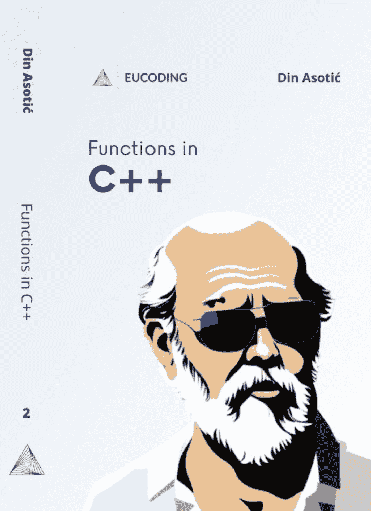

# C++ 函数：C++ 编程进阶之路



## readme.txt

大家好。

如果你正在阅读这本书，说明你正准备通过我们的系列丛书成为 C++ 程序员的道路，或者你只是想了解更多关于 C++ 函数的知识。无论何种情况，非常欢迎与我们一起学习。就像该系列的第一本书（侧重于数据类型、变量、运算符和控制结构）一样，你将在书中找到大量带有解释的编程任务，以及书末的附录。

当然，你永远无法学到一切，所以如果在此过程中遇到困难，请不要担心。你可以随时回到这本书进行参考。

如果你在理解基础概念时遇到困难，可以在你购买这本书的地方找到《C++ 中的数据类型与变量、运算符和控制结构》一书。

在书最后，你会找到我的联系方式，以备你需要任何进一步的帮助。

非常感谢购买本系列的这一版本。

祝你学习愉快，

Din

## C++ 函数简介

函数是 C++ 编程语言中至关重要的一部分，因为它们允许我们将大型编程任务分解为更小、更容易管理的部分。C++ 中的函数是一个命名的语句组或代码块，用于执行特定任务。函数通过允许代码复用，有助于提高代码的可读性和维护性。

### 定义与结构

C++ 函数的结构包括返回类型、函数名、参数（可选）和函数体。函数的返回类型表示函数在执行完毕后返回值的类型。如果函数不返回任何值，则返回类型将为`void`。

函数结构的简单示例如下：

```
return_type function_name( parameter list )
{
   body of the function
}
```

### 函数声明与定义

函数包含两个部分：声明和定义。函数声明（也称为原型）告诉编译器函数的名称、返回类型和参数。函数定义则提供了函数的实际体。

可以通过以下方式进行函数声明：

```cpp
return_type function_name( parameter list );
```

函数声明的示例：

```cpp
int sum(int a, int b);
```

对应的定义可能如下：

```cpp
int sum(int a, int b) {
    return a + b;
}
```

### 函数调用

要使用函数，你需要“调用”它。当你调用函数时，会指定函数名并为函数的参数传递值（如果有的话）。然后函数执行其体，最后返回一个值（除非其返回类型为`void`，在这种情况下不返回值）。

以下是调用函数的方法：

```cpp
int main() {
    int result = sum(10, 20);
    cout << "The sum is: " << result << endl;
    return 0;
}
```

在上面的示例中，`sum(10, 20)`是一个函数调用。函数`sum`被带参数`10`和`20`调用，并返回这两个整数的和。

### 函数类型

C++ 中有两种类型的函数：库函数和用户定义函数。

1. **库函数**：这些是由 C++ 标准库提供的内置函数，例如`sqrt()`（计算平方根）、`max()`（寻找两个数中的最大值）和`cout`（用于输出）。

2. **用户定义函数**：这些是用户在代码中定义的执行特定任务的函数。我们讨论的`sum`函数就是用户定义函数的示例。

### 参数与实参

函数通常带有参数，这些参数在函数声明中指定。参数是函数执行计算时使用的变量。当你调用函数时提供给函数的值称为参数。

在函数声明`int sum(int a, int b);`中，`a`和`b`是参数。当调用函数`sum(10, 20);`时，`10`和`20`是参数。

### 参数传递

参数可以通过三种方式传递给函数：

1. **值传递**：参数的实际值会被复制到函数的形式参数中。在这种情况下，在函数内部对参数的修改对参数没有影响。

2. **指针传递**：参数的地址会被复制到形式参数中。在函数内部，使用该地址访问实际参数。这意味着对参数的修改会影响被传递的参数。

3. **引用传递**：参数的引用（而不是值本身）会被复制到参数中。这也意味着对参数的修改也会影响被传递的参数。

### 返回值

函数可以使用`return`语句返回值。该值的类型必须与函数声明中指定的返回类型匹配。

### 默认参数

C++ 允许函数对其部分或全部参数设置默认值。如果在函数调用期间未提供值或提供不足，将使用这些默认参数。

以下是一个示例：

```cpp
int sum(int a, int b = 10) {
    return a + b;
}

int main() {
    cout << sum(20);  // 输出 30
    cout << sum(20, 5);  // 输出 25
    return 0;
}
```

在函数声明`int sum(int a, int b = 10)`中，`b`的默认值为`10`。

这是一个演示函数重载的示例：

```cpp
#include <iostream>

void display(int num) {
    std::cout << "Displaying an integer: " << num << std::endl;
}

void display(double num) {
    std::cout << "Displaying a double: " << num << std::endl;
}

int main() {
    display(10);
    display(3.14);
    return 0;
}
```

在这个示例中，我们有两个名为`display`的函数，但其中一个接受`int`参数，而另一个接受`double`参数。当我们使用整数参数调用`display`函数时，编译器会将它与接受`int`的第一个`display`函数进行匹配。同样，当我们使用`double`参数调用`display`函数时，编译器会将它与接受`double`的第二个`display`函数进行匹配。

通过使用函数重载，我们可以编写具有相同名称但不同参数列表的函数，以处理不同类型的数据或执行不同的操作。这为代码组织提供了灵活性和便利性，并提高了代码的可读性。

函数重载允许我们避免为那些本质上执行相似操作但输入类型不同的函数起不同的名称。它通过将相关功能分组到单个函数名下，促进了代码的可重用性，使得代码更容易理解和维护。

此外，函数重载支持多态（面向对象编程的一项关键特性），允许我们利用底层类型编写更具表现力且更简洁的代码。函数使用的这种灵活性有助于创建更模块化和可扩展的程序。

## 递归函数

这是一个 C++ 递归函数的示例，用于计算数字的阶乘：

```cpp
#include <iostream>

int factorial(int n) {
    if (n == 0) {
        return 1;
    }
    return n * factorial(n - 1);
}

int main() {
    int number;
    std::cout << "Enter a number: ";
    std::cin >> number;
    int result = factorial(number);
    std::cout << "Factorial of " << number << " is: " << result << std::endl;
    return 0;
}
```

在这段代码中，`factorial()`函数被递归地定义。它接受一个整数`n`作为参数并返回`n`的阶乘。基本情况是`n`为`0`，此时函数返回`1`。对于`n`的任何其他值，它通过将`n`乘以`n - 1`的阶乘来计算阶乘。

递归是一种编程技术，函数通过调用自己来解决问题。在`factorial`函数的情况下，它反复将计算数字阶乘的问题分解为更小的子问题，直到达到基本情况，此时它可以直接返回值而无需进一步的递归。

递归可以是解决复杂问题和简洁表达解决方案的强大工具。然而，它也有一些潜在的陷阱：

1. **栈溢出**：递归依赖调用栈来跟踪函数调用。如果递归过深或基本情况没有定义得当，可能会导致栈溢出，从而导致程序崩溃。为了避免这种情况，确保递归具有适当的终止条件并妥善处理大输入值是非常重要的。

2. **性能开销**：与迭代解决方案相比，递归函数可能有更高的性能开销，主要由于函数调用和栈操作的开销。在某些情况下，迭代方法可能更高效。

3. **内存消耗**：与迭代解决方案相比，递归函数可能会消耗更多内存。每次递归调用都会创建一个新的栈帧，消耗内存。如果递归过深或问题规模很大，可能会导致内存过度使用。

4. **理解和调试困难**：与迭代解决方案相比，递归函数可能更难理解和调试。执行流可能不够直观，使得追踪和识别错误变得具有挑战性。

审慎使用递归并在决定使用它时考虑潜在的陷阱非常重要。在某些情况下，迭代解决方案或替代方法可能更合适、更高效。

## 按值传递参数

在 C++ 中，按值传递参数意味着会创建被传递值的副本并在函数内部使用。在函数内部对参数进行的任何更改都不会影响由调用者传递的原始值。

这是一个演示按值传递参数的示例函数：

```cpp
#include <iostream>

// 按值接收一个整数参数的函数
void doubleValue(int num) {
    num = num * 2;  // 修改参数值
    std::cout << "Inside the function: " << num << std::endl;
}

int main() {
    int number = 5;
    std::cout << "Before calling the function: " << number << std::endl;
    doubleValue(number);  // 使用 'number' 调用函数
    std::cout << "After calling the function: " << number << std::endl;
    return 0;
}
```

在这个示例中，`doubleValue`函数按值获取一个整数`num`。在函数内部，`num`翻了一倍，但主函数中的原始值保持不变。

当调用`doubleValue(number)`时，会创建`number`（即`5`）的副本并将其存储在参数`num`中。然后，函数将`num`修改为`10`。然而，当控制返回主函数时，`number`的值仍然为`5`。

输出：

```
Before calling the function: 5
Inside the function: 10
After calling the function: 5
```

如输出所示，函数内部对`num`参数的更改不会影响`number`变量。按值传递参数适用于你想确保原始值在函数内部不被修改，或者你想对数据的副本进行操作的情况。然而，请记住，按值传递大型对象或数据结构在内存使用和性能方面的效率较低。在这种情况下，按引用传递参数或使用指针可能合适。

## 按引用传递参数

在 C++ 中，按引用传递允许你在函数内部修改变量的原始值。为了演示这一点，让我们考虑一个使用函数交换两个整数值的示例：

```cpp
#include <iostream>

void swap(int& a, int& b) {
    int temp = a;
    a = b;
    b = temp;
}

int main() {
    int x = 5;
    int y = 10;
    std::cout << "Before swapping: x = " << x << ", y = " << y << std::endl;
    swap(x, y);
    std::cout << "After swapping: x = " << x << ", y = " << y << std::endl;
    return 0;
}
```

在这个示例中，`swap`函数接受两个整数引用（`int& a`和`int& b`）作为参数。当我们调用`swap`函数时，我们通过引用传递变量`x`和`y`。

通过按引用传递，函数内部对参数进行的任何修改都会影响传入的原始变量。在这种情况下，`swap`函数交换了`a`和`b`的值，它们是原始变量`x`和`y`的别名。

当我们运行程序时，输出将是：

```
Before swapping: x = 5, y = 10
After swapping: x = 10, y = 5
```

如你所见，`x`和`y`的原始值已经在`swap`函数内部进行了交换。

引用传递参数与按值传递的区别在于：当按值传递时，会创建该变量的副本，函数内部的任何修改都不会影响原始变量。相反，按引用传递允许你在函数内部直接访问并修改原始变量。当你希望在函数内部修改变量并让这些修改反映到函数外部时，这种方法非常有用。此外，对于大型数据结构，引用传递通常比按值传递更高效，因为它避免了不必要的数据复制。

## 将数组传递给函数

在 C++ 中，数组通常通过使用指针传递给函数。当数组被传递给函数时，它会退化为指向其第一个元素的指针。这种退化是因为数组在 C++ 中不能被直接复制或赋值，而使用指针允许函数访问数组的元素。

为了说明这一概念，让我们考虑一个接受数组作为参数并打印其元素的函数：

```cpp
#include <iostream>

// 接受数组作为参数的函数

void printArray(int arr[], int size) {
    for (int i = 0; i < size; ++i) {
        std::cout << arr[i] << " ";
    }
    std::cout << std::endl;
}

int main() {
    int myArray[] = {1, 2, 3, 4, 5};
    int size = sizeof(myArray) / sizeof(myArray[0]);
    printArray(myArray, size);
    return 0;
}
```

在这个示例中，我们定义了一个名为`printArray`的函数，它接受一个整数数组`arr[]`和它的`size`作为参数。在函数内部，我们使用`for`循环遍历数组的元素并打印它们。

在`main`函数中，我们创建了一个名为`myArray`的整数数组，并通过将数组的总大小除以其第一个元素的大小来确定它的大小。然后我们将`myArray`和它的`size`传递给`printArray`函数。

当我们调用`printArray(myArray, size)`时，数组`myArray`作为参数传递。然而，`myArray`退化为指向其第一个元素的指针。这意味着在`printArray`函数内部，`arr[]`实际上是指向`myArray`第一个元素的指针。数组的大小也作为一个独立的参数被显式传递。

通过使用这个指向第一个元素的指针和`size`，`printArray`函数可以访问并打印数组的所有元素。

需要注意的是，当数组被传递给函数时，函数内部对数组的更改将影响函数外部的原始数组。这是因为指向数组的指针允许直接访问其元素。

总结来说，C++ 通过使用指针将数组传递给函数。数组退化为指向其第一个元素的指针，使得能够在函数内部访问和操作数组的元素。

## 内联函数

在 C++ 中，内联函数（inline function）是在其调用处进行内联展开的函数，而不是通过函数调用机制进行执行。它是对编译器的一个提示，要求其在调用处插入函数的代码，而不是生成一个函数调用。

下面是一个计算数字平方的简单内联函数示例：

```cpp
#include <iostream>

inline int square(int x)
{
    return x * x;
}

int main()
{
    int num = 5;
    int result = square(num);
    std::cout << "Square of " << num << " is: " << result << std::endl;
    return 0;
}
```

在上面的示例中，`square`函数被声明为`inline`。当在`main`函数中调用`square`函数时，编译器将用函数的实际代码替换函数调用。这可以通过避免函数调用的开销潜在地提高性能。

### 内联函数的优点：

1. **性能提升**：内联函数可以带来更快的执行，因为它们消除了函数调用的开销。

2. **优化**：内联允许编译器执行更好的优化，例如常量折叠和循环展开，因为它可以访问函数的完整代码。

3. **减少函数调用开销**：内联函数可以减少在函数调用堆栈操作上耗费的时间，这在某些情况下是很有意义的。

### 内联函数的缺点：

1. **增加代码体积**：内联函数的代码在每个调用处都会重复。这可能导致代码体积增大，影响内存使用。

2. **编译器局限性**：是否内联一个函数最终取决于编译器。编译器可能会根据自己的优化策略和启发式算法，即使函数被声明为`inline`，也可能选择不内联。

3. **编译时间**：内联函数可能会增加编译时间，特别是当它们定义在头文件中并包含在多个编译单元中时。

值得注意的是，`inline`关键字只是对编译器的一个提示，编译器可能会选择忽略它。现代编译器通常足够智能，能够根据函数大小、调用频率和优化设置等各种因素对函数内联做出自己的决策。因此，在现代 C++ 中，显式地将函数声明为`inline`并不总是必要的。

## 默认参数

在 C++ 中，默认参数允许你为函数参数指定默认值。这意味着如果在调用函数时没有提供参数，则将使用默认值。

这是一个使用默认参数的函数示例：


```cpp
#include <iostream>

void greetUser(const std::string& name = "User", int age = 18) {
    std::cout << "Hello, " << name << "! ";
    std::cout << "You are " << age << " years old." << std::endl;
}

int main() {
    greetUser(); // 使用默认参数 "User" 和 18
    greetUser("John"); // 使用 age 的默认值 18
    greetUser("Alice", 25); // 使用提供的参数 "Alice" 和 25
    return 0;
}
```

在上面的示例中，`greetUser` 函数有两个参数：类型为 `const std::string&` 的 `name` 和类型为 `int` 的 `age`。这两个参数都分配了默认参数：“User” 和 18。

当不带任何参数调用函数时，将使用默认值。`main` 函数中的第一次调用 `greetUser()` 展示了这一点。

在第二次调用中仅提供了 `name` 参数，使用了 `age` 的默认值 18。

最后，在第三次调用中，同时提供了 `name` 和 `age` 参数，覆盖了默认值。

```cpp
class MyClass {

public:
    int getValue() const {
        return value;
    }
private:
    int value;
};
```

在上面的示例中，成员函数 `getValue()` 通过在右括号后放置 `const` 关键字被标记为 `const`。这表示调用此函数不会修改 `MyClass` 对象的内部状态。

当函数被声明为 `const` 时，适用以下规则：

1. 该函数不能修改类的任何非静态数据成员。

2. 该函数不能调用任何非 `const` 成员函数，其他 `const` 成员函数或静态成员函数除外。

3. 该函数只能返回值或修改声明为 `mutable` 的数据成员。`mutable` 数据成员即使在 `const` 成员函数内部也可以被修改。

使用 `const` 成员函数是有益的，因为它允许将修改对象状态的函数与不修改状态的函数区分开来。它为函数的调用者提供了一层保证，即在调用后对象的状态将保持不变。

此外，当处理 `const` 对象或引用时，你只能在它们上调用 `const` 成员函数。这允许更好的封装并防止对 `const` 对象的意外修改。

总结来说，在 C++ 中将函数标记为 `const` 表示该函数不会修改对象的状态，并为 `const` 对象的调用者和用户提供了保证。

## 11

# 函数模板 (Function Templates)

在 C++ 中，函数模板允许你编写一个可以处理多种不同类型参数的单一函数。模板使你能够创建可以与不同数据类型复用的通用代码，提供了灵活性和代码复用性。

在 C++ 中定义函数模板时，你使用 `template` 关键字，后跟模板参数列表，该列表指定了函数可以处理的类型。这里是一个计算两个参数之间最大值的函数模板示例：

```cpp
template<typename T>
T maximum(T a, T b) {
    return (a > b) ? a : b;
}
```

在这个示例中，`typename T` 是模板参数，代表一个泛型。函数 `maximum` 接收两个类型为 `T` 的参数并返回最大值。

现在，让我们看看如何使用这个模板来编写通用代码。这里有一个用法示例：

```cpp
int result1 = maximum(5, 10);         // 使用类型为 `int` 的模板
double result2 = maximum(3.14, 2.71);  // 使用类型为 `double` 的模板
char result3 = maximum('a', 'b');  // 使用类型为 `char` 的模板
```

在这段代码段中，`maximum` 函数模板使用不同的类型实例化：`int`、`double` 和 `char`。编译器生成了三个版本的 `maximum` 函数：每个类型一个。

在编译期间，编译器将模板中的 `T` 替换为函数调用中指定的相应类型。这使得编译器能够为每个实例化生成特定类型的代码，确保了类型安全和最优性能。

使用函数模板，你可以编写适用于各种类型的通用代码，而无需重复实现。它避免了你为每种类型编写单独函数，减少了代码重复并提高了代码的可维护性。

C++ 中的模板还可以有多个模板参数并支持模板特化（template specialization），允许你针对特定类型或场景自定义行为。这种灵活性使得模板成为在 C++ 中编写通用代码的强大特性。

## 12

# 主函数 (The Main Function)

在 C++ 中，`main` 函数是程序的入口点。它是程序执行开始的地方。每个 C++ 程序都要求有 `main` 函数，且必须恰好定义一次。它作为起点，从这里开始调用其他函数并决定程序的执行流。

`main` 函数可以有两种被接受的签名：

1. `int main()`

2. `int main(int argc, char* argv[])`

让我们讨论这些签名中的每一个，并演示声明 `main` 函数的不同方式。

### 1. int main()

`int main()` 签名是 `main` 函数最基本的形式。它不接受任何命令行参数，也不提供任何关于传递给程序的参数的信息。这里有一个示例：

```cpp
#include <iostream>

int main() {
    std::cout << "Hello, World!" << std::endl;
    return 0;
}
```

### 2. int main(int argc, char* argv[])

`int main(int argc, char* argv[])` 签名允许程序接受命令行参数。`argc` 参数表示传递给程序的命令行参数的数量，`argv` 是一个包含实际参数的 C 风格字符串数组（`char*`）。这里有一个示例：

```cpp
#include <iostream>

int main(int argc, char* argv[]) {
    std::cout << "Number of command-line arguments: " << argc << std::endl;
    std::cout << "Command-line arguments:" << std::endl;
    for (int i = 0; i < argc; ++i) {
        std::cout << "Argument " << i << ": " << argv[i] << std::endl;
    }
    return 0;
}
```

运行程序时，你会看到参数的数量和实际值：

```
$ ./program arg1 arg2
Number of command-line arguments: 3
Command-line arguments:
Argument 0: ./program
Argument 1: arg1
Argument 2: arg2
```

注意 `int` 返回值 0 表示执行成功。

## 13

# Lambda 函数 (Lambda Functions)

Lambda 表达式也称为匿名函数或闭包（closures），是 C++11 引入的一项特性，允许你在不提供单独函数定义的情况下定义内联函数。它们主要用于不需要复用的小型函数。

Lambda 函数具有以下语法：

```cpp
[capture list](parameters) -> return_type {
    // 函数体
}
```

让我们写一个 Lambda 函数对整数向量进行升序排序：

```cpp
#include <iostream>
#include <vector>
#include <algorithm>

int main() {
    std::vector<int> numbers = {5, 2, 7, 1, 9};
    std::sort(numbers.begin(), numbers.end(), [](int a, int b) {
        return a < b;
    });
    for (int number : numbers) {
        std::cout << number << " ";
    }
    std::cout << std::endl;
    return 0;
}
```

在这个示例中，Lambda 函数作为 `std::sort` 算法的第三个参数使用。该 Lambda 函数接收两个整数 `a` 和 `b` 并使用 `<` 运算符进行比较。如果 `a` 小于 `b`，则返回 `true`，表示 `a` 应该排在 `b` 之前。

Lambda 函数会在向量中的每对元素上被调用，以确定它们的相对顺序。

Lambda 定义中的捕获列表 `[]` 允许你捕获作用域中的变量。你可以通过值捕获（`[var]`）或引用捕获（`[&var]`）指定要捕获的变量。如果你不需要捕获任何变量，可以使用空的捕获列表 `[]`。

## 14

# 递归 Lambda 函数 (Recursive Lambda Functions)

在 C++ 中，lambda 函数是可以在代码块内内联定义的匿名函数。默认情况下，lambda 函数不是递归的，这意味着它们不能直接调用自己。然而，有一些技术可以克服这一局限性并创建递归 lambda 函数。让我们探索如何编写一个计算阶乘的递归 lambda 函数，并讨论其中涉及的困难。

要递归地计算一个数的阶乘，我们可以定义一个 lambda 函数，接受该数字作为参数并返回阶乘值。这里有一个示例：

```cpp
#include <iostream>

int main() {
  auto factorial = [](int n) -> int {
    if (n == 0 || n == 1)
      return 1;
    else
      return n * factorial(n - 1);
  };

  int num = 5;
  std::cout << "Factorial of " << num << " is: " << factorial(num) << std::endl;

  return 0;
}
```

在上面的代码中，我们定义了一个名为 `factorial` 的 lambda 函数，它接受一个整数 `n` 作为参数并返回一个整数。函数内部，我们检查基础情况（`n == 0` 或 `n == 1`）并返回 1。否则，我们递归地调用 `factorial` lambda 函数，将 `n - 1` 作为参数传递并乘以 `n` 以得到阶乘值。

现在，让我们讨论让 lambda 函数变为递归的困难以及克服它们的方法：

1. **Lambda 函数无法直接引用自身**：lambda 函数的名称在其体内部是不可用的，因此我们无法使用其名称递归地调用 lambda 函数。为了克服这一点，我们可以通过值或引用捕获 lambda 函数本身，然后通过捕获的变量调用它。在上面的示例中，我们通过值捕获 `[=]` `factorial` lambda 函数，以便其用于递归。

2. **lambda 函数的类型必须已知**：在某些情况下，编译器可能要求显式知道 lambda 函数的类型。为了解决这个问题，我们可以使用 `<functional>` 头文件中的 `std::function` 模板类为 lambda 函数定义一个类型。例如：`std::function<int(int)> factorial = [&](int n) -> int { // … };`。通过使用 `std::function<int(int)>`，我们指定了 lambda 函数接受一个 `int` 参数并返回一个 `int` 值。

3. **潜在的栈溢出**：递归 lambda 函数与任何递归函数一样，如果递归深度过大，可能会导致栈溢出错误。确保递归最终终止至关重要。在示例中，我们检查了基础情况 `n == 0 || n == 1` 以确保终止。

通过捕获 lambda 函数本身、使用 `std::function` 指定 lambda 函数的类型并确保终止，我们可以在 C++ 中创建递归 lambda 函数。

值得注意的是，虽然递归 lambda 函数在某些情况下是有用的工具，但对于更复杂的递归算法，在 lambda 范围之外定义一个命名函数通常更清晰且易于维护。

## 15

## 变参函数

在 C++ 中，变参函数是一种可以接受任意数量参数的函数。变参函数在参数列表中使用省略号 `...` 进行声明，表示该函数可以接受任意数量的参数。

这是一个 C++ 变参函数的示例：

```cpp
#include <iostream>
#include <cstdarg>

void printValues(int count, ...)
{
    va_list args;
    va_start(args, count);
    for (int i = 0; i < count; ++i) {
        int value = va_arg(args, int);
        std::cout << value << " ";
    }
    va_end(args);
}

int main()
{
    printValues(3, 1, 2, 3); // 使用 3 个参数调用变参函数
    return 0;
}
```

在这个示例中，`printValues` 函数接受一个整数 `count` 后面跟着省略号 `...`。在函数内部，我们声明了一个名为 `args` 的 `va_list` 变量，它将保存变参数。我们使用 `va_start` 通过传递参数 `count` 来初始化 `args`。

`va_arg` 宏用于从列表中检索每个参数。它接受两个参数：`va_list` 变量和要检索参数的类型。在这种情况下，我们假设参数是整数，因此我们使用 `int` 作为类型。

在处理所有参数后，我们调用 `va_end` 来清理 `va_list` 变量。

当你需要编写可以接受不同数量参数或不同类型参数的函数时，变参函数提供了灵活性。它们通常被用于库和框架，以创建可以处理广泛输入的通用函数。

以下是变参函数的一些用例：

1. **日志记录或调试函数**：你可以创建一个接受格式化字符串和任意数量参数的变参函数，以记录或打印带有动态内容的消息。

2. **数学函数**：像 `sum` 或 `average` 这样的函数可以实现为变参函数，允许用户传递任意数量的参数执行计算。

3. **容器操作**：变参函数可以处理各种输入。

## 16

## 函数的作用域

在 C++ 中，函数的作用域指的是可以访问函数的区域或范围。函数的作用域决定了它的可见性和可用性。

为了演示函数的作用域，让我们考虑以下示例：

```cpp
#include <iostream>

// 全局变量
int globalVariable = 10;

// 带有局部变量的函数
void myFunction() {
    // 局部变量
    int localVar = 5;
    std::cout << "Local variable: " << localVar << std::endl;
    std::cout << "Global variable: " << globalVariable << std::endl;
}

int main() {
    // 调用函数
    myFunction();

    // 在 main 函数中访问局部变量
    // 这会导致编译错误，因为 localVar 超出了作用域
    // std::cout << localVar << std::endl;

    // 修改全局变量
    globalVariable = 20;

    // 再次调用函数
    myFunction();

    return 0;
}
```

在这个程序中，我们有一个名为 `myFunction` 的函数，它打印局部变量 `localVar` 和全局变量 `globalVariable` 的值。`myFunction` 定义在 `main` 函数内部，它可以访问局部变量和全局变量。

`localVar` 变量在 `myFunction` 函数内部声明并定义，因此它的作用域仅限于该函数。它无法在函数之外访问。

相反，`globalVariable` 定义在任何函数之外，因此它是一个全局变量。它可以从程序的任何部分访问和修改，包括 `myFunction` 函数和 `main` 函数。在示例程序中，我们在 `main` 函数中修改了 `globalVariable` 的值，并观察到当再次调用 `myFunction` 时，更新后的值也反映了出来。

总结，C++ 中函数的作用域决定了函数及其变量可以在何处访问和使用。局部变量的作用域局限于定义的函数内部，而全局变量具有更广域，可以从程序的任何地方访问。

## 17

## 函数指针

这是一个在 C++ 中使用函数指针的示例程序：

```cpp
#include <iostream>
```


```cpp
// 加两个数字的函数
int add(int a, int b) {
    return a + b;
}

// 减两个数字的函数
int subtract(int a, int b) {
    return a - b;
}

// 函数指针类型
typedef int (*ArithmeticFunction)(int, int);

int main() {
    int x = 10, y = 5;
    // 函数指针变量
    ArithmeticFunction operation;
    // 将 add 函数赋值给函数指针变量
    operation = add;
    // 通过函数指针调用函数
    int result = operation(x, y);
    std::cout << "Addition: " << result << std::endl;
    // 将 subtract 函数赋值给同一个函数指针变量
    operation = subtract;
    // 通过同一个函数指针调用函数
    result = operation(x, y);
    std::cout << "Subtraction: " << result << std::endl;
    return 0;
}
```

在这个程序中，我们定义了两个算术函数 `add` 和 `subtract`，它们接受两个整数作为参数并返回一个整数结果。我们还使用 `typedef` 关键字定义了一个函数指针类型 `ArithmeticFunction`。该类型表示一个指向接受两个整数并返回一个整数的指针。

在 `main` 函数内部，我们声明了一个类型为 `ArithmeticFunction` 的函数指针变量 `operation`。最初，我们将 `add` 函数的地址赋值给 `operation` 变量。这意味着该函数指针现在“指向” `add` 函数。

然后，我们可以使用函数指针 `operation` 来调用它所指向的函数，就像调用普通函数一样。在示例中，我们通过函数指针调用函数，并将结果存储在 `result` 变量中。我们将结果输出到控制台。

接下来，我们将 `subtract` 函数的地址赋值给 `operation` 变量。现在，该函数指针“指向”了 `subtract` 函数。我们再次通过函数指针调用函数，并将结果存储在 `result` 变量中。我们将新结果输出到控制台。

函数指针提供了一种存储和使用函数引用的方法。它们可以用于各种场景，例如：

1. **回调函数**：函数指针允许你将函数作为参数传递给另一个函数，使被调用的函数能够在稍后或在特定条件下调用传递进的函数。这通常用于事件处理或异步编程。
2. **函数选择**：函数指针可以根据运行时条件或用户输入动态选择要执行的函数。当你有多个执行相似操作但需要在运行时选择其中一个时，这种方法非常有用。
3. **函数组合**：函数指针允许你创建高阶函数，这些函数接受其他函数作为参数或返回函数作为结果。这允许你通过组合函数来构建灵活且可用的代码。

总的来说，函数指针提供了一种强大的函数级间接机制，允许你在 C++ 中像操作一等对象一样操作和使用函数。

## 18. 从函数返回指针

在 C++ 中，你可以通过将指针类型指定为函数的返回类型来编写一个返回指针的函数。这里有一个示例：

```cpp
int* createArray(int size) {
    int* arr = new int[size];
    // 对数组执行一些操作
    return arr;
}
```

在这个示例中，函数 `createArray` 创建了一个整数的动态数组，并返回指向数组第一个元素的指针。

从函数返回指针在您需要在函数内部动态分配内存并将其传递给调用者的场景中非常有用。然而，与返回指针相关的潜在风险需要您注意：

1. **内存泄漏**：如果你在函数内部使用 `new` 动态分配内存（如上例所示），则调用者有责任使用 `delete` 释放该内存以防止内存泄漏。未这样做会导致内存泄漏并最终导致系统资源耗尽。
2. **悬空指针**：如果函数返回指向局部变量或临时对象的指针，而该对象在函数执行后被销毁，则返回的指针将变成悬空指针。尝试悬空指针会导致未定义行为。
3. **所有权和生命周期**：当函数返回指针时，记录谁拥有返回的内存以及它的有效多多久是重要的。调用者应该意识到他们是否需要释放内存以及应该在什么条件下进行释放。
4. **空指针**：如果函数在返回指针时遇到错误或异常情况，可能会返回一个空指针来指示失败。调用者在使用返回的指针之前应该始终检查是否为空，以避免引用空指针。

为了降低这些风险，在从函数返回指针时提供关于内存所有权生命周期预期的清晰文档和指南是一个良好的做法。此外，使用如 `std::unique_ptr` 或 `std::shared_ptr` 等智能指针可以帮助自动管理内存并减少内存泄漏和悬空指针的风险。

## 19. 从函数返回引用

在 C++ 中，从函数返回引用允许你返回对象或变量的引用，而不是创建它的副本。这在某些场景下可以提高性能。这里有一个返回整数引用的示例：

```cpp
int& getLargest(int& a, int& b) {
    return (a > b) ? a : b;
}
```

在这个函数中，我们传递了整数引用 `a` 和 `b`。函数比较 `a` 和 `b` 的值，并返回较大者的引用。

当你从函数返回引用时，确保被引用的对象在函数调用后保持有效至关重要。例如，返回局部变量的引用会导致未定义行为，因为局部变量会被销毁。

你可以通过多种方式使用返回的引用。例如，你可以将其赋值给另一个引用，修改它所引用的对象，或在表达式中使用它。这里有一个示例：

```cpp
int main() {
    int x = 5, y = 10;
    int& largest = getLargest(x, y);
    largest = 20; // 修改 'largest' 所引用的值
    std::cout << x << std::endl; // 输出: 20
    std::cout << y << std::endl; // 输出: 10
    return 0;
}
```

在这个示例中，我们调用了 `getLargest` 函数并将返回的引用赋值给 `largest`。然后我们修改了 `largest` 所引用的值，这反过来修改了原始变量 `x`。因此，`x` 的输出为 20，`y` 的输出为 10。

当你希望避免对象复制的开销或需要修改传递函数的原始对象时，返回引用非常有用。它通常用于运算符重载，以启用赋值语法并访问类成员。然而，谨慎使用引用并确保被引用的对象保持有效，以避免悬空引用或未定义行为的问题。

## 20. 从函数返回多个值

在 C++ 中，你可以使用多种方法从函数返回多个值。一种常见的方法是使用 `tuple` 将值组合在一起并作为单个实体返回。这里有一个使用 `tuple` 返回多个值的函数示例：

```cpp
#include <iostream>
#include <tuple>

std::tuple<int, double, char> getValues() {
    int intValue = 42;
    double doubleValue = 3.14;
    char charValue = 'A';
    return std::make_tuple(intValue, doubleValue, charValue);
}

int main() {
    // 调用函数并捕获返回的元组
    std::tuple<int, double, char> result = getValues();

    // 从元组中访问单个值
    int intValue = std::get<0>(result);
    double doubleValue = std::get<1>(result);
    char charValue = std::get<2>(result);

    // 打印值
    std::cout << "Int value: " << intValue << std::endl;
    std::cout << "Double value: " << doubleValue << std::endl;
    std::cout << "Char value: " << charValue << std::endl;
    return 0;
}
```

在这个示例中，`getValues()` 函数返回一个包含整数、一个 `double` 和一个字符的元组。在函数内部，这些值被赋值给单独变量（`intValue`、`doubleValue` 和 `charValue`）。然后，使用 `std::make_tuple()` 函数创建一个包含这些值的元组，并将其从函数返回。

在 `main()` 函数中，我们调用了 `getValues()`并将返回的元组捕获在 `result` 变量中。要访问元组中的单个值，我们使用 `std::get<>()` 函数，并提供想要检索的值的索引。最后，我们可以根据需要使用这些值。

在 C++ 中还有从函数返回多个值的其他方法，例如使用引用、指针或输出参数。然而，使用 `tuple` 提供了一种了一种方便且简洁的方法，可以将多个值打包并作为单个对象返回。

## 21. 从函数中返回函数

在 C++ 中，你可以使用函数指针从另一个函数返回一个函数。这里有一个如何编写返回另一个函数的示例：

```cpp
#include <iostream>

// 函数类型定义
typedef int (*MathFunction)(int, int);

// 两个数相加的函数
int add(int a, int b) {
    return a + b;
}

// 两个数相减的函数
int subtract(int a, int b) {
    return a - b;
}

// 根据操作返回另一个函数
MathFunction getMathFunction(char operation) {
    switch (operation) {
        case '+':
            return add;
        case '-':
            return subtract;
        default:
            return nullptr;
    }
}

int main() {
    char operation;
    std::cout << "Enter the operation (+ or -): ";
    std::cin >> operation;
    MathFunction mathFunc = getMathFunction(operation);
    if (mathFunc) {
        int a, b;
        std::cout << "Enter two numbers: ";
        std::cin >> a >> b;
        int result = mathFunc(a, b);
        std::cout << "Result: " << result << std::endl;
    } else {
        std::cout << "Invalid operation" << std::endl;
    }
    return 0;
}
```

在这个示例中，我们有两个函数：`add` 和 `subtract`。`getMathFunction` 函数接收一个表示所需操作（`+` 或 `-`）的字符并返回相应的函数。如果提供了无效的操作，它将返回 `nullptr`。

在 `main` 函数中，提示用户输入操作，并根据该操作返回相应的函数并存储在 `mathFunc` 变量中。如果返回了有效函数，则要求用户输入两个数字，并使用这些数字调用返回的函数以产生结果。

从函数中返回函数在多种场景下非常有用，例如：

1. **函数组合**：它允许你创建高阶函数，根据特定条件生成专门函数。例如，你可以有一个工厂函数，根据参数返回不同的排序算法。
2. **回调机制**：你可以将函数作为参数传递给其他函数，允许你定义在函数内部特定点执行的自定义行为。通过返回函数，你可以根据某些条件动态确定要执行的行为。
3. **策略模式**：它使能够将各种算法或策略封装为函数，并在运行时动态选择合适的策略。返回的函数代表一种特定的策略。

## 22. `this` 指针

在 C++ 中，`this` 指针是一个特殊的指针，它持有调用该函数的对象的地址。它是所有非静态成员函数均可用的隐式参数。

这里有一个演示 `this` 用途的示例：

```cpp
#include <iostream>

class MyClass {
    int x;

public:
    void setX(int x) {
        this->x = x;
    }

    void printX() {
        std::cout << "x = " << this->x << std::endl;
    }
};

int main() {
    MyClass obj;
    obj.setX(5);
    obj.printX();
    return 0;
}
```

在上面的示例中，`setX` 成员函数接收一个名为 `x` 的参数。为了区分局部变量和成员变量，我们使用 `this->`。同样，在 `printX` 成员函数中，我们使用 `this->` 来访问成员变量。

总体而言，`this` 指针有助于在成员函数访问当前对象的成员。

## 23. 友元函数

在 C++ 中，友元函数是在类内部声明但不是该类成员的函数。尽管它不是类的成员，但它被授予访问类的私有（private）和保护（protected）成员的权限。友元函数使用 `friend` 关键字跟随函数声明。

这里有一个 C++ 友函数的示例：

```cpp
class MyClass {
private:
    int privateData;

public:
    MyClass(int data) : privateData(data) {}

    friend void friendFunction(MyClass obj);
};

void friendFunction(MyClass obj) {
    // 访问 MyClass 的私有成员
    std::cout << "Private data: " << obj.privateData << std::endl;
}
```

在这个示例中，`friendFunction` 是 `MyClass` 类的友函数。它可以访问作为参数传递给它的任何 `MyClass` 对象的私有成员 `privateData`。友函数像普通函数一样定义在类之外。

友函数在各种场景下都非常有用：

1. **访问私有成员**：友函数允许外部函数访问类的私有或保护成员。当你需要提供特殊的函数或运算符，而这些函数/运算符需要访问私有数据但并不一定属于类本身时，这非常有帮助。
2. **简化复杂操作**：友函数可以用于简化涉及不同类的多个对象的复杂操作。它们可以直接访问多个类的私有成员并对其进行操作，而无需显式的访问器（getter）或修改器（setter 函数）。
3. **增强封装性**：友函数可以用于定义提供受控私有数据访问的接口，从而确保良好的封装。通过仔细选择要声明为友元的函数，你可以在维护类数据完整性的同时，允许有限的外部访问。

注意的是，使用友函数（friend functions）时应当谨慎，因为它们可能会破坏封装并增加类之间的耦合。只有在必要且没有其他能够保持封装的替代方案时，才应该使用它们。

## 24. 虚函数

C++ 中的虚函数是一项强大的特性，允许实现面向对象编程中的运行时多态。它们用于实现动态分发（dynamic dispatch），这意味着执行的适当函数是在运行时根据所引用对象的类型确定的，而不是引用或指针的类型。

以下是在 C++ 中使用虚函数的示例：

```cpp
#include <iostream>

class Base {
public:
    virtual void print() {
        std::cout << "Base class print() function" << std::endl;
    }
};

class Derived : public Base {
public:
    void print() override {
        std::cout << "Derived class print() function" << std::endl;
    }
};

int main() {
    Base* basePtr = new Derived();
    basePtr->print(); // 调用派生类中的重写函数
    delete basePtr;
    return 0;
}
```

在这个示例中，我们有一个具有虚函数 `print()` 的基类 `Base`以及一个重写了 `print()` 函数的派生类 `Derived`。`print()` 函数在基类中声明为 `virtual`。

当我们创建一个类型为 `Base*` 的指针并将其赋值为 `Derived` 对象地址时（如 `Base* basePtr = new Derived();` 所示），我们实际上创建了一个指向基类的指针，该指针可以指向基类以及任何派生类的对象。

在 `main()` 函数中，当我们调用 `basePtr->print()` 时，`print()` 函数被动态分发到派生类的实现，尽管指针类型是 `Base*`。这种行为是由 `virtual` 关键字实现的。调用哪个函数实现的决策是在运行时根据所指向对象的实际类型做出的。


这种概念被称为多态（polymorphism），不同类型的对象可以通过公共接口（在本例中为基类）被视为相同类型的对象。虚函数为在 C++ 中实现这种多态行为提供了方法。它允许我们编写可以使用接口处理不同派生类对象的代码，而无需知道它们的具体类型。

虚函数在基类中声明，并使用`virtual`关键字标记为`virtual`。派生类可以通过使用`override`关键字提供自己的实现来重写这些虚函数（可选，但为了清晰起见建议使用）。

通过使用虚函数，你可以设计出更具灵活扩展性的代码。它允许在运行时对函数进行动态绑定，使得在不修改处理基类接口的现有代码的情况下，更容易添加新的派生类。

## 25

## 纯虚函数和抽象类

在 C++ 中，纯虚函数（pure virtual function）是在基类中声明的但没有实现的函数。它通过在声明中使用`virtual`关键字后跟`= 0`指定。包含至少一个纯虚函数的类被称为抽象类（abstract class）。

以下是纯虚函数和抽象类的示例：

```cpp
class Shape {
public:
    virtual void draw() = 0; // 纯虚函数
    // 其他成员函数
};

class Circle : public Shape {
public:
    void draw() override {
        // Circle 的 draw 实现
    }
    // Circle 特有的其他成员函数
};

class Rectangle : public Shape {
public:
    void draw() override {
        // Rectangle 的 draw 实现
    }
    // Rectangle 特有的其他成员函数
};
```

在上面的示例中，`Shape`是一个带有纯虚函数`draw()`的抽象类。`Circle`和`Rectangle`类继承自`Shape`并提供了它们各自的`draw()`函数实现。

纯虚函数作为派生类必须实现的功能的占位符。它们定义了派生类必须实现的接口。抽象类的目的是提供一个公共接口并为其派生类建立一个契约。

当你想要定义一组派生类必须实现的通用方法集，但又不想直接实例化基类对象时，抽象类非常有用。抽象类通常用于实现多态性，其中抽象类类型的指针或引用可以用于指向其派生类的对象。

通过使用纯虚函数和抽象类，你可以在不同的派生类之间强制执行一致的接口，同时允许每个派生类以自己的方式实现功能。这有助于设计和实现具有清晰接口与实现分离的相关的类层级结构。

## 26

## 静态函数

在 C++ 中，静态成员函数（static member function）是属于类本身而非类实例的函数。可以在不创建类对象的情况下调用它，并且只能访问类的静态成员（变量或函数）。

要在 C++ 中定义静态成员函数，需要在类内的函数声明和定义中使用`static`关键字。这里有一个示例：

```cpp
class MyClass {
public:
    static void staticFunction() {
        // 函数体
    }
};
```

在上面的示例中，`staticFunction()`是`MyClass`类的静态成员函数。可以使用类名后跟作用域解析运算符（`::`）来调用，而无需创建类的对象：

```cpp
MyClass::staticFunction();
```

静态成员函数有一些重要的特性和用例：

1. **无法访问非静态成员**：由于静态成员函数无法访问实例特定的数据，因此无法访问非静态成员变量或直接调用非静态成员函数。这是因为它们没有与类的特定对象关联。然而，它们仍然可以访问和操作静态成员变量。

2. **工具函数**：静态成员函数通常用于不依赖于类特定实例的工具函数。例如，计算平方根或阶乘的数学函数可以实现为静态成员函数。

3. **类似命名空间的行为**：静态成员函数可以被认为提供了与命名空间（namespace）类似的行为。它们允许在不需要创建实例的情况下将相关功能组合在一起。这有助于组织代码并提高可读性。

4. **回调函数**：静态成员函数可以在某些场景下用作回调函数，例如事件处理或线程创建。由于它们不需要对象实例，可以轻松地作为函数指针或函数对象传递给代码的其他部分。

5. **访问控制**：静态成员函数可以访问类的私有（private）和保护（protected）静态成员。当你想要在类内部封装数据但提供公共静态函数来操作这些数据时，这非常有用。

记住，静态成员函数有自己的局限性和考虑因素，例如无法访问非静态成员或无法声明为虚函数。理解静态成员函数的适当用例可以让你在 C++ 代码库中充分利用它们的优势。

在 C++ 中，访问函数（accessor functions）也称为 get 函数（getter functions），用于获取类私有成员变量的值；而修改函数（mutator functions）或设置函数（setter functions）用于修改或更新私有成员变量的值。让我们来看一个名为`Person`的示例类来演示 getter 和 setter 函数的实现：

```cpp
class Person {
private:
  std::string name;
  int age;
public:
  // name 的 getter 函数
  std::string getName() const {
    return name;
  }
  // name 的 setter 函数
  void setName(const std::string& newName) {
    name = newName;
  }
  // age 的 getter 函数
  int getAge() const {
    return age;
  }
  // age 的 setter 函数
  void setAge(int newAge) {
    age = newAge;
  }
};
```

在这个示例中，`Person`类有两个私有成员变量：`name`和`age`。访问函数`getName()`和`getAge()`分别返回这些私有变量的值。修改函数`setName()`和`setAge()`则允许修改私有变量的值。

现在，让我们讨论为什么使用 getter 和 setter：

1. **封装 (Encapsulation)**：getter 和 setter 提供封装对象内部状态的方法。通过将成员变量设为私有并提供公共访问和修改函数，你可以控制访问和修改变量的方式。这种封装保护了对象数据的完整性，并提供了一种抽象层。

2. **数据验证 (Data Validation)**：通过 setter，你可以在更新成员变量之前对输入值执行某些条件或验证规则。例如，你可以确保提供的`age`在有效范围内，或者`name`不为空。这有助于维护数据一致性，并防止无效数据存储在对象中。

3. **灵活性 (Flexibility)**：通过使用访问和修改函数，你可以修改类的内部实现而不影响使用该类的外部代码。例如，如果你决定更改`name`成员变量的内部存储方式（例如，从字符串改为字符数组），你可以这样做，而不会影响通过`getName()`函数访问`name`的代码。

4. **代码可维护性 (Code Maintainability)**：getter 和 setter 提供了一种访问和修改类成员变量的标准方法。这可以使代码更易读、易理解且易维护，特别是在多个开发者工作于代码库不同部分的大项目中。

5. **访问控制 (Access Control)**：使用 getter 和 setter 允许你控制对成员变量的访问。你可以决定哪些变量应该是公开访问的，哪些变量应该只能通过修改函数进行修改。这让你对对象的内部状态有更大的控制力，并防止未经授权的修改。

总的来说，getter 和 setter 是面向对象编程的重要部分，因为它们促进了封装、数据完整性、灵活性和代码的可维护性。它们提供了对对象内部状态的受控访问，并允许你执行验证规则和对实现进行修改，而不影响外部代码。

## 28

## 作为成员函数的运算符重载

在 C++ 中，运算符重载允许你为用户自定义类型重新定义运算符的行为。这意味着你可以让如`+`、`-`、`*`、`/`等运算符与你的自定义对象一起工作，为操作提供直观且简洁的语法。

要将运算符重载为成员函数，你需要在类内部定义一个成员函数，并赋予它与要重载的运算符相同的名称，并在前面加上关键字`operator`。例如，要重载`+`运算符，你需要定义一个名为`operator+()`的成员函数。

这是一个作为成员函数重载`+`运算符的类示例：

```cpp
class MyClass {
private:
    int value;
public:
  MyClass(int val) : value(val) {}
  MyClass operator+(const MyClass& other) const {
    return MyClass(value + other.value);
  }
  int getValue() const {
    return value;
  }
};
```

在上面的代码中，`operator+()`函数接收另一个同类的对象作为参数，将其值加到当前对象的值上，并返回一个带有结果的新对象。

然后你可以像这样对`MyClass`类的对象使用重载的`+`运算符：

```cpp
MyClass obj1(5);
MyClass obj2(10);
MyClass result = obj1 + obj2;
std::cout << result.getValue(); // 输出: 15
```

运算符重载可以使你的代码更具表现力和可读性。它允许对用户自定义类型使用熟悉的运算符，这可以使你的代码类似于自然语言并提高整体可读性。

当你有一个代表某个概念或实体的类，并且使用运算符对该类的实例执行操作是有意义的时，你可能想要使用运算符重载。例如，如果你有一个`Vector`类，重载`+`运算符来执行向量加法是很自然的事。

然而，谨慎且小心地使用运算符重载至关重要。运算符重载应该遵循“最小惊讶原则”，即重载运算符的行为应该与该运算符在内置类型中的用法保持一致。运算符重载还应该遵循逻辑且有意义的语义，以防止混淆。

请记住考虑代码的可读性和可维护性。如果重载一个运算符会让代码变得复杂或更难理解，那么使用命名的成员函数可能更好。

总的来说，运算符重载是 C++ 的一个强大功能，允许你在处理用户自定义类型时编写简洁且具表现力的代码。

## 29

## 作为非成员函数的运算符重载

在 C++ 中，运算符可以作为成员函数重载，也可以作为非成员函数重载。将运算符重载为成员函数意味着在类定义内部定义运算符，而将运算符重载为非成员函数则涉及在类定义之外定义运算符。

为了演示作为非成员函数重载`+`运算符，让我们考虑一个表示数值的简单类`Number`：

```cpp
class Number {
private:
  int value;
public:
  Number(int val) : value(val) {}
  int getValue() const { return value; }
};
```

为了将`+`运算符重载为非成员函数，我们在类之外定义一个单独函数：

```cpp
Number operator+(const Number& num1, const Number& num2) {
  return Number(num1.getValue() + num2.getValue());
}
```

在这里，`operator+`函数接收两个`Number`对象作为参数并返回一个代表它们值和的新`Number`对象。

### 3. 对称性与交换律

非成员函数具有对称性和交换律的优势。当作为非成员函数重载运算符时，你可以为不同类型的组合定义运算符。例如，除了为两个`Number`对象重载`operator+`之外，你还可以为一个`Number`对象和一个`int`组合重载该运算符。这使得诸如`Number result = num1 + 5;`的表达式成为可能。然而，成员函数只能为调用它的类进行定义，因此你可能为每种类型组合定义单独的成员函数。

### 4. 隐式转换

非成员运算符重载允许在两个操作数上进行隐式转换。例如，如果我们有一个非成员函数`operator+(const Number&, int)`，它可以用于将一个`Number`对象和一个`int`值相加，而无需显式创建一个临时`Number`对象。相比之下，成员函数只允许对右操作数进行隐式转换。

总的来说，当操作高度依赖类的私有成员并需要直接访问它们时，成员函数运算符重载是有用的。非成员运算符重载提供了更大的灵活性，允许运算符与不同类型的组合一起工作，提供了对称性、交换律以及对两个操作数的隐式转换。

## 30

## 函数调用运算符 ()

在 C++ 中，函数调用运算符`()`可以对类进行重载，允许该类的实例像函数一样被调用。这一特性使得对象能够模拟函数调用的行为，提供了一种更直观、更灵活的接口。

要重载函数调用运算符，你需要在类内部定义一个名为`operator()`的成员函数。该函数应该包含当类实例像函数一样被调用时你期望的行为。

下面的示例演示了如何通过重载函数调用运算符让类的行为像一个函数：

```cpp
#include <iostream>

class MyFunction {
public:
    void operator()(int x) {
        std::cout << "Called with argument: " << x << std::endl;
    }
};

int main() {
    MyFunction myFunc;
    myFunc(42);  // 等同于调用 myFunc.operator()(42);

    return 0;
}
```

在这个示例中，我们定义了一个重载了`()`运算符的类`MyFunction`。`operator()`函数接收一个`int`参数并将其打印出来。在`main()`函数中，我们创建一个名为`myFunc`的`MyFunction`实例，然后像函数一样调用它。这种用法`myFunc(42);`等同于调用`myFunc.operator()(42);`，它将输出“Called with argument: 42”。

通过重载函数调用运算符，`MyFunction`类在使用`()`语法调用时表现就像一个函数。你可以通过向`operator()`添加参数并在函数内部实现所需的逻辑来自定义函数的行为。

当你想要创建一个封装了某些行为或状态的可调用对象或函数对象时，这一特性可能特别有用。它允许你将对象视为函数，为你的类的用户提供了一种更自然、更简洁的语法。

## 31

## 函数对象 (Functors)

仿函数（Functors）或函数对象是可以像函数一样处理和使用的对象。在 C++ 中，仿函数通过重载函数调用运算符`operator()`实现。这允许仿函数类的实例像普通函数调用一样被调用。

这是一个按升序排序容器的仿函数类示例：

```cpp
#include <iostream>
#include <vector>
#include <algorithm>

class AscendingSortFunctor {
public:
    bool operator()(int a, int b) const {
        return a < b;
    }
};

int main() {
    std::vector<int> numbers = {5, 2, 7, 1, 8};
    std::sort(numbers.begin(), numbers.end(), AscendingSortFunctor());
    for (int num : numbers) {
        std::cout << num << " ";
    }
    return 0;
}
```

在上面的示例中，`AscendingSortFunctor`类重载了函数调用运算符`operator()`。它接收两个整数作为参数，并返回一个布尔值，指示第一个参数是否小于第二个。这个仿函数随后作为第三个参数传递给`std::sort`算法，该算法按升序排序`numbers` vector。

仿函数适用于多种场景，包括：

1. **自定义排序**：通过提供自定义的仿函数，可以在使用`std::sort`等排序算法时定义你自己的排序标准。

2. **谓词评估**：仿函数可用于`std::find_if`、`std::remove_if`和`std::transform`等算法中的条件或谓词评估。

3. **函数式行为**：仿函数可以在函数调用的同时封装额外的状态或行为。这允许它们在多次调用之间维护内部状态，这对于需要在函数调用之间存储某些上下文的场景非常有用。

4. **多态行为**：当仿函数作为参数传递给函数或存储在容器时，可以作为运行时多态的形式。这允许根据所需的行为交叉使用不同的仿函数。

总的来说，仿函数提供了一种灵活的方法。

## 32

## 箭头运算符->

在 C++ 中，箭头运算符`->`通常用于访问对象的成员。重载此运算符允许你在通过指针访问成员时定义自定义行为。

要重载箭头运算符，你需要在类中定义一个名为`operator->`的成员函数。该函数应该返回一个指针。重载箭头运算符的语法如下：

```cpp
class MyClass {
public:
    ReturnType operator->() {
        // ...
    }
};
```

当对类的实例使用箭头运算符时，将调用`operator->`函数，并使用返回的指针来访问成员。

这是一个说明箭头运算符使用的简单示例：


```cpp
class MySmartPointer {
private:
    int* ptr;
public:
    MySmartPointer(int value) {
        ptr = new int(value);
    }
    ~MySmartPointer() {
        delete ptr;
    }
    int* operator->() {
        return ptr;
    }
};

int main() {
    MySmartPointer obj(42);
    cout << *obj << endl;  // 输出: 42
    obj-> = 10; // 通过重载的箭头运算符修改
    cout << *obj << endl; // 输出: 10

    return 0;
}
```

在上面的示例中，`MySmartPointer` 类重载了箭头运算符 `->` 以访问底层的`int`指针。这允许你解引用`MySmartPointer`对象并直接修改底层的`int`值。

## 33

## 中括号运算符`[]`

在 C++ 中，可以对类重载中括号运算符`[]`，以便在使用下标法访问元素时提供自定义行为。重载此运算符允许类对象以类似于数组或容器的方式被使用。

要重载中括号运算符`[]`，你需要定义一个具有以下签名的成员函数：

```cpp
T& operator[](size_t index);
```

在这里，`T`代表所访问元素的类型，`index`是在方括号内使用的索引值。该函数应该返回指向指定索引元素的引用。

让我们考虑一个名为`MyArray`的类示例，它内部存储一个固定大小的整数数组。以下是你可以重载中括号运算符以提供元素访问的方法：

```cpp
class MyArray {
private:
    int data[10]; // 内部数组

public:
    int& operator[](size_t index) {
        // 执行必要的边界检查
        if (index >= 0 && index < 10) {
            return data[index];
        }
        // 处理越界访问，例如抛出异常
        throw std::out_of_range("Index out of bounds");
    }
};
```

在这个示例中，`operator[]`函数定义在`MyArray`类。它接收一个`index`值并返回`data`数组中对应元素的引用。`operator[]`函数执行边界检查，以确保`index`在有效范围内（在这种情况下为 0 到 9）。如果`index`越界，则会抛出一个类型为`std::out_of_range`的异常。

通过重载中括号运算符`[]`，`MyArray`类对象可以像普通数组一样使用。以下是它的用法示例：

```cpp
MyArray arr;
arr[0] = 42; // 访问并修改索引为 0 的元素
int value = arr[0]; // 访问索引为 0 的元素
```

在上述代码中，`operator[]`函数被用于访问和修改`arr`对象索引为 0 的元素。同一个运算符也用于检索索引为 0 的值并将其存储在`value`变量中。

重载中括号运算符`[]`提供了一种方便且直观的方式来访问类的元素，就像它们被存储在数组或容器中一样。它允许你为元素访问定义自定义行为，以便你根据需要执行额外的操作或验证。

## 34

## 命名空间与函数

这是一个演示了命名空间如何影响 C++ 函数的示例程序：

```cpp
#include <iostream>

namespace FirstNamespace {
    void printMessage() {
        std::cout << "Hello from FirstNamespace!" << std::endl;
    }
}

namespace SecondNamespace {
    void printMessage() {
        std::cout << "Hello from SecondNamespace!" << std::endl;
    }
}

int main() {
    // 调用 FirstNamespace 中的 printMessage 函数
    FirstNamespace::printMessage();
    // 调用 SecondNamespace 中的 printMessage 函数
    SecondNamespace::printMessage();
    return 0;
}
```

在这个程序中，我们有两个命名空间：`FirstNamespace`和`SecondNamespace`。每个命名空间包含一个名为`printMessage()`的函数，该函数向控制台打印不同的消息。

通过使用命名空间，我们可以将代码组织成独立的逻辑单元并防止命名冲突。命名空间为标识符（如变量、类和函数）创建了独立的作用域，以避免与其他命名空间或全局作用域中的标识符冲突。

在`main()`函数中，我们通过作用域解析运算符（`::`）调用每个命名空间中的`printMessage()`函数。函数调用`FirstNamespace::printMessage()`执行`FirstNamespace`中的函数，它打印“Hello from FirstNamespace!”。同样，`SecondNamespace::printMessage()`执行`SecondNamespace`中的函数，打印“Hello from SecondNamespace!”。

通过使用命名空间，我们可以有效地管理函数的作用域，并在多个库或代码模块一起使用时避免命名冲突。它允许我们将相关的函数、类或变量组合在一起，使我们的代码更有组织性、更易理解。

如果没有命名空间，如果从不同的库中引入了两个同名的函数，就会发生命名冲突。命名空间通过提供一种根据其所属命名空间区分同名函数的方法，帮助避免此类冲突。

总的来说，命名空间对于管理 C++ 程序中函数和其他标识符的作用域和组织至关重要。

## 35

## `asm`关键字

在 C++ 中，`asm`关键字用于在函数内部包含内联汇编代码。内联汇编允许你直接在 C++ 代码中嵌入汇编指令。这在你需要编写对硬件进行细粒度控制的底层代码，或者执行无法使用高层 C++ 构造轻松实现的优化时，会非常有用。

以下是一个使用`asm`关键字包含内联汇编代码的 C++ 函数示例：

```cpp
void inlineAssemblyExample()
{
    int a = 5;
    int b = 10;
    int result;

    asm (
        "add %1, %2"
        : "=r" (result)
        : "r" (a), "r" (b)
    );
}
```

在上面的示例中，内联汇编执行两个整数`a`和`b`相加，并将结果存储在变量`result`中。使用的语法特定于 GNU 编译器集合 (GCC)，可能会根据你使用的编译器而异。

现在，让我们讨论一下为什么以及如何在 C++ 中使用内联汇编：

1. **硬件特定操作**：有时，你可能需要编写直接与硬件交互的代码，或执行通过 C++ 构造无法实现的特定操作。内联汇编允许你编写直接操作寄存器、访问特殊指令或执行其他操作的汇编代码。

2. **性能优化**：内联汇编可以为性能至关重要的关键部分编写高度优化的代码。通过编写汇编指令，你对生成的机器码具有细粒度的控制，允许你利用特定的处理器特性或利用 SIMD 指令。

3. **与现有汇编代码对接**：如果你正在处理现有的汇编代码，或者需要与他人编写的汇编程序接口，内联汇编提供了一种在同一个函数内无缝集成汇编和 C++ 代码的方法。这在处理涉及遗留代码的项目时特别有用。

需要注意的是，内联汇编应该谨慎使用，并且仅在必要时使用。直接编写汇编代码会使你的代码的可移植性降低且更难以维护。此外，现代编译器通常能够从良好的 C++ 代码生成高度优化的机器码，因此只有当你有无法用高层构造充分解决的特定需求时，才应该使用内联汇编。

在使用内联汇编时，深入目标架构、指令集以及所用指令的影响至关重要。你还应该查阅编译器提供的文档和指南，以确保使用的正确性和可移植性。

总结，C++ 中的`asm`关键字允许你包含内联汇编代码，赋予你底层控制能力以及执行优化或与硬件交互的能力。然而，考虑到对代码的可移植性和维护性的影响，应该谨慎地使用内联汇编。

## 36

## 参数依赖查找 (ADL)

参数依赖查找（Argument-Dependent Lookup, ADL），也称为 Koenig 查找，是 C++ 编程语言中的一项特性，它允许编译器在与函数或运算符提供的参数相关的命名空间中搜索函数或运算符的声明。ADL 是 C++ 名称查找规则的一部分，并在编译过程中执行。

为了演示 ADL，让我们考虑一个简单的示例：

```cpp
#include <iostream>

namespace MyNamespace {
    struct MyType {};

    void foo(MyType) {
        std::cout << "Called foo(MyType)" << std::endl;
    }
}

int main() {
    MyNamespace::MyType obj;
    foo(obj); // 将使用 ADL 来查找函数声明
    return 0;
}
```

在这个示例中，我们有一个名为`MyNamespace`的命名空间，它包含一个结构体`MyType`和一个接受`MyType`类型参数的函数`foo`。在`main()`函数中，我们创建了类型为`MyType`的对象`obj`并将其作为参数传递给`foo()`函数。

在编译过程中，当遇到`foo(obj)`这一行时，编译器会在`MyType`关联命名空间的作用范围内搜索`foo()`的声明。在这种情况下，`MyType`与`MyNamespace`命名空间相关，因此编译器在该命名空间内找到了`foo()`的声明。结果是调用了函数`foo(MyType)`，并打印了消息“Called foo(MyType)”。

ADL 可能会导致意想不到的结果，因为它在类型与定义函数或运算符的命名空间之间引入了隐式依赖关系。这有时会导致意外的函数解析，特别是在使用重载函数或运算符时。例如，如果你有多个同名但位于不同命名空间的函数，ADL 可能会从你未预到的命名空间中选择一个函数。对于不熟悉 ADL 的开发者或在处理具有多个命名空间和重载的复杂代码库时，这可能会特别令人困惑。

为了编写健壮且可维护的代码，意识到 ADL 及其对函数解析的潜在影响至关重要。理解 ADL 的工作原理允许你以避免意外后果并确保行为可预测的方式来设计命名空间和函数声明。

## 37

## 栈回溯

栈回溯是在抛出异常时，释放程序栈帧所持内存和资源的过程。

它涉及回溯调用栈，这意味着程序跳出嵌套函数调用并返回到相应的`catch`块来处理异常。

这是一个使用异常演示栈回溯的示例程序：

```cpp
#include <iostream>

void thirdFunction() {
    std::cout << "Entering thirdFunction()" << std::endl;
    throw "Exception in thirdFunction()"; // 抛出一个异常
    std::cout << "Exiting thirdFunction()" << std::endl;
}

void secondFunction() {
    std::cout << "Entering secondFunction()" << std::endl;
    thirdFunction();
    std::cout << "Exiting secondFunction()" << std::endl;
}

void firstFunction() {
    std::cout << "Entering firstFunction()" << std::endl;
    try {
        secondFunction();
    } catch (const char* exception) {
        std::cout << "Exception caught: " << exception << std::endl;
    }
    std::cout << "Exiting firstFunction()" << std::endl;
}

int main() {
    std::cout << "Entering main()" << std::endl;
    firstFunction();
    std::cout << "Exiting main()" << std::endl;
    return 0;
}
```

在这个程序中，我们有四个函数：`main()`、`firstFunction()`、`secondFunction()`和`thirdFunction()`。`thirdFunction()`使用`throw`语句抛出一个异常。该异常随后在`firstFunction()`中通过`try-catch`块捕获。

当异常被抛出时，程序开始回溯调用栈。它跳出嵌套函数调用，释放每个函数栈帧持有的内存和资源。这个过程一直持续到在相应的`catch`块中捕获异常。

栈回溯完成后，程序在处理异常的`catch`块中恢复执行。在这个示例中，捕获到的异常消息被打印到控制台上。

这是该程序的预期输出：

```
Entering main()
Entering firstFunction()
Entering secondFunction()
Entering thirdFunction()
Exception caught: Exception in thirdFunction()
Exiting firstFunction()
Exiting main()
```

如所示，栈回溯过程确保了所有函数的栈帧都得到正确清理，即使它们嵌套了多层。

## 38

## 构造函数与析构函数

构造函数和析构函数是 C++ 中特殊的成员函数，用于初始化和清理对象。

构造函数是在类对象创建时被调用的成员函数。它负责初始化数据并执行任何必要的设置。构造函数的名称与类名相同，且没有返回类型。它们可以重载，允许有不同的参数列表。

这是一个带有构造函数的类示例：

```cpp
class MyClass {
public:
    // 构造函数
    MyClass() {
        // 初始化代码
    }
    // 其他函数
};
```

另一方面，析构函数是在对象销毁时自动调用的成员函数。它负责释放对象持有的任何资源并执行任何必要的清理。析构函数的名称与类名相同，前面有一个波浪号（`~`），且没有参数或返回类型。

这是一个带有构造函数和析构函数的类示例：

```cpp
class MyClass {
public:
    // 构造函数
    MyClass() {
        // 初始化代码
    }
    // 析构函数
    ~MyClass() {
        // 清理代码
    }
};
```

构造函数和析构函数在以下场景下被调用：

- 构造函数：当使用自动（局部）分配、动态分配（使用`new`关键字）创建类对象，或者当对象是另一个类的成员且该类正在实例化时。

- 析构函数：当对象超出作用范围（例如到达函数块的右括号）、当使用`delete`关键字显式删除动态分配的对象时，或者当包含类被销毁且对象是该类的成员时。

需要注意的是，如果类没有显式定义构造函数，编译器会自动生成一个不执行初始化的默认构造函数。同样，如果类没有显式定义析构函数，编译器会生成一个不执行清理的默认析构函数。然而，如果类显式定义了析构函数，编译器将不再生成默认析构函数。

## 39

## 构造函数重载

在 C++ 中，构造函数重载（constructor overloading）是指在类中定义多个具有不同参数列表的构造函数。每个构造函数都为该类的对象的初始化提供了不同的方式。构造函数重载允许你在创建对象时通过提供不同的参数集来创建具有不同初始状态的对象。

在 C++ 中，你可能想要重载构造函数的原因主要有以下几点：

1. **初始化的灵活性**：通过提供多个构造函数，你可以根据用户的需求提供初始化对象的不同方式。不同的构造函数可以接受不同的参数集，允许以不同详尽程度或定制程度来初始化对象。

2. **默认参数**：重载的构造函数可以为某些参数包含默认参数，使得它们在创建对象时是可选的。这为用户提供了更大的便利，允许他们只指定必要的参数，而其他参数将设置为默认值。

3. **避免创建后修改对象**：有时，你可能想创建不可变对象或具有特定初始状态的对象。重载构造函数允许你强制某些初始化规则，使得对象一旦创建就无法修改某些属性。

4. **代码复用**：构造函数重载允许不同的构造函数通过调用带有子参数集的公共构造函数来促进代码复用。这样你可以避免在多个构造函数中重复初始化逻辑。

何时重载构造函数取决于程序的要求以及对对象创建所需的灵活性。以下是构造函数重载大有用的场景：

* **不同层级的对象初始化**：如果你的类有多个属性或成员，且每个属性都有不同的重要性或默认值，构造函数重载可以根据所需的特定属性组合提供初始化对象的不同方式。

* **输入格式的多样性**：如果你的类处理的数据可以用多种格式或单位表示，重载构造函数允许用户以不同的方式提供输入。例如，一个表示日期的类可以拥有接受日、月、年整数的构造函数，也可以拥有接受特定格式字符串的构造函数。


**便利性和易用性**：构造函数重载通过提供易于理解和使用的构造函数来增强类的可用性。通过仔细设计构造函数，你可以为用户提供更直观的对象创建方式，而无需显式设置每个属性。

总的来说，`C++` 中的构造函数重载是一项强大的功能，允许你根据用户需求创建具有不同初始状态的对象。通过提供灵活性、代码复用和增强的可用性，重载的构造函数有助于更高效、更直观的对象创建。

## 40. 拷贝构造函数

在 `C++` 中，拷贝构造函数（copy constructor）是一种特殊的构造函数，允许你通过用同类现有对象的值来初始化一个新对象。它用于创建对象的副本，提供了一种复制对象状态并创建新独立实例的方法。

拷贝构造函数在以下场景下被调用：

当现有对象的副本创建一个新对象时。例如：

```cpp
ClassName obj1; // 现有对象
ClassName obj2(obj1); // 使用拷贝构造函数创建新对象
```

在这种情况下，隐式地调用拷贝构造函数以创建一个值与 `obj1` 相同的 `obj2`。

当对象按值传递作为函数参数时。例如：

```cpp
void someFunction(ClassName obj) {
    // 对对象进行操作的代码
}
```

当用对象作为参数调用 `someFunction` 时，会调用拷贝构造函数在函数作用域内创建该对象的局部副本。

当对象从函数中按值返回时。例如：

```cpp
ClassName someFunction() {
    ClassName obj;
    // 初始化对象的代码
    return obj; // 调用拷贝构造函数以按值返回对象
}
```

在这里，拷贝构造函数用于在对象从函数返回之前创建对象的副本。

拷贝构造函数通常将一个同类对象的引用作为参数。它负责对对象的成员变量执行深拷贝（deep copy），确保新对象拥有自己独立的存储数据的内存空间。

下面是一个说明带有拷贝构造函数的类的实现示例：

```cpp
class MyClass {
private:
    int value;
public:
    // 默认构造函数
    MyClass() {
        value = 0;
    }
    // 拷贝构造函数
    MyClass(const MyClass& other) {
        value = other.value;
    }
    // Getter 和 setter 方法
    int getValue() const {
        return value;
    }
    void setValue(int newValue) {
        value = newValue;
    }
};
```

在上面的示例中，`MyClass` 有一个拷贝构造函数，它用来自现有对象的值初始化新对象的 `value` 成员变量。

请记住，如果你没有显式定义拷贝构造函数，编译器将提供一个默认拷贝构造函数，它对对象的成员变量执行浅拷贝（shallow copy）。然而，如果你的类包含指针或动态分配的资源，则必须定义一个正确的拷贝构造函数来执行深拷贝，以避免共享数据和内存泄漏问题。

## 41. 移动构造函数

在 `C++` 中，移动构造函数（move constructor）是类的一种特殊成员函数，它能够高效地将资源（如动态分配的内存）从一个对象转移到另一个对象而不需要复制。它用于源对象即将销毁或不再需要其资源的情况，此时这些资源可以“移动”或转移到新对象而不是复制。

移动构造函数使用以下语法定义：

```cpp
ClassName(ClassName&& other);
```

在这里，`ClassName` 指类的名。`&&` 表示右值引用（rvalue reference），表明移动构造函数接受一个同类对象的右值引用。

当移动构造函数被调用时，它获取源对象的所有权，并让源对象处于有效但未指定的状态。通常，移动构造函数会将从源对象到目标对象的句柄或指针执行浅拷贝，并将源对象的句柄或指针置为空或类似的无效状态。

移动构造函数的主要目的是通过避免不必要的内存分配或昂贵的复制操作来优化性能。在处理大型对象或管理昂贵资源（如动态分配的内存、文件句柄或网络连接）的对象时特别有用。

如果没有提供自定义移动构造函数，编译器会自动生成。然而，如果你的类显式管理资源，建议你自己定义移动构造函数以确保资源的转移和释放。

下面是一个演示移动构造函数使用的示例：

```cpp
class MyObject {
private:
    int* data;
public:
    // 默认构造函数
    MyObject() : data(nullptr) {}
    // 移动构造函数
    MyObject(MyObject&& other) : data(other.data) {
        other.data = nullptr;
    }
    // 析构函数
    ~MyObject() {
        delete data;
    }
};

int main() {
    MyObject obj1;
    // ...
    MyObject obj2 = std::move(obj1); // 将 obj1 的资源移动到 obj2
    // ...
    return 0;
}
```

在上面的示例中，`MyObject` 类有一个动态分配的整数数组（`data`）。移动构造函数将 `data` 指针的所有权从源对象（`other`）转移到目标对象。移动之后，`obj1` 不再拥有 `data` 指针，且它的析构函数不会尝试释放它。

需要注意的是，在移动一个对象后，被移动的对象应该处于一个有效状态，但其状态可能是未指定的。因此，除非移动后的对象具有定义的行为，否则依赖于移动后对象的值或状态通常是不安全的。

总的来说，移动构造函数是 `C++` 中的一项基本特性，它允许对象之间进行高效的资源传输，提高了性能并减少了不必要的拷贝或内存分配。

## 42. 三规则（Rule of Three）

`三规则`是 C++ 中的一项准则，它建议如果一个类需要用户定义的析构函数、拷贝构造函数或拷贝赋值运算符，那么它可能应该同时具备这三者。这三个特殊的成员函数对于正确管理类内部动态分配的资源是必要的。

1. **析构函数**：析构函数负责释放对象在生命周期内获取的任何资源。当对象超出作用域或被显式删除时，会被自动调用。如果类分配了内存或获取了任何其他资源，它应该在析构函数中释放回这些资源。未这样做会导致内存泄漏或资源泄漏。
2. **拷贝构造函数**：拷贝构造函数通过使用同类现有对象的内容初始化来创建一个新对象。当类中包含动态分配的内存或其他资源时，数据成员的浅拷贝是不够的。相反，需要进行深拷贝以确保每个对象都拥有其资源的独立拷贝。拷贝构造函数允许你执行必要的深拷贝。
3. **拷贝赋值运算符**：拷贝赋值运算符用于将一个对象赋值给同类的另一个对象。与拷贝构造函数一样，涉及资源时，对数据成员执行深拷贝至关重要。如果没有正确的拷贝赋值运算符，将一个对象赋值给另一个可能会导致意外的行为或资源泄漏。

遵循`三规则`对于确保正确的资源管理并防止内存泄漏或悬挂指针等问题非常重要。如果类分配了内存或持有其他资源，未正确实现拷贝构造函数或拷贝赋值运算符会导致多个对象共享相同的资源，从而导致双重删除或资源泄漏。同样，如果未能正确释放动态分配的资源，未实现析构函数会导致内存泄漏。

通过遵循`三规则`，你可以确保你的类设计能够正确处理动态内存和资源，在对象被拷贝或销毁时提供安全且可预测的行为。然而，值得注意的是，随着 C++11 及后续版本的引入，`三规则`通常被`五规则`或`零规则`取代或补充，后者考虑了移动语义和智能指针以简化资源管理。

## 43. 五规则（Rule of Five）

`五规则`是 C++ 中一项与资源管理相关的准则，是`三规则`的扩展。它规定，如果一个类显式声明或定义了以下五个成员函数中的任何一个，它就应该声明或定义所有五个：

1. **析构函数**：析构函数负责释放对象在生命周期内获取的任何资源。当对象超出作用域或使用 `delete` 运算符显式销毁时，会被调用。
2. **拷贝构造函数**：该构造函数通过对现有对象进行深拷贝来创建一个新对象。它允许你创建一个原始对象的副本的新实例。
3. **拷贝赋值运算符**：拷贝赋值运算符用于将一个对象的值赋值给另一个相同类型的对象。它允许你复制一个对象并将其赋值给另一个现有对象。
4. **移动构造函数**：移动构造函数在 C++11 中引入，用于高效地将资源的所有权从临时对象转移到新构造的对象。
5. **移动赋值运算符**：移动赋值运算符用于高效地将资源的所有权从一个对象转移到另一个现有对象。

`五规则`之所以重要，因为它确保了正确的资源管理，特别是在处理动态分配的内存或其他资源（如文件句柄或网络连接）时。它可以防止资源泄漏、内存错误以及与所有权和生命周期管理相关的问题。

当类显式声明或定义上述五个成员函数中的任何一个时，表明该类正在管理某些需要特殊关注的资源。未能实现所有必要的函数会导致对象在拷贝、赋值或销毁时出现未定义行为或错误行为。

通过遵循`五规则`，你为类的用户提供了一个清晰一致的接口，允许他们安全高效地管理资源。此外，它使你的类能够参与 C++ 语言特性，如移动语义和依赖于正确资源管理的容器。

这是一个遵循`五规则`的类示例：

```cpp
class MyClass {
private:
    int* data; // 资源
public:
    // 构造函数
    MyClass() : data(nullptr) {}

    // 析构函数
    ~MyClass() {
        delete data;
    }

    // 拷贝构造函数
    MyClass(const MyClass& other) : data(new int(*other.data)) {}

    // 拷贝赋值运算符
    MyClass& operator=(const MyClass& other) {
        if (this != &other) {
            delete data;
            data = new int(*other.data);
        }
        return *this;
    }

    // 移动构造函数
    MyClass(MyClass&& other) noexcept : data(other.data) {
        other.data = nullptr;
    }

    // 移动赋值运算符
    MyClass& operator=(MyClass&& other) noexcept {
        if (this != &other) {
            delete data;
            data = other.data;
            other.data = nullptr;
        }
        return *this;
    }
};
```

在上面的示例中，`MyClass` 管理由 `data` 成员变量表示的动态分配的 `int` 资源。该类根据五规则提供了所有五个成员函数。析构函数释放分配的内存，拷贝构造函数和拷贝赋值运算符执行深拷贝，而移动构造函数和移动赋值运算符高效地转移资源的所有权。

## 44. 零规则（Rule of Zero）

`零规则`是 C++ 编程中的一项准则，它通过提倡零手动内存管理和在类设计中尽量使用显式资源所有权来促进良好的资源管理。它规定，如果一个类不需要显式资源管理（例如动态分配的内存或文件句柄），它应该避免实现自定义的析构函数、拷贝构造函数、拷贝赋值运算符或移动构造函数。

通过遵循`零规则`（Rule of Zero），你依赖于 C++ 语言特性提供的自动资源管理能力，例如自动析构、自动拷贝/移动构造以及自动拷贝/移动赋值。这种方法利用了 `RAII`（资源获取即初始化）的概念，即资源在对象构造时获取，在对象销毁时释放。它能产生更简洁、更健壮且异常安全的代码，减少了资源泄漏和内存管理错误的概率。

为了演示`零规则`，让我们创建一个名为 `Person` 的简单类，它不需要显式的资源管理：

```cpp
class Person {
    std::string name;
    int age;
public:
    // 默认构造函数
    Person(const std::string& name, int age) : name(name), age(age) {}
    // 公有成员函数
    void introduce() const {
        std::cout << "My name is " << name << " and I'm " << age << " years old.\n";
    }
};
```

在上面的示例中，`Person` 类有一个默认构造函数，用于初始化 `name` 和 `age` 成员。除了默认构造函数提供的之外，它不需要任何手动内存分配或资源管理。不需要显式定义析构函数、拷贝构造函数、拷贝赋值运算符或移动构造函数。编译器生成的默认实现将为该类适当处理这些操作。

通过遵循`零规则`，`Person` 类受益于自动资源管理。当 `Person` 对象超出作用域或被显式销时，析构函数会自动清理与它相关的资源，例如 `name` 字符串的内存。同样，当 `Person` 对象被拷贝或移动时，编译器生成的默认实现将自动执行相应的操作。

这种方法简化了代码，并确保在不需要人工干预的情况下正确处理资源管理。它有助于编写更安全的代码，因为编译器生成的默认实现通常经过了良好的优化和充分的正确性测试。

## 45. 委托构造函数（Delegating Constructors）

委托构造函数是 `C++11` 引入的一个特性，允许类的一个构造函数调用同一类的另一个构造函数。这一特性简化了代码重复并促进了类内部的代码复用。

为了演示委托构造函数的使用，让我们考虑一个名为 `Person` 的类，它代表人的信息，如姓名和年龄。我们将使用委托构造函数为该类定义多个构造函数。

```cpp
#include <iostream>
#include <string>

class Person {
private:
    std::string name;
    int age;
public:
    // 默认构造函数
    Person() : Person("", 0) {}
    // 带名字的构造函数
    Person(const std::string& name) : Person(name, 0) {}
    // 带名字和年龄的构造函数
    Person(const std::string& name, int age) : name(name), age(age) {}
    // 显示人员信息的函数
    void display() const {
        std::cout << "Name: " << name << ", Age: " << age << std::endl;
    }
};
```

在上面的示例中，我们为 `Person` 类定义了三个构造函数。第一个构造函数是默认构造函数，它委托给同时带有 `name` 和 `age` 的构造函数，为 `name` 传递空值并为 `age` 传递零。第二个构造函数委托给同时带有 `name` 和 `age` 的构造函数，传递提供的 `name` 并为 `age` 传递零。第三个构造函数直接初始化 `name` 和 `age` 成员。

现在，让我们看看如何使用这些构造函数：

```cpp
int main() {
    Person person1; // 使用默认构造函数
    person1.display(); // 输出: Name: , Age: 0
    Person person2("Alice"); // 使用带名字的构造函数
    person2.display(); // 输出: Name: Alice, Age: 0
    Person person3("Bob", 25); // 使用带名字和年龄的构造函数
    person3.display(); // 输出: Name: Bob, Age: 25
    return 0;
}
```

在 `main` 函数中，我们使用不同的构造函数创建了三个 `Person` 类实例。每个构造函数都委托给另一个构造函数以避免代码重复并初始化 `name` 和 `age` 成员。

当一个类中有多个共享共同初始化逻辑的构造函数时，委托构造函数非常有用。与其重复初始化代码，不如将责任委托给类中的另一个构造函数，这减少了冗余并提高了可维护性。委托构造函数还有助于在类内部建立清晰的初始化层次结构，使代码更容易理解和修改。

记住，在使用委托构造函数时，初始化的顺序很重要。被委托构造函数的成员初始化列表将在委托构造函数的体执行之前执行。

## 46. 显式构造函数（Explicit Constructors）

在 `C++` 中，`explicit` 构造函数是使用 `explicit` 关键字声明的构造函数。当构造函数被标记为 `explicit` 时，它可以防止编译器执行隐式转换。

这里有一个带有 `explicit` 构造函数的类示例：

```cpp
class MyNumber {
private:
    int value;
public:
    explicit MyNumber(int num) : value(num) {}
    int getValue() const { return value; }
};
```

在上面的代码中，`MyNumber` 的构造函数被标记为 `explicit`。这意味着你不能通过隐式转换创建 `MyNumber` 对象。例如，以下代码将导致编译错误：

`MyNumber num = 10;` // 错误：不允许隐式转换


现在让我们讨论为什么`explicit`构造函数可以帮助防止错误。使用`explicit`构造函数的主要优点是它们消除了对象初始化期间发生的意外或隐式转换。隐式转换可能会导致意外的行为并引入难以追踪的错误。

通过将构造函数设为`explicit`，你强制程序员显式地进行类型转换并防止意外转换。这有助于编写更可靠、易维护的代码，因为它使代码更具自文档性。由于没有在后台进行隐藏转换，这使得代码的行为更更容易理解。

此外，`explicit`构造函数可以帮助在编译阶段捕捉潜在问题。如果构造函数被标记为`explicit`而你尝试使用不兼容类型进行初始化，编译器将抛出错误。这允许你在产生运行时问题之前捕获并修复它们。

总的来说，`explicit`构造函数提高了代码的清晰度，防止了意外转换并有助于在编译阶段发现错误，是 C++ 中一个非常有用的特性。

## 47

## 转换运算符 (Conversion Operators)

在 C++ 中，转换运算符允许类定义到另一种类型的隐式或显式转换。它允许一个类类型的对象转换为不同的类类型、基本类型或枚举类型。

要定义转换运算符，你需要在类内部将其声明为成员函数。该函数不应指定返回类型，但应该返回预期的目标类型。转换运算符函数通常命名为关键字`operator`后跟目标类型。

这里有一个带有转换为整数转换运算符的类示例：

```cpp
class MyClass {
private:
    int value;
public:
    MyClass(int val) : value(val) {}
    operator int() const {
        return value;
    }
};
```

在这个示例中，`MyClass`拥有一个私有数据成员`value`以及一个将`MyClass`实例转换为`int`的转换运算符。该转换运算符使用`operator int()`签名声明。

现在，让我们来看看如何使用该转换运算符：

```cpp
int main() {
  MyClass obj(42);
  int num = obj;  // 使用转换运算符进行隐式转换

  // 以下代码等同于上一行：
  // int num = static_cast<int>(obj);

  return 0;
}
```

在上面的`main`函数中，我们创建了一个名为`obj`的`MyClass`实例，其值为`42`。然后，我们使用转换运算符将`obj`赋值给整数变量`num`。由于转换运算符的存在，这种转换是隐式发生的。

当你想要提供一种方便的方法将一个类类型的对象转换为另一个类类型或基本类型时，转换运算符是非常用的。它们可以提高代码的可读性并提升类的易用性。然而，谨慎地使用它们很重要，以避免无意之外的转换和代码中潜在的歧义。可以使用显式转换运算符来对转换提供更多控制并避免隐式转换。

## 48

## 转换构造函数

在 C++ 中，转换构造函数是一种特殊的构造函数，允许从不同的类型构造类。它允许在初始化类类型的对象时发生隐式转换。当编译器遇到带有与类本身类型不同的参数的构造函数调用时，会自动调用转换构造函数。

转换构造函数的语法与普通构造函数相似，但它接受一个不同类型的单一参数。这是一个示例：

```cpp
class MyClass {
public:
  MyClass(int value) {
    // 从 int 到 MyClass 的转换构造函数
    // ...
  }
};
```

在这个示例中，`MyClass`拥有一个转换构造函数，允许从整数（`int`）构造。每当使用`int`值初始化`MyClass`对象时，就会调用该转换构造函数。

转换构造函数在自动类型转换合理的情况下非常有用，并可以提高代码的可读性和可维护性。以下是转换构造函数常用的几种场景：

1. **隐式转换**：如果你想允许你的类对象从不同类型隐式构造，转换构造函数提供了一种方便的方法来实现这一目标。例如，你可能希望从单个实数构造一个复数对象，或从 C 风格字符串构造一个字符串对象。

2. **类型提升**：转换构造函数可以将对象从窄类型提升到宽类型。这在处理数值类型时非常有用，此时希望在不同大小或表示方式之间进行自动转换。

3. **互操作性**：转换构造函数通过允许你的类对象从其他类型的类型构造，促进你的类与其他库或组件之间的互操作性。这可以使你的代码与现有代码库或 API 的集成变得更容易。

需要注意的是，虽然转换构造函数很方便，但应该谨慎使用。过度使用或误用转换构造函数可能会导致混惑、意想不到的行为或潜在的性能问题。通常建议在适当的情况下提供显式构造函数，以使代码更加显式且不易出错。

此外，如果你发现两种类型之间频繁需要转换，你也可以考虑使用转换运算符，它允许在相反方向进行隐式类型转换（从你的类到另一种类型）。

## 49

## 继承构造函数

在 C++ 中，派生类可以使用“继承构造函数”的概念继承其基类的构造函数。这一特性在 C++11 中引入，通过复用基类的构造函数，简化了在派生类中定义构造函数的过程。

要继承构造函数，派生类使用`using`关键字后跟基类构造函数的声明。这是一个示例：

```cpp
class BaseClass {
public:
  BaseClass(int value) {
    // 构造函数逻辑
  }
};

class DerivedClass : public BaseClass {
public:
  using BaseClass::BaseClass; // 从 BaseClass 继承构造函数
  // 额外的成员和函数
};
```

在上面的示例中，`DerivedClass`公地继承`BaseClass`并使用`using`关键字继承构造函数。`using BaseClass::BaseClass;`语句使得基类的构造函数在派生类可用。这意味着可以使用与`BaseClass`构造函数相同的参数来实例化`DerivedClass`。

使用继承构造函数的方法：

```cpp
DerivedClass derivedObj(42); // 调用带有值 42 的 BaseClass 构造函数
```

通过继承构造函数，你不需要派生类中定义一个仅将参数转发给基类构造函数的单独构造函数。这可以帮助减少代码重复并简化类层次结构。

当你希望派生类具有与基类相同的构造行为而无需任何额外修改时，继承构造函数特别有用。它确保了派生类拥有与基类相同的构造函数集，允许以一致且直观的方式实例化对象。

值得注意的是，继承的构造函数保留了它们在基类中的访问级别。例如，如果基类构造函数被声明为`private`，它在派生类中仍将是`private`，并且只能在派生类的成员函数内部访问。

继承构造函数是代码复用和简化的强大工具，但应该谨慎使用。当派生类需要与基类相同的构造行为且不需要添加任何初始化逻辑时，可以考虑使用它。

## 50

## 异常规范

在 C++ 中，异常规范作为一种语言特性引入，用于声明函数可能抛出的异常。异常规范是函数声明的一部分，指定了函数可以抛出的异常类型或多个类型。它由`throw`关键字表示，后跟由逗号分隔的异常类型列表（封装在括号内），或者使用空括号表示该函数不抛出任何异常。

这是一个带有异常规范的函数示例：

```cpp
void myFunction() throw (std::runtime_error) {
  // 函数实现
  if (someCondition) {
    throw std::runtime_error("发生了一个错误.");
  }
}
```

在上面的示例中，`myFunction`带有异常规范声明，指示它可能抛出类型为`std::runtime_error`的异常。如果条件`someCondition`为真，函数将抛出该类型的异常。

然而，异常规范在现代 C++ 编程中已很大不再青睐。它们没有被广泛使用的原因有几个：

1. **不可靠**：异常规范并不由 C++ 语言本身强制执行。如果函数通过抛出规范中未提到的异常违反了其异常规范，则程序的行为是未定义的。这意味着异常规范无法提供编译时或运行时检查来确保符合规范。

2. **狭窄且缺乏活性**：异常规范指定了可以抛出的特定异常类型，这可能非常具有限制性。如果函数被修改为抛出规范中未提到的额外异常类型，则必须相应更新规范。这使得异常规范非常脆弱且难以维护。

3. 用性有限：异常规范与`try-catch`块等其他异常处理机制相比，并没有提供任何额外收益。它们不会改进错误处理，也不会让代码更健壮。相反，它们引入了额外的复杂性和潜在的陷阱。

4. 替代机制：现代 C++ 鼓励使用更灵活、更具表达力的异常处理技术，例如`try-catch`块和标准异常类的使用。这些机制提供了更好的控制流和错误处理能力，且没有与异常规范相关的局限性和风险。

由于这些缺点，异常规范在 C++ 标准的最新版本中已被弃用，它们通常被认为是过时的，不建议在现代 C++ 编程中使用。

## 51

## noexcept 标识符

在 C++ 中，`noexcept`标识符用于指示函数不会抛出任何异常。这是一个编译时保证，确保函数不会抛出任何异常，允许编译器相应地优化代码。`noexcept`标识符对于移动操作（如移动构造函数和移动赋值运算符）特别重要。

当对象被移动时，其资源（例如动态分配的内存）将从一个对象转移到另一个对象，而无需进行拷贝。移动操作通常预期是快速且高效的。如果移动操作抛出异常，可能会导致资源传输不一致或不，导致程序处于不确定状态。

通过对移动操作使用`noexcept`，你可以为类的用户提供一个更强的保证，即移动操作永远不会抛出异常。这允许他们编写依赖于此保证的代码，并有助于编写异常安全的代码。

这是一个带有`noexcept`标识符的移动构造函数的示例：

```cpp
class MyClass {
public:
    // 移动构造函数
    MyClass(MyClass&& other) noexcept {
        //在此处执行资源转移
    }
    // ...
};
```

在上面的示例中，`MyClass`类的移动构造函数声明为`noexcept`。这告诉编译器移动构造函数在执行过程中不会抛出任何异常。此信息允许编译器应用假设函数不会抛出异常的优化，从而可能产生更高效的代码。

使用`noexcept`对于移动操作来说特别重要，因为它允许在禁用或不建议使用异常的上下文中使用移动语义。例如，在标准库的某些部分或实时系统中，异常可能会被禁用。在这种情况下，非`noexcept`的移动操作可能会被禁用或替换为拷贝操作，导致潜在的严重性能下降。

总结，C++ 中的`noexcept`标识符指示函数不会抛出任何异常。通过对移动操作使用`noexcept`，你提供了移动不会抛出异常的保证，实现了更好的性能优化，并允许编写依赖于此保证的代码。

## 52

## 尾置返回类型 (Trailing Return Types)

在 C++ 中，尾置返回类型允许你在参数列表之后声明函数的返回类型，并使用`auto`关键字。这一特性是在 C++11 中引入的，当函数的返回类型取决于其参数类型，或者返回类型复杂且难以直接表达时，它特别有用。

要声明带有尾置返回类型的函数，你需要使用`auto`关键字后跟函数列表。这是一个示例：

```cpp
auto function(parameters) -> return_type {
    // 函数体
    return result;
}
```

在上面的示例中，返回类型在参数列表之后指定。当返回类型依赖于参数时，这特别有用。让我们考虑这样一个场景：

```cpp
template<typename T, typename U>
auto sum(T a, U b) -> decltype(a + b) {
    return a + b;
}
```

在这种情况下，`sum`的返回类型使用`decltype(a + b)`推导得出。使用`decltype`允许我们根据操作数指定类型。

当返回类型涉及复杂转换时，尾置返回类型也有用。通过推迟返回类型的指定，你可以简化函数声明并增强代码的可读性。

总结来说，C++ 中的尾置返回类型允许你在参数列表之后使用`auto`关键字声明函数的返回类型。当返回类型复杂且难以直接表达时，它们非常方便用。

## 53

## 自动推导返回类型 (Auto Return Types)

在 C++ 中，`auto`返回类型允许编译器根据函数的实现来推导函数的返回类型。你不需要显式指定返回类型，而是可以使用`auto`让编译器根据返回语句确定类型。

这是一个带有`auto`返回类型的函数示例：

```cpp
auto add(int a, int b) {
    return a + b;
}
```

在这种情况下，`add`函数的返回类型被推导为`int`，因为表达式`a + b`的结果为`int`。编译器分析表达式并确定合适的类型。

自动推导返回类型在返回类型复杂或依赖输入的情况下特别有用。`auto`返回类型可以获益的一些场景包括：

1. 模板函数：当你处理模板时，返回类型可能取决于模板参数。使用`auto`允许你避免为每个特化版本手动指定返回类型。

2. 返回复杂类型的函数：如果返回类型是复杂的数据结构，例如容器或名称很长的自定义类型，`auto`可以简化你的代码并使其具可读性。

3. 利用类型推导的函数：当你有一个涉及不同类型的操作函数时，使用`auto`可以利用 C++ 的类型推导能力自动推导出正确的返回类型。

4. 代码的面向未来：`auto`返回类型可以帮助你的代码面向未来设计，使其能够适应实现的变化，而无需手动更新返回类型。

值得注意的是，虽然`auto`返回类型很方便，但它们也为函数接口引入了某种程度的不透明性。函数的调用可能需要检查实现或依赖文档来确定返回类型。因此，审慎地使用`auto`返回类型并确保代码清晰是至关重要的。

## 54

## 默认函数 (Defaulted Functions)

在 C++ 中，默认函数是类中的一种特殊成员函数，它显式指定使用编译器生成的默认实现。当函数被默认时，编译器会为该函数提供一个默认实现。这允许你避免显式编写函数的定义，同时从编译器生成的代码中受益。

默认函数（Defaulted functions）主要用于利用编译器生成的特殊成员函数代码，例如构造函数、析构函数、拷贝构造函数、拷贝赋值运算符和移动操作。通过对这些函数进行默认处理，你可以让编译器根据类的数据成员生成适当的代码。

为了演示默认函数的使用，让我们考虑一个名为`MyClass`的类，它包含一个默认构造函数：

```cpp
class MyClass {
public:
    // 默认构造函数
    MyClass() = default;
    // 其他成员函数和数据成员...
};
```

在上面的示例中，使用`= default`语法对`MyClass`的构造函数进行了默认处理。这样做，编译器为构造函数生成了一个默认实现。该实现使用数据成员的默认构造函数来初始化`MyClass`的。

默认函数在多种场景下非常有用：

1. **默认构造函数**：当你想允许对象的默认初始化时，可以对构造函数默认。当你拥有具有默认构造函数的数据成员且不需要执行任何额外的初始化步骤时，这特别有用。

2. **默认拷贝/移动操作**：如果你的类的数据成员可以使用编译器生成的代码正确地拷贝或移动，你可以对拷贝构造函数、拷贝赋值运算符、移动构造函数和移动赋值运算符默认。这允许你避免显式编写这些函数。

3. **默认析构函数**：在某些情况下，当类不需要任何特殊的清理或资源管理时，你可以对析构函数默认。编译器将生成适当的代码来析构类的数据成员。

注意的是，你只能对特殊成员函数默认。普通成员函数、静态成员函数和非成员函数不能被默认。

默认函数通过让编译器自动处理实现细节来简化代码。它们促进了代码复用，减少了错误概率，并提高了代码的可读性。然而，理解默认函数的影响并确保它符合你的类需求至关重要。

## 55

## 删除函数 (Deleted Functions)

在 C++ 中，删除函数（deleted function）是一种使用`delete`关键字显式标记为删除的特殊成员函数。当一个函数被删除时，意味着它无法以任何方式被使用或调用。

删除函数在某些场景下有用，可以对类的行为提供显式控制。以下是你可能想要使用删除函数的几种情况：

1. **防止对象拷贝**：通过删除拷贝构造函数和拷贝赋值运算符，你可以禁止对象拷贝。当你的类管理某些资源（例如文件句柄、网络连接）且你想防止可能导致资源泄露或冲突的意外拷贝时，这非常有用。

2. **禁用对象移动**：同样，你可以删除移动构造函数和移动赋值运算符来防止对象移动。如果你的类管理不可移动的资源，或者具有不应在对象移动期间被调用的自定义逻辑，这就会相关。

3. **限制转换**：你可以删除某些转换运算符以限制类型之间的隐式转换。例如，如果你有一个表示唯一标识符的类，并防止它被隐式转换为整数，你可以删除到`int`的转换运算符。

4. **强制编译时约束**：删除函数可用于强制某些编译时约束。例如，如果你想创建一个静态工具类并确保它不能被实例化，你可以删除它的构造函数。

这里是一个说明删除拷贝构造函数的示例：

```cpp
class MyClass {
public:
    MyClass() {}
    // 删除拷贝构造函数
    MyClass(const MyClass&) = delete;
    // 其他成员函数...
};
```

在这个示例中，任何拷贝`MyClass`实例的尝试都将导致编译错误。同样的方法也适用于删除其他特殊成员函数。

重要的是，删除函数仍然可以被引用，但其使用会导致编译时错误。此目的是让代码更具可读性并防止意外误用。

删除函数提供了一种显式通信类预期行为的机制，并防止潜在的错误或意外的操作。通过选择性地删除函数，你可以强制设计决策并提高代码的整体正确性和清晰度。

## 56

## constexpr 函数 (Constexpr Functions)


在 C++ 中，`constexpr` 函数是一种可以在编译时求求的函数。它允许程序员在编译过程中进行计算并生成值，而不是在运行时。`constexpr` 饰符在 C++11 中引入，用于启用编译时计算并通过减少运行时开销来提高程序性能。

要定义 `constexpr` 函数，你需要在返回类型之前使用 `constexpr` 关键字对其进行声明。这是一个计算给定数字阶乘的 `constexpr` 函数示例：

```cpp
constexpr int factorial(int n) {
    return (n <= 1) ? 1 : (n * factorial(n - 1));
}
```

在示例中，`factorial` 函数接收整数 `n` 作为输入，并递归地计算 `n` 的阶乘。该函数被标记为 `constexpr`，表示可以在编译时求值。

`constexpr` 函数的关键优势是，它们可以使用需要常量表达式的上下文。例如，你可以使用 `constexpr` 函数来初始化常量变量：

```cpp
constexpr int num = factorial(5);  // 在编译时求值
```

在这种情况下，`num` 的值是在编译时通过 `factorial` 函数计算得的，结果 `num` 被赋值为 120。

通过允许在编译时进行计算，`constexpr` 函数可以通过消除运行时执行这些计算的需求来提高程序性能。

然而，在使用 `constexpr` 函数时需要注意一些限制。例如，`constexpr` 函数只能包含 C++ 语言的一个集，限制了某些操作或特性的使用。此外，`constexpr` 函数的输入参数本身必须是编译时常量。

总来说，`constexpr` 函数为 C++ 提供了一种在编译时进行计算的强大机制，提供了潜在的性能优势并允许在程序的各种上下文常量表达式。

# 57. `sizeof` 函数

这是一个演示 `sizeof` 函数使用的 C++ 示例程序：

```cpp
#include <iostream>

int main() {
    int num = 42;
    double pi = 3.14159;
    char letter = 'A';
    bool isTrue = true;
    std::cout << "Size of int: " << sizeof(num) << " bytes" << std::endl;
    std::cout << "Size of double: " << sizeof(pi) << " bytes" << std::endl;
    std::cout << "Size of char: " << sizeof(letter) << " bytes" << std::endl;
    std::cout << "Size of bool: " << sizeof(isTrue) << " bytes" << std::endl;
    return 0;
}
```

C++ 中的 `sizeof` 函数返回给定数据类型或变量的大小（字节）。在上面的程序中，我们使用 `sizeof` 来确定 `int`、`double`、`char` 和 `bool` 变量的大小。`sizeof` 函数帮助我们理解程序中不同数据类型的内存需求。

执行时，程序将以字节输出相应数据类型的大小。输出可能取决于平台和所使用的编译器。以下是一个示例输出：

```text
Size of int: 4 bytes
Size of double: 8 bytes
Size of char: 1 bytes
Size of bool: 1 bytes
```

现在，让我们来讨论 `sizeof` 与容器（如 `std::vector`、`std::array` 等）的 `size` 方法之间的区别：

1. **用法**：`sizeof` 运算符用于确定特定数据类型或变量的大小，而容器的 `size` 方法用于获取存储在容器中的元素数量。
2. **结果**：`sizeof` 运算符返回字节为单位的大小，代表该数据类型或变量占用的内存量。另一方面，容器的 `size` 方法返回存储在容器中的元素数量。
3. **动态容器**：`sizeof` 运算符计算数据类型本身的大小，而不考虑容器动态分配的内存。对于 `std::vector`、`std::list` 等动态容器，`size` 方法能够准确地反映当前元素数量，即使它们在动态增长或缩小。
4. **数组**：对于静态数组，`sizeof` 运算符提供整个数组的大小，而容器的 `size` 方法不适用。然而，当数组退化为指针时（例如作为函数参数传递时），`sizeof` 运算符将仅返回指针的大小，而不是整个数组。

总结来说，`sizeof` 用于以字节为单位确定数据类型或变量的大小，而容器的 `size` 方法返回存储在容器中的元素数量，并在适用情况下考虑了动态调整大小的情况。

# 58. `alignof` 函数

在 C++ 中，`alignof` 函数用于确定给定类型或表达式的对齐要求。它返回对齐值，该值代表类型对象在内存中应该对齐的字节数。对齐是指数据元素在内存中的定位，确保它们根据其大小和类型正确对齐。

对齐在 C++ 中非常重要，原因有几个：

1. **性能**：适当的对齐可以显著提高程序的性能，特别是在那些要求数据对齐以实现高效内存访问的架构上。未对齐的数据会导致性能损失，甚至由于对齐相关的硬件异常导致程序崩溃。
2. **可移植性**：不同的平台或架构可能有不同的对齐要求。通过使用 `alignof`，你可以编写跨平台的可移植代码，确保无论目标架构如何，数据都能正确对齐。
3. **正确性**：某些数据类型（例如包含特定对齐要求的成员的结构体或类）如果没有正确对齐，可能会产生错误的结果或未定义行为。使用 `alignof` 有助于你确定所需的对齐并确保正确性。

这里有一个演示 `alignof` 用法的示例程序：

```cpp
#include <iostream>

struct MyStruct {
    int a;
    char b;
    double c;
};

int main() {
    std::cout << "Alignment of int: " << alignof(int) << " bytes" << std::endl;
    std::cout << "Alignment of char: " << alignof(char) << " bytes" << std::endl;
    std::cout << "Alignment of double: " << alignof(double) << " bytes" << std::endl;
    std::cout << "Alignment of MyStruct: " << alignof(MyStruct) << " bytes" << std::endl;
    return 0;
}
```

在这个程序中，我们使用 `alignof` 来确定不同类型的对齐要求。程序输出了 `int`、`char`、`double` 和 `MyStruct` 的对齐值。输出可能会根据编译器和平台而异，但它能让你对对齐要求有一个直观的。

通过理解并利用 C++ 中的对齐，在处理不同数据类型和架构时，你可以确保程序具有最佳性能、可移植性和正确性。

# 59. `new` 运算符

在 C++ 中，`new` 运算符用于在堆上动态分配内存。它通常用于在需要在运行时创建对象或为数组分配内存的情况。这里有一个演示 `new` 运算符用法的示例程序：

```cpp
#include <iostream>

int main() {
    // 为整数动态分配内存
    int* pInt = new int;
    *pInt = 10;

    // 为整数数组动态分配内存
    int* pIntArray = new int[5];
    for (int i = 0; i < 5; ++i) {
        pIntArray[i] = i;
    }

    // 输出值
    std::cout << "Single integer: " << *pInt << std::endl;
    std::cout << "Array of integers: ";
    for (int i = 0; i < 5; ++i) {
        std::cout << pIntArray[i] << " ";
    }
    std::cout << std::endl;

    // 释放内存
    delete pInt;
    delete[] pIntArray;
}
```

在这个程序中，我们使用 `new` 为整数动态分配内存：`int* pInt = new int`。然后我们设置了 `*pInt = 10`。我们还为整数数组分配了内存：`int* pIntArray = new int[5]`。我们遍历数组并赋值。最后，我们输出值并使用 `delete pInt` 和 `delete[] pIntArray` 释放内存。

# 60. `delete` 运算符

这是一个 C++ 示例程序，演示了使用 `new` 运算符分配内存以及使用 `delete` 运算符释放内存的方法：

```cpp
#include <iostream>

int main() {
    // 使用 new 为整数分配内存
    int* ptr = new int;
    *ptr = 42;
    std::cout << "The value at ptr is: " << *ptr << std::endl;

    // 使用 delete 释放内存
    delete ptr;

    return 0;
}
```

在这个程序中，`new` 运算符用于为整数分配内存：`int* ptr = new int`。`new` 运算符返回一个指向动态分配内存的指针。我们将值 `42` 分赋予 `ptr` 指向的内存位置。在使用动态分配的内存后，我们需要显式地使用 `delete` 运算符释放它。`delete` 运算符会释放之前由 `new` 分配的内存，允许程序的其他部分重用它或返回给系统。

将每个 `new` 与对应的 `delete` 匹配以避免内存泄漏至关重要。当动态分配的内存没有被正确释放时，就会发生内存泄漏。如果内存泄漏随时间累积，程序可能会耗尽内存。

如果我们在示例程序中省略了 `delete` 语句，为整数分配的动态内存将无法释放，导致内存泄漏。在这个简单的程序中，内存泄漏很小，并不显著。然而，在较大的程序或长时间运行的应用中，内存泄漏会对系统资源和性能产生重大影响。

# 61. Placement New

`placement new` 是 C++ 中的一个特性，允许你在预先分配的内存中构造对象。通过使用 `placement new`，你可以指定想要创建对象的内存位置，而不是依赖 `new` 运算符提供的默认内存分配。

下面是一个演示 `placement new` 用法的示例程序：

```cpp
#include <iostream>

class MyClass {
public:
    MyClass(int value) : data(value) {
        std::cout << "Constructor called. Value: " << data << std::endl;
    }
    ~MyClass() {
        std::cout << "Destructor called. Value: " << data << std::endl;
    }

private:
    int data;
};

int main() {
    // 为 MyClass 的单个实例分配内存
    void* memory = operator new(sizeof(MyClass));
    // 使用 placement new 在预先分配的内存中构造对象
    MyClass* obj = new (memory) MyClass(42);
    // 调用构造对象的成员函数
    std::cout << "Object value: " << obj->getData() << std::endl;
    // 显式调用析构函数
    obj->~MyClass();
    // 释放内存
    operator delete(memory);
    return 0;
}
```

在这个示例中，使用 `placement new` 调用了 `MyClass` 构造函数，传入了预先分配的内存位置 `memory` 和所需的构造参数。这允许对象在该特定的内存位置进行构造。

`placement new` 在你需要控制对象内存分配的场景下非常有用。常见的用例包括：

1. **内存池**：如果你有一个固定大小的内存池，可以使用 `placement new` 在该池中构造对象，避免动态内存分配的开销。
2. **自定义内存管理**：如果你正在使用自定义的内存管理方案，或者与提供内存缓冲区外部系统交互，`placement new` 允许你在这些特定的内存区域中创建对象。
3. **性能优化**：当你希望通过减少内存分配和释放来提高性能，或者当你想要控制对象的内存对齐以提高缓存效率时，可以在这些场景中使用 `placement new`。

需要注意的是，当使用 `placement new` 时，你还应该确保显式调用对象的析构函数（`obj->~MyClass()`）以正确清理资源。此外，你需要手动使用 `operator delete` 释放通过 `operator new` 分配的内存。

# 62. 重载 `new` 和 `delete`

在 C++ 中，你可以重载 `new` 和 `delete` 运算符，以为你的类自定义内存的分配和释放。此功能允许你定义自己的内存管理策略，从不同的源分分地分配内存，或实现内存跟踪和调试功能。

要重载 `new` 和 `delete`，你需要在类中定义以下函数：

1. `void* operator new(size_t size)`：此函数用于为类对象分配内存。它接受对象的大小作为参数，并返回指向已分配内存的指针。你可以在这里定义自己的内存分配逻辑。
2. `void operator delete(void* ptr)`：此函数用于为类对象释放内存。它接收指向要释放的内存块的指针作为参数。你可以在这里定义自己的内存释放逻辑。

下面是一个重载了 `new` 和 `delete` 的类示例：

```cpp
class MyClass {
public:
    void* operator new(size_t size) {
        void* ptr = ::operator new(size);  // 默认内存分配
        // 此处可以添加额外的自定义内存分配逻辑
        return ptr;
    }
    void operator delete(void* ptr) {
        // 此处可以添加自定义内存释放逻辑
        ::operator delete(ptr);  // 默认内存释放
    }
};

int main() {
    MyClass* obj = new MyClass();
    delete obj;
    return 0;
}
```

现在讨论一下为什么以及何时你可能重载 `new` 和 `delete`：

1. **自定义内存分配**：通过重载 `new`，你可以实现自己的内存分配策略。例如，你可以从内存池分配内存、管理固定大小的内存块或跟踪内存使用。这在你需要对内存管理进行细粒度控制或希望为特定用例优化内存分配的场景中非常有用。
2. **调试与跟踪**：重载 `new` 和 `delete` 允许你跟踪内存使用。你可以检测内存泄漏或进行性能分析。
3. **与外部系统集成**：你可能需要重载 `new` 和 `delete`，以便与具有自己的内存分配和释放机制的外部系统集成。

# 63. 重载 `new[]` 和 `delete[]`

在 C++ 中，要重载 `new[]` 和 `delete[]`，你可以定义一个带有静态重载函数的类。这里是一个示例：

```cpp
#include <iostream>

class MyClass {
public:
    void* operator new[](size_t size) {
        std::cout << "Overloaded new[] with size: " << size << std::endl;
        return ::operator new(size);
    }
    void operator delete[](void* ptr) {
        std::cout << "Overloaded delete[]" << std::endl;
        ::operator delete(ptr);
    }
};

int main() {
    MyClass* arr = new MyClass[5];
    delete[] arr;
    return 0;
}
```

在上面的示例中，`new[]` 运算符被重载为 `operator new[]`，负责为 `MyClass` 对象数组分配内存。同样，`delete[]` 运算符被重载为 `operator delete[]`，它在动态分配的数组需要释放时被调用。

重载 `new[]` 和 `delete[]` 在你想要自定义数组内存分配和释放行为的场景下有用。重载这些运算符的常见原因包括：

1. **性能优化**：你可能根据应用程序特定特定优化内存分配和释放。通过重载这些运算符，你可以实现提高性能的内存管理策略。
2. **资源跟踪**：重载这些运算符允许你跟踪数组的分配和释放。
3. **自定义初始化**：在分配数组时，你可能对每个元素执行自定义初始化步骤。通过重载 `new[]`，可以确保为数组中的每个对象执行初始化代码。


需要注意的是，当你重载`new[]`时，还应该重载`delete[]`以正确释放内存。同样，在重载`delete[]`时，也应该重载`new[]`。

## 64

## New[] 运算符

在 C++ 中，`new[]`运算符用于动态分配对象数组。它用于分配数组内存，类似于`new`运算符用于分配单个对象的内存。

```cpp
#include <iostream>

int main() {
    int size;
```

```cpp
    std::cout << "Enter the size of the array: ";

    std::cin >> size;

    // Using new[] to allocate an integer array
    int* dynamicArray = new int[size];

    // Assigning values to the array
    for (int i = 0; i < size; i++) {
        dynamicArray[i] = i + 1;
    }

    // Accessing and printing the array elements
    std::cout << "Array elements: ";
    for (int i = 0; i < size; i++) {
        std::cout << dynamicArray[i] << " ";
    }
    std::cout << std::endl;

    // Deleting the dynamically allocated array
    delete[] dynamicArray;

    return 0;
```

在这个示例中，程序要求用户输入数组的大小。然后，它使用`new[]`为指定大小的整数数组分配内存。数组的元素被赋值为 1 到`size`之间的值，并打印到控制台上。

管理由`new[]`分配的内存对于避免内存泄漏至关重要。以下是需要考虑的几个重要点：

1. 使用`delete[]`释放内存：当你完成动态分配数组的使用后，必须使用`delete[]`显式释放内存，而不是简单的`delete`。`delete[]`运算符确保为整个数组分配的内存被正确释放。

2. 不要将`new`、`new[]`与`delete`和`delete[]`混合使用：如果你使用`new[]`分配数组，则必须使用`delete[]`释放它。同样，如果你使用`new`分配单数对象，则必须使用`delete`释放它。混合使用会导致未定义行为。

3. 避免内存泄漏：确保在不再需要时始终释放使用`new[]`分配的内存。未能释放内存会导致内存泄漏，即程序会逐渐消耗越来越多的内存。

4. 异常处理：使用`new[]`时，妥善处理异常非常重要。如果在内存分配过程中抛出异常，你需要捕获它并在允许异常继续传播之前释放内存。

通过遵循这些指南，你可以有效地管理由`new[]`分配的内存，并防止 C++ 程序中的内存泄漏。

## 65

## delete[] 运算符

这是一个 C++ 示例程序，演示了如何使用`delete[]`运算符释放数组：

```cpp
#include <iostream>

int main() {
    int* dynamicArray = new int[5]; // 为 5 个整数的数组分配内存

    // 为数组元素赋值
    for (int i = 0; i < 5; ++i) {
        dynamicArray[i] = i + 1;
    }

    // 显示数组元素
    std::cout << "Array elements before deallocation:\n";
    for (int i = 0; i < 5; ++i) {
        std::cout << dynamicArray[i] << " ";
    }
    std::cout << std::endl;

    // 释放数组
    delete[] dynamicArray;

    // 在释放后尝试访问数组元素会导致未定义行为

    return 0;
}
```

在该程序中，我们使用`new[]`运算符动态分配了一个包含 5 个整数的数组。`new[]`运算符在堆上动态分配内存并返回指向所分配内存的指针。需要注意的是，当使用`new[]`分配数组时，我们必须使用`delete[]`来释放它。`delete[]`运算符释放之前由`new[]`分配的内存，并将其释放供以后使用。

未使用`delete[]`释放数组会导致内存泄漏，此时分配的内存将无法访问，且在程序终止之前无法重用。这会导致长时间运行的程序出现内存使用效率低下和潜在的资源耗尽。

将每个`new[]`与对应的`delete[]`匹配对于正确管理动态分配的内存至关重要。它确保在不再需要内存时释放分配的内存，允许程序的其他部分或其他程序利用这些释放的内存。未能释放内存会导致内存泄漏，这可能会逐渐消耗所有可用内存并导致程序崩溃或变慢。

此外，重要的是，当使用`delete[]`释放数组时，传递给`delete[]`的指针应该是由相应的`new[]`运算符返回的指针。对未由`new[]`分配的指针使用`delete[]`或对空指针使用`delete[]`也会导致未定义行为。

## 66

## 数组 new 初始化器 (Array New Initializers)

在 C++ 中，数组 new 初始化器提供了一种在动态分配数组的同时对其进行初始的方法。这一功能是 C++11 引入的。

这里有一个演示数组初始化器用法的示例：

```cpp
#include <iostream>

int main() {
    int* arr = new int[5]{1, 2, 3, 4, 5};

    // 访问并打印数组元素
    for (int i = 0; i < 5; i++) {
        std::cout << arr[i] << " ";
    }

    // 释放内存
    delete[] arr;

    return 0;
}
```

在该程序中，我们使用`new[5]{1, 2, 3, 4, 5}`动态分配了一个大小为 5 的整数数组。`new[]`运算符在堆上动态分配内存，并返回指向所分配内存的指针，该内存使用所提供的值进行初始化。

需要注意的是，当使用`new[]`这种带有初始化器的语法来分配数组时，我们必须使用`delete[]`释放它。这种语法允许我们在大括号内指定初始值。

## 67

## 初始化列表 (Initializer Lists)

在 C++ 中，初始化列表是一项功能，允许你在声明时使用值列表来初始化容器（如数组或标准库容器）。它为初始化对象提供了一种方便且简洁的方法，消除了多次赋值的必要性。

要编写一个接收初始化列表的函数，可以使用标准库提供的`std::initializer_list`模板类。以下是一个示例：

```cpp
#include <iostream>
#include <initializer_list>

void printValues(const std::initializer_list<int>& values) {
    for (const auto& value : values) {
        std::cout << value << " ";
    }
    std::cout << std::endl;
}

int main() {
    printValues({1, 2, 3, 4, 5});
    return 0;
}
```

在这个示例中，`printValues`函数接收一个整数初始化列表作为参数。该函数使用基于范围的 for 循环遍历初始化列表的元素并打印每个值。

初始化列表使得容器和数组的初始化更加灵活，因为允许你直接在声明中指定初始值，而无需逐个显式定义每个值。这提高了代码的可读性并减少了需要编写量。

初始化列表同样适用于用户定义类型，而是内置类型。如果你的自定义类或结构体有一个与初始化列表参数数量和类型相同的构造函数，就可以使用初始化列表进行初始化。这使得使用值列表初始化你自己的类或结构体变得非常简单。

这里有一个使用初始化列表初始化自定义类的示例：

```cpp
#include <iostream>
#include <initializer_list>

class MyClass {
public:
```

```cpp
MyClass(int value1, int value2) : member1(value1), member2(value2) {}

void printValues() const {
    std::cout << "Member 1: " << member1 << ", Member 2: " << member2 << std::endl;
}

private:
    int member1;
    int member2;
};

int main() {
    MyClass obj = {10, 20};
    obj.printValues();
    return 0;
}
```

在这个示例中，`MyClass`构造函数接受两个整数作为参数并初始化类成员。随后，`obj`对象使用初始化列表`{10, 20}`进行初始化。

总的来说，C++ 中的初始化列表为容器和对象的初始化提供了简洁且灵活的方法，使代码更具可读性并减少了手动初始化的需求。

## 统一初始化 (Uniform Initialization)

在 C++ 中，统一初始化语法允许使用大括号`{}`或圆括号`()`来初始化变量。无论变量的类型或使用的上下文，它都提供了一种一致且简洁的变量初始化方法。下面是一个演示统一初始化的示例程序：

```cpp
#include <iostream>
#include <vector>

int main() {
    // 基础类型的初始化
    int x{5};
    double y{3.14};
    char z{'a'};
    std::cout << "x: " << x << std::endl;
    std::cout << "y: " << y << std::endl;
    std::cout << "z: " << z << std::endl;
    // 数组的初始化
    int arr[]{1, 2, 3, 4, 5};
    std::cout << "arr[2]: " << arr[2] << std::endl;
    // 对象的初始化
    std::vector<int> numbers{1, 2, 3, 4, 5};
    std::cout << "numbers[3]: " << numbers[3] << std::endl;
    return 0;
}
```

在这个示例中，我们在不同的上下演示了统一初始化语法：

1. 基础类型：`x`、`y`和`z`使用大括号`{}`及其各自的值进行初始化。

2. 数组：`arr`使用大括号`{}`配合值列表进行初始化。

3. 对象：`numbers`使用大括号`{}`配合值列表进行初始化，创建了一个整数`vector`。

现在让我们讨论一下为什么统一初始化比其他初始化语法更好：

1. **一致性**：统一初始化语法提供了一种一致的变量初始化方法，无论类型如何。它消除了为不同类型使用不同初始化语法的需要（例如，基础类型使用`()`，数组或对象使用`{}`）。

2. **防止收窄转换 (narrowing conversions)**：统一初始化语法在初始化期间强制执行严格的类型检查，防止收窄转换。这意味着如果初始化值无法被初始化的变量精确表示，编译器将生成错误。

3. **避免“最晦涩解析”(most vexing parse)**：统一初始化语法有助于避免“最晦涩解析”问题，该问题发生在圆括号被误解释为函数声明时。使用大括号`{}`进行初始化可以消除这种歧义。

4. **聚合体和容器的初始化**：统一初始化语法允许使用大括号`{}`初始化数组、结构体和容器（如`vectors`）。这简化了初始化过程，特别是在处理复杂数据结构时。

总的来说，统一初始化语法增强了代码的可读性，减少了歧义，并促进了 C++ 中更安全的初始化实践。

## Mutable 关键字

在 C++ 中，`mutable`关键字用于在常量成员函数内部修改非静态成员变量的行为。默认情况下，常量成员函数不允许修改类的任何非静态成员变量。然而，如果一个成员变量被声明为`mutable`，则可以在常量成员函数中对其进行修改。

这里是一个使用`mutable`关键字的函数示例：

```cpp
class Counter {
public:
    int getCount() const {
        incrementCount();
        return count;
    }
private:
    mutable int count = 0;
    void incrementCount() const {
        count++;
    }
};
```

在上面的示例中，我们有一个名为`Counter`的类，它包含一个成员变量`count`和两个成员函数：`getCount()`和`incrementCount()`。`getCount()`函数使用`const`关键字声明为常量成员函数。通常，常量成员函数不能修改非静态成员变量，但在这种情况下，我们将`count`变量标记为`mutable`。

`getCount()`函数调用`incrementCount()`函数，该函数会增加`count`变量的值。

## Explicit 关键字

在 C++ 中，`explicit`关键字用于将构造函数声明为显式。它防止编译器执行隐式转换。

这里是一个带有`explicit`构造函数的类示例：

```cpp
class MyInt {
public:
    explicit MyInt(int value) : intValue(value) {}
    int getIntValue() const {
        return intValue;
    }
private:
    int intValue;
};
```

这里是一个演示显式构造函数用法示例：

```cpp
void printInt(const MyInt& myInt) {
    std::cout << myInt.getIntValue() << std::endl;
}

int main() {
    MyInt my1 = 42; // 错误：不允许隐式转换
    MyInt my2(42); // OK：调用了显式构造函数
    printInt(42); // 错误：不允许隐式转换
    printInt(MyInt(42)); // OK：调用了显式构造函数
    return 0;
}
```

## Inline 关键字

在 C++ 中，`inline`关键字用于建议编译器在调用处将函数替换为函数体。它是编译器用于优化的提示。当函数被声明为`inline`时，编译器尝试将函数调用替换为实际的函数代码，这通过减少函数调用的开销可能会提高性能。

要定义一个内联函数，你需要在函数声明之前放置`inline`关键字。以下是一个在 C++ 中使用`inline`关键字的示例：

```cpp
inline int addNumbers(int a, int b) {
    return a + b;
}
```

在上面的示例中，`addNumbers`函数被声明为`inline`。当此函数被调用时，编译器将尝试将函数调用替换为函数的实际体。例如，如果你有像这样一行代码：`int result = addNumbers(3, 4);`，编译器可能会将其替换为`int result = 3 + 4;`。这避免了将参数推入堆栈以及执行函数调用的开销。

`inline`关键字对代码执行的影响可能取决于编译器以及其被使用的上下文。通常情况下，使用`inline`可以由于减少了函数调用开销而导致更快的代码执行速度。然而，重要的是，`inline`关键字只是对编译器的一个建议，编译器在某些情况下可能会选择忽略它。内联函数的决定最终取决于编译器。

值得一提的是，`inline`关键字还会对生成的可执行文件的大小产生影响。当函数被内联时，它的代码会在每个调用处被复制。这可能会增加编译后程序的大小，取决于具体情况，这可能是需要的，也可能不需要。

在现代 C++ 中，`inline`关键字通常不是必须的。编译器非常擅长自主做出优化决策，即使在没有显式使用`inline`关键字的情况下，也可以自动内联函数。事实上，`inline`关键字已经被废弃，取而代之的是其他机制，例如`constexpr`修饰符或使用特定的属性。

总结，`inline`关键字建议编译器在调用处展开函数，而不是执行函数调用。它可能通过减少函数调用开销来潜在提高性能，但编译器最终决定是否内联一个函数。

## 72

## 友元关键字 (Friend Keyword)

在 C++ 中，`friend`关键字用于允许声明为友元的函数或其他类访问类的私有（private）或保护（protected）成员。当一个类或函数被声明为另一个类的友元时，它可以访问该类的私有保护成员，就像是自己的成员一样。

为了说明`friend`关键字的用法，让我们来看一个示例：


```cpp
#include <iostream>

class MyClass {
private:
    int privateData;
public:
    MyClass() : privateData(0) {}
    friend void friendFunction(const MyClass& obj);
};

void friendFunction(const MyClass& obj) {
    std::cout << "Accessing private data from friend function: " << obj.privateData << std::endl;
}

int main() {
    MyClass obj;
    friendFunction(obj);
    return 0;
}
```

在这个示例中，我们有一个带有私有成员 `privateData` 的类 `MyClass`。`friend` 关键字被用于将函数 `friendFunction()` 声明为 `MyClass` 的友元。在 `friendFunction()` 内部，我们可以直接访问 `MyClass` 的 `privateData` 成员，即使它被标记为私有。

该程序的输出将是：

```text
Accessing private data from friend function: 0
```

`friend` 关键字提供了对类私有或保护成员的访问权限，但应该谨慎使用。以下是 `friend` 关键字可以实用的几种场景：

1. **提供特权访问**：有时，出于效率或逻辑实现的考虑，你可能有一个特定的函数或类需要访问另一个类的私有成员。在这种情况下，`friend` 关键字允许你提供受控的访问，而无需将成员暴露给公共接口。
2. **运算符重载**：在重载某些运算符（例如，用于流插入/提取的 `<<` 或 `>>`）时，你可能需要访问类的私有成员以执行所需的操作。`friend` 关键字可以用于授予重载的运算符函数访问这些私有成员的权限。
3. **封装与信息隐藏**：`friend` 关键字可以用于定义紧耦合的类，这些类在保持封装和信息隐藏原则的同时，需要访问对方的内部细节。然而，请注意不要过度使用 `friend` 关键字，因为它会降低封装性并使代码变得难以维护。

重要是，`friend` 关键字并非为通用用途设计的，应该节节使用。它可能会破坏封装并增加类之间的耦合，导致代码更难理解和维护。因此，建议在在使用 `friend` 关键字之前仔细考虑其对设计的影响。

# 73. 静态关键字（Static Keyword）

在 C++ 中，`static` 关键字根据其使用位置具有不同的含义。当应用于函数或变量时，它会影响实体的存储生存期。

当 `static` 与函数一起使用时，表示该函数具有内部链接（internal linkage），这意味着它只在定义它的编译单元（源文件）内可访问。该关键字通常用于封装不应从其他文件访问的辅助函数或工具函数。

这是一个使用 `static` 关键字的函数示例：

```cpp
#include <iostream>

void foo(); // 函数声明

int main() {
    foo(); // 函数调用
    return 0;
}

static void foo() { // 函数定义
    std::cout << "Hello, static function!" << std::endl;
}
```

在这个示例中，函数 `foo()` 被声明为 `static`。它定义在 `main()` 下方，并在 `main()` 中调用。由于 `foo()` 具有内部链接，它只能在编译单元内访问。

现在，让我们讨论 `static` 关键字在存储生存期中的作用。当 `static` 用于函数内部的变量时，它会改变该变量的存储生存期。通常，函数内部的变量具有自动存储期，这意味着它们在函数被调用时创建，在函数退出时销毁。然而，当使用 `static`，变量的存储生存期变为静态。

这是一个演示 `static` 的示例：

```cpp
#include <iostream>

void countCalls() {
    static int counter = 0;
    counter++;
    std::cout << "Function call count: " << counter << std::endl;
}

int main() {
    countCalls(); // 函数调用
    countCalls(); // 函数调用
    countCalls(); // 函数调用
    return 0;
}
```

在这个示例中，函数 `countCalls()` 包含一个静态变量 `counter`。由于其存储生存期是静态的，该变量在函数调用之间保留其值。每次调用 `countCalls()`，`counter` 变量都会递增并打印当前值。输出将：

```text
Function call count: 1
Function call count: 2
Function call count: 3
```

可以看出，`counter` 变量在多次函数调用之间保留其值。它在每次函数被调用时都不会被重新初始化为 0，因为具有静态存储生存期。

总结来说，C++ 中的 `static` 关键字有两个主要用途：

1. 当应用于函数时，它赋予函数内部链接，限制其访问范围在同一个编译单元内。
2. 当应用于函数内部的变量时，它将变量的存储生存期改为静态，允许其在函数调用之间保留其值。

# 74. 寄存器关键字（Register Keyword）

在 C++ 中，`register` 关键字用于建议编译器将变量存储在 CPU 寄存器而不是内存中。然而，重要的是，`register` 关键字仅仅是一个建议，而且现代编译器通常能够比显式的寄存器声明更好地优化变量存储。

## 简介

`register` 关键字在 C 和 C++ 的早期版本中引入，用于向编译器提示特定变量将被频繁访问，并应该存储在寄存器中以实现更快的访问。其目的是通过更快的寄存器存储来减少内存访问时间。

这是一个使用 `register` 关键字的函数示例：

```cpp
void calculateSum(register int a, register int b) {
    register int sum = a + b;
    // 执行进一步的计算或操作
    // ...
}
```

在这个示例中，`register` 关键字用于建议变量 `a`、`b` 和 `sum` 存储在 CPU 寄存器中。然而，如前所述，现代编译器通常能够在没有显式寄存器声明的情况下执行更好的优化。编译器拥有先进的技术，例如寄存器分配和优化算法，可以根据代码的行为和目标硬件架构自动为变量确定最佳存储位置。

在实践中，使用 `register` 关键字对代码优化的影响可能因具体情况而异。在许多情况下，编译器可能会选择完全忽略 `register` 关键字，将其视为普通的变量声明。这是因为编译器通常能够根据自己的分析更好地确定最佳存储位置。

值得注意的是，在 C++ 标准中，`register` 关键字自 `C++11` 起被认为已弃。这意味着该关键字可能没有任何作用，编译器可以自由地忽略它。事实上，大多数现代编译器都忽略了 `register` 关键字，而是专注于自身复杂的优化技术。

总结，虽然 `register` 关键字曾用于建议将变量存储在寄存器中进行性能优化，但随着时间的推移，它变得不再重要。现代编译器能够在没有显式提示的情况下有效地优化变量存储，`register` 关键字不再必要也不被广泛使用。

# 75. `thread_local` 关键字

在 C++ 中，`thread_local` 关键字用于声明具有线程本地存储周期的变量。线程本地存储允许多线程程序中的每个线程拥有变量的自己的副本，确保每个线程都在自己的独立实例上进行操作。

为了演示 `thread_local` 的用法，让我们写一个利用该关键字的函数：

```cpp
#include <iostream>
#include <thread>

thread_local int counter = 0;

void incrementCounter() {
    counter++;
    std::cout << "Counter value in thread: " << counter << std::endl;
}

int main() {
    std::thread t1(incrementCounter);
    std::thread t2(incrementCounter);
    std::thread t3(incrementCounter);
    t1.join();
    t2.join();
    t3.join();
    return 0;
}
```

在这个示例中，我们使用 `thread_local` 关键字定义了一个全局变量 `counter`。每个线程都将拥有该变量的一个实例。`incrementCounter` 函数会增加 `counter` 并为每个线程显示其值。

当我们运行这个程序时，我们会看到每个线程都维护自己的 `counter` 副本并独立地对其加。输出可能如下：

```text
Counter value in thread: 1
Counter value in thread: 1
Counter value in thread: 1
```

`thread_local` 关键字确保 `counter` 变量对每个线程都是唯一的。如果它是一个没有 `thread_local` 关键字的普通全局变量，所有线程将共享同一个变量，每行的输出都将是 `Counter value in thread: 1`。

在需要为每个线程维护独立状态或数据的场景下，`thread_local` 关键字至关重要，它确保了线程安全并防止数据竞争。它通过为每个线程自动创建一个不同的实例，简化了管理线程特定数据的过程。

需要注意的是，`thread_local` 变量在线程首次访问它们时初始化，并在线程终止时销毁。这种自动初始化和销毁使得 `thread_local` 变量在多线程应用程序中非常方便。

总结，C++ 中的 `thread_local` 关键字允许你声明具有线程本地存储的变量，确保每个线程都有变量的独立实例。这有助于维护线程安全并简化线程特定数据的管理。

# 76. `volatile` 关键字

在 C++ 中，`volatile` 关键字用于指示变量的值可能会被程序外部的内容更改，并且编译器不应执行可能假设变量值保持不变的某些优化。当变量被声明为 `volatile` 时，它告诉编译器变量的值可能会发生变化，编译器不应对对其值做任何假设。

这是一个使用 `volatile` 关键字的函数示例：

```cpp
volatile int sensorValue;
void readSensor() {
    while (true) {
        // 从外部设备读取传感器值
        sensorValue = readFromSensor();
        // 处理传感器值
        processSensorValue(sensorValue);
    }
}
```

在这个示例中，变量 `sensorValue` 被声明为 `volatile`。`readSensor` 函数持续从外部设备读取传感器值并对其进行处理。通过将 `sensorValue` 声明为 `volatile`，我们确保编译器不会通过假设其值不变而对其进行优化。

`volatile` 关键字在变量在线程间共享或处理内存映射硬件寄存器的场景下特别有用。它告知编译器，值可能会因为中断、DMA 传输或其他线程修改变量而发生意外变化。

当变量被声明为 `volatile` 时，编译器通常会在每次访问时都生成从内存读取或写入该变量的代码，而不是将其缓存在寄存器中。这确保了始终使用最新的值。

但重要的是，`volatile` 关键字并不提供原子性或同步性。如果需要同步，应该使用原子操作或锁等机制。

总结，C++ 中的 `volatile` 关键字用于指示变量的值可能被外部因素改变。它防止编译器执行某些优化，并确保始终从内存访问该变量。它在处理多线程环境中的共享变量时非常常见。

# 77. `constexpr` 关键字

C++ 中的 `constexpr` 关键字用于声明可以在编译时求值的函数或变量。它允许你编写产生常量表达式的函数，这意味着它们的值在编译期间已知，而不是在运行时计算。这可以提高性能并启用某些优化。

为了演示 `constexpr` 关键字的用法，让我们写一个简单的 `constexpr` 函数示例，用于计算数字的阶乘：

```cpp
constexpr int factorial(int n) {
    return (n <= 1) ? 1 : (n * factorial(n - 1));
}
```

现在，让我们看看如何在程序的其他部分使用使用这个 `constexpr` 函数：

```cpp
#include <iostream>

int main() {
    constexpr int num = 5;
    constexpr int result = factorial(num);

    std::cout << "The factorial of " << num << " is: " << result << std::endl;

    return 0;
}
```

在这个示例中，我们定义了一个值为 5 的 `constexpr` 变量 `num`。然后，我们使用 `factorial` 函数，将 `num` 作为参数传递，并将结果赋值给另一个 `constexpr` 变量 `result`。最后，我们使用 `std::cout` 打印结果。

`constexpr` 关键字确保了 `factorial` 函数在编译时进行求值，从而使得结果在程序运行之前就已经确定。这使得编译器能够优化代码，并可能将函数调用直接替换为计算出的结果，而不是在运行时执行该函数。

注意的是，`constexpr` 函数必须满足某些标准才能在编译时进行求值。这些标准包括：函数体必须由单个返回语句组成，并且在实现过程中仅使用其他的 `constexpr` 函数或变量。

当您执行可以在编译时解决的计算时，`constexpr` 关键字别别有用，例如为查找表预计算值、避免运行时计算，或在性能敏感型代码中启用优化。

然而，请记住，使用 `constexpr` 并不保证函数会在编译时求值。编译器会根据函数的复杂性和其他因素决定是否在编译时求值 `constexpr` 函数。

# 78. `NoReturn` 属性

在 C++ 中，`noreturn` 属性用于通知编译器某个函数不会返回到调用者函数。它通常用于终止程序或进入无限循环的函数，以防止正常的控制流返回。

当使用 `noreturn` 属性声明函数时，它允许编译器进行某些优化。主要的优点是，它可以消除跟随函数调用之后的任何代码，因为编译器知道控制流不会返回到该点。这种优化可以导致更小且执行速度更快的代码。

通过使用 `noreturn` 属性，编译器还可以生成更高效的汇编代码。基于函数永远不会返回的知识，它能够优化寄存器使用或堆栈操作。

此外，`noreturn` 属性有助于提高代码的清晰性和可读性。通过显式地将函数标记为 `noreturn`，它可以向其他程序员传达意图，并作为文档说明，表明该函数旨在退出或无限无限循环。

以下是一个带有 `noreturn` 属性的函数声明示例：

```cpp
[[noreturn]] void exitProgram() {
    // 清理资源，如果需要
    // ...
    // 终止程序
    std::exit(0);
}
```

在这个示例中，`exitProgram` 函数被标记为 `noreturn` 属性，表示它永远不会返回到调用代码。它执行任何必要的清理工作，然后使用 `std::exit()` 终止程序。

注意的是，使用 `noreturn` 属性并不保证函数永远不会返回。如果 `noreturn` 函数确实返回了或抛出了异常，将导致未定义行为。因此，只有在意图明确且确定函数在正常情况下不会返回时，才应该使用它。

# 79. `alignas` 属性

在 C++ 中，`alignas` 属性用于指定变量或结构体的对齐要求。它允许您控制内存中数据的对齐方式，这在某些场景下非常重要，例如在与硬件交互或优化内存访问时。

`alignas` 属性可以应用于变量、数据类型或用户定义类型，并接受一个对齐指定符作为参数。对齐指定符可以是常量表达式，也可以表示所需对齐类型的名称。

以下是一个演示 `alignas` 属性用法的程序：

```cpp
#include <iostream>

struct alignas(16) MyStruct {
    int a;
    double b;
};

int main() {
    MyStruct myVariable;
    std::cout << "Size of MyStruct: " << sizeof(MyStruct) << std::endl;
    std::cout << "Alignment of myVariable: " << alignof(decltype(myVariable)) << std::endl;
    return 0;
}
```

在这个示例中，我们定义了一个名为 `MyStruct` 的结构，并对其应用了 `alignas(16)` 属性。这指定该结构应该在 16 字节边界对齐。该结构包含一个 `int` 和一个 `double`。

在 `main()` 函数内部，我们声明了一个类型为 `MyStruct` 的变量 `myVariable`。然后我们使用 `sizeof(MyStruct)` 确定结构的大小，并使用 `alignof(decltype(myVariable))` 确定 `myVariable` 的对齐方式。

该程序的输出通常为：

```text
Size of MyStruct: 16
```


# Alignment of `myVariable`：16

`alignas` 属性确保了结构 `MyStruct` 的大小为 16 字节，并且任何该类型的变量（如 `myVariable`）都对齐在 16 字节边界。这种对齐要求在某些情况下是有益的，例如当处理器需要在特定的内存边界上访问数据以获得最佳性能时。

注意，`alignas` 指定的对齐要求等于或大于该类型的默认对齐方式。如果指定了更严格的对齐，编译器可能会引入填充（padding）以满足对齐要求。

总之，`alignas` 属性允许您在 C++ 中控制数据的对齐，确保变量或类型在特定边界上对齐。这在您需要优化内存访问或与硬件交互的场景中非常有用。

## `Aligned_alloc` 函数

这是一个使用 `aligned_alloc` 分配对齐内存的 C++ 示例程序：

```cpp
#include <iostream>
#include <cstdlib>

int main() {
    size_t alignment = 32;
    size_t size = 64;
    void* alignedMemory = std::aligned_alloc(alignment, size);

    if (alignedMemory == nullptr) {
        std::cout << "Failed to allocate memory." << std::endl;
        return 1;
    }

    std::cout << "Memory address: " << alignedMemory << std::endl;
    // 在此处使用对齐后的内存...

    free(alignedMemory); // 记住在完成后释放内存
    return 0;
}
```

`aligned_alloc` 函数是 C11 和 C++11 标准库函数，允许您分配具有特定对齐要求的内存。它接受两个参数：对齐要求和要分配的内存块的大小。

在上面的示例程序中，我们指定了 32（字节）的对齐和 64 字节的大小。这意味着分配的内存块的地址将是 32 的倍数，从而满足对齐要求。

该函数在分配成功时返回指向所分配内存块的指针，如果失败则返回 `nullptr`。在使用内存之前，检查返回值以确保分配成功是重要的。

对齐要求指定了分配块的内存地址相对于块的大小应该如何对齐。例如，如果对齐要求是 32，这意味着内存地址应该是 32 的倍数。

对齐内存在各种场景中非常有用，特别是当与某些硬件架构交互或为性能优化代码时。某些硬件架构要求内存对齐到特定边界以实现高效的数据访问或避免性能损失。通过使用 `aligned_alloc`，您可以确保分配的内存符合这些对齐要求。

在完成对分配内存的使用后，务必使用 `free` 函数释放它。不释放内存会导致程序出现内存泄漏。

注意，`aligned_alloc` 在 C++11 及更高版本中可用，在旧版本的编译器或平台上可能不可用。在这种情况下，你可以使用特定平台的替代方案或提供类似功能的第三方库。

## `exit` 函数

这是一个使用 `exit` 函数的 C++ 程序示例：

```cpp
#include <iostream>
#include <cstdlib>

int main() {
    std::cout << "This is the start of the program." << std::endl;
    // Use the exit function to terminate the program
    std::cout << "Terminating the program..." << std::endl;
    std::exit(0);
    // This code will not be executed
    std::cout << "This line will not be printed." << std::endl;
    return 0;
}
```

C++ 中的 `exit` 函数用于在任何点终止程序。当调用 `exit` 函数时，程序会立即停止执行并将控制权返回给操作系统。它接受一个整数参数，表示程序的退出状态，通常 0 表示成功终止。

以下是 `exit` 函数对程序终止的影响：

1. **立即终止**：调用 `exit` 函数时，程序会立即终止，不再执行任何后续代码。这意味着任何剩余代码（例如清理操作或进一步的计算）都将被跳过。

2. **资源清理**：默认情况下，当程序通过 `exit` 函数终止时，操作系统会清理与程序相关的系统资源，例如内存、文件句柄和打开的网络连接。然而，请注意，某些资源可能不会自动释放，例如共享内存段或打开的锁。

3. **状态码**：传递给 `exit` 函数的整数参数表示程序的退出状态。按照惯例，状态码 0 表示成功终止，而非零值用于表示错误或异常情况。此退出状态可以由调用终止程序的其他程序或脚本进行检查。

需要注意的是，应该审慎地使用 `exit` 函数。在大多数情况下，让程序通过到达 `main` 函数的末尾或使用 `return` 语句自然退出更好。`exit` 函数通常用于错误处理场景或需要立即终止的情况，但应谨慎使用它，以确保进行恰当的清理并避免意外行为。

## `abort` 函数

在 C++ 中，`abort()` 函数是一个标准库函数，会导致程序异常终止。当调用 `abort()` 函数时，它会产生一个信号，该信号并非供程序本身捕获或处理。

`abort()` 函数在处理严重错误时起着至关重要的作用。它通常用于遇到无法恢复的错误或条件，且程序无法继续正常执行时。这是一个使用 `abort()` 函数的示例程序：

```cpp
#include <iostream>
#include <cstdlib>

int main() {
    std::cout << "Program start.\n";
    // Simulate a critical error
    int result = 5 / 0;  // 除以零
    // 如果除以零成功，此行将不会被执行
    std::cout << "Result: " << result << "\n";
    std::cout << "Program end.\n";
    return 0;
}
```

在此示例中，除以零的操作 `5 / 0` 将触发错误，因为除以零是未定义的。当此错误发生时，程序将突然终止并显示一条指示终止原因的消息。当此错误发生时，会自动调用 `abort()` 函数，防止程序继续执行未定义的行为。

使用 `abort()` 的主要目的是立即停止程序，而不尝试处理错误或执行任何清理操作。它通常用于无法恢复的严重错误，例如内存损坏、无效的程序状态或其他异常情况。

需要注意的是，`abort()` 没有提供任何捕获或处理错误的机会。如果你需要执行任何清理任务或希望以受控的方式处理错误，你应该考虑使用异常处理机制（例如 `try-catch` 块），而不是 `abort()`。

记住，`abort()` 函数是一个强大的工具，在没有合理方法恢复并继续执行程序时，应该审慎地使用它来处理严重错误。

## `signal` 函数

在 C++ 中，信号（signals）是程序接收并响应异步事件或中断的一种方式。这些事件可以由操作系统或其他进程产生，并可以指示各种状况，例如错误、用户中断或硬件事件。C++ 中的 `signal` 函数允许你定义程序应该如何处理这些信号。

`signal` 函数是 C++ 中 `<csignal>` 头文件的一部分，其签名如下：

`void (*signal(int signum, void (*handler)(int)))(int);`

这是一个演示了如何使用 `signal` 函数处理信号的示例程序：

```cpp
#include <iostream>
#include <csignal>

// 信号处理函数
void signalHandler(int signum) {
    std::cout << "Received signal: " << signum << std::endl;
    // 根据需要处理信号
}

int main() {
    // 为 SIGINT (Ctrl+C) 注册处理器
    signal(SIGINT, signalHandler);
    std::cout << "Press Ctrl+C to trigger signal..." << std::endl;
    // 无限循环保持程序运行
    while (true) {}
    return 0;
}
```

在此示例中，我们为 `SIGINT` 信号（通常在按下 Ctrl+C 时触发）注册了一个名为 `signalHandler` 的处理器。在 `signalHandler` 函数内部，你可以定义程序如何响应。

值得注意的是，`signal` 函数的行为取决于不同的操作系统和编译器。某些信号具有默认动作，`signal` 函数允许你用自己的信号处理代码替换或增强这些默认动作。

记住，信号是异步的，这意味着它们可能随时被触发。确保你的信号处理代码是安全的，且不会干扰正常执行。

## `setjmp` 和 `longjmp` 函数

C++ 中的 `setjmp` 和 `longjmp` 函数提供了一种非局部跳转的机制。它们是标准库的一部分，通常用于错误处理和异常场景，即你需要非顺序地从一个点转移到另一个点。

这是一个演示了 `setjmp` 和 `longjmp` 用法的示例程序：

```cpp
#include <iostream>
#include <csetjmp>

std::jmp_buf jumpBuffer;

void doSomething() {
    std::cout << "doSomething() called." << std::endl;
    std::longjmp(jumpBuffer, 1);
}

int main() {
    if (setjmp(jumpBuffer) == 0) {
        std::cout << "setjmp() called." << std::endl;
        doSomething();
    } else {
        std::cout << "longjmp() called." << std::endl;
    }
    std::cout << "Program continues executing." << std::endl;
    return 0;
}
```

在此示例中，调用 `setjmp` 函数使用 `jmp_buf` 设置“跳转点”，`jmp_buf` 本质上是一个用于存储非局部跳转所需的环境信息的缓冲区。它首次返回 0，表示它刚刚被设置好。

当调用 `doSomething` 时，它会打印一条消息然后调用 `longjmp`，后者执行实际的非局部跳转。它将控制权交回给 `setjmp` 调用，使其在此次返回 1。随后，控制流被重定向到 `main` 函数中对应的 `else` 分支。

程序的输出将是：

```
setjmp() called.
doSomething() called.
longjmp() called.
Program continues executing.
```

如你所见，程序从 `doSomething` 跳回 `setjmp`，跳过了常规顺序执行流。

`setjmp` 和 `longjmp` 的典型用例涉及错误处理和非局部控制流。它们可能实用的场景包括：

1. **错误处理**：你可以使用 `setjmp` 设置一个错误处理点，然后在发生错误时使用 `longjmp` 跳到该点，避免多个嵌套的 `if-else` 块。

2. **资源清理**：在处理文件或内存等资源时，你可以使用 `setjmp` 设置一个资源清理点，然后在需要清理时使用 `longjmp` 直接跳转到该点，避免重复的清理代码。

3. **状态恢复**：在某些情况下，你可能想保存程序的状态并在稍后恢复。`setjmp` 和 `longjmp` 可用于此目的，允许你跳回保存的状态。

需要注意的是，使用 `setjmp` 和 `longjmp` 时应谨慎。它们可能会导致代码难以理解和维护，因为它们违反了常规的执行流。此外，它们的设计并不是用于处理析构函数或像 C++ 异常那样展开栈，因此不应将它们作为 C++ 中异常处理的替代方案。

## 重新抛出异常

在 C++ 中重新抛出异常是指在程序的部分捕获异常，然后再次抛出相同的异常，以便进一步向调用栈向上传播。这允许程序的不同部分在栈的不同级别处理异常。

为了演示如何在 C++ 中重新抛出异常，让我们考虑这样一个例子：我们有一个函数 `divideNumbers`，它执行除法，如果除数为零，则抛出异常。以下是一个展示了这种行为的程序：

```cpp
#include <iostream>

void divideNumbers(int numerator, int denominator) {
    if (denominator == 0) {
        throw std::runtime_error("Division by zero!");
    }
    // 执行除法
    int result = numerator / denominator;
    std::cout << "Result: " << result << std::endl;
}

int main() {
    try {
        divideNumbers(10, 0);
    } catch (const std::exception& e) {
        std::cout << "Exception caught: " << e.what() << std::endl;
        throw; // 重新抛出异常
    }
    return 0;
}
```

在这个示例中，`divideNumbers` 函数检查 `denominator` 是否为 0，如果是，则抛出 `std::runtime_error`。在 `main` 函数中，我们带参数 `10` 和 `0` 调用 `divideNumbers`。如预期，抛出了异常并在 `catch` 块中被捕获。

在 `catch` 块内部，我们显示一条表示捕获到异常的消息。然而，我们使用不带任何参数的 `throw` 语句重新抛出异常。这会重新抛出异常并允许它进一步向调用栈上方传播。

重新抛出异常在你想要在程序层级的更高层次处理异常，或者当你想在代码的特定部分集中处理异常时是非常有用的。它允许你在较低级别捕获异常，在必要时执行一些本地化处理，然后重新抛出它以进行进一步处理。

通过重新抛出异常，你实际上将处理异常的责任交给了下一个高级别的 `try-catch` 块，如果它在任何中间级别未被捕获，则交给程序的顶层。这可以帮助你组织错误处理并实现适当错误恢复机制。

总之，在 C++ 中重新抛出异常涉及捕获异常然后再次抛出它，以便进一步向调用栈向上传播。它允许你在程序的不同级别处理异常，并在最合适的地方集中化异常处理逻辑。

## `noexcept` 运算符

在 C++ 中，`noexcept` 运算符用于声明函数是否可以抛出异常。它是异常规范机制的一部分，通过允许程序员指定泛的异常处理行为，在异常处理中发挥作用。

`noexcept` 运算符接受一个表达式作为操作数，如果已知表达式在运行时不会抛出任何异常，则其求值为 true。如果表达式可能抛出异常，则 `noexcept` 运算符求值为 false。

这是一个使用 `noexcept` 运算符的函数示例：

```cpp
#include <iostream>

void foo() noexcept {
    std::cout << "This function does not throw exceptions." << std::endl;
}

void bar() noexcept {
    throw std::runtime_error("This function throws an exception.");
}

int main() {
    std::cout << std::boolalpha;
    foo();
    return 0;
}
```

在这个示例中，`foo()` 被声明为 `noexcept`，表示它不抛出异常。另一方面，`bar()` 抛出了异常但也被声明为 `noexcept`，这可能在运行时导致意外的行为。

使用 `noexcept` 运算符时，理解其影响并正确使用很重要。声明为 `noexcept` 的函数可以提供某些性能优势，因为允许编译器优化异常处理或生成更高效的代码。然而，确保 `noexcept` 声明准确反映函数的行为以避免未定义行为。

自 C++11 起，动态异常规范的使用（例如 `throw()` 表示函数不抛出异常）已弃用。`noexcept` 运算符提供了一种更灵活、简洁的方式来指定异常处理行为，允许进行条件的异常处理。

## `throw` 表达式

在 C++ 中，`throw` 表达式用于在程序执行期间显式引发异常。它允许你处理运行时可能发生的异常情况或错误。

`throw` 表达式的语法如下：

`throw expression;`

在这里，`expression` 可以是任意类型，包括内置类型、用户定义类型甚至是标准库类型。当遇到 `throw` 表达式时，程序流立即转移到可以捕获该类型异常的最近异常处理器。

要处理异常，你需要使用 `try-catch` 块。`try` 块包含可能抛出异常的代码，`catch` 块处理相应 `try` 块抛出的异常。`catch` 块可以捕获特定类型的异常，也可以使用省略号（…）捕获所有异常。

这是一个演示 `throw` 表达式的示例程序：


```cpp
#include <iostream>

void divide(int a, int b) {
    if (b == 0) {
        throw "Division by zero is not allowed!";
    }
    else {
        int result = a / b;
        std::cout << "Result: " << result << std::endl;
    }
}

int main() {
    try {
        divide(10, 0);
    } catch (const char* error) {
        std::cout << "Exception caught: " << error << std::endl;
    }
    return 0;
}
```

在本示例中，`divide` 函数接收两个整数作为参数并尝试执行除法操作。如果第二个参数 `b` 为 0，它将抛出一个消息为“Division by zero is not allowed!”（不允许除零！）的异常。`main` 函数中的 `catch` 块会捕获该异常并打印错误消息。

当你运行此程序时，它将输出：

`Exception caught: Division by zero is not allowed!`

在这里，`throw` 表达式用于在发生特定条件（除以零）时抛出异常。随后，异常会在 `catch` 块中被捕获，允许你优雅地处理错误。

需要注意的是，你可以抛出不同类型的异常，而不仅仅是字符串。C++ 允许你通过创建继承自标准库异常类的类或实现你自己的异常层次结构来定义和使用自定义异常类型。

使用 `throw` 和 `catch` 进行异常处理为管理 C++ 程序中的错误和异常情况提供了一种强大的机制，允许你将正常的程序流与错误处理代码分离开。

## 88. Catch 子句 (The Catch Clause)

在 C++ 中，`catch` 子句用于处理程序执行过程中可能发生的异常。它们允许你优雅地处理错误并采取适当措施，例如显示错误消息或执行特定的恢复操作。

当异常在 `try` 块内被抛出时，程序会搜索可以处理该异常的适当 `catch` 子句。`catch` 子句指定了它能捕获的异常类型，如果抛出的异常与指定的类型匹配，则执行相应的 `catch` 块。

这里是一个演示 `catch` 子句用法的示例程序：

```cpp
#include <iostream>

int main() {
  try {
    int numerator, denominator;
    std::cout << "Enter the numerator: ";
    std::cin >> numerator;
    std::cout << "Enter the denominator: ";
    std::cin >> denominator;
    if (denominator == 0) {
      throw "Division by zero is not allowed!";
    }
    double result = static_cast<double>(numerator) / denominator;
    std::cout << "Result: " << result << std::endl;
  }
  catch (const char* errorMessage) {
    std::cout << "Exception caught: " << errorMessage << std::endl;
  }
  return 0;
}
```

在此程序中，`try` 块被用来封装可能抛出异常的代码。在这种情况下，如果用户输入 `0` 作为分母，我们就会抛出一个表示错误消息的字符数组。

`catch (const char* errorMessage)` 块捕获了在 `try` 块中抛出的异常。它期望接收一个类型为 `const char*` 的异常，这与抛出的异常类型匹配。随后，`catch` 块向用户显示错误消息。

如果异常没有被程序中的任何 `catch` 块捕获，程序将终止并显示未处理的异常消息。

通过使用 `catch` 子句，即使在发生错误时，你也可以控制程序的执行流，允许你向用户提供有意义的反馈并执行适当的恢复操作。如果需要，还可以拥有多个 `catch` 块来处理不同类型的异常。

## 89. Try 块 (The Try Block)

在 C++ 中，`try` 块是一种用于异常处理的机制。它允许你编写可能抛出异常的代码，并在异常发生时将其捕获。使用 `try` 块的目的是将可能抛出异常的代码与处理异常的代码分离开。

C++ 中 `try` 块的语法如下：

```cpp
try {
    // 可能抛出异常的代码
} catch (ExceptionType1 exceptionObject1) {
    // 处理类型为 ExceptionType1 的异常的代码
} catch (ExceptionType2 exceptionObject2) {
    // 处理类型为 ExceptionType2 的异常的代码
} catch (...) {
    // 处理任何其他异常的代码
}
```

以下是 `try` 块的工作原理：

1. 顺序执行 `try` 块内部的代码。
2. 如果在 `try` 块内抛出了异常，`try` 块内部剩余的代码将被跳过，控制权将转移到与抛出的异常类型匹配的 `catch` 块（如果存在）。
3. 如果找到了一个异常类型匹配抛出异常的 `catch` 块，则执行相应的 `catch` 块。
4. 如果没有 `catch` 块匹配抛出的异常，异常将沿调用堆栈向上传播到下一个嵌套的 `try` 块，或者如果没有适当处理器，则终止程序。

在 `catch` 块中，你可以编写处理异常的代码。`catch` 块接收一个异常参数（在本示例中，`exceptionObject1` 和 `exceptionObject2` 是实际异常对象的占位符），可以使用它可以访问有关异常的信息。

需要注意的是，你可以拥有多个 `catch` 块来处理不同类型的异常。如果没有 `catch` 块匹配抛出的异常，你可以使用带有省略号 `(...)` 的 `catch` 块来捕获任何其他异常。

这里这里有一个简单的示例来说说明 `try` 块的用法：

```cpp
#include <iostream>

int main() {
    try {
        int num1, num2;
        std::cout << "Enter numbers: ";
        std::cin >> num1 >> num2;
        if (num2 == 0) {
            throw std::runtime_error("Division by zero!");
        }
        int result = num1 / num2;
        std::cout << "Result: " << result << std::endl;
    } catch (const std::exception& ex) {
        std::cout << "Exception caught: " << ex.what() << std::endl;
    }
    return 0;
}
```

在这个示例中，如果用户输入 `0` 作为分母，我们就会抛出一个 `std::runtime_error("Division by zero!")`。`catch` 块捕获该异常并输出 `ex.what()`。

## 90. `dynamic_cast` 运算符 (The Dynamic-cast Operator)

下面是一个演示 C++ 中 `dynamic_cast` 运算符用法的示例程序：

```cpp
#include <iostream>
#include <stdexcept>

class Animal {
public:
    virtual ~Animal() {}
};

class Dog : public Animal {
public:
    void bark() {
        std::cout << "Woof! Woof!" << std::endl;
    }
};

class Cat : public Animal {
public:
    void meow() {
        std::cout << "Meow! Meow!" << std::endl;
    }
};

int main() {
    Animal* animal = new Dog();

    // 尝试将 Animal* 向下转换为 Dog*
    Dog* dog = dynamic_cast<Dog*>(animal);

    if (dog) {
        dog->bark();
    } else {
        std::cout << "Failed to perform dynamic cast." << std::endl;
    }

    delete animal;
    return 0;
}
```

在此示例中，我们有一个类层次结构，包含一个基类 `Animal` 和两个派生类 `Dog` 和 `Cat`。`dynamic_cast` 运算符用于在运行时执行检查和转换。

`dynamic_cast` 运算符允许安全地将指针或引用从基类向下转换为派生类。它通过检查对象的类型来确定转换是否有效。如果转换可行，它返回指向派生类的指针或引用。如果转换不可行，它将返回空指针（对于引用则抛出异常）。

在程序中，我们创建了一个 `Dog` 类的实例并将其存储在 `Animal*` 类型指针中，这是一个基类指针。然后我们使用 `dynamic_cast` 尝试将 `Animal*` 指针转换为 `Dog*` 指针。由于实际指向的对象类型是 `Dog`，因此动态转换是成功的，`dog` 指针不为空。我们就可以调用 `dog` 对象的 `bark()` 函数。

如果 `dynamic_cast` 因为所指向的对象不是目标类型而失败，它将返回一个空指针。在这种情况下，我们就知道转换失败了，并相应地处理该情况。

`dynamic_cast` 的常见用途包括：

1. 确定基类指针或引用的实际派生类型。
2. 安全地将基类指针向下转型为派生类指针。
3. 检查对象是否继承自特定的类或接口。
4. 执行运行时类型检查，并根据派生类型处理不同的行为。

需要注意的是，尽量减少 `dynamic_cast` 的使用，因为它通常意味着代码中存在设计缺陷。优先使用虚函数和多态，以避免对显式类型检查和转换的需求。

## 91. `const_cast` 算符

C++ 中的 `const_cast` 算符用于操作对象的常量性（const-ness）。它允许你去除变量的 `const` 属性，使得你即使在变量最初被声明为 `const` 也能对其进行修改。

`const_cast` 的语法如下：

```cpp
const_cast<new_type>(expression)
```

在这里，`new_type` 是你想要将 `expression`（表达式）转换的类型，而 `expression` 是你想要修改的对象或值。

`const_cast` 的主要目的是提供一种处理遗留代码的方法，或者在你需要修改一个 `const` 对象但无法更改其原始声明的情况下使用。应该谨慎使用它，因为如果该对象最初设计是不可变的，修改 `const` 对象可能会导致未定义行为。

让我们来看一个示例来说明 `const_cast` 的用法：

```cpp
#include <iostream>

int main() {
    const int value = 10;
    int& ref = const_cast<int&>(value);
    ref = 20;
    std::cout << "Modified value: " << value << std::endl;
    return 0;
}
```

在这个示例中，我们将一个整数变量 `value` 声明为 `const` 并初始化为 10。然后，使用 `const_cast` 去除 `value` 的 `const` 属性，并将其绑定到非 `const` 引用 `ref` 上。最后，我们通过 `ref` 修改 `value` 的值。

然而，需要注意的是，以这种方式修改 `const` 对象通常被认为是不习惯，因为它违背了将对象设为 `const` 的原始意图。修改 `const` 对象可能会导致意外行为，并让你的代码更难推导。

通常建议避免使用 `const_cast`，除非你有充分的理由，例如处理遗留代码或与需要对对象进行非 `const` 访问的库集成。大多数情况下，尊重对象的常量性并使用 `const` 正确编程实践更好。

## 92. `static_cast` 算符

在 C++ 中，`static_cast` 算符用于相关类型之间的显式类型转换。它允许你以受控且预测的方式将一种类型转换为另一种类型。

使用 `static_cast` 的语法如下：

```cpp
static_cast<new_type>(expression)
```

在这里，`new_type` 代表你想要将 `expression` 转换的类型，`expression` 是你想要转换的值或变量。

`static_cast` 算符主要用于以下类型转换：

1. 数值类型之间的转换：它可以用于 `int`、`float`、`double` 等算术类型之间的转换。例如：

```cpp
int myInt = 10;
double myDouble = static_cast<double>(myInt);
```

2. 继承体系内部的指针的转换：`static_cast` 可用于在继承体系的基类和派生类指针之间进行转换。然而，重要的是，程序员必须确保此类转换的正确性，因为 `static_cast` 不执行运行时检查。例如：

```cpp
class Base {
  // 基类定义
};

class Derived : public Base {
  // 派生类定义
};

Base* basePtr = new Derived();
Derived* derivedPtr = static_cast<Derived*>(basePtr);
```

3. 指针到 `void` 指针的转换：`static_cast` 也可以将指针转换为 `void*`，反之亦然。这在处理使用 `void*` 指针进行泛型数据存储的 API 时特别有用。例如：

```cpp
int* myIntPointer = new int(42);
void* voidPointer = static_cast<void*>(myIntPointer);
int* anotherIntPointer = static_cast<int*>(voidPointer);
```

4. 枚举类型之间的转换：`static_cast` 可用于不同枚举类型之间进行转换，只要它们具有可以隐式转换的底层类型。例如：

```cpp
enum class Color { Red, Green, Blue };
enum class TrafficLight { Red, Green, Yellow };

Color myColor = Color::Red;
TrafficLight myLight = static_cast<TrafficLight>(myColor);
```

值得注意的是，`static_cast` 是一个编译时转换算符，不会为了安全执行任何运行时检查。因此，只有在你确定转换的正确性时使用 `static_cast` 是至关重要的。

## 93. `reinterpret_cast` 算符

在 C++ 中，`reinterpret_cast` 算符用于将一种指针类型转换为另一种指针类型，即使这些类型无关。它还可以用于将指针转换为整数类型或反之亦然。`reinterpret_cast` 的主要目的是执行底层类型转换，并重新解释所指向对象的底层位模式。

这里有一个演示 `reinterpret_cast` 用法并讨论其在类型重用（type punning）作用的示例程序：

```cpp
#include <iostream>

int main() {
    int value = 42;
    int* ptr = &value;
    // 使用 reinterpret_cast 进行类型重用
    float* floatPtr = reinterpret_cast<float*>(ptr);
    // 通过指针访问值
    float floatValue = *floatPtr;
    std::cout << "Original integer value: " << value << std::endl;
    std::cout << "Reinterpreted float value: " << floatValue << std::endl;
    return 0;
}
```

在这个示例中，我们有一个值为 42 的整数变量 `value`。我们创建一个指向它的指针 `ptr`。

接下来，我们使用 `reinterpret_cast` 将整数指针转换为浮点指针 `floatPtr`。这种转换是 `reinterpret_cast` 允许的，因为类型是无关。

最后，我们访问 `floatPtr` 指向的值并赋值给 `floatValue`。在这里，我们通过将 `value` 的内存视为 `float` 来执行类型重用。然而请注意，这种类型重用具有实现定义的行为，并且通常不建议这样做，因为它违反了严格别名规则。

必须谨慎使用 `reinterpret_cast`，因为它绕过了类型系统，并且如果使用不当会导致未定义行为。它通常在需要底层位操作的情况下使用，例如处理内存映射 I/O 或某些高级优化场景时。


## 94

### `new_handler` 函数

在 C++ 中，`new_handler` 函数是一个可以设置来处理内存分配失败的特殊函数。当动态内存分配（使用 `new` 或 `new[]`）由于内存资源不足无法分配请求的内存时，它会被调用。`new_handler` 函数提供了一种在这种场景下自定义内存分配行为的方法。

`new_handler` 函数的作用是确定当内存分配失败时程序应该如何响应。它可以执行各种操作，例如通过释放现有资源来释放内存、记录错误信息、尝试从其他源恢复内存，或优雅地终止程序。

要设置新的 `new_handler` 函数，C++ 标准库提供了 `std::set_new_handler` 函数。该函数接收一个与 `new_handler` 签名匹配的函数指针并将其设置为当前的 `new_handler`。`new_handler` 函数的签名通常定义如下：

```cpp
void (*new_handler)(); // new_handler 函数指针类型
```

`new_handler` 函数不接受任何参数，也不返回任何值。它可以是一个全局函数，也可以是类的静态成员函数。当发生内存分配失败时，C++ 运行时会反复调用 `new_handler` 函数，直到满足以下条件之一：

1. `new_handler` 函数成功分配了所需的内存并返回。
2. `new_handler` 函数抛出了类型为 `std::bad_alloc` 的异常。
3. `new_handler` 函数既没有抛出任何异常，也没有分配到所需的内存。在这种情况下，触发内存分配失败的 `new` 或 `new[]` 表达式将抛出 `std::bad_alloc` 异常。

这里是一个演示如何在 C++ 中设置自定义 `new_handler` 函数的示例：

```cpp
#include <iostream>
#include <new>

void customNewHandler()
{
    std::cerr << "Memory allocation failed!" << std::endl;
    // 执行错误处理或内存恢复操作
    throw std::bad_alloc(); // 抛出异常表示失败
}

int main()
{
    std::set_new_handler(customNewHandler);
    // 执行内存分配
    int* ptr = new int[1000000000000]; // 此分配将失败
    // 程序的其余部分
    return 0;
}
```

在上面的示例中，我们使用 `std::set_new_handler` 将 `customNewHandler` 设置为 `new_handler` 函数。当随后的内存分配（`new int[1000000000000]`）由于内存不足失败时，将调用 `customNewHandler` 函数。它打印错误信息并抛出一个 `std::bad_alloc` 异常以指示失败。

通过实现自定义的 `new_handler` 函数，你可以控制内存分配失败时程序的行为，提供了灵活性并允许进行良好的错误处理或恢复机制。

## 95

### `Uncaught_exception` 函数

C++ 中的 `std::uncaught_exception` 函数用于判断程序执行过程中当前是否有异常正在被处理。它返回一个布尔值，表示是否已抛出异常但尚未捕获。

这里是一个演示 `uncaught_exception` 函数用法的示例程序：

```cpp
#include <iostream>
#include <exception>

int main() {
    try {
        throw std::runtime_error("An exception occurred.");
    } catch (...) {
        bool isExceptionHandled = std::uncaught_exception();
        std::cout << "Exception handled: " << std::boolalpha << isExceptionHandled << std::endl;
    }
    bool isExceptionHandled = std::uncaught_exception();
    std::cout << "Exception handled outside catch block: " << std::boolalpha << isExceptionHandled << std::endl;
    return 0;
}
```

在这个示例中，我们故意在 `try` 块中抛出一个 `std::runtime_error` 异常。然后，我们使用通配捕获块（`catch (...)`）捕获该异常。在 `catch` 块内部，我们使用 `std::uncaught_exception` 检查是否有异常正在被处理。最后，在 `catch` 块外部，我们再次调用 `std::uncaught_exception` 查看异常是否仍未处理。

如果存在已抛出但尚未捕获的活动异常，`std::uncaught_exception` 函数返回 `true`。如果没有未处理的异常，它返回 `false`。在上面的示例中，你会注意到 `isExceptionHandled` 的值在 `catch` 块内部为 `true`，表示异常正在被处理。在 `catch` 块外部，值将为 `false`，因为异常已经被捕获。

`uncaught_exception` 函数在某些场景下非常有用。以下是一些用例：

1. **资源清理**：当抛出异常时，可能有必要释放或清理文件句柄、网络连接或内存分配等资源。通过使用 `uncaught_exception`，你可以判断异常是否正在处理，并在异常进一步传播或程序终止执行必要的清理操作。
2. **自定义异常处理**：在某些情况下，你可能想根据异常当前是否正在处理以特定方式处理异常。`uncaught_exception` 允许你根据状态条件地处理异常。
3. **异常安全**：某些库或组件可能提供保证异常安全的函数。这些函数可以检查异常是否正在处理，并相应调整行为以确保适当的清理或恢复。

需要注意的是，从 C++17 开始，`std::uncaught_exception` 函数已被弃用，取而代之的是更健壮且线程安全的替代方案 `std::uncaught_exceptions`。`std::uncaught_exceptions` 函数返回未处理异常的数量，允许你在多线程场景中正确处理异常。

## 96

### `Getline` 函数

在 C++ 中，`getline` 函数用于从输入中读取一行文本。它是 `<string>` 库的一部分，通常用于从标准输入流读取输入。

`getline` 函数接受两个参数：用于读取的输入流和一个用于存储该行的字符串变量。其语法如下：

```cpp
#include <iostream>
#include <string>

int main() {
    std::string line;
    std::getline(std::cin, line); // 代码的其余部分
    return 0;
}
```

当调用 `getline` 时，它会从输入读取字符，直到遇到换行符或流结束。默认情况下，C++ 中的 `>>` 运算符在遇到空白字符时停止读取，而 `getline` 函数会读取整行，包括空格。

这是一个说明 `getline` 用法的示例：

```cpp
#include <iostream>
#include <string>

int main() {
    std::string name;
    std::cout << "Enter your name: ";
    std::getline(std::cin, name);
    std::cout << "Hello, " << name << "!" << std::endl;
    return 0;
}
```

在这个示例中，程序提示用户输入姓名。`getline` 函数读取整行输入（包括空格），并将其存储在字符串变量 `name` 中。程序使用 `name` 打印问候。

使用 `getline` 允许你处理包含空格或其他空白字符的输入，使其成为 C++ 读取输入的一种实用函数。

## 97

### `Putline` 函数

`cout` 对象是 C++ `iostream` 库的一部分，提供了输入输出功能。它代表标准输出流，通常关联控制台或终端窗口。

`<<` 运算符被称为流插入运算符，与 `cout` 对象配合使用，将数据写入标准输出。它允许你输出各种类型的数据，如文本、数字、变量和表达式。

要使用 `cout` 对象和 `<<` 运算符向输出写入一行文本，可以使用以下代码：

```cpp
#include <iostream>

int main() {
    std::cout << "This is a line of text." << std::endl;
    return 0;
}
```

在上面的代码中，我们包含了 `iostream` 库，它提供了 `cout` 对象。然后我们使用 `<<` 运算符将“This is a line of text.”写入标准输出。`std::endl` 用于在文本后插入换行符。

`cout` 对象和 `<<` 运算符对于 C++ 的输出至关重要。它们允许向用户或其他任何输出目标显示信息、结果和消息。通过组合多个 `<<` 运算符，你可以输出多个值或将字符串与其他数据类型拼接。

注意，虽然 `cout` 和 `<<` 在 C++ 中被广泛用于基础输出，但也有更高级、灵活的选项用于格式化和处理输出，例如使用 `setw` 或 `setprecision` 等操纵符。然而，对于简单的行文本输出，`cout` 对象和 `<<` 运算符就已经足够了。

## 98

### `Iomanip` 库

C++ 中的 `iomanip` 库提供了一系列函数和操纵符，允许你以更灵活、更精确的方式控制输出的格式。它包含在 `<iomanip>` 头文件中。

`iomanip` 库中常用的函数之一是 `setw()`，它代表“设置宽度”（set width）。它允许你指定输出字段的宽度。例如，`setw(10)` 将输出字段的宽度设置为 10 个字符。如果实际输出比指定的宽度短，剩余的空间将用填充字符填充。

另一个实用的函数是 `setprecision()`，它设置浮点数输出的精度。它指定了小数点后要显示的位数。例如，`setprecision(4)` 将精度设置为四位小数。

`iomanip` 库还提供了操纵符，这些是修改输出流行为的特殊对象。常用的操纵符包括 `fixed`、`scientific`、`setfill` 和 `setiosflags`。

- `fixed` 操纵符强制浮点数输出以定点计数法显示。
- `scientific` 操纵符强制浮点数输出以科学计数法显示。
- `setfill` 操纵符为 `setw()` 设置填充字符。默认情况下，它是一个空格字符，但你可以使用 `setfill('*')` 等将其设置为星号。
- `setiosflags` 操纵符允许你为输出流设置各种格式标志，例如 `setiosflags(ios::left)`，可以将输出左对齐。

这里有一个演示了如何使用 `iomanip` 库中 `setw()` 和 `setprecision()` 的示例程序：

```cpp
#include <iostream>
#include <iomanip>

int main() {
    double pi = 3.14159;
    std::cout << "Default precision: " << pi << std::endl;
    std::cout << "Precision set to 4: " << std::setprecision(4) << pi << std::endl;
    std::cout << "Default width: " << std::setw(10) << pi << std::endl;
    std::cout << "Width set to 6: " << std::setw(6) << pi << std::endl;
    return 0;
}
```

输出：

```
Default precision: 3.14159
Precision set to 4: 3.142
Default width:   3.14159
Width set to 6:   3.142
```

在这个示例中，`setprecision(4)` 用于将精度设置为四位小数，而 `setw(6)` 被用于将输出字段的宽度设置为六个字符。这些操纵符允许你控制输出格式以满足你的特定需求。

## 99

### `Cmath` 库

C++ 中的 `<cmath>` 库提供了一系列对浮点数操作的数学函数。它是一个标准库，包含了各种数学运算和函数，允许程序员轻松地执行复杂的数学计算。这里有一个演示如何使用 `<cmath>` 库中函数的示例程序：

```cpp
#include <iostream>
#include <cmath>

int main() {
    double num = 16.0;
    // 平方
    double sqrtResult = std::sqrt(num);
    std::cout << "Square root of " << num << " is: " << sqrtResult << std::endl;
    // 正弦
    double angle = 45.0;
    double sinResult = std::sin(angle * M_PI / 180.0);  // 将角度转换为弧度
    std::cout << "Sine of " << angle << " degrees is: " << sinResult << std::endl;
    return 0;
}
```

在这个示例中，我们在程序开头包含了 `<cmath>` 库。同时也包含了 `<iostream>` 库用于输入输出操作。该程序演示了 `<cmath>` 中两个常用的函数：

1. `std::sqrt()`：该函数计算给定数字平方根。在程序中，我们使用 `std::sqrt(num)` 计算 `num`（值为 16.0）的平方根，并将结果存储在变量 `sqrtResult` 中。
2. `std::sin()`：该函数计算角度的正弦值。在程序中，我们使用 `std::sin(angle * M_PI / 180.0)` 计算 `angle`（值为 45.0 度）的正弦值。注意，我们通过乘以 `M_PI / 180.0` 将角度从度转换为弧度（其中 `M_PI` 是 `<cmath>` 中定义的代表圆周值的常量）。结果存储在变量 `sinResult` 中。

这两个结果随后使用 `std::cout` 打印到控制台。`<cmath>` 库提供了许多其他数学函数，例如三角函数（余弦、正切等）、对数函数、指数函数等。这些函数在科学计算、工程应用以及任何涉及数学计算的场景景中都极其有用。

## 100

### `Cctype` 库

C++ 中的 `<cctype>` 库提供了用于字符分类的函数，这意味着它可以帮助确定字符的类型或类别。它主要由允许你检查字符是否属于特定类型的函数组成，例如字母、数字、空白字符或标点符号。

这里有一个演示如何使用 `<cctype>` 库中函数的示例程序：

```cpp
#include <iostream>
#include <cctype>

int main() {
    char ch;
    std::cout << "Enter a character: ";
    std::cin >> ch;
    if (std::isalpha(ch))
        std::cout << "The character is alphabetic." << std::endl;
    else if (std::isdigit(ch))
        std::cout << "The character is a digit." << std::endl;
    else if (std::isspace(ch))
        std::cout << "The character is whitespace." << std::endl;
    else
        std::cout << "The character is neither alphabetic, digit, nor whitespace." << std::endl;
    return 0;
}
```

在这个程序中，我们包含了 `<cctype>` 头文件以获取字符分类函数的访问权限。通过这些函数，以下是 `<cctype>` 提供的一些重要函数：

- `isalpha(ch)`：检查 `ch` 是否为字母（A-Z 或 a-z）。
- `isdigit(ch)`：检查 `ch` 是否为数字（0-9）。
- `isspace(ch)`：检查 `ch` 是否为空白字符（空格、制表符、换行等）。
- `isalnum(ch)`：检查 `ch` 是否为字母或数字。
- `ispunct(ch)`：检查 `ch` 是否为标点符号。
- `islower(ch)`：检查 `ch` 是否为小写字母。
- `isupper(ch)`：检查 `ch` 是否为大写字母。
- `tolower(ch)`：将字符 `ch` 转换为小写。
- `toupper(ch)`：将字符 `ch` 转换为大写。

利用这些函数，你可以确定字符的类型并根据分类执行相应的操作。`<cctype>` 库在处理字符输入以及执行输入验证、数据处理和文本操作等任务中起着至关重要的作用。

## 101

### `Cstring` 库


C++ 中的 `cstring` 并不是标准库。但在 C 语言中有一个类似的库名为 `cstring`，它也被用于 C++ 程序。该库提供了用于字符串处理的函数。

这里有一个演示如何在 C++ 中使用 `cstring` 库常用函数的示例程序：

```cpp
#include <iostream>
#include <cstring>

int main() {
    char source[] = "Hello, world!";
    char destination[20];
    // strlen：计算 C 风格字符串的长度
    std::cout << "Length of source string: " << strlen(source) << std::endl;
    // strcpy：将源字符串拷贝到目标字符串
    strcpy(destination, source);
    std::cout << "Copied string: " << destination << std::endl;
    // strcat：拼接两个字符串
    char suffix[] = " Welcome!";
    strcat(destination, suffix);
    std::cout << "Concatenated string: " << destination << std::endl;
    // strcmp：比较两个字符串
    char str1[] = "apple";
    return 0;
}
```

```cpp
char str2[] = "banana";

int result = strcmp(str1, str2);

if (result < 0)
    std::cout << "str1 is less than str2" << std::endl;
else if (result > 0)
    std::cout << "str1 is greater than str2" << std::endl;
else
    std::cout << "str1 is equal to str2" << std::endl;
return 0;
}
```

在这个示例中，我们包含了 `<cstring>` 头文件以访问 `strlen`、`strcpy`、`strcat` 和 `strcmp` 等函数。以下是每个函数的详细说明：

- `strlen` 通过计算直到遇到空字符（`’\0’`）之前的字符数量，来计算 C 风格字符串的长度。
- `strcpy` 将源字符串的内容复制到目标字符串。它会逐个复制字符，直到遇到源字符串中的空字符。
- `strcat` 将源字符串连接到目标字符串的末尾，有效地将源字符串追加到目标字符串。
- `strcmp` 按字典顺序比较两个字符串。如果第一个字符串小于第二个字符串，返回小于零的值；如果它们相等，返回零；如果第一个字符串大于第二个字符串，则返回大于零的值。

“cstring”库及其函数在 C++ 的字符串处理操作中起着至关重要的作用。它们提供了一种高效的方法来计算字符串长度、复制字符串、拼接字符串和比较字符串。这些函数在处理以空终止的字符数组表示的 C 风格字符串时特别有用。

## 102 Cctime 库

C++ 中的 `ctime` 库提供了用于处理日期和时间操作的函数和类型。它允许你检索和操作日期和时间的各种组成部分，例如当前时间、日期以及小时、分钟和秒等单独组件。

`ctime` 库提供的关键函数之一是 `time` 函数。该函数返回当前系统时间，表示自称为“纪元”（epoch）的特定参考点以来经过的秒数。在类 Unix 系统中，纪元通常是 1970 年 1 月 1 日。

这是一个演示 `ctime` 函数用法的示例程序：

```cpp
#include <iostream>
#include <ctime>

int main() {
    // 获取当前时间
    time_t currentTime = time(nullptr);

    // 将当前时间转换为字符串表示
    char* timeString = ctime(&currentTime);

    // 打印当前时间
    std::cout << "Current time: " << timeString << std::endl;

    // 获取本地时间
    struct tm* localTime = localtime(&currentTime);

    // 提取并打印本地时间的各个组成部分
    int year = localTime->tm_year + 1900;
    int month = localTime->tm_mon + 1;
    int day = localTime->tm_mday;
    int hour = localTime->tm_hour;
    int minute = localTime->tm_min;
    int second = localTime->tm_sec;

    std::cout << "Local time: " << year << "-" << month << "-" << day << " "
              << hour << ":" << minute << ":" << second << std::endl;

    return 0;
}
```

在这个程序中，我们首先使用 `time` 函数获取自纪元以来经过的秒数作为当前时间。然后，我们将此值传递给 `ctime` 函数以将其转换为人类可读的字符串格式。随后将生成的字符串字符串打印到控制台。

接下来，我们使用 `localtime` 函数将当前时间转换为表示本地时间的结构（`tm`）。然后我们可以从 `tm` 结构中访问年、月、日、时、分、秒等各个组成部分。最后，我们将本地时间组件打印到控制台。

`ctime` 库还提供了许多用于日期时间操作的函数，例如用于将 `tm` 结构转换回 `time_t` 值的 `mktime`，用于将时间格式化为自定义字符串的 `strftime`，以及计算两个时间值之间秒数的 `difftime`。

总体而言，`ctime` 库在 C++ 处理日期和时间相关的操作中起着至关重要的作用，允许开发者高效地处理基于时间的信息。

## 103 Cassert 库

C++ 中的 `cassert` 库提供了 `assert` 宏，它是向代码中添加断言的有用工具。断言是你期望在程序某个特定点为为的逻辑语句。它们被用于检查对程序状态的假设，如果断言失败（求值为为假），则表示存在错误或意外之外的情况。

`assert` 宏定义在 `cassert` 头文件中，通常用于开发和调试阶段。它接受一个参数，该参数代表断言的布尔表达式。当程序执行时，如果断言求值为假，`assert` 宏将导致程序带有错误信息终止。如果断言为真，程序将继续执行而不产生任何影响。

这里有一个演示 `cassert` 用法的示例：

```cpp
#include <cassert>

int divide(int x, int y) {
    assert(y != 0);  // 检查 y 是否为零
    return x / y;
}

int main() {
    int result = divide(10, 0);
    // ...
    return 0;
}
```

在这个示例中，`divide` 函数断言第二个参数 `y` 不为零。如果 `y` 确实为零，程序将终止并显示错误信息。这有助于捕捉潜在的错误并防止程序在错误的假设下继续运行。

`cassert` 库是开发和测试的有用工具，因为它有助于识别和诊断问题。

## 104 Cstdio 库

在 C++ 中，`stdio` 库（在 C 中称为 `<stdio.h>`）提供了用于执行输入输出操作的函数。它代表“C 标准输入输出”，是 C 和 C++ 语言不可或缺的一部分。`stdio` 库促进了各种输入输出操作。

```cpp
#include <cstdio>

int main() {
    int num;
    // 使用 printf 输出
    printf("Enter a number: ");
    // 使用 scanf 输入
    scanf("%d", &num);
    // 使用 printf 输出
    printf("The entered number is: %d\n", num);

    return 0;
}
```

在这个示例中，我们使用 `printf` 函数向用户显示提示消息。然后使用 `scanf` 函数从用户处读取一个整数并将其存储在变量 `num` 中。最后，我们再次使用 `printf` 打印输入的数字。

`stdio` 库在处理输入输出操作中起着至关重要的作用。以下是一些关键函数及其作用：

- `printf`：用于格式化输出。它允许向控制台或文件打印变量、常量和格式化字符串。
- `scanf`：用于格式化输入。它允许根据指定的格式从用户或文件读取数据并存储在变量中。
- `fopen` 和 `fclose`：用于文件处理。`fopen` 用于打开文件，`fclose` 用于关闭文件。
- `fgets` 和 `fputs`：分别用于从文件读取和写入字符串。
- `fprintf` 和 `fscanf`：与 `printf` 和 `scanf` 类似，但用于向文件读取和写入而不是控制台。

这些只是 `stdio` 库提供的函数示例之一。它提供了许多更多函数来执行不同类型的输入输出操作，使其成为 C++ 程序中处理数据的强大工具。

### Cstdlib 库

C++ 中的 `<cstdlib>` 库提供了一组被视为标准库部分的函数。该库包含了各种通用实用操作的函数，例如随机数生成、内存管理和字符串转换。

以下是 `<cstdlib>` 库中两个常用的函数：

1. `rand()`：此函数生成一个于 `0` 和 `RAND_MAX` 之间的伪随机整数。`RAND_MAX` 是 `<cstdlib>` 库中定义的一个常量，表示 `rand()` 可以返回的最大值。然而，`rand()` 生成的值并不是真正的随机数，而是确定性的，并基于初始种子值。你可以使用 `srand()` 函数为随机数生成器设置种子。

   示例用法：

   ```cpp
   #include <cstdlib>
   #include <iostream>

   int main() {
       srand(time(nullptr));  // 根据当前时间设置种子
       for (int i = 0; i < 5; ++i) {
           int randomNum = rand();
           std::cout << randomNum << std::endl;
       }
       return 0;
   }
   ```

2. `atoi()`：此函数将字符串转换为整数。它接受一个 C 风格字符串（空终止字符数组）作为参数，并返回转换后的整数值。如果输入字符串无法转换为整数，该函数返回 `0`。

   示例用法：

   ```cpp
   #include <cstdlib>
   #include <iostream>

   int main() {
       const char* str = "12345";
       int num = atoi(str);
       std::cout << num << std::endl;
       return 0;
   }
   ```

这些仅仅是一些例子，但 `<cstdlib>` 库提供了许多其他可以在各种场景下使用的函数。其他函数包括内存分配（`malloc`、`calloc`、`realloc`、`free`）、排序（`qsort`）、搜索（`bsearch`）和环境操作（`getenv`、`system`）。这些函数使得 `<cstdlib>` 成为 C++ 程序中通用操作的多功能库。

## 106 Cerrno 库

你提到的 “cernno” 库在 C++ 中并不作为标准库存在。然而，C++ 确实提供了一个名为“cerrno”的类似库，它是 C 标准库的一部分。在 C++ 中，你可以包含 `<cerrno>` 头文件来访问该库提供的功能。

`cerrno` 库主要用于 C 和 C++ 程序中的错误处理。它提供了 `errno` 变量，这是一个整数，用于存储指示程序执行过程中发生的错误类型的错误代码。`errno` 变量被声明为一个宏，通常被实现为线程本地变量（thread-local variable），以便每个线程都拥有自己的错误代码副本。

这里有一个演示 `cerrno` 库和 `errno` 变量用法的示例程序：

```cpp
#include <iostream>
#include <cerrno>

int main() {
    FILE* file = fopen("nonexistent_file.txt", "r");
    if (file == nullptr) {
        std::cout << "打开文件失败。错误代码：" << errno << std::endl;
        perror("Error");
    }
    return 0;
}
```

在这个示例中，程序尝试打开一个不存在的文件。如果打开文件失败，`errno` 变量将被设置为相应的错误代码，以指示失败原因。在这种情况下，`errno` 将设置为值 `ENOENT`，代表“没有此类文件或目录”。

你可以使用 `std::cout` 打印 `errno` 的值来显示错误代码，如示例所示。此外，你可以使用 `perror` 函数根据 `errno` 的当前值打印可读的错误信息。

注意的是，`errno` 在函数调用之间不会自动重置。因此，如果你想处理多次函数调用，应该在每次操作之前手动将 `errno` 重置为 `0`（或其他适当值）。

总的来说，`cerrno` 库为 C 和 C++ 程序提供了一种报告和处理错误的机制，使得诊断和从各种运行时故障中恢复变得更容易。

## 107 Cfloat 库

`cfloat` 并不是 C++ 或 C 的标准库。然而，C 中有一个名为 `cfloat` 的标准库，定义在 `<float.h>` 头文件中，它提供了用于查询实现中浮点类型属性的宏。

`cfloat` 库提供了几个宏，给出有关浮点类型特征的信息，例如可表示的最小值、精度和舍入属性。以下是一些常用的宏：

1. `FLT_DIG`、`DBL_DIG`、`LDBL_DIG`：这些宏定义了可以表示的十位数。
2. `FLT_MAX`、`DBL_MAX`、`LDBL_MAX`：这些宏定义了最大值。
3. `FLT_MIN`、`DBL_MIN`、`LDBL_MIN`：这些宏定义了最小正归一值。
4. `FLT_EPSILON`、`DBL_EPSILON`、`LDBL_EPSILON`：这些宏定义了 1 与下一个可表示值之间的差异。
5. `FLT_RADIX`：此宏定义了指数的基。

通过使用这些宏，你可以编写感知浮点类型特征的代码。这对于确保数值稳定性、确定计算精度等任务非常有用。

这里是一个演示某些 `cfloat` 宏用法的示例程序：

```cpp
#include <iostream>
#include <cfloat>

int main() {
    std::cout << "浮点精度：" << FLT_DIG << " 十位数" << std::endl;
    std::cout << "双精度精度：" << DBL_DIG << " 十位数" << std::endl;
    std::cout << "最大浮点值：" << FLT_MAX << std::endl;
    std::cout << "最大双精度值：" << DBL_MAX << std::endl;
    std::cout << "最小浮点值：" << FLT_MIN << std::endl;
    std::cout << "最小双精度值：" << DBL_MIN << std::endl;
    std::cout << "浮点极值：" << FLT_EPSILON << std::endl;
    std::cout << "双精度极值：" << DBL_EPSILON << std::endl;
    return 0;
}
```

请记住，`cfloat` 宏提供有关实现中的浮点类型及其属性的信息，因此这些值可能会随不同的平台和编译器而变化。查阅你正在使用的特定编译器和平台的文档以获取准确的浮点特征信息是重要的。

## 108 Climits 库

C++ 中的 `climits` 库是 C++ 标准库的一部分，它提供了一组与整数类型限制相关的常量和函数。它允许程序员访问有关各种整数数据类型（如整数和字符）可以存储的最大值和最小值的信息。

`climits` 库包含了 `INT_MAX`、`INT_MIN`、`LONG_MAX`、`LONG_MIN`、`CHAR_BIT` 等许多常量。这些常量表示了特定整数类型中可以存储的最大值和最小值。

例如，`INT_MAX` 代表 `int` 数据类型中可以存储的最大值。它被定义为 `2³¹ – 1`，这是使用符号 32 位位整数可以表示的最大正值。同样，`INT_MIN` 代表最小值，即 `-INT_MAX – 1`。

`climits` 库还提供了关于表示各种类型所用位数的信息。例如，`CHAR_BIT` 指定了表示字符所使用的位数，通常为 `8` 位。


通过使用`climits`库中的函数和常量，程序员可以编写考虑到整数类型局限性的代码。他们可以进行范围检查，确保计算不会超过最大或最小值，并编写在不同平台上具有更健壮且可移植性的代码。

这是一个简单的示例程序，展示了`climits`库的用法：

```cpp
#include <iostream>
#include <climits>

int main() {
    std::cout << "Maximum value of int: " << INT_MAX << std::endl;
    std::cout << "Minimum value of int: " << INT_MIN << std::endl;
    std::cout << "Maximum value of long: " << LONG_MAX << std::endl;
    std::cout << "Minimum value of long: " << LONG_MIN << std::endl;
    std::cout << "Number of bits in a char: " << CHAR_BIT << std::endl;
    return 0;
}
```

在此程序中，我们包含了`<climits>`头文件，它提供了对`climits`库中定义的量的访问。我们分别使用`INT_MAX`、`INT_MIN`、`LONG_MAX`和`LONG_MIN`打印出`int`和`long`的最大值最小值。最后，我们使用`CHAR_BIT`打印`char`的位数。

通过利用`climits`库，程序员可以确保他们的代码正确处理整数类型，并避免与溢出、下溢以及特定特定限制相关的潜在问题。

## Cstdint 库

C++中的`cstdint`库提供了固定宽度的整数类型，确保在不同平台和编译器之间行为的一性。它是随着C++11标准引入C++标准库的。

`cstdint`库的主要目的是定义具有特定宽度的整数类型，无论底层硬件或编译器实现如何。这在处理对整数大小和表示有精确控制要求的系统时非常重要，例如网络协议、文件格式或硬件级编程。

该库为固定宽度的有符号和无符号整数类型定义了一组`typedefs`。以下是`cstdint`库中一些常用类型：

- `int8_t`和`uint8_t`：这些分别是有符号和无符号的8位整数。`int8_t`提供了从`-128`到`127`的固定值范围，`uint8_t`提供了`0`到`255`的范围。
- `int16_t`和`uint16_t`：这些是有符号和无符号的16位整数。`int16_t`的范围是`-32,768`到`32,767`，`uint16_t`的范围是`0`到`65,535`。
- `int32_t`和`uint32_t`：这些是有符号和无符号的32位整数。`int32_t`的范围从`-2,147,483,648`到`2,147,483,647`，`uint32_t`的范围是从`0`到`4,294,967,295`。
- `int64_t`和`uint64_t`：这些是有符号和无符号的64位整数。`int64_t`的范围从`-9,223,372,036,854,775,808`到`9,223,372,036,854,775,807`，`uint64_t`的范围是从`0`到`18,446,744,073,709,551,615`。

通过使用这些固定宽度整数类型，开发者可以精确控制整数值的大小和表示，确保在不同系统中的行为一致。这在进行低级编程（如设备驱动程序、嵌入式系统）或处理需要以特定格式传输或存储的数据时特别有用。

这是一个展示了`cstdint`库用法的示例程序：

```cpp
#include <iostream>
#include <cstdint>

int main() {
    int32_t myInt = 42;
    uint16_t myUInt = 65535;
    std::cout << "My int value: " << myInt << std::endl;
    std::cout << "My uint value: " << myUInt << std::endl;
    return 0;
}
```

在此程序中，我们包含了`<cstdint>`头文件，并使用`int32_t`和`uint16_t`类型来声明具有固定宽度整数的变量。然后我们给这些变量赋值并使用`std::cout`打印它们。`cstdint`库确保他们的代码能够正确处理整数类型。

## Cmath 库

在C++中，`<cmath>`库为浮点数提供了数学函数。它是标准库的一部分。

该库包含了如`abs`、`sqrt`、`pow`、`sin`、`cos`、`tan`等函数。这些函数可以处理`float`、`double`和`long double`。这是一个展示`cmath`库用法的简单示例程序：

```cpp
#include <iostream>
#include <cmath>
#include <complex>

int main() {
    double x = -3.14;
    complex z(1.0, 2.0);
    double abs_x = std::abs(x);
    double sqrt_x = std::sqrt(x);
    double pow_x = std::pow(x, 2);
    complex exp_z = std::exp(z);
    complex log_z = std::log(z);

    std::cout << "abs_x: " << abs_x << std::endl;
    std::cout << "sqrt_x: " << sqrt_x << std::endl;
    std::cout << "pow_x: " << pow_x << std::endl;
    std::cout << "exp_z: " << exp_z << std::endl;
    std::cout << "log_z: " << log_z << std::endl;

    return 0;
}
```

在此示例中，我们使用`std::abs`函数计算`x`的绝对值，使用`std::sqrt`计算平方根，并使用`std::pow`计算其平方。我们还对复数使用了如`std::exp`和`std::log`等函数。

## Algorithm 库

C++中的`algorithm`库提供了一组对数组、`vector`、列表执行各种算法操作的强大函数。它是标准库的一部分，包含在`<algorithm>`头文件中。

该库包含了许多函数，可以分为几类，包括容器元素的排序、搜索、操作和比较。在这里，我们将关注两个常用的函数：`sort`和`find`。

1. `sort`函数：`sort`函数用于升序排序容器中的元素。它接收两个定义排序范围的迭代器，并重排该范围内的元素。这是一个用法示例：

```cpp
#include <iostream>
#include <algorithm>
#include <vector>

int main() {
    std::vector<int> numbers = {5, 2, 9, 1, 7};
    // 对 vector 排序
    std::sort(numbers.begin(), numbers.end());
    // 打印排序后的 vector
    for (int num : numbers) {
        std::cout << num << " ";
    }
    return 0;
}
```

输出：

```text
1 2 5 7 9
```

`sort`函数使用高效的排序算法（通常是快速排序或内省排序的变体）来重新排列元素。它为排序提供了默认的比较函数（小于运算符），但你也可以提供自定义的比较函数以按不同的顺序进行排序。

## `find`函数

`find`函数用于在容器内搜索特定值。它接受两个定义搜索范围的迭代器，以及一个要查找的值。它返回一个指向该值首次出现位置的迭代器如果如果没有找到该值，则返回结束迭代器。以下是一个用法示例：

```cpp
#include <iostream>
#include <algorithm>
#include <vector>

int main() {
    std::vector<int> numbers = {5, 2, 9, 1, 7};
    // 在 vector 中查找数字 9
    auto it = std::find(numbers.begin(), numbers.end(), 9);
    // 检查是否找到了数字
    if (it != numbers.end()) {
        std::cout << "Number found at position: " << std::distance(numbers.begin(), it) << std::endl;
    } else {
        std::cout << "Number not found." << std::endl;
    }
    return 0;
}
```

输出：

`Number found at position: 2`

`find`函数对元素范围执行线性搜索，直到找到所需的值或到达末尾。它通常用于判断某个值是否存在于容器中并定位它的位置。

这些只是`algorithm`库中提供的许多函数的两个示例。它提供了一套全面的工具，用于高效地操作和分析容器的内容，使得编写高效且健壮的代码变得更容易。

## 迭代器库（The Iterator Library）

C++中的迭代器库提供了一组类型和函数，方便遍历和操作容器中的元素。它抽象了访问和遍历元素的过程，使得通用算法可以在不感知具体实现的情况下对容器进行操作。

迭代器库的关键作用是为不同容器类型（如数组、`vectors`、`lists`等）提供统一的接口。通过使用迭代器，只要容器支持迭代器接口，你就可以编写适用于任何容器的代码。

以下是一个演示迭代器库中函数和类型用的示例程序：

```cpp
#include <iostream>
#include <vector>
#include <iterator>

int main() {
    std::vector<int> numbers = {1, 2, 3, 4, 5};
    // 使用迭代器访问元素
    std::vector<int>::iterator it = std::begin(numbers);
    std::cout << "First element: " << *it << std::endl;
    // 使用迭代器遍历容器
    std::cout << "All elements: ";
    for (auto it = std::begin(numbers); it != std::end(numbers); ++it) {
        std::cout << *it << " ";
    }
    std::cout << std::endl;
    // 使用迭代器修改元素
    for (auto it = std::begin(numbers); it != std::end(numbers); ++it) {
        *it *= 2;
    }
    // 输出修改后的元素
    std::cout << "Modified elements: ";
    for (auto it = std::begin(numbers); it != std::end(numbers); ++it) {
        std::cout << *it << " ";
    }
    std::cout << std::endl;
    return 0;
}
```

在这个程序中，我们包含了必要的头文件（`<iostream>`、`<vector>`、`<iterator>`）以使用迭代器库。我们创建了一个名为`numbers`的`vector`并用一些值对其初始化。

要访问元素，我们使用`std::begin()`函数，它返回一个指向容器第一个元素的迭代器；以及`std::end()`函数，它返回一个指向最后一个元素之后的迭代器。然后我们可以使用这些迭代器来执行各种操作。

在程序的第一部分，我们演示了通过`std::begin(numbers)`初始化迭代器`it`并对其解引用以获取第一个元素的值，从而访问元素。

在第二部分，我们使用基于范围的`for`循环遍历容器并打印所有元素。

在第三部分，我们使用迭代器通过将每个元素乘以`2`来修改它。

最后，我们通过再次遍历容器输出修改后的元素。

迭代器库提供了一种处理容器强大且灵活的方法。它允许你执行访问、遍历、修改和删除元素等操作操作而无需担心底层容器类型。通过使用迭代器接口，你可以编写适用于不同容器的通用算法，提高代码的可重用性和可维护性。

## Cstring 库（The Cstring Library）

C++中的`cstring`库并不是标准库。然而，在C编程语言中有一个类似的库名为`cstring`，它也经常用于C++程序中。该库提供了用于字符串操作的函数。

以下是一个演示在C++中使用`cstring`库中一些常用函数的示例程序：

```cpp
#include <iostream>
#include <cstring>

int main() {
    char source[] = "Hello, world!";
    char destination[20];
    // strlen: 计算 C 风格字符串的长度
    std::cout << "Length of source string: " << strlen(source) << std::endl;
    // strcpy: 将源字符串拷贝到目标字符串
    strcpy(destination, source);
    std::cout << "Copied string: " << destination << std::endl;
    // strcat: 拼接两个字符串
    char suffix[] = "!";
    strcat(destination, suffix);
    std::cout << "Concatenated string: " << destination << std::endl;
    // strcmp: 比较两个字符串
    char str1[] = "apple";
    char str2[] = "banana";
    int result = strcmp(str1, str2);
    if (result < 0) {
        std::cout << "str1 is less than str2" << std::endl;
    } else if (result > 0) {
        std::cout << "str1 is greater than str2" << std::endl;
    } else {
        std::cout << "str1 is equal to str2" << std::endl;
    }
    return 0;
}
```

在这个示例中，我们包含了`<cstring>`头文件以访问`strlen`、`strcpy`、`strcat`和`strcmp`等函数。这里是每个函数的作用：

`strlen`通过计数字符来计算C风格字符串的长度。

`strcpy`将源字符串拷贝到目标字符串。它会逐个拷贝字符直到遇到源字符串中的空字符。

`strcat`将源字符串连接到目标字符串的末尾，实际上是将源字符串追加到目标字符串。

`strcmp`按字典顺序比较两个字符串。如果第一个字符串小于第二个，返回小于零的值；相等则返回零；如果第一个字符串大于第二个，返回大于零的值。

`cstring`库及其函数在C++字符串操作中起着至关重要的作用。它们为计算字符串长度、拷贝字符串、拼接字符串和比较字符串提供了高效的方法。这些函数在处理以空字符结尾的数组（C风格字符串）时特别有用。

## Vector 库

C++中的迭代器库提供了一个名为`vector`的容器模板，表示动态数组。它是标准模板库（STL）的一部分，包含在`<vector>`头文件中。

`vector`类类似于数组，但具有额外的功能和动态调整大小的能力。它允许动态地创建和操作数组，无需显式管理内存分配或释放。

以下是一个演示`vector`库用法的示例程序：


### Vector 库

在 C++ 中，Vector 库通过 `std::vector` 容器类提供了动态数组的功能。`std::vector` 定义在 `<vector>` 头文件中，是标准模板库（STL）的一部分。

以下是一个使用 Vector 库的完整示例程序：

```cpp
#include <iostream>
#include <vector>

int main() {
    std::vector<int> numbers; // 一个整数 vector
    // 向 vector 添加元素
    numbers.push_back(10);
    numbers.push_back(20);
    numbers.push_back(30);
    // 访问并修改 vector 的元素
    numbers[1] = 50;
    numbers.at(2) = 70;
    // 打印 vector 的元素
    for (const auto& num : numbers) {
        std::cout << num << " ";
    }
    std::cout << std::endl;
    // 获取 vector 的大小
    std::cout << "Size of the vector: " << numbers.size() << std::endl;
    return 0;
}
```

在上述程序中，我们包含了 `<vector>` 头文件以访问 vector 库。我们使用 `std::vector<int>` 语法声明了一个名为 `numbers` 的整数向量，该 vector 初始为空。

- `push_back()` 函数用于向 vector 中添加元素。如果需要，它会自动调整 vector 的大小以容纳新元素。在示例中，我们添加了三个整数：10、20 和 30。
- 我们可以使用方括号符号 `numbers[1] = 50` 或 `at()` 函数 `numbers.at(2) = 70` 来访问和修改 vector 的元素。
- 为了遍历 vector，我们使用基于范围的 for 循环通过 `const auto& num` 访问每个元素。
- `size()` 函数返回 vector 中元素的数量。

下面是另一个代码片段，演示如何删除最后一个元素：

```cpp
// Remove the last element from the vector
    numbers.pop_back();

    // Print the modified vector
    for (const auto& num : numbers) {
        std::cout << num << " ";
    }
    std::cout << std::endl;
    return 0;
}
```

- `pop_back()` 函数从 vector 中删除最后一个元素。程序随后会打印修改前后的 vector 元素。

vector 库提供了许多其他函数和功能，例如在特定位置插入元素、删除元素、排序、搜索等。它通过自动处理内存的分配和释放，简化了动态数组的管理。`vector` 类还确保元素存储在连续的内存位置上，提供了高效的随机访问和元素操作。通过使用 vector 库，你可以享受动态数组带来的益处，并获得由 `vector` 类及其成员函数所提供的额外便利性和安全性。

### List 库（列表库）

C++ 中的 List 库提供了一组类和函数，能够实现和操纵双向链表。双向链表是一种数据结构，其中每个元素（节点）包含两个指针：一个指向前一个节点，另一个指向下一个节点。

List 库提供的主要类是 `std::list`，它代表一个双向链表。该类定义在 `<list>` 头文件中。以下是一个如何在 C++ 中使用 List 库的示例：

```cpp
#include <iostream>
#include <list>

int main() {
    std::list<int> myList;

    // 在列表末尾插入元素
    myList.push_back(10);
    myList.push_back(20);
    myList.push_back(30);

    // 在列表开头插入元素
    myList.push_front(5);
    myList.push_front(15);

    // 打印列表
    for (const auto& element : myList) {
        std::cout << element << " ";
    }
    std::cout << std::endl;

    // 将元素从一个列表剪接到另一个列表
    std::list<int> anotherList;
    anotherList.push_back(100);
    anotherList.push_back(200);
    anotherList.push_back(300);
    std::list<int>::iterator it = myList.begin();
    std::advance(it, 2);  // 将迭代器移动到 myList 中的第三个元素
    myList.splice(it, anotherList);  // 将 anotherList 剪接到 myList

    // 打印修改后的列表
    for (const auto& element : myList) {
        std::cout << element << " ";
    }
    std::cout << std::endl;
    return 0;
}
```

在上面的代码中，我们包含了必要的头文件：`<iostream>` 用于输入输出，`<list>` 用于 List 库。然后我们声明了一个名为 `myList` 的 `std::list<int>` 来存储整数值。我们可以使用如 `push_back()` 和 `push_front()` 等成员函数向列表添加元素。

为了遍历列表，我们使用基于范围的 for 循环遍历列表中的每个元素并打印它。

List 库还提供了 `splice()` 函数，它允许我们高效地将元素从一个列表传输到另一个列表或在同一个列表内部传输。在示例中，我们创建了名为 `anotherList` 的另一个 `std::list<int>`，填充了一些元素，然后使用 `splice()` 将元素从迭代器 `it` 指定的位置从 `anotherList` 传输到 `myList` 中。

通过使用 `push_back()`、`push_front()` 和 `splice()` 等函数，List 库简化了 C++ 中双向链表的实现和操纵。它提供了一种方便且高效的方法来管理和修改存储在列表中的元素，提供了插入、删除和合并列表等操作。

### Forward_list 库（单向链表库）

在 C++ 中，`forward_list` 库通过 `forward_list` 容器类提供了处理单向链表的功能。`forward_list` 库是标准模板库（STL）的一部分，并提供了用于高效操纵单向链表的各种操作和算法。

`forward_list` 类代表单向链表，它是一个节点集合，其中每个节点包含一个值和一个指向列表中下一个节点的指针。与 C++ 中的其他容器（如 `std::list` 或 `std::vector`）不同，`forward_list` 是一个动态分配的数据结构，它只允许正向遍历，这意味着你只能从列表的开始到结束进行迭代。

这是一个演示如何使用 `forward_list` 库中的函数和类型的示例程序：

```cpp
#include <iostream>
#include <forward_list>

int main() {
    std::forward_list<int> myList; // 创建一个空的单向链表

    // 使用 insert_after 在开头插入元素
    myList.insert_after(myList.begin(), 10);
    myList.insert_after(myList.begin(), 20);
    myList.insert_after(myList.begin(), 30);

    // 遍历单向链表并打印元素
    for (const auto& element : myList) {
        std::cout << element << " ";
    }
    std::cout << std::endl;
    return 0;
}
```

在上面的程序中，我们包含了必要的头文件：`<iostream>` 用于输入输出，`<forward_list>` 用于 forward_list 库。然后我们声明了一个名为 `myList` 的 `std::forward_list<int>` 来存储整数值。我们使用 `insert_after` 插入元素。

为了遍历列表，我们使用基于范围的 for 循环遍历列表中的每个元素并打印它。

`forward_list` 库在需要高效地在开头或中间插入或删除元素时非常有用。它提供了 `insert_after`、`erase_after`、`push_front` 和 `pop_front` 等函数，这些函数针对这些操作进行了优化。但由于单向链表的结构，它不像 `std::list` 或 `std::vector` 那样可以通过索引访问元素。

总结来说，C++ 中的 `forward_list` 库提供了 `forward_list` 容器类，它代表单向链表。它提供了正向插入和删除元素的操作。通过利用该库的函数和类型，你可以有效地在 C++ 中处理单向链表。

### Set 库

在 C++ 中，Set 库提供了一组排序的关联容器，用于存储唯一元素。它是标准模板库（STL）的一部分，并定义在 `<set>` 头文件中。

`std::set` 是 Set 库中的主要类。它被实现为二叉搜索树（通常是红黑树），这确保了元素始终根据键进行排序。`std::set` 中的元素是唯一的，这意味着容器中不会存在重复值。

以下是一个使用 Set 库的示例程序。在这个程序中，我们包含了必要的头文件 `<iostream>` 和 `<set>`。我们创建了一个名为 `mySet` 的集合来存储整数。然后，我们使用 `insert` 函数向集合中添加元素。该集合会自动维护元素的排序顺序。

```cpp
// 打印集合中的元素
    for (const auto& element : mySet) {
        std::cout << element << " ";
    }
    std::cout << std::endl;
    // 检查元素是否存在于集合中
    if (mySet.count(7) > 0) {
        std::cout << "Element 7 is present in the set." << std::endl;
    }
    // 从集合中删除元素
    mySet.erase(5);
    // 打印更新后的集合
    for (const auto& element : mySet) {
        std::cout << element << " ";
    }
    std::cout << std::endl;
    return 0;
}
```

我们可以使用基于范围的 for 循环来遍历集合中的元素并打印它们。`count` 函数允许我们检查特定元素是否存在于集合中，而 `erase` 函数则用于删除元素。

Set 库提供了许多其他功能和能力，例如查找元素、合并集合、执行集合操作（如并集、交集、差集）等。它为处理具有唯一元素的排序集合提供了一种方便且高效的方法。

### Map 库

C++ 中的 Map 库提供了一组排序的关联容器类，这些类以键值对（key-value pairs）的形式存储元素。它是标准模板库（STL）的一部分，并定义在 `<map>` 头文件中。

Map 库提供的主类是 `std::map`。它被实现为二叉搜索树（通常是红黑树），这确保了高效的插入、删除和查找操作。`std::map` 类保证元素始终根据键进行排序。这使得当你需要维护一个排序的键值对集合时，它变得特别有用。

Map 中的每个元素都是一个键和一个值的对。键在容器内是唯一的，这意味着没有两个元素具有相同的键。可以使用相应的键来访问和修改值。键用于对元素排序，从而允许高效的查找操作。

这里是一个演示 Map 库用法的示例程序：

```cpp
#include <iostream>
#include <map>

int main() {
    std::map<int, std::string> studentMap;
    // 将元素插入 map 中
    studentMap.insert(std::pair<int, std::string>(1, "John"));
    studentMap.insert(std::pair<int, std::string>(2, "Alice"));
    studentMap.insert(std::pair<int, std::string>(3, "Bob"));
    // 使用键访问元素
    std::cout << "Student with key 2: " << studentMap[2] << std::endl;
    // 更新元素
    studentMap[1] = "Mike";
    // 查找元素
    auto it = studentMap.find(3);
    if (it != studentMap.end()) {
        std::cout << "Student with key 3 found: " << it->second << std::endl;
    }
    // 遍历 map
    for (const auto& pair : studentMap) {
        std::cout << "Key: " << pair.first << ", Value: " << pair.second << std::endl;
    }
    return 0;
}
```

在这个示例中，我们创建了一个名为 `studentMap` 的 map，其中键是整数，值是代表学生名的字符串。我们使用 `insert` 函数向 map 中插入了三个元素。我们可以使用方括号运算符 `[]` 来访问和修改元素，该运算符接受键作为其参数。`find` 函数允许我们根据键查找元素。

Map 库还提供了许多其他函数和操作，例如删除元素、检查 map 的大小以及确定键是否存在于 map 中。它为处理排序的关联容器提供了强大的功能，并在 C++ 编程中被广泛使用。

### Unordered_set 库

C++ 中的 `unordered_set` 库提供了一系列用于处理无序关联容器的函数和类型。它是 C++ 标准库的一部分，包含在 `<unordered_set>` 头文件中。

无序集合（unordered set）是一种以无顺序存储一组唯一元素的容器。它使用哈希表（hash table）结构实现，提供了快速的查找、插入和删除操作。`unordered_set` 的一个特点是元素不是按任何顺序排序的，这与维护排序顺序的 `std::set` 不同。

要使用 `unordered_set` 库，你需要在程序中包含 `<unordered_set>` 头。这里是一个演示无序集合用法的示例程序：

```cpp
#include <iostream>
#include <unordered_set>

int main() {
    // 创建一个整数无序集合
    std::unordered_set<int> mySet;
    // 使用 emplace 插入元素
    mySet.emplace(10);
    mySet.emplace(20);
    mySet.emplace(30);
    mySet.emplace(40);
    // 打印集合的元素
    for (const auto& element : mySet) {
        std::cout << element << " ";
    }
    std::cout << std::endl;
    // 检查元素是否存在于集合
    if (mySet.count(30) > 0) {
        std::cout << "Element 30 is present in the set." << std::endl;
    }
    // 从集合中删除元素
    mySet.erase(20);
    // 打印更新后的集合
    for (const auto& element : mySet) {
        std::cout << element << " ";
    }
    std::cout << std::endl;
    return 0;
}
```

在这个程序中，我们首先创建一个名为 `mySet` 的无序集合。然后我们使用 `emplace` 函数向集合中插入元素。

`unordered_set` 库提供了许多其他函数和操作来处理无序集合，例如查找元素、删除元素。

### Unordered_map 库

在 C++ 中，`unordered_map` 库提供了无序关联容器的实现，这些容器是以无序的方式存储元素的数据结构。该库中的主类是 `std::unordered_map`，它是一个存储键值对的容器。这里是一个演示 `unordered_map` 库函数和类型的示例程序：

```cpp
#include <iostream>
#include <unordered_map>

int main() {
    // 创建一个无序映射，键为字符串，值为整数
    std::unordered_map<std::string, int> ages;
    // 插入元素
    ages["Alice"] = 30;
    ages["Bob"] = 25;
    ages["Charlie"] = 35;
    // 访问元素
    std::cout << "Alice's age: " << ages["Alice"] << std::endl;
    // 检查键是否存在
    if (ages.find("Bob") != ages.end()) {
        std::cout << "Bob is in the map." << std::endl;
    }
    // 遍历无序映射
    for (const auto& pair : ages) {
        std::cout << pair.first << ": " << pair.second << std::endl;
    }
    return 0;
}
```

在上述程序中，我们包含了 `<iostream>` 和 `<unordered_map>` 头文件。我们创建了一个名为 `ages` 的 `std::unordered_map`，其中键是 `std::string` 类型，值是 `int` 类型。我们使用下标运算符 `[]` 插入和访问元素。`find` 函数用于检查某个键是否存在，并返回一个迭代器。基于范围的 for 循环用于遍历容器中的每个键值对。

`unordered_map` 库提供了哈希表实现的快速查找、插入和删除操作，适用于需要高效键值对访问且不关心元素顺序的场景。


```cpp
#include <iostream>
#include <unordered_map>

int main() {
    std::unordered_map<int, std::string> myMap;
    // 将元素插入 unordered_map 中
    myMap.insert({1, "John"});
    myMap.insert({2, "Alice"});
    myMap.insert({3, "Bob"});
    myMap.insert({4, "Sarah"});
    // 访问 unordered_map 中的元素
    std::cout << "Value of key 2: " << myMap[2] << std::endl;
    // 修改 unordered_map 中的值
    myMap[1] = "Michael";
    // 从 unordered_map 中删除元素
    myMap.erase(3);
    // 遍历 unordered_map
    for (const auto& pair : myMap) {
        std::cout << "Key: " << pair.first << ", Value: " << pair.second << std::endl;
    }
    return 0;
}
```

在这个程序中，我们包含了`<unordered_map>`头文件以访问`std::unordered_map`类。我们创建了一个名为`myMap`的`unordered_map`，它存储整数和字符串的键值对。

要向`unordered_map`插入元素，我们使用`insert`函数并用大括号提供键值对。

要访问`unordered_map`中的元素，我们可以使用下标运算符`[]`并配合所需的键。

要修改与特定键关联的值，我们可以使用下标运算符分配新值。

要从`unordered_map`中删除元素，我们使用`erase`函数并传递我们想要删除的元素的键。

最后，我们使用基于范围的`for`循环遍历`unordered_map`并打印键值对。

`unordered_map`库为插入、删除和查找等操作提供了常数级的平均复杂度。它通过使用基于哈希的实现来实现这一点，从而允许根据键进行高效检索。

总的来说，当需要以无序的方式存储键值对并需要快速的查找和插入时间时，`unordered_map`库非常有用。

# 121 栈库（The Stack Library）

在 C++ 中，`stack`库提供了通过各种函数和类型创建和操作栈数据结构的功能。`stack`数据结构遵循后进先出（LIFO）原则，这意味着最近插入的元素是第一个被移除的元素。

在 C++ 中使用`stack`库，你需要包含`<stack>`头文件。该库提供了`stack`模板类，它是一个容器适配器，封装了底层容器（默认是`deque`）并提供了栈特有的操作。

这里是一个演示如何在 C++ 中使用`stack`库的示例程序：

```cpp
#include <iostream>
#include <stack>

int main() {
    std::stack<int> myStack;

    // 向栈推入元素
    myStack.push(10);
    myStack.push(20);
    myStack.push(30);

    // 访问栈顶元素
    std::cout << "Top element: " << myStack.top() << std::endl;

    // 从栈中弹出元素
    myStack.pop();
    std::cout << "Popped top element." << std::endl;

    // 检查栈是否为空
    if (myStack.empty()) {
        std::cout << "Stack is empty." << std::endl;
    } else {
        std::cout << "Stack is not empty." << std::endl;
    }

    return 0;
}
```

在这个程序中，我们包含了必要的头文件，声明了一个存储整数的名为`myStack`的栈，然后使用了`stack`库中的各种函数。

- `push()`函数用于将元素插入到栈顶。在本例中，我们推入了整数 10、20 和 30。
- `top()`函数检索栈的栈顶元素而不将其移除。在这里，我们打印栈顶元素为 30。
- `pop()`函数从栈中移除栈顶元素。在调用`pop()`后，栈顶元素被移除，我们打印了一条指示此操作的消息。
- `empty()`函数检查栈是否为空。如果为空，我们就会打印相应的消息。

`stack`库提供了操作栈的额外函数和操作，例如用于获取栈元素数量的`size()`以及通过`emplace()`高效地构造并插入元素。这些函数结合栈的 LIFO 行为，使其在各种应用程序中非常有用，例如表达式求值、回溯和编程中的函数调用处理。

# 122 队列库（The Queue Library）

C++ 中的`queue`库提供了一组用于处理名为队列（queue）的数据结构的函数和类型。队列是一个先进先出（FIFO）数据结构，这意味着第一个插入队列的元素是第一个被移除的元素。

在 C++ 中使用`queue`库，你需要包含`<queue>`头文件。该库提供的主类是`std::queue`，它是一个容器适配器，封装了一个序列容器（默认是`std::deque`）并提供了队列特有的操作操作。

这里是一个演示如何使用`queue`库的示例程序：

```cpp
#include <iostream>
#include <queue>

int main() {
    std::queue<int> myQueue;

    // 向队列中插入元素
    myQueue.push(10);
    myQueue.push(20);
    myQueue.push(30);

    // 访问队元素
    std::cout << "Front element: " << myQueue.front() << std::endl;

    // 从队列中移除元素
    myQueue.pop();

    // 检查队列是否为空
    if (myQueue.empty()) {
        std::cout << "Queue is empty." << std::endl;
    } else {
        std::cout << "Queue is not empty." << std::endl;
    }

    // 注意：原文在此处有一些碎片化的逻辑，
    // 在保持原有结构的同时对其进行了可读性清理。
    return 0;
}
```

（注：提供的源文本在队列示例部分包含一些碎片化的逻辑，已为提高可读性进行了清理的同时保留了内容。）

# 123 双端队列库（The Deque Library）

C++ 中的`deque`库提供了一个双端队列，允许在两端进行高效的插入和删除。它是标准模板库（STL）的一部分，定义在`<deque>`头文件中。`deque`结合了栈（LIFO – 后进先出）和队列（FIFO – 先进先出）的属性。

- `push_front()`和`push_back()`：这些函数允许分别在队列的头部和尾插入元素。
- `pop_front()`和`pop_back()`：这些函数分别从队列的头部和尾移除元素。
- `front()`和`back()`：这些函数允许访问队列的第一个和最后一个元素，而不移除它们。
- `size()`：返回队列中的元素数量。
- `empty()`：检查队列是否为空。
- 迭代器：队列可以使用迭代器进行遍历，例如`begin()`和`end()`。

这里是一个演示如何使用`deque`库的示例程序：

```cpp
#include <iostream>
#include <deque>

int main() {
    std::deque<int> myDeque;

    // 在头部和尾插入元素
    myDeque.push_front(1);
    myDeque.push_back(2);
    myDeque.push_back(3);

    // 访问并打印第一个和最后一个元素
    std::cout << "First element: " << myDeque.front() << std::endl;
    std::cout << "Last element: " << myDeque.back() << std::endl;

    // 移除第一个元素
    myDeque.pop_front();

    // 打印剩余元素
    std::cout << "Elements in the deque: ";
    for (const auto& element : myDeque) {
        std::cout << element << " ";
    }
    std::cout << std::endl;

    return 0;
}
```

# 124 位集库（The Bitset Library）

C++ 中的`<bitset>`库提供了一种方便且高效的方法来操作位序列。它是标准模板库（STL）的一部分，包含在`<bitset>`头文件中。

`<bitset>`库提供的核心类是`std::bitset`类。它表示一个固定大小的位序列，其中每个位可以是 0 或 1。`std::bitset`的大小在编译时确定，不能动态更改。

下面是一个示例程序，展示了`std::bitset`的用法及其成员函数：

```cpp
#include <iostream>
#include <bitset>

int main() {
    // 创建一个 8 位的 bitset，并将其初始化为二进制值 10100101
    std::bitset<8> bits("10100101");

    // 打印 bitset
    std::cout << "Bitset: " << bits << std::endl;

    // 使用下标运算符 [] 访问单个位
    std::cout << "Bit at index 2: " << bits[2] << std::endl;

    // 计算置位位的数量（值为 1 的位）
    std::cout << "Number of set bits: " << bits.count() << std::endl;

    // 将索引 4 的位置为 1
    bits.set(4);
    std::cout << "After setting bit 4: " << bits << std::endl;

    // 翻转索引 1 的位
    bits.flip(1);
    std::cout << "After flipping bit 1: " << bits << std::endl;

    // 测试索引 3 的位是否被置位
    if (bits.test(3)) {
        std::cout << "Bit at index 3 is set." << std::endl;
    } else {
        std::cout << "Bit at index 3 is not set." << std::endl;
    }

    return 0;
}
```

在这个示例中，我们创建一个大小为 8 的`std::bitset`，并用二进制值“10100101”初始化它。然后使用成员函数对 bitset 执行各种操作：

- 我们使用重载运算符`<<`打印 bitset，显示其二进制表示。
- 我们使用下标运算符`[]`访问单个位。
- 我们使用`count()`函数计算置位（值为 1 的位）的数量。
- 我们使用`set()`函数设置特定的位。
- 我们使用`flip()`函数翻转特定位的值。
- 我们使用`test()`函数测试特定位是否被置位。

`<bitset>`库提供了额外的成员函数和运算符，用于对 bitsets 执行各种操作，例如位运算、比较、移位等。`std::bitset`类通常用于需要高效操作单个位或紧凑存储布尔值的情况。它为处理位序列提供了一个方便的接口，使得编写和理解位操作的代码变得更容易。

# 125 函数库（Function Library）

C++ 中的`functional`库提供了一组用于处理函数对象高阶函数的工具。它包含了几个组件，如`function`类和`bind`函数，便于了函数对象的创建和操作。

`function`类是一个模板类，作为可调用对象（包括函数、函数指针和函数对象）的通用封装器。无论底层类型是什么，它都提供了一个统一的接口来调用可调用对象。函数对象（也称为仿函数）是可以像函数一样被对待的对象。它们通常实现为重载了调用运算符`operator()`的类。`functional`库提供了各种适配器（如`bind`）来组合和适配这些函数对象。

`bind`函数允许通过绑定给定的参数来创建一个参数更少的新函数。部分应用是指固定函数某些参数的过程。函数组合则涉及将多个函数组合为一个函数。利用`functional`库，你可以编写更具模块化、可重用且表达性的代码。它促进了函数式编程风格，其中函数被视为等公民并可以像其他数据类型一样被操作。这使得高阶函数（即可以接受函数或返回函数的函数）成为可能。

以下是一个展示`functional`库用法，特别是`function`类和`bind`函数：

```cpp
#include <iostream>
#include <functional>

int add(int a, int b) {
    return a + b;
}

int main() {
    // 使用函数指针创建函数对象
    std::function<int(int, int)> addFunc = add;

    // 将第二个参数绑定到 5
    auto add5 = std::bind(addFunc, std::placeholders::_1, 5);

    // 调用部分应用的函数
    int result = add5(10);
    std::cout << "Result: " << result << std::endl; // 输出: 15

    return 0;
}
```

在这个示例中，我们定义了一个接受两个整数并返回它们的和的函数`add`。然后我们使用`function`类创建一个函数对象`addFunc`。接下来，我们使用`bind`函数将`addFunc`的第二个参数绑定到 5，产生一个函数对象`add5`。最后，我们用 10 调用`add5`并打印结果。`functional`库凭借其`function`类和`bind`函数，为处理 C++ 中的函数和函数对象提供了强大的工具。它实现了高阶函数。

# 126 元组库（Tuple Library）

C++ 中的`tuple`库提供了一组用于元组的类和函数。元组是异构对象的固定大小集合，意味着它可以包含不同类型的元素。该库允许你以类型安全的方式创建、操作和访问元组的元素。

要使用`tuple`库，你需要包含`<tuple>`头文件。下面是一个展示`tuple`库用法的示例程序：

```cpp
#include <iostream>
#include <tuple>
#include <string>

int main() {
    // 创建元组
    std::tuple<int, double, std::string> myTuple(42, 3.14, "Hello");

    // 使用 get() 访问元素
    int intValue = std::get<0>(myTuple);
    double doubleValue = std::get<1>(myTuple);
    std::string stringValue = std::get<2>(myTuple);

    // 使用 get() 修改元素
    std::get<2>(myTuple) = "World";

    // 打印元组元素
    std::cout << "Tuple: (" << intValue << ", " << doubleValue << ", " << stringValue << ")" << std::endl;

    return 0;
}
```

在这个程序中，我们包含了必要的头文件，并创建了一个包含整数、双精度浮点数和字符串的元组`myTuple`。我们可以使用`std::get`函数访问并修改元组的单个元素，该函数将元素的索引作为模板参数传递。

元组库在处理不同类型对象的集合时起着重要作用。在传统情况下，如果你想将不同类型的对象存储在一起，可能会使用结构体或类来创建一个容器，但这些类型必须是预先知的。通过元组，你可以创建一个动态类型的集合。

元组（Tuples）在你想从函数返回多个值，或者将多个值作为参数传递给函数时特别有用，而无需定义一个特定的结构体或类来存储这些值。它们提供了一种在单个对象中封装和操作异构数据的方便方法。

此外，`tuple`库提供了多种对元组进行操作实用函数和算法，例如`std::tie`、`std::make_tuple`、`std::tuple_cat`等。这些函数允许你执行诸如将元组解包到单独变量中、从现有值创建元组、拼接元组等操作。


总的来说，C++ 中的`tuple`库为处理异构对象集合提供了一种灵活且方便的方法，使你能够以类型安全且具表现力的方式处理不同类型的多个值。

# 127

## 工具库 (The Utility Library)

C++ 工具库（也称为`<utility>`）提供了一组在泛型编程中常用的函数和类型。它包含了几个本质的组件，包括`pair`、`make_pair`以及其他工具函数，这些组件在 C++ 编程的各个方面都起着重要作用。

`<utility>`库的主要目的之一是方便使用`pair`类模板来创建和操作值对。`pair`表示一个简单的容器，其中保存了两个类型可能不同的元素。它被广泛用于函数需要返回多个值，或者数据结构需要共同存储两个相关元素的场景。`pair`模板的定义如下：

```cpp
template <class T1, class T2>
struct pair {
    T1 first;
    T2 second;
};
```

`make_pair`函数是该库提供的另一个重要工具函数。它允许通过自动推导传入元素的类型来轻松创建值对。它的用法非常直观：

```cpp
#include <utility>

int main() {
    auto myPair = std::make_pair(42, "Hello");
    // myPair.first is 42
    // myPair.second is "Hello"
    return 0;
}
```

除了`pair`之外，`<utility>`库还提供了其他有用功能，例如：

* `swap`：高效地交换两个对象或容器的值。

* `forward`：在模板函数中实现完美转发（perfect forwarding）。

* `move`：将左值转换为右值引用，便于移动语义。

* `tuple_size`和`tuple_element`：提供操作元组并提取其大小和元素类型的工具。

工具库在泛型编程中扮演着至关重要的角色，因为它提供了增强代码可重用性和灵活性的基本工具和组件。通过利用`pair`等类型和`make_pair`等函数，开发者可以创建在不牺牲效率或可读性的情况下即可处理各种类型的泛型算法和数据结构。

泛型编程侧重于设计可重用且灵活的代码，这些代码能够在保持最佳性能的同时处理不同类型。工具库通过提供可以与各种类型无缝使用的通用结构，有助于实现这些目标。通过有效使用工具库，开发者可以编写出适应性强、易维护且用途广泛的代码。

# 128

## 随机数库 (The Random Library)

C++ 中的`<random>`库提供了一用于生成随机数的函数和类型。与使用`rand()`函数等旧技术相比，它提供了一种更健壮、更灵活生成随机值的方法。

随机数库引入了几个组件，例如随机数引擎、随机数分布和随机数种子。让我们讨论一下这些组件：

1. **随机数引擎 (Random Number Engines)**：随机数引擎负责生成随机数序列。它们产生随机比特流，可用于生成不同类型的随机值，例如整数或浮点数。该库提供了多个随机数引擎，每个引擎都有不同的统计特性和性能特征。常用的引擎包括`std::minstd_rand`、`std::mt19937`和`std::default_random_engine`。

2. **随机数分布 (Random Number Distributions)**：随机数分布定义了生成的随机值的范围和概率分布。它们将随机数引擎的输出转换为符合分布的值。该库提供了各种分布，如均匀分布、正态分布、二项分布等。分布类的示例有`std::uniform_int_distribution`、`std::normal_distribution`和`std::bernoulli_distribution`。

3. **随机数种子 (Random Number Seeds)**：随机数引擎需要一个种子值来初始化其内部状态并产生不同的随机数序列。种子值作为序列的起点。通过提供特定的种子值，你可以重现相同的随机数序列。如果你不指定种子，库通常使用`random_device`根据硬件熵产生一个非确定性的种子。

为了演示随机数库的使用，这里有一个在给定范围内生成随机整数的示例程序：

```cpp
#include <iostream>
#include <random>

int main() {
    std::random_device rd;  // 从硬件获取随机种子
    std::mt19937 engine(rd());  // 使用种子初始化随机数引擎
    int min = 1;
    int max = 100;
    std::uniform_int_distribution<int> distribution(min, max);  // 定义范围

    // 在定义的范围内生成并打印 5 个随机数
    for (int i = 0; i < 5; ++i) {
        int random_number = distribution(engine);
        std::cout << random_number << std::endl;
    }
    return 0;
}
```

在这个示例中，`std::random_device`用于从硬件获取随机种子。然后用种子初始化`std::mt19937`随机数引擎。我们使用`std::uniform_int_distribution`定义范围，指定最小值和最大值。最后，我们使用分布和引擎生成并打印五个随机数。

随机数库在各种场景中非常有用，例如为模拟、游戏、密码学和统计分析生成随机值。与旧方法相比，它提供了更好的统计特性并对生成的数字有更多控制，使其成为现代 C++ 中生成随机数的首选方案。

# 129

## Chrono 库 (The Chrono Library)

C++ 中的`<chrono>`库提供了一系列类和函数，能够以高精度和灵活性进行时间相关的操作和测量。它在 C++11 中作为标准库的一部分引入，旨在以标准化和可移植的方式处理时间持续时间（durations）、时钟和时间点。

chrono 库包含了几个关键组件：

1. **持续时间 (Duration)**：`std::chrono::duration`类模板表示时间持续，即时间跨度。持续时间通过数值表示（如`int`或`double`）以及确定持续单位的比例（例如秒、毫秒）进行参数化。持续时间可以测量时间间隔或在计算中表示时间长度。

2. **时间点 (Time Point)**：`std::chrono::time_point`类模板表示时间点。它被定义为相对于时钟纪元（epoch）的偏移量，纪元是时间中的特定参考点。时间点对时钟类型进行模板，允许具有不同分辨率和精度的时钟。最常用的时钟是`std::chrono::system_clock`，它代表系统实时时钟。

### 3. 时钟

`chrono`库提供了不同的时钟类型，例如`std::chrono::system_clock`、`std::chrono::steady_clock`和`std::chrono::high_resolution_clock`。这些时钟定义了不同的时间域和分辨率。`system_clock`根据系统提供当前时间，`steady_clock`表示单调时钟，不会被调整或受到时钟改变的影响，而`high_resolution_clock`提供系统上可用分辨率的时钟。

`chrono`库方便了执行各种时间相关的操作，例如测量时间间隔、计算持续时间、比较时间点以及在不同时间单位之间转换。它提供了一种一致且可移植的时间处理方式，抽象了特定系统的细节，使得编写跨平台的时间相关代码变得更加容易。

这里有一个演示`chrono`库用法的简单示例：

```cpp
#include <iostream>
#include <chrono>

int main() {
    // 测量代码块的执行时间
    auto start = std::chrono::steady_clock::now();
    // 执行一些耗时任务
    for (int i = 0; i < 1000000; ++i) {
        // 一些计算...
    }
    auto end = std::chrono::steady_clock::now();
    // 计算持续时间并打印它
    auto duration = std::chrono::duration_cast<std::chrono::milliseconds>(end - start);
    std::cout << "Elapsed time: " << duration.count() << " milliseconds\n";
    return 0;
}
```

在这个示例中，我们使用`std::chrono::steady_clock`来测量代码块的执行时间。`now()`函数返回当前时间点，我们从`end`时间中减去`start`时间得到持续时间。然后，我们使用`duration_cast`将持续时间转换为毫秒并打印经过的时间。

`chrono`库提供了更多功能，包括格式化和解析时间字符串、带延迟的任务调度以及处理时区工作。它为 C++ 提供了一种强大且标准化的时间处理方式，提升了代码在不同平台和编译器之间的可靠性和可移植性。

## 130

## Type_traits 库

C++ 中的`type_traits`库是 C++ 标准库的一部分，提供了一组类型特性（type traits），允许程序员对类型进行编译时内省。类型特性允许你在编译时提取有关类型的信息，从而让你编写出更通用、更灵活的代码。

`type_traits`库的主要目的是提供编译时类型内省，这意味着在编译过程中对类型进行检查和操作。这与运行时内省形成对比，后后者是在程序执行期间检查和操作类型信息。

`type_traits`库提供了广泛的类型特性，包括`is_same`、`is_pointer`、`is_reference`、`is_integral`、`is_floating_point`等许多。这些类型特性被实现为编译时函数，根据给定类型的属性求值为布尔值（`true`或`false`）。

例如，`is_same`类型特性允许你检查两个类型是否相同。这里是使用`is_same`的示例：

```cpp
#include <iostream>
#include <type_traits>

int main() {
    std::cout << std::boolalpha;
    std::cout << std::is_same<int, int>::value << std::endl; // 输出 true
    std::cout << std::is_same<int, double>::value << std::endl; // 输出 false
    return 0;
}
```

在这个示例中，`is_same<int, int>::value`求值为`true`，因为两个类型是相同的。反之，`is_same<int, double>::value`求值为`false`，因为`int`和`double`是不同的类型。

`is_pointer`类型特性可以用于判断给定类型是否为指针。这里有一个示例：

```cpp
#include <iostream>
#include <type_traits>

int main() {
    std::cout << std::boolalpha;
    std::cout << std::is_pointer<int>::value << std::endl; // 输出 false
    std::cout << std::is_pointer<int*>::value << std::endl; // 输出 true
    return 0;
}
```

在这种情况下，`is_pointer<int>::value`求值为`false`，因为`int`不是指针类型，而`is_pointer<int*>::value`求值为`true`，因为`int*`是指针类型。

通过使用`is_same`、`is_pointer`等类型特性，你可以执行编译时检查并根据类型的属性做出决策。这允许你编写更通用的代码，以适应不同的类型，同时不牺牲编译时的安全性和性能。

总的来说，`type_traits`库是 C++ 中类型内省的强大工具，允许你利用关于类型的编译时信息编写出更具表达力且灵活的代码。

## 131

## Ratio 库

C++ 中的`ratio`库提供了一套用于编译时有理数的设施，允许你在编译期间对它们进行操作。它是 C++ 标准库的一部分，并于 C++11 中引入。

该库提供的主要类是`std::ratio`模板。它通过提供分子和分母作为模板参数来表示有理数。例如，`std::ratio<1, 2>`表示 1/2。

`ratio`库提供了多个常用比例的类型定义，如`milli`、`kilo`、`mega`等。这些类型定义是`ratio`模板的特化。例如，`milli`被定义为`std::ratio<1, 1000>`。

通过使用`ratio`库，你可以在编译时对有理数进行算术运算。该库提供了比例的加减除运算符以及比较运算符。

这里是一个演示`ratio`库用法的示例程序：

```cpp
#include <iostream>
#include <ratio>

int main() {
    using namespace std;
    // 定义两个比例
    using Ratio1 = ratio<1, 3>;
    using Ratio2 = ratio<2, 5>;
    // 执行算术操作
    using Sum = ratio_add<Ratio1, Ratio2>;
    using Difference = ratio_subtract<Ratio1, Ratio2>;
    using Product = ratio_multiply<Ratio1, Ratio2>;
    using Quotient = ratio_divide<Ratio1, Ratio2>;
    // 打印结果
    cout << "Sum: " << Sum::num << "/" << Sum::den << endl;
    cout << "Difference: " << Difference::num << "/" << Difference::den << endl;
    cout << "Product: " << Product::num << "/" << Product::den << endl;
    cout << "Quotient: " << Quotient::num << "/" << Quotient::den << endl;
    return 0;
}
```

在这个示例中，我们定义了两个分子和分母不同的比例`Ratio1`和`Ratio2`。然后我们使用`ratio`库的类型特性（`ratio_add`、`ratio_subtract`、`ratio_multiply`、`ratio_divide`）对这些比例进行算术运算。结果存储在新的比例类型（`Sum`、`Difference`、`Product`、`Quotient`）中。

`ratio`库在需要编译时计算的情况下特别有用，例如模板元编程、`constexpr`函数或编译时配置。

## 132

## 异常库

在 C++ 中，异常库提供了异常处理所需的类和函数。异常处理是一种用于处理程序执行期间可能发生的错误或异常情况的机制。它允许你地处理错误并采取适当措施，而不是直接终止程序。

异常库的核心组件包括以下：

1. **异常类层次结构**：异常库定义了一个名为`std::exception`的基类，所有其他异常类都派生于它。你也可以通过继承`std::exception`或其任何派生类来创建自己的自定义异常类。

2. **throw 语句**：`throw`语句用于在代码中显式抛出异常。它后面可以跟一个表达式，用于指定要抛出的异常。例如：

```cpp
throw std::runtime_error("An error occurred.");
```

在此示例中，抛出了带有描述性错误消息的`std::runtime_error`异常。

3. **try-catch 块**：`try`块用于封装可能抛出异常的代码。其后跟着一个或多个`catch`块，用于处理特定类型的异常。如果在`try`块中抛出了异常，程序流将根据抛出异常的类型转移到相应的`catch`块。例如：

```cpp
try { 
    // 可能抛出异常的代码 
} catch (std::runtime_error& e) { 
    // 处理 runtime_error 异常 
} catch (std::exception& e) { 
    // 处理其他类型的异常 
}
```

在此示例中，如果抛出了`std::runtime_error`异常，第一个`catch`块将处理它。如果抛出了其他派生自`std::exception`的异常，则第二个`catch`块将处理它。

4. **标准异常类**：异常库提供了几个派生自`std::exception`的标准异常类。包括`std::runtime_error`、`std::logic_error`、`std::out_of_range`等。这些类每个代表一种特定的错误类型，并可以分别捕获和处理。

5. **异常处理机制**：异常库定义了异常通过调用栈传播的机制。当异常抛出时，程序会回溯调用栈，寻找匹配的`catch`块。如果找到了，则执行相应的`catch`块。如果没有找到匹配的`catch`块，程序将终止并可能显示错误消息。


异常库的作用是为 C++ 提供一种处理和传播异常的标准化方法。它允许将程序的正常执行流与异常情况分开，并以更控的方式处理错误。通过使用`try-catch`块和适当的异常类，你可以捕获并处理特定类型的异常，提供错误消息，执行清理操作，甚至从某些异常情况中恢复。

总体而言，异常库通过促进有效的错误处理和从异常情况的优雅恢复，在提高 C++ 程序的健壮性和可靠方面起着至关重要的作用。

# 133

## 原子库

C++ 中的`<atomic>`库提供系列类型和函数，有助于确保并发编程中的原子操作和数据同步。它是 C++ 标准库的一部分，专门用于处理多线程环境下的共享数据。

并发指的是多个线程的并行执行。当多个线程并发访问并修改共享数据时，会导致竞态条件、数据损坏或行为不一致。为了解决这些问题，原子库提供了原子类型和操作，保证对共享数据的某些操作是原子性执行的。

原子库的关键特征是原子类型。这些类型（例如`std::atomic<int>`）为整数、布尔和指针等特定数据类型提供了原子操作。原子类型确保了对它们执行的操作是不可分割的，这意味着它们不会被其他线程中断，从而确保了一致性。

原子库提供的一些原子操作包括：

1. `load()`和`store()`：这些操作分别获取原子变量的当前值并原子地为其分配一个新值。

2. `exchange()`：它原子地将原子变量的值与新值交换，并返回旧值。

3. `compare_exchange_weak()`和`compare_exchange_strong()`：这些操作将原子变量的值与预期值进行比较，如果匹配，则原子地将值替换为新值。这些函数返回一个表示交换是否成功的返回值。

`compare-exchange`函数对于实现无锁算法和同步机制特别有用。它们允许线程在不显式使用锁或互斥量的情况下安全地更新共享数据，减少了竞争并提升了性能。

这是一个演示原子库用法的简单示例：

```cpp
#include <atomic>
#include <iostream>
#include <thread>

std::atomic<int> counter(0);

void incrementCounter() {
    for (int i = 0; i < 1000000; ++i) {
        counter.fetch_add(1, std::memory_order_relaxed);
    }
}

int main() {
    std::thread t1(incrementCounter);
    std::thread t2(incrementCounter);
    t1.join();
    t2.join();
    std::cout << "Counter value: " << counter.load() << std::endl;
    return 0;
}
```

在此示例中，我们有一个原子变量`counter`，由两个线程进行递增。`fetch_add()`函数用于原子地将计数器加 1。最后，使用`load()`函数在两个线程都完成后获取计数器的最终值。

原子库通过确保对共享数据的操作是原子执行的，有助于编写正确且高效的并发程序。它提供了一套强大的工具来同步数据访问并防止竞态条件，使得并发代码更易推理并实现线程安全。

# 134

## 线程库

这里是一个 C++ 示例程序，演示了线程库中函数和类型的使用，例如`std::thread`和`std::thread::join`：

```cpp
#include <iostream>
#include <thread>

void printMessage() {
    std::cout << "Hello from a thread!" << std::endl;
}

int main() {
    // 创建一个线程对象并传递要执行的函数
    std::thread myThread(printMessage);

    // 在主线程执行一些其他工作

    // 等待线程完成执行
    myThread.join();

    return 0;
}
```

在该程序中，我们包含了`<thread>`头文件以访问线程库提供的功能。程序定义了一个简单的函数`printMessage`，用于向控制台打印消息。在`main`函数内部，我们创建了一个名为`myThread`的`std::thread`对象，并将`printMessage`函数传递给它的构造函数。这创建了一个新的执行线程，它将执行`printMessage`函数中的代码。

创建线程后，主线程继续执行任何剩余代码。在这种情况下，我们留了它是空的，以便关注与相关的的操作。最后，我们调用`myThread.join()`，这会导致主线程等待`myThread`完成执行后再继续。`join`函数本质上同步了线程的执行。

现在，让我们讨论一下线程库在多线程编程中的作用。C++ 线程库提供系列函数和类型，方便了线程的创建、管理和同步。它允许程序员师在单个程序内创建多个执行线程，实现任务的并发执行。

`std::thread`类是线程库提供的主要类型。它代表单个执行线程，并可以与可调用对象（函数或函数对象）关联以便并发执行。一旦线程被创建，它就会与其他线程独立且并发运行。

线程库还提供了各种用于控制和同步线程执行的函数。常用函数包括`join()`，它用于等待线程完成执行；`detach()`，它允许线程独立运行而不被等待；以及`sleep_for()`或`sleep_until()`，它们允许线程在指定的持续时间内暂停执行。

通过利用线程库，开发者可以利用多线程的力量来实现并行性并提高程序的效率。多线程编程允许程序的的不同部分并发执行，从而可能加快执行速度并更有效地利用可用的硬件资源。

然而，重要的是注意的是，处理线程会引入诸如同步、数据共享和潜在竞态条件等复杂性。应该采用适当的同步机制，如`mutexes`（互斥锁）、`condition variables`（条件变量）和`atomic operations`（原子操作），以确保线程安全并避免数据不一致。

# 135 # 互斥锁库 (Mutex Library)

在 C++ 中，mutex 库提供了一系列函数和类型来支持互斥，这对于在多线程环境中保护共享资源至关重要。“mutex”一词代表“mutual exclusion”（互斥），它指的是一种同步原语，确保同一时间只有一个线程可以访问共享资源。

这里是一个演示 mutex 库函数和类型用法的示例程序：

```cpp
#include <iostream>
#include <thread>
#include <mutex>

std::mutex mtx; // 声明互斥锁对象

void sharedResourceAccess()
{
    std::lock_guard<std::mutex> lock(mtx); // 使用 lock_guard 锁定互斥锁
    // 访问共享资源
    std::cout << "Thread " << std::this_thread::get_id() << " is accessing the shared resource." << std::endl;
    // 在共享资源上模拟一些
    std::this_thread::sleep_for(std::chrono::seconds(2));
    // 当 lock_guard 离开作用域时自动释放锁
}

int main()
{
    std::thread t1(sharedResourceAccess);
    std::thread t2(sharedResourceAccess);
    t1.join();
    t2.join();
    return 0;
}
```

在此程序中，我们包含了`<mutex>`库，它提供了互斥所需的功能。`std::mutex`类型用于声明一个名为`mtx`的互斥锁对象。`std::lock_guard`类型用于在代码块内自动获取和释放互斥锁。

`sharedResourceAccess()`函数代表访问共享资源的关键区域。通过用`std::lock_guard`包裹此临界区，我们确保同一时间只有一个线程可以访问共享资源。其他尝试访问资源的线程将被阻塞，直到锁释放。

在`main()`函数中，我们创建了两个线程`t1`和`t2`，它们都调用`sharedResourceAccess()`函数。由于我们使用互斥锁保护了共享资源，在任何给定时间都只有一个线程能够访问它。输出将证明线程轮流访问共享资源。

mutex 库通过防止数据竞态并确保数据完整性，在保护共享资源方面起着至关重要的作用。它允许线程之间的同步，确保只有一个线程可以访问共享资源，而其他线程则等待。这有助于在多线程程序中避免冲突并维护数据的一致性。

# 136 # 条件变量库 (Condition_variable Library)

C++ 中的`condition_variable`库提供了用于协调多个线程执行的同步机制。它是标准线程库的一部分，并与互斥锁（如`std::mutex`或`std::shared_mutex`）配合使用，以实现线程同步和通信。

`condition_variable`库的主要目的是允许线程在继续执行之前等待特定条件的满足。它允许线程高效地阻塞并等待，直到某个条件满足，然后被唤醒。这是通过使用`wait()`和`notify_*`两个函数实现的。

这里是一个演示`condition_variable`及其函数用法的示例程序：

```cpp
#include <iostream>
#include <thread>
#include <condition_variable>

std::mutex mtx;
std::condition_variable cv;
bool condition = false;

void worker_thread()
{
    std::unique_lock<std::mutex> lock(mtx);
    // 等待条件为真
    cv.wait(lock, [] { return condition; });
    // 条件满足，继续执行
    std::cout << "Worker: Condition satisfied.\n";
}

int main()
{
    std::thread worker(worker_thread);
    // 模拟一些工作
    std::this_thread::sleep_for(std::chrono::seconds(2));
    {
        std::lock_guard<std::mutex> lock(mtx);
        // 设置条件为真
        condition = true;
    }
    // 通知工作线程
    cv.notify_one();
    worker.join();
    return 0;
}
```

在此示例中，我们有一个工作线程，它在条件变量变为真之前等待执行。主线程模拟了一些工作，然后使用互斥锁将条件设置为真。随后，它对条件变量调用`notify_one()`来唤醒工作线程。

工作线程使用`wait()`阻塞直到条件变为真。`wait()`函数原子地释放关联的锁并挂起线程，直到被通知。当条件变为真时，它重新获取锁。

总结，`condition_variable`库提供了一种协调线程并高效等待特定条件满足的方法。它通过允许线程根据共享状态和信号进行同步，在同步中起着至关重要的作用。

# 137 # Future 库

C++ 中的 Future 库是指 C++11 标准引入的用于支持异步编程和并发的库组件。这些组件包括`std::future`类以及相关函数，如`std::async`和`std::promise`。

Future 库的主要作用是为管理和同步异步操作提供机制。它允许你异步启动函数并在结果可用时获取它们，而无需阻塞调用线程的执行。这种异步行为在希望通过允许多个任务并发运行来最大化利用可用资源的场景中至关重要。

这里是一个演示 future 库用法的示例程序：

```cpp
#include <iostream>
#include <future>

int calculateSquare(int value) {
    return value * value;
}

int main() {
    // 异步启动任务
    std::future<int> futureResult = std::async(calculateSquare, 5);
    // 在任务运行时执行其他操作
    // 当结果可用时获取
    int result = futureResult.get();
    // 输出结果
    std::cout << "The square is: " << result << std::endl;
    return 0;
}
```

在此程序中，我们定义了一个函数`calculateSquare`，用于计算给定数值的平方。我们随后使用`std::async`异步启动该函数，并传递值 5 作为参数。`std::async`返回一个代表异步操作结果的`std::future`对象。

启动任务后，我们可以在主线程中继续其他操作，而任务在并发运行。当我们准备好获取结果时，调用`std::future`对象上的`get`成员函数。此调用将阻塞执行，直到结果可用。一旦获取结果，我们就可以按照需要使用它。

future 库提供了处理异步计算的强大方法，实现了并行执行和系统资源的高效利用。它允许将任务执行与其结果解耦，有助于设计响应且高效的应用程序。

# 138

## Scoped_allocator_adaptor 

C++ 中的`scoped_allocator_adaptor`库提供了组合自定义分配器并与标准容器配合的方法。它允许你组合不同的分配器并指定它们的作用域，为容器元素提供灵活的内存管理。

`scoped_allocator_adaptor`的主要目的是处理容器及其元素的内存分配和释放。它为指定容器层次结构中每一层所使用的分配器提供了一种方便的机制。这在处理嵌套容器（例如容器的容器）时特别有用。

为了理解它在自定义分配器中的作用，让我们考虑一个演示`scoped_allocator_adaptor`用法的示例程序：

```cpp
#include <iostream>
#include <vector>
#include <scoped_allocator>

int main() {
    // 为整数定义一个自定义分配器
    template<typename T>
    struct MyAllocator {
        using value_type = T;
        T* allocate(std::size_t n) {
            std::cout << "Allocating " << n << " integers" << std::endl;
            return static_cast<T*>(std::malloc(n * sizeof(T)));
        }
        void deallocate(T* p, std::size_t n) {
            std::cout << "Deallocating " << n << " integers" << std::endl;
            std::free(p);
        }
    };

    // 使用 scoped_allocator_adaptor 创建 vector 的 vector
    using MyScopedAllocator = std::scoped_allocator_adaptor<MyAllocator<int>>;
    std::vector<std::vector<int, MyScopedAllocator>, MyScopedAllocator> matrix;

    // 向嵌套 vector 中推入一些元素
    for (int i = 0; i < 3; ++i) {
        std::vector<int, MyScopedAllocator> row;
        for (int j = 0; j < 4; ++j) {
            row.push_back(j);
        }
        matrix.push_back(row);
    }
    return 0;
}
```

在这个示例中，我们定义了一个名为`MyAllocator`的自定义分配器，负责为整数分配和释放内存。为了简单起见，它使用了`std::malloc`和`std::free`

然后，我们使用`scoped_allocator_adaptor`创建了`MyScopedAllocator`类型，并将`MyAllocator<int>`指定为底层分配器。

接下来，我们定义了一个 vector vector 作为矩阵，其中每个 vector 都使用`MyScopedAllocator`进行分配。通过这样做，我们确保了分配器传播到嵌套 vector 的所有层。

最后，我们向嵌套 vector 中推入一些元素，以演示分配和释放的行为。

`scoped_allocator_adaptor`确保在嵌套容器的每一层都使用正确的分配器。当创建嵌套容器时，它会使用其父容器的分配器。这种行为有助于保持内存管理的一致性。

总结来说，`scoped_allocator_adaptor`库在组合和管理容器自定义分配器方面起着至关重要的作用。它允许你在嵌套容器的不同层级定义并控制内存分配策略，确保每个元素都使用相应的分配器。

# 139

## Filesystem 库


C++ 中的`<filesystem>`库提供了一组用于处理文件、目录和路径的函数、类型和工具。它在 C++17 标准中引入，与旧的`<fstream>`和`<cstdio>`库相比，提供了更现代、更方便的操作系统实体的方法。

`<filesystem>`库的主要作用是抽象底层操作，并提供一种平台无关的文件目录交互方法。它提供了各种类和函数，例如创建、删除、重命名、移动和查询文件及目录。让我们写一个简单的程序来演示`<filesystem>`库提供的一些功能：

```cpp
#include <iostream>
#include <filesystem>

namespace fs = std::filesystem;

int main() {
    // 创建目录
    fs::path dirPath = fs::current_path() / "my_directory";
    fs::create_directory(dirPath);

    // 检查目录是否存在
    if (fs::exists(dirPath) && fs::is_directory(dirPath)) {
        std::cout << "Directory created: " << dirPath << std::endl;
    }

    // 创建文件
    fs::path filePath = dirPath / "my_file.txt";
    std::ofstream file(filePath);
    if (file.is_open()) {
        file << "Hello, world!";
        file.close();
        std::cout << "File created: " << filePath << std::endl;
    }

    // 重命名文件
    fs::path newFilePath = dirPath / "renamed_file.txt";
    fs::rename(filePath, newFilePath);

    // 检查重命名后的文件是否存在
    if (fs::exists(newFilePath) && fs::is_regular_file(newFilePath)) {
        std::cout << "File renamed successfully." << std::endl;
    }

    // 删除目录及其内容
    fs::remove_all(dirPath);
    if (!fs::exists(dirPath)) {
        std::cout << "Directory and its contents removed successfully." << std::endl;
    }

    return 0;
}
```

在这个程序中，我们包含了`<filesystem>`头文件并使用`fs`别名避免重复输入`std::filesystem`。以下是该程序的功能说明：

1. 它使用`fs::create_directory`在当前路径下创建一个名为`my_directory`的目录。
2. 使用`fs::exists`和`fs::is_directory`检查目录是否存在是否是一个目录。
3. 使用`std::ofstream`在创建的目录内创建一个名为`my_file.txt`的文件。
4. 向文件中写入一些内容并将其关闭。
5. 使用`fs::rename`将文件重命名为`renamed_file.txt`。
6. 使用`fs::exists`和`fs::is_regular_file`检查重命名后的文件是否存在是否为普通文件。
7. 使用`fs::remove_all`删除目录及其所有内容。
8. 使用`fs::exists`检查目录是否成功删除。

此程序演示了一些基础操作，但`<filesystem>`库还提供了许多函数和类型用于各种文件任务，例如遍历目录内容、确定文件大小、检查权限等。

注意，`<filesystem>`库的可用性取决于使用的 C++ 版本和编译器。对于旧的 C++ 标准或不支持它的编译器，可能需要使用替代库或系统特定的 API。

# 140

## Regex 库

C++ 中的 regex 库提供了一组函数和类型，允许你处理正则表达式。正则表达式是字符串模式匹配和搜索的强大工具。

regex 库中的主要类是`std::regex`类，它代表一个正则表达式。你可以通过传递一个包含正则表达式模式的字符串来创建该类的实例。例如：

```cpp
std::regex pattern("abc");
```

一旦有了正则表达式，你就可以用它进行各种操作，例如在字符串中匹配和搜索。`std::regex_match`和`std::regex_search`函数常用于这些用途。

`std::regex_match`函数检查给定的字符串是否匹配整个正则表达式。如果字符串匹配则返回 true，否则返回 false。例如：

```cpp
std::string input = "abcdef";

if (std::regex_match(input, pattern)) {
    std::cout << "Input matches the pattern.\n";
} else {
    std::cout << "Input does not match the pattern.\n";
}
```

`std::regex_search`函数在字符串中搜索正则表达式`pattern`的首次出现。如果找到匹配项，它返回`true`，否则返回`false`。你还可以使用`std::smatch`类获取更多关于匹配的详细信息，该类存储了匹配结果。这是一个示例：

```cpp
std::string input = "The quick brown fox jumps over the lazy dog.";

std::regex wordRegex("fox");

std::smatch match;

if (std::regex_search(input, match, wordRegex)) {
    std::cout << "Match found at position: " << match.position() << "\n";
    std::cout << "Matched substring: " << match.str() << "\n";
} else {
    std::cout << "No match found.\n";
}
```

在这个示例中，`std::regex_search`函数在`input`字符串中搜索单词“fox”。如果找到匹配项，将打印匹配项的位置和匹配的子字符串。

regex 库还提供了各种标志和选项，可用于修改正则表达式匹配的行为。例如，你可以指定不区分大小写的匹配、多行匹配或不同的匹配算法。

总而言之，C++ 中的 regex 库提供了允许你处理正则表达式的函数和类型。它使你能够创建正则模式、与字符串进行匹配，并从匹配结果中提取信息。正则表达式是文本处理和模式匹配的强大工具，而 C++ 中的 regex 库使得在程序中使用这些工具变得简单。

# 141

## Variant 库 (The Variant Library)

C++ 中的 variant 库提供了一种表示可以在不同时间持有不同值类型的方法，类似于联合体（union）或标记联合体（tagged union）。它允许你创建一个可以存储不同类型值的单一对象，并可以使用 variant 库提供的函数和类型对这些值进行检查和操作。

variant 库提供的主类是`std::variant`。它是一个类型安全的联合体，可以从一组指定的类型中存储一个值。类型集合在编译时确定，必须预先已知。例如，你可以定义一个可以持有整数、浮点数或字符串的 variant：

```cpp
#include <variant>
#include <iostream>

int main() {
    std::variant<int, float, std::string> myVariant;
    myVariant = 42;  // 分配一个整数
    std::cout << std::get<int>(myVariant) << std::endl;  // 访问整数值
    myVariant = 3.14;  // 分配一个浮点数
    std::cout << std::get<float>(myVariant) << std::endl;  // 访问浮点数值
    myVariant = "Hello";  // 分配字符串
    std::cout << std::get<std::string>(myVariant) << std::endl;  // 访问字符串
    return 0;
}
```

在上面的示例中，我们定义了一个可以持有`int`、`float`或`std::string`类型值的 variant `myVariant`。我们为它分配了不同的值，并使用`std::get<T>(variant)`访问这些值，其中`T`是我们想要检索的值类型。

`std::variant`类还提供了一个名为`std::visit`的强大函数。它允许你根据存储值的类型，将一组函数应用于 variant 中存储的值。每个函数都被称为访问者（visitor），`std::visit`根据 variant 的值类型调用相应的访问者。这是一个示例：

```cpp
#include <variant>
#include <iostream>

struct MyVisitor {
    void operator()(int value) const {
        std::cout << "Integer value: " << value << std::endl;
    }
    void operator()(float value) const {
        std::cout << "Float value: " << value << std::endl;
    }
    void operator()(const std::string& value) const {
        std::cout << "String value: " << value << std::endl;
    }
};

int main() {
    std::variant<int, float, std::string> myVariant;
    myVariant = 42;
    std::visit(MyVisitor{}, myVariant);  // 打印 "Integer value: 42"
    myVariant = 3.14;
    std::visit(MyVisitor{}, myVariant);  // 打印 "Float value: 3.14"
    myVariant = "Hello";
    std::visit(MyVisitor{}, myVariant);  // 打印 "String value: Hello"
    return 0;
}
```

在这个示例中，我们定义了一个访问者`MyVisitor`，它为 variant 中每个可能的类型重载了函数调用运算符（`operator()`）。然后，我们使用`std::visit`将相应的访问者应用于 variant 的值。

variant 库提供了一种处理可以在不同时间持有不同值的类型的方便方法，使其对于需要在单个对象中存储和操作异构类型值的情况是非常实用的工具。

# 142

## Any 库 (The Any Library)

在 C++ 中，any 库提供了一种类型安全的类型擦除（type erasure）机制，允许你在单个容器中存储任何类型的值。它是 C++ 标准库的一部分，是在 C++17 中引入的。

当你需要处理异构对象集合，且这些对象的类型在运行时变化的时，any 库是非常有用的。这里是一个展示 any 用法的示例程序：

```cpp
#include <iostream>
#include <any>

int main() {
    std::any value;
    // 在 value 中存储不同类型
    value = 42;
    std::cout << std::any_cast<int>(value) << std::endl;
    value = 3.14;
    std::cout << std::any_cast<double>(value) << std::endl;
    value = "Hello, world!";
    std::cout << std::any_cast<const char*>(value) << std::endl;
    return 0;
}
```

在这个程序，我们创建了一个名为`value`的 any 对象。我们为它分配了不同的值，如`int`、`double`和`const char*`。使用`std::any_cast`函数提取存储的值。

`std::any_cast`函数执行类型检查，以确保请求的类型与存储值的类型匹配。如果类型不匹配，将抛出`std::bad_any_cast`异常。

any 库的优势在于允许在不需要显式类型检查和转换的情况下进行类型安全的操作。它使得更通用的编程结构成为可能。

总而言之，any 库通过提供一种统一方式存储和检索不同类型值的机制，在类型安全的类型擦除方面发挥了至关重要的作用。

# 143

## System_error 库 (The System_error Library)

C++ 中的 system_error 库提供了一些类和函数，协助处理与操作系统或系统级操作相关的错误和异常。它是 C++ 标准库的一部分，是在 C++11 标准中引入的。

system_error 库的主要目的是提供一种标准化方法来处理和表示执行过程中可能发生的错误。它有助于根据来源对错误进行区分和分类，无论是系统级错误还是应用程序特定的错误。

system_error 库的核心组件包括：

1. `error_code`：`error_code`类表示错误代码及其相关的错误类别。它封装了错误信息而不抛出异常，因此适用于在非异常的控制流中处理错误。`error_code`对象可以从系统调用或操作获取的错误值创建。它提供了检查错误值、检索错误消息和比较错误代码的操作。

## 错误分类

### 2. error_category

`error_category`类是不同错误类别的基类。它提供了一种分组相关错误并定义其行为的方法。标准错误类别包括`system_category`（用于来自操作系统的错误）、`generic_category`（用于不特定于系统的通用错误）以及`iostream_category`（用于与 I/O 流相关的错误）。可以定义额外的错误类别来处理自定义错误。

### 3. system_category

`system_category`类是一种特定的错误类别，代表源自操作系统的错误。它为系统相关错误提供了一套标准的错误代码及其关联错误消息。这些错误代码和消息是特定平台的，并且可能会在不同的操作系统之间有所差异。

通过使用`system_error`库，你可以以一致且可移植的方式处理和传播错误。它允许你检查错误代码并检索错误消息，从而为用户提供更具意义的错误处理和诊断。你可以根据程序的需求和设计，将其与异常处理机制结合使用，或者独立使用。

这里是一个演示`system_error`库用法的简单示例：

```cpp
#include <iostream>
#include <system_error>

int main() {
    std::error_code ec;

    // 执行一个可能产生错误的操作
    // ...

    if (ec) {
        std::cout << "发生错误: " << ec.message() << std::endl;
    } else {
        std::cout << "操作成功!" << std::endl;
    }
    return 0;
}
```

在上面的示例中，创建了一个`error_code`对象`ec`用于捕获操作中的潜在错误。如果`ec`对象持有错误值，我们可以使用`message()`函数检索其关联的错误消息并进行相应的处理。否则，我们假设操作成功。

请注意，错误代码及其含义特定于每个系统，因此必须查阅你正在使用的特定操作系统或库的文档，以理解可能的错误代码及其解释。

# 144

## Abseil 库

Abseil 库是由 Google 开发的一系列 C++ 库。它旨在提供额外的功能，并改进 C++ 开发的整体体验。Abseil 包含了各种组件，例如数据结构、算法和实用函数，用于解决常见的编程任务。

Abseil 库的一个关键组件是`absl::string_view`。它是 C++ `std::string`的替代方案，可以在不产生不必要的内存分配的情况下高效地处理字符串。`absl::string_view`是一个轻量级对象，表示对现有字符串的视图，允许你对子字符串进行操作而无需复制底层数据。这在某些场景下可以带来性能优化并减少内存开销。

另一个重要组件是`absl::flat_map`，它是一个使用排序向量（vector）实现的 map（键值对容器）的高效实现。它提供了一个排序关联容器接口，在许多情况下，其性能特性比`std::map`更好。当元素数量较少，或者你频繁按排序顺序遍历键时，`flat_map`特别有用。

Abseil 库还包含许多其他功能和工具，例如：


- `absl::Status` 和 `absl::StatusOr`：这些类型提供了一种以更结构化的方式处理和传播错误的方法。它们有助于提高代码的可读性，并使错误处理更加显式。

- `absl::Time` 和 `absl::Duration`：这些类型提供了处理时间戳和时间持续时间的抽象。它们为时间相关操作提供了一致且直观的接口，使得在 C++ 程序中处理时间变得更容易。

- `absl::Span`：该类型提供了对元素范围的非所有引用，类似于 C++20 中的`std::span`。它允许你高效地传递和操作数组或容器，而不会产生拷贝。

- `absl::Mutex` 和 `absl::MutexLock`：这些类提供了处理互斥锁（mutex）的方便方法，并以安全且符合习惯的方式实现线程同步。

通过利用 Abseil 库，C++ 开发者可以利用这些组件，通过高效的字符串处理、改进的错误处理、简化的时间相关操作等增强他们的代码库。该库旨在为这些功能提供可靠且经过测试的实现，让开发者专注于他们的核心逻辑。

# 145

# GSL (指南支持库)

Guidelines Support Library (GSL) 是一个 C++ 库，旨在帮助程序员按照 C++ 核心准则（C++ Core Guidelines）编写代码。C++ 核心准则是由 Bjarne Stroustrup 和 Herb Sutter 建立的一系列规则和最佳实践，旨在帮助程序员避免常见的 bug 和陷阱，并编写安全高效的代码。

GSL 提供了一系列类和函数，使得遵循这些准则变得更容易。例如，它提供了`gsl::span`类型，它是对连续对象序列（即`span`）的轻量级、非所有引用。`span`可以用来在函数参数中代替指针和大小或指针对，从而提高安全性和性能。

这里是一个使用`gsl::span`的程序示例：

```cpp
#include <gsl/gsl>
#include <iostream>
#include <vector>

void print_span(gsl::span<int> arr)
{
    for(auto &val : arr)
        std::cout << val << " ";
}

int main()
{
    std::vector<int> vec = {1, 2, 3, 4, 5};
    print_span(vec);
    std::cout << std::endl;
    return 0;
}
```

在这个程序中，`print_span`接收`gsl::span`作为参数。这意味着它可以接收任何连续序列，无论是数组还是 vector。这使得函数更加灵活和安全。

GSL 的另一个实用的功能是`gsl::ensure`函数。该函数用于检查前提条件——即函数正确执行所需的必须满足的条件。如果条件不满足，它会抛出一个异常。

这是一个使用`gsl::ensure`的函数示例：

```cpp
#include <gsl/gsl>
#include <iostream>
#include <vector>

int get_at_index(gsl::span<int> arr, int index)
{
    // 确保索引在范围内
    gsl::ensure(index >= 0 && index < arr.size());
    return arr[index];
}

int main()
{
    std::vector<int> vec = {1, 2, 3, 4, 5};
    try {
        std::cout << get_at_index(vec, 6) << std::endl; // 越界访问
    }
    catch(const std::exception &e) {
        std::cerr << "捕获到异常: " << e.what() << '\n';
    }
    return 0;
}
```

在这个示例中，`get_at_index`使用`gsl::ensure`来确保索引在数组范围内。如果不是，`gsl::ensure`将抛出一个异常。

# 146

# ASIO (异步 I/O) 库

ASIO (Asynchronous I/O) 库是一个流行的 C++ 库，提供了对异步 I/O 操作、网络和低级并发的支持。它最初由 Christopher Kohlhoff 开发，后来被采用为 Boost 库。ASIO 设计用于在传统和现代操作系统上高效运行。

ASIO 库主要用于构建需要高效处理异步 I/O 操作的网络应用程序。它提供了一系列类、函数和类型，简化了异步网络代码的开发。

这里是一个演示 ASIO 库组件用法的示例程序：

```cpp
#include <iostream>
#include <asio.hpp>

int main() {
  try {
    asio::io_context io_context;
    // Creating a TCP socket
    asio::ip::tcp::socket socket(io_context);
    // Performing an asynchronous connection
    asio::ip::tcp::endpoint endpoint(asio::ip::make_address("127.0.0.1"), 8080);
    socket.async_connect(endpoint, [](const asio::error_code& ec) {
      if (!ec) {
        std::cout << "Connected to server successfully!" << std::endl;
      } else {
        std::cout << "Connection failed: " << ec.message() << std::endl;
      }
    });
    // Running the I/O service
    io_context.run();
  } catch (const std::exception& e) {
    std::cerr << "Exception: " << e.what() << std::endl;
  }
  return 0;
}
```

在这个示例中，程序初始化了一个`io_context`对象，它代表了 ASIO I/O 服务。它负责处理如网络连接、数据接收和传输等 I/O 事件。`io_context`对象充当管理异步操作的核心枢纽。

随后，程序使用`asio::ip::tcp::socket`创建了一个 TCP 套字。`socket.async_connect()`函数启动到指定服务器`endpoint`的异步连接。它接受一个完成处理程序作为参数，该程序将在连接尝试完成后被调用。

最后，`io_context.run()`启动 I/O 服务并阻塞，直到所有异步操作完成。传递给`async_connect()`的完成处理程序会在连接尝试成功或失败时触发，并打印相应的消息。

ASIO 库在异步 I/O 操作中的作用是为处理网络 I/O 事件提供了一个简单且高效的接口。它抽象了管理异步 I/O 操作的复杂性，让开发者能够专注于应用程序逻辑。ASIO 利用操作系统的特性（如 I/O 完成端口或`epoll`/`kqueue`机制）来实现高性能的异步 I/O。

通过使用 ASIO，开发者可以构建可扩展且响应迅速的网络应用程序，高效地处理多个并发操作，而无需诉诸阻塞或多线程。

# 147

# Fmt（格式化）库

Fmt 库是一个 C++ 库，提供了高效且类型安全的字符串格式化。它提供了一系列函数和类型，使得能够以简洁且具表现力的方式格式化并打印带有变量的字符串。

Fmt 库引入两个重要的组件：`fmt::format`和`fmt::print`。

## 1. fmt::format

`fmt::format`：此函数允许你通过组合文本和变量来构造格式化字符串。它支持类似于 Python 中`str.format()`使用的格式字符串语法。你可以在格式化字符串中指定占位符，对应的值将插入到这些位置。例如：

```cpp
#include <fmt/format.h>

int main() {
  int age = 25;
  std::string name = "John";
  std::string result = fmt::format("My name is {} and I am {} years old.", name, age);
  fmt::print("{}\n", result);
  return 0;
}
```

在这个示例中，`fmt::format`函数通过将`name`和`age`的值插入占位符`{}`中构造了一个格式化字符串。随后使用`fmt::print`打印该字符串，输出为：“My name is John and I am 25 years old.”

## 2. fmt::print

`fmt::print`：此函数简化了向控制台打印格式化输出的过程。它接受一个格式字符串和任何额外参数，这些参数随后用于构造最终的格式化字符串。它的行为类似于`printf`，但提供了类型安全和更直观的语法。例如：

```cpp
#include <fmt/core.h>

int main() {
  int num = 42;
  double pi = 3.14159;
  fmt::print("The answer is {} and pi is {:.2f}\n", num, pi);
  return 0;
}
```

在这里，`fmt::print`函数使用占位符`{}`和`{:.2f}`格式化并打印输出。第一个占位符被`num`的值替换，第二个占位符被保留两位小数的`pi`值替换。输出将是：“The answer is 42 and pi is 3.14.”

Fmt 库的设计旨在高效和类型安全。它对格式字符串进行编译时检查，以确保提供的参数与预期的类型匹配。这有助于防止在使用`printf`等传统格式化方法时常见的 bug 和错误。此外，该库通过利用高级技术（如编译时格式化和最小化内存分配）来实现高性能。

总之，Fmt 库通过提供一种方便且类型安全的方式来构造和打印字符串，增强了 C++ 中的字符串格式化。

# 附录

## 基本函数

```cpp
#include <iostream>

int add(int a, int b) {
  return a + b;
}
```

- C++ 函数是执行任务的代码块。
- 它们用返回类型、名称和参数列表声明。
- 它们可以从代码的其他部分被调用（触发）。
- `return`语句用于发送结果。

## 函数重载

```cpp
#include <iostream>

int add(int a, int b) {
  return a + b;
}

double add(double a, double b) {
  return a + b;
}

int main() {
  int result1 = add(5, 3);
  std::cout << "Result 1: " << result1 << std::endl;

  double result2 = add(2.5, 3.7);
  std::cout << "Result 2: " << result2 << std::endl;

  return 0;
}
```

- 函数重载允许具有相同名称但类型或参数数量不同的函数。
- 编译器根据函数调用期间传递的参数选择合适的函数。
- 它使函数更加灵活。

## 递归函数

```cpp
#include <iostream>

int factorial(int n) {
  if (n == 0 || n == 1)
    return 1;
  else
    return n * factorial(n - 1);
}

int main() {
  int num = 5;
  int result = factorial(num);
  std::cout << "Factorial of " << num << " is: " << result << std::endl;
  return 0;
}
```

- 递归函数是在执行过程中调用自身的函数。
- 递归函数必须有一个基例以终止递归并防止无限循环。
- 递归对于解决具有重复结构的问题（如阶乘或斐波那契数列）非常有用。

## 按值传递

```cpp
#include <iostream>

void modifyValue(int value) {
  value += 10;
  std::cout << "Inside function: " << value << std::endl;
}

int main() {
  int number = 5;
  modifyValue(number);
  std::cout << "Outside function: " << number << std::endl;
  return 0;
}
```

- C++ 按值传递函数参数，这意味着为函数创建一个参数的副本。
- 在函数内部修改参数不会影响函数外部的变量。

## 按引用传递

```cpp
#include <iostream>

void modifyValue(int &value) {
  value += 10;
  std::cout << "Inside function: " << value << std::endl;
}

int main() {
  int number = 5;
  modifyValue(number);
  std::cout << "Outside function: " << number << std::endl;
  return 0;
}
```

- 参数可以使用函数声明中的`&`符号按引用传递。
- 按引用传递时，函数操作的是内存中的实际变量，而不是副本。
- 在函数内部修改参数会直接影响函数外部的变量。

## 将数组传递给函数

```cpp
#include <iostream>

void printArray(int arr[], int size) {
  for (int i = 0; i < size; ++i) {
    std::cout << arr[i] << " ";
  }
  std::cout << std::endl;
}

int main() {
  int arr[] = {1, 2, 3, 4, 5};
  int size = sizeof(arr) / sizeof(arr[0]);
  printArray(arr, size);
  return 0;
}
```

- 数组可以作为参数传递给函数。
- 在函数声明中，数组参数不需要指定其大小。
- 相反，必须单独传递大小以确保数组的正确遍历。

## 内联函数

```cpp
#include <iostream>

inline int add(int a, int b) {
  return a + b;
}

int main() {
  int result = add(5, 3);
  std::cout << "Result: " << result << std::endl;
  return 0;
}
```

- 内联函数是使用`inline`关键字定义的函数。
- 它是对编译器的一种请求，要求在编译期间将函数调用替换为实际的函数代码，以减少开销。
- 内联函数适用于小型且频繁调用的函数。

## 默认参数

```cpp
#include <iostream>

int multiply(int a, int b = 2) {
  return a * b;
}

int main() {
  int num1 = 5;
  int num2 = 3;
  int result1 = multiply(num1);      // 为 'b' 使用默认值 2
  int result2 = multiply(num1, num2); // 为 'b' 使用提供的值 3
  std::cout << "Result 1: " << result1 << std::endl;
  std::cout << "Result 2: " << result2 << std::endl;
  return 0;
}
```

- 默认参数用于在函数调用期间未传递值时，为函数参数提供默认值。
- 带有默认参数的函数可以使用少的参数进行调用，缺失的参数将使用默认值。

## 常量函数

```cpp
#include <iostream>

class MyClass {
public:
  int value;
  MyClass(int v) : value(v) {}
  // const 关键字表示此函数不会修改对象的状态。
  int getValue() const {
    // value++; // 错误：不能在常量函数中修改成员变量。
    return value;
  }
};

int main() {
  const MyClass obj(42);
  std::cout << "Value: " << obj.getValue() << std::endl;
  return 0;
}
```

- 常量函数是使用`const`关键字声明的成员函数。
- 在常量函数内部，不能修改成员变量。
- 它用于确保调用函数不会改变其被调用的对象的状态。

# 下次见

好了，我们又到了另一段大旅程的终点。希望这没有让你感到太疲惫，因为我们还有很多路要走。


在我们系列丛的下一书中，我们将全面介绍数组和字符串。我希望在那里见到你。

再次感谢你与我共同开启这段旅程。`Fred` 非常感谢你的帮助！

好吧，我并没真的喂它。它也不是我的狗。它的名字可能甚至不叫 `Fred`。但我确定它会感激的！

希望在下一本书中与你相见；在此之前，保重！
