# Java 2D 游戏编程基础


致我的外祖母，她总是让我玩耍、享受乐趣、跳出思维定式，并且从不抱怨，无论我离开后她需要清理多大的乱局。

## 致谢

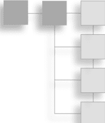

首先，我要感谢 www.gamedev.net 上的所有论坛版主朋友们。你们诚实且有帮助的评论给了我勇气，让我走出来写这本书。

特别感谢 Drew Sikora 出版了我的早期教程，并在困难时期转发粉丝来信鼓励我坚持下去。感谢 John Hattan 和 Jason Zink 发布相关信息。感谢所有审阅本书、帮助调试代码示例并修正我所有拼写错误的人（错误有很多）。

我要感谢 Emi Smith 及其余 Cengage 工作人员在编辑、出版方面的帮助，以及解决如何让他们的 Mac 与我的 Windows 协同工作的问题。我要感谢我的编辑 Kezia Endsley，感谢她耐心回答我所有愚蠢的问题，并且与她合作总是令人愉快。我也要感谢 Dustin Clingman 出色的技术编辑工作，确保代码示例正确且讲解透彻。

最重要的是，我想感谢我的妻子 Jimmi。二十多年来她一直是我的挚友，没有她持续的支持和信任，这一切都不可能实现。我爱你，宝贝。感谢你在书完成前没有“除掉我”。 :-)

## 关于作者

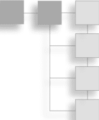

**蒂莫西·赖特** 是一名软件工程师，目前正在开发下一款优秀的独立游戏。他早年在陆军担任钢琴手，在那里发现了自己对编程的热爱。他拥有计算机科学学士学位，过去十年来一直在研发公司工作，使用光学和激光技术。在不开发或玩游戏时，他喜欢打扑克、烹饪美食和酿造自己的啤酒。有妻子、两个女儿、三只狗、两只猫和一名外国交换生，他的一周充满了戏剧性。蒂莫西曾在全国各地生活过，并在意大利、德国生活了五年，并游历了欧洲。他多年来一直是 www.gamedev.net 的论坛版主，你偶尔可以在名为 Glass_Knife 的 ID 下发现他在四处探索。


## 简介


多年前，当我开始第一份软件开发专业工作时，我被要求编写一个小应用程序。当时，我对 Java 语言了解不多。在学校期间，我广泛使用 C++，虽然我也做过一些 Java 编码，但我将其视为 C++ 的缓慢和简化版本。

与此同时，我尽可能多地购买和阅读游戏编程书籍。我正在研读的一本关于人工智能的书有很好的示例，但它们全都是 C++ 和 DirectX。由于我在工作中忙于学习 Java，我认为将示例移植到 Java 是学习该语言的好方法。毕竟，Java 游戏编程有多难呢？

很快我就发现，关于在 Java 中制作游戏的信息非常少。我找到的内容集中在小应用程序编程上，几乎没有关于制作应用程序类型游戏的内容。在将示例移植到 Java 并发现这既可能也不困难后，我搜索了解释所有内容的教程。我从未找到，所以我写了自己的。

在 gamedev.net 上发布两个教程，并在 Java 中从头编写一个软件渲染器后，我意识到该语言为游戏社区提供了很多东西。在编写下一系列教程时，我最终积累了如此多的信息，以至于一本书似乎是更好的解决方案。

这就是你现在正在阅读的内容：一位开发人员的代码和解释工具包，旨在帮助加快 Java 中游戏编程的过程。希望以下页面能回答所有必要的问题，并帮助你进入重要的事情：制作游戏。

## 本书的组织

本书分为三个部分。第一部分“基础”涵盖了创建简单原型游戏所需的所有概念。下一部分“打磨”涵盖了编写完整游戏所需的其他概念。最后一部分“完整游戏”将所有呈现的概念结合起来，从头到尾创建一个完整的游戏。内容摘要如下：

## 第一部分：基础

### 第 1 章：Hello World
本章创建一个帧速率类，用于监控应用程序速度。然后演示窗口化和全屏游戏循环。

### 第 2 章：输入
本章创建用于监控键盘输入以及绝对和相对鼠标输入的类。示例代码演示了游戏循环内的输入处理。

### 第 3 章：变换
本章涵盖向量、点和矩阵数学，以及点和向量的平移、旋转、缩放和剪切。讨论了矩阵变换以及手动方法，并介绍了 Swing 的变换对象。

### 第 4 章：时间和空间
本章向循环中添加游戏时钟，允许与帧速率无关的对象操作。还探索了屏幕映射，允许将任何屏幕空间对象从归一化设备坐标映射。

### 第 5 章：简单游戏框架
本章使用之前呈现的所有代码来创建一个简单的游戏框架，用于其余示例。

### 第 6 章：Vector2f 更新
本章更新在第 3 章中首次介绍的 Vector2f 类，添加了相交测试所需的所有线性代数。

### 第 7 章：相交测试
本章涵盖确定对象是否重叠或相互位于内部所需的数学和算法。使用点、圆、线和矩形来探讨此主题。

### 第 8 章：游戏原型
本章使用迄今呈现的代码，以及简单的框架，来创建一个原型游戏。虽然它还不是完整的游戏，但它很好地展示了制作游戏所需的所有必要代码。

### 第 10 章：图像
本章涵盖使用图像、从头创建图像以及使用图像文件。它还涵盖使用透明度，以及绘制、旋转和缩放图像的不同方法。

### 第 11 章：文本
本章涵盖使用 Java 的 Font 库绘制文本所需的一切内容。还对输入库进行了更新以支持键入。

### 第 12 章：线程
本章涵盖 Java 中可用的多线程库，并演示创建非阻塞类、使用阻塞类包装非阻塞类、将多线程代码集成到单线程游戏循环中，以及使用线程池加速资源加载。

### 第 13 章：声音
本章涵盖 Java 中声音支持的问题。探索了小剪辑文件和大文件流式传输，以及使用声音控件，例如声像和增益。本章开发的声音包装库用于将声音集成到游戏循环中，并解释了第 12 章中的概念。

### 第 14 章：使用 ANT 部署
本章概述了 ANT 构建工具，并引导你完成为游戏开发创建可扩展构建脚本的过程。

### 第 15 章：碰撞检测
本章涵盖确定碰撞对象的交点以及处理碰撞响应。通过许多示例探讨了点、线、矩形和圆。

## 第三部分：完整游戏

### 第 16 章：工具
本章开发制作完整游戏所需的工具。为窗口化游戏、全屏游戏和 Swing 编辑器开发了框架。实用程序库已更新，并创建了一个简单的 Swing 编辑器来绘制多边形并将其保存到 XML。创建了一个精灵类，并探索了一个简单的粒子引擎。

### 第 17 章：太空岩石
本章使用所有呈现的代码，从头到尾制作一个完整的游戏。虽然这个游戏简短且简单，但它是完整的，带有加载屏幕、吸引模式、游戏玩法、高分输入和保存以及部署 ANT 脚本。希望，看到创建完整游戏所需的工作会激励你完成自己的游戏。

### 第 18 章：结论
本章通过列出所有代码示例来总结整本书。本节按章节列出代码示例列表，每个示例都解释了所学到的经验，因此查找示例很容易。

## 谁应该阅读本书？

本书面向任何想要学习 2D 游戏编程基础知识的人。虽然当前图形正在飞速发展，但 3D 图形只是拼图的一部分。如果程序员不理解游戏循环、输入处理、矩阵数学、相交测试、碰撞检测、图像渲染、线程、声音或部署，那么 3D 图形也无法使游戏可玩。尽管 3D 渲染很令人兴奋，但学习基础知识对于打下坚实基础和具备应对任何情况所需的工具非常重要。

虽然本书假设读者理解核心编程概念、面向对象软件和 Java 编程语言，但不假设具有以前的游戏编程知识。

你应该已经熟悉 Java 语言，因为本文中未涵盖此内容。

## 软件和版本

此代码已在 Windows 7 上使用编写本书时可用的最新 Java SE 6.0 和 Java SE 7.0 版本进行测试。使用 Eclipse Helios IDE 进行代码编译和执行。使用 1.8.2 ANT 版本进行部署。

源代码示例，以及声音、图像和资源文件，可从以下网址获取：

http://www.indiegameprogramming.com

你也可以从本书的网站下载它们，在那里你可以按书名或 ISBN 搜索本书：

http://www.cengageptr.com/downloads

## 本书使用的约定

等宽字体用于以下内容：

- Java 类
- Java 方法
- 变量名
- 数学变量和常量
- 代码示例
- 代码片段
- XML
- 命令行输出


## 问题或评论

请将关于本书的任何评论、更正或问题发送到以下电子邮件地址：

indiegameprogramming@gmail.com

本书的网站，包含信息、更新、更正和源代码，可在此处查阅：

http://www.indiegameprogramming.com

## 第一部分

## 基础


本页故意留空

## 第1章


## Hello World

大多数编程书籍的第一步是创建一个 Hello World 应用程序，执行一个简单的功能以确保一切正常。最简单的计算机游戏应用程序是一个带有黑色背景的窗口，配合一个紧凑的 while 循环，以最快速度清除屏幕并重绘黑色背景；然而，尽管这样做很简单，但并不十分有趣。添加一个帧率计算器将测量应用程序性能并验证窗口是否在重绘。由于本书中的大多数示例都会测量帧率，因此帧率计算器是一个很好的起点。

## 使用 FrameRate 类

FrameRate 类位于 javagames.util 包中。本书开发的所有实用工具代码都放入实用工具包，你稍后可以将其转换为实用工具库。此类用于测量本书开发的应用程序的每秒帧数（FPS）。FPS 以字符串形式存储，格式为“FPS 100”。此值每秒计算一次。

在开始帧率测量之前，需要调用 initialize() 方法。该方法将帧率字符串初始化为 0，并将上次时间初始化为当前时间（以毫秒为单位）。

System.currentTimeMillis() 调用返回自 1970 年 1 月 1 日午夜以来的毫秒数。根据操作系统的不同，时间测量的精度可能会有所不同。例如，某些版本的 Windows 仅保证 10 毫秒的精度。

应该为每个渲染的帧调用一次 calculate() 方法。要计算帧率，用当前时间减去上次时间，并将结果存储在 delta 变量中。每帧递增帧计数，当 delta 时间超过一秒时，生成新的 FPS。由于 delta 变量很少恰好为一秒，因此从 delta 变量中减去 1,000 毫秒以保存额外的毫秒。保存新的帧率后，重置帧计数，流程再次开始。

```
package javagames.util;

public class FrameRate {
    private String frameRate;
    private long lastTime;
    private long delta;
    private int frameCount;

    public void initialize() {
        lastTime = System.currentTimeMillis();
        frameRate = "FPS 0";
    }

    public void calculate() {
        long current = System.currentTimeMillis();
        delta += current - lastTime;
        lastTime = current;
        frameCount++;

        if (delta > 1000) {
            delta -= 1000;
            frameRate = String.format("FPS %s", frameCount);
            frameCount = 0;
        }
    }

    public String getFrameRate() {
        return frameRate;
    }
}
```

## 创建 Hello World 应用程序

图 1.1 中所示的 Hello World 应用程序是第一个游戏窗口示例。HelloWorldApp 位于 javagames.render 包中。除了清除和重绘背景外，窗口中不渲染其他内容。HelloWorldApp 扩展了 JFrame 类，该类是 Java Swing 库中的顶级窗口组件。此应用程序包含一个 FrameRate 对象，用于测量应用程序的帧率。

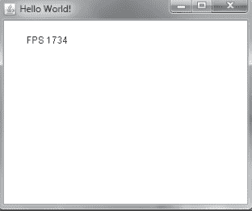

图 1.1 Hello World 应用程序。© 2014 Timothy Wright.

由于 Swing 库不是线程安全的，你应始终在 Swing 事件线程上创建和显示 JFrame。但是，程序的 main() 方法不是在事件线程上调用的，因此有必要使用 SwingUtilities 类来启动游戏窗口。通过使用 SwingUtilities 类，GUI 组件在同一线程上创建。在使用 Swing 组件进行渲染时，遵循 Java 的线程准则非常重要，因为忽略它们可能导致未定义的行为，这非常难以调试。

### 提示

我认识一位程序员，他曾通过注释掉一个在整个网站部署的应用程序中的 SwingUtilities 代码，来测试是否真的需要 SwingUtilities 类来启动游戏窗口。每隔几天，就有人报告说应用程序在启动时崩溃。我并不是说我会做这种事，但这似乎确实有影响。 :-)

```
final HelloWorldApp app = new HelloWorldApp();
SwingUtilities.invokeLater(new Runnable() {
    public void run() {
        app.createAndShowGUI();
    }
});
```

HelloWorldApp 内部有一个扩展 JPanel 的 GamePanel 类。此类用于将图形绘制到屏幕上。重写 paint 方法允许应用程序访问 `Graphics` 对象。请注意，面板仅用背景色清除，是因为调用了 `super.paint()` 方法。如果移除此方法调用，背景将不会被绘制。`onPaint()` 方法中的实际代码目前还没有做任何有趣的事情。目前它计算并显示帧率。

请注意 `paint()` 方法内对 `repaint()` 的调用。如果应用程序在其内部递归调用 `paint()`，该方法将永远不会返回（直到程序抛出栈溢出异常）。`repaint()` 方法会发出一个绘制请求，该请求将在当前绘制请求完成后尽快执行。这样，应用程序就会以最快速度持续重绘窗口。

`createAndShowGUI()` 方法是实际创建和显示窗口的地方。重要的是，首选大小应设置在 `GamePanel` 上，而不是 `JFrame` 上。请注意，创建 `GamePanel` 时，会设置其首选大小。如果在 `JFrame` 上设置应用程序大小，部分绘制区域将被边框占用，绘制区域会稍小一些。在面板上设置大小可确保其大小完全符合指定值。

在设置窗口但显示之前，会初始化帧率类。这是必要的，以设置类的初始启动时间，从而使第一次帧率计算正确。一旦通过调用 `setVisible(true)` 使应用程序可见，就会调用 paint 方法，该方法会持续计算帧率并重绘自身，直到关闭为止。

### 提示

你可以在本书网站 http://www.indiegameprogramming.com 上找到完整的源代码。它还包含更新、更正以及与本书相关的其他信息。

### HelloWorldApp 示例代码如下：

```
package javagames.render;
import java.awt.*;
import javax.swing.*;
import javagames.util.*;
public class HelloWorldApp extends JFrame {
    private FrameRate frameRate;
    public HelloWorldApp() {
        frameRate = new FrameRate();
    }
    protected void createAndShowGUI() {
        GamePanel gamePanel = new GamePanel();
        gamePanel.setBackground( Color.BLACK );
        gamePanel.setPreferredSize( new Dimension( 320, 240 ) );
        getContentPane().add( gamePanel );
        setDefaultCloseOperation( EXIT_ON_CLOSE );
        setTitle( "Hello World!" );
        pack();
        frameRate.initialize();
        setVisible( true );
    }

    private class GamePanel extends JPanel {
        public void paint( Graphics g ) {
            super.paint( g );
            onPaint( g );
        }
    }

    protected void onPaint( Graphics g ) {
        frameRate.calculate();
        g.setColor( Color.WHITE );
        g.drawString( frameRate.getFrameRate(), 30, 30 );
        repaint();
    }

    public static void main( String[] args ) {
        final HelloWorldApp app = new HelloWorldApp();
        SwingUtilities.invokeLater( new Runnable() {
            public void run() {
                app.createAndShowGUI();
            }
        });
    }
}
```

## 使用主动渲染

前一个示例使用一种称为 *被动渲染* 的技术。应用程序在 `paint()` 方法中重绘自身，但是由 Swing 库决定何时调用该方法。事件分发线程处理 Swing 组件的渲染，这不受你控制。虽然这对于普通应用程序没问题，但不推荐用于游戏。


要处理渲染，可以使用 BufferStrategy 类，但这需要对应用程序的结构进行一些更改。这将允许应用程序将渲染代码放在单独的线程中，并控制整个过程。

将游戏代码移出 paint() 方法有三个原因。第一是 paint() 方法中不应有任何长时间执行或阻塞的代码，因为这会阻止 GUI 接收绘制事件。第二是渲染代码需要在不同的线程中以支持全屏独占模式。第三，也是最重要的原因是，当绘制从头开始处理时，渲染代码会更快。为了利用主动渲染（无论是窗口模式还是全屏模式），会创建一个自定义渲染线程。

如第一个示例所示，没有实际方法将绘制代码放在 JPanel 的 paint 方法中，而是从自定义渲染线程调用该代码。为了在自定义循环中处理绘制，可以使用 BufferStrategy 类。该类用于执行双缓冲和页面翻转。

双缓冲（如图 1.2 所示）用于在绘制进行时防止实际绘制图像的过程被看到。通过在内存中绘制图像，然后一次性复制整个图像，绘制过程就不会被看到。

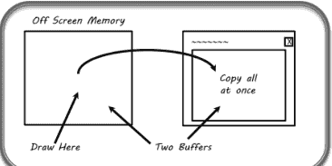

图 1.2 双缓冲。© 2014 Timothy Wright.

页面翻转（可用于全屏独占模式）使用相同的原理，但不是复制图像，而是维护两个屏幕外图像，并简单地将视频指针从一个缓冲区交换到另一个。这样，任何未绘制到屏幕的图像都可以被清除并重新绘制。当绘制完成后，指针再次交换，将新图像绘制到屏幕上。参见图 1.3。

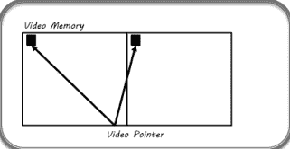

图 1.3 页面翻转。© 2014 Timothy Wright.

使用 BufferStrategy 类时，程序是全屏并使用页面翻转，还是窗口模式并使用双缓冲，都无关紧要——这些都在幕后处理。要在渲染循环中使用 BufferStrategy，可使用 getDrawGraphics() 方法创建一个图形对象。该图形对象将绘制到屏幕外表面。一旦图形对象可用，它的使用方式与传递给 JPanel 类 paint() 方法的图形对象完全相同。

调用 contentsLost() 很重要，以确保屏幕外表面可用。某些操作系统允许用户从全屏应用程序 Alt-Tab 切出，导致屏幕外图像不可用。

show() 方法执行双缓冲/图像复制或页面翻转/指针交换以显示图像。请注意，代码被包装在 try/finally 块中。与其他绘制代码不同，由于已创建此图形对象，因此在渲染循环结束时必须释放它。不调用 Graphics.dispose() 方法可能导致内存泄漏并使程序崩溃。

> **注意**
> 始终确保调用 dispose() 以清理图形对象。

```
// The bs object is a BufferStrategy object, and
// will be explained later in the chapter
public void gameLoop() {
    do {
        do {
            Graphics g = null;
            try {
                g = bs.getDrawGraphics();
                g.clearRect(0, 0, getWidth(), getHeight());
                renderer(g);
            } finally {
                if (g != null) {
                    g.dispose();
                }
            } while (bs.contentsRestored());
            bs.show();
        } while (bs.contentsLost());
    }
}
```

## 创建自定义渲染线程

除了使用前面的代码执行自定义渲染外，还需要一个自定义渲染线程。为了仅关注线程问题，位于 javagames.render 包中的 RenderThreadExample 实际上并不会向屏幕绘制任何内容，它只是在应放置渲染代码的位置打印“Game Loop”。下一个示例将 RenderThreadExample 和前面的代码结合起来，创建一个主动渲染应用程序。

在 RenderThreadExample 中首先要注意的是它实现了 Runnable 接口。Runnable 接口包含一个方法：public void run()。该方法包含渲染循环，并且只被调用一次。当它返回时，线程结束且不能再次使用。为了防止 run 方法中的代码在应用程序完成之前退出，Boolean 类型的 running 变量使 run 方法重复执行。

```
private volatile boolean running;
```

请注意变量声明中的 volatile 关键字。由于该变量是原始类型且由多个线程访问，有必要告诉编译器始终从内存中读取该变量。如果没有该关键字，Java 虚拟机 (JVM) 可能会使用缓存值对变量进行优化，导致线程无法停止。

另外，请注意 RenderThreadExample 中的 sleep() 方法，它用于将应用程序速度减慢到更合理的水平。sleep 方法接受一个毫秒值，然后挂起自身该段时间，允许其他线程使用 CPU。

应用程序关闭后，渲染线程应停止。通过添加窗口监听器，程序可以响应窗口关闭事件。在这种情况下，程序会调用 onWindowClosing()。如果程序需要关闭资源并关闭不再需要的文件，这就是执行此操作的位置。

```
app.addWindowListener( new WindowAdapter() {
    public void windowClosing( WindowEvent e ) {
        app.onWindowClosing();
    }
});
```

要关闭渲染线程，将 running 变量设置为 false。但是，渲染线程可能刚刚读取了 running 变量的值并处于休眠状态。为了确保线程已停止，会调用 join() 方法。该方法会等待线程结束且 run 方法返回。如果未向 join() 方法传递超时值，它将无限期阻塞直到线程结束，因此如果不提供超时值，请确保线程会结束。

最后，必须通过 System.exit(0) 调用手动关闭程序。以前，当在 JFrame 中设置 JFrame.EXIT_ON_CLOSE 标志时，程序会终止。现在应用程序正在处理关闭，除非调用 exit 方法，否则程序不会结束。如果应用程序在关闭后挂起，通常是因为程序员忘记调用 System.exit()。

```
package javagames.render;

import java.awt.event.*;
import javax.swing.*;
```

```
public class RenderThreadExample extends JFrame implements Runnable {
    private volatile boolean running;
    private Thread gameThread;

    public RenderThreadExample() {
    }

    protected void createAndShowGUI() {
        setSize(320, 240);
        setTitle("Render Thread");
        setVisible(true);

        gameThread = new Thread(this);
        gameThread.start();
    }

    public void run() {
        running = true;
        while (running) {
            System.out.println("Game Loop");
            sleep(10);
        }
    }

    private void sleep(long sleep) {
        try {
            Thread.sleep(sleep);
        } catch (InterruptedException ex) {
        }
    }

    protected void onWindowClosing() {
        try {
            System.out.println("Stopping Thread...");
            running = false;
            gameThread.join();
            System.out.println("Stopped!!!");
        } catch (InterruptedException e) {
            e.printStackTrace();
        }
        System.exit(0);
    }

    public static void main(String[] args) {
        final RenderThreadExample app = new RenderThreadExample();
        app.addWindowListener(new WindowAdapter() {
            public void windowClosing(WindowEvent e) {
                app.onWindowClosing();
            }
        });
        SwingUtilities.invokeLater(new Runnable() {
            public void run() {
                app.createAndShowGUI();
            }
        });
    }
}
```

## 创建主动渲染窗口

通过使用主动渲染，可以将渲染代码从事件分发线程移动到自定义游戏线程。Window 类和 Canvas 类是可用于创建 BufferStrategy 的两个类。通过添加画布，可以访问缓冲区策略并强制画布大小正好为所需大小，就像 Hello World 应用程序中的 JPanel 示例一样。


由于渲染循环为该应用程序执行所有绘制操作，可以在JFrame上设置setIgnoreRepaint()标志。通过传入所需的缓冲区数量调用Canvas.createBufferStrategy()，然后调用Canvas.getBufferStrategy()，可创建主动渲染所需的缓冲区。由于应用程序处理绘图，无需响应重绘方法。Component.setIgnoreRepaint()方法负责忽略额外的绘制消息。

## 提示

如果在窗口布局之前创建BufferStrategy，会发生一个奇怪的错误：

```
Exception in thread "AWT-EventQueue-0"
java.lang.IllegalStateException: Component must have a valid peer
```

调用pack()方法可以解决此问题。请注意，如果抛出之前的异常；在尝试创建BufferStrategy之前，请确保Component可见或已调用pack()。

游戏循环现在执行前一节讨论的渲染。使用getDrawGraphics()、contentsLost()、show()和dispose()方法，渲染循环控制应用程序绘图。一旦图形对象可用，且上一屏幕已清除，即可渲染场景。ActiveRenderingExample代码位于javagames.render包中。

```java
package javagames.render;

import java.awt.*;
import java.awt.event.*;
import java.awt.image.*;
import javax.swing.*;
import javagames.util.*;

public class ActiveRenderingExample extends JFrame implements Runnable {

    private FrameRate frameRate;
    private BufferStrategy bs;
    private volatile boolean running;
    private Thread gameThread;

    public ActiveRenderingExample() {
        frameRate = new FrameRate();
    }

    protected void createAndShowGUI() {
        Canvas canvas = new Canvas();
        canvas.setSize(320, 240);
        canvas.setBackground( Color.BLACK );
        canvas.setIgnoreRepaint( true );
        getContentPane().add( canvas );
        setTitle( "Active Rendering" );
        setIgnoreRepaint( true );
        pack();
        setVisible( true );
        canvas.createBufferStrategy( 2 );
        bs = canvas.getBufferStrategy();
        gameThread = new Thread( this );
        gameThread.start();
    }

    public void run() {
        running = true;
        frameRate.initialize();
        while( running ) {
            gameLoop();
        }
    }

    public void gameLoop() {
        do {
            do {
                Graphics g = null;
                try {
                    g = bs.getDrawGraphics();
                    g.clearRect( 0, 0, getWidth(), getHeight() );
                    render( g );
                } finally {
                    if ( g != null ) {
                        g.dispose();
                    }
                }
            } while ( bs.contentsRestored() );
            bs.show();
        } while ( bs.contentsLost() );
    }

    private void render( Graphics g ) {
        frameRate.calculate();
        g.setColor( Color.GREEN );
        g.drawString( frameRate.getFrameRate(), 30, 30 );
    }

    protected void onWindowClosing() {
        try {
            running = false;
            gameThread.join();
        } catch (InterruptedException e) {
            e.printStackTrace();
        }
        System.exit(0);
    }

    public static void main(String[] args) {
        final ActiveRenderingExample app = new ActiveRenderingExample();
        app.addWindowListener(new WindowAdapter() {
            public void windowClosing(WindowEvent e) {
                app.onWindowClosing();
            }
        });

        SwingUtilities.invokeLater(new Runnable() {
            public void run() {
                app.createAndShowGUI();
            }
        });
    }
}
```

## 更改显示模式

要创建全屏应用程序，需要更改显示模式。如图1.4所示，DisplayModeTest使用Swing组件。此示例也位于javagames.render包中。如果您从未进行过Swing编程，一些代码可能看起来很奇怪。有很多书籍和教程可用，而且要解释Swing提供的所有内容需要一本比此书更大的书，所以就照做吧。

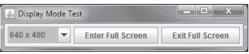

图1.4 显示模式应用程序。© 2014 Timothy Wright.

此示例应用程序列出所有可用的屏幕分辨率，允许用户使用任何可用的显示模式在全屏模式和窗口模式之间切换。此示例不仅展示了使用Swing组件进行编程，此代码还可用于在切换到全屏游戏之前创建初始启动游戏屏幕。这将使用户能够使用常规Swing组件配置系统。

此示例还包含一个名为`DisplayModeWrapper`的内部类。虽然我不是内部类的爱好者，但这个内部类使示例更容易在单个文件中展示。我更喜欢每个文件只有一个类，在其他类中创建类以便它们可以访问私有方法，这闻起来有点奇怪，但为了简洁起见，我将视而不见。包装类使用`equals()`方法仅比较显示模式的宽度和高度，而不比较位深度或刷新率。取决于操作系统，可能有许多仅在位深度和刷新率上不同的模式：

- 640×480 32 bit 59 Hz
- 640×480 32 bit 60 Hz
- 640×480 32 bit 75 Hz
- 640×480 16 bit 59 Hz
- 640×480 16 bit 60 Hz

由于程序将显示模式创建为32位并忽略所有其他模式，因此16位模式不可用。为让软件决定使用哪个刷新率，使用`REFRESH_RATE_UNKNOWN`值。这样，只使用一个640×480的显示模式，其他模式被跳过。

构造函数包含保存当前显示模式所需的代码。此模式与软件启动前用户系统的显示模式匹配。当应用程序返回窗口模式时，将使用此显示模式退出全屏模式。

```java
public DisplayModeExample() {
    GraphicsEnvironment ge =
        GraphicsEnvironment.getLocalGraphicsEnvironment();
    graphicsDevice = ge.getDefaultScreenDevice();
    currentDisplayMode = graphicsDevice.getDisplayMode();
}
```

`getMainPanel()`方法创建Swing组件。这些组件包括列出可用显示模式的组合框、切换到全屏模式的按钮以及切换回窗口模式的另一个按钮。`listDisplayModes()`方法返回前面讨论的包装类中的显示模式列表。包装类不仅允许搜索列表以查找匹配宽度和高度的模式，还重写了`toString()`方法以在组合框中生成易于读取的值列表。

`onEnterFullScreen()`方法首先检查以确保支持全屏，切换到全屏，然后更改显示模式。`getSelectedMode()`方法实际上创建一个具有未知刷新率的新`DisplayMode`，因此使用默认刷新率。

```java
// DisplayModeExample.java
protected void onEnterFullScreen() {
    if( graphicsDevice.isFullScreenSupported() ) {
        DisplayMode newMode = getSelectedMode();
        graphicsDevice.setFullScreenWindow( this );
        graphicsDevice.setDisplayMode( newMode );
    }
}
```

`onExitFullScreen()`方法使用保存的显示模式将显示返回窗口模式。这些方法调用与进入全屏模式的顺序相反。因为显示模式只能在全屏模式下更改，所以必须在更改显示模式之前切换，并且在重置原始显示模式之前不能将其设置回窗口模式。

```java
package javagames.render;

import java.awt.*;
import java.awt.event.*;
import java.util.*;
import javax.swing.*;

public class DisplayModeExample extends JFrame {
    class DisplayModeWrapper {
        private DisplayMode dm;
        public DisplayModeWrapper( DisplayMode dm ) {
            this.dm = dm;
        }
    }

    public boolean equals( Object obj ) {
        DisplayModeWrapper other = (DisplayModeWrapper)obj;
        if( dm.getWidth() != other.dm.getWidth() )
            return false;
    }
}
```


if ( dm.getHeight() != other.dm.getHeight() ) {
    return false;
}
return true;
}

public String toString() {
    return "" + dm.getWidth() + " x " + dm.getHeight();
}
}

private JComboBox displayModes;
private GraphicsDevice graphicsDevice;
private DisplayMode currentDisplayMode;

public DisplayModeExample() {
    GraphicsEnvironment ge =
    GraphicsEnvironment.getLocalGraphicsEnvironment();
    graphicsDevice = ge.getDefaultScreenDevice();
    currentDisplayMode = graphicsDevice.getDisplayMode();
}

private JPanel getMainPanel() {
    JPanel p = new JPanel();
    displayModes = new JComboBox( listDisplayModes() );
    p.add( displayModes );
    JButton enterButton = new JButton( "Enter Full Screen" );
    enterButton.addActionListener( new ActionListener() {
    public void actionPerformed( ActionEvent e ) {
    onEnterFullScreen();
    }
    });
    p.add( enterButton );
    JButton exitButton = new JButton( "Exit Full Screen" );
    exitButton.addActionListener( new ActionListener() {
    public void actionPerformed( ActionEvent e ) {
    onExitFullScreen();
    }
    });
    p.add( exitButton );
    return p;
}

private DisplayModeWrapper[] listDisplayModes() {
    ArrayList<DisplayModeWrapper> list = new
    ArrayList<DisplayModeWrapper>();
    for ( DisplayMode mode : graphicsDevice.getDisplayModes() ) {
    if ( mode.getBitDepth() == 32 ) {
    DisplayModeWrapper wrap = new DisplayModeWrapper( mode );
    if( !list.contains( wrap ) ) {
    list.add( wrap );
    }
    }
    }
    return list.toArray( new DisplayModeWrapper[0] );
}

protected void createAndShowGUI() {
Container canvas = getContentPane();
canvas.add( getMainPanel() );
canvas.setIgnoreRepaint( true );
setDefaultCloseOperation( EXIT_ON_CLOSE );
setTitle( "Display Mode Test" );
pack();
setVisible( true );
}

protected void onEnterFullScreen() {
if( graphicsDevice.isFullScreenSupported() ) {
DisplayMode newMode = getSelectedMode();
graphicsDevice.setFullScreenWindow( this );
graphicsDevice.setDisplayMode( newMode );
}
}

protected void onExitFullScreen() {
graphicsDevice.setDisplayMode( currentDisplayMode );
graphicsDevice.setFullScreenWindow( null );
}

protected DisplayMode getSelectedMode() {
DisplayModeWrapper wrapper =
(DisplayModeWrapper)displayModes.getSelectedItem();
DisplayMode dm = wrapper.dm;
int width = dm.getWidth();
int height = dm.getHeight();
int bit = 32;
int refresh = DisplayMode.REFRESH_RATE_UNKNOWN;
return new DisplayMode( width, height, bit, refresh );
}

public static void main( String[] args ) {
final DisplayModeExample app = new DisplayModeExample();
SwingUtilities.invokeLater( new Runnable() {
public void run() {
app.createAndShowGUI();
    })
});
}

## 全屏显示模式下的主动渲染

FullScreenRenderingExample 位于 javagames.render 包中，包含主动渲染框架和用于切换到全屏模式的显示模式代码，从而创建一个简单的全屏游戏框架。此示例包含前面章节中介绍的大量代码。除了直接将背景色设置到 JFrame 并忽略重绘外，还启用了 setUndecorated() 标志。由于前面示例中的应用程序已从窗口模式切换到全屏模式，因此未设置此标志；但当仅使用全屏模式时，JFrame 应该是无装饰的。

保存当前显示模式、切换到全屏并更改显示模式后，缓冲区策略是使用 JFrame 方法而非窗口示例中所示的 Canvas 方法创建的。

尽管尚未介绍键盘，但你需要某种方式来退出程序。由于 JFrame 是无装饰的，没有关闭窗口的控件。当用户按下 Esc 键时，以下代码将关闭应用程序：

// FullScreenRenderingExample.java
addKeyListener(new KeyAdapter() {
    public void keyPressed(KeyEvent e) {
        if (e.getKeyCode() == KeyEvent.VK_ESCAPE) {
            shutDown();
        }
    }
});

在本示例中，出于简单起见，显示模式被硬编码为 800×600、32 位。在实际生产应用程序中，可用的显示模式将如前面示例所示进行枚举。如果此显示模式在你的系统上不受支持，请务必更改此代码。

private DisplayMode getDisplayMode() {
    return new DisplayMode(
        800, 600, 32, DisplayMode.REFRESH_RATE_UNKNOWN );
}

由于无法关闭窗口，因此不需要窗口监听器。当按下 Esc 键并关闭示例时，在游戏循环关闭后，显示模式将恢复正常。

package javagames.renderer;

import java.awt.*;
import java.awt.event.*;
import java.awt.image.*;
import javax.swing.*;
import javagames.util.*;

public class FullScreenRenderingExample
    extends JFrame implements Runnable {

    private FrameRate frameRate;
    private BufferStrategy bs;
    private volatile boolean running;
    private Thread gameThread;
    private GraphicsDevice graphicsDevice;
    private DisplayMode currentDisplayMode;

    public FullScreenRenderingExample() {
        frameRate = new FrameRate();
    }

    protected void createAndShowGUI() {
        setIgnoreRepaint( true );
        setUndecorated( true );
        setBackground( Color.BLACK );

        GraphicsEnvironment ge =
            GraphicsEnvironment.getLocalGraphicsEnvironment();
        graphicsDevice = ge.getDefaultScreenDevice();
        currentDisplayMode = graphicsDevice.getDisplayMode();
        if ( !graphicsDevice.isFullScreenSupported() ) {
            System.err.println( "ERROR: Not Supported!!!" );
            System.exit( 0 );
        }

        graphicsDevice.setFullScreenWindow( this );
        graphicsDevice.setDisplayMode( getDisplayMode() );

        createBufferStrategy( 2 );
        bs = getBufferStrategy();

        addKeyListener( new KeyAdapter() {
            public void keyPressed( KeyEvent e ) {
                if (e.getKeyCode() == KeyEvent.VK_ESCAPE ) {
                    shutDown();
                }
            }
        });

        gameThread = new Thread( this );
        gameThread.start();
    }

    private DisplayMode getDisplayMode() {
        return new DisplayMode(
            800, 600, 32, DisplayMode.REFRESH_RATE_UNKNOWN );
    }

    public void run() {
        running = true;
        frameRate.initialize();
        while( running ) {
            gameLoop();
        }
    }

    public void gameLoop() {
        do {
            do {
                Graphics g = null;
                try {
                    g = bs.getDrawGraphics();
                    g.clearRect( 0, 0, getWidth(), getHeight() );
                    render( g );
                } finally {
                    if ( g != null ) {
                        g.dispose();
                    }
                }
            } while( bs.contentsRestored() );
            bs.show();
        } while( bs.contentsLost() );
    }

    private void render( Graphics g ) {
        frameRate.calculate();
        g.setColor( Color.GREEN );
        g.drawString( frameRate.getFrameRate(), 30, 30 );
        g.drawString( "Press ESC to exit...", 30, 60 );
    }

    protected void shutDown() {
        try {
            running = false;
            gameThread.join();
            System.out.println( "Game loop stopped!!!" );
            graphicsDevice.setDisplayMode( currentDisplayMode );
            graphicsDevice.setFullScreenWindow( null );
            System.out.println( "Display Restored..." );
        } catch( InterruptedException e ) {
            e.printStackTrace();
        }
        System.exit(0);
    }
}
public static void main( String[] args ) {
    final FullScreenRenderingExample app = new FullScreenRenderingExample();
    SwingUtilities.invokeLater( new Runnable() {
        public void run() {
            app.createAndShowGUI();
        }
    } );
}
}

## 资源与进一步阅读

Martak, Michael，“全屏独占模式 API”，1995 年，http://docs.oracle.com/javase/tutorial/extra/fullscreen/index.html。

本页故意留空

## 输入

如图 2.1 所示，输入对视频游戏非常重要。这正是游戏与电影不同的原因，也是本章的主题。尽管许多人更注重外观，但无论游戏看起来多么精彩，如果控制不灵敏、笨拙或困难，玩家会感到非常沮丧。

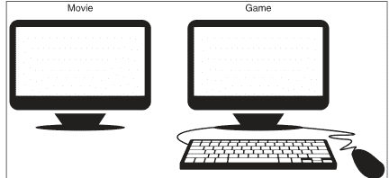

图 2.1 电影与游戏的区别。© 2014 Cengage Learning。

尽管当今有许多输入设备可用，但本书介绍了两种最常见的设备：键盘和鼠标。


## 处理键盘输入

在大多数应用程序中，软件不需要处理键盘事件。任何组件，例如文本字段，都会处理输入并在有变化时通知软件。但大多数计算机游戏使用键盘，不是为了输入，而是为了游戏输入。取决于游戏，可能会有输入，但键盘按钮也可用作方向键和激光触发器。许多计算机游戏有不同的输入配置，有些甚至允许用户随意映射按键。无论游戏如何使用键盘（这可能是一种全新的方式），监听键盘事件的常规方法都不适合游戏循环程序设计。

Swing 组件允许添加实现 KeyListener 接口的监听器：

- void keyTyped(KeyEvent e)——按键按下并释放
- void keyPressed(KeyEvent e)——按键按下
- void keyReleased(KeyEvent e)——按键释放

按下按键时，会调用 keyPressed() 方法。如预期，释放同一按键时会调用 keyReleased() 方法。只有在按键按下并释放后，才会调用 keyTyped() 方法。动作键和修饰键，例如 Shift 或方向键，不会生成 keyTyped() 事件。本事件将在第 11 章中探讨，该章涵盖文本。

问题是，键盘是由操作系统维护的一块硬件。是操作系统，而不是软件，生成并分发键盘事件到拥有焦点的任何应用程序。没有什么能阻止用户从游戏窗口切换到网页浏览器并查看电子邮件。正因为如此，所有键盘事件都在不同线程上到达，并且需要提供给游戏循环。

大多数游戏遵循某种结构化循环：

```
while (true) {
    processInput();
    updateObjects();
    // other stuff...
    renderScene();
}
```

如果输入在游戏循环之外处理，状态可能随时改变。此外，多个按键可能同时按下，因此单独处理每个事件不允许用户组合按键。为了简化输入处理，键盘事件被保存并提供给游戏循环。

在存储键盘状态时，了解键盘状态如何与程序共享非常重要。因为键盘是一块非常复杂的硬件，不仅字符串字符可用，而且每个按键（甚至不代表字符的按键，例如 Shift 键）都通过虚拟键码提供。键盘上的每个按键都映射到 KeyEvent 类中位于某处的键码。以下是一些示例值：

- KeyEvent.VK_E——E 键
- KeyEvent.VK_SPACE——空格键
- KeyEvent.VK_UP——向上箭头键

这些常量中的每一个都映射到传递给 KeyEvent 对象内部键盘监听器的数值。KeyEvent.getKeyCode() 方法返回生成事件的按键的虚拟键码。

位于 javagames.util 包中的 SimpleKeyboardInput 类功能非常少。此类实现 KeyListener 接口，以便监控键盘事件。它保存一个包含 256 个按键的布尔数组，这些是需要采样的所有虚拟键码。它将按键状态（按下为 true，否则为 false）存储在按键状态数组中。最后，在使用 synchronized 关键字保护按键状态数组（当其从多个线程访问时）之后，它通过 keyDown(int keyCode) 方法提供对当前按键状态的访问。

```
package javagames.util;

import java.awt.event.*;

public class SimpleKeyboardInput implements KeyListener {
    private boolean[] keys;

    public SimpleKeyboardInput() {
        keys = new boolean[256];
    }

    public synchronized boolean keyDown(int keyCode) {
        return keys[keyCode];
    }

    public synchronized void keyPressed(KeyEvent e) {
        int keyCode = e.getKeyCode();
        if (keyCode >= 0 && keyCode < keys.length) {
            keys[keyCode] = true;
        }
    }

    public synchronized void keyReleased(KeyEvent e) {
        int keyCode = e.getKeyCode();
        if (keyCode >= 0 && keyCode < keys.length) {
            keys[keyCode] = false;
        }
    }

    public void keyTyped(KeyEvent e) {
        // Not needed
    }
}
```

> **提示**
> 不要忘记，你可以在本书网站 http://www.indiegameprogramming.com 上找到完整源代码。

位于 javagames.input 包中的 SimpleKeyboardExample 类是一个使用键盘输入类的简单测试，它用输入处理代码替换了渲染代码。请注意，SimpleKeyboardInput 通过 addKeyListener() 方法添加到应用程序中。在游戏循环内，程序不再清除图像并显示帧率，而是游戏时钟检查空格键或方向键，并在按键按下时打印一条消息。

在检查空格键时，示例使用变量保存按键状态，每次按键只在控制台打印一次。然而，方向键会持续将其状态打印到控制台，直到被释放。

```
package javagames.input;

import java.awt.event.*;
import javax.swing.*;
import javagames.util.*;

public class SimpleKeyboardExample extends JFrame implements Runnable {
    private volatile boolean running;
    private Thread gameThread;
    private SimpleKeyboardInput keys;
    private boolean space;
    private boolean arrow;

    public SimpleKeyboardExample() {
        keys = new SimpleKeyboardInput();
    }

    protected void createAndShowGUI() {
        setTitle("Keyboard Input");
        setSize(320, 240);
        addKeyListener(keys);
        setVisible(true);
        gameThread = new Thread(this);
        gameThread.start();
    }

    public void run() {
        running = true;
        while (running) {
            gameLoop();
        }
    }

    public void gameLoop() {
        if (keys.keyDown(KeyEvent.VK_SPACE)) {
            if (!space) {
                System.out.println("VK_SPACE");
            }
            space = true;
        } else {
            space = false;
        }
        if (keys.keyDown(KeyEvent.VK_UP)) {
            System.out.println("VK_UP");
        }
        if (keys.keyDown(KeyEvent.VK_DOWN)) {
            System.out.println("VK_DOWN");
        }
        if (keys.keyDown(KeyEvent.VK_LEFT)) {
            System.out.println("VK_LEFT");
        }
        if (keys.keyDown(KeyEvent.VK_RIGHT)) {
            System.out.println("VK_RIGHT");
        }
        try {
            Thread.sleep(10);
        } catch (InterruptedException ex) {
        }
    }

    protected void onWindowClosing() {
        try {
            running = false;
            gameThread.join();
        } catch (InterruptedException e) {
            e.printStackTrace();
        }
        System.exit(0);
    }

    public static void main(String[] args) {
        final SimpleKeyboardExample app = new SimpleKeyboardExample();
        app.addWindowListener(new WindowAdapter() {
            public void windowClosing(WindowEvent e) {
                app.onWindowClosing();
            }
        });

        SwingUtilities.invokeLater(new Runnable() {
            public void run() {
                app.createAndShowGUI();
            }
        });
    }
}
```

## 键盘改进

虽然键盘输入类允许在游戏循环中访问键盘状态，但其实现存在一些问题。第一个问题是，如果在游戏循环代码执行时按键未按下，则可能会错过按键。虽然在这些简单示例中不太可能发生，但一旦应用程序变得更加密集且游戏循环需要更多时间来处理所有代码，游戏循环可能会减慢到足以错过输入。目前，只需知道这可能是一个问题。防止事件丢失的解决方案在第 11 章中讨论。

第二个问题是，难以测试按键首次按下的时刻。如果需要跟踪 20 个按键，并且其中一些根据游戏状态改变行为，那么尝试使用类似以下代码的代码来跟踪所有这些状态可能会变得非常混乱：

```
// SimpleKeyboardExample.java
if (keys.keyDown(KeyEvent.VK_SPACE)) {
    if (!space) {
        System.out.println("VK_SPACE");
    }
    space = true;
} else {
    space = false;
}
```


要更新 KeyboardInput 类以跟踪初始按键以及键盘状态，添加了一个整数值数组。这些值将跟踪按键已按下的帧数。实现 KeyListener 接口的代码完全不变，但 keyDown() 方法不再从布尔键数组中获取值。

poll() 方法经过同步以保护 keys 数组，它将键盘状态从布尔数组传输到整数数组。如果按键按下，则递增该值，否则将其重置为零。keyDown() 方法现在检查该值是否不为零，而新方法 keyDownOnce() 在该值恰好为一时返回 true。

```
package javagames.util;

import java.awt.event.*;

public class KeyboardInput implements KeyListener {
    private boolean[] keys;
    private int[] polled;

    public KeyboardInput() {
        keys = new boolean[ 256 ];
        polled = new int[ 256 ];
    }

    public boolean keyDown( int keyCode ) {
        return polled[ keyCode ] > 0;
    }

    public boolean keyDownOnce( int keyCode ) {
        return polled[ keyCode ] == 1;
    }

    public synchronized void poll() {
        for( int i = 0; i < keys.length; ++i ) {
            if( keys[i] ) {
                polled[i]++;
            } else {
                polled[i] = 0;
            }
        }
    }

    public synchronized void keyPressed( KeyEvent e ) {
        int keyCode = e.getKeyCode();
        if( keyCode >= 0 && keyCode < keys.length ) {
            keys[ keyCode ] = true;
        }
    }
}
```

```
public synchronized void keyReleased( KeyEvent e ) {
    int keyCode = e.getKeyCode();
    if( keyCode >= 0 && keyCode < keys.length ) {
        keys[ keyCode ] = false;
    }
}

public void keyTyped( KeyEvent e ) {
    // Not needed
}
}
```

可以通过用以下代码替换前一个示例中的游戏循环代码来使用这个新类。检查空格键单次按下所需的代码大大简化了。

### 注意

> 不要忘记每帧调用 KeyboardInput.poll() 方法！

```
// replacing the game loop
public void gameLoop() {
    keys.poll();

    if( keys.keyDownOnce( KeyEvent.VK_SPACE ) ) {
        System.out.println( "VK_SPACE" );
    }
    if( keys.keyDown( KeyEvent.VK_UP ) ) {
        System.out.println( "VK_UP" );
    }
    if( keys.keyDown( KeyEvent.VK_DOWN ) ) {
        System.out.println( "VK_DOWN" );
    }
    if( keys.keyDown( KeyEvent.VK_LEFT ) ) {
        System.out.println( "VK_LEFT" );
    }
    if( keys.keyDown( KeyEvent.VK_RIGHT ) ) {
        System.out.println( "VK_RIGHT" );
    }
    try {
        Thread.sleep( 10 );
    } catch( InterruptedException ex ) {
    }
}
```

## 处理鼠标输入

位于 javagames.util 包中的 SimpleMouseInput 类与前一节开发的键盘输入类非常相似。鼠标按钮的处理方式与键盘按键相同。该类实现了包含以下方法的 MouseListener 接口：

- mouseClicked(MouseEvent e)
- mouseEntered(MouseEvent e)
- mouseExited(MouseEvent e)
- mousePressed(MouseEvent e)
- mouseReleased(MouseEvent e)

该接口中的两个方法，mouseEntered() 和 mouseExited()，处理鼠标光标移动。其他三个方法用于鼠标按钮。与键盘监听器一样，pressed 和 released 方法跟踪鼠标按钮的状态，而 clicked 方法被忽略。要确定按下了哪个鼠标按钮，鼠标事件包含以下方法：

```
public int MouseEvent.getButton()
```

此方法返回的值映射到以下常量：

- MouseEvent.NOBUTTON = 0
- MouseEvent.BUTTON1 = 1
- MouseEvent.BUTTON2 = 2
- MouseEvent.BUTTON3 = 3

按钮编号从 1 开始而不是 0，0 表示没有按钮，需要从按钮编号中减一才能引用鼠标按钮数组。除此之外，鼠标按钮的处理方式与键盘按键相同，包括 buttonDown() 和 buttonDownOnce() 方法。

程序可用的其他鼠标状态包括鼠标指针的位置和状态。除了 MouseListener 接口中的 mouseEntered() 和 mouseExited() 方法外，鼠标输入类还实现了 MouseMotionListener 接口。

- mouseDragged(MouseEvent e)
- mouseMoved(MouseEvent e)

这四个方法——entered、exited、dragged 和 moved——在捕获鼠标位置的同时，会通知程序鼠标是否正在进入或离开监听鼠标事件的组件。以下方法获取鼠标的当前位置：

```
public Point MouseEvent.getPoint()
```

在轮询鼠标输入时，此值会被复制并提供给游戏循环。当前鼠标位置可通过以下方法获取：

```
public Point SimpleMouseInput.getPosition()
```

最后，为了监控来自鼠标滚轮的输入，输入类实现了 MouseWheelListener：

```
mouseWheelMoved(MouseEvent e)
```

以下方法返回鼠标滚轮的滚动次数。如果数字为负，则滚轮已远离用户移动。如果值为正，则滚轮已向用户移动。

```
public int MouseWheelEvent.getWheelRotation()
```

此值也在 poll() 方法中保存，并可通过以下方法提供给游戏循环：

```
public int SimpleMouseInput.getNotches()
```

SimpleMouseInput 类的代码如下所示：

```
package javagames.util;
import java.awt.*;
import java.awt.event.*;

public class SimpleMouseInput
implements MouseListener, MouseMotionListener, MouseWheelListener {
    private static final int BUTTON_COUNT = 3;
    private Point mousePos;
    private Point currentPos;
    private boolean[] mouse;
    private int[] polled;
    private int notches;
    private int polledNotches;
    public SimpleMouseInput() {
        mousePos = new Point( 0, 0 );
        currentPos = new Point( 0, 0 );
        mouse = new boolean[ BUTTON_COUNT ];
        polled = new int[ BUTTON_COUNT ];
    }
    public synchronized void poll() {
        mousePos = new Point( currentPos );
        polledNotches = notches;
        notches = 0;
        for( int i = 0; i < mouse.length; ++i ) {
            if( mouse[i] ) {
                polled[i]++;
            } else {
                polled[i] = 0;
            }
        }
    }

    public Point getPosition() {
        return mousePos;
    }

    public int getNotches() {
        return polledNotches;
    }

    public boolean buttonDown( int button ) {
        return polled[ button - 1 ] > 0;
    }

    public boolean buttonDownOnce( int button ) {
        return polled[ button - 1 ] == 1;
    }

    public synchronized void mousePressed( MouseEvent e ) {
        int button = e.getButton() - 1;
        if( button >= 0 && button < mouse.length ) {
            mouse[ button ] = true;
        }
    }

    public synchronized void mouseReleased( MouseEvent e ) {
        int button = e.getButton() - 1;
        if( button >= 0 && button < mouse.length ) {
            mouse[ button ] = false;
        }
    }

    public void mouseClicked( MouseEvent e ) {
        // Not needed
    }

    public synchronized void mouseEntered( MouseEvent e ) {
        mouseMoved( e );
    }

    public synchronized void mouseExited( MouseEvent e ) {
      mouseMoved( e );
    }

    public synchronized void mouseDragged( MouseEvent e ) {
      mouseMoved( e );
    }

    public synchronized void mouseMoved( MouseEvent e ) {
      currentPos = e.getPoint();
    }

    public synchronized void mouseWheelMoved( MouseWheelEvent e ) {
      notches += e.getWheelRotation();
    }
}
```

如图 2.2 所示且位于 javagames.input 包中的 SimpleMouseExample 为第一个示例添加了许多新内容。以主动渲染示例代码为起点，并添加键盘和鼠标输入类，此示例不仅展示了所有三种鼠标输入类型，还展示了使用 Graphics 对象绘制到屏幕的第一个示例。

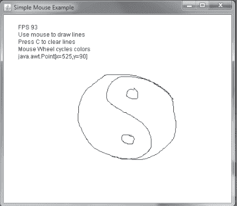

图 2.2 简单鼠标示例。© 2014 Timothy Wright。


首先要注意的是创建 GUI 时的方法调用。这些调用将 KeyboardInput 和 SimpleMouseInput 添加为组件的监听器。请注意，虽然键盘同时添加到了 JFrame 和 Canvas，但鼠标仅添加到了 Canvas。当应用程序首次启动时，如果未将键盘添加到 JFrame，则不会处理键盘事件。一旦 Canvas 对象获得焦点，它将接收键盘输入，但在被选中之前，键盘输入仅由 JFrame 接收。在游戏循环中，已添加以下方法调用：

```
public void processInput()
```

在此方法中，键盘和鼠标都会被轮询，以使其数据可用。当鼠标按钮首次被按下时，会设置绘制标志。在左鼠标按钮按下的每一帧中，都会向线条的数据结构添加一个新点。当按钮释放时，标志会被清除，并且一个 null 对象会被添加到列表中，标记线条的结束。这样，数据结构可以同时保存所有线条。

当按下 C 键时，线条会从数据结构中清除。这样，如果用户缺乏艺术技巧（就像我一样！），就可以重新开始。render 方法中也添加了新代码。除了显示帧率和应用程序使用说明外，当前鼠标位置还会显示为字符串。

鼠标滚轮用于选择颜色索引。以下代码使用取模运算符和绝对值，以确保无论索引多大或多小，索引始终是一个有效值。

```
// SimpleMouseExample.java
colorIndex += mouse.getNotches();
Color color = COLORS[ Math.abs( colorIndex % COLORS.length ) ];
g.setColor( color );
```

% 运算符会将值保持在 (-3, 3) 之间。因为负值的取模运算结果要么是零，要么是负值，所以使用绝对值来保持数组索引在 (0, size - 1) 之间。

最后，绘制线条。因为数据结构中插入了 null 值，所以添加了代码，以确保只有在两个点都不是 null 时才绘制线条。

```java
package javagames.input;
import java.awt.*;
import java.awt.event.*;
import java.awt.image.*;
import java.util.*;
import javagames.util.*;
import javax.swing.*;

public class SimpleMouseExample extends JFrame
        implements Runnable {

    private FrameRate frameRate;
    private BufferStrategy bs;
    private volatile boolean running;
    private Thread gameThread;
    private SimpleMouseInput mouse;
    private KeyboardInput keyboard;
    private ArrayList<Point> lines = new ArrayList<Point>();
    private boolean drawingLine;

    private Color[] COLORS = {
        Color.RED,
        Color.GREEN,
        Color.YELLOW,
        Color.BLUE,
    };
    private int colorIndex;

    public SimpleMouseExample() {
        frameRate = new FrameRate();
    }

    protected void createAndShowGUI() {
        Canvas canvas = new Canvas();
        canvas.setSize( 640, 480 );
        canvas.setBackground( Color.BLACK );
        canvas.setIgnoreRepaint( true );
        getContentPane().add( canvas );
        setTitle( "Simple Mouse Example" );
        setIgnoreRepaint( true );
        pack();

        // Add key listeners
        keyboard = new KeyboardInput();
        canvas.addKeyListener( keyboard );

        // Add mouse listeners
        mouse = new SimpleMouseInput();
        canvas.addMouseListener( mouse );
        canvas.addMouseMotionListener( mouse );
        canvas.addMouseWheelListener( mouse );
        setVisible( true );
        canvas.createBufferStrategy( 2 );
        bs = canvas.getBufferStrategy();
        canvas.requestFocus();
        gameThread = new Thread( this );
        gameThread.start();
    }

    public void run() {
        running = true;
        frameRate.initialize();
        while( running ) {
            gameLoop();
        }
    }

    private void gameLoop() {
        processInput();
        renderFrame();
        sleep( 10L );
    }

    private void renderFrame() {
        do {
            do {
                Graphics g = null;
                try {
                    g = bs.getDrawGraphics();
                    g.clearRect( 0, 0, getWidth(), getHeight() );
                    render( g );
                } finally {
                    if ( g != null ) {
                        g.dispose();
                    }
                }
            } while( bs.contentsRestored() );
        } while( bs.contentsLost() );
    }

    private void sleep( long sleep ) {
        try {
            Thread.sleep( sleep );
        } catch( InterruptedException ex ) {
        }
    }

    private void processInput() {
        keyboard.poll();
        mouse.poll();

        if (keyboard.keyDownOnce( KeyEvent.VK_SPACE ) ) {
            System.out.println("VK_SPACE");
        }

        // if button is pressed for first time,
        // start drawing lines
        if (mouse.buttonDownOnce( MouseEvent.BUTTON1 ) ) {
            drawingLine = true;
        }

        // if the button is down, add line point
        if (mouse.buttonDown( MouseEvent.BUTTON1 ) ) {
            lines.add( mouse.getPosition() );
            // if the button is not down but we were drawing,
            // add a null to break up the lines
        } else if (drawingLine) {
            lines.add( null );
            drawingLine = false;
        }

        // if 'C' is down, clear the lines
        if (keyboard.keyDownOnce( KeyEvent.VK_C ) ) {
            lines.clear();
        }
    }

    private void render( Graphics g ) {
        colorIndex += mouse.getNotches();
        Color color = COLORS[ Math.abs( colorIndex % COLORS.length ) ];
        g.setColor( color );

        frameRate.calculate();
        g.drawString( frameRate.getFrameRate(), 30, 30 );
        g.drawString( "Use mouse to draw lines", 30, 45 );
        g.drawString( "Press C to clear lines", 30, 60 );
        g.drawString( "Mouse Wheel cycles colors", 30, 75 );
        g.drawString( mouse.getPosition().toString(), 30, 90 );

        for( int i = 0; i < lines.size() - 1; ++i ) {
            Point p1 = lines.get( i );
            Point p2 = lines.get( i + 1 );
            // Adding a null into the list is used
            // for breaking up the lines when
            // there are two or more lines
            // that are not connected
            if ( !( p1 == null || p2 == null ) )
                g.drawLine( p1.x, p1.y, p2.x, p2.y );
        }
    }

    protected void onWindowClosing() {
        try {
            running = false;
            gameThread.join();
        } catch( InterruptedException e ) {
            e.printStackTrace();
        }
        System.exit( 0 );
    }

    public static void main( String[] args ) {
        final SimpleMouseExample app = new SimpleMouseExample();
        app.addWindowListener( new WindowAdapter() {
            public void windowClosing( WindowEvent e ) {
                app.onWindowClosing();
            }
        });
        SwingUtilities.invokeLater( new Runnable() {
            public void run() {
                app.createAndShowGUI();
            }
        });
    }
}
```

## 相对鼠标移动

图 2.3 所示的当前鼠标输入类存在一个问题。乍一看这可能显而易见，但程序仅在鼠标位于窗口内时才接收鼠标事件。一旦鼠标离开窗口，鼠标指针的坐标在应用程序中就不再有效。更糟糕的是，在全屏模式下，当鼠标到达屏幕边缘时会停止，并且不会继续注册事件。根据应用程序的需求，可能需要相对鼠标移动。幸运的是，更新鼠标输入类以支持相对鼠标移动并不困难。

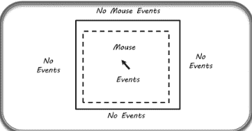

图 2.3 仅限窗口的鼠标事件。

© 2014 Timothy Wright.

RelativeMouseInput 类位于 javagames.util 包中，它基于前一个示例中的类，并添加了相对鼠标移动。为实现此功能，使用了 Robot 类来将鼠标保持在窗口中心。包含用于监听鼠标事件的 Swing 组件，以计算窗口中心并从相对窗口坐标转换为绝对屏幕坐标。如果鼠标光标始终位于窗口中心，那么它就永远不会离开，窗口也将始终接收鼠标事件。以下代码用于将鼠标居中：

```
// RelativeMouseInput.java
private Point getComponentCenter() {
    int w = component.getWidth();
    int h = component.getHeight();
    return new Point(w / 2, h / 2);
}

private void centerMouse() {
    if (robot != null && component.isShowing()) {
        Point center = getComponentCenter();
        SwingUtilities.convertPointToScreen( center, component );
        robot.mouseMove( center.x, center.y );
    }
}
```

窗口中心在运行时计算，因此即使调整窗口大小，鼠标也会保持在中心。相对中心点必须转换为绝对屏幕坐标。无论窗口位于桌面的哪个位置，窗口中的左上角像素始终是 (0,0)。如果在桌面上移动窗口会改变左上角像素的值，那么图形编程将非常困难。虽然使用相对像素值使绘制更容易，但将鼠标定位到


窗口的相对中心未考虑窗口的位置，可能会将鼠标光标放置在离窗口太远的地方，以至于停止接收鼠标事件。使用 SwingUtilities 类转换为屏幕坐标可解决此问题。

重要的是要意识到，重新定位鼠标之所以有效，是因为当鼠标的新位置与当前位置相同时，请求 Robot 类将鼠标重新定位到同一位置不会生成新的鼠标事件。如果此行为将来发生变化，相对鼠标类将始终生成鼠标事件，即使鼠标没有移动。在请求重新定位之前检查当前位置和新位置是否不同，如果将来鼠标行为发生变化，这将解决此问题。

向 RelativeMouseInput 类添加了一个标志，以允许同时使用相对和绝对鼠标移动。游戏在某个时刻可能需要同时使用绝对和相对鼠标模式，因此该类允许在运行时切换此设置。已向 mouseMoved() 方法添加新代码。如果处于相对模式，则计算距离作为相对于中心的差值，然后重新定位鼠标光标。由于鼠标坐标和组件坐标都是相对值，因此无需转换这些值。最后，在 poll 方法期间，鼠标位置可以是相对位置或绝对位置。增量变量会在 poll 方法中与所有其他变量一起重置。

```java
package javagames.util;

import java.awt.*;
import java.awt.event.*;
import javax.swing.*;

public class RelativeMouseInput
        implements MouseListener, MouseMotionListener, MouseWheelListener {
    private static final int BUTTON_COUNT = 3;

    private Point mousePos;
    private Point currentPos;
    private boolean[] mouse;
    private int[] polled;
    private int notches;
    private int polledNotches;

    private int dx, dy;
    private Robot robot;
    private Component component;
    private boolean relative;

    public RelativeMouseInput( Component component ) {
        this.component = component;
        try {
            robot = new Robot();
        } catch ( Exception e ) {
            // Handle Exception [ game specific]
            e.printStackTrace();
        }
        mousePos = new Point( 0, 0 );
        currentPos = new Point( 0, 0 );
        mouse = new boolean[ BUTTON_COUNT ];
        polled = new int[ BUTTON_COUNT ];
    }

    public synchronized void poll() {
        if ( isRelative() ) {
            mousePos = new Point( dx, dy );
        } else {
            mousePos = new Point( currentPos );
        }
        dx = dy = 0;
        polledNotches = notches;
        notches = 0;
        for ( int i = 0; i < mouse.length; ++i ) {
            if ( mouse[i] ) {
                polled[i]++;
            } else {
                polled[i] = 0;
            }
        }
    }

    public boolean isRelative() {
        return relative;
    }

    public void setRelative( boolean relative ) {
        this.relative = relative;
        if ( relative ) {
            centerMouse();
        }
    }

    public Point getPosition() {
        return mousePos;
    }

    public int getNotches() {
        return polledNotches;
    }

    public boolean buttonDown( int button ) {
        return polled[ button - 1 ] > 0;
    }

    public boolean buttonDownOnce( int button ) {
        return polled[ button - 1 ] == 1;
    }

    public synchronized void mousePressed( MouseEvent e ) {
        int button = e.getButton() - 1;
        if ( button >= 0 && button < mouse.length ) {
            mouse[ button ] = true;
        }
    }

    public synchronized void mouseReleased( MouseEvent e ) {
        int button = e.getButton() - 1;
        if ( button >= 0 && button < mouse.length ) {
            mouse[ button ] = false;
        }
    }

    public void mouseClicked( MouseEvent e ) {
        // Not needed
    }

    public synchronized void mouseEntered( MouseEvent e ) {
        mouseMoved( e );
    }

    public synchronized void mouseExited( MouseEvent e ) {
        mouseMoved( e );
    }

    public synchronized void mouseDragged( MouseEvent e ) {
        mouseMoved( e );
    }

    public synchronized void mouseMoved( MouseEvent e ) {
        if ( isRelative() ) {
            Point p = e.getPoint();
            Point center = getComponentCenter();
            dx += p.x - center.x;
            dy += p.y - center.y;
            centerMouse();
        } else {
            currentPos = e.getPoint();
        }
    }

    public synchronized void mouseWheelMoved( MouseWheelEvent e ) {
        notches += e.getWheelRotation();
    }

    private Point getComponentCenter() {
        int w = component.getWidth();
        int h = component.getHeight();
        return new Point( w / 2, h / 2 );
    }

    private void centerMouse() {
        if( robot != null && component.isShowing() ) {
            Point center = getComponentCenter();
            SwingUtilities.convertPointToScreen( center, component );
            robot.mouseMove( center.x, center.y );
        }
    }
}
```

位于 javagames.input 包中的 RelativeMouseExample（如图 2.4 所示）测试了鼠标输入类更新的新功能。

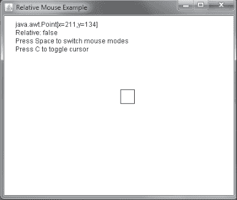

图 2.4 相对鼠标示例。© 2014 Timothy Wright.

以下代码通过将光标图像设置为在运行时创建的空光标来禁用鼠标光标。

```java
// RelativeMouseExample.java
private void disableCursor() {
    Toolkit tk = Toolkit.getDefaultToolkit();
    Image image = tk.createImage( "" );
    Point point = new Point( 0, 0 );
    String name = "CanBeAnything";
    Cursor cursor = tk.createCustomCursor( image, point, name );
    setCursor( cursor );
}
```

此示例的 render() 方法显示帮助文本、计算帧率并在屏幕上绘制矩形。在 processInput() 方法中，空格键用于在绝对模式和相对模式之间切换鼠标模式。C 键用于显示或隐藏鼠标光标。当使用当前鼠标位置来更新正方形位置时，相对值会添加到位置上，而绝对值会替换先前的值。代码确保正方形永远不会离开屏幕，如果位置在任一方向上偏移太远，则会将其包裹。

```java
package javagames.input;

import java.awt.*;
import java.awt.event.*;
import java.awt.image.*;
import javagames.util.*;
import javax.swing.*;

public class RelativeMouseExample extends JFrame
        implements Runnable {

    private FrameRate frameRate;
    private BufferStrategy bs;
    private volatile boolean running;
    private Thread gameThread;
    private Canvas canvas;
    private RelativeMouseInput mouse;
    private KeyboardInput keyboard;
    private Point point = new Point( 0, 0 );
    private boolean disableCursor = false;

    public RelativeMouseExample() {
        frameRate = new FrameRate();
    }

    protected void createAndShowGUI() {
        canvas = new Canvas();
        canvas.setSize( 640, 480 );
        canvas.setBackground( Color.BLACK );
        canvas.setIgnoreRepaint( true );
        getContentPane().add( canvas );
        setTitle( "Relative Mouse Example" );
        setIgnoreRepaint( true );
        pack();

        // Add key listeners
        keyboard = new KeyboardInput();
        canvas.addKeyListener( keyboard );

        // Add mouse listeners
        // For full screen : mouse = new RelativeMouseInput( this );
        mouse = new RelativeMouseInput( canvas );
        canvas.addMouseListener( mouse );
        canvas.addMouseMotionListener( mouse );
        canvas.addMouseWheelListener( mouse );

        setVisible( true );
        canvas.createBufferStrategy( 2 );
        bs = canvas.getBufferStrategy();
        canvas.requestFocus();

        gameThread = new Thread( this );
        gameThread.start();
    }

    public void run() {
        running = true;
        frameRate.initialize();
        while ( running ) {
            gameLoop();
        }
    }

    private void gameLoop() {
        processInput();
        renderFrame();
        sleep( 10L );
    }

    private void renderFrame() {
        do {
            do {
                Graphics g = null;
                try {
                    g = bs.getDrawGraphics();
                    g.clearRect( 0, 0, getWidth(), getHeight() );
                    render( g );
                } finally {
                    if ( g != null ) {
                        g.dispose();
                    }
                }
            } while ( bs.contentsRestored() );
            bs.show();
        } while ( bs.contentsLost() );
    }

    private void sleep( long sleep ) {
        try {
            Thread.sleep( sleep );
        } catch ( InterruptedException ex ) {
        }
    }

    private void processInput() {
        keyboard.poll();
        mouse.poll();

        Point p = mouse.getPosition();
        if ( mouse.isRelative() ) {
            point.x += p.x;
            point.y += p.y;
        } else {
            point.x = p.x;
            point.y = p.y;
        }

        // Wrap rectangle around the screen
        // if (point.x + 25 < 0)
        if ( point.x < 0 ) {
            point.x = canvas.getWidth() - 1;
        } else if ( point.x > canvas.getWidth() - 1 ) {
            point.x = -25;
        }
        if ( point.y < 0 ) {
            point.y = canvas.getHeight() - 1;
        } else if ( point.y > canvas.getHeight() - 1 ) {
            point.y = -25;
        }

        // Toggle relative
        if ( keyboard.keyDownOnce( KeyEvent.VK_SPACE ) ) {
            mouse.setRelative( !mouse.isRelative() );
        }
    }
}


```
// Toggle cursor
if (keyboard.keyDownOnce(KeyEvent.VK_C)) {
    disableCursor = !disableCursor;
    if (disableCursor) {
        disableCursor();
    } else {
        // setCursor( Cursor.DEFAULT_CURSOR ) is deprecated
        setCursor( new Cursor( Cursor.DEFAULT_CURSOR ) );
    }
}
```

```
private void render(Graphics g) {
    g.setColor( Color.GREEN );
    frameRate.calculate();
    g.drawString( mouse.getPosition().toString(), 20, 20 );
    g.drawString( "Relative: " + mouse.isRelative(), 20, 35 );
    g.drawString( "Press Space to switch mouse modes", 20, 50 );
    g.drawString( "Press C to toggle cursor", 20, 65 );

    g.setColor( Color.WHITE );
    g.drawRect( point.x, point.y, 25, 25 );
}
```

```
private void disableCursor() {
    Toolkit tk = Toolkit.getDefaultToolkit();
    Image image = tk.createImage( "" );
    Point point = new Point( 0, 0 );
    String name = "CanBeAnything";
    Cursor cursor = tk.createCustomCursor( image, point, name );
    setCursor( cursor );
}
```

```
protected void onWindowClosing() {
    try {
        running = false;
        gameThread.join();
    } catch (InterruptedException e) {
        e.printStackTrace();
    }
    System.exit( 0 );
}
```

```
public static void main( String[] args ) {
    final RelativeMouseExample app = new RelativeMouseExample();
    app.addWindowListener( new WindowAdapter() {
        public void windowClosing( WindowEvent e ) {
            app.onWindowClosing();
        }
    });
    SwingUtilities.invokeLater( new Runnable() {
        public void run() {
            app.createAndShowGUI();
        }
    });
}
}
```

## 资源与进一步阅读

“如何编写键盘监听器”，1995年，http://docs.oracle.com/javase/tutorial/uiswing/events/keylistener.html.

“如何编写鼠标监听器”，1995年，http://docs.oracle.com/javase/tutorial/uiswing/events/mouselistener.html.

“如何编写鼠标运动监听器”，1995年，http://docs.oracle.com/javase/tutorial/uiswing/events/mousemotionlistener.html.

本页故意留空

## 变换

在 2D 图形中，可以对形状执行四种不同的操作。如图 3.1 所示。

- 平移——将对象向上、向下、向左或向右移动。
- 旋转——围绕一点旋转对象。
- 缩放——放大或缩小对象。
- 剪切——沿一个或两个方向移动对象。

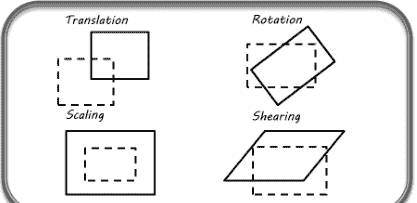

图 3.1 平移、旋转、缩放和剪切。© 2014 Timothy Wright.

这些操作都可以以不同的方式执行。可以手动对对象中的每个坐标进行操作，也可以将它们连接成一个矩阵，然后一次性应用。每种方法都有优缺点，但要学习这些变换是如何应用的，手动计算每个坐标是最好的。

## 使用 Vector2f 类

Vector2f 类位于 javagames.util 包中，用于表示空间中的位置以及方向。请注意，2D 坐标类有三个值：x、y 和 w。为了使用矩阵变换执行平移，需要一个额外的坐标值才能使矩阵数学运行正常。所以请不要管幕后的额外“w”坐标，稍后会解释。

> **注意**
> 熟悉向量代数的读者看到接下来的源代码可能会大喊：“等等！点和向量不一样。点的 w = 1，但向量不能平移，且应有 w = 0。” 稍后我也会讲到，所以不用担心。 :-)

平移非常简单。要将坐标向上、向下、向左或向右移动，只需将距离加到坐标上：

```
x = x + tx;
y = y + ty;
```

缩放也很简单。坐标值乘以缩放因子，从而放大或缩小。

```
x = x * sx;
y = y * sy;
```

剪切稍微复杂一些，是相对于其他坐标值移动值。请注意用于保存 x 旧值的临时值，直到它用于剪切 y 值之后。如果没有临时值，更新后的值会被用来剪切 y 值，而不是原始值。要剪切这些值，向 x 值添加缩放后的 y 值，向 y 值添加缩放后的 x 值：

```
float tmp = x + sx * y;
y = y + sy * x;
x = tmp;
```

旋转更难理解。使用与剪切示例相同的临时值，旋转按以下方式执行：

```
float tmp = x * cos(angle) - y * sin(angle);
y = x * sin(angle) + y * cos(angle);
x = tmp;
```

要理解这个方程的来源，有必要了解极坐标，这将在本章后面介绍。目前，只需假设它有效即可。

```
package javagames.util;

public class Vector2f {
    public float x;
    public float y;
    public float w;

    public Vector2f() {
        this.x = 0.0f;
        this.y = 0.0f;
        this.w = 1.0f; //?!
    }

    public Vector2f( Vector2f v ) {
        this.x = v.x;
        this.y = v.y;
        this.w = v.w; //?!
    }

    public Vector2f( float x, float y ) {
        this.x = x;
        this.y = y;
        this.w = 1.0f; //?!
    }

    public Vector2f( float x, float y, float w ) {
        this.x = x;
        this.y = y;
        this.w = w; //?!
    }

    public void translate( float tx, float ty ) {
        x += tx;
        y += ty;
    }

    public void scale( float sx, float sy ) {
        x *= sx;
        y *= sy;
    }

    public void rotate( float rad ) {
        float tmp = (float)( x * Math.cos( rad ) - y * Math.sin( rad ) );
        y = (float)( x * Math.sin( rad ) + y * Math.cos( rad ) );
        x = tmp;
    }

    public void shear( float sx, float sy ) {
        float tmp = x + sx * y;
        y = y + sy * x;
        x = tmp;
    }
}
```

VectorGraphicsExample 位于 javagames.transform 包中，如图 3.2 所示，它在屏幕上绘制一个多边形飞船，并使用 Vector2f 类方程应用平移、旋转、缩放和剪切。initialize() 方法设置多边形飞船并调用 reset()。reset() 方法负责将所有变换值重置为起始值。

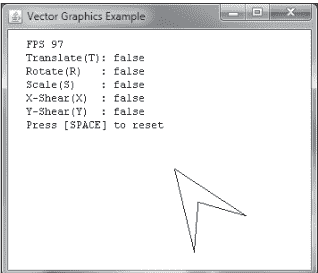

图 3.2
矢量图形示例。
© 2014 Timothy Wright.

不同的变换操作映射了不同的按键。R 表示旋转，S 表示剪切，T 表示平移，X 表示 x 轴剪切，Y 表示 y 轴剪切，空格键用于将值重置为起始值。

多边形对象在变换前会被复制到世界列表中。这样，操作不会累积，而是每帧都会发生。这不仅保持原始模型不变，还允许使用原始模型的多个副本。

每个变换操作的处理方式相同。首先检查映射到特定变换的布尔值。如果为 true，则应用该变换，检查边界，并相应调整步长值。值更新后，应用变换。请注意，变换的顺序很重要。更改操作顺序会改变屏幕上的结果。

在 render() 方法中，会显示所有平移标志的值。然后使用图形对象的 drawLine() 方法绘制变换后的多边形。最后一个点和第一个点相连，然后每个点都用于从该点到前一个点绘制一条线，从而生成一个封闭多边形。

```
package javagames.transform;
import java.awt.*;
import java.awt.event.*;
import java.awt.image.*;
import javagames.util.*;
import javax.swing.*;

public class VectorGraphicsExample extends JFrame
implements Runnable {

private static final int SCREEN_W = 640;
private static final int SCREEN_H = 480;
private FrameRate frameRate;
private BufferStrategy bs;
private volatile boolean running;
private Thread gameThread;
private RelativeMouseInput mouse;
private KeyboardInput keyboard;
private Vector2f[] polygon;
private Vector2f[] world;
```


private float tx, ty;
private float vx, vy;
private float rot, rotStep;
private float scale, scaleStep;
private float sx, sxStep;
private float sy, syStep;
private boolean doTranslate;
private boolean doScale;
private boolean doRotate;
private boolean doShear;

public VectorGraphicsExample() {
}

protected void createAndShowGUI() {
    Canvas canvas = new Canvas();
    canvas.setSize(640, 480);
    canvas.setBackground(Color.BLACK);
    canvas.setIgnoreRepaint(true);
    getContentPane().add(canvas);
    setTitle("Vector Graphics Example");
    setIgnoreRepaint(true);
    pack();

    // Add key listeners
    keyboard = new KeyboardInput();
    canvas.addKeyListener(keyboard);

    // Add mouse listeners
    // For full screen : mouse = new RelativeMouseInput( this );
    mouse = new RelativeMouseInput(canvas);
    canvas.addMouseListener(mouse);
    canvas.addMouseMotionListener(mouse);
    canvas.addMouseWheelListener(mouse);

    setVisible(true);
    canvas.createBufferStrategy(2);
    bs = canvas.getBufferStrategy();
    canvas.requestFocus();

    gameThread = new Thread(this);
    gameThread.start();
}

public void run() {
    running = true;
    initializing = true;
    while (running) {
        gameLoop();
    }
}

private void gameLoop() {
    processInput();
    processObjects();
    renderFrame();
    sleep(10L);
}

private void renderFrame() {
    do {
        do {
            Graphics g = null;
            try {
                g = bs.getDrawGraphics();
                g.clearRect(0, 0, getWidth(), getHeight());
                render(g);
            } finally {
                if (g != null) {
                    g.dispose();
                }
            }
        } while (bs.contentsRestored());
        bs.show();
    } while (bs.contentsLost());
}

private void sleep(long sleep) {
    try {
        Thread.sleep(sleep);
    } catch (InterruptedException ex) {}
}

private void initialize() {
    frameRate = new FrameRate();
    frameRate.initialize();
    polygon = new Vector2f[] {
        new Vector2f(10, 0),
        new Vector2f(-10, 8),
        new Vector2f(0, 0),
        new Vector2f(-10, -8),
    };
    world = new Vector2f[polygon.length];
    reset();
}

private void reset() {
    tx = SCREEN_W / 2;
    ty = SCREEN_H / 2;
    vx = vy = 2;
    rot = 0.0f;
    rotStep = (float)Math.toRadians(1.0);
    scale = 1.0f;
    scaleStep = 0.1f;
    sx = sy = 0.0f;
    sxStep = syStep = 0.01f;
    doRotate = doScale = doTranslate = false;
    doXShear = doYShear = false;
}

private void processInput() {
    keyboard.poll();
    mouse.poll();
    if (keyboard.keyDownOnce(KeyEvent.VK_R)) {
        doRotate = !doRotate;
    }
    if (keyboard.keyDownOnce(KeyEvent.VK_S)) {
        doScale = !doScale;
    }
    if (keyboard.keyDownOnce(KeyEvent.VK_T)) {
        doTranslate = !doTranslate;
    }
    if (keyboard.keyDownOnce(KeyEvent.VK_X)) {
        doXShear = !doXShear;
    }
    if (keyboard.keyDownOnce(KeyEvent.VK_Y)) {
        doYShear = !doYShear;
    }
    if (keyboard.keyDownOnce(KeyEvent.VK_SPACE)) {
        reset();
    }
}

private void processObjects() {
    // copy data...
    for (int i = 0; i < polygon.length; ++i) {
        world[i] = new Vector2f(polygon[i]);
    }

    if (doScale) {
        scale += scaleStep;
        if (scale < 1.0 || scale > 5.0) {
            scaleStep = -scaleStep;
        }
    }

    if (doRotate) {
        rot += rotStep;
        if (rot < 0.0f || rot > 2 * Math.PI) {
            rotStep = -rotStep;
        }
    }

    if (doTranslate) {
        tx += vx;
        if (tx < 0 || tx > SCREEN_W) {
            vx = -vx;
        }
        ty += vy;
        if (ty < 0 || ty > SCREEN_H) {
            vy = -vy;
        }
    }

    if (doXShear) {
        sx += sxStep;
        if (Math.abs(sx) > 2.0) {
            sxStep = -sxStep;
        }
    }

    if (doYShear) {
        sy += syStep;
        if (Math.abs(sy) > 2.0) {
            syStep = -syStep;
        }
    }

    for (int i = 0; i < world.length; ++i) {
        world[i].shear(sx, sy);
        world[i].scale(scale, scale);
        world[i].rotate(rot);
        world[i].translate(tx, ty);
    }
}

private void render(Graphics g) {
    g.setFont(new Font("Courier New", Font.PLAIN, 12));
    g.setColor(Color.GREEN);
    frameRate.calculate();
    g.drawString("FrameRate: " + getFrameRate(), 20, 20);
    g.drawString("Translate(T) : " + doTranslate, 20, 35);
    g.drawString("Rotate(R) : " + doRotate, 20, 50);
    g.drawString("Scale(S) : " + doScale, 20, 65);
    g.drawString("X-Shear(X) : " + doXShear, 20, 80);
    g.drawString("Y-Shear(Y) : " + doYShear, 20, 95);
    g.drawString("Press [SPACE] to reset", 20, 110);

    Vector2f S = world[world.length - 1];
    Vector2f P = null;
    for (int i = 0; i < world.length; ++i) {
        P = world[i];
        g.drawLine((int)S.x, (int)S.y, (int)P.x, (int)P.y);
        S = P;
    }
}

protected void onWindowClosing() {
    try {
        running = false;
        gameThread.join();
    } catch (InterruptedException e) {
        e.printStackTrace();
    }
    System.exit(0);
}

public static void main(String[] args) {
    final VectorGraphicsExample app = new VectorGraphicsExample();
    app.addWindowListener(new WindowAdapter() {
        public void windowClosing(WindowEvent e) {
            app.onWindowClosing();
        }
    });
    SwingUtilities.invokeLater(new Runnable() {
        public void run() {
            app.createAndShowGUI();
        }
    });
}

## 使用极坐标

笛卡尔坐标表示为一对 (x,y) 值。极坐标表示为一个角度和一个距离。参见图 3.3。

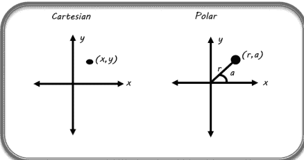

图 3.3
笛卡尔坐标与极坐标对比。
© 2014 Timothy Wright.

与 (x,y) 对不同，极坐标的形式为 (r,a)，其中 r 是距离（半径），a 是角度。由于 Java 的三角函数使用弧度，所有角度均假设为弧度。不过，在两种表示之间转换很容易：

```
Math.toRadians( double degrees )
Math.toDegrees( double radians )
```

要将笛卡尔坐标转换为极坐标，可以将点视为一个三角形，利用三角函数求解所需的值。

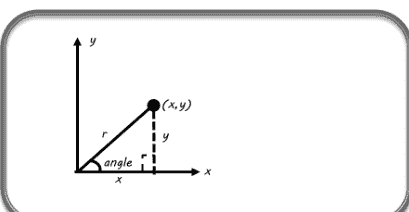

图 3.4 从笛卡尔坐标到极坐标的转换。© 2014 Timothy Wright.

如图 3.4 所示，距离可视为三角形的斜边，可使用勾股定理求得：

```
$r^2 = a^2 + b^2$
$r = \sqrt{a^2 + b^2}$
```

角度可使用正切函数求得：

```
$\theta = \tan \frac{y}{x}$
```

将极坐标转换回 (x,y) 对同样很容易：

```
$x = r \cos \theta$
$y = r \sin \theta$
```

正是上述定义可用于推导前面所示的旋转方程。从起始角度旋转若干弧度，等同于在起始角度上加上所需的额外旋转角度。换句话说，要将一点旋转若干弧度，方程可表示如下：

```
$x' = r \cos(\theta + \phi)$
$y' = r \sin(\theta + \phi)$
```

### 三角函数来解救：

```
sin(θ + ϕ) = sin θ cos ϕ + cos θ sin ϕ
cos(θ + ϕ) = cos θ cos ϕ - sin θ sin ϕ
```

将前面的方程替换为这种新表示，得到：

```
x' = r(cos θ cos ϕ - sin θ sin ϕ)
y' = r(sin θ cos ϕ + cos θ sin ϕ)
```

分配 r 值后得到：

```
x' = r cos θ cos ϕ - r sin θ sin ϕ
y' = r sin θ cos ϕ + r cos θ sin ϕ
```

请记住以下内容：

```
x = r cos θ
y = r sin θ
```

你可以代入原始 x 和 y 值，得到以下结果：

```
x' = x cos ϕ - y sin ϕ
y' = y cos ϕ + x sin ϕ
```

这就是前面为 Vector2f 类中坐标旋转所提出的方程。PolarCoordinateExample 位于 javagames.transform 包中，如图 3.5 所示，它在笛卡尔坐标和极坐标之间进行转换。coord 变量保存鼠标所在的屏幕位置，以屏幕中心为偏移量。


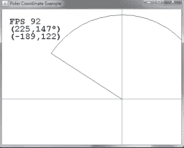

图 3.5 极坐标示例。© 2014 Timothy Wright.

转换在 render() 方法中进行。(cx,cy) 坐标表示屏幕中心，(px,py) 坐标将当前鼠标位置相对于屏幕中心进行偏移。因为屏幕坐标中 y 值在向下方向为正，所以 py 变量的计算方式不同。

```java
int px = coord.x - cx;
int py = cy - coord.y;
```

从 (px,py) 值到极坐标的转换存储在 r 变量中表示距离，rad 变量表示弧度制的角度。因为 Math.atan2() 方法返回的角度范围是 (-180, 180)，所以将角度调整为 (0, 360)。

```java
if( degrees < 0 ) {
    degrees = 360 - degrees;
}
```

(sx,sy) 变量保存从极坐标转换回笛卡尔坐标的值。

```java
double sx = r * Math.cos(rad);
double sy = r * Math.sin(rad);
```

各种值会显示在屏幕上，以便检查转换后的值。起始值和转换后的值应相同。

最后，曲线使用图形对象的 drawArc() 方法显示。该方法接受上左点、界定弧的矩形的宽度和高度，以及起始和结束角度（以度为单位，而非弧度）。

### 提示

在使用 drawArc() 方法之前，请务必将弧度转换为度。

```java
package javagames.transform;

import java.awt.*;
import java.awt.event.*;
import java.awt.geom.*;
import javagames.util.*;
import javax.swing.*;

public class PolarCoordinateExample extends JFrame
        implements Runnable {

    private static final int SCREEN_W = 640;
    private static final int SCREEN_H = 480;

    private FrameRate frameRate;
    private BufferStrategy bs;
    private volatile boolean running;
    private Thread gameThread;
    private RelativeMouseInput mouse;
    private KeyboardInput keyboard;
    private Point coord;

    public PolarCoordinateExample() {
    }

    protected void createAndShowGUI() {
        Canvas canvas = new Canvas();
        canvas.setSize( SCREEN_W, SCREEN_H );
        canvas.setBackground( Color.BLACK );
        canvas.setIgnoreRepaint( true );
        getContentPane().add( canvas );
        setTitle( "Polar Coordinate Example" );
        setIgnoreRepaint( true );
        pack();

        // Add key listeners
        keyboard = new KeyboardInput();
        canvas.addKeyListener( keyboard );

        // Add mouse listeners
        // For full screen : mouse = new RelativeMouseInput( this );
        mouse = new RelativeMouseInput( canvas );
        canvas.addMouseListener( mouse );
        canvas.addMouseListener( mouse );
        canvas.addMouseMotionListener( mouse );
        canvas.addMouseWheelListener( mouse );
        setVisible( true );
        canvas.createBufferStrategy( 2 );
        bs = canvas.getBufferStrategy();
        canvas.requestFocus();
        gameThread = new Thread( this );
        gameThread.start();
    }

    public void run() {
        running = true;
        initialize();
        while( running ) {
            gameLoop();
        }
    }

    private void gameLoop() {
        processInput();
        renderFrame();
        sleep( 10L );
    }

    private void renderFrame() {
        do {
            do {
                Graphics g = null;
                try {
                    g = bs.getDrawGraphics();
                    g.clearRect( 0, 0, getWidth(), getHeight() );
                    render( g );
                } finally {
                    if( g != null ) {
                        g.dispose();
                    }
                }
            } while( bs.contentsRestored() );
            bs.show();
        } while( bs.contentsLost() );
    }

    private void sleep( long sleep ) {
        try {
            Thread.sleep( sleep );
        } catch( InterruptedException ex ) {
        }
    }

    private void initialize() {
        frameRate = new FrameRate();
        frameRate.initialize();
        coord = new Point();
    }

    private void processInput() {
        keyboard.poll();
        mouse.poll();
        coord = mouse.getPosition();
    }

    private void render(Graphics g) {
        g.setFont( new Font( "Courier New", Font.BOLD, 24 ) );
        g.setColor( Color.GREEN );
        frameRate.calculate();
        g.drawString( frameRate.getFrameRate(), 20, 40 );
        int cx = SCREEN_W / 2;
        int cy = SCREEN_H / 2;
        g.setColor( Color.GRAY );
        g.drawLine( 0, cy, SCREEN_W, cy );
        g.drawLine( cx, 0, cx, SCREEN_H );
        g.setColor( Color.GREEN );
        g.drawLine( cx, cy, coord.x, coord.y );
        int px = coord.x - cx;
        int py = cy - coord.y;
        double r = Math.sqrt( px*px + py*py );
        double rad = Math.atan2( py, px );
        double degrees = Math.toDegrees( rad );
        if ( degrees < 0 ) {
            degrees = 360 + degrees;
        }
        double sx = r * Math.cos( rad );
        double sy = r * Math.sin( rad );
        String polar = String.format( "(%f,%f\\u00b0)", r, degrees );
        g.drawString( polar, 20, 60 );
        String cart = String.format( "(%f,%f)", sx, sy );
        g.drawString( cart, 20, 80 );
        g.setColor( Color.WHITE );
        g.drawString( String.format( "(%s,%s)", px, py ), coord.x, coord.y );
        g.setColor( Color.BLUE );
        g.drawArc(
            (int)(cx - r),(int)(cy - r),
            (int)(2*r), (int)(2*r), 0, (int)degrees
        );
    }

    protected void onWindowClosing() {
        try {
            running = false;
            gameThread.join();
        } catch (InterruptedException e) {
            e.printStackTrace();
        }
        System.exit(0);
    }

    public static void main(String[] args) {
        final PolarCoordinateExample app = new PolarCoordinateExample();
        app.addWindowListener(new WindowAdapter() {
            public void windowClosing(WindowEvent e) {
                app.onWindowClosing();
            }
        });
        SwingUtilities.invokeLater(new Runnable() {
            public void run() {
                app.createAndShowGUI();
            }
        });
    }
}
```

## 理解点和向量

如图 3.6 所示，点和向量之间的差异可能令人困惑。2D 空间中的点表示为 (x,y) 对。向量可以表示为两个坐标对：一个 (x,y) 坐标表示向量的起点，另一个表示终点。但是，第一个坐标通常隐含为 (0,0)，并在代码表示中被省略。

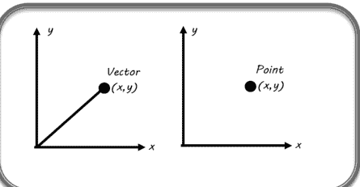

图 3.6 点和向量的相似之处。© 2014 Timothy Wright.

### 注意

因为向量和点可以以相同方式表示，所以很难理解它们之间的区别。再加上一个懒惰的程序员（就像我）同时使用向量类来处理向量和点，事情就更加令人困惑了。

可以将点视为城市，将向量视为驾驶方向来帮助理解。

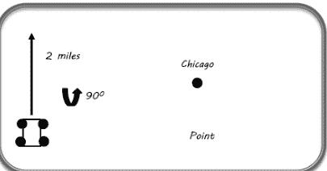

图 3.7 驾驶方向、位置、向量和点。© 2014 Timothy Wright.

如图 3.7 所示，芝加哥市是一个点。将汽车向左转 90 度并直行两英里是一个向量。从地球上的任何地方出发，该向量驾驶方向都会将汽车放置在另一个位置。由于汽车可以从任何地方出发，仅凭一个向量不足以确定位置。

可以对向量和点执行各种数学运算。例如，将这些驾驶方向添加到起始点（如芝加哥），结果是一个新点或新位置。向量可以相互相加和相减，但因为它们可以从任何地方出发，结果是另一个也可以从任何地方出发的向量。参见图 3.8。

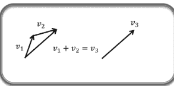

图 3.8 向量加法。© 2014 Timothy Wright.

不合理的是将两个点相加：芝加哥 + 纽约 = ???

初学向量和点时，这会造成很多困惑。有些在数学上是正确的事情，然后有些是你在代码中需要对向量和点执行的操作，以便游戏正常工作。如前所述，要使用矩阵来操纵向量，需要添加一个额外的 w 值。这也是向量和点可以通过 w 值不同而有所区别的原因。如果 w 等于 1，则可以进行平移。当 w 值等于 0 时，平移无效。点和向量都可以由相同的数据结构表示，只需将 w 值从 1 改为 0 即可。

## 使用矩阵变换

之前的所有变换也可以使用矩阵来应用。有表示平移、旋转、缩放和剪切的矩阵。这些不同的矩阵对象可以相乘，将所有不同的操作组合成一个单一矩阵，该矩阵可用于一次性转换所有点。为了相乘一个


将三个元素的向量与具有 3 x 3 元素的矩阵相乘时，重要的是要明白矩阵乘法不像乘两个数字那样。

要相乘两个不同大小的矩阵，内部尺寸必须匹配。结果矩阵的维度将取决于外部值。换句话说，A x B * B x C = A x C。内部的 B 数字必须匹配。以下是有效的矩阵大小及其乘法结果：

- 4 x 2 * 2 x 3 = 4 x 3
- 3 x 3 * 3 x 5 = 3 x 5
- 1 x 2 * 2 x 7 = 1 x 7

这就是需要额外 w 值的原因之一。1 x 2 * 3 x 3 矩阵操作是无效的。此外，向量和矩阵的顺序必须正确，否则矩阵操作将无法工作。

- 3 x 3 * 1 x 3 = 错误，向量不能是 1 x 3
- 3 x 3 * 3 x 1 = 正确

另一个重要点是矩阵乘法不满足交换律。换句话说：

```
M1 * M2 != M2 * M1
```

颠倒乘法顺序会改变结果，这与其他形式的乘法不同。先平移再旋转的结果与先旋转再平移不同。请务必牢记这一点。如果交换两个矩阵，将一个矩阵乘以另一个矩阵可能不会产生相同的结果，尽管可以选择特定的值来强制结果相同。因此，交换向量和矩阵以使乘法可行不是一个好主意：

```
1x3 vector * 3x3 matrix != 3x3 matrix * 3x1 vector
```

这引出了使用矩阵时的下一个重要考虑事项：如何正确使用行优先或列优先格式。

## 行优先与列优先矩阵

以下变换矩阵是列优先矩阵：

```
[ 1 0 tx ]
[ 0 1 ty ]
[ 0 0 1 ]
```

向量 (tx, ty, 1) 是平移向量，从上到下排列，占据矩阵的一列。

以下变换矩阵是行优先矩阵：

```
[ 1 0 0 ]
[ 0 1 0 ]
[ tx ty 1 ]
```

请注意，变换向量现在横跨底部，位于行上。

为什么这很重要？第一个原因是平移矩阵的值位于不同的位置，因此不匹配会导致错误。第二个原因，如前所述，是 M1 * M2 != M2 * M1。这意味着顺序很重要。这个问题涉及运算顺序。

设 C 为矩阵的连接。如果你进行缩放 (S)、旋转 (R) 和平移 (T)，你会得到两种不同的代码编写方式。

```
C = S * R * T
C = T * R * S
```

你是这样做的吗？

```
C = T.mul( R ).mul( S );
```

还是这样？

```
C = S.mul( R ).mul( T );
```

答案是，两者都正确，具体取决于使用的矩阵顺序。如果矩阵以行优先形式存储，则矩阵连接从左到右进行。但是，如果使用列优先形式，矩阵连接则从右到左执行。请记住 M * N != N * M，你可以很容易地看出，很容易把东西放错位置，或者按错误的顺序执行操作。

## 注意

> 在编写本章第一版时，我关于行优先和列优先的内容不多。第一次审阅后，我意识到自己交换了一些代码。我使用列优先来做行优先的事情。修复错误并重新测试一切后，我添加了本节。：-)

为了让事情更加复杂，很容易写出以下代码：

```
Matrix3x3f mat = Matrix3x3f.translate( tx, ty );
mat = mat.mul( Matrix3x3f.rotate( rad ) );
```

这相当于 C = T * R。同样容易写出：

```
Matrix3x3f mat = Matrix3x3f.translate( tx, ty );
mat = Matrix3x3f.rotate( rad ).mul( mat );
```

这相当于 C = R * T。但是，除非指定矩阵的行/列顺序，否则无法理解旋转是在平移之前还是之后发生。这可能会非常令人困惑，所以请确保你理解正在发生的事情。

从行优先切换到列优先不仅涉及使用不同的旋转矩阵。向量 * 矩阵的顺序被颠倒了。如果使用行优先，则向量是一行，即 1 x 3 矩阵。如果使用列优先，则向量是一列，即 3 x 1 矩阵。行优先是 1 x 3 * 3 x 3，但列优先是 3 x 3 * 3 x 1。我不得不更新代码，将向量乘法从列优先切换到行优先，并切换乘法顺序。

如果搜索所有可用的教程来查找旋转矩阵，会发现一些差异。有些库、教程和文档将矩阵变换呈现为行优先，有些则为列优先。OpenGL 是一个非常流行的 3D 图形库，它在内存中将矩阵存储为单个数据数组，但某些文档以列优先格式显示值。我见过许多使用行优先格式的 DirectX 文档。

## 注意

> 我记得最初学习矩阵旋转时，我在一个网站上阅读教程，遇到一个论坛争论，两个人在争论旋转矩阵。每个发帖人都声称对方的负号位置错了。

```
[cos(a), -sin(a), 0] [cos(a), sin(a), 0]
[sin(a), cos(a), 0] [-sin(a), cos(a), 0]
[ 0, 0, 1] [ 0, 0, 1]
```

当然，两个发帖人都是正确的——只是其中一人使用行优先表示法，另一人使用列优先表示法。你已被警告。：-)

在讨论了初次学习这些内容时会面临的所有一般问题后，我略过了最复杂的部分——将两个矩阵相乘。下一节介绍了用于所有酷炫数学操作的矩阵类（groovy 是一个技术术语）。

## 理解 MATRIX3X3F 类

矩阵加减法的代码很简单。两个矩阵中每个索引的值相互相加或相减，并放置到相同的索引中。只有宽度和高度相同的矩阵才能相加，你可能会发现你实际上永远不需要将一个矩阵与另一个矩阵相加或相减。

乘法才是事情变得奇怪的地方。第一个矩阵的顶行与第二个矩阵的所有三列相乘。然后第一个矩阵的中行与第二个矩阵的所有三列相乘。最后，底行与第二个矩阵的所有三列相乘。以下以两种不同的方式显示，以揭示规律。

```
[a, b, c] [1, 2, 3]
[d, e, f] [4, 5, 6]
[g, h, i] [7, 8, 9]
[a*1 + b*4 + c*7, a*2 + b*5 + c*8, a*3 + b*6 + c*9]
[d*1 + e*4 + f*7, d*2 + e*5 + f*8, d*3 + e*6 + f*9]
[g*1 + h*4 + i*7, g*2 + h*5 + i*8, g*3 + h*6 + i*9]
C[0,0] = a*1 + b*4 + c*7
C[0,1] = a*2 + b*5 + c*8
C[0,2] = a*3 + b*6 + c*9
C[1,0] = d*1 + e*4 + f*7
C[1,1] = d*2 + e*5 + f*8
C[1,2] = d*3 + e*6 + f*9
C[2,0] = g*1 + h*4 + i*7
C[2,1] = g*2 + h*5 + i*8
C[2,2] = g*3 + h*6 + i*9
```

将三个点的向量 [x, y, w] 相乘，基本上与矩阵相同，只不过不是三行，只有一行。行优先 1 x 3 * 3 x 3 矩阵的矩阵与向量乘法如下：

```
[m00, m01, m02]
V[x, y, w] * [m10, m11, m12]
[m20, m21, m22]
Vx = m00 * x + m10 * y + m20 * w
Vy = m01 * x + m11 * y + m21 * w
Vw = m02 * x + m12 * y + m22 * w
```

如果使用列优先矩阵，则向量是一列，而不是一行。3 x 3 * 3 x 1 列优先向量的矩阵与向量乘法如下：

```
[m00, m01, m02] [x]
[m10, m11, m12] * [y]
[m20, m21, m22] [w]
Vx = m00 * x + m01 * y + m02 * w
Vy = m10 * x + m11 * y + m12 * w
Vw = m20 * x + m21 * y + m22 * w
```

## 提示

如果你选择从行优先矩阵切换到列优先矩阵，请务必理解代码中所有不同的地方。很容易遗漏某些内容。（相信我！）

以下变换已展开相乘，以显示发生的情况。我省略了与零矩阵的乘法，因为无论你用什么乘它，结果都是全零。

然而，单位矩阵是一种特殊的矩阵，不会改变另一个矩阵的值。它相当于乘以 1 的矩阵形式。

```
[1, 0, 0]   [x]
Identity [0, 1, 0] * V[y]
        [0, 0, 1]   [w]
```

```
Vx = 1*x + 0*y + 0*w = x
Vy = 0*x + 1*y + 0*w = y
Vw = 0*x + 0*y + 1*w = w
```

缩放矩阵按预期工作：

```
[sx, 0, 0]   [x]
Scale [0, sy, 0] * V[y]
      [0, 0, 1]   [w]
```

```
Vx = sx*x + 0*y + 0*w = sx*x
Vy = 0*x + sy*y + 0*w = sy*y
Vw = 0*x + 0*y + 1*w = w
```

平移矩阵只有在 w = 1 时才有效。如果 w = 0，则不会应用该操作：

```
[1, 0, tx]   [x]
Translate [0, 1, ty] * V[y]
          [0, 0, 1]   [w]
```

```
Vx = 1*x + 0*y + tx*w = x + tx*w
Vy = 0*x + 1*y + ty*w = y + ty*w
Vw = 0*x + 0*y + 1*w = w
```

如前所述，添加 w 值是为了使平移生效。如果没有 w 值，则此变换将不可能实现。另外，请注意 w = 0 会导致平移值变为零，这是向量平移的正确结果。


剪切矩阵如下：

```
[ 1, sx, 0 ]   [x]
Shear [sy, 1, 0] * V[Wy]
[ 0, 0, 1 ]   [w]
```

```
Vx = 1*x + sx*y + 0*w = x + sx*y
Vy = sy*x + 1*y + 0*w = y + sy*x
Vw = 0*x + 0*y + 1*w = w
```

最后，旋转矩阵如下：

```
[cos(a), -sin(a), 0]   [x]
Rotation [sin(a), cos(a), 0] * V[Wy]
[ 0, 0, 1 ]   [w]
```

```
Vx = x*cos(a) + -y*sin(a) + 0*w = x*cos(a) - y*sin(a)
Vy = x*sin(a) + y*cos(a) + 0*w = x*sin(a) + y*cos(a)
Vw = 0*x + 0*y + 1*w = w
```

这也与先前显示的向量类中的旋转代码相匹配。

```java
package javagames.util;
```

```java
public class Matrix3x3f {

    private float[][] m = new float[3][3];

    public Matrix3x3f() {
    }

    public Matrix3x3f( float[][] m ) {
        setMatrix( m );
    }

    public Matrix3x3f add( Matrix3x3f m1 ) {
        return new Matrix3x3f( new float[][] {
            { this.m[ 0 ][ 0 ] + m1.m[ 0 ][ 0 ],
                this.m[ 0 ][ 1 ] + m1.m[ 0 ][ 1 ],
                this.m[ 0 ][ 2 ] + m1.m[ 0 ][ 2 ] },
            { this.m[ 1 ][ 0 ] + m1.m[ 1 ][ 0 ],
                this.m[ 1 ][ 1 ] + m1.m[ 1 ][ 1 ],
                this.m[ 1 ][ 2 ] + m1.m[ 1 ][ 2 ] },
            { this.m[ 2 ][ 0 ] + m1.m[ 2 ][ 0 ],
                this.m[ 2 ][ 1 ] + m1.m[ 2 ][ 1 ],
                this.m[ 2 ][ 2 ] + m1.m[ 2 ][ 2 ] } } );
    }

    public Matrix3x3f sub( Matrix3x3f f1 ) {
        return new Matrix3x3f( new float[][] {
            { this.m[ 0 ][ 0 ] - f1.m[ 0 ][ 0 ],
                this.m[ 0 ][ 1 ] - f1.m[ 0 ][ 1 ],
                this.m[ 0 ][ 2 ] - f1.m[ 0 ][ 2 ] },
            { this.m[ 1 ][ 0 ] - f1.m[ 1 ][ 0 ],
                this.m[ 1 ][ 1 ] - f1.m[ 1 ][ 1 ],
                this.m[ 1 ][ 2 ] - f1.m[ 1 ][ 2 ] },
            { this.m[ 2 ][ 0 ] - f1.m[ 2 ][ 0 ],
                this.m[ 2 ][ 1 ] - f1.m[ 2 ][ 1 ],
                this.m[ 2 ][ 2 ] - f1.m[ 2 ][ 2 ] } } );
    }

    public Matrix3x3f mul( Matrix3x3f f1 ) {
        return new Matrix3x3f( new float[][] {
            { this.m[ 0 ][ 0 ] * f1.m[ 0 ][ 0 ] + this.m[ 0 ][ 1 ] * f1.m[ 1 ][ 0 ] + this.m[ 0 ][ 2 ] * f1.m[ 2 ][ 0 ],
                this.m[ 0 ][ 0 ] * f1.m[ 0 ][ 1 ] + this.m[ 0 ][ 1 ] * f1.m[ 1 ][ 1 ] + this.m[ 0 ][ 2 ] * f1.m[ 2 ][ 1 ],
                this.m[ 0 ][ 0 ] * f1.m[ 0 ][ 2 ] + this.m[ 0 ][ 1 ] * f1.m[ 1 ][ 2 ] + this.m[ 0 ][ 2 ] * f1.m[ 2 ][ 2 ] },
            { this.m[ 1 ][ 0 ] * f1.m[ 0 ][ 0 ] + this.m[ 1 ][ 1 ] * f1.m[ 1 ][ 0 ] + this.m[ 1 ][ 2 ] * f1.m[ 2 ][ 0 ],
                this.m[ 1 ][ 0 ] * f1.m[ 0 ][ 1 ] + this.m[ 1 ][ 1 ] * f1.m[ 1 ][ 1 ] + this.m[ 1 ][ 2 ] * f1.m[ 2 ][ 1 ],
                this.m[ 1 ][ 0 ] * f1.m[ 0 ][ 2 ] + this.m[ 1 ][ 1 ] * f1.m[ 1 ][ 2 ] + this.m[ 1 ][ 2 ] * f1.m[ 2 ][ 2 ] },
            { this.m[ 2 ][ 0 ] * f1.m[ 0 ][ 0 ] + this.m[ 2 ][ 1 ] * f1.m[ 1 ][ 0 ] + this.m[ 2 ][ 2 ] * f1.m[ 2 ][ 0 ],
                this.m[ 2 ][ 0 ] * f1.m[ 0 ][ 1 ] + this.m[ 2 ][ 1 ] * f1.m[ 1 ][ 1 ] + this.m[ 2 ][ 2 ] * f1.m[ 2 ][ 1 ],
                this.m[ 2 ][ 0 ] * f1.m[ 0 ][ 2 ] + this.m[ 2 ][ 1 ] * f1.m[ 1 ][ 2 ] + this.m[ 2 ][ 2 ] * f1.m[ 2 ][ 2 ] }
        } );
    }

    public void setMatrix( float[][] m ) {
        this.m = m;
    }

    public static Matrix3x3f zero() {
        return new Matrix3x3f( new float[][] {
            { 0.0f, 0.0f, 0.0f },
            { 0.0f, 0.0f, 0.0f },
            { 0.0f, 0.0f, 0.0f }
        });
    }

    public static Matrix3x3f identity() {
        return new Matrix3x3f( new float[][] {
            { 1.0f, 0.0f, 0.0f },
            { 0.0f, 1.0f, 0.0f },
            { 0.0f, 0.0f, 1.0f }
        });
    }

    public static Matrix3x3f translate( Vector2f v ) {
        return translate( v.x, v.y );
    }

    public static Matrix3x3f translate( float x, float y ) {
        return new Matrix3x3f( new float[][] {
            { 1.0f, 0.0f, 0.0f },
            { 0.0f, 1.0f, 0.0f },
            { x, y, 1.0f }
        });
    }

    public static Matrix3x3f scale( Vector2f v ) {
        return scale( v.x, v.y );
    }

    public static Matrix3x3f scale( float x, float y ) {
        return new Matrix3x3f( new float[][] {
            { x, 0.0f, 0.0f },
            { 0.0f, y, 0.0f },
            { 0.0f, 0.0f, 1.0f }
        });
    }

    public static Matrix3x3f shear( Vector2f v ) {
        return shear( v.x, v.y );
    }

    public static Matrix3x3f shear( float x, float y ) {
        return new Matrix3x3f( new float[][] {
            { 1.0f, y, 0.0f },
            { x, 1.0f, 0.0f },
            { 0.0f, 0.0f, 1.0f }
        } );
    }

    public static Matrix3x3f rotate( float rad ) {
        return new Matrix3x3f( new float[][] {
            { (float) Math.cos( rad ), (float) -Math.sin( rad ), 0.0f },
            { (float) Math.sin( rad ), (float) Math.cos( rad ), 0.0f },
            { 0.0f, 0.0f, 1.0f }
        } );
    }

    public Vector2f mul( Vector2f vec ) {
        return new Vector2f(
            vec.x * this.m[ 0 ][ 0 ] + vec.y * this.m[ 0 ][ 1 ] + this.m[ 0 ][ 2 ],
            vec.x * this.m[ 1 ][ 0 ] + vec.y * this.m[ 1 ][ 1 ] + this.m[ 1 ][ 2 ]
        );
    }

    @Override
    public String toString() {
        StringBuilder buf = new StringBuilder();
        for ( int i = 0; i < 3; ++i ) {
            buf.append( "" );
            buf.append( m[ i ][ 0 ] );
            buf.append( ", " );
            buf.append( m[ i ][ 1 ] );
            buf.append( ", " );
            buf.append( m[ i ][ 2 ] );
            buf.append( "]\n" );
        }
        return buf.toString();
    }
}
```

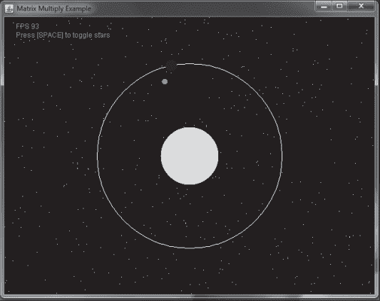

图 3.9
矩阵乘法示例。
© 2014 Timothy Wright.

位于 javagames.transform 包中并如图 3.9 所示的 MatrixMultiplicationExample 演示了如何使用矩阵对对象串联变换操作。矩阵之所以是如此强大的工具，是因为诸如变换和旋转之类的操作可以存储到单个矩阵中，然后一次性应用到对象上。虽然对于单个对象来说这并非必要，但如果需要转换数百或数千个多边形，节省的开销真的可以累积起来。

> **提示**
> 仅供娱乐，此示例还会创建一些随机星星，可以使用“空格”键打开或关闭（明白吗？）。

将单位矩阵作为起点，然后乘以一个将对象移动到屏幕中心的平移矩阵。接着将太阳向量乘以该矩阵，使太阳的中心位于屏幕中心。虽然这只是一个点，但整个多边形模型都可以乘以该矩阵来转换所有坐标。

地球轨道的路径被绘制为一个白色圆圈，然后绘制地球，使其围绕太阳旋转。请注意，使用的是同一个矩阵。将地球的旋转与先前的矩阵串联，可以让地球只需再进行一次旋转和平移就围绕太阳旋转。本示例与前一个示例的区别很重要。有关先旋转再平移与先平移再旋转的区别，请参见图 3.10 和图 3.11。

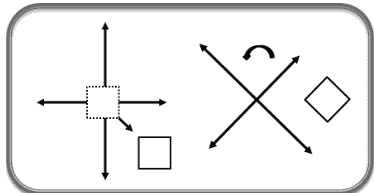

图 3.10 平移 -> 旋转。© 2014 Timothy Wright.

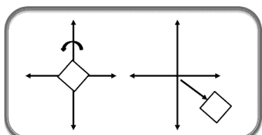

图 3.11 旋转 -> 平移。© 2014 Timothy Wright.

仍然使用同一个矩阵，另一个代表月球的圆圈围绕地球运行。这两颗行星都围绕太阳运行。使用矩阵乘法，这一切都是可能的，而且非常简单。请务必研究代码，直到结果变得合理。

```java
package javagames.transform;
import java.awt.*;
import java.awt.event.*;
import java.awt.image.*;
import java.util.Random;
import javagames.util.*;
import javax.swing.*;
import javagames.swing.*;
```

```java
public class MatrixMultiplyExample extends JFrame implements Runnable {
	private static final int SCREEN_W = 640;
	private static final int SCREEN_H = 480;

	private FrameRate frameRate;
	private BufferStrategy bs;
	private volatile boolean running;
	private Thread gameThread;
	private RelativeMouseInput mouse;
	private KeyboardInput keyboard;

	private float earthRot, earthDelta;
	private float moonRot, moonDelta;

	private boolean showStars;
	private int[] stars;
	private Random rand = new Random();
	public MatrixMultiplyExample() {
	}

	protected void createAndShowGUI() {
		Canvas canvas = new Canvas();
		canvas.setSize( SCREEN_W, SCREEN_H );
		canvas.setBackground( Color.BLACK );
		canvas.setIgnoreRepaint( true );
		getContentPane().add( canvas );
		setTitle( "Matrix Multiply Example" );
		setIgnoreRepaint( true );
		pack();

		// Add key listeners
		keyboard = new KeyboardInput();
		canvas.addKeyListener( keyboard );
```


```java
// Add mouse listeners
// For full screen : mouse = new RelativeMouseInput( this );
mouse = new RelativeMouseInput( canvas );
canvas.addMouseListener( mouse );
canvas.addMouseMotionListener( mouse );
canvas.addMouseWheelListener( mouse );

setVisible( true );
canvas.createBufferStrategy( 2 );
bs = canvas.getBufferStrategy();
canvas.requestFocus();

gameThread = new Thread( this );
gameThread.start();
}

public void run() {
    running = true;
    initialize();
    while( running ) {
        gameLoop();
    }
}

private void gameLoop() {
    processInput();
    renderFrame();
    sleep( 10L );
}

private void renderFrame() {
    do
    do {
        Graphics g = null;
        try {
            g = bs.getDrawGraphics();
            g.clearRect( 0, 0, getWidth(), getHeight() );
            render( g );
        } finally {
            if ( g != null ) {
                g.dispose();
            }
        }
    } while( bs.contentsRestored() );
    bs.show();
} while( bs.contentsLost() );
```

```java
private void sleep( long sleep ) {
    try {
        Thread.sleep( sleep );
    } catch( InterruptedException ex ) {
    }
}
```

```java
private void initialize() {
    frameRate = new FrameRate();
    frameRate.initialize();

    earthDelta = (float)Math.toRadians( 0.5 );
    moonDelta = (float)Math.toRadians( 2.5 );

    showStars = true;
    stars = new int[ 1000 ];
    for( int i = 0; i < stars.length - 1; i += 2 ) {
        stars[i] = rand.nextInt( SCREEN_W );
        stars[i+1] = rand.nextInt( SCREEN_H );
    }
}
```

```java
private void processInput() {
    keyboard.poll();
    mouse.poll();

    if( keyboard.keyDownOnce( KeyEvent.VK_SPACE ) ) {
        showStars = !showStars;
    }
}
```

```java
private void render( Graphics g ) {
    g.setColor( Color.GREEN );
    frameRate.calculate();
    g.drawString( frameRate.getFrameRate(), 20, 20 );
    g.drawString( "Press [SPACE] to toggle stars", 20, 35 );

    if( showStars ) {
        g.setColor( Color.WHITE );
        for( int i = 0; i < stars.length - 1; i += 2 ) {
            g.fillRect( stars[i], stars[i+1], 1, 1 );
        }
    }

    // draw the sun...
    Matrix3x3f sunMat = Matrix3x3f.identity();
    sunMat = sunMat.mul(
        Matrix3x3f.translate( SCREEN_W / 2, SCREEN_H / 2 )
    );

    Vector2f sun = sunMat.mul( new Vector2f() );

    g.setColor( Color.YELLOW );
    g.fillOval( (int)sun.x - 50, (int)sun.y - 50, 100, 100 );

    // draw Earth's Orbit
    g.setColor( Color.WHITE );
    g.drawOval( (int)sun.x - SCREEN_W / 4, (int)sun.y - SCREEN_W / 4,
            SCREEN_W / 2, SCREEN_W / 2 );

    // draw the Earth
    Matrix3x3f earthMat = Matrix3x3f.translate( SCREEN_W / 4, 0 );
    earthMat = earthMat.mul( Matrix3x3f.rotate( earthRot ) );
    earthMat = earthMat.mul( sunMat );

    earthRot += earthDelta;

    Vector2f earth = earthMat.mul( new Vector2f() );
    g.setColor( Color.BLUE );
    g.fillOval( (int)earth.x - 10, (int)earth.y - 10, 20, 20 );

    // draw the Moon
    Matrix3x3f moonMat = Matrix3x3f.translate( 30, 0 );
    moonMat = moonMat.mul( Matrix3x3f.rotate( moonRot ) );
    moonMat = moonMat.mul( earthMat );

    moonRot += moonDelta;

    Vector2f moon = moonMat.mul( new Vector2f() );
    g.setColor( Color.LIGHT_GRAY );
    g.fillOval( (int)moon.x - 5, (int)moon.y - 5, 10, 10 );
}

protected void onWindowClosing() {
    try {
        running = false;
        gameThread.join();
    } catch( InterruptedException e ) {
        e.printStackTrace();
    }

    System.exit( 0 );
}

public static void main( String[] args ) {
    final MatrixMultiplyExample app = new MatrixMultiplyExample();
    app.addWindowListener( new WindowAdapter() {
        public void windowClosing( WindowEvent e ) {
            app.onWindowClosing();
        }
    });
}
```

```java
SwingUtilities.invokeLater(new Runnable() {
    public void run() {
        app.createAndShowGUI();
    }
});
}
}
```

## 仿射变换

Java 有一个名为 AffineTransform 的类，可用于执行矩阵变换。虽然不重写代码是件好事，但研究和学习算法以理解它们也是件好事。代码示例将继续从零开始开发库，但请随意使用内置类。

```
AffineTransform.setToIdentity()
AffineTransform.concatenate(AffineTransform)
AffineTransform.rotate(double radians)
AffineTransform.scale(double sx, double sy)
AffineTransform.translate(double tx, double ty)
AffineTransform.shear(double sx, double sy)
```

使用 AffineTransform 类，有多种方法可以将变换应用于数据点。以下代码使用了所有可用方法：

```
AffineTransform trans = new AffineTransform();
Shape srcShape = new Rectangle();
Shape destShape = null;
Point2D srcPoint = new Point2D.Float();
Point2D destPoint = new Point2D.Float();
Point2D pointSrc[] = new Point2D[] {
    new Point2D.Float(),
    new Point2D.Float(),
    new Point2D.Float(),
    new Point2D.Float()
};
Point2D pointDest[] = new Point2D[3];
double[] doubleSrc = new double[6];
double[] doubleDest = new double[6];
float[] floatSrc = new float[6];
float[] floatDest = new float[6];
int srcOff = 0;
int dstOff = 0;
int numPts = 3; // array is (x,y) pairs...
// Point -> Point
trans.transform( srcPoint, destPoint );
// Point[] -> Point[]
trans.transform( pointSrc, srcOff, pointDest, dstOff, numPts );
// double[] -> double[]
trans.transform( doubleSrc, srcOff, doubleDest, dstOff, numPts );
// float[] -> float[]
trans.transform( floatSrc, srcOff, floatDest, dstOff, numPts );
// double[] -> float[]
trans.transform( doubleSrc, srcOff, floatDest, dstOff, numPts );
// float[] -> double[]
trans.transform( floatSrc, srcOff, doubleDest, dstOff, numPts );
// Shape -> Shape
destShape = trans.createTransformedShape( srcShape );
```

此处显示的最后一个示例，将一个 Shape 转换为另一个 Shape，在为其他操作（例如物理或碰撞检测）检索转换后的坐标时会带来困难。结果数据可以通过 PathIterator 获取，但其用法有点难以理解。路径迭代可以返回各种路径数据：

- SEG_MOVETO—新路径的起始位置
- SEG_LINETO—线条的第二个点
- SEG_QUADTO—指定二次参数曲线的两个点
- SEG_CUBICTO—指定三次参数曲线的三个点

请注意，可能会返回三个 (x,y) 对。以下代码转换一个矩形并遍历结果变换：

```
AffineTransform trans = new AffineTransform();
trans.rotate( Math.PI / 3.0 );
trans.translate( 5.0, 7.0 );
Shape shape = new Rectangle( 0, 0, 100, 150 );
Shape transformed = trans.createTransformedShape( shape );
PathIterator pit = transformed.getPathIterator( null );
float[ ] seg = new float[6];
while( !pit.isDone( ) ) {
    int segType = pit.currentSegment( seg );
    String point = "( " + seg[0] + ", " + seg[1] +
        " ),(" + seg[2] + ", " + seg[3] +
        " ),(" + seg[4] + ", " + seg[5] + ")";
    switch( segType ) {
        case PathIterator.SEG_MOVETO:
            System.out.println( "SEG_MOVETO: " + point );
            break;
        case PathIterator.SEG_LINETO:
            System.out.println( "SEG_LINETO: " + point );
            break;
        case PathIterator.SEG_QUADTO:
            System.out.println( "SEG_QUADTO: " + point );
            break;
        case PathIterator.SEG_CUBICTO:
            System.out.println( "SEG_CUBICTO: " + point );
            break;
        case PathIterator.SEG_CLOSE:
            System.out.println( "SEG_CLOSE: " + point );
            break;
    }
    pit.next();
}
```

## 资源与进一步阅读

Akenine-Moller, Tomas 和 Eric Haines, 《实时渲染》. 第2版, A K Peters, 2002.

Ericson, Christer, 《实时碰撞检测》, Focal Press, 2004.

## 第4章

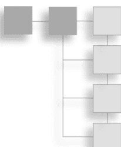

## 时间与空间

当我学习游戏编程时，我想做一些涉及物理的事情，于是搜索了一些方程式并阅读了关于运动的教程。接着，我尝试编写一些涉及重力的代码，并努力做得正确，以便我的计算机程序中的重力与地球上的重力相同。当我读到重力是 9.8 m/s² 时，我停下来，盯着电脑看了一会儿，完全不知道从何入手。我没有类似米的东西，也没有秒。我束手无策。正是在这一点上，我开始意识到计算机游戏可能有多难。本章的目标是向游戏循环添加时间步长，以便进行涉及时间的计算。它还涵盖屏幕映射，以便任何任意坐标系都可以绘制到任何大小的窗口上。

## 计算时间增量

之前的所有示例都在每一帧更新移动对象。这会导致不同计算机速度的对象移动速度取决于帧率而快慢不同。参见图 4.1。


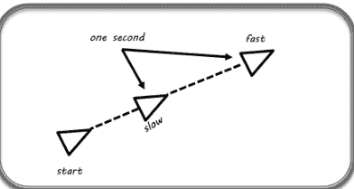

图 4.1
定时移动。
© 2014 Timothy Wright.

为了调整参数并防止游戏过于简单或过于困难，对象需要以一致的速度移动，而不受计算机处理器速度的影响。总有一天，计算机会变得太旧、太慢，但对于其他所有计算机，速度都会发生变化。如果运行了足够多的其他应用程序，今天看起来很快的计算机明天可能就会变慢。

解决方案是计算帧之间的经过时间，并使用该值来缩放更新。

```
last_ns = last tick count
curr_ns = current tick count
elapsed_time_ns = curr_ns - last_ns
elapsed_seconds = elapsed_time_ns / 1.0E9
```

请注意，1 秒等于 1.0E9 纳秒。将经过时间除以每秒的纳秒数，即可得到每秒的经过时间。最初，我的代码使用毫秒，但我的处理器太快，精度不足，导致什么都没动。虽然它在较慢的计算机上可能有效，但请坚持使用纳秒。

run() 方法已更新以计算经过时间：

```
public void run() {
    running = true;
    initialize();
    long curTime = System.nanoTime();
    long lastTime = curTime;
    double nsPerFrame;
    while( running ) {
        curTime = System.nanoTime();
        nsPerFrame = curTime - lastTime;
        gameLoop( nsPerFrame / 1.0E9 );
        lastTime = curTime;
    }
}
```

一旦每帧的经过时间可用，它就被用来缩放移动值，以便屏幕上移动的距离不会根据帧率而改变：

new position = old position + rate * time delta

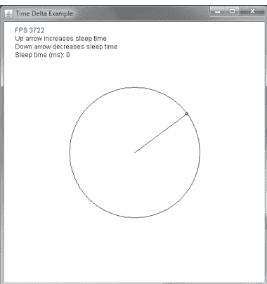

**图 4.2** 时间增量示例。© 2010 Timothy Wright.

TimeDeltaExample（如图 4.2 所示，位于 javagames.timeandspace 包中）创建一个旋转仪表，很像时钟。指针以每四秒一转的速度旋转。箭头键用于增加和降低帧率，同时确保旋转速度不会根据帧率而改变。

首先要注意的是，画布被保存为类变量，以便在窗口大小改变时调整时钟大小。

其次要注意的是，睡眠值也是一个变量，因此可以在应用程序运行时调整帧率。当按下向上或向下箭头键时，睡眠值会调整 10 毫秒。该值始终小于一秒，因为使用轮询键盘时，如果帧率过低，就会开始丢失按键（你将在第 11 章，“文本”中学习如何修复此问题）。

run() 方法已更新以计算帧之间的秒数，并将该值传递给游戏循环。游戏循环现在可以将经过时间传递给任何需要它的方法。对于此示例，在处理输入时没有理由拥有经过时间，但以后会需要它。

updateObjects() 方法是使用新值的地方。添加到角度的步长值设置为 PI / 2 弧度，即 90 度。通过将其乘以经过时间，旋转指针将以每秒 90 度的速度移动。很容易看出，如果一秒钟过去了，添加到角度的值将是 PI / 2。如果经过时间是半秒，添加的值将是一半，即 PI / 4。

```java
private void updateObjects( double delta ) {
    angle += step * delta;
    if ( angle > 2 * Math.PI ) {
        angle -= 2 * Math.PI;
    }
}
```

render() 方法打印控件，以及当前的睡眠时间。绘制圆形的代码略有不同；它使用屏幕宽度和高度，在窗口大小改变时调整显示大小。

```java
package javagames.timeandspace;

import java.awt.*;
import java.awt.event.*;
import java.awt.image.*;
import javagames.util.*;

import javax.swing.*;

public class TimeDeltaExample extends JFrame implements Runnable {

    private FrameRate frameRate;
    private BufferStrategy bs;
    private volatile boolean running;
    private Thread gameThread;
    private RelativeMouseInput mouse;
    private KeyboardInput keyboard;
    private Canvas canvas;
    private float angle;
    private float step;
    private long sleep;

    public TimeDeltaExample() {
    }

    protected void createAndShowGUI() {
        canvas = new Canvas();
        canvas.setSize( 480, 480 );
        canvas.setBackground( Color.WHITE );
        canvas.setIgnoreRepaint( true );
        getContentPane().add( canvas );
        setTitle( "Time Delta Example" );
        setIgnoreRepaint( true );
        pack();
        keyboard = new KeyboardInput();
        canvas.addKeyListener( keyboard );
        mouse = new RelativeMouseInput( canvas );
        canvas.addMouseListener( mouse );
        canvas.addMouseMotionListener( mouse );
        canvas.addMouseWheelListener( mouse );
        setVisible( true );
        canvas.createBufferStrategy( 2 );
        bs = canvas.getBufferStrategy();
        canvas.requestFocus();
        gameThread = new Thread( this );
        gameThread.start();
    }

    public void run() {
        running = true;
        initialize();
        long curTime = System.nanoTime();
        long lastTime = curTime;
        double nsPerFrame;
        while( running ) {
            curTime = System.nanoTime();
            nsPerFrame = curTime - lastTime;
            gameLoop(nsPerFrame / 1.0E9);
            lastTime = curTime;
        }
    }

    private void gameLoop( double delta ) {
        processInput( delta );
        updateObjects( delta );
        renderFrame();
        sleep( sleep );
    }

    private void renderFrame() {
        do {
            do {
                Graphics g = null;
                try {
                    g = bs.getDrawGraphics();
                    g.clearRect( 0, 0, getWidth(), getHeight() );
                    render( g );
                } finally {
                    if( g != null ) {
                        g.dispose();
                    }
                }
            } while( bs.contentsRestored() );
            bs.show();
        } while ( bs.contentsLost() );
    }

    private void sleep( long sleep ) {
        try {
            Thread.sleep( sleep );
        } catch( InterruptedException ex ) {
        }
    }

    private void initialize() {
        frameRate = new FrameRate();
        frameRate.initialize();
        angle = 0.0f;
        step = (float)Math.PI / 2.0f;
    }

    private void processInput( double delta ) {
        keyboard.poll();
        mouse.poll();

        if ( keyboard.keyDownOnce( KeyEvent.VK_UP ) ) {
            sleep += 10;
        }
        if ( keyboard.keyDownOnce( KeyEvent.VK_DOWN ) ) {
            sleep -= 10;
        }
        if ( sleep > 1000 ) {
            sleep = 1000;
        }
        if ( sleep < 0 ) {
            sleep = 0;
        }
    }

    private void updateObjects( double delta ) {
        angle += step * delta;
        if ( angle > 2 * Math.PI ) {
            angle -= 2 * Math.PI;
        }
    }

    private void render( Graphics g ) {
        g.setColor( Color.BLACK );
        frameRate.calculate();
        g.drawString( "" + frameRate.getFrameRate(), 20, 20 );
        g.drawString( "Up arrow increases sleep time", 20, 35 );
        g.drawString( "Down arrow decreases sleep time", 20, 50 );
        g.drawString( "Sleep time (ms): " + sleep, 20, 65 );
        int x = canvas.getWidth() / 4;
        int y = canvas.getHeight() / 4;
        int w = canvas.getWidth() / 2;
        int h = canvas.getHeight() / 2;
        g.drawOval( x, y, w, h );
        // polar -> coords
        float rw = w / 2; // radius width
        float rh = h / 2; // radius height
        int rx = (int)( rw * Math.cos( angle ) );
        int ry = (int)( rh * Math.sin( angle ) );
        int cx = (int)( rx + w );
        int cy = (int)( ry + h );
        // draw clock hand
        g.drawLine( w, h, cx, cy );
        // draw dot at end of hand
        g.drawRect( cx - 2, cy - 2, 4, 4 );
    }

    protected void onWindowClosing() {
        try {
            running = false;
            gameThread.join();
        } catch( InterruptedException e ) {
            e.printStackTrace();
        }
        System.exit( 0 );
    }

    public static void main( String[] args ) {
        final TimeDeltaExample app = new TimeDeltaExample();
        app.addWindowListener( new WindowAdapter() {
            public void windowClosing( WindowEvent e ) {
                app.onWindowClosing();
            }
        });
        SwingUtilities.invokeLater( new Runnable() {
            public void run() {
                app.createAndShowGUI();
            }
        });
    }
}
```

## 屏幕映射

当使用物理方程移动对象时，有两个之前示例中没有的东西是你需要的。以 10 m/s 移动意味着每秒，对象行进 10 米。秒已经添加了，但米呢？

在一些之前的示例中，使用的一些值不直观，且行为不符合预期。这是因为屏幕坐标与学校教授的笛卡尔坐标系不匹配。参见图 4.3。


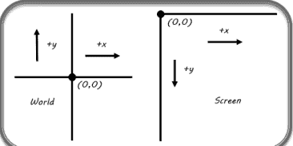

图 4.3 世界与屏幕映射。© 2014 Timothy Wright.

最好能够在任意坐标系中定义对象，然后将它们映射到屏幕上。事实证明，使用上一章讨论的变换，这样做很简单。这不仅对于创建一个行为符合预期的坐标系很重要，而且对于缩放屏幕上的映射值也很重要，这样窗口的大小就无关紧要了。这对于在不同设备上具有不同大小窗口的游戏可能很重要。参见图 4.4。

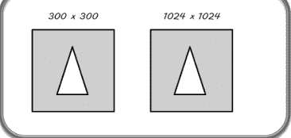

图 4.4 多种尺寸。© 2014 Timothy Wright.

较大的窗口会缩放一切，无论窗口占据什么大小，都保持对象之间的比例相同。首先，你必须定义宽度和高度来定义游戏世界。许多图形系统使用 (-1,1) 窗口。参见图 4.5。

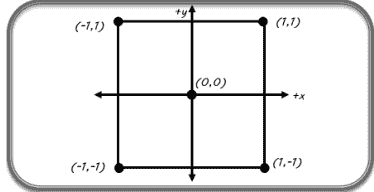

图 4.5 归一化设备坐标。© 2014 Timothy Wright.

这定义了一个 2 x 2 单位的区域，将被映射到屏幕上，单位可以是你想要的任何东西。如果游戏需要米，就称之为米。如果游戏是行星游戏，也许是英里或光年。这无关紧要，但它可以帮助定义对象的大小，并允许在屏幕上产生距离感。对于本示例，假设单位是米，可用区域是 2 x 2 米，或约 6.56 x 6.56 英尺。

要将世界区域映射到屏幕，首先将区域缩放到屏幕宽度和高度。然后，翻转 y 轴。最后，平移区域，以便将值绘制到屏幕上时是正确的。参见图 4.6。

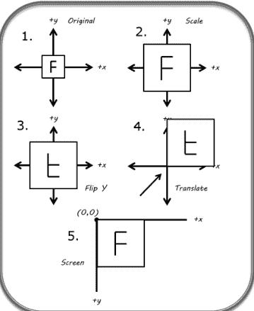

图 4.6 屏幕映射算法。© 2014 Timothy Wright.

以下代码计算用于将世界坐标转换为屏幕坐标的视口矩阵。注意在本示例中，缩放和平移值为 width / 2 和 height / 2。这仅仅是因为 (-1,1) 世界坐标的宽度和高度为 2。例如，如果世界区域是 5 × 5，那么缩放值将除以 5，但平移值始终除以 2，世界坐标的中心位于 (0,0)。

```
float worldWidth = 2.0f;
float worldHeight = 2.0f;
float screenWidth = canvas.getWidth() - 1;
float screenHeight = canvas.getHeight() - 1;
float sx = screenWidth / worldWidth;
float sy = screenHeight / worldHeight;
float tx = screenWidth / 2.0f;
float ty = screenHeight / 2.0f;
Matrix3x3f viewport = Matrix3x3f.scale( sx, -sy );
viewport = viewport.mul( Matrix3x3f.translate( tx, ty ) );
```

注意在前面的示例代码中，在使用屏幕宽度和高度之前减去了 1。这是因为实际像素值被映射到屏幕上，虽然屏幕宽度可能是 10，但像素范围是 0 - 9，就像数组一样。如果使用实际宽度，当世界坐标转换为屏幕坐标时，最后一行和最后一列将被绘制到屏幕外，这不是预期的意图。将屏幕宽度设置为 width - 1，屏幕高度设置为 height - 1 可以防止这种情况发生。

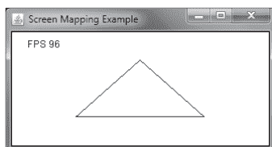

图 4.7 屏幕映射示例。© 2014 Timothy Wright.

如图 4.7 所示的 ScreenMappingExample，位于 javagames.timeandspace 包中，是一个简单的程序，允许调整屏幕大小，同时保持宽高比与窗口宽度和高度匹配。

有一个三角形数组和一个名为 triWorld 的副本，用于保存映射值。initialize() 方法中三角形的值现在是小值。因为世界大小是 2 x 2，非常小的值会产生一个填满屏幕的三角形。

render() 方法创建视口矩阵并乘以三角形点，将值从世界空间映射到屏幕空间。另外，在边缘绘制了一个边框矩形。尝试从屏幕宽度和屏幕高度计算中删除 -1，看看边框矩形会发生什么。

```
package javagames.timeandspace;
import java.awt.*;
import java.awt.event.*;
import java.awt.image.*;

import javagames.util.*;
import javax.swing.*;

public class ScreenMappingExample extends JFrame
        implements Runnable {

    private Canvas canvas;
    private FrameRate frameRate;
    private BufferStrategy bs;
    private volatile boolean running;
    private Thread gameThread;
    private RelativeMouseInput mouse;
    private KeyboardInput keyboard;

    private Vector2f[] tri;
    private Vector2f[] triWorld;
    private Vector2f[] rect;
    private Vector2f[] rectWorld;

    public ScreenMappingExample() {
    }

    protected void createAndShowGUI() {
        canvas = new Canvas();
        canvas.setSize( 640, 480 );
        canvas.setBackground( Color.WHITE );
        canvas.setIgnoreRepaint( true );
        getContentPane().add( canvas );
        setTitle( "Screen Mapping Example" );
        setIgnoreRepaint( true );
        pack();

        keyboard = new KeyboardInput();
        canvas.addKeyListener( keyboard );

        mouse = new RelativeMouseInput( canvas );
        canvas.addMouseListener( mouse );
        canvas.addMouseMotionListener( mouse );
        canvas.addMouseWheelListener( mouse );

        setVisible( true );
        createBufferStrategy( 2 );
        bs = canvas.getBufferStrategy();
        canvas.requestFocus();

        gameThread = new Thread( this );
        gameThread.start();
    }

    public void run() {
        running = true;
        initialize();
        long curTime = System.nanoTime();
        long lastTime = curTime;
        double nsPerFrame;
        while (running) {
            curTime = System.nanoTime();
            nsPerFrame = curTime - lastTime;
            gameLoop(nsPerFrame / 1.0E9);
            lastTime = curTime;
        }
    }

    private void initialize() {
        frameRate = new FrameRate();
        frameRate.initialize();
        tri = new Vector2f[] {
            new Vector2f( 0.0f,  0.5f ),
            new Vector2f(-0.5f, -0.5f ),
            new Vector2f( 0.5f, -0.5f ),
        };
        triWorld = new Vector2f[ tri.length ];
        rect = new Vector2f[] {
            new Vector2f( -1.0f,  1.0f ),
            new Vector2f(  1.0f,  1.0f ),
            new Vector2f(  1.0f, -1.0f ),
            new Vector2f( -1.0f, -1.0f ),
        };
        rectWorld = new Vector2f[ rect.length ];
    }

    private void gameLoop(double delta) {
        processInput( delta );
        updateObjects( delta );
        renderFrame();
        sleep( 10L );
    }

    private void renderFrame() {
        do {
            do {
                Graphics g = null;
                try {
                    g = bs.getDrawGraphics();
                    g.clearRect( 0, 0, getWidth(), getHeight() );
                    render( g );
                } finally {
                    if ( g != null ) {
                        g.dispose();
                    }
                } while ( bs.contentsRestored() );
                bs.show();
            } while ( bs.contentsLost() );
        }
    }

    private void sleep( long sleep ) {
        try {
            Thread.sleep( sleep );
        } catch ( InterruptedException ex ) {
        }
    }

    private void processInput( double delta ) {
        keyboard.poll();
        mouse.poll();
    }

    private void updateObjects( double delta ) {
    }

    private void render( Graphics g ) {
        g.setColor( Color.BLACK );
        frameRate.calculate();
        g.drawString( "FrameRate: " + frameRate.getFrameRate(), 20, 20 );
        float worldWidth = 2.0f;
        float worldHeight = 2.0f;
        float screenWidth = canvas.getWidth() - 1;
        float screenHeight = canvas.getHeight() - 1;
        float sx = screenWidth / worldWidth;
        float sy = screenHeight / worldHeight;
        float tx = screenWidth / 2.0f;
        float ty = screenHeight / 2.0f;
        Matrix3x3f viewport = Matrix3x3f.scale( sx, -sy );
        viewport = viewport.mul( Matrix3x3f.translate( tx, ty ) );
        for ( int i = 0; i < tri.length; ++i ) {
            triWorld[i] = viewport.mul( tri[i] );
        }
    }
}
```


## 调整视口比例

在上一个示例中，三角形会拉伸以填充窗口，无论窗口大小如何。可以调整窗口大小，使三角形远离其原始尺寸，这可能不是窗口化游戏应有的行为。虽然能够映射到不同大小的视口很重要，但保持比例一致也同样重要，这样无论窗口多大或多小，比例都保持正确。

添加 ComponentListener 后，窗口在每次调整大小时都会通知应用程序。因此，无论窗口大小如何，比例都可以保持不变。ComponentListener 有几个接口，但只有 componentResized() 方法对于检测调整大小事件是必要的：

- componentHidden( ComponentEvent e )
- componentMoved( ComponentEvent e )
- componentResized( ComponentEvent e )
- componentShown( ComponentEvent e )

检测到调整大小事件后，需要调整视口以保持比例不变。根据窗口大小和视口大小，可能会出现一些有趣的尺寸。参见图 4.8。

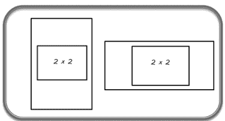

**图 4.8**
宽度和高度比例。
© 2014 Timothy Wright.

如果调整后的视口在当前窗口中居中，那么无论窗口大小如何，视口都会增长或缩小到仍能保持正确宽高比的最大可能尺寸。

新尺寸是通过两个窗口的比例计算得出的：

新宽度 / 新高度 : 视口宽度 / 视口高度
新宽度 = 新高度 * 视口宽度 / 视口高度
新高度 = 新宽度 * 视口高度 / 视口宽度

要计算视口的新尺寸，可以选择屏幕宽度或屏幕高度来计算另一个值，以便比例保持正确。虽然你可以执行检查以确定使用哪个维度，但选择其中一个，看看新比例是否适合当前窗口，如果太大，则使用另一个，同样简单。

```
int newW = vw;
int newH = (int)(vw * worldHeight / worldWidth);
if (newW > vh) {
    newW = (int)(vh * worldWidth / worldHeight);
    newH = vh;
}
```

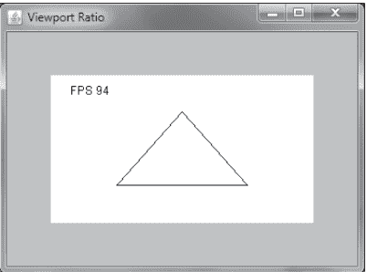

图 4.9 视口比例示例。© 2014 Timothy Wright.

如图 4.9 所示且位于 `javagames.timeandspace` 包中的 ViewportRatioExample，无论屏幕大小如何，都保持世界比例尺寸。首先要注意的是 ComponentAdapter，它被添加到内容窗格中。此侦听器也可以添加到 `JFrame`，但直到释放鼠标按钮后才会接收调整大小事件。根据游戏的行为，这可能是必要的，而不是在调整窗口大小时重新绘制窗口。

```
getContentPane().addComponentListener(new ComponentAdapter() {
    public void componentResized(ComponentEvent e) {
        onComponentResized(e);
    }
});
```

世界比例在 `initialize()` 方法中设置为 16:9，即宽屏尺寸的世界。更改这些值将更改视口的比例。

```
worldWidth = 16.0f;
worldHeight = 9.0f;
```

实际调整大小是通过为画布对象计算新的 (x,y) 位置以及新的宽度和高度来完成的。参见图 4.10。

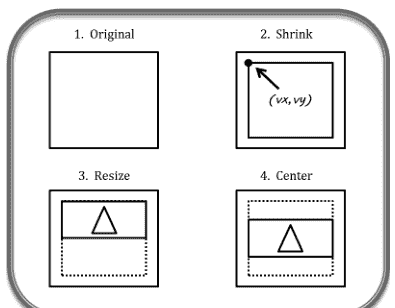

图 4.10 调整大小和居中算法。

调整大小过程按以下方式进行：

- 1. 原始。新大小在 componentResized() 事件中可用。
- 2. 收缩。当前大小被调整。在此情况下，它被更改为当前大小的 %。中心是通过获取原始大小和 % 大小之间的差值，并将剩余区域对半切开来计算的。
- 3. 使用调整后的较小尺寸计算新宽度和高度，因此会有边框。
- 4. 调整后的大小在较小尺寸中居中，就像之前的视口居中一样。

示例代码如下：

```
package javagames.timeandspace;

import java.awt.*;
import java.awt.event.*;
import java.awt.image.*;
import javagames.util.*;
import javax.swing.*;

public class ViewportRatio extends JFrame implements Runnable {
	private FrameRate frameRate;
	private BufferStrategy bs;
	private volatile boolean running;
	private Thread gameThread;
	private RelativeMouseInput mouse;
	private KeyboardInput keyboard;
	private Canvas canvas;
	private Vector2f[] tri;
	private Vector2f[] triWorld;
	private float worldWidth;
	private float worldHeight;
	public ViewportRatio() {
	}
	protected void createAndShowGUI() {
		canvas = new Canvas();
		canvas.setBackground( Color.WHITE );
		canvas.setIgnoreRepaint( true );
		getContentPane().setBackground( Color.LIGHT_GRAY );
		setLayout( null );
		setTitle( "Viewport Ratio" );
		setSize( 640, 640 );
		getContentPane().add( canvas );
		keyboard = new KeyboardInput();
		canvas.addKeyListener( keyboard );
		mouse = new RelativeMouseInput( canvas );
		canvas.addMouseListener( mouse );
		canvas.addMouseMotionListener( mouse );
		canvas.addMouseWheelListener( mouse );
		getContentPane().addComponentListener( new ComponentAdapter() {
		    public void componentResized( ComponentEvent e ) {
		    onComponentResized( e );
		    }
		});
		setVisible( true );
		canvas.createBufferStrategy( 2 );
		bs = canvas.getBufferStrategy();
		canvas.requestFocus();
		gameThread = new Thread( this );
		gameThread.start();
	}
}

protected void onComponentResized( ComponentEvent e ) {
	Dimension size = getContentPane().getSize();
	int vw = size.width * 3 / 4;
	int vh = size.height * 3 / 4;
	int vx = ( size.width - vw ) / 2;
	int vy = ( size.height - vh ) / 2;
	int newW = vw;
	int newH = (int)(vw * worldHeight / worldWidth);
	if ( newH > vh ) {
		newH = (int)(vh * worldWidth / worldHeight);
		newW = vh;
	}
	// center
	vx += ( vw - newW ) / 2;
	vy += ( vh - newH ) / 2;
	canvas.setLocation( vx, vy );
	canvas.setSize( newW, newH );
}
```

```
public void run() {
    running = true;
    initialize();
    long curTime = System.nanoTime();
    long lastTime = curTime;
    double nsPerFrame;
    while( running ) {
        curTime = System.nanoTime();
        nsPerFrame = curTime - lastTime;
        gameLoop( nsPerFrame / 1.0E9 );
        lastTime = curTime;
    }
}
```

```
private void gameLoop( double delta ) {
    processInput( delta );
    updateObjects( delta );
    renderFrame();
    sleep( 10L );
}
```

```
private void renderFrame() {
    do {
        do {
            Graphics g = null;
            try {
                g = bs.getDrawGraphics();
                g.clearRect( 0, 0, getWidth(), getHeight() );
                render( g );
            } finally {
                if ( g != null ) {
                    g.dispose();
                }
            }
        } while( bs.contentsRestored() );
        bs.show();
    } while( bs.contentsLost() );
}
```

```
private void sleep( long sleep ) {
    try {
        Thread.sleep( sleep );
    } catch( InterruptedException ex ) { }
}
```

```
private void initialize() {
	frameRate = new FrameRate();
	frameRate.initialize();
	tri = new Vector2f[] {
		new Vector2f( 0.0f, 2.25f ),
		new Vector2f( -4.0f, -2.25f ),
		new Vector2f( 4.0f, -2.25f ),
	};
	triWorld = new Vector2f[ tri.length ];
	worldWidth = 16.0f;
	worldHeight = 9.0f;
}
```

```
private void processInput( double delta ) {
	keyboard.poll();
	mouse.poll();
}
```

```
private void updateObjects( double delta ) {
}
```

```
private void render( Graphics g ) {
	g.setColor( Color.BLACK );
	frameRate.calculate();
	g.drawString( frameRate.getFrameRate(), 20, 20 );

	float sx = ( canvas.getWidth() - 1 ) / worldWidth;
	float sy = ( canvas.getHeight() - 1 ) / worldHeight;
	float tx = ( canvas.getWidth() - 1 ) / 2.0f;
	float ty = ( canvas.getHeight() - 1 ) / 2.0f;
	Matrix3x3f viewport = Matrix3x3f.identity();
	viewport = viewport.mul( Matrix3x3f.scale( sx, -sy ) );
	viewport = viewport.mul( Matrix3x3f.translate( tx, ty ) );

	for ( int i = 0; i < tri.length; ++i ) {
		triWorld[ i ] = viewport.mul( tri[ i ] );
	}

	drawPolygon( g, triWorld );
}
```

```
private void drawPolygon( Graphics g, Vector2f[] polygon ) {
	Vector2f P;
	Vector2f S = polygon[ polygon.length - 1 ];
	for ( int i = 0; i < polygon.length; ++i ) {
```


```
P = polygon[];
g.drawLine((int)S.x, (int)S.y, (int)P.x, (int)P.y);
S = P;
}
protected void onWindowClosing() {
try {
running = false;
gameThread.join();
} catch (InterruptedException e) {
e.printStackTrace();
}
System.exit(0);
}
public static void main(String[] args) {
final ViewportRatio app = new ViewportRatio();
app.addWindowListener(new WindowAdapter() {
public void windowClosing(WindowEvent e) {
app.onWindowClosing();
}
});
SwingUtilities.invokeLater(new Runnable() {
public void run() {
app.createAndShowGUI();
}
});
}
}
```

## 炮弹物理

CannonExample 如图 4.11 所示，位于 javagames.timeandspace 包中，它像炮弹一样将一个正方形射向空中。理解在移动对象时如何使用时间增量参数非常重要。

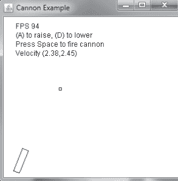

图 4.11 炮弹示例。© 2014 Timothy Wright.

查找对象位置的标准物理公式可以如下所示：

$$d = d_0 + vt - \frac{at^2}{2}$$

其中 ($d_0$) 是初始位置，($v$) 是速度，($a$) 是加速度，($t$) 是时间，($d$) 是结果位置。使用此公式的问题是它需要整个时间，而不仅仅是帧之间的时间。对于瞬时时间，以下公式更有用：

$$v = \frac{d}{t}, \quad a = \frac{v}{t}, \quad d = vt, \quad v = at$$

这些公式仅使用当前时间，而非整个时间。请务必注意所需的时间值。如果需要整个时间，不要只使用经过的时间。

`initialize()` 方法设置默认值，创建大炮模型，并将其缩放为 0.75。按下 A 或 D 键时，大炮会旋转，并使用时间增量来控制旋转。在之前的示例中，旋转增量被设置为一个小值，例如 5 度。现在它被设置为每秒 90 度，并使用时间增量进行推进。

当用户按下空格键时，会创建一个新的炮弹。速度是通过在 x 轴上创建一个 7.0 单位的向量，然后将其旋转到正确角度来计算的。这也可以使用极坐标计算，但我想展示另一种使用矩阵的方法。

炮弹被变换到旋转后的大炮末端。使用 0.375 值是因为在使用模型之前，原始大炮长度 0.5 已被缩放为 0.75。

update() 函数定位并复制大炮模型，以便准备渲染。如果存在炮弹，则调整其位置。我没有使用向量来表示重力，而是使用 –9.8 这个值来“作弊”。既然视口映射已就位，即使屏幕上正 y 值向下移动，我也可以使用 –9.8 作为重力参数。如果不映射视口，y 单位将被翻转，并且需要使用正重力值才能让子弹下落，这实在太奇怪了。

render 方法显示通常的帧率和说明。本示例的世界空间为 5 x 5 米，并映射到屏幕上。未保持比例，因此调整屏幕大小会导致物理效果出现一些奇怪的情况。应用视口变换后，绘制大炮和炮弹。

```
package javagames.timeandspace;

import java.awt.*;
import java.awt.event.*;
import java.awt.image.*;
import javagames.util.*;
import javax.swing.*;

public class CannonExample extends JFrame
implements Runnable {

private FrameRate frameRate;
private BufferStrategy bs;
private volatile boolean running;
private Thread gameThread;
private RelativeMouseInput mouse;
private KeyboardInput keyboard;

private Canvas canvas;

private Vector2f[] cannon;
private Vector2f[] cannonCpy;
private float cannonRot, cannonDelta;

private Vector2f bullet;
private Vector2f bulletCpy;
private Vector2f velocity;

public CannonExample() {
}
```

```
protected void createAndShowGUI() {

canvas = new Canvas();
canvas.setSize( 640, 480 );
canvas.setBackground( Color.WHITE );
canvas.setIgnoreRepaint( true );
getContentPane().add( canvas );
setTitle( "Cannon Example" );
setIgnoreRepaint( true );
pack();

keyboard = new KeyboardInput();
canvas.addKeyListener( keyboard );
mouse = new RelativeMouseInput( canvas );
canvas.addMouseListener( mouse );
canvas.addMouseMotionListener( mouse );
canvas.addMouseWheelListener( mouse );

setVisible( true );
canvas.createBufferStrategy( 2 );
bs = canvas.getBufferStrategy();
canvas.requestFocus();

gameThread = new Thread( this );
gameThread.start();
}
```

```
public void run() {
running = true;
initialize();

long curTime = System.nanoTime();
long lastTime = curTime;
double nsPerFrame;
while( running ) {
    curTime = System.nanoTime();
    nsPerFrame = curTime - lastTime;
    gameLoop( nsPerFrame / 1.0E9 );
    lastTime = curTime;
}
}
```

```
private void initialize() {
    frameRate = new FrameRate();
    frameRate.initialize();

    velocity = new Vector2f();
    cannonRot = 0.0f;
    cannonDelta = (float)Math.toRadians( 90.0 );
    cannon = new Vector2f[] {
        new Vector2f( -0.5f, 0.125f ), // top-left
        new Vector2f( 0.5f, 0.125f ), // top-right
        new Vector2f( 0.5f, -0.125f ), // bottom-right
        new Vector2f( -0.5f, -0.125f ), // bottom-left
    };
    cannonCpy = new Vector2f[ cannon.length ];

    Matrix3x3f scale = Matrix3x3f.scale( .75f, .75f );
    for( int i = 0; i < cannon.length; ++i ) {
        cannon[i] = scale.mul( cannon[i] );
    }
}
```

```
private void gameLoop( double delta ) {
    processInput( delta );
    updateObjects( delta );
    renderFrame();
    sleep( 10L );
}
```

```
private void renderFrame() {
    do {
        Graphics g = null;
        try {
            g = bs.getDrawGraphics();
            g.clearRect(0, 0, getWidth(), getHeight());
            render(g);
        } finally {
            if (g != null) {
                g.dispose();
            }
        } while (bs.contentsRestored());
        bs.show();
    } while (bs.contentsLost());
}
```

```
private void sleep(long sleep) {
    try {
        Thread.sleep(sleep);
    } catch (InterruptedException ex) {
    }
}
```

```
private void processInput(double delta) {
    keyboard.poll();
    mouse.poll();

    if (keyboard.keyDown(KeyEvent.VK_A)) {
        cannonRot += cannonDelta * delta;
    }
    if (keyboard.keyDown(KeyEvent.VK_D)) {
        cannonRot -= cannonDelta * delta;
    }
    if (keyboard.keyDownOnce(KeyEvent.VK_SPACE)) {
        // new velocity
        Matrix3x3f mat = Matrix3x3f.translate(7.0f, 0.0f);
        mat = mat.mul(Matrix3x3f.rotate(cannonRot));
        velocity = mat.mul(new Vector2f());

        // place bullet at cannon end
        mat = Matrix3x3f.translate(.375f, 0.0f);
        mat = mat.mul(Matrix3x3f.rotate(cannonRot));
        mat = mat.mul(Matrix3x3f.translate(-2.0f, -2.0f));
        bullet = mat.mul(new Vector2f());
    }
}
```

```
private void updateObjects( double delta ) {
    Matrix3x3f mat = Matrix3x3f.identity();
    mat = mat.mul( Matrix3x3f.rotate( cannonRot ) );
    mat = mat.mul( Matrix3x3f.translate( -2.0f, -2.0f ) );

    for( int i = 0; i < cannon.length; ++i ) {
        cannonCpy[i] = mat.mul( cannon[i] );
    }

    if( bullet != null ) {
        velocity.y += -9.8f * delta;
        bullet.x += velocity.x * delta;
        bullet.y += velocity.y * delta;
        bulletCpy = new Vector2f( bullet );

        if( bullet.y < -2.5f ) {
            bullet = null;
        }
    }
}
```

```
private void render( Graphics g ) {
    g.setColor( Color.BLACK );
    frameRate.calculate();

    g.drawString( "Frame rate: " + getFrameRate(), 20, 20 );
    g.drawString( "(A) to raise, (D) to lower", 20, 35 );
    g.drawString( "Press Space to fire cannon", 20, 50 );

    String vel =
        String.format( "Velocity (%.2f,%.2f)", velocity.x, velocity.y );
    g.drawString( vel, 20, 65 );

    float worldWidth = 5.0f;
    float worldHeight = 5.0f;
    float screenWidth = canvas.getWidth() - 1;
    float screenHeight = canvas.getHeight() - 1;

    float sx = screenWidth / worldWidth;
    float sy = screenHeight / worldHeight;
    Matrix3x3f viewport = Matrix3x3f.scale( sx, sy );
    float tx = screenWidth / 2.0f;
```


```java
float ty = screenHeight / 2.0f;
viewport = viewport.mul( Matrix3x3f.translate( tx, ty ) );

for( int i = 0; i < cannon.length; ++i ) {
    cannonCpy[i] = viewport.mul( cannonCpy[i] );
}

drawPolygon( g, cannonCpy );

if( bullet != null ) {
    bulletCpy = viewport.mul( bulletCpy );
    g.drawRect( (int)bulletCpy.x-2, (int)bulletCpy.y-2, 4, 4 );
}
```

```java
private void drawPolygon( Graphics g, Vector2f[] polygon ) {
    Vector2f P;
    Vector2f S = polygon[ polygon.length - 1 ];
    for( int i = 0; i < polygon.length; ++i ) {
        P = polygon[i];
        g.drawLine( (int)S.x, (int)S.y, (int)P.x, (int)P.y );
        S = P;
    }
}
```

```java
protected void onWindowClosing() {
    try {
        running = false;
        gameThread.join();
    } catch( InterruptedException e ) {
        e.printStackTrace();
    }
    System.exit( 0 );
}
```

```java
public static void main( String[] args ) {
    final CannonExample app = new CannonExample();
    app.addWindowListener( new WindowAdapter() {
        public void windowClosing( WindowEvent e ) {
            app.onWindowClosing();
        }
    });
    SwingUtilities.invokeLater(new Runnable() {
        public void run() {
            app.createAndShowGUI();
        }
    });
}
```

## 资源与进一步阅读

Sanglard, Fabien，“游戏定时器：问题与解决方案”，http://fabiensanglard.net/timer_and_framerate/index.php.

Fiedler, Glenn，“修正你的时间步长”，http://gafferongames.com/game-physics/fix-your-timestep/.

## 第 5 章

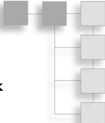

## 简单游戏框架

目前为止的许多示例都有大量共用代码。之前的所有章节都以某种方式为主游戏循环添加和更新了功能。由于每个示例的框架不再有更新，创建一个可作为后续所有示例起点的 SimpleFramework 会很有帮助。

## 屏幕到世界坐标转换

Utility 类已添加到 javagames.util 包中，包含用于创建视口变换矩阵的以下方法：

```java
package javagames.util;

public class Utility {
    public static Matrix3x3f createViewport(
            float worldWidth, float worldHeight,
            float screenWidth, float screenHeight ) {
        float sx = (screenWidth - 1) / worldWidth;
        float sy = (screenHeight - 1) / worldHeight;
        float tx = (screenWidth - 1) / 2.0f;
        float ty = (screenHeight - 1) / 2.0f;
        Matrix3x3f viewport = Matrix3x3f.scale( sx, -sy );
        viewport = viewport.mul( Matrix3x3f.translate( tx, ty ) );
        return viewport;
    }

    public static Matrix3x3f createReverseViewport(
            float worldWidth, float worldHeight,
            float screenWidth, float screenHeight ) {
        float sx = worldWidth / ( screenWidth - 1 );
        float sy = worldHeight / ( screenHeight - 1 );
        float tx = ( screenWidth - 1 ) / 2.0f;
        float ty = ( screenHeight - 1 ) / 2.0f;
        Matrix3x3f viewport = Matrix3x3f.translate( -tx, -ty );
        viewport = viewport.mul( Matrix3x3f.scale( sx, -sy ) );
        return viewport;
    }
}
```

需要注意的是，createReverseViewport() 执行的是先平移后缩放，而非先缩放后平移，从而实现视口变换的逆运算。这可用于将鼠标屏幕坐标转换为世界坐标。

getViewportTransform() 和 getReverseViewportTransform() 已作为实用方法添加，使用画布大小和世界大小来创建变换矩阵。getWorldMousePosition() 用于将屏幕坐标转换为世界坐标。当鼠标设置为返回相对位置时，使用 getRelativeWorldMousePosition() 方法。

```java
// SimpleFramework.java
protected Matrix3x3f getViewportTransform() {
    return Utility.createViewport(
        appWorldWidth, appWorldHeight, canvas.getWidth(), canvas.getHeight()
    );
}
```

```java
protected Matrix3x3f getReverseViewportTransform() {
    return Utility.createReverseViewport(
        appWorldWidth, appWorldHeight, canvas.getWidth(), canvas.getHeight()
    );
}
```

```java
protected Vector2f getWorldMousePosition() {
    Matrix3x3f screenToWorld = getReverseViewportTransform();
    Point mousePos = mouse.getPosition();
    Vector2f screenPos = new Vector2f( mousePos.x, mousePos.y );
    return screenToWorld.mul( screenPos );
}
```

```java
protected Vector2f getRelativeWorldMousePosition() {
    float sx = appWorldWidth / ( canvas.getWidth() - 1 );
    float sy = appWorldHeight / ( canvas.getHeight() - 1 );
    Matrix3x3f viewport = Matrix3x3f.scale( sx, -sy );
    Point p = mouse.getPosition();
    return viewport.mul( new Vector2f( p.x, p.y ) );
}
```

## 理解简单框架

关于位于 javagames.util 包中的 SimpleFramework 类，首先需要注意的一点是它的所有属性。虽然可以为每个属性提供访问方法，但直接使用默认值或在构造函数中修改它们更为简单。由于所有属性都以 app 开头，在代码编辑器中使用代码补全会列出可用属性列表。参见图 5.1。

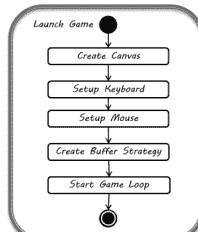

图 5.1 启动应用程序。© 2014 Timothy Wright.

- appBackground—主游戏区域的背景颜色。
- appBorder—保持宽高比时边框的颜色。
- appFPSColor—绘制每秒帧数显示的颜色。
- appFont—显示每秒帧数时使用的字体。
- appTitle—示例的标题。
- appBorderScale—保持宽高比时游戏区域与边框区域的比例。
- appWidth—窗口的启动宽度。
- appHeight—窗口的启动高度。
- appWorldWidth—世界坐标的宽度。
- appWorldHeight—世界坐标的高度。
- appSleep—每帧休眠的毫秒数。
- appMaintainRatio—如果应保持宽高比，则为 True。

此类没有 main() 方法。子类可以使用 launchApp() 方法添加关闭窗口监听器并启动应用程序。

```java
// SimpleFramework.java
protected static void launchApp(final SimpleFramework app) {
    app.addWindowListener(new WindowAdapter() {
        public void windowClosing(WindowEvent e) {
            app.onWindowClosing();
        }
    });
    SwingUtilities.invokeLater(new Runnable() {
        public void run() {
            app.createAndShowGUI();
        }
    });
}
```

在 createAndShowGUI() 方法中，新代码会检查宽高比属性，并要么初始化应用程序以拉伸视图，要么在调整窗口大小时保持宽高比。有关更多信息，请参见第 4 章“时间与空间”中的 ViewportRatioExample。当调整窗口大小且应保持宽高比时，onComponentResized() 方法用于调整画布大小。参见图 5.2。

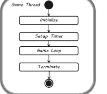

图 5.2 游戏线程。
© 2014 Timothy Wright.

run() 方法中添加了两个方法，以允许子类在主游戏循环之前和之后运行代码：

- initialize() 在游戏循环开始前调用。
- terminate() 在应用程序关闭后调用。

initialize() 方法创建并初始化 frameRate 对象，terminate() 方法为空，游戏循环保持不变。terminate() 方法中不执行任何操作，游戏循环保持不变。用于执行游戏操作的三个方法已设为 protected，以便子类可以重写它们。

```java
protected void processInput(float delta)
protected void updateObjects(float delta)
protected void render(Graphics g)
```

processInput() 方法调用键盘和鼠标的轮询方法。render() 方法绘制帧率，updateObjects() 方法目前为空。参见图 5.3。

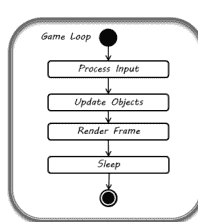

图 5.3 游戏循环。

```java
package javagames.util;
import java.awt.*;
import java.awt.event.*;
import java.awt.image.BufferedStrategy;
import javax.swing.JFrame;
import javax.swing.SwingUtilities;
```


```java
public class SimpleFramework extends JFrame implements Runnable {
private BufferStrategy bs;
private volatile boolean running;
private Thread gameThread;
protected FrameRate frameRate;
protected Canvas canvas;
protected RelativeMouseInput mouse;
protected KeyboardInput keyboard;
protected Color appBackground = Color.BLACK;
protected Color appBorder = Color.LIGHT_GRAY;
protected Color appFPSColor = Color.GREEN;
protected Font appFont = new Font( "Courier New", Font.PLAIN, 14 );
protected String appTitle = "TBD-Title";
protected float appBorderScale = 0.8f;
protected int appWidth = 640;
protected int appHeight = 480;
protected float appWorldWidth = 2.0f;
protected float appWorldHeight = 2.0f;
protected long appSleep = 10L;
protected boolean appMaintainRatio = false;
public SimpleFramework() {
}
protected void createAndShowGUI() {
canvas = new Canvas();
canvas.setBackground( appBackground );
canvas.setIgnoreRepaint( true );
getContentPane().add( canvas );
setLocationByPlatform( true );
if( appMaintainRatio ) {
getContentPane().setBackground( appBorder );
setSize( appWidth, appHeight );
setLayout( null );
getContentPane().addComponentListener( new ComponentAdapter() {
public void componentResized( ComponentEvent e ) {
onComponentResized( e );
} );
} else {
canvas.setSize( appWidth, appHeight );
pack();
}
setTitle( appTitle );
keyboard = new KeyboardInput();
canvas.addKeyListener( keyboard );
mouse = new RelativeMouseInput( canvas );
canvas.addMouseListener( mouse );
canvas.addMouseMotionListener( mouse );
canvas.addMouseWheelListener( mouse );
setVisible( true );
canvas.createBufferStrategy( 2 );
bs = canvas.getBufferStrategy();
canvas.requestFocus();
gameThread = new Thread( this );
gameThread.start();
}
protected void onComponentResized( ComponentEvent e ) {
Dimension size = getContentPane().getSize();
int vw = (int)( size.width * appBorderScale);
int vh = (int)( size.height * appBorderScale);
int vx = ( size.width - vw ) / 2;
int vy = ( size.height - vh ) / 2;
int newW = vw;
int newH = (int)( vw * appWorldHeight / appWorldWidth );
if ( newH > vh ) {
newW = (int)( vh * appWorldWidth / appWorldHeight );
newH = vh;
}
// center
vx += ( vw - newW ) / 2;
vy += ( vh - newH ) / 2;
canvas.setLocation( vx, vy );
canvas.setSize( newW, newH );
}
protected Matrix3x3f getViewportTransform() {
return Utility.createViewport(
appWorldWidth, appWorldHeight, canvas.getWidth(), canvas.getHeight()
);
}
protected Matrix3x3f getReverseViewportTransform() {
return Utility.createReverseViewport(
appWorldWidth, appWorldHeight, canvas.getWidth(), canvas.getHeight()
);
}
protected Vector2f getWorldMousePosition() {
    Matrix3x3f screenToWorld = getReverseViewportTransform();
    Point mousePos = mouse.getPosition();
    Vector2f screenPos = new Vector2f( mousePos.x, mousePos.y );
    return screenToWorld.mul( screenPos );
}
protected Vector2f getRelativeWorldMousePosition() {
    float sx = appWorldWidth / ( canvas.getWidth() - 1 );
    float sy = appWorldHeight / ( canvas.getHeight() - 1 );
    Matrix3x3f viewport = Matrix3x3f.scale( sx, -sy );
    Point p = mouse.getPosition();
    return viewport.mul( new Vector2f( p.x, p.y ) );
}
public void run() {
    running = true;
    initialize();
    long curTime = System.nanoTime();
    long lastTime = curTime;
    double nsPerFrame;
    while( running ) {
        curTime = System.nanoTime();
        nsPerFrame = curTime - lastTime;
        gameLoop((float)(nsPerFrame / 1.0E9));
        lastTime = curTime;
    }
    terminate();
}
protected void initialize() {
    frameRate = new FrameRate();
    frameRate.initialize();
}
protected void terminate() {
}
private void gameLoop( float delta ) {
    processInput( delta );
    updateObjects( delta );
    renderFrame();
    sleep( appSleep );
}
private void renderFrame() {
    do {
        do {
            Graphics g = null;
            try {
                g = bs.getDrawGraphics();
                g.clearRect( 0, 0, getWidth(), getHeight() );
                render( g );
            } finally {
                if ( g != null ) {
                    g.dispose();
                }
            }
        } while( bs.contentsRestored() );
        bs.show();
    } while( bs.contentsLost() );
}
private void sleep( long sleep ) {
    try {
        Thread.sleep( sleep );
    } catch( InterruptedException ex ) {
    }
}
protected void processInput( float delta ) {
    keyboard.poll();
    mouse.poll();
}
protected void updateObjects( float delta ) {
}
protected void render( Graphics g ) {
    g.setFont( appFont );
    g.setColor( appFPSColor );
    frameRate.calculate();
    g.drawString( frameRate.getFrameRate(), 20, 20 );
}
protected void onWindowClosing() {
    try {
        running = false;
        gameThread.join();
    } catch( InterruptedException e ) {
        e.printStackTrace();
    }
    System.exit( 0 );
}
protected static void launchApp( final SimpleFramework app ) {
app.addWindowListener( new WindowAdapter() {
public void windowClosing( WindowEvent e ) {
app.onWindowClosing();
}
});
SwingUtilities.invokeLater( new Runnable() {
public void run() {
app.createAndShowGUI();
}
});
}
}
```

## 使用简单框架模板

SimpleFrameworkTemplate位于javagames.util包中，可用作后续所有示例的起点。该框架隐藏了通用代码，使探索示例中的新代码更加容易（参见图5.4）。

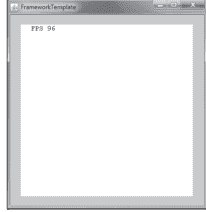

图 5.4
简单框架模板。
© 2014 Timothy Wright.

该模板扩展SimpleFramework类。launchApp()方法在main方法中用于启动应用程序。

```java
// SimpleFrameworkTemplate.java
public static void main(String[] args) {
    launchApp( new SimpleFrameworkTemplate() );
}
```

构造函数是设置应用程序所有属性的位置。在initialize()方法中设置属性为时已晚，因为在调用initialize()方法之前，其中一些属性已经被使用。任何默认值可接受的属性都可以从构造函数中删除。

> > **注意**
> > 不要在initialize()方法中设置属性；应在构造函数中设置。

重写以下五个方法可在游戏循环中执行自定义代码：

- initialize()
- processInput(float delta)
- updateObjects(float delta)
- render(Graphics g)
- terminate()

以下示例模板用作后续章节中示例的基础。

```java
package javagames.util;
import java.awt.Color;
import java.awt.Font;
import java.awt.Graphics;
import javagames.util.SimpleFramework;

public class SimpleFrameworkTemplate extends SimpleFramework {
    public SimpleFrameworkTemplate() {
        appBackground = Color.WHITE;
        appBorder = Color.LIGHT_GRAY;
        appFont = new Font( "Courier New", Font.PLAIN, 14 );
        appBorderScale = 0.9f;
        appFPSColor = Color.BLACK;
        appWidth = 640;
        appHeight = 640;
        appMaintainRatio = true;
        appSleep = 10L;
        appTitle = "FrameworkTemplate";
        appWorldWidth = 2.0f;
        appWorldHeight = 2.0f;
    }

    @Override
    protected void initialize() {
        super.initialize();
    }

    @Override
    protected void processInput( float delta ) {
        super.processInput( delta );
    }

    @Override
    protected void updateObjects( float delta ) {
        super.updateObjects( delta );
    }

    @Override
    protected void render( Graphics g ) {
        super.render( g );
    }

    @Override
    protected void terminate() {
        super.terminate();
    }

    public static void main( String[] args ) {
        launchApp( new SimpleFrameworkTemplate() );
    }
}
```

## 资源与进一步阅读

Code and a Coke 2D框架教程；参见 http://www.cokeandcode.com/main/tutorials/space-invaders-101/。
用于桌面、iOS、Android和HTML游戏的Java框架；参见 http://libgdx.badlogicgames.com/。
轻量级Java游戏库；参见 http://lwjgl.org/。


## Vector2f 更新

在继续学习相交测试算法和概念之前，你需要了解向量类的更新。本章将介绍这些更新。

### INV()

```
public Vector2f inv() {
    return new Vector2f( -x, -y );
}
```

inv() 方法返回一个与当前向量相反的新向量。如图 6.1 所示，向量的逆向量是一个指向相反方向的新向量。

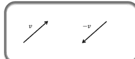

图 6.1
向量逆向。
© 2014 Timothy Wright.

### ADD()

```
public Vector2f add( Vector2f v ) {
    return new Vector2f( x + v.x, y + v.y );
}
```

add() 方法返回当前向量与给定向量之和的新向量。参见图 6.2。

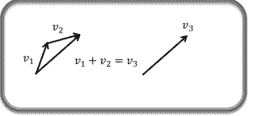

图 6.2 向量加法。© 2014 Timothy Wright.

### SUB()

```
public Vector2f sub( Vector2f v ) {
    return new Vector2f( x - v.x, y - v.y );
}
```

sub() 方法返回给定向量与当前向量之差的新向量。请注意图 6.3 中顺序很重要。新向量的箭头将指向运算中的第一个向量。

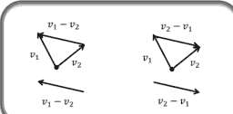

图 6.3 向量减法。© 2014 Timothy Wright.

有时，将减法可视化为添加向量的逆向量会更容易。如图 6.4 所示，V1 – V2 和 V1 + (–V2) 产生相同的结果。

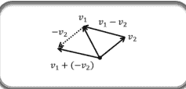

图 6.4
作为逆向量加法的向量减法。
© 2014 Timothy Wright.

### MUL()

```
public Vector2f mul( float scalar ) {
    return new Vector2f( scalar * x, scalar * y );
}
```

mul() 方法返回向量分量与标量值乘积的新向量。请注意图 6.5 中负值会反转向量。

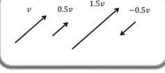

图 6.5
向量乘法。
© 2014 Timothy Wright.

### DIV()

```
public Vector2f div( float scalar ) {
    return new Vector2f( x / scalar, y / scalar );
}
```

div() 方法与乘以标量的倒数相同。请注意，没有针对除以零进行检查。

### LEN() 和 LENSQR()

```
public float len() {
    return (float)Math.sqrt( x * x + y * y );
}
```

要查找向量的长度，请使用勾股定理。参见图 6.6。

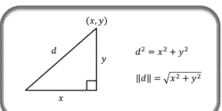

图 6.6
向量长度。
© 2014 Timothy Wright.

单线用于绝对值 |a|。双线用于向量长度 ||a||。

如果 x > y，则 x² > y²

```
public float lenSqr() {
    return x * x + y * y;
}
```

由于平方根操作可能需要许多计算机周期，有时在比较中直接使用平方长度值会更容易。

### NORM()

```
public Vector2f norm() {
    return div( len() );
}
```

norm() 方法返回长度为一的归一化向量，如图 6.7 所示。使用长度为一的向量可以简化许多图形方程。图表中变量上方的小帽符号（插入符号）表示单位向量。

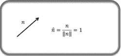

图 6.7
向量归一化。
© 2014 Timothy Wright.

### PERP()

```
public Vector2f perp() {
    return new Vector2f( -y, x );
}
```

perp() 方法返回与当前向量垂直的新向量。参见图 6.8。这对于创建在后续章节许多方程中需要的法向量非常有用。请注意，(-y, x) 或 (y, -x) 都能产生垂直向量。倒置的 T 表示垂直向量。

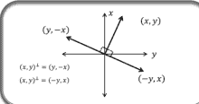

图 6.8 垂直向量。© 2014 Timothy Wright.

### DOT()

```
public float dot( Vector2f v ) {
    return v.x * x + y * v.y;
}
```

dot() 方法返回两个向量的点积。这种乘以两个向量的方法非常有用。如图 6.9 所示，点积将一个向量投影到另一个向量上，形成一个直角三角形，在测试对象相交时非常有帮助。

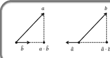

图 6.9 点积。© 2014 Timothy Wright.

点积证明，如图 6.10 所示，如下：

```
A * B = ||A|| ||B|| cos(θA – θB)
A * B = AB [cos(θA) cos(θB) + sin(θA) sin(θB)]
A * B = A cos(θA) B cos(θB) + A sin(θA) B sin(θB)
```

回顾笛卡尔极坐标转换：

```
Ax = A cos(θA)
Bx = B cos(θB)
Ay = A sin(θA)
By = B sin(θB)
A * B = AxBx + AyBy
```

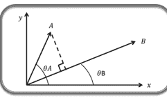

图 6.10 点积角度。© 2014 Timothy Wright.

点积具有以下数学属性：

```
A * B = B * A
C * (A + B) = C * A + C * B
C(A * B) = CA * B
A * A⊥ = 0
```

最后一个属性很重要，是许多数学证明的基础。因为两个垂直向量之间的角度始终为零，所以它们的点积始终为零。

```
A * A⊥ = ||A|| ||A⊥|| cos(90°)
A * A⊥ = ||A|| ||A⊥|| (0)
A * A⊥ = 0
```

最后一个重要点是，点积返回一个标量值，而不是向量，如图 6.11 所示。要将一个向量投影到另一个向量上，接收投影的向量必须是法向量，并且该法向量需要由点积进行缩放。

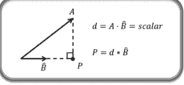

图 6.11
点积标量。
© 2014 Timothy Wright.

### ANGLE()

```
public float angle() {
    return (float)Math.atan2( y , x );
}
```

angle() 方法返回向量创建的弧度角，如图 6.12 所示。请注意，atan2() 方法用于处理 x 为零的情况，因此不需要额外检查。

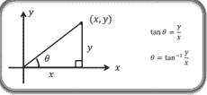

图 6.12
角度。
© 2014 Timothy Wright.

### POLAR()

```
public static Vector2f polar( float angle, float radius ) {
    return new Vector2f(
        radius * (float)Math.cos( angle ),
        radius * (float)Math.sin( angle )
    );
}
```

polar() 方法接受弧度角和半径，并返回具有转换后的 x 和 y 坐标的向量，如图 6.13 所示。


图 6.13
极坐标。
© 2014 Timothy Wright.

### TOSTRING()

```
@Override
public String toString() {
    return String.format( "(%.2f,%.2f)", x, y );
}
```

最后一个更新有助于将向量值显示为字符串以便调试。

```
package javagames.util;

public class Vector2f {
    public float x;
    public float y;
    public float w;

    public Vector2f() {
        this.x = 0.0f;
        this.y = 0.0f;
        this.w = 1.0f;
    }

    public Vector2f(Vector2f v) {
        this.x = v.x;
        this.y = v.y;
        this.w = v.w;
    }

    public Vector2f(float x, float y) {
        this.x = x;
        this.y = y;
        this.w = 1.0f;
    }
}
public Vector2f(float x, float y, float w) {
    this.x = x;
    this.y = y;
    this.w = w;
}

public void translate(float tx, float ty) {
    x += tx;
    y += ty;
}

public void scale(float sx, float sy) {
    x *= sx;
    y *= sy;
}

public void rotate(float rad) {
    float tmp = (float)(x * Math.cos(rad) - y * Math.sin(rad));
    y = (float)(x * Math.sin(rad) + y * Math.cos(rad));
    x = tmp;
}

public void shear(float sx, float sy) {
    float tmp = x + sx * y;
    y += sy * x;
    x = tmp;
}

public Vector2f add(Vector2f v) {
    return new Vector2f(x + v.x, y + v.y);
}

public Vector2f sub(Vector2f v) {
    return new Vector2f(x - v.x, y - v.y);
}

public Vector2f mul(float scalar) {
    return new Vector2f(scalar * x, scalar * y);
}

public Vector2f div(float scalar) {
    return new Vector2f(x / scalar, y / scalar);
}

public Vector2f inv() {
    return new Vector2f(-x, -y);
}

public Vector2f norm() {
```


```
return div( len() );

}

public float dot( Vector2f v ) {
    return x * v.x + y * v.y;
}

public float len() {
    return (float)Math.sqrt( x * x + y * y );
}

public float lenSqr() {
    return x * x + y * y;
}

public Vector2f perp() {
    return new Vector2f( -y, x );
}

public float angle() {
    return (float)Math.atan2( y, x );
}

public static Vector2f polar( float angle, float radius ) {
    return new Vector2f(
        radius * (float)Math.cos( angle ),
        radius * (float)Math.sin( angle )
    );
}

@Override
public String toString() {
    return String.format( "(%s,%s)", x, y );
}
}
```

## 资源和进一步阅读

- Akenine-Moller, Tomas, and Eric Haines, 《实时渲染》. 第2版, A K Peters, 2002.
- Ericson, Christer, 《实时碰撞检测》, Focal Press, 2004.

## 相交测试


如果对象在屏幕上飞来飞去却永远不相互作用，那可算不上什么游戏。无论是什么类型的游戏，即使只是检查鼠标是否悬停在某个对象上，总会需要进行相交测试和碰撞检测。问题是，这些主题可能很复杂。许多书架上都能找到关于算法和数学的巨著，人们仍在努力改进这些算法。大多数人认为庞大的3D沙盒游戏充满了复杂的想法，而看起来简单的2D游戏则很容易。读完本章后，应该显而易见，表象可能具有欺骗性。

## 点在多边形测试

为了确定鼠标指针是否在对象内部，需要执行两个操作。首先，有必要将屏幕坐标中的鼠标位置转换为世界坐标。此代码在第5章“简单游戏框架”中已介绍。其次，需要测试对象，以查看世界坐标中的鼠标位置是否在对象内部。测试点是否在多边形内部在计算机游戏的各种情况下都很有用。

判断点是否在多边形内部的算法易于理解，但起初有许多概念并不明显。测试本身易于解释，但难以实现。你取要测试的点，并沿x轴延伸一条射线。每当射线穿过多边形时，计数一次。如果穿过次数为偶数，则在外部。如果穿过次数为奇数，则在内部。参见图7.1。


图7.1 点在多边形内。© 2014 Timothy Wright.

如图7.1所示，点0、2和4在多边形外部，因为它们穿过次数为偶数。点1和3在内部，因为它们穿过次数为奇数。因为算法需要知道射线是否穿过多边形线，因此测试可以分为四种不同的情况，如图7.2所示。


图7.2 点在多边形内的情况。© 2014 Timothy Wright.

前三种情况（多边形线在点的上方、下方或后方）都判定为无相交。只有第4种情况算作射线穿过多边形线。

```
private boolean pointInPolygon( Vector2f point, List<Vector2f> poly ) {
    boolean inside = false;
    if( poly.size() > 2 ) {
      Vector2f start = poly.get( poly.size() - 1 );
      boolean startAbove = start.y >= point.y;
      for( int i = 0; i < poly.size(); i++ ) {
        Vector2f end = poly.get( i );
        boolean endAbove = end.y >= point.y;
        if (startAbove != endAbove) {
            // TBD - test ahead or behind
        }
        startAbove = endAbove;
        start = end;
      }
    }
    return inside;
  }
```

pointInPolygon() 算法的步骤如下：

- 1. 如果多边形中不足三条线，则无需处理。
- 2. 从最后一个点和第一个点开始。
- 3. 如果第一个多边形点在要检查的点的y值之上，则将 startAbove 设置为 true。
- 4. 遍历多边形中的所有点。
- 5. 由于代码获取多边形中的最后一个点，因此从第一个点开始。
- 6. 如果第二个多边形点在要检查的点的y值之上，则将 endAbove 设置为 true。
- 7. 如果 startAbove 和 endAbove 相等，则它们要么都在点的上方，要么都在点的下方，不可能发生相交。
- 8. 保存 startAbove 状态。
- 9. 将终点设为起点。
- 10. 返回结果。

为了确定相交点在射线的前方还是后方，可以使用点斜方程求解未知的x坐标值。

```
y - y1 = m(x - x1)
x - x1 = (y - y1) / m
x = x1 + (y - y1) / m
where m = Δy / Δx = (y2 - y1) / (x2 - x1)
```

找到x相交值后，将其与点的x值进行比较。如果相交值小于点的x值，则相交点在点的后方，不会发生相交。

```
if(startAbove != endAbove) {
    float m = (end.y - start.y) / (end.x - start.x);
    float x = start.x + (point.y - start.y) / m;
    if (x >= point.x) {
        inside = !inside;
    }
}
```

### 点在多边形测试的特殊情况

只要多边形的线不相互交叉，该算法就能很好地工作。下面的两个多边形都有交叉线，并且都将多边形内部的深色阴影区域视为外部。参见图7.3。


图7.3 点在多边形测试的特殊情况。© 2014 Timothy Wright.

为了正确识别这些重叠区域，可以计算线穿过射线的方向。每次从上到下穿过时，计数加1；每次从下到上穿过时，计数减1。如果穿过次数中顺时针和逆时针穿过的次数相同（计数为零），则点在外部。参见图7.4。


图7.4 多边形绕向。© 2014 Timothy Wright.

带有和不带有绕向的完整算法如下：

```
private boolean pointInPolygon(
    Vector2f point, List<Vector2f> poly, boolean winding ) {
  int inside = 0;
  if( poly.size() > 2 ) {
    Vector2f start = poly.get( poly.size() - 1 );
    boolean startAbove = start.y >= point.y;
    for( int i = 0; i < poly.size(); ++i ) {
      Vector2f end = poly.get( i );
      boolean endAbove = end.y >= point.y;
      if( startAbove != endAbove ) {
        float m = (end.y - start.y) / (end.x - start.x);
        float x = start.x + (point.y - start.y) / m;
        if( x > point.x ) {
          if( winding ) {
            inside += startAbove ? 1 : -1;
          } else {
            inside = inside == 1 ? 0 : 1;
          }
        }
      }
      startAbove = endAbove;
      start = end;
    }
  }
  return inside != 0;
}
```

## 点在多边形示例

PointInPolygonExample 位于 javagames.intersection 包中，如图7.5所示，它使用 SimpleFramework 类处理所有样板代码。poly 列表保存通过在屏幕上单击创建的多边形。polyCpy 列表保存转换为屏幕坐标后的多边形。多边形内部的所有点都放入 inside 列表，外部的所有点都放入 outside 列表。鼠标位置是转换后的世界坐标。如果鼠标在多边形内部，则 selected 变量设置为 true。当算法在测试点时应使用绕向时，winding 变量为 true。


**图7.5** 点在多边形示例。© 2014 Timothy Wright.

向 Utility 类添加了几个新方法来绘制多边形。代码与之前示例中使用的相同，但将其添加到 Utility 类比在所有示例中复制粘贴更容易。

```
package javagames.util;

import java.awt.Graphics;
import java.util.List;
```


```java
public class Utility {

// other methods ...

public static void drawPolygon(
    Graphics g, Vector2f[] polygon ) {
    Vector2f P;
    Vector2f S = polygon[ polygon.length - 1 ];
    for( int i = 0; i < polygon.length; ++i ) {
        P = polygon[i];
        g.drawLine( (int)S.x, (int)S.y, (int)P.x, (int)P.y );
        S = P;
    }
}

public static void drawPolygon(
    Graphics g, List<Vector2f> polygon ) {
    Vector2f S = polygon.get( polygon.size() - 1 );
    for( Vector2f P : polygon ) {
        g.drawLine( (int)S.x, (int)S.y, (int)P.x, (int)P.y );
        S = P;
    }
}
}
```

在 processInput() 方法中，鼠标位置会被转换为世界坐标（在第 5 章“简单游戏框架”中介绍）。空格键用于切换多边形绕向。使用鼠标左键单击可添加多边形点，右键单击可清除多边形。

updateObjects() 方法会在鼠标位于多边形内时设置 selected 变量。随后，随机点会针对多边形进行测试，并放置到相应的列表中。先前介绍的 pointInPolygon() 方法用于判断点相对于多边形的位置。render() 方法会显示绕向、世界坐标中的鼠标位置以及控件说明。如果鼠标位于多边形内部，则将多边形绘制为绿色；否则，绘制为蓝色。多边形内部的所有随机生成点均绘制为绿色，而多边形外部的所有点均绘制为红色。

```java
package javagames.intersection;

import java.awt.*;
import java.awt.event.*;
import java.util.*;
import java.util.List;
import javagames.util.*;

public class PointInPolygonExample extends SimpleFramework {
    private static final int MAX_POINTS = 10000;
    private ArrayList<Vector2f> poly;
    private ArrayList<Vector2f> polyCpy;
    private ArrayList<Vector2f> inside;
    private ArrayList<Vector2f> outside;
    private Vector2f mousePos;
    private boolean selected;
    private boolean winding;
    public PointInPolygonExample() {
        appWidth = 640;
        appHeight = 640;
        appTitle = "Point In Polygon Example";
        appBackground = Color.WHITE;
        appFPSColor = Color.BLACK;
    }
    @Override
    protected void initialize() {
        super.initialize();
        // polygon points and lists of point inside
        // and outside the polygon
        poly = new ArrayList<Vector2f>();
        polyCpy = new ArrayList<Vector2f>();
        inside = new ArrayList<Vector2f>();
        outside = new ArrayList<Vector2f>();
        mousePos = new Vector2f();
    }
    @Override
    protected void processInput(float delta) {
        super.processInput(delta);
        mousePos = getWorldMousePosition();
        // draw polygon for algorithm testing
        if (keyboard.keyDownOnce(KeyEvent.VK_SPACE)) {
            winding = !winding;
        }
        if (mouse.buttonDownOnce(MouseEvent.BUTTON1)) {
            poly.add(mousePos);
        }
        if (mouse.buttonDownOnce(MouseEvent.BUTTON3)) {
            poly.clear();
        }
    }
    @Override
    protected void updateObjects( float delta ) {
        super.updateObjects( delta );
        // see if the mouse is inside the polygon
        selected = pointInPolygon( mousePos, poly, winding );
        // test random points against the polygon
        Random rand = new Random();
        inside.clear();
        outside.clear();
        for( int i = 0; i < MAX_POINTS; ++i ) {
            float x = rand.nextFloat() * 2.0f - 1.0f;
            float y = rand.nextFloat() * 2.0f - 1.0f;
            Vector2f point = new Vector2f( x, y );
            if( pointInPolygon( point, poly, winding ) ) {
                inside.add( point );
            } else {
                outside.add( point );
            }
        }
    }

    private boolean pointInPolygon( Vector2f point, List<Vector2f> poly,
                                    boolean winding ) {
        // point in polygon algorithm
        int inside = 0;
        if( poly.size() > 2 ) {
            Vector2f start = poly.get( poly.size() - 1 );
            boolean startAbove = start.y >= point.y;
            for( int i = 0; i < poly.size(); ++i ) {
                Vector2f end = poly.get( i );
                boolean endAbove = end.y >= point.y;
                if( startAbove != endAbove ) {
                    float m = ( end.y - start.y ) / ( end.x - start.x );
                    float x = start.x + ( point.y - start.y ) / m;
                    if( x >= point.x ) {
                        if( winding ) {
                            inside += startAbove ? 1 : -1;
                        } else {
                            inside = inside == 1 ? 0 : 1;
                        }
                    }
                }
                startAbove = endAbove;
                start = end;
            }
        }
        return inside != 0;
    }

    @Override
    protected void render( Graphics g ) {
        super.render( g );
        // render instructions
        g.drawString( "Winding: " + (winding?"ON":"OFF"), 20, 35 );
        String mouse =
            String.format( "Mouse: (%.2f,%.2f)", mousePos.x, mousePos.y );
        g.drawString( mouse, 20, 50 );
        g.drawString( "Left-Click to add points", 20, 65 );
        g.drawString( "Right-Click to clear points", 20, 80 );
        g.drawString( "Space Bar to toggle winding", 20, 95 );
        Matrix3x3f view = getViewportTransform();
        // draw test polygon
        if( poly.size() > 1 ) {
            polyCpy.clear();
            for( Vector2f vertex : poly ) {
                polyCpy.add( view.mul( vertex ) );
            }
            g.setColor( selected ? Color.GREEN : Color.BLUE );
            Utility.drawPolygon( g, polyCpy );
        }
        // draw inside point blue, outside points red
        g.setColor( Color.BLUE );
        for( Vector2f vector : inside ) {
            Vector2f point = view.mul( vector );
            g.fillRect( (int)point.x, (int)point.y, 1, 1 );
        }
        g.setColor( Color.RED );
        for( Vector2f vector : outside ) {
            Vector2f point = view.mul( vector );
            g.fillRect( (int)point.x, (int)point.y, 1, 1 );
        }
    }

    public static void main( String[] args ) {
        launchApp( new PointInPolygonExample() );
    }
}
```

## 使用轴对齐边界框（AABB）进行相交测试

轴对齐边界框（AABB）是边与 x 轴和 y 轴平行的矩形。参见图 7.6。


图 7.6 轴对齐边界框。© 2014 Timothy Wright.

由于矩形未旋转，它是用于相交测试的简单形状。该形状只需一个最小值和一个最大值即可表示，如图 7.7 所示。请注意，AABB 不能旋转。


图 7.7 AABB 表示。© 2014 Timothy Wright.

转换和绘制 AABB 非常直接。

```java
private void drawAABB( Graphics g, Vector2f min, Vector2f max ) {
    Matrix3x3f view = getViewportTransform();

    Vector2f topLeft = new Vector2f( min.x, max.y );
    topLeft = view.mul( topLeft );

    Vector2f bottomRight = new Vector2f( max.x, min.y );
    bottomRight = view.mul( bottomRight );

    int rectX = (int)topLeft.x;
    int rectY = (int)topLeft.y;
    int rectWidth = (int)( bottomRight.x - topLeft.x );
    int rectHeight = (int)( bottomRight.y - topLeft.y );
    g.drawRect( rectX, rectY, rectWidth, rectHeight );
}
```

由于形状未旋转，您只需检查点是否位于 x 和 y 的最小值与最大值之间。检查点是否在 AABB 内只需执行此操作。

```java
private boolean pointInAABB( Vector2f p, Vector2f min, Vector2f max ) {
    return p.x > min.x && p.x < max.x &&
           p.y > min.y && p.y < max.y;
}
```

检查两个 AABB 是否重叠也很简单。如果任何值不重叠，则不存在相交。参见图 7.8。


图 7.8 AABB 相交。© 2014 Timothy Wright.

```java
private boolean intersectAABB( Vector2f minA, Vector2f maxA,
       Vector2f minB, Vector2f maxB ) {
    if( minA.x > maxB.x || minB.x > maxA.x ) return false;
    if( minA.y > maxB.y || minB.y > maxA.y ) return false;
    return true;
}
```

## 使用圆进行相交测试

圆也是用于相交测试的有用形状。圆可以表示为一个中心点和一个半径，如图 7.9 所示。


图 7.9 圆表示法。© 2014 Timothy Wright.

绘制圆形时，使其随窗口大小拉伸，方式与绘制 AABB 相同。

```
private void drawOval( Graphics g, Vector2f center, float radius ) {
    Matrix3x3f view = getViewportTransform();

    Vector2f topLeft = 
        new Vector2f( center.x - radius, center.y + radius );
    topLeft = view.mul( topLeft );

    Vector2f bottomRight = 
        new Vector2f( center.x + radius, center.y - radius );
    bottomRight = view.mul( bottomRight );

    int circleX = (int)topLeft.x;
    int circleY = (int)topLeft.y;
    int circleWidth = (int)(bottomRight.x - topLeft.x);
    int circleHeight = (int)(bottomRight.y - topLeft.y);

    g.drawOval( circleX, circleY, circleWidth, circleHeight );
}
```

要检查一点是否在圆内，需将该点到圆心的距离与半径进行比较，如图 7.10 所示。如果半径大于该距离，则该点在圆内。


图 7.10 圆内的点。© 2014 Timothy Wright.

由于平方根方法可能较慢，因此检查平方距离更为简便。

如果 a < b，则 a² < b²

以下示例中使用距离进行的大部分比较都采用平方距离进行比较。如下方法所示：

```
private boolean pointInCircle( Vector2f p, Vector2f c, float r ) {
    Vector2f dist = p.sub( c );
    return dist.lenSqr() < r*r;
}
```

检查两个圆是否重叠的测试与点测试非常相似。如果圆心之间的距离大于半径之和，则它们不重叠。参见图 7.11。


图 7.11 圆重叠。© 2014 Timothy Wright.

测试圆是否重叠的代码如下：

```
private boolean intersectCircle(
    Vector2f c0, float r0, Vector2f c1, float r1 ) {
    Vector2f c = c0.sub( c1 );
    float r = r0 + r1;
    return c.lenSqr() < r*r;
}
```

## 圆与 AABB 重叠

要判断圆与 AABB 是否重叠，需计算圆到 AABB 的距离。圆心要么在 AABB 外部，要么在 AABB 内部。如果圆心小于 AABB 的最小值，则它们之间的距离为最小值与圆心之差。如果圆心大于最大值，则它们之间的距离为最大值与圆心之差。如果圆心大于最小值但小于最大值，则它位于 AABB 内部，无需进一步测试。参见图 7.12。使用计算出的每个 x 和 y 的距离，可以找到 AABB 上的最近点，并像之前的示例一样，用它来与圆的半径距离进行测试。


图 7.12 圆与 AABB 的情况。

算法可以写成如下形式：

```
private boolean intersectCircleAABB(
    Vector2f c, float r, Vector2f min, Vector2f max ) {
    float dx = 0.0f;
    if (c.x < min.x) dx = c.x - min.x;
    if (c.x > max.x) dx = c.x - max.x;
    float dy = 0.0f;
    if (c.y < min.y) dy = c.y - min.y;
    if (c.y > max.y) dy = c.y - max.y;
    float d = dx*dx + dy*dy;
    return d < r*r;
}
```

可以通过将 dx 和 dy 变量合并为单个变量，在同一行中执行平方和累加来优化此代码。优化后的版本如下：

```
private boolean intersectCircleAABB(
    Vector2f c, float r, Vector2f min, Vector2f max ) {
    float d = 0.0f;
    if (c.x < min.x) d += (c.x - min.x)*(c.x - min.x);
    if (c.x > max.x) d += (c.x - max.x)*(c.x - max.x);
    if (c.y < min.y) d += (c.y - min.y)*(c.y - min.y);
    if (c.y > max.y) d += (c.y - max.y)*(c.y - max.y);
    return d < r*r;
}
```

如图 7.13 所示，位于 javagames.intersection 包中的 OverlapExample 绘制了两个圆和两个 AABB。这些形状可以被点击并拖动。此操作使用屏幕鼠标坐标到世界坐标的转换，以及之前的测试来检查鼠标的位置。


图 7.13 重叠示例。© 2014 Timothy Wright.

如果形状相交，则绘制为蓝色；否则，绘制为黑色。本章前面介绍的绘制 AABB 和圆的方法用于绘制碰撞形状，以便它们随窗口大小缩放。

介绍的所有重叠测试——圆-圆、AABB-AABB 和圆-AABB——都用于测试任何形状是否与任何其他形状重叠。AABB 由最小值、最大值和位置表示。圆由中心和半径表示。

```
package javagames.intersection;

import java.awt.*;
import java.awt.event.*;
import javagames.util.*;

public class OverlapExample extends SimpleFramework {
    // mouse variables
    private Vector2f mousePos;
    private Vector2f mouseDelta;
    private boolean clicked;
    private boolean dragging;
    // AABB variables
    private Vector2f min0, max0;
    private Vector2f min0Cpy, max0Cpy;
    private Vector2f rect0Pos;
    private boolean rect0Collision;
    private boolean rect0Moving;

    private Vector2f min1, max1;
    private Vector2f min1Cpy, max1Cpy;
    private Vector2f rect1Pos;
    private boolean rect1Collision;
    private boolean rect1Moving;

    // circle variables
    private Vector2f c0, c0Pos;
    private float r0;
    private boolean circle0Collision;
    private boolean circle0Moving;

    private Vector2f c1, c1Pos;
    private float r1;
    private boolean circle1Collision;
    private boolean circle1Moving;

    public OverlapExample() {
    appHeight = 640;
    appWidth = 640;
    appTitle = "Overlap Example";
    appBackground = Color.WHITE;
    appFPSColor = Color.BLACK;
    }

    protected void initialize() {
    super.initialize();
    mousePos = new Vector2f();
    min0 = new Vector2f( -0.25f, -0.25f );
    max0 = new Vector2f( 0.25f, 0.25f );
    min1 = new Vector2f( -0.3f, -0.3f );
    max1 = new Vector2f( 0.3f, 0.3f );
    r0 = 0.25f;
    r1 = 0.125f;

    reset();
    }

    private void reset() {
    rect0Pos = new Vector2f();
    rect1Pos = new Vector2f( 0.25f, 0.5f );
    c0Pos = new Vector2f( -0.60f, -0.60f );
    c1Pos = new Vector2f( 0.6f, 0.6f );
    }

    @Override
    protected void processInput( float delta ) {
    super.processInput( delta );
    // reset objects on spacebar
    if( keyboard.keyDownOnce( KeyEvent.VK_SPACE ) ) {
        reset();
    }

    // convert screen coordinates to world coordinates
    // for intersection testing
    Vector2f pos = getWorldMousePosition();
    mouseDelta = pos.sub( mousePos );
    mousePos = pos;
    clicked = mouse.buttonDownOnce( MouseEvent.BUTTON1 );
    dragging = mouse.buttonDown( MouseEvent.BUTTON1 );
    }

    @Override
    protected void updateObjects( float delta ) {
    super.updateObjects( delta );
    // calculate the AABB minimum and maximum values
    Matrix3x3f mat = Matrix3x3f.translate(
        rect0Pos.x, rect0Pos.y
    );
    min0Cpy = mat.mul( min0 );
    max0Cpy = mat.mul( max0 );
    mat = Matrix3x3f.translate(
        rect1Pos.x, rect1Pos.y
    );
    min1Cpy = mat.mul( min1 );
    max1Cpy = mat.mul( max1 );
    // position the circles
    mat = Matrix3x3f.translate(
        c0Pos.x, c0Pos.y
    );
    c0 = mat.mul( new Vector2f() );

    mat = Matrix3x3f.translate(
        c1Pos.x, c1Pos.y
    );
    c1 = mat.mul( new Vector2f() );
    // test for click and drag of objects
    if( clicked && pointInAABB( mousePos, min0Cpy, max0Cpy ) ) {
        rect0Moving = true;
    }
    if( clicked && pointInAABB( mousePos, min1Cpy, max1Cpy ) ) {
        rect1Moving = true;
    }
    if( clicked && pointInCircle( mousePos, c0Pos, r0 ) ) {
        circle0Moving = true;
    }
    if( clicked && pointInCircle( mousePos, c1Pos, r1 ) ) {
        circle1Moving = true;
    }

    rect0Moving = rect0Moving && dragging;
    if( rect0Moving ) {
        rect0Pos = rect0Pos.add( mouseDelta );
    }

    rect1Moving = rect1Moving && dragging;
    if( rect1Moving ) {
        rect1Pos = rect1Pos.add( mouseDelta );
    }

    circle0Moving = circle0Moving && dragging;
    if( circle0Moving ) {
        c0Pos = c0Pos.add( mouseDelta );
    }

    circle1Moving = circle1Moving && dragging;
    if( circle1Moving ) {
        c1Pos = c1Pos.add( mouseDelta );
    }

    rect0Collision = false;
    rect1Collision = false;
    circle0Collision = false;
    circle1Collision = false;
    // perform intersection testing
    if( intersectAABB( min0Cpy, max0Cpy, min1Cpy, max1Cpy ) ) {
        rect0Collision = true;
        rect1Collision = true;
    }
    }
}
```


```java
if( intersectCircle( c0, r0, c1, r1 ) ) {
    circle0Collision = true;
    circle1Collision = true;
}
if( intersectCircleAABB( c0, r0, min0Cpy, max0Cpy ) ) {
    circle0Collision = true;
    rect0Collision = true;
}
if( intersectCircleAABB( c0, r0, min1Cpy, max1Cpy ) ) {
    circle0Collision = true;
    rect1Collision = true;
}
if( intersectCircleAABB( c1, r1, min0Cpy, max0Cpy ) ) {
    circle1Collision = true;
    rect0Collision = true;
}
if( intersectCircleAABB( c1, r1, min1Cpy, max1Cpy ) ) {
    circle1Collision = true;
    rect1Collision = true;
}
}
private boolean pointInAABB( Vector2f p, Vector2f min, Vector2f max ) {
    return p.x > min.x && p.x < max.x &&
           p.y > min.y && p.y < max.y;
}
private boolean pointInCircle( Vector2f p, Vector2f c, float r ) {
    Vector2f dist = p.sub( c );
    return dist.lenSqr() < r*r;
}
private boolean intersectAABB(
    Vector2f minA, Vector2f maxA, Vector2f minB, Vector2f maxB ) {
    if( minA.x > maxB.x || minB.x > maxA.x ) return false;
    if( minA.y > maxB.y || minB.y > maxA.y ) return false;
    return true;
}
private boolean intersectCircle(
    Vector2f c0, float r0, Vector2f c1, float r1 ) {
    Vector2f c = c0.sub( c1 );
    float r = r0 + r1;
    return c.lenSqr() < r*r;
}
private boolean intersectCircleAABB(
Vector2f c, float r, Vector2f min, Vector2f max ) {
float d = 0.0f;
if ( c.x < min.x ) d += ( c.x - min.x )*( c.x - min.x );
if ( c.x > max.x ) d += ( c.x - max.x )*( c.x - max.x );
if ( c.y < min.y ) d += ( c.y - min.y )*( c.y - min.y );
if ( c.y > max.y ) d += ( c.y - max.y )*( c.y - max.y );
return d < r*r;
}

@Override
protected void render( Graphics g ) {
super.render( g );
// render instructions
g.drawString( "Dragging: * + dragging", 20, 35 );
g.drawString( "Click and hold to drag shapes", 20, 50 );
g.drawString( "Press [SPACE] to reset", 20, 65 );
// render objects
g.setColor( rectCollision ? Color.BLACK : Color.BLUE );
drawAABB( g, min0Cpy, max0Cpy );
g.setColor( rect1Collision ? Color.BLACK : Color.BLUE );
drawAABB( g, min1Cpy, max1Cpy );
g.setColor( circle0Collision ? Color.BLACK : Color.BLUE );
drawOval( g, c0, r0 );
g.setColor( circle1Collision ? Color.BLACK : Color.BLUE );
drawOval( g, c1, r1 );
}

// draw the AABB
private void drawAABB( Graphics g, Vector2f min, Vector2f max ) {
Matrix3x3f view = getViewportTransform();
Vector2f topLeft = new Vector2f( min.x, max.y );
topLeft = view.mul( topLeft );
Vector2f bottomRight = new Vector2f( max.x, min.y );
bottomRight = view.mul( bottomRight );
int rectX = (int)topLeft.x;
int rectY = (int)topLeft.y;
int rectWidth = (int)( bottomRight.x - topLeft.x );
int rectHeight = (int)( bottomRight.y - topLeft.y );
g.drawRect( rectX, rectY, rectWidth, rectHeight );
}
```

## 使用分离轴法

分离轴法用于测试两个对象是否重叠，比之前的测试更复杂，但它可以处理旋转到任意位置的任何凸形状。虽然它本身不会给出确切的碰撞点，但对于测试对象是否重叠非常有用。

这个想法很简单：如果两个凸多边形之间存在一条分离轴，那么对象就不重叠。换句话说，如果你能在两个形状之间画一条线，它们就不能重叠。参见图 7.14。


图 7.14 分离轴法。

如果你在寻找该定理的严格数学证明，互联网上有许多示例。就本节目的而言，图 7.14 展示了足够的证明。请记住，这仅适用于凸多边形。如果有任何内角大于 180 度，则该多边形是凹多边形，分离轴测试将不起作用。图 7.15 展示了一个由于凹多边形而导致测试失败的示例。


图 7.15 凹多边形问题。© 2014 Timothy Wright。

### 提示

如果你有一个凹多边形，它始终可以被分解为多个凸多边形进行测试。参见图 7.16。


图 7.16 分割凹多边形。© 2014 Timothy Wright。

很容易看出如何在两个对象之间画一条线，但此测试需要在代码中使用数学来完成。幸运的是，不仅一般情况很简单，还有一些优化也可以应用于对称形状。

要测试形状是否重叠，请执行以下操作：对于两个形状中的每条线段，创建一个垂直法向量，并使用点积将所有点投影到该法向量上。参见图 7.17。


图 7.17 投影线。© 2014 Timothy Wright。

一旦点被投影到垂直法向量上，如果投影重叠，则多边形重叠。如果没有任何投影包含重叠区域，则没有重叠。参见图 7.18。


图 7.18 重叠投影。© 2014 Timothy Wright。

此外，如以下示例所示，如果被投影的对象是对称的，那么可以将每个对象的半径与两个对象中心之间的距离进行比较。此测试就像测试重叠圆一样。此概念在图 7.19 中显示。


图 7.19 矩形重叠。© 2014 Timothy Wright。

上述距离 ($d$) 与 ($r_1$) 和 ($r_2$) 的和用于确定对象是否重叠。如果任何一项测试失败，则对象不重叠。如果没有轴在对象之间有分离，则它们相交，前提是对象不会互相绕曲。这种方法的一个好处是它适用于两个以上的维度。在之前的插图中，唯一没有重叠的轴是 ($n_3$)。

## 使用线段重叠法

每条线的中心可以使用中点公式找到：

```
midpt = \frac{P_0 + P_1}{2}
```

使用每条线的中心，到任一端点的距离即为线的半径。将该半径归一化为长度为一后，即为用于投影的轴。因为每条线的半径投影到自身上始终为零，所以只需将另一条线的半径与投影的中心距离进行比较。参见图 7.20。


图 7.20 线段重叠。© 2014 Timothy Wright。

```
if |n̂₁ * (C₁ - C₂)| > |n̂₁ * r₂| : no overlap
if |n̂₂ * (C₁ - C₂)| > |n̂₂ * r₁| : no overlap
```

由于比较仅使用距离（距离始终为正值），因此它们使用绝对值以确保不会计算出负值。


图 7.21 线段重叠示例。© 2014 Timothy Wright。

LineLineOverlapExample 位于 javagames.intersection 包中，如图 7.21 所示，它存储两条线——P₀ 为初始线，start 和 end 为第二条线。当单击左键时放置起点，终点跟随鼠标指针。

在 updateObject() 方法内部，使用分离轴法检查两条线是否重叠。这两条线用于查找中心、半径和每个轴法向量。然后将中心之间的投影距离与两条线的半径进行比较。如果距离大于半径，则没有重叠。


render() 方法绘制两条线。如果它们重叠，则绘制为蓝色线；否则，绘制为黑色线。

```java
package javagames.intersection;

import java.awt.*;
import java.awt.event.MouseEvent;
import javagames.util.*;

public class LineLineOverlapExample extends SimpleFramework {
    private Vector2f P, Q;
    private Vector2f start, end;

    boolean overlap = false;

    public LineLineOverlapExample() {
        appWidth = 640;
        appHeight = 640;
        appSleep = 10L;
        appTitle = "Line Line Overlap";
        appBackground = Color.WHITE;
        appFPSColor = Color.BLACK;
    }

    @Override
    protected void initialize() {
        super.initialize();
        P = new Vector2f( -0.6f, 0.4f );
        Q = new Vector2f( 0.6f, -0.4f );
        start = new Vector2f( 0.8f, 0.8f );
        end = new Vector2f();
    }

    @Override
    protected void processInput( float delta ) {
        super.processInput( delta );
        end = getWorldMousePosition();
        if( mouse.buttonDownOnce( MouseEvent.BUTTON1 ) ) {
            start = new Vector2f( end );
        }
    }

    @Override
    protected void updateObjects( float delta ) {
        super.updateObjects( delta );
        overlap = lineLineOverlap( P, Q, start, end );
    }

    private boolean lineLineOverlap(
        Vector2f A, Vector2f B, Vector2f P, Vector2f Q ) {
        Vector2f C0 = A.add( B ).div( 2.0f );
        Vector2f C1 = P.add( Q ).div( 2.0f );
        Vector2f C = C0.sub( C1 );

        Vector2f r0 = A.sub( C0 );
        Vector2f r1 = P.sub( C1 );

        Vector2f N0 = r0.perp().norm();
        Vector2f N1 = r1.perp().norm();

        float abs1 = Math.abs( N0.dot( C ) );
        float abs2 = Math.abs( N0.dot( r1 ) );
        if( abs1 > abs2 ) return false;

        abs1 = Math.abs( N1.dot( C ) );
        abs2 = Math.abs( N1.dot( r0 ) );
        if( abs1 > abs2 ) return false;

        return true;
    }

    @Override
    protected void render( Graphics g ) {
        super.render( g );

        g.drawString( "Overlap: " + overlap, 20, 35 );
        g.drawString( "Left Click for new line", 20, 50 );

        g.setColor( overlap ? Color.BLUE : Color.BLACK );

        Matrix3x3f view = getViewportTransform();
        Vector2f v0 = view.mul( P );
        Vector2f v1 = view.mul( Q );
        g.drawLine( (int)v0.x, (int)v0.y, (int)v1.x, (int)v1.y );

        v0 = view.mul( start );
        v1 = view.mul( end );
        g.drawLine( (int)v0.x, (int)v0.y, (int)v1.x, (int)v1.y );
    }

    public static void main( String[] args ) {
        launchApp( new LineLineOverlapExample() );
    }
}
```

## 使用矩形-矩形重叠方法

要测试矩形重叠，使用相同的方法。需要为每个矩形计算中心、宽度、高度和两个轴向量。参见图 7.22。


图 7.22 矩形重叠计算。© 2014 Timothy Wright.

要将半径投影到轴上，不能使用指向角的单个向量，因为旋转可能导致投影不正确。参见图 7.23。必须始终分别投影宽度和高度，以便投影正确的半径。


图 7.23 矩形半径投影。© 2014 Timothy Wright.

RectRectOverlapExample（如图 7.24 所示，位于 javagames.intersection 包中）保存了示例中测试的两个矩形各自复制的基矩形的四个点。每个用于重叠测试的矩形都有一个点数组、一个位置和一个弧度制的旋转。intersection 变量保存分离轴测试的状态。


### 图 7.24
矩形-矩形重叠示例。
© 2014 Timothy Wright.

processInput() 方法使用鼠标位置移动第二个矩形。A 和 S 键旋转第一个三角形，Q 和 W 键旋转第二个三角形。

updateObjects() 方法复制每个矩形，然后平移和旋转它们，以便可以测试重叠。

rectRectIntersection() 方法计算每个矩形的中心、四个点轴值以及每个矩形的宽度和高度。将每个宽度和高度的总和与每个中心之间的距离进行比较。如果它们不重叠，则对象不重叠。

render() 方法将矩形转换为屏幕坐标，如果它们重叠则以蓝色绘制矩形，否则以黑色绘制。

```java
package javagames.intersection;

import java.awt.*;
import java.awt.event.KeyEvent;
import javagames.util.*;

public class RectRectOverlapExample extends SimpleFramework {
    private Vector2f[] rect;
    private Vector2f[] rect0;
    private Vector2f rect0Pos;
    private float rect0Angle;
    private Vector2f[] rect1;
    private Vector2f rect1Pos;
    private float rect1Angle;

    private boolean intersection;

    public RectRectOverlapExample() {
        appWidth = 640;
        appHeight = 640;
        appSleep = 10L;
        appTitle = "Rect Rect Overlap";
        appBackground = Color.WHITE;
        appFPSColor = Color.BLACK;
    }

    @Override
    protected void initialize() {
        super.initialize();
        // set up rectangles for testing
        rect = new Vector2f[] {
            new Vector2f( -0.25f, 0.25f ),
            new Vector2f( 0.25f, 0.25f ),
            new Vector2f( 0.25f, -0.25f ),
            new Vector2f( -0.25f, -0.25f ),
        };
        rect0 = new Vector2f[ rect.length ];
        rect0Pos = new Vector2f();
        rect0Angle = 0.0f;
        rect1 = new Vector2f[ rect.length ];
        rect1Pos = new Vector2f();
        rect1Angle = 0.0f;
    }

    @Override
    protected void processInput( float delta ) {
        super.processInput( delta );
        // convert mouse coordinate for testing
        rect1Pos = getWorldMousePosition();
        // rotate rectangles
        if( keyboard.keyDown( KeyEvent.VK_A ) ) {
            rect0Angle += (float)( Math.PI / 4.0 * delta );
        }
        if( keyboard.keyDown( KeyEvent.VK_S ) ) {
            rect0Angle -= (float)( Math.PI / 4.0 * delta );
        }
        if( keyboard.keyDown( KeyEvent.VK_Q ) ) {
            rect1Angle += (float)( Math.PI / 4.0 * delta );
        }
        if( keyboard.keyDown( KeyEvent.VK_W ) ) {
            rect1Angle -= (float)( Math.PI / 4.0 * delta );
        }
    }

    @Override
    protected void updateObjects( float delta ) {
        super.updateObjects( delta );
        // translate objects
        Matrix3x3f mat = Matrix3x3f.identity();
        mat = mat.mul( Matrix3x3f.rotate( rect0Angle ) );
        mat = mat.mul( Matrix3x3f.translate( rect0Pos ) );
        for( int i = 0; i < rect.length; ++i ) {
            rect0[i] = mat.mul( rect[i] );
        }
        mat = Matrix3x3f.identity();
        mat = mat.mul( Matrix3x3f.rotate( rect1Angle ) );
        mat = mat.mul( Matrix3x3f.translate( rect1Pos ) );
        for( int i = 0; i < rect.length; ++i ) {
            rect1[i] = mat.mul( rect[i] );
        }
        // test for intersection
        intersection = rectRectIntersection( rect0, rect1 );
    }

    private boolean rectRectIntersection( Vector2f[] A, Vector2f[] B ) {
        // separating axis intersection algorithm
        Vector2f NO = A[0].sub( A[1] ).div( 2.0f );
        Vector2f N1 = A[1].sub( A[2] ).div( 2.0f );
        Vector2f CA = A[0].add( A[2] ).div( 2.0f );
        float D0 = NO.len();
        float D1 = N1.len();
        N1 = N1.div( D1 );
        NO = NO.div( D0 );
        Vector2f N2 = B[0].sub( B[1] ).div( 2.0f );
        Vector2f N3 = B[1].sub( B[2] ).div( 2.0f );
        Vector2f CB = B[0].add( B[2] ).div( 2.0f );
        float D2 = N2.len();
        float D3 = N3.len();
        N2 = N2.div( D2 );
        N3 = N3.div( D3 );
        Vector2f C = CA.sub( CB );
        float DA = D0;
        float DB = D2 * Math.abs( N2.dot( NO ) );
        DB += D3 * Math.abs( N3.dot( NO ) );
        if ( DA + DB < Math.abs( C.dot( NO ) ) ) return false;
        DA = D1;
        DB = D2 * Math.abs( N2.dot( N1 ) );
        DB += D3 * Math.abs( N3.dot( N1 ) );
        if ( DA + DB < Math.abs( C.dot( N1 ) ) ) return false;
        DA = D2;
        DB = D0 * Math.abs( NO.dot( N2 ) );
        DB += D1 * Math.abs( N1.dot( N2 ) );
        if ( DA + DB < Math.abs( C.dot( N2 ) ) ) return false;
        DA = D3;
        DB = D0 * Math.abs( NO.dot( N3 ) );
        DB += D1 * Math.abs( N1.dot( N3 ) );
        if ( DA + DB < Math.abs( C.dot( N3 ) ) ) return false;
        return true;
    }

    @Override
    protected void render( Graphics g ) {
        super.render( g );
        // render instructions
        g.drawString( "Intersection: " + intersection, 20, 35 );
        g.drawString( "A,S keys to rotate rect 1", 20, 50 );
        g.drawString( "Q,W keys to rotate rect 2", 20, 65 );
        // draw rectangles
        g.setColor( intersection ? Color.BLUE : Color.BLACK );
        Matrix3x3f view = getViewportTransform();
        for( int i = 0; i < rect0.length; ++i ) {
            rect0[i] = view.mul( rect0[i] );
        }
        Utility.drawPolygon( g, rect0 );
        for( int i = 0; i < rect1.length; ++i ) {
            rect1[i] = view.mul( rect1[i] );
        }
        Utility.drawPolygon( g, rect1 );
    }

    public static void main( String[] args ) {
        launchApp( new RectRectOverlapExample() );
    }
}
```


## 优化您的测试

总是查看形状和测试，看看是否有简化数学的方法很重要。例如，如果使用 AABB 形状，一些信息可以硬编码到测试中。AABB 的归一化向量始终长度为 1，并且始终在 x 轴和 y 轴上。参见图 7.25。


图 7.25 优化。© 2014 Timothy Wright.

使用这些法向量的任何点积始终为：

```
P * n1 = Px * (1) + Py * (0) = Px
P * n2 = Px * (0) + Py * (1) = Py
```

在这种情况下，可以直接使用点 P 的 x 和 y 值，而无需计算法向量。像这样的优化可以简化代码、加快计算速度，并防止错误潜入。始终留意此类情况。

如果将分离轴测试用于 AABB 矩形，则垂直法向量将是 x 轴和 y 轴。这些法向量与矩形边之间的点积将简化为最小和最大 (x,y) 坐标。参见图 7.26。


图 7.26 AABB 分离轴。© 2014 Timothy Wright.

这就是重叠矩形测试的具体做法。您一直在使用分离轴测试，甚至都不知道。 :-)

## 资源与进一步阅读

- Haines, Eric，“点在多边形中的策略”，载于 Paul Heckbert 编，《图形宝石 IV》，Academic Press，第 24–46 页，1994年。
- Akenine-Moller, Tomas，和 Eric Haines，《实时渲染》。第 2 版，A K Peters，第 598–599、600 页，2002年。
- Arvo, James，“盒-球相交测试的简单方法”，载于 Andrew S. Glassner 编，《图形宝石》，Academic Press，第 335–339 页。
- Ericson, Christer，《实时碰撞检测》，Focal Press，第 184 页，2004年。

本页故意留空

## 第 8 章


## 游戏原型

本章将您在前几章学到的一切知识整合起来，向您展示如何创建一个原型太空游戏。虽然缺少太多元素，无法将其称为完整游戏，但可用工具足以创建一个可运行的原型。

我最初学习编程时遇到的一个问题是：有太多示例使用了各种编程概念——例如循环、变量、继承和多态——但很少有做真实事情的示例。这些示例要么是非常简单、无用的代码片段，要么是极其复杂、编写糟糕的程序，试图塞入所有可能的计算机科学知识，而不是只使用完成工作所需的内容。本章中的原型游戏并不试图包罗万象；相反，它试图在良好的类设计与易于理解的代码之间取得平衡。

与其他任何游戏一样，前几章都没有涵盖的第一个问题：当飞船飞出屏幕时会发生什么？

### 创建多边形包装器类

制作 2D 太空飞船游戏时，首先要解决的大问题是当飞船到达屏幕边缘时会发生什么。一种解决方案是让飞船保持在屏幕中央，移动周围的世界。由于没有文件加载支持，也没有关卡编辑器，这似乎有点过于雄心勃勃。第二个选项是当飞船撞到边缘时让它在屏幕上反弹。这听起来很奇怪。第三个选项是让飞船从一侧绕到另一侧。我们采用第三种方法。

解决这个问题有很多种方法。一种方法是让飞船完全离开屏幕，然后从另一侧带回来，如图 8.1 所示。


图 8.1
包装多边形。
© 2014 Timothy Wright.

尝试这个想法似乎很简单；使用飞船周围的边界框来测试它何时离开屏幕，并将其移到另一侧。这种方法有两个问题：一是有可能只让飞船的一小部分可见，使其很难被击中；二是飞船可能会卡在屏幕外。这种情况不常发生，但当大部分多边形在屏幕外时，很难击中物体。由于这些问题，包装对象似乎比等待整个对象离开屏幕是更好的选择。

将对象包装起来，使屏幕一侧的任何部分绕到另一侧，也充满风险。当将对象从一侧包装到另一侧时，可能会出现同一对象的四个副本，如图 8.2 所示。


图 8.2
包装副本。
© 2014 Timothy Wright.

不仅需要绘制这四个副本，还需要对所有四个副本进行碰撞检测。如果仅使用第一个对象进行碰撞检测，那么位于对角的两个对象即使绘制的对象重叠，也不会注册碰撞。参见图 8.3。


图 8.3 包装副本。© 2014 Timothy Wright.

创建一个包含每个对象副本的渲染列表可以解决这个问题。可以绘制对象，并使用整个列表进行碰撞检测。

包装的对象永远不会卡住，因为一旦对象中心超出世界边界，就会通过根据世界宽度或高度调整位置来对其进行包装。通过始终将包装后的位置放在边界内，对象永远不会卡住。参见图 8.4。


图 8.4 多边形偏移。© 2014 Timothy Wright.

```
if (p < min )
    p += w;
if (p > max )
    p -= w;
```

一旦对象位置被包装，就通过查找最小和最大 (x,y) 值来计算对象的 AABB，如图 8.5 所示。


图 8.5
最小最大 AABB。
© 2014 Timothy Wright.

这个边界框决定对象是否在屏幕边界之外，需要绕到另一侧。

位于 javagames.prototype 包中的 PolygonWrapper 类包含用于包装多边形和位置的方法。构造函数以世界坐标获取屏幕宽度和高度，并计算最小和最大向量值。hasLeftWorld() 方法将给定位置与最小和最大世界坐标进行比较。wrapPosition() 方法在给定位置超出世界边界时返回包装后的位置。包装后的位置根据世界宽度和高度进行调整，因此新位置永远不会超出世界边界。要包装的多边形的顶点计算如下：

```
// PolygonWrapper.java
private Vector2f getMin( Vector2f[] poly ) {
    Vector2f min = new Vector2f( Float.MAX_VALUE, Float.MAX_VALUE );
    for( Vector2f v : poly ) {
        min.x = Math.min( v.x, min.x );
        min.y = Math.min( v.y, min.y );
    }
    return min;
}

private Vector2f getMax( Vector2f[] poly ) {
    Vector2f max = new Vector2f( -Float.MAX_VALUE, -Float.MAX_VALUE );
    for( Vector2f v : poly ) {
        max.x = Math.max( v.x, max.x );
        max.y = Math.max( v.y, max.y );
    }
    return max;
}
```

wrapPolygon() 方法计算最小值和最大值，并使用这些值来确定对象是否需要向北、南、东或西包装。如果对象被包装到两个主方向，例如南和东，它也会被包装到北和西。每个四个对角方向都会进行测试。

每个包装后的多边形都会被复制，并使用 transform 方法添加到渲染列表中：

```
// PolygonWrapper.java
private Vector2f[] transform( Vector2f[] poly, Matrix3x3f mat ) {
    Vector2f[] copy = new Vector2f[ poly.length ];
    for( int i = 0; i < poly.length; ++i ) {
        copy[i] = mat.mul( poly[i] );
    }
    return copy;
}
```

通过添加或减去世界宽度和高度，将多边形包装到八个方向。参见图 8.6。


图 8.6 罗盘方向。© 2014 Timothy Wright.

PolygonWrapper 代码如下：

```
package javagames.prototype;
import java.util.List;
import javagames.util.Matrix3x3f;
import javagames.util.Vector2f;
public class PolygonWrapper {
    private float worldWidth;
    private float worldHeight;
    private Vector2f worldMin;
    private Vector2f worldMax;
```


```java
public PolygonWrapper( float worldWidth, float worldHeight ) {
    this.worldWidth = worldWidth;
    this.worldHeight = worldHeight;
    worldMax = new Vector2f( worldWidth / 2.0f, worldHeight / 2.0f );
    worldMin = worldMax.inv();
}

public boolean hasLeftWorld( Vector2f position ) {
    return position.x < worldMin.x || position.x > worldMax.x ||
    position.y < worldMin.y || position.y > worldMax.y;
}

public Vector2f wrapPosition( Vector2f position ) {
    Vector2f wrapped = new Vector2f( position );
    if( position.x < worldMin.x ) {
    wrapped.x = position.x + worldWidth;
    } else if( position.x > worldMax.x ) {
    wrapped.x = position.x - worldWidth;
    }
    if( position.y < worldMin.y ) {
    wrapped.y = position.y + worldHeight;
    } else if( position.y > worldMax.y ) {
    wrapped.y = position.y - worldHeight;
    }
    return wrapped;
}

public void wrapPolygon( Vector2f[] poly, List<Vector2f[]> renderList ) {
    Vector2f min = getMin( poly );
    Vector2f max = getMax( poly );
    boolean north = max.y > worldMax.y;
    boolean south = min.y < worldMin.y;
    boolean west = min.x < worldMin.x;
    boolean east = max.x > worldMax.x;
    if( west ) renderList.add( wrapEast( poly ) );
    if( east ) renderList.add( wrapWest( poly ) );
    if( north ) renderList.add( wrapSouth( poly ) );
    if( south ) renderList.add( wrapNorth( poly ) );
    if( north && west ) renderList.add( wrapSouthEast( poly ) );
    if( north && east ) renderList.add( wrapSouthWest( poly ) );
    if( south && west ) renderList.add( wrapNorthEast( poly ) );
    if( south && east ) renderList.add( wrapNorthWest( poly ) );
}

private Vector2f getMin( Vector2f[] poly ) {
    Vector2f min = new Vector2f( Float.MAX_VALUE, Float.MAX_VALUE );
    for( Vector2f v : poly ) {
        min.x = Math.min( v.x, min.x );
        min.y = Math.min( v.y, min.y );
    }
    return min;
}

private Vector2f getMax( Vector2f[] poly ) {
    Vector2f max = new Vector2f( -Float.MAX_VALUE, -Float.MAX_VALUE );
    for( Vector2f v : poly ) {
        max.x = Math.max( v.x, max.x );
        max.y = Math.max( v.y, max.y );
    }
    return max;
}

private Vector2f[] wrapNorth( Vector2f[] poly ) {
    return transform( poly, Matrix3x3f.translate( 0.0f, worldHeight ) );
}

private Vector2f[] wrapSouth( Vector2f[] poly ) {
    return transform( poly, Matrix3x3f.translate( 0.0f, -worldHeight ) );
}

private Vector2f[] wrapEast( Vector2f[] poly ) {
    return transform( poly, Matrix3x3f.translate( worldWidth, 0.0f ) );
}

private Vector2f[] wrapWest( Vector2f[] poly ) {
    return transform( poly, Matrix3x3f.translate( -worldWidth, 0.0f ) );
}

private Vector2f[] wrapNorthWest( Vector2f[] poly ) {
    return transform(
        poly, Matrix3x3f.translate( -worldWidth, worldHeight )
    );
}

private Vector2f[] wrapNorthEast( Vector2f[] poly ) {
    return transform(
        poly, Matrix3x3f.translate( worldWidth, worldHeight )
    );
}

private Vector2f[] wrapSouthEast( Vector2f[] poly ) {
    return transform(
        poly, Matrix3x3f.translate( worldWidth, -worldHeight )
    );
}

private Vector2f[] wrapSouthWest( Vector2f[] poly ) {
    return transform(
        poly, Matrix3x3f.translate( -worldWidth, -worldHeight )
    );
}

private Vector2f[] transform( Vector2f[] poly, Matrix3x3f mat ) {
    Vector2f[] copy = new Vector2f[ poly.length ];
    for( int i = 0; i < poly.length; ++i ) {
        copy[i] = mat.mul( poly[i] );
    }
    return copy;
}
```

ScreenWrapExample 如图 8.7 所示，位于 javagames.prototype 包中，它使用 PolygonWrapper 类来包围在屏幕上移动的正方形。pos 向量保存正方形的位置。poly 数组保存正方形多边形。renderList 保存包围的正方形副本以及原始变换后的多边形。wrapper 变量是前面所示的 PolygonWrapper。


图 8.7 屏幕包围示例。© 2014 Timothy Wright。

initialize() 方法创建所有对象，并将鼠标设置为相对移动，以便对象可以在屏幕周围包围而不会让鼠标离开屏幕。processInput() 方法在使用绝对位置时通过鼠标位置移动正方形，在使用相对移动时将相对移动添加到当前位置。该方法还使用空格键切换相对鼠标移动。

transform() 方法创建对象的副本并按给定矩阵对其进行变换。updateObjects() 方法清除渲染列表，包围并变换正方形，然后使用 PolygonWrapper 将对象的任何副本添加到渲染列表中。render() 方法将渲染列表中的所有对象绘制到屏幕上。

```java
package javagames.prototype;
import java.awt.*;
import java.awt.event.KeyEvent;
import java.util.ArrayList;
import javagames.util.*;
public class ScreenWrapExample extends SimpleFramework {
    private Vector2f pos;
    private Vector2f[] poly;
    private ArrayList<Vector2f[]> renderList;
    private PolygonWrapper wrapper;
    public ScreenWrapExample() {
        appBorderScale = 0.9f;
        appWidth = 640;
        appHeight = 640;
        appMaintainRatio = true;
        appTitle = "Screen Wrap Example";
        appBackground = Color.WHITE;
        appFPSColor = Color.BLACK;
    }

    @Override
    protected void initialize() {
        super.initialize();
        mouse.setRelative( true );
        renderList = new ArrayList<Vector2f[]>();
        wrapper = new PolygonWrapper( appWorldWidth, appWorldHeight );
        poly = new Vector2f[] {
            new Vector2f( -0.125f, 0.125f ),
            new Vector2f( 0.125f, 0.125f ),
            new Vector2f( 0.125f, -0.125f ),
            new Vector2f( -0.125f, -0.125f ),
        };
        pos = new Vector2f();
    }

    @Override
    protected void processInput( float delta ) {
        super.processInput( delta );

        if( mouse.isRelative() ) {
            Vector2f v = getRelativeWorldMousePosition();
            pos = pos.add( v );
        } else {
            pos = getWorldMousePosition();
        }

        if( keyboard.keyDownOnce( KeyEvent.VK_SPACE ) ) {
            mouse.setRelative( !mouse.isRelative() );
            if( mouse.isRelative() ) {
                pos = new Vector2f();
            }
        }
    }

    @Override
    protected void updateObjects( float delta ) {
        super.updateObjects( delta );

        renderList.clear();
        pos = wrapper.wrapPosition( pos );
        Vector2f[] world = transform( poly, Matrix3x3f.translate( pos ) );
        renderList.add( world );
        wrapper.wrapPolygon( world, renderList );
    }

    private Vector2f[] transform( Vector2f[] poly, Matrix3x3f mat ) {
        Vector2f[] copy = new Vector2f[ poly.length ];
        for( int i = 0; i < poly.length; ++i ) {
            copy[i] = mat.mul( poly[i] );
        }
        return copy;
    }

    @Override
    protected void render( Graphics g ) {
        super.render( g );
        g.drawString( "Press Space to Toggle mouse", 20, 35 );

        Matrix3x3f view = getViewportTransform();
        for (Vector2f[] toRender : renderList ) {
            for (int i = 0; i < toRender.length; ++i ) {
                toRender[i] = view.mul( toRender[i] );
            }
            Utility.drawPolygon( g, toRender );
        }
    }

    public static void main( String[] args ) {
        launchApp( new ScreenWrapExample() );
    }
}
```

## 制作原型小行星

PrototypeAsteroid 类同样位于 javagames.prototype 包中，代表一块在太空中飞行的岩石。创建时，会生成随机速度和旋转。Java 的随机数生成器仅返回 0 到 1 之间的浮点数，因此要生成跨越任意范围的随机数，需要额外的步骤。例如，要返回 -3 到 7 之间的随机数，请执行以下步骤：

- 1. 通过用最大值减去最小值来计算数字范围的距离。
- 2. 生成 0 到 1 之间的随机浮点数。
- 3. 将随机数乘以距离。
- 4. 通过添加最小值来移动范围。

这些步骤听起来比实际要令人困惑得多。

```java
private float getRandomFloat( float min, float max ) {
    float rand = new Random().nextFloat();
    return rand * ( max - min ) + min;
}
```

获取随机整数时也执行相同的操作。由于随机生成器返回 0 到 count 减 1 之间的数字，因此该方法进行了微调。

```java
private float getRandomRadians( int minDegree, int maxDegree ) {
    int rand = new Random().nextInt( maxDegree - minDegree + 1 );
    return (float)Math.toRadians( rand + minDegree );
}
```


getRandomRotationDelta() 方法返回一个弧度角，介于 5 到 45 度或 -5 到 -45 度之间，如图 8.8 所示。


### 图 8.8 随机旋转增量。© 2014 Timothy Wright.

```java
private float getRandomRotationDelta() {
    float radians = getRandomRadians( 5, 45 );
    return new Random().nextBoolean() ? radians : -radians;
}
```

还可以使用一些 setter 和 getter 来访问小行星的某些属性：

```java
public void setPolygon( Vector2f[] polygon );
public void setPosition( Vector2f position );
public Vector2f getPosition();
public void setSize( PrototypeAsteroid.Size size );
public PrototypeAsteroid.Size getSize()
```

大小是一个枚举值：

```java
public class PrototypeAsteroid {
    public enum Size {
        Large,
        Medium,
        Small;
    }
    //...
}
```

update() 方法负责调整小行星的位置和旋转。请注意，除了调整位置和旋转外，还使用 PolygonWrapper 类来包装多边形的位置。

draw() 方法负责使用给定的视口矩阵和 Graphics 对象绘制多边形。要绘制填充多边形，Utility 类中添加了两个方法：

```java
package javagames.util;

import java.awt.*;
import java.util.List;

public class Utility {
    // ... Other methods left out
    // ... New methods are below

    public static void fillPolygon( Graphics2D g, Vector2f[] polygon ) {
        Polygon p = new Polygon();
        for( Vector2f v : polygon ) {
            p.addPoint( (int)v.x, (int)v.y );
        }
        g.fill( p );
    }

    public static void fillPolygon( Graphics2D g, List<Vector2f> polygon ) {
        Polygon p = new Polygon();
        for( Vector2f v : polygon ) {
            p.addPoint( (int)v.x, (int)v.y );
        }
        g.fill( p );
    }
}
```

pointInPolygon() 方法是之前讨论过的同一方法。contains() 方法接受一个点，如果 PolygonWrapper 复制的任何多边形包含该点，则返回 true。请注意，PrototypeAsteroid 中没有实际的模型代码。这是编辑器和工厂的工作，如下所示。

```java
package javagames.prototype;

import java.awt.*;
import java.util.*;
import javagames.util.*;

public class PrototypeAsteroid {
    public enum Size {
        Large,
        Medium,
        Small;
    }

    private PolygonWrapper wrapper;
    private Size size;
    private float rotation;
    private float rotationDelta;
    private Vector2f[] polygon;
    private Vector2f position;
    private Vector2f velocity;
    private ArrayList<Vector2f[]> renderList;

    public PrototypeAsteroid( PolygonWrapper wrapper ) {
        this.wrapper = wrapper;
        renderList = new ArrayList<Vector2f[]>();
        velocity = getRandomVelocity();
        rotationDelta = getRandomRotationDelta();
    }

    private Vector2f getRandomVelocity() {
        float angle = getRandomRadians( 0, 360 );
        float radius = getRandomFloat( 0.06f, 0.3f );
        return Vector2f.polar( angle, radius );
    }

    private float getRandomRadians( int minDegree, int maxDegree ) {
        int rand = new Random().nextInt( maxDegree - minDegree + 1 );
        return (float)Math.toRadians( rand + minDegree );
    }

    private float getRandomRotationDelta() {
        float radians = getRandomRadians( 5, 45 );
        return new Random().nextBoolean() ? radians : -radians;
    }

    private float getRandomFloat( float min, float max ) {
        float rand = new Random().nextFloat();
        return rand * ( max - min ) + min;
    }

    public void setPolygon( Vector2f[] polygon ) {
        this.polygon = polygon;
    }

    public void setPosition( Vector2f position ) {
        this.position = position;
    }

    public Vector2f getPosition() {
        return position;
    }

    public void setSize( Size size ) {
        this.size = size;
    }

    public Size getSize() {
        return size;
    }

    public void update( float time ) {
        position = position.add( velocity.mul( time ) );
        position = wrapper.wrapPosition( position );

        rotation += rotationDelta * time;

        renderList.clear();
        Vector2f[] world = transformPolygon();
        renderList.add( world );
        wrapper.wrapPolygon( world, renderList );
    }

    private Vector2f[] transformPolygon() {
        Matrix3x3f mat = Matrix3x3f.rotate( rotation );
        mat = mat.mul( Matrix3x3f.translate( position ) );
        return transform( mat );
    }

    private Vector2f[] transform( Vector2f[] poly, Matrix3x3f mat ) {
        Vector2f[] copy = new Vector2f[ poly.length ];
        for( int i = 0; i < poly.length; ++i ) {
            copy[i] = mat.mul( poly[i] );
        }

        return copy;
    }

    public void draw( Graphics2D g, Matrix3x3f view ) {
        for( Vector2f[] poly : renderList ) {
            for( int i = 0; i < poly.length; ++i ) {
                poly[i] = view.mul( poly[i] );
            }
        }

        g.setColor( Color.LIGHT_GRAY );
        Utility.fillPolygon( g, poly );
        g.setColor( Color.BLACK );
        Utility.drawPolygon( g, poly );
    }

    public boolean contains( Vector2f point ) {
        for( Vector2f[] polygon : renderList ) {
            if( pointInPolygon( point, polygon ) ) {
                return true;
            }
        }
        return false;
    }

    private boolean pointInPolygon( Vector2f point, Vector2f[] polygon ) {
        boolean inside = false;
        Vector2f start = polygon[ polygon.length - 1 ];
        boolean startAbove = start.y > point.y;
        for( int i = 0; i < polygon.length; ++i ) {
            Vector2f end = polygon[i];
            boolean endAbove = end.y > point.y;
            if( startAbove != endAbove ) {
                float m = (end.y - start.y) / (end.x - start.x);
                float x = start.x + (point.y - start.y) / m;
                if( x > point.x ) {
                    inside = !inside;
                }
            }
            startAbove = endAbove;
            start = end;
        }
        return inside;
    }
}
```

## 创建原型编辑器

是时候创建一些多边形了。虽然可以猜测每个点，但由于要创建九个小行星形状，手动完成需要大量工作。像大多数程序员一样，我偷懒。编写一个编辑器来创建多边形会容易得多。位于 javagames.prototype 包中的 PrototypeEditor 如图 8.9 所示。


### 图 8.9 原型编辑器。© 2014 Timothy Wright.

如果模型存储为文件，则可以在运行时加载。但是，尚未介绍完成此操作所需的任何代码，因此编辑器会“作弊”。按下空格键时，编辑器会输出可以粘贴到另一个源文件中的代码。在本书的第二部分中，将介绍使用实际文件，所以请放心。

多边形列表保存模型的点。mousePos 是鼠标的当前位置，closed 布尔变量保存绘制时多边形的最后一个点是否连接到第一个点。

processInput() 方法处理编辑器的交互。按下左键时，会向多边形添加一个点。中键切换 closed 变量。右键从多边形中删除点。C 键清除整个多边形，空格键打印多边形代码。printPolygon() 方法将当前多边形打印到控制台，以便可以粘贴到文本文件或复制到另一个代码文件。打印到调试控制台的输出如下：

```java
Vector2f[] v = new Vector2f[] {
    new Vector2f(-0.2895149f, 0.3865415f),
    new Vector2f(-0.47104853f, -0.28012514f),
    new Vector2f(-0.14241004f, 0.15805948f),
    new Vector2f(-0.13615024f, -0.30516434f),
    new Vector2f(0.28012514f, -0.2832551f),
    new Vector2f(0.17370892f, 0.21752739f),
    new Vector2f(-0.19248825f, 0.40219092f),
    new Vector2f(-0.18622851f, 0.25195616f),
};
```

render() 方法显示常规说明并绘制多边形以及坐标轴线。drawAxisLines() 方法在编辑器中绘制两条线，分别表示 x 轴和 y 轴线。

drawPolygon() 方法负责渲染当前模型。如果多边形只有一个点，则绘制一个点。接下来，如果多边形有多个点，则绘制除最后一个点以外的所有点。如果多边形是闭合的，则将最后一个点连接到第一个点。如果多边形不是闭合的，则从最后一个点到当前鼠标位置绘制一条线。drawPoint() 和 drawLine() 方法是标准版本。

```java
package javagames.prototype;

import java.awt.*;
import java.awt.event.*;
import java.util.ArrayList;

import javagames.util.*;

public class PrototypeEditor extends SimpleFramework {

    private ArrayList<Vector2f> polygon;
    private Vector2f mousePos;
    private boolean closed;

    public PrototypeEditor() {
        appTitle = "Prototype Editor 1.0";
        appWidth = 640;
        appHeight = 640;
        appBackground = Color.WHITE;
        appFPSColor = Color.BLACK;
    }

    protected void initialize() {
        super.initialize();
        polygon = new ArrayList<Vector2f>();
    }

    protected void processInput( float delta ) {
        super.processInput( delta );
```


```java
mousePos = getWorldMousePosition();
if ( mouse.buttonDownOnce( MouseEvent.BUTTON1 ) ) {
	polygon.add( mousePos );
}
if ( mouse.buttonDownOnce( MouseEvent.BUTTON2 ) ) {
	closed = !closed;
}
if ( mouse.buttonDownOnce( MouseEvent.BUTTON3 ) ) {
	if ( !polygon.isEmpty() ) {
		polygon.remove( polygon.size() - 1 );
	}
}
if ( keyboard.keyDownOnce( KeyEvent.VK_C ) ) {
	polygon.clear();
}
if ( keyboard.keyDownOnce( KeyEvent.VK_SPACE ) ) {
	printPolygon();
}
}
```

```java
private void printPolygon() {
	System.out.println( "Vector2f[] v = new Vector2f[] { " );
	for ( Vector2f v : polygon ) {
		System.out.print( " new Vector2f( *" );
		System.out.print( v.x + ", " );
		System.out.print( v.y + "f" );
		System.out.print( " )," );
	}
	System.out.println( "}");
}
```

```java
protected void render( Graphics g ) {
	super.render( g );
	g.drawString( "Close Polygon: " + closed, 20, 35 );
	g.drawString( "Left Mouse: Add point", 20, 50 );
	g.drawString( "Right Mouse: Remove point", 20, 65 );
	g.drawString( "Center Mouse: Toggle Close", 20, 80 );
	g.drawString( "C: Clear Polygon", 20, 95 );
	g.drawString( "Space Bar: Print Polygon", 20, 110 );
	drawAxisLines( g );
	drawPolygon( g );
}
```

```java
private void drawAxesLines( Graphics g ) {
    g.setColor( Color.BLUE );
    Vector2f left = new Vector2f( appWorldWidth / 2.0f, 0.0f );
    Vector2f right = new Vector2f( -left.x, 0.0f );
    drawLine( g, left, right );
    Vector2f top = new Vector2f( 0.0f, appWorldHeight / 2.0f );
    Vector2f bottom = new Vector2f( 0.0f, -top.y );
    drawLine( g, top, bottom );
}

private void drawPolygon( Graphics g ) {
    g.setColor( Color.BLACK );
    if( polygon.size() == 1 ) {
        drawPoint( g, polygon.get( 0 ) );
    }
    for( int i = 0; i < polygon.size() - 1; ++i ) {
        drawLine( g, polygon.get(i), polygon.get( i + 1 ) );
    }
    if( closed && polygon.size() > 1 ) {
        Vector2f P = polygon.get( polygon.size() - 1 );
        Vector2f S = polygon.get( 0 );
        drawLine( g, S, P );
    }
    if( !polygon.isEmpty() || closed ) {
        Vector2f P = polygon.get( polygon.size() - 1 );
        Vector2f S = mousePos;
        drawLine( g, S, P );
    }
}

private void drawPoint( Graphics g, Vector2f v ) {
    Matrix3x3f view = getViewportTransform();
    Vector2f s = view.mul( v );
    g.drawRect( (int)s.x, (int)s.y, 1, 1 );
}

private void drawLine( Graphics g, Vector2f v0, Vector2f v1 ) {
    Matrix3x3f view = getViewportTransform();
    Vector2f S = view.mul( v0 );
    Vector2f P = view.mul( v1 );
    g.drawLine( (int)S.x, (int)S.y, (int)P.x, (int)P.y );
}
```

```java
public static void main( String[] args ) {
    launchApp( new PrototypeEditor() );
}
}
```

## 使用原型小行星工厂制作岩石

PrototypeAsteroidFactory 位于 javagames.prototype 包中，包含使用编辑器设计并粘贴到代码中的三个大型、三个中型和三个小型小行星。给定一个位置，这三个方法会生成一个随机数来选择要返回的小行星：

- createLargeAsteroid( Vector2f position )
- createMediumAsteroid( Vector2f position )
- createSmallAsteroid( Vector2f position )

mirror() 方法用于沿 x 轴和 y 轴翻转模型，从而生成更多独特的模型版本。

```java
// PrototypeAsteroidFactory.java
private Vector2f[] mirror( Vector2f[] polygon ) {
    Vector2f[] mirror = new Vector2f[ polygon.length ];
    float x = rand.nextBoolean() ? 1.0f : -1.0f;
    float y = rand.nextBoolean() ? 1.0f : -1.0f;
    Matrix3x3f mat = Matrix3x3f.scale( x, y );
    for( int i = 0; i < polygon.length; ++i ) {
        mirror[i] = mat.mul( polygon[i] );
    }
    return mirror;
}
```

就像在执行视口矩阵乘法时使用矩阵翻转 y 轴一样，将模型缩放 -1 会翻转 x 轴或 y 轴的值。

```java
package javagames.prototype;

import java.util.Random;

import javagames.prototype.PrototypeAsteroid.Size;
import javagames.util.Matrix3x3f;
import javagames.util.Vector2f;

public class PrototypeAsteroidFactory {
    private static final Vector2f[][] LARGE = {
        { // Large 0
            new Vector2f( -0.029733956f, 0.283255100f),
            new Vector2f( -0.183098610f, 0.111111104f),
            new Vector2f( -0.230046930f, -0.057902932f),
            new Vector2f( -0.092331770f, -0.139280080f),
            new Vector2f( 0.117370844f, -0.142410040f),
            new Vector2f( 0.161189320f, -0.048513293f),
            new Vector2f( 0.151799680f, 0.067292630f),
            new Vector2f( 0.195618150f, 0.129890440f),
            new Vector2f( 0.017214417f, 0.158059480f),
        }, { // Large 1
            new Vector2f( -0.001763641f, 0.325800420f),
            new Vector2f( -0.082892360f, 0.220339000f),
            new Vector2f( -0.227513200f, 0.065913380f),
            new Vector2f( -0.206349200f, -0.141242860f),
            new Vector2f( -0.061728360f, -0.080979230f),
            new Vector2f( 0.061728418f, -0.176082600f),
            new Vector2f( 0.192239940f, -0.092278720f),
            new Vector2f( 0.167548480f, 0.126177010f),
            new Vector2f( 0.107583820f, 0.269303200f),
        }, { // Large 2
            new Vector2f( 0.176838760f, -0.107981205f),
            new Vector2f( -0.070422530f, -0.076682330f),
            new Vector2f( -0.220657290f, -0.123630640f),
            new Vector2f( -0.273865400f, 0.048513293f),
            new Vector2f( -0.186228510f, 0.086071970f),
            new Vector2f( -0.214397490f, 0.223787190f),
            new Vector2f( -0.026604056f, 0.148669780f),
            new Vector2f( 0.104851365f, 0.220657290f),
            new Vector2f( 0.211267590f, 0.032863855f),
        },
    };
    private static final Vector2f[][] MEDIUM = {
        { // Medium 0
            new Vector2f( -0.045383394f, 0.186228510f),
            new Vector2f( -0.167449180f, 0.123630700f),
            new Vector2f( -0.067292630f, 0.039123654f),
            new Vector2f( -0.107981205f, -0.073552370f),
            new Vector2f( 0.057902932f, -0.073552370f),
            new Vector2f( 0.133020280f, 0.098591566f),
        }, { // Medium 1
            new Vector2f( -0.023474216f, 0.189358350f),
            new Vector2f( -0.107981205f, 0.107981205f),
            new Vector2f(-0.129890440f, -0.098591566f),
            new Vector2f( 0.020344257f, -0.120500800f),
            new Vector2f( 0.139280080f, -0.001564979f),
            new Vector2f( 0.076682330f, 0.092331770f),
            new Vector2f(-0.007824719f, 0.095461670f),
        }, { // Medium 2
            new Vector2f(-0.064162790f, 0.158059480f),
            new Vector2f(-0.173708920f, 0.126760600f),
            new Vector2f(-0.142410040f, 0.023474216f),
            new Vector2f(-0.039123654f, 0.029733956f),
            new Vector2f( 0.010954618f, -0.035993695f),
            new Vector2f( 0.117370844f, 0.023474216f),
            new Vector2f( 0.117370844f, 0.120500800f),
            new Vector2f(-0.001564979f, 0.092331770f),
        },
    };
    private static final Vector2f[][] SMALL = {
        // Small 0
        new Vector2f(-0.048513293f, -0.057902990f),
        new Vector2f(-0.073552430f, -0.042253494f),
        new Vector2f( 0.046694819f, -0.035993695f),
        new Vector2f( 0.042253494f, 0.026604056f),
        new Vector2f(-0.001564979f, 0.082942130f),
        }, // Small 1
        new Vector2f( 0.067292690f, 0.007824719f),
        new Vector2f(-0.029733956f, -0.076682330f),
        new Vector2f(-0.067292630f, -0.042253494f),
        new Vector2f(-0.061032890f, 0.082942130f),
        new Vector2f( 0.032863855f, 0.11111104f),
        }, // Small 2
        new Vector2f(-0.007824719f, 0.089201870f),
        new Vector2f(-0.114241004f, 0.001564979f),
        new Vector2f(-0.004694819f, -0.067292690f),
        new Vector2f( 0.039123654f, -0.039123654f),
        new Vector2f(-0.014084518f, 0.020344317f),
        },
    };

    private PolygonWrapper wrapper;
    private Random rand;
    public PrototypeAsteroidFactory(PolygonWrapper wrapper) {
        this.wrapper = wrapper;
        this.rand = new Random();
    }

    public PrototypeAsteroid createLargeAsteroid( Vector2f position ) {
        PrototypeAsteroid asteroid = new PrototypeAsteroid( wrapper );
        asteroid.setPosition( position );
        asteroid.setPolygon( getRandomAsteroid( LARGE ) );
        asteroid.setSize( Size.Large );
        return asteroid;
    }

    public PrototypeAsteroid createMediumAsteroid( Vector2f position ) {
        PrototypeAsteroid asteroid = new PrototypeAsteroid( wrapper );
        asteroid.setPosition( position );
        asteroid.setPolygon( getRandomAsteroid( MEDIUM ) );
        asteroid.setSize( Size.Medium );
        return asteroid;
    }

    public PrototypeAsteroid createSmallAsteroid( Vector2f position ) {
        PrototypeAsteroid asteroid = new PrototypeAsteroid( wrapper );
        asteroid.setPosition( position );
        asteroid.setPolygon( getRandomAsteroid( SMALL ) );
        asteroid.setSize( Size.Small );
        return asteroid;
    }

    private Vector2f[] getRandomAsteroid( Vector2f[][] asteroids ) {
        return mirror( asteroids[ rand.nextInt( asteroids.length ) ] );
    }

    private Vector2f[] mirror( Vector2f[] polygon ) {
        Vector2f[] mirror = new Vector2f[ polygon.length ];
        float x = rand.nextBoolean() ? 1.0f : -1.0f;
        float y = rand.nextBoolean() ? 1.0f : -1.0f;
        Matrix3x3f mat = Matrix3x3f.scale( x, y );
        for( int i = 0; i < polygon.length; ++i ) {
            mirror[i] = mat.mul( polygon[i] );
        }
        return mirror;
    }
}
```

RandomAsteroidExample 如图 8.10 所示，位于 javagames.prototype 包中，它使用 PolygonWrapper、PrototypeAsteroid 和 PrototypeAsteroidFactory 在屏幕周围生成随机飞行的岩石。


图 8.10
随机小行星示例。
© 2014 Timothy Wright.

getRandomAsteroid() 方法创建一个随机位置，然后选择一个随机大小：小、中或大。请记住，工厂的每个方法为每种大小从三种不同的多边形模型中选择一个，并为每个模型生成四个镜像版本。每个多边形有四个镜像，每种大小有三种形状，共有三种大小，因此总共有 36 个不同的模型。

还要注意，因为 PrototypeAsteroid 使用了新的 Utility.fillPolygon() 方法，所以 Graphics 对象被强制转换为 Graphics2D 对象。

```java
// RandomAsteroidExample.java
protected void render( Graphics g ) {
    super.render( g );
    g.drawString( "Press ESC to respawn", 20, 35 );
    Matrix3x3f view = getViewportTransform();
    for( PrototypeAsteroid asteroid : asteroids ) {
        asteroid.draw( (Graphics2D)g, view );
    }
}
```

RandomAsteroidExample 代码如下：

```java
package javagames.prototype;

import java.awt.*;
import java.awt.event.KeyEvent;
import java.util.*;
import javagames.prototype.PrototypeAsteroid.Size;
import javagames.util.*;

public class RandomAsteroidExample extends SimpleFramework {
	private PrototypeAsteroidFactory factory;
	private ArrayList<PrototypeAsteroid> asteroids;
	private Random rand;

	public RandomAsteroidExample() {
		appBorderScale = 0.9f;
		appWidth = 640;
		appHeight = 640;
		appMaintainRatio = true;
		appSleep = 1L;
		appTitle = "Random Asteroids";
		appBackground = Color.WHITE;
		appFPSColor = Color.BLACK;
	}

	@Override
	protected void initialize() {
		super.initialize();

		rand = new Random();
		asteroids = new ArrayList<PrototypeAsteroid>();
		PolygonWrapper wrapper =
			new PolygonWrapper( appWidth, appWorldHeight );
		factory = new PrototypeAsteroidFactory( wrapper );
		createAsteroids();
	}

	private void createAsteroids() {
		asteroids.clear();
		for ( int i = 0; i < 42; ++i ) {
			asteroids.add( getRandomAsteroid() );
		}
	}

	private PrototypeAsteroid getRandomAsteroid() {
		float x = rand.nextFloat() * 2.0f - 1.0f;
		float y = rand.nextFloat() * 2.0f - 1.0f;
		Vector2f position = new Vector2f( x, y );
		Size[] sizes = Size.values();
		Size randomSize = sizes[ rand.nextInt( sizes.length ) ];
		switch( randomSize ) {
		    case Small: return factory.createSmallAsteroid( position );
		    case Medium: return factory.createMediumAsteroid( position );
		    case Large:
		    default: return factory.createLargeAsteroid( position );
		}
	}

	@Override
	protected void processInput( float delta ) {
	    super.processInput( delta );
	    if( keyboard.keyDownOnce( KeyEvent.VK_ESCAPE ) ) {
	        createAsteroids();
	    }
	}

	@Override
	protected void updateObjects( float delta ) {
	    super.updateObjects( delta );
	    for( PrototypeAsteroid asteroid : asteroids ) {
	        asteroid.update( delta );
	    }
	}

	@Override
	protected void render( Graphics g ) {
	    super.render( g );
	    g.drawString( "Press ESC to respawn", 20, 35 );
	    Matrix3x3f view = getViewportTransform();
	    for( PrototypeAsteroid asteroid : asteroids ) {
	        asteroid.draw( (Graphics2D)g, view );
	    }
	}

	public static void main( String[] args ) {
	    launchApp( new RandomAsteroidExample() );
	}
}
```

## PROTOTYPE BULLET 类

PrototypeBullet 代码同样位于 javagames.prototype 包中，是最简单的原型游戏源代码。除了绘制圆形以便屏幕可以调整大小之外，没有什么值得讨论的。

```java
package javagames.prototype;

import java.awt.*;
import javagames.util.*;

public class PrototypeBullet {
    private Vector2f velocity;
    private Vector2f position;
    private Color color;
    private float radius;

    public PrototypeBullet( Vector2f position, float angle ) {
        this.position = position;
        velocity = Vector2f.polar( angle, 1.0f );
        radius = 0.006f;
        color = Color.GREEN;
    }

    public Vector2f getPosition() {
        return position;
    }

    public void draw( Graphics2D g, Matrix3x3f view ) {
        g.setColor( color );
        Vector2f topLeft = new Vector2f(
                position.x - radius, position.y + radius );
        topLeft = view.mul( topLeft );
        Vector2f bottomRight = new Vector2f(
                position.x + radius, position.y - radius );
        bottomRight = view.mul( bottomRight );

        int circleX = (int)topLeft.x;
        int circleY = (int)topLeft.y;
        int circleWidth = (int)(bottomRight.x - topLeft.x);
        int circleHeight = (int)(bottomRight.y - topLeft.y);
        g.fillOval(
                circleX, circleY, circleWidth, circleHeight
        );
    }

    public void update( float time ) {
        position = position.add( velocity.mul( time ) );
    }
}
```

## PROTOTYPE SHIP 类

PrototypeShip 代码位于 javagames.prototype 包中，大部分不言自明。构造函数设置了一些用于移动飞船的常量，并对模型点进行了硬编码。有用于损坏状态、角度、推进的 set*() 和 get*() 方法，以及用于向左或向右旋转飞船的方法。

launchBullet() 方法返回一个新的 PrototypeBullet 对象，并将其移动到飞船的机头处。

```java
// PrototypeShip.java
public PrototypeBullet launchBullet() {
    Vector2f bulletPos = position.add( Vector2f.polar( angle, 0.0325f ) );
    return new PrototypeBullet( bulletPos, angle );
}
```

isTouching() 方法检查与给定小行星对象的渲染列表中每艘飞船的碰撞。精彩的部分是 updatePosition() 方法，它驱动飞船飞行。首先，更新速度：

$V_1 = V_0 + at$

加速度在 setThrusting() 方法中设置。如果飞船没有向前移动，则加速度为 0，速度保持不变。请注意，新的加速度向量使用当前角度，这会慢慢改变飞船行驶的方向。

```java
Vector2f accel = Vector2f.polar(angle, curAcc);
```

接下来，将新速度保持在最大值以下。如果不执行此操作，飞船将继续加速，最终速度会超过子弹。请注意，使用的是最小值，因此当最大速度不小于实际速度时，最大速度为 1.0，没有任何变化。只有当最大速度小于实际值时，速度才会受到限制。

```java
float maxSpeed = Math.min( maxVelocity / velocity.len(), 1.0f );
velocity = velocity.mul( maxSpeed );
```

接下来，应用摩擦力。尽管太空中没有摩擦力，但我想为飞船添加摩擦力，以便它最终会减速。如果飞船没有加速，摩擦力会持续减速。

```java
float slowDown = 1.0f - friction * time;
velocity = velocity.mul( slowDown );
```

最后，更新位置并将其包装。

```java
position = position.add( velocity.mul( time ) );
position = wrapper.wrapPosition( position );
```

PrototypeShip 代码如下：

```java
package javagames.prototype;

import java.awt.*;
import java.util.ArrayList;
import javagames.util.*;

public class PrototypeShip {
	private float angle;
	private float acceleration;
	private float friction;
	private float maxVelocity;
	private float rotationDelta;
	private float curAcc;

	private Vector2f position;
	private Vector2f velocity;

	private PolygonWrapper wrapper;

	private boolean damaged;

	private Vector2f[] polygon;
	private ArrayList<Vector2f[]> renderlist;

	public PrototypeShip( PolygonWrapper wrapper ) {
		this.wrapper = wrapper;

		friction = 0.25f;
		rotationDelta = (float)Math.toRadians( 180.0 );
		acceleration = 1.0f;
		maxVelocity = 0.5f;
		velocity = new Vector2f();

		position = new Vector2f();
		polygon = new Vector2f[] {
			new Vector2f( 0.032f, 0.0f ),
			new Vector2f( -0.032f, -0.032f ),
			new Vector2f( 0.0f, 0.0f ),
			new Vector2f( -0.032f, 0.032f ),
		};

		renderList = new ArrayList<Vector2f[]>();
	}
}
```


public void setDamaged( boolean damaged ) {
    this.damaged = damaged;
}

public boolean isDamaged() {
    return damaged;
}

public void rotateLeft( float delta ) {
    angle += rotationDelta * delta;
}

public void rotateRight( float delta ) {
    angle -= rotationDelta * delta;
}

public void setThrusting( boolean thrusting ) {
    curAcc = thrusting ? acceleration : 0.0f;
}

public void setAngle( float angle ) {
    this.angle = angle;
}

public PrototypeBullet launchBullet() {
    Vector2f bulletPos = position.add( Vector2f.polar( angle, 0.0325f ) );
    return new PrototypeBullet( bulletPos, angle );
}

public void update( float time ) {
    updatePosition( time );
    renderList.clear();
    Vector2f[] world = transformPolygon();
    renderList.add( world );
    wrapper.wrapPolygon( world, renderList );
}

private Vector2f[] transformPolygon() {
    Matrix3x3f mat = Matrix3x3f.rotate( angle );
    mat = mat.mul( Matrix3x3f.translate( position ) );
    return transform( polyman, mat );
}

private void updatePosition( float time ) {
    Vector2f accel = Vector2f.polar( angle, curAcc );
    velocity = velocity.add( accel.mul( time ) );
    float maxSpeed = Math.min( maxVelocity / velocity.len(), 1.0f );
    velocity = velocity.mul( maxSpeed );
}

float slowDown = 1.0f - friction * time;
velocity = velocity.mul( slowDown );
position = position.add( velocity.mul( time ) );
position = wrapper.wrapPosition( position );
}

private Vector2f[] transform( Vector2f[] poly, Matrix3x3f mat ) {
Vector2f[] copy = new Vector2f[ poly.length ];
for( int i = 0; i < poly.length; ++i ) {
copy[i] = mat.mul( poly[i] );
}
return copy;
}

public void draw( Graphics2D g, Matrix3x3f view ) {
g.setColor( new Color( 50, 50, 50 ) );
for( Vector2f[] poly : renderList ) {
for( int i = 0; i < poly.length; ++i ) {
poly[i] = view.mul( poly[i] );
}
g.setColor( Color.DARK_GRAY );
Utility.fillPolygon( g, poly );
g.setColor( isDamaged() ? Color.RED : Color.GREEN );
Utility.drawPolygon( g, poly );
}
}

public boolean isTouching( PrototypeAsteroid asteroid ) {
for( Vector2f[] poly : renderList ) {
for( Vector2f v : poly ) {
if( asteroid.contains( v ) ) {
return true;
}
}
}
return false;
}
}

位于 javagames.prototype 包中并如图 8.11 所示的 FlyingShipExample 使用飞船和子弹代码来测试在屏幕上飞行飞船。左箭头和右箭头使飞船旋转，上箭头使飞船向前移动，空格键发射子弹。


**图 8.11**
飞船示例。
© 2014 Timothy Wright.

注意 `updateObject()` 方法中的 Java 魔法。如果子弹集合在遍历时尝试移除子弹，则列表会抛出 `ConcurrentModificationException`。通过复制列表并从原始列表中移除，不会抛出异常。

```java
// FlyingShipExample.java
protected void updateObjects( float delta ) {
    super.updateObjects( delta );

    ship.update( delta );

    ArrayList<PrototypeBullet> copy =
        new ArrayList<PrototypeBullet>( bullets );
    for( PrototypeBullet bullet : copy ) {
        bullet.update( delta );
        if( wrapper.hasLeftWorld( bullet.getPosition() ) ) {
            bullets.remove( bullet );
        }
    }
}
```

FlyingShipExample 如下：

```
package javagames.prototype;

import java.awt.*;
import java.awt.event.KeyEvent;
import java.util.ArrayList;
import javagames.util.*;

public class FlyingShipExample extends SimpleFramework {
	private PrototypeShip ship;
	private PolygonWrapper wrapper;
	private ArrayList<PrototypeBullet> bullets;

	public FlyingShipExample() {
		appBorderScale = 0.9f;
		appWidth = 640;
		appHeight = 640;
		appMaintainRatio = true;
		appSleep = 1L;
		appTitle = "Flying Ship Example";
	}

	@Override
	protected void initialize() {
		super.initialize();

		bullets = new ArrayList<PrototypeBullet>();
		wrapper = new PolygonWrapper( appWorldWidth, appWorldHeight );
		ship = new PrototypeShip( wrapper );
	}

	@Override
	protected void processInput( float delta ) {
		super.processInput( delta );

		if( keyboard.keyDown( KeyEvent.VK_LEFT ) ) {
			ship.rotateLeft( delta );
		}

		if( keyboard.keyDown( KeyEvent.VK_RIGHT ) ) {
			ship.rotateRight( delta );
		}

		if( keyboard.keyDownOnce( KeyEvent.VK_SPACE ) ) {
			bullets.add( ship.launchBullet() );
		}

		ship.setThrusting( keyboard.keyDown( KeyEvent.VK_UP ) );
	}
}
```

```
@Override
protected void updateObjects( float delta ) {
    super.updateObjects( delta );
    ship.update( delta );
    ArrayList< PrototypeBullet > copy =
        new ArrayList< PrototypeBullet >( bullets );
    for ( PrototypeBullet bullet : copy ) {
        bullet.update( delta );
        if( wrapper.hasLeftWorld( bullet.getPosition() ) ) {
            bullets.remove( bullet );
        }
    }
}

@Override
protected void render( Graphics g ) {
    super.render( g );
    g.drawString( "Rotate: Left/Right Arrow", 20, 35 );
    g.drawString( "Thrust: Up Arrow", 20, 50 );
    g.drawString( "Fire: Space Bar", 20, 65 );
    Matrix3x3f view = getViewportTransform();
    ship.draw( ( Graphics2D )g, view );
    for ( PrototypeBullet b : bullets ) {
        b.draw( ( Graphics2D )g, view );
    }
}

public static void main( String[] args ) {
    launchApp( new FlyingShipExample() );
}
}
```

## 编写原型游戏

原型游戏如图 8.12 所示，位于 javagames.prototype 包中，使用了迄今为止你所看到的所有内容。尽管这只是一个原型，离完整游戏还很远，但我已介绍了足够的工具来让某些东西运行起来。等到最后才终于制作游戏，等待时间太长了。:–)

此原型游戏使用本章之前介绍的以下类：

- PolygonWrapper
- PrototypeShip
- PrototypeAsteroid
- PrototypeAsteroidFactory
- PrototypeBullet

在尝试编译和运行本章末尾的代码之前，请确保已创建这些类。

initialize() 方法为原型创建所有对象，包括为背景创建一些星星。以下代码创建星星并创建一个颜色数组。Color 类采用三个值：红色、蓝色和绿色，范围在零到一之间。将每个颜色值设置为相同值会产生灰色阴影。

Color 在书中后面会详细介绍，但目前，只需使用语言提供的 java.awt.Color 类即可。

```
// PrototypeGame.java
private void createStars() {
    stars = new Vector2f[ STAR_COUNT ];
```

```
colors = new Color[ STAR_COUNT ];
for( int i = 0; i < stars.length; ++i ) {
    float x = rand.nextFloat() * 2.0f - 1.0f;
    float y = rand.nextFloat() * 2.0f - 1.0f;
    stars[i] = new Vector2f( x, y );
    color = rand.nextFloat();
    colors[i] = new Color( color, color, color );
}
}
```

创建小行星时请注意 getAsteroidStartPosition() 方法。与生成各种大小随机小行星的示例不同，此示例仅创建大型随机小行星，并使用以下代码将它们放置在一个圆中，以便它们永远不会生成在飞船上方。

```
// PrototypeGame.java
private Vector2f getAsteroidStartPosition() {
    float angle = (float)Math.toRadians( rand.nextInt( 360 ) );
    float minimum = appWorldWidth / 4.0f;
    float extra = rand.nextFloat() * minimum;
    float radius = minimum + extra;
    return Vector2f.polar( angle, radius );
}
```

前面的代码将新多边形放置在屏幕四分之一的圆中，如图 8.13 所示。


图 8.13
随机小行星放置。
© 2014 Timothy Wright.

这可以防止新生成的岩石出现在飞船上方并在玩家有机会开火之前将其炸毁。这是游戏程序员面临的那种挑战的一个很好示例。这个问题直到……才变得明显。


原型已经可以工作了。无论游戏多么简单，总会有奇怪的问题需要解决。

processInput() 方法使用左右箭头键旋转飞船，使用上箭头键激活推进器，使用空格键发射子弹，使用 Escape 键重新生成小行星。

当子弹击中小行星时，不仅会将小行星从渲染列表中移除，而且如果该小行星不是小型的，则它会分裂成两个更小的小行星。

updateShip() 方法检查碰撞。如果飞船被击中，则设置 damaged 标志。虽然真正的游戏在飞船被击中时会重新开始，但目前还没有玩家生命或游戏结束状态的概念，所以暂时，当飞船被击中时，它会以红色绘制。

render() 方法绘制星星、所有小行星、子弹、飞船，以及通常的帧率和说明。有一些新代码开启了抗锯齿，以便线条绘制平滑。抗锯齿在第 10 章“图像”中有详细介绍。

```
Graphics2D g2d = (Graphics2D)g;
g2d.setRenderingHint(
    RenderingHints.KEY_ANTIALIASING,
    RenderingHints.VALUE_ANTIALIAS_ON
);
```

drawStars()、drawShip()、drawAsteroids() 和 drawBullets() 方法负责绘制原型中的各种对象。PrototypeGame 代码如下：

```
package javagames.prototype;

import java.awt.*;
import java.awt.event.KeyEvent;
import java.util.*;

import javagames.prototype.PrototypeAsteroid.Size;
import javagames.util.*;

public class PrototypeGame extends SimpleFramework {
    private static final int STAR_COUNT = 1500;
    private PrototypeShip ship;
    private PolygonWrapper wrapper;
    private PrototypeAsteroidFactory factory;
    private ArrayList<PrototypeBullet> bullets;
    private ArrayList<PrototypeAsteroid> asteroids;
    private Random rand;
    private Vector2f[] stars;
    private Color[] colors;

    public PrototypeGame() {
        appBorderScale = 0.9f;
        appWidth = 640;
        appHeight = 640;
        appMaintainRatio = true;
        appSleep = 1L;
        appTitle = "Prototype Game";
    }

    @Override
    protected void initialize() {
        super.initialize();
        // create game objects
        rand = new Random();
        bullets = new ArrayList<PrototypeBullet>();
        asteroids = new ArrayList<PrototypeAsteroid>();
        wrapper = new PolygonWrapper( appWorldWidth, appWorldHeight );
        ship = new PrototypeShip( wrapper );
        factory = new PrototypeAsteroidFactory( wrapper );
        createStars();
        createAsteroids();
    }

    // this creates the random stars for the background
    private void createStars() {
        stars = new Vector2f[ STAR_COUNT ];
        colors = new Color[ STAR_COUNT ];
        for (int i = 0; i < stars.length; ++i ) {
            float x = rand.nextFloat() * 2.0f - 1.0f;
            float y = rand.nextFloat() * 2.0f - 1.0f;
            stars[i] = new Vector2f( x, y );
            float color = rand.nextFloat();
            colors[i] = new Color( color, color, color );
        }
    }

    // create the random asteroids
    private void createAsteroids() {
        asteroids.clear();
    }

    for( int i = 0; i < 4; ++i ) {
        Vector2f position = getAsteroidStartPosition();
        asteroids.add( factory.createLargeAsteroid( position ) );
    }

    // create random position for an asteroid

    private Vector2f getAsteroidStartPosition() {
        float angle = (float)Math.toRadians( rand.nextInt( 360 ) );
        float minimum = appWorldWidth * 4.0f;
        float extra = rand.nextFloat() * minimum;
        float radius = minimum + extra;
        return Vector2f.polar( angle, radius );
    }

    @Override
    protected void processInput( float delta ) {
        super.processInput( delta );
        // fly the ship
        if( keyboard.keyDown( KeyEvent.VK_LEFT ) ) {
            ship.rotateLeft( delta );
        }
        if( keyboard.keyDown( KeyEvent.VK_RIGHT ) ) {
            ship.rotateRight( delta );
        }
        if( keyboard.keyDownOnce( KeyEvent.VK_SPACE ) ) {
            bullets.add( ship.launchBullet() );
        }
        if( keyboard.keyDownOnce( KeyEvent.VK_ESCAPE ) ) {
            createAsteroids();
        }
        ship.setThrusting( keyboard.keyDown( KeyEvent.VK_UP ) );
    }

    @Override
    protected void updateObjects( float delta ) {
        super.updateObjects( delta );
        updateAsteroids( delta );
        updateBullets( delta );
        updateShip( delta );
    }

    private void updateAsteroids( float delta ) {
        for( PrototypeAsteroid asteroid : asteroids ) {
            asteroid.update( delta );
        }
    }

    private void updateBullets( float delta ) {
        ArrayList<PrototypeBullet> copy =
            new ArrayList<PrototypeBullet>( bullets );
        for( PrototypeBullet bullet : copy ) {
            updateBullet( delta, bullet );
        }
    }

    // check for bullet collisions
    private void updateBullet( float delta, PrototypeBullet bullet ) {
        bullet.update( delta );
        if( wrapper.hasLeftWorld( bullet.getPosition() ) ) {
            bullets.remove( bullet );
        } else {
            ArrayList<PrototypeAsteroid> ast =
                new ArrayList<PrototypeAsteroid>( asteroids );
            for( PrototypeAsteroid asteroid : ast ) {
                if( asteroid.contains( bullet.getPosition() ) ) {
                    bullets.remove( bullet );
                    asteroids.remove( asteroid );
                    spawnBabies( asteroid );
                }
            }
        }
    }

    // create smaller asteroids when one is broken apart
    private void spawnBabies( PrototypeAsteroid asteroid ) {
        if( asteroid.getSize() == Size.Large ) {
            asteroids.add(
                factory.createMediumAsteroid( asteroid.getPosition() ) );
            asteroids.add(
                factory.createMediumAsteroid( asteroid.getPosition() ) );
        }
        if( asteroid.getSize() == Size.Medium ) {
            asteroids.add(
                factory.createSmallAsteroid( asteroid.getPosition() ) );
            asteroids.add(
                factory.createSmallAsteroid( asteroid.getPosition() ) );
        }
    }

    // update the ship object
    private void updateShip( float delta ) {
        ship.update( delta );
        boolean isHit = false;
        for( PrototypeAsteroid asteroid : asteroids ) {
            if( ship.isTouching( asteroid ) ) {
                isHit = true;
            }
        }
        ship.setDamaged( isHit );
    }

    @Override
    protected void render( Graphics g ) {
        // render instructions
        // render( g );
        g.drawString( "Rotate: Left/Right Arrow", 20, 35 );
        g.drawString( "Thrust: Up Arrow", 20, 50 );
        g.drawString( "Fire: Space Bar", 20, 65 );
        g.drawString( "Press ESC to respawn", 20, 80 );

        Graphics2D g2d = (Graphics2D)g;
        g2d.setRenderingHint(
            RenderingHints.KEY_ANTIALIASING,
            RenderingHints.VALUE_ANTIALIAS_ON
        );

        // draw game objects
        Matrix3x3f view = getViewportTransform();
        drawStars( g2d, view );
        drawAsteroids( g2d, view );
        drawBullets( g2d, view );
        drawShip( g2d, view );
    }

    private void drawStars( Graphics2D g, Matrix3x3f view ) {
        for( int i = 0; i < stars.length; ++i ) {
            g.setColor( colors[i] );
            Vector2f screen = view.mul( stars[i] );
            g.fillRect( (int)screen.x, (int)screen.y, 1, 1 );
        }
    }

    private void drawShip( Graphics2D g, Matrix3x3f view ) {
        ship.draw( g, view );
    }

    private void drawAsteroids( Graphics2D g, Matrix3x3f view ) {
        for( PrototypeAsteroid asteroid : asteroids ) {
            asteroid.draw( g, view );
        }
    }

    private void drawBullets( Graphics2D g, Matrix3x3f view ) {
        for( PrototypeBullet b : bullets ) {
            b.draw( g, view );
        }
    }

    public static void main( String[] args ) {
        launchApp( new PrototypeGame() );
    }
}
```

## 资源与进一步阅读

“完成游戏”，http://makegames.tumblr.com/post/1136623767/finishing-a-game.

此页故意留空

## 第二部分
### 打磨


此页故意留空


#### 文件与资源

使用文件有很多好处，但最重要的是：

- 能够在不重新编译软件的情况下创建、读取、更新和删除数据。
- 能够在软件运行之间保存和恢复信息。

了解如何读取和写入文件对于游戏编程至关重要，因为音频、图像、对话、3D 模型、关卡数据以及游戏所需的任何其他内容都存储在文件中。

本章探讨为简单任务读取和写入属性文件，并介绍使用 XML 文件存储复杂数据。还有一个关于使用资源（这只是一种花哨的说法，指“文件中的内容”）的部分，这些资源打包在 Java 归档文件 (*.jar) 中。一旦你有了音频和图像文件，了解将它们放在哪里以及如何从游戏内部访问它们就很重要。

##### 了解 Java 如何处理文件和目录

在软件读取和写入文件之前，了解 Java 对文件和目录的操作很重要。有经验的 Java 开发人员可以跳过此部分，然后简单查看稍后关于文件和资源的信息。有一些值得考虑的有趣问题。


File 类可以表示文件或目录。创建文件有多种方式：

- File(URI uri)
- File(String pathname)
- File(String parent, String child)
- File(File parent, String child)

File 类中的大多数方法都不言自明，既然此时我们只需进行介绍，遍历文件树就是一个很好的示例。参见图 9.1。


图 9.1 目录树。

FilesAndDirectories 示例位于 javagames.filesandres 包中，它会遍历硬盘上的目录并显示每个文件和文件夹的信息。main() 方法调用 runTest() 方法，后者包含遍历文件树的代码。runTest() 方法首先为硬盘上的每个文件夹创建一个新的文件对象，然后调用 displayInfo() 方法，该方法将文件信息打印到控制台，并递归遍历剩余文件。

以下方法用于收集每个文件的信息：

- canExecute()—文件是否可执行
- canRead()—文件是否可读
- canWrite()—文件是否可写
- isHidden()—是否为隐藏文件
- isDirectory()—如果是目录则为 true，如果是文件则为 false
- lastModified()—上次修改的日期和时间
- length()—文件的大小（字节）
- getName()—文件名

还有其他方法可用。有关更多信息，请参阅 Java 文档。

StringBuilder 类用于格式化文件信息。lastModified 值被封装在 Date() 类中，并使用 SimpleDateFormat() 进行格式化。length 被转换为千字节，并使用 DecimalFormat() 类格式化以包含逗号。最后，读、写和执行文件属性被追加到末尾。

在将文件信息打印到屏幕后，listFiles() 方法用于显示任何子文件夹的所有信息。FilesAndDirectories 代码如下：

```java
package javagames.filesandres;

import java.io.File;
import java.text.DecimalFormat;
import java.text.SimpleDateFormat;
import java.util.Date;

public class FilesAndDirectories {
    public FilesAndDirectories() {
    }

    public void runTest() {
        // list files and folders
        String dir = "C:\\temp";
        File file = new File( dir );
        displayInfo( 0, file );
    }

    private void displayInfo( int depth, File file ) {
        // Name, Date, Size, Attr
        boolean executable = file.canExecute();
        boolean readable = file.canRead();
        boolean writable = file.canWrite();
        boolean hidden = file.isHidden();
        boolean directory = file.isDirectory();
        long lastModified = file.lastModified();
        long length = file.length();
        String name = file.getName();
        // create ASCII file structure
        StringBuilder buf = new StringBuilder();
        for (int i = 0; i < depth; ++i) {
            buf.append("    ");
        }
        if (directory) {
            buf.append(" + ");
        }
        if (name.isEmpty()) {
            buf.append(" . ");
        } else {
            buf.append(name);
        }
        // add modification date
        buf.append("\t\t*");
        Date date = new Date(lastModified);
        buf.append(new SimpleDateFormat().format(date));
        buf.append("\t\t");
        // add file size in kilobytes
        long kb = length / 1024;
        DecimalFormat format = new DecimalFormat();
        format.setGroupingUsed(true);
        buf.append(format.format(kb));
        buf.append(" KB");
        // add read, write, execute attribute flags
        buf.append("\t\t*");
        if (hidden) buf.append("-");
        if (readable) buf.append("R");
        if (writable) buf.append("W");
        if (executable) buf.append("X");
        // print everything to the command line
        System.out.println(buf.toString());
        File[] children = file.listFiles();
        if (children != null) {
            for (File child : children) {
                displayInfo(depth + 1, child);
            }
        }
    }
    public static void main(String[] args) {
        new FilesAndDirectories().runTest();
    }
}
```

## 了解输入/输出流

在 Java 的世界中，`InputStream` 是用于处理多种数据源的接口。`InputStream` 可以是文件、数组、网络套接字和外部设备。以下列出了可用于创建不同资源的不同输入源。

- Properties: `InputStream`, `Reader`
- Images: `File`, `InputStream`, `ImageInputStream`, `URL`
- Audio: `InputStream`
- XML: `InputStream`, `Reader`, `File`, `InputSource`

虽然有不同种类的类可用于读取和写入数据，但 `InputStream` 是所有人都可用的唯一类。即使使用 `Class` 和 `ClassLoader` 访问类路径资源也会使用 `InputStream`。

由于所有这些类都依赖于 `InputStream`，使用它应该很容易。但是，由于许多早期 Java API 相关的异常处理模式，使用 `InputStream` 可能会很繁琐且容易出错。

因为流在使用后应始终关闭，即使发生错误也是如此，基本模式如下：

```
InputStream in = null;
try {
  in = [make new stream]
  while ([has more data]) {
    [process data]
  }
} catch (IOException ex) {
  [handle error or rethrow]
} finally {
  try {
    in.close();
  } catch (Exception ex) { }
}
```

不仅创建和读取 `InputStream` 有必须捕获的异常，关闭流也是如此。

`read()` 方法返回一个整数，因此请记住将其强制转换为正确的数据类型。当 `read()` 方法返回 -1 时，表示没有更多数据可用。读取字符串使用 `Reader` 接口，它包装了 `InputStream`。模式相同，区别在于不返回单个字节，而是每个 `readLine()` 方法返回一行文本。

示例代码从 lorem-ipsum.txt 文件读取，该文件包含以下文本：

Lorem ipsum dolor sit amet, consectetuer adipiscing elit,
sed do eiusmod tempor incididunt ut labore et dolore magna
aliqua. Ut enim ad minim veniam, quis nostrud exercitation
ullamco laboris nisi ut aliquip ex ea commodo consequat.
Duis aute irure dolor in reprehenderit in voluptate velit
esse cillum dolore eu fugiat nulla pariatur. Excepteur sint
occaecat cupidatat non proident, sunt in culpa qui officia
deserunt mollit anim id est laborum.

ReadingDataFromFiles 代码位于 javagames.filesandres 包中，是从文件读取字节和字符串的一个小示例。

```java
package javagames.filesandres;

import java.io.*;

public class ReadingDataFromFiles {
    public void runTest() {
        String path = "./res/assets/text/lorem-ipsum.txt";
        File file = new File( path );
        readInBytes( file );
        readInStrings( file );
    }

    public void readInBytes( File file ) {
        System.out.println();
        System.out.println();
        System.out.println( "****************************" );
        System.out.println( "Reading in bytes" );
        System.out.println();
        InputStream in = null;
        try {
            in = new FileInputStream( file );
            int next = -1;
            while ((next = in.read()) != -1) {
                System.out.print( (char)next );
            }
        } catch ( IOException ex ) {
            ex.printStackTrace();
        } finally {
            try {
                in.close();
            } catch ( IOException ex ) { }
        }
    }

    public void readInStrings( File file ) {
        System.out.println();
        System.out.println();
        System.out.println( "**************************" );
        System.out.println( "Reading in strings" );
        System.out.println();
        Reader reader = null;
        try {
            reader = new FileReader( file );
            BufferedReader buf = new BufferedReader( reader );
            String line = null;
            while ( ( line = buf.readLine() ) != null ) {
                System.out.println( line );
            }
        } catch ( IOException ex ) {
            ex.printStackTrace();
        } finally {
            try {
                reader.close();
            } catch ( IOException ex ) { }
        }
    }

    public static void main( String[] args ) {
        new ReadingDataFromFiles().runTest();
    }
}
```

使用 OutputStream 类写入文件与使用 InputStream 类似。模式如下：

```
OutputStream out = null;
try {
out = [open output stream]
[ write data ]
} catch ( FileNotFoundException fex ) {
[ handle error ]
} catch ( IOException ioex ) {
[ handle error ]
} finally {
```


```java
try {
    out.close()
} catch (Exception ex) { }
}
```

将字节写出与使用文件打开 FileOutputStream 并写入字节一样简单。注意 FileNotFoundException 的额外 catch。这是一个可选的 catch，因为 FileNotFoundException 是 IOException 的一种，但有时分别处理这两个错误是有好处的。

然而，Java 喜欢让事情变得复杂。虽然可以使用 BufferedReader 读取字符串，但 BufferedWriter 无法写出完整的字符串。要写出带换行符的完整字符串，使用 PrintWriter 类。该类有许多用于将字符串写入文件的方法。只是不要去寻找 PrintReader 类。不存在这个类。

好消息是，许多人已经打过这些仗了，因此快速的互联网搜索几乎总能找到答案。WritingDataToFiles 示例位于 javagames.filesandres 包中，是将数据写入文件的示例。

```java
package javagames.filesandres;

import java.io.*;
import java.util.Random;

public class WritingDataToFiles {
    private Random rand = new Random();

    public void runTest() {
        writeOutBytes( "../assets/text/byte-file.bin" );
        writeOutStrings( "../assets/text/string-file.txt" );
    }

    public void writeOutBytes( String fileName ) {
        System.out.println();
        System.out.println();
        System.out.println("******************************");
        File file = new File( fileName );
        OutputStream out = null;
        try {
            out = new FileOutputStream( file );
            for( int i = 0; i < 1000; i++ ) {
                out.write( rand.nextInt( 256 ) );
            }
        } catch( FileNotFoundException fex ) {
            fex.printStackTrace();
        } catch (IOException ioex) {
            ioex.printStackTrace();
        } finally {
            try {
                out.close();
                System.out.println("Wrote: " + file.getPath());
            } catch (Exception ex) { }
        }
    }

    public void writeOutStrings(String fileName) {
        System.out.println();
        System.out.println();
        System.out.println("***************************");
        // We read with a BufferedReader, and write with
        // Expect a BufferedWriter, but no...
        // Damn Java, a PrintWriter.
        // Is there a PrintReader? No. Why? No idea.
        String[] strings = {
            "Lorem ipsum dolor sit amet, consectetuer adipiscing elit.",
            "sed do eiusmod tempor incididunt ut labore et dolore magna",
            "aliqua. Ut enim ad minim veniam, quis nostrud exercitation",
            "ullamco laboris nisi ut aliquip ex ea commodo consequat.",
            "Duis aute irure dolor in reprehenderit in voluptate velit",
            "esse cillum dolore eu fugiat nulla pariatur. Excepteur sint",
            "occaecat cupidatat non proident, sunt in culpa qui officia",
            "deserunt mollit anim id est laborum.",
        };

        File file = new File(fileName);
        PrintWriter out = null;
        try {
            out = new PrintWriter(file);
            for (String string : strings) {
                out.println(string);
            }
        } catch (FileNotFoundException fex) {
            fex.printStackTrace();
        } finally {
            try {
                out.close();
                System.out.println("Wrote: " + file.getPath());
            } catch (Exception e) {
            }
        }
    }

    public static void main(String[] args) {
        new WritingDataToFiles().runTest();
    }
}
```

## 为测试创建 RESOURCES.JAR 文件

Java 归档文件是重命名为 *.jar 的 *.zip 文件。这些文件可以保存数据、资源、代码、其他归档文件、本地库或程序所需的任何内容。因为所有可以运行 Java 的操作系统也都可以对 *.zip 文件执行文件操作，所以这是一种方便的格式。本书后面将使用 ANT 构建工具将所有图像和音频文件存储在归档文件中。但是，一旦文件存储在归档中，就需要以特殊方式访问它们。加载图像和声音已经足够困难，无需再担心归档文件，因此本节将详细探讨在 *.jar 文件内使用资源的过程。

要了解如何从归档文件中提取数据，首先需要创建一个。如果想了解这些文件的更多信息，请参见章末的资源部分。

Java 的 jar 命令行实用程序用于创建以下示例中添加到类路径的测试文件。测试从 JAR 文件内使用资源时需要此文件。

> **提示**
> 请记住，jar.exe (Windows) 或 jar.sh (Linux) 文件需要位于系统路径中才能用于归档文件。该程序与 javac 程序位于同一位置。

要创建以下示例中使用的 Java 归档文件，请在本地硬盘上创建以下结构：

- javagames (文件夹)
  - filesandres (文件夹)
    - Test1.txt
    - Test2.txt
    - Test3.txt

在每个文本文件中，添加标题和“Lorem ipsum”文本。

## Test1

Lorem ipsum dolor sit amet, consectetuer adipiscing elit. Duis id ante quis justo ultricies euismod. Vestibulum ante ipsum primis in faucibus orci luctus et ultrices posuere cubilia Curae; Donec urna nibh, feugiat vitae facilisis ut, iaculis id metus. Suspendisse eu enim vitae ligula auctor dictum eu et orci. Pellentesque habitant morbi tristique senectus et netus et malesuada fames ac turpis egestas. Phasellus elementum rhoncus ante eu fringilla. Integer volutpat dolor sed tellus pulvinar id laoreet metus sollicitudin. Pellentesque vitae vehicula justo. Donec dolor mi, mattis ut posuere eget, bibendum non velit. Etiam eget felis diam, non venenatis neque. Integer nec libero quis libero rhoncus volutpat. Duis volutpat ultricies erat, at tincidunt lectus facilisis sit amet.

在命令行中导航到包含顶级 javagames 文件夹的文件夹，并运行以下命令：

```
jar -cf resources.jar .
```

Java 归档工具可用于打包应用程序。本书后面将介绍 ANT 构建工具，它能让此类任务更加容易。-cf 标志实际上是两个标志：c 是创建标志，f 是文件名标志。resources.jar 文件是要创建的文件名，.（点）即当前目录，是添加到归档文件的文件所在位置。使用当前目录是因为未指定目录信息。

在以下代码示例中，resources.jar 文件中的文件将从类路径加载。请确保在所使用的开发环境中将 resources.jar 文件添加到类路径，否则将找不到这些文件。

请参阅开发环境文档，将 resources.jar 文件添加到类路径。如果从命令行运行，则类似于：

```
java -cp resources.jar class.to.Run
```

## 将资源放在类路径上

使用文件的一个问题是，必须知道文件路径才能定位它。绝对文件路径，例如以下路径：

```
C:\Users\Java\Game
```

如果用户没有 C: 驱动器或使用其他操作系统，则上述路径不起作用。相对路径有类似但不太明显的问题。

```
./relative/path/to/file.txt
```

如果在正确的文件夹中启动 Java 应用程序，使用相对文件路径是可行的，但如果从其他位置启动应用程序，则可能会失效。例如，创建一个从其他目录启动程序的脚本会破坏相对路径。虽然允许用户仅从当前目录启动应用程序是可以接受的，但有一种更简单的方法。

大多数使用 Java 一段时间的人都熟悉类路径；即运行应用程序所需的所有目录和 JAR 文件的那个神奇列表。你不仅可以将 JAR 文件和文件夹添加到类路径，还可以访问带有资源的 JAR 文件和文件夹。当将资源包含在类路径中时，应用程序从哪里启动就无关紧要了。任何操作系统的任何文件系统上的文件路径都是相同的。

在过于兴奋之前，了解打开类路径资源的不同方法之间的一些奇怪差异很重要。有两个不同的类可用于从类路径加载资源。

- ClassLoader.getSystemResourceAsStream()
- Class.getResourceAsStream()

这两个方法看起来非常相似，因此容易混淆。因为它们几乎但不完全相同，你必须小心，确保将正确的资源提供给正确的方法。

混乱之处就在这里。ClassLoader 和 Class 都可以使用绝对路径加载资源，但只有 Class 可以加载相对资源。参见图 9.2。

| | 绝对路径 | 相对路径 |
|---|---|---|
| ClassLoader | ☑ | |
| Class | ☑ | ☑ |

图 9.2
类加载器资源。
© 2014 Timothy Wright。


如果资源的完整路径是 path/to/file.txt，那么 ClassLoader 和 Class 都可以加载它。但因为 Class 还可以加载相对于自身的文件，如果路径是绝对路径，Class 需要在路径开头加上 /。

```
ClassLoader - "path/to/file.txt"
Class - "/path/to/file.txt"
```

如果 Class 的路径开头漏掉了 /，资源将找不到，因为它会相对自身查找，而不是在根目录下查找。使用 Class 时还存在另一个问题。获取类对象的常规方法是使用 getClass() 方法。这可以正常工作：

```
getClass().getResourceAsStream( "resource" );
```

然而，getClass() 方法的问题在于它始终返回最深层的子类，即使在父类中也是如此。如果最深层的子类是在不同的包中创建的，那么在父类中加载的资源将不再被找到。为了防止这种情况发生，在使用相对资源加载时，应该使用静态类。无论创建什么子类，这都有效。

```
ClassName.class.getResourceAsStream( "resource" );
```

位于 javagames.filesandres 包中的 ClasspathResources 示例演示了加载资源的不同方式。请记住创建 resources.jar 文件并手动将其添加到类路径中，以便资源在运行时可用。

```
package javagames.filesandres;

import java.io.*;

public class ClasspathResources {
	public ClasspathResources() {
	}

	public void runTest() {
		/*
		 * ClassLoader uses absolute path. There is
		 * NO '/' at the beginning of the path!
		 */
		System.out.println();
		System.out.println("**********************************");
		System.out.println("ClassLoader - Absolute Path");
		System.out.println();
		InputStream in = ClassLoader.getSystemResourceAsStream(
		        "javagames/filesandres/Test1.txt" );
		printResource( in );
		/*
		 * getClass() instead of class loader.
		 * Can be relative...
		 */
		System.out.println();
		System.out.println("**************************");
		System.out.println("getClass() - Relative path");
		System.out.println();
		in = getClass().getResourceAsStream( "Test2.txt" );
		printResource( in );
		/*
		 * getClass() can also use the absolute path,
		 * but it needs a '/' at the start of the path.
		 */
		System.out.println();
		System.out.println("**************************");
		System.out.println("getClass() - Absolute path");
		System.out.println();
		in = getClass().getResourceAsStream(
		        "/javagames/filesandres/Test3.txt" );
		printResource( in );
		/*
		 * Because getClass() always returns the subclass,
		 * if a subclass is created in another package,
		 * the relative path may not be correct.
		 * However, using an absolute path doesn't allow
		 * packages to be moved around. Use the static class,
		 * which also works in static methods.
		 */
		System.out.println();
		System.out.println("**************************");
		System.out.println("getClass() - Absolute path");
		System.out.println();
		in = ClasspathResources.class.getResourceAsStream( "Test3.txt" );
		printResource( in );
		/*
		 * Either ClassLoader or Class will return null
		 * for unknown resources
		 */
		in = getClass().getResourceAsStream( "fat/finger/mistake" );
		if (in == null ) {
		    System.out.println();
		    System.out.println( "**************************" );
		    System.out.println( "Got a null back!!" );
		}

		in = ClassLoader.getSystemResourceAsStream( "fat/finger/mistake" );
		if (in == null ) {
		    System.out.println( "Got another null back!!!" );
		}
	}

	private void printResource( InputStream in ) {
	    try {
	        InputStreamReader reader = new InputStreamReader( in );
	        BufferedReader buf = new BufferedReader( reader );
	        String line = null;
	        while ( (line = buf.readLine()) != null ) {
	            System.out.println(line);
	        }
	    } catch ( IOException e ) {
	        e.printStackTrace();
	    } finally {
	        try {
	            in.close();
	        } catch( Exception e ) { }
	    }
	}

	public static void main( String[] args ) {
	    new ClasspathResources().runTest();
	}
}
```

## 创建资源加载器实用程序

虽然从 JAR 文件内部加载资源对于已部署的应用程序很棒，但在开发过程中却很糟糕。如果每次资源文件发生更改，都必须创建新的 JAR 文件并将其添加到类路径中才能测试更改，那么开发速度将非常慢。幸运的是，在开发过程中处理从类路径加载资源有很多方法：

- 将 JAR 文件添加到类路径。不仅每次更改都要不断重新构建和部署新 JAR 很麻烦，JAR 内部的任何资源都无法更改。

- 将资源文件夹添加到类路径。这更好，但资源文件夹和 JAR 文件的文件夹结构必须匹配。此外，我使用过这种方法，但在设置新项目时忘记添加文件夹，导致难以排查问题。

- 同时从文件系统和类路径加载资源。这需要额外的代码来尝试从两个不同的位置加载资源，但无需在项目中进行任何设置即可工作。

出于本书的目的，使用第三种选项，因为它不需要在开发环境中进行任何额外设置。

以下位于 javagames.util 包中的 ResourceLoader 类用于同时从类路径和文件系统加载资源。

```
package javagames.util;

import java.io.FileInputStream;
import java.io.FileNotFoundException;
import java.io.InputStream;

public class ResourceLoader {
    public static InputStream load(
            Class<?> clazz, String filePath, String resPath ) {
        // try the resource first
        InputStream in = null;
        if( ( resPath == null ) || resPath.isEmpty() ) {
            in = clazz.getResourceAsStream( resPath );
        }

        if( in == null ) {
            // try the file path
            try {
                in = new FileInputStream( filePath );
            } catch( FileNotFoundException e ) {
                e.printStackTrace();
            }
        }

        return in;
    }
}
```

位于 javagames.filesandres 包中的 ResourceLoaderExample 代码使用 ResourceLoader 同时从文件系统和类路径加载文件。请确保调整示例中的文件路径以匹配您系统上的文件系统。

```
package javagames.filesandres;

import java.io.*;
import javagames.util.ResourceLoader;

public class ResourceLoaderExample {
    public ResourceLoaderExample() {
    }

    public void runTest() {
        Class<?> clazz = ResourceLoaderExample.class;
        // load absolute resource
        String filePath = "not/used*";
        String resPath = "javagames/filesandres/Test1.txt";
        InputStream in = ResourceLoader.load( clazz, filePath, resPath );
        printResource( in );
        // load relative resource
        filePath = "not/used*";
        resPath = "Test2.txt";
        in = ResourceLoader.load( clazz, filePath, resPath );
        printResource( in );
        // load absolute file path
        filePath = "C:/Book/res/assets/lib/javagames/filesandres/Test3.txt*";
        resPath = "not/available*";
        in = ResourceLoader.load( clazz, filePath, resPath );
        printResource( in );
        // load relative file path
        filePath = "res/assets/lib/javagames/filesandres/Test3.txt*";
        resPath = "not/available*";
        in = ResourceLoader.load( clazz, filePath, resPath );
        printResource( in );
        // error with both is null
        filePath = "fat/finger*";
        resPath = "fat/finger/too*";
        in = ResourceLoader.load( clazz, filePath, resPath );
        printResource( in );
    }
}

private void printResource( InputStream in ) {
    try {
        InputStreamReader reader = new InputStreamReader( in );
        BufferedReader buf = new BufferedReader( reader );
        String line = null;
        while ( (line = buf.readLine()) != null ) {
            System.out.println( line );
        }
    } catch( IOException e ) {
        e.printStackTrace();
    } finally {
        try {
            in.close();
        } catch( Exception e ) {}
    }
}

public static void main( String[] args ) {
    new ResourceLoaderExample().runTest();
}
}
```

## 探索 Java 属性

Java 包含一个非常有用的类来处理简单的名称-值对属性。Properties 类可以读取包含名称-值对行的文件。Properties 类可从 System 对象获取用于系统范围的属性，但可以使用任何已创建的属性类。

```
name1=value1
name2=value2
```

位于 javagames.filesandres 包中的 PrintSystemProperties 示例打印出所有系统属性值，然后突出显示一些有用的系统属性。

```
package javagames.filesandres;
import java.util.Properties;

public class PrintSystemProperties {
    public static void main( String[] args ) {
        Properties system = System.getProperties();
    }
}
```


for( Object key : system.keySet() ) {
    System.out.println(
        key + "=" + system.getProperty( key.toString() )
    );
}

System.out.println();
System.out.println( "----- Some Cool Props -----" );
System.out.println( "java.version=" +
    System.getProperty( "java.version" ) );
System.out.println( "os.name=" + System.getProperty( "os.name" ) );
System.out.println( "user.country=" +
    System.getProperty( "user.country" ) );
System.out.println( "user.language=" +
    System.getProperty( "user.language" ) );
System.out.println();
System.out.println( "user.home=" + System.getProperty( "user.home" ) );
System.out.println( "user.dir=" + System.getProperty( "user.dir" ) );
System.out.println( "user.name=" + System.getProperty( "user.name" ) );
}
}

系统属性之所以有用，原因之一是 Java 包含 -D 命令行标志，该标志允许在命令行上定义系统属性。该标志的格式为 -Dname=value。要设置命令行属性，只需包含所需数量的 -D 标志即可。如以下代码片段所示，传递标志时，它们不能放在命令的最末尾，因为类名和 JAR 名称之后的任何文本都会作为字符串值传递给 main() 方法。

```
C:> java -Dname1=value1 -Dname2=value2 -jar CoolGame.jar
"Don't put the -D stuff here. It won't work."
```

由于 System 类可以从任何位置访问，因此可以轻松检索属性。检索属性值有两种方法：

```
String prop = System.getProperty( "name" );
String default = System.getProperty( "name", "default" );
```

第一种方法只传入属性名称，如果属性不可用，则返回 null。第二种方法包含一个默认值，如果找不到属性，则返回该默认值。使用属性有一个陷阱：一旦设置，它们仍然可以被覆盖。加载多个属性文件和系统属性时必须小心，因为最后定义的属性会擦除之前的属性值。

位于 javagames.filesandres 包中的 SavingPropertyFiles 示例创建了一个名为 testing.properties 的简单文件。该文件中有三个属性：prop1、prop2 和 override。还有注释，以 # 或 ! 字符开头。

```
package javagames.filesandres;
import java.io.*;

public class SavingPropertyFiles {
    public SavingPropertyFiles() {
    }

    public void saveFile() {
        File file = new File( "testing.properties" );
        PrintWriter out = null;
        try {
            out = new PrintWriter( file );
            out.println( "# This is a comment" );
            out.println( "prop1=fileValue1" );
            out.println();
            out.println( "# This is also a comment" );
            out.println( "prop2=fileValue2" );
            out.println( "# This can be overridden from the" );
            out.println( "# command line, or not..." );
            out.println( "override=fileoverride" );
        } catch( FileNotFoundException fex ) {
            fex.printStackTrace();
        } finally {
            try {
                out.close();
                System.out.println( "Wrote: " + file.getPath() );
            } catch( Exception e ) {
            }
        }
    }

    public static void main( String[] args ) {
        new SavingPropertyFiles().saveFile();
    }
}
```

PropertyFileExample 使用前一个示例中的 testing.properties 文件。代码首先查找名为 load.props.first 的属性。此 System 属性的检索方式如下：

```
// PropertyFileExample.java
private boolean getLoadFirstProperty() {
 try {
 String value = System.getProperty( "load.props.first", "false" );
 return Boolean.parseBoolean( value );
 } catch( Exception e ) {
 return false;
 }
}
```

如果找到该属性，则将其解析为布尔值。如果未找到，则默认为 false。此属性用于确定系统属性是在 testing.properties 文件之前还是之后加载。因为最后加载的文件决定了可用属性，所以哪个属性在运行时可用取决于文件加载的顺序。

如果 load.props.first 为 false，则系统属性不会首先加载，并会覆盖 testing.properties 文件。如果 load.props.first 为 true，则命令行覆盖属性将被加载的文件覆盖。

### 提示

> 尝试通过传递命令行覆盖并将 load.props.first 设置为 true 和 false 来运行示例程序，看看会发生什么。

```
java -Dload.props.first=true -Doverride=command-line -classpath C:\Javagames\book\bin javagames.filesandres.PropertyFileExample
```

你的机器上的命令行示例应该类似。

```
package javagames.filesandres;
import java.io.*;
import java.util.Properties;
import javagames.util.ResourceLoader;
public class PropertyFileExample {
 private Properties props;

public PropertyFileExample() {
props = new Properties();
}

private void loadAndPrintProperties() {
boolean loadPropsFirst = getLoadFirstProperty();
if ( !loadPropsFirst ) {
props.putAll( System.getProperties() );
}

loadProperties();
if ( !loadPropsFirst ) {
props.putAll( System.getProperties() );
}
printProperties();
}

private void loadProperties() {
InputStream in = null;
try {
in = ResourceLoader.load( PropertyFileExample.class,
"../testing.properties", "testing.properties" );
props.load( in );
} catch( IOException e ) {
e.printStackTrace();
} finally {
try {
in.close();
} catch( Exception e ) {
}
}
}

private boolean getLoadFirstProperty() {
try {
String value = System.getProperty( "load.props.first", "false" );
return Boolean.parseBoolean( value );
} catch( Exception e ) {
return false;
}
}

private void printProperties() {
System.out.println(
"load.props.first=" + getLoadFirstProperty()
);
System.out.println(
    "user.home=" + props.getProperty( "user.home", "." )
);
System.out.println(
    "prop1=" + props.getProperty( "prop1", "default1" )
);
System.out.println(
    "prop2=" + props.getProperty( "prop2", "default2" )
);
System.out.println(
    "prop3=" + props.getProperty( "prop3", "default3" )
);
System.out.println(
    "override=" + props.getProperty( "override", "defaultOverride" )
);
}
public static void main( String[] args ) {
    PropertyFileExample example = new PropertyFileExample();
    example.loadAndPrintProperties();
}
}
```

## XML 文件概述

使用 XML 文件是存储、保存和加载游戏信息的一种方法。尽管有多种不同的文件格式，但由于 XML 无需任何第三方库即可支持，因此它是本书中使用的格式。

网上有大量关于 XML 的书籍、教程和示例，但如果你不熟悉 XML，最好先回顾一下基础知识。以下是不同类型的 XML 标签。

每个文件顶部都包含 XML 版本：

```
<?xml version="1.0" encoding="UTF-8"?>
```

每个 XML 文件只能有一个根标签：

```
<root>
</root>
```

每个标签由开始标签和结束标签组成。每个开始标签必须有同名的结束标签：

```
<tag></tag>
```

如果标签内部没有内容，可以使用简写形式：

```
<shorthand/>
```

标签内部可以包含文本、其他标签或两者兼有：

```
<text>I'm some text</text>
<nested><child/></nested>
<nested-text>some text and <child/></nested-text>
```

标签还可以在开始标签内包含属性，如下所示：

```
<attributes attr1="value1" attr2="values"/>
```

XML 内不允许使用以下字符：< & ' 和 "。这些字符分别由以下特殊字符序列表示：

- < = &lt;
- > = &gt;
- & = &amp;
- " = &quot;
- ' = &apos;

要包含未解析的文本，可以使用 CDATA 字符标签：

```
Start tag = <![CDATA[
End tag = ]]>
```

在这些标签内部，即使是特殊字符也会被捕获而不进行解析。

最后，注释的写法如下：

```
<!-- comment -->
```

注释中不允许的唯一字符序列是两个连字符 --。注释可以跨多行。

位于 javagames.filesandres 包中的 SaveXMLExample 通过使用 PrintWriter 类将文件写出的方式创建一个 XML 文件。使用此代码创建的 sample.xml 文件稍后将用作解析 XML 的测试文件。

```
package javagames.filesandres;
import java.io.File;
import java.io.FileNotFoundException;
import java.io.PrintWriter;

public class SaveXMLExample {
    public SaveXMLExample() {
    }
```


```java
public void createXMLFile() {
    File file = new File( "sample.xml" );
    PrintWriter out = null;
    try {
        out = new PrintWriter( file );
        writeXML( out );
    } catch( FileNotFoundException fex ) {
        fex.printStackTrace();
    } finally {
        try {
            out.close();
            System.out.println( "Wrote: " + file.getPath() );
        } catch( Exception e ) { }
    }
}

private void writeXML( PrintWriter out ) {
    out.println( "<?xml version=\"1.0\" encoding=\"UTF-8\" ?>" );
    // all XML must have a single root tag
    out.println( "<root>" );
    // a comment
    out.println( " <!-- This is a comment -->" );
    // and empty tag
    out.println( " <empty></empty>" );
    // shorthand for a tag with no children
    out.println( " <shorthand/>" );
    // text element
    out.println( " <text>I'm some text</text>" );
    // nested elements
    out.println( " <nested><child/></nested>" );
    // nested text with child
    out.println( " <nested-text>I'm some text <child/></nested-text>" );
    // attributes
    out.println( " <attributes attr1=\"value1\" attr2=\"value2\" />" );
    // special characters
    out.println(
        "<special-chars> &lt; &gt; &amp; &apos;" +
        "&quot; </special-chars>" );
    // unparsed character data CDATA
    out.println( " <cdata>" );
    // Starting CDATA tag
    out.println( " <![CDATA[" );
    out.println( "<xml><attr=\"xml inside xml\"/></xml>" );
    // Ending CDATA tag
    out.println( " ]]>" );
    out.println( " </cdata>" );
    // ending root tag
    out.println( " </root>" );
}

public static void main( String[] args ) {
    new SaveXMLExample().createXMLFile();
}
```

编写 XML 文件比解析它们容易得多。幸运的是，加载游戏数据不需要 XML 规范中那些真正复杂且令人困惑的部分。

XMLUtility 类已添加到 javagames.util 包中，包含一些用于解析 XML 文件的辅助方法。parseDocument() 方法接受 InputStream 或 Reader，并返回一个包含整个 XML 文件（在内存中）的 Document 对象。getElements() 和 getAllElements() 方法返回具有给定标签名的元素。区别在于，getElements() 方法仅搜索一层标签，而 getAllElements() 返回文档中任何位置具有给定名称的所有标签。

```java
package javagames.util;
import java.io.*;
import java.util.*;
import javax.xml.parsers.*;
import org.w3c.dom.*;
import org.xml.sax.*;
```

```java
public class XMLUtility {
    public static Document parseDocument( InputStream inputStream )
            throws ParserConfigurationException, SAXException, IOException {
        DocumentBuilderFactory factory = DocumentBuilderFactory.newInstance();
        DocumentBuilder builder = factory.newDocumentBuilder();
        Document document = builder.parse( new InputSource( inputStream ) );
        return document;
    }

    public static Document parseDocument( Reader reader )
            throws ParserConfigurationException, SAXException, IOException {
        DocumentBuilderFactory factory = DocumentBuilderFactory.newInstance();
        DocumentBuilder builder = factory.newDocumentBuilder();
        Document document = builder.parse( new InputSource( reader ) );
        return document;
    }

    public static List<Element> getAllElements(
            Element element, String tagName ) {
        ArrayList<Element> elements = new ArrayList<Element>();
        NodeList nodes = element.getElementsByTagName( tagName );
        for( int i = 0; i < nodes.getLength(); i++ ) {
            elements.add( (Element)nodes.item( i ) );
        }
        return elements;
    }

    public static List<Element> getElements(
            Element element, String tagName ) {
        ArrayList<Element> elements = new ArrayList<Element>();
        NodeList children = element.getChildNodes();
        for( int i = 0; i < children.getLength(); i++ ) {
            Node node = children.item( i );
            if( node.getNodeType() == Node.ELEMENT_NODE ) {
                String nodeName = node.getNodeName();
                if( nodeName != null && nodeName.equals( tagName ) ) {
                    elements.add( (Element)node );
                }
            }
        }
        return elements;
    }
}
```

位于 javagames.filesandres 包中的 LoadXMLExample 代码解析了前一个示例中的 sample.xml 文件。

```xml
<?xml version="1.0" encoding="UTF-8" ?>
<root>
<!-- This is a comment -->
<empty/></empty>
<shorthand/>
<text>I'm some text</text>
<nested><child/></nested>
<nested-text>I'm some text <child/></nested-text>
<attributes attr1="value1" attr2="value2" />
<special-chars>&lt; &gt; &amp; &apos; &quot; </special-chars>
<cdata>
<![CDATA[
<xml><attr="xml inside xml"/></xml>
]]>
</cdata>
</root>
```

处理文档时需要采用递归方法，因为 XML 标签可以包含其他标签。在不知道文档结构的情况下检查文档时，您将使用以下模式：

```java
// LoadXMLExample.java
private void inspectXML( Node node ) {
  printNode( node );
  if( node.hasAttributes() ) {
    NamedNodeMap nodeMap = node.getAttributes();
    for( int i = 0; i < nodeMap.getLength(); ++i ) {
      inspectXML( nodeMap.item( i ) );
    }
  }
  if( node.hasChildNodes() ) {
    NodeList nodeList = node.getChildNodes();
    for( int i = 0; i < nodeList.getLength(); ++i ) {
      inspectXML( nodeList.item( i ) );
    }
  }
}
```

将打印每个节点的类型、名称和值。然后使用相同的函数递归处理任何属性。对任何子元素也执行相同操作。parseXML() 方法使用 XMLUtility 类通过标签名提取每个元素。

以下方法从每个元素中获取所需信息：

- Element.getNodeName()—返回 XML 标签的名称。
- Element.getTextContent()—返回开始标签和结束标签之间的文本值。
- Element.getAttribute(String name)—给定属性名称，此方法返回属性值；如果属性不可用，则返回 null。

请注意尝试获取 “child” 标签的部分。有两个不同的元素具有该标签名，但根据使用的检索方法不同，可能返回零个、一个或两个标签。有时您希望检索具有特定名称的所有标签，但有时所有元素都有同名标签（例如 <name>），而您只想获取当前元素的标签。同时使用工具类中的 getElements() 和 getAllElements() 方法即可实现此目的。

```java
package javagames.filesandres;

import java.io.*;
import java.util.List;
import org.w3c.dom.*;
import org.xml.sax.*;
import javagames.util.*;
import javax.xml.parsers.ParserConfigurationException;

public class LoadXMLExample {
    public LoadXMLExample() {
    }

    public void loadFile() {
        InputStream in = null;
        try {
            in = ResourceLoader.load( LoadXMLExample.class, "sample.xml",
                    "/sample/xml" );
            Document document = XMLUtility.parseDocument( in );
            System.out.println( "*************" );
            System.out.println( "* INSPECT*" );
            inspectXML( document );
            System.out.println( "*************" );
            System.out.println( "* PARSE*" );
            parseXML( document );
        } catch( ParserConfigurationException pex ) {
            System.out.println( "ParserConfigurationException" );
            pex.printStackTrace();
        } catch( SAXException ex ) {
            System.out.println( "SAXException" );
            ex.printStackTrace();
        } catch( IOException ex ) {
            System.out.println( "IOException" );
            ex.printStackTrace();
        } finally {
            try {
                in.close();
            } catch (IOException ex) {
            }
        }
    }

    private void inspectXML( Node node ) {
        printNode( node );
        if( node.hasAttributes() ) {
            NamedNodeMap nodeMap = node.getAttributes();
            for( int i = 0; i < nodeMap.getLength(); ++i ) {
                inspectXML( nodeMap.item( i ) );
            }
        }
        if( node.hasChildNodes() ) {
            NodeList nodeList = node.getChildNodes();
            for( int i = 0; i < nodeList.getLength(); ++i ) {
                inspectXML( nodeList.item( i ) );
            }
        }
    }

    private void printNode( Node node ) {
        System.out.print( "Type: " + getNodeType( node ) );
        System.out.print( ", Name: " + node.getNodeName() );
        String value = node.getNodeValue() == null ?
                "\"" : node.getNodeValue().trim();
        System.out.println( ", Value: \"" + value + "\"" );
    }

    private String getNodeType( Node node ) {
        switch( node.getNodeType() ) {
        case Node.ATTRIBUTE_NODE:
            return "ATTRIBUTE_NODE";
        case Node.CDATA_SECTION_NODE:
            return "CDATA_SECTION_NODE";
        case Node.COMMENT_NODE:
            return "COMMENT_NODE";
        case Node.DOCUMENT_NODE:
            return "DOCUMENT_NODE";
        case Node.ELEMENT_NODE:
            return "ELEMENT_NODE";
        }
    }
}
```


```java
case Node.ENTITY_NODE:
    return "ENTITY_NODE";
case Node.TEXT_NODE:
    return "TEXT_NODE";
default:
    return "Unknown";
}

private void parseXML( Document document ) {
Element element = document.getDocumentElement();
List<Element> elements =
XMLUtility.getAllElements( element, "empty" );
System.out.println( "Element: " + elements.get( 0 ).getNodeName() );
List<Element> shorthand =
XMLUtility.getAllElements( element, "shorthand" );
System.out.println( "Element: " + shorthand.get( 0 ).getNodeName() );
List<Element> text = XMLUtility.getAllElements( element, "text" );
System.out.println( "Text: " + text.get( 0 ).getTextContent() );
List<Element> nested = XMLUtility.getAllElements( element, "nested" );
System.out.println( "Element: " + nested.get( 0 ).getNodeName() );
List<Element> elementChildren =
XMLUtility.getElements( element, "child" );
System.out.println( "Get-Child-Count: " + elementChildren.size() );
List<Element> child =
XMLUtility.getElements( nested.get( 0 ), "child" );
System.out.println( "Get-Child-Count: " + child.size() );
List<Element> allChildren =
XMLUtility.getAllElements( element, "child" );
System.out.println( "Get-AllChild-Count: " + allChildren.size() );
List<Element> nestedText =
XMLUtility.getElements( element, "nested-text" );
System.out.println( "nested-text: " +
nestedText.get( 0 ).getTextContent() );
List<Element> nestedChild =
XMLUtility.getElements( nestedText.get( 0 ), "child" );
System.out.println( "nested-text: " +
nestedChild.get( 0 ).getNodeName() );
List<Element> attributes =
    XMLUtility.getElements( element, "attributes" );
Element attrElement = attributes.get( 0 );
System.out.println(
    "attr1: " + attrElement.getAttribute( "attr1" ) );
System.out.println(
    "attr2: " + attrElement.getAttribute( "attr2" ) );
List<Element> specialChars =
    XMLUtility.getElements( element, "special-chars" );
System.out.println( "special-chars: " +
    specialChars.get( 0 ).getTextContent() );
List<Element> cdata = XMLUtility.getElements( element, "cdata" );
System.out.println( "cdata: " + cdata.get( 0 ).getTextContent() );
}
public static void main( String[] args ) {
    new LoadXMLExample().loadFile();
}
}
```

关于使用 XML 文件的内容已经介绍了很多，如果你觉得还不够扎实，也不用担心。在第 16 章“工具”和第 17 章“太空岩石”中，完整的游戏将从类路径上的归档文件中提取的 XML 文件创建和加载多边形。所以坚持住。如果游戏编程很容易，每个人都会做它。:-)

## 资源与进一步阅读

- Roubtsov, Vladimir，“智能加载属性”，2003 年，http://www.javaworld.com/javaqa/2003-08/01-qa-0808-property.html.
- “文档对象模型”，1995 年，http://docs.oracle.com/javase/tutorial/jaxp/dom/index.html.
- “如何使用 JAR 文件”，1995 年，http://docs.oracle.com/javase/tutorial/deployment/jar/basicsindex.html.

## 第 10 章


### 图像

Java 提供了多种创建图像的方法。较常见的有 ImageIcon、BufferedImage 和 VolatileImage。还有其他格式和类，但就本书而言，仅涵盖 BufferedImage 和 VolatileImage。此外，由于该语言已存在很长时间并在多种操作系统上运行，某些图像格式仅用于向后兼容，不应用于新开发。尽管并非全部都需要，但熟悉所有不同选项是件好事。

### 在 Java 中了解颜色

在了解不同的图像格式之前，首先要了解 Java 如何表示颜色。Java 中的颜色由红、绿、蓝分量组成，还有一个可选的 alpha 分量，用于透明度。颜色可以使用 0.0f 到 1.0f 的浮点值创建，其中 0.0f 表示没有该颜色分量，1.0f 表示该分量最亮。无论使用何种方法创建颜色，每种颜色都由一个单一值组成，红、绿、蓝和 alpha 值以一定数量的位表示。每种颜色的位组合在一起形成一个 32 位的单一值。但这个值只是在绘制到图像之前的颜色表示。最终，决定颜色的是目标图像的格式。这些不同的格式将在本章后面介绍。

```
Color( float r, float g, float b )
Color( float r, float g, float b, float a )
```

前面的方法使用给定的红、绿、蓝和可选 alpha 值构造颜色，该值控制对象的透明度。如果未提供 alpha 值，则将其设置为 1.0f，表示完全不透明的值（无透明度）。

还有使用 0-255 整数值的构造函数。0-255 的值表示用于表示颜色的四个字节之一。这些方法构造颜色的方式与浮点版本相同。

```
Color( int r, int g, int b )
Color( int r, int g, int b, int a )
```

另一个构造函数接受一个单一整数。这个单一值包含每个颜色分量的 (r, g, b, a) 分量，通过按位或操作组合成一个单一值。

```
Color( int rgb )
```

alpha 值默认为 255（十六进制表示为 0xFF）。颜色通过将每个整数值移位到正确位置来构造。

```
int rgba = 0xFF << 24 | r << 16 | g << 8 | b;
```

另一种思考这个值的方式如下：

```
0xAARRGGBB
```

其中每对字母表示该颜色的相应字节。

```
Color( int rgb, boolean hasAlpha )
```

此构造函数允许使用不同的 alpha 值来生成透明度。

### 探索不同的图像类型

了解 Java 如何表示颜色只是拼图的一部分。当构造颜色并使用 Graphics 对象将其绘制到图像上时，最终决定写入图像的颜色格式的是目标图像的颜色格式。

BufferedImage 类支持多种图像类型。下面的列表简要描述了 BufferedImage 类支持的不同图像格式。

- TYPE_BYTE_BINARY—1 位、2 位或 4 位图像，使用 IndexColorModel 来选择适当的颜色值。
- TYPE_BYTE_GRAY—每种颜色表示为从 0（黑色）到 255（白色）的单个字节。
- TYPE_BYTE_INDEXED—每个字节值都是一个索引，指向包含 Web 安全颜色和灰度值的 256 个值的颜色数组。
- TYPE_CUSTOM—未知类型使用此值作为图像类型。
- TYPE_3BYTE_BGR—每三个字节一组表示一种颜色，其中索引 0 是蓝色，索引 1 是绿色，索引 2 是红色。
- TYPE_4BYTE_ABGR—每四个字节一组表示一种颜色，其中索引 0 是 alpha，索引 1 是蓝色，索引 2 是绿色，索引 3 是红色。
- TYPE_4BYTE_ABGR_PRE—这与前一种类型相同，但所有颜色在存储前都已按 alpha 值预乘。
- TYPE_USHORT_555_RGB—表示每种颜色五位、打包为 16 位值且无 alpha 值的图像。参见图 10.1。
- TYPE_USHORT_565_RGB—红色和蓝色分量各五位、绿色六位且无 alpha 值。参见图 10.2。
- TYPE_USHORT_GRAY—与 8 位灰度图像相同，高八位未使用。
- TYPE_INT_BGR—格式为 0x00BBGRR 且无 alpha 值的整数。
- TYPE_INT_RGB—格式为 0x00RRGGBB 且无 alpha 值的整数。
- TYPE_INT_ARGB—格式为 0xAARRGGBB 且 alpha 值未与 RGB 颜色值预乘的整数。
- TYPE_INT_ARGB_PRE—格式为 0xAARRGGBB 且 alpha 值已与 RGB 颜色值预乘的整数。


图 10.1 555 无符号短整型颜色。© 2014 Timothy Wright.


图 10.2
565 无符号短整型颜色。
© 2014 Timothy Wright.

当涉及到保存和加载图像时，Java 在 ImageIO 类中提供了一些非常有用的方法：

```java
BufferedImage read( File input )
BufferedImage read( InputStream input )
BufferedImage read( ImageInputStream input )
BufferedImage read( URL input )
boolean write( RenderedImage img, String formatName, File output )
boolean write( RenderedImage img, String formatName,
ImageOutputStream output )
boolean write( RenderedImage img, String formatName, OutputStream output )
```

ImageIO 类支持 JPG、GIF、BMP 和 PNG 文件。例如，要保存 JPG 文件，请使用以下代码：

```java
ImageIO.write( image, "jpg", file );
```


图 10.3
图像创建器示例。
© 2014 Timothy Wright.

图像创建器示例（如图 10.3 所示，位于 javagames.images 包中）会创建一个缓冲图像，然后以 *.gif、*.bmp、*.jpg 和 *.png 格式保存和加载文件。createCustomImage() 方法从头开始创建一个 BufferedImage。请注意，使用的图像格式是 BufferedImage.TYPE_INT_RGB，不支持透明度，因为并非所有文件格式都支持透明度。另外，请务必记住，在使用完 BufferedImage 的图形对象进行绘图后，始终释放它。

```java
BufferedImage img = new BufferedImage( imgWidth, imgHeight, imgFormat );
Graphics2D g = img.createGraphics();
// draw stuff here
g.dispose(); // clean up memory
```

**提示**

大多数时候，您在 Java 中永远不需要担心清理内存，但从 BufferedImage.createGraphics() 方法创建的 Graphics2D 对象是个例外。请务必在使用完毕后始终调用 dispose()，否则内存可能会迅速消失。

render() 方法绘制常规帮助文本并绘制创建的图像。文件加载后会显示文件信息。createFile() 方法使用给定格式生成带有随机颜色的新图像并将其保存到硬盘。loadFile() 方法尝试从硬盘加载已保存的文件。如果文件不可用，则将加载的文件设置为 null。processInput() 方法使用 1–4 数字键保存文件，使用 5–8 数字键从硬盘加载文件。

```java
package javagames.images;

import java.awt.*;
import java.awt.event.KeyEvent;
import java.awt.image.BufferedImage;
import java.io.*;
import java.util.Random;
import javagames.util.SimpleFramework;
import javax.imageio.ImageIO;

public class ImageCreator extends SimpleFramework {
	private static final int IMG_WIDTH = 256;
	private static final int IMG_HEIGHT = 256;
	private static final int SQUARES = 8;

	private Random rand = new Random();
	private BufferedImage sprite;
	private String loadedFile;

	public ImageCreator() {
		appWidth = 640;
		appHeight = 640;
		appSleep = 1L;
		appTitle = "Image Creator Example";
		appBackground = Color.DARK_GRAY;
	}

	@Override
	protected void processInput( float delta ) {
		super.processInput( delta );
		if ( keyboard.keyDownOnce( KeyEvent.VK_1 ) ) {
			createFile( "jpg", "image-creator.jpg" );
		}
		if ( keyboard.keyDownOnce( KeyEvent.VK_2 ) ) {
			createFile( "bmp", "image-creator.bmp" );
		}
		if ( keyboard.keyDownOnce( KeyEvent.VK_3 ) ) {
			createFile( "gif", "image-creator.gif" );
		}
		if ( keyboard.keyDownOnce( KeyEvent.VK_4 ) ) {
			createFile( "png", "image-creator.png" );
		}
		if ( keyboard.keyDownOnce( KeyEvent.VK_5 ) ) {
			loadFile( "*image-creator.jpg" );
		}
		if ( keyboard.keyDownOnce( KeyEvent.VK_6 ) ) {
			loadFile( "image-creator.bmp" );
		}
		if ( keyboard.keyDownOnce( KeyEvent.VK_7 ) ) {
			loadFile( "*image-creator.gif" );
		}
		if ( keyboard.keyDownOnce( KeyEvent.VK_8 ) ) {
			loadFile( "*image-creator.png" );
		}
	}

	private void createFile( String type, String fileName ) {
		try {
			sprite = createCustomImage();
			File file = new File( fileName );
			if( !ImageIO.write( sprite, type, file ) ) {
				throw new IOException( "No " + type + " image writer found" );
			}
			loadedFile = "SAVED: " + fileName;
		} catch( IOException ex ) {
			ex.printStackTrace();
		}
	}

	private void loadFile( String fileName ) {
		try {
			sprite = ImageIO.read( new File( fileName ) );
			loadedFile = "LOADED: " + fileName;
		} catch( IOException e ) {
			e.printStackTrace();
			sprite = null;
		}
	}

	private BufferedImage createCustomImage() {
		BufferedImage image = new BufferedImage( IMG_WIDTH, IMG_HEIGHT,
				BufferedImage.TYPE_INT_RGB );

		Graphics2D g2d = image.createGraphics();

		int dx = image.getWidth() / SQUARES;
		int dy = image.getHeight() / SQUARES;

		for( int i = 0; i < SQUARES; ++i ) {
			for( int j = 0; j < SQUARES; ++j ) {
				g2d.setColor( new Color( rand.nextInt() ) );
				g2d.fillRect( i*dx, j*dy, dx, dy );
			}
		}

		g2d.setColor( Color.GREEN );
		g2d.drawRect( 0, 0, image.getWidth()-1, image.getHeight()-1 );
		g2d.dispose();

		return image;
	}

	@Override
	protected void render( Graphics g ) {
		super.render( g );

		// draw help
		g.drawString( "*", 20, 35 );
		g.drawString( "(1) Save JPG*", 20, 50 );
		g.drawString( "(2) Save GIF", 20, 65 );
		g.drawString( "(3) Save BMP*", 20, 80 );
		g.drawString( "(4) Save PNG", 20, 95 );
		g.drawString( "*", 20, 110 );
		g.drawString( "(5) Load JPG*", 20, 125 );
		g.drawString( "(6) Load GIF", 20, 140 );
		g.drawString( "(7) Load BMP*", 20, 155 );
		g.drawString( "(8) Load PNG", 20, 170 );

		if( sprite != null ) {
			int x = (canvas.getWidth() - sprite.getWidth()) / 2;
			int y = (canvas.getHeight() - sprite.getHeight()) / 2;
			g.drawImage(sprite, x, y, null);
			g.drawString(loadedFile, x, y + sprite.getHeight() + 15 );
		} else {
			g.drawString(
			"ERROR - File Not Found!",
			canvas.getWidth() / 3,
			canvas.getHeight() / 3
			);
		}
	}
	public static void main(String[] args) {
		launchApp(new ImageCreator());
	}
}
```

## 执行颜色插值

颜色插值是从一种颜色过渡到另一种颜色。该过程的第一部分是线性插值，由于方程是一条直线，数学并不复杂。本示例涉及许多有趣的概念。您可以将颜色混合背后的数学应用于任何需要在距离上进行插值的值。用于捕获单个像素值的技术使您能够执行自定义图像操作。此外，亲手学习如何执行图像效果，而不是依赖隐藏算法，总是很有趣。


图 10.4 线段。© 2014 Timothy Wright.

给定任意两点，例如图 10.4，直线上的任何 x 值都对应一个 y 值，如图 10.5 所示。


**图 10.5**
仅是一个比例。
© 2014 Timothy Wright.

使用此比例求解 y 得到以下结果：

```
\frac{y - y_0}{x - x_0} = \frac{y_1 - y_0}{x_1 - x_0}

y = y_0 + (x - x_0) \frac{y_1 - y_0}{x_1 - x_0}
```

如果令 x₀ = 0 且 x₁ = 1：

```
y = y₀ + (x - 0)(y₁ - y₀ / 1 - 0)
y = y₀ + x(y₁ - y₀ / 1)
y = y₀ + x(y₁ - y₀)
```

这也被称为参数直线方程：

```
P = P₀ + t(P₁ - P₀)
```

这很合理，因为该方程沿从 P₀ 到 P₁ 的直线插值点。

然而，混合颜色则更复杂。给定起始颜色和结束颜色，以及两点之间的像素距离，可以混合颜色，但每个颜色分量必须分别混合，并在每个阶段组合以创建特定颜色。例如，从红色混合到绿色时，每个分量都必须进行插值。


图 10.6 颜色插值。© 2014 Timothy Wright.

如图 10.6 所示，红色从 255 混合到 0，但绿色方向相反，蓝色没有变化。

使用插值公式混合颜色时，未知值 y 是任何特定位置的颜色。要混合单个颜色分量，例如在 20 像素的跨度内将红色从 255 混合到 0，代码如下：

```
int y0 = 255; int y1 = 0;
int x0 = 0; int x1 = 20;
for( int x = x0; x < x1; ++x ) {
    int y = y0 + ( x - x0 ) * ( y1 - y0 ) / ( x1 - x0 );
    System.out.println(y);
}
```

一旦可以创建单个颜色并在颜色之间进行混合，能够直接设置 BufferedImage 中的单个像素值将非常有用。以下代码用于访问 BufferedImage 的像素数据。

```
BufferedImage img = new BufferedImage( 400, 400,
BufferedImage.TYPE_INT_ARGB );
WritableRaster raster = img.getRaster();
DataBuffer dataBuffer = raster.getDataBuffer();
DataBufferInt data = (DataBufferInt)dataBuffer;
int[] pixels = data.getData();
```

注意转换为 DataBufferInt。如果图像格式是字节或短整型，在转换为正确的缓冲区以获取像素数据时，必须使用适当的类型。


图 10.7 颜色插值示例。© 2014 Timothy Wright.

如图 10.7 所示且位于 javagames.images 包中的 ColorInterpolationExample 会在正方形中混合颜色。


图 10.8 颜色插值正方形。© 2014 Timothy Wright.

左侧颜色从红色混合到蓝色，右侧颜色从绿色混合到黑色。水平方向的颜色也从顶部的红色混合到底部的黑色中的绿色。参见图 10.8。BufferedImage 每帧都通过使用 clear 数组清除所有像素来创建，该数组仅包含设置为 0 的像素。initialize() 方法创建缓冲图像，将原始像素值作为数组获取，然后创建一个全零值的副本数组，用于每帧清除像素。

每帧，`updateObjects()` 方法通过从起始颜色插值到结束颜色来设置图像中每个像素的值。以下代码用于清除像素数组：

```
System.arraycopy( clear, 0, pixels, 0, pixels.length );
```

虽然图像是具有宽度和高度的正方形，但像素数组只是一个一维数组。以下代码用于遍历具有宽度和高度的单一数组。

```
for( int row = 0; row < height; ++row ) {
    for( int col = 0; col < width; ++col ) {
        pixels[ row * width + col ] = 0;
    }
}
```

ColorInterpolationExample 代码如下：

```
package javagames.images;

import java.awt.Graphics;
import java.awt.image.*;

import javagames.util.SimpleFramework;

public class ColorInterpolationExample extends SimpleFramework {
    private BufferedImage img;
    private int[] pixels;
    private int[] clear;

    public ColorInterpolationExample() {
        appWidth = 640;
        appHeight = 640;
        appSleep = 0L;
        appTitle = "Color Interpolation Example";
    }

    @Override
    protected void initialize() {
        super.initialize();
        img = new BufferedImage( 400, 400, BufferedImage.TYPE_INT_ARGB );
        // get pixels
        WritableRaster raster = img.getRaster();
        DataBuffer dataBuffer = raster.getDataBuffer();
        DataBufferInt data = (DataBufferInt)dataBuffer;
        pixels = data.getData();
        clear = new int[pixels.length];
    }

    @Override
    protected void updateObjects( float delta ) {
        super.updateObjects( delta );
        createColorSquare();
    }

    private void createColorSquare() {
        int w = img.getWidth();
        float w0 = 0.0f;
        float w1 = w - 1.0f;
        int h = img.getHeight();
        float h0 = 0.0f;
        float h1 = h - 1.0f;
        System.arraycopy( clear, 0, pixels, 0, pixels.length );

        // Top-Left
        float tlr = 255.0f;
        float tlg = 0.0f;
        float tlb = 0.0f;

        // Bottom-Left
        float blr = 0.0f;
        float blg = 0.0f;
        float blb = 255.0f;

        // Top-Right
        float trr = 0.0f;
        float trg = 255.0f;
        float trb = 0.0f;

        // Bottom-Right
        float brr = 0.0f;
        float brg = 0.0f;
        float brb = 0.0f;

        float hln0 = h1 - h0;
        float wln0 = w1 - w0;
        for ( int row = 0; row < h; ++row ) {
            // left pixel
            int lr = (int)(tlr + (row - h0) * (blr - tlr) / hln0);
            int lg = (int)(tlg + (row - h0) * (blg - tlg) / (h1 - h0));
            int lb = (int)(tlb + (row - h0) * (blb - tlb) / (h1 - h0));
            // right pixel
            int rr = (int)(trr + (row - h0) * (brr - trr) / (h1 - h0));
            int rg = (int)(trg + (row - h0) * (brg - trg) / (h1 - h0));
            int rb = (int)(trb + (row - h0) * (brb - trb) / (h1 - h0));
            for (int col = 0; col < w; ++col) {
                int r = (int)(lr + (col - w0) * (rr - lr) / (w1 - w0));
                int g = (int)(lg + (col - w0) * (rg - lg) / (w1 - w0));
                int b = (int)(lb + (col - w0) * (rb - lb) / (w1 - w0));
                int index = row * w + col;
                pixels[index] = 0xFF << 24 | r << 16 | g << 8 | b;
            }
        }
    }

    @Override
    protected void render( Graphics g ) {
        super.render( g );

        int xPos = (canvas.getWidth() - img.getWidth()) / 2;
        int yPos = (canvas.getHeight() - img.getHeight()) / 2;
        g.drawImage( img, xPos, yPos, null );
    }

    public static void main( String[] args ) {
        launchApp( new ColorInterpolationExample() );
    }
}
```

## 使用 VolatileImage 提高速度

BufferedImage 不是唯一可用的图像类型。VolatileImage 是另一种图像类型，其速度可能比使用 BufferedImage 快得多。因为 VolatileImage 的内容可能随时丢失（因此得名），使用它更加困难，但取决于应用程序的速度要求，它可以是一个选项。

当图像位于显卡内存中时，该内存对操作系统中的任何程序都是全局的。例如，在 Windows 上，用户可以使用 Ctrl+Alt+Delete 查看运行中的程序，或按 Alt+Tab 从全屏应用程序切换回桌面。当发生其中任何一种操作时，任何 VolatileImage 都可能丢失。切换回游戏但不重新加载丢失的图像会在屏幕上显示垃圾数据。

VolatileImage 的第一个区别是它不能使用构造函数创建。以下代码用于创建 VolatileImage。

```
GraphicsEnvironment ge =
    GraphicsEnvironment.getLocalGraphicsEnvironment();
GraphicsDevice gd = ge.getDefaultScreenDevice();
GraphicsConfiguration gc = gd.getDefaultConfiguration();
VolatileImage vi = gc.createCompatibleVolatileImage(width, height );
```

一旦图像可用，以下模式用于渲染：

```
GraphicsConfiguration gc;
VolatileImage vi;
Graphics g;

do {
    int returnCode = vi.validate( gc );
    if( returnCode == VolatileImage.IMAGE_RESTORED ) {
    // Contents need to be restored
    renderVolatileImage();
    } else if( returnCode == VolatileImage.IMAGE_INCOMPATIBLE ) {
    // incompatible GraphicsConfig
    createVolatileImage();
    renderVolatileImage();
    }

    g.drawImage( vi, 0, 0, null );
} while( vi.contentsLost() );
```

所有额外的工作都是值得的，因为 VolatileImage 可以硬件加速。一个缺点是单个像素不像 BufferedImage 那样作为数组可用。


图 10.9 图像速度测试。© 2014 Timothy Wright.

如图 10.9 所示且位于 javagames.images 包中的 ImageSpeedTest 探索了将图像绘制到屏幕上的四种不同方法。BufferedImage 和 VolatileImage 都会被绘制，一种状态仅创建一次图像并每帧绘制该图像，另一种状态每帧创建图像然后将其绘制到场景中。当图像仅创建一次时，两种图像类型之间没有真正的区别。原因是 BufferStrategy 在幕后使用 VolatileImage，隐藏了复杂性并允许硬件加速。巨大的速度差异来自每帧创建图像。VolatileImage 可以创建得快得多，因此如果游戏需要每帧重新绘制图像，VolatileImage 是首选。仅在启动时加载图像，使用 BufferedImage 更容易，它将保留在内存中直到程序终止。

initialize() 方法同时创建 BufferedImage 和 VolatileImage。renderToBufferedImage() 和 renderToVolatileImage() 都使用相同的代码来渲染图像。processInput() 方法使用 B 键在 BufferedImage 和 VolatileImage 之间切换，并使用 R 键在仅渲染一次和每帧渲染之间切换。render() 方法使用 realtime 和 bufferedImage 变量来确定是否应使用 VolatileImage 或 BufferedImage，以及是否应在将图像绘制到屏幕之前先将其渲染到图像上。

renderToVolatileImage() 方法绘制已渲染的图像。renderToVolatileImageEveryFrame() 也在将图像绘制到屏幕之前重新绘制图像。如您将看到的，每帧渲染 VolatileImage 可能比使用 BufferedImage 更快。

```
package javagames.images;

import java.awt.*;
import java.awt.event.KeyEvent;
import java.awt.event.*;
import java.util.Random;
import javagames.util.SimpleFramework;

public class ImageSpeedTest extends SimpleFramework {
	private Random rand = new Random();
	private GraphicsConfiguration gc;
	private BufferedImage bi;
	private VolatileImage vi;
```


```java
private boolean realtime = true;
private boolean bufferedImage = true;
public ImageSpeedTest() {
    appWidth = 640;
    appHeight = 640;
    appSleep = 0L;
    appTitle = "Image Speed Test";
}

@Override
protected void initialize() {
    super.initialize();
    GraphicsEnvironment ge = GraphicsEnvironment
        .getLocalGraphicsEnvironment();
    GraphicsDevice gd = ge.getDefaultScreenDevice();
    gc = gd.getDefaultConfiguration();
    bi = gc.createCompatibleImage( appWidth, appHeight );
    createVolatileImage();
    renderToBufferedImage();
}

@Override
protected void processInput( float delta ) {
    super.processInput( delta );
    if( keyboard.keyDownOnce( KeyEvent.VK_B ) ) {
        bufferedImage = !bufferedImage;
    }
    if( keyboard.keyDownOnce( KeyEvent.VK_R ) ) {
        realtime = !realtime;
    }
}

private void createVolatileImage() {
    if( vi != null ) {
        vi.flush();
        vi = null;
    }
    vi = gc.createCompatibleVolatileImage( getWidth(), getHeight() );
}

@Override
protected void render( Graphics g ) {
    if( bufferedImage ) {
        renderToBufferedImage( g );
    } else if( realtime ) {
        renderToVolatileImageEveryFrame( g );
    } else {
        renderToVolatileImage( g );
    }
    super.render( g );
    // spit out help
    g.drawString( "(B)ffered Image: " + bufferedImage, 20, 35 );
    g.drawString( "(R)eal Time Rendering: " + realtime, 20, 65 );
}

private void renderToVolatileImage( Graphics g ) {
    do {
        int returnCode = vi.validate( gc );
        if( returnCode == VolatileImage.IMAGE_RESTORED ) {
            // Contents need to be restored
            renderVolatileImage();
        } else if( returnCode == VolatileImage.IMAGE_INCOMPATIBLE ) {
            // incompatible GraphicsConfig
            createVolatileImage();
            renderVolatileImage();
        }
        g.drawImage( vi, 0, 0, null );
    } while( vi.contentsLost() );
}

private void renderToVolatileImageEveryFrame( Graphics g ) {
    do {
        int returnCode = vi.validate( gc );
        if( returnCode == VolatileImage.IMAGE_INCOMPATIBLE ) {
            // incompatible GraphicsConfig
            createVolatileImage();
        }
        renderVolatileImage();
        g.drawImage( vi, 0, 0, null );
    } while( vi.contentsLost() );
}

protected void renderVolatileImage() {
    Graphics2D g2d = vi.createGraphics();
    g2d.setColor( new Color( rand.nextInt() ) );
    g2d.fillRect( 0, 0, getWidth(), getHeight() );
    g2d.dispose();
}

private void renderToBufferedImage( Graphics g ) {
    if (realtime) {
        renderToBufferedImage();
    }
    g.drawImage( bi, 0, 0, null );
}

private void renderToCreatedImage() {
    Graphics2D g2d = bi.createGraphics();
    g2d.setColor( new Color( rand.nextInt() ) );
    g2d.fillRect( 0, 0, getWidth(), getHeight() );
    g2d.dispose();
}

public static void main( String[] args ) {
    launchApp( new ImageSpeedTest() );
}
}
```

## 创建透明图像

TransparentImageExample（如图10.10所示，位于javagames.images包中）创建一个带有透明像素的图像。到目前为止，之前的图像都没有任何透明像素。对于任何不是正方形的游戏精灵（sprite是绘制到屏幕上的任何图像文件的通用术语），边缘周围的透明像素都是必要的，以便所有游戏对象周围都没有边框。


图 10.10
透明图像示例。
© 2014 Timothy Wright.

如果只需要创建一个带有透明背景的图像，那非常简单。使用支持透明度的类型新建的BufferedImage默认全是零，这意味着整个图像都是透明的。

```java
BufferedImage img =
new BufferedImage( 256, 256, BufferedImage.TYPE_INT_ARGB );
```

前面代码片段中创建的图像（包含alpha值）默认具有透明背景。TransparentImageExample代码在initialize()方法中创建一个新的BufferedImage。每个偶数方块都绘制为白色，其余方块保持透明。

updateObjects()方法将绘图区域分为五部分。五个条形中的每一个都通过用浅灰色条覆盖每个条的一半来进行着色。这些条使用delta值进行偏移，使条向屏幕底部移动。一旦偏移值大于条带高度，偏移值就会被重置。

render()方法将高度分成若干部分并渲染每个条带，从屏幕顶部上方一个条带开始，使条带从顶部进入。最后，透明图像绘制在移动条带的上方。由于棋盘图像的背景是透明的，因此可以在图像下方看到背景。

```java
package javagames.images;

import java.awt.*;
import java.awt.image.BufferedImage;
import javagames.util.SimpleFramework;

public class TransparentImageExample extends SimpleFramework {
    private BufferedImage img;
    private float shift;

    public TransparentImageExample() {
        appWidth = 400;
        appHeight = 300;
        appSleep = 10L;
        appTitle = "Transparent Image Example";
        appBackground = Color.DARK_GRAY;
    }

    @Override
    protected void initialize() {
        super.initialize();

        img = new BufferedImage( 256, 256, BufferedImage.TYPE_INT_ARGB );

        Graphics2D g2d = img.createGraphics();

        int w = 8;
        int h = 8;
        int dx = img.getWidth() / w;
        int dy = img.getHeight() / h;
        for (int i = 0; i < w; ++i) {
            for (int j = 0; j < h; ++j) {
                if ((i+j) % 2 == 0) {
                    g2d.setColor( Color.WHITE );
                    g2d.fillRect( i*dx, j*dy, dx, dy );
                }
            }
        }
        g2d.dispose();
    }

    @Override
    protected void updateObjects( float delta ) {
        super.updateObjects( delta );
        int ribbonHeight = canvas.getHeight() / 5;
        shift += delta * ribbonHeight;
        if ( shift > ribbonHeight ) {
            shift -= ribbonHeight;
        }
    }

    @Override
    protected void render( Graphics g ) {
        super.render( g );

        // draw shifting background
        int hx = canvas.getHeight() / 5;
        g.setColor( Color.LIGHT_GRAY );
        for (int i = -1; i < 5; ++i ) {
            g.fillRect( 0, (int)shift + hx * i, canvas.getWidth(), hx / 2 );
        }

        int x = ( canvas.getWidth() - img.getWidth() ) / 2;
        int y = ( canvas.getHeight() - img.getHeight() ) / 2;
        g.drawImage( img, x, y, null );
    }

    public static void main( String[] args ) {
        launchApp( new TransparentImageExample() );
    }
}
```

## 使用Alpha合成规则

在前一个示例中，透明图像绘制在上方，下方的背景可见。但这不是唯一的选择。当源图像和目标图像的像素都具有一定透明度时，有多种方式可以混合它们。AlphaComposite包含许多规则。

**提示**

Java文档（参见Class AlphaComposite，2013年，http://docs.oracle.com/javase/7/docs/api/java/awt/AlphaComposite.html）很好地解释了涉及的数学原理。

《合成数字图像》论文进行了更详细的阐述（参见T. Porter和T. Duff，“合成数字图像”，SIGGRAPH，1984年，第253–259页；http://keithp.com/~keithp/porterduff/p253-porter.pdf）。

不同的混合操作如下：

- SRC—将源复制到目标。
- DEST—目标保持不变。
- SRC_IN—仅复制目标内部的源。
- DEST_IN—仅复制源内部的目标。
- SRC_OUT—目标仅由外部源替换。
- DEST_OUT—仅复制目标的外部部分。
- SRC_OVER—将源复制到目标之上。
- DEST_OVER—将目标复制到源之上。
- SRC_ATOP—将目标内部的源复制到目标上。
- DEST_ATOP—将源内部的目标复制到源上。
- XOR—复制源和目标中彼此外部的部分。
- CLEAR—清除目标的颜色和alpha值。

源图像和目标图像不仅各自具有alpha值，Java还添加了一个应用于源alpha的额外alpha合成。

棘手的一点在于理解：将AlphaComposite规则应用到用图形对象绘制的形状上，与绘制整个图像并不相同。使用形状时，只有形状内部的像素遵循合成规则，而图像使用整个区域。


## 注意

最初尝试获得与 Porter 和 Duff 论文相匹配的 Alpha 合成结果时，我未能得到相同的结果，因为我使用的是三角形，而不是相互复制的完整图像。作为练习，请修改示例以使用各种形状，并注意其中的差异。


图 10.11 Alpha 合成示例。

© 2010 Timothy Wright。

理解所有不同选项工作原理的最佳方法是与它们交互并查看结果。虽然从理论角度阅读公式非常有帮助，但一旦看到结果，就会变得直观得多。AlphaCompositeExample（如图 10.11 所示，位于 javagames.images 包中）中的大部分代码都与显示和更改所有不同选项有关。使用 AlphaComposite 的代码位于 createImages() 方法中。

```java
Graphics2D g2d = sourceImage.createGraphics();
g2d.setComposite( AlphaComposite.getInstance( AlphaComposite.CLEAR ) );
g2d.fillRect( 0, 0, sourceImage.getWidth(), sourceImage.getHeight() );
```

接下来，使用默认合成规则 AlphaComposite.SRC_OVER 来绘制黄色三角形。请注意，颜色使用 srcAlpha 变量作为 Alpha 值。

```java
g2d.setComposite(
    AlphaComposite.getInstance( AlphaComposite.SRC_OVER ) );
Polygon p = new Polygon();
p.addPoint( 0, 0 );
p.addPoint( sourceImage.getWidth(), 0 );
p.addPoint(
    sourceImage.getWidth(), (int)(sourceImage.getHeight() / 1.5 ));
g2d.setColor( new Color( 1.0f, 1.0f, 0.0f, srcAlpha ) );
g2d.fill( p );
```

接下来，使用相同的过程清除目标图像。

```java
g2d = destinationImage.createGraphics();
g2d.setComposite( AlphaComposite.getInstance( AlphaComposite.CLEAR ) );
g2d.fillRect(
    0, 0, destinationImage.getWidth(), destinationImage.getHeight() );
```

接下来，在对面绘制蓝色三角形。请注意，颜色使用 dstAlpha 值。

```java
g2d.setComposite(
    AlphaComposite.getInstance( AlphaComposite.SRC_OVER ) );
p = new Polygon();
p.addPoint( 0, 0 );
p.addPoint( destinationImage.getWidth(), 0 );
p.addPoint( 0, (int)(destinationImage.getHeight() / 1.5 ));
g2d.setColor( new Color( 0.0f, 0.0f, 1.0f, dstAlpha ) );
g2d.fill( p );
```

接下来，将源图像绘制在目标图像之上。这是应用用户选择的 AlphaComposite 规则到两个图像的地方。

```java
int rule = compositeRule[ compositeIndex ];
g2d.setComposite( AlphaComposite.getInstance( rule, extAlpha ) );
g2d.drawImage( sourceImage, 0, 0, null );
```

最后一步是使用棋盘格重绘背景图像，清除上一帧的结果，然后在顶部绘制 Alpha 合成图像。使用棋盘格有助于查看混合效果。

```java
g2d = sprite.createGraphics();
int dx = (sprite.getWidth() ) / 8;
int dy = (sprite.getHeight() ) / 8;
for (int i = 0; i < 8; ++i) {
    for (int j = 0; j < 8; ++j) {
        g2d.setColor((i + j) % 2 == 0 ? Color.BLACK : Color.WHITE);
        g2d.fillRect(i * dx, j * dy, dx, dy);
    }
}
g2d.drawImage(destinationImage, 0, 0, null);
```

processInput() 方法使用箭头键选择不同的合成规则。A 和 Q 键控制源 Alpha 值，S 和 W 键控制目标 Alpha 值，D 和 E 键控制额外 Alpha 值。

render() 方法绘制不同的合成规则，并将当前选中的规则着色为红色。源、目标和额外 Alpha 值也会被绘制，并使用其键值来递增和递减它们。最后，渲染精灵图像以显示 Alpha 合成的结果。

```java
package javagames.images;

import java.awt.*;
import java.awt.event.KeyEvent;
import java.awt.image.BufferedImage;
import javagames.util.SimpleFramework;

public class AlphaCompositeExample extends SimpleFramework {
    private String[] compositeName = {
        "SRC",
        "DST",
        "SRC_IN",
        "DST_IN",
        "SRC_OUT",
        "DST_OUT",
        "SRC_OVER",
        "DST_OVER",
        "SRC_OVER",
        "SRC_ATOP",
        "DST_ATOP",
        "XOR",
        "CLEAR",
    };

    private int[] compositeRule = {
        AlphaComposite.SRC,
        AlphaComposite.DST,
        AlphaComposite.SRC_IN,
        AlphaComposite.DST_IN,
        AlphaComposite.SRC_OUT,
        AlphaComposite.DST_OUT,
        AlphaComposite.SRC_OVER,
        AlphaComposite.DST_OVER,
        AlphaComposite.SRC_ATOP,
        AlphaComposite.DST_ATOP,
        AlphaComposite.XOR,
        AlphaComposite.CLEAR,
    };

    private int compositeIndex;
    private float srcAlpha;
    private float dstAlpha;
    private float extAlpha;
    private BufferedImage sprite;
    private BufferedImage sourceImage;
    private BufferedImage destinationImage;
    public AlphaCompositeExample() {
    appBackground = Color.DARK_GRAY;
    appWidth = 640;
    appHeight = 480;
    appSleep = 10L;
    appTitle = "Alpha Composite Example";
    }

    @Override
    protected void initialize() {
    super.initialize();
    srcAlpha = 1.0f;
    dstAlpha = 1.0f;
    extAlpha = 1.0f;
    destinationImage =
    new BufferedImage(320, 320, BufferedImage.TYPE_INT_ARGB);
    sourceImage =
    new BufferedImage(320, 320, BufferedImage.TYPE_INT_ARGB);
    sprite = new BufferedImage(320, 320, BufferedImage.TYPE_INT_ARGB);
    createImages();
    }

    private void createImages() {
    // source image
    Graphics2D g2d = sourceImage.createGraphics();
    g2d.setComposite(AlphaComposite.getInstance(AlphaComposite.CLEAR));
    g2d.fillRect(0, 0, sourceImage.getWidth(), sourceImage.getHeight());

    g2d.setComposite(
        AlphaComposite.getInstance( AlphaComposite.SRC_OVER ) );
    Polygon p = new Polygon();
    p.addPoint( 0, 0 );
    p.addPoint( sourceImage.getWidth(), 0 );
    p.addPoint(
        sourceImage.getWidth(), (int)(sourceImage.getHeight() / 1.5 ) );
    g2d.setColor( new Color( 1.0f, 1.0f, 0.0f, srcAlpha ) );
    g2d.fill( p );
    g2d.dispose();

    // destination image
    g2d = destinationImage.createGraphics();
    g2d.setComposite( AlphaComposite.getInstance( AlphaComposite.CLEAR ) );
    g2d.fillRect(
        0, 0, destinationImage.getWidth(), destinationImage.getHeight() );
    g2d.setComposite(
        AlphaComposite.getInstance( AlphaComposite.SRC_OVER ) );
    p = new Polygon();
    p.addPoint( 0, 0 );
    p.addPoint( destinationImage.getWidth(), 0 );
    p.addPoint( 0, (int)(destinationImage.getHeight() / 1.5 ) );
    g2d.setColor( new Color( 0.0f, 0.0f, 1.0f, dstAlpha ) );
    g2d.fill( p );

    int rule = compositeRule[ compositeIndex ];
    g2d.setComposite( AlphaComposite.getInstance( rule, extAlpha ) );
    g2d.drawImage( sourceImage, 0, 0, null );
    g2d.dispose();

    // checkerboard background
    g2d = sprite.createGraphics();
    int dx = (sprite.getWidth()) / 8;
    int dy = (sprite.getHeight()) / 8;
    for( int i = 0; i < 8; ++i ) {
        for( int j = 0; j < 8; ++j ) {
            g2d.setColor( (i+j) % 2 == 0 ? Color.BLACK : Color.WHITE );
            g2d.fillRect( i*dx, j*dy, dx, dy );
        }
    }
    g2d.drawImage( destinationImage, 0, 0, null );
    g2d.dispose();
    }

    @Override
    protected void processInput( float delta ) {
    super.processInput( delta );

    if( keyboard.keyDownOnce( KeyEvent.VK_UP ) ) {
        compositeIndex--;
        if( compositeIndex < 0 ) {
            compositeIndex = compositeRule.length - 1;
        }
    }

    if( keyboard.keyDownOnce( KeyEvent.VK_DOWN ) ) {
        compositeIndex++;
        if( compositeIndex > compositeRule.length - 1 ) {
            compositeIndex = 0;
        }
    }

    if( keyboard.keyDown( KeyEvent.VK_A ) ) {
        srcAlpha = dec( srcAlpha, delta );
    }

    if( keyboard.keyDown( KeyEvent.VK_Q ) ) {
        srcAlpha = inc( srcAlpha, delta );
    }

    if( keyboard.keyDown( KeyEvent.VK_S ) ) {
        dstAlpha = dec( dstAlpha, delta );
    }

    if( keyboard.keyDown( KeyEvent.VK_W ) ) {
        dstAlpha = inc( dstAlpha, delta );
    }

    if( keyboard.keyDown( KeyEvent.VK_D ) ) {
        extAlpha = dec( extAlpha, delta );
    }

    if( keyboard.keyDown( KeyEvent.VK_E ) ) {
        extAlpha = inc( extAlpha, delta );
    }

    createImages();
    }

    private float inc( float val, float delta ) {
    val += 0.5f * delta;
    if( val > 1.0f ) {
        val = 1.0f;
    }

    return val;
    }
}
```


```java
private float dec( float val, float delta ) {
    val -= 0.5f * delta;
    if( val < 0.0f ) {
        val = 0.0f;
    }
    return val;
}

@Override
protected void render( Graphics g ) {
    super.render( g );

    Graphics2D g2d = (Graphics2D)g;

    int xPos = 20;
    int yPos = 35;
    g2d.drawString( "", xPos, yPos );
    yPos += 15;
    g2d.drawString( "UP/DOWN Arrow to select", xPos, yPos );
    yPos += 15;
    g2d.drawString( "", xPos, yPos );
    yPos += 15;
    yPos += 15;

    for( int i = 0; i < compositeName.length; ++i ) {
        if( i == compositeIndex ) {
            g2d.setColor( Color.RED );
        } else {
            g2d.setColor( Color.GREEN );
        }
        g2d.drawString( compositeName[i], xPos, yPos );
        yPos += 15;
    }

    g2d.drawString( "", xPos, yPos );
    yPos += 15;
    g2d.setColor( Color.GREEN );
    g2d.drawString(
        String.format( "Q | A : SRC_ALPHA=%.4f", srcAlpha ), xPos, yPos );
    yPos += 15;
    g2d.drawString(
        String.format( "W | S : DST_ALPHA=%.4f", dstAlpha ), xPos, yPos );
    yPos += 15;
    g2d.drawString(
        String.format( "E | D : EXT_ALPHA=%.4f", extAlpha ), xPos, yPos );
    yPos += 15;
    int x = (canvas.getWidth() - destinationImage.getWidth() - 50);
    int y = (canvas.getHeight() - destinationImage.getHeight()) / 2;
    g2d.drawImage( sprite, x, y, null );
}
public static void main( String[] args ) {
launchApp( new AlphaCompositeExample() );
}
}
```

## 绘制精灵

到目前为止，本章一直关注加载、保存、创建和使用缓冲图像。虽然了解如何使用 BufferedImage 从头创建图像很重要，但制作游戏最常用的方法是加载和绘制使用绘图程序创建并保存为文件的精灵。

为测试这些概念，与实际创建精灵并使其可加载不同，将使用前一个示例中使用的同一个棋盘格图像。此图像不仅易于创建，还将突出绘制旋转图像时的一些问题。

与大多数前面的示例一样，本节末尾的示例代码允许你探索所有不同的设置组合。在屏幕上绘制精灵时，速度和质量之间始终存在权衡。图像看起来越好，体验越好；但如果帧率过低，游戏看起来多好都无关紧要。在寻求平衡的过程中，你需要检查绘制精灵的所有不同属性和方法。

第一个会影响图像速度和质量的属性是抗锯齿渲染提示。当旋转的直线看起来有锯齿且像素形状可见时，就会发生图像的锯齿现象。抗锯齿是将像素与背景混合以使其平滑的过程。但此过程需要时间并会降低渲染速度。

- 键: RenderingHints.KEY_ANTIALIASING
- 抗锯齿开启: RenderingHints.VALUE_ANTIALIAS_ON
- 抗锯齿关闭: RenderingHints.VALUE_ANTIALIAS_OFF

下一个会影响渲染图像的属性是插值算法。这些算法控制在图像旋转或缩放时如何插值图像的颜色。Java 使用的三种主要插值方法如下：

- 最近邻—查找最接近的值并使用它，而不考虑任何其他周围值。
- 双线性—与颜色插值代码示例中使用的插值类似。
- 双三次—与双线性示例类似，但使用 16 个邻域值，而不是双线性方法中使用的四个值。

最近邻方法最快，而双三次产生的质量最好。

```
Key: RenderingHints.KEY_INTERPOLATION
Nearest Neighbor: RenderingHints.VALUE_INTERPOLATION_NEAREST_NEIGHBOR
Bilinear: RenderingHints.VALUE_INTERPOLATION_BILINEAR
Bicubic: RenderingHints.VALUE_INTERPOLATION_BICUBIC
```

这些属性与将图像渲染到屏幕的不同方法相结合，产生的结果从非常好到非常差，从非常快到非常慢。

将检查三种渲染图像的方法：仿射变换、仿射变换操作和纹理绘制。无论使用哪种方法，它们都以 AffineTransform 作为起点。

### 注意

> 请记住，AffineTransform 是列优先矩阵表示，因此矩阵连接是从右到左。请复习第 3 章“变换”中关于行优先与列优先矩阵的部分，以便回顾。

给定一个 AffineTransform，第一种方法使用 Graphics2D 对象的 drawImage 方法。

```java
AffineTransform transform = ...;
g2d.drawImage( sourceImage, transform, null );
```

第二种方法使用 AffineTransformOp 类。首先，使用 AffineTransform 和插值算法类型创建 AffineTransformOp。然后使用 filter 方法转换图像。

```java
AffineTransform transform = ...;
AffineTransformOp op =
new AffineTransformOp( transform, AffineTransformOp.TYPE_BILINEAR );
BufferedImage transformedImage = op.filter( sourceImage, null );
g2d.drawImage( transformedImage, 0, 0, null );
```

第三种方法使用 TexturePaint 类绘制精灵。由于此方法实际上将变换直接设置到图形对象上，因此在完成渲染后必须将其清除。

```java
AffineTransform transform = ...;
g2d.setTransform( transform );
Rectangle2D anchor = new Rectangle2D.Float(
    0, 0, sprite.getWidth(), sprite.getHeight() );
TexturePaint paint = new TexturePaint( sprite, anchor );
g2d.setPaint( paint );
g2d.fillRect( 0, 0, sprite.getWidth(), sprite.getHeight() );
// reset!!!
g2d.setTransform( new AffineTransform() );
```

虽然有些方法比其他方法更好，但 AffineTransform 和 TexturePaint 方法在渲染图像边缘时都会遇到问题。使用双线性插值的 AffineTransform 能正确渲染图像内部，但无法混合边缘。TexturePaint 方法通过环绕纹理来插值边缘，这可能会导致图像从一侧环绕到另一侧等问题。

修复 TexturePaint 和 AffineTransform 的一个解决方案是在图像外围留出一圈透明像素边框。AffineTransform 混合透明像素，因此不会出现锯齿边缘，而 TexturePaint 环绕不可见像素，这不会引起可见问题。

使用示例程序，你可以测试所有不同的属性和渲染方法，以确定哪些方法在最快速度下产生最佳质量。我在测试机器上的两种最佳方法是：

- 抗锯齿关闭，双三次插值，带透明边框的纹理绘制渲染。
- 抗锯齿开启，双线性插值，带透明边框的仿射变换渲染。


图 10.12
飞行精灵示例。
© 2014 Timothy Wright.

如图 10.12 所示的 FlyingSpritesExample 位于 javagames.images 包中，允许检查不同的属性和渲染方法以评估速度和质量。initialize() 方法为四个图像创建位置、速度、角度和旋转，以及设置默认属性并创建测试图像。

createSprite() 方法在渲染属性更改时用于重新创建棋盘格图像。图像在 createCheckerboard() 方法中创建；addTransparentBorder() 方法在图像周围添加四像素边框；drawGreenBorder() 方法添加绿色边框，以便可以看到图像的边缘。

processInput() 方法切换所有不同的属性和渲染方法。A 键切换抗锯齿属性。I 键在不同的插值算法之间循环。T 键切换图像周围透明边框的开启和关闭。R 键在三种不同的渲染方法之间循环，G 键切换绿色边框的开启和关闭。根据需要重新创建精灵。

updateObject() 方法更新四个对象的位置和旋转。render() 方法显示常规信息以及每个属性的当前状态。设置抗锯齿和插值渲染提示，并使用所选的渲染方法绘制四个图像。

setAntialiasing() 和 setInterpolation() 方法配置渲染提示。createTransform() 在将每个对象平移到屏幕上之前先围绕其中心旋转它。createTransformOp() 根据所选的插值生成变换操作。

doAffineTransform()、doAffineTransformOp() 和 doTexturePaint() 方法使用前一节描述的不同方法渲染图像。

```java
package javagames.images;

import java.awt.*;
import java.awt.event.KeyEvent;
import java.awt.geom.*;
import java.awt.image.*;

import javagames.util.*;

public class FlyingSpritesExample extends SimpleFramework {
    private static final int IMG_WIDTH = 256;
    private static final int IMG_HEIGHT = 256;

    private enum Interpolation {
        NearestNeighbor,
        BiLinear,
        BiCubic,
    }

    private enum RotationMethod {
        AffineTransform,
        AffineTransformOp,
        TexturePaint;
    }

    private boolean antialiased;
    private boolean transparent;
    private boolean greenBorder;
    private Interpolation interpolation;
}
```


```java
private RotationMethod rotationMethod;

private BufferedImage sprite;
private Vector2f[] positions;
private float[] angles;
private Vector2f[] velocities;
private float[] rotations;

public FlyingSpritesExample() {
    appWidth = 640;
    appHeight = 640;
    appSleep = 0L;
    appTitle = "Flying Sprites Example";
    appBackground = Color.DARK_GRAY;
}

@Override
protected void initialize() {
    super.initialize();

    positions = new Vector2f[] {
        new Vector2f( -0.15f,  0.3f ),
        new Vector2f(  0.15f,  0.0f ),
        new Vector2f(  0.25f, -0.3f ),
        new Vector2f( -0.25f,  0.6f ),
    };

    velocities = new Vector2f[] {
        new Vector2f( -0.04f,  0.0f ),
        new Vector2f( -0.05f,  0.0f ),
        new Vector2f(  0.06f,  0.0f ),
        new Vector2f(  0.07f, -0.0f ),
    };

    angles = new float[] {
        (float)Math.toRadians( 0 ),
        (float)Math.toRadians( 0 ),
        (float)Math.toRadians( 0 ),
        (float)Math.toRadians( 0 ),
    };

    rotations = new float[] {
        1.0f, 0.75f, 0.5f, 0.25f
    };

    antialiased = false;
    transparent = false;
    greenBorder = false;
    interpolation = Interpolation.NearestNeighbor;
    rotationMethod = RotationMethod.AffineTransform;
    createSprite();
}

@Override
protected void processInput( float delta ) {
    super.processInput( delta );
    if ( keyboard.keyDownOnce( KeyEvent.VK_A ) ) {
        antialiased = !antialiased;
    }
    if ( keyboard.keyDownOnce( KeyEvent.VK_I ) ) {
        Interpolation[] values = Interpolation.values();
        int index = ( interpolation.ordinal() + 1 ) % values.length;
        interpolation = values[ index ];
    }
    if ( keyboard.keyDownOnce( KeyEvent.VK_T ) ) {
        transparent = !transparent;
        createSprite();
    }
    if ( keyboard.keyDownOnce( KeyEvent.VK_R ) ) {
        RotationMethod[] methods = RotationMethod.values();
        int index = ( rotationMethod.ordinal() + 1 ) % methods.length;
        rotationMethod = methods[ index ];
    }
    if ( keyboard.keyDownOnce( KeyEvent.VK_G ) ) {
        greenBorder = !greenBorder;
        createSprite();
    }
}

private void createSprite() {
    createCheckerboard();
    if ( transparent ) {
        addTransparentBorder();
    }
    if ( greenBorder ) {
        drawGreenBorder();
    }
}

private void createCheckerboard() {
    sprite =
    new BufferedImage( IMG_WIDTH, IMG_HEIGHT,
        BufferedImage.TYPE_INT_ARGB );
    Graphics2D g2d = sprite.createGraphics();
    int dx = IMG_WIDTH / 8;
    int dy = IMG_HEIGHT / 8;
    for( int i = 0; i < 8; ++i ) {
        for( int j = 0; j < 8; ++j ) {
            if( (i+j) % 2 == 0 ) {
                g2d.setColor( Color.WHITE );
            } else {
                g2d.setColor( Color.BLACK );
            }
            g2d.fillRect( i*dx, j*dy, dx, dy );
        }
    }
    g2d.dispose();
}

private void addTransparentBorder() {
    int borderWidth = IMG_WIDTH + 8;
    int borderHeight = IMG_HEIGHT + 8;
    BufferedImage newSprite =
    new BufferedImage( borderWidth, borderHeight,
        BufferedImage.TYPE_INT_ARGB );
    Graphics2D g2d = newSprite.createGraphics();
    g2d.drawImage( sprite, 4, 4, null );
    g2d.dispose();
    sprite = newSprite;
}

private void drawGreenBorder() {
    Graphics2D g2d = sprite.createGraphics();
    g2d.setColor( Color.GREEN );
    g2d.drawRect( 0, 0, sprite.getWidth() - 1, sprite.getHeight() - 1 );
    g2d.dispose();
}

@Override
protected void updateObjects( float delta ) {
    super.updateObjects( delta );
    for( int i = 0; i < positions.length; ++i ) {
        positions[i] = positions[i].add( velocities[i].mul( delta ) );
        if( positions[i].x > 1.0f ) {
            positions[i].x = -1.0f;
        } else if( positions[i].x < -1.0f ) {
            positions[i].x = 1.0f;
        }
        if( positions[i].y < -1.0f ) {
            positions[i].y = 1.0f;
        } else if( positions[i].y > 1.0f ) {
            positions[i].y = -1.0f;
        }
        angles[i] += rotations[i] * delta;
    }
}

@Override
protected void render( Graphics g ) {
    Graphics2D g2d = (Graphics2D)g;
    setAntialiasing( g2d );
    setInterpolation( g2d );
    switch( rotationMethod ) {
    case AffineTransform: doAffineTransform( g2d ); break;
    case AffineTransformOp: doAffineTransformOp( g2d ); break;
    case TexturePaint: doTexturePaint( g2d ); break;
    }
    super.render( g );
    g.drawString( "(A)ntialiased: " + antialiased, 20, 35 );
    g.drawString( "(I)nterpolation: " + interpolation, 20, 50 );
    g.drawString( "(T)ransparent Border: " + transparent, 20, 65 );
    g.drawString( "(R)otation Method: " + rotationMethod, 20, 80 );
    g.drawString( "(G)reen Border: " + greenBorder, 20, 95 );
}

private void setAntialiasing( Graphics2D g2d ) {
    if( antialiased ) {
        g2d.setRenderingHint(
            RenderingHints.KEY_ANTIALIASING,
            RenderingHints.VALUE_ANTIALIAS_ON
        );
    } else {
        g2d.setRenderingHint(
            RenderingHints.KEY_ANTIALIASING,
            RenderingHints.VALUE_ANTIALIAS_OFF
        );
    }
}

private void setInterpolation( Graphics2D g2d ) {
    if( interpolation == Interpolation.NearestNeighbor ) {
        g2d.setRenderingHint(
            RenderingHints.KEY_INTERPOLATION,
            RenderingHints.VALUE_INTERPOLATION_NEAREST_NEIGHBOR
        );
    } else if ( interpolation == Interpolation.BiLinear ) {
        g2d.setRenderingHint(
            RenderingHints.KEY_INTERPOLATION,
            RenderingHints.VALUE_INTERPOLATION_BILINEAR
        );
    } else if ( interpolation == Interpolation.BiCubic ) {
        g2d.setRenderingHint(
            RenderingHints.KEY_INTERPOLATION,
            RenderingHints.VALUE_INTERPOLATION_BICUBIC
        );
    }
}

private AffineTransform createTransform( Vector2f position, float angle ) {
    Vector2f screen = getViewportTransform().mul( position );
    AffineTransform transform =
        AffineTransform.getTranslateInstance( screen.x, screen.y );
    transform.rotate( angle );
    transform.translate( -sprite.getWidth() / 2, -sprite.getHeight() / 2 );
    return transform;
}

private void doAffineTransform( Graphics2D g2d ) {
    for ( int i = 0; i < positions.length; ++i ) {
        AffineTransform transform =
            createTransform( positions[i], angles[i] );
        g2d.drawImage( sprite, transform, null );
    }
}

private AffineTransformOp createTransformOp(
    Vector2f position, float angle ) {
    AffineTransform transform = createTransform( position, angle );
    if ( interpolation == Interpolation.NearestNeighbor ) {
        return new AffineTransformOp(
            transform, AffineTransformOp.TYPE_NEAREST_NEIGHBOR );
    } else if ( interpolation == Interpolation.BiLinear ) {
        return new AffineTransformOp(
            transform, AffineTransformOp.TYPE_BILINEAR );
    } else { // interpolation == Interpolation.BiCubic
        return new AffineTransformOp(
            transform, AffineTransformOp.TYPE_BICUBIC );
    }
}

private void doAffineTransformOp( Graphics2D g2d ) {
    for ( int i = 0; i < positions.length; ++i ) {
        AffineTransformOp op = createTransformOp( positions[i], angles[i] );
        g2d.drawImage( op.filter( sprite, null ), 0, 0, null );
    }
}

private void doTexturePaint( Graphics2D g2d ) {
    for ( int i = 0; i < positions.length; ++i ) {
        Rectangle2D anchor =
            new Rectangle2D.Float(
                0, 0, sprite.getWidth(), sprite.getHeight() );
        TexturePaint paint = new TexturePaint( sprite, anchor );
        g2d.setPaint( paint );
        AffineTransform transform =
            createTransform( positions[i], angles[i] );
        g2d.setTransform( transform );
        g2d.fillRect( 0, 0, sprite.getWidth(), sprite.getHeight() );
    }
    // very important!!!
    g2d.setTransform( new AffineTransform() );
}

public static void main( String[] args ) {
    launchApp( new FlyingSpritesExample() );
}
```

## 探索不同的缩放算法

旋转图像并不是唯一需要在速度和质量之间取得平衡的地方。如果不正确地进行，将图像从原始尺寸放大或缩小也可能会导致问题。由于缩放图像有多种不同的方法，要找出既足够快又适合游戏的方法可能很困难。

缩放图像的第一种方法是使用以下代码：

```
BufferedImage imgToScale;
Image scaledImg = imgToScale.getScaledInstance(
        200, 200, Image.SCALE_AREA_AVERAGING
);
```


该方法仅提供两种渲染提示：

```
Image.SCALE_AREA_AVERAGING
Image.SCALE_REPLICATE
```

缩放图像的第二种方法是使用 Graphics 对象：

```
BufferedImage destImg;
Graphics2D g2d = destImg.createGraphics();
g2d.setRenderingHint( key, value );
g2d.drawImage(
    toScale, 0, 0, destImg.getWidth(), destImg.getHeight(), null );
g2d.dispose();
```

这两种方法都存在一些问题，在首次缩放图像时并不明显。第一种方法（使用 getScaledInstance()）速度慢，且仅返回 Image，而非 BufferedImage。第二种方法在将图像缩小到原尺寸一半以下时，无论使用哪种插值方法，都会产生非常差的结果。

第三种选择是使用第二种方法逐步缩小图像，每次仅将图像尺寸减半，重复缩放直到达到请求的尺寸。虽然此方法较慢，但通常比 getScaledInstance() 方法更快，且质量仅有轻微损失。

```
BufferedImage ret = sprite;
int targetWidth = sprite.getWidth() / 4;
int targetHeight = sprite.getHeight() / 4;
int w = sprite.getWidth();
int h = sprite.getHeight();
do {
    w = w / 2;
    if ( w < targetWidth ) {
        w = targetWidth;
    }
    h = h / 2;
    if ( h < targetHeight ) {
        h = targetHeight;
    }
    BufferedImage tmp =
        new BufferedImage( w, h, BufferedImage.TYPE_INT_ARGB );
    Graphics2D g2d = tmp.createGraphics();
    g2d.setRenderingHint( RenderingHints.KEY_INTERPOLATION, hintValue );
    g2d.drawImage( ret, 0, 0, w, h, null );
    g2d.dispose();
    ret = tmp;
} while( w != targetWidth || h != targetHeight );
```

在尝试测量缩放图像所需时间时遇到的一个问题是，getScaledInstance() 的耗时非常短，但在游戏框架代码中缩放图像进行测试时，基于测量的渲染时间，每秒帧数并不匹配。测量时间与帧率不匹配的原因是，getScaledInstance() 方法返回的图像是异步加载的。这是避免使用此方法的另一个原因。为了强制返回的图像对象完成渲染，ImageConsumer 的使用方式如下：

```
private void generateAveragedInstance() {
    averaged = sprite.getScaledInstance(
        sprite.getWidth() / 4, sprite.getHeight() / 4,
        Image.SCALE_AREA_AVERAGING
    );
    averaged.getSource().startProduction( getConsumer() );
}

private ImageConsumer getConsumer() {
    return new ImageConsumer() {
        public void setProperties( Hashtable<?, ?> props ) { }
        public void setPixels( int x, int y, int w, int h, ColorModel model,
            int[] pixels, int off, int scansize ) { }
        public void setPixels( int x, int y, int w, int h,
            byte[] pixels, int off, int scansize ) { }
        public void setHints( int hintflags ) { }
        public void setDimensions( int width, int height ) { }
        public void setColorModel( ColorModel model ) { }
        public void imageComplete( int status ) { }
    };
}
```


图 10.13 缩放图像示例。
© 2014 Timothy Wright.

如图 10.13 所示且位于 javagames.images 包中的 ScaleImageExample，包含大量设置代码，用于测量六种不同图像缩放方法的渲染时间并创建测试图像。通过查看不同方法将图像缩小到更小尺寸所产生的质量和速度差异，非常有用。感谢 Chris Campbell 提供优秀的文章和示例图像构思。

> **注意**
> 
> 有关更多信息，请参阅 Campbell, Chris，“Image.getScaledInstance() 的弊端”，2007 年。https://today.java.net/pub/a/today/2007/04/03/perils-of-image-getscaledinstance.html。

initialize() 方法为每个图像创建 100 个副本，测量渲染它们所需的时间，然后将该时间除以 100 以获得平均渲染时间。这些时间并不完全准确，每次运行程序时都会有所不同，但足以确定哪些方法比其他方法更快或更慢。

```
long start = System.nanoTime();
for (int i = 0; i < 100; ++i) {
    generateAveragedInstance();
}
long end = System.nanoTime();
averagedSpeed = (end - start) / 1.0E6; // convert to milliseconds
averagedSpeed /= 100;
```

createTestImage() 方法负责创建示例中使用的测试图像。行间距特意选定，以突出某些缩放方法的问题。这在缩放结果中很明显，其中一些垂直线和水平线缺失。

render() 方法绘制原始图像和所有缩放版本，并附带描述渲染提示和缩放图像所需毫秒数的标签。generateAveragedInstance() 和 generateNearestNeighbor() 方法使用 Image 类的 getScaledInstance() 方法缩放图像。scaleWithGraphics() 方法接受一个渲染提示并使用 Graphics 对象缩放图像。最后，scaleDownImage() 方法逐步降低缩放结果。

## 注意

> scaleDownImage() 方法不是缩放图像的通用方法。缩小尺寸被硬编码为原尺寸的四分之一（¼），如果图像被缩放到更大的尺寸，do/while 循环将无法工作。这将在下一节中介绍。

```
package javagames.images;
import java.awt.*;
import java.awt.image.*;
import java.util.Hashtable;
import javagames.util.SimpleFramework;

public class ScaleImageExample extends SimpleFramework {
    private static final int IMG_WIDTH = 320;
    private static final int IMG_HEIGHT = 320;

    private BufferedImage sprite;

    private Image averaged;
    private double averagedSpeed;
    private Image nearestNeighbor;
    private double nearestSpeed;
    private BufferedImage nearest2;
    private double nearest2Speed;
    private BufferedImage bilinear;
    private double bilinearSpeed;
    private BufferedImage bicubic;
    private double bicubicSpeed;
    private BufferedImage stepDownBilinear;
    private double stepDownBilinearSpeed;
    private BufferedImage stepDownBicubic;
    private double stepDownBicubicSpeed;

    public ScaleImageExample() {
        appWidth = 960;
        appHeight = 570;
        appBackground = Color.DARK_GRAY;
        appSleep = 1L;
        appTitle = "Scale Image Example";
    }

    @Override
    protected void initialize() {
        super.initialize();

        System.out.println("Creating test image...");
        createTestImage();

        System.out.println("Generating Averaged Image");
        long start = System.nanoTime();
        for (int i = 0; i < 100; ++i) {
            generateAveragedInstance();
        }

        long end = System.nanoTime();
        averagedSpeed = (end - start) / 1.0E6;
        averagedSpeed /= 100;

        System.out.println("Generating Nearest Neighbor Image");
        start = System.nanoTime();
        for (int i = 0; i < 100; ++i) {
            generateNearestNeighbor();
        }

        end = System.nanoTime();
        nearestSpeed = (end - start) / 1.0E6;
        nearestSpeed /= 100;

        System.out.println("Generating Nearest Neighbor 2");
        start = System.nanoTime();
        for (int i = 0; i < 100; ++i) {
            nearest2 = scaleWithGraphics(
                RenderingHints.VALUE_INTERPOLATION_NEAREST_NEIGHBOR );
        }

        end = System.nanoTime();
        nearest2Speed = (end - start) / 1.0E6;
        nearest2Speed /= 100;
        System.out.println( "Generating Bilinear" );
        start = System.nanoTime();
        for ( int i = 0; i < 100; ++i ) {
            bilinear = scaleWithGraphics(
                RenderingHints.VALUE_INTERPOLATION_BILINEAR );
        }
        end = System.nanoTime();
        bilinearSpeed = ( end - start ) / 1.0E6;
        bilinearSpeed /= 100;

        System.out.println( "Generating Bicubic" );
        start = System.nanoTime();
        for ( int i = 0; i < 100; ++i ) {
            bicubic = scaleWithGraphics(
                RenderingHints.VALUE_INTERPOLATION_BICUBIC );
        }
        end = System.nanoTime();
        bicubicSpeed = ( end - start ) / 1.0E6;
        bicubicSpeed /= 100;

        System.out.println( "Generating Step Down Bilinear" );
        start = System.nanoTime();
        for ( int i = 0; i < 100; ++i ) {
            stepDownBilinear = scaleDownImage(
                RenderingHints.VALUE_INTERPOLATION_BILINEAR );
        }
        end = System.nanoTime();
        stepDownBilinearSpeed = ( end - start ) / 1.0E6;
        stepDownBilinearSpeed /= 100;

        System.out.println( "Generating Step Down Bicubic" );
        start = System.nanoTime();
        for ( int i = 0; i < 100; ++i ) {
            stepDownBicubic = scaleDownImage(
                RenderingHints.VALUE_INTERPOLATION_BICUBIC );
        }
        end = System.nanoTime();
        stepDownBicubicSpeed = ( end - start ) / 1.0E6;
        stepDownBicubicSpeed /= 100;
    }

    private void createTestImage() {
        sprite = new BufferedImage(
```


```java
IMG_WIDTH, IMG_HEIGHT, BufferedImage.TYPE_INT_ARGB );
Graphics2D g2d = sprite.createGraphics();

// draw checker board
g2d.setColor( Color.WHITE );
g2d.fillRect( 0, 0, IMG_WIDTH / 2, IMG_HEIGHT / 2 );
g2d.fillRect( IMG_WIDTH / 2, IMG_HEIGHT / 2, IMG_WIDTH / 2, IMG_HEIGHT / 2 );
g2d.setColor( Color.BLACK );
g2d.fillRect( IMG_WIDTH / 2, 0, IMG_WIDTH / 2, IMG_HEIGHT / 2 );
g2d.fillRect( 0, IMG_HEIGHT / 2, IMG_WIDTH / 2, IMG_HEIGHT / 2 );

// draw red diamond
g2d.setColor( Color.RED );
g2d.drawLine( 0, sprite.getHeight() / 2, sprite.getWidth() / 2, 0 );
g2d.drawLine(
    sprite.getWidth() / 2, 0, sprite.getWidth(), sprite.getHeight() / 2
);
g2d.drawLine(
    sprite.getWidth(), sprite.getHeight() / 2, sprite.getWidth() / 2,
    sprite.getHeight()
);
g2d.drawLine(
    sprite.getWidth() / 2, sprite.getHeight(), 0, sprite.getHeight() / 2
);

// draw circle
g2d.drawOval( 0, 0, sprite.getWidth(), sprite.getHeight() );

// draw hash lines
g2d.setColor( Color.GREEN );
int dx = sprite.getHeight() / 18;
for ( int i = 0; i < sprite.getWidth(); i += dx ) {
    g2d.drawLine( i, 0, i, sprite.getHeight() );
}

g2d.setColor( Color.BLUE );
dx = sprite.getHeight() / 18;
for ( int i = 0; i < sprite.getHeight(); i += dx ) {
    g2d.drawLine( 0, i, sprite.getWidth(), i );
}

// gradient circle
float x1 = sprite.getWidth() / 4;
float x2 = sprite.getWidth() * 3 / 4;
float y1 = sprite.getHeight() / 4;
float y2 = sprite.getHeight() * 3 / 4;

GradientPaint gp =
new GradientPaint( x1, y1, Color.BLACK, x2, y2, Color.WHITE );
g2d.setPaint( gp );
g2d.fillOval(
sprite.getWidth() / 4, sprite.getHeight() / 4,
sprite.getWidth() / 2, sprite.getHeight() / 2
);
g2d.setFont( new Font( "Arial", Font.BOLD, 42 ) );
g2d.setRenderingHint(
RenderingHints.KEY_ANTIALIASING, RenderingHints.VALUE_ANTIALIAS_ON
);
g2d.setColor( Color.LIGHT_GRAY );
g2d.drawString(
"Pg.1", sprite.getWidth()/2-40, sprite.getHeight()/2-20 );
g2d.setColor( Color.DARK_GRAY );
g2d.drawString(
"Pg.2", sprite.getWidth()/2-40, sprite.getHeight()/2+40 );
g2d.dispose();
}
@Override
protected void processInput( float delta ) {
super.processInput( delta );
}
@Override
protected void updateObjects( float delta ) {
super.updateObjects( delta );
}
@Override
protected void render( Graphics g ) {
super.render( g );
// Test Image
g.drawImage(
sprite, (canvas.getWidth() - sprite.getWidth())/2, 50, null );
int sw = averaged.getWidth( null );
int sh = averaged.getHeight( null );
int pos = canvas.getHeight() - sh - 50;
int textPos = pos + sh;
// Averaged Image
int imgPos = (sw + 50) * 0 + 50;
g.drawImage( averaged, imgPos, pos, null );

String time = String.format( "%.4f ms", averagedSpeed );
g.drawString( "Area Avg", 50, textPos + 15 );
g.drawString( time, 50, textPos + 30 );

// Nearest Image
imgPos = (sw + 50) * 1 + 50;
g.drawImage( nearestNeighbor, imgPos, pos, null );
time = String.format( "%.4f ms", nearestSpeed );
g.drawString( "Nearest", imgPos, textPos + 15 );
g.drawString( time, imgPos, textPos + 30 );

// Nearest2 Image
imgPos = (sw + 50) * 2 + 50;
g.drawImage( nearest2, imgPos, pos, null );
time = String.format( "%.4f ms", nearest2Speed );
g.drawString( "Nearest 2", imgPos, textPos + 15 );
g.drawString( time, imgPos, textPos + 30 );

// Bilinear Image
imgPos = (sw + 50) * 3 + 50;
g.drawImage( bilinear, imgPos, pos, null );
time = String.format( "%.4f ms", bilinearSpeed );
g.drawString( "Bilinear", imgPos, textPos + 15 );
g.drawString( time, imgPos, textPos + 30 );

// Bicubic Image
imgPos = (sw + 50) * 4 + 50;
g.drawImage( bicubic, imgPos, pos, null );
time = String.format( "%.4f ms", bicubicSpeed );
g.drawString( "Bicubic", imgPos, textPos + 15 );
g.drawString( time, imgPos, textPos + 30 );

// Step Down Bilinear Image
imgPos = (sw + 50) * 5 + 50;
g.drawImage( stepDownBilinear, imgPos, pos, null );
time = String.format( "%.4f ms", stepDownBilinearSpeed );
g.drawString( "Bilin-Step", imgPos, textPos + 15 );
g.drawString( time, imgPos, textPos + 30 );

// Step Down Bicubic Image
imgPos = (sw + 50) * 6 + 50;
g.drawImage( stepDownBicubic, imgPos, pos, null );
time = String.format( "%.4f ms", stepDownBicubicSpeed );
g.drawString( "Bicub-Step", imgPos, textPos + 15 );
g.drawString( time, imgPos, textPos + 30 );
}

private void generateAveragedInstance() {
    averaged = sprite.getScaledInstance(
        sprite.getWidth() / 4, sprite.getHeight() / 4,
        Image.SCALE_AREA_AVERAGING
    );
    averaged.getSource().startProduction( getConsumer() );
}

private void generateNearestNeighbor() {
    nearestNeighbor = sprite.getScaledInstance(
        sprite.getWidth() / 4, sprite.getHeight() / 4, Image.SCALE_REPLICATE
    );
    nearestNeighbor.getSource().startProduction( getConsumer() );
}

private BufferedImage scaleWithGraphics( Object hintValue ) {
    BufferedImage image = new BufferedImage(
        sprite.getWidth() / 4, sprite.getHeight() / 4,
        BufferedImage.TYPE_INT_ARGB
    );
    Graphics2D g2d = image.createGraphics();
    g2d.setRenderingHint( RenderingHints.KEY_INTERPOLATION, hintValue );
    g2d.drawImage(
        sprite, 0, 0, image.getWidth(), image.getHeight(), null
    );
    g2d.dispose();
    return image;
}

private BufferedImage scaleDownImage( Object hintValue ) {
    BufferedImage ret = sprite;
    int targetWidth = sprite.getWidth() / 4;
    int targetHeight = sprite.getHeight() / 4;
    int w = sprite.getWidth();
    int h = sprite.getHeight();
    do {
        w = w / 2;
        if( w < targetWidth ) {
            w = targetWidth;
        }
        h = h / 2;
        if( h < targetHeight ) {
            h = targetHeight;
        }
    BufferedImage tmp =
        new BufferedImage( w, h, BufferedImage.TYPE_INT_ARGB );
    Graphics2D g2d = tmp.createGraphics();
    g2d.setRenderingHint( RenderingHints.KEY_INTERPOLATION, hintValue );
    g2d.drawImage( ret, 0, 0, w, h, null );
    g2d.dispose();
    ret = tmp;
    } while( w != targetWidth || h != targetHeight );
    return ret;
}

private ImageConsumer getConsumer() {
    return new ImageConsumer() {
    public void setProperties( Hashtable<?, ?> props ) { }
    public void setDimensions( int x, int y, int w, int h, ColorModel model,
    int[] pixels, int off, int scansize ) { }
    public void setPixels( int x, int y, int w, int h, ColorModel model,
    byte[] pixels, int off, int scansize ) { }
    public void setPixels( int x, int y, int w, int h, ColorModel model,
    int[] pixels, int off, int scansize ) { }
    public void setHints( int hintflags ) { }
    public void setDimensions( int width, int height ) { }
    public void setColorModel( ColorModel model ) { }
    public void imageComplete( int status ) { }
    };
};

public static void main( String[] args ) {
    launchApp( new ScaleImageExample() );
}
}
```


### 图 10.14
图像放大示例。
© 2014 Timothy Wright.

如图 10.14 所示，位于 javagames.images 包中的 ScaleUpImageExample 与前一个示例类似，区别在于它生成一张小图像并将其放大到更大的尺寸。请注意，某些在缩小图像时效果最佳的方法，在图像放大时表现可能不同。

双线性逐步缩小方法适合缩小图像，而常规双线性方法则是我用于放大图像的首选。但这完全取决于具体情况和图像。如果较慢的方法仅在启动时执行一次且之后不再执行，那么在加载资源时承受速度损失可能是值得的。

```java
package javagames.images;
import java.awt.*;
import java.awt.image.*;
import java.util.Hashtable;
import javagames.util.SimpleFramework;

public class ScaleUpImageExample extends SimpleFramework {
    private static final int IMG_WIDTH = 64;
    private static final int IMG_HEIGHT = 64;

    private BufferedImage sprite;
    private Image averaged;
    private double averagedSpeed;
    private BufferedImage nearestNeighbor;
    private double nearestNeighborSpeed;
    private BufferedImage bilinear;
    private double bilinearSpeed;
    private BufferedImage bicubic;
    private double bicubicSpeed;
    private BufferedImage stepDownBilinear;
    private double stepDownBilinearSpeed;
    private BufferedImage stepDownBicubic;
    private double stepDownBicubicSpeed;

    public ScaleUpImageExample() {
        appWidth = 900;
        appHeight = 830;
        appBackground = Color.DARK_GRAY;
        appSleep = 1L;
        appTitle = "Scale Up Image Example";
    }

    @Override
    protected void initialize() {
        super.initialize();
        System.out.println("Creating test image...");
        createTestImage();
        System.out.println("Generating Averaged Image");
        long start = System.nanoTime();
        for (int i = 0; i < 100; ++i) {
            generateAveragedInstance();
        }
        long end = System.nanoTime();
        averagedSpeed = (end - start) / 1.0E6;
        averagedSpeed /= 100;
    }
```


```java
System.out.println( "Generating Nearest Neighbor" );
start = System.nanoTime();
for( int i = 0; i < 100; ++i ) {
    nearestNeighbor =
        scaleWithGraphics(
            RenderingHints.VALUE_INTERPOLATION_NEAREST_NEIGHBOR );
}
end = System.nanoTime();
nearestNeighborSpeed = ( end - start ) / 1.0E6;
nearestNeighborSpeed /= 100;
System.out.println( "Generating Bilinear" );
start = System.nanoTime();
for( int i = 0; i < 100; ++i ) {
    bilinear = scaleWithGraphics(
        RenderingHints.VALUE_INTERPOLATION_BILINEAR );
}
end = System.nanoTime();
bilinearSpeed = ( end - start ) / 1.0E6;
bilinearSpeed /= 100;
System.out.println( "Generating Bicubic" );
start = System.nanoTime();
for( int i = 0; i < 100; ++i ) {
    bicubic = scaleWithGraphics(
        RenderingHints.VALUE_INTERPOLATION_BICUBIC );
}
end = System.nanoTime();
bicubicSpeed = ( end - start ) / 1.0E6;
bicubicSpeed /= 100;
System.out.println( "Generating Step Down Bilinear" );
start = System.nanoTime();
for( int i = 0; i < 100; ++i ) {
    stepDownBilinear = scaleUpImage(
        RenderingHints.VALUE_INTERPOLATION_BILINEAR );
}
end = System.nanoTime();
stepDownBilinearSpeed = ( end - start ) / 1.0E6;
stepDownBilinearSpeed /= 100;
System.out.println( "Generating Step Down Bicubic" );
start = System.nanoTime();
for( int i = 0; i < 100; ++i ) {
    stepDownBicubic = scaleUpImage(
        RenderingHints.VALUE_INTERPOLATION_BICUBIC );
}
end = System.nanoTime();
stepDownBicubicSpeed = (end - start) / 1.0E6;
stepDownBicubicSpeed /= 100;
}

private void createTestImage() {
sprite = new BufferedImage(
IMG_WIDTH, IMG_HEIGHT, BufferedImage.TYPE_INT_ARGB );
Graphics2D g2d = sprite.createGraphics();

// draw checker board
g2d.setColor( Color.WHITE );
g2d.fillRect( 0, 0, IMG_WIDTH / 2, IMG_HEIGHT / 2 );
g2d.fillRect( IMG_WIDTH / 2, IMG_HEIGHT / 2, IMG_WIDTH, IMG_HEIGHT );
g2d.setColor( Color.BLACK );
g2d.fillRect( IMG_WIDTH / 2, 0, IMG_WIDTH , IMG_HEIGHT / 2 );
g2d.fillRect( 0, IMG_HEIGHT / 2, IMG_WIDTH / 2, IMG_HEIGHT );

// gradient circle
float x1 = sprite.getWidth() / 4;
float x2 = sprite.getWidth() * 3 / 4;
float y1 = sprite.getHeight() / 4;
float y2 = sprite.getHeight() * 3 / 4;
GradientPaint gp =
new GradientPaint( x1, y1, Color.BLACK, x2, y2, Color.WHITE );
g2d.setPaint( gp );
g2d.fillOval(
sprite.getWidth() / 4, sprite.getHeight() / 4,
sprite.getWidth() / 2, sprite.getHeight() / 2
);

// draw hash lines
g2d.setColor( Color.GREEN );
int dx = sprite.getWidth() / 4;
for( int i = 0; i < sprite.getWidth(); i += dx ) {
g2d.drawLine( i + 7, 0, i + 7, sprite.getHeight() );
}

g2d.setColor( Color.BLUE );
dx = sprite.getHeight() / 4;
for( int i = 0; i < sprite.getHeight(); i += dx ) {
g2d.drawLine( 0, i + 7, sprite.getWidth(), i + 7 );
}

// draw red diamond
g2d.setColor( Color.RED );
g2d.drawLine( 0, sprite.getHeight() / 2, sprite.getWidth() / 2, 0 );
g2d.drawLine( sprite.getWidth() / 2, 0,
sprite.getWidth(), sprite.getHeight() / 2 );
g2d.drawLine( sprite.getWidth(), sprite.getHeight() / 2,
sprite.getWidth() / 2, sprite.getHeight() );
g2d.drawLine( sprite.getWidth() / 2, sprite.getHeight(), 0,
sprite.getHeight() / 2 );
// draw circle
g2d.drawOval( 0, 0, sprite.getWidth(), sprite.getHeight() );
g2d.dispose();
}


@Override
protected void render( Graphics g ) {
super.render( g );
// Test Image
g.drawImage( sprite,
(canvas.getWidth() - sprite.getWidth())/2, 50, null );
int sw = averaged.getWidth( null );
int sh = averaged.getHeight( null );
int pos = sprite.getHeight() + 100;
int textPos = pos + sh;
// Averaged Image
int imgPos = (sw + 50) * 0 + 50;
g.drawImage( averaged, imgPos, pos, null );
String time = String.format( "%.4f ms", averagedSpeed );
g.drawString( "Area Avg", 50, textPos + 15 );
g.drawString( time, 50, textPos + 30 );
// Nearest Image
imgPos = (sw + 50) * 1 + 50;
g.drawImage( nearestNeighbor, imgPos, pos, null );
time = String.format( "%.4f ms", nearestNeighborSpeed );
g.drawString( "Nearest", imgPos, textPos + 15 );
g.drawString( time, imgPos, textPos + 30 );
// Bilinear Image
imgPos = (sw + 50) * 2 + 50;
g.drawImage( bilinear, imgPos, pos, null );
time = String.format( "%.4f ms", bilinearSpeed );
g.drawString( "Bilinear", imgPos, textPos + 15 );
g.drawString( time, imgPos, textPos + 30 );
pos += nearestNeighbor.getHeight() + 100;
textPos = pos + nearestNeighbor.getHeight();
// Bicubic Image
imgPos = (sw + 50) * 0 + 50;
g.drawImage(bicubic, imgPos, pos, null);
time = String.format("%.4f ms", bicubicSpeed);
g.drawString("Bicubic", imgPos, textPos + 15);
g.drawString(time, imgPos, textPos + 30);
// Step Down Bilinear Image
imgPos = (sw + 50) * 1 + 50;
g.drawImage(stepDownBilinear, imgPos, pos, null);
time = String.format("%.4f ms", stepDownBilinearSpeed);
g.drawString("Bilin-Step", imgPos, textPos + 15);
g.drawString(time, imgPos, textPos + 30);
// Step Down Bicubic Image
imgPos = (sw + 50) * 2 + 50;
g.drawImage(stepDownBicubic, imgPos, pos, null);
time = String.format("%.4f ms", stepDownBicubicSpeed);
g.drawString("Bicub-Step", imgPos, textPos + 15);
g.drawString(time, imgPos, textPos + 30);
}

private void generateAveragedInstance() {
    averaged = sprite.getScaledInstance(
            (int)(sprite.getWidth() * 3.7),
            (int)(sprite.getHeight() * 3.7), Image.SCALE_AREA_AVERAGING);
    averaged.getSource().startProduction(getConsumer());
}

private BufferedImage scaleWithGraphics(Object hintValue) {
    BufferedImage image = new BufferedImage(
            (int)(sprite.getWidth() * 3.7),
            (int)(sprite.getHeight() * 3.7), BufferedImage.TYPE_INT_ARGB);
    Graphics2D g2d = image.createGraphics();
    g2d.setRenderingHint(RenderingHints.KEY_INTERPOLATION, hintValue);
    g2d.drawImage(
            sprite, 0, 0, image.getWidth(), image.getHeight(), null);
    g2d.dispose();
    return image;
}

private BufferedImage scaleImage(Object hintValue) {
    BufferedImage ret = sprite;
    int targetWidth = (int)(sprite.getWidth() * 3.7);
    int targetHeight = (int)(sprite.getHeight() * 3.7);
    int w = sprite.getWidth();
    int h = sprite.getHeight();
do {
    w = (int)(w * 1.5);
    if (w > targetWidth) {
        w = targetWidth;
    }
    h = (int)(h * 1.5);
    if (h > targetHeight) {
        h = targetHeight;
    }
}
BufferedImage tmp =
    new BufferedImage(w, h, BufferedImage.TYPE_INT_ARGB);
Graphics2D g2d = tmp.createGraphics();
g2d.setRenderingHint(RenderingHints.KEY_INTERPOLATION, hintValue);
g2d.drawImage(ret, 0, 0, w, h, null);
g2d.dispose();
ret = tmp;
} while (w != targetWidth || h != targetHeight);
return ret;
}

private ImageConsumer getConsumer() {
    return new ImageConsumer() {
        public void setProperties(Hashtable<?, ?> props) { }
        public void setPixels(int x, int y, int w, int h, ColorModel model,
            int[] pixels, int off, int scansize) { }
        public void setPixels(int x, int y, int w, int h, ColorModel model,
            byte[] pixels, int off, int scansize) { }
        public void setHints(int intflags) { }
        public void setDimensions(int width, int height) { }
        public void setColorModel(ColorModel model) { }
        public void imageComplete(int status) { }
    };
}

public static void main(String[] args) {
    launchApp(new ScaleUpImageExample());
}
```

## 资源和进一步阅读

- 克里斯·坎贝尔，“Java 2D 技巧：抗锯齿图像变换”，2007，https://weblogs.java.net/blog/campbell/archive/2007/03/java_2d_tricker.html.
- 切特·哈斯，“BufferedImage 如黄油般顺滑”，2003，https://weblogs.java.net/blog/chet/archive/2003/08/bufferedimage_a.html.
- 切特·哈斯，“BufferedImage 如黄油般顺滑，第二部分”，2003，https://weblogs.java.net/blog/chet/archive/2003/08/bufferedimage_a_1.html.
- 切特·哈斯，“VolatileImage：忽隐忽现”，2003，https://weblogs.java.net/blog/chet/archive/2003/09/volatileimage_n.html.
- 切特·哈斯，“VolatileImage 问答”，2003，https://weblogs.java.net/blog/chet/archive/2003/09/volatileimage_q.html.
- 切特·哈斯，“ImageIO：亲力亲为，更好生活的又一示例”，2004，https://weblogs.java.net/blog/chet/archive/2004/07/imageio_just_an.html.
- 切特·哈斯，“ToolkitBufferedVolatileManagedImage 策略”，2004，https://weblogs.java.net/blog/chet/archive/2004/08/toolkitbuffered.html.


## 文本

The first time I tried to draw some text on the screen for the frame-per-second, it was easy. But for those of you who have noticed, all of the text drawing has hard-coded values, such as the following code:

```
// draw directions on top of bouncing balls
super.render( g );
g.drawString( "Ball Count: " + ballCount, 20, 35 );
g.drawString( "Press [SPACE] to launch.", 20, 50 );
g.drawString( "Press Up arrow to increase ball count", 20, 65 );
g.drawString( "Press Down arrow to decrease ball count", 20, 80 );
```

If the font size changes, the hard-coded numbers for the height no longer work. But placing text in a specific position is harder than it seems.

## 了解 Java 字体

To create a new font in Java, three parameters are passed to the constructor: the font name, style, and size.

```
Font( String name, int style, int size )
```

The font name is a string with the name of the font, such as Courier New. You can obtain a list of all available fonts from the GraphicsEnvironment object.

```
public static void main( String[] args ) {
GraphicsEnvironment ge =
GraphicsEnvironment.getLocalGraphicsEnvironment();
String[] fontFamilies = ge.getAvailableFontFamilyNames();
for( String fontFamily : fontFamilies ) {
 System.out.println( fontFamily );
 }
}
```

The size of the font is the point size, such as 12 for a twelve-point font. The style can be plain, bold, italic, or bold and italic, which is obtained by combining the bold and italic with the OR | operator.

```
Font plain = new Font( "Name", Font.PLAIN, 12 );
Font bold = new Font( "Name", Font.BOLD, 12 );
Font italic = new Font( "Name", Font.ITALIC, 12 );
Font boldItalic = new Font( "Name", Font.BOLD | Font.ITALIC, 12 );
```

Remember, before you get the width and height of the current font, you must create the font object and set it in the Graphics object.

The BoxedTextProblem example code, shown in Figure 11.1 and located in the javagames.text package, shows the differences between drawing text and images to the screen by trying to draw a rectangle around some text.

```
package javagames.text;

import java.awt.Color;
import java.awt.Font;
import java.awt.Graphics;
import javagames.util.SimpleFramework;

public class BoxedTextProblem extends SimpleFramework {
 public BoxedTextProblem() {
 appWidth = 640;
 appHeight = 640;
 appSleep = 10L;
 appTitle = "Boxed Text Problem";
 appBackground = Color.WHITE;
 appFPSColor = Color.BLACK;
 }
}
@Override
protected void initialize() {
 super.initialize();
 }

@Override
protected void render( Graphics g ) {
    super.render( g );

    // Box this text...
    g.setColor( Color.BLACK );
    String box = "great Java, now what?";
    Font font = new Font( "Arial", Font.PLAIN, 24 );
    g.setFont( font );
    g.drawString( box, 20, 50 );
    g.setColor( Color.RED );
    g.drawRect( 20, 50, 200, 20 );
}

public static void main( String[] args ) {
    launchApp( new BoxedTextProblem() );
}
}
```

Ignore that the width of the rectangle is just a guess. Even though both the rectangle and text are drawn with their upper-left position at (20, 50), the results are not similar. See Figure 11.1.


### 图 11.1 带框文本问题。© 2014 Timothy Wright.

The problem is that text is not treated the same as images. Although images are drawn from the upper-left corner, text is drawn from the baseline, and the height and width of the rendered string depends on the selected font type, style, and size.


### 图 11.2
文本度量。
© 2014 Timothy Wright.

The baseline runs across the bottom of the font. However, some letters will drop below the baseline. The ascent value rises from the baseline to the top of the font. The descent value is the distance letters drop below the baseline, and the leading value is the space between lines so that the letters do not touch. Together, these three values form the total height of the font. See Figure 11.2.

高度 = 升高值 + 降落值 + 行间距

As with most problems in Java, there are multiple ways to solve this problem.


### 图 11.3
带框文本解决方案。
© 2014 Timothy Wright.

The BoxedTextSolution code, as shown in Figure 11.3 and located in the javagames.text package, demonstrates the necessary steps to place a border around some text without guessing at the values. The first step is to get the FontMetrics from the Graphics object.

```
FontMetrics fm = g.getFontMetrics();
```

Because some fonts have a different width for each letter, you need the string value to determine the width.

```
int width = fm.stringWidth(str);
```

Now that the width of the string is available, the next step is to draw the text so that the upper-left corner is not placed at the baseline, but remains the upper-left corner. Because the starting point is drawn at the baseline, adding the ascent, which is the distance the text rises from the y coordinate, places the text in the correct position.

```
g.drawString(str, x, y + fm.getAscent());
```

A line can now be drawn using the upper-left position because the text is shifted by the ascent value. All that is left is to calculate the height of the font.

```
int height = fm.getAscent() + fm.getDescent() + fm.getLeading();
```

With the upper-left position, the height, the width, and the text drawn in the correct spot, placing a box around the text is easy. The BoxedTextSolution steps through the necessary method calls to place a box around some text. Correctly boxing text is essential to placing game text exactly where it is needed.

```
package javagames.text;

import java.awt.*;
import javagames.util.SimpleFramework;

public class BoxedTextSolution extends SimpleFramework {
    public BoxedTextSolution() {
        appWidth = 640;
        appHeight = 640;
        appSleep = 10L;
        appTitle = "Boxed Text Solution";
        appBackground = Color.WHITE;
        appFPSColor = Color.BLACK;
    }

    @Override
    protected void initialize() {
        super.initialize();
    }

    @Override
    protected void render( Graphics g ) {
        super.render( g );

        // Set the font...
        Font font = new Font( "Arial", Font.PLAIN, 24 );
        g.setFont( font );
        FontMetrics fm = g.getFontMetrics();
        int x = 20;
        int y = 50;
        // Draw the top...
        String str = "draw the top line";
        g.setColor( Color.DARK_GRAY );
        g.drawString( str, x, y );
        int width = 100;
        g.setColor( Color.RED );
        g.drawLine( x, y, x + width, y );
        // Calculate the string width...
        y += 40;
        str = "Calculate correct width";
        g.setColor( Color.DARK_GRAY );
        g.drawString( str, x, y );
        width = fm.stringWidth( str );
        g.setColor( Color.GREEN );
        g.drawLine( x, y, x + width, y );
        // Use Ascent to offset y
        y += 40;
        g.setColor( Color.DARK_GRAY );
        str = "offset text with the Ascent";
        g.drawString( str, x, y + fm.getAscent() );
        width = fm.stringWidth( str );
        g.setColor( Color.BLUE );
        g.drawLine( x, y, x + width, y );
        // Ascent+Descent+Leading=Height
        y += 40;
        g.setColor( Color.DARK_GRAY );
        str = "Calculate height of font";
        g.drawString( str, x, y + fm.getAscent() );
        width = fm.stringWidth( str );
        g.setColor( Color.BLUE );
        g.drawLine( x, y, x + width, y );
        int height = fm.getAscent() + fm.getDescent() + fm.getLeading();
        g.drawLine( x, y + height, x + width, y + height );
        // Box the text
        y += 40;
        g.setColor( Color.DARK_GRAY );
        str = "Groovy, we got it!!!";
        g.drawString( str, x, y + fm.getAscent() );
        width = fm.stringWidth(str);
        g.setColor(Color.BLUE);
        height = fm.getAscent() + fm.getDescent() + fm.getLeading();
        g.drawRect(x, y, width, height);
    }
    public static void main(String[] args) {
        launchApp( new BoxedTextSolution() );
    }
}
```

## 创建绘制字符串实用程序

Now that you can determine the placement of text based on the font size, you can add some utility methods to the Utility class, located in the javagames.util package. Given a starting position and an array of strings, the utility methods draw the text to the screen with the correct spacing, keeping the starting position in the upper-left corner.

```
public class Utility {
    // previous code here
    public static int drawString(Graphics g, int x, int y, String str) {
        return drawString(g, x, y, new String[]{ str });
    }
    public static int drawString(
        Graphics g, int x, int y, List<String> str) {
        return drawString(g, x, y, str.toArray(new String[0]));
    }
    public static int drawString(
        Graphics g, int x, int y, String... str) {
        FontMetrics fm = g.getFontMetrics();
        int height = fm.getAscent() + fm.getDescent() + fm.getLeading();
        for (String s : str) {
            g.drawString(s, x, y + fm.getAscent());
            y += height;
        }
        return y;
    }
}
```

Notice that the new methods return the new y position once the text is drawn. This allows more text to be appended to the previously drawn text. Using the new utility methods, the following code can be added to the SimpleFramework, located in the javagames.util package.


```
public class SimpleFramework extends JFrame implements Runnable {
    // attributes
    protected int textPos = 0; // this is new!
    public SimpleFramework() {
    }
    protected void render( Graphics g ) {
        g.setFont( appFont );
        g.setColor( appFPSColor );
        frameRate.calculate();
        textPos =
            Utility.drawString( g, 20, 0, frameRate.getFrameRate() ); //new
    }
    // rest of the code
}
```

既然你使用 Utility 方法来绘制文本，无论字体多大，帧率的 y 位置都可以是左上角。以前，大字体会导致帧率超出屏幕。


图 11.4 Utility 绘制字符串示例。

UtilityDrawStringExample（如图 11.4 所示，位于 javagames.text 包中）使用对 SimpleFramework 和 Utility 类的新更新，来演示使用新方法绘制文本。processInput() 方法处理上下箭头按键，调整字体大小变大或变小以测试新方法。

> **注意**
>
> Java 有两种不同的抗锯齿方法，一种用于图像，另一种专门用于文本。绘制文本时，请确保启用基于文本的抗锯齿渲染提示。

render() 方法首先启用文本抗锯齿。然后它使用 textPos 变量以多种不同方式绘制文本：一种使用单个值，另一种使用字符串数组，另一种使用字符串列表，还有一种使用多个字符串值。因为新方法计算字体的高度，字符串始终间距正确。

```java
package javagames.text;

import java.awt.*;
import java.awt.event.KeyEvent;
import java.util.Vector;

import javagames.util.*;

public class UtilityDrawStringExample extends SimpleFramework {

    public UtilityDrawStringExample() {
        appFont = new Font( "Courier New", Font.BOLD, 48 );
        appWidth = 640;
        appHeight = 640;
        appSleep = 10L;
        appTitle = "Utility Draw String Example";
        appBackground = Color.WHITE;
        appFPSColor = Color.BLACK;
    }

    @Override
    protected void processInput( float delta ) {
        super.processInput( delta );

        if ( keyboard.keyDownOnce( KeyEvent.VK_UP ) ) {
            int fontSize = appFont.getSize();
            appFont = new Font(
                appFont.getFamily(), appFont.getStyle(), fontSize + 2 );
        }

        if ( keyboard.keyDownOnce( KeyEvent.VK_DOWN ) ) {
            int fontSize = appFont.getSize();
            appFont = new Font(
                appFont.getFamily(), appFont.getStyle(), fontSize - 2 );
        }
    }

    @Override
    protected void render( Graphics g ) {
        super.render( g );
        Graphics2D g2d = (Graphics2D)g;
        g2d.setRenderingHint(
            RenderingHints.KEY_ANTIALIASING,
            RenderingHints.VALUE_ANTIALIAS_ON
        );
        textPos = Utility.drawString( g2d, 20, textPos,
            "Font Size: " + g2d.getFont().getSize()
        );
        textPos = Utility.drawString( g2d, 20, textPos,
            "Use the arrow keys",
            "to tweak the font size",
            ""
        );
        g2d.setColor( Color.WHITE );
        textPos = Utility.drawString( g2d, 20, textPos, "Single String" );
        g2d.setColor( Color.BLUE );
        textPos = Utility.drawString( g2d, 20, textPos,
            "Strings",
            "With",
            "Commas"
        );
        g2d.setColor( Color.DARK_GRAY );
        String[] array = new String[] {
            "Strings",
            "With",
            "Arrays",
        };
        textPos = Utility.drawString( g2d, 20, textPos, array );
        g2d.setColor( Color.RED );
        Vector<String> list = new Vector<String>();
        list.add( "Strings" );
        list.add( "With" );
        list.add( "Lists" );
        textPos = Utility.drawString( g2d, 20, textPos, list );
    }

    public static void main(String[] args) {
        launchApp( new UtilityDrawStringExample() );
    }
}
```

## 使用文本度量进行布局

FontMetrics 类不是获取字体信息的唯一方式。Java 还提供了一些其他类和方法，用于提供关于字体对象的所有可用信息。

FontMetrics 对象提供一个 LineMetrics 对象，其中包含其他信息，例如字体的中心基线。

```
float dy = fm.getLineMetrics(
str, graphics).getBaselineOffsets()[ Font.CENTER_BASELINE ];
```

更有用的是 TextLayout 对象。该对象可以使用 Font、FontRenderContext 和 String 构造。

```
Graphics2D g2d;
Font font;
String str;
FontRenderContext frc = g2d.getFontRenderContext();
TextLayout tl = new TextLayout( str, font, frc );
```

文本布局对象很有用，因为它以浮点值而非整数提供大量信息，因此可以进行更精确的定位。TextLayout 对象提供以下值：

- 上升度
- 下降度
- 行间距
- 基线
- 罗马基线
- 中心基线
- 悬挂基线
- 推进度
- 边界
- 可见边界

TextMetricsExample（如图 11.5 所示，位于 javagames.text 包中）演示了使用字体所有不同可用信息的方法。


图 11.5 文本度量示例。© 2014 Timothy Wright.

该示例显示了大量关于字体的信息。这些值也列在应用程序底部。请注意，某些字体值为负数。负值是加到基线上，而不是减去。

```java
package javagames.text;

import java.awt.*;
import java.awt.font.*;
import java.awt.geom.Rectangle2D;
import java.util.ArrayList;
import javagames.util.*;

public class TextMetricsExample extends SimpleFramework {
    public TextMetricsExample() {
        appWidth = 640;
        appHeight = 480;
        appSleep = 10L;
        appTitle = "Text Metrics Example";
    }

    @Override
    protected void initialize() {
        super.initialize();
    }

    @Override
    protected void render( Graphics g ) {
        super.render( g );

        Graphics2D g2d = (Graphics2D)g;
        g2d.setRenderingHint( RenderingHints.KEY_ANTIALIASING,
                RenderingHints.VALUE_ANTIALIAS_ON );

        Font font = new Font( "Times New Roman", Font.BOLD | Font.ITALIC, 40 );
        g2d.setFont( font );
        g2d.setColor( Color.GREEN );
        String str = "Groovy Baby BLAH";
        int x = 50;
        int y = 50;
        g2d.drawString( str, x, y );

        // Text Layout gives floating point values
        FontRenderContext frc = g2d.getFontRenderContext();
        TextLayout tl = new TextLayout( str, font, frc );
        // draw another line, should be at
        // y + ascent + descent + leading
        int newY =
            y + (int)( tl.getAscent() + tl.getDescent() + tl.getLeading() );
        g2d.drawString( str, x, newY );

        // draw centered Text
        // first let's draw the center of the window...
        g2d.setColor( Color.GRAY );
        int sw = canvas.getWidth();
        int sh = canvas.getHeight();
        int cx = sw / 2;
        int cy = sh / 2;
        g2d.drawLine( 0, cy, sw, cy );
        g2d.drawLine( cx, 0, cx, sh );

        String center = "Should Center: Center Baby's @";
        // to calculate the x, i need the width...
        int stringWidth = g2d.getFontMetrics().stringWidth( center );
        float dy = g2d.getFontMetrics().getLineMetrics( center, g2d )
                .getBaselineOffsets()[ Font.CENTER_BASELINE ];
        g2d.drawString( center, cx - stringWidth / 2, cy - dy );

        // draw the pixel where we are drawing the text...
        g2d.setColor( Color.WHITE );
        g2d.fillRect( x - 1, y - 1, 3, 3 );

        ArrayList<String> console = new ArrayList<String>();
        console.add( "Baseline: " + tl.getBaseline() );
        float[] offsets = tl.getBaselineOffsets();
        console.add( "Baseline-Offset[ ROMAN ]: "
                + offsets[ Font.ROMAN_BASELINE ] );
        console.add( "Baseline-Offset[ CENTER ]: "
                + offsets[ Font.CENTER_BASELINE ] );
        console.add( "Baseline-Offset[ HANGING ]: "
                + offsets[ Font.HANGING_BASELINE ] );
        console.add( "Ascent: " + tl.getAscent() );
        console.add( "Descent: " + tl.getDescent() );
        console.add( "Leading: " + tl.getLeading() );
        console.add( "Advance: " + tl.getAdvance() );
        console.add( "Visible-Advance: " + tl.getVisibleAdvance() );
        console.add( "Bounds: " + tl.getBounds().toString() );

        Font propFont = new Font( "Courier New", Font.BOLD, 14 );
        g2d.setFont( propFont );

        int xLeft = x;
        int xRight = xLeft + (int)tl.getVisibleAdvance();

        // draw baseline
        g2d.setColor( Color.WHITE );
        int baselineY = y + (int)offsets[ Font.ROMAN_BASELINE ];
        g2d.drawLine( xLeft, baselineY, xRight, baselineY );
        g2d.drawString( "roman baseline", xRight, baselineY );

        // draw center
        g2d.setColor( Color.BLUE );
        int centerY = y + (int)offsets[ Font.CENTER_BASELINE ];
        g2d.drawLine( xLeft, centerY, xRight, centerY );
        g2d.drawString( "center baseline", xRight, centerY );

        // draw hanging
        g2d.setColor( Color.GRAY );
        int hangingY = y + (int)offsets[ Font.HANGING_BASELINE ];
        g2d.drawLine( xLeft, hangingY, xRight, hangingY );
        g2d.drawString( "hanging baseline", xRight, hangingY );

        // draw Ascent
        g2d.setColor( Color.YELLOW );
        int propY = y - (int)tl.getAscent();
        g2d.drawLine( xLeft, propY, xRight, propY );
        TextLayout temp = new TextLayout( "hanging baseline", propFont,
                g2d.getFontRenderContext() );
        g2d.drawString( "Ascent", xRight + (int)temp.getVisibleAdvance(), propY );
    }
}
```


```java
// draw Descent
g2d.setColor( Color.RED );
propY = y + (int)tl.getDescent();
g2d.drawLine( xLeft, propY, xRight, propY );
g2d.drawString( "Descent", xRight, propY );

// draw Leading
g2d.setColor( Color.GREEN );
propY = y + (int)tl.getDescent() + (int)tl.getLeading();
g2d.drawLine( xLeft, propY, xRight, propY );
temp = new TextLayout(
    "Descent", propFont, g2d.getFontRenderContext() );
g2d.drawString( "Leading", xRight + temp.getVisibleAdvance(), propY );

// draw console output...
g2d.setColor( Color.LIGHT_GRAY );
g2d.setFont( new Font( "Courier New", Font.BOLD, 12 ) );
Utility.drawString( g2d, 20, 300, console );

}

private String toString( Rectangle2D r ) {
    return "[ x=" + r.getX() + ", y=" + r.getY() + ", w=" + r.getWidth()
        + ", h=" + r.getHeight() + "]";
}

public static void main( String[] args ) {
    launchApp( new TextMetricsExample() );
}
}
```


图 11.6 文本布局示例。© 2014 Timothy Wright。

TextLayoutExample 如图 11.6 所示，位于 javagames.text 包中，它使用字体信息绘制复古风格的高分输入屏幕。initialize() 方法负责计算每个字母的宽度以确定最大宽度。由于 graphics 对象在 initialize() 方法中尚不可用，因此会出现一个问题。处理此问题有两种方法。一种方法是从 JFrame 类获取字体度量对象：

```
Font font = new Font(...);
FontMetrics fm = this.getFontMetrics(font);
```

第二种方法是让 JFrame 通过提供一个 Font 对象来创建 FontMetrics 对象。然而，这两种解决方案都需要访问 JFrame 对象。如果当前类无法访问 JFrame，那么获取字体计算所需的 FontMetrics 对象的另一种方法是创建一个图像并使用其 Graphics 对象。

```
BufferedImage img = new BufferedImage(1, 1, BufferedImage.TYPE_INT_ARGB);
Graphics2D g = img.createGraphics();
FontMetrics fm = g.getFontMetrics(font);
g.dispose();
```

虽然从头创建新图像需要一些代码，但如果无法使用 JFrame 类，这是一个可选方案。

```
package javagames.text;
```

```
import java.awt.*;
import java.awt.RenderingHints;
import java.awt.image.BufferedImage;
import javagames.util.SimpleFramework;
```

```
public class TextLayoutExample extends SimpleFramework {
 private Font font;
 private int maxWidth;
 public TextLayoutExample() {
 appWidth = 640;
 appHeight = 640;
 appSleep = 10L;
 appTitle = "Text Layout Example";
 appBackground = Color.WHITE;
 appFPSColor = Color.BLACK;
 }
```

```
@Override
protected void initialize() {
    super.initialize();
    font = new Font( "Arial", Font.BOLD, 40 );
    FontMetrics fm = getFontMetrics( font );
    maxWidth = Integer.MIN_VALUE;
    for( int i = (int)'!'; i < (int)'z'; ++i ) {
        String letter = "" + (char)i;
        maxWidth = Math.max( maxWidth, fm.stringWidth( letter ) );
    }
}
// another way
BufferedImage img =
new BufferedImage( 1, 1, BufferedImage.TYPE_INT_ARGB );
Graphics2D g = img.createGraphics();
FontMetrics fontMetrics = g.getFontMetrics( font );
g.dispose();
}
```

```
@Override
protected void render( Graphics g ) {
    super.render( g );
    Graphics2D g2d = (Graphics2D)g;
    g2d.setRenderingHint( RenderingHints.KEY_ANTIALIASING,
    RenderingHints.VALUE_ANTIALIAS_ON );
    g2d.setColor( Color.GREEN );
    g2d.setFont( font );
    FontMetrics fm = g2d.getFontMetrics();
    int height = fm.getAscent() + fm.getDescent() + fm.getLeading();
    int x = 20;
    int y = 50;
    y += fm.getAscent();
    int count = 0;
    for( int i = (int)'!'; i < (int)'z'; ++i ) {
        String letter = "" + (char)i;
        g2d.drawString( letter, x, y );
        x += maxWidth;
        count++;
        if( count % 10 == 0 ) {
            y += height;
            x = 20;
        }
    }
}
```

```
public static void main(String[] args) {
   launchApp( new TextLayoutExample() );
}
}
```


图 11.7 控制台覆盖层示例。© 2014 Timothy Wright。

ConsoleOverlayExample 如图 11.7 所示，位于 `javagames.text` 包中，它结合文本位置和透明度来创建一个可滚动并自动隐藏的文本控制台。`initialize()` 方法创建 Font 并计算字体高度。滚动文本在 Vector 对象中创建。第一行文本被复制到底部以实现滚动。控制台被设置为文本高度加上一行额外的高度，但由于顶行被复制，实际上有两行额外的高度。

`processInput()` 方法负责两件事。首先，它监视鼠标，并在鼠标位于控制台范围内时更新透明度。其次，每当按下空格键时，它就会启动滚动文本，使用 B 键切换滚动文本框，并使用 H 键显示或隐藏控制台。

`updateObjects()` 方法负责处理控制台状态。首先用灰色背景填充控制台，然后将文本绘制到背景上。随后在文本上绘制滚动框，或者绘制绿色矩形以显示框的位置。

hidden 值变量是一个从零到一的浮点数，其中一表示完全隐藏，零表示完全可见。根据控制台是显示还是隐藏，hidden 值会使用 delta 时间值进行更新，以缓慢显示或隐藏控制台。如果 hidden 值尚未为零，则使用 AlphaComposite 对象清除控制台每一侧的一部分。这使得控制台可以在任何背景上变得可见。

### 注意

AlphaComposite 类和透明度在第 10 章“图像”中介绍。如果 ConsoleOverlayExample 中的任何代码不清楚，请复习该章节。

render() 方法创建棋盘格背景，设置 AlphaComposite，并将文本控制台叠加到背景图像上。

```
package javagames.text;
import java.awt.*;
import java.awt.event.KeyEvent;
import java.awt.image.BufferedImage;
import java.util.Vector;
import javagames.util.*;
public class ConsoleOverlayExample extends SimpleFramework {
	private BufferedImage console;
	private int xConsole;
	private int yConsole;
	private float alpha;
	private Font consoleFont;
	private int fontHeight;
	private Vector<String> text;
	private float currY;
	private boolean boxes;
	private boolean hide;
	private float hidden;
	public ConsoleOverlayExample() {
		appWidth = 640;
		appHeight = 640;
		appSleep = 10L;
		appTitle = "Console Overlay Example";
	}
	@Override
	protected void initialize() {
		super.initialize();
		consoleFont = new Font( "Courier New", Font.BOLD, 20 );
		FontMetrics fm = getFontMetrics( consoleFont );
		fontHeight = fm.getAscent() + fm.getDescent() + fm.getLeading();
		currY = 0;
		text = new Vector<String>();
		text.add( "Press the 'H' key to" );
		text.add( "show and hide the console." );
		text.add( "Hover the mouse over the" );
		text.add( "text to change transparency." );
		text.add( "Press Space Bar to move text." );
		text.add( "Press 'B' to toggle hidden boxes." );
		text.add( 0, text.lastElement() );
		int consoleHeight = fontHeight * ( text.size() + 1 );
		console = new BufferedImage(
			canvas.getWidth() - 40,
			consoleHeight,
			BufferedImage.TYPE_INT_ARGB
		);
		xConsole = 20;
		yConsole = 50;
		hide = false;
		hidden = 1.0f;
	}
	@Override
	protected void processInput( float delta ) {
		super.processInput( delta );
		Point pos = mouse.getPosition();
		int minX = xConsole;
		int minY = yConsole;
		int maxX = minX + console.getWidth();
		int maxY = minY + console.getHeight();
		if ( pos.x > minX && pos.x < maxX &&
			pos.y > minY && pos.y < maxY ) {
			alpha = 1.0f;
		} else {
			alpha = 0.75f;
		}
		if ( keyboard.keyDownOnce( KeyEvent.VK_SPACE ) ) {
			text.remove( 0 );
			text.add( text.get( 0 ) );
			currY = fontHeight;
		}
	}
```


```java
}
if (keyboard.keyDownOnce( KeyEvent.VK_B ) ) {
    boxes = !boxes;
}
if (keyboard.keyDownOnce( KeyEvent.VK_H ) ) {
    hide = !hide;
}
}

@Override
protected void updateObjects( float delta ) {
    super.updateObjects( delta );

    if (hide && hidden == 1.0f ) {
        return; // don't bother
    }

    if (currY > 0 ) {
        currY -= delta * fontHeight;
    }

    Graphics2D g = console.createGraphics();
    g.setRenderingHint(
        RenderingHints.KEY_TEXT_ANTIALIASING,
        RenderingHints.VALUE_TEXT_ANTIALIAS_ON
    );

    g.setColor( Color.DARK_GRAY );
    g.fillRect( 0, 0, console.getWidth(), console.getHeight() );

    g.setColor( Color.LIGHT_GRAY );
    g.setFont( consoleFont );
    int x = 20;
    int y = (int)currY;
    Utility.drawString( g, x, y, text );

    if (boxes) {
        g.setColor( Color.DARK_GRAY );
        g.fillRect( 0, 0, console.getWidth(), fontHeight );
        g.fillRect(
            0, fontHeight * text.size(), console.getWidth(), fontHeight
        );
    } else {
        g.setColor( Color.GREEN );
        g.drawRect( 0, 0, console.getWidth() - 1, fontHeight - 1 );
        g.drawRect(
            0, fontHeight * text.size(),
            console.getWidth() - 1, fontHeight - 1
        );
    }
}

if (hide && hidden < 1.0f ) {
    hidden += delta ;
    if (hidden > 1.0f ) hidden = 1.0f;
} else if ( hide && hidden > 0.0f ) {
    hidden -= delta;
    if ( hidden < 0.0f ) hidden = 0.0f;
}
```

if(hidden > 0.0f ) {
    g.setComposite(
        AlphaComposite.getInstance( AlphaComposite.CLEAR ) );
    // clear left
    int xHide = (int)(console.getWidth() * hidden * 0.5f);
    g.fillRect( 0, 0, xHide, console.getHeight() );
    // clear right
    g.fillRect(
        console.getWidth() - xHide, 0,
        console.getWidth(), console.getHeight()
    );
    // clear top
    int yHide = (int)(console.getHeight() * hidden * 0.5f);
    g.fillRect( 0, 0, console.getWidth(), yHide );
    // clear bottom
    g.fillRect(
        0, console.getHeight() - yHide,
        console.getWidth(), console.getHeight()
    );
    g.dispose();
}

@Override
protected void render( Graphics g ) {
    super.render( g );
    Graphics2D g2d = (Graphics2D)g;
    int dx = (canvas.getWidth() ) / 8;
    int dy = (canvas.getHeight()) / 8;
    for( int i = 0; i < 8; ++i ) {
        for( int j = 0; j < 8; ++j ) {
            g2d.setColor( ((i+j) % 2 == 0 ? Color.BLACK : Color.WHITE ) );
            g2d.fillRect( i*dx, j*dy, dx, dy );
        }
    }
}

g2d.setComposite(
    AlphaComposite.getInstance( AlphaComposite.SRC_OVER, alpha ) );
    g2d.drawImage( console, xConsole, yConsole, null );
}

public static void main( String[] args ) {
    launchApp( new ConsoleOverlayExample() );
}
}
```

## 启用线程安全的键盘输入

此时，能够输入一些文本并使其可用将是很好的。但是，KeyboardInput 类有两个问题需要修复。第一个是 KeyListener 接口不会对键入的键盘事件做任何处理。这是一个容易解决的问题。不容易解决的是，通过轮询方式检查输入时，如果帧率足够低，可能会错过某些按键。

例如，如果帧率每五秒只轮询一次，则会错过重复的按键。你可能在之前的一些示例中注意到，当帧率降低到足够低时，会错过某些按键。在输入文本时，这是不可接受的。即使错过单个按键，对用户来说也会很明显且令人沮丧。

解决方案是捕获所有事件，并在游戏循环中遍历它们，以便无论帧率如何都不会错过任何事件。SafeKeyboardInput 类包含一个内部类和一个 EventType 枚举，包含以下类型：

- EventType.PRESSED
- EventType.RELEASED
- EventType.TYPED

EventType 对象与键盘事件对象组合并保存到 Event 类中。两个事件列表，gameThread 和 eventThread，用于捕获和遍历这些键盘事件。在每个键盘监听器方法内部，事件会被添加到事件线程列表中。这确保不会错过任何事件。

poll() 方法也得到了简化。eventThread 和 gameThread 列表会被交换，将任何事件传递给游戏循环，并在游戏循环处理之前的键盘事件时继续处理事件。因为事件线程集合在事件线程和游戏循环中都被使用，所有访问 eventThread 集合的方法都是同步的。

processInput() 方法会被调用，直到列表中的所有事件都被处理并且该方法返回 false。在处理每个事件后，会检查按键的状态以查找按键。

使用此方法时会出现一个问题。如果在两次轮询之间按下了五个键，那么下一次轮询状态时，会有五个事件。如果第一个事件是按下的空格键，那么该键将被设置为按下一次。由于没有更多的空格键事件，空格键状态在所有五个事件中都将保持不变，看起来像是按下了一次五次。这不是期望的结果。keyDown 和 keyDownOnce 方法已更新以检查当前事件的键码，以便不处理额外的事件。最后，添加了 getKeyTyped() 方法以返回可用于在屏幕上显示键入文本的键入键。

```java
package javagames.util;

import java.awt.event.KeyEvent;
import java.awt.event.KeyListener;
import java.util.LinkedList;

public class SafeKeyboardInput implements KeyListener {
    enum EventType {
        PRESSED,
        RELEASED,
        TYPED;
    }

    class Event {
        KeyEvent event;
        EventType type;
        public Event( KeyEvent event, EventType type ) {
            this.event = event;
            this.type = type;
        }
    }

    private LinkedList<Event> eventThread = new LinkedList<Event>();
    private LinkedList<Event> gameThread = new LinkedList<Event>();
    private Event event = null;
    private int[] polled;

    public SafeKeyboardInput() {
        polled = new int[ 256 ];
    }

    public boolean keyDown( int keyCode ) {
        return keyCode == event.event.getKeyCode() && polled[ keyCode ] > 0;
    }

    public boolean keyDownOnce( int keyCode ) {
        return keyCode == event.event.getKeyCode() && polled[ keyCode ] == 1;
    }

    public boolean processEvent() {
        event = gameThread.poll();
        if( event != null ) {
            int keyCode = event.event.getKeyCode();
            if( keyCode >= 0 && keyCode < polled.length ) {
                if( event.type == EventType.PRESSED ) {
                    polled[keyCode]++;
                } else if( event.type == EventType.RELEASED ) {
                    polled[keyCode] = 0;
                }
            }
        }
        return event != null;
    }

    public Character getKeyTyped() {
        if( event.type != EventType.TYPED ) {
            return null;
        } else {
            return event.event.getKeyChar();
        }
    }

    public synchronized void poll() {
        LinkedList<Event> swap = eventThread;
        eventThread = gameThread;
        gameThread = swap;
    }

    public synchronized void keyPressed( KeyEvent e ) {
        eventThread.add( new Event( e, EventType.PRESSED ) );
    }

    public synchronized void keyReleased( KeyEvent e ) {
        eventThread.add( new Event( e, EventType.RELEASED ) );
    }

    public synchronized void keyTyped( KeyEvent e ) {
        eventThread.add( new Event( e, EventType.TYPED ) );
    }
}
```


图 11.8 安全键盘输入。© 2014 Timothy Wright.

SafeKeyboardInputExample（如图 11.8 所示，位于 javagames.text 包中）使用新的输入类将文本键入到屏幕上。为了简化测试，一个新的框架类 SafeKeyboardFramework 已添加到 javagames.util 包中，使用新的 SafeKeyboardInput 类。由于新的键盘输入处理方式不同，仅在其他框架中替换输入类将需要重构所有之前的示例。

SafeKeyboardFramework 框架与 SimpleFramework 完全相同，只是将键盘输入框架替换为新类。

```java
public class SafeKeyboardFramework extends JFrame implements Runnable {
    private BufferStrategy bs;
    private volatile boolean running;
    private Thread gameThread;

    protected FrameRate frameRate;
    protected Canvas canvas;
    protected RelativeMouseInput mouse;
    protected SafeKeyboardInput keyboard;

    //... rest of the class
}
```

任何使用新框架的类中的 processInput() 方法都需要更新以使用新的输入处理方法。请确保更新使用新输入处理的任何代码，将事件处理包装在 while 循环内，以免错过任何事件。


```java
@Override
protected void processInput( float delta ) {
    super.processInput( delta );

    while( keyboard.processEvent() ) {
        if( keyboard.keyDownOnce( KeyEvent.VK_UP ) ) {
            appSleep += Math.min( appSleep * 2, 1000L );
        }
        if( keyboard.keyDownOnce( KeyEvent.VK_DOWN ) ) {
            appSleep -= Math.min( appSleep / 2, 1000L );
        }
        if( keyboard.keyDownOnce( KeyEvent.VK_ESCAPE ) ) {
            spacesCount = 0;
        }
        if( keyboard.keyDownOnce( KeyEvent.VK_SPACE ) ) {
            spacesCount++;
        }
        processTypedChar();
    }
}
```

上下箭头调整帧率，以测试按键是否被遗漏。空格键按下的次数会被计数，Escape 键会重置空格键计数。processTypedChar() 方法处理输入的按键。由于所有输入的字符都在此方法中处理，包括不需要显示的按键（如 Backspace 和 Enter），因此有必要对它们进行处理。addCharacter() 和 removeCharacter() 方法负责更新输入到屏幕上的文本。updateObjects() 方法负责控制文本末尾的闪烁光标。请注意，在 processTypedChar() 方法末尾，光标闪烁会被重置。这样可以防止在输入文本时光标闪烁。

```java
drawCursor = true;
blink = 0.0f;
```

render() 方法绘制常规说明，以及空格键按下的次数。此计数可用于验证没有遗漏任何键盘按键。输入的文本使用 Utility 类绘制在说明下方。最后，绘制闪烁光标。

```java
package javagames.text;
import java.awt.*;
import java.awt.event.KeyEvent;
import java.util.ArrayList;
import javagames.util.*;

public class SafeKeyboardInputExample extends SafeKeyboardFramework {
    private int spacesCount;
    private float blink;
    private boolean drawCursor;
    private ArrayList<String> strings = new ArrayList<String>();

    public SafeKeyboardInputExample() {
        appSleep = 10L;
        appTitle = "Safe Keyboard Input Example";
        strings.add( "" );
    }

    @Override
    protected void processInput( float delta ) {
        super.processInput( delta );
        while( keyboard.processEvent() ) {
            if( keyboard.keyDownOnce( KeyEvent.VK_UP ) ) {
                appSleep += Math.min( appSleep * 2, 1000L );
            }
            if( keyboard.keyDownOnce( KeyEvent.VK_DOWN ) ) {
                appSleep -= Math.min( appSleep / 2, 1000L );
            }
            if( keyboard.keyDownOnce( KeyEvent.VK_ESCAPE ) ) {
                spacesCount = 0;
            }
            if( keyboard.keyDownOnce( KeyEvent.VK_SPACE ) ) {
                spacesCount++;
            }
            processTypedChar();
        }
    }

    private void processTypedChar() {
        Character typedChar = keyboard.getKeyTyped();
        if( typedChar != null ) {
            if( Character.isISOControl( typedChar ) ) {
                if( KeyEvent.VK_BACK_SPACE == typedChar ) {
                    removeCharacter();
                }
                if (KeyEvent.VK_ENTER == typedChar ) {
                    strings.add( "" );
                }
                else {
                    addCharacter( typedChar );
                }
            }
        }
        drawCursor = true;
        blink = 0.0f;
    }

    private void addCharacter( Character c ) {
        strings.add( strings.remove( strings.size() - 1 ) + c );
    }

    private void removeCharacter() {
        String line = strings.remove( strings.size() - 1 );
        if ( line.isEmpty() ) {
            strings.add( line.substring( 0, line.length() - 1 ) );
        }

        if ( strings.isEmpty() ) {
            strings.add( "" );
        }
    }

    @Override
    protected void updateObjects( float delta ) {
        super.updateObjects( delta );

        blink += delta;
        if ( blink > 0.5f ) {
            blink = -0.5f;
            drawCursor = !drawCursor;
        }
    }

    @Override
    protected void render( Graphics g ) {
        super.render( g );

        textPos = Utility.drawString( g, 20, textPos,
            "",
            "Sleep Value: " + appSleep,
            "Space Count: " + spacesCount,
            "Press Up to increase sleep",
            "Press Down to decrease sleep",
            "Press ESC to clear spaces count"
        );
        textPos = Utility.drawString( g, 20, textPos, strings );
        if ( drawCursor ) {
            FontMetrics fm = g.getFontMetrics();
            int height = fm.getAscent() + fm.getDescent() + fm.getLeading();
            int y = textPos - height;
            int x = 20 + fm.stringWidth( strings.get( strings.size() - 1 ) );
            g.drawString( " .", x, y + fm.getAscent() );
        }
    }
    public static void main( String[] args ) {
        launchApp( new SafeKeyboardInputExample() );
    }
}
```

## 资源与进一步阅读

“使用文本 API，” 1995，http://docs.oracle.com/javase/tutorial/2d/text/index.html.

“字体和文本布局，” 2011，http://docs.oracle.com/javase/6/docs/technotes/guides/2d/spec/j2d-fonts.html#wp73059.

## 第 12 章


## 线程

线程会为软件增加复杂性。它们非常复杂，而且容易出错。bug、死锁和竞争条件可能很难找到，仅仅记录日志或单步调试代码这一简单动作，就足以改变时序，导致 bug 不再发生。有句名言说，线程可以解决任何问题，除了线程太多的问题。虽然我宁愿永远不需要它们，因为它们太复杂了，但在某些情况下，线程是最佳解决方案。

> **提示**
> 
> 当程序的两个部分都在等待对方完成时，可能会发生死锁。例如，如果线程 A 正在等待线程 B 完成任务，而线程 B 正在等待线程 A 完成任务，那么两个线程将永远等待下去。
> 
> 当两个线程同时更新同一资源时，就会发生竞争条件。如果该资源没有受到保护，以至于同一时间只能有一个线程访问，那么两个线程都会尝试同时更新变量。这两个线程在竞争更新数据，具体结果取决于哪个线程先完成，可能会产生非常难以查找的 bug。

无法在一个章节中讲解你理解线程所需的一切。关于这个主题存在整本书，而且其中一些书甚至也没有涵盖所有内容。因此，如果你从未进行过线程编程，请查看本章末尾的资源。

自第一章以来，你一直在使用线程来创建与 Swing 事件分派线程分离运行的自定义游戏循环。然而，该语言中还有更多可用的类，这使得多线程编程更加容易。

## 将可调用任务与线程一起使用

存在一个 ExecutorService 接口，可以处理 Callable 任务并返回 Future 对象。Callable 对象与 Runnable 对象不同的两个非常酷的特性是：Callable 对象可以返回结果，并且可以捕获并在其他线程中重新抛出异常。这是通过使用 Future 对象实现的。Callable 接口如下：

```java
public interface Callable<V> {
    V call() throws Exception;
}
```

ExecutorService 包含一个 submit 方法，用于执行 Callable 任务并返回 Future 对象。

```java
public interface ExecutorService extends Executor {
    <T> Future<T> submit(Callable<T> task );
}
```

执行器返回的 Future 对象具有一个 get() 方法，该方法会阻塞直到 Callable 任务完成。它将返回 Callable 方法返回的结果。如果 call() 方法抛出了异常，该异常将被重新抛出，以便软件可以在当前线程中处理错误。

CallableTaskExample 位于 javagames.threads 包中，是一个简单的程序，用于演示使用 ExecutorService 执行 Callable 任务。它还演示了如何使用 Future 对象获取任务的结果和异常。CallableTaskExample 实现了 Callable<Boolean> 接口。请注意，call() 方法返回一个 Boolean 结果。该任务休眠几毫秒，返回 true 或 false，并且在随机休眠时间为零时甚至会抛出异常。main() 方法使用 Executors 类创建一个新的缓存线程池：

```java
ExecutorService exec = Executors.newCachedThreadPool();
```

缓存线程池为每个任务创建一个新线程，但在销毁它们之前会保留一小段时间。如果提交了其他任务，则会重用缓存的线程。请注意，Future 对象的 get() 方法在 Callable 任务完成之前不会返回；它会重新抛出 Callable 任务抛出的任何异常。

线程池使用 shutdown() 方法关闭。它使用 awaitTermination() 方法阻塞，直到线程池中的所有线程都完成。


```java
package javagames.threads;

import java.util.Random;
import java.util.concurrent.*;

public class CallableTaskExample implements Callable<Boolean> {

    @Override
    public Boolean call() throws Exception {
        // simulate some stupid long task and maybe fail...
        Random rand = new Random();
        int seconds = rand.nextInt( 6 );
        if ( seconds == 0 ) {
            // pretend there was an error
            throw new RuntimeException( "I love the new thread stuff!!! :)" );
        }

        try {
            Thread.sleep( seconds * 100 );
        } catch( InterruptedException e ) { }
        // even = true, odd = false
        return seconds % 2 == 0;
    }

    public static void main( String[] args ) {
        ExecutorService exec = Executors.newCachedThreadPool();
        try {
            for ( int i = 0; i < 50; ++i ) {
                try {
                    Future<Boolean> result =
                        exec.submit( new CallableTaskExample() );
                    Boolean success = result.get();
                    System.out.println( "Result: " + success );
                } catch( ExecutionException ex ) {
                    Throwable throwable = ex.getCause();
                    System.out.println( "Error: " + throwable.getMessage() );
                } catch( InterruptedException e ) {
                    System.out.println( "Awesome! Thread was canceled" );
                    e.printStackTrace();
                }
            }
        } finally {
            try {
                exec.shutdown();
                exec.awaitTermination( 10, TimeUnit.SECONDS );
                System.out.println("Threadpool Shutdown :");
            } catch( InterruptedException e ) {
                // at this point, just give up...
                e.printStackTrace();
                System.exit( -1 );
            }
        }
    }
}
```

## 使用线程加载文件

FileLoadingExample（如图 12.1 所示，位于 javagames.threads 包中）使用 Callable、Future 和 ExecutorService 对象来模拟加载一批文件。有三种不同的线程池可用于模拟加载 100 个文件。一种是单线程执行器，另一种最多包含 32 个线程，最后一种是无限缓存线程池。


图 12.1
文件加载示例。
© 2014 Timothy Wright.

initialize() 方法创建所有三个线程池，并创建 100 个可调用任务来模拟加载 100 个文件。processInput() 方法将每个任务提交到不同的线程池。如果按下 1，则使用单线程池。2 键使用最多包含 32 个线程的线程池。3 键使用无限缓存线程池。

updateObjects() 方法遍历 Future 任务列表并移除任何已完成的任务。render() 方法显示常规说明和任务完成百分比。terminate() 方法在应用程序关闭前关闭每个线程池。

尽管线程可能会使某些任务变得更复杂，但这是一个适合使用线程的任务示例。

```java
package javagames.threads;

import java.awt.Graphics;
import java.awt.event.KeyEvent;
import java.util.*;
import java.util.concurrent.*;
import javagames.util.*;

public class FileLoadingExample extends SimpleFramework {
    private static final int NUMBER_OF_FILES = 100;
    private ExecutorService singleThread;
    private ExecutorService thirtyTwoThreads;
    private ExecutorService unlimitedThreads;

    private boolean loading = false;
    private List<Callable<Boolean>> fileTasks;
    private List<Future<Boolean>> fileResults;

    public FileLoadingExample() {
        appWidth = 640;
        appHeight = 480;
        appSleep = 1L;
        appTitle = "File Loading Example";
        appBackground = Color.WHITE;
        appFPSColor = Color.BLACK;
    }

    @Override
    protected void initialize() {
        super.initialize();
        singleThread = Executors.newSingleThreadExecutor();
        thirtyTwoThreads = Executors.newFixedThreadPool( 32 );
        unlimitedThreads = Executors.newCachedThreadPool();
        fileTasks = new ArrayList<Callable<Boolean>>();
        for( int i = 0; i < NUMBER_OF_FILES; ++i ) {
            final int taskNumber = i;
            fileTasks.add( new Callable<Boolean>() {
                @Override
                public Boolean call() throws Exception {
                    try {
                        // pretend to load a file
                        // just sleep a little
                        Thread.sleep( new Random().nextInt(750) );
                        System.out.println( "Task: " + taskNumber );
                    } catch ( InterruptedException ex ) { }
                    return Boolean.TRUE;
                }
            });
        }
        fileResults = new ArrayList<Future<Boolean>>();
    }

    @Override
    protected void processInput( float delta ) {
        super.processInput( delta );
        if( keyboard.keyDownOnce( KeyEvent.VK_1 ) ) {
            if( !loading ) {
                for( Callable<Boolean> task : fileTasks ) {
                    fileResults.add( singleThread.submit( task ) );
                }
            }
        }
        if( keyboard.keyDownOnce( KeyEvent.VK_2 ) ) {
            if( !loading ) {
                for( Callable<Boolean> task : fileTasks ) {
                    fileResults.add( thirtyTwoThreads.submit( task ) );
                }
            }
        }
        if( keyboard.keyDownOnce( KeyEvent.VK_3 ) ) {
            if( !loading ) {
                for( Callable<Boolean> task : fileTasks ) {
                    fileResults.add( unlimitedThreads.submit( task ) );
                }
            }
        }
    }

    @Override
    protected void updateObjects( float delta ) {
        super.updateObjects( delta );
        Iterator<Future<Boolean>> it = fileResults.iterator();
        while( it.hasNext() ) {
            Future<Boolean> next = it.next();
            if( next.isDone() ) {
                try {
                    if(next.get()) {
                        it.remove();
                    }
                } catch(ExecutionException ex) {
                    ex.printStackTrace();
                } catch(InterruptedException ex) {
                    ex.printStackTrace();
                }
            }
        }
        loading = !fileResults.isEmpty();
    }

    @Override
    protected void render(Graphics g) {
        super.render(g);
        textPos = Utility.drawString(g, 20, textPos,
            "",
            "Press the number key to start loading files",
            "(1) Thread",
            "(2) 32 Threads",
            "(3) Unlimited Threads",
            ""
        );
        double percentComplete =
            (NUMBER_OF_FILES - fileResults.size()) / (double)NUMBER_OF_FILES;
        String fileProgress =
            String.format("File Progress: %f%%", 100.0 * percentComplete);
        textPos = Utility.drawString(g, 20, textPos, fileProgress);
    }

    @Override
    protected void terminate() {
        super.terminate();
        shutdownExecutor(singleThread);
        shutdownExecutor(thirtyTwoThreads);
        shutdownExecutor(unlimitedThreads);
    }

    private void shutdownExecutor(ExecutorService exec) {
        try {
            exec.shutdown();
            exec.awaitTermination(10, TimeUnit.SECONDS);
            System.out.println("Executor Shutdown!!!");
        } catch (InterruptedException e) { }
    }

    public static void main(String[] args) {
        launchApp(new FileLoadingExample());
    }
}
```

## 使用 FakeHardware 类进行测试

接下来，你将在 javagames.threads 包中创建一个 FakeHardware 类，用于模拟使用某些硬件。不要被名称迷惑。任何完成时间较长的任务——例如非常长的文件加载、复杂的人工智能计算或网络通信——都可以从这种非阻塞设计中受益。在下一章中，实现声音类正常工作也需要这个相同的想法，所以请坚持下去。如果这些示例不清楚，下一章中有更多示例。

FakeHardware 类是一个非阻塞类。以下每个方法都会立即返回，并在另一个线程中稍后执行任务：

- turnOn()
- turnOff()
- start()
- stop()

FakeHardwareListener 回调用于在非阻塞方法完成时通知感兴趣的对象。

```java
package javagames.threads;

import javagames.threads.FakeHardware.FakeHardwareEvent;

public interface FakeHardwareListener {
    public void event( FakeHardware source, FakeHardwareEvent event );
}
```

FakeHardwareEvent 是包含四个事件的枚举：

```java
public enum FakeHardwareEvent {
    START,
    STOP,
    ON,
    OFF;
}
```


FakeHardware 类包含使用 Collections.synchronizedList() 方法创建的监听器。监听器列表在添加和删除项目时是线程安全的。只要列表迭代在 synchronized 块中受到保护，它在多线程中使用也是安全的。

fireEvent() 方法会通知所有监听器已完成的事件：

```java
private void fireEvent(FakeHardwareEvent event) {
    synchronized( listeners ) {
        for( FakeHardwareListener listener : listeners ) {
            listener.event( this, event );
        }
    }
}
```

setStart() 方法存在一个问题。一旦事件发送，它就会调用 runTask() 方法。该方法不能完全同步，否则在任务运行期间，其他任何 synchronized 块都无法被调用。然而，由于该方法的编码方式，它不是线程安全的。如果在 synchronized 块之后但下一次布尔检查之前停止了硬件，任务将永远不会运行，STOP 事件也永远不会发送。这是故意为之，模拟了下一章中声音类的类似错误。与其修复代码，不如在类不是线程安全的情况下，也以线程安全的方式使用该类。

请注意，所有非阻塞方法都会生成一个新线程来完成任务，然后立即返回。任务实际上是在另一个线程中发生的，然后触发监听器以通知观察者任务已完成。

```java
package javagames.threads;
import java.util.*;
```

```java
/*
 * This will simulate some fake hardware.
 */
public class FakeHardware {
    private static final int SLEEP_MIN = 100;
    private static final int SLEEP_MAX = 500;
    public enum FakeHardwareEvent {
        START,
        STOP,
        ON,
        OFF;
    }

    private volatile boolean on = false;
    private volatile boolean running = false;
    private String name;

    private List<FakeHardwareListener> listeners =
        Collections.synchronizedList(new ArrayList<FakeHardwareListener>());

    public FakeHardware( String name ) {
        this.name = name;
    }

    public boolean addListener( FakeHardwareListener listener ) {
        return listeners.add( listener );
    }

    public boolean isOn() {
        return on;
    }

    public boolean isRunning() {
        return running;
    }

    private void sleep() {
        int rand = new Random().nextInt( SLEEP_MAX - SLEEP_MIN + 1 );
        sleep( rand + SLEEP_MIN );
    }

    private void sleep( int ms ) {
        try {
            Thread.sleep( ms );
        } catch( InterruptedException ex ) {
        }
    }

    public void turnOn() {
        new Thread( new Runnable() {
            public void run() {
                sleep();
                setOn();
            }
        }).start();
    }

    public void turnOff() {
        new Thread( new Runnable() {
            public void run() {
                sleep();
                setOff();
            }
        }).start();
    }

    public void start( final int timeMS, final int slices ) {
        new Thread( new Runnable() {
            public void run() {
                sleep();
                setStart( timeMS, slices );
            }
        }).start();
    }

    public void stop() {
        new Thread( new Runnable() {
            public void run() {
                sleep();
                setStop();
            }
        }).start();
    }

    private synchronized void setOn() {
        if ( on ) {
            on = true;
            fireEvent( FakeHardwareEvent.ON );
        }
    }

    private synchronized void setOff() {
        if ( on ) {
            setStop();
            on = false;
            fireEvent( FakeHardwareEvent.OFF );
        }
    }

    /*
     * There is a problem with this method.
     * If the lock running is set to false after the lock
     * is released but before the next if statement,
     * the task will never run...
     *
     * Let's pretend this Hardware driver doesn't work well,
     * even though that NEVER happens :)
     */

    private void setStart( int timeMS, int slices ) {
        synchronized( this ) {
            if( on && running ) {
                running = true;
                fireEvent( FakeHardwareEvent.START );
            }
        }

        if( running ) {
            runTask( timeMS, slices );
            running = false;
            fireEvent( FakeHardwareEvent.STOP );
        }
    }

    private synchronized void setStop() {
        if( running ) {
            running = false;
            // don't send the event
            // not actually done yet :)
        }
    }

    private void runTask( int timeMS, int slices ) {
        int sleep = timeMS / slices;
        for( int i = 0; i < slices; ++i ) {
            if( !running ) {
                return;
            }
            System.out.println( name + "[" + (i+1) + "/" + slices + "]" );
            sleep( sleep );
        }
    }

    private void fireEvent( FakeHardwareEvent event ) {
        synchronized( listeners ) {
            for( FakeHardwareListener listener : listeners ) {
                listener.event( this, event );
            }
        }
    }
}
```

## 使用 WAIT/NOTIFY 方法

FakeHardware 类是使用线程和回调监听器来创建非阻塞类并通知事件完成的绝佳示例。但有时有必要为非阻塞类创建阻塞版本。wait() 和 notify() 方法非常适合这种情况。

每个对象都有一个 wait() 方法，只要在该对象上持有 synchronized 锁，它就会阻塞，直到收到唤醒通知。

```java
synchronized(object) {
    while(conditionNotTrue()) {
        object.wait();
    }
}
```

wait() 方法会阻塞，直到另一个线程获取对象锁并通知所有在该对象上等待的线程。有必要使用 while 循环来检查条件，因为 wait() 方法在某些情况下可能会在没有任何类唤醒等待线程的情况下从 wait() 方法中醒来。仅仅因为 wait() 方法返回了，并不意味着条件一定为真。要唤醒等待线程，使用 notifyAll() 方法：

```java
synchronized(object) {
    object.notifyAll();
}
```

这一切之所以有效，是因为当调用 wait() 方法时，锁会被释放，这样其他感兴趣的类才能获取锁。通过请求非阻塞类执行某个操作并等待回调被触发，可以用阻塞版本包装非阻塞类。位于 javagames.threads 包中的 WaitNotifyExample 是一个简单程序，它使用 FakeHardware 类，结合 wait() 和 notifyAll() 方法，阻塞直到每个操作完成。

```java
package javagames.threads;
import javagames.threads.FakeHardware.FakeHardwareEvent;

public class WaitNotifyExample implements FakeHardwareListener {
    public WaitNotifyExample() {
    }

    public void runTest() throws Exception {
        FakeHardware hardware = new FakeHardware( "name" );
        hardware.addListener( this );
        synchronized( this ) {
            hardware.turnOn();
            while(!hardware.isOn()) {
                wait();
            }
        }
        System.out.println("Hardware is on!");
        synchronized( this ) {
            hardware.start( 1000, 4 );
            while( !hardware.isRunning() ) {
                wait();
            }
        }
        System.out.println( "Hardware is running" );
        synchronized( this ) {
            while( hardware.isRunning() ) {
                wait();
            }
        }
        System.out.println( "Hardware has stopped!" );
        synchronized( this ) {
            hardware.turnOff();
            while( hardware.isOn() ) {
                wait();
            }
        }
    }
    @Override
    public synchronized void event(
        FakeHardware source, FakeHardwareEvent event ) {
        System.out.println( "Got Event: " + event );
        notifyAll();
    }
    public static void main( String[] args ) throws Exception {
        new WaitNotifyExample().runTest();
    }
}
```

## 在游戏循环中使用线程

位于 javagames.threads 包中的 BlockingHardware 类是一个用阻塞版本包装 FakeHardware 类的类。然而，它不使用 wait/notify 方法，而是使用 Lock 和 Condition 类，这些类属于并发库。学习这些类是件好事，因为它们提供了 wait/notify 方法所没有的一些功能。请注意，锁对象提供用于通知的条件对象。这些对象的创建方式如下：

```java
Lock lock = new ReentrantLock();
Condition cond = lock.newCondition();
```

要等待对象，请调用条件的 await() 方法。Lock 类具有 lock() 和 unlock() 方法，用于获取和释放锁。使用 try/finally 块来确保锁始终被释放。

```java
lock.lock();
try {
    while( conditionNotTrue() ) {
        cond.await();
    }
} finally {
    lock.unlock();
}
```

要通知等待线程，请使用 signalAll() 方法：

```java
lock.lock();
try {
    cond.signalAll();
} finally {
    lock.unlock();
}
```

此时，你可能会好奇，为什么有人会使用这些类，而不是所有对象都可用的更简单的 wait/notify 方法。原因是 Lock/Condition 对象具有许多方法，允许更大的灵活性。例如，wait/notify 模式使用 synchronized 块。

```java
synchronized( object ) {
    // do stuff here
}
```

该代码会阻塞，直到获取锁，即使等待永远。然而，Lock 对象有其他可用于获取锁的方法，如下：

- tryLock()—该方法会尝试获取锁，如果获取成功则返回 true。不过，它不会阻塞；如果未获取锁，则返回 false。
- tryLock( long, TimeUnit )—该方法可以接受超时值，并在设定的时间后放弃尝试获取锁。


- lockInterruptibly()—wait/notify 方法中的 synchronized 块不响应线程中断。此方法会阻塞直到获取锁，但如果 Lock 对象被中断，则会抛出异常返回。

此外，Condition 对象为 await() 方法以及此方法提供了超时值：

- awaitUninterruptibly()—此方法将等待通知且不响应线程中断。

另一个特性是多种锁类型。ReentrantLock 可以使用公平策略创建，以便将锁获取权授予等待时间最长的线程。还有一个 ReadWriteLock 维护两个不同的锁，这样一次只有一个线程可以写入对象，但许多线程可以读取。

位于 javagames.threads 包中的 BlockingHardwareListener 接口用于在硬件任务完成时进行事件通知。

```java
package javagames.threads;

public interface BlockingHardwareListener {
    public void taskFinished();
}
```

BlockingHardware 类维护一个监听器列表，并在硬件任务完成时通知监听器。BlockingHardware 还维护其自身的状态变量，以防 FakeHardware 类的状态与实际不符。

turnOn()、turnOff()、start() 和 stop() 方法都使用 Lock/Condition 对象进行阻塞。这使得 FakeHardware 类更易于在单线程循环（如游戏循环）中使用，并将竞态条件和死锁错误的可能性降至最低。

```java
package javagames.threads;
import java.util.*;
import java.util.concurrent.locks.*;
import javagames.threads.FakeHardware.FakeHardwareEvent;

public class BlockingHardware {
    private final Lock lock = new ReentrantLock();
    private final Condition cond = lock.newCondition();
    private volatile boolean on = false;
    private volatile boolean started = false;
    private FakeHardware hardware;
    private List<BlockingHardwareListener> listeners =
            Collections.synchronizedList(
                    new ArrayList<BlockingHardwareListener>() );

    public BlockingHardware( String name ) {
        hardware = new FakeHardware( name );
        hardware.addListener( new FakeHardwareListener() {
            @Override
            public void event( FakeHardware source, FakeHardwareEvent event ) {
                handleHardwareEvent( source, event );
            }
        } );
    }

    public boolean addListener( BlockingHardwareListener listener ) {
        return listeners.add( listener );
    }

    public void start( int ms, int slices ) {
        lock.lock();
        try {
            hardware.start( ms, slices );
            while ( !started ) {
                cond.await();
            }
            System.out.println( "It's Started" );
        } catch ( InterruptedException e ) {
            e.printStackTrace();
        } finally {
            lock.unlock();
        }
    }

    public void stop() {
        lock.lock();
        try {
            hardware.stop();
            while ( !started ) {
                cond.await();
            }
        } catch ( InterruptedException ex ) {
            ex.printStackTrace();
        } finally {
            lock.unlock();
        }
    }

    public void turnOn() {
        lock.lock();
        try {
            hardware.turnOn();
            while ( !on ) {
                cond.await();
            }
            System.out.println( "Turned on" );
        } catch ( InterruptedException ex ) {
            ex.printStackTrace();
        } finally {
            lock.unlock();
        }
    }

    public void turnOff() {
        lock.lock();
        try {
            hardware.turnOff();
            while ( on ) {
                cond.await();
            }
            System.out.println( "Turned off" );
        } catch ( InterruptedException ex ) {
            ex.printStackTrace();
        } finally {
            lock.unlock();
        }
    }

    protected void handleHardwareEvent(
            FakeHardware source, FakeHardwareEvent event ) {
        boolean wasStarted = started;
        lock.lock();
        try {
            if ( event == FakeHardwareEvent.ON ) {
                on = true;
            } else if (event == FakeHardwareEvent.OFF ) {
                on = false;
            } else if (event == FakeHardwareEvent.START ) {
                started = true;
            } else if (event == FakeHardwareEvent.STOP ) {
                started = false;
            }
            cond.signalAll();
        } finally {
            lock.unlock();
        }
        if (wasStarted && started ) {
            fireTaskFinished();
        }
    }
    private void fireTaskFinished() {
        synchronized( listeners ) {
            for ( BlockingHardwareListener listener : listeners ) {
                listener.taskFinished();
            }
        }
    }
}
```

你已经学习过如何创建具有在完成时通知监听器的非阻塞方法的类，也学习过如何使用 wait/notify 机制将非阻塞类包装为阻塞版本。但是，虽然此阻塞类会等待代码完成，但方法可能需要半秒钟。由于耗时过长，此类无法在主游戏循环中使用。此想法可以应用于任何运行时间较长的代码。例如，AI 组件可能需要几秒钟来计算下一步棋，或者巫师军团需要时间来计算策略。无论代码在做什么，这些长时间运行的任务都不能在主游戏循环中调用，否则会导致游戏出现严重停顿。将长时间运行的任务放入另一个线程，同时仍保持代码在游戏循环中易于使用的简单方法是使用 BlockingQueue。

BlockingQueue 是一个线程安全的类，提供从队列获取项和向队列放入项的方法。虽然有多种不同类型和多种不同功能，但你只需要一个简单的 LinkedBlockingQueue，它将项存储为链表。队列的两个重要方法是：

- void BlockingQueue<E>.put( E e )
- E BlockingQueue<E>.get()

这两个方法允许 `BlockingQueue` 在线程之间传递消息。传递给 `put()` 方法的项会被添加到队列中，只要队列大小未达到上限，该方法就会立即返回。它不会等待其他线程获取该值。`get()` 方法会一直阻塞直到有可用项。不难想象，此代码使用相同的 `wait/notify` 方法来等待某项被放入队列后再返回。

使用队列传递消息还有另一个有趣的方面。`BlockingQueueExample` 使用以下消息：

```java
enum Message {
    MESSAGE_ONE,
    MESSAGE_TWO,
    MESSAGE_THREE,
    POISON_PILL; // Quit
}
```

由于 `get()` 方法会一直阻塞直到有消息等待，因此关闭线程的一种方法是传递一个特殊的 `POISON_PILL` 消息，消费者将其识别为队列（双关语）以关闭线程。

`BlockingQueueExample` 创建一个 `Producer` 和一个 `Consumer`，两者都实现了 `Callable` 接口。请注意，`Producer` 为返回类型使用了 `Void` 对象。

```java
class Producer implements Callable<Void> {
    public Void call() throws Exception {
        return null;
    }
}
```

`Void` 类型用于不返回任何内容的可调用对象。这样，仍然可以调用 `Future.get()` 来等待可调用对象完成，并在出现问题时抛出异常。

`runTest()` 方法创建 `Producer` 和 `Consumer` 任务并将其提交到线程池。然后该方法调用消费者的 `get()` 方法，该方法不会返回，直到 `Producer` 完成、发送 `POISON_PILL` 消息并关闭线程。最后，它停止线程池并返回。

`Producer` 获得一个消息计数和休眠时间。它随机生成消息（不包括 `POISON_PILL`）并发送消息，直到达到给定的计数，并在每条消息之间休眠。完成后，它将 `POISON_PILL` 消息放入队列并退出。

```java
package javagames.threads;
import java.util.Random;
import java.util.concurrent.*;

public class BlockingQueueExample {
    class Producer implements Callable<Void> {
        private Random rand = new Random();
        private int numberOfMessages;
        private int sleep;
        private Producer( int numberOfMessages, int sleep ) {
            this.numberOfMessages = numberOfMessages;
            this.sleep = sleep;
        }

        @Override
        public Void call() throws Exception {
            Message[] messages = Message.values();
            for ( int i = 0; i < numberOfMessages; ++i ) {
                try {
                    // don't include last message (POISON)
                    int index = rand.nextInt( messages.length - 2 ); // 0 - 2
                    queue.put( messages[ index ] );
                    System.out.println(
                            "PUT(" + (i+1) + ") " + messages[ index ]
                    );
                    sleep( sleep );
                } catch( InterruptedException ex ) {
                }
            }
            // All done. Shut her down...
            queue.put( messages[ messages.length - 1 ] );
            return null;
        }
    }

    class Consumer implements Callable<Integer> {
        private int messageCount = 0;
        @Override
        public Integer call() throws Exception {
            while ( true ) {
                // take will block forever unless we do something
                Message msg = queue.take();
```


```java
messageCount++;
System.out.println("Received: " + msg);
if (msg == Message.POISON_PILL) {
    break;
}
return new Integer(messageCount);
}
}
```

```java
enum Message {
    MESSAGE_ONE,
    MESSAGE_TWO,
    MESSAGE_THREE,
    POISON_PILL; // Quit
}
```

```java
private ExecutorService exec;
private BlockingQueue<Message> queue;

public BlockingQueueExample() {
    exec = Executors.newCachedThreadPool();
    queue = new LinkedBlockingQueue<BlockingQueueExample.Message>();
}
```

```java
public void runTest() {
    int numberOfMessages = 100;
    int sleep = 100;
    System.out.println("Messages Sent: " + numberOfMessages);
    exec.submit(new Producer(numberOfMessages, sleep));
    // sleep a little
    sleep(2000); // two seconds.
    try {
        // Start the consumer much later, but that's ok!
        Future<Integer> consumer = exec.submit(new Consumer());
        try {
            System.out.println("Messages Processed: " + consumer.get());
        } catch (ExecutionException ex) {
        }
        catch (InterruptedException ex) {
        }
    } finally {
        try {
            exec.shutdown();
            exec.awaitTermination(10, TimeUnit.SECONDS);
            System.out.println("Threadpool Shutdown:");
        } catch (InterruptedException e) {
            // at this point, just give up...
            e.printStackTrace();
            System.exit(-1);
        }
    }
}

protected void sleep(int ms) {
    try {
        Thread.sleep(ms);
    } catch (InterruptedException ex) {
    }
}

public static void main(String[] args) {
    new BlockingQueueExample().runTest();
}
}
```

## 使用状态机

在游戏循环中使用新的 BlockingHardware 类的一种方法是使用状态机。这个状态机的想法也将在第 13 章“声音”中使用，所以如果暂时不明白，后面会有更多示例。状态机是根据接收到的事件执行某些操作的简单方法。一个经典的状态机示例是一扇门，具有开启、关闭和锁定状态。未锁定状态与关闭状态相同，因此被排除。事件可以是（例如）键事件和手事件。如果在关闭的门上使用手事件，它将转换为开启。在开启的门上使用手事件会将其关闭。在关闭的门上使用键事件会将其锁定。在锁定的门上使用键事件会将其返回到关闭状态。在锁定的门上使用手事件或在开启的门上使用键事件将不执行任何操作。参见图 12.2。

| | 手 | 键 |
|---|---|---|
| 开启(0) | (1) | X |
| 关闭(1) | (0) | (2) |
| 锁定(2) | X | (1) |

图 12.2 门状态机。© 2014 Timothy Wright。

为 FakeHardware 类建模状态机的第一次尝试可能如图 12.3 所示。


图 12.3 复杂状态。© 2014 Timothy Wright。

但这不仅复杂，而且似乎是倒过来的。开启和关闭应该是状态，而不是事件。但是，如果你尝试根据发送到 FakeHardwareListener 的事件来建模状态机，它可能会变得非常复杂。既然你已经用 BlockingHardware 类包装了 FakeHardware，转换可以按顺序执行任务，例如打开硬件并启动任务，如图 12.4 所示。


图 12.4 简单状态。© 2014 Timothy Wright。

如果状态是等待并且接收到触发事件，任务开始运行。当任务完成时，无论是因为已完成还是被取消，状态都会返回到等待。如果这似乎不清楚，一个示例应该会有帮助。

## OneShotEvent 类

OneShotEvent（如图 12.5 所示，位于 javagames.threads 包中）是你的第一个状态机。它触发一个只运行一次的事件，然后等待另一个触发事件。如果事件在运行期间被取消，它将停止。initialize() 方法创建一个阻塞队列，用于将事件传递给消费者线程，该线程处理事件并转换状态机。run() 方法从队列中一次处理一个事件。shutdown() 方法通过传递 DONE 事件来停止消费者线程。


**图 12.5** 一次性事件。
© 2014 Timothy Wright.

添加了一个 BlockingHardwareListener 来监听已完成的任务并发送 DONE 事件。processEvent() 方法根据接收到的事件转换状态，按请求打开或关闭硬件。

```java
package javagames.threads;

import java.util.concurrent.BlockingQueue;
import java.util.concurrent.LinkedBlockingQueue;

public class OneShotEvent implements Runnable {
    private enum State {
        WAITING,
        RUNNING;
    };

    private enum Event {
        FIRE,
        DONE;
    }

    private BlockingQueue<Event> queue;
    private BlockingHardware hardware;
    private State currentState;

    private Thread consumer;
    private int ms;
    private int slices;

    public OneShotEvent(int ms, int slices) {
        this.ms = ms;
        this.slices = slices;
    }

    public void initialize() {
        hardware = new BlockingHardware("oneshot");
        hardware.addListener(getListener());
        queue = new LinkedBlockingQueue<Event>();
        currentState = State.WAITING; // default state
        // startup the consumer thread
        consumer = new Thread(this);
        consumer.start();
    }

    public void fire() {
        try {
            queue.put(Event.FIRE);
        } catch (InterruptedException e) {
        }
    }

    public void done() {
        try {
            queue.put(Event.DONE);
        } catch (InterruptedException e) {
        }
    }

    public void shutDown() {
        Thread temp = consumer;
        consumer = null;
        try {
            // send event to wake up consumer
            // and/or stop.
            queue.put(Event.DONE);
            temp.join(10000L);
            System.out.println("OneShot shutdown!!!");
        } catch (InterruptedException ex) {
        }
    }

    @Override
    public void run() {
        while (Thread.currentThread() == consumer) {
            try {
                processEvent(queue.take());
            } catch (InterruptedException e) {
            }
        }
    }

    private void processEvent(Event event) throws InterruptedException {
        System.out.println("Got " + event + " event");
        if (currentState == State.WAITING) {
            if (event == Event.FIRE) {
                hardware.turnOn();
                hardware.start(ms, slices);
                currentState = State.RUNNING;
            }
        } else if (currentState == State.RUNNING) {
            if (event == Event.DONE) {
                hardware.turnOff();
                currentState = State.WAITING;
            }
        }
    }

    private BlockingHardwareListener getListener() {
        return new BlockingHardwareListener() {
            @Override
            public void taskFinished() {
                try {
                    queue.put(Event.DONE);
                } catch (InterruptedException e) {
                }
            }
        };
    }
}
```

## LoopEvent 类

LoopEvent（如图 12.6 所示，位于 javagames.threads 包中）几乎与 OneShotEvent 相同。但是，当循环事件完成时，它会重新启动并继续循环，直到接收到 DONE 事件。


图 12.6 循环事件。
© 2014 Timothy Wright.

如果在事件任务已经运行时向其发送多个 fire() 事件，它们将被简单地忽略。

```java
package javagames.threads;
import java.util.concurrent.BlockingQueue;
import java.util.concurrent.LinkedBlockingQueue;
public class LoopEvent implements Runnable {
    private enum State {
        WAITING,
        RUNNING;
    };
    private enum Event {
        FIRE,
        RESTART,
        DONE;
    };
    private BlockingQueue<Event> queue;
    private BlockingHardware hardware;
    private State currentState;
    private Thread consumer;
    private int ms;
    private int slices;
    public LoopEvent(int ms, int slices) {
        this.ms = ms;
        this.slices = slices;
    }
    public void initialize() {
        hardware = new BlockingHardware("looper");
        hardware.addListener(getListener());
        queue = new LinkedBlockingQueue<Event>();
        currentState = State.WAITING; // default state
        // start the consumer thread
        consumer = new Thread(this);
        consumer.start();
    }
    public void fire() {
        try {
            queue.put(Event.FIRE);
```


```java
} catch (InterruptedException e) { }
}

public void done() {
    try {
        queue.put( Event.DONE );
    } catch (InterruptedException e) { }
}

public void shutDown() {
    Thread temp = consumer;
    consumer = null;
    try {
        // send event to wake up consumer
        // and/or stop.
        queue.put( Event.DONE );
        temp.join(1000L);
        System.out.println( "Loop shutdown!!!" );
    } catch (InterruptedException ex ) { }
}

@Override
public void run() {
    while( Thread.currentThread() == consumer ) {
        try {
            processEvent( queue.take() );
        } catch (InterruptedException e ) { }
    }
}

private void processEvent( Event event ) throws InterruptedException {
    System.out.println( "Got " + event + " event" );
    if( currentState == State.WAITING ) {
        if( event == Event.FIRE ) {
            hardware.turnOn();
            hardware.start( ms, slices );
            currentState = State.RUNNING;
        }
    } else if( currentState == State.RUNNING ) {
        if( event == Event.RESTART ) {
            hardware.start( ms, slices );
            currentState = State.RUNNING;
        }
        if( event == Event.DONE ) {
            hardware.stop();
            hardware.turnOff();
            currentState = State.WAITING;
        }
    }
}

private BlockingHardwareListener getListener() {
    return new BlockingHardwareListener() {
        @Override
        public void taskFinished() {
            try {
                queue.put( Event.RESTART );
            } catch ( InterruptedException e ) {}
        }
    };
}
```

## 重启事件类

重启事件（RestartEvent）如图 12.7 所示，位于 javagames.threads 包中，稍微复杂一些。

如果重启事件处于等待状态，FIRE 事件将启动任务。


图 12.7 重启事件。© 2014 Timothy Wright.

当重启事件完成时，它会停止。如果在重启事件运行时又发送了一个 FIRE 事件，重启事件将重新启动（因此得名）。重启状态是必要的，以便在任务完成时状态机知道要重新启动任务。如果任务完成且状态为运行中，状态将转换为等待。如果任务完成且状态为重启，则不停止任务，而是重新启动它，并将状态设置回运行中。

```java
package javagames.threads;

import java.util.concurrent.BlockingQueue;
import java.util.concurrent.LinkedBlockingQueue;

public class RestartEvent implements Runnable {
    private enum State {
        WAITING,
        RESTART,
        RUNNING;
    }

    private enum Event {
        FIRE,
        DONE;
    }

    private BlockingQueue<Event> queue;
    private BlockingHardware hardware;
    private State currentState;
    private Thread consumer;
    private int ms;
    private int slices;

    public RestartEvent( int ms, int slices ) {
        this.ms = ms;
        this.slices = slices;
    }

    public void initialize() {
        hardware = new BlockingHardware( "restart" );
        hardware.addListener( getListener() );
        queue = new LinkedBlockingQueue<Event>();
        currentState = State.WAITING; // default state
        // start up the consumer thread
        consumer = new Thread( this );
        consumer.start();
    }

    public void fire() {
        try {
            queue.put( Event.FIRE );
        } catch( InterruptedException e ) {}
    }

    public void shutDown() {
        Thread temp = consumer;
        consumer = null;
        try {
            // send event to wake up consumer
            // and/or stop.
            queue.put( Event.DONE );
            temp.join( 10000L );
            System.out.println( "Restart shutdown!!!" );
        } catch( InterruptedException ex ) { }
    }

    @Override
    public void run() {
        while( Thread.currentThread() == consumer ) {
            try {
                processEvent( queue.take() );
            } catch( InterruptedException e ) { }
        }
    }

    private void processEvent( Event event ) throws InterruptedException {
        System.out.println( "Got " + event + " event" );
        if( currentState == State.WAITING ) {
            if( event == Event.FIRE ) {
                hardware.turnOn();
                hardware.start( ms, slices );
                currentState = State.RUNNING;
            }
        } else if( currentState == State.RUNNING ) {
            if( event == Event.FIRE ) {
                hardware.stop();
                currentState = State.RESTART;
            }
            if( event == Event.DONE ) {
                hardware.turnOff();
                currentState = State.WAITING;
            }
        } else if( currentState == State.RESTART ) {
            if( event == Event.DONE ) {
                hardware.start( ms, slices );
                currentState = State.RUNNING;
            }
        }
    }

    private BlockingHardwareListener getListener() {
        return new BlockingHardwareListener() {
            @Override
            public void taskFinished() {
                try {
                    queue.put( Event.DONE );
                } catch ( InterruptedException e ) {
                }
            }
        };
    }
}
```

## 多线程事件示例

多线程事件示例（MultiThreadEventExample）如图 12.8 所示，位于 javagames.threads 包中，是一个使用三种不同状态类的简单游戏循环。


图 12.8
多线程事件示例。
© 2014 Timothy Wright.

每个状态机都在自己的线程中运行，使用阻塞队列从游戏线程传递事件。每个事件都包装了一个 BlockingHardware 类，它封装了 FakeHardware 类并等待在更多线程中运行的任务。虽然游戏循环代码很简单，但这里有很多内容需要理解。花时间理解本示例中的工具是值得的。

```java
package javagames.threads;
import java.awt.Graphics;
import java.awt.event.KeyEvent;
import javagames.util.SimpleFramework;
import javagames.util.Utility;
public class MultiThreadEventExample extends SimpleFramework {
    private OneShotEvent oneShot;
    private LoopEvent loop;
    private RestartEvent restart;

    public MultiThreadEventExample() {
        appWidth = 640;
        appHeight = 640;
        appSleep = 10L;
        appTitle = "Multi-Thread Event Example";
        appBackground = Color.WHITE;
        appFPSColor = Color.BLACK;
    }

    @Override
    protected void initialize() {
        super.initialize();

        oneShot = new OneShotEvent(5000, 10);
        oneShot.initialize();

        loop = new LoopEvent(1000, 4);
        loop.initialize();

        restart = new RestartEvent(5000, 10);
        restart.initialize();
    }

    @Override
    protected void processInput(float delta) {
        super.processInput(delta);

        if (keyboard.keyDownOnce(KeyEvent.VK_1)) {
            oneShot.fire();
        }

        if (keyboard.keyDownOnce(KeyEvent.VK_2)) {
            oneShot.done();
        }

        if (keyboard.keyDownOnce(KeyEvent.VK_3)) {
            loop.fire();
        }

        if (keyboard.keyDownOnce(KeyEvent.VK_4)) {
            loop.done();
        }

        if (keyboard.keyDownOnce(KeyEvent.VK_5)) {
            restart.fire();
        }
    }

    @Override
    protected void render( Graphics g ) {
        super.render( g );

        textPos = Utility.drawString( g, 20, textPos,
                "",
                "(1) Fire One Shot",
                "(2) Cancel One Shot",
                "(3) Start Loop",
                "(4) Stop Loop",
                "(5) Reusable"
        );
    }

    @Override
    protected void terminate() {
        super.terminate();
        oneShot.shutDown();
        loop.shutDown();
        restart.shutDown();
    }

    public static void main( String[] args ) {
        launchApp( new MultiThreadEventExample() );
    }
}
```

本章内容涉及面很广。在第 13 章“声音”中，所有这些概念都将用于为 Java 声音库创建包装 API。这里提出的所有想法——包括生成线程来处理逻辑，然后将这些调用包装在阻塞库中，以便它们可以在单线程游戏循环中使用——在第 13 章中也有详细介绍。要熟悉多线程编程可能需要很长时间，所以如果你暂时不明白，不要担心。下一章应该会有所帮助（别忘了查看资源）。

## 资源和进一步阅读

- Goetz, Brian, 《Java 并发编程实战》，Addison-Wesley, Upper Saddle River, 2006.
- Oaks, Scott, Henry Wong, 《Java 线程》，第 3 版，O’Reilly, Sebastopol, CA, 2004.


此页故意留空

## 第 13 章


## 声音

Java Sound API 是一个用于播放和录制声音及 MIDI 文件的低级库。尽管声音库有很多方面，本章仅关注播放 *.wav 文件。你将使用的库部分组织如图 13.1 所示。


图 13.1 声音 API。© 2014 Timothy Wright。

所有类都继承自基类 Line。这个抽象类分为三个不同的子类。Port 对象表示物理声音输入和输出，例如扬声器、耳机插孔和麦克风。Mixer 对象具有输入和输出线，可以混合输入数据并创建新的输出数据。这个类模仿了录音室中的声音混音器。最后，还有 DataLine，它表示传递给其他类的音频数据位。

DataLine 包含三个子类。API 在这里变得令人困惑，所以请坚持一下。有 SourceDataLine、TargetDataLine 和 Clip。通常，源是输入，目标是输出，但由于数据线以混音器为中心，名称似乎是反的。参见图 13.2。


图 13.2
输入/输出问题。
© 2014 Timothy Wright。

要向混音器写入数据，数据被写出到源，并从目标读入。再读一遍。我不知道为什么是这样，但这确实令人困惑。

- SourceDataLine = OutputStream
- TargetDataLine = InputStream

好消息是 SourceDataLine 只有 write() 方法，TargetDataLine 只有 read() 方法，因此不可能使用错误。只需注意名称不合理。Clip 类也显得格格不入。虽然两个数据线都向其他线或从其他线流式传输数据，但 Clip 类实际上是围绕 SourceDataLine（输出）的包装器，用于完全适合内存的小声音文件。因此，虽然 Clip 对象应该包装 SourceDataLine，而不是成为它，但 API 的组织方式就是这样。

API 还通过使用 LineListener 接口设计为非阻塞 API。大多数声音 API 调用会立即返回，在任务完成时在另一个线程上发送更新事件。

```
public void LineListener.update( LineEvent )
```

LineEvent.Type 具有以下事件类型：

- OPEN
- CLOSE
- START
- STOP

生成这些事件的实际原因取决于上下文。例如，当 SourceDataLine 停止流式传输数据，或调用 stop() 方法时，会发送 STOP 事件。添加监听器的代码如下：

```
Clip clip = magicalJavaCode();
clip.addLineListener( new LineListener() {
    @Override
    public void update( LineEvent event ) {
        // TODO handle line event
    }
});
```

暂时不用担心创建 Clip 的代码。这将在稍后介绍。

以下方法用于播放声音：

- open()—用于打开数据线。由于最多可用 32 条线，每条线在使用前必须打开。
- start()—在线上调用 start 允许发送到线的数据由另一端处理。例如，向线写入数据不会播放数据，除非该线已启动。
- stop()—数据线有两个内部缓冲区：当前正在播放的数据帧和等待播放的缓冲区。当线停止时，当前正在播放的数据会播放完毕，且不再播放新数据。但是，中间缓冲区中剩余的任何数据仍然存在。再次调用 start 将从停止处继续播放数据。
- drain()—此方法阻塞，直到所有可播放的缓冲数据都已播放且没有剩余数据。此方法用于在停止声音之前播放所有声音数据。在不先使用 drain() 的情况下调用 stop() 方法会立即切断声音并留下缓冲区中的数据。
- flush()—此方法从声音缓冲区中删除任何剩余数据。如果声音已停止但数据仍然存在，flush() 方法将清除缓冲区。如果在停止带有剩余数据的声音后不使用此方法，则在重新启动声音时最后一点声音仍会播放。
- close()—此方法释放线并使其可供重复使用。

## 使用声音文件

声音 API 仅处理少数几种文件格式：*.wav、*.aiff 和 *.au。没有第三方软件，不支持其他更流行的格式。

声音文件有若干重要属性。每个文件包含若干样本。每个样本（或帧）是特定时间点的声音。声音文件有帧率（或采样率），以赫兹为单位。例如，采样率为 44,100Hz 意味着每秒有 44,100 个样本。另一个重要属性是每样本位数。8 位声音文件将帧存储为八位数据（即一个字节），而 16 位声音文件将声音存储为两个字节。通道数也很重要。每个帧中每个通道有一个数据样本。这意味着，两个通道（立体声）的 16 位声音每帧有 16 位 + 16 位，即 32 位数据。

```
frame size in bytes = bits per frame / 8 * number of channels
```

声音数据的格式以及计算每帧的字节数在以后创建流式数据缓冲区大小时很重要。目前，只需注意所有这些属性对于每种不同类型的声音文件都会发生变化。

要播放音频文件，需要一个 AudioInputStream。这些流对象的问题是，像大多数 InputStream 对象一样，它们只能使用一次。为了在游戏中反复使用声音，需要从文件中提取原始声音字节。然后可以将其包装在 ByteArrayInputStream 中，并用于创建 AudioInputStream，而无需每次播放声音时都从 InputStream 流式传输数据。

```
InputStream soundFile =
    ResourceLoader.load( Object.class, "filepath", "respath" );
byte[] rawBytes = null;
try {
    BufferedInputStream buf = new BufferedInputStream( soundFile );
    ByteArrayOutputStream out = new ByteArrayOutputStream();
    int read;
    while ( (read = buf.read()) != -1 ) {
        out.write( read );
    }
    soundFile.close();
    rawBytes = out.toByteArray();
} catch( IOException ex ) {
    ex.printStackTrace();
}
```

```
ByteArrayInputStream audioStream =
    new ByteArrayInputStream( rawBytes );
AudioInputStream audioInputStream =
    AudioSystem.getAudioInputStream( audioStream );
```

如你在前面的代码示例中所见，AudioSystem 是声音 API 提供的辅助类。一旦 AudioInputStream 可用，就可以打开 clip 并准备播放声音。

```
InputStream soundFile = loadSoundFile();
byte[] rawBytes = readBytes( soundFile );
ByteArrayInputStream in = new ByteArrayInputStream( rawBytes );
AudioInputStream audioInputStream =
    AudioSystem.getAudioInputStream( in );
Clip clip = AudioSystem.getClip();
clip.open( audioInputStream );
```

有些声音太大，无法放入 Clip 缓冲区。非常大的声音，如环境噪音或音乐，需要使用 SourceDataLine 输出线。由于此线不打开音频文件，它需要音频格式来打开线。

```
InputStream soundFile = loadSoundFile();
byte[] rawBytes = readBytes( soundFile );
ByteArrayInputStream in = new ByteArrayInputStream( rawBytes );
AudioInputStream audioInputStream =
    AudioSystem.getAudioInputStream( in );
AudioFormat audioFormat = audioInputStream.getFormat();
DataLine.Info info = new DataLine.Info(
    SourceDataLine.class,
    audioFormat,
    AudioSystem.NOT_SPECIFIED
);
SourceDataLine dataLine = (SourceDataLine)AudioSystem.getLine( info );
dataLine.open( audioFormat );
```

请注意，SourceDataLine 是使用 AudioFormat 对象打开的，而不是音频文件。如果在不传入格式的情况下打开线，则线将使用用户系统的默认线打开，该格式可能与声音文件不兼容。

## 声音库的问题

现在，在你着手创建下一个伟大的音乐游戏之前，声音库需要与游戏循环集成，问题就从这里开始。一些


声音库中的方法会在另一个线程中发送通知事件，但实际上需要一些时间才能完成，因此很容易错误地使用该库。让我们来看一个简单的循环，它启动和停止一个剪辑声音。

```java
for(int i = 0; i < 10; ++i) {
    clip.start();
    while( !clip.isActive() ) {
        Thread.sleep(100);
    }
    clip.stop();
    clip.flush();
    clip.setFramePosition(0);
    clip.start();
    clip.drain();
}
```

这段代码启动剪辑，然后在等待剪辑变为活动状态时休眠。此时，剪辑被重新启动。首先它被停止，缓冲区中剩余的数据被刷新，帧位置被重置到开头，然后剪辑被启动。最后，剪辑被排空，以便整个声音在下一次循环迭代之前播放完毕。

在我的计算机上，使用最新的 Java 6.0 SDK 时，这个循环在几次迭代后会死锁。不清楚为什么会死锁，但这与 drain() 方法在剪辑重新启动前阻塞有关。无论如何，没有抛出错误，也没有任何出错的迹象。

声音库的另一个问题是 Java 6.0 和 7.0 之间的差异。虽然前面的示例在 6.0 上会死锁，但 7.0 中软件混音器已被替换，行为也发生了变化。测试示例时请注意 6.0 和 7.0 之间的差异。

通过对库的实验发现，发送到 LineListener 接口的事件（例如 START 和 STOP）必须在对库执行任何其他操作之前接收。因此，虽然许多方法会立即返回，但软件必须阻塞或轮询，在继续之前等待事件。这使得库在多线程 Swing 应用程序中非常易于使用，但在单线程游戏循环中却非常难以使用。线程章节中介绍的 wait/notify 线程信号通过阻塞非阻塞 API 来解决这个问题，从而防止声音库死锁。

位于 javagames.sound 包中的 PlayingClipsExample 演示了如何在不等待的情况下播放声音、锁定声音 API，以及使用第 12 章“线程”中介绍的 wait/notify 机制在等待响应时播放声音。示例代码实现了 LineListener 接口，以便在接收到事件时，将状态存储在 open 和 started 变量中，并通知等待线程唤醒。

readBytes() 方法将原始声音文件字节读入数组以便轻松重用。runTestWithoutWaiting() 方法（可能会死锁）演示了使用声音 API 的错误方式。因为它在继续之前不等待 LineListener 事件，所以它可能会死锁，排空一个永远不会播放的声音。runWithWaiting() 演示了使用 wait/notify 机制在继续之前等待 LineListener 事件。

最后，main() 方法运行两个测试。即使你能够在不死锁的情况下运行两个测试，也有人可能拥有运行速度过快或过慢的机器（就像我一样），而且没有人喜欢声音停止播放。

```java
package javagames.sound;

import java.io.*;
import javagames.util.ResourceLoader;
import javax.sound.sampled.*;

public class PlayingClipsExample implements LineListener {
    private volatile boolean open = false;
    private volatile boolean started = false;
    public byte[] readBytes( InputStream in ) {
        try {
            BufferedInputStream buf = new BufferedInputStream( in );
            ByteArrayOutputStream out = new ByteArrayOutputStream();
            int read;
            while( (read = buf.read()) != -1 ) {
                out.write( read );
            }
            in.close();
            return out.toByteArray();
        } catch( IOException ex ) {
            ex.printStackTrace();
            return null;
        }
    }
}
```

```java
public void runTestWithoutWaiting() throws Exception {
    System.out.println( "runTestWithoutWaiting()" );
    Clip clip = AudioSystem.getClip();
    clip.addLineListener( this );
    InputStream resource = ResourceLoader.load(
        PlayingClipsExample.class,
        "res/assets/sound/WEAPON_sciFi_fire_02.wav",
        "notneeded"
    );
    byte[] rawBytes = readBytes( resource );
    ByteArrayInputStream in = new ByteArrayInputStream( rawBytes );
    AudioInputStream audioInputStream =
        AudioSystem.getAudioInputStream( in );
    clip.open( audioInputStream );
    for ( int i = 0; i < 10; ++i ) {
        clip.start();
        while ( clip.isActive() ) {
            Thread.sleep( 100 );
        }
        clip.stop();
        clip.flush();
        clip.setFramePosition( 0 );
        clip.start();
        clip.drain();
    }
    clip.close();
}
```

```java
public void runTestWithWaiting() throws Exception {
    System.out.println( "runTestWithWaiting()" );
    Clip clip = AudioSystem.getClip();
    clip.addLineListener( this );
    InputStream resource = ResourceLoader.load(
        PlayingClipsExample.class,
        "res/assets/sound/WEAPON_sciFi_fire_02.wav",
        "notneeded"
    );
    byte[] rawBytes = readBytes( resource );
    ByteArrayInputStream in = new ByteArrayInputStream( rawBytes );
    in = new ByteArrayInputStream( rawBytes );
    AudioInputStream audioInputStream =
        AudioSystem.getAudioInputStream( in );
```

```java
synchronized( this ) {
    clip.open( audioInputStream );
    while( !open ) {
        wait();
    }
}

for( int i = 0; i < 10; ++i ) {
    clip.setFramePosition( 0 );
    synchronized( this ) {
        clip.start();
        while( started ) {
            wait();
        }
    }

    clip.drain();
    synchronized( this ) {
        clip.stop();
        while( started ) {
            wait();
        }
    }
}

synchronized( this ) {
    clip.close();
    while( open ) {
        wait();
    }
}
```

```java
@Override
public synchronized void update( LineEvent lineEvent ) {
    System.out.println( "Got Event: " + lineEvent.getType() );
    LineEvent.Type type = lineEvent.getType();
    if( type == LineEvent.Type.OPEN ) {
        open = true;
    } else if( type == LineEvent.Type.START ) {
        started = true;
    } else if( type == LineEvent.Type.STOP ) {
        started = false;
    }
}
```

```java
} else if (type == LineEvent.Type.CLOSE ) {
    open = false;
}
notifyAll();
}
```

```java
public static void main( String[] args ) throws Exception {
    PlayingClipsExample lineListenerExample = new PlayingClipsExample();
    lineListenerExample.runTestWithWaiting();
    lineListenerExample.runTestWithoutWaiting();
}
```

## 开发阻塞音频类

你将开发一组简单的类，可用于向游戏循环添加声音。第一个问题是创建阻塞类，这些类在返回之前会等待声音库事件。使用 wait/notify 方法将非阻塞类包装为阻塞类的技术在第 12 章“线程”中讨论。

位于 javagames.sound 包中的 BlockingAudioListener 接口用于在声音播放完毕时通知监听器。

```java
package javagames.sound;

public interface BlockingAudioListener {
    public void audioFinished();
}
```

位于同一包中的 SoundException 类用作自定义异常，它扩展 RuntimeException，因此声音 API 异常不需要专门捕获（有很多此类异常）。

```java
package javagames.sound;

public class SoundException extends RuntimeException {
    public SoundException( String message ) {
        super( message );
    }

    public SoundException( String message, Throwable cause ) {
        super( message, cause );
    }
}
```

AudioStream 是阻塞音频流的基类，用于包装 Clip 和 SourceDataLine。它不使用 wait/notify，而是使用 Lock 和 Condition 变量来监控 LineListener。它还管理 BlockingAudioListener 接口的监听器，并提供启动、停止、打开、关闭、重启和循环声音的方法。LineListener 包含在声音播放完毕时触发事件的代码，以及向所有在条件变量上等待的线程发送信号的代码。

```java
package javagames.sound;

import java.util.*;
import java.util.concurrent.locks.*;
import javax.sound.sampled.*;
import javax.sound.sampled.LineEvent.*;

public abstract class AudioStream implements LineListener {
    public static final int LOOP_CONTINUOUSLY = -1;
    protected final Lock lock = new ReentrantLock();
    protected final Condition cond = lock.newCondition();
    protected volatile boolean open = false;
    protected volatile boolean loopStarted = false;
    protected byte[] soundData;
    private List<BlockingAudioListener> listeners = Collections
            .synchronizedList(new ArrayList<BlockingAudioListener>());

    public AudioStream(byte[] soundData) {
        this.soundData = soundData;
    }

    public abstract void open();
    public abstract void close();
    public abstract void start();
    public abstract void loop(int count);
    public abstract void restart();
    public abstract void stop();

    public boolean addListener(BlockingAudioListener listener) {
        return listeners.add(listener);
    }

    protected void fireTaskFinished() {
        synchronized(listeners) {
            for(BlockingAudioListener listener : listeners) {
                listener.audioFinished();
            }
        }
    }
}
```


```java
@Override
public void update (LineEvent event ) {
boolean wasStarted = started;
lock.lock();
try {
if ( event.getType() == Type.OPEN ) {
open = true;
} else if ( event.getType() == Type.CLOSE ) {
open = false;
} else if ( event.getType() == Type.START ) {
started = true;
} else if ( event.getType() == Type.STOP ) {
started = false;
}
cond.signalAll();
} finally {
lock.unlock();
}
if ( wasStarted && !started ) {
fireTaskFinished();
}
}
}
```

## 使用 BlockingClip 类

BlockingClip 类扩展 AudioStream 基类，并为以下抽象方法提供实现：

- open
- close
- start
- stop
- restart
- loop

当 Clip 对象执行任务且这些方法需要阻塞时，每个方法都具有以下签名：

```
lock.lock();
try {

// use clip
while( ! finished ) {
    cond.await();
}
} finally {
    lock.unlock();
}
```

如第 12 章所述，在请求 clip 执行某个操作之前获取锁，然后等待响应，并且始终在 try/finally 块中解锁。这确保了无论方法中发生什么，锁都会被释放。

open() 方法创建 AudioInputStream，从 AudioSystem 获取一个 Clip，将自身添加为 LineListener，打开 clip，并阻塞直到 LineListener 接口接收到 LineEvent.OPEN 事件。请注意所有异常——UnsupportedAudioFileException、LineUnavailableException 和 IOException——都被包装在自定义声音异常中。这使得该类更易于使用。

start() 方法使用 flush() 清除 clip 中的任何剩余数据，将帧位置设置为零，启动 Clip，并在返回前等待 LineEvent.START 事件。

loop() 方法与 start 类似，但使用 Clip.loop() 方法传入循环次数。使用 AudioStream.LOOP_CONTINUOUSLY 标志将允许声音无限循环。

stop() 方法停止 Clip 并等待 LineEvent.STOP 事件。它不需要先排空行。Clip 类将播放直到声音结束，然后调用 BlockingAudio.audioFinished() 方法。

restart() 方法比较棘手。它重写了 fireTaskFinished() 方法，抑制该事件，以便在声音停止并再次启动，并且接收到 LineEvent.STOP 事件时，fireTaskFinished() 不会错误地通知监听器任务已停止，而实际上只是重新启动了。

close() 方法关闭 Clip，并在返回前等待 LineEvent.CLOSE 事件。

```java
package javagames.sound;
import java.io.*;
import javax.sound.sampled.*;
public class BlockingClip extends AudioStream {
    private Clip clip;
    private boolean restart;

    public BlockingClip( byte[] soundData ) {
        super( soundData );
    }

    /**
     * This guy could throw a bunch of exceptions.
     * We're going to wrap them all in a custom exception
     * handler that is a RuntimeException so we don't
     * have to catch and throw all these exceptions.
     */
    @Override
    public void open() {
        lock.lock();
        try {
            ByteArrayInputStream in = new ByteArrayInputStream( soundData );
            AudioInputStream ais = AudioSystem.getAudioInputStream( in );
            clip = AudioSystem.getClip();
            clip.addLineListener( this );
            clip.open( ais );
            while ( !open ) {
                cond.await();
            }
        } catch ( UnsupportedAudioFileException ex ) {
            throw new SoundException( ex.getMessage(), ex );
        } catch ( LineUnavailableException ex ) {
            throw new SoundException( ex.getMessage(), ex );
        } catch ( IOException ex ) {
            throw new SoundException( ex.getMessage(), ex );
        } catch ( InterruptedException ex ) {
            ex.printStackTrace();
        } finally {
            lock.unlock();
        }
    }

    @Override
    public void start() {
        lock.lock();
        try {
            clip.flush();
            clip.setFramePosition( 0 );
            clip.start();
            while( !started ) {
                cond.await();
            }
            System.out.println( "It's Started" );
        } catch( InterruptedException e ) {
            e.printStackTrace();
        } finally {
            lock.unlock();
        }
    }

    @Override
    public void loop( int count ) {
        lock.lock();
        try {
            clip.flush();
            clip.setFramePosition( 0 );
            clip.loop( count );
            while( !started ) {
                cond.await();
            }
            System.out.println( "It's Started" );
        } catch( InterruptedException e ) {
            e.printStackTrace();
        } finally {
            lock.unlock();
        }
    }

    @Override
    public void restart() {
        restart = true;
        stop();
        restart = false;
        start();
    }

    @Override
    protected void fireTaskFinished() {
        if( !restart ) {
            super.fireTaskFinished();
        }
    }

    @Override
    public void stop() {
        lock.lock();
        try {
            clip.stop();
            while (started) {
                cond.await();
            }
        } catch (InterruptedException ex) {
            ex.printStackTrace();
        } finally {
            lock.unlock();
        }
    }

    @Override
    public void close() {
        lock.lock();
        try {
            clip.close();
            while (open) {
                cond.await();
            }
            clip = null;
            System.out.println("Turned off");
        } catch (InterruptedException ex) {
            ex.printStackTrace();
        } finally {
            lock.unlock();
        }
    }
}
```

## 使用 AudioDataLine 类

为声音库需要做的下一件事是创建一个 BlockingDataLine 类，以便可以手动流式传输声音。请记住，6.0 SDK 和 7.0 SDK 之间存在行为差异。虽然 Clip 类在 6.0 中无法加载大文件，但可以在 7.0 中加载和播放。然而，虽然较小的 clip 在 6.0 中工作更好，但在 7.0 中使用它们可能会导致短声音停止工作。因此，无论您支持哪个版本，手动流式传输声音的能力都是必要的。

AudioDataLine 类位于 javax.sound.sampled 包中，与 Clip 类类似，但它可以流式传输大声音文件。以这种方式播放声音的一个问题是，声音数据需要以字节块的形式写入 SourceDataLine。为此，必须从 AudioInputStream 中提取实际音频数据。不能直接播放原始声音文件，否则文件头信息会被解释为声音数据。我试过了，听起来不好。有很多爆裂声和噼啪声。

声音数据可以从 AudioInputStream 中以帧为单位提取。除非每帧长度只有一个字节，否则不可能一次读取一个字节。

```
InputStream soundFile = loadSoundFile();
byte[] rawBytes = readBytes( soundFile );

ByteArrayInputStream in = new ByteArrayInputStream( rawBytes );
AudioInputStream audioInputStream =
AudioSystem.getAudioInputStream( in );
AudioFormat audioFormat = audioInputStream.getFormat();
ByteArrayOutputStream out = new ByteArrayOutputStream();
int chunk = (int)audioFormat.getFrameSize();
byte[] buf = new byte[ chunk ];
while ( audioInputStream.read( buf ) != -1 ) {
out.write( buf );
}
audioInputStream.close();
byte[] soundBytes = out.toByteArray();
```

从头开始将数据流式传输到 SourceDataLine 的另一个问题是缓冲区大小。与 Clip 不同，写入 SourceDataLine 的数据应在声音停止前排空。为了快速响应，缓冲区必须很小；50 毫秒的缓冲区似乎效果不错。由于声音具有不同的采样大小、声道数和位采样大小，计算 50 毫秒缓冲区的字节数需要一些工作。

computeBufferSize() 方法使用毫秒单位的缓冲区长度、采样大小、采样位数和声道数来创建正确大小的字节缓冲区。

frame size = \frac{sample rate Hz}{1000} * milliseconds

50 毫秒样本的帧数是通过将采样率转换为毫秒来计算的。方法是将其除以 1,000，然后乘以所需的毫秒数。


bytes per frame = \frac{sample bits}{8} * channels

每帧的字节大小通过将采样位转换为字节来计算。具体做法是将采样位除以 8，然后将得到的字节数乘以声道数。

buffer size = frame size * bytes per frame

initialize() 方法创建 AudioInputStream，获取打开 SourceDataLine 所需的 AudioFormat，计算 50 毫秒的缓冲区大小，并从 AudioInputStream 中提取声音数据。readSoundData() 方法负责提取音频数据。computeBufferSize() 方法为 50 毫秒的采样计算正确的缓冲区大小。还要注意，缓冲区会被检查以确保其能被 1,000 整除，如果采样大小不能整除，则会进行调整。

```
double temp = milliseconds;
double frames = sampleRate * temp / 1000.0;
while( frames != Math.floor( frames ) ) {
    temp++;
    frames = sampleRate * temp / 1000.0;
}
```

open() 方法获取一个 SoundDataLine。请注意，计算出的缓冲区大小会被传递给 open() 方法，从而覆盖默认大小。此类还维护一个 LineListener 对象列表。因为监听器需要在获取行后添加，所以 LineListener 对象会在行打开后添加。

start() 和 loop() 方法会刷新数据行中的旧数据，启动行，然后启动另一个线程，该线程将遍历提取的音频数据，并一次一个缓冲区地将其写入数据行。

stop() 方法通过将引用设置为 null 来停止写入线程。请注意，此方法不会在数据行上调用 stop()。停止数据行会阻止当前缓冲的数据播放，偶尔会造成爆裂或噼啪声。每当声音数据被写入后，在停止行之前都需要先排空，这就是为什么需要小缓冲区大小的原因。否则，停止事件后声音会持续播放很长时间，这可能导致延迟。

reset() 方法仅设置一个标志，告诉写入线程从头开始重新流式传输数据。

run() 方法是最复杂的——它流式传输小块数据，支持循环和重启，同时不断确保循环未被停止。run() 方法会继续写入数据，直到循环值为零。当循环值设置为 -1 时，它会无限循环。如果循环被停止或循环计数达到零，则行会被排空、停止，并且线程退出。如果声音被重启，循环计数会递增，以便在声音重启时循环计数保持不变。

```
package javagames.sound;
import java.io.*;
import java.util.*;
import javax.sound.sampled.*;
```

```
public class AudioDataLine implements Runnable {
    private static final int BUFFER_SIZE_MS = 50;
    private List<LineListener> listeners =
        Collections.synchronizedList( new ArrayList<LineListener>() );
    private Thread writer;
    private AudioFormat audioFormat;
    private SourceDataLine dataLine;
    private byte[] rawData;
    private byte[] soundData;
    private int bufferSize;
    private int loopCount;
    private volatile boolean restart = false;
    public AudioDataLine( byte[] rawData ) {
        this.rawData = rawData;
    }
    public void initialize() {
        try {
            ByteArrayInputStream in = new ByteArrayInputStream( rawData );
            AudioInputStream ais = AudioSystem.getAudioInputStream( in );
            audioFormat = ais.getFormat();
            bufferSize = computeBufferSize( BUFFER_SIZE_MS );
            soundData = readSoundData( ais );
        } catch( UnsupportedAudioFileException ex ) {
            throw new SoundException( ex.getMessage(), ex );
        } catch( IOException ex ) {
            throw new SoundException( ex.getMessage(), ex );
        }
    }
}
```

```
private byte[] readSoundData( AudioInputStream ais ) {
    try {
        ByteArrayOutputStream out = new ByteArrayOutputStream();
        long chunk = audioFormat.getFrameSize();
        byte[] buf = new byte[ (int)chunk ];
        while( ais.read( buf ) != -1 ) {
            out.write( buf );
        }
        ais.close();
        return out.toByteArray();
    } catch( IOException ex ) {
        ex.printStackTrace();
        return null;
    }
}
```

```
public void addLineListener( LineListener listener ) {
    listeners.add( listener );
}
```

```
public void open() {
    try {
        DataLine.Info info =
            new DataLine.Info( SourceDataLine.class, audioFormat,
            AudioSystem.NOT_SPECIFIED );
        dataLine = (SourceDataLine)AudioSystem.getLine( info );
        synchronized( listeners ) {
            for( LineListener listener : listeners ) {
                dataLine.addLineListener( listener );
            }
        }
        dataLine.open( audioFormat, bufferSize );
    } catch( LineUnavailableException ex ) {
        throw new SoundException( ex.getMessage(), ex );
    }
}
```

```
private int computeBufferSize( int milliseconds ) {
    double sampleRate = audioFormat.getSampleRate();
    double bitSize = audioFormat.getSampleSizeInBits();
    double channels = audioFormat.getChannels();
    System.out.println( "Sample Rate: " + sampleRate );
    System.out.println( "Bit Size: " + bitSize );
    System.out.println( "Channels: " + channels );
    System.out.println( "Milliseconds: " + milliseconds );

    if (bitSize == AudioSystem.NOT_SPECIFIED ||
        sampleRate == AudioSystem.NOT_SPECIFIED ||
        channels == AudioSystem.NOT_SPECIFIED) {
        System.out.println("BufferSize: " + -1);
        return -1;
    } else {
        double temp = milliseconds;
        double frames = sampleRate * temp / 1000.0;
        while (frames != Math.floor( frames )) {
            temp++;
            frames = sampleRate * temp / 1000.0;
        }
        double bytesPerFrame = bitSize / 8.0;
        double size = (int)(frames * bytesPerFrame * channels);
        System.out.println("BufferSize: " + size);
        return (int)size;
    }
}
```

```
public void close() {
    dataLine.close();
}
public void start() {
    loopCount = 0;
    dataLine.flush();
    dataLine.start();
    writer = new Thread( this );
    writer.start();
}
public void reset() {
    restart = true;
}
public void loop( int count ) {
    loopCount = count;
    dataLine.flush();
    dataLine.start();
    writer = new Thread( this );
    writer.start();
}
public void stop() {
    if ( writer != null ) {
        Thread temp = writer;
        writer = null;
        try {
            temp.join( 10000 );
        } catch( InterruptedException ex ) { }
    }
}

public Line getLine() {
    return dataLine;
}

@Override
public void run() {
    System.out.println( "write stream" );
    try {
        while( true ) {
            int written = 0;
            int length =
                bufferSize == -1 ? dataLine.getBufferSize() : bufferSize;
            while( written <= soundData.length ) {
                if( Thread.currentThread() != writer ) {
                    System.out.println( "Stream canceled" );
                    loopCount = 0;
                    break; // stop writing data
                } else if( restart ) {
                    restart = false;
                    System.out.println( "Stream canceled" );
                    if( loopCount != AudioStream.LOOP_CONTINUOUSLY ) {
                        loopCount++;
                    }
                    break; // stop writing data
                }
                int bytesLeft = soundData.length - written;
                int toWrite = bytesLeft > length * 2 ? length : bytesLeft;
                written += dataLine.write( soundData, written, toWrite );
            }
            if( loopCount == 0 ) {
                break;
            } else if( loopCount != AudioStream.LOOP_CONTINUOUSLY ) {
                loopCount--;
            }
        }
    } catch( Exception e ) {
        e.printStackTrace();
    } finally {
        System.out.println( "Stream finished" );
        dataLine.drain();
        dataLine.stop();
    }
}
}
```

## 创建 BlockingDataLine 类

既然 AudioDataStream 包装了 SourceDataLine 并提供了类似于 Clip 类的类，就可以创建一个 BlockingDataLine，它在返回前等待声音事件。这为小型和大型声音文件创建了阻塞类。

BlockingDataLine 使用与 BlockClip 相同的结构。

```
Lock.lock();
try {
    // use clip
    while( not finished ) {
        cond.wait();
    }
} finally {
    Lock.unlock();
}
```

open() 方法创建一个新的 AudioDataLine，添加一个 LineListener，打开流，并阻塞直到完成。start() 方法启动流，并在返回前等待数据开始流式传输。loop() 方法做同样的事。

restart() 方法将请求转发给 AudioDataLine。stop() 方法停止流，并在返回前等待 stop() 事件。close() 方法关闭流。

```
package javagames.sound;
```

```
public class BlockingDataLine extends AudioStream {
    private AudioDataLine stream;
    public BlockingDataLine( byte[] soundData ) {
        super( soundData );
    }


```java
@Override
public void open() {
    lock.lock();
    try {
        stream = new AudioDataLine( soundData );
        stream.initialize();
        stream.addLineListener( this );
        stream.open();
        while ( !open ) {
            cond.await();
        }
        System.out.println( "open" );
    } catch( InterruptedException ex ) {
        ex.printStackTrace();
    } finally {
        lock.unlock();
    }
}

@Override
public void start() {
    lock.lock();
    try {
        stream.start();
        while ( !started ) {
            cond.await();
        }
        System.out.println( "started" );
    } catch( InterruptedException ex ) {
        ex.printStackTrace();
    } finally {
        lock.unlock();
    }
}

@Override
public void loop( int count ) {
    lock.lock();
    try {
        stream.loop( count );
        while ( !started ) {
            cond.await();
        }
        System.out.println( "started" );
    } catch( InterruptedException ex ) {
        ex.printStackTrace();
    } finally {
        lock.unlock();
    }
}

@Override
public void restart() {
    stream.reset();
}

@Override
public void stop() {
    lock.lock();
    try {
        stream.stop();
        while(started) {
            cond.await();
        }
        System.out.println("stopped");
    } catch(InterruptedException ex) {
        ex.printStackTrace();
    } finally {
        lock.unlock();
    }
}

@Override
public void close() {
    lock.lock();
    try {
        stream.close();
        while(open) {
            cond.await();
        }
        System.out.println("closed");
    } catch( InterruptedException ex ) {
        ex.printStackTrace();
    } finally {
        lock.unlock();
    }
}
```

## 创建 SoundEvent 类

幸运的是，也许是出于设计考虑，这一问题在第 12 章中也有涉及。通过使用阻塞队列方法，你可以创建一个在游戏循环之外的另一个线程中运行并在单线程队列中处理声音事件的 SoundEvent 类。有关使用阻塞队列在线程之间通信的详细说明，请参阅第 12 章中的 BlockingQueueExample。

```java
package javagames.sound;
import java.util.concurrent.BlockingQueue;
import java.util.concurrent.LinkedBlockingQueue;

public class SoundEvent implements Runnable {
    public static final String SHUT_DOWN = "shutdown";
    protected AudioStream audio;
    protected BlockingQueue<String> queue;
    private Thread consumer;
    public SoundEvent( AudioStream audio ) {
        this.audio = audio;
    }
    public void initialize() {
        audio.addListener( getListener() );
        queue = new LinkedBlockingQueue<String>();
        consumer = new Thread( this );
        consumer.start();
    }
    public void put( String event ) {
        try {
            queue.put( event );
        } catch( InterruptedException e ) { }
    }
    public void shutDown() {
        Thread temp = consumer;
        consumer = null;
        try {
            // send event to wake up consumer
            // and/or stop.
            queue.put( SHUT_DOWN );
            temp.join( 1000L );
            System.out.println( "Event shutdown!!!" );
        } catch( InterruptedException ex ) { }
    }

    @Override
    public void run() {
        while (Thread.currentThread() == consumer) {
            try {
                processEvent( queue.take() );
            } catch( InterruptedException e ) {
            }
        }
    }

    protected void processEvent( String event )
    throws InterruptedException { }

    protected void onAudioFinished() { }

    private BlockingAudioListener getListener() {
        return new BlockingAudioListener() {
            @Override
            public void audioFinished() {
                onAudioFinished();
            }
        };
    }
}
```

## 使用 OneShotEvent 类

OneShotEvent 如图 13.3 所示，位于 javax.sound 包中，具有两种状态——WAITING 和 RUNNING——以及两种事件——FIRE 和 DONE。


图 13.3 单次播放事件。© 2014 Timothy Wright.

如果 OneShotEvent 处于等待状态，fire 事件将开始播放声音。在声音播放期间，fire 事件不执行任何操作。DONE 事件将停止声音，或者声音在播放完毕后停止。这一状态机概念在第 12 章中有详细探讨。

```java
package javagames.sound;

public class OneShotEvent extends SoundEvent {
    public static final String STATE_WAITING = "waiting";
    public static final String STATE_RUNNING = "running";
    public static final String EVENT_FIRE = "fire";
    public static final String EVENT_DONE = "done";

    private String currentState;

    public OneShotEvent( AudioStream audio ) {
        super( audio );
        currentState = STATE_WAITING;
    }

    public void fire() {
        put( EVENT_FIRE );
    }

    public void done() {
        put( EVENT_DONE );
    }

    protected void processEvent( String event ) throws InterruptedException {
        System.out.println( "Got " + event + " event" );
        if ( currentState == STATE_WAITING ) {
            if ( event == EVENT_FIRE ) {
                audio.open();
                audio.start();
                currentState = STATE_RUNNING;
            }
        } else if ( currentState == STATE_RUNNING ) {
            if ( event == EVENT_DONE ) {
                audio.stop();
                audio.close();
                currentState = STATE_WAITING;
            }
        }
    }

    @Override
    protected void onAudioFinished() {
        put( EVENT_DONE );
    }
}
```

## 使用 LoopEvent 类

LoopEvent 如图 13.4 所示，位于同一包中，与 OneShotEvent 非常相似。


图 13.4 循环事件。© 2014 Timothy Wright.

唯一的区别是，声音会不断重复，直到调用 DONE 方法。该事件不会自行停止。

```java
package javagames.sound;

public class LoopEvent extends SoundEvent {
    public static final String STATE_WAITING = "waiting";
    public static final String STATE_RUNNING = "running";
    public static final String EVENT_FIRE = "fire";
    public static final String EVENT_DONE = "done";

    private String currentState;

    public LoopEvent( AudioStream audio ) {
        super( audio );
        currentState = STATE_WAITING;
    }

    public void fire() {
        put( EVENT_FIRE );
    }

    public void done() {
        put( EVENT_DONE );
    }

    protected void processEvent( String event ) throws InterruptedException {
        System.out.println( "Got " + event + " event" );
        if ( currentState == STATE_WAITING ) {
            if( event == EVENT_FIRE ) {
                audio.open();
                audio.loop( AudioStream.LOOP_CONTINUOUSLY );
                currentState = STATE_RUNNING;
            }
        } else if( currentState == STATE_RUNNING ) {
            if( event == EVENT_DONE ) {
                audio.stop();
                audio.close();
                currentState = STATE_WAITING;
            }
        }
    }
}
```

## 使用 RestartEvent 类

RestartEvent 如图 13.5 所示，仅播放一次声音，但在声音播放期间发出的另一个 fire 事件将重新启动声音。


图 13.5 重启事件。© 2014 Timothy Wright.

```java
package javagames.sound;

public class RestartEvent extends SoundEvent {
    public static final String STATE_WAITING = "waiting";
    public static final String STATE_RUNNING = "running";
    public static final String EVENT_FIRE = "fire";
    public static final String EVENT_DONE = "done";
    private String currentState;

    public RestartEvent( AudioStream stream ) {
        super( stream );
        currentState = STATE_WAITING;
    }

    public void fire() {
        put( EVENT_FIRE );
    }

    protected void processEvent( String event ) throws InterruptedException {
        System.out.println( "Got " + event + " event" );
        if ( currentState == STATE_WAITING ) {
            if( event == EVENT_FIRE ) {
                currentState = STATE_RUNNING;
                audio.open();
                audio.start();
            }
        } else if ( currentState == STATE_RUNNING ) {
            if( event == EVENT_FIRE ) {
                audio.restart();
            }

            if( event == EVENT_DONE ) {
                currentState = STATE_WAITING;
                audio.close();
            }
        }
    }

    @Override
    protected void onAudioFinished() {
        put( EVENT_DONE );
    }
}
```


图 13.6 声音播放器示例。© 2014 Timothy Wright.

这三个事件——一次性、循环和重启——适用于小型和大型数据文件，可满足计算机游戏的许多声音需求。如图 13.6 所示且位于 javagames.sound 包中的 SoundPlayerExample 代码，演示了如何使用新的声音类将声音添加到游戏循环中。

initialize() 方法加载两种声音：武器爆炸声和雨声。readBytes() 方法从文件中提取原始声音字节。loadWaveFile() 方法创建所有事件对象。对于短音频片段，事件使用 BlockingClip。对于大型数据，可以使用 BlockingDataLine。此示例使用小声音和两种声音类型进行测试。shutDownClips() 方法在返回前停止每个声音事件线程。

processInput() 方法一如既往地处理按键。F1 和 F2 键加载两种不同的声音。数字 1 键启动一次性音频片段，2 键停止一次性音频片段。3 键启动音频片段循环，4 键停止它。5 键触发重启音频片段。6、7、8、9 和 0 键对数据行流执行相同的操作。render() 方法显示通常的说明。

现在……终极登场，是 terminate() 方法（我开始以为这个方法永远用不上了）。当程序关闭时，此方法会关闭所有事件线程。

```java
package javagames.sound;
import java.awt.Graphics;
import java.awt.event.KeyEvent;
import java.io.*;
import javagames.util.*;

public class SoundPlayerExample extends SimpleFramework {
    private OneShotEvent oneShotClip;
    private LoopEvent loopClip;
    private RestartEvent restartClip;
    private OneShotEvent oneShotStream;
    private LoopEvent loopStream;
    private RestartEvent restartStream;
    private byte[] weaponBytes;
    private byte[] rainBytes;
    private String loaded;

    public SoundPlayerExample() {
        appWidth = 340;
        appHeight = 340;
        appSleep = 10L;
        appTitle = "Sound Player Example";
        appBackground = Color.WHITE;
        appFPSColor = Color.BLACK;
    }

    @Override
    protected void initialize() {
        super.initialize();

        InputStream in = ResourceLoader.load(
                SoundPlayerExample.class,
                "./res/assets/sound/WEAPON_sciFi_fire_02.wav",
                "asdf"
        );
        weaponBytes = readBytes(in);

        in = ResourceLoader.load(
                SoundPlayerExample.class,
                "./res/assets/sound/WEATHER_rain_medium_5k.wav",
                "asdf"
        );
        rainBytes = readBytes(in);
        loadWaveFile(weaponBytes);
        loaded = "weapon";
    }

    private byte[] readBytes(InputStream in) {
        try {
            BufferedInputStream buf = new BufferedInputStream(in);
            ByteArrayOutputStream out = new ByteArrayOutputStream();
            int read;
            while ((read = buf.read()) != -1) {
                out.write(read);
            }
            in.close();
            return out.toByteArray();
        } catch (IOException ex) {
            ex.printStackTrace();
            return null;
        }
    }

    private void loadWaveFile(byte[] rawData) {
        shutDownClips();
        oneShotClip = new OneShotEvent(new BlockingClip(rawData));
        oneShotClip.initialize();
        loopClip = new LoopEvent(new BlockingClip(rawData));
        loopClip.initialize();
        restartClip = new RestartEvent(new BlockingClip(rawData));
        restartClip.initialize();
        oneShotStream = new OneShotEvent(new BlockingDataLine(rawData));
        oneShotStream.initialize();
        loopStream = new LoopEvent(new BlockingDataLine(rawData));
        loopStream.initialize();
        restartStream = new RestartEvent(new BlockingDataLine(rawData));
        restartStream.initialize();
    }

    private void shutDownClips() {
        if (oneShotClip != null) oneShotClip.shutDown();
        if (loopClip != null) loopClip.shutDown();
        if (restartClip != null) restartClip.shutDown();
        if (oneShotStream != null) oneShotStream.shutDown();
        if (loopStream != null) loopStream.shutDown();
        if (restartStream != null) restartStream.shutDown();
    }

    @Override
    protected void processInput(float delta) {
        super.processInput(delta);

        if (keyboard.keyDownOnce(KeyEvent.VK_F1)) {
            loadWaveFile(weaponBytes);
            loaded = "weapon";
        }

        if (keyboard.keyDownOnce(KeyEvent.VK_F2)) {
            loadWaveFile(rainBytes);
            loaded = "rain";
        }

        if (keyboard.keyDownOnce(KeyEvent.VK_1)) {
            oneShotClip.fire();
        }

        if (keyboard.keyDownOnce(KeyEvent.VK_2)) {
            oneShotClip.done();
        }

        if (keyboard.keyDownOnce(KeyEvent.VK_3)) {
            loopClip.fire();
        }

        if (keyboard.keyDownOnce(KeyEvent.VK_4)) {
            loopClip.done();
        }

        if (keyboard.keyDownOnce(KeyEvent.VK_5)) {
            restartClip.fire();
        }

        if (keyboard.keyDownOnce(KeyEvent.VK_6)) {
            oneShotStream.fire();
        }

        if (keyboard.keyDownOnce(KeyEvent.VK_7)) {
            oneShotStream.done();
        }

        if (keyboard.keyDownOnce(KeyEvent.VK_8)) {
            loopStream.fire();
        }

        if (keyboard.keyDownOnce(KeyEvent.VK_9)) {
            loopStream.done();
        }

        if (keyboard.keyDownOnce(KeyEvent.VK_0)) {
            restartStream.fire();
        }
    }

    @Override
    protected void updateObjects(float delta) {
        super.updateObjects(delta);
    }

    @Override
    protected void render(Graphics g) {
        super.render(g);

        textPos = Utility.drawString(g, 20, textPos,
            "",
            "(F1) Load Weapon",
            "(F2) Load Rain",
            "Loaded: " + loaded,
            "",
            "(1) Fire One Shot (clip)",
            "(2) Cancel One Shot (clip)",
            "(3) Start Loop (clip)",
            "(4) Stop Loop (clip)",
            "(5) Reusable (clip)",
            "",
            "(6) Fire One Shot (stream)",
            "(7) Cancel One Shot (stream)",
            "(8) Start Loop (stream)",
            "(9) Stop Loop (stream)",
            "(0) Reusable (stream)"
        );
    }

    @Override
    protected void terminate() {
        super.terminate();
        shutDownClips();
    }

    public static void main(String[] args) {
        launchApp(new SoundPlayerExample());
    }
}
```

## 添加声音控件

你几乎完成了。剩下要添加的只有声音控件。以下控件可用：

- 布尔值：MUTE APPLY_REVERB
- 枚举：REVERB
- 浮点数：AUX_RETURN AUX_SEND
- BALANCE
- MASTER_GAIN
- PAN
- REVERB_RETURN
- REVERB_SEND
- SAMPLE_RATE
- VOLUME

并非所有行都支持所有控件，因此在获取访问权限之前检查控件是否可用非常重要。以下代码检查 MASTER_GAIN 控件，如果可用则获取该控件：

```java
if (line.isControlSupported(FloatControl.Type.MASTER_GAIN)) {
    FloatControl gainControl =
        (FloatControl) line.getControl(FloatControl.Type.MASTER_GAIN);
}
```

MASTER_GAIN 控件将调整声音音量，PAN 控件将确定从哪个扬声器听到声音。如果声音不是单声道，而是立体声，请使用 BALANCE 控件。更新后的 AudioStream 代码添加了对 GAIN 和 PAN 控件的支持。

```java
package javagames.sound;

import java.util.*;
import java.util.concurrent.locks.*;
import javax.sound.sampled.*;
import javax.sound.sampled.LineEvent.*;

public abstract class AudioStream implements LineListener {
    public static final int LOOP_CONTINUOUSLY = -1;

    protected final Lock lock = new ReentrantLock();
    protected final Condition cond = lock.newCondition();

    protected volatile boolean open = false;
    protected volatile boolean started = false;

    // UPDATES
    protected FloatControl gainControl;
    protected FloatControl panControl;
    // UPDATES

    protected byte[] soundData;

    private List<BlockingAudioListener> listeners =
        Collections.synchronizedList(
            new ArrayList<BlockingAudioListener>());

    public AudioStream(byte[] soundData) {
        this.soundData = soundData;
    }

    public abstract void open();

    public abstract void close();

    public abstract void start();

    public abstract void loop(int count);

    public abstract void restart();

    public abstract void stop();

    public boolean addListener(BlockingAudioListener listener) {
        return listeners.add(listener);
    }

    protected void fireTaskFinished() {
        synchronized (listeners) {
            for (BlockingAudioListener listener : listeners) {
                listener.audioFinished();
            }
        }
    }

    @Override
    public void update(LineEvent event) {
        boolean wasStarted = started;
        lock.lock();
        try {
            if (event.getType() == Type.OPEN) {
                open = true;
            } else if (event.getType() == Type.CLOSE) {
                open = false;
            } else if (event.getType() == Type.START) {
                started = true;
            } else if (event.getType() == Type.STOP) {
                started = false;
            }
            cond.signalAll();
        } finally {
            lock.unlock();
        }
    }
}
```


```java
if (wasStarted && started) {
    fireTaskFinished();
}
}

//UPDATES
public void clearControls() {
    gainControl = null;
    panControl = null;
}

public void createControls(Line line) {
    if (line.isControlSupported(FloatControl.Type.MASTER_GAIN)) {
        gainControl =
            (FloatControl) line.getControl(FloatControl.Type.MASTER_GAIN);
    }
    if (line.isControlSupported(FloatControl.Type.PAN)) {
        panControl =
            (FloatControl) line.getControl(FloatControl.Type.PAN);
    }
}

public boolean hasGainControl() {
    return gainControl != null;
}

public void setGain(float fGain) {
    if (hasGainControl()) {
        gainControl.setValue(fGain);
    }
}

public float getGain() {
    return hasGainControl() ? gainControl.getValue() : 0.0f;
}

public float getMaximum() {
    return hasGainControl() ? gainControl.getMaximum() : 0.0f;
}

public float getMinimum() {
    return hasGainControl() ? gainControl.getMinimum() : 0.0f;
}

public boolean hasPanControl() {
    return panControl != null;
}

public float getPrecision() {
    return hasPanControl() ? panControl.getPrecision() : 0.0f;
}

public float getPan() {
    return hasPanControl() ? panControl.getValue() : 0.0f;
}

public void setPan(float pan) {
    if (hasPanControl()) {
        panControl.setValue(pan);
    }
}
//UPDATES
}
```

BlockingClip 和 BlockingDataLine 类的 open() 和 close() 方法也有更新：

```java
// add to both open() methods
while (!open) {
    cond.await();
}
//UPDATE
createControls(clip);
//UPDATE
System.out.println("open");
// add to both close() methods
while (close) {
    cond.await();
}
clip = null;
//UPDATE
clearControls();
//UPDATE
System.out.println("Turned off ");
```

虽然有许多不同的控件，但大部分都是以混音器为中心的，有些甚至无法工作。因此，虽然全部添加它们会很好，但使用专业声音编辑软件编辑声音，仅使用声音 API 进行播放更为简单。有关声音编辑软件的信息，请参见本章末尾的参考部分。

如图 13.7 所示，位于 javagames.sound 包中的 SoundControlsExample 使用计算机提示音以及与 Clip 和 SourceDataLine 一起的循环事件。数字键用于启用和禁用循环，字母键在声音播放期间调整声音的音量和声像。


### 图 13.7 声音控件示例。© 2014 Timothy Wright.

声音控件示例的另一个问题是，PAN 控件仅在使用 Java 6.0 SDK 时可用。Java 7.0 替换的新混音器实现不再支持 PAN 控件。如果您使用的是 7.0 版本，示例的声像功能将无法工作。

请注意，声像的值范围为 (-1, 1)，其中 -1 表示左声道，1 表示右声道，0 表示双声道。精度决定了 PAN 控件支持的小数位数。

```java
package javagames.sound;
import java.awt.Graphics;
import java.awt.event.KeyEvent;
import java.io.*;
import javagames.util.*;

public class SoundControlsExample extends SimpleFramework {
    private BlockingClip clip;
    private LoopEvent loopClip;
    private BlockingDataLine dataLine;
    private LoopEvent loopStream;
    private byte[] rawSound;

    public SoundControlsExample() {
        appWidth = 340;
        appHeight = 400;
        appSleep = 10L;
        appTitle = "Sound Controls Example";
        appBackground = Color.WHITE;
        appFPSColor = Color.BLACK;
    }

    @Override
    protected void initialize() {
        super.initialize();

        InputStream in = ResourceLoader.load(
            SoundControlsExample.class,
            "./res/assets/sound/ELECTRONIC_computer_beep_09.wav",
            "asdf"
        );

        rawSound = readBytes(in);

        clip = new BlockingClip(rawSound);
        loopClip = new LoopEvent(clip);
        loopClip.initialize();

        dataLine = new BlockingDataLine(rawSound);
        loopStream = new LoopEvent(dataLine);
        loopStream.initialize();
    }

    private byte[] readBytes(InputStream in) {
        try {
            BufferedInputStream buf = new BufferedInputStream(in);
            ByteArrayOutputStream out = new ByteArrayOutputStream();
            int read;
            while ((read = buf.read()) != -1) {
                out.write(read);
            }
            in.close();
            return out.toByteArray();
        } catch (IOException ex) {
            ex.printStackTrace();
            return null;
        }
    }

    private void shutDownClips() {
        if (loopClip != null) loopClip.shutDown();
        if (loopStream != null) loopStream.shutDown();
    }

    @Override
    protected void processInput(float delta) {
        super.processInput(delta);
        if (keyboard.keyDownOnce(KeyEvent.VK_1)) {
            loopClip.fire();
        }
        if (keyboard.keyDownOnce(KeyEvent.VK_2)) {
            loopClip.done();
        }
        if (keyboard.keyDownOnce(KeyEvent.VK_3)) {
            loopStream.fire();
        }
        if (keyboard.keyDownOnce(KeyEvent.VK_4)) {
            loopStream.done();
        }
        if (keyboard.keyDownOnce(KeyEvent.VK_W)) {
            increaseGain(clip);
        }
        if (keyboard.keyDownOnce(KeyEvent.VK_S)) {
            decreaseGain(clip);
        }
        if (keyboard.keyDownOnce(KeyEvent.VK_A)) {
            panLeft(clip);
        }
        if (keyboard.keyDownOnce(KeyEvent.VK_D)) {
            panRight(clip);
        }
        if (keyboard.keyDownOnce(KeyEvent.VK_I)) {
            increaseGain(dataLine);
        }
        if (keyboard.keyDownOnce(KeyEvent.VK_K)) {
            decreaseGain(dataLine);
        }
        if (keyboard.keyDownOnce(KeyEvent.VK_J)) {
            panLeft(dataLine);
        }
        if (keyboard.keyDownOnce(KeyEvent.VK_L)) {
            panRight(dataLine);
        }
    }

    private void increaseGain(AudioStream audio) {
        float current = audio.getGain();
        if (current < 10.0f) {
            audio.setGain(current + 3.0f);
        }
    }

    private void decreaseGain(AudioStream audio) {
        float current = audio.getGain();
        if (current > -20.0f) {
            audio.setGain(current - 3.0f);
        }
    }

    private void panLeft(AudioStream audio) {
        float current = audio.getPan();
        float precision = audio.getPrecision();
        audio.setPan(current - precision * 10.0f);
    }

    private void panRight(AudioStream audio) {
        float current = audio.getPan();
        float precision = audio.getPrecision();
        audio.setPan(current + precision * 10.0f);
    }

    @Override
    protected void updateObjects(float delta) {
        super.updateObjects(delta);
    }

    @Override
    protected void render(Graphics g) {
        super.render(g);

        textPos = Utility.drawString(g, 20, textPos,
            "",
            "Clip Gain: " + clip.getGain(),
            "Clip Pan: " + clip.getPan(),
            "",
            "Stream Gain: " + dataLine.getGain(),
            "Stream Pan: " + dataLine.getPan(),
            "",
            "(1) Start Loop (clip)",
            "(2) Stop Loop (clip)",
            "(3) Start Loop (stream)",
            "(4) Stop Loop (stream)",
            "",
            "(W) Raise Gain (clip)",
            "(S) Lower Gain (clip)",
            "(A) Pan Left (clip)",
            "(D) Pan Right (clip)",
            "",
            "(I) Raise Gain (stream)",
            "(K) Lower Gain (stream)",
            "(J) Pan Left (stream)",
            "(L) Pan Right (stream)"
        );
    }

    @Override
    protected void terminate() {
        super.terminate();
        shutDownClips();
    }

    public static void main(String[] args) {
        launchApp(new SoundControlsExample());
    }
}
```

## 提示

在声音方面，6.0 和 7.0 之间存在许多差异。播放剪辑示例演示了 Java 7.0 和 Java 6.0 之间的不同行为。虽然可以在 Java 7.0 中加载大型剪辑，并且播放小型剪辑的延迟较低，但有时 Java 7.0 的小型剪辑会停止工作。我尚未找到此问题的解决方案。作为一种变通方法，如果您使用 Java 6.0，所有大型文件都需要是 AudioDataLine 类，而较小的声音作为 Clips 效果更好。如果您使用 7.0，小型剪辑最好作为 AudioDataLine 对象，较大的文件应加载为 Clips。

不幸的是，如果不使用第三方库，无法保证不同版本和操作系统之间的行为一致。如果需要声音可靠性，且当前声音库的行为不足，请查看资源部分列出的带有 JOAL 库包装器的 OpenAL。虽然


OpenAL 设置和运行起来更加困难，但它可以提供当前声音实现中缺少的必要功能。

## 资源和进一步阅读

- 声音，” 1995, http://docs.oracle.com/javase/tutorial/sound/.

- Pfisterer, Matthias, Florian Bomers，“jsresources.org - Java 声音资源，” 2005, http://www.jsresources.org/.

- Audacity，是一款用于录制和编辑声音的免费、开源、跨平台软件；参见 http://audacity.sourceforge.net/.

- OpenAL，是一种适用于游戏的跨平台 3D 音频 API；参见 http://connect.creativelabs.com/openal/default.aspx.

- JOAL，是 OpenAL API 的 Java 绑定参考实现；参见 http://jogamp.org/joal/www/.

## 第 14 章

## 使用 ANT 进行部署


虽然本书的目标是提供不使用任何第三方库从零开始制作游戏的工具，但使用命令行来构建和部署游戏简直是疯狂。能够从零开始做这些事情固然很好，但我不会指望任何人这样做。

ANT 代表 Another Neat Tool，用于提供与平台无关的构建脚本处理。构建脚本使用 XML 编写，虽然 ANT 易于扩展，但你需要的大多数任务已经提供。

使用构建脚本很重要，因为将游戏打包成易于运行的格式非常耗时。随着游戏规模的增大，要记住打包所需的所有步骤变得困难。构建脚本不仅记录了打包软件所需的所有步骤，还能使游戏在任何平台上构建。

## 安装 ANT 软件

无论操作系统如何，安装 ANT 时有几点需要注意。从 http://ant.apache.org/ 下载所需文件很容易，下载的文件不需要任何安装程序即可运行。文件可以放在任何位置。但是，有必要设置以下环境变量：

```
ANT_HOME=FOLDER_THAT_CONTAINS_BIN_AND_LIB
JAVA_HOME=JDK_HOME_FOLDER
Path=%Path%;ANT_HOME\bin
```

这些变量是我在 Windows 7 机器上使用的变量。如果你运行的是某种 Linux 发行版，设置这些变量的方法取决于该发行版。将 ANT_HOME\bin 文件夹添加到系统路径中，可以从命令行运行 ANT 工具。ANT 工具还应与大多数常见 IDE 集成，因此请随意使用该环境。

JAVA_HOME 环境变量应指向 JDK，以便 ANT 可以访问编译源代码所需的 Java 工具。安装 ANT 的在线文档将是最正确且最新的，因此建议将该文档用作安装指南。有关更多信息，请参见章末的资源。

## 了解构建脚本的格式

构建脚本有几个标签。project 标签是任何构建脚本的根标签。该标签具有 name 属性以及可选的 basedir 和 default target 属性。

```
<project name="name" basedir="." default="default">
</project>
```

还有 target 标签。构建脚本包含一个或多个 target，target 是构建过程中的一个步骤。Target 包含 name、description 和可选的 depends 属性，depends 属性是该 target 所依赖的所有 target 的逗号分隔列表。在运行 target 之前，会先运行其所有依赖项。无论被引用多少次，依赖的 target 都只运行一次。

```
<target name="target-name" description="target description"
depends="list, separated, with, commas">
</target>
```

ANT 脚本还包含属性。属性有 name 和 value 或 location。如果使用了 location 属性，则 location 会转换为有效的文件路径。属性一旦定义，就不能被覆盖。无论定义多少次，属性始终只保留其第一次设置的值。在导入多个构建脚本时，这会导致许多问题。

```
<property name="name1" value="value1"/>
<property name="name2" location="location/one"/>
```

属性很有用，因为可以通过在属性名称周围添加美元符号和花括号来引用它们。${property.name} 在运行时会展开为名为 property.name 的属性的值。这种展开甚至可以发生在 XML 属性内部。ANT 使用相同的美元符号语法提供对所有 Java 系统属性的访问。${os.name} 展开为与 System.getProperty("os.name") 相同的值。

此外，ANT 还有一些内置属性：

- basedir—<project> 标签中设置的构建脚本项目 basedir 属性的绝对路径。
- ant.file—构建文件的绝对路径。
- ant.project.name—project 标签的 name 属性。

有关内置属性的更多信息，请参见 ANT 网站上的文档。

以下是一个简单的 ANT 脚本，包含一个使用 echo 标签打印 Hello World! 的 target：

```xml
<?xml version="1.0" encoding="UTF-8"?>
<project name="hello-world" default="default">
<description>
This is a simple Hello World script
</description>
<target name="default" description="target description">
<echo>Hello World!</echo>
</target>
</project>
```

运行此脚本有两种选择。如果脚本保存为 build.xml，只需将命令提示符指向同一目录并键入 ant，ANT 就会扫描当前目录，加载名为 build.xml 的任何文件，并执行默认 target。

```
C:\Ant Tests>ant
Buildfile: C:\Ant Tests\build.xml
default:
 [echo] Hello World!
BUILD SUCCESSFUL
Total time: 0 seconds
```

```
default:
[echo] Hello World!
BUILD SUCCESSFUL
Total time: 0 seconds
```

-version 标志是确保当前 ANT 版本在系统路径中的好方法：

```
C:\Ant Tests>ant -version
Apache Ant(TM) version 1.8.2 compiled on December 20 2010
C:\Ant Tests>
```

-help 标志用于列出所有可用命令。

```
C:\Ant Tests>ant -help
ant [options] [target2 [target3] ...]
Options:
-help, -h print this message
-projecthelp, -p print project help information
-version print the version information and exit
-diagnostics print the information that might be helpful to diagnose or report problems.
-quiet, -q be extra quiet
-verbose, -v be extra verbose
... lots more flags ...
```

-p 标志列出项目帮助，显示有关构建脚本的所有信息。HelloWorld.xml 脚本只有一个 target，但项目帮助标志的输出仍然很有用，显示所有标签文档以及默认 target。

```
C:\Ant Tests>ant -p
Buildfile: C:\Ant Tests\build.xml
This is a simple Hello World script
Main targets:
default target description
Default target: default
```

最后，要运行特定 target，可以在命令末尾传递 target 名称。传递一个 target 或多个用空格分隔的 target，只会运行这些 target 而不运行默认 target。这是只运行特定构建步骤的简单方法。

```
C:\Ant Tests>ant -f hello-world.xml default
Buildfile: C:\Ant Tests\hello-world.xml
default:
[echo] Hello World!
BUILD SUCCESSFUL
Total time: 0 seconds
```

## 学习常用 ANT 任务

ANT 有许多内置标签，可用于执行构建和打包应用程序所需的大多数任务。

<echo> 标签将信息打印到控制台。

```
<echo>This prints out to the console</echo>
```

要创建目录，请使用 <mkdir> 标签。<delete> 标签将删除目录。请注意，${basedir} 语法可以在属性值中使用。

```
<delete dir="${basedir}/lib"/>
<mkdir dir="${basedir}/lib"/>
<delete dir="${basedir}/bin"/>
<mkdir dir="${basedir}/bin"/>
```

<copy> 标签可用于复制和重命名文件以及复制整个目录。单个文件复制和重命名如下：

```
<copy file="./res/myfile.txt" tofile="./lib/mycopy.txt"/>
```

以下标签将文件复制到不同目录：

```
<copy file="res/myfile.txt" todir="lib/some/other/dir"/>
```

要复制整个目录，请使用以下内容：

```
<copy todir="lib/new/dir">
<fileset dir="res"/>
</copy>
```

要从复制中排除某些文件，请使用以下内容：

```
<copy todir="lib/new/dir">
<fileset dir="res">
<exclude name="**/*.java"/>
</fileset>
</copy>
```

请注意 **/*.java 语法。两个星号 ** 告诉 ANT 搜索所有目录和子目录。


可以使用以下内容，允许 ANT 从构建脚本中编译 Java 代码：

```
<path id="common.classpath">
<pathelement location="${basedir}/bin"/>
</path>
```

```
<javac
srcdir="${basedir}/src"
destdir="${basedir}/bin"
classpathref="common.classpath"
debug="on"
/>
```

使用类路径引用，以便可以在其他地方定义许多不同的库和代码文件。

以下标记用于创建 JAR 文件：

```
<fileset id="jar.fileset" dir="bin">
<exclude name="**/Tests.class"/>
</fileset>
```

```
<jar destfile="lib/${ant.project.name}.jar">
<fileset refid="jar.fileset"/>
<manifest>
<attribute name="Main-Class" value="javagames.ant.HelloWorld"/>
<attribute name="Class-Path"
value="jar1-name jar2-name directory-name/jar3-name"/>
</manifest>
</jar>
```

请注意，可以包含 <manifest> 标记来指定主类和依赖库。<fileset> 标记指定将放入 JAR 文件的文件。destfile 属性是 <jar> 标记创建的 JAR 文件的名称和位置。

以下内容可用于对 JAR 文件进行签名：

```
<delete file="signjar.keystore"/>
<genkey alias="${ant.project.name}"
validity="999999"
storepass="storepass"
keystore="signjar.keystore">
<dname>
<param name="CN" value="Tim Wright"/>
<param name="OU" value="Groovy Inc."/>
<param name="O" value="Planet Earth"/>
<param name="C" value="Milkyway"/>
</dname>
</genkey>
<signjar jar="lib/${ant.project.name}.jar"
         keystore="signjar.keystore"
         alias="${ant.project.name}"
         storepass="storepass"/>
<delete file="signjar.keystore"/>
```

signjar.keystore 在任务开始和结束时都会被删除，以确保即使在运行签名 JAR 任务时出现错误，它也会被移除。<genkey> 标记创建密钥库，<signjar> 标记使用密钥库对 JAR 文件进行签名。这些标记运行随 JDK 提供的命令行工具。

最后，以下标记可用于将文件、文件夹和其他 ZIP 文件（例如其他 Java 库）添加到已创建的 JAR 文件中。

```
<jar update="true" destfile="lib/${ant.project.name}.jar">
    <fileset dir="src"/>
    <fileset dir="res"/>
    <zipfileset src="res/gamelib.jar"/>
</jar>
```

在创建默认脚本并扩展它们以向 JAR 文件添加其他资源时，此标记非常有用。

## 构建可扩展的构建脚本

创建可用作起点的可扩展脚本是一个漫长的过程，但值得付出努力。<import> 标记用于在构建脚本中包含其他脚本。

```
<import file="toinclude.xml"/>
```

在包含的脚本顶层定义的任何属性都无法被覆盖，因此请确保在包含另一个脚本之前设置任何属性。

在通用构建脚本中将第三方库定义为属性可能会很有帮助。

```
<property name="junit.lib"
         location="${common.home}/../3rd/JUnit/junit-4.5.jar"/>
```

通用脚本中的每个默认目标都分为两个目标。例如，clean 目标定义如下：

```
<target name="clean" depends="project-clean">
<echo>Deleting project directory structure...</echo>
<delete dir="${common.bin}"/>
<delete dir="${common.lib}"/>
<delete dir="${common.docs}"/>
<delete dir="${common.junit}"/>
</target>
<target name="project-clean"/>
```

请注意，clean 目标依赖于空的 project-clean 目标。这种结构允许替换默认目标，或在自定义目标之前和之后执行它。

与属性不同，目标可以被覆盖。将使用同名的最后定义的目标，而属性则使用给定的第一个值。如果三个不同的文件都定义了同一个目标，则使用最后定义的目标。要调用先前定义的目标，可以使用项目名称来引用被覆盖的目标。例如，如果名为 common 的项目定义了名为 clean 的目标，则可以始终使用 common.clean 访问该目标。

要覆盖默认的 clean 目标，请定义一个同名的新目标。

```
<project name="build">
<import file="common.xml"/>
<target name="clean">
</target>
</project>
```

前面的示例覆盖了 clean 目标，完全替换了它。如果需要定义一个在默认 clean 目标之前运行但不替换它的自定义标记，则覆盖默认 clean 标记所依赖的 <project-clean> 标记。

```
<project name="custom" default="clean">
<import file="common.xml"/>
<target name="project-clean">
<echo>Runs before default</echo>
</target>
</project>
```

前面的示例覆盖了 project-clean 标记，它将在 common clean 标记之前执行。

之前解释的项目名称语法可用于引用默认 clean 标记。此功能可用于将默认标记定义为被覆盖标记的依赖项，以便自定义标记在 common 标记之后运行。

```
<project name="custom">
    <import file="common.xml"/>
    <target name="clean" depends="common.clean">
        <echo>Runs after default</echo>
    </target>
</project>
```

此示例覆盖了 clean 目标，但由于它依赖于 common.clean 目标，自定义 clean 将在默认目标之后运行。

这三种选项使得可以以任意数量的方式扩展脚本。

- 替换目标——创建一个同名的新目标。
- 默认后自定义——使用 depends="projectname.target" 语法。
- 默认前自定义——覆盖 project-target 标记。

ANT 无法覆盖属性，因此一个简单的技巧是在目标中而不是在构建脚本顶部定义默认属性。只要在调用目标之前设置属性，就可以覆盖默认属性。

```
<target name="compile" depends="project-compile">
    <property name="compile.srcdir" value="${basedir}/src/${basedir}/test"/>
    <property name="compile.destdir" value="${basedir}/bin"/>
    <property name="compile.debug" value="on"/>
    <property name="compile.classpath" value="${common.classpath}"/>

    <echo>Compiling source code...</echo>
    <javac
        srcdir="${compile.srcdir}"
        destdir="${compile.destdir}"
        classpathref="${compile.classpath}"
        debug="${compile.debug}"
    />
</target>
```

目标中使用的所有属性——compile.srcdir、compile.destdir、compile.debug 和 compile.classpath——在目标运行之前都不会被设置。如果包含通用脚本的构建脚本在调用任务之前定义了这些属性之一，那么在设置目标属性时，该属性将已经存在。

以下是一个可扩展构建脚本的示例，您可以将其作为构建未来游戏项目的起点。

```
<?xml version="1.0" encoding="UTF-8"?>
<project name="common" basedir=".">
    <!-- This is the base script used for creating
    custom build scripts. -->
    <property name="common.home" file="${ant.file.common}"/>
    <property name="junit.lib"
        location="${common.home}/../3rd/JUnit/junit-4.5.jar"/>
    <property name="common.bin" value="${basedir}/bin"/>
    <property name="common.lib" value="${basedir}/lib"/>
    <property name="common.docs" value="${basedir}/docs"/>
    <property name="common.test" value="${basedir}/test"/>
    <property name="common.junit" value="${basedir}/junit"/>
    <property name="common.classpath" value="common.classpath"/>
    <path id="common.classpath">
        <pathelement location="${common.bin}"/>
    </path>
</project>
```

```
<!-- BUILD -->
------------------------------------------------------------
<!-- -->
<target name="build" description="Builds the project"
    depends="project-build, clean, init, compile, jar"/>
<target name="project-build"/>
```

```
<!-- INIT -->
------------------------------------------------------------
<!-- -->
<target name="init" depends="project-init">
    <echo>Creating project directory structure...</echo>
    <mkdir dir="${common.bin}"/>
```


```xml
<mkdir dir="${common.lib}"/>
<mkdir dir="${common.docs}"/>
<mkdir dir="${common.test}"/>
<mkdir dir="${common.junit}"/>
</target>

<target name="project-init"/>

<!-- --------------------------------------------------------------
     CLEAN
     -------------------------------------------------------------- -->

<target name="clean" depends="project-clean">
    <echo>Deleting project directory structure...</echo>
    <delete dir="${common.bin}"/>
    <delete dir="${common.lib}"/>
    <delete dir="${common.docs}"/>
    <delete dir="${common.junit}"/>
</target>

<target name="project-clean"/>

<!-- --------------------------------------------------------------
     COMPILE
     -------------------------------------------------------------- -->

<target name="compile" depends="project-compile">
    <property name="compile.srcdir" value="${basedir}/src;${basedir}/test"/>
    <property name="compile.destdir" value="${basedir}/bin"/>
    <property name="compile.debug" value="on"/>
    <property name="compile.classpath" value="${common.classpath}"/>

    <echo>Compiling source code...</echo>
    <javac
        srcdir="${compile.srcdir}"
        destdir="${compile.destdir}"
        classpathref="${compile.classpath}"
        debug="${compile.debug}"
    />
</target>

<target name="project-compile"/>
```

```xml
<!-- --- JAR --- -->
<target name="jar" depends="project-jar">
    <property name="jar.name" value="${ant.project.name}"/>
    <property name="jar.mainclass" value=""/>
    <property name="jar.classpath" value=""/>
    <property name="jar.fileset" value="jar.fileset"/>
    <property name="jar.destfile" value="${common.lib}/${jar.name}.jar"/>

    <fileset id="jar.fileset" dir="${common.bin}">
        <exclude name="**/*Test.class"/>
        <exclude name="**/Tests.class"/>
        <exclude name="**/*TestCase.class"/>
    </fileset>

    <echo>Creating ${common.lib}${file.separator}${jar.name}.jar...</echo>

    <jar destfile="${jar.destfile}">
        <fileset refid="${jar.fileset}"/>
        <manifest>
            <attribute name="Main-Class" value="${jar.mainclass}"/>
            <attribute name="Class-Path" value="${jar.classpath}"/>
        </manifest>
    </jar>
</target>
<target name="project-jar"/>
```

```xml
<!-- --- SIGNJAR --- -->
<target name="signjar" depends="project-signjar">
    <property name="signjar.keystore"
        value="${basedir}/${ant.project.name}.keystore"/>

    <property name="signjar.alias" value="${ant.project.name}"/>
    <property name="signjar.storepass" value="storepass"/>
    <property name="signjar.validity" value="999999"/>
    <property name="signjar.jar" value="${common.lib}/${jar.name}.jar"/>

    <echo>Signing Jar File</echo>

    <delete file="${signjar.keystore}"/>

    <genkey alias="${signjar.alias}"
        validity="${signjar.validity}"
        storepass="${signjar.storepass}"
        keystore="${signjar.keystore}">
    <dname>
    <param name="CN" value="Tim Wright"/>
    <param name="OU" value="Groovy Inc."/>
    <param name="O" value="Rio Rancho"/>
    <param name="C" value="US"/>
    </dname>
    </genkey>
    <signjar jar="${signjar.jar}"
        keystore="${signjar.keystore}"
        alias="${signjar.alias}"
        storepass="${signjar.storepass}"/>
    <delete file="${signjar.keystore}"/>
</target>
<target name="project-signjar"/>
</project>
```

使用 common.xml 构建脚本非常简单。CustomBuild.xml 文件的默认目标设置为自定义默认目标。默认目标依赖于在 common 构建脚本中定义的 build 和 signjar 标签。请注意，common.classpath 属性在导入 common 构建脚本之前定义。因为 common.classpath 在 common 构建脚本的顶部定义，所以必须在包含 common 脚本之前设置它。

尽管 common.classpath 属性在导入之前设置，但 classpath 可以在导入后定义，只要在使用之前定义即可。自定义构建示例脚本是自定义构建脚本的良好起点。这将在书末的最终游戏示例中用于以最终配置构建、打包和部署游戏。

```xml
<?xml version="1.0" encoding="UTF-8"?>
<project name="custom-build" default="default">
<description>
Extending the common.xml
</description>
<property name="common.classpath" value="custom.classpath"/>
<import file="common.xml"/>
<path id="custom.classpath">
<pathelement location="${basedir}/bin"/>
<pathelement location="${junit.lib}"/>
</path>
<target name="default" depends="build, signjar"
    description="This builds my first real game"/>
</project>
```

## 资源与进一步阅读

“Apache ANT 手册”，2013年，http://ant.apache.org/manual/index.html.

## 第15章


### 碰撞检测

碰撞检测可以是许多游戏的重要组成部分。尽管第7章“交点测试”中介绍的算法很重要，但它们都缺少一件非常重要的事情。它们都没有实际返回碰撞点。对于创建对象相互碰撞并做出正确反应（或至少足够正确反应）的游戏，不仅需要确定碰撞的确切点，还需要用响应来处理碰撞，例如向另一个方向反弹或爆炸。

以下各节将讨论：

- 简单碰撞响应
- 矩形-直线相交
- 圆-直线相交
- 线段相交
- 碰撞响应

尽管其中一些数学比前几章更复杂，但所涵盖的算法都并不真正困难，并且已努力将它们彻底解释清楚。

### 带碰撞检测的弹跳球

最简单的碰撞响应是让物体沿垂直和水平线反弹。为了模拟物体与x轴或y轴的碰撞响应，速度向量的每个分量都会独立检查。参见图15.1。


图15.1 反弹向量。© 2014 Timothy Wright.

X和Y分量都会检查碰撞，如果需要反弹，则速度取反。除非另一个分量也撞到某物，否则它不会改变。结果是一个看起来在反弹的物体。参见图15.2。


图15.2 弹跳球碰撞。© 2014 Timothy Wright.


### 图15.3
弹跳球示例。
© 2014 Timothy Wright.

BouncingBallsExample（如图15.3所示，位于`javagames.collision`包中）会创建在屏幕周围弹跳的随机球。初始球数设置为64。每个球都在游戏区域的左上角创建，并具有随机颜色、半径和速度。初始数组大小设置为零，以便在首次发射球之前等待用户交互。这些值存储在下面显示的内部类中：

```
class Ball {
  Vector2f position;
  Vector2f velocity;
  float radius;
  Color color;
}
```

processInput() 方法创建新的随机球。当按下空格键时，所有球都会随机重新创建并从左上角发射。当按下方向键时，球的数量会增加或减少。

updateObjects() 方法通过添加速度乘以时间增量来更新每个球的位置。然后检查每个球与边缘的碰撞，并考虑每个球的大小。为了模拟反弹，每当球与屏幕边缘碰撞时，就会反转每个X和Y速度分量。

```
// simple collision response
if( x out of bounds )
    x = -x
if( y out of bounds )
    y = -y
```

render() 方法绘制每个球。请注意，super.render() 方法放置在球之后，以便帧率和说明始终绘制在球的顶部。

第7章中介绍的用于绘制球的 drawOval() 方法用于绘制球。由于此应用程序正在保持宽高比，除非应用程序大小不是正方形，否则不需要使用此代码将每个球拉伸到不同的宽度和高度。

```
package javagames.collision;

import java.awt.*;
import java.awt.event.KeyEvent;
import java.util.Random;
import javagames.util.*;
```

```
public class BouncingBallsExample extends SimpleFramework {
    private static final float WORLD_LEFT = -1.0f;
    private static final float WORLD_RIGHT = 1.0f;
    private static final float WORLD_TOP = 1.0f;
    private static final float WORLD_BOTTOM = -1.0f;
    private static final int MAX_BALLS = 4096;
    private static final int MIN_BALLS = 5;
    private static final int MULTIPLE = 2;

    class Ball {
        Vector2f position;
        Vector2f velocity;
        float radius;
        Color color;
    }

    private Ball[] balls;
    private int ballCount;
```


```java
public BouncingBallsExample() {
    appTitle = "Bouncing Balls Example";
    appHeight = 640;
    appWidth = 640;
    appPFSCColor = Color.WHITE;
    appBorderColor = Color.ORANGE;
    appBackground = Color.DARK_GRAY;
    appWorldWidth = 2.0f;
    appWorldHeight = 2.0f;
    appSleep = 1;
    appMaintainRatio = true;
    appBorderScale = .9f;
}

@Override
protected void initialize() {
    super.initialize();
    balls = new Ball[0];
    ballCount = 64;
}

private void createBalls() {
    Random rand = new Random();
    balls = new Ball[ballCount];
    for (int i = 0; i < balls.length; ++i) {
        balls[i] = new Ball();
        balls[i].velocity =
            new Vector2f( rand.nextFloat(), rand.nextFloat() );
        float r = 0.25f + rand.nextFloat() / 8.0f;
        balls[i].position = new Vector2f( WORLD_LEFT - r, WORLD_TOP - r );
        balls[i].radius = r;
        float radius = rand.nextFloat();
        balls[i].color = new Color( color, color, color );
    }
}

@Override
protected void processInput( float delta ) {
    super.processInput( delta );
    if ( keyboard.keyDownOnce( KeyEvent.VK_SPACE ) ) {
        createBalls();
    }
    if ( keyboard.keyDownOnce( KeyEvent.VK_UP ) ) {
        ballCount *= MULTIPLE;
    }
}

if( ballCount > MAX_BALLS ) {
    ballCount = MAX_BALLS;
    createBalls();
}

if( keyboard.keyDownOnce( KeyEvent.VK_DOWN ) ) {
    ballCount /= MULTIPLE;
    if( ballCount < MIN_BALLS ) {
        ballCount = MIN_BALLS;
        createBalls();
    }
}

@Override
protected void updateObjects( float delta ) {
    super.updateObjects( delta );

    for( Ball ball : balls ) {
        ball.position.add( ball.velocity.mul( delta ) );

        if( ball.position.x - ball.radius < WORLD_LEFT ) {
            ball.position.x = WORLD_LEFT + ball.radius;
            ball.velocity.x = -ball.velocity.x;
        } else if( ball.position.x + ball.radius > WORLD_RIGHT ) {
            ball.position.x = WORLD_RIGHT - ball.radius;
            ball.velocity.x = -ball.velocity.x;
        }

        if( ball.position.y + ball.radius > WORLD_TOP ) {
            ball.position.y = WORLD_TOP - ball.radius;
            ball.velocity.y = -ball.velocity.y;
        } else if( ball.position.y - ball.radius < WORLD_BOTTOM ) {
            ball.position.y = WORLD_BOTTOM + ball.radius;
            ball.velocity.y = -ball.velocity.y;
        }
    }
}

@Override
protected void render( Graphics g ) {
    for( Ball ball : balls ) {
        g.setColor( ball.color );
        drawOval( g, ball );
    }
}

// draw directions on top of bouncing balls

super.render( g );
g.drawString( "Ball Count: " + ballCount, 20, 35 );
g.drawString( "Press [SPACE] to launch.", 20, 50 );
g.drawString( "Press Up arrow to increase ball count", 20, 65 );
g.drawString( "Press Down arrow to decrease ball count", 20, 80 );
}

private void drawOval( Graphics g, Ball ball ) {
    Matrix3x3f view = getViewportTransform();
    Vector2f center = ball.position;
    float radius = ball.radius;
    Vector2f topLeft =
        new Vector2f( center.x - radius, center.y + radius );
    topLeft = view.mul( topLeft );
    Vector2f bottomRight =
        new Vector2f( center.x + radius, center.y - radius );
    bottomRight = view.mul( bottomRight );
    int circleX = (int)topLeft.x;
    int circleY = (int)topLeft.y;
    int circleWidth = (int)(bottomRight.x - topLeft.x);
    int circleHeight = (int)(bottomRight.y - topLeft.y);
    g.fillOval( circleX, circleY, circleWidth, circleHeight );
}

public static void main( String[] args ) {
    launchApp( new BouncingBallsExample() );
}
}
```

## 使用参数线方程

参数线方程是一种通过仅更改标量值来表示直线上不同点的方法。方程如下：

P = O + sd

P 是生成的点，O 是线原点，d 是方向向量，s 是标量值。通过更改标量值，可以表示直线上的不同点，如图 15.4 所示。


### 图 15.4
参数值。
© 2014 Timothy Wright.

以下碰撞检测算法使用参数线方程，求解标量值。在与圆相交的情况下，算法将返回两个标量值。


### 图 15.5
参数段值。
© 2014 Timothy Wright.

如果参数线方程的方向向量已归一化，如图 15.5 所示，则从点 o 到点 p 的距离在 t 值等于 0 到 p 的长度时发生。但是，如果使用的向量未归一化，而是仅通过减去两条线端点形成，如右侧所示，则当 t 值等于 1.0 时，线将从点 0 到点 p。

使用以下相交测试返回的参数值时，了解方向向量是否已归一化非常重要。如果已归一化，则仅介于零和长度之间的值位于线段上。如果未归一化，则仅介于零和一之间的值位于线段上。

## 查找线-矩形交点

确定直线是否与矩形相交并确切知道交点位置可以分为两个步骤。第一步是计算与构成矩形的直线的交点。请记住，可能会有两个或四个交点，并且它们中没有一个可能实际上与矩形相交。参见图 15.6。


图 15.6
矩形交点。
© 2014 Timothy Wright.

计算这些交点后，您可以找到实际上位于矩形上的最近交点。为简化测试，被测试的直线可以表示为参数直线。如果找到交点，则可以测试该点是否在线段范围内。矩形的组件按图 15.7 所示计算。


图 15.7 矩形组件。© 2014 Timothy Wright.

要查找射线与四条边中每条边的交点，使用图 15.8 所示的方程，求解参数线方程中的 t 值。有关点积及其属性的复习，请参阅第 6 章“Vector2f 更新”。


图 15.8 矩形交点方程。© 2014 Timothy Wright.

初始算法如下：

```
public Float lineRectIntersection(
Vector2f o, Vector2f d, Vector2f[] rect ) {
```

```
for( int i = 0; i < 2; ++i ) {
    Vector2f n = rect[i].sub( rect[i+1] );
    n = n.norm();
    float e0 = n.dot( rect[i].sub( o ) );
    float e1 = n.dot( rect[i+1].sub( o ) );
    float f = n.dot( d );
    if( Math.abs( f ) > EPSILON ) {
        // calculate intersection
    } else if( e0*e1 > 0 ) {
        return null;
    }
}
return intersection; // TODO
```

- 1. 遍历矩形并测试每对平行边。
- 2. 计算被测试的两条边的垂直法线。
- 3. 归一化向量，因为该向量与点积一起使用（有关更多信息，请参见第 6 章）。
- 4. 计算第一条边交点方程的分子。
- 5. 计算第二条边交点方程的分子。
- 6. 计算交点方程的分母。
- 7. 检查分母是否为零，这意味着射线与边平行。
- 8. 测试平行线是否位于两条边之间。如果不是，则不可能有交点。
- 9. 由于平行线在矩形外部，不可能有交点。
- 10. 在此返回交点，但目前还不可能发生。

第 8 行的测试可能会令人困惑。e0 和 e1 值是从原点到边的有符号距离。平行线位于两条边之间的唯一方法是一个距离为负而另一个为正。如果两者都为正或两者都为负，则它们不可能位于两条边之间。两个正值或两个负值的乘积始终为正，因此只有当乘积为负时，它们才可能位于两条边之间。


图 15.9
矩形内部测试。
© 2014 Timothy Wright.

如图 15.9 所示，只有第二种情况（即 e 值符号不同）可能位于两侧之间。即使存在相交，射线也可能错过矩形。通过比较距离以查看是否重叠，可以找到最近的交点。参见图 15.10。


图 15.10
矩形交点值。
© 2014 Timothy Wright.


图 15.11
最小/最大交点值。
© 2014 Timothy Wright.

将最小最大值与最大最小值进行比较。如果最大最小值大于最小最大值，则射线已错过矩形，如图 15.11 所示。这与图 15.12 中所示的 AABB 对象重叠测试类似。


图 15.12
AABB 重叠。
© 2014 Timothy Wright.

完整算法如下：

```
private Float lineRectIntersection(
Vector2f o, Vector2f d, Vector2f[] rect ) {
```

```
1:     float largestMin = -Float.MAX_VALUE;
2:     float smallestMax = Float.MAX_VALUE;
    float swap;
    for (int i = 0; i < 2; ++i) {
        Vector2f n = rect[i].sub(rect[i + 1]);
        n = n.norm();
        float e0 = n.dot(rect[i].sub(o));
        float e1 = n.dot(rect[i + 1].sub(o));
        float f = n.dot(d);
        if (Math.abs(f) > EPSILON) {
3:        float t0 = e0 / f;
4:        float t1 = e1 / f;
5:        if (t0 > t1) {
            swap = t0;
            t0 = t1;
            t1 = swap;
        }
6:        largestMin = Math.max(largestMin, t0);
7:        smallestMax = Math.min(smallestMax, t1);
8:        if (largestMin > smallestMax) return null;
9:        if (smallestMax < 0) return null;
        } else if (e0 * e1 > 0) {
            return null;
        }
    }
10:       return largestMin > 0 ? largestMin : smallestMax;
    }
```

- 1. 使用最小可能的数初始化最大最小值。
- 2. 使用最大可能的数初始化最小最大值。
- 3. 计算第一条边的参数直线方程的 t 值。
- 4. 计算第二条边的参数直线方程的 t 值。
- 5. 交换值以确保 t0 小于 t1。
- 6. 更新最大最小值。
- 7. 更新最小最大值。
- 8. 如果最小值大于最大值，则不可能存在交点。由于最大最小值只会变大，最小最大值只会变小，如果现在最小值大于最大值，它永远不会变小，因此方法可以退出。
- 9. 如果最小最大值小于零，则所有交点都发生在射线背后，方法可以退出。
- 10. 第一个交点要么是最大最小值，要么是最小最大值。除非最大最小值小于零（这意味着它在射线背后），否则返回最大最小值。


**图 15.13** 线-矩形交点示例。© 2014 Timothy Wright.

如图 15.13 所示且位于 javagames.collision 包中的 LineRectIntersectionExample，在屏幕中间放置一个旋转的矩形，并计算矩形与直线的交点。rect 和 rectCpy 数组保存矩形对象。angle 保存矩形的当前旋转角度。rot 变量是每帧要添加到 angle 的旋转值。start 和 end 变量构成直线的端点。intersection 变量保存交点测试的结果（如果找到交点）。

initialize() 方法创建矩形并初始化所有变量。processInput() 方法将直线的端点调整为鼠标位置，并在单击左键时更新起始位置。updateObjects() 方法将旋转添加到角度，使矩形旋转。然后旋转矩形并将结果存储在 rectCpy 变量中，该变量用于测试与由 start 和 end 点形成的直线的交点。请注意，方向向量已计算并传递给交点测试。

```
Vector2f d = end.sub( start );
float len = d.len();
d = d.norm();
Float t = lineRectIntersection( start, d, rectCpy );
if( t != null && t > 0.0f && t < len ) {
} // intersect
```

由于 (d) 方向向量已归一化，使用 0 < t < length 的范围来验证交点是否位于起点和终点之间。使用参数直线方程来查找实际交点。

```
// P = o + td
intersection = start.add( d.mul( t ) );
```

lineRectIntersection() 方法接受以下输入：

- o: 射线原点
- d: 射线方向
- rect[]: 要测试的矩形

如果未找到交点，该方法返回 null；如果发生交点，则返回 t 值。由于此方法对射线与矩形进行测试，交点仍可能位于线段之外。

render() 方法绘制矩形和直线，如果存在交点，则绘制准星。

```
package javagames.collision;
import java.awt.*;
import java.awt.event.MouseEvent;
import javagames.util.*;
```

```
public class LineRectIntersectionExample extends SimpleFramework {
private static final float EPSILON = 0.00001f;
private Vector2f[] rect;
private Vector2f[] rectCpy;
private Vector2f start;
private Vector2f end;
private Vector2f intersection;
private float angle;
```

```
private float rot;
public LineRectIntersectionExample() {
appWidth = 640;
appHeight = 640;
appSleep = 10L;
appTitle = "Line Rect Intersection";
appBackground = Color.WHITE;
appFPSColor = Color.BLACK;
}

@Override
protected void initialize() {
super.initialize();

angle = 0.0f;
rot = (float) (Math.PI / 6.0);
rect = new Vector2f[] {
new Vector2f( -0.25f, 0.25f ),
new Vector2f( 0.25f, 0.25f ),
new Vector2f( 0.25f, -0.25f ),
new Vector2f( -0.25f, -0.25f ),
};

rectCpy = new Vector2f[ rect.length ];
start = new Vector2f();
end = new Vector2f();
}

@Override
protected void processInput( float delta ) {
super.processInput( delta );

end = getWorldMousePosition();
if( mouse.buttonDownOnce( MouseEvent.BUTTON1 ) ) {
start = new Vector2f( end );
}
}

@Override
protected void updateObjects( float delta ) {
super.updateObjects( delta );
angle += delta * rot;

Matrix3x3f mat = Matrix3x3f.rotate( angle );
for( int i = 0; i < rect.length; ++i ) {
rectCpy[i] = mat.mul( rect[i] );
}

Vector2f d = end.sub( start );
```

```
float len = d.len();
d = d.norm();
Float t = lineRectIntersection( start, d, rectCpy );
if ( t != null && t > 0.0f && t < len ) {
intersection = start.add( d.mul( t ) );
} else {
intersection = null;
}
}
```

```
private Float lineRectIntersection(
    Vector2f o, Vector2f d, Vector2f[] rect ) {
    float largestMin = -Float.MAX_VALUE;
    float smallestMax = Float.MAX_VALUE;
    float swap;
    for ( int i = 0; i < 2; ++i ) {
        Vector2f n = rect[i].sub( rect[i+1] );
        n = n.norm();
        float e0 = n.dot( rect[i].sub( o ) );
        float e1 = n.dot( rect[i+1].sub( o ) );
        float f = n.dot( d );
        if( Math.abs( f ) > EPSILON ) {
            float t0 = e0 / f;
            float t1 = e1 / f;
            if ( t0 > t1 ) {
                swap = t0;
                t0 = t1;
                t1 = swap;
            }
            largestMin = Math.max( largestMin, t0 );
            smallestMax = Math.min( smallestMax, t1 );
            if ( largestMin > smallestMax ) return null;
            if ( smallestMax < 0 ) return null;
        }
    }
    return largestMin > 0 ? largestMin : smallestMax;
}
```

```
@Override
protected void render( Graphics g ) {
super.render( g );
boolean hasIntersection = intersection != null;
```

```
g.drawString("Intersection: " + hasIntersection, 20, 35);
g.drawString("Left-Click to change start position", 20, 50);
Matrix3x3f view = getViewportTransform();
for (int i = 0; i < rectCpy.length; ++i) {
    rectCpy[i] = view.mul(rectCpy[i]);
}
Utility.drawPolygon(g, rectCpy);
Vector2f startCpy = view.mul(start);
Vector2f endCpy = view.mul(end);
g.drawLine(
    (int)startCpy.x, (int)startCpy.y,
    (int)endCpy.x, (int)endCpy.y
);
if (hasIntersection) {
    g.setColor(Color.BLUE);
    Vector2f temp = view.mul(intersection);
    g.drawLine(
        (int)temp.x-20, (int)temp.y,
        (int)temp.x+20, (int)temp.y
    );
    g.drawLine(
        (int)temp.x, (int)temp.y-20,
        (int)temp.x, (int)temp.y+20
    );
}
}
public static void main(String[] args) {
    launchApp(new LineRectIntersectionExample());
}
}
```

## 查找圆-线交点

要查找直线与圆的交点，可以使用与矩形-直线交点测试中相同的原理。直线被视为射线。如果与圆存在交点，并且返回的 t 值介于零和直线长度之间，则存在交点。圆可以有零个、一个或两个交点。参见图 15.14。


图 15.14
圆交点。
© 2014 Timothy Wright.

参数直线方程中 t 值的求解可分为两步。首先，将参数直线方程代入圆的方程并化简。然后，可使用求根公式对化简后的方程求解。


图 15.15
圆-直线变量。
© 2014 Timothy Wright.

圆的方程很容易理解。给定圆上的任意一点，该点 P 到圆心 c 的距离减去半径 r（这两个距离相同），必须等于零。

```
circle = ||P - C|| - r = 0
```

需记住，双竖线 ||x|| 表示长度，参数直线方程为：

```
P = O + td
```

可将其代入圆的方程并化简，如下所示：

```
||O + td - C|| - r = 0
```

||O + td - C|| = r
\sqrt{(O + td - C)^2} = r
(O + td - C)^2 - r^2 = 0
[td + (O - C)] * [td + (O - C)] - r^2 = 0
t^2(d * d) + 2t[d * (O - C)] + (O - C) * (O - C) - r^2 = 0

如果 d 向量已归一化，则 d 与自身的点积为 1（d * d 等于 1）。由于其等于 1，

t^2(d * d) + 2t[d * (O - C)] + (O - C) * (O - C) - r^2 = 0
t^2(1) + 2t[d * (O - C)] + (O - C) * (O - C) - r^2 = 0
t^2 + 2t[d * (O - C)] + (O - C) * (O - C) - r^2 = 0
let a = 1, b = d * (O - C), and c = (O - C) * (O - C) - r^2

该公式可改写为：

at^2 + 2bt + c = 0

使用求根公式，解为：

t = \frac{-(2b) \pm \sqrt{(2b)^2 - 4(a)(c)}}{2a}
t = \frac{-2b \pm \sqrt{4b^2 - 4c}}{2}
t = \frac{-2b \pm \sqrt{4(b^2 - c)}}{2}
t = \frac{-2b \pm 2\sqrt{b^2 - c}}{2}
t = -b \pm \sqrt{b^2 - c}

其中 b = d * (O - C)，c = (O - C) * (O - C) - r^2。

交点测试的代码如下：

```
private float[] lineCircleIntersection(
Vector2f O, Vector2f d, Vector2f C, float r ) {
```

```
1: Vector2f V = O.sub( C );
2: float b = d.dot( V );
3: float bb = b*b;
4: float rr = r*r;
5: float WV = V.dot( V );
6: float c = WV - rr;
7: if( bb < c ) return null;
8: float root = (float)Math.sqrt( bb - c );
9: return new float[]{ -b - root, -b + root };
}
```

V = O - C
b = d * (O - C)
bb = b²
rr = r²
VV = V * V
c = (O - C) * (O - C) - r² = V * V - r² = VV - rr

如果 b² < c，则根号下的数将为负数，因此无解。

root = √(b² - c)

返回的两个解为 (-b + √(b² - c), -b - √(b² - c))。


图 15.16
圆-直线交点示例。
© 2014 Timothy Wright.

如图 15.16 所示且位于 javagames.collision 包中的 CircleLineIntersectionExample，演示了之前介绍的圆-直线交点算法。p0 和 p1 变量保存待测试直线的起点和终点。圆由 center 和 radius 变量存储。t0 和 t1 变量保存参数直线方程的交点值，如果不发生交点，则为 null。plane0 和 plane1 变量保存射线的交点，segment0 和 segment1 变量保存线段的交点。即使在射线上找到了交点，segment 变量也可能为 null。

processInput() 方法根据鼠标位置移动圆心。updateObjects() 方法检查直线与圆之间的交点。p0 点用作原点，并使用该点计算归一化方向向量。plane 变量保存任何交点，而 segment 变量仅在交点在线段范围内时才会设置。

lineCircleIntersection() 方法之前已介绍，用于计算射线与圆的交点。如果未找到交点，则返回 null，否则返回包含两个交点值的数组。

render() 方法打印两个 t 值的值，并绘制直线和圆。如果 plane 交点和 segment 交点不为 null，则会绘制它们。

```
package javagames.collision;
import java.awt.*;
import javagames.util.*;
```

```
public class CircleLineIntersectionExample extends SimpleFramework {
    private Vector2f p0;
    private Vector2f p1;
    private Vector2f center;
    private float radius;
    private Float t0, t1;
    private Vector2f plane0;
    private Vector2f plane1;
    private Vector2f segment0;
    private Vector2f segment1;
    public CircleLineIntersectionExample() {
        appWidth = 640;
        appHeight = 640;
        appTitle = "Circle Line Intersection";
        appBackground = Color.WHITE;
        appFPSColor = Color.BLACK;
    }

    @Override
    protected void initialize() {
        super.initialize();

        radius = 0.125f;
        center = new Vector2f();

        p0 = new Vector2f( -0.65f, -0.2f );
        p1 = new Vector2f( 0.50f, 0.2f );
    }

    @Override
    protected void processInput( float delta ) {
        super.processInput( delta );
        center = getWorldMousePosition();
    }

    @Override
    protected void updateObjects( float delta ) {
        super.updateObjects( delta );

        Vector2f d = p1.sub( p0 );
        float len = d.len();
        d = d.norm();

        plane0 = plane1 = null;
        segment0 = segment1 = null;
        t0 = t1 = null;

        float[] intersections =
            lineCircleIntersection( p0, d, center, radius );
        if( intersections != null ) {
            t0 = intersections[0];
            plane0 = p0.add( d.mul( t0 ) );
            if( t0 > 0.0f && t0 < len ) {
                segment0 = plane0;
            }
        }

        t1 = intersections[1];
        plane1 = p0.add( d.mul( t1 ) );
        if( t1 > 0.0f && t1 < len ) {
            segment1 = plane1;
        }
    }
}
```

```java
private float[] lineCircleIntersection(
    Vector2f O, Vector2f d, Vector2f C, float r ) {
    Vector2f V = O.sub( C );
    float b = d.dot( V );
    float bb = b*b;
    float rr = r*r;
    float Vv = V.dot( V );
    float c = Vv - rr;
    if ( bb < c ) {
        return null;
    }
    float root = (float)Math.sqrt( bb - c );
    return new float[]{ -b - root, -b + root };
}
```

```java
@Override
protected void render( Graphics g ) {
    super.render( g );
    g.drawString( "T0: " + t0, 20, 35 );
    g.drawString( "T1: " + t1, 20, 50 );
    drawLine( g, p0, p1 );
    drawOval( g, center, radius );
    drawIntersections( g, plane0, segment0 );
    drawIntersections( g, plane1, segment1 );
}
```

```java
private void drawLine( Graphics g, Vector2f p0, Vector2f p1 ) {
    Matrix3x3f view = getViewportTransform();
    Vector2f p0Cpy = view.mul( p0 );
    Vector2f p1Cpy = view.mul( p1 );
    g.drawLine( (int)p0Cpy.x, (int)p0Cpy.y, (int)p1Cpy.x, (int)p1Cpy.y );
}
```

```java
private void drawOval( Graphics g, Vector2f center, float radius ) {
    Matrix3x3f view = getViewportTransform();
    Vector2f topLeft =
        new Vector2f( center.x - radius, center.y + radius );
    topLeft = view.mul( topLeft );
    Vector2f bottomRight =
        new Vector2f( center.x + radius, center.y - radius );
    bottomRight = view.mul( bottomRight );
    int circleX = (int)topLeft.x;
    int circleY = (int)topLeft.y;
    int circleWidth = (int)(bottomRight.x - topLeft.x);
    int circleHeight = (int)(bottomRight.y - topLeft.y);
    g.drawOval(circleX, circleY, circleWidth, circleHeight);
}
private void drawIntersections(
    Graphics g, Vector2f planeIntersection, Vector2f lineIntersection ) {
    Matrix3x3f view = getViewportTransform();
    if( planeIntersection != null ) {
        g.setColor( Color.BLACK );
        Vector2f intCpy = view.mul( planeIntersection );
        g.drawLine(
            (int)intCpy.x-20, (int)intCpy.y,
            (int)intCpy.x+20, (int)intCpy.y
        );
        g.drawLine(
            (int)intCpy.x, (int)intCpy.y-20,
            (int)intCpy.x, (int)intCpy.y+20
        );
    }
    if( lineIntersection != null ) {
        g.setColor( Color.BLUE );
        Vector2f intCpy = view.mul( lineIntersection );
        g.drawLine(
            (int)intCpy.x-20, (int)intCpy.y+20,
            (int)intCpy.x+20, (int)intCpy.y-20
        );
    }
}
public static void main( String[] args ) {
    launchApp( new CircleLineIntersectionExample() );
}
}
```

## 查找直线-直线交点

查找两条直线的交点时，可采用与之前示例类似的方法。如果每条直线都是射线，除非它们平行，否则存在交点。使用参数直线方程并求解未知 t 值，然后可验证它们是否在零到一的范围内。如果两个值都在此范围内，则存在交点（参见图 15.17）。


图 15.17
线-线相交。
© 2014 Timothy Wright。

要查找交点，使用点积的一个属性。

$A * B^{\perp} = 0$

回想一下，两个垂直向量的点积始终为零。此方程用作起点。将参数线方程代入此方程，从而可以找到 t 值。参见图 15.18。


图 15.18
线-线分量。
© 2014 Timothy Wright。

```
n1 * (X - C) = 0
n1 * [A + t(B - A) - C] = 0
n1 * [t(B - A) + (A - C)] = 0
n1 * t(B - A) + n1(A - C) = 0
n1 * t(B - A) = -n1 * (A - C)
```

```
t * [n_1 * (B - A)] = n_1 * (C - A)
t_1 = \frac{n_1 * (C - A)}{n_1 * (B - A)} = \frac{(D - C)^\perp * (C - A)}{(D - C)^\perp * (B - A)}
```

如果之前示例中的直线互换位置，则另一个 t 值为：

```
t_2 = \frac{n_2 * (A - C)}{n_2 * (D - C)} = \frac{(B - A)^\perp * (A - C)}{(B - A)^\perp * (D - C)}
```

如果分母值中的任何一个为零，则直线平行且不存在交点：

```
n * (B - A) = 0
n * (D - C) = 0
```

此外，需要检查每个 t 值是否介于零和一之间。由于两者都介于零和一之间，因此存在交点：

```
0 \le t_1 \le 1
0 \le t_2 \le 1
```

可以通过找到公共分母值来简化算法。


图 15.19 垂直向量。© 2014 Timothy Wright。

观察图 15.19 中的关系，很明显：

$A^+ * B = -A * B^\perp$

可以使用此关系重写 t 值方程，使它们共享相同的分母。

$t_1 = \frac{(D - C)^\perp * (C - A)}{(D - C)^\perp * (B - A)} = \frac{-[(D - C)^\perp * (A - C)]}{-[(D - C)^\perp * (A - B)]} = \frac{(D - C)^\perp * (A - C)}{(D - C)^\perp * (A - B)}$

$t_2 = \frac{(B - A)^\perp * (A - C)}{(B - A)^\perp * (D - C)} = \frac{-[(B - A)^\perp * (A - C)]}{-[(B - A)^\perp * (D - C)]} = \frac{(B - A)^\perp * (A - C)}{(D - C)^\perp * (A - B)}$

现在可以使用以下内容来计算交点值：

let d = (D - C)^\perp * (A - C)
e = (B - A)^\perp * (A - C)
f = (D - C)^\perp * (A - B)
t_1 = d/f
t_2 = e/f

由于除法是一项开销较大的操作，因此可以在执行除法之前验证范围是否介于零和一之间。

```
if f < 0
if d < 0 or d > f : no intersection
else
if d > 0 or d < f : no intersection
```

可以对 e 值执行相同的检查。如果这些检查均不为真，则两个交点值都将介于零和一之间且存在交点。完整算法如下：

```
private float[] LineLineIntersection(
Vector2f A, Vector2f B, Vector2f C, Vector2f D ) {
Vector2f DsubC = D.sub( C );
Vector2f DsubCperp = DsubC.perp();
Vector2f AsubB = A.sub( B );
float f = DsubCperp.dot( AsubB );
if( Math.abs( f ) < EPSILON ) {
return null; // zero denom
}
Vector2f AsubC = A.sub( C );
float d = DsubCperp.dot( AsubC );
if ( f > 0 ) {
    if( d < 0 || d > f ) return null;
} else {
    if( d > 0 || d < f ) return null;
}
Vector2f BsubA = B.sub( A );
Vector2f BsubAperp = BsubA.perp();
float e = BsubAperp.dot( AsubC );
if ( f > 0 ) {
    if( e < 0 || e > f ) return null;
} else {
    if( e > 0 || e < f ) return null;
}
return new float[]{
    d / f, e / f
};
}
```

图 15.20 线-线相交示例。© 2014 Timothy Wright。


如图 15.20 所示且位于 javagames.collision 包中的 LineLineIntersectionExample，使用先前描述的算法查找两条线段之间的交点。EPSILON 值用于查看行列式是否为零，这发生在两条直线平行时。向量 A 和 B 构成第一条线段，向量 C 和 D 构成第二条线段。intersect 向量保存使用第一个 t 值找到的交点。如果不存在交点，则交点值为 null。

processInput() 方法将 D 向量设置为鼠标位置。左键单击设置其他三条线点中的每一个。单击右键清除所有点。updateObjects() 方法查找两条直线的交点，然后使用第一个返回值来计算交点。LineLineIntersection() 方法采用四个向量（每条线段两个），并以包含两个值的数组形式返回交点值，如果未找到交点则返回 null。

render() 方法绘制两条线段以及交点位置的准星。drawLine() 方法和 drawCrossHairs() 方法负责在屏幕上绘制符号。LineLineIntersectionExample 代码如下：

```
package javagames.collision;

import java.awt.*;
import java.awt.event.MouseEvent;
import javagames.util.*;

public class LineLineIntersectionExample extends SimpleFramework {
    private static final float EPSILON = 0.00001f;

    private Vector2f A, B, C, D;
    private Vector2f intersect;

    public LineLineIntersectionExample() {
        appTitle = "Line Line Intersection";
        appBackground = Color.WHITE;
        appFPSColor = Color.BLACK;
    }

    @Override
    protected void processInput( float delta ) {
        super.processInput( delta );

        D = getWorldMousePosition();

        if( mouse.buttonDownOnce( MouseEvent.BUTTON1 ) ) {
            if( A == null ) A = D;
            else if( B == null ) B = D;
            else C = D;
        }

        if (mouse.buttonDownOnce(MouseEvent.BUTTON3)) {
            A = B = C = D = null;
            intersect = null;
        }
    }

    @Override
    protected void updateObjects( float delta ) {
        super.updateObjects( delta );

        if ( A != null && B != null && C != null && D != null ) {
            float[] t = lineLineIntersection( A, B, C, D );
            if ( t == null ) {
                intersect = null;
            } else {
                intersect = A.add( B.sub( A ).mul( t[ 0 ] ) );
            }
        }
    }

    private float[] lineLineIntersection(
        Vector2f A, Vector2f B, Vector2f C, Vector2f D ) {
        Vector2f DsubC = D.sub( C );
        Vector2f DsubCperp = DsubC.perp( );
        Vector2f AsubB = A.sub( B );
        float f = DsubCperp.dot( AsubB );
        if ( Math.abs( f ) < EPSILON ) {
            return null; // zero denom
        }

        Vector2f AsubC = A.sub( C );
        float d = DsubCperp.dot( AsubC );
        if ( f > 0 ) {
            if ( d < 0 || d > f ) return null;
        } else {
            if ( d > 0 || d < f ) return null;
        }

        Vector2f BsubA = B.sub( A );
        Vector2f BsubAperp = BsubA.perp( );
        float e = BsubAperp.dot( AsubC );
        if ( f > 0 ) {
            if ( e < 0 || e > f ) return null;
        } else {
            if ( e > 0 || e < f ) return null;
        }
        return new float[]{
            d / f, e / f
        };
    }

    @Override
    protected void render( Graphics g ) {
        super.render( g );
        g.drawString( "Left Mouse to place points", 20, 35 );
        g.drawString( "Right Mouse to clear points", 20, 50 );
        g.setColor( intersect == null ? Color.RED : Color.GREEN );
        drawLine( g, A, B );
        drawLine( g, C, D );
        drawCrossHairs( g );
    }

    private void drawLine( Graphics g, Vector2f v0, Vector2f v1 ) {
        if( v0 != null ) {
            Matrix3x3f view = getViewportTransform();
            Vector2f va = view.mul( v0 );
            if( v1 == null ) {
                g.fillRect( (int)va.x, (int)va.y, 1, 1 );
            } else {
                Vector2f vb = view.mul( v1 );
                g.drawLine( (int)va.x, (int)va.y, (int)vb.x, (int)vb.y );
            }
        }
    }

    private void drawCrossHairs( Graphics g ) {
        if( intersect != null ) {
            Matrix3x3f view = getViewportTransform();
            Vector2f intView = view.mul( intersect );
            g.setColor( Color.BLACK );
            int x = (int)intView.x;
            int y = (int)intView.y;
            g.drawLine( x, y - 20, x, y + 20 );
            g.drawLine( x - 20, y, x + 20, y );
        }
    }

    public static void main( String[] args ) {
        launchApp( new LineLineIntersectionExample() );
    }
}
```


## 计算反射向量

一旦找到交点，就可以计算反射向量。该向量是物体沿线段反弹的方向。参见图 15.21。


图 15.21 反射向量。© 2014 Timothy Wright.

可以通过线段相交测试找到交点。计算反射向量只需要原始向量和反射段的垂直向量。反射向量的计算方法如下：

如图 15.22 所示，向量 V 是原始方向向量。它沿线段 AB 反射。法线是垂直于 AB 线段的单位向量。


图 15.22 反射向量证明。© 2014 Timothy Wright.

反射向量的计算方法如下：

$$V_n = \hat{n}(V * \hat{n})$$
$$V_p = V - V_n$$
$$V' = V_p - V_n$$

要将方向沿线段反射，交点用于创建原始反射向量，以及反射的起点。参见图 15.23。


图 15.23 反射向量分量。© 2014 Timothy Wright.

$$S_V = S_1 - S_0$$
$$n = S_V^{\perp}$$

l 是 Q 和 P 的交点。Q = P1-l，Q' 是反射。


图 15.24 反射向量示例。© 2014 Timothy Wright.

如图 15.24 所示且位于 javagames.collision 包中的 ReflectionVectorExample 计算沿线段的反射。EPSILON 值用于检查平行线。变量 s0、s1、p0 和 p1 保存两条线段。交点向量保存两条直线的交点，反射向量保存从两条线段计算出的反射。s0 和 s1 线段保持原位，p0 点在单击左键时放置，p1 点跟随鼠标。

updateObjects() 方法使用前面描述的直线-直线相交算法计算交点。如果找到交点，则计算反射向量。如果没有交点，则将反射向量设置为 null。

getIntersection() 方法计算交点，返回单个交点而不是两个参数化直线值。getReflectionVector() 方法根据初始方向向量和垂直于反射表面的单位向量计算反射。

render() 方法绘制通常的帧率和使用信息。drawLine() 方法转换并绘制线段。ReflectionVectorExample 如下：

```
package javagames.collision;

import java.awt.*;

import java.awt.event.MouseEvent;

import javagames.util.*;

public class ReflectionVectorExample extends SimpleFramework {

    private static final float EPSILON = 0.00001f;

    private Vector2f s0, s1, p0, p1;
    private Vector2f intersection;
    private Vector2f reflection;

    public ReflectionVectorExample() {
        appTitle = "Reflection Vector Example";
        appBackground = Color.WHITE;
        appFPSCColor = Color.BLACK;
    }

    @Override
    protected void initialize() {
        super.initialize();

        s0 = new Vector2f( -0.75f, -0.3f );
        s1 = new Vector2f( 0.75f, -0.1f );
        p0 = new Vector2f();
        p1 = new Vector2f();
    }

    @Override
    protected void processInput( float delta ) {
        super.processInput( delta );

        p1 = getWorldMousePosition();
        if( mouse.buttonDownOnce( MouseEvent.BUTTON1 ) ) {
            p0 = new Vector2f( p1 );
        }
    }

    @Override
    protected void updateObjects( float delta ) {
        super.updateObjects( delta );

        intersection = getIntersection( p0, p1, s0, s1 );
        if( intersection != null ) {
            Vector2f Sv = s1.sub( s0 );
            Vector2f n = Sv.perp().norm();
            Vector2f V = p1.sub( intersection );
            Vector2f reflect = getReflectionVector( V, n );
            reflection = intersection.add( reflect );
        } else {
            reflection = null;
        }
    }
}
private Vector2f getIntersection(
    Vector2f A, Vector2f B, Vector2f C, Vector2f D ) {
    Vector2f DsuB = D.sub( C ) ;
    Vector2f DsuBperp = DsuB.perp() ;
    Vector2f AsuB = A.sub( B ) ;
    float f = DsuBperp.dot( DsuB ) ;
    if ( Math.abs( f ) < EPSILON ) {
        return null ; // zero denom
    }
    Vector2f AsuC = A.sub( C ) ;
    float d = DsuBperp.dot( AsuC ) ;
    if ( f > 0 ) {
        if ( d < 0 || d > f ) return null ;
    } else {
        if ( d > 0 || d < f ) return null ;
    }
    Vector2f BsuA = B.sub( A ) ;
    Vector2f BsuAperp = BsuA.perp() ;
    float e = BsuAperp.dot( AsuC ) ;
    if ( f > 0 ) {
        if ( e < 0 || e > f ) return null ;
    } else {
        if ( e > 0 || e < f ) return null ;
    }
    return A.add( BsuA.mul( d / f ) ) ;
}

private Vector2f getReflectionVector( Vector2f V, Vector2f n ) {
    Vector2f Vn = n.mul( V.dot( n ) ) ;
    Vector2f Vp = V.sub( Vn ) ;
    return Vp.sub( Vn ) ;
}

@Override
protected void render( Graphics g ) {
    super.render( g ) ;
    g.drawString( "Left Click to move line", 20, 35 ) ;
    drawLine( g, s0, s1 ) ;
    drawLine( g, p0, p1 ) ;
    if ( reflection != null ) {
        g.setColor( Color.BLUE ) ;
        drawLine( g, intersection, reflection ) ;
    }
}

private void drawLine( Graphics g, Vector2f v0, Vector2f v1 ) {
    Matrix3x3f view = getViewportTransform();
    Vector2f v0Cpy = view.mul( v0 );
    Vector2f v1Cpy = view.mul( v1 );
    g.drawLine( (int)v0Cpy.x, (int)v0Cpy.y, (int)v1Cpy.x, (int)v1Cpy.y );
}

public static void main( String[] args ) {
    launchApp( new ReflectionVectorExample() );
}
}
```

## 在多边形内弹跳点

尝试将对象弹离多边形边缘时，有多种方法来处理碰撞响应。一种方法是只计算反射向量并调整点的速度，如图 15.25 所示。这种方法简单，但不能准确建模碰撞。


图 15.25 简单反射。© 2014 Timothy Wright.

这种简单方法根据速度计算新的点位置，如果由起点和终点形成的线段与多边形相交，则点保留在起始位置并更新速度。

处理碰撞的另一种方法是计算交点、反射向量并更新对象的位置。如图 15.26 所示。


图 15.26. 正确反射。© 2014 Timothy Wright.

不幸的是，两种方法都有问题。正确方法必须准确调整点，然后递归继续检查碰撞，直到没有更多碰撞或弹跳距离太小。此时，正确方法将遭受与简单方法相同的一些问题。为了尽可能保持简单，将使用简单方法。

简单方法也有许多问题。首先，只有在发生碰撞时才更新点的位置，如果点每帧移动的距离足够远，它将总是撞到某物，点将永远不会移动。参见图 15.27。


图 15.27 点将永远不会移动。© 2014 Timothy Wright.

仅将点保留在原位的第二个问题是，当点非常靠近直线时会发生这种情况。如果点开始时接触或几乎接触多边形直线，则它将始终注册碰撞，并会粘在直线上。参见图 15.28。


图 15.28 简单碰撞问题。© 2014 Timothy Wright.

为了防止初始接触或几乎接触多边形的点卡住，必须忽略这些点。但这会引起另一个问题。如果新位置几乎接触多边形，它将在下一帧之前不会与多边形相交，但到那时，由于它非常接近，会被忽略，因此不会卡住。这会导致点如果在多边形线前方停止，会直接穿过它。

```
if end-point really close to the line
    collision has occurred
else if start-point really close to the line
    ignore it, or it will get stuck
```

这段伪代码描述了防止点粘在多边形线上或穿过多边形线所需的检查。

图 15.29 所示的方程用于查找点 P 到 SQ 线段的有符号垂直距离。请记住对法向量进行归一化。此距离值可用于检查点是否接触或几乎接触线段。


图 15.29 垂直点距离。© 2014 Timothy Wright.

在使用碰撞后更新点位置的更准确方法时，也存在问题。如果反射发生在角上，新位置可能会跳过应引起碰撞的线。如图 15.30 所示。


图 15.30 角错误修正。© 2014 Timothy Wright.

每次发现碰撞时，都必须检查新反射向量与整个多边形的碰撞。虽然大多数物体移动得不够快，不会成为问题，但这可能会在角落周围引起大量检查。

仅将点保留在原位的第二个问题也可能发生在角上，但涉及多次碰撞。


图 15.31 顺时针/逆时针测试。© 2014 Timothy Wright.

如图 15.31 所示，存在两种不同的碰撞。如果按顺时针或逆时针检查多边形边，第一个碰撞点将会改变。不仅每次碰撞都会导致更多碰撞检查，所有碰撞都必须检查多次碰撞，测量到每次碰撞的距离，并且只使用最近的一个。

使用哪种方法取决于所需的准确度级别。请务必处理可能发生的奇怪情况。


图 15.32 弹跳点示例。© 2014 Timothy Wright.

如图 15.32 所示且位于 javagames.collision 包中的 BouncingPointExample，会创建具有随机速度方向和距离的随机点，并在多边形内部让它们弹跳。EPSILON 值用于检查非常接近零的值。生成的点数可以调整。pointCount 变量保存当前点数，点和速度存储在各自的数组中。polygon 数组保存原始多边形，副本保存视口变换后的坐标。

initialize() 方法使用硬编码点创建多边形，并使用 createPoints() 方法创建初始随机点。每当重置点时，都会调用此方法。

processInput() 方法使用方向键增加或减少点数，并使用空格键重新启动点。clamp() 方法使点保持在 MIN_POINTS 和 MAX_POINTS 常数之间。

updateObjects() 方法根据每个点的速度更新其位置，如果发生碰撞，则计算新速度。此示例用于碰撞检测使用了简单方法，因此仅在没有碰撞时才更新每个点的位置。getNewVelocity() 方法在点与多边形边发生碰撞时返回该点的新速度。以下代码确保点不会穿过或粘在多边形上。

```
private boolean hitPolygon(
    Vector2f start, Vector2f end, Vector2f S, Vector2f P ) {
    if( isZero( getPointLineDistance( end, S, P ) ) ) {
        return true;
    } else if( !isZero( getPointLineDistance( start, S, P ) ) ) {
        return lineLineIntersection( start, end, S, P );
    } else {
        return false;
    }
}
```

getPointLineDistance() 方法计算给定点到线段的距离，以便可以使用到每条线段的距离来防止点粘连。lineLineIntersection() 方法只需在存在交点时返回即可。不需要实际交点位置。calculateReflection() 方法用于将每个点从多边形边弹开。最后，render() 方法显示常规说明，绘制多边形，并将每个点绘制为微小矩形。

```
package javagames.collision;

import java.awt.Graphics;
import java.awt.event.KeyEvent;
import java.util.Random;
import javagames.util.*;

public class BouncingPointExample extends SimpleFramework {
    private static final float EPSILON = 0.000001f;
    private static final int MAX_POINTS = 4096;
    private static final int MIN_POINTS = 8;
    private static final int MULTIPLE = 2;

    private int pointCount;
    private Vector2f[] points;
    private Vector2f[] velocities;
    private Vector2f[] polygon;
    private Vector2f[] polygonCpy;

    public BouncingPointExample() {
        appTitle = "Bouncing Point Example";
        appWidth = 640;
        appHeight = 640;
        appSleep = 1L;
        appBackground = Color.WHITE;
        appFPSColor = Color.BLACK;
    }

    protected void initialize() {
        super.initialize();

        polygon = new Vector2f[] {
            new Vector2f( 0.09233177f, -0.22378719f),
            new Vector2f(-0.21752739f, 0.16431928f),
            new Vector2f(-0.37089205f, 0.14553994f),
            new Vector2f(-0.46478873f, 0.32707357f),
            new Vector2f(-0.21439749f, 0.41784036f),
            new Vector2f(-0.05790299f, 0.31768388f),
            new Vector2f(-0.107981205f, 0.17370892f),
            new Vector2f( 0.08607197f, -0.101721406f),
            new Vector2f( 0.2832551f, -0.042253494f),
            new Vector2f( 0.12989044f, 0.29577464f),
            new Vector2f( 0.4522692f, 0.042253554f),
            new Vector2f( 0.5054773f, 0.32707357f),
            new Vector2f( 0.5899843f, -0.098591566f),
            new Vector2f( 0.85289514f, -0.08920181f),
            new Vector2f( 0.5117371f, -0.18935835f),
            new Vector2f( 0.458529f, -0.5649452f),
            new Vector2f( 0.3552426f, -0.08920181f),
            new Vector2f( 0.16744912f, -0.22378719f),
            new Vector2f( 0.33959305f, -0.342723f),
            new Vector2f( 0.26760566f, -0.5962441f),
            new Vector2f(-0.17370892f, -0.56807506f),
            new Vector2f(-0.22065729f, -0.26134586f),
        };
        polygonCpy = new Vector2f[polygon.length];
        pointCount = MIN_POINTS;
        createPoints();
    }

    private void createPoints() {
        Random rand = new Random();
        points = new Vector2f[ pointCount ];
        velocities = new Vector2f[ points.length ];
        for (int i = 0; i < points.length; ++i ) {
            points[i] = new Vector2f();
            double rad = Math.toRadians( rand.nextInt( 360 ) );
            double distancePerSecond = rand.nextFloat() + 0.5f;
            float vx = (float)(distancePerSecond * Math.cos( rad ));
            float vy = (float)(distancePerSecond * Math.sin( rad ));
            velocities[i] = new Vector2f( vx, vy );
        }
    }

    protected void processInput( float delta ) {
        super.processInput( delta );
        if ( keyboard.keyDownOnce( KeyEvent.VK_SPACE ) ) {
            createPoints();
        }
        if( keyboard.keyDownOnce( KeyEvent.VK_UP ) ) {
            pointCount = clamp( pointCount * MULTIPLE );
            createPoints();
        }
        if( keyboard.keyDownOnce( KeyEvent.VK_DOWN ) ) {
            pointCount = clamp( pointCount / MULTIPLE );
            createPoints();
        }
    }

    private int clamp( int count ) {
        if ( count < MIN_POINTS ) return MIN_POINTS;
        if ( count > MAX_POINTS ) return MAX_POINTS;
        return count;
    }

    protected void updateObjects( float delta ) {
        super.updateObjects( delta );
        for ( int i = 0; i < points.length; ++i ) {
            Vector2f velocity = velocities[i];
            Vector2f start = points[i];
            Vector2f end = start.add( velocity.mul( delta ) );
            Vector2f newVelocity = getNewVelocity( start, end, velocity );
            if( newVelocity != null ) {
                velocities[i] = newVelocity;
            } else
                points[i] = end;
        }
    }

    private Vector2f getNewVelocity(
        Vector2f start, Vector2f end, Vector2f velocity ) {


```
Vector2f P = null;
Vector2f S = polygon[ polygon.length - 1 ];
for( int j = 0; j < polygon.length; ++j ) {
    P = polygon[j];
    if( hitPolygon( start, end, S, P ) ) {
        return calculateReflection( velocity, S, P );
    }
    S = P;
}
return null;
}
```

```
private boolean hitPolygon(
    Vector2f start, Vector2f end, Vector2f S, Vector2f P ) {
    if( isZero( getPointLineDistance( end, S, P ) ) ) {
        return true;
    } else if( isZero( getPointLineDistance( start, S, P ) ) ) {
        return lineLineIntersection( start, end, S, P );
    } else {
        return false;
    }
}
```

```
private boolean isZero( float value ) {
    return Math.abs( value ) < EPSILON;
}
```

```
private float getPointLineDistance( Vector2f P, Vector2f S, Vector2f Q ) {
    Vector2f v = Q.sub( S );
    Vector2f n = v.perp().norm();
    return n.dot( P.sub( Q ) );
}
```

```
private boolean lineLineIntersection
    ( Vector2f A, Vector2f B, Vector2f C, Vector2f D ) {
    Vector2f DsubC = D.sub( C );
    Vector2f DsubCperp = DsubC.perp();
    Vector2f AsubB = A.sub( B );
    float f = DsubCperp.dot( AsubB );
    if( Math.abs( f ) < EPSILON ) {
        return false; // zero denom
    }
    Vector2f AsubC = A.sub( C );
    float d = DsubCperp.dot( AsubC );
    if( f > 0 ) {
    if( d < 0 || d > f ) return false;
    } else {
    if ( d > 0 || d < f ) return false;
    }
    Vector2f BsubA = B.sub( A );
    Vector2f BsubAperp = BsubA.perp();
    float e = BsubAperp.dot( AsubC );
    if ( f > 0 ) {
    if ( e < 0 || e > f ) return false;
    } else {
    if ( e > 0 || e < f ) return false;
    }
    return true;
}
```

```
private Vector2f calculateReflection(
Vector2f V, Vector2f P0, Vector2f P1 ) {
Vector2f Pv = P0.sub( P1 );
Vector2f n = Pv.perp().norm();
Vector2f Vn = n.mul( V.dot( n ) );
Vector2f Vp = V.sub( Vn );
return Vp.sub( Vn );
}
```

```
protected void render( Graphics g ) {
super.render( g );
g.drawString( "Points: " + pointCount, 20, 35 );
g.drawString( "Up arrow to increase points", 20, 50 );
g.drawString( "Up arrow to decrease points", 20, 65 );
g.drawString( "Space Bar to reset points", 20, 80 );
Matrix3x3f view = getViewportTransform();
for( int i = 0; i < polygon.length; ++i ) {
polygonCpy[i] = view.mul( polygon[i] );
}
Utility.drawPolygon( g, polygonCpy );
for( int i = 0; i < points.length; ++i ) {
Vector2f copy = view.mul( points[i] );
g.drawRect( (int)copy.x, (int)copy.y, 1, 1 );
}
}
```

```
public static void main( String[] args ) {
launchApp( new BouncingPointExample() );
}
}
```

## 资源与进一步阅读

海恩斯，埃里克，“基本光线追踪算法”，载于安德鲁·格拉斯纳（编），《光线追踪导论》。学术出版社，伦敦，1989年。

阿克内-莫勒，托马斯和埃里克·海恩斯。《实时渲染》，第2版，A K Peters，第568–570页和第664–665页，2002年。

安东尼奥，富兰克林，“更快的线段相交算法”，载于大卫·柯克（编），《图形宝石III》，学术出版社，第199–202页，1992年，http://www.graphicsgems.org/。

本页故意留空

## 第三部分

## 完整游戏


本页故意留空

## 第16章


### 工具

在开发最终游戏之前，有必要创建一些工具，第一个是更好的 GameFramework。虽然当前框架运作良好，但全屏版本不支持宽高比，并且难以添加 Swing 组件。更新框架后，可以创建一个新编辑器，使用 Swing 组件添加更多选项。接下来，创建一个精灵类，允许世界空间中的对象使用像素空间中的图像。最后，创建一个简单的粒子引擎，以实现爆炸和火箭喷射效果。
让我们开始吧。

### 创建游戏框架

GameFramework 类位于 javagames.util 包中，它将全屏和窗口框架合并为一个框架，并提供钩子以允许子类进行自定义。这些方法中的大部分都很熟悉，包含一些抽象方法和技巧，以允许子类执行一些低级任务。首先需要注意的是抽象方法：

```
protected abstract void createFramework()
protected abstract void renderFrame(Graphics g)
public abstract int getScreenWidth()
public abstract int getScreenHeight()
```

前两个受保护的方法允许子类创建框架并渲染每一帧。屏幕宽度和高度方法是必要的，因为取决于游戏是窗口模式还是全屏模式，是否带宽高比，包含实际宽度和高度的组件会有所不同。

createAndShowGUI() 方法将创建过程传递给 createFramework() 方法，然后禁用光标并启动游戏线程。新的 setupInput() 方法接受一个通用组件，以便全屏和窗口框架都可以配置输入。此外，两个重载的 createBufferStrategy() 方法接受 Canvas 或 Window 对象。

setupViewport() 方法计算视口宽度、高度和左上角坐标的值。视口的实际创建必须留给子类。getViewportTransform()、getReverseViewportTransform()、getWorldMousePosition() 和 getRelativeWorldMousePosition() 使用抽象方法从子类获取屏幕宽度和高度。

其他大多数方法与之前的框架相同。renderFrame() 方法调用抽象方法 renderFrame(Graphics g)。唯一需要解释的其他方法是 shutdown() 方法。

```
protected void shutDown() {
    if (Thread.currentThread() != gameThread ) {
        try {
            running = false;
            gameThread.join();
            onShutDown();
        } catch (InterruptedException e ) {
            e.printStackTrace();
        }
        System.exit( 0 );
    } else {
        SwingUtilities.invokeLater( new Runnable() {
            public void run() {
                shutDown();
            }
        });
    }
}

protected void onShutDown() {
}
```

首先，onShutDown() 方法不是抽象方法，因此子类不需要重写它。第二个重要部分是对当前线程的检查。如果从游戏线程中调用 shutdown() 方法，代码无法关闭游戏线程并连接该线程，因此只有在不在游戏线程上时才需要关闭游戏线程。

```
package javagames.util;

import java.awt.*;
import java.awt.event.*;
import java.awt.image.BufferedStrategy;
import javax.swing.*;

public abstract class GameFramework extends JFrame implements Runnable {
    private BufferStrategy bs;
    private volatile boolean running;
    private Thread gameThread;

    protected int vx;
    protected int vy;
    protected int vw;
    protected int vh;

    protected FrameRate frameRate;
    protected RelativeMouseInput mouse;
    protected KeyboardInput keyboard;

    protected Color appBackground = Color.BLACK;
    protected Color appBorder = Color.LIGHT_GRAY;
    protected Color appFPSColor = Color.GREEN;
    protected Font appFont = new Font( "Courier New", Font.PLAIN, 14 );
    protected String appTitle = "TBD-Title";
    protected float appBorderScale = 0.8f;
    protected int appWidth = 640;
    protected int appHeight = 640;
    protected float appWorldWidth = 2.0f;
    protected float appWorldHeight = 2.0f;
    protected long appSleep = 10L;
    protected boolean appMaintainAspectRatio = false;
    protected boolean appDisableCursor = false;
    protected int textPos = 0;
}

public GameFramework() {
}

protected abstract void createFramework();
protected abstract void renderFrame( Graphics g );
public abstract int getScreenWidth();
public abstract int getScreenHeight();

protected void createAndShowGUI() {
    createFramework();
    if ( appDisableCursor ) {
        disableCursor();
    }
    gameThread = new Thread( this );
    gameThread.start();
}

protected void setupInput( Component component ) {
    keyboard = new KeyboardInput();
    component.addKeyListener( keyboard );
    mouse = new RelativeMouseInput( component );
    component.addMouseListener( mouse );
    component.addMouseMotionListener( mouse );
    component.addMouseWheelListener( mouse );
}

protected void createBufferStrategy( Canvas component ) {
    component.createBufferStrategy( 2 );
    bs = component.getBufferStrategy();
}

protected void createBufferStrategy( Window window ) {
    window.createBufferStrategy( 2 );
    bs = window.getBufferStrategy();
}

protected void setupViewport( int sw, int sh ) {
    int w = ( int )( sw * appBorderScale );
    int h = ( int )( sh * appBorderScale );
    int x = ( sw - w ) / 2;
    int y = ( sh - h ) / 2;
    vw = w;
    vh = ( int )( w * appWorldHeight / appWorldWidth );
}
```


```java
if (vh > h) {
    vw = (int)(h * appWorldWidth / appWorldHeight);
    vh = h;
}

vx = x + (w - vw) / 2;
vy = y + (h - vh) / 2;
}

protected Matrix3x3f getViewportTransform() {
    return Utility.createViewport( appWorldWidth, appWorldHeight,
        getScreenWidth(), getScreenHeight() );
}

protected Matrix3x3f getReverseViewportTransform() {
    return Utility.createReverseViewport( appWorldWidth, appWorldHeight,
        getScreenWidth(), getScreenHeight() );
}

protected Vector2f getWorldMousePosition() {
    Matrix3x3f screenToWorld = getReverseViewportTransform();
    Point mousePos = mouse.getPosition();
    Vector2f screenPos = new Vector2f( mousePos.x, mousePos.y );
    return screenToWorld.mul( screenPos );
}

protected Vector2f getRelativeWorldMousePosition() {
    float sx = appWorldWidth / ( getScreenWidth() - 1 );
    float sy = appWorldHeight / ( getScreenHeight() - 1 );
    Matrix3x3f viewport = Matrix3x3f.scale( sx, -sy );
    Point p = mouse.getPosition();
    return viewport.mul( new Vector2f( p.x, p.y ) );
}

public void run() {
    running = true;
    initialize();
    long curTime = System.nanoTime();
    long lastTime = curTime;
    double nsPerFrame;
    while( running ) {
        curTime = System.nanoTime();
        nsPerFrame = curTime - lastTime;
        gameLoop( (float)( nsPerFrame / 1.0E9 ) );
        lastTime = curTime;
    }
}
terminate();
}
```

```java
protected void initialize() {
	frameRate = new FrameRate();
	frameRate.initialize();
}
protected void terminate() {
}
```

```java
private void gameLoop( float delta ) {
	processInput( delta );
	updateObjects( delta );
	renderFrame();
	sleep( appSleep );
}
```

```java
private void renderFrame() {
	do {
		do {
			Graphics g = null;
			try {
				g = bs.getDrawGraphics();
				renderFrame( g );
			} finally {
				if ( g != null ) {
					g.dispose();
				}
			}
		} while( bs.contentsRestored() );
		bs.show();
	} while( bs.contentsLost() );
}
```

```java
private void sleep( long sleep ) {
	try {
		Thread.sleep( sleep );
	} catch( InterruptedException ex ) {
	}
}
```

```java
protected void processInput( float delta ) {
	keyboard.poll();
	mouse.poll();
}
```

```java
protected void updateObjects( float delta ) {
}
```

```java
protected void render( Graphics g ) {
    g.setFont( appFont );
    g.setColor( appFPSColor );
    frameRate.calculate();
    textPos = Utility.drawString( g, 20, 0, frameRate.getFrameRate() );
}
```

```java
private void disableCursor() {
    Toolkit tk = Toolkit.getDefaultToolkit();
    Image image = tk.createImage( "" );
    Point point = new Point( 0, 0 );
    String name = "CanBeAnything";
    Cursor cursor = tk.createCustomCursor( image, point, name );
    setCursor( cursor );
}
```

```java
protected void shutDown() {
    if ( Thread.currentThread() != gameThread ) {
        try {
            running = false;
            gameThread.join();
            onShutDown();
        } catch ( InterruptedException e ) {
            e.printStackTrace();
        }
    } else {
        System.exit( 0 );
    }
    SwingUtilities.invokeLater( new Runnable() {
        public void run() {
            shutDown();
        }
    });
}
```

```java
protected static void launchApp( final GameFramework app ) {
    app.addWindowListener( new WindowAdapter() {
        public void windowClosing( WindowEvent e ) {
            app.shutDown();
        }
    });
}
```

```java
SwingUtilities.invokeLater( new Runnable() {
    public void run() {
        app.createAndShowGUI();
    }
});
}
```

WindowFramework位于同一包中，它扩展了GameFramework以提供游戏窗口。createFramework()方法被重写，用于创建Canvas对象。使用相同的组件监听器来维持宽高比。请注意，setupViewport()方法使用画布的宽度和高度，并且画布被传递给setupInput()和createBufferStrategy()方法。renderFrame()方法清除画布，并将图形对象传递给render()方法。

在三个框架中，这个是最简单的。WindowFramework代码如下：

```java
package javagames.util;
import java.awt.*;
import java.awt.event.*;
public class WindowFramework extends GameFramework {
    private Canvas canvas;
    @Override
    protected void createFramework() {
        canvas = new Canvas();
        canvas.setBackground( appBackground );
        canvas.setIgnoreRepaint( true );
        getContentPane().add( canvas );
        setLocationByPlatform( true );
        if( appMaintainRatio ) {
            getContentPane().setBackground( appBorder );
            setSize( appWidth, appHeight );
            setLayout( null );
            getContentPane().addComponentListener( new ComponentAdapter() {
                public void componentResized( ComponentEvent e ) {
                    onComponentResized( e );
                }
            });
        } else {
            canvas.setSize( appWidth, appHeight );
            pack();
        }

        setTitle( appTitle );
        setInput( canvas );
        setVisible( true );
        createBufferStrategy( canvas );
        canvas.requestFocus();
    }
}
```

```java
protected void onComponentResized( ComponentEvent e ) {
    Dimension size = getContentPane().getSize();
    setupViewport( size.width, size.height );
    canvas.setLocation( vx, vy );
    canvas.setSize( vw, vh );
}
```

```java
public int getScreenWidth() {
    return canvas.getWidth();
}
```

```java
public int getScreenHeight() {
    return canvas.getHeight();
}
```

```java
@Override
protected void renderFrame( Graphics g ) {
    g.clearRect( 0, 0, getScreenWidth(), getScreenHeight() );
    render( g );
}
}
```

FullScreenFramework位于同一包中，其工作方式不同。它不仅需要更改显示模式，还处理宽高比，而这是前一个框架未做的。这是通过将屏幕渲染到VolatileImage来实现的，该图像可以非常快速地复制到缓冲策略中。有关更多信息，请参见第10章“图像”。

createFrame()方法设置帧，保存当前显示模式，设置输入，使用通用方法创建缓冲策略，更改显示模式，并且如果维持宽高比，则创建中间VolatileImage。请注意，getScreenWidth()和getScreenHeight()方法返回帧大小或VolatileImage大小。

renderFrame()方法以与之前的全屏框架相同的方式渲染，或者使用VolatileImage来维持宽高比。onShutDown()方法将显示模式恢复到原始大小。

```java
package javagames.util;

import java.awt.*;
import java.awt.image.VolatileImage;

public class FullScreenFramework extends GameFramework {
    private static final int BIT_DEPTH = 32;

    private VolatileImage vi;
    private GraphicsConfiguration gc;
    private DisplayMode currentDisplayMode;

    @Override
    protected void createFramework() {
        setIgnoreRepaint(true);
        setUndecorated(true);

        GraphicsEnvironment ge = GraphicsEnvironment
            .getLocalGraphicsEnvironment();
        GraphicsDevice gd = ge.getDefaultScreenDevice();
        gc = gd.getDefaultConfiguration();
        currentDisplayMode = gd.getDisplayMode();
        if (!gd.isFullScreenSupported()) {
            System.err.println("ERROR: Not Supported!!!");
            System.exit(0);
        }

        if (appMaintainRatio) {
            setBackground(appBorder);
            setViewport(appWidth, appHeight);
            createVolatileImage();
        } else {
            setBackground(appBackground);
        }

        gd.setFullScreenWindow(this);
        gd.setDisplayMode(new DisplayMode(appWidth, appHeight, BIT_DEPTH,
            DisplayMode.REFRESH_RATE_UNKNOWN));
        setupInput(this);
        createBufferStrategy(this);
    }
}
```

```java
public int getScreenWidth() {
    return appMaintainRatio ? ww : getWidth();
}

public int getScreenHeight() {
    return appMaintainRatio ? vh : getHeight();
}

private void renderVolatileImage( Graphics g ) {
    do {
        int returnCode = vi.validate( gc );
        if( returnCode == VolatileImage.IMAGE_INCOMPATIBLE ) {
            createVolatileImage();
        }
    }
    Graphics2D g2d = null;
    try {
        g2d = vi.createGraphics();
        g2d.setBackground( appBackground );
        g2d.clearRect( 0, 0, getScreenWidth(), getScreenHeight() );
        render( g2d );
    } finally {
        if( g2d != null )
            g2d.dispose();
    }
    g.drawImage( vi, vx, vy, null );
} while (vi.contentsLost());

private void createVolatileImage() {
    if( vi != null ) {
        vi.flush();
        vi = null;
    }

    vi = gc.createCompatibleVolatileImage(
        getScreenWidth(), getScreenHeight() );
}

@Override
protected void renderFrame( Graphics g ) {
    if( appMaintainRatio ) {
        g.clearRect( 0, 0, getWidth(), getHeight() );
        renderVolatileImage( g );
    } else {
        g.clearRect( 0, 0, getScreenWidth(), getScreenHeight() );
        render( g );
    }
}
```


```java
@Override
protected void onShutDown() {
    super.onShutDown();
    GraphicsEnvironment ge =
        GraphicsEnvironment.getLocalGraphicsEnvironment();
    GraphicsDevice gd = ge.getDefaultScreenDevice();
    gd.setDisplayMode( currentDisplayMode );
    gd.setFullScreenWindow( null );
}
}
```

SwingFramework 位于同一个包中，是扩展 GameFramework 并添加 Swing 组件的示例。此框架用于创建更好的游戏资源编辑器。getScreenWidth() 和 getScreenHeight() 方法返回画布大小，这将是带有游戏渲染的 GUI 部分。renderFrame() 方法与 WindowFramework 相同。

有趣的部分发生在 createFramework() 方法中。首先，外观和感觉被更新为 Nimbus 版本。然后创建一个主面板。这个面板在另一个面板上创建一个游戏画布，使用 null 布局管理器来保持宽高比，并使用 BorderLayout 将整个内容添加到主面板的中心。通常的输入和缓冲策略与画布一起创建。

因为使用了 null 布局，每当画布大小和位置更新时，就会调用 repaint() 方法。另外，请注意，此框架创建了另一个可重写的方法。onCreateAndShowGUI() 在 Swing 组件创建后、GUI 可见之前调用，因此可以添加其他组件。本章稍后将使用更新的 PolygonEditor 进一步扩展此类。

```java
package javagames.util;
import java.awt.*;
import java.awt.event.*;
import javax.swing.*;
```

```java
public class SwingFramework extends GameFramework {
    protected Canvas canvas;
    private JPanel mainPanel;
    private JPanel centerPanel;
    protected JPanel getMainPanel() {
        if( mainPanel == null ) {
            mainPanel = new JPanel();
        }
        mainPanel.setLayout( new BorderLayout() );
        mainPanel.add( getCenterPanel(), BorderLayout.CENTER );
        return mainPanel;
    }

    private JPanel getCenterPanel() {
        if ( centerPanel == null ) {
            centerPanel = new JPanel();
            centerPanel.setBackground( appBorder );
            centerPanel.setLayout( null );
            centerPanel.add( getCanvas() );
        }
        return centerPanel;
    }

    private Canvas getCanvas() {
        if ( canvas == null ) {
            canvas = new Canvas();
            canvas.setBackground( appBackground );
        }
        return canvas;
    }

    private void setUpLookAndFeel() {
        try {
            UIManager.setLookAndFeel(
                "com.sun.java.swing.plaf.nimbus.NimbusLookAndFeel"
            );
        } catch ( Exception e ) {
            e.printStackTrace();
        }
    }

    protected void onCreateAndShowGUI() {
    }

    @Override
    protected void createFramework() {
        setUpLookAndFeel();
        getContentPane().add( getMainPanel() );
        setLocationByPlatform( true );
        setSize( appWidth, appHeight );
        setTitle( appTitle );
        getContentPane().setBackground( appBorder );
        setSize( appWidth, appHeight );
        getContentPane().addComponentListener( new ComponentAdapter() {
            public void componentResized( ComponentEvent e ) {
                onComponentResized( e );
            }
        });
        setupInput( getCanvas() );
        onCreateAndShowGUI();
        setVisible( true );
        createBufferStrategy( getCanvas() );
        getCanvas().requestFocus();
    }

    protected void onComponentResized( ComponentEvent e ) {
        Dimension size = getCenterPanel().getSize();
        setupViewport( size.width, size.height );
        getCanvas().setLocation( vx, vy );
        getCanvas().setSize( vw, vh );
        getCanvas().repaint();
    }

    @Override
    protected void renderFrame( Graphics g ) {
        g.clearRect( 0, 0, getScreenWidth(), getScreenHeight() );
        render( g );
    }

    @Override
    public int getScreenWidth() {
        return getCanvas().getWidth();
    }

    @Override
    public int getScreenHeight() {
        return getCanvas().getHeight();
    }
}
```

## 更新多边形编辑器

在继续使用更新的多边形编辑器之前，您需要向位于 javagames.util 包中的 Utility 类添加一些方法。第一个方法（将在完整游戏中使用）添加了绘制居中字符串的功能，而不是提供 x 位置。更新的方法获取屏幕宽度并计算字符串宽度，在水平方向上居中字符串。

```java
public class Utility {
// other methods here...
public static int drawCenteredString(
Graphics g, int w, int y, String str ) {
    return drawCenteredString( g, w, y, new String[]{ str } );
}

public static int drawCenteredString(
Graphics g, int w, int y, List<String> str ) {
    return drawCenteredString( g, w, y, str.toArray( new String[0] ) );
}

public static int drawCenteredString(
Graphics g, int w, int y, String... str ) {
    FontMetrics fm = g.getFontMetrics();
    int height = fm.getAscent() + fm.getDescent() + fm.getLeading();
    for( String s : str ) {
        Rectangle2D bounds = g.getFontMetrics().getStringBounds( s, g );
        int x = ( w - ( int )bounds.getWidth() ) / 2;
        g.drawString( s, x, y + fm.getAscent() );
        y += height;
    }
    return y;
}
}
```

第二个更新将缩放图像的代码转移到 Utility 类，并添加一个单一的 scale 方法来确定图像是正在被放大还是缩小。

```java
public class Utility {
// other methods here...
public static BufferedImage scaleImage(
BufferedImage toScale, int targetWidth, int targetHeight ) {
    int width = toScale.getWidth();
    int height = toScale.getHeight();
    if( targetWidth < width || targetHeight < height ) {
        return scaleDownImage( toScale, targetWidth, targetHeight );
    } else {
        return scaleUpImage( toScale, targetWidth, targetHeight );
    }
}

private static BufferedImage scaleUpImage(
BufferedImage toScale, int targetWidth, int targetHeight ) {
    BufferedImage image =
        new BufferedImage(
            targetWidth, targetHeight, BufferedImage.TYPE_INT_ARGB
        );
    Graphics2D g2d = image.createGraphics();
    g2d.setRenderingHint(
        RenderingHints.KEY_INTERPOLATION, RenderingHints.
        VALUE_INTERPOLATION_BILINEAR
    );
    g2d.drawImage(
        toScale, 0, 0, image.getWidth(), image.getHeight(), null
    );
    g2d.dispose();
    return image;
}

private static BufferedImage scaleDownImage(
    BufferedImage toScale, int targetWidth, int targetHeight ) {
    int w = toScale.getWidth();
    int h = toScale.getHeight();
    do {
        w = w / 2;
        if ( w < targetWidth ) {
            w = targetWidth;
        }
        h = h / 2;
        if ( h < targetHeight ) {
            h = targetHeight;
        }
        BufferedImage tmp =
            new BufferedImage( w, h, BufferedImage.TYPE_INT_ARGB );
        Graphics2D g2d = tmp.createGraphics();
        g2d.setRenderingHint(
            RenderingHints.KEY_INTERPOLATION,
            RenderingHints.VALUE_INTERPOLATION_BICUBIC
        );
        g2d.drawImage( toScale, 0, 0, w, h, null );
        g2d.dispose();
        toScale = tmp;
    } while ( w != targetWidth || h != targetHeight );
    return toScale;
}
}
```


图 16.1 多边形编辑器。© 2014 Timothy Wright。

更新 PolygonEditor（位于 javagames.tools 包中，如图 16.1 所示）的第一步是创建一个 FileFilter 类，用于过滤保存和加载文件对话框中的文件。以下 ExampleFileFilter 扩展了 Swing 的 FileFilter，添加了一个描述和一个按文件扩展名过滤掉不需要文件的方法。通过传入描述和批准的扩展名列表，只有批准的文件才会可见。

```java
package javagames.tools;

import java.io.File;
import javax.swing.filechooser.FileFilter;
```

```java
public class ExampleFileFilter extends FileFilter {
    private String description;
    private String[] filters;

    public ExampleFileFilter(String description, String[] filters ) {
        this.description = description;
        this.filters = filters;
    }

    @Override
    public boolean accept( File f ) {
        if( f.isDirectory() ) {
            return true;
        }

        String extension = getExtension( f );
        if( extension != null ) {
            for( String filter : filters ) {
                if( extension.equalsIgnoreCase( filter ) ) {
                    return true;
                }
            }
        }
        return false;
    }

    @Override
    public String getDescription() {
        return description;
    }

    public String getExtension( File f ) {
        String ext = null;
        String s = f.getName();
        int i = s.lastIndexOf( '.' );

        if( i > 0 && i < s.length() - 1 ) {
            ext = s.substring( i + 1 ).toLowerCase();
        }

        return ext;
    }
}
```

有了 ExampleFileFilter、新的 SwingFramework 以及原型章节中的编辑器代码，您可以将编辑器升级为表现得像真正的商业程序一样（真可怕）。

PolygonEditor 扩展了 SwingFramework。除了设置通常的应用程序属性外，它还创建了两个文件过滤器：一个用于 *.png 文件，一个用于 *.xml 文件。onCreateAndShowGUI() 方法是 SwingFramework 添加的新重写方法。它允许将其他 GUI 组件添加到编辑器中。通过调用 getMainPanel()，


可以添加额外组件。此方法会创建并连接编辑器的大量控件。

创建了一个带有“退出”菜单项的文件菜单，用于关闭应用程序。还创建了一个帮助菜单，用于启动“关于”对话框。同时还创建了一个带有用于管理 XML 文件按钮的工具栏。以下是创建新文件的工具栏按钮示例。请注意 UIManager.getIcon() 方法调用，用于获取特定于平台的图标。

```java
JToolBar bar = new JToolBar();
bar.setFloatable( false );
JButton b = new JButton(
UIManager.getIcon( "FileChooser.fileIcon" ) );
b.addActionListener( new ActionListener() {
public void actionPerformed( ActionEvent e ) {
onNew();
}
});
bar.add( b );
```

底部创建了一个用于导入和导出 PNG 文件的面板。++ 和 -- 按钮用于控制边界矩形，定义加载的 PNG 文件将占据的编辑器区域。宽度和高度文本字段定义导出图像的大小。以下 onLoadXML() 方法是使用 Swing JFileChooser 进行文件管理、保存和加载的示例。

```java
protected void onLoadXML() {
JFileChooser chooser = new JFileChooser( currentDirectory );
chooser.setFileFilter( xmlFilter );
int retVal = chooser.showOpenDialog( this );
if( retVal == JFileChooser.APPROVE_OPTION ) {
File file = chooser.getSelectedFile();
currentDirectory = file;
parseModel( file );
}
}
```

模型 XML 的格式如下：

```xml
<model bounds="-0.17500002">
<coord x="-0.04851" y="-0.0579" />
<coord x="-0.07355" y="-0.0425" />
</model>
```

文件选择器有两个用于显示对话框的方法：一个用于加载文件，一个用于保存文件。

```java
JFileChooser.showOpenDialog()
JFileChooser.showSaveDialog()
```

JFileChooser 类中有许多不同的方法。虽然在线文档解释了所有细节，但加载和保存 PNG 和 XML 文件的两个示例是一个很好的入门。

还要注意，图像缩放更新到 Utility 类、宽度和高度文本字段以及边界屏幕矩形，这些都是导入和导出图像所必需的。因为图像是按像素宽度和高度保存的，但在编辑器中按世界单位（在此例中为 2 x 2 单位）显示，因此导入的图像需要缩放以适应边界。从屏幕空间中的 2 x 2 边界矩形导出需要文本字段来指定图像大小的宽度和高度。

值得检查的一个新方法是 drawSprite() 方法：

```java
private void drawSprite(Graphics g) {
    if (sprite == null) {
        return;
    }
    Vector2f topLeft = new Vector2f( -bounds / 2.0f, bounds / 2.0f );
    Vector2f bottomRight = new Vector2f( bounds / 2.0f, bounds / 2.0f );
    Matrix3x3f view = getViewportTransform();
    topLeft = view.mul( topLeft );
    bottomRight = view.mul( bottomRight );
    int width = (int)Math.abs( topLeft.x - bottomRight.x );
    int height = (int)Math.abs( topLeft.y - bottomRight.y );
    if (scaled == null || scaled.getWidth() != width
            || scaled.getHeight() != height ) {
        scaled = Utility.scaleImage( sprite, width, height );
    }
    g.drawImage( scaled, (int)topLeft.x, (int)topLeft.y, null );
}
```

此方法创建 topLeft 和 bottomRight 向量，并将此矩形缩放到屏幕。然后使用此屏幕大小将精灵图像缩放到相同的屏幕大小。此方法是本章后面介绍的 Sprite 类的基础。

其余用于绘制点、多边形和处理鼠标按钮输入的代码与之前的编辑器相同。除了新的 Swing 控件外，此示例中没有任何未介绍过的内容。

```java
package javagames.tools;

import java.awt.*;
import java.awt.event.*;
import java.awt.image.BufferedImage;
import java.io.*;
import java.util.ArrayList;
import javagames.util.*;
import javax.imageio.ImageIO;
import javax.swing.*;
import org.w3c.dom.Document;
import org.w3c.dom.Element;

public class PolygonEditor extends SwingFramework {
    private static final float BOUNDS = 0.80f;
    private static final float DELTA = BOUNDS / 32.0f;
    private File currentDirectory;
    private ExampleFileFilter imageFilter;
    private ExampleFileFilter xmlFilter;
    private JTextField widthControl;
    private JTextField heightControl;
    private float bounds = BOUNDS / 2.0f;
    private ArrayList<Vector2f> polygon;
    private Vector2f mousePos;
    private boolean closed;
    private BufferedImage sprite;
    private BufferedImage scaled;

    public PolygonEditor() {
        appBorder = new Color( 0xFFEBCD );
        appBackground = Color.BLACK;
        appFont = new Font( "Courier New", Font.PLAIN, 14 );
        appFPSCColor = Color.GREEN;
        appWidth = 640;
        appHeight = 640;
        appSleep = 20;
        appMaintainRatio = true;
        appBorderScale = 0.95f;
        appTitle = "Polygon Editor*";
        appWorldWidth = BOUNDS;
        appWorldHeight = BOUNDS;
        imageFilter =
            new ExampleFileFilter( "Image File", new String[] { "png" } );
        xmlFilter =
            new ExampleFileFilter( "Model File", new String[] { "xml" } );
        currentDirectory = new File( "." );
    }

    @Override
    protected void onCreateAndShowGUI() {
        JMenuBar menuBar = new JMenuBar();
        JMenu menu = new JMenu( "File" );
        JMenuItem item = new JMenuItem( new AbstractAction( "Exit" ) {
            public void actionPerformed( ActionEvent e ) {
                PolygonEditor.this.dispatchEvent( new WindowEvent(
                    PolygonEditor.this, WindowEvent.WINDOW_CLOSING )
                );
            }
        });
        menu.add( item );
        menuBar.add( menu );
        menu = new JMenu( "Help" );
        item = new JMenuItem( new AbstractAction( "About" ) {
            public void actionPerformed( ActionEvent e ) {
                JOptionPane.showMessageDialog(
                    PolygonEditor.this, "About this app!!!",
                    "About", JOptionPane.INFORMATION_MESSAGE
                );
            }
        });
        menu.add( item );
        menuBar.add( menu );
        setJMenuBar( menuBar );
        // Lets make a toolbar...
        JToolBar bar = new JToolBar();
        bar.setFloatable( false );
        JButton b =
            new JButton( UIManager.getIcon( "FileChooser.fileIcon" ) );
        b.addActionListener( new ActionListener() {
            public void actionPerformed( ActionEvent e ) {
                onNew();
            }
        });
        bar.add( b );
        b = new JButton( UIManager.getIcon( "FileChooser.directoryIcon" ) );
        b.addActionListener( new ActionListener() {
            public void actionPerformed( ActionEvent e ) {
                onLoadXML();
            }
        } );
        bar.add( b );
        b = new JButton( UIManager.getIcon( "FileChooser.floppyDriveIcon" ) );
        b.addActionListener( new ActionListener() {
            public void actionPerformed( ActionEvent e ) {
                onSaveXML();
            }
        } );
        bar.add( b );
        getMainPanel().add( bar, BorderLayout.NORTH );
        JPanel p = new JPanel();
        JButton increase = new JButton( "++" );
        increase.addActionListener( new ActionListener() {
            public void actionPerformed( ActionEvent e ) {
                increaseBounds();
            }
        } );
        p.add( increase );
        JButton decrease = new JButton( "--" );
        decrease.addActionListener( new ActionListener() {
            public void actionPerformed( ActionEvent e ) {
                decreaseBounds();
            }
        } );
        p.add( decrease );
        p.add( new JLabel( "Width" ) );
        widthControl = new JTextField( 3 );
        widthControl.setHorizontalAlignment( JTextField.CENTER );
        widthControl.setText( "256" );
        p.add( widthControl );
        p.add( new JLabel( "Height" ) );
        heightControl = new JTextField( 3 );
        heightControl.setHorizontalAlignment( JTextField.CENTER );
        heightControl.setText( "256" );
        p.add( heightControl );
        JButton button = new JButton( "Export" );
        button.addActionListener( new ActionListener() {
            public void actionPerformed( ActionEvent e ) {
                exportImage();
            }
        } );
        p.add( button );
        button = new JButton( "Import" );
        button.addActionListener( new ActionListener() {
            public void actionPerformed( ActionEvent e ) {
                importImage();
            }
        } );
        p.add( button );
        getMainPanel().add( p, BorderLayout.SOUTH );
    }

    protected void onNew() {
        polygon.clear();
        sprite = null;
        scaled = null;
    }

    protected void onLoadXML() {
        JFileChooser chooser = new JFileChooser( currentDirectory );
        chooser.setFileFilter( xmlFilter );
        int retVal = chooser.showOpenDialog( this );
        if( retVal == JFileChooser.APPROVE_OPTION ) {
            File file = chooser.getSelectedFile();
            currentDirectory = file.getParentFile();
            parseModel( file );
        }
    }

    private void parseModel( File file ) {
        FileReader reader = null;
        try {
            reader = new FileReader( file );
            Document root = XMLUtility.parseDocument( reader );
            parseModel( root.getDocumentElement() );
            closed = true;
        } catch( Exception e ) {
            e.printStackTrace();
        }
    }
}
```


```java
} finally {
if( reader != null ) {
try {
reader.close();
} catch( Exception e ) {
}
}
}
```

```java
protected void onSaveXML() {
JFileChooser chooser = new JFileChooser( currentDirectory );
chooser.setFileFilter( xmlFilter );
int retVal = chooser.showSaveDialog( this );
if( retVal == JFileChooser.APPROVE_OPTION ) {
File file = chooser.getSelectedFile();
currentDirectory = file;
if( file.exists() ) {
int overwrite = JOptionPane.showConfirmDialog( this,
"Overwrite existing file?" );
if( overwrite == JOptionPane.YES_OPTION ) {
writeXML( file );
}
} else {
writeXML(file);
}
}
}
```

```java
private void writeXML( File file ) {
PrintWriter out = null;
try {
out = new PrintWriter( file );
writeXML( out );
} catch( FileNotFoundException fex ) {
fex.printStackTrace();
} finally {
try {
out.close();
} catch( Exception e ) {
}
}
}
```

```java
private void writeXML( PrintWriter out ) {
    out.println( "<model bounds=\"" + bounds + "\">" );
    for( Vector2f point : polygon ) {
        out.println(
            "\\t<coord x=\"" + point.x + "\" y=\"" + point.y + "\" />"
        );
    }
    out.println( "</model>" );
}
```

```java
protected void increaseBounds() {
    bounds += DELTA;
    if( bounds > BOUNDS ) {
        bounds = BOUNDS;
    }
}
```

```java
protected void decreaseBounds() {
    bounds -= DELTA;
    if( bounds < DELTA ) {
        bounds = DELTA;
    }
}
```

```java
protected void exportImage() {
    JFileChooser chooser = new JFileChooser( currentDirectory );
    chooser.setFileFilter( imageFilter );
    int retVal = chooser.showSaveDialog( this );
    if( retVal == JFileChooser.APPROVE_OPTION ) {
        File file = chooser.getSelectedFile();
        currentDirectory = file;
        if( file.exists() ) {
            int overwrite = JOptionPane.showConfirmDialog( this,
                "Overwrite existing file?" );
            if( overwrite == JOptionPane.YES_OPTION ) {
                exportImage( file );
            }
        } else {
            exportImage( file );
        }
    }
}
```

```java
private void exportImage( File file ) {
    int imageWidth = Integer.parseInt( widthControl.getText() );
    int imageHeight = Integer.parseInt( heightControl.getText() );
BufferedImage image = new BufferedImage( imageWidth, imageHeight,
        BufferedImage.TYPE_INT_ARGB );
Matrix3x3f view = Utility.createViewport( bounds, bounds, imageWidth,
        imageHeight );
Graphics g = image.getGraphics();
drawPolygon( g, view );
g.dispose();
try {
    System.out.println(
            "Export: " + ImageIO.write( image, "png", file )
    );
} catch ( IOException e ) {
    e.printStackTrace();
}
}
```

```java
protected void importImage() {
JFileChooser chooser = new JFileChooser( currentDirectory );
chooser.setFileFilter( imageFilter );
int retVal = chooser.showOpenDialog( this );
if ( retVal == JFileChooser.APPROVE_OPTION ) {
    File file = chooser.getSelectedFile();
    currentDirectory = file;
    try {
        sprite = ImageIO.read( file );
        scaled = null;
    } catch ( IOException e ) {
        e.printStackTrace();
    }
}
}
```

```java
private void parseModel( Element model ) {
bounds = Float.parseFloat( model.getAttribute( "bounds" ) );
polygon.clear();
for ( Element coords : XMLUtility.getAllElements( model, "coord" ) ) {
    float x = Float.parseFloat( coords.getAttribute( "x" ) );
    float y = Float.parseFloat( coords.getAttribute( "y" ) );
    polygon.add( new Vector2f( x, y ) );
}
}
```

```java
@Override
protected void initialize() {
super.initialize();
polygon = new ArrayList<Vector2f>();
}

@Override
protected void processInput( float delta ) {
super.processInput( delta );
mousePos = getWorldMousePosition();
if (mouse.buttonDownOnce( MouseEvent.BUTTON1 ) ) {
polygon.add( mousePos );
}
if (mouse.buttonDownOnce( MouseEvent.BUTTON2 ) ) {
closed = !closed;
}
if (mouse.buttonDownOnce( MouseEvent.BUTTON3 ) ) {
if ( !polygon.isEmpty() ) {
polygon.remove( polygon.size() - 1 );
}
}
}

@Override
protected void render( Graphics g ) {
super.render( g );
((Graphics2D)g).setRenderingHint( RenderingHints.KEY_ANTIALIASING,
RenderingHints.VALUE_ANTIALIAS_ON );
((Graphics2D)g).setRenderingHint( RenderingHints.KEY_INTERPOLATION,
RenderingHints.VALUE_INTERPOLATION_BILINEAR );
textPos = Utility.drawString( g, 20, textPos, "Left Mouse: Add point",
"Right Mouse: Remove point", "Center Mouse: Toggle Close" );
drawSprite( g );
drawAxisLines( g );
drawPolygon( g, getViewportTransform() );
drawBoundingBox( g );
}
```

```java
private void drawSprite( Graphics g ) {
if ( sprite == null ) {
return;
}
Vector2f topLeft = new Vector2f( -bounds / 2.0f, bounds / 2.0f );
Vector2f bottomRight = new Vector2f( bounds / 2.0f, -bounds / 2.0f );
Matrix3x3f view = getViewportTransform();
topLeft = view.mul( topLeft );
bottomRight = view.mul( bottomRight );

int width = (int)Math.abs( topLeft.x - bottomRight.x );
int height = (int)Math.abs( topLeft.y - bottomRight.y );

if( scaled == null || scaled.getWidth() != width
|| scaled.getHeight() != height )
scaled = Utility.scaleImage( sprite, width, height );

g.drawImage( scaled, (int)topLeft.x, (int)topLeft.y, null );
}
```

```java
private void drawAxisLines( Graphics g ) {
g.setColor( Color.WHITE );
Vector2f left = new Vector2f( appWorldWidth / 2.0f, 0.0f );
Vector2f right = new Vector2f( -left.x, 0.0f );
drawLine( g, getViewportTransform(), left, right );

Vector2f top = new Vector2f( 0.0f, appWorldHeight / 2.0f );
Vector2f bottom = new Vector2f( 0.0f, -top.y );
drawLine( g, getViewportTransform(), top, bottom );
}
```

```java
private void drawPolygon( Graphics g, Matrix3x3f view ) {
g.setColor( Color.GREEN );

if( polygon.size() == 1 ) {
drawPoint( g, view, polygon.get( 0 ) );
}

for( int i = 0; i < polygon.size() - 1; ++i ) {
drawLine( g, view, polygon.get( i ), polygon.get( i + 1 ) );
}

if( closed && polygon.size() > 1 ) {
Vector2f P = polygon.get( polygon.size() - 1 );
Vector2f S = polygon.get( 0 );
drawLine( g, view, S, P );
}

if( ! polygon.isEmpty() || closed ) {
Vector2f P = polygon.get( polygon.size() - 1 );
Vector2f S = mousePos;
drawLine( g, view, S, P );
}
}
```

```java
private void drawPoint( Graphics g, Matrix3x3f view, Vector2f v ) {
    Vector2f S = view.mul( v );
    g.drawRect( (int)S.x, (int)S.y, 1, 1 );
}

private void drawLine(
    Graphics g, Matrix3x3f view, Vector2f v0, Vector2f v1 ) {
    Vector2f S = view.mul( v0 );
    Vector2f P = view.mul( v1 );
    g.drawLine( (int)S.x, (int)S.y, (int)P.x, (int)P.y );
}

private void drawBoundingBox( Graphics g ) {
    Vector2f[] bb = { new Vector2f( -bounds / 2.0f, bounds / 2.0f ),
        new Vector2f( bounds / 2.0f, bounds / 2.0f ),
        new Vector2f( bounds / 2.0f, -bounds / 2.0f ),
        new Vector2f( -bounds / 2.0f, -bounds / 2.0f ) };
    Matrix3x3f view = getViewportTransform();
    for( int i = 0; i < bb.length; ++i ) {
        bb[ i ] = view.mul( bb[ i ] );
    }
    g.setColor( Color.WHITE );
    Utility.drawPolygon( g, bb );
}

public static void main( String[] args ) {
    LaunchApp( new PolygonEditor() );
}
```

## 绘制精灵

Sprite 类被添加到 javagames.util 包中，用于处理将像素大小的图像绘制到世界空间中的矩形。就像 PolygonEditor 中的 drawSprite() 方法一样，Sprite 类具有定义世界空间中边界矩形的左上角和右下角向量。

精灵可以带可选旋转进行绘制。render 方法首先计算矩形的屏幕大小，然后，如果缩放后的图像大小不正确，则缩放原始图像。使用来自第 10 章的带双线性插值的 AffineTransform 来渲染图像。请记住，AffineTransform 类是列主序的，因此变换的顺序是相反的。图像被变换到中心，按旋转角度的负值进行旋转（以考虑屏幕空间中翻转的 y 轴），最后变换到屏幕位置。

还有一个额外的 scaleImage() 方法，用于在渲染前缩放图像，可以在首次加载精灵图像时执行缩放来节省时间。只要在加载精灵图像时可以创建世界到屏幕的视口矩阵，此方法就会在渲染第一张图像之前将图像缩放到正确大小。

```java
package javagames.util;

import java.awt.*;
import java.awt.geom.AffineTransform;
import java.awt.image.BufferedImage;

public class Sprite {
private BufferedImage image;
private BufferedImage scaled;
private Vector2f topLeft;
private Vector2f bottomRight;

public Sprite(
BufferedImage image, Vector2f topLeft, Vector2f bottomRight ) {
this.image = image;
this.topLeft = topLeft;
this.bottomRight = bottomRight;
}

public void render( Graphics2D g, Matrix3x3f view ) {
render( g, view, new Vector2f(), 0.0f );
}

public void render(
Graphics2D g, Matrix3x3f view, Vector2f position, float angle ) {
if ( image != null ) {
Vector2f tl = view.mul( topLeft );
Vector2f br = view.mul( bottomRight );
int width = (int)Math.abs( br.x - tl.x );
int height = (int)Math.abs( br.y - tl.y );
if ( scaled == null || width != scaled.getWidth() ||
height != scaled.getHeight() ) {
scaled = Utility.scaleImage( image, width, height );
}
g.setRenderingHint(
RenderingHints.KEY_INTERPOLATION,
RenderingHints.VALUE_INTERPOLATION_BILINEAR
);
}
}
```


```java
Vector2f screen = view.mul( position );
AffineTransform transform =
AffineTransform.getTranslateInstance( screen.x, screen.y );
transform.rotate( -angle );
transform.translate(
-scaled.getWidth() / 2, -scaled.getHeight() / 2 );
g.drawImage( scaled, transform, null );
}

public void scaleImage( Matrix3x3f view ) {
Vector2f screenTopLeft = view.mul( topLeft );
Vector2f screenBottomRight = view.mul( bottomRight );
int scaledWidth = (int)Math.abs( screenBottomRight.x - screenTopLeft.x );
int scaledHeight =
(int)Math.abs( screenBottomRight.y - screenTopLeft.y );
scaled = Utility.scaleImage( image, scaledWidth, scaledHeight );
}
```


**图 16.2**
精灵示例。
© 2014 提摩西·赖特。

SpriteExample 如图 16.2 所示，位于 javagames.tools 包中，是一个使用精灵类将图像绘制到世界空间矩形的快速测试。initialize() 方法加载岩石精灵并创建精灵类。updateObjects() 方法执行简单的屏幕碰撞检测。最后，render() 方法创建旋转精灵。

```java
package javagames.tools;
import java.awt.*;
import java.awt.image.BufferedImage;
import java.io.InputStream;
import javagames.util.*;
import javax.imageio.ImageIO;

public class SpriteExample extends WindowFramework {
    private Sprite sprite;
    private Vector2f pos;
    private Vector2f vel;
    private float rot;
    private float rotDelta;

    public SpriteExample() {
        appTitle = "Sprite Example";
        pos = new Vector2f();
        vel = new Vector2f( 0.25f, -0.3f );
        rotDelta = (float)Math.toRadians( 90.0 );
    }

    @Override
    protected void initialize() {
        super.initialize();
        InputStream in = ResourceLoader.load( SpriteExample.class,
            "res/assets/images/large0.png",
            "images/large0.png" );
        try {
            BufferedImage image = ImageIO.read( in );
            Vector2f topLeft = new Vector2f( -0.25f, 0.25f );
            Vector2f bottomRight = new Vector2f( 0.25f, -0.25f );
            sprite = new Sprite( image, topLeft, bottomRight );
        } catch ( Exception e ) {
            e.printStackTrace();
        }
    }
}
```

```java
@Override
protected void updateObjects( float delta ) {
    super.updateObjects( delta );

    pos = pos.add( vel.mul( delta ) );
    if( pos.x < -appWorldWidth / 2.0f ) {
        pos.x = appWorldWidth / 2.0f;
        vel.x = -vel.x;
    } else if( pos.x > appWorldWidth / 2.0f ) {
        pos.x = appWorldWidth / 2.0f;
        vel.x = -vel.x;
    }

    if( pos.y < -appWorldHeight / 2.0f ) {
        pos.y = appWorldHeight / 2.0f;
        vel.y = -vel.y;
    } else if( pos.y > appWorldHeight / 2.0f ) {
        pos.y = appWorldHeight / 2.0f;
        vel.y = -vel.y;
    }

    rot += rotDelta * delta;
}

@Override
protected void render( Graphics g ) {
    super.render( g );

    g.setColor( Color.GREEN );
    g.drawRect( 0, 0, getScreenWidth() - 1, getScreenHeight() - 1 );
    sprite.render( (Graphics2D)g, getViewportTransform(), pos, rot );
}

public static void main( String[] args ) {
    launchApp( new SpriteExample() );
}
}
```

## 创建简单粒子引擎

粒子系统只是一种花哨的方式，用于跟踪爆炸中的每个粒子，包括火焰、烟雾效果、液滴或任何可以建模为微小元素集合的东西。系统中的每个粒子都维护自己的物理变量，并且每个粒子每帧都会更新。如你所想象，这些系统可能变得相当复杂。就本文而言，创建了一个非常简单的粒子系统，只是让你了解可能性。

TestParticle 类位于 javagames.tools 包中，是一个表示粒子的简单类。半径是渲染圆的大小，颜色填充圆。向量具有角度和方向，以及以秒为单位的生命周期。update() 方法更新粒子存活的时间并更新其当前位置。render() 方法将绘制缩放到屏幕的小圆（可能非常小），hasDied() 方法检查生命周期是否已过期。

```java
package javagames.tools;

import java.awt.Color;
import java.awt.Graphics2D;

import javagames.util.Matrix3x3f;
import javagames.util.Vector2f;

public class TestParticle {
	private Vector2f pos;
	private Vector2f curPos;
	private Vector2f vel;
	private Vector2f curVel;
	private Color color;
	private float lifeSpan;
	private float time;
	private float radius;

	public TestParticle() {
	}

	public void setPosition( Vector2f pos ) {
		this.pos = pos;
	}

	public void setRadius( float radius ) {
		this.radius = radius;
	}

	public void setVector( float angle, float r ) {
		vel = Vector2f.polar( angle, r );
	}

	public void setColor( Color color ) {
		this.color = color;
	}

	public void setLifeSpan( float lifeSpan ) {
		this.lifeSpan = lifeSpan;
	}
}
```

```java
public void update( float delta ) {
    time += delta;
    curVel = vel.mul( time );
    curPos = pos.add( curVel );
}

public void draw( Graphics2D g, Matrix3x3f view ) {
    g.setColor( color );
    Vector2f topLeft =
        new Vector2f( curPos.x - radius, curPos.y + radius );
    topLeft = view.mul( topLeft );
    Vector2f bottomRight =
        new Vector2f( curPos.x + radius, curPos.y - radius );
    bottomRight = view.mul( bottomRight );
    int circleX = (int)topLeft.x;
    int circleY = (int)topLeft.y;
    int circleWidth = (int)(bottomRight.x - topLeft.x);
    int circleHeight = (int)(bottomRight.y - topLeft.y);
    g.fillOval( circleX, circleY, circleWidth, circleHeight );
}

public boolean hasDied() {
    return time > lifeSpan;
}
}
```


图 16.3
粒子示例。
© 2014 提摩西·赖特。

ParticleExample 如图 16.3 所示，位于 javagames.tools 包中，演示了创建粒子并将其渲染为爆炸。这些效果虽然简单，但通过模拟爆炸和火箭喷射，为最终游戏增色不少。

initialize() 方法为圆形爆炸创建随机颜色列表，以及粒子颜色列表。getRandomPosition() 方法为粒子事件生成随机位置。createParticleRings() 方法创建带有速度和生命周期的五个环。这些爆炸用于完整游戏中的玩家飞船。createRandomParticle() 方法向各个方向创建爆发，是用于太空岩石的爆炸。updateObjects() 方法生成随机粒子事件，绘制每个粒子，并且如果粒子已死亡，则将其从列表中移除。最后，render() 方法遍历粒子列表并绘制每个单独的粒子。

```java
package javagames.tools;

import java.awt.*;
import java.util.*;

import javagames.util.Vector2f;
import javagames.util.WindowFramework;

public class ParticleExample extends WindowFramework {
    private float elapsedRing;
    private float ringTime;
    private float elapsedBurst;
    private float burstTime;
    private Random random;
    private Vector<Color> colors;
    private Vector<TestParticle> particles;

    public ParticleExample() {
        appWidth = 640;
        appHeight = 480;
        appSleep = 1L;
        appTitle = "Particle Example";
    }

    @Override
    protected void initialize() {
        super.initialize();
        random = new Random();
        particles = new Vector<TestParticle>();
    }
```

```java
colors = new Vector<Color>();
colors.add( Color.WHITE );
colors.add( Color.RED );
colors.add( Color.YELLOW );
colors.add( Color.ORANGE );
colors.add( Color.PINK );

}

private Vector2f getRandomPosition() {
    float x = -0.5f + random.nextFloat();
    float y = -0.5f + random.nextFloat();
    return new Vector2f( x, y );
}

private void createParticleRings() {
    for( int ring = 0; ring < 5; ++ring ) {
        float velocity = 0.25f + random.nextFloat() * 1.0f;
        float lifeSpan = 1.0f + random.nextFloat() * 1.0f;
        float radius = 0.003f + random.nextFloat() * 0.003f;

        for( int i = 0; i < 100; ++i ) {
            TestParticle p = new TestParticle();
            p.setPosition( new Vector2f() );
            p.setRadius( radius );
            p.setLifeSpan( lifeSpan );
            p.setColor( colors.get( random.nextInt( colors.size() ) ) );
            float angle = (float)Math.toRadians( random.nextInt( 360 ) );
            p.setVector( angle, velocity );
            particles.add( p );
        }
    }
}

private TestParticle createRandomParticle( Vector2f pos ) {
    TestParticle p = new TestParticle();
    p.setPosition( pos );
    p.setRadius( 0.002f + random.nextFloat() * 0.004f );
    p.setLifeSpan( random.nextFloat() * 1.0f );
    switch( random.nextInt( 4 ) ) {
        case 0: p.setColor( Color.WHITE ); break;
        case 1: p.setColor( Color.GRAY ); break;
        case 2: p.setColor( Color.LIGHT_GRAY ); break;
        case 3: p.setColor( Color.DARK_GRAY ); break;
    }

    float angle = (float)Math.toRadians( random.nextInt( 360 ) );
    float velocity = random.nextFloat() * 2.0f;
```


```
p.setVector( angle, velocity );
return p;
}

@Override
protected void updateObjects( float delta ) {
    super.updateObjects( delta );

    elapsedBurst += delta;
    elapsedRing += delta;

    if( elapsedBurst > burstTime ) {
        Vector2f pos = getRandomPosition();
        for( int i = 0; i < 150; i++ ) {
            particles.add( createRandomParticle( pos ) );
        }

        elapsedBurst = 0.0f;
        burstTime = 0.1f + random.nextFloat() * 1.5f;
    }

    if( elapsedRing > ringTime ) {
        elapsedRing = 0.0f;
        createParticleRings();
        ringTime = 2.5f + random.nextFloat() * 2.5f;
    }

    Iterator<TestParticle> it = particles.iterator();
    while( it.hasNext() ) {
        TestParticle p = it.next();
        p.update( delta );

        if( p.hasDied() ) {
            it.remove();
        }
    }
}

@Override
protected void render( Graphics g ) {
    super.render( g );

    g.setColor( Color.GREEN );
    g.drawRect( 0, 0, getScreenWidth() - 1, getScreenHeight() - 1 );
    Graphics2D g2d = (Graphics2D)g;
    g2d.setRenderingHint(
        RenderingHints.KEY_ANTIALIASING,
        RenderingHints.VALUE_ANTIALIAS_ON
    );
}
for(TestParticle particle : particles ) {
    particle.draw( g2d, getViewportTransform() );
}
}
public static void main( String[ ] args ) {
    launchApp( new ParticleExample( ) );
}
}
```

本章介绍了完成最终任务（即创建完整游戏）所需的大量工具。在着手制作完整游戏之前，请务必探索并理解本章中介绍的工具，因为还有大量内容需要掌握。继续前进...

## 资源与进一步阅读

- “Swing 入门，” http://docs.oracle.com/javase/tutorial/uiswing/start/index.html.
- “使用 Swing 组件，” http://docs.oracle.com/javase/tutorial/uiswing/components/.

## 太空岩石


现在，结合目前为止所学的所有内容，本章将展示一个完整的游戏。多年来阅读关于游戏编程的论坛帖子让我意识到，完成一款游戏对许多人来说是一个巨大的绊脚石。造成这种情况的原因可能与这样一个事实有关：编写完整游戏需要学习大量内容，而且大部分代码都很枯燥。当你查看这个完整游戏的代码时，请注意，实际的游戏玩法（有趣的部分）仅占整个代码库的一小部分。大部分代码是框架、输入处理，或者是处理声音和图像资源。很少有代码是初学者想象中制作游戏所需的内容。

虽然游戏是“完整”的，但仍有许多可以润色的地方。我不想只是堆砌几千行代码，但我也不希望在没有让读者了解完成一款游戏需要什么的情况下结束本书。接下来的游戏名为“太空岩石”，包含了完整游戏的所有部分和组件。诚然，它不够大，也不够有趣，难度也不高——但它是一款游戏。

该游戏包含以下内容：

- 构建脚本
- 输入处理
- 碰撞检测
- 粒子系统
- 物理（飞行船只）
- 声音
- 精灵
- XML 模型文件
- 通用状态框架
- 加载画面
- 多屏吸引模式
- 游戏玩法
- 高分持久化

这涉及大量代码。幸运的是，本书其余部分详细介绍了所有这些部件的内部工作原理，因此没有太多新信息。事实上，除了 GameState 和 GameController 对象之外，所有内容都应该很熟悉。所有代码都位于 javagames.completegame 包或该基础包中的其他包中。代码清单都包含包声明，因此如果您在查找源代码时遇到困难，随时可以参考代码示例。

让我们完成游戏的开发...

## 子弹类

Bullet 类是唯一保持不变的先前类（包名称除外）。

```
package javagames.completegame.object;

import java.awt.Color;
import java.awt.Graphics2D;
import javagames.util.*;

public class Bullet {
    private Vector2f velocity;
    private Vector2f position;
    private Color color;
    private float radius;

    public Bullet( Vector2f position, float angle ) {
        this.position = position;
        velocity = Vector2f.polar( angle, 1.0f );
        radius = 0.06f;
        color = Color.GREEN;
    }

public Vector2f getPosition() {
    return position;
}

public void draw( Graphics2D g, Matrix3x3f view ) {
    g.setColor( color );
    Vector2f topLeft =
        new Vector2f( position.x - radius, position.y + radius );
    topLeft = view.mul( topLeft );

    Vector2f bottomRight = new Vector2f( position.x + radius, position.y
        - radius );
    bottomRight = view.mul( bottomRight );

    int circleX = (int)topLeft.x;
    int circleY = (int)topLeft.y;
    int circleWidth = (int)( bottomRight.x - topLeft.x );
    int circleHeight = (int)( bottomRight.y - topLeft.y );

    g.fillOval( circleX, circleY, circleWidth, circleHeight );
}

public void update( float time ) {
    position = position.add( velocity.mul( time ) );
}
}
```

## 多边形包装器类

PolygonWrapper 类添加了 wrapPosition() 方法，该方法不仅接受一个多边形，还接受该多边形的中心位置，以及一系列包装后的位置。如果多边形的任何部分超出屏幕，则需要对多边形的中心进行包装，即使中心仍在屏幕上。这增加了包装精灵的能力。

```
package javagames.completegame.object;

import java.util.List;

import javagames.util.Matrix3x3f;
import javagames.util.Vector2f;

public class PolygonWrapper {
    private float worldWidth;
    private float worldHeight;
    private Vector2f worldMin;
    private Vector2f worldMax;

public PolygonWrapper( float worldWidth, float worldHeight ) {
    this.worldWidth = worldWidth;
    this.worldHeight = worldHeight;
    worldMax = new Vector2f( worldWidth / 2.0f, worldHeight / 2.0f );
    worldMin = worldMax.inv();
}

public boolean hasLeftWorld( Vector2f position ) {
    return position.x < worldMin.x || position.x > worldMax.x ||
           position.y < worldMin.y || position.y > worldMax.y;
}

public Vector2f wrapPosition( Vector2f position ) {
    Vector2f wrapped = new Vector2f( position );
    if( position.x < worldMin.x ) {
        wrapped.x = position.x + worldWidth;
    } else if( position.x > worldMax.x ) {
        wrapped.x = position.x - worldWidth;
    }
    if( position.y < worldMin.y ) {
        wrapped.y = position.y + worldHeight;
    } else if( position.y > worldMax.y ) {
        wrapped.y = position.y - worldHeight;
    }
    return wrapped;
}

public void wrapPolygon( Vector2f[] poly, List<Vector2f[]> renderList ) {
    Vector2f min = getMin( poly );
    Vector2f max = getMax( poly );
    boolean north = max.y > worldMax.y;
    boolean south = min.y < worldMin.y;
    boolean west = min.x < worldMin.x;
    boolean east = max.x > worldMax.x;
    if( west ) renderList.add( wrapEast( poly ) );
    if( east ) renderList.add( wrapWest( poly ) );
    if( north ) renderList.add( wrapSouth( poly ) );
    if( south ) renderList.add( wrapNorth( poly ) );
    if( north && west ) renderList.add( wrapSouthEast( poly ) );
    if( north && east ) renderList.add( wrapSouthWest( poly ) );
    if( south && west ) renderList.add( wrapNorthEast( poly ) );
    if( south && east ) renderList.add( wrapNorthWest( poly ) );
}

public void wrapPositions( Vector2f[][] poly, Vector2f position,
    List<Vector2f> centerList ) {

Vector2f min = getMin( poly );
Vector2f max = getMax( poly );
boolean north = max.y > worldMax.y;
boolean south = min.y < worldMin.y;
boolean west = min.x < worldMin.x;
boolean east = max.x > worldMax.x;
if ( west ) centerList.add(
    position.add( new Vector2f( worldWidth, 0.0f ) ) );
if ( east ) centerList.add(
    position.add( new Vector2f( -worldWidth, 0.0f ) ) );
if ( north ) centerList.add(
    position.add( new Vector2f( 0.0f, -worldHeight ) ) );
if ( south ) centerList.add(
    position.add( new Vector2f( 0.0f, worldHeight ) ) );
if ( north && west )
    centerList.add(
        position.add( new Vector2f( worldWidth, -worldHeight ) )
    );
if ( north && east )
    centerList.add(
        position.add( new Vector2f( -worldWidth, -worldHeight ) )
    );
if ( south && west )
    centerList.add(
        position.add( new Vector2f( worldWidth, worldHeight ) )
    );
if ( south && east )
    centerList.add(
        position.add( new Vector2f( -worldWidth, worldHeight ) )
    );
}

private Vector2f getMin( Vector2f[] poly ) {
    Vector2f min = new Vector2f( Float.MAX_VALUE, Float.MAX_VALUE );
    for ( Vector2f v : poly ) {
        min.x = Math.min( v.x, min.x );
        min.y = Math.min( v.y, min.y );
    }
    return min;
}

private Vector2f getMax( Vector2f[] poly ) {
    Vector2f max = new Vector2f( -Float.MAX_VALUE, -Float.MAX_VALUE );
    for ( Vector2f v : poly ) {
```


```java
max.x = Math.max( v.x, max.x );
max.y = Math.max( v.y, max.y );
}

return max;
}

private Vector2f[] wrapNorth( Vector2f[] poly ) {
return transform( poly, Matrix3x3f.translate( 0.0f, worldHeight ) );
}

private Vector2f[] wrapSouth( Vector2f[] poly ) {
return transform( poly, Matrix3x3f.translate( 0.0f, -worldHeight ) );
}

private Vector2f[] wrapEast( Vector2f[] poly ) {
return transform( poly, Matrix3x3f.translate( worldWidth, 0.0f ) );
}

private Vector2f[] wrapWest( Vector2f[] poly ) {
return transform( poly, Matrix3x3f.translate( -worldWidth, 0.0f ) );
}

private Vector2f[] wrapNorthWest( Vector2f[] poly ) {
return transform(
poly, Matrix3x3f.translate( -worldWidth, worldHeight )
);
}

private Vector2f[] wrapNorthEast( Vector2f[] poly ) {
return transform(
poly, Matrix3x3f.translate( worldWidth, worldHeight )
);
}

private Vector2f[] wrapSouthEast( Vector2f[] poly ) {
return transform(
poly, Matrix3x3f.translate( worldWidth, -worldHeight )
);
}

private Vector2f[] wrapSouthWest( Vector2f[] poly ) {
return transform(
poly, Matrix3x3f.translate( -worldWidth, -worldHeight )
);
}

private Vector2f[] transform( Vector2f[] poly, Matrix3x3f mat ) {
Vector2f[] copy = new Vector2f[ poly.length ];
for( int i = 0; i < poly.length; ++i ) {
    copy[i] = mat.mul( poly[i] );
}
return copy;
}
}
```

## 粒子类

Particle 类表示游戏中各种爆炸中的单个元素。

```java
package javagames.completegame.object;

import java.awt.Color;
import java.awt.Graphics2D;
import javagames.util.Matrix3x3f;
import javagames.util.Vector2f;

public class Particle {
    private Vector2f pos;
    private Vector2f curPos;
    private Vector2f vel;
    private Vector2f curVel;
    private Color color;
    private float lifeSpan;
    private float time;
    private float radius;

    public Particle() {
    }

    public void setPosition( Vector2f pos ) {
        this.pos = pos;
    }

    public void setRadius( float radius ) {
        this.radius = radius;
    }

    public void setVector( float angle, float r ) {
        vel = Vector2f.polar( angle, r );
    }

    public void setColor( Color color ) {
        this.color = color;
    }

    public void setLifeSpan( float lifeSpan ) {
        this.lifeSpan = lifeSpan;
    }

    public void update( float delta ) {
        time += delta;
        curVel = vel.mul( time );
        curPos = pos.add( curVel );
    }

    public void draw( Graphics2D g, Matrix3x3f view ) {
        g.setColor( color );
        Vector2f topLeft =
            new Vector2f( curPos.x - radius, curPos.y + radius );
        topLeft = view.mul( topLeft );
        Vector2f bottomRight =
            new Vector2f( curPos.x + radius, curPos.y - radius );
        bottomRight = view.mul( bottomRight );
        int circleX = (int)topLeft.x;
        int circleY = (int)topLeft.y;
        int circleWidth = (int)( bottomRight.x - topLeft.x );
        int circleHeight = (int)( bottomRight.y - topLeft.y );
        g.fillOval( circleX, circleY, circleWidth, circleHeight );
    }

    public boolean hasDied() {
        return time > lifeSpan;
    }
}
```

## 小行星类

小行星类通过添加精灵进行了更新，并且仅使用多边形进行碰撞检测。但是请记住，多边形仍然需要进行平移和旋转。与其使用 PolygonWrapper 仅包装多边形，不如也包装精灵位置，这样精灵和多边形都可以从屏幕的一侧包裹到另一侧。

```java
package javagames.completegame.object;

import java.awt.Graphics2D;
import java.util.*;

import javagames.util.*;

public class Asteroid {
    public enum Size {
        Large, Medium, Small;
    }
    private PolygonWrapper wrapper;
    private Size size;
    private Sprite sprite;
    private float rotation;
    private float rotationDelta;
    private Vector2f[] polygon;
    private Vector2f position;
    private Vector2f velocity;
    private ArrayList<Vector2f[]> collisionList;
    private ArrayList<Vector2f> positionList;

    public Asteroid( PolygonWrapper wrapper ) {
        this.wrapper = wrapper;
        collisionList = new ArrayList<Vector2f[]>();
        positionList = new ArrayList<Vector2f>();
        velocity = getRandomVelocity();
        rotationDelta = getRandomRotationDelta();
    }

    private Vector2f getRandomVelocity() {
        float angle = getRandomRadians( 0, 360 );
        float radius = getRandomFloat( 0.06f, 0.3f );
        return Vector2f.polar( angle, radius );
    }

    private float getRandomRadians( int minDegree, int maxDegree ) {
        int rand = new Random().nextInt( maxDegree - minDegree + 1 );
        return (float)Math.toRadians( rand + minDegree );
    }

    private float getRandomRotationDelta() {
        float radians = getRandomRadians( 5, 45 );
        return new Random().nextBoolean() ? radians : -radians;
    }

    private float getRandomFloat( float min, float max ) {
        float rand = new Random().nextFloat();
        return rand * ( max - min ) + min;
    }

    public void setSprite( Sprite sprite ) {
        this.sprite = sprite;
    }

    public Sprite getSprite() {
        return sprite;
    }

    public void setPolygon( Vector2f[] polygon ) {
        this.polygon = polygon;
    }

    public Vector2f[] getPolygon() {
        return polygon;
    }

    public void setPosition( Vector2f position ) {
        this.position = position;
    }

    public Vector2f getPosition() {
        return position;
    }

    public void setSize( Size size ) {
        this.size = size;
    }

    public Size getSize() {
        return size;
    }

    public void update( float time ) {
        position = position.add( velocity.mul( time ) );
        position = wrapper.wrapPosition( position );
        rotation += rotationDelta * time;
        collisionList.clear();
        Vector2f[] world = transformPolygon();
        collisionList.add( world );
        wrapper.wrapPolygon( world, collisionList );
        positionList.clear();
        positionList.add( position );
        wrapper.wrapPositions( world, position, positionList );
    }

    private Vector2f[] transformPolygon() {
        Matrix3x3f mat = Matrix3x3f.rotate( rotation );
        mat = mat.mul( Matrix3x3f.translate( position ) );
        return transform( polygon, mat );
    }

    private Vector2f[] transform( Vector2f[] poly, Matrix3x3f mat ) {
        Vector2f[] copy = new Vector2f[ poly.length ];
        for( int i = 0; i < poly.length; ++i ) {
            copy[ i ] = mat.mul( poly[ i ] );
        }
        return copy;
    }

    public void draw( Graphics2D g, Matrix3x3f view ) {
        for( Vector2f pos : positionList ) {
            sprite.render( g, view, pos, rotation );
        }
    }

    public boolean contains( Vector2f point ) {
        for( Vector2f[] polygon : collisionList ) {
            if( pointInPolygon( point, polygon ) ) {
                return true;
            }
        }
        return false;
    }

    private boolean pointInPolygon( Vector2f point, Vector2f[] polygon ) {
        boolean inside = false;
        Vector2f start = polygon[ polygon.length - 1 ];
        boolean startAbove = start.y > point.y;
        for( int i = 0; i < polygon.length; ++i ) {
            Vector2f end = polygon[ i ];
            boolean endAbove = end.y > point.y;
            if( startAbove != endAbove ) {
                float m = ( end.y - start.y ) / ( end.x - start.x );
                float x = start.x + ( point.y - start.y ) / m;
                if( x > point.x ) {
                    inside = !inside;
                }
            }
            startAbove = endAbove;
            start = end;
        }
        return inside;
    }
}
```

不要忘记，您可以在书籍网站 http://www.indiegameprogramming.com 上获取完整的源代码。

## 小行星工厂类

小行星工厂类已更新为解析 XML 文件以创建小行星，而不是使用硬编码值。这样，您可以使用第 16 章“工具”中 Swing GUI 创建的文件。XML 格式如下：

```xml
<?xml version="1.0"?>
<models>
    <model bounds="0.5859375" size="Large" sprite="large0.png">
        <coord x="-0.029733956" y="0.283255100" />
        <coord x="-0.183098610" y="-0.111111104" />
    </model>
</models>
```

基础模型文件来自从多边形编辑器保存 XML 文件。从编辑器保存的模型只是粘贴到此文件中，并添加了大小和精灵图像。无论是导入图像并绘制多边形形状，还是导出多边形形状并用精灵填充它，都可用于创建岩石精灵和模型文件。如果需要，您可以从书籍网站的下载部分获取精灵和模型文件。

```java
package javagames.completegame.object;

import java.awt.image.BufferedImage;
import java.io.InputStream;
import java.util.*;

import javagames.completegame.object.Asteroid.Size;
import javagames.util.*;

import javax.imageio.ImageIO;
import org.w3c.dom.Element;

public class AsteroidFactory {
    private Vector<Asteroid> small;
    private Vector<Asteroid> medium;
    private Vector<Asteroid> large;

    private float worldWidth;
    private PolygonWrapper wrapper;
    private Random rand;
```


```java
public AsteroidFactory( PolygonWrapper wrapper, float worldWidth ) {
    this.worldWidth = worldWidth;
    this.wrapper = wrapper;
    small = new Vector<Asteroid>();
    medium = new Vector<Asteroid>();
    large = new Vector<Asteroid>();
    rand = new Random();
}

public void loadModels( Element root ) {
    for( Element model : XMLUtility.getAllElements( root, "model" ) ) {
        parseModel( model );
    }
}

private void parseModel( Element model ) {
    Asteroid asteroid = new Asteroid( wrapper );
    Vector<Vector2f> polygon = new Vector<Vector2f>();
    String modelSize = model.getAttribute( "size" );
    String image = model.getAttribute( "sprite" );
    String bounds = model.getAttribute( "bounds" );
    for( Element coords : XMLUtility.getAllElements( model, "coord" ) ) {
        float x = Float.parseFloat( coords.getAttribute( "x" ) );
        float y = Float.parseFloat( coords.getAttribute( "y" ) );
        polygon.add( new Vector2f( x, y ) );
    }
    asteroid.setPolygon( polygon.toArray( new Vector2f[ 0 ] ) );
    BufferedImage bi = null;
    InputStream stream = ResourceLoader.load( AsteroidFactory.class,
        "/res/assets/images/" + image, "/images/" + image );
    try {
        bi = ImageIO.read( stream );
    } catch( Exception e ) {
        e.printStackTrace();
    }
    float bound = Float.parseFloat( bounds );
    Vector2f topLeft = new Vector2f( - bound / 2.0f, bound / 2.0f );
    Vector2f bottomRight = new Vector2f( bound / 2.0f, - bound / 2.0f );
    Sprite sprite = new Sprite( bi, topLeft, bottomRight );
    asteroid.setSprite( sprite );
    Size size = Size.valueOf( modelSize );
    asteroid.setSize( size );

    if (size == Size.Large ) {
        large.add( asteroid );
    } else if ( size == Size.Medium ) {
        medium.add( asteroid );
    } else if ( size == Size.Small ) {
        small.add( asteroid );
    }
}

public Asteroid getLargeAsteroid() {
    return getLargeAsteroid( getAsteroidStartPosition() );
}

public Asteroid getLargeAsteroid( Vector2f position ) {
    return copy( getRandomAsteroid( large ), position );
}

public Asteroid getMediumAsteroid() {
    return getMediumAsteroid( getAsteroidStartPosition() );
}

public Asteroid getMediumAsteroid( Vector2f position ) {
    return copy( getRandomAsteroid( medium ), position );
}

public Asteroid getSmallAsteroid() {
    return getSmallAsteroid( getAsteroidStartPosition() );
}

public Asteroid getSmallAsteroid( Vector2f position ) {
    return copy( getRandomAsteroid( small ), position );
}

public Asteroid copy( Asteroid template, Vector2f position ) {
    Asteroid asteroid = new Asteroid( wrapper );
    asteroid.setPosition( position );
    asteroid.setSprite( template.getSprite() );
    asteroid.setSize( template.getSize() );
    asteroid.setPolygon( template.getPolygon() );
    return asteroid;
}

private Vector2f getAsteroidStartPosition() {
    float angle = (float)Math.toRadians( rand.nextInt( 360 ) );
    float minimum = worldWidth / 4.0f;
    float extra = rand.nextFloat() * minimum;
    float radius = minimum + extra;
    return Vector2f.polar( angle, radius );
}

private Asteroid getRandomAsteroid( List<Asteroid> asteroids ) {
    return asteroids.get( rand.nextInt( asteroids.size() ) );
}
```

## 小行星爆炸类

AsteroidExplosion 类使用 Particle 类创建灰色粒子爆炸效果，如第 16 章所示。

```java
package javagames.completegame.object;

import java.awt.*;
import java.util.*;
import javagames.util.*;

public class AsteroidExplosion {
    private static final int MAX_PARTICLES = 150;
    private Vector<Particle> particles;
    private Random random = new Random();
    private Vector2f pos;

    public AsteroidExplosion( Vector2f pos ) {
        this.pos = pos;
        createParticles();
    }

    private void createParticles() {
        particles = new Vector<Particle>();
        for( int i = 0; i < MAX_PARTICLES; ++i ) {
            particles.add( createRandomParticle() );
        }
    }

    private Particle createRandomParticle() {
        Particle p = new Particle();
        p.setPosition( pos );
        p.setRadius( 0.002f + random.nextFloat() * 0.004f );
        p.setLifeSpan( random.nextFloat() * 1.0f );
        switch( random.nextInt( 4 ) ) {
        case 0:
            p.setColor( Color.WHITE );
            break;
        case 1:
            p.setColor( Color.GRAY );
            break;
        case 2:
            p.setColor( Color.LIGHT_GRAY );
            break;
        case 3:
            p.setColor( Color.DARK_GRAY );
            break;
        }
        float angle = (float)Math.toRadians( random.nextInt( 360 ) );
        float velocity = random.nextFloat() * 2.0f;
        p.setVector( angle, velocity );
        return p;
    }

    public void update( float time ) {
        Iterator<Particle> it = particles.iterator();
        while( it.hasNext() ) {
            Particle p = it.next();
            p.update( time );
            if( p.hasDied() ) {
                it.remove();
            }
        }
    }

    public void render( Graphics2D g, Matrix3x3f view ) {
        for( Particle p : particles ) {
            p.draw( g, view );
        }
    }

    public boolean isFinished() {
        return particles.size() == 0;
    }
}
```

## 飞船类

Ship 类保留了原型游戏的功能，并添加了对精灵的支持。Ship 使用两个精灵，一个是普通状态，另一个是无敌状态。有方法可以获取飞船的宽度和高度，以帮助在屏幕左上角渲染生命值。update() 方法同时包装碰撞多边形和精灵位置。当飞船飞行时，Ship 还会为火箭喷射添加粒子。

```java
package javagames.completegame.object;
import java.awt.*;
import java.util.*;
import javagames.util.*;

public class Ship {
    private static final int MAX_PARTICLES = 300;
    private float angle;
    private float acceleration;
    private float friction;
    private float maxVelocity;
    private float maxVelocityDelta;
    private float rotationDelta;
    private float curAcc;
    private Vector2f position;
    private Vector2f velocity;
    private ArrayList<Particle> particles;
    private Random random;
    private PolygonWrapper wrapper;
    private boolean alive;
    private boolean invincible;
    private float invincibleDelta;
    private Sprite ship;
    private Sprite glow;
    private Vector2f[] polygon;
    private ArrayList<Vector2f[]> collisionList;
    private ArrayList<Vector2f[]> positionList;

    public Ship( PolygonWrapper wrapper ) {
        this.wrapper = wrapper;
        friction = 0.25f;
        rotationDelta = (float)Math.toRadians( 180.0 );
        acceleration = 1.0f;
        maxVelocity = 0.5f;
        velocity = new Vector2f();
        position = new Vector2f();
        particles = new ArrayList<Particle>();
        random = new Random();
        collisionList = new ArrayList<Vector2f[]>();
        positionList = new ArrayList<Vector2f[]>();
    }

    public void setPolygon( Vector2f[] polygon ) {
        this.polygon = polygon;
    }

    public void setShipSprite( Sprite ship ) {
        this.ship = ship;
    }

    public void setGlowSprite( Sprite glow ) {
        this.glow = glow;
    }

    public float getWidth() {
        float min = Float.MAX_VALUE;
        float max = -Float.MAX_VALUE;
        for( Vector2f v : polygon ) {
            min = Math.min( min, v.x );
            max = Math.max( max, v.x );
        }
        return Math.abs( min ) + Math.abs( max );
    }

    public float getHeight() {
        float min = Float.MAX_VALUE;
        float max = -Float.MAX_VALUE;
        for( Vector2f v : polygon ) {
            min = Math.min( min, v.y );
            max = Math.max( max, v.y );
        }
        return Math.abs( min ) + Math.abs( max );
    }

    public void setAlive( boolean alive ) {
        this.alive = alive;
    }

    public boolean isAlive() {
        return alive;
    }

    public void setPosition( Vector2f position ) {
        this.position = position;
    }

    public void rotateLeft( float delta ) {
        angle += rotationDelta * delta;
    }

    public void rotateRight( float delta ) {
        angle -= rotationDelta * delta;
    }

    public void reset() {
        setAlive( true );
        setPosition( new Vector2f() );
        setAngle( 0.0f );
        positionList.clear();
        collisionList.clear();
        velocity = new Vector2f();
        particles.clear();
    }

    public void setThrusting( boolean thrusting ) {
        if ( isAlive() ) {
            curAcc = thrusting ? acceleration : 0.0f;
            if ( thrusting ) {
                while ( particles.size() < MAX_PARTICLES ) {
                    particles.add( createRandomParticle() );
                }
            }
        }
    }

    public void setAngle( float angle ) {
        this.angle = angle;
    }

    public Bullet launchBullet() {
        Vector2f bulletPos = position.add( Vector2f.polar( angle, 0.0325f ) );
        return new Bullet( bulletPos, angle );
    }

    public void update( float delta ) {
        if ( isAlive() ) {
            updatePosition( delta );
            updateInvincible( delta );
            updateParticles( delta );
            collisionList.clear();
            Vector2f[] world = transformPolygon();
            collisionList.add( world );
            wrapper.wrapPolygon( world, collisionList );
        }
    }
}
```


```java
positionList.clear();
positionList.add( position );
wrapper.wrapPositions( world, position, positionList );
}

private Vector2f[] transformPolygon() {
    Matrix3x3f mat = Matrix3x3f.rotate( angle );
    mat = mat.mul( Matrix3x3f.translate( position ) );
    return transform( polygon, mat );
}

private void updatePosition( float time ) {
    Vector2f accel = Vector2f.polar( angle, curAcc );
    velocity = velocity.add( accel.mul( time ) );
    float maxSpeed = Math.min( maxVelocity / velocity.len(), 1.0f );
    velocity = velocity.mul( maxSpeed );
    float slowDown = 1.0f - friction * time;
    velocity = velocity.mul( slowDown );
    position = position.add( velocity.mul( time ) );
    position = wrapper.wrapPosition( position );
}

private Vector2f[] transform( Vector2f[] poly, Matrix3x3f mat ) {
    Vector2f[] copy = new Vector2f[ poly.length ];
    for ( int i = 0; i < poly.length; ++i ) {
        copy[i] = mat.mul( poly[i] );
    }
    return copy;
}

public void draw( Graphics2D g, Matrix3x3f view ) {
    if ( isAlive() ) {
        for( Vector2f pos : positionList ) {
            if( isInvincible() ) {
                glow.render( g, view, pos, angle );
            } else {
                ship.render( g, view, pos, angle );
            }
        }
        for( Particle p : particles ) {
            p.draw( g, view );
        }
    }
}

public Vector2f isTouching( Asteroid asteroid ) {
    if( isAlive() ) {
        for( Vector2f[] poly : collisionList ) {
            for( Vector2f v : poly ) {
                if( asteroid.contains( v ) ) {
                    return v;
                }
            }
        }
    }
    return null;
}

public boolean isInvincible() {
    return invincible;
}

public void setInvincible() {
    invincible = true;
}

private void updateInvincible( float time ) {
    if( isInvincible() ) {
        invincibleDelta += time;
        if( invincibleDelta > 3.0f ) {
            invincibleDelta = 0.0f;
            invincible = false;
        }
    }
}

private Particle createRandomParticle() {
    Particle p = new Particle();
    p.setRadius( 0.002f + random.nextFloat() * 0.004f );
    p.setLifeSpan( random.nextFloat() * 0.5f );
    switch( random.nextInt( 5 ) ) {
        case 0: p.setColor( Color.WHITE ); break;
        case 1: p.setColor( Color.RED ); break;
        case 2: p.setColor( Color.YELLOW ); break;
        case 3: p.setColor( Color.ORANGE ); break;
        case 4: p.setColor( Color.PINK ); break;
    }

    int thrustAngle = 100;
    float a = (float)Math.toRadians(
        random.nextInt( thrustAngle ) - ( thrustAngle / 2 )
    );
    float velocity = random.nextFloat() * 0.375f;
    Vector2f bulletPos =
        position.add( Vector2f.polar( angle, -0.0325f ) );
    p.setPosition( bulletPos );
    p.setVector( angle + (float)Math.PI + a, velocity );
    return p;
}

private void updateParticles( float delta ) {
    Iterator<Particle> part = particles.iterator();
    while( part.hasNext() ) {
        Particle p = part.next();
        Vector2f bulletPos =
            position.add( Vector2f.polar( angle, -0.0325f ) );
        p.setPosition( bulletPos );
        p.update( delta );
        if( p.hasDied() ) {
            part.remove();
        }
    }
}
```

## ShipFactory 类

ShipFactory 类解析飞船模型文件：

```xml
<model bounds="0.075" sprite="Ship.png" glow="ShipGlow.png">
    <coord x="-0.0325" y="-0.0" />
    <coord x="-0.0325" y="0.0325" />
    <coord x="0.0" y="0.0" />
    <coord x="-0.0325" y="-0.0325" />
</model>
```

有两个精灵，一个是常规精灵，另一个是用于无敌模式的绿色发光精灵。还有一个用于创建新 Ship 对象的便捷方法。

```java
package javagames.completegame.object;

import java.awt.image.BufferedImage;
import java.io.InputStream;
import java.util.Vector;
import javax.imageio.ImageIO;

import javagames.util.*;

import org.w3c.dom.Element;

public class ShipFactory {
    private PolygonWrapper wrapper;
    private Vector2f[] polygon;
    private Sprite shipRegular;
    private Sprite shipGlow;

    public ShipFactory( PolygonWrapper wrapper ) {
        this.wrapper = wrapper;
    }

    public void loadFactory( Element xml ) {
        Vector<Vector2f> points = new Vector<Vector2f>();
        String spritePath = xml.getAttribute( "sprite" );
        String glowPath = xml.getAttribute( "glow" );
        String bounds = xml.getAttribute( "bounds" );
        for ( Element coords : XMLUtility.getAllElements( xml, "coord" ) ) {
            float x = Float.parseFloat( coords.getAttribute( "x" ) );
            float y = Float.parseFloat( coords.getAttribute( "y" ) );
            points.add( new Vector2f( x, y ) );
        }

        polygon = points.toArray( new Vector2f[0] );
        float bound = Float.parseFloat( bounds );
        Vector2f topLeft = new Vector2f( -bound / 2.0f, bound / 2.0f );
        Vector2f bottomRight = new Vector2f( bound / 2.0f, -bound / 2.0f );
        BufferedImage image = loadSprite( spritePath );
        shipRegular = new Sprite( image, topLeft, bottomRight );
        image = loadSprite( glowPath );
        shipGlow = new Sprite( image, topLeft, bottomRight );
    }

    public Ship createShip() {
        Ship ship = new Ship( wrapper );
        ship.setAlive( true );
        ship.setPolygon( polygon );
        ship.setGlowSprite( shipGlow );
        ship.setShipSprite( shipRegular );
        return ship;
    }

    private BufferedImage loadSprite( String path ) {
        InputStream stream = ResourceLoader.load(
            ShipFactory.class,
            "res/assets/images/" + path,
            "/images/" + path
        );
        try {
            return ImageIO.read( stream );
        } catch ( Exception e ) {
            e.printStackTrace();
        }
        return null;
    }
}
```

## ShipExplosion 类

ShipExplosion 类在飞船被销毁时创建粒子环爆炸。

```java
package javagames.completegame.object;
import java.awt.*;
import java.util.*;
import javagames.util.*;

public class ShipExplosion {
    private static final int MAX_PARTICLES = 150;
    private static final int MAX_RINGS = 5;
    private Vector<Particle> particles;
    private Random random = new Random();
    private Vector2f pos;
    private Vector<Color> colors;

    public ShipExplosion( Vector2f pos ) {
        this.pos = pos;
        createColors();
        createParticles();
    }

    private void createColors() {
        colors = new Vector<Color>();
        colors.add( Color.WHITE );
        colors.add( Color.RED );
        colors.add( Color.YELLOW );
        colors.add( Color.ORANGE );
        colors.add( Color.PINK );
    }

    private void createParticles() {
        particles = new Vector<Particle>();
        for( int ring = 0; ring < MAX_RINGS; ++ring ) {
            float velocity = 0.25f + random.nextFloat() * 1.0f;
            float lifeSpan = random.nextFloat() * 1.0f;
            float radius = 0.003f + random.nextFloat() * 0.003f;
            for( int i = 0; i < MAX_PARTICLES; ++i ) {
                Particle p = new Particle();
                p.setPosition( pos );
                p.setRadius( radius );
                p.setLifeSpan( lifeSpan );
                p.setColor( colors.get( random.nextInt( colors.size() ) ) );
                float angle = (float)Math.toRadians( random.nextInt( 360 ) );
                p.setVector( angle, velocity );
                particles.add( p );
            }
        }
    }

    public void update( float time ) {
        Iterator<Particle> it = particles.iterator();
        while( it.hasNext() ) {
            Particle p = it.next();
            p.update( time );
            if( p.hasDied() )
                it.remove();
        }
    }

    public void render( Graphics2D g, Matrix3x3f view ) {
        for( Particle p : particles ) {
            p.draw( g, view );
        }
    }

    public boolean isFinished() {
        return particles.size() == 0;
    }
}
```

## 添加游戏常量

通常的游戏常量已放入一个类中，该类最终可以从配置文件加载。目前，常量工作正常。

```java
package javagames.completegame.admin;

import java.awt.Color;

public class GameConstants {
    public static final Color APP_BORDER = Color.DARK_GRAY;
    public static final int APP_WIDTH = 1680;
    public static final int APP_HEIGHT = 1050;
    public static final long APP_SLEEP = 10L;
    public static final String APP_TITLE = "Complete Game";
    public static final float WORLD_WIDTH = 2.0f;
    public static final float WORLD_HEIGHT = 2.0f;
    public static final float BORDER_SCALE = 0.95f;
    public static final boolean DISABLE_CURSOR = true;
    public static final boolean MAINTAIN_RATIO = true;
}
```

## Acme 类

Acme 类是 Utility 类的游戏版本，包含所有不需要全新类但需要存放位置的必要辅助方法。

```java
package javagames.completegame.admin;

import java.awt.*;
import javagames.completegame.CompleteGame;
import javagames.completegame.object.Ship;
import javagames.util.*;

public class Acme {
    private CompleteGame app;
    private Ship ship;

    public Acme( CompleteGame app ) {
        this.app = app;
    }

    public void setShip( Ship ship ) {
        this.ship = ship;
    }
}
```


public void drawScore( Graphics2D g, int score ) {
    g.setRenderingHint(
        RenderingHints.KEY_TEXT_ANTIALIASING,
        RenderingHints.VALUE_TEXT_ANTIALIAS_ON
    );
    String toShow = "" + score;
    while( toShow.length() < 6 ) {
        toShow = "0" + toShow;
    }
    g.setFont( new Font( "Arial", Font.BOLD, 20 ) );
    g.setColor( Color.GREEN );
    Utility.drawCenteredString( g, app.getScreenWidth(), 0, toShow );
}

public void drawLives( Graphics2D g, Matrix3x3f view, int lives ) {
    float w = ship.getWidth();
    float h = ship.getHeight();
    float x = -0.95f + w;
    float y = 1.0f - h / 2.0f;
    for( int i = 0; i < lives; ++i ) {
        x += w * i;
        ship.setAngle( (float)Math.toRadians( 90 ) );
        ship.setPosition( new Vector2f( x, y ) );
        ship.update( 0.0f );
        ship.draw( g, view );
    }
}

## 游戏状态类（GameState 类）

GameState 类会在游戏运行时跟踪当前关卡、剩余生命数和当前得分。在游戏进行过程中，此状态对象会在不同的状态对象之间传递，但在吸引屏幕循环期间则不会。

```
package javagames.completegame.state;

import javagames.completegame.object.Asteroid.Size;

public class GameState {
    private int level;
    private int lives;
    private int score;

    public void setLevel( int level ) {
        this.level = level;
    }

    public int getLevel() {
        return level;
    }

    public void setLives( int lives ) {
        this.lives = lives;
    }

    public int getLives() {
        return lives;
    }

    public int getScore() {
        return score;
    }

    public void updateScore( Size size ) {
        switch( size ) {
        case Small: score += 500; break;
        case Medium: score += 300; break;
        case Large: score += 100; break;
        }
    }
}
```

## 分数类（Score 类）

Score 类是一个简单的 Comparable<> 对象，用于对高分文件中存储的分数对象进行排序。

```
package javagames.completegame.state;
public class Score implements Comparable<Score> {
    public String name = "";
    public int score = 0;
    public Score( String name, int score ) {
        this.name = name;
        this.score = score;
    }
    public int compareTo( Score o ) {
        if( score == o.score )
            return 0;
        if( score < o.score )
            return -1;
        return 1;
    }
}
```

## 快速循环器类（QuickLooper 类）

QuickLooper 类是一个更新的声音循环事件，可以只打开和关闭一次，而不是每次播放声音时都打开和关闭。这减少了声音事件的延迟。此外，processEvent() 方法中还有一个添加内容，它会不断从队列中获取事件。这可以防止在快速按键导致多个启动和停止事件时，循环事件在队列中积压。由于存在 50ms 缓冲区，快速连续启动和停止声音时可能会出现延迟。

```
package javagames.completegame.admin;

import javagames.sound.AudioStream;
import javagames.sound.SoundEvent;

public class QuickLooper extends SoundEvent {
    public static final String STATE_CLOSED = "closed";
    public static final String STATE_WAITING = "waiting";
    public static final String STATE_RUNNING = "running";

    public static final String EVENT_FIRE = "fire";
    public static final String EVENT_DONE = "done";
    public static final String EVENT_OPEN = "open";
    public static final String EVENT_CLOSE = "close";

    private String currentState;

    public QuickLooper( AudioStream audio ) {
        super( audio );
        currentState = STATE_CLOSED;
    }

    public void open() {
        put( EVENT_OPEN );
    }

    public void close() {
        put( EVENT_CLOSE );
    }

    public void fire() {
        put( EVENT_FIRE );
    }

    public void done() {
        put( EVENT_DONE );
    }

    protected void processEvent( String event ) throws InterruptedException {
        while( queue.peek() == EVENT_DONE || queue.peek() == EVENT_FIRE ) {
            event = queue.take();
        }

        if( currentState == STATE_CLOSED ) {
            if( event == EVENT_OPEN ) {
                audio.open();
                currentState = STATE_WAITING;
            }
        } else if( currentState == STATE_WAITING ) {
            if( event == EVENT_CLOSE ) {
                audio.close();
                currentState = STATE_CLOSED;
            }

            if( event == EVENT_FIRE ) {
                audio.loop( AudioStream.LOOP_CONTINUOUSLY );
                currentState = STATE_RUNNING;
            }
        } else if( currentState == STATE_RUNNING ) {
            if( event == EVENT_CLOSE ) {
                audio.stop();
                audio.close();
                currentState = STATE_CLOSED;
            }

            if( event == EVENT_DONE ) {
                audio.stop();
                currentState = STATE_WAITING;
            }
        }
    }
}
```

## 快速重启类（QuickRestart 类）

QuickRestart 类与上一个声音事件更新类似，允许声音只打开和关闭一次，而不是每次播放声音时都打开和关闭。此类不需要额外的 while 循环来拉取事件，因为声音是重新启动的，这不会导致任何队列问题。

```
package javagames.completegame.admin;

import javagames.sound.AudioStream;
import javagames.sound.SoundEvent;

public class QuickRestart extends SoundEvent {
    public static final String STATE_CLOSED = "closed";
    public static final String STATE_WAITING = "waiting";
    public static final String STATE_RUNNING = "running";

    public static final String EVENT_FIRE = "fire";
    public static final String EVENT_DONE = "done";
    public static final String EVENT_OPEN = "open";
    public static final String EVENT_CLOSE = "close";

    private String currentState;

    public QuickRestart( AudioStream stream ) {
        super( stream );
        currentState = STATE_CLOSED;
    }

    public void open() {
        put( EVENT_OPEN );
    }

    public void close() {
        put( EVENT_CLOSE );
    }

    public void fire() {
        put( EVENT_FIRE );
    }

    protected void processEvent( String event ) throws InterruptedException {
        System.out.println( "Quick Restart Got: " + event );
        System.out.println( "Current State: " + currentState );
        if( currentState == STATE_CLOSED ) {
            if( event == EVENT_OPEN ) {
                audio.open();
                currentState = STATE_WAITING;
            }
        } else if ( currentState == STATE_WAITING ) {
            if( event == EVENT_CLOSE ) {
                audio.close();
                currentState = STATE_CLOSED;
            }
            if( event == EVENT_FIRE ) {
                audio.start();
                currentState = STATE_RUNNING;
            }
        } else if ( currentState == STATE_RUNNING ) {
            if( event == EVENT_FIRE ) {
                audio.restart();
            }
            if( event == EVENT_CLOSE ) {
                audio.stop();
                audio.close();
                currentState = STATE_CLOSED;
            }
            if( event == EVENT_DONE ) {
                currentState = STATE_WAITING;
            }
        }
        System.out.println( "New State: " + currentState );
    }

    @Override
    protected void onAudioFinished() {
        put( EVENT_DONE );
    }
}
```

## 高分管理器类（HighScoreMgr 类）

HighScoreMgr 负责在数据文件中保存和加载前十名高分。如果在游戏启动时未找到该文件，则会写入一个默认文件。文件 spacerocks.dat 的格式如下：

```
<hs>
<player name="Dad" score="220600"/>
<player name=" score="51700"/>
<player name="BOB3ar" score="50000"/>
<player name="U" score="45000"/>
<player name="Lilly" score="42900"/>
<player name="Awe" score="33240"/>
<player name="Woowo" score="31000"/>
<player name="Loopy" score="27600"/>
<player name="Coco" score="26700"/>
<player name="AAA" score="14200"/>
</hs>
```

此文件保存在用户的主目录中。这也使用之前介绍的 Score 类将分数从高到低进行排序。

```
package javagames.completegame.admin;

import java.io.*;
import java.text.*;
import java.util.*;

import javagames.completegame.state.GameState;
import javagames.completegame.state.Score;
import javagames.util.XMLUtility;

import javax.swing.JOptionPane;
import org.w3c.dom.*;

public class HighScoreMgr {
	private static final String HIGH_SCORE_FILE_NAME = "spacerocks.dat";
	private static final String[] DEFAULT_SCORES = {
		{"B03ar", "50000"},
		{"Lilly", "42900"},
		{"Tiger", "40000"},
		{"Coco", "36000"},
		{"Loopy", "30100"},
		{"Woowoo", "27800"},
		{"Orange Foot", "23400"},
		{"Groovy", "18300"},
		{"Guitar God", "11100"},
		{"Daddy", "7800"}
	};

	private Vector<Score> scores = new Vector<Score>();
	private NumberFormat format = null;

	public HighScoreMgr() {
		format = new DecimalFormat();
		format.setMaximumFractionDigits( 0 );
		format.setMinimumFractionDigits( 0 );
		format.setGroupingUsed( true );
		format.setParseIntegerOnly( true );
	}
}
```


```java
public void loadHighScores() {
    try {
        File file = getHighScoreFile();
        if ( !file.exists() ) {
            createDefaultFile( file );
        }
        parseHighScoreFile( file );
    } catch ( Exception e ) {
        e.printStackTrace();
        handleFileError();
    }
}

private void createDefaultFile( File file ) throws IOException {
    if ( !file.createNewFile() ) {
        throw new IOException();
    }

    String xml = "<hs>\n";
    for ( String[] score : DEFAULT_SCORES ) {
        xml += "<player name=\"" + score[ 0 ] + "\" score=\"" + score[ 1 ]
            + "\"/>\n";
    }
    xml += "</hs>";

    PrintWriter out = new PrintWriter( new FileWriter( file ) );
    out.write( xml );
    out.flush();
    out.close();
}

private void handleFileError() {
    JOptionPane.showMessageDialog(
        null,
        "Could not create High Score File"
        + "\nWill not be able to save high scores", "Error",
        JOptionPane.ERROR_MESSAGE
    );

    // Something went wrong, so add scores so the
    // game won't crash...
    for ( String[] score : DEFAULT_SCORES ) {
        scores.add(
            new Score( score[ 0 ], Integer.parseInt( score[ 1 ] ) )
        );
    }
}

private File getHighScoreFile() {
    return new File(
        System.getProperty( "user.home" ), HIGH_SCORE_FILE_NAME );
}

private void parseHighScoreFile( File file ) {
    try {
        Document document =
            XMLUtility.parseDocument( new FileReader( file ) );
        Element root = document.getDocumentElement();
        for( Element player : XMLUtility.getElements( root, "player" ) ) {
            parsePlayer( player );
        }
    } catch( Exception e ) {
        e.printStackTrace();
    }
}

private void parsePlayer( Element player ) {
    String name = player.getAttribute( "name" );
    int score = Integer.parseInt( player.getAttribute( "score" ) );
    scores.add( new Score( name, score ) );
}

private String getFormattedScore( int index, Score score ) {
    String str = "" + ( index + 1 ) + ". " + score.name;
    str += " - " + format( score.score );
    return str;
}

public String format( int score ) {
    return format.format( score );
}

public String[] getHighScores() {
    Vector<String> hs = new Vector<String>();
    hs.add( "HIGH SCORES" );
    hs.add( "----------------" );
    for( int i = 0; i < scores.size(); ++i ) {
        hs.add( getFormattedScore( i, scores.get( i ) ) );
    }
    return hs.toArray( new String[ 0 ] );
}

public boolean newHighScore( GameState state ) {
    return getLowestScore() < state.getScore();
}

private int getLowestScore() {
    return scores.lastElement().score;
}

public void addNewScore( Score newScore ) {
    scores.add( newScore );
    Collections.sort( scores );
    scores.remove( scores.firstElement() );
    Collections.reverse( scores );
    try {
        File file = getHighScoreFile();
        PrintWriter out = new PrintWriter( new FileWriter( file ) );
        String xml = "<hs>\n";
        for( Score score : scores ) {
            xml += "<player name=\"" + score.name + "\" score=\"" + score.score + "\"/>\n";
        }
        xml += "</hs>";
        out.write( xml );
        out.flush();
        out.close();
    } catch( Exception e ) {
        e.printStackTrace();
    }
}
```

## 管理游戏状态

对于这样一个小型游戏来说，完整的游戏略显过度设计，但我想包含某种状态管理。当游戏变得非常大时，即使是这种简单的状态和状态控制器模式也不足以保持事物的有序。State 类是每个游戏状态的基础。有与游戏循环对应的方法，一个 enter() 方法，和一个 exit() 方法。

```java
package javagames.completegame.state;

import java.awt.Graphics2D;
import javagames.completegame.CompleteGame;
import javagames.util.Matrix3x3f;

public class State {
    protected StateController controller;
    protected CompleteGame app;

    public void setController( StateController controller ) {
        this.controller = controller;
        app = (CompleteGame)controller.getAttribute( "app" );
    }

    protected StateController getController() {
        return controller;
    }

    public void enter() {
    }

    public void processInput( float delta ) {
    }

    public void updateObjects( float delta ) {
    }

    public void render( Graphics2D g, Matrix3x3f view ) {
    }

    public void exit() {
    }
}
```

## StateController 类

StateController 类是整个游戏中的关键类。该类处理从一个状态到另一个状态的转换，将所有游戏循环调用传递给当前状态，并包含一个按名称引用的游戏对象映射。这是一种在各处传递资源的非常简单的方式，新对象可以添加和检索，而无需向控制器添加任何额外方法。只要一个类知道资源的名称和对象的类型，就可以访问该对象。

```java
package javagames.completegame.state;

import java.awt.*;
import java.util.*;

import javagames.util.Matrix3x3f;

public class StateController {
    private Map<String, Object> attributes;
    private State currentState;

    public StateController() {
        attributes =
                Collections.synchronizedMap( new HashMap<String, Object>() );
    }

    public void setState( State newState ) {
        if( currentState != null ) {
            currentState.exit();
        }

        if( newState != null ) {
            newState.setController( this );
            newState.enter();
        }

        currentState = newState;
    }

    public void processInput( float delta ) {
        currentState.processInput( delta );
    }

    public void updateObjects( float delta ) {
        currentState.updateObjects( delta );
    }

    public void render( Graphics2D g, Matrix3x3f view ) {
        g.setRenderingHint( RenderingHints.KEY_ANTIALIASING,
                RenderingHints.VALUE_ANTIALIAS_ON );
        currentState.render( g, view );
    }

    public Object getAttribute( String name ) {
        return attributes.get( name );
    }

    public Object removeAttribute( String name ) {
        return attributes.remove( name );
    }

    public void setAttribute( String name, Object attribute ) {
        attributes.put( name, attribute );
    }

    public Set<String> getAttributeNames() {
        return attributes.keySet();
    }
}
```

## CompleteGame 类

CompleteGame 类是 GameFramework 的扩展。这是游戏首次启动时启动的类。但是，这个类没什么可做的，因为所有游戏项都在加载屏幕期间加载。应用程序属性通过 GameConstants 设置，并创建 StateController。各种项被创建并作为命名属性添加到控制器中。processInput()、updateObjects() 和 render() 方法将控制权传递给控制器，除此之外，除了关闭声音线程，这个类几乎不做其他事情。

```java
package javagames.completegame;

import java.awt.*;
import javagames.completegame.admin.*;
import javagames.completegame.object.*;
import javagames.completegame.state.*;
import javagames.sound.*;
import javagames.util.*;

public class CompleteGame extends WindowFramework {
    private StateController controller;

    public CompleteGame() {
        appBorder = GameConstants.APP_BORDER;
        appWidth = GameConstants.APP_WIDTH;
        appHeight = GameConstants.APP_HEIGHT;
        appSleep = GameConstants.APP_SLEEP;
        appTitle = GameConstants.APP_TITLE;
        appWorldWidth = GameConstants.WORLD_WIDTH;
        appWorldHeight = GameConstants.WORLD_HEIGHT;

        appBorderScale = GameConstants.BORDER_SCALE;
        appDisableCursor = GameConstants.DISABLE_CURSOR;
        appMaintainRatio = GameConstants.MAINTAIN_RATIO;
    }

    @Override
    protected void initialize() {
        super.initialize();

        controller = new StateController();
        controller.setAttribute( "app", this );
        controller.setAttribute( "keys", keyboard );
        controller.setAttribute( "ACME", new Acme( this ) );
        controller.setAttribute( "wrapper", new PolygonWrapper( appWorldWidth,
            appWorldHeight ) );
        controller.setAttribute( "viewport", getViewportTransform() );

        controller.setState( new GameLoading() );
    }

    public void shutDownGame() {
        shutDown();
    }

    @Override
    protected void processInput( float delta ) {
        super.processInput( delta );
        controller.processInput( delta );
    }

    @Override
    protected void updateObjects( float delta ) {
        controller.updateObjects( delta );
    }

    @Override
    protected void render( Graphics g ) {
        controller.render( (Graphics2D)g, getViewportTransform() );
        super.render( g );
    }

    @Override
    protected void terminate() {
        super.terminate();
    }
}
```


```java
QuickRestart event =
    (QuickRestart)controller.getAttribute( "fire-clip" );
if( event != null ) {
    System.out.println( "Sound: fire-clip" );
    event.close();
    event.shutDown();
    System.out.println( "Done: fire-clip" );
}

LoopEvent loop = (LoopEvent)controller.getAttribute( "ambience" );
if( loop != null ) {
    System.out.println( "Sound: ambience" );
    loop.done();
    loop.shutDown();
    System.out.println( "Done: ambience" );
}

QuickRestart[] explosions =
    (QuickRestart[])controller.getAttribute( "explosions" );
for( int i = 0; i < explosions.length; ++i ) {
    System.out.println( "Sound: explosions: " + i );
    explosions[ i ].close();
    explosions[ i ].shutDown();
    System.out.println( "Done: explosions" );
}

QuickLooper thruster =
    (QuickLooper)controller.getAttribute( "thruster-clip" );
if( thruster != null ) {
    System.out.println( "Sound: thruster-clip" );
    thruster.close();
    thruster.shutDown();
    System.out.println( "Done: thruster-clip" );
}
}

public static void main( String[] args ) {
    launchApp( new CompleteGame() );
}
}
```

## 游戏加载状态

游戏加载状态（GameLoading state）如图 17.1 所示，是游戏进入的第一个状态。


**图 17.1**
游戏加载。
© 2014 Timothy Wright.

此状态使用第 12 章“线程”中演示的线程池方法加载所有游戏资源。加载的项目有：

- 背景图像
- 高分文件
- 小行星模型和精灵
- 飞船模型和精灵
- 发动机、爆炸和导弹声音

updateObjects() 方法检查所有资源加载的进度并更新加载百分比。render() 方法绘制加载进度。当所有游戏资源加载完毕时，状态将转换到 PressSpaceToPlay 状态。请记住，对于环境声音，根据你使用的 Java 版本不同会有所差异。

```java
package javagames.completegame.state;

import java.awt.*;
import java.awt.image.BufferedImage;
import java.io.*;
import java.util.*;
import java.util.List;
import java.util.concurrent.*;
import javagames.completegame.admin.*;
import javagames.completegame.object.*;
import javagames.sound.*;
import javagames.util.*;
import javax.imageio.ImageIO;
import javax.xml.parsers.ParserConfigurationException;
import org.w3c.dom.*;
import org.xml.sax.SAXException;

public class GameLoading extends State {
    private String[] explosions = { "EXPLOSION_large_01.wav",
        "EXPLOSION_large_02.wav", "EXPLOSION_large_03.wav",
        "EXPLOSION_large_04.wav", "EXPLOSION_large_05.wav" };

    private ExecutorService threadPool;
    private List<Callable<Boolean>> loadTasks;
    private List<Future<Boolean>> loadResults;

    private int numberOfTasks;
    private float percent;
    private float wait;

    @Override
    public void enter() {
        threadPool = Executors.newCachedThreadPool();
        loadTasks = new ArrayList<Callable<Boolean>>();
        loadTasks.add( new Callable<Boolean>() {
            @Override
            public Boolean call() throws Exception {
                InputStream stream = ResourceLoader.load( GameLoading.class,
                    "res/assets/images/space_background_600x600.png",
                    "/images/space_background_600x600.png" );
                BufferedImage image = ImageIO.read( stream );
                Vector2f worldTopLeft = new Vector2f(
                    -GameConstants.WORLD_WIDTH / 2.0f,
                    GameConstants.WORLD_HEIGHT / 2.0f );
                Vector2f worldBottomRight = new Vector2f(
                    GameConstants.WORLD_WIDTH / 2.0f,
                    -GameConstants.WORLD_HEIGHT / 2.0f );
                Sprite sprite =
                    new Sprite( image, worldTopLeft, worldBottomRight );
                Matrix3x3f viewport =
                    (Matrix3x3f)controller.getAttribute( "viewport" );
                sprite.scaleImage( viewport );
                controller.setAttribute( "background", sprite );
                return Boolean.TRUE;
            }
        });
        loadTasks.add( new Callable<Boolean>() {
            @Override
            public Boolean call() throws Exception {
                HighScoreMgr mgr = new HighScoreMgr();
                mgr.loadHighScores();
                controller.setAttribute( "score", mgr );
                return Boolean.TRUE;
            }
        });
        loadTasks.add( new Callable<Boolean>() {
            @Override
            public Boolean call() throws Exception {
                PolygonWrapper wrapper =
                    (PolygonWrapper)controller.getAttribute( "wrapper" );
                AsteroidFactory factory = new AsteroidFactory( wrapper,
                    GameConstants.WORLD_WIDTH );
                factory.loadModels( loadXML( "new_asteroids.xml" ) );
                controller.setAttribute( "factory", factory );
                return Boolean.TRUE;
            }
        });
        loadTasks.add( new Callable<Boolean>() {
            @Override
            public Boolean call() throws Exception {
                PolygonWrapper wrapper =
                    (PolygonWrapper)controller.getAttribute( "wrapper" );
                ShipFactory factory = new ShipFactory( wrapper );
                Element xml = loadXML( "ship.xml" );
                factory.loadFactory( xml );
                controller.setAttribute( "ship-factory", factory );
                Acme acme = (Acme)controller.getAttribute( "ACME" );
                acme.setShip( factory.createShip() );
                return Boolean.TRUE;
            }
        });
        loadTasks.add( new Callable<Boolean>() {
            @Override
            public Boolean call() throws Exception {
                byte[] soundBytes = loadSound( "DRONE9RE.WAV" );
                QuickLooper clip = new QuickLooper( new BlockingDataLine( soundBytes ) );
                clip.initialize();
                clip.open();
                controller.setAttribute( "thruster-clip", clip );
                return Boolean.TRUE;
            }
        });
        loadTasks.add( new Callable<Boolean>() {
            @Override
            public Boolean call() throws Exception {
                byte[] soundBytes = loadSound( "WEAPON_sifi_fire_02.wav" );
                QuickRestart restartClip = new QuickRestart( new BlockingDataLine(
                    soundBytes ) );
                restartClip.initialize();
                restartClip.open();
                controller.setAttribute( "fire-clip", restartClip );
                return Boolean.TRUE;
            }
        });
        loadTasks.add( new Callable<Boolean>() {
            @Override
            public Boolean call() throws Exception {
                ArrayList<QuickRestart> explosion =
                    new ArrayList<QuickRestart>();
                for( String path : explosions ) {
                    byte[] soundBytes = loadSound( path );
                    QuickRestart restartClip = new QuickRestart(
                        new BlockingDataLine( soundBytes ) );
                    restartClip.initialize();
                    restartClip.open();
                    explosion.add( restartClip );
                }
                controller.setAttribute( "explosions",
                    explosion.toArray( new QuickRestart[ 0 ] ) );
                return Boolean.TRUE;
            }
        });
        loadTasks.add( new Callable<Boolean>() {
            @Override
            public Boolean call() throws Exception {
                byte[] soundBytes = loadSound( "AMBIENCE_alien.wav" );
// Java 7.0
                LoopEvent loopEvent = new LoopEvent(
                    new BlockingClip( soundBytes ) );
// Java 6.0
// LoopEvent loopEvent = new LoopEvent(
// new BlockingDataLine(
// soundBytes ) );
                loopEvent.initialize();
                controller.setAttribute( "ambience", loopEvent );
                return Boolean.TRUE;
            }
        });

        loadResults = new ArrayList<Future<Boolean>>();
        for( Callable<Boolean> task : loadTasks ) {
            loadResults.add( threadPool.submit( task ) );
        }

        numberOfTasks = loadResults.size();
        if( numberOfTasks == 0 ) {
            numberOfTasks = 1;
        }
    }

    private Element loadXML( String path ) throws IOException, SAXException,
        ParserConfigurationException {
        InputStream model = ResourceLoader.load( GameLoading.class,
        "res/assets/xml/" + path, "/" + xmlDir + "/" + path );
        Document document = XMLUtility.parseDocument( model );
        return document.getDocumentElement();
    }

    private byte[] loadSound( String path ) {
        InputStream in = ResourceLoader.load( GameLoading.class,
                "res/assets/sound/" + path, "sound/" + path );
        return readBytes( in );
    }

    private byte[] readBytes( InputStream in ) {
        try {
            BufferedInputStream buf = new BufferedInputStream( in );
            ByteArrayOutputStream out = new ByteArrayOutputStream();
            int read;
            while ( ( read = buf.read() ) != -1 ) {
                out.write( read );
            }
            in.close();
            return out.toByteArray();
        } catch ( IOException ex ) {
            ex.printStackTrace();
            return null;
        }
    }

    @Override
    public void updateObjects( float delta ) {
        // remove finished tasks
        Iterator<Future<Boolean>> it = loadResults.iterator();
        while ( it.hasNext() ) {
            Future<Boolean> next = it.next();
            if ( next.isDone() ) {
                try {
                    if ( next.get() ) {
                        it.remove();
                    }
                } catch ( Exception ex ) {
                    ex.printStackTrace();
                }
            }
        }

        // update progress bar
        percent = ( numberOfTasks - loadResults.size() ) / ( float ) numberOfTasks;
        if ( percent >= 1.0f ) {
            threadPool.shutdown();
            wait += delta;
        }
    }
}
```


```
if (wait > 1.0f && threadPool.isShutdown()) {
    LoopEvent loop = (LoopEvent)controller.getAttribute( "ambience" );
    loop.fire();
    getController().setState( new PressSpaceToPlay() );
}
```

```
@Override
public void render( Graphics2D g, Matrix3x3f view ) {
    super.render( g, view );
    g.setRenderingHint( RenderingHints.KEY_TEXT_ANTIALIASING,
            RenderingHints.VALUE_TEXT_ANTIALIAS_ON );
    g.setFont( new Font( "Arial", Font.PLAIN, 20 ) );
    g.setColor( Color.GREEN );
    String message = "SPACE ROCKS";
    Utility.drawCenteredString( g, app.getScreenWidth(),
            app.getScreenHeight() / 3, message );
    int vw = (int)( app.getScreenWidth() * .9f );
    int vh = (int)( app.getScreenWidth() * .05f );
    int vx = ( app.getScreenWidth() - vw ) / 2;
    int vy = ( app.getScreenHeight() - vh ) / 2;
    // fill in progress
    g.setColor( Color.GRAY );
    int width = (int)( vw * percent );
    g.fillRect( vx, vy, width, vh );
    // draw border
    g.setStroke( Color.GREEN );
    g.drawRect( vx, vy, vw, vh );
}
```

## ATTRACTSTATE 类

AttractState 类是游戏在等待用户开始新游戏或退出应用程序时所处的任何状态。enter() 方法从 StateController 中拉取所有必要对象，并创建一些随机飞行的岩石。有一个抽象方法 getState()，由子类提供，返回转换的游戏状态。getWaitTime() 返回在转换前保持当前状态的秒数。

processInput() 重写了定时转换，按 Esc 键退出游戏，或在空格键事件时开始游戏。render() 方法绘制星星、行星背景和漂浮的岩石。

```
package javagames.completegame.state;

import java.awt.Graphics2D;
import java.awt.event.KeyEvent;
import java.util.*;

import javagames.completegame.admin.*;
import javagames.completegame.object.*;
import javagames.util.*;

public abstract class AttractState extends State {
    private List<Asteroid> asteroids;
    private float time;
    private Sprite background;
    private AsteroidFactory factory;

    protected Acme acme;
    protected KeyboardInput keys;
    protected HighScoreMgr highScoreMgr;

    public AttractState() {
    }

    public AttractState(List<Asteroid> asteroids ) {
        this.asteroids = asteroids;
    }

    @Override
    public void enter() {
        highScoreMgr = (HighScoreMgr)controller.getAttribute( "score" );
        keys = (KeyboardInput)controller.getAttribute( "keys" );
        background = (Sprite)controller.getAttribute( "background" );
        factory = (AsteroidFactory)controller.getAttribute( "factory" );
        acme = (Acme)controller.getAttribute( "ACME" );

        if( asteroids == null ) {
            asteroids = new Vector<Asteroid>();
            asteroids.add( factory.getLargeAsteroid() );
            asteroids.add( factory.getMediumAsteroid() );
            asteroids.add( factory.getSmallAsteroid() );
        }

        time = 0.0f;
    }

    @Override
    public void updateObjects( float delta ) {
        time += delta;

        if (shouldChangeState()) {
            AttractState state = getState();
            state.setAsteroids( asteroids );
            getController().setState( state );
            return;
        }

        for ( Asteroid a : asteroids ) {
            a.update( delta );
        }
    }

    protected boolean shouldChangeState() {
        return time > getWaitTime();
    }

    protected float getWaitTime() {
        return 5.0f;
    }

    private void setAsteroids( List<Asteroid> asteroids ) {
        this.asteroids = asteroids;
    }

    protected abstract AttractState getState();
    public List<Asteroid> getAsteroids() {
        return asteroids;
    }

    @Override
    public void processInput( float delta ) {
        if ( keys.keyDownOnce( KeyEvent.VK_ESCAPE ) ) {
            app.shutDownGame();
        }

        if ( keys.keyDownOnce( KeyEvent.VK_SPACE ) ) {
            GameState state = new GameState();
            state.setLevel( 1 );
            state.setLives( 2 );
            getController().setState( new LevelStarting( state ) );
        }
    }

    @Override
    public void render( Graphics2D g, Matrix3x3f view ) {
        background.render( g, view );
        for ( Asteroid a : asteroids ) {
            a.draw( g, view );
        }
    }
}
```

## PRESSSPACETOPLAY 模式

PressSpaceToPlay 模式（如图 17.2 所示）是游戏启动时进入的第一个吸引模式。


**图 17.2**
按空格键开始。
© 2014 Timothy Wright.

render() 方法显示一些文本。super.render() 方法允许基类绘制背景和漂浮的岩石。当默认的五秒过去后，状态转换为 HighScore 状态。

```
package javagames.completegame.state;

import java.awt.*;
import javagames.util.Matrix3x3f;
import javagames.util.Utility;

public class PressSpaceToPlay extends AttractState {
    @Override
    protected AttractState getState() {
        return new HighScore();
    }

    public void render( Graphics2D g, Matrix3x3f view ) {
        super.render( g, view );

        int width = app.getScreenWidth();
        int height = app.getScreenHeight();
        g.setRenderingHint( RenderingHints.KEY_TEXT_ANTIALIASING,
                RenderingHints.VALUE_TEXT_ANTIALIAS_ON );
        g.setFont( new Font( "Arial", Font.PLAIN, 20 ) );
        g.setColor( Color.GREEN );

        String[] msg = { "SPACE ROCKS", "", "", "",
                "PRESS SPACE TO PLAY", "",
                "PRESS ESC TO EXIT" };
        Utility.drawCenteredString( g, width, height / 3, msg );
    }
}
```

## HIGHSCORE 状态

HighScore 状态（如图 17.3 所示）显示前十名玩家的最高分。


图 17.3 高分。

此状态将等待时间增加到七秒，以便人们可以惊叹于他们出色的高分。当此状态结束时，它将转换为 GameInformationState。

```
package javagames.completegame.state;

import java.awt.*;
import java.awt.geom.Rectangle2D;
import javagames.util.Matrix3x3f;
import javagames.util.Utility;

public class HighScore extends AttractState {
    @Override
    protected AttractState getState() {
        return new GameInformationState();
    }

    @Override
    public void render( Graphics2D g, Matrix3x3f view ) {
        super.render( g, view );
        String[] hs = highScoreMgr.getHighScores();
        g.setRenderingHint( RenderingHints.KEY_TEXT_ANTIALIASING,
                RenderingHints.VALUE_TEXT_ANTIALIAS_ON );
        g.setFont( new Font( "Arial", Font.PLAIN, 20 ) );
        g.setColor( Color.GREEN );
        Rectangle2D bounds = g.getFontMetrics().getStringBounds( hs[ 0 ], g );
        int x = ( app.getScreenWidth() - ( int )bounds.getWidth() ) / 2;
        Utility.drawString( g, x, app.getScreenHeight() / 3, hs );
    }

    @Override
    protected float getWaitTime() {
        return 7.0f;
    }
}
```

## GAMEINFORMATIONSTATE 类

GameInformationState 类（如图 17.4 所示）是吸引模式中的最后一个。它显示一条“感谢”消息，感谢各位在游戏开发期间帮助我（或忍受我）。


图 17.4
游戏信息。
© 2014 Timothy Wright.

当此状态转换时，它会返回到起始状态。这些吸引状态将继续相互循环，直到游戏关闭，或按下空格键开始新游戏。

```
package javagames.completegame.state;

import java.awt.*;
import javagames.util.Matrix3x3f;
import javagames.util.Utility;

public class GameInformationState extends AttractState {
    private static final String[] gameInfo = {
        "Space Rocks - version 2.0.",
        "Programmed by: Tim Wright",
        "",
        "Special thanks to:",
        "Michaela Wright",
        "Destiny Tamboer",
        "Jinmi Wright"
    };

    @Override
    protected AttractState getState() {
        return new PressSpaceToPlay();
    }

    @Override
    public void render( Graphics2D g, Matrix3x3f view ) {
        super.render( g, view );
        g.setRenderingHint( RenderingHints.KEY_TEXT_ANTIALIASING,
            RenderingHints.VALUE_TEXT_ANTIALIAS_ON );
        g.setFont( new Font( "Arial", Font.PLAIN, 20 ) );
        g.setColor( Color.GREEN );
        Utility.drawCenteredString( g, app.getScreenWidth(),
            app.getScreenHeight() / 3, gameInfo );
    }
}
```

## LEVELSTARTING 状态

LevelStarting 状态（如图 17.5 所示）启动游戏。显示当前关卡，几秒钟后转换为 LevelPlaying 状态。


图 17.5
关卡开始。
© 2014 Timothy Wright.


请注意，此状态和 LevelPlaying 状态都使用 GameState 类，该类保存当前关卡、生命数量和当前得分。

```java
package javagames.completegame.state;

import java.awt.*;
import javagames.completegame.admin.Acme;
import javagames.util.*;

public class LevelStarting extends State {
    double time;
    private Sprite background;
    private GameState state;
    private Acme acme;

    public LevelStarting( GameState state ) {
        this.state = state;
    }

    @Override
    public void enter() {
        background = (Sprite)controller.getAttribute( "background" );
        acme = (Acme)controller.getAttribute( "ACME" );
        time = 0.0;
    }

    @Override
    public void updateObjects( float delta ) {
        time += delta;
        if( time > 2.0 ) {
            getController().setState( new LevelPlaying( state ) );
        }
    }

    @Override
    public void render( Graphics2D g, Matrix3x3f view ) {
        super.render( g, view );
        background.render( g, view );

        acme.drawScore( g, state.getScore() );
        acme.drawLives( g, view, state.getLives() );

        g.setRenderingHint( RenderingHints.KEY_TEXT_ANTIALIASING,
                RenderingHints.VALUE_TEXT_ANTIALIAS_ON );
        g.setFont( new Font( "Arial", Font.PLAIN, 20 ) );
        g.setColor( Color.GREEN );
        Utility.drawCenteredString(g, app.getScreenWidth(),
        app.getScreenHeight() / 3, "LEVEL " + state.getLevel());
    }
}
```

## 关卡游玩状态

如图 17.6 所示，关卡游玩状态是游戏的核心部分。


图 17.6
关卡游玩。
© 2014 提摩西·赖特。

enter() 方法从控制器中获取所有所需的属性。processInput() 方法在按下空格键时发射子弹，并触发激光声音事件。左箭头和右箭头键旋转飞船。上箭头键激活飞船的推进器，绘制火箭喷射粒子，并激活推进器声音。updateObjects() 方法更新岩石、子弹、飞船、爆炸，并检查关卡是否完成的条件。

在更新每颗子弹时，会检查其是否与任何小行星发生碰撞。如果小行星被击中，子弹会被移除，小行星会分裂成更小的小行星，创建一个小行星爆炸粒子事件，并触发爆炸声音。由于有多种爆炸声音，会随机选择一种声音。

在更新飞船时，也会检查其与所有小行星的碰撞。如果飞船当前处于无敌状态，小行星会被销毁，就像被子弹击中一样。如果飞船不处于无敌状态，它会被标记为死亡，推进器声音被关闭，并生成飞船爆炸。飞船爆炸结束后，如果还有剩余生命，飞船会以无敌模式放置在屏幕中央，这样即使放置在小行星上也不会死亡。生命数量会递减，游戏继续。

如果飞船成功摧毁所有飞行的岩石，将通过返回到 LevelStarting 状态来开始新关卡。请注意，在 enter() 方法中，创建的随机小行星数量是根据关卡号生成的；关卡越高，小行星越多，存活越困难。

如果飞船没有剩余生命，游戏将转换到 GameOver 状态。

```java
package javagames.completegame.state;

import java.awt.Graphics2D;
import java.awt.event.KeyEvent;
import java.util.*;

import javagames.completegame.admin.*;
import javagames.completegame.object.*;
import javagames.completegame.object.Asteroid.Size;
import javagames.util.*;

public class LevelPlaying extends State {
	private ArrayList<Asteroid> explosions;
	private ArrayList<Asteroid> asteroids;
	private ArrayList<Bullet> bullets;

	private double respawn = 0.0;
	private Sprite background;
	private AsteroidFactory factory;
	private Acme acme;

	private QuickLooper thruster;
	private QuickRestart laser;
	private QuickRestart[] explosion;
	private Random rand = new Random();

	private ShipExplosion shipExplosion;
	private ShipFactory shipFactory;
	private Ship ship;
	private boolean thrusting;
	private GameState state;
	private PolygonWrapper wrapper;
	private KeyboardInput keys;

	public LevelPlaying( GameState state ) {
	    this.state = state;
	}

	@Override
	public void enter() {
	    background = (Sprite)controller.getAttribute( "background" );
	    factory = (AsteroidFactory)controller.getAttribute( "factory" );
	    keys = (KeyboardInput)controller.getAttribute( "keys" );
	    laser = (QuickRestart)controller.getAttribute( "fire-clip" );
	    explosion = (QuickRestart[])controller.getAttribute( "explosions" );
	    thruster = (QuickLooper)controller.getAttribute( "thruster-clip" );
	    shipFactory = (ShipFactory)controller.getAttribute( "ship-factory" );
	    wrapper = (PolygonWrapper)controller.getAttribute( "wrapper" );
	    acme = (AcmeController)controller.getAttribute( "ACME" );

	    ship = shipFactory.createShip();
	    ship.setAngle( (float)Math.toRadians( 90 ) );

	    explosions = new ArrayList<AsteroidExplosion>();
	    asteroids = new ArrayList<Asteroid>();
	    bullets = new ArrayList<Bullet>();

	    // generate random
	    for( int i = 0; i < state.getLevel(); ++i ) {
	        asteroids.add( factory.getLargeAsteroid() );
	        asteroids.add( factory.getMediumAsteroid() );
	        asteroids.add( factory.getSmallAsteroid() );
	    }

	    createShip( false );
	}

	private void createShip( boolean invincible ) {
	    ship.reset();
	    if( invincible ) {
	        ship.setInvincible();
	    }
	}

	@Override
	public void processInput( float delta ) {
	    if( ship.isAlive() ) {
	        if( keys.keyDownOnce( KeyEvent.VK_SPACE ) ) {
	            bullets.add( ship.launchBullet() );
	            laser.fire();
	        }
	        if( keys.keyDown( KeyEvent.VK_LEFT ) ) {
	            ship.rotateLeft( delta );
	        }
	        if( keys.keyDown( KeyEvent.VK_RIGHT ) ) {
	            ship.rotateRight( delta );
	        }
	        if( keys.keyDown( KeyEvent.VK_UP ) ) {
	            ship.setThrusting( true );
	            if( !thrusting ) {
	                thruster.fire();
	                thrusting = true;
	            }
	        } else {
	            ship.setThrusting( false );
	            if( thrusting ) {
	                thruster.done();
	                thrusting = false;
	            }
	        }
	    }
	}

	@Override
	public void updateObjects( float delta ) {
	    updateAsteroids( delta );
	    updateBullets( delta );
	    updateShip( delta );
	    updateAsteroidExplosions( delta );
	    updateShipExplosion( delta );
	    checkForLevelWon();
	}

	private void updateShip( float delta ) {
	    if( shouldRespawn() ) {
	        processRespawnShip( delta );
	    } else {
	        ship.update( delta );
	        ArrayList<Asteroid> ast = new ArrayList<Asteroid>( asteroids );
	        for( Asteroid asteroid : ast ) {
	            Vector2f collision = ship.isTouching( asteroid );
	            if( collision != null ) {
	                if( ship.isInvincible() ) {
	                    explosions.add( new AsteroidExplosion( collision ) );
	                    explosion[ rand.nextInt( explosion.length ) ].fire();
	                    remove( asteroid );
	                } else {
	                    shipExplosion = new ShipExplosion( collision );
	                    explosion[ rand.nextInt( explosion.length ) ].fire();
	                    ship.setAlive( false );
	                    thruster.done();
	                    thrusting = false;
	                }
	            }
	        }
	    }
	}

	private void updateAsteroids( float delta ) {
	    for( Asteroid a : asteroids ) {
	        a.update( delta );
	    }
	}

	private void updateBullets( float delta ) {
	    ArrayList<Bullet> copy = new ArrayList<Bullet>( bullets );
	    for( Bullet bullet : copy ) {
	        updateBullet( delta, bullet );
	    }
	}

	private void updateBullet( float delta, Bullet bullet ) {
	    bullet.update( delta );
	    if( wrapper.hasLeftWorld( bullet.getPosition() ) ) {
	        bullets.remove( bullet );
	    } else {
	        ArrayList<Asteroid> ast = new ArrayList<Asteroid>( asteroids );
	        for( Asteroid asteroid : ast ) {
	            if( asteroid.contains( bullet.getPosition() ) ) {


```java
remove( asteroid );
bullets.remove( bullet );
explosions.add(
    new AsteroidExplosion( bullet.getPosition() )
);
explosion[ rand.nextInt( explosion.length ) ].fire();
}
}

private void remove( Asteroid asteroid ) {
    asteroids.remove( asteroid );
    state.updateScore( asteroid.getSize() );
    spawnBabies( asteroid );
}

private void spawnBabies( Asteroid asteroid ) {
    if ( asteroid.getSize() == Size.Large ) {
        asteroids.add(
            factory.getMediumAsteroid( asteroid.getPosition() )
        );
        asteroids.add(
            factory.getMediumAsteroid( asteroid.getPosition() )
        );
    }
    if ( asteroid.getSize() == Size.Medium ) {
        asteroids.add( factory.getSmallAsteroid( asteroid.getPosition() ) );
        asteroids.add( factory.getSmallAsteroid( asteroid.getPosition() ) );
    }
}

private boolean shouldRespawn() {
    return !ship.isAlive() && shipExplosion == null;
}

private void processRespawnShip( double delta ) {
    respawn += delta;
    if ( respawn > 1.0 ) {
        if ( state.getLives() > 0 ) {
            respawn = 0.0;
            state.setLives( state.getLives() - 1 );
            createShip( true );
        } else {
            getController().setState( new GameOver( asteroids, state ) );
        }
    }
}

private void checkForLevelWon() {
    if ( asteroids.isEmpty() && explosions.isEmpty() ) {
        state.setLevel( state.getLevel() + 1 );
        thruster.done();
        getController().setState( new LevelStarting( state ) );
    }
}

private void updateAsteroidExplosions( float delta ) {
    for( AsteroidExplosion explosion : new ArrayList<AsteroidExplosion>( explosions ) ) {
        explosion.update( delta );
        if( explosion.isFinished() ) {
            explosions.remove( explosion );
        }
    }
}

private void updateShipExplosion( float delta ) {
    if( shipExplosion != null ) {
        shipExplosion.update( delta );
        if( shipExplosion.isFinished() ) {
            shipExplosion = null;
        }
    }
}

@Override
public void render( Graphics2D g, Matrix3x3f view ) {
    background.render( g, view );
    ship.draw( g, view );
    for( Asteroid a : asteroids ) {
        a.draw( g, view );
    }
    for( AsteroidExplosion ex : explosions ) {
        ex.render( g, view );
    }
    for( Bullet b : bullets ) {
        b.draw( g, view );
    }
    if( shipExplosion != null ) {
        shipExplosion.render( g, view );
    }
    acme.drawLives( g, view, state.getLives() );
    acme.drawScore( g, state.getScore() );
}
```

## 游戏结束状态

游戏结束状态（GameOver）如图 17.7 所示，当玩家生命耗尽时进入该状态。


图 17.7
游戏结束。
© 2014 Timothy Wright.

如果得分足够高，能够进入前十名，则会进入 EnterHighScoreName 状态。否则，将进入 HighScore 吸引状态，吸引状态循环将持续进行，直到玩家开始新游戏或退出应用程序。

```java
package javagames.completegame.state;

import java.awt.Graphics2D;
import java.util.List;

import javagames.completegame.object.*;
import javagames.util.Matrix3x3f;
import javagames.util.Utility;

public class GameOver extends AttractState {
    GameState state;
    public GameOver( List<Asteroid> asteroids, GameState state ) {
        super( asteroids );
        this.state = state;
    }

    @Override
    protected float getWaitTime() {
        return 3.0f;
    }

    @Override
    protected AttractState getState() {
        if( highScoreMgr.newHighScore( state ) ) {
            return new EnterHighScoreName( state );
        } else {
            return new HighScore();
        }
    }

    @Override
    public void render( Graphics2D g, Matrix3x3f view ) {
        super.render( g, view );
        acme.drawScore( g, state.getScore() );
        Utility.drawCenteredString( g, app.getScreenWidth(),
                app.getScreenHeight() / 3, "GAME OVER" );
    }
}
```

## 输入高分名称状态

输入高分名称状态（EnterHighScoreName）如图 17.8 所示，呈现一个字符列表，就像第 11 章，*文本* 中的示例一样。enter() 方法会添加所有可用字符，并测量每个字符以找到最大宽度，从而合理间距字母。


图 17.8
输入高分名称。
© 2014 Timothy Wright.

processInput() 方法使用方向键移动选定的字符，并使用空格键设置值。

updateHeldKey() 和 resetHeldKey() 方法用于跟踪被按住的方向键。与其让选定字符以最快速度跳转，不如将其减速到 STEP 值（即十分之一秒），这样就不会滚动得太快。

render() 方法绘制得分、输入的名称和字符列表，并将选定的字符渲染为红色并加上边框。

```java
package javagames.completegame.state;

import java.awt.*;
import java.awt.event.*;
import java.util.Vector;
import javagames.util.Matrix3x3f;

public class EnterHighScoreName extends AttractState {
    class GameLetter {
        public String letter;
        public int width;
        public GameLetter( String letter, int width ) {
            this.letter = letter;
            this.width = width;
        }
    }
    private static final long STEP = (long)0.10E9;
    private static final int FONT_SIZE = 32;
    private int maxWidth;
    private GameLetter[] letters;
    private int rowCount;
    private int colCount;
    private String name = "";
    private long heldDown = 0;
    private long last = 0;
    private int selectedRow = 0;
    private int selectedCol = 0;
    private GameState state;
    private boolean finished = false;
    public EnterHighScoreName( GameState state ) {
        this.state = state;
    }
    @Override
    public void enter() {
        super.enter();
        Font font = new Font( "Arial", Font.BOLD, FONT_SIZE );
        FontMetrics fm = app.getFontMetrics( font );
        Vector<GameLetter> temp = new Vector<GameLetter>();
        maxWidth = Integer.MIN_VALUE;
        maxWidth = addLetter( fm, " ", maxWidth, temp );
        maxWidth = addLetters( fm, (int)'A', (int)'Z', maxWidth, temp );
        maxWidth = addLetters( fm, (int)'a', (int)'z', maxWidth, temp );
        maxWidth = addLetters( fm, (int)'0', (int)'9', maxWidth, temp );
        maxWidth = addLetter( fm, "!", maxWidth, temp );
        maxWidth = addLetter( fm, "'", maxWidth, temp );
        maxWidth = addLetter( fm, "-", maxWidth, temp );
        maxWidth = addLetter( fm, "?", maxWidth, temp );
        maxWidth = addLetter( fm, "**", maxWidth, temp );
        maxWidth = addLetter( fm, "*", maxWidth, temp );
        maxWidth = addLetter( fm, "del", maxWidth, temp );
        maxWidth = addLetter( fm, "end", maxWidth, temp );
        letters = temp.toArray( new GameLetter[ 0 ] );

        colCount = 10;
        rowCount = letters.length / colCount;
    }

    private int addLetters( FontMetrics fm, int start, int end, int maxWidth,
        Vector<GameLetter> letters ) {
        for ( int i = start; i <= end; ++i ) {
            maxWidth = addLetter( fm, "" + (char)i, maxWidth, letters );
        }
        return maxWidth;
    }

    private int addLetter( FontMetrics fm, String letter, int max,
        Vector<GameLetter> letters ) {
        int strWidth = fm.stringWidth( letter );
        max = Math.max( max, strWidth );
        letters.add( new GameLetter( letter, strWidth ) );
        return max;
    }

    @Override
    public void processInput( float delta ) {
        if ( keys.keyDownOnce( KeyEvent.VK_LEFT ) ) {
            selectedCol = roll( selectedCol - 1, 0, colCount - 1 );
            resetHeldKey();
        }

        if ( keys.keyDown( KeyEvent.VK_LEFT ) && updateHeldKey() ) {
            selectedCol = roll( selectedCol - 1, 0, colCount - 1 );
        }

        if ( keys.keyDownOnce( KeyEvent.VK_RIGHT ) ) {
            selectedCol = roll( selectedCol + 1, 0, colCount - 1 );
            resetHeldKey();
        }

        if ( keys.keyDown( KeyEvent.VK_RIGHT ) && updateHeldKey() ) {
            selectedCol = roll( selectedCol + 1, 0, colCount - 1 );
        }

        if ( keys.keyDownOnce( KeyEvent.VK_UP ) ) {
            selectedRow = roll( selectedRow - 1, 0, rowCount - 1 );
            resetHeldKey();
        }

        if ( keys.keyDown( KeyEvent.VK_UP ) && updateHeldKey() ) {
            selectedRow = roll( selectedRow - 1, 0, rowCount - 1 );
        }

        if ( keys.keyDownOnce( KeyEvent.VK_DOWN ) ) {
            selectedRow = roll( selectedRow + 1, 0, rowCount - 1 );
            resetHeldKey();
        }

        if ( keys.keyDown( KeyEvent.VK_DOWN ) && updateHeldKey() ) {
            selectedRow = roll( selectedRow + 1, 0, rowCount - 1 );
        }

        if ( keys.keyDownOnce( KeyEvent.VK_SPACE ) ) {
            int selected = getSelectedIndex( selectedRow, selectedCol );
            updateHighScoreRecord( letters[ selected ].letter );
        }
    }

    private void resetHeldKey() {
        last = System.nanoTime();
        heldDown = -STEP;
    }

    private boolean updateHeldKey() {
        long current = System.nanoTime();
        heldDown += current - last;
        last = current;
        if ( heldDown > STEP ) {
            heldDown -= STEP;
            return true;
        }
        return false;
    }

    @Override
    public void render( Graphics2D g, Matrix3x3f view ) {
        super.render( g, view );
        g.setColor( Color.GREEN );
        g.setRenderingHint( RenderingHints.KEY_TEXT_ANTIALIASING,
            RenderingHints.VALUE_TEXT_ANTIALIAS_ON );
        Font font = new Font( "Arial", Font.BOLD, FONT_SIZE );
        g.setFont( font );
        FontMetrics fm = g.getFontMetrics();
        int sh = fm.getAscent() + fm.getDescent() + fm.getLeading();
        // draw the score
        String score = "Score: " + highScoreMgr.format( state.getScore() );
        int scoreX =
            ( ( app.getScreenWidth() - fm.stringWidth( score ) ) / 2 );
    }
}
```


```java
int scoreY = sh;
g.drawString( score, scoreX, scoreY );
// draw the name
int nameX = ( ( app.getScreenWidth() - fm.stringWidth( name ) ) / 2 );
int nameY = scoreY + sh;
g.drawString( name, nameX, nameY );

// lets center the whole thing...
int xStart = ( app.getScreenWidth() - ( maxWidth * colCount ) ) / 2;
int x = xStart;
int y = ( app.getScreenHeight() - ( fm.getAscent() * rowCount ) ) / 2;
int count = 0;
for ( int i = 0; i < letters.length; ++i ) {
    GameLetter letter = letters[ i ];
    boolean selected = i == getSelectedIndex( selectedRow, selectedCol );
    g.setColor( selected ? Color.RED : Color.GREEN );
    int xp = x + ( maxWidth - letter.width ) / 2;
    g.drawString( letter.letter, xp, y );
    if( selected ) {
        g.drawRect( x, y - fm.getAscent(), maxWidth, sh );
    }
    x += maxWidth;
    count++;
    if( count % colCount == 0 ) {
        y += sh;
        x = xStart;
    }
}

private void updateHighScoreRecord( String letter ) {
    if( letter.equalsIgnoreCase( "end" ) ) {
        highScoreMgr.addNewScore( new Score( name, state.getScore() ) );
        finished = true;
    } else if( letter.equalsIgnoreCase( "del" ) ) {
        if( !name.isEmpty() ) {
            name = name.substring( 0, name.length() - 1 );
        }
    } else {
        name += letter;
    }
}

private int roll( int value, int min, int max ) {
if ( value < min )
return max;
if ( value > max )
return min;
return value;
}
private int getSelectedIndex( int row, int col ) {
return row * colCount + col;
}
@Override
protected AttractState getState() {
return new HighScore();
}
@Override
protected boolean shouldChangeState() {
return finished;
}
}
```

## 创建构建脚本

最后，你需要的最后一个文件是构建脚本。此文件导入在第 14 章“使用 ANT 进行部署”中开发的 common.xml 基础脚本。在导入 common 文件之前，common.classpath 和 jar.mainclass 属性均已设置。创建默认 JAR 后，sound、images 和 XML 文件夹会被添加到 JAR 中，以便所有资源都可从 JAR 文件内部访问，游戏仅由该单一文件组成。

```xml
<?xml version="1.0" encoding="UTF-8"?>
<project name="complete-game" default="default">
<description>
Building Space Rocks
</description>
<property name="common.classpath" value="custom.classpath"/>
<property name="jar.mainclass"
value="javagames.completegame.CompleteGame"/>
<import file="res/assets/xml/common.xml"/>
<path id="custom.classpath">
<pathelement location="${basedir}/bin"/>
</path>
<target name="default" depends="build, signjar"
        description="--> This builds my first real game"/>
<target name="jar" depends="common.jar">
    <jar update="true"
         destfile="lib/${ant.project.name}.jar">
        <fileset dir="res/assets"/>
        includes="sound/**,images/**,xml/**"/>
    </jar>
</target>
</project>
```

## 资源与进一步阅读

- Adams, Ernest, Fundamentals of Game Design, 3rd Edition, New Riders, 2013.
- Rogers, Scott, Level Up!: The Guide to Great Video Game Design, Wiley, 2010.
- Salen, Katie and Eric Zimmerman, Rules of Play: Game Design Fundamentals, The MIT Press, 2003.
- Schell, Jesse, The Art of Game Design: A Book of Lenses, CRC Press, 2008.

## 结论


要涵盖的信息量很大，而且这甚至连当今游戏编程的表面都没触及。这就是游戏编程吸引这么多人的原因之一。很像西部荒野，开发者身处边疆，开辟道路，不断推动电影、小说、游戏和互动媒体之间的边界。随着各种可用平台、独立游戏资源、网站、竞赛和社区，以及移动开发、众筹资助、自助出版和个人产生影响的能力的成功，自 80 年代末以来，这个行业从未如此令人兴奋，那时一切皆有可能。

本文未涵盖游戏编程的许多方面。从第三方工具、3D 图形、移动开发、多人网络游戏、人工智能到游戏设计——游戏研究的主题正在以令人兴奋的速度不断增长。

在开发自己的游戏时，还要记住，技术方面（编码）只是拼图的一部分。制作一款“好玩”的游戏是一门艺术。游戏编程很难。希望，鉴于本书中包含的大量细节，你已经丧失了制作游戏很容易的任何假设。但再多的代码和数学也不足以让一款游戏好玩。在制作下一款伟大游戏时，请牢记这一点。这需要大量工作。

文本中的所有代码示例都作为探索旅途中可能出现的不同情况的方法。实用库代码为你提供了开始制作自己的测试程序、概念验证应用程序和原型游戏所需的工具。即使你计划针对其他平台或语言，这些工具也允许快速原型实验。

以下各节列出了每章中展示的所有示例代码。请使用此列表作为参考，查找特定示例。

## 第 1 章——“你好，世界”

- FrameRate 类在全书中一直被用来测量应用程序速度。
- HelloWorldApp 是第一个游戏窗口示例，但使用被动渲染来更新显示。
- RenderThreadExample 是使用线程创建自定义游戏循环的简单示例。
- ActiveRenderingExample 是带有自定义游戏循环线程的主动渲染游戏窗口。
- DisplayModeExample 允许用户切换到全屏显示模式。这也是首个使用 Swing 组件的示例。
- FullScreenRenderingExample 结合主动渲染和更改显示模式来创建全屏游戏窗口。

## 第 2 章——“输入”

- SimpleKeyboardInput 和 SimpleKeyboardExample 类演示了在游戏循环期间轮询键盘。
- KeyboardInput 通过添加 keyDown() 和 keyDownOnce() 方法改进了示例。
- SimpleMouseInput 和 SimpleMouseExample 类是以与键盘相同的方式轮询鼠标的初始示例。
- RelativeMouseInput 和 RelativeMouseExample 类添加并演示了使鼠标光标不离开游戏窗口的功能，添加了相对鼠标移动。

## 第 3 章——“变换”

- 引入了 Vector2f 类。在 VectorGraphicsExample 中，解释了简单的平移、旋转和剪切。
- PolarCoordinateExample 将笛卡尔坐标转换为极坐标，再转换回来。
- 引入了 Matrix3x3f 类，以及 MatrixMultiplicationExample，它将行星绕太阳旋转。

## 第 4 章——“时间与空间”

- TimeDeltaExample 演示了将计数添加到游戏循环中以执行不依赖于帧率的动画。
- ScreenMappingExample 类使用归一化设备坐标，并通过变换将这些值映射到屏幕上。
- ViewportRatioExample 类保持世界比例，并将视口居中于游戏窗口。
- CannonExample 类使用计数和世界坐标来实现物理和重力，以模拟大炮和炮弹。

## 第 5 章——“简单游戏框架”

- Utility 类已添加到 javagames.util 包中。此类在本书其余部分中不断更新，添加了辅助方法。
- 引入了 SimpleFramework 类。该类将所有常见代码封装成一个框架，可用于简化本书中其余示例。
- SimpleFrameworkTemplate 类是将框架用作未来代码示例起点的示例。

## 第 6 章——“Vector2f 更新”

以下方法已添加到 Vector2f 类中，以辅助进行相交测试。

- inv()—计算逆向量
- add()—添加两个向量
- sub()—减去两个向量
- mul()—将向量与标量相乘
- div()—将向量与标量相除
- perp()—计算垂直向量
- dot()—计算两个向量的点积
- angle()—返回向量创建的角度


- polar()—将极角转换为向量
- toString()—将向量转换为 "(x,y)" 字符串。

## 第 7 章——“相交测试”
- PointInPolygonExample 类演示了点-多边形算法的测试，并且是首个使用 SimpleFramework 代码的示例。
- OverlapExample 类演示了 AABB 和圆-相交测试，以及测试鼠标是否位于图形内部。
- LineLineOverlapExample 类使用分离轴测试来检测两条线段何时重叠。
- RectRectOverlapExample 类使用分离轴测试来检测两个矩形何时重叠。

## 第 8 章——“游戏原型”
- PolygonWrapper 类将游戏多边形从游戏窗口的一侧包裹到另一侧，ScreenWrapExample 测试新代码。
- PrototypeAsteroid 类表示游戏中飞行的岩石。
- PrototypeEditor 类是使用 Swing 创建游戏工具的首个示例。
- PrototypeAsteroidFactory 类在运行时创建随机岩石，RandomAsteroidExample 演示了如何使用该工厂。
- PrototypeBullet、PrototypeShip 和 FlyingShipExample 类测试飞行飞船和射击武器。
- PrototypeGame 类扩展 SimpleFramework，并利目前为止的所有内容来创建原型游戏。

## 第 9 章——“文件和资源”
- FilesAndDirectories 示例演示了遍历文件树。
- ReadingDataFromFiles 和 WritingDataToFiles 类演示了基本的文件 I/O。
- ClasspathResources 类展示了在运行时加载资源的不同方式。
- ResourceLoader 和 ResourceLoaderExample 类将帮助类添加到实用工具包，并展示其用法。
- PrintSystemProperties 示例枚举所有 Java 系统属性。
- SavingPropertyFiles 和 PropertyFileExample 类展示了使用 Java 属性的示例。
- SaveXMLExample 和 LoadXMLExample 类演示了使用 XML 文件。
- XMLUtility 类已添加到实用工具包，以帮助解析 XML 文档。

## 第 10 章——“图像”
- ImageCreatorExample 类以 *.GIF、*.BMP、*.JPG 和 *.PNG 格式将图像保存到硬盘并从硬盘加载图像。
- ColorInterpolationExample 类展示了颜色的线性插值以及如何访问图像的原始像素值。
- ImageSpeedTest 类展示了如何使用 VolatileImage 提高渲染速度。
- TransparentImageExample 类展示了创建带透明背景图像的代码。
- AlphaCompositeExample 类演示了不同的 Alpha 混合模式。
- FlyingSpritesExample 类展示了如何使用不同的配置选项绘制精灵，以控制速度和质量。
- ScaleImageExample 和 ScaleUpImageExample 类演示了缩放图像以提高速度和质量的各种方法。

## 第 11 章——“文本”
- BoxedTextProblem 和 BoxedTextSolution 演示了如何在运行时计算字体大小。
- UtilityDrawStringExample 展示了如何将 Utility 类的更新集成以绘制字符串。
- TextMetricExample 展示了字体可用的所有不同属性。
- TextLayoutExample 展示了如何在复古高分示例程序中排列字母。
- ConsoleOverlayExample 结合文本渲染和透明度来创建文本控制台叠加层。
- SafeKeyboardInput 类已添加到实用工具包，以处理按键而不遗漏任何按键。SafeKeyboardInputExample 演示了使用这些更新。

## 第 12 章——“线程”
- CallableTaskExample 介绍了使用线程池。FileLoadingExample 使用线程池模拟启动时加载资源。
- 创建了 FakeHardware、FakeHardwareListener 和 FakeHardwareEvent，以便使用受你控制的类来探索线程。
- WaitNotifyExample 演示了使用 wait() 和 notify() 方法挂起和恢复线程。
- BlockingHardware 和 BlockingHardwareListener 演示了使用阻塞类包装非阻塞类。
- BlockingQueueExample 展示了如何在线程之间传递消息。
- OneShotEvent、LoopEvent 和 RestartEvent 展示了如何在状态机中使用 BlockingHardware 类。
- MultiThreadEventExample 解释了如何在游戏循环中使用状态机。

## 第 13 章——“声音”
- PlayingClipsExample 探讨了 Java 声音支持中的一些问题。
- AudioStream、BlockingAudioListener 和 SoundException 构成了自定义音频库的基类。
- BlockingClip 类使用阻塞类包装 Clip 对象，以便与游戏代码一起使用。
- AudioDataLine 和 BlockingDataLine 为流式声音创建数据线的阻塞版本。
- SoundEvent 使用阻塞队列，以便音频库可以在游戏循环中使用。
- OneShotEvent、LoopEvent 和 RestartEvent 创建状态机以提供基本声音功能。
- SoundPlayerExample 演示了在游戏循环中使用声音。
- SoundControlsExample 使用音频库的更新为类添加声像和音量控制，并演示其用法。

## 第 14 章——“使用 Ant 进行部署”
- common.xml 文件是一个可扩展的构建脚本示例，可以自定义以编译、打包和部署用户的游戏代码。
- CustomBuild.xml 文件是为特定游戏扩展 common.xml 文件的示例。

## 第 15 章——“碰撞检测”
- BouncingBallsExample 创建在屏幕周围弹跳的随机球。
- LineRectIntersectionExample 在屏幕中间放置一个旋转的矩形，并计算直线与矩形的交点。
- CircleLineIntersectionExample 展示了如何计算（你猜到了）圆和直线的交点。
- LineLineIntersectionExample 计算两条线段的精确交点。
- ReflectionVectorExample 计算线段的反射向量。
- BouncyPointExample 在封闭多边形周围弹跳随机点。

## 第 16 章——“工具”
- GameFramework、WindowFramework、FullScreenFramework 和 SwingFramework 演示了用于游戏代码的更通用框架。
- Utility 类已更新，增加了更多字符串渲染功能，以及缩放图像的代码。
- PolygonEditor 与 ExampleFileFilter 一起用于创建更好的多边形编辑器，用于保存和加载文件。
- Sprite 类已添加到实用工具包，以便在游戏中轻松绘制精灵。SpriteExample 演示了新类。
- TestParticle 和 ParticleExample 探索了一个简单的粒子引擎。

## 第 17 章——“太空岩石”

游戏对象包括：

- Bullet—从飞船发射的子弹
- PolygonWrapper—用于包装对象的实用工具类
- Particle—单个粒子实体
- Asteroid—太空岩石
- AsteroidFactory—创建随机太空岩石
- AsteroidExplosion—使用粒子创建爆炸
- Ship—表示飞行飞船对象
- ShipFactory—创建新飞船对象
- ShipExplosion—飞船被摧毁时的飞船爆炸

管理类如下：

- GameConstants—将所有游戏常量放在一个类中
- Acme—无处安放的帮助方法（悲伤音乐响起）
- QuickLooper—仅加载一次声音
- QuickRestart—仅加载一次声音
- HighScoreMgr—处理高分文件

游戏状态类如下：

- GameState—跟踪当前关卡、得分和生命
- Score—用于对分数进行排序的 Comparable<> 对象
- State—状态管理状态机的基类
- StateController—整个游戏的关键类

完整游戏类如下：

- CompleteGame—带有 main() 方法的游戏框架
- GameLoading—用于加载资源的游戏状态
- AttractState—各种吸引屏幕的基类
- PressSpaceToPlay—空格键开始游戏
- HighScore—显示前十名得分


- GameInformationState—向朋友和家人显示“谢谢”消息
- LevelStarting—显示当前关卡，并让玩家喘口气
- LevelPlaying—游戏的核心部分（这是初学者认为制作游戏所需的唯一部分）
- GameOver—美好的事物总有结束的时候
- EnterHighScoreName—允许用户输入其得分的姓名

还有一个用于打包完整游戏的 build.xml 构建脚本。

## 资源与进一步阅读

我也推荐以下书籍，它们在本书的各个章节中被引用过。这些书充满了智慧的片段。

Akenine-Moller, Tomas, Eric Haines, Real-Time Rendering, 2nd Edition, A K Peters, 2002.

Ericson, Christer, Real-Time Collision Detection, Focal Press, 2004.

Goetz, Brian, Java Concurrency in Practice, Addison-Wesley, Upper Saddle River, 2006.

Oaks, Scott, Henry Wong, Java Threads, 3rd Edition, O'Reilly, Sebastopol, CA, 2004.

Adams, Ernest, Fundamentals of Game Design, (3rd Edition), New Riders, 2013.

Rogers, Scott, Level Up!: The Guide to Great Video Game Design, Wiley, 2010.

Schell, Jesse, The Art of Game Design: A book of lenses, CRC Press, 2008.

Salen Katie and Eric Zimmerman, Rules of Play: Game Design Fundamentals, The MIT Press, 2003.

我相信，如果原型游戏或核心理念不有趣，再多的打磨也无法让它变得有趣。找到乐趣的唯一方法是进行实验并多次失败。这就是游戏开发的精神：有勇气尝试新事物，并努力不重复同样的老套游戏，而是创造一些新鲜和新颖的东西。

这就是为什么我毫不介意分享这些知识，而不是独自保留。毕竟，如果其他人不制作出色的游戏，我空闲时间玩什么呢？计算机游戏的美妙之处在于，总是有空间容纳另一款出色的游戏！

既然你已经拥有创建游戏所需的一些工具，那就赶紧行动吧…

此页故意留空

## 索引

- % 运算符，37

### A

- AABBs（轴对齐包围盒），155–156，158–166，178–179
- Acme 类，562–563
- 主动渲染
  - 创建线程，10–12
  - 创建窗口，12–15
  - 全屏模式，20–23
  - 概述，7–10
  - 停止线程，11
- ActiveRendererExample 类，12–15
- addKeyListener() 方法，156
- addListener() 方法，345
- addComponentListener() 方法，107，109
- addKeyListener() 方法，28
- addListener() 方法，387
- addTransparentBorder() 方法，292
- AffineTransform 类，89–90，526
- AffineTransform 类，88–89
- AlphaComposite 类，281–289
- AlphaCompositeExample 类，282–289
- angle() 方法，141
- ANT（另一个整洁工具）
  - 构建脚本
    - 创建，437–444，607–608
    - Hello World 应用程序，433–435
    - 概述，432–435
    - 属性，432–433
    - 任务，435–437
  - 安装，431–432
  - 概述，431
- 抗锯齿，289，291

### B

- 应用程序
  - 关闭，11，20–21
  - 显示模式测试，15–20
  - Hello World
    - Hello World
    - ANT 构建脚本，433–435
    - 创建，4–7
  - 数组，clear[]，270
  - 方向键，28
  - Asteroid 类，544–547
  - AsteroidExplosion 类，551–552
  - AsteroidFactory 类，548–551
  - 小行星，创建，201–207
  - atan2() 方法，66
  - AttractState 类，584–586
  - 音频。参见 sound
  - AudioDataLine 类，400–407
  - AudioInputStream 类，401–402
  - AudioStream 类，394，396，420–424
  - await() 方法，363
  - awaitTermination() 方法，350
  - awaitUninterruptibly() 方法，364
  - 轴
    - AABBs（轴对齐包围盒），155–156，158–166，178–179
    - 分离轴法，166–169
  - 轴对齐包围盒（AABBs），155–156，158–166，178–179
  - Ball 类，447
  - 球（碰撞检测），445–451
  - 阻塞类（音频），394–400
  - BlockingAudioListener 接口，394–395
  - BlockingClip 类，396–400
  - BlockingDataLine 类，400，407–409
  - BlockingHardware 类，362–367，371–372
  - BlockingHardwareListener 接口，364
  - BlockingQueue 类，367–368
  - BlockingQueueExample 类，368–371
  - boolean 运行变量，10
  - 边框（窗口），41–51
  - 弹跳球（碰撞检测），445–451
  - 弹跳点（碰撞检测），483–492
  - BouncingBallsExample 类，447–451
  - BouncingPointExample 类，487–492
  - 包围盒（AABBs），155–156，158–166，178–179
  - BoxedTextProblem 类，320–322
  - BoxedTextSolution 类，322–325
  - BufferedImage 类，260–267，269
  - BufferedReader 类，234
  - BufferedWriter 类，234
  - 缓冲（双缓冲），8
  - BufferStrategy 类，8–10，12
  - 按钮类
    - 创建，437–444，607–608
    - Hello World 应用程序，433–435
    - 概述，432–435
    - 属性，432–433
    - 任务，435–437
  - Bullet 类，538–539
  - 子弹，创建，207–208
  - buttonDown() 方法，33
  - buttonDownOnce() 方法，33

### C

- calculate() 方法，4
- calculateReflection() 方法，488
- 计算
  - FPS，3–4
  - 视口，350
- call() 方法，350–352
- CallableTask 类，350–352
- cancel() 方法，228
- CanvasExample 类，114–122
- canRead() 方法，228
- Canvas 类，12，13
- 笛卡尔坐标，63–66
- 居中鼠标，42–43
- centerMouse() 方法，42
- 更改
  - 显示模式，15–20
  - 全屏模式，15–20
  - 屏幕尺寸，107–114
- 章节位置引用（代码），610–617

- CircleLineIntersectionExample 类，466–470
- 圆
  - 相交测试，156–166
  - 线-圆相交（碰撞检测），463–470
- clamp() 方法，487
- Class 类，231，238–239
- 类
  - Acme，562–563
  - ActiveRenderingExample，12–15
  - AffineTransform，88–90，526
  - AlphaComposite，281–289
  - AlphaCompositeExample，282–289
  - Asteroid，544–547
  - AsteroidExplosion，551–552
  - AsteroidFactory，548–551
  - AttractState，584–586
  - AudioDataListener，400–402
  - AudioOutputStream，401–402
  - AudioStream，394，396，420–424
  - Ball，447
  - 阻塞类，394–400
  - BlockingClip，396–400
  - BlockingDataLine，400，407–409
  - BlockingHardware，362–367，371–372
  - BlockingQueue，367–368
  - BlockingQueueExample，368–371
  - BouncingBallsExample，447–451
  - BouncingPointExample，487–492
  - BoxedTextProblem，320–322
  - BoxedTextSolution，322–325
  - BufferedImage，260–267，269
  - BufferedReader，234
  - BufferedWriter，234
  - BufferStrategy，8–10，12
  - Bullet，538–539
  - CallableTaskExample，350–352
  - CanvasExample，114–122
  - Canvas，12–13
  - 章节位置引用，610–617
  - ClassLoader，231，238–239
  - ClassPathResources，239–241
  - Clip，386，400
  - Color，216–217
  - ColorInterpolationExample，270–273
  - CompleteGame，575–577
  - Condition，362–364
  - ConsoleOverlayExample，336–341
  - DataLine，385–386
  - Date，229
  - DecimalFormat，229

- DisplayModeExample，15–20
- DisplayModeWrapper，16
- EnterHighScoreName，601–607
- Event，341
- ExampleFileFilter，513–514
- FakeHardware，356–360
- File，227–231
- FileFilter，513
- FileLoader，513
- FileLoadingExample，352–356
- FileOutputStream，234
- FilesAndDirectories，228–230
- FlyingShip，212–215
- FlyingSpriteExample，292–299
- FontMetrics，322–325，329，334
- FrameRate，3–4
- FullScreenFramework，505–508
- FullScreenRenderingExample，20–23
- GameConstants，562
- GameConstruction，497–504
- GameDurationState，589–591
- GameLoading，578–584
- GameOver，600–601
- GamePanel，5–6
- GameState，563–564
- HighScore，588–589
- HighScoreMgr，568–572
- ImageCreator，263–267
- ImageInputStream，231
- ImageIO，262
- ImageSpeedTest，274–278
- 内部类，16
- InputSource，231
- InputStream，231–233
- JFileChooser，515–516
- KeyboardInput，31–32，37，341
- KeyEvent，27
- LevelPlaying，593–600
- LevelStart，591–593
- Line，385
- LineIntersectionExample，474–477
- LinearOverlapExample，170–172
- LineRectIntersectionExample，459–463
- LoadXMLExample，253–258
- Lock，362–364
- LoopEvent，375–378，413–414
- Matrix3x3f，75–88
- MatrixMultiplicationExample，82–88
- Mixer，385
- MultiThreadEventExample，381–383
- 非阻塞，356–357，360–361，367
- OneShotEvent，372–375，411–413
- OutputStream，233–234
- OverlapExample，160–166
- Particle，543–544
- ParticleExample，532
- PlayingClipsExample，389–394
- PointInPolygonExample，150–154
- PolarCoordinateExample，65–70
- PolygonEditor，513–526
- PolygonWrapper，184–188，204–207，539–543
- Port，385
- PrintSpaceToPlay，587–588
- PrintReader，234
- PrintSystemProperties，244–245
- PrintWriter，234
- Properties，244–249
- PropertyFileExample，247–249
- PrototypeAsteroid，191–196，204–207
- PrototypeAsteroidFactory，201–207
- PrototypeExample，207–208
- PrototypePellet，196–201
- PrototypeGame，215–223
- PrototypeShip，209–212
- QuickLooper，565–566
- QuickRestart，567–568
- RandomAsteroidExample，204–207
- Reader，231
- ReadingDataFromFiles，232–233
- RectOverlapExample，173–177
- ReflectionVectorExample，480–483
- RelativeMouseExample，46–51
- RelativeMouseInput，41–46
- RenderThreadExample，10–12
- ResourceLoader，242–244
- ResourceLoaderExample，243–244
- RestartEvent，378–381，414–416
- Robot，42–43
- SafeKeyboardFramework，344–345
- SafeKeyboardInput，341–343
- SafeKeyboardInputExample，344–348
- SaveXMLExample，250–253
- SavePropertyFiles，342–347
- ScaleUpExample，302–311
- Scale，564–565
- ScreenWrappingExample，102–106
- ScreenWrapExample，188–190
- Ship，525–558
- ShipExplosion，560–561
- ShipFactory，558–560
- SimpleDateFormat，229
- SimpleFramework，125–132，150–154
- SimpleFrameworkTemplate，132–134
- SimpleKeyboardExample，28–30


## 类（续）
- SimpleKeyboardInput, 27–28
- SimpleMouseExample, 36–41
- SimpleMouseInput, 33–37
- SoundControlsExample, 425–430
- SoundEvent, 410–411
- SoundException, 394–396
- SoundPlayerExample, 416–420
- SourceDataLine, 386, 401
- Sprite, 526–528
- SpriteExample, 528–530
- State, 572–573
- StateController, 573–575
- StringBuilder, 229
- SwingFramework, 508–510
- SwingUtilities, 5, 586
- TargetDataLine, 386
- TextParticle, 531–536
- TextLayoutExample, 334–336
- TextLayoutExample, 329–333
- TimeDeltaExample, 93–98
- TransparencyImageExample, 278–280
- URL, 231
- Utility, 123–125, 510–512
- UtilityDrawStringExample, 325–329
- Vector2i, 54–63
- add() 方法, 136
- angle() 方法, 141
- div() 方法, 137
- dot() 方法, 139–141
- inv() 方法, 135
- len() 方法, 137–138
- lenSqr() 方法, 137–138
- mul() 方法, 137
- norm() 方法, 138
- perp() 方法, 139
- polar() 方法, 141–142
- sub() 方法, 136–137
- toString() 方法, 142–144
- VectorGraphicsExample, 56–63
- VectorGraphicsExample, 109–114
- VolatileImage, 273–278, 505–506
- WaitNotifyExample, 360–362
- Window, 12
- WindowFramework, 504–505
- WritingDataToFiles, 234–236
- XMLUtility, 252, 253, 254, 255
- ClassLoader 类, 231, 238–239
- ClassPathResources 类, 239–241
- 类路径, 237–241
- clear[] 数组, 270
- Clip 类, 386, 400
- close() 方法, 387, 396–397
- 关闭
  - 应用程序, 11, 20–21
  - 无装饰窗口, 20–21
- 代码（章节位置引用）, 610–617
- 碰撞检测
  - 弹跳球, 445–451
  - 弹跳点, 483–492
  - BouncingBallsExample 类, 447–451
  - BouncePointExample 类, 487–492
  - CircleLineIntersectionExample 类, 466–470
  - 线-圆交点, 463–470
  - 线-线交点, 470–477
  - LineIntersectionExample 类, 474–477
  - 线-矩形交点, 453–463
  - LineRectIntersectionExample 类, 459–463
  - 概述, 445
  - 参数线方程, 451–453
  - 反射, 478–483
  - ReflectionVectorExample 类, 480–483
- Color 类, 216–217
- Color() 方法, 259–260
- ColorInterpolationExample 类, 270–273
- 颜色
  - Color 类, 216–217
  - 图像, 259–260
  - 插值, 267–273
  - 鼠标输入, 37
  - 对象, 259–260
- 列主序矩阵, 73–77
- CompleteGame 类, 575–577
- ComponentAdapter() 方法, 109
- componentHidden() 方法, 107
- componentMoved() 方法, 107
- componentResized() 方法, 107
- componentShown() 方法, 107
- componentBufferSize() 方法, 401–402
- ConcurrentModificationException, 213
- Condition 类, 362–364
- ConditionVariableExample 类, 336–341
- contains() 方法, 193
- 控件
  - 控件（声音）, 9, 13
  - AudioStream 类, 420–424
  - SoundControlsExample 类, 425–430
- 转换坐标, 63–66
- coord 变量, 65
- 坐标, 63–66
- createAndShowGUI() 方法, 6, 126, 498
- createBufferStrategy() 方法, 13, 498, 504
- createCheckerboard() 方法, 292
- createCustomImage() 方法, 263
- createFile() 方法, 264
- createFramework() 方法, 497–498, 504–505, 508
- createImages() 方法, 282–284
- createLargeAsteroid() 方法, 201
- createMediumAsteroid() 方法, 201
- createParticleRings() 方法, 532
- createRandomParticle() 方法, 532
- createReverseViewport() 方法, 124
- createSmallAsteroid() 方法, 201
- createSprite() 方法, 292
- createStars() 方法, 216–217
- createTransform() 方法, 293
- createTransformOp() 方法, 293
- 创建
  - 小行星, 201–207
  - 构建脚本, 437–444, 607–608
  - 子弹, 207–208
  - 游戏
    - 框架, 125–132
    - 原型, 215–223
  - Hello World 应用程序, 4–7
  - 对象
    - 编辑器, 196–201
    - 随机, 204–207
  - 粒子引擎, 530–536
  - 资源 JAR 文件, 236–237
  - 飞船, 56, 209–215
  - 线程（活动渲染）, 10–12
  - 视口矩阵, 101–106, 123–125
  - 窗口（活动渲染）, 12–15
- currentTimeMillis() 方法, 3
- 光标，显示/隐藏, 47

## D
- DataLine 类, 385–386
- Date 类, 229
- 死锁（线程）, 349
- DecimalFormat 类, 229
- delta 变量, 4
- 显示模式测试应用程序, 15–20
- 显示模式
  - 更改, 15–20
  - 全屏模式
    - 活动渲染, 20–23
    - 更改, 15–20
    - 渲染, 8
- displayInfo() 方法, 228
- 显示光标, 47
- DisplayModeExample 类, 15–20
- DisplayModeWrapper 类, 16
- dispose() 方法, 9, 13, 263–264
- div() 方法, 137
- doAffineTransform() 方法, 290–291, 293
- doAffineTransformOp() 方法, 290–291, 293
- dot() 方法, 139–141
- doTexturePaint() 方法, 290–291, 293
- 双缓冲, 8
- drain() 方法, 387, 390
- draw() 方法, 193
- drawAABB() 方法, 155–156
- drawArc() 方法, 66–67
- drawAsteroids() 方法, 218
- drawAxisLines() 方法, 198
- drawBullets() 方法, 218
- drawCenteredString() 方法, 510–511
- drawCrosshairs() 方法, 475
- drawGreenBorder() 方法, 292
- 绘制图像，289–299。另请参阅 渲染
  - Sprite 类, 526–528
  - SpriteLine 类, 529–530
- drawLine() 方法, 57, 198, 480
- drawLineIntersection() 方法, 475
- drawOval() 方法, 157, 448
- drawPoint() 方法, 198
- drawPolygon() 方法, 198
- drawShip() 方法, 218
- drawSprite() 方法, 516, 526
- drawStars() 方法, 218
- drawString() 方法, 323

## E
- 编辑器，创建对象, 196–201
- enter() 方法, 572, 584
- EnterHighScoreName 类, 601–607
- equals() 方法, 16
- 方程（参数线）, 451–453
- 错误。另请参阅 异常
- Escape 键, 20–21
- Event 类, 341
- 事件
  - eventThread, 341
  - gameThread, 341
  - 调整大小, 107
  - eventThread 事件, 341
- ExampleFileFilter 类, 513–514
- 示例。另请参阅 类
- 异常
  - ConcurrentModificationException, 213
  - FileNotFoundException, 234
  - IllegalStateException, 13
  - IOException, 234
- ExecutorService 接口, 350–352
- exit() 方法, 11, 572

## F
- FakeHardware 类, 356–360
- File 类, 227–231
- FileFilter 类, 513
- FileLoadingExample 类, 352–356
- FileNotFoundException 异常, 234
- FileOutputStream 类, 234
- 文件。另请参阅 资源
  - 类路径, 237–241
  - 加载, 241–244
  - FakeHardware 类, 356–360
  - FileLoadingExample 类, 352–356
  - 概述, 227–230
  - 资源，JAR, 236–237
  - 声音, 388–389
  - XML, 249–258
- FilesAndDirectories 类, 228–230
- fillPolygon() 方法, 205
- fire() 方法, 376
- fireEvent() 方法, 357
- 翻转
  - 对象, 201
  - 页面翻转, 8–9
- flush() 方法, 387
- FlyingShip 类, 212–215
- FlyingSpriteExample 类, 292–299
- FontMetrics 类, 322–325, 329, 334
- 字体, 319–320
- FPS（每秒帧数）, 3–4
- FrameRate 类, 3–4
- 帧
  - FPS, 3–4
  - 速率, 91–98
- 框架
  - 创建, 125–132
  - 模板, 132–134
- 摩擦力, 209
- 全屏模式
  - 活动渲染, 20–23
  - 更改, 15–20
  - 渲染, 8
- FullScreenFramework 类, 505–508
- FullScreenRenderingExample 类, 20–23
- 函数。另请参阅 方法
- Future 对象, 330

## G
- GameConstants 类, 562
- GameFramework 类, 497–504
- GameInformationState 类, 589–591
- GameLoading 类, 578–584
- GameOver 类, 600–601
- GamePanel 类, 5–6
- 游戏
  - 框架
    - 创建, 125–132
    - 模板, 132–134
  - 原型, 215–223
  - 速度（帧率）, 91–98
- GameState 类, 563–564
- gameThread 事件, 341
- generateAverageInstance() 方法, 301, 303
- generateNearestNeighbor() 方法, 303
- get() 方法, 350, 367–368
- getAllElements() 方法, 252, 255
- getAsteroid() 方法, 323
- getAsteroidStartPosition() 方法, 217
- getAttribute() 方法, 254
- getBufferStrategy() 方法, 13
- getButton() 方法, 33
- getClass() 方法, 239
- getComponentCenter() 方法, 42
- getConsumer() 方法, 301
- getDataBuffer() 方法, 269
- getDescent() 方法, 323
- getDrawGraphics() 方法, 9, 13
- getElement() 方法, 252, 255
- getIcon() 方法, 515
- getIntersection() 方法, 480
- getKeyCode() 方法, 27
- getKeyTyped() 方法, 342
- getLeading() 方法, 323
- getLineMetrics() 方法, 329
- getLoadFirstProperty(), 247
- getMainPanel() 方法, 16–17, 514–515
- getName() 方法, 228
- getNewVelocity() 方法, 488
- getNodeName() 方法, 254
- getNotches() 方法, 34
- getPoint() 方法, 33
- getPointList() 方法, 488
- getPolygon() 方法, 34, 192
- getProperty() 方法, 245
- getRandomAsteroid() 方法, 205
- getRandomFloat() 方法, 191
- getRandomPosition() 方法, 532
- getRandomRadians() 方法, 191
- getRandomRotationDelta() 方法, 192
- getRaster() 方法, 269
- getReflectionVector() 方法, 480
- getRelativeWorldMousePosition() 方法, 498
- getResourceAsStream() 方法, 238–239
- getReverseViewportTransform() 方法, 124, 498


## H

- 处理
  - 异常处理
    - ConcurrentModificationException, 213
    - FileNotFoundException, 234
    - IllegalStateException, 13
    - IOException, 234
  - 键盘输入, 26-32
  - 鼠标输入, 33-51

- hasDied() 方法, 531

- hasLeftWorld() 方法, 184

- Hello World 应用程序
  - ANT 构建脚本, 433-435
  - 创建, 4-7
  - 隐藏光标, 47

- HighScore 类, 588-589

- HighScoreMgr 类, 568-572

- hitPolygon() 方法, 488

## I

- 单位矩阵, 77, 80-81, 86

- IllegalStateException 异常, 13

- ImageConsumer() 方法, 301

- ImageCreator 类, 263-267

- ImageInputStream 类, 231

- ImageIO 类, 262

- 图像。另请参阅 对象；多边形
  - 抗锯齿, 289, 291
  - 颜色, 259-260, 267-273
  - 绘制, 289-299
  - Sprite 类, 526-528
  - SpriteExample 类, 529-530
  - Graphics 对象, 6, 260
  - 插值, 267-273, 290-291
  - 加载, 262
  - 旋转, 289-299
  - 保存, 262
  - 缩放, 511-512, 527
  - 概述, 299-301
  - ScaleImageExample 类, 302-311
  - ScaleUpImageExample 类, 311-317
  - 透明度, 278-289
  - 类型, 260-267
  - 易失图像, 273-278, 505-506

- ImageSpeedTest 类, 274-278

- 初始按键, 30-32

- initialize() 方法, 3, 56, 109, 127, 133

- 内部类, 16

- 输入
  - 键盘
    - 方向键, 28
    - 处理, 26-32
    - 初始按键, 30-32
    - 空格键, 28
  - 鼠标
    - 颜色, 37
    - 处理, 33-51
    - 相对, 41-51
    - 显示/隐藏光标, 47
    - 窗口边框, 41-51
  - 概述, 25

- InputStream 类, 231

- InputStream 类, 231-233

- 安装 ANT, 431-432

- 接口。另请参阅 屏幕；窗口
  - BlockingAudioListener, 394-395
  - BlockingHardwareListener, 364
  - ExecutorService, 350-352
  - KeyListener, 26, 31, 341
  - LineListener, 386, 390-391
  - MouseListener, 33
  - MouseMotionListener, 33
  - MouseWheelListener, 34
  - 通知, 10

- 插值
  - 颜色, 267-273
  - 图像, 290-291

- intersectAABB() 方法, 156

- intersectCircle() 方法, 158

- intersectCircleAABB() 方法, 159-160

- 相交
  - 碰撞检测
    - 弹跳球, 445-451
    - 弹跳点, 483-492
    - BouncingBallsExample 类, 447-451
    - BouncyPointExample 类, 487-492
  - CircleLineIntersectionExample 类, 466-470
  - 线-圆相交, 463-470
  - 线-线相交, 470-477
  - LineLineIntersectionExample 类, 474-477
  - 线-矩形相交, 453-463
  - LineRectangleIntersectionExample 类, 459-463
  - 概述, 445
  - 参数线方程, 451-453
  - 反射向量, 478-483
  - ReflectionVectorExample 类, 480-483

- 相交测试
  - AABBs, 155-156, 158-166, 178-179
  - 圆, 156-166
  - 线-线重叠方法, 169-172
  - 优化, 178-179
  - 矩形-矩形重叠方法, 173-177
  - 分离轴方法, 166-169

- 线
  - 点在多边形内测试, 148-150
  - PointInPolygonExample 类, 150-154

- inv() 方法, 135

- IOException 异常, 234

- isDirectory() 方法, 228

- isHidden() 方法, 228

- isTouching() 方法, 209

## J

- Java 版本（声音）, 390

- JButton() 方法, 515

- JFileChooser 类, 515-516

- join() 方法, 11

- JToolBar() 方法, 515

## K

- 键盘
  - Esc 键, 20-21
  - 输入
    - 方向键, 28
    - 处理, 26-32
    - 初始按键, 30-32
    - 空格键, 28
  - 文本
    - KeyboardInput 类, 341
    - SafeKeyboardFramework 类, 344-345
    - SafeKeyboardInput 类, 341-343
    - SafeKeyboardInputExample 类, 344-348

- KeyboardInput 类, 31-32, 37, 341

- keyDown() 方法, 27, 31, 342

- keyDownOnce() 方法, 31, 342

- KeyEvent 类, 27

- KeyListener 接口, 26, 31, 341

- keyPressed() 方法, 26

- keyReleased() 方法, 26

- keyTyped() 方法, 26

- 关键字
  - volatile, 10

## L

- lastModified() 方法, 228

- launchApp() 方法, 126, 132-133

- launchBullet() 方法, 209

- len() 方法, 137-138

- length() 方法, 228

- lenSqr() 方法, 137-138

- LevelPlaying 类, 593-600

- LevelStarting 类, 591-593

- 库（Swing）, 4-5

- Line 类, 385

- 线-圆相交（碰撞检测）, 463-470

- lineCircleIntersection() 方法, 467-470

- 线-线相交（碰撞检测）, 470-477

- 线-线重叠方法（相交测试）, 169-172

- LineLineIntersectionExample 类, 473-475, 488

- LineListener 接口, 474-477

- LineLineOverlapExample 类, 170-172

- LineListener 接口, 386, 390-391

- 线-矩形相交（碰撞检测）, 453-463

- LineRectangleIntersectionExample 类, 459-463

- LineRectIntersection() 方法, 454-463

- LineRectIntersectionExample 类, 459-463

- 线
  - 碰撞检测
    - 弹跳球, 445-451
    - 弹跳点, 483-492
    - BouncingBallsExample 类, 447-451
    - BouncyPointExample 类, 487-492
    - CircleLineIntersectionExample 类, 466-470
    - 线-圆相交, 463-470
    - 线-线相交, 470-477
    - LineLineIntersectionExample 类, 474-477
    - 线-矩形相交, 453-463
    - LineRectIntersectionExample 类, 459-463
  - 概述, 445
  - 参数线方程, 451-453
  - 反射向量, 478-483
  - ReflectionVectorExample 类, 480-483

- 相交
  - 点在多边形内测试, 148-150
  - PointInPolygonExample 类, 150-154
  - 线重叠方法, 169-172

- listDisplayModes() 方法, 17

- listFiles() 方法, 229

- loadFile() 方法, 264

- 加载
  - 文件
    - FakeHardware 类, 356-360
    - FileLoadingExample 类, 352-356
    - loadFile() 方法, 264
    - loadWaveFile() 方法, 416
  - 图像, 462
  - 调整大小, 241-244

- loadWaveFile() 方法, 416

- LoadXMLExample 类, 253-258

- 位置（对象）, 54-63

- Lock 类, 362-364

- lock() 方法, 363

- lockInterruptibly() 方法, 364

- loop() 方法, 396-397

- LoopEvent 类, 375-378, 413-414

- 循环
  - loop() 方法, 396-397
  - LoopEvent 类, 375-378, 413-414
  - QuickLooper 类, 565-566

## M

- 映射屏幕（大小）, 98-106

- 矩阵
  - AffineTransformation 类, 88-90
  - 列优先, 77
  - 单位矩阵, 77, 80-81, 86
  - Matrix3xf3 类, 75-88
  - 乘法, 72-73, 75-88
  - 旋转, 72-73, 78, 81-83, 87
    - 列优先矩阵, 74-75
    - 行优先矩阵, 74-75
  - 行优先, 73-77
  - 缩放, 72, 77, 80-81
    - 列优先矩阵, 74
    - 行优先矩阵, 74
  - 剪切, 72, 78, 80-81
  - 平移, 72-73, 77, 80, 82-83, 86-87
    - 列优先矩阵, 74-75
    - 行优先矩阵, 74-75
  - 视口矩阵
    - 计算, 101-106
    - 创建, 101-106, 123-125
    - 比例, 107-114

- Matrix3xf3 类, 75-88

- MatrixMultiplicationExample 类, 82-88

- 方法
  - add(), 136
  - addCharacter(), 345
  - addComponentListener(), 107, 109
  - addKeyListener(), 28
  - addLineListener(), 387
  - addTransparentBorder(), 292
  - angle(), 141
  - atan2(), 66
  - await(), 563
  - awaitTermination(), 350
  - awaitUninterruptibly(), 364
  - back(), 33
  - buttonDownOnce(), 33
  - calculate(), 4
  - calculateReflection(), 488
  - call(), 350
  - canExecute(), 228
  - canRead(), 228
  - centerMouse(), 42
  - 章节位置参考, 610-617
  - clamp(), 487
  - close(), 387, 396-397
  - Color(), 259-260
  - ComponentAdapter(), 109
  - componentHidden(), 107
  - componentMoved(), 107
  - componentResized(), 107
  - componentShown(), 107
  - computeBufferSize(), 401-402
  - contains(), 193, 9, 13
  - contentsLost()
  - createAndShowGUI(), 6, 126, 498
  - createAndShowStrategy(), 13, 498, 504
  - createCheckerboard(), 292
  - createCubeCheckerboard(), 263
  - createFile(), 264
  - createFramework(), 497-498, 504-505, 508
  - createImages(), 282-284
  - createLargeAsteroid(), 201
  - createMediumAsteroid(), 201
  - createParticleRings(), 532
  - createRandomParticle(), 532
  - createReverseViewport(), 124
  - createSmallAsteroid(), 201
  - createSprite(), 292


## 方法（续）

- createsStars(), 216–217
- createTransform(), 293
- createTransformOn(), 293
- currentTimeMillis(), 3
- displayInfo(), 228
- dispose(), 9, 13, 263–264
- div(), 137
- doAffineTransform(), 290–291, 293
- doAffineTransformOp(), 290–291, 293
- dot(), 139–141
- doTexturePaint(), 290–291, 293
- draw(), 387, 390
- draw(), 193
- drawAABB(), 155–156
- drawArc(), 66–67
- drawAsteroids(), 218
- drawBackground(), 198
- drawBullets(), 218
- drawCenteredString(), 510–511
- drawCrosshairs(), 475
- drawGreenBorder(), 292
- drawLine(), 57, 198, 480
- drawLineIntersection(), 475
- drawOval(), 157, 448
- drawPoint(), 198
- drawPolygon(), 198
- drawShip(), 218
- drawSprite(), 516, 526
- drawStars(), 218
- drawString(), 323
- enter(), 572, 584
- equals(), 16
- exit(), 11, 572
- fillPolygon(), 205
- fire(), 376
- fireEvent(), 357
- flush(), 387
- generateMergedInstance(), 301, 303
- generateNearestNeighbor(), 303
- get(), 350, 367–368
- getAllElements(), 252, 255
- getAscent(), 323
- getAsteroidStartPosition(), 217
- getAttribute(), 254
- getBufferStrategy(), 13
- getButton(), 33
- getClass(), 239
- getComponentCenter(), 42
- getConsumer(), 301
- getDataBuffer(), 269
- getDescent(), 323
- getDrawGraphics(), 9, 13
- getElement(), 252, 255
- getIcon(), 515
- getIntersection(), 480
- getKeyCode(), 27
- getKeyTyped(), 342
- getLeading(), 323
- getLineMetrics(), 329
- getLoadFirstProperty(), 247
- getMainPanel(), 16–17, 514–515
- getName(), 228
- getNewVelocity(), 488
- getNodeName(), 254
- getNotches(), 34
- getPoint(), 33
- getPointLineDistance(), 488
- getPointPosition(), 192
- getProperty(), 34, 245
- getRandomAsteroid(), 205
- getRandomFloat(), 191
- getRandomPosition(), 532
- getRandomRadians(), 191
- getRandomRotationDelta(), 192
- getRaster(), 269
- getReflectionVector(), 480
- getRelativeWorldMousePosition(), 498
- getResourceAsStream(), 238–239
- getReverseViewportTransform(), 124, 498
- getScaledInstance(), 299–301, 303, 527
- getScreenHeight(), 497, 505, 508
- getScreenWidth(), 497, 505, 508
- getSelectedMode(), 17
- getSize(), 192
- getState(), 584
- getSystemResourceAsStream(), 238
- getTextContent(), 254
- getViewportTransform(), 124, 498
- getWaitTime(), 584
- getWheelRotation(), 34
- getX(), 124, 498
- hasDied(), 531
- hasLeftWorld(), 184
- hasPolygon(), 488
- ImageConsumer(), 301
- initialize(), 3, 56, 109, 127, 133
- intersectAABB(), 156
- intersectCircle(), 158
- intersectCircleAABB(), 159–160
- 相交测试
  - 直线-直线重叠法, 169–172
  - 矩形-矩形重叠法, 173–177
  - 分离轴法, 166–169
- inv(), 135
- isDirectory(), 228
- isHidden(), 228
- isTouching(), 209
- JButton(), 515
- join(), 11
- JToolBar(), 515
- KeyDown(), 27, 31, 342
- keyDownOnce(), 31, 342
- keyPressed(), 26
- keyReleased(), 26
- keyTyped(), 26
- lastModified(), 228
- launchApp(), 126, 132–133
- launchBullet(), 209
- len(), 137–138
- length(), 228
- less(), 137–138
- lineCircleIntersection(), 467–470
- lineLineIntersection(), 473–475, 488
- lineRectIntersection(), 454–463
- listDisplayModes(), 17
- listFiles(), 229
- loadFile(), 264
- loadWaveFile(), 416
- lock(), 363
- lockInterruptibly(), 364
- loop(), 396–397
- mirror(), 201
- MouseClicked(), 33
- mouseDragged(), 33
- MouseEntered(), 33
- MouseExited(), 33
- mouseMoved(), 33, 43
- MousePressed(), 33
- MouseReleased(), 33
- mouseWheelMoved(), 34
- mul(), 137
- newCachedThreadPool(), 350
- newFixedThread(), 363
- notify(), 138
- notify(), 360–362
- notifyAll(), 361
- onComponentResized(), 126
- onCreateAndShowGUI(), 508, 514
- onEnterFullScreen(), 17
- onExitFullScreen(), 17
- onLoadXML(), 515
- onPaint(), 6
- onShutDown(), 498–499, 506
- onWindowClosing(), 11
- open(), 387, 396–397
- pack(), 13
- paint(), 6–9
- parseDocument(), 252
- parseXML(), 254
- perp(), 139
- pointInAABB(), 156
- pointInCircle(), 158
- pointInPolygon(), 146–147, 149, 151, 193
- polar(), 141–142
- poll(), 31–32, 34, 341–342
- printPolygon(), 197
- processEvent(), 373, 565
- processInput(), 37, 47, 127, 133, 151
- processTypedChar(), 345
- public void run(), 10–11
- put(), 567–568
- read(), 321, 262, 386
- readBoolean(), 391, 416
- readByte(), 231
- readChar(), 231
- readSoundData(), 402
- ReadWriteLock(), 364
- rectRectIntersection(), 174
- ReentrantLock(), 363–364
- removeCharacter(), 345
- render(), 47, 57, 66, 94, 127, 133
- renderFrame(), 498, 504, 508
- renderFrameGraphics(), 497
- renderToBufferedImage(), 275
- renderToVolatileImage(), 275
- renderToVolatileImageEveryFrame(), 275
- repaint(), 6, 508
- reset(), 56
- resetFieldKey(), 601
- restart(), 396–397
- run(), 92, 94, 127
- runTask(), 357
- runTest(), 228, 368
- runTestWithoutWaiting(), 391
- runWithWaiting(), 391
- scaleOpenDialog(), 516
- scaleSaveDialog(), 303
- scaleImage(), 511–512
- scaleWithGraphics(), 303
- setAntialiasing(), 293
- setComposite(), 282–284
- setIgnoreRepaint(), 13
- setPolygon(), 192
- setPosition(), 192
- setRenderingHint(), 218
- setSize(), 192
- setStart(), 357
- setUndecorated(), 20–21
- setupInput(), 498, 504
- setViewport(), 498, 504
- setVisible(), 6
- show(), 9, 13
- showOpenDialog(), 516
- shutdown(), 350, 373, 498
- shutDownClips(), 416
- signalAll(), 363
- sleep(), 10
- start(), 356, 364, 387, 396–397
- stop(), 356, 364, 387, 396–397
- stringWidth(), 323
- sub(), 136–137
- synchronizedList(), 357
- terminated(), 127, 133, 416
- TextLayout(), 329–333
- Thread(), 29
- toDegrees(), 63
- toRadians(), 63
- toString(), 17, 142–144
- transform(), 189
- tryLock(), 363
- turnOff(), 356, 364
- turnOn(), 356, 364
- unlock(), 363
- update(), 116, 192
- updateHeldKey(), 601
- updateObject(), 170, 213
- updateObjects(), 94, 127, 133, 151, 174
- updatePosition(), 209
- updateShip(), 218
- wait(), 360–362
- wrapPolygon(), 184
- wrapPosition(), 184, 539
- write(), 262, 386
- mirror() 方法, 201
- Mixer 类, 385
- 模式（显示模式）
  - 更改, 15–20
- 全屏模式
  - 更改, 20–23
  - 运行时更改, 15–20
  - 渲染, 8
- 鼠标
  - 居中, 42–43
  - 输入
    - 颜色, 37
    - 处理, 33–51
    - 相对, 41–51
    - 显示/隐藏光标, 47
    - 窗口边框, 41–51
- 相交测试
  - AABBs, 155–156, 158–166, 178–179
  - 圆, 156–166
  - 直线-直线重叠法, 169–172
  - 优化, 178–179
  - 矩形-矩形重叠法, 173–177
  - 分离轴法, 166–169
- 多边形内点测试
  - 相交直线, 148–150
  - 概述, 145–148
  - PointInPolygonExample 类, 150–154
- MouseClicked() 方法, 33
- mouseDragged() 方法, 33
- MouseEntered() 方法, 33
- MouseExited() 方法, 33
- MouseListener 接口, 33
- MouseMoved() 方法, 33, 43
- MousePressed() 方法, 33
- MouseReleased() 方法, 33
- MouseWheelListener 接口, 34
- mouseWheelMoved() 方法, 34
- 移动对象
  - 帧率, 91–98
  - 摩擦力, 209
  - 随机速度, 191–196, 204–207
  - 速度, 114–122
- 平移
  - AffineTransform 类, 88–89
  - 列主序矩阵, 74–75
  - 矩阵乘法, 72–73, 77, 80, 82–83, 86–87
  - 概述, 53–54
  - 行主序矩阵, 74–75
  - Vector2f 类, 54–63
- 速度, 209
- 屏幕环绕, 181–190, 204–207
- mul() 方法, 137
- 乘法（矩阵）, 72–73, 75–88
- MultiThreadEventExample 类, 381–383

## N

- 名称（字体）, 319–320
- newCachedThreadPool() 方法, 350
- newCondition() 方法, 363
- 非阻塞类, 356–357, 360–361, 367
- norm() 方法, 138
- notify() 方法, 360–362
- notifyAll() 方法, 361

## O

- 对象。另请参见：图像；多边形
  - 小行星，创建, 201–207
  - 子弹，创建, 207–208
  - 碰撞检测
    - 弹跳球, 445–451
    - 弹跳点, 483–492
    - BouncingBallsExample 类, 447–451
    - BouncingPointExample 类, 487–492
    - CircleLineIntersectionExample 类, 466–470
    - 直线-圆相交, 463–470
    - 直线-直线相交, 470–477
    - LineLineIntersectionExample 类, 474–477
    - 直线-矩形相交, 453–463
    - LineRectIntersectionExample 类, 459–463
    - 概述, 445
    - 参数直线方程, 451–453
    - 反射向量, 478–483
    - ReflectionVectorExample 类, 480–483
  - 颜色, 259–260
  - 创建
    - 上色, 196–201
    - 随机, 204–207
    - 翻转, 201
  - Future, 350
  - Graphics, 6, 260
  - GraphicsEnvironment, 319–320
  - 相交测试
    - AABBs, 155–156, 158–166, 178–179
    - 圆, 156–166
    - 直线-直线重叠法, 169–172
    - 优化, 178–179
    - 矩形-矩形重叠法, 173–177
    - 分离轴法, 166–169
  - 位置（Vector2f 类）, 54–63
  - 移动。另请参见：平移
    - 帧率, 91–98
    - 摩擦力, 209
    - 随机速度, 191–196, 204–207
    - 速度, 114–122
    - Vector2f 类, 54–63
    - 速度, 209
  - 多边形内点测试
    - 相交直线, 148–150
    - 相交点, 148–148
    - PointInPolygonExample 类, 150–154
  - 旋转
    - AffineTransform 类, 88–89
    - 列主序矩阵, 74–75
    - 矩阵乘法, 72–73, 78, 81–83, 87
    - 概述, 53–54
    - 极坐标, 64–65
    - 随机, 191–196, 204–207
    - 行主序矩阵, 74–75
    - Vector2f 类, 54–63
  - 缩放
    - AffineTransform 类, 88
    - 列主序矩阵, 74
    - 矩阵乘法, 72, 77, 80–81
    - 概述, 53–54
    - 行主序矩阵, 74
    - Vector2f 类, 54, 56–63
  - 剪切
    - AffineTransform 类, 88
    - 矩阵乘法, 72, 78, 80–81
    - 概述, 53–54
    - Vector2f 类, 54–63
  - 移位
    - 概述, 56–57
    - 移位, 56, 209–215
  - 大小。另请参见：缩放
  - 旋转。另请参见：旋转
  - TextLayout, 329–333
  - 转换。另请参见：转换
  - 平移。另请参见：移动
    - AffineTransform 类, 88–89
    - 列主序矩阵, 74–75
    - 矩阵乘法, 72–73, 77, 80, 82–83, 86–87
    - 概述, 53–54
    - 行主序矩阵, 74–75
    - Vector2f 类, 54–63
  - 屏幕环绕, 181–190, 204–207
- onComponentResized() 方法, 126
- onCreateAndShowGUI() 方法, 508, 514
- onEnterFullScreen() 方法, 17
- OnShootEvent 类, 372–375, 411–413
- onExitFullScreen() 方法, 17
- onLoadXML() 方法, 515
- onPaint() 方法, 6
- onShutDown() 方法, 498–499, 506
- onWindowClosing() 方法, 11
- open() 方法, 387, 396–397
- 运算符（%）, 37
- 运算符，相交测试, 178–179
- OutputStream 类, 233–234
- OverlapExample 类, 160–166

## P

- pack() 方法, 13
- 页面翻转（渲染）, 8–9
- paint() 方法, 6–9
- 参数直线方程（碰撞检测）, 451–453
- parseDocument() 方法, 252


## 索引

- parseXML() 方法，254
- Particle 类，543-544
- 粒子引擎，530-536
- ParticleExample 类，532
- 被动渲染，7
- 路径（类路径），237-241
- 性能，计算 FPS，3-4
- perp() 方法，139
- PlayingClipsExample 类，389-394
- pointInAABB() 方法，156
- pointInCircle() 方法，158
- pointInPolygon() 方法，146-147, 149, 151, 193
- PointInPolygonExample 类，150-154
- 点
- 碰撞检测
- 弹跳球，445-451
- 弹跳点，483-492
- BouncingBallsExample 类，447-451
- BouncingPointsExample 类，487-492
- CircleLineIntersectionExample 类，466-470
- 直线-圆相交，463-470
- 直线-直线相交，470-477
- LineLineIntersectionExample 类，474-477
- 直线-矩形相交，453-463
- LineRectIntersectionExample 类，459-463
- 概述，445
- 参数直线方程，451-453
- 反射向量，478-483
- ReflectionVectorExample 类，480-483
- 相交测试
- AABB，155-156, 158-166, 178-179
- 圆，156-166
- 直线-直线重叠方法，169-172
- 优化，178-179
- 矩形-矩形重叠方法，173-177
- 分离轴法，166-169
- 点在多边形内测试
- 相交直线，148-150
- 概述，145-148
- PointInPolygonExample 类，150-154
- 向量坐标，70-72
- 极坐标系，63-66
- polar() 方法，141-142
- PolarCoordinateExample 类，65-70
- poll() 方法，31-34, 341-342
- PolygonEditor 类，513-526
- 多边形。另见 图像；对象
- 碰撞检测
- 弹跳球，445-451
- 弹跳点，483-492
- BouncingBallsExample 类，447-451
- BouncingPointsExample 类，487-492
- CircleLineIntersectionExample 类，466-470
- 直线-圆相交，463-470
- 直线-直线相交，470-477
- LineLineIntersectionExample 类，474-477
- 直线-矩形相交，453-463
- LineRectIntersectionExample 类，459-463
- 概述，445
- 参数直线方程，451-453
- 反射向量，478-483
- ReflectionVectorExample 类，480-483
- 相交测试
- AABB，155-156, 158-166, 178-179
- 圆，156-166
- 直线-直线重叠方法，169-172
- 优化，178-179
- 矩形-矩形重叠方法，173-177
- 分离轴法，166-169
- 点在多边形内测试
- 相交直线，148-150
- 概述，145-148
- PointInPolygonExample 类，150-154
- 飞船，56, 209-215
- PolygonWrapper 类，184-188, 204-207, 539, 540-543
- Port 类，385
- PressSpaceToPlay 类，587-588
- PrintPolygon() 方法，197
- PrintReader 类，234
- PrintSystemProperties 类，244-245
- PrintWriter 类，234
- processEvent() 方法，373, 565
- processInput() 方法，37, 47, 127, 133, 151
- processTypedChar() 方法，345
- 属性，244-249, 432-433
- Properties 类，244-249
- PropertyFileExample 类，247-249
- 原型类，215-223
- PrototypeAsteroid 类，191-196, 204-207
- PrototypeAsteroidFactory 类，201-207
- PrototypeBullet 类，207-208
- PrototypeGame 类，196-201
- PrototypeShip 类，215-223
- PrototypeShip 类，209-212
- public void run() 方法，10-11
- put() 方法，367-368

## Q-R

- QuickLooper 类，565-566
- QuickRestart 类，567-568
- 竞态线程，349
- 弧度（极坐标），63-66
- 随机对象，204-207
- 随机旋转，191-196, 204-207
- 随机速度，191-196, 204-207
- RandomAsteroidExample 类，204-207
- 速率（帧），91-98
- 比率（视口矩阵），107-114
- read() 方法，231, 262, 386
- readBytes() 方法，391, 416
- Reader 类，231
- ReadingDataFromFiles 类，232-233
- readLine() 方法，231
- readSoundData() 方法，402
- ReadWriteLock() 方法，364
- 矩形-矩形重叠方法
- （相交测试），173-177
- 矩形
- 直线-矩形相交，453-463
- 矩形-矩形重叠方法，173-177
- rectIntersection() 方法，174
- RectOverlapExample 类，173-177
- ReentrantLock() 方法，363-364
- 反射向量（碰撞检测），478-483
- ReflectionVectorExample 类，480-483
- REFRESH_RATE_UNKNOWN 值，16
- 相对鼠标输入，41-51
- RelativeMouseExample 类，46-51
- RelativeMouseInput 类，41-46
- removeCharacter() 方法，345
- render() 方法，47, 57, 66, 94, 127, 133
- renderFrame() 方法，498, 504, 508
- renderFrameGraphics() 方法，497
- 渲染。另见 绘图
- 主动渲染
- 创建线程，10-12
- 创建窗口，12-15
- 全屏模式，20-23
- 概述，7-10
- 停止线程，11
- 双缓冲，8
- 全屏模式，8
- 页面翻转，8-9
- 被动渲染，7
- 线程，8, 10
- RendererThreadExample 类，10-12
- renderToBufferedImage() 方法，275
- renderToVolatileImage() 方法，275
- renderToVolatileImageEveryFrame() 方法，275
- repaint() 方法，6, 508
- reset() 方法，56
- resetHeldKey() 方法，601
- 调整大小事件，107
- ResourceLoader 类，242-244
- ResourceLoaderExample 类，243-244

- 资源。另见 文件
- 类路径，237-241
- 加载，241-244
- resources.jar 文件，236-237
- restart() 方法，396-397
- RestartEvent 类，378-381, 414-416
- Robot 类，42-43
- 旋转
- AffineTransformation 类，88-89
- 列主序矩阵，74-75
- 图像，289-299
- 矩阵乘法，72-73, 78, 81-83, 87
- 概述，53-54
- 极坐标，64-65
- 随机，191-196, 204-207
- 行主序矩阵，74-75
- Vector2f 类，54-63
- 行
- getRow() 方法，73-77
- run() 方法，92, 94, 127
- 可运行接口，10
- 运行变量，10-11
- runTask() 方法，357
- runTest() 方法，228, 368
- runTestWithoutWaiting() 方法，391
- runWithWaiting() 方法，391

## S

- SafeKeyboardFramework 类，344-345
- SafeKeyboardInput 类，341-343
- SafeKeyboardInputExample 类，344-348
- saveOpenDialog() 方法，516
- SaveXMLExample 类，250-252
- 保存图像，262
- SavingPropertyFiles 类，246-247
- scaleDownImage() 方法，303
- scaleImage() 方法，511-512
- ScaleImageExample 类，302-311
- ScaleImageWithExample 类，311-317
- scaleWithGraphics() 方法，303
- 缩放。另见 放大/缩放
- AffineTransformation 类，88
- 列主序矩阵，74
- 图像，511-512, 527
- 概述，299-301
- ScaleImageExample 类，302-311
- ScaleUpImageExample 类，311-317
- 矩阵乘法，72, 77, 80-81
- 概述，53-54
- 行主序矩阵，74
- Vector2f 类，54-63
- Score 类，564-565
- ScreenMappingExample 类，102-106
- 屏幕。另见 接口；窗口
- 更改显示模式，15-20
- 全屏模式
- 主动渲染，20-23
- 更改，15-20
- 渲染，8
- 大小
- 更改，107-114
- 映射，98-106
- 对象包围，181-190, 204-207
- ScreenWrapExample 类，188-190
- 脚本（ANT 构建脚本）
- 创建，437-444, 467-608
- Hello World 应用程序，433-435
- 概述，432-433
- 属性，442-443
- 任务，435-437
- 分离轴法（相交测试），166-169
- setAntialiasing() 方法，293
- setComposite() 方法，282-284
- setIgnoreRepaint() 方法，13
- setPolygon() 方法，192
- setPosition() 方法，192
- setRenderingHint() 方法，218
- setSize() 方法，192
- setStart() 方法，357
- setUndecorated() 方法，20-21
- setupInput() 方法，498, 504
- setViewport() 方法，498, 504
- setVisible() 方法，6
- 形状。参见 图像；对象；多边形
- 剪切
- AffineTransform 类，88
- 矩阵乘法，72, 78, 80-81
- 概述，53-54
- Vector2d 类，54-63
- 移位
- Ship 类，552-558
- ShipExplosion 类，560-561
- ShipFactory 类，558-560
- 飞船，56, 209-215
- show() 方法，9, 13
- 显示/隐藏光标，47
- showOpenDialog() 方法，516
- shutdown() 方法，350, 373, 498
- shutDownClips() 方法，416
- 关闭。参见 关闭
- signalAll() 方法，363
- SimpleDateFormat 类，229
- SimpleFramework 类，125-132, 150-154
- SimpleFrameworkTemplate 类，132-134
- SimpleKeyboardExample 类，28-30
- SimpleKeyboardInput 类，27-28
- SimpleMouseExample 类，36-41
- SimpleMouseInput 类，33-37
- 大小。另见 缩放
- 字体，319-320
- 屏幕
- 更改，107-114
- 映射，98-106
- sleep() 方法，10
- 声音
- AudioDataLine 类，400-407
- AudioInputStream 类，401-402
- AudioStream 类，394, 396, 420-424
- 阻塞类，394-400
- BlockingAudioListener 接口，394-395
- BlockingClip 类，396-400
- BlockingDataLine 类，400, 407-409
- Clip 类，386, 400
- 控件
- AudioStream 类，420-424
- SoundControlsExample 类，425-430
- DataLine 类，385-386
- 文件，388-389
- Java 版本，390
- Line 类，385
- LineListener 接口，386, 390-391
- LoopEvent 类，413-414
- Mixer 类，385
- OneShotEvent 类，411-413
- 概述，385-387
- PlayingClipsExample 类，389-394
- Port 类，385
- RestartEvent 类，414-416
- SoundEvent 类，410-411
- SoundException 类，394-396
- SoundPlayerExample 类，416-420
- SoundSystem 类，386, 401
- TargetDataLine 类，386
- SoundControlsExample 类，425-430
- SoundEvent 类，410-411
- SoundException 类，394-396
- SoundPlayerExample 类，416-420
- SoundDataLine 类，386, 401
- 空格键，28
- 飞船，56, 209-215
- 速度
- FPS，3-4
- 帧率，91-98
- 移动对象，114-122


- 渲染, 8, 10
- 易失性图像, 273–278, 505–506
- 旋转。参见 旋转
- Sprite 类, 526–528
- SpriteExample 类, 528–530
- 精灵。参见 图像
- start() 方法, 356, 364, 387, 396–397
- State 类, 572–573
- 状态机, 371–372
- StateController 类, 573–575
- stop() 方法, 356, 364, 387, 396–397
- 停止线程, 10–11
- StringBuilder 类, 229
- 字符串。参见 文本
- stringWidth() 方法, 323
- 样式 (字体), 319–320
- sub() 方法, 136–137
- Swing 库, 4–5
- SwingFramework 类, 508–510
- SwingUtilities 类, 5–43
- synchronizedList() 方法, 357

## T

- TargetDataLine 类, 386
- 任务
  - 构建脚本, 435–437
  - Callable, 350–352
- 模板 (框架), 132–134
- terminate() 方法, 127, 133, 416
- 测试
  - 碰撞检测
    - 弹跳球, 445–451
    - 弹跳点, 483–492
    - BouncingBallsExample 类, 447–451
    - BouncingPointsExample 类, 487–492
    - CircleLineIntersectionExample 类, 466–470
    - 直线-圆交点, 463–470
    - 直线-直线交点, 470–477
    - LineLineIntersectionExample 类, 474–477
    - 直线-矩形交点, 453–463
    - LineRectangleIntersectionExample 类, 459–463
    - 概述, 445
    - 参数直线方程, 451–453
    - 反射向量, 478–483
    - ReflectionVectorExample 类, 480–483
  - FakeHardware 类, 356–360
  - 交点测试
    - AABBs, 155–166, 178–179
    - 圆, 156–166
    - 直线-直线重叠方法, 169–172
    - 优化, 178–179
    - 矩形-矩形重叠方法, 173–177
    - 分离轴方法, 166–169
  - 点在多边形内测试
    - 相交直线, 148–150
    - 概述, 145–148
    - PointInPolygonExample 类, 150–154
- resources.jar 文件, 236–237
- TestParticle 类, 531–536
- 测试
  - BoxedTextProblem 类, 320–322
  - BoxedTextSolution 类, 322–325
  - ConsoleOverlayExample 类, 336–341
  - drawString() 方法, 323
  - FontMetrics 类, 322–325, 329, 334
  - 字体, 319–320
  - getAscent() 方法, 323
  - getDescent() 方法, 323
  - getLeading() 方法, 323
  - getReading() 方法, 341
  - 概述, 319
  - SafeKeyboardFramework 类, 344–345
  - SafeKeyboardInput 类, 341–343
  - SafeKeyboardInputExample 类, 344–348
  - StringBuilder 类, 229
  - stringWidth() 方法, 323
  - TextLayout 对象, 329–333
  - TextLayout() 方法, 329–333
  - TextLayoutExample 类, 334–336
  - TextMetricsExample 类, 329–333
  - toString() 方法, 17, 142–144
  - UtilityDrawStringExample 类, 325–329
  - TextLayout 对象, 329–333
  - TextLayout() 方法, 329–333
  - TextLayoutExample 类, 334–336
  - TextMetricsExample 类, 329–333
  - TextPos 变量, 327
- 线程
  - 主动渲染
    - 创建, 10–12
    - 停止, 11
  - await() 方法, 363
  - awaitUninterruptibly() 方法, 364
  - BlockingHardware 类, 362–367, 371–372
  - BlockingHardwareListener 接口, 364
  - BlockingQueue 类, 367–368
  - BlockingQueueExample 类, 368–371
  - Callable 任务, 350–352
  - CallableTaskExample 类, 350–352
  - Condition 类, 362–364
  - 死锁, 349
  - ExecutorService 接口, 350–352
  - FakeHardware 类, 356–360

### 线程 (续)

- FileLoadingExample 类, 352–356
- Future 对象, 350
- Lock 类, 362–364
- lock() 方法, 363
- lockInterruptibly() 方法, 364
- LoopEvent 类, 375–378
- MultiThreadEventExample 类, 381–383
- newCondition() 方法, 363
- notify() 方法, 360–362
- notifyAll() 方法, 361
- OneShotEvent 类, 372–375
- 概述, 349
- 竞态, 349
- ReadWriteLock() 方法, 364
- ReentrantLock() 方法, 363–364
- ReentrantLock 类, 378–381
- signal() 方法, 363
- signalAll() 方法, 364
- 状态机, 371–372
- stop() 方法, 364
- 停止, 10
- tryLock() 方法, 363
- turnOff() 方法, 364
- turnOn() 方法, 364
- unlock() 方法, 363
- wait() 方法, 360–362
- WaitNotifyExample 类, 360–362
- Thrashing() 方法, 209
- 时间 (速度)
  - FPS, 3–4
  - 帧率, 91–98
  - 移动对象, 114–122
  - 渲染, 8, 10
  - 易失性图像, 273–278, 505–506
- TimeDeltaExample 类, 93–98
- toDegrees() 方法, 63
- toRadians() 方法, 63
- toString() 方法, 17, 142–144
- transform() 方法, 189
- 变换, 33–54
  - 旋转
    - AffineTransformation 类, 88–89
    - 列主序矩阵, 74–75
    - 图像, 289–299
    - 矩阵乘法, 72–73, 78, 81–83, 87
    - 概述, 53–54
    - 极坐标, 64–65
    - 随机, 191–196, 204–207
    - 行主序矩阵, 74–75
    - Vector2f 类, 54–63
  - 缩放 参见 缩放
  - 剪切
    - AffineTransformation 类, 88
    - 矩阵乘法, 72, 78, 80–81
    - 概述, 53–54
    - Vector2f 类, 54–63
  - 平移 另见 移动
    - AffineTransformation 类, 88–89
    - 列主序矩阵, 74–75
    - 矩阵乘法, 72–73, 77, 80, 82–83, 86–87
    - 概述, 53–54
    - 行主序矩阵, 74–75
    - Vector2f 类, 54–63
  - 透明度, 54–63
  - Vector2f 类, 54–63
  - 透明度, 278–289
  - TransparencyImageExample 类, 278–280
- 故障排除 (异常)
  - ConcurrentModificationException, 213
  - FileNotFoundException, 234
  - IllegalStateException, 13
  - IOException, 234
  - tryLock() 方法, 363
  - turnOff() 方法, 356, 364
  - turnOn() 方法, 356, 364
- 类型 (图像), 260–267

## U

- 无装饰窗口, 关闭, 20–21
- unlock() 方法, 363
- update() 方法, 116, 192
- updateFieldKey() 方法, 601
- updateObject() 方法, 170, 213
- updateObjects() 方法, 94, 127, 133, 151, 174
- updateTransform() 方法, 209
- updateTransform() 方法, 209
- URL 类, 23
- Utility 类, 123–125, 510–512
- UtilityDrawStringExample 类, 325–329

## V

- 值 (REFRESH_RATE_UNKNOWN), 16
- 变量
  - boolean running, 10
  - coord, 65
  - delta, 4
  - running, 10–11
  - textPos, 327
  - Vector2f 类, 54–63
    - add() 方法, 136
    - angle() 方法, 141
    - div() 方法, 137
    - dot() 方法, 139–141
    - inv() 方法, 135
    - len() 方法, 137–138
    - lenSqr() 方法, 137–138
    - mult() 方法, 137
    - norm() 方法, 138
    - perp() 方法, 139
    - polar() 方法, 141–142
    - sub() 方法, 136–137
    - toString() 方法, 142–144
  - VectorGraphicsExample 类, 56–63
  - 向量
    - 碰撞检测 (反射向量), 478–483
    - 点比较, 70–72
  - 速度
    - 对象, 209
    - 随机, 191–196, 204–207
  - 版本 (Java), 390
  - 观察光标, 47
  - 视口矩阵
    - 计算, 101–106
    - 创建, 101–106, 123–125
    - 比率, 107–114
  - ViewportRatio 类, 109–114
  - 易失性图像, 273–278, 505–506
  - volatile 关键字, 10
  - VolatileImage 类, 273–278, 505–506

## W–Z

- wait() 方法, 360–362
- WaitNotifyExample 类, 360–362
- Window 类, 12
- WindowFramework 类, 504–505
- 窗口。另见 接口；屏幕
  - 主动渲染
    - 创建, 12–15
    - 全屏模式, 20–23
  - 边框, 41–51
  - 关闭无装饰窗口, 20–21
  - 显示模式, 更改窗口, 15–20
  - 全屏模式
    - 主动渲染, 20–23
    - 更改, 15–20
    - 渲染, 8
- 对象包装, 181–190, 204–207
- wrapPolygon() 方法, 184
- wrapPosition() 方法, 184, 539
- write() 方法, 262, 386
- WritingDataToFiles 类, 234–236
- XML 文件, 249–258
- XMLUtility 类, 252–255

