# 人工智能基础


## 当代人工智能

## 前言

多年来，我对人工智能（AI）课程的看法发生了显著变化。我曾认为这门课程应该讨论我们为开发能够在复杂多变的环境中学习和做出决策、影响该环境，并向人类传达其知识和选择的人工实体所做的努力；也就是说，一个能够思考的实体。因此，我会讲授那些无法扩展的弱人工智能方法。然而，随着在有限领域解决挑战性问题的强方法变得更加主流，我的课程越来越关注这些方法。我会讲授后向链、前向链、规划、贝叶斯网络中的推理、规范决策分析、进化计算、决策树学习、贝叶斯网络学习、有监督和无监督学习以及强化学习。我会展示这些方法的有用应用。这些技术已成为计算机科学学生工具箱中与分治法、贪心法、分支定界法等技术同样重要的组成部分。然而，除非学生修读人工智能课程，否则他们不会接触到这些内容。因此，我的人工智能课程演变为一门本科生可以在修读算法分析课程期间或之后修读的课程，涵盖我认为从人工智能领域涌现出的重要问题解决策略。我认为这样的课程应该像数据结构和算法分析一样，成为每个计算机科学课程的标准组成部分。

没有一本教材能满足我所授课程的需求，原因有二：

- 1. 人工智能是一个广泛的领域，在过去50年中发展出了许多种类的技术。现有教材试图涵盖大部分正在进行的工作，而不仅仅是提供有用的方法和算法。
- 2. 没有一本现有教材对像东北伊利诺伊大学这样的主流大学的学生来说是可理解的。我在算法分析课程中也遇到了同样的问题，这就是我编写《算法基础》的原因。

因此，我使用自己的贝叶斯网络教材和课堂笔记来讲授这门课程。我最终决定将这些笔记转化为这本教材，以便其他主流大学的教授能够开设类似的课程。本教材并非旨在成为人工智能的百科全书或历史，而是旨在成为一本可以在一个学期内讲完的教材；在一个学期允许的时间内，向学生提供我认为从人工智能中涌现出的最有用的技术。这些技术包括以下内容：

- 1. 基于逻辑的方法
- 2. 基于概率的方法
- 3. 进化计算和基于群体智能的方法
- 4. 语言理解

本教材明显反映了我自己的偏好。我没有讨论神经网络、模糊逻辑、支持向量机以及人工智能中许多其他领域。我也没有包括搜索，因为大多数搜索技术出现在数据结构和算法教材中。本教材近一半内容关于概率方法。这或许部分是因为我最了解这些方法，因为它们是我自己的研究领域，但也部分是因为我认为它们最重要（这就是它们成为我研究领域的原因）。

我按照我讲授的顺序编写了材料。因此，我建议直接从第一章到最后一章依次讲授。如果没有时间讲完整本书，我建议跳过第8.3节至第8.7节（其中我探讨了决策分析中更高级的主题）以及第12.3节（涉及因果学习）。标有★的节包含的内容本质上比教材中的其他材料更难。然而，它们确实涵盖了重要主题，如果学生有能力理解，就不应跳过。

我感谢Dawn Holmes和Kevin Korb阅读手稿并提供有用意见。我也感谢普伦蒂斯霍尔允许我引用我的教材《学习贝叶斯网络》中的摘录，以及摩根考夫曼允许我引用我的教材《面向金融和市场信息学的概率方法》和《面向生物信息学的概率方法》中的摘录。最后，我感谢Relu I. Ianu设计了一个吸引人且发人深省的封面。

理查德·E·尼阿波利坦
RE-Neapolitan@neiu.edu


## 关于作者


理查德·E·内阿波利坦是东北伊利诺伊大学计算机科学教授。他的研究兴趣包括概率与统计、专家系统、认知科学，以及概率建模在医学、生物学和金融等领域的应用。内阿波利坦博士是多产的作者，其作品发表在不确定性推理广泛领域最负盛名的期刊上。他此前撰写过五本书，包括开创性的1990年贝叶斯网络教材《专家系统中的概率推理》（Probabilistic Reasoning in Expert Systems）；《学习贝叶斯网络》（Learning Bayesian Networks，2004）；《算法基础》（Foundations of Algorithms，1996、1998、2003、2010），该书已被翻译成三种语言；《金融与市场营销信息学的概率方法》（Probabilistic Methods for Financial and Marketing Informatics，2007）；以及《生物信息学的概率方法》（Probabilistic Methods for Bioinformatics，2009）。他的教材写作方法具有创新性；他的书以将难懂的概念讲得通俗易懂，同时又发人深思而闻名。


江霞是匹兹堡大学生物医学信息学系助理教授。她在贝叶斯网络建模、机器学习和算法设计方面拥有超过13年的教学和研究经验。她是《金融与市场营销信息学的概率方法》（Probabilistic Methods for Financial and Marketing Informatics，2007）的合著者。江博士目前专注于开发新型算法/系统，以提高大数据分析的计算效率，以及癌症基因组数据的网络建模。

# 第1章

# 人工智能导论


1990年，我（Richard Neapolitan）刚进入**人工智能**（**AI**）领域不久。在麻省理工学院（MIT）举办的*第六届人工智能不确定性会议*上，我遇到了尤金·恰尔尼亚克，他当时是人工智能领域的知名研究人员。在沿着校园散步时的一次谈话中，我说：“我听说日本人正在将模糊逻辑应用于人工智能。”吉恩回答说：“我不相信日本人在人工智能方面比我们更成功。”这番话证实了我已经开始意识到的事情，即人工智能似乎是一场惨败。

恰尔尼亚克博士的评论在1990年是正确的，直到今天仍然正确。如果我们将人工智能视为开发诸如终结者（Termi-


同名电影中的终结者或经典科幻电影《太空漫游》中的HAL，那么我们还没有开发出任何接近的东西。终结者和HAL是人工实体，能够在复杂、变化的环境中学习和做出决策，影响该环境，并将其知识和选择传达给人类。我们没有这样的实体。

那么，人工智能领域为何持续存在，这本书为何要编写？在开发人工智能的努力中，研究人员研究了人类等智能实体的行为/推理，并基于该行为开发了算法。这些算法已被用于解决许多有趣的问题，包括开发在有限领域内表现智能的系统。此类系统包括可以执行医疗诊断、诊断软件问题、做出财务决策、穿越困难地形、监控航天飞机可能的故障、识别语音、理解文本、规划行程、追踪目标、从相似个体的偏好中学习个人偏好、学习基因之间的因果关系，以及学习哪些基因影响表型的系统。本书涉及这些算法和应用。在进一步讨论本书内容之前，我们简要介绍人工智能的历史。

## 1.1 人工智能简史

### 1.1.1 什么是人工智能？

放弃关于人工实体思考或拥有智能意味着什么的哲学问题，艾伦·图灵 [1950] 开发了一项人工智能的经验测试，这对于致力于在计算机上实现人工智能的计算机科学家来说更为合适。图灵测试是一项操作性测试；也就是说，它提供了一种确定实体是否智能的具体方法。测试涉及一名位于一个房间的人类审讯者、第二个房间中的另一个人类，以及第三个房间中的人工实体。审讯者只能通过终端等文本设备与另一个人类和人工实体进行通信。审讯者需要根据审讯者提出的问题的回答，将另一个人类与人工实体区分开来。如果审讯者无法做到这一点，则图灵测试通过，我们说该人工实体是智能的。

请注意，图灵测试避免了审讯者与人工实体之间的物理交互；假设是物理交互对于智能不是必需的。例如，电影《太空漫游》中的HAL只是机组人员进行通信的实体，HAL将通过图灵测试。如果向审讯者提供关于人工实体的视觉信息，以便审讯者可以测试实体在世界中感知和导航的能力，我们将该测试称为全图灵测试。同名电影中的终结者将通过此测试。

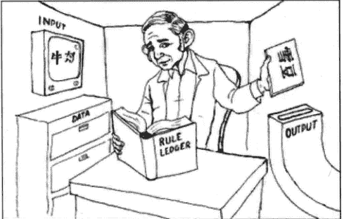

图 1.1 中文房间实验。

塞尔 [1980] 以其**中文房间**思想实验对图灵测试提出了异议。实验过程如下。假设我们已成功开发出一个似乎能理解中文的计算机程序。也就是说，该程序以用中文字符编写的句子作为输入，处理这些字符，并输出用中文字符编写的句子。参见图 1.1。如果它能说服一名中文审讯者它是人类，那么图灵测试将通过。

塞尔问道：“该程序是否字面上*理解*中文，或者它只是模拟理解中文的能力？”为了解决这个问题，塞尔 提议他可以坐在一个封闭的房间里，拿着一本包含程序英文版本的书，以及足够的纸和铅笔来手动执行程序的指令。然后，中文审讯者可以通过门上的狭槽提供中文句子，塞尔 可以使用程序的指令处理它们，并通过同一狭槽发回中文句子。塞尔 说他执行了与通过图灵测试的计算机完全相同的任务。也就是说，每个都在遵循模拟智能行为的程序。然而，塞尔 指出他不会说中文。因此，因为他不理解中文，合理的结论是计算机也不理解中文。塞尔 认为，如果计算机不理解对话，那么它就不是在思考，因此它没有智能心智。

塞尔 阐述了称为**强人工智能**的哲学立场，如下：

> 经过适当编程的计算机确实是一个心智，因为给予正确程序的计算机可以被字面上说成是理解并具有其他认知状态。

基于其中文房间实验，塞尔 得出结论，强人工智能是不可能的。他表示：“你可以给我任何你喜欢的形式化程序，但我仍然什么也不理解。”塞尔 的论文在一段时间内引起了大量争议和讨论（例如，参见 [Harnad, 2001]）。

计算机可能表现出智能的外观和行为，但不一定理解，这种立场称为**弱人工智能**。问题的实质在于计算机是否可能真正拥有心智（强人工智能），或者只能模拟心智（弱人工智能）。这一区别对于讨论意识概念的哲学家来说更为重要 [Chalmers, 1996]。也许出于戏谑，哲学家甚至可能争论说，涌现主义可能发生在中文房间实验中，心智可能从 塞尔 执行所有操作中产生。实际上，计算机科学家不关心这些。如果程序在所有目的上都表现得像是智能的，那么计算机科学家就实现了他们的目标。

### 1.1.2 人工智能的出现

早期的人工智能工作涉及对大脑中神经元的建模。人工神经元被视为一个二进制变量，切换为 _开启_ 或 _关闭_。这一概念最初在 [McCulloch and Pitts, 1943] 中提出，并由 唐纳德·赫布 [1949] 进一步发展，他为**神经网络**开发了**赫布学习**。1951年，马文·明斯基和迪安·埃德蒙兹 构建了 SNARC，即第一台神经网络计算机。

在此成就和图灵开发图灵测试之后，研究人员对神经网络和智能系统的研究越来越感兴趣，这导致 约翰·麦卡锡¹ 在1956年于达特茅斯大学组织了一个为期2个月的研讨会，邀请了感兴趣的研究人员。他在那次研讨会上创造了 _人工智能_ 这一术语。与会者包括明斯基、克劳德·香农（信息理论的开发者）等许多人。人工智能作为一门新学科出现，其目标是创建能够在复杂、变化的环境中学习、反应和做出决策的计算机系统。

### 1.1.3 认知科学与人工智能

**认知科学**是研究心智及其过程的学科。它关心信息如何被心智表示和处理。它是一门跨学科领域，涵盖哲学、心理学、人工智能、神经科学、语言学和人类学，并与人工智能大致同时出现为一门独立学科。认知科学涉及对心智的实证研究，而人工智能关注人工心智的开发。然而，由于它们相关的努力，每个领域都能够从另一个领域借鉴。

### 1.1.4 人工智能的逻辑方法

人工智能早期的大部分成功都基于对人类逻辑的建模。1955-1956年，艾伦·纽厄尔和赫伯特·西蒙 开发了一个名为 **逻辑证明者** 的程序，旨在模仿人类的问题解决技能，并被认为是第一个人工智能程序。它能够证明怀特海和罗素的 *数学原理* 中前52个定理中的38个，并为其中一些定理找到更短的证明 [McCorduck, 2004]。1961年，Newell 和 Simon 提出了 **通用问题求解器** (**GPS**)，这是一个旨在作为通用问题求解机器工作的程序。其推理基于手段-目标分析以及人类在解决问题时处理目标和子目标的方式。GPS 能够解决汉诺伊塔等简单问题，但由于组合爆炸而无法扩展。1959年，Gelernter 开发了 **几何定理证明器** [Gelernter, 1959]，它能够证明初等欧几里得平面几何中的定理。

麦卡锡 [1958] 描述了一个名为 **建议接受者** 的假设程序。与之前的努力不同，该程序旨在接受关于环境的新公理，并与它们进行推理，而无需重新编程。

> 我们预期建议接受者的主要优势是，其行为可以通过仅仅向其陈述来改进，告诉它关于其符号环境以及对它的要求。做出这些陈述几乎不需要或不需要了解程序或建议接受者的先前知识。人们可以假设，建议接受者将能够获得其被告知的任何内容及其先前知识的相当广泛的直接逻辑后果类别。预计该属性将与使我们将某些人描述为具有常识的特性有很多共同之处。因此，我们将说，如果程序能自动为其被告知的任何内容及其已知内容推导出足够广泛的直接后果类别，那么该程序具有常识。
>
> — McCarthy, 1958

**建议接受者**推进了人工智能中的一个重要概念，即将世界的表示（知识）与表示的操作（推理）分开的概念。

为了获得对开发能够相对于其世界的所有方面进行智能推理的实体的可管理掌控，研究人员开发了微型世界。其中最著名的是 **积木世界** [Winograd, 1972]; [Winston, 1973]，在 3.2.2.1 节中讨论。这个世界由放置在桌子上的一组积木组成。然后机器人有以各种方式操作积木的任务。

人工智能的这些早期成功使研究人员对其未来非常乐观。以下是一句著名的引语：


> 我的目的并非要让你感到惊讶或震惊——但我能做出的最简单总结是：当今世界上已存在能够思考、学习和创造的机器。而且，它们做这些事情的能力将迅速提升，直到——在可见的未来——它们能处理的问题范围将与人类心智所应用的范围完全一致。
>
> — Simon, 1957

然而，能够证明包含有限数量事实的定理以及在微观世界中表现良好的系统，未能扩展到能够证明涉及大量事实的定理以及与复杂世界交互的系统。造成这一现象的一个原因是组合爆炸。微观世界中的对象相对较少，因此可能的动作并不多。随着对象数量的增加，搜索的复杂度可能呈指数级增长。另一个困难在于表征复杂世界，而非简单的微观世界。

### 1.1.5 基于知识的系统

前面所述的早期AI工作涉及开发通用智能程序，这些程序在有限领域内工作并解决相对简单的问题。然而，这些程序未能扩展到处理困难问题。由于这些方法无法扩展，因此被称为弱方法（不要与前面讨论的弱AI混淆）。由于HAL和终结者并未出现，许多研究者将精力转向开发在专业领域解决困难问题的实用系统。这些系统使用强大的、特定领域的知识，被称为基于知识的系统。由于它们通常执行专家的任务，许多此类系统的另一个术语是专家系统。通常，它们遵循McCarthy为“建议者”（Advice Taker）指定的方法。也就是说，知识由关于特定领域的规则来表示，推理由操纵这些规则的通用算法组成。具体做法的细节将在第2.3.1节中介绍。

成功的基于知识的系统包括DENDRAL [Lindsay et al., 1980]（用于分析化学中质谱图的系统）；XCON [McDermott, 1982]（用于配置VAX计算机的系统）；以及ACRONYM [Brooks, 1981]（一个视觉支持系统）。

最初，基于知识的系统基于逻辑，执行精确推理，并得出绝对结论。然而，在许多领域，尤其是医学领域，我们无法确定自己的结论。

为什么绝对决策对医学的所有方面都不够？因为世界太复杂了！虽然许多决策可以直接做出，但许多决策过于困难，无法以任何简单的方式来规定。当许多因素可能进入决策，当这些因素本身可能不确定，当某些因素可能取决于其他因素而变得不重要，以及当收集可能实际上并非决策所需的信息存在显著成本时，那么流程图的僵硬性使其成为一种不合适的决策工具。

> — Szolovits and Pauker, 1978

研究者们寻求将不确定性纳入其基于知识的系统规则中的方法。最显著的此类努力是在MYCIN系统 [Buchanan and Shortliffe, 1984]中引入**确定性因子**。MYCIN是一个用于诊断细菌感染并为其开具治疗方案的医学专家系统。确定性因子在第5章的介绍中有所描述。

### 1.1.6 AI的概率方法

Neapolitan [1989]表明，基于规则的不确定知识和推理表示不仅笨拙复杂，而且也不能很好地模拟人类的推理方式。Pearl [1986]提出了一个更合理的推测：人类识别个别命题之间的局部概率因果关系，并基于这些关系进行推理。与此同时，决策分析领域的研究者 [Shachter, 1986] 正在开发影响图，这为我们在面对不确定性时提供了规范性决策。在20世纪80年代，来自认知科学（如Judea Pearl）、计算机科学（如Peter Cheeseman和Lotfi Zadeh）、决策分析（如Ross Shachter）、医学（如David Heckerman和Gregory Cooper）、数学和统计学（如Richard Neapolitan和David Spiegelhalter）以及哲学（如Henry Kyburg）的研究者在新成立的*人工智能中的不确定性研讨会*（现为会议）上聚会，讨论如何在人工智能中最好地进行不确定推理。文本*智能系统中的概率推理* [Pearl, 1988]和*专家系统中的概率推理* [Neapolitan, 1989]将这些讨论的许多成果整合到我们现在称为**贝叶斯网络**的领域中。贝叶斯网络可以说已成为处理人工智能中不确定推理的标准，许多AI应用都是使用它们开发的。第8.8节列出了其中一些应用。

### 1.1.7 进化计算与群体智能

人工智能的一个独立领域称为**进化计算** [Frazer, 1958]; [Holland, 1975]; [Koza, 1992]; [Fogel, 1994]，它与迄今讨论的努力同时出现。进化计算致力于利用自然选择中涉及的进化机制作为其范式，为诸如优化问题等问题获得近似解。

一个相关的近期研究领域涉及群体智能。许多物种在作为群体工作时能够执行复杂任务，尽管群体中的每个成员看似几乎没有智能。例如，蚁群在寻找其巢穴与某个食物来源之间的最短路径方面非常有效，而单只蚂蚁无法完成这项任务。**群体智能**是当一组自主的非智能实体相互作用时出现的智能集体行为。以群体智能为模型，研究者开发了解决许多实际问题的算法 [Kennedy and Eberhart, 2001]; [Dorigo and Gambardella, 1997]。

### 1.1.8 重返创造HAL

基于知识的方法、概率方法和进化计算已经产生了许多有用的系统，这些系统表现出智能或在专业领域解决问题。本引言开头提供了示例。然而，一些早期的AI研究者，包括John McCarthy [2007]和Marvin Minsky [2007]，认为AI应该停止专注于开发执行专业任务的系统，而应回归开发能够思考的系统。2004年，他们举办了第一次关于**人类水平AI** [Minsky et al., 2004]的研讨会。

2007年，名为**人工通用智能（AGI）** [Goertzel and Pennachin, 2007]的相关领域出现，并拥有自己的期刊，名为_人工通用智能期刊_。AGI领域的研究者正在寻找一个能够在任何任意环境中学习和做出决策的程序。

开发思维实体的另一项当前努力是Gerry Edelman的工作。Edelman [2006]用一种称为**神经元群选择**的过程来解释高级大脑功能的发展和组织。他将这个模型称为**神经达尔文主义**。基于这个模型，他开发了许多类似机器人的基于大脑的设备（BBDs），这些设备与现实世界环境交互 [Edelman, 2007]。然而，它们只能在有限领域内导航。

## 1.2 当代人工智能

如果我们希望有一天能拥有一个在变化的复杂环境中进行推理的智能实体，那么人类水平AI社区、AGI社区以及Gerry Edelman的努力都至关重要。然而，本文采取的方法是专注于强AI方法，这些方法已促成开发出在专业领域成功解决有趣且重要问题的系统。我们称这是人工智能教材的一种_当代_方法。

AI的早期成功基于对逻辑推理的建模。例如，假设Mary知道，如果有人完成120个学分并通过综合考试，那么该人将毕业。假设她随后得知Joe完成了120个学分，并且他没有毕业。她逻辑上推理出，他肯定没有通过综合考试。基于这种逻辑推理的AI模型是本文第一部分的重点。

在20世纪70年代，越来越明显的是，人类做出的许多判断涉及不确定或概率性推理。例如，假设Mary知道，努力学习将大大增加获得一个


考试中得A；她还意识到，聪明人更有可能在考试中得A。她得知Joe得了A。当Joe告诉她他没有很努力地学习时，她推断Joe可能很聪明。到1990年，对这种概率推理的建模在AI中变得司空见惯；这种推理是第二部分的重点。

智能行为不仅限于人类推理。进化本身似乎也很聪明，因为更能适应环境的生物倾向于生存，其结果就是人类自身的存在。进化计算领域的研究人员基于自然选择模型解决了有趣的问题。非智能实体群体行为有时会产生一种称为群体智能的涌现智能，并且基于该模型开发了有用的算法。我们将这两种智能都称为**涌现智能**。基于涌现智能的算法在第三部分中讨论。

在第一部分和第二部分中，我们假设系统是从人类（通常是某个领域的专家）提取的知识中创建的。然而，智能的一个重要方面涉及从经验或数据中获取新知识。第四部分涉及从数据中学习逻辑模型和概率模型。最后，第五部分讨论了人工智能中的一项重要工作，即自然语言理解。

# 第一部分

# 逻辑智能

# 第2章

# 命题逻辑


命题逻辑涉及命题/陈述，我们假设它们为真或假，以及从已知真值状态的命题推导其他命题真值的演绎推理。通过**演绎推理**，我们指的是一个过程，通过该过程结论的真理必然从前提的真理中得到证明。这个经典示例的变体说明了这样的推演：

- 苏格拉底是人。
- 如果苏格拉底是人，那么苏格拉底是必死的。
- 因此，苏格拉底是必死的。

如果我们假设知道苏格拉底是人，并且相信“如果苏格拉底是人，那么苏格拉底是必死的”是一个真陈述，那么我们大多数人会推理出苏格拉底是必死的。命题逻辑不询问这种推理是否合理。相反，它在数学上对这种以及大多数人都同意合理的其他常见演绎推理类型进行建模。当我们将这种推理纳入人工智能算法时，我们称该算法为**基于逻辑的**。

在2.1节中，我们介绍命题逻辑的基本属性。2.2节开发了一种称为分辨率定理证明的推理方法，这是许多自动推理程序使用的策略。2.3节展示了命题逻辑的人工智能应用。

### 2.1 命题逻辑基础

命题逻辑的讨论从其语法和语义开始。

### 2.1.1 语法

**形式语言**是使用字母表和规则获得的一组单词或表达式。形式语言的**字母表**是构成每个单词的**符号**集合。称为语言**语法**的**规则**集合，指定了如何组合字母表的元素来构造单词。这些单词称为符号的**良构字符串**。

**命题逻辑**由形式语言和语义组成，语义为良构字符串（称为**命题**）赋予意义。
命题逻辑的字母表包含以下符号：

1. 英文字母表的字母；即，A、B、C、...、Z，以及每个字母加上一个索引（例如，A4）。
2. 逻辑值 True 和 False。
3. 这些特殊符号：
   - ¬（非）
   - ∧（与）
   - ∨（或）
   - ⇒（如果...那么...）
   - ⇔（当且仅当）
   - ( )（分组）。

符号 ¬ 称为**一元连接词**，符号 ∧、∨、⇒ 和 ⇔ 称为**二元连接词**。

创建命题的规则如下：

1. 所有字母、所有带索引的字母以及逻辑值 True 和 False 都是命题。它们称为**原子命题**。
2. 如果 *A* 和 *B* 是命题，那么 ¬*A*、*A* ∧ *B*、*A* ∨ *B、*A* ⇒ *B、*A* ⇔ *B* 和 (*A*) 也是命题。它们称为**复合命题**。

复合命题 $\neg A$ 称为 $A$ 的**否定**，$A \wedge B$ 称为 $A$ 和 $B$ 的**合取**，$A \vee B$ 称为 $A$ 和 $B$ 的**析取**。

请注意，我们使用斜体字母来指代命题。这些字母表示变量，其值可以是原子命题或复合命题。通过这种方式，我们可以递归地定义复合命题。这些斜体字母不属于字母表。

**示例 2.1** 假设 P 和 Q 是原子命题。然后使用 $\wedge$ 连接词一次应用规则 2，我们得到 P$\wedge$Q 是一个命题。将规则 2 应用于这个复合命题和原子命题 R，使用 $\vee$ 连接词，我们得到 P$\wedge$Q$\vee$R 是一个命题。

从数学上讲，关于命题逻辑的形式语言就这些了。然而，命题逻辑的开发目的是对现实世界进行陈述并基于这些陈述进行推理。下一个示例说明了这样的陈述。

**示例 2.2** 假设命题 P 和 Q 代表关于世界的以下陈述：

- P：外面在下雨。
- Q：人行道是湿的。

然后以下复合命题代表关于世界的以下陈述：

- $\neg$P：外面不在下雨。
- P$\wedge$Q：外面在下雨且人行道是湿的。
- P$\vee$Q：外面在下雨或人行道是湿的。
- P$\Rightarrow$Q：如果外面在下雨，那么人行道是湿的。
- P$\Leftrightarrow$Q：外面在下雨当且仅当人行道是湿的。

**示例 2.3** 设 P、Q 和 R 代表关于世界的以下陈述：

- P：外面在下雨。
- Q：人行道是湿的。
- R：喷水器开启。

然后使用 $\vee$ 连接词一次应用规则 2，我们得到 P$\vee$R 是一个命题。使用 $\wedge$ 连接词第二次应用规则 2，我们得到 Q$\wedge$P$\vee$R 是一个命题。这个命题代表关于世界的以下陈述：

- Q$\wedge$P$\vee$R：人行道是湿的且外面在下雨，或者喷水器开启。

### 2.1.2 语义

当你看到示例 2.3 时，你可能会问命题 Q∧P∨R 指的是以下哪一项：

1. 人行道是湿的 *且* 外面在下雨或喷水器开启，这两者都为真。
2. *要么* 人行道是湿的且外面在下雨 *或* 喷水器开启为真。

接下来我们介绍命题逻辑的语义，它回答了这个问题。

命题逻辑的语法仅关注命题的构建；与赋予它们意义无关。如前所述，我们甚至不需要将关于世界的陈述与命题关联起来。命题逻辑的语义为命题赋予意义。语义包括为每个命题分配值 T（真）或 F（假）的规则。这种分配称为命题的**真值**。如果命题的真值为 T，我们说它为真；否则，我们说它为假。

命题逻辑的**语义**包括以下规则：

1. 逻辑值 True 始终分配值 T，逻辑值 False 始终分配值 F。
2. 其他每个原子命题都分配值 T 或 F。所有这些分配的集合构成一个**模型**或**可能世界**。所有可能世界（分配）都是允许的。
3. 通过将每个连接词应用于任意命题所获得的真值由以下**真值表**给出：

| A | ~A |
|---|---|
| T | F |
| F | T |

| A | B | A ^ B |
|---|---|---|
| T | T | T |
| T | F | F |
| F | T | F |
| F | F | F |

| A | B | A v B |
|---|---|---|
| T | T | T |
| T | F | T |
| F | T | T |
| F | F | F |

| A | B | A => B |
|---|---|---|
| T | T | T |
| T | F | F |
| F | T | T |
| F | F | T |

| A | B | A <=> B |
|---|---|---|
| T | T | T |
| T | F | F |
| F | T | F |
| F | F | T |

4. 诸如 P∧Q∨R 之类的复合命题的真值使用上述真值表递归确定。这是根据以下规则完成的：


## 2.1 命题逻辑基础

- (a) ( ) 分组具有最高优先级，因为括号内整个子命题的真值会首先被求值。
- (b) 连接词的优先级顺序为 $\neg, \wedge, \vee, \Rightarrow, \Leftrightarrow$。
- (c) 相同的二元连接词从左到右结合。

我们将稍后展示应用规则 4 的示例。首先，让我们讨论规则 3 中的真值表。从数学上讲，命题逻辑的语义只不过是为命题赋予真值。因此，我们本可以定义一个与规则 3 中不同的真值表的语义。然而，我们的目的是对现实世界进行陈述，并基于这些陈述进行推理。因此，语义的定义旨在反映人类在现实世界中如何对陈述进行推理。真值表 a 到 c 很容易符合我们的直觉。例如，只有当 $A$ 和 $B$ 都为真时，我们才会认为 $A \wedge B$ 为真。然而，关于 $A \Rightarrow B$ 的真值表 d 并不那么容易理解。请考虑以下命题：

P: 正在下雨。

Q: 尼阿波利坦教授身高 5 英尺。

假设你向窗外望去，看到并未下雨，又看着尼阿波利坦教授，注意到他将近 6 英尺高。因此，你知道 P 和 Q 都为假。那么，根据真值表 d，第 4 行，$P \Rightarrow Q$ 为真。但是，当我们知道他并非 5 英尺高时，下雨怎么可能意味着尼阿波利坦身高 5 英尺呢？首先，我们必须弄清楚一个命题表示什么。命题 P 表示当前正在下雨。这与其他时间是否下雨无关。因此，$P \Rightarrow Q$ 并不意味着如果某天下雨，那么尼阿波利坦就会身高 5 英尺。蕴含仅涉及当前有雨这一命题，而该命题为假。

人们对 $A \Rightarrow B$ 所感知的困难通常涉及真值表 d 的第 3 行和第 4 行。因此，让我们调查这些行中的真值是否符合我们的预期。假设我们知道 $A \Rightarrow B$ 为真。然后如果我们后来得知 $A$ 也为真，我们知道我们必须处于真值表 d 的第 1 行，这意味着 $B$ 为真。这是我们应该期望的。如果我们后来得知 $A$ 为假，我们知道我们必须处于第 3 行或第 4 行，这意味着我们不知道 $B$ 是真还是假。这也是我们会期望的。因此，当前的真值分配符合我们的预期。假设现在我们为 $A \Rightarrow B$ 在第 3 行和第 4 行分配不同的真值。首先假设我们在这两行中都为 $A \Rightarrow B$ 分配 F，并保持第 1 行和第 2 行的分配不变。那么，如果我们知道 $A \Rightarrow B$ 和 $B$ 都为真，我们必须处于第 1 行，这意味着我们得出结论 $A$ 为真。然而，这意味着 $B$ 蕴含 $A$，这并非我们通过 $A \Rightarrow B$ 意图表达的内容。假设相反，我们在第 3 行但不在第 4 行中为 $A \Rightarrow B$ 分配 F。那么，如果我们知道 $A \Rightarrow B$ 为真且 $A$ 为假，我们必须处于第 4 行，这意味着我们得出结论 $B$ 为假。然而，这意味着 $A$ 为假蕴含 $B$ 为假，这并非我们通过 $A \Rightarrow B$ 意图表达的内容。如果我们在第 4 行但不在第 3 行中为 $A \Rightarrow B$ 分配 F，也会出现类似的困难。

就像刚才提出的讨论一样，这有助于直观理解真值表 e 中 \( A \Leftrightarrow B \) 的真值分配。发展这样的讨论留作练习。

我们现在提供评估表达式真值的示例。

**示例 2.4** 请考虑以下命题：$Q \wedge P \vee R$。这是示例 2.3 中的命题。因为 $\wedge$ 的优先级高于 $\vee$，$Q \wedge P \vee R$ 的含义是本节开头所示的第二个陈述，即：人行道是湿的且外面在下雨 *为真*，*或者* 洒水器开启 *为真*。

真值表显示了为 P、Q 和 R 赋予哪些值会使 $Q \wedge P \vee R$ 为真。也就是说，它揭示了命题为真的可能世界。真值表如下：

| Q | P | R | $Q \wedge P$ | $Q \wedge P \vee R$ |
|---|---|---|---|---|
| T | T | T | T | T |
| T | T | F | T | T |
| T | F | T | F | T |
| T | F | F | F | F |
| F | T | T | F | T |
| F | T | F | F | F |
| F | F | T | F | T |
| F | F | F | F | F |

真值表的构建方法是：首先列出 Q、P 和 R 的所有八种可能值分配；接着，因为 $\wedge$ 的优先级高于 $\vee$，使用真值表 b 计算 $Q \wedge P$ 的值；最后，使用真值表 c 计算 $Q \wedge P \vee R$ 的值。

**示例 2.5** 假设我们实际上想表达本节开头的第一个陈述——即，人行道是湿的 *并且* 外面在下雨或洒水器开启 *均为真*。上面的规则 4 说明 ( ) 连接词具有最高优先级。因此，我们可以写出 $Q \wedge (P \vee R)$ 来表达第一个陈述。该命题的真值表如下：

| Q | P | R | $P \vee R$ | $Q \wedge (P \vee R)$ |
|---|---|---|---|---|
| T | T | T | T | T |
| T | T | F | T | T |
| T | F | T | T | T |
| T | F | F | F | F |
| F | T | T | T | F |
| F | T | F | T | F |
| F | F | T | T | F |
| F | F | F | F | F |

**示例 2.6** 假设你在鞋店看到以下告示：如果鞋子未穿过，可在购买日期后 30 天内退货。让我们使用命题逻辑来表达这个陈述，并探讨它何时为真。让以下命题代表关于世界的这些陈述：

- P: 你的鞋子已被穿过。
- Q: 距离你购买鞋子的时间不超过 30 天。
- R: 你的鞋子可以退货。

那么，关于你鞋子的商店政策陈述在逻辑上表达为以下命题：

$\neg P \wedge Q \Rightarrow R$.

该命题的真值表如下：

| P | Q | R | $\neg P$ | $\neg P \wedge Q$ | $\neg P \wedge Q \Rightarrow R$ |
|---|---|---|---|---|---|
| T | T | T | F | F | T |
| T | T | F | F | F | T |
| T | F | T | F | F | T |
| T | F | F | F | F | T |
| F | T | T | T | T | T |
| F | T | F | T | T | F |
| F | F | T | T | F | T |
| F | F | F | T | F | T |

这个结果可能让你觉得奇怪。店主的意图是：如果鞋子已穿过，或者购买已超过 30 天，则不允许退货。然而，在 $\neg P \wedge Q \Rightarrow R$ 为真的几个可能世界中，P 为真（意味着鞋子已穿过），和/或 Q 为假（意味着已超过 30 天）。唯一不被允许的世界是：P 为假（你的鞋子未穿过），Q 为真（距离购买不超过 30 天），且 R 为假（你的鞋子不可退货）。问题在于，店主像人类常做的那样，没有明确陈述其意图。意图是：只有当鞋子未穿过且距离购买不超过 30 天时，才允许退货。如果店主做出了这个陈述，那么我们将在逻辑上如下表达店主的政策：

$\neg P \wedge Q \Leftrightarrow R$.

为这个陈述构建真值表并证明店主的意图得到了恰当建模，留作练习。

### 2.1.3 重言式与逻辑蕴含

我们有关于命题的以下定义。

**定义 2.1** 如果且仅当一个命题在所有可能世界中都为真，则称其为**重言式**。♦

**定义 2.2** 如果且仅当一个命题在所有可能世界中都为假，则称其为**矛盾式**。♦

请注意，我们在前面的定义中使用了“如果且仅如果”。从技术上讲，如果我们不这样做，就会留下可能性：具有某些不同属性的命题也可能被称为重言式。我们这样做是为了进一步说明示例 2.6 中的观点。今后，在陈述定义时我们不会如此精确。默认我们的意思是“如果且仅如果”。

**示例 2.7** 以下真值表明 $P \vee \neg P$ 是一个重言式。

| P | $\neg P$ | $P \vee \neg P$ |
|---|---|---|
| T | F | T |
| F | T | T |

也就是说，要么 P 为真，要么 $\neg P$ 为真。

**示例 2.8** 以下真值表明 $P \wedge \neg P$ 是一个矛盾式。

| P | $\neg P$ | $P \wedge \neg P$ |
|---|---|---|
| T | F | F |
| F | T | F |

也就是说，P 和 $\neg P$ 不能同时为真。

以下定义涉及两个重要的重言式。

**定义 2.3** 给定两个命题 $A$ 和 $B$，如果 $A \Rightarrow B$ 是一个重言式，则我们说 $A$ 逻辑蕴含 $B$，并记作 $A \Rightarrow B$。♦

**示例 2.9** 以下真值表明 $A \wedge B \Rightarrow A$：

| A | B | $A \wedge B$ | $A \wedge B \Rightarrow A$ |
|---|---|---|---|
| T | T | T | T |
| T | F | F | T |
| F | T | F | T |
| F | F | F | T |

因为 $A \wedge B \Rightarrow A$ 在所有可能世界中都为真，所以 $A \wedge B \Rightarrow A$。

**示例 2.10** 以下真值表明 $A \wedge (A \Rightarrow B) \Rightarrow B$：


| A | B | A => B | A ∧ (A => B) | A ∧ (A => B) => B |
|---|---|---|---|---|
| T | T | T | T | T |
| T | F | F | F | T |
| F | T | T | F | T |
| F | F | T | F | T |

因为 A ∧ (A => B) => B 在所有可能世界中都为真，所以 A ∧ (A => B) => B。

### 定义 2.4 给定两个命题 A 和 B，如果 A <=> B 是重言式，我们说 A 和 B 在逻辑上等价，并记作 A == B。

### 例 2.11 下面的真值表表明 A => B <=> ¬A v B：

| A | B | ¬A | A => B | ¬A v B | A => B <=> ¬A v B |
|---|---|---|---|---|---|
| T | T | F | T | T | T |
| T | F | F | F | F | T |
| F | T | T | T | T | T |
| F | F | T | T | T | T |

因为 A => B <=> ¬A v B 是重言式，所以 A => B <=> ¬A v B。

注意在前一个示例中，A => B 和 ¬A v B 在每个可能世界中都有相同的真值。这是关于逻辑等价的一般结果，我们在下面的定理中陈述。

### 定理 2.1 A <=> B 当且仅当 A 和 B 在每个可能世界中都有相同的真值。

证明。证明留作练习。

表 2.1 列出了一些重要的逻辑等价式，称为定律。利用真值表来验证它们留作练习。我们可以利用这些定律来简化逻辑表达式，这归功于以下定理：

### 定理 2.2 假设我们有一个命题 A 以及 A 内部的一个子命题 B。如果在 A 中用与 B 在逻辑上等价的任意命题替换 B，我们将得到一个与 A 在逻辑上等价的命题。

证明。证明留作练习。

### 例 2.12 假设我们有以下命题：

¬¬P ∧ (Q ∨ ¬Q)

我们可以按如下方式简化它：

¬¬P ∧ (Q ∨ ¬Q) ≡ P ∧ (Q ∨ ¬Q) 由于双重否定律
≡ P ∧ True 由于排中律
≡ P 由于恒等律。

### 表 2.1 一些著名的逻辑等价式

| 逻辑等价式 | 名称 | |
|---|---|---|
| \( A \lor \neg A \equiv \text{True} \) | 排中律 | EM |
| \( A \land \neg A \equiv \text{False} \) | 矛盾律 | CL |
| \( A \lor \text{False} \equiv A \) | 恒等律 | IL |
| \( A \land \text{True} \equiv A \) | | |
| \( A \lor \text{True} \equiv \text{True} \) | 支配律 | DL |
| \( A \land \text{False} \equiv \text{False} \) | | |
| \( A \lor A \equiv A \) | 幂等律 | IL |
| \( A \land A \equiv A \) | | |
| \( A \land B \equiv B \land A \) | 交换律 | CL |
| \( A \lor B \equiv B \lor A \) | | |
| \( (A \land B) \land C \equiv A \land (B \land C) \) | 结合律 | AL |
| \( (A \lor B) \lor C \equiv A \lor (B \lor C) \) | | |
| \( A \land (B \lor C) \equiv (A \land B) \lor (A \land C) \) | 分配律 | DL |
| \( A \lor (B \land C) \equiv (A \lor B) \land (A \lor C) \) | | |
| \( \neg(A \land B) \equiv \neg A \lor \neg B \) | 德摩根律 | DeML |
| \( \neg(A \lor B) \equiv \neg A \land \neg B \) | | |
| \( A \Rightarrow B \equiv \neg A \lor B \) | 蕴含消去 | IE |
| \( A \Leftrightarrow B \equiv A \Rightarrow B \land B \Rightarrow A \) | 当且仅当消去 | IFFE |
| \( A \Rightarrow B \equiv \neg B \Rightarrow \neg A \) | 逆否律 | CL |
| \( \neg \neg A \equiv A \) | 双重否定 | DN |

### 2.1.4 逻辑论证

现在我们已经打好了些基础，可以回到本章开头提出的初始目标了——即，对演绎推理进行数学建模。回顾以下示例：

苏格拉底是人。
如果苏格拉底是人，那么苏格拉底是必死的。
因此，苏格拉底是必死的。

我们之前说过，如果我们假设知道苏格拉底是人，并且相信“如果苏格拉底是人，那么苏格拉底是必死的”是一个真陈述，那么我们大多数人会推理出苏格拉底是必死的。让我们看看命题逻辑如何对这种推理进行建模。让以下命题代表关于世界的这些陈述：

P: 苏格拉底是人。
Q: 苏格拉底是必死的。

那么陈述“如果苏格拉底是人，那么苏格拉底是必死的”由以下命题建模：

P \(\Rightarrow\) Q.

如果命题逻辑对我们的推理方式进行建模，那么 P 和 P⇒Q 的真理应当蕴含 Q 的真理。我们将证明这一点，但首先我们将使用命题逻辑对演绎推理进行形式化。

一个**论证**由一组命题组成，称为**前提**，以及一个称为**结论**的命题。如果在所有前提都为真的模型中，结论也为真，我们说前提**蕴含**结论。如果前提蕴含结论，我们说该论证是**有效的**；否则我们说它是一个**谬误**。我们按以下方式写出论证，列出前提后跟结论：

- 1. A_1
- 2. A_2
- ...
- n. A_n
- B

我们使用符号 $\models$ 表示“蕴含”。因此，如果论证是有效的，我们写

$A_1, A_2, ..., A_n \models B,$

如果它是谬误，我们写

$A_1, A_2, ..., A_n \not\models B.$

### 例 2.13 关于苏格拉底的论证如下：

- 1. P
- 2. P⇒Q
- Q

关于这个论证，我们有以下真值表：

| P | Q | P => Q |
|---|---|---|
| T | T | T |
| T | F | F |
| F | T | T |
| F | F | T |

因为在 P 和 P⇒Q 都为真的每个世界中，Q 也为真，所以前提蕴含结论，该论证是有效的。所以 P, P⇒Q ⊨ Q。■

### 定理 2.3 假设我们有一个由前提 $A_1, A_2, ..., A_n$ 和结论 $B$ 组成的论证。那么 $A_1, A_2, ..., A_n \models B$ 当且仅当 $A_1 \land A_2 \land ... \land A_n \Rightarrow B$。

**证明。** 证明留作练习。■

这个定理表明，正如我们所期望的，有效的论证是前提在逻辑上蕴含结论的论证。

### 例 2.14 我们已经表明例 2.13 中的论证是有效的。因此，定理 2.3 说明我们必须有 P∧(P ⇒ Q) ⇒ Q。例 2.10 已经得到了这个结果，因为它表明对于任意命题 A 和 B，A∧(A ⇒ B) ⇒ B。

### 例 2.15 以下是一个常见的俗语：“有烟处必有火。”它常被用于当有人想得出结论说某人一定是坏人，因为关于该人正在传播不利言论时。让我们来研究一下对这一字面陈述本身进行推理。让以下命题代表关于世界的这些陈述：

P: 有火。
Q: 有烟。

我们可以假设火总是产生烟，但反之则不然。例如，存在摩擦烟雾发生器。所以 P⇒Q 为真，但 Q⇒P 不为真。因为 Q⇒P 不为真，任何使用这个俗语进行推理的人都不应假设 Q⇒P 为真。因此，他们的推理可能由以下论证建模：

- 1. Q
- 2. P⇒Q
- P

关于这个论证，我们有以下真值表：

| P | Q | P⇒Q | Q∧(P ⇒ Q) | Q∧(P ⇒ Q) ⇒ P |
|---|---|---|---|---|
| T | T | T | T | T |
| T | F | T | F | T |
| F | T | T | T | F |
| F | F | T | F | T |

因为 Q∧(P ⇒ Q) ⇒ P 不是重言式，所以我们没有 Q∧(P ⇒ Q) ⇒ P，这意味着该论证是一个谬误。所以 Q, P⇒Q ⊭ Q。

烟是火的结果，但烟也可能有其他原因。在这种情况下，效果的存在使得原因更可能但不确定。我们将在第 6 章中更深入地探讨关于原因和结果的概率推理。

### 2.1.5 推导系统

虽然我们可以使用真值表来证明任何论证是有效的还是谬误，但这个过程存在两个困难。首先，时间复杂度与前提的数量呈指数关系。也就是说，如果有 n 个前提，确定论证有效性所需的真值表中有 2^n 行。其次，人类似乎并不是以这种方式进行演绎推理的。考虑以下示例。

### 例 2.16 假设我们正在尝试确定 Randi 如何谋生。我们知道 Randi 要么写书，要么帮助他人写书。我们还知道，如果 Randi 帮助他人写书，那么她以编辑为生。最后，我们知道 Randi 不写书。与其使用真值表，不如我们这样推理：因为 Randi 要么写书要么帮助他人写书，且 Randi 不写书，所以我们可以得出结论 Randi 帮助他人写书。因为我们现在知道 Randi 帮助他人写书，所以我们可以得出结论 Randi 以编辑为生。

- P: Randi 写书。
- Q: Randi 帮助他人写书。
- R: Randi 以编辑为生。

我们知道 P∨Q 和 ¬P。利用这两个事实，我们得出了 Q。从这些事实得出这个结论使用了析取三段论规则。接下来我们得出 R，因为我们知道 Q 和 Q⇒R 都为真。这个推理使用了肯定前件规则。一组推理规则称为推导系统。这样的一组出现在表 2.2 中。如果推导系统只推导出有效的论证，则称其为有效的。要表明表 2.2 中的规则集是有效的，我们需要表明每个规则单独都是有效的。我们可以对每个规则使用真值表来做到这一点。

### 例 2.17 我们确立否定后件规则的有效性。根据定理 2.3，我们只需表明 ¬B ∧ (A ⇒ B) ⇒ ¬A。以下真值表确立了这一结果。

| A | B | ¬A | ¬B | A ⇒ B | ¬B ∧ (A ⇒ B) | ¬B ∧ (A ⇒ B) ⇒ ¬A |
|---|---|---|---|---|---|---|
| T | T | F | F | T | F | T |
| T | F | F | T | T | F | T |
| F | T | T | F | F | T | T |
| F | F | T | T | T | T | T |

因为 ¬B ∧ (A ⇒ B) ⇒ ¬A 是重言式，所以 ¬B ∧ (A ⇒ B) ⇒ ¬A。


### 表 2.2 推理规则

| 推理规则 | 名称 |
|---|---|
| \( A, B \vDash A \land B \) | 组合规则 CR |
| \( A \land B \vDash A \) | 简化规则 SR |
| \( A \vDash A \lor B \) | 加法规则 AR |
| \( A, A \Rightarrow B \vDash B \) | 肯定前件 MP |
| \( \neg B, A \Rightarrow B \vDash \neg A \) | 否定后件 MT |
| \( A \Rightarrow B, B \Rightarrow C \vDash A \Rightarrow C \) | 假言三段论 HS |
| \( A \lor B, \neg A \vDash B \) | 选言三段论 DS |
| \( A \Rightarrow B, \neg A \Rightarrow B \vDash B \) | 分情规则 RC |
| \( A \Leftrightarrow B \vDash A \Rightarrow B \) | 等价消去 EE |
| \( A \Rightarrow B, B \Rightarrow A \vDash A \Leftrightarrow B \) | 等价引入 EI |
| \( A, \neg A \vDash B \) | 矛盾规则 IR |
| \( A \land B \vDash B \land A \) | “与”交换律规则 ACR |
| \( A \lor B \vDash B \lor A \) | “或”交换律规则 OCR |
| 如果 \( A_1, A_2, \dots, A_n, B \vDash C \)<br>那么 \( A_1, A_2, \dots, A_n \vDash B \Rightarrow C \) | 演绎定理 DT |

表 2.2 中其余规则的可靠性作为练习留给读者。下一个示例使用这些规则推导一个可靠的论证。

### 示例 2.18

我们使用这些规则来推导示例 2.16 中论证的可靠性。再次让以下命题代表关于世界的这些陈述：

- P: Randi 写书。
- Q: Randi 帮助其他人写书。
- R: Randi 以编辑为生。

以下推导确定了 Randi 的职业：

| 推导 | 规则 |
|---|---|
| 1 P∨Q | 前提 |
| 2 ¬P | 前提 |
| 3 Q⇒R | 前提 |
| 4 Q | 1, 2, DS |
| 5 R | 3, 4, MP |

当我们在规则列中写入“前提”时，表示该命题是我们的前提之一。例如，当我们在第 4 行写入“1, 2, DS”时，表示我们使用第 2 行和第 3 行的前提以及选言三段论规则来推导 Q。

考虑福尔摩斯在小说《血字的勋章》中关于一起谋杀案的以下引语。

> 现在我们来到了为什么的重大问题。抢劫并非谋杀的目的，因为什么也没拿走。那么，是政治，还是女人？这就是摆在我面前的问题。我从一开始就倾向于后一种假设。政治刺客只会太乐意完成他们的工作并逃走。与此相反，这起谋杀是非常蓄意地进行的，凶手在房间里留下了到处都是他的足迹，表明他一直都在那里。

— 阿瑟·柯南·道尔，《血字的勋章》

### 示例 2.19

让以下命题代表关于世界的这些陈述：

- P: 抢劫是谋杀的原因。
- Q: 有东西被拿走了。
- R: 政治是谋杀的原因。
- S: 女人是谋杀的原因。
- T: 凶手立即离开了。
- U: 凶手在房间里留下了到处都是足迹。

以下推导确定了谋杀的原因：

| 推导 | 规则 |
|---|---|
| 1 ¬Q | 前提 |
| 2 P⇒Q | 前提 |
| 3 ¬P⇒R∨S | 前提 |
| 4 R⇒T | 前提 |
| 5 U | 前提 |
| 6 U⇒¬T | 前提 |
| 7 ¬P | 1, 2, MT |
| 8 R∨S | 3, 7, MP |
| 9 ¬T | 5, 6, MP |
| 10 ¬R | 4, 9, MT |
| 11 S | 8, 10, DS |

因此我们得出结论：女人是谋杀的原因。

一个演绎系统如果能推导出每一个可靠的论证，就是**完备**的。表 2.2 中的规则集是完备的。然而，如果我们移除最后一条名为*演绎定理*的规则，它就不再完备。请注意，这条规则与其他规则不同。所有其他规则都涉及有前提的论证。演绎定理用于推导没有前提的论证。没有前提的论证简单来说就是一个重言式。

### 示例 2.20

我们推导出 \(\vdash A \lor \neg A\)。请注意，\(\vdash\) 符号前没有出现前提。因此，这是一个没有前提的论证，如果它是可靠的，那么它就是一个重言式。我们使用表 2.2 中的规则来推导其可靠性。

| 推导 | 规则 | 注释 |
|---|---|---|
| 1 \(A\) | 假设 | 我们假设 \(A\)。 |
| 2 \(A \lor \neg A\) | 1, AR | |
| 3 \(A \Rightarrow A \lor \neg A\) | 1, 2, DT | 我们现在撤销 \(A\)。 |
| 4 \(\neg A\) | 假设 | 我们假设 \(\neg A\)。 |
| 5 \(\neg A \lor A\) | 4, AR | |
| 6 \(A \lor \neg A\) | 5, CR | |
| 7 \(\neg A \Rightarrow A \lor \neg A\) | 4, 6, DT | 我们现在撤销 \(\neg A\)。 |
| 8 \(A \lor \neg A\) | 3, 7, RC | |

请注意，要使用演绎定理，我们首先暂时假设一个命题为真（例如，步骤 1），然后得出第二个命题为真的结论（例如，步骤 2），最后得出假设的命题蕴含第二个命题的结论（例如，步骤 3）。此时我们*撤销*假设的命题，因为我们并不真正知道它为真。我们只是暂时假设它，以便推导出一个蕴含式。

## 2.2 归结法

虽然像福尔摩斯这样逻辑严密的人可能会像我们在示例 2.19 中的推导那样进行推理，但将这种推理策略转换为计算机程序并不直接。接下来，我们将发展一种称为**归结定理证明**的不同推导策略。这是许多自动推理程序所使用的策略。首先，我们需要介绍范式。

### 2.2.1 范式

我们从一些定义开始。

### 定义 2.5

文字是形式为 P 或 \(\neg P\) 的命题，其中 P 是除 True 或 False 以外的原子命题。\(\blacksquare\)

### 定义 2.6

合取子句是文字的合取。\(\blacksquare\)

### 定义 2.7

析取子句是文字的析取。\(\blacksquare\)

### 定义 2.8

如果命题是合取子句的析取，则称其为析取范式。♦

### 定义 2.9

如果命题是析取子句的合取，则称其为合取范式。♦

### 示例 2.21

以下命题是析取范式：

(P ∧ Q) ∨ (R ∧ ¬P)

(P ∧ Q ∧ ¬R) ∨ (S) ∨ (¬Q ∧ T)

以下命题不是析取范式，因为 R∨S∧Q 不是合取子句：

(P ∧ Q) ∨ (R ∨ S ∧ Q)

以下命题是合取范式：

(P ∨ Q) ∧ (R ∨ ¬P)

(P ∨ Q ∨ ¬R) ∧ (S) ∧ (¬Q ∨ T)

以下命题不是合取范式，因为 R∨S∧Q 不是析取子句：

(P ∨ Q) ∧ (R ∨ S ∧ Q)

任何命题都可以转换为逻辑等价的合取（或析取）范式命题。接下来，我们介绍一个在合取范式情况下完成此任务的算法（提到的定律是表 2.1 中的定律）。我们在本文中使用简单的伪代码来展示算法。关键字 var 用于表示“按引用传递”，就我们的目的而言，这意味着该变量是算法的输出。

### 算法 2.1 Conjunctive_Normal_Form

- 输入：一个命题。
- 输出：一个逻辑等价的合取范式命题。

```
Procedure Conjunctive_Normal_form(var Proposition);
remove all "↔" symbols using the if and only if elimination law;
remove all "→" symbols using the implication elimination law;
repeat
    if there are any double negations
        remove them using the double negation law;
    if there are any negations of non-atomic propositions
        remove them using DeMorgan's laws;
until the only negations are single negations of atomic propositions;
repeat
    if there are any disjunctions in which one or more terms is a conjunction
        remove them using these laws:
    A ∨ (B ∧ C) ≡ (A ∨ B) ∧ (A ∨ C)   (2.1)
    (A ∧ B) ∨ C ≡ (A ∨ C) ∧ (B ∨ C);   (2.2);
until Proposition is in conjunctive normal form;
```

等价式 2.1 是表 2.1 中的分配律，等价式 2.2 可以从交换律和分配律推导出来。

### 示例 2.22

我们使用算法 2.1 将 ¬((P ⇒ Q) ∧ ¬R) 转换为合取范式：

- ¬((P ⇒ Q) ∧ ¬R) ≡ ¬((¬P ∨ Q) ∧ ¬R) 蕴含消去
- ≡ ¬(¬P ∨ Q) ∨ ¬¬R 德摩根定律
- ≡ ¬(¬P ∨ Q) ∨ R 双重否定
- ≡ (¬¬P ∧ ¬Q) ∨ R 德摩根定律
- ≡ (P ∧ ¬Q) ∨ R 双重否定
- ≡ (P ∨ R) ∧ (¬Q ∨ R) 等价式 2.2

### 示例 2.23

我们使用算法 2.1 将 (P ∧ Q) ∨ (R ∧ S) 转换为合取范式：

- (P ∧ Q) ∨ (R ∧ S) ≡ ((P ∧ Q) ∨ R) ∧ ((P ∧ Q) ∨ S) 等价式 2.1
- ≡ (P ∨ R) ∧ (Q ∨ R) ∧ ((P ∧ Q) ∨ S) 等价式 2.2
- ≡ (P ∨ R) ∧ (Q ∨ R) ∧ (P ∨ S) ∧ (Q ∨ S) 等价式 2.2


### 2.2.2 使用归结的推导

接下来，我们开发一个使用名为归结规则的单一规则的推导系统。我们从一个定理开始，该定理为我们提供了一种新策略，用于证明论证是合理的。

**定理 2.4** 假设我们有一个由前提 \(A_1, A_2, ..., A_n\) 和结论 \(B\) 组成的论证。那么 \(A_1, A_2, ..., A_n \models B\) 当且仅当 \(A_1 \land A_2 \land ... \land A_n \land \neg B\) 是矛盾式。

**证明。** 证明留作练习。\(\blacksquare\)

**推论 2.1** 假设我们有一个由前提 \(A_1, A_2, ..., A_n\) 和结论 \(B\) 组成的论证。那么 \(A_1, A_2, ..., A_n \models B\) 当且仅当 \(A_1, A_2, ..., A_n, \neg B \models \text{False}\)。

**证明。** 证明源自定理 2.4、命题为矛盾式当且仅当它在逻辑上蕴含 False 这一事实，以及定理 2.3。\(\blacksquare\)

使用定理 2.4 或推论 2.1 的合理性证明称为反驳。在反驳中，我们表明如果将 \(B\) 的否定加到前提中，我们会得到一个矛盾（即，在所有可能世界中都为假的命题）。因为前提被假定在当前世界中为真，整个合取在这个世界中为假的唯一方式是 \(\neg B\) 为假，这意味着 \(B\) 为真。

**示例 2.24** 我们使用反驳和真值表推导肯定前件规则（\(A, A \Rightarrow B \models B\)）。

| A | B | ¬B | A ⇒ B | A ∧ (A ⇒ B) ∧ ¬B |
|---|---|---|---|---|
| T | T | F | T | F |
| T | F | T | F | F |
| F | T | F | T | F |
| F | F | T | T | F |

因为 \(A \land (A \Rightarrow B) \land \neg B\) 在所有可能世界中都为假，所以它是矛盾式。因此，根据定理 2.4，\(A, A \Rightarrow B \models B\) \(\blacksquare\)

在实践中，我们不使用带真值表的反驳来证明合理性。相反，我们使用基于推论 2.1 且只有一条推理规则的推导系统。该规则即下一个定理的陈述。在以下内容中，子句是指析取子句，即文字的析取。

**定理 2.5** 以下规则称为归结，是合理的：
\((A \lor P), (B \lor \neg P) \models A \lor B,\)
其中 P 是文字，\(A\) 和 \(B\) 是子句。

**证明。** 证明留作练习。\(\blacksquare\)

当我们使用归结规则时，我们说我们已经**归结**了子句 \(A \lor P\) 和 \(B \lor \neg P\)，并且**归结**是在 P 上进行的。子句 \(A \lor B\) 称为**归结式**。

**示例 2.25** 我们可以归结 Q \(\lor\) P 和 R \(\lor \neg\)P 以获得归结式 Q \(\lor\) R。

**示例 2.26** 我们可以归结 P \(\lor \neg\)Q \(\lor\) R 和 \(\neg\)S \(\lor\) Q 以获得归结式 P \(\lor\) R \(\lor \neg\)S。

**示例 2.27** 如果我们归结 P 和 \(\neg\)P，我们会得到一个空子句。因为 P, \(\neg\)P \(\vDash\) False，P 和 \(\neg\)P 的归结式是 False。

要使用归结规则获得合理性证明，我们首先使用算法 2.1 将论证中的每个前提写成合取范式。然后我们构建一个论证，其前提由每个前提中的每个子句加上从结论否定中得到的子句组成，然后我们反复使用归结规则推导出 False。由于推论 2.1，我们的论证已被证明是合理的。

**示例 2.28** 要推导肯定前件规则 \((A, A \Rightarrow B \vDash B)\)，我们首先将前提写成合取范式，并将每个子句作为前提。我们得到的前提如下：

\(A, \neg A \lor B\).

结论已经是合取范式。它的否定是 \(\neg B\)，作为前提添加。我们的论证如下进行：

| 推导 | 规则 |
|---|---|
| 1 A | 前提 |
| 2 \(\neg A \lor B\) | 前提 |
| 3 \(\neg B\) | 从结论否定中得出的附加前提 |
| 4 B | 1 和 2 的归结式 |
| 5 False | 3 和 4 的归结式 |

因为我们已经得到 False，所以根据推论 2.1 我们有一个合理性证明。

注意，当我们将 \(\neg B\) 与 B 归结时，我们得到空子句，它在逻辑上等价于 False。此结果在示例 2.27 中已展示。

**示例 2.29** 要推导假言三段论规则 \((A \Rightarrow B, B \Rightarrow C \vDash A \Rightarrow C)\)，我们首先将前提写成合取范式，并将每个子句作为前提。我们得到的前提如下：

\(\neg A \lor B, \neg B \lor C\).

## 2.2 归结

然后我们将结论写成如下合取范式：

```
¬A ∨ C.
```

使用摩根定律，结论的否定是 A ∧ ¬C。因此，基于结论否定的前提如下

```
A, ¬C.
```

我们的论证如下进行：

| 推导 | 规则 |
|---|---|
| 1 ¬A ∨ B | 前提 |
| 2 ¬B ∨ C | 前提 |
| 3 A | 从结论否定中得出的附加前提 |
| 4 ¬C | 从结论否定中得出的附加前提 |
| 5 B | 1 和 3 的归结式 |
| 6 ¬B | 2 和 4 的归结式 |
| 7 False | 5 和 6 的归结式 |

使用归结来获得合理性证明时，我们必须按某种顺序归结子句。人类可以任意选择顺序，希望能得出结论。然而，要编写程序，我们需要一种产生特定步骤的策略。其中一种策略是支持集策略。在这种策略中，子句被划分为两个集合：辅助集和支持集。辅助集的构建方式使得该集合中没有两个子句能归结出 False。通常，前提集就是这样一个集合，因此我们让辅助集包含所有前提，而支持集包含从结论否定中得到的子句。然后我们执行所有可能的归结，其中一个子句来自支持集。以这种方式得到的所有归结式的集合被添加到支持集中。然后我们执行所有可能的归结，其中一个子句来自新的支持集。重复此步骤，直到推导出 False 或无法再进行任何归结为止。支持集策略是完备的。接下来，我们将支持集策略应用于示例 2.19 中的前提和结论。

### 示例 2.30 回顾在示例 2.19 中，我们有以下命题：

- P: 抢劫是谋杀的原因。
- Q: 有东西被拿走了。
- R: 政治是谋杀的原因。
- S: 一个女人是谋杀的原因。
- T: 谋杀者立即离开了。
- U: 谋杀者在房间里留下了到处都是的脚印。

此外，我们有这些前提：

| 编号 | 公式 | 理由 |
|---|---|---|
| 1 | ¬Q | 前提 |
| 2 | P⇒Q | 前提 |
| 3 | ¬P⇒R∨S | 前提 |
| 4 | R⇒T | 前提 |
| 5 | U | 前提 |
| 6 | U⇒ ¬T | 前提 |

我们随后得出了 ¬S。我们现在使用支持集策略进行归结以达到相同的结论：

| 步骤 | 推导 | 规则 |
|---|---|---|
| 1 | ¬Q | 前提 |
| 2 | ¬P∨Q | 前提 |
| 3 | P∨R∨S | 前提 |
| 4 | ¬R∨T | 前提 |
| 5 | U | 前提 |
| 6 | ¬U∨¬T | 前提 |
| 7 | ¬S | 从结论否定中得出的附加前提 |
| 8 | P∨R | 3 和 7 的归结式 |
| 9 | Q∨R | 2 和 8 的归结式 |
| 10 | R | 1 和 9 的归结式 |
| 11 | T | 4 和 10 的归结式 |
| 12 | ¬U | 6 和 11 的归结式 |
| 13 | False | 5 和 12 的归结式 |

### 2.2.3 归结算法

以下算法实现了在示例 2.30 中说明的归结的支持集策略。

### 算法 2.2 Set_of_Support_Resolution

**输入：** 包含论证中前提的集合 _Premises_；
论证中的 _Conclusion_。
**输出：** 如果 _Premises_ 蕴含 _Conclusion_，则值为 True；否则为 False。

```
Function Premises_Entail_Conclusion (Premises, Conclusion);
Set_of_Support = clauses derived from the negation of Conclusion;
Auxiliary_Set = clauses derived from Premises;
New = { };
repeat
    Set_of_Support = Set_of_Support U New;
    for each clause C in Set_of_Support
        for each clause D in Auxiliary_Set U Set_of_Support
            Resolvents = set of clauses obtained by resolving C and D;
            if False in Resolvents
                return True;
            else
                New = New U Resolvents;
            endif
        endfor
    endfor
until New subseteq Set_of_Support;
return False;
```

## 2.3 人工智能应用

### 2.3.1 基于知识的系统

基于知识的系统是由以下部分组成的系统：

- 1. 一个称为知识库的数据集，包含关于感兴趣领域的知识。
- 2. 一个推理引擎，处理知识以解决问题。

通常，基于知识的系统是专家系统，即做出专家判断或决策的系统。例如，执行医疗诊断并可能推荐治疗方案或进一步检测的系统是医疗专家系统。

与其在抽象层面进一步讨论基于知识的系统，不如展示一个没有知识库的应用程序示例，指出其缺陷，然后说明基于知识的系统如何解决这些缺陷。

**示例 2.31** 假设植物学家玛丽正在根据通过互联网提供给她的同事拉尔夫的信息来鉴定一种植物。因为她无法看到植物，她必须向同事提问以获取鉴定植物所需的事实。植物按类型、纲和科进行分类。在一个类型中有许多纲，在一个纲中有许多科。表示分类方案的树的一部分出现在图 2.1 中。树的每个叶子包含一个科及其描述


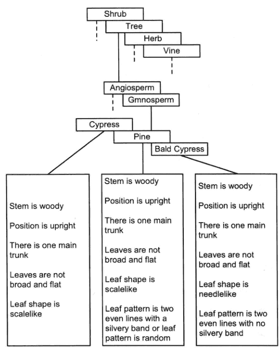

图 2.1 植物分类树的一部分。

确定当前植物的科。要确定当前植物的科，玛丽可以先向拉尔夫描述一棵柏树。她可以先问茎是否木质化。如果答案是肯定的，她可以问位置是否直立。如果答案是否定的，她会得出结论：该科不是柏树科。然后她可以继续询问关于松树的问题。虽然这个程序可行，但问题中存在大量冗余。因为所有树木都有直立的位置，一旦玛丽确定位置不直立，她就会知道类型不是树。因此，更好的策略是先询问能缩小类型范围的问题。例如，如果玛丽得知茎是木质的且位置是直立的，她就会问是否有一个主干。如果这个问题的答案是肯定的，她就会知道类型是树。然后她会询问能确定植物类型的问题。决策树的一部分（不要与第 8 章介绍的决策树混淆）出现在图 2.2 中。完整的决策树

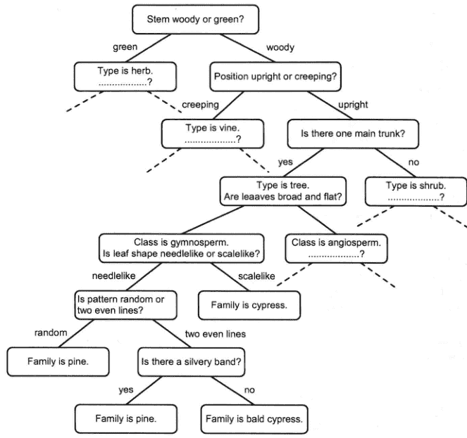

图 2.2 用于识别植物科的决策树的一部分。

将是一个用于确定植物科的专家系统。

刚才介绍的决策树方法存在两个问题。首先，专家系统通常是通过从专家那里获取信息或知识来开发的。例如，植物学家可能很难从上到下识别出分类系统所需的完整决策树。其次，即使整棵树已经开发出来，如果出现错误并且需要添加或删除信息，就需要打破树中的边缘，并可能添加新的边缘。因此，每次需要更改系统中的知识时，都需要重新构建这棵树。

看来专家可能将其知识局部地组织在紧密相连的属性中。例如，玛丽可能知道，所有茎木质化、直立生长且有一个主干的植物都是树。我们可以将此知识表示如下：

```
IF stem is woody
AND position is upright
AND there is one main trunk
THEN type is tree.
```

前述是表示为 **IF-THEN** 规则的一项知识。通常，知识工程师（其专长是创建专家系统）从专家那里获取像这样的局部规则，比一次性获取整个系统更容易。玛丽可能还知道，所有叶片宽大扁平的树木都是裸子植物。表示此知识的规则是

```
IF type is tree
AND leaves are broad and flat
THEN class is gymnosperm.
```

所有这些知识项或规则的集合称为 **知识库**。包含图 2.2 中决策树知识的知识库出现在表 2.3 中。这只是用于确定植物科的专家系统的知识库的一部分。对于特定规则，IF 部分称为规则的 **前件**，THEN 部分称为 **结论**。前件中的每个单独 **子句** 称为 **前提**。

知识库只是单独知识项的集合。它不包含使用此知识的任何特定方式。利用知识来解决问题的机制称为 **推理机**。接下来我们讨论基于规则系统的两种著名推理机：

### 2.3.1.1 后向链

后向链是一种推理机，可以使用表 2.3 中的规则来询问与图 2.2 中相同的问题序列。也就是说，如果我们希望确定植物的科，后向链会遍历规则，直到找到一个结论涉及科的规则。表 2.3 中的规则 1 就是这样一条规则。如果规则中的两个前提都为真，我们根据组合规则和肯定前件式（表 2.2）知道科是柏树科。因此，后向链试图确定这些前提是否为真。它如何做到这一点？通过再次使用规则。也就是说，为了确定类是否为裸子植物，它再次遍历规则，寻找一个结论确定科的规则。规则 5 就是这样一条规则。如果规则 5 能确定类是被子植物，那么规则 1 中的前提并非全部为真，后向链应转到另一条规则来确定科。因此，接下来，后向链试图确定规则 5 中的前提是否为真。为此，它遍历规则，寻找一个确定类型的规则。规则 9 就是这样一条规则。接下来，后向链试图通过遍历规则来确定其前提是否为真，以寻找一个确定茎属性的规则。没有这样的规则。这意味着用户（在我们的示例中，拉尔夫）应该能够确定当前前提是否为真或

### 表 2.3 用于确定植物科的专家系统中的规则子集

| 规则 | 描述 |
|---|---|
| 1 | IF class is gymnosperm AND leaf shape is scalelike THEN family is cypress. |
| 2 | IF class is gymnosperm AND leaf shape is needlike AND pattern is random THEN family is pine. |
| 3 | IF class is gymnosperm AND leaf shape is needlike AND pattern is two even lines AND silvery band is yes THEN family is pine. |
| 4 | IF class is gymnosperm AND leaf shape is needlike AND pattern is two even lines AND silvery band is no THEN family is bald cypress. |
| 5 | IF type is tree AND broad and flat is yes THEN class is angiosperm. |
| 6 | IF type is tree AND broad and flat is no THEN class is gymnosperm. |
| 7 | IF stem is green THEN type is herb. |
| 8 | IF stem is woody AND position is creeping THEN type is vine. |
| 9 | IF stem is woody AND position is upright AND one main trunk is yes THEN type is tree. |
| 10 | IF stem is woody AND position is upright AND one main trunk is no THEN type is shrub. |

假。因此，后向链询问拉尔夫茎是否木质化。请注意，这是图 2.2 中首先问到的同一个问题。如果拉尔夫回答是，后向链会询问规则 9 中下一个前提的问题。如果他回答否，后向链会寻找另一条确定类型的规则。假设拉尔夫对规则 9 中的所有前提都回答是。后向链随后确定类型是树，并返回规则 5 以确定规则 5 中的其他前提是否为真。如果它得知叶片宽大扁平，就会得出结论：类是被子植物。后向链随后返回规则 1，发现第一个前提为假，放弃该规则，转而使用规则 2 来确定科。算法以这种方式进行，直到某条规则最终确定科，或者得知拉尔夫无法提供足够信息来解决问题。此过程称为 **后向链**，因为它的方式是从包含用户所需信息作为结论的规则，回溯到包含用户需要验证的前提的规则。

后向链的算法如下。在给定的子句中，子句中的特征称为 **属性**。例如，子句“类是裸子植物”中的属性是“类”。其值由用户请求的属性是初始目标。函数 _Backchain_ 试图通过查找结论涉及该属性的规则来确定该属性的值。当它找到这样的规则时，它会尝试确定规则中的前提是否为真。对于规则中的每个前提，_Backchain_ 会以前提中的属性作为下一个目标递归调用自身。一旦算法得知某个属性的值，该事实就会保存在一组真断言中，以便算法不再尝试确定该值。例如，如果用户说“茎是木质的”，该断言会保存在真断言集中。

### 算法 2.3 Backward_Chaining

```
Input: The user’s goal Goal and information requested of the user.
Output: The value of the user’s goal if it can be determined; otherwise “unknown.”

Function Backchain(Goal);
var Assertion, Rule, Next_Goal, Premise, True_Assertion,
    All_Premises_True;

if there is an assertion in Assertion_List with Goal as its attribute
    Assertion = that assertion;
else
    Assertion = Null;
```


```
if Assertion = Null
    Rule = first rule;
    while Assertion = Null and there are more rules
        if Goal = attribute in the conclusion of Rule
            All_Premises_True = False;
            Premise = first premise in the antecedent of Rule;
            repeat
                Next_Goal = attribute in Premise;
                True_Assertion = Backchain(Next_Goal);
                if Premise = True_Assertion
                    Premise = next premise in the antecedent of Rule;
                    if Premise = Null
                        All_Premises_True = True;
                endif
            until All_Premises_True or Premise != True_Assertion;
            if All_Premises_True
                Assertion = conclusion of Rule;
        endif
        Rule = next rule;
    endwhile
    if Assertion = Null
        prompt user for value of Goal;
        read Value;
        if Value != Null
            Assertion = Goal "is" Value;
        else
            Assertion = Goal "is unknown";
        endif
        add Assertion to Assertion_List;
    endif
    if Goal = User_Goal
        if Assertion = Goal "is unknown"
            write "You cannot answer enough questions to determine " Goal;
        else
            write Assertion;
        endif
    endif
    return Assertion;
```

At the top level Backchain is called as follows:

```
Empty(Assertion_List); // Make the Assertion_List empty.
write "Enter your goal";
read User_Goal;
Assertion = Backchain(User_Goal);
```

Our backward chaining algorithm can be enhanced considerably. First, we should impose certain restrictions on the rules. One restriction is that the knowledge base should not contain rules that are circular. For example, if A, B, and C represent propositions, we should not have the following rules:

IF A THEN B   IF B THEN C   IF C THEN A.

Such a set of rules simply means that A, B, and C are always true simultaneously. The existence of such a set of rules in our knowledge base could cause the backward chaining algorithm to run in an infinite loop. Therefore an error check for cyclic rules should be included in the algorithm.

Another restriction on the rules is that there should not be contradictory rules. For example, we should not have the following two rules:

IF A THEN B   IF A THEN NOT B.

A third rule restriction is best illustrated with an example. Suppose that we have the following two rules:

IF A AND B AND C THEN D   IF A AND B THEN D.

The set of premises in the second rule is said to subsume the set of premises in the first rule. That is, if both A and B are true, we can conclude D regardless of the value of C. Therefore the first rule is superfluous and should be eliminated.

There exist other enhancements besides rule restrictions. One such enhancement is that we could allow the user to inquire as to why a question is being asked. For example, if the user wants to know why we are asking if stem is woody, the system could answer that it is because we are trying to determine the type of the plant (say, using Rule 9 in Table 2.3), and Rule 9 can tell us the type if we can determine the nature of the stem and other attributes. If the user then wanted to know why we need to know the type, the system could answer that it is because we are trying to determine the class of the plant (say, using Rule 5 in Table 2.3), and Rule 5 can tell us the class if we can determine the type and other attributes. The system could continue in this manner as long as the user asks questions.

Computationally, backward chaining is inefficient compared to a simple implementation of the decision tree in Figure 2.2. However, our goal is to separate the control structure from the knowledge base. The reason for this is to permit items of knowledge to be added and deleted freely as the system is being developed. Once the knowledge base is fully developed, the system can be converted to a decision tree that can be used in practice.

#### 2.3.1.2 前向链式

Suppose our botanist Mary received an email containing a description of the plant, and her job was to deduce as much as possible from the description. For example, the email might state the following facts:

- The stem is woody.
- The position is upright.
- There is one main trunk.
- The leaves are not broad and flat.

She would not go through the questioning process shown in Figure 2.2. Rather she would apply her knowledge to deduce as much as possible. Because the stem is woody, the position is upright, and there is one main trunk, she would conclude the type is tree. Next, because the leaves are not broad and flat, she would conclude that the class is gymnosperm. This is all she could conclude from the facts in the email. We can accomplish the same result by applying an inference engine called **forward chaining** to the knowledge base. In forward chaining we start by putting all our true assertions in an assertion list. Then we cycle through the rules starting with the first one. If all the premises in a rule are in the assertion list (i.e. they are true), then the conclusion must be true and so we add the conclusion to the assertion list. Because a conclusion of one rule can be a premise in another rule, we must start over at the first rule each time we add a conclusion to the assertion list. An algorithm for forward chaining follows.

### 算法 2.4 前向链式

```
Input: A set Assertion_List of true assertions.
Output: The set Assertion_List with all assertions that can be deduced
by applying the rules to the input added to it.
Procedure Forward_Chain (var Assertion_List);
var Rule;
Rule = first rule;
while there are more rules
    if all premises in Rule are in Assertion_List
    and conclusion in Rule is not in Assertion_List
    add conclusion of Rule to Assertion_List;
    Rule = first rule;
    else
    Rule = next rule;
endwhile
```

The above procedure can be made more efficient by sorting the rules before doing forward chaining. The sorting scheme is as follows. If rule A's conclusion is a premise in Rule B's antecedent, then we place rule A before rule B. Assuming we do not have circular rules, this is always possible. With the rules sorted in this manner, there is no need to return to the first rule when a conclusion is added to the true assertion list.

#### 2.3.1.3 在配置系统中使用前向链式

A **configuration system** is one that arranges parts into some whole. For example, a system that arranges grocery items in grocery bags is a configuration system. Suppose we wish to create a robot that does this task. The set of rules in Table 2.4 is a portion of the rules the robot might use to perform this task. Note that these are action rules expressed using propositional logic. In an **action rule** if the premises are true, we take the action that makes the conclusion true. We will illustrate bagging groceries by applying forward chaining to these rules using the groceries in Table 2.5. The “bagged?” entry is set to “Yes” when an item is bagged.

Large items are bagged first, medium items next, and small items last. We assure that large items are bagged first by initially setting Step = Bag_large_items.

Next we look at the rules. Rules 1 and 2 both require the truth of the assertion “there is a bag with <6 large items.” Because we have not gotten any bags yet, this assertion is not true. Rule 3 requires that “step is Bag_large_items” and that “there is a large item to be bagged.” Because both these assertions are true, the rule triggers, and we start a fresh bag, Bag 1. We then return to the start of the rules, and again look for a rule whose premises are all true. Notice that the premises in each of rules 1 through 4 are all true. In this situation we say that there is a **conflict** as to which rule to trigger. A smart bagger would always put bottles on the bottom of the bag because a bottle could damage another item if placed on it. Rule 1 concerns bagging bottles. To make sure this rule triggers we use a type of **conflict resolution** called specificity ordering.

**Definition 2.10 Specificity Ordering.** If the set of premises of one rule are a superset of the set of premises of another rule, then the first rule is triggered on the assumption that it is more specialized to the current situation.

We can efficiently implement specificity ordering by sorting the rules so that the rule with more premises appears first. This has been done in Table 2.4.

So rule 2 triggers because all the premises in the other three rules are subsets of the premises in rule 2. We therefore place the bottle of soda in Bag 1 and mark that the soda has been bagged. Looking at the rules again, we now notice that the premises in rules 2, 3, and 4 are all true. According to specificity ordering, rule 2 now triggers. So the detergent is placed in Bag 1 and the detergent is marked as having been bagged. Looking again at the rules, we see that only the premises in rule 4 are true. The rule therefore triggers to change the values of Step to Bag_medium_items. By using the variable Step, we separate the rules into disjoint subsets; only the rules in a given subset are active at any particular time. This is an example of conflict resolution called context limiting.

**Definition 2.11 Context Limiting.** Separate the rules into disjoint subsets. Only the rules in one subset are active at any particular time. The context is changed to a new context by a rule in the current context.


表 2.4 购物袋装系统规则子集

- 1. 如果步骤是 Bag_large_items 且有大件物品需要装袋 且有大瓶子需要装袋 且有一个袋子装有少于 6 件物品，则将大瓶子放入袋中。
- 2. 如果步骤是 Bag_large_items 且有大件物品需要装袋 且有一个袋子装有少于 6 件物品，则将大件物品放入袋中。
- 3. 如果步骤是 Bag_large_items 且有大件物品需要装袋，则开始一个新袋子。
- 4. 如果步骤是 Bag_large_items，则步骤是 Bag_medium_items。
- 5. 如果步骤是 Bag_medium_items 且有中件物品需要装袋 且有一个袋子装有少于 10 件中件物品 且该袋子包含 0 件大件物品 且该中件物品是冷冻的 且该中件物品不在保温袋中，则将中件物品放入保温袋中。
- 6. 如果步骤是 Bag_medium_items 且有中件物品需要装袋 且有一个袋子装有少于 10 件中件物品 且该袋子包含 0 件大件物品，则将中件物品放入袋中。
- 7. 如果步骤是 Bag_medium_items 且有中件物品需要装袋，则开始一个新袋子。
- 8. 如果步骤是 Bag_medium_items，则步骤是 Bag_small_items。
- 9. 如果步骤是 Bag_small_items 且有小件物品需要装袋 且有一个未装满的袋子，则将小件物品放入袋中。
- 10. 如果步骤是 Bag_small_items 且有小件物品需要装袋，则开始一个新袋子。
- 11. 如果步骤是 Bag_small_items，则停止。

表 2.5 待装袋物品集合。

| Item | Container | Size | Frozen | Bagged? |
|---|---|---|---|---|
| 苏打水 | 瓶子 | 大 | 否 | 否 |
| 面包 | 袋子 | 中 | 否 | 否 |
| 冰淇淋 | 纸盒 | 中 | 是 | 否 |
| 洗涤剂 | 盒子 | 大 | 否 | 否 |
| 鸡蛋 | 纸盒 | 小 | 否 | 否 |
| 冰棍 | 保温袋 | 中 | 是 | 否 |

中件物品的规则将持续触发，直到不再有中件物品。请注意，我们编写规则的方式是，中件物品永远不会与大件物品放在同一个袋子中。所有中件物品装袋完毕后，上下文将切换到装袋小件物品的规则集。我们可以将小件物品放入任何可用的袋子中。所有小件物品装袋完毕后，规则 11 将停止执行。

还有其他冲突解决策略，包括以下策略：

**定义 2.12 新近排序。** 最近触发的规则具有最高优先级，或者最久未触发的规则具有最高优先级。选择取决于特定应用。

**定义 2.13 优先级排序。** 按规则应触发的优先级对规则进行排序。

#### 2.3.1.4 在诊断系统中使用前向链和后向链

**诊断**是确定或分析问题原因或性质的过程。**诊断系统**是执行诊断的系统。诊断的经典示例是医学诊断，我们试图确定引起某些表现的疾病。然而，还有许多其他类型的诊断。例如，汽车修理工试图诊断汽车的问题。我们使用后一个示例来说明基于规则的诊断系统。

表 2.6 显示了诊断汽车问题系统中的规则子集。假设 Melissa 观察到她汽车的以下事实：

- 汽车无法启动。
- 发动机确实在转动。
- 燃油箱中有汽油。
- 化油器中有汽油。

如果使用前向链，规则 4 将首先触发，因为其两个前提都为真，我们将得出结论：

| 规则 | 描述 |
| :--- | :--- |
| 1 | 如果汽车无法启动 且发动机不转动 且灯不亮 则问题是电池。 |
| 2 | 如果汽车无法启动 且发动机转动 且发动机获得足够汽油 则问题是火花塞。 |
| 3 | 如果汽车无法启动 且发动机不转动 且灯亮 则问题是起动电机。 |
| 4 | 如果燃油箱中有汽油 且化油器中有汽油 则发动机获得足够汽油。 |

发动机正在获得汽油。

现在规则 2 中的所有三个前提都为真。因此它将触发，我们将得出结论：

问题是火花塞。

Melissa 可能不会观察到燃油箱中有汽油或化油器中有汽油。她可能只注意到汽车无法启动但发动机在转动。如果是这种情况，前向链将得出什么结论也没有。后向链更好地解决了这种情况。使用目标驱动的后向链，我们从每个得出问题结论的规则开始，看看是否可以得出规则中的结论。假设用户输入了以下知识：

汽车无法启动。

发动机确实在转动。

首先尝试规则 1，但它不触发，因为其中一个前提为假。接下来尝试规则 2。其前两个前提为真，并且有一个规则（规则 4）得出其第三个前提。因此我们回溯到规则 4 并检查其前提。两者都不为真，并且没有针对其中任何一个的规则。因此我们现在提示用户输入它们的值。Melissa 现在知道要检查这些事项，因为她收到了提示。假设她观察到以下内容：

燃油箱中有汽油。

化油器中有汽油。

规则 4 现在触发，我们得出结论：

发动机获得足够汽油。

我们现在回到规则 2 并得出结论：

问题是火花塞。

实际生产系统可能会轮流使用前向链和后向链。也就是说，它可以先使用前向链，根据用户的初始知识得出所有可能的结论。如果这不足以做出诊断，它可以随后使用目标驱动的后向链。

在许多复杂的诊断问题中，例如医学诊断，我们无法确定自己的结论。例如，根据患者的表现，医生可能会确定患者患支气管炎的可能性很大，患肺癌的可能性较小，同时患这两种疾病的可能性只有微小。要开发一种执行这种推理的诊断系统，我们需要概率论而不是逻辑。第 6.7 节展示了这样的系统。

## 2.3.2 瓦姆普斯世界

**瓦姆普斯**世界是一个简单的环境，具有许多真实环境中常见的组件。图 2.3 显示了一个示例瓦姆普斯世界。该世界由一个 4×4 网格组成。代理从左下角开始。代理可以向上、向下、向左或向右移动。代理的目标是到达包含金子的方格，但途中存在危险。代理唯一知道的是其位置以及在方格间移动时收集的信息。环境的具体细节如下：

- 1. 一个邪恶的瓦姆普斯位于某个方格中。如果代理进入该方格，瓦姆普斯将杀死代理。
- 2. 每个与包含瓦姆普斯的方格相邻的方格中都有恶臭。如果代理进入该方格，代理会感知到这种恶臭。
- 3. 多个方格中包含坑。如果代理进入包含坑的方格，代理将掉入坑中并死亡。
- 4. 任何与坑相邻的方格中都有微风。如果代理进入该方格，代理会感知到这种微风。
- 5. 某个方格中包含金子。如果代理位于该方格中，代理会感知到金子。

| | 1 | 2 | 3 | 4 |
|---|---|---|---|---|
| 4 | ![Pit Stench] 坑 恶臭 | 微风 | 微风 | ![Pit] 坑 |
| 3 | ![Wumpus Breeze] 瓦姆普斯 微风 | 恶臭 | | 微风 |
| 2 | 恶臭 | | | ![Gold Breeze] 金子 微风 |
| 1 | ![Agent Start] 代理起点 | | 微风 | ![Pit] 坑 |

图 2.3 一个瓦姆普斯世界。

- 6. 代理有一支箭，可以向四个方向中的任何一个方向射击。箭将沿直线飞行。如果击中瓦姆普斯，瓦姆普斯将被杀死，代理会感知到呻吟声。
- 7. 代理的目标是尽可能少地移动，到达包含金子的方格并停止。如果代理在途中死亡，任务结束。

我们可以将瓦姆普斯世界视为一款电脑游戏，如果代理死亡，最终得分为 –n；如果代理在找到金子前放弃，得分为 0；如果代理最终找到金子，得分为 n 减去找到金子所需的移动次数（n 是允许的最大移动次数）。假设你最终被要求玩图 2.3 中的瓦姆普斯世界游戏。你看不到整个网格。你最初位于方格 [1,1]，你所知道的只有你的位置以及你没有任何感知。让我们讨论一下你如何逻辑推理以找到金子。因为你没有任何感知，你得出结论：方格 [1,2] 和 [2,1] 都是安全的。你移动到方格 [1,2]（我们先按列索引），并感知到恶臭。因此你得出结论：瓦姆普斯要么在方格 [1,3]，要么在方格 [2,2]。为了安全起见，你退回到方格 [1,1] 并移动到方格 [2,1]。因为没有恶臭，你得出结论：瓦姆普斯不在方格 [2,2]，这意味着它必须在方格 [1,3]。因为没有感知，你得出结论：方格 [3,1] 和 [2,2] 都是安全的。你


移动到方格 [3,1]，你感受到一阵微风。为了安全起见，你退回到方格 [2,1]。因为你已经访问过方格 [1,1]，所以你移动到方格 [2,2]。你继续以这种方式，直到到达金块。

在图 2.3 的 Wumpus 世界中，存在一条通往金块的路径，智能体只需访问已知安全（OK）的方格即可到达。在每个世界实例中，Wumpus 和坑的位置是随机生成的。在某些世界中，智能体可能需要访问未知是否安全（OK）的方格才能继续向金块前进，但仍能到达金块；而在其他实例中，则无法到达金块。

一般而言，目标描述的是一种可取的情况或结果，努力可以朝着该方向进行。我们智能体在 Wumpus 世界中的目标是到达金块。接下来，我们将开发一系列旨在实现此目标的软件智能体。

### 2.3.2.1 环境

首先假设你的任务是开发一个其他人可以在电脑上玩的 Wumpus 世界游戏。你需要生成 Wumpus 和坑的位置，然后将这些信息存储在我们将称之为 environment 的文件中。你可以用多种方式实现这个环境。为了讨论方便，最好将其显示为像图 2.3 中那样的网格。当个人玩游戏时，当个人进入某个方格时，你需要呈现该方格中的感知。例如，如果个人进入方格 [4,2]，你呈现 G42 和 B42，其中 G42 表示方格 [4,2] 中有金块，B42 表示方格 [4,2] 中有微风。

### 2.3.2.2 软件智能体

接下来假设你的任务是开发一个在你创建的环境中搜索金块的软件智能体。智能体在一系列时间槽中执行移动。接下来我们将从最简单的类型开始，讨论不同类型的可能智能体。

反射智能体 反射智能体不维护世界的任何模型。它仅根据每个时间槽中接收到的感知来决定每次移动。智能体需要以下两个文件：

- 1. 知识库
- 2. 动作规则

一般而言，知识库包含智能体从其感知和推理中了解到的关于环境的信息。对于简单的反射智能体，每个时间槽中的知识库仅仅是

### 表 2.7 反射智能体的动作规则（显示的是处于方格 [2,2] 上下文时的规则。）

| 规则 | 表达式 |
|---|---|
| A22^W22 | 智能体死亡 |
| A22^P22 | 智能体死亡 |
| A22^G22 | 找到金块，停止 |
| A22 | 随机向左、右、上或下射箭 |
| A22 | 随机向左、右、上或下移动 |

该时间槽中的感知集合。**动作规则**包含确定智能体在每个时间槽中执行的动作的规则。我们同时使用上下文限制和优先级排序来触发规则。例如，当智能体处于方格 [2,2] 的上下文中时，只有该方格的规则会被触发。规则按照列出的顺序触发。因为智能体的目标是到达金块并停止，我们希望规则的优先级顺序旨在实现此目标。因此，第一条规则应该是：如果智能体在有金块的方格中，则停止。之后，仅基于当前感知，比随机移动更好的唯一动作是向任意方向射箭。所以这是我们的第二条规则。第三条规则是向随机方向移动。表 2.7 显示了反射智能体的此类动作规则。当执行动作“向右移动”时，智能体在下一个时间槽的位置将设置为当前方格右侧的方格。因此，如果智能体当前在方格 [2,2]，则在下一个时间槽中它将位于方格 [3,2]。展示此类智能体行为的算法只是循环遍历一系列时间槽，并在每个时间槽中触发当前上下文中所有前提均为真的第一条规则。此类智能体的算法如下。

### 算法 2.5 Reflex_Agent

```
Procedure Reflex;
A11 = True;
repeat
    Knowledge_Base = set of perceptions in this time slot;
    fire action rules Rules_ij such that A_ij = True;
until stop is executed or agent is dead;
```

### 基于模型的智能体

**基于模型的智能体**在其知识库中维护一个世界模型。每个时间槽中的感知被添加到知识库中，而不是替换其中的内容。此外，智能体维护一组**推理规则**，用于推导新事实，并将这些事实也添加到每个时间槽的知识库中。表 2.8 显示了方格 [2,2] 的推理规则。每个方格都会有一组此类规则。当智能体进入一个方格时，其新感知被添加到知识库中，并将推理规则应用于知识库以得出所有可能的结论，并将这些结论添加到知识库中。这可以通过如第 2.2 节所述的归结法自动完成，或者通过使用前向链式推理向知识库添加新事实，然后使用后向链式推理推断哪些方格是 OK 的。

但是，为了说明目的，我们展示如何使用表 2.2 中的推理规则而不是使用自动化方法来更新知识库。假设智能体已经访问过方格 [1,2]，退回到方格 [1,1]，并即将访问方格 [2,1]。假设智能体已经推导出所有可能的内容，图 2.4(a) 显示了此时知识库的状态。方格 [1,3] 和 [2,2] 中 Wumpus 旁边的问号意味着知识库包含以下信息：

W13 ∨ W22。

智能体移动到方格 [2,1] 且未感知到恶臭或微风后，我们如下推理：

- 1. 使用 ¬S21、规则 ¬S21 => ¬W11 ∧ ¬W31 ∧ ¬W22 和肯定前件式，我们得出
  ¬W11 ∧ ¬W31 ∧ ¬W22。

- 2. 使用 ¬W11 ∧ ¬W31 ∧ ¬W22 和消去法，我们得出
  ¬W11, ¬W31, ¬W22。

- 3. 使用 ¬B21、规则 ¬B21 => ¬P11 ∧ ¬P31 ∧ ¬P22 和肯定前件式，我们得出
  ¬P11 ∧ ¬P31 ∧ ¬P22。

- 4. 使用 ¬P11 ∧ ¬P31 ∧ ¬P22 和消去法，我们得出
  ¬P11, ¬P31, ¬P22。

- 5. 使用 ¬W31, ¬P31, ¬W22, ¬P22 和引入法，我们得出
  ¬W31 ∧ ¬P31, ¬W22 ∧ ¬P22。

- 6. 使用 ¬W31 ∧ ¬P31, ¬W22 ∧ ¬P22、规则 ¬W31 ∧ ¬P31 => OK31, ¬W22 ∧ ¬P22 => OK22 和肯定前件式，我们得出
  OK31, OK22。

- 7. 使用 W13 ∨ W22, ¬W22 和析取三段论，我们得出
  W13。

图 2.4(b) 显示了将这些结论添加到知识库后的知识库状态。

基于模型的智能体将结论添加到知识库后，必须决定其动作。接下来我们将讨论两种做法。

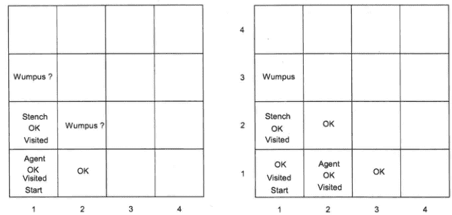

图 2.4 智能体移动到方格 [2,1] 之前的知识库状态显示在 (a) 中，该移动和推理完成后的状态显示在 (b) 中。

### 表 2.8 方格 [2,2] 的推理规则

| 规则 | 表达式 |
|---|---|
| 1. | S22 => W12 v W21 v W32 v W23 |
| 2. | ~S22 => ~W12 ^ ~W21 ^ ~W32 ^ ~W23 |
| 3. | B22 => P12 v P21 v P32 v P23 |
| 4. | ~B22 => ~P12 ^ ~P21 ^ ~P32 ^ ~P23 |
| 5. | ~W22 ^ ~P22 => OK22 |

### 基于规则的智能体

基于规则的、基于模型的智能体根据一组规则确定其下一个动作，就像反射智能体一样。因此，像反射智能体一样，它需要知识库和动作规则。但是，它还需要一组推理规则，用于在每个时间槽中更新知识库。推理规则出现在表 2.8 中。因此，智能体需要以下文件：

- 1. 知识库
- 2. 推理规则
- 3. 动作规则

与反射智能体的情况一样，我们使用上下文限制和优先级排序来触发动作规则。但是，现在智能体拥有更大的知识库（所有感知以及所有可推导的内容）。基于这些知识，一组合理的动作规则及其优先级策略如下：


- 1. 如果金子在当前方格，则停止。
- 2. 如果沃彭斯或一个坑在当前方格，则死亡。
- 3. 如果存在一个相邻方格，它是安全的且未访问过，则移动到该方格。
- 4. 如果存在一个相邻方格，它是安全的且在最近六个时间槽中未被访问过，则移动到该方格。
- 5. 如果沃彭斯位于左、右、上或下，则向该方向射箭。
- 6. 如果沃彭斯可能位于左、右、上或下，则向该方向射箭。
- 7. 如果存在一个相邻方格，它不被已知为不安全，则移动到该方格。

在规则 4 中，我们要求存在一个最近未被访问过的相邻方格，以避免在仍有可探索的成功路径时反复来回移动。同样，我们使用上下文限制，仅触发与当前方格相关的规则，并使用刚才描述的优先级排序。算法如下。

### Algorithm 2.6 Rule_Based_Agent

```
Procedure Rule_Based;
All = true;
repeat
Knowledge_Base = Knowledge_Base U set of new perceptions;
using Deduction_Rules and Knowledge_Base,
add all possible deductions to Knowledge_Base;
fire action rules Rules_ij such that A_ij = true;
until stop is executed or agent is dead;
```

### Planning Agent

计划是旨在实现目标的一系列动作。我们的基于规则的代理在每个时间槽中基于合理标准单独决定每一步移动；它不计划一系列移动。基于规划的模型代理为执行一系列移动制定计划。接下来我们描述这样的代理。

代理的目标是到达金子，只有未访问的方格可能包含金子。因此，一个合理的子目标是到达一个未访问的、安全的方格。此外，我们希望尽可能少地移动，并且只通过安全的方格（称为安全路径）。因此，我们的代理计划是如果存在这样的安全路径，就找到它。这可以通过图 2.5 所示的广度优先树搜索来完成。

图 2.5(a) 显示了环境的一个可能当前知识状态，图 2.5(b) 显示了找到通往未访问安全方格的最短路径的广度优先树搜索。

## 2.3 人工智能应用

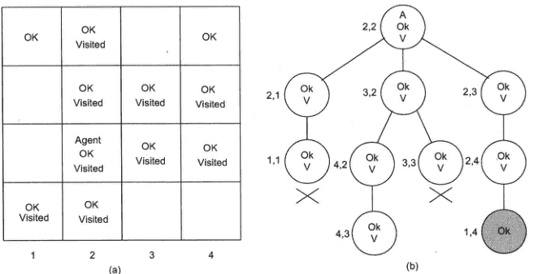

图 2.5 (a) 中显示了一个可能的知识状态，(b) 中显示了一个基于该知识确定通往未访问、安全方格的最短路径的广度优先树。

树的根（层级 0）包含代理的位置。在树的层级 1，我们访问与根相邻的安全方格。在树的层级 2，我们访问与层级 1 方格相邻的安全方格，在层级 3，我们访问与层级 2 方格相邻的安全方格，依此类推。我们只访问尚未在树中的安全方格。每当树中的一个节点没有合格的相邻方格时，我们就剪枝该节点。我们继续，直到没有可扩展的节点（不存在通往未访问、安全方格的可能安全路径），或直到我们到达一个未访问、安全的方格。层级 2 中关于方格 [1,1] 的节点被剪枝，因为与其相邻的唯一安全方格是方格 [2,1]，当访问方格 [1,1] 时，该方格已在树中。关于方格 [3,3] 的节点也被剪枝，因为与其相邻的唯一安全方格已在树中（在我们调查扩展该节点时）。找到的通往未访问、安全方格的最短安全路径是通往方格 [1,4] 的一条路径。

如果不存在通往未访问、安全方格的安全路径，代理的下一步行动可能是规划一条通往有望使代理能够杀死沃彭斯的方格的最短安全路径。如果不可能，代理可以寻找一条通往不被已知为不安全的未访问方格的最短安全路径。最后，代理可以寻找一条通往不被已知为安全的未访问方格的最短路径，该路径仅通过不被已知为不安全的方格。如果不可能，代理应放弃，因为无法到达金子。

算法如下。

### Algorithm 2.7 Planning_Agent

```
Procedure Planning;
All = true;
repeat
    Knowledge_Base = Knowledge_Base U set of new perceptions;
    using Deduction_Rules and Knowledge_Base,
    add all possible deductions to Knowledge_Base;
    if there is a current plan
        perform next action in that plan;
    else
        develop a new plan if possible and execute first action in the plan;
    if the current square contains the gold
        stop;
    else if the current square contains the wumpus or a pit
        die;
until stop is executed or agent is dead or there is no plan;
```

#### 2.3.2.3 更复杂的瓦姆普斯世界

我们介绍了一个非常简单的沃彭斯世界版本。环境和对代理要求的任务都可以变得更加复杂。例如，代理可能被要求在向某个方向移动之前先转身并面向该方向，或者代理可能被要求拾起金子并返回方格 [1,1] 才能成功。环境可以包含几个含有金子或含有沃彭斯的方格，或者允许沃彭斯移动。

## 2.4 讨论与进一步阅读

在系统设计的过程式方法中，完成所需任务的步骤被硬编码在程序中。如果我们直接在图 2.2 中编码决策树，我们就会使用这种方法。在声明式方法中，知识与推理分离。当我们使用前向链式和后向链式对规则进行推理，以及当我们开发基于知识库进行推理的沃彭斯算法时，采用的就是这种方法。Boden [1977] 对这两种方法进行了早期讨论，而 Newell [1981] 讨论了表示和知识的问题。[Brooks, 1991]、[Nilsson, 1991] 和 [Shaparau et al., 2008] 进一步对比了这两种方法。

XCON [McDermott, 1982] 是一个运行方式类似于我们杂货打包员的系统。该系统配置了数字设备公司的 VAX 计算机。从那以后，命题逻辑已被用于实际设计计算机硬件。例如，Norwick et al. [1993] 讨论了高性能缓存控制器的设计。

Yob [1975] 开发了沃彭斯世界。此处展示的沃彭斯世界版本基于 [Russell and Norvig, 1995] 中出现的一个版本。

Williams et al. [2003] 开发了一个类似沃彭斯的代理，用于为 NASA 飞机规划动作和诊断故障。除了运行程序外，该代理还使用基于电路的方法，即在硬件电路中传输信号，而不是运行标准计算机程序 [Rosenschein, 1985]。

## 练习

### 第 2.1 节

### Exercise 2.1 Determine which of the following are propositions:

- 1. ¬P∧Q∧R.
- 2. ¬P∧Q∧¬R.
- 3. ¬¬P∧Q⇒R.
- 4. ¬(¬P ∧ Q) ⇒R.
- 5. ¬(¬P∧Q)⇒R.

### Exercise 2.2 Write the following statements about the real world as propositions. Use the atomic propositions shown.

- 1. 如果 Joe 在他的办公室，我们会告诉 Joe 新闻；否则我们会给他留言。
  - P: Joe 在他的办公室。
  - Q: 我们会告诉 Joe 新闻。
  - R: 我们会给 Joe 留言。
- 2. 如果手术成功且 Mary 遵循医生的指示，她会没事的。
  - P: 手术成功。
  - Q: Mary 遵循医生的指示。
  - R: Mary 会没事。
- 3. 如果员工满足以下条件之一，则有资格享受 3 周假期：1) 员工是非工会工人，不享受带薪假期，并且在公司工作至少一年；或 2) 员工是工会工人，并在公司工作至少 6 个月。
  - P: 员工有资格享受 3 周假期。
  - Q: 员工是非工会工人。
  - R: 员工不享受带薪假期。
  - S: 员工在公司工作至少一年。
  - T: 员工是工会工人。
  - U: 员工在公司工作至少 6 个月。

### Exercise 2.3 Develop truth tables for the following propositions:

- 1. ¬P∧Q∨R.
- 2. P∧Q∨R⇒S.
- 3. ¬(¬P∧Q)⇒R.
- 4. (P∨(¬(Q∨R) ∧ ¬P)

### Exercise 2.4 Consider the following statement, which often appears on a sign in a liquor store: You must be 21 years old to purchase liquor.

- 1. 使用逻辑将此陈述表示为命题。为该命题开发真值表。
- 2. 该命题的真值表是否蕴含了商店老板的意图？
- 3. 创建一个你认为表达了商店老板意图的新陈述。
- 4. 将新陈述表示为命题并为该命题开发真值表。检查真值表是否蕴含了商店老板的意图。

### Exercise 2.5 Determine whether each of the following propositions is a tautology, contradiction, or neither.

- 1. P∨Q∧¬P.
- 2. (P ∨ Q) ∧ ¬P.
- 3. (P ∧ Q) ∧ ¬P.

### Exercise 2.6 Simplify the following propositions using the laws in Table 2.1.

- 1. R⇒Q∧((P ∧ ¬Q) ∨ (P ⇒ Q)).
- 2. ¬P∧R∧¬(P∧(P∨Q)).

### Exercise 2.7 Derive the following argument using the inference rules in Table 2.2.

P ∨ Q, P ⇒ R, Q ⇒ R ⊢ R.


**练习 2.8** 考虑下面的论证。要么是乔，要么是阿米特偷了笔记本电脑。笔记本电脑被偷时，乔不在城里。如果乔不在城里，他不可能在犯罪现场。如果乔不在犯罪现场，他不可能偷了笔记本电脑。因此，阿米特一定偷了笔记本电脑。使用表 2.2 中的推理规则，推导这个论证。使用以下原子命题：

- P: 乔偷了笔记本电脑。
- Q: 阿米特偷了笔记本电脑。
- R: 乔不在城里。
- S: 乔不在犯罪现场。

## 第 2.2 节

**练习 2.9** 将以下命题写成合取范式：

P ∨ Q ⇒ R ∧ (R ⇒ P).

**练习 2.10** 使用反驳和真值表推导否定后件规则。

**练习 2.11** 使用归结规则推导否定后件规则。

**练习 2.12** 对练习 2.8 中的论证使用集合支持策略。

## 第 2.3 节

**练习 2.13** 完成表 2.5 中的杂货打包工作。

**练习 2.14** 为一个小型分类系统创建规则库。例如，该系统可以根据描述确定动物或矿物的类型；或者可以根据顾客的特定偏好确定酒吧顾客应该喝什么饮料。

**练习 2.15** 为一个小型配置系统创建规则库。该系统可以是杂货打包员的增强版。例如，可以考虑将易碎物品（如薯片）放在顶部。

**练习 2.16** 为一个小型诊断系统创建规则库。例如，该系统可以确定汽车或 DVD 播放器的问题。

**练习 2.17** 考虑图 2.3 中的沃普斯世界。对于以下每种类型的智能体，展示前 5 步移动以及每次移动后知识库的状态（注意答案可能不是唯一的）：

- 1. 文中描述的反射智能体。
- 2. 文中描述的基于规则的智能体。
- 3. 文中描述的规划智能体。

**练习 2.18** 编写一个程序，为沃普斯世界生成环境并向智能体呈现感知。编写一个智能体程序，该智能体尝试在每个世界中找到金子。你的智能体不必完全像文中介绍的任何一个那样。例如，它可以是一个规划智能体，倾向于通过访问一个更近的、未知是否安全的方格，而不是一个更远的未访问的安全方格来承担更多风险。

# 第 3 章

# 一阶逻辑

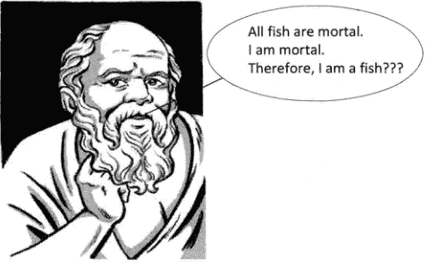

第 2 章以一个关于苏格拉底的经典示例的变体开始。传统上，该示例实际上如下进行：

- 所有人都是会死的。
- 苏格拉底是人。
- 因此，苏格拉底会死。

这里的推理是：人集合中的每个实体都是会死的，苏格拉底在这个集合中，因此苏格拉底会死。命题逻辑只关注真或假的命题；它不涉及对象集合的属性。一阶逻辑，也称为谓词演算，对对象集合的推理进行建模。

第 3.1 节讨论了一阶逻辑的基本属性，而第 3.2 节展示了一阶逻辑在人工智能中的应用。

## 3.1 一阶逻辑基础

像命题逻辑一样，一阶逻辑由一个形式语言组成，其语法和语义为格式良好的字符串赋予意义。我们先讨论其语法和语义。

### 3.1.1 语法

一阶逻辑的字母表包含以下符号：

- 1. 常量：常量是像 ‘Socrates’、‘John’、‘B’ 和 ‘1’ 这样的符号。
- 2. 谓词：符号 ‘True’ 和 ‘False’ 以及其他像 ‘married’、‘love’ 和 ‘brother’ 这样的符号。
- 3. 函数：像 ‘mother’、‘weight’ 和 ‘height’ 这样的符号。
- 4. 变量：变量是像 x、y 或 z 这样的小写字母字符。
- 5. 算子：¬, ∨, ∧, ⇒, ⇔ 。
- 6. 量词：符号 ∀（全称）和 ∃（存在）。
- 7. 分组符号：左括号和右括号以及逗号。

常量、谓词和函数符号称为非逻辑符号。传统上，哲学家/逻辑学家假设存在一个固定的、无限的非逻辑符号集。根据这种方法，只有一种一阶逻辑语言。在现代人工智能应用中，我们指定适合应用的非逻辑符号。这个指定的集合称为签名。

创建格式良好的字符串的规则如下：

- 1. 项是以下之一：
  - (a) 一个常量符号
  - (b) 一个变量符号
  - (c) 一个函数符号，后跟一个或多个用逗号分隔并用括号括起来的项
- 2. 原子公式是以下之一：
  - (a) 一个谓词符号
  - (b) 一个谓词符号，后跟一个或多个用逗号分隔并用括号括起来的项
  - (c) 两个由 = 符号分隔的项
- 3. 公式是以下之一：
  - (a) 一个原子公式
  - (b) 算子 \(\neg\) 后跟一个公式
  - (c) 两个由 \(\lor, \land, \Rightarrow, \text{或 } \Leftrightarrow\) 分隔的公式
  - (d) 一个量词，后跟一个变量，再后跟一个公式
- 4. 句子是没有自由变量的公式。

规则 4 需要澄清。考虑以下公式：

\(\forall x \text{ 爱}(x, y) \qquad \forall x \text{ 高}(x).\) (3.1)

我们稍后将讨论此类公式的含义。目前，我们提出它们是为了澄清句子的定义。公式中的变量如果未被 \(\forall\) 或 \(\exists\) 符号量化，则是 **自由** 的；否则它是 **约束** 的。表达式 3.1 左侧的公式包含自由变量 \(y\)，因此不是句子，而右侧的公式不包含任何自由变量，因此是句子。

在数学上，关于一阶逻辑的形式语言就这些了。然而，像命题逻辑一样，一阶逻辑的开发是为了对现实世界进行陈述并对这些陈述进行推理。接下来的示例说明了此类陈述。

**示例 3.1** 如下一节更正式地讨论的那样，在一阶逻辑中，我们有一个 **话语域**。这个域是一个集合，集合中的每个元素称为一个 **实体**。每个常量符号标识域中的一个实体。例如，如果我们考虑某个家庭中所有居住的人，我们的常量符号可以是他们的姓名。如果有五个这样的人，常量符号可能是 ‘Mary’、‘Fred’、‘Sam’、‘Laura’ 和 ‘Dave’。

**示例 3.2** 谓词表示一组实体之间的关系或单个实体的属性。例如，
married(Mary,Fred)
表示 Mary 和 Fred 已婚，而
young(Sam)
表示 Sam 很年轻。谓词中的参数数量称为其 **目数**。谓词 ‘married’ 的目数为 2，而谓词 ‘young’ 的目数为 1。

**示例 3.3** 如果我们的应用正在考虑示例 3.1 中提到的五个人，并且我们只关心讨论他们中是否有人已婚以及是否有人年轻，那么我们的签名将由常量符号 ‘Mary’、‘Fred’、‘Sam’、‘Laura’ 和 ‘Dave’ 以及谓词 ‘married’ 和 ‘young’ 组成，其中 ‘married’ 的目数为 2，而 ‘young’ 的目数为 1。

**示例 3.4** 函数表示从某些实体子集到单个实体的映射。例如，如果
mother(Laura)
的值是 ‘Mary’，这意味着 Mary 是 Laura 的母亲。如果
sum(2,3)
的值是 5，这意味着 2 和 3 的和是 5。

**示例 3.5** 算子 ¬, ∨, ∧, ⇒, 和 ⇔ 与它们在命题逻辑中的含义相同。例如，
¬married(Mary,Fred)
表示 Mary 和 Fred 未婚。公式
¬married(Mary,Fred) ∧ young(Sam)
表示 Mary 和 Fred 未婚，并且 Sam 很年轻。

**示例 3.6** 相等算子用于表示两个项指代同一个实体。例如，
Mary = mother(Laura)
表示 Mary 和 mother(Laura) 指代同一个实体。也就是说，Mary 是 Laura 的母亲。

**示例 3.7** 量词 ∀ 表示某个公式在话语域中的所有实体上都为真。例如，假设我们的域由名为 Mary、Fred、Sam、Laura 和 Dave 的五个人组成。公式
∀x young(x)
表示 Mary、Fred、Sam、Laura 和 Dave 都很年轻。

**示例 3.8** 量词 ∃ 表示某个公式在域中至少一个实体上为真。再次假设我们的域由名为 Mary、Fred、Sam、Laura 和 Dave 的五个人组成。公式
∃x young(x)
表示 Mary、Fred、Sam、Laura 和 Dave 中至少一个人很年轻。


## 3.1.2 语义

在一阶逻辑中，我们首先指定一个签名，它决定了语言。给定一种语言，一个**模型**具有以下组成部分：

- 1. 一个非空集合 D，称为**话语域**的**实体**。
- 2. 一个**解释**，由以下内容组成：
  - (a) 每个常量符号都分配一个 D 中的实体。通常，每个实体都分配给一个常量符号。
  - (b) 对于每个函数，函数的每个可能实体输入都分配一个实体。
  - (c) 谓词‘真’始终被赋值为 T，谓词‘假’始终被赋值为 F。
  - (d) 对于其他每个谓词，谓词的每个可能实体输入都分配值 T 或 F。

### 示例 3.9

假设我们的应用程序正在考虑示例 3.1 中提到的五个个体，我们只关心讨论他们中是否有人已婚以及是否有人年轻。我们的签名可以如下：

- 1. 常量符号 = {Mary, Fred, Sam, Laura, Dave }。
- 2. 谓词符号 = {married, young}。谓词‘married’的目数为二，谓词‘young’的目数为一。

一个特定的模型具有以下组成部分：

- 1. 话语域 D 是这五个特定个体的集合。
- 2. 解释如下：
  - (a) 每个常量符号分配一个不同的个体。
  - (b) 真值赋值由以下表格给出：

| x | Mary | Fred | Sam | Laura | Dave |
|---|---|---|---|---|---|
| young(x) | F | F | T | T | T |

| y \ x | Mary | Fred | Sam | Laura | Dave |
|---|---|---|---|---|---|
| Mary | F | T | F | F | F |
| Fred | T | F | F | F | F |
| Sam | F | F | F | F | F |
| Laura | F | F | F | F | F |
| Dave | F | F | F | F | F |

married(x, y)

### 示例 3.10

假设我们的应用程序正在考虑名为 Dave、Gloria 和 Ann 的三个个体，我们关心讨论每个个体的母亲以及每个个体是否爱另一个人。我们的签名可以如下：

- 1. 常量符号 = {Dave, Gloria, Ann}。
- 2. 谓词符号 = {love}。谓词‘love’的目数为二。
- 3. 函数符号 = {mother}。函数‘mother’的目数为一。

一个特定的模型具有以下组成部分：

- 1. 话语域 D 是这三个特定个体的集合。
- 2. 解释如下：
  - (a) 每个常量符号分配一个不同的个体。
  - (b) 真值赋值由以下表格给出：

| y \ x | Dave | Gloria | Ann |
|---|---|---|---|
| Dave | F | F | F |
| Gloria | T | F | T |
| Ann | T | T | F |

love(x, y)

  - (c) 函数赋值由以下表格给出：

| x | Dave | Gloria | Ann |
|---|---|---|---|
| mother(x) | Gloria | Ann | - |

请注意，Ann 的母亲没有做出赋值。从技术上讲，每个实体都必须由函数赋予一个值。如果 Ann 的母亲不是这些实体之一，我们可以简单地使用像破折号 (-) 这样的虚拟符号作为我们的赋值。在实践中，我们通常不会通过完全指定一个模型来用一阶逻辑进行推理。因此，我们无需担心这一细微差别。请进一步注意，二元谓词不必是对称的。Gloria 爱 Dave，但 Dave 不爱 Gloria。

一旦指定了模型，所有句子的真值将根据以下规则赋值：

- 1. 使用符号 ¬, ∧, ∨, ⇒, 和 ⇔ 构建的句子的真值，以与命题逻辑中相同的方式赋值。
- 2. 如果由 = 符号连接的两个术语指代同一实体，则其真值为 T；否则为 F。
- 3. 如果对于域 D 中分配给 x 的每个实体，p(x) 都有值 T，则 ∀x p(x) 具有值 T；否则具有值 F。
- 4. 如果对于域 D 中分配给 x 的至少一个实体，p(x) 都有值 T，则 ∃x p(x) 具有值 T；否则具有值 F。
- 5. 运算符优先级如下：¬, =, ∧, ∨, ⇒, ⇔ 。
- 6. 量词优先于运算符。
- 7. 括号改变优先级的顺序。

### 示例 3.11

假设我们的应用程序正在考虑 Socrates、Plato、Zeus 和 Fido 四个个体，我们有兴趣讨论他们是否是人类、是否是凡人以及是否有腿。我们的签名可以如下：

- 1. 常量符号 = {Socrates, Plato, Zeus, Fido}。
- 2. 谓词符号 = {human, mortal, legs}。所有谓词的目数均为一。

让模型具有以下组成部分：

- 1. D 是这四个特定个体的集合。
- 2. 解释如下：
  - (a) 每个常量符号分配一个不同的个体。
  - (b) 真值赋值由以下表格给出：

| x | Socrates | Plato | Zeus | Fido |
|---|---|---|---|---|
| human(x) | T | T | F | F |

| x | Socrates | Plato | Zeus | Fido |
|---|---|---|---|---|
| mortal(x) | T | T | F | T |

| x | Socrates | Plato | Zeus | Fido |
|---|---|---|---|---|
| legs(x) | T | T | T | T |

那么我们有以下内容：

- 1. 句子

```
human(Zeus) ∧ human(Fido) ∨ human(Socrates)
```

具有值 T，因为 ∧ 优先于 ∨。
- 2. 句子 human(Zeus) ∧ (human(Fido) ∨ human(Socrates)) 具有值 F，因为我们用括号改变了优先级顺序。
- 3. 句子 ∀x human(x) 具有值 F，因为 human(Zeus) = F 且 human(Fido) = F。
- 4. 句子 ∀x mortal(x) 具有值 F，因为 mortal(Zeus) = F。
- 5. 句子 ∀x legs(x) 具有值 T，因为对于 x 的每个赋值，legs(x) = T。
- 6. 句子 ∃x human(x) 具有值 T，因为 human(Socrates) = T 且 human(Plato) = T。
- 7. 句子 ∀x (human(x) ⇒ mortal(x)) 具有值 T。下表显示了这一点：

| x | human(x) | mortal(x) | human(x) ⇒ mortal(x) |
|---|---|---|---|
| Socrates | T | T | T |
| Plato | T | T | T |
| Zeus | F | F | T |
| Fido | F | T | T |

### 示例 3.12

假设我们有示例 3.10 中的模型和解释。回顾该解释中的真值赋值由以下表格给出：

| y \ x | Dave | Gloria | Ann |
|---|---|---|---|
| Dave | F | F | F |
| Gloria | T | T | T |
| Ann | T | T | F |

love(x, y)

那么我们有以下内容：

- 1. 句子

$\exists x \forall y \text{ love}(x, y)$

具有值 T，因为对于 y 的每个值，love(Gloria,y) 都有值 T。这句话的意思是存在某人爱所有人。之所以为真，是因为 Gloria 爱每个人。
- 2. 句子

$\forall x \exists y \text{ love}(x, y)$

具有值 F，因为对于 y 的任何值，love(Dave,y) 都不具有值 T。这句话的意思是每个人都爱某人。之所以为假，是因为 Dave 不爱任何人。

## 3.1.3 有效性与逻辑蕴含

命题逻辑中的重言式和谬误概念扩展到一阶逻辑。我们有以下定义。

### 定义 3.1

如果句子 s 在解释 I 下具有值 T，我们说 I 满足 s，并写作 \( I \models s \)。如果存在某个解释使其具有值 T，则句子是**可满足的**。

### 示例 3.13

句子

human(Socrates)

在任何将 human(Socrates) 赋值为 T 的解释中都得到满足。

### 示例 3.14

句子

$\forall x \text{ human}(x)$

在任何为话语域中的每个个体 x 将 human(x) 赋值为 T 的解释中都得到满足。

如果一个公式包含自由变量（因此不是句子），那么仅一个解释无法确定其真值。我们将可满足性的定义扩展到此类公式，如下所示。

### 定义 3.2

如果一个包含自由变量的公式，无论其自由变量被分配话语域中的哪些个体，该公式都具有值 T，则称该公式被解释**满足**。

### 示例 3.15

公式

love(Socrates, y)

由任何为话语域中的每个个体 y 将 love(Socrates, y) 赋值为 T 的解释满足。


**定义 3.3** 如果一个公式被每个解释满足，则称其为**有效**的。♦

显然，每个重言式都是有效公式。其他有效语句的示例如下。

**示例 3.16** 句子 human(Socrates) \(\lor \neg\) human(Socrates) 是有效的。一个简单的真值表可以证明这一点。

**示例 3.17** 句子 \(\forall x\) (human(x) \(\lor \neg\) human(x)) 是有效的。

**示例 3.18** 公式 loves(Socrates, y) \(\lor \neg\) loves(Socrates, y) 是有效的。无论话语域中哪个个体被赋给 y，该公式在每个解释下都为真。因此它是有效的。

**定义 3.4** 如果不存在满足该句子的解释，则称该句子为**矛盾式**。♦

**示例 3.19** 句子 \(\exists x\) (human(x) \(\land \neg\) human(x)) 在任何解释下都不可满足，因此是一个矛盾式。

**定义 3.5** 给定两个公式 A 和 B，如果 A \(\Rightarrow\) B 是有效的，则我们说 A 逻辑蕴含 B，并记作 A \(\Rightarrow\) B。♦

**示例 3.20** 证明 human(Socrates) \(\land\) (human(Socrates) \(\Rightarrow\) mortal(Socrates)) \(\Rightarrow\) mortal(Socrates) 作为练习留给读者。

**定义 3.6** 给定两个公式 A 和 B，如果 A \(\Leftrightarrow\) B 是有效的，则我们说 A 与 B 逻辑等价，并记作 A \(\equiv\) B。♦

**示例 3.21** 证明 human(Socrates) \(\Rightarrow\) mortal(Socrates) \(\equiv \neg\) human(Socrates) \(\lor\) mortal(Socrates) 作为练习留给读者。

证明关于量化表达式逻辑等价的以下定理作为练习留给读者。

**定理 3.1** 以下逻辑等价式成立。（A 和 B 是表示任意谓词的变量。此外，它们除了 x 之外还可以有其他参数）：

- 1. \(\neg \exists x A(x) \equiv \forall x \neg A(x)\)
- 2. \(\neg \forall x A(x) \equiv \exists x \neg A(x)\)
- 3. \(\exists x (A(x) \lor B(x)) \equiv \exists x A(x) \lor \exists x B(x)\)
- 4. \(\forall x (A(x) \land B(x)) \equiv \forall x A(x) \land \forall x B(x)\)
- 5. \(\forall x A(x) \equiv \forall y A(y)\)
- 6. \(\exists x A(x) \equiv \exists y A(y)\)

等价式 1 和 2 是量词的**德摩根定律**。直观上，等价式 1 成立是因为如果 A(x) 对每个 x 都为假，那么它不可能对任何 x 为真。其他等价式可以通过类似的直观解释轻易地说明。

## 3.1.4 推导系统

类似于命题逻辑，在一阶逻辑中，一个**论证**由一组公式组成，称为**前提**，以及一个称为**结论**的公式。如果在所有前提都为真的每个模型中，结论也为真，则我们说前提**蕴含**结论。如果前提蕴含结论，则我们说该论证是**合理的**；否则我们说它是一个**谬误**。一组推理规则称为**演绎系统**。如果演绎系统只推导出合理的论证，则称其为**合理的**；如果演绎系统可以推导出每个合理的论证，则称其为**完备的**。哥德尔著名的第一个不完备定理证明，一般来说，一阶逻辑中不存在完备的演绎系统。然而，其讨论超出了本文的范围。简而言之，哥德尔表明存在关于自然数的无法证明的陈述。

我们按以下形式书写论证，列出前提后跟结论：

- 1. \(A_1\)
- 2. \(A_2\)
- \(\vdots\)
- \(n. \underline{A_n}\)
- \(B\)

如果论证是合理的，我们写

$A_1, A_2, ..., A_n \models B$,

如果它是谬误，我们写

$A_1, A_2, ..., A_n \not\models B$.

接下来我们提供一些一阶逻辑的合理推理规则。首先，我们为命题逻辑开发的所有规则（表 2.2）都可以应用于一阶逻辑中不含变量的公式。

### 示例 3.22 考虑以下论证：

- 1. man(Socrates)
- 2. \(\underline{\text{man(Socrates) \Rightarrow human(Socrates)}}\)
- human(Socrates)

我们对此论证有以下推导：

| 推导 | 规则 |
| :--- | :--- |
| 1 man(Socrates) | 前提 |
| 2 man(Socrates) \(\Rightarrow\) human(Socrates) | 前提 |
| 3 human(Socrates) | 1, 2, MP |

前一个例子并不十分有趣，因为我们只是使用一阶逻辑的语法来表示那些可以用命题逻辑语法表示的陈述。接下来我们开发仅涉及一阶逻辑的额外推理规则。

### 3.1.4.1 全称实例化

全称实例化（UI）规则如下：

\(\forall x A(x) \equiv A(t)\),

其中 \(t\) 是任意项。该规则表示，如果 \(A(x)\) 对话语域中的所有实体都取值 T，那么它对项 \(t\) 也必须取值 T。

### 示例 3.23 考虑以下论证：

- 1. man(Socrates)
- 2. \(\underline{\forall x \text{ man}(x) \Rightarrow \text{human}(x)}\)
- human(Socrates)

我们对此论证有以下推导：

| 推导 | 规则 |
|---|---|
| 1 man(Socrates) | 前提 |
| 2 ∀x (man(x) ⇒ human(x)) | 前提 |
| 3 man(Socrates) ⇒ human(Socrates) | 2, UI |
| 4 human(Socrates) | 1, 3, MP |

### 示例 3.24 考虑以下论证：

- 1. ∀x (father(Sam, x) ⇒ son(x, Sam) ∨ daughter(x, Sam))
- 2. father(Sam, Dave)
- 3. ¬daughter(Dave, Sam)
- son(Dave, Sam)

我们对此论证有以下推导：

| 推导 | 规则 |
|---|---|
| 1 ∀x (father(Sam, x) ⇒ son(x, Sam) ∨ daughter(x, Sam)) | 前提 |
| 2 father(Sam, Dave) | 前提 |
| 3 ¬daughter(Dave, Sam) | 前提 |
| 4 father(Sam, Dave) ⇒ son(Dave, Sam) ∨ daughter(Dave, Sam) | 1, UI |
| 5 son(Dave, Sam) ∨ daughter(Dave, Sam) | 2, 4, MP |
| 6 son(Dave, Sam) | 3, 5, DS |

注意 t 可以是任何项，包括变量。但是，t 不能是约束变量。例如，假设我们有以下公式：

```
∀x∃y father(y, x).
```

我们可以使用 UI 得出 ∃y father(y,Dave)，意味着 Dave 有一个父亲。此外，我们可以使用 UI 得出 ∃y father(y, z)，意味着 z 的值所代表的实体有一个父亲。但是，我们不能使用 UI 得出 ∃y father(y,y)，这将意味着某个实体是它自己的父亲。

### 3.1.4.2 全称推广

全称推广（UG）规则如下：

```
A(e) for every entity e in the domain of discourse ⇔ ∀xA(x).
```

该规则表示，如果 A(e) 对每个实体 e 都取值 T，那么 ∀xA(x) 取值 T。该规则通常通过证明 A(e) 对任意实体 e 取值 T 来应用。

### 示例 3.25 考虑以下论证：

```
1. \(\forall x (\text{study}(x) \Rightarrow \text{pass}(x))\)
\(\forall x (\neg \text{pass}(x) \Rightarrow \neg \text{study}(x))\)
```

该论证表示，如果“每个学习的人都通过考试”为真，那么我们可以得出“每个未通过考试的人都没有学习”的结论。我们将使用 UG 和演绎定理（DT）来推导这个论证：

| 推导 | 规则 | 注释 |
|---|---|---|
| 1 \(\forall x (\text{study}(x) \Rightarrow \text{pass}(x))\) | 前提 | |
| 2 \(\text{study}(e) \Rightarrow \text{pass}(e)\) | UI | 替换任意实体 \(e\)。 |
| 3 \(\neg \text{pass}(e)\) | 假设 | 我们假设 \(\neg \text{pass}(e)\)。 |
| 4 \(\neg \text{study}(e)\) | 2, 3, MT | |
| 5 \(\neg \text{pass}(e) \Rightarrow \neg \text{study}(e)\) | DT | 我们解除 \(\neg \text{pass}(e)\)。 |
| 6 \(\forall x (\neg \text{pass}(x) \Rightarrow \neg \text{study}(x))\) | UG | |

请注意，在前一个示例中，我们证明结论对任意实体 \(e\) 取值 T，然后应用了 UG。如果我们只知道一个公式对某个特定实体取值 T，则不能使用 UG。例如，如果我们只知道 young(Dave) 或 young(\(e\))（其中 \(e\) 代表特定实体），则不能使用 UG。通过存在实例化引入的实体 \(e\)（将在稍后讨论）是 \(e\) 代表特定实体的一个示例。

### 3.1.4.3 存在推广

存在推广（EG）规则如下：

```
\(A(e) \vDash \exists x A(x),\)
```

其中 \(e\) 是话语域中的一个实体。该规则表示，如果 \(A(e)\) 对某个实体 \(e\) 取值 T，那么 \(\exists x A(x)\) 取值 T。

### 示例 3.26 考虑以下论证：

```
1. man(Socrates)
2. \(\forall x \text{ man}(x) \Rightarrow \text{human}(x)\)
\(\exists x \text{ human}(x)\)
```

我们对此论证有以下推导：

| 推导 | 规则 |
|---|---|
| 1 man(Socrates) | 前提 |
| 2 \(\forall x \text{ man}(x) \Rightarrow \text{human}(x)\) | 前提 |
| 3 man(Socrates) \(\Rightarrow\) human(Socrates) | 2, UI |
| 4 human(Socrates) | 1, 3, MP |
| 5 \(\exists x \text{ human}(x)\) | 4, EG |


变量 $x$ 不得作为我们应用 EG 时的公式 $A$ 中的自由变量出现。例如，假设我们知道 father(x,e) 对某个实体 e 的值为 T。我们不能得出 $\exists x$ father(x,x)，因为这将意味着存在某个实体是它自己的父亲。我们需要使用另一个变量，例如 $y$，并得出 $\exists y$ father(x,y)。

## 3.1.4.4 存在实例化

存在实例化（EI）规则如下：

```
$\exists x A(x) \vdash A(e)$
```

对于话语域中的某个实体 $e$。该规则表示，如果 $\exists x A(x)$ 的值为 T，则对于某个实体 $e$，$A(e)$ 的值为 T。

示例 3.27 考虑以下论证：

- 1. $\exists x$ man(x)
- 2. $\forall x$ man(x) $\Rightarrow$ human(x)
  - $\exists x$ human(x)

我们对此论证有以下推导：

| 推导 | 规则 |
|---|---|
| 1 $\exists x$ man(x) | 前提 |
| 2 $\forall x$ man(x) $\Rightarrow$ human(x) | 前提 |
| 3 man(e) | 1, EI |
| 4 man(e) $\Rightarrow$ human(e) | 2, UI |
| 5 human(e) | 3, 4, MP |
| 6 $\exists x$ human(x) | 5, EG |

EI 中使用的变量不得在其他地方作为自由变量出现。例如，假设我们使用 EI 得出 man(e)。我们稍后不能使用 EI 得出 monkey(e)，因为这将意味着 e 既是人又是猴子。相反，我们必须使用不同的变量，例如 f，并得出 monkey(f)。

## 3.1.5 一阶逻辑中的肯定前件

下一个示例说明，如果我们只有迄今开发的推理规则，推理可能有多么困难。

示例 3.28 考虑以下论证：

- 1. mother(Mary,Scott)
- 2. sister(Mary,Alice)
- 3. \(\forall x \forall y \forall z \text{ mother}(x, y) \wedge \text{ sister}(x, z) \Rightarrow \text{ aunt}(z, y)\)
  - aunt(Alice,Scott)

我们对此论证有以下推导：

| 推导 | 规则 |
| :--- | :--- |
| 1 mother(Mary,Scott) | 前提 |
| 2 sister(Mary,Alice) | 前提 |
| 3 \(\forall x \forall y \forall z \text{ mother}(x, y) \wedge \text{ sister}(x, z) \Rightarrow \text{ aunt}(z, y)\) | 前提 |
| 4 mother(Mary,Scott)\(\wedge\)sister(Mary,Alice) | 1, 2, CR |
| 5 \(\forall y \forall z \text{ mother(Mary, y)} \wedge \text{ sister(Mary, z)} \Rightarrow \text{ aunt(z, y)}\) | 3, UI |
| 6 \(\forall z \text{ mother(Mary,Scott)} \wedge \text{ sister(Mary, z)} \Rightarrow \text{ aunt(z,Scott)}\) | 5, UI |
| 7 mother(Mary,Scott) \(\wedge\) sister(Mary,Alice) \(\Rightarrow\) aunt(Alice,Scott) | 6, UI |
| 8 aunt(Alice,Scott) | 4, 6, MP |

在前一个示例中，我们应用了三次全称实例化才达到所需的结论。人类似乎不会费这么大周折来达到那个结论。相反，人类会简单地在论证中前提 3 的前件里用 Mary 替换 x、用 Scott 替换 y、用 Alice 替换 z，然后得出 aunt(Alice,Scott)。接下来，我们开发一种专门针对一阶逻辑的肯定前件版本，其推理方式与此类似。

#### 3.1.5.1 统一

我们首先需要发展统一的概念。

**定义 3.7** 假设我们有两个句子 \(A\) 和 \(B\)。\(A\) 和 \(B\) 的一个 **统一** 是对 \(A\) 和 \(B\) 中某些变量赋值的替换 \(\theta\)，使得这两个句子相同。替换集 \(\theta\) 称为 **统一子**。

**示例 3.29** 假设我们有两个句子 loves(Dave, \(y\)) 和 loves(x, Gloria)。那么

\(\theta = \{x/\text{Dave}, y/\text{Gloria}\}\)

统一了这两个句子，得到句子 loves(Dave, Gloria)。

**示例 3.30** 假设我们有两个句子 parents(Dave, \(y\), \(z\)) 和 parents(\(y\), Mary, Sam)。因为两个句子中的 \(y\) 变量是不同的变量，我们将第二个 \(y\) 变量重命名为 \(x\)，以得到句子 parents(x, Mary, Sam)。那么

\(\theta = \{x/\text{Dave}, y/\text{Mary}, z/\text{Sam}\}\)

统一了这两个句子，得到句子 parents(Dave,Mary,Sam)。

**示例 3.31** 我们无法统一句子 parents(Dave, Nancy, z) 和 parents(y, Mary, Sam)，因为 Nancy 和 Mary 都是常量，因此不能被替换。

**示例 3.32** 假设我们有两个句子 parents(x, father(x), mother(Dave)) 和 parents(Dave, father(Dave), y)。那么

\(\theta = \{x/Dave, y/mother(Dave)\}\)

将这些句子统一为句子 parents(Dave, father(Dave), mother(Dave))。

**示例 3.33** 假设我们有两个句子 father(x, Sam) 和 father(y, z)。那么

\(\theta_1 = \{x/Dave, y/Dave, z/Sam\}\)

统一了这两个句子，得到句子 father(Dave, Sam)。此外，

\(\theta_2 = \{x/y , z/Sam\}\)

统一了这两个句子，得到句子 father(y, Sam)。

在前一个示例中，第二个统一子比第一个更一般，因为 father(Dave, Sam) 是 father(y, Sam) 的一个实例。我们有关于这种关系的以下定义。

**定义 3.8** 如果每个其他统一子 \(\theta'\) 都是 \(\theta\) 的一个实例（即 \(\theta'\) 可以通过在 \(\theta\) 中进行替换来推导），则统一子 \(\theta\) 是 **最一般统一子**。

示例 3.33 中的统一子 $\theta_2$ 是一个最一般统一子。如果两个句子可以统一，则以下算法返回这两个句子的一个最一般统一子。

**算法 3.1** 统一

**输入：** 两个句子 \(A\) 和 \(B\)；一个空的替换集 \(\theta\)。**输出：** 如果句子可以统一，则返回句子的一个最一般统一子；否则返回失败。

```
Procedure unify(A, B, var θ);
scan A and B from left to right
until A and B disagree on a symbol or A and B are exhausted;
if A and B are not exhausted
let x and y be the symbols where A and B disagree;
if x is a variable
θ = θ ∪ {x/y};
unify(subst(θ, A), subst(θ, B), θ);
else if y is a variable
θ = θ ∪ {y/x};
unify(subst(θ, A), subst(θ, B), θ);
else
θ = Failure;
endif
endif
```

前面的算法调用一个名为 subst 的过程，该过程以一组替换 θ 和一个句子 A 作为输入，并将 θ 中的替换应用于 A。

示例 3.34 假设 A 是句子 parents(Dave, y, z)，且 θ = {x/Dave, y/Mary, z/Sam}。那么 subst(A, θ) 会使 A 变为句子 parents(Dave, Mary, Sam)。

在统一时，变量不能被包含该变量本身的项所替换。例如，我们不能进行替换 x/f(x)。有必要在过程 unify 的递归调用之前添加对此的检查（称为发生检查）；如果发生这种情况，算法应返回失败。

#### 3.1.5.2 广义肯定前件

接下来，我们介绍一阶逻辑的广义肯定前件规则。使用此规则时，我们不必为蕴含语句使用全称实例化表示法。相反，它被隐式假设。例如，我们写

mother(x, y) => parent(x, y)

而不是写

∀x∀y mother(x, y) => parent(x, y).

假设我们有句子 A、B 和 C，以及句子 A => B，该句子对句子中所有变量隐式全称量化。广义肯定前件（GMP）规则如下：

A => B, C, unify(A, C, θ) ⊨ subst(B, θ).

示例 3.35 考虑示例 3.28 中的论证：

表 3.1 使用一阶逻辑表达的 Wumpus 世界中反射代理的动作规则

...
∀i ∀j A(i,j)∧W(i,j) ⇒ agent dies
∀i ∀j A(i,j)∧P(i,j) ⇒ agent dies
∀i ∀j A(i,j)∧G(i,j) ⇒ gold found, stop
∀i ∀j A(i,j) ⇒ shoot arrow randomly left, right, up, or down
∀i ∀j A(i,j) ⇒ move randomly left, right, up, or down
...

- 1. mother(Mary,Scott)
- 2. sister(Mary,Alice)
- 3. ∀x ∀y∀z mother(x,y) ∧ sister(x,z) ⇒ aunt(z,y)
  - aunt(Alice,Scott)

我们对此论证有以下新的推导（在第 3 步中，全称量化被隐式假设）：

| 推导 | 规则 |
| :--- | :--- |
| 1 mother(Mary,Scott) | 前提 |
| 2 sister(Mary,Alice) | 前提 |
| 3 mother(x,y) ∧ sister(x,z) ⇒ aunt(z,y) | 前提 |
| 4 mother(Mary,Scott) ∧ sister(Mary,Alice) | 1, 2, CR |
| 5 θ = {x/Mary, y/Scott, z/Alice} | 统一 3 和 4 中的前件 |
| 6 aunt(Alice,Scott) | 3, 4, 5, GMP |

## 3.2 人工智能应用

接下来，我们讨论一阶逻辑在人工智能中的一些应用。

### 3.2.1 再论 Wumpus 世界

在第 2.3.2 节中，我们展示了使用命题逻辑在 Wumpus 世界中导航的动作规则和演绎规则。我们可以使用一阶逻辑更简洁地表达这些规则。例如，回顾表 2.7 显示了方格 [2,2] 的动作规则。使用命题逻辑，我们需要为每个方格表达一组这样的规则。然而，使用一阶逻辑，我们可以像表 3.1 所示将它们全部一起表达。A(i,j) 是一个谓词，当且仅当代理在方格 [i,j] 时为真。其他谓词具有类似含义。


由于边界条件，以同样的方式陈述表2.8中的推理规则会很麻烦。例如，方格[1,2]的左侧没有方格。因此，该方格中的恶臭意味着食人魔位于另外三个方格中的一个，而不是四个方格中的一个。呈现规则的另一种方法是维护一个谓词Adjacent(i, j,k,m)，当且仅当方格[i, j]与方格[k, m]相邻时为真。然后我们可以按如下方式写出表2.8中的规则1：

```
∀i∀j S(i, j) ⇒ ∃k∃m Adjacent(i, j, k, m) ∧ W(i, j).
```

我们已提出几种一阶逻辑使我们能够表达处理食人魔世界规则的方法。完成此任务并没有“正确”的方法。重点仅在于一阶逻辑简化了我们的任务。

### 3.2.2 规划

在2.3.1.3节中，我们在机器人装袋杂货时使用了带冲突解决的前向链式推理。我们的目标是以最能服务购物者的方式装袋杂货。例如，瓶子被放在底部，以免其他物品被压坏。然而，我们不需要识别实现目标的计划。前向链式推理只是有条不紊地按顺序执行动作，而不展望未来。回顾2.3.2.2节，计划是旨在实现目标的一系列动作。在该节中，我们开发了一个用于处理食人魔世界的规划代理。接下来我们进一步讨论规划。

### 3.2.2.1 积木世界

在**积木世界**中，若干积木放在桌子上，有些积木相互堆叠。图3.1显示了一种可能的配置。我们的机器人任务是按顺序移动积木以实现某个目标。例如，我们的目标可能是“积木**e**放在积木**b**上，且积木**a**放在积木**e**上。”为了使机器人能够实现这一点，我们需要为其提供一个计划。如果我们从图3.1的情况开始，这样的一个计划如下。

- 1. 拿起积木d
- 2. 把积木d放在桌子上
- 3. 拿起积木a
- 4. 把积木a放在桌子上
- 5. 拿起积木e
- 6. 把积木e放在积木b上

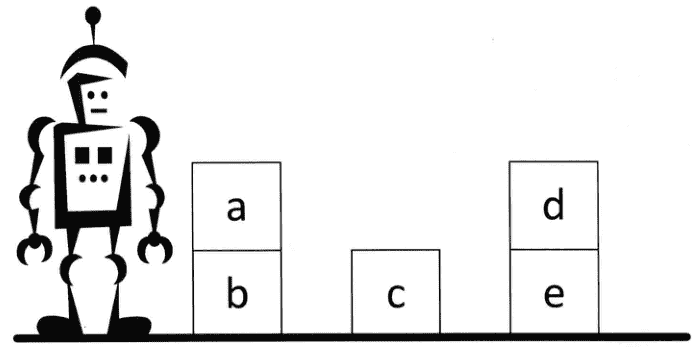

图3.1 积木世界。

- 7. 拿起积木a
- 8. 把积木a放在积木e上

我们希望开发一种能产生此类计划的算法。首先，我们使用谓词演算来描述世界的状态。为此，我们有以下谓词：

| 谓词 | 含义 |
|---|---|
| on(x,y) | 积木x在积木y上。 |
| clear(x) | 积木x上方没有其他物体。 |
| gripping(x) | 机器人正在抓取积木x；如果机器人没有抓取任何积木，则gripping(nothing)为真。 |
| ontable(x) | 积木x在桌子上。 |

图3.1中世界的状态描述如下：

- ontable(b)
- ontable(c)
- ontable(e)
- on(a,b)
- on(d,e)
- gripping(nothing)

表3.2 积木世界的动作规则

| 规则 | 公式 |
| :--- | :--- |
| 1 | ∀x pickup(x) ⇒ (gripping(nothing) ∧ clear(x) ⇒ gripping(x)) |
| 2 | ∀x putdown(x) ⇒ (gripping(x) ⇒ clear(x) ∧ ontable(x) ∧ gripping(nothing)) |
| 3 | ∀x ∀y stack(x, y) ⇒ (gripping(x) ∧ clear(y) ⇒ gripping(nothing) ∧ on(x, y)) |
| 4 | ∀x ∀y unstack(x, y) ⇒ (on(x, y) ∧ clear(x) ∧ gripping(nothing) ⇒ gripping(x) ∧ clear(y)) |

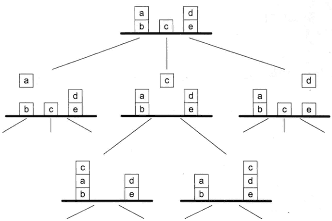

图3.2 在积木世界中搜索计划时的状态空间树的一部分。

接下来，我们需要用于改变世界状态的动作规则。它们在表3.2中使用一阶逻辑表达。

这些动作规则的意思是，如果我们采取规则前提中给出的动作（使其为真），那么规则的结论就变为真。例如，在规则1中，如果我们采取pickup(a)动作，那么如果机器人没有抓取任何东西且a上方没有物体，机器人最终将抓住a。

既然我们可以描述世界的状态和改变状态的动作，我们就可以讨论制定计划。获得计划的一种简单方法是对可能的移动进行广度优先搜索。当我们到达目标状态时，计划就是导致该状态的一系列移动。图3.2显示了搜索的一部分。这种方法的问题是，对于大规模问题实例，它在计算上变得不可行。在3.2.2.2节中，我们讨论了解决此问题的方法。

积木世界存在框架问题，即关注如何使用逻辑表达那些在改变世界状态以供下一时间槽的动作中保持不变的世界方面。术语fluent指的是随时间变化的世界方面，而术语atemporal指的是不变的方面。例如，假设我们对图3.1中的世界执行unstack(a,b)。那么与此操作相关的逻辑语句蕴含机器人正在抓住a且b上没有东西。然而，它没有提到c、d和e。它们可能处于图3.1所示的配置（我们期望的配置），但也可能处于任何其他配置。

解决此问题的一种方法是包含框架规则，告诉我们动作不会改变哪些方面。例如，我们可以有以下框架规则：

```
∀x ∀y ∀z unstack(y, z) ⇒ (ontable(x) ⇒ ontable(x)).
```

该规则表示，如果在我们从z上拿起y之前x在桌子上，那么之后它仍然在桌子上。

### 3.2.2.2 PDDL与宏

我们使用规划域定义语言（PDDL）的一个版本来解决框架问题。在我们的语言版本中，每个状态都由一组fluent的合取表示。对于给定的动作，我们列出前置条件（Pre），即动作应用必须为真的条件；添加列表（Add），即应用条件时添加的fluent；以及删除列表（Del），即应用动作时删除的fluent。例如，unstack(x,y)动作表示如下：

```
unstack(x, y)   Pre: on(x, y) ∧ clear(x) ∧ gripping(nothing)
                        Add: gripping(x) ∧ clear(y)
                        Del: on(x, y) ∧ gripping(nothing)
```

然后我们通过假设一个框架公理来解决框架问题，即动作描述中未提及的所有fluent都保持不变。

我们可以通过开发宏算子来改进广度优先搜索，宏算子由可能经常执行的一系列动作组成。例如，假设我们经常希望在一个积木放在另一个积木上时交换这两个积木。以下宏实现了此功能：

```
invert(x, y)   Pre: on(x, y) ∧ clear(x) ∧ gripping(nothing)
                       Add: on(y, x) ∧ clear(y)
                       Del: on(x, y) ∧ clear(x)
                       Actions: unstack(x, y); putdown(x); pickup(y); stack(y, x)
```

Actions行显示构成宏的动作。在搜索时，我们不仅搜索基本动作，还搜索宏。

PDDL和宏都包含在斯坦福大学研究所规划系统（STRIPS）[Fikes and Nilsson, 1971]中，该系统由SRI International开发。STRIPS在20世纪70年代用于规划SHAKEY机器人的动作。

### 3.2.2.3 向后搜索

图3.2所示的广度优先搜索策略是一种前向搜索，因为它从世界的当前状态开始，向前看，试图到达世界的期望状态。或者，我们可以通过执行向后搜索来促进搜索。类似于后向链式推理，在向后搜索中，我们从目标（即世界的期望状态）开始，向后进行。例如，假设世界如图3.1所示，我们的目标是交换积木a和b。那么我们从条件on(b,a)和clear(b)开始，看看什么动作可以到达此状态。该动作是stack(b,a)。然后我们查看此动作的前置条件。它们是gripping(b)和clear(a)。接下来我们查看什么动作可能导致了这些条件，并以此类推。

向后搜索策略被用于在[Nilsson, 1994]中开发的teleo-reactive规划策略。teleo-reactive程序是一种代理控制程序，它在不断考虑代理对动态环境变化的感知的同时，稳健地引导代理朝着目标前进。teleo-reactive规划已应用于多个领域，包括机器人控制[Benson, 1995]和加速器束线调谐[Klein et al., 2000]。Katz [1997]使用模糊逻辑[Zadeh, 1965]扩展了teleo-reactive范式，用于机器人代理任务控制。

## 3.3 讨论与进一步阅读

约翰·麦卡锡和帕特里克·海斯在其论文《来自人工智能立场的一些哲学问题》“Some Philosophical Problems from the Standpoint of Artificial Intelligence” [McCarthy and Hayes, 1969]中确定了框架问题。麦卡锡提出通过假设发生了最小量的变化来解决该问题。耶鲁射击问题[Hanks and McDermott, 1987]表明该解决方案并不总是正确。随后提出了替代方案，并于1991年，Reiter使用后继状态公理解决了该问题。

## 练习

### 3.1节

- 练习3.1 谓词parents(x, y, z)的目数是什么？例如，我们可能有parents(Dave,Gloria,Mary)。

- 练习3.2 描述一阶逻辑中谓词与函数的区别。


## 练习 3.3

假设我们的常量符号为 {Mary, Dave, Amit, Juan}，并且我们有以下真值赋值：

| x | Mary | Dave | Amit | Juan |
|---|---|---|---|---|
| young(x) | F | F | T | T |

| x | Mary | Dave | Amit | Juan |
|---|---|---|---|---|
| happy(x) | T | T | T | T |

以下哪些是真句：

- 1. ∀x young(x).
- 2. ∃x young(x).
- 3. ∀x happy(x).
- 4. ∃x happy(x).

## 练习 3.4

假设我们的常量符号为 {Mary, Fred, Sam, Laura, Dave} 并且我们有以下真值赋值：

| | Mary | Fred | Sam | Laura | Dave |
|---|---|---|---|---|---|
| Mary | F | T | F | T | F |
| Fred | T | T | F | F | F |
| Sam | F | T | F | F | F |
| Laura | F | T | F | T | F |
| Dave | F | T | F | F | F |

loves(x,y)

以下哪些是真句：

- 1. ∃x ∀y loves(x, y).
- 2. ∀x ∃y loves(x, y).
- 3. ∃y ∀x loves(x, y).
- 4. ∀y ∃x loves(x, y).

## 练习 3.5

证明定理 3.1。

## 练习 3.6

- 1. ∀x (father(Sam, x) ∧ father(x, Dave) ⇒ grandfather(Sam, Dave))
- 2. father(Sam, Ralph)
- 3. father(Ralph, Dave)
grandfather(Sam, Dave)

## 练习 3.7

- 1. \(\forall x (\text{father(Sam, x)} \land \text{father(x, Dave)} \Rightarrow \text{grandfather(Sam, Dave)})\)
- 2. \(\text{father(Sam, Ralph)}\)
- 3. \(\neg \text{grandfather(Sam, Dave)} / \neg \text{father(Ralph,Dave)}\)

## 练习 3.8

- 1. \(\forall x (\text{study(x)} \lor \neg \text{pass(x)}) / \forall x \neg (\text{pass(x)} \land \neg \text{study(x)})\)

## 练习 3.9

- 1. \(\forall x (\text{woman(x)} \lor \text{man(x)})\)
- 2. \(\neg \text{man(Jennifer)} / \exists x \text{woman(x)}\)

## 练习 3.10

- 1. \(\exists x (\text{woman(x)} \lor \text{man(x)})\)
- 2. \(\forall x \neg \text{man(x)} / \exists x \text{woman(x)}\)

## 练习 3.11

展示 mother(Mary,x) 和 mother(z,Sam) 的一个统一。

## 练习 3.12

展示 children(Virginia,Eileen,x) 和 children(x,y,Ralph) 的一个统一。

## 练习 3.13

使用 GMP 推导以下论证：

- 1. \(\text{parent(Mary,Tom,Ralph)}\)
- 2. \(\neg \text{sister(Tom, Ralph)}\)
- 3. \(\forall x \forall y \forall z \text{parent(x,y,z)} \Rightarrow \text{brother(y,z)} \lor \text{sister(y,z)} / \text{brother(Tom,Ralph)}\)

## 第 3.2 节

## 练习 3.14

使用谓词演算编写表 2.8 中的规则。

## 练习 3.15

使用 PDDL，编写一个宏，输入为两个块 x 和 y。如果 x 在 y 上且 x 上没有其他块，则宏的结果是 x 和 y 都最终位于桌面上。

## 练习 3.16

使用 PDDL，开发一个宏，输入为三个块 x、y 和 z。如果 x 在 y 上、y 在 z 上且 x 上没有其他块，则宏的效果是反转所有三个块，使 y 在 x 上且 z 在 y 上。

## 练习 3.17

使用 PDDL，编写一个宏，输入为两个块 x 和 y。只要两个块上都没有第三个块，宏的结果就是 x 和 y 都最终位于桌面上。

# 第 4 章

# 确定性知识表示

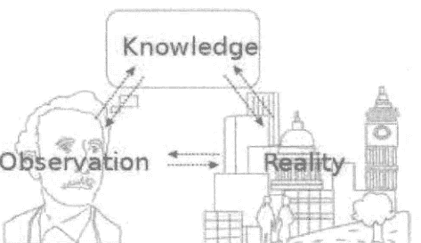

回顾在第 2.3.2 节中介绍的 Wumpus。该 Wumpus 推导出的知识包括关于环境的简单事实，例如某个方格中是否有微风。同样，在第 2.3.1 节中讨论的系统推导出的知识包括简单事实，例如植物的类型或特定物品的袋子位置。在这些简单的应用中，很少需要关心知识的抽象表示。然而，在更复杂的领域中，情况并非如此。**知识表示**是以一种便于从知识中推导出结论的方式表示知识的学科。在哲学中，本体论是研究存在的本质和什么是真实的学科。它关注哪些实体可以说存在、如何对它们进行分类以及类别之间的关系。在人工智能中，**本体论**是知识作为一组概念及其之间存在的关系的表示。

1 本页面上的图片获得自 https://commons.wikimedia.org/wiki/File: Knowledge, _observation_and_reality.svg，根据 GNU 自由文档许可证。

我们介绍了一种用于表示确定性知识的本体论，称为语义网。然后我们讨论可用于表示语义网中知识的框架。最后，我们介绍非单调推理，这是一种允许我们在新证据面前收回结论的推理方法。

## 4.1 分类学知识

我们推理的实体通常可以排列成层次结构或**分类学**。我们可以使用一阶逻辑表示这种分类学。例如，假设我们想表示所有动物及其属性之间的关系。我们可以按以下步骤进行。首先，我们表示子集（子类别）信息：

```
\forall x bird(x) \Rightarrow animal(x)
\forall x canary(x) \Rightarrow bird(x)
\forall x ostrich(x) \Rightarrow bird(x)
\vdots
```

然后，我们表示实体的集合（类别）成员资格：

```
bird(Tweety)
shark(Bruce)
\vdots
```

最后，我们表示集合（类别）和实体的属性：

```
\forall x animal(x) \Rightarrow has\_skin(x)
\forall x bird(x) \Rightarrow can\_fly(x)
\vdots
```

请注意，子集的成员继承其超集相关的属性。例如，鸟类有皮肤，因为鸟类是动物的子集，而动物有皮肤。

### 4.1.1 语义网

使用一阶逻辑表示分类学变得繁琐，且表示不够直观。**语义网**是一种用于表示相同分类学的图结构。图 4.1 显示了表示所有生物分类学的语义网的一个子集。集合（类别）和实体都由网络中的节点表示。有三种类型的边：

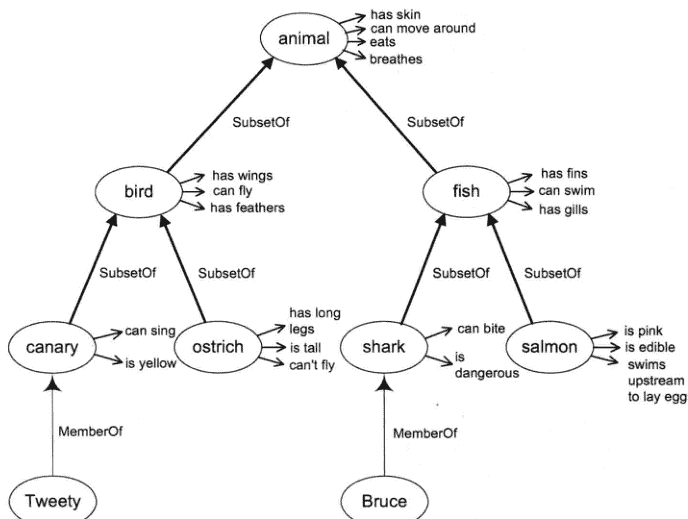

图 4.1 一个语义网络。

- 1. 从子集到超集的边。例如，从鸟类到动物有一条边。
- 2. 从实体到其所属直接集合的边。例如，从 Tweety 到金丝雀有一条边。
- 3. 从实体或集合到其属性之一的边。例如，从鸟类到有翅膀有一条边，因为鸟类有翅膀。

在语义网络中存在继承。也就是说，除非一个节点有指向某个属性的边，否则它会从最近拥有指向该属性边的祖先节点继承该属性。例如，节点金丝雀没有指向关于飞行的属性的边。因此，它从节点鸟类继承该属性，这意味着金丝雀可以飞。节点鸵鸟有一条指向其不能飞的属性的边；因此，它不从节点鸟类继承该属性。

语义网中的继承属性存在困难。最显著的是，一个节点可以从两个父节点继承冲突的属性。考虑图 4.2 中的语义网络。因为尼克松是贵格会教徒，他继承了他是和平主义者的属性；并且因为他是共和党人，他继承了他不是和平主义者的冲突属性。由于这一困难，一些面向对象编程语言（如 Java）不允许多重继承。第 4.3 节讨论的非单调逻辑通过使用优先级进行冲突解决来解决这一困难。

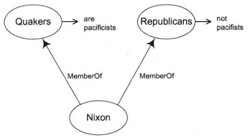

图 4.2 该语义网蕴含尼克松是和平主义者且不是和平主义者的冲突。

### 4.1.2 人类知识组织模型

有证据表明，人类在语义网中组织分类知识。图 4.1 中的语义网摘自 [Collins and Quillian, 1969]。该论文涉及人类反应时间研究，调查人类回答诸如“金丝雀是黄色的吗？”之类的问题需要多长时间。他们的研究表明，回答这个问题比回答“金丝雀能飞吗？”更快。一般来说，信息在网络中离实体越近，回答问题就越快。这支持了人类实际上以这种层次结构组织知识的假设，因为如果需要遍历的心理链接更少以检索信息，那么问题应该能更快地回答。异常处理支持了这一假设。例如，受试者回答“鸵鸟能飞吗？”的速度比回答“鸵鸟有羽毛吗？”更快。

## 4.2 框架

框架是一种可以表示语义网中知识的数据结构。在展示数据结构后，我们将提供一个示例。

### 4.2.1 框架数据结构

框架的一般结构如下：


```
(frame-name
slot-name1: filler1;
slot-name2: filler2;
:
)
```

### 示例 4.1 表示图 4.1 中语义网的帧的前两个帧如下：

```
(animal
SupersetOf: bird;
SupersetOf: fish;
skin: has;
mobile: yes;
eats: yes;
breathes: yes;
)
```

```
(bird
SubsetOf: animal;
SupersetOf: canary;
SupersetOf: ostrich;
wings: has;
flies: yes;
feathers: has;
)
```

请注意，在前面的示例中，我们将帧名称设置为粗体。

### 4.2.2 使用帧规划行程

假设一名旅行推销员正在规划一个访问多个城市的往返行程。行程有多个组成部分，例如出行方式、访问的城市和住宿。我们开发帧来表示这些组件，并展示如何使用它们来表示行程计划。

我们有以下用于开发行程的通用帧：

```
(Trip
FirstStep: TravelStep;
Traveler: human;
BeginDate: date;
EndDate: date;
TotalCost: price;
)
```

```
(TripPart
SupersetOf: TravelStep;
SupersetOf: LodgingStay;
BeginDate: date;
EndDate: date;
Cost: price;
PaymentMethod: method;
)
```

```
(TravelStep
SubsetOf: TripPart;
Origin: city;
Destination: city;
OriginLodgingStay: LodgingStay;
DestinationLodgingStay: LodgingStay;
FormofTransportation: travelmeans;
NextStep: TravelStep;
PreviousStep: TravelStep;
)
```

```
(LodgingStay
SubsetOf: TripPart;
Place: city;
Lodging: hotel;
ArrivingTravelStep: TravelStep;
DepartingTravelStep: TravelStep;
)
```

请注意，TravelStep 和 LodgingStay 都是 TripPart 的子集。因此，它们继承 TripPart 中的属性，即 BeginDate、EndDate、Cost 和 PaymentMethod。接下来，我们开发一个简单的行程，从本地城市芝加哥出发，访问墨尔本，然后返回芝加哥。

```
(trip1
MemberOf: Trip;
FirstStep: TravelStep1;
Traveler: Amit Patel;
BeginDate: 06/22/2011;
EndDate: 06/28/2011;
TotalCost: $6000;
)
```

```
(TravelStep1
    MemberOf: TravelStep;
    BeginDate: 6/22/2011;
    EndDate: 6/23/2011;
    Cost: $1500;
    PaymentMethod: visa;
    Origin: Chicago;
    Destination: Melbourne;
    OriginLodgingStay: Null;
    DestinationLodgingStay: LodgingStay1;
    FormofTransportation: plane;
    NextStep: TravelStep2;
    PreviousStep: Null;
)
```

```
(TravelStep2
    MemberOf: TravelStep;
    BeginDate: 6/27/2011;
    EndDate: 6/28/2011;
    Cost: $2000;
    PaymentMethod: master card;
    Origin: Melbourne;
    Destination: Chicago;
    OriginLodgingStay: LodgingStay1;
    DestinationLodgingStay: Null;
    FormofTransportation: plane;
    NextStep: Null;
    PreviousStep: TravelStep1;
)
```

```
(LodgingStay1
    MemberOf: LodgingStay;
    BeginDate: 6/23/2011;
    EndDate: 6/27/2011;
    Cost: $2500;
    PaymentMethod: american express;
    Place: Melbourne;
    Lodging: Best Western;
    ArrivingTravelStep: TravelStep1;
    DepartingTravelStep: TravelStep2;
)
```

图 4.3 显示了帧中的填充值如何将帧链接成一个有组织的行程计划。前面关于规划行程的示例基于出现在 [布雷赫曼和莱夫斯克，2004] 中的更复杂的示例。

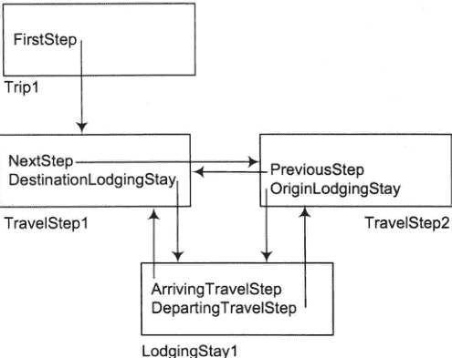

图 4.3 构成芝加哥和墨尔本之间行程的帧之间的链接。

## 4.3 非单调逻辑

命题逻辑和一阶逻辑会得出某些结论，且没有撤销或覆盖结论的机制。这是**单调性**属性。然而，人类得出的结论往往只是暂时的，基于部分信息，并在新证据出现时被撤销。例如，如果我们得知一个实体是鸟，我们会得出它能飞的结论。当我们后来得知该实体是鸵鸟时，我们会撤销之前的结论并推断该实体不能飞。能够系统化这种推理的逻辑称为**非单调**。我们接下来讨论这种逻辑。处理不确定推理的另一种方法是使用概率论，这是本文第二部分的重点。

### 4.3.1 圈定

圈定由麦卡锡 [1980] 开发，用于形式化这样一种假设：除非我们另有说明，否则一切都按预期进行。他通过讨论**食人族-传教士**问题来引入这一概念，问题如下。假设一条河岸上有三位传教士和三个食人族，他们需要使用一艘两人座的船过河。然而，每条河岸上食人族的人数永远不能多于传教士的人数。麦卡锡关注的不是获得问题的解决方案，而是以下观察。即，有许多未陈述的细节。例如，船是否有漏水可能导致其沉没，或者更相关的是，是否有一座桥，一些人可以走过桥过河。可能存在许多未陈述的情况，这些情况可能影响问题的解决方案。**圈定假设**是：除非明确说明，否则没有条件会改变或与预期不同。在当前示例中，我们假设过河的唯一方式是乘坐两人座的船，并且它总能可靠地到达对岸。

### 示例 4.2 圈定的逻辑语句示例如下：

\(\forall x \, \text{bird}(x) \land \neg \text{abnormal}(x) \Rightarrow \text{flies}(x).\)

推理者对谓词 *异常* 进行圈定，这意味着除非另有说明，否则假设其为假。因此，如果我们只知道 bird(Tweety)，我们推断 Tweety 能飞。然而，假设我们包含以下语句：

\(\forall x \, \text{ostrich}(x) \Rightarrow \text{abnormal}(x).\)

如果我们同时知道 ostrich(Ralph) 和 bird(Ralph)，我们就不能得出 Ralph 能飞的结论。

### 示例 4.3 假设我们有以下语句：

\(\forall x \, \text{Quaker}(x) \land \neg \text{abnormal}_1(x) \Rightarrow \text{pacifist}(x)\)

\(\forall x \, \text{Republican}(x) \land \neg \text{abnormal}_2(x) \Rightarrow \neg \text{pacifist}(x)\)

Republican(Nixon) \(\land\) Quaker(Nixon).

在不知道 abnormal_1(Nixon) 或 abnormal_2(Nixon) 是否为真的情况下，我们会得出他是和平主义者且他不是和平主义者的结论。在这种情况下，我们可以让推理者对和平主义不得出任何结论，或者我们可以采用**优先圈定**，在其中我们给予贵格会党员或共和党党员优先权。如果我们给后者优先权，我们得出结论尼克松不是和平主义者。

圈定的正式描述出现在 [利夫希茨，1994]。

### 4.3.2 默认逻辑

**默认逻辑**采用形式为“在没有相反信息的情况下，假设...”的规则。Reiter [1980] 对默认逻辑进行了形式化，并认为默认推理对知识表示和推理至关重要。我们接下来提供一个非正式的介绍。

默认逻辑在结论与知识库当前状态一致时得出结论。默认逻辑中的典型规则如下：

```
bird(x): flies(x)
-----------------
flies(x)
.
```

此规则表示，如果对于特定实体 x，bird(x) 为真，那么只要知识库中没有与 flies(x) 矛盾的内容，我们就可以得出该实体 flies(x) 的结论。例如，如果我们得知 bird(Tweety)，那么只要知识库中没有陈述 flies(Tweety) 不为真，我们就可以得出 flies(Tweety) 的结论。然而，如果 ¬flies(Tweety) 在知识库中，那么我们就不能得出这个结论。

以下是默认规则的一般形式：

```
A: B1, B2, ..., Bn
-----------------
C
,
```

其中 A、Bi 和 C 是一阶逻辑公式。A 称为**先决条件**；B1、B2、... 和 Bn 称为**一致性条件**；C 称为**后继**。如果任何 Bi 可以被证明为假，那么我们不能从 A 得出 C；否则我们可以。

一个**默认理论**是一对 (D, W)，其中 D 是默认规则的集合，W 是一阶逻辑句子的集合。

### 示例 4.4 以下是一个默认理论。令 D 如下：

```
bird(x): flies(x)
-----------------
flies(x)
.
```

和

```
W = {bird(Tweety)}.
```

默认理论的一个**扩展**是该理论的极大后果集。也就是说，扩展由 W 中的语句以及可以使用规则得出的一组结论组成，使得无法再得出额外的结论。示例 4.4 中理论的唯一扩展如下：

```
{bird(Tweety), flies(Tweety)}.
```

### 示例 4.5 令 D 如下：

```
Quaker(x): pacifist(x)
-----------------
pacifist(x)
```

```
Republican(x): ¬pacifist(x)
-----------------
¬pacifist(x)
```

和


$W = \{Quaker(Nixon), Republican(Nixon)\}$.

然后我们有以下两个扩展：

- {Quaker(Nixon), Republican(Nixon), pacifist(Nixon)}
- {Quaker(Nixon), Republican(Nixon), ¬pacifist(Nixon)}

与循环定义的情况一样，对规则进行优先级排序可以使其中一个扩展优先于另一个。

### 4.3.3 困难

非单调逻辑的一个困难在于，当知识发生变化时，需要修订一组结论。例如，如果我们使用句子 $A$ 来推导 $B$，那么删除 $A$ 意味着我们必须删除 $B$（除非 $B$ 可以从其他句子中得出），并且还要删除所有基于 $B$ 的结论。真值维护系统（[Doyle, 1979]；[Goodwin, 1982]）是为解决这个问题而开发的。

非单调逻辑的另一个问题是，很难基于通过这种形式主义得出的结论来做出决策。结论是暂定的，在新证据面前可以被撤销。例如，假设我们得出结论：某患者患有转移性癌症。我们应该做出什么决策才能最大限度地提高患者的获益（效用）？我们并不真正知道患癌的可能性；相反，这只是基于当前证据的默认结论。这个问题在示例 8.15 中使用概率和最大效用理论来解决。

## 4.4 讨论与进一步阅读

最初，人工智能研究者更感兴趣于问题表示而非知识表示 [Amarel, 1968]。然而，在20世纪70年代，研究者开始对开发专家系统感兴趣，专家系统是基于知识的。专家系统在第2.3.1节中介绍过，在第2.4节中我们提到了XCON [McDermott, 1982]，这是一个著名的早期专家系统。另一个成功的早期专家系统是DENDRAL [Feigenbaum et al., 1971]，它分析从物质中获得的光谱数据，然后确定该物质的分子结构。它的表现与专家化学家一样出色。

正在开发超大规模本体学。也许最著名的一个是Cyc [Lenat, 1998]，这是一个由Douglas Lenat于1984年启动的人工智能项目。该项目的目标是构建一个全面的常识知识本体学。

OpenCyc是Cyc技术的开源版本，是世界上最大、最完整的通用知识库和常识推理引擎。OpenCyc包含完整的（非专有的）Cyc术语集以及数百万个断言。

三种处理非单调推理的方法，即循环定义 [McCarthy and Hayes, 1969]、默认逻辑 [Reiter, 1991] 和模态非单调逻辑 [McDermott and Doyle, 1980]，在 [Delgrande and Schaub, 2003] 中进行了讨论和比较。

## 练习

### 第4.1节

练习4.1 开发一个表示某些封闭分类域的语义集，例如所有汽车的集合，或所有职业体育队伍的集合。

练习4.2 解释为什么人类回答问题“金丝雀是黄色的吗？”比回答问题“金丝雀会飞吗？”更快。

### 第4.2节

练习4.3 示例4.1展示了表示图4.1中的语义网的两个框架。创建其余框架。

练习4.4 在第4.2.2节中，我们使用框架制定了芝加哥和墨尔本之间行程的计划。再次使用框架，制定一个从芝加哥出发，游览洛杉矶，游览墨尔本，然后返回芝加哥的行程计划。

### 第4.3节

练习4.5 通常，足球运动员身材高大。然而，任意球踢手通常身材较小。护锋队员总是身材高大。Sam既是任意球踢手又是护锋队员。使用循环定义和默认逻辑来表示这种情况。我们应该优先考虑Sam是任意球踢手还是护锋队员？

练习4.6 考虑以下虚构的医学知识片段。通常，流感病毒会导致发烧。然而，如果一个人年轻，猪流感不会导致发烧。Joe年轻且患有猪流感。尝试使用循环定义和默认逻辑来表示这种情况。

# 第二部分

# 概率智能

# 第5章

# 概率

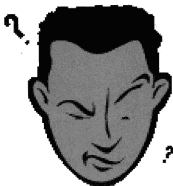

如第2章所讨论的，使用逻辑来模拟确定性下的大量人类推理是合理的。这种模型导致了开发基于规则的系统，这些系统使用前向链和后向链推理引擎。例如，合理地假设植物学家Mary在她的个人知识库中存储了以下规则或知识条目：

- IF stem is woody
- THEN type is tree.

此外，如果Mary正在确定某个特定植物的科，她可能会以类似于图2.2中决策树的方式进行推理，这相当于后向链。也就是说，她会先询问确定类型的问题，然后是确定类的问题，最后是确定科的问题。

为了处理不确定的引用，研究人员试图通过开发非单调逻辑来留在逻辑框架内。如第4.3.3节所讨论的，这种方法存在许多困难。研究人员探索的另一条途径是在建模不确定推理时保留基于规则或逻辑的框架，但用数值确定性因子 [Buchanan and Shortliffe, 1984] 或似然比 [Duda et al., 1976] 来增强规则。例如，MYCIN系统 [Buchanan and Shortliffe, 1984] 旨在在不确定性下进行推理以诊断细菌感染。MYCIN中的典型规则如下：

- IF the organism grows in clumps
- AND the organism grows in chains
- AND the organism grows in pairs
- THEN the organism is streptococcus with certainty .7

确定性因子（在此例中为.7）是-1到1之间的数字。大于0的确定性因子会增加我们对结论的信念，而小于0的确定性因子会降低我们的信念。因此，如果我们发现该生物成簇生长、成链生长和成对生长，我们就有.7的确定性认为它是链球菌。假设现在第二条规则使我们有.6的确定性认为该生物是链球菌。我们需要找出这两条规则导致的综合确定性。两个确定性因子使用以下公式组合：

$$
C_{12} = \begin{cases} C_1 + C_2(1 - |C_1|) & C_1 \text{ and } C_2 \text{ both positive or both negative} \\ \frac{C_1 + C_2}{1 - \min(|C_1|, |C_2|)} & \text{one of } C_1 \text{ and } C_2 \text{ positive, the other negative} \end{cases}
$$

所以当 $C_1 = .7$ 和 $C_2 = .6$ 时，我们有

$$
C_{12} = C_1 + C_2(1 - |C_1|) = .7 + .6(1 - |.7|) = .88.
$$

如果第二条规则以 $C_2 = - .6$ 反驳链球菌，我们有

$$
C_{12} = \frac{C_1 + C_2}{1 - \min(|C_1|, |C_2|)} = \frac{.7 + (-.6)}{1 - \min(|.7|, |-.6|)} = .25.
$$

当每条规则单独描述前件和结论之间的关系时，该方案工作良好。然而，现在考虑[Pearl, 1986]引入的以下经典示例。假设在过去几年中，Holmes先生注意到地震经常导致他的防盗警报响起。防盗警报涉及他的家，但它被连接到他在办公室响起，办公室距离他家有一段距离。目前，他正坐在办公室里，防盗警报响了。他然后赶回家，认为他的住所很可能被入室盗窃。回家途中，他在收音机里听说发生了地震。他然后推理说，地震很可能触发了警报，因此他被入室盗窃的可能性要小得多。心理学家将这种推理类型称为贴现。

让我们尝试使用规则来建模这种情况。表示以下命题：

- A: Holmes先生的防盗警报响起。
- B: Holmes先生的住所被入室盗窃。
- E: 发生了地震。

使用基于规则的方法，我们可以分配以下确定性因子：

- IF A THEN B with certainty .8
- IF E THEN B with certainty -.4

当Holmes先生得知他的警报响了时，他变得有.8的确定性认为自己被入室盗窃了。当他后来得知地震时，他将确定性因子.8与确定性因子-.4按以下方式组合：

$$
\frac{.8 + (-.4)}{1 - \min(|.8|, |-.4|)} = .67.
$$

因此，他对自己被入室盗窃的确定性降低到.67。

该模型的一个困难是，只有在已经知道A的情况下，E才会降低对B的确定性。也就是说，如果警报没有响，Holmes先生在听说发生地震后，不会得出结论认为他今天被入室盗窃的可能性极小（即比任何其他日子都更不可能）。因此，我们不能有关于地震的上述规则。相反，我们需要在前件中包含多个前提的规则，如下所示：

- IF A ^ E THEN B with certainty .67
- IF A ^ -E THEN B with certainty .85

请注意，当我们知道A和-E时，确定性比只知道A时更高，因为我们确定另一个原因不存在。如果我们想表示其他原因，例如有人被看到在房子周围徘徊，我们需要考虑前件中更多断言的组合。

基于规则的方法的另一个问题是，它只允许我们向一个方向进行推理。也就是说，如果我们想模拟Holmes先生在得知自己被入室盗窃后会如何推理，我们需要以下附加规则：

- IF B THEN A with certainty .7

该规则中的确定性因子与进行反向推理的规则之间没有明确的联系。


除了笨拙和复杂之外，这种不确定知识和推理的基于规则的表示似乎也不能很好地模拟人类的推理方式。也就是说，假设人类思维拥有数百万条规则，每条规则代表一种可能复杂的不确定关系，似乎是不合理的。Neapolitan [1989] 更详细地讨论了这一问题。Pearl [1986] 做出了更合理的推测：人类识别个别命题之间的局部概率因果关系，并且一个命题的确定性变化会改变我们对相关命题的确定性，进而改变我们对与该命题相关的命题的确定性。如果福尔摩斯先生的知识在命题之间具有因果边缘结构，我们可以用因果网络来表示他的知识，并通过遍历该网络中的链接来模拟他的推理。无论该模型在多大程度上代表人类推理，它都帮助催生了我们现在称之为贝叶斯网络的领域，该领域可以说已成为人工智能中处理不确定性推理最重要的架构。我们将在下一章讨论福尔摩斯先生推理的因果网络表示，并介绍贝叶斯网络。在本章中，我们回顾概率。贝叶斯网络基于概率理论。

## 5.1 概率基础

定义概率空间后，我们讨论条件概率、独立性和条件独立性，以及贝叶斯定理。

### 5.1.1 概率空间

你可能记得在诸如从一副扑克牌中抽取最上面一张牌、抛硬币或从球罐中抽取一个球等情况下使用过概率。我们称抽取最上面一张牌或抛硬币的过程为一个实验。概率理论涉及具有一组不同结果的实验。所有结果的集合称为样本空间或总体。数学家通常说样本空间，而社会科学家通常说总体。我们将说样本空间。在这个简单的回顾中，我们假设样本空间是有限的。样本空间的任何子集都称为一个事件。包含恰好一个元素的子集称为一个基本事件。

**示例 5.1** 假设我们有一个从普通牌组中抽取最上面一张牌的实验。那么集合

```
E = {jack of hearts, jack of clubs, jack of spades, jack of diamonds}
```

是一个事件，而集合

```
F = {jack of hearts}
```

是一个基本事件。

事件的含义是子集中的一个元素是实验的结果。在前面的示例中，事件 E 的含义是抽到的牌是四张杰克中的一张，而基本事件 F 的含义是抽到的牌是红桃杰克。

我们用 0 到 1 之间的实数来表达我们对事件包含实验结果的确定性。这个数字称为事件的**概率**。当样本空间有限时，概率为 0 表示我们确定该事件不包含结果，而概率为 1 表示我们确定它包含结果。中间值代表不同程度的信念。以下定义正式定义了有限样本空间的概率。

**定义 5.1** 假设我们有一个包含 n 个不同元素的样本空间 \(\Omega\)；即，\(\Omega = \{e_1, e_2, \dots, e_n\}\)。

一个为每个事件 \(E \subseteq \Omega\) 分配实数 \(P(E)\) 的函数，如果满足以下条件，则称为 \(\Omega\) 子集集合上的**概率函数**：

- 1. 对于 \(1 \le i \le n\)，\(0 \le P(e_i) \le 1\)
- 2. \(P(e_1) + P(e_2) + \dots + P(e_n) = 1\)
- 3. 对于不是基本事件的每个事件，\(P(E)\) 是其结果在 E 中的基本事件概率之和。例如，如果 \(E = \{e_3, e_6, e_8\}\)，则 \(P(E) = P(e_3) + P(e_6) + P(e_8)\)

对 \((\Omega, P)\) 称为**概率空间。**\(\blacklozenge\)

由于概率被定义为定义域为集合的集合的函数，在表示基本事件的概率时，我们应该写 \(P(\{e_i\})\) 而不是 \(P(e_i)\)。但是，为了简单起见，我们不这样做。同样，我们写 \(P(e_3, e_6, e_8)\) 而不是 \(P(\{e_3, e_6, e_8\})\)。

分配概率最直接的方法是使用**无差异原则**，该原则指出，如果我们没有理由期望某个结果优于另一个，则应将结果视为等可能。根据这一原则，当有 n 个基本事件时，每个事件的概率均等于 \(1/n\)。

**示例 5.2** 设实验为抛硬币。那么样本空间是 \(\Omega = \{heads, tails\}\)，

并且，根据无差异原则，我们分配 \(P(heads) = P(tails) = .5\)。

我们强调，概率空间的定义中并没有任何内容说我们必须将 .5 分配给正面和反面的概率。我们可以分配 P(heads) = .7 和 P(tails) = .3。但是，如果我们没有理由期望某个结果优于另一个，我们就给它们相同的概率。

**示例 5.3** 设实验为从一副 52 张牌中抽取最上面一张牌。那么 \(\Omega\) 包含 52 张牌的牌面，并且，根据无差异原则，我们为每个 \(e \in \Omega\) 分配 \(P(e) = 1/52\)。例如，

```
P(\text{jack of hearts}) = \frac{1}{52}.
```

事件

```
E = \{\text{jack of hearts, jack of clubs, jack of spades, jack of diamonds}\}
```

表示抽到的牌是杰克。其概率为

```
\begin{aligned}
P(E) &= P(\text{jack of hearts}) + P(\text{jack of clubs}) + \\
\quad & P(\text{jack of spades}) + P(\text{jack of diamonds}) \\
&= \frac{1}{52} + \frac{1}{52} + \frac{1}{52} + \frac{1}{52} = \frac{1}{13}.
\end{aligned}
```

**定理 5.1** 设 \((\Omega, P)\) 为一个概率空间。那么

- 1. \(P(\Omega) = 1\)。
- 2. 对于每个 \(E \subseteq \Omega\)，\(0 \le P(E) \le 1\)。
- 3. 对于 \(\Omega\) 的每两个子集 E 和 F，使得 \(E \cap F = \varnothing\)，

```
P(E \cup F) = P(E) + P(F),
```

其中 \(\varnothing\) 表示空集。

**示例 5.4** 假设我们从一副牌中抽取最上面一张牌。用 Queen 表示包含四张皇后的集合，用 King 表示包含四张国王的集合。那么

```
P(\text{Queen} \cup \text{King}) = P(\text{Queen}) + P(\text{King}) = \frac{1}{13} + \frac{1}{13} = \frac{2}{13}
```

因为 Queen \(\cap\) King = \(\varnothing\)。接下来，用 Spade 表示包含 13 张黑桃的集合。集合 Queen 和 Spade 不是不相交的，因此它们的概率不可加。但是，一般来说，证明以下等式并不困难：

```
P(E \cup F) = P(E) + P(F) - P(E \cap F).
```

所以

\( P(\text{Queen} \cup \text{Spade}) = P(\text{Queen}) + P(\text{Spade}) - P(\text{Queen} \cap \text{Spade}) \\
= \frac{1}{13} + \frac{1}{4} - \frac{1}{52} = \frac{4}{13}.\)

### 5.1.2 条件概率和独立性

我们从一个定义开始。

**定义 5.2** 设 E 和 F 为事件，且 \( P(F) \neq 0\)。那么在 F 发生条件下 E 的**条件概率**，记作 \( P(E|F) \)，由以下公式给出：

\( P(E|F) = \frac{P(E \cap F)}{P(F)}.\)

我们可以通过考虑使用无差异原则分配的概率来直观理解这个定义。在这种情况下，如前面所定义的，\( P(E|F) \) 是 \( E \cap F \) 中项目数与 F 中项目数的比值。我们如下说明：设 n 为样本空间中的项目数，\( n_F \) 为 F 中的项目数，\( n_{EF} \) 为 \( E \cap F \) 中的项目数。那么

\( \frac{P(E \cap F)}{P(F)} = \frac{n_{EF}/n}{n_F/n} = \frac{n_{EF}}{n_F},\)

这是 \( E \cap F \) 中项目数与 F 中项目数的比值。就含义而言，\( P(E|F) \) 是我们在已经知道事件 F 包含结果（即 F 发生）的情况下，相信事件 E 包含结果（即 E 发生）的程度。

**示例 5.5** 再次考虑从一副牌中抽取最上面一张牌。设 Jack 为四张杰克的集合，**红色皇家牌** 为六张红色皇家牌的集合，¹ 而 Club 为十三张梅花的集合。那么

\( P(\text{Jack}) = \frac{4}{52} = \frac{1}{13} \\
P(\text{Jack}|\text{RedRoyalCard}) = \frac{P(\text{Jack} \cap \text{RedRoyalCard})}{P(\text{RedRoyalCard})} = \frac{2/52}{6/52} = \frac{1}{3} \\
P(\text{Jack}|\text{Club}) = \frac{P(\text{Jack} \cap \text{Club})}{P(\text{Club})} = \frac{1/52}{13/52} = \frac{1}{13}.\)

请注意，在前面的示例中，\( P(\text{Jack}|\text{Club}) = P(\text{Jack}) \)。这意味着，得知牌是梅花并不会改变它是杰克的可能性。在这种情况下，我们说这两个事件是独立的，这在以下定义中正式化。

¹ 皇家牌是杰克、皇后或国王。


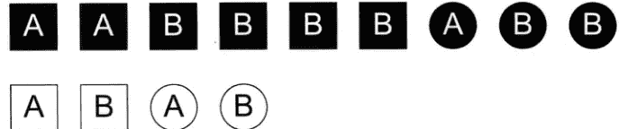

图 5.1 使用无差别原则，我们给每个对象分配 1/13 的概率。

**定义 5.3** 如果以下条件之一成立，则称两个事件 E 和 F 独立：

- 1. P(E|F) = P(E) 且 P(E) != 0, P(F) != 0
- 2. P(E) = 0 或 P(F) = 0

注意，定义中指出即使是用 E 在 F 条件下的条件概率来表述，两个事件也是独立的。原因在于独立性是对称的。也就是说，如果 P(E) != 0 且 P(F) != 0，则 P(E|F) = P(E) 当且仅当 P(F|E) = P(F)。可以直接证明，E 和 F 独立当且仅当 P(E ∩ F) = P(E)P(F)。

如果你之前学过概率，应该已经接触过独立性的概念。然而，独立性的一种推广，称为条件独立，在许多入门教材中未涉及。这个概念对本书讨论的应用很重要。我们接下来讨论它。

**定义 5.4** 如果 P(G) != 0 且以下条件之一成立，则称两个事件 E 和 F 在 G 条件下条件独立：

- 1. P(E ∩ F | G) = P(E|G) 且 P(E|G) != 0, P(F|G) != 0
- 2. P(E|G) = 0 或 P(F|G) = 0

注意，此定义与独立性的定义相同，区别在于一切都条件于 G。该定义意味着，一旦我们知道结果在 G 中，E 和 F 就是独立的。下一个示例说明了这一点。

**示例 5.6** 设 Ω 为图 5.1 中所有对象的集合。使用无差别原则，我们给每个对象分配 1/13 的概率。设 Black 为所有黑色对象的集合，White 为所有白色对象的集合，Square 为所有正方形对象的集合，A 为所有包含 A 的对象的集合。则有

$$
P(A) = 5/13
P(A|Square) = 3/8
$$

所以 A 和 Square 不独立。然而，

$$
P(A|Black) = \frac{3}{9} = \frac{1}{3}
P(A|Square \cap Black) = \frac{2}{6} = \frac{1}{3}.
$$

我们看到 A 和 Square 在 Black 条件下条件独立。此外，

$$
P(A|White) = \frac{2}{4} = \frac{1}{2}
P(A|Square \cap White) = \frac{1}{2}.
$$

所以 A 和 Square 在 White 条件下也条件独立。

接下来，我们讨论一个涉及条件概率的重要规则。假设我们有 \(n\) 个事件 \(E_1, E_2, \dots, E_n\)，使得

$$
E_i \cap E_j = \varnothing \quad \text{for } i \neq j
$$

且

$$
E_1 \cup E_2 \cup \dots \cup E_n = \Omega.
$$

这样的事件称为**互斥且完备**。然后**全概率公式**指出，对于任何其他事件 F，

$$
P(F) = P(F \cap E_1) + P(F \cap E_2) + \dots + P(F \cap E_n). \quad (5.1)
$$

你被要求在练习中证明此规则。如果 \(P(E_i) \neq 0\)，则

$$
P(F \cap E_i) = P(F|E_i)P(E_i).
$$

因此，如果对所有 \(i\) 都有 \(P(E_i) \neq 0\)，该定律通常以以下形式应用：

$$
P(F) = P(F|E_1)P(E_1) + P(F|E_2)P(E_2) + \dots + P(F|E_n)P(E_n). \quad (5.2)
$$

**示例 5.7** 假设我们有示例 5.6 中讨论的对象。那么，根据全概率公式，

$$
P(A) = P(A|Black)P(Black) + P(A|White)P(White)
= \left(\frac{1}{3}\right)\left(\frac{9}{13}\right) + \left(\frac{1}{2}\right)\left(\frac{4}{13}\right) = \frac{5}{13}.
$$

### 5.1.3 贝叶斯定理

我们可以使用以下定理从已知概率计算感兴趣事件的条件概率。

**定理 5.2 (贝叶斯)** 给定两个事件 E 和 F，使得 P(E) != 0 且 P(F) != 0，我们有

\(P(E|F) = \frac{P(F|E)P(E)}{P(F)}.\) (5.3).

此外，给定 n 个互斥且完备的事件 \(E_1, E_2, \dots, E_n\)，使得对所有 \(i\) 都有 \(P(E_i) \neq 0\)，则对于 \(1 \le i \le n\)，

\(P(E_i|F) = \frac{P(F|E_i)P(E_i)}{P(F|E_1)P(E_1) + P(F|E_2)P(E_2) + \dots + P(F|E_n)P(E_n)}.\) (5.4)

**证明。**

要得到等式 5.3，我们首先按如下使用条件概率的定义：

\(P(E|F) = \frac{P(E \cap F)}{P(F)} \quad \text{and} \quad P(F|E) = \frac{P(F \cap E)}{P(E)}.\)

接下来，我们将这些等式各自乘以其右边的分母，以表明

\(P(E|F)P(F) = P(F|E)P(E)\)

因为它们都等于 P(E ∩ F)。最后，我们将此最后等式除以 P(F) 以得到我们的结果。

要得到等式 5.4，我们将使用全概率公式（等式 5.2）得到的 F 的表达式放在等式 5.3 的分母中。

前面定理中的两个公式都称为贝叶斯定理，因为原始版本由 Thomas Bayes 开发，发表于 1763 年。第一个使我们能够在知道 P(F|E)、P(E) 和 P(F) 时计算 P(E|F)；第二个使我们能够在知道 \(P(F|E_j)\) 和 \(P(E_j)\)（对于 \(1 \le j \le n\)）时计算 \(P(E_i|F)\)。下一个示例说明了贝叶斯定理的用法。

**示例 5.8** 设 Ω 为图 5.1 中所有对象的集合，并给每个对象分配 1/13 的概率。设 A 为所有包含 A 的对象的集合，B 为所有包含 B 的对象的集合，Black 为所有黑色对象的集合。那么，根据贝叶斯定理，

\(P(\text{Black}|A) = \frac{P(A|\text{Black})P(\text{Black})}{P(A|\text{Black})P(\text{Black}) + P(A|\text{White})P(\text{White})} = \frac{(\frac{1}{3})(\frac{9}{13})}{(\frac{1}{3})(\frac{9}{13}) + (\frac{1}{2})(\frac{4}{13})} = \frac{3}{5},\)

这与我们直接计算 P(Black|A) 得到的值相同。

在前一个示例中，我们同样可以轻松地直接计算 P(Black|A)。我们将在 5.4 节中看到贝叶斯定理的一个有用应用。

## 5.2 随机变量

在本节中，我们介绍随机变量的正式定义和数学性质。在 5.4 节中，我们展示它们在实践中是如何发展的。

### 5.2.1 随机变量的概率分布

**定义 5.5** 给定概率空间 \((\Omega, P)\)，随机变量 \(X\) 是定义域为 \(\Omega\) 的函数。

\(X\) 的值域称为 \(X\) 的空间。

**示例 5.9** 设 Ω 包含掷一对六面骰子的所有结果，并让 P 给每个结果分配 1/36。那么 Ω 是以下有序对的集合：

\(\Omega = \{(1, 1), (1, 2), (1, 3), (1, 4), (1, 5), (1, 6), (2, 1), (2, 2), \dots, (6, 5), (6, 6)\}\)。

让随机变量 \(X\) 将每个有序对的和分配给该对，并让随机变量 \(Y\) 将 odd 分配给每对奇数，如果该对中至少有一个数字是偶数，则将 even 分配给该对。下表显示了 \(X\) 和 \(Y\) 的一些值。

| e | X(e) | Y(e) |
|---|---|---|
| (1,1) | 2 | 奇数 |
| (1,2) | 3 | 偶数 |
| ... | ... | ... |
| (2,1) | 3 | 偶数 |
| ... | ... | ... |
| (6,6) | 12 | 偶数 |

\(X\) 的空间是 \(\{2, 3, 4, 5, 6, 7, 8, 9, 10, 11, 12\}\)，\(Y\) 的空间是 \(\{奇数, 偶数\}\)。

对于随机变量 \(X\)，我们使用 \(X = x\) 表示包含所有 \(X\) 映射到值 \(x\) 的元素 \(e \in \Omega\) 的子集。即，

\(X = x\) 表示事件 \(\{e \text{ 使得 } X(e) = x\}\)。

注意 \(X\) 和 \(x\) 的区别：小写 \(x\) 表示 \(X\) 空间中的任何元素，而 \(X\) 是一个函数。

**示例 5.10** 设 \(\Omega, P,\) 和 \(X\) 如示例 5.9。那么

\(X = 3\) 表示事件 \(\{(1, 2), (2, 1)\}\) 且

\(P(X = 3) = \frac{1}{18}\)。

注意

$$\sum_{x \in space(X)} P(X = x) = 1.$$

**示例 5.11** 设 \(\Omega, P,\) 和 \(Y\) 如示例 5.9。那么

$$\sum_{y \in space(Y)} P(Y = y) = P(Y = \text{odd}) + P(Y = \text{even})$$
$$= \frac{9}{36} + \frac{27}{36} = 1.$$

我们称 \(X\) 的所有值 \(x\) 的 \(P(X = x)\) 值为随机变量 \(X\) 的**概率分布**。当我们指 \(X\) 的概率分布时，我们写 \(P(X)\)。

我们常只用 \(x\) 表示事件 \(X = x\)，因此当我们指 \(X\) 取值为 \(x\) 的概率时，我们写 \(P(x)\) 而不是 \(P(X = x)\)：

**示例 5.12** 设 \(\Omega, P,\) 和 \(X\) 如示例 5.9。那么如果 \(x = 3\)，

$$P(x) = P(X = x) = \frac{1}{18}.$$

如果我们想引用例如随机变量 \(X\) 的所有值，我们有时写 \(P(X)\) 而不是 \(P(X = x)\) 或 \(P(x)\)。

**示例 5.13** 设 \(\Omega, P,\) 和 \(X\) 如示例 5.9。那么对于 \(X\) 的所有值

$$P(X) \le 1.$$

给定定义在同一样本空间 \(\Omega\) 上的两个随机变量 \(X\) 和 \(Y\)，我们使用 \(X = x, Y = y\) 表示包含所有被 \(X\) 映射到 \(x\) 且被 \(Y\) 映射到 \(y\) 的元素 \(e \in \Omega\) 的子集。即，

$$X = x, Y = y \quad \text{represents the event}$$ $$\{e \text{ such that } X(e) = x\} \cap \{e \text{ such that } Y(e) = y\}.$$

**示例 5.14** 设 \(\Omega, P, X,\) 和 \(Y\) 如示例 5.9。那么

$$X = 4, Y = \text{odd} \quad \text{represents the event} \quad \{(1, 3), (3, 1)\},$$ 所以

$$P(X = 4, Y = \text{odd}) = 1/18.$$


我们称 \(P(X = x, Y = y)\) 为 \(X\) 和 \(Y\) 的 **联合概率分布**。如果 \(\mathbf{A} = \{X, Y\}\)，我们也称这为 \(\mathbf{A}\) 的联合概率分布。此外，我们常简称为 *联合分布* 或 *概率分布*。

为简洁起见，我们常用 \(x, y\) 表示事件 \(X = x, Y = y\)，因此我们写 \(P(x, y)\) 而非 \(P(X = x, Y = y)\)。这一概念可扩展到三个或更多随机变量。例如，\(P(X = x, Y = y, Z = z)\) 是随机变量 \(X, Y, \text{和 } Z\) 的联合概率分布函数，我们常写作 \(P(x, y, z)\)。

**示例 5.15** 设 \(\Omega, P, X, \text{和 } Y\) 如示例 5.9 所示。那么，若 \(x = 4\) 且 \(y = \text{奇数}\)，则 \(P(x, y) = P(X = x, Y = y) = 1/18\)。

与单个随机变量的情况类似，如果我们想指代例如随机变量 \(X\) 和 \(Y\) 的所有取值，我们有时会写 \(P(X, Y)\) 而非 \(P(X = x, Y = y)\) 或 \(P(x, y)\)。

**示例 5.16** 设 \(\Omega, P, X, \text{和 } Y\) 如示例 5.9 所示。此题留作练习，证明对于 \(x\) 和 \(y\) 的所有取值，都有 \(P(X = x, Y = y) < 1/2\)。

例如，如示例 5.14 所示，\(P(X = 4, Y = \text{奇数}) = 1/18 < 1/2\)。

我们可以如下重述这一事实：对于 \(X\) 和 \(Y\) 的所有取值，都有 \(P(X, Y) < 1/2\)。

例如，若令 \(\mathbf{A} = \{X, Y\}\) 且 \(\mathbf{a} = \{x, y\}\)，我们用 \(\mathbf{A} = \mathbf{a} \quad \text{表示} \quad X = x, Y = y\)，且常写 \(P(\mathbf{a})\) 而非 \(P(\mathbf{A} = \mathbf{a})\)。

**示例 5.17** 设 \(\Omega, P, X, \text{和 } Y\) 如示例 5.9 所示。若 \(\mathbf{A} = \{X, Y\}, \mathbf{a} = \{x, y\}, x = 4, \text{且 } y = \text{奇数}\)，则 \(P(\mathbf{A} = \mathbf{a}) = P(X = x, Y = y) = 1/18\)。

回顾全概率公式（等式 5.1 和 5.2）。对于两个随机变量 \(X\) 和 \(Y\)，这些等式如下：\(P(X = x) = \sum_y P(X = x, Y = y). \quad (5.5)\)

\(P(X = x) = \sum_y P(X = x|Y = y)P(Y = y). \quad (5.6)\)

此题留作练习，予以证明。

**示例 5.18** 设 \(\Omega, P, X, \text{和 } Y\) 如示例 5.9 所示。那么，根据等式 5.5，

\(P(X = 4) = \sum_y P(X = 4, Y = y)\)

\(= P(X = 4, Y = \text{奇数}) + P(X = 4, Y = \text{偶数}) = \frac{1}{18} + \frac{1}{36} = \frac{1}{12}.\)

**示例 5.19** 同样，设 \(\Omega, P, X, \text{和 } Y\) 如示例 5.9 所示。那么，根据等式 5.6，

\(P(X = 4) = \sum_y P(X = x|Y = y)P(Y = y)\)

\(= P(X = 4|Y = \text{奇数})P(Y = \text{奇数}) + P(X = 4|Y = \text{偶数})P(Y = \text{偶数})\)

\(= \frac{2}{9} \times \frac{9}{36} + \frac{1}{27} \times \frac{27}{36} = \frac{1}{12}.\)

在等式 5.5 中，概率分布 \(P(X = x)\) 称为相对于联合分布 \(P(X = x, Y = y)\) 的 \(X\) 的 **边缘概率分布**，因为它是通过类似于在数字表格中按行或列求和的过程得到的。这一概念也可简单地扩展到三个或更多随机变量。例如，若有 \(X, Y, \text{和 } Z\) 的联合分布 \(P(X = x, Y = y, Z = z)\)，则 \(X\) 和 \(Y\) 的边缘分布 \(P(X = x, Y = y)\) 是通过对 \(Z\) 的所有取值求和得到的。若 \(\mathbf{A} = \{X, Y\}\)，我们也称这为 \(\mathbf{A}\) 的 **边缘概率分布**。

下一个示例回顾了迄今关于随机变量所涵盖的概念。

**示例 5.20** 设 \(\Omega\) 为 12 个个体的集合，且 \(P\) 给每个个体分配 \(1/12\)。假设个体的性别、身高和工资如下：

| 案例 | 性别 | 身高（英寸） | 工资（美元） |
|---|---|---|---|
| 1 | 女性 | 64 | 30,000 |
| 2 | 女性 | 64 | 30,000 |
| 3 | 女性 | 64 | 40,000 |
| 4 | 女性 | 64 | 40,000 |
| 5 | 女性 | 68 | 30,000 |
| 6 | 女性 | 68 | 40,000 |
| 7 | 男性 | 64 | 40,000 |
| 8 | 男性 | 64 | 50,000 |
| 9 | 男性 | 68 | 40,000 |
| 10 | 男性 | 68 | 50,000 |
| 11 | 男性 | 70 | 40,000 |
| 12 | 男性 | 70 | 50,000 |

设随机变量 G、H 和 W 分别将个体的性别、身高和工资分配给该个体。则三个随机变量的概率分布如下（回顾，例如，P(g) 表示 P(G = g)）。

| g | P(g) |
|---|---|
| 女性 | 1/2 |
| 男性 | 1/2 |

| h | P(h) |
|---|---|
| 64 | 1/2 |
| 68 | 1/3 |
| 70 | 1/6 |

| w | P(w) |
|---|---|
| 30,000 | 1/4 |
| 40,000 | 1/2 |
| 50,000 | 1/4 |

G 和 H 的联合分布如下：

| g | h | P(g, h) |
|---|---|---|
| 女性 | 64 | 1/3 |
| 女性 | 68 | 1/6 |
| 女性 | 70 | 0 |
| 男性 | 64 | 1/6 |
| 男性 | 68 | 1/6 |
| 男性 | 70 | 1/6 |

下表也展示了 G 和 H 的联合分布，并说明个体分布可通过对联合分布在另一变量的所有取值上求和得到。

| g \ h | 64 | 68 | 70 | G 的分布 |
|---|---|---|---|---|
| 女性 | 1/3 | 1/6 | 0 | 1/2 |
| 男性 | 1/6 | 1/6 | 1/6 | 1/2 |
| H 的分布 | 1/2 | 1/3 | 1/6 | |

下表展示了 G、H 和 W 联合分布中的前几个值。总共有十八个值，其中许多为 0。

| g | h | w | P(g, h, w) |
|---|---|---|---|
| 女性 | 64 | 30,000 | 1/6 |
| 女性 | 64 | 40,000 | 1/6 |
| 女性 | 64 | 50,000 | 0 |
| 女性 | 68 | 30,000 | 1/12 |
| ... | ... | ... | ... |

我们以随机变量的链式法则作为结尾，该法则指出，给定定义在同一样本空间 \(\Omega\) 上的 \(n\) 个随机变量 \(X_1, X_2, \dots, X_n\)，

\(P(x_1, x_2, \dots, x_n) = P(x_n|x_{n-1}, x_{n-2}, \dots, x_1) \cdots \times P(x_2|x_1) \times P(x_1)\)

只要 \(P(x_1, x_2, \dots, x_n) \neq 0\)。使用条件概率规则可简单地证明此法则。

**示例 5.21** 假设我们有示例 5.20 中的随机变量。那么，根据链式法则，对于 G、H 和 W 的所有取值 \(g, h\) 和 \(w\)，

\(P(g, h, w) = P(w|h, g)P(h|g)P(g).\)

三个随机变量共有八种取值组合。下表表明等式对其中两种组合成立。

| g | h | w | P(g, h, w) | P(w|h, g)P(h|g)P(g) |
|---|---|---|---|---|
| 女性 | 64 | 30,000 | \(\frac{1}{6}\) | \(\left(\frac{1}{2}\right)\left(\frac{2}{3}\right)\left(\frac{1}{2}\right) = \frac{1}{6}\) |
| 女性 | 64 | 40,000 | \(\frac{1}{12}\) | \(\left(\frac{1}{2}\right)\left(\frac{1}{3}\right)\left(\frac{1}{2}\right) = \frac{1}{12}\) |

此题留作练习，证明等式对其余六种组合也成立。

### 5.2.2 随机变量的独立性

独立性概念自然地扩展到随机变量。

**定义 5.6** 假设我们有一个概率空间 \((\Omega, P)\) 以及在 \(\Omega\) 上定义的两个随机变量 \(X\) 和 \(Y\)。若对于 \(X\) 的所有取值 \(x\) 和 \(Y\) 的所有取值 \(y\)，事件 \(X=x\) 和 \(Y=y\) 独立，则称 \(X\) 和 \(Y\) **独立**。在这种情况下，我们写作

\(I_P(X, Y),\)

其中 \(I_P\) 表示在 \(P\) 下的独立性。

**示例 5.22** 设 \(\Omega\) 为普通牌组中所有牌的集合，且 \(P\) 给每张牌分配 \(1/52\)。定义随机变量如下：

| 变量 | 值 | 映射至此值的结果 |
|---|---|---|
| R | $r_1$ | 所有皇家牌 |
| | $r_2$ | 所有非皇家牌 |
| S | $s_1$ | 所有黑桃牌 |
| | $s_2$ | 所有非黑桃牌 |

则随机变量 \(R\) 和 \(S\) 独立。即，

$I_P(R, S).$

为证明此点，我们需对 \(r\) 和 \(s\) 的所有取值表明

$P(r|s) = P(r).$

下表表明此点成立。

| s | r | P(r) | P(r|s) |
|---|---|---|---|
| $s_1$ | $r_1$ | $\frac{12}{52} = \frac{3}{13}$ | $\frac{3}{13}$ |
| $s_1$ | $r_2$ | $\frac{40}{52} = \frac{10}{13}$ | $\frac{10}{13}$ |
| $s_2$ | $r_1$ | $\frac{12}{52} = \frac{3}{13}$ | $\frac{3}{13}$ |
| $s_2$ | $r_2$ | $\frac{40}{52} = \frac{10}{13}$ | $\frac{10}{13}$ |

条件独立性概念也自然地扩展到随机变量。

**定义 5.7** 假设我们有一个概率空间 \((\Omega, P)\) 以及在 \(\Omega\) 上定义的三个随机变量 \(X, Y,\) 和 \(Z\)。若对于 \(X\) 的所有取值 \(x\)、\(Y\) 的所有取值 \(y\) 和 \(Z\) 的所有取值 \(z\)，只要 \(P(z) \neq 0\)，事件 \(X = x\) 和 \(Y = y\) 在事件 \(Z = z\) 条件下条件独立，则称 \(X\) 和 \(Y\) 在给定 \(Z\) 的条件下 **条件独立**。在这种情况下，我们写作

$I_P(X, Y|Z).\blacklozenge$

**示例 5.23** 设 \(\Omega\) 为图 5.1 中所有对象的集合，且 \(P\) 给每个对象分配 \(1/13\)。定义随机变量 \(S\)（形状）、\(L\)（字母）和 \(C\)（颜色）如下：

| 变量 | 值 | 映射至此值的结果 |
|---|---|---|
| L | $l_1$ | 所有包含 A 的对象 |
| | $l_2$ | 所有包含 B 的对象 |
| S | $s_1$ | 所有正方形对象 |
| | $s_2$ | 所有圆形对象 |
| C | $c_1$ | 所有黑色对象 |
| | $c_2$ | 所有白色对象 |


那么 L 和 S 在给定 C 的条件下条件独立。即，

\( I_P(L, S|C). \)

要证明这一点，我们需要证明对于 l、s 和 c 的所有取值都有

\( P(l|s, c) = P(l|c). \)

三个变量总共有八种组合。下表显示，等式在其中两种组合中成立：

| c | s | l | P(l|s, c) | P(l|c) |
|---|---|---|---|---|
| c1 | s1 | l1 | 2/6 = 1/3 | 3/9 = 1/3 |
| | | l2 | 4/6 = 2/3 | 6/9 = 2/3 |
| c1 | s1 | l2 | 6/6 = 3/3 | 9/9 = 3/3 |

此处留作练习，证明其在其他组合中也成立。

独立性和条件独立性也可以定义为随机变量集合。

**定义 5.8** 假设我们有一个概率空间 \((\Omega, P)\)，以及两个包含在 \(\Omega\) 上定义的随机变量的集合 A 和 B。设 **a** 和 **b** 分别为集合 A 和 B 中随机变量的取值集合。如果对于集合 **a** 和 **b** 中变量的所有取值，事件 **A** = **a** 和 **B** = **b** 独立，则称集合 A 和 B **独立**。在这种情况下，我们写作

\( I_P(A, B), \)

其中 \( I_P \) 表示在 P 下独立。

**示例 5.24** 设 \(\Omega\) 为一副普通扑克牌中所有牌的集合，并让 P 给每张牌分配概率 1/52。定义随机变量如下：

| 变量 | 值 | 映射到该值的结果 |
|---|---|---|
| R | r1 | 所有花牌 |
| | r2 | 所有非花牌 |
| T | t1 | 所有十和杰克 |
| | t2 | 所有既不是十也不是杰克的牌 |
| S | s1 | 所有黑桃 |
| | s2 | 所有非黑桃 |

那么集合 {R, T} 和 {S} 独立。即，

\( I_P(\{R, T\}, \{S\}). \) (5.7)

要证明这一点，我们需要证明对于 r、t 和 s 的所有取值都有

\( P(r, t|s) = P(r, t). \)

三个随机变量共有八种取值组合。下表显示，等式在其中两种组合中成立。

| s | r | t | P(r,t|s) | P(r,t) |
|---|---|---|---|---|
| s₁ | r₁ | t₁ | 1/13 | 4/52 = 1/13 |
| s₁ | r₁ | t₂ | 2/13 | 8/52 = 2/13 |

此处留作练习，证明其在其他组合中也成立。

当一个集合只包含一个变量时，我们通常不显示花括号。例如，我们将 (5.7) 写为

$I_P(\{R, T\}, S).$

**定义 5.9** 假设我们有一个概率空间 \((\Omega, P)\)，以及三个包含在 \(\Omega\) 上定义的随机变量的集合 A、B 和 C。设 a、b 和 c 分别为集合 A、B 和 C 中随机变量的取值集合。如果对于集合 a、b 和 c 中变量的所有取值，只要 \(P(c) \neq 0\)，事件 A = a 和 B = b 在事件 C = c 给定下条件独立，则称集合 A 和 B 在集合 C 给定下**条件独立**。在这种情况下，我们写作

$I_P(A, B|C).\blacklozenge$

**示例 5.25** 假设我们使用概率无差别原则为图 5.2 中的对象分配概率，并定义随机变量如下：

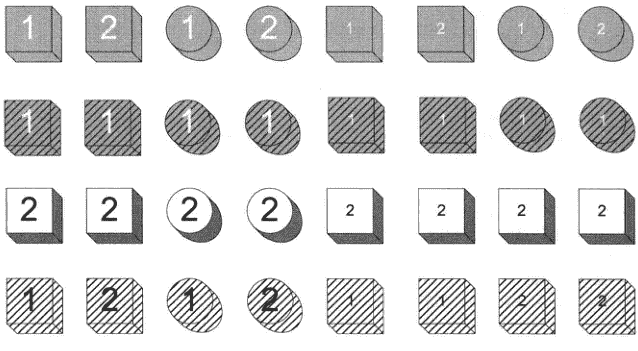

**图 5.2** 具有五个属性的对象。

| 变量 | 值 | 映射到该值的结果 |
| :--- | :--- | :--- |
| V | v1 | 所有包含数字 1 的对象 |
| | v2 | 所有包含数字 2 的对象 |
| L | l1 | 所有覆盖有线条的对象 |
| | l2 | 所有未覆盖线条的对象 |
| C | c1 | 所有灰色对象 |
| | c2 | 所有白色对象 |
| S | s1 | 所有正方形对象 |
| | s2 | 所有圆形对象 |
| F | f1 | 所有包含大字体数字的对象 |
| | f2 | 所有包含小字体数字的对象 |

此处留作练习，证明对于 v、l、c、s 和 f 的所有取值都有

\(P(v, l|s, f, c) = P(v, l|c).\)

所以我们有

\(I_P(\{V, L\}, \{S, F\}|C).\)

## 5.3 概率的含义

当一个人没有机会深入学习概率理论时，往往会留下这样的印象：所有概率都是使用比率计算的。接下来，我们更深入地讨论概率的含义，并表明概率通常并非这样确定的。

### 5.3.1 概率的相对频率方法

概率的一个经典教科书示例涉及投掷硬币。因为硬币是对称的，我们使用概率无差别原则来分配

\(P(\text{Heads}) = P(\text{Tails}) = .5.\)

假设我们改为投掷一枚图钉。它也有两种落地方式。也就是说，它可以落在其平端上，我们称之为正面，或者它可以以平端的边缘和针尖接触地面的方式落下，我们称之为反面。因为图钉不是对称的，我们没有理由应用概率无差别原则并给两种结果都分配 .5 的概率。那么我们应该如何分配概率呢？在硬币的例子中，当我们分配 P(heads) = .5 时，我们隐含地假设，如果我们投掷硬币大量次数，它大约有一半的时间会落在正面。也就是说，如果我们投掷硬币 1000 次，我们期望它大约有 500 次落在正面。这种反复进行实验的概念为我们提供了一种计算（或至少估计）概率的方法。也就是说，如果我们重复一个实验多次，我们相当确定一个结果的概率大约等于该结果出现的次数所占的比例。例如，一名学生投掷图钉 10,000 次，它落在正面 3761 次。所以

```
P(\text{heads}) \approx \frac{3761}{10,000} = .3761.
```

确实，在 1919 年，Richard von Mises 使用这个比例的极限作为概率的定义。也就是说，如果 $n$ 是投掷次数，$S_n$ 是图钉落在正面的次数，那么

```
P(\text{heads}) \equiv \lim_{n \to \infty} \frac{S_n}{n}.
```

这个定义假设确实趋近于一个极限。也就是说，它假设比率不会波动。例如，没有理由假设比率在 100 次投掷后不是 .5，在 1000 次投掷后是 .1，在 10,000 次投掷后是 .5，在 100,000 次投掷后是 .1，等等。只有现实世界中的实验才能证实极限被趋近。在 1946 年，J. E. Kerrich 使用许多此类实验，使用似乎适用概率无差别原则的机会游戏（例如，从一副牌中抽一张牌）。他的结果表明，相对频率确实似乎趋近于一个极限，并且这个极限是使用概率无差别原则得到的值。

这种概率方法称为**概率的相对频率方法**，使用这种方法获得的概率称为**相对频率**。**频率派**是指认为这是我们获得概率的唯一方式的人。请注意，根据这种方法，我们永远不能确定地知道一个概率。例如，如果我们投掷硬币 10,000 次，它落在正面 4991 次，我们将估计

```
P(\text{heads}) \approx \frac{4991}{10,000} = .4991.
```

另一方面，如果我们使用概率无差别原则，我们将分配 $P(\text{Heads}) = .5$。在硬币的例子中，概率可能实际上不是 .5，因为硬币可能不是完全对称的。例如，Kerrich [1946] 发现，在投掷骰子时，六点出现的次数最多，而一点出现的次数最少。这很合理，因为在那个时候，骰子上的点是从骰子中挖空的，因此骰子在六点的一侧最轻。另一方面，在涉及牌或抽签器的实验中，似乎我们可以确定使用概率无差别原则获得的概率。

**示例 5.26** 假设我们投掷一个不对称的六面骰子，并在 1000 次投掷中观察到每个面出现的次数如下。

| 面 | 次数 |
|---|---|
| 1 | 250 |
| 2 | 150 |
| 3 | 200 |
| 4 | 70 |
| 5 | 280 |
| 6 | 50 |

所以我们估计 P(1) ≈ .25，P(2) ≈ .15，P(3) ≈ .2，P(4) ≈ .07，P(5) ≈ .28，P(6) ≈ .05。

反复进行实验（以估计相对频率）称为**抽样**，结果的集合称为**随机样本**（或简称样本）。我们从中抽样的集合称为**总体**。

**示例 5.27** 假设我们的总体是美国 31 至 85 岁之间的所有男性，我们有兴趣了解这类男性患高血压的概率。那么，如果我们抽样 10,000 名男性，这组男性就是我们的样本。此外，如果其中 3210 人患有高血压，我们估计

P(High Blood Pressure) ≈ 3210 / 10,000 = .321.

从技术上讲，我们不应该称这个年龄段的所有当前男性为总体。相反，理论认为，这个组别中的男性患高血压存在一种倾向性，而这种倾向性就是概率。这种倾向性可能不等于该组中当前患有高血压的男性所占的比例。从理论上讲，我们需要拥有无限数量的男性才能精确确定概率。这个年龄段的当前男性集合称为**有限总体**。其中患有高血压的比例是当我们从该年龄段所有男性的集合中抽样一名男性时，获得患有高血压男性的概率。后者概率简单地是患有高血压男性的比例。

在进行统计推断时，我们有时希望从总体的样本中估计有限总体中的比例，而有时我们希望从有限的观测序列中估计一种倾向性。例如，电视收视率调查人员通常希望从这些人的样本中估计全国观看某一节目的实际人数比例。另一方面，医学科学家希望从有限的男性序列中估计男性患高血压的倾向性。可以通过在抽样下一项之前将抽样的项目放回总体，从有限总体中创建一个无限序列。这称为**有放回抽样**。在实践中，这很少进行，但通常有限总体非常大，以至于统计学家做出简化假设，认为它是有放回抽样。也就是说，他们不替换该项目，但仍然假设下一项抽样时的比例保持不变。

在抽样中，观察到的相对频率被称为概率（相对频率的极限）的**最大似然估计（MLE）**，因为当我们假设试验（实验的重复）在概率上独立时，它是使观察到的序列最可能的概率估计。

von Mises 相对频率方法的另一个方面是，一个随机过程正在生成结果序列。根据 von Mises 的理论，**随机过程**被定义为一个可重复的实验，其


无限结果序列被假定为随机序列。直观上，**随机序列**是指不显示任何规律或模式的序列。例如，有限二进制序列 1011101100 看起来是随机的，而序列 1010101010 则不是，因为它包含重复五次的模式 10。有证据表明，抛硬币和掷骰子等实验确实是随机过程。1971 年，Iversen 等人进行了许多掷骰子实验，表明结果序列是随机的。人们相信，无偏采样也会产生随机序列，因此也是随机过程。有关随机序列的正式处理，请参见 [van Lambalgen, 1987]。

### 5.3.2 概率的主观方法

如果我们掷图钉 10,000 次，其中 6000 次正面朝上，我们会估计 P(heads) 为 0.6。这个数字近似于什么？图钉正面朝上是否存在精确到任意位数的概率？似乎不存在。确实，当我们掷图钉时，其形状会慢慢改变，从而改变任何正面朝上的倾向。另一个例子，某年龄段男性患高血压是否真的存在精确的倾向？同样，似乎不存在。因此，除了涉及纸牌和抽签的机会游戏之外，概率的相对频率概念似乎只是一种理想化。尽管如此，我们仍可从这种记号中获得关于信念的有用洞察。例如，在图钉 10,000 次投掷中正面朝上 6000 次之后，我们相信它在下一次投掷中正面朝上的概率约为 0.6，并据此下注。也就是说，如果图钉正面朝上，我们会认为赢得 $0.40 是公平的；如果图钉反面朝上，我们会认为输掉 $1 - $0.40 = $0.60 是公平的。因为赌注被认为是公平的，相反的立场，即如果图钉正面朝上则输掉 $0.40，如果反面朝上则赢得 $0.60，也会被认为是公平的。因此，我们会接受赌注的任意一方。这种将概率视为决定公平赌注的值的概念称为 **概率的主观方法**，在该框架内分配的概率称为 **主观概率** 或 **信念**。 **主观主义者** 是指认为我们可以在该框架内分配概率的人。更具体地说，在这种方法中，不确定事件的 **主观概率** 是我们同意如果事件不发生则公平地给出（输掉）的货币单位的分数 p，以换取如果事件发生则承诺接收（赢得）1 - p 单位的承诺。

**示例 5.28** 假设我们估计 P(heads) = 0.6。这意味着，如果正面不出现，我们同意给出 $0.60 是公平的，以换取如果正面出现则承诺接收 $0.40。请注意，如果我们重复实验 100 次，且正面出现了 60% 的时间（如我们所期望），我们将赢得 60($0.40) = $24 并输掉 40($0.60) = $24。也就是说，我们将收支平衡。

与概率的相对频率方法不同，概率的主观方法允许我们计算不可重复事件的概率。一个经典例子涉及赛马投注。为了决定如何下注，我们必须首先确定我们认为每匹马获胜的可能性有多大。某场特定比赛从未举办过，也永远不会再举办，因此我们无法查看该比赛的先前发生情况来获得我们的信念。相反，我们通过对马匹的整体先前表现、赛道条件、骑师等进行仔细分析来获得这一信念。显然，并非所有人都会根据他们的分析得出相同的概率。这就是为什么这些概率被称为 *主观*。它们特定于个人。一般来说，它们在自然界中没有我们都必须同意的客观值。当然，如果我们确实进行了诸如掷图钉 10,000 次且它正面朝上 6,000 次的实验，大多数人会同意正面朝上的概率约为 0.6。确实，de Finetti [1937] 表明，如果我们对你的信念做出某些合理的假设，这必然是你的概率。

在进一步探讨此事之前，我们讨论一个与概率相关的概念，即赔率。从数学上讲，如果 P(E) 是事件 E 的概率，则赔率 O(E) 定义为

\(O(E) = \frac{P(E)}{1 - P(E)}\)

就投注而言，O(E) 是如果 E 未发生我们会认为公平地输掉的金额，以换取如果 E 发生则获得 $1。

**示例 5.29** 设 E 为马匹 Oldnag 获得肯塔基德比冠军的事件。如果我们觉得 P(E) = 0.2，则

\(O(E) = \frac{P(E)}{1 - P(E)} = \frac{.2}{1 - .2} = 0.25\)。

这意味着，如果马匹没有获胜，我们会认为输掉 $0.25 是公平的，以换取如果它获胜则获得 $1。

如果我们用概率来表述公平赌注（如前所述），我们会认为如果马匹没有获胜则输掉 $0.20 是公平的，以换取如果它获胜则获得 $0.80。请注意，两种方法中，赢得金额与输掉金额的比率都是 4，因此它们在确定投注行为的方式上是一致的。

在赛马场上，显示的投注赔率是事件的反向赔率。也就是说，它们是事件不发生的赔率。如果 P(E) = 0.2 且 \(\neg E\) 表示 E 不发生，则

\(O(\neg E) = \frac{P(\neg E)}{1 - P(\neg E)} = \frac{.8}{1 - .8} = 4\)，

赛马场上显示的赔率是 4 比 1 反对 E。如果你押注 E，如果 E 不发生你将输掉 $1，如果 E 发生你将赢得 $4。请注意，这些是基于所有参与者投注行为的赛道赔率。如果你相信 P(E) = 0.5，对你来说反对 E 的赔率是 1 比 1（平注），你应该抓住以 4 比 1 获胜的机会。

有些人不愿被迫考虑赌注来评估主观概率。还有其他方法来确定这些概率。最流行的方法之一是 Lindley 于 1985 年提出的以下方法。该方法认为，个人应通过考虑一个装有白球和黑球的球箱，将不确定结果类比为机会游戏。个人应确定，在白球占比为多少时，个人会在不确定事件 E 发生（或被证明为真）时获得小奖，与从球箱中抽出白球时获得相同小奖之间感到无所谓。该比例即为个人对该结果的概率。这种概率可以使用二分法构建。例如，如果当比例为 0.8 时你感到无所谓，那么对你来说 P(E) = 0.8。如果其他人在比例为 0.6 时感到无所谓，那么对那个人来说 P(E) = 0.6。同样，两个人都没有对错之分。

假设主观概率仅在赌博情境中重要将是一个错误。实际上，它们在本书讨论的所有应用中都很重要。在下一节中，我们将说明主观概率的有趣用途。

有关此处介绍的两种概率方法的更多信息，请参见 [Neapolitan, 1989]。

## 5.4 应用中的随机变量

虽然先指定样本空间然后在该空间上定义随机变量在数学上很优雅，但在实践中，这并非我们通常所做的。在实践中，某个单一实体或一组实体具有特征，我们希望确定其状态，但无法确定。因此，我们满足于确定某个特定特征处于某个特定状态的可能性有多大。单一实体的一个例子是我们考虑引入一种可能致癌但经济有益的化学品的管辖区域。我们希望确定该化学品的相对风险与其效益。一组实体的一个例子是患有相似疾病和症状的一组患者。在这种情况下，我们希望根据症状诊断疾病。如第 5.3.1 节所述，这组实体称为总体，从技术上讲，它通常不是当前存在的所有实体的集合，而是在理论上是一个无限实体集合。

在这些应用中，随机变量表示被建模实体的某个特征，我们不确定该特征的值。对于单一实体，我们不确定该实体特征的值；而对于一组实体，我们不确定该组中某些成员特征的值。为了帮助解决这种不确定性，我们在变量之间建立概率关系。当存在一组实体时，我们假设该组中的所有实体都具有关于模型中使用的变量的相同概率关系。当情况并非如此时，我们的分析不适用。在涉及引入化学品的场景中，特征可能包括人体暴露量和致癌潜力。如果这些是我们感兴趣的特征，我们识别 ran-


随机变量 HumanExposure 和 CarcinogenicPotential。（为简单起见，我们的示例仅包含少数几个变量。实际应用通常包含比这多得多的变量。）对于一组患者，感兴趣的特征可能包括是否存在诸如肺癌之类的疾病，是否存在诸如胸部 X 光之类的疾病表现，以及是否存在诸如吸烟之类的疾病病因。鉴于这些特征，我们将分别识别随机变量 ChestXray、LungCancer 和 SmokingHistory。

在识别随机变量后，我们为每个变量区分一组互斥且穷尽的值。随机变量的可能值是特征可以采取的不同状态。例如，LungCancer 的状态可能是存在或不存在，ChestXray 的状态可能是阳性或阴性，SmokingHistory 的状态可能是是或否，其中“是”可能意味着患者在过去 10 年里每天吸一包或更多香烟。

在区分随机变量的可能值（即它们的取值空间）后，我们判断随机变量取这些值的概率。但是，一般来说，我们不会直接确定随机变量联合概率分布中的值。相反，我们确定关于我们可获取的随机变量之间关系的概率。然后，我们可以使用贝叶斯定理对这些变量进行推理，以获得感兴趣事件的概率。下一个示例说明了这一想法。

### 示例 5.30

假设 Sam 计划结婚，为了在他居住的州获得结婚许可证，必须进行酶联免疫吸附试验（ELISA）血液检测，该检测用于检测人类免疫缺陷病毒（HIV）的存在。Sam 进行了检测，结果对 HIV 呈阳性。Sam 感染 HIV 的可能性有多大？如果不知道检测的准确性，Sam 真的无法知道自己感染 HIV 的可能性有多大。

我们通常对此类检测的数据是真阳性率（灵敏度）和真阴性率（特异度）。真阳性率是既感染且检测呈阳性的人数除以感染的总人数。例如，为了获得 ELISA 的这个数字，识别出了 10,000 名已知感染 HIV 的人。这是使用 Western Blot 完成的，Western Blot 是 HIV 的金标准检测。然后对这些人进行了 ELISA 检测，其中 9990 人呈阳性。因此，真阳性率为 .999。真阴性率是既未感染且检测呈阴性的人数除以未感染的总人数。为了获得 ELISA 的这个数字，对 10,000 名否认有 HIV 感染风险因素的修女进行了检测。其中，9980 人使用 ELISA 检测呈阴性。此外，那 20 名检测呈阳性的修女使用 Western Blot 检测呈阴性。因此，真阴性率为 .998，这意味着假阳性率为 .002。因此，我们制定了以下随机变量和主观概率：

```
P(ELISA = positive|HIV = present) = .999 (5.8)
```

P(ELISA = positive|HIV = absent) = .002. (5.9)

你可能会好奇，为什么我们从数据中获得这些概率时却称它们为主观概率。请回想，频率学派方法认为，我们永远无法知道实际的相对频率（客观概率）；我们只能从数据中估计它们。然而，在主观方法中，我们可以使我们的信念（主观概率）等于从数据中获得的分数。

乍一看，由于检测非常准确，Sam 几乎可以肯定感染了 HIV。但是，请注意，等式 5.8 中的概率和等式 5.9 中的概率都不是 Sam 感染 HIV 的概率。因为我们知道 Sam 的 ELISA 检测呈阳性，该概率是

P(HIV = present|ELISA = positive).

如果我们知道 P(HIV = present)，就可以使用贝叶斯定理计算这个概率。请回想，Sam 进行血液检测仅仅是因为州政府要求。他进行检测并不是因为他出于任何理由认为自己感染了 HIV。因此，我们关于 Sam 的唯一其他信息是，他是他所在州的一名男性。因此，如果 Sam 州中每 100,000 名男性中有 1 人感染 HIV，我们分配以下主观概率：

P(HIV = present) = .00001.

我们现在使用贝叶斯定理计算

P(present|positive)
= 
\frac{P(positive|present)P(present)}{P(positive|present)P(present) + P(positive|absent)P(absent)}
= 
\frac{(.999)(.00001)}{(.999)(.00001) + (.002)(.99999)}
= .00497.

令人惊讶的是，我们相当有信心 Sam 没有感染 HIV。

诸如 P(HIV = present) 之类的概率称为先验概率，因为在特定模型中，它是在该模型框架内使用新信息更新该事件概率之前，某个事件的概率。不要错误地认为它意味着任何信息之前的概率。诸如 P(HIV = present|ELISA = positive) 之类的概率称为后验概率，因为它是在某个模型框架内，基于新信息更新其先验概率后，某个事件的概率。在前一个示例中，尽管检测相当准确，后验概率之所以很小，是因为先验概率极低。下一个示例显示不同的先验概率如何极大地改变结果。

### 示例 5.31

假设 Mary 和她的丈夫一直在尝试生育，她怀疑自己怀孕了。她进行了一次妊娠测试，其真阳性率为 .99，假阳性率为 .02。假设此外，参加此妊娠测试的所有女性中有 20% 确实怀孕了。使用贝叶斯定理，我们有

```
P(present|positive)
=
\frac{P(positive|present)P(present)}{P(positive|present)P(present) + P(positive|absent)P(absent)}
=
\frac{(.99)(.2)}{(.99)(.2) + (.02)(.8)}
=
.92523.
```

尽管 Mary 的检测不如 Sam 的检测准确，她可能怀孕了，而他可能没有感染 HIV。这是由于先验信息。Mary 怀孕有一个显著的先验概率（.2），因为只有基于其他理由怀疑自己怀孕的女性才会进行妊娠测试。然而，Sam 进行检测是因为他想结婚。我们没有任何先验信息表明他可能感染了 HIV。

在前面的示例中，我们直接从数据中观察到的分数获得了我们的信念（主观概率）。虽然经常这样做，但并非必要。一般来说，我们从关于过去的信息中获得我们的信念，这意味着这些信念是我们所有经验的综合，而不仅仅是观察到的相对频率。以下是一个示例：

### 示例 5.32

假设你认为今天纳斯达克指数上涨至少 1% 的概率为 .4。这基于你的知识：昨天交易收盘后，科技领域几家大公司报告了优异的业绩，且美国原油供应出人意料地增加了。此外，如果今天纳斯达克指数确实上涨至少 1%，你认为你最喜欢的股票 NTPA 今天上涨至少 10% 的概率为 .1。如果今天纳斯达克指数没有上涨至少 1%，你认为 NTPA 今天上涨至少 10% 的概率只有 .02。你持有这些信念，因为你从过去知道 NTPA 的表现与科技领域的整体表现相关联。交易收盘后你查看了 NTPA，并注意到它上涨了超过 10%。纳斯达克指数上涨至少 1% 的概率是多少？使用贝叶斯定理，我们有

```
P(NASDAQ = up 1%|NTPA = up 10%)
=
\frac{P(up 10%|up 1%)P(up 1%)}{P(up 10%|up 1%)P(up 1%) + P(up 10%|not up 1%)P(not up 1%)}
=
\frac{(.1)(.4)}{(.1)(.4) + (.02)(.6)} = .769.
```


| | 1 | 2 | 3 | 4 |
|---|---|---|---|---|
| 4 | | | | |
| 3 | 坑？ | | | |
| 2 | 微风 安全 已访问 智能体 | 坑？ | | |
| 1 | 安全 已访问 起点 | 微风 安全 已访问 | 坑？ | |

图 5.3 智能体访问方格 [2,1] 和 [1,2] 并在两者中都发现微风后，对洞穴世界的当前认知。

在前三个示例中，我们使用贝叶斯定理从已知的主观概率计算后验主观概率。从严格意义上讲，我们只能在主观框架内这样做。也就是说，因为严格频率论者说我们永远不能确定地知道概率，所以他们不能使用贝叶斯定理。他们只能进行诸如基于数据计算未知概率值的置信区间等分析。这些技术在任何经典统计教材中都有讨论，例如 [Hogg and Craig, 1972]。因为主观论者才是使用贝叶斯定理的人，他们常被称为贝叶斯派。

## 5.5 洞穴世界中的概率

第 2.3.2 节中描述的洞穴世界涉及不确定性，因为我们不知道洞穴怪、金子或任何坑的位置。然而，我们没有以数值形式量化这种不确定性，因此无法在世界中使用概率理论进行推理。假设现在我们能够量化其中的一些不确定性。具体来说，假设我们为每个方格中存在坑分配概率 0.1。这个概率可以从对游戏生成方式的了解中获得（即，我们可以被告知每个方格以概率 0.1 被分配一个坑），也可以基于你从玩游戏的经验中获得的主观判断。无论如何，我们都可以使用概率理论来指导我们的决策。我们将在下面展示如何做到这一点。

假设智能体已移动到方格 [1,2] 和 [2,1]，并在两者中都发现微风，因此目前拥有图 5.3 所示的知识。

智能体可以通过访问方格 [1,3] 或 [2,2] 来放弃或冒险。一个纯粹的逻辑智能体会在两者之间随机选择，因为两者看起来都不比另一个更危险。让我们看看概率智能体是否可以量化这种风险以帮助在两者之间做出决定。

设 \( P_{11} \) 为一个随机变量，如果方格 [1,1] 中有坑，其值为 \( p_{13} \)，否则其值为 \( \neg p_{13} \)。微风和其他方格的随机变量定义类似。此外，设 \( Brz \) 表示关于微风的已知事实，\( Pit \) 表示关于坑的已知事实。即，

```
Brz = {\neg b_{11}, b_{12}, b_{21}}
```

```
Pit = {\neg p_{11}, \neg p_{12}, \neg p_{21}} .
```

智能体的总知识包括 \( Brz \) 和 \( Pit \)。智能体希望确定在该知识条件下 \( p_{13} \) 和 \( p_{22} \) 的概率。为此，根据贝叶斯定理

```
P(p_{13}|Brz, Pit) = \frac{P(Brz|p_{13}, Pit)P(p_{13}, Pit)}{P(Brz|p_{13}, Pit)P(p_{13}, Pit) + P(Brz|\neg p_{13}, Pit)P(\neg p_{13}, Pit)}
= \frac{P(Brz|p_{13}, Pit)P(p_{13})}{P(Brz|p_{13}, Pit)P(p_{13}) + P(Brz|\neg p_{13}, Pit)P(\neg p_{13})} .
```

我们需要计算 \( P(Brz|p_{13}, Pit) \) 和 \( P(Brz|\neg p_{13}, Pit) \)。根据全概率公式，我们有

```
P(Brz|p_{13}, Pit) = \sum_{P_{22}, P_{31}} P(Brz|p_{13}, Pit, P_{22}, P_{31})P(P_{22}, P_{31}|p_{13}, Pit)
= \sum_{P_{22}, P_{31}} P(Brz|p_{13}, Pit, P_{22}, P_{31})P(P_{22})P(P_{31})
= P(Brz|p_{13}, Pit, p_{22}, p_{31})P(p_{22})P(p_{31}) +
P(Brz|p_{13}, Pit, p_{22}, \neg p_{31})P(p_{22})P(\neg p_{31}) +
P(Brz|p_{13}, Pit, \neg p_{22}, p_{31})P(\neg p_{22})P(p_{31}) +
P(Brz|p_{13}, Pit, \neg p_{22}, \neg p_{31})P(\neg p_{22})P(\neg p_{31})
= (1)(.1)(.1) + (1)(.9)(.1) + (1)(.9)(.1) + (0)(.9)(.9)
= .19 .
```

请注意，\( Brz \) 的条件概率要么是 1 要么是 0，这取决于我们是条件设定为坑同时位于方格 [1,2] 和方格 [2,1] 旁边，还是条件设定为至少有一个方格旁边没有坑。以同样的方式，作为练习留给读者证明：

```
P(Brz|\neg p_{13}, Pit) = .1 .
```

将这些概率代入贝叶斯定理，我们现在有

\( P(p_{13}|Brz, Pit) = \frac{P(Brz|p_{13}, Pit)P(p_{13})}{P(Brz|p_{13}, Pit)P(p_{13}) + P(Brz|\neg p_{13}, Pit)P(\neg p_{13})} \)
\( = \frac{(.19)(.1)}{(.19)(.1) + (.1)(.9)} \)
\( = .174 \)。

作为练习留给读者证明 \( P(p_{22}|Brz, Pit) = .917 \)。因此，访问方格 [1,3] 风险小得多，这是智能体接下来应该做的。直观地讲，有两项证据表明方格 [2,2] 中有坑（方格 [1,2] 和方格 [2,1] 中都有微风），而只有一项证据表明方格 [1,3] 中有坑。

## 练习

### 第 5.1 节

**Exercise 5.1** 设实验为从一副 52 张的牌中抽取顶牌。设 Heart 为抽到红心的事件，RoyalCard 为抽到皇家牌的事件。

- 1. 计算 \( P(\text{Heart}) \)。
- 2. 计算 \( P(\text{RoyalCard}) \)。
- 3. 计算 \( P(\text{Heart} \cup \text{RoyalCard}) \)。

**Exercise 5.2** 证明定理 5.1。

**Exercise 5.3** 示例 5.5 表明，在从一副牌中抽取顶牌时，事件 Jack 与事件 Club 独立。也就是说，它表明 \( P(\text{Jack}| \text{Club}) = P(\text{Jack}) \)。

- 1. 直接证明事件 Club 与事件 Jack 独立。也就是说，证明 \( P(\text{Club}|\text{Jack}) = P(\text{Club}) \)。还要证明 \( P(\text{Jack} \cap \text{Club}) = P(\text{Jack})P(\text{Club}) \)。
- 2. 一般来说，证明如果 \( P(\text{E}) \neq 0 \) 且 \( P(\text{F}) \neq 0 \)，那么 \( P(\text{E}|\text{F}) = P(\text{E}) \) 当且仅当 \( P(\text{F}|\text{E}) = P(\text{F}) \)，并且每个条件成立当且仅当 \( P(\text{E} \cap \text{F}) = P(\text{E})P(\text{F}) \)。

**Exercise 5.4** 集合 E 的补集包含 \( \Omega \) 中所有不在 E 中的元素，并用 \( \bar{\text{E}} \) 表示。

- 1. 证明 E 与 F 独立当且仅当 \(\overline{E}\) 与 F 独立，而这当且仅当 \(\overline{E}\) 与 \(\overline{F}\) 独立。
- 2. 示例 5.6 表明，对于图 5.1 中的对象，A 与 Square 在给定 Black 时条件独立，在给定 White 时也条件独立。设 B 为包含 B 的所有对象的集合，Circle 为所有圆形对象的集合。利用刚才得到的结果，得出 A 与 Circle、B 与 Square、B 与 Circle 各自在给定 Black 或 White 时条件独立。

**Exercise 5.5** 证明在从一副牌中抽取顶牌时，事件 E = {kh, ks, qh} 和事件 F = {kh, kc, qh} 在事件 G = {kh, ks, kc, kd} 条件下条件独立。确定 E 和 F 是否在 \(\overline{G}\) 条件下条件独立。

**Exercise 5.6** 证明全概率公式，该公式指出如果我们有 n 个互斥且穷尽的事件 E1, E2, ..., En，那么对于任何其他事件 F，
\( P(F) = P(F \cap E_1) + P(F \cap E_2) + \cdots + P(F \cap E_n) \)。

**Exercise 5.7** 设 \(\Omega\) 为图 5.1 中所有对象的集合，并为每个对象分配概率 1/13。设 A 为包含 A 的所有对象的集合，Square 为所有正方形对象的集合。直接计算 P(A|Square) 并使用贝叶斯定理计算。

### 第 5.2 节

**Exercise 5.8** 考虑示例 5.20 中给出的概率空间和随机变量。

- 1. 确定 S 和 W 的联合分布、W 和 H 的联合分布，以及 S、H 和 W 联合分布中的其余值。
- 2. 证明 S 和 H 的联合分布可以通过对 W 的所有值求和 S、H 和 W 的联合分布来得到。

**Exercise 5.9** 设给定一个联合概率分布。使用全概率公式，证明一般来说，任何一个随机变量的概率分布是通过对其他变量的所有值求和得到的。

**Exercise 5.10** 链式法则指出，对于定义在同一样本空间 \(\Omega\) 上的 n 个随机变量 X1, X2, ..., Xn，
\( P(x_1, x_2, ..., x_n) = P(x_n|x_{n-1}, x_{n-2}, ...x_1) \cdots \times P(x_2|x_1) \times P(x_1) \)
只要 \( P(x_1, x_2, ..., x_n) \neq 0 \)。证明此规则。


**练习 5.11** 利用练习 5.4 (1) 的结果，得出结论：在示例 5.22 中，只需证明对于 $r$ 和 $t$ 的所有值，$P(r, t) = P(r, t|s_1)$ 即可。

**练习 5.12** 假设我们有两个随机变量 $X$ 和 $Y$，其样本空间分别为 $\{x_1, x_2\}$ 和 $\{y_1, y_2\}$。

- 利用练习 5.4 (1) 的结果，得出结论：只需证明 $P(y_1|x_1) = P(y_1)$，即可得出 $I_P(X, Y)$。
- 构造一个示例表明：如果 $X$ 和 $Y$ 的样本空间都包含超过两个值，那么我们需要检查 $x$ 和 $y$ 的所有值是否满足 $P(y|x) = P(y)$，才能得出 $I_P(X, Y)$。

**练习 5.13** 考虑示例 5.20 中给出的概率空间和随机变量。

- $H$ 和 $W$ 是否独立？
- 在已知 $G$ 的条件下，$H$ 和 $W$ 是否条件独立？
- 如果这个小样本能反映总体中变量之间的概率关系，那么哪些因果关系可能解释这种依赖性和条件独立性？

**练习 5.14** 在示例 5.25 中，作为练习留待证明：对于 $V$ 的所有值 $v$、$L$ 的所有值 $l$、$C$ 的所有值 $c$、$S$ 的所有值 $s$ 和 $F$ 的所有值 $f$，有

$$P(v, l|s, f, c) = P(v, l|c).$$

证明这一点。

## 第 5.3 节

**练习 5.15** Kerrich [1946] 进行了多次抛硬币等实验，他发现相对频率确实似乎趋近于一个极限。例如，他发现抛 100 次后，相对频率可能为 .51；抛 1000 次后可能为 .508；抛 10,000 次后可能为 .5003；抛 100,000 次后可能为 .50006。规律是：小数点后第一位的 5 保留在第一次 100 次抛掷后的所有相对频率中；小数点后第二位的 0 保留在第一次 1000 次抛掷后的所有相对频率中；以此类推。至少抛掷 1000 次图钉，看看是否能得到类似结果。

**练习 5.16** 选取一个即将发生的事件。它可以是一场体育赛事，也可以是你在这门课程中获得 A 级成绩的事件。使用 Lindley [1985] 的方法确定该事件的概率，即将不确定事件与从球箱中抽取一个球进行比较。（参见示例 5.29 之后的讨论。）

## 第 5.4 节

练习 5.17 一位健忘的护士本应每天给阮先生发一颗药丸。护士在某一天忘记发药的概率为 .3。如果阮先生收到药丸，他死亡的概率为 .1；如果他没有收到药丸，他死亡的概率为 .8。阮先生今天死亡了。使用贝叶斯定理计算护士忘记给他发药的概率。

练习 5.18 可能会在得克萨斯州尼阿波利坦教授的农场钻一口油井。根据类似农场的情况，我们判断存在石油的概率为 .5，仅存在天然气的概率为 .2，两者都不存在的概率为 .3。如果存在石油，地质测试有 .9 的概率给出阳性结果；如果仅存在天然气，则有 .3 的概率给出阳性结果；如果两者都不存在，测试呈阳性的概率为 .1。假设测试结果为阳性。使用贝叶斯定理计算存在石油的概率。

## 第 5.5 节

练习 5.19 在第 5.5 节末尾留作练习，要求证明 P(Brz|¬p13, Pit) = .1。请完成此项。

练习 5.20 在第 5.5 节末尾留作练习，要求证明 P(p22|Brz, Pit) = .917。请完成此项。

练习 5.21 在第 5.5 节中，我们假设每个方格被分配一个地雷的概率为 .1，并发现地雷位于方格 [1,3] 的概率小于地雷位于方格 [2,2] 的概率。调查无论该概率取何值，地雷位于方格 [1,3] 的概率是否更小。如果是，我们是否真的需要对该概率做出主观判断来指导我们的决策？

# 第 6 章

# 不确定知识表示

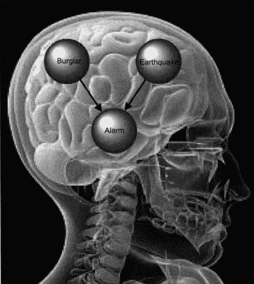

在第 5 章的导言中，我们讨论了以下情况。假设在过去几年中，霍尔姆斯先生注意到地震经常导致他的防盗警报器响起。防盗警报器关乎他的住宅，但它接线到他的办公室响起，办公室距离住宅有一段距离。此刻他正坐在办公室里，防盗警报器响了。他随后赶回家，认为自己家大概被盗了。回家途中，他在收音机里听说发生了地震。他随后推断，地震很可能触发了警报，因此自己被盗的可能性要小得多。我们现在给故事添加更多内容。假设接下来，他的邻居沃森博士打电话说，他看到一个可疑人物在霍尔姆斯先生家附近徘徊。霍尔姆斯先生会将此视为自己确实被盗的额外证据，并觉得自己被盗的可能性现在更大了。

Pearl [1986] 推测，不确定知识是通过命题之间的因果边来结构化的，我们可以用因果网络表示这种知识，并通过遍历该网络中的链接来建模不确定推理。该模型并不意味着整个网络在任何特定时间都存在于认知层面。相反，它指出人类在命题对之间发展出个体因果链接，并根据需要回忆和使用这些链接进行推理。例如，在当前情况下，我们有以下命题：

- A: 霍尔姆斯先生的防盗警报器响起。
- B: 霍尔姆斯先生的住宅被盗。
- E: 发生了地震。
- L: 有人在房子周围徘徊。
- C: 邻居打电话报告有徘徊者。

因果网络模型指出，霍尔姆斯先生对防盗警报情境有以下认知表示：窃贼（B）通常会导致他的警报（A）响起；地震（E）经常会导致他的警报响起；窃贼可能在房子周围徘徊（L）并被邻居看到，从而导致邻居打电话（C）报告徘徊者。我们称这些因果关系为“因果边”。这种知识的因果网络表示如图 6.1 所示。当霍尔姆斯先生得知警报已响起时，他沿着 B 和 A 之间的边向 A 的方向推理，得出自己可能被盗的结论。当他后来得知发生了地震时，他沿着 E 和 A 之间的边向 A 的方向推理，得出地震“解释掉”了警报的结论，然后他沿着 B 和 A 之间的边向 B 的方向推理，得出自己被盗的可能性要小得多的结论。当他的邻居打电话（C）报告有徘徊者时，他沿着 L 和 C 之间的边向 L 的方向推理，得出很可能有徘徊者的结论，然后他沿着 L 和 B 之间的边向 B 的方向推理，推断自己现在更可能被盗了。

霍尔姆斯先生使用这些相同的因果链进行反向推理。例如，如果霍尔姆斯先生（在办公室里）得知自己被盗了，他沿着 B 和 A 之间的边向 A 的方向推理，得出他的警报很可能响起的结论。

如在第 5 章中所述，无论该模型在多大程度上代表人类推理，它都有助于产生被称为贝叶斯网络的领域。本章介绍贝叶斯网络。在第 6.1 节和 6.2 节中，我们定义贝叶斯网络并讨论其属性。第 6.3 节展示因果图如何常常产生贝叶斯网络。在第 6.4 节中，我们讨论使用贝叶斯网络进行概率推断。第 6.5 节介绍包含连续变量的贝叶斯网络。第 6.6 节展示确定贝叶斯网络所需概率分布的一种技术。最后，第 6.7 节展示贝叶斯网络的一个大规模应用。

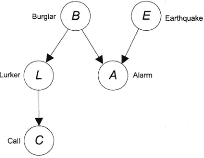

### 图 6.1 表示霍尔姆斯先生知识的因果网络。

## 6.1 贝叶斯网络直观介绍

回顾在示例 5.30 中，我们计算了乔在检测呈阳性的情况下感染 HIV 病毒的概率。具体来说，我们知道

```
P(ELISA = positive|HIV = present) = .999

P(ELISA = positive|HIV = absent) = .002

P(HIV = present) = .00001.
```

然后我们使用贝叶斯定理计算

```
P(present|positive)
= 
\frac{P(positive|present)P(present)}{P(positive|present)P(present) + P(positive|absent)P(absent)}
= 
\frac{(.999)(.00001)}{(.999)(.00001) + (.002)(.99999)}
= .00497.
```


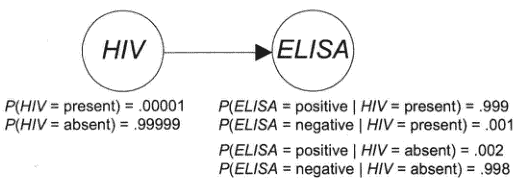

图 6.2 一个两节点贝叶斯网络。

我们在图 6.2 中总结了此计算中使用的信息，这是一个两节点/变量贝叶斯网络。请注意，它在有向无环图（DAG）的节点中表示随机变量 HIV 和 ELISA，并用从 HIV 到 ELISA 的边表示这些变量之间的因果关系。也就是说，HIV 的存在对测试结果是否为阳性具有因果影响；因此存在从 HIV 到 ELISA 的边。除了显示表示因果关系的 DAG 之外，图 6.2 还显示了 HIV 的先验概率分布以及给定其父节点 HIV 的每个值时 ELISA 的条件概率分布。一般来说，贝叶斯网络由一个 DAG 组成，其边表示随机变量之间的关系（通常但不总是因果关系）；DAG 中每个根节点变量的先验概率分布；以及给定每个非根节点变量的每组父节点值时的条件概率分布。在讨论贝叶斯网络时，我们将节点和变量这两个术语混用。

让我们通过考虑信用卡欺诈检测问题（取自 [Heckerman, 1996]）来说明一个更复杂的贝叶斯网络。假设我们已识别出以下与该问题相关的变量：

| 变量 | 变量表示的内容 |
| :--- | :--- |
| Fraud (F) | 当前购买是否为欺诈 |
| Gas (G) | 过去 24 小时内是否购买了汽油 |
| Jewelry (J) | 过去 24 小时内是否购买了珠宝 |
| Age (A) | 持卡人年龄 |
| Sex (S) | 持卡人性别 |

这些变量都具有因果关系。也就是说，信用卡窃贼可能会购买汽油和珠宝，中年女性最有可能购买珠宝，而年轻男性最不可能购买珠宝。图 6.3 显示了表示这些因果关系的 DAG。请注意，它还显示了给定每个非根节点变量的每组父节点值时的条件概率分布。珠宝变量有三个父节点，并且对这些父节点的每个值组合都有一个条件概率分布。DAG 和条件分布共同构成一个贝叶斯网络。

你可能对这个贝叶斯网络有几个问题。首先，你可能会问：“它有什么价值？”也就是说，我们可以从中获得哪些有用信息？回顾我们如何使用贝叶斯定理来计算 P(HIV =

P(F = yes) = .00001
P(F = no) = .99999

P(G = yes | F = yes) = .2
P(G = no | F = yes) = .8
P(G = yes | F = no) = .01
P(G = no | F = no) = .99

P(A = < 30) = .25
P(A = 30 to 50) = .40
P(A > 50) = .35

P(S = male) = .5
P(S = female) = .5

P(J = yes | F = yes, A = a, S = s) = .05
P(J = no | F = yes, A = a, S = s) = .95
P(J = yes | F = no, A = < 30, S = male) = .0001
P(J = no | F = no, A = < 30, S = male) = .9999
P(J = yes | F = no, A = < 30, S = female) = .0005
P(J = no | F = no, A = < 30, S = female) = .9995
P(J = yes | F = no, A = 30 to 50, S = male) = .0004
P(J = no | F = no, A = 30 to 50, S = male) = .9996
P(J = yes | F = no, A = 30 to 50, S = female) = .002
P(J = no | F = no, A = 30 to 50, S = female) = .998
P(J = yes | F = no, A = > 50, S = male) = .0002
P(J = no | F = no, A = > 50, S = male) = .9998
P(J = yes | F = no, A = > 50, S = female) = .001
P(J = no | F = no, A = > 50, S = female) = .999

图 6.3 用于检测信用卡欺诈的贝叶斯网络。

positive|ELISA = positive) 来自图 6.2 中贝叶斯网络的信息。同样，我们可以计算给定此贝叶斯网络中其他变量值时的信用卡欺诈概率。例如，我们可以计算 P(F = yes|G = yes, J = yes, A = < 30, S = female)。如果此概率足够高，我们可以拒绝当前购买或要求额外身份识别。该计算不是像图 6.2 中两节点贝叶斯网络那样简单地应用贝叶斯定理。相反，它是使用复杂的推理算法完成的。

其次，你可能会问我们如何获得网络中的概率。它们可以来自该领域专家的主观判断，也可以从数据中学习。（在第 12 章中，我们将讨论从数据中学习它们的技术。）

最后，你可能会问，为什么我们要在网络中包含年龄和性别变量，而持卡人的年龄和性别与卡片是否被盗（欺诈）无关。也就是说，欺诈对持卡人的年龄或性别没有因果影响，反之亦然。我们包含这些变量的原因是，欺诈、年龄和性别都有一个共同影响，即

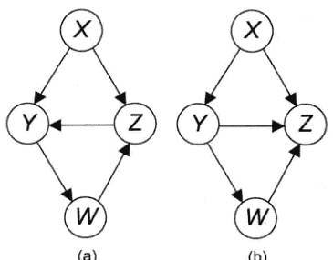

图 6.4 两个图都是有向图；只有 (b) 中的图是有向无环图。

珠宝的购买。因此，当我们知道已购买珠宝时，由于 _贴现_，这三个变量在概率上变得依赖。这就像小偷、警报和地震的情况一样。例如，如果过去 24 小时内购买了珠宝，则会增加欺诈的可能性。但是，如果持卡人是中年女性，则欺诈的可能性会降低（被贴现），因为这类女性倾向于购买珠宝。也就是说，持卡人是中年女性这一事实解释了珠宝购买。另一方面，如果持卡人是年轻男性，则欺诈的可能性会增加，因为这类男性不太可能购买珠宝。

我们已非正式地介绍了贝叶斯网络、其属性及其有用性。接下来，我们将正式发展其数学属性。

## 6.2 贝叶斯网络的属性

定义贝叶斯网络后，我们展示了它们通常的表示方式。

### 6.2.1 贝叶斯网络的定义

首先，让我们回顾一些图论知识。一个 **有向图** 是一对 (V, E)，其中 V 是一个有限非空集合，其元素称为 **节点**（或顶点），E 是 V 中不同元素的有序对集合。E 的元素称为 **有向边**，如果 (X, Y) ∈ E，我们说存在从 X 到 Y 的边。图 6.4 (a) 中的图是一个有向图。该图中的节点集合是

```
V = {X, Y, Z, W},
```

和边集合是

```
E = {(X, Y), (X, Z), (Y, W), (W, Z), (Z, Y)}.
```

有向图中的一条 **路径** 是节点序列 \([X_1, X_2, \dots, X_k]\)，使得对于 \(2 \le i \le k\) 有 \((X_{i-1}, X_i) \in \mathbf{E}\)。例如，\([X, Y, W, Z]\) 是图 6.4 (a) 中有向图的一条路径。有向图中的一条 **链** 是节点序列 \([X_1, X_2, \dots, X_k]\)，使得对于 \(2 \le i \le k\) 有 \((X_{i-1}, X_i) \in \mathbf{E}\) 或 \((X_i, X_{i-1}) \in \mathbf{E}\)。例如，\([Y, W, Z, X]\) 是图 6.4 (b) 中有向图的一条链，但不是一条路径。有向图中的一个 **环** 是从一个节点到其自身的路径。在图 6.4 (a) 中，\([Y, W, Z, Y]\) 是从 \(Y\) 到 \(Y\) 的一个环。然而，在图 6.4 (b) 中，\([Y, W, Z, Y]\) 不是一个环，因为它不是一条路径。如果有向图 \(\mathbb{G}\) 不包含任何环，则称为 **有向无环图**（DAG）。图 6.4 (b) 中的有向图是一个 DAG，而图 6.4 (a) 中的则不是。

给定 DAG \(\mathbb{G} = (\mathbf{V}, \mathbf{E})\) 和 \(\mathbf{V}\) 中的节点 \(X\) 和 \(Y\)，如果存在从 \(Y\) 到 \(X\) 的边，则 \(Y\) 称为 \(X\) 的 **父节点**；如果存在从 \(Y\) 到 \(X\) 的路径，则 \(Y\) 称为 \(X\) 的 **后代节点**，\(X\) 称为 \(Y\) 的 **祖先节点**；如果 \(Y\) 不是 \(X\) 的后代节点且 \(Y\) 不等于 \(X\)，则 \(Y\) 称为 \(X\) 的 **非后代节点**。

我们现在可以给出以下定义。

**定义 6.1** 假设我们有一个集合 \(\mathbf{V}\) 中随机变量的联合概率分布 \(P\) 和一个 DAG \(\mathbb{G} = (\mathbf{V}, \mathbf{E})\)。如果对于每个变量 \(X \in \mathbf{V}\)，给定其所有父节点集合时，\(X\) 与其所有非后代节点集合条件独立，则我们说 \((\mathbb{G}, P)\) 满足 **马尔可夫条件**。使用第 5 章第 5.2.2 节确立的符号，这意味着如果我们分别用 \(PA_X\) 和 \(ND_X\) 表示 \(X\) 的父节点集和非后代节点集，那么

\(I_P(X, ND_X | PA_X)\)。

如果 \((\mathbb{G}, P)\) 满足马尔可夫条件，则 \((\mathbb{G}, P)\) 称为 **贝叶斯网络**。\(\unknown\)

**示例 6.1** 回顾第 5 章的图 5.1，它再次出现为图 6.5。在第 5 章的示例 5.23 中，我们让 \(P\) 为图中每个对象分配 1/13，并在这些对象所在的集合上定义了这些随机变量。

| 变量 | 值 | 映射到该值的结果 |
|---|---|---|
| \(L\) | \(l_1\) | 所有包含 A 的对象 |
| | \(l_2\) | 所有包含 B 的对象 |
| \(S\) | \(s_1\) | 所有正方形对象 |
| | \(s_2\) | 所有圆形对象 |
| \(C\) | \(c_1\) | 所有黑色对象 |
| | \(c_2\) | 所有白色对象 |

我们随后表明，给定 \(C\) 时，\(L\) 和 \(S\) 条件独立。也就是说，使用第 5 章第 5.2.2 节确立的符号，我们表明

\(I_P(L, S | C)\)。

考虑图 6.6 中的 DAG \(\mathbb{G}\)。对于该 DAG，我们有以下内容。

| 节点 | 父节点 | 非后代节点 |
|---|---|---|
| \(L\) | \(C\) | \(S\) |
| \(S\) | \(C\) | \(L\) |
| \(C\) | \(\emptyset\) | \(\emptyset\) |


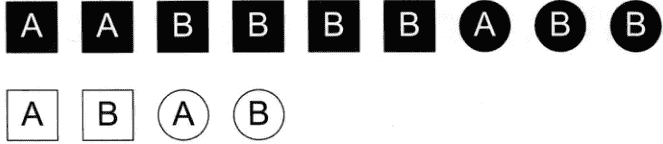

图6.5 随机变量L和S不独立，但在给定C的条件下条件独立。

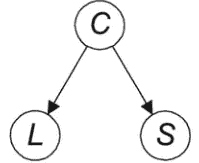

图6.6 L、S和C的联合概率分布与这个DAG构成一个贝叶斯网络。

For (G, P) to satisfy the Markov condition, we need to have

$I_P(L, S|C)$
$I_P(S, L|C).

Note that because C has no nondescendents, we do not have a conditional independence for C. Because independence is symmetric, $I_P(L, S|C)$ implies $I_P(L, S|C)$. Therefore, all the conditional independencies required by the Markov condition are satisfied, and (G, P) is a Bayesian network.

Next we further illustrate the Markov condition with a more complex DAG.

Example 6.2 Consider the DAG G in Figure 6.7. If (G, P) satisfied the Markov condition with some probability distribution P of X, Y, Z, W, and V, we would have the following conditional independencies.

| 节点 | 父节点 | 非后代节点 | 条件独立性 |
| :--- | :--- | :--- | :--- |
| X | $\emptyset$ | $\emptyset$ | 无 |
| Y | X | Z, V | $I_P(Y, \{Z, V\}|X)$ |
| Z | X | Y | $I_P(Z, Y|X)$ |
| W | Y, Z | X, V | $I_P(W, \{X, V\}|\{Y, Z\})$ |
| V | Z | X, Y, W | $I_P(V, \{X, Y, W\}|Z)$ |

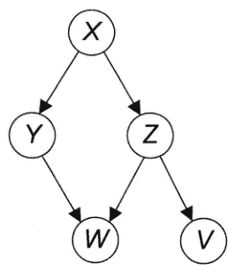

图6.7 一个DAG。

### 6.2.2 贝叶斯网络的表示

按定义，贝叶斯网络(G, P)是一个DAG G和联合概率分布P，它们共同满足马尔可夫条件。那么，为什么在图6.2和6.3中，我们将贝叶斯网络表示为一个DAG和一组条件概率分布呢？原因是(G, P)满足马尔可夫条件，当且仅当P等于其在G中的条件分布的乘积。具体来说，我们有以下定理。

定理6.1 (G, P)满足马尔可夫条件（因此是一个贝叶斯网络），当且仅当P等于其在G中所有节点给定其父节点的条件分布的乘积，只要这些条件分布存在。

证明。证明可见[Neapolitan, 2004]。

示例6.3 我们表明，图6.5中对象集合上定义的随机变量L、S和C的联合概率分布P与图6.6中的DAG G构成一个贝叶斯网络。接下来，我们通过展示P等于其在G中的条件分布的乘积，来说明前面的定理是正确的。图6.8显示了这些条件分布。我们直接从图6.5计算得到了它们。例如，因为有九个黑色对象（c1），其中六个是正方形（s1），我们计算

```
P(s_1|c_1) = \frac{6}{9} = \frac{2}{3}.
```

其他条件分布以同样的方式计算。为了表明联合分布是条件分布的乘积，我们需要表明对于所有i、j和k的值，

```
P(s_i, l_j, c_k) = P(s_i|c_k)P(l_j|c_k)P(c_k).
```

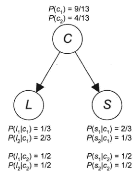

图6.8 一个表示图6.5中对象集合上定义的随机变量L、S和C的概率分布P的贝叶斯网络。

总共有八种组合。我们表明等式对其中一种组合成立。将其对其他组合成立留作练习。为此，我们直接从图6.5得知

$P(s_1, l_1, c_1) = \frac{2}{13}.

从图6.8我们有

$P(s_1|c_1)P(l_1|c_1)P(c_1) = \frac{2}{3} \times \frac{1}{3} \times \frac{9}{13} = \frac{2}{13}.

归功于定理6.1，我们可以使用DAG $\mathbb{G}$和条件分布来表示贝叶斯网络$(\mathbb{G}, P)$。我们不需要展示联合分布中的每个值。这些值都可以从条件分布中计算得出。因此，我们始终将贝叶斯网络表示为DAG和条件分布，就像我们在图6.2、6.3和6.8中所做的那样。贝叶斯网络的表示能力就体现在此。如果变量数量众多，联合分布中将有许多值。但是，如果DAG是稀疏的，条件分布中的值相对较少。例如，假设所有变量都是二进制的，并且联合分布与图6.9中的DAG满足马尔可夫条件。那么联合分布中有$2^{10} = 1024$个值，但条件分布中只有$2 + 2 + 8 \times 8 = 68$个值。请注意，这个计数中甚至没有包括冗余参数。例如，在图6.8的贝叶斯网络中，没有必要展示$P(c_2) = 4/13$，因为$P(c_2) = 1 - P(c_1)$。因此，我们只需要展示$P(c_1) = 9/13$。如果我们消除冗余参数，那么

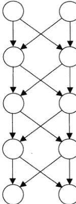

图6.9 如果所有变量都是二进制的并且联合分布与此DAG满足马尔可夫条件，则联合分布中有1024个值，但条件分布中只有68个值。

对于图6.9中的DAG，条件分布中只有34个值，但联合分布中仍有1023个值。我们可以看出，贝叶斯网络是一种用于简洁表示联合概率分布的结构。

我们不能随便选一个DAG就期望联合分布等于DAG中其条件分布的乘积。只有在满足马尔可夫条件时才成立。练习6.2说明了这一点。看来我们陷入了两难境地。也就是说，我们的目标是使用DAG和DAG的条件分布（即贝叶斯网络）来简洁地表示联合概率分布，而不是枚举联合分布中的每个值。然而，在检查是否满足马尔可夫条件之前，我们不知道应该使用哪个DAG，而且一般来说，我们需要联合分布来进行此检查。解决这一两难境地的常见方法是构建一个因果DAG，即如果X导致Y，则从X到Y有一条边的DAG。关于窃贼、警报等的DAG以及图6.2和6.3中的DAG是因果的；本章迄今所示的其他DAG不是因果的。

接下来，我们讨论为什么因果DAG应该与DAG中变量的概率分布满足马尔可夫条件。获得DAG的第二种方法是从数据中学习它。这种第二种方法将在第12章中讨论。

## 6.3 作为贝叶斯网络的因果网络

### 6.3.1 因果性

我们首先形式化因果性的概念。

词典对原因的一个定义是“负责某一动作或结果的人、事件或条件”。虽然有用，但这个定义当然不是关于因果概念的最终定论，该概念已被研究了几个世纪（参见，例如，[Hume, 1748]；[Piaget, 1966]；[Eells, 1991]；[Salmon, 1997]；[Spirtes et al., 1993; 2000]；[Pearl, 2000]）。然而，这个定义确实揭示了识别因果关系的一种操作方法。也就是说，如果使变量X取某个值的动作有时会改变变量Y所取的值，那么我们假设X有时负责改变Y的值，并得出结论X是Y的原因¹。更正式地说，当我们强制X取某个值时，我们说我们**操纵**X，如果存在某种对X的操纵导致Y的概率分布发生变化，我们说X**导致**Y。我们假设，如果操纵X导致Y的概率分布发生变化，那么X以任何方式获得某个值也会导致Y的概率分布发生变化。因此，我们假设原因及其结果在统计上是相关的。然而，变量可以相关而不存在一方导致另一方。

操纵包括使用特定实体群体（例如，胸痛患者）在特定背景下（例如，他们目前不服用任何胸痛药物且居住在特定地理区域）进行**随机对照实验（RCE）**。然后发现的因果关系相对于这个群体和这个背景。

让我们讨论操纵是如何进行的。我们首先确定要考虑的实体群体。我们的随机变量是这些实体的特征。接下来，我们确定要调查的因果关系。假设我们试图确定变量X是否是变量Y的原因。然后我们从群体中抽取若干实体。对于选定的每个实体，我们操纵X的值，使其每个可能的值分配给相同数量的实体（如果X是连续的，我们根据均匀分布选择X的值）。在为给定实体设置X的值后，我们测量该实体的Y值。结果数据越显示X和Y之间存在依赖性，数据就越支持X导致Y。X的操纵可以由一个外部于所研究系统的变量M来表示。对于X的每个值x_i，M有一个值m_i；M的所有值的概率相同；当M等于m_i时，X等于x_i。也就是说，M和X之间的关系是确定的。数据在多大程度上支持X导致Y，取决于数据是否表明对于j != k，P(y_i|m_j) != P(y_i|m_k)。操纵实际上是一种特殊的因果关系，我们假设它原初存在且在我们的控制之中，以便我们可以定义和发现

¹ 这种因果性概念不涉及_个体_因果性，后者关注个别因果事件而非变量之间的概率关系。


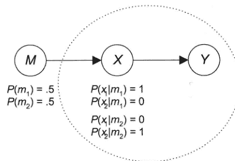

图 6.10 表示操纵实验的因果 DAG。

其他因果关系。刚才讨论的操纵所代表的因果 DAG 出现在图 6.10 中。

### 6.3.2 因果性与马尔可夫条件

首先，我们更严格地定义因果 DAG。之后，我们陈述因果马尔可夫假设并论证为什么它应该成立。

### 6.3.2.1 因果 DAG

我们说 X 是 Y 的原因，如果对 X 的操纵导致 Y 的概率分布发生变化。因果图是一个有向图，包含一组因果相关的随机变量 V，使得对于 V 中的每个 X, Y，当且仅当 X 是 Y 的原因时，存在从 X 到 Y 的边，并且不存在 V 的变量子集 W_XY，使得如果我们知道 W_XY 中变量的值，对 X 的操纵将不再改变 Y 的概率分布。如果存在从 X 到 Y 的边，我们称 X 为 Y 的直接原因。请注意，X 是否是 Y 的直接原因取决于 V 中包含的变量。如果因果图是无环的（即，没有因果反馈回路），则因果图是因果 DAG。

示例 6.4 已知睾酮（T）会转化为二氢睾酮（D），并且二氢睾酮被认为是勃起功能（E）所必需的激素。[Lugg 等人, 1995] 的一项研究在大鼠中测试了这些变量之间的因果关系。他们将睾酮操纵到低水平，发现二氢睾酮和勃起功能都下降了。然后他们将二氢睾酮固定在低水平，发现无论操纵的睾酮值如何，勃起功能都很低。最后，他们将二氢睾酮固定在高水平，发现无论操纵的睾酮值如何，勃起功能都很高。因此，他们了解到，在仅包含变量 T、D 和 E 的因果图中，T 是 D 的直接原因，D 是 E 的直接原因；但是，虽然 T 是 E 的原因，但它不是直接原因。因此，因果图（DAG）是图 6.11 中的图。

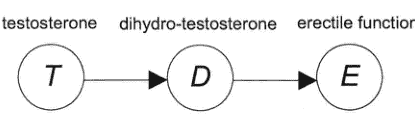

图 6.11 一个因果 DAG。

请注意，如果图 6.11 的 DAG 中没有变量 D，则 T 将被称为 E 的直接原因，并且会有一条从 T 直接指向 E 的边，而不是通过 D 的有向路径。一般来说，我们的边始终仅表示已识别变量之间的关系。似乎我们通常可以构想每条边沿线存在中间的、未识别的变量。考虑以下取自 [Spirtes 等人, 1993; 2000] 第 42 页的示例：

> 如果 C 是划火柴的事件，A 是火柴着火的事件，并且不考虑其他事件，那么 C 是 A 的直接原因。但是，如果我们添加了 B，即火柴头上的硫达到足够的热量以与氧结合，那么我们就不能再说 C 直接导致 A，而应该说 C 直接导致 B，B 直接导致 A。因此，如果 C 导致 B 且 B 导致 A，我们说 B 是 C 和 A 之间的因果中介。

请注意，在这个直观的解释中，变量名也用于表示变量的值。例如，A 是一个值为“着火”或“未着火”的变量，A 也用于表示火柴着火。显然，我们可以添加更多因果中介。例如，我们可以添加变量 D，表示火柴头是否被粗糙表面磨损。那么 C 将导致 D，D 将导致 B，以此类推。我们可以走得更远，描述硫与氧结合时发生的化学反应。

确实，似乎我们可以构想任何过程的因果描述中存在一个连续的事件序列。我们发现，可观测变量的集合取决于观察者。显然，一个人在海量感官输入下，会选择性地记录可辨别的事件，并在它们之间发展因果关系。因此，与其假设外部存在一组因果相关的变量，不如只假设在给定的上下文或应用中，我们识别某些变量并在它们之间发展一组因果关系，这似乎更合适。

### 6.3.2.2 因果马尔可夫假设

如果我们假设一组随机变量 V 的观测概率分布 P 与包含这些变量的因果 DAG G 满足马尔可夫条件，则我们说我们正在做出因果马尔可夫假设，并称 (G, P) 为因果网络。为什么我们要做出因果马尔可夫假设？为了回答这个问题，我们展示几个示例。

**示例 6.5** 再次考虑涉及睾酮（T）、二氢睾酮（D）和勃起功能（E）的情况。回顾我们在示例 6.4 中讨论过的 [Lugg 等人, 1995] 的操纵研究。该研究表明，如果我们实例化 D，则 E 的值与 T 的值独立。因此，有实验证据表明三变量因果链满足马尔可夫条件。

**示例 6.6** 已知吸烟史（H）会同时导致支气管炎（B）和肺癌（L）。肺癌和支气管炎都会导致疲劳（F），但只有肺癌会导致胸部 X 光（X）呈阳性。变量之间没有其他因果关系。图 6.12 显示了包含这些变量的因果 DAG。该 DAG 的因果马尔可夫假设蕴含以下条件独立性。

| 节点 | 父节点 | 非后代 | 条件独立性 |
|---|---|---|---|
| H | \(\emptyset\) | \(\emptyset\) | 无 |
| B | H | L, X | \(I_P(B, \{L, X\} | H)\) |
| L | H | B | \(I_P(L, B | H)\) |
| F | B, L | H, X | \(I_P(F, \{H, X\} | \{B, L\})\) |
| X | L | H, B, F | \(I_P(X, \{H, B, F\} | L)\) |

鉴于图 6.12 中的因果关系，我们不会期望支气管炎和肺癌是独立的，因为如果某人患有肺癌，那么该个体吸烟的可能性就会更大（因为吸烟可能导致肺癌），而这又会使吸烟的另一种影响，即支气管炎存在的可能性更大。然而，如果我们知道某人吸烟，那么该人患支气管炎的可能性本身就已经更大。得知该个体患有肺癌，将不再能增加吸烟的可能性（此时吸烟概率为 1），这意味着它不能改变支气管炎的可能性。也就是说，变量 H 屏蔽了 B 对 L 的影响，这正是因果马尔可夫条件所说的。同样，阳性胸部 X 光会增加肺癌的可能性，进而增加吸烟的可能性，进而增加支气管炎的可能性。因此，胸部 X 光和支气管炎不是独立的。然而，如果我们知道该人患有肺癌，胸部 X 光就不能改变肺癌的可能性，从而也不能改变支气管炎的可能性。因此，在已知 L 的条件下，B 与 X 独立，这正是因果马尔可夫条件所说的。

有三种情况，因果图不应满足马尔可夫条件。第一种情况是存在因果反馈回路。例如，也许学习会导致好成绩，而好成绩会导致学生更努力地学习。当存在因果反馈回路时，我们的图甚至不是 DAG。

第二种情况是存在隐藏的共同原因。以下示例说明了隐藏共同原因的问题。

**示例 6.7** 假设我们想要创建一个包含变量感冒（C）、打喷嚏（S）和流鼻涕（R）的因果 DAG。因为感冒既会导致打喷嚏也会导致流鼻涕，而这两种情况都不会相互导致，所以我们会创建图 6.13 (a) 中的 DAG。该 DAG 的因果马尔可夫条件将蕴含 $I_P(S, R|C)$。但是，如果存在 S 和 R 的隐藏共同原因，如图 6.13 (b) 所示，则该条件独立性不成立，因为即使知道 C 的值，S 也会改变 H 的概率，进而改变 R 的概率。确实，导致打喷嚏和流鼻涕的另一个原因至少有一个，即花粉症。因此，在做出因果马尔可夫假设时，我们必须确定已经识别出所有共同原因。

最后一种情况更微妙。它涉及 *选择偏差* 的存在。以下示例说明了这种情况。

**示例 6.8** 制药公司默克（Merck）一直在将其药物非那雄胺（finasteride）作为治疗男性良性前列腺增生（BPH）的药物进行营销。根据轶事证据，似乎药物使用与头皮毛发重新生长之间存在相关性。让我们假设默克从感兴趣的人群中抽取了一个随机样本，并基于该样本确定非那雄胺使用与毛发重新生长之间存在相关性。进一步假设非那雄胺使用和毛发重新生长之间可能不存在隐藏的共同原因。默克应该得出结论，非那雄胺导致毛发重新生长，因此将其作为治疗秃顶的药物进行营销吗？不一定。还有另一种可能的因果解释来解释这种相关性。假设我们的


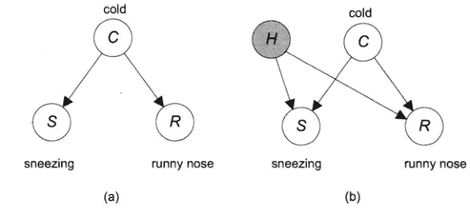

**Figure 6.13** 如果存在如(b)所示的隐藏共同原因，则因果马尔可夫假设对(a)中的DAG不成立。

sample (or even our entire population) consists of individuals who have some (possibly hidden) effect of both finasteride and *hair regrowth*. For example, suppose finasteride (*F*) and apprehension about lack of hair regrowth (*G*) both cause hypertension², and our sample consists of individuals who have hypertension (*T*). We say a node is **instantiated** when we know its value for the entity currently being modeled. So we are saying the variable *T* is instantiated to the same value for every entity in our sample. This situation is depicted in Figure 6.14, where the cross through *T* means that the variable is instantiated. Usually, the instantiation of a common effect creates a dependency between its causes because each cause explains the occurrence of the effect, thereby making the other cause less likely. As noted earlier, psychologists call this *discounting*. So, if this were the case, discounting would explain the correlation between *F* and *G*³. This type of dependency is called **selection bias**.⁴

In summary, we ordinarily can assume that the causal Markov assumption is justified for a causal graph if the following conditions are satisfied:

- 1. There are no hidden common causes. That is, all common causes are represented in the graph.
- 2. There are no causal feedback loops. That is, our graph is a DAG.
- 3. Selection bias is not present.

Note that, for the Markov condition to hold, there must be an edge from X to Y whenever there is a causal path from X to Y besides the ones containing variables in our graph. However, we did not stipulate this requirement above because it is entailed by the definition of a causal graph. Recall that in a causal graph there is an edge from X to Y if X is a direct cause of Y.

### 6.3.3 Markov Condition without Causality

We have argued that a causal DAG often satisfies the Markov condition with the joint probability distribution of the random variables in the DAG. This does not mean that the edges in a DAG in a Bayesian network must be causal. That is, a DAG can satisfy the Markov condition with the probability distribution of the variables in the DAG without the edges being causal. For example, we showed that the joint probability distribution P of the random variables L, S, and C defined on the set of objects in Figure 6.5 satisfies the Markov condition with the DAG G in Figure 6.6. However, we would not argue that the color of the objects causes their shape or the letter that is on them. As another example, if we reversed the edges in the DAG in Figure 6.11 to obtain the DAG E → DHT → T, the new DAG would also satisfy the Markov condition with the probability distribution of the variables, yet the edges would not be causal.

## 6.4 Inference in Bayesian Networks

As noted previously, a standard application of Bayes' theorem is inference in a two-node Bayesian network. Larger Bayesian networks address the problem of representing the joint probability distribution of a large number of variables. For example, Figure 6.3 represents the joint probability distribution of variables related to credit card fraud. Inference in this network consists of computing the conditional probability of some variable (or set of variables), given that other variables are instantiated to certain values. For example, we might want to compute the probability of credit card fraud, given that gas has been purchased, jewelry has been purchased, and the card holder is male. To accomplish this inference we need sophisticated algorithms. First, we show simple examples illustrating how one of these algorithms uses the Markov condition and Bayes' theorem to do inference. Then we reference papers describing some of the algorithms. Finally we show examples using the algorithms to do inference.

### 6.4.1 Examples of Inference

Next we present some examples illustrating how the conditional independencies entailed by the Markov condition can be exploited to accomplish inference in a Bayesian network.

**Example 6.9** Consider the Bayesian network in Figure 6.15 (a). The prior probabilities of all variables can be computed using the Law of Total Probability:

```
P(y1) = P(y1|x1)P(x1) + P(y1|x2)P(x2) = (.9)(.4) + (.8)(.6) = .84

P(z1) = P(z1|y1)P(y1) + P(z1|y2)P(y2) = (.7)(.84) + (.4)(.16) = .652

P(w1) = P(w1|z1)P(z1) + P(w1|z2)P(z2) = (.5)(.652) + (.6)(.348) = .5348.
```

These probabilities are shown in Figure 6.15 (b). Note that the computation for each variable requires information determined for its parent. We can therefore consider this method a message-passing algorithm in which each node passes its child a message needed to compute the child's probabilities. Clearly, this algorithm applies to an arbitrarily long linked list and to trees.

**Example 6.10** Suppose now that X is instantiated for x1. Because the Markov condition entails that each variable is conditionally independent of X given its parent, we can compute the conditional probabilities of the remaining variables by again using the Law of Total Probability (however, now with the background information that X = x1) and passing messages down as follows:

```
P(y_1|x_1) = .9
```

```
P(z_1|x_1) = P(z_1|y_1, x_1)P(y_1|x_1) + P(z_1|y_2, x_1)P(y_2|x_1)
= P(z_1|y_1)P(y_1|x_1) + P(z_1|y_2)P(y_2|x_1) // Markov condition
= (.7)(.9) + (.4)(.1) = .67
```

```
P(w_1|x_1) = P(w_1|z_1, x_1)P(z_1|x_1) + P(w_1|z_2, x_1)P(z_2|x_1)
= P(w_1|z_1)P(z_1|x_1) + P(w_1|z_2)P(z_2|x_1)
= (.5)(.67) + (.6)(1 - .67) = .533
```

Clearly, this algorithm also applies to an arbitrarily long linked list and to trees.

The preceding example shows how we can use downward propagation of messages to compute the conditional probabilities of variables below the instantiated variable. Next we illustrate how to compute conditional probabilities of variables above the instantiated variable.

**Example 6.11** Suppose W is instantiated for w1 (and no other variable is instantiated). We can use upward propagation of messages to compute the conditional probabilities of the remaining variables. First, we use Bayes' theorem to compute P(z1|w1):

```
P(z_1|w_1) = \frac{P(w_1|z_1)P(z_1)}{P(w_1)} = \frac{(.5)(.652)}{.5348} = .6096.
```

Then, to compute P(y1|w1), we again apply Bayes' theorem:

```
P(y_1|w_1) = \frac{P(w_1|y_1)P(y_1)}{P(w_1)}.
```

We cannot yet complete this computation because we do not know P(w1|y1). We can obtain this value using downward propagation as follows:

```
P(w_1|y_1) = (P(w_1|z_1)P(z_1|y_1) + P(w_1|z_2)P(z_2|y_1).
```

After doing this computation, also computing \(P(w_1|y_2)\) (because X will need this value) and then determining \(P(y_1|w_1)\), we pass \(P(w_1|y_1)\) and \(P(w_1|y_2)\) to X. We then compute \(P(w_1|x_1)\) and \(P(x_1|w_1)\) in sequence:

```
P(w_1|x_1) = (P(w_1|y_1)P(y_1|x_1) + P(w_1|y_2)P(y_2|x_1)

P(x_1|w_1) = \frac{P(w_1|x_1)P(x_1)}{P(w_1)}.
```

It is left as an exercise to perform these computations. Clearly, this upward propagation scheme applies to an arbitrarily long linked list.

The next example shows how to turn corners in a tree.

**Example 6.12** Consider the Bayesian network in Figure 6.16. Suppose W is instantiated for \(w_1\). We compute \(P(y_1|w_1)\) followed by \(P(x_1|w_1)\) using the upward propagation algorithm just described. Then we proceed to compute \(P(z_1|w_1)\) followed by \(P(t_1|w_1)\) using the downward propagation algorithm. This is left as an exercise.

### 6.4.2 Inference Algorithms and Packages

By exploiting local independencies as we did in the previous subsection, Pearl [1986, 1988] developed a message-passing algorithm for inference in Bayesian networks. Based on a method originated in [Lauritzen and Spiegelhalter, 1988], Jensen et al. [1990] developed an inference algorithm that involves the extraction of an undirected triangulated graph from the DAG in a Bayesian network and the creation of a tree, whose vertices are the cliques of this triangulated


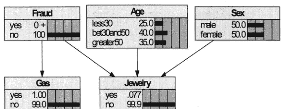

图 6.17 图 6.3 中的欺诈检测贝叶斯网络，使用 Netica 实现。

graph. 这样的树称为连接树。然后通过在连接树中传递消息来计算条件概率。Li 和 D'Ambrosio [1994] 采用了不同的方法。他们开发了一种算法，用于近似从联合概率分布中计算感兴趣的边缘分布的最优方式。他们称此为符号化概率推理（SPI）。

所有这些算法在最坏情况下都是非多项式时间。这并不令人惊讶，因为贝叶斯网络中推理问题已被证明是 NP-hard [Cooper, 1990]。鉴于这一结果，已经开发出用于贝叶斯网络推理的近似算法。其中一种算法，似然加权，分别在 [Fung and Chang, 1990] 和 [Shachter and Peot, 1990] 中独立开发。[Dagum and Luby, 1993] 证明了贝叶斯网络中近似推理问题也是 NP-hard。然而，存在一些受限的贝叶斯网络类，可证明可以在多项式时间内求解（参见 [Dagum and Chavez, 1993]）。确实，似然加权算法的一个变体，只要网络不包含极端条件概率，就是最坏情况多项式时间，出现在 [Pradhan and Dagum, 1996]。

从业者无需关心所有这些算法，因为已经开发出许多用于在贝叶斯网络中进行推理的软件包。其中几个如下所示：

- 1. Netica (www.norsys.com/)
- 2. GeNIe (genie.sis.pitt.edu/)
- 3. HUGIN (www.hugin.com/)
- 4. Elvira (www.ia.uned.es/~elvira/)
- 5. BUGS (www.mrc-bsu.cam.ac.uk/bugs/)

在本书中，我们通常使用 Netica 来说明推理。图 6.17 显示了使用 Netica 实现的图 6.3 中的欺诈检测网络。

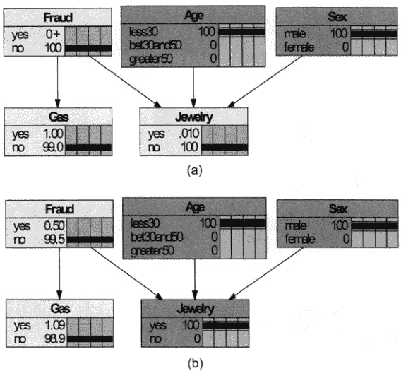

图 6.18 在 (a) 中，Age 已实例化为 less30，Sex 已实例化为 male。在 (b) 中，Age 已实例化为 less30，Sex 已实例化为 male，且 Jewelry 已实例化为 yes。

### 6.4.3 使用 Netica 进行推理

接下来，我们使用 Netica 说明贝叶斯网络中的推理。从图 6.17 可以看出，Netica 计算并显示变量的先验概率，而不是显示条件概率分布。概率以百分比显示。例如，Jewelry 节点中 yes 旁边有 .077 这一事实意味着

```
P(Jewelry = yes) = .00077.
```

这是过去 24 小时内珠宝购买被记入任何特定信用卡的先验概率。

变量实例化后，Netica 显示给定这些实例化的其他变量的条件概率。在图 6.18 (a) 中，我们将 Age 实例化为 less30，将 Sex 实例化为 male。因此，Jewelry 节点中 yes 旁边有 .010 这一事实意味着

```
P(Jewelry = yes|Age = less30, Sex = male) = .00010.
```

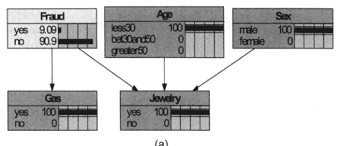

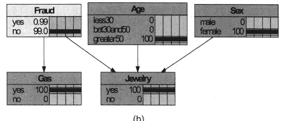

图 6.19 在 (a) 和 (b) 中，Sex 和 Jewelry 均已实例化为 yes。然而，在 (a) 中，持卡人是年轻男子，而在 (b) 中，持卡人是年长妇女。

请注意，欺诈的概率没有变化。这是我们所期望的。首先，马尔可夫条件表明欺诈应与 Age 和 Sex 独立。其次，它们似乎应该是独立的。也就是说，持卡人是年轻男子这一事实不应使卡片被欺诈使用的可能性变大或变小。图 6.18 (b) 与图 6.18 (a) 具有相同的实例化，只是我们还将 Jewelry 实例化为 yes。请注意，欺诈的概率现在已改变。首先，珠宝购买使欺诈更可能为 yes。其次，持卡人是年轻男子这一事实意味着持卡人不太可能进行该购买，从而使欺诈更可能为 yes。

在图 6.19 (a) 和 6.19 (b) 中，Gas 和 Jewelry 均已实例化为 yes。然而，在图 6.19 (a) 中，持卡人是年轻男子，而在图 6.19 (b) 中，持卡人是年长妇女。这说明了珠宝购买的贴现。当持卡人是年轻男子时，欺诈为 yes 的概率较高（.0909）。然而，当持卡人是年长妇女时，概率仍然较低（.0099），因为持卡人是年长妇女这一事实解释了珠宝购买。

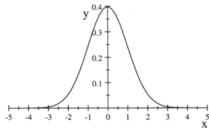

图 6.20 标准正态密度函数。

## 6.5 含连续变量的网络

到目前为止，在我们所有的贝叶斯网络中，变量均为离散。接下来，我们讨论包含连续变量的贝叶斯网络。

### 6.5.1 高斯贝叶斯网络

回顾正态分布定义如下：

**定义 6.2** 参数为 \(\mu\) 和 \(\sigma\)（其中 \(-\infty < \mu < \infty\) 且 \(\sigma > 0\)）的正态密度函数为

```
\(\rho(x) = \frac{1}{\sqrt{2\pi}\sigma} e^{-\frac{(x - \mu)^2}{2\sigma^2}} \quad -\infty < x < \infty, \quad (6.1)\)
```

并记为 NormalDen(\(x; \mu, \sigma^2\))。

具有此密度函数的随机变量 \(X\) 被认为具有 **正态分布**。

如果随机变量 \(X\) 具有正态密度函数，则

```
\(E(X) = \mu \quad \text{and} \quad V(X) = \sigma^2,\)
```

其中 \(E\) 表示期望值，\(V\) 表示方差。密度函数 NormalDen(\(x; 0, 1^2\)) 称为 **标准正态密度函数**。图 6.20 显示了此密度函数。

**高斯贝叶斯网络**包含服从正态分布的变量。我们通过以下示例来激励此类网络。

**示例 6.13** 假设你正在考虑一份每小时支付 10 美元的工作，并且你预计每周工作 40 小时。然而，你无法保证工作 40 小时，并且你估计一周实际工作的小时数服从均值为 40、标准差为 5 的正态分布。你尚未完全调查诸如奖金和非应税扣除（例如，退休计划缴费）等福利。然而，你估计这些对你每周应税总收入的其他影响也服从均值为 0（即，你觉得它们大致相互抵消）且标准差为 30 的正态分布。此外，你假设这些其他影响与你的工作时间独立。

我们定义以下随机变量：

| 变量 | 变量含义 |
|---|---|
| X | 一周工作的小时数 |
| Y | 一周获得的薪水 |

根据前面的讨论，X 的分布如下：

```
\rho(x) = \text{NormalDen}(x; 40, 5^2).
```

你薪水 Y 的一部分是 X 的确定性函数。也就是说，如果你工作 x 小时，你将获得 10x 美元。然而，根据我们讨论的其他影响，你的总薪水可能高于或低于此数额。也就是说，

```
y = 10x + \varepsilon_Y,
```

其中

```
\rho(\varepsilon_Y) = \text{NormalDen}(\varepsilon_Y; 0, 30^2).
```

因为这些其他影响的期望值为 0，

```
E(Y|x) = 10x.
```

并且因为这些其他影响的方差为 30^2，

```
V(Y|x) = 30^2.
```

因此，Y 的条件分布如下：

```
\rho(y|x) = \text{NormalDen}(y; 10x, 30^2).
```

因此，X 和 Y 之间的关系由图 6.21 中的贝叶斯网络表示。

我们刚刚开发的贝叶斯网络是高斯贝叶斯网络的一个示例。一般来说，在高斯贝叶斯网络中，根节点服从正态分布，每个非根节点 Y 是其父节点的线性函数加上一个误差项 \varepsilon_Y，该误差项服从均值为 0、方差为 \sigma_Y^2 的正态分布。因此，如果 X_1, X_2, ... 和 X_k 是 Y 的父节点，则

```
Y = b_1x_1 + b_2x_2 + \cdots b_kx_k + \varepsilon_Y, \quad (6.2)
```


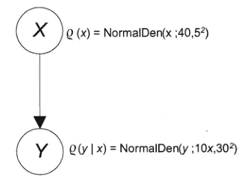

图 6.21 高斯贝叶斯网络。

其中

\(\rho(\epsilon_Y) = \text{NormalDen}(\epsilon_Y; 0, \sigma_Y^2),\)

并且 \(Y\) 的条件分布如下：

\(\rho(y|x) = \text{NormalDen}(y; b_1x_1 + b_2x_2 + \cdots + b_kx_k, \sigma_Y^2).\)

等式 6.2 中的线性关系已被用于经济学中的因果模型 [Joereskog, 1982]、心理学中的结构方程 [Bentler, 1980] 以及社会学和遗传学中的路径分析 [Kenny, 1979]、[Wright, 1921]。

Pearl [1988] 为高斯贝叶斯网络开发了一种精确推断算法。该算法在 [Neapolitan, 2004] 中有描述。大多数贝叶斯网络推断算法都可以处理高斯贝叶斯网络。有些使用精确算法；另一些则将连续分布离散化，然后使用离散变量进行推断。

**示例 6.14** Netica (www.norsys.com/) 要求我们对连续变量进行离散化。然而，HUGIN [Olesen et al., 1992] 在高斯贝叶斯网络中进行精确推断。图 6.22 显示了使用 HUGIN 开发的图 6.21 中的网络。先验均值和方差显示在 DAG 下方。假设现在你刚拿到工资单，只有 $300。你的配偶开始怀疑你工作的小时数不多。因此，你的配偶在网络中将 Y 实例化为 300。X 的更新后的均值和方差显示在图 6.22 的先验值下方。结果表明，你工作的小时数的期望值仅约为 32.64。

### 6.5.2 混合网络

混合贝叶斯网络同时包含离散变量和连续变量。图 6.23 显示了一个混合网络，将在稍后讨论。已开发用于混合贝叶斯网络精确推断的方法。例如，Shenoy [2006] 开发了一种方法，将一般混合贝叶斯网络近似为高斯贝叶斯网络的混合物。然而，软件包通常通过离散化连续分布来处理混合网络。HUGIN 允许高斯变量具有离散父节点，同时仍然进行精确推断。因此，它可以处理以下示例中的贝叶斯网络。

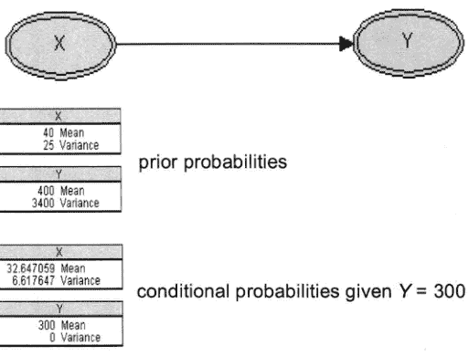

图 6.22 在 HUGIN 中实现的图 6.21 中的贝叶斯网络。

**示例 6.15** 回顾图 6.3 中的贝叶斯网络，该网络模拟了信用卡欺诈使用。假设如果购买珠宝，如果购买是由于欺诈使用，珠宝的成本可能会更高。我们可以使用图 6.23 中的混合贝叶斯网络来建模这种情况。变量 Cost 在其离散父节点的每组值给定时服从正态分布。请注意，如果 J = no，分布为 NormalDen(s;0,0)。这与陈述

> P(C = 0|F = yes, J = no) = 0.

相同。然而，我们将条件概率分布显示为正态分布，以与 C 的其他分布保持一致。

**示例 6.16** 一个基因产生的蛋白质转录因子可以对另一个基因的 mRNA 水平（称为基因表达水平）产生因果影响。研究人员致力于从数据中学习这些因果影响。基因表达水平通常设置为测量表达与控制水平的比率。因此，大于 1 的值表示相对较高的表达水平，而小于 1 的值表示相对较低的表达水平。由于基因表达水平是连续的，我们可以尝试学习高斯贝叶斯网络。

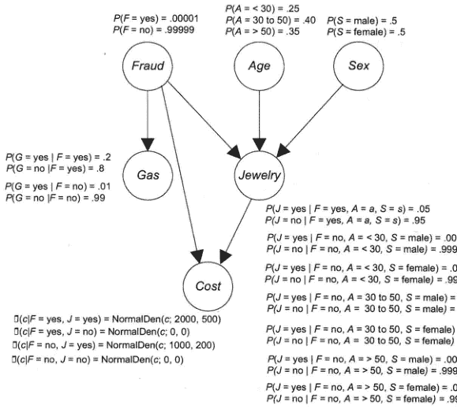

图 6.23 一个混合贝叶斯网络，模拟如果购买是欺诈行为，珠宝成本可能更高的情况。

[Segal et al., 2005] 中采用的另一种方法是学习一个网络，其中每个变量在其父节点的值给定时服从正态分布。然而，每个父节点只有两个值，即高和低，这些值决定子节点的条件分布。值 high 表示所有大于 1 的表达水平，值 low 表示所有小于或等于 1 的表达水平。这样的网络出现在图 6.24 中。网络中的节点代表基因。这个网络不完全是混合的，因为每个变量都是连续的。然而，条件分布基于离散值。

## 6.6 获取概率

迄今为止，我们只是展示了我们所介绍的贝叶斯网络中的条件概率分布。我们并未关心它们是如何获得的。例如，在信用卡欺诈示例中，我们只是陈述 P(Age = less30) = .25。然而，我们是如何获得这个和其他概率的？如本章开头所述，它们可以从该领域专家的主观判断中获得，也可以从数据中学习。在第 12 章中，我们将讨论从数据中学习它们的技术。在这里，我们展示了一种在节点有多个父节点时简化过程的技术。

在讨论了节点有多个父节点时获取条件概率的问题后，我们将介绍解决此问题的模型。

### 6.6.1 多父节点固有的困难

假设肺癌、支气管炎和肺结核都会引起疲劳，我们需要将这种关系建模为医疗诊断系统的一部分。仅涉及这四个变量的 DAG 部分出现在图 6.25 中。我们需要为节点 F 评估八个条件概率，每个父节点组合对应一个。也就是说，我们需要评估以下内容：

```
P(F = yes|B = no, T = no, L = no)
P(F = yes|B = no, T = no, L = yes)
...
P(F = yes|B = yes, T = yes, L = yes).
```

无论是从数据还是从专家医生那里获得这些值都相当困难。例如，要直接从数据中获得 P(F = yes|B = yes, T = yes, L = no) 的值，我们需要一个足够大的人群，这些人已知同时患有支气管炎和肺结核，但不患肺癌。要直接从专家那里获得这个值，专家必须了解当两种疾病存在而第三种不存在时，感到疲劳的可能性。接下来，我们将展示一种间接获取这些条件概率的方法。

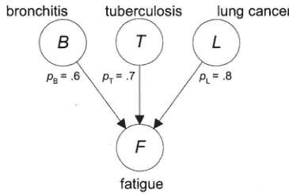

图 6.25 我们需要为节点 F 评估八个条件概率。

### 6.6.2 基础噪声 OR 门模型

噪声 OR 门模型涉及变量之间的关系通常表示因果影响，且每个变量只有两个值的情况。图 6.25 所示的情况是一个典型示例。与其评估所有八个概率，不如评估每个原因对其效果的因果强度。**因果强度**是原因存在时导致效果的概率。在图 6.25 中，我们展示了支气管炎对疲劳的因果强度 $p_B$ 为 .6。假设是，除非某个未知机制抑制这种情况发生，否则支气管炎总会导致疲劳，而这种抑制有 40% 的时间发生。因此，有 60% 的时间，支气管炎会导致疲劳。目前，我们假设效果的所有原因都在 DAG 中明确给出，并且除非至少有一个原因存在，否则效果不会发生。在这种情况下，从数学上我们有

```
$p_B = P(F = yes|B = yes, T = no, L = no).$
```

结核病和肺癌对疲劳的因果强度也在图 6.25 中显示。这三个因果强度应该不如确定所有八个条件概率那么困难。例如，要从数据中获得 $p_B$，我们只需要一个患有支气管炎且没有其他疾病的人群。要从专家那里获得 $p_B$，专家只需确定支气管炎导致疲劳的频率。

如果我们再做一个假设，就可以从三个因果强度中获得我们需要的八个条件概率。我们需要假设抑制原因的机制相互独立作用。例如，抑制支气管炎导致疲劳的机制


与导致结核病引起疲劳的机制独立。从数学上看，此假设如下：

\( P(F = no|B = yes, T = yes, L = no) = (1 - p_B)(1 - p_T) \\
= (1 - .6)(1 - .7) = .12. \)

请注意，在前面的等式中，我们假设支气管炎和结核病均存在且肺癌不存在。在这种情况下，除非支气管炎和结核病的因果效应均被抑制，否则应该会出现疲劳。由于我们假设这些抑制作用相互独立，因此两种效应均被抑制的概率是各自被抑制概率的乘积，即 \( (1 - p_B)(1 - p_T) \)。

同样地，如果所有三个原因均存在，则有

\( P(F = no|B = yes, T = yes, L = yes) = (1 - p_B)(1 - p_T)(1 - p_L) \\
= (1 - .6)(1 - .7)(1 - .8) = .024. \)

请注意，当存在更多原因时，疲劳不存在的概率就越低。这正是我们所期望的。计算图6.25中节点\( F \)所需的其余六个条件概率留作练习。之所以只需要计算八个条件概率，是因为变量是二进制的，因此我们只需计算\( F = no \)的概率。\( F = yes \)的概率由此唯一确定。例如，

\( P(F = yes|B = yes, T = yes, L = yes) = 1 - .024 = .976. \)

虽然我们针对三个原因说明了该模型，但它显然可以扩展到任意数量的原因。在介绍模型时，我们用斜体展示了模型中的假设。接下来，我们对它们进行总结并展示通用公式。

噪声OR门模型做出以下三个假设：

- 1. **因果抑制：** 此假设意味着存在某种机制，该机制抑制原因产生其效应，且原因的存在导致效应的存在，当且仅当该机制被禁用（关闭）。
- 2. **例外独立：** 此假设意味着抑制一个原因的机制与抑制其他原因的机制相互独立。
- 3. **可归责性：** 此假设意味着效应只有在至少一个原因存在且未被抑制时才能发生。

噪声OR门模型的通用公式如下：假设\( Y \)有\( n \)个原因\( X_1, X_2, ..., X_n \)，所有变量均为二进制，并且我们假设噪声OR门模型。设\( p_i \)为\( X_i \)对\( Y \)的因果强度。即，

\( p_i = P(Y = yes|X_1 = no, X_2 = no, ... X_i = yes, ... X_n = no). \)

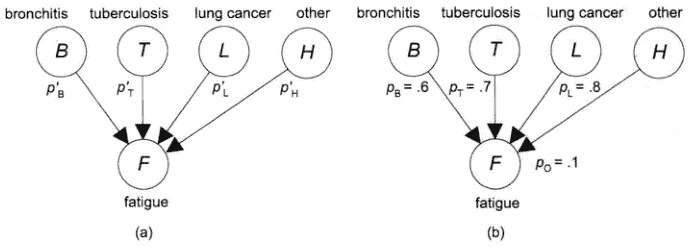

图6.26 (a)中的概率是噪声OR门模型中的因果强度。(b)中的概率是我们确定的概率。

```
P(Y = no|X) = \prod_{i \text{ such that } X_i \in X} (1 - p_i).
```

### 6.6.3 漏噪声OR门模型

在噪声OR门模型的三个假设中，可归责性假设似乎最少得到证明。例如，在疲劳的情况下，当然还有其他疲劳原因，例如听Neapolitan教授的讲座。因此，图6.25中的模型不包含所有疲劳原因，可归责性假设不成立。在许多（如果不是大多数）情况下，我们似乎不能确定自己是否已经阐述了效应的所有已知原因。接下来，我们展示一个不假设可归责性的模型版本。该模型的公式推导不像基本噪声OR门模型那样简单直观。因此，这里我们直接展示该模型而不进行推导。该公式在[Neapolitan and Jiang, 2007]中推导。

### 6.6.3.1 漏噪声OR门公式

漏噪声OR门模型假设所有未阐述的原因可以归为另一个原因H，并且阐述的原因连同H满足噪声OR门模型中的三个假设。这在疲劳示例中通过图6.26 (a)说明。该图中的概率是噪声OR门模型中的因果强度。例如，

```
p'_B = P(F = yes|B = yes, T = no, L = no, H = no).
```

我们无法确定这些值，因为我们不知道H是否存在。图6.26 (b)中的概率是我们可以确定的概率。对于每个阐述的原因，显示的概率是在其余两个阐述的原因不存在的情况下效应存在的概率。例如，

```
p_B = P(F = yes|B = yes, T = no, L = no).
```

请注意概率\( p'_B \)和\( p_B \)之间的区别。后者不条件于\( H \)的值，而前者则条件于\( H \)的值。概率\( p_0 \)与其他概率不同。它是在没有任何阐述的原因存在的情况下效应存在的概率。即，

```
p_0 = P(F = yes|B = no, T = no, L = no).
```

请再次注意，我们没有条件于\( H \)的值。

我们的目标是根据图6.26 (b)中确定的概率，为包含节点\( B \)、\( T \)、\( L \)和\( F \)的贝叶斯网络开发条件概率分布。在展示实现此目标的示例之前，我们先介绍该任务所需的公式。

漏噪声OR门模型的通用公式如下（推导见下一小节）：假设\( Y \)有\( n \)个原因\( X_1, X_2, ..., X_n \)，所有变量均为二进制，并且我们假设漏噪声OR门模型。设

```
p_i = P(Y = yes|X_1 = no, X_2 = no, ... X_i = yes, ... X_n = no) \quad (6.3)
```

```
p_0 = P(Y = yes|X_1 = no, X_2 = no, ... X_n = no). \quad (6.4)
```

那么如果\( \mathbf{X} \)是一组实例化为yes的节点，

```
P(Y = no|\mathbf{X}) = (1 - p_0) \prod_{i \text{ such that } X_i \in \mathbf{X}} \frac{1 - p_i}{1 - p_0}.
```

### 示例 6.17

让我们根据图6.26 (b)中确定的概率，计算包含节点\( B \)、\( T \)、\( L \)和\( F \)的贝叶斯网络的条件概率。我们有

```
P(F = no|B = no, T = no, L = no) = 1 - p_0
= 1 - .1 = .9

P(F = no|B = no, T = no, L = yes) = (1 - p_0) \frac{1 - p_L}{1 - p_0}
= 1 - .8 = .2

P(F = no|B = no, T = yes, L = no) = (1 - p_0) \frac{1 - p_T}{1 - p_0}
= 1 - .7 = .3

P(F = no|B = no, T = yes, L = yes) = (1 - p_0) \frac{1 - p_T}{1 - p_0} \frac{1 - p_L}{1 - p_0}
= \frac{(1 - .7)(1 - .8)}{1 - .1} = .067
```

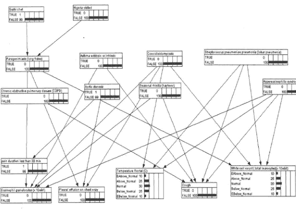

图6.27 Promedas中贝叶斯网络的一小部分。 Bert Kappen，Promedas项目提供。

计算其余四个条件概率留作练习。

### 6.6.4 进一步的模型

噪声OR门模型推广到多于两个值的情况见[Srinivas, 1993]。Diez和Druzdzel [2002]提出了规范模型的一般框架，将其分为三类：确定性、噪声和漏噪声。然后他们分析了最常见的规范模型家族，即噪声OR/MAX、噪声AND/MIN和噪声XOR。其他用于简洁表示条件分布的模型使用Sigmoid函数[Neal, 1992]和Logit函数[McLachlan and Krishnan, 2008]。减少参数估计数量的另一种方法是使用嵌入式贝叶斯网络，这在[Heckerman and Meek, 1997]中讨论。

## 6.7 大规模应用：Promedas

贝叶斯网络已在许多领域成功应用。第8.8节讨论了其中许多应用。这里我们展示了也许最大的

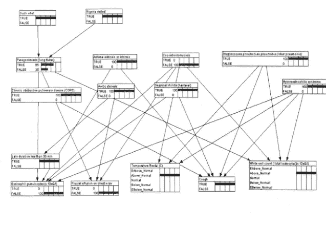

图6.28 图6.27中带有某些实例化节点的贝叶斯网络。 Bert Kappen，Promedas项目提供。

**Promedas**（PRObabilistic MEdical Diagnostic Advisory System，概率医疗诊断咨询系统）是医疗保健中使用的诊断决策支持系统。该计算机程序由SNN Adaptive Intelligence、奈梅亨大学和乌得勒支大学医学中心的研究小组开发。Promedas使用一组患者发现（如病史数据、体格检查结果和实验室数据）生成鉴别诊断。发现可以由个人用户或电子病历提供。对于每个诊断，Promedas建议可以进行的额外检查，以使鉴别诊断更加精确。

> — http://www.promedas.nl/

Promedas中贝叶斯网络的一小部分出现在图6.27中。该图显示了一组诊断及其影响先验概率的一些条件。此外，还显示了一些检查，其概率受这些诊断的影响。这些诊断与其他检查之间的连接被隐藏，显示的检查与其他诊断之间的连接也被隐藏。图6.28展示了将该小子网络应用于特定患者的示例。这位患者是一名寿司厨师，最近访问了尼日利亚。这两个事实都影响他患肺吸虫病的患病率。他的白细胞计数


体温高于正常，直肠温度也是如此。此外，他咳嗽，有时会有一些非特异性疼痛。基于这些发现，Promedas计算每个诊断的条件概率。

Promedas在荷兰乌特勒支学术医院已由约100名医生在实际决策过程中作为咨询工具使用了大约2年。基于他们的积极经验，该医院决定将其正式实施在将在医院安装的新电子病历系统中。Promedas正处于新的商业阶段，目标是在更多医院实施它。

## 练习

### 第6.2节

**练习6.1** 在示例6.3中，作为练习留待证明：对于$s$、$l$和$c$的所有值，有

$P(s, l, c) = P(s|c)P(l|c)P(c)$。

证明这一点。

**练习6.2** 重要的是要认识到，我们不能随便取一个DAG就期望联合分布等于DAG中其条件分布的乘积。只有在满足马尔可夫条件时，这才成立。你将在本练习中说明这一点。考虑示例6.1中的联合概率分布$P$。

- 1. 证明概率分布$P$满足图6.29(a)中DAG的马尔可夫条件，且$P$等于该DAG中其条件分布的乘积。

- 2. 证明概率分布$P$满足图6.29(b)中DAG的马尔可夫条件，且$P$等于该DAG中其条件分布的乘积。

证明概率分布$P$不满足图6.29(c)中DAG的马尔可夫条件，且$P$不等于该DAG中其条件分布的乘积。

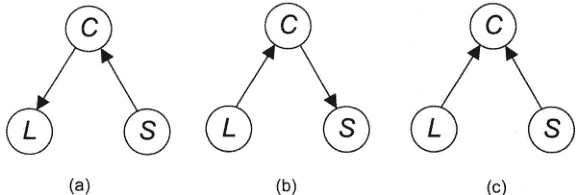

图6.29 示例6.1中讨论的概率分布与(a)和(b)中的DAG满足马尔可夫条件，但与(c)中的DAG不满足。

### 第6.3节

练习6.3 Morris教授以以下方式调查招聘中的性别偏见。他给招聘人员发放了数量相等的男性和女性简历供审阅，然后调查他们的评价是否与性别相关。当他将一篇总结其结果的论文提交给心理学期刊时，审稿人拒绝了该论文，因为他们说这是肥手操纵的一个例子。调查肥手操纵的概念，并解释期刊审稿人可能为什么这么认为。

练习6.4 考虑以下医学知识：肺结核和肺癌都可导致呼吸困难（气短）和胸部X光片阳性。支气管炎是气短的另一个原因。最近去过亚洲可能会增加肺结核的概率。吸烟可导致肺癌和支气管炎。创建一个表示这些变量之间因果关系的DAG。通过确定该DAG中条件概率分布的值（基于你自己的主观判断或来自数据）来完成贝叶斯网络的构建。

练习6.5 解释为什么，如果我们将图6.11中DAG的边反转以获得DAG E → D → T，新的DAG也满足变量概率分布的马尔可夫条件。

### 第6.4节

练习6.6 假设图6.15中的贝叶斯网络，计算P(x1|w1)。

练习6.7 假设图6.16中的贝叶斯网络，计算P(t1|w1)。

**练习6.8** 假设图6.16中的贝叶斯网络，计算$P(x_1|t_2, w_1)$。

**练习6.9** 使用Netica，开发图6.3中的贝叶斯网络，并使用该网络确定以下条件概率。

- 1. $P(F = yes|Sex = male)$。这个条件概率与$P(F = yes)$不同吗？解释为什么是或不是。
- 2. $P(F = yes|J = yes)$。这个条件概率与$P(F = yes)$不同吗？解释为什么是或不是。
- 3. $P(F = yes|Sex = male, J = yes)$。这个条件概率与$P(F = yes|J = yes)$不同吗？解释为什么是或不是。
- 4. $P(G = yes|F = yes)$。这个条件概率与$P(G = yes)$不同吗？解释为什么是或不是。
- 5. $P(G = yes|J = yes)$。这个条件概率与$P(G = yes)$不同吗？解释为什么是或不是。
- 6. $P(G = yes|J = yes, F = yes)$。这个条件概率与$P(G = yes|F = yes)$不同吗？解释为什么是或不是。
- 7. $P(G = yes|A = < 30)$。这个条件概率与$P(G = yes)$不同吗？解释为什么是或不是。
- 8. $P(G = yes|A = < 30, J = yes)$。这个条件概率与$P(G = yes|J = yes)$不同吗？解释为什么是或不是。

### 第6.5节

**练习6.10** 使用Netica、HUGIN或其他贝叶斯网络软件包，实现图6.23中的贝叶斯网络。使用该网络，计算练习6.9中的条件概率。将你的答案与练习6.9中获得的答案进行比较。

### 第6.6节

**练习6.11** 使用噪声OR门模型，作为练习留待计算图6.25中节点$F$所需的剩余六个条件概率。执行此操作。

**练习6.12** 假设噪声OR门模型，因果强度如图6.30所示。计算所有父节点值组合的概率$T = yes$。

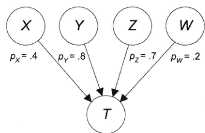

图6.30 假设噪声OR门模型。

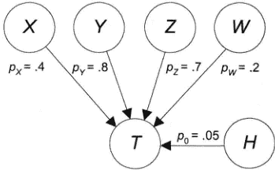

图6.31 假设漏噪声OR门模型。

**练习6.13** 在示例6.17中，作为练习留待计算假设漏噪声OR门模型的剩余四个条件概率。执行此操作。

**练习6.14** 假设漏噪声OR门模型，相关概率如图6.31所示。计算所有父节点值组合的概率$T = yes$。将结果与练习6.12中获得的结果进行比较。

# 第7章

# 贝叶斯网络的高级属性

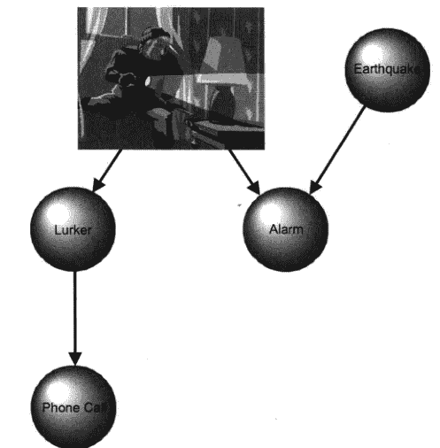

如果福尔摩斯先生的邻居沃森医生打电话报告说他看到一个潜伏者，福尔摩斯先生会推断很可能有一个潜伏者；因此他可能会被盗窃，这意味着他的警报可能会响起。然而，如果福尔摩斯先生已经知道有窃贼，如上图所示，那么电话不能使窃贼更可能，这意味着警报响起的可能性不会增加。然而，这种条件独立性并不源于马尔可夫条件的陈述。也就是说，马尔可夫条件只说Lurker和Alarm在给定Burglar时独立；它不说Phone Call和Alarm在给定Burglar时独立。事实证明，像这样的某些条件独立性是由马尔可夫条件蕴含的。也就是说，如果满足马尔可夫条件，它们必须成立。这些蕴含的条件独立性在第7.1节中讨论。

回顾我们在第6章中论证过，如果福尔摩斯先生知道警报已经响起，那么了解地震应该会降低被盗窃的概率。这种条件依赖性不是由马尔可夫条件蕴含的；该条件只蕴含独立性。然而，它是由另一个称为忠实性（faithfulness）的条件蕴含的。该条件在第7.2.1节中介绍。最后，在第7.4节中，我们讨论马尔可夫毯（Markov blankets）和马尔可夫边界（Markov boundaries），它们是使给定变量与所有其他变量条件独立的变量集合。

### 7.1 蕴含的条件独立性

如果(G, P)满足马尔可夫条件，那么G中的每个节点在给定其父节点时，与其所有非后代节点的集合条件独立。这些条件独立性是否蕴含任何其他条件独立性？也就是说，如果(G, P)满足马尔可夫条件，P是否必须满足除基于节点父节点之外的任何其他条件独立性？答案是肯定的。这样的条件独立性称为蕴含的条件独立性。具体来说，我们说一个DAG蕴含一个条件独立性，如果每个与DAG满足马尔可夫条件的概率分布都必须具有该条件独立性。在明确展示所有蕴含的条件独立性之前，我们先说明人们会期望这些条件独立性。

### 7.1.1 蕴含的条件独立性示例

假设某个分布P与图7.1(a)中的DAG满足马尔可夫条件。那么我们知道IP(C, {F, G}|B)，因为B是C的父节点，且F和G是C的非后代。此外，我们知道IP(B, G|F)，因为F是B的父节点，且G是B的非后代。根据马尔可夫条件的陈述，这些是唯一的条件独立性。然而，能否从它们中推导出任何其他条件独立性？例如，我们能得出IP(C, G|F)吗？让我们先给变量赋予含义，并对DAG进行因果解释，以看看我们是否会期望这种条件独立性。

假设我们正在调查教授获得引用的方式，变量代表以下含义：

- G: 研究生项目质量
- F: 第一份工作质量
- B: 出版物数量
- C: 引用数量


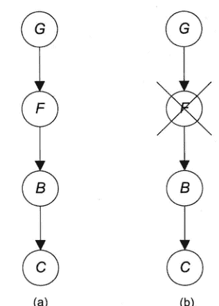

图 7.1 (a) 中显示了一个因果 DAG。(b) 中实例化了变量 F。

此外，假设图 7.1 (a) 中的 DAG 表示这些变量之间的因果关系，且没有隐藏的共同原因。1 那么做出因果马尔可夫假设是合理的，我们会觉得变量的概率分布与 DAG 满足马尔可夫条件。假设我们得知拉布德教授（Professor La Budde）参加了一个高质量的研究生项目（G）。我们现在会预期他的第一份工作（F）很可能是高质量的，这意味着他应该有大量的出版物（B），进而意味着他应该有大量的引用（C）。因此，我们不会期望 $I_P(C, G)$。

假设我们接下来得知佩莱格里尼教授（Professor Pellegrini）的第一份工作（F）是高质量的。也就是说，我们将 F 实例化为“高质量”。图 7.1 (b) 中节点 F 上的叉号表示它已被实例化。我们现在会预期他的出版物数量（B）较多，进而他的引用数量（C）也较多。如果佩莱格里尼教授随后告诉我们他参加了一个高质量的研究生项目（G），我们会预期引用数量比之前认为的更高吗？似乎不是。研究生项目的高质量意味着引用数量可能较多，因为这意味着第一份工作可能是高质量的。一旦我们已经知道第一份工作是高质量的，关于研究生项目的信息应该与我们关于引用数量的信念无关。

因此，我们会预期 C 不仅在给定其父节点 B 的情况下与 G 条件独立，而且在给定其祖父母 F 的情况下也与 G 条件独立。其中任何一个似乎都会阻断通过链 [G, F, B, C] 存在的 G 与 C 之间的依赖。因此，我们会期望 $I_P(C, G|F)$。

对于图 7.1 中的 DAG G，证明马尔可夫条件确实蕴含 $I_P(C, G|F)$ 是直接的。我们接下来展示这一点。如果 (G, P) 满足马尔可夫条件，

```
P(c|g, f) = \sum_b P(c|b, g, f)P(b|g, f)
= \sum_b P(c|b, f)P(b|f)
= P(c|f).
```

第一个等式源于全概率公式（在已知 g 和 f 的值的背景空间中），第二个等式源于马尔可夫条件，最后一个等式同样源于全概率公式。

如果我们有一个任意长的有向变量链表，且 P 与该链表满足马尔可夫条件，那么以刚才说明的同样方式，我们可以证明对于链表中的任何变量，给定该变量时，其上方的变量集合与其下方的变量集合条件独立。也就是说，该变量阻断了通过链传递的依赖。

假设现在 P 与图 7.1 (a) 中的 DAG 不满足马尔可夫条件，因为 G 和 B 有一个共同原因 A。为了说明起见，假设在当前示例中 A 表示以下内容：

- A: 能力

进一步，假设没有其他隐藏的共同原因，因此我们现在会期望 P 与图 7.2 (a) 中的 DAG 满足马尔可夫条件。我们还会期望 $I_P(C, G|F)$ 吗？似乎不是。例如，如前所述，假设我们最初得知佩莱格里尼教授的第一份工作（F）是高质量的。此实例化在图 7.2 (b) 中显示。我们接下来得知他的研究生项目（G）是高质量的。根据当前模型，G 是高质量的这一事实表明他具有高能力（A），高能力可以直接影响他的出版率（B），进而影响他的引用率（C）。因此，我们现在会觉得他的引用率（C）可能比我们只知道他的第一份工作（F）是高质量时所想的更高。这意味着我们不会觉得 $I_P(C, G|F)$，就像我们对之前的模型所做的那样。假设接下来我们知道佩莱格里尼教授的第一份工作（F）是高质量且他具有高能力（A）。这些实例化出现在图 7.2 (c) 中。在这种情况下，他参加高质量研究生项目（G）不再能表明他的能力（A），因此它不能通过链 [G, A, B, C] 影响我们关于他引用率（C）的信念。也就是说，该链在 A 处被阻断。因此，我们会期望 $I_P(C, G|\{A, F\})$。确实，可以证明马尔可夫条件确实蕴含 $I_P(C, G|\{A, F\})$。

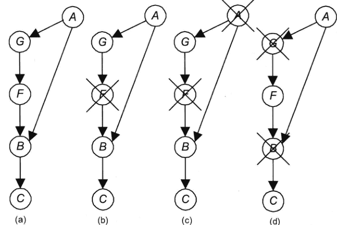

图 7.2 (a) 中显示了一个因果 DAG。(b) 中实例化了变量 F。(c) 中实例化了变量 A 和 F。(d) 中实例化了变量 B 和 G。

最后，考虑条件独立性 \(I_P(F, A|G)\)。通过将马尔可夫条件应用于图 7.2 (a) 中的 DAG，可以直接得到这一独立性。因此，我们不会为其提供直观解释。相反，我们讨论如果我们还知道 \(B\) 的状态，是否会期望该条件独立性仍然存在。假设我们首先得知乔治亚基斯教授（Professor Georgakis）具有高出版率（\(B\)）并参加了高质量的研究生项目（\(G\)）。这些实例化在图 7.2 (d) 中显示。我们后来得知她也具有高能力（\(A\)）。在这种情况下，她的高能力（\(A\)）可以解释她的高出版率（\(B\)），从而使她拥有高质量第一份工作（\(F\)）的可能性降低。如前所述在第 6.1 节中，心理学家称这为 *贴现*。因此，通过实例化 \(B\)，链 \([A, B, F]\) 被打开，我们不会期望 \(I_P(F, A|\{B, G\})\)。确实，马尔可夫条件不蕴含 \(I_P(F, A|\{B, G\})\)。请注意，实例化 \(C\) 也应该打开链 \([A, B, F]\)。也就是说，如果我们知道引用率（\(C\)）很高，那么出版率（\(B\)）很可能很高，而 \(B\) 的每个原因都可以解释这种高概率。确实，马尔可夫条件也不蕴含 \(I_P(F, A|\{C, G\})\)。

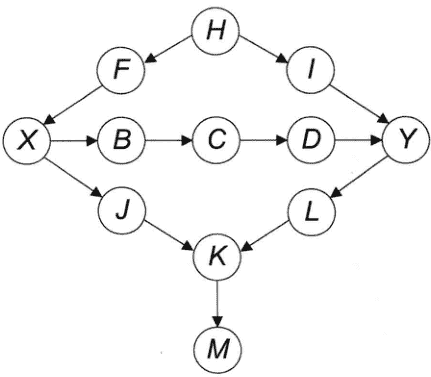

图 7.3 此 DAG 说明了可以在 X 和 Y 之间传递依赖的链。

### 7.1.2 d-分离

图 7.3 显示了贝叶斯网络中变量 X 和 Y 之间可以传递依赖的链。为了直观地讨论这些依赖，我们对该图中的边给出如下因果解释：

- 1. 链 [X, B, C, D, Y] 是从 X 到 Y 的因果路径。一般来说，这条链上 X 和 Y 之间存在依赖，链上任何中间原因的实例化都会阻断该依赖。

- 2. 链 [X, F, H, I, Y] 是一条 H 是 X 和 Y 共同原因的链。一般来说，这条链上任何 X 和 Y 之间都存在依赖，实例化共同原因 H 或中间原因 F 和 I 中的任何一个都会阻断该依赖。

- 3. 链 [X, J, K, L, Y] 是一条 X 和 Y 都导致 K 的链。这条链上 X 和 Y 之间没有依赖。但是，如果我们实例化 K 或 M，一般来说会产生依赖。然后我们还需要实例化 J 或 L 才能使 X 和 Y 独立。

为了使 X 和 Y 条件独立，我们需要在所有在 X 和 Y 之间传递依赖的链上至少实例化一个变量。因此，我们需要在链 [X, B, C, D, Y] 上至少实例化一个变量，在链 [X, F, H, I, Y] 上至少实例化一个变量，并且，如果 K 或 M 被实例化，则在链 [X, J, K, L, Y] 上至少实例化另一个变量。

现在我们已经直观地讨论了 DAG 中依赖如何传递和阻断，我们将精确地展示马尔可夫条件蕴含哪些条件独立性。为此，我们需要 $d$-分离的概念，我们将很快定义它。首先，我们介绍一些初步概念。我们说在 DAG $\mathbb{G}$ 的一条链上，如果与 $X$ 相关联的边的箭头都指向 $X$，则在 $X$ 处有一个 **头对头会合**。例如，链 $Y \leftarrow W \rightarrow X \leftarrow V$ 在 $X$ 处有一个头对头会合。我们说在 DAG $\mathbb{G}$ 的一条链上，如果与 $X$ 相关联的边中恰好有一边的箭头指向 $X$，则在 $X$ 处有一个 **头对尾会合**。例如，链 $Y \leftarrow W \leftarrow X \leftarrow V$ 在 $X$ 处有一个头对尾会合。我们说在 DAG $\mathbb{G}$ 的一条链上，如果与 $X$ 相关联的边都没有箭头指向 $X$，则在 $X$ 处有一个 **尾对尾会合**。例如，链 $Y \leftarrow W \leftarrow X \rightarrow V$ 在 $X$ 处有一个尾对尾会合。我们现在有以下定义：

### 定义 7.1

假设我们有一个 DAG $\mathbb{G} = (\mathsf{V}, \mathsf{E})$，DAG 中连接两个节点 $X$ 和 $Y$ 的一条链 $\rho$，以及一个节点子集 $\mathsf{W} \subseteq \mathsf{V}$。我们说链 $\rho$ 被 $\mathsf{W}$ **阻断**，如果以下至少一项为真：

- 1. 存在一个节点 $Z \in \mathsf{W}$，它在 $\rho$ 上有一个头对尾会合。
- 2. 存在一个节点 $Z \in \mathsf{W}$，它在 $\rho$ 上有一个尾对尾会合。
- 3. 存在一个节点 $Z$，使得 $Z$ 及其所有后代都不在 $\mathsf{W}$ 中，且它在 $\rho$ 上有一个头对头会合。$\unknown$

### 示例 7.1

对于图 7.3 中的 DAG，以下是一些被阻断和未被阻断的链的示例。

- 1. 链 $[X, B, C, D, Y]$ 被 $W = \{C\}$ 阻断，因为在 $C$ 处有一个头对尾会合。
- 2. 链 $[X, B, C, D, Y]$ 被 $W = \{C, H\}$ 阻断，因为在 $C$ 处有一个头对尾会合。
- 3. 链 $[X, F, H, I, Y]$ 被 $W = \{C, H\}$ 阻断，因为在 $H$ 处有一个尾对尾会合。
- 4. 链 $[X, J, K, L, Y]$ 被 $W = \{C, H\}$ 阻断，因为在 $K$ 处有一个头对头会合，且 $K$ 和 $M$ 都不在 $W$ 中。
- 5. 链 $[X, J, K, L, Y]$ 未被 $W = \{C, H, K\}$ 阻断，因为在 $K$ 处有一个头对头会合，且 $K$ 在 $W$ 中。
- 6. 链 $[X, J, K, L, Y]$ 被 $W = \{C, H, K, L\}$ 阻断，因为在 $L$ 处有一个头对尾会合。$\blacksquare$

我们现在可以定义 d-分离了。

### 定义 7.2

假设我们有一个 DAG $\mathbb{G} = (\mathsf{V}, \mathsf{E})$ 和一个节点子集 $\mathsf{W} \subseteq \mathsf{V}$。如果 $X$ 和 $Y$ 之间的每条链都被 $\mathsf{W}$ 阻断，则称 $X$ 和 $Y$ 在 $\mathbb{G}$ 中被 $\mathsf{W}$ **d-分离**。我们写作

```
$I_{\mathbb{G}}(X, Y | \mathsf{W}). \unknown$
```


**定义 7.3** 假设我们有一个 DAG G = (V, E) 和三个节点子集 X, Y, W \(\subseteq\) V。如果对于每个 X \(\in\) X 和 Y \(\in\) Y，X 和 Y 在 G 中被 W d-分离，则我们说 X 和 Y 在 G 中被 W d-分离。我们写作

\(I_G(X, Y|W). \blacklozenge\)

如你可能已经猜到的，d-分离识别出马尔可夫条件所蕴含的所有条件独立性。具体来说，我们有以下定理。

**定理 7.1** 假设我们有一个 DAG G = (V, E) 和三个节点子集 X, Y, 和 W \(\subseteq\) V。那么 G 蕴含条件独立性 I_P(X, Y|W) 当且仅当 I_G(X, Y|W)。

**证明。** 证明可以在 [Neapolitan, 1989] 中找到。\(\blacksquare\)

我们针对变量集合陈述了该定理，但显然它也适用于单个变量。也就是说，如果 X 包含单个变量 X 且 Y 包含单个变量 Y，那么 I_P(X, Y|W) 与 I_P(X, Y|W) 相同。接下来我们展示这种更简单情况的示例，并在练习中探讨更复杂的集合。

**示例 7.2** 归功于定理 7.1，以下是马尔可夫条件对于图 7.3 中的 DAG 所蕴含的一些条件独立性。

| 条件独立性 | 条件独立性被蕴含的原因 |
| :--- | :--- |
| \(I_P(X, Y|\{H, C\})\) | \([X, F, H, I, Y]\) 在 \(H\) 处被阻断<br>\([X, B, C, D, Y]\) 在 \(C\) 处被阻断<br>\([X, J, K, L, Y]\) 在 \(K\) 处被阻断 |
| \(I_P(X, Y|\{F, D\})\) | \([X, F, H, I, Y]\) 在 \(F\) 处被阻断<br>\([X, B, C, D, Y]\) 在 \(D\) 处被阻断<br>\([X, J, K, L, Y]\) 在 \(K\) 处被阻断 |
| \(I_P(X, Y|\{H, C, K, L\})\) | \([X, F, H, I, Y]\) 在 \(H\) 处被阻断<br>\([X, B, C, D, Y]\) 在 \(C\) 处被阻断<br>\([X, J, K, L, Y]\) 在 \(L\) 处被阻断 |
| \(I_P(X, Y|\{H, C, M, L\})\) | \([X, F, H, I, Y]\) 在 \(H\) 处被阻断<br>\([X, B, C, D, Y]\) 在 \(C\) 处被阻断<br>\([X, J, K, L, Y]\) 在 \(L\) 处被阻断 |

在第三行中，有必要包含 L 才能获得独立性，因为在链 [X, J, K, L, Y] 上 K 处存在头对头相遇，且 K \(\in\) {H, C, K, L}。同样，在第四行中，有必要包含 L 才能获得独立性，因为在链 [X, J, K, L, Y] 上 K 处存在头对头相遇，M 是 K 的后代，且 M \(\in\) {H, C, M, L}。\(\blacksquare\)

**示例 7.3** 归功于定理 7.1，以下是马尔可夫条件对于图 7.3 中的 DAG 所不蕴含的一些条件独立性。

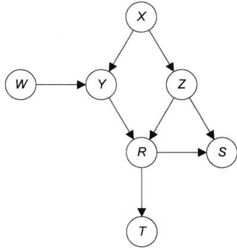

图 7.4 马尔可夫条件对于此 DAG 蕴含 \( I_P(W, X) \)。

| 条件独立性 | 条件独立性未被蕴含的原因 |
|---|---|
| \( I_P(X, Y | H) \) | \( [X, B, C, D, Y] \) 未被阻断 |
| \( I_P(X, Y | D) \) | \( [X, F, H, I, Y] \) 未被阻断 |
| \( I_P(X, Y | \{H, C, K\}) \) | \( [X, J, K, L, Y] \) 未被阻断 |
| \( I_P(X, Y | \{H, C, M\}) \) | \( [X, J, K, L, Y] \) 未被阻断 |

**示例 7.4** 归功于定理 7.1，马尔可夫条件对于图 7.4 中的 DAG 蕴含以下条件独立性。

| 条件独立性 | 条件独立性被蕴含的原因 |
|---|---|
| \( I_P(W, X) \) | \( [W, Y, X] \) 在 \( Y \) 处被阻断 |
| | \( [W, Y, R, Z, X] \) 在 \( R \) 处被阻断 |
| | \( [W, Y, R, S, Z, X] \) 在 \( S \) 处被阻断 |

请注意，\( I_P(W, X) \) 与 \( I_P(W, X | \varnothing) \) 相同，其中 \( \varnothing \) 是空集，且 \( Y \)、\( R \)、\( S \) 和 \( T \) 均不在 \( \varnothing \) 中。

## 7.2 忠实性

回顾一下，如果每个满足与 DAG 的马尔可夫条件的概率分布都必须具有该条件独立性，则 DAG 蕴含条件独立性。定理 7.1 指出，所有且仅 d-分离

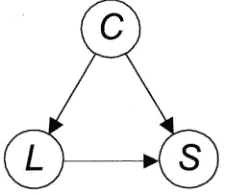

图 7.5 一个完全 DAG。

是被蕴含的条件独立性。不要误解此结果。它并不表示，如果某个特定的概率分布 P 满足与 DAG G 的马尔可夫条件，那么 P 就不能具有 G 未蕴含的条件独立性。相反，它只表示 P 必须具有所有被蕴含的条件独立性。我们接下来说明这种差异。

### 7.2.1 不忠实的概率分布

我们展示两个满足与 DAG 的马尔可夫条件且包含 DAG 未蕴含的条件独立性的概率分布示例。

**示例 7.5** 完全 DAG 是指每对节点之间都有边的 DAG。图 7.5 显示了一个包含三个节点 C、L 和 S 的完全 DAG G。完全 DAG 不蕴含任何条件独立性。因此，C、L 和 S 的每个概率分布 P 都满足与图 7.5 中的 DAG 的马尔可夫条件。

另一种看待此问题的方法是注意到链式法则表明，对于 C、L 和 S 的每个概率分布 P，对于所有值 c、l 和 s，

$P(c, l, s) = P(s|l, c)P(l|c)P(c).$

因此，P 等于其对于图 7.5 中的 DAG 的条件分布的乘积，这意味着，归功于定理 6.1，P 满足与该 DAG 的马尔可夫条件。

然而，任何具有条件独立性的概率分布都将具有完全 DAG G 未蕴含的条件独立性。例如，考虑在示例 6.1 中讨论的 C、L 和 S 的联合概率分布 P。我们证明了

$I_P(L, S|C).$

因此，该分布具有 G 未蕴含的条件独立性。

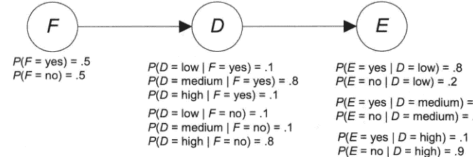

图 7.6 对于此贝叶斯网络中的分布 P，我们有 I_P(E, F)，但马尔可夫条件不蕴含此条件独立性。

**示例 7.6** 考虑图 7.6 中的贝叶斯网络。马尔可夫条件对于该图中的 DAG G 蕴含的唯一条件独立性是 I_P(E, F|D)。因此，定理 7.1 表明，所有满足与 G 的马尔可夫条件的概率分布都必须具有 I_P(E, F|D)，这意味着图 7.6 中贝叶斯网络的概率分布 P 必须具有 I_P(E, F|D)。然而，定理并不表示 P 不能具有其他独立性。事实上，作为练习留给读者，证明对于该贝叶斯网络中的分布 P 我们有 I_P(E, F)。

我们有意为图 7.6 中网络中的条件分布分配了值，以实现 I_P(E, F)。如果我们随机分配值，我们几乎可以肯定会获得一个不具有此独立性的概率分布。也就是说，Meek [1995] 证明，对贝叶斯网络中的条件分布进行的几乎所有值分配都将导致一个仅具有马尔可夫条件所蕴含的条件独立性的概率分布。

自然界中的实际现象会导致类似于图 7.6 的分布吗？尽管我们编造了该图中网络中的数字，但我们是根据自然界中实际发生的事情来模式化的。让图中的变量表示以下内容：

| 变量 | 变量表示的内容 |
|---|---|
| F | 受试者是否服用非那雄胺 |
| D | 受试者的二氢睾酮水平 |
| E | 受试者是否患有勃起功能障碍 |

如示例 6.4 所示，二氢睾酮似乎是勃起功能所必需的激素。回顾示例 6.8，默克公司进行了一项研究，表明非那雄胺对头发生长具有积极的因果影响。非那雄胺通过抑制睾酮转化为二氢睾酮来实现这一点，二氢睾酮是导致脱发的激素。鉴于此，默克公司担心二氢睾酮会导致勃起功能障碍。也就是说，通常如果 X 对 Y 具有因果影响，Y 对 Z 具有因果影响，那么

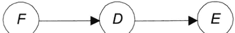

| P(F = yes) = .6 | P(D = low | F = yes) = .2 | P(E = yes | D = low) = .7 |
| P(F = no) = .4 | P(D = medium | F = yes) = .4 | P(E = no | D = low) = .3 |
| | P(D = high | F = yes) = .4 | P(E = yes | D = medium) = .2 |
| | P(D = low | F = no) = .3 | P(E = no | D = medium) = .8 |
| | P(D = medium | F = no) = .2 | P(E = yes | D = high) = .1 |
| | P(D = high | F = no) = .5 | P(E = no | D = high) = .9 |

**图 7.7** 此贝叶斯网络中的概率分布对网络中的 DAG 是忠实的。

X 通过 Y 对 Z 具有因果影响。然而，在一项操纵研究中，默克公司发现 F 似乎对 E 没有因果影响。也就是说，他们了解到 $I_P(E, F)$。这种情况的解释是，非那雄胺不会将二氢睾酮水平降低到某个阈值以下，而该阈值水平对于勃起功能来说是全部所需。我们在图 7.6 的贝叶斯网络中分配的数字反映了这些因果关系。F 的值对 D 是否为低没有影响，且 D 必须为低才能使 E 为 yes 的概率变高。

### 7.2.2 忠实性条件

图 7.6 中贝叶斯网络中的概率分布被认为对该图中的 DAG 不忠实，因为它包含马尔可夫条件未蕴含的条件独立性。我们有以下定义：

**定义 7.4** 假设我们有一个集合 V 中随机变量的联合概率分布 P 和一个 DAG G = (V, E)。如果 P 中的所有且仅条件独立性都由 G 蕴含，则我们说 (G, P) 满足 **忠实性条件**。此外，我们说 P 和 G 互为忠实。$\blacklozenge$

请注意，忠实性条件包含马尔可夫条件，因为 *仅* P 中的条件独立性才能由 G 蕴含。然而，它要求更多；也就是说，它要求 P 中的 *所有* 条件独立性都必须由 G 蕴含。如前所述，对条件分布进行的几乎所有值分配都将导致忠实分布。例如，作为练习留给读者，证明图 7.7 中贝叶斯网络中的概率分布 P 对该图中的 DAG 是忠实的。我们任意为图中的条件分布分配了值。然而，归功于 [Meek, 1995] 的结果，即对条件分布中的值进行的几乎所有分配都会导致 con-


**图 7.8** 这些 DAG 是马尔可夫等价的，且不存在其他与它们马尔可夫等价的 DAG。

条件分布将导致一个忠实分布，我们愿意打赌这个赋值也会如此。

是否存在某个与图 7.6 中贝叶斯网络的概率分布忠实的 DAG？答案是否定的，但超出了本书展示此内容的范围。有关此事实的证明，请参见 [Neapolitan, 2004]。直观地讲，图 7.6 中的 DAG 表示变量之间的因果关系，这意味着我们不应该能找到一个更能表示概率分布的 DAG。

## 7.3 马尔可夫等价

许多 DAG 在意义上是等价的，即它们具有相同的 d-分离，这意味着它们蕴含相同的条件独立性。例如，图 7.8 中的每个 DAG 都包含 d-分离 \(I_G(Y, Z | X)\) 和 \(I_G(X, W | \{Y, Z\})\)，并且这些是每个 DAG 独有的 d-分离。在给出这种等价的正式定义后，我们给出一个定理，说明它如何与概率分布相关联。最后，我们建立一个识别这种等价的准则。

### 定义 7.5
设 \(\mathbb{G}_1 = (\mathsf{V}, \mathsf{E}_1)\) 和 \(\mathbb{G}_2 = (\mathsf{V}, \mathsf{E}_2)\) 是包含同一变量集 \(\mathsf{V}\) 的两个 DAG。那么，如果对于每三个互不相交的子集 \(\mathsf{A}, \mathsf{B}, \mathsf{C} \subseteq \mathsf{V}\)，\(\mathsf{A}\) 和 \(\mathsf{B}\) 在 \(\mathbb{G}_1\) 中被 \(\mathsf{C}\) d-分离当且仅当 \(\mathsf{A}\) 和 \(\mathsf{B}\) 在 \(\mathbb{G}_2\) 中被 \(\mathsf{C}\) d-分离，则称 \(\mathbb{G}_1\) 和 \(\mathbb{G}_2\) 为 **马尔可夫等价**。即，

\(I_{\mathbb{G}_1}(\mathsf{A}, \mathsf{B}|\mathsf{C}) \Longleftrightarrow I_{\mathbb{G}_2}(\mathsf{A}, \mathsf{B}|\mathsf{C}).\blacklozenge\)

尽管前一个定义仅涉及图属性，但由于以下定理，其应用在于概率：

### 定理 7.2
两个 DAG 是马尔可夫等价的，当且仅当它们蕴含相同的条件独立性。

**证明。** 证明直接从定理 7.1 得出。\(\blacksquare\)


**图 7.9** (a) 和 (b) 中的 DAG 是马尔可夫等价的。(c) 和 (d) 中的 DAG 与前两个 DAG 或彼此都不是马尔可夫等价的。

### 推论 7.1
设 G1 = (V, E1) 和 G2 = (V, E2) 是包含同一变量集 V 的两个 DAG。那么，G1 和 G2 是马尔可夫等价的，当且仅当对于 V 的每个概率分布 P，(G1, P) 满足马尔可夫条件当且仅当 (G2, P) 满足马尔可夫条件。

**证明。** 证明留作练习。

接下来的定理使我们能够识别马尔可夫等价。该定理最早由 [Pearl et al., 1989] 提出。首先我们需要这个定义。我们说在 DAG G 的一条链上，X 处存在一个 **非耦合的头对头相遇**，如果在 X 处存在一个头对头相遇 Y → X ← Z，且 Y 和 Z 之间没有边。

### 定理 7.3
两个 DAG G1 和 G2 是马尔可夫等价的，当且仅当它们具有相同的链接（不考虑方向的边）和相同的非耦合头对头相遇集合。

**证明.** 证明可见 [Neapolitan, 2004]。

### 示例 7.7
图 7.9 (a) 和 7.9 (b) 中的 DAG 是马尔可夫等价的，因为它们具有相同的链接，并且两者中唯一的非耦合头对头相遇是 X → Z ← Y。图 7.9 (c) 中的 DAG 与前两个不是马尔可夫等价的，因为它具有链接 W - Y。图 7.9 (d) 中的 DAG 与前两个不是马尔可夫等价的，因为，尽管它具有相同的链接，但它没有非耦合头对头相遇 X → Z ← Y。显然，图 7.9 (c) 和 7.9 (d) 中的 DAG 彼此不是马尔可夫等价的。

定理 7.3 使我们能够轻松开发一个多项式时间算法，用于判断两个 DAG 是否是马尔可夫等价的。该算法只需检查两个 DAG 是否具有相同的链接和相同的非耦合头对头相遇集合。编写这样的算法留作练习。

此外，定理 7.3 为我们提供了一种用单个图表示马尔可夫等价类的简单方法。也就是说，我们可以用一个图来表示马尔可夫等价类，该图具有与类中 DAG 相同的链接和相同的非耦合头对头相遇。对该图中无向边进行任何方向分配，只要不创建新的非耦合头对头相遇或有向环，就得到等价类的一个成员。

通常，除了非耦合头对头相遇之外，还有边必须在马尔可夫等价 DAG 中以相同方向定向。例如，如果给定马尔可夫等价类中的所有 DAG 都具有边 X → Y，且非耦合相遇 X → Y - Z 不是头对头的，那么等价类中的所有 DAG 都必须将 Y - Z 定向为 Y → Z。因此，我们为马尔可夫等价类定义一个 **DAG 模式**，即具有与等价类中 DAG 相同的链接，并且仅对等价类中所有 DAG 共有的边进行定向的图。DAG 模式中的定向链接称为


**图 7.10** 这个 DAG 模式表示图 7.8 中的马尔可夫等价类。

**被迫边。** 图 7.10 中的 DAG 模式表示图 7.8 中的马尔可夫等价类。图 7.11 (b) 中的 DAG 模式表示图 7.11 (a) 中的马尔可夫等价类。请注意，没有一个与图 7.11 (a) 中每个 DAG 马尔可夫等价的 DAG，可以将 $W - U$ 定向为 $W \leftarrow U$，因为这将创建另一个非耦合头对头相遇。

## 7.4 马尔可夫毯和边界

一个贝叶斯网络可以有大量节点，给定节点的条件概率可能受到实例化远处节点的影响。然而，事实证明，实例化一组近处节点可以屏蔽一个节点免受所有其他节点的影响。接下来的定义和定理展示了这一点。

### 定义 7.6
设 V 是一组随机变量，P 是它们的联合概率分布，且 $X \in V$。那么，X 的一个 **马尔可夫毯** M 是任何变量集，使得给定 M 时，X 与所有其他变量条件独立。即，
$I_P(X, V - (M \cup \{X\})|M).\blacklozenge$

### 定理 7.4
假设 (G, P) 满足马尔可夫条件。那么，对于每个变量 X，X 的所有父节点、子节点和子节点的父节点的集合是 X 的一个马尔可夫毯。

**证明.** 显然，X 的所有父节点、子节点和子节点的父节点的集合将 X 与 V 中的所有其他节点 d-分离。因此，证明从定理 7.1 得出。$\blacksquare$


**图 7.11** (b) 中的 DAG 模式表示 (a) 中的马尔可夫等价类。


**图 7.12** 如果 P 与此 DAG 满足马尔可夫条件，那么 {T, Y, Z} 是 X 的一个马尔可夫毯。

### 示例 7.8
假设 (G, P) 满足马尔可夫条件，其中 G 是图 7.12 中的 DAG。那么，由于定理 7.4，{T, Y, Z} 是 X 的一个马尔可夫毯。因此，我们有
\( I_P(X, \{S, W\}|\{T, Y, Z\}) \)。

### 示例 7.9
假设 (G, P) 满足马尔可夫条件，其中 G 是图 7.12 中的 DAG，并且 P 具有以下条件独立性：

\( I_P(X, \{S, T, W\}|\{Y, Z\}) \)。

那么，马尔可夫毯 {T, Y, Z} 不是最小的，因为它的子集 {Y, Z} 也是 X 的一个马尔可夫毯。

最后一个示例激发了以下定义。

### 定义 7.7
设 V 是一组随机变量，P 是它们的联合概率分布，且 $X \in V$。那么，X 的一个 **马尔可夫边界** 是任何马尔可夫毯，使得它的任何真子集都不是 X 的马尔可夫毯。\(\blacklozenge\)

我们有以下定理。

### 定理 7.5
假设 (G, P) 满足忠实性条件。那么，对于每个变量 X，X 的所有父节点、子节点和子节点的父节点的集合是 X 的唯一马尔可夫边界。

**证明.** 证明可见 [Neapolitan, 2004]。\(\blacksquare\)

### 示例 7.10
假设 (G, P) 满足忠实性条件，其中 G 是图 7.12 中的 DAG。那么，由于定理 7.5，{T, Y, Z} 是 X 的唯一马尔可夫边界。\(\blacksquare\)


## 练习

### 第 7.1 节

练习 7.1 考虑图 7.2 (a) 中的 DAG G。证明马尔可夫条件对 G 蕴含 Ip(C, G|{A, F})。

练习 7.2 假设我们向图 7.2 (a) 中的 DAG G 添加另一个变量 R，一条从 F 到 R 的边，以及一条从 R 到 C 的边。变量 R 可能代表教授的初始声誉。说明你认为以下哪些条件独立性由 G 的马尔可夫条件蕴含。对于你认为被蕴含的每一项，尝试证明它确实成立。

- 1. Ip(R, A)
- 2. Ip(R, A|F)
- 3. Ip(R, A|{F, C})

练习 7.3 证明马尔可夫条件对图 7.4 中的 DAG 蕴含以下条件独立性。

- 1. Ip(X, R|{Y, Z})
- 2. Ip(X, T|{Y, Z})
- 3. Ip(W, T|R)
- 4. Ip(Y, Z|X)
- 5. Ip(W, S|{R, Z})
- 6. Ip(W, S|{Y, Z})
- 7. Ip(W, S|{Y, X})

练习 7.4 证明马尔可夫条件不对图 7.4 中的 DAG 蕴含以下条件独立性。

- 1. Ip(W, X|Y)
- 2. Ip(W, T|Y)

练习 7.5 说明以下哪些条件独立性由图 7.4 中的 DAG 的马尔可夫条件蕴含。

- 1. Ip(W, S|{R, X})


图 7.13 通过为该网络中的参数赋值而得到的任何概率分布 P 都不忠实于网络中的 DAG，因为我们有 $I_P(X, Z)$。

- 2. $I_P(\{W, X\}, \{S, T\}|\{R, Z\})$
- 3. $I_P(\{Y, Z\}, T|\{R, S\})$
- 4. $I_P(\{X, S\}, \{W, T\}|\{R, Z\})$
- 5. $I_P(\{X, S, Z\}, \{W, T\}|R)$
- 6. $I_P(\{X, Z\}, W)$
- 7. $I_P(\{X, S\}, W)$

练习 7.6 马尔可夫条件是否对图 7.4 中的 DAG 中变量 U 的任何子集蕴含 $I_P(\{X, S\}, W|\mathbf{U})$？

### 第 7.2 节

练习 7.7 证明图 7.6 中贝叶斯网络的分布 P 满足 $I_P(F, E)$。

练习 7.8 考虑图 7.13 中的贝叶斯网络。证明对于所有赋予 a、b、c、d、e 和 f 值并产生概率分布 P 的情况，我们都有 $I_P(X, Z)$。这样的概率分布不忠实于该图中的 DAG，因为 X 和 Z 不被空集 d-分离。请注意，图 7.6 中的概率分布是该分布族的一个成员。


图 7.14 通过为该网络中的参数赋值而得到的任何概率分布 P 都不忠实于网络中的 DAG，因为我们有 $I_P(X, W)$。

**练习 7.9** 为图 7.13 中的 DAG 的条件分布赋予任意值，并看看生成的分布是否忠实于 DAG。尝试找出该图所示分布族之外的非忠实分布。

**练习 7.10** 考虑图 7.14 中的贝叶斯网络。证明对于所有赋予 $a, b, c, d, e,$ 和 $f$ 值并产生概率分布 $P$ 的情况，我们都有 $I_P(X, W)$。这样的概率分布不忠实于该图中的 DAG，因为 $X$ 和 $W$ 不被空集 d-分离。

如果图 7.14 中 DAG 的边代表因果影响，当 $X$ 对 $W$ 通过 $Y$ 的因果效应抵消了 $X$ 对 $W$ 通过 $Z$ 的因果效应时，$X$ 和 $W$ 将是独立的。如果 $X$ 代表个人的年龄，$W$ 代表个人的打字能力，$Y$ 代表个人的经验，$Z$ 代表个人的手部灵活性，你是否认为 $X$ 和 $W$ 可能出于这个原因而独立？

**练习 7.11** 考虑图 7.15 中的贝叶斯网络。证明对于所有赋予 $a, b, c, d, e, f,$ 和 $g$ 值并产生概率分布 $P$ 的情况，我们都有 $I_P(X, Y|Z)$。这样的概率分布不忠实于该图中的 DAG，因为 $X$ 和 $Y$ 不被 $Z$ d-分离。

如果图 7.15 中 DAG 的边代表因果影响，当没有发生折扣时，$X$ 和 $Y$ 在给定 $Z$ 的条件下将是独立的。尝试找出一些可能表现出这种行为的因果影响。


图 7.15 通过为该网络中的参数赋值而得到的任何概率分布 P 都不忠实于网络中的 DAG，因为我们有 $I_P(X, Y|Z)$。

### 第 7.3 节

练习 7.12 证明推论 7.1。

练习 7.13 编写一个算法，判断两个 DAG 是否马尔可夫等价。

### 第 7.4 节

练习 7.14 应用定理 7.4，为图 7.12 中 DAG 的节点 Z 找到一个马尔可夫毯。

练习 7.15 应用定理 7.4，为图 7.4 中的节点 Y 找到一个马尔可夫毯。

# 第 8 章

# 决策分析


一般来说，通过在贝叶斯网络中进行推理获得的信息可以用于做出决策，尽管贝叶斯网络本身并不推荐决策。在本章中，我们扩展了贝叶斯网络的结构，使网络实际上能够推荐决策。这样的网络称为影响图。第 8.1 节介绍了决策树，它们在数学上等价于影响图，但难以表示大型实例，因为其大小随变量数量呈指数增长。在第 8.2 节中，我们讨论了影响图，其大小仅随变量数量呈线性增长。当使用决策树和影响图来建模货币决策时，推荐的决策是使货币结果的期望值最大化的决策。如果涉及的金额相对于个人的总财富来说很大，大多数人不会仅通过最大化期望值来做出货币决策。也就是说，大多数人都是风险厌恶的。因此，一般来说，在使用决策分析来推荐决策时，我们需要建模个人对风险的态度。第 8.3 节展示了如何使用个人效用函数来做到这一点。决策者可能更倾向于直接分析风险，而不是评估效用函数。在第 8.4 节中，我们讨论了风险概况，它使决策者能够做到这一点。第 8.5 节区分了好的决策和好的结果。影响图和决策树都要求我们评估概率和结果。有时精确评估这些值可能是一项困难且费力的任务，并且进一步细化这些值无论如何都不会影响我们的决策。第 8.6 节展示了如何衡量我们的决策对概率值的敏感性。通常，在做出决策之前，我们可以获取信息，但需要付出代价。例如，在决定购买股票之前，我们可能能够购买投资分析师的建议。在第 8.7 节中，我们说明了如何计算信息的价值，这使我们能够确定信息是否值得其成本。

### 8.1 决策树

在介绍一些简单的决策树示例后，我们讨论了关于其使用的几个问题。然后我们提供更复杂的示例。

### 8.1.1 简单示例

我们从以下示例开始：

示例 8.1 假设你最喜欢的股票 NASDIP 被一位声誉良好的分析师下调评级，每股价格从 40 美元暴跌至 10 美元。你觉得这是个好的买入时机，但其中存在大量不确定性。NASDIP 的季度收益即将公布，你认为收益会很好，这应该会对其市值产生积极影响。然而，你也认为整个市场有很大机会崩盘，这将对 NASDIP 的市值产生负面影响。为了量化你的不确定性，你决定市场崩盘的概率为 0.25，在这种情况下，你认为 NASDIP 将在本月底跌至 5 美元。如果市场不崩盘，你认为到本月底，NASDIP 将根据收益报告要么在 10 美元，要么在 20 美元。你认为它在 20 美元的可能性是在 10 美元的两倍。因此，你分配 0.5 的概率给 NASDIP 在本月底达到 20 美元，0.25 的概率给它达到 10 美元。你现在的决定是购买 100 股 NASDIP 花费 1000 美元，还是将 1000 美元留在银行中，下个月将获得 0.005 的利息。做出决定的一种方法是确定如果你购买 NASDIP，你的投资的期望值，并将该值与金额进行比较。


图 8.1 表示示例 8.1 中问题实例的决策树。

如果你把钱存入银行，你会拥有的钱数。设 X 为一个随机变量，其值为如果你购买 NASDIP，一个月后你 1000 美元投资的价值。如果 NASDIP 涨到 $5，你的投资将价值 $500；如果它保持在 $10，你的投资将价值 $1000；如果它涨到 $20，它将价值 $2000。因此，

```
E(X) = .25($500) + .25($1000) + .5($2000)
= $1375,
```

其中 E 表示期望值。如果你把钱留在银行，你的投资将价值

```
1.005($1000) = $1005.
```

如果你是所谓的期望值最大化者，你的决定将是购买 NASDIP，因为该决定具有更大的期望值。■

前一个示例中的问题实例可以用决策树表示。该树如图 8.1 所示。决策树包含两种节点：表示随机变量的机会节点（或不确定性节点）和表示待做决策的决策节点。我们将这些节点描绘如下：

- (O) - 机会节点
- ([]) - 决策节点

一个决策表示决策者可以采取的一组互斥且穷尽的行动。每个行动在决策中称为一个备选方案。


图 8.2 基于图 8.1 中决策树的已求解决策树。

决策中的每个备选方案都有一条从决策节点发出的边。在图 8.1 中，我们有决策节点 D，包含两个备选方案：“购买 NASDIP”和“将 $1000 留在银行中”。对于随机变量的每个可能结果（值），都有一条从机会节点发出的边。我们在边上显示结果的概率，并在边的右侧显示结果的效用。结果的效用是该结果对决策者的价值。当一笔金额相对于一个人的总财富较小时，我们通常可以将结果的效用视为给定结果下实现的金额。目前，我们做出此假设。讨论不做此假设的情况见第 8.3 节。因此，例如，如果你购买 100 股 NASDIP，且 NASDIP 涨到 $20，我们假设该结果对你的效用是 $2000。在图 8.1 中，我们有机会节点 NASDIP，包含三个可能的结果效用，即 $500、$1000 和 $2000。机会节点的期望效用 EU 定义为与其结果相关的效用的期望值。决策备选方案的期望效用定义为如果做出该决策所遇到的机会节点的期望效用。如果在采用备选方案时存在确定性，则期望效用是该确定结果的价值。因此，

```
EU(Buy NASDIP) = EU(NASDIP) = .25($500) + .25($1000) + .5($2000)
= $1375
```

```
EU(Leave $1000 in bank) = $1005.
```

最后，决策节点的期望效用定义为其所有备选方案期望效用的最大值。因此，

```
EU(D) = max($1375, $1005) = $1375.
```

所选备选方案是期望效用最大的那个。确定这些期望效用的过程称为求解决策树。


图 8.3 当另一个选择是购买 NASDIP 期权时，涉及 NASDIP 的投资决策的决策树模型。

求解后，我们在节点上方显示期望效用，并用箭头指向所选备选方案。基于图 8.1 中决策树的已求解决策树如图 8.2 所示。识别问题的组成部分、将问题结构化为决策树（或影响图）、求解决策树（或影响图）、进行敏感性分析（见第 6 章，第 8.6 节）以及可能重复这些步骤的整个过程称为决策分析。

示例 8.2 假设你处于与示例 8.1 相同的情况，但除了考虑将钱留在银行中之外，你的另一个选择是购买 NASDIP 期权。期权成本为 $1000，它允许你在一个月内以每股 $11 的价格购买 500 股 NASDIP。因此，如果一个月后 NASDIP 为每股 $5 或 $0，你将不会行使你的期权，并且你将损失 $1000。然而，如果一个月后 NASDIP 为每股 $20，你将行使你的期权，并且你的 $1000 投资将价值

```
500($20 - $11) = $4500.
```

图 8.3 显示了表示此问题实例的决策树。从该树中，我们有

```
EU(Buy option) = EU(NASDIP2) = .25($0) + .25($0) + .5($4500) = $2250.
```

回顾 EU(Buy NASDIP) 仅为 $1375。因此，我们的决定将是购买期权。将已求解决策树的展示留作练习。

请注意，图 8.3 中的决策树是对称的，而图 8.2 中的则不是。原因是无论做出哪个决定，我们都会遇到相同的不确定事件。只有结果的效用不同。

在继续之前，我们来解决你可能有的一个顾虑。即，你可能会想知道个人如何在示例 8.1 中得出 .25、.5 和 .25 的概率。这些概率通常不是相对频率；相反，它们是代表个人合理数值信念的主观概率。个人通过对情况的仔细分析得出这些概率。评估主观信念的方法在第 2 章，第 5.3.2 节中简要讨论过，并在 [Neapolitan, 1996] 中更详细地讨论。即便如此，你可能会争辩说，个人肯定会相信 NASDIP 一股的可能未来价值远不止三个。个人如何声称唯一可能的值是 $5、$10 和 $20？你是对的。但是，如果对个人信念的进一步细化不会影响决策，那么就没有必要这样做。因此，如果决策者认为包含更多值的模型不会导致不同的决策，那么仅使用包含 $5、$10 和 $20 值的模型就足够了。

### 8.1.2 求解更复杂的决策树

求解决策树的通用算法非常简单。决策树中存在从左到右的时间顺序。也就是说，任何位于另一个节点右侧的节点在时间上发生在该节点之后。树的求解过程如下：

- 从右侧开始，
- 向左进行
- 将期望效用传递给机会节点；
- 将最大值传递给决策节点；
- 直到到达根节点。

我们现在展示使用决策树建模的更复杂示例。

示例 8.3 假设 Nancy 是一名大玩家，她正在考虑以每股 $10 的价格购买 10,000 股 ICK。购买的股数如此之多，以至于如果她购买，可能会影响市场活动并推高 ICK 的价格。她还相信道琼斯工业平均指数的总体价值会影响 ICK 的价格。她认为一个月后道琼斯指数将为 10,000 或 11,000。ICK 将为每股 $5 或 $20。她的另一个选择是以 $100,000 购买 ICK 期权。该期权将允许她在一个月内以每股 $15 的价格购买 50,000 股 ICK。为了分析此问题实例，她构建了以下概率：

- P(ICK = $5|Decision = Buy ICK, Dow = 11,000) = .2
- P(ICK = $5|Decision = Buy ICK, Dow = 10,000) = .5
- P(ICK = $5|Decision = Buy option, Dow = 11,000) = .3
- P(ICK = $5|Decision = Buy option, Dow = 10,000) = .6.


图 8.4 表示 Nancy 决定是购买 ICK 还是购买 ICK 期权的决策树。

一个从决策节点 D 开始的已求解决策树图。它分支为机会节点 DOW1 和 DOW2。DOW1 分支为 ICK1 和 ICK2。DOW2 分支为 ICK3 和 ICK4。终端节点显示货币值（$0、$50,000、$200,000、$250,000）及其关联的概率和值（$5、$20）。

可见的关键标签：
- 节点 D
- 节点 DOW1, DOW2
- 节点 ICK1, ICK2, ICK3, ICK4
- 数值：$152,000, $145,000, $170,000, $125,000, $175,000, $100,000
- 分支上的概率/数值：11,000 .6, 10,000 .4, $5 .2, $20 .8, $5 .5, $20 .5, $5 .3, $20 .7, $5 .6, $20 .4
- 结果：$50,000, $200,000, $0, $250,000

图 8.5 基于图 8.4 中决策树的已求解决策树。


此外，她指定
P(Dow = 11,000) = .6.

该问题实例由图 8.4 中的决策树表示。接下来我们求解该树：

EU(ICK₁) = (.2)($50,000) + (.8)($200,000) = $170,000

EU(ICK₂) = (.5)($50,000) + (.5)($200,000) = $125,000

EU(Buy ICK) = EU(DOW₁) = (.6)($170,000) + (.4)($125,000) = $152,000

EU(ICK₃) = (.3)($0) + (.7)($250,000) = $175,000

EU(ICK₄) = (.6)($0) + (.4)($250,000) = $100,000

EU(Buy option) = EU(DOW₂) = (.6)($175,000) + (.4)($100,000) = $145,000

EU(D) = max($152,000, $145,000) = $152,000.

求解后的决策树如图 8.5 所示。决策是购买 ICK。■

前一个示例说明了决策树的一个问题。即，用决策树表示问题实例的规模会随实例大小呈指数增长。请注意，示例 8.3 中的实例仅比示例 8.2 中的实例多一个元素；也就是说，它包含了关于 Dow 的不确定性。然而，其表示规模却大了一倍。因此，用决策树表示大型实例相当困难。我们将在下一节中看到，影响图不存在这个问题。在此之前，我们展示更多示例。

### 示例 8.4

山姆有机会以 10,000 美元购买一辆 1996 年的 Spiffycar 汽车，并且他有一位潜在买家，如果该车机械状况极佳，愿意支付 11,000 美元购买。山姆判断，除了变速箱外，所有机械部件都处于极佳状态。如果变速箱损坏，山姆需要花费 3000 美元进行修理，并且在潜在买家购买之前必须修好。因此，如果他购买了该车且变速箱损坏，他最终只能得到 8000 美元。他自己无法判断变速箱的状况。然而，他有一位朋友可以对变速箱进行测试。该测试并非绝对准确。相反，30% 的时间它会将良好的变速箱判断为损坏，10% 的时间它会将损坏的变速箱判断为良好。为了表示变速箱与测试之间的这种关系，我们定义以下随机变量：

| 变量 | 取值 | 变量取该值时的情况 |
| :--- | :--- | :--- |
| Test | positive | 测试判断变速箱损坏。 |
| | negative | 测试判断变速箱良好。 |
| Tran | good | 变速箱良好。 |
| | bad | 变速箱损坏。 |


图 8.6 表示示例 8.4 中问题实例的决策树。

前面的讨论表明，我们有以下条件概率：

$P(Test = positive|Tran = good) = .3$
$P(Test = positive|Tran = bad) = .9$

此外，山姆知道 20% 的 1996 年 Spiffycar 汽车变速箱损坏。即，

$P(Tran = good) = .8$.

山姆将让他的朋友免费进行测试，然后再决定是否购买该车。

该问题实例在图 8.6 的决策树中表示。首先请注意，如果他不购买该车，结果仅为 10,000 美元。这是因为未来时间点非常近，我们可以将利息视为可忽略不计。请进一步注意，该树中的概率并非示例中给出的概率。它们必须从给定的概率计算得出。我们接下来进行计算。从 Test 节点发出的上边缘上的概率是测试为正的先验概率。它的计算方法如下（请注意，我们使用简写符号）：

$P(positive) = P(positive|good)P(good) + P(positive|bad)P(bad)$
$= (.3)(.8) + (.9)(.2) = .42.$


图 8.7 基于图 8.6 中决策树的求解后的决策树。

从 $Tran_1$ 节点发出的上边缘上的概率是，在测试为正的条件下变速箱良好的概率。我们使用贝叶斯定理按如下方式计算：

```
P(good|positive) = \frac{P(positive|good)P(good)}{P(positive)}
= \frac{(.3)(.8)}{.42} = .571429.
```

将树中剩余概率的确定留作练习。接下来，我们求解该树：

```
EU(Tran_1) = (.571429)($11,000) + (.428571)($8000) = $9714
EU(D_1) = max($9714, $10,000) = $10,000
EU(Tran_2) = (.965517)($11,000) + (.034483)($8000) = $10,897
EU(D_2) = max($10,897, $10,000) = $10,897.
```

无需计算 $Test$ 节点的期望值，因为其左侧没有决策。求解后的决策树如图 8.7 所示。如果测试为正，决策是不购买该车；如果测试为负，决策是购买该车。


图 8.8 表示示例 8.5 中问题实例的决策树。

前一个示例说明了决策树的另一个问题。即，决策树所需的概率并不总是我们容易获得的。因此，我们必须使用全概率公式和贝叶斯定理来计算它们。我们将看到，影响图也不存在这个问题。更多示例如下。

### 示例 8.5

假设山姆与示例 8.4 中的情况相同，只是测试不是免费的。相反，测试费用为 200 美元。因此，山姆必须决定是否进行测试、不进行测试购买汽车，或者保留他的 10,000 美元。表示该问题实例的决策树如图 8.8 所示。请注意，进行测试时的结果均比示例 8.4 中的相应结果少 200 美元。这是因为进行测试需要花费 200 美元。请进一步注意，如果在不进行测试的情况下购买车辆，变速箱良好的概率仅为其先验概率 0.8。这是因为未进行测试。因此，我们关于变速箱的唯一信息就是先验信息。接下来，我们求解决策树。将证明以下结论留作练习：

$EU(D_1) = \$9800$
$EU(D_2) = \$10,697.$

因此，

$EU(Test) = (.42)(\$9800) + (.58)(\$10,697) = \$10,320.$

此外，

$EU(Tran_3) = (.8)(\$11,000) + (.2)(\$8000) = \$10,400.$

最后，

$EU(D_3) = \max(\$10,320, \$10,400, \$10,000) = \$10,400.$

因此，山姆的决定是不进行测试购买该车辆。将展示求解后的决策树留作练习。

接下来的两个示例说明结果非数值的情况。

### 示例 8.6

假设列奥纳多刚买了一套新西装，他即将出门上班，天气看起来可能会下雨。列奥纳多从火车站到办公室需要长途步行。因此，他知道如果下雨且他没有带伞，他的西装就会被弄坏。他的雨伞肯定能保护西装不受雨淋。然而，他讨厌整天拖着雨伞走来走去的不便。鉴于他认为下雨的概率为 0.4，他应该带伞吗？表示该问题实例的决策树如图 8.9 所示。

请注意，结果具有数值，这是求解问题所必需的。我们按如下方式分配这些值。显然，从最差到最佳的结果排序如下：

- 1. 西装被毁
- 2. 西装未被毁，但有不便
- 3. 西装未被毁。

我们给最差结果分配效用 0，给最佳结果分配效用 1。因此，

$U(\text{suit ruined}) = 0$
$U(\text{suit not ruined}) = 1.$

然后我们考虑彩票（机会节点）\( L_p \)，列奥纳多以概率 \( p \) 获得结果“西装未被毁”，并以概率


图 8.9 表示示例 8.6 中问题实例的决策树。

概率 $1 - p$ 获得结果“西装被毁”。“西装未被毁，但有不便”的效用定义为彩票 $L_p$ 的期望效用，此时列奥纳多在彩票 $L_p$ 与确定获得“西装未被毁，但有不便”之间无差异。我们有

```
U(suit not ruined, inconvenience)
\equiv EU(L_p)
= pU(suit not ruined) + (1 - p)U(suit ruined)
= p(1) + (1 - p)0 = p.
```

假设列奥纳多决定 $p = .8$。那么

```
U(suit not ruined, inconvenience) = .8.
```

我们现在求解图 8.9 中的决策。

```
EU(R) = (.4)(0) + (.6)(1) = .6
EU(D) = max(.6, .8) = .8.
```

因此，决定是带伞。

前一个示例中用于获取数值的方法很容易扩展到超过三个结果的情况。例如，假设存在第四个结果“西装送去干洗”，它在偏好排序中位于“西装未被毁，但有不便”和“西装未被毁”之间。我们考虑彩票 $L_q$，列奥纳多以概率 $q$ 获得结果“西装未被毁”，并以概率 $1 - q$ 获得结果“西装未被毁，但有不便”。“西装送去干洗”的效用定义为彩票 $L_q$ 的期望效用，此时列奥纳多在彩票 $L_q$ 与确定获得“西装送去干洗”之间无差异。我们有


图 8.10 表示阿米特关于是否接受链球菌感染治疗的决策树。

U(suit goes to cleaners)
\equiv EU(L_q)
= qU(suit not ruined) + (1 - q)U(suit not ruined, inconvenience)
= q(1) + (1 - q)(.8) = .8 + .2q.

假设莱昂纳多决定 q = .6。那么

U(suit goes to cleaners) = .8 + (.2)(.6) = .92.

接下来，我们举一个医学领域的例子。$^1$

**示例 8.7** 阿米特，一名15岁的高中生，已被确诊患有链球菌感染，他正在考虑接受一种已知可将喉咙痛天数从4天减少到3天的治疗。然而，他得知该治疗有0.000003的概率因过敏性休克导致死亡。他应该接受治疗吗？

你可能会争辩说，如果他可能因治疗而死亡，他当然不应该接受。然而，死亡的概率极小，我们每天都会接受微小的死亡风险，以换取对我们有价值的东西。例如，许多人为了上班而冒着车祸死亡的微小风险。由此可见，我们不能仅仅基于该风险就否定该治疗。那么阿米特应该怎么做呢？接下来，我们应用决策分析为他推荐一个决策。图 8.10 显示了表示阿米特决策的决策树。为了求解这个问题实例，我们需要量化树中的结果。我们可以使用**质量调整预期寿命**（QALE）来做到这一点。我们请阿米特确定，相对于一年没有喉咙痛的生命，一年有喉咙痛的生命价值多少。我们将把这样的年份称为“好年份”。假设他说这相当于0.9个好年份。也就是说，对于阿米特

1年有喉咙痛相当于0.9个好年份。

我们随后假设**恒定比例权衡**。也就是说，我们假设与患有喉咙痛相关的时间权衡与患病时间无关。该假设的有效性及替代模型在[Nease 和 Owens, 1997]中有讨论。基于此假设，对于阿米特

t年有喉咙痛相当于0.9t个好年份。

值0.9被称为喉咙痛的**时间权衡质量调整**。另一种看法是，阿米特愿意放弃0.1年的生命，以避免有0.9年的生命患有喉咙痛。现在，如果我们令t为阿米特因这次感染而患喉咙痛的时间，l为阿米特的剩余预期寿命，我们定义他的质量**QALE**如下：

QALE(l, t) = (l - t) + .9t.

从预期寿命表中，我们确定阿米特的剩余预期寿命为60年。将天数转换为年，我们有以下内容：

3天 = 0.008219年

4天 = 0.010959年。

因此，阿米特的QALE如下：

QALE(60年, 3天喉咙痛) = 60 - 0.008219 + 0.9(0.008219)
= 59.999178

QALE(60年, 4天喉咙痛) = 60 - 0.010959 + 0.9(0.010959)
= 59.998904.

图 8.11 显示了图 8.10中的决策树，其中实际结果已用QALE进行增强。接下来，我们求解该树。

EU(治疗) = EU(A) = (0.999993)(59.999178) + (0.000003)(0)
= 59.998758

EU(不治疗) = 59.998904

EU(D) = max(59.998758, 59.998904) = 59.998904.

所以决定是不治疗，但差距非常小。


图 8.11 图 8.10中的决策树，其中实际结果已用QALE进行增强。

示例 8.8 这个示例是前一个示例的详细阐述。实际上，链球菌感染可能导致风湿性心脏病（RHD），如果患者接受治疗，则发生可能性较小。具体来说，如果我们治疗患有链球菌感染的患者，风湿性心脏病的概率为0.000013，而如果不治疗患者，则概率为0.000063。风湿性心脏病将伴随一生。因此，阿米特需要将所有这些因素考虑在内。首先，他必须确定单独患有风湿性心脏病以及同时患有风湿性心脏病和喉咙痛的时间权衡质量调整。假设他确定如下：

1年患有RHD相当于0.15个好年份。
1年同时患有喉咙痛和RHD相当于0.1个好年份。

我们随后有

```
QALE(60 years, RHD, 3 sore throat days) = .15 (60 - 3/365) + .1 (3/365)
= 8.999589
```

```
QALE(60 years, RHD, 4 sore throat days) = .15 (60 - 4/365) + .1 (4/365)
= 8.999452.
```

我们在前一个示例中已经计算出了仅患有喉咙痛3天或4天的QALE。图 8.12 显示了生成的决策树。接下来，我们求解该决策树。

```
EU(RHD_1) = (.000013)(8.999569) + (.999987)(59.999178)
= 59.998515
```


图 8.12 在考虑风湿性心脏病的情况下，表示阿米特关于是否接受链球菌感染治疗的决策树。

$EU(治疗) = EU(A) = (0.999997)(59.998515) + (0.000003)(0) = 59.998335$

$EU(不治疗) = EU(RHD_2) = (0.000063)(8.999452) + (0.999937)(59.998904) = 59.995691$

$EU(D) = max(59.998335, 59.995691) = 59.998335.$

现在决定是治疗，但同样差距非常小。

你可能会争辩说，在前两个示例中，预期效用的差异可以忽略不计，因为表达它所需的有效数字远多于阿米特评估中的有效数字。这个论点是合理的。然而，决策的效用如此接近，是因为过敏性休克死亡和风湿性心脏病的概率都非常小。一般来说，情况并不总是这样。将概率为0.13而不是0.000063的风湿性心脏病重新处理前一个示例，留作练习。

医疗决策中的另一个考虑因素是治疗的财务成本。在这种情况下，结果的价值既是QALE的函数，也是与结果相关的财务成本的函数。

## 8.2 影响图

在8.1节中，我们指出了决策树的两个困难。第一，用决策树表示问题实例的规模会随实例大小呈指数增长。第二，决策树所需的概率并不总是我们容易获得的。接下来，我们介绍决策问题实例的一种替代表示，即影响图，它不存在这两个困难。首先，我们只讨论使用影响图表示问题实例。然后在8.2.2节中，我们讨论求解影响图。

### 8.2.1 使用影响图表示

影响图包含三种节点：表示随机变量的机会节点（或不确定性节点）；表示待决策的决策节点；以及一个效用节点，其可能值为结果的效用。我们将这些节点描绘如下：

- ○ - 机会节点
- □ - 决策节点
- ◇ - 效用节点

影响图中的边缘具有以下含义：

- → ○ 节点的值在概率上依赖于父节点的值。
- → □ 在做决策时父节点的值已知；因此该边表示顺序。
- → ◇ 节点的值在确定性上依赖于父节点的值。

影响图中的机会节点与概率分布满足马尔可夫条件。也就是说，每个机会节点X在给定其所有父节点的集合的条件下，与其所有非后代节点的集合条件独立。

```
P(NASDIP = $5) = .25
P(NASDIP = $10) = .25
P(NASDIP = $20) = .5
```


```
d1 = Buy NASDIP
d2 = Leave $1000 in bank
U(d1,$5) = $500
U(d1,$10) = $1000
U(d1,$20) = $2000
U(d2,n) = $1005
```

图 8.13 模拟你是否购买NASDIP决策的影响图。

因此，影响图实际上是带有决策节点和效用节点的贝叶斯网络。影响图中的决策节点必须根据决策做出的顺序进行排序。顺序使用决策节点之间的边缘指定。例如，如果我们有顺序

$D_1, D_2, D_3,$

那么会有从$D_1$到$D_2$和$D_3$的边缘，以及从$D_2$到$D_3$的边缘。

为了说明影响图，我们接下来用影响图表示决策树部分示例中的问题实例。

示例 8.9 回顾示例 8.1，你认为NASDIP在月底有0.25的概率为5美元，0.5的概率为20美元，0.25的概率为10美元。你的决定是购买100股NASDIP花费1000美元，还是将1000美元留在银行中获得0.005的利息。图 8.13 显示了表示此问题实例的影响图。请注意该图的几点。没有从D到NASDIP的边缘，因为你是否购买NASDIP的决定不会影响其表现。（我们假设你的100股不足以影响市场活动。）没有从NASDIP到D的边缘，因为在你做决定时，你不知道NASDIP一个月后的价值。NASDIP和D都有指向U的边缘，因为你的效用既取决于NASDIP是否上涨，也取决于你是否购买它。请注意，如果你不购买它，无论NASDIP发生什么，效用都是相同的。这就是为什么我们写U(d2, n) = $1005。变量n表示NASDIP的任何可能值。


### 图 8.14 当另一种选择是购买期权时，模拟你是否购买 NASDIP 决策的影响图。

### 示例 8.10 回顾示例 8.2，它涉及与示例 8.1 相同的情况，不同之处在于你的选择要么是购买 NASDIP，要么是购买 NASDIP 的期权。请进一步回顾，如果一个月后 NASDIP 每股价格为 $5 或 $0，你将不会行使期权并损失 $1000；如果一个月后 NASDIP 每股价格为 $20，你将行使期权，你的 $1000 投资将价值 $4500。图 8.14 显示了表示此问题实例的影响图。请回顾，当我们用决策树（图 8.3）表示此实例时，该树是对称的，因为无论做出哪个决策，我们都会遇到相同的不确定事件。这种对称性在影响图中体现为：效用节点 U 的值取决于机会节点 NASDIP 的值，而与决策节点 D 的值无关。

### 示例 8.11 回顾示例 8.3，南希当时正在考虑要么以每股 $10 购买 10,000 股 ICK，要么购买一份 ICK 期权，价格为 $100,000，该期权将允许她一个月后以每股 $15 购买 50,000 股 ICK。请进一步回顾，她认为一个月后道琼斯指数将在 10,000 或 11,000 之间，而 ICK 将在每股 $5 或 $20 之间。最后，请回顾她分配了以下概率：

```
P(ICK = $5 | Dow = 11,000, Decision = Buy ICK) = .2
P(ICK = $5 | Dow = 11,000, Decision = Buy option) = .3
P(Dow=11,000) = .6
P(Dow=10,000) = .4
P(ICK=$5|Dow=11,000,D=d1) = .2
P(ICK=$5|Dow=11,000,D=d2) = .3
P(ICK=$5|Dow=10,000,D=d1) = .5
P(ICK=$5|Dow=10,000,D=d2) = .6
```


- d1 = 买入 ICK
- d2 = 买入期权
- U(d1,$5) = $50,000
- U(d1,$20) = $200,000
- U(d2,$5) = $0
- U(d2,$20) = $250,000

### 图 8.15 模拟南希关于购买 ICK 或 ICK 期权决策的影响图。

P(ICK = $5 | 道琼斯 = 10,000, 决策 = 买入 ICK) = 0.5
P(ICK = $5 | 道琼斯 = 10,000, 决策 = 买入期权) = 0.6
P(道琼斯 = 11,000) = 0.6。

图 8.15 显示了表示此问题实例的影响图。请注意，ICK 的值不仅取决于道琼斯指数的值，还取决于决策 D。这是因为南希的购买行为可能会影响市场活动。请进一步注意，此实例比示例 8.10 中的实例多一个组成部分，我们只需添加一个节点即可用影响图表示它。因此，表示随实例大小线性增长。相比之下，请回顾，当我们用决策树表示这些实例时，表示随实例大小指数增长。

### 示例 8.12 回顾示例 8.4，萨姆当时有机会以 $10,000 购买一辆 1996 年的 Spiffycar 汽车，并且他有一位潜在买家，如果汽车机械状况极佳，该买家愿意支付 $11,000 购买该车。请进一步回顾，如果变速箱损坏，萨姆在出售车辆前需要花费 $3000 进行修理。因此，如果他购买了车辆且变速箱损坏，他最终只能得到 $8000。最后，请回顾他有一位朋友可以对变速箱进行测试，我们有以下内容：

P(测试 = 阳性 | 变速箱 = 良好) = 0.3
P(测试 = 阳性 | 变速箱 = 损坏) = 0.9
P(变速箱 = 良好) = 0.8


- d1 = 购买 Spiffycar
- d2 = 不购买
- U(d1,良好) = $11,000
- U(d1,损坏) = $8000
- U(d2,t) = $10,000

### 图 8.16 模拟萨姆关于购买 Spiffycar 决策的影响图。

P(变速箱 = 良好) = 0.8。

图 8.16 显示了表示此问题实例的影响图。请注意，从变速箱到测试有一个箭头，因为测试值在概率上依赖于变速箱的状态，并且从测试到决策 D 有一个箭头，因为在做出决策时将知道测试结果。也就是说，决策 D 在序列中紧随测试。请进一步注意，影响图中的概率是我们已知的概率。我们不需要使用全概率公式和贝叶斯定理来计算它们，就像我们在用决策树表示实例时所做的那样。

### 示例 8.13 回顾示例 8.5，萨姆当时的情况与示例 8.4 相同，不同之处在于测试不是免费的。相反，测试费用为 $200。因此，萨姆必须决定是否进行测试、不进行测试就购买汽车，或者保留他的 $10,000。图 8.17 显示了表示此问题实例的影响图。请注意，从 R 到 D 有一条边，因为决策 R 在决策 D 之前做出。请进一步注意，从 D 到 T 有一条边，因为只有在做出决策 r1 时才会进行测试 T。

P(测试 = 阳性 | 变速箱 = 良好) = 0.3    P(变速箱 = 良好) = 0.8
P(测试 = 阳性 | 变速箱 = 损坏) = 0.9    P(变速箱 = 损坏) = 0.2

[图表：测试圆圈，变速箱圆圈，R 正方形，D 正方形，U 菱形]

- r1 = 运行测试
- r2 = 购买 Spiffycar
- r3 = 不购买

- d1 = 购买 Spiffycar
- d2 = 不购买

- U(r1,d1,良好) = $10,800
- U(r1,d1,损坏) = $7800
- U(r1,d2,t) = $9800
- U(r2,d1,良好) = $11,000
- U(r2,d1,损坏) = $8000
- U(r3,d,t) = $10,000

### 图 8.17 模拟萨姆在必须支付测试费用时关于购买 Spiffycar 决策的影响图。

接下来，我们展示一个更复杂的实例，我们没有用决策树表示它。

### 示例 8.14 假设萨姆的情况与示例 8.13 相同，但有以下修改。首先，萨姆知道 20% 的 Spiffycar 是在生产“柠檬车”的工厂制造的，80% 是在生产“优质车”的工厂制造的。此外，他知道 40% 的柠檬车有良好的变速箱，90% 的优质车有良好的变速箱。另外，5% 的柠檬车有正常的发电机，80% 的优质车有正常的发电机。如果发电机有故障（不正常），萨姆在出售车辆前需要花费 $600 进行修理。图 8.18 显示了表示此问题实例的影响图。请注意，影响图中的机会节点集合构成一个贝叶斯网络。例如，变速箱和发电机不是独立的，但在给定车辆的条件下它们是条件独立的。

P(测试 = 阳性 | 变速箱 = 良好) = 0.3
P(测试 = 阳性 | 变速箱 = 损坏) = 0.9
P(变速箱 = 良好 | 车 = 柠檬车) = 0.4
P(变速箱 = 良好 | 车 = 优质车) = 0.9
P(车 = 柠檬车) = 0.2
P(车 = 优质车) = 0.8


- r1 = 运行测试
- r2 = 购买 Spiffycar
- r3 = 不购买

- d1 = 购买 Spiffycar
- d2 = 不购买

- U(r1,d1,良好,正常) = $10,800
- U(r1,d1,良好,故障) = $10,200
- U(r1,d1,损坏,正常) = $7800
- U(r1,d1,损坏,故障) = $7200
- U(r1,d2,t,a) = $9800
- U(r2,d,良好,正常) = $11,000
- U(r2,d,良好,故障) = $10,400
- U(r2,d,损坏,正常) = $8000
- U(r2,d,损坏,故障) = $7400
- U(r3,d,t,a) = $10,000

### 图 8.18 模拟萨姆在发电机可能故障时关于购买 Spiffycar 决策的影响图。

我们以医疗领域的一个大型问题实例结束。

### 示例 8.15 本例摘自 [Nease and Owens, 1997]。假设一名患者患有肺非小细胞癌。原发肿瘤直径为 1 厘米，胸部 X 光显示肿瘤不紧邻胸壁或纵隔，进一步检查未显示远处转移的证据。在这种情况下，首选治疗方法是胸腔切开术。替代治疗方法是放疗。在决定是否进行胸腔切开术时，至关重要的是纵隔转移的可能性。如果存在纵隔转移，则胸腔切开术是禁忌的，因为它会使患者面临死亡风险而没有健康益处。如果不存在纵隔转移，只要原发肿瘤未转移至远处器官，胸腔切开术就能提供显著的生存优势。

我们有两种可用于评估纵隔受累情况的检查。它们是计算机断层扫描（CT 扫描）和纵隔镜检查。此问题实例涉及三个决策。首先，患者是否应接受 CT 扫描？其次，在考虑此决策及任何 CT 结果的情况下，患者是否应接受纵隔镜检查？第三，在考虑这些决策及任何测试结果的情况下，患者是否应接受胸腔切开术？

CT 扫描可以检测纵隔转移。该检查并非绝对准确。相反，如果我们让 MedMet 成为一个变量，其值为“存在”或“缺失”，取决于是否存在纵隔转移，并让 CTest 成为一个变量，其值为“阳性”或“阴性”，取决于 CT 扫描是否为阳性，则有

```
P(CTest = cpos|MedMet = present) = .82
P(CTest = cpos|MedMet = absent) = .19.
```

纵隔镜检查是一种对纵隔淋巴结进行的侵入性检查，用于确定肿瘤是否已扩散到这些淋巴结。如果我们让 Mtest 成为一个变量，其值为 mpos 或 mneg，取决于纵隔镜检查是否为阳性，则有

```
P(MTest = mpos|MedMet = present) = .82
P(MTest = mpos|MedMet = absent) = .005.
```

纵隔镜检查可能导致死亡。如果我们让 E 成为关于是否进行纵隔镜检查的决策，e1 为选择进行检查，e2 为选择不进行检查，并让 MedDeath 成为一个变量，其值为 mdie 或 mlive，取决于患者是否死于纵隔镜检查，则有

```
P(MedDeath = mdie|E = e1) = .005
P(MedDeath = mdie|E = e2) = 0.
```


**图 8.19** 模拟是否接受胸腔切开术决策的影响图。

胸腔切开术导致死亡的机会大于替代治疗方案放射治疗。如果令 \( T \) 为关于接受哪种治疗的决策，\( t1 \) 为接受胸腔切开术的选择，\( t2 \) 为接受放射治疗的选择，且 \( ThorDeath \) 为一个变量，其值取决于患者是否因治疗而死亡，分别为 \( tdie \) 和 \( tlive \)，则有

\( P(ThorDeath = tdie | T = t1) = .037 \)
\( P(ThorDeath = tdie | T = t2) = .002 \).

最后，我们需要纵隔转移存在的先验概率。我们有

\( P(MedMet = present) = .46 \).

图 8.19 展示了表示此问题实例的影响图。请注意，在本示例中，我们认为对预期寿命的质量调整（QALE）和财务成本可以忽略不计。效用节点仅以预期寿命为准。

### 8.2.2 求解影响图

我们首先通过举例说明如何求解影响图。然后我们展示如何使用软件包 Netica 求解影响图。

### 8.2.3 求解影响图的技术

接下来，我们展示如何求解影响图。

示例 8.16 考虑图 8.13 中的影响图，该图是在示例 8.9 中开发的。为了求解影响图，我们需要确定哪个决策选择具有最大的期望效用。一个决策选择的期望效用是在做出该选择时 U 的期望值 E。我们有

```
EU(d1) = E(U|d1)
= P($5|d1)U(d1, $5) + P($10|d1)U(d1, $10) + P($20|d1)U(d1, $20)
= (.25)($500) + (.25)($1000) + (.5)($2000)
= $1375
```

```
EU(d2) = E(U|d2)
= P($5|d2)U(d2, $5) + P($10|d2)U(d2, $10) + P($20|d2)U(d2, $20)
= (.25)($1005) + (.25)($1005) + (.5)($1005)
= $1005.
```

因此我们决策的效用为

```
EU(D) = max(EU(d1), EU(d2))
= max($1375, $1005) = $1375,
```

我们的决策选择是 d1。

请注意，在前一个示例中，概率不依赖于决策选择。这是因为没有从 D 到 NASDIP 的边。一般来说，情况并不总是如此，如下一个示例所示。

示例 8.17 考虑图 8.15 中的影响图，该图是在示例 8.11 中开发的。我们有

```
EU(d1) = E(U|d1)
= P($5|d1)U(d1, $5) + P($20|d1)U(d1, $20)
= (.32)($50,000) + (.68)($200,000)
= $152,000
```

```
EU(d2) = E(U|d2)
= P($5|d2)U(d2, $5) + P($20|d2)U(d2, $20)
= (.42)($0) + (.58)($250,000)
= $145,000
```

```
EU(D) = max(EU(d1), EU(d2))
= max($152,000, $145,000) = $152,000,
```

我们的决策选择是 d1。你可能会好奇我们从哪里得到 P($5|d1) 和 P($5|d2) 的值。一旦我们实例化决策节点，机会节点就构成一个贝叶斯网络。然后我们调用贝叶斯网络推理算法来计算所需的条件概率。例如，该算法将执行以下计算：

```
P($5|d1) = P($5|11,000, d1)P(11,000) + P($5|10,000, d1)P(10,000)
= (.2)(.6) + (.5)(.4) = .32.
```

今后，我们通常不会展示贝叶斯网络推理算法执行的计算过程。我们只会展示结果。

**示例 8.18** 考虑图 8.16 中的影响图，该图是在示例 8.12 中开发的。因为有一个从 Test 到 D 的箭头，所以在做出决策时 Test 的值是已知的。因此，我们需要确定给定 Test 的每个值时 U 的期望值。我们有

```
EU(d1|positive) = E(U|d1, positive)
= P(good|d1, positive)U(d1, good) +
P(bad|d1, positive)U(d1, bad)
= (.571429)($11,000) + (.428571)($8000)
= $9714
```

```
EU(d2|positive) = E(U|d2, positive)
= P(good|d2, positive)U(d2, good) +
P(bad|d2, positive)U(d2, bad)
= (.571429)($10,000) + (.428571)($10,000)
= $10,000
```

```
EU(D|positive) = max(EU(d1|positive), EU(d2|positive))
= max($9714, $10,000) = $10,000,
```

我们的决策选择是 d2。与前一个示例一样，所需的条件概率是从贝叶斯网络推理算法获得的。

计算 EU(D|negative) 作为练习留给读者。

**示例 8.19** 考虑图 8.17 中的影响图，该图是在示例 8.13 中开发的。现在我们有两个决策：R 和 D。因为有一个从 R 到 D 的边，决策 R 先做出，而这个决策的期望效用是我们需要计算的。我们有

```
EU(r1) = E(U|r1)
= P(d1, good|r1)U(r1, d1, good) + P(d1, bad|r1)U(r1, d1, bad) +
P(d2, good|r1)U(r1, d2, good) + P(d2, bad|r1)U(r1, d2, bad).
```

我们需要计算此表达式中的条件概率。因为 D 和 Tran 不依赖于 R（决策 R 仅在以下意义上决定决策 D 的值：对于 R 的某些值，决策 D 不会发生），我们不再在条件符右侧显示 r1。我们有

```
P(d1, good) = P(d1|good)P(good)
= [P(d1|positive)P(positive|good) +
P(d1|negative)P(negative|good)]P(good)
= [(0)P(positive|good) + (1)P(negative|good)] P(good)
= P(negative|good)P(good)
= (.7)(.8) = .56.
```

上述第二个等式之所以成立，是因为 D 和 Tran 在给定 Test 的条件下是独立的。P(d1|positive) 和 P(d1|negative) 的值是通过先按示例 8.18 计算期望效用，然后如果决策选择是最大化期望效用的选择则将条件概率设为 1，否则设为 0 得到的。将其他三个概率分别为 .02、.24 和 .18 作为练习留给读者。因此，我们有

```
EU(r1) = E(U|r1)
= P(d1, good)U(r1, d1, good) + P(d1, bad)U(r1, d1, bad) +
P(d2, good)U(r1, d2, good) + P(d2, bad)U(r1, d2, bad)
= (.56)($10,800) + (.02)($7800) + (.24)($9800) + (.18)($9800)
= $10,320.
```

将以下内容作为练习留给读者

```
EU(r2) = $10,400

EU(r3) = $10,000.
```

所以

```
EU(R) = max(EU(r1), EU(r2), EU(r3))
= max($10,320, $10,400, $10,000) = $10,400,
```

我们的决策选择是 r2。

**示例 8.20** 接下来，我们展示另一种求解图 8.17 中影响图的方法，虽然这种方法可能不如前一种方法优雅，但更符合决策树的求解方式。在这种方法中，将决策 R 固定为其每个选择，我们求解针对决策 D 的结果影响图，然后利用这些结果来求解 R。

首先，将 R 固定为 r1，我们为 D 求解影响图。步骤与示例 8.18 相同。也就是说，因为有一个从 Test 到 D 的箭头，所以在做出决策时 Test 的值是已知的。因此，我们需要确定给定 Test 的每个值时 U 的期望值。我们有

```
EU(d1|r1, positive) = E(U|r1, d1, positive)
= P(good|positive)U(r1, d1, good) +
P(bad|positive)U(r1, d1, bad)
= (.571429)($11,000) + (.428571)($8000)
= $9714
```

```
EU(d2|r1, positive) = E(U|r1, d2, positive)
= P(good|positive)U(r1, d2, good) +
P(bad|positive)U(r1, d2, bad)
= (.571429)($9800) + (.428571)($9800)
= $9800
```

```
EU(D|r1, positive) = max(EU(d1|r1, positive), EU(d2|r1, positive))
= max($9714, $9800) = $9800
```

```
EU(d1|r1, negative) = E(U|r1, d1, negative)
= P(good|negative)U(r1, d1, good) +
P(bad|negative)U(r1, d1, bad)
= (.965517)($10,800) + (.034483)($7800)
= $10,697
```

```
EU(d2|r1, negative) = E(U|r1, d2, negative)
= P(good|negative)U(r1, d2, good) +
P(bad|negative)U(r1, d2, bad)
= (.965517)($9800) + (.034483)($9800)
= $9800
```

```
EU(D|r1, negative) = max(EU(d1|r1, negative), EU(d2|r1, negative))
= max($10,697, $9800) = $10,697.
```

与之前一样，条件概率是从贝叶斯网络推理算法获得的。一旦我们有了 D 的期望效用，我们就可以按以下方式计算 R 的期望效用：

```
EU(r1) = EU(D|r1, positive)P(positive) + EU(D|r1, negative)P(negative)
= $9800(.42) + $10,697(.58)
= $10,320.
```

请注意，这是使用另一种方法得到的相同值。我们接下来以同样的方式计算 EU(r2) 和 EU(r3)。将此作为练习留给读者。

前一个示例中阐述的第二种方法很容易扩展为一种求解影响图的算法。该算法通过将影响图转换为相应的决策树来求解影响图。例如，如果我们有三个按顺序排列的决策节点 D、E 和 F，我们首先将 D 实例化为其第一个决策选择 d1。这相当于关注从决策 d1 出发的子树（对应的决策树的子树）。然后，我们将 E 实例化为其第一个决策选择 e1。这相当于关注从决策 e1 出发的子树。因为 F 是我们的最后一个决策，我们随后将为决策 F 求解影响图。接下来，我们将计算 E 的第一个决策选择 e1 的期望效用。在对 E 的所有决策选择都这样做之后，我们将为决策 E 求解影响图。然后我们将计算 D 的第一个决策选择的期望效用。此过程将对 D 的每个决策选择重复。编写实现此方法的算法作为练习留给读者。

Olmsted [1983] 开发了一种在不将影响图转换为决策树的情况下评估影响图的方法。该方法通过执行弧反转/节点约简操作直接对影响图进行操作。这些操作依次转换图，最终得到只有一个效用节点的图，该节点保存最优决策的效用。该方法出现在 [Shachter, 1986]。Tatman 和 Schachter [1990] 使用超值节点，这简化了影响图的构建及后续敏感性分析。评估影响图的另一种方法是使用变量消元，该方法在 [Jensen, 2001] 中有描述。

### 8.2.4 使用 Netica 求解影响图

接下来，我们展示如何使用软件包 Netica 求解影响图。

**示例 8.21** 请回顾，图 8.15 展示了表示示例 8.11 中问题实例的影响图。图 8.20 展示了使用 Netica 开发的该影响图。Netica 的一个特点是节点值必须以字母开头。因此，我们在数值前放置了“n”。另一个不幸的特点是，机会节点和决策节点都被描绘为矩形。

决策节点 D 处显示的值是决策备选方案的期望值。我们看到

```
E(d1) = 1.520 × 10^5 = 152,000

E(d2) = 1.450 × 10^5 = 145,000.
```

因此，最大化期望值的决策备选方案是 d1。


图 8.20 使用 Netica 开发的图 8.15 中的影响图。

**示例 8.22** 回顾图 8.18 展示了表示示例 8.14 中问题实例的影响图。图 8.21 (a) 显示了使用 Netica 开发的该影响图。我们看到，最大化预期效用的决策替代方案是“运行测试”，即运行测试。运行测试后，测试结果将为阳性或阴性，然后我们必须决定是否购买汽车。更新为运行测试且测试结果为阳性的影响图出现在图 8.21 (b) 中。我们看到，在这种情况下，最大化预期效用的决策替代方案是不购买汽车。更新为运行测试且测试结果为阴性的影响图出现在图 8.21 (c) 中。我们看到，在这种情况下，最大化预期效用的决策替代方案是购买汽车。

**示例 8.23** 回顾图 8.19 展示了表示示例 8.15 中问题实例的影响图。图 8.22 (a) 显示了使用 Netica 开发的该影响图。我们看到，最大化预期效用的决策替代方案是“CT 扫描”，即 c1，也就是进行扫描。进行扫描后，扫描结果将为阳性或阴性，然后我们必须决定是否进行纵隔镜检查。更新为进行 CT 扫描且扫描结果为阳性的影响图出现在图 8.22 (b) 中。我们看到，在这种情况下，最大化预期效用的决策替代方案是进行纵隔镜检查。更新为随后进行纵隔镜检查且测试结果为阴性的影响图出现在图 8.22 (c) 中。我们看到，在这种情况下，最大化预期效用的决策替代方案是进行胸腔切开术。

在前一个示例中，最大化预期效用的决策替代方案是进行 CT 扫描，这并不令人惊讶，因为该扫描没有费用。假设相反，进行扫描涉及 1000 美元的财务成本。由于效用函数以生命年为单位，要进行决策分析，我们必须将 1000 美元转换为生命年单位（或

| 项目 | (a) | (b) | (c) |
|------|-----|-----|-----|
| 测试：阳性 | 14.0 | 100 | 0 |
| 测试：阴性 | 19.3 | 0 | 100 |
| 测试：未运行 | 66.7 | 0 | 0 |
| 交易：好 | 80.0 | 57.1 | 96.6 |
| 交易：坏 | 20.0 | 42.9 | 3.45 |
| 汽车：次品 | 20.0 | 31.4 | 11.7 |
| 汽车：好车 | 80.0 | 68.6 | 88.3 |
| 运行测试：运行测试 | 10219.8 | 9800.00 | 10523.7 |
| 运行测试：购买漂亮车 | 10190.0 | 0 | 0 |
| 运行测试：不购买 | 10000.0 | 0 | 0 |
| 购买汽车：购买 | | 9252.85 | 10523.7 |
| 购买汽车：不购买 | | 9800.00 | 9800.00 |
| 替代：良好 | 65.0 | 56.4 | 71.2 |
| 替代：不良好 | 35.0 | 43.6 | 28.8 |

反之）。假设决策者决定 1000 美元相当于 0.01 年的生命。此处留作练习，以确定在这种情况下，最大化预期效用的决策替代方案是否仍然是进行 CT 扫描。

**示例 8.24** 初创公司通常无法获得足够的资本，但如果能够获得该资本，它们可能具有良好的长期增长潜力。如果一家公司被认为具有这种潜力，投资者可以希望通过投资此类公司获得高于平均水平的回报。投资者提供给初创公司的资金称为 **风险投资（VC）**。富有的投资者、投资银行和其他金融机构通常提供风险投资资金。风险投资可能非常有风险。[Ruhnka et al., 1992] 的一项研究表明，40% 的获投企业会失败。因此，在决定是否支持一家公司之前，有必要仔细分析该新公司的前景。风险投资家是分析公司前景的专家。Kemmerer et al. [2006] 对一位专家风险投资家进行了深入访谈，并从该专家那里提取了一个因果（贝叶斯）网络。然后他们改进了该网络，并最终在风险投资家的帮助下评估了该网络的条件概率分布。如 [Shepherd and Zacharakis, 2002] 中所讨论，此类模型通常优于用于创建它们的风险投资家。图 8.23 显示了他们研究所产生的专家系统。此应用在 [Neapolitan and Jiang, 2007] 中有详细讨论。

## 8.3 模拟风险偏好

回顾在示例 8.1 中，我们选择了期望值最大的替代方案。当然，一个非常厌恶风险的人可能更喜欢确定的 1005 美元，而不是可能只得到 500 美元的可能性。然而，当金额相对于其总财富较小时，许多人会最大化期望值。其理念是，从长远来看，这样做会让他们过得更好。当个人最大化期望值以做出决策时，该个人称为 **期望值最大化者**。另一方面，鉴于示例 8.1 中讨论的情况，大多数人不会将 100,000 美元投资于 NASDIP，因为这相对于其总财富来说是一大笔钱。在个人不会最大化期望值的决策情况下，我们需要模拟个人对风险的态度，以便使用决策分析来推荐决策。一种方法是使用 **效用函数**，它是将美元金额映射到效用的函数。我们下面讨论此类函数。

### 8.3.1 指数效用函数

指数效用函数由以下公式给出

```
U_r(x) = 1 - e^{-x/r}.
```


图 8.24 函数 U_500(x) = 1 - e^{-x/500} 在 (a) 中，而函数 U_1000(x) = 1 - e^{-x/1000} 在 (b) 中。

在此函数中，参数 r（称为风险承受能力）决定了函数所建模的风险厌恶程度。随着 r 变小，函数建模出更多风险厌恶行为。图 8.24 (a) 显示 U_500(x)，而图 8.24 (b) 显示 U_1000(x)。请注意，两个函数都是凹形（向下开口），而图 8.24 (b) 中的函数更接近于一条直线。函数越凹，该函数所建模的行为就越风险厌恶。要建模风险中性（即仅仅是期望值最大化者），我们将使用一条直线而不是指数效用函数，而要建模风险寻求行为，我们将使用一个凸形（向上开口）函数。第 5 章展示了许多建模风险中性的示例。在此，我们专注于建模风险厌恶行为。

**示例 8.25** 假设 Sam 正在做示例 8.1 中的决策，Sam 决定他的风险承受能力 r 等于 500。那么对于 Sam，

```
EU(Buy NASDIP)
= EU(NASDIP)
= .25U_500($500) + .25U_500($1000) + .5U_500($2000)
= .25 (1 - e^{-500/500}) + .25 (1 - e^{-1000/500}) + .5 (1 - e^{-2000/500})
= .86504
```

EU(Leave $1000 in bank) = U_500 ($1005) = 1 - e^{-1005/500} = .86601.

因此 Sam 决定将钱留在银行。

**示例 8.26** 假设 Sue 比 Sam 更不厌恶风险，她决定她的风险承受能力 r 等于 1000。如果 Sue 正在做第 5 章、示例 8.1 中的决策，那么对于 Sue，


图 8.25 你可以通过确定在 d1 和 d2 之间无差异的最大 x 值来评估风险承受能力 r。

```
EU(Buy NASDIP)
= EU(NASDIP)
= .25U1000($500) + .25U1000($1000) + .5U1000($2000)
= .25 (1 - e^-500/1000) + .25 (1 - e^-1000/1000) + .5 (1 - e^-2000/1000)
= .68873
```

EU(Leave $1000 in bank) = U1000 ($1005) = 1 - e^-1005/1000 = .63396.

因此，Sue 决定购买 NASDIP。

### 8.3.2 评估 r

在前面的示例中，我们只是为 Sam 和 Sue 分配了风险承受能力。你可能会好奇一个人是如何确定其个人风险承受能力的。接下来，我们展示一种评估方法。

确定指数效用函数中个人 r 值的一种方法是考虑一种赌注：以 0.5 的概率赢得 $x，以 0.5 的概率损失 -$x/2。你的 r 值是你会选择该彩票而非一无所得的最大 x 值。图 8.25 对此进行了说明。

示例 8.27 假设我们即将抛一枚公平的硬币。我（Richard Neapolitan）当然喜欢这样的赌注：若出现正面则赢得 $10，若出现反面则损失 $5。如果将金额增加到 $100 和 $50，甚至 $1000 和 $500，我仍然喜欢这个赌注。然而，如果将金额增加到 $1,000,000 和 $500,000，我就不再喜欢这个赌注了，因为我无法承受 50% 的概率损失 $500,000。通过这样反复权衡（类似于二分法），我可以评估我个人的 r 值。对我来说，r 大约等于 $50,000。（教授们并没有赚那么多钱。）

你可能会质疑使用这种赌注来评估 r 的依据。请注意，对于任何 r，

```
.5 ( 1 - e^{-r/r} ) + .5 ( 1 - e^{-(r/2)/r} ) = .0083
```

和

```
1 - e^{-0/r} = 0.
```

我们可以看到，对于给定的风险承受能力 r 值，以 0.5 的概率赢得 $r、以 0.5 的概率损失 -$r/2 的赌注，其效用大约与确定获得 $0 相同。我们可以利用这一事实，然后逆向推导来评估 r。也就是说，我们确定在该赌注和一无所得之间无差异的 r 值。

## 8.4 直接分析风险

有些决策者可能不习惯评估个人效用函数并基于此类函数做决策。相反，他们可能希望直接分析决策备选方案中固有的风险。一种方法是使用方差作为与期望值偏离程度的衡量指标。另一种方法是制定风险概况。我们将依次讨论每种技术。

### 8.4.1 使用方差衡量风险

我们从一个示例开始。

示例 8.28 假设 Patricia 将做出由图 8.26 中的决策树建模的决策。如果 Patricia 仅最大化期望值，则作为练习留给读者证明：

```
E(d1) = $1220
E(d2) = $1200.
```

因此，d1 是最大化期望值的决策备选方案。然而，期望值本身并不能告诉我们备选方案所涉及的风险。让我们也计算每个决策备选方案的方差。如果我们选择备选方案 d1，则

```
P(2000) = .8 x .7 = .56
P(1000) = .1
P(0) = .8 x .3 + .1 = .34.
```

请注意，有两种方式可以获得 $0。也就是说，结果 a1 和 c1 可能以 0.8 x 0.3 的概率发生，而结果 a2 可能以 0.1 的概率发生。我们于是有

```
Var(d1)
```


图 8.26 示例 8.28 中讨论的决策树。

```
= (2000 - 1220)^2 P(2000) + (1000 - 1220)^2 P(1000) + (0 - 1220)^2 P(0)
= (2000 - 1220)^2 x .56 + (1000 - 1220)^2 x .1 + (0 - 1220)^2 x .34
= 851,600
```

```
σ_d1 = √851,600 = 922.82.
```

作为练习留给读者证明：

```
Var(d2) = 160,000
σ_d2 = 400.
```

因此，如果我们将方差作为风险衡量指标，我们认为 d1 稍微更具风险，这意味着如果 Patricia 稍微风险规避，她可能会选择 d2。■

仅使用方差作为风险衡量指标有时可能会产生误导。下一个示例说明了这一点。

### 示例 8.29

现在假设 Patricia 将做出由图 8.27 中的决策树建模的决策。作为练习留给读者证明：

```
E(d1) = $2900
Var(d1) = 32,490,000
σ_d1 = 5700
```


图 8.27 示例 8.29 中讨论的决策树。

和

```
E(d2) = $900
Var(d2) = 0
σ_d2 = 0.
```

如果 Patricia 仅将方差作为风险衡量指标，她可能会选择备选方案 d2，因为 d1 的方差非常大。然而，备选方案 d1 肯定会比备选方案 d2 带来更多回报。这是确定性占优的一个案例，将在 8.4.3 节中讨论。

我们看到，仅将方差作为风险衡量指标可能会非常具有误导性。

### 8.4.2 风险概况

期望值和方差是汇总统计量，因此，如果我们只报告这些值，就会丢失信息。或者，对于每个决策备选方案，我们可以报告选择该备选方案时所有可能结果的概率。显示这些概率的图表称为风险概况。

示例 8.30 再次考虑 Patricia 的决策，该决策已在示例 8.28 中讨论。在该示例中，我们计算了每个决策的所有可能结果的概率。我们使用这些结果创建了图 8.28 中的风险概况。从这些风险概况中，Patricia 可以看到，如果她选择备选方案 d1，她很可能一无所得，但她也有很大机会获得 $2000。另一方面，如果她选择备选方案 d2，她至少能得到 $1000，但可能这也是她能得到的全部。

累积风险概况显示，对于每个金额 x，如果选择该决策备选方案，收益小于或等于 x 的概率。累积风险概况是累积分布函数。图 8.29 显示了示例 8.28 中决策的累积风险概况。


图 8.28 示例 8.28 中决策的风险概况。

### 8.4.3 占优

有些决策不需要使用效用函数或风险概况，因为一个决策备选方案对所有决策者都占优于另一个。我们接下来讨论占优。

#### 8.4.3.1 确定性占优

假设我们有一个可以使用图 8.30 中的决策树建模的决策。如果我们选择备选方案 d1，我们将实现的最少金额是 $4，而如果我们选择备选方案 d2，我们将实现的最多金额是 $3。假设最大化财富是该决策中唯一的考虑因素，那么就没有合理的论据可以支持选择 d2 而非 d1，并且


图 8.29 示例 8.28 中决策的累积风险概况。

我们说 d1 确定性占优于 d2。一般来说，如果无论机会节点的结果如何，选择 d1 获得的效用都大于选择 d2 获得的效用，则决策备选方案 d1 确定性占优于决策备选方案 d2。当我们观察到确定性占优时，无需计算期望效用或制定风险概况。

#### 8.4.3.2 随机占优

假设我们有一个可以使用图 8.31 中的决策树建模的决策。如果结果是 a1 和 b2，选择 d1 会获得更多金钱，而如果结果是 a2 和 b1，选择 d2 会获得更多金钱。因此不存在确定性占优。然而，两个决策的结果相同，即 $6 和 $4，并且如果选择 d2，获得 $6 的概率更高。因此，再次假设最大化财富是该决策中唯一的考虑因素，没有合理的论据支持选择 d1


图 8.30 决策替代方案 d1 确定性支配决策替代方案 d2。

优于 d2，我们说替代方案 d2 随机支配替代方案 d1。

随机支配的另一种情况由图 8.32 中的决策树说明。在那棵树中，两个机会节点的概率相同，但 B 结果的效用更高。也就是说，如果发生 b1，我们获得 7 美元，而如果发生 a1，我们只能获得 6 美元，如果发生 b2，我们获得 5 美元，而如果发生 a2，我们只能获得 4 美元。因此，同样，假设最大化财富是本决策中唯一的考虑因素，选择 d1 而非 d2 没有合理的论据，我们说替代方案 d2 随机支配替代方案 d1。

虽然识别随机支配通常并不困难，但定义该概念却有点棘手。我们接下来通过累积风险概况来定义它。我们说替代方案 d2 随机支配替代方案 d1，如果 d2 的累积风险概况 F2(x) 在至少一个 x 值处位于 d1 的累积风险概况 F1(x) 下方，且在任何 x 值处都不位于其上方。也就是说，对于至少一个 x 值，

$F_2(x) < F_1(x)$，

且对于所有 x 值，

$F_2(x) \le F_1(x)$。

图 8.33 对此进行了说明。为什么这应该是随机支配的定义？再看一眼图 8.33。不存在这样的 x 值：如果我们选择 d1 而非 d2，实现 x 美元或更少的概率会更小。因此，不存在我们可能想要或需要的金额会使 d1 成为更好的选择。

图 8.34 显示了两个相互交叉的累积风险概况，这意味着不存在随机支配。现在所选的决策替代方案可能取决于个人的偏好。例如，如果金额以 100 美元为单位，玛丽至少需要 400 美元支付房租，否则将被驱逐，她可能会选择替代方案 $d1$。另一方面，如果萨姆至少需要 800 美元支付房租，否则将被驱逐，他可能会选择替代方案 $d2$。


图 8.31 替代方案 d2 随机支配决策替代方案 d1。


图 8.32 替代方案 d2 随机支配决策替代方案 d1。


图 8.33 如果 $F_1(x)$ 是 $d1$ 的累积风险概况且 $F_2(x)$ 是 $d2$ 的累积风险概况，那么 $d2$ 随机支配 $d1$。


图 8.34 不存在随机支配。

## 8.5 良好决策与良好结果

假设斯科特和苏各自即将做出由图 8.32 中的决策树建模的决策，斯科特选择替代方案 $d1$，苏选择替代方案 $d2$。假设进一步结果 $a1$ 和 $b2$ 发生。因此斯科特最终得到 6 美元，苏最终得到 5 美元。斯科特的决策比苏更好吗？我们刚刚声称，选择 $d1$ 而非 $d2$ 没有合理的论据。如果我们接受这一说法，就不能得出斯科特做出了更好决策的结论。相反，斯科特做出了**好结果的坏决策**，而苏做出了**坏结果的好决策**。决策的质量必须基于做出决策时可用的信息来判断，而不是基于决策后实现的结果。我（理查德·尼阿波利坦）有趣地记得我年轻时的以下故事。当我赫舍尔叔叔退役后，他用积蓄在得克萨斯州父母农场旁边买了一座农场。表面原因是他想住在父母附近，恢复农民的生活。不久之后，他的农场发现了石油，赫舍尔因此变得富有。之后，我爸爸常说：“大家都觉得赫舍尔在贫瘠土壤的农场上浪费钱不太聪明，但结果证明他狡猾如狐。”

## 8.6 敏感性分析

影响图和决策树都要求我们评估概率和结果。有时精确评估这些值可能是一项困难且费力的工作。例如，要确定标准普尔 500 指数在 2008 年 1 月上涨至 1500 以上的概率是 0.3 还是 0.35，将是困难且耗时的。有时，对这些值的进一步细化无论如何都不会影响我们的决策。接下来，我们讨论**敏感性分析**，即分析结果和概率的值如何影响我们的决策。在**单向敏感性分析**中，我们分析对单一概率的敏感性。

**示例 8.31** 假设目前 IBM 股价为每股 10 美元，您认为它在本月底跌至 5 美元的概率为 0.5，上涨至 20 美元的概率为 0.5。您有 1000 美元可供投资，要么购买 100 股 IBM，要么将钱存入银行并获得每月 0.005 的利率。虽然您对结果的评估相当有信心，但对概率的评估不太有信心。在这种情况下，您可以使用图 8.35 中的决策树来表示您的决策。请注意，在那棵树中，我们用变量 $p$ 表示了 IBM 上涨的概率。我们有

```
E(Buy IBM) = p(2000) + (1 - p)(500)
```


**图 8.35** 只要 p 大于 0.337，购买 IBM 就能最大化预期值。

E(Bank) = 1005 美元。

如果 E(Buy IBM) > E(Bank)，我们将购买 IBM，情况是

p(2000) + (1 - p)(500) > 1005。

求解关于 p 的不等式，我们得到

p > 0.337。

我们已经确定了我们的决策对 p 值的敏感程度。只要我们认为 IBM 上涨的概率至少等于 0.337，我们就会购买 IBM。我们无需进一步细化概率评估。

在**双向敏感性分析**中，我们同时分析决策对两个量的敏感性。下一个示例展示了此类分析。

**示例 8.32** 假设您与前一个示例中的情况相同，只是您对道指上涨概率的评估有信心，但对您的股票上涨概率（取决于道指上涨或下跌）的评估没有信心。具体来说，您使用图 8.36 中的决策树来建模您的决策。我们有

E(Buy IBM) = .4(q × 2000 + (1 - q) × 500) + .6(r × 2000 + (1 - r) × 500)

E(Bank) = 1005。

如果 E(Buy IBM) > E(Bank)，我们将购买 IBM，情况是

.4(q × 2000 + (1 - q) × 500) + .6(r × 2000 + (1 - r) × 500) > 1005。


图 8.36 对于此决策，我们需要进行双向敏感性分析。


图 8.37 直线 q = 101/120 - 3r/2。只要 (r,q) 位于该直线上方，示例 8.32 中最大化预期值的决策就是购买 IBM。


图 8.38 购买配置基金最大化预期值。

简化此不等式，我们得到

```
$$q > \frac{101}{120} - \frac{3r}{2}.$$
```

直线 \( q = 101/120 - 3r/2 \) 在图 8.37 中绘制。由于前面的不等式，只要点 \( (r, q) \) 位于该直线上方，最大化预期值的决策就是购买 IBM。例如，如果 \( r = 0.6 \) 且 \( q = 0.1 \)，或 \( r = 0.3 \) 且 \( q = 0.8 \)，这将是我们的决策。但是，如果 \( r = 0.3 \) 且 \( q = 0.1 \)，则不是。

## 8.7 信息的价值

图 8.38 显示了关于在两只共同基金和将钱存入银行之间做出选择的决策树。作为练习留给读者，证明给定这些值时，最大化预期值的决策是购买配置基金，且

```
$$E(D) = E(\text{allocation fund}) = \$1190.$$
```

图 8.38 显示了这一点。在做出决策之前，我们通常有机会咨询决策所涉及领域的专家。假设在当前决策中，我们可以咨询一位预测市场非常准确的专家金融分析师。也就是说，如果市场会上涨，分析师会说会上涨；如果市场会持平，分析师会说会持平；如果市场会下跌，分析师会说会下跌。我们应该愿意为这些信息付费，但不应超过信息的价值。


### 8.7.1 完美信息的期望值

要计算完美信息的期望值，我们添加另一个决策备选方案，即咨询完美专家。图 8.39 显示了添加了该备选方案的图 8.38 中的决策树。接下来，我们展示如何获得该树的概率。因为专家是完美的，我们有

P(Expert = says up | Market = up) = 1
P(Expert = says flat | Market = flat) = 1
P(Expert = says down | Market = down) = 1.

因此，我们有

P(up | says up)
= \frac{P(says up | up)P(up)}{P(says up | up)P(up)+P(says flat | up)P(flat)+P(says down | down)P(down)}
= \frac{1 \times .4}{1 \times .4 + 0 \times .5 + 0 \times .1} = 1.

这个值为 1 并不令人惊讶，因为专家是完美的。这个值是图 8.39 决策树中最右侧且最上方的概率。计算其他概率并求解树留作练习。我们看到

E(咨询完美分析师) = $1345.

回顾一下，不咨询这位分析师时，最大化预期效用的决策备选方案是购买配置基金，并且

E(D) = E(配置基金) = $1190.

这两个期望值之间的差异就是完美信息的期望值（EVPI）。即，

EVPI = E(咨询完美分析师) - E(D)
= $1345 - $1190 = $155.

这是我们愿意为该信息支付的最高金额。如果支付少于此金额，咨询专家将增加我们的期望值；而如果支付更多，将减少我们的期望值。

我们在图 8.38 和 8.39 中展示了决策树，以便你可以看到完美信息的期望值是如何计算的。然而，通常情况下，使用影响图来表示决策要容易得多。图 8.40 显示了将图 8.38 中的决策树表示为影响图并使用 Netica 求解的结果。图 8.41 显示了将图 8.39 中的决策树表示为影响图并使用 Netica 求解的结果。


图 8.39 不咨询完美专家的最大期望值为 $1190，而咨询该专家的期望值为 $1345。


图 8.40 将图 8.38 中的决策树表示为影响图并使用 Netica 求解。

| | 上涨 | 持平 | 下跌 |
|---|---|---|---|
| 称上涨 | 1 | 0 | 0 |
| 称持平 | 0 | 1 | 0 |
| 称下跌 | 0 | 0 | 1 |


图 8.41 将图 8.39 中的决策树表示为影响图并使用 Netica 求解。

我们已将 Expert 节点的条件概率添加到该图中。（回顾一下，Netica 不显示条件概率。）请注意，我们可以直接从图 8.41 影响图中决策节点 E 列出的值得到 EVPI。即，

```
EVPI = E(consult) – E(do not consult)
= $1345 – $1190 = $155.
```

### 8.7.2 不完美信息的期望值

真正的专家和测试通常并不完美。相反，他们只能给出经常正确的估计。假设我们有一位金融分析师，他预测市场活动已有 30 年，并取得了以下结果：

- 1. 当市场上涨时，分析师说它将上涨 80% 的时间，将持平 10% 的时间，并将下跌 10% 的时间。
- 2. 当市场持平时，分析师说它将上涨 20% 的时间，将持平 70% 的时间，并将下跌 10% 的时间。
- 3. 当市场下跌时，分析师说它将上涨 20% 的时间，将持平 20% 的时间，并将下跌 60% 的时间。

因此，我们为这位专家估计了以下条件概率：

```
P(Expert = says up | Market = up) = .8
P(Expert = says flat | Market = up) = .1
P(Expert = says down | Market = up) = .1
P(Expert = says up | Market = flat) = .2
P(Expert = says flat | Market = flat) = .7
P(Expert = says down | Market = flat) = .1
P(Expert = says up | Market = down) = .2
P(Expert = says flat | Market = down) = .2
P(Expert = says down | Market = down) = .6.
```

图 8.42 显示了图 8.40 中的影响图，并增加了我们可以咨询这位不完美专家的额外决策备选方案。我们还在该图中显示了 Expert 节点的条件概率。咨询此类专家所实现的期望值增加称为**不完美信息的期望值（EVII）**。它由以下公式给出：

```
EVII = E(consult) – E(do not consult)
= $1261.50 – $1190 = $71.50.
```

这是我们应该为这位专家的信息支付的最高金额。

| | 上涨 | 持平 | 下跌 |
|---|---|---|---|
| 称上涨 | .8 | .2 | .2 |
| 称持平 | .1 | .7 | .2 |
| 称下跌 | .1 | .1 | .6 |


图 8.42 一个使我们能够计算不完美信息期望值的影响图。

## 8.8 讨论与进一步阅读

本章和前一章中用于推荐决策的分析方法称为规范性决策分析，因为该方法规定人们应该如何做决策，而不是描述人们如何做决策。1954 年，L. Jimmie Savage 制定了关于个人偏好和信念的公理。如果个人接受这些公理，Savage 表明该个人必须偏好使用决策分析获得的决策。Tversky 和 Kahneman [1981] 进行了多项研究，表明个人的决策与决策分析的方法不一致。也就是说，他们的研究表明决策分析不是一种描述性理论。Kahneman 和 Tversky [1979] 开发了前景理论，以描述人们在没有决策分析指导时实际如何做决策。2002 年，Dan Kahneman 为此获得了诺贝尔经济学奖。决策的另一种描述性理论是悔恨理论 [Bell, 1982]。

我们仅简要介绍了风险偏好和敏感性分析等概念。还有更多需要考虑的因素。例如，指数效用函数是一种恒定风险厌恶效用函数，因为一个人的总财富不影响使用该函数获得的决策。递减风险厌恶效用函数可以根据一个人的总财富获得不同的决策。在敏感性分析中，我们可以模拟对结果值（而不仅仅是概率）的敏感性。这些问题及其他内容在 [Clemen, 1996] 和 [Neapolitan and Jiang, 2007] 等教材中有讨论。

前三章介绍了贝叶斯网络和影响图。这些架构已在多个领域成功应用。下面是一个代表性列表。该列表绝非详尽无遗。其中一些应用使用动态贝叶斯网络和动态影响图，将在第 14.2 节中介绍。

### 8.8.1 学术界

- 1. 匹兹堡大学学习研究与开发中心开发了 Andes [VanLenn et al., 2005]，一个面向物理的智能辅导系统。Andes 在学生解决物理问题时推断学生的计划，并随时间评估和跟踪学生的领域知识。
- 2. Royalty 等人 [2002] 开发了 POET，这是一个学术咨询工具，用于建模学生成绩单的演变。

### 8.8.2 商业与金融

- 1. Demirer 等人 [2007] 开发了一个投资组合风险分析器。
- 2. Lander 和 Shenoy [1999] 使用影响图建模了真实期权，该图还提供一个计划。也就是说，它不仅推荐今天要做出的决策备选方案，还推荐在获得新信息后未来要做出的决策。
- 3. Kemmer 等人 [2006] 开发了一个用于风险投资决策的影响图。
- 4. Data Digest (www.data-digest.com) 在各种商业环境中建模并预测了客户行为。

### 8.8.3 资本设备

知识产业公司 (KI) (www.kic.com) 在 20 世纪 90 年代开发了大量应用。其中大部分由其被许可人在内部应用中使用，并不对公众开放。KI 在资本设备方面的应用包括机车、用于飞机和陆地发电的燃气涡轮发动机、航天飞机以及办公设备。

### 8.8.4 计算机游戏

Valadares [2002] 开发了一款模拟世界演变的计算机游戏。

### 8.8.5 计算机视觉

- 1. 雷丁和利兹计算机视觉小组开发了一个基于模型的集成交通和行人视觉系统。有关系统的信息可在 www.cvg.cs.rdg.ac.uk/~imv 上找到。


- 2. Huang 等人 [1994] 开发了一种计算机视觉系统，该系统使用动态贝叶斯网络分析高速公路交通。

- 3. Pham 等人 [2002] 开发了一种人脸检测系统。

### 8.8.6 计算机软件

- 1. Microsoft Research (research.microsoft.com) 开发了多个应用程序。自 1995 年以来，Microsoft Office 的 AnswerWizard 一直使用朴素贝叶斯网络根据查询选择帮助主题。同样自 1995 年以来，Windows 中约有十个故障排除程序使用贝叶斯网络。参见 [Heckerman 等人, 1994]。

- 2. Burnell 和 Horvitz [1995] 描述了一个由 UT-Arlington 和美国航空公司 (AA) 开发的系统，用于诊断旧软件的问题，具体是 AA 使用的 Sabre 航空公司预订系统。给定转储文件中的信息，该诊断系统识别可能导致系统错误的指令序列。

### 8.8.7 医学

- 1. “Promedas 是世界上基于医学专家知识（由我们的医学专家从文献中获取）的最大且最快的概率医学诊断网络。超过 3500 个诊断和 47,000 个网络连接可在几秒钟内提供诊断。” - http://www.promedas.nl/。参见刚才引用的网站，了解 Promedas 的演示，它基于贝叶斯网络。

- 2. Heckerman 等人 [1992] 描述了 Pathfinder，这是一个协助社区病理学家进行淋巴结病理学诊断的系统。Pathfinder 已与视盘集成，形成了商业系统 Intellipath。

- 3. Nicholson [1996] 使用动态贝叶斯网络对老年人的步态模式进行建模以诊断跌倒。

- 4. Onisko [2001] 描述了 Hepar II，这是一个用于诊断肝脏疾病的系统。

- 5. Ogunyemi 等人 [2002] 开发了 TraumaSCAN，用于评估由胸部和腹部弹道穿透性创伤引起的病症。它通过整合关于解剖损伤可能性的三维几何推理与关于损伤后果的概率推理来实现此目标。

- 6. Galán 等人 [2002] 创建了 NasoNet，这是一个用于鼻咽癌（涉及鼻腔通道的癌症）诊断和预后的系统。

### 8.8.8 自然语言处理

Koehler [1998] 开发了 Symtext，这是一个用于编码自由文本医疗数据的自然语言理解系统。相关工作出现在 [Meystre 和 Haug, 2005] 和 [Christensen 等人, 2009]。

### 8.8.9 规划

- 1. Dean 和 Wellman [1991] 将动态贝叶斯网络应用于不确定性下的规划与控制。

- 2. Cozman 和 Krotkov [1996] 开发了用于高效计划生成的准贝叶斯策略。

### 8.8.10 心理学

Glymour [2001] 讨论了在认知心理学中的应用。

### 8.8.11 可靠性分析

- 1. Torres-Toledano 和 Sucar [1998] 开发了一个用于电厂可靠性分析的系统。

- 2. Agena Ltd. 的软件可靠性中心 (www.agena.co.uk) 开发了 TRACS (Transport Reliability Assessment and Calculation System)，这是一个用于预测军用车辆可靠性的工具。该工具由英国国防研究与评估局 (DERA) 使用，用于评估设计和开发生命周期各阶段的车辆可靠性。TRACS 在 [Strutt 和 Hall, 2003] 中有描述。TRACS 工具使用 SERENE 工具和 Hugin API (www.hugin.dk) 构建，并使用 VB 编写，使用 MSAccess 数据库引擎。SERENE 方法用于开发贝叶斯网络结构并生成参数。Agena Ltd. 开发的 TRACS 和其他贝叶斯网络系统在一篇论文中有描述，该论文可于 http://www.agenarisk.com/resources/apps_bayesian_networks.pdf 获取。

### 8.8.12 调度

MITRE Corporation (www.mitre.org) 开发了一种用于舰船自卫的实时武器调度系统。该系统被美国海军 (NSWC-DD) 使用，可在 Sparc 笔记本电脑上在两秒内处理多目标、多武器问题。

### 8.8.13 语音识别

- 1. Bilmes [2000] 将动态贝叶斯多网应用于语音识别。

- 2. Nefian 等人 [2002] 开发了一种使用动态贝叶斯网络进行音频-视觉语音识别的系统。


图 8.43 决策树。

### 8.8.14 车辆控制与故障诊断

- 1. Horvitz 等人 [1992] 描述了 Vista，这是一个在休斯顿 NASA 任务控制中心使用的决策论系统。该系统使用贝叶斯网络来解释实时遥测数据，并对航天飞机推进系统的替代故障可能性提供建议。它还考虑时间紧迫性，并推荐期望效用最高的行动。此外，Vista 系统采用决策论方法来控制信息的显示，以动态识别最重要的信息进行突出显示。

- 2. Morjaia 等人 [1993] 开发了一种用于机车诊断的系统。

## 练习

## 第 8.1 节

练习 8.1 求解图 8.43 中的决策树。


图 8.44 包含两个决策的决策树。

**练习 8.2** 求解图 8.44 中的决策树。

**练习 8.3** 给定图 8.3 中的决策树，展示求解后的决策树。

**练习 8.4** 根据示例 8.4 中给出的条件概率，计算图 8.6 决策树中的条件概率。

**练习 8.5** 对于图 8.8 中的决策树，证明 $EU(D_1) = \$9800$ 和 $EU(D_2) = \$10,697$。

**练习 8.6** 考虑示例 8.6。假设 Leonardo 在决定是否带伞之前有机会查询天气预报。假设天气预报说，在实际下雨的 90% 的天气和不下雨的 20% 的天气会预报下雨。即，

$P(Forecast = rain|R = rain) = .9$

$P(Forecast = rain|R = no rain) = .2.$
与之前一样，假设 Leonardo 判断
$$P(R = rain) = .4.$$
展示表示此问题实例的决策树，假设示例 8.6 中的效用。求解该决策树。

**练习 8.7** 再次考虑示例 8.6。假设如果下雨，西装有 0.7 的概率只需送去干洗，有 0.3 的概率会被毁坏。再次假设
$$P(R = rain) = .4.$$
评估您对此情况的自身效用，展示生成的决策树，并求解该决策树。

**练习 8.8** 考虑示例 8.8。假设出生时的预期寿命为 75 年。评估您对此示例中描述的情况的自身 QALEs，展示生成的决策树，并求解该决策树。

**练习 8.9** 假设 Jennifer 是一位年轻的潜在资本家，有 1000 美元可供投资。她听说过许多人在股市中赚取财富的光荣故事。因此，她决定用她的 1000 美元做三件事之一。(1) 她可以购买 Techjunk 的期权，该期权将允许她一个月后以每股 22 美元购买 1000 股 Techjunk。(2) 她可以用 1000 美元购买 Techjunk 的股票。(3) 她可以将 1000 美元留在银行中，年利率为 0.07。目前，Techjunk 的股价为每股 20 美元。假设她还认为，纳斯达克在两个月后有 0.5 的概率在 2000 点，有 0.5 的概率在 2500 点。如果在 2000 点，她认为 Techjunk 有 0.3 的概率在每股 23 美元，有 0.7 的概率在每股 15 美元。如果纳斯达克在 2500 点，她认为 Techjunk 有 0.7 的概率在每股 26 美元，有 0.3 的概率在每股 20 美元。展示表示此决策的决策树，并求解该决策树。
令 $P(NASDAQ = 2000) = p$ 和 $P(NASDAQ = 2500) = 1 - p$。确定决策为购买期权的 $p$ 的最大值。是否有任何 $p$ 的值使得决策为购买股票？

**练习 8.10** 本练习基于 [Clemen, 1996] 中的一个示例。1984 年，Penzoil 和 Getty Oil 同意合并。然而，在交易完成前，Texaco 向 Getty 出价更高。因此，Gordon Getty 退出了与 Penzoil 的交易并将其出售给了 Texaco。Penzoil 立即提起诉讼，胜诉，并被判赔 111 亿美元。法院命令将判决金额降至 20 亿美元，但利息和罚金使总额重新上升至 103 亿美元。Texaco 首席执行官 James Kinnear 表示，他将把此案一路打到美国最高法院，因为他辩称，Penzoil 在谈判时未遵守证券交易委员会的规定，当谈判与


Getty. 1987年，就在Pennzoil准备对Texaco提起留置权诉讼之前，Texaco提出给Pennzoil 20亿美元以了结整个案件。Pennzoil董事长休·利德特克（Hugh Liedtke）表示，他的顾问告诉他，30亿至50亿美元的和解金额是公平的。

休·利德特克应该怎么做？两个明显的选择是（1）他可以接受20亿美元，或（2）他可以拒绝。假设他还在考虑反报价50亿美元。如果他这么做，他判断Texaco将以0.17的概率接受反报价，以0.5的概率拒绝反报价，或以0.33的概率反报价30亿美元。如果Texaco确实反报价，休·利德特克随后将面临是否拒绝或接受该反报价的决策。休·利德特克假设，如果他直接拒绝20亿美元且不提出反报价，如果Texaco拒绝他的反报价，或者如果他拒绝对方的回报价，此事将最终进入法庭。如果确实进入法庭，他判断Pennzoil被判获赔103亿美元的概率为0.2，被判获赔50亿美元的概率为0.5，一无所获的概率为0.3。

展示代表该决策的决策树，并求解该决策树。

最终发生了什么？休·利德特克直接拒绝了20亿美元。就在Pennzoil准备对Texaco资产提起留置权诉讼之前，Texaco根据联邦破产法第11章申请债权人保护。随后，Pennzoil代表Texaco提交了一份财务重组计划。根据该计划，Pennzoil将获得约41亿美元。最终，两家公司同意将30亿美元作为Texaco财务重组的一部分。

## 第 8.2 节

- 练习 8.11 用影响图表示练习 8.6 中的问题实例。手动求解影响图。使用 Netica 或其他软件包，构建并求解影响图。

- 练习 8.12 用影响图表示练习 8.7 中的问题实例。手动求解影响图。使用 Netica 或其他软件包，构建并求解影响图。

- 练习 8.13 用影响图表示练习 8.9 中的问题实例。手动求解影响图。使用 Netica 或其他软件包，构建并求解影响图。

- 练习 8.14 用影响图表示练习 8.10 中的问题实例。手动求解影响图。使用 Netica 或其他软件包，构建并求解影响图。

- 练习 8.15 在示例 8.23 之后，我们指出，最大化预期效用的决策方案是进行CT扫描，这并不令人惊讶，因为该扫描没有成本。假设相反，进行扫描涉及1000美元的财务成本。假设决策者认为1000美元相当于0.01年的寿命。使用 Netica 或其他软件包，构建表示该问题实例的影响图，并确定在这种情况下，最大化预期效用的决策方案是否仍然是进行CT扫描。

## 第 8.3 节

- **练习 8.16** 使用示例 8.27 中说明的技术，评估您个人的风险承受能力 $r$。

- **练习 8.17** 使用前一练习中评估的 $r$ 值，确定示例 8.1 中决策的最大化预期效用的决策。

## 第 8.4 节

- **练习 8.18** 计算示例 8.2 中决策的决策方案的方差。为决策方案绘制风险概况和累积风险概况。讨论您认为方差还是风险概况在确定每个方案固有风险方面更有帮助。

- **练习 8.19** 计算示例 8.3 中决策的决策方案的方差。为决策方案绘制风险概况和累积风险概况。讨论您认为方差还是风险概况在确定每个方案固有风险方面更有帮助。

- **练习 8.20** 计算示例 8.5 中决策的决策方案的方差。为决策方案绘制风险概况和累积风险概况。讨论您认为方差还是风险概况在确定每个方案固有风险方面更有帮助。

## 第 8.5 节

- **练习 8.21** 图 8.45 决策树中的某个决策方案是否确定性占优？如果是，是哪一个？

- **练习 8.22** 图 8.46 决策树中的某个决策方案是否随机占优？如果是，是哪一个？为决策方案创建累积风险概况。


### 图 8.45 一个决策树。


### 图 8.46 一个决策树。

## 第 8.6 节

- 练习 8.23 假设目前 Lucent 股价为每股 3 美元，您认为它在本月底跌至 2 美元的概率为 0.6，涨至 5 美元的概率为 0.4。您有 3000 美元可供投资，要么购买 1000 股 Lucent，要么将钱存入银行，获得每月 0.004 的利率。虽然您对结果的评估相当有信心，但对概率的评估不太有信心。设 p 为 Lucent 下跌的概率。确定您会决定购买 Lucent 的 p 的最大值。

- 练习 8.24 假设您处于与前一练习相同的情况，只不过您认为 Lucent 的价值将受一个月后 NASDAQ 整体价值的影响。目前，NASDAQ 位于 2300 点，您评估它在本月底将是 2000 点或 2500 点。您对股票涨跌概率（取决于 NASDAQ 上涨或下跌）的评估充满信心，但对 NASDAQ 上涨或下跌概率的评估不太有信心。具体来说，您认为如果 NASDAQ 上涨，Lucent 上涨的概率为 0.8；如果 NASDAQ 下跌，Lucent 上涨的概率为 0.3。设 p 为 NASDAQ 上涨的概率。确定您会决定购买 Lucent 的 p 的最小值。

- 练习 8.25 假设您处于与前一练习相同的情况，只不过您对 NASDAQ 上涨概率的评估充满信心，但对股票涨跌概率（取决于 NASDAQ 上涨或下跌）的评估不太有信心。具体来说，您认为 NASDAQ 上涨的概率为 0.7。设 p 为 NASDAQ 上涨时 Lucent 上涨的概率，设 q 为 NASDAQ 下跌时 Lucent 上涨的概率。对 p 和 q 进行双向敏感性分析。

## 第 8.7 节

- 练习 8.26 假设我们有图 8.39 中的决策树，只不过如果市场分别上涨、持平或下跌，增长基金的价值将分别为 1800 美元、1100 美元和 200 美元，而分配基金的价值将分别为 1400 美元、1000 美元和 400 美元。

  1. 手动计算完全信息的预期价值。

  2. 使用 Netica 将问题实例建模为影响图，并使用该影响图确定完全信息的预期价值。

- **练习 8.27** 假设我们有与前一示例相同的决策，只不过我们可以咨询一位并非完美的专家。具体来说，专家的准确性如下：

  P(Expert = says up | Market = up) = 0.7
  P(Expert = says flat | Market = up) = 0.2
  P(Expert = says down | Market = up) = 0.1
  P(Expert = says up | Market = flat) = 0.1
  P(Expert = says flat | Market = flat) = 0.8
  P(Expert = says down | Market = flat) = 0.1。

  使用 Netica 将问题实例建模为影响图，并使用该影响图确定咨询专家的预期价值。

- **练习 8.28** 考虑练习 8.10 中讨论的决策问题。使用 Netica 用影响图表示该问题，并使用该影响图，确定关于 Texaco 对 50 亿美元反报价反应的完全信息预期价值（EVPI）。

- **练习 8.29** 回顾第 2 章，练习 5.18，其中尼阿波利坦教授有机会在他的德克萨斯州农场钻探石油。钻探成本为 25,000 美元。假设如果他钻探且存在石油，他将从石油销售中获得 100,000 美元。如果仅存在天然气，他将从天然气销售中获得 30,000 美元。如果两者都不存在，他将一无所获。钻探的替代方案是什么都不做，这肯定不会带来利润，但他也不会花掉 25,000 美元。

  1. 用影响图表示决策问题，并求解影响图。

  2. 现在加入练习 5.18 中讨论的测试节点，并确定进行测试的预期价值。


# 第三部分

# 涌现智能

# 第9章

# 进化计算


进化是种群遗传组成变化的过程。自然选择是指那些具有更能帮助其适应环境压力的性状的生物，倾向于比其他类似生物以更多数量存活和繁殖，从而增加这些有利性状在后代中的存在。

进化计算试图利用自然选择中涉及的进化机制作为其范式，来获得诸如优化问题等问题的近似解。进化计算的四个领域是遗传算法、遗传编程、进化编程和进化策略。前两个领域将详细讨论。首先我们简要回顾遗传学，为这些算法的动机提供适当的背景。

### 9.1 遗传学复习

这份简要回顾假设你之前见过这些材料。如需遗传学入门，请参见 [格里菲斯等人, 2007] 或 [哈特尔和琼斯, 2006]。

生物体是一种生命的个体形式，如植物或动物。细胞是生物体的基本结构和功能单位。染色体是生物学表达的遗传特征的载体。基因组是生物体中一套完整的染色体。人类基因组包含23条染色体。单倍体细胞包含一个基因组；也就是说，它包含一套染色体。因此，人类单倍体细胞包含23条染色体。二倍体细胞包含两个基因组；也就是说，它包含两套染色体。一套中的每条染色体与另一套中的一条染色体相匹配。这一对染色体称为同源染色体对。对中的每条染色体称为同源染色体。因此，人类二倍体细胞包含 2 x 23 = 46 条染色体。每条同源染色体来自一个亲本。

体细胞是生物体身体中的细胞之一。单倍体生物是指其体细胞为单倍体的生物。二倍体生物是指其体细胞为二倍体的生物。人类是二倍体生物。

配子是成熟的有性生殖细胞，与另一个配子结合形成合子，最终发育成新的生物体。配子是单倍体的。雄性产生的配子称为精子，雌性产生的配子称为卵细胞。生殖细胞是配子的前体。它们是二倍体的。

在二倍体生物中，每个成体产生一个配子，两个配子结合形成合子，合子发育成新的成体。这一过程称为有性生殖。单细胞单倍体生物通常通过称为二分裂的过程无性生殖。生物体简单地分裂成两个新生物体。因此，每个新生物体具有与原始生物体完全相同的遗传内容。一些单细胞单倍体生物通过称为融合的过程有性生殖。两个成体细胞首先结合形成所谓的临时二倍体配子母细胞。临时二倍体配子母细胞包含一对同源染色体，每个亲本各一条。子代可以从每个亲本获得给定的同源染色体。因此，子代不是亲本的遗传副本。例如，如果基因组大小为3，子代可能拥有 2^3 = 8 种不同的染色体组合。

染色体由脱氧核糖核酸（DNA）化合物组成。DNA由四种称为核苷酸的基本分子组成。每个核苷酸含有一个五碳糖（脱氧核糖）、一个磷酸基团和一个嘌呤或嘧啶碱基。嘌呤，腺嘌呤（A）和鸟嘌呤（G），结构相似，嘧啶，胞嘧啶（C）和胸腺嘧啶（T），也是如此。DNA是由两条互补链组成的大分子，每条链由一系列核苷酸组成。链通过核苷酸对之间的氢键连接在一起。腺嘌呤总是与胸腺嘧啶配对，鸟嘌呤总是与胞嘧啶配对。每一对这样的碱基对称为标准碱基对

```
A A G T C C G
| | | | | |
T T C A G G C
```

图 9.1 一段DNA。

(bp)，A、G、C 和 T 称为碱基。

图9.1中描绘了一段DNA。你可能从生物学课程中回忆起，链彼此扭转形成右旋双螺旋。但是，为了我们的计算目的，我们只需要将它们视为图9.1所示的字符串。

基因是染色体的一段，通常由数千个碱基对组成，但基因的大小差异很大。基因负责生物体的结构和过程。生物体的基因组是其遗传组成，而生物体的表型是基因型与环境相互作用产生的外观。

等位基因是基因的几种形式之一，通常通过突变产生。等位基因负责遗传变异。

**示例 9.1** 第15号染色体上的bey2基因负责人类的眼睛颜色。有一种等位基因对应蓝眼睛，我们称之为BLUE，还有一种对应棕眼睛，我们称之为BROWN。与所有基因一样，个体从每个亲本获得一个等位基因。BLUE等位基因是隐性的。这意味着如果个体接收一个BLUE等位基因和一个BROWN等位基因，该个体将有棕眼睛。个体拥有蓝眼睛的唯一方式是该个体拥有两个BLUE等位基因。我们也说棕色等位基因是显性的。■

因为人类配子有23条染色体，每条染色体都可以来自任一基因组，因此亲本可以传给后代的不同遗传组合有 2^23 = 8,388,608 种。实际上，这远不止这些，原因如下。在减数分裂（产生配子的细胞分裂）过程中，每条染色体复制自身并与其同源染色体排列。这些副本称为染色单体。通常，面对面的同源染色单体之间会交换相应的遗传物质片段。这种交换称为交叉互换，如图9.2所示。

有时在细胞分裂过程中，DNA复制过程中会发生错误。这些错误称为突变。突变可以发生在体细胞或生殖细胞中。人们认为生殖细胞中的突变是进化中所有变异的来源。另一方面，体细胞中的突变可能会影响生物体（例如，引起癌症），但对后代没有影响。

在替换突变中，一个核苷酸被另一个核苷酸简单地替换。


图 9.2 交叉互换示意图。

插入突变发生在一段DNA被添加到染色体时；缺失突变发生在一段DNA从染色体中被移除时。

进化是种群遗传组成变化的过程。人们认为遗传组成的变化是由于突变引起的。如前所述，自然选择是指那些具有更能帮助其适应环境压力（如捕食者、气候变化或食物或配偶竞争）的性状的生物，倾向于比其他类似生物以更多数量存活和繁殖，从而增加这些有利性状在后代中的存在。因此，自然选择可以导致赋予个体这些有利性状的等位基因的相对频率增加。仅由于偶然性导致的等位基因相对频率变化的过程称为遗传漂变。科学界对于自然选择还是遗传漂变对进化变化更负责存在一些分歧 [李, 1997]。

### 9.2 遗传算法

首先我们描述基本遗传算法；然后我们提供两个应用。


### 9.2.1 算法

遗传算法以单倍体生物中的融合为模型。问题的候选解由种群中的单倍体**个体**表示。每个个体具有一条染色体。染色体的字母表不是实际生物中的 A、G、C 和 T，而是由表示解的字符组成。在每一代中，一定数量的适合个体被允许繁殖。表示更好解的个体更适合。然后，两个适合个体的染色体排列并通过**交叉**交换遗传物质（问题解的子串）。此外，**突变**可能发生。这产生了下一代个体。该过程重复进行，直到满足某些终止条件。

```
Algorithm 9.1 Genetic_Algorithm

Procedure Generate_Populations;
t = 0;
initialize population P0;
repeat
  evaluate fitness of each individual in population P_t;
  Select individuals for reproduction based on fitness;
  Perform crossover and mutation on the selected individuals;
  t = t + 1;
until terminal condition is met;
```

当基于适应度选择个体时，我们不一定只需简单选择最适合的个体。相反，我们可以同时采用开发和勘探。一般来说，在评估搜索空间中待调查的候选区域时，**开发**是指通过专注于看起来良好的区域来利用已获得的知识，而**勘探**是指寻找新区域，而不考虑它们目前看起来有多好。在选择个体的情况下，我们可以通过以概率 $\varepsilon$ 选择随机个体来进行勘探，并通过以概率 $1 - \varepsilon$ 选择适合个体来进行开发。

### 9.2.2 示例

假设我们的目标是找到使以下函数取最大值的 $x$ 值：

$f(x) = \sin \left( \frac{x \pi}{256} \right) \quad \text{在区间 } 0 \le x \le 255,$

其中 $x$ 限定为整数。当然，正弦函数在 $\pi/2$ 处取得最大值 1，这意味着 $x = 128$ 使该函数最大化。因此，没有实际理由开发算法来解决这个问题。然而，我们开发一个遗传算法来求解它，以说明此类算法的各个方面。开发算法使用以下步骤。

| 个体 | x | f(x) | 归一化 f(x) | 累积归一化 f(x) |
|---|---|---|---|---|
| 1 0 1 1 1 1 0 1 | 189 | .733 | .144 | .144 |
| 1 1 0 1 1 1 0 0 0 | 216 | .471 | .093 | .237 |
| 0 1 1 0 0 0 0 1 1 | 99 | .937 | .184 | .421 |
| 1 1 1 0 1 1 1 0 0 | 236 | .243 | .048 | .469 |
| 1 0 1 0 1 1 1 1 0 | 174 | .845 | .166 | .635 |
| 0 0 1 0 0 0 0 1 1 | 74 | .788 | .155 | .790 |
| 0 0 1 0 0 0 0 1 1 | 35 | .416 | .082 | .872 |
| 0 0 1 1 0 1 0 1 0 1 | 53 | .650 | .128 | 1.000 |

- 1. 决定用于表示问题解的字母表。因为候选解只是 0 到 255 范围内的整数，我们可以使用 8 位来表示每个个体（候选解）。例如，整数 189 表示为

```
1 0 1 1 1 1 0 1 .
```

- 2. 决定种群包含多少个个体。一般来说，个体可以有数千个。在这个简单示例中，我们将使用 8 个个体。

- 3. 决定如何初始化种群。这通常是随机完成的。我们将从 0 到 255 的范围内随机生成 8 个数字。可能的初始值出现在表 9.1 中。

- 4. 决定如何评估适应度。因为我们的目标是最大化 f(x) = sin (xπ/256)，个体 x 的适应度就是该函数的值。

- 5. 决定选择哪些个体进行繁殖。我们将按照以下方式结合勘探与开发。通过将每个适应度除以所有适应度之和（即 5.083）来归一化适应度，从而得到归一化适应度。这样一来，归一化适应度之和为 1。然后使用这些归一化适应度来确定累积适应度值，这些值根据每个个体的适应度在轮盘赌上提供一个扇区。这在表 9.1 中所示。例如，第二个个体的归一化适应度为 .093，该个体被分配对应于区间 (.144, .237] 的扇区，其宽度为 .093。然后我们从区间 (0, 1] 生成一个随机数。该数字将落在恰好一个个体分配的范围内，这就是被选中的个体。此过程执行 8 次。

假设被选中进行繁殖的个体是表 9.2 中出现的那些。请注意，一个个体可以出现多次，其出现频率的可能性取决于其适应度。

- 6. 确定如何进行交叉和突变。首先，我们随机配对个体，得到 4 对。对于每对，我们随机选择

| 个体 |
| :--- |
| 0 1 1 0 0 0 1 1 |
| 0 0 1 1 0 1 0 1 |
| 1 1 0 1 1 0 0 0 |
| 1 0 1 0 1 1 1 0 |
| 0 1 0 0 0 1 0 0 |
| 1 0 1 0 1 1 1 0 |
| 0 1 1 0 0 0 1 1 |
| 1 0 1 1 1 1 0 1 |

| 父母 | 子代 | x | f(x) |
|---|---|---|---|
| 0 1 1 1<br>1 1 | 0 0 0<br>0 0 0 1 | 119<br>33 | .994<br>.394 |
| 1 1<br>1 0 1 1 | 2 0 0 0<br>1 | 168<br>222 | .882<br>.405 |
| 0 1<br>2 0 0 1 0 1 1 | 0<br>1 0 | 138<br>110 | .992<br>.976 |
| 0 1 1 0 0 1<br>0 1 1 | 2<br>1 0 1 1 1 | 101<br>187 | .946<br>.749 |

沿个体的两个点。交叉点之间的遗传物质被交换。表 9.3 显示了可能的结果。请注意，如果第二个点在个体中出现在第一个点之前，则通过环绕方式进行交叉。表 9.3 中的第三对个体说明了这种情况。根据表 9.1 和 9.3 的值，交叉前的平均适应度为 .635，而交叉后为 .792。此外，交叉后，两个个体的适应度高于 .99。

接下来我们确定如何进行突变。对于每个个体中的每个位，我们随机决定是否翻转该位（将 0 改为 1 或将 1 改为 0）。突变概率通常在 .01 到 .001 的范围内。

- 7. 决定何时终止。当达到某个最大代数，或分配的时间已过期，或最适合个体的适应度达到某个水平，或满足这些条件之一时，我们可以终止。例如，在此示例中，我们可以在产生 10,000 代或适应度超过 .999 时终止。

请注意，上述步骤 2、3、5 和 7 是通用的，因为我们可以将提到的策略应用于大多数问题。

### 9.2.3 旅行商问题

旅行商问题是一个著名的 NP-hard 问题。NP-hard 问题是一类问题，迄今尚未有人开发出多项式时间算法，但也没有人证明这样的算法不可能。

假设一名销售人员正在计划前往 n 个城市的销售之旅。每个城市通过道路与其他一些城市相连。为了最小化旅行时间，我们想要找到一条最短路线（称为巡回路线），它从销售人员的家乡城市出发，访问每个城市一次，然后返回家乡城市。确定最短巡回路线的问题即旅行商问题（TSP）。请注意，起始城市与最短巡回路线无关。

TSP 问题由一个加权有向图表示，其中顶点代表城市，边上的权重代表道路长度。一般来说，TSP 实例中的图不必是完全图，完全图是指每个顶点到每个其他顶点都有边的图。此外，如果边 $v_i \rightarrow v_j$ 和 $v_j \rightarrow v_i$ 都在图中，它们的权重不必相同。除了应用于交通调度外，TSP 还被应用于诸如安排机器在电路板上钻孔和 DNA 测序等问题。

接下来我们展示三种用于 TSP 的遗传算法。

### 9.2.3.1 顺序交叉

首先介绍顺序交叉。只显示与第 9.2.2 节中出现的步骤不同的步骤。

- 1. 决定用于表示问题解的字母表。TSP 解的一种直接表示是将顶点标记为 1 到 n，并按访问顺序列出顶点。例如，如果有 9 个顶点，[2 1 3 9 5 4 8 7 6] 表示我们在 v2 之后访问顶点 v1，在 v2 之后访问 v3，……，在 v6 之后访问 v2。同样，起始顶点无关紧要。

- 4. 适应度是巡回路线的长度，长度更短的巡回路线更适合。

- 6. 确定如何进行交叉和突变。与之前一样，个体被随机配对，对于每对，沿个体随机选择两个点。将这些点之间的片段称为选片。我们必须确保交叉的结果是合法的巡回路线，这意味着每个城市只能列出一次。因此，我们不能简单地交换选片。在顺序交叉中，子代中的选片与父代中的选片具有相同的值，而非选片区域则从


#### 表 9.4 顺序交叉示例

| 父代 | 其他父代模板 | 子代 |
|---|---|---|
| p1: 2 1 3 | 9 5 4 | 2 7 6; 6 8 7 1 3 2 来自 p2; c1: 6 8 7; 9 5 4; 2 3 2 |
| p2: 5 3 2 | 6 8 9 | 7 1 4; 5 4 7 2 1 3 来自 p1; c2: 5 4 7; 6 8 9; 2 1 3 |

其他父代中的值，按这些值在其他父代中出现的顺序，从其他父代的选取位置开始，省略已存在的值。这些值称为其 **模板**。表 9.4 说明了这一点。请注意，子代 c1 的选取值为 [9 5 4]，与父代 p1 相同。父代 p2 的选取值为 [6 8 9]。该父代的模板是从站点 6 开始，按顺序列出所有不在 [9 5 4] 中的城市构建而成。此过程采用环绕方式。因此，模板为 [6 8 7 1 3 2]。这些值按顺序复制到子代 c2 的非选取区域。

如果图不是完整图，我们需要检查新子代是否代表一个实际巡回路径，如果不是，则拒绝该交叉。

至于变异，我们不能仅通过将给定顶点更改为另一个顶点来变异一个站点，因为顶点会出现两次。我们可以通过交换两个顶点或反转顶点子集的顺序来进行变异。但是，如果图不是完整图，我们必须确保结果代表一个实际巡回路径。

### 9.2.3.2 最近邻交叉

TSP 的 **最近邻算法 (NNA)** 是贪心算法的一个示例。贪心算法通过做出一系列选择来得出解决方案，每个选择在当前时刻看起来都最好。NNA 从任意顶点开始以启动巡回路径，然后反复将最近的未访问顶点添加到部分巡回路径中，直到巡回路径完成。NNA 假设图是完整图；否则可能无法得到巡回路径。算法如下。

```
**Algorithm 9.2** Nearest_Neighbor

**Procedure** _Generate_Tour(**var** _tour_);
_tour_ = [\(v_i\)] where \(v_i\) is chosen at random;
**repeat**
add unvisited vertex to _tour_
that is closest to current last vertex in _tour_;
**until** all vertices are in _tour_;
```

图 9.3 (a) 展示了一个 TSP 实例，其中无向边表示两个方向都存在给定权重的有向边，图 9.3 (b) 展示了最短巡回路径，图 9.3 (c) 展示了


从 v4 开始应用 NNA 时获得的巡回路径，图 9.3 (d) 展示了从 v1 开始应用 NNA 时获得的巡回路径。请注意，后者是最优巡回路径。

接下来我们介绍最近邻交叉 (NNX)，它由 [Stiral 等人, 2010] 开发。所示步骤是这些研究人员在评估算法时使用的步骤。

- 1. 决定用于表示问题解的字母表。该表示与 9.2.3.1 节开头出现的顺序交叉的表示相同。
- 2. 决定种群中包含多少个个体。使用了 50 和 100 的种群大小。
- 3. 尝试的一种技术是随机初始化整个初始种群。第二种技术是随机初始化一半种群，另一半使用涉及 NNX 和 GEA 的混合技术（下文讨论）。

### 父代

形成并图。

对并图应用 NNA，起始于 \(v_6\)。

### 子代

图 9.4 形成并图，然后对该图从顶点 \(v_6\) 开始应用 NNA。


图 9.5 一种变异，其中连接顶点 $v_1$ 和 $v_7$ 的子路径被反转。

- 4. 决定如何评估适应度。适应度与顺序交叉的相同。

- 5. 决定选择哪些个体进行繁殖。根据适应度排序的前 50% 个体被允许繁殖。这些个体的每个都放入池中四份副本。然后从池中不放回地随机选择父代对。

- 6. 确定如何执行交叉和变异。在 NNX 中，两个父代只产生一个子代。因此，该过程并非真正的交叉；尽管如此，我们仍称其为交叉。父代首先组合形成一个并图，即包含两个父代中边的图。此过程在图 9.4 中说明。然后对并图应用 NNA。这也在图 9.4 中显示。在该图中，我们从顶点 $v_6$ 开始应用 NNA，并获得了一个比任何父代都更优秀的子代。作为练习，证明如果从 $v_1$ 开始，则不会发生这种情况。如果从 $v_3$ 开始，我们会在 $v_1$ 处到达死胡同，且无法获得巡回路径。如果所选顶点无法产生巡回路径，我们可以尝试其他顶点，直到找到一个可行的顶点。如果没有起始顶点能产生巡回路径，我们可以使完整图中的其他边符合我们的巡回路径条件。

请注意，由于使用了每个父代的四份副本，且每对父代产生一个后代，子代代数是允许繁殖的父代数量的两倍。然而，由于只有一半父代被允许这样做，种群规模在每一代中保持不变。

变异按以下方式执行。随机选择两个顶点，并反转连接这两个顶点的子路径。这在图 9.5 中说明，其中所选顶点为 $v_1$ 和 $v_7$。变异有两个版本。在版本 M1 中，变异仅应用于每一代中最优秀的后代。在版本 M2 中，它应用于所有后代。

作为一种变体，NNX 的随机版本将以概率方式选择与当前顶点相关的下一条边。被选中的机会与边长成反比。通过这样做，可以增加种群多样性，从而增加所搜索空间的比例。然而，Stüral 等人 [2010] 发现这种随机技术的表现显著差于确定性版本，并且未将其包含在我们即将讨论的最终测试中。

- 7. 决定何时终止。当两个连续代的平均适应度相同或产生 500 代时，算法终止。

NNA 和 NNX 与 Dijkstra 用于最短路径问题的算法非常相似（参见，例如，[Neapolitan and Naimipour, 2010]），并且像该算法一样耗时 \(\theta(n^2)\)，其中 \(n\) 是顶点数量。

### 9.2.3.3 贪心边交叉

在贪心边算法 (GEA) 中，我们首先按非递减序列对边进行排序。然后我们从第一条边开始，贪心地将边添加到巡回路径中，同时确保没有顶点连接超过两条边，且不创建小于 \(n\) 的环。GEA 假设图是完整图；否则可能无法得到巡回路径。算法如下。

```
Algorithm 9.3 Greedy_Edge
Procedure Generate_Tour(var tour);
Sort the edges in nondecreasing order;
tour = \(\emptyset\); // The tour is represented by a set of edges.
repeat
    if adding next edge to tour does not result in
a vertex having two edges touching it
    and does not create a cycle smaller than \(n\)
    add the edge to tour;
until there are \(n - 1\) edges in tour;
```

图 9.6 使用与图 9.3 相同的 TSP 实例说明了 GEA。贪心边交叉算法 (GEX)（也在 [Stüral 等人, 2010] 中）与 NNX 具有所有相同的步骤，除了我们接下来展示的第 6 步。

- 6. 确定如何执行交叉和变异。与 NNX 类似，在 GEX 中，父代首先组合形成一个并图。然后将 GEX 应用于此并图中的边。如果此过程无法产生巡回路径，则通过将 GEA 应用于完整图来获得巡回路径中的剩余边。然而，此过程将导致很少的探索

### 确定最短巡回路径。

- 1. 按权重对边进行排序
- \((v_2, v_3)\) 1
- \((v_1, v_2)\) 2
- \((v_2, v_4)\) 3
- \((v_1, v_3)\) 4
- \((v_1, v_4)\) 5
- \((v_3, v_4)\) 6

- 2. 创建不相交集。

- 3. 选择边 \((v_2, v_3)\)。
- 4. 选择边 \((v_1, v_4)\)。
- 5. 选择边 \((v_2, v_4)\)。
- 6. 拒绝边 \((v_1, v_2)\)。
- 7. 选择边 \((v_1, v_5)\)。

图 9.6 说明贪心边算法的一个 TSP 实例。


因此具有较高的边保留性，并可能过早收敛到低质量解。为增加探索，新路径的前半部分可取自并图，后半部分取自完全图。在初步调查中，该版本的表现远优于从并图中尽可能多获取边的版本。这就是在接下来讨论的评估中使用的版本。

NNA 和 NNX 与用于最小生成树问题的 Kruskal 算法非常相似（参见，例如，[Neapolitan and Naimipour, 2010]），并且像该算法一样分别需要 \(\theta(n^2 \log n)\) 和 \(\theta(m \log m)\) 时间，其中 \(n\) 是顶点数，\(m\) 是边数。

### 9.2.3.4 评估

与许多启发式算法一样，遗传算法没有可证明的正确性质。因此，我们通过在问题的多个实例上调查其性能来评估它们。Stål 等人 [2010] 对 NNX 和 GEX 是这样做的。

首先，他们从 TSPLIB 获得了 10 个 TSP 实例，这些实例表示真实城市之间的距离，且距离是对称的（两个方向相同）。最大实例的城市数 \(n\) 为 226。他们研究了不使用变异、使用变异 M1（前文讨论过）和使用变异 M2（前文讨论过）的 NNX 和 GEX 版本。此外，他们尝试随机初始化第一个种群（R）以及使用基于最近邻和贪婪边启发式的混合技术初始化（H）。对于每种变异类型和初始化类型的组合，他们在每个 10 个实例上各运行每个算法 30 次，总共 300 次运行。该算法用 ANSI C 编写，并在配备 256 MB 内存、运行 RedHat Linux 8.0 的 Pentium IV 1600 MHz 机器上运行。

表 9.5 显示了所有 300 次运行的平均值。该表中的标题含义如下：

- 算法：所使用的算法。
- 变异：所使用的变异类型。“无 M”表示无变异。
- 初始化种群：种群是随机初始化（R）还是使用混合初始化（H）。
- 偏差：最终最佳解与最优解之间的百分比偏差。
- 代数：收敛前的代数。
- 时间：收敛所用时间（秒）。

从表 9.5 可以看出，NNX 的表现远优于 GEX，变异 M2 在各种变异中表现最好，且混合初始化并未比随机初始化带来显著更好的性能。研究者随后调查了使用不同百分比比例的 NNX

### 表 9.5 种群规模为 50 时，10 个小型问题实例各运行 30 次的平均结果

| 算法 | 变异 | 初始化种群 | 偏差 | 代数 | 时间 |
|---|---|---|---|---|---|
| NNX | No M | R | 3.10 | 45.39 | 0.38 |
| | | H | 4.82 | 33.52 | 2.95 |
| | M1 | R | 1.67 | 40.21 | 0.62 |
| | | H | 1.57 | 36.09 | 3.55 |
| | M2 | R | 0.55 | 53.37 | 5.52 |
| | | H | 0.55 | 43.53 | 8.11 |
| GEX | No M | R | 12.54 | 17.35 | 48.23 |
| | | H | 7.19 | 16.37 | 54.27 |
| | M1 | R | 4.36 | 60.44 | 208.70 |
| | | H | 3.67 | 48.44 | 178.65 |
| | M2 | R | 3.30 | 26.30 | 82.79 |
| | | H | 3.01 | 25.83 | 90.58 |
| 50% NNX 50% GEX | No M | R | 8.15 | 42.50 | 73.25 |
| | | H | 5.53 | 38.47 | 75.67 |
| | M1 | R | 1.92 | 66.04 | 113.81 |
| | | H | 1.68 | 61.21 | 112.77 |
| | M2 | R | 1.76 | 19.25 | 26.40 |
| | | H | 1.61 | 20.68 | 34.19 |
| 90% NNX 10% GEX | No M | R | 7.23 | 41.16 | 13.39 |
| | | H | 5.19 | 34.93 | 14.95 |
| | M1 | R | 1.84 | 55.60 | 19.14 |
| | | H | 1.67 | 46.93 | 20.16 |
| | M2 | R | 0.51 | 37.13 | 19.26 |
| | | H | 0.48 | 37.24 | 21.95 |
| 95% NNX 5% GEX | No M | R | 6.69 | 41.23 | 6.74 |
| | | H | 5.06 | 33.04 | 8.93 |
| | M1 | R | 1.77 | 52.62 | 10.03 |
| | | H | 1.41 | 44.33 | 11.30 |
| | M2 | R | 0.49 | 37.15 | 11.58 |
| | | H | 0.44 | 36.19 | 14.88 |

### 表 9.6 种群规模为 100 且初始种群随机生成的 10 个小型问题实例各 30 次复制的平均结果

| 算法 | 变异 | 偏差 | 时间 |
|---|---|---|---|
| NNX | No M | 5.40 | 18.4 |
| | M1 | 1.44 | 26.4 |
| | M2 | 0.35 | 26.2 |

### 表 9.7 种群规模为 100 且初始种群随机生成的 15 个大型问题实例各 10 次复制的平均结果

| 算法 | 变异 | 偏差 | 时间 |
|---|---|---|---|
| NNX | No M | 7.61 | 25.3 |
| | M1 | 4.94 | 65.0 |
| | M2 | 4.70 | 1063.0 |

使用 GEX 可能会提高性能。表 9.5 也显示了这些结果。例如，当它说 50% NNX 和 50% GEX 时，意味着 50% 的时间下一代种群是使用 NNX 生成的，而另外 50% 的时间是使用 GEX 生成的。在 NNX 使用比例较高的情况下，观察到变异 M2 相对于纯 NNX 有轻微改进。

基于这些结果，研究者得出结论，使用两种算法的混合并不值得增加的计算时间。因此，进一步的实验仅使用 NNX 本身进行。

仅使用带随机初始化但种群规模为 100 的 NNX，他们得到了表 9.6 中的结果。请注意，对于变异 M2，平均百分比偏差为 0.35，平均时间为 26.2。再次查看表 9.5，我们发现使用相同的组合但种群规模为 50 时，平均百分比偏差为 0.55，平均时间为 5.52。这种精度的提升应该值得增加的时间。

接下来，研究者调查了 TSPLIB 中的较大实例，其中 318 <= n <= 1748。得出混合初始化也不值得花费额外时间的结论后，他们对这些实例中的每一个都使用随机初始化和种群规模 100 运行了 10 次 NNX。表 9.7 显示了结果。奇怪的是，在大型问题实例上，变异 M2 并未比变异 M1 好多少，但需要大量更多的计算时间。再次查看表 9.6，我们发现对于小型实例，M2 的表现远优于 M1，且计算成本增加甚微。

仅在若干实例上测试启发式算法并不能说明它是否是一种改进。我们需要了解它与先前存在的启发式算法相比如何。Stål 等人 [2010] 使用 10 个基准 TSP 实例将 NNX 与启发式 TSP 算法 Meta-RaPS [DePuy et al., 2005] 和 ESOM [Leung et al., 2004] 进行了比较。表 9.8 显示了结果。对于每个问题实例，NNX-M1（变异 M1）或 NNX-M2（变异 M2）中的一种表现最好。

### 表 9.8 10 个问题实例上 NNX 与另外两种启发式算法的比较

| 问题 | NNX-M1 偏差 | NNX-M1 时间¹ | NNX-M2 偏差 | NNX-M2 时间¹ | Meta-RaPS 偏差 | Meta-RaPS 时间² | ESOM 偏差 | ESOM 时间³ |
| :--- | :--- | :--- | :--- | :--- | :--- | :--- | :--- | :--- |
| ei101 | 0.93 | 8.7 | 0.82 | 14.3 | NA | NA | 3.43 | NA |
| bier127 | 0.62 | 15.3 | 0.28 | 12.0 | 0.90 | 48 | 1.70 | NA |
| pr136 | 2.87 | 18.4 | 0.37 | 35.2 | 0.39 | 73 | 4.31 | NA |
| kroa200 | 1.78 | 87.3 | 0.32 | 98.6 | 1.07 | 190 | 2.91 | NA |
| pr226 | 0.79 | 93.0 | 0.01 | 21.6 | 0.23 | 357 | NA | NA |
| lin318 | 1.87 | 8.0 | 2.01 | 105 | NA | NA | 2.89 | NA |
| pr439 | 3.44 | 10.0 | 1.48 | 240 | 3.30 | 2265 | NA | NA |
| pcb442 | 4.75 | 15.0 | 3.18 | 270 | NA | NA | 7.43 | NA |
| pcb1173 | 3.00 | 97.0 | 8.01 | 1230 | NA | NA | 9.87 | 200 |
| vm1748 | 7.05 | 203 | 7.09 | 4215 | NA | NA | 7.27 | 475 |

¹ Pentium 4 1.6 GHz
² AMD Athlon 900 MHz
³ SUN Ultra 5/270

## 9.3 遗传编程

而在遗传算法中，“染色体”或“个体”代表问题的一个解，在遗传编程中，个体代表解决问题的程序。个体的适应度函数以某种方式衡量程序解决问题的效果。我们从一组初始程序种群开始，允许更适合的程序通过交叉进行繁殖，对子代种群进行变异，然后重复此过程直到满足某些终止条件。此过程的高级算法与遗传算法的完全相同。不过，为完整起见，我们将其展示如下。

```
Algorithm 9.4 Genetic_Programming
Procedure Generate_Populations;
t = 0;
initialize population P0;
repeat
evaluate fitness of each individual in population Pt;
Select individuals for reproduction based on fitness;
Perform crossover and mutation on the selected individuals;
t = t + 1;
until terminal condition is met;
```

遗传程序中的个体（程序）由树表示，其中每个节点要么是终端符号，要么是函数符号。如果一个节点是函数符号，则它的参数是其子节点。例如，


图 9.7 表示表达式 9.1 的树。

假设我们有以下数学表达式（程序）：

```
$$\frac{x+2}{5-3 \times x}$$ (9.1)
```

其树结构表示如图 9.7 所示。

### 9.3.1 示例说明

说明遗传编程的一种简单方法是展示一个应用程序，该程序从已知满足该函数的点对 $(x_i, y_i)$ 中学习一个函数 $y = f(x)$。例如，假设我们有表 9.9 中的点对。

这些点实际上是从以下函数生成的：

```
$y = x^2/2.$
```

但是，我们假设不知道这一点，并试图发现该函数。为开发解决此发现问题的遗传程序，步骤如下：

- 1. 确定终端集 T。终端集包括符号 x 以及 -5 到 5 之间的整数。

- 2. 确定函数集 F。函数集为符号 +、-、x 和 /。注意，如果需要，也可以包含 sin、cos 等其他函数。

- 3. 确定种群中包含多少个个体。我们的种群大小将为 600。

表 9.9 基于这 10 个点，我们想要学习一个描述 x 与 y 之间关系的函数。

| x | y |
|---|---|
| 0 | 0 |
| .1 | .005 |
| .2 | .020 |
| .3 | .045 |
| .4 | .080 |
| .5 | .125 |
| .6 | .180 |
| .7 | .245 |
| .8 | .320 |
| .9 | .405 |

- 4. 确定如何初始化种群。每个初始个体都通过一种称为 **生长树** 的过程创建。首先，从 $T \cup F$ 中随机生成一个符号。如果它是终端符号，我们停止，树由包含该符号的单个节点组成。如果它是函数符号，我们为该符号随机生成子节点。我们继续向下遍历树，随机生成符号并在终端符号处停止。例如，图 9.7 中的树将通过以下随机符号生成获得：首先生成符号 /，然后为其子节点生成 + 和 - 的值。为 + 生成的子节点是 x 和 2。我们在每个子节点处停止。为 - 生成的子节点是 5 和 x。我们在 5 处停止，最后为 x 生成子节点 3 和 x。

- 5. 确定适应度函数。适应度函数将是平方误差。即，函数 $f(x)$ 的适应度如下：

$$\sum_{i=1}^{10} (f(x_i) - y_i)^2,$$

其中每个 $(x_i, y_i)$ 都是表 9.9 中的一个点。误差越小的函数适应度越高。

- 6. 确定选择哪些个体进行繁殖。使用 4 个体锦标赛选择过程。在 **锦标赛选择过程中**，从种群中随机选择 $n$ 个个体。在此例中，$n = 4$。我们说这些 $n$ 个个体进入一场锦标赛，其中 $n/2$ 个最适应的获胜，$n/2$ 个最不适应的失败。$n/2$ 个获胜者被允许繁殖以产生 $n/2$ 个子代。这些子代在下一代中替换种群中的 $n/2$ 个失败者。在此例中，2 个获胜者繁殖两次以产生 2 个子代，替换 2 个失败者。


图 9.8 通过交换子树进行交叉。

锦标赛规模较小会导致选择压力较低，而锦标赛规模较大会导致选择压力较高。

- 7. 确定如何执行交叉和变异。两个个体之间的交叉将通过交换随机选择的子树来执行。这种交叉在图 9.8 中有示意。变异是通过随机选择一个节点并用生长新子树替换该节点处的子树来执行的。变异随机对 5% 的子代进行。

- 8. 确定何时终止。当最适应个体的平方误差为 0 或已产生 100 代时终止。

Banzhaf 等人 [1998] 将刚刚介绍的技术应用于表 9.9 的数据。以下显示了前 4 代中最适应的个体：

| 代数 | 最适应个体 |
|---|---|
| 1 | \(\frac{x}{3}\) |
| 2 | \(\frac{x}{6 - 3x}\) |
| 3 | \(\frac{x}{x(x - 4) - 1 + \frac{4}{x} - \frac{\frac{9(x+1)}{x}}{6-3x}}\) |
| 4 | \(\frac{x^2}{2}\) |

最适应个体在第 3 代扩展成了一棵非常大的树，但到第 4 代又缩小回正确的解（生成数据的函数）。

### 9.3.2 人工蚂蚁

考虑开发一只沿着食物路径导航的机器人蚂蚁的问题。图 9.9 显示了这样一条被称为“圣达菲小径”的路径。每个黑色方块代表一颗食物丸；共有 89 个这样的方块。蚂蚁从标记为“start”的方块出发，面向右侧，其目标是在访问所有 89 个黑色方块（从而吃掉路径上的所有食物）后，以尽可能少的时间步到达标记为“89”的方块。请注意，路径上有若干间隙。带有时间限制的问题代表一个具有挑战性的规划问题。

蚂蚁有一个传感器，如下：

- * **food_ahead**: 如果蚂蚁面对的方块中有食物，则值为 True；否则值为 False。

蚂蚁在每个时间槽中可以执行三种不同的操作：

- * **right**: 蚂蚁向右转 90°（不移动）。
- * **left**: 蚂蚁向左转 90°（不移动）。
- * **move**: 蚂蚁向前移动到它面对的方块。如果该方块包含食物，蚂蚁会吃掉食物，从而从方块中消除食物并从路径上擦除它。

Koza [1992] 为该问题开发了以下遗传编程算法。


图 9.9 圣达菲小径。每个黑色方块代表一颗食物丸。

- 1. 确定终端集 T。终端集包含蚂蚁可以采取的操作。即，

  T = {right, left, move}.

- 2. 确定函数集 F。函数集如下：

  (a) if_food_ahead(instruction1, instruction2);
  (b) do2(instruction1, instruction2);
  (c) do3(instruction1, instruction2, instruction3);

第一个函数如果 food_ahead 为 true 则执行 instruction1；否则执行 instruction2。第二个函数无条件执行 instruction1 和 instruction2。第三个函数无条件执行 instruction1、instruction2 和 instruction3。例如，

```
do2(right, move)
```

这会导致蚂蚁向右转然后向前移动。

- 3. 确定种群中包含多少个个体。种群大小为 500。


**图 9.10** 第 22 代中适应度等于 89 的个体。

- 4. 确定如何初始化种群。每个初始个体通过生长树创建（参见第 9.3.1 节）。

- 5. 确定适应度函数。假设每个操作（right、left、move）耗时一个时间步，每个个体允许 400 个时间步。每个个体从左上角方块开始，面向东。适应度定义为在分配的时间内消耗的食物丸数量。因此最大适应度为 89。

- 6. 确定选择哪些个体进行繁殖。

- 7. 确定如何执行交叉和变异。两个个体之间的交叉将通过交换随机选择的子树来执行。这种交叉在图 9.8 中有示意。变异是通过随机选择一个节点并用生长新子树替换该节点处的子树来执行的。变异随机对 5% 的子代进行。

- 8. 确定何时终止。当某个个体的适应度为 89 或达到某个最大迭代次数时终止。

在每次迭代中，种群（程序）中的每个个体都会反复运行，直到执行 400 个时间步。然后该个体的适应度在第 22 代等于 89。该个体出现在图 9.10 中。第 0 代个体的平均适应度为 3.5，而第 0 代中最适应的个体适应度为 32。

### 9.3.3 应用于金融交易

面对股票和其他金融市场，每个投资者都面临一个重要决策：在给定的一天是买入、卖出还是持有。已经有许多努力来开发为我们做出此决策的自动化系统。Farnsworth 等人 [2004] 使用遗传编程开发了这样一个系统。他们的系统基于给定日期的市场指标值来做出投资决策。我们接下来讨论该系统。

### 9.3.3.1 开发交易系统

首先，我们展示创建系统所使用的八个步骤。

- 1. 确定终端集 T。终端符号是市场指标。研究人员在决定将哪些指标纳入最终系统之前，尝试和测试了各种指标。我们只展示最终指标。它们如下：

  (a) S&P500 是基于美国经济领先行业中 500 家领先公司的市场指数。对于给定日期，基于 S&P500 的指标如下：


其中 $S\&P500_{today}$ 是当天的 S&P500 值，$S\&P500_{avg}$ 是过去 200 天的平均值，$S\&P500_{\sigma}$ 是过去 200 天的标准差。我们将此指标简写为 $SP500$。

  (b) 证券的 k 日指数移动平均线 (EMA) 是过去 k 天该证券的加权平均。证券 x 的移动平均收敛/发散 (MACD) 如下：


MACD 被视为动量指标。当它为正时，交易者说上行动量在增加；当它为负时，他们说下行动量在增加。该系统中使用的第二个指标是 $MACD(S\&P500)$，我们简写为 $MACD$。

  (c) 指标 $MACD9$ 是 S&P500 的 MACD 的 9 日 EMA。


- (d) 令 Diff 为上涨证券与下跌证券数量之差。麦克利llen振荡器（MCCL）如下：

MCCL = 19-day EMA(Diff) - 39-day EMA(Diff).

交易者认为当 MCCL > 100 时市场超买，当 MCCL < -100 时市场超卖。

我们将此指标简称为 MCCL。

- (e) 指标 SP500lag、MACDlag、MACD9lag 和 MCCLlag 是这些指标在前一天的值。

- (f) 其他终端符号包括区间 [-1, 1] 内的实常数。

所有指标值均已归一化到区间 [-1, 1]。

- 2. 确定函数集 F。函数符号包括 +、- 和 x，以及以下控制结构：

- (a) 如果 x > 0 则 y 否则 z。该结构在树中以符号 IF 表示，其子节点为 x、y 和 z。

- (b) 如果 x > w 则 y 否则 z。该结构在树中以符号 IFGT 表示，其子节点为 x、w、y 和 z。

- 3. 确定种群中包含多少个个体。尝试了各种种群规模。低于 500 的规模效果不佳，而大约 2500 的规模效果良好。

- 4. 确定如何初始化种群。每个初始个体都是通过如第 9.3.1 节所述生长树来创建的。允许的最大层数为 4，允许的最大总节点数为 24。该限制也应用于未来的种群。这些限制的目的是避免过拟合，即树与训练数据非常吻合，但对未见数据的预测价值有限。

- 5. 确定适应度函数。获取了从 1983 年 4 月 4 日至 2004 年 6 月 18 日的标普（S&P）收盘价数据。给定的树分析这些数据的前 4750 天。树在第一天以 1 美元开始。如果树在给定日返回大于 0 的值，则产生买入信号，否则产生卖出信号。在买入或卖出时，当前资金始终全部投资或撤出。没有部分投资。如果树在前一天在市场中且产生买入信号，则不采取任何行动。同样，如果树在前一天不在市场中且产生卖出信号，则不采取任何行动。当 4750 天的交易完成后，减去初始美元，使最终值代表利润。为进一步避免过拟合，施加了与交易总数成比例的适应度惩罚。


图 9.11 在一次运行中作为最适树存活并在评估中表现良好的树。

- 6. 确定选择哪些个体进行繁殖。种群根据适应度排序。底部 25% 被“淘汰”，并由更适合的个体取代。

- 7. 确定如何进行交叉和变异。两个个体之间的交叉是通过交换随机选择的子树来执行的。节点变异是通过随机选择几个节点并将其值随机更改为接受相同参数的节点来完成的。对函数节点的变异会更改操作，对终端节点的变异会更改指标或常数值。树变异是通过随机选择一个子树并用新的随机子树替换它来执行的。种群中前 10% 保持不变；50% 随机选择与前 10% 的个体进行交叉；20% 选择进行节点变异；10% 选择进行树变异；10% 被杀死并随机替换。

- 8. 确定何时终止。最大代数在 300–500 范围内。

图 9.11 显示了一棵在特定运行中作为最适树存活的树。

### 9.3.3.2 评估

请回顾，数据获取于 1983 年 4 月 4 日至 2004 年 6 月 18 日的标普收盘价，其中前 4750 天的数据用于确定适应度并从而学习一个系统。剩余的 500 天用于根据这些数据计算其适应度来评估一个系统。图 9.11 中树所代表的系统的评估适应度为 0.397。投资中的买入持有策略只是买入一种证券并持有它。基于评估数据，买入持有策略的适应度仅为 0.1098。

## 9.4 讨论与进一步阅读

进化计算的剩余两个领域是进化编程和进化策略。进化编程与遗传算法相似，因为它使用候选解的种群来演化为特定问题的答案。进化编程的不同之处在于，其重点是开发可观察系统与环境交互的行为模型。Fogel [1994] 阐述了这种方法。进化策略将问题解建模为物种。Rechenberg [1994] 表示，进化策略领域基于进化的进化。有关进化计算所有四个领域的完整介绍，请参见 [Kennedy and Eberhart, 2001]。

## 练习

### 第 9.1 节

**Exercise 9.1** 描述二倍体生物有性生殖、单倍体生物二分裂和单倍体生物融合之间的区别。

**Exercise 9.2** 假设一个二倍体生物在其一个基因组中有 10 条染色体。

- 1. 其每个体细胞中有多少条染色体？
- 2. 其每个配子中有多少条染色体？

**Exercise 9.3** 假设两个成年单倍体生物通过融合进行繁殖。

- 1. 会产生多少个后代？
- 2. 后代的遗传内容会全部相同吗？

**Exercise 9.4** 考虑由 bey2 基因决定的人类眼睛颜色。回顾棕色眼睛等位基因是显性的。对于以下每个亲本等位基因组合，确定个体的眼睛颜色。

| 父亲 | 母亲 |
|---|---|
| 蓝色 | 蓝色 |
| 蓝色 | 棕色 |
| 棕色 | 蓝色 |
| 棕色 | 棕色 |

### 第 9.2 节

**Exercise 9.5** 考虑表 9.1。假设八个个体的适应度分别为 .61、.23、.85、.11、.27、.36、.55 和 .44。计算归一化适应度和累积归一化适应度。

**Exercise 9.6** 假设我们按表 9.3 所示进行基本交叉，亲本为 01101110 和 11010101，交叉的起始和结束点为 3 和 7。显示产生的两个子代。

**Exercise 9.7** 实现遗传算法以找到最大化 f(x) = sin(xπ/256) 的 x 值，该算法在第 9.2.2 节中讨论。

**Exercise 9.8** 考虑图 9.12 中的 TSP 实例。假设边上两个方向的权重相同。找到最短巡回路径。

**Exercise 9.9** 假设我们执行顺序交叉，亲本为 3 5 2 1 4 6 8 7 9 和 5 3 2 6 9 1 8 7 4，选取的起始和结束点为 4 和 7。显示产生的两个子代。

**Exercise 9.10** 考虑图 9.12 中的 TSP 实例。从每个顶点开始应用最近邻算法。它们中有任何一个产生最短巡回路径吗？


图 9.12 TSP 的一个实例。


图 9.13 两条巡回路径。

**Exercise 9.11** 构建图 9.13 中显示的两条巡回路径的并图，并从顶点 $v_5$ 开始对结果图应用最近邻算法。

**Exercise 9.12** 对图 9.12 中的 TSP 实例应用贪婪边算法。它是否产生最短巡回路径？

### 第 9.3 节

**Exercise 9.13** 考虑图 9.8 中的两棵树。如果交换左树中以“4”开头的子树与右树中以“+”开头的子树，将得到哪些新树？

**Exercise 9.14** 考虑图 9.10 中的个体（程序）。显示该程序在圣达菲小径上的前 10 个时间步中产生的移动。

**Exercise 9.15** 实现第 9.3.2 节中讨论的圣达菲小径遗传编程算法。


# 第 10 章

# 群体智能


许多物种在群体协作时能完成复杂任务，尽管群体中的每个成员看似几乎没有智能。例如，蚁群在寻找巢穴与某个食物来源之间的最短路径方面非常有效，而单只蚂蚁无法完成这项任务。另一个例子是，我们许多人都着迷于观察一群鸟像一个整体一样转向和机动，而没有明显的主计划指导它们的行为。鱼群也同样齐动。**群体智能**是当一组自主的非智能实体相互作用时涌现出的智能集体行为。这些实体可以是真实的（例如，蚂蚁）或人工的（称为群体机器人）。

我们讨论两种群体行为，即蚁群和鸟群。

### 10.1 蚁系统

首先我们讨论真实蚂蚁如何寻找最短路径；然后我们开发人工蚂蚁来解决旅行商问题。

### 10.1.1 真实蚁群

真实蚂蚁可以找到食物来源与巢穴之间的最短路径 [Beckers et al., 1992]。众所周知，它们通过释放信息素来完成这项任务。一个**信息素**是一种分泌或排泄的化学因子，能引起同种成员的反应。每只蚂蚁在行走时会释放一定量的信息素，且每只蚂蚁都会被信息素吸引。这种吸引力使得给定的蚂蚁更有可能沿着信息素丰富的路径行进。这种局部的个体行为解释了蚂蚁如何找到巢穴与食物来源之间的最短路径。图 10.1 说明了这一点。图 10.1 (a) 显示了巢穴与食物之间的一条直线，蚂蚁有条不紊地来回往返，捡起食物并将其存放在巢穴中。假设现在我们在路径上放置一个障碍物，如图 10.1 (b) 所示。平均而言，大约一半的蚂蚁会走上路，大约一半的蚂蚁会走下路，如图 10.1 (c) 所示。因为上路更短，且单位时间内通过的蚂蚁数量相同，所以它会积累更多的信息素。信息素的增加会吸引每只蚂蚁，使得蚂蚁在下一次迭代中更有可能选择上路。该路径将变得更加富含信息素，最终所有蚂蚁都会选择上路，如图 10.1 (d) 所示。

### 10.1.2 用于求解 TSP 的人工蚂蚁

以真实蚂蚁的行为为模型，我们可以开发人工蚁群，称为**群体机器人**或**代理**，来解决有趣的问题。无论应用如何，这些蚁群都有以下共同特点：

- 1. 没有自上而下的中央命令指导代理的行为。
- 2. 每个代理都能对环境产生某些变化。
- 3. 每个代理都能感知环境中的某些变化。

基于 [Dorigo and Gambardella, 1997] 中出现的一种方法，我们将开发一个解决旅行商问题（TSP）的蚁群。有关此问题的描述，请参见第 9.2.3 节。在本文考虑的应用中，每个顶点到其他每个顶点都有一条边；也就是说，该图是完全图。

我们的蚁群具有从真实蚁群借鉴的以下三个属性：


图 10.1 (a) 蚂蚁沿着巢穴与食物之间的路径行进。(b) 路径上出现障碍物。(c) 大约一半的蚂蚁走上路，另一半走下路。(d) 因为信息素在较短路径上积累得更快，最终所有蚂蚁都选择这条路径。

- 1. 每个代理偏好信息素水平较高的路径。
- 2. 信息素在较短路径上积累速度更快。
- 3. 路径介导代理之间的通信。

此外，我们的蚁群具有以下没有自然对应物的属性：

- 1. 每个代理 $k$ 都有一个工作内存 $M_k$，其中包含代理已访问过的顶点。内存在每次新巡游开始时清空，并在每次访问顶点时更新。
- 2. 每个代理都知道顶点距离代理当前顶点有多远。

基于这些属性，我们有许多方法可以开发求解 TSP 的算法。[Dorigo and Gambardella, 1997] 中出现的方法如下：

- 1. 决定如何选择下一个顶点：

如果代理 $k$ 当前位于顶点 $r$，则下一个顶点 $s$ 从不在 $M_k$ 中的顶点中根据以下规则选择：

```
\( s = \left\{ \begin{array}{ c c } \arg \max_{u \notin M_k} \left[ \tau(r, u) \times \{\eta(r, u)\}^\beta \right] & \text{if } p \le p_0 \\ S & \text{otherwise.} \end{array} \right. \) (10.1)
```

函数 \(\tau(r, u)\) 是边 \((r, u)\) 上当前的信息素量；\(\eta(r, u)\) 是一个启发式函数，被选为边 \((r, u)\) 权重的倒数；\(\beta\) 是一个参数，用于确定信息素水平与接近程度的相对重要性。\(S\) 是一个随机变量，根据以下概率分布选择，该分布偏好信息素水平较高的较短边：

```
\( p_{r,k}(s) = \left\{ \begin{array}{ c c } \frac{\tau(r, s) \times \{\eta(r, s)\}^\beta}{\sum_{u \notin M_k} \tau(r, u) \times \{\eta(r, u)\}^\beta} & \text{if } s \notin M_k \\ 0 & \text{otherwise.} \end{array} \right. \) (10.2)
```

参数 \(p_0\) 在区间 [0,1] 内，根据开发与勘探的相对重要性选择。\(p\) 的值根据 [0,1] 上的均匀分布随机选择。如果 \(p \le p_0\)，我们通过简单选择短度与信息素水平组合最好的顶点来执行开发（方程 10.1 的顶部）；否则，我们根据偏好较短路径和较高信息素水平的概率分布随机选择一个顶点来执行勘探（方程 10.2）。

- 2. 释放信息素：
  - (a) 局部信息素更新：

每次代理选择一条边时，该边上的信息素根据以下更新公式进行更新：

```
\tau(r, s) \leftarrow (1 - \alpha)\tau(r, s) + \alpha\tau_0,
```

其中 \alpha 和 \tau_0 是参数。局部更新的动机源于真实蚂蚁中的信息素挥发。

  - (b) 全局信息素更新：

当所有代理完成一次巡游时，最短巡游 $ST$ 上的每条边的信息素水平按以下方式更新：

```
\tau(r, s) \leftarrow (1 - \alpha)\tau(r, s) + \alpha \Delta \tau(r, s),
```

其中

```
\Delta \tau(r, s) = \frac{1}{length(ST)}.
```

全局更新类似于强化学习，因为更好的解会获得更多的强化。

我们从若干只 $m$ 蚂蚁开始，执行若干次 $t$ 迭代，在每次迭代中，所有代理都会生成新的巡游。每次巡游的起始顶点是随机选择的。我们将此方法称为**蚁群系统（ACS）**。

Dorigo 和 Gambardella [1997] 将 ACS 与使用模拟退火（SA）、弹性网（EN）、自组织映射（SOM）和最远插入启发法（FI）的方法进行了比较。在这些比较中，他们使用了以下参数值：

- m = 20
- t = 1250
- \alpha = 0.1
- \beta = 2
- p_0 = 0.9
- \tau_0 = \frac{1}{n \times L}

$L$ 是最近邻启发法生成的巡游长度，$n$ 是顶点的数量。

他们其中一次比较的结果见表 10.1。ACS 表现相当出色，在 5 个问题实例中有 4 个的平均巡游长度最短。


表 10.1 五个50顶点问题实例的平均巡回长度比较

| Problem Instance | ACS | SA | EN | SOM | FL |
|---|---|---|---|---|---|
| 1 | **5.86** | 5.88 | 5.98 | 6.06 | 6.03 |
| 2 | 6.05 | **6.01** | 6.03 | 6.25 | 6.28 |
| 3 | **5.57** | 5.65 | 5.70 | 5.83 | 5.85 |
| 4 | **5.70** | 5.81 | 5.86 | 5.87 | 5.96 |
| 5 | **6.17** | 6.33 | 6.49 | 6.70 | 6.71 |

注：SA、EN 和 SOM 的结果来自 [Durbin and Willshaw, 1987] 和 [Potvin 1993]。FL 和 ACS 的结果为 15 次试验的平均值。最佳平均巡回长度以粗体显示。

Dorigo 和 Gambardella [1997] 展示了涉及 ACS 和其他方法的进一步比较结果。

Dorigo 和 Gambardella [1997] 提出了几种改进算法的方法。一个有趣的可能性是并行化。使用这种方法，相同的 TSP 将在每个处理器上由较少数量的蚂蚁求解，并找到的最佳巡回路径将在处理器之间异步交换 [Dorigo et al., 1996]。另一种可能的改进是引入专门的蚂蚁家族 [Gambardella and Dorigo, 1995]。

要将此处介绍的技术应用于新问题，有必要以许多代理搜索的图形形式识别问题的适当表示，以及定义图中任意两个节点之间距离的适当启发式。

## 10.2 鸟群

虽然蚂蚁的智能通过信息素介质涌现，但鸟类、鱼类和牛群在成员之间不共享任何物理介质的情况下也表现出涌现智能。鸟类成群飞行，鱼类成群游动，牛群成群奔跑。flock、school 和 herd 这些词用于不同类型的物种，但行为完全相同，即群体成员在没有明显中央指挥的情况下同步移动。为了聚焦，我们将讨论鸟群。

我们许多人都对鸟群的协调动作着迷。鸟群作为一个整体机动，几乎瞬间改变方向。两个直接的问题是（1）它们为什么这样做？（2）它们如何做到这一点？Hamilton [1971] 为第一个问题提供了进化论的解释。这种行为主要表现在猎物而非捕食者身上。位于鸟群边缘的鸟更容易被捕食者捕获。因此，鸟待在鸟群中心附近有生存优势。

至于第二问题，曾有一段时间，一些研究人员建议可能涉及电磁通信。然而，当前研究表明另一种机制。Breder [1954] 进行了如下实验：


图 10.2 鱼对鱼群的吸引力作为鱼群中鱼的数量 N 的函数。在此示例中，c = N^0.6。

将一条孤立的鱼从鱼群中分离出来。结果表明，孤立鱼对鱼群的吸引力（通过鱼向鱼群游动来衡量）由以下公式给出：

c = kN^t,

其中 c 和 t 为常数，N 为鱼群中的鱼的数量。在一个实验中，k = 0.355 且 t = 0.818。注意，因为 t < 1，吸引力 c 随 N 的增加而增加；但对于较大的 N，向鱼群添加更多鱼的影响不那么明显。这在图 10.2 中得到说明，其中 c = N^0.6。

Partridge [1982] 进行了实验，对鱼群的行为进行了物理描述。鱼的侧线是一种用于检测周围水中运动和振动的感觉器官。在 Partridge 的实验中，侧线完好但被蒙住眼睛的鱼游离于邻居之外的距离比有视力的鱼更远。然而，侧线被移除但有视力的鱼会靠近其他鱼，但倾向于与它们碰撞。两种感觉系统都被禁用的鱼根本不会与鱼群待在一起。这些发现表明，鱼使用局部观察（水中的振动）来避免碰撞，并使用视觉（可能是局部的）来与鱼群保持在一起。

基于此类考虑，Reynolds [1987] 假设不存在领导者或中央控制；相反，鸟群的运动由每只个体鸟（或鱼）遵循简单规则来响应与其邻居的相互作用而决定。使用此类规则，Reynolds 开发了一个鸟群模拟器。接下来我们将描述 Reynolds 的规则和模拟器。

Reynolds [1987] 将鸟群定义为一组表现出广义对齐、非碰撞、集群运动的对象。鸟群的成员称为 bird-oid 或简称为 boid。给定的 boid 仅对其周围小区域内的其他 boid 做出反应。图 10.3 显示了这样的区域。该区域由


**图 10.3** boid 的邻域。参数 $r$ 是其圆形邻域的半径，参数 $\theta$ 是确定圆中多少部分包含在邻域内的角度。

由参数 $r$ 决定，它是以 boid 为中心的圆形邻域的半径，以及参数 $\theta$，它是从 boid 的飞行方向测量的角度，并决定圆中多少部分包含在邻域内。局部邻域外的 boid 将被忽略。

boid 使用以下三条规则（按优先级递减顺序）来根据其邻域内的其他 boid 指导其行为。

- 1. 碰撞避免：避免与其邻域内的 boid 发生碰撞
- 2. 速度匹配：尝试与其邻域内的 boid 保持相同的速度。速度是一个由方向和速度组成的矢量
- 3. 鸟群居中：尝试与其邻域内的 boid 保持接近

这三条规则确定了三种转向行为，这些行为决定了 boid 如何根据其邻域内 boid 的位置和速度进行机动。图 10.4 显示了这些行为。箭头显示 boid 在给定情况下转向的方向。Reynolds [1987] 在其模拟器中详细描述了这些行为的实现及其相互作用。模拟的鸟群模型还使鸟群能够避开障碍物并绕过它们。可以在 http://www.red3d.com/cwr/boids/ 查看模拟。

鸟群展现的另一种有趣行为是它们能够从空中数百英尺外定位可食用物体并俯冲下来消耗它们。Heppner 和 Grenander [1990] 以及 Kennedy 和 Eberhart [1995] 研究了这种行为的建模。关于鸟群的进一步数学模型出现在 [Jadbabaie et al., 2003] 和 [Vicsek et al., 1995]。


(a) 碰撞避免：转向以避免与局部 boid 发生碰撞。


(b) 速度匹配：转向局部 boid 的平均方向。


(c) 居中：转向局部 boid 的平均位置。

**图 10.4** 使 boid 维持紧凑的鸟群的三种局部转向行为。

## 10.3 讨论与进一步阅读

Kennedy 和 Eberhart [2001] 讨论了关于群体智能的大部分早期研究。然而，过去十年中该领域的进一步研究已大量涌现。例如，Campo 等人 [2010] 将信息素策略应用于集体觅食，这是一组机器人搜索资源并利用资源的任务。机器人觅食可应用于搜救、采矿、农业和未知环境探索。这些研究人员实现了人工蚂蚁，它们在机器人网络中释放信息素。给定机器人上的信息素浓度使其能够决定是否应成为特定路径的一部分，以及是否应停止参与路径维护并切换到另一项任务。Montes de Oca 等人 [2011] 开发了一种称为增量式社会学习的技术，以在代理数量较大时提高性能。在他们的技术中，种群规模随时间增长。当新代理加入种群时，其位置使用偏向最佳代理的“社会学习”规则进行初始化。然后，代理经历一个由局部搜索程序组成的“个体学习”过程。Baldassarre 等人 [2007] 开发了能够根据环境变化动态改变其结构的群体机器人。

鸟群模型可应用于涉及聚类和迁移的许多生物系统。除了鱼群和鸟群，它还可应用于细菌群落生长 [Vicsek et al., 1995] 等现象。该模型也已应用于人类行为。例如，Latané [1981] 基于关于人类行为和人群的实验开发了**社会影响理论**。这种行为包括各种群体效应，例如餐厅中一组人数如何影响小费行为，以及舞台上个人的紧张程度如何作为观众人数的函数。**行为金融学**通过投资者的集体非理性所表现出的从众心理，解释了股市泡沫和崩盘等现象 [Shiller, 2000]；[Hey and Morrone, 2004]。Goldstone 和 Janssen [2005] 提供了一个计算模型，说明个人决策如何导致群体层面组织的涌现。

## 练习

### 第 10.1 节

- **练习 10.1** 解释为什么所有蚂蚁最终都会走更短的路径，如图 10.1 所示。

- **练习 10.2** 考虑方程 10.1 中的参数 \(\beta\)。\(\beta\) 的较大值是更看重信息素水平还是接近度？


## 第 10.2 节

**练习 10.3** 考虑等式 10.1 中的参数 $p_0$。$p_0$ 的较大值是更侧重于利用还是探索？

**练习 10.4** 实现第 10.1.2 节中讨论的蚁群系统（ACS）。研究改进它的方法。

**练习 10.5** 回顾第 10.2 节，孤立鱼对鱼群的吸引力由以下公式给出 $c = kN^t$，其中 $c$ 和 $t$ 是常数，$N$ 是鱼群中的鱼的数量。研究当 $t < 1$ 和 $t > 1$ 时该函数的行为。当 $N$ 增加时，添加另一条鱼的效果在何种情况下不那么明显，在何种情况下更明显？

**练习 10.6** 考虑 Reynolds 用于指导 boid 行为的三条规则，这些规则出现在第 10.2 节。对于每条规则，讨论如果该规则不存在而其他两条规则存在时，boid 的行为。

# 第四部分

# 学习

# 第 11 章

# 学习确定性模型


在第一部分（逻辑智能）中，我们使用表示确定性关系的模型来解决问题。例如，在第 2.3.1 节中，我们介绍了决策树，并展示了如何使用决策树根据植物的属性确定其科。在第二部分（概率智能）中，我们使用表示概率关系的模型来解决问题。例如，在第 6.7 节中，我们介绍了 Promedas，它使用一组患者发现（如病史数据、体格检查结果和实验室数据）来生成鉴别诊断（概率诊断）。在两部分中，我们都基于人类知识构建了应用程序，这些知识可能可从应用领域的专家处获得。

在第三部分中，我们介绍了从数据中学习模型的方法。本章涉及学习确定性模型，而第 12 章和第 13 章则涉及学习概率模型，例如贝叶斯网络。第 14 章介绍了两种相关的学习类型，即无监督学习和强化学习。

### 11.1 监督学习

人工智能研究人员将本章讨论的学习类型称为“监督学习”。监督学习涉及从训练集中学习一个函数。该函数将变量 _x_（可能是向量）映射到变量 _y_，训练集是已知 (_x_, _y_) 对的集合。_x_ 中的变量称为预测变量，变量 _y_ 称为目标变量。例如，美国运通可能有兴趣了解美国运通卡上的消费金额与持卡人行驶里程数之间的关系。训练集由 (_x_, _y_) 对组成，其中 _x_ 是给定持卡人在给定年份内行驶的里程数，_y_ 是持卡人当年刷卡的金额。另一个例子是，我们可能希望根据植物属性向量来确定植物的科。在这种情况下，训练集由 (_x_, _y_) 对组成，其中 _x_ 是给定植物的属性向量，_y_ 是该植物已知的科。所学习的函数称为生成该数据的底层系统的模型。

在上面的第一个示例中，变量 _y_ 是连续的；而在第二个示例中，它是离散的。接下来，我们讨论处理每种情况的技术。

### 11.2 回归

回归是执行监督学习的标准统计技术，适用于所有变量均为连续的情况。它并非由人工智能社区开发，而是溯源于 19 世纪的 Francis Galton [Bulmer, 2003]。接下来，我们简要回顾线性回归，这是最简单的回归类型。您应查阅诸如 [Freedman et al., 2007] 之类的统计教材，以全面了解回归。

### 11.2.1 简单线性回归

在简单线性回归中，我们假设有一个独立随机变量 _X_ 和一个因变量 _Y_，使得

```
y = \beta_0 + \beta_1 x + \epsilon_x, (11.1)
```

其中 \(\epsilon_x\) 是一个随机变量，它取决于 _X_ 的值 _x_，并具有以下属性：

- 对于 _X_ 的每个值 _x_，\(\epsilon_x\) 服从均值为 0 的正态分布

#### 表 11.1 25 位美国运通卡持卡人的里程和美元

| 持卡人 | 里程 (X) | 美元 (Y) |
|---|---|---|
| 1 | 1211 | 1802 |
| 2 | 1345 | 2405 |
| 3 | 1422 | 2005 |
| 4 | 1687 | 2511 |
| 5 | 1849 | 2332 |
| 6 | 2026 | 2305 |
| 7 | 2133 | 3016 |
| 8 | 2253 | 3385 |
| 9 | 2400 | 3090 |
| 10 | 2468 | 3694 |
| 11 | 2699 | 3371 |
| 12 | 2806 | 3998 |
| 13 | 3082 | 3555 |
| 14 | 3209 | 4692 |
| 15 | 3466 | 4244 |
| 16 | 3643 | 5298 |
| 17 | 3852 | 4801 |
| 18 | 4033 | 5147 |
| 19 | 4267 | 5738 |
| 20 | 4498 | 6420 |
| 21 | 4533 | 6059 |
| 22 | 4804 | 6426 |
| 23 | 5090 | 6321 |
| 24 | 5233 | 7026 |
| 25 | 5439 | 6964 |

- 对于 X 的每个值 x，\(\epsilon_x\) 具有相同的标准差 \(\sigma\)

- 所有 x 的随机变量 \(\epsilon_x\) 相互独立

请注意，这些假设意味着，给定 _X_ 的值 _x_ 时，Y 的期望值由以下给出

```
E(Y|X = x) = \beta_0 + \beta_1 x.
```

其思想是，Y 的期望值是 x 的确定性线性函数。然而，Y 的实际值 y 并不由 X 的值唯一确定，因为存在随机误差项 \(\epsilon_x\)。

一旦对这两个随机变量做出这些假设，我们就使用简单线性回归来尝试从 X 和 Y 的随机样本中发现等式 11.1 所示的线性关系。为了估计 \(\beta_0\) 和 \(\beta_1\) 的值，我们找到使均方误差（MSE）最小的 b_0 和 b_1 的值，其为

```
\frac{\sum_{i=1}^n[y_i - (b_0 + b_1 x_i)]^2}{n},
```

其中 $n$ 是样本大小，$x_i$ 和 $y_i$ 是样本中第 $i$ 个样本点的 $X$ 和 $Y$ 值。示例如下。

**示例 11.1** 本示例摘自 [Aczel and Sounderpandian, 2002]。美国运通怀疑美国运通卡的消费金额随持卡人行驶里程的增加而增加。为调查此事，一家研究公司随机选取了 25 名持卡人，并获得了表 11.1 中所示的数据。图 11.1 显示了数据的散点图。我们可以看出，美元（$Y$）与里程（$X$）之间似乎存在线性关系。

使 MSE 最小的 $b_0$ 和 $b_1$ 值是我们对 $\beta_0$ 和 $\beta_1$ 的估计。此处不回顾如何求取最小化值。任何统计软件包（如 MINITAB、SAS 或 SPSS）都带有线性回归模块。如果使用此类软件包基于表 11.1 的数据进行线性回归分析，我们将得到

$b_0 = 274.8 \qquad b_1 = 1.26.$

因此，线性关系估计为

$y = b_0 + b_1 x = 274.8 + 1.26 x. \quad (11.2)$

统计软件包在用于执行示例 11.1 中的线性回归分析时提供的其他信息包括以下内容：

| 预测变量 | 系数 | SE 系数 | T | P |
|---|---|---|---|---|
| 常数项 | $b_0 = 274.8$ | 170.3 | 1.61 | .12 |
| $x$ | $b_1 = 1.255$ | .0497 | 25.25 | 0 |

简要讨论这些量分别代表什么。

- SE 系数：该量称为**系数的标准误**，使我们能够计算我们的近似值与 $\beta_0$ 和 $\beta_1$ 真实值有多接近的置信度（假设存在线性关系）。回顾，对于正态密度函数，95% 的质量落在端点为均值 $\pm$ 1.96 倍标准差的区间内。因此，如果 $\sigma_0$ 是 $b_0$ 的 SE 系数，我们可以有 95% 的把握

$\beta_0 \in (b_0 - 1.96\sigma_0, b_0 + 1.96\sigma_0).$

在示例 11.1 中，我们可以有 95% 的把握

$\beta_0 \in (274.8 - 1.96 \times 170.3, 274.8 + 1.96 \times 170.3) = (-58.988, 608.588)$

$\beta_1 \in (1.255 - 1.96 \times .0497, 1.255 + 1.96 \times .0497) = (1.158, 1.352).$

请注意，我们对 $\beta_1$ 估计的置信度要高得多。


图 11.1 25位美国运通卡持卡人的美元与英里散点图。

- 2. T: 我们有
  \( T = \frac{\text{coefficient}}{\text{SE coefficient}} \)

T 值越大，我们就越有把握估计值接近真实值。请注意在示例 11.1 中，b1 的 T 值相当大，而 b0 并不很大。

- 3. P: 如果参数（b0 或 b1）的真实值为 0，那么这就是获得比结果更不可能的数据的概率。在示例 11.1 中，如果 b0 = 0，那么获得比结果更不可能的数据的概率为 .12，而如果 b1 = 0，获得比结果更不可能的数据的概率为 0。因此，我们可以非常有把握 b1 != 0，而不能那么有把握 b0 != 0。这意味着数据强烈暗示 Y 对 X 存在线性依赖，但常数为 0 并非不可能。

请注意，尽管回归涉及使用概率论和随机变量，我们仍将其归类为确定性学习，因为学习到的函数（例如，函数 11.2）对每个 x 值产生一个唯一的 y 值，而不是 y 的概率分布。因此，学习到的模型是确定性的。

### 11.2.2 多元线性回归

多元线性回归与简单线性回归类似，只是有多个自变量。也就是说，我们假设有 m 个自变量 X1, X2, ..., Xm 和一个因变量 Y，使得

```
y = b_0 + b_1x_1 + b_2x_2 + ... + b_mx_m + \epsilon_{x_1,x_2,...,x_m}
```

其中 \epsilon_{x_1,x_2,...,x_n} 如第 11.2.1 节开头所述。

表 11.2 行驶英里数、送货次数和行程小时数数据

| 驾驶员 | 英里 ($X_1$) | 送货次数 ($X_2$) | 行程时间 ($Y$) |
|---|---|---|---|
| 1 | 100 | 4 | 9.3 |
| 2 | 50 | 3 | 4.8 |
| 3 | 100 | 4 | 8.9 |
| 4 | 100 | 2 | 6.5 |
| 5 | 50 | 2 | 4.2 |
| 6 | 80 | 2 | 6.2 |
| 7 | 75 | 3 | 7.4 |
| 8 | 65 | 4 | 6.0 |
| 9 | 90 | 3 | 7.6 |
| 10 | 90 | 2 | 6.1 |


图 11.2 (a) 中显示了九个数据点，基于这些数据点的模型出现在 (c)、(d) 和 (e) 中。

示例 11.2 本示例摘录自 [Anderson et al., 2007]。假设一家送货公司想要调查司机行程时间对行驶英里数和送货次数的依赖关系。假设我们有表 11.2 中的数据。我们根据这些数据进行回归分析，得到以下结果：

```
b_0 = -.869
b_1 = .061
b_2 = .923.
```

因此，估计的线性关系为

```
y = -0.8689 + 0.061x_1 + 0.923x_2 + \epsilon_{x_1, x_2}.
```

此外，我们有以下结果：

| 预测变量 | 系数 | SE 系数 | T | P |
|---|---|---|---|---|
| 常数项 | \(b_0 = -.8687\) | .9515 | -.91 | .392 |
| 英里 (\(X_1\)) | \(b_1 = .061135\) | .009888 | 6.18 | 0 |
| 送货次数 (\(X_2\)) | \(b_2 = .9234\) | .2211 | 4.18 | .004 |

### 11.2.3 过拟合与交叉验证

我们的目标是学习生成数据的底层系统的模型。通常，我们基于不同的学习技术有几种不同的模型，并希望选择似乎最能拟合底层系统的模型。**过拟合**发生在模型很好地描述了数据，但因此对变量之间的底层关系描述得很差时。例如，假设我们有图 11.2 (a) 中的 9 个数据点。一种直接的模型是通过用直线连接数据点来精确拟合数据的模型。我们称学习此模型的方法为**连点成线**。该模型出现在图 11.2 (b)。该模型的数据 MSE 显然为 0。但是，该模型在未见数据上可能表现不佳。基于相同数据的线性回归模型出现在图 11.2 (c)。图 11.2 (d) 显示了使用二次回归学习到的模型。**二次回归**类似于线性回归，只是我们学习一个具有以下形式的二次函数：

```
y = b_0 + b_1x + b_2x^2.
```

在此示例中，连点成线模型有 18 个标量参数，线性回归模型有两个标量参数，二次回归模型有三个标量参数。一般来说，随着模型变得更复杂，我们对数据的拟合更好，但通常对底层系统的拟合更差。为了避免过拟合，我们需要技术来评估模型对底层系统的拟合程度。接下来我们讨论这些技术。

表 11.3 几种评估方法和几种模型学习技术的 MSE

| 方法 | 连点成线 | 线性回归 | 二次回归 |
|---|---|---|---|
| 测试集 | 2.20 | 2.40 | 0.90 |
| LOOCV | 3.32 | 2.12 | 0.96 |
| 3-FoldCV | 2.93 | 2.05 | 1.11 |

#### 11.2.3.1 测试集方法

在测试集方法中，我们将数据划分为训练集和测试集。例如，我们可以随机选择 30% 的数据作为测试集，剩余 70% 作为训练集。然后我们从训练集学习一个模型，并使用测试集估计未见数据上的性能。使用 30%–70% 划分和图 11.2 (a) 中的数据，表 11.3 的第一行显示了相对于从训练集学习到的模型，测试集中数据项的 MSE，适用于连点成线、线性回归和二次回归。请注意，此结果基于一次随机抽取，不同的随机抽取可能显示不同的结果。基于此结果，我们将选择二次回归。

#### 11.2.3.2 LOOCV 方法

在留一法交叉验证 (LOOCV) 中，我们移除 n 个数据项中的一个，并使用其余 n − 1 个数据项进行训练。然后我们计算被移除项相对于学习到的模型的误差。在此过程对所有 n 个数据项重复后，计算 MSE。使用 LOOCV 方法和图 11.2 (a) 中的数据，表 11.3 的第二行显示了连点成线、线性回归和二次回归的 MSE。基于此结果，我们将再次选择二次回归。

#### 11.2.3.3 k-折交叉验证

在 k-折交叉验证中，我们将数据分为 k 个大小相同的分区。例如，如果 k = 3 且有 9 个数据项，则每个分区中有 3 个数据项。对于每个分区 j，我们使用其余 k − 1 个分区中的数据项进行训练，并计算分区 j 中每个数据项相对于学习到的模型的误差。在此过程对所有 k 个分区重复后，计算所有数据项的 MSE。使用 3-FoldCV 和图 11.2 (a) 中的数据，表 11.3 的第三行显示了连点成线、线性回归和二次回归的 MSE。基于此结果，我们将再次选择二次回归模型。请注意，使用测试集方法时，连点成线优于线性回归，但使用其他两种方法时表现显著更差。因此，基于我们所有的结果，线性回归将被排在第二位。

表 11.4 关于如何度周六下午的决策数据。

| 天 | 天气状况 | 温度 | 湿度 | 风 | 活动 |
|---|---|---|---|---|---|
| 1 | 雨 | 炎热 | 高 | 强 | 待在家中 |
| 2 | 阴 | 凉爽 | 高 | 强 | 待在家中 |
| 3 | 阴 | 凉爽 | 正常 | 强 | 散步 |
| 4 | 雨 | 凉爽 | 正常 | 强 | 待在家中 |
| 5 | 晴 | 凉爽 | 正常 | 强 | 打网球 |
| 6 | 晴 | 凉爽 | 正常 | 弱 | 打网球 |
| 7 | 雨 | 炎热 | 正常 | 强 | 待在家中 |
| 8 | 晴 | 炎热 | 正常 | 弱 | 散步 |
| 9 | 晴 | 温和 | 正常 | 强 | 打网球 |
| 10 | 晴 | 温和 | 高 | 弱 | 打网球 |
| 11 | 雨 | 温和 | 高 | 强 | 待在家中 |
| 12 | 阴 | 温和 | 高 | 强 | 散步 |
| 13 | 晴 | 温和 | 高 | 强 | 打网球 |
| 14 | 阴 | 炎热 | 高 | 强 | 待在家中 |

#### 11.2.3.4 学习最终模型

一旦选择了学习技术，我们就使用该技术从所有数据中学习一个模型。在刚才讨论的示例中，我们将使用二次回归从所有 9 个数据点中学习一个模型。

## 11.3 学习决策树

当所有变量都是离散变量时，决策树提供从预测变量到目标的函数。我们在第 2.3.1 节的图 2.2 中见过一棵决策树。那棵决策树根据植物的属性预测了植物的科。在第 2.3.1 节中，我们讨论了如何从专家识别的规则构建决策树。获得决策树的另一种方法是从数据中学习它。接下来我们介绍 ID3 算法 [Quinlan, 1986] 以实现此目的。

假设每个周六下午，我们要么待在家中，要么去散步，要么打网球。有几个变量可能影响我们的决定，包括天气状况、温度、湿度和风。假设此外，我们对过去 14 个周六的决定相当满意。但是，我们花了很多精力才做出这些决定，因此我们希望从关于这些周六的数据中学习一棵决策树。该数据出现在表 11.4 中。

我们的目标是从这些数据中学习一棵决策树，正确分类所有这 14 个实例。图 11.3 和 11.4 显示了两棵这样的决策树。图 11.4 中的决策树比图 11.3 中的更小，甚至不包含属性 _wind_。此结果表明，该变量对于正确分类这些实例是多余的。一般而言，我们


图 11.3 正确分类表 11.4 中实例的决策树。


图 11.4 正确分类表 11.4 中实例的精简决策树。


图 11.5 表示二进制代码的二叉树。

我们不希望在决策树中包含多余的属性；我们希望树尽可能精简。这是奥卡姆剃刀原则的一个示例，在此语境下，它表明我们应始终寻找拟合数据的最简单模型。我们稍后将描述的 ID3 算法，旨在搜索最简单的决策树。

### 11.3.1 信息论

在介绍算法之前，我们需要先回顾信息论，然后再介绍信息增益。假设我们有一枚公平的硬币。如果用 H 表示硬币正面朝上的事件，则 P(H) = 1/2。假设 Joe 掷硬币并查看结果，而 Mary 不查看；那么 Joe 知道掷硬币的结果，而 Mary 不知道。如果 Joe 将该结果告知 Mary，他提供了多少信息？如果让 0 表示 H，1 表示 T，那么如果结果是 H，Joe 可以告诉 Mary 0；如果结果是 T，则告诉 Mary 1。无论如何，Joe 都可以用 1 位对结果进行编码。因此，我们说 Joe 向 Mary 提供了 1 位信息。假设接下来硬币被加权，使得 P(H) = 1。那么即使 Mary 不查看掷硬币的结果，她也知道结果是 H。因此，如果 Joe 将结果告知她，Joe 提供了 0 位信息。最后假设 P(H) = 3/4。这个概率介于 1/2 和 1 之间；因此，似乎报告一次掷硬币的结果应提供介于 0 和 1 两个极端之间的信息。然而，Joe 仍然需要向 Mary 提供 1 位信息，以让她确切知道掷硬币的结果。因此，如果我们只做一次实验，除非概率为极端值 1 或 0，否则 Joe 必须提供 1 位信息。图 11.5 中出现的概率为 1/2 和 3/4 时我们所识别的二进制代码的二叉树。

假设接下来我们掷两次公平硬币，Joe 将掷硬币的结果告知 Mary。如果他将 HH 报告为 00，HT 报告为 01，TH 报告为 10，以及


图 11.6 对应于两个最优前缀代码的二叉树。

TT 报告为 11，那么图 11.6 (a) 中的二叉树表示这个二进制代码。显然，Joe 现在始终向 Mary 提供 2 位信息。如果我们掷两次 P(H) = 3/4 的硬币，可以使用图 11.6 (a) 中的二进制代码。但是，平均而言，使用图 11.6 (b) 中的代码更高效。使用这个代码，提供两次掷硬币结果所需的位数的期望值等于

```
1 x 9/16 + 2 x 3/16 + 3 x 3/16 + 3 x 1/16 = 1.6875. (11.3)
```

如果我们使用图 11.6 (a) 中的代码，则始终需要 2 位，这意味着提供两次掷硬币结果所需的位数的期望值等于 2。

图 11.6 中的二进制代码是前缀代码。在前缀代码中，一个字符的代码字不构成另一个字符代码字的开头。例如，如果 10 是 HT 的代码字，那么 101 不能是 TH 的代码字。针对概率分布的最优二进制前缀代码是一种二进制前缀代码，它产生报告实验结果所需的位数的最小期望值。如果 p(H) = 1/2，则图 11.6 (a) 中的二进制代码是最优二进制前缀代码；如果 P(H) = 3/4，则图 11.6 (b) 中的代码是最优代码。Huffman 算法（出现在 [Neapolitan and Naimipour, 2010] 等标准算法教材中）生成最优二进制前缀代码。

假设现在我们重复掷硬币 \( n \) 次的实验。如果使用最优二进制前缀代码来报告 \( n \) 次掷硬币的结果，Shannon [1948] 表明，报告每次掷硬币结果所需的位数的期望值在 \( n \rightarrow \infty \) 时的极限等于

```
-(p_1 \log_2 p_1 + p_2 \log_2 p_2)
```

其中 \( p_1 = P(H) \) 且 \( p_2 = P(T) \)。这个值称为与给定随机变量相关的 **熵** \( H \)。

如果 \( p_1 = p_2 = 1/2 \)，则

```
H = - \left( \frac{1}{2} \log_2 \frac{1}{2} + \frac{1}{2} \log_2 \frac{1}{2} \right) = 1.
```

这个结果是预料之中的，因为我们知道无论掷多少次硬币，报告每次掷硬币的结果始终需要 1 位。

如果 \( p_1 = 3/4 \) 且 \( p_2 = 1/4 \)，则

```
H = - \left( \frac{3}{4} \log_2 \frac{3}{4} + \frac{1}{4} \log_2 \frac{1}{4} \right) = .81128.
```

等式 11.3 表明，如果 \( n = 2 \)，则报告两个结果所需的位数的期望值为 1.6875，这意味着报告每个结果所需的位数的期望值为 1.6875/2 = .84375。这个值比 1（\( n = 1 \) 时需要的位数）更接近 \( H \)。当 \( n = 3 \) 时，期望值会更接近 \( H \)，在极限情况下等于 \( H \)。

如果实验有 \( m \) 种结果，且 \( p_i \) 是第 \( i \) 个结果的概率，那么与给定随机变量相关的熵为

```
-\sum_{i=1}^m p_i \log_2 p_i.
```

当所有 \( p_i \) 都等于 \( 1/m \) 时，熵最大。在这种情况下，报告实验结果时我们提供的信息最多。当某个 \( i \) 的 \( p_i = 1 \) 时，熵最小（等于 0）。在这种情况下，我们不提供任何信息。

### 11.3.2 信息增益和 ID3 算法

考虑表 11.4 中 Outlook 的概率分布。回顾，我们的目标是确定 Activity 的值。有 6 天 Activity 的值是待在家里，3 天是散步，5 天是打网球。因此，Activity 的概率分布（由数据确定）所关联的熵如下：

```
H(Activity) = - \left( \frac{6}{14} \log_2 \frac{6}{14} + \frac{3}{14} \log_2 \frac{3}{14} + \frac{5}{14} \log_2 \frac{5}{14} \right)
= 1.531.
```

我们的目标是尽快将此熵降至 0，以便知道 \( Activity \) 的值。请注意，如果我们发现 \( Outlook \) 的值是 rain，我们就会知道 \( Activity \) 的值是待在家里，因为在下雨的 4 天里我们每天都待在家里，这样我们就实现了目标。另一方面，如果我们发现 \( Outlook \) 的值是 sunny，那么 \( Activity \) 的值是 tennis 的概率将是 5/6，因为在晴天的 6 天里有 5 天我们打了网球，我们将接近熵为 0。因此，看来我们可以通过了解 \( Outlook \) 的值来获得大量信息。为了形式化这一概念，我们计算 \( Activity \) 在 \( Outlook \) 条件下的熵的期望值，我们将其表示为 \( EH_{Outlook}(Activity) \)。为了获得这个值，我们首先计算

\( H_{rain}(Activity) = - \left( \frac{4}{4} \log_2 \frac{4}{4} + \frac{0}{4} \log_2 \frac{0}{4} + \frac{0}{4} \log_2 \frac{0}{4} \right) = 0 \)

\( H_{sunny}(Activity) = - \left( \frac{5}{6} \log_2 \frac{5}{6} + \frac{1}{6} \log_2 \frac{1}{6} + \frac{0}{6} \log_2 \frac{0}{6} \right) = .650 \)

\( H_{overcast}(Activity) = - \left( \frac{2}{4} \log_2 \frac{2}{4} + \frac{2}{4} \log_2 \frac{2}{4} + \frac{0}{4} \log_2 \frac{0}{4} \right) = 1. \)

通过 \( H_{rain}(Activity) \) 我们表示下雨时 \( Activity \) 的熵。然后我们有

\( EH_{Outlook}(Activity) = H_{rain}(Activity)P(rain) + \)
\( H_{sunny}(Activity)P(sunny) + \)
\( H_{overcast}(Activity)P(overcast) \)

\( = H_{rain}(Activity) \frac{4}{14} + \)
\( H_{sunny}(Activity) \frac{6}{14} + \)
\( H_{overcast}(Activity) \frac{4}{14} \)

\( = 0 \times \frac{4}{14} + .650 \times \frac{6}{14} + 1 \times \frac{4}{14} \)
\( = .564. \)

因此，如果我们了解 \( Outlook \) 的值，我们可以预期将 \( Activity \) 的熵从 1.531 降低到 .564。我们将这个差异定义为与 \( Outlook \) 相关的 **信息增益**。即，

\( Gain_{Outlook}(Activity) = H(Activity) - EH_{Outlook}(Activity) \)
\( = 1.531 - .564 = .967. \)

计算其他三个变量相关的增益并证明 \( Outlook \) 具有最大增益留作练习。因此，ID3 算法将 \( Outlook \) 作为决策树的顶层节点。对于


## 11.3 学习决策树

Outlook，我们接着计算与其他三个变量相关的增益。为此，

```
EH_{overcast,Temp}(Activity) = H_{overcast,cool}(Activity)P(cool|overcast) + H_{overcast,mild}(Activity)P(mild|overcast) + H_{overcast,hot}(Activity)P(hot|overcast)
= 1 \times \frac{1}{2} + 0 \times \frac{1}{4} + 0 \times \frac{1}{4} = \frac{1}{2}.
```

所以

```
Gain_{overcast,Temp}(Activity) = H_{overcast}(Activity) - EH_{overcast,Temp}(Activity)
= 1 - \frac{1}{2} = \frac{1}{2}.
```

将计算与其他两个变量相关的增益，并证明 Temp 具有最大增益作为练习。因此，ID3 算法将 Temp 设为从 Outlook 发出且标记为 overcast 的边所连接的节点。当 Outlook 的值为 rain 时，Activity 的值始终为 stay home。因此，我们将“stay home”设为从 Outlook 发出且标记为 rain 的边所连接的节点；该节点是一个叶节点。确定树中剩余节点作为练习。

我们已说明 ID3 算法；它如下所示。

### 算法 11.1 ID3

```
Input: A data file whose records contains values of predictors and a target variable.
Output: A decision tree.
Function Addnode(datafile, set_of_predictors);
if every record in datafile has the same value V of target then return a node labeled with V;
elseif set_of_predictors is empty then return a node labeled with disjunction of values of target in datafile;
else choose predictor in set_of_predictors with largest gain; create a node labeled with predictor; set_of_predictors = set_of_predictors - {predictor}; for each value V of predictor datafile = data file consisting only of records where predictor has value V; newnode = Addnode(datafile, set_of_predictors); create an edge from node to newnode labeled with V; endfor return node;
endelse
```

### 表 11.5 ID3 算法在棋类领域中的性能

| 训练集大小 | 整个宇宙的比例 | 10,000 次试验中的错误数 |
|---|---|---|
| 200 | .0001 | 199 |
| 1000 | .0007 | 33 |
| 5000 | .0036 | 8 |
| 25,000 | .0179 | 6 |
| 125,000 | .0893 | 2 |

对函数 Addnode 的全局调用如下：

```
root_of_tree = Addnode(datafile, set_of_predictors);
```

其中 datafile 包含所有记录，set_of_predictors 包含所有预测器。

尽管 ID3 算法生成了一棵精简的决策树，但生成的树在对新实例进行分类时是否表现良好这一问题仍然存在。Quinlan [1983] 在学习对国际象棋相关游戏中的棋盘进行分类的问题上评估了 ID3 的性能。该游戏涉及白方对阵黑方，白方使用国王和车，黑方使用国王和马。目标是学习识别会导致黑方在三步之内落败的棋盘。预测器由棋盘的 23 个属性组成，例如“无法安全移动国王”。共有 1,400,000 个可能的棋盘，其中 474,000 个会导致黑方在三步之内落败。评估结果见表 11.5。

### 11.3.3 过拟合

如第 11.2.3 节所讨论，从数据学习模型时可能发生过拟合。在学习决策树的情况下，我们可以通过在学习后修剪树来解决过拟合问题。Quinlan [1987] 介绍了几种修剪决策树的方法，包括降低错误修剪，我们将在下一节讨论。

当我们从决策树中修剪一个节点时，我们用该节点处目标变量出现频率最高的值替换该节点。例如，假设我们正在修剪 Figure 11.4 中 Outlook 的子节点、标记为 sunny 的分支上的节点。进一步假设，我们使用表 11.4 中的数据文件进行修剪。在 Outlook 等于 sunny 的 6 条记录中，有 5 条的 Activity 等于 tennis。因此，如果我们修剪了标记为 Temp 且接触标记为 sunny 的边的节点，我们将用标记为 tennis 的节点替换节点 Temp。

在降低错误修剪中，数据集被划分为训练集和测试集。我们使用 ID3 等算法从训练集学习决策树，然后使用测试集修剪树。具体做法是先确定树在测试集上的预测准确率。接着，我们逐个修剪树中的每个节点，并确定移除该节点后的预测准确率。我们修剪能最大程度提高预测准确率的节点。此过程持续进行，直到没有任何节点能提高预测准确率。算法如下。

### 算法 11.2 降低错误修剪

```
Input: A decision tree and a test data set.
Output: A pruned decision tree.

Procedure Prune(var decision_tree, test_data);
repeat
    for each node in decision_tree
        determine how much pruning the node improves predictive
        accuracy on test_data;
        if pruning some node improves predictive accuracy
        prune the node that increases predictive accuracy the most;
    endfor
until pruning no node improves predictive accuracy;
```

## 练习

### 第 11.2 节

### 练习 11.1 假设我们有以下关于 10 名大学生的绩点平均分（GPA）和研究生入学考试（GRE）分数的数据：

| 学生 | GPA | GRE |
|---|---|---|
| 1 | 2.2 | 1400 |
| 2 | 2.4 | 1300 |
| 3 | 2.8 | 1550 |
| 4 | 3.1 | 1600 |
| 5 | 3.3 | 1400 |
| 6 | 3.3 | 1700 |
| 7 | 3.4 | 1650 |
| 8 | 3.7 | 1800 |
| 9 | 3.9 | 1700 |
| 10 | 4.0 | 1800 |

使用 MINITAB 等统计软件包，对 GRE 关于 GPA 进行线性回归。显示 b0 和 b1 的值，以及它们各自的 SE 系数、T 值和 P 值。显示 R^2。这些结果是否表明 GRE 和 GPA 之间存在线性关系？常数项是否显著？

### 练习 11.2 假设我们有与练习 11.1 相同的数据，但还包括以下家庭收入数据：

| 学生 | GPA | GRE | 收入（$1000） |
|---|---|---|---|
| 1 | 2.2 | 1400 | 44 |
| 2 | 2.4 | 1300 | 40 |
| 3 | 2.8 | 1550 | 46 |
| 4 | 3.1 | 1600 | 50 |
| 5 | 3.3 | 1400 | 40 |
| 6 | 3.3 | 1700 | 54 |
| 7 | 3.4 | 1650 | 52 |
| 8 | 3.7 | 1800 | 56 |
| 9 | 3.9 | 1700 | 50 |
| 10 | 4.0 | 1800 | 56 |

使用 MINITAB 等统计软件包，对 GRE 关于 GPA 和收入进行线性回归。显示 b0、b1 和 b2 的值，以及它们各自的 SE 系数、T 值和 P 值。显示 R^2。同时考虑收入，是否似乎提高了对 GRE 的预测准确率？

### 练习 11.3 假设我们有与练习 11.1 相同的数据，但还包括以下学生的美国大学考试（ACT）分数：

| 学生 | GPA | GRE | ACT |
|---|---|---|---|
| 1 | 2.2 | 1400 | 22 |
| 2 | 2.4 | 1300 | 23 |
| 3 | 2.8 | 1550 | 25 |
| 4 | 3.1 | 1600 | 26 |
| 5 | 3.3 | 1400 | 27 |
| 6 | 3.3 | 1700 | 27 |
| 7 | 3.4 | 1650 | 28 |
| 8 | 3.7 | 1800 | 29 |
| 9 | 3.9 | 1700 | 30 |
| 10 | 4.0 | 1800 | 31 |

使用 MINITAB 等统计软件包，对 GRE 关于 GPA 和 ACT 进行线性回归。显示 b0、b1 和 b2 的值，以及它们各自的 SE 系数、T 值和 P 值。显示 R^2。同时考虑 ACT 分数，是否似乎提高了对 GRE 的预测准确率？如果不是，你认为原因可能是什么？

### 练习 11.4 使用练习 11.3 中的数据和 MINITAB 等统计软件包，对 GPA 关于 ACT 进行线性回归。显示 b0 和 b1 的值，以及它们各自的 SE 系数、T 值和 P 值。显示 R^2。将此结果与练习 11.3 中获得的结果相关联。

### 表 11.6 关于如何度过周六下午的决策测试数据

| 天 | 天气 | 温度 | 湿度 | 风 | 活动 |
|---|---|---|---|---|---|
| 1 | 雨 | 炎热 | 高 | 强 | 待在家中 |
| 2 | 阴天 | 炎热 | 高 | 弱 | 网球 |
| 3 | 阴天 | 凉爽 | 高 | 强 | 网球 |
| 4 | 雨 | 凉爽 | 正常 | 弱 | 待在家中 |
| 5 | 晴朗 | 凉爽 | 高 | 强 | 网球 |
| 6 | 晴朗 | 凉爽 | 正常 | 弱 | 网球 |
| 7 | 雨 | 炎热 | 正常 | 强 | 待在家中 |
| 8 | 晴朗 | 炎热 | 正常 | 强 | 散步 |
| 9 | 晴朗 | 炎热 | 正常 | 强 | 网球 |
| 10 | 晴朗 | 温和 | 高 | 弱 | 网球 |
| 11 | 雨 | 温和 | 正常 | 强 | 待在家中 |
| 12 | 阴天 | 温和 | 高 | 弱 | 散步 |
| 13 | 晴朗 | 温和 | 高 | 强 | 网球 |
| 14 | 阴天 | 炎热 | 高 | 强 | 待在家中 |

### 练习 11.5 再次考虑练习 11.1 中的数据。使用连线法、线性回归和二次回归研究从这些数据中学习得到的模型。使用测试集法、LOOCV 和 3 折交叉验证评估每个模型的拟合优度。哪个模型似乎最能拟合底层系统？

### 练习 11.6 假设我们有表 11.1 中的数据。使用连线法、线性回归和二次回归研究从该数据中学习得到的模型。使用测试集法、LOOCV 和 3 折交叉验证评估每个模型的拟合优度。哪个模型似乎最能拟合底层系统？

### 第 11.3 节

### 练习 11.7 假设我们有一个具有两个状态 $x_1$ 和 $x_2$ 的变量，且 $P(x_1) = .3$。计算该随机变量相关的熵。

### 练习 11.8 假设我们有一个具有三个状态 $x_1$、$x_2$ 和 $x_3$ 的变量，且 $P(x_1) = .3$、$P(x_2) = .5$。计算该随机变量相关的熵。

### 练习 11.9 在第 11.3.2 节中，曾作为练习要求根据表 11.4 中的数据计算变量 $Temp$、$Humidity$ 和 $Wind$ 相关的增益。请完成此任务。


### 练习 11.10 在第 11.3.2 节中，作为一道练习题留待计算基于表 11.4 中数据、在 *天气* 为多云时变量 *湿度* 和 *风* 相关的增益。请完成此题。

### 练习 11.11 假设我们有表 11.6 中的测试数据。使用算法 11.2 和这些测试数据，对图 11.3 和 11.4 中的决策树进行剪枝。

# 第 12 章

# 学习概率模型参数


直到 20 世纪 90 年代初，贝叶斯网络中的 DAG 通常由领域专家手动构建。然后，条件概率由专家评估、从数据中学习，或通过两种技术的结合获得。从专家那里获取贝叶斯网络在大型网络的情况下可能是一个费时且困难的过程。因此，研究人员开发了可以从数据中学习 DAG 的方法。此外，他们正式化了从数据中学习条件概率的方法。在贝叶斯网络中，条件概率分布被称为参数。在本章中，我们讨论参数学习问题。我们只讨论离散参数的学习。Neapolitan [2004] 展示了一种在高斯贝叶斯网络中学习参数的方法。在贝叶斯网络中，DAG 被称为 **结构**。在第 13 章中，我们讨论结构学习。

## 12.1 学习单个参数

只有当概率是相对频率时，我们才能从数据中学习参数，相对频率在第 5.3.1 节中已讨论。因此，此讨论仅涉及此类概率。尽管该方法基于对个人关于相对频率的主观信念进行建模所获得的严格数学结果，但模型本身非常简单。在此，我们仅介绍该方法。有关数学推导，请参见 [Neapolitan, 2004]。在介绍学习二项随机变量概率的方法后，我们将该方法扩展到多项随机变量。最后，我们提供关于阐述我们对概率的先验信念的指导。

### 12.1.1 二项随机变量

我们通过一系列示例来说明学习过程。

**示例 12.1** 回顾第 5.3.1 节开头关于图钉的讨论。我们指出，图钉可能落在其平端上，我们称其为“正面”，或者它可能以平端的边缘和尖端接触地面的方式落下，我们称其为“反面”。由于图钉不是对称的，我们没有理由应用无差别原则并为两种结果分配 0.5 的概率。因此，我们需要数据来估计正面的概率。假设我们掷图钉 100 次，其中 65 次落在正面。那么最大似然估计（MLE）是

\(P(heads) \approx \frac{65}{100} = .65.\)

一般来说，如果在 n 次试验中有 s 次正面，则概率的 MLE 为

\(P(heads) \approx \frac{s}{n}.\)

当我们对概率没有先验信念时，使用 MLE 似乎是合理的。但是，当我们确实有先验信念时，这就不太合理了。请看下一个示例。

**示例 12.2** 假设你从口袋里拿出一枚硬币，掷 10 次，结果全是正面。那么使用 MLE，我们估计

\(P(heads) \approx \frac{10}{10} = 1.\)

硬币连续落正面 10 次后，我们不会像确信第 11 次掷硬币结果也是正面那样下注。因此，我们关于 P(heads) 的信念不是 MLE 值 1。假设我们相信口袋里的硬币是公平的，那么在所有 10 次掷硬币都落正面后，我们是否应该保持 P(heads) = 0.5？对于 10 次掷硬币，这似乎合理，但如果连续 1000 次掷硬币都落正面，这就似乎不太合理了。到了某个时候，我们会开始怀疑硬币被加重以落正面。我们需要一种将个人的先验信念与数据相结合的方法。做到这一点的标准方式是让概率评估者确定整数 a 和 b，使得评估者的经验相当于在 m = a + b 次试验中看到第一个结果（在此例中为正面）出现 a 次，第二个结果出现 b 次。那么评估者的先验概率为

```
P(heads) = \frac{a}{m} \qquad P(tails) = \frac{b}{m}. \quad (12.1)
```

在观察到 n = s + t 次试验中有 s 次正面和 t 次反面后，评估者的后验概率为

```
P(heads|s,t) = \frac{a+s}{m+n} \qquad P(tails|s,t) = \frac{a+t}{m+n}. \quad (12.2)
```

这种后验概率称为 **最大后验概率（MAP）**。请注意，我们使用了符号 = 而不是 ≈，并且将概率写为条件概率而不是估计值。原因在于这是一种贝叶斯技术，贝叶斯主义者认为该值是基于数据的他们的概率（信念），而不是说它是概率（相对频率）的估计值。

我们基于直觉推导了等式 12.1 和 12.2。以下定理是对它们的严格推导。

### 定理 12.1

假设我们即将反复掷图钉（或执行任何具有两个结果的可重复实验）。进一步假设我们假设可交换性，并使用参数 a 和 b 的 **β分布** 来表示我们关于正面概率的先验信念。那么我们的先验概率由等式 12.1 给出，在观察到 n = s + t 次试验中有 s 次正面和 t 次反面后，我们的后验概率由等式 12.2 给出。

**证明。** 证明可见 [Neapolitan, 2004]。

前一个定理假设可交换性。简而言之，**可交换性**假设最初由 de Finetti 在 1937 年提出，即个人对包含相同数量各结果的相同长度的所有序列分配相同的概率。例如，个人对以下两个正面（H）和反面（T）序列分配相同的概率：

```
H, T, H, T, H, T, H, T, T \quad \text{and} \quad H, T, T, T, H, H, T, H, T.
```

此外，个人对任何其他具有 4 个正面和 6 个反面的 10 次掷硬币序列分配相同的概率。

接下来，我们展示更多示例。在这些示例中，我们只计算第一个结果的概率，因为第二个结果的概率由其唯一确定。

**示例 12.3** 假设你将反复掷口袋里的硬币。因为你会觉得相对频率大约为 0.5 的可能性很高，所以你可能会觉得你的先验经验相当于在 100 次掷硬币中看到 50 次正面。因此，你可以用 a = 50 和 b = 50 来表示你的信念。那么 m = 50 + 50 = 100，你的正面先验概率为

$P(heads) = \frac{a}{m} = \frac{50}{100} = .5$.

在 100 次掷硬币中看到 48 次正面后，你的后验概率为

$P(heads|48, 52) = \frac{a+s}{m+n} = \frac{50+48}{100+100} = .49$.

在 P(heads|48, 52) 中，条件竖线右侧的记法 48, 52 表示发生了 48 次正面和 52 次反面的事件。

**示例 12.4** 假设你将反复掷图钉。基于其结构，你可能会觉得它大约有一半的时间落正面，但你不像对口袋里的硬币那样有信心。因此，你可能会觉得你的先验经验相当于在 6 次掷中看到 3 次正面。那么你的正面先验概率为

$P(heads) = \frac{a}{m} = \frac{3}{6} = .5$.

在 100 次掷中看到 65 次正面后，你的后验概率为

$P(heads|65, 35) = \frac{a+s}{m+n} = \frac{3+65}{6+100} = .64$.

**示例 12.5** 假设你将对美国个人进行抽样，并确定他们是否刷牙。在这种情况下，你可能会觉得你的先验经验相当于在 20 个被抽样个体中看到 18 个刷牙。那么你的刷牙先验概率为

$P(brushes) = \frac{a}{m} = \frac{18}{20} = .9$.

在抽样 100 个个体并得知 80 个刷牙后，你的后验概率为

$P(brushes|80, 20) = \frac{a+s}{m+n} = \frac{18+80}{20+100} = .82$.


你可能会觉得，如果我们对概率完全缺乏先验知识，应该取 \(a = b = 0\)。不过，请看下一个例子。

**示例 12.6** 假设我们要对狗进行抽样，并确定它们是否吃我们提供的薯片。因为我们不知道某只特定的狗是否会吃薯片，所以我们设定 \(a = b = 0\)，这意味着 \(m = 0 + 0 = 0\)。因为我们无法用 \(a\) 除以 \(m\)，所以没有先验概率。接下来假设我们抽样了一只狗，而这只狗吃了薯片。现在下一只狗吃薯片的概率是

\(P(eats|1,0) = \frac{a+s}{m+n} = \frac{0+1}{0+1} = 1.\)

这种信念不太合理，因为它意味着我们确信所有狗都吃薯片。由于存在此类困难以及更严谨的数学结果，对概率的先验无知通常通过取 \(a = b = 1\) 来建模，这意味着 \(m = 1 + 1 = 2\)。如果我们改用这些值，那么在第一只被抽样的狗被发现吃薯片时，我们的后验概率由以下公式给出

\(P(eats|1,0) = \frac{a+s}{m+n} = \frac{1+1}{2+1} = \frac{2}{3}.\)

### 12.1.2 多项式随机变量

刚才讨论的方法很容易扩展到多项式随机变量。我们有以下定理。

**定理 12.2** 假设我们即将重复进行一个具有 \(k\) 种结果 \(x_1, x_2, \dots, x_k\) 的实验。进一步假设我们假设可交换性，并使用参数为 \(a_1, a_2, \dots, a_k\) 的 **狄利克雷分布** 来表示我们对 \(k\) 种结果概率的先验信念。那么我们的先验概率为

\(P(x_1) = \frac{a_1}{m} \quad P(x_2) = \frac{a_2}{m} \quad \dots \quad P(x_k) = \frac{a_k}{m},\)

其中 \(m = a_1 + a_2 + \cdots + a_k\)。在观察到 \(x_1\) 出现 \(s_1\) 次、\(x_2\) 出现 \(s_2\) 次、\(\dots\)、\(x_n\) 出现 \(s_n\) 次（共 \(n = s_1 + s_2 + \cdots + s_k\) 次试验）后，我们的后验概率如下：

\(P(x_1|s_1, s_2, \dots, s_k) = \frac{a_1 + s_1}{m + n}\)

\(P(x_2|s_1, s_2, \dots, s_k) = \frac{a_2 + s_2}{m + n}\)

\(\vdots\)

\(P(x_k|s_1, s_2, \dots, s_k) = \frac{a_k + s_k}{m + n}.\)

**证明。** 证明可见 [Neapolitan, 2004]。

请注意，在定理 12.1 中我们使用贝塔分布表示信念，而在定理 12.2 中我们使用狄利克雷分布。当只有两个参数时，贝塔分布与狄利克雷分布相同，定理 12.1 是定理 12.2 的特例。

我们通过将经验等同于看到第一个结果出现 \(a_1\) 次、第二个结果出现 \(a_2\) 次、...、最后一个结果出现 \(a_k\) 次来确定 \(a_1, a_2, \dots, a_k\) 的值。

**示例 12.7** 假设我们有一个不对称的六面骰子，并且对每个面朝上的概率知之甚少。然而，似乎所有面出现的可能性都相等。因此，我们设定

$a_1 = a_2 = \dots = a_6 = 3.$

那么我们的先验概率如下：

$P(1) = P(2) = \dots = P(6) = \frac{a_i}{n} = \frac{3}{18} = .16667.$

接下来假设我们掷骰子 100 次，结果如下：

| 结果 | 出现次数 |
|---|---|
| 1 | 10 |
| 2 | 15 |
| 3 | 5 |
| 4 | 30 |
| 5 | 13 |
| 6 | 27 |

我们有

$P(1|10, 15, 5, 30, 13, 27) = \frac{a_1 + s_1}{m + n} = \frac{3 + 10}{18 + 100} = .110$

$P(2|10, 15, 5, 30, 13, 27) = \frac{a_2 + s_2}{m + n} = \frac{3 + 15}{18 + 100} = .153.$

计算剩余四个概率留作练习。

## 12.2 贝叶斯网络中的参数学习

贝叶斯网络中参数学习的方法很容易从单个参数学习的方法推导出来。我们用二项式变量来说明该方法。该方法很容易扩展到多项式变量的情况（参见 [Neapolitan, 2004]）。展示方法后，我们讨论等效样本量。


图 12.1 参数学习的贝叶斯网络出现在 (a) 中；基于图 12.2 数据的更新网络出现在 (b) 中。

### 12.2.1 参数学习程序

考虑图 12.1 (a) 中的两节点网络。我们将这样的网络称为参数学习的贝叶斯网络。对于网络中的每个概率，都有一对 \((a_{ij}, b_{ij})\)。下标 \(i\) 索引变量；下标 \(j\) 索引变量父节点的值。例如，对 \((a_{11}, b_{11})\) 是针对第一个变量（X）及其父节点的第一个值（在此情况下，由于 X 没有父节点，默认有一个父节点值）。对 \((a_{21}, b_{21})\) 是针对第二个变量（Y）及其父节点的第一个值，即 \(x_1\)。对 \((a_{22}, b_{22})\) 是针对第二个变量（Y）及其父节点的第二个值，即 \(x_2\)。我们尝试通过取 \(a_{ij} = b_{ij} = 1\) 来表示对所有概率值的先验无知。我们使用这些对来计算先验概率，就像我们在考虑单个参数时所做的那样。我们有以下公式：

\( P(x_1) = \frac{a_{11}}{a_{11} + b_{11}} = \frac{1}{1+1} = \frac{1}{2} \)

\( P(y_1|x_1) = \frac{a_{21}}{a_{21} + b_{21}} = \frac{1}{1+1} = \frac{1}{2} \)

\( P(y_1|x_2) = \frac{a_{22}}{a_{22} + b_{22}} = \frac{1}{1+1} = \frac{1}{2} \).

s_11 = 6

| 病例 | X | Y |
|---|---|---|
| 1 | x₁ | y₁ |
| 2 | x₁ | y₁ |
| 3 | x₁ | y₁ |
| 4 | x₁ | y₁ |
| 5 | x₁ | y₁ |
| 6 | x₁ | y₂ |
| 7 | x₂ | y₁ |
| 8 | x₂ | y₁ |
| 9 | x₂ | y₂ |
| 10 | x₂ | y₂ |

t_11 = 4
s_21 = 5
t_21 = 1
s_22 = 2
t_22 = 2

图 12.2 10 个病例的数据。

当我们获得数据时，我们使用一对 (s_ij, t_ij) 来表示当变量的父节点具有第 j 个值时，第 i 个变量的计数。假设我们获得图 12.2 中的数据。该图显示了 (s_ij, t_ij) 对的值。我们有 s_11 = 6，因为 x_1 出现了六次，t_11 = 4，因为 x_2 出现了四次。在 x_1 出现的六次中，y_1 出现了五次，y_2 出现了一次。因此，s_21 = 5 且 t_21 = 1。在 x_2 出现的四次中，y_1 出现了两次，y_2 出现了两次。因此，s_22 = 2 且 t_22 = 2。为了根据数据确定后验概率分布，我们使用相对于该条件概率的计数来更新条件概率。因为我们想要一个更新的贝叶斯网络，所以我们重新计算 (a_ij, b_ij) 对的值。因此，我们有以下公式：

a_11 = a_11 + s_11 = 1 + 6 = 7
b_11 = b_11 + t_11 = 1 + 4 = 5
a_21 = a_21 + s_21 = 1 + 5 = 6
b_21 = b_21 + t_21 = 1 + 1 = 2
a_22 = a_22 + s_22 = 1 + 2 = 3
b_22 = b_22 + t_22 = 1 + 2 = 3.

然后我们计算参数的新值：

P(x_1) = a_11 / (a_11 + b_11) = 7 / (7+5) = 7/12
P(y_1|x_1) = a_21 / (a_21 + b_21) = 6 / (6+2) = 3/4
P(y_1|x_2) = a_22 / (a_22 + b_22) = 3 / (3+3) = 1/2.


图 12.3 用于参数学习的初始化贝叶斯网络出现在 (a) 中；基于图 12.2 数据的更新网络出现在 (b) 中。

更新后的网络显示在图 12.1 (b) 中。

### 12.2.2 等效样本量

前一小节中我们表示先验无知的方式存在问题。虽然将 \(a_{ij} = b_{ij} = 1\) 设置为表示所有条件概率的先验无知似乎很自然，但这种赋值与我们用来阐述这些值的隐喻不一致。请回顾，我们说过概率评估者应选择 \(a\) 和 \(b\) 的值，使得评估者的经验等同于在 \(a + b\) 次试验中看到第一个结果出现 \(a\) 次。因此，如果我们设置 \(a_{11} = b_{11} = 1\)，评估者的经验等同于在两次试验中看到 \(x_1\) 出现一次。然而，如果我们设置 \(a_{21} = b_{21} = 1\)，评估者的经验等同于在 \(x_1\) 出现的两次中看到 \(y_1\) 出现一次。这不一致。首先，我们说 \(x_1\) 出现了一次；然后我们又说它出现了两次。除了这种不一致之外，如果我们使用这些先验，还会得到奇怪的结果。

考虑图 12.3 (a) 中的参数学习贝叶斯网络。如果我们使用图 12.2 中的数据更新该网络，我们将得到图 12.3 (b) 中的网络。图 12.3 (a) 中的 DAG 与图 12.1 (b) 中的 DAG 马尔可夫等效。似乎，如果我们使用等效 DAG 表示相同的先验信念，那么基于数据的后验分布应该相同。在此例中，我们尝试使用图 12.1 (a) 和图 12.3 (a) 中的网络来表示对所有概率的先验无知。因此，


基于图 12.2 中数据的后验分布应该是相同的。然而，从图 12.1 (b) 的贝叶斯网络中，我们有

```
P(x_1) = \frac{7}{12} = .583,
```

而从图 12.3 (b) 的贝叶斯网络中，我们有

```
P(x_1) = P(x_1|y_1)P(y_1) + P(x_1|y_2)P(y_2)
= \frac{2}{3} \times \frac{2}{3} + \frac{2}{5} \times \frac{1}{3} = .578.
```

我们看到得到的后验概率不同。这种结果不仅奇怪，而且不可接受，因为我们试图使用图 12.1 (a) 和 12.3 (a) 的贝叶斯网络来建模相同的先验信念，但最终得到的后验信念却不同。

我们可以通过使用先验等效样本量来消除这一困难。也就是说，我们指定 $a_{ij}$ 和 $b_{ij}$ 的值，这些值实际上可能出现在展示由 DAG 蕴含的条件独立性的先验样本中。例如，给定网络 X -> Y，如果我们指定 $a_{21} = b_{21} = 1$，这意味着我们的先验样本中必须有 $x_1$ 出现两次。因此，我们需要指定 $a_{11} = 2$。同样，如果我们指定 $a_{22} = b_{22} = 1$，这意味着我们的先验样本中必须有 $x_2$ 出现两次。因此，我们需要指定 $b_{11} = 2$。请注意，我们并不是说我们实际上有一个先验样本。我们是说概率评估者的信念由一个先验样本表示。图 12.4 显示了使用等效样本量的先验贝叶斯网络。请注意，这些网络中 $a_{ij}$ 和 $b_{ij}$ 的值表示以下先验样本：

| 案例 | X | Y |
|---|---|---|
| 1 | $x_1$ | $y_1$ |
| 2 | $x_1$ | $y_2$ |
| 3 | $x_2$ | $y_1$ |
| 4 | $x_2$ | $y_2$ |

将此作为练习留给读者，以证明如果我们使用图 12.2 中的数据更新图 12.4 中的两个贝叶斯网络，我们将得到相同的后验概率分布。当我们使用先验等效样本量时，这一结果一般来说是正确的；证明可以在 [Neapolitan, 2004] 中找到。目前，我们给出先验等效样本量的正式定义。

### 定义 12.1
假设我们为二项变量的参数学习指定了一个贝叶斯网络。如果存在一个数 $\alpha$，使得对于所有 $i$ 和 $j$ 我们都有

```
a_{ij} + b_{ij} = P(\mathbf{pa}_{ij}) \times \alpha,
```

其中 $\mathbf{pa}_{ij}$ 表示第 $i$ 个变量的父节点的第 $j$ 个实例化，那么我们说该网络具有 **先验等效样本量** $\alpha$。

这个定义本身有点难以理解。以下定理（其证明可以在 [Neapolitan, 2004] 中找到）给出了一种表示均匀先验分布的方法，这通常是我们想要做的。


图 12.4 包含先验等效样本量的参数学习贝叶斯网络。

### 定理 12.3
假设我们为二项变量的参数学习指定了一个贝叶斯网络，并为所有 $i$ 和 $j$ 赋值

\(a_{ij} = b_{ij} = \frac{\alpha}{2q_i}\)

其中 $N$ 是正整数，$q_i$ 是第 $i$ 个变量的父节点的实例化数量。那么，得到的贝叶斯网络具有等效样本量 $\alpha$，并且贝叶斯网络中的联合概率分布是均匀的。

图 12.4 (a) 显示了使用定理 12.3 且 $\alpha = 4$ 得到的参数学习贝叶斯网络。

我们开发了在二项变量情况下学习贝叶斯网络参数的方法。它很容易扩展到多项式变量。有关该扩展，请参见 [Neapolitan, 2004]。

## 12.3 带缺失数据的参数学习★

到目前为止，我们考虑的是每个案例中每个变量的每个值都被记录的数据集。接下来，我们考虑某些数据项可能被遗漏的情况。它们可能以何种方式被遗漏？一种常见的方式，而且确实是相对容易处理的方式，是它们仅仅是由于记录问题或类似错误而随机遗漏。我们介绍这种情况。


图 12.5 网络 (a) 使用 EM 算法的第一遍更新为网络 (c)。

首先，我们需要提供比迄今所用的更正式的符号。回顾在定理 12.1 中，我们说我们正在使用参数为 $a$ 和 $b$ 的贝塔分布来表示关于正面概率的先验信念。从形式上讲，这意味着我们正在考虑正面概率的一个随机变量 $F$，并且该随机变量具有参数为 $a$ 和 $b$ 的贝塔分布。贝塔密度函数如下：

```
$$beta(f : a, b) = \frac{\Gamma(a+b)}{\Gamma(a)\Gamma(b)} f^{a-1}(1-f)^{b-1} \quad 0 \le f \le 1.$$
```

定理 12.1 的正式陈述是，如果

```
$$\rho(f) = beta(f : a, b)$$
```

那么

```
$$\rho(f|D) = beta(f : a+s, b+t), \quad (12.3)$$
```

其中数据 D 由第一个替代项的 $s$ 次出现和第二个替代项的 $t$ 次出现组成。

现在我们展示如何基于包含随机缺失数据项的数据来更新参数。在讨论如何基于此类数据更新之前，让我们回顾一下当没有数据项缺失时我们如何更新。图 12.5 (a) 显示了一个贝叶斯网络，其中我们现在明确包含了参数的随机变量。这样的网络称为增强贝叶斯网络。我们将网络中所有随机变量 $F_{ij}$ 的集合表示为 F。假设我们想用表 12.1 中的数据 D 更新该网络。设 $s_{21}$ 为 $X_1$ 等于 1 且 $X_2$ 等于 1 的案例数量，$t_{21}$ 为 $X_1$ 等于 1 且 $X_2$ 等于 2 的案例数量。我们有

| 案例 | X1 | X2 |
|---|---|---|
| 1 | 1 | 1 |
| 2 | 1 | 1 |
| 3 | 1 | 1 |
| 4 | 1 | 2 |
| 5 | 2 | 2 |

$s_{21} = 3$
$t_{21} = 1$.

因此，

$\rho(f_{21}|D) = beta(f_{21}; a_{21} + s_{21}, b_{21} + t_{21})$
$= beta(f_{21}; 1 + 3, 1 + 1)$
$= beta(f_{21}; 4, 2).$

假设接下来我们想用表 12.2 中的数据 D 更新图 12.5 (a) 中的网络。这些数据包含缺失数据项。我们不知道案例 2 和 5 中 $X_2$ 的值。使用 $P(X_2 = 1|X_1 = 1)$ 来估计这些案例中 $X_2$ 的值似乎是合理的。也就是说，由于该概率等于 1/2，我们说在案例 2 和 5 中，$X_2$ 各有 1/2 次出现 1。因此，我们用表 12.3 中的数据 D' 替换表 12.2 中的数据 D。然后我们使用表 12.3 中列出的出现次数来更新我们的密度函数。

| 案例 | X1 | X2 |
|---|---|---|
| 1 | 1 | 1 |
| 2 | 1 | ? |
| 3 | 1 | 1 |
| 4 | 1 | 2 |
| 5 | 2 | ? |

| 案例 | X1 | X2 | 出现次数 |
|---|---|---|---|
| 1 | 1 | 1 | 1 |
| 2 | 1 | 1 | 1/2 |
| 2 | 1 | 2 | 1/2 |
| 3 | 1 | 1 | 1 |
| 4 | 1 | 2 | 1 |
| 5 | 2 | 1 | 1/2 |
| 5 | 2 | 2 | 1/2 |

因此，我们有

\(s'_{21} = 1 + \frac{1}{2} + 1 = \frac{5}{2}\)
\(t'_{21} = \frac{1}{2} + 1 = \frac{3}{2},\) (12.4)

\(s'_{22} = \frac{1}{2}\)
\(t'_{22} = \frac{1}{2},\) (12.5)

其中 $s'_{21}, t'_{21}, s'_{22}, \text{和 } t'_{22}$ 表示数据 $\mathbf{D}'$（如表 12.3 所示）中的计数。我们有

\(\rho(f_{21}|\mathbf{D}') = beta(f_{21}; a_{21} + s'_{21}, b_{21} + t'_{21})\)
$= beta\left(f_{21}; 1 + \frac{5}{2}, 1 + \frac{3}{2}\right)$
$= beta\left(f_{21}; \frac{7}{2}, \frac{5}{2}\right)$

和

\(\rho(f_{22}|\mathbf{D}') = beta(f_{22}; a_{22} + s'_{22}, b_{22} + t'_{22})\)
$= beta\left(f_{22}; 1 + \frac{1}{2}, 1 + \frac{1}{2}\right)$
$= beta\left(f_{22}; \frac{3}{2}, \frac{3}{2}\right).$

更新后的网络如图 12.5 (c) 所示。

如果我们令 $S_{ij}$ 和 $T_{ij}$ 表示完整数据集中计数的随机变量，那么刚刚概述的方法确定了这些计数相对于 $X_1$ 和 $X_2$ 在给定数据以及 F 中变量取其期望值条件下的联合概率分布的期望值。也就是说，如果我们设置

\(f_{11} = \frac{2}{2+2} = \frac{1}{2}\)
\(f_{21} = \frac{1}{1+1} = \frac{1}{2}\)
\(f_{22} = \frac{1}{1+1} = \frac{1}{2}\)

那么

$\mathbf{f} = \{f_{11}, f_{21}, f_{22}\} = \{1/2, 1/2, 1, 1/2\}$

和

\(s'_{21} = E(S_{21}|\mathbf{D}, \mathbf{f}) = \sum_{h=1}^5 1 \times P(X_1^{(h)} = 1, X_2^{(h)} = 1|\mathbf{D}, \mathbf{f})\) (12.6)
\(= \sum_{h=1}^5 P(X_1^{(h)} = 1, X_2^{(h)} = 1|\mathbf{x}^{(h)}, \mathbf{f})\)
\(= \sum_{h=1}^5 P(X_1^{(h)} = 1, X_2^{(h)} = 1|x_1^{(h)}, x_2^{(h)}, \mathbf{f})\)
\(= 1 + \frac{1}{2} + 1 + 0 + 0 = \frac{5}{2}.\)


在前面的等式中，X^(h) = {X_1^(h), X_2^(h)} 表示第 h 个数据项的值。同样，

t'21 = E(T21|D, f) = 0 + 1/2 + 0 + 1 + 0 = 3/2.

此外，

s'22 = E(S22|D, f) = \sum_{h=1}^5 1 \times P(X_1^{(h)} = 1, X_2^{(h)} = 2|D, f)
= \sum_{h=1}^5 P(X_1^{(h)} = 1, X_2^{(h)} = 2|x^{(h)}, f)
= \sum_{h=1}^5 P(X_1^{(h)} = 1, X_2^{(h)} = 2|x_1^{(h)}, x_2^{(h)}, f)
= 0 + 0 + 0 + 0 + 1/2 = 1/2

并且

t'22 = E(T22|D, f) = 0 + 0 + 0 + 0 + 1/2 = 1/2.

请注意，这些是等式 12.4 和 12.5 中得到的相同值。

使用这些期望值来估计我们的密度函数似乎是合理的。但是，请注意，我们的估计仅基于我们的先验样本。它们不是基于数据 D 的。也就是说，根据我们的先验样本，P(X2 = 1|X1 = 1) = 1/2，因此我们说在情况 2 和 5 中，X2 各有 1/2 次出现值为 1。但是，数据 D 偏好事件 X1 = 1, X2 = 1 而非事件 X1 = 1, X2 = 2，因为前者事件发生了两次，而后者事件只发生了一次。为了在我们的估计中纳入数据 D，我们现在可以使用更新网络（图 12.5 (c) 和 (d)）中的概率分布重复表达式 12.6 中的计算。也就是说，如果我们设

f11 = 6 / (6 + 3) = 2 / 3
f21 = (7/2) / (7/2 + 5/2) = 7 / 12
f22 = (3/2) / (3/2 + 3/2) = 1 / 2

那么

f = {f11, f21, f22} = {2/3, 7/12, 1/2}

并且

$$
\begin{aligned}
s'_{21} &= E(S_{21}|\mathbf{D}, \mathbf{f}) = \sum_{h=1}^5 1 \times P(X_1^{(h)} = 1, X_2^{(h)} = 1|\mathbf{D}, \mathbf{f}) \\
&= \sum_{h=1}^5 P(X_1^{(h)} = 1, X_2^{(h)} = 1|\mathbf{x}^{(h)}, \mathbf{f}) \\
&= \sum_{h=1}^5 P(X_1^{(h)} = 1, X_2^{(h)} = 1|x_1^{(h)}, x_2^{(h)}, f') \\
&= 1 + \frac{7}{12} + 1 + 0 + 0 = 2 \frac{7}{12}.
\end{aligned}
$$

同样，

$t'_{21} = E(T_{21}|\mathbf{D}, \mathbf{f}) = 0 + \frac{5}{12} + 0 + 1 + 0 = 1 \frac{5}{12}.$

我们以同样的方式重新计算 $s'_{22}$ 和 $t'_{22}$。

显然，我们可以不断重复前两个步骤。假设我们重复这些步骤，令 $s_{ij}^{(v)}$ 和 $t_{ij}^{(v)}$ 分别为第 $v$ 次迭代后 $s'_{ij}$ 和 $t'_{ij}$ 的值，并取

$$
\lim_{v \to \infty} f_{ij} = \lim_{v \to \infty} \frac{a_{ij} + s_{ij}^{(v)}}{a_{ij} + s_{ij}^{(v)} + b_{ij} + t_{ij}^{(v)}}.
$$

然后在某些正则性条件下，该极限是 f 的一个值，它在局部最大化 $\rho(\mathbf{f}|\mathbf{D})^1$。

我们刚才描述的过程是 EM 算法（[Dempster et al., 1977]; [McLachlan and Krishnan, 2008]）的一个应用。在这个算法中，我们重新计算 $s'_{ij}$ 和 $t'_{ij}$ 的步骤称为**期望步骤**，而我们重新计算 f 值的步骤称为**最大化步骤**，因为我们正在逼近一个局部最大值。

最大化 $\rho(\mathbf{f}|\mathbf{D})$ 的 f 值称为 f 的**最大后验概率（MAP）**值。我们希望达到这个值，而不是局部最大值。在介绍算法之后，我们将讨论一种避免局部最大值的方法。

### 算法 12.1 EM-MAP-Determination

```
Input: Binomial augmented Bayesian network $(\mathbb{G}, \mathbf{F}, \rho)$ and data D containing some incomplete data items.
Output: Estimate f of the MAP value of the parameter set F.
Procedure MAP( $(\mathbb{G}, \mathbf{F}, \rho)$, D, var f)
for i = 1 to n
  for j = 1 to qi
    assign fij a value in the interval (0, 1);
repeat k times    // the number of iterations
for i = 1 to n    // expectation step
    for j = 1 to qi
        s'ij = E(Sij|D, f) = \sum_h P(X_i^{(h)} = 1, \text{pa}_{ij}|\mathbf{x}^{(h)}, f);
        t'ij = E(Tij|D, f) = \sum_h P(X_i^{(h)} = 2, \text{pa}_{ij}|\mathbf{x}^{(h)}, f);
    endfor
endfor
for i = 1 to n    // maximization step
    for j = 1 to qi
        fij = \frac{a_{ij} + s'_{ij}}{a_{ij} + s'_{ij} + b_{ij} + t'_{ij}};
    endfor
endfor
endrepeat
```

请注意，在算法中，我们通过说“给 fij 赋一个 (0,1) 区间内的值”来初始化算法，而不是像我们在示例中那样设置 fij = aij / (aij + bij)。我们希望最终得到 f 的 MAP 值；但是，一般来说，如果从 f' 的任何特定配置开始，我们可能会得到一个局部最大值。因此，我们不会只从一个特定配置开始。相反，我们使用算法的多次重启。以下是在 [Chickering and Heckerman, 1997] 中讨论的一种多重启动策略。我们根据均匀分布对 F 中变量的 64 个先验配置进行采样。这里所说的变量配置，是指对变量赋值。接下来，我们执行一次期望步骤和一次最大化步骤，并保留产生 32 个具有最大 $\rho(\mathbf{f}|\mathbf{D})$ 值的 f 值的 32 个初始配置。然后我们执行两次期望和最大化步骤，并使用相同的规则保留 16 个初始配置。我们继续以这种方式进行，在每次迭代中将期望-最大化步骤的数量加倍，直到只剩下一个配置。您可能会想，当我们不知道这个密度函数时，如何确定哪些 f 值具有最大的 $\rho(\mathbf{f}|\mathbf{D})$ 值。对于任何 f 值，我们有

\(\rho(\mathbf{f}|\mathbf{D}) = \alpha \rho(\mathbf{D}|\mathbf{f})\rho(\mathbf{f}),\)

这意味着我们可以通过比较 \(\rho(\mathbf{D}|\mathbf{f}')\rho(\mathbf{f}')\) 和 \(\rho(\mathbf{D}|\mathbf{f}'')\rho(\mathbf{f}'')\) 来确定 \(\rho(\mathbf{f}'|\mathbf{D})\) 或 \(\rho(\mathbf{f}''|\mathbf{D})\) 哪个更大。要计算 \(\rho(\mathbf{D}|\mathbf{f})\rho(\mathbf{f})\)，我们只需计算 \(\rho(\mathbf{f})\) 并使用贝叶斯网络推理算法确定 \(\rho(\mathbf{D}|\mathbf{f}) = \prod_{h=1}^M P(\mathbf{x}^{(h)}|\mathbf{f})\)。

f 的最大似然估计（MLE）值是使 P(D|f) 达到最大的值。可以修改算法 12.1 以产生 ML 值。我们只需按如下方式更新：

\(f_{ij} = \frac{s'_{ij}}{s'_{ij} + t'_{ij}}.\)

[Bauer et al., 1997] 中讨论了一种具有更快收敛速度的参数化 EM 算法。EM 算法不是处理缺失数据项的唯一方法。其他方法包括蒙特卡洛技术，特别是吉布斯采样，将在第 13.2.6.2 节中讨论。

## 练习

### 第 12.1 节

**练习 12.1** 对于某个可以无限重复的两结果实验（例如投图钉），确定你认为你的先验经验相当于看到的每个结果的发生次数 a 和 b。确定第一个结果的概率。

**练习 12.2** 假设你认为你关于某特定酒吧中吸烟者相对频率的先验经验相当于看到 14 名吸烟者和 6 名非吸烟者。

- 然后你决定在酒吧中对个人进行投票并询问他们是否吸烟。你投票的第一个人是吸烟者的概率是多少？
- 假设在对 10 个人进行投票后，你获得了这些数据（值 1 表示该个人吸烟，2 表示该个人不吸烟）：{1, 2, 2, 2, 2, 1, 2, 2, 2, 1}。你投票的下一个人是吸烟者的概率是多少？
- 假设在对 1000 个人进行投票（这是一个大酒吧）后，你得知 312 人是吸烟者。你投票的下一个人是吸烟者的概率是多少？这个概率与你的先验概率相比如何？

**练习 12.3** 找一个长方体（不是正方体）并标记各个面。确定 a1, a2, ..., a6 的值，表示你扔该长方体时每个面朝上的先验概率。

- 第一次投掷时每个面朝上的概率是多少？
- 投掷该长方体 20 次。计算下一次投掷时每个面朝上的概率。

**练习 12.4** 假设你将对过去 10 年中每天吸两包或更多香烟的个人进行抽样。你将确定每个人的收缩压是 ≤ 100、101–120、121–140、141–160 还是 ≥ 161。确定 a1, a2, ..., a5 的值，表示每个血压范围的先验概率。


图 12.6 用于参数学习的贝叶斯网络。

- 1. 接下来，你对这些吸烟者进行采样。对于第一个被采样的个体，你对每个血压范围的概率是多少？
- 2. 假设在采样 100 个个体后，你获得了以下结果：

| 血压范围 | 该范围内的个体数量 |
| :--- | :--- |
| ≤ 100 | 2 |
| 101–120 | 15 |
| 121–140 | 23 |
| 141–160 | 25 |
| ≥ 161 | 35 |

计算你对下一个被采样个体的每个范围的概率。

## 第 12.2 节

**练习 12.5** 假设我们有图 12.6 中的用于参数学习的贝叶斯网络，并且有以下数据：

| 病例 | X | Y | Z |
|---|---|---|---|
| 1 | $x_1$ | $y_2$ | $z_1$ |
| 2 | $x_1$ | $y_1$ | $z_2$ |
| 3 | $x_2$ | $y_1$ | $z_1$ |
| 4 | $x_2$ | $y_2$ | $z_1$ |
| 5 | $x_1$ | $y_2$ | $z_1$ |
| 6 | $x_2$ | $y_2$ | $z_2$ |
| 7 | $x_1$ | $y_2$ | $z_1$ |
| 8 | $x_2$ | $y_1$ | $z_2$ |
| 9 | $x_1$ | $y_2$ | $z_1$ |
| 10 | $x_1$ | $y_1$ | $z_1$ |
| 11 | $x_1$ | $y_2$ | $z_1$ |
| 12 | $x_2$ | $y_1$ | $z_2$ |
| 13 | $x_1$ | $y_2$ | $z_1$ |
| 14 | $x_2$ | $y_2$ | $z_2$ |
| 15 | $x_1$ | $y_2$ | $z_1$ |

确定用于参数学习的更新后的贝叶斯网络。

**练习 12.6** 使用定理 12.3 中的方法，为图 12.7 中的 DAG 开发等效样本大小为 1、2、4 和 8 的用于参数学习的贝叶斯网络。

## 第 12.3 节

**练习 12.7** 在文中，我们使用表 12.2 中的数据 d 和算法 12.1 的两次迭代更新了图 12.5 (a) 中的增强贝叶斯网络。从文中的结果开始，执行接下来的两次迭代。


图 12.7 一个 DAG。

# 第 13 章

# 学习概率模型结构


在上一章中，我们讨论了贝叶斯网络中的参数学习问题。在本章中，我们讨论结构学习。第 13.1 节介绍了从数据中进行贝叶斯网络结构学习的问题。第 13.2 节和 13.3 节讨论了学习该结构的两种不同技术。然后，第 13.4 节提供了一个大规模的结构学习示例。接下来，

表 13.1 12 名工人的数据

| 病例 | 性别 | 身高（英寸） | 工资（美元） |
|---|---|---|---|
| 1 | 女性 | 64 | 30,000 |
| 2 | 男性 | 64 | 30,000 |
| 3 | 女性 | 64 | 40,000 |
| 4 | 女性 | 64 | 40,000 |
| 5 | 女性 | 68 | 30,000 |
| 6 | 女性 | 68 | 40,000 |
| 7 | 男性 | 64 | 40,000 |
| 8 | 男性 | 64 | 50,000 |
| 9 | 男性 | 68 | 40,000 |
| 10 | 男性 | 68 | 50,000 |
| 11 | 男性 | 70 | 40,000 |
| 12 | 男性 | 70 | 50,000 |

第 13.5 节介绍了用于学习结构的软件包，第 13.6 节展示了如何使用贝叶斯网络结构学习来了解因果影响。最后，第 13.7 节涉及类概率树，当我们只有一个目标变量时，它们用于学习结构。

### 13.1 结构学习问题

贝叶斯网络 **结构学习** 涉及从数据中学习贝叶斯网络的 DAG。为了实现这一点，我们需要学习一个与生成数据的概率分布 _P_ 满足马尔可夫条件的 DAG。请注意，我们不知道 _P_；我们所知道的只有数据。学习这样的 DAG 的过程称为 **模型选择**。

**示例 13.1** 假设我们想要建模美国工人的性别、身高和工资的概率分布 _P_。我们可以获得表 13.1 中出现的 12 名工人的数据。我们不知道概率分布 _P_。然而，从这些数据中，我们想要学习一个可能与 _P_ 满足马尔可夫条件的 DAG。

如果我们的唯一目标是简单地学习一个与 _P_ 满足马尔可夫条件的 DAG，那么我们的任务将是微不足道的，因为，如第 7.2.1 节所讨论的，概率分布 _P_ 与包含 _P_ 所定义变量的每个完全 DAG 都满足马尔可夫条件。请记住，我们使用贝叶斯网络的目标是简洁地表示概率分布。完全 DAG 无法实现这一点，因为，如果有 _n_ 个二项变量，完全 DAG 中的最后一个变量将需要 2<sup>_n_-1</sup> 个条件分布。为了简洁地表示分布 _P_，我们需要找到一个稀疏 DAG（即边较少的 DAG），该 DAG 与 _P_ 满足马尔可夫条件。接下来，我们将介绍实现此目的的方法。

### 13.2 基于分数的结构学习

在 **基于分数的结构学习** 中，我们根据 DAG 拟合数据的好坏为 DAG 分配一个分数。

#### 13.2.1 贝叶斯分数

**贝叶斯分数** 是给定 DAG 的数据 D 的概率。我们稍后将介绍此分数。首先，我们需要讨论数据的概率。

##### 13.2.1.1 数据的概率

假设我们将连续两次抛掷同一枚硬币。让 \(X_1\) 是一个随机变量，其值为第一次抛掷的结果，并让 \(X_2\) 是一个随机变量，其值为第二次抛掷的结果。如果我们知道这枚硬币正面朝上的概率为 .5，并做出通常假设，即两次抛掷的结果相互独立，则有

\(P(X_1 = heads, X_2 = heads) = \frac{1}{2} \times \frac{1}{2} = \frac{1}{4}.\)

这是一个标准结果。假设现在我们将连续两次抛掷一枚图钉。假设进一步，我们使用参数为 \(a\) 和 \(b\) 的狄利克特分布来表示我们对正面概率的先验信念（如第 12.1.1 节所讨论），并且通过取 \(a = b = 1\) 来表示对正面概率的先验无知。如果第一次抛掷的结果是正面，使用第 12.1.1 节中开发的记号，我们对正面的更新概率为

\(P(heads|1,0) = \frac{a+1}{a+b+1} = \frac{1+1}{1+1+1} = \frac{2}{3}.\)

正面在第二次抛掷中更可能，因为我们的信念因第一次抛掷出现正面而发生了变化。因此，使用我们当前的记法，其中我们已经识别了两个随机变量，我们有

\(P(X_2 = heads|X_1 = heads) = P(heads|1,0) = \frac{2}{3},\)

\(\begin{aligned} P(X_1 = heads, X_2 = heads) &= P(X_2 = heads|X_1 = heads)P(X_1 = heads) \\ &= \frac{2}{3} \times \frac{1}{2} = \frac{1}{3} \end{aligned}\)

\(\begin{aligned} P(X_1 = heads, X_2 = tails) &= P(X_2 = tails|X_1 = heads)P(X_1 = heads) \\ &= \frac{1}{3} \times \frac{1}{2} = \frac{1}{6} \end{aligned}\)

$P(X_1 = tails, X_2 = heads) = P(X_2 = heads|X_1 = tails)P(X_1 = tails)$
$= \frac{1}{3} \times \frac{1}{2} = \frac{1}{6}$

$P(X_1 = tails, X_2 = tails) = P(X_2 = tails|X_1 = tails)P(X_1 = tails)$
$= \frac{2}{3} \times \frac{1}{2} = \frac{1}{3}.$

这可能看起来很奇怪，即四种结果的概率并不相同。但是，请记住，我们不知道正面的概率。因此，我们从第一次抛掷的结果中了解了正面的概率。如果第一次抛掷出现正面，该概率会上升；如果出现反面，它会下降。因此，连续两次正面或连续两次反面 *先验* 上比正面后跟反面或反面后跟正面更可能。

此结果扩展到一系列抛掷。例如，假设我们抛掷图钉三次。那么，由于链式法则，

$P(X_1 = heads, X_2 = tails, X_3 = tails)$
$= P(X_3 = tails|X_2 = tails, X_1 = heads)P(X_2 = tails|X_1 = heads)P(X_1 = heads)$
$= \frac{b+1}{a+b+2} \times \frac{b}{a+b+1} \times \frac{a}{a+b}$
$= \frac{1+1}{1+1+2} \times \frac{1}{1+1+1} \times \frac{1}{1+1} = .0833.$

只要正面和反面的数量相同，无论结果的顺序如何，我们都会得到相同的概率。例如，

$P(X_1 = tails, X_2 = tails, X_3 = heads)$
$= P(X_3 = heads|X_2 = tails, X_1 = tails)P(X_2 = tails|X_1 = tails)P(X_1 = tails)$
$= \frac{a}{a+b+2} \times \frac{b+1}{a+b+1} \times \frac{b}{a+b}$
$= \frac{1}{1+1+2} \times \frac{2}{1+1+1} \times \frac{1}{1+1} = .0833.$

我们现在有以下定理：

**定理 13.1** 假设我们即将反复抛掷一枚图钉（或执行任何具有两种结果的可重复实验）。假设进一步，我们假设可交换性，并使用参数为 \(a\) 和 \(b\) 的狄利克特分布来表示我们对正面概率的先验信念，其中 \(a\) 和 \(b\) 为正整数且 \(m = a + b\)。让 D 为由 \(n\) 次试验中的 \(s\) 次正面和 \(t\) 次反面组成的数据。则

$P(D) = \frac{(m-1)!}{(m+n-1)!} \times \frac{(a+s-1)!(b+t-1)!}{(a-1)!(b-1)!}.$


证明。因为无论正面和反面出现的顺序如何，概率都是相同的，我们可以假设所有正面都先出现。因此我们有（同前，条件竖线右侧的记号 s,t 表示我们已观察到 s 个正面和 t 个反面）如下：

P(D)
= P(X_{s+t} = tails|s, t-1) \cdots P(X_{s+2} = tails|s, 1)P(X_{s+1} = tails|s, 0)
P(X_s = heads|s-1, 0) \cdots P(X_2 = heads|1, 0)P(X_1 = heads)
= \frac{b+t-1}{a+b+s+t-1} \times \cdots \frac{b+1}{a+b+s+1} \times \frac{b}{a+b+s} \times
\frac{a+s-1}{a+b+s-1} \times \cdots \frac{a+1}{a+b+1} \times \frac{a}{a+b}
= \frac{(a+b-1)!}{(a+b+s+t-1)!} \times \frac{(a+s-1)!}{(a-1)!} \times \frac{(b+t-1)!}{(b-1)!}
= \frac{(m-1)!}{(m+n-1)!} \times \frac{(a+s-1)!(b+t-1)!}{(a-1)!(b-1)!}

第一个等式源于定理 12.1。证明完毕。■

示例 13.2 假设在抛掷一枚图钉之前，我们设定 a = 3 和 b = 5 来模拟这样一种略微的信念：反面比正面更可能出现。我们接着抛掷这枚图钉十次，得到四次正面和六次反面。根据前一定理，得到这些数据 D 的概率由下式给出：

P(D) = \frac{(m-1)!}{(m+n-1)!} \times \frac{(a+s-1)!(b+t-1)!}{(a-1)!(b-1)!}
= \frac{(8-1)!}{(8+10-1)!} \times \frac{(3+4-1)!(5+6-1)!}{(3-1)!(5-1)!} = .00077.

请注意，这些数据的概率非常小。这是因为抛掷图钉十次有许多可能的结果（即 2^{10} 种）。■

定理 13.1 即使在 a 和 b 不是整数时也成立。我们在此仅陈述结果。

定理 13.2 假设我们即将反复抛掷一枚图钉（或执行任何具有两种结果的可重复实验），我们假设可交换性，并使用参数为 a 和 b 的狄利克雷分布来表示我们关于正面概率的先验信念，其中 a 和 b 为正实数且 m = a + b。设 D 为由 n 次试验中 s 个正面和 t 个反面组成的数据。则

P(D) = \frac{\Gamma(m)}{\Gamma(m+n)} \times \frac{\Gamma(a+s)\Gamma(b+t)}{\Gamma(a)\Gamma(b)}. (13.1)

证明。证明可见 [Neapolitan, 2004]。■

在前一定理中，\(\Gamma\) 表示伽马函数。当 \(n\) 为不小于 1 的整数时，我们有

\(\Gamma(n) = (n-1)!\)。

因此，前一定理推广了定理 13.1。

我们开发了计算二元变量情况下数据概率的方法。该方法易于扩展到多元变量情况。有关该扩展，参见 [Neapolitan, 2004]。

#### 13.2.1.2 使用贝叶斯分数学习 DAG 模型

接下来，我们展示如何通过计算给定模型下的数据概率来对 DAG 模型进行评分，以及如何使用该分数来学习 DAG 模型。

假设我们有一个用于学习的贝叶斯网络，如第 12.2 节所讨论。例如，我们可能拥有图 13.1 (a) 中的网络。在此，我们将这样的网络称为 DAG 模型。我们可以根据数据 D 对 DAG 模型 \(\mathbb{G}\) 进行评分，方法是确定给定 DAG 模型时数据的可能性有多大。也就是说，我们计算 \(P(D|\mathbb{G})\)。该概率的公式与定理 13.2 中开发的公式相同，只是网络中的每个概率都有一个形式如等式 13.1 的项。因此，给定图 13.1 (a) 中的 DAG 模型 \(\mathbb{G}_1\) 时，数据 D 的概率由下式给出：

\(\begin{aligned} P(D|\mathbb{G}_1) = \frac{\Gamma(m_{11})}{\Gamma(m_{11}+n_{11})} \times \frac{\Gamma(a_{11}+s_{11})\Gamma(b_{11}+t_{11})}{\Gamma(a_{11})\Gamma(b_{11})} \times \\ \frac{\Gamma(m_{21})}{\Gamma(m_{21}+n_{21})} \times \frac{\Gamma(a_{21}+s_{21})\Gamma(b_{21}+t_{21})}{\Gamma(a_{21})\Gamma(b_{21})} \times \\ \frac{\Gamma(m_{22})}{\Gamma(m_{22}+n_{22})} \times \frac{\Gamma(a_{22}+s_{22})\Gamma(b_{22}+t_{22})}{\Gamma(a_{22})\Gamma(b_{22})}. \end{aligned}\)

每个项中使用的数据仅包括与该项所表示的条件概率相关的数据。这正是第 12.2 节中用于学习参数的相同方案。例如，\(s_{21}\) 的值是 \(J\) 等于 \(j_2\) 且 \(F\) 等于 \(f_1\) 的病例数量。

同样，给定图 13.1 (b) 中的 DAG 模型 \(\mathbb{G}_2\) 时，数据 D 的概率由下式给出：

\(\begin{aligned} P(D|\mathbb{G}_2) = \frac{\Gamma(m_{11})}{\Gamma(m_{11}+n_{11})} \times \frac{\Gamma(a_{11}+s_{11})\Gamma(b_{11}+t_{11})}{\Gamma(a_{11})\Gamma(b_{11})} \times \\ \frac{\Gamma(m_{21})}{\Gamma(m_{21}+n_{21})} \times \frac{\Gamma(a_{21}+s_{21})\Gamma(b_{21}+t_{21})}{\Gamma(a_{21})\Gamma(b_{21})}. \end{aligned}\)

请注意，等式 13.3 中 \(a_{11}, s_{11}\) 等的值是与 \(\mathbb{G}_2\) 相关的值，并不等于等式 13.2 中的那些值。为了记号简洁，我们没有显式地展示它们对 DAG 模型的依赖关系。

示例 13.3 假设我们想确定工作状态（J）是否对某人是否贷款违约（F）有因果影响。此外，我们为每个变量明确规定仅两个值，如下所示：


图 13.1 (a) 中的网络模拟了 J 对 F 有因果影响，而 (b) 中的网络模拟了两个变量互不因果影响。

| 变量 | 值 | 变量取该值时 |
|---|---|---|
| J | j1 | 个人是白领工人 |
| | j2 | 个人是蓝领工人 |
| F | f1 | 个人至少有一次贷款违约 |
| | f2 | 个人从未贷款违约 |

我们使用图 13.1 (a) 中的 DAG 模型 G1 来表示 J 对 F 有因果影响的假设，并使用图 13.1 (b) 中的 DAG 模型 G2 来表示两个变量互不因果影响的假设。我们假设 F 对 J 没有因果影响，因此不建模这种情况。

假设接下来我们在下表中获得数据 D：

| 病例 | J | F |
|---|---|---|
| 1 | j1 | f1 |
| 2 | j1 | f1 |
| 3 | j1 | f1 |
| 4 | j1 | f1 |
| 5 | j1 | f2 |
| 6 | j2 | f1 |
| 7 | j2 | f2 |
| 8 | j2 | f2 |

然后，根据等式 13.2，

P(D|G_1) = \frac{\Gamma(m_{11})}{\Gamma(m_{11} + n_{11})} \times \frac{\Gamma(a_{11} + s_{11})\Gamma(b_{11} + t_{11})}{\Gamma(a_{11})\Gamma(b_{11})} \times \frac{\Gamma(m_{21})}{\Gamma(m_{21} + n_{21})} \times \frac{\Gamma(a_{21} + s_{21})\Gamma(b_{21} + t_{21})}{\Gamma(a_{21})\Gamma(b_{21})} \times \frac{\Gamma(m_{22})}{\Gamma(m_{22} + n_{22})} \times \frac{\Gamma(a_{22} + s_{22})\Gamma(b_{22} + t_{22})}{\Gamma(a_{22})\Gamma(b_{22})} \\
= \frac{\Gamma(4)}{\Gamma(4 + 8)} \times \frac{\Gamma(2 + 5)\Gamma(2 + 3)}{\Gamma(2)\Gamma(2)} \times \frac{\Gamma(2)}{\Gamma(2 + 5)} \times \frac{\Gamma(1 + 4)\Gamma(1 + 1)}{\Gamma(1)\Gamma(1)} \times \frac{\Gamma(2)}{\Gamma(2 + 3)} \times \frac{\Gamma(1 + 1)\Gamma(1 + 2)}{\Gamma(1)\Gamma(1)} \\
= 7.2150 \times 10^{-6}.

此外，

P(D|G_2) = \frac{\Gamma(m_{11})}{\Gamma(m_{11} + n_{11})} \times \frac{\Gamma(a_{11} + s_{11})\Gamma(b_{11} + t_{11})}{\Gamma(a_{11})\Gamma(b_{11})} \times \frac{\Gamma(m_{21})}{\Gamma(m_{21} + n_{21})} \times \frac{\Gamma(a_{21} + s_{21})\Gamma(b_{21} + t_{21})}{\Gamma(a_{21})\Gamma(b_{21})} \times \frac{\Gamma(m_{22})}{\Gamma(m_{22} + n_{22})} \times \frac{\Gamma(a_{22} + s_{22})\Gamma(b_{22} + t_{22})}{\Gamma(a_{22})\Gamma(b_{22})} \\
= \frac{\Gamma(4)}{\Gamma(4 + 8)} \times \frac{\Gamma(2 + 5)\Gamma(2 + 3)}{\Gamma(2)\Gamma(2)} \times \frac{\Gamma(4)}{\Gamma(4 + 8)} \times \frac{\Gamma(2 + 5)\Gamma(2 + 3)}{\Gamma(2)\Gamma(2)} \\
= 6.7465 \times 10^{-6}.

如果我们的先验信念是两个模型的可能性相同，我们设定

P(G_1) = P(G_2) = .5.

然后，根据贝叶斯定理，

P(G_1|D) = \frac{P(D|G_1)P(G_1)}{P(D|G_1)P(G_1) + P(D|G_2)P(G_2)} \\
= \frac{7.2150 \times 10^{-6} \times .5}{7.2150 \times 10^{-6} \times .5 + 6.7465 \times 10^{-6} \times .5} \\
= .517

和

$$P(\mathbb{G}_2|\mathbf{D}) = \frac{P(\mathbf{D}|\mathbb{G}_2)P(\mathbb{G}_2)}{P(\mathbf{D})}
= \frac{6.7465 \times 10^{-6}(.5)}{7.2150 \times 10^{-6} \times .5 + 6.7465 \times 10^{-6} \times .5}
= .483.$$

我们选择（学习）DAG \(\mathbb{G}_1\)，并得出结论：工作状态确实对某人是否贷款违约有因果影响的可能性更大。

#### 13.2.1.3 学习 DAG 模式

DAG \(F \rightarrow J\) 与图 13.1 (a) 中的 DAG 马尔可夫等价。直觉上，我们期望它们具有相同的分数。只要我们使用等效先验样本大小（参见第 12.2.2 节），它们就会具有相同的分数。这在 [Neapolitan, 2004] 中有所讨论。一般来说，我们无法根据数据区分马尔可夫等价的 DAG。因此，当我们从数据中学习 DAG 模型时，实际上是在学习马尔可夫等价类（DAG 模式）。

#### 13.2.1.4 对更大 DAG 模型进行评分

我们使用两个变量说明了贝叶斯评分。当有 n 个变量且变量为二元变量时，评分的一般公式如下。

**定理 13.3** 假设我们有一个 DAG \(\mathbb{G} = (\mathbf{V}, \mathbf{E})\)，其中 \(\mathbf{V}\) 是一组二元随机变量，我们假设可交换性，并使用狄利克雷分布来表示我们对 \(\mathbf{V}\) 中每个变量的每个条件概率分布的先验信念。假设进一步我们有数据 D，由一组数据项组成，每个数据项都是 \(\mathbf{V}\) 中所有变量值的向量。则

$$P(\mathbf{D}|\mathbb{G}) = \prod_{i=1}^n \prod_{j=1}^{q_i} \frac{\Gamma(N_{ij})}{\Gamma(N_{ij} + M_{ij})} \frac{\Gamma(a_{ij} + s_{ij})\Gamma(b_{ij} + t_{ij})}{\Gamma(a_{ij})\Gamma(b_{ij})}$$ (13.4)

其中

- 1. $n$ 是变量的数量。
- 2. $q_i$ 是 $X_i$ 的父节点的不同实例化数量。
- 3. $a_{ij}$ 是我们关于在 $X_i$ 的父节点有其第 $j$ 个实例化时 $X_i$ 取其第一个值的次数的已确定先验信念。
- 4. $b_{ij}$ 是我们关于在 $X_i$ 的父节点有其第 $j$ 个实例化时 $X_i$ 取其第二个值的次数的已确定先验信念。
- 5. $s_{ij}$ 是数据中在 $X_i$ 的父节点有其第 $j$ 个实例化时 $X_i$ 取其第一个值的次数。


6. $t_{ij}$ 是数据中 $X_i$ 取其第二值的次数，当 $X_i$ 的父节点有其第 $j$ 个实例化时。

7.
$N_{ij} = a_{ij} + b_{ij}$
$M_{ij} = s_{ij} + t_{ij}$.

证明。证明可见 [Neapolitan, 2004]。

请注意，除了 $n$ 之外，前一节定理中定义的所有变量都依赖于 $\mathbb{G}$，但为了简洁起见，我们不展示这种依赖关系。

我们称使用前一节定理中的假设得到的 $P(D|\mathbb{G})$ 为**假设狄利克雷先验的贝叶斯得分**，但通常我们只说**贝叶斯得分**。当我们使用等效样本先验 $\alpha$，使得先验联合分布如定理 12.3 所示为均匀分布时，该得分称为**贝叶斯狄利克雷等效均匀（BDeu）得分**。当每个超参数 $a_{ij} = b_{ij} = 1$ 时，该得分称为 **K2 得分**。

我们开发了计算二项变量情况下贝叶斯得分的方法。有关扩展到多项变量的内容，请参见 [Neapolitan, 2004]。

Geiger 和 Heckerman [1994] 开发了一种用于对高斯贝叶斯网络进行评分的贝叶斯得分。也就是说，假设每个变量都是其父节点的函数，如第 6.5.1 节中的等式 6.2 所示。

### 13.2.2 BIC 得分

贝叶斯信息准则（BIC）得分如下：

```
BIC(\mathbb{G} : D) = \ln \left( P(D|\hat{P}, \mathbb{G}) \right) - \frac{d}{2} \ln m,
```

其中 $m$ 是数据项的数量，$d$ 是 DAG 模型的维度，$\hat{P}$ 是参数的最大似然估计值集合。维度是模型中的参数数量。

BIC 得分直观上很有吸引力，因为它包含（1）一个项，显示当参数集等于其最大似然值时模型预测数据的效果，以及（2）一个惩罚模型复杂度的项。BIC 的另一个优点是它不依赖于参数的先验分布，这意味着不需要评估它们。

示例 13.4 假设我们有图 13.1 中的 DAG 模型和示例 13.3 中的数据。也就是说，我们有以下表格中的数据 $D$：

| 案例 | J | F |
|---|---|---|
| 1 | $j_1$ | $f_1$ |
| 2 | $j_1$ | $f_1$ |
| 3 | $j_1$ | $f_1$ |
| 4 | $j_1$ | $f_1$ |
| 5 | $j_1$ | $f_2$ |
| 6 | $j_2$ | $f_1$ |
| 7 | $j_2$ | $f_2$ |
| 8 | $j_2$ | $f_2$ |

对于图 13.1 (a) 中的 DAG 模型，我们有

```
\(\hat{P}(j_1) = \frac{5}{8} \quad \hat{P}(f_1|j_1) = \frac{4}{5} \quad \hat{P}(f_1|j_2) = \frac{1}{3}.\)
```

因为模型中有三个参数，\(d = 3\)。我们随后有

```
\(P(D|\hat{P}, \mathbb{G}_1)\)
\(= \left[ \hat{P}(f_1|j_1)\hat{P}(j_1) \right]^4 \left[ \hat{P}(f_2|j_1)\hat{P}(j_1) \right] \left[ \hat{P}(f_1|j_2)\hat{P}(j_2) \right] \left[ \hat{P}(f_2|j_2)\hat{P}(j_2) \right]^2\)
\(= \left( \frac{4}{5} \frac{5}{8} \right)^4 \left( \frac{1}{5} \frac{5}{8} \right) \left( \frac{1}{3} \frac{3}{8} \right) \left( \frac{2}{3} \frac{3}{8} \right)^2\)
\(= 6.1035 \times 10^{-5}\)
```

因此

```
\(BIC(\mathbb{G}_1 : \mathbf{D}) = \ln \left( P(\mathbf{D}|\hat{P}, \mathbb{G}_1) \right) - \frac{d}{2} \ln m\)
\(= \ln (6.1035 \times 10^{-5}) - \frac{3}{2} \ln 8\)
\(= -12.823.\)
```

对于图 13.1 (b) 中的 DAG 模型，我们有

```
\(\hat{P}(j_1) = \frac{5}{8} \quad \hat{P}(f_1) = \frac{5}{8}.\)
```

因为模型中有三个参数，\(d = 2\)。我们随后有

```
\(P(D|\hat{P}, \mathbb{G}_2)\)
\(= \left[ \hat{P}(f_1)\hat{P}(j_1) \right]^4 \left[ \hat{P}(f_2)\hat{P}(j_1) \right] \left[ \hat{P}(f_1)\hat{P}(j_2) \right] \left[ \hat{P}(f_2)\hat{P}(j_2) \right]^2\)
\(= \left( \frac{5}{8} \frac{5}{8} \right)^4 \left( \frac{3}{8} \frac{5}{8} \right) \left( \frac{5}{8} \frac{3}{8} \right) \left( \frac{3}{8} \frac{3}{8} \right)^2\)
\(= 2.5292 \times 10^{-5},\)
```

因此

```
BIC(\mathbb{G}_2 : D) = \ln (P(D|\hat{P}, \mathbb{G}_2)) - \frac{d}{2} \ln m
= \ln (2.5292 \times 10^{-5}) - \frac{2}{2} \ln 8
= -12.644.
```

请注意，虽然在 $\mathbb{G}_1$ 下数据更可能，但 $\mathbb{G}_2$ 获胜，因为它复杂度较低。

查看示例 13.3 和 13.4，我们看到贝叶斯得分和 BIC 可以选择不同的 DAG 模型。原因是数据集较小。在极限情况下，它们都将选择相同的 DAG 模型，因为 BIC 是渐近正确的。如果对于足够大的数据集，DAG 模型的评分准则选择最大化 $P(D|\mathbb{G})$ 的 DAG，则该评分准则称为**渐近正确**。

### 13.2.3 一致性评分准则

我们介绍了两种对 DAG 模型进行评分的方法。还有其他方法，其中几种在 [Neapolitan, 2004] 中讨论。这些得分的质量问题仍然存在。生成数据的概率分布称为**生成分布**。我们使用贝叶斯网络的目标是简洁地表示生成分布。如果数据集较大，一致性评分准则几乎可以肯定地做到这一点。具体来说，如果 DAG 蕴含的每个条件独立性都在 $P$ 中，则我们说 DAG **包含**概率分布 $P$。DAG 模型的**一致性评分准则**具有以下两个属性：

- 1. 当数据集大小趋近于无穷大时，概率趋近于 1，即包含 $P$ 的 DAG 得分高于不包含 $P$ 的 DAG。

- 2. 当数据集大小趋近于无穷大时，概率趋近于 1，即包含 $P$ 的较小 DAG 得分高于包含 $P$ 的较大 DAG。

贝叶斯得分和 BIC 都是一致性评分准则。

### 13.2.4 我们必须对多少个 DAG 进行评分？

当变量不多时，我们可以对所有可能的 DAG 进行穷举评分。然后选择得分最高的 DAG。但是，当变量数量不小时，通过穷举考虑所有 DAG 模式来寻找最大化 DAG 在计算上是不可行的。也就是说，Robinson [1977] 表明，包含 $n$ 个节点的 DAG 数量由以下递归关系给出：


图 13.2 基于示例 13.5 中数据的用于学习的更新后的贝叶斯网络。

由以下递归关系给出：

```
f(n) = \sum_{i=1}^{n} (-1)^{i+1} \binom{n}{i} 2^{i(n-i)} f(n-i) \quad n > 2
f(0) = 1
f(1) = 1.
```

证明 $f(2) = 3$、$f(3) = 25$、$f(5) = 29,000$ 和 $f(10) = 4.2 \times 10^{18}$ 被留作练习。此外，Chickering [1996] 证明，对于某些类别的先验分布，寻找最高得分 DAG 的问题是 NP-hard 的。因此，研究人员开发了启发式 DAG 搜索算法。我们将在第 13.2.7 节讨论此类算法。

### 13.2.5 使用学习到的网络进行推理

一旦我们从数据中学习到 DAG，就可以接着学习参数。结果将是一个我们可以用来对下一个案例进行推理的贝叶斯网络。下一个示例说明了该技术。

示例 13.5 假设我们有示例 13.3 中的情况和数据。然后，如示例 13.3 所示，我们将学习图 13.1 (a) 中的 DAG。接下来，我们可以使用前面的数据和第 12.2 节讨论的参数学习技术来更新图 13.1 (a) 中用于学习的贝叶斯网络中的条件概率。结果是图 13.2 中的贝叶斯网络。

假设现在我们发现 Sam 有 $F = f_2$。也就是说，Sam 从未违约贷款。我们可以使用贝叶斯网络来计算 Sam 是白领工人的概率。对于这个简单的网络，我们可以直接使用贝叶斯定理，如下所示：

```
P(j_1|f_1) = \frac{P(f_1|j_1)P(j_1)}{P(f_1|j_1)P(j_1) + P(f_1|j_2)P(j_2)}
= \frac{(5/7)(7/12)}{(5/7)(7/12) + (2/5)(5/12)} = .714.
```

表 13.2 五个案例中部分数据项缺失的数据

| 案例 | X1 | X2 | X3 |
|---|---|---|---|
| 1 | 1 | 1 | 2 |
| 2 | 1 | ? | 1 |
| 3 | ? | 1 | ? |
| 4 | 1 | 2 | 1 |
| 5 | 2 | ? | ? |

前面计算中的概率都条件于数据 $D$ 和我们选择的 DAG。但是，一旦我们选择一个 DAG 并学习参数，我们就不再费心展示这种依赖关系。

### 13.2.6 带缺失数据的结构学习★

假设现在我们的数据集中有随机缺失的数据项。表 13.2 显示了这样的数据集。处理此数据集的直接方法是应用全概率公式，并对所有具有缺失值的变量求和。也就是说，如果 $D$ 是我们有值的随机变量集合，$M$ 是值缺失的随机变量集合，则对于给定的 DAG $\mathbb{G}$，

\(P(D|\mathbb{G}) = \sum_M P(D, M|\mathbb{G}).\)

例如，如果 \(X^{(h)} = \{X_1^{(h)}, X_2^{(h)}, \dots X_n^{(h)}\}\) 表示表 13.2 中第 h 个案例的数据值，则对于该表中的数据集，我们有

\(D = \{X_1^{(1)}, X_2^{(1)}, X_3^{(1)}, X_1^{(2)}, X_3^{(2)}, X_2^{(3)}, X_1^{(4)}, X_2^{(4)}, X_3^{(4)}, X_1^{(5)}\}\)

和

\(M = \{X_2^{(2)}, X_1^{(3)}, X_3^{(3)}, X_2^{(5)}, X_3^{(5)}\}.\)

我们可以使用等式 13.4 计算等式 13.5 中求和的每一项。由于此求和相对于缺失数据项的数量具有指数级数量的项，因此只有在缺失项数量不大时才能使用它。为了处理大量缺失项的情况，我们需要近似方法。一种近似方法是使用蒙特卡洛技术。我们将使用一种称为 Gibb 采样的蒙特卡洛技术来近似包含缺失项的数据的概率。Gibb 采样是称为马尔可夫链蒙特卡洛（MCMC）的近似方法的一种变体。因此，首先我们回顾马尔可夫链和 MCMC。

#### 13.2.6.1 马尔可夫链

本文仅用于复习目的。如果您不熟悉马尔可夫链，应查阅完整的介绍，如 [Feller, 1968] 中所见。我们从定义开始：


图 13.3 马尔可夫链的球箱模型。

定义 13.1 马尔可夫链由以下内容组成：

- 1. 一组结果（状态）$e_1, e_2, \dots$。
- 2. 对于每一对状态 $e_i$ 和 $e_j$，存在一个转移概率 $p_{ij}$，使得
  $$\sum_j p_{ij} = 1.$$
- 3. 一组试验（随机变量）$E^{(1)}, E^{(2)}, \dots$，使得每次试验的结果是状态之一，并且
  $$P(E^{(h+1)} = e_j \mid E^{(h)} = e_i) = p_{ij}.$$

要完全指定一个概率空间，我们需要定义初始概率 $P(E^{(0)} = e_j) = p_j$，但这些概率对我们的理论不是必需的，因此不再进一步讨论。

示例 13.6 任何马尔可夫链都可以用球箱模型表示。

图 13.3 所示即为其中一种模型。该马尔可夫链的构造是：根据某个概率分布选择一个初始球箱，从该球箱中随机选取一个球，移动到球上标示的球箱，从新球箱中随机选取一个球，如此反复。

转移概率 $p_{ij}$ 按以下方式排列在转移概率矩阵中：

$$
\mathbf{P} = \left( \begin{array}{cccc}
p_{11} & p_{12} & p_{13} & \cdots \\
p_{21} & p_{22} & p_{23} & \cdots \\
p_{31} & p_{32} & p_{33} & \cdots \\
\vdots & \vdots & \vdots & \ddots
\end{array} \right).
$$

该矩阵称为该链的转移矩阵。

示例 13.7 对于由图 13.3 中球箱确定的马尔可夫链，其转移矩阵为

$$
\mathbf{P} = \begin{pmatrix} 1/6 & 1/2 & 1/3 \\ 2/9 & 4/9 & 1/3 \\ 1/2 & 1/3 & 1/6 \end{pmatrix}
$$

若马尔可夫链具有有限个状态，则称为 **有限** 链。显然，图 13.3 中球箱所代表的链是有限的。我们用 $p_{ij}^{(n)}$ 表示在恰好 $n$ 次试验中从 $e_i$ 到 $e_j$ 的转移概率。也就是说，$p_{ij}^{(n)}$ 是在初始状态为 $e_i$ 的条件下，在第 $n$ 次试验时进入 $e_j$ 的条件概率。若存在 $n \ge 0$ 使得 $p_{ij}^{(n)} > 0$，则称 $e_j$ 从 $e_i$ **可达**。若每个状态都可从其他任何状态到达，则称该马尔可夫链为 **不可约** 链。

示例 13.8 显然，若对每个 $i$ 和 $j$ 都有 $p_{ij} > 0$，则该链是不可约的。

若 $p_{ii}^{(n)} = 0$ 除非 $n = mt$（其中 $m$ 为某个整数），且 $t$ 是具有此性质的最大整数，则称状态 $e_i$ 具有 **周期** $t > 1$。这样的状态称为 **周期性** 的。若不存在这样的 $t > 1$，则称该状态为 **非周期性** 的。

示例 13.9 显然，若 $p_{ii} > 0$，则 $e_i$ 是非周期性的。

我们用 $f_{ij}^{(n)}$ 表示从 $e_i$ 出发，首次进入 $e_j$ 发生在第 $n$ 次试验的概率。此外，令

$$f_{ij} = \sum_{n=1}^{\infty} f_{ij}^{(n)}.$$

显然，$f_{ij} \le 1$。当 $f_{ij} = 1$ 时，我们称 $P_{ij}(n) \equiv f_{ij}^{(n)}$ 为从 $e_i$ 出发到达 $e_j$ 的 **首通过分布**。特别是，当 $f_{ii} = 1$ 时，我们称 $P_i(n) \equiv f_{ii}^{(n)}$ 为 $e_i$ 的 **返现时间分布**，并定义 $e_i$ 的 **平均返现时间** 为

$$\mu_i = \sum_{n=1}^{\infty} n f_{ii}^{(n)}.$$

若 $f_{ii} = 1$，则称状态 $e_i$ 为 **持久态**；若 $f_{ii} < 1$，则称为 **瞬态**。若持久态 $e_i$ 的平均返现时间 $\mu_i = \infty$，则称其为 **零态**；否则称为 **非零态**。

示例 13.10 可以证明，在有限不可约链中每个状态都是持久态（参见 [Ash, 1970]），且在有限链中每个持久态都是非零态（参见 [Feller, 1968]）。因此，在有限不可约链中，每个状态都是持久态且非零态。

若一个非周期性持久非零态称为 **ergodic** 态。若马尔可夫链的所有状态都是 ergodic 的，则称该链为 **ergodic** 链。

**示例 13.11** 由于示例 13.8、13.9 和 13.10，若在有限链中对每个 $i$ 和 $j$ 都有 $p_{ij} > 0$，则该链是一个不可约 ergodic 链。

关于不可约 ergodic 链，我们有以下定理：

**定理 13.4** 在不可约 ergodic 链中，极限

$$r_j = \lim_{n \to \infty} p_{ij}^{(n)} \tag{13.6}$$

存在且与初始状态 $e_i$ 无关。此外，$r_j > 0$，

$$\sum_j r_j = 1, \tag{13.7}$$

$$r_j = \sum_i r_i p_{ij}, \tag{13.8}$$

且

$$r_j = \frac{1}{\mu_j},$$

其中 $\mu_j$ 是 $e_j$ 的平均返现时间。

概率分布

$$P(E = e_j) \equiv r_j$$

称为马尔可夫链的 **平稳分布**。

反之，假设一个链是不可约且非周期性的，具有转移矩阵 $\mathbf{P}$，并且存在满足等式 13.7 和 13.8 的数 $r_j \ge 0$。则该链是 ergodic 的，且 $r_j$ 由等式 13.6 给出。

**证明。** 证明可见 [Feller, 1968]。

我们可以将等式 13.8 写成矩阵/向量形式

$$\mathbf{r}^T = \mathbf{r}^T \mathbf{P}. \tag{13.9}$$

即，

$$( r_1 \ r_2 \ r_3 \ \cdots ) = ( r_1 \ r_2 \ r_3 \ \cdots ) \begin{pmatrix} p_{11} & p_{12} & p_{13} & \cdots \\ p_{21} & p_{22} & p_{23} & \cdots \\ p_{31} & p_{32} & p_{33} & \cdots \\ \vdots & \vdots & \vdots & \ddots \end{pmatrix} .$$

**示例 13.12** 假设我们有由图 13.3 中球箱确定的马尔可夫链。则

$$( r_1 \ r_2 \ r_3 ) = ( r_1 \ r_2 \ r_3 ) \begin{pmatrix} 1/6 & 1/2 & 1/3 \\ 2/9 & 4/9 & 1/3 \\ 1/2 & 1/3 & 1/6 \end{pmatrix} . \tag{13.10}$$

求解由等式 13.7 和 13.10 确定的方程组，得到

$$( r_1 \ r_2 \ r_3 ) = ( 2/7 \ 3/7 \ 2/7 ) .$$

这意味着当 $n$ 很大时，无论初始状态如何，处于状态 $e_1, e_2$ 和 $e_3$ 的概率分别约为 $2/7, 3/7$ 和 $2/7$。

### 13.2.6.2 MCMC

我们的覆盖同样只是浅尝辄止。更详细的介绍见 [Hastings, 1970]。

假设我们有一个有限状态集 $\{e_1, e_2, \dots e_s\}$，以及定义在状态上的概率分布 $P(E = e_j) \equiv r_j$，使得对所有 $j$ 都有 $r_j > 0$。假设进一步我们有一个定义在状态上的函数 $f$，并且我们希望估计

$$I = \sum_{j=1}^s f(e_j)r_j.$$

我们可以按以下方式获得估计。假设我们有一个具有转移矩阵 **P** 的马尔可夫链，使得 $\mathbf{r}^T = ( r_1 \ r_2 \ r_3 \ \cdots )$ 是其平稳分布，我们模拟该链进行试验 1, 2, ...\(M\)。然后，如果 \(k_i\) 是第 \(i\) 次试验所占状态的索引，并且

$$I' = \sum_{i=1}^M \frac{f(e_{k_i})}{M}, \tag{13.11}$$

则 **ergodic 定理** 表明 $I' \to I$ 以概率 1 收敛（参见 [Tierney, 1996]）。因此，我们可以用 $I'$ 估计 $I$。这种近似方法称为 **马尔可夫链蒙特卡罗（MCMC）**。为了获得更快的收敛，在实践中会使用一定数量的“预烧”迭代，使得处于每个状态的概率近似由平稳分布给出。然后，表达式 13.11 中的求和是在所有超过预烧时间的迭代上进行的。关于如何选择预烧时间以及预烧后使用的迭代次数，在 [Gilks et al., 1996] 中有讨论。

不难看出为什么该近似会收敛。经过足够的预烧时间后，链大约有 $r_j$ 的时间处于状态 $e_j$。因此，如果在预烧后进行 $M$ 次迭代，我们将有

$$\sum_{i=1}^M f(e_{k_i})/M \approx \sum_{j=1}^s \frac{f(e_j)r_j M}{M} = \sum_{j=1}^s f(e_j)r_j.$$

要对给定分布 **r** 应用此方法，我们需要构建一个具有转移矩阵 **P** 的马尔可夫链，使得 **r** 是其平稳分布。接下来我们展示两种实现方法。

**Metropolis-Hastings 方法** 由于定理 13.4，从等式 13.9 可以看出，我们只需找到一个不可约非周期性链，使得其转移矩阵 **P** 满足

$$\mathbf{r}^T = \mathbf{r}^T \mathbf{P}. \tag{13.12}$$

不难看出，如果我们确定 $p_{ij}$ 的值，使得对所有 $i$ 和 $j$，

$$r_i p_{ij} = r_j p_{ji}. \tag{13.13}


那么结果矩阵 P 满足等式 13.12。为确定这样的值，令 Q 为任意马尔可夫链的转移矩阵，其状态为给定有限状态集 \(\{e_1, e_2, \dots e_s\}\) 的成员，并令

\[
\alpha_{ij} = \left\{ \begin{array}{ll} \frac{s_{ij}}{1 + \frac{r_i q_{ij}}{r_j q_{ji}}} & q_{ij} \neq 0, q_{ji} \neq 0 \\ 0 & q_{ij} = 0 \text{ or } q_{ji} = 0 \end{array} \right. \tag{13.14}
\]

其中 \(s_{ij}\) 是 \(i\) 和 \(j\) 的对称函数，选取使得对所有 \(i\) 和 \(j\) 都有 \(0 \le \alpha_{ij} \le 1\)。然后取

\[
p_{ij} = \alpha_{ij} q_{ij} \quad i \neq j \tag{13.15}
\]
\[
p_{ii} = 1 - \sum_{j \neq i} p_{ij}.
\]

可以直接验证，得到的 \(p_{ij}\) 值满足等式 13.13。P 的不可减性必须在每个应用中进行检查。

Hastings [1970] 建议选择 s 的以下方法：如果 \(q_{ij}\) 和 \(q_{ji}\) 都非零，则设

\[
s_{ij} = \left\{ \begin{array}{ll} 1 + \frac{r_i q_{ij}}{r_j q_{ji}} & \frac{r_j q_{ji}}{r_i q_{ij}} \ge 1 \\ 1 + \frac{r_j q_{ji}}{r_i q_{ij}} & \frac{r_j q_{ji}}{r_i q_{ij}} \le 1 \end{array} \right. \tag{13.16}
\]

根据此选择，我们有

\[
\alpha_{ij} = \left\{ \begin{array}{ll} 1 & q_{ij} \neq 0, q_{ji} \neq 0, \frac{r_j q_{ji}}{r_i q_{ij}} \ge 1 \\ \frac{r_j q_{ji}}{r_i q_{ij}} & q_{ij} \neq 0, q_{ji} \neq 0, \frac{r_j q_{ji}}{r_i q_{ij}} \le 1 \\ 0 & q_{ij} = 0 \text{ or } q_{ji} = 0 \end{array} \right. \tag{13.17}
\]

如果使 Q 对称（即，对所有 \(i\) 和 \(j\) 都有 \(q_{ij} = q_{ji}\)），则得到 Metropolis 等人 (1953) 提出的方法。在此情况下

\[
\alpha_{ij} = \left\{ \begin{array}{ll} 1 & q_{ij} \neq 0, r_j \ge r_i \\ r_j / r_i & q_{ij} \neq 0, r_j \le r_i \\ 0 & q_{ij} = 0 \end{array} \right. \tag{13.18}
\]

注意，在此选择下，如果 Q 是不可减的，那么 P 也是不可减的。

**示例 13.13** 假设 \(r^T = (1/8\ 3/8\ 1/2)\)。按如下方式选择对称的 Q：

Q =

| 1/3 | 1/3 | 1/3 |
| --- | --- | --- |
| 1/3 | 1/3 | 1/3 |
| 1/3 | 1/3 | 1/3 |

根据等式 13.16 选择 s，使 \(\alpha\) 具有等式 13.18 中的值。我们有

\(\alpha =\)

| 1 | 1 | 1 |
| --- | --- | --- |
| 1/3 | 1 | 1 |
| 1/4 | 3/4 | 1 |

使用等式 13.15，我们有

P =

| 1/3 | 1/3 | 1/3 |
| --- | --- | --- |
| 1/9 | 5/9 | 1/3 |
| 1/12 | 1/4 | 2/3 |

注意

\(r^T P = (1/8\ 3/8\ 1/2) \begin{pmatrix} 1/3 & 1/3 & 1/3 \\ 1/9 & 5/9 & 1/3 \\ 1/12 & 1/4 & 2/3 \end{pmatrix} = (1/8\ 3/8\ 1/2) = r^T\),

正如所期望的那样。

一旦按上述方法构建了矩阵 Q 和 \(\alpha\)，我们就可以按如下方式进行模拟：

- 1. 给定第 k 次试验所占状态为 e_i，使用 Q 的第 i 行给出的概率分布选择一个状态。假设该状态为 e_j。
- 2. 将第 (k + 1) 次试验所占状态选择为 e_j，概率为 \(\alpha_{ij}\)，选择为 e_i，概率为 \(1 - \alpha_{ij}\)。

这样一来，当状态 e_i 为当前状态时，在第 (1) 步中 e_j 将以 q_{ij} 的比例被选择，而在这些次数中，在第 (2) 步中 e_j 将以 \(\alpha_{ij}\) 的比例被选择。因此，总体上 e_j 将以 \(\alpha_{ij} q_{ij} = p_{ij}\) 的比例被选择（参见等式 13.15），这正是我们想要的。

## 吉布斯采样方法

接下来，我们展示另一种创建马尔可夫链的方法，其平稳分布是特定的联合概率分布。该方法称为吉布斯采样，适用于我们有 n 个随机变量 X_1, X_2, ... X_n 及其联合概率分布 P（如贝叶斯网络中）的情况。如果令 X = {X_1, X_2, ... X_n}，我们希望近似

\(\sum_x f(x)P(x)\)。

要使用 MCMC 近似此和，我们需要创建一个马尔可夫链，其状态集为 X 的所有可能取值，且其平稳分布为 P(x)。我们通过在第 h 次试验中按如下方式选择 X 的值来实现这一点：

- 使用分布 \(P(x_1|x_2^{(h-1)}, x_3^{(h-1)}, \dots, x_n^{(h-1)})\) 选取 \(x_1^{(h)}\)。
- 使用分布 \(P(x_2|x_1^{(h)}, x_3^{(h-1)}, \dots, x_n^{(h-1)})\) 选取 \(x_2^{(h)}\)。
- \(\vdots\)
- 使用分布 \(P(x_k|x_1^{(h)}, \dots, x_{k-1}^{(h)}, x_{k+1}^{(h-1)} \dots, x_n^{(h-1)})\) 选取 \(x_k^{(h)}\)。
- \(\vdots\)
- 使用分布 \(P(x_n|x_1^{(h)}, \dots, x_{n-1}^{(h)})\) 选取 \(x_n^{(h)}\)。

注意，在第 k 步中，除了 \(x_k^{(h)}\) 之外的所有变量均保持不变，且 \(x_k^{(h)}\) 的新值是从其条件于所有其他变量当前值的分布中抽取的。

只要所有条件概率都非零，该链就是不可减的。接下来，我们验证 P(x) 是该链的平稳分布。如果令 \(p(x;\hat{x})\) 表示每次试验中从 x 到 \(\hat{x}\) 的转移概率，我们需要证明

\(P(\hat{x}) = \sum_x P(x)p(x;\hat{x})\)。 (13.19)

不难看出，只需证明每次试验的每个步骤中等式 13.19 成立即可。为此，对于第 k 步，我们有

\(\sum_x P(x)p_k(x;\hat{x})\)
\(= \sum_{x_1, \dots, x_n} P(x_1, \dots, x_n)p_k(x_1, \dots, x_n; \hat{x}_1, \dots, \hat{x}_n)\)
\(= \sum_{x_k} P(\hat{x}_1, \dots, \hat{x}_{k-1}, x_k, \hat{x}_{k+1}, \dots, \hat{x}_n)P(\hat{x}_k|\hat{x}_1, \dots, \hat{x}_{k-1}, \hat{x}_{k+1}, \dots, \hat{x}_n)\)
\(= P(\hat{x}_k|\hat{x}_1, \dots, \hat{x}_{k-1}, \hat{x}_{k+1}, \dots, \hat{x}_n) \sum_{x_k} P(\hat{x}_1, \dots, \hat{x}_{k-1}, x_k, \hat{x}_{k+1}, \dots, \hat{x}_n)\)
\(= P(\hat{x}_k|\hat{x}_1, \dots, \hat{x}_{k-1}, \hat{x}_{k+1}, \dots, \hat{x}_n)P(\hat{x}_1, \dots \hat{x}_{k-1}, \hat{x}_{k+1}, \dots \hat{x}_n)\)
\(= P(\hat{x}_1, \dots \hat{x}_{k-1}, \hat{x}_k, \hat{x}_{k+1}, \dots, \hat{x}_n)\)
\(= P(\hat{x})\)。

第二步成立是因为 \(p_k(x;\hat{x}) = 0\)，除非对所有 \(j \neq k\) 都有 \(\hat{x}_j = x_j\)。

有关吉布斯采样的更多信息，请参见 [Geman and Geman, 1984]。

### 13.2.6.3 使用吉布斯采样处理缺失数据的学习

我们使用的吉布斯采样方法称为候选方法（参见 [Chib, 1995]）。该方法的步骤如下：令 D 为我们有取值的变量的取值集合。根据贝叶斯定理，我们有

\[
P(\mathbf{D}|\mathbb{G}) = \frac{P(\mathbf{D}|\breve{\mathbf{f}}^{(\mathbb{G})}, \mathbb{G})\rho(\breve{\mathbf{f}}^{(\mathbb{G})}|\mathbb{G})}{\rho(\breve{\mathbf{f}}^{(\mathbb{G})}|\mathbf{D}, \mathbb{G})}, \tag{13.20}
\]

其中 \(\breve{\mathbf{f}}^{(\mathbb{G})}\) 是对 \(\mathbb{G}\) 中参数的任意值赋值。为了近似 \(P(\mathbf{D}|\mathbb{G})\)，我们选择 \(\breve{\mathbf{f}}^{(\mathbb{G})}\) 的某个值，精确计算等式 13.20 中的分子，并使用吉布斯采样近似分母。对于分母，我们有

\[
\rho(\breve{\mathbf{f}}^{(\mathbb{G})}|\mathbf{D}, \mathbb{G}) = \sum_{\mathbf{m}} \rho(\breve{\mathbf{f}}^{(\mathbb{G})}|\mathbf{D}, \mathbf{m}, \mathbb{G})P(\mathbf{m}|\mathbf{D}, \mathbb{G})
\]

其中 M 是具有缺失值的变量集合。

要使用吉布斯采样近似此和，我们执行以下操作：

- 1. 将未观测变量的状态初始化为任意值，从而得到一个完整数据集 D1。
- 2. 任意选择某个未观测变量 \(X_i^{(h)}\)，并使用以下公式获取 \(X_i^{(h)}\) 的一个值：
  
  \[
  P(x'_i^{(h)}|\mathbf{D}_1 - \{\breve{x}_i^{(h)}\}, \mathbb{G}) = \frac{P(x'_i^{(h)}, \mathbf{D}_1 - \{\breve{x}_i^{(h)}\}|\mathbb{G})}{\sum_{x_i^{(h)}} P(x_i^{(h)}, \mathbf{D}_1 - \{\breve{x}_i^{(h)}\}|\mathbb{G})}
  \]
  
  其中 \(\breve{x}_i^{(h)}\) 是 D1 中 \(X_i^{(h)}\) 的值，求和是对 \(X_i^{(h)}\) 空间中的所有值进行。分子和分母中的项可以使用等式 13.4 计算。
- 3. 对所有其他未观测变量重复步骤 (2)，其中第 (k+1) 次迭代中使用的完整数据集包含前 k 次迭代中获得的值。

这将产生一个新的完整数据集 D2。

- 4. 将前两步迭代 R 次，其中第 j 次迭代的完整数据集用于第 (j+1) 次迭代。这样将生成 R 个完整数据集。对于每个完整数据集 \(\mathbf{D}_j\)，计算
  
  \[
  \rho(\breve{\mathbf{f}}^{(\mathbb{G})}|\mathbf{D}_j, \mathbb{G})
  \]
  
  使用等式 12.3。
- 5. 近似
  
  \[
  \rho(\breve{\mathbf{f}}^{(\mathbb{G})}|\mathbf{D}, \mathbb{G}) \approx \frac{\sum_{j=1}^R \rho(\breve{\mathbf{f}}^{(\mathbb{G})}|\mathbf{D}_j, \mathbb{G})}{R}.
  \]

虽然候选方法可以应用于参数的任何 \(\breve{\mathbf{f}}^{(\mathbb{G})}\) 值，但某些赋值会导致更快的收敛。Chickering 和 Heckerman [1997] 讨论了选择该值的方法。


### 13.2.7 近似结构学习

回顾第 13.2.4 节，当变量数量不小时，通过穷举所有有向无环图（DAG）来寻找使得分数最大化的 DAG 在计算上是不可行的。因此，研究人员开发了启发式搜索算法。我们接下来讨论此类算法。

#### 13.2.7.1 K2 算法

我们介绍一个算法，其中搜索空间是包含 n 个节点的所有 DAG 的集合，其中 n 是我们的随机变量数量。在这些算法中，我们的目标是找到具有最大分数的 DAG，其中评分标准可以是贝叶斯分数、BIC 分数或其他一些分数。因此，我们将简单地将分数称为 score(G : D)，其中 D 是我们的数据。

如果我们使用贝叶斯分数或 BIC 分数，整个 DAG 的分数是每个节点的局部分数的乘积。例如，定理 13.3 得出的结果是贝叶斯分数由以下公式给出

```
P(\mathbf{D}|\mathbb{G}) = \prod_{i=1}^n \prod_{j=1}^{q_i^{\mathbb{G}}} \frac{\Gamma(N_{ij}^{\mathbb{G}})}{\Gamma(N_{ij}^{\mathbb{G}} + M_{ij}^{\mathbb{G}})} \frac{\Gamma(a_{ij}^{\mathbb{G}} + s_{ij}^{\mathbb{G}})\Gamma(b_{ij}^{\mathbb{G}} + t_{ij}^{\mathbb{G}})}{\Gamma(a_{ij}^{\mathbb{G}})\Gamma(b_{ij}^{\mathbb{G}})}.
```

有关此公式中变量的定义，请参见定理 13.33。请注意，我们现在已明确显示了它们对 G 的依赖。令 PA_i^G 表示 G 中 X_i 的父节点。对于每个节点 X_i，定义

```
score(X_i, \mathbf{PA}_i^{\mathbb{G}} : \mathbf{D}) = \prod_{j=1}^{q_i^{\mathbb{G}}} \frac{\Gamma(N_{ij}^{\mathbb{G}})}{\Gamma(N_{ij}^{\mathbb{G}} + M_{ij}^{\mathbb{G}})} \frac{\Gamma(a_{ij}^{\mathbb{G}} + s_{ij}^{\mathbb{G}})\Gamma(b_{ij}^{\mathbb{G}} + t_{ij}^{\mathbb{G}})}{\Gamma(a_{ij}^{\mathbb{G}})\Gamma(b_{ij}^{\mathbb{G}})}.
```

此局部分数仅取决于存储在 X_i 上的参数值、X_i 及 PA_i^G 中节点的数据值，并且 P(D|G) 是这些局部分数的乘积。

Cooper 和 Herskovits [1992] 开发了一种贪婪搜索算法，该算法试图通过最大化这些局部分数来最大化 DAG 的分数。也就是说，对于每个变量 X_i，他们局部地找到一个 PA_i 值，该值近似最大化 score(X_i, PA_i^G : D)。此搜索算法中的单个操作是向节点添加一个父节点。算法按如下方式进行：我们假设节点有一个顺序，如果 X_i 在顺序中位于 X_j 之前，则不允许从 X_j 到 X_i 的弧。令 Pred(X_i) 为在顺序中位于 X_i 之前的节点集合。我们最初将 X_i 的父节点 PA_i^G 设置为空并计算 score(X_i, PA_i^G : D)。接下来，我们按顺序依次访问节点。当我们访问 X_i 时，我们确定 Pred(X_i) 中最能增加 score(X_i, PA_i^G : D) 的节点。我们“贪婪地”将此节点添加到 PA_i。我们继续这样做，直到添加任何节点都不再增加 score(X_i, PA_i^G : D)。此算法的伪代码如下。该算法被称为 K2，因为它源自名为 Kutató 的系统 [Herskovits and Cooper, 1990]。

#### Algorithm 13.1 K2

输入：一组 V 的 n 个随机变量；节点可能拥有的父节点数量的上限 u；数据 D。
输出：n 组父节点 PAi，其中 1 <= i <= n，在近似最大化 score (G : D) 的 DAG 中。
过程 K2 (V, u, D, var PAi, 1 <= i <= n)
for i = 1 to n
    PA_i^G = empty;
    Pold = score(X_i, PA_i^G : D);
    findmore = true;
    while findmore and |PA_i^G| < u
        Z = Pred(X_i) - PA_i 中使 score(X_i, PA_i^G U {Z} : D) 最大化的节点;
        Pnew = score(X_i, PA_i^G U {Z} : D);
        if Pnew > Pold
            Pold = Pnew;
            PA_i^G = PA_i^G U {Z};
        else
            findmore = false;
        endwhile
endfor

Neapolitan [2004] 分析了该算法。此外，他展示了一个示例，其中该算法获得了先验顺序，并从 ALARM 贝叶斯网络 [Beinlich et al., 1989] 中随机抽取的 10,000 个病例中学习了一个 DAG。学习到的 DAG 与 ALARM 网络中的 DAG 相同，只是缺少一条边。

你可能会想，Algorithm 13.1 所需的顺序从何而来。此类顺序可能来自领域知识，例如变量的时间顺序。例如，我们可能知道在患者中，吸烟先于支气管炎和肺癌，而这些情况中的每一种又先于疲劳和阳性胸部 X 光。

当模型搜索算法只需局部重新计算少数几个分数即可确定正在考虑的下一个模型的分数时，我们说该算法具有局部分数更新。具有局部分数更新的模型比没有该特性的模型高效得多。显然，K2 算法具有局部分数更新。

#### 13.2.7.2 无先验顺序的算法

接下来，我们介绍一种简单的贪婪搜索算法，不需要时间顺序。搜索空间再次是包含 n 个变量的所有 DAG 的集合，DAG 操作集合如下：

1. 如果两个节点不相邻，则在任一方向之间添加一条边。
2. 如果两个节点相邻，则删除它们之间的边。
3. 如果两个节点相邻，则反转它们之间的边。

所有操作都受到约束，即结果图不包含环。可以通过对 G 应用其中一种操作而获得的所有 DAG 的集合称为 Nbhd(G)。如果 G' ∈ Nbhd(G)，我们说 G' 在 G 的**邻域**中。显然，此操作集合对于搜索空间是完备的。也就是说，对于任何两个 DAG G 和 G'，都存在一系列操作可将 G 转换为 G'。反转边操作对于操作的完备性不是必需的，但它在不增加太多复杂性的情况下增加了空间的连通性，这通常会导致更好的搜索。此外，当我们使用贪婪搜索算法时，包含边反转通常似乎会导致更好的局部最大值。

算法按如下方式进行：我们从一个没有边的 DAG 开始。在搜索的每个步骤中，在当前 DAG 的邻域中的所有 DAG 中，我们“贪婪地”选择使 score (G : D) 最大化的那个。当没有任何操作增加此分数时，我们停止。

请注意，在每个步骤中，如果向 $X_i$ 添加或删除一条边，我们只需重新评估 $score(X_i, \text{PA}_i : D)$。如果在 $X_i$ 和 $X_j$ 之间反转一条边，我们只需重新评估 $score(X_i, \text{PA}_i : D)$ 和 $score(X_j, \text{PA}_j : D)$。因此，此算法具有局部分数更新。算法如下：

#### Algorithm 13.2 DAG Search

输入：一组 V 的 n 个随机变量；数据 D。
输出：近似最大化 score (G : D) 的 DAG 中的一组边 E

过程 DAG_Search (V, D, var E)
E = $\emptyset$; G = (V, E);
do
    if Nbhd(G) 中的任何 DAG 增加 score (G : D)
        根据使 score (G : D) 增加最多的那个修改 E;
while 某个操作增加 score (G : D);

贪婪搜索算法的一个问题是，它可能停止在局部最大化目标函数而非全局最大化的候选解上（参见 [Xiang et al., 1996]）。处理此问题的一种方法是迭代爬山。在迭代爬山中，进行局部搜索直到获得局部最大值。然后随机扰动当前结构，并重复该过程。最后，使用局部最大值中的最大值。其他尝试避免局部最大值的方法包括模拟退火 [Metropolis et al., 1953]、最佳优先搜索 [Korf, 1993] 和吉布斯采样 [Neapolitan, 2004]。

#### 13.2.7.3 在 DAG 模式上搜索

接下来，我们介绍一种在 DAG 模式上搜索的算法。首先，我们讨论为什么可能想要这样做。

##### 为什么在 DAG 模式上搜索？

虽然算法 8.1 和 8.2 找到的是 DAG G 而不是 DAG 模式，但我们可以通过确定表示 G 所属的马尔可夫等价类的 DAG 模式 gp 来使用它们来找到 DAG 模式。因为 score(gp : D) = score(G : D)，我们已近似最大化 score(D, gp)。然而，如在 [Neapolitan, 2004] 中讨论的，搜索 DAG 而不是 DAG 模式存在许多潜在问题。简言之，我们讨论两个问题。第一个是效率。通过在 DAG 上搜索，算法可能会浪费时间在同一马尔可夫等价类中遇到并重新评分 DAG。第二个问题与先验有关。如果我们在 DAG 上搜索，我们隐含地为所有 DAG 分配相等的先验，这意味着包含更多 DAG 的 DAG 模式将具有更高的先验概率。例如，如果有 n 个节点，完整的 DAG 模式（表示没有条件独立性）包含 n! 个 DAG，而没有边的模式（表示所有变量相互独立）仅包含一个 DAG。另一方面，Gillispie 和 Pearlman [2001] 表明，当节点数量仅为 10 时，DAG 数量与 DAG 模式数量的渐近比约为 3.7。因此，平均而言，给定等价类中的 DAG 数量较少，也许我们对在 DAG 上搜索的担忧并非必要。相反，在 Chickering [2001] 进行的模拟中，其算法搜索的等价类中 DAG 的平均数量始终大于 8.5，在一个案例中为 9.7 x 10^19。

在进行模型选择时，为 DAG 分配相等的先验不一定是严重问题，因为我们最终将选择一个对应于高分 DAG 模式的高分 DAG。然而，如在 [Neapolitan, 2004] 中讨论的，在模型平均的情况下（参见第 13.2.8 节），这可能是一个更严重的问题。

##### GES 算法

1997 年，Meek 开发了一种称为贪婪等价搜索（GES）的算法，该算法在 DAG 模式上搜索并具有以下属性：如果存在忠实于 P 的 DAG 模式，随着数据集大小趋于无穷大，找到忠实于 P 的 DAG 模式的概率的极限等于 1。2002 年，Chickering 证明了这一点。我们接下来描述该算法。

在以下内容中，我们用 DAG 模式 gp 表示由 DAG 模式 gp 表示的等价类。GES 是一种两阶段算法，在 DAG 模式上搜索。在第一阶段，如果存在 gp 中的某个 DAG G，使得添加一条边得到的 DAG G' 在 gp' 中，则 DAG 模式 gp' 在 DAG 模式 gp 的邻域中，表示为 Nbhd+(gp)。从不包含边的 DAG 模式开始，我们反复将当前 DAG 模式 gp 替换为 Nbhd+(gp) 中分数最高的 DAG 模式。我们这样做，直到 Nbhd+(gp) 中没有 DAG 模式增加分数。

第二阶段与第一阶段完全类似。在此阶段，如果存在 gp 中的某个 DAG G，使得删除一条边得到的 DAG G' 在 gp' 中，则 DAG 模式 gp' 在 DAG 模式 gp 的邻域中，表示为 Nbhd-(gp)。从第一阶段获得的 DAG 模式开始，


**图 13.4** 根据示例 13.3 和 13.5 中讨论的数据更新的用于学习的贝叶斯网络。

我们反复用 Nbhd-(gp) 中得分最高的 DAG 模式替换当前 DAG 模式 gp，直到 Nbhd-(gp) 中没有能提高得分的 DAG 模式为止。

编写此算法留作练习。

Neapolitan [2004] 讨论了其他搜索 DAG 模式的算法。

### 13.2.8 模型平均

Heckerman 等人 [1999] 说明，当变量数量较少且数据量较大时，某个结构的可能性比任何其他结构都大几个数量级。在这种情况下，模型选择效果良好。然而，请回顾，在示例 13.3 中我们数据很少，得到了 P(G1|D) = .517 和 P(G2|D) = .483，并选择了（学习了）DAG G1，因为它最可能。然后在示例 13.5 中，我们使用包含 DAG G1 的贝叶斯网络对 Sam 进行推断。由于两个模型的概率非常接近，选择 G1 似乎有些武断。因此，模型选择似乎不合适。接下来，我们描述另一种方法。

与其选择单个 DAG 然后用它进行推断，不如使用全概率公式进行推断，具体方法如下：使用每个 DAG 进行推断，并将结果（一个概率值）乘以 DAG 的后验概率。这称为 **模型平均**。

**示例 13.14** 请回顾，根据示例 13.3 中的数据，我们学习了

that

$P(G_1|D) = .517$

and

$P(G_2|D) = .483.$

在示例 13.5 中，我们根据数据更新了包含 $G_1$ 的贝叶斯网络，得到图 13.4 (a) 中的贝叶斯网络。如果以同样的方式更新包含 $G_2$ 的贝叶斯网络，则得到图 13.4 (b) 中的贝叶斯网络。鉴于 Sam 从未违约贷款（$F = f_2$），我们可以使用模型平均来计算 Sam 是白领工人的概率，方法如下：$^1$

$P(j_1|f_1, D) = P(j_1|f_1, G_1)P(G_1|D) + P(j_1|f_1, G_2)P(G_2|D)$
$= (.714)(.517) + (7/12)(.483) = .651.$

结果 $P(j_1|f_1, G_1) = .714$ 在示例 13.5 中得到，尽管在该示例中我们没有显示对 $G_1$ 的依赖，因为 DAG 是唯一考虑的 DAG。结果 $P(j_1|f_1, G_2) = 7/12$ 直接从图 13.4 (b) 中的贝叶斯网络得到，因为在该网络中 $J$ 和 $F$ 是独立的。

示例 13.14 说明了使用模型平均进行推断。以下示例说明了使用它来学习部分结构。

**示例 13.15** 假设我们有三个随机变量 $X_1$、$X_2$ 和 $X_3$。那么可能的 DAG 模式是图 13.5 中的那些。我们可能对 DAG 模式的某个特征存在的概率感兴趣。例如，我们可能对 $X_1$ 和 $X_2$ 之间存在边的概率感兴趣。给定有边的五个 DAG 模式，该概率为 1；给定无边的六个 DAG 模式，该概率为 0。令 $gp$ 表示一个 DAG 模式。如果我们令 $F$ 为一个随机变量，当特征存在时其值为 *present*，则

$P(F = present|D) = \sum_{gp} P(F = present|gp, D)P(gp|D)$
$= \sum_{gp} P(F = present|gp)P(gp|D),$

其中

$P(F = present|gp) = \begin{cases} 1 & \text{if the feature is present in } gp \\ 0 & \text{if the feature is not present in } gp. \end{cases}$


**图 13.5** 三个节点时的 11 个 DAG 模式。

你可能会好奇一个特征代表什么事件。例如，$X_1$ 和 $X_2$ 之间的边代表什么事件？这个事件是指在变量的实际相对频率分布中，$X_1$ 和 $X_2$ 不是独立的，并且在给定 $X_3$ 时也不是条件独立的。另一个可能的特征是存在从 $X_1$ 到 $X_2$ 的有向边。这个特征是指，假设相对频率分布允许忠实的 DAG 表示，在忠实于该分布的 DAG 模式中存在从 $X_1$ 到 $X_2$ 的有向边。同样，存在从 $X_1$ 到 $X_2$ 的有向路径这一特征代表的事件是，在忠实于该分布的 DAG 模式中存在从 $X_1$ 到 $X_2$ 的有向路径。

鉴于我们只讨论相对频率分布，这些事件通常并不十分感兴趣。然而，如果我们讨论的是因果性，它们会告诉我们变量之间的因果关系。例如，请回顾在示例 6.16 中我们提到，一个基因产生的蛋白质对另一个基因的 mRNA 水平（称为基因表达水平）具有因果影响，研究人员试图从数据中学习这些因果影响。通常有成千上万个基因（变量），但通常我们最多只有几千个数据项。在这种情况下，通常有许多结构的可能性相同。因此，选择某个特定结构有些武断。然而，在这些情况下，我们并不总是有兴趣学习整个结构。也就是说，我们不需要结构来进行推断和决策，而只是有兴趣学习某些变量之间的关系。特别是，在基因表达示例中，我们有兴趣了解某些基因表达水平之间的依赖关系和因果关系（参见 [Lander and Shenoy, 1999]）。

### 13.2.9 近似模型平均*

与模型选择的情况一样，当可能的 DAG 数量很大时，我们无法对所有 DAG 进行平均。在这种情况下，我们启发式地搜索高概率 DAG，然后对它们进行平均。特别是，在基因表达示例中，由于有成千上万个变量，我们无法对所有 DAG 进行平均。接下来讨论近似模型平均。

### 13.2.9.1 使用 MCMC 的近似模型平均

接下来我们讨论如何使用马尔可夫链蒙特卡罗（MCMC）方法启发式地搜索高概率结构，然后对它们进行平均。

请回顾我们的两个模型平均示例（示例 13.14 和 13.15）。第一个涉及对所有可能的 DAG 计算条件概率，如下所示：

```
P(x|\mathbf{y}, \mathbf{D}) = \sum_{\mathbb{G}} P(x|y, \mathbb{G}, \mathbf{D})P(\mathbb{G}|\mathbf{a}, \mathbf{D}).
```

第二个涉及计算特征存在的概率，如下所示：

```
P(F = present|\mathbf{D}) = \sum_{gp} P(F = present|gp)P(gp|\mathbf{D}).
```

一般来说，这些问题涉及 DAG 或 DAG 模式的某个函数，可能还涉及数据，以及条件于数据的 DAG 或 DAG 模式的概率分布。如果我们对 DAG 模式进行平均，可以将一般问题表示为确定

```
\sum_{gp} f(gp, \mathbf{D})P(gp|\mathbf{D}), (13.21)
```

其中 f 是 gp 和可能的 D 的某个函数，P 是 DAG 模式的某个概率分布。尽管我们用 DAG 模式来表示问题，但也可以对 DAG 求和。

要使用 MCMC 近似表达式 13.21 的值，我们的平稳分布 r 是 P(gp|D)。通常我们可以计算 P(D|gp) 但不能计算 P(gp|D)。但是，如果我们假设所有 DAG 模式的先验概率 P(gp) 相同，

```
P(gp|\mathbf{D}) = \frac{P(\mathbf{D}|gp)P(gp)}{P(\mathbf{D})} = kP(\mathbf{D}|gp)P(gp),
```

其中 $k$ 不依赖于 $gp$。如果我们使用等式 13.17 或 13.18 作为 $\alpha$ 的表达式，$k$ 会从表达式中消去，这意味着我们可以在 $\alpha$ 的表达式中使用 $P(\mathbb{D}|gp)$。请注意，我们不必为所有 DAG 模式分配相等的先验概率。也就是说，我们也可以在 $\alpha$ 的表达式中使用 $P(\mathbb{D}|gp)P(gp)$。

如果我们对 DAG 而不是 DAG 模式进行平均，问题就是确定

$$
\sum_{\mathbb{G}} f(\mathbb{G}, \mathbb{D})P(\mathbb{G}|\mathbb{D}),
$$

其中 $f$ 是 $\mathbb{G}$ 和可能的 $\mathbb{D}$ 的某个函数，$P$ 是 DAG 的某个概率分布。与 DAG 模式的情况一样，如果我们假设所有 DAG 的先验概率 $P(\mathbb{G})$ 相同，那么 $P(\mathbb{G}|\mathbb{D}) = kP(\mathbb{D}|\mathbb{G})$，我们可以在 $\alpha$ 的表达式中使用 $P(\mathbb{D}|\mathbb{G})$。但是，我们必须意识到这个假设意味着什么。如果我们为所有 DAG 分配相等的先验概率，包含更多 DAG 的 DAG 模式将具有更高的概率。

如前所述，在进行模型选择时，为 DAG 分配相等的先验概率不一定是一个严重问题，因为我们最终会选择一个高分 DAG，它对应于一个高分 DAG 模式。然而，在进行模型平均时，给定的 DAG 模式将根据模式中的 DAG 数量被包含在平均中。例如，有三个 DAG 对应于 DAG 模式 $X - Y - Z$，但只有一个对应于 DAG 模式 $X \rightarrow Y \leftarrow Z$。因此，通过假设所有 DAG 具有相同的先验概率，我们假设实际相对频率分布具有条件独立性集合 $\{I_P(X, Z|Y)\}$ 的先验概率是其具有条件独立性集合 $\{I_P(X, Z)\}$ 的先验概率的三倍。更戏剧的是，有 $n!$ 个 DAG 对应于完全 DAG 模式，只有一个对应于无边的 DAG 模式。因此，我们假设没有条件独立性的先验概率远大于变量相互独立的先验概率。

这个假设的后果如下：例如，假设正确的 DAG 模式是 $X : Y$，它表示无边的 DAG 模式，感兴趣的特征是 $X$ 和 $Y$ 是否独立。因为特征存在，如果我们确认它，结果会更好。因此，对 DAG 模式进行平均效果更好，因为通过对 DAG 模式进行平均，我们给特征分配了 1/2 的先验概率，而通过对 DAG 进行平均，我们只给特征分配了 1/3 的先验概率。另一方面，如果正确的 DAG 模式是 $X - Y$，特征不存在，这意味着如果我们反驳它，结果会更好。因此，对 DAG 进行平均更好。

因此，我们需要查看所有相对频率分布的集合，而不是任何一个，来讨论哪种方法可能是“正确”的。如果相对频率分布在自然界中均匀分布，并且我们为所有 DAG 模式分配相等的先验概率，那么通过对 DAG 模式进行平均得到的 $P(F = present|\mathbb{D})$，就是我们在调查具有此特征的相对频率分布时的相对频率，当


我们正在观察这些数据。因此，对DAG模式进行平均是“正确”的。另一方面，如果相对频率分布在自然界中按照DAG模式中DAG的数量分布，并且我们对所有DAG分配相等的先验概率，那么通过对DAG进行平均得到的 \(P(F = present|D)\)，就是我们在观察这些数据时，调查具有这一特征的相对频率分布的相对频率。因此，对DAG进行平均是“正确的”。虽然假设相对频率分布在自然界中均匀分布似乎是合理的，但有些人认为，由包含较多数量DAG的DAG模式表示的相对频率分布可能出现得更频繁，因为有更多的因果关系可以导致它。

### 13.2.9.2 对DAG进行近似平均的算法

接下来，我们展示用于对DAG进行近似平均的MCMC算法。

### 简单算法

我们的状态集是应用中包含的变量的所有可能DAG的集合，我们的平稳分布是 \(P(G|D)\)，但如前所述，我们可以在 \(\alpha\) 的表达式中使用 \(P(D|G)\)。回顾第13.2.7.2节，Nbdh(G) 是与G相差一条边的添加、一条边的删除或一条边的反转的所有DAG的集合。显然，\(G_j \in \text{Nbdh}(G_i)\) 当且仅当 \(G_i \in \text{Nbdh}(G_j)\)。但是，因为添加或反转一条边可能会创建一个环，如果 \(G_j \in \text{Nbdh}(G_i)\)，则不一定成立 Nbdh(G_i) 和 Nbdh(G_j) 包含相同数量的元素。例如，如果 \(G_i\) 和 \(G_j\) 分别是图13.6 (a) 和 (b) 中的DAG，那么 \(G_j \in \text{Nbdh}(G_i)\)。但是，Nbdh(G_i) 包含五个元素，因为添加边 \(X_3 \rightarrow X_1\) 会创建一个环，而 Nbdh(G_j) 包含六个元素。


**图 13.6** 这些DAG互处于彼此的邻域中，但它们的邻域不包含相同数量的元素。

我们按如下方式创建转移矩阵 Q：对于每对状态 \(G_i\) 和 \(G_j\)，我们设置

\[
q_{ij} = \left\{ \begin{array}{ll} \frac{1}{|\text{Nbdh}(G_i)|} & G_j \in \text{Nbdh}(G_i) \\ 0 & G_j \notin \text{Nbdh}(G_i) \end{array} \right.,
\]

其中 \(|\text{Nbdh}(G_i)|\) 返回集合中的元素数量。因为 Q 不是对称的，我们使用等式 13.17 而不是等式 13.18 来计算 \(\alpha_{ij}\)。具体来说，我们的步骤如下：

- 1. 如果试验 \(k\) 中的 DAG 是 \(G_i\)，则从 Nbdh(G_i) 中均匀选择一个 DAG。假设该 DAG 是 \(G_j\)。
- 2. 以如下概率将试验 \(k + 1\) 的 DAG 选择为 \(G_j\)：

\[
\alpha_{ij} = \left\{ \begin{array}{ll} 1 & \frac{P(D|G_j) \times |\text{Nbdh}(G_i)|}{P(D|G_i) \times |\text{Nbdh}(G_j)|} \ge 1 \\ \frac{P(D|G_j) |\text{Nbdh}(G_i)|}{P(D|G_i) |\text{Nbdh}(G_j)|} & \frac{P(D|G_j) \times |\text{Nbdh}(G_i)|}{P(D|G_i) \times |\text{Nbdh}(G_j)|} \le 1 \end{array} \right.,
\]

并以概率 \(1 - \alpha_{ij}\) 选择 \(G_i\)。

**一种简化** 在每个步骤中计算DAG邻域的大小是一项繁重的工作。或者，我们可以在邻域中包含带有环的DAG。也就是说，\(\text{Nbhd}(\mathbb{G}_i)\) 是与 \(\mathbb{G}_i\) 相差一条边的添加、一条边的删除或一条边的反转的所有图（包括带有环的图）的集合。不难看出，这样每个邻域的大小都等于 \(n(n-1)\)。因此我们定义

\[
q_{ij} = \left\{ \begin{array}{ll} \frac{1}{n(n-1)} & \mathbb{G}_j \in \text{Nbhd}(\mathbb{G}_i) \\ 0 & \mathbb{G}_j \notin \text{Nbhd}(\mathbb{G}_i) \end{array} \right.
\]

如果我们当前处于状态 \(\mathbb{G}_i\) 并得到一个不是DAG的图 \(\mathbb{G}_j\)，则我们设置 \(P(\mathbf{D}|\mathbb{G}_j) = 0\)（实际上使 \(r_j\) 为零）。这样一来，\(\alpha_{ij}\) 为零，该图不被选中，我们在这一步保持在 \(\mathbb{G}_i\)。因为 \(\mathbf{Q}\) 现在是对称的，我们可以使用等式 13.13 来计算 \(\alpha_{ij}\)。请注意，我们的理论是基于平稳分布中所有值都为正这一假设发展起来的，而目前情况并非如此。然而，Tierney [1996] 表明，如果允许0值（如这里讨论的那样），收敛性也成立。

Neapolitan [2004] 开发了一种类似的方法，用于对DAG模式进行平均。

## 13.3 基于约束的结构学习

接下来，我们讨论一种截然不同的结构学习技术，称为**基于约束的学习**。在这种方法中，我们试图从生成概率分布 \(P\) 的条件独立性中学习一个DAG。首先，我们通过展示如何学习一个忠实于概率分布的DAG来说明基于约束的方法。随后讨论嵌入忠实性。

### 13.3.1 学习忠实于 \(P\) 的 DAG

回顾，如果 \(P\) 中所有且仅所有的条件独立性都由 \(G\) 蕴含，则 \((G, P)\) 满足忠实性条件。在讨论我们为何希望学习一个忠实于概率分布 \(P\) 的 DAG 之后，我们说明如何学习这样的 DAG。


**图 13.7** 如果 \(P\) 中唯一的条件独立性是 \(I_P(L, S|C)\)，那么 \(P\) 与 (a) 和 (b) 中的 DAG 满足马尔可夫条件，并且 \(P\) 仅与 (a) 中的 DAG 满足忠实性条件。

#### 13.3.1.1 我们为何需要一个忠实的 DAG

再次考虑图 5.1 中的对象。在示例 5.23 中，我们让 \(P\) 为图中的每个对象分配 1/13，并在包含对象的集合上定义了这些随机变量：

| 变量 | 值 | 映射到该值的结果 |
|---|---|---|
| L | l1 | 包含 A 的所有对象 |
| | l2 | 包含 B 的所有对象 |
| S | s1 | 所有正方形对象 |
| | s2 | 所有圆形对象 |
| C | c1 | 所有黑色对象 |
| | c2 | 所有白色对象 |

然后我们表明，给定 \(C\) 时，\(L\) 和 \(S\) 是条件独立的。也就是说，使用第 5.2.2 节建立的记号，我们表明了

\(I_P(L, S|C)\)。

在示例 6.1 中，我们表明这意味着 \(P\) 与图 13.7 (a) 中的 DAG 满足马尔可夫条件。然而，\(P\) 也与图 13.7 (b) 中的完全 DAG 满足马尔可夫条件。\(P\) 不与图 13.7 (c) 中的 DAG 满足马尔可夫条件，因为该 DAG 蕴含 \(I_P(L, S)\)，而这种独立性不在 \(P\) 中。图 13.7 (b) 中的 DAG 不能很好地表示 \(P\)，因为它不蕴含 \(P\) 中的一种条件独立性，即 \(I_P(L, S|C)\)。这是对忠实性条件的违反。在图 13.7 的 DAG 中，只有图 13.7 (a) 中的 DAG 是忠实于 \(P\) 的。

如果我们能找到一个忠实于概率分布 \(P\) 的 DAG，那么我们就实现了简洁表示 \(P\) 的目标。也就是说，如果存在忠实于 \(P\) 的 DAG，那么这些 DAG 就是包含 \(P\) 的最小 DAG（参见 [Neapolitan, 2004]）。我们说 DAGs 是因为如果一个 DAG 忠实于 \(P\)，那么显然任何马尔可夫等价的 DAG 也忠实于 \(P\)。例如，DAGs \(L \rightarrow C \rightarrow S\) 和 \(S \leftarrow C \leftarrow L\)，它们与 DAG \(L \leftarrow C \rightarrow S\) 马尔可夫等价，也忠实于关于图 5.1 中对象的概率分布 \(P\)。正如我们将看到的，并非每个概率分布都有一个忠实于它的 DAG。然而，如果存在忠实于概率分布的 DAG，那么发现它们相对容易。接下来我们讨论学习忠实 DAG。

#### 13.3.1.2 学习忠实 DAG

我们假设拥有来自定义随机变量的总体的实体样本，并且知道样本中实体的感兴趣变量的值。样本可以是随机样本，也可以从被动数据中获得。从这个样本中，我们已经推导出变量之间的条件独立性。关于推导条件独立性并获得对其信心度量的方法在 [Spirtes et al., 1993; 2000] 和 [Neapolitan, 2004] 中有描述。我们对所学习 DAG 的信心不大于我们对这些条件独立性的信心。

**示例 13.16** 作为练习留给读者，以证明示例 13.1 中的数据表现出这种条件独立性：

\(I_P(Height, Wage|Sex)\)。

因此，从这些数据中，我们可以带有一定的信心程度得出结论，这种条件独立性存在于总体中。

接下来，我们给出一系列示例，在其中我们学习一个忠实于感兴趣概率分布的 DAG。这些示例说明了如何从条件独立性中学习忠实 DAG（如果存在的话）。我们再次强调，DAG 是忠实于我们从数据中学习到的条件独立性的。我们不确定这些是否是整个总体概率分布中的条件独立性。

**示例 13.17** 假设 \(\mathbf{V}\) 是我们的观察变量集，\(\mathbf{V} = \{X, Y\}\)，并且 \(P\) 中的条件独立性集为

\(\{I_P(X, Y)\}\)。

我们想要找到一个忠实于 \(P\) 的 DAG。我们不能拥有图 13.8 (a) 中的任何一个 DAG。原因是这些 DAG 不蕴含 \(X\) 和 \(Y\) 独立，这意味着忠实性条件不满足。因此，我们必须拥有图 13.8 (b) 中的 DAG。我们得出结论，\(P\) 忠实于图 13.8 (b) 中的 DAG。


图 13.8 如果条件独立性集合为 {I_P(X, Y)}，则必须具有 (b) 中的 DAG；而如果为 ∅，则必须具有 (a) 中的某个 DAG。


图 13.9 如果条件独立性集合为 {I_P(X, Y)}，则必须具有 (b) 中的 DAG；如果为 {I_P(X, Y|Z)}，则必须具有 (a) 中的某个 DAG。

**示例 13.18** 假设 V = {X, Y} 且 P 中的条件独立性集合为空集 ∅。也就是说，不存在独立性。我们希望找到忠实于 P 的 DAG。我们不能具有图 13.8 (b) 中的 DAG。原因是该 DAG 蕴含 X 和 Y 独立，这意味着马尔可夫条件不满足。因此，我们必须具有图 13.8 (a) 中的某个 DAG。我们得出结论：P 忠实于图 13.8 (a) 中的两个 DAG。请注意，这些 DAG 是马尔可夫等价的。

**示例 13.19** 假设 V = {X, Y, Z}，且 P 中的条件独立性集合为 {I_P(X, Y)}。我们希望找到忠实于 P 的 DAG。由于示例 13.17 给出的原因，DAG 中 X 和 Y 之间不能有边。此外，X 和 Z 之间以及 Y 和 Z 之间必须有边，原因同示例 13.18 所给。


**图 13.10** 如果条件独立性集合为 \(I_P(X, \{Y, W\})\)、\(I_P(Y, \{X, Z\})\)，则必须具有 (c) 中的 DAG。

我们不能具有图 13.9 (a) 中的任何 DAG。原因是这些 DAG 蕴含 \(I_P(X,Y|Z)\)，而该条件独立性不存在。因此，马尔可夫条件不满足。此外，这些 DAG 不蕴含 \(I_P(X,Y)\)。因此，DAG 必须是图 13.9 (b) 中的那个。我们得出结论：\(P\) 忠实于图 13.9 (b) 中的 DAG。

**示例 13.20** 假设 \(\mathbf{V} = \{X, Y, Z\}\) 且 \(P\) 中的条件独立性集合为 \(\{I_P(X, Y|Z)\}\)。

我们希望找到忠实于 \(P\) 的 DAG。由于原因与之前给出的类似，DAG 中的唯一边必须在 \(X\) 和 \(Z\) 之间以及在 \(Y\) 和 \(Z\) 之间。我们不能具有图 13.9 (b) 中的 DAG。原因是该 DAG 蕴含 \(I(X, Y)\)，而该条件独立性不存在。因此，马尔可夫条件不满足。因此，我们必须具有图 13.9 (a) 中的某个 DAG。我们得出结论：\(P\) 忠实于图 13.9 (a) 中的所有 DAG。

我们现在陈述一个定理，其证明可见 [Neapolitan, 2004]。此时你的直觉应该会怀疑它是正确的。

**定理 13.15** 如果 \((G, P)\) 满足忠实性条件，那么 \(X\) 和 \(Y\) 之间存在一条边，当且仅当 \(X\) 和 \(Y\) 在给定任何变量集的条件下不是条件独立的。

**示例 13.21** 假设 \(\mathbf{V} = \{X, Y, Z, W\}\) 且 \(P\) 中的条件独立性集合为 \(\{I_P(X, Y),\ I_P(W, \{X, Y\}|Z)\}\)。


图 13.11 如果条件独立性集合为 {I_P(X, {Y, W}), I_P(Y, {X, Z})} 且我们尝试找到忠实于 P 的 DAG，则得到 (b) 中的图，该图不是 DAG。

我们希望找到忠实于 P 的 DAG。由于定理 13.5，链接（不考虑方向的边）必须如图 13.10 (a) 所示。我们必须具有图 13.10 (b) 中所示的有向边，因为我们有 I_P(X, Y)。因此，我们还必须具有图 13.10 (c) 中所示的有向边，因为我们没有 I_P(W, X)。我们得出结论：P 忠实于图 13.10 (c) 中的 DAG。

示例 13.22 假设 V = {X, Y, Z, W} 且 P 中的条件独立性集合为

```
{I_P(X, {Y, W}), I_P(Y, {X, Z})}.
```

我们希望找到忠实于 P 的 DAG。由于定理 13.5，我们必须具有图 13.11 (a) 中所示的链接。现在，如果我们有链 X -> Z -> W、X <- Z <- W 或 X <- Z -> W，则我们没有 I_P(X, W)。因此，我们必须有链 X -> Z <- W。同样，我们必须有链 Y -> W <- Z。因此，我们的图必须是图 13.11 (b) 中的那个。然而，这不是 DAG。这里的问题是不存在忠实于 P 的 DAG。

示例 13.23 假设我们有与示例 13.22 相同的顶点和条件独立性。如该示例所示，不存在忠实于 P 的 DAG。然而，这并不意味着我们不能找到比使用完整 DAG 更简洁的方式来表示 P。P 与图 13.12 中的每个 DAG 都满足马尔可夫条件。也就是说，图 13.12 (a) 中的 DAG 蕴含

```
{I_P(X, Y), I_P(Y, Z)}
```

且这些条件独立性都在 P 中，而图 13.12 (b) 中的 DAG 蕴含

```
{I_P(X, Y), I_P(X, W)}
```


图 13.12 如果条件独立性集合为 {I_P(X, {Y, W}), I_P(Y, {X, Z})}，P 与这两个 DAG 都满足马尔可夫条件。

且这些条件独立性都在 P 中。然而，P 与这两个 DAG 都不满足忠实性条件，因为图 13.12 (a) 中的 DAG 不蕴含 I_P(X, W)，而图 13.12 (b) 中的 DAG 不蕴含 I_P(Y, Z)。

这些 DAG 中的每一个都是我们可以表示概率分布的最简洁方式。因此，当不存在忠实于概率分布 P 的 DAG 时，我们仍然可以比使用完整 DAG 更简洁地表示 P。结构学习算法试图找到最简洁的表示。取决于每个变量的可选值数量，图 13.12 中的某个 DAG 实际上可能比另一个更简洁，因为它包含更少的参数。基于约束的学习算法无法区分这两者，但基于分数的算法可以。关于此事的完整讨论见 [Neapolitan, 2004]。

### 13.3.2 学习 P 嵌入其中的忠实 DAG

从某种意义上说，在示例 13.23 中我们做出了妥协，因为我们学到的 DAG 没有蕴含 P 中的所有条件独立性。如果我们的目标是学习一个后来将用于推理的贝叶斯网络，这是可以接受的。然而，结构学习的另一个应用是因果学习，将在下一节中讨论。当我们学习原因时，最好找到一个 P 嵌入其中的忠实 DAG。我们接下来讨论嵌入忠实性。

**定义 13.2** 假设我们有一个集合 V 中随机变量的联合概率分布 P 以及一个 DAG G = (W, E)，其中 V ⊆ W。我们说 (G, P) 满足嵌入忠实性条件，当且仅当 P 中的所有且只有条件独立性由 G 蕴含，且限制于变量


图 13.13 如果 P 中的条件独立性集合为 {I_P(X, {Y, W}), I_P(Y, {X, Z})}，则 P 嵌入于此 DAG 中。

在 V 中。此外，我们说 P 在 G 中是嵌入忠实的。♦

**示例 13.24** 同样假设 V = {X, Y, Z, W} 且 P 中的条件独立性集合为

{I_P(X, {Y, W}), I_P(Y, {X, Z})}。

那么 P 在图 13.13 的 DAG 中是嵌入忠实的。将此作为练习留给读者证明。通过在 DAG 中包含隐藏变量 H，我们能够蕴含 P 限制于 V 中变量的所有且只有条件独立性。■

## 13.4 应用：MENTOR

为了说明贝叶斯网络学习，我们介绍一个大规模应用的详细信息。

Mani et al. [1997] 开发了 MENTOR，这是一个预测婴儿智力迟钝（MR）风险的系统。具体来说，该系统可以确定儿童后来在瑞文推理测验（Raven Progressive Matrices Test）上获得四个不同分数范围的概率，这是一项认知功能测试。这些概率取决于诸如母亲在分娩时的年龄、母亲是否最近做过 X 光检查、是否引产等变量的值。

### 13.4.1 开发网络

MENTOR 中使用的贝叶斯网络的结构是通过以下三个步骤创建的：


表 13.3 MENTOR 中使用的变量

| 变量 | 变量表示的内容 |
|---|---|
| MOM_RACE | 母亲的种族，分为白人或非白人。 |
| MOMAGE_BR | 母亲在孩子出生时的年龄，分为 14–19 岁、20–34 岁或 ≥ 35 岁。 |
| MOM_EDU | 母亲的教育程度，分为 ≤12 年且未高中毕业、高中毕业、以及高中以上。 |
| DAD_EDU | 父亲的教育程度，分类与母亲相同。 |
| MOM_DIS | 如果母亲患有以下一种或多种疾病则为 Yes：肺部疾病、心脏病、高血压、肾脏疾病、抽搐、糖尿病、甲状腺疾病、贫血、肿瘤、细菌性疾病、麻疹、水痘、单纯疱疹、子痫；否则为 no。 |
| FAM_INC | 家庭收入，分为 < $10,000 或 ≥ $10,000。 |
| MOM_SMOK | 如果母亲在怀孕期间吸烟则为 Yes；否则为 no。 |
| MOM_ALC | 母亲的饮酒水平，分为轻度（每周 0–6 杯）、中度（7–20 杯）或重度（>20 杯）。 |
| PREV_STILL | 如果母亲以前有过死产则为 Yes；否则为 no。 |
| PN_CARE | 如果母亲接受过产前护理则为 Yes；否则为 no。 |
| MOM_XRAY | 如果母亲在怀孕前一年或怀孕期间接受过 X 光检查则为 Yes；否则为 no。 |
| GESTATN | 妊娠期，分为早产（≤ 258 天）、正常（259–294 天）或过期妊娠（≥ 295 天）。 |
| FET_DIST | 胎儿窘迫，如果出现脐带脱垂、母亲有子宫手术史、分娩时或分娩前刚刚发生子宫破裂或发热，或胎儿心率异常，则分类为 yes；否则为 no。 |
| INDUCE_LAB | 如果母亲接受过引产则为 Yes；否则为 no。 |
| C_SECTION | 如果分娩是剖腹产则为 Yes；如果是阴道分娩则为 no。 |
| CHLD_GEND | 孩子的性别（男性或女性）。 |
| BIRTH_WT | 出生体重，分为低体重（< 2500 克）或正常（≥ 2500 克）。 |
| RESUSCITN | 如果孩子接受过复苏则为 Yes；否则为 no。 |
| HEAD_CIRC | 如果头围为 20 或 21 则为正常；否则为异常。 |
| CHLD_ANOM | 儿童异常，如果孩子患有脑瘫、甲状腺功能减退、脊柱裂、唐氏综合征、染色体异常、无脑畸形、脑积水、癫痫、特纳综合征、小脑共济失调、言语缺陷、克氏综合征或抽搐，则分类为 yes；否则为 no。 |
| CHLD_HPRB | 儿童的健康问题，分为有身体问题、有行为问题、既有身体问题又有行为问题、或没有问题。 |
| CHLD_RAVN | 儿童的认知水平，由瑞文测试测量，分为轻度智力迟钝、边缘性智力迟钝、正常或优秀。 |
| P_MOM | 母亲的认知水平，由皮博迪测试测量，分为轻度智力迟钝、边缘性智力迟钝、正常或优秀。 |


图 13.14 MENTOR 中使用的 DAG（使用 HUGIN 显示）。

- Mani 等人 [1997] 获得了儿童健康与发展研究（CHDS）数据集，该数据集是在一项关于孕妇及其子女的研究中开发的。这些儿童一直被跟踪到青少年时期，包含大量问卷、身体和心理检查以及特殊测试。该研究由加州大学伯克利分校和凯撒基金会进行。研究始于 1959 年，并持续到 1980 年代。数据集中约有 6000 名儿童和 3000 名母亲的智商分数。儿童在智商测试时要么是 5 岁，要么是 9 岁。用于儿童的智商测试是瑞文推理测验。母亲的智商也进行了测试，使用的测试是皮博迪图片词汇测验。

最初，Mani 等人 [1997] 在数据集中识别出 50 个被认为在智力迟钝的因果机制中起作用的变量。然而，他们排除了与瑞文分数关联较弱的变量，最终在其模型中只使用了 23 个。所使用的变量如表 13.3 所示。

变量识别完成后，他们使用 CB 算法从数据集中学习网络结构。CB 算法在 [Singh and Valtorta, 1995] 中有讨论，它使用基于约束的方法来提出节点的全序，然后使用算法 9.1（K2）的修改版本来学习 DAG 结构。

- Mani 等人 [1997] 决定希望网络是一个因果网络。因此，接下来他们根据以下三条规则修改了 DAG：

  - (a) 时间顺序规则：一个事件不能是另一个在时间上先于该事件发生的事件的父节点。例如，CHILD_HPRB（儿童健康问题）不能是 MOM_DIS（母亲疾病）的父节点。
  - (b) 常识规则：因果链接不应违背常识。例如，DAD_EDU（父亲的教育程度）不能是 MOM_RACE（母亲的种族）的原因。
  - (c) 领域规则：因果链接不应违反既定的领域规则。例如，PN_CARE（产前护理）不应导致 MOM_SMOK（母亲吸烟）。

- 最后，DAG 由一位专家进行了改进。该专家是一位拥有 20 年与智力迟钝及其他发育障碍儿童工作经验的临床医生。当专家表示带有因果链接的变量之间不存在关系时，该链接被移除，并加入新的链接以捕捉领域因果机制的知识。

最终的 DAG 规范通过 HUGIN 图形界面输入到 HUGIN [Olesen et al., 1992] 中。输出是图 13.14 所示的 DAG。

DAG 开发完成后，使用第 6 章和第 7 章所示的技术从 CHDS 数据集中学习了条件概率分布。之后，这些分布也由专家进行了修改，最终得出了 MENTOR 中的贝叶斯网络。

### 13.4.2 验证 MENTOR

在实际临床病例中，智力迟钝的诊断很少仅在回顾病史和体格检查后做出。因此，我们不能指望 MENTOR 做得更多，只能通过计算智力迟钝的概率来指示其风险。概率越高，风险越大。Mani 等人 [1997] 表明，平均而言，后来被确定患有智力迟钝的儿童被发现风险大于未患有的儿童。MENTOR 可以通过报告智力迟钝的概率来确认临床医生的评估。

Mani 等人 [1997] 还将 MENTOR 的结果与一位专家的判断进行了比较。该专家在九个病例中有七个与 MENTOR 的评估（条件概率）一致。

## 13.5 用于学习的软件包

基于第 13.3.1 节所示等考虑，Spirtes 等人 [1993, 2000] 开发了一种算法，当存在忠实于 P 的 DAG 时，该算法从 P 的条件独立性中找到忠实于 P 的 DAG。Spirtes 等人 [1993, 2000] 进一步开发了一种算法，当存在这样的 DAG 时，该算法从 P 的条件独立性中学习一个 P 嵌入其中的忠实 DAG。这些算法已在 Tetrad 软件包 [Scheines et al., 1994] 中实现，可以从 www.phil.cmu.edu/projects/tetrad/ 免费下载。

Tetrad 软件包还有一个模块，该模块使用 GES 算法结合 BIC 分数从数据中学习贝叶斯网络。

其他贝叶斯网络学习软件包包括以下内容：

- 信念网络构建器（基于约束的方法），www.cs.ualberta.ca/~jcheng/bnpc.htm。
- Bayesware（结构和参数），www.bayesware.com/。
- 贝叶斯网络工具箱，bnt.sourceforge.net/。
- 概率网络库，www.eng.itlab.unn.ru/?dir=139。

## 13.6 因果学习

在许多（如果不是大多数）应用中，感兴趣的变量之间存在因果关系。例如，示例 13.1 中的变量在因果上


**图 13.15** 如果唯一的因果关系是 _欺诈_ 和 _性别_ 对 _珠宝_ 有因果影响，那么因果 DAG 就是 (a) 中的那个。如果我们做出因果马尔可夫假设，并且观察到 _I<sub>P</sub>_(_欺诈_, _性别_)，则只有 (c) 中的 DAG 被排除。

相关，因为性别对身高有因果影响，并可能对工资有因果影响。如果变量之间存在因果关系，我们在从数据中学习 DAG 结构时可以了解它们的因果关系。然而，为了做到这一点，我们必须做出某些假设。接下来我们将讨论这些假设和因果学习。

### 13.6.1 因果忠实性假设

回顾第 6.3.2.2 节，如果我们假设一组随机变量 V 的观测概率分布 _P_ 与包含这些变量的因果 DAG G 满足马尔可夫条件，则我们说我们正在做出 **因果马尔可夫假设**，并称 (G, _P_) 为 **因果网络**。此外，我们得出结论，如果满足以下条件，则因果马尔可夫假设对于因果图是合理的：

- 不存在隐藏的共同原因。也就是说，所有共同原因都在图中表示。
- 不存在因果反馈回路。也就是说，我们的图是一个 DAG。
- 不存在选择偏差。

回顾第 6.1 节关于信用卡欺诈的讨论。假设欺诈和性别确实都对是否购买珠宝有因果影响，并且变量之间没有其他因果关系。那么包含这些变量的因果 DAG 就是图 13.15 (a) 中的那个。如果我们做出因果马尔可夫假设，则必须有 _I<sub>P</sub>_(_欺诈_, _性别_)。

假设现在我们不知道变量之间的因果关系，我们做出因果马尔可夫假设，并且仅从数据中学习到条件独立性 _I<sub>P</sub>_(_欺诈_, _性别_)。我们能得出结论，因果 DAG 必须是图 13.15 (a) 中的那个吗？不，我们不能，因为 _P_


也与图 13.15 (b) 中的 DAG 满足马尔可夫条件。这个概念有点难以理解。不过，请回顾，我们假设不知道变量之间的因果关系。就我们所知，它们可能是图 13.15 (b) 中所示的那些。如果图 13.15 (b) 中的 DAG 是因果 DAG，那么当唯一的条件独立性是 $I_P(Fraud, Sex)$ 时，因果马尔可夫假设仍然成立，因为该 DAG 与 $P$ 满足马尔可夫条件。因此，如果我们只做因果马尔可夫假设，就无法根据条件独立性 $I_P(Fraud, Sex)$ 区分图 13.15 (a) 和 13.15 (b) 中的因果 DAG。因果马尔可夫假设只能帮助我们排除那些包含不在 $P$ 中的条件独立性的因果 DAG。这样的 DAG 之一就是图 13.15 (c) 中的那个。

我们需要做因果忠实性假设，才能得出因果 DAG 是图 13.15 (a) 中的那个结论。该假设如下：如果我们假设一组随机变量 V 的观测概率分布 $P$ 与包含这些变量的因果 G 满足忠实性条件，则称我们正在做**因果忠实性假设**。如果我们做因果忠实性假设，那么如果我们找到一个与 $P$ 忠实的唯一 DAG，该 DAG 中的边必须表示因果影响。以下示例对此进行了说明。

### 示例 13.25

请回顾，在示例 13.19 中我们表明，如果 V = {X, Y, Z} 且 P 中的条件独立性集合为

```
{I_P(X, Y)},
```

则与 P 忠实的唯一 DAG 是图 13.9 (b) 中的那个。如果我们做因果忠实性假设，则该 DAG 必须是因果 DAG，这意味着我们可以得出 X 和 Y 各自导致 Z 的结论。这与之前关于欺诈、性别和珠宝的情况完全相同。因此，如果我们做因果忠实性假设，可以根据条件独立性 $I_P(Fraud, Sex)$ 得出因果 DAG 是图 13.15 (a) 中的那个结论。

### 示例 13.26

在示例 13.20 中我们表明，如果 V = {X, Y, Z} 且 P 中的条件独立性集合为

```
{I_P(X, Y|Z)},
```

则图 13.9 (a) 中的所有 DAG 都与 P 忠实。因此，如果我们做因果忠实性假设，可以得出这些 DAG 中的一个是因果 DAG，但不知道是哪一个。

### 示例 13.27

在示例 13.21 中我们表明，如果 V = {X, Y, Z, W} 且 P 中的条件独立性集合为

```
{I_P(X, Y), I_P(W, {X, Y}|Z)},
```

则与 P 忠实的唯一 DAG 是图 13.10 (c) 中的那个。因此，我们可以得出 X 和 Y 各自导致 Z，且 Z 导致 W 的结论。


图 13.16 非那雄胺与勃起功能相互独立。

因果忠实性假设在什么情况下是合理的？它需要之前为因果马尔可夫假设提到的三个条件，再加上一个条件，我们将在下一部分讨论。请回顾第 7.2.1 节，非那雄胺（F）、二氢睾酮（D）和勃起功能障碍（E）之间的因果关系已被明确发现为图 13.16 所示的那些。然而，如该节所讨论，我们有 I_P(F, E|D)。我们本期望因果中介者能将影响从其前因传递到其后果，但在这种情况下并非如此。如第 7.2.1 节也讨论过，其解释是非那雄胺无法将二氢睾酮水平降低到某个阈值以下，而该水平足以维持勃起功能。因此，我们有 I_P(F, E)。

马尔可夫条件对于图 13.16 中的因果 DAG 不蕴含 I_P(F, E)。它只蕴含 I_P(F, E|D)。因此，因果忠实性假设不合理。如果我们从数据中学习这些变量概率分布中的条件独立性，将学习到以下独立性集合：

```
{I_P(F, E), I_P(F, E|D)}.
```

没有 DAG 能同时蕴含这两个条件独立性，因此无法从这样的数据中学习出任何 DAG。

当先前为因果马尔可夫假设列出的三个条件得到满足，并且不存在像非那雄胺示例中那样的不寻常因果关系时，因果忠实性假设通常是合理的。因此，如果满足以下条件，因果忠实性假设对于因果图通常是合理的：

- 1. 不存在隐藏的共同原因。即，所有共同原因都在图中表示。
- 2. 不存在因果反馈回路。即，我们的图是一个 DAG。
- 3. 不存在选择偏差。
- 4. 所有中间原因都将影响从其前因传递到其后果。

### 13.6.2 因果嵌入忠实性假设

似乎，因果忠实性假设（以及因果马尔可夫假设）的主要例外是隐藏共同原因的存在。即使在


图 13.17 如果因果关系如 (a) 所示，则 P 不忠实于 (b) 中的 DAG，但 P 在 (c) 中的 DAG 内嵌忠实。

关于性别、身高和工资的示例（示例 13.1），也许存在一种遗传特征，使人长得更高，并赋予他们某种有助于在就业市场中更好竞争的人格特征。我们的下一个假设消除了不存在隐藏共同原因的要求。如果我们假设一组随机变量 V 的观测概率分布 P 在包含这些变量的因果 DAG 中嵌入忠实，则称我们正在做**因果嵌入忠实性假设**。当因果忠实性假设的条件得到满足（但可能存在隐藏共同原因）时，因果嵌入忠实性假设通常是合理的。

接下来我们说明因果嵌入忠实性假设。假设图 13.17 (a) 中的因果 DAG 满足因果忠实性假设。然而，我们只观察 V = {N, F, C, T}。那么包含观察变量的因果 DAG 是图 13.17 (b) 中的那个。图 13.17 (b) 中的 DAG 蕴含 I_P(F, C)，而该条件独立性并非由图 13.17 (a) 中的 DAG 蕴含。因此，观测分布 P(V) 不与图 13.17 (b) 中的因果 DAG 满足马尔可夫条件，这意味着因果忠实性假设不成立。


图 13.18 如果我们做因果嵌入忠实性假设，且我们的条件独立性集合是 $I_P(X, Y)$，则因果关系可能是这些 DAG 中的任何一个。

然而，P(V) 在图 13.17 (c) 中的 DAG 内嵌忠实。因此，因果嵌入忠实性假设是成立的。请注意，此示例说明了一种情况：我们识别出四个变量，其中两个变量具有隐藏的共同原因。也就是说，我们尚未将肺癌识别为人类的一个特征。

让我们看看，当我们只做因果嵌入忠实性假设时，能了解多少关于因果影响的信息。

### 示例 13.28

请回顾，在示例 13.25 中，V = {X, Y, Z}，我们的条件独立性集合为

$I_P(X, Y)$，

并且在做因果忠实性假设时，我们得出 X 和 Y 各自导致 Z 的结论。然而，概率分布在图 13.18 中的所有 DAG 内都嵌入忠实。因此，如果我们只做因果嵌入忠实性假设，那么可能是 X 导致 Z，也可能是 X 和 Z 具有隐藏的共同原因。Y 和 Z 的情况亦然。

即使只做更合理的因果嵌入忠实性假设，在前一个示例中我们也无法了解任何因果影响。仅做此假设，我们能了解因果影响吗？下一个示例表明，我们可以。

### 示例 13.29

请回顾，在示例 13.27 中，V = {X, Y, Z, W}，我们的条件独立性集合为

$I_P(X, Y), I_P(W, {X, Y}|Z)$。

在这种情况下，概率分布 P 在图 13.19 (a) 和 13.19 (b) 中的 DAG 内嵌入忠实。然而，它并未在


图 13.19 如果我们的条件独立性集合为 {I_P(X, Y), I_P(W, {X, Y}|Z)}，则 P 在 (a) 和 (b) 中的有向无环图（DAGs）中被忠实嵌入，但在 (c) 和 (d) 中的 DAGs 中不被忠实嵌入。

图 13.19 (c) 或 13.19 (d) 中的 DAGs。原因是这些后者 DAGs 蕴含 I_P(X, W)，而我们并不具有这种条件独立性。也就是说，马尔可夫条件规定 X 在其父节点条件下必须与其非后代独立。因为 X 没有父节点，这意味着 X 必须简单地与其非后代独立，而 W 是其非后代之一。如果我们做出因果嵌入忠实性假设，我们得出结论 Z 导致 W。

示例 13.30 回顾在示例 13.23 中，V = {X, Y, Z, W}，我们的条件独立性集合为

```
{I_P(X, {Y, W}), I_P(Y, {X, Z}),
```


图 13.20 如果我们的条件独立性集合为 {I_P(X, {Y, W}), I_P(Y, {X, Z})}，我们可以得出结论 Z 和 W 有一个隐藏的共同原因。

图 13.20 (c)。P 也在图 13.20 (b) 中的 DAG 中被忠实嵌入。如果我们做出因果嵌入忠实性假设，我们得出结论 Z 和 W 有一个隐藏的共同原因。

### 13.6.3 应用：大学生保留率

接下来，我们展示使用刚才讨论的理论来学习因果影响的真实应用。然而，首先，我们回顾因果图中的边。

使用软件包来学习因果影响时，学习到的图有几种不同类型的边，每种边都指示边所连接变量之间因果关系的不同结论。不同的包可能以不同方式表示这些边。以下是此处使用的表示法。

| 边 | 因果关系 |
|---|---|
| \( X - Y \) | \( X \) 导致 \( Y \) 或（互斥）\( Y \) 导致 \( X \)；或 \( X \) 和 \( Y \) 有一个隐藏的共同原因。 |
| \( X \rightarrow Y \) | \( X \) 导致 \( Y \) 或 \( X \) 和 \( Y \) 有一个隐藏的共同原因；且 \( Y \) 不导致 \( X \)。 |
| \( X \dashrightarrow Y \) | \( X \) 导致 \( Y \)。 |
| \( X \leftrightarrow Y \) | \( X \) 和 \( Y \) 有一个隐藏的共同原因。 |

在上述中，当我们不将“或”表示为互斥时，它不是互斥的。还有一个额外限制。如果我们有链 \( X - Y - Z \)，我们不能有两个因果边，其箭头指向节点 \( Y \)。例如，我们不能有节点 \( X \) 导致节点 \( Y \) 且节点 \( Y \) 和 \( Z \) 有一个隐藏的共同原因。

示例如下。使用美国新闻与世界报道杂志为大学排名目的收集的数据库，Druzdzel 和 Glymour [1999] 分析了影响大学生保留率的因素。所谓“学生保留率”，是指入学新生最终从其最初入学的大学毕业的百分比。低学生保留率是许多美国大学的主要关切，因为所有美国大学的平均保留率仅为 55%。

美国新闻与世界报道杂志提供的数据库包含 204 所被确定为主要研究机构的美国大学和学院的记录。每条记录包含超过 100 个变量。数据分别针对 1992 年和 1993 年收集。Druzdzel 和 Glymour [1999] 选定了以下八个变量作为与其研究最相关的变量：

| 变量 | 变量表示的含义 |
|---|---|
| grad | 从该机构毕业的入学学生比例 |
| rejr | 未获录取的申请者比例 |
| tstsc | 入学学生的平均标准化分数 |
| tp10 | 高中排名前 10% 的入学学生比例 |
| acpt | 接受该机构录取通知的学生比例 |
| spnd | 每名学生的平均教育及一般支出 |
| sfrat | 学生/教师比例 |
| salar | 平均教师薪水 |

Druzdzel 和 Glymour [1999] 使用 Tetrad II [Scheines et al., 1994] 从数据中学习因果影响。Tetrad II 允许用户指定变量的时间顺序。如果变量 \( Y \) 在此顺序中早于 \( X \)，算法假设在任何变量概率分布被忠实嵌入的 DAG 中，都不存在从 \( X \) 到 \( Y \) 的路径。之所以称为时间顺序，是因为在因果应用中，如果 \( Y \) 在时间上早于 \( X \)，我们会假设 \( X \) 不能导致 \( Y \)。Druzdzel 和 Glymour [1999] 为此研究中的变量指定了以下时间顺序：


图 13.21 Tetrad II 从美国新闻与世界报道 1992 年数据库中学习到的图。

```
spnd, sfrat, salar
rejr, acpt
tstsc, tp10
grad
```

他们对此顺序的理由如下：他们认为每名学生的平均支出（`spnd`）、学生/教师比例（`sfrat`）和教师薪水（`salar`）是根据预算考虑确定的，不受其他五个变量的影响。此外，他们将拒绝率（`rejr`）和接受该机构录取通知的学生比例（`acpt`）置于平均考试分数（`tstsc`）和班级排名（`tp10`）之前，因为后两个变量的值仅从入学学生中获得。最后，他们假设毕业率（`grad`）不导致任何其他变量。

Tetrad II 允许用户输入显著性水平。显著性水平 \(\alpha\) 表示当条件独立性假设为真时，拒绝该假设的概率为 \(\alpha\)。因此，\(\alpha\) 的值越小，我们拒绝条件独立性的可能性就越小，因此得到的图就越稀疏。图 13.21 显示了 Druzdzel 和 Glymour [1999] 使用 .2、.1、.05 和 .01 的显著性水平，从美国新闻与世界报道提供的 1992 年数据库中学习到的图。

尽管在不同显著性水平下得到了不同的图，但图 13.21 中的所有图都显示，平均标准化考试分数（`tstsc`）对毕业率（`grad`）有直接因果影响，且没有其他变量对 `grad` 有直接因果影响。1993 年数据库的结果不那么显著，但同样表明 `tstsc` 是 `grad` 的唯一直接因果影响。

为了检验因果结构对于顶尖研究型大学是否可能不同，Druzdzel 和 Glymour [1999] 仅使用美国新闻与世界报道排名的前 50 所大学重复了该研究。结果与完整数据库的结果相似。

这些结果表明，尽管每名学生支出和教师薪水等因素可能会影响毕业率，但它们只是通过影响入学学生的标准化考试分数来间接产生影响。如果这些结果正确地建模了现实，那么通过任何方式招收考试分数更高的学生，都可以提高保留率。确实，在 1994 年，卡内基梅隆大学改变了其财务援助政策，根据学术成绩分配一部分奖学金资金。Druzdzel 和 Glymour [1999] 指出，这导致入学新生班级的平均考试分数和新生保留率均有所提高。

## 13.7 类概率树

回顾，贝叶斯网络简洁地表示了随机变量的大型联合分布。此外，我们可以使用贝叶斯网络来计算在给定某些变量值的情况下，任何感兴趣变量的条件概率。


其他变量。当没有特定的目标变量，我们希望根据情况使用模型来确定不同变量的条件概率时，这最有用。然而，在某些应用中，只有一个目标变量，我们只关心给定其他变量值时该变量值的概率。在这种情况下，我们当然可以使用贝叶斯网络来建模问题。然而，还有其他可用于建模专注于目标变量的问题的技术。标准参数统计技术包括线性回归和逻辑回归 [Anderson et al., 2007]。机器学习社区开发了一种截然不同的方法，称为类概率树，用于处理离散目标变量。这种方法（我们将在下一节讨论）对概率分布不做任何特殊假设。

### 13.7.1 类概率树理论

假设我们关心某个个体是否可能购买某个特定产品。进一步假设，收入、性别以及个体是否收到传单都会影响个体是否购买，并且我们将收入划分为三个范围，即低、中、高。那么我们的变量及其取值如下：

| 目标变量 | 取值 |
|---|---|
| Buy | {no, yes} |

| 预测变量 | 取值 |
|---|---|
| Income | {low, medium, high} |
| Sex | {male, female} |
| Mailed | {no, yes} |

预测变量的取值组合共有 3 × 2 × 2 = 12 种。我们关心给定每种取值组合时 Buy 的条件概率。例如，我们关心

P(Buy = yes | Income = low, Sex = female, Mailed = yes).

我们可以使用类概率树存储这 12 个条件概率。一棵完整的类概率树在其根节点存储一个预测变量（例如 Income）。从根节点出发，对于根节点存储的变量的每个取值，都有一条分支。树中第 1 层的每个节点都存储相同的第二个预测变量（例如 Sex）。从这些节点中的每一个出发，对于节点存储的变量的每个取值，都有一条分支。我们继续向下遍历树，直到存储完所有预测变量。树的叶节点存储目标变量，以及给定通往该叶节点路径上预测变量取值时目标变量的条件概率。在当前示例中，有 12 个叶节点，每个预测变量取值组合对应一个。如果有许多预测变量，每个变量都有相当多的取值，那么完整的类概率树可能会变得非常大。除了存储问题之外，从数据中学习一棵大树可能也很困难。


图 13.22 类概率树。

然而，对于两个或多个预测变量取值组合，某些条件概率可能相同。例如，以下四个条件概率可能全部相同：

P(Buy = yes|Income = low, Sex = female, Mailed = yes)
P(Buy = yes|Income = low, Sex = male, Mailed = yes)
P(Buy = yes|Income = high, Sex = female, Mailed = yes)
P(Buy = yes|Income = high, Sex = male, Mailed = yes).

在这种情况下，我们可以使用图 13.22 中的类概率树更简洁地表示条件概率。Income 节点只有一个分支对应 low 和 high 两个取值，因为这两个取值的条件概率相同。此外，该分支直接通向 Mailed 节点，因为当 Income 为 low 或 high 时，Sex 的取值无关紧要。

我们称类概率树中内部节点发出的边集为一个分割（split），并说在节点存储的变量上存在一个分割。例如，图 13.22 中树的根节点是对变量 Income 的一个分割。

要从类概率树中检索条件概率，我们从根节点开始，沿着具有我们所条件化的取值的分支向下遍历直到叶节点。例如，要从图 13.22 的树中检索 P(Buy = yes|Income = medium, Sex = female, Mailed = yes)，我们从 Income 节点向右，然后从 Sex 节点向右，最后从 Mailed 节点向左。然后我们检索条件概率值 .7。这样一来，我们得到

$P(Buy = yes | Income = medium, Sex = female, Mailed = yes) = .7.$

类概率树学习算法的目的是从数据中学习一棵最能代表感兴趣条件概率的树。这被称为“生长树”。树的生长使用贪婪的一步前瞻搜索策略和一个评分标准，以根据数据评估树的质量。该领域的经典文献是 [Breiman et al., 1984]。Buntine [1993] 提出了一种使用贝叶斯评分标准的树学习算法。该算法用于 IND Tree Package [Buntine, 2002]，该包附带源代码和手册。

### 13.7.2 应用于定向广告

假设我们有一群潜在客户，例如居住在某个地理区域的所有个人或所有注册 Microsoft Windows 的用户。在定向广告中，我们希望只有在预期通过这样做能增加利润时，才向该人群的某个子群体邮寄（或以某种方式展示）广告。例如，如果我们得知向某个人群中所有 30 岁以上的男性邮寄广告预期能增加利润，那么我们应该这样做。另一方面，如果我们不能预期向 30 岁以下的女性邮寄广告能增加利润，那么我们不应该这样做。首先，我们得到一个等式，它告诉我们向某个子群体的成员邮寄广告是否预期能增加利润。然后，我们展示如何使用这个不等式结合类概率树来识别可能有利可图的子群体。最后，我们展示一些实验结果。

### 13.7.2.1 计算利润预期提升

我们可以区分以下四种类型的潜在客户：

| 客户类型 | 未收到广告 | 收到广告 |
|---|---|---|
| Never-Buy | 不会购买 | 不会购买 |
| Persuadable | 不会购买 | 会购买 |
| Anti-Persuadable | 会购买 | 不会购买 |
| Always-Buy | 会购买 | 会购买 |

never-buy 客户无论如何都不会购买；persuadable 客户只有在收到广告时才会购买；anti-persuadable 客户只有在未收到广告时才会购买（此类客户可能因广告而恼火，从而逆转购买决定）；always-buy 客户无论是否收到广告都会购买。广告对 never-buy 和 always-buy 客户来说是浪费，而对 anti-persuadable 客户则有负面影响。因此，理想的邮寄应仅将广告发送给 persuadable 客户。然而，一般来说，无法准确识别这一客户子集。因此，我们努力尽可能接近理想邮寄。

在某个子群体中，设 \(N_{Never}, N_{Pers}, N_{Anti},\) 和 \(N_{Always}\) 分别为表现出 never-buy、persuadable、anti-persuadable 和 always-buy 行为的人数，设 \(N\) 为子群体中的总人数。此外，设 \(c\) 表示向特定个人邮寄（或以某种方式投递）广告的成本，设 \(r_u\) 表示向未请求的客户销售获得的利润，设 \(r_s\) 表示向请求的客户销售获得的利润。\(r_s\) 可能与 \(r_u\) 不同的原因是我们可能在广告中提供一些折扣。现在假设我们从子群体中随机选出一个人并向其邮寄广告。我们有

\(P(Buy = yes|Mailed = yes) = \frac{N_{Pers} + N_{Always}}{N},\) (13.22)

这里我们也在条件化该人位于给定子群体这一事实，但未显式表示。

因此，每个收到广告邮寄的人所带来的预期利润为

\(\left( \frac{N_{Pers} + N_{Always}}{N} \right) \times (r_s - c) + \left( 1 - \frac{N_{Pers} + N_{Always}}{N} \right) \times (-c)\)
\(= \frac{N_{Pers} + N_{Always}}{N} \times r_s - c.\)

同样，

\(P(Buy = yes|Mailed = no) = \frac{N_{Anti} + N_{Always}}{N},\) (13.23)

以及每个未收到广告邮寄的人所带来的预期利润为

\(\frac{N_{Anti} + N_{Always}}{N} \times r_u.\)

只有当收到广告邮寄的人的预期利润超过未收到广告邮寄的人的预期利润时，我们才应向该子群体的成员邮寄广告。因此，只有在以下情况下，我们才应向子群体成员邮寄广告：

\(\frac{N_{Pers} + N_{Always}}{N} \times r_s - c > r_u \times \frac{N_{Anti} + N_{Always}}{N},\)

或等价地，

\(\frac{N_{Pers} + N_{Always}}{N} \times r_s - \frac{N_{Anti} + N_{Always}}{N} \times r_u - c > 0.\)

我们称最后这个不等式的左边为通过向某人邮寄广告所获得的 **利润预期提升（ELP）**。根据等式 13.22，我们可以通过向子群体中许多人邮寄广告并观察购买比例来估计 \((N_{Pers} + N_{Always}) / N\)。同样，根据等式 13.23，我们可以通过


不将广告邮寄给一组人，并查看这些人中有多少比例购买。

我们使用 \(N_{Never}\)、\(N_{Pers}\)、\(N_{Anti}\) 和 \(N_{Always}\) 发展了理论，以展示导致这些概率的子群体中的行为。决定是否向子群体中某人邮寄的相关公式很简单

```
ELP =

\(P(Buy = yes|Mailed = yes)r_s - P(Buy = yes|Mailed = no)r_u - c, (13.24)\)
```

其中条件概率从数据或数据结合先验信念中获得。如果 \(ELP > 0\)，我们向子群体中的每个人邮寄；如果 \(ELP \le 0\)，我们不向子群体中的任何人邮寄。

### 13.7.2.2 识别具有正ELP的子群体

接下来，我们展示如何使用类概率树来识别具有正ELP的子群体。

首先，我们从总体中抽取大量个体样本，并获取目标变量Buy、指示变量Mailed以及该样本成员的n个其他指示变量 \(X_1, X_2, \dots, X_n\) 的数据。n个其他指示变量是收入、性别、薪水等属性。接下来，从这些数据中，我们使用第13.7节末尾讨论的树生长算法生长一棵类概率树。例如，假设 n = 2，\(X_1 = Sex\)，\(X_2 = Income\)。我们可能会学习图13.22中的类概率树。

一旦我们学习了这棵树，就可以为每个子群体计算ELP。接下来的示例说明了这一点。

### 示例 13.31 假设

- c = .5
- rs = 8
- ru = 10,

并且我们正在使用图13.22中的树来调查由中等收入男性组成的子群体。我们从树根沿右分支，然后从Sex节点沿左分支，到达对应于该子群体的Mailed节点。我们随后发现对于该子群体

```
ELP = P(Buy = yes|Mailed = yes)rs - P(Buy = yes|Mailed = no)ru - c
= .4 x 8 - .2 x 10 - .5 = .7.
```

因为ELP为正，我们向该子群体邮寄。

### 示例 13.32 假设 c、rs 和 ru 的值与前一个示例相同，并且我们正在调查由低收入女性组成的子群体。我们从根沿左分支，到达对应于该子群体的*Mailed*节点。我们随后发现对于该子群体

```
ELP = P(Buy = yes|Mailed = yes)rs - P(Buy = yes|Mailed = no)ru - c
= .6 x 8 - .5 x 10 - .5 = -.7.
```

因为*ELP*为负，我们不向该子群体邮寄。请注意，对于该子群体的成员，如果我们向他们邮寄广告，购买概率会增加（.6 对比 .5）。然而，由于涉及的成本和利润，*ELP*为负。

一般来说，树生长算法的目标是识别一棵最能代表感兴趣条件概率的树。也就是说，评分标准评估树的预测准确性。因此，经典的树生长算法将尝试最大化我们对所有变量取值的 *P(Buy|Mailed, X1, X2, ..., Xn)* 估计的准确性。然而，在这个应用中，我们希望最大化期望利润，它由 *ELP* 决定。请注意在公式13.24中，如果 *P(Buy = yes|Mailed = yes) = P(Buy = yes|Mailed = no)*，则 *ELP* 将为0。因此，如果从根到叶子的某条路径上没有对 *Mailed* 进行分割，则叶子处的 *ELP* 值将为0。似乎一个有用的启发式方法是修改树生长算法，强制在从根到叶子的每条路径上对 *Mailed* 进行分割。这样，对于每个子群体，我们将确定 *ELP* 为正（因此我们肯定应该邮寄），或者 *ELP* 为负（因此我们肯定不应该邮寄）。实现此启发式方法的一种方式是修改算法，使最后一次分割始终在 *Mailed* 节点上。Chickering and Heckerman [2000] 开发了一种带有此修改的树生长算法。

Chickering and Heckerman [2000] 进行了一项应用上述方法的实验。该实验涉及决定向Windows 95注册者的哪些子群体邮寄招揽MSN订阅的广告。无论订阅率如何，他们发现通过上述定向广告而非简单地向所有人邮寄，我们可以预期受益。原因是该方法似乎能识别出只有在收到广告时才会购买的可说服个体，以及被广告劝退的反说服个体。

## 13.8 讨论与进一步阅读

在第8.8节中，我们展示了贝叶斯网络的应用。接下来，我们介绍专门涉及从数据学习贝叶斯网络的应用。

### 13.8.1 生物学

- 1. Friedman et al. [2000] 通过分析基因表达数据，开发了一种学习基因间因果关系的技术。该技术是“使用贝叶斯网络分析基因表达项目”的成果，该项目在 www.cs.huji.ac.il/labs/compbio/expression 上有描述。

- 2. Friedman et al. [2002] 提出了一种系统发育树重建方法。该方法用于SEMPHY，这是一种最大似然系统发育重建工具。更多信息可在 http://www.cs.huji.ac.il/labs/compbio/semphy/ 上找到。

- 3. Friedman and Koller [2003] 创建了一种使用MCMC分析基因表达数据的近似模型平均技术。

- 4. Segel et al. [2005] 构建了一种分析基因表达数据的模块网络方法。

- 5. Fishelson and Geiger (2002, 2004) 开发了一种用于遗传连锁分析的贝叶斯网络模型及其推断算法。

- 6. Jiang [Jiang et al., 2010], [Jiang et al., 2011a], [Jiang et al., 2011b] 使用贝叶斯网络建模了表型与基因之间的关系，并应用贝叶斯网络评分标准从GWAS数据集中学习疾病的遗传基础。

- 7. 教材《生物信息学概率方法》[Neapolitan, 2009] 讨论了刚才提到的许多生物学应用。

### 13.8.2 商业与金融

- 1. Breeze et al. [1998] 从多个数据集中学习了用于协同过滤的贝叶斯网络模型。协同过滤涉及根据相似个体的兴趣来学习个人的兴趣。

- 2. Sun and Shenoy [2006] 从数据中学习了一个破产预测贝叶斯网络。

### 13.8.3 因果学习

因果学习的应用可以在 [Spirtes et al., 1993; 2000]、[Glymour and Cooper, 1999] 和 [Neapolitan, 2004] 中找到。

### 13.8.4 数据挖掘

Margaritis et al. [2001] 开发了NetCube，这是一个从数据库中计算具有所需特征的记录数量的系统，这是决策支持系统和数据挖掘领域的常见任务。该方法可以快速从拥有数十亿条记录的数据库中计算数量。

### 13.8.5 医学

Herskovits and Dagher [1997] 从数据中学习了一个评估颈椎脊髓创伤的系统。

### 13.8.6 天气预报

Kennett et al. [2001] 从数据中学习了一个预测海风的系统。

## 练习

### 第13.2节

练习13.1 假设我们有图13.1中的两个模型和以下数据：

| 案例 | J | F |
|---|---|---|
| 1 | j₁ | f₁ |
| 2 | j₁ | f₁ |
| 3 | j₁ | f₁ |
| 4 | j₁ | f₁ |
| 5 | j₁ | f₁ |
| 6 | j₁ | f₂ |
| 7 | j₂ | f₂ |
| 8 | j₂ | f₂ |
| 9 | j₂ | f₂ |
| 10 | j₂ | f₁ |

- 1. 使用贝叶斯分数对每个DAG模型进行评分，并计算其后验概率，假设每个模型的先验概率为 .5。

- 2. 通过复制表格中的数据一次来创建包含20条记录的数据集，并使用此20条记录的数据集对模型进行评分。分数发生了什么变化？

- 3. 通过复制表格中的数据19次来创建包含200条记录的数据集，并使用此200条记录的数据集对模型进行评分。分数发生了什么变化？

练习13.2 假设我们有一个具有以下转移矩阵的马尔可夫链：

| 1/5 | 2/5 | 2/5 |
|---|---|---|
| 1/7 | 4/7 | 2/7 |
| 3/8 | 1/8 | 1/2 |

确定该链的平稳分布。


### 练习 13.3
假设我们有分布 $\mathbf{r}^T = ( 1/9 \quad 2/3 \quad 2/9 )$。使用 Metropolis-Hastings 方法，找出一个具有该分布作为其平稳分布的马尔可夫链的转移矩阵。既用一个对称的矩阵 $\mathbf{Q}$ 来做，也用一个非对称的矩阵来做。

### 练习 13.4
在示例 13.14 中，我们使用模型平均计算了 $P(j_1|f_1, \mathbf{D})$。使用相同的技术来计算 $P(j_1|f_2, \mathbf{D})$。

### 练习 13.5
假设我们有练习 13.1 中讨论的模型和数据集。使用模型平均，计算以下内容：

- 1. 当 D 包含我们原来的 10 条记录时，$P(j_1|f_1, \mathbf{D})$。
- 2. 当 D 包含 20 条记录时，$P(j_1|f_1, \mathbf{D})$。
- 3. 当 D 包含 200 条记录时，$P(j_1|f_1, \mathbf{D})$。

### 练习 13.6
假设有三个变量 $X_1, X_2, \text{和 } X_3$，并且在给定数据的情况下，所有 DAG 模式都具有相同的后验概率 (1/11)。计算在给定数据的情况下（假设忠实性），以下特征存在的概率：

- 1. $I_P(X_1, X_2)$
- 2. $\neg I_P(X_1, X_2)$
- 3. $I_P(X_1, X_2|X_3) \text{ 和 } \neg I_P(X_1, X_2)$
- 4. $\neg I_P(X_1, X_2|X_3) \text{ 和 } I_P(X_1, X_2)$。

## 第 13.3 节

### 练习 13.7
假设 $\mathbf{V} = \{X, Y, Z, U, W\}$ 并且 $P$ 中的条件独立集合为

$\{I_P(X, Y) \quad I_P(\{W, U\}, \{X, Y\}|Z) \quad I_P(U, \{X, Y, Z\}|W)\}.$

找出所有对 $P$ 忠实的 DAG。

### 练习 13.8
假设 $\mathbf{V} = \{X, Y, Z, U, W\}$ 并且 $P$ 中的条件独立集合为

$\{I_P(X, Y) \quad I_P(X, Z) \quad I_P(Y, Z) \quad I_P(U, \{X, Y, Z\}|W)\}.$

找出所有对 $P$ 忠实的 DAG。

### 练习 13.9
假设 V = {X, Y, Z, U, W} 并且 P 中的条件独立集合为

{I_P(X, Y|U)   I_P(U, {Z, W}|{X, Y})   I_P({X, Y, U}, W|Z)}.

找出所有对 P 忠实的 DAG。

### 练习 13.10
假设 V = {X, Y, Z, W, T, V, R} 并且 P 中的条件独立集合为

{I_P(X, Y|Z)   I_P(T, {X, Y, Z, V}|W)   I_P(V, {X, Z, W, T}|Y)   I_P(R, {X, Y, Z, W}|{T, V})}.

找出所有对 P 忠实的 DAG。

### 练习 13.11
假设 V = {X, Y, Z, W, U} 并且 P 中的条件独立集合为

{I_P(X, {Y, W}|U)   I_P(Y, {X, Z}|U)}.

- 1. 是否存在对 P 忠实的 DAG？
- 2. 找出 P 在其中被忠实嵌入的 DAG。

## 第 13.6 节

### 练习 13.12
如果我们做出因果忠实性假设，确定在以下每种情况下我们可以学到什么因果影响：

- 1. 给定练习 13.7 中的条件独立性
- 2. 给定练习 13.8 中的条件独立性
- 3. 给定练习 13.9 中的条件独立性
- 4. 给定练习 13.10 中的条件独立性

### 练习 13.13
如果我们只做出因果嵌入忠实性假设，确定在以下每种情况下我们可以学到什么因果影响：

- 1. 给定练习 13.7 中的条件独立性
- 2. 给定练习 13.8 中的条件独立性
- 3. 给定练习 13.9 中的条件独立性
- 4. 给定练习 13.10 中的条件独立性
- 5. 给定练习 13.11 中的条件独立性

### 练习 13.14
使用 Tetrad（或其他一些贝叶斯网络学习算法），从表 13.1 的数据中学习一个 DAG。接下来学习 DAG 的参数。你能从学习到的 DAG 中推断出任何因果影响吗？

### 练习 13.15
通过将表 13.1 中的数据复制九次，创建一个包含 120 条记录的数据文件。使用 Tetrad（或其他一些贝叶斯网络学习算法），从这个更大的数据集中学习一个 DAG。接下来学习 DAG 的参数。将这些结果与练习 13.14 中获得的结果进行比较。

### 练习 13.16
假设我们有以下变量：

| 变量 | 变量代表的含义 |
|---|---|
| H | 父母的吸烟习惯 |
| I | 收入 |
| S | 吸烟 |
| L | 肺癌 |

和以下数据：

| 案例 | H | I | S | L |
|---|---|---|---|---|
| 1 | 是 | 30,000 | 是 | 是 |
| 2 | 是 | 30,000 | 是 | 是 |
| 3 | 是 | 30,000 | 是 | 否 |
| 4 | 是 | 50,000 | 是 | 是 |
| 5 | 是 | 50,000 | 是 | 是 |
| 6 | 是 | 50,000 | 是 | 否 |
| 7 | 是 | 50,000 | 否 | 否 |
| 8 | 否 | 30,000 | 是 | 是 |
| 9 | 否 | 30,000 | 是 | 是 |
| 10 | 否 | 30,000 | 是 | 否 |
| 11 | 否 | 30,000 | 否 | 否 |
| 12 | 否 | 30,000 | 否 | 否 |
| 14 | 否 | 50,000 | 是 | 是 |
| 15 | 否 | 50,000 | 是 | 是 |
| 16 | 否 | 50,000 | 是 | 否 |
| 17 | 否 | 50,000 | 否 | 否 |
| 18 | 否 | 50,000 | 否 | 否 |
| 19 | 否 | 50,000 | 否 | 否 |

使用 Tetrad（或其他一些贝叶斯网络学习算法），从这些数据中学习一个 DAG。接下来学习 DAG 的参数。你能从学习到的 DAG 中推断出任何因果影响吗？

### 练习 13.17
通过将练习 13.16 中的数据复制九次，创建一个包含 190 条记录的数据文件。使用 Tetrad（或其他一些贝叶斯网络学习算法），从这个更大的数据集中学习一个 DAG。接下来学习 DAG 的参数。将这些结果与练习 13.16 中获得的结果进行比较。

## 第 13.7 节

### 练习 13.18
从图 13.22 的树中检索以下概率：

P(Buy = yes|Income = medium, Sex = male, Mailed = no).

### 练习 13.19
从图 13.22 的树中检索以下概率：

P(Buy = yes|Income = low, Mailed = yes).

### 练习 13.20
假设

c = .6
rs = 7
ru = 9.

- 1. 使用图 13.22 的树计算中等收入男性子群体的 ELP。我们应该向这个子群体邮寄吗？
- 2. 使用图 13.22 的树计算中等收入女性子群体的 ELP。我们应该向这个子群体邮寄吗？
- 3. 使用图 13.22 的树计算低收入子群体的 ELP。我们应该向这个子群体邮寄吗？

# 第 14 章

# 更多学习


在本章中，我们讨论两种专门的学习类型：即，无监督学习和强化学习。

### 14.1 无监督学习

无监督学习涉及试图在数据中发现隐藏结构。聚类，即从数据中发现类别的过程，是无监督学习的一种基本形式，也是我们在其中取得了相当大成功的一种形式。我们先讨论聚类。


图 14.1 Autoclass 中使用的 DAG 模型示例。

### 14.1.1 聚类

聚类学习问题如下：给定一组未分类的实体及其特征，将这些实体组织成在某种意义上最大化同一类别中实体特征相似性的类别。与监督学习一样，在聚类中，我们有一个训练集，由数据项组成，其属性是预测器（实体的特征）的值，但没有表示类别的目标变量的属性。我们不仅不知道每个实体的类别，甚至不知道类别的数量。例如，假设我们来到一个未被探索的岛屿，观察到许多以前从未见过的不同植物。我们可能决定根据其观察到的特征将它们分组为类别。另一个例子是，我们可能观察到数十万颗恒星的光谱，并希望根据其特征将它们分组。

Cheeseman and Stutz [1996] 开发了 AutoClass 来解决聚类学习问题。接下来我们讨论 AutoClass。

Autoclass 使用图 14.1 中的 DAG 模型来模拟此问题。该 DAG 中的根是一个隐藏变量。在学习 DAG 模型时，DAG 中的隐藏变量是我们没有可观察数据的假设变量。在图 14.1 中，隐藏变量是离散的，其可能值对应于实体的底层类别。该模型假设，由离散变量（在图中为 D1、D2 和 D3）表示的特征，以及由连续变量（在图中为 {C1, C2, C3, C4} 和 {C5, C6}）表示的特征集合，在给定 H 的情况下是相互独立的。给定一个包含特征值的数据集，Autoclass 在该模型的变体中进行搜索，包括隐藏变量的可能值的数量，并选择一个变体以大约最大化该变体的后验概率。期望-最大化（EM）算法用于估计每个模型的后验概率。参见 [Neapolitan, 2004]


for a discussion of the EM Algorithm and [Cheeseman and Stutz, 1996] for the details of AutoClass. The AutoClass software is available as freeware at http://directory.fsf.org/project/autoclass/.

**示例 14.1** Cheeseman and Stutz [1995] 将 AutoClass 应用于一个 1024×1024 的像素阵列，其中每个像素记录了来自 30 米平方地面斑块的七个光谱强度。他们的测试图像是堪萨斯州一个 30 千米平方的区域，这意味着总共有 1,000,000 个像素。该图像由 Landsat/TM 卫星于 1989 年 8 月拍摄。该调查的目标是在 1,000,000 个像素中找到类别。

Instead of treating each spectral value independently within a category, they allowed the values to be correlated with each other with separate correlations for each category. The model did not take into account the spatial correlation of neighboring pixels.

The best classification had 93 categories, and these categories were classified to produce a meta-classification. Each pixel was assigned to its most probable category, and then two-dimensional distributions of the resultant categories were plotted. Many categories exhibited immediate interpretations such as roads, rivers, valley bottoms, valley edges, and fields of particular crops. Other categories with many fewer members contained pixels with a mixture of basic types. For example, a pixel partially falling on a highway and partially falling on surrounding grass resulted in a mixed pixel. When there were enough of these mixed pixels with roughly the same mixing proportion, they formed a category of their own. In the mixed pixel case the categories are not very meaningful, but the majority of the categories were composed of pure pixels of a single type.

### 14.1.2 自动化发现

Another quite different and not as successful area of unsupervised learning involves **自动发现**. Researchers in automatic discovery endeavors to develop algorithms that discover properties or laws such as those in mathematics and science from data.

In 1977, Doug Lenat [Davis and Lenat, 1982] developed **自动化数学家 (AM)**. AM was empowered with a large body of heuristics and by modifying LISP programs was able to discover the natural numbers, arithmetic, and several elementary concepts in number theory. However, it failed to discover anything advanced. Lenat [1983] developed **EURISKO** to address some of the problems in AM. EURISKO tries to learn new heuristics. Lenat and Brown [1984] discuss why AM and EURISKO appeared to work. Other efforts at automatic discovery of mathematical concepts appear in [Sims, 1987] and [Cotton et al., 2000].

As another example of automated discovery, Langley et al. [1987] describe BACON, which attempts to learn scientific laws from data. For example, BACON discovered Kepler's laws of planetary motion from the distances between planets and information about the planets' orbits around the sun.

### 14.2 强化学习

In **强化学习** the algorithm interacts with an environment by producing a sequence of actions \(a_1, a_2, ..., a_t\) over time. These actions affect the environment, which results in a reward or punishment \(r_t\) in each time slot \(t\). The goal of the algorithm is to learn to act in a way that is likely to maximize some utility measure in the future. The reinforcement need not literally be a reward or punishment; rather, it can be any feedback that is useful for determining future actions. Genetic Algorithms, which were introduced in Chapter 9, are very similar to reinforcement learning algorithms. However, in the case of reinforcement learning, the algorithm can recall and use what it has learned in all previous time slots, whereas in the genetic algorithms the decisions concerning each generation are based only on information about individuals in that generation. Reinforcement learning is related to decision analysis, which we discussed in Chapter 8. Indeed, the second method we present for reinforcement learning is based on influence diagrams. First, we present a method that is based on slot machines, known as one-armed bandits.

### 14.2.1 多臂强盗算法

As discussed in Chapter 8, we often make decisions in the hope of maximizing some expected reward. Sometimes the results of these decisions not only include reward, but also knowledge on which we can base future decisions. For example, Hardwick and Stout [1991] describe the following situation. When performing clinical trials researchers allocate patients to treatments so that the trial goals may be achieved and the costs are kept at a minimum. Traditionally, subjects are allocated up front to groups in equal or predetermined proportions. However, these researchers note that this practice lacks the flexibility to incorporate other desirable design goals. They suggest that adaptive design, in which allocation strategies may depend on data observed during the trial, would be more flexible. As another example, Awerbuch and Kleinberg [2004] note that minimal delay routing is a fundamental task in networks. Uncertainty about the network delays may make the current routing choices sub-optimal; so an algorithm can analyze the traffic patterns and keep adapting its choice of routing paths to improve performance.

The multi-armed bandit problem [Robbins, 1952] is a generalization of these two problems. The one-armed bandit is a name given to a slot machine, which is a gambling device with a lever. The gambler inserts a certain fee in the slot machine, pulls a lever, and then receives a certain reward according to some distribution. In the **多臂强盗问题**, there are \(k\) levers. Initially, the gambler knows nothing about the levers, but through repeated trials can learn which ones tend to be more rewarding.

Concretely, the \(k\)-armed bandit problem. We have a set of \(k\) real probability distributions \(\{p_1, p_2, ... p_k\}\). In sequence, we choose an integer \(i\) such that \(1 \le i \le k\). A value (reward) is chosen at random according to distribution \(p_i\). This process is repeated \(N\) times. The objective is to maximize the sum of the values (total reward).

As noted above, reinforcement learning algorithms are very similar to genetic algorithms. Like genetic algorithms, strategies for solving the $k$-armed bandit problem include combining exploitation with exploration (See Section 9.2.1). In the current context, by **利用** we mean to exploit knowledge already obtained about levers that look good, while by **探索** we mean looking for new levers without regard for how good they currently appear.

Next we present several strategies for using exploitation/exploration to solve the $k$-armed bandit problem.

- 1. $\epsilon$-贪婪策略: First, the mean value of the rewards obtained for all levers is computed based on the previous rounds. A lever chosen at random according to the uniform distribution is pulled with probability $\epsilon$; otherwise the lever with the highest mean value is pulled. The choice of $\epsilon$ is left to the user. The process is started by choosing a lever at random according to the uniform distribution.

- 2. $\epsilon$-优先策略: For the first $\epsilon N$ rounds, the lever pulled is chosen at random according to the uniform distribution, where $N$ is the total number of rounds. The mean values of the rewards for all levers based on these rounds is then computed. The lever with highest mean value is pulled during the remaining $(1 - \epsilon)N$ rounds.

- 3. $\epsilon$-递减策略: This strategy is like the $\epsilon$-贪婪策略 except the value of $\epsilon$ decreases for each round. That is, $\epsilon_t = \min[1, \epsilon/t]$ for $t = 2, 3, ...N$.

- 4. $\epsilon$-最少选取策略: The least-taken lever is pulled with a probability of $4\epsilon/(4 + m^2)$, where $m$ is the number of times the least taken lever has already been pulled. Otherwise, the lever with the highest mean value is pulled.

Vermorel and Mohri [2005] discuss more complex strategies. Furthermore, they develop a new strategy called POKER.

The **遗憾** $\rho$ for a given strategy after all $N$ rounds is defined to be the difference associated with an optimal strategy and the sum of the rewards obtained using the strategy. That is,

$$\rho = N\mu^* - \sum_{i=1}^N r_t,$$

where $\mu^*$ is the expected value of the probability distribution $p_i$ that has the largest expected value, and $r_t$ is the reward actually received in round $t$. A strategy is said to be a **零遗憾策略** if its average regret per round tends to 0 with probability 1 as $N$ approaches infinity. Vermorel and Mohri [2005] show that POKER is a zero-regret strategy.

Vermorel and Mohri [2005] compared the performance of POKER, the four strategies presented here, and other strategies discussed in their paper using the following two experiments.


Table 14.1 Comparisons of Performance of Several Bandit Strategies

| 策略 | R-100 | R-1000 | R-10,000 | N-130 | BN-1300 |
|---|---|---|---|---|---|
| POKER | .787 | .885 | .942 | 203 | 132 |
| | | | | | |
| ε-Greedy, .05 | .712 | .855 | .936 | 733 | 431 |
| ε-Greedy, .10 | .740 | .858 | .916 | 731 | 453 |
| ε-Greedy, .15 | .746 | .842 | .891 | 715 | 474 |
| | | | | | |
| ε-First, .05 | .732 | .906 | .951 | 735 | 414 |
| ε-First, .10 | .802 | .893 | .926 | 733 | 421 |
| ε-First, .15 | .809 | .869 | .901 | 725 | 411 |
| | | | | | |
| ε-Decreasing, 1 | .755 | .805 | .851 | 738 | 411 |
| ε-Decreasing, 5 | .785 | .895 | .934 | 715 | 413 |
| ε-Decreasing, 10 | .736 | .901 | .949 | 733 | 417 |
| | | | | | |
| ε-LeastTaken, .05 | .750 | .782 | .932 | 747 | 420 |
| ε-LeastTaken, .10 | .750 | .791 | .912 | 738 | 432 |
| ε-LeastTaken, .15 | .757 | .784 | .892 | 734 | 441 |

对于R实验，数字越大越好（奖励），而对于N实验，数字越小越好（惩罚）。

在第一个实验中，他们模拟了1000个拉杆，每个拉杆关联的奖励服从正态分布。均值和标准差从区间(0,1)中均匀抽取。然后他们生成了一个包含10,000轮的数据集，并使用100轮、1000轮和全部10,000轮来评估策略。他们计算了每种策略每轮的平均奖励。该过程重复了10,000次，并计算了所有10,000次试验的平均值。

第二个实验涉及现实世界中称为内容分发网络问题（CDN）[Krishnamurthy et al., 2001]的问题。该问题旨在通过一个拥有多个冗余数据源的网络检索数据。对于每次检索，选择一个源，然后算法等待直到数据被检索。目标是最小化所有检索的延迟总和。为模拟此问题，他们使用了超过700所大学的主页作为数据源。大学代表拉杆。每所大学的主页每10分钟检索一次，持续10天，共产生1300轮。对于每次检索，记录了以毫秒为单位的检索延迟。该延迟即为惩罚。策略使用130轮和全部1300轮进行评估。他们计算了每种策略每轮的平均延迟（惩罚）。

对于两个实验，该过程均重复了10,000次，并计算了所有10,000次试验的平均值。表14.1显示了POKER和此处介绍的四种策略的结果。对于R实验，数字越大越好，因为它们代表奖励；而对于N实验，数字越小越好，因为它们代表惩罚。Vermorel和Mohri [2005]包含了一些其他策略的结果。有趣的是，所有策略在R实验中的表现相似，但POKER在N实验（即现实世界实验）中表现好得多。当我们纳入[Vermorel and Mohri, 2005]中的附加结果时，这一结果依然成立。

### 14.2.2 动态网络★

动态贝叶斯网络建模随时间变化的随机变量之间的关系。动态影响图基于随时间观察到的变量来建模序列决策。因此，后者可用于强化学习。在讨论动态影响图及其在强化学习中的应用之前，我们先介绍动态贝叶斯网络。

### 14.2.2.1 动态贝叶斯网络

在发展理论之后，我们举一个例子。

**理论制定** 贝叶斯网络不建模变量之间的时间关系。也就是说，贝叶斯网络仅表示某一时点上一组变量之间的概率关系。它不表示某个变量的值如何与其在先前时间点上的值以及其他变量的值相关。然而，在许多问题中，建模时间关系的能力非常重要。例如，在医学中，表示和推理诊断、预后和治疗方案等任务中的时间通常很重要。捕捉问题的动态（时间）方面在人工智能、经济学和生物学中也很重要。接下来，我们介绍动态贝叶斯网络，它们确实建模了问题的时间方面。

```
$$\mathbf{X} = \begin{pmatrix} X_1 \\ \vdots \\ X_n \end{pmatrix}$$
```

称为**随机向量**。**随机矩阵**的定义方式相同。我们使用**X**既表示随机向量，也表示构成**X**的随机变量集合。同样，我们使用**x**既表示**X**的向量值，也表示构成**x**的值集合。含义从上下文中清晰明了。根据此约定和维度为\(n\)的随机向量**X**，\(P(\mathbf{x})\)表示联合概率分布\(P(x_1, ..., x_n)\)。如果构成随机向量的变量集合相互独立，则称随机向量为**独立**。条件独立也有类似定义。

现在我们可以讨论动态贝叶斯网络了。我们假设变化发生在离散时间点之间，这些时间点由非负整数索引，并且我们有有限个\(T\)个时间点。让\(\{X_1, \dots, X_n\}\)成为值随时间变化的特征集合，让\(X_i[t]\)成为表示时间\(t\)时\(X_i\)值的随机变量（\(0 \le t \le T\)），并让随机向量\(\mathbf{X}[t]\)由以下给出：

```
\(\mathbf{X}[t] = \begin{pmatrix} X_1[t] \\ \vdots \\ X_n[t] \end{pmatrix}.\)
```

对于所有\(t\)，每个\(X_i[t]\)都具有仅依赖于\(i\)的相同空间，我们称其为\(X_i\)的空间。**动态贝叶斯网络**是包含构成\(T\)个随机向量\(\mathbf{X}[t]\)的变量的贝叶斯网络，并由以下规范确定：

- 1. 一个初始贝叶斯网络，由（a）包含\(\mathbf{X}[0]\)中变量的初始DAG \(\mathbb{G}_0\)和（b）这些变量的初始概率分布\(P_0\)组成。

- 2. 一个转换贝叶斯网络，它是一个模板，由（a）包含\(\mathbf{X}[t] \cup \mathbf{X}[t+1]\)中变量的转换DAG \(\mathbb{G}_-\)和（b）转换概率分布\(P_-\)组成，该分布为给定每个\(\mathbf{X}[t]\)值的每个\(\mathbf{X}[t+1]\)值分配条件概率。也就是说，对于\(\mathbf{X}[t+1]\)的每个值\(\mathbf{x}[t+1]\)和\(\mathbf{X}[t]\)的每个值\(\mathbf{x}[t]\)，我们指定

```
\(P_-(\mathbf{X}[t+1] = \mathbf{x}[t+1] | \mathbf{X}[t] = \mathbf{x}[t]).\)
```

因为对于所有\(t\)，每个\(X_i\)都有相同的空间，所以向量\(\mathbf{x}[t+1]\)和\(\mathbf{x}[t]\)各自代表来自同一组空间的值。每个中的索引指示具有该值的随机变量。我们上面展示了随机变量；今后我们不再展示它们。

- 3. 动态贝叶斯网络，由（a）由DAG \(\mathbb{G}_0\)和对于\(0 \le t \le T-1\)在\(t\)处求值的DAG \(\mathbb{G}_-\)组成的DAG，以及（b）以下联合概率分布组成：

```
\(P(\mathbf{x}[0], \dots \mathbf{x}[T]) = P_0(\mathbf{x}[0]) \prod_{t=0}^{T-1} P_-(\mathbf{x}[t+1]|\mathbf{x}[t]).\) (14.1)
```

图14.2显示了一个示例。图14.2中网络所蕴含的转换概率分布为

```
\(P_-(\mathbf{x}[t+1]|\mathbf{x}[t]) = \prod_{i=0}^n P_-(x_i[t+1]|\mathbf{pa}_i[t+1]),\)
```

其中\(\mathbf{pa}_i[t+1]\)表示\(X_i[t+1]\)的父节点的值。请注意，\(\mathbf{X}[t]\)和\(\mathbf{X}[t+1]\)中都有父节点。

根据等式14.1，对于所有\(t\)和所有\(\mathbf{x}\)，

```
\(P(\mathbf{x}[t+1]|\mathbf{x}[0], \dots \mathbf{x}[t]) = P(\mathbf{x}[t+1]|\mathbf{x}[t]).\)
```


**图14.2** 先验和转换贝叶斯网络在(a)中。对于$T=2$的结果动态贝叶斯网络在(b)中。请注意，未显示概率分布。

也就是说，预测时间$t$的世界状态所需的所有信息都包含在时间$t-1$的世界描述中。不需要关于更早时间的信息。由于这一特征，我们说该过程具有**马尔可夫**属性。此外，该过程是**平稳**的。也就是说，$P(\mathbf{x}[t+1]|\mathbf{x}[t])$对所有\(t\)都相同。一般来说，动态贝叶斯网络不必同时具备这两个属性。然而，它们降低了表示和评估网络的复杂性，并且在许多应用中是合理的假设。该过程不必在特定时间\(T\)停止。然而，在实践中，我们只对有限的时间段进行推理。此外，我们需要一个终止时间值来正确指定贝叶斯网络。

动态贝叶斯网络中的概率推理可以使用第3章讨论的标准算法来完成。然而，由于当过程持续很长时间时动态贝叶斯网络的规模可能变得巨大，这些算法可能效率很低。存在一种特殊的动态贝叶斯网络子类，其中此计算可以更高效地完成。该子类包括不同时间步的网络仅通过非证据变量连接的动态贝叶斯网络。此类网络的示例见图14.3。标记为\(E\)的变量是证据变量，并在每个时间步实例化。我们对表示它们的节点进行浅色阴影。

下一小节展示了一个使用类似图14.3的动态贝叶斯网络的应用。目前，我们说明如何在这样的网络中有效地进行更新。


图 14.3 在不同时间槽的网络仅通过非证据变量连接的情况下，先验和转换贝叶斯网络如 (a) 所示。T = 2 的动态贝叶斯网络如 (b) 所示。

令 e[t] 为时间步 t 的证据变量取值集合，令 f[t] 为截至并包括时间步 t 的证据变量取值集合。假设对于 X[t] 的每个取值 x[t]，我们已知

```
P(x[t]|f[t]).
```

我们现在想要计算 P(x[t + 1]|f[t + 1])。首先，我们有

```
P(x[t + 1]|f[t]) = \sum_{x[t]} P(x[t + 1]|x[t], f[t])P(x[t]|f[t]).
= \sum_{x[t]} P(x[t + 1]|x[t])P(x[t]|f[t]). (14.2)
```

使用贝叶斯定理，我们随后有

```
P(x[t + 1]|f[t + 1]) = P(x[t + 1]|f[t], e[t + 1])
= \alpha P(e[t + 1]|x[t + 1], f[t])P(x[t + 1]|f[t])
= \alpha P(e[t + 1]|x[t + 1])P(x[t + 1]|f[t]), (14.3)
```


图 14.4 隐马尔可夫模型的先验和转换贝叶斯网络如 (a) 所示。T = 2 的动态贝叶斯网络如 (b) 所示。

其中 \(\alpha\) 是归一化常数。\(P(\mathbf{e}[t+1]|\mathbf{x}[t+1])\) 的值可以使用贝叶斯网络的推理算法来计算。我们通过计算 \(P(\mathbf{x}[0]|\mathbf{f}[0]) = P(\mathbf{x}[0]|\mathbf{e}[0])\) 来启动该过程。然后在每个时间步 \(t+1\)，我们按顺序使用等式 14.2 和 14.3 来计算 \(P(\mathbf{x}[t+1]|\mathbf{f}[t+1])\)。请注意，要更新当前时间步的概率，我们只需要前一个时间步计算出的值和当前时间步的证据。我们可以丢弃所有先前的时间步，这意味着我们只需保留足够的网络结构来表示两个时间步。

下面展示了一种简单的过程视图。我们定义

\(P'(\mathbf{x}[t+1]) \equiv P(\mathbf{x}[t+1]|\mathbf{f}[t])\),

这是在前 \(t\) 个时间步给定证据的条件下 \(\mathbf{X}[t+1]\) 的概率分布。我们在时间步 \(t+1\) 开始时使用等式 14.2 确定该分布，然后丢弃所有先前的信息。接下来，我们获取时间步 \(t+1\) 的证据，并使用等式 14.3 更新 \(P'\)。

隐马尔可夫模型是一种动态贝叶斯网络，在每个时间步中都有一个未观察变量和一个证据变量，且唯一的边包括从每个未观察变量到其时间步中证据变量的边，以及指向下一个时间步中未观察变量的边。图 14.4 显示了一个隐马尔可夫模型。

### 示例：移动目标定位

我们展示了动态贝叶斯网络在移动目标定位中的应用，该应用由 Basye et al. [1992] 开发。**移动目标定位问题**涉及在保持对自身位置认知的同时跟踪目标。Basye et al. [1992] 开发了一个包含目标和机器人的世界。机器人配备了一张世界地图，该地图被分为走廊和交叉口。图 14.5 显示了按照此方案镶嵌的一个此类世界的一部分。该图中的每个矩形都是一个不同的区域。目标位置的状态空间是图中显示的所有区域的集合，机器人位置的状态空间是所有这些区域加上四个象限的集合，以表示机器人可以面向的方向。


图 14.5 走廊布局的镶嵌。

令 $L_R$ 和 $L_A$ 为随机变量，其值分别为机器人和目标的位置。

目标和机器人都是移动的，机器人拥有用于保持对自身位置认知并跟踪目标位置的传感器。具体来说，机器人有一个由八个声纳换能器组成的声纳环，成对配置，分别指向前方、后方和机器人的两侧。每个声纳给出 30 到 6000 mm 之间的读数，其中 6000 表示 6000 或更多。图 14.6 显示了进入 T 形交叉口时从声纳获得的一组读数。我们希望传感器能告诉我们身处何种区域。因此，我们需要从原始传感器数据到抽象传感器空间的映射，该空间包括以下内容：走廊、T 形交叉口、L 形交叉口、死胡同、开放空间和交叉口。此映射可以是确定性的或概率性的。Basye et al. [1992] 讨论了开发确定性映射的方法。声纳数据以其噪声大且难以消歧而闻名。碰巧与墙壁成大于 70 度角指向的声纳可能无法看到墙壁。因此，我们将假设该关系是概率性的。机器人还有一个前向摄像头来识别目标的存在。摄像头可以检测到被识别为目标的 blob 的存在。如果它没有检测到合适的 blob，则会报告此证据。如果它找到了合适的 blob，则使用 blob 的大小来估计其距机器人的距离，并以相当粗略的单位报告，即在 1 米以内、2 到 3 米之间等。在给定距离处检测到 blob 仅在概率上依赖于该距离处目标的实际存在。令 $E_R$ 为随机变量，其值为声纳读数，该读数告诉机器人关于其自身位置的信息，令 $E_A$ 为随机变量，其值为摄像头读数，该读数告诉机器人关于目标相对于机器人的位置的信息。根据前面的讨论，$E_R$ 在概率上依赖于 $L_R$，而 $E_A$ 在概率上同时依赖于 $L_R$ 和 $L_A$。在每个时间步，机器人从其声纳环和摄像头获取读数。例如，它可能获得图 14.6 中的声纳读数，其摄像头可能会告知它目标在某个距离处可见。

机器人和目标可用的动作如下：沿走廊行进一个区域的长度、在拐角处左转、掉头等。在动态贝叶斯网络模型中，这些动作只是以某种预编程的概率方式执行，与传感器数据无关。因此，时间 $t+1$ 时机器人的位置是其时间 $t$ 位置的概率函数。当我们在第 14.2.2.2 节中使用动态影响图建模该问题时，机器人将根据传感器数据决定其动作。目标的移动可以由人确定，也可以预编程概率性地进行。

总之，问题中的随机变量如下：

| 变量 | 变量代表的含义 |
| :--- | :--- |
| $L_R$ | 机器人的位置 |
| $L_A$ | 目标的位置 |
| $E_R$ | 关于机器人位置的传感器读数 |
| $E_A$ | 关于目标相对于机器人位置的摄像头读数 |


图 14.6 进入 T 形交叉口时的声纳读数。

图 14.7 显示了建模该问题的动态贝叶斯网络（未显示任何实际概率分布）。先验网络中的先验概率代表了最初已知的关于机器人和目标位置的信息。转换贝叶斯网络中的条件概率可以从数据中获得。例如，$P(e_A|l_R, l_A)$ 可以通过反复将机器人和目标分别放置在位置 $l_R$ 和 $l_A$，并观察读数 $e_A$ 出现的频率来获得。

请注意，虽然机器人有时可以看到目标，但机器人不会努力跟踪目标。也就是说，机器人根据某种方案概率性地移动。我们的目标是让机器人跟踪目标。然而，为了做到这一点，它必须根据传感器数据和摄像头读数决定下一步移动到哪里。如上所述，我们需要动态影响图来生成这样的机器人。它们将在下面讨论。

#### 14.2.2.2 动态影响图

同样，我们首先发展理论，然后给出一个示例。


图 14.7 移动目标定位问题的先验和转换贝叶斯网络在 (a) 中。T = 2 的结果动态贝叶斯网络在 (b) 中。

### 理论的制定

从动态贝叶斯网络创建动态影响图，只需添加决策节点和值节点。图 14.8 显示了 T = 2 时此类网络的高层结构。该图中每个时间步的机会节点代表该时间步的整个 DAG，因此边代表边集。从时间 t 的决策节点到时间 t + 1 的机会节点有一条边，因为时间 t 做出的决策可能会影响时间 t + 1 时系统的状态。问题是确定每个时间步的决策，以最大化未来某个时间点的预期效用。图 14.8 表示我们正在确定时间 0 的决策，以最大化时间 2 的预期效用的情况。最终效用通常可以基于较早的机会节点甚至决策节点。但是，为了简化图表，我们不显示此类边。此外，最终预期效用通常是截至我们考虑的未来时间点为止，对每个时间步独立计算的预期效用的加权和。这种效用函数称为可分时效用。

一般来说，动态影响图可以使用第 8.2.2 节中介绍的算法求解。下一节包含一个示例。

## 示例：重访移动目标定位

在介绍模型后，我们展示一些关于根据该模型构建的机器人的结果。


图 14.8 动态影响图的高层结构。

### 模型

回顾第 14.2.2.1 节中讨论的机器人。我们的目标是让机器人根据时间 t 的证据决定其在时间 t 的移动，从而跟踪目标。因此，我们现在允许机器人在时间 t 做出决策 D[t]，以决定将采取哪个动作，其中 D[t] 的值是基于时间步 t 中证据最大化预期效用函数的结果。这种证据是为了最大化未来奖励而进行分析的“奖励”。未来奖励是接近目标。

我们假设机器人的移动存在误差。因此，时间 t + 1 时机器人的位置是其上一时间步位置和所采取动作的概率函数。L_R 的条件概率分布从数据中获得，如第 14.2.2.1 节末尾所讨论。也就是说，我们反复将机器人放置在某个位置，执行一个动作，然后观察其新位置。

表示时间 t 决策且机器人向未来三个时间步展望的动态影响图如图 14.9 所示。请注意，时间 t 的证据变量上有叉号，以指示其值已经已知。我们需要使用条件于这些值和所有先前证据变量值的概率分布来最大化预期效用。回顾在第 14.2.2.1 节末尾，我们将此概率分布称为 P'，并讨论了如何获得它。首先，我们需要定义一个效用函数。假设我们决定通过向未来 M 个时间步展望来确定时间 t 的决策。让

```
d_M = {d[t], d[t + 1], ... d[t + M - 1]}
```

成为包含当前决策在内的接下来 M 个决策值的集合，并让

```
f_M = {e_R[t + 1], e_A[t + 1], e_R[t + 2], e_A[t + 2], ... e_R[t + M], e_A[t + M]}
```


图 14.9 建模机器人在时间 t 决定采取哪个动作的动态影响图。

成为决策做出后观察到的证据变量值的集合。对于 $1 \le k \le M$，让 $d_k$ 和 $f_k$ 分别成为这些集合中前 k 个决策和证据对。定义

```
$U_k(f_k, d_k) = - \min_u \sum_v dist(u, v) P'(L_A[t+k] = v | f_k, d_k), \quad (14.4)$
```

其中 dist 是欧氏距离，求和是对 $L_A$ 空间中所有值 v 进行，最小值是对 $L_A$ 空间中所有值 u 进行。回顾第 14.2.2.1 节开头，机器人配备了世界地图。它使用此地图来找到 $L_A$ 空间中的每个元素。其思想是，如果我们在时间 t + k 做出这些决策并获得这些观察，等式 14.4 中的求和是目标与给定位置 u 之间距离的期望值。这个期望值越小，目标接近 u 的可能性就越大。具有最小期望值的位置 $\tilde{u}$ 就是如果我们做出这些决策并获得这些观察时，目标所在位置的最佳猜测。因此，决策和观察的效用是 $\tilde{u}$ 的期望值。负号出现是因为我们最大化预期效用。

我们然后有

\(EU_k(\mathbf{d}_k) = \sum_{\mathbf{f}_k} U_k(\mathbf{f}_k, \mathbf{d}_k) P'(\mathbf{f}_k|\mathbf{d}_k).\) (14.5)

这个预期效用仅涉及未来 k 个时间步的情况。为了考虑截至并包括时间 t + M 的所有时间步，我们使用一个效用函数，它是每个时间步效用的加权和。我们然后有

\(EU(\mathbf{d}_M) = \sum_{k=1}^M \gamma_k EU_k(\mathbf{d}_k),\) (14.6)

其中 $\gamma_k$ 随 k 减小以折扣未来后果的影响。请注意，隐含地 k > M 时 $\gamma_k = 0$。请进一步注意，我们有一个可分时效用函数。我们选择最大化等式 14.6 中此预期效用的决策序列，然后在时间步 t 执行该序列中的第一个决策。

总之，过程如下：在时间步 t，机器人根据该步骤中获得的证据（传感器和相机读数）更新其概率分布。然后评估一系列决策（动作）的预期效用。这对其他决策序列重复，并选择最大化预期效用的序列。执行该序列中的第一个决策（动作），获得时间步 t + 1 的传感器和相机读数，然后过程重复。请注意，机器人像第 4.2.2 节中讨论的那样制定计划，但计划不一定会在第一个动作之后执行。也就是说，在下一个时间槽中，将制定一个新计划。

等式 14.5 中对 f 的所有值计算 $P'(\mathbf{f}_k|\mathbf{d}_k)$ 可能非常昂贵。Dean and Wellman [1991] 讨论了降低决策评估复杂性的方法。

### 结果：涌现行为

Basye et al. [1992] 使用刚才描述的模型开发了一台机器人，并观察到一些有趣的、未预料到的涌现行为。通过 **涌现行为**，我们指不是有意编程到机器人中，而是作为模型的结果而出现的行为。例如，当目标向分叉移动时，机器人紧随其后，因为这将使其能够确定目标选择哪个分支。但是，当目标向死胡同移动时，机器人保持相当远的距离。Basye et al. [1992] 期望它保持紧随其后。通过分析概率分布和值函数的结果，他们发现该模型允许目标可能滑到机器人后面的可能性，使机器人在没有额外动作的情况下无法确定目标的位置。如果机器人保持一定距离，无论目标采取什么动作，机器人所做的观察都足以确定目标的位置。图 14.10 说明了这种情况。在时间步 t，当目标即将进入死胡同时，机器人靠近目标。如果机器人保持靠近，如顶部路径所示，在时间步 t + 1，目标滑到机器人后面的可能性与目标沿死胡同向上移动的可能性一样大。如果目标确实滑到机器人后面，它将不


图 14.10 紧贴目标可能不是最优的。

将不再可见。但是，如果机器人后退，如底部路径所示，机器人将能够确定目标的位置，无论目标做什么。在考虑时间步 $t + 1$ 的可能观测时，观测“目标不可见”无法让机器人很好地了解目标的位置。因此，原地待命的移动比后退的移动价值更低。

### 大规模系统

用于控制我们机器人的方法可以用于更复杂的系统。例如，自动驾驶汽车可以使用基于视觉的车道位置传感器来保持在车道中心。位置传感器的精度会受到雨天和不平坦路面的影响。此外，雨天和颠簸的道路都可能导致位置传感器失效。显然，传感器失效会影响传感器的精度。建模此情况的动态影响图中的两个时间步如图 14.11 所示。此图基于 [Russell 和 Norvig, 1995] 中的一个图。


图 14.11 动态影响图中的两个时间步，建模了自动驾驶汽车面临的决策。

### 14.3 讨论与进一步阅读

马尔可夫决策过程 (MDP) [Bellman, 1957] 是为在不确定性下建模决策制定而开发的。部分可观测马尔可夫决策过程 (POMDP) [Kaelbling 等人, 1998] 是 MDP 的推广。传统上，MDP 在机器学习中被用于建模强化学习 [Meuleau 和 Bourgine, 1999]。然而，事实证明 POMDPs 在数学上等价于动态贝叶斯网络，但不提供直观的图形框架。Vermorel 和 Mohri [2005] 指出，多臂老虎机问题实际上是一个单状态 MDP。

## 练习

### 第 14.1 节

**练习 14.1** 获取或开发您希望分类的某些实体的数据。例如，数据可能涉及许多恒星的光谱。从 http://directory.fsf.org/project/autoclass/ 下载 AutoClass，并使用 AutoClass 对实体进行分类。

**练习 14.2** 假设我们有五个杠杆，以及杠杆的以下奖励序列：

| 轮次 | 杠杆 1 | 杠杆 2 | 杠杆 3 | 杠杆 4 | 杠杆 5 |
|---|---|---|---|---|---|
| 1 | 4 | 2 | 8 | 1 | 12 |
| 2 | 3 | 5 | 7 | 10 | 8 |
| 3 | 5 | 7 | 6 | 3 | 15 |
| 4 | 6 | 4 | 8 | 20 | 6 |
| 5 | 2 | 9 | 3 | 6 | 12 |
| 6 | 8 | 8 | 4 | 8 | 14 |
| 7 | 7 | 10 | 3 | 10 | 12 |
| 8 | 3 | 2 | 6 | 4 | 10 |
| 9 | 1 | 14 | 3 | 8 | 9 |
| 10 | 5 | 3 | 5 | 15 | 14 |
| 11 | 3 | 8 | 6 | 8 | 20 |
| 12 | 2 | 5 | 8 | 21 | 8 |
| 13 | 5 | 15 | 3 | 10 | 10 |
| 14 | 6 | 2 | 4 | 7 | 9 |
| 15 | 1 | 4 | 5 | 5 | 15 |

将 ε-贪婪策略、ε-优先策略、ε-递减策略和 ε-最少选取策略应用于这些杠杆和此奖励序列。对 ε-贪婪、ε-优先和 ε-最少选取策略使用 ε = 0.3。对 ε-递减策略使用 ε = 3。

### 第 14.2 节

**练习 14.3** 为图 14.7 中的动态贝叶斯网络分配参数值，并计算在时刻 0 和 1 的某些证据条件下，时刻 1 机器人和目标位置的条件概率。

**练习 14.4** 为图 14.9 中的动态影响图分配参数值，并根据时刻 0 的某些证据以及向未来看 1 个时间步，确定时刻 0 的决策。

# 第 V 部分

# 语言理解

# 第 15 章

# 自然语言理解


您可能曾有过这样的经历：致电公用事业公司或信用卡公司，希望与客服人员通话。有时这种情况会如下发展。当自动语音询问您想做什么时，您回答说：“与客服人员通话。”然后在被系统绕圈子很长时间后，系统挂断了您的电话。但是，如果一切正常，系统会“理解”您的查询，并将您转接至客服人员的操作。本章涉及完成此类任务的算法的开发。

我们不探讨理解语言意味着什么，或者人类是如何来理解语言的问题。有关这些问题的讨论，请参阅 [Pinker, 2007] 等文本。相反，我们采取务实、操作性的方法。我们假设拥有一个关于话语领域已知事实的知识库。例如，如果话语领域是第 4.2.2 节中的积木世界，那么知识库可能包含事实 on(a,b)，这意味着积木 a 在积木 b 上。我们需要让知识库理解我们的句子，其含义是：陈述句可以被解释为可添加到知识库中的概念，而问题可以被转换为可提交给知识库的查询，然后即可得到回答。例如，在积木世界中，如果您告诉系统：“标记为 c 的积木在桌子上”，系统应理解此句子并将 on(c,table) 添加到知识库中。如果您问系统：“哪个积木在积木 b 上”，系统应理解此问题，如果 on(a,b) 在知识库中，则回答 a。在信用卡领域，如果您问：“我的账户余额是多少”，系统应理解此查询，查询您的余额并向您报告。“答案”可以是一个操作。例如，如果您问：“我可以和客服人员通话吗”，系统应通过将您转接至客服人员来回答。

理解陈述句（或问题）涉及多个步骤，如下所示：

- 1. **语法分析**：此步骤通过验证句子在语法上的正确性，并识别主语、动词和宾语等语言成分及其关系，来分析句子的句法结构。语法分析生成表示这些关系的 **语法树**。

- 2. **语义解释**：此步骤从语法树生成句子含义的表示。我们将此表示称为 **概念**。

- 3. **上下文解释**：此步骤将概念纳入知识库。

这些步骤之间的关系如图 15.1 所示。我们将逐一讨论每个步骤。

## 15.1 语法分析

句子使用 **语法** 进行解析，语法是一组决定语言中子句、短语和词的组成方式的规则。我们使用 **巴科斯-纳乌范式 (BNF)** 来展示我们的语法。BNF 语法由以下内容组成：

- 1. 一组 **终结符**。这些是语言中的单词，例如“block”、“on”、“speak”和“operator”。

- 2. 一组 **非终结符**。这些符号代表语言学概念，用于对语言中的短语进行分类，例如 *名词短语* 和 *动词短语*。


图 15.1 将句子添加到知识库以及向知识库提问的步骤。

- 3. 一个起始符号。该符号表示正在解析的整个字符串。对于英语语言，它是 Sentence。

- 4. 一组推导规则。在这些规则中，左侧的非终结符可以被右侧的终结符和非终结符替换。例如，如果我们写“Noun → block”，则 Noun 可以被 block 替换。

- 5. “|” 表示“或”。

这样的语法是上下文无关文法 (CFG)，这意味着每条规则左侧只能有一个非终结符。表 15.1 显示了一个简单的 CFG 语法。

如果每条规则的形式为 A ← BC 或 D ← word，其中 A、B、C 和 D 是非终结符，“word”是终结符，则该语法处于乔姆斯基范式。表 15.1 中的上下文无关文法不处于乔姆斯基范式，因为规则 2、3、6 以及 10 到 15。可以证明，每个上下文无关文法都可以转换为处于乔姆斯基范式的语法。

终结符是语言中的单词，所有终结符的集合称为词汇表。表 15.1 中的语法仅为说明展示了一个非常小的词汇表。我们实际使用的大多数语法将拥有更大的词汇表。合法句子是可以使用一系列这些规则推导出的符号字符串。推导必须从起始符号开始


### 表 15.1 一个上下文无关文法

| 1 | 句子 → 名词短语 动词短语 |
| 2 | 句子 → 名词短语 助动词 动词短语 |
| 3 | 句子 → 句子 连词 句子 |
| 4 | 名词短语 → 冠词 名词 |
| 5 | 名词短语 → 形容词 名词 |
| 6 | 名词短语 → 冠词 形容词 名词 |
| 7 | 名词短语 → 名词 |
| 8 | 动词短语 → 动词 名词短语 |
| 9 | 动词短语 → 动词 |
| 10 | 名词 → man | monkey | book | right | left | help |
| 11 | 动词 → read | reads | love | loves | left | help |
| 12 | 冠词 → a | an | the |
| 13 | 形容词 → fat | big | right |
| 14 | 助动词 → can | may |
| 15 | 连词 → and | or |

对句子进行一系列替换，通过应用规则，最终得到被解析的句子。

### 示例 15.1 假设我们要推导以下句子：

the monkey reads a book.

以下是使用表 15.1 中的语法推导该句子的过程。

```
Sentence → NounPhrase VerbPhrase 1
→ Article Noun VerbPhrase 4
→ the Noun VerbPhrase 12
→ the monkey VerbPhrase 10
→ the monkey Verb NounPhrase 8
→ the monkey reads NounPhrase 11
→ the monkey reads Article Noun 4
→ the monkey reads a Noun 12
→ the monkey reads a book 10
```


推导可以用一棵**分析树**来表示。树中每个非叶节点包含推导中使用的规则左侧的非终结符号，其每个子节点包含规则右侧的一个终结符号或非终结符号。每个叶节点包含一个终结符号。树的根是起始符号 *句子*。图 15.2 显示了与刚才所示推导对应的分析树。

### 15.1.1 递归解析器

在刚才所示的推导中，我们只是按顺序成功应用规则，直到推导出该句子。然而，假设我们有以下更复杂的句子：

> 猴子可以读，男人可以爱。

使用表 15.1 中的语法，我们可以尝试按顺序使用规则 1、3、9、7 和 5（如示例 15.1 所示）来解析句子，以得到“the monkey Verb NounPhrase”。然而，我们会失败，因为“can”不是动词。我们可以尝试用规则 6 代替规则 5，但仍会失败。此时，我们可以回退并应用规则 2，最终得到“the monkey can read”。然而，我们并未解析整个句子。我们可以再次回退，从规则 3 开始，这最终会引导我们得到整个句子的分析。此过程表明，可以使用回溯技术进行解析，该技术可通过递归实现。以下是此类算法。

### 算法 15.1 解析

```
Input: A phrase to be parsed.
Output: True if the phrase can be parsed and False otherwise.
Function Parse(level, symbol, phrase);
if symbol is a terminal
    if symbol = first word in phrase;
        remove first word in phrase from phrase;
        return True;
    else
        return False;
else
    success = False;
    rule = first rule for symbol;
    while rule ≠ null and not success
        string = right side of rule;
        phrasenew = phrase;
        symbolnew = first symbol in string;
        success = True;
        while symbolnew ≠ null and success
            success = parse(level + 1, symbolnew, phrasenew);
            symbolnew = next symbol in string;
        endwhile
        if level = 1 and phrasenew ≠ null
            success = False;
            rule = next rule for symbol;
        endif
    endwhile
    phrase = phrasenew;
    return success;
endelse
```

对函数 Parse 的全局调用如下：

```
success = Parse(1, Sentence, phrase);
```

顶层调用中变量 phrase 的值是我们要解析的句子。例如，如果我们要解析的句子是“the monkey reads the book”，则它的值将是该句子。变量 level 的目的是使我们能够在顶层调用中检查句子中的单词是否多于成功解析所得的单词。否则，诸如“the monkey reads the book man may a love”这样的句子将被成功解析。变量 string 的值是规则的右侧。例如，如果我们正在应用规则“Sentence ← NounPhrase VerbPhrase”，则 string 的值将是“NounPhrase VerbPhrase”。使用给定规则，我们递归地尝试解析 string 中的每个符号，直到到达字符串末尾，我们用值“null”表示该末尾。如果它们都成功解析，则


图 15.3 句子“right help left”的两棵分析树。

success 为 true。但是，如果是顶层调用且还有待解析的单词，则将其切换为 false。

如果解析成功，函数 Parse 的值为 true，否则为 false。该函数不生成分析树。但是，可以轻松修改它以生成这样的树，方法如下。当成功解析一个符号时，函数返回指向包含该符号的节点的指针。然后将该符号作为上一层级符号的子节点。顶层调用中返回的指针指向树的根。编写此修改作为练习留给读者。

### 15.1.2 歧义

请考虑以下句子，它可能出现在报纸标题中：

right help left.

这句话可能意味着政治右翼帮助了政治左翼，也可能意味着正确的雇佣工人（the right help）离开了场所。难点在于单词“right”既是名词也是形容词，单词“help”既是动词也是名词，单词“left”既是名词也是动词。使用表 15.1 中的语法，我们可以按图 15.3 所示的两种不同方式解析该句子。当一个句子可以有多种解析方式时，我们说该句子具有句法歧义。句法歧义有许多更有趣的形式，但其中许多需要允许介词短语的更复杂语法。表 15.2 显示了不带词典的此类语法。作为介词的单词有“by”、“of”和“to”这样的词。

### 表 15.2 允许介词短语的上下文无关文法（不带词典）。

| 1 | 句子 → 名词短语 动词短语 |
|---|---|
| 2 | 句子 → 名词短语 助动词 动词短语 |
| 3 | 句子 → 句子 连词 句子 |
| 4 | 名词短语 → 冠词 名词 |
| 5 | 名词短语 → 形容词 名词 |
| 6 | 名词短语 → 冠词 形容词 名词 |
| 7 | 名词短语 → 名词 |
| 8 | 名词短语 → 名词短语 介词短语 |
| 9 | 介词短语 → 介词 名词短语 |
| 10 | 动词短语 → 动词 名词短语 |
| 11 | 动词短语 → 动词 |
| 12 | 动词短语 → 动词 名词短语 介词短语 |
| 13 | 动词短语 → 动词 介词短语 |

### 示例 15.2 以下是更多具有句法歧义的句子：

- 教师打闲散的孩子。
- 两姐妹在结账柜台分别18年后重聚。
- 女士用雨伞打了男人。
- Joe 和 Sam 在猎狗。

最后，我们有格鲁乔·马克斯的老笑话：

我曾在我的睡衣里击中了一头大象。他怎么进到我的睡衣里，我永远不知道。

对算法 15.1 所建议的修改会生成算法找到的第一个分析。编写另一种生成句子所有分析的修改作为练习留给读者。

另一种歧义是词汇歧义，当一个词或短语有多个含义时会产生这种歧义。考虑以下句子：

I deposited my money in the bank.

这句话可能意味着我把钱存入了金融机构，这是通常的含义。然而，它也可能意味着我把它放在了河边。请注意，该句子只允许一种分析；歧义在于单词“bank”的含义。

### 表 15.3 一个简单的文法

| | |
|---|---|
| 1 | S → A B |
| 2 | A → A C |
| 3 | B → C B |
| 4 | A → x | y |
| 5 | B → x |
| 6 | C → x |

### 示例 15.3 以下是词汇歧义的其他示例：

- 妓女向州长呼吁。
- 总统寻求武器。
- Francisco 把鼠标放在了书桌上。
- Jim 喜欢他的新钢笔。

还有一种第三类歧出现在以下句子中：

I love it when I stub my toe.

该句子只有一种解析方式，句子中也没有任何一个词有多个含义。然而，说话者可能是一个受虐狂，真的喜欢撞脚趾，但更有可能的是说话者在开玩笑。在没有更多上下文的情况下，不可能知道是哪种情况。这是**语义歧义**的一个例子。

### 15.1.3 动态规划解析器

在第 15.1.1 节开头，我们讨论了使用表 15.1 中的语法解析句子“the monkey can read and the man can love”。我们指出，我们可以先尝试从规则 1 开始解析句子，然后回退并从规则 2 开始，最后回退并从规则 3 开始。此过程正是算法 15.1 所做的。在此过程中，短语“the monkey”被反复解析多次。通常，递归算法存在这个问题，即同一内容被重新求解。当这种情况发生时，我们通常可以使用动态规划获得更高效的算法。在动态规划中，我们先求解小子实例，存储结果，之后在需要结果时“查找它而不是重新计算它。通常，使用数组或表格来存储结果。John Cocke、Daniel Younger 和 Tadao Kasami 为解析问题开发了 CYK 动态规划算法。该算法要求语法处于 Chomsky 范式，这不是问题，因为如前所述，任何上下文无关文法都可以转换为处于 Chomsky 范式的文法。我们接下来讨论此算法。我们的讨论基于 [Allison, 2007] 中的类似讨论。

假设我们有表 15.3 中的简单语法，并且我们想要解析句子


图 15.4 用于构造解析句子“y x x x x”的解的表格。

y x x x x.

我们构建一个 n×n 表格，其中 n 是句子中的单词数（本例中 n = 5），并在表格的右下角构造我们的解。这样的表格 T 如图 15.4 所示。我们通过按顺序填充对角线 1、2、3、4 和 5 来构造解。句子出现在对角线 1 的边缘。对角线 1 的值直接从句子中的单词计算得出。对于其他每个对角线，T[i, j] 的值由 T[i, j] 左侧第 i 行中的元素和 T[i, j] 上方第 j 列中的值确定。例如，假设我们正在确定 T[2, 5] 的值。图 15.4 显示该值如何从第 2 行和第 5 列的值中确定。第 2 行中最左侧的项（第 2 列中的项）与第 5 列中最接近的项（第 3 行中的项）相结合。然后，第 2 行中的下一项（第 3 列中的项）与第 5 列中的下一项（第 4 行中的项）相结合。最后，第 2 行中最接近的项（第 4 列中的项）与第 5 列中最远的项（第 5 行中的项）相结合。所有这些组合的结果决定了 T[2, 5] 的值。

接下来，我们使用句子“y x x x x”演示该算法，展示值是如何组合的，并在此过程中解释为什么解最终会出现在 T[1, 5] 中。

要确定对角线 1 中的值，我们按顺序访问该对角线中的每个数组槽位。访问第一个槽位（T[1, 1]）时，我们在其边缘发现一个“y”（参见图 15.5 (a)）。然后我们查看语法规则，看看哪些非终结符可以推导出“y”。唯一这样的非终结符是 A；因此我们在 T[1, 1] 中放置一个 A。接着我们访问下一个数组槽位（T[2, 2]），在其边缘发现一个“x”，并从规则中看出 A、B 和 C 都可以推导出“x”。因此我们将 A、B 和 C 都放入 T[2, 2]。同样地，A、B 和 C 被放置在对角线 1 的其余数组槽位中。结果如图 15.5 (a) 所示。请注意，这些数组槽位现在包含可能出现在分析树叶子（终结符）直接上方节点中的值。

| | | | x | x |
|---|---|---|---|---|
| | | x | A,B,C | |
| | x | A,B,C | | |
| x | A,B,C | | | |
| y | A | | | |

| | | | x | x |
|---|---|---|---|---|
| | | x | A,B,C | S,A,B |
| | x | A,B,C | S,A,B | |
| x | A,B,C | S,A,B | | |
| y | A | S,A | | |

| | | | x | x |
|---|---|---|---|---|
| | | x | A,B,C | S,A,B |
| | x | A,B,C | S,A,B | S,A,B |
| x | A,B,C | S,A,B | S,A,B | |
| y | A | S,A | S,A | |

| | | | x | x |
|---|---|---|---|---|
| | | x | A,B,C | S,A,B |
| | x | A,B,C | S,A,B | S,A,B |
| x | A,B,C | S,A,B | S,A,B | S,A,B |
| y | A | S,A | S,A | S,A |

| | | | x | x |
|---|---|---|---|---|
| | | x | A,B,C | S,A,B |
| | x | A,B,C | S,A,B | S,A,B |
| x | A,B,C | S,A,B | S,A,B | S,A,B |
| y | A | S,A | S,A | S,A |

图 15.5 CYK 算法解析“y x x x x”时确定的数组值。

(a)

| | | | | |
|---|---|---|---|---|---|
| | | | | A,B,C |
| | | | A,B,C | |
| | | A | | |
| | A,B,C | | | |
| A | | | | |

(b)

| | | | | |
|---|---|---|---|---|---|
| | | | | A,B,C |
| | | | A,B,C | S,A,B |
| | | A | S,A | |
| | A,B,C | φ | | |
| A | S,A | | | |

(c)

| | | | | |
|---|---|---|---|---|---|
| | | | | A,B,C |
| | | | A,B,C | S,A,B |
| | | A | S,A | S,A |
| | A,B,C | φ | φ | |
| A | S,A | φ | | |

(d)

| | | | | |
|---|---|---|---|---|---|
| | | | | A,B,C |
| | | | A,B,C | S,A,B |
| | | A | S,A | S,A |
| | A,B,C | φ | φ | φ |
| A | S,A | φ | φ | |

(e)

| | | | | |
|---|---|---|---|---|---|
| | | | | A,B,C |
| | | | A,B,C | S,A,B |
| | | A | S,A | S,A |
| | A,B,C | φ | φ | φ |
| A | S,A | φ | φ | φ |

图 15.6 CYK 算法尝试解析“y x y x x”时确定的数组值。

接下来，我们确定对角线 2 中的值。第一个值（T[1, 2]）的确定方法如下。我们调查其左侧数组槽位（T[1, 1]）和上方数组槽位（T[2, 2]）中的值，并寻找右侧恰好包含来自每个数组槽位的一个非终结符的规则。对于找到的每个这样的规则，我们将其左侧的非终结符放入 T[1, 2]。例如，我们将 S 放入 T[1, 2]，因为我们有规则 S <- A B，且 A 在 T[1, 1] 中，B 在 T[2, 2] 中。由于规则 A <- A C，我们将 A 放入 T[1, 2]。现在我们知道，句子“y x”可以推导为 S 或 A。对角线 2 的其余部分以同样的方式完成。也就是说，每个数组槽位中的值由其左侧槽位和上方槽位中的值确定。图 15.5 (b) 显示了结果。

对角线 3 的完成方式相同，但稍微复杂一些。再看图 15.4。它显示，使用三对数组槽位来确定位于对角线 4 中的 T[2, 5] 的值。同样，使用两对数组槽位来确定对角线 3 中的值。要确定 T[1, 3] 的值，我们分别调查 T[1, 1] 与 T[2, 3] 以及 T[1, 2] 与 T[3, 3]。这些调查使我们能够在 T[1, 3] 中放置一个 S 和一个 A。现在我们知道，句子“y x x”可以推导为 S 或 A。对角线 4 和 5 以同样的方式完成。因为 S 出现在 T[1, 5] 中，我们知道可以将句子“y x x x x”推导为 S，这意味着它是一个合法句子。

假设现在我们想要解析句子

```
y x y x x.
```

图 15.6 显示了解析该句子的步骤。请注意，数组槽位 T[2, 3] 中有一个 $\phi$。这是因为没有规则的左侧由 A、B、C 后跟 A 组成。这意味着无法将句子“x y”推导为任何非终结符。请注意，这不一定意味着我们无法推导“y x y x x”，因为我们可能可以将“y x”推导为一个非终结符，将“y x x”推导为一个非终结符，并将这两个非终结符推导为一个 S。然而，情况并非如此，因为我们最终在 T[1, 5] 中得到一个 $\phi$，这意味着 S $\notin$ T[1, 5]，因此该句子不合法。

编写 CYK 算法并证明其时间复杂度为 $\theta(mn^3)$（其中 m 是规则数量，n 是句子中的单词数量）被留作练习。此外，可以通过在数组槽位（或第二个数组）中存储指向分析树节点的指针来扩展该算法。然后可以从数组中检索所有可能的分析树（数量可能呈指数级）。编写此扩展也被留作练习。

### 15.1.4 概率分析器

如果按上一节末尾建议的方式编写 CYK 算法，我们可以检索给定句子的所有可能分析树。然而，我们通常的目标是检索最可能的分析树或几个最可能的分析树。通过使用概率上下文无关文法（PCFG）来解决这个问题。表 15.4 显示了一个 PCFG。

PCFG 中的每条规则都有一个关联的概率。给定类别的规则概率之和为 1。例如，Sentence 有三条规则，即规则 1、2 和 3。我们有

P(Rule 1) + P(Rule 2) + P(Rule 3) = .6 + .25 + .15 = 1.

这意味着，例如，如果一个字符串是 Sentence，那么它有 .6 的概率是一个 NounPhrase 后跟一个 VerbPhrase。对于由终结符替换的类别，我们将所有替换写为一条规则。因此，正是这一条规则中的概率之和为 1。例如，在规则 12 中，

P(a) + P(an) + P(the) = .4 + .2 + .4 = 1.

这意味着，例如，给定一个词是 Article，它有 .4 的概率是“a”。当然，我们为了示例使用了一个非常小的词典。在实际应用中，会有更多的单词（可能接近整个词典），并且每个单词的概率会小得多。

图 15.7 显示了图 15.3 中的分析树，并添加了表 15.4 中的概率。我们做出类似于贝叶斯网络中的独立性假设。具体来说，我们假设，例如，P(right|Noun) = .15，与分析树中其他节点的值无关。将图 15.7 (a) 中的分析树称为 Parse_a，将图 15.7 (b) 中的分析树称为 Parse_b。根据我们的假设，我们有以下内容：

P(Parse_a) = .15 x .3 x .2 x .15 x .3 x .8 x .65 = 2.11 x 10^-4

P(Parse_b) = .2 x .1 x .3 x .1 x .2 x .65 = 7.8 x 10^-5.

因此我们选择 Parse_a，因为它更可能。由于这是句子“right help left”的仅有的两种分析，该句子的概率为 2.11 x 10^-4 + 7.8 x 10^-5 = 2.89 x 10^-4.

要从 CYK 算法生成的指针数组中找到最可能的分析，我们可以简单地找到所有分析树并选择最可能的一个。然而，如果我们只想要最可能的一个（或几个最可能的），可以使用一种称为 A* 的最佳优先搜索算法来搜索所有分析树的空间 [Dechter and Pearl, 1985]。

概率最高的分析不一定是合理的。

再考虑一下这个句子。

I shot an elephant in my pajamas.


### 表 15.4 一个 PCFG

| 1 | Sentence → NounPhrase VerbPhrase | [.65] |
|---|---|---|
| 2 | Sentence → NounPhrase Aux VerbPhrase | [.25] |
| 3 | Sentence → Sentence Conj Sentence | [.1] |
| 4 | NounPhrase → Article Noun | [.3] |
| 5 | NounPhrase → Adj Noun | [.3] |
| 6 | NounPhrase → Article Adj Noun | [.1] |
| 7 | NounPhrase → Noun | [.3] |
| 8 | VerbPhrase → Verb NounPhrase | [.8] |
| 9 | VerbPhrase → Verb | [.2] |
| 10 | Noun → 人 [.2] | 猴子 [.2] | 书 [.2] | 右 [.15] | 左 [.15] | 帮助 [.1] | |
| 11 | Verb → 阅读 [.25] | 阅读 [.1] | 爱 [.25] | 爱 [.1] | 离开 [.1] | 帮助 [.2] | |
| 12 | Article → a [.4] | an [.2] | the [.4] | |
| 13 | Adj → 胖 [.4] | 大 [.4] | 右 [.2] | |
| 14 | Aux → 可以 [.5] | 可能 [.5] | |
| 15 | Conj → 和 [.5] | 或 [.5] | |

图 15.7 句子“right help left”的两个分析树及其概率。

根据 PCFG 中的概率，推断大象穿着睡衣的分析树很容易比另一个分析树具有更高的概率。解析器需要识别出当 x = 睡衣时，短语“大象在 x 中”不太可能。

给定句子的两个分析甚至可能具有相同的概率，与实际概率值无关。考虑这个句子：

狗在房子里和猫喜欢人类。

证明该句子的两个分析使用相同的规则集并明显包含相同的单词，被留作练习。因此，两个分析的概率必须相同。

### 15.1.5 为 PCFG 获取概率

为 PCFG 学习概率最直接的方法是从树库中学习，树库是正确分析树的集合。例如，著名的宾夕法尼亚树库 [Marcus et al., 1993] 包含 3,000,000 个词及其词性，以及包含这些词的分析树。它是通过专家努力与自动化相结合开发的。

示例 15.4 假设我们有表 15.2 中的语法，并想要学习此规则的概率：

```
NounPhrase → NounPhrase PP
```

如果树库中的分析树里有 200,000 次 NounPhrase 出现，其中 10,000 次指向 NounPhrase PP，则该规则的概率估计为

```
10000
200000 = .05.
```

假设现在我们有一个由未解析句子组成的数据集，而不是树库。内外算法使用期望最大化（EM）方法不仅从这样的数据集中学习概率，还学习规则本身。有关内外算法的讨论，请参见 [Lari and Young, 1990] 或 [Manning and Schuetze, 2003]；有关贝叶斯网络领域 EM 方法的介绍，请参见 [Neapolitan, 2004]；有关 EM 方法的完整覆盖，请参见 [McLachlan and Krishnan, 2008]。

### 15.1.6 词汇化 PCFG

PCFG 的困难在于它们确实是上下文无关的。因此，给定单词的概率不依赖于句子中的其他单词。此问题在第 15.1.4 节末尾提到过。这里是一个简单示例。考虑以下两个作为动词后跟名词解析的动词短语：

要求安静。

### 表 15.5 一个简单的 LPCFG

| 1 | S → NP(n) VP(v) | P1(n, v) | P1(man, demands) = .01, ... |
|---|---|---|---|
| 2 | NP(n) → Art(a) N(n) | P2(a, n) | P2(the, man) = .03, ... |
| 3 | NP(n) → N(n) | P3(n) | P3(quiet) = .6, ... |
| 4 | VP(v) → V(v) NP(n) | P4(v, n) | P4(demands, quiet) = .02, P4(sleeps, quiet) = .00001, ... |
| 5 | VP(v) → V(v) | P5(v) | P5(demands) = .00001, P5(sleeps) = .06, ... |

安静地睡觉。

短语的概率将仅依赖于单个单词的概率。事实是，像“sleep”这样的不及物动词几乎肯定不会在动词短语后面跟一个名词，这一点未被建模。因此，如果我们解析句子“when I sleep quiet rooms help”，那么将“quiet”视为名词的分析树不会被判定为极不可能。

此困难通过词汇化 PCFG（LPCFG）得到解决。在这样的语法中，我们能够专注于共同出现的单词模式。表 15.5 显示了一个简单的 LPCFG。如果一个短语可以由给定类别解析，我们称短语的核心词为对该类别最重要的单词。例如，如果类别是名词短语且短语是“the man”，则短语的核心词是“man”。如果类别是动词短语且短语是“demands quiet”，则短语的核心词是“demands”。为简洁起见，在以下内容中，我们用 S 替换 Sentence，用 NP 替换 NounPhrase，等等。符号 NP(n) 用于表示核心词为 n 的名词短语。使用此符号，表 15.5 显示了一个简单的 LPCFG。概率 P1(n, v) 为词汇表中的每个名词和动词定义。我们存储每对的概率。例如，

```
P1(man, demands) = .01.
```

因为这些是形成 S 的所有方式，这些概率之和为 1。概率 P2(a, n) 为每个冠词和名词对定义，概率 P3(n) 为每个名词定义。因为这些是形成 NP 的所有方式，P2(a, n) 和 P3(n) 的所有值之和为 1。语法中的其他概率以类似方式定义。

图 15.8 显示了使用表 15.5 中的语法解析以下句子所得到的分析树：

> 那个男人要求安静。

如果我们将此分析称为 Parse，则有

```
P(Parse) = .6 × .02 × .3 × .01 = 3.6 × 10^-5.
```


图 15.8 使用 LPCFG 得到的分析树。

因为这是句子的唯一分析，这也是句子的概率。

现在考虑以下句子：

那个男人安静地睡觉。

因为 P4(sleeps, quiet) = .00001，这个句子的概率将小得多。

LPCFG 的一个问题是它们需要比 PCFG 多得多的概率。处理此问题的一种方法是为罕见的 (v, n) 元组估计 P4(v, n)，使用仅依赖于 v 的概率。

我们展示的 LPCFG 非常简单。有多种方法来开发和学习 LPCFG。您可参考以下文献和论文：[Charniak, 1993]、[Charniak, 1997]、[Manning and Schuetze, 2003]、[Collins, 1997]。

## 15.2 语义解释

解析生成一棵树，表示句子的语言成分，如主语、动词和宾语及其关系。下一步，即语义解释，从分析树中表示句子的含义。这里的含义是指可以添加到知识库中的陈述，或可以提交给知识库的查询。例如，假设话语域是第 4.2.2 节中的积木世界。再假设句子是“block a is situated on block b。”那么句子的语义是 on(a,b)，句子的语义解释必须从句子中推导出这个逻辑公式。

### 表 15.6 增加语义的语法

| 1 | S(pred(obj)) → NP(obj) VP(pred) |
|---|---|
| 2 | NP(obj) → Block(obj) |
| 3 | VP(pred(obj)) → Verb(pred) NP(obj) |
| 4 | Block(a) → a |
| 5 | Block(b) → b |
| 6 | Verb(λ y λ x on(x, y)) → on |

在图 15.1 中，我们为了清晰起见，将语义解释描绘为解析之后的一个步骤。然而，它可以与解析同时进行。接下来，我们展示一种同时进行它们的方法。

为简单起见，假设我们的句子如下：

a 在 b 上。

基于此句子，我们应该推导出逻辑语句 on(a,b)。表 15.6 显示了为该领域增加语义的简单语法。终结符是“a”、“b”和“on”。终结符“a”和“b”的语义（含义）是逻辑项“a”和“b”。因为一般来说名词部分（NP）可能不是积木，所以我们有规则 2，即 NP(obj) → Block(obj)。变量 obj 表示句子成分的语义或含义。因此，使用规则 4 我们可以得到 Block(a)，然后使用规则 2 我们可以得到 NP(a)。困难在于推导“on b”。这个短语的语义解释既不是项，也不是谓词，也不是逻辑句子。然而，我们可以将“on b”视为一个谓词，当它与一个项（在此例中为 a）结合时，会产生一个逻辑句子。为了实现这一点，我们将“on b”表示为如下谓词：

```
λ x on(x, b).
```

这是 λ-表示法，它表示 x 的一个无名函数。我们可以将该函数应用于“a”，如下：

```
on(a,b) = λ x on(x, b) (a).
```

因此，当我们应用规则 1，obj 的值为 a，pred 的值为 λ x on(x,b) 时，我们得到推导

```
S(on(a,b)) = S(λ x on(x, b) (a)) → NP(a) VP(λ x on(x,b)).
```

同样，动词“on”表示为以下谓词：

```
λ y λ x on(x, y).
```


图 15.9 从句子“a on b”推导语义解释 on(a,b) 的过程。

将此谓词应用于“b”，我们得到如下内容：

```
on(x,b) = λyλx on(x, y) (b).
```

图 15.9 显示了从句子“a on b”推导语义解释 on(a,b) 的语法分析树。

我们已经展示了如何将语义解释硬编码到语法分析树中。Zelle 和 Mooney [1996] 开发了 CHILL，这是一个从示例中学习语义解释的程序。

## 15.3 概念/知识解释

句子的语义解释产生一个信息单元，例如逻辑语句 on(a,b)。在最后一步，即概念/知识或上下文解释中，该信息项被纳入知识库。例如，假设我们的世界或知识库包含两个房间，房间 1 和房间 2；房间 1 有一张桌子，该房间中的积木放置在桌子上，如图 15.10 左侧所示；而房间 2 没有桌子，该房间中的积木放置如图 15.10 右侧所示。如果我们的语义解释是 on(a,b)，我们如何知道是将积木 a 放在房间 1 的积木 b 上，还是放在房间 2 的积木 b 上？语言学家使用“情境”的概念来处理这个问题，情境是世界中特定的一组环境。情境会跟踪到目前为止发生的一切。在当前示例中，情境不仅包括房间内各种积木的放置，还包括机器人目前位于房间 1。


上下文解释

图 15.10 在当前情境中，机器人位于房间 1。

因此，on(a,b) 的上下文解释是将积木 a 放在房间 1 的积木 b 上。

## 15.4 信息抽取

我们以语言理解的一个应用——信息抽取——作为结尾。信息抽取系统以一段文本作为输入，并从中提取关于预设感兴趣主题的事实。图 15.11 展示了此类系统的运作示例。该特定系统的目的是提取与自然灾害领域相关的信息。所需信息由一个模板表示，该模板包含我们想要检索的精确属性。在此示例中，这些属性如下：事件、日期、时间、地点、损害、估计损失和伤亡。在图 15.11 的示例中，文本由一段可能出现在

4 月 4 日 达拉斯——昨晚早些时候，一场龙卷风席卷了达拉斯西北部的一个地区，造成严重损失。目击者证实，这场旋风在没有预警的情况下于大约晚上 7:15 发生，摧毁了两栋活动房屋。位于得克萨斯州农民分支镇主街 102 号的德士加加油站也遭受严重损坏，但未报告人员伤亡。财产损失总额估计为 350,000 美元。

信息抽取系统

| 事件: | 龙卷风 |
| 日期: | 4/3/2011 |
| 时间: | 19:15 |
| 地点: | 农民分支；达拉斯西北部；得克萨斯州；美国 |
| 损害: | 活动房屋 (2); 德士加加油站 (1) |
| 估计损失: | $350,000 |
| 伤亡: | 无 |

图 15.11 自然灾害领域信息抽取系统示例。

当地报纸关于达拉斯地震的一段文字，而提取的信息包含关于该地震的所有信息。

在讨论了信息抽取的各种有用应用之后，我们介绍了一种信息抽取系统的架构。

### 15.4.1 信息抽取的应用

当今，信息抽取通常涉及从网络上出现的信息中挖掘所需事实。应用包括监控报纸和其他文章，以了解自然灾害、恐怖事件、政治事务、商业活动、科学发现等的细节。另一个应用涉及总结非结构化患者记录，以提取症状、测试结果、治疗和诊断。还有一个应用涉及文档（如法律文档）的自动分类。


图 15.12 信息抽取系统架构。

### 15.4.2 信息抽取系统架构

在开发信息抽取系统时，已经尝试了各种方法。在一个极端，开发的系统仅执行关键字匹配，完全不进行语言分析。在另一个极端，系统使用本章开发的所有自然语言理解技术处理文本，包括句法分析、语义解释和上下文解释。

Cardie [1997] 描述了演变为信息抽取系统标准架构的内容。该架构出现在图 15.12 中。我们依次讨论该架构的每个组件。

- 1. 分词和词性标注：在此步骤中，每个单词都会根据其词性进行消歧或标注。
- 2. 句子分析：此阶段执行句法分析，并查找和标记与每个抽取主题相关的语义实体。例如，在自然灾害领域，系统识别事件、地点、姓名、伤害表达、时间表达和金额表达。信息抽取系统中句子分析的目标不是生成完整的语法分析树，如标准自然语言理解程序所做的那样。相反，系统执行 **部分解析**，这仅涉及开发完成信息抽取任务所需的结构。部分解析器查找可识别文本的片段，例如名词短语和动词短语。
- 3. 抽取：在抽取阶段，系统专注于识别与特定领域相关的信息。例如，在自然灾害领域，它识别事件（龙卷风）和地点（“区域”和“达拉斯西北部”）。
- 4. 合并：在合并阶段，系统尝试解决文本中发现的不同实体是否为同一实体。例如，在关于达拉斯龙卷风的文本中，系统可能会解析出“龙卷风”和“旋风”指的是同一实体。这里的目的是使系统能够将两个不同陈述中的信息与一个实体关联起来。例如，在龙卷风的情况下，我们有文本“一场龙卷风席卷……造成过度损失”和“旋风在没有预警的情况下发生……摧毁了两栋活动房屋”。一旦我们识别出“龙卷风”和“旋风”是同一实体，我们就知道龙卷风造成了过度损失并摧毁了那两栋活动房屋。
- 5. 模板生成：在模板阶段，提取的信息映射到模板所需的属性。

Cardie [1997] 讨论了用于实现刚刚介绍的架构的算法。

## 15.5 讨论与进一步阅读

自然语言理解领域的内容远比这里提供的介绍要多，无论是在理论层面还是算法层面。该主题的两本流行教材是 [Allen, 1995] 和 [Jurafsky and Martin, 2009]。前一本教材长期以来一直是标准，而后一本则更为最新，因为它涵盖了最近发生的统计技术进步。自然语言理解是 **自然语言处理（NLP）** 的一个子领域，涉及理解自然语言输入和生成自然语言输出。上面提到的后一本教材，即 [Jurafsky and Martin, 2009]，涵盖了 NLP 的两个方面。

## 练习

### 第 15.1 节

练习 15.1 证明任何上下文无关文法都可以转换为乔姆斯基范式文法。

练习 15.2 使用表 15.1 中的上下文无关文法，分析这些句子并显示生成的语法分析树：

- 1. 一个大个子男人爱猴子。
- 2. 那只肥猴子能读右边的书。
- 3. 那个男人爱左边的，猴子爱右边的。

练习 15.3 修改算法 15.1，使其生成一个语法分析树。

练习 15.4 实现算法 15.1 并使用它来分析练习 15.2 中的句子

练习 15.5 为示例 15.2 中的每个句子展示两棵不同的语法分析树。

练习 15.6 使用表 15.3 中的文法，显示 CYK 算法在分析以下每个句子时生成的表格：

- 1. y y x x x
- 2. x x y x x
- 3. x y y y y。

练习 15.7 实现 CYK 算法。

练习 15.8 证明 CYK 算法的时间复杂度为 \(\theta(mn^3)\)，其中 \(m\) 是规则的数量，\(n\) 是句子中的单词数量。

练习 15.9 使用表 15.4 中的概率上下文无关文法，计算练习 15.2 中句子的概率。

练习 15.10 使用表 15.5 中的词法化概率上下文无关文法，获取该句子的语法分析树并计算其概率：

那个男人睡得安静。

### 第 15.2 节

练习 15.11 为表 15.1 中的文法添加语义，并使用扩展后的文法为练习 15.2 中的句子获取语义。


## 参考文献

- Aczel 和 Sounderpandian, 2002. Aczel, A., 和 J. Sounderpandian, 《完整商业统计学》, McGraw-Hill, 纽约, 2002.

- Allen, 1995. Allen, J., 《自然语言理解》, Benjamin/Cummings, 1995.

- Allison, 2007. Allison, C., “实用计算理论,” The Journal of Computing Sciences in Colleges, 第22卷, 第10期, 2007.

- Amarel, 1968. Amarel, S., “关于推理行动问题的表示,” 在 Michie, D. (编): Machine Intelligence 3, Elsevier/North-Holland, 1968.

- Anderson 等, 2007. Anderson, D., D. Sweeney, 和 T. Williams, 《商业与经济统计学》, South-Western, 2007.

- Ash, 1970. Ash, R. B., 《基本概率论》, Wiley, 1970.

- Baldassarre 等, 2007. Baldassarre, G., 等, “物理连接机器人群体中自组织协调运动,” IEEE Transactions on Systems, Man, and Cybernetics, Part B: Cybernetics, 第37卷, 第1期, 2007.

- Banzhaf 等, 1998. Banzhaf, W., P. Nordin, R.E. Keller, 和 F.D. Francone, 《遗传编程导论》, Morgan Kaufmann, 1998.

- Basye 等, 1992. Basye, K., T. Dean, J. Kirman, 和 M. Lejter, “规划、感知和控制的决策论方法,” IEEE Expert, 第7卷, 第4期, 1992.

- Bauer 等, 1997. Bauer, E., D. Koller, 和 Y. Singer, “贝叶斯网络中参数估计的更新规则,” 在 Geiger, D., 和 P. Shenoy (编): 人工智能中的不确定性：第十三届会议论文集, Morgan Kaufmann, 1997.

- Beckers 等, 1992. Beckers, E., S. Ceria, 和 G. Cornuéjols, “蚂蚁 Lasius niger 选择最短路径中的路径和掉头,” Journal of Theoretical Biology, 第159卷, 1992.

- Beinlich 等, 1989. Beinlich, I. A., H. J. Suermondt, R. M. Chavez, 和 G. F. Cooper, “ALARM监控系统：信念网络中两种概率推理技术的案例研究,” 第二届人工智能在医学中的欧洲会议论文集, 伦敦, 1989.

- Bell, 1982. Bell, D.E., “不确定性下决策中的遗憾,” Operations Research, 第30卷, 第5期, 1982.

- Bellman, 1957. Bellman, R., “马尔可夫决策过程.” Journal of Mathematics and Mechanics, 第6卷, 第4期, 1957.

- Benson, 1995. Benson, S., “反应式代理中的主动模型学习与动作执行,” 1995年国际人工智能联合会议 (IJCAI) 论文集, 1995.

- Bentler, 1980. Bentler, P. N., “带有潜在变量的多元分析,” 《心理学评论》, 第31卷, 1980.

- Bernardo 和 Smith, 1994. Bernardo, J., 和 A. Smith, 《贝叶斯理论》, Wiley, 纽约, 1994.

- Bilmes, 2000. Bilmes, J.A., “动态贝叶斯多重网,” 在 Boutilier, C. 和 M. Goldszmidt (编): 人工智能中的不确定性：第十六届会议论文集, Morgan Kaufmann, 2000.

- Boden, 1977. Boden, M.A., 《人工智能与自然人》, Basic Books, 1977.

- Brachman 和 Levesque, 2004. Brachman, R.J., 和 H.J. Levesque, *知识表示与推理*, Morgan Kaufmann, 2004.

- Breder, 1954. Breder, C.M., “描述鱼群和其他动物聚集的方程,” *生态学*, 第35卷, 1954.

- Breese 等, 1998. Breese, J., D. Heckerman, 和 C. Kadie, “协作过滤预测算法的实证分析,” 在 Cooper, G.F., 和 S. Moral (编): *人工智能中的不确定性：第十四届会议论文集*, Morgan Kaufmann, 1998.

- Breiman 等, 1984. Breiman, L., J. Friedman, R. Olshen, 和 C. Stone, *分类与回归树*, Wadsworth and Brooks, 1984.

- Brooks, 1981. Brooks, R.A., “3D模型与3D图像之间的符号推理,” *人工智能*, 第17卷, 第1–3期, 1981.

- Brooks, 1991. Brooks, R.A., “无需表征的智能,” *人工智能*, 第47卷, 1991.

- Buchanan 和 Shortliffe, 1984. Buchanan, B.G., 和 E.H. Shortliffe, *基于规则的专家系统*, 1984.

- Bulmer, 2003. Bulmer, M., *弗朗西斯·高尔顿：遗传学与生物计量学的先驱*, Johns Hopkins University Press, 2003.

- Buntine, 1993. Buntine, W., “学习分类树,” 在 Hand, D.J. (编): *统计学中的人工智能前沿：AI与统计III*, Chapman & Hall/CRC, 1993.

- Buntine, 2002. Buntine, W., “树分类软件,” *第三届全国技术转移会议和博览会论文集*, 巴尔的摩, 马里兰州, 2002.

- Burnell 和 Horvitz, 1995. Burnell, L., 和 E. Horvitz, “结构与机会：为软件调试融合逻辑与概率,” *ACM通讯*, 第38卷, 第3期, 1995.

- Campo 等, 2010. Campo, A., 等, “觅食机器人群路径选择的人工信息素,” Biological Cybernetics, 第103卷, 第5期, 2010.

- Cardie, 1997. Cardie, C., “信息提取的实证方法,” AI Magazine, 第18卷, 第4期, 1997.

- Chalmers, 1996. Chalmers, D., 《意识心灵：寻找基本理论》, Oxford University Press, 1996.

- Charniak, 1993. Charniak, E., 《统计语言学习》, MIT Press, 1993.

- Charniak, 1997. Charniak, E., “基于上下文无关文法和词统计的统计语法分析,” 第十四届全国人工智能会议 (AAAI 1997) 论文集, 1997.

- Cheeseman 和 Stutz, 1996. Cheeseman, P., 和 J. Stutz, “贝叶斯分类 (Autoclass): 理论与结果,” 在 Fayyad, D., G. Piatetsky-Shapiro, P. Smyth, 和 R. Uthurusamy (编): 知识发现与数据挖掘进展, AAAI Press, 1996.

- Chib, 1995. Chib, S., “来自Gibbs输出的边缘似然,” 《美国统计协会杂志》, 第90卷, 第432期, 1995.

- Chickering, 2001. Chickering, D., “学习贝叶斯网络的等价类,” 技术报告 # MSR-TR-2001-65, 微软研究院, 华盛顿州雷德蒙德, 2001.

- Chickering, 2002. Chickering, D., “基于贪婪搜索的最优结构识别,” 《机器学习研究杂志》, 第3卷, 2002.

- Chickering 和 Heckerman, 1997. Chickering, D., 和 D. Heckerman, “带有隐藏变量的贝叶斯网络边缘似然的有效近似,” 技术报告 # MSR-TR-96-08, 微软研究院, 华盛顿州雷德蒙德, 1997.

- Christensen 等, 2009. Christensen, L.M., H. Harkema, P.J. Haug, J.Y. Irwin, 和 W.W. Chapman, “ONYX: 临床文本语义分析系统,” BioNLP研讨会论文集, 博尔德, 科罗拉多州, 2009年6月04–05日.

- Clemens, 1996. Clemens, R.T., 《艰难决策》, PWS-KENT, 1996.

- Collins, 1997. Collins, M., “统计语法分析的三种生成词汇化模型,” 计算语言学协会第35届年会论文集, 1997.

- Collins 和 Quillan, 1969. Collins, A., 和 M.R. Quillian, “语义记忆中的提取时间,” 《言语学习与言语行为杂志》, 第8卷, 1969.

- Cooper, 1990. Cooper, G. F., “使用贝叶斯信念网络进行概率推理的计算复杂性,” 《人工智能》, 第42卷, 第2–3期, 1990.

- Cooper 和 Herskovits, 1992. Cooper, G. F., 和 E. Herskovits, “从数据诱导概率网络的贝叶斯方法,” 《机器学习》, 第9卷, 1992.

- Cotton 等, 2000. Cotton, S., A. Bundy, 和 T. Walsh, “整数序列的自动发明,” AAAI-2000论文集, MIT Press, 2000.

- Cozman 和 Krotkov, 1996. Cozman, F., 和 E. Krotkov, “高效计划生成的准贝叶斯策略：观测规划问题的应用,” 在 Horvitz, E., 和 F. Jensen (编): 人工智能中的不确定性，第十二届会议论文集, Morgan Kaufmann, 1996.

- Dagum 和 Chavez, 1993. Dagum, P., 和 R. M. Chavez, “贝叶斯信念网络中概率推理的近似,” IEEE Transactions on Pattern Analysis and Machine Intelligence, 第15卷, 第3期, 1993.

- Dagum 和 Luby, 1993. Dagum, P., 和 M. Luby, “贝叶斯信念网络中概率推理的近似是NP-hard,” 《人工智能》, 第60卷, 第1期, 1993.


- 戴维斯, R., 与 D. B. 莱纳特, 《人工智能中的知识基础系统》, 麦格罗-希尔, 1982.

- 迪恩, T., 与 M. 韦尔曼, 《规划与控制》, 摩根·考夫曼, 1991.

- 德彻特, R., 与 J. 珀尔, “广义最佳优先搜索策略与 A* 的最优性,” 《ACM 期刊》, 第 32 卷, 第 3 期, 1985.

- 德·菲内蒂, B., “预见: 其逻辑法则与主观来源,” 《庞加莱研究所年鉴》, 第 7 卷, 1937.

- 德格兰德, J., 与 T. 绍布, “关于雷特默认逻辑及其（主要）变体之间的关系,” 第七届关于不确定性推理中符号与定量方法的欧洲会议论文集, 2003.

- 德米雷尔, R., R. 茅, 与 C. 申诺伊, “贝叶斯网络: 改善投资组合风险分析的决策工具,” 《应用金融期刊》, 第 6 卷, 第 2 期, 2006.

- 登普斯特, A. P., N. 莱尔德, 与 D. 鲁宾, “通过 EM 算法从不完全数据中求最大似然,” 《皇家统计学会杂志 B 系列》, 第 39 卷, 第 1 期, 1977.

- 德普伊, G. W., R. J. 莫拉加, 与 G. E. 怀特豪斯, “Meta-RaPS: 解决旅行售货员问题的一种简单有效方法,” 《交通研究 E 部分》, 第 41 卷, 第 2 期, 2005.

- 迪兹, F. J., 与 M. J. 德鲁兹德尔, “知识工程中的规范概率模型,” 技术报告 IA-02-01, 马德里国立远程教育大学人工智能系, 马德里, 2002.

- 多里戈, M., 与 L. M. 加马尔德拉, “旅行售货员问题的蚁群,” 《生物系统》, 第 43 卷, 1997.

- 多里戈, M., V. 马尼埃佐, 与 A. 科洛尔尼, “蚁群系统: 由合作代理组成的蚁群,” 《IEEE 系统、人与控制论汇刊 B 部分》, 第 26 卷, 第 1 期, 1996.

- 多伊尔, J., “真值维持系统,” 《人工智能》, 第 12 卷, 第 3 期, 1979.

- 德鲁兹德尔, M. J., 与 C. 格莱莫尔, “来自数据库的因果推断: 为什么大学会失去学生,” 载于 C. 格莱莫尔 与 G. F. 库珀 (编): 《计算、因果与发现》, AAAI 出版社, 1999.

- 杜达, R. O., P. E. 哈特, 与 N. J. 尼尔森, “基于规则推理系统的主观贝叶斯方法,” 技术报告 124, 斯坦福研究所, 1976.

- 杜宾, R., 与 D. 威尔肖, “使用弹性网方法求解旅行售货员问题的类比方法,” 《自然》, 第 326 卷, 1987.

- 艾德尔曼, G. M., 《第二天性: 大脑科学与人类知识》, 耶鲁大学出版社, 2006.

- 艾德尔曼, G. M., “从基于大脑的设备中学习及其启示,” 《科学》, 第 318 卷, 第 5853 期, 2007.

- 伊尔斯, E., 《概率因果性》, 剑桥大学出版社, 1991.

- 法恩斯沃思, G. V., J. A. 凯利, A. S. 奥斯林, 与 R. J. 普赖尔, “使用遗传编程的成功技术交易代理,” 技术报告 # SAND2004-4774, 桑迪亚国家实验室, 新墨西哥州阿尔伯克基, 2004.

- 费根鲍姆, E. A., B. G. 布坎南, 与 J. 莱德伯格, “关于普遍性与问题求解: 使用 Dendral 程序的案例研究,” 载于 B. 米尔策 与 D. 米奇 (编): 《机器智能 6》, 爱丁堡大学出版社, 1971.

- 费勒, W., 《概率论及其应用导论》, 约翰·威利父子公司, 纽约, 1968.

- 费克斯, R. E., 与 N. J. 尼尔森, “STRIPS: 将定理证明应用于人工智能的新方法,” 《人工智能》, 第 3 卷, 第 2 期, 1971.

- 菲舍尔森, M., 与 D. 盖格, “一般家系的精确遗传连锁计算,” 《生物信息学》, 第 18 卷 (增刊 1), 2002.

- 菲舍尔森, M., 与 D. 盖格, “优化精确遗传连锁计算,” 《计算生物学期刊》, 第 11 卷, 第 2–3 期, 2004.

- 福格尔, D. B., “进化编程视角: 自上而下的视角,” 载于 J. M. 祖拉达, R. J. 马克二世, 与 C. J. 罗宾逊 (编): 《计算智能: 模拟生命》, IEEE 出版社, 1994.

- 弗雷泽, A. S., “遗传模型的蒙特卡洛分析,” 《自然》, 第 181 卷, 1958.

- 弗里德曼, F., R. 皮萨尼, 与 R. 珀维斯, 《统计学》, W. W. 诺顿公司, 2007.

- 弗里德曼, N., M. 利尼尔, I. 纳赫曼, 与 D. 皮尔, “使用贝叶斯网络分析表达数据,” 第四届年度国际计算分子生物学会议论文集, 2000.

- 弗里德曼, N., M. 尼尼奥, I. 皮尔, 与 T. 普普科, “系统发育推断的结构 EM 算法,” 《计算生物学期刊》, 第 9 卷, 第 2 期, 2002.

- 弗里德曼, N., 与 K. 科勒, “关于网络结构的贝叶斯观点: 贝叶斯网络中结构发现的贝叶斯方法,” 《机器学习》, 第 50 卷, 第 1 期, 2003.

- 冯, R., 与 K. 张, “贝叶斯网络中随机模拟的证据权重与整合,” 载于 M. 亨里昂, R. D. 谢克特, L. N. 卡纳尔, 与 J. F. 莱默 (编): 《人工智能中的不确定性 5》, 北荷兰出版社, 1990.

- 加兰, S. F., F. 阿瓜多, F. J. 迪兹, 与 J. 米拉, “NasoNet: 使用离散时间概率事件网络建模鼻咽癌的扩散,” 《医学人工智能》, 第 25 卷, 第 3 期, 2002.

- 加马尔德拉, L. M., 与 M. 多里戈, “Ant-Q: 旅行售货员问题的强化学习方法,” 载于 A. 普里迪蒂斯 与 S. 拉塞尔 (编): ML-95, 第 12 届国际机器学习会议论文集, 摩根·考夫曼, 1995.

- 盖格, D., 与 D. 赫克曼, “学习高斯网络,” 载于 R. L. 德·曼塔拉斯 与 D. 普尔 (编): 《人工智能中的不确定性: 第十届会议论文集》, 摩根·考夫曼, 1994.

- 格尔纳特, H., “几何定理证明机的实现,” 国际信息处理会议论文集, 联合国教科文组织, 1959.

- 杰曼, S., 与 D. 杰曼, “随机松弛、吉布斯分布与图像的贝叶斯恢复,” 《IEEE 模式分析与机器智能汇刊》, 第 6 卷, 1984.

- 吉尔克斯, W. R., S. 理查德森, 与 D. J. 斯皮格尔哈尔特 (编): 《马尔可夫链蒙特卡洛方法实务》, 查普曼与霍尔/CRC 出版社, 1996.

- 吉利斯皮, S. B., 与 M. D. 珀尔曼, “无环有向图模型的马尔可夫等价类枚举,” 载于 D. 科勒 与 J. 布里斯 (编): 《人工智能中的不确定性: 第十七届会议论文集》, 摩根·考夫曼, 2001.

- 格莱莫尔, C., 《心灵之箭: 心理学中的贝叶斯网络与图形因果模型》, 麻省理工学院出版社, 2001.

- 格莱莫尔, C., 与 G. 库珀, 《计算、因果与发现》, 麻省理工学院出版社, 1999.

- 戈特泽尔, B., 与 C. 佩纳钦, 《人工通用智能》, 施普林格, 2007.

- 戈德斯通, R. L., 与 M. A. 扬森, “集体行为的计算模型,” 《认知科学趋势》, 第 9 卷, 第 9 期, 2005.

- 古德温, J., “非单调依赖网更新的改进算法,” 技术报告 LITH-MAT-R-82-23, 链接öping 大学计算机与信息科学系, 瑞典林雪平, 1982.

- 格里菲斯, J. F., S. R. 韦斯勒, R. C. 勒温廷, 与 S. B. 卡罗尔, 《遗传分析导论》, W. H. 弗里曼公司, 2007.

- 汉密尔顿, W. D., “自私群体的几何,” 《理论生物学期刊》, 第 31 卷, 1971.

- 哈纳德, S., “关于塞尔中文房间论证的对与错,” 载于 M. 比肖普 与 J. 普雷斯顿 (编): 《塞尔中文房间论证论文集》, 牛津大学出版社, 2001.

- 哈特尔, D. L., 与 E. W. 琼斯, 《遗传学基础》, 琼斯与巴特利特, 2006.

- 汉克斯, S., 与 D. 麦克德莫特, “非单调逻辑与时间投影,” 《人工智能》, 第 33 卷, 第 3 期, 1987.

- 哈德威克, J. P., 与 Q. F. 斯托特, “伦理序列分配的老虎机策略,” 《计算机科学与统计学》, 第 23 卷, 1991.


Hastings, 1970 Hastings, W.K., “使用马尔可夫链的蒙特卡洛采样方法及其应用,” Biometrika, Vol. 57, No. 1, 1970.

Hebb, 1949 Hebb, D., 《行为的组织》, Wiley, 1949.

Heckerman, 1996 Heckerman, D., “贝叶斯网络学习教程,” 技术报告 # MSR-TR-95-06, Microsoft Research, Redmond, WA, 1996.

Heckerman and Meek, 1997 Heckerman, D., 和 C. Meek, “嵌入式贝叶斯网络分类器,” 技术报告 MSR-TR-97-06, Microsoft Research, Redmond, WA, 1997.

Heckerman et al., 1992 Heckerman, D., E. Horvitz, 和 B. Nathwani, “迈向规范性专家系统：第一部分 Pathfinder 项目,” Methods of Information in Medicine, Vol. 31, 1992.

Heckerman et al., 1994 Heckerman, D., J. Breese, 和 K. Rommelse, “不确定性下的故障排除,” 技术报告 MSR-TR-94-07, Microsoft Research, Redmond, WA, 1994.

Heckerman et al., 1999 Heckerman, D., C. Meek, 和 G. Cooper, “因果发现的贝叶斯方法,” 收录于 Glymour, C., 和 G.F. Cooper (编): Computation, Causation, and Discovery, AAAI Press, 1999.

Heppner and Grenander, 1990 Heppner, F., 和 U. Grenander, “协调鸟群的随机非线性模型,” 收录于 Kasner, S. (编): 混乱的无处不在, AAAS Publications, 1990.

Herskovits and Cooper, 1990 Herskovits, E. H., 和 G. F. Cooper, “Kutató：从数据库构建概率专家系统的熵驱动系统,” 收录于 Shachter, R. D., T. S. Levitt, L. N. Kanal, 和 J. F. Lemmer (编): 人工智能中的不确定性；第六届会议论文集, North-Holland, 1990.

Herskovits and Dagher, 1997 Herskovits, E.H., 和 A.P. Dagher, “贝叶斯网络在医疗保健中的应用,” 技术报告 NSI-TR-1997-02, Noetic Systems Incorporated, Baltimore, MD, 1997.

Hey and Morrone, 2004 Hey, J.D., 和 A. Morone, “市场是驱逐了小狼鼠还是反过来?,” Economica, 伦敦政治经济学院, Vol. 71, No. 284, 2004.

Hogg and Craig, 1972 Hogg, R. V., 和 A. T. Craig, 《数理统计学导论》, Macmillan, 1972.

Holland, 1975 Holland, J., 《自然与人工系统中的适应》, 密歇根大学出版社, 1975.

Horvitz et al., 1992 Horvitz, E., S. Srinivas, C. Rouokangas, 和 M. Barry, “面向时间关键决策的信息显示决策理论方法：Vista 项目,” SOAR-92 论文集, Houston, TX, 1992.

Huang et al., 1994 Huang, T., D. Koller, J. Malik, G. Ogasawara, B. Rao, S. Russell, 和 J. Weber, “使用信念网络的自动符号交通场景分析,” 第十二届全国人工智能会议 (AAAI94) 论文集, AAAI Press, 1994.

Hume, 1748 Hume, D., 《人类理解研究》, Prometheus, 1988 (最初出版于 1748).

Iversen et al., 1971 Iversen, G. R., W. H. Longcor, F. Mosteller, J. P. Gilbert, 和 C. Youtz, “掷骰子和记录中的偏差与连续性：几百万次投掷,” Psychometrika, Vol. 36, 1971.

Jadbabaie et al., 2003 Jadbabaie, A., J. Lin, 和 A.S. Morse, “使用最近邻规则协调移动自主代理组,” IEEE 自动控制汇刊, Vol. 48, 2003.

Jensen et al., 1990 Jensen, F., S. Lauritzen, 和 K. Olesen, “通过局部计算在因果概率网络中进行贝叶斯更新,” 计算统计季刊 4, 1990.

**Jensen, 2001** Jensen, F.V., *贝叶斯网络与决策图*, Springer-Verlag, New York, 2001.

**Jiang et al., 2010** Jiang, X., M.M. Barada, R.E. Neapolitan, S. Visweswaran, 和 G.F. Cooper, “快速学习上位基因组关系的算法,” *AMIA 2010 研讨会论文集*, 2010.

**Jiang et al., 2011a** Jiang, X., R.E. Neapolitan, M.M. Barada, 和 S. Visweswaran, “用于学习遗传上位性的贝叶斯网络评分标准性能,” *BMC 生物信息学*, Vol. 12, No. 89, 2011.

**Jiang et al., 2011b** Jiang, X., S. Visweswaran, 和 R.E. Neapolitan, “使用贝叶斯网络从高维数据集中挖掘上位相互作用,” 收录于 Holmes, D. 和 L. Jain (编): *基础与智能范式-3*, Springer-Verlag, 2011.

**Joereskog, 1982** Joereskog, K. G., *间接观测下的系统*, North Holland, 1982.

**Jurafsky and Martin, 2009** Jurafsky, D., 和 J. Martin, *语音与语言处理*, Prentice Hall, 2009.

**Kaelbling et al., 1998** Kaelbling, L.P., M.L. Littman, 和 A.R. Cassandra, “在部分可观测随机域中的规划与行动,” *人工智能*, Vol. 101, 1998.

**Kahneman and Tversky, 1979** Kahneman, D., 和 A. Tversky, “前景理论：风险下决策的分析,” *计量经济学*, Vol. 47, 1979.

**Katz, 1997** Katz, E.P., “使用 Zadeh (模糊) 逻辑扩展机器人代理任务控制的遥感-反应范式,” *IEEE 机器人与自动化计算智能国际研讨会论文集 (CIRA’97)*, 1997.

**Kemmerer et al., 2002** Kemmerer, B., Mishra, S., 和 P. Shenoy, “风险投资决策中的决策辅助贝叶斯因果图,” *管理学院会议论文集*, 2002.

Kennedy and Eberhart, 1995 Kennedy, J., 和 R.C. Eberhart, “粒子群优化,” IEEE 神经网络会议 IV 论文集, IEEE Service Center, New York, 1995.

Kennedy and Eberhart, 2001 Kennedy, J., 和 R.C. Eberhart, 《群体智能》, Morgan Kaufmann, 2001.

Kennett et al., 2001 Kennett, R., K. Korb, 和 A. Nicholson, “使用贝叶斯网络的海风预测：一项案例研究,” 第5届太平洋-亚洲知识发现与数据采集进展会议 (PAKDD) 论文集, Springer-Verlag, New York, 2001.

Kenny, 1979 Kenny, D. A., 《相关性与因果性》, Wiley, 1979.

Kerrich, 1946 Kerrich, J. E., 《概率理论实验导论》, Einer Munksgaard, 1946.

Klein et al., 2000 Klein, W.B., C.R. Stern, G.F. Luger, 和 D. Pless, “加速器光束调谐的遥感-反应控制,” 人工智能与软计算：IASTED 国际会议论文集, IASTED/ACTA Press, 2000.

Koehler, 1998 Koehler, S. Symtext：用于编码自由文本医疗数据的自然语言理解系统, 博士论文, University of Utah, 1998.

Korf, 1993 Korf, R., “线性空间最佳优先搜索,” 人工智能, Vol. 62, 1993.

Koza, 1992 Koza, J., 《遗传编程》, MIT Press, 1992.

Krishnamurthy et al., 2001 Krishnamurthy, B., C. Wills, 和 Y. Zhang, “关于内容分发网络的使用与性能,” ACM SIGCOMM 互联网测量研讨会, 2001.

Lander and Shenoy, 1999 Lander, D. M., 和 P. Shenoy, “使用影响图建模和估值真实期权,” 商学院工作纸 第 283 号, University of Kansas, 1999.

Langley et al., 1987 Langley, P., H.A. Simon, G.L. Bradshaw, 和 J.M. Zytkow, *科学发现：创造性过程的计算探索*, MIT Press.

Lari and Young, 1990 Lari, K., 和 S. Young, “使用内部-外部算法估计随机上下文无关文法,” *计算机语音与语言*, Vol. 4, 1990.

Latané, 1981 Latane, B., “社会影响心理学,” *美国心理学家*, Vol. 36, 1981.

Lauritzen and Spiegelhalter, 1988 Lauritzen, S. L., 和 D. J. Spiegelhalter, “图形结构中的概率局部计算及其在专家系统中的应用,” *英国皇家统计学会杂志 B 系列*, Vol. 50, No. 2, 1988.

Lenat, 1983 Lenat, D.B., “EURISKO：一种学习新启发式的程序,” *人工智能*, Vol. 21, No. 1-2, 1983.

Lenat, 1998 Lenat, D.B., “从 2001 到 2001：常识与 HAL 的心智,” 收录于 Stork D.G. (编): *HAL 的遗产：2001 作为梦想与现实*, MIT Press, 1998.

Lenat and Brown, 1984 Lenat, D.B., 和 J.S. Brown, “为什么 AM 和 Eurisko 似乎有效,” *人工智能*, Vol. 23, No. 3, 1984.

Leung et al., 2004 Leung, K.S., H.D. Jin, 和 Z.B. Xu, “一种用于旅行商问题的扩展自组织神经网络,” *神经计算*, Vol. 62, 2004.

Li, 1997 Li, W., *分子进化*, Sinauer Associates, 1997.

Li and D'Ambrosio, 1994 Li, Z., 和 B. D'Ambrosio, “贝叶斯网络中的高效推理作为组合优化问题,” *近似推理国际期刊*, Vol. 11, 1994.

Lifschitz, 1994 Lifschitz, V., “圈选,” 收录于 Gabbay, D., C. J. Hogger, 和 J. A. Robinson (编): *人工智能逻辑手册*


- 逻辑编程，第 3 卷：非单调推理与不确定推理，牛津大学出版社，1994。

- Lindley, 1985 Lindley, D.V., 贝叶斯观点下的概率与统计导论，剑桥大学出版社，伦敦，1985。

- Lindsay 等人，1980 Lindsay, R. K., B. G. Buchanan, E.A. Feigenbaum, 和 J. Lederberg, 有机化学中的人工智能应用：Dendlar 项目，麦格罗希尔，1980。

- Lugg 等人，1995 Lugg, J. A., J. Raifer, 和 C. N. F. González, “大鼠维持一氧化氮介导的阴茎勃起的活性雄激素为脱氢睾酮”，内分泌学，第 136 卷，第 4 期，1995。

- Mani 等人，1997 Mani, S., S. McDermott, 和 M. Valtorta, “MENTOR：一种用于预测新生儿智力迟钝的贝叶斯模型”，发育障碍研究，第 8 卷，第 5 期，1997。

- Manning 和 Schuetze, 2003 Manning, C., 和 Schuetze, H., 统计自然语言处理基础，MIT 出版社，2003。

- Marcus 等人，1993 Marcus, P., B. Santorini, 和 M. Marcinkiewicz, “构建大型英语标注语料库：宾夕法尼亚树库”，计算语言学，第 19 卷，第 2 期，1993。

- Margarititis 等人，2001 Margarititis, D., C. Faloutsos, 和 S. Thrun, “NetCube：一种用于快速数据挖掘和压缩的可扩展工具”，第 27 届 VLB 会议论文集，意大利罗马，2001。

- McCarthy, 1958 McCarthy, J., “具有常识的程序”，思维过程机械化研讨会。英国国家物理实验室，泰丁顿，1958。

- McCarthy, 1980 McCarthy, J., “外围化——一种非单调推理形式”，人工智能，第 13 卷，1980。

- McCarthy, 2007 McCarthy, J., 从这里到人类水平的人工智能，人工智能，第 171 卷，第 18 期，2007。

- McCarthy 和 Hayes, 1969 McCarthy, J., 和 P. J. Hayes, “从人工智能立场看的一些哲学问题”，机器智能，第 4 卷，1969。

- McCorduck, 2004 McCorduck, P., 会思考的机器，A. K. Peters 有限公司，2004。

- McCulloch 和 Pitts, 1943 McCulloch, W., 和 W. Pitts, “神经活动中内在于观念的逻辑演算”，数学生物物理学通报，第 5 卷，1943。

- McDermott, 1982 McDermott, J., “一种基于规则的计算机系统配置器”，人工智能，第 19 卷，第 1 期，1982。

- McDermott 和 Doyle, 1980 McDermott, D., 和 J. Doyle, “非单调逻辑 1”，人工智能，第 13 卷，1980。

- McLachlan 和 Krishnan, 2008 McLachlan, G. J., 和 T. Krishnan, EM 算法及其扩展，Wiley，2008。

- Meek, 1995 Meek, C., “贝叶斯网络中的强完备性与忠实性”，载于 Besnard, P., 和 S. Hanks (编)：人工智能中的不确定性；第十一届会议论文集，Morgan Kaufmann，1995。

- Meek, 1997 Meek, C., “图形模型：选择因果模型和统计模型”，博士论文，卡内基梅隆大学，1997。

- Metropolis 等人，1953 Metropolis, N., A. Rosenbluth, M. Rosenbluth, A. Teller, 和 E. Teller, “利用快速计算机计算状态方程”，化学物理学报，第 21 卷，1953。

- Meuleau 和 Bourgine, 1999 Meuleau, N., 和 P. Bourgine, “多状态环境的探索：局部度量与不确定性的反向传播”，机器学习，第 35 卷，第 2 期，1999。

- Meystre 和 Haug, 2005 Meystre, S., 和 P. J. Haug, “使用自然语言处理自动化问题列表”，BMC 医学信息学与决策，第 5 卷，第 30 期，2005。

- Minsky 等人，2004 Minsky, M.L., P. Singh, 和 A. Sloman, “圣托马斯常识研讨会：设计人类水平智能的架构”，AI 杂志，第 25 卷，第 2 期，2004。

- Minsky, 2007 Minsky, M.L., 情绪机器：常识思维、人工智能与人类心智的未来，西蒙与舒斯特，2007。

- Montes de Oca 等人，2011 Montes de Oca, M.A., T. Stützle, K. Van den Enden, 和 M. Dorigo, “粒子群中的增量社会学习”，IEEE 系统、人与控制论汇刊，B 部分：控制论，第 41 卷，第 2 期，2011。

- Morjaia 等人，1993 Morjaia, M., F. Rink, W. Smith, G. Klemperner, C. Burns, 和 J. Stein, “EPRI 发电机专家监测系统 (GEMS) 的商业化”，载于电力行业专家系统应用，EPRI，亚利桑那州凤凰城，1993。

- Neal, 1992 Neal, R., “信念网络的连接主义学习”，人工智能，第 56 卷，1992。

- Neapolitan, 1989 Neapolitan, R. E., 专家系统中的概率推理，Wiley，1989。

- Neapolitan, 1996 Neapolitan, R. E., “是否需要高阶不确定性？”，载于 IEEE 系统、人与控制论汇刊 A 部分：系统与人类，第 26 卷，第 3 期，1996。

- Neapolitan, 2004 Neapolitan, R. E., 贝叶斯网络学习，Prentice Hall，2004。

- Neapolitan, 2009 Neapolitan, R. E., 生物信息学的概率方法，Morgan Kaufmann，2009。

- Neapolitan 和 Jiang, 2007 Neapolitan, R. E., 和 X. Jiang, 金融与市场营销信息学的概率方法，Morgan Kaufmann，2007。

- Neapolitan 和 Naimipour, 2010 Neapolitan, R. E., 和 K. Naimipour, 算法基础，Jones and Bartlett，2010。

- Nease 和 Owens, 1997 Nease, R.F., 和 D.K. Owens, “使用影响图构建医疗决策”，医学决策制定，第 17 卷，1997。

- Nefian 等人，2002 Nefian, A.F., L.H. Liang, X.X. Liu, X. Pi. 和 K. Murphy, “面向音视频语音识别的动态贝叶斯网络”，应用信号处理期刊，音视频联合语音处理专刊，第 11 卷，2002。

- Newell 和 Simon, 1961 Newell, A., 和 H. Simon, “GPS，一种模拟人类思维的程序”，载于 Building, H. (编)：Lerenede Automaten，R. Oldenbourg，1961。

- Newell, 1981 Newell, A., “知识层”，AI 杂志，夏季，1981。

- Nicholson, 1996 Nicholson, A.E., “使用动态信念网络进行跌倒诊断”，第 4 届太平洋国际人工智能会议 (PRICAI-96) 论文集，澳大利亚凯恩斯，1996。

- Nilsson, 1991 Nilsson, N.J., “逻辑与人工智能”，人工智能，第 47 卷，1991。

- Nilsson, 1994 Nilsson, N.J., “面向代理控制的目的-反应程序”，人工智能研究期刊，第 1 卷，1994。

- Norwich 等人，1993 Norwich, S.M., M.E. Dean, D.L. Dill, 和 M. Horowitz, “高性能缓存控制器的设计：同步综合案例研究”，VLSI 集成期刊，第 15 卷，第 3 期，1993。

- Ogunyemi 等人，2002 Ogunyemi, O., J. Clarke, N. Ash, 和 B. Webber, “面向计算机辅助穿透性创伤评估的几何与概率推理结合”，美国医学信息学协会杂志，第 9 卷，第 3 期，2002。

- Olesen 等人，1992 Olesen, K. G., S. L. Lauritzen, 和 F. V. Jensen, “aHUGIN：一种创建自适应因果概率网络的系统”，载于 Dubois, D., M. P. Wellman, B. D’Ambrosio, 和 P. Smets (编)：人工智能中的不确定性；第八届会议论文集，Morgan Kaufmann，1992。

- Olmsted, 1983 Olmsted, S.M., “影响图的表示与求解”，博士论文，斯坦福大学工程经济系统系，加利福尼亚州，1983。

- Onisko, 2001 Onisko, A., “Hepar II 系统在肝脏疾病诊断中的评估”，欧洲人工智能医学会议 (AIME-01) 工作笔记：医学中的贝叶斯模型研讨会，葡萄牙卡斯凯什，2001。

- Partridge, 1982 Partridge, B., “鱼群的结构与功能”，科学美国人，第 246 卷，第 6 期，1982。

- Pearl, 1986 Pearl, J., “信念网络中的融合、传播与结构化”，人工智能，第 29 卷，1986。

- Pearl, 1988 Pearl, J., 智能系统中的概率推理，Morgan Kaufmann，1988。

- Pearl, 2000 Pearl, J., 因果性：模型、推理与推断，剑桥大学出版社，2000。

- Pearl 等人，1989 Pearl, J., D. Geiger, 和 T. S. Verma, “影响图的逻辑”，载于 Oliver, R.M., 和 J. Q. Smith (编)：影响图、信念网络与决策分析，Wiley，1990。（一篇更短的版本最初发表于《控制论》，第 25 卷，第 2 期，1989。）

- Pham 等人 [2002] Pham, T.V., M. Worring, A. W. Smeulders, “基于聚合贝叶斯网络分类器的人脸检测”，模式识别快报，第 23 卷，第 4 期，2002。

- Piaget, 1966 Piaget, J., 儿童对物理因果性的概念，Routledge and Kegan Paul，1966。


## 参考文献

- Pinker, S., 思维的材料：语言作为人类本性之窗, 维京出版社, 2007.

- Potvin, J.Y., “旅行售货员问题：神经网络视角,” ORSA计算期刊, 第5卷, 第4期, 1983.

- Pradhan, M., 和 P. Dagum, “信念网络推理的最优蒙特卡洛估计,” 载 Horvitz, E., 和 F. Jensen (编): 人工智能中的不确定性; 第十二届会议论文集; Morgan Kaufmann, 1996.

- Quinlan, J.R., “学习高效分类程序及其在象棋残局中的应用,” 载 Michalski, R.S., J.G. Carbonell, 和 T.M. Mitchell (编), 机器学习——人工智能方法, Tioga, 1983.

- Quinlan, J.R., “决策树的归纳,” 机器学习, 第1卷, 第1期, 1986.

- Quinlan, J.R., “简化决策树,” 人机研究国际期刊, 第27卷, 第3期, 1987.

- Rechenberg, I., 进化策略, 载 Zurada, J.M., R.J. Marks II, 和 C.J. Robinson (编): 计算智能：模拟生命, IEEE出版社, 1994.

- Reiter, R., “默认推理逻辑,” 人工智能, 第13卷, 1980.

- Reiter, R., “情境演算中的框架问题：一种简单的解决方案（有时）及目标回归的完备性结果,” 载 Lifschitz, V. (编): 人工智能与计算数学理论：纪念约翰·麦卡锡论文集, Academic Press.

- Reynolds, C.W., “鸟群、兽群和鱼群：一种分布式行为模型,” 计算机图形学, 第21卷, 第4期, 1987.

- Robbins, H., “实验序列设计的若干方面,” 美国数学学会公报, 第58卷, 第5期, 1952.

- Robinson, R. W., “无标号无环有向图的计数,” 载 Little, C. H. C. (编): 数学讲义, 622: 组合数学 V, Springer-Verlag, 1977.

- Rosenschein, S.J., “人工智能与机器人技术中的形式知识理论,” 新一代计算, 第3卷, 第4期, 1985.

- Royalty, J., R. Holland, A. Dekhtyar, 和 J. Goldsmith, “POET：在线偏好获取工具,” AAAI人工智能与约束规划偏好研讨会论文集, 2002.

- Ruhnka, J.C., H.D. Feldman, 和 T.J. Dean, “风险投资中的‘活死人’现象,” 商业创业期刊, 第7卷, 第2期, 1992.

- Russell, S., 和 P. Norvig, 人工智能：一种现代的方法, Prentice Hall, 1995.

- Salmon, W., 因果性与解释, 牛津大学出版社, 1997.

- Savage, L.J., 统计学基础, Wiley, 纽约, 1954.

- Scheines, R., P. Spirtes, C. Glymour, 和 C. Meek, Tetrad II: 用户手册, Erlbaum, 1994.

- Searle, J.R., “心智、大脑与程序,” 行为与脑科学, 第3卷, 1980.

- Segal, E., D. Pe’er, A. Regev, D. Koller, 和 N. Friedman, “模块网络学习,” 机器学习研究期刊, 第6卷, 2005.

- Shachter, R. D., “影响图评价,” 运筹学, 第34卷, 1986.

- Shachter, R. D., 和 M. Peot, “贝叶斯网络中一般概率推理的仿真方法,” 载 Henrion, M., R. D. Shachter, L. N. Kanal, 和 J. F. Lemmer (编): 人工智能中的不确定性 5, North-Holland, 1990.

- Shannon, C.E., “通信的数学理论,” 贝尔系统技术期刊, 第27卷, 1948.

- Shaparau, D., M. Pistore, 和 P. Traverso, “非确定性领域中过程式与声明式规划目标的融合,” 第二十三届AAAI人工智能会议论文集, 芝加哥, 伊利诺伊州, 2008.

- Shenoy, P., “使用高斯混合物进行混合贝叶斯网络推理,” 载 Dechter, R., 和 T. Richardson (编): 人工智能中的不确定性：第二十二届会议论文集, AUAI出版社, 2006.

- Shepherd, D.A., 和 A. Zacharakis, “风险投资家的专业知识：呼吁开展决策辅助与认知反馈研究,” 商业创业期刊, 第17卷, 2002.

- Shiller, R.J., 非理性繁荣, 普林斯顿大学出版社, 2000.

- Simon, H., 人的模型：社会性与理性, Wiley, 1957.

- Sims, M.H., “IL中的经验与分析发现,” 第四届国际机器学习研讨会论文集, Morgan Kaufmann, 1987.

- Singh, M., 和 M. Valtorta, “从数据构建贝叶斯网络结构：简要综述与高效算法,” 近似推理国际期刊, 第12卷, 1995.

- Spirtes, P., C. Glymour, 和 R. Scheines, 因果、预测与搜索, Springer-Verlag, 纽约, 1993; 第二版, MIT出版社, 2000.

- Srinivas, S., “Noisy OR模型的推广,” 载 Heckerman, D., 和 A. Mamdani (编): 人工智能中的不确定性：第九届会议论文集, Morgan Kaufmann, 1993.

- Strutt, J.E., 和 P.L. Hall, 全球车辆可靠性：预测与优化技术, Wiley, 2003.

- Sun, L., 和 P. Shenoy, “使用贝叶斯网络进行破产预测：一些方法论问题,” 商学院工作论文第302号, 堪萨斯大学, 劳伦斯, 堪萨斯州, 2006.

- Stüral, H., N.E. Özdemirel, I Önder, 和 M.S. Turan, “TSP及带回程TSP的进化方法,” 载 Tenne, Y., 和 C.K. Goh (编): 昂贵优化问题中的计算智能, Springer-Verlag, 2010.

- Szolovits, P., 和 S.G. Pauker, “医学诊断中的范畴与概率推理,” 人工智能, 第11卷, 1978.

- Tatman, J.A., 和 R.D. Shachter, “动态规划与影响图,” IEEE系统、人与控制论汇刊, 第20卷, 第2期, 1990.

- Tierney, L., “一般状态空间马尔可夫链理论导论,” 载 Gilks, W. R., S. Richardson, 和 D. J. Spiegelhalter (编): 马尔可夫链蒙特卡洛方法实务, Chapman & Hall/CRC, 1996.

- Torres-Toledano, J.G. 和 L.E. Sucar, “复杂系统可靠性分析的贝叶斯网络,” 载 Coelho, H. (编): 人工智能进展 - IBERAMIA 98, Springer-Verlag, 柏林, 1998.

- Turing, A., “计算机械与智能,” 心智, 第59卷, 1950.

- Tversky, A., 和 D. Kahneman, “决策的框架与选择心理学,” 科学, 第211卷, 1981.

- Valadares, J., “使用贝叶斯网络建模复杂管理游戏：FutSim案例研究,” 计算机游戏中的代理论文集，第3届计算机与游戏国际会议（CG’02）研讨会，埃德蒙顿，阿尔伯塔省，加拿大, 2002.

- van Lambalgen, M., “随机序列,” 博士论文, 阿姆斯特丹大学, 1987.

- VanLehn, K., C. Lynch, K. Schulze, J.A. Shapiro, R. Shelby, L. Taylor, D. Treacy, A. Weinstein, 和 M. Wintersgill, “安第斯物理辅导系统：经验教训,” 人工智能与教育国际期刊, 第15卷, 第3期, 2005.

- Vermorel, J., 和 M. Mohri, “多臂老虎机算法与实证评估,” 欧洲机器学习会议, 2005.

- Vicsek, T., A. Czirók, E. Ben-Jacob, 和 O. Shochet, “自驱动粒子系统中一种新型相变,” 物理评论快报, 第75卷, 1995.

- von Mises, R., “概率计算基础,” 数学杂志, 第5卷, 1919.

- Williams, B., M. Ingham, S. Chung, 和 P. Elliot, “智能嵌入式系统与机器人空间探索者的基于模型的编程,” IEEE嵌入式软件建模与设计特刊论文集, 2003.

- Winograd, T., “自然语言理解,” 认知心理学, 第3卷, 第1期, 1972.


## 参考文献

- Winston, 1973 Winston, P., “视觉与机器人技术的进展,” M.I.T. 人工智能 TR-281, 1973.
- Wright, 1921 Wright, S., “相关与因果,” 《农业研究杂志》, 第 20 卷, 1921.
- Xiang et al., 1996 Xiang, Y., S. K. M. Wong, 和 N. Cercone, “关于学习信念网络中单链接搜索的批判性评论,” 在 Horvitz, E., 和 F. Jensen (编): 人工智能中的不确定性; 第十二届会议论文集, Morgan Kaufmann, 1996.
- Yob, 1975 Yob, G., “猎杀沃帕斯,” 《创意计算》, 第 1 卷, 第 5 期, 1975 年 9-10 月.
- Zadeh, 1965 Zadeh, L., “模糊集,” 《信息与控制》, 第 8 卷, 第 3 期, 1965.
- Zell and Mooney, 1996 Zell, J., 和 R. Mooney, “使用归纳逻辑编程学习解析数据库查询,” AAAI-96 论文集, MIT 出版社, 1996.

## 索引

- 责任追究, 168
- 缩写词, 6
- 行动规则, 44, 51
- 建议接受者, 5
- 代理
  - 基于模型的, 51
  - 规划, 54
  - 反射, 50
  - 基于规则的, 53
  - Teleo-reactive 程序, 84
- 等位基因, 269
  - 显性, 269
  - 隐性, 269
- 字母表, 14
- 替代方案, 201
- 歧义
  - 词汇歧义, 448
  - 语义歧义, 449
  - 句法歧义, 447
- 祖先, 143
- 蚁群系统 (ACS), 301
- 前件, 38
- 非周期状态, 366
- 弧反转/节点约简, 229
- 参数
  - 谬误, 23, 71
  - 逻辑参数, 23, 71
  - 可靠参数, 23, 71
- 目数
  - 谓词的目数, 63
- 人工蚂蚁, 288
- 通用人工智能 (AGI), 8
- 原子命题, 14
- 属性, 40
- 扩展贝叶斯网络, 342
- Autoclass, 418

- 自动化数学家 (AM), 419
- 自动发现, 419
- Backus–Naur 格式 (BNF), 442
- 后向链, 38
- 后向搜索, 84
- 错误决策/良好结果, 244
- 基, 269
- 贝叶斯定理, 112, 128
- 贝叶斯, Thomas, 112
- 贝叶斯派, 131
- 贝叶斯 Dirichlet 等效一致分数, 360
- 贝叶斯信息准则 (BIC), 360, 394
- 贝叶斯网络, 7, 139, 143
  - 动态的, 424
  - 嵌入的, 171
  - 其中的等效样本量, 340
  - 高斯的, 161
  - 混合的, 163
  - 推理算法和软件包, 157
  - 中的推理, 154
  - 模型平均和, 377
  - 近似的, 380
  - 中的参数学习, 336
  - 参数, 331
  - 结构, 332
  - 近似中的结构学习, 373
  - 基于约束的, 383
  - 基于分数的, 353
  - 的软件包, 394
- 贝叶斯分数, 353
  - 假设 Dirichlet 先验, 360
- 行为金融学, 306
- 信念, 125

- 二元连接词, 14
- 二分裂, 268
- 积木世界, 5, 80
- Boid, 303
- 约束变量, 63
- 广度优先树搜索, 54
- 候选方法, 371
- 食人族-传教士问题, 96
- 标准碱基对 (bp), 269
- 因果 DAG, 147, 149, 174
- 因果嵌入忠实性条件, 398
- 因果忠实性条件, 396
- 因果图, 149
- 因果抑制, 168
- 因果学习, 394
- 因果 Markov 假设, 151, 395
- 因果网络, 138, 151, 395
- 因果强度, 167
- 因果性, 148
  - 与 Markov 条件, 149
- 原因, 149
  - 直接原因, 149
- CB 算法, 393
- 细胞, 268
  - 二倍体, 268
  - 生殖细胞, 268
  - 单倍体, 268
  - 体细胞, 268
- 确定性因子, 7, 104
- 链, 143
- 链式法则, 118, 134
- 机会节点, 201, 217
- 中文房间实验, 3
- Chomsky 标准形式, 443
- 染色单体, 269
- 基于电路的系统设计方法, 57
- 循环假设, 97
- 类概率树, 405
  - 完整的, 405
  - 生长的, 407
- 子句, 38
  - 合取的, 28
  - 析取的, 28
- 聚类, 417

- 认知科学, 4
- 强制边, 192
- 完整 DAG, 186
- 完整推演系统, 71
- 完整操作集, 375
- 复合命题, 14
- 概念/知识解释, 460
- 结论, 23, 38, 71
- 条件独立, 110, 119, 121
- 条件概率, 109
- 配置系统, 44
- 冲突解决, 44
- 合取, 15
- 合取子句, 28
- 合取范式, 29
- 连接词
  - 二元的, 14
  - 一元的, 14
- 恒定风险厌恶函数, 253
- 上下文限制, 44
- 上下文无关文法 (CFG), 443
  - 概率的, 454
- 上下文解释, 442, 460
- 矛盾, 20, 70
- 便利样本, 153
- 交叉验证
  - k-折, 318
  - LOOCV, 318
- 交叉互换, 269, 271
- 累积风险概况, 240
- 环, 143
- CYK 算法, 449
- D-分离, 183
- DAG 模型, 356
- 决策, 201
  - 与良好/不良结果相比, 244
- 决策分析, 203
  - 规范的, 252
- 决策节点, 201, 217
- 决策树, 36, 201
  - 求解算法, 204
  - 求解, 202
- 声明式系统设计方法, 56

- 递减风险厌恶函数, 253
- 演绎规则, 51
- 演绎系统, 25, 71
  - 完整的, 71
  - 可靠的, 25, 71
- 演绎推理, 13
- 默认逻辑, 97
- 默认理论, 98
- DeMorgan 定律, 71
- DENDRAL, 6
- 脱氧核糖核酸 (DNA), 268
- 推导, 443
- 推导系统, 25
- 后代, 143
- 确定性优势, 241
- 对角系统, 46
- 二倍体
  - 细胞, 268
  - 有机体, 268
- 直接原因, 149
- 有向无环图 (DAG), 143
  - 完整的, 186
  - 中的 d-分离, 183
  - 中的头对头相遇, 183
  - 中的头对尾相遇, 183
  - 马尔可夫等价, 189
  - 模式, 191
  - 中的尾对尾相遇, 183
  - 非耦合头对头相遇, 191
- 有向边, 142
- 有向图, 142
- 贴现, 104, 142, 153
- 析取, 15
- 析取子句, 28
- 析取范式, 29
- 析取三段论, 25
- 话语域, 63, 65
- 优势, 269
  - 确定性的, 241
  - 随机的, 242
- 动态贝叶斯网络, 424
- 动态影响图, 430
- 卵, 268
- EM 算法
  - 使用 MAP 确定, 346

- 嵌入贝叶斯网络, 171
- 嵌入忠实性条件, 389
  - 因果的, 398
- 涌现行为, 433
- 涌现智能, 9, 297
- 蕴含条件独立, 178
- 实体, 63, 65
- 环境, 50
- 等效样本量, 340
- Ergodic 马尔可夫链, 366
- Ergodic 状态, 366
- Ergodic 定理, 368
- EURISKO, 419
- 事件, 106
  - 基本事件, 106
- 演化, 267, 270
- 演化策略, 294
- 演化计算, 7, 267
- 演化编程, 294
- 异常独立, 168
- 可交换性, 333
- 存在概括 (EG), 74
- 存在实例化 (EI), 75
- 期望-最大化 (EM), 456
- 期望利润提升 (ELP), 408
- 期望效用, 202
- 期望值最大化者, 234
- 不完美信息的期望值 (EVII), 252
- 完美信息的期望值 (EVPI), 250
- 实验, 106
- 专家系统, 6, 35
- 开发, 271, 421
- 探索, 271, 421
- 指数效用函数, 235
- 扩展
  - 默认理论的扩展, 98
- 忠实性条件, 188, 384
  - 与 Markov 边界, 194
  - 因果的, 396
  - 嵌入的, 389
- 谬误
  - 参数谬误, 23, 71
- 有限马尔可夫链, 366

- 一阶逻辑, 62
- 群, 303
- Fluent, 83
- 形式语言, 14
- 公式
  - 有效的, 70
- 正向链, 42
- 正向搜索, 84
- 框架, 92
- 框架公理, 83
- 框架问题, 82
- 自由变量, 63
- 频率派, 123
- 函数符号, 284
- 核融合, 268

- 配子, 268
- 高斯贝叶斯网络, 161, 360
- 基因, 269
- 通用问题求解器 (GPS), 5
- 广义肯定式推理 (GMP), 78
- 生成分布, 362
- 遗传算法, 270
- 遗传漂变, 270
- 遗传编程, 284
- 几何定理证明器, 5
- 生殖细胞, 268
- GES 算法, 376
- Gibbs 采样, 370
- 良好决策/不良结果, 244
- 语法, 442
- 图
  - 完整的, 274
  - 加权有向图, 274
- 贪婪边交叉, 279
- 生长树, 286

- 单倍体
  - 细胞, 268
  - 有机体, 268
- 头对头相遇, 183
- 头对尾相遇, 183
- Hebbian 学习, 4
- 隐马尔可夫模型, 427
- 隐变量, 418
- 同源体, 268

- 同源对, 268
- HUGIN, 163
- 人水平 AI, 8

- IF-THEN 规则, 38, 103
  - 前件, 38
  - 子句, 38
  - 结论, 38
  - 前提, 38
- 独立性, 110
  - 条件独立, 110
  - 随机变量的独立性, 118, 120
  - 随机向量的独立性, 423
- 推理
  - 演绎的, 13
  - 概率的, 154
- 推理机, 35, 38
- 推理规则, 25
- 影响图, 217
  - 动态的, 430
  - 求解, 224
- 信息抽取, 461
- 信息增益, 323
- 信息论, 321
- 继承
  - 语义网, 91
- Inside-outside 算法, 456
- 实例化, 153
- 解释, 65
- 不可约马尔可夫链, 366

- 联合概率分布, 115
- 连接树, 158

- k-day EMA, 291
- K2 算法, 373
- K2 分数, 360
- 知识
  - 分类学的, 90
- 知识库, 35, 38, 50
- 基于知识的系统, 6, 35
- 知识表示, 89
  - 确定的, 89
  - 不确定的, 137

- 全概率公式, 111
- 漏嘴噪声 OR-门模型, 169


- 通用公式, 170

- 学习
  - 决策树, 319
  - 确定性模型, 311
  - 概率模型结构, 351
  - 概率模型, 331
  - 强化, 420
  - 监督学习, 312
  - 无监督学习, 417
  - 自动发现, 419

- 带缺失数据项的贝叶斯网络参数学习, 341

- 合法句子, 443

- 词汇歧义, 448

- 词汇化 PCFG, 457

- 词典, 443

- 线性回归
  - 多元, 315
  - 简单, 312

- 文字命题, 28

- 局部评分更新, 374

- 逻辑
  - 默认, 97
  - 一阶, 62
  - 非单调, 96
  - 命题, 14

- 逻辑证明者, 5

- 基于逻辑的算法, 14

- 逻辑的
  - 论证, 23, 71
  - 等价, 21, 70
  - 蕴含, 20, 70

- Logit 函数, 171

- MACD, 291

- 操纵, 148
  - 不良, 174

- 边缘概率分布, 116

- 马尔可夫毯, 192

- 马尔可夫边界, 194

- 马尔可夫链, 365
  - 非周期状态, 366
  - 遍历态, 366
  - 有限, 366
  - 不可约, 366
  - 零态, 366
  - 周期状态, 366
  - 持久态, 366
  - 平稳分布, 367
  - 瞬态, 366

- 马尔可夫链蒙特卡罗 (MCMC), 364, 368, 380

- 马尔可夫条件, 143
  - 与因果马尔可夫假设, 395
  - 与马尔可夫毯, 192
  - 无因果性, 154

- 马尔可夫决策过程 (MDP), 436

- 马尔可夫等价, 189
  - DAG 模式, 191
  - 识别定理, 191

- 马尔可夫性质, 425

- 最大后验概率 (MAP), 333, 346

- 最大似然估计 (MLE), 124, 332, 347

- MCCL, 292

- 平均返回时间, 366

- 均方误差 (MSE), 313

- MENTOR, 390

- 移动目标定位, 427

- 模型, 16, 65
  - 监督学习中的模型, 312

- 模型平均, 377

- 模型选择, 352

- 基于模型的智能体, 51

- 肯定前件, 25
  - 一阶逻辑中的肯定前件, 75

- 多臂老虎机问题, 420

- 多元线性回归, 315

- 突变, 269, 271
  - 删除, 270
  - 插入, 270
  - 节点, 293
  - 树, 293

- 互斥且穷尽, 111

- MYCIN, 7, 104

- 自然语言处理, 464

- 自然语言理解, 441

- 自然选择, 267, 270

- 最近邻交叉, 275

- 否定, 15

- 邻域, 375

- Netica, 159

- 神经达尔文主义, 8

- 神经网络, 4

- 节点, 142
  - 机会节点, 201, 217
  - 决策节点, 201, 217
  - 效用节点, 217

- 噪声 OR 门模型, 165
  - 假设, 168
  - 通用公式, 168
  - 漏噪声, 169

- 非逻辑符号, 62

- 非下降, 143

- 非单调逻辑, 96

- 非终结符, 442

- 正态密度函数, 161
  - 标准, 161

- 正态分布, 161

- 范式, 28
  - 合取范式, 29
  - 析取范式, 29

- 规范决策分析, 252

- NP-hard, 274

- 核苷酸, 268

- 零态, 366

- 奥卡姆剃刀原则, 321

- 出现检查
  - 统一中的出现检查, 78

- 几率, 126

- 单向敏感性分析, 245

- 本体论, 89

- 操作测试, 2

- 序交叉, 274

- 有机体, 268
  - 二倍体, 268
  - 单倍体, 268

- 结果, 106

- 过拟合, 292, 317, 326

- 参数学习, 331

- 参数, 331

- 父节点, 143

- 语法树, 442, 445

- 语法分析, 442
  - 概率语法分析, 454

- 部分语法分析, 464

- 部分可观测马尔可夫决策过程 (POMDP), 436

- 路径, 143

- 周期态, 366

- 持久态, 366

- 信息素, 298

- 计划, 54

- 规划, 80, 288
  - 使用框架的规划, 93

- 规划智能体, 54

- 规划域定义语言 (PDDL), 83

- 种群, 106, 124, 127
  - 有限种群, 124

- 可能世界, 16

- 预测器
  - 监督学习中的预测器, 312

- 前缀码, 322

- 前提, 23, 38, 71

- 概率无差别原则, 107

- 优先级排序, 46

- 概率无上下文文法 (PCFG), 454
  - 词汇化, 457

- 概率解析器, 454

- 概率, 107
  - 条件概率, 109
  - 概率分布, 114
  - 联合概率, 115
  - 边缘概率, 116
  - 概率函数, 107
  - 全概率公式, 111
  - 最大后验概率, 333
  - 最大似然估计, 124
  - 概率的含义, 122
  - 几率与概率, 126
  - 后验概率, 129
  - 概率无差别原则与概率, 107
  - 先验概率, 129
  - 相对频率方法,
  - 空间, 107
  - 主观方法, 125

- 过程方法
  - 系统设计中的过程方法, 56

- Promedos, 171

- 命题, 14
  - 原子命题, 14
  - 复合命题, 14
  - 文字命题, 28

- 命题逻辑, 14

- 前景理论, 253

- 嘌呤, 268

- 嘧啶, 268

- 二次回归, 317

- 质量调整预期寿命 (QALE), 214

- 随机矩阵, 423

- 随机过程, 124

- 随机样本, 124

- 随机序列, 125

- 随机变量, 113
  - 二项分布, 332
  - 链式法则, 118, 134
  - 条件独立, 119, 121
  - 应用中的随机变量, 127
  - 独立性, 118, 120
  - 联合概率分布, 115
  - 多项分布, 335
  - 概率分布, 114
  - 边缘, 116
  - 样本空间, 113

- 随机向量, 423

- 随机对照实验 (RCE), 148

- 近期性排序, 46

- 隐性, 269

- 缩减误差剪枝, 326

- 反射智能体, 50

- 反驳
  - 正确性证明, 31

- 回归
  - 多元线性回归, 315
  - 简单线性回归, 312

- 遗憾理论, 253

- 强化学习, 420

- 相对频率, 123

- 归结法, 31

- 归结定理证明, 28

- 风险概况, 239
  - 累积, 240

- 风险偏好, 235

- 机器人, 44, 83
  - 与移动目标定位, 427
  - 蚁群机器人, 288
  - 群体机器人, 298

- 规则
  - 动作规则, 51
  - 演绎规则, 51
  - 推导规则, 443
  - 析取三段论, 25
  - 存在性推广 (EG), 74
  - 存在性实例化 (EI), 75
  - IF-THEN, 38, 103
  - 推理规则, 25
  - 肯定前件, 25
  - 归结法, 31
  - 全称推广 (UG), 73
  - 全称实例化 (UI), 72

- 基于规则的智能体, 53

- 样本
  - 便利样本, 153
  - 随机样本, 124

- 样本空间, 106

- 抽样, 124
  - 有放回抽样, 124

- 可满足, 69

- 评分准则
  - 渐近正确, 362
  - 一致, 362

- 搜索
  - 后向搜索, 84
  - 前向搜索, 84

- 选择偏差, 153

- 语义歧义, 449

- 语义解释, 442, 458

- 语义网络, 90
  - 框架, 92
  - 继承, 91

- 语义学, 16

- 敏感性分析, 245
  - 双向, 246

- 有性生殖, 268

- SHAKEY 机器人, 83

- Sigmoid 函数, 171

- 签名, 62

- 简单线性回归, 312

- 情境, 460

- 社会影响理论, 306

- 体细胞, 268

- 可靠的
  - 可靠论证, 23, 71
  - 可靠演绎系统, 25, 71

- 特异性排序, 44

- 精子, 268

- 系数标准误, 314

- 标准正态密度函数, 161

- 开始符号, 443

- 平稳, 425

- 平稳分布, 367

- 随机优势, 242

- STRIPS, 83

- 强人工智能, 3

- 结构, 332

- 结构学习, 352
  - 基于约束, 383
  - 基于评分, 353

- 主观概率, 125

- 主观主义者, 125

- 监督学习, 312

- 群体智能, 7, 8, 297

- 群体机器人, 298

- 符号概率推理 (SPI), 158

- 句法歧义, 447

- 语法, 14, 62

- 系统设计
  - 基于电路的方法, 57
  - 声明式方法, 56
  - 过程方法, 56

- 尾对尾相遇, 183

- 目标
  - 监督学习中的目标, 312

- 重言式, 20

- 分类学, 90

- 目的-反应程序, 84

- 模板, 461

- 终结符, 284, 442

- 测试集, 318

- 测试集法, 318

- 定理证明
  - 归结法, 28

- 时间交换质量调整, 214

- 时分离, 430

- 全图灵测试, 2

- 训练集, 318
  - 监督学习中的训练集, 312

- 瞬态, 366

- 转移矩阵, 365

- 旅行商问题 (TSP), 274

- 真值表, 16

- 真值, 16

- 图灵测试, 2

- 双向敏感性分析, 246

- 一元连接词, 14

- 非耦合头对头相遇, 191

- 统一, 76

- 全称推广 (UG), 73

- 全称实例化 (UI), 72

- 无监督学习, 417

- 效用, 202
  - 期望效用, 202

- 效用函数, 234
  - 指数效用函数, 235

- 效用节点, 217

- 有效的
  - 有效公式, 70

- 变量
  - 约束变量, 63
  - 自由变量, 63

- 风险投资 (VC), 234

- 弱人工智能, 4

- 弱方法, 6

- 格式良好的字符串, 14


## 索引

- Wumpus 世界, 48, 79
- 概率在, 131
- XCON, 6
- Zygote, 268

文档由 Anna's Archive 于 2023-2024 年左右生成，作为 DuXiu 集合的一部分（https://annas-blog.org/duxiu-exclusive.html）。

图片已无损嵌入。有关原始文件的信息可以在 PDF 附件中找到。一些统计信息（更多内容在 PDF 附件中）：

```
{
"filename": "NDA3NTE4ODkuemlw",
"filename_decoded": "40751889.zip",
"filesize": "77378043",
"md5": "a550a4cd360796887e74ada988d02bdf5",
"header_md5": "1cefe552a8b02e999d756d6cda7c07b4",
"sha1": "04c693ffdd4ef6b63d6101c475e343bc1a134a29",
"sha256": "1847decb19a9bc32880cd2d0844b8f55c9f40ac99b216e52f875e7c60f11fdb26",
"crc32": "1089884141",
"zip_password": "",
"uncompressed_size": "96329520",
"pdg_dir_name": "CONTEMPORARYARTIFICIALINTELLIGENCE_40751889",
"pdg_main_pages_found": 501,
"pdg_main_pages_max": 501,
"total_pages": 515,
"total_pixels": 2385459400,
"pdf_generation_missing_pages": false
}
```

