# 信息系统的 C# 编程基础 全彩版


致玛丽，我的妻子，40 多年来的伴侣，
感谢她无价的爱、耐心和支持。

致我的孩子们，萨曼莎和约书亚，
感谢他们带给我的充实生活，以及他们的爱。

致我的侄子和侄女们，
芬尼、瓦瓦、菲利普库坦、朱莉、乔治、韦斯利、杰里蒙、
科丘蒙、科丘莫尔、费斯、蒂蒂、托尼、莎拉、莎伦和莫尔西，
你们让我对下一代充满信心。


## 前言

### 本书的使命

欢迎阅读 *信息系统 C# 编程基础*。本书讲授 C# 编程基础，为构建业务应用和其他实际应用打下坚实基础。编程概念将结合使用图形界面的常见实际应用来讨论。

### 目标读者

本书面向 IS/MIS、CIS 和 IT 专业的编程入门课程设计。本书也适用于采用基于 GUI 的面向应用方法来教授编程概念的计算机科学课程体系。本书涵盖内容的广度和深度使其适合两门课程的编程教学序列，尤其是当学生在上第一门课时没有编程背景、需要较慢进度时。在两门课程的教学序列中，一种做法是在第二门课中深入讲解集合、数据库、面向对象编程等主题，以及后面章节中介绍的其他内容。

### 主要特色

本书的一大特色是，编程概念以小块形式通过示例和插图介绍，并配有动手教程。这些教程穿插在概念之间，帮助学生立即应用和探索所学内容。此外，各章中的复习题和练习题能增强学生的学习兴趣和效果。

虽然本书面向初学者，但内容全面而简洁。全书使用图形插图和屏幕截图，以帮助初学者和有经验的学生更好地学习。

本书从一开始就使用 Windows 窗体，提供基于 GUI 而非基于控制台的界面。

本书使用 Visual Studio 在 .Net 环境中构建图形用户界面和代码。你可以使用当前免费版本 Visual Studio Community 2015，也可以使用更早的版本，包括 Visual Studio Express、Visual Studio 2013、Visual Studio 2012 和 Visual Studio 2010。

### 配套资源

面向学生：Tutorial_Starts.zip 文件包含

- 教程的部分完成项目
- 项目中使用的数据文件/数据库

你可以从 http://www.prospectpressvt.com/titles/c-sharp-programming/student-resources/ 下载 Tutorial_Starts.zip 文件。

**面向教师：** 教师资源包括

- 完整的教程
- 所有章节的 PowerPoint 幻灯片
- 题库
- 教程的部分完成项目
- 项目中使用的数据文件/数据库

要访问教师资源，请填写以下网址的申请表：
[http://www.prospectpressvt.com/faculty-resources/instructors-material/](http://www.prospectpressvt.com/faculty-resources/instructors-material/)

### 安装 Visual Studio

你可以从以下网站下载 Visual Studio Community 2015：

[https://www.visualstudio.com/downloads/download-visual-studio-vs](https://www.visualstudio.com/downloads/download-visual-studio-vs)

要安装 Visual Studio，请打开下载的 .exe 文件并运行它。

### 内容与结构概述

任何可能的主题排列顺序似乎都会对一章中可使用的示例和应用的质量产生限制。本书的章节组织力求尽量减少这类问题，并增强在前序章节基础上继续学习的能力。不过，除作为基础的第 1 章至第 5 章外，在具体主题的选择和内容深度上有很大的灵活性。如下面总结的依赖关系所示，章节顺序也有一定灵活性。

第 1 章至第 5 章介绍了 Visual Studio 环境和入门编程概念，包括方法。这些章节提供了基础性知识，应在学习其他章节之前按顺序学习，不过某些主题，如处理日期和时间（第 2.4 节），可以推迟或跳过。

第 6 章介绍 GUI 控件滚动条（ScrollBars）、单选按钮（RadioButtons）、复选框（CheckBoxes）、组合框（ComboBoxes）和列表框（ListBoxes）的应用。

第 7 章详细介绍一维数组，第 8 章介绍访问顺序文件以及将数组与文件结合使用。第 6 章不是第 7 章或第 8 章的先修章节。GUI 在第 6 章中较早呈现，以通过更有趣的图形界面激励学生。需要注意的是，第 8 章末尾规定的综合性作业（作业 2）需要使用多个 GUI 控件。

第 9 章介绍集合，并更详细地讨论 List 和 Dictionary 集合。第 8 章（“顺序文件和数组”）是本章的先修章节。由于集合与数组关系密切，本书在讲解数组的第 8 章之后紧接着介绍集合。

第 10 章讨论 ListView 和 TabControl 的应用。本章对第 9 章（“集合”）的依赖性非常低。本章的先修章节包括第 6 章和第 8 章。

第 11 章介绍多窗体应用程序、菜单和 ToolStrip（工具栏）。除第 10 章外，本章对前面各章有一定依赖。

# 第 1 章

## Visual Studio 与编程入门

欢迎学习 C# 语言编程。在本章中，你将学习在 Visual Studio 开发环境中开发简单程序，并处理不同类型的数据。

## 主题

| 1.1 编程入门 | 1.8 使用变量 |  |  |
|---|---|---|---|
| 1.2 Visual Studio 简介 | 1.9 进行计算 |  |  |
| 1.3 Visual Studio 环境 | 1.10 在标签中格式化并显示输出 |  |  |
| 1.4 向窗体添加控件 | 1.11 补充概念：常量、变量作用域和 ListBox |  |  |
| 1.5 代码编辑器窗口 | 1.12 异常处理：捕获错误 |  |  |
| 1.6 编程基础概念 |  |  |  |
| 1.7 数据类型 |  |  |  |

### 1.1 编程入门

编程是开发计算机程序的过程。如果你觉得计算机程序很神秘，那么它其实只是一组指令，告诉计算机如何完成任务，比如查找某件商品的价格或查找某座城市中的中餐馆。

遗憾的是，计算机无法理解普通英语。因此，程序必须按照严格的规则，使用特殊的命令和语句来编写。编程的一个关键方面是把你希望计算机做的事情分解成详细的指令。就像 GPS 为你提供到达某地的路线指引一样，程序中的指令也必须精确。

通常，程序使用一个或多个数据项来产生某些结果。例如，处理订单的程序可能会使用商品编号和订购数量来计算小计、销售税和总成本，如图 1-1 所示。

图 1-1：程序的输入、处理与输出

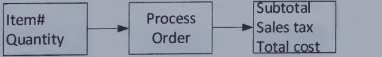

由“处理订单”模块表示的程序可能包含多个子任务，如查找单价、检查库存和计算结果。

**处理**不仅规定程序应该**做什么**（例如，计算总成本），还规定**如何做**（例如，如何计算总成本），如下所示：

处理：（做什么？）查找单价、查找销售税率、
计算小计、销售税和总成本
（怎么做？）小计：单价 * 订购数量
销售税：小计 * 销售税率
总成本：小计 + 销售税

确定处理过程时还需要指明数据来源，例如从产品文件中获取单价，从销售税率文件中获取销售税率。

**输入**指定了执行处理过程并产生输出所需的数据项。该订单处理系统的输入为

输入：商品编号、订购数量

请注意，单价和销售税率不包含在输入中，因为程序会自行查找它们。真实系统会复杂得多。通常，处理过程还会包含其他子任务，例如在库存不足时处理订单，输出也可能包括各种报表。在这类系统中，会使用**数据流图**和**UML 图**等图形化方法来表示处理过程及其所访问的数据。

### 2. 设计与开发图形用户界面（GUI）

在确定程序的输入、处理和输出之后，你要设计并创建用户界面——也就是说，用户如何与程序交互，以及程序如何与用户沟通。这是你可以发挥创意的有趣部分。

通常，你使用窗体与程序交互。正如你将在下一节学到的，窗体包含各种类型的对象，称为**控件**，例如 Button、TextBox 和 Label。在这一步中，你要确定要使用的控件类型，适当指定其名称和标题，并设计布局。图 1-3 显示了一个简化订单处理系统的 GUI 示例，其中用户无需提供单价和销售税率。

图 1-3：订单处理系统的 GUI

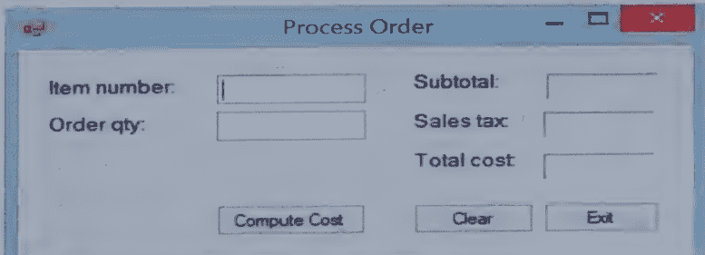


程序要求计算机执行它无法完成的操作，例如访问路径无效的文件或将一个数字除以零。

识别错误（bug）的过程称为 **调试**。测试程序以识别和消除错误是开发软件的极其重要的一部分。

## 复习问题

- 1.1 将 Google 视为一个软件系统。Google 的输入、处理和输出分别是什么？
- 1.2 考虑一个将学生注册到课程的软件系统。系统每次学生注册课程时需要哪些关键输入，以及需要执行的子任务（处理）。系统应为学生和教师产生哪些输出？
- 1.3 列出开发程序的主要步骤。
- 1.4 程序中标点符号错误是何种类型错误的例子？
- 1.5 一个工资单程序使用错误的公式计算加班费。这是何种类型的错误？
- 1.6 真或假：没有语法错误的程序应该产生正确的结果。

### 1.2 Visual Studio 简介

在本节中，您将学习如何使用 Visual Studio（VS）创建用户界面并编写 C# 程序。Visual Studio 是用于在多种语言中开发应用程序的集成开发环境（IDE），包括 C#、Visual Basic、C++、Python 和 HTML/JavaScript。VS 支持为 Windows、Android 和 iOS 开发桌面和 Web 应用程序。Visual Studio 的主要优势在于它为开发应用程序提供了用户友好的环境。

### 安装 Visual Studio

您可以从以下网站下载 Visual Studio Community 2015：

https://www.visualstudio.com/downloads/download-visual-studio-vs

要安装 Visual Studio，*打开* 下载的 **vs_community.exe** 文件。安装软件将引导您完成整个过程。第一次启动 Visual Studio 时，您将被要求选择 *Development Settings* 和 *Color Theme*。为设置选择 *Visual C#*。您可以在教程 1 中所述稍后更改这些设置。

### Visual Studio 的组件

尽管您可以选择用多种语言编写程序，但 CPU 只能理解 **机器语言**，这对人类来说极其难以理解。机器语言需要由位（0 和 1）的模式组成的详细指令，如 10001010，并且依赖于机器（特定类型的计算机）。由于需要编写详细的机器相关指令，机器语言被称为 **低级语言**。

运行程序，如前所述，包括（1）编译器将源代码（项目）翻译成 Microsoft Intermediate Language Assembly 以及（2）公共语言运行时将程序集从中间语言翻译成机器语言并执行程序以产生输出。

接下来，我们将了解如何使用 Visual Studio 开发 C# 程序。

## 复习问题

- 1.7 CPU 唯一能理解的编程语言是什么？
- 1.8 什么是编译器？
- 1.9 什么是解释器？
- 1.10 什么是 Microsoft Intermediate Language Assembly？
- 1.11 Common Language Runtime 在 Visual Studio 中的功能是什么？

## 在 Visual Studio 中创建应用程序

为了熟悉 Visual Studio 环境，让我们为一家冰淇淋店创建一个应用程序，由一个简单的 Windows 窗体组成，用于计算并显示冰淇淋订单的费用。我们将遵循前面确定的五个步骤来开发它：

### 1. 定义目的

目的：计算并显示冰淇淋订单的总费用
输入：单价、球数
处理：计算总费用
总费用：单价 * 球数
输出：总费用

### 2. 设计和开发图形用户界面（GUI）

图 1-4 展示了窗体的设计，显示用户界面让用户输入球数和单价以显示费用。您将在教程 1 中创建该窗体。

图 1-4：计算冰淇淋费用的 Windows 窗体

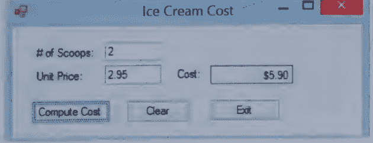

### 1.3 Visual Studio 环境

本节介绍 Visual Studio 中的各个窗口和环境。

图 1-7 显示了在设计器窗口中默认名为 Form1 的窗体、左侧的工具箱以及右侧的解决方案资源管理器窗口和属性窗口。

窗体的外观会因您使用的 Visual Studio 和 Windows 版本而异。例如，在 Windows 8 和 10 中，窗体的标题居中，而在 Windows 7 中则左对齐。

设计器窗口允许您通过向窗体添加控件来创建用户界面。

工具箱包含构建用户界面的组件。工具箱中的项目（例如，ComboBox、TextBox 和 Label）称为控件。

解决方案资源管理器窗口显示解决方案的名称，解决方案是项目的容器；项目的名称（如果有多个项目，则为项目名称）；以及每个项目中的文件名称。如果未显示解决方案的名称，请选择

Tools, Options, Projects and Solutions, General 并勾选 Always Show Solution

属性窗口显示并允许您设置设计器窗口中当前选定对象的属性。例如，属性窗口中的 Name 字段显示窗体的当前名称为 Form1。

从 Templates, Other Languages 中选择 Visual C#。对于应用程序类型，选择 Windows Forms Application，如图 1-6 所示。

对于 Name，输入 Ch1_IntroProgramming。

选择位置，如果与默认文件夹不同。

将 Create directory for solution 的复选框保持未选中状态，以便项目和解决方案都创建在同一文件夹中。（如果解决方案中有多个项目，最好为解决方案和项目设置单独的目录。）请注意，解决方案的默认名称与项目的名称相同。）单击 OK。

Visual Studio 开发环境出现，如图 1-7 所示。

## 图 1-7：Visual Studio 环境

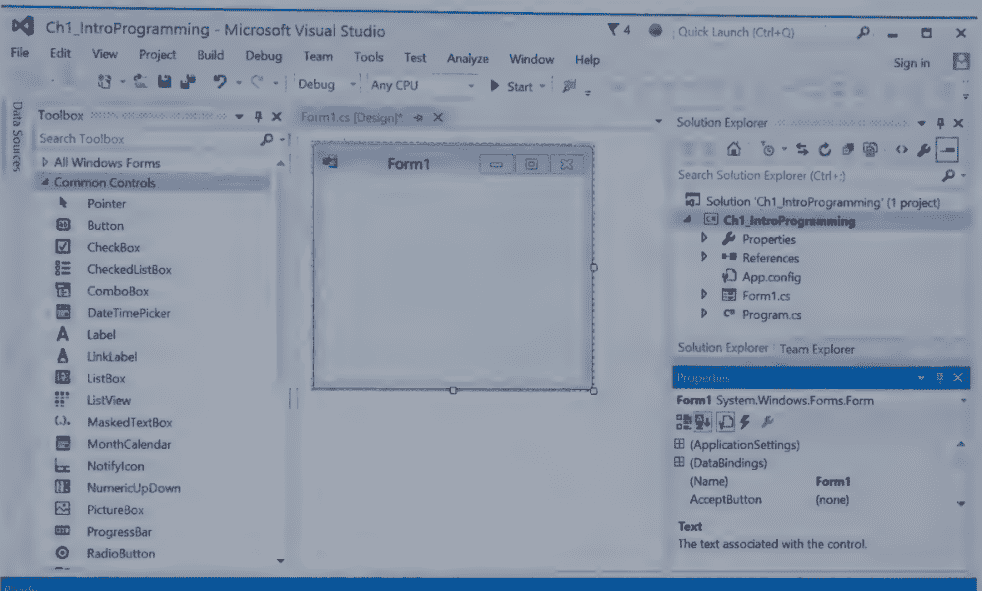

当您单击属性时，每个属性的简要描述会显示在属性窗口底部，如图 1-8 所示。请确保展开描述区域以使描述可见。如果未显示描述，请右键单击属性并勾选 Description。

## 图 1-8：属性描述

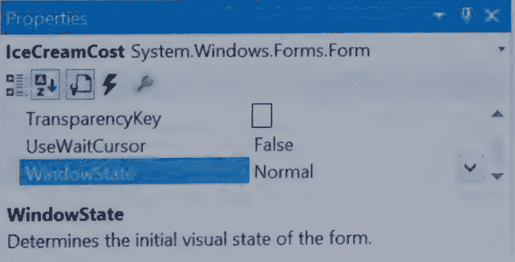

### 显示已关闭的窗口

如果任何窗口未显示，请从菜单中选择 View，并选择相应的窗口。

## 图 1-11：自动隐藏开启时的解决方案资源管理器

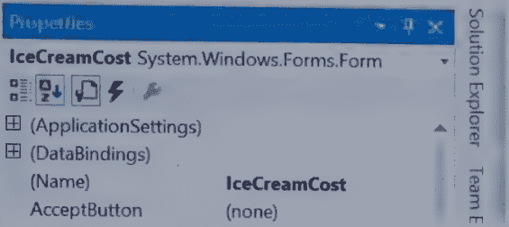

要关闭自动隐藏，请单击选项卡并单击图钉。

### 菜单和工具栏项目

菜单和工具栏，如图 1-12 所示，提供访问大量功能的途径。

## 图 1-12：菜单和工具栏


当您将鼠标指针悬停在项目上时，每个工具栏项目的功能会显示在 ToolTip 框中。为了对功能有一个大致的了解，您可以通过显示 Tooltips 来查看工具栏项目的描述。您将在本书的项目中对其更加熟悉。

### 添加和删除窗体

您可以按如下方式向项目添加窗体：

- 选择：Project, Add Windows Form。您将看到 Add New Item 窗口。
- 确保已选择 Visual C# Items 和 Windows Forms。
- 输入窗体的名称。单击 Add。

要删除窗体，

- 右键单击 Solutions 窗口中文件（.cs）的名称，并选择 Delete。

删除文件会永久删除窗体及其关联的所有文件。

### 从项目中排除窗体

您可以将窗体从解决方案资源管理器中排除，但仍保留项目文件夹中与窗体关联的文件，方法如下：

- 右键单击解决方案资源管理器中的文件名（.cs），并选择 Exclude from Project。


要恢复被从项目中排除的窗体，请选择 Project，Add Existing Item。从项目文件夹中选择文件（.cs）。窗体将被添加到 Solution Explorer。

## 更改窗体的名称和标题

Properties 窗口中的 Name 字段显示当前窗体的名称为 Form1。

Solution Explorer 也显示一个名为 Form1.cs 的文件，该文件包含代码。展开此文件，方法是单击其左侧的三角形，会显示另外两个文件，Form1.Designer.cs，其中包含表示窗体设计的生成代码，以及 Form1.resx，其中包含与窗体关联的附加资源，如下所示：


### 为窗体命名准则

窗体（以及类，通常）的名称必须以字母开头，并且只能包含字母、数字或下划线字符（_）。但是，不建议使用下划线字符。

在 C# 中，使用 Pascal Case 为窗体命名：窗体名称的首字母和后续单词的首字母，如果有的话，都大写，如 IceCreamCost 和 FinancialPlanner。

使用有意义的名称，避免使用不被广泛认可的缩写或首字母缩略词。窗体名称建议使用名词或名词短语，尽管本书中你会发现一些违反此准则的窗体名称。

现在你已熟悉环境，让我们使用你在步骤 1-4 中创建的项目中的默认窗体 Form1 来开发应用程序。

### 步骤 1-5：更改窗体名称和标题：

右键单击 Form1.cs，并将其重命名为 IceCreamCost.cs。注意，Properties 窗口中窗体的名称以及 Form1.cs 下的全部三个文件的名称都已更改。

窗体的标题仍为 Form1。要更改标题，请在 Properties 窗口中选择窗体的 Text 属性并将其更改为 Ice Cream Cost。

### 步骤 1-8：按如下方式在 Toolbox 中显示控件：

如果未显示 Toolbox 选项卡，请选择 View，Toolbox。

如果 Toolbox 显示为选项卡，请单击 Toolbox 选项卡，然后单击窗口右上角的 Auto Hide 按钮。

展开 Common Controls。参见图 1-13。

### 图 1-13：Toolbox 控件

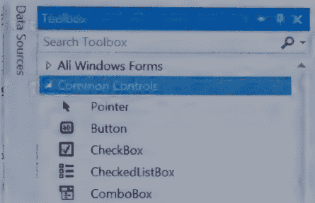

接下来，你将把图 1-14 所示的控件添加到窗体中。注意，如果你使用 Windows 7，窗体的标题不会居中。

### 图 1-14：带窗体的 Designer 窗口

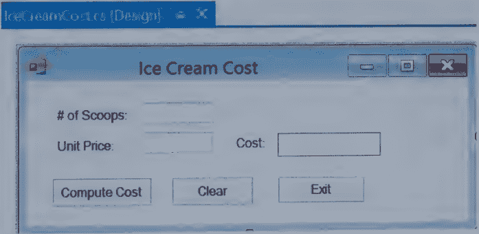

你可以在添加控件之前或之后调整窗体的大小。要调整窗体的大小，将光标移到窗体的边框上，并在光标变为双向箭头时单击并拖动光标。

你可以将控件拖放到窗体上，或双击它来添加控件。

### 步骤 1-9：按如下方式添加 TextBox 以输入球数：

从 Toolbox 菜单拖放一个 TextBox 到窗体上，并将其定位在图 1-14 所示的位置，并根据需要调整其大小。单击 Font 属性右侧的省略号 (...) 将 FontSize 设置为 10 并将 BorderStyle 设置为 Fixed3D。将 TextBox 的 Name 属性更改为 txtScoops。

### 步骤 1-10：添加 Label 以显示标签“# of Scoops”：

拖放一个 Label 并将其定位在 TextBox 的左侧。按如下方式更改其 AutoSize 和 Text 属性：

- AutoSize: False
- Text: # of Scoops

### 步骤 1-11：添加其余七个控件并设置其属性，如表 1-2 指定的那样：

除非另有说明，否则将所有控件的 FontSize 设置为 10，Labels 的 BorderStyle 设置为 None，TextBoxes 的 BorderStyle 设置为 Fixed3D。请注意，唯一被赋予名称（lblCost）的 Label 是在代码中用于显示成本的 Label。未在代码中使用的其他 Label 保持其默认名称。

### 表 1-2：窗体 IceCreamCost 上的控件及其属性

| 用途 | 控件类型 | 属性 | 设置 |
| --- | --- | --- | --- |
| 输入球数 | TextBox | Name | txtScoops |
| 显示球数标签 | Label | Text | # of Scoops: |
| 输入单价 | TextBox | Name | txtUnitPrice |
| 显示单价标签 | Label | Text | Unit Price: |
| 显示成本 | Label | Name | lblCost |
|  |  | BorderStyle | FixedSingle |
|  |  | Text | （空白） |
| 显示成本标签 | Label | Text | Cost: |
| 计算成本 | Button | Name | btnComputeCost |
|  |  | Text | Compute Cost |
| 清除控件 | Button | Name | btnClear |
|  |  | Text | Clear |
| 关闭窗体 | Button | Name | btnExit |
|  |  | Text | Exit |

## 关闭和打开 Designer 窗口和项目

要保存对窗体的更改，请单击工具栏上的 Save 按钮。Save All 按钮将保存项目中所有窗体的更改。Save 和 Save All 按钮在工具栏上显示如下：

要关闭 Designer 窗口，请单击窗体上方选项卡上的关闭按钮（x）（参见图 1-14），或选择 File，Close。

要打开 Designer 窗口，请在 Solution Explorer 中双击文件名 IceCreamCost.cs，或右键单击文件名并选择 View Designer。

要关闭项目，请选择：File，Close Solution。

要从 Visual Studio 中打开项目和解决方案，请选择 File，Open，Project/Solution，打开项目文件夹 Ch1_IntroProgramming，选择 Ch1_IntroProgramming.csproj（或 Ch1_IntroProgramming.sln），如下所示，并单击 Open。如果未显示文件扩展名，请参阅下一小节，Display File Extensions。

- Name
- .vs
- bin
- obj
- Properties
- Ch1_IntroProgramming.csproj
- Ch1_IntroProgramming.sln

要从 Visual Studio 外部打开项目，请从文件资源管理器（Windows 10）或 Windows 资源管理器（较早版本的 Windows）中打开项目文件夹 Ch1_IntroProgramming。项目文件夹显示以下文件夹和文件：

- bin
- obj
- Properties
- App.config
- Ch1_IntroProgramming.csproj
- Ch1_IntroProgramming.sln
- Ch1_IntroProgramming.v11.suo
- IceCreamCost.cs
- IceCreamCost.Designer.cs
- IceCreamCost.resx
- Program.cs

双击文件 Ch1_IntroProgramming.csproj 或 Ch1_IntroProgramming.sln 以打开项目和解决方案。

### 显示文件扩展名

在文件资源管理器（Windows 10）中，选择 View，并选中复选框 File name extensions。

在 Windows 资源管理器（Windows 8.1）中，选择 Organize，Folders and search options，View。取消选中复选框 Hide extensions for known file types。

## 已完成的阶段

在教程 1 的步骤 1-1–1-11 中，你开发了图形用户界面，这是程序开发过程的第 2 阶段。更早之前，你还在第 3 阶段确定了程序的子任务：

- 获取球数和单价
- 计算成本
- 显示成本

该应用程序不涉及文件或数据库的开发（第 4 阶段）。程序开发的下一阶段是第 5 阶段：编写和测试代码。

## 复习问题

- 1.14 运行窗体时，你会使用什么控件让用户输入数据项？
- 1.15 你设置 Label 的哪个属性来在 Label 中显示数据项？

### 1.5 代码编辑器窗口

在编写和测试代码之前，让我们先看看代码编辑器窗口（或代码窗口），其中已包含 C# 生成的一些初始代码。

### 步骤 1-12：按如下方式打开代码窗口：

- 在 Solution Explorer 中选择 IceCreamCost.cs，并
- 单击右上角的 View Code 按钮 (<>)
- （或右键单击 IceCreamCost.cs 并选择 View Code）。
- 参见图 1-15。

### 图 1-15：打开代码窗口

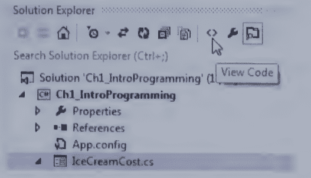

图 1-16 显示了代码窗口。

你需要开发代码来完成上述每个子任务。

## 事件驱动程序和事件处理程序

在 .Net 环境中，代码通常会连接到（“附加”或“连接”）特定的事件，如单击按钮、加载窗体或按下键。因此，在 .Net 中开发的程序称为事件驱动程序。响应诸如单击按钮之类的事件而运行的方法称为事件处理程序。

例如，要在用户单击按钮时计算成本，我们创建一个与按钮的单击事件连接的程序单元（方法）。由于该方法响应单击事件而运行，因此它被称为按钮的单击事件处理程序。

### 创建事件处理程序

让我们看看事件处理程序是如何创建的。

### 步骤 1-13：为 btnComputeCost 创建单击事件处理程序方法：

通过单击设计器选项卡 IceCreamCost.cs[Design] 切回设计视图。

双击 Compute Cost 按钮以重新打开代码窗口并创建如下所示的单击事件处理程序：

```
private void btnComputeCost_Click(object sender, EventArgs e)
{

}
```

第一行是此方法的头，显示了方法的名称 btnComputeCost_Click。关键字 private 表示此事件处理程序方法只能从此窗体访问，而 void 表示此方法不向调用程序返回任何值。这些术语以及括号内参数的概念将在后面的章节中解释。

### 删除事件处理程序

假设你创建了一个不需要的事件处理程序。例如，你创建了按钮的 Click 事件处理程序并决定删除该按钮。在删除按钮之前，你需要删除事件处理程序以避免错误。

如果你手动从代码窗口中删除事件处理程序方法，当你尝试在设计窗口中打开窗体时，你将收到错误，因为生成代码中引用了事件处理程序。例如，如果你为 btnExit 创建单击事件处理程序并删除事件处理程序的代码，当你尝试显示窗体时，你将收到以下错误消息。


Step 1-14: 双击 btnExit 以创建 Click 事件处理程序。然后先从 Properties 窗口中删除它，再从 Code 窗口中删除事件处理程序的代码，包括头部、大括号（以及大括号内的代码，如有）。

现在你已准备好进入阶段 5：编写和测试代码。

## Review Questions

+   1.16 什么是命名空间？
+   1.17 using 指令指定了什么？
+   1.18 什么是方法？
+   1.19 什么是事件处理程序？

### 1.6 Introductory Programming Concepts

为了帮助你理解一些基本编程概念，让我们先看一下计算冰淇淋订单费用的已完成代码，如图 1-18 所示。

Figure 1-18: Code to compute cost

```
private void btnComputeCost_Click(object sender, EventArgs e)
{
    // Compute the total cost for an order of icecream:
    
    // Declare variables to hold input data and computed results
    int scoops;
    double unitPrice, cost;
    
    //Get input data from Text Boxes:
    scoops = int.Parse(txtScoops.Text);
    unitPrice = double.Parse(txtUnitPrice.Text);
    
    // Compute result
    cost = unitPrice * scoops;
    
    // Display Result
    lblCost.Text = cost.ToString("C");
}
```

正如代码所示，该方法包含三个对应于之前确定的三个子任务的段落：

+   获取勺数和单价（第 29 行 & 30 行）
+   计算费用（第 33 行）
+   显示费用（第 36 行）

请注意，行号不是代码的一部分。它们是使用 Visual Studio 中的设置插入的，以便于引用语句（选择 Tools, Options, Text Editor: C# 并勾选 Line Numbers）。

让我们仔细查看此程序中的语句。

### Comments

Line 22: //Compute the total cost for an order of ice cream:

以 // 开头的行是对程序员的注释，由编译器忽略。

你可以通过将行放在 /* 和 */ 之间来注释多行，如图 1-19 所示。

### Figure 1-19: Commenting multiple lines

```
22    /*Compute the total cost for an order of icecream
23      using the formula: cost = unitPrice * NumberOfScoops:
24      Declare variables to hold input data and computed results*/
```

你可以通过突出显示行（将鼠标指针拖过它们）然后单击工具栏按钮 Comment out the selected lines 来注释一组行，如下图所示：

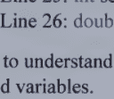

右侧的按钮将取消注释所选行。

### 1.7 Data Types

第 25 行和第 26 行声明变量并指定它们的类型：

+   第 25 行：int scoops;
+   第 26 行：double unitPrice, cost;

为了理解上述语句和程序的其余部分，我们将更详细地查看数据类型和变量。

程序中使用的数据大致可分为以下类型：

+   **Integer:** 整数是整数（例如，255677，-54）。
+   **Nonintegers or reals:** 实数有一个或多个小数位（例如，255677.75；-0.255）。
+   **Text:** 文本数据包括 **character** 类型，由单个字符组成（例如，'A'；'B'）和 **string** 类型，由一组字符组成，包括字母字符、数字和特殊字符（例如，"John Smith"；"P410-2023-3180-05"）。
+   请注意，字符用单引号括起来，而字符串用双引号括起来。
+   **Boolean:** 布尔值的值为 true 或 false。
+   **Date/Time:** 日期和时间用一对井号括起来，如 #05/25/2016 02:30:00 PM#。

让我们看一下 C# 中整数和实数的不同类型。

### Integer types

表 1-3 显示了 C# 中的不同整数类型。请注意，C# 区分大小写。这意味着数据类型关键字，如 short 和 int，是区分大小写的。因此，“Short”和“Int”是无效的关键字。

Table 1-3: Built-in C# data types for Integers

| C# key word | Size (memory used) | Range of values |
| sbyte | 8 bits | -128 to 127 |
| short | 16 bits | -32,768 to 32,767 |
| int | 32 bits | -2,147,483,648 to 2,147,483,647 |
| long | 64 bits | -9,223,372,036,854,775,808 to 9,223,372,036,854,775,807 |
| char | 16 bits | 0 to 65535 |

还有额外的“unsigned”数据类型，byte、ushort、uint 和 ulong，只能存储正数，但整数更大，最大尺寸接近有符号整数的两倍。例如，uint 类型变量可以保存高达 4,294,967,295 的值，而 int 类型的最大值仅为 2,147,483,647。

大小显示存储数据所需的内存，范围显示可在变量中存储的值的范围。较大的数据类型占用更多内存，如大小所示。

请注意，字符数据（由 C# 关键字 char 表示）使用一种称为 Unicode 的流行标准之一的整数表示，允许表示来自不同语言的 65,535 个不同字符。

### C# versus .Net Types

C# 中基本数据类型的名称与 .Net Framework 中的名称不同。然而，它们之间存在直接对应关系。例如，C# 中的 int 类型与 .Net 中的 System.Int32 相同，C# 中的 long 与 System.Int64 相同。

### Noninteger (real) types

表 1-4 显示了非整数的数据类型。

### Table 1-4: C# noninteger types

| C# keyword | Size | Range of values | Precision | How the number 123456789012.345678901234567890 may be represented |
|---|---|---|---|---|
| float | 32 bits | ±1.5 × 10⁻⁴⁵ to ±3.4 × 10³⁸ | 7 digits | 0.1234568 x 10¹² |
| double | 64 bits | ±5.0 × 10⁻³²⁴ to ±1.7 × 10³⁰⁸ | 15 digits | 0.123456789012346 x 10¹² |
| decimal | 128 bits | ±1.0 × 10⁻²⁸ to ±7.9 × 10²⁸ | 28-29 digits | 123456789012.345678901234567800 |

如范围所示，float 和 double 可以存储比 decimal 类型更大的数字。它们也占用更少的内存。但 float 和 double 不能精确表示所有非整数数字（由于它们表示数字的方法），使它们不适合财务计算。

Decimal 类型通常可以精确表示实数，并且其精度优于 float 和 double。因此，如前所述，decimal 更适合于精确表示很重要财务计算。然而，decimal 类型占用更多内存，并且处理速度比 float 和 double 慢。由于 decimal 的范围较低，它可能不适合某些科学计算。

C# 类型 float 和 double 使用一种称为浮点方法的方法来近似一系列值到固定数量的有效数字。因此，float 和 double 也被称为浮点类型。

### string type

C# 类型 string 表示零个或多个字符的组合。“John Smith”和"P410-2023-3180-05"是 string 类型数据的示例。请注意，string 类型数据用引号括起来。

### bool type

C# 类型 bool 表示布尔数据，包括值 true 和 false。

### DateTime type

C# 没有日期和时间的数据类型。.Net 基类型 DateTime 用于表示日期和/或时间。

## Review Questions

1.20 表示学生 GPA 的适当数据类型是什么？

1.21 哪种实数数据类型最适合需要精确表示数字的财务计算？

1.22 与 decimal 相比，float 和 double 类型的优点是什么？

### 1.8 Working with Variables

程序通常使用变量来保存数据。简单变量保存一个数据，而更复杂类型如数组可以保存一组数据。一般来说，我们将“变量”一词用于表示简单变量。

变量是计算机内存中程序运行时保存数据的存储位置。程序使用给变量的名称访问该位置。

对于变量，C# 要求你指定每个变量将存储的数据类型。

### Creating (Declaring) Variables

变量通过指定类型和变量名来创建。图 1-18 中第 25 行所示的语句创建了一个名为 scoops 的 int 类型变量：

```
int scoops;
```

程序运行时，上述语句在计算机内存中创建一个名为 scoops 的变量以保存 int 类型整数数据。因为我们尚未为 scoops 分配任何值，默认情况下，变量中存储的值为零，如下所示表示：

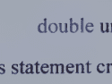

你可以在一条语句中声明两个或多个相同类型的变量，如图 1-18 中第 26 行：

```
double unitPrice, cost;
```

此语句创建两个变量 unitPrice 和 cost，以保存 double 类型浮点数据。

请注意，分号是表示每个 C# 语句结束所必需的。

### Guidelines for naming variables

变量名必须以字母开头，并且只能包含字母、数字或下划线“_”字符。

C# 中的惯例是使用 Camel Case：变量的首字母小写，后续单词的首字母（如果有）大写，如 totalCost 和 averageRetailPrice。


使用有意义的名称为变量命名以使程序易于阅读。你应避免使用未被广泛认可的缩写或首字母缩写。例如，使用 totalQuantitySold 而不是 tqs。

## 用于保存其他类型数据的变量

我们正在查看的图 1-18 中的代码示例不包括用于保存其他类型数据的变量，如字符和字符串数据。每种类型的变量都使用相同的语法声明。以下是创建字符和字符串变量的语句示例：

```
char middleInitial;
string lastName;
```

## 为变量赋值

创建变量后，你可以使用以下形式的语句为其赋值

```
variable name = value (or an expression that computes a value)
```

例如，程序中声明为类型 int 的变量 scoops 可以使用语句将其赋值为 3

```
scoops = 3
```

也就是说，值 3 将存储在名为 scoops 的内存位置中，如下所示表示：

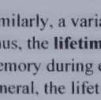

同样，语句

```
scoops = (10/5) + 1
```

会将值 3 赋给 scoops。

## 变量的生命周期

你不能使用不存在的变量！这意味着你不能在变量声明之前使用它，因为变量仅在创建声明语句后才存在。

同样，变量在声明它的方法的执行完成后就不再存在。因此，在方法内声明的变量的生命周期是其在方法执行期间在内存中创建的时间到方法执行完成的时间之间的时间段。一般来说，生命周期表示变量在内存中创建到销毁之间的时间段。

一个相关的术语是变量的作用域，即可以在程序中访问该变量的部分。变量的作用域是从变量声明到下一个右大括号之间的语句块。变量的作用域将在第 1.10 节中进一步讨论。

## 表示数字

## 科学计数法

你可以使用科学计数法表示非常大的数字：

```
3.95e8
```

e8 表示 10 的 8 次方。因此，3.95e8 等于 3.95 乘以 10⁸——即 395,000,000。

同样，3.95e-8 表示 3.95 乘以 10 的 -8 次方——即 0.0000000395。

数字只能包含数字、十进制点、减号和加号，以及使用科学计数法时的字母“e”或“E”。逗号和美元符号 ($) 在数字中无效。因此，以下语句无效：

```
double unitPrice = $1.50;    //Invalid; dollar sign is not allowed in a number
double cost = 3,520.00;      //Invalid; comma is not allowed in a number
double amount = "15.45";   //Invalid; "15.45" is a string
```

注意！一般来说，当你将错误类型的值赋给变量时，编译器不喜欢这样。以下语句会导致错误，因为 scoops 声明为类型 int，即整数类型，但 1.5 是实数。

```
int scoops = 1.5    //Invalid; 1.5 is not an integer
```

我们将在第 2 章中查看混合不同类型的整数和实数类型的具体规则。

## 将一个变量的值赋给另一个变量

你可以将一个变量的值赋给另一个变量，如以下示例所示：

```
int scoops = 3;
int temp;
temp = scoops;
```

语句“temp = scoops”将 scoops 的值复制到变量 temp 中。执行此语句后，两个变量的存储位置都将包含相同的值 3：


如果在上述代码之后添加以下语句更改 scoops 的值会怎样？

```
scoops = 5;
```

它会改变 temp 的值吗？答案是否定的，因为每个变量都有自己的存储位置。执行语句“scoops = 5”后，两个变量将具有以下值：


### 1.10 在标签中格式化和显示输出

你在标签中看到的内容是其 Text 属性的值。早在步骤 1-10 中，你已在设计器窗口中使用其 Text 属性在标签中显示文本。现在我们来看如何使用代码在运行时在标签中显示文本。为此，你将文本赋给标签的 Text 属性。

第 36 行的语句，

```
lblCost.Text = cost.ToString("C");
```

通过将其赋给 lblCost 的 Text 属性，将 cost 的值显示在标签 lblCost 中。

cost 的值是 double 类型，使用变量的 ToString() 方法将其转换为字符串，接下来将描述该方法。

## 使用 ToString() 方法格式化数字

每种数值数据类型都有一个名为 ToString() 的方法（程序单元），它将数字转换为字符串并格式化。例如，

```
cost.ToString()
```

会将 cost 的值转换为字符串，以便在标签中显示。

ToString() 方法还允许指定格式代码（字符串），例如

```
cost.ToString("C")
```

其中“C”指定货币格式。

使用其他 ToString() 格式代码的示例在表 1-7 中给出。

## 表 1-7：ToString() 格式代码

| Number | Format string | ToString() would format the number as |
| 1145.857 | null | 1145.857 |
| 1145.857 | "C" | $1,145.86 |
| 1145.857 | "N" | 1,145.86 |
| 1145.857 | "F" | 1145.86 |
| 0.156 | "P" | 15.60% |
| Optionally, you may specify the number of decimal places. Here are some examples: |
| 1145.857 | "C0" | $1,146 |
| -1145.857 | "C1" | ($1,145.9) |
| -1145.857 | "N1" | -1,145.9 |
| 1145 | "N3" | 1,145.000 |
| Format code for integers only |
| 157 | "D5" | 00157 |
| 157 | "D" | 157 |
| 157 | "D1" | 157 |

如果格式代码未指定小数位数，如 cost.ToString("C") 中，默认的小数位数为两位。

## 步骤 2-5：添加显示 cost 的语句：

```
lblCost.Text = cost.ToString("C");
```

btnComputeCost_Click 事件处理程序应如下图 1-21 所示。

## 图 1-21：btnComputeCost 按钮的单击事件处理程序

```
20    private void btnComputeCost_Click(object sender, EventArgs e)
21    {
22        /*Compute the total cost for an order of icecream
23            using the formula: cost = unitPrice * NumberOfScoops:
24            Declare variables to hold input data and computed results*/
25        int scoops;
26        double unitPrice, cost;
27
28        //Get input data from Text Boxes:
29        scoops = int.Parse(txtScoops.Text);
30        unitPrice = double.Parse(txtUnitPrice.Text);
31
32        // Compute result
33        cost = unitPrice * scoops;
34
35        // Display Result
36        lblCost.Text = cost.ToString("C");
```

## 步骤 2-6：运行表单：

双击 program.cs 打开代码编辑器窗口。
指定 IceCreamCost 为要运行的表单的名称，如下所示：

    Application.Run(new IceCreamCost());

单击工具栏上的开始按钮运行表单。
输入 3 作为 scoops，3.95 作为 unitPrice。单击计算成本按钮查看结果。
关闭窗口。

通过单击 IceCreamCost.cs 选项卡返回到代码编辑器窗口。
将格式字符串“C”更改为“C0”，运行程序并观察格式差异。

重复使用格式字符串“C1”、“N”和“F”，并观察每种情况下的格式。

在未输入单价数据的情况下运行表单。程序在第 30 行中断，并显示如下错误消息，因为 txtUnitPrice.Text 是一个空字符串。

```
unitPrice = double.Parse(txtUnitPrice.Text);
```

// Compute result
cost = unitPrice * scoops;

// Display Result

FormatException was unhandled
An unhandled exception of type 'System.FormatException' occurred in mscorlib.dll
Additional information: Input string was not in a correct format.


点击工具栏上的**停止调试**按钮（■）来停止程序。
点击 IceCreamCost.cs [设计] 选项卡打开设计器窗口。

## 清除控件

TextBox 有一个 Clear() 方法用于清除其内容。然而，Label 则是通过将 Text 属性设置为 null（即空）或一个空字符串（用两个引号且中间无内容表示，即 ("")）来清除。你也可以使用这种方法来清除 TextBox。

- **步骤 2-7：** 双击 Clear 按钮创建按钮的点击事件处理器，并输入代码来清除控件：

```
private void btnClear_Click(object sender, EventArgs e)
{
    txtScoops.Clear();
    txtUnitPrice.Clear();
    lblCost.Text = null;
}
```

注意，Clear 是一个方法（程序单元）的名称，方法的名称末尾需要一对圆括号。

## 关闭窗体

要关闭正在运行的窗体，请使用该窗体的 Close() 方法。

- **步骤 2-8：** 双击 Close 按钮，并在 click 事件处理程序中输入代码：

```
private void btnExit_Click(object sender, EventArgs e)
{
    this.Close();
}
```

在上面的代码中，“this” 指的是当前窗体。

## IceCreamCost 窗体的完整代码

图 1-22 显示了完整代码。

**图 1-22：** IceCreamCost 的完整代码

```
using System;
using System.Collections.Generic;
using System.ComponentModel;
using System.Data;
using System.Drawing;
using System.Linq;
using System.Text;
using System.Threading.Tasks;
using System.Windows.Forms;
```

## 常量

第 29 行声明了一个常量。第 29 行中的关键字 const

```
const double TAX_RATE = 5.5;
```

指明 TAX_RATE 是一个常量（而不是变量）。

常量用于表示在运行时不需要更改的字面量值。使用常量表示税率意味着税率是一个固定值。但是，如果税率要在运行时从文件或 TextBox 中读取，则使用变量更为合适。

该常量具有以下特征：

- 1. 常量的值在运行时不能更改。以下代码在运行时向常量 numberOfScoops 赋值是无效的：

  ```
  const int numberOfScoops = 0;
  numberOfScoops = 2; // Invalid
  ```

- 2. 常量必须在声明时通过赋予字面量值或常量来进行初始化。例如，以下语句：

  ```
  const int numberOfScoops = int.Parse(txtScoops.Text); // Invalid
  ```

  是无效的，因为赋予常量的值不是常量或字面量值。类似地，下面的语句也是无效的，因为该常量没有在声明时进行初始化：

  ```
  const int numberOfScoops; // Invalid
  ```

- 3. 常量在编译时会被其值替换。

- **步骤 3-3：** 双击 btnComputeTotal 以创建其 click 事件处理程序，并添加声明变量和常量的注释和语句，如图 1-26 所示。

**图 1-26：** 声明变量和常量的代码

```
22    // Compute the total cost for an order of ice cream, including sales tax.
23
24    // Declare variables to hold input data and computed results
25    int scoops;
26    double unitPrice, subTotal, salesTax, totalCost;
27
28    // Declare a constant to hold the tax rate
29    const double TAX_RATE = 5.5;
```

图 1-27 显示了从 TextBox 获取输入数据（与教程 2 中相同）以及计算小计、销售税和总成本的代码。

### 1.11 附加概念：常量、变量的作用域和 ListBox

**图 1-27：** 获取输入数据并计算结果的代码

```
// Get input data from TextBoxes:
unitPrice = double.Parse(txtUnitPrice.Text);
scoops = int.Parse(txtScoops.Text);

// Compute results
subTotal = unitPrice * scoops;
salesTax = subTotal * TAX_RATE / 100;
totalCost = subTotal + salesTax;
```

第 32 行中的语句将输入到 txtUnitPrice 中的数据转换为 double 类型，因为 unitPrice 是 double 类型。类似地，在第 33 行中，来自 txtScoops 的数据被转换为 int 类型，因为 scoops 是 int 类型变量。

注意，当一个表达式同时包含乘法和除法时（如第 37 行所示），在决定计算顺序时这两种运算的优先级是相同的。计算从左到右进行，例如 (subTotal * TAX_RATE) / 100，在这里是可以的，因为先做乘法还是先做除法没有区别。

- **步骤 3-4：** 输入图 1-27 中的代码。

## 在 ListBox 中显示数据

在此应用程序中，输出以两列显示在 ListBox 中，第一列用于标签，第二列用于数字，如图 1-28 所示。通过将第二列中的数字右对齐并将其格式化为两位小数，可以自动对齐小数。

**图 1-28：** 格式化输出

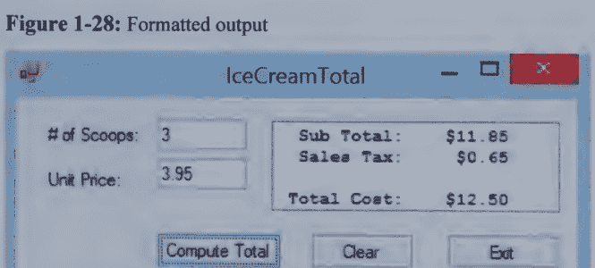

ListBox 可用于显示列表项，也可以让用户从列表中选择一个或多个项。这里我们仅使用 ListBox 来显示输出。我们将在第 5 章更详细地讨论 ListBox。

## ListBox 的字体

为了使小数对齐，将 ListBox 的字体设置为 Courier New 之类的等宽字体也很重要。

- **步骤 3-5：** 将 ListBox 的字体类型更改为 Courier New。添加图 1-29 中的以下代码以在 ListBox 中显示结果。

**图 1-29：** 在 ListBox 中显示格式化输出的代码

```
// Display Results with decimals aligned
lstOutput.Items.Add(string.Format("{0,12}{1,10:C}", "Sub Total:", subTotal));
lstOutput.Items.Add(string.Format("{0,12}{1,10:C}", "Sales Tax:", salesTax));
lstOutput.Items.Add(""); // Add a blank line
lstOutput.Items.Add(string.Format("{0,12}{1,10:C}", "Total Cost:", totalCost));
```

完整的代码应如图 1-25 所示。

- **步骤 3-6：** 运行窗体：
  - 双击 Program.cs 打开代码窗口。
  - 指定 IceCreamTotal 作为要运行的窗体的名称：

    ```
    Application.Run(new IceCreamTotal());
    ```

单击“开始”按钮运行窗体并测试输入的代码。运行窗体时，在“勺数”中不输入任何数据。再次运行，并将单价设为 $3.90。

请注意，在这两种情况下，程序都会因错误消息而崩溃，您需要重新运行程序。本章稍后你将学习如何让程序更优雅地处理错误。

## 清除 ListBox

Items 集合的 Clear 方法会清除 ListBox 中的所有行（项）。图 1-30 显示了清除 TextBox 和 ListBox 的代码。

**图 1-30：** 清除控件的代码

```
private void cmdClear_Click(object sender, EventArgs e)
{
    txtScoops.Clear();
    txtUnitPrice.Clear();
    lstOutput.Items.Clear();
}
```

- **步骤 3-7：** 将图 1-30 中的代码添加到 Clear 按钮的 click 事件处理程序中。

### 1.12 异常处理：捕获错误

try 子句中任何语句出错都会导致方法抛出异常，跳过其余语句并跳转到 catch 子句。如果没有错误，则跳过 catch 子句中的语句（称为 catch 块）。

**图 1-32：** try-catch 语句

```
private void btnComputeTotal_Click(object sender, EventArgs e)
{
    try
    {
        // Compute the total cost for an order of ice cream, including sales tax.
        // Declare variables to hold input data and computed results
        int scoops;
        ...
        lstOutput.Items.Add(string.Format("{0,12}{1,10:C}", "Total Cost:", totalCost));
    }
    catch (Exception err)
    {
        MessageBox.Show(err.Message);
    }
}
```

使用 catch 子句为异常对象指定名称 err（或任何有意义的名称），如下所示：

```
catch (Exception err)
```

异常对象的一个常用属性是 Message 属性，它包含描述导致异常的错误的错误消息——也就是说，err.Message 包含具体的错误消息。

## MessageBox

MessageBox 是 .NET 中可用于显示消息的对象。MessageBox 的 Show 方法允许将任何字符串作为消息显示。例如，可以使用以下语句显示消息：

```
MessageBox.Show("Invalid data; please re-enter");
```

我们使用 MessageBox 来显示 err.Message 中包含的消息。在 catch 子句中，我们使用以下语句：

```
MessageBox.Show(err.Message);
```

以显示 err.Message，其值是一个描述错误的字符串。

- **步骤 3-10：** 在 btnComputeTotal_Click 事件处理程序中加入 try-catch 语句，如图 1-32 所示。

- **步骤 3-11：** 运行窗体。输入单价但不输入勺数数据后，单击 Compute Total 按钮。注意错误消息。重复一次，这次输入两组数据，但在单价中包含“$”符号。


# 练习

## 练习 1-1：最大心率

运动期间的最大心率由公式 (220 - 年龄) 给出。在名为 Exercises_Ch1 的项目中创建一个名为 HeartRate 的窗体，让用户向一个 TextBox 输入整数年龄，并通过单击按钮计算并在一个 Label 中显示最大心率。

## 练习 1-2：MPG

每加仑英里数由行驶英里数除以消耗的汽油加仑数得出。假设两者均为非整数。在名为 Exercises_Ch1 的项目中创建一个名为 MilesPerGallon 的窗体。窗体应让用户将行驶英里数和消耗加仑数输入到两个 TextBox 中，并通过单击按钮计算并在一个 Label 中显示每加仑英里数。

## 练习 1-3：总成本

在名为 Exercises_Ch1 的项目中创建一个名为 TotalCost 的窗体，让用户将某项工作的人工成本和材料成本输入到两个 TextBox 中，并按如下方式显示小计、销售税和总成本：

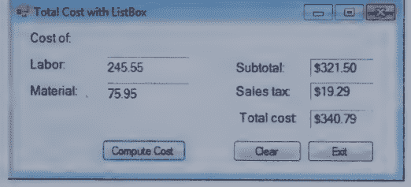

使用 try-catch 语句捕获意外错误，例如缺少某个数据项。使用一个常量表示销售税率（6%）。小计 = 人工成本 + 材料成本。总成本为小计与销售税之和。

# 第 2 章

## 数据类型

在第 1 章中，我们了解了程序中使用的不同类型的整数、非整数（实数）和文本数据。当你在表达式或语句中混合不同类型的数值（例如 decimal 类型和 double 类型）时，需要遵循某些规则。

在本章中，我们首先了解不同类型的数值数据之间的差异以及混合它们的规则。接下来，我们讨论 string 类型，然后是 DateTime 类型。

## 主题

| 2.1 使用不同的数值数据类型 | 2.3 使用字符串和字符 |
| 2.2 强制转换 | 2.4 使用日期和时间 |

## 2.1 使用不同的数值数据类型

为了帮助你回忆，表 2-1 列出了常用的整数类型、它们的大小和取值范围。你已经熟悉第 1 章中使用的 int 类型。

### 表 2-1：整数类型

| C# 关键字 | 大小（占用内存） | 取值范围 |
| sbyte | 8 位 | -128 到 127 |
| short | 16 位 | -32,768 到 32,767 |
| int | 32 位 | -2,147,483,648 到 2,147,483,647 |
| long | 64 位 | -9,223,372,036,854,775,808 到 9,223,372,036,854,775,807 |

如第 1 章所述，还有额外的“无符号”数据类型：byte、ushort、uint 和 ulong，它们只能存储正整数，但可存储的整数更大，最大值接近有符号整数的两倍。例如，uint 类型变量可保存的最大值为 4,294,967,295，而 int 类型的最大值仅为 2,147,483,647。还有一种特殊的整数类型，用 C# 关键字 char 表示，它可以表示来自不同语言的 65,535 个字符。

大小表示存储数据所需的内存，取值范围表示每种类型可以存储的值的范围。对于整数来说，更大的大小也意味着更大的取值范围。

下一节要讨论的基本规则之一是：不能将取值范围较大的数据类型的值存储到取值范围较小的数据类型的变量中，除非显式地将较大类型转换为较小类型。

例如，以下代码中的第二条语句是无效的：

```
int count = 150;      //valid; 150 is well within the range for int type
short recordCount = count;    // Invalid; count is int type, which is larger than short type
```

请注意，count 的实际值完全在 short 类型的范围内，但赋值仍然无效，因为 count 的类型比 recordCount 的类型大。你将在下一节学习如何将一种类型的数据项转换为另一种类型。

接下来，我们看看非整数类型，如表 2-2 所示。

### 表 2-2：实数类型

| C# 关键字 | 大小 | 取值范围 | 精度 | 以下数字可能的表示方式：123456789012.345678901234567890 |
|---|---|---|---|---|
| float | 32 位 | ±3.4 × 10³⁸ | 7 位数字 | 0.1234568 x 10¹² |
| double | 64 位 | ±1.7 × 10³⁰⁸ | 15 位数字 | 0.123456789012346 x 10¹² |
| decimal | 128 位 | ±7.9 × 10²⁸ | 28–29 位数字 | 123456789012345678901234567800 |

除了大小和取值范围外，非整数类型还具有精度属性，其中 float 类型只有 7 位数字的精度。

重要的是要注意，尽管 decimal 类型比 float 和 double 使用更多内存（即大小更大），但它的取值范围更小（10²⁸）。decimal 的计算速度也较慢。因此，对于涉及极大数值的科学应用，decimal 不如 float 和 double 适合。

为什么 decimal 类型取值范围更小却占用更多内存？因为 decimal 类型使用一种内部表示方法，能够以比 float 和 double 更高的精度来精确表示实数。

尽管 float 和 double 具有更大的取值范围并且占用更少的内存，但它们的表示方法使得它们无法精确表示所有非整数，因此在财务计算中不如 decimal 适合。例如，你可能会期望以下计算得出的成本值为 84.83：

```
float cost = (float) 4.99 * 17;
```

然而，实际值将是 84.82999。右侧“(float)”的含义将在本节后面解释。

因此，当需要精确表示数字时，decimal 比 float 和 double 更适合财务计算。

C# 的 float 和 double 类型使用一种称为浮点法的表示方法，将大范围的值近似为固定数量的有效数字。因此，float 和 double 也被称为浮点类型。

在接下来的小节中，我们通过在第 1 章中开发的 IceCreamTotal 窗体的修改版本来研究不同类型的使用。

## 教程 1：使用数据类型的 IceCreamTotal

本教程创建一个名为 Ch2_DataTypes 的新项目，以及第 1 章中 IceCreamTotal 窗体的修改版本。修改后的窗体名为 IceCreamTotalDataTypes。图 2-1 显示该窗体，它与 IceCreamTotal 看起来完全相同。

图 2-1：IceCreamTotalDataTypes 窗体

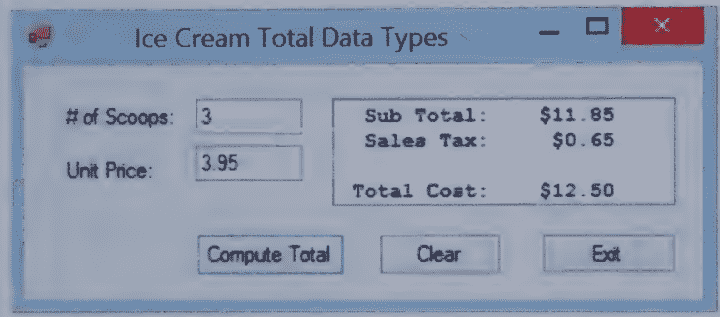

唯一的变化是，我们用更适合财务计算的 decimal 类型变量代替了 double 类型变量。

本教程的主要目标是学习如何处理不同的数值数据类型。

步骤 1-1：复制压缩文件 Tutorial_Starts.zip。解压文件（右键单击并选择“全部提取”）。打开项目 Ch2_DataType。打开窗体 IceCreamTotalDataTypes。

由于此项目中有多个窗体，你需要指定要运行的窗体。双击 Program.cs 文件将其打开，并指定 IceCreamTotalDataTypes 作为要运行的窗体：

```
Application.Run(new IceCreamTotalDataTypes());
```

步骤 1-2：打开代码窗口查看计算总成本的代码，如图 2-2 所示。

图 2-2 所示的代码与 IceCreamTotal 窗体中的代码仅在第 26 行和第 29 行有所不同。在第 26 行，我们使用 decimal 类型变量表示单价、小计、销售税和总成本。同样，在第 29 行，我们使用 decimal 类型常量表示税率。

首先，让我们看第 29 行中向常量 TAX_RATE 赋值的语句：

```
const decimal TAX_RATE = (decimal) 5.5;
```

“(decimal) 5.5”是什么意思？括号内的单词 decimal 将数字 5.5 转换为 decimal 类型，这将在下一节中解释。

因此，一种数据类型不能赋值给位于其左侧的任何数据类型。例如，double 类型不能在没有显式转换的情况下赋值给任何其他类型。即使数据项的实际值很小也是如此；重要的是数据类型的取值范围。

因此，以下代码将产生错误，因为 5.5 是 double 类型，其取值范围大于 decimal，尽管 double 比 decimal 占用更少内存：

```
const decimal TAX_RATE = 5.5;    // invalid
```

同样，float 不能赋值给 decimal 或整数类型，但可以赋值给取值范围更大的 double。

要解决这个问题，需要将字面量 5.5 显式转换为 decimal 类型，方法是指定用括号括起来的数据类型，如下所示：

```
const decimal TAX_RATE = (decimal) 5.5;  // valid
```

将字面量强制转换为 decimal 类型的另一种方法是在字面量后面加上字母“m”或“M”：

```
const decimal TAX_RATE = 5.5m;      // valid
```

除 decimal 外，取值范围较小的数据类型可以存储在取值范围较大的数据类型中。因此，下面的赋值是有效的，因为字面量 5 是整数。所有整数类型的取值范围都小于 decimal 类型：

```
const decimal TAX_RATE = 5;          // valid
```

### decimal 类型：例外情况

例外情况是，decimal 类型不能在没有显式转换的情况下存储到 float 和 double 中（尽管它们的取值范围很大）。请记住，decimal 比 float 和 double 需要更多内存，尽管它的取值范围更小。因此，下面代码无效，因为 decimal 类型不能赋值给 double 类型：

```
const double TAX_RATE = (decimal) 5.5;      // invalid
```

步骤 1-3：将第 29 行中的语句改为：const decimal TAX_RATE = 5.5;
将指针悬停在该数字上，查看错误消息：“double 类型的字面量无法隐式转换为类型‘decimal’……”

步骤 1-4：将第 29 行中的语句改为

```
const decimal TAX_RATE = (decimal) 5.5;
```

注意，错误消失了。

接下来，将语句改为

```
const decimal TAX_RATE = 5;
```

仍然没有错误。

现在，你可以将其改回

```
const decimal TAX_RATE = 5.5m;
```


## Locals 窗口

当程序中断时，你可以通过显示 Locals 窗口（选择 Debug，windows，Locals）来查看所有局部变量（在方法内声明的变量）的值。你也可以将指针移到每个变量上以查看其值。

假设你不小心将税率 tax rate 声明为 int 类型，这会导致数字 5.5 被截断为 5，从而产生错误输出。让我们看看如何识别该问题。

Step 1-5: 通过在程序中设置断点来检查将 double 转换为 int 的效果：
将第 29 行的语句改为

```
const int TAX_RATE = (int) 5.5;
```

并使用 1 份球和单价 10 运行表单。销售税应为 0.55（10 x 0.055），但输出显示为 0.50。

要识别问题，请通过单击大括号左侧的边距，在第 45 行的闭合大括号 “}” 处设置断点。C# 会在边距中插入一个红色圆圈，如下所示：

```
lstOutput.Items.Add(string.Format("{0,12}{1,10:C}", "Total Cost:", totalCost));
```

运行程序。程序执行在该大括号处停止，由红色圆圈上的黄色箭头指示。
通过选择 Debug, Windows, Locals 显示 Locals 窗口。Locals 窗口出现，如图 2-3 所示。

### Figure 2-3: Locals window


检查变量的值有助于识别 TAX_RATE 的值错误为 5。
你也可以将指针移到 TAX_RATE 或任何变量上，一次显示其值。

单击工具栏上的 Continue 按钮继续运行。

关闭表单，并通过将第 29 行的语句改回原始形式来纠正问题：const decimal TAX_RATE = (decimal) 5.5;

接下来我们将使用断点来检查将 double 转换为 float 的效果。

## Step 1-6: 在第 39 行插入以下语句，该行当前为空：

```
float testNumber = 123456789.45F;
```

运行表单。输入 scoops 和 unit price 的值，然后单击 Compute Total 按钮。当程序中断时，将指针悬停在 testNumber 上以查看其值，123456792.0，与 123456789.45 不同，这是由于 float 相对于 double 的精度较低（7 位数字）。关闭表单，并删除新插入的语句。

## 将一个变量赋给另一个不同类型变量的规则

将一种类型变量赋给另一种类型变量的规则本质上与将字面量赋给变量的规则相同：你不能将具有较大范围的数据类型（或常量）的变量存储在具有较小范围的数据类型变量中。以下是按值范围递增排序的数据类型：

sbyte, short, int, long, decimal, float, double

下面显示的第二个语句无效，因为 price 为 double 类型，其范围（10^308）与 decimal（10^28）相比很大。

```
double price = 25;      // valid; all integer types have ranges smaller than double
decimal currentPrice = price;  // invalid; double has a larger range than decimal
```

要纠正问题，你需要将 price 转换为 decimal，如下所示：

```
decimal testNumber = (decimal) price;  // valid
```

除 decimal 外，较小范围的数据类型可以存储在较大范围的数据类型中。Decimal 类型不能在不显式转换的情况下存储在 float 或 double 中（尽管它们具有大范围）。

下面显示的第二个语句无效，因为 price 为 decimal 类型，不能赋给任何其他类型。

```
decimal price = 45500;      // valid!
double currenPrice = price;  // invalid
```

同样，要纠正问题，你需要将 price 转换为 double，如下所示：

```
double currentPrice = (double) price;  // valid
```

因此，double 和 decimal 都不能在没有显式转换的情况下赋给任何其他类型。

## Step 1-7: 为观察当较大类型的变量赋给较小类型的变量时转换的作用，将以下两个语句输入到 ComputeTotal 按钮的 click 事件处理程序中，并注意第二个语句中的错误：

```
decimal price = 2.95m;      // “m” represents decimal
double testNumber = price;  // invalid
```

要纠正错误，请将 price 转换为 double。

```
double testNumber = (double) price;  // valid
```

删除这两个语句。重复该过程，添加以下语句并观察错误：

```
double price = 2.95;
decimal testNumber = price;    // invalid!
```

要纠正错误，请将 price 转换为 decimal。

```
decimal testNumber = (decimal) price;  // valid
```

## 转换：窄化转换和扩展转换

### 显式转换和窄化转换

如上所述，当你将具有较大范围的数据类型存储在具有较小范围的数据类型中，以及当你将 decimal 存储在其他类型中时，需要显式转换。这种转换称为窄化转换。

### 隐式转换和扩展转换

当将除 decimal 以外的任何数据类型存储在具有较大范围的另一种数据类型中时，不需要显式转换。

因此，除 decimal 以外的任何类型的字面量或变量都可以分配给 double 类型变量而无需显式转换。在这种情况下，C# 执行隐式转换以进行扩展转换。

考虑以下代码，将 int 类型的字面量 1234567890（由值确定）分配给 float 类型变量 costPerUnit，然后将 costPerUnit 分配给另一个变量 price。

```
float costPerUnit = 1234567890;      // valid
double price = costPerUnit;          // valid
```

在第一个语句中，C# 从整数到具有较大范围的 float 执行隐式转换以进行扩展转换。第二个语句将 costPerUnit 的值，即 float，分配给 unitPrice，即 double。同样，C# 从 float 到较大的 double 执行隐式转换。

注意！Float 只有 7 位数字的精度。因此，costPerUnit 的值将只有 7 位数字的精度。

Step 1-8: 确保在闭合大括号处有断点。将以下两个语句添加到 Compute Total 按钮的 click 事件处理程序中，运行程序并注意 costPerUnit 和 price 的值。

```
float costPerUnit = 1234567890;      // valid, but loses precision.
double price = costPerUnit;          // valid
```

删除语句。

请注意，由于 float 缺乏精度，costPerUnit 和 price 的值与 1234567890 不同。

## 表达式中混合数据类型

当操作涉及两种不同的数据类型时，则除 decimal 外范围较小的数据类型会被隐式转换为较大类型，结果将与较大类型相同。

因此，如以下代码中所示，在表达式中混合不同的整数类型是有效的：

```
short weight = 60;
int score = 1000;
int weightedScore = weight * score; // valid to mix different integer types
```

short 类型被隐式转换为较大的 int 类型。

同样，将整数类型与 float、double 或 decimal 等实数类型混合也是有效的，如以下代码所示：

```
float weight = 60;
int score = 1000;
float weightedScore = weight * score; // valid to mix integer types with any real type.
```

同样，int 类型被隐式转换为较大的 float 类型。

混合 float 和 double 类型也是有效的。float 类型将被隐式转换为较大的 double 类型。

```
float weight = 60;
double score = 950.50;
double weightedScore = weight * score; // valid to mix float with double (and integer types)
```

## Decimal 类型：再次，麻烦制造者！

虽然混合 float 和 double 类型是有效的，但混合 decimal 与 float 或 double 是无效的。Decimal 不会被隐式转换为 float 或 double。同样，double 和 float 也不会被隐式转换为 decimal。

以下语句中的表达式无效，因为 subTotal 声明为 decimal，但字面量 5.5 为 double：

```
salesTax = subTotal * 5.5 / 100;      // invalid!
```

因此，字面量 5.5 必须显式转换为 decimal，如下所示，以便结果为 decimal 类型：

```
salesTax = subTotal * (decimal) 5.5 / 100;
```

或

```
salesTax = subTotal * 5.5m / 100;
```

注意！整数除以另一个整数的结果将是整数，如果有小数部分则会丢失。例如，以下语句中 average 的值将为 2，尽管 average 为 float 类型，因为 25 除以 10 被表示为整数：

```
float average = 25/10;  // yields the result 2
```


将其中一个整数强制转换为 float 类型会得到正确的结果：

```
float average = 25f/10;
```

25f/10 的结果为 float 类型，即两种类型中较大的那一种，从而得到正确的结果。2.5。

因此，当你用一个整数除以另一个整数时，至少其中一个必须强制转换为实数类型，才能得到带小数部分（如果有）的结果。

步骤 1-9：将以下语句添加到 Compute Total 按钮的单击事件处理程序中，运行程序并观察 average 的值：

```
float average = 25 / 10;    //yields 2
```

将表达式改为 25f/10f，并查看值的差异（2.5）。

将表达式改为 25f/10，结果为 2.5。

删除该语句。

## 使用大整数的乘法

使用大整数进行乘法可能会产生意想不到的后果：

```
int price = 3000;
int quantity = 1000000;
long cost = price * quantity;
```

乘积 3000 * 1000000 为 30 亿。然而，由于两个 int 类型（price * quantity）的乘积表示为 int，其限制约为 21.5 亿，结果超出限制并产生错误结果。

步骤 1-10：添加以下语句，运行程序并注意 cost 的值。

```
int price = 3000;
int quantity = 1000000;
long cost = price * quantity;
```

删除语句。

cost 的值不正确，因为结果为 int 类型，其限制约为 21.5 亿，对于 3000,000,000（30 亿）的结果来说太小了。

## C# 中的一个奇特现象

当操作涉及 short 或 sbyte 类型时，这些类型在执行操作之前会自动转换为 int 类型。因此，结果将为 int 类型。

```
short exam1 = 80;
sbyte exam2 = 90;
short total = exam1 + exam2; // Error! The result is int type (odd!), whereas total is short type
```

你可以将结果强制转换为 short，如

```
short total = (short) (exam1 + exam2);
```

由于使用 sbyte 和 short 时存在这种奇怪的行为，通常你可以使用 int 类型来表示所有在 int 范围内的整数，除非在内存使用是关注点时。

是时候练习了！做练习 2-1。

## 复习问题

2.1 哪种实数数据类型最适合在需要精确表示数字的财务计算中使用？

2.2 与 decimal 相比，float 和 double 类型的优势是什么？

2.3 哪种数据类型具有最大的范围？

2.4 哪种数据类型具有最大的大小（内存）？

更正以下语句中的错误，如有：

2.5 double sales = 2560.50;

2.6 float cost = 2.50;

2.7 float units = 45000;

2.8 sbyte quantity = 200;

2.9 decimal price = 300;
float currentPrice = price;

2.10 short units = 2500;
int quantity = units;

2.11 int qty1 = 1000000000;
int qty2 = 2000000000;
long total = qty1 + qty2;

2.12 float total = 255.50 + 500;

2.13 以下代码旨在计算平均值：
int totalScore = 25;
int count = 4;
float average = total/count;

2.14 decimal price = 100;
float quantity = 5.5;
decimal netCost = price*quantity - 10;

## 2.3 使用字符串和字符

在本节中，你将学习如何使用 string 类型和字符类型的数据和变量。C# 中的 string 类型表示零个或多个字符的组合。“John Adams”和“P410-2023-3180-05”是 string 类型数据的示例。请注意，字符串用引号括起来。

## 值类型和引用类型

我们在第 1 章中讨论的整数和实数类型称为值类型，因为这些类型的每个变量都持有该变量内存位置中的实际值 t。

相比之下，字符串（以及其他对象如数组）称为引用类型，因为这些类型的每个变量只保存对数据的引用——即数据的内存位置或地址，而不是实际数据。引用类型将在第 7 章后面讨论。

为了理解如何使用字符串，让我们看一个通过组合以下三个字符串类型数据来创建用户名的应用程序：

- 1. 姓氏的前 5 个字符
- 2. 名字的第一个字符
- 3. id 的最后两位数字

图 2-4 显示了名为 UserNameString 的用户界面窗体。

## 图 2-4：UserNameString 窗体

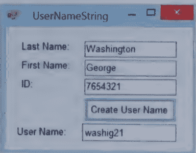

## 教程 2：字符串操作

本教程创建了图 2-4 中所示的 UserNameString 窗体。主要目标是学习字符串操作。

步骤 2-1：打开 Tutorial_Starts 文件夹中的项目 Ch2_DataTypes。打开窗体 UserNameString。为了便于理解代码，代码中使用的控件名称在表 2-3 中显示。

## 表 2-3：窗体 UserNameString 上的控件

| 用途 | 控件类型 | 属性 | 设置 |
| 输入姓氏 | TextBox | Name | txtLname |
| 输入名字 | TextBox | Name | txtFname |
| 输入 id | TextBox | Name | txtId |
| 创建用户名 | Button | Name | btnUserName |
| 显示用户名 | Label | Name | lblUserName |

图 2-5 显示了创建用户名的代码。

## 图 2-5：创建用户名的代码

```
20  private void btnUserName_Click(object sender, EventArgs e)
21  {
22      string lName = txtLname.Text;  // Get input data
23      string fName = txtFname.Text.Trim();
24      string id = txtId.Text.Trim();
25      string userName;
26      // Combine three strings to get the user name
27      userName = lName.Substring(0, 5).ToLower() + fName.Substring(0, 1).ToLower() +
                  id.Substring((id.Length - 2), 2);
29      // Alternate way using the Concat method;
30      userName = string.Concat(lName.Substring(0, 5).ToLower(), fName.Substring(0, 1).ToLower(),
                  id.Substring((id.Length - 2), 2));
32      lblUserName.Text = userName;
33  }
```

让我们看看这些语句的作用。

第 22-24 行从 TextBoxes 获取输入数据并将数据保存到变量中。

第 27 行从姓氏、名字和 id 中提取所需的子字符串；将其转换为小写；并组合起来形成用户名。

string 类型有大量的方法和属性来帮助处理字符串。我们首先查看上述程序中使用的这些方法和属性。

lName.Substring(0, 5).ToLower() 将姓氏的前五个字符转换为小写。同样，ToUpper() 转换为大写。

## 连接字符串

两个或多个字符串可以使用“+”运算符连接，如

```
String fullName = "G " + "C " + "Philip"
```

fullName 的值将为“G C Philip”。这是第 27 行计算用户名时使用的方法：

```
userName = lName.Substring(0, 5).ToLower() +
    fName.Substring(0, 1).ToLower() + id.Substring((id.Length - 2), 2);
```

## 步骤 2-3：在第 27 & 28 行添加计算用户名的语句。运行窗体进行测试。

将 fName 的 Substring 方法的参数改为 3 和 1，如

```
fName.Substring(3, 1).
```

观察用户名的变化。

输入大写姓氏以及带前导和尾随空格的姓氏，并观察输出。输入不同长度的 id。

连接字符串的另一种选择是使用 string 的 Concat() 方法，如

```
String fullName = String.Concat("G ", "C ", "Philip");
```

结果为“G C Philip”。

第 30 行使用 Concat 方法组合字符串：

```
30  userName = string.Concat(lName.Substring(0, 5).ToLower(),
    fName.Substring(0, 1).ToLower(),id.Substring((id.Length - 2), 2));
```

## 步骤 2-4：添加图 2-5 中的第 30 到 32 行以完成程序，并测试代码。

进行以下每项更改，运行程序，并描述它对输出的影响以及原因。

将 lName.Substring(0, 5) 中的参数 (0, 5) 改为 (0,4)。

将上述同一组参数改为 (2, 3)。

将参数 ((id.Length - 2), 2)) 改为 ((id.Length - 1), 1))。

## String() 方法的附加方法

## Replace (string, string) 方法：将第一个字符串（如果有）替换为第二个字符串。

示例：lName = lName.Replace(" ", null);


## 步骤 3-5：使用 new 关键字指定日期/时间，添加以下语句：

```
DateTime gradDate = new DateTime(2017, 5, 12);
DateTime gradDateTime = new DateTime(2017, 5, 12, 14, 30, 0);
```

运行程序，观察 gradDate 和 gradDateTime 的值。删除这些语句。

## 步骤 3-6：添加以下代码来声明变量，并从 DateTimePickers 获取毕业日期和时间。

运行窗体，检查变量 gradDate 和 gradTime 的值。

```
DateTime gradDate, gradDateTime, gradTime;
float numberOfDays;

//Get date of graduation:
gradDate = dtpGradDate.Value;
// Get time of graduation:
gradTime = dtpGradTime.Value;
```

## DateTime 的属性

DateTime 结构具有多种属性。表 2-7 显示了一些常用属性。第 3 列显示了按如下方式创建的 DateTime 的属性值：

```
DateTime graduationDate = DateTime.Parse("5/12/17 02:30 PM");
```

表 2-7：DateTime 结构的属性

| 属性 | 说明 | graduationDate 的属性值（5/12/2017 02:30 PM） |
|---|---|---|
| Day | 以整数形式返回日 | graduationDate.Day: 12 |
| Month | 以整数形式返回月 | graduationDate.Month: 5 |
| Year | 以整数形式返回年 | graduationDate.Year: 2017 |
| Now | 返回当前日期和时间 | DateTime.Now：（当前日期和时间） |
| Today | 返回当前日期 | DateTime.Today：（当前日期，默认时间为 12:00:00 AM） |
| Hour | 以整数形式返回小时 | graduationDate.Hour: 2 |
| TimeOfDay | 返回自午夜以来经过的时间，以 TimeSpan 表示（Hours、Minutes、Seconds 等） | TimeOfDay.Hours: 2<br>TimeOfDay.Minutes: 30<br>TimeOfDay.Seconds: 0 |
| 其他属性包括 Minutes、Seconds、DayOfWeek 和 DayOfYear | | |

### Today 与 Now 的对比

Today 属性返回今天的日期，默认时间为 12:00:00 AM；而 Now 返回今天的日期以及当前时间。

## 格式化 DateTime

表 2-8 显示了 DateTime 的常用格式化选项。

表 2-8：DateTime 的格式化选项

| 格式 | 5/12/2017 将显示为 |
|---|---|
| ToShortDateString | 5/12/2017 |
| ToLongDateString | Friday, May 12, 2017 |
| （无格式） | 5/12/2017 12:00:00 AM |
| ToString | 5/12/2017 12:00:00 AM |

## 步骤 3-7：输入以下代码，显示当前日期和时间以及毕业日期：

```
31  // Format and display current date & time and graduation date:
32  lstDisplay.Items.Clear();
33  lstDisplay.Items.Add("Current Date & Time:   " + DateTime.Now);
34  lstDisplay.Items.Add("Date of graduation:   " + gradDate.ToShortDateString());
```

运行程序并观察输出。将 gradDate 的格式改为 ToLongDateString，运行程序并观察输出。然后移除格式，查看默认格式的输出。

## 使用 ToString() 方法格式化日期/时间

就像使用 ToString() 方法格式化数字一样，你可以使用 DateTime 的 ToString 方法格式化日期和时间。例如，你可以显示某个日期的星期名称或月份名称。表 2-9 显示了 ToString() 方法可用的格式代码。

表 2-9：ToString 方法的格式代码

| 代码 | 5/12/2017 2:30 PM 将显示为 |
|---|---|
| "dd" | 12 |
| "ddd" | Fri |
| "dddd" | Friday |
| "MM" | 5 |
| "MMM" | May |
| "MMMM" | May |
| "yy" | 17 |
| "yyyy" | 2017 |
| "hh" | 02 |
| "mm" | 30 |
| "ss" | 00 |

你可以组合上述代码来创建自定义格式，如下所示：

| 格式 | 显示 |
|---|---|
| “dd MMM yyyy hh:mm:ss tt” | 12 May 2017 2:30:00 PM |
| “MM/dd/yy hh:mm tt” | 5/12/17 2:30 PM |

## 步骤 3-8：输入代码，显示 gradDate 中的星期、月份、月份中的日期，以及 gradDate 的毕业时间，如下所示：

| 问题 | 输出 |
|---|---|
| 毕业是星期几？ | Friday |
| 现在是几月？ | May |
| 月份中的第几天？ | 12 |
| 什么时间？ | 2:30:00 PM |

以下是要添加的代码。注意格式代码 “dddd” 和 “MMM” 如何用于显示日期中的星期和月份：

```
// Display the month & day of graduation:
lstDisplay.Items.Add("");
lstDisplay.Items.Add("What day is the graduation?" + gradDate.ToString("dddd"));
lstDisplay.Items.Add("What month is it?" + gradDate.ToString("MMM"));
lstDisplay.Items.Add("What day of the month?" + gradDate.Day);

//Format and display the time of graduation:
lstDisplay.Items.Add("What time?" + gradTime.ToLongTimeString());
```

修改第 38 行，使显示三个字母的星期缩写（例如，Fri）。

## 步骤 3-9：你可以使用表 2-8 中的不同格式代码进行实验，并观察输出。

接下来，将第 43 行的语句改为以下内容，以便不使用格式：`lstDisplay.Items.Add("What time?" + gradTime)`。运行窗体。注意，时间会与今天的日期一起显示，这是默认日期。

## 使用日期/时间进行计算

DateTime 结构提供了多种方法，用于查找两个日期/时间之间的差值以及向日期/时间添加间隔。表 2-10 显示了这些方法。

表 2-10：DateTime 的方法

| 方法 | 说明 | 方法返回的值 |
|---|---|---|
| AddDays(days) | 向 DateTime 添加指定天数后得到的 DateTime | graduationDate.AddDays(3)：返回 5/15/17 02:30 PM |
| AddMonths(months) | 向 DateTime 添加指定月数后得到的 DateTime | graduationDate.AddMonths(3)：返回 8/12/17 02:30 PM |
| AddHours(hours) | 向 DateTime 添加指定小时数后得到的 DateTime | graduationDate.AddHours(3)：返回 5/12/17 05:30 PM |
| 注意：可以使用相同语法的其他方法来添加年、分钟和秒。 | | |
| Subtract(DateTime) | 通过减去指定的 DateTime 得到一个 TimeSpan | graduationDate.Subtract(DateTime.Now)：返回一个 TimeSpan，表示现在与毕业日期之间的天数、小时数等。 |
| Add(TimeSpan) | 向 DateTime 添加指定的 TimeSpan 后得到的 DateTime | DateTime.Now.Add(fillTime)*：返回将 3 天、2 小时和 30 分钟添加到当前日期和时间后得到的 DateTime 值。<br>*fillTime: (3, 2, 30, 0, 0) |

## 计算两个日期之间的差值

.NET Framework 使用 TimeSpan 结构来表示两个 DateTime 值之间的时间间隔。

### TimeSpan 结构

要获取两个 DateTime 值之间的差值，你可以将一个值减去另一个值。例如，毕业前的时间可以计算并存储在一个 TimeSpan 变量中，如下所示：

```
TimeSpan timeToGraduate = gradDate-DateTime.Now;
```

表 2-11 显示了 TimeSpan 结构的常用属性。

表 2-11：TimeSpan 结构的属性

| TimeSpan 的属性 | 说明 |
|---|---|
| Days、Hours、Minutes、Seconds、Milliseconds、Ticks | 时间间隔中的整天数以及剩余的整小时、分钟、秒、毫秒和刻度数。<br>例如，表示（#12/19/2017 4:40:45 PM# - #12/18/2017 1:10:30 PM#）的 TimeSpan，其属性值如下：<br>Days - 1<br>Hours - 3<br>Minutes - 30<br>Seconds - 15 |
| TotalDays、TotalHours、TotalMinutes、TotalSeconds、TotalMilliseconds | 每个属性返回以特定单位（如天、小时或分钟）表示的整个时间间隔。例如，表示（#12/19/2015 4:30:45 PM# - #12/18/2015 1:20:40 PM#）的 TimeSpan，其属性值如下：<br>TotalDays - 1.146（0.146 表示小数天数）<br>TotalHours - 27.504（包括 27 小时和 .504 小数小时）<br>TotalMinutes - 1650.25 |

也可以使用 new 关键字创建 TimeSpan：

```
TimeSpan variableName = new TimeSpan(days, hours, minutes, seconds, milliseconds);
```

下面是一个具体的 TimeSpan 示例，表示填写订单所需的时间：2 天、3 小时和 30 分钟：

```
TimeSpan fillTime = new TimeSpan(2, 3, 30, 0, 0);
```


## Step 3-10: 插入以下计算毕业所需天数的语句：

// Compute the interval between today's date and graduation date
TimeSpan tsGraduation = (gradDate - DateTime.Today);
/* today includes current date, but not current time.
   You may also use the Subtract() method of DateTime
   TimeSpan tsGraduation = gradDate.Subtract(DateTime.Today); */

numberOfDays = (float)tsGraduation.Days;
// Since graduation date and DateTime.Today both have the same default time (12:00:00),
// the remaining hours, minutes and seconds of the difference will be zero.
LstDisplay.Items.Add("");
LstDisplay.Items.Add("How long?");
LstDisplay.Items.Add("You have only  " + numberOfDays + " more days to graduate");
```

注意在表达式 (gradDate - DateTime.Today) 中，两个日期都具有相同的默认时间 (12:00:00)。因此，差值的剩余小时、分钟和秒都为零。所以，TimeSpan 的 TotalDays 属性给出的值与 Days 属性相同。

稍后，Step 3-14 引入了一个示例，其中两个 DateTime 值之间存在时间差。

## Step 3-11: 这是代码的可选补充。跳过此代码不会影响程序的其余部分。按如下方式添加计算并显示毕业所需周数、月数和年数的代码：

// Computing weeks, months and years:
float numberOfWeeks = numberOfDays / 7;
float numberOfMonths = ((gradDate.Year - DateTime.Today.Year) * 12) +
                       (gradDate.Month - DateTime.Today.Month);
float numberOfYears = (float) (numberOfDays / 365.25);
// The above calculation of month and year may be imprecise under certain conditions.

// Display number of weeks, months & years
LstDisplay.Items.Add("That is, about " + numberOfWeeks.ToString("N0") + " more weeks.");
LstDisplay.Items.Add("That is, about " + numberOfMonths + " more months.");
LstDisplay.Items.Add("That is, over " + numberOfYears + " year.");
```

## 向 DateTime 添加年、月、日、小时等

表 2-10 展示了 DateTime 的方法，用于向 DateTime 添加年、月、日、小时等。让我们使用其中一种方法来计算学生贷款到期日，假设它是在毕业后 60 天。

## Step 3-12: 添加以下语句来计算并显示学生贷款到期日：

// Compute the day when the loan is due - Add 60 days to graduation date:
LstDisplay.Items.Add("");
LstDisplay.Items.Add("When is my loan due? " + gradDate.AddDays(60).ToLongDateString());
// To subtract days, use a negative number
```

## 组合日期和时间

可以从一个 DateTime 变量中获取日期，从另一个 DateTime 变量中获取时间，并组合成单个变量。例如，可以将 gradDate 的日期和 gradTime 的时间组合并存储到单个变量 gradDateTime 中。因为不能添加两个 DateTime，所以 gradTime 的时间使用 DateTime 的 TimeOfDay 属性转换为 TimeSpan，然后加到 gradDate 上，如 Step 3-13 所示。

## Step 3-13: 添加将 gradDate 的日期和 gradTime 的时间组合成单个变量 gradDateTime 的代码。以下是执行此操作的的代码：

```
76  // Combine the date and time and store in a single variable:
77  // Convert graduation time to a TimeSpan and add to date:
78  TimeSpan tsGradTime = gradTime.TimeOfDay;
79  // or,
80  = new TimeSpan(gradTime.Hour, gradTime.Minute, gradTime.Second);
81  gradDateTime = gradDate.Add(tsGradTime);
82  lstDisplay.Items.Add("");
83  lstDisplay.Items.Add("Again, graduation date & time is: " + gradDateTime);
```

## Step 3-14: 添加计算毕业所需天数的代码，同时考虑毕业时间和当前时间之间的差异。

```
84  // Compute the number of days to graduation, including the fractional part
85  tsGraduation = (gradDateTime - DateTime.Now);  //Now includes current date and time
86  lstDisplay.Items.Add("Just " + tsGraduation.TotalDays.ToString("N") + " more days");
```

运行程序，并观察到由于毕业时间和当前时间之间的差异，天数包含小数部分。

或者，您也可以使用 Days（而不是 TotalDays）和 Hours 属性来显示整天数和小时数，使用以下语句：

```
lstDisplay.Items.Add("Just " + tsGraduation.Days.ToString("N1") + " more days" + " and " + tsGraduation.Hours + " hrs");
```

停止程序。

现在您已拥有完整的代码，其应如下所示（代码的副本可在 Tutorial_Starts/Ch2_Data Types/Ch2_GraduationDate_Code.txt 中找到）：

```
private void btnDisplayGradInfo_Click(object sender, EventArgs e)
{
    DateTime gradDate, gradDateTime, gradTime;
    float numberOfDays, numberOfHours;

    //Get date of graduation:
    gradDate = dtpGradDate.Value;
    // Get time of graduation:
    gradTime = dtpGradTime.Value;

    // Format and display current date & time and graduation date:
    lstDisplay.Items.Clear();
    lstDisplay.Items.Add("Current Date & Time:  " + DateTime.Now);
    lstDisplay.Items.Add("Date of graduation:  " + gradDate.ToShortDateString());
```

# Chapter 3

## 决策结构和验证

第 1 章和第 2 章中介绍的程序具有简单的结构，称为 **顺序结构**，其中语句按顺序处理，从第一个语句开始，到最后一个语句结束，每个语句恰好处理一次。在本章中，我们将介绍 **决策（选择）结构**，它允许您仅在特定条件下执行一组语句。

### Topics

| 3.1 决策结构的流程图 | 3.4 嵌套 if 语句 |
| 3.2 if else 语句 | 3.5 switch 语句 |
| 3.3 if else if 语句 | 3.6 数据验证 |

### 3.1 决策结构的流程图

作为决策结构的示例，考虑对第 1 章教程 3 的更新版本，以包含订单金额大于或等于 10 美元时 20% 的折扣，如图 3-1 所示。

Figure 3-1: The IceCreamTotalDiscounted form

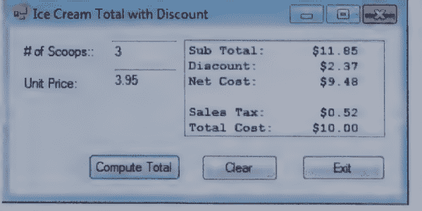

由于折扣仅适用于订单金额大于 10 美元的订单，程序必须检查 subtotal 的值，并根据值选择不同的路径。这种允许程序仅在特定条件为真时执行一个或多个语句的结构称为 **决策（或选择）结构。**

表示程序逻辑的流行图形工具是流程图。计算折扣百分比的逻辑的流程图如图 3-2 所示。

### Table 3-1: 关系运算符

| 关系运算符 | 其含义 | 示例 |
|---|---|---|
| > | 大于 | if (roomCapacity > enrollment) |
| < | 小于 | if (dateDue < DateTime.Today) |
| >= | 大于或等于 | if (examScore >= 90) |
| <= | 小于或等于 | if (dateOfBirth <= DateTime.Parse("12/31/1980")) |
| == (两个 "=" 的组合) | 等于 | if (city == "Oshkosh") // city is string type<br>if (inState == true) // inState is bool type<br>// The expression if (inState == true) may be replaced by<br>// if (inState), because inState itself is true or false. |
| != | 不等于 | if (middleInitial != 'C') // middleInitial is of char type. |

### Tutorial 1: 带折扣的冰淇淋总额

本教程开发了第 1 章教程 3 的更新版本，以包含折扣，如图 3-2 中的流程图所示。

Step 1-1: 打开 Tutorial_Starts 文件夹中的项目 Ch3_DecisionAndValidation。打开表单 IceCreamTotalDiscounted。
编辑 Program.cs 文件以指定 IceCreamTotalDiscounted 为要运行的表单。

Step 1-2: 修改计算总成本的代码，如图 3-3 所示：更改包括
第 40-43 行：添加 if else 语句以计算 discountPercent。
第 46-52 行：取消注释计算折扣、净成本和总成本的语句。
第 57-60 行：取消注释显示小计、折扣和净成本的语句。
第 62-63 行：添加显示销售税和净成本的语句。

使用产生小计小于 10、等于 10 和大于 10 的单价和勺数组合测试程序。


## 在布尔表达式中混合不同数据类型

你在第 2 章学到的关于在涉及数字的公式（数学表达式）中混合不同数据类型的规则也适用于布尔表达式——也就是说，你可以在布尔表达式中混合不同的实数和整数数据类型，但不能在没有显式转换的情况下将十进制与 float 或 double 混合。例如，以下 if 语句中的表达式是无效的：

```
decimal price = 12.5m;
if (price > 10.5) // invalid; cannot compare a decimal to double
```

表达式应改为

```
if (price > 10.5m)      // valid
```

以下比较是有效的：

```
decimal price = 12.5m;
if (price > 10)   // valid; decimal and integer types may be mixed
```

```
float price = 12.5f;
if (price > 10.5) // valid; float and double types may be mixed
```

if 语句可以使用一个或多个以下关系运算符来比较布尔表达式中的数据项：

## 没有 else 子句的 if 语句

示例 2：表示图 3-2 所示决策结构的另一种方法是删除假路径中的语句并将它们放在决策结构之前，如下所示：

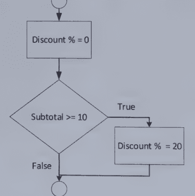

以下程序显示了修改后的 if 语句以实现新的决策结构：

```
bool freeTopping;
if ((subTotal >= 10) || (scoops >=3))
{
    discountPercent = 20;        // processed if either (subTotal >= 10) or (scoops >=3),
    freeTopping = true;          // that is, if one of the two Boolean expressions is true.
}
else
{
    discountPercent = 0;   // processed if both Boolean expressions are not true
    freeTopping = false; // that is, if both are false.
}
```

步骤 1-6：修改 if 语句以包含修订后的标准。运行并测试表单，使用小计和球数 的不同组合，使得 (1) 两个布尔表达式都为假，(2) 仅第一个表达式为真，(3) 仅第二个表达式为真以及 (4) 两个表达式都为真。观察每种情况下的结果。

将逻辑运算符从 "||"（或）更改为 "&&"（与），运行表单并在小计和球数的四种不同组合下观察差异。将逻辑运算符改回 "||"

表达式 ((subTotal >= 10) || (scoops >=3)) 检查小计是否至少为 10 或球数是否至少为 3。一种替代方法是通过检查表达式 ((subTotal < 10) and (scoops < 3)) 是否为假来实现相同的目的——也就是说，小计和球数均未低于所需限制。请注意，表达式中使用了 "<" 运算符代替 ">="。此外，“或”被“与”取代。

你可以使用 "!"（非）运算符来检查表达式是否为假，如下所示：

```
if (!((subTotal < 10) && (scoops < 3)))
```

步骤 1-7：将 if 语句更改为：if (!((subTotal < 10) && (scoops<3)))。运行表单并在步骤 1-6 指定的小计和球数的四种不同组合下观察差异。观察每种情况下的结果。现在，将 "&&" 更改为 "||" 如下：

```
bool freeTopping;
if (!((subTotal < 10) || (scoops < 3)))
{
    discountPercent = 20;
    freeTopping = true;
}
else
{
    discountPercent = 0;
    freeTopping = false;
}
```

这不会得到期望的结果。如果两个布尔表达式中任何一个为假，则组合表达式 ((subTotal < 10) || (scoops < 3)) 为真，这使得 (!((subTotal < 10) || (scoops < 3))) 为假，从而导致没有折扣。

运行表单并在小计和球数的四种不同组合下观察差异。观察每种情况下的结果。

## 复习问题

以下程序会在 ListBox lstOutput 中显示什么输出？

```
3.1
int totalAmt = 80, percentDiscount = 5;
if (totalAmt >= 100)
    percentDiscount = 20;
lstOutput.Items.Add(percentDiscount);
```

```
3.2
int totalAmt = 80;
int percentDiscount = 5;
if (totalAmt >= 100)
    percentDiscount = 20;
else
    percentDiscount = 0;
lstOutput.Items.Add(percentDiscount);
```

```
3.3
int ACT = 23;
float GPA = 3.2F;
if ((ACT >= 24) || (GPA >= 3))
    lstOutput.Items.Add("Admit");
else
    lstOutput.Items.Add("Deny");
```

```
3.4
int ACT = 23;
float GPA = 3.2F;
if ((ACT >= 24) && (GPA >= 3))
    lstOutput.Items.Add("Admit");
else
    lstOutput.Items.Add("Deny");
```

```
3.5
int ACT = 23;
float GPA = 3.2F;
if (!((ACT >= 24) || (GPA >= 3)))
    lstOutput.Items.Add("Admit");
else
    lstOutput.Items.Add("Deny");
```

```
3.6
int ACT = 23;
float GPA = 3.2F;
if (!((ACT >= 24) && (GPA >= 3)))
    lstOutput.Items.Add("Admit");
else
    lstOutput.Items.Add("Deny");
```

## 3.3 if else if 语句

考虑一个评分标准，A、B 和 C 的最低分数分别为 90、80 和 70（低于 70 为 F）。表示该决策结构的流程图如下所示：

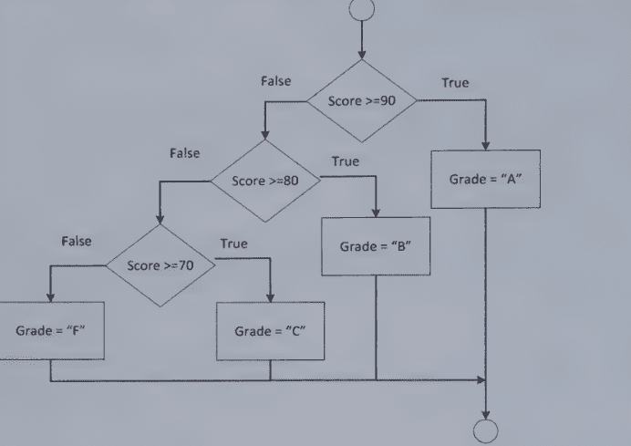

示例 4：以下程序使用 if else if 结构根据流程图所示的决策结构计算字母等级。此外，程序还计算绩点。

```
string letterGrade;
int gradePoints;
if (totalScore >= 90)
{
    letterGrade = "A";
    gradePoints = 4;
}
else if (totalScore >= 80)
{
    letterGrade = "B";
    gradePoints = 3;
}
else if (totalScore >= 70)
{
    letterGrade = "C";
    gradePoints = 2;
}
else
{
    letterGrade = "F";
    gradePoints =0;
}
```

步骤 2-2：查看表 3-3 中指定的用户界面控件。

### 表 3-3：ComputeGrade 表单上的控件

| 用途 | 控件类型 | 属性 | 设置 |
|---|---|---|---|
| 输入总分 | TextBox | Name | txtScore |
| 输入出勤率 % | TextBox | Name | txtAttendance |
| 显示等级 | Label | Name | txtGrade |
| 显示总分标签 | Label | Text | Score: |
| 显示出勤标签 | Label | Text | Attendance: |
| 显示等级标签 | Label | Text | Grade: |
| 计算等级 | Button | Name | btnGrade |
| 计算等级 | Button | Text | Compute Grade |

首先，你开发代码仅基于总分计算等级，忽略出勤率。

步骤 2-3：将以下代码添加到 btnGrade 的单击事件处理程序中以仅基于分数计算等级。

### 图 3-5：仅基于分数计算等级的代码。

```
20  private void btnGrade_Click(object sender, EventArgs e)
21  {
22      string letterGrade;
23      float totalScore = float.Parse(txtScore.Text);
24
25      // Compute grade using if else if, based only on score:
26
27      if (totalScore >= 90)
28          letterGrade = "A";
29      else if (totalScore >= 80)
30          letterGrade = "B";
31      else if (totalScore >= 70)
32          letterGrade = "C";
33      else
34          letterGrade = "F";
35
36      // Display grade:
37      lblGrade.Text = letterGrade;
```

步骤 2-4：将启动表单更改为 ComputeGrade，并使用 0 到 100 范围内的分数值、一个大于 100 的值和一个负值运行项目。本版本程序不需要出勤数据。

## 3.5 switch 语句

switch 语句提供了一种根据变量或表达式的值分支到多个路径中的一种的便捷方式。它与带有 else if 子句的 if 语句有何不同？让我们看一下根据酒店客人折扣类型（“AAA”、“Best Rate”、“Government”或“Senior”）确定酒店预订折扣百分比的代码。

以下是使用 else if 子句的 if 语句来确定折扣：

```
float discountPercent;
if (discountType == "AAA")
    discountPercent = 10;
else if (discountType == "Best Rate")
    discountPercent = 5;
else if (discountType == "Government")
    discountPercent = 15;
else if (discountType == "Senior")
    discountPercent = 12.5F;
else
    discountPercent = 0;
```

相应的 switch 语句是

```
float discountPercent;
switch (discountType)
{
    case "AAA":
        discountPercent = 10;
        break;
    case "Best Rate":
        discountPercent = 5;
        break;
    case "Senior":
        discountPercent = 12.5F;
        break;
    case "Government":
        discountPercent = 15;
        break;
    default:
        discountPercent = 0;
        break;
}
```

switch 语句检查测试变量 discountType 的值，并根据其值分支到前四个路径之一（“AAA”、“Best Rate”、“Government”或“Senior”）。如果值与四个值中的任何一个都不匹配，则处理 default 下的语句。

请注意，每个路径中都有一个 break 语句，这会导致程序跳过 switch 语句的其余部分。例如，如果 discountType 为“Best Rate”，则程序将值 5 分配给 discountRate，并且 break 语句导致它跳过检查其余 case 语句中指定的“Government”和“Senior”值。


## 教程 3：switch 语句

为了帮助理解 switch 语句，你将创建一个表单，根据折扣类型（“AAA”、“最优房价”、“政府”或“老年”）计算酒店客房预订的折扣，如图 3-7 所示：

图 3-7：预订折扣计算器

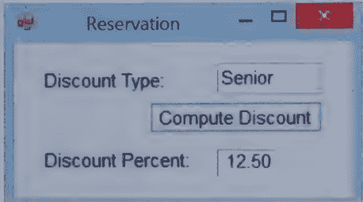

步骤 3-1：打开项目 Ch_DecisionAndValidation。

步骤 3-2：打开表单 Reservation。

步骤 3-3：将以下代码添加到 btnComputeDiscount 按钮的单击事件中。

```
private void btnComputeDiscount_Click(object sender, EventArgs e)
{
    string discountType = txtdiscountType.Text;
    float discountPercent;

    // Compute discount percent
    switch (discountType)
    {
        case "AAA":
            discountPercent = 10;
            break;
        case "Best Rate":
            discountPercent = 5;
            break;
        case "Government":
            discountPercent = 15;
            break;
        case "Senior":
            discountPercent = 12.5F;
            break;
        default:
            discountPercent = 0;
            break;
    }
    // Display discount percent
    lblDiscountPercent.Text = discountPercent.ToString("N");
```

步骤 4-3：将以下代码添加到 btnGrade 单击事件处理程序的开头，以获取分数并对其进行验证：

```
float totalScore;
// Verify that the score is a number
if (float.TryParse(txtScore.Text, out totalScore) == false)
{
    // Display invalid number message
    MessageBox.Show("Please enter a valid number for score");
    txtScore.Focus();
    txtScore.SelectAll();
    return;
}

// Get attendance
float attendance = float.Parse(txtAttendance.Text);
```

步骤 4-4：运行表单，并使用有效和无效的分数（非数字分数和无分数）进行测试。

图 3-11 显示了 GradeWithLateValidation 表单的完整代码。

### 图 3-11：GradeWithLateValidation 表单的代码

```
20  private void btnGrade_Click(object sender, EventArgs e)
21  {
22      float totalScore;
23      // Verify that the score is a number
24      if (float.TryParse(txtScore.Text, out totalScore) == false)
25      {
26          // Display invalid number message
27          MessageBox.Show("Please enter a valid number for score");
28          txtScore.Focus();
29          txtScore.SelectAll();
30          return;
31      }
32
33      // Get attendance
34      float attendance = float.Parse(txtAttendance.Text);
35
36      // Compute grade:
37      string letterGrade;
38      if (totalScore >= 90)
39          if (attendance >= 90F)
40              letterGrade = "A";
41          else
42              letterGrade = "B";
43      else if (totalScore >= 80)
44          letterGrade = "B";
45      else if (totalScore >= 70)
46          letterGrade = "C";
47      else
48          letterGrade = "F";
49
50      // Display grade:
51      lblGrade.Text = letterGrade;
52  }
```

使用 MessageBox 提醒用户数据错误的替代方案是使用 **ErrorProvider** 控件。

### ErrorProvider 控件

ErrorProvider 通过在控件旁边放置错误指示图像来指示错误。将鼠标移到图像上时，错误消息会以工具提示的形式显示，如图 3-15 所示。

图 3-15：带有错误消息的 ErrorProvider 控件

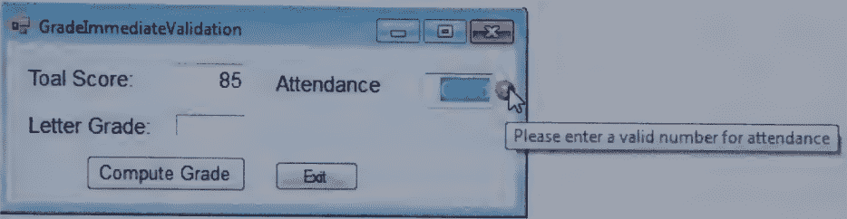

与 MessageBox 不同，ErrorProvider 可用于同时指示多个 TextBox 上的错误。

要使用 ErrorProvider，请从工具箱的“容器”组中添加 ErrorProvider 控件。要在控件旁边指示错误，请使用 ErrorProvider 对象的 SetError 方法，该方法指定控件和错误消息，如下所示：

```
.SetError(controlName, errorMessage);
```

有关示例，请参见图 3-16 中的代码。要移除图像，请将错误消息设置为空字符串。

### 步骤 5-3：将 ErrorProvider 控件从工具箱拖放到表单中。ErrorProvider 出现在设计器窗口底部的组件托盘中。

将控件名称从 ErrorProvider1 更改为 erpAttendance。

-   为 txtAttendance 创建 Validating 事件处理程序。
-   将图 3-16 中第 60–71 行的代码添加到 txtAttendance 的 Validating 事件处理程序中，放在左大括号“{”之后的那行。
-   运行表单，为 attendance 输入无效数据，然后尝试通过按 Tab 键或单击第一个文本框来移开焦点。
-   使用有效数据重复上述操作。

### 图 3-16：使用 ErrorProvider 的 Validating 事件处理程序

```
57
58 private void txtAttendance_Validating(object sender, CancelEventArgs e)
59 {
60     float attendance;
61     // Verify that attendance is a number
62     if (float.TryParse(txtAttendance.Text, out attendance) == false)
63     {
64         // Display invalid number message
65         errAttendance.SetError(txtAttendance, "Please enter a valid number for attendance");
66         txtAttendance.Focus();
67         txtAttendance.SelectAll();
68         return;
69     }
70     else
71         errAttendance.SetError(txtAttendance, "");
72 }
```

### 检查空值

每个 TextBox 的验证事件中的代码只会在用户试图移开该 TextBox 时验证输入其中的数据。如果用户跳过一个 TextBox 并直接单击按钮计算成绩，会出现什么情况？这可能导致程序出现不希望的异常终止。

因此，即使有了现有的验证代码，仍然有必要检查 TextBox 是否为空。这可以在 btnGrade 按钮的单击事件处理程序中完成，如图 3-17 所示。

步骤 5-4：将图 3-17 中所示的 if 语句添加到 btnGrade_click 事件处理程序的开头。

步骤 5-5：运行表单，在缺少 attendance 数据以及输入无效 attendance 数据时测试代码。

### 图 3-17：检查 TextBox 中的空值

```
private void btnGrade_Click(object sender, EventArgs e)
{
    // Verify that the TextBoxes are not empty
    if ((txtScore.Text.Length == 0) || (txtAttendance.Text.Length == 0))
    {
        MessageBox.Show("Please enter score and attendance");
        return;
    }

    // Get totalScore and attendance
    ...
```

### CauseValidation 属性

当焦点从一个控件移动到另一个控件时，仅当两个控件的 CauseValidation 属性都为 true（默认值）时，才会为第一个控件引发 Validating 事件。

步骤 5-6：将 txtAttendance 的 CauseValidation 设置为 False。运行表单，在 txtScore 中输入无效分数，然后按 Tab 键。不显示任何消息，表明未引发 txtScore 的 Validating 事件。

你可以使用 CauseValidation 属性允许用户在不输入有效数据的情况下移开控件。例如，你可以让用户通过单击“退出”按钮关闭表单而无需输入有效数据。要在用户移动到“退出”按钮时抑制 Validating 事件，请将“退出”按钮的 CauseValidation 属性设置为 false。

步骤 5-7：添加一个新按钮 btnExit，并将其 CauseValidation 属性设置为 false。将图 3-18 中所示的代码输入到 btnExit 的单击事件处理程序中。运行表单。输入无效分数并单击“退出”按钮。由于将 Exit 按钮的 CauseValidation 设置为 false 会抑制 TextBox 的验证事件，因此不会显示错误消息。

图 3-18：Exit 按钮的单击事件处理程序

```
private void btnExit_Click(object sender, EventArgs e)
{
    Environment.Exit(0); // 0 is an exit code passed to the O.S.
    // Environment.Exit closes all "threads"; but this.Close doesn't
}
```

### 其他相关事件

当你在控件之间移动时，会引发多种事件。这些事件包括

-   1. Enter
-   2. GotFocus
-   3. Leave
-   4. Validating
-   5. Validated
-   6. LostFocus

用于在 GradeWithImmediateValidation 表单中计算成绩的完整代码如图 3-19 所示。


## 练习

### 练习 3-1

在项目 Ch3_DecisionAndValidation 中创建一个名为 Exercise 3.1 的新窗体。将 IceCreamTotalDiscounted 窗体中的控件和代码复制到新窗体 Exercise_3.1 中。按下图所示修改窗体，使其根据折扣代码而不是小计来计算折扣百分比：如果折扣代码为"1"，折扣为 20%；如果折扣代码为"2"，折扣为 10%；否则没有折扣（如果没有折扣，用户就不会输入任何折扣代码）。折扣代码按下图所示输入到 TextBox 中。分别使用 if 语句和 switch 语句计算折扣。

当用户单击计算按钮时，程序应验证输入到 TextBox 中的数据。单价必须是有效数字；冰淇淋球数必须是整数；如果用户输入了折扣代码，则其值必须是"1"或"2"。

提示：若要检查数字是否为整数，可以将该数字与截断后的数字进行比较，如下所示：

```csharp
if (scoops == (int)scoops)
```

或

```csharp
if (scoops == Math.Truncate(scoops))
```

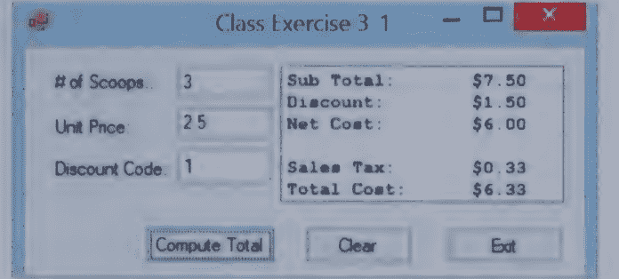

### 练习 3-2

在项目 Ch3_DecisionAndValidation 中创建一个名为 Exercise 3.2 的新窗体。将 IceCreamTotalDiscounted 窗体中的控件和代码复制到新窗体 Exercise_3.2 中。修改窗体，使得当输入到 TextBox 中的数据不是整数时，用户无法从冰淇淋球数 TextBox 中移开。使用 Error Provider 显示消息。高亮显示数据，以便用户可以键入覆盖。

提示：若要检查数字是否为整数，可以将该数字与截断后的数字进行比较，如下所示：

```csharp
if (scoops == (int)scoops)
```

或

```csharp
if (scoops == Math.Truncate(scoops))
```

同样，进行必要的修改，使得当输入到 TextBox 中的数据不是有效数字时，用户无法从单价 TextBox 中移开。使用 MessageBox 显示消息。高亮显示数据，以便用户可以键入覆盖。

确保即使输入到 TextBox 中的数据无效，用户也可以通过单击 Exit 按钮关闭窗体。

### 练习 3-3

一家零售服装店提供 10% 的折扣，条件是总销售额大于或等于 50 美元且低于 100 美元。如果总销售额大于或等于 100 美元，商店提供 20% 的折扣，并且持有优惠券的顾客在应用 20% 折扣之前先从总销售额中减免 10 美元。

绘制一个流程图，显示计算小计（= 总销售额 - 所有折扣）的逻辑。

开发一个名为 Exercise 3.3 的新窗体。你可以在现有项目 Ch3_DecisionAndValidation 中开发该窗体，也可以在新项目 Ch3_Exercises 中开发。让用户在窗体上的 TextBox 中输入总销售额。计算并显示总销售额、优惠券金额（如果有）、折扣和小计，小数位对齐。

提示：使用布尔变量表示优惠券。参见本章的表 3-1 和示例 3。你可以在程序中为布尔变量赋值 true 或 false 来测试代码。

### 练习 3-4

一家连锁酒店为拥有金卡或白金卡身份的顾客提供特别折扣：

- 金卡：预订 2 至 4 天可享受 20% 折扣，入住 5 天或以上可享受 30% 折扣。
- 白金卡：预订 2 至 4 天可享受 30% 折扣，入住 5 天或以上可享受 40% 折扣。

开发一个名为 Exercise 3.4 的新窗体。你可以在现有项目 Ch3_DecisionAndValidation 中开发该窗体，也可以在新项目 Ch3_Exercises 中开发。让用户在三个不同的 TextBox 中输入天数、顾客身份（Gold 或 Platinum）和每日房费。计算并显示总费用（= 每日房费 * 天数）、折扣和净金额（= 总费用 - 折扣），小数位对齐。

while 循环体中的语句在布尔表达式所表示的测试条件为 true 时重复执行。如果测试条件为 false，则循环终止。

接下来，你创建应用程序。为了简化开发，我们将它作为控制台应用程序运行，以便用户在控制台窗口中输入密码，而不是像通常那样输入到 TextBox 中。

## 4.2 控制台应用程序

在控制台应用程序中，用户通过控制台而不是窗体上的控件与应用程序交互。因此，窗体的开发更简单；但是用户界面受限。

要使用控制台，你需要按照以下步骤更改项目的输出类型设置：

- 打开项目。在下一个教程中，我们将使用 Tutorial_Starts 文件夹中名为 Ch4_Loops 的项目。
- 在解决方案资源管理器中双击“属性”，打开属性窗口。
- 选择“应用程序”。将“输出类型”更改为“控制台应用程序”。

控制台的使用在教程 1 中演示。

### 教程 1：使用 while 循环验证密码

本教程构建使用 while 循环验证密码的应用程序，并演示控制台的使用。

步骤 1-1：从 Tutorial_Starts 文件夹中打开名为 Ch4_Loops 的项目。打开如图 4.2 所示的 VerifyPassword 窗体。该窗体有一个名为 btnContinue 的按钮，标题为“Continue”。

步骤 1-2：在解决方案资源管理器中双击“属性”，打开属性窗口。将“输出类型”更改为“控制台应用程序”。

#### while 语句的代码

与图 4-3 中的流程图相对应的代码如图 4-4 所示。

**图 4-6：在循环内部声明计数器——错误方式**

```csharp
19  private void btnContinue_Click(object sender, EventArgs e)
20  {
21    // int count = 0;   //moved to line 25
22    string password = null;
23    while (password != "easy")
24    {
25      int count = 0; //Wrong place. count gets reset to 0 every time
26      count = count + 1;
```

要在循环内部递增变量，请确保该变量在循环外部声明。

#### 递增变量：在循环内部与外部

图 4-5 中的循环在第 25 行包含语句 count = count + 1，以便在循环的每次迭代中使 count 增加 1。如果将这条语句放在循环之前，会产生什么效果？执行步骤 1-7 来找出答案。

步骤 1-7：将语句 count = count + 1 移动到紧随第 21 行之后的下一行，从而在循环开始之前在循环外部递增 count，如图 4-7 所示。

在第 35 行的循环末尾设置一个断点。多次运行窗体并输入错误的密码，观察 count 的值保持在 1，因为 count 不会通过循环的迭代而递增。

**图 4-7：在循环外部递增计数器——错误方式**

```csharp
19  private void btnContinue_Click(object sender, EventArgs e)
20  {
21    int count = 0;
22    count = count + 1; // wrong place. count gets incremented only once
23    string password = null;
24    while (password != "easy")
25    {
26      // count = count + 1; moved to outside the loop
27      if (count > 3)
```

接下来，我们将在一个金融投资应用程序中查看 while 循环的使用，其中累计投资的价值决定了循环处理的次数。

### 教程 2：while 循环——财务规划应用程序

此应用程序在财务规划应用程序中使用 while 循环，帮助你确定需要多少年才能达到目标储蓄额，如图 4-8 所示。此示例还用于演示 do-while 和 for 循环的应用。

在此示例中，当投资价值低于 500,000 美元的目标时，使用每年投资额和年增长率来预测每年的投资未来价值。假设投资在每年年初进行。图 4-9 显示了 while 语句的流程图。

**图 4-8：FinancialPlanner 窗体**

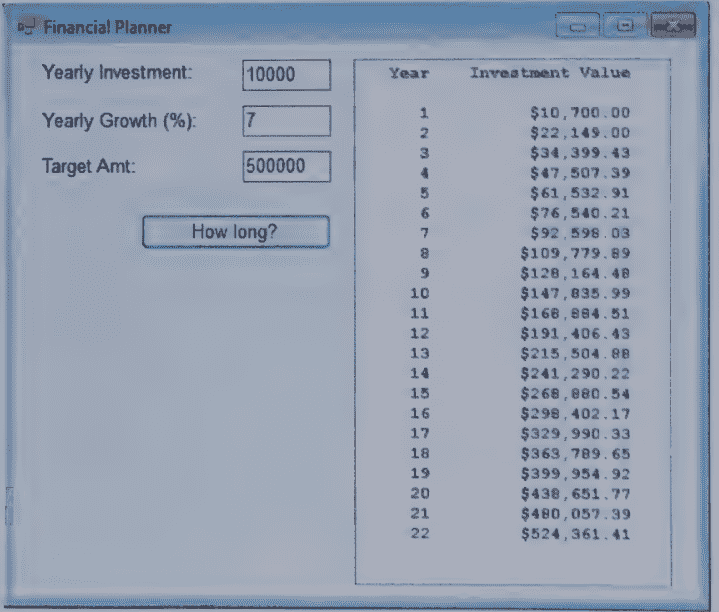


### 图 4-9：FinancialPlanner 中 while 循环的流程图

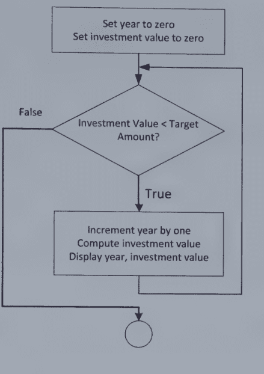

步骤 2-1：从 Tutorial_Starts 文件夹中的项目 Ch4_Loops 打开名为 FinancialPlanner 的窗体，如图 4-8 所示。窗体具有以下控件：

- 三个 TextBoxes：txtInvestment、txtGrowthRate 和 txtTargetAmt
- 三个 Labels
- 一个按钮：btnHowLong
- 一个 ListBox：lstDisplay

完整代码如图所示 4-10。

程序的前三个部分由以下子任务组成：

- 从 TextBoxes 获取输入数据。
- 打印标题。
- 将年份和投资价值设为零。

### 图 4-10：FinancialPlanner 窗体的代码

```csharp
20    private void btnHowLong_Click(object sender, EventArgs e)
21    {
22        // Get input data from TextBoxes:
23        double yearlyInvestment = double.Parse(txtInvestment.Text);
24        float YearlyGrowthPercent = float.Parse(txtGrowthRate.Text);
25        double targetAmt = double.Parse(txtTargetAmt.Text);
26
27        // Print heading
28        string formatCode = "{0,7}{1,20}";
29        lstDisplay.Items.Add(string.Format(formatCode, "years", "Investment Value"));
30
31        lstDisplay.Items.Add("");
32
33        // Set year and investment value to zero
34        int year = 0;
35        double investmentValue = 0;
36
37        // Use while loop to compute investment value for each year
38        while (investmentValue < targetAmt)
39        {
40            year = year + 1;    // Increment year by one
41            investmentValue = (investmentValue + yearlyInvestment) *
42                            (1+ YearlyGrowthPercent/100);
43            lstDisplay.Items.Add(string.Format(formatCode, year,
44                                investmentValue.ToString("C")));
45        }
```

让我们关注使用 while 循环的代码的第四部分。

while 语句会评估布尔表达式 (investmentValue < targetAmt)。如果为真，则 while 子句中的语句会被处理以递增年份并计算投资价值；如果不为真，则控制权会传递给循环之后的语句（方法末尾的右括号）。

第一次处理 while 语句时，investmentValue 为零，布尔表达式 (0 < 500000) 为真。因此，while 子句中的语句会被处理以执行以下操作：

- 将年份递增到 1，
- 使用第 41 行中的表达式计算第 1 年的投资价值，其值为 10,700，并且
- 显示年份和投资价值。

计算投资价值的公式将在后面讨论。

正如图 4-9 中的流程图所示，在处理完 while 子句中的最后一个语句后，控制会自动传递到循环的开头，在那里使用第一次迭代中计算的 investmentValue (10,700) 评估布尔表达式，以开始第二次迭代。

在第二次迭代中，布尔表达式 (10700 < 500000) 为真。因此，while 子句中的语句第二次被处理以将年份递增到 2，计算新的投资价值 (22,149) 并显示它。

## 预测试循环

while 循环有一个在循环开始时检查的布尔表达式。因此，while 循环被称为预测试循环。因为它是预测试循环，如果在第一次迭代中布尔表达式为假，则循环中的语句甚至一次也不会被处理。例如，如果 investValue 初始化为大于 500,000 的值，则循环中的语句将不会被处理。

步骤 2-5：将 investmentValue 的初始值（第 35 行）更改为 501,000。运行窗体。注意 ListBox 中没有输出显示，表明循环中的语句未被执行。

是时候练习了！完成练习 4-1 和 4-2。

## 复习问题

4.1 修正以下程序中的错误（如果有），该程序旨在计算如果每年存入 $750 且没有利息的情况下 4 年的总储蓄。

```csharp
int yearlyDeposit = 750;
int totalSavings = 0;
while (year < 4)
{
    int year = 0;
    year = year + 1;
    totalSavings = totalSavings + yearlyDeposit;
}
```

4.2 以下程序的输出会是什么？（特别注意循环内部的语句。）

```csharp
int yearlyDeposit = 750;
int totalSavings = 0;
int year = 0;
while (year < 3)
{
    year = year + 1;
    totalSavings = yearlyDeposit;
}
lstOutput.Items.Add(totalSavings);
```

4.3 以下程序的输出会是什么？

```csharp
int year = 2016;
int population = 75000;
while (population < 77000)
{
    year = year + 1;
    population = population + 1000;
    lstOutput.Items.Add(year + " " + population.ToString());
}
```

4.4 以下程序中的循环会被执行多少次？

```csharp
int year = 3;
while (year < 3)
{
    year = year + 1;
}
```

### 图 4-14：for 循环的流程图

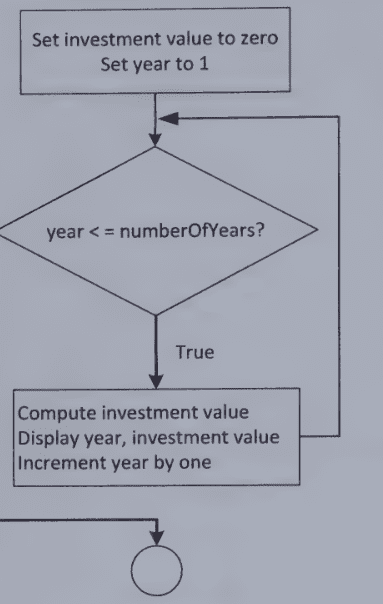

## 教程 3：for 循环：财务规划应用程序

让我们构建使用 for 循环计算固定年数投资价值的 FinPlannerForLoop 窗体。

步骤 3-1：从项目 Ch4_Loops 打开名为 FinPlannerForLoop 的窗体。添加图 4-13 中第 37-44 行的代码以创建 for 循环。

步骤 3-2：在循环头部以及开始和结束大括号处设置断点。运行窗体，并观察第一次通过循环时 year 的值以及它在第一次迭代结束和第二次迭代开始之间如何变化。

步骤 3-3：为帮助理解循环的终止，将第 42 行和第 43 行中显示输出的语句复制到循环的右大括号之后的行，如图 4-15 所示。运行窗体。当 year 的值变为 23 时，循环的处理终止，因为布尔表达式 (year<= numberOfYears) 为假。因此，第 23 年的 investmentValue 未被计算，它与第 22 年的值相同，如以下输出所示：

| Years | Investment Value |
| --- | --- |
| 21 | $480,057.39 |
| 22 | $524,361.41 |
| 23 | $524,361.41 |

变量 year 在循环外部可用，因为它是在循环外部声明的。

### 在循环内部声明计数器变量

步骤 3-4：按如下方式修改循环的头部以在头部内声明计数器变量：

```csharp
// int year;
for (int year = 1; year <= numberOfYears; year = year + 1)
```

运行窗体。

错误！程序无法运行，因为变量 year 在循环内部声明，但在第 45 行用于在循环外部显示其值。

删除使用变量 year 在循环外部显示值的第 45 行和第 46 行的语句。错误消失了。

再次，变量的作用域如果在循环内部声明，则仅限于循环。

### 按非 1 的值递增计数器

步骤 3-5：按如下方式修改头部以在每次迭代中将 year 递增 5：

```csharp
for (int year = 1; year <= numberOfYears; year = year + 5)
```

运行窗体。注意 year 的值如何变化。

警告！除第一年外，计算的投资价值都是不正确的，因为公式假设每年递增。

| years | Investment Value |
| --- | --- |
| 1 | $10,700.00 |
| 6 | $22,149.00 |
| 11 | $34,399.43 |
| 16 | $47,507.39 |
| 21 | $61,532.91 |

### 递减计数器变量

步骤 3-6：按如下方式更改循环的头部以递减计数器变量：

```csharp
for (int year = 5; year >= 1; year = year - 1)
```

运行窗体。year 的值从 5 变到 1，如下所示：

| years | Investment Value |
| --- | --- |
| 5 | $10,700.00 |
| 4 | $22,149.00 |
| 3 | $34,399.43 |
| 2 | $47,507.39 |
| 1 | $61,532.91 |

## 复习问题

4.6 以下程序的输出会是什么？

```csharp
int population = 65000;
for (int year = 2016; year <= 2018; year = year + 1)
{
    population = population + 1000;
    lstOutput.Items.Add(year + " " + population.ToString());
}
```

4.7 以下程序的输出会是什么？

```csharp
int population = 65000;
for (int yr = 2018; yr > 2016; yr = yr - 1)
{
    population = population - 1000;
    lstDisplay.Items.Add(yr + " " + population.ToString());
}
```

## 4.6 break 和 continue 语句

break 和 continue 语句让你偏离循环的正常处理。

### break 语句

你可以使用 break 语句跳出循环。

步骤 3-7：按图 4-16 所示修改代码，通过添加 if 语句和 break 语句，如果 investmentValue 超过 100,000，则跳出循环。将第 42 行的显示语句复制到第 47 行，如图所示，并确保 year 在循环外部声明。


## 练习

### 练习 4-1

笔记本电脑的价格预计每年下降 10%。使用 while 循环显示价格将低于指定目标金额时的年份和价格。允许用户使用 TextBoxes 指定当前价格和目标价格。

### 练习 4-2

开发一个表单，允许用户预测城市人口何时超过指定目标数量。允许用户指定当前年份的人口、目标数量和年增长率。使用 while 语句计算并显示从当前年份开始的每年以及相应的人口。

### 练习 4-3

开发一个表单以显示从 −40 到 +40 度、步长为 10 的华氏温度以及对应的摄氏温度。使用 for 循环。转换公式为

Celsius = (Fahrenheit − 32) * 5/9

### 练习 4-4

开发一个表单，允许用户根据指定的年数和增长率预测城市的人口。允许用户指定当前年份的人口、年数和年增长率。使用 for 循环计算并显示从当前年份开始的每年以及相应的人口。

## 复习问题

- 5.1 什么是方法？
- 5.2 什么是事件处理程序？
- 5.3 真或假：方法通常执行较大或更复杂任务的一部分的子任务。
- 5.4 真或假：方法可以从多个方法中调用。
- 5.5 写出调用名为 ComputeCost 的方法的语句。

### 5.2 向方法传递值

之前的方法 DisplayInfo 在显示其输出时不需要调用程序提供任何输入数据。然而，通常有必要将输入数据从调用程序传递给方法。为了帮助理解向方法传递数据，你将开发一个方法 ComputeTrainingRate()，使用你的年龄和静息心率计算你的训练心率，并在 MessageBox 中显示该心率，如图 5-5 所示。

图 5-5：带有训练心率消息框的 HeartRate 表单

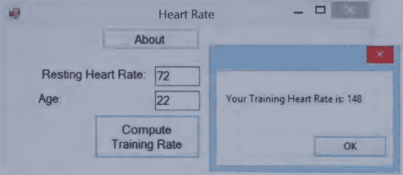

年龄和静息心率由调用程序传递给 ComputeTrainingRate()。图 5-6 描绘了结构图，显示了调用程序和被调用程序以及它们之间传输的数据。

图 5-6：计算训练心率程序的结构图

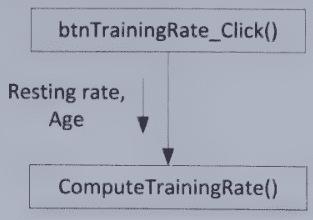

为了接收静息心率和年龄的值，方法 ComputeTrainingRate 在其头中声明了两个参数 restingRate 和 age，如图 5-7 所示。

### 图 5-7：带参数的 ComputeTrainingRate

```
private void ComputeTrainingRate(float restingRate, float age)
{
    float maximumRate, trainingRate;
    // Compute maximum heart rate:
    maximumRate = 220 - age;
    // Compute training heart rate
    trainingRate = 0.6F * (maximumRate - restingRate) + restingRate;
    
    // Display Training heart rate:
    MessageBox.Show("Your Training Heart Rate is: " + trainingRate.ToString("N0"));
}
```

参数 restingRate 和 age 在程序调用此方法时获得其值。这些参数由方法用于计算最大心率和训练心率。

### 参数的作用域

由于参数是在方法中声明的，因此它们仅在方法内可用——也就是说，参数的作用域是声明该参数的方法。接下来，你创建该方法。

步骤 1-9：使用图 5-7 中的代码创建方法 ComputeTrainingRate()。

图 5-8 显示了如何从 btnTrainingRate 按钮的 Click 事件处理程序调用此方法，将 72 传递给 restingRate 并将 22 传递给 age。此事件处理程序的初始版本不使用 TextBoxes 获取静息心率和年龄；相反，文字 72 和 22 被传递给该方法。

### 图 5-8：调用 ComputeTrainingRate

```
private void btnTrainingRate_Click(object sender, EventArgs e)
{
    // Call ComputeTrainingRate. Pass 72 for restingRate and 22 for age.
    ComputeTrainingRate(72, 22);
}
```

步骤 1-10：将图 5-8 中的代码添加到 btnTrainingRate 的 Click 事件处理程序中以调用方法 ComputeTrainingRate()。

### 参数和参数

调用程序传递给方法的数据项称为 **arguments**。因此，在调用语句 ComputeTrainingRate(72, 22) 中的值 72 和 22 是参数。

在方法头中声明的用于接收参数的变量称为 **parameters**。 （正如你稍后会看到的，参数也可以用于将值从方法传递给调用程序中的参数。）因此，在方法头中声明的 restingRate 和 age

```
private void ComputeTrainingRate(float restingRate, float age)
```

是参数。

参数按其在参数列表中出现的顺序传递给参数。也就是说，第一个参数传递给第一个参数，第二个参数传递给第二个参数，依此类推。当调用 ComputeTrainingRate 时，会自动进行以下赋值：

```
ComputeTrainingRate(72, 22);
```

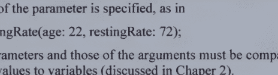

```
private void ComputeTrainingRate(float restingRate, float age)
```

也就是说，

```
restingRate = 72;
age = 22;
```

如果指定了参数的名称，则参数在参数列表中的位置可能与其对应参数的位置不同，如

```
ComputeTrainingRate(age: 22, restingRate: 72);
```

参数的数据类型和参数的数据类型必须兼容——也就是说，它们必须遵守为变量赋值值的规则（在第 2 章中讨论）。

让我们看看它是如何工作的：

**步骤 1-11：** 在 ComputeTrainingRate 中左大括号处（第 40 行）插入一个断点，方法是单击左侧边距。

在 Click 事件处理程序中调用语句处（第 54 行）插入第二个断点。

运行表单。请注意，在此版本的表单中，表单上的 TextBoxes 和 ListBox 未被使用。

单击按钮计算训练心率。程序在调用语句处中断。单击继续。程序在方法内部的左大括号处中断。

将指针移到参数 restingRate 和 age 上方以观察它们的值，分别为 72 和 22。

单击继续以显示训练心率。

**步骤 1-12：** 在更改调用语句中的静息心率和年龄后重复步骤 1-11。

### 常量作为参数

除了文字之外，你还可以使用常量（或变量，如下所述）作为参数将值传递给方法。例如，你可以在调用程序 btnTrainingRate_Click() 中使用常量来表示静息心率，如下所示：

```
const float restingRate = 72;
ComputeTrainingRate(restingRate, 22);
```

### 变量作为参数

与其传递文字（72 和 22）或常量作为参数，不如使用变量来传递数据给方法，以便于更改传递的值。数据输入到两个 TextBoxes，txtRestingRate 和 txtAge，如图 5-9 所示。TextBoxes 中的数据存储在变量中并传递给该方法。

图 5-9：变量作为参数

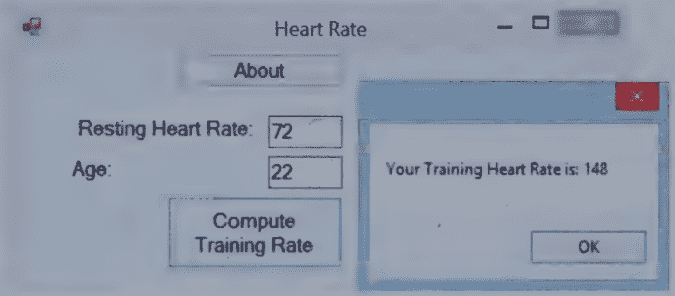

步骤 1-13：修改 Click 事件处理程序中的代码，如图 5-10 所示，以从 TextBoxes 获取静息心率和年龄，将它们存储在变量中并作为参数传递给 ComputeTrainingRate()。

### 图 5-10：使用变量作为参数调用 ComputeTrainingRate

```
private void btnTrainingRate_Click(object sender, EventArgs e)
{
    float restingRate, age;
    // Get resting rate and age from Textboxes:
    restingRate = float.Parse(txtRestingRate.Text);
    age = float.Parse(txtAge.Text);

    // Call ComputeTrainingRate
    ComputeTrainingRate(restingRate, age);
}
```

请注意，通过变量传递数据不需要对被调用方法 ComputeTrainingRate() 进行任何更改。它保持与图 5-7 相同，包括以下头：

```
private void ComputeTrainingRate(float restingRate, float age)
```


第1-16步：将restingRate改为restingHeartRate，如图5-11所示。在调用ComputeTrainingRate的语句处设置一个断点。
运行窗体。输入静息心率和年龄的值。单击按钮btnTrainingRate。
当程序在调用语句处中断时，检查restingHeartRate的值。
当程序在方法内部的左花括号处中断时，验证方法内的restingRate与调用方法中的restingHeartRate具有相同的值。

## 复习题

5.6 什么是实参？

5.7 什么是形参？

5.8 当一个方法有多个参数时，C#如何确定哪个参数与某个实参相关联？

5.9 参数的作用域是什么？

5.10 判断正误：实参的名称必须与对应形参的名称相同。

5.11 下面的代码展示了一个名为Greetings的方法，以及一个按钮的Click事件处理器，该事件处理器调用了这个方法：

```
private void btnGreeting_Click(object sender, EventArgs e)
{
    string word1 = "Hi", word2 = "There", word = "Hello";
    Greetings(word1);
    Greetings(word2);
}

private void Greetings(string word)
{
    lstDisplay.Items.Add(word);
}
```

当你单击按钮时，列表框中显示的输出是什么？

## 5.3 按值传递参数

当程序调用ComputeTrainingRate(float restingRate, float age)时，默认情况下，调用程序会将每个实参的值传递给对应的形参。这称为按值传递参数，这是向方法传递数据的默认方式。

当实参按值传递时，如果被调用方法中对应形参的值发生了改变，这不会影响调用程序中实参的值——也就是说，如果在ComputeTrainingRate方法中改变了age的值，这对调用程序btnGrade_Click中的age值不会有任何影响。

第1-17步：在ComputeTrainingRate中把age的值改为999（第58行），并在左、右花括号处设置断点，如图5-12所示。

图5-12：修改age值的ComputeTrainingRate

```
private void ComputeTrainingRate(float restingRate, float age)
{
    float maximumRate, trainingRate;
    // Compute maximum heart rate:
    maximumRate = 220 - age;
    // Compute training heart rate
    trainingRate = 0.6F * (maximumRate - restingRate) + restingRate;
    age = 999; // This statement is for testing purposes only
    // Display training heart rate:
    MessageBox.Show("Your Training Heart Rate is: " + trainingRate.ToString("N0"));
}
```

在调用语句（第59行）和调用程序的右花括号处设置断点，如图5-13所示。

图5-13：调用程序中的断点

```
private void btnTrainingRate_Click(object sender, EventArgs e)
{
    float restingHeartRate, age;
    // Get resting rate and age from Textboxes:
    restingHeartRate = float.Parse(txtRestingRate.Text);
    age = float.Parse(txtAge.Text);
    
    // Call ComputeTrainingRate
    ComputeTrainingRate(restingHeartRate, age);
}
```

第1-18步：运行窗体。输入静息心率和年龄的值。单击btnTrainingRate按钮。

当程序在调用语句（第59行）处中断时，检查age的值；当程序在方法内的左花括号（第40行）处中断时，检查age的值，以验证它是你输入的值。当程序在方法末尾（第49行）中断时，检查age的值，观察age为999。

当程序返回到调用程序（第60行）时再次检查age，观察age的值并未从原值发生改变。在被调用方法中赋值为999对调用程序中的实参age没有影响，因为从调用程序传给方法中形参age的只是age的值。
从方法中删除语句“age=999”。

## 默认参数

你可以为一个或多个参数指定默认值（实参）。例如，你可以在ComputeTrainingRate方法的方法头中为age指定默认值（20）：

```
private void ComputeTrainingRate(float restingRate, float age = 20)
```

默认值必须是字面值或常量。

当你调用一个为一个或多个参数指定了默认值的方法时，你可以选择不为age传递实参，如下面的调用语句所示：

```
ComputeTrainingRate(restingRate)
```

在这种情况下，age将取默认值20。

或者，你可以为age传递一个值来覆盖默认值，例如：

```
ComputeTrainingRate(restingRate, age)
```

如果并非所有参数都有默认值，那么带默认值的参数必须声明在最后。

第1-19步：修改ComputeTrainingRate，使其为age包含一个默认实参，并修改调用语句，使其不为age传递实参。运行窗体并检查方法内age的值。重复操作，传递一个与默认值不同的age实参。

是时候练习了！做练习5-1。

## 内聚方法与可重用性

考虑你之前开发的ComputeTrainingRate方法：

```
private void ComputeTrainingRate(float restingRate, float age)
{
    float maximumRate, trainingRate;
    // Compute maximum heart rate:
    maximumRate = 220 - age;
    // Compute training heart rate
    trainingRate = 0.6F * (maximumRate - restingRate) + restingRate;
    // Display Training heart rate:
    MessageBox.Show("Your Training Heart Rate is: " + trainingRate.ToString("N0"));
}
```

上述方法计算训练心率并显示结果。这种组合了多项任务的方法可重用性不高。例如，另一个需要通过调用此方法来计算训练心率的程序，可能不希望结果在消息框中显示。

当每个方法执行单一、明确的任务（如计算训练心率），并将结果返回给调用程序，以便调用程序可以随意处理这些结果时，方法就具有更高的可重用性。这样的方法被称为内聚方法。

## 5.4 按引用传递参数

按引用传递参数允许被调用方法修改调用程序中的实参值。这使方法中计算出的结果可以被调用程序使用（或返回给调用程序）。

应注意，从被调用方法向调用方法返回值的另一种方式是使用不使用引用参数的值返回方法，这将在5.6节中讨论。使用值返回方法相比使用引用参数有一些优点，比如易于维护。然而，要从方法返回多个值，不能使用简单变量作为参数；需要使用更高级的选项，如类、结构体、元组或数组。类和数组将在后面的章节中讨论。

当变量按引用传递时，变量的内存位置（地址或引用）被传递给形参，这样实参和形参访问同一内存位置的数据，如下所示：


因此，如果形参的值在方法内发生了改变，实际上就是改变了对应实参的值。

类似地，调用方法前赋给实参的值，在方法被调用时就成了形参的值。也就是说，实际上数据既可以从调用程序传递给被调用方法，也可以从被调用方法传递给调用程序。

让我们使用按引用传递，将计算出的训练心率从ComputeTrainingRate返回给调用程序，而不是在消息框中显示它。修改后的方法如图5-15所示。

应注意，5.6节稍后讨论的值返回方法是按引用传递参数的一种替代方案。

## 图5-15：按引用传递参数

```
38
39    private void ComputeTrainingRate(float restingRate, float age,
40                                    ref float trainingRate)
41    {
42        float maximumRate;
43        // Compute maximum heart rate:
44        maximumRate = 220 - age;
45        // Compute training heart rate
46        trainingRate = 0.6F * (maximumRate - restingRate) + restingRate;
47
48        // Training rate is not displayed; it is returned to the calling method
49    }
```

在第40行，关键字ref指定trainingRate是一个引用参数。注意，因为trainingRate被声明为参数，所以它从方法内的声明语句中移除了。此外，在消息框中显示训练心率的语句也被移除了。


Figure 5-16 shows the updated calling program. The call statement now includes `trainingHeartRate` as an argument (line 60).

**Figure 5-16: Updated calling program**

```
50
51    private void btnTrainingRate_Click(object sender, EventArgs e)
52    {
53        float restingHeartRate, age;
54        // Get resting rate and age from Textboxes:
55        restingHeartRate = float.Parse(txtRestingRate.Text);
56        age = float.Parse(txtAge.Text);
57
58        // Call ComputeTrainingRate
59        float trainingHeartRate = 0;
60        ComputeTrainingRate(restingHeartRate, age, ref trainingHeartRate);
61        // Display training rate
62        lstResults.Items.Add(string.Format("{0,20}{1,10}", "Training Heart Rate:",
63                                    trainingHeartRate.ToString("N0")));
64    }
```

The keyword `ref` in the calling statement in line 60 specifies that the parameter is a reference type. Note that the name of the argument (`trainingHeartRate`) is different from the name of the parameter (`trainingRate`).

An argument passed by reference must be declared in the calling program, and it must be set to a value. The argument `trainingHeartRate` is declared and it is set to zero.

What happens when `ComputeTrainingRate` is called?

First, the reference to `trainingHeartRate` is passed to the parameter `trainingRate`. That means `trainingRate` will take the value of the argument `trainingHeartRate`.

Next, the method assigns the computed value to the parameter `trainingRate`. Because both the argument and the parameter share the same memory location, the computed value also is available to the argument `trainingHeartRate`.

Thus, passing by reference makes sharing between the calling program and the called program like a two-way street, as shown, whereas passing by value is like a one-way street.

```
ComputeTrainingRate(restingHeartRate, age, ref trainingHeartRate);

private void ComputeTrainingRate(float restingRate, float age, ref float trainingRate)
```

### Step 1-20: Update ComputeTrainingRate to include the parameter trainingRate, as shown in Figure 5-15.

Put breakpoints at the beginning and ending braces within the called method.

Make changes in the calling program, as shown in Figure 5-16.

Run the form. At the first breakpoint inside `ComputeTrainingRate`, observe that the parameter `trainingRate` has the value 0 (same as the value of the argument `trainingHeartRate`). At the second breakpoint at the end of the method, `trainingRate` has the computed value.

## 1 白鹭

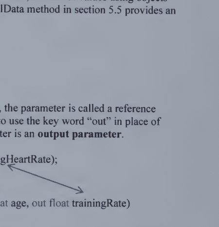

白鹭是一首精巧的诗。色素的配合，身段的大小，一切都很适宜。

白鹤太大而嫌生硬，即使如粉红的朱鹭或灰色的苍鹭，也觉得大了一些，而且太不寻常了。

然而白鹭却因为它的常见，而被人忘却了它的美。

那雪白的蓑毛，那全身的流线型结构，那铁色的长喙，那青色的脚，增之一分则嫌长，减之一分则嫌短，素之一忽则嫌白，黛之一忽则嫌黑。

在清水田里，时有一只两只白鹭站着钓鱼，整个的田便成了一幅嵌在玻璃框里的画。田的大小好像是有心人为白鹭设计的镜匣。

晴天的清晨，每每看见它孤独地站立于小树的绝顶，看来像是不安稳，而它却很悠然。这是别的鸟很难表现的一种嗜好。人们说它是在望哨，可它真是在望哨吗？

黄昏的空中偶见白鹭的低飞，更是乡居生活中的一种恩惠。那是清澄的形象化，而且具有生命了。

或许有人会感到美中不足，白鹭不会唱歌。但是白鹭本身不就是一首很优美的歌吗？

——不，歌未免太铿锵了。

白鹭实在是一首诗，一首韵在骨子里的散文诗。

## Review Questions

5.14 What is meant by passing an argument by reference?

5.15 The following code shows a method named ComputeSum, and the Click event handler of a button that calls the method:

```
private void btnExamScore_Click(object sender, EventArgs e)
{
    int exam1 = 150, exam2 = 100, total = 0;
    ComputeSum(exam1, exam2, ref total);
    lstDisplay.Items.Add(exam1 + " " + exam2 + " " + total);
}

private void ComputeSum(int exam1, int exam2, ref int sum)
{
    sum = exam1 + exam2;
    exam1 = 0;
    exam2 = 0;
}
```

What would be the output displayed in the ListBox when you click the button?

5.16 The following code shows a method named ComputeSum, and the Click event handler of a button that calls the method (note that the parameters are declared differently from the previous question):

```
private void btnExamScore_Click(object sender, EventArgs e)
{
    int exam1 = 10, exam2 = 15, total = 0;
    ComputeSum(ref exam1, ref exam2, ref total);
    lstDisplay.Items.Add(exam1 + " " + exam2 + " " + total);
}

private void ComputeSum(ref int test1, ref int test2, ref int sum)
{
    sum = test1 + test2;
    test1 = 0;
    test2 = 0;
}
```

What would be the output displayed in the ListBox when you run the Click event handler?

## 5.5 Top-Down Design

Top-down design involves breaking down a larger problem to smaller subtasks, each performed by a separate method, to make software development simpler and easier.

Though the task of computing the training heart rate is fairly simple, for the purpose of illustrating top-down design, let’s look at the subtasks of this problem. Figure 5-17 shows the code that you developed in Tutorial 1, with a couple of additional statements to display the resting rate and age, along with the training rate. This event handler calls the `ComputeTrainingRate` method to compute the training heart rate.

**Figure 5-17: Revised code to compute training rate**

```
private void btnTrainingRate_Click(object sender, EventArgs e)
{
    float restingHeartRate, age;

    // Get personal data (resting rate and age) from Textboxes:
    restingHeartRate = float.Parse(txtRestingRate.Text);
    age = float.Parse(txtAge.Text);

    // Call ComputeTrainingRate
    float trainingHeartRate = 0;
    ComputeTrainingRate(restingHeartRate, age, ref trainingHeartRate);

    // Display training rate
    lstResults.Items.Add(string.Format("{0,20}{1,10}", "Resting Heart Rate:", restingHeartRate));
    lstResults.Items.Add(string.Format("{0,20}{1,10}", "Age:", age));
    lstResults.Items.Add(string.Format("{0,20}{1,10}", "Training Heart Rate:", trainingHeartRate.ToString("N0")));
}
```

The task performed in this program can be broken down to three subtasks:

- 1. Get personal data.
- 2. Compute training rate.
- 3. Display results.

You already developed a method for the second subtask (compute the training rate). Now, you will develop two additional methods corresponding to the subtasks (get personal data and display results) and call all three methods from the `btnTrainingRate_Click` event handler, as represented in Figure 5-18.

Note that the resting heart rate is represented by the variable `restingHeartRate` in the calling program, but the corresponding parameter in `GetPersonalData` is called `restingRate`.

### Passing by reference versus class level variables

The `GetPersonalData` method illustrates how multiple values (`restingHeartRate` and `age`) may be passed from the called method to the calling method using reference parameters. An alternate way to share data between the two methods is to declare the variables `restingHeartRate` and `age` at the class level, and not specify any parameters for the `GetPersonalData` method. It should be noted that the values of such class level variables can be inadvertently changed by any method like `ComputeTrainingRate`.

### out parameter instead of ref parameter

Because data is to be passed from `GetPersonalData` to the calling program, and not from the calling program to `GetPersonalData`, `out` arguments may be used in place of `ref` arguments, as shown in the following statement:

```
private void GetPersonalData(out float restingRate, out float age)
```

In this case, the arguments in the calling program do not have to be initialized, and the keyword `ref` is replaced by `out` in the call statement:

```
float restingHeartRate, age;
GetPersonalData(out restingHeartRate, out age);
```

### Method to Compute Training Rate

You already developed the method to compute training rate in Tutorial 1. Figure 5-21 shows the method.

**Figure 5-21: ComputeTrainingRate method**

```
private void ComputeTrainingRate(float restingRate, float age, ref float trainingRate)
{
    float maximumRate; // trainingRate is not declared here; it is a parameter
    // Compute maximum heart rate:
    maximumRate = 220 - age;
    // Compute training heart rate
    trainingRate = 0.6F * (maximumRate - restingRate) + restingRate;
}
```

Figure 5-20 shows the statement that calls this method.

### Method to Display Results

Data need to be passed from the calling program to the `DisplayResults` method, but not the other way around. So, the resting rate, age, and training rate are passed by value to this method, as shown in Figure 5-22.


### 图 5-22：显示结果的方法

```
private void DisplayResults(float rateResting, float age, float rateTraining)
{
    // Display Results
    lstResults.Items.Add(string.Format("{0,20}{1,10}", "Resting Heart Rate:", rateResting));
    lstResults.Items.Add(string.Format("{0,20}{1,10}", "Age:", age));
    lstResults.Items.Add(string.Format("{0,20}{1,10}", "Training Heart Rate:",
        rateTraining.ToString("N0")));
}
```

下面的语句按值传递三个实参来调用此方法，如图 5-20 所示。

```
DisplayResults(restingHeartRate, age, trainingHeartRate);
```

请注意，静息心率和训练心率分别由参数 rateResting 和 rateTraining 表示，它们与调用程序中相应变量的名称不同。这只是为了说明实参的名称与相应参数的名称可以不同。

### 全局概览

自顶向下设计的一个优点是，调用程序 btnTrainingRate_Click 中的代码主要由三条调用这三个方法的语句组成，如图 5-20 所示。因此，通过查看调用程序中的代码，更容易从高层了解应用程序。此外，与将所有代码放在单个程序中相比，对应子任务的方法更具可重用性。

现在你可以创建一个实现自顶向下设计的新窗体。

### 步骤 1-21：创建一个名为 HeartRateTopDown 的新窗体。从 HeartRate 窗体复制控件。

此窗体具有与 HeartRate 窗体相同的控件。HeartRateTopDown 的外观应如下所示：

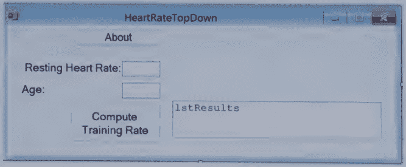

### 步骤 1-22：创建方法 GetPersonalData（参见图 5-19）。

在 btnTrainingRate_Click 事件处理程序中添加语句以调用 GetPersonalData（参见图 5-20）。

### 步骤 1-23：创建方法 ComputeTrainingRate（参见图 5-21）。

在 btnTrainingRate_Click 事件处理程序中添加语句以调用 ComputeTrainingRate（参见图 5-20）。

### 步骤 1-24：创建方法 DisplayResults。

在 btnTrainingRate_Click 事件处理程序中添加语句以调用 DisplayResults（参见图 5-20）。

### 步骤 1-25：在调用程序的每个调用语句处设置断点。

运行窗体。验证在 GetPersonalData 中赋给 restingRate 和 age 的值是否会改变调用程序中相应实参的值。同样，验证在 ComputeTrainingRate 中将计算出的值赋给 restingRate 是否会改变调用程序中 restingHeartRate 的值。

HeartRateTopDown 窗体的完整代码如下：

```
19  private void GetPersonalData(ref float restingRate, ref float age)
20  {
21      // Get resting rate and age from Textboxes:
22      restingRate = float.Parse(txtRestingRate.Text);
23      age = float.Parse(txtAge.Text);
24  }
25
26  private void ComputeTrainingRate(float restingRate, float age, ref float trainingRate)
27  {
28      float maximumRate;    //trainingRate is not declared here; it is a parameter
29      // Compute maximum heart rate:
30      maximumRate = 220 - age;
31      // Compute training heart rate
32      trainingRate = 0.6F * (maximumRate - restingRate) + restingRate;
33  }
34
35  private void DisplayResults(float rateResting, float age, float rateTraining)
36  {
37      // Display Results
38      lstResults.Items.Add(string.Format("{0,20}{1,10}", "Resting Heart Rate:", rateResting));
39      lstResults.Items.Add(string.Format("{0,20}{1,10}", "Age:", age));
40      lstResults.Items.Add(string.Format("{0,20}{1,10}", "Training Heart Rate:",
41                                  rateTraining.ToString("N0")));
42  }
43
44  private void btnTrainingRate_Click(object sender, EventArgs e)
45  {
46      // Call GetPersonalData
47      float restingHeartRate = 0, age = 0;
48      GetPersonalData(ref restingHeartRate, ref age);
49
50      // Call ComputeTrainingRate
51      float trainingHeartRate = 0;
52      ComputeTrainingRate(restingHeartRate, age, ref trainingHeartRate);
53
54      // Call DisplayResults
55      DisplayResults(restingHeartRate, age, trainingHeartRate);
56  }
```

### *实践时间到了！*

按如下方式修改 ComputeTrainingRate、DisplayResults 和调用语句：

ComputeTrainingRate 除了返回 trainingRate 之外，还向调用程序返回 maximumRate。如下图所示的结构图，将 maximumRate 传递给 DisplayResults。同时显示 maximumRate 和 trainingRate。

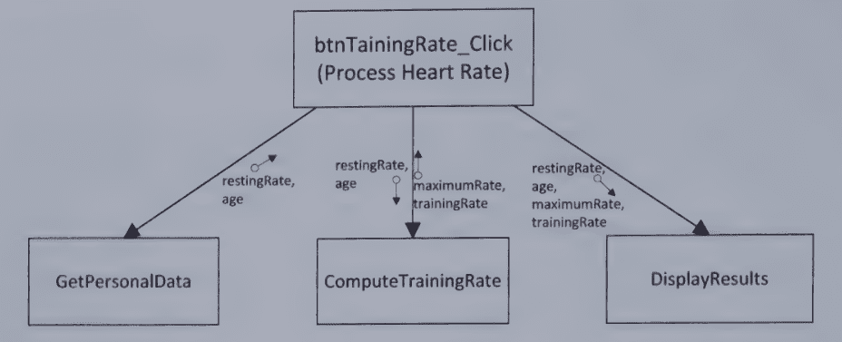

### 采用非内聚方法的不可取设计

在图 5-18 所示的自顶向下设计中，计算训练心率的任务被分解为三个子任务，分别由方法 GetPersonalData、ComputeTrainingRate 和 DisplayResults 表示。这些方法由主程序（Click 事件过程 btnTrainingRate_Click）依次调用。数据通过参数在调用程序和被调用程序之间共享。正如本章前面所讨论的，这种设计使方法具有内聚性和可重用性。

图 5-23 显示了另一种不可取的设计，它涉及可重用性较低的非内聚方法。

### 图 5-23：涉及非内聚方法的另一种不可取设计

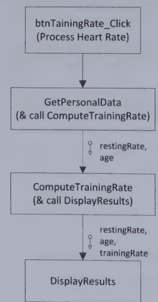

在这种设计中，主程序（Click 事件过程 btnTrainingRate_Click）与自顶向下设计一样调用方法 GetPersonalData。

然而，方法 GetPersonalData 获取个人数据后，并没有将数据传递给主程序，而是调用 ComputeTrainingRate，将 restingRate 和 age 传递给该方法。

ComputeTrainingRate 计算训练心率，然后调用 DisplayResults，将 restingRate、age 和 trainingRate 传递给该方法。

DisplayResults 与自顶向下设计一样显示结果。

上述设计存在几个问题：

- 1. 方法 GetPersonalData 和 ComputeTrainingRate 不具有内聚性。例如，ComputeTrainingRate 并非只执行一个定义明确的任务。它计算训练心率，并通过调用 DisplayResults 来显示结果。类似地，GetPersonalData 获取 restingRate 和 age，并通过调用 ComputeTrainingRate 来计算结果。
- 2. 方法 GetPersonalData 和 ComputeTrainingRate 的可重用性较低。例如，ComputeTrainingRate 除了计算结果外还做了更多事情，并且它不会将结果返回给调用程序。
- 3. 可能有必要将某些数据传递给并不需要它的方法。例如，如果个人数据包含人员姓名，那么将其传递给 DisplayResults 的唯一方法是先将其传递给不需要它的 ComputeTrainingRate。将数据传递给不需要它的方法会使代码维护变得困难。

### 复习题

- 5.17 什么是自顶向下设计？
- 5.18 描述自顶向下设计的两个好处。

### 5.6 返回值的方法

我们在本章中讨论的方法只能通过参数向调用程序返回值。参数允许返回任意数量的值。

方法本身可以通过除参数之外的方式向调用程序返回单个值。这种方法的一个优点是可以在表达式中使用该方法。图 5-24 展示了这样一个名为 TrainingRate 的方法，它计算训练心率并将其返回给调用程序：

### 图 5-24：返回值方法 TrainingRate

```
private float TrainingRate(float restingRate, float age)
{
    float maximumRate;
    // Compute maximum heart rate:
    maximumRate = 220 - age;
    // Compute training heart rate and return it
    return 0.6F * (maximumRate - restingRate) + restingRate;
}
```

以下是此方法与之前开发的 ComputeTrainingRate 方法之间的主要区别：

方法头 `private float TrainingRate(float restingRate, float age)` 显示没有用于返回 trainingRate 的参数。那么 trainingRate 是如何返回的呢？

方法本身替代了参数，并返回 return 语句中指定的值：`return 0.6F * (maximumRate - restingRate) + restingRate;`

由于该方法返回一个值，因此返回值的类型（称为返回类型）在方法头中使用关键字 float 而不是 void 来指定。此外，方法的名称表示该方法返回的值，而不是该方法所执行的操作。

### 调用返回值方法

调用该方法的方式如下：

```
float trainingHeartRate = TrainingRate(restingHeartRate, age);
```

TrainingRate 返回的值被赋给 float 类型的变量 trainingHeartRate。

接下来，我们将开发一个名为 HeartRateTopDownAlt 的新窗体，其中包含 ComputeTrainingRate 的替代版本，该版本不使用参数返回训练心率。此窗体与 HeartRateTopDown 具有相同的用户界面，如下图所示：


50
51 private void DisplayResults(float rateResting, float age, float rateTraining)
52 {
53     // Display Results
54     lstResults.Items.Add(string.Format("{0,20}{1,10}", "Resting Heart Rate:", rateResting));
55     lstResults.Items.Add(string.Format("{0,20}{1,10}", "Age:", age));
56     lstResults.Items.Add(string.Format("{0,20}{1,10}", "Training Heart Rate:",
57         rateTraining.ToString("N0")));
58 }

Additional examples of value returning methods are provided in Chapter 6.

It’s time to practice! Do Exercise 5-3 and Exercise 5-4

## 5.7 Enumerations: Limiting Parameter Values

An enumeration is a set of named integer constants. For example, Figure 5-26 shows an enumeration named CheckState with three named constants, Checked, Indeterminate and Unchecked. The statement in Figure 5-26 assigns the selected value (0, 1 or 2, represented by the three named constants) to the CheckState property of the CheckBox.

### Figure 5-26: Enumeration example

```
chkMember.CheckState = CheckState.
```

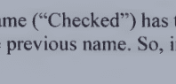

Each name represents an integer. By default, the first name (“Checked”) has the value 0; each of the following names has a value one greater than that of the previous name. So, in effect, the statement assigns a number (0, 1 or 2) to the CheckState property.

An enumeration provides a convenient way to select from a limited set of numbers. In addition, an enumeration uses meaningful names in place of numbers, which helps minimize errors in making a selection.

The syntax to create an enumeration is
enum enumerationName [: optional integer type] {list of named constants separated by commas};

For example,

```
enum CheckState { Checked, Indeterminate, Unchecked };
```

creates the enumeration CheckState, which is of enumerated type, where the named constants represent integer values 0, 1 and 2, respectively.

An enumeration cannot be declared inside a method. It can be declared inside the class, inside the namespace or outside the namespace.

Though the named constants represent integer values, you need to cast them to integer type before assigning to an integer variable, as in

```
int checkState = (int) CheckState.UnChecked;
```

Line 70 calls ComputeRate method and passes the selectedDiscType, which is a variable of discountTypes type. Passing a value like an integer constant 1 or 2 will result in an error unless it is converted to the enumerated type.

Step 2-7: Run the form and test your code.

## Review Questions

- 5.19 What is an enumeration?
- 5.20 What are the benefits of using an enumeration?

## Exercises

### Exercise 5-1

Create a form named GradeWithMethod_1 that lets you to do the following:

- Enter a score (0–100) into a TextBox named txtScore, and
- compute the letter grade by clicking a button.

Use the scale 90, 80, 70 for A, B and C, respectively. The letter grade must be computed using a separate method named ComputeGrade, which displays the letter grade using a MessageBox. Call this method from the Click event of the button passing the score as a parameter to the method.

### Exercise 5-2

This is a modified version of the form specified in Exercise 5-1. You may copy the controls and code to a new form named GradeWithMethod_2 and modify the code.

Create a form named GradeWithMethod_2 that lets you do the following:

- Enter a score (0–100) into a TextBox named txtScore, and
- compute the letter grade by clicking a button.

Use the scale 90, 80, 70 for A, B and C, respectively. The letter grade must be computed using a separate method named ComputeGrade. Call this method from the Click event of the button passing the score as a parameter to the method. ComputeGrade program must return the letter grade to the calling program through a parameter. The calling program displays the data in a Label named lblLetterGrade.

### Exercise 5-3

This is a modified version of the form specified in Exercise 5-1. You may copy the controls and code to a new form named GradeWithMethod_3 and modify the code.

Create a form named GradeWithMethod_3 that lets you do the following:

- Enter a score (0–100) into a TextBox named txtScore, and
- compute the letter grade by clicking a button.

Use the scale 90, 80, 70 for A, B and C, respectively. The letter grade must be computed using a separate method named Grade. Call this method from the Click event of the button, passing the score as a parameter to the method. Grade must return the letter grade to the calling program without using a parameter. The calling program displays the data in a Label named lblLetterGrade.

### Exercise 5-4

Create a form named GradeTopDown that lets you to do the following:
Enter a score (0–100) into a TextBox named txtScore, and
compute the letter grade by clicking a button.
Use the scale 90, 80, 70 for A, B and C, respectively. The structure chart of the task to process the grade is as follows:

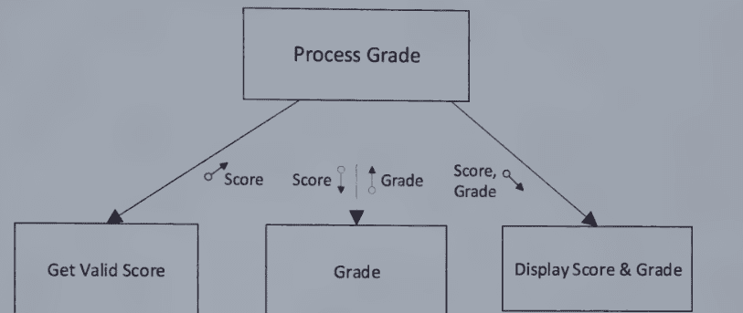

The Click event handler of the button must call three separate methods, corresponding to the three subtasks, described below:

- 1. A method named GetValidScore that gets the name and score from the TextBoxes, validates the score and passes them to the Click event handler.
- 2. A second method named Grade that computes the letter grade. Pass the score from the calling program to Grade. The method must return the letter grade without using a parameter. (This method is the same as in Exercise 5-3.)
- A third method that displays the name and letter grade. Pass the name and letter grade as parameters to this method.

## Chapter 6

## Graphical User Interface Controls

This chapter introduces you to graphical user interface (GUI) controls that help minimize data entry errors and make it easier for users to interact with a program.

## Topics

| 6.1 | Working with ScrollBars | 6.5 | Getting User Input from Controls |
| 6.2 | Working with CheckBoxes | 6.6 | Working with ComboBoxes |
| 6.3 | Working with RadioButtons | 6.7 | Working with ListBoxes |
| 6.4 | Validating Input |  |  |

To understand the use of GUI controls, consider an application that lets you calculate the total price for tickets to a show in a theater. The user interface, shown in Figure 6-1, uses a ScrollBar to specify the number of tickets, a set of RadioButtons to select the section of the theater and a CheckBox to specify whether the customer is a member.

Figure 6-1: User interface for ticket sales application

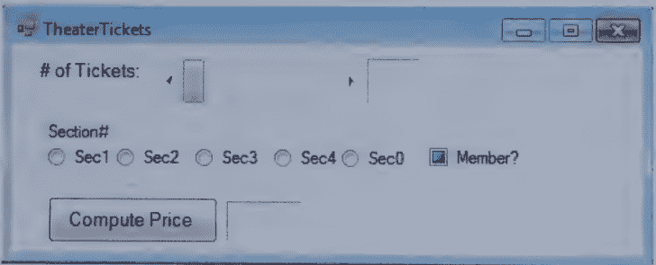

Next, we look at how to work with each of these controls.

## 6.1 Working with ScrollBars

The ScrollBar controls, HScrollBar and VScrollBar, let you select a number between two limits determined by the values of the Minimum and Maximum properties. The two ScrollBars are essentially the same, except that the HScrollBar lets you scroll horizontally, and the VScrollBar lets you scroll vertically. In this section, you will use the HScrollBar.

To select a number, you may move the slider by clicking the arrows at either end by clicking the inside area or by dragging the slider. The number selected by the user is given by the Value property. However,

the selected number is not displayed by the control. Typically, a separate Label is used to display the selected value. Table 6-1 shows the important properties of HScrollBar.

### Table 6-1: Properties of HScrollBar

| Property name | Description |
| Value | The integer value of the ScrollBar, selected by moving the slider. |
| Minimum | Lower limit of the range of values. Default is zero. User may specify a different limit. |
| Maximum | Upper limit of the range of values. Default is 100. User may specify a different limit. |
| SmallChange | Amount by which the value changes when the user clicks on one of the two arrows. Default is 1. |
| LargeChange | Amount by which the value changes when the user clicks the ScrollBar area on either side of the slider. Default is 1. If LargeChange is greater than 1, you must increase the Maximum by adding (LargeChange - 1) to Maximum. For example, if you want a range of 0 to 20, and LargeChange is 4, then you must set the Maximum to 23 (20 + (4-1)). |

## Tutorial 1: Theater Tickets Sale Application

In this tutorial, you will create the TheaterTickets form, shown in Figure 6-1, to illustrate the use of GUI controls.

Step 1-1: Create a new project named Ch6_GUIcontrols. Rename the form to TheaterTickets.

Add an HScrollBar (found in the All Windows Forms group in the Toolbox) to the form, and name it hsbNumOfTickets.

Set Maximum property to 10. It is assumed that purchases of more than 10 tickets are processed differently at group rates in a different form.

Change the value of the Value property from 0, and observe how it affects the position of the slider. Make sure you change it back to 0.

Step 1-2: Run the form. Move the slider to change the value of the ScrollBar by clicking the arrows, clicking the ScrollBar area, or dragging the slider. But you will not see the value.

How do you view the value of the ScrollBar?

## Events of ScrollBars

There are two important events of the ScrollBar that can be used to display the value in a Label: the ValueChanged event and the Scroll event.

## ValueChanged event

This event is triggered when the value of a ScrollBar is changed by moving the slider manually, and also when the value is changed at runtime by executing code. The following code uses the ValueChanged event handler to display the value of the ScrollBar in a Label whenever the value changes at runtime:


请注意，如果语句
lblNumOfTickets.Text = hsbNumOfTickets.Value.ToString();
位于 Scroll 事件处理程序中，重置 ScrollBar 值将不会重置 Label 中显示的值。你可以通过将上述语句复制到 Scroll 事件处理程序中并注释掉 ValueChanged 事件处理程序中的语句来测试它。

```
lblNumOfTickets.Text = hsbNumOfTickets.Value.ToString();
```

## 复习问题

- 6.1 一个表单使用 ScrollBar，hsbUnits，让用户仅在 0 到 10 的范围内选择整数。ScrollBar 的哪个属性应从其默认值更改？

- 6.2 编写语句以在名为 lblUnits 的 Label 中显示 ScrollBar hsbUnits 的值。

- 6.3 ScrollBar hsbUnits 的值需要在其值发生变化时自动显示在名为 lblUnits 的 Label 中（无论是通过在 ScrollBar 内单击，还是通过执行代码，例如当通过单击“Clear”按钮重置 ScrollBar 时）。显示值的代码应输入到哪个事件处理程序中？

## 6.2 使用 CheckBoxes

CheckBox 用于让用户选择 true 或 false 的布尔值。例如，我们在此应用程序中使用 CheckBox 让用户指定客户是否为会员。CheckBox 的两个常用属性在表 6-2 中显示。

表 6-2：CheckBox 的属性

| 属性 | 属性的设置 | 描述 |
| CheckState | Checked | 在运行时选中 CheckBox 时，CheckState 设置为 Checked。 |
|  | UnChecked | 在运行时取消选中 CheckBox 时，CheckState 设置为 UnChecked。这是默认状态。 |
|  | Indeterminate | CheckState 可以在设计窗口中设置为 Indeterminate，或通过在运行时执行代码设置。此值会选中 CheckBox。当用户选中（或取消选中）CheckBox 时，CheckState 会更改为 Checked（或 UnChecked）。你可以将 CheckBox 初始设置为 Indeterminate 状态，以便代码可以检查用户是否忘记做出选择。 |
| Checked | True | 表示 CheckBox 处于 Checked 或 Indeterminate 状态。 |
|  | False | 表示 CheckBox 处于 UnChecked 状态。这是默认值。 |

### 步骤 1-7：将名为 chkMember 的 CheckBox 添加到表单。更改 CheckState 属性的值，并观察对 CheckBox 和 Checked 属性值的影响。

如何确保用户在运行时对会员状态（会员或非会员）进行了选择？为帮助验证，你在表单的 Load 事件中将 CheckState 属性设置为 Indeterminate 状态，并在 Clear 按钮的 Click 事件处理程序中使用图 6-3 中的代码。如果用户单击计算按钮时 CheckState 属性仍为 Indeterminate，则表示用户未做出选择。你稍后将添加代码来验证 CheckState 状态。

### 图 6-3：将 CheckState 属性设置为 Indeterminate

```
private void cmdClear_Click(object sender, EventArgs e)
{
    hsbNumOfTickets.Value = 0;
    chkMember.CheckState = CheckState.Indeterminate;
}
```

```
private void TheaterTickets_Load(object sender, EventArgs e)
{
    chkMember.CheckState = CheckState.Indeterminate;
}
```

### 步骤 1-8：运行表单。注意表单加载时状态为 Indeterminate。

单击 CheckBox 将 CheckState 更改为 Checked，然后更改为 UnChecked（你无法通过单击 CheckBox 在运行时将状态设置为 Indeterminate）。
单击 Clear 按钮，并确保状态更改为 Indeterminate。

## CheckBoxes 的事件

CheckBox 的两个重要事件是 CheckStateChanged 事件和 CheckedChanged 事件。

CheckStateChanged 事件在 CheckState 属性值更改时触发。
CheckedChanged 事件在 Checked 属性值更改时触发。

你可以使用这些事件处理程序在 Checked 或 CheckState 属性更改时执行操作。

## 复习问题

6.4 当 CheckState 属性设置为 Indeterminate 时，CheckBox 的 Checked 属性的值是多少？

6.5 当 Checked 属性设置为 True 时，CheckBox 的 CheckState 属性设置为 ____？

## 6.3 使用 RadioButtons

RadioButtons 以组的形式使用，让用户从一组有限的选项中做出单一选择，例如选择学生在大学的班级或员工的职称。在此示例中，我们使用一组 RadioButtons 让用户选择剧院的座位区：


RadioButton 的 Checked 属性如果被选中则设置为 True，如果未被选中则设置为 False。任何时候，一个组中只有一个 RadioButton 可以被选中。

你可以通过在表单上添加 GroupBox 控件并在其中添加 RadioButtons 来创建多个组。如果未使用 GroupBox，表单上的所有 RadioButtons 都被视为单个组的一部分，即使它们在物理上位于多个组中。GroupBox 还允许用户将其中包含的所有 RadioButtons 作为一个组移动。

## RadioButtons 与 CheckBoxes

当可选选项的数量有限（通常少于 10）且静态（即列表中的项目数量不改变）时，使用 RadioButtons。

## 何时不使用 RadioButtons

当选择为 true/false 或 yes/no 时，标准做法是使用 CheckBox，而不是两个 RadioButtons。例如，以下 RadioButton 的使用不推荐：


### 步骤 1-9：向表单添加一个 GroupBox。将其 Text 属性更改为 Section#。

在 GroupBox 内添加五个 RadioButtons，如图所示：


将前四个 RadioButtons 的 Text 属性值更改为 1、2、3 和 4，将第五个按钮的值更改为零。

将前四个 RadioButtons 分别命名为 rdbSec1、rdbSec2、rdbSec3 和 rdbSec4。将第五个命名为 rdbDefault，并将其 Visible 属性更改为 False。

前四个代表剧院的四个区域。第五个按钮将对用户隐藏，并用作默认值。它有两个用途：

- 1. 你可以通过代码选中第五个按钮来重置（取消选中）全部四个按钮。
- 2. 如果第五个按钮被选中，则表示用户未做出选择。

接下来，将任意一个 RadioButtons 的 Checked 属性更改为 True。

按钮更改为选中状态。现在，将另一个按钮的 Checked 属性更改为 True。注意其状态更改为选中，而之前选中的按钮变为未选中。将 Checked 属性改回 False。

### 步骤 1-10：为帮助验证用户是否选中了 RadioButton，将以下代码添加到表单的 Load 事件中，并添加到 Clear 按钮的 Click 事件处理程序中：

```
rdbDefault.Checked = true;
```

它如何帮助？如果用户单击计算成本按钮时默认 RadioButton 被选中，则表示用户未选中前四个按钮中的一个。

注意，上述语句将布尔值 true 分配给 Checked 属性，其效果与在表单的设计窗口中将 Checked 属性设置为 True 相同。

### 图 6-4：重置 RadioButtons

```
private void cmdClear_Click(object sender, EventArgs e)
{
    hsbNumOfTickets.Value = 0;
    chkMember.CheckState = CheckState.Indeterminate;
    rdbDefault.Checked = true;
}

private void TheaterTickets_Load(object sender, EventArgs e)
{
    chkMember.CheckState = CheckState.Indeterminate;
    rdbDefault.Checked = true;
}
```

### 步骤 1-11：运行表单。单击任意 RadioButton，然后单击 Clear 以测试清除按钮。

使用控件中的数据计算票价总价的代码有三个主要部分：

- 1. 验证用户是否指定了票数、选择了剧院区域并指定了会员状态。
- 2. 从 ScrollBar 获取票数，根据所选区域获取单价，并根据会员状态获取折扣。
- 3. 计算总成本。

下一节讨论验证用户输入的代码。


## 复习题

6.6 编写使单选按钮 rdbDefault 被选中的语句。

6.7 一个窗体有两个 GroupBox，每个 GroupBox 包含一组单选按钮。在运行时，用户从整个窗体最多可以选择多少个单选按钮？

## 6.4 验证输入

验证用户是否提供了所有输入所需的代码如图 6-5 所示。

### 图 6-5：验证用户是否提供了所有输入数据

```
// Verify that the user selected number of tickets:
if (hsbNumOfTickets.Value == 0)
{
    MessageBox.Show("Please select number of tickets");
    return;
}
// Verify that the user selected a section:
if (rdbDefault.Checked == true)
{
    MessageBox.Show("Please select the section");
    return;
}
// Verify that the user selected membership status:
if (chkMember.CheckState == CheckState.Indeterminate)
{
    MessageBox.Show("please specify membership status");
    return;
}
```

第 41 行检查 ScrollBar 的值是否为 0——也就是说，用户没有选择任何值。

第 47 行检查 Default 按钮的 Checked 属性的布尔值是否为 true（该值在 Load 事件或 Clear 按钮的 Click 事件处理程序中赋值）——也就是说，其他按钮都没有被选中。

第 53 行检查 CheckBox 的 CheckState 属性是否为 Indeterminate——也就是说，用户没有指定会员状态。

每个 if 语句中的 return 语句将阻止事件处理程序中其余代码（如果有）的处理。

步骤 1-12：将图 6-5 所示的代码添加到 btnComputePrice 的 Click 事件处理程序中。通过单击 Compute 按钮并在缺少数据的情况下测试代码。

## 6.5 从控件获取用户输入

上一节验证了用户是否提供了所有输入。接下来，从控件获取输入：票数、折扣和单价。

你可以按如下方式从 ScrollBar 的 Value 属性获取**票数**：

```
int numOfTickets = hsbNumOfTickets.Value;
```

为了计算**折扣**，你创建一个名为 Discount 的方法并调用它。会员每张票可享受 20 美元的折扣。图 6-6 显示了该方法以及调用它的语句。

### 图 6-6：计算折扣的代码

```
float discount = Discount();

float Discount()
{
    switch (chkMember.CheckState)
    {
        case CheckState.Checked:       // or, case 0
            return 20;
            break;
        default:
            return 0;
            break;
    }
}
```

如果 CheckBox 的 CheckState 属性具有值 *Checked*，则使用 switch 语句计算折扣。

为了计算**单价**，我们创建一个名为 UnitPrice 的方法并调用它。第 1、2、3、4 区的单价分别为 70、60、52 和 45 美元。图 6-7 显示了该方法以及调用它的语句。

### 图 6-7：计算单价的代码

```
float unitPrice = UnitPrice();
float UnitPrice()
{
    if (rdbSec1.Checked)
        return 70;
    else if (rdbSec2.Checked)
        return 60;
    else if (rdbSec3.Checked)
        return 52;
    else if (rdbSec4.Checked)
        return 45;
    else
        return 0;
}
```

## 6.6 使用 ComboBox

ComboBox 允许用户从一组项目中选择一个项目。考虑 TheaterTicket 窗体的一个修改版本，其中包含一个 ComboBox 用于选择演出名称，如图 6-10 所示。在修改后的窗体中，演出名称和总费用被写入一个 ListBox。（通常，在真实应用程序中，数据会写入文件或数据库。）假设票价仅取决于区域，而不取决于演出。

图 6-10：带有 ComboBox 的 TheaterTicket 窗体

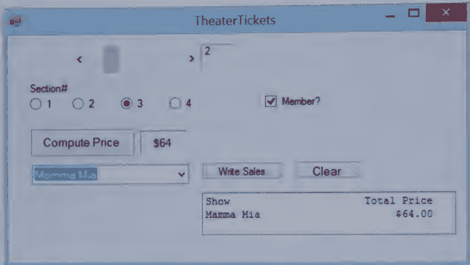

### 一组 RadioButton 与单个 ComboBox 的对比

与一组 RadioButton 相比，当列表较大和/或列表动态时，建议使用 ComboBox。当列表的内容或列表中项目的数量可能发生变化时，列表就是动态的。在当前示例中，我们使用 ComboBox，因为演出列表可能会随着时间而变化。类似地，例如，要让用户从 12 个月的列表中选择一个月，通常建议使用 ComboBox 而不是一组 RadioButton，因为列表较大。

## ComboBox 的属性和事件

表 6-3 显示了 ComboBox 和 ListBox 的常用属性和事件。

表 6-3：ComboBox 和 ListBox 的常用属性和事件

| 属性 | 描述 |
|---|---|
| DropDownStyle | 确定样式以及用户是否可以键入列表中不存在的项目 |
| Items | 列表中所有项目的集合 |
| SelectedIndex | 所选项目的索引 |
| SelectedItem | 所选项目（对象类型） |
| SelectedItems | ListBox 中所选项目的集合 |
| SelectionMode | 确定是否可以从 ListBox 中选择多个项目 |
| Sorted | 如果设置为 True，则列表中的项目将被排序 |
| Text | 在 ComboBox 中显示的文本 |
| 事件 |  |
| SelectedIndexChanged | 当用户从列表中选择一个项目时引发 |

### Items 集合

Items 集合是 ComboBox 和 ListBox 的一个重要属性。它有几个属性和方法，如表 6-4 所示。

表 6-4：Items 集合的属性和方法

| 属性 | 描述 |
|---|---|
| Count | 列表中项目的数量 |
| Item（索引） | 指定索引处的项目 |
| 方法 |  |
| Add（对象） | 将指定项目添加到列表 |
| Clear() | 从列表中移除所有项目 |
| Insert（索引，对象） | 在指定索引处插入指定项目 |
| Remove（索引） | 移除指定索引处的项目 |
| Remove（对象） | 移除指定项目 |

### 向 ComboBox 添加项目

可以在设计视图中使用 GUI 界面，或者在运行时使用代码向 Items 集合添加项目。在运行时添加项目使列表的日后维护更容易。

要在设计视图中向 ComboBox 添加项目，请单击 Items 属性右侧的省略号打开 Items 集合窗口，如图 6-11 所示。

图 6-11：ComboBox 的 Items 集合


以下代码从数组中获取每个演出，将其存储在变量 show 中，并将其添加到 ComboBox：

```csharp
foreach (string show in shows)
    cboShow.Items.Add(show);
```

foreach 循环遍历数组中的每个数据项，并将该项添加到 ComboBox。

**步骤 1-16：** 插入图 6-13 中的代码，将演出名称添加到 ComboBox。该代码应添加到窗体的 Load 事件中，以便在窗体显示时 ComboBox 显示列表。

**图 6-13：** 向 ComboBox 添加项目的代码

```
```csharp
private void TheaterTickets_Load(object sender, EventArgs e)
{
    chkMember.CheckState = CheckState.Indeterminate;
    rdbDefault.Checked = true;
    string[] shows = { "Mamma Mia", "Rock of Ages", "Les Miserables",
                       "The Lion King", "The Phantom of the Opera" };
    foreach (string show in shows)
        cboShow.Items.Add(show);
}
```
```

**步骤 1-17：** 运行窗体，并确保单击 ComboBox 上的箭头时列表按排序顺序显示。

### ComboBox 样式

可以通过更改图 6-14 所示的 DropDownStyle 属性的值，为 ComboBox 选择三种不同样式之一。

**图 6-14：** DropDownStyle 属性

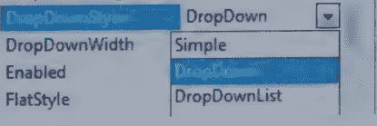

### DropDown 样式

这是 DropDownStyle 属性的默认值。将 DropDownStyle 属性设置为 DropDown 样式时，用户单击箭头时会显示一个下拉列表，如图 6-12 所示。用户也可以键入列表中不存在的项目。


## SelectedItem

SelectedItem 属性返回用户所选项。如果未选择任何项，其值为 null。

## Text 属性

Text 属性的值是 ComboBox 的 TextBox 部分中显示的内容，可以是用户所选项、Text 属性中指定的提示（例如“选择一个演出”），或用户在 ComboBox 的 TextBox 部分中输入的任何文本。

步骤 1-19：将图 6-17 中的代码添加到“清除”按钮的 Click 事件处理程序中，以重置 ComboBox。

## 图 6-17：用于清除 ComboBox 的代码

```
24
25  private void btnClear_Click(object sender, EventArgs e)
26  {
27      hsbNumOfTickets.Value = 0;
28      chkMember.CheckState = CheckState.Indeterminate;
29      rdbDefault.Checked = true;
30      lblAmtDue.Text = "";
31      cboShow.SelectedIndex = -1;
32  }
```

步骤 1-20：添加一个名为 btnWriteSales 的按钮，用于将所选演出的名称和计算出的价格写入 ListBox。添加一个名为 lstDisplay 的 ListBox。图 6-18 显示了添加按钮和 ListBox 后的窗体下半部分。

## 图 6-18：添加了“写入”按钮和 ListBox 的 TheaterTickets 窗体

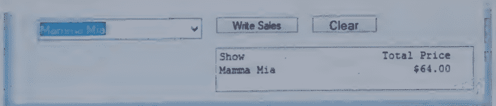

步骤 1-21：将图 6-19 中的必要代码添加到 btnWriteSales 的 Click 事件处理程序中，以完成以下任务：

- 验证用户是否计算了价格。
- 验证用户是否选择了演出。
- 将所选演出的名称和价格写入 ListBox。

## 图 6-19：用于写入演出名称和价格的代码

```
105 private void btnWriteSales_Click(object sender, EventArgs e)
106 {
107     if (cboShow.SelectedIndex == -1)
108     {
109         MessageBox.Show("Please select a show");
110         return;
111     }
112     if (amtDue == 0)
113     {
114         MessageBox.Show("Please compute amount");
115         return;
116     }
117     string fmtStr = "{0,-25}{1,12:C}";
118     lstDisplay.Items.Clear();
119     lstDisplay.Items.Add(String.Format(fmtStr, "Show", "Total Price"));
120     lstDisplay.Items.Add(String.Format(fmtStr, cboShow.SelectedItem, amtDue));
121 }
```

与 ComboBox 相关的两个关键语句是第 107 行和第 120 行：

第 107 行检查 SelectedIndex 的值是否为 -1——即用户未选择演出。

第 120 行显示演出名称（由 SelectedItem 属性提供）以及价格（由 amtDue 提供）。

## SelectedText 属性

ComboBox 还有一个名为 SelectedText 的属性。与 SelectedItem 属性类似，SelectedText 属性返回用户所选项的名称。但是，例如，如果你在 ComboBox 中选择了一项，然后通过单击按钮将焦点移离 ComboBox，则在按钮的 Click 事件处理程序中，SelectedText 属性的值将是一个空字符串。这是因为当焦点移开时，选择内容会被清除。类似地，在 SelectedIndexChanged 和 SelectedValueChanged 事件处理程序（将在本节稍后讨论）中，SelectedText 也将是一个空字符串，因为在这些事件发生时，所选值尚未设置。因此，SelectedText 属性不适合从事件处理程序中获取所选项。

## 从 Items 集合中访问项

可以使用索引号访问 ComboBox 的项集合中的任何项。例如：

- `cboShow.Items[0]` 返回列表中的第一项，
- `cboShow.Items[1]` 返回列表中的第二项。

要访问 ComboBox 中的所有项，可以使用循环在整个范围内改变索引，如下所示：

```
for (int index=0; index < cboShow.Items.Count; index++)
    lstDisplay.Items.Add (cboShow.Items[index]);
```

在上面的代码中，cboShow.Items.Count 属性给出 Items 集合中的项数。由于索引从零开始，最后一项的索引比项数少一。

另一种不需要项数的方法是使用 foreach 循环。下面的代码将显示 ComboBox cboShow 的 Items 集合中的每个演出：

```
foreach (string show in cboShow.Items)
    lstDisplay.Items.Add(show);
```

## SelectedIndexChanged 事件

当用户从 ComboBox 中选择一项时，该操作会触发 SelectedIndexChanged 事件。你可以使用此事件来执行其他操作。例如，当用户从 ComboBox 中选择一个产品时，SelectedIndexChanged 事件处理程序可以查找该产品的价格。

再考虑对 TheaterTicket 窗体进行另一项修改：当用户选择演出时，无需单击“写入销售”按钮，演出的名称和价格就会自动显示在 ListBox 中。为此，我们将代码添加到 ComboBox 的 SelectedIndexChanged 事件处理程序中，如图 6-20 所示。

## 图 6-20：ComboBox 的 SelectedIndexChanged 事件处理程序

```
123 private void cboShow_SelectedIndexChanged(object sender, EventArgs e)
124 {
125     if (amtDue == 0)
126     {
127         MessageBox.Show("Please compute amount");
128         return;
129     }
130     string fmtStr = "{0,-25}{1,-12:C}";
131     lstDisplay.Items.Clear();
132     lstDisplay.Items.Add(string.Format(fmtStr, "Show", "Total Price"));
133     lstDisplay.Items.Add(string.Format(fmtStr, cboShow.SelectedItem, amtDue));
134 }
```

此代码与“写入销售”按钮的 Click 事件处理程序（图 6-19）中的代码相同，只是此代码不检查用户是否选择了演出。请注意，使用这种方法，你不需要“写入销售”按钮以及按钮 Click 事件处理程序中的代码。

步骤 1-22：双击 ComboBox 以创建 ComboBox 的 SelectedIndexChanged 事件处理程序。将图 6-20 中的代码添加到事件处理程序并进行测试。

很多时候，通过从文本文件或数据库读取数据来向 ComboBox 添加项。从文本文件读取将在第 8 章讨论，从数据库获取数据将在第 12 章讨论。

以下代码显示完整的修订代码，包括使用 ComboBox 选择演出并显示它。btnWrite 的 Click 事件处理程序中的代码未显示，因为 ComboBox 的 SelectedIndexChanged 事件处理程序中的代码具有相同的功能。

```
float amtDue;
private void hsbNumOfTickets_ValueChanged(object sender, EventArgs e)
{
    lblNumOfTickets.Text = hsbNumOfTickets.Value.ToString();
}

private void btnClear_Click(object sender, EventArgs e)
{
    hsbNumOfTickets.Value = 0;
    chkMember.CheckState = CheckState.Indeterminate;
    rdbDefault.Checked = true;
    lblAmtDue.Text = "";
    cboShow.SelectedIndex = -1;
}

private void TheaterTickets_Load(object sender, EventArgs e)
{
    chkMember.CheckState = CheckState.Indeterminate;
    rdbDefault.Checked = true;
    string[] shows = { "Mamma Mia", "Rock of Ages", "Les Miserables",
        "Motown", "The Lion King", "The Phantom of the Opera" };
    foreach (string show in shows)
        cboShow.Items.Add(show);
}

private void btnComputePrice_Click(object sender, EventArgs e)
{
    // Verify that the user selected number of tickets
    if (hsbNumOfTickets.Value == 0)
    {
        MessageBox.Show("Please specify number of tickets");
        return;
    }
    // Verify that the user selected a section
    if (chkMember.CheckState == CheckState.Indeterminate)
    {
        MessageBox.Show("Please specify membership");
        return;
    }
    // Verify that the user selected membership status
    if (rdbDefault.Checked == true)
    {
        MessageBox.Show("Please specify Section");
        return;
    }
    // Get number of tickets
    int numOfTickets = hsbNumOfTickets.Value;

    // Compute discount
    float discount = Discount();

    // Get unit price
    float unitPrice = UnitPrice();

    amtDue = numOfTickets * (unitPrice - discount);
    lblAmtDue.Text = amtDue.ToString("$#,###.00");
}
```


```csharp
float Discount()
{
    switch (chkMember.CheckState)
    {
        case CheckState.Checked:    // or, case 0
            return 20;
            break;
        default:
            return 0;
            break;
    }
}

float UnitPrice()
{
    if (rdbSec1.Checked)
        return 70;
    else if (rdbSec2.Checked)
        return 60;
    else if (rdbSec3.Checked)
        return 52;
    else if (rdbSec4.Checked)
        return 45;
    else
        return 0;
}

private void cboShow_SelectedIndexChanged(object sender, EventArgs e)
{
    if (amtDue == 0)
    {
        MessageBox.Show("Please compute amount");
        return;
    }
    string fmtStr = "{0,-25}{1,-12:C}";
    lstDisplay.Items.Clear();
    lstDisplay.Items.Add(String.Format(fmtStr, "Show", "Total Price"));
    lstDisplay.Items.Add(String.Format(fmtStr, cboShow.SelectedItem, amtDue));
}
```

### Review Questions

**6.8** A ComboBox, cboNames, shown below, is used to display a set of student names, and let the user select a name.

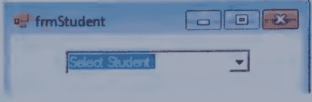

Which property of the ComboBox represents the currently selected name if the user selected an item, and would be empty if the user had not selected an item?

**6.9** A ComboBox, cboNames, shown below, is used to display a set of student names, and let the user select a name.


Write the statement to reset the ComboBox so that no student is selected.

**6.10** A sign-up form for the activities of a club requires the user to specify whether the user is a member of the club. The prompt for the user on the form is

Are you a member of the club?

A control (or controls) is to be placed to the right of the above prompt to let the user specify the membership status. Based on standard practice, which one of the following control(s) would you choose?

- A CheckBox
- Two CheckBoxes (one with a “Yes” label and the other with a “No” label)
- A RadioButton
- Two RadioButtons (one with a “Yes” label and the other with a “No” label)
- A TextBox

## 6.7 Working with ListBoxes

An important difference between a ComboBox and a ListBox is that the ListBox allows the user to select more than one item from the list.

Table 6-3 presented the commonly used properties and events of ComboBoxes and ListBoxes, which included the SelectionMode property that determines whether more than one item can be selected from a ListBox. Properties and methods of the Items collection, which is an important property of ListBoxes, are presented in Table 6-4.

### A Set of CheckBoxes versus a Single ListBox

When do you use a set of CheckBoxes rather than a ListBox to select multiple items from a list? Again, the guideline is to use a ListBox if the list is large and/or dynamic. A list is dynamic when the content of the list or the number of items in the list is likely to change. Thus, a ListBox is preferable to select multiple ingredients for a pizza, if the list of ingredients is dynamic.

### SelectionMode Property

To enable selection of multiple items, the SelectionMode property shown in Figure 6-21 needs to be set to MultiSimple or MultiExtended. The two settings are similar, except that the MultiExtended setting makes it easier to select a set of consecutive items using the shift key.

*Figure 6-21: SelectionMode property of ListBox*

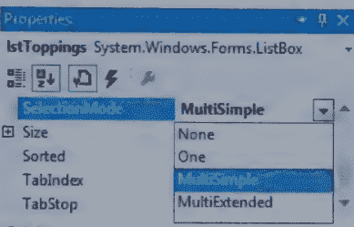

You already used ListBoxes to display output by adding text to the Items collection using the Add method, as in

```csharp
lstDisplay.Items.Add("Total Price: " + lblAmtDue.Text);
```

Similar to the ComboBox, the Add method adds a new item to the ListBox.

You also may add a list of items to the ListBox by storing the items in an array and then using a loop to add the items to the ListBox. For example, the following code stores a list of pizza toppings in an array named toppings, and adds them to a ListBox named lstToppings using a foreach loop.

```csharp
string[] toppings = {"Pepperoni", "Sausage", "Onion", "Green Pepper", "Mushrooms", "Xtra Cheese", "Ham", "Anchovies"};
foreach (string topping in toppings) // Add toppings to ListBox
    lstToppings.Items.Add(topping);
```

To better understand the use of ListBoxes, let’s look at a pizza order form that lets the user select the size of pizza and the toppings, compute the total price, and display the total price and the toppings selected, as shown in Figure 6-22.

*Figure 6-22: The PizzaOrder form*

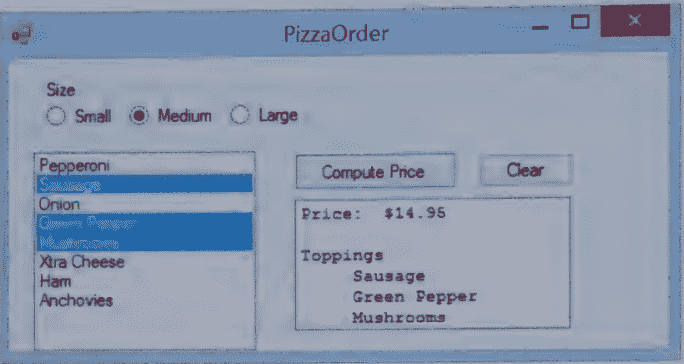

The list of toppings is added to the ListBox named lstToppings using code in the Load event of the form, shown in Figure 6-23.

*Figure 6-23: Code to add toppings to the ListBox*

```csharp
// This form uses a ListBox to let users select multiple items from a list:
private void PizzaOrder_Load(object sender, EventArgs e)
{
    string[] toppings = { "Pepperoni", "Sausage", "Onion", "Green Pepper",
                          "Mushrooms", "Xtra Cheese", "Ham", "Anchovies" };
    foreach (string topping in toppings) // Add toppings to listBox
        lstToppings.Items.Add(topping);

    rdbDefault.Checked = true;
}
```

In line 27, rdbDefault is a hidden RadioButton that makes it easier to reset the other RadioButtons and to check whether the user selected a size.

### MultiColumn property

If there is not enough space to display the entire list of items in a ListBox, a vertical ScrollBar will be provided. If you want to avoid a vertical ScrollBar, you may set the MultiColumn property of the ListBox to True so that the items are displayed in multiple columns, as shown in Figure 6-24.

*Figure 6-24: Display when MultiColumn property is set to True*

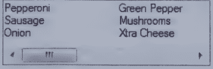

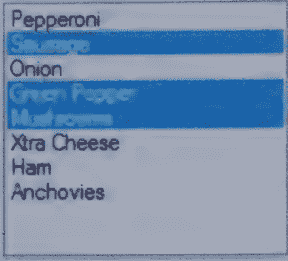

In this ListBox, Items[0] is the first item in the list (Pepperoni), but SelectedItems[0] is the first selected item (Sausage).

Now, let’s look at the code to compute the price based on the size selected and the number of toppings. Figure 6-25 shows the code, except for the statements to compute the total price and display selected items, which are left for you to complete.

**Line 33** checks whether the user selected a size:

```csharp
if (rdbDefault.Checked == true)
```

If the default RadioButton is selected, that means none of the other RadioButtons that represent the size are selected.

**Line 40** calls the GetPrice method, shown in Figure 6-25, to get the base price of the pizza with no toppings and the cost per topping:

```csharp
GetPrice(ref basePrice, ref costPerTopping);
```

Note that the GetPrice method returns the two values using reference parameters. You may split this method to two value returning methods named BasePrice that returns the base price, and ToppingPrice that returns the cost per topping. The statement in line 40 will have to be replaced by two statements that invoke these methods.

**Step 1–26:** Add the missing code in line 43 to compute the total price (base price + cost per topping × number of toppings).

**Hint:** Count property of SelectedItems collection gives the number of selected items.

Add the missing code in lines 54 and 55 to display the selected toppings in the ListBox, lstDisplay. You may use a foreach loop to access each item in the SelectedItems collection.

**Step 1–27:** View the code in the Click event handler of Clear button, shown in Figure 6-26.

*Figure 6-26: Code to reset controls*

```csharp
private void btnClear_Click(object sender, EventArgs e)
{
    rdbDefault.Checked = true;
    lstToppings.SelectedIndex = -1;
    lstDisplay.Items.Clear();
}
```

**Step 1–28:** Run the form. Test the code by clicking the Compute button when size and/or toppings are not selected. Test it with proper selection of size and toppings.

### ListView control

The ListView control is another commonly used control, which allows multiple data items to be displayed in a row. Because arrays make it easier to add data to this control, we will discuss this control in Chapter 8.

*It’s time to practice! Do Exercise 6–1.*

## 6.8 Windows Presentation Foundation (WPF)

If you want to build applications with rich graphical user interfaces, Windows Presentation Foundation (WPF) is a Microsoft technology that can help you. The WPF features include extensive support for 2-D and 3-D graphics, animation, media and high quality text. Further, the layout system in WPF allows creating dynamic layouts that adjust to changes in window size and display settings. Additional components of WPF applications include

1. **XAML (Extensible Application Markup Language):** The user interface is created using XAML, which is a Microsoft XML-based markup language. Just like in a common Windows Form application, you can drag WPF controls from the Toolbox onto the Design window, which will generate the corresponding XAML tags that specify the controls. You also may use XAML to create controls. XAML allows you to do extensive customization and nesting of controls. WPF controls also have properties and events that are not available in Windows Form controls.
2. **Code-behind:** Code-behind represents C#, Visual Basic and other .NET language programs that are attached to specific events of WPF controls, like the Click event of a button. This code is similar to the code in Windows Forms that you are familiar with.

To create a WPF project, select File, New, Project, C#, Windows, WPF Application.

For tutorials and additional information on creating WPF applications, please see https://msdn.microsoft.com/en-us/library/aa970268(v=vs.110).aspx


## 复习题

- **6.11** 你想开发一个窗体，允许用户从所有教学班列表中选择一个入门信息系统课程的教学班。每学期教学班的数量在 3 到 8 之间变化。窗体上给用户的提示将是

  > 请选择一个教学班。

  根据标准实践，你会使用以下哪种控件让用户选择一个教学班：列表框（ListBox）、一组复选框（CheckBoxes）、一组单选按钮（RadioButtons）还是组合框（ComboBox）？

- **6.12** 希望开发一个窗体，允许用户从一周七天列表中选择一天或多天。窗体上给用户的提示将是

  > 请选择一天或多天：

  根据行业标准，你会使用以下哪种控件让用户选择一天或多天：列表框（ListBox）、一组复选框（CheckBoxes）、一组单选按钮（RadioButtons）还是组合框（ComboBox）？

- **6.13** 一个窗体在名为 lstSports 的列表框中显示运动列表。用户在运行时从列表中选择篮球和足球，如下图所示：

  那么 lstSports.SelectedItems(0) 的值是多少？

  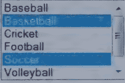

- **6.14** 一个窗体在名为 lstSports 的列表框中显示运动列表。用户在运行时从列表中选择篮球和足球，如下图所示：

  那么 lstSports.Items(2) 的值是多少？

  

## 练习

### 练习 6-1

开发一个如下图所示、名为 Icecream.cs 的窗体：

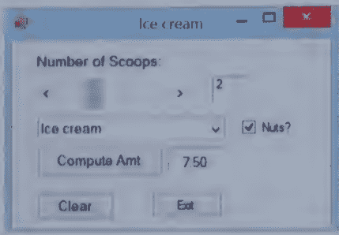

该窗体必须允许用户执行以下操作：

- 使用滚动条（ScrollBar）指定勺数（最多三勺），并在名为 lblScoops 的标签（Label）中显示指定的数量。
- 从按字母顺序排序的组合框（ComboBox）中显示的圣代列表（冰淇淋、卡仕达、酸奶等）中选择圣代类型。由于此列表中的项目可能会随时间变化，不要假设例如第三个项目仍将是酸奶。
- 使用复选框（CheckBox）指定用户是否要在顶部添加坚果。
- 计算应付金额。
- 清除所有数据，以便用户可以进行另一组选择。
- 退出窗体。

应付金额由以下公式给出：

圣代价格（冰淇淋——3.50 美元；卡仕达——3.75 美元；酸奶——4.00 美元）* 勺数 + 坚果价格（0.50 美元）

不要为用户指定的项目使用默认值。默认值会使人难以检查用户是否忘记选择某个项目。

### 练习 6-2

一个慈善组织使用志愿者每年举办 10 到 15 种不同类型的筹款活动。活动类型的示例有烤香肠活动、步行马拉松、烘焙义卖和高尔夫。志愿者注册表的一个部分收集以下信息：

- 姓名
- 一个人愿意参与的志愿活动类型（一个人可以选择一种或多种类型）
- 每周可用小时数（选项为 5-10、11-20、21-30、31-40）
- 他/她是否是新志愿者

开发一个名为 Exercise 6.2 的窗体来收集上述信息。根据教科书中讨论的指南选择合适的控件。将用户输入的数据写入列表框（ListBox）。如果志愿者是新手，显示“New”一词；如果不是，显示“Experienced”一词。显示示例如下所示：

```
Name:      Sam Adamson

Events:

Walkathon
Golfing

Hours/week:   11-20

Status:      New
```

## 数组

到目前为止，我们使用的变量一次只能存储一个值。因此，如果要将 30 个测试分数存储到内存中并同时对它们进行计算，就必须声明 30 个不同的变量。

单个数组允许你存储相同类型的多个数据项。例如，单个一维数组可以同时存储全部 30 个分数。因为一维（1-D）数组是最简单的数组类型，所以我们将首先讨论它们。

## 主题

| 章节 | 主题 | 章节 | 主题 |
|---|---|---|---|
| 7.1 | 一维数组简介 | 7.4 | 使用 foreach 循环访问数组元素 |
| 7.2 | 向数组元素赋值 | 7.5 | 复制数组 |
| 7.3 | 使用索引访问数组元素 | 7.6 | 在数组中查找值 |

### 7.1 一维数组简介

可以将数组看作一个数据容器，其中包含多个存储位置或槽，每个数据项对应一个位置。一个名为 testScore 的存储 10 个测试分数的数组可以表示如下：

| testScore | 85 | 92 | 87 | 67 | 83 | 91 | 73 | 98 | 83 | 84 |
|---|---|---|---|---|---|---|---|---|---|---|
| 元素编号：（下标或索引） | 0 | 1 | 2 | 3 | 4 | 5 | 6 | 7 | 8 | 9 |

数组的每个存储位置称为一个元素。元素从 0 开始连续编号。通过数组名称后跟方括号中的元素编号（下标或索引）来访问数组的单个元素。下标必须是整数。例如，testScore[0] 指的是数组的第一个元素，即数字 85；testScore[1] 指的是数组的第二个元素，即数字 92；testScore[9] 指的是数组的第十个元素，即数字 84。

不同的数组可以容纳不同类型的数据项，包括数字、字符串、数组和对象。但是，在同一个数组内，所有元素必须是相同类型。因此，数组是相同类型数据项的集合。

像 testScore 这样可以存储一组数据的数组称为一维（1-D）数组。二维（2-D）数组（将在第 8 章后面讨论）可以存储多组数据，且所有数据都是相同类型。

### 值类型与引用类型

我们在前面章节中讨论的整数、实数和布尔类型称为值类型，因为这些类型的每个变量都保存赋予该变量的实际值。因此，分配给值类型变量的内存位置保存的是赋予该变量的实际值。

相比之下，数组（和其他对象）称为引用类型，因为这些类型的每个变量只保存对数据的引用——即数据的内存位置或地址，而非实际数据。引用对象（如数组）的变量称为引用变量。让我们先通过一些例子来看值类型。

考虑下面声明的两个值类型变量 previousSales 和 currentSales：

```
int previousSales, currentSales;
```

声明变量的效果是在这两个变量的内存位置中存储默认值零，如下所示：

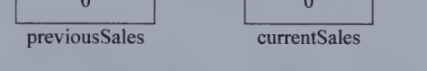

使用语句 currentSales = 245; 为 currentSales 赋值，会在 currentSales 的内存位置中存储该值，如下所示：

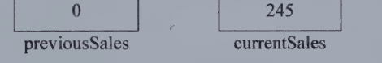

当使用语句将 currentSales 赋值给 previousSales 时

```
previousSales = currentSales;
```

currentSales 中的值被复制到 previousSales 的内存位置，因此两个位置存储相同的数据，如下所示：

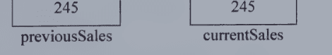

如第 1 章所讨论的，如果之后使用这样的语句更改 currentSales 的值：

```
currentSales = 300;
```

这对 previousSales 的值没有影响。两个变量的位置将如下所示：

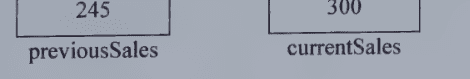

现在，让我们看看数组有何不同。

### 创建数组

创建并使用数组（一种引用类型）涉及两个步骤：

1. 在内存中创建数组对象以存储一组数据项。
2. 创建一个称为引用变量的变量，该变量引用（保存地址）数组，如图 7.1 所示。


下面是一条创建名为 testScore 的数组的语句：

```
int[] testScore = new int[10];
```

右侧的 `new int[10]` 在内存中创建一个数组。我们来看每个部分：

关键字 `new` 创建由 `int[10]` 指定的类型的新对象（在内存中），并返回新数组的内存位置。

表达式 `int[10]` 指定该对象是 int 类型的数组，并且**数组大小为 10**——即该数组有 10 个元素，其索引范围从 0 到 9。创建新数组时，每个元素的默认值为零。

左侧的 `int[] testScore` 声明一个可用于访问该数组的引用变量。变量类型后面的一对方括号将其与值类型变量区分开来，并指定它是一个用于引用数组的变量。

= 运算符将数组的引用（数组的内存位置）存储在引用变量 testScore 中。

图 7-2 表示执行语句 `int[] testScore = new int[10]` 以创建数组 testScore 并将引用赋给 testScore 的效果。


你可以将语句 `int[] testScore = new int[10]` 拆分为两个单独的语句：

```
int[] testScore;
testScore = new int[10];
```

第一条语句 `int[] testScore` 将 testScore 声明为用于引用 int 类型数组的变量。第二条语句 `testScore = new int[10]` 使用关键字 new 创建一个大小为 10 的 int 类型数组。= 运算符将新数组的内存位置赋值给 testScore。


## 创建数组的通用语法

创建数组的语句的通用语法如下：

```
Type[] VariableName = new Type(ArraySize)
```

其中，ArraySize 是数组的元素个数，Type 是要存储在数组中的数据类型，VariableName 是任意有效的变量名。

或者，你也可以使用两条不同的语句：

```
Type[] VariableName
```

```
VariableName = new Type(ArraySize)
```

## 教程 1：使用一维数组：测试分数应用程序

在本教程中，你将使用简单的一维数组。

步骤 1-1：从文件夹 Tutorial_Starts 打开项目 Ch7_Arrays。

步骤 1-2：打开如下所示的窗体 Array_1D_Intro。


步骤 1-3：打开 btnDemo 的 Click 事件处理程序。

步骤 1-4：在 btnDemo 的 Click 事件处理程序中添加创建数组 testScores 的语句，如图 7-3 所示，并在右花括号处设置一个断点。

图 7-3：创建数组的代码

```
19    private void btnDemo_Click(object sender, EventArgs e)
20    {
21        // Create array testScore with default values:
22        int[] testScore = new int[10];
```

步骤 1-5：运行项目，并单击 Demo 按钮。

步骤 1-6：程序中断时，显示“局部变量”窗口（Debug, Windows, Locals）。展开 testScore 以显示数组中索引 0 到 9 对应的 10 个元素的值，如图 7-4 所示。

图 7-4：显示数组的“局部变量”窗口


## 创建具有非零初始值的数组：数组初始化器

可以使用数组初始化器创建初始值不是默认零值的数组，初始化器是用花括号括起来的逗号分隔的值列表，例如：

```
int[] testScore = { 85, 92, 87, 67, 83, 91, 73, 98, 83, 84 };
```

这种创建数组的方式不需要关键字 new，也不需要 = 号右侧指定类型和数组大小。C# 编译器会根据列表中数据项的数量推断数组大小，并像使用关键字时一样创建数组。

或者，你也可以将其拆分为两条语句，如下所示：

```
int[] testScore;
testScore = { 85, 92, 87, 67, 83, 91, 73, 98, 83, 84 };
```

步骤 1-7：注释掉语句 int[] testScore = new int[10]，并添加一条使用数组初始化器而不是关键字 new 创建数组的语句，如图 7-5 所示。在事件处理程序的右花括号处设置一个断点。

图 7-5：使用数组初始化器

```
19   private void btnDemo_Click(object sender, EventArgs e)
20   {
21       // Create array testScore with default values:
22       // int[] testScore = new int[10];
23
24       // Create array testScore using array initializer
25       int[] testScore = { 85, 92, 87, 67, 83, 91, 73, 98, 83, 84 };
```

步骤 1-8：运行项目，并单击 Demo 按钮。

程序中断时，显示“局部变量”窗口（Debug, Windows, Locals）。展开 testScore 以显示数组的 10 个元素的值，如图 7-6 所示。

图 7-6：显示数组初始化器效果的“局部变量”窗口


## 复习题

7.1 引用类型变量与值类型变量有何不同？

7.2 考虑以下在名为 lstDisplay 的 ListBox 中计算并显示总销售额的代码：

int sales=2, totalSales = 10;
totalSales = totalSales + sales;
sales = 3;
lstDisplay.Items.Add(totalSales);

ListBox 中显示的 totalSales 值是多少？

7.3 编写一条语句，创建一个最多可容纳二十个学生姓名的数组，该数组由名为 student 的变量引用。

7.4 编写一条语句，创建一个名为 student 的变量，该变量可以引用 string 类型数组。再编写第二条语句，创建一个最多可容纳二十个学生姓名的数组，该数组由 student 引用。

7.5 编写一条语句，创建一个由一周七天缩写名称组成的数组，该数组由名为 weekDay 的变量引用。

## 7.2 向数组元素赋值

数组初始化器是在创建数组时向数组元素赋值的简单方法。然而，在从文件或数据库等来源读取数据的应用程序中，通常是从数据源读取数据，然后使用循环将其赋值给数组元素，这一点将在后面讨论。

为了帮助理解这个概念，首先来看如何通过指定元素索引向数组的单个元素赋值。例如，下面的语句

```
testScore[2] = 99;
```

会将值 99 赋给数组 testScore 的第三个元素，以替换原来的值 87。

你也可以使用变量作为索引，例如：

```
int index = 2;
testScore[index] = 99;  // you may use any valid variable name to represent the index.
```

这种使用变量指定索引的方法会在循环中用于为数组的每个元素赋值。

步骤 1-9：将图 7-7 中的代码添加到 Click 事件处理程序中，将第三个测试分数改为 99，并将第一个测试分数改为 89。

图 7-7：更改数组元素的值

```
private void btnDemo_Click(object sender, EventArgs e)
{
    // Create array testScore with default values:
    // int[] testScore = new int[10];

    // Create array testScore using array initializer
    int[] testScore = { 85, 92, 87, 67, 83, 91, 73, 98, 83, 84 };

    // Change the first test score to 89, and the third test score to 99:
    testScore[0] = 89;
    testScore[2] = 99;
}
```

步骤 1-10：运行项目，并单击 Demo 按钮。

步骤 1-11：程序中断时，显示“局部变量”窗口（Debug, Windows, Locals）。展开 testScore 以显示数组的 10 个元素的值。数组更新后的值如图 7-8 所示。

图 7-9：显示 testScore 的一个元素

```
19    private void btnDemo_Click(object sender, EventArgs e)
20    {
21        // Create array testScore with default values:
22        // int[] testScore = new int[10];
23
24        // Create array testScore using array initializer
25        int[] testScore = { 85, 92, 87, 67, 83, 91, 73, 98, 83, 84 };
26
27        // Change the first test score to 89, and the third test Score to 99:
28        testScore[0] = 89;
29        testScore[2] = 99;
30
31        // Display 3rd element of the array
32        int index = 2;
33        lstDisplay.Items.Add(testScore[index]);
```

步骤 1-14：运行窗体以观察输出。你应该看到分数 87。

现在开始练习吧！完成练习 7-1。

## 使用 for 循环访问数组元素

接下来，我们将编写代码，在 ListBox lstDisplay 中显示数组的每个元素及其索引值，如图 7-10 所示。

图 7-10：使用 for 循环显示数组的每个元素


我们使用 for 循环将元素索引的值从 0 改为 9。注意，索引的上限（9）等于数组大小（10）减 1。

## 7.4 使用 foreach 循环访问数组元素

作为使用 for 循环访问数组每个元素的替代方法，可以使用 foreach 循环。通常，使用 foreach 循环可以方便地访问任何集合中的单个项。下面是如何使用 foreach 循环显示每个测试分数：

```
foreach (int score in testScore)
    lstDisplay.Items.Add(score);
```

在每次迭代中，foreach 循环都会自动将数组中的下一个元素复制到迭代变量 score 中，从第一个元素开始。因此，第一次循环时，score 被赋值为第一个元素（89）并显示在 ListBox 中；第二次循环时，score 被赋值为第二个元素（92）；这个过程一直持续到所有分数都显示出来。

将 foreach 循环与前面介绍的 for 循环进行比较：

```
for (int index = 0; index <= testScore.Length-1; index = index + 1)
    lstDisplay.Items.Add(index + "    " + testScore[index]);
```

注意，使用 foreach 循环时，无需初始化循环变量、递增循环变量或指定上限，因为访问元素时不需要指定索引。由于 foreach 循环中没有使用循环变量，因此 foreach 循环的输出（如图 7-13 所示）不包含索引值。

图 7-13：使用 foreach 循环显示每个分数


## for 与 foreach 的对比

与 foreach 循环相比，for 循环通常在处理元素时提供更大的灵活性。在 for 循环中，你还可以为数组元素赋值，并且可以方便地处理多个大小相同的数组。

如果应用程序只需要按顺序访问单个数组的元素而无需修改它们，那么这基本上就是个人偏好的问题。

现在，让我们修改 foreach 循环，如图 7-14 所示，计算总分，然后计算平均分。


## 图 7-14：使用 foreach 循环计算平均值

```
int totalScore = 0;
lstDisplay.Items.Add("Score");
foreach (int score in testScore)
{
    lstDisplay.Items.Add(score);
    totalScore = totalScore + score;
}
float averageScore = (float)totalScore / testScore.Length;
lstDisplay.Items.Add("Average: " + averageScore.ToString("N"));
```

## foreach 循环的通用语法

```
Foreach (Type VariableName in ArrayName)
{
    Statements
}
```

**步骤 1-22：** 注释掉使用 for 循环计算平均值的代码（图 7-12 中的第 31–41 行），并添加图 7-14 中的代码，该代码使用 foreach 循环。

**步骤 1-23：** 运行项目并测试代码。

## 数组名称应为单数还是复数？

数组的名称应为单数如 testScore 还是复数如 testScores？由于数组包含多个数据项，复数形式可能更直观。当你使用 foreach 循环访问数组的每个元素时，如以下代码所示，使用复数形式（testScores）表示数组，使用单数形式（testScore）表示表示单个分数的变量会很方便：

```
foreach (int testScore in testScores)
    lstDisplay.Items.Add(testScore);
```

然而，当你使用索引引用单个分数时，名词的单数形式更有意义。例如，testScore[1] 比 testScores[1] 更清晰地表示单个分数。此外，在数组的某些高级用法中，名词的单数形式更有意义。在本书中，我们同时使用这两种形式。

## 复习题

**7.10**  使用 **foreach** 循环将以下数组的所有元素显示到名为 lstDisplay 的 ListBox 中：

```
string[] weekDay = {"Sun", "Mon", "Tue", "Wed", "Thu", "Fri", "Sat"};
```

## 7.5 复制数组

由于数组是引用类型，你不能通过将引用变量赋给另一个引用变量来创建数组的单独副本。例如，
int[] temp1 = testScore;
不会创建数组 testScore 的副本。相反，temp 和 testScore 将引用同一个数组，如图所示。


也就是说，只有一个数组，但有两个变量引用它。这意味着如果你更改 testScore 的一个元素，实际上你也在更改 temp1 的该元素。

步骤：7-24：将以下代码添加到 Demo 按钮的 Click 事件处理程序末尾，并在第 56 行和 57 行插入断点：

```
53
54
55    // Assign testScore to another reference variable - doesn't copy the array
    int[] temp1 = testScore;
56    testScore[9] = 69;
57
```

步骤 1-25：运行项目。当程序在第 56 行中断（在 testScore[9] 改为 69 之前）时，在 Locals 窗口（Debug, Windows, Locals）中展开 testScore 和 temp，观察 temp 的值与 testScore 相同。

步骤 1-26：单击 Run 继续执行。当程序在第 57 行中断时，在 Locals 窗口（Debug, Windows, Locals）中展开 testScore 和 temp，观察 temp[9] 的值与 testScore[9] 相同，如图 7-15 所示，尽管看起来你只更改了 testScore 的值。

## 图 7-15：temp1 的值已更改


你可以使用 temp1 或 testScore 更改数组的任何元素。例如，temp1[8] 将更改也被 testScore 引用的数组的第九个元素。

## 图 7-18：通过复制 testScore 创建的 temp2

testScore


temp2


例如，执行语句

```
testScore[9] = 99
```

会更改 testScore 的最后一个元素，但不会影响 temp2 或 temp3。

然而，temp1 被更改，因为 temp1 使用以下语句被赋予了对 testScore 的引用；因此，temp1 和 testScore 指向同一个数组：

```
int[] temp1 = testScore;
```

## 步骤 1-29：添加以下代码将 testScore 的最后一个元素更改为 99。

```
testScore[9] = 99;
```

## 步骤 1-30：运行项目。当程序在第 66 行中断时，显示 Locals 窗口并观察 testScore 和 temp1 的最后一个元素为 99，但 temp2 和 temp3 的最后一个元素未更改。

## 使用 for 循环复制数组

你也可以使用 for 循环将一个数组的元素复制到另一个数组。这里的代码将 testScore 的元素复制到名为 temp4 的数组：

```
int[] temp4 = new int[10]; // or, int[] temp4 = new int[testScore.Length]
for (int index = 0; index <= testScore.Length - 1; index = index + 1)
    temp4[index] = testScore[index];
```

这里，索引从 0 变到上界以访问每个元素。因此，循环内的语句等价于 10 个不同的语句：

```
temp4[0] = testScore[0];
temp4[1] = testScore[1];
temp4[2] = testScore[2];
etc.
```

## 7.6 在数组中查找值

一维数组可以方便地用于查找值，例如查找指定商品的价格或查找某人的电话号码。

考虑一个月份名称的字符串数组和另一个存储产品每月销售量的 int 数组，如图 7-19 所示。应注意，在实际应用中，此类数据通常从数据库表或文件中读取，而不是硬编码。

## 图 7-19：创建数组 months 和 unitsSold 的代码

```
string[] months = { "January", "February", "March", "April", "May", "June", "July", "August", "September", "October", "November", "December" };

int[] unitsSold = { 572, 645, 693, 564, 580, 756, 960, 756, 663, 678, 745, 960 };
```

要查找指定月份的销售量，首先从 months 数组中找到该月份的索引。然后，找到 unitsSold 数组中该索引位置存储的数据项。此方法仅在 months 和 units sold 以相同顺序存储时有效（即，unitsSold 的第一个元素对应于 months 数组中的第一个月，unitsSold 中的第二个元素对应于 months 数组中的第二个元素，等等）。

例如，要查找三月的销售量，你找到 March 的索引，为 2，然后找到 unitsSold 数组中索引位置 2 的数据项，为 693。找到数组中特定数据项的索引的一种简便方法是使用 Array.IndexOf 方法。

## Array.IndexOf 方法

Array.IndexOf 方法返回一维数组中指定数据项的索引。

该方法具有以下语法

```
Array.IndexOf(ArrayName, SearchValue)
```

例如，

```
Array.IndexOf(months, "March")
```

ArrayName 是 1-D 数组的名称，SearchValue 是你在数组中尝试查找的值。该方法返回匹配指定值的第一个元素的索引。如果未找到值，该方法返回 -1。由于 months 和 units sold 以相同顺序存储，你可以使用月份的索引来查找 unitsSold。

## 教程 2：使用 1-D 数组查找销售量

本教程创建一个名为 LookUpUsingArray 的窗体，允许用户查找指定月份的销售情况，如图 7-20 所示。

图 7-20：LookUpUsingArray 窗体


步骤 2-1：在项目 Ch7_Arrays 中打开名为 LookupUsingArray 的窗体。

打开代码窗口。第 19–21 行的两个语句在类级别创建两个数组 months 和 unitsSold，如图 7-21 所示。这些数组在类级别创建，而不是在 btnDisplayUnitsSold 的 Click 事件处理程序内，以便它们不必每次用户单击按钮查找销售时都重新创建。

步骤 2-2：将图 7-21 中第 22–37 行所示的代码添加到 btnDisplayUnitsSold 的 Click 事件处理程序，以显示指定月份的销售量。

图 7-21：查找销售量的代码

```
19  string[] months = { "January", "February", "March", "April", "May", "June", "July",
20                  "August", "September", "October", "November", "December" };
21  int[] unitsSold = { 572, 645, 693, 564, 580, 756, 859, 756, 663, 678, 745, 958 };
22
23  private void btnDisplayUnitsSold_Click(object sender, EventArgs e)
24  {
25      string monthName = txtMonthName.Text;
26      int monthIndex, unitsSoldInMonth;
27
28      // Find the index of the month. Use the index to find units sold
29      monthIndex = Array.IndexOf(months, monthName);
30      if (monthIndex >= 0)  // if month is not found, index would be -1
31          unitsSoldInMonth = unitsSold[monthIndex];  // find units sold
32      else
33      {
34          MessageBox.Show("Month not found");
35          return;
36      }
37      lblUnitsSold.Text = unitsSoldInMonth.ToString();
```

第 29 行使用前面描述的 Array.IndexOf 方法从 months 数组中找到指定月份的索引。


第31行使用指定月份的索引从 unitsSold 数组中查找销量。
步骤2-3：运行窗体并测试代码。

## 使用循环在数组中查找值

使用 `Array.IndexOf` 方法查找数据项索引的替代方法是使用循环，将数组的每个元素与要查找索引的数据项进行比较。例如，要查找 months 数组中“March”的索引，请将 months 数组中的每个月与“March”进行比较，直到找到匹配项或比较完所有元素。图7-22显示了使用for循环的代码。

### 图7-22：使用for循环查找销量

```
// Alternate method using a loop:
// Compare each month in the array to the specified month
int index = 0;
for (index = 0; index < months.Length; index++)
{
    if (months[index] == monthName)
    {
        unitsSoldInMonth = unitsSold[index];
        lblUnitsSold.Text = unitsSoldInMonth.ToString();
        break; // if month is found jump out of the loop
    }
}
// Display a message, if month was not found
if (index >= months.Length)
{
    MessageBox.Show("Month not found");
    return;
}
```

第42行和第44行：第42行中的for循环使index的值从0到11按1递增，因此第44行中的语句

```
if (months[index] == monthName)
```

将等同于12条不同的语句：

```
if (months[0] == monthName)
if (months[1] == monthName)
...
if (months[11] == monthName).
```

第48行：如果指定的月份与数组中的某个月份匹配，则第48行中的break语句将控制权转移出循环。

第52行：如果指定月份与数组中的任何月份都不匹配，则index的值将等于数组的大小（12），该大小由Length属性给出。第52行检查index是否大于或等于数组大小。

步骤2-4：注释掉第29-37行中的语句，并添加图7-22中第38-55行的代码。运行窗体并测试代码。

## 是时候练习了！完成练习7-2和7-3。

## 练习

### 练习 7-1

从Tutorial_Starts文件夹中打开项目Ch7_Arrays。打开名为Exercise 7_1的窗体。在btnDisplayMonth的Click事件处理器中添加必要的代码，以显示用户输入的月份编号对应的月份名称。例如，如果用户输入数字3，代码应显示“March”，如下所示：


提示：创建一个字符串数组，并将十二个月份名称（January 到 December）分配给它作为初始值。为了避免每次单击按钮时都创建数组，请在Click事件处理器之外、类级别创建数组。在Click事件处理器中使用该数组查找并显示月份名称。

### 练习 7-2

A部分：本练习查找并显示销售额最高的月份。向你在教程2中使用的LookUpUsingArray窗体添加一个名为btnTopMonths的按钮。在按钮的Click事件处理器中添加必要的代码，以在ListBox中查找并显示最高销售额及销售额最高的月份。可以使用以下方法：

首先，通过循环遍历unitsSold数组查找最高销售额，如下所示：
- 将最高销售额设置为unitsSold的第一个元素（`int highestSale = unitsSold[0];`）
- 将highestSalePosition设置为零。
- 使用一个循环（初始化并递增索引）将每个数组元素与最高销售额进行比较。如果数组元素大于最高销售额，则使用以下逻辑更新最高销售额和highestSalePosition：
  - 如果（数组元素 > 最高销售额）
  - 将highestSale设置为unitsSold的当前元素
  - 将highestSalePosition设置为index的当前值

接下来，显示highestSale以及highestSalePosition处的月份。

B部分：本练习与A部分类似，不同之处在于查找并显示销售额最低的月份。向你在教程2中使用的LookUpUsingArray窗体添加一个名为btnBottomMonths的按钮。在按钮的Click事件处理器中添加必要的代码，以在ListBox中查找并显示最低销售额及销售额最低的月份。可以使用以下方法：

首先，通过循环遍历unitsSold数组查找最低销售额，如下所示：
- 将最低销售额设置为unitsSold的第一个元素（`int lowestSale = unitsSold[0];`）
- 将lowestSalePosition设置为零。
- 使用一个循环（初始化并递增索引）将每个数组元素与最低销售额进行比较。如果数组元素小于最低销售额，则使用以下逻辑更新最低销售额和lowestSalePosition：

```
if (array element < lowestSale)
set lowestSale to the current element of unitsSold
set lowestSalePosition to the current value of index
```

接下来，显示lowestSale以及lowestSalePosition处的月份。

### 练习 7-3

Tutorial_Starts/Ch7_Arrays项目中的TheaterTicketsWithArray窗体执行的功能与Ch6_GUIcontrols中的TheaterTickets窗体基本相同。TheaterTicketsWithArray窗体不是使用按钮来计算费用，而是将计算费用和显示费用合并到ComboBox的SelectedIndexChanged事件处理器中。此外，该窗体不使用单独的方法来计算折扣。

修改此窗体，使应付金额包含所选节目的加价。当用户从ComboBox中选择一个节目时，将该节目的加价添加到应付金额中并显示该金额。可以使用以下方法：

在窗体中添加必要的语句，创建一个名为markups的第二个数组，其中包含每个节目的加价金额（正值或负值）。

将代码添加到ComboBox的SelectedIndexChanged事件处理器中，以查找所选节目的加价金额，并将该金额添加到应付金额中。在ListBox中显示该金额。确保数组的引用变量shows在类级别声明，以便可以在窗体的Load事件和ComboBox的SelectedIndexChanged事件处理器中使用。

## 顺序文件和数组

存储在变量和数组中的数据在程序终止时会丢失。顺序访问文件提供了一种相对简单的方法，可以将数据长期存储在硬盘、磁带和闪存驱动器等设备中。本章讨论将数据写入顺序文件以及从文件读取数据。此外，我们还将研究如何将文件中的数据读取到一维和二维数组中。

## 主题

| 8.1 | 文本文件简介 | 8.5 | 写入文本文件 |
| 8.2 | 拆分行：Split方法 | 8.6 | SaveFileDialog控件 |
| 8.3 | 从文件读取数据到数组 | 8.7 | 将数组传递给方法 |
| 8.4 | 数组的其他方法 | 8.8 | 二维（2-D）数组 |

### 8.1 文本文件简介

在顺序访问文件中，数据按顺序访问，从第一组数据项开始，然后是后续各组。要查找特定数据项，需要先遍历它之前的所有数据，就像在盒式磁带上播放歌曲一样。相比之下，可以直接从直接访问（随机访问）文件中访问数据，类似于在CD上播放歌曲。

顺序文件有两种类型：文本文件和二进制文件。在文本文件中，所有数据（包括数字和日期）都以文本形式存储。例如，数字9.95存储为四个字符（三位数字和一个小数点）的组合，构成一个字符串。因此，可以使用记事本之类的文本编辑器创建和编辑文本文件。二进制文件（在附录A中讨论）以原始形式存储数据，而不将其转换为文本。数字9.95使用数字的标准内部表示形式存储为单个数字。

## 从文本文件读取行

通常，文本文件将每条记录存储在单独的一行中，数据项由逗号、制表符或竖线字符（|）等分隔符分隔。由于文本文件是顺序访问文件，因此数据从文件开头到结尾按顺序读取。

## 示例1：读取并显示考试成绩

下面是一个文本文件示例，其中包含学生的姓名和两个考试成绩：
- Mike Burns, 75, 92
- Cathy Arnold, 86, 95
- Wesley Mathews, 82, 90
- Jerry Luke, 70, 89


Gina Rodriguez, 77, 88

你可以在文本编辑器中或使用程序创建这样一个文件。在任何一种情况下，在每一行的末尾都会自动插入一个不可见的新行字符。

让我们看看如何从名为 Exams.txt 的文本文件中读取上述数据。你使用 .txt 扩展名，这通常用来表示文件包含文本数据。

框架类库的 System.IO 命名空间中提供了多种类来处理文件和目录。你使用 StreamReader 类从文件中读取数据。文本文件中的数据被视为数据流——因此得名 StreamReader。

要从文本文件读取数据，你使用 StreamReader 类创建一个 StreamReader 对象。创建 StreamReader 对象的语句语法如下：

```
StreamReader VariableName = new StreamReader(@"Path and FileName");
```

new 关键字创建用于读取指定文件的 StreamReader 对象，并返回对该对象的引用。对象的引用（地址）存储在左侧指定的变量中。

## 为文件指定路径

如果未指定路径，则假定默认路径为 ProjectDirectory\Bin\DeBug。如果未指定路径，则无需使用前缀 @。如果找不到文件，将抛出异常。

例如，创建用于从 E:\Csharp\Exams.txt 读取的 StreamReader 对象如下：

```
StreamReader examsReader = new StreamReader(@"E:\Csharp\Exams.txt");
```

如果文件位于默认目录 Bin\Debug，则跳过路径：

```
StreamReader examsReader = new StreamReader("Exams.txt");
```

如果文件存储在默认文件夹 Bin\Debug 上方的某个文件夹中，你可以使用每个层级的 "..\"。以下是示例：
- "..\Exams.txt"——文件 Exams.txt 位于默认文件夹 Debug 上一级的 Bin 文件夹中。
- "..\..\Exams.txt"——文件位于默认文件夹 Debug 上两级的项目文件夹中。

## System.IO 的 using 指令

由于 StreamReader 类位于 System.IO 命名空间中，你必须在窗体中添加以下 using 指令：

```
using System.IO;
```

## ReadLine 方法

StreamReader 提供了一个名为 ReadLine 的方法，用于读取当前读取位置处的行，然后将位置推进到下一行。此方法在循环内使用，以顺序读取数据的每一行。这就是你如何使用循环读取每一行并在名为 lstDisplay 的 ListBox 中显示该行：

```
string currentLine;
while (examsReader.EndOfStream == false) // or. !examsReader.EndOfStream
{
    // Read current line and store it in a string variable
    currentLine = examsReader.ReadLine();
    lstDisplay.Items.Add(currentLine);    // Display the line
}
examsReader.Close();
```

## EndOfStream 属性

当当前读取位置位于文件末尾时，StreamReader 的 EndOfStream 属性的值为 true。上述代码中 while 循环的头部 while (examsReader.EndOfStream == false) 使用 EndOfStream 属性在 EndOfStream 为 true 时终止循环。也就是说，只要 EndOfStream 为 false，循环就会继续。

语句
    currentLine = examsReader.ReadLine();
读取当前行并将整行作为单个字符串存储在字符串变量 currentLine 中。在循环的第一次迭代结束时，字符串变量 currentLine 的值将为："Mike Burns, 75, 92"

因此，循环读取每一行，将其存储在字符串变量 currentLine 中，然后显示它以给出图 8-1 所示的输出。

## 图 8-1：Exams.txt 文件中的数据

```
Mike Burns, 75, 92
Cathy Arnold, 86, 95
Wesley Mathews, 82, 90
Jerry Luke, 70, 89
Gina Rodriguez, 77, 88
```

## 教程 1：读取文本文件

本教程读取并处理来自文件 Exams.txt 的姓名和考试成绩。

步骤 1-1：打开 Projects_Starts 文件夹中的项目 Ch8_FilesAndArrays。打开窗体 ReadTextFiles。图 8.2 显示了该窗体。

图 8-2：ReadTextFiles 窗体


步骤 1-2：打开 Ch8_FilesAndArrays 项目目录的 Bin\Debug 文件夹中的文件 Exams.txt，并查看记录。关闭文件。

步骤 1-3：确保已添加 System.IO 命名空间，如图 8-3 所示。

图 8-3：带有 System.IO 命名空间的 using 指令

```
1 using System;
2 using System.Collections.Generic;
3 using System.ComponentModel;
4 using System.Data;
5 using System.Drawing;
6 using System.Linq;
7 using System.Text;
8 using System.Threading.Tasks;
9 using System.Windows.Forms;
10 using System.IO; //Add this statement
11 namespace Ch8_FilesAndArrays
```

步骤 1-4：将图 8-4 中的代码添加到 btnDisplayRecords 的 Click 事件处理程序中。请注意，在第 32 行，ListBox 的名称 lstDisplay 以字母“l”开头，而不是数字 1，尽管字体使其看起来像数字 1。

## 图 8-7：获取单个数据项的代码

```
private void btnComputPercent_Click(object sender, EventArgs e)
{
    float percentScore;
    string[] fields;
    string fmtStr, currentLine;
    // Create StreamReader object to read Exams.txt
    StreamReader examsReader = new StreamReader("Exams.txt");

    lstDisplay.Items.Clear();        //Clear ListBox
    // Print heading in the listbox
    fmtStr = "{0,-15}{1,8}{2,8}{3,8:N1}";
    lstDisplay.Items.Add(string.Format(fmtStr, "Name", "Exam1", "Exam2", "Percent"));

    while (examsReader.EndOfStream == false)
    {
        currentLine = examsReader.ReadLine();
        // Split currentLine to three string data items and store in a string array.
        fields = currentLine.Split(',');

        percentScore = (float.Parse(fields[1]) + float.Parse(fields[2]))/2;

        //display the three data items and student total in the List box
        lstDisplay.Items.Add(string.Format(fmtStr, fields[0], fields[1], fields[2],
                                            percentScore));
    }
    examsReader.Close();
}
```

让我们看一些关键语句：

## 第 52 行：currentLine = examsReader.ReadLine();

与之前的代码一样，此行读取当前行，并将整行作为单个字符串存储在字符串变量 currentLine 中。在循环的第一次迭代结束时，字符串变量 currentLine 的值将为：


## 第 54 行：fields = currentLine.Split(',')

这是关键语句。由于 Split 方法返回一个字符串数组，因此在第 40 行变量 fields 被声明为对字符串数组的引用。在第一次迭代结束时，数组 fields 将如下所示：


## 第 56 行：percentScore = (float.Parse(fields[1]) + float.Parse(fields[2]))/2;

来自元素 fields[1] 和 fields[2] 的两个成绩被转换为 float 类型并取平均值以计算百分比。百分比存储在 float 变量 percentScore 中。

## 第 59 行：lstDisplay.Items.Add(string.Format(fmtStr, fields[0], fields[1], fields[2], percentScore));

元素 fields[0] 给出姓名；fields[1] 和 fields[2] 分别给出 score1 和 score2。三个项目使用在第 47 行定义为 "{0,-15}{1,8}{2,8}{3,8:N1}." 的格式字符串 fmtStr 在 ListBox 中显示。名称使用格式代码 {0,-15} 中的 "-" 符号左对齐，并且百分比使用 {3,8:N1} 中的代码 N1 显示一位小数。

## 步骤 1-6：打开窗体 ReadTextFiles。打开 btnComputePercent 的 Click 事件处理程序。

- 添加图 8-7 中第 51–61 行的缺失代码。
- 在第 61 行的循环末尾设置一个断点。

确保 ListBox 的字体类型为等宽类型，如 Courier New。否则，列可能无法与正确格式化的代码均匀对齐。

## 步骤 1-7：运行项目。单击 Compute Percent 按钮。当程序中断时，查看 currentLine、fields 数组和 percentScore 的值。查看前几次迭代的数据。

## 注意文本文件末尾的隐藏空行！

如果你不小心按 Enter 键在文本文件末尾插入了一个空行，你将在第 56 行（percentScore = float.Parse(fields[1]) + float.Parse(fields[2]))/2;）处收到错误。这是因为当空行被拆分时，结果数组不具有像 fields[1] 和 fields[2] 这样的元素。

## 自己试试！

## 步骤 1-8：在 Exams.txt 末尾插入一个空行，如下所示，并保存文件。现在运行项目并单击 ComputePercent 按钮。你将收到“index was outside the bounds of the array.”的错误消息。重新打开 Exams.txt，删除空行并保存它。


是时候练习了！做练习 8-1。


## 复习题

8.3 以下客户订单数据（客户编号、订单编号、订购数量、单价）存储在名为 `Orders.txt` 的文本文件中。

0155, 76533, 3, 10.95
0140, 75446, 12, 8.50
0150, 75550, 1, 89.95
0145, 75648, 25, 2.50

考虑以下从上述文件读取数据的代码。

```csharp
StreamReader OrdersReader = new StreamReader("Orders.txt");
string[] fields;
while (OrdersReader.EndOfStream == false)
{
    currentLine = OrdersReader.ReadLine();
    fields = currentLine.Split(',');
}
lstDisplay.Items.Add(fields[1]);
```

`ListBox` 控件 `lstDisplay` 中显示的输出是什么？

## 8.3 将文件中的数据读取到数组

与从存储在内部内存中的数组和变量访问数据相比，从硬盘和闪存驱动器等辅助存储设备上的文件读取数据相对较慢。因此，如果程序需要多次访问存储在文件中的数据，通常更有效的做法是仅从文件读取一次数据，将其存储在一个（或多个）数组中，然后在后续使用数据时访问该数组。对于非常大的数据集，应权衡数组对内部内存的消耗与访问速度的提升。

使用数组的一个典型应用是多次查找信息，例如查询不同客户的电话号码或地址。另一个应用是计算某个字段的平均值，然后找出所有高于平均值的记录。

让我们考虑 `ReadTextFiles` 窗体的一个扩展版本，用于显示所有百分制成绩高于班级平均分的学生列表，如图 8-8 所示。

**图 8-8：** 显示高于平均分学生的 `ReadTextFiles` 窗体


要找出高于平均分的学生，首先需要读取所有学生记录并计算班级平均分。然后，需要再次访问相同的记录，以确定哪些学生的分数高于班级平均分。

与其两次读取文件，不如只读取一次文件，计算班级平均分，并将学生姓名存储在一个一维数组中，将百分制成绩存储在另一个数组中。然后使用这些数组找出成绩高于平均分的学生。

创建这些数组时应该使用多大的数组大小？数组大小限制了数组中可存储的数据项数量。如果程序需要从记录数量不断增长的文件中读取数据，那么数组大小应尽量大，至少等于文件可能拥有的最大记录数。类似地，如果程序需要读取不同大小的文件，那么数组大小应尽可能大，至少等于最大文件的大小。为了方便查看数组，此示例将两个数组的大小限制为 10，如下面创建数组的语句所指定。

```csharp
string[] names      = new string[10];
float[] percentScores = new float[10];
```

将数据存储到数组中涉及以下过程：

- 从 `Exams.txt` 读取第一条记录，将姓名存储到 `names` 数组的第一个元素中，并将百分制成绩存储到 `percentScores` 数组的第一个元素中，如图 8-9 所示。
- 从 `Exams.txt` 读取第二条记录，将姓名存储到 `names` 数组的第二个元素中，并将百分制成绩存储到 `percentScores` 数组的第二个元素中。

对文件中的每条记录重复此过程。

**图 8-9：** `names` 数组和 `percentScores` 数组

| names {string[10]} | percentScores {float[10]} |
|----------------------|---------------------------|
| [0] "Mike Burns" | [0] 83.5 |
| [1] "Cathy Arnold" | [1] 90.5 |
| [2] "Wesley Mathews" | [2] 86 |
| [3] "Jerry Luke" | [3] 79.5 |
| [4] "Gina Rodriguez" | [4] 82.5 |
| [5] null | [5] 0 |
| [6] null | [6] 0 |
| [7] null | [7] 0 |
| [8] null | [8] 0 |
| [9] null | [9] 0 |

图 8-10 显示了读取数据、将数据存储到两个数组中并计算班级平均分的代码的第一部分。

**图 8-10：** 使用数组计算班级平均分的代码

```csharp
65 private void btnAboveAvg_Click(object sender, EventArgs e)
66 {
67     //Declare two 1-D arrays
68     string[] names = new string[10];
69     float[] percentScores = new float[10];
70     // percentScores is the array of all percent scores
71     int recordCount, index = 0;
72
73     string currentLine;
74     string[] fields;
75     float percentScore, classTotal = 0, classAvg;
76     //percentScore is the percent score for a student;
77     StreamReader examsReader = new StreamReader("Exams.txt");
78
79     while (examsReader.EndOfStream == false)
80     {
81         currentLine = examsReader.ReadLine(); // read current line
82         fields = currentLine.Split(','); // split current line
83         percentScore = (float.Parse(fields[1]) + float.Parse(fields[2]))/2;
84
85         names[index] = fields[0]; //Store name into current element of names array
86         percentScores[index] = percentScore;  // Store percent into percentScores
87         index = index + 1;
88         classTotal = classTotal + percentScore; // Add current percent to classTotal
89     }
90     recordCount = index;
91     classAvg = classTotal / (float) recordCount;
```

让我们检查代码的关键语句。

### 第 81-83 行

```csharp
81 currentLine = examsReader.ReadLine(); // read current line
82 fields = currentLine.Split(','); // split current line
83 percentScore = (float.Parse(fields[1]) + float.Parse(fields[2]))/2;
```

这与您之前在图 8-7 中用于计算和显示百分制成绩的代码相同。此代码读取每条记录，将记录拆分为三个字符串类型的数据项并存储在 `fields` 数组中，然后计算百分制成绩。如前所述，在第一次循环迭代后，`fields` 数组如下所示：


### 第 85 行

`names[index] = fields[0];` //将姓名存储到 `names` 数组的当前元素中

为了访问 `names` 数组的每个元素，此语句使用变量 `index`，该变量初始化为零（第 71 行），并在循环内每次递增 1（第 87 行）。

第一次循环时，`names[index]` 指向第一个元素 `names[0]`，它被赋值为 `fields[0]` 的值，而 `fields[0]` 始终表示当前记录中的姓名。第 85 行的语句等价于：

```csharp
names[0] = fields[0];
```

因此，第一次迭代后，`names` 数组如下所示：


第二次循环时，`index` 为 1。因此第 85 行等价于：

```csharp
names[1] = fields[0];
```

因此，第二条记录中的姓名存储在 `names` 的第二个元素中，如下所示：


第三次、第四次和第五次循环时，`index` 分别为 2、3 和 4；因此第 85 行等价于：

```csharp
names[2] = fields[0];
names[3] = fields[0];
names[4] = fields[0];
```

在前五轮循环中读取所有记录后，数组的前五个元素中将存储姓名，如下所示：


### 第 86 行

`percentScores[index] = percentScore;` //将百分制成绩存储到 `percentScores`

此语句与前一条语句类似，不同之处在于它将当前学生的百分制成绩存储在 `percentScores` 数组的当前元素中。由于 `index` 的值在每次循环时递增 1，第 86 行等价于：

```csharp
percentScores[0] = percentScore;
percentScores[1] = percentScore;
percentScores[2] = percentScore;
etc.
```

循环完成后，`percentScores` 数组将存储所有五个百分制成绩，如下所示：

| percentScores {float[10]} |
|---------------------------|
| [0] 83.5 |
| [1] 90.5 |
| [2] 86 |
| [3] 79.5 |
| [4] 82.5 |
| [5] 0 |
| [6] 0 |
| [7] 0 |
| [8] 0 |
| [9] 0 |

### 第 88 行

`classTotal = classTotal + percentScore;`

这一行计算所有已读取学生记录的百分制成绩的累计总和。累积百分制成绩的变量 `classTotal` 必须进行初始化（参见第 75 行）。

### 第 90-91 行

```csharp
90 recordCount = index;
91 classAvg = classTotal / (float) recordCount;
```

由于 `index` 在下一部分（图 8-10 中未显示）中会重新初始化为零，因此将其当前值（即已读取的记录数）存储在另一个变量 `recordCount` 中。

- 步骤 1-9：打开 `btnAboveAvg` 的 `Click` 事件处理程序。添加图 8-10 中第 85-91 行缺失的代码。
- 步骤 1-10：在第 89 行循环末尾设置断点，然后运行项目。
  - 单击 `ComputeAvg` 按钮，并在每次循环时观察 `names`、`percentScores` 和 `fields` 数组的值。

### 识别高于平均分的学生

为了识别百分制成绩高于班级平均分的学生，使用循环将班级平均分与 `percentScore` 数组的每个元素进行比较。如果某个元素高于班级平均分，则显示 `names` 数组中对应的元素。例如，如果 `percentScore[2]` 高于平均分，则显示 `names[2]`。

只有当两个数组被一致地加载，使得 `names` 的元素与 `percentScores` 的元素之间存在一一对应关系时，此方法才有效（例如，`percentScores[0]` 是 `names[0]` 的百分制成绩，`percent[1]` 表示 `names[1]` 的百分制成绩，依此类推）。


图 8-11 中的第 93–106 行显示了代码的第二部分，该部分显示成绩百分比高于班级平均分的学生的姓名和分数。第 20–92 行计算班级平均分，与前面讨论的图 8-10 相同。

## 图 8-11：计算平均分并显示高于平均分学生的代码

```
private void btnAboveAvg_Click(object sender, EventArgs e)
{
    //Declare two 1-D arrays
    string[] names = new string[10];
    float[] percentScores = new float[10];
    // percentScores is the array of all percent scores
    int recordCount, index = 0;

    string currentLine;
    string[] fields;
    float percentScore, classTotal = 0, classAvg;
    //percentScore is the percent score for a student;
    StreamReader examsReader = new StreamReader("Exams.txt");

    while (examsReader.EndOfStream == false)
    {
        currentLine = examsReader.ReadLine(); // read current line
        fields = currentLine.Split(','); // split current line
        percentScore = (float.Parse(fields[1]) + float.Parse(fields[2])) / 2;

        names[index] = fields[0]; //Store name into current element of names array
        percentScores[index] = percentScore; // Store percent into percentScores
        index = index + 1;
        classTotal = classTotal + percentScore; // Add current percent to classTotal
    }
    recordCount = index;
    classAvg = classTotal / (float) recordCount;

    string fmtStr = "{0,-15}{1,12:N1}{2,12:N1}";
    lstDisplay.Items.Clear();
    lstDisplay.Items.Add("Above average students");
    lstDisplay.Items.Add(string.Format(fmtStr, "Name", "Percent", "Class Avg"));

    //Find above average students
    for (index = 0; index < recordCount; index++)
    {
        if (percentScores[index] > classAvg)
            lstDisplay.Items.Add(string.Format(fmtStr, names[index],
                percentScores[index], classAvg));
    }
    examsReader.Close();
}
```

## 第 101 行：if (percentScores[index] > classAvg)

由于循环变量的取值范围为 0 到 4，第 101 行等价于
if (percentScores[0] > classAvg)
if (percentScores[1] > classAvg)
if (percentScores[2] > classAvg)
等等。

因此，语句 if (percentScores[index] > classAvg) 将 percentScores 的每个元素与 classAvg 进行比较。

## 第 102 行：lstDisplay.Items.Add(string.Format(fmtStr, names[index], percentScores[...]));

如果 percentScores 的任何元素大于 classAvg，则第 102 行会使用相同的索引值从 names 数组的对应元素中显示姓名。

步骤 1-11：将图 8-11 中第 99–104 行的缺失代码添加到 btnAboveAvg 的 Click 事件处理程序中以显示高于平均分的学生。在第 102 行和第 104 行处设置断点。

步骤 1-12：运行项目。当程序中断时，观察 classAvg 以及 names 和 percentScore 数组的值。

## 是时候练习了！做练习 8-2

## StreamReader 的 ReadBlock 方法

除了使用 ReadLine 方法读取整行之外，您还可以从当前行的指定位置开始读取指定数量的字符到字符数组中。例如，以下语句从索引 0 开始读取 10 个字符到名为 studentArray 的字符数组中：

```
examsReader.ReadBlock(studentArray, 0, 10);
```

## StreamReader 的 ReadToEnd 方法

StreamReader 的 ReadToEnd 方法从当前位置开始读取整个文件并返回一个字符串。以下语句将读取整个文件 Exams.txt 并将其显示在 ListBox lstDisplay 中：

```
lstDisplay.Items.Add(examsReader.ReadToEnd);
```

## 复习问题

8.4 以下是在名为 Orders.txt 的文本文件中存储的订单数据（客户#、订单#、订单数量、单价）的示例。

0155, 76533, 3, 10.95
0140, 75446, 12, 8.50
0150, 75550, 1, 89.95
0145, 75648, 25, 2.50

以下代码旨在从上述文件读取数据并计算并显示每个订单的扩展成本（= 订单数量 x 单价）。计算扩展成本的语句不完整。

```
StreamReader OrdersReader = new StreamReader("Orders.txt");
string[] fields;
float extCost;
while (OrdersReader.EndOfStream == false)
{
    currentLine = OrdersReader.ReadLine();
    fields = currentLine.Split(',');
    // insert code to compute extCost (= Order Qty x Unit Price)
    extCost =
    lstDisplay.Items.Add(extCost);
}
```

插入必要的代码来计算 extCost。

8.5 以下是在名为 Orders.txt 的文本文件中存储的订单数据（客户#、订单#、订单数量、单价）的示例。

0155, 76533, 3, 10.95
0140, 75446, 12, 8.50
0150, 75550, 1, 89.95
0145, 75648, 25, 2.50

以下代码旨在从上述文件读取数据，为每个订单计算扩展成本（= 订单数量 x 单价），并将订单#和扩展成本存储在两个不同的数组（orderNumbers 和 extCosts）中。存储订单#和扩展成本到数组的语句缺失。

```
StreamReader OrdersReader = new StreamReader("Orders.txt");
string[] fields;
float extCost;
int index = 0;
string[] orderNumbers = new string[10];
float[] extCosts = new float[10];
while (OrdersReader.EndOfStream == false)
{
    currentLine = OrdersReader.ReadLine();
    fields = currentLine.Split(',');
    extCost = float.Parse(fields[2])*float.Parse(fields[3]);
    // insert code to store Order# into the array, orderNumbers
    ...
    // insert code to store extended cost into the array, extCosts
    ...
    index = index + 1;
}
```

插入缺失的代码以将订单#存储到数组 orderNumbers 中，并将扩展成本存储到数组 extCosts 中。

代码的一个主要特点是，只要从文件中读取的记录数等于数组的大小，数组的大小就会动态增加。因此，该代码旨在从包含大量记录的文件中读取，并且预计会增长。这里实际使用的文件（Vendor.txt） however 非常小，以便于跟踪代码的执行并测试循环。

读取每行中的七个数据项并将姓名和电话号码添加到两个数组中的代码的第一部分显示在图 8-12 中。

## 图 8-12：使用 Array.Resize 方法的 LargeFiles 表单

```
20  | string[] names, phoneNumbers; //Declare arrays.
21    int recordCount = 0;

23  □ private void LargeFiles_Load(object sender, EventArgs e)
24  {
25      string currentLine;
26      int arrayInitialSize = 10000, arrayIncrement = 5000;
27      string[]fields = new string[7]; // Declare an array named fields
28      StreamReader vendorReader = new StreamReader("Vendor.txt");

30      names = new string[arrayInitialSize];
31      phoneNumbers = new string[arrayInitialSize];

      // Read each line, split it, and store name & phone number into two arrays.
      while (vendorReader.EndOfStream == false)
      {
          // If the names array is full, increase the size of arrays.
          if (recordCount == names.Length)
          {
              Array.Resize(ref names, names.Length + arrayIncrement);
              Array.Resize(ref phoneNumbers, phoneNumbers.Length + arrayIncrement);
          }
          currentLine = vendorReader.ReadLine();
          fields = currentLine.Split(','); // split the line

          names[recordCount] = fields[1]; //Store name into the array, names
          phoneNumbers[recordCount] = fields[6]; //Store phone number in phoneNumbers
          recordCount = recordCount + 1;
      }
      vendorReader.Close();
  }
```

读取每行、将其拆分为不同的数据项并将七个数据项存储在临时数组（第 42 行和第 43 行）中的过程与我们在 ReadTextFiles 表单中早期使用的方法类似。记录存储在临时数组 fields 中后，您将存储供应商名称（第二个元素；索引 1）和电话号码（第七个元素；索引 6）到数组 names 和 phone numbers 中（第 45 行和第 46 行）。

让我们看一下代码的一些关键部分：


`ArrayName` 是 一维数组的名称，`SearchValue` 是你在数组中尝试查找的值。该方法返回与指定值匹配的第一个元素的索引。如果未找到值，则方法返回 -1。

例如，

```csharp
Array.IndexOf(names, "Mike Burns")
```

返回 names 数组中与指定值 Mike Burns 匹配的第一个元素的索引。

图 8-14 显示了使用此方法通过搜索指定名称来查找供应商电话号码的代码。

## 图 8-14：使用 IndexOf 方法查找电话号码的代码

```
private void btnFindPhone_Click(object sender, EventArgs e)
{
    string searchName = txtVendorName.Text;
    string fmtStr = "{0,-15}{1,8}";
    lstDisplay.Items.Clear();

    // Method 1: Use IndexOf method to find the record
    int index = Array.IndexOf(names, searchName);
        //if there is no match, index would be -1.
    if (index >= 0)
        lstDisplay.Items.Add(string.Format(fmtStr, searchName,
                                           phoneNumbers[index]));
    else
        MessageBox.Show("Sorry, name not found");
}
```

**第 60 行** 使用 IndexOf 方法获取 Names 数组中与 SearchName 值匹配的元素的索引。

**第 62–64 行** 如果索引不为 -1，则显示 phoneNumbers 数组中的对应元素。如果不是，则显示一条消息。

图 8-15 显示了使用循环将 SearchName 的值与 Names 数组中的每个元素进行比较的替代方法。

## 图 8-15：使用循环搜索字段

```
// Method 2: Use for loop to find the record
for (index = 0; index < recordCount; index++)
{
    if (searchName == names[index])
    {
        lstDisplay.Items.Add(String.Format(fmtStr, names[index],
                                            phoneNumbers[index]));
        return;
    }
}
MessageBox.Show("Sorry, there is no Vendor by that name");
```

步骤 2-5：添加图 8-15 中的代码。

通过输入 AMTRAK 进行代码测试，AMTRAK 是 Vendor.txt 文件中的供应商名称之一。

## 教程 3：使用 ComboBox 选择搜索名称

本教程创建了应用程序的另一个版本，其中供应商名称被添加到 ComboBox 中，并且当用户选择一个名称时，电话号码会自动显示在名为 SmallFiles 的表单上的 ListBox 中，如图 8-16 所示。仅当供应商数量相对较少时，使用 ComboBox 选择供应商才合适。将大量数据集加载到 ComboBox 中会花费时间。

## 图 8-16：带 ComboBox 选择名称的 SmallFiles 表单


在此名为 SmallFiles 的表单中，你学习如何从文件中向 ComboBox 添加项目，并了解 SelectedIndexChanged 事件的应用。

步骤 3-1：打开表单 SmallFiles。

修订后代码的两个主要方面是

- 1. 表单的 load 事件处理程序，它从 Vendor.txt 读取数据到两个数组中，同时将供应商名称添加到 ComboBox。
- 2. ComboBox 的 SelectedIndexChanged 事件在用户选择供应商时查找所选名称的电话号码。

完整的代码如图所示 8-17。由于仅当供应商数量相对较少时使用 ComboBox 选择供应商才合适，因此代码不包括数组的调整大小。你使用相同的供应商文件 Vendor.txt。

## 8.5 写入文本文件

你可以使用框架类库 System.IO 命名空间中可用的 StreamWriter 类将数据写入文本文件。

## 教程 4：将分数写入文本文件

让我们开发一个表单，将文本框中的数据写入文本文件。图 8-18 显示了名为 WriteToTextFile 的表单。

## 图 8-18：WriteToTextFile 表单


### StreamWriter 对象

StreamWriter 类可用于将数据写入文本文件。StreamWriter 对象使用以下语法创建：

```
StreamWriter VariableName = new StreamWriter(@"Path and FileName", append flag);
```

如果 append flag 为 true，则数据会被追加到现有数据之后（如果有）。如果 append flag 为 false，则现有数据（如果有）将被覆盖。在这两种情况下，如果指定的文件不存在，则会创建一个新文件。

如果未指定路径，则假定为项目目录的 Bin\Debug 文件夹。 当未指定路径时，“@”前缀不是必需的。例如，要以追加选项将数据写入 Exams.txt，StreamWriter 对象创建如下：

```
StreamWriter examsWriter = new StreamWriter("Exams.txt", true);
```

### StreamWriter 的 WriteLine 方法

StreamWriter 的 WriteLine 方法将字符串作为单独的行写入文件。使用此方法将每个学生的三个数据项写入 Exams.txt 文件的单独行中。

### 在类级别声明变量

由于数据要多次写入 Exams.txt（每次用户单击保存按钮时），因此你在表单加载时创建一次 StreamWriter，每次单击保存按钮时使用它，并在表单关闭时关闭 StreamWriter。这意味着引用 StreamWriter 的变量（examsWriter）在三个不同的方法中使用：

- 表单的 Load 事件，
- 保存按钮的 Click 事件，

步骤 4-5：运行表单。

程序在创建 examsWriter 对象的第 25 行中断。此时表单不可见，因为代码是 Load 事件处理程序的一部分。
单击运行以完成表单的加载。
删除断点。

由于 examsWriter 在 Load 事件中创建，因此在表单打开时可用，并且在保存按钮的 Click 事件处理程序中准备好用于写入，如图 8-20 所示。

## 图 8-20：将数据写入 Exams.txt 的代码

```
private void btnSave_Click(object sender, EventArgs e)
{
    string name, score1, score2;
    // Store all data in string variables.
    name = txtName.Text;
    score1 = txtScore1.Text;
    score2 = txtScore2.Text;
    // Combine name & scores and store in Exams.txt
    examsWriter.WriteLine(name + "," + score1 + "," + score2);
    MessageBox.Show("Data Saved.");
}
```

请注意，上面的代码在用户每次单击保存按钮时使用 StreamWriter 写入数据，而无需每次创建和关闭 StreamWriter。

要写入数据，name、score1 和 score2 被合并为一个字符串，(name + "," + score1 + "," + score2)，每个数据项之间用逗号分隔。插入逗号是为了便于在程序中读取数据时拆分字符串。

步骤 4-6：打开保存按钮的 Click 事件处理程序。从图 8-20 填写缺失的代码以将数据写入 Exams.txt 文件。

步骤 4-7：运行表单。输入 name、score1 和 score2 的数据，然后单击保存。

在出现“Data Saved.”消息时单击确定。

步骤 4-8：查看项目目录的 Bin\Debug 文件夹。打开在表单 ReadTextFile 中创建的 Exams.txt 文件。你将找不到你输入并本应写入其中的记录。发生了什么？

数据仅在关闭 StreamWriter 时才写入外部设备（硬盘、闪存驱动器等）。在此之前，StreamWriter 写入的数据保留在缓冲区临时内存中。你尚未添加关闭 Stream Writer 的代码。

### 表单的 FormClosing 事件

StreamWriter 对象应一直可用，直到表单关闭。因此，你只应在表单关闭时关闭 StreamWriter。这可以通过在 FormClosing 事件中关闭 StreamWriter 来完成

步骤 4-13：在第 25 行，将 append 标志更改为 false 如下：

```csharp
examsWriter = new StreamWriter("Exams.txt", false);
```

添加第三组数据并保存它。关闭表单。
打开 Exams.txt 并查看。你应该只看到第三组数据，因为之前的记录已被覆盖。
现在，将 append 标志改回 true。

是时候练习了！做练习 8-3

### Directory 类

System.IO 命名空间中的 Directory 类提供了多个用于处理目录（文件夹）的方法，包括创建文件夹和检查指定路径是否存在的方法。图 8-23 显示了 Directory 类的两个常用方法。

## 图 8-23：Directory 类的方法

| 方法 | 功能 |
|---|---|
| Exists(path) | 如果路径存在则返回 true，如果路径不存在则返回 false |
| CreateDirectory(path) | 创建指定路径中的目录 |

你可以通过指定除默认目录之外的其他路径，在 WriteToTextFiles 表单中创建 Exams.txt 文件。使用上述方法检查指定路径中的目录是否存在，并在不存在时创建它们。图 8-24 显示了创建路径 E:\Csharp\output（如果不存在）的代码，并使用该路径写入数据。

## 图 8-24：使用 Directory 类创建路径

```csharp
string path = @"E:\Csharp\output\";
if (!(Directory.Exists(path)))
    Directory.CreateDirectory(path);
examsWriter = new StreamWriter(path + "Exams.txt", true);
```

如果驱动器 E: 无效，你将收到错误。如果目录 Csharp 不存在，则会创建它，并在 Csharp 内创建目录 output。如果 Csharp 文件夹存在但 output 文件夹不存在，则会创建它。

最后一条语句，

examsWriter = new StreamWriter(path + "Exams.txt", true);

使用新创建的路径写入数据。

步骤 4-14：

暂时用图 8-24 中的代码替换第 25 行中的语句以创建目录并使用它写入数据。运行项目。
输入新记录并保存它。验证是否创建了新的目录 Csharp\output，并在其中创建了文件 Exams.txt。
删除你插入的代码，并将第 25 行改回其原始形式，不指定路径。


# 复习题

**8.8** 以下表单在前面讨论过，用户可以通过在每次输入一组数据后点击保存按钮，将多组数据保存到文本文件中。


下面显示的代码将文本框中的姓名和两个分数写入文件 Exams.txt。

```
StreamWriter examsWriter;
private void WriteToTextFiles_Load(object sender, EventArgs e)
{
    examsWriter = new StreamWriter("Exams.txt", true);
}
private void btnSave_Click(object sender, EventArgs e)
{
    string name, score1, score2;
    name = txtName.Text;
    score1 = txtScore1.Text;
    score2 = txtScore2.Text;
    examsWriter.WriteLine(name + ", " + score1 + ", " + score2);
}
private void WriteToTextFiles_FormClosing(object sender, FormClosingEventArgs e)
{
    examsWriter.Close();
}
```

名为 examsWriter 的 streamWriter 在类级别声明，在窗体的 Load 事件中创建，在按钮的 Click 事件中多次使用，并在 FormClosing 事件中关闭。如果将声明语句（`StreamWriter examsWriter;`）移动到窗体的 Load 事件处理程序的开头，如下所示，会有什么效果？

// StreamWriter examsWriter;
private void WriteToTextFiles_Load(object sender, EventArgs e)
{
    StreamWriter examsWriter;
    examsWriter = new StreamWriter("Exams.txt", true);
}

请注意，recordCount 是一个值类型变量。因此，必须通过引用传递，以便 ComputePercent 可以更改其值。

ComputePercent 方法的完整代码如图所示 8-28。该方法读取每个学生的姓名和两个考试分数，计算百分比分数，将姓名存储在由参数 names 引用的数组中，并将百分比分数存储在由 percentScores 引用的数组中。

## 图 8-28：ComputePercent 方法

```
private void ComputePercent(string[] names, float[] percentScores, ref int recordCount )
{
    int index = 0;
    string currentLine;
    string[] fields;
    float percentScore;
    StreamReader examReader = new StreamReader("Exams.txt");

    while (examReader.EndOfStream == false)
    {
        currentLine = examReader.ReadLine();
        fields = currentLine.Split(',');
        percentScore = 100*(float.Parse(fields[1]) + float.Parse(fields[2]))/200;

        names[index] = fields[0]; //Store name into names array
        percentScores[index] = percentScore; // Store percent into percentScores
        index = index + 1;
    }
    recordCount = index;
}
```

再次说明，如前所述，两个数组的引用变量按值传递，因为此方法无需更改对数组的引用。通过引用传递引用变量允许方法访问相应的数组并更改数组的值。

调用 ComputePercent 的 btnDisplayPercent 的 Click 事件处理程序如图所示 8-29。

## 图 8-29：调用 ComputePercent 的 DisplayPercent 按钮事件处理程序

```
private void btnDisplayPercent_Click(object sender, EventArgs e)
{
    string[] names = new string[10];      //Declare names array
    float[] percentScores = new float[10]; // Declare percentScores array
    int recordCount = 0;

    ComputePercent(names, percentScores, ref recordCount); // Invoke ComputePercent

    lstDisplay.Items.Clear();
    string fmtStr = "{0,-15}{1,8:N1}";
    lstDisplay.Items.Add(string.Format(fmtStr, "Name", "Percent"));
    // Get names and percent scores from arrays and display them
    for (int index=0; index < recordCount; index++)
        lstDisplay.Items.Add(string.Format(fmtStr, names[index], percentScores[index]));
}
```

第 47 行调用 ComputePercent 方法，该方法更新两个数组。

第 54 行访问数组以在 ListBox 中显示它们。

btnDisplayAboveAvg 的 Click 事件处理程序也调用 ComputePercent，如图所示 8-30。该事件处理程序使用数组中的数据计算平均值并显示高于平均值的学生姓名。

## 图 8-30：调用 ComputePercent 的 DisplayAboveAvg 按钮事件处理程序

```
private void btnDisplayAboveAvg_Click(object sender, EventArgs e)
{
    string[] names = new string[10];
    float[] percentScores = new float[10];
    int index, recordCount = 0;

    ComputePercent(names, percentScores, ref recordCount);

    // Compute class average:
    float classTotal = 0, classAvg;
    foreach (float percentScore in percentScores)
        classTotal += percentScore;
    classAvg = classTotal / recordCount;

    lstDisplay.Items.Clear();
    string fmtStr = "{0,-15}{1,8:N1}{2,12:N1}";
    lstDisplay.Items.Add(string.Format(fmtStr, "Name", "Percent", "class Avg"));
    // Display above average:
    for (index = 0; index < recordCount; index++)
    {
        if (percentScores[index] > classAvg)
            lstDisplay.Items.Add(string.Format(fmtStr, names[index], percentScores[index], classAvg));
    }
}
```

调用 ComputePercent 后（第 63 行），此方法在第 67 行访问数组以累积总计，并在第 78 行显示姓名和百分比。

## 第 5 步-1：打开如图所示 8-26 的 PassingArrays 表单。

- 填写图 8-28 第 20 行 ComputePercent 的缺失参数。
- 添加第 34 行和第 35 行的代码以将姓名和百分比存储到数组中。
- 取消注释第 38 行。
- 添加语句以在 btnDisplayPercent 的 Click 事件过程（第 47 行，图 8-29）中调用 ComputePercent。
- 添加语句以调用 DisplayAboveAvg（第 60 行，图 8-30）。

## 第 5 步-2：运行表单并测试代码。

# 8.8 二维 2-D 数组

一维 1-D 数组存储一组数据。 二维 2-D 数组可以存储多组相同类型的数据。 例如，六种不同产品每年的每个季度的销售量可以存储在具有 6 行和 4 列的 2-D 数组中，其中每个单元格代表数组的一个元素。 每行代表不同的产品，每列代表不同的季度，如图所示 8-31。

## 图 8-31：一个 2-D 数组

列（季度）
索引 0 (qtr 1) 1(qtr 2) 2(qtr 3) 3(qtr 4)
行（产品） 0
1
2
3
4
5

## 创建 2-D 数组

创建 2-D 数组的语法是

```
type[,] arrayName = new type[rowCount, columnCount]
```

其中 rowCount 是行数，columnCount 是列数。 请注意，表示 2-D 数组的变量的声明需要在方括号对内使用逗号。

以下语句创建一个名为 sales 的 int 类型数组，具有 6 行和 4 列：

```
int[,] sales = new int[6, 4];
```

## 使用初始值创建 2-D 数组

您可以使用数组初始化器通过在花括号内指定每组值来创建具有非零初始值的 2-D 数组，如下所示。

```
int[,] sales = { {16, 32, 23, 40}, {144, 182, 169, 205}, {54, 49, 72, 63} }
```

前面的语句创建了以下名为 sales 的 2-D 数组，具有 3 行和 4 列。

列
0 1 2 3
行 0 16 32 23 40
1 144 182 169 205
2 54 49 72 63

## 引用 2-D 数组中的元素

2-D 数组中的每个元素都由行索引和列索引引用。 这里有一些例子：

sales[0, 0]—行 0 列 0 的元素，值为 16
sales[0, 1]—行 0 列 1 的元素，值为 32
sales[0, 2]—行 0 列 2 的元素，值为 23
...
sales[1, 0]—行 1 列 0 的元素，值为 144
sales[1, 1]—行 1 列 1 的元素，值为 182
sales[1, 2]—行 1 列 2 的元素，值为 169

## 示例：使用 2-D 数组进行销售数据

此示例使用以下数据，该数据由产品编号和一组产品的季度销售组成：

1033, 16, 32, 23, 40
1009, 144, 182, 169, 205
1014, 54, 49, 72, 63
1005, 38, 62, 55, 77
1001, 7, 9, 8, 15
1025, 98, 110, 105, 130

处理这些数据的应用程序使用一个表单，允许用户指定任何产品编号并显示该产品的总销售额，如图所示 8-32。

图 8-32：TwoDimArrays 表单


在此应用程序中，您需要存储两种类型的数据。 尽管产品编号仅由数字组成，但它本质上是文本数据，因为您不会对其进行任何数值计算。 销售数据 however 是整数。 数组必须是单一类型。

一个选项是创建一个 string 类型 1D 数组来存储产品编号，并创建另一个 int 类型 2-D 数组来存储销售。


要查看 sales 数组，请显示 QuickWatch 窗口（Debug, QuickWatch），在 Expressions 中输入 sales，点击 Add Watch，然后点击 Close。展开 sales 数组以查看值，显示如下：

| Name | Value |
|------|-------|
| sales | {string[10, 5]} |
| [0, 0] | "1033" |
| [0, 1] | "16" |
| [0, 2] | "32" |
| [0, 3] | "23" |
| [0, 4] | "40" |
| [1, 0] | null |
| [1, 1] | null |
| [1, 2] | null |

点击继续以监视 sales 数组第 1 行的值。
点击继续直到 Sales.txt 中的所有行都复制到数组中。

## Part 2

搜索 2-D 数组以查找指定产品号的销售额。这是在 btnDisplaySales 的 Click 事件处理程序中完成的。代码如 Figure 8-36 所示。

### Figure 8-36: Code to search the 2-D array

```
54
55 private void btnDisplaySales_Click(object sender, EventArgs e)
56 {
57     int row = 0, column, rowSum=0;
58     string fmtStr = "{0,-20}{1,8}";
59     lstDisplay.Items.Clear();
60     lstDisplay.Items.Add(string.Format(fmtStr, "Product#", "Total Sales"));
61
62     for (row = 0; row < recordCount; row++)
63         // recordCount is the number of rows with data in it
64     {
65         // Check whether column 0 of current row matches Product#
66         if (sales[row, 0] == txtProdNumber.Text)
67         {
68             // Add columns 1 - 4
69             rowSum = int.Parse(sales[row, 1]) + int.Parse(sales[row, 2]) +
70                     int.Parse(sales[row, 3]) + int.Parse(sales[row, 4]);
71             // Alternate method using a loop:
72             for (column = 1; column <= 4; column++)
73                 rowSum = rowSum + int.Parse(sales[row, column]);
74
75             lstDisplay.Items.Add(string.Format(fmtStr, txtProdNumber.Text, rowSum));
76             return;     // Exit the method, if a matching product is found
77         }
78     }
```

## Jagged Arrays

锯齿数组与二维数组类似，只是各行的长度可以不同。它是一个一维数组，其中每个元素都是一个大小不固定的数组。Figure 8-37 显示了一个具有三行的锯齿数组示例。

### Figure 8-37: Jagged array

Rows
0 0 1 2 3
0 16 32 23 40
1 144 182
2 54 49 72

这就是你创建具有三行的锯齿 int 类型数组的方式：

```
int[][] jaggedSales = new int[3][];
```

请注意，变量的声明包含两组方括号，表示它是一个数组的数组。此外，列数未指定。

你按如下方式为每一行指定列数和初始值（可选）：

```
jaggedSales[0] = new int[4] {16, 32, 23, 40};
jaggedSales[1] = new int[2] {144, 182};
jaggedSales[2] = new int[3] {54, 49, 72};
```

你通过指定行和列索引来访问数组的元素。例如，jaggedSales[2][1] 的值为 49。

## Review Question

8-11 以下代码创建了一个二维数组，然后在名为 lstDisplay 的 ListBox 中显示数组的一个元素。

```
int[,] sales = {{ 16, 32, 23, 40 }, { 144, 182, 1679, 205 }, { 54, 49, 72, 63 }};
lstDisplay.Items.Add(sales[1, 3]);
```

ListBox lstDisplay 中显示的输出会是什么？

## Programming Assignment 2

本练习的主要目标是让你获得以下方面的经验：

- 1. 设计和创建包含不同类型控件（如 RadioButtons 和 ComboBoxes）的用户界面
- 2. 从文本文件读取和写入文本文件
- 3. 使用数组

你需要开发第 3 章编程练习 1 中指定的系统的增强版本。“Ace Auto Rentals”是一家小型汽车租赁企业。Ace 希望你开发一个应用程序，让他们能够按如下方式处理租赁费用：

创建一个表单 EnterRentals，允许用户为每次汽车租赁执行以下操作：

- 1. 输入五位客户号、客户姓名、租赁日期和租赁天数。
- 2. 选择汽车类型。当前选项为

**SUV, minivan, luxury, full size, midsize and compact.**

此列表可能会更改。

为了让用户轻松选择汽车类型并查看每日租赁费率，首先你必须将每种汽车类型和对应的费率存储在名为 AutoTypes.txt 的文本文件中（SUV = $ 80, minivan = $70, luxury = $50, full size = $40, midsize = $35 and compact = $25）。

每次打开表单时，读取汽车类型和费率，并按汽车类型排序将汽车类型添加到 ComboBox 或 ListBox 中，以便用户可以从列表中选择一个。

此外，将汽车类型存储在名为 autoTypes 的数组中，并将费率存储在另一个名为 dailyRates 的数组中。

当用户选择一种汽车类型时，从数组中找到所选汽车类型的费率并在 Label 中显示费率。
- 3. 选择一个折扣类别。当前选项为

**Normal, State Employees, Business and Favorite Customer.**

此列表不太可能更改。

选择合适的 GUI 类型让用户选择一个类别。
- 4. 计算租赁费用、折扣和总成本。
  - 租赁费用：天数 x 每日租赁费率
  - 折扣：Normal = 0%，State emps = 15%，Business = 10%，Favorite = 20%
  - 总成本：租赁费用 + 折扣

- 5. 以适当的标签清晰地显示天数、租赁费用、折扣和总成本。

- 6. 将客户号、客户姓名、汽车类型、天数、租赁费用、折扣和总成本写入文本文件 Rental.txt。用户应能够清除数据并在无需退出并重新运行表单的情况下为其他客户输入租赁数据。

## Collections

集合与数组类似，可以保存一组元素（项目）。元素可以是任何数据类型，如简单数字、字符串、数组或对象。集合与数组有何不同？本章描述了集合的独特功能并介绍了其实际应用。

## Topics

| 9.1 Introduction to Collections | 9.3 Dictionary<TKey, TValue>Collection |
| 9.2 List<T>Collection |  |

### 9.1 Introduction to Collections

你在处理 ComboBox 和 ListBox 等 GUI 控件时已经使用过集合。要在这些控件中创建项目列表，你使用 Items.Add() 方法将项目添加到这些控件的 Items 集合中，而无需像 C# 数组那样指定元素的索引。集合提供了多种此类方法，使你无需了解底层结构即可轻松操作它们。此外，当你插入新项目时，集合的大小会自动增加。

.Net Framework 提供的用于创建集合的类可以大致分为泛型（类型化）和非泛型（未类型化）集合。泛型集合是强类型——也就是说，你可以指定可以存储在集合中的单一类型。非泛型集合允许在单个集合中存储不同类型的元素。这意味着一个本意为某种类型（如 float）的非泛型集合可能包含意外添加的字符串。因此，除非有特殊原因，否则通常不建议使用非泛型。两种类型的集合都可能包含字符串、数组、对象和值类型如 int 和 float。

一些泛型类型有对应的非泛型类型，而另一些则没有。表 9-1 显示了一些常用的泛型集合及其对应的非泛型集合（如果有）。

表 9-1 中列出的不同集合的附加功能包括以下内容：

- List 不需要唯一键，但 Dictionary、SortedList 和 SortedDictionary 需要唯一键。
- SortedList 和 SortedDictionary 保持数据按排序顺序，使插入和删除项目通常比未排序集合效率更低。


## 表 9-1：常用集合

| Generic (typed) collections | Corresponding nongeneric (untyped) collections | Implementation and other features |
|---|---|---|
| List<T> T represents the type | ArrayList | Implemented as an array; allows accessing items by index. Performance could be slightly lower compared to arrays, but easier to use. |
| Dictionary<TKey, TValue> TKey represents the key, and TValue represents the value | Hashtable | Implemented as a hash table. Values accessed by key. |
| SortedList<TKey, TValue> | SortedList | Implemented as two arrays, one for the key and another for values; allows access by index, and by key. |
| SortedDictionary<TKey, TValue> |  | Implemented as a tree. Generally, better than SortedList, when - adding and removing items into large sets - number of items unknown - populating from unsorted data |
| LinkedList<T> |  | A group of nodes, each node consisting of a data item and a link to the next node. Efficient to insert items, but inefficient to search. |
| Queue<T> | Queue | A FIFO (first in, first out) list |
| Stack<T> | Stack | A LIFO (last in, first out) list |

我们将查看两种性能总体良好的无序泛型集合：

+   1. List<T>，它不需要唯一的键，以及
+   2. Dictionary<TKey, TValue>，它需要唯一的键。

## 复习问题

9.1 列出两个区分 C# 集合与数组的特性。

9.2 什么是泛型集合？

## 9.2 List<T> 集合

## 示例

```
List<int> unitsSold = new List<int>();        // Creates a List of int type named unitsSold
List<string> movies = new List<string>();      // Creates a List of string type named movies
List<int[]> classGrades = new List<int[]>();   // Creates a List of int arrays named classGrades
List<Array> examScores = new List<Array>();    // Creates a List of arrays named examScores
List<Customer> customers = new List<Customer>(); // Creates a List of Customer type
```

请注意，上述示例中的名称如 unitsSold 和 movies 是引用 List 的变量的名称，虽然为了简洁，我们将它们描述为 List 的名称。

通常，术语“List”用于代替“引用 List 对象的变量”。

## 向 List 添加项目

Add() 方法将指定的项目添加到 List 的末尾。当 List 中的项目数超过其初始容量时，容量会自动加倍。

## 使用上面创建的 Lists 的示例

```
unitsSold.Add(205);        // adds 205 to the end of the unitsSold List
movies.Add("Pocahontas");
int[] studentGrades = {85,91,80};        // creates the array to be inserted into a List
classGrades.Add(studentGrades);          // Adds the array studentGrades to the List, classGrades
```

## 访问项目

一种访问每个元素的方法是指定元素的索引。

## 示例

```
unitsSold[0] returns the int type number stored in the first element of unitsSold
classGrades[0] returns the array stored in the first element of classGrades
```

你也可以使用 foreach 循环来访问 List 的每个元素。

## 教程 1：使用 List 查找销售数据

让我们看一个示例，类似于第 8 章中讨论的示例，用于查找指定产品号的销售数据。产品号和第 1-4 季度销售数据从文本文件 Sales.txt 中读取，如图 9-1 所示。每行中的第一个数据项是产品号，其后是第 1-4 季度的销售数据。

图 9-1：Sales.txt 文件

```
1033, 16, 32, 23, 40
1009, 144, 182, 169, 205
1014, 54, 49, 72, 63
1005, 38, 62, 55, 77
1001, 7, 9, 8, 15
1025, 98, 110, 105, 130
```

在第 8 章中，我们使用 2-D 数组来存储数据。在此应用程序中，你将使用泛型 List 来存储数据并帮助查找指定产品的全年总销售额。产品号从 ComboBox 中选择，总销售额显示在 ListBox 中，如图 9-2 所示。

图 9-2：GenericList 表单


此表单的编码由三部分组成：

+   1. 创建一个名为 sales 的 List。
+   2. 从 Sales.txt 读取每一行，将其拆分并存储在临时数组中，然后将数组添加到 List。将产品号添加到 ComboBox。两个任务都在表单的 Load 事件处理程序中完成。
+   3. 当用户从 ComboBox 中选择产品号时，从 List 中查找对应的项目。这是在 ComboBox 的 SelectedIndexChanged 事件中完成的。

## 创建 List

步骤 1-1：打开 Tutorial_Starts 文件夹中的项目 Ch9_Collections。打开如图 9-2 所示的表单 GenericList。

步骤 1-2：创建由变量 sales 引用的字符串数组的 List，如图 9-3 第 21 行所示。这是在类级别声明的，以便 List 可以在 Load 事件和 SelectedIndexChanged 事件中使用。List 的类型为 string[]，尽管产品号和售出单位是整数，因为从文本文件读取的数据是字符串类型。

## 图 9-3：创建由变量 sales 引用的 List 的代码

```
17    public GenericList()
18    {
19        InitializeComponent();
20    }
21    private List<string[]> sales = new List<string[]>();
```

图 9-4 显示了读取 Sales.txt 中的每一行、将其拆分并存储在临时数组中，然后将数组添加到 List 的代码的第 2 部分。除了第 36 行外，代码与你之前用于从文本文件读取每一行并存储在名为 fields 的数组中的示例代码相同。代码还将产品号添加到 ComboBox。

## 图 9-4：向 List 和 ComboBox 添加项目的代码

```
22
23    private void GenericList_Load(object sender, EventArgs e)
24    {
25        string currentLine;
26        string[] fields = new string[2];
27        //Create StreamReader
28        StreamReader SalesReader = new StreamReader("Sales.txt");
29
30        //Read each line from the file, split and store in an array
31        while (SalesReader.EndOfStream == false)
32        {
33            currentLine = SalesReader.ReadLine(); // Read a product# and four sales data
34            fields = currentLine.Split(','); // Store Product# and Sales in a temp array
35
36            sales.Add(fields);                // Add the entire array to the List, sales.
37            cboProdNumber.Items.Add(fields[0]); // Add product# to the ComboBox
38        }
39        SalesReader.Close();
40    }
```

第 36 行将数组 fields 添加到 List。数组由产品号和第 1-4 季度的销售数据组成。图 9-5 显示了将文件第一行添加到 List 后的 List。

## 图 9-5：sales List 在添加第一个项目后

| Index |  |  |  |  |  |
|---|---|---|---|---|---|
| 0 | 1033 | 16 | 32 | 23 | 40 |
| 1 |  |  |  |  |  |
| 2 |  |  |  |  |  |

## 使用索引在 List 中查找项目

当 ComboBox 和 List 都未排序时，或当两者都已排序时，两者都以相同的顺序存储产品号，因为它们是从 Sales.txt 文件中以相同的顺序添加的。这意味着 ComboBox 中所选产品的索引与 List 中对应项目的索引相同。因此，ComboBox 的 SelectedIndex 可用作 List 的索引来查找项目。

例如，如果你从 ComboBox 中选择产品号 1014，SelectedIndex 将为 2，并且 sales[2] 将为你提供四个季度销售的对应数组。

图 9-8 显示了使用 ComboBox 的 SelectedIndex 查找季度销售并求出四个季度销售总和的代码。

## 图 9-8：使用所选项目的索引查找项目的代码

```
private void cboProdNumber_SelectedIndexChanged(object sender, EventArgs e)
{
    string fmtStr = "{0,-20}{1,8}";
    lstDisplay.Items.Clear();
    lstDisplay.Items.Add(string.Format(fmtStr, "Product#", "Total Sales"));

    // If both the List and ComboBox are not sorted, or if both are sorted, then
    // you can use the SelectedIndex from the ComboBox to find the item from the List:
    int selectedIndex = cboProdNumber.SelectedIndex;
    string[] productSale = sales[selectedIndex];

    // compute total sales for quarters 1 - 4
    int annualSales = 0;
    for (int quarter = 1; quarter <= 4; quarter++)
        annualSales = annualSales + int.Parse(productSale[quarter]);

    lstDisplay.Items.Add(string.Format(fmtStr, cboProdNumber.SelectedItem, annualSales));
```

第 50 行：int selectedIndex = cboProdNumber.SelectedIndex;

上述语句获取 ComboBox 中所选产品的索引并将其存储在 selectedIndex 中。

第 51 行：string[] productSale = sales[selectedIndex];

sales[selectedIndex] 从 selectedIndex 指定的位置获取项目（数组）。此字符串数组存储在 string 数组类型的引用变量 productSale 中。字符串数组 productSales 将有五个元素，索引为 0 - 4，表示产品号和第 1 至第 4 季度的销售数据。

第 55-56 行使用循环将四个季度的销售数据相加以获得全年的总销售额。

步骤 1-5：在 SelectedIndexChaned 事件中添加图 9-8 中的第 50 行和第 51 行的代码。
添加 SelectedIndexChanged 事件中第 55 行和第 56 行的代码以计算年度销售额。


Step 1-8：将图 9-9 中的代码添加到 SelectedIndexChanged 事件处理程序中。确保 ComboBox 的 Sort 属性设置为 True。注释掉第 50–58 行中使用先前方法的代码。

Step 1-9：删除第 54 行的 break。在第 76 行放置一个 break 并运行表单。观察 prodSales 数组的值，包括 prodSales[0]，它是产品编号。重复点击 Run 按钮并观察值。注意，此方法在 ComboBox 排序时能给出正确的年销售额，尽管销售数组中的产品编号数据未排序。

# 是时候练习了！做练习 9-1。

接下来，你将使用 Dictionary 集合创建相同的应用程序。

## Review Questions

9.3 文件 Price.txt 包含若干产品的 Product# 和价格，如下所示：

Price.txt
"1033", 89.95
"1009", 21.50
"1014", 159.00
"1005", 2.50
"1001", 55.70
"1025", 33.45

以下代码旨在从 Price.txt 读取数据并将其存储在名为 prices 的数组列表中：

```
List<string[]> prices = new List<string[]>();
private void GenericList_Load(object sender, EventArgs e)
{
    string currentLine;
    string[] fields;
    StreamReader PriceReader = new StreamReader("Price.txt");
    while (PriceReader.EndOfStream == false)
    {
        currentLine = PriceReader.ReadLine();
        fields = currentLine.Split(',');
        XXXXXX  // missing code to add product number and price to the List, prices
    }
    PriceReader.Close();
}
```

在上面的代码中，“XXXXXX”代表将产品编号和价格添加到 List prices 中的缺失代码。写出缺失的代码。

## Creating a Dictionary

创建 Dictionary 对象并将其分配给引用变量的语法是

```
Dictionary<TKey, TValue> dictionaryName = new Dictionary<TKey, TValue>();
```

其中 TKey 和 TValue 分别指定键和值的类型，dictionaryName 是引用 Dictionary 的变量的名称。

值可以是任何数据类型。但使用引用类型，如数组，作为键可能会带来问题，因为这可能无法使用标准生成键的方法为存储值生成唯一的哈希键。同样，使用对象作为键会变得更复杂。

## Examples

```
Dictionary<string, float> prices = new Dictionary<string, float>();
—Creates a Dictionary named prices with key of string type and value of float type
```

```
Dictionary<int, Array> sales = new Dictionary<int, Array>();
—Creates a Dictionary named sales with key of int type and value of Array type
```

```
Dictionary<short, Customer> customers = new Dictionary<short, Customer>();
—Creates a Dictionary named customers with key of short type and value of Customer type
```

prices 和 sales 等名称是引用 Dictionary 对象的变量的名称，虽然为了简洁，我们将它们描述为 Dictionary 的名称。

通常，“Dictionary”一词用于代替“引用 Dictionary 对象的变量”。

## Adding Items to a Dictionary

要向 Dictionary 添加项目，需要添加键和值，如以下示例所示：

```
prices.Add("Litebook 15", 399.95);
—Adds an item with “Litebook 15” as the key and 399.95 as the value
```

```
float[] prodSales = {55.5, 29.0, 109.5, 85.0};
sales.Add(4, prodSales);
—Adds an item with 4 as the key and prodSales array as the value
```

## Accessing an Item

Dictionary 中的项目通过指定键来访问，如以下示例所示：

```
prices["Litebook 15"]
—Returns the value 399.95
```

```
sales[4]
—Returns the array {55.5, 29.0, 109.5, 85.0};
```

## Tutorial 2: Dictionary with Product# as Key and Price as Value

本教程中开发的应用程序将字符串类型的产品编号存储为 Dictionary 的键，将浮点类型的价格存储为值。产品编号和相应价格从图 9-11 所示的文件 Price.txt 中读取，并存储在 Dictionary prices<string, float> 中。

## Figure 9-11: Price.txt file

```
"1033", 89.95
"1009", 21.50
"1014", 159.00
"1005", 2.50
"1001", 55.70
"1025", 33.45
```

使用 ComboBox 让用户选择产品编号并从 Dictionary 中显示相应的价格，如图 9-12 所示。

## Figure 9-12: The DictionaryValueType form to find product price


编码分为三个部分：

- 1. 创建一个名为 prices 的 Dictionary。
- 2. 从 Price.txt 读取每一行，拆分并存储在临时数组中，并将产品编号作为键、价格作为值添加到 Dictionary 中。此外，将产品编号添加到 ComboBox 中。这是在表单的 Load 事件处理程序中完成的。
- 3. 当用户从 ComboBox 中选择产品编号时，从 Dictionary 中查找相应的项目。这是在 ComboBox 的 SelectedIndexChanged 事件中完成的。

## Creating a Dictionary

Step 2-1：打开图 9-12 所示的表单 DictionaryValueType。

Step 2-2：添加代码以创建名为 prices 的 Dictionary，其键为字符串类型，表示产品编号，值为浮点类型，表示价格，如图 9-13 第 21 行所示。Dictionary 在类级别声明，以便可以从 Load 事件和 SelectedIndexChanged 事件中使用。

## Figure 9-13: Code to create the Dictionary

```
17    public DictionaryValueType()
18    {
19        InitializeComponent();
20    }
21    private Dictionary<string, float> prices = new Dictionary<string, float>();
```

图 9-14 显示了读取 Price.txt 的每一行、拆分并存储在临时数组中、并将产品编号作为键、价格作为值添加的代码。除第 36 行外，代码与你将数据存储在 List 中时使用的代码类似。代码还将产品编号添加到 ComboBox 中。

## Figure 9-14: Code to add items to the Dictionary and ComboBox

```
23    private void DictionaryValueType_Load(object sender, EventArgs e)
24    {
25        string currentLine;
26        string[] fields = new string[2];
27        //Create StreamReader
28        StreamReader PriceReader = new StreamReader("Price.txt");
29
30        //Read each line from the file, split and store in an array.
31        while (PriceReader.EndOfStream == false)
32        {
33            currentLine = PriceReader.ReadLine(); // Read product# & price
34            fields = currentLine.Split(',');
35            // Add the key (Prod#) and value (price) to the Dictionary:
36            prices.Add(fields[0], float.Parse(fields[1]));
37            cboProdNumber.Items.Add(fields[0]); // Add product# to ComboBox
38        }
39        PriceReader.Close();
40    }
```

# Line 36: prices.Add(fields[0], float.Parse(fields[1]));

将 fields 数组的第一个元素（产品#）作为键添加，将第二个元素（价格）作为值添加。

Step 2-3：添加图 9-14 中第 36 行的代码以创建 Dictionary。

Step 2-4：确保文件 Price.txt 位于项目的 Debug 文件夹中。

在循环末尾的第 38 行放置一个断点，并运行表单。
当程序在第 38 行中断时，点击 Continue 以添加另一个项目。
显示 Watch 窗口（Debug, Windows, Watch, Watch1）并输入 prices 作为名称。
展开 prices 和两个键值对（索引 0 和 1）以查看前两个键和值，如图 9-15 所示。

## Figure 9-15: prices Dictionary in Watch window after adding two items


## Finding an Item from the Dictionary

与 List 不同，Dictionary 中项目的<|message|>值可以通过指定键找到。在此示例中，当用户从 ComboBox 中选择产品编号时，它被用作键来查找相应的价格。

图 9-16 显示了使用产品编号作为键查找所选产品编号价格的代码。

## Figure 9-16: Code to find the price for a product

```
41
42 private void cboProdNumber_SelectedIndexChanged(object sender, EventArgs e)
43 {
44     string fmtStr = "{0,-10}{1,8:C}";
45     lstDisplay.Items.Clear();
46     lstDisplay.Items.Add(string.Format(fmtStr, "Product#", "Price"));
47
48     string selectedProduct = cboProdNumber.SelectedItem.ToString();
49     // Use the key (Product#) to get the value (price).
50     float price = prices[selectedProduct];
51     lstDisplay.Items.Add(string.Format(fmtStr, selectedProduct, price));
52 }
```

# Line 50: float price = prices[selectedProduct];

所选产品编号（selectedProduct）被用作 prices[selectedProduct] 中的键，该表达式返回相应的值（price）。

与 List 不同，使用键查找值的方法即使在 ComboBox 排序时也有效，因为你没有使用 ComboBox 的 SelectedIndex 来查找项目。

Step 2-5：将图 9-16 中第 50 行的代码添加到 ComboBox 的 SelectedIndexChanged 事件中，以查找用户选择的产品编号的价格。取消注释第 51 行。

Step 2-6：删除第 38 行的断点。运行表单，并通过从 ComboBox 中选择产品编号来测试它。


## KeyValuePair 集合

字典（Dictionary）中的每一项都属于 KeyValuePair 类型，并且是 KeyValuePair 集合的成员。KeyValuePair 由一个键和一个值组成。图 9-17 显示了使用 foreach 循环遍历 KeyValuePair 集合来显示每个键和值的代码。

图 9-17：使用 KeyValuePair 保存字典中的每一项

```
53
54    private void btnDisplayAll_Click(object sender, EventArgs e)
55    {
56        string fmtStr = "{0,-10}{1,8:C}";
57        lstDisplay.Items.Add(string.Format(fmtStr, "Product#", "Price"));
58
59        foreach (KeyValuePair<string, float> kvp in prices)
60        {
61            lstDisplay.Items.Add(string.Format(fmtStr, kvp.Key, kvp.Value));
62        }
63    }
```

### 第 59 行：foreach (KeyValuePair<string, float> kvp in prices)

字典中的每一项都属于 KeyValuePair 类型。第 59 行将变量 kvp 声明为 KeyValuePair 类型，其中键为 string 类型，值为 float 类型。foreach 循环从 prices 中逐个获取每个 KeyValuePair 并将其赋给变量 kvp。

### 第 61 行：lstDisplay.Items.Add(string.Format(fmtStr, kvp.Key, kvp.Value));

KeyValuePair 类型变量 kvp 的 Key 和 Value 属性用于在 ListBox 中显示键和值，如下所示：

| 产品编号 | 价格 |
| "1033" | $89.95 |
| "1009" | $21.50 |
| "1014" | $159.00 |
| "1005" | $2.50 |
| "1001" | $55.70 |
| "1025" | $33.45 |

步骤 2-7：将图 9-17 中第 59–62 行的代码添加到 btnDisplayAll 的 Click 事件处理程序中。运行窗体并测试代码。

## Keys 集合与 Values 集合

Keys 集合是字典中所有项的键的集合。类似地，还有一个单独的 Values 集合，它是所有项的值的集合。图 9-18 显示了字典中两个集合的前几项。

### 图 9-18：Keys 集合和 Values 集合

| Keys 集合 | Values 集合 |
|---|---|
| "1033" | 89.95 |
| "1009" | 21.50 |
| "1014" | 159.00 |
| "1005" | 2.5 |

你可以使用 foreach 循环直接访问每一项中的键或值，而不必使用 KeyValuePair 来访问整个项。图 9-19 显示了使用 foreach 循环从 Values 集合中访问每个价格并计算平均价格的代码。

### 图 9-19：使用 Values 集合访问每个价格并计算平均价格

```
64
65 private void btnAvgPrice_Click(object sender, EventArgs e)
66 {
67     float totalPrice = 0;
68     foreach (float price in prices.Values)
69         totalPrice += price;
70
71     float avgPrice = totalPrice / prices.Count;
72     lstDisplay.Items.Add("Average Price: " + avgPrice.ToString("c2"));
73 }
```

### 第 68 行：foreach (float price in prices.Values)

totalPrice += price;

从 Values 集合中逐个获取价格，并计算总和。

### 步骤 2-8：将图 9-19 中第 68–71 行的代码添加到 btnAvgPrice 的 Click 事件处理程序中。运行窗体并测试代码。

你可以使用同样的方法从 Keys 集合中访问每个键。

以下是使用字典（Dictionary）的完整代码，其中产品编号为键，价格为值。

```
private Dictionary<string, float> prices = new Dictionary<string, float>();

private void DictionaryValueType_Load(object sender, EventArgs e)
{
    string currentline;
    string[] fields = new string[2];
    //Create StreamReader
    StreamReader PriceReader = new StreamReader("Price.txt");

    //Read each line from the file, split and store in an array.
    while (PriceReader.EndOfStream == false)
    {
        currentline = PriceReader.ReadLine(); // Read product# & price
        fields = currentline.Split(',');
        // Add the key (Prod#) and value (price) to the Dictionary:
        prices.Add(fields[0], float.Parse(fields[1]));
        cboProdNumber.Items.Add(fields[0]); // Add product# to ComboBox
    }
    PriceReader.Close();
}

private void cboProdNumber_SelectedIndexChanged(object sender, EventArgs e)
{
    string fmtStr = "{0,-10}{1,8:C}";
    lstDisplay.Items.Clear();
    lstDisplay.Items.Add(string.Format(fmtStr, "Product#", "Price"));

    string selectedProduct = cboProdNumber.SelectedItem.ToString();
    // Use the key (Product#) to get the value (price).
    float price = prices[selectedProduct];
    lstDisplay.Items.Add(string.Format(fmtStr, selectedProduct, price));
}

private void btnDisplayAll_Click(object sender, EventArgs e)
{
    string fmtStr = "{0,-10}{1,8:C}";
    lstDisplay.Items.Add(string.Format(fmtStr, "Product#", "Price"));

    foreach (KeyValuePair<string, float> kvp in prices)
    {
        lstDisplay.Items.Add(string.Format(fmtStr, kvp.Key, kvp.Value));
    }
}

private void btnAvgPrice_Click(object sender, EventArgs e)
{
    float totalPrice = 0;
    foreach (float price in prices.Values)
        totalPrice += price;

    float avgPrice = totalPrice / prices.Count;
    lstDisplay.Items.Add("Average Price: " + avgPrice.ToString("C2"));
}
```

现在开始练习！完成练习 9.2。

## 以数组作为值的 Dictionary

接下来，我们看一个以数组作为值的 Dictionary 示例。

## 教程 3：以 Product# 作为键、以销售数组作为值的 Dictionary

在此应用程序中，你将一个 string 类型的产品编号作为键，并将包含四个季度销售额的数组作为值存储在 Dictionary 中。产品编号及对应的季度销售额从图 9-20 所示的 Sales.txt 文件中读取，并存储在 Dictionary `sales<string, Array>` 中。

图 9-20：Sales.txt 文件

1033, 16, 32, 23, 40
1009, 144, 182, 169, 205
1014, 54, 49, 72, 63
1005, 38, 62, 55, 77
1001, 7, 9, 8, 15
1025, 98, 110, 105, 130

图 9-21 显示了包含产品编号和销售额的 Dictionary。

图 9-21：sales Dictionary<string, array> 的键和值示例数据

| 键 | 值 |  |  |  |
|---|---|---|---|---|
| 1033 | 16 | 32 | 23 | 40 |
| 1009 | 144 | 182 | 169 | 205 |
| 1014 | 54 | 49 | 72 | 63 |
| 1005 | 38 | 62 | 55 | 77 |
| 1001 | 7 | 9 | 8 | 15 |
| 1025 | 98 | 110 | 105 | 130 |

从 ComboBox 中选择产品编号，然后在 ListBox 中显示总销售额，如图 9-22 所示。

图 9-25 显示了通过使用产品编号作为键来查找所选产品编号的季度销售额的代码。

### 图 9-25：查找产品销售数据的代码

```
45
46 private void cboProdNumber_SelectedIndexChanged(object sender, EventArgs e)
47 {
48     string fmtStr = "{0,-10}{1,8}";
49     lstDisplay.Items.Clear();
50     lstDisplay.Items.Add(string.Format(fmtStr, "Product#", "Annual Sales"));
51
52     string selectedProduct = cboProdNumber.SelectedItem.ToString();
53     // Use the key (Product#) to get the value (quarterly sales array).
54     string[] salesArray = sales[selectedProduct];
55
56     int annualSales = 0;
57     foreach (string qtrSale in salesArray)
58         annualSales = annualSales + int.Parse(qtrSale);
59     // Or, you may use a for loop:
60     //for (int quarter = 0; quarter <= 3; quarter++)
61     //    annualSales = annualSales + int.Parse(salesArray[quarter]);
62     lstDisplay.Items.Add(string.Format(fmtStr, selectedProduct, annualSales));
63 }
```

第 54 行：`sales[selectedProduct]` 使用 selectedProduct 作为键来获取值，该值是一个数组。返回的数组存储在 salesArray 中。

第 57-58 行使用 foreach 循环将 salesArray 的所有四个元素相加。

步骤 3-5：将图 9-25 中第 54-58 行的代码添加到 ComboBox 的 SelectedIndexChanged 事件中，以查找所选产品编号的销售额。运行窗体并测试代码。

现在开始练习！完成练习 9.3。

## 复习题

9.5 Dictionary 与 List 有何不同？

## 练习

图 9-26 显示了存储在 Ch9_Collections 项目目录 Debug 文件夹中的 Vendor.txt 文件的数据。

### 图 9-26：Vendor.txt 文件（vendor#、名称、街道、城市、州、邮政编码、电话）

1,FCC,445 12th Street SW, Washington,DC,20554,888-225-5322
2,U.S.Copyright Office,101 Independence Ave, Washington,DC,20559,202-707-3000
3,CDC,1600 Clifton Road,Atlanta,GA,30333,800-232-4636
4,White House, 1600 Pennsylvania Avenue NW, Washington,DC,20500,202-456-1111
5,Labor Statistics,Postal Sq Bldg,2 Mass Ave,Washington,DC,20212,800-877-8339
6,AMTRAK,60 Massachusetts Avenue NE, Washington,DC,20002,800-523-6590
7,U.S. Air Force,1690 Air Force Pentagon,Washington,DC,20330-1670,800-423-8723
8,National Guard,111 South George Mason Dr,Arlington,VA,22204,800-864-6264
9,Office of Govt Ethics,1201 New York Ave,Washington,DC,20005,202-482-9300
10,IRS,1111 Constitution Ave NW, Washington, DC,20224,800-829-1040

### 练习 9-1：List

创建一个名为 VendorsList 的窗体，使用户能够查找并显示任何指定供应商的邮政编码和电话号码，如下所示：

从 Vendor.txt（图 9-26）读取供应商记录，并将其加载到名为 vendors 的数组列表（List of arrays）中，同时将供应商名称添加到已排序的 ComboBox 中。

当用户从 ComboBox 中选择供应商名称时，在 ListBox 中查找并显示该名称及对应的邮政编码和电话号码。

### 练习 9-2：Dictionary

创建一个名为 VendorsDictionary1 的窗体，使用户能够查找并显示任何指定供应商的电话号码，如下所示：

从 Vendor.txt 文件（图 9-26）中读取每条供应商记录。将名称作为键，电话号码作为值添加到名为 vendorPhones 的 Dictionary 中。将名称添加到已排序的 ComboBox 中。

当用户从 ComboBox 中选择供应商名称时，在 ListBox 中查找并显示该名称及对应的电话号码。

### 练习 9-3：Dictionary

创建一个名为 VendorsDictionary2 的窗体，使用户能够查找并显示任何指定供应商的邮政编码和电话号码，如下所示：

从 Vendor.txt 文件（图 9-26）中读取每条供应商记录，将其拆分并存储到数组中。将邮政编码和电话号码复制到另一个数组（可以使用 Array.Copy）。将名称作为键，将包含邮政编码和电话号码的数组作为值添加到名为 vendors 的 Dictionary 中。将名称添加到已排序的 ComboBox 中。

当用户从 ComboBox 中选择供应商名称时，在 ListBox 中查找并显示该名称及对应的邮政编码和电话号码。


# 第10章

# 图形用户界面：其他控件

第5章介绍了几种便于用户输入数据并有助于减少数据输入错误的控件：RadioButton、CheckBox、ScrollBar、ComboBox 和 ListBox。在本章中，你将学习如何使用另外两种有助于增强用户界面的控件：

+   1. ListView 控件，允许你在单行中显示和处理多个数据项
+   2. Tab 控件，允许你创建包含多个页面的窗体，每个页面都有自己的一组控件

第11章还将介绍另外三个用户界面控件：MenuStrip、ContextMenuStrip 和 ToolStrip 控件。

## 主题

| 10.1 ListView：功能 | 10.3 从 ListView 访问数据 |
| 10.2 向 ListView 添加项 | 10.4 使用选项卡页的窗体 |

## 10.1 ListView：功能

ListView 与 ComboBox 和 ListBox 类似，可以显示多行数据，并允许你从某一行中选择数据。一个主要区别是 ListView 允许你在一行中添加多个数据项，如图10-1所示，该图使用 ListView 显示剧院中每场演出的 ID、名称和单价。相比之下，ComboBox 和 ListBox 中的一行仅由一个字符串组成。如果希望在一行中添加多个数据项，必须将它们连接成一个字符串，这使得从一行中访问单个数据项变得困难。而 ListView 允许你直接访问单个数据项，例如票价。

与 ListBox 类似，ListView 允许你从列表中选择一个或多个项。ListView 还可以以不同格式显示项，包括图像和 CheckBox。

为了帮助理解 ListView 的用法，让我们看一个应用程序，在其中用户通过单击对应行从名为 lvwShows 的 ListView 中选择一场演出，如图10-1所示。总价（合计金额）通过将所选行的单价乘以 ScrollBar 中的票数来计算。

## 10.2 向 ListView 添加项

若要创建名为 showsLVI 的 ListViewItem 对象，可以将子项存储在字符串数组中，并将该数组作为参数传递给 ListViewItem 类，如下所示：

```
String[] fieldsArray = {"101", "Mama Mia", "75"};
ListViewItem showsLVI = new ListViewItem(fieldsArray);
```

创建 ListViewItem 对象后，将其添加到 ListView 的 Items 集合中。以下语句将 ListViewItem showsLVI 添加到 ListView lvwShows：

```
lvwShows.Items.Add(showsLVI);
```

你也可以仅使用第一个子项创建 ListViewItem，然后逐个添加其余子项。但在这里，将所有子项作为一个数组一起添加更为方便。

### View 属性

若要按表格格式显示一行的子项并带有列标题，如图10-1所示，需要将 View 属性设置为 Details，如图10-3所示。

图10-3：ListView 的 View 属性


### 列集合

若要显示列标题，请单击 ListView 的 Columns（集合）属性，打开 ColumnHeader 集合编辑器窗口。单击 Add 添加第一个标题，并将其 Text 属性更改为所需的标题。你还可以更改 Width 属性。可以对每个标题重复此操作，完成后单击 OK。

图10-4显示了使用循环从 Show.txt 文件读取每一行、将其拆分、存储到字符串数组并添加到 Items 集合的代码。

## 10.3 从 ListView 访问数据

你可以使用 Items 和 SubItems 集合，通过指定项（行）的索引和子项（列）的索引来访问特定的数据项。例如，要访问第二行（索引1）中“Rock of Ages”的第三列（索引2）的票价，请使用 Items 和 SubItems 集合，如下所示：

```
lvwShows Items[1].SubItems[2].Text.
```

### SelectedItems 集合

与 ListBox 类似，ListView 具有 SelectedItems 集合，该集合包含用户选择的所有项（行）。可以使用其索引访问每个选定的项：

SelectedItems[0] 返回用户选择的第一项（行）
SelectedItems[1] 返回用户选择的第二项，依此类推。

例如，可以通过以下代码获取唯一选中行的票价（假设只选择了一场演出）：

```
lvwShows.SelectedItems[0].SubItems[2].Text;
```

如果需要访问一行中的多个数据项，可以将整行复制到 ListViewItem 类型的变量中，并从该变量访问单个数据项，如下所示：

```
ListViewItem showsLVI = lvwShows.SelectedItems[0];
float unitPrice = float.Parse(showsLVI.SubItems[2].Text);
```

在上面的代码中，showsLVI 是 ListViewItem 类型的变量。

### 计算所选演出的总价

计算总价（票数 x 票价）的代码如图10-6所示。

图10-6：从所选行获取票价并计算总价的代码

```
46
47 private void btnComputePrice_Click(object sender, EventArgs e)
48 {
49     float unitPrice = float.Parse(lvwShows.SelectedItems[0].SubItems[2].Text);
50     // If the CheckBoxes property of the ListView is set to True,
51     // use CheckedItems collection instead of SelectedItems as follows:
52     // float unitPrice = float.Parse(lvwShows.CheckedItems[0].SubItems[2].Text);
53     
54     // Alternate method:Store the selected row in a variable & get price from it:
55     ListViewItem showsLVI = lvwShows.SelectedItems[0];
56     unitPrice = float.Parse(showsLVI.SubItems[2].Text);
57     // gets price from SubItems[2].
58     float totalPrice = numOfTickets * unitPrice;
59     lblAmtDue.Text = totalPrice.ToString("C2");
60 }
```

步骤1-8：将图10-6中的代码添加到 btnComputePrice 的 Click 事件处理程序中。运行窗体并测试代码。

使用表10-1中的适当属性向项添加 CheckBox。让用户通过选中该项的 CheckBox 来选择一项。对代码进行必要的修改以计算总价。测试代码。

是时候练习了！完成练习10-1。

### ColumnClick 事件：选择列

除了选择行之外，你还可以通过单击列标题来选择列，这会触发 ListView 的 ColumnClick 事件。你可以使用此事件在用户选择列时执行操作。图10-7显示了 ListView 的 ColumnClick 事件处理程序中的代码，用于在名为 lblCurrentCell 的 Label 中显示所选行的所选列中的数据项。

图10-7：获取所选列数据的代码

```
61
62    private void lvwShows_ColumnClick(object sender, ColumnClickEventArgs e)
63    {
64        int index = e.Column;
65        if (lvwShows.SelectedItems.Count > 0)
66            lblCurrentCell.Text = lvwShows.SelectedItems[0].SubItems[index].Text;
67    }
```

在第64行中，参数 e 的 Column 属性给出所选列的索引。所选行的所选列中的单元格内容显示在 Label lblCurrentCell 中，如图10-8所示。

图10-8：显示当前单元格内容的 ListViewApp 窗体


步骤1-9：将图10-7中的代码添加到 ListView 的 ColumnClick 事件处理程序中。运行窗体。选择一行，并单击列标题以测试代码。

### 访问 ListView 的每一行

访问某列每一行数据的一种便捷方法是使用循环。例如，图10-9中显示的 btnComputeAvg 的 Click 事件处理程序中的代码使用 foreach 循环累加每一行的价格，计算平均价格，并将平均值显示在名为 lblAvgPrice 的 Label 中。

图10-9：使用 foreach 循环访问 ListView 的每一行

```
private void btnComputeAvg_Click(object sender, EventArgs e)
{
    float sumOfPrices = 0;
    foreach (ListViewItem ShowsLVI in lvwShows.Items)
        sumOfPrices = sumOfPrices + float.Parse(ShowsLVI.SubItems[2].Text);
    float avgPrice = sumOfPrices / lvwShows.Items.Count;
    lblAvgPrice.Text = avgPrice.ToString("C");
}
```

图10-10显示了带有用于计算并显示平均值的 Button 和 Label 的窗体。

图10-10：带有计算平均值按钮的 ListViewApp 窗体


步骤1-10：将图10-9所示的代码添加到 btnComputeAvg 的 Click 事件处理程序中。运行窗体并测试代码。


```csharp
private void btnComputeAvg_Click(object sender, EventArgs e)
{
    float sumOfPrices = 0;
    foreach (ListViewItem ShowsLVI in lvwShows.Items)
        sumOfPrices = sumOfPrices + float.Parse(ShowsLVI.SubItems[2].Text);
    float avgPrice = sumOfPrices / lvwShows.Items.Count;
    lblAvgPrice.Text = avgPrice.ToString("C");
}
```

现在是练习时间！完成练习10-2和练习10-3。

## 复习题

10.3 下面名为 lvwShows 的 ListView 在运行时高亮显示用户选中的项。

| 节目编号 | 节目名称 | 票价 |
| --- | --- | --- |
| 101 | Mamma Mia | 75 |
| 102 | Rock of Ages | 60 |
| 103 | Les Miserables | 70 |
| 104 | Motown The Musical | 65 |
| 106 | ... | ... |
| 107 | Pippin | 75 |
| 108 | The Phantom of the Opera | 80 |

在执行以下语句后，标签 lblDisplay 中显示的输出是什么？

```csharp
lblDisplay.Text = lvwShows.SelectedItems[0].SubItems[1].Text;
```

10.4 下面名为 lvwShows 的 ListView 显示不同节目的信息：

| 节目编号 | 节目名称 | 票价 |
| --- | --- | --- |
| 101 | Mamma Mia | 75 |
| 102 | Rock of Ages | 60 |
| 103 | Les Miserables | 70 |
| 104 | Motown The Musical | 65 |
| 105 | The Lion King | 90 |
| 107 | Pippin | 75 |
| 108 | The Phantom of the Opera | 80 |

在执行以下代码后，标签 lblDisplay 中显示的输出是什么？

```csharp
foreach (ListViewItem showsLVI in lvwShows.Items)
    lblDisplay.Text = showsLVI.SubItems[2].Text;
```

## 2025/4/10 周四 综合实践

**学习目标：**

1. 了解中国传统节气与饮食文化。
2. 学习制作简单的时令美食。

**今日任务：**

- 观察春季常见食材（春笋、荠菜、香椿）。
- 记录家人烹饪时使用的当季食材。
- 尝试用图文方式介绍一道春季美食。

温馨提示：实践过程中注意安全，并在家长指导下使用厨房工具。

| 节气 | 代表性食材 |
| --- | --- |
| 立春 | 春饼、萝卜 |
| 清明 | 青团、艾粄 |
| 谷雨 | 香椿、春笋 |

因为我们在第9章中已经讨论过这些代码，所以不再为这两个页面添加代码，而是重点使用选项卡控件相关的功能。

接下来，我们创建代码：当用户选择“查询价格”页面时，将焦点设置到 cboProdNumber；当用户选择“显示产品”页面时，将焦点设置到 txtPrice。这是通过编写 TabControl 的 SelectedIndexChanged 事件实现的，该事件在用户选择选项卡页面时触发。

步骤 2-6：创建 TabControl 的 SelectedIndexChanged 事件处理程序（通过单击标题区域选择 TabControl。在“属性”窗口中选择事件，然后双击 SelectedIndexChanged）。将图 10-13 中的代码添加到事件处理程序中。

**图 10-13：tabProductPrices 的 SelectedIndexChanged 事件处理程序**

```csharp
private void tabProductPrices_SelectedIndexChanged(object sender, EventArgs e)
{
    if (tabProductPrices.SelectedIndex == 0)
        cboProdNumber.Focus();
    else if (tabProductPrices.SelectedIndex == 1)
        txtPriceLimit.Focus();
}
```

步骤 2-7：运行窗体。单击“显示产品”页面，文本框应获得焦点。单击“查询价格”选项卡页面，组合框应获得焦点。

## 复习题

10.5 在单个窗体上使用多个选项卡页面来执行不同任务与使用多个窗体之间有什么区别？

## 练习

### 练习 10-1

修改 ListViewApp 窗体中的 ComputePrice_Click 事件过程，使所选节目的名称和总价显示在标签 lblAmtDue 中，如下所示：

```csharp
Les Miserables: $140.00
```

### 练习 10-2

在 ListViewApp 窗体上添加一个按钮，并在 Click 事件处理程序中添加必要的代码，以显示所有以字母“M”开头的节目。将这些节目的名称显示在 ListBox 中。

### 练习 10-3

本练习是第6章练习6-1中所示的 IceCream 窗体的修改版本，如下所示。


本练习使用 ListView（而不是 ComboBox）显示圣代名称和价格，具体如下：

1. 创建一个名为 Sundaes.txt 的文本文件，其中包含圣代名称和以下价格：

   ```csharp
   Ice Cream, 3.5
   Custard, 3.75
   Yogurt, 4.00
   ...
   ```

   请自行补充其余圣代名称和价格。

2. 用 ListView 替换 ComboBox。从 Sundaes.txt 文件中读取圣代名称和单价，并将其显示在 ListView 的两列中（代替练习5-1中使用的 ComboBox）。此操作应在 IceCream 窗体的 Load 事件处理程序中完成。让用户从 ListView 中选择一个圣代。

3. 让用户使用滚动条选择勺子数量，并使用 CheckBox 选择是否添加坚果。

4. 清除按钮应清除 ScrollBar 和 ListView 中的选择，以便不选中任何项。

5. 让程序使用 ListView 中所选圣代的价格来计算并在 Label 中显示应付金额。

   应付金额 = 单价 × 勺子数量 + 坚果费用（0.50美元）（如果有）

#### 额外加分

让用户选择多个圣代。假设用户选择的勺子数量适用于每个选中的圣代，计算总费用。

# 第11章：多窗体应用程序和菜单

到目前为止，我们只研究了独立工作、不与其他窗体交互的窗体。然而，窗体可能需要以多种方式与其他窗体交互，包括打开/关闭另一个窗体、访问另一个窗体上的控件，或在窗体之间共享数据或方法。

在本章中，您将学习如何编写代码让一个窗体显示另一个窗体、访问另一个窗体上的控件，以及在窗体之间共享方法。此处不讨论窗体之间的数据共享，因为正确的数据共享需要额外的面向对象编程概念知识。

### 目录

| 11.1 | 简介 | 11.4 | 关闭父窗体 |
| --- | --- | --- | --- |
| 11.2 | 从另一个窗体访问现有窗体 | 11.5 | 菜单 |
| 11.3 | 在多个窗体之间共享方法 | 11.6 | 工具栏 |

### 11.1 简介

为了帮助理解多窗体应用程序，请考虑一个包含名为 FinancialPlanner 的窗体的应用程序，它非常类似于第4章中介绍的 FinancialPlanner 窗体。给定年度投资额和增长率，该窗体确定投资价值达到目标金额所需的时间。每年的投资价值直到超过目标金额为止，都显示在一个名为 DisplayInvestments 的单独窗体上，如图 11-1 所示。

**图 11-1：DisplayInvestment 窗体**


### 11.2 从另一个窗体访问现有窗体

访问窗体通常涉及从窗体上的控件获取数据，或在控件中显示数据。在访问控件之前，您需要打开该窗体。

#### 从另一个窗体打开现有窗体

打开现有窗体涉及以下步骤：

1. 声明一个变量，其类型是要打开的窗体类。请注意，要打开的窗体（如 DisplayInvestment）是一个类。

   要声明类型为 DisplayInvestment 窗体的变量 displayInvestment，请使用以下代码：

   ```csharp
   DisplayInvestment displayInvestment;
   ```

   请注意，变量以小写字母“d”开头，数据类型以大写字母“D”开头。

2. 创建窗体的实例（对象）并将对象的引用存储在变量中。

   例如，

   ```csharp
   displayInvestment = new DisplayInvestment();
   ```

   等号右侧创建对象，其引用分配给变量 displayInvestment。

   您可以将步骤1和2的语句合并如下：

   ```csharp
   DisplayInvestment displayInvestment = new DisplayInvestment();
   ```

3. 使用对象的 Show() 方法使其可见。

   ```csharp
   displayInvestment.Show();
   ```

#### 访问另一个窗体上的控件

要从其他窗体访问窗体上的控件，您需要将该窗体设置为 public。为此，请在“解决方案资源管理器”中双击文件名打开窗体的设计器窗口，如图 11-2 所示。

**图 11-2：打开窗体的设计器窗口**


接下来，将控件从“Private”更改为“Public”，如图 11-3 所示。


## 图 11-3：窗体的设计器窗口

```
23  // Windows Form Designer generated code
83
84  public System.Windows.Forms.ListBox lstDisplay;
85  private System.Windows.Forms.Button btnHide;
86  private System.Windows.Forms.Button btnExit;
```

可在另一窗体上访问的公共控件，可使用引用该对象的变量进行访问。例如，以下代码将使用变量 displayInvestment 在窗体 DisplayInvestment 的 ListBox lstDisplay 中添加一个空行：
	displayInvestment.lstDisplay.Items.Add("");

图 11-4 显示了在窗体 FinancialPlanner 中计算投资值并将其显示在窗体 DisplayInvestments 的 ListBox 中的完整代码。

## 图 11-4：访问另一窗体上控件的代码

```
19  //Declare a variable of type DisplayInvestment form.
20  DisplayInvestment displayInvestment;
21
22  private void btnHowlong_Click(object sender, EventArgs e)
23  {
24      // Create an instance of DisplayInvestment form and
25      // store its reference in the variable displayInvestment:
26      displayInvestment = new DisplayInvestment();
27      // Load and show the form:
28      displayInvestment.Show();
29
30      // Get input data from Text Boxes:
31      double yearlyInvestment = double.Parse(txtInvestment.Text);
32      float yearlyGrowthPercent = float.Parse(txtGrowthRate.Text);
33      double targetAmt = double.Parse(txtTargetAmt.Text);
34
35      // Print heading
36      string formatCode = "{0,5}{1,17}";
37      // Add heading to the ListBox lstDisplay in DisplayInvestment form.
38      displayInvestment.lstDisplay.Items.Add(string.Format(formatCode,
39          "Year", "Investment Value"));
40      displayInvestment.lstDisplay.Items.Add("");
41
42      // Set year and investment value to zero
43      int year = 0;
44      double investmentValue = 0;
45      // Use while loop to compute investment value for each year
46      while (investmentValue < targetAmt)
47      {
48          year = year + 1;
49          investmentValue = (investmentValue + yearlyInvestment) *
50                          (1 + yearlyGrowthPercent / 100);
51          // Add year & investment value to the lstDisplay in DisplayInvestment form
52          displayInvestment.lstDisplay.Items.Add(string.Format(formatCode,
53              year, investmentValue.ToString("C")));
54      }
55  }
```

第 20 行：在类级别声明变量 displayInvestment，以便可在多个方法中使用。

第 26–28 行：创建 DisplayInvestment 窗体的实例并打开它。

第 31–53 行：计算投资值并将其显示在 ListBox lstDisplay 中。这本质上与我们在第 4 章中讨论的代码相同，只是 ListBox 位于窗体 DisplayInvestment 上。

因此，第 38、40 和 52 行中在 ListBox 中显示结果的语句使用变量 displayInvestment 来访问 ListBox，如下所示

```
displayInvestment.lstDisplay.Items.Add(string.Format(formatCode,
    "Year", "Investment Value"));
```

## 教程 1：多窗体财务规划应用程序

让我们开发一个多窗体财务规划应用程序。

- 第 1-1 步：打开项目，项目 Ch11_MultiFormApps1。
- 第 1-2 步：打开窗体，FinancialPlanner。
- 第 1-3 步：添加图 11-4 中第 20、26 和 28 行的缺失代码，以打开 DisplayInvestment 窗体。
- 取消注释第 38、40 和 52 行中的语句，这些语句将数据写入 DisplayInvestment 窗体。
- 第 1-4 步：打开 Program.cs 并将启动窗体更改为 FinancialPlanner。运行窗体并测试代码。
- 第 1-5 步：多次单击“如何长期”按钮，每次使用不同的年度投资、增长率和目标金额输入数据。注意，每次单击按钮时，都会显示 DisplayInvestment 窗体的新实例。

## 创建同一窗体的多个实例

如第 1-5 步中观察到的，每次单击“如何长期”按钮时，第 26 行和第 28 行的语句

```
displayInvestment = new DisplayInvestment();
displayInvestment.Show();
```

将创建并打开 DisplayInvestment 窗体的新实例。这使您可以同时为不同的输入数据集合显示投资值。

## 隐藏与关闭窗体

您可以在不关闭的情况下隐藏窗体。隐藏窗体可将窗体及其属性和设置保留在内存中。您不会丢失运行时在控件中输入/显示的数据。它只是不可见。

您使用窗体的 Hide 方法隐藏窗体。例如，

```
this.Hide()
```

隐藏当前窗体。

以下 FinancialPlanner 窗体内的代码隐藏 DisplayInvestment 窗体的一个实例：

```
displayInvestment.Hide();
```

## 图 11-6：打开另外两个窗体的主窗体


由于 LookUpPrice 和 DisplayProducts 都需要读取和存储 Dictionary 中的数据，因此我们使用一个名为 LoadDictionary 的公共方法，该方法位于单独的类中，并从两个窗体调用，如图 11-7 所示。

## 图 11-7：在两个窗体之间共享方法


## 教程 2：在窗体之间共享 LoadDictionary 方法

本教程开发了如图 11-7 所示的应用程序，该应用程序在两个窗体之间共享一个方法。

第 2-1 步：从 Tutorial_Starts 文件夹打开项目 Ch11_MultiFormApps2。
图 11-8 所示的 Price.txt 文件存储在当前项目的 Debug 文件夹中。

## 图 11-8：Price.txt 文件

"1033", 89.95
"1009", 21.50
"1014", 159.00
"1005", 2.50
"1001", 55.70
"1025", 33.45
"1040", 130.50
"1035", 109.00

第 2-2 步：添加一个名为 SharedMethods 的类（选择项目，添加类）。
添加一个名为 LoadDictionary 的新方法，该方法从文本文件 Price.txt 读取产品编号和价格，并将它们加载到 Dictionary<string, float> 中，如图 11-9 所示。您可以复制 Ch9_Collections 项目中 DictionaryValueType 窗体的 Load 事件处理程序中的代码。
请确保添加 using 指令 using System.IO;，如第 6 行所示，该指令指定包含 StreamReader 类的命名空间。

## 图 11-9：将项目添加到 Dictionary 的代码

```
6  using System.IO;
7  namespace Ch11_MultiFormApps2
8  {
9      class SharedMethods
10     {
11         public static void LoadDictionary(Dictionary<string, float> prices)
12         {
13             string currentLine;
14             string[] fields = new string[2];
15             //Create StreamReader
16             StreamReader PriceReader = new StreamReader("Prices.txt");
17
18             //Read each line from the file, split and store in an array.
19             while (PriceReader.EndOfStream == false)
20             {
21                 currentLine = PriceReader.ReadLine(); // Read a product# and price
22                 fields = currentLine.Split(','); // Store in an array
23                 // Add the key (Prod#) and value (price) to the Dictionary:
24                 prices.Add(fields[0], float.Parse(fields[1]));
25             }
26             PriceReader.Close();
27         }
28     }
29 }
```

## 静态方法

请注意，方法 LoadDictionary 被声明为静态方法。静态方法与类的特定实例（对象）无关。它仅与类相关联。因此，它通过类名，后跟成员访问运算符（.）和方法名调用，如下所示

```
SharedMethods.LoadDictionary
```

要调用非静态方法，您必须创建类的对象并使用对象名代替类名。

## 公共方法

LoadDictionary 也是一个公共方法。公共方法可以从其他窗体调用。LoadDictionary 方法需要从窗体 LookUpPrice 和 DisplayProducts 调用。

## 将 Dictionary 作为参数传递给方法

第 11 行的 LoadDictionary 方法的头声明了一个名为 prices 的参数（引用变量），其类型为 Dictionary，以便 prices 可以与调用程序共享。读取数据并加载到 Dictionary 的其余代码本质上与我们在第 9 章中讨论的窗体 DictionaryValueType 中的代码相同。

接下来，创建调用此方法的两个窗体。

LookUpPrice 窗体的编码有以下三个步骤：

- 1. 在类级别声明一个名为 prices 的变量，该变量引用 Dictionary。变量需要在类级别声明，以便它可以在 Load 事件中使用以从 Dictionary 中将产品编号添加到 ComboBox，并在 ComboBox 的 SelectedIndexChanged 事件中使用以查找所选产品的价格。
- 2. 调用 LoadDictionary 方法（来自 SharedMethods 类）以将数据加载到 Dictionary 中。这是在窗体的 Load 事件处理程序中完成的。此外，将产品编号添加到 ComboBox。
- 3. 当用户从 ComboBox 中选择产品编号时，从 Dictionary 中查找相应的项目。为此，您使用 ComboBox 的 SelectedIndexChanged 事件。

第 2-3 步：将图 11-10 中的代码添加到 LookUpPrices 窗体。

在 Program.cs 文件中指定 LookUpPrice 作为启动窗体。运行窗体并测试代码。


**步骤 2-6：** 将图 11-11 中的代码添加到按钮的 Click 事件处理程序中。

**图 11-11：打开窗体的代码**

```csharp
19    private void btnLookUp_Click(object sender, EventArgs e)
20    {
21        LookUpPrice lookUpPrice = new LookUpPrice();
22        lookUpPrice.Show();
23    }
24    private void btnDisplayPrices_Click(object sender, EventArgs e)
25    {
26        DisplayProducts displayProducts = new DisplayProducts();
27        displayProducts.Show();
28    }
29    private void mnuExit_Click(object sender, EventArgs e)
30    {
31        this.Close();
32    }
```

第 21 行和第 22 行创建了窗体 LookUpPrice 的实例，并使用该对象的 Show 方法显示窗体。同样，第 26 行和第 27 行打开 DisplayProducts 窗体。

**步骤 2-7：** 在 Program.cs 文件中将 ProductsMain 指定为启动窗体。

运行主窗体并测试代码。

下面显示了三个窗体（ProductsMain、DisplayProducts 和 LookUpPrice）的完整代码以及包含 LoadDictionary 方法的 SharedMethods 类：

**ProductsMain 窗体的代码**

```csharp
13  public partial class ProductsMain : Form
14  {
15      public ProductsMain()
16      {
17          InitializeComponent();
18      }
19  private void btnLookUp_Click(object sender, EventArgs e)
20  {
21      LookUpPrice lookUpPrice = new LookUpPrice();
22      lookUpPrice.Show();
23  }
24  private void btnDisplayPrices_Click(object sender, EventArgs e)
25  {
26      DisplayProducts displayProducts = new DisplayProducts();
27      displayProducts.Show();
28  }
```

**包含 LoadDictionary 方法的 SharedMethods 类的代码**

```csharp
9   class SharedMethods
10  {
11      public static void LoadDictionary(Dictionary<string, float> prices)
12      {
13          string currentLine;
14          string[] fields = new string[2];
15          //Create StreamReader
16          StreamReader PriceReader = new StreamReader("Prices.txt");
17
18          //Read each line from the file, split and store in an array.
19          while (PriceReader.EndOfStream == false)
20          {
21              currentLine = PriceReader.ReadLine(); // Read a product# and price
22              fields = currentLine.Split(','); // Store in an array
23              // Add the key (Prod#) and value (price) to the Dictionary:
24              prices.Add(fields[0], float.Parse(fields[1]));
25          }
26          PriceReader.Close();
27      }
28  }
```

## 复习问题

- 11.4 如何在项目中不同窗体之间共享一个方法？也就是说，需要对该方法做哪些更改，以及将在何处创建该方法？
- 11.5 静态方法和非静态方法有什么区别？

## 11.4 关闭父窗体

当你关闭父窗体（即创建另一个窗体实例的窗体）时，如 ProductsMain，由主窗体创建的所有其他窗体实例也将被关闭。这在某些情况下可能是一个问题。让我们看一个例子。

### 登录窗体

与许多应用程序一样，假设用户需要在访问窗体 ProductsMain 之前输入有效的密码。我们使用名为 Login 的窗体，如图 11-12 所示，让用户输入密码。

**图 11-12：登录窗体**


用户输入密码并单击 OK 按钮。如果密码有效，我们希望显示窗体 ProductsMain 并关闭登录窗体；如果无效，则显示消息。Cancel 应关闭登录窗体。

如果你从 Login 窗体创建并显示 ProductsMain 窗体的实例，就无法在不关闭 ProductsMain 窗体的情况下关闭 Login 窗体。关闭 Login 窗体会自动关闭 ProductsMain 窗体。

那么，如何关闭 Login 窗体但保持 ProductsMain 打开呢？你可以从 Program 类中的 Main 方法打开登录窗体和 ProductsMain 窗体，如图 11-13 所示。

**图 11-13：Program 类中的 Main 方法**

```csharp
9   static class Program
10  {
11      static void Main()
12      {
13          Application.EnableVisualStyles();
14          Application.SetCompatibleTextRenderingDefault(false);
15
16          Login login = new Login();
17          login.ShowDialog(); // Open Login form as a dialog box.
18          // Processing of Main stops till Login form is closed
19
20          if (login.DialogResult == DialogResult.OK)
21              Application.Run(new ProductsMain());
22      }
23  }
```

第 16 行和第 17 行的语句创建 Login 窗体的实例并将其作为对话框打开。因此，在打开登录窗体后，Main 的处理会停止，直到登录窗体关闭。让我们看看登录窗体上发生了什么。图 11-14 显示了登录窗体中的代码。

**图 11-14：登录窗体上验证密码的代码**

```csharp
20    private void btnOK_Click(object sender, EventArgs e)
21    {
22        if (txtPassword.Text == "Csharp101")
23        {
24            this.DialogResult = DialogResult.OK;
25            this.Close();
26        }
27        else
28        {
29            MessageBox.Show("Sorry, invalid password");
30            txtPassword.Focus();
31            txtPassword.SelectAll();
32        }
33    }
34    private void btnCancel_Click(object sender, EventArgs e)
35    {
36        this.Close();
37    }
```

如果用户输入正确的密码并单击登录窗体上的 OK 按钮，则登录窗体的 DialogResult 属性将被赋值为 DialogResult.OK，如图 11-14 中的第 24 行所示，然后关闭窗体。Main 方法的处理将继续到第 20 行，该行检查登录窗体的 DialogResult 属性的值。

如果密码无效，用户将被给予重新输入的机会。如果用户在未输入正确密码的情况下关闭登录窗体，DialogResult 属性将具有默认值 DialogResult.Cancel。

当登录窗体关闭时，Main 的处理将继续到 Main 方法的第 20 行：
`if (login.DialogResult == DialogResult.OK)`
此语句检查登录窗体的 DialogResult 属性的值是否为 DialogResult.OK。如果是，则第 21 行的语句
`Application.Run(new ProductsMain());`
打开 ProductsMain 窗体。

请注意，语句 `Application.Run(new ProductsMain())` 可以被以下一对语句替换：

```csharp
ProductsMain ProductsMain = new ProductsMain();
ProductsMain.ShowDialog();
```

总之，如果用户输入了有效密码，ProductsMain 窗体是由 Main() 方法打开的，而不是由 Login 窗体打开的。因此，关闭 Login 窗体不会对 ProductsMain 窗体产生任何影响。

**步骤 2-8：** 打开图 11-15 所示的登录窗体。

**图 11-15：登录窗体**


**步骤 2-9：** 将图 11-14 中的第 24 行和第 25 行的代码添加到 OK 按钮的 Click 事件处理程序中。

**步骤 2-10：** 将图 11-13 中的第 16–21 行的代码添加到 Program 类的 Main 方法中。

**步骤 2-11：** 运行项目并使用有效和无效密码以及单击 Cancel 按钮进行测试代码。

总之，要基于登录窗体中的身份验证打开 ProductsMain 窗体，不要从登录窗体打开父窗体 ProductsMain。应从 Program 类的 Main 方法中打开两者。这样可以在不关闭 ProductsMain 的情况下关闭登录窗体。

## 11.5 菜单

窗体上的按钮提供了一种方便的方式来访问执行频率较高的有限数量的主要功能。菜单提供对附加功能的访问。我们将介绍两种类型的菜单：

- 显示在窗体顶部以让你选择窗体级功能的顶级菜单（主菜单）
- 在你右键单击对象时显示的上下文菜单（快捷菜单），以让你选择适用于该对象的功能

顶级菜单是通过从工具箱拖放 MenuStrip 对象到窗体上来添加到窗体的。让我们在 ProductsMain 窗体上创建图 11-16 所示的菜单以了解该过程。


图 11-16：ProductsMain 窗体上的菜单


步骤 2-12：从工具箱的“菜单和工具栏”组中添加 MenuStrip 对象。你会在组件栏中看到该对象。将 MenuStrip 的名称从 menuStrip1 改为 MainMenu。

步骤 2-13：单击组件栏中的 MainMenu。菜单设计器将显示在窗体顶部，并带有“在此键入”字段，如图 11-17 所示。

图 11-17：菜单设计器


步骤 2-14：在“在此键入”字段中键入 File。这将创建一个类型为 ToolStripMenuItem 的新菜单项。将 Text 属性更改为 &File，使“F”成为此菜单的访问键。这意味着您可以按 Alt+F 访问此菜单。

步骤 2-15：在 File 下方的下拉菜单的“在此键入”字段中键入 Exit。因为我们要向此菜单项的 Click 事件处理程序添加代码，所以将其名称更改为 mnuExit 以使其更有意义。对于 ShortCutKeys 属性，选择 Ctrl 和 x。这意味着按 Ctrl+x 的效果与选择此菜单项相同。

### 向菜单项的 Click 事件处理程序添加代码

每个菜单项的作用类似于按钮。您可以向菜单项的 Click 事件处理程序添加代码。

步骤 2-16：双击 Exit 菜单项以打开 Click 事件处理程序。对于代码，键入 this.Close();

接下来，创建第二个菜单 Open 及其下拉菜单，其中包含两个选项：Look Up Price 和 Display Products。

步骤 2-17：在“在此键入”字段中键入 Open。在 Text 属性中，将 Text 更改为 &Open，使“O”成为此菜单的访问键。这意味着您可以按 Alt+O 访问此菜单。

步骤 2-18：在 Open 下方的下拉菜单的“在此键入”字段中键入 Look Up Price。因为我们要向此菜单项的 Click 事件处理程序添加代码，所以将其名称更改为 mnuLookUpPrice。对于 ShortCutKeys 属性，选择 Ctrl 和 L。这意味着按 Ctrl+L 的效果与选择此菜单项相同。

步骤 2-19：在 Look Up Price 下方的“在此键入”字段中键入 Display Products。将菜单项的名称更改为 mnuDisplayProducts。将 Ctrl+D 设置为此菜单项的快捷键。

当您有不同的菜单项组时，可以通过从“在此键入”字段的下拉菜单中选择分隔符来在组之间添加分隔符，如图 11-18 所示：

图 11-18：带分隔符的菜单


### 向菜单项 Look Up Price 和 Display Products 的 Click 事件处理程序添加代码

注意，菜单项 mnuLookUpPrice 和按钮 btnLookUpPrice 执行相同的功能：打开 LookUpPrice 窗体。因此，与其在按钮和菜单的 Click 事件处理程序中重复代码，不如创建一个名为 OpenLookUpPrice() 的方法，并从两个事件处理程序中调用它。

### 调用事件处理程序

您可能会想，为什么不在 mnuLookUpPrice_Click 事件处理程序中直接调用 btnLookUp_Click 事件处理程序，而是创建一个新方法并从两个事件处理程序中调用它呢？这是不可取的，因为如果将来用户界面的更改需要删除 btnLookUp 按钮，菜单将无法工作。一般来说，从其他程序调用事件处理程序会使维护更加困难。

步骤 2-20：创建一个名为 OpenLookUpPrice() 的方法，并从菜单项 mnuLookUpPrice 的 Click 事件处理程序中调用它，如图 11-19 所示：

图 11-19：OpenLookUpPrice 方法

```
private void OpenLookUpPrice()
{
    LookUpPrice lookUpPrice = new LookUpPrice();
    lookUpPrice.Show();
}
private void mnuLookUpPrice_Click(object sender, EventArgs e)
{
    OpenLookUpPrice();
}
```

步骤 2-21：删除 btnLookUpPrice 的 Click 事件处理程序中的代码，并添加调用 OpenLookUpPrice 方法的代码，如图 11-20 所示：

图 11-20：修改后的事件处理程序

```
private void btnLookUp_Click(object sender, EventArgs e)
{
    // Modified code:
    OpenLookUpPrice();
}
```

### 子菜单

您可以为诸如 Display Products 的菜单项创建子菜单，方法是在右侧显示的“在此键入”字段中键入子菜单项。

### 带复选框的菜单项

带复选框的菜单项旁边有一个 CheckBox。当用户单击菜单项时，CheckBox 在选中和未选中状态之间切换。要创建带复选框的菜单项，请将标准菜单项的 Checked 属性设置为 True。

带复选框的菜单项可用于开关类型的操作，例如隐藏和显示控件，并指示从一组菜单项中选择了哪个项目。

您可以像添加任何其他事件处理程序一样，向带复选框的菜单项的 Click 事件处理程序添加代码。

是时候练习了！做练习 11-2。

### 上下文菜单

通常，上下文菜单与控件关联，并通过右键单击控件来显示。例如，在运行时右键单击 TextBox 会显示其标准上下文菜单项，如撤销、剪切、复制和粘贴。

## 复习题

11.7 可用于让用户在 C# 窗体中执行任务的不同方法包括：(1) 单击标准按钮，(2) 从标准顶级菜单（主菜单）中选择项目，(3) 从上下文菜单中选择项目，(4) 单击自定义工具栏上的按钮。

考虑一个允许用户执行与处理工资单（计算工资、扣除额等）相关的不同任务并保存数据的窗体。这些任务通过单击窗体上的标准按钮来执行。此外，还希望让用户更改窗体上 ListBox 的外观（颜色和字号）。

上述哪种方法适合让用户更改 ListBox 的背景颜色和/或字号？

## 练习

### 练习 11-1

创建如图 11-25 所示的 DisplayProducts 窗体。在此窗体中创建一个 Dictionary，并调用 LoadDictionary 方法将数据加载到 Dictionary 中。使用 Dictionary 显示价格低于指定限制的所有产品。

图 11-25：Display Products 窗体


### 练习 11-2

创建一个名为 OpenDisplayProducts 的新方法，用于打开 Ch11_MultiformApps2 中的 DisplayProducts 窗体。从 btnDisplayProducts 按钮和 mnuDisplayProducts 菜单项的 Click 事件处理程序中调用此方法。

### 练习 11-3

在 DisplayProducts 窗体的上下文菜单中添加另一个菜单项 ForeColor，以允许用户更改 ListBox 的 ForeColor。

图 12-1：数据库表、数据表和窗体控件之间的关系


我们将使用向导创建必要的对象，并帮助您处理数据。

# 12.2 创建数据库对象

要创建数据库对象，首先需要指定数据源——即数据的来源、类型和位置。数据源可以是本地计算机或服务器上的数据库，也可以是 Web 服务或其他对象。

接下来，将数据表拖到窗体上，以创建显示数据的控件以及将控件绑定到数据表的对象。

### 指定数据源

使用数据源配置向导指定数据源，该向导会生成数据表和其他对象，如绑定源。

### 教程 1：使用向导显示员工记录

让我们创建一个应用程序，使您能够使用包含 Employee 表的人力资源数据库。

步骤 1-1：创建一个名为 Ch12_Databases 的新项目。将窗体重命名为 EmployeeTabularView。

步骤 1-2：将 SQL Server 数据库文件 HR.mdf 从 Tutorial_Starts/DataFiles 文件夹复制到项目目录（Ch12_Database）之外的本地目录。附录 B 提供了有关如何在 Visual Studio 中创建新数据库的说明。

步骤 1-3：要启动数据源配置向导，请从菜单中单击“项目”，然后单击“添加新数据源”。您将看到配置向导窗口，如图 12-2 所示。


## 图 12-2：选择数据源类型


步骤 1-4：选择数据库并单击下一步。你将被要求选择一个数据库模型。

步骤 1-5：对于数据库模型，选择数据集。你将被要求选择数据连接，如图 12-3 所示。

## 图 12-3：选择数据连接

你的应用程序应使用哪种数据连接来连接到数据库？


步骤 1-6：如果下拉列表显示数据库文件名 HR.mdf，你可以直接进入步骤 1-8。如果没有，单击新建连接按钮。如果显示添加连接窗口，单击更改按钮。选择数据源窗口打开，如图 12-4 所示。

## 图 12-4：添加连接


步骤 1-7：为数据源选择 *Microsoft SQL Server Database File*。数据提供程序的下拉列表应显示 .Net Framework Data Provider for Microsoft SQL Server。

单击 *Continue*。会出现以下添加连接窗口：


单击 *Browse*，并从本地目录中选择 HR.mdf。单击 *Open*。

单击 *OK*。如果数据库与当前 SQL Server 实例不兼容，你将被要求是否要升级数据库。选择 *Yes*。

# 步骤 1-8：单击 *Next*。你可能会被要求是否要将文件复制到你的项目中。确保选择 *No*。

如果你回答 *Yes*，Visual Studio 将把数据库文件复制到项目目录中，并且默认情况下，在项目运行时对数据库所做的更改将在下次运行项目时丢失。

单击 *Next*。你将被要求是否要保存连接字符串。

接受默认值（*Yes*），并单击 *Next*。你将被要求选择数据库对象，如图 12-5 所示。

## 图 12-5：选择数据库对象


## 12.3 在 DataGridView 中显示数据


从单元格样式生成器窗口中选择格式，并单击右侧的省略号以打开格式字符串对话框窗口。

选择货币，并将小数位数指定为 0。

接下来，运行项目。你将看到员工记录显示在网格中，如图 12-11 所示。

要测试表单，请更改一条记录，单击保存并关闭表单。现在重新打开表单以确保更改已保存。测试添加新记录和删除记录是否正常工作。

## 图 12-11：DataGridView 中的员工表


## 数据绑定控件

数据绑定控件是链接到数据源的用户界面控件。当你将员工数据表拖放到表单上时，向导将 DataGridView 添加到表单中，并通过绑定源将其绑定到员工数据表。如图 12-12 所示，DataGrid 的 Data Source 属性设置为 employeeBindingSource。

第 23 行中的语句，
    this.employeeTableAdapter.Fill(this.hRDataSet.Employee);
使用表适配器的 Fill 方法将数据从数据库表加载到数据表 Employee 中。

将更改从 DataGridView 保存到数据库表是一个两步过程：

- 1. 将更改从 DataViewGrid 保存到数据表 Employee。这是通过在第 29 行使用绑定源的 EndEdit 方法完成的：
-       this.employeeBindingSource.EndEdit(),
- 2. 将更改从数据表保存到数据库表。这是通过在第 30 行使用 tableAdapterManager 的 UpdateAll 方法完成的：
-       this.tableAdapterManager.UpdateAll(this.hRDataSet);

## 查看或编辑连接字符串

步骤 1-14：要查看或编辑连接字符串信息，请在解决方案资源管理器中双击属性下的设置，如图 12-15 所示。

图 12-15：查看 ConnectionString 信息


你将看到连接字符串信息，如图 12-16 所示。

图 12-16：ConnectionString 信息


步骤 1-15：在值下的最右侧列中单击，并单击省略号以打开允许你编辑信息的连接属性窗口。
单击取消并关闭设置窗口。

## 数据集的结构

添加数据源还会将文件 HRDataset.xsd（xsd 代表 XML Schema Document）添加到解决方案资源管理器窗口。

步骤 1-16：要查看数据集中表的结构，请在解决方案资源管理器中双击 HRDataset.xsd。你将看到 HRDataSet.xsd 窗口，其中显示员工数据表及其关联的表适配器，如图 12-17 所示。

## 12.4 从 DataGridView 访问数据项

除了查看和编辑数据库表外，你还可以使用 DataGridView 的属性和事件访问单个数据项。图 12-18 显示了 DataGridView 的一些主要属性和事件。

图 12-18：DataGridView 的属性和事件

| 属性 | 描述 |
|---|---|
| ColumnCount | 列数。 |
| Columns | 所有列的集合。 |
| CurrentRow | 包含当前单元格的行。每一行都由 Cells 集合表示的单元格集合组成。 |
| CurrentCell | 当前单元格。Value 属性给出单元格的值。 |
| 启用添加（编辑、删除）- 这是单击右上角箭头（智能标记）时显示的任务面板中的一项。 | 选中时，用户可以添加（编辑、删除）列。默认情况下，它是选中的。 |
| RowCount | 行数，包括新记录的行。 |
| Rows | 所有行的集合。使用列索引或列名访问单元格（例如，Rows[3].Cells[4]；或 Rows[3].Cells["Phone"]）。使用 Value 属性获取与单元格关联的值（对象类型）（例如，Rows[3].Cells["Phone"].Value）。 |
| SelectedColumns | 用户选择的列的集合。 |
| SelectedRows | 用户选择的行的集合。 |
| 事件 | |
| CellClick | 当单元格被单击时。 |
| CurrentCellChanged | 当当前单元格更改时。 |

让我们看看一些使用这些属性和事件与表交互的示例。

## Rows 和 Cells 集合

你可以使用 Rows 和 Cells 集合通过指定其列和行索引来访问任何单元格。例如，第 2 行第 8 列中的数据项由以下代码给出

```
employeeDataGridView.Rows[1].Cells[7].Value.ToString()
```

请注意，行 1 的索引为 0，行 2 的索引为 1，以此类推。

## Value 属性

Value 属性给出与单元格关联的值。ToString 方法将 Value（对象类型）转换为字符串。

你也可以使用列名代替列索引，如下所示

```
employeeDataGridView.Rows[1].Cells["Salary"].Value.ToString()
```

## 列名

上述语句假定 Salary 字段的列名已从其原始名称 salaryDataGridViewTextBoxColumn 更改为 Salary，如图 12-19 所示。虽然 DataGridView 中的列标题（HeaderText 属性）与字段名相同，但列名不同，如图 12-19 所示。因此，如果你在代码中使用列名，你可能希望更改这些列的名称，使列名与字段名和列标题相同。如前所述，你可以通过单击 DataGridView 的 Columns 属性右侧的省略号来显示编辑列窗口。

选择 DataGridView，并从属性窗口中选择 Columns。单击属性右侧的省略号 (...) 以显示编辑列窗口。

图 12-19：DataGridView 的列属性


## 显示所选单元格的值

你可以使用 CurrentCellChanged 事件处理程序和 CurrentCell 属性，在用户单击单元格时自动显示单元格的值。图 12-20 显示了在标签中显示当前单元格值的代码。

图 12-20：DataGridView 的 CurrentCellChanged 事件处理程序

```
33  private void employeeDataGridView_CurrentCellChanged(object sender, EventArgs e)
34  {
35      lblCurrentCell.Text = employeeDataGridView.CurrentCell.Value.ToString();
36  }
```

步骤 1-18：添加一个名为 lblCurrentCell 的标签和另一个显示提示“Current Cell”的标签，如图 12-21 所示。

创建 DataGridView 的 CurrentCellChanged 事件处理程序并添加图 12-20 中的代码。单击一个单元格来测试代码。标签应显示所选单元格中的数据项。


此外，请注意第 45 行的 RowCount 属性包含了新建记录的行。

Step 1-20: 将 Salary 列的名称更改为 salary：点击属性下的编辑列以打开编辑列窗口。选择 Salary，并将 Name 属性（在 Design 下）更改为 salary。

Step 1-21: 添加一个名为 lblAvg 的标签和一个名为 btnComputeAvg 的按钮。将图 12-22 中的代码添加到 btnComputeAvg 的 Click 事件处理程序中。

运行项目并测试代码。

## 12.5 在详细信息视图中显示数据

DataGridView 在可滚动的窗口中显示整个表。当表中记录数和字段数相对较少时，这很方便。

详细信息视图一次显示一条记录，每个数据项都显示在单独的控件中，如 Label、TextBox 或 CheckBox。这使得编辑/添加/删除单个记录变得更容易，并且特别适用于记录和字段数量很多的情况。

要以详细信息视图显示员工数据，请从 Employee 数据表的下拉列表中选择 Details，如图 12-23 所示。

图 12-23：显示选项


对于 Employee 表的每个字段，您可以从字段的下拉列表中选择控件的类型（TextBox、NumericUpDown 等），如图 12-24 所示。默认控件是 TextBox，除了 DateOfBirth 使用 DateTimePicker，FullTime 使用 CheckBox。我们将为此表单使用默认控件。

### 图 12-24：选择显示字段的控件类型


接下来，将 Employee 表拖放到表单上，以添加控件和将控件绑定到数据库表所需的组件。

### Step 1-22：添加一个名为 EmployeeDetailsView 的新表单。

### Step 1-23：从 Employee 数据表的下拉列表中选择 Details。

### Step 1-24：将 Employee 表拖放到表单上。更改 FullTime 字段的 CheckBox 的 Text 属性为“Full Time?”

如果您不想在表单上显示所有字段，也可以一次拖放一个字段，而不是拖放整个表。

控件已添加到表单中，如图 12-25 所示。此外，包括 DataSet 和表适配器在内的五个组件已添加到组件托盘中。

### 图 12-25：向导添加的控件和组件


请注意，每个表单都需要自己的一套五个组件。

## 自动生成的代码

用于填充数据表和更新数据库表的生成代码与 DataGridView 的相同。

Step 1-25：在 Program.cs 文件中指定 EmployeeDetailsView 为启动表单。运行表单。使用导航栏查看记录、添加、删除和保存更改。

## 12.6 查找所选键的记录

当表包含大量记录时，在一次只显示一条记录的详细信息视图中，搜索和查找特定记录尤其重要。

我们将创建一个单独的表单，专注于选择记录而不是添加/编辑/删除记录。

### 搜索键（唯一）字段

让用户选择键字段（或任何唯一字段）的值以查找相应记录的一种简单方法是，通过在 ComboBox 或 ListBox 中显示键的值。

### 教程 2：使用向导查找员工记录

在本教程中，您创建一个表单，允许用户从 ComboBox 中选择员工的 id 并显示员工记录，如下所示：


要创建表单，请像之前一样将 Employee 表以 Details 模式拖放，只是我们对 EmpId 使用 ComboBox（而不是标准的 TextBox）。

### Step 2-1：添加一个名为 EmployeeSearch 的新表单。

### Step 2-2：从 Employee 数据表的下拉列表中选择 Details。

对于 EmpId 字段，选择 ComboBox 作为控件类型，如图 12-26 所示。

### 图 12-26：选择 ComboBox 显示员工 id


### Step 2-3：将 Employee 表拖放到表单上。

表单看起来与您之前创建的 EmployeeDetails 表单相同，只是 EmpId 字段是一个 ComboBox。

### Step 2-4：运行新表单。EmpId 的 ComboBox 显示当前记录的 id，但 ComboBox 没有我们想要的所有记录的 EmpId 列表。

## 控件的 DataBindings 属性

每个控件显示当前记录字段的数据的原因是，每个控件都使用其 DataBindings 属性绑定到一个字段。显示 EmpId 的 ComboBox 的 DataBindings 属性如图 12-27 所示。

### 图 12-27：ComboBox 的 DataBindings 属性


图 12-27 显示 ComboBox 的 Text 属性绑定到 Employee 数据表中的 EmpId 字段（通过 employeeBindingSource）。这意味着当前记录中 EmpId 字段的数据将被分配给 ComboBox 的 Text 属性，并且对 Text 属性的任何更改都会保存到表中的 EmpId 字段。

同样，LastName 的 TextBox 的 Text 属性绑定到 Employee 数据表中的 LastName 字段。从表中生成的每个 TextBox 的 Text 属性都绑定到相应的字段。

### Step 2-5：选择 EmpId 的 ComboBox 并查看 DataBindings 属性。对 LastName TextBox 重复此操作。

查看 DateOfBirth 的 DateTimePicker 的 DataBindings 属性。请注意，控件的 Value 已绑定到 DateOfBirth 字段。

查看 CheckBox 的 DataBindings 属性。请注意，CheckState 属性绑定到 FullTime 字段。

## 在 ComboBox 中显示值列表

将 ComboBox 的 Text 属性绑定到字段只会显示当前记录的数据。EmpId ComboBox 的目的不是显示当前记录的 EmpId，而是显示所有 EmpId，以便用户可以选择一个来查找相应记录。怎么做？

首先，您需要设置 ComboBox（或 ListBox）的两个重要属性：

- 将 DataSource 设置为绑定源。
- 将 DisplayMember 设置为字段。

设置这两个属性将会在 ComboBox 中显示所有 EmpId 的列表。

Step 2-7：将 EmpId ComboBox 的 DataBindings 属性设置为 None，如图 12-30 所示。

### 图 12-30：将 EmpId ComboBox 的 DataBindings 属性设置为 None


Step 2-8：运行表单。从 EmpId ComboBox 中选择一个 id，并验证所选 id 的记录是否显示。

当没有代码执行此操作时，它是如何找到记录的？秘密在于 ComboBox 从 Employee 数据表获取 EmpIds，而该表也绑定到表单上的其他控件。因此，当您从 ComboBox 中选择一个 EmpId 时，您正在更改 Employee 数据表中的当前记录，这反过来会更改所有绑定控件中的数据。如果将 ComboBox 绑定到一个数据表，而其他控件绑定到不同的数据表，则不会发生这种情况。

是时候练习了！做练习 12-1。

## 复习问题

12.8 表 Customer 的数据以详细信息视图显示在表单上。表单上的控件是通过将数据表拖放到表单上后更改 CustomerId 字段为 ComboBox 创建的。ComboBox 的目的是让用户从所有 CustomerId 的列表中选择一个 CustomerId 并显示所选 id 的记录。ComboBox 的哪些属性需要从默认设置中更改？这些属性的设置应该是什么？

## 12.7 使用绑定源选择一组记录

当表包含大量记录时，能够查看一组记录（如某个部门的员工）很重要。为了了解限制表单上显示记录的方法，让我们再看一下用于将数据从数据库移动到表单的对象（组件）。如图 12-31 所示，表适配器控制内存中数据表中显示的内容。同样，绑定源控制从数据表中在表单上显示的内容。

图 12-31：数据库组件之间的关系


图 12-31 表明您可以通过两种方式选择在表单上显示的记录：

- 1. 使用绑定源控制在表单控件上显示的内容。例如，您可以将整个 Employee 数据库表加载到 Employee 数据表中，但过滤在表单控件上显示的内容。您使用绑定源的 Filter 属性来实现。
- 2. 使用表适配器从数据库中选择一组记录并将其加载到数据表中。为此，您使用 SQL 语言指定选择记录的标准。

在本节中，我们将介绍使用绑定源选择记录。

要使用绑定源选择记录，请将选择记录的标准分配给绑定源的 Filter 属性。通用语法是

```
BindingSource.Filter = "criterion";
```

标准可以是任何布尔表达式，如

```
"LastName = 'Hope' AND DeptNo = 2"
```

以下是完整语句的示例：

```
employeeBindingSource.Filter = "LastName = 'Hope'";
employeeBindingSource.Filter = "Salary > 40000";
employeeBindingSource.Filter = "DateOfBirth > #01-01-1990#";
employeeBindingSource.Filter = "FullTime = True";
```

请注意，字符串数据用一对单引号括起来，日期类型用 # 号括起来。如果字段是数值或二进制类型，则不要用单引号括住数据。

整个标准必须用引号括起来。


**图 12-33：使用姓氏筛选员工记录的代码**

```
37    private void btnFilterByLastName_Click(object sender, EventArgs e)
38    {
39        employeeBindingSource.Filter = "LastName = '" + txtLastName.Text + "'";
40        // Or, use the wildcard character "*" to specify incomplete strings
41        employeeBindingSource.Filter = "LastName LIKE '" + txtLastName.Text + "*'";
42    }
```

步骤2-10：运行窗体。在文本框中输入“Hope”并单击按钮。如导航栏所示（共2条中的第1条），窗体上只有姓氏为Hope的两条记录可用。

接下来，输入“M”以显示所有姓氏以“M”开头的员工。验证结果。

## 使用从组合框中选择的姓氏筛选记录

与其在文本框中输入姓氏，不如从所有有效的不重复姓氏列表中选择一个姓氏，这样会更简单。你可以通过将 Data Source 设置为 employeeBindingSource、将 Display Member 设置为 LastName，在组合框中显示所有姓氏。但是，如果有多个记录具有相同的姓氏，这将多次显示同一姓氏。因此，我们将创建一个名为 LastNames 的新数据表，其中仅包含不重复的姓氏，没有重复的名称。

### 添加新数据表及对应的表适配器

若要在数据集中添加新数据表，需要执行与添加数据源时相同的许多步骤。创建数据表的同时也会为该表创建表适配器。

步骤2-11：在解决方案资源管理器中双击文件 HRDataSet.xsd 以打开数据集窗口。你将看到 Employee 数据表及其表适配器。

步骤2-12：在窗口中的任意位置单击右键，然后选择“添加”、“TableAdapter”（而不是“Data Table”）。系统将要求你选择连接。由于你使用的是同一连接，请单击“下一步”。系统将要求你选择命令类型。

步骤2-13：保留默认选项“使用 SQL 语句”。单击“下一步”。系统将要求你输入 SQL 语句。

步骤2-14：单击“查询生成器”而不是手动输入查询。在“添加表”窗口中选择 Employee 表，单击“添加”。关闭“添加表”窗口。

步骤2-15：勾选 LastName 字段，单击“确定”。你将看到以下用于选择姓氏的 SQL：

```
SELECT    LastName
FROM      Employee
```

步骤2-16：通过在 LastName 前插入关键字 DISTINCT 来修改 SQL，如下所示：

```
SELECT    DISTINCT LastName
FROM      Employee
```

步骤2-17：单击“高级选项”。取消勾选“生成 Insert、Update 和 Delete 语句”复选框，因为 LastNames 数据表仅用于显示数据。单击“确定”。

步骤2-18：确保已勾选“填充数据表”。单击“下一步”。单击“完成”。你将看到名为 DataTable1 的新数据表。

**图 12-37：筛选员工记录的代码**

```
44  private void cboLastNames_SelectionChangeCommitted(object sender, EventArgs e)
45  {
46      employeeBindingSource.Filter = "LastName = '" + cboLastNames.SelectedValue + "'";
47  }
```

请注意，应使用组合框的 SelectedValue（而不是 Text 属性），该值由 ValueMember 属性指定的字段值提供。在引发此事件时，Text 属性尚未更新，原因是此事件在 SelectedIndexChanged 事件之前引发；因此，你不能在此事件处理程序中使用 Text 属性。

步骤2-24：为 cboLastNames 创建 SelectionChangeCommitted 事件处理程序，并添加图 12-37 中的代码。运行窗体并测试代码。

### 取消筛选

若要取消使用 BindingSource.Filter 属性指定的筛选，请将 Filter 设置为空字符串。

步骤2-25：添加一个名为 btnCancelFilter 的按钮，并将图 12-38 中的代码添加到其 Click 事件处理程序。运行窗体并测试代码。

**图 12-38：取消筛选的代码**

```
48
49  private void btnCancelFilter_Click(object sender, EventArgs e)
50  {
51      employeeBindingSource.Filter = "";
52  }
```

是时候练习了！完成练习 12-2。

## 从一个表中选择列表以筛选另一个表

假设你要从组合框中选择部门编号，并筛选员工记录，以便只查看该部门的员工。HR 数据库包含另一个名为 department 的表，如图 12-39 所示。

**图 12-39：部门表**

| 部门编号 | 部门名称 | 部门电话 |
|---|---|---|
| 1 | 会计 | 920-424-1414 |
| 2 | 财务 | 920-424-3377 |
| 3 | 市场营销 | 920-424-2442 |
| 4 | 采购 | 920-424-0405 |
| 5 | 人力资源 | 920-424-1166 |
| 6 | 信息技术 | 920-424-3020 |

可通过修改 SQL 从 Employee 表获取用于在组合框中显示的不重复部门编号列表，也可以从 department 表获取。由于 Employee 表远大于 department 表，从 department 表获取此类列表效率更高。从 department 表获取部门编号还使你可以选择在组合框中显示部门名称，同时使用部门编号来筛选记录。

若要获取部门编号（以及需要的部门名称），你需要先使用与创建 LastNames 数据表相同的步骤，为 Department 表创建数据表和表适配器。

是时候练习了！完成练习 12-3。

### 复习题

12.9 来自名为 Employee 的表的数据以详细信息视图显示在窗体上的 TextBox 中。窗体上的控件是通过将数据表拖放到窗体上创建的。

执行以下语句会对用户在窗体上看到的记录集产生什么影响？

```
employeeBindingSource.Filter = "CountryId = 22";
```

执行上述语句会对内存中 Employee 数据表存储的记录产生什么影响？

## 12.8 使用表适配器选择记录

在上一节中，你使用绑定源的 Filter 属性选择记录，该属性控制数据表与窗体之间传输的内容。另一种选择记录的方法是使用表适配器更改其用于将数据从数据库传输到数据集的 SQL 语言。这与使用绑定源有根本区别。

### 绑定源与表适配器选择记录的对比

当使用绑定源筛选记录时，通常会将表（或多个表）中的整个数据从数据库加载到内存中的数据表中。绑定源用于帮助用户选择要处理的不同数据组。数据加载到数据表后，对数据库所做的任何更改都不会反映在用户看到的数据中。因此，用户可能看不到最新数据。此外，大型表会占用大量内存。将整个表加载到内存中，然后使用绑定源筛选记录的一个好处是，数据库只需在开始时访问一次，从而减少网络流量。

当使用表适配器时，每次用户需要一组数据，都会从数据库加载到数据表中并显示在窗体上。因此，每次加载一组数据时，都会包含最新的更改。由于数据表中仅保存选定的记录，内存占用较低。这也意味着每次用户请求一组记录时都会访问数据库。

接下来，我们来看如何使用表适配器选择记录。

步骤3-5：注释掉 Load 事件处理程序中使用标准 Fill 方法的语句，如图 12-42 所示。将图 12-42 中的代码添加到按钮的 Click 事件处理程序。

**图 12-42：EmployeeSearch_ParmQry 窗体的 Load 事件处理程序**

```
28  private void EmployeeSearch_ParmQry_Load(object sender, EventArgs e)
29  {
30      // TODO: This line of code loads data into the 'hRDataSet.Employee' table.
31      //this.employeeTableAdapter.Fill(this.hRDataSet.Employee);
32  }
33  private void btnSelectRecords_Click(object sender, EventArgs e)
34  {
35      employeeTableAdapter.FillByLastName(hRDataSet.Employee, txtLastName.Text);
36  }
```

步骤3-6：运行窗体并测试代码。

步骤3-7：为了给用户提供显示全部记录的选项，添加一个按钮 btnAllRecords，其标题为“Display All”。添加使用标准查询的代码，如图 12-43 所示。运行窗体并测试代码。

**图 12-43：显示全部记录的标准 Fill 方法**

```
37
38  private void btnAllRecords_Click(object sender, EventArgs e)
39  {
40      this.employeeTableAdapter.Fill(this.hRDataSet.Employee);
41  }
```

是时候练习了！完成练习 12-4。

### 复习题

12.10 来自名为 Employee 的表的数据以详细信息视图显示在窗体上的 TextBox 中。窗体上的控件是通过将数据表拖放到窗体上创建的。使用以下 SQL 创建了一个名为 FillByLastName 的参数查询：

```
SELECT EmpId, LastName, FirstName, DateOfBirth, Phone, DeptNo, CountryId, Salary, FullTime
FROM dbo.Employee
WHERE DeptNo = @DeptNo
```

执行以下语句会对 Employee 数据表产生什么影响？`employeeTableAdapter.FillByLastName(hRDataSet.Employee, 11)`


## 12.9 无类型数据集：显示记录

如本章前面所述，数据库表与表单上的控件之间的关系可以用图 12-43 中的插图表示。

Figure 12-43: Relationship between database tables and controls on a form


在前面各节中示例中，用于将数据库表链接到表单上控件的数据表和其他数据访问对象（数据适配器和绑定源），都是在设计时由向导生成的。数据表中字段的数据类型是在设计时根据数据库表中对应字段的数据类型确定的。因此，设计时创建的数据表包含的字段类型与数据库表中的字段相同；因此它们被称为类型化数据表。包含此类表的数据集称为类型化数据集。

类型化数据集使得检查数据库表中字段与应用程序尝试存储在这些字段中的数据之间的数据类型不匹配变得容易。然而，在设计时生成类型化数据集和其他对象（如数据适配器）会使代码难以在其他表单或项目中重用，因为代码与表单内的对象绑定。

### 绑定控件与非绑定控件

前面各节还使用了数据绑定控件，这些控件在将数据表拖放到表单上时可由向导轻松生成。数据绑定控件通过绑定源绑定到数据表中的特定字段。因此，表单上的数据与数据表中的字段紧密关联。当前行会自动显示在控件中。然而，与非绑定控件（未直接绑定到任何字段）相比，绑定控件在处理数据和验证数据方面提供的灵活性较低。

使用代码在运行时创建对象，而不是使用向导在设计时创建对象，并在非绑定控件中显示数据，需要更多的代码。然而，这种方法使代码更灵活、高效且可重用。

在本节中，您将学习如何开发使用代码在运行时创建数据集、表适配器和导航栏的应用程序，并在非绑定控件中显示数据。使用代码在运行时创建的数据集称为无类型数据集，因为数据表不包含类型已定义字段。

### 创建数据表

数据表对象使用创建对象的标准语法从 DataTable 类创建：

```
DataTable variableName = new DataTable();
```

其中 variableName 是任何有效的变量名。

例如，以下语句为 Employee 表创建数据表对象，并使用变量 dtEmployee 对其进行引用。

```
DataTable dtEmployee = new DataTable();
```

### 创建数据适配器

数据适配器从 DataAdapter 类创建：

```
DataAdapter variableName = new DataAdapter(connectionString, Sql);
```

第一个参数 connectionString 提供了连接到数据库所需的信息。要连接到本地数据库，连接字符串的语法为

```
@"Data Source = (LocalDB)\MSSQLLocalDB; AttachDbFilename = path\fileName";
```

这里是一个示例：

```
@"Data Source = (LocalDB)\MSSQLLocalDB; AttachDbFilename = C:\VC\HR2.mdf";
```

如果数据库要从服务器访问，Data Source 将提供服务器地址。连接字符串的结构可能因您使用的 SQL Server 版本而异。连接字符串可能包含有关安全性、用户 ID 和密码的额外信息。

第二个参数 Sql 表示用于选择数据的 SQL 语句。从单个表选择数据的语法为

```
SELECT fieldNames FROM tableName WHERE criterion
```

在上述语句中，fieldNames 表示由逗号分隔的字段名称列表，tableName 表示表名，criterion 表示选择记录的标准（如果有）。如果要选择所有字段，可以用星号代替字段名。例如，要从 Employee 表的所有记录中选择所有字段，请使用以下 SQL 语句：

```
SELECT * FROM Employee
```

WHERE 子句将在本节后面简要讨论。

因此，以下代码创建了一个数据适配器来访问所有 Employee 记录，并使用变量 daEmployee 对其进行引用。

```
string connString = @"Data Source = (LocalDB)\MSSQLLocalDB; AttachDbFilename = C:\VC\HR2.mdf";
string empSQLStr = "SELECT * FROM Employee";
SqlDataAdapter daEmployee = new SqlDataAdapter(empSQLStr, connString);
```

### 创建绑定源

绑定源从 BindingSource 类创建：

```
BindingSource variableName = new BindingSource();
```

### 填充数据表

填充数据表包括将数据从数据库表（或可能包含来自多个表的数据的视图）加载到相应的数据表。以下语句使用表适配器 daEmployee 填充数据表 dtEmployee：

```
daEmployee.Fill(dtEmployee);
```

数据适配器知道应将什么数据加载到数据表中，因为它包含在创建数据适配器时指定的必要 SQL 语句。

### 将绑定源链接到数据表

要将绑定源链接到数据表，将绑定源的 DataSource 属性设置为数据表，如

```
bsEmployee.DataSource = dtEmployee;
```

创建数据访问对象、填充数据表并将数据表链接到绑定源的完整代码如 Figure 12-45 所示。

Figure 12-45: Code to create the data access objects

```
10  using System.Data.SqlClient;    // add this using directive
11
12 namespace Ch12_Databases_UntypedDatasets
13 {
14     public partial class Employee_Display : Form
15     {
16         public Employee_Display()
17         {
18             InitializeComponent();
19         }
20         DataTable dtEmployee = new DataTable(); // creates the data table
21         SqlDataAdapter daEmployee;  // declares a reference variable for the data adapter;
22         BindingSource bsEmployee = new BindingSource(); // creates the binding source
23
24         private void Employee_Display_Load(object sender, EventArgs e)
25         {
26             // Create the data adapter
27             string connString = @"Data Source = (LocalDB)\MSSQLLocalDB; AttachDbFilename = C:\VC\HR2.mdf";
28             string empSQLStr = "SELECT * FROM Employee";
29             daEmployee = new SqlDataAdapter(empSQLStr, connString);
30             // Fill the data table, dtEmployee
31             daEmployee.Fill(dtEmployee);
32             // Link binding source to the data table
33             bsEmployee.DataSource = dtEmployee;
```

Line 10: The using directive specifies the namespace, SqlClient, which contains the data access objects, like data table and data adapter.

Alternate method: If the binding source doesn’t filter rows, and therefore includes all rows from the data table, you may use the index of the current row to get the row from the Rows collection of the data table, as follows:

```
DataRow drEmployee = dtEmployee.Rows[currentRow];
```

This doesn’t work when the data displayed on the form are filtered by the binding source because the first row of the binding source, for example, may not be the first row in the data table.

### 从 DataRowView 复制数据到表单上的控件

您可以使用字段名或字段索引访问 DataRowView 的各个字段。例如，您可以从 DataRowView drvEmployee 中获取员工 ID，使用以下两种选项之一：

```
drvEmployee["EmpId"].ToString();
```

或

```
drvEmployee[0].ToString();
```

由于在从一行移动到另一行时需要重复显示记录，您将创建一个名为 DisplayCurrentRow 的单独方法来将数据从 DataRowView 复制到控件。

Figure 12-46 显示了方法内将当前行存储在 DataRowView drvEmployee 中并将数据从 DataRowView 复制到表单上控件的代码。

Figure 12-46: Displaying data from a data table in controls on a form

```
45  private void DisplayCurrentRow()
46  {
47      // store the current row of the data table in a DataRowView
48      int currentRow = bsEmployee.Position;
49      DataRowView drvEmployee = (DataRowView) bsEmployee[currentRow];
50
51      // copy data from the DataRowView to controls on the form:
52      txtEmpId.Text = drvEmployee["EmpId"].ToString();
53      // Or, use the index as in, drvEmployee[0].ToString();
54      txtFirstName.Text = drvEmployee["FirstName"].ToString();
55      txtLastName.Text = drvEmployee["LastName"].ToString();
56      txtDOB.Text = drvEmployee["DateofBirth"].ToString();
57      txtPhone.Text = drvEmployee["Phone"].ToString();
58      txtCountryId.Text = drvEmployee["CountryId"].ToString();
59      txtDepNo.Text = drvEmployee["DeptNo"].ToString();
60      txtSalary.Text = drvEmployee["Salary"].ToString();
61      chkFullTime.Checked = bool.Parse(drvEmployee["FullTime"].ToString());
62      txtPosition.Text = drvEmployee["Position"].ToString();
63  }
```

Line 52: The data from the EmpId column of the DataRowView, drvEmployee, is displayed in the TextBox, txtEmpId.

Lines 54-62: Data from the remaining columns are displayed in the controls on the form.

Step 4-5: Add the code from Figure 12-46 to display the current row.

- Add the code from Figure 12-47 to call DisplayCurrentRow method.
- Run the project and test the code. The form should display the first record.


## 图 12-49：PositionChanged 方法

```
81  private void bsEmployee_PositionChanged(object sender, System.EventArgs e)
82  {
83      // display data & row number whenever the current record position changes
84      if (bsEmployee.Count > 0)
85      {
86          DisplayCurrentRow();
87          lblRecordNo.Text = (bsEmployee.Position + 1) + " of " + bsEmployee.Count;
88      }
89  }
```

第 84 行使用 Count 属性检查绑定源是否为空。

第 87 行使用 Position 和 Count 属性显示当前行的行号以及集合中的行数。

接下来，你需要将上述方法链接（订阅）到绑定源的 PositionChanged 事件，如图 12-50 中第 43 行所示。

## 图 12-50：将 PositionChanged 事件链接到 bsEmployee_PositionChanged 方法

```
38
39  // Display row number and count of rows
40  lblRecordNo.Text = (bsEmployee.Position + 1) + " of " + bsEmployee.Count;
41
42  // Link (subscribe) PositionChanged event to bsEmployee_PositionChanged method
43  bsEmployee.PositionChanged += bsEmployee_PositionChanged;
```

## 步骤 4-7：添加图 12-49 中的代码以创建 bsEmployee_PositionChanged 方法。

添加图 12-50 中第 43 行的代码以将该方法链接到绑定源的 PositionChanged 事件。

添加第 40 行的语句以在表单上首次显示数据时显示行号和行数。

## 步骤 4-8：运行项目并测试代码。

以下是 Employee_Display 表单的完整代码：

```
10  using System.Data.SqlClient;    // add this using directive
11
12 namespace Ch12_Databases_UntypedDatasets
13 {
14     public partial class Employee_Display : Form
15     {
16         public Employee_Display()
17         {
18             InitializeComponent();
19         }
20         DataTable dtEmployee = new DataTable(); // creates data table
21         SqlDataAdapter daEmployee; //declares a reference variable for data adapter;
22         BindingSource bsEmployee = new BindingSource(); //creates binding source
23
24     private void Employee_Display_Load(object sender, EventArgs e)
25     {
26         // Create the data adapter
27         string connString = @"Data Source = (LocalDB)\MSSQLLocalDB; AttachDbFilename = 
28         C:\VC\HR2.mdf";
29         string empSQLStr = "SELECT * FROM Employee";
30         daEmployee = new SqlDataAdapter(empSQLStr, connString);
31         // Fill the data table, dtEmployee
32         daEmployee.Fill(dtEmployee);
33         // Link binding source to the data table
34         bsEmployee.DataSource = dtEmployee;
35
36         // call DisplayCurrentRow method to display the current row
37         DisplayCurrentRow();
38
39         // Display row number and count of rows
40         lblRecordNo.Text = (bsEmployee.Position + 1) + " of " + bsEmployee.Count;
41
42         // Link (subscribe) PositionChanged event to bsEmployee_PositionChanged method
43         bsEmployee.PositionChanged += bsEmployee_PositionChanged;
44     }
private void DisplayCurrentRow()
{
    // store the current row of the data table in a DataRowView
    int currentRow = bsEmployee.Position;
    DataRowView drvEmployee = (DataRowView) bsEmployee[currentRow];

    // copy data from the DataRowView to controls on the form:
    txtEmpId.Text = drvEmployee["EmpId"].ToString();
    // Or, use the index as in, drvEmployee[0].ToString();
    txtFirstName.Text = drvEmployee["FirstName"].ToString();
    txtLastName.Text = drvEmployee["LastName"].ToString();
    txtDOB.Text = drvEmployee["DateofBirth"].ToString();
    txtPhone.Text = drvEmployee["Phone"].ToString();
    txtCountryId.Text = drvEmployee["CountryId"].ToString();
    txtDepNo.Text = drvEmployee["DeptNo"].ToString();
    txtSalary.Text = drvEmployee["Salary"].ToString();
    chkFullTime.Checked = bool.Parse(drvEmployee["FullTime"].ToString());
    txtPosition.Text = drvEmployee["Position"].ToString();
}
private void btnFirst_Click(object sender, EventArgs e)
{
    bsEmployee.MoveFirst();
}
private void btnLast_Click(object sender, EventArgs e)
{
    bsEmployee.MoveLast();
}
private void btnPrevious_Click(object sender, EventArgs e)
{
    bsEmployee.MovePrevious();
}
private void btnNext_Click(object sender, EventArgs e)
{
    bsEmployee.MoveNext();
}
private void bsEmployee_PositionChanged(object sender, System.EventArgs e)
{
    // display data & row number whenever the current record position changes
    if (bsEmployee.Count > 0)
    {
        DisplayCurrentRow();
        lblRecordNo.Text = (bsEmployee.Position + 1) + " of " + bsEmployee.Count;
    }
}
}
}
```

## 12.10 无类型数据集：选择记录

第 12.7 节和第 12.8 节讨论了使用由向导在设计时创建的类型化数据集、绑定源和数据适配器对象来选择记录。在本节中，你将学习如何使用在运行时由代码创建的绑定源和数据适配器对象从无类型数据集中选择记录。

考虑图 12-51 所示的 Employee Select 表单。该表单使用 HR2 数据库中的 Employee 和 Department 表。表单的目的是让你使用两种不同的方法选择员工记录：（1）通过过滤数据表中的记录，（2）通过更改 SQL 以从数据库表中选择记录。

### 图 12-51：Employee_Select 表单


表单右侧有两个 ComboBoxes；两者都允许用户从 Department 表的部门号列表中选择一个部门号。

### 将 DeptNo 添加到 ComboBoxes

在第 12.6 节中，使用类型化数据集从数据表列中在 ComboBox 中显示值时，你在设计时设置了 ComboBox 的以下两个属性：

- 将 ComboBox 的 DataSource 属性设置为绑定源。
- 将 DisplayMember 属性设置为列名。

在此表单中，你将为绑定源设置一个附加属性：

- 将 ValueMember 属性设置为列名。

如果应用程序使用 ComboBox 的 SelectedValue，则必须将 ValueMember 设置为列名。ValueMember 可以设置为与 DisplayMember 不同的列。例如，DisplayMember 可以是 DeptName，而 ValueMember 可以是 DeptNo。这意味着 DeptNames 在 ComboBox 中显示，但当用户选择一个 DeptName 时，对应的 DeptNo 可通过 ComboBox 的 SelectedValue 属性获得。

### 图 12-54：在 ComboBoxes 中显示 DeptNo 的代码

```
// Fill department data table, dtDept
string DeptSQLStr = "SELECT DeptNo, DeptName FROM Department";
daDept = new SqlDataAdapter(DeptSQLStr, connString);
daDept.Fill(dtDept);

//Display DeptNo's from dtDept, in the ComboBox, cboFillByDept:
cboFillByDept.DataSource = dtDept;
cboFillByDept.DisplayMember = "DEPTNO";
cboFillByDept.ValueMember = "DEPTNO";

//Display DeptNo's from dtDept, in the ComboBox, cboFilterByDept:
cboFilterByDept.DataSource = dtDept;
cboFilterByDept.DisplayMember = "DEPTNO";
cboFilterByDept.ValueMember = "DEPTNO";
```

### 教程 5：使用无类型数据集选择记录

本教程开发了图 12-51 所示的 Employee_Select 表单。

### 步骤 5-1：打开项目 Ch12_Databases_UntypedDatasets。打开表单 Employee_Select。

目前，表单已包含所有控件，以及显示员工记录和在它们之间导航的代码。

确保第 33 行的连接字符串指向正确的文件夹。

运行表单以确保员工记录已显示。

接下来，你将添加显示 DeptNo 在 ComboBoxes 中的代码，并选择员工记录。

## 复习问题

- 12.11 要使用代码创建表适配器对象，你需要指定 _____ 和 _____。
- 12.12 相对于使用向导在设计时创建，与在运行时使用代码创建数据访问对象（数据适配器、数据表和绑定源）相比，其优点是什么？
- 12.13 无类型数据表与类型化数据表有何不同？
- 12.14 数据绑定控件与非绑定控件有何区别？
- 12.15 应用程序使用代码在运行时创建数据访问对象（数据适配器、数据表和绑定源）。你使用什么对象和方法将数据从数据库表加载到无类型数据表？
- 12.16 如何将绑定源链接到数据表？
- 12.17 列出绑定源的三个主要功能。
- 12.18 应用程序使用代码在运行时创建数据访问对象（数据适配器、数据表和绑定源）。从数据库表向无类型数据表加载数据后，显示当前行到表单上的控件涉及的主要步骤是什么？


Step 5-2: 打开代码窗口并添加来自图 12-52 的缺失的类级代码，以创建 Department 的数据访问对象。

Step 5-3: 将来自图 12-54 的缺失代码添加到窗体的 Load 事件处理程序中，以在 ComboBoxes 中显示 DeptNo。

Step 5-4: 运行窗体并测试代码。ComboBoxes 应显示 DeptNo。

## 使用绑定源过滤行

过滤涉及使用绑定源的 Filter 属性从数据表中选择行以在窗体上的控件中显示。12.7 节讨论了使用向导在设计时创建的数据对象进行过滤的过程。对于未类型化的数据表，过程相同。为了复习记忆，从数据表中过滤行的语句的语法是

```
bindingSource.Filter = "criterion";
```

其中 bindingSource 是绑定源对象的名称，而 criterion 是任何布尔表达式。字符串字段和数字字段语句的示例可在 12.7 节中找到。

在 Employee_Search 表单中，条件是员工的 DeptNo 应等于在 cboFilterByDept ComboBox 中选择的值。图 12-55 显示了指定条件的代码。

因为我们希望在用户从 ComboBox 中选择 DeptNo 时显示所选行，所以代码放置在 ComboBox 的 SelectionChangeCommitted 事件处理程序中。SelectionChangeCommitted 事件在用户从 ComboBox 中选择项目时触发。

如 12.7 节所述，SelectedIndexChanged 事件不太合适，因为它也在其他条件下触发。

### 图 12-55：使用绑定源进行过滤

```
61  private void cboFilterByDept_SelectionChangeCommitted(object sender, EventArgs e)
62  {
63      bsEmployee.Filter = "DeptNo = " + cboFilterByDept.SelectedValue.ToString();
64      if (bsEmployee.Count > 0)
65      {
66          lblRecordNo.Text = (bsEmployee.Position + 1) + " of " + bsEmployee.Count;
67          DisplayCurrentRow();
68      }
}
```

Step 5-5：为 cboFilterByDept ComboBox 生成 SelectionChangeCommitted 事件处理程序。 （选择 cboFilterByDept。在属性窗口中，单击事件按钮 [闪电]。双击 SelectionChangeCommitted 事件）。

将图 12-55 中的代码添加到事件处理程序以过滤记录。运行窗体并通过从 cboFilterByDept 中选择值 3 来测试代码。你应该只能看到两条员工记录。

## 12.11 未类型化数据集：添加/编辑/删除记录

在本节中，你将学习如何使用在运行时使用代码创建的未类型化数据集、数据适配器和绑定源来添加、编辑和删除 Employee 记录。与使用向导生成的导航栏上的添加、保存和删除按钮相比，此方法可让你更好地控制数据的验证和用户操作。

如前一节所述，数据适配器的 SelectCommand 属性在创建数据适配器时生成，并且用于选择记录的 SQL 已分配给 SelectCommand。要添加、编辑和删除记录，你需要使用 SqlCommandBuilder 为数据适配器生成 InsertCommand、UpdateCommand 和 DeleteCommand 属性。以下语句为数据适配器 daEmployee 构建这些命令：

```
SqlCommandBuilder commandBuilder = new SqlCommandBuilder(daEmployee)
```

其中 commandBuilder 是任何有效变量名。

生成的命令将具有必要的 SQL。例如，UpdateCommand 将具有更新数据库表的 SQL。

你将使用图 12-58 所示的窗体来学习如何开发用于使用未类型化数据表添加、编辑和删除记录的代码。

### 图 12-58：添加、编辑和删除员工记录的窗体


当前版本窗体的用户界面与以前版本之间的区别在于使用 RadioButtons 而不是 TextBox，以便于输入或更改员工的职位。此外，使用 ComboBox 让用户从 ComboBox 中选择 DeptNo，以便在添加新记录或更改现有记录时轻松输入 DeptNo。

添加按钮只是清除窗体上的控件，以便你可以输入新记录的数据并保存数据。

布尔变量 adding 用于检查控件中的数据是否为新记录。
将新记录保存到数据表涉及以下步骤：

- 创建一个空白 DataRow（第 108 行）。
- 通过调用方法 CopyToDataRow（第 109 行）将数据从控件复制到 DataRow。请注意，数据表是 DataRow 类型的行集合。
- 将 DataRow 添加到数据表（第 111 行）。

将对现有记录的更改保存到数据表也涉及三个步骤：

- 创建 DataRowView 类型的变量，该变量引用绑定源的当前行（第 121 行）。绑定源行是 DataRowView 类型。
- 通过调用 CopyToDataRowView 将数据从控件复制到 DataRowView（第 123 行）。
- 使用绑定源的 EndEdit 方法将 DataRowView 中的更改应用于数据表（第 124 行）。

### 图 12-61：保存数据

```
101    private void btnSave_Click(object sender, EventArgs e)
102    {
103        int noOfRecords = 0;
104        // Save data to the data table:
105        if (adding == true)    // if it is a new record
106        {
107            // Create a blank DataRow by calling the NewRow() method of data table.
108            drEmployee = dtEmployee.NewRow();
109            CopyToDataRow();    // copy all data, into DataRow
110            // Add the new DataRow to the Rows collection of the data table
111            dtEmployee.Rows.Add(drEmployee);
112
113            lblRecordNo.Text = (bsEmployee.Position + 1) + " of " + bsEmployee.Count;
114            adding = false;
115        }
116        else // it's an existing record
117        {
118            // Create a DataRowView that references the current row of
119            // the binding source:
120            int currentRow = bsEmployee.Position;
121            drvEmployee = (DataRowView)bsEmployee[currentRow];
122
123            CopyToDataRowView();  // Copy data from controls the DataRowView:
124            bsEmployee.EndEdit();  //Save the DataRowView into data table
125        }
126        // Update the database table
127        noOfRecords = daEmployee.Update(dtEmployee); // Save to database table
128        MessageBox.Show("Changes saved to database");
129    }
```

### 绑定源的 EndEdit 方法

EndEdit 方法（第 124 行）将绑定源行中的更改应用于其链接的数据表。当使用非绑定控件更新绑定源行时，如当前示例中那样，将数据从控件复制到绑定源行并调用 EndEdit 方法以将绑定源行中的更改保存到数据表非常重要。

### 数据适配器的 Update 方法

数据适配器的 Update 方法将数据表中的更改保存到数据库表，如第 127 行所编码：

```
noOfRecords = daEmployee.Update(dtEmployee);
```

该方法返回更新的记录数。

Step 6-5：将图 12-61 中的代码添加到 btnSave 的 Click 事件处理程序。 （方法 CopyToDataRowView 和 CopyToDataRow 已在下面创建。）

### CopyToDataRowView 方法

保存编辑的记录涉及通过调用方法 CopyToDataRowView 将所有控件中的数据，除了主键，复制到 DataRowView，如图 12-62 所示。将数据从控件复制到 DataRowView 的过程本质上与从 DataRowView 显示数据的过程相反。Position 列的值是根据哪个 RadioButton 被选中来确定的（第 141–147 行）。

### 图 12-62：从控件复制数据到 DataRowView

```
131    private void CopyToDataRowView()
132    {
133        // Copy data from controls into columns in the DataRowView
134        drvEmployee["LastName"] = txtLastName.Text;
135        drvEmployee["FirstName"] = txtFirstName.Text;
136        drvEmployee["DateOfBirth"] = txtDOB.Text;
137        drvEmployee["Phone"] = txtPhone.Text;
138        drvEmployee["CountryId"] = txtCountryId.Text;
139        drvEmployee["DeptNo"] = cboDeptNo.Text;
140        drvEmployee["Salary"] = txtSalary.Text;
141        drvEmployee["FullTime"] = chkFullTime.Checked;
142        string empPosition = null; //empPosition represents the job title
143        if (rdbVP.Checked == true)
144            empPosition = "VP";
145        else if (rdbMgr.Checked)
146            empPosition = "Manager";
147        else if (rdbStaff.Checked)
148            empPosition = "Staff";
149        drvEmployee["Position"] = empPosition;
150    }
```

保存新记录涉及通过调用方法 CopyToDataRow 将所有控件中的数据，包括主键，复制到 DataRow，如图 12-63 所示。


**Figure 12-63: 从控件复制数据到 DataRow**

```
152    private void CopyToDataRow()
153    {
154        // Copy data from controls into columns of the DataRow
155        drEmployee["EmpId"] = txtEmpId.Text;
156        drEmployee["LastName"] = txtLastName.Text;
157        drEmployee["FirstName"] = txtFirstName.Text;
158        drEmployee["DateofBirth"] = txtDOB.Text;
159        drEmployee["CountryId"] = txtCountryId.Text;
160        drEmployee["DeptNo"] = cboDeptNo.Text;
161        drEmployee["Salary"] = txtSalary.Text;
162        drEmployee["Fulltime"] = chkFullTime.Checked;
163        string empPosition = null;
164        if (rdbVP.Checked == true)
165            empPosition = "VP";
166        else if (rdbMgr.Checked)
167            empPosition = "Manager";
168        else if (rdbStaff.Checked)
169            empPosition = "Staff";
170        drEmployee["Position"] = empPosition;
171    }
```

## 删除记录

从数据库中删除记录涉及两个步骤：

- 1. 使用绑定源的 RemoveCurrent 方法将其从数据表中移除。
- 2. 使用数据适配器的 Update 方法更新数据库表。

图 12-64 显示了代码。代码使用 MessageBox 来确认记录的删除。MessageBox 返回 DialogResult 类型的数值，它是一个枚举。数值取决于用户选择的按钮，被强制转换为 short 类型，并存储在变量 response 中。如果 response 的值是对应于 Yes 按钮的数字，则记录将被删除。

步骤 6-6：将图 12-64 中的代码添加到 btnDelete 的 Click 事件处理程序中。运行表单。

**Figure 12-64: 删除记录**

```
173    private void btnDelete_Click(object sender, EventArgs e)
174    {
175        short response = 0;
176        response = (short)MessageBox.Show("Delete Record? ", "Confirm ",
177            MessageBoxButtons.YesNo, MessageBoxIcon.Question);
178        if (response == (short)System.Windows.Forms.DialogResult.Yes)
179        {
180            //Remove current record from dataset table
181            bsEmployee.RemoveCurrent();
182
183            //Update the database table with the dataset table
184            this.daEmployee.Update(dtEmployee);
185            MessageBox.Show("Record deleted from the database");
186        }
187    }
```

## 12.12 命令对象和 DataReader

为了理解 SqlCommand 对象和 DataReader 的使用，你将创建表单 Employee_Reader1，如图 12-65 所示，该表单执行三个不同的任务：

- 1. 通过指定 EmpId 查找员工的电话号码。这涉及使用 SqlCommand 对象执行 SQL 以查找单个值。
- 2. 通过指定 EmpId 查找姓氏、名字和薪水。这涉及使用 SqlCommand 对象执行 SQL，并使用 DataReader 访问 SQL 检索到的行。
- 3. 更新薪水。

**Figure 12-65: SqlCommand 和 SqlDataReader 的使用**


### 创建 SqlCommand 对象

SqlCommand 对象 cmdEmployee 是从 SqlCommand 类创建的，如下所示：

```
SqlCommand cmdEmployee = new SqlCommand()
```

其中 cmdEmployee 可以是任何有效的变量名。因为命令对象在该表单的多个方法中使用，所以它是在类级别创建的。

你需要添加 using 指令 using System.Data.SqlClient，以指定包含该类的命名空间。

创建命令对象后，你需要指定连接字符串和 SQL。要指定连接，你创建 SqlConnection 对象并将其分配给 Connection 属性，如图 12-66 第 26 行所示。然后连接字符串存储在 Connection 对象的 ConnectionString 属性中。

**Figure 12-66: 指定连接信息**

```
20   // Create a SqlCommand object
21   SqlCommand cmdEmployee = new SqlCommand();
22
23   private void Employee_Reader1_Load(object sender, EventArgs e)
24   {
25       // Create a Connection object and assign it to the Connection property:
26       cmdEmployee.Connection = new SqlConnection();
27       // Specify the connection string for the Connection object
28       cmdEmployee.Connection.ConnectionString = @"Data Source = (LocalDB)\MSSQLLocalDB; AttachDbFilename = C:\VC\HR2.mdf";
29
30   }
```

接下来，你指定用于查找指定 EmpId 的电话号码的 SQL。SQL 存储在 SqlCommand 对象的 CommandText 属性中，如下所示：

```
cmdEmployee.CommandText = "SELECT Phone FROM Employee WHERE EmpId = " +
                          txtEmpId.Text;
```

EmpId 是一个数值字段；因此，EmpId 的值不像字符串数据那样用单引号括起来。如果 EmpId 是字符串类型，其值应括在单引号内，如下所示：

```
"SELECT Phone FROM Employee WHERE EmpId = '" + txtEmpId.Text + "';"
```

### SqlCommand 的 ExecuteScalar 方法

SqlCommand 对象针对不同类型的 SQL 语句具有不同的方法。结果集中只有一个值的 SQL 可以使用命令对象的 ExecuteScalar 方法执行，该方法返回该值。如果结果集有多个值，该方法返回第一行的第一列。

查找电话的过程包括打开连接、调用 ExecuteScalar 方法执行 SQL，以及关闭连接。图 12-67 显示了查找电话号码的代码。

**Figure 12-67: 使用 ExecuteScalar 方法查找电话号码**

```
32    private void btnPhone_Click(object sender, EventArgs e)
33    {
34        // Specify the SQL for the Command object
35        cmdEmployee.CommandText = "SELECT Phone FROM Employee WHERE EmpId = "
36                          + txtEmpId.Text;
37        cmdEmployee.Connection.Open(); // open the connection
38        // Call the ExecuteScalar method to execute the SQL, and
39        // store the returned value in the variable, phone
40        string phone = cmdEmployee.ExecuteScalar().ToString();
41
42        lblPhone.Text = phone;
43        cmdEmployee.Connection.Close();
44    }
```

第 40 行显示了调用 ExecuteScalar 方法的语句，该方法返回执行第 35 行指定的 SQL 的结果（电话号码）。返回的值存储在变量 phone 中，并显示在标签 lblPhone 中。

### 教程 7：使用 SqlCommand 和 SqlDataReader 操作表

本教程开发图 12-65 所示的 Employee_Reader1 表单，以及另一个名为 Employee_Reader2 的表单，用于检索并显示多个员工记录。

步骤 7-1：打开项目 Ch12_Databases_DataReader。打开表单 Employee_Reader1。

添加图 12-66 中的代码以创建 SqlCommand 对象并指定连接信息。确保你指定了数据库文件的正确路径。

第 56 行的语句将 DataReader 位置推进到 DataReader 的第一行也是唯一一行。

如果 SQL 的结果集有多行，你将在循环中调用 Read 方法来访问这些行，如 Employee_Reader2 表单中后面讨论的那样。

### 使用 DataReader 从行获取列值

你可以通过指定列名来获取当前行的列值，如图 12-68 第 59-61 行所示。使用此方法检索的数据为 object 类型，需要转换为 string 类型以在标签中显示。

步骤 7-2：添加图 12-68 中的代码以显示姓名和电话号码。运行表单并测试代码。

### 获取列值的替代方法

你也可以使用列的序号（位置），像索引一样，代替列名来获取值。图 12-69 第 65 行使用了 Salary 列的序号 2。第一个列的序号为 0，第二个为 1，以此类推。Salary 是 SQL 结果集中第三列，因此其序号为 2。一般来说，使用序号检索数据更高效。然而，由于使用错误的序号，容易出错。

**Figure 12-69: 获取列值的替代方法**

```
62
63     // Alternate methods to get the salary
64     // Use the ordinal, 2, in place of the column name, Salary
65     txtSalary.Text = drEmployee[2].ToString(); // Salary is the 3rd column of the row
66     // or,
67     Int32 salaryOrdinal = drEmployee.GetOrdinal("Salary");
68     txtSalary.Text = drEmployee[salaryOrdinal].ToString();
69
70     // Get Salary in its original type, double
71     double salary = drEmployee.GetDouble(2);
72     txtSalary.Text = salary.ToString();
73
74     drEmployee.Close();
75     cmdEmployee.Connection.Close();
76 }
```

为了为序号使用有意义的名称，你可以使用列名获取序号，将其存储在变量中，并在原地使用变量名代替字面值。第 67 行的语句使用 GetOrdinal 方法获取序号并将其存储在变量中。第 68 行使用变量名获取薪水。这种方法有助于最大限度地减少因使用 1 或 2 等字面值作为序号而导致的错误。

无论数据库表中的字段类型如何，使用上述方法检索的列值都是 object 类型。因此，它们需要转换为适当的类型。例如，如果 Salary 要用于计算，则必须转换为数值类型。

另一种选择是使用 GetDouble、GetDateTime 和 GetString 等方法以其原始类型获取值，如表 12-1 所示。这种方法最大限度地减少了检索数据后转换数据的需求。对于


例如，如果 Salary 需要在计算中使用，可以使用以下语句将其作为 Double 检索，即其在数据库表中的类型，如第 71 行所示：

```
double salary = drEmployee.GetDouble(2);
```

这种方法需要了解检索数据时字段的确切类型。

步骤 7-3：注释掉第 61 行，并添加图 12-69 中第 65 行的代码以使用序数显示 salary。运行表单以测试代码。

注释掉第 65 行，并添加使用 GetOrdinal 方法的第 67 行和第 68 行的代码。运行表单以测试代码。

注释掉第 67 行和第 68 行，并添加使用 GetDouble 方法的第 71 行和第 72 行的代码。取消注释第 74 行和第 75 行。运行表单以测试代码。

DataReader 还有其他方法和属性可帮助使用它。一些常用的方法/属性显示在表 12-1 中。

### 表 12-1：SqlDataReader 的方法和属性

| 方法/属性名称 | 描述 | 示例 |
|---|---|---|
| Close | 关闭 DataReader 对象 | drEmployee.Close() |
| Dispose | 释放使用的资源 | drEmployee.Dispose() |
| GetBoolean, GetDateTime, GetDecimal, GetDouble, GetFloat, GetInt32, GetString | 以其原始类型获取值 | drEmployee.GetString(0)<br>drEmployee.GetDouble(2) |
| GetOrdinal(String) | 获取序数 | drEmployee.GetOrdinal("EmpId") |
| GetSchemaTable | 返回包含字段属性的数据表 | drEmployee.GetSchemaTable() |
| GetValue | 以 object 获取值 | drEmployee.GetValue(0) |
| GetValues | 以对象数组形式获取行中的值 | object[] colValues = new object[10];<br>drEmployee.GetValues(colValues); |
| Read | 前进到下一行 | drEmployee.Read() |
| Properties |  |  |
| FieldCount | 获取列数 | int count = drEmployee.FieldCount; |
| HasRows | 指示 DataReader 是否包含任何行 | if (drEmployee.HasRows) |

## SqlCommand 的 ExecuteNonQuery 方法

前面的部分使用了 SqlCommand 的 ExecuteScalar 方法和 ExecuteReader 方法从表中检索数据。SqlCommand 有第三个方法 ExecuteNonQuery，用于执行不检索任何数据的查询，但可用于更新、插入和删除记录，以及执行创建表等其他数据库操作。对于更新、插入和删除，该方法返回受影响的记录数。对于大多数其他操作，返回值是 -1。

你将使用 ExecuteNonQuery 在用户将新工资输入到 TextBox txtSalary 中并单击 Employee_Reader1 表单上之前在图 12-65 中介绍的 Update Salary 按钮时更新工资。代码显示在图 12-70 中。

## 循环遍历多行

此应用程序涉及访问多个 DeptNo 和 Employee 数据行。这是通过在 while 循环中重复调用 DataReader 的 Read 方法来完成的，如图 12-72 所示。

### 图 12-72：使用 while 循环访问多行

```
while (drEmployee.Read() == true)
{
    (statements to access the row)
}
```

while 循环中的 Read 方法每次循环都会将读取器推进到下一行。当 DataReader 中没有更多行时，循环终止，这由 DataReader 返回的值 false 标识。

### 从 Department 表获取 DeptNo

与之前一样，你将使用 SqlCommand 对象和 SqlDataReader 对象检索 DeptNo。图 12-73 显示了将数据检索到 DataReader 中并将其添加到 ComboBox 的代码。

你将使用相同的 SqlCommand 对象 cmdEmployee 通过更改分配给 CommandText 属性的 SQL 来检索 Department 和 Employee 数据。

### 图 12-73：检索 DeptNo 并添加到 ComboBox

```
19  // Create a SqlCommand object
20  SqlCommand cmdEmployee = new SqlCommand();
21
22  private void Employee_Reader2_Load(object sender, EventArgs e)
23  {
24      // Create a Connection object and specify the connection string
25      cmdEmployee.Connection = new SqlConnection();
26      cmdEmployee.Connection.ConnectionString = @"Data Source = (LocalDB)\MSSQLLocalDB; AttachDbFilename = C:\VC\HR2.mdf";
28      // Add DeptNo’s from the Department table, to the ComboBox
29      cmdEmployee.CommandText = "SELECT DeptNo FROM Department"; // specify SQL
30      cmdEmployee.Connection.Open();
31      // Call the ExecuteReader method to execute the SQL.
32      SqlDataReader drEmployee = cmdEmployee.ExecuteReader();
33
34      while (drEmployee.Read() == true) // loop through the rows
35      {
36          cboDeptNo.Items.Add(drEmployee["DeptNo"]); // add DeptNo to the ComboBox
37      }
38      cmdEmployee.Connection.Close();
39  }
```

第 32 行执行 SQL，并创建包含多行、每行包含单个 DeptNo 的 DataReader drEmployee。

第 34 行的 while 循环重复处理 Read 方法以访问行。

第 36 行将每个 DeptNo 添加到 ComboBox。

步骤 7-5：打开表单 Employee_Reader2。添加图 12-73 中的缺失代码。运行表单。确保 ComboBox 显示 DeptNo。

## 在 ListView 中显示员工记录

在 ListView 中显示数据涉及以下步骤：

- 检索员工记录，并使用 while 循环访问每一行。
- 使用 GetValues 方法获取整个当前行，并将其存储在对象数组中。
- 将对象数组转换为 String 数组。
- 使用 String 数组创建 ListViewItem。
- 将 ListViewItem 添加到 ListView。

图 12-74 显示了实现这些步骤的代码。

### 图 12-74：在 ListView 中显示员工数据

```
41  private void cboDeptNo_SelectedIndexChanged(object sender, EventArgs e)
42  {
43      cmdEmployee.CommandText = "SELECT * FROM Employee WHERE DeptNo = "
44                          + cboDeptNo.SelectedItem;
45      cmdEmployee.Connection.Open();
46      SqlDataReader drEmployee = cmdEmployee.ExecuteReader();
47
48      // display data in a ListView by storing the current row in an array
49      lvwEmployee.Items.Clear();
50      while (drEmployee.Read() == true)  // loop through the rows
51      {
52          int colCount = drEmployee.FieldCount; // get number of columns
53          object[] colValuesObj = new object[colCount];  // create an object array
54
55          // Get values from the current row, and store in the array, colValuesObj
56          drEmployee.GetValues(colValuesObj);
57          // Convert objects to strings and store in the String array, colValues
58          String[] colValues = Array.ConvertAll(colValuesObj, element => element.ToString());
59
60          // Create a ListViewItem using the array, colValues
61          ListViewItem lviEmp = new ListViewItem(colValues);
62          lvwEmployee.Items.Add(lviEmp); // add the ListViewItem to ListView
63      }
64      cmdEmployee.Connection.Close();
65  }
```

让我们更详细地查看这些步骤。

### 检索员工记录，并使用 while 循环访问每一行

第 43–46 行检索所选 DeptNo 的员工记录，并像之前一样创建 DataReader。

第 50 行在 while 循环中使用 Read 方法访问行。

你也可以将整行存储到数组中，并从数组中访问各个列：

```
while (drEmployee.Read() == true) // loop through the rows
{
    int colCount = drEmployee.FieldCount; // get number of columns
    object[] colValuesObj = new object[colCount]; // create an object array

    // Get values from the current row, and store in the array, colValuesObj
    drEmployee.GetValues(colValuesObj);

    Int32 salaryOrdinal = drEmployee.GetOrdinal("Salary");
    double salary = (double) colValuesObj[salaryOrdinal];
    // (statements that use salary)
}
```

步骤 7-6：添加图 12-74 中的代码。运行表单以测试代码。

## 复习问题

- 12.23 DataReader 的功能是什么？
- 12.24 真或假：当你使用数据表和数据适配器从数据库表访问记录时，数据库表的连接会一直保持到数据表关闭为止。
- 12.25 真或假：DataReader 提供了在 SQL 语句检索的记录中向前和向后移动的有效方法。
- 12.26 SqlCommand 对象将用于执行检索员工工资的 SQL 语句，通过指定员工的 id。应使用 Command 对象的什么方法？
- 12.27 SqlCommand 对象将用于执行检索员工 id、姓名和电话号码的 SQL 语句，使用员工的 id。应使用 Command 对象的什么方法？
- 12.28 SqlCommand 对象将用于执行更新员工工资的 SQL 语句。应使用 Command 对象的什么方法？
- 12.29 SqlDataReader 的 Read 方法做什么？


## 编程作业 3

本作业的主要目标是让你获得处理数据库表、文本文件、DataGridView 和 ListView 的经验。

本作业是作业 2 的修改版。一个主要的变化是使用数据库表（而不是顺序文件）来存储信息。你需要为“Ace Auto Rentals”开发一个应用程序，这是一家出租汽车的小型企业。

本作业中使用的 Rentals 数据库可以在 Tutorial_Starts/DataFiles 文件夹中找到。该数据库包含两个表：Rental 表存储汽车租赁信息，AutoTypes 表包含不同类型汽车的每日租金费率。将数据库文件复制到本地文件夹。

以下是 Rental 表中的记录示例：

| RentalId | CustNumber | CustName | RentalDate | NumOfDays | AutoTypeId | DiscCategory | TotalCost |
|---|---|---|---|---|---|---|---|
| 1001 | 10138 | Josh Philip | 11/5/2015 | 2 | 3 | Business | 81 |
| 1002 | 10150 | Mini George | 10/10/2015 | 1 | 2 | Favorite | 48 |
| 1003 | 10144 | Jeffrey Mathews | 12/22/2015 | 3 | 1 | State | 179.5 |
| 1004 | 10130 | Cathy Arnold | 12/21/2015 | 2 | 2 | Standard | 120 |
| 1005 | 10135 | Gina Rodriguez | 11/22/2015 | 5 | 4 | Standard | 200 |
| 1006 | 10126 | Faith Abraham | 11/23/2015 | 4 | 3 | Favorite | 112 |
| 1007 | 10115 | Chris Cheng | 12/22/2015 | 4 | 2 | Standard | 80 |
| 1008 | 10124 | Sashi Nair | 12/20/2015 | 2 | 6 | Business | 45 |

下表显示了 Rentals 表的字段类型。数据类型 char() 和 varchar() 是文本数据。

| 名称 | 数据类型 | 允许为空 |
|---|---|---|
| RentalId | int | ☐ |
| CustNumber | char(5) | ☑ |
| CustName | varchar(40) | ☑ |
| RentalDate | date | ☑ |
| NumOfDays | int | ☑ |
| AutoTypeId | int | ☑ |
| DiscCategory | varchar(15) | ☑ |
| TotalCost | float | ☑ |

AutoTypes 表如下所示：

| AutoTypeId | 描述 | 每日租金 |
|---|---|---|
| 1 | SUV | 70 |
| 2 | mini-van | 60 |
| 3 | luxury | 45 |
| 4 | full-size | 40 |
| 5 | mid-size | 35 |
| 6 | compact | 25 |

### 第 1 部分

创建一个名为 DisplayRentals 的窗体，让用户一次显示一条 Rental 记录，如下所示。


**注意：** 如果你使用的 SQL Server 版本与数据库不兼容，则在创建数据源时，系统会询问你是否要更新数据库。请回答“是”。另外，请确保在 DataSource 配置向导询问你是否要将数据库复制到项目文件夹时回答“否”。（如果你回答“是”，你对表所做的更改将在下次运行项目时丢失。）

主键 RentalId 是一个自动递增字段。要查看字段及其属性，请在服务器资源管理器窗口中右键单击 Rental 表，然后选择“打开表定义”。T-SQL 窗口显示创建该表的 SQL。关键字 IDENTITY(1,1) 指定 RentalId 是一个自动递增字段，从 1 开始，每次递增 1。

要查看数据表，请打开 RentalDataSet.xsd。选择 RentalId 字段并查看其属性。确保自动递增属性设置如下：


## 附录 A：二进制文件

### A.1 写入二进制文件

文本文件和二进制文件之间的主要区别是

- 1. 文本文件将所有数据存储为文本，而二进制文件以其原始形式存储数据，不转换为文本，使用数字、日期等的标准内部表示。因此，文本文件的内容可以在记事本等文本编辑器中查看和编辑，但二进制文件在文本编辑器中不可读。
- 2. 数据通常通过将整个记录合并为一个字符串，并使用 StreamWriter 的 WriteLine() 方法将其写入单独的行来写入文本文件。数据使用 BinaryWriter 的 Write() 方法单独写入二进制文件。数据不按行分组。
- 3. 创建 StreamWriter 对象以将数据写入文本文件时，无需显式创建 FileStream 对象。但是，创建 BinaryWriter 以将数据写入二进制文件需要创建供 BinaryWriter 使用的 FileStream 对象，如下所示：

```
FileStream variableName = new FileStream("FileName", FileMode);
BinaryWriter variableName = new BinaryWriter(FileStream object);
```

**示例**

```
FileStream examsStream = new FileStream("Exams.bin", FileMode.Append);
BinaryWriter examsWriter = new BinaryWriter(examsStream);
```

FileMode.Append：追加指定将新数据添加到现有数据。如果文件不存在，则会创建该文件。

FileMode.OpenOrCreate 将在写入新数据时覆盖现有数据。如果文件不存在，则会创建该文件。

**教程：使用二进制文件**

- 步骤 A-1：打开项目 Ch8_FilesAndArrays。打开 WriteToBinaryFile 窗体，该窗体具有与你在第 8 章中使用的 WriteToTextFile 窗体相同的用户界面。打开代码窗口。图 A-1 显示了将 TextBox 中的数据写入指定文件的完整代码。
- 步骤 A-2：添加图 A-1 中第 19 行和第 20 行以及第 30 行和第 32 行的代码。运行项目。选择一个文件夹，并输入 Exams.bin 作为文件名。
- 步骤 A-3：输入五名学生的姓名、score1 和 score2，如下所示，保存它们，然后退出窗体：

|  |  |  |
|---|---|---|
| Mike Burns | 75 | 92 |
| Cathy Arnold | 86 | 95 |
| Wesley Mathews | 82 | 90 |
| Jerry Luke | 70 | 89 |
| Gina Rodriguez | 77 | 94 |

用记事本打开 Exams.bin。（右键单击该文件，选择“打开方式”，然后选择“记事本”。）注意两个分数不可读，因为它们不是以文本形式存储的。

**图 A-1：写入二进制文件**

```
9  using System.Windows.Forms;
10 using System.IO;    // Add this line
11 namespace Ch8_FilesAndArrays
12 {
13     public partial class WriteToBinaryFile : Form
14     {
15         public WriteToBinaryFile()
16         {
17             InitializeComponent();
18         }
19         FileStream examsStream;     // Declare variable to represent FileStream object
20         BinaryWriter examsWriter;   // Declare variable to represent BinaryWriter object
21         private void WriteToBinaryFile_Load(object sender, EventArgs e)
22         {
23             ExamsSaveDialog.ShowDialog();   // Display Save As Dialog box
24             // Get the file name selected by the user and save in the variable fileName
25             string fileName = ExamsSaveDialog.FileName;
26
27             if (fileName.Length > 0)    // if the user selected a file
28             {
29                 //Create FileStream object and assign to examsStream:
30                 examsStream = new FileStream(fileName, FileMode.Append);
31                 //Create BinaryWriter objects and assign to examsWriter:
32                 examsWriter = new BinaryWriter(examsStream);
33             }
34             else
35             {
36                 MessageBox.Show("No file selected");
37                 btnSave.Enabled = false;
38             }
39         }
```

### A.2 读取二进制文件

使用 BinaryReader 对象从二进制文件读取数据。与 BinaryWriter 对象类似，BinaryReader 对象使用 FileStream 对象，创建方式如下：

```
FileStream variableName = new FileStream(@"FileName", FileMode);
BinaryReader variableName = new BinaryReader(FileStream);
```

**示例：**

```
FileStream examsStream = new FileStream(@"E:\Exams.bin", FileMode.Open);
BinaryReader examsReader = new BinaryReader(examsStream);
```

FileMode.Open：如果文件存在则打开该文件；如果不存在，则抛出异常。

读取 Exams.bin 文件（该文件是在 WriteToBinaryFile 窗体中创建的）并计算每个学生平均分数的代码如图 A-2 所示。Exams.bin 包含多名学生的姓名、score1 和 score2。


## 附录 B：创建数据库

SQL Server 数据库可以在 Visual Studio 中创建，因为在安装 Visual Studio 时会自动在计算机上安装 SQL Server DBMS 的 Express 版。

### 教程：创建 HR 数据库

本教程创建一个名为 HR（人力资源）的数据库，其中包含一个名为 Employee（EmpId、LastName、FirstName、DateOfBirth、Phone、DeptNo、CountryId、Salary、FullTime）的表。

- Step B-1：创建一个名为 Ch11_Databases 的新项目并将窗体重命名为 EmpDirectory。
- Step B-2：按如下方式创建新数据库：
  - 选择：Project，Add New Item，Service-based Database。
  - 将数据库名称更改为 HR.mdf，然后单击 Add。
  - 如果出现 Data Source Configuration Wizard 窗口，要求您提供有关数据源的信息，请单击 Cancel，因为当前数据库中没有表。
  - 注意 Solution Explorer 现在包含 HR 数据库文件。此外，您将在窗体左侧看到 Server Explorer（如果使用的是 Visual Studio Express，则为 Database Explorer）；它将显示数据库名称，如图 B-1 所示。如果 Server Explorer 不可见，请选择 View，Server Explorer。
  - 图 B-1：Server Explorer

    
  - 打开项目目录 Ch11_Databases。您将看到数据库文件 HR.mdf。
- Step B-3：要向数据库添加表，请右键单击 Tables 并选择 Add New Table。您将看到 Table Designer 窗口，如图 B-2 所示。

  图 B-2：Table Designer 窗口

  

## 附录 C：复习题答案

# 第 1 章

- 1.1 输入：您输入的关键词。处理：查找与关键词相关的网页。输出：相关网站上的信息。
- 1.2 输入：学生 ID、课程编号、班级编号。处理：检查座位可用性、先修课程以及与其他课程的冲突；将学生添加到班级名单。输出：学生课表、班级名单。
- 1.3 定义目的并确定程序的输入、处理和输出。设计并开发图形用户界面（GUI）。确定程序的组件和逻辑。设计并开发文件/数据库（如有）。编写并测试程序。
- 1.4 语法错误。
- 1.5 逻辑错误。
- 1.6 错误。可能存在产生错误结果的逻辑错误。
- 1.7 机器语言。
- 1.8 编译器是一种特殊的软件，可将程序从高级语言翻译成机器语言或中间语言以创建可执行程序。
- 1.9 解释器将程序中的每个语句转换为机器语言并运行它，而不产生可执行程序。
- 1.10 Microsoft Intermediate Language assembly 是 Visual Studio 中编译器创建的可执行程序。
- 1.11 公共语言运行时将每个语句从 Microsoft Intermediate Language 翻译成机器语言并运行它。
- 1.12 Text 属性。

### 第 3 章

- 3.8

  ```
  string grade;
  int totalScore = 85;
  if (totalScore >= 70)
      grade = "Pass";
  else
      grade = "Fail";
  ```

- 3.9 10

  

- 3.11

  ```
  float amount = 15.0F;
  float discount;
  bool coupon = true;
  if (amount >= 40)
      discount = 10;
  else if (coupon == true)
      if (amount >= 20)
          discount = 5;
      else
          discount = 0.1F * amount;
  else
      discount = 0;
  ```

- 3.12 Integer、String 和 Boolean。
- 3.13

  ```
  int rating = 2;
  double raise;
  switch (rating)
  {
      case 3:
          raise = 0.25;
          break;
      case 2:
          raise = 0.1;
          break;
      default:
          raise = -1.0;
          break;
  }
  ```

- 3.14 false。
- 3.15 0。
- 3.16 true。
- 3.17 当用户将焦点移出控件时。
- 3.18 两个控件的 CauseValidation 属性都必须设置为 true。

### 第 4 章

- 4.1

  ```
  int yearlyInvestment = 750;
  int totalAmt = 0;
  int year = 0;
  while (year < 4)
  {
      year = year + 1;
      totalAmt = totalAmt + yearlyInvestment;
  }
  ```

- 4.2 750。
- 4.3

  ```
  2017 76000
  2018 77000
  ```

- 4.4 0。
- 4.5 1。
- 4.6

  ```
  2016 66000
  2017 67000
  2018 68000
  ```

### 第 5 章

- 5.19 枚举是一组命名整数常量。
- 5.20 枚举提供了一种从有限集合中选择数字的便捷方式。此外，枚举使用有意义的名称代替数字，有助于最大限度地减少选择错误。

### 第 6 章

- 6.1 Maximum 属性应设置为 10。
- 6.2 `lblUnits.Text = hsbUnits.Value.ToString();`
- 6.3 `hsbUnits_ValueChanged`
- 6.4 True。
- 6.5 Checked。
- 6.6 `rdbDefault.Checked = true;`
- 6.7 Two。
- 6.8 `cboNames.SelectedItem`（以及 `cboNames.SelectedText`，但在事件处理程序中不可用）。
- 6.9 `cboNames.SelectedIndex = -1;`
- 6.10 一个 CheckBox。
- 6.11 一个 ComboBox。
- 6.12 一组 CheckBoxes。
- 6.13 Basketball。
- 6.14 Cricket。

### 第 7 章

- 7.1 值类型变量保存分配给该变量的实际值，而引用变量仅保存分配给该变量的对象的内存位置。
- 7.2 12。
- 7.3

  ```
  string[] student = new string[20];
  ```

- 7.4

  ```
  string[] student;
  student = new string[20];
  ```

- 7.5

  ```
  string[] weekDay = { "Sun", "Mon", "Tue", "Wed", "Thu", "Fri", "Sat" };
  ```

- 7.6

  ```
  weekDay[1] = "Monday";
  ```

- 7.7

  ```
  lstDisplay.Items.Add(weekDay[1]);
  ```

- 7.8

  ```
  for (int index = 0; index <= weekDay.Length - 1; index = index + 1)
      lstDisplay.Items.Add(weekDay[index]);
  ```

- 7.9 `testScore[7]` 中的索引 7 导致运行时错误，因为 7 超出了有效范围（0-6）。
- 7.10

  ```
  foreach (string day in weekDay)
      lstDisplay.Items.Add(day);
  ```

- 7.11

  ```
  string[] workday = new string[5];
  Array.Copy(weekDay, 1, workday, 0, 5);
  ```

- 7.12 Monday。
- 7.13 Mon。

### 第 8 章

- 8.1 System.IO。
- 8.2 该方法读取并返回当前读取位置处的行，然后将读取位置推进到下一行。如果未找到数据，则会抛出异常。
- 8.3 75648。
- 8.4

  ```
  extCost = fields[2] * fields[3];
  ```

- 8.5

  ```
  orderNumbers[index] = fields[1];
  extCosts[index] = extCost;
  ```

- 8.6

  ```
  foreach (string show in shows)
      cboShows.Items.Add(show);
  ```

- 8.7

  ```
  int index = Array.IndexOf(months, txtMonthName.Text);
  lstDisplay.Items.Add(unitsSold[index]);
  ```

- 8.8 如果 ExamWriter 在 Load 事件处理程序中声明，它将无法在 btnSave_Click 事件处理程序中以及 FormClosing 事件处理程序中使用，从而导致错误。
- 8.9 如果 ExamWriter 在 btnSave_Click 事件处理程序中声明并创建，它将无法在窗体的 FormClosing 事件处理程序中使用。
- 8.10 如果 ExamWriter 在 btnSave_Click 事件处理程序中声明、创建并关闭，ExamWriter 将在每次单击保存按钮时创建和关闭。这比在 Load 事件处理程序中创建一次、多次使用然后在窗体关闭时关闭效率更低。

### 第 9 章

- 9.1 您可以向集合添加项目而无需指定索引位置。此外，当您插入新项目时，集合的大小会自动增加。
- 9.2 泛型集合是强类型的；也就是说，它们允许您指定可以存储在集合中的单一类型。
- 9.3

  ```
  prices.Add(fields);
  ```

- 9.4

  ```
  string price;
  foreach (string[] row in prices)
  {
      if (row[0] == "1001")
          price = row[1];
  }
  ```

  另一种方法是使用行的索引，如下所示：

  ```
  string[] row = prices[4];
  string price = row[1];
  ```

- 9.5 Dictionary 需要唯一的键，这使得使用其键查找项目变得更容易。此外，Dictionary 实现为哈希表，而 List 实现为数组。

### 第 10 章

- 10.1 ListView 允许您向一行添加多个数据项并直接从一行访问每个项目。ListBox 仅允许您向一行添加单个字符串。
- 10.2 ListView 是一个 GUI 控件。ListView 的每一行都是一个 ListViewItem 对象。
- 10.3 The Lion King。
- 10.4 80。
- 10.5 当您在单个窗体上使用多个选项卡页时，您可以通过使用控件的名称从另一个页访问任何一个选项卡页上的控件。相比之下，要从另一个窗体访问一个窗体上的控件，您需要创建该页的实例。

### 第 11 章

```
DisplayOrders displayOrders = new DisplayOrders();
displayOrders.Show();
float totalCost = float.Parse(displayOrders.lblTotalCost.Text);
```


# 第12章

11.2 隐藏表单会将表单及其属性和设置保留在内存中。你不会在运行时丢失控件中输入/显示的数据。
关闭表单会将表单从内存中移除。因此，你会丢失所有当前设置和数据。

11.3 Show 方法打开表单并让 C# 继续处理该语句之后的代码。然而，使用 ShowDialog 方法时，C# 会打开表单并停止处理该语句之后的代码，直到对话框窗口关闭。

11.4 在类中创建一个 Public 方法并从不同的表单调用它。

11.5 静态方法与包含该方法的类的特定实例（对象）无关。它仅与类相关联。因此，使用类名调用它。
要调用非静态方法，你必须创建类的对象并使用对象名代替类名。

11.6 上下文菜单与控件相关联，通过右键单击该控件显示。

11.7 选项 3：从上下文菜单中选择一项

12.1 数据表是保存在内存中的临时表。每个数据表可能包含来自一个或多个通常存储在磁盘上的数据库表的数据。

12.2 表适配器将数据表连接到数据库，并从数据库检索数据并将数据保存到数据库。

12.3 绑定源将表单上的用户界面控件链接到数据表。

12.4 表适配器的 Fill 方法将数据从数据库表复制到数据表。

12.5 表适配器的 Update 方法将数据从数据表保存到数据库表

12.6 数据绑定控件是链接到数据源的用户界面控件

12.7 数据绑定控件中的数据链接到绑定源，而绑定源链接到数据表。

12.8 将所有 DataBindings 设置为 None。
将 DataSource 设置为 CustomerBindingSource
将 DisplayMember 设置为 CustomerId

12.9 用户将只能看到 CountryId 为 22 的员工记录。
这不会影响数据表中的记录。数据表仍然会有来自 Employee 表的所有记录。

12.10 Employee 数据表将只有来自 DeptNo 11 的员工记录。

12.11 连接字符串，SQL

12.12 使用代码在运行时创建数据访问对象使代码更灵活、高效且可重用。

12.13 键入的数据表包含与数据库表中的字段类型相同的字段，通常在设计时创建。未键入的数据表不包含其字段的信息。它们在运行时创建。

12.14 数据绑定控件通过绑定源绑定到数据表中的特定字段。因此，表单上的数据与数据表中的字段紧密关联。当前行会自动显示在控件中。非绑定控件未直接绑定到任何字段。

12.15 表适配器的 Update 方法。

12.16 将绑定源的 DataSource 属性设置为数据表。

12.17 使用其 Filter 属性在行之间移动、获取行的位置/计数并选择行。

12.18 将当前行存储在 DataRowView 对象中，并将数据从 DataRowView 复制到表单上的控件。

12.19 两种代码都允许用户查看 IS 学生记录。代码段 #1 将只加载 IS 学生记录到数据表。代码段 #2 将加载所有学生记录到数据表，但只允许用户查看 IS 学生记录。

12.20 EndEdit 方法将绑定源行中的更改应用到其链接的数据表。

12.21 False

12.22 数据适配器的 Update 方法将数据表中的更改保存到数据库表。

12.23 DataReader 提供了一种高效的方式来顺序访问由 SQL 语句从数据库检索的数据

12.24 False

12.25 False

12.26 ExecuteScalar

12.27 ExecuteReader

12.28 ExecuteNonQuery

12.29 使 DataReader 前进到下一行

Flowchart, 4
for Loop, 135, 216, 223
for vs. foreach, 219
foreach Loop, 142, 219, 287
Form
  Accessing from another form, 331
  Creating multiple instances, 333
  FormClosing event, 255
  Hiding vs. Closing, 333
  Load event, 254
  Login form, 342
  Sharing methods between forms, 335
  Show vs. ShowDialog, 334
Graphical User Interface, 3
High-level languages, 6
if else if Statement, 96
if else Statement, 87
Implicit cast, 64
Infinite Loop, 131
Initializing a variable, 31
Input, 3
int type, 27, 56
Integer, 26
Integer literals, 61
Integrated Development Environment (IDE), 6
Intermediate language, 6
Interpreter, 6
KeyValuePair collection, 294
Label, 16
  Autosize property, 16
Lifetime of a variable, 30
List<T> Collection, 281
ListBox, 198
  Items collection, 47
ListView, 302, 307, 316, 321
ListViewItem, 303, 317
Literals, 59
Local variables, 49, 62
Locals Window, 62
Logic error, 4
Logical operators, 93
Low-level, 5
Machine language, 6
Machine Language, 5
Menus, 345
  Context Menu, 348
MessageBox, 52
Method, 22, 144, 264
  access identifier, 145
  cohesive methods, 155
  passing values to methods, 148
  public, 145
  static methods, 338
  void method, 146
Methods that Return a Value, 168
Microsoft Intermediate Language (IL) Assembly, 6
Multiplication with large integers, 66
Namespace, 21
Nested if Statements, 98
Non-integer (real) types, 28
Output, 2
parameter
  out parameter, 159
Parameter, 149, 338
parameter query, 381
Parse, 35
PositionChanged event, 390
Precedence of Operators, 37
Prefixes for controls, 16
Pre-test loops, 132
Process, 3
Project, 8
Properties window, 10
Pseudo code, 4
RadioButtons, 182
Real number, 26
Reference types, 68
Relational operator, 87
Replace (string, string) method, 71
Runtime error, 4
SaveFileDialog control, 260
Scope of Variables, 49
Scroll Bars, 176
SelectCommand, 398
SelectedIndexChanged event, 195
Sequential Access Files, 230
Solution, 8
Solution Explorer, 10
SortedDictionary, 279
SortedList, 279
SQL Server, 432
SqlCommand, 413
SqlCommandBuilder, 403
Startup form, 15
StreamReader class, 231
StreamWriter class, 253
string Type, 28
  Concatenating strings, 71

String operations, 69
String.Format method, 47
Substring method, 70
ToLower method, 70
Trim method, 70
String vs. Character, 72
Structure chart, 148
switch Statement, 102
Syntax error, 4
Tab Pages, 312, 326
Table adapter, 353, 380, 381
TextBox, 16
ToolStrip, 350
ToolTip, 13
Top-down design, 144, 161
Trim() method, 70
Try-catch, 51
TryParse method, 106
typed dataset, 384
unbound control, 384
untyped dataset, 384
Using directive, 21
Validating Input, 184
validating event, 111
Value types, 68
Value Types vs. Reference Types, 209
while Loop, 121
Widening conversion, 64

